# C# 4.0 完全手册


微软图书馆财产
书目编号# [illegible]
供应商
收到日期 [illegible] 价格 [illegible]

QA 76.73 C193 D47 2011
C# 4.0 完全手册 图书 De Smet, Bart.
3315600110966 c37

## 致谢
写这本书是一项艰巨的工作，没有许多人的支持是不可能完成的。我想事先为可能遗漏了你们中的任何人而道歉。（如果我漏掉了你，我会请你喝一杯比利时啤酒。）

首先，我无法充分感谢我的家人多年来对我追求梦想的支持。我非常感激他们支持我在根特六年的大学学习，并容忍我经常缺席参加技术社区活动。我搬到地球另一边在微软总部工作，也得到了他们的理解。言语似乎不足以描述我拥有他们持续支持是多么幸运。再次感谢！

如果没有一些老师，我不会进入计算机科学的世界。我第一次接触计算机要追溯到 1993 年，在小学数学课上核对和。感谢“Meester Wilfried”那台由 MS-DOS 和 GWBASIC 驱动的计算器，它塑造了我的未来。在高中，也有几个人让我坚持在这条道路上。数学老师 Paul、Geert 和 Ronny 不得不忍受关于编程语言的没完没了的谈话。历史有一个奇怪的转折：我高中其实没有学信息学，但我仍然在学校机房里度过了无数小时。没有 Hans De Four 的支持，我不会成为今天的我。抱歉我不断拿 ProfPass、域控制器之类做实验，导致所有网络停机。

回顾过去的 10 年，我永远感激比利时当地微软子公司（当时称为 Benelux）的人们，他们接纳我进入早期的 .NET 社区，并给我机会参与各种项目。我特别想感谢我在微软的第一位联系人 Gunther Beersaerts，感谢他多年来给我的所有建议。Gunther 一直是真正的灵感来源，促使我走上各种会议的演讲台。我参加过的你的第一场演讲（关于“Windows DNA”）被深情地铭记为灵感之源，这种灵感直接关系到我本人在 TechEd EMEA 2006 上获得的“Speaker Idol”奖。

在 2000 年代初的几个夏天，许多微软比利时的人为我提供了一个良好的成长和学习场所，同时让我参与各种激动人心的项目。感谢 Chris Vollicker 让我加入，构建（现已停用的）http://www.dotnet.be 网站，当时使用的是所谓的 ASP+。后来，Gerd De Bruycker 把我收归麾下，为 Microsoft Belux 开发第一个 MSDN 主页。你对开发者社区的热情一直留在我心中（不只是 Knokke 那场疯狂的社区 VIP 派对）。

2004 年夏天，一个名为 SchoolServer 的更大项目诞生了。Christian Ramioul 对我技术能力足以拿下这个项目的信任令人难以置信。而结识那些必须使用该解决方案的 IT 专业人员群体本来也不会是

如果没有与 Ritchie Houtmeyers（还记得我们在服务器机房办公室里度过的无数个小时吗？）以及 Ricardo Noulez 的出色合作，这一切都不可能实现。非常感谢 Bart Vande Ghinste 给我上了 COM+ 的速成课。

多年来，我有幸在各种会议上与大量社区成员交流。把他们都列出来会是一项艰巨的任务，所以我甚至不会尝试这样做。不过，我想特别提到几个人。首先，感谢比利时开发者推广团队多年来的不懈支持。Gerd De Bruycker 和 Tom Mertens，你们做得非常出色。如今，社区在 Katrien De Graeve、Hans Verbeeck 和 Arlindo Alves 的带领下发展得很好。Hans De Smaele，你一直是我调试和位操作灵感的持续来源。最后，令人悲伤的是，如果不花一点时间缅怀突然离世的 David Bosshmans 和 Patrick Tisseghem，这份名单就不完整。我们想念你们！

我在微软公司雷德蒙德总部的职业生涯始于 2007 年 10 月，这要感谢 Scott Guthrie 通过我的博客发邮件，邀请我去公司面试。最终，我加入了 Windows Presentation Foundation 的 AppModel 团队，从第一天起就感受到了欢迎。尤其要感谢我的第一位办公室同事 Chango Valtchev，他花了无数小时帮助我熟悉代码库，分享大量调试洞见，还一起进行了史诗般的徒步。我最初的几位经理 Grzegorz Zygmunt 和 Adam Smith 在帮助我塑造早期职业生涯方面非常出色，同时也为我到国外演讲提供了便利。

2009 年我开始写这本书时，我的许多同事都经受了考验。我的办公室同事 Mike Cook 和 Eric Harding 不得不忍受关于各种语言构造、生成的 IL 代码、函数式编程历险以及（滥）用 C# 编程语言方式的最无聊的故事。我与 Benjamin Westbrook 共事数月，他在午餐时间也经历了类似的折磨。我得感谢 Ben 分享他阅读技术书时最喜欢的内容；我希望你能在本书各处发现一些你喜欢的风格化处理。Patrick Finnigan 在这里也值得特别一提。他是一位很棒的同事，在我们团队的工作方面一直“支持我”。他还为本书提供了宝贵的技术和风格反馈，使本书在这个过程中变得更好。非常感谢！

要感谢所有其他与我共事并给我各种技术洞见的 Windows Presentation Foundation 同事，会占用太多篇幅。取而代之，这里列出我有幸共事并深表感激的部分代表：Adam、Alik、Andre、Dwayne、Joe、Eric、Matt、Saied、Zia。非常感谢！

在这次写作冒险期间，我转到了云可编程团队。感谢 Erik Meijer 让我加入他为创新和创意想法打造的绿洲，并允许我从事我最热衷的工作之一：LINQ。我的同事 Danny Van Velzen、Jeffrey Van Gogh、Mark Shields 和 Wes Dyer 在帮助我快速上手方面非常出色。无尽的技术讨论是巨大的灵感来源，直接促成了本书的内容。这里也是感谢我的教授 Raymond Boute 的合适位置。原来 Erik 和我都是从同一位教授那里获得对函数式编程的热情（尽管相隔几十年）。

我对 Sams 团队感激不尽，尤其感谢 Neil Rowe 对我难以置信的耐心。尽管我一直知道写这本书将是一项艰巨任务，但许多意外波折使进度比预期更具挑战性。再加上页数不断增加和目录不断变化，我非常感激自己能够几乎不受约束地写出我认为适合 C# 程序员读者的一本书。我还要感谢技术团队，他们率先摸索新的写作与出版软件，并协助我处理众多技术请求。特别感谢技术审校 Doug Holland，以及参与各项评审的其他团队成员。写书不仅是在教读者，也在很大程度上是自己学习东西（包括一些英语，谢谢 Keith！）。

如果没有出色的 C# 语言及其设计者，本书就不会存在。我要感谢 Anders Hejlsberg 和整个语言设计团队，为我们带来了目前最受欢迎的 .NET 语言。这份大大的感谢也献给 CLR 团队，他们把托管运行时带到了各种各样的平台。内部资源，尤其是我们的 C# 讨论列表，提供了宝贵见解。

最后但同样重要的是，我要感谢贝尔维尤市中心各家餐厅的男女服务员，他们容忍我经常在那里写书——我躲在笔记本电脑屏幕后面，不停地要苏打水续杯。

## 我们期待您的反馈！

作为本书读者，您是我们最重要的批评者和评论者。我们重视您的意见，想知道我们哪些地方做得好、哪些地方可以改进、您希望我们在哪些领域出版，以及您愿意分享给我们的任何其他智慧之言。

作为 Sams Publishing 的执行编辑，我欢迎您的评论。您可以直接发电子邮件或写信给我，告诉我您喜欢或不喜欢本书的哪些地方，以及我们可以如何让我们的书更好。

- 请注意，我无法帮助解决与本书主题相关的技术问题。不过，我们设有用户服务组，我会将与本书相关的具体技术问题转发给他们。

写信时，请务必包括本书的书名和作者，以及您的姓名、电子邮件地址和电话号码。我会仔细审阅您的评论，并与参与本书的作者和编辑分享。

电子邮件：feedback@samspublishing.com

邮寄地址：
Neil Rowe
执行编辑
Sams Publishing
800 East 96th Street
Indianapolis, IN 46240 USA

## 读者服务

访问我们的网站并在 informit.com/register 注册本书，以便方便地获取本书可能提供的任何更新、下载或勘误。

# 引言

世界还需要另一本关于 C# 的书吗？您可能现在正非常合理地问这个问题（当我最初告诉一些同事这个写书计划时，他们也曾这样问）。简而言之，本书与许多其他书的不同之处在于，它深入讲解了事物如何运作。就我个人而言，我坚信教育应当激发学生的好奇心。这正是本书的目标之一。

> 重要的是不要停止提问。好奇心自有其存在的理由。当一个人思考永恒、生命以及现实奇妙结构的奥秘时，不禁会心生敬畏。只要每天试着理解这奥秘的一小部分，就已经足够了。永远不要失去神圣的好奇心。
> ——阿尔伯特·爱因斯坦

理解一门语言如何让其特性活起来始终是件好事，这会在许多方面帮助你。首先，提出恰当的软件设计需要深入了解语言特性的“单点菜单”，以便挑选最适合手头工作的特性，以及不会给你留下苦涩余味的特性。此外，扎实掌握语言及其陷阱，在调试你（或别人）的代码时非常宝贵。本书通篇穿插的偶发历史视角，凸显了该语言为何呈现今日面貌。

多年来开发了大量 .NET 库，每个库都针对特定应用的特定需求。试图把其中任何一个的覆盖范围压缩到几十页来公正对待它们，似乎过于乐观。此外，不同开发者有不同需求：也许你负责用户界面（UI）设计或 Web 开发，也许你专攻面向服务的架构或设计数据访问层。这些领域中的每一个都有特定概念，值得用整本书专门讨论。

基于所有这些原因，本书甚至不愿尝试对 .NET Framework 做如此浅显而简短的覆盖。相反，本书聚焦于所有开发者交汇的共同基础——他们通过编程语言表达思想的方式。在本书中，你将获得关于该平台基础以及最常用语言之一 C# 的重要洞见。有了这些知识，你应当能够发现并理解建立在该平台之上的许多技术。

具体来说，当今的库使用面向对象编程构建，因此本书充分探讨了这一特性的能力。同样，近期的应用程序编程接口（API），例如语言集成查询（Language Integrated Query），已开始利用借自函数式世界的编程构造（如 lambda 表达式）的表达力，因此我们深入探讨它们如何工作。


最后，在不同开发者群体的交汇处，有不少库是任何人都离不开的。例如，基元类型、集合、并行编程能力、执行 I/O 操作等等。讨论这些库会带来几个好处：你不仅能很好地了解 .NET Framework 提供的必备工具集，还能学习到使用这些库的各种语言特性。一个很好的例子就是通过集合的视角来讨论泛型类型和语言集成查询。

我诚挚地希望，你阅读本书的乐趣能与我写作时一样。在这个过程中我学到了很多，我相信你也会如此。

> *教学相长也。*（拉丁语短语，意为“人在教导他人的同时也在学习。”）
>
> ——塞涅卡，《书信集》，第七卷，第七封

祝编码愉快！
Bart J.F. De Smet
华盛顿州贝尔维尤


## 谁应该阅读本书？

本书面向所有希望深入学习 C# 编程语言、理解语言特性真正工作原理的读者。在为您提供这些见解的同时，您还将学习在何处以及如何使用这些特性来设计各种软件。本书同样涵盖了调试等任务所需的基本工具和技术。

如果您之前接触过 C#——也许是该语言的早期版本——本书将帮助您掌握多年来新增的语言特性。如果您是 C# 语言和/或整个 .NET 平台的新手，本书将以循序渐进的方式引导您学习这门语言。

总之，本书不仅教授语言的能力，还会深入幕后，为您构建坚实的基础，帮助您学习 .NET 平台的其他部分。因为编程语言是开发者表达能力的核心，无论您日常的编程活动是什么，这样的基础都是必不可少的。

## 阅读本书前应了解的知识

本书不假定读者具备 C# 编程语言的知识，但了解一些典型的语言结构会有所帮助。任何现代编程背景都有助于阅读本书。例如，具有 C、C++ 或 Java 背景的读者会立刻对 C# 语法感到熟悉。来自 C++ 或 Java 的读者会很容易体会到面向对象编程的强大之处。对于 Visual Basic 开发者来说，不同的语法可能是需要克服的障碍，但许多概念会让他们感到熟悉。

最重要的可能是技术好奇心，以及学习和真正理解一门（新的）编程语言及其所依托平台的意愿。

## 本书的组织方式

本书的写作遵循两条原则：

- 避免向后引用，以免读者思维跳跃。换言之，本书讲述的是各种语言特性如何层层构建的故事，从表达式和语句等基本构造开始。由于语言经历了历史演变，有时不可避免地需要做一点跳跃。在这种情况下，我会先介绍该特性的基础知识，并指向后面的章节进行深入讨论。
- 技术示例与支撑它们的语言特性讲解穿插在一起。例如，对泛型的讨论自然引出了 .NET Framework 中各种集合类型的概述。同样，如果不涉及扩展方法和 lambda 表达式等构造，就无法很好地解释语言集成查询（LINQ）。

从宏观视角来看，本书由三个核心部分组成：

- 前四章介绍 .NET 平台、工具生态和 C# 编程语言。这一部分提供了很好的历史视角，帮助您理解这些技术为何被创造以及它们如何演变。
- 第 5 章至第 25 章介绍 C# 编程语言本身，并在适用之处直接应用语言特性。进一步细分如下：
  - 我们首先从基本构造入手，如表达式、运算符和语句。这些语言元素对任何有过编程经验的人而言都应熟悉，可用于算术、控制流等。最后，我们引入异常处理的概念。
  - 接下来，我们关注更大的代码单元。为做好铺垫，我们先引入类型的概念，然后介绍方法、属性等成员。
  - 这自然引出了第 14 章对面向对象编程的讨论，涵盖对象、类、接口、虚方法等概念。
- 在解释完泛型类型和方法之后，我们转向正交语言特性，如委托、事件和语言集成查询（在 C# 3.0 中引入）。这里也涵盖从函数式编程借鉴而来的构造。
- 接下来，我们修正对类型化的理解，并引入反射等运行时服务，这些服务使代码具有更动态的类型特征。由此，我们深入讨论 C# 4.0 的动态特性，包括支撑它的动态语言运行时基础结构。
- 锦上添花的是，我们会仔细审视编程语言所处理的最大代码单元：命名空间和程序集。程序集会涉及不少运行时概念，如全局程序集缓存、本机映像和应用程序域，这些也都在这里解释。
- 最后，最后几章概述 .NET Framework 库，平台上的每个优秀开发者都应了解这些库。这里我们介绍 BCL 中的基本类型、如何执行各种 I/O、诊断功能，以及日益重要的多线程和异步编程领域。

总而言之，本书采用以语言为中心的方法，教授如何在 .NET Framework 上编写丰富且可能复杂的应用程序。API 设计、提出合适的应用架构，甚至调试现有代码问题，都能从对语言和运行时的深入理解中获益。这正是本书力求达到的精准定位。

# 第 1 章

## 介绍 .NET 平台

计算机编程领域正在不断变化，以满足最终用户的需求，并弥合现代强大硬件与有意义软件应用之间的差距。对我们开发者来说，这是一个伟大的时代，或者我该说，对我们这些极客而言。就我个人而言，我仍然记得自己用 BASIC 编写最初几个程序时的情景，试图用数学问题的计算机解决方案给老师留下深刻印象。如今，我对计算机编程的热情与当年一样：每隔几年，范式就会发生转变，旧技术消失，新技术出现。在撰写本书时，设计分布式软件已经很常见，代码片段在各种设备上、云中、浏览器内外运行，并与数据库和 Web 服务通信，等等。

对于开发者来说，要在当今软件工程的丛林中取得成功，我们需要可靠的工具和基本的构建块，并利用它们来构建客户梦想的解决方案。.NET 平台正是这样一个适应现代软件开发者需求的环境。本章我们将全面探索 .NET 平台，涵盖其执行环境、对各种编程语言的支持、自带的库，以及可用于在其上进行开发的工具支持。此外，我们还会讨论 C# 在其中扮演的角色。

## 历史视角

一个普遍真理是，当你了解过去时，就能更好地理解今天的事物。软件平台的彻底革新，或方式上的革命

## 本章内容

- 历史视角 5
- .NET 平台宏观视角 9
- 公共语言基础结构 12
- .NET 的多语言特性 14
- .NET 程序集简介 15
- 公共类型系统详解 17
- 执行托管代码 24
- 深入了解公共语言运行时 32
- 基类库 51

我们思考编程的时候并不多，但一旦思考，过去的经验教训便会在未来的设计中扮演核心角色。.NET平台也不例外。

让我先提出一个问题来开启讨论。为什么Windows启动屏幕的版权信息中长时间显示着1985年？答案简单得惊人：因为操作系统的核心应用程序编程接口（API）可以追溯到那个时代，也就是四分之一世纪前。显然，自那时起，这个API不断演进以适应硬件和软件开发方式的现状。向后兼容性是一个伟大的特性，它能确保我们的应用程序在底层平台发生变化时无需大规模重写即可继续运行。在如今这个互联系统的世界里，这一点更加重要：可互操作的协议被用来确保事物按照最初的方式继续工作。

## 用C语言进行Win32编程

谈到Windows API，对于开发人员来说，以该平台为目标意味着什么？那时，使用C语言是编写软件最明显的选择，因此API的设计与这种编程模型保持一致。结果形成了一个扁平的API，大量函数分布在多个头文件中，这在当时是控制复杂性的公认方法。但随着操作系统的更新换代，API不断增长，很快人们就清楚地认识到，需要更好的技术来控制复杂性。

不仅如此，选择C语言作为编程语言也给许多在该平台上编写应用程序的开发人员带来了苦恼。尽管C语言是进行底层系统编程的优秀语言，但它缺乏组织程序的高级结构，而且需要处理内存管理等机器级细节，这给开发人员带来了沉重的负担。

## 使用MFC和C++提高抽象层次

一个让开发人员生活更轻松的重要演进是，通过采用来自C++世界的面向对象（OO）编程技术来提高抽象层次。使用类来分组和暴露平台功能提供了一种更结构化的方法，使具体的开发任务更加容易。例如，使用微软基础类库（MFC），开发人员可以更高效地构建图形用户界面（GUI）应用程序，因为诸如消息循环和窗口子类化等不必要的Win32细节可以对开发人员隐藏。

另一方面，MFC并不是解决所有问题的万灵药，因为它并没有抽象Windows功能的所有领域。例如，尽管MFC非常适合进行GUI编程，并能处理网络通信和多线程等所有附加功能，但它并不是创建Windows服务的好选择。而且，尽管C++凭借面向对象编程和模板比C语言有了巨大的改进，但它仍然没有将开发人员从手动内存管理等难题中解放出来。

剩下的，正如他们所说，就是历史了：后者阵营获胜，代号为Lightning的项目启动了。如今我们大约在10年之后，发布了.NET平台的第四个主要版本，我们现在将仔细看看这个版本。

## .NET平台概览（10，000英尺视角）

.NET平台是微软面向Windows和云计算的开发平台。这包括对桌面应用程序、智能设备应用程序、服务器和数据库应用程序、Web应用程序和服务以及部署到Windows Azure的云应用程序的支持。此外，这项技术还出现在计算机科学更为偏门的领域，从操作系统实现（例如微软研究院的Singularity研究操作系统）到使用XNA框架的游戏开发，以及用于机器人的Microsoft Robotics Studio。图1.1从10，000英尺的视角给出了.NET平台的概览。

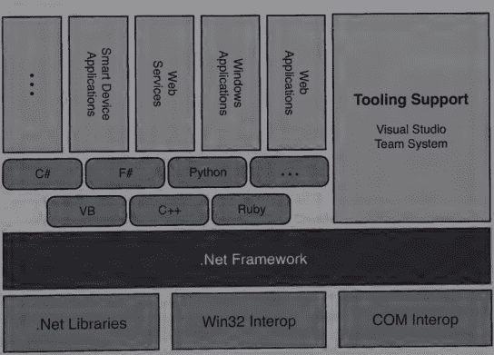

图1.1 .NET平台。

### .NET平台

在我们深入探讨平台及其周边生态系统的更详细结构之前，让我们先指出整个.NET平台的关键特性和优势：

- **面向对象编程：** 该平台被公认为是当前掌控复杂性的首选范式，其围绕面向对象编程（OO）的概念构建。C#等语言的核心基于OO原则，OO范式被用作实现语言互操作性的粘合剂。

- **支持多种语言：** 尽管COM支持多种语言（最著名的是C++和Visual Basic）以便它们相互通信，但其跨语言能力仅限于实现接口。在.NET中，通过跨语言继承等功能，语言之间真正的互操作性成为可能。再加上统一的类型系统，这使得用不同语言编写的代码之间的集成完全无缝。这还容纳了其他编程语言范式，从函数式编程风格（如F#中所见，但如今也出现在某些C#和Visual Basic语言特性中）到动态语言（如Ruby和Python）。

- **简单的基于组件的开发：** 在.NET中，创建包含库和可共享应用程序功能片段的组件比以往简单得多。无需实现像IUnknown这样的COM接口，也不需要注册。.NET中代码共享的单元基于程序集的概念，程序集携带版本信息和使用它所需的全部元数据。这消除了对单独头文件等的需求。

- **简化的应用程序部署：** 与基于COM的组件相比，部署程序集无需注册；只需“xcopy部署”即可。此外，通过支持同一组件的多个版本并行存在，DLL地狱已被消除。.NET Framework本身就是一个很好的例子，因为可以在同一台机器上并排安装多个版本的框架。

- **丰富的基类库支持：** .NET Framework带有丰富的类库，提供了构建丰富应用程序的基本构件，所有这些都以一致的方式提供，并基于OO原则设计。此类库的示例包括集合、文本处理、数据库访问、文件系统操作、网络、XML支持、丰富的面向服务的通信栈、窗口系统等等。

- **多样的应用程序类型：** 得益于丰富的基类库（BCL），基于同一框架基础编写各种应用程序变得难以置信地容易。支持Windows桌面GUI应用程序（Windows Forms和Windows Presentation Foundation [WPF]）、Web应用程序（ASP.NET）、Web服务（Windows Communication Foundation [WCF]）、智能设备应用程序（Compact Framework）、浏览器和Windows Phone 7应用程序（Silverlight）、面向Windows Azure的云应用程序等等。

- **统一的运行时基础设施：** .NET Framework的核心是公共语言运行时（CLR），它提供统一的运行时基础设施，包括平台上的所有语言共享的中间语言（IL）、将此类IL代码即时（JIT）编译为其运行所在机器的本机代码、通过垃圾回收器（GC）进行自动内存管理、程序集加载服务、调试服务、线程处理等等。

- **与现有代码的互操作性：** 尽管.NET平台旨在成为旧技术的可靠替代品，但具备良好的支持来重用使用COM等旧技术编写的现有软件组件，并通过称为P/Invoke的机制提供对操作系统原生Win32 API函数的访问，这一点至关重要。

- **异常处理：** .NET Framework中的错误处理是通过称为异常处理的机制提供的。这消除了许多与Win32编程和基于COM的API中使用所谓的HRESULT进行手动错误检查相关的担忧。

- **改进的安全模型：** 随着Web的出现，代码部署成为严重的安全风险。为了缓解这一问题，.NET运行时内置了一种称为代码访问安全性（CAS）的安全机制，它根据代码的来源、发布者证据和可配置策略对代码进行沙箱隔离。这种安全模型与操作系统提供的安全机制（如访问控制列表[ACL]和Windows安全令牌）是正交的。

- **Web服务能力：** 从.NET Framework一开始，平台就支持Web服务，这是一种基于简单对象访问协议（SOAP）和可扩展标记语言（XML）标准执行跨平台远程过程调用的现代方式。所有这些都使用在.NET世界中感觉自然的编程范式提供，因此开发人员不需要根本不同的思维方式来处理Web服务。多年来，.NET Framework上的Web服务支持显著增长，支持WS.*系列Web服务标准。

- **专业的工具支持：** Visual Studio 2010是伴随.NET Framework的最新版本工具集，为各种类型应用程序的开发提供专业支持，包括丰富的设计器支持、单元测试框架、项目和生成系统（MSBuild），并且，得益于统一的运行时基础设施，可以为.NET的跨语言平台提供丰富的调试支持。Visual Studio的高端版本Premium和Ultimate旨在与名为Team Foundation Server（TFS）的服务器产品结合用于团队开发，该产品用于工作项跟踪、源代码管理、项目报告和文档共享。从2010版本开始，还可以在客户端操作系统上安装TFS，这使个人专业开发人员也能受益于源代码管理等功能。


现在，让我们仔细看看 .NET 平台的基本概念和特性。

> **阅读提示**
> 
> 如果在第一次阅读时没有掌握所有概念，不必担心；这正是本书其余部分的目的。但我确实建议你不要跳过本章的剩余部分，因为它提供了对 .NET 哲学以及你完成本书后（如果还没有的话）将朝夕相处的平台的端到端概述。对于所有自尊的 .NET 开发者来说，扎实理解他们所使用的平台是至关重要的。
> 
> 尽管一开始事情可能会有点令人不知所措，但我保证，当你读完本书时，所有概念都会变得自然。在读完最后一页后，重读本章来评估这一说法。

## 公共语言基础结构

公共语言基础结构（CLI）是一个 ECMA 标准（规范 335），它指定了执行所谓托管代码所需的运行时基础结构，以便不同的库和语言能够无缝协作。在 20 世纪 90 年代末微软启动 .NET 项目时，很明显，跨语言互操作领域成功的关键是让公司内部和外部的语言团队参与进来（例如富士通提供平台上的 COBOL 实现），以确保设计的健壮性。作为该计划的一部分，微软与惠普和英特尔组建了一个团队来致力于 CLI 的标准化，该标准于 2001 年完成。

CLI 的一个实现是微软自己提供的公共语言运行时，尽管还有其他实现，如 Mono 和 DotGNU Portable.NET。微软还提供了另一个参考实现，称为共享源代码 CLI（SSCLI），也称为 Rotor，它可以在 FreeBSD 等平台上运行。这意味着针对 .NET 平台编写的代码不仅允许跨语言互操作，还能让你在各种平台上运行代码。最近，由 Mono 领导的 Moonlight 项目使 Silverlight 应用程序能够在基于 UNIX 的平台上运行。

那么 CLI 包含哪些内容？图 1.2 概述了三个核心元素之间的关系。

从外部开始，CLI 定义了虚拟执行系统（VES），即一个执行引擎或虚拟机（VM），它知道如何执行标准定义的代码。代码的格式称为公共中间语言（CIL），元数据用于描述代码的信息。此外，CLI 还描述了程序集的文件格式，以确保跨平台兼容性。

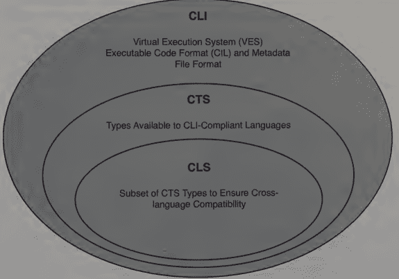

图 1.2 公共语言基础结构。

接下来是公共类型系统（CTS）。这是确保跨语言互操作性的关键部分之一，因为它统一了这些语言共享的数据类型的表示和行为。例如，在 .NET 之前时代，匹配不同技术之间的相似类型是一个常见问题，典型例子是字符串类型：C 中的 char* 与 COM 中的 BSTR 不同。在当今世界，C# 中使用的字符串与 Visual Basic .NET 或任何其他正在使用的 .NET 语言中的字符串没有区别。为了实现这一目标，CTS 定义了如何创建有效的类型：例如，CLI 的类型系统不允许多重继承，最终每个类型都必须派生自所有类型之母：System.Object。

最后，我们来看看公共语言规范（CLS）。CLS 是一组规则，所有 .NET 语言都应基于这些规则，以确保不会暴露某些语言无法处理的类型。如果所有规则都通过，类型可以标记为符合 CLS，这意味着所有 .NET 语言都能与之交互。CLS 规则的一个具体例子是：一个类型不应有两个仅大小写不同的公共成员（例如 Bar 和 bar），因为某些语言（如 Visual Basic）不区分大小写，因此无法明确解析这样的成员名称。

CTS、CLS 和几种 .NET 语言之间的关系如图 1.3 所示。从图中可以看出，.NET 语言提供了 CLS 的超集（例如，在 C# 中，可以创建一个成员仅大小写不同的类，这不符合 CLS），但超集不一定对所有语言都相同。此外，有些语言提供了 CTS 之外的功能；例如，C++ 支持多重继承，但此类代码无法在符合 CLI 的运行时上执行（但可以使用原生代码，这不受执行引擎的控制）。

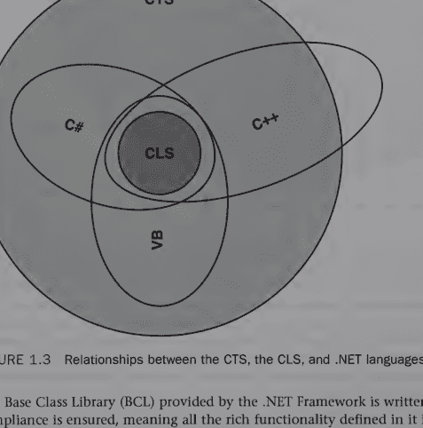

图 1.3 CTS、CLS 和 .NET 语言之间的关系。

.NET Framework 提供的基类库（BCL）在编写时确保了符合 CLS，这意味着其中定义的所有丰富功能都可直接供所有 .NET 语言使用。

## .NET 的多语言特性

如前所述，.NET 平台是一个多语言平台，意味着可以使用不同的编程语言来构建 .NET 应用程序和类库。从 .NET Framework 推出之初，微软和外部供应商就提供了丰富的与运行时、其类型系统和 CLS 兼容的语言。在撰写本文时，已经有超过 50 种语言（根据维基百科）在该运行时之上实现。

微软提供的核心语言作为 .NET Framework 4.0 软件开发工具包（SDK）和 Visual Studio 2010 语言家族的一部分，如下所示：

- **Visual Basic .NET：** 一种对于那些以前编写过（经典）Visual Basic 应用程序的人来说会立即感到熟悉的语言，但现在面向 .NET Framework，并提供了全面的 OO 支持。
- **C#：** 该语言与 .NET 运行时和 BCL 的首个版本的创建并行开发，显然基于 OO 范式，且非常实用。
- **C++/CLI：** 以前称为 C++ 的托管扩展，允许 C++ 代码在 .NET 运行时之上执行，为处理互操作性问题提供了很好的工具。
- **F#：** 核心 .NET 语言家族的最新成员，面向科学和金融计算，将函数式编程与丰富的类库和 OO 相结合。

在微软之外，已有多种语言被移植到 .NET Framework 上运行。例如 COBOL、Smalltalk、Delphi、APL、Pascal 等等。

编程语言的格局总是在变化，拥有统一的运行时基础结构为满足这些不同语言的需求提供了很好的方式，同时能够在语言间复用库并提供工具支持。所有这一切使拥有不同语言偏好的开发者能够一起工作，并为工作选择合适的工具。例如，虽然 C# 是创建业务应用程序的出色通用编程语言，但在开发科学库时，使用 F# 更具吸引力。

尽管运行时在很大程度上受到驱动 OO 编程和静态类型的基本原理的启发，但其他范式也已在平台之上成功实现。最近，得益于 Ruby on Rails 等项目，我们看到动态语言重新兴起。几年前，为这些动态语言提供公共基础结构的需求变得明显，于是开始着手在 CLR 之上实现动态语言运行时作为扩展。这项工作现在已在 .NET Framework 4.0 中提供，动态语言成为平台上的一等公民，使跨语言愿景在静态类型和动态类型语言之间成为现实。随着 DLR 的开发，多种动态语言已被实现在其上运行；例如 IronRuby 和 IronPython。

## .NET 程序集简介

要在 CLR 上执行代码，需要将其转换为运行时能够理解的格式，这种格式对所有高级 .NET 语言都是通用的。这种格式称为公共中间语言（CIL），通常缩写为 IL。在 CLR 上执行的代码称为托管代码，与直接在没有额外运行时基础结构的机器处理器上执行的原生代码形成对比。除了 IL

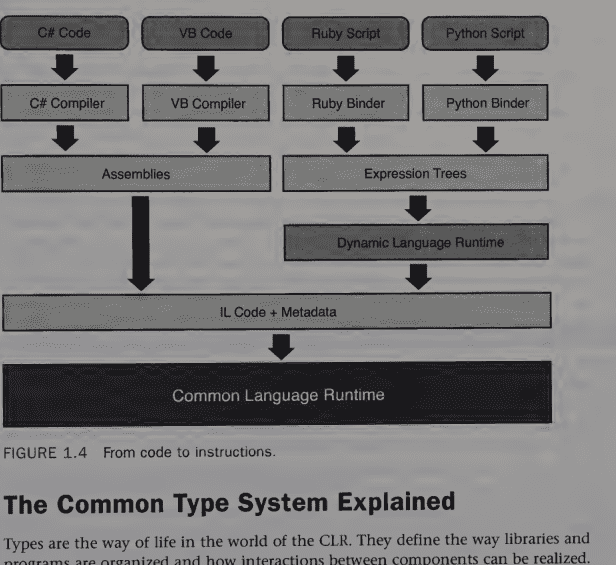

FIGURE 1.4 从代码到指令。

## 通用类型系统详解

类型是 CLR 世界中的核心。它们定义了库和程序的组织方式，以及组件之间交互的实现方式。程序集是此类类型的容器。

让我们更详细地探讨类型的优点，并了解运行时支持的各种类型种类。暂时不用担心 C# 语法；我们在后续内容中会详细介绍。

### 什么是类型安全？

为了强制代码以正确的方式处理类型，CLR 保证类型安全。这确保对象只能以与对象类型契约一致的方式访问。类型包含两部分：类型对象所包含的数据（例如，客户的姓名和信用额度）以及可以对该数据执行的操作（例如，对 Product 的 DiscountPrice）。

为了说明类型不安全的操作，假设你可以将 Customer 类型的对象当作 Product 类型来处理。那么，对客户对象执行 DiscountPrice 操作意味着什么呢？也许你会更改客户的信用额度。这显然是不安全的做法。同样，任意内存访问也是不安全的，因为你可能会进入某个类型的中间位置，而不知道那里驻留的数据类型。

像 C 和 C++ 这样的非托管语言允许这种情况发生，这为难以调试的问题和安全漏洞打开了大门。最理想的情况是，在执行无效操作时进程会崩溃（例如，因尝试覆盖受保护的内存），但类型不安全操作很可能在一段时间内未被察觉，使得在损害已经发生时追踪问题根源变得非常困难。

为了消除这类错误，CLR 强制执行类型安全。这通过多种方式实现，包括在 JIT 编译期间进行代码验证以及监控类型的使用，以确保不会进行与对象运行时类型不兼容的操作。我们示例中将 Customer 类型的对象“强制转换”为 Product 类型的漏洞将导致运行时异常，从而完全阻止无效操作的发生。

### 关于类型安全与静态和动态语言的几点说明

不要将类型安全与静态类型编程语言（主要是 C# 和 F#）混为一谈。虽然动态语言（如 Ruby 和 Python）在编写动态类型代码时不需要用户指定类型，但在代码运行时对象仍然具有明确定义的类型。这足以让运行时——在此情况下是与 CLR 协同工作的 DLR——检测到对类型安全的违反。

静态类型语言与其动态类型对应物之间的区别在于，它们通过强制执行各种规则，有潜力在编译时及早捕获大量违规。能够在静态情况下被证明是类型安全的代码称为可验证类型安全代码。.NET Framework 随带一个名为 PEVerify 的工具，用于确定代码是否可验证类型安全。

表 1.1 符合 CLS 的原始类型

| 类型 | C# | VB | C++/CLI | F# |
|---|---|---|---|---|
| System.Byte | byte | Byte | unsigned char | byte |
| System.Int16 | short | Short | short | int16 |
| System.Int32 | int | Integer | int/long | int/int32 |
| System.Int64 | long | Long | __int64 | int64 |
| System.Single | float | Single | Float | single/float32 |
| System.Double | double | Double | Double | double/float |
| System.Boolean | bool | Boolean | Bool | bool |
| System.Char | char | Char | wchar_t | char |
| System.Decimal | decimal | Decimal | Decimal | decimal |
| System.String | string | String | String^ | string |

### 原始类型

用户定义的类型通常包含数据，而这些数据的每个部分本身都应具有类型。这些类型也可以再次是用户定义的，但显然，在某个时刻需要使用预定义的类型。CTS 的角色之一是提供此类原始数据类型。.NET Framework 上的各种语言为这些数据类型定义了不同的“友好名称”，但最终它们都使用其底层类型表示，该类型在 BCL 的一部分 mscorlib.dll 程序集中定义。各种语言使用相同的内置类型这一事实是实现真正跨语言集成的基石之一。

表 1.1 显示了符合 CLS 的语言应支持的原始类型。各种语言中对应的关键字也显示在其中。除了这些类型之外，还存在各种其他非 CLS 原始类型，例如数值数据类型的无符号变体。

### 类、结构和枚举

由于 CLI 受 OO 编程原则的启发，类是 CLI 支持的一种类型，这不足为奇。本质上，类是数据的容器以及可以对该数据执行的操作的容器。通过将类的内部数据表示保持为私有，可以实现封装的优点，即只要公共契约保持不变，实现细节就可以更改。

```csharp
static class Calculator
{
    public static int Add(int a, int b)
    {
        return a + b;
    }
}
```

遵循真正的 OO 风格，CLI 支持创建类层次结构，其中一个类型派生自另一个类型。例如，Apple 类型可以派生自 Fruit 基类。当我们介绍使用 C# 进行 OO 编程时，将会详细解释这些细节。

类正式被称为 *引用类型*，因为它们驻留在堆上并通过引用使用。String 类型是内置引用类型的示例。然而，轻量级且在栈上分配的类型有时会很有用，因此 CLI 也支持值类型的概念。值类型的示例包括数值数据类型（如 Int32 和 Double）、DateTime 类型等。在 C# 世界中，值类型被声明为 struct：

```csharp
struct Point
{
    private readonly int _x;
    private readonly int _y;
    private readonly int _z;

    public Point(int x, int y, int z)
    {
        _x = x;
        _y = y;
        _z = z;
    }

    public int X { get { return _x; } }
    public int Y { get { return _y; } }
    public int Z { get { return _z; } }
}
```

枚举是一种特殊的值类型，用于表示有限的可能值集合（例如，颜色）。这与命名常量数值值有很大不同，因为枚举强制执行强类型。虽然 Color.Red 可能与 Weekday.Monday 具有相同的数值表示，但不能将 Color 值分配给 Weekday 变量：

```csharp
enum Color
{
    Red,
    Green,
    Blue
}
```

### 接口

接口提供了定义可由类或结构实现契约的能力。这样，契约与特定功能的实现就可以彼此解耦。例如，给定以下接口，可以定义对“某物”进行枚举的含义，无论它是集合类型还是从网络套接字接收的数据：

```csharp
interface IEnumerable
{
    IEnumerator GetEnumerator();
}
```

```csharp
interface IEnumerator
{
    bool MoveNext();
    object Current { get; }
    void Reset();
}
```

现在可以编写代码来处理遵守此契约的任何事物——例如，将枚举结果打印到屏幕上。这样，接口允许编写多态代码，我们将在后面更详细地讨论这一点。

### 委托

在另一处使用代码块的能力非常强大。需要这种设置的典型任务是创建新的后台线程，这需要线程应开始执行的代码。某些平台通过提供像 Runnable 这样的单方法接口来解决这个问题。仅仅为了传递一段代码就需要相当多的样板。另一种可能性是使用函数指针，但在这种方法中类型安全会受损。

委托结合了函数指针的简洁性，同时保留了单方法接口的类型安全特性，但无需处理其繁琐之处。下面展示了一个与线程相关的示例：

```csharp
var t = new Thread(delegate(object data)
{
    // Process customer object in the background
});
Customer customer = new Customer();
t.Start(customer);
```

这仅展示了委托的使用位置，我们在其中将用于客户数据处理的代码块传递给新线程。CTS 对代码声明自己的委托类型提供了第一类支持，你可以将其视为静态类型的方法签名，描述预期代码块的输入和输出类型：

```csharp
/* declaration of a delegate for binary mathematical operations on two integer values */
delegate int BinaryOperation(int a, int b);
```

```csharp
class WorkingWithDelegates
{
    public int Calculate(BinaryOperation op, int a, int b)
    {
        // calling through the delegate
        return op(a, b);
    }
}
```


```csharp
public void Sample()
{
    int three = Calculate(delegate(int a, int b) { return a + b; }, 1, 2);
}
```

## 注意

自 C# 3.0 起，该语言支持 Lambda 表达式，这是一种更简洁的传递代码的方式，没有太多语法噪音。在前面的示例中，我们传递给 `Calculate` 方法的求和函数可以更简洁地写成 `(a, b) => a + b`。

我们将在讨论 C# 中的委托以及探索语言集成查询（LINQ）时详细考察 Lambda 表达式，后者正是将 Lambda 表达式引入该语言的主要理由。

## 成员

大多数类型可以包含以下种类的零个或多个成员：

- **字段：** 用于存储数据，通常对外部隐藏，以建立抽象和封装。
- **方法：** 定义可在类型或其实例上执行的操作。
- **构造函数：** 用于创建包含该类型的对象实例；实际上，构造函数是伪装成特殊方法的方法。
- **终结器：** 一个类型可以有一个终结器方法，当垃圾回收器回收其内存时会被调用。这通常用于清理对象实例所持有的本机资源。
- **属性：** 提供对类型或其实例状态的 get 和 set 访问器。属性是 getter 和 setter 方法的语法糖衣，并提供描述它们的元数据。
- **索引器：** 特殊的属性，允许像访问数组一样访问对象实例。例如，`List<T>` 数据可以提供基于位置的索引，以便更容易地访问其中存储的数据。
- **事件：** 允许使用者注册事件处理程序，当有趣的事情发生时触发。例如，UI 框架使用事件来发出用户交互的信号，如按钮点击。

CTS 还定义了可用于指定成员预期行为的修饰符。此类修饰符的一个例子是成员的可见性，它决定该成员是否可以由其他类型访问、仅由子类型访问，或仅从定义程序集内部访问。

### 关于泛型的说明

CLI 的第二个版本引入了对泛型的支持，泛型是一种使类型和成员依赖于某种类型参数的方式。在类型理论文献中，这被称为*参数多态*。泛型的典型应用包括集合类型的定义和使用：

```csharp
var primes = new List<int> { 2, 3, 5, 7 };
int firstPrime = primes[0];
```

在前面的示例中，我们使用了泛型集合类型 `List<T>`，其中 `T` 已被替换为 `int`。类似地，我们可以构造专门的列表类型来包含字符串、Customer 对象，或任何我们认为合适的内容（包括列表的列表）。泛型的使用使得静态类型在更多情况下成为可能，从而带来更好的编译时检查和各种性能改进。

在 .NET 1.x 时代，集合类型需要使用 `System.Object`（所有类型的母体）作为元素类型，以便尽可能通用。处理非泛型集合类型总是需要使用运行时类型转换，这会带来性能损失，并且在集合被误用时可能导致运行时异常：

```csharp
ArrayList primes = new ArrayList();
primes.Add(2);
primes.Add(3);
primes.Add(5);
primes.Add(7);
primes[0] = "Bart"; // 在 List<int> 上是无效的
int firstPrime = (int)primes[0]; // 无效转换导致运行时异常
```

## 公共语言规范的作用

CLS 定义了 CTS 的一个子集，将其限制为该平台上任何 .NET 语言都能理解的类型。它通过定义一组类型定义需要满足的规则来实现这一点。

毫无疑问，第一条 CLS 规则是最重要的，因为它减轻了 .NET 开发者为保持其类型符合 CLS 所需承担的工作量：

> *CLS 规则 1：CLS 规则仅适用于类型中在定义程序集外部可访问或可见的部分。*

阅读这条规则的人都会产生一种“哎呀”的效果。因为 CLS 是关于跨语言互操作性的，只有对外界可见的内容才重要。或者说，反过来说：程序集的内部实现细节可以随意违反 CLS 规则。

### 定义规则的艺术

设计一套合适的 CLS 规则并非易事。一方面，规则应该足够灵活，以允许实现和使用开发人员常用的语言构造。另一方面，它们应该具有足够的限制性，以便可以在 CLI 上实现大量语言。

为了确保运行时设计在允许不同语言在其上运行的前提下保持相关性，微软及其合作伙伴开展了 Project Seven。该项目在设计实现过程中，在运行时上实现了一组流行的语言，以提供早期反馈并引导 CLI、CTS 和 CLS 朝着正确的方向发展。

今天，我们收获了这一努力的成果，许多语言都面向 .NET 运行时，实现了真正的互操作性，而无需担心规则过于严格或过于宽松：CLS 取得了正确的平衡，我们应该赞美它。

CLS 影响了三类受众，因此每条规则都从三个不同的角度编写：

- **框架（库）** 关注保证其在不同语言间的最大适用性。例如，框架应避免在类型或成员名称中使用语言关键字。
- **使用者** 访问符合 CLS 的框架所定义的类型，但不要求它们能够自行定义类型。例如，使用者应能够实例化类型。
- **扩展者** 处于框架和使用者之间。它们允许我们扩展框架提供的类型，但不一定允许定义全新的类型。例如，扩展者应能够实现接口。

作为 .NET 开发人员，CLS 规则主要在你构建期望其他开发人员从他们认为合适的任何 .NET 语言中使用的框架库时对你重要。为了指示 CLS 符合性并触发 C# 编译器检查你的符合性声明，程序集应应用 CLSCompliant 特性：

```csharp
[assembly: CLSCompliant(true)]
```

我们将在稍后你对自定义特性的使用有了更扎实的理解时再回到这一点。

## 执行托管代码

现在你已经了解了类型如何构建，以及 IL 代码和元数据如何在编译时或运行时生成，我们应该更仔细地看一下托管代码的执行模型。考虑以下 C# 代码片段，它实现并使用了一个简单的 Calculator 类。如果这里使用的语言构造对你来说很陌生，不要担心；我们将在本书中广泛介绍 C# 程序的语法和含义。

```csharp
using System;

static class Program
{
    static void Main()
    {
        var random = new Random();
        int a = random.Next();
        int b = random.Next();
        var calc = new Calculator();
        int sum = calc.Add(a, b);
        Console.WriteLine("{0} + {1} = {2}", a, b, sum);
    }
}

public class Calculator
{
    public int Add(int a, int b)
    {
        return a + b;
    }
}
```

Program 类中的 Main 方法是程序执行的起点。首先，创建一个随机数生成器，随后用于生成两个整数值 a 和 b。接着，使用一个 calculator 对象将这两个数字相加，最后将计算结果打印到屏幕上。

使用 C# 编译器编译这段代码的结果是一个可执行的程序集，其中包含运行时执行代码所需的全部信息。我们将在第 2 章中探讨 C# 编译器和更丰富的工具（如 Visual Studio 2010）的使用。对于这个首次探索性练习，重要的是所生成程序集的结构。为了检查这一点，我们可以使用 .NET Framework SDK 附带的 IL 反汇编工具（ildasm.exe），如图 1.5 所示。在该图中，我们可以识别出几个部分，接下来将立即深入探讨。


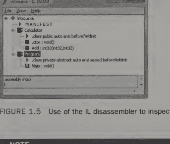

图1.5 使用IL反汇编器检查程序集。

### 注意

如果你好奇ILDASM的应用程序图标来自哪里，请试着回忆本章前面提到的CLR的初始代号。

### 注意

ILDASM有一个姊妹工具，名为ILASM，即IL汇编器。与使用C#和VB等高级语言编写不同，你可以使用该工具来汇编手写的IL代码。然而，这是一种非常极端的托管代码开发方式。ILASM的一个稍微常见的用途是与ILDASM结合使用，进行“IL往返转换”：给定一个输入程序集，将其反汇编为IL，通过手工或某些工具进行调整，然后重新汇编。ILDASM和ILASM这一对工具被专门设计用于实现这种无损往返转换。

## 程序集清单

首先，有一个清单（manifest）描述了程序集的标识、依赖项以及一些标志。对于我们这个小型应用程序，清单如下（省略了一些无关紧要的细节）：

```
// Metadata version: v4.0.30319
.assembly extern mscorlib
{
.publickeytoken = (B7 7A 5C 56 19 34 E0 89 )
.ver 4:0:0:0
}
.assembly intro
{
.hash algorithm 0x00000004
.ver 0:0:0:0
}
.module intro.exe
.imagebase 0x00400000
.file alignment 0x00000200
.stackreserve 0x00100000
.subsystem 0x0003    // WINDOWS_CUI
.corflags 0x00000001    // ILONLY
```

从第一行注释可以看到生成该程序集所针对的元数据（从而也是运行时）版本。

### .NET FRAMEWORK 版本历史

在.NET平台存在的第一个十年里，已经构建了不同版本的CLR。然而，并非每个.NET Framework版本都意味着底层运行时的新版本。.NET Framework的第一个版本随附CLR v1.0.3705，并在v1.1版本中迅速更新到v1.1.4322。运行时的一个重大扩展——引入泛型——出现在框架第2版中，其版本号为v2.0.50727。如果你好奇这个庞大构建号代表什么：2005/07/27。

接下来的几个.NET Framework版本，即3.0和3.5，并未对CLR进行根本性更改，但增加了大量库，如Windows Presentation Foundation（WPF）、Windows Communication Foundation（WCF）、Windows Workflow Foundation（WF）和Language Integrated Query（LINQ）。换句话说，.NET Framework 3.0和3.5版本随附的是v2.0 CLR。

现在，随着框架的第四个版本，也发布了CLR的重大更新，主要改进了执行引擎提供的运行时服务。不过，底层的IL指令集和元数据格式保持兼容，以确保平稳过渡到最新最好的.NET Framework版本，并保持程序集的二进制兼容性。对于好奇的人，完整的.NET 4版本号是4.0.30319。

清单中的下一项表示一个外部程序集引用，表明我们程序集的一个依赖项。该程序集mscorlib是BCL的核心部分之一。注意其中包含了被引用程序集的版本信息；这是消除.NET出现之前存在的DLL版本地狱的关键之一。除了我们程序集自身的标识外，清单中还保留了关于其特征的一般信息（例如，它是控制台用户界面，即CUI）。

## IL 代码

到目前为止，我们已经知道IL代码作为一种与语言无关的格式，用于表达指令。然而，它的通用性还延伸到了另一个方向：作为一种中间表示，它还允许与任何具体细节解耦。

### 保护你的知识产权

有时，在处理托管代码时，人们会担心如何保护其软件的知识产权（IP），因为托管代码很容易被检查，甚至可以使用.NET Reflector等工具进行反编译。自描述程序集的好处巨大（例如，有助于调试场景），但像IP这样的问题同样重要。幸运的是，已有工具可以对托管代码进行混淆，使逆向工程变得更加困难。例如，.NET Reflector本身便使用了这种技术进行保护。Visual Studio附带了一款名为Dotfuscator的产品的社区版，正是为此而设计。

## 元数据

将程序集转化为可执行体的最后一块拼图是元数据。它以极其详细的方式描述了所定义程序集包含的所有类型，以便运行时能够搭建必要的基础设施来使执行成为可能。工具也从自描述程序集中受益。CLI提供的整个元数据系统实际上非常像一个相关数据的关系数据库，使得可以查询各种关系。例如，给定一个类型，很容易找到它的所有成员，而反向关系也同样易于遍历。使得在运行时能够对类型进行内省的.NET库称为反射（Reflection）。

作为开发人员，你不必太担心元数据。.NET平台上的语言编译器负责发出关于你在日常编程工作中定义的类型所需的元数据细节。然而，元数据的灵活性支持许多超出描述类型所需元数据的场景。通过一个名为自定义特性（custom attributes）的功能，可以用自定义元数据标记各种实体，如类型、成员、参数等。此类元数据随后可在运行时被库使用，以促进诸如序列化或通过Web服务公开方法等操作。

为了说明问题，让我们看一下描述我们示例中Calculator类的元数据：

```
TypeDef #2 (02000003)
.......................................................
    TypDefName: Calculator  (02000003)
    Flags      : [Public] [AutoLayout] [Class] [AnsiClass] [BeforeFieldInit]
                 (00100101)
    Extends    : 01000001 [TypeRef] System.Object
    Method #1 (06000002)
.......................................................
    MethodName: Add (06000002)
    Flags      : [Public] [HideBySig] [ReuseSlot]    (00000086)
    RVA        : 0x0000209e
    ImplFlags  : [IL] [Managed]      (00000000)
CallConv: [DEFAULT]
hasThis
ReturnType: I4
2 Arguments
    Argument #1: I4
    Argument #2: I4
2 Parameters
    (1) ParamToken : (08000001)
        Name : a
        flags: [none] (00000000)
    (2) ParamToken : (08000002)
        Name : b
        flags: [none] (00000000)

Method #2 (06000003)
--------------------------------------------------
MethodName: .ctor (06000003)
Flags      : [Public] [HideBySig] [ReuseSlot] [SpecialName]
            [RTSpecialName] [.ctor]   (00001886)
RVA        : 0x000020a3
ImplFlags  : [IL] [Managed]   (00000000)
CallConv: [DEFAULT]
hasThis
ReturnType: Void
No arguments.
```

在这里，你可以看到类型和成员的名称以及与之关联的几个标志（用于可见性、方法表布局等）。此外，请注意每条元数据都有一个唯一编号，允许其他元数据交叉引用它。

## 混合语言

在前面的讨论中，你已经看到了如何使用单一语言（在我们的例子中是C#）来构建一个完整的应用程序。但在现实环境中，情况很少如此，通常需要组合来自不同来源的库，为手头的问题提供端到端的解决方案。事实上，我们使用BCL类型（如System.Random和System.Console）就是这种场景的一个很好的例子。尽管这些类型碰巧也是用C#编写的（BCL中的大多数代码都是如此），但由于CLR提供的跨语言能力，这并非必要条件。然而，使用库只是语言互操作性的冰山一角。更丰富的功能，例如使用与最初编写时不同的语言来扩展现有类型，也是其中的一部分。

让我们以更具体的方式探讨CLR的这个方面。我们不再将Calculator类编译为可执行程序集的一部分，而是将其编译为具有.dll扩展名的库。事实上，运行时并不太关心程序集的文件扩展名，除了EXE文件应该有一个入口点方法。


现在，当从任何 .NET 语言使用 FancyCalculator 类型时，我们并不知道它的 Add 方法是使用与 Multiply 方法不同的语言实现的。为了说明统一类型系统提供的无缝集成，让我们在 F# 的交互式控制台中使用我们的库。如图 1.8 所示。

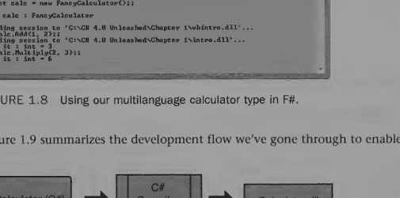

图1.8 在 F# 中使用我们的多语言计算器类型。

图1.9总结了我们为支持此场景所经历的开发流程。


图1.9 使用多种语言开发和运用代码。

## 深入公共语言运行时

现在你已经知道程序集是如何构建的，是时候关注 CLR 提供的运行时基础设施了。实际上，在 CLR 推出时，运行时的概念并不具有开创性：Visual Basic 等语言多年来一直都有运行时，Java 及其虚拟机（JVM）也是如此。不过，CLR 与其他运行时的区别在于，它与任何特定语言解耦。此外，通过自定义特性对元数据进行泛化是一项相当创新的特性，本书将对此进行更详细的介绍。

### 引导运行时

此前你已经看到，可执行程序集被构建为 EXE 文件；众所周知，操作系统会加载这些文件，并在单独的进程中运行它们。在 .NET 之前的世界中，可执行文件仅包含处理器可以直接理解的本机机器指令。由于托管代码程序集需要运行时服务才能执行，一个自然的问题是：当操作系统遇到托管可执行文件时，.NET 运行时是如何被加载的。

为了让操作系统的加载器将该可执行文件识别为有效文件，它需要具有以 PE/COFF 文件格式定义的结构；PE/COFF 代表可移植可执行文件（Portable Executable）和通用对象文件格式（Common Object File Format）。该文件格式描述可执行文件的结构，包括其包含的代码节和数据节，以及描述导入函数和导出函数等内容的元数据结构。在 CLI 中，这种标准化格式被称为将程序集存储在文件中的方式。

尽管 PE/COFF 文件功能丰富，但托管可执行文件只使用其中极小一部分功能，足以在可执行文件启动后立即将控制权转移给 CLR。这是通过在每个托管可执行文件中（在编译时）生成一个很小的代码节来实现的，该代码节基本上只做一件事：

```
JMP _CorExeMain
```

这条跳转指令将控制权转移到名为 _CorExeMain 的函数，该函数位于 system32 文件夹下的 mscoree.dll 文件中。从那时起，运行时便处于控制之中。

> **揭示公共语言运行时入口点**
> 
> 欢迎感兴趣的读者使用 Visual Studio 附带的 dumpbin.exe 工具（该工具也可在 Windows SDK 中获得），通过该工具的 /imports 标志转储任何托管可执行文件的导入表。这将揭示从 mscoree.dll 导入的 _CorExeMain 入口点。

那么，这个 mscoree.dll 到底是什么呢？该缩写代表组件对象运行时执行引擎（Component Object Runtime Execution Engine），其中 COR 部分是一种最后遗留的痕迹，表明运行时仍被视为 COM 的扩展，并通过添加运行时服务让开发人员的工作更轻松。实际上，这个 DLL 的作用非常有限：它实际上是一个极小的垫片，知道如何加载能够执行所启动应用程序的适当 CLR 版本。这便于多个 .NET Framework 版本的并行安装。加载哪个运行时的决策基于可执行文件中嵌入的元数据以及注册表中的策略配置。

### 注意

从 Windows XP 开始，操作系统的可执行文件加载器就内置了一些关于公共语言运行时的有限知识，以便尽早将托管可执行文件的执行重定向到运行时。如今，各种内置服务（例如 Windows Installer）对托管程序集的存在具有固有知识。从 Windows Vista 开始，.NET Framework 的某些部分已成为操作系统安装的组成部分，以支持依赖它们的服务。

一旦垫片知道要加载哪个版本的运行时，它就会继续定位所选运行时版本对应的真正执行引擎 DLL。特定版本的运行时组件位于 %windir%\Microsoft.NET 文件夹下的各个文件夹中。在 .NET 2.0 中，运行时 DLL 名为 mscorwks.dll，它代表组件对象运行时工作站（Component Object Runtime Workstation），这是另一个历史命名，反映了运行时曾经有多种变体。（一种变体针对服务器运行进行了优化，而另一种变体针对客户端或工作站运行进行了优化，主要区别在于不同的 GC 行为。）如今，这种区分更加可配置，并且不再需要单独的 DLL，因此 .NET 4.0 的执行引擎位于一个命名更合乎逻辑的文件 clr.dll 中。

### 注意

尽可能保持垫片微小并不总是一件容易的事。听起来非常合乎逻辑的是，任何特定版本的运行时功能都不应存在于垫片中，但在实践中这却是一项挑战。在 .NET 4.0 中，原始垫片已被精简，以使其更具前瞻性。这一重构使 mscoree.dll 成为一个超级垫片，其余功能被移到一个名为 mscoreei.dll 的新 DLL 中。这样一来，每当应用 .NET Framework 更新时更新 mscoree.dll 的需求应会显著减少。

运行时在获得对托管可执行文件执行的控制权后所做的首批事情之一，就是检查 PE/COFF 头，寻找一个 CLR 专用头，该头指定指向程序集元数据目录的指针。此类头如下所示：

```
clr Header:

                 48 cb
              2.05 runtime version
                 20AC [       304] RVA [size] of MetaData Directory
                             1 flags
                                IL Only

         6000001 entry point token
```

通过元数据目录定位入口点标记后，运行时现在拥有定位应用程序入口点方法并启动所需的全部信息

## 全局程序集缓存

截至12月31日止年度，

| | 2023 | 2022 | 2021 |
| --- | ---: | ---: | ---: |
| **经营活动产生的现金流量** | | | |
| 净利润 | 1,200,000 | 980,000 | 850,000 |
| 将净利润调节为经营活动提供的净现金的调整项： | | | |
| 折旧与摊销 | 150,000 | 140,000 | 130,000 |
| 股权激励费用 | 45,000 | 40,000 | 35,000 |
| 经营性资产和负债变动： | | | |
| 应收账款 | (30,000) | (25,000) | (20,000) |
| 存货 | (18,000) | 12,000 | (8,000) |
| 应付账款 | 22,000 | (5,000) | 15,000 |
| 应计费用 | 10,000 | 8,000 | (6,000) |
| **经营活动提供的净现金** | **1,379,000** | **1,150,000** | **996,000** |
| **投资活动产生的现金流量** | | | |
| 购置财产和设备 | (350,000) | (280,000) | (220,000) |
| 出售设备所得款项 | 25,000 | 15,000 | 10,000 |
| **投资活动使用的净现金** | **(325,000)** | **(265,000)** | **(210,000)** |
| **筹资活动产生的现金流量** | | | |
| 发行普通股所得款项 | 100,000 | 50,000 | 80,000 |
| 偿还长期债务 | (200,000) | (150,000) | (100,000) |
| 已支付股利 | (80,000) | (75,000) | (60,000) |
| **筹资活动使用的净现金** | **(180,000)** | **(175,000)** | **(80,000)** |
| **现金及现金等价物净增加额** | **874,000** | **710,000** | **706,000** |
| 年初现金及现金等价物 | 1,250,000 | 540,000 | (166,000) |
| **年末现金及现金等价物** | **2,124,000** | **1,250,000** | **540,000** |


注册需求。然而，对于跨多个应用程序共享的库（如框架的 BCL 本身），有一个共享的系统位置来存储这些程序集是合理的。此位置称为全局程序集缓存（Global Assembly Cache，GAC）。

要将程序集安装到 GAC 中，它们必须经过“强名称签名”。由于 GAC 是计算机范围的可信位置，这一限制可确保程序集得到正确签名。我们将在第 25 章“程序集和应用程序域”中讨论对程序集进行签名的过程。此外，GAC 允许同一程序集的多个版本和区域性并存。这是确保托管代码应用程序的版本管理方案顺利运作的一项关键要求。

实际上，GAC 是一个分层文件夹结构，它根据程序集所面向的运行时、名称和版本号来组织程序集。为了隐藏此文件夹结构的复杂性并简化 GAC 的管理，.NET Framework 安装了一个外壳扩展，以便提供程序集缓存的用户友好视图。你可以在 %windir%\assembly 下找到 GAC，如图 1.11 所示。

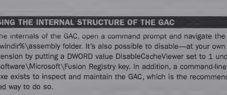

图 1.11 BCL 程序集位于全局程序集缓存中。

### 浏览 GAC 的内部结构

要查看 GAC 的内部结构，请打开命令提示符，并在文件系统中导航到 %windir%\assembly 文件夹。还可以—风险自负—通过在 HKLM\Software\Microsoft\Fusion 注册表项下将 DWORD 值 DisableCacheViewer 设置为 1 来禁用外壳扩展。此外，还有一个名为 gacutil.exe 的命令行工具可用于检查和维护 GAC，这是推荐且受支持的做法。

应注意，从 .NET 4 开始，GAC 已被拆分。%windir%\assembly 文件夹包含 .NET 4 之前的程序集，而面向新版本运行时的程序集则位于 %windir%\Microsoft.NET\assembly 下。

程序集的加载过程会搜索多个路径，包括 GAC、相对于正在执行的应用程序的文件夹以及可配置的提示路径，以尝试找到匹配的程序集。这一过程称为程序集探测，可以使用名为 fuslogvw.exe 的工具（程序集绑定日志查看器）进行监视，以便诊断。

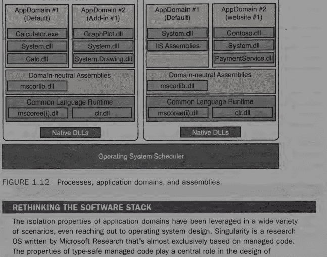

图 1.12 进程、应用程序域和程序集。

### 重新思考软件栈

应用程序域的隔离特性已在各种场景中得到利用，甚至延伸到操作系统设计领域。Singularity 是 Microsoft Research 编写的一个研究操作系统，几乎完全基于托管代码。类型安全的托管代码的特性在 Singularity 的设计中发挥着核心作用，用于将系统服务、用户进程甚至驱动程序彼此隔离。软件隔离进程（Software isolated processes，SIPs）构成了这种操作系统级隔离的基石，并且看起来与应用程序域非常相似。

“重新思考软件栈”是 Singularity 的设计座右铭，并聚焦于三个核心支柱：

- 用 SIPs 改进对系统服务和进程的保护
- 基于契约的通道，用于在这些 SIPs 之间建立通信
- 基于清单的程序，用于协助验证系统属性

有关详细信息，请访问 http://research.microsoft.com/singularity；如果你想试验这个研究操作系统，可以在该网站下载研究开发工具包（RDK）。

如前所述，在需要加载不受信任代码的环境中，能够在代码的逻辑组之间建立边界是一项很棒的能力。CLR 最早的使用者之一是 ASP.NET，它是经典 Active Server Pages 技术的 .NET 后继者。在 Web 托管领域，许多网站需要运行在同一台服务器上。为每个网站维护单独的进程过于重量级，因此从历史上看，像 Microsoft 的 Internet Information Services（IIS）这样的 Web 服务器一直有办法在同一进程中运行多个网站。随着 ASP.NET 的出现，可以利用应用程序域来实现这一目标。自 IIS 7 起，Web 服务器本身对托管代码有了相当多的了解，应用程序池已成为 IIS 中的隔离单元。正如你可能预期的那样，这些池在底层依托应用程序域。

如今，托管代码在许多地方运行，包括 SQL Server（2005 及更高版本）等服务器产品中，在这些产品中，正常运行时间是最重要的关注点之一。SQL Server 本身不是托管应用程序，但它允许开发人员使用托管代码来扩展其功能（例如，通过托管存储过程）。我们说 SQL Server 充当 CLR 宿主。仅靠应用程序域隔离，对于这类高要求环境来说还不够好；在这些环境中，宿主希望对加载哪些内容以及运行时如何表现拥有更多控制权。例如，SQL Server 有自己的内存管理器，而在服务进程中本机承载 CLR 会严重干扰它。为了满足复杂宿主的需求，CLR 提供了专门的承载 API，使宿主能够更紧密地控制 CLR 的行为。

> **注意**
>
> 自 CLR 4.0 起，已经可以在同一进程内并行承载多个版本的运行时。在这个较低层面上，每个 CLR 的运行时基础设施与各自 CLR 中的应用程序域之间的隔离仍会得到维持。换句话说，在同一进程中运行于不同 CLR 版本上的不同应用程序彼此不可见。

## JIT 编译

如你所见，所有 .NET 语言都将代码编译为以 IL 作为目标代码格式。当今的处理器不知道如何执行以这种格式编写的代码，因此需要执行某些操作，将 IL 代码转换为目标处理器能够处理的指令。负责在 IL 代码与本机处理器指令之间进行映射的运行时服务称为即时编译器（Just-in-Time compiler），通常缩写为 JIT，并称为“jitter”。

> **注意**
>
> 尽管 IL 代码与机器无关，但 .NET 语言编译器允许使用 /platform 开关将代码编译为面向指定机器架构的目标。此功能很少使用，但在与需要特定机器架构的本机代码互操作时有时会派上用场。这个标志实际上只是修改生成程序集中的一个标志，以告知运行时强制使用某种架构。你可以使用名为 corflags.exe 的 SDK 工具检查甚至调整此标志。

## 本机映像生成

不得不为 JIT 编译应用程序代码及其依赖的类库程序集付出代价，听起来并不是个好主意。毕竟，一旦程序集部署到目标计算机，处理器架构就是确定的，而这些程序集中代码的所有重复 JIT 编译都会生成相同的对应本机代码。看来我们想要一种机制：仍然可以部署基于 IL 的程序集（以获得前面提到的所有好处），但只需承受一次 JIT 编译的负担。

为了解决这一问题，CLR 提供了“本机映像生成”（native image generation）的概念，即 NGEN。对 NGEN 最简单的理解方式是：它是 JIT 编译器的脱机版本，可对完整程序集调用，将其转换为本机代码，并将结果存储到程序集加载器能够找到的中心位置。（实际上，这是 GAC 位置下的一个文件夹。）从那时起，就无需再支付 JIT 编译的运行时开销，从而使应用程序能够快速启动。此外，如果程序集在同一应用程序中被多次加载（即在不同的应用程序域中），还可以减少内存使用，因为本机代码映像可以被内存映射。

### 从惨痛经历中认识 NGEN

Windows PowerShell 1.0 是一个托管代码应用程序，其用户会经历过 JIT 编译带来的开销。由于安装程序包的一个问题，程序集没有经过 NGEN 处理。PowerShell 博客发布了一个手动触发 NGEN 的变通方法。此变通方法显著改善了启动性能。

Windows PowerShell 2.0 将由其安装程序执行适当的 NGEN 处理。

NGEN 可用于两种模式：交互式和后台。在交互模式下，会立即对指定程序集执行 NGEN 编译。在后台模式下运行 NGEN 任务时，其编译工作会排队交给名为 NGEN 优化服务（mscorsvw.exe）的后台服务稍后完成。此队列具有优先级，因此重要程序集可以优先于不常用的程序集。为执行 NGEN 管理任务，存在一个名为 ngen.exe 的命令行实用工具，不过大多数 NGEN 任务由软件安装程序执行（例如，排队后台编译作业，以便安装程序更快完成）。

这一切听起来很棒，但 NGEN 也有一些不利的一面。一个潜在问题是，当发生更新时，程序集及其经过 NGEN 处理的对应版本可能会不同步。ngen.exe 提供了命令行开关，可在这种情况下强制更新。与你可能认为的相反，经过 NGEN 处理的程序集的性能可能比经过 JIT 编译的程序集更慢。本机映像编译器不能像它的在线伙伴 JIT 编译器那样对运行时环境做出那么多假设。因此，NGEN 必须保守行事，有时会导致生成的代码不如 JIT 的对应版本。另一个潜在的性能回退来自潜在的映像

托管堆上的分配与不同堆实现（例如 C++ 运行时提供的堆）上的分配相比效率极高。本质上，堆分配是线性进行的，如图 1.14 所示。这里堆中已包含几个用字母 A、B 和 C 表示的对象。

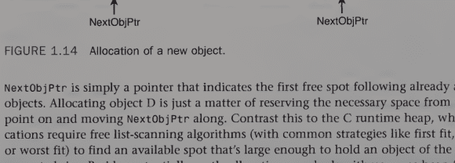

图 1.14 新对象的分配。

NextObjPtr 只是一个指针，表示已分配对象之后第一个空闲位置。分配对象 D 只需从该点开始预留必要的空间并移动 NextObjPtr 即可。与此形成对比的是 C 运行时堆，其中分配需要自由列表扫描算法（常见策略如首次适应、最优适应或最差适应）来找到足够容纳请求大小对象的可用位置。除了可能代价高昂的分配外，此类算法还会导致堆碎片化，因为堆中存在无法容纳任何对象的未占用空洞。

当然，由于可用内存是有限的，不断增长的线性堆的方法无法一直工作下去。最终，NextObjPtr 将到达堆的末尾，需要采取某些措施来回收空闲空间。这就是垃圾回收发挥作用的地方。其基本思想相当直接。在第一阶段，GC 会收集所谓的根对象，这些对象存在于静态变量、方法参数和局部变量、线程本地存储以及 CPU 寄存器中。它们之所以特殊，是因为可以直接被执行代码访问到。

从根开始，会遍历对其他对象的引用。例如，考虑一个类型为 Order 的根，它包含对 Customer 对象和 Product 对象的引用。因为 Order 对象可被代码访问，所以 Customer 和 Product 对象也可被访问。到达它们只需在 Order 对象上跟随一个对象引用即可。这种遍历会彻底进行，直到所有可达对象都被标记。因此，这一阶段称为标记阶段。图 1.15 说明了可达对象的标记。

在此示例中，垃圾回收已触发，因为尝试分配对象 J，但堆已用完空间，正如 NextObjPtr 的位置所示。当启动 GC 时，执行引擎会挂起（意味着求值栈被冻结等），以便识别根并扫描堆。从已识别的根来看，对象 A、E 和 I 是直接可达的。对象 B、F 和 G 可以通过从这些根对象开始遍历一个或多个对象引用而到达。这标志着标记阶段的结束。

失败时，GC 会尝试收集第 0 代。如果这释放了足够的空间，分配就可以在不收集托管堆其余部分的情况下成功。因为第 0 代很小，其收集引起的暂停最小。

典型的分配模式会产生大量短寿命对象，因此大多数情况下第 0 代收集就足够了。在收集期间存活下来的对象会被提升到下一代。总共存在三个这样的代，编号从 0 到 2，大小递增。大于 85,000 字节的对象需要特殊处理，并被分配到大型对象堆 (LOH)，以避免在压缩期间移动这些庞然大物。另一个复杂性是固定对象的存在，这些对象无法移动，因为它们的位置已与非托管代码共享，而 GC 无法跟踪这些引用以更新它们。

## 异常处理

错误处理是一件棘手的事情。多年来，函数返回时的严格错误代码检查一直困扰着开发者。例如，以下片段摘自 Platform SDK 文档中关于基于 COM 的文件传输 API 的内容：

```
IBackgroundCopyManager* g_pbcm = NULL;
HRESULT hr;

// Specify the appropriate COM threading model for your application.
hr = CoInitializeEx(NULL, COINIT_APARTMENTTHREADED);
if (SUCCEEDED(hr))
{
    hr = CoCreateInstance(__uuidof(BackgroundCopyManager), NULL,
                          CLSCTX_LOCAL_SERVER,
                          __uuidof(IBackgroundCopyManager),
                          (void**) &g_pbcm);
    if (SUCCEEDED(hr))
    {
        // Use g_pbcm to create, enumerate, or retrieve jobs from the queue.
    }
}
```

这种错误检查方法很繁琐，并且极大地破坏了代码的流程，尤其因为我们期望错误只偶尔发生。此外，详细错误信息的传播灵活性很小；Win32 中的 GetLastError 值和 COM 中晦涩的 HRESULT 值几乎不能称为描述性的。为了将错误代码传播到可以正确处理故障条件的位置（例如，通过重试操作或向用户显示错误消息），几乎没有回旋余地。函数返回值是最方便的错误代码信号位置，而函数的所有返回数据都需要通过输出参数公开，这使得代码难以编写和理解。

需要改变一些东西以减少错误传播的繁文缛节。CLR 使用的解决方案称为 *structured exception handling*，该技术在各种编程语言中早有应用（例如 C++ 和 Java，仅举几例），并且可以利用操作系统提供的支持（称为 SEH）。

异常只是在出现异常情况时被“抛出”（有些人说提升，但我喜欢把那个动词保留给另一个上下文）的对象。此类情况的示例包括 I/O 错误、检测到传递给函数的无效参数、用户授权失败等等。这样做，函数的契约不会因可能发生坏事而受损。毕竟，几乎任何代码都可能失败：想想内存不足的情况。这里有一个引发异常的示例：

```csharp
public List<Customer> LoadCustomerData(string file)
{
    if (!File.Exists(file))
        throw new FileNotFoundException(file);

    // Read data from the file and return Customer objects
}
```

抛出异常来表示错误条件是一回事。我们需要填补的下一个拼图部分是捕获此类异常并对其采取行动的能力。这是结构化异常处理的第二个支柱。为了减少手动将异常传播给调用者的负担，运行时通过将异常对象沿调用栈向上渗透，直到找到愿意处理该异常的适当异常处理程序来处理此事。图 1.17 显示了调用栈如何用于将异常传播到被捕获的位置。

调用栈从底部到顶部读取：fillGrid_Click 调用了 DisplayCustomers，而后者又调用了 LoadCustomerData。在那里，事情严重出错：指定的文件未找到，并抛出异常（步骤 1）。现在运行时介入并遍历栈，寻找具有关联处理程序的受保护块，该处理程序能够处理 FileNotFoundException 异常对象。它在 fillGrid_Click 中找到了一个，并开始在步骤 2 和 3 中展开栈。最后，控制权转移到 catch 块中的异常处理程序，如步骤 4 所示。

## 代码访问安全

CLR 提供的另一个运行时服务是代码访问安全 (CAS)，它与异常一样紧密耦合到调用栈。在 CLR 设计之时，互联网已成为分发软件的流行方式。不幸的是，这种模式也带来了许多安全问题；众所周知，许多安全漏洞是由盲目执行从互联网下载的恶意代码引起的。这迫切需要防止恶意代码运行的新方法，而这正是 CAS 的全部内容。


**图 1.17 异常传播。**

```csharp
public List<Customer> LoadCustomerData(string file)
{
    if (!File.Exists(file))
        throw new FileNotFoundException(file);
    // Read data from the file and return Customer objects
}
```

```csharp
public void DisplayCustomers(string folder)
{
    string file = Path.Combine(folder, "customers.xml");
    dataGrid.DataSource = LoadCustomerData(file);
}
```

```csharp
public void fillGrid_Click(object sender, EventArgs e)
{
    try
    {
        DisplayCustomers(Settings.DataStoragePath);
    }
    catch (FileNotFoundException ex)
    {
        MessageBox.Show(ex.File + " not found.");
    }
}
```

在引入 CLR 之前，身份验证和授权机制与用户和组的概念紧密相关。例如，用户通过提供关于其身份的证据（密码、智能卡、生物识别等）向系统进行身份验证。借助登录令牌，可以执行授权，以确定是否应授予该用户访问各种资源（如文件、系统管理任务等）的权限。然而，在某个用户账户下运行的代码拥有与该用户相同的权限。我们需要一种能够对代码进行沙箱隔离的机制。

使用 CAS 时，代码也带有证据：它可以由某个发布者进行数字签名、源自受信任的位置，等等。可配置的策略将证据与执行期间授予代码的权限集关联起来。要访问各种 API，需要特定权限；例如，与文件系统交互或调用托管代码。

当某个 API 要求具备特定权限才能继续时，CLR 会接管并执行堆栈遍历，以确保调用方链中的程序集已被授予所需权限。这样，不受信任的程序集就无法调用安全敏感的 API。

图 1.18 展示了堆栈遍历的实际运行过程。EvilCode.exe 从可疑位置下载，缺少获得与文件系统交互权限所需的证据。为了窃取或篡改用户数据，该程序集调用 TaxReporting.dll，这是由税务申报工具安装到系统上的受信任程序集。税务申报程序集中的代码调用 File.Create 方法，该方法定义在 mscorlib.dll 中，而 mscorlib.dll 是安装到 GAC 的 BCL 程序集之一，完全受信任。然而，File.Create 方法提出了文件权限要求。此时，CLR 开始堆栈遍历，对照所要求的权限检查调用堆栈上每个程序集的已授予权限集。TaxReporting.dll 通过了该检查，但 EvilCode.exe 中的恶意代码没有通过。由于该要求无法满足，CLR 引发 SecurityException。

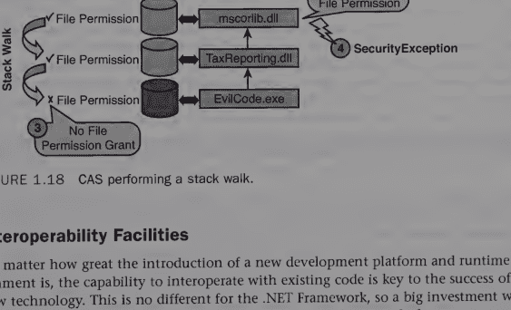

**图 1.18 CAS 执行堆栈遍历。**

## 互操作设施

无论新开发平台和运行时环境的引入多么出色，与现有代码互操作的能力都是新技术成功的关键。对 .NET Framework 而言也不例外，因此微软投入了大量资源来确保现有代码能够与新平台协同工作。

互操作栈中的一部分称为平台调用（Platform Invoke），即 P/Invoke，它支持调用由 DLL 导出的本机函数。P/Invoke 通常用于调用尚未通过托管代码库公开的操作系统函数。

### 面向大众的 P/Invoke

让 P/Invoke 正常工作可能需要深入掌握内存布局、不同类型之间的转换、调用约定等知识。要正确做到这一点可能极其令人头疼。幸运的是，.NET 开发者社区意识到了这一点，并创建了一个在线 wiki，用于发布 P/Invoke 签名和结构体的映射。你可以在 http://pinvoke.net 找到它。

此外，CLR 团队构建了一个名为 P/Invoke 互操作助手（P/Invoke Interop Assistant）的工具，你可以在 http://www.codeplex.com/clrinterop 找到它。

由于已有大量库是用 COM 编写的，因此在 .NET Framework 中也提供 COM 互操作功能也就顺理成章。这样既允许托管代码调用现有 COM 库，也允许反过来将托管程序集公开给 COM。有两个工具使双向互操作成为可能；它们分别称为类型库导入器 (tlbimp.exe) 和类型库导出器 (tlbexp.exe)。为了减轻为常用库建立此类映射的负担，Microsoft 提供了一组主互操作程序集（PIA）（例如，用于与 Office 自动化库桥接）。

### 无 PIA

刚提到 PIA，我就应该指出 .NET 4.0 版本提供了“无 PIA”功能。一个显而易见的问题是：我们为什么要摒弃一种看起来（而且实际上也是）面向大型 COM 自动化库（如 Office 的库）的非常强大的桥接机制呢？事实是，PIA 并没有完全消失，但它们的直接使用被限制在编译时。不必部署 PIA（它们可能相当大），“无 PIA”允许将 PIA 中被使用的部分链接到使用它们的程序集中。这样，应用程序的部署变得更简单，代码大小也显著减小。

这些互操作设施的一个关键部分是它们来回封送类型的能力。此过程会在需要时透明地在托管类型与其本机对应类型之间进行映射。所有处理过 COM 和本机代码的人都知道，这些世界里存在多少种字符串表示形式。通过使用互操作封送功能，所有这些表示形式都可以作为 BCL 字符串类型（或者更准确地说，如果需要修改，则作为 StringBuilder 类型）公开给托管代码世界。为了指导这种封送，通常使用自定义特性来提供有关所涉及本机类型的必要信息。

### COM 恐龙

没有人知道恐龙是如何灭绝的。今天的问题则相反：我们不知道 COM 恐龙何时（如果真会的话）会从开发者的宇宙中消失。尽管从第一天起 .NET 平台就加入了丰富的互操作能力，但乐观者曾希望在新平台推出后 COM 的使用会迅速减少。尽管这一领域已经取得进展，新 COM 库的数量有所下降，但像 Office 自动化库这样的庞然大物在可预见的未来仍将存在。

.NET 4.0 认识到这一事实，并显著减少了开发人员在处理 COM 互操作时一直抱怨的痛点数量。不过有趣的是，全新的动态语言运行时的出现，成了让这一使命更容易实现的推动因素之一。COM 编程一直是一种动态体验（熟悉 COM 的人会立刻想到 IDispatch），因此 C# 4.0 和 Visual Basic 10 中引入的新动态语言特性，为改进部分 COM 互操作提供了绝佳机会。除此之外，C# 4.0 还添加了命名参数和可选参数等特性，使处理 COM 比该语言的前三个版本更容易。

## 基类库

显然，拥有一个运行时是 .NET Framework 成功的关键要素。但对应用程序开发者来说，更重要的是有一个丰富的 BCL，使应用程序能够访问并利用大量功能。各种平台的成功因素就在于此：Windows 及其 Win32 API、Office 及其自动化库、C++ 及其标准模板库，等等。

### 多语言优势

> 再怎么强调也不为过的是，.NET Framework 的跨语言特性使其在这一格局中处于独特位置。符合 CLS 的库只需编写一次，便可直接被多种支持 .NET 的语言使用。这为库编写者提供了巨大优势。

自 21 世纪初第一个版本发布以来，.NET Framework 的 BCL 已经发展了很多。如今，几乎不可能在一本书中完整覆盖整个框架。相反，更重要的是很好地理解该框架由哪些基本构建块组成。作为本书读者，你将扎实理解类型及其组成成员，从而探索 .NET Framework 的 BCL 应该相对直接。当我开始开发一个新软件时，我很少能在头脑中拥有问题的完整解决方案，但有了这些基础知识，.NET Framework 中的任何内容都可以学习并加以利用。话虽如此，本书仍会涵盖 BCL 的许多重要支柱。

鉴于 BCL 规模庞大，良好的结构对于发现其中的功能非常宝贵。实现这一点的一个关键方法是，对所提供的类型采用分层组织，而不是 Win32 API 中看到的扁平结构。在托管代码世界中，这体现为使用命名空间。以下是几个常见命名空间及其归组功能的示例：

-   System 包含基元数据类型，如 Int32、Double、String、Boolean 等。
-   System.Collections 提供对便捷集合类型的访问，如列表、集合和字典。


- System.Data 是数据访问功能的一站式服务，支持在线和离线数据访问，适用于各种数据库。
- System.Diagnostics 允许与事件日志、性能计数器、进程等系统服务进行交互。
- System.Globalization 包含用于编写全球化应用程序的类。
- System.IO 提供了执行各种输入/输出所需的构造，支持流、文件、命名管道等。
- System.Linq 是语言集成查询（LINQ）支持所在之处，通过集成的语言语法让各种数据的访问更加容易。
- System.Net 包含用于网络的类，支持 TCP、UDP、HTTP 等众多知名协议。
- System.Reflection 允许在运行时检查托管类型以及动态生成 IL 代码。
- System.Security 囊括了所有与安全相关的功能，从 CAS 和权限到加密。
- System.ServiceModel 是面向服务的编程中使用的 WCF API 的根命名空间。
- System.Text 包含多种用于文本操作的有用类型、对不同编码方案的支持，以及正则表达式的使用。
- System.Web 是 ASP.NET 的所在地，包含各种 Web 控件、配置 API、服务器端缓存支持等。
- System.Windows 是 Windows Forms 和 WPF 等众多用户界面技术的家园。
- System.Xml 显然提供了各种各样的 XML 支持，包括架构和转换 API、LINQ 支持等。

在本书中，我们将仔细研究其中一些命名空间，以及它们如何与程序集的使用相关联。现在，请记住，使用命名空间可以让你更容易找到所需内容，通常只需简单猜测或在 MSDN 库中进行有针对性的关键字搜索，就能引导你找到正确的位置。

### System 与 Microsoft 命名空间

在本书中你会看到，.NET Framework 包含两个根命名空间：System 和 Microsoft。它们之间的区别是什么？简短的回答是，前者包含与代码运行平台无关的类型，而 Microsoft 命名空间包含对 Microsoft 特定技术的访问。

例如，文件访问功能位于 System.IO 中，因为所有受支持的操作系统（包括 Mono 等项目支持的 UNIX 变体）都支持文件访问；而注册表访问是 Microsoft Windows 特有的概念，因此位于 Microsoft.Win32 中。

Microsoft 特定 API 的其他示例包括 MSBuild、SQL Server、SharePoint、各种 Visual Studio 库等。

### BCL，大写字母 B

在 .NET Framework 的初始版本中，几乎所有随附的库都被统称为基类库（Base Class Library）。它涵盖了集合类型、文本操作、算术函数、反射、I/O 功能等基本内容。明显的例外是 Windows Forms 和 ASP.NET 库，它们可以独立存在，并利用底层类库提供的核心功能。事实上，在 1.0 版本的早期 beta 阶段，ASP.NET（最初称为 ASP+）曾作为单独的安装程序发布。那么，如何定义 BCL？除了 Windows Forms 和 ASP.NET 之外的所有东西？但数据访问库之类的东西呢？显然，界限可能有点模糊。

在 .NET 2.0 中，这种局面没有太大变化。各种库的功能得到了扩展——泛型是运行时的一项核心改进——但没有引入庞大的新库。随着 .NET 3.0 的推出，情况开始发生巨大变化。.NET Framework 的第三个版本最初名为 WinFX，它引入了一整套新库，如 Windows Presentation Foundation（WPF）、Windows Communication Foundation（WCF）和 Windows Workflow Foundation（WF）。除了这些库随 .NET Framework 发行版开箱即用，并且许多应用程序可能会使用它们之外，它们实际上不能被称为“基”类库。

就我个人而言，我不太喜欢 BCL 这个缩写。首先，BCL 内定义的类型不一定——而且往往不是——面向对象意义上的基类。另一个备选名称可能是“基础类库”（Fundamental Class Library），其中只定义最基本的原语，而其他库则被排除在外。从某种意义上说，BCL 可以通过所有那些与底层运行时紧密耦合（例如原始类型、反射能力、线程支持等）或需要大量与原生代码桥接以提供对系统级服务访问（例如文件访问、控制台输入输出等）的类型来界定。其他库如 WPF、WCF、ASP.NET，甚至 LINQ，只是恰好与 .NET Framework 捆绑在一起，但不应被视为基类库的一部分。

有一点是肯定的：不要将 .NET Framework 与 BCL 混淆。.NET Framework 是运行时、库以及随再发行版提供的各种工具的总称。BCL 只是其中很小但非常重要的一部分。BCL 与其他库之间的界限划在哪里并不那么重要；重要的是你拥有大量开箱即用的库可供使用。

在博客圈蓬勃发展的时代，我更愿意根据 BCL 团队博客（http://blogs.msdn.com/bclteam）上讨论的功能来定义 BCL。

### 小结

在本章中，你大致了解了 .NET 平台——它的历史、设计目标、跨语言互操作性故事，以及公共语言运行时提供的核心运行时服务。我们甚至悄悄瞄了一眼 BCL。

既然你对平台已经有了扎实的理解，现在让我们把重点放在 C# 语言上，这是我们本书其余部分的主要语言工具。我们将在下一章介绍 C# 语言的历史、设计趋势和核心方面。

# 第 2 章

## C# 编程语言简介

### 本章内容

- C# 的演进 55
- 未来展望 89

带着对 .NET 平台及其哲学的基本理解，我们已经准备好深入其核心语言之一：C#。为了设定场景，本章首先回顾 C# 语言在 .NET Framework 前四个版本中的演进。在涵盖语言的这四个版本时，我们会重点突出核心语言特性和设计主题。

接下来，我们看看在不久的将来将面临的挑战。在本章结束时，你将理解那些塑造了这门语言的力量，这些内容将在本书后续部分深入探讨。在下一章，我们将转换角度，探索使用 C# 在 .NET Framework 上进行开发时可用的工具支持。

### C# 的演进

在本书中，我们从 C# 开发者的角度探索 .NET Framework，聚焦各种语言特性，并借助基类库（BCL）中或作为独立软件开发工具包（SDK）一部分发布的大量库将它们付诸实践。但在那之前，让我们快速浏览一下 C# 的各个版本，以及是什么将这门语言塑造成今天的模样——.NET Framework 4。图 2.1 强调了迄今为止定义 C# 演进的重要主题。

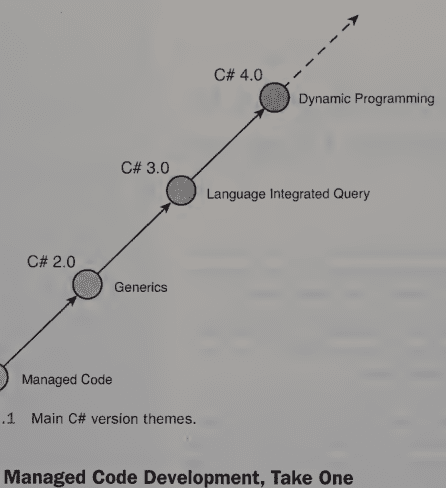

图 2.1 C# 各版本的主要主题。

### C# 1.0：托管代码开发，初试锋芒

创建一个新的运行时是一回事；提供丰富的库来让这项技术切实有用则是另一回事——而且，这是开发者在决定是否拥抱新平台时最关心的事情。

这给微软的 .NET Framework BCL 团队带来了艰巨的任务，他们必须针对一个仍在开发中的运行时编写代码。显然，要使这一使命成功，核心要素之一是拥有现成的编程语言和编译器——更不用说调试器等生产力工具——来推动开发。

当时只有两个选择。一种是在 .NET 平台上改造现有语言，如 C++ 或 Visual Basic。尽管这符合公共语言基础结构（CLI）的整体愿景，但也有其缺点。在尽快启动 BCL 开发的压力下，移植语言、保留语义，并可能在早期引入大量向后兼容性要求，似乎并不是一个有吸引力的选择。

正如你现在可能猜到的，第二种选择是创造一种全新的语言。这种语言无需担心保持向后兼容性，并且能够以直截了当的方式展现公共类型系统（CTS）的丰富性，将语言特性直接映射到其 CTS 对应物。这标志着 Cool 项目的诞生，Cool 代表“C 风格面向对象语言”，后来更名为 C#（发音为“see sharp”）。


C# 的设计与实现始于 1998 年末，由 Anders Hejlsberg 领导。他此前曾在 Borland 工作，负责设计大获成功的 Turbo Pascal 和 Delphi 产品，后来加入 Microsoft，参与 J++ 和 Windows Foundation Classes（WFC）的开发；近些年则负责 C# 以及 Microsoft 管理的其他编程语言。其他核心语言设计成员包括 Scott Wiltamuth、Peter Golde、Peter Sollich 和 Eric Gunnerson。

## C# 名称的由来

虽然 Cool 是一个相当——姑且称之为——酷的名字，但市场营销人员希望为这门新语言打造一个不同的品牌。名称中的 C 部分是一个直接的选择，因为这门语言采用了 C 风格的语法，例如花括号、类型置于名称前面等。

由于这门新语言被认为能够以更现代的方式进行面向对象编程，并将类型安全作为基石，因此，让名称暗示其在某种程度上优于 C++（C++ 的设计并未将类型安全作为核心主题）是令人向往的。由于 C++ 的名称源自对普通 C 应用后置递增运算符 `++`，一种选择便是沿用这一主题。遗憾的是，C+++ 在语法上并不正确（C+ = 2 也太荒谬了），而且这门新语言也无意成为 C++ 的超集。

于是，某位天才想出了一个后缀表示法，它表示“高于”，但来自一个完全不同的领域：音乐记谱法。我本人不是音乐家，不过我的办公室同事（谢谢你，Mike）向我保证，升号（#）的官方定义是表示其前面的音符“升高半音”。无论是幸运的巧合还是有意为之，升号看起来都很像两个上下叠放的后置递增运算符。

为了让这门语言的名称更容易输入，升号并未使用 Unicode 字符 U+266F（#）表示，而是使用数字符号 U+0023（#）表示。不过，其发音是“see sharp”。

我个人非常喜欢 C# 这个名字。首先，它听起来肯定比 Managed C++、C++/CLI 或 C++0x 更好（无意双关）。此外，在编程语言名称中使用升号已经成为 .NET Framework 的某种商标特征，诞生不久的 F# 语言以及 Spec# 研究项目（.NET 4.0 中代码契约的前身）就是例子。仅仅是为了好玩，我的博客也以 B# 闻名（我知道，这名字有点俗）。

在不同地方，人们曾提到升号的含义。在某个阶段，曾有一个名为 Polyphonic C# 的研究项目，探索使用“和弦”进行并发编程的领域。（这里暂时不展开细节。）另一个项目是 Cω（“see omega”），它使用希腊字母表的最后一个字母 omega，表示其相较于 C# 更丰富、更具扩展性的特征。C# 和 Visual Basic 中的 LINQ，以及 Visual Basic 中的 XML 字面量等技术，都源自这个项目。

出于某种未知原因，动态语言领域的人并没有因为选择带有“Iron”前缀的名称而受到市场营销部门的追究，例如 IronPython 和 IronRuby。也许是因为在产品名称中使用金属已有先例（想想 Silverlight），也许是因为他们确实成功地宣称这个前缀代表“I Run On .NET”。

那么，C# 语言从一开始就遵循了哪些设计主题呢？没有什么比 ECMA 334 中标准化的官方 C# 规范开篇句更适合作为引用了：

> > C# 是一种简单、现代、面向对象且类型安全的编程语言。C# 源自 C 语言家族，对于 C、C++ 和 Java 程序员来说会非常熟悉。

让我们稍微详细地分析一下这些表述：

- 简单很重要。C# 有意舍弃了一些已知会给开发人员带来麻烦的语言特性，例如多重继承、`switch` 语句中的贯穿行为，以及不卫生的宏。
- 现代化是件好事。这意味着该语言认识到开发人员直接熟悉的概念，例如属性、事件，以及最近加入的数据查询，尽管“纯粹的”面向对象语言并不需要这些特性。
- 面向对象编程过去是、现在仍然是广泛认可且经过验证的技术，用于应对需要大量软件组件无缝协同工作的复杂环境。CLI 和 C# 都采用它，也就不足为奇了。
- 类型安全在 CLI 中非常重要。它消除了困扰 C 和 C++ 等语言的整类错误与安全问题。不过，C# 仍然允许在明确标记为不安全的区域中编写类型不安全的代码。
- 源自 C 语言家族，使得过去使用过 C 或其任何派生语言的开发人员能够轻松学习 C#。

凭借丰富的功能集、Visual Studio .NET 2002 的出色工具支持，以及 .NET Framework 1.0 中功能丰富的 BCL 的支持，C# 编程迅速起步。不过，语言设计者距离用尽创意还很遥远。

### 视觉化，还是不视觉化？

如果你浏览 Microsoft Developer Network（MSDN）网站，经常会看到 Visual C# 的说法，而不只是 C#。正确的名称是什么？这取决于你讨论的对象：语言名称就是 C#，而 Microsoft 提供的、用于使用该语言进行开发的工具称为 Visual C#，这是因为它属于 Visual Studio 工具系列。一个显著的例外是 Visual Basic，在这种情况下，语言名称和产品名称相同。

## C# 2.0：丰富核心语言功能


发布一个全新的平台和语言的首个版本，对于推动项目启动至关重要，因此在第一版的开发过程中，有时必须做出削减某些功能的决定。.NET Framework 的第二个版本提供了弥补这些遗憾的机会，使设计团队能够实现那些原本想做、但在第一个版本中没有机会完成的功能。

### 向后兼容性很重要

确保使用语言旧版本编写的代码不会无法编译——更糟糕的是，不会开始表现出不同的行为——是语言演进过程中的一项重要设计标准。

C# 对此要求严格，并力求让语言的新版本与旧版本保持 100% 兼容。你可能会疑惑，在引入可能需要新关键字的新语言功能时，这是如何实现的。答案就在于上下文关键字。

从一开始，C# 就支持上下文关键字。它的含义很简单：某个单词在特定上下文中可以被视为关键字，而在其他上下文中则可以作为标识符使用。这类关键字的一个好例子是 `value`。在下面的代码片段中，它在属性 `set` 访问器中作为关键字使用，用于表示正在设置的值：

```
public string Name
{
    get { return _name; }
    set { _name = value; }
}
```

然而，在属性 setter 的作用域之外使用时，`value` 可以作为普通标识符，如下所示：

```
static void Main()
{
    int value = 42;
    Console.WriteLine(value);
}
```

C# 2.0 出现时，为了启用某些功能，需要增加新的关键字。所有这些新引入的关键字都被实现为上下文关键字，因此不会与程序中已有的名称发生冲突。例如，泛型支持使用 `where` 关键字指定泛型参数的约束：

```
static void Sort<T>(List<T> items) where T : IComparable
{
    // Generic sort algorithm
}
```

在 C# 2.0 之前编写的代码中，不可能在这样的上下文中使用 `where`，因此不存在破坏现有代码的风险。此外，由于该关键字具有上下文相关性，因此在这一上下文之外，它仍然可以作为标识符使用：

```
static void Main()
{
    string where = "There";
    Console.WriteLine(where);
}
```

后来，C# 3.0 出现了（见后文），查询表达式被加入语言。为了在查询中表达筛选子句，使用 `where` 关键字自然是合理的（SQL，大家都懂吧？），但这次是在另一个上下文中：

```
var res = from person in db.People
    where person.Age > 25
    select person;
```

再次证明，对关键字进行上下文相关处理拯救了整个任务。

那么，如果根本不存在破坏现有代码的可能，为什么 C# 1.0 还要使用上下文关键字呢？这是为了方便：不必仅仅因为某些“常用词”在特定位置具有特殊含义，就对它们进行转义。`value` 关键字就是一个很好的例子，`get` 和 `set` 也是如此。有时我希望这种做法能够更加积极一些，例如也将 `class` 之类的关键字设计为上下文关键字。过去我曾开发过学校管理系统，我可以向你保证，使用 `class` 作为标识符来指代一个表示某个班级的对象，是一种非常自然的选择。幸运的是，C# 为这类情况提供了转义机制：

```
MyClass @class = new MyClass();
```

最后，如果你发现某段代码在语言的旧版本中可以编译，但现在却无法编译，那么你几乎肯定发现了一个缺陷。不过要注意，在随着时间改变行为方面，应用程序编程接口（API）通常会宽松一些。通常的做法是弃用某些 API 成员，让开发人员知道 API 的某个部分可能会在未来版本中消失。我们应该感到庆幸，得益于谨慎的设计，C# 语言免受了这种弃用事务的困扰。

### 泛型

.NET Framework 2.0 对公共语言运行时进行了重大更新，主要是为了在类型系统中增加对泛型的支持。泛型最初在一个名为 Gyro 的项目中进行了原型设计，该项目由 Don Syme（后来成为 F# 的创建者）和 Andrew Kennedy 负责，两人当时都在 Microsoft Research 工作。对类型系统进行如此根本性的扩展，需要对构建于其上的语言进行修改。因此，C# 和 Visual Basic .NET 语言都得到了增强，以支持泛型类型的声明和使用。


为了支持泛型的引入，BCL 团队向 System.Collections.Generic 命名空间添加了各种泛型集合类型，其中一个示例在下面的代码片段中进行了说明：

```
    List<int> primes = new List<int>();
    for (int n = 2; n <= 100; n++)
    {
        bool isPrime = true;
        for (int d = 2; d <= Math.Sqrt(n); d++)
        {
            if (n % d == 0)
            {
                isPrime = false;
                break;
            }
        }

        if (isPrime)
            primes.Add(n); // statically typed to take in an integer value
    }

    // no performance hit to convert types when retrieving data
    foreach (int prime in primes)
        Console.WriteLine(prime);
```

泛型提供了更好的静态类型，从而消除了整类代码缺陷，并且由于消除了运行时类型转换的需求而带来了各种性能优势。

## 可空类型

在 CLI 首个版本的 design 中，区分了值类型和引用类型。值类型在栈上分配，而引用类型位于托管堆上。因此，引用类型可以具有空值（概念上相当于原生语言中的空指针），而值类型则不能。

在类型与其可空性的分类中缺乏正交方法被视为一个疏忽，该疏忽在 .NET Framework 的第二个版本中随着可空值类型的引入而得到纠正。这在将数据库记录映射到对象时特别方便，因为可空性适用于（关系）数据库世界中的所有类型。

以下是可空类型的使用示例，用 ? 后缀表示：

```
    int a = null; // won't compile; int is a value type and cannot be set to null
    int? b = null; // valid in C# 2.0 and above
```

### 注意
? 后缀的使用源自正则表达式的世界，在那里它用于表示其前面的事物的“零次或一次”出现。? 运算符是用于表示重数（multiplicity）的克莱尼运算符之一。其他克莱尼运算符包括 *（零次或多次）和 +（一次或多次），但在 C# 的世界中并不存在相应的语言特性。

? 记法是一种语法糖，意味着它是为每次输入都繁琐的构造提供的简写语法。T? 简单地代表 Nullable<T>，一个泛型类型，其中 T 必须为值类型。在前面的示例中，我们本可以把 int? 写成 Nullable<int>，但你会同意用如此多的输入来表达如此简单的概念是相当繁琐的，因此提供语法糖是合理的。

哦，顺便说一下，与普遍的看法相反，可空值类型不仅仅是语言级特性。运行时中的一些指令已被赋予关于此类型的知识，以便更好地集成。

## 迭代器

尽管泛型和可空类型可以被视为为了赶上设计团队在 .NET 1.0 中想要做但因需要尽快发布首个版本而未能实现的一切的功能，C# 2.0 引入了一些语言特性，减少了表达概念上简单代码所需的基础设施。我们可以将此视为迈向更声明式编程风格之旅的冰山一角。

其中一个特性称为迭代器，允许创建按需生成数据的代码块。这在语言中引入了一种延迟求值形式。下面展示了一个迭代器声明的示例：

```csharp
static IEnumerable<int> LazyPrimes()
{
    for (int n = 2; n <= int.MaxValue; n++)
    {
        bool isPrime = true;
        for (int d = 2; d <= Math.Sqrt(n); d++)
        {
            if (n % d == 0)
            {
                isPrime = false;
                break;
            }
        }

        if (isPrime)
            yield return n; // Yield primes to the caller one-by-one
    }
}
```

使用 yield 关键字控制迭代器的行为。如果消费者请求迭代器生成一个值，它会运行直到遇到 yield 语句。此时，迭代器会被挂起，直到消费者请求下一个值。在前面的示例中，我们声明了一个迭代器，可以生成所有整数素数（在正 32 位有符号整数值的范围内）。计算多少个素数完全由消费者控制，如下所示：

```csharp
foreach (int prime in LazyPrimes())
{
    Console.WriteLine(prime);

    Console.Write("Calculate next prime? [Y/N] ");
    char key = Console.ReadKey().KeyChar;
    if (char.ToLowerInvariant(key) != 'y')
        break;
    Console.WriteLine();
}
```

如果用户停止请求素数，迭代器永远不会承担计算超出请求数量的素数的负担。将此与急切求值方案形成对比，在急切求值方案中，一大批素数会预先计算并存储在某个有序集合中以返回给调用者。

手动创建迭代器——即不使用 yield 关键字——是一项极其痛苦的任务，因为它需要支持挂起以及多线程、多个消费者和正确清理已使用资源时出现的细微差别。不仅如此，结果代码看起来与我们用 C# 2.0 编写的内容相去甚远；迭代器的含义会被大量基础设施所掩埋，使得代码难以理解。

C# 通过让编译器生成构建迭代器所需的所有样板代码来减轻这一任务。这只是使语言更声明式的一个特性示例，允许开发人员仅声明其意图，将实现细节留给语言和运行时，同时降低引入细微错误的风险。

迭代器是实现 C# 3.0 特性 LINQ to Objects 的重要粘合剂。我们稍后会讲到。

### 注意
我认为另一个名为闭包的特性也属于“便利特性”的范畴。因为这个特性更加晦涩，我在此讨论中省略它，除了说它提供了必要的粘合，使语言内一些函数式编程构造能够无缝使用。同样，C# 编译器承担了大量本应强加给开发人员的样板工作。我们在讨论委托和匿名方法的使用时详细讲解闭包。

## C# 3.0：弥合对象与数据之间的差距


在某种程度上，C# 3.0 是语言设计者真正有机会深入思考开发人员在编写实际代码时面临的日常问题的第一个版本。Clarity 项目识别出了这样一个问题，即处理面向对象编程与访问各种类型数据存储之间的阻抗不匹配。

### 语言集成查询

开发人员在处理数据访问时面临的一个问题是数据存储技术的广泛范围：内存中对象图、关系数据库、可扩展标记语言（XML）数据等等。这些存储各自拥有自己的 API，与其他 API 足够不同，以至于每次遇到不同类型的数据存储时都会给开发人员带来学习曲线。统一这些 API 的方法非常受期待，而这正是 Clarity 所代表的。

当这一愿景成为现实时，该项目被更名为语言集成查询，即 LINQ。它使开发人员能够使用内置语言语法来定位任何具有 LINQ 提供程序的数据存储，如下所示：

```
var res = from product in db.Products
    where product.Price > 100
    orderby product.Name
    select new { product.Name, product.Price };
```

> 注意
> 类似的语言支持已添加到 Visual Basic 2008 中。此外，LINQ 具有比语言表面更多的查询运算符；可以使用常规方法调用来利用这些额外的查询运算符。

描绘语言与底层查询提供程序之间关系的概念图如图 2.2 所示。

除了提供统一的查询语言外，这种方法还有许多额外的好处。例如，它在目标域上提供强类型，允许在编译时检查查询的正确性。此外，LINQ 提供程序库可以确保查询正确构建，以消除整类错误，包括 SQL 注入攻击等安全漏洞。

这种类型的编程反映了向更声明式编程风格发展的愿望，在这种风格中，开发人员将控制权交给语言、运行时和库。这样，整个平台就可以“推理”开发人员的意图并做出正确的事情，可能代表开发人员优化执行。


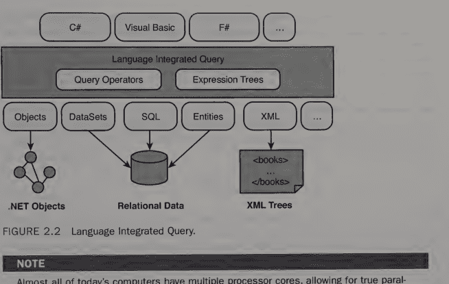

**图 2.2** 语言集成查询。

> **注意**
>
> 如今几乎所有计算机都具有多个处理器核心，从而实现真正的并行。命令式编程技术在编写并发程序时扩展性不佳，原因多种多样。除了需要使用锁等低级并发编程和同步原语（这些非常难以处理）之外，我们通常会过度指定问题的解决方案。我们不仅表达想要完成什么，还会以极其详细的方式指定——如何完成，使用诸如 if 语句、循环等一系列命令式构造。这样做会将运行时排除在外，使其别无选择，只能完全按照我们编写的方式执行命令式程序。
>
> 手动并行化以命令式风格编写的类似查询的构造（嵌套 for 循环、一堆 if 语句以及大量使用中间数据结构）对开发者来说将是一项艰巨且极易出错的体验。然而，在声明式编程的世界里，运行时拥有足够关于我们意图的知识来优化执行。今天，有了 LINQ，这不再是梦想：LINQ to Objects 的可并行化版本已被创建，名为 PLINQ，于 .NET Framework 4 中发布。用户机器中的核心越多，查询执行的越快。任务完成。

今天，有各种各样的 LINQ 提供程序可用。Microsoft 提供了 LINQ to Objects（用于处理内存中数据）、LINQ to XML、LINQ to DataSets、LINQ to SQL 和 LINQ to Entities（用于处理关系数据库），未来几年我们还可以期待更多。此外，许多第三方开发了 LINQ 提供程序，目标几乎涵盖所有可查询的内容：Amazon、Flickr、SharePoint、Active Directory，仅举几例。

LINQ 在 C# 中的引入反映了该语言的实用性，解决了开发者面临的现实问题。但 LINQ 的设计也带来了超出查询领域的诸多好处。表面上看，LINQ 在一种命令式语言中形成了一个外来孤岛，但实际上它是由一系列更小的语言特性组合而成的，这些特性本身也提供了好处。让我们简要看看这些特性。

## 局部变量类型推断

.NET 2.0 中泛型的引入几乎全是优点，但有一个阴暗面：类型名称可以任意增长，因为类型参数可以替换为任何类型，包括其他泛型类型。以下示例具体说明了这一点：

```csharp
Dictionary<string, List<PhoneNumber>> whitePages =
    new Dictionary<string, List<PhoneNumber>>();
```

等等：这行代码不是把类型写了两次吗？确实，在左侧，类型用于声明变量，在右侧则用于实例化它的实例。由于这种重复，代码片段甚至无法在一行内显示。有了局部变量类型推断，你可以省略左侧的类型，用 var 关键字代替，让编译器根据右侧推断出类型：

```csharp
var whitePages = new Dictionary<string, List<PhoneNumber>>();
```

尽管我们可以在局部变量声明中省略类型，但此代码仍然是强类型的。编译器确切地知道类型是什么，所生成的代码与你自己写出类型时完全相同。

单独来看，局部变量类型推断对于减少使用泛型类型带来的语法噪音很有用，这只是锦上添花。然而，在某些情况下，局部变量类型推断是必需的，如下文所述。

## 匿名类型

将查询功能集成到语言中的愿望引入了即时构造类型的需求。投影（LINQ 查询中的 select 子句）是最明显体现这种需求的地方。

```csharp
var res = from product in db.Products
          where product.Price > 100
          orderby product.Name
          select new { product.Name, product.Price };
```

为每个投影声明显式类型会给使用 LINQ 的开发者带来相当大的负担。在示例中，编译器根据投影中指定的属性 Name 和 Price 合成了一个匿名类型。

我们称这些类型为“匿名”，是因为编译器为它们生成了一个不可言说的名称。由于我们无法引用它们，因此在将它们赋值给局部变量时需要编译器的帮助来推断其名称。在前面的示例中，查询的结果被赋给了一个隐式类型局部变量，让编译器推断其类型。

## 初始化表达式

为了使集合和对象的初始化更容易，C# 3.0 为两者引入了初始化表达式。让我们来看看它们。

对象初始化器使在单个表达式中实例化一个类型并设置其许多公共属性（或公共字段）变得更容易。当想要实例化的类型缺乏合适的构造函数时，这尤其有用：

```csharp
class Product
{
    public Product(string name)
    {
        Name = name;
    }

    public string Name { get; set; }
    public decimal Price { get; set; }
}
```

在 C# 2.0 中，你必须编写以下代码来创建此类型的实例，并同时设置 Name 和 Price：

```csharp
Product p = new Product("Chai");
p.Price = 123.45m;
```

使用对象初始化器语法，可以缩写如下：

```csharp
Product p = new Product("Chai") { Price = 123.45m };
```

> **注意**
>
> 准确地说，为对象初始化器表达式生成的代码与上面显示的 C# 2.0 代码片段略有不同。我们现在忽略此细节，将更深入的讨论推迟到第 6 章“类型和对象入门”。

对象初始化器通常用于 LINQ 查询的投影子句中，当已有类型可用（与没有可用类型但可以使用匿名类型的情况形成对比）但缺乏合适的构造函数时：

```csharp
var res = from product in db.Products
    where product.Price > 100
    orderby product.Name
    select new Product(product.Name) { Price = product.Price };
```

集合初始化器为泛型集合类型带来了简单的初始化语法。自 C# 初始以来，就可以通过在花括号之间指定元素来初始化数组，如下所示：

```csharp
int[] primes = new int[] { 2, 3, 5, 7 };
```

然而，在 C# 2.0 中使用像 `List<T>` 这样的泛型集合时，这种简洁的语法就不再可能了。相反，你必须编写以下内容：

```csharp
List<int> primes = new List<int>();
primes.Add(2);
primes.Add(3);
primes.Add(5);
primes.Add(7);
```

使用 C# 3.0，你可以这样写（注意局部变量类型推断的非强制使用）：

```csharp
var primes = new List<int> { 2, 3, 5, 7 };
```

> **注意**
>
> 注意集合初始化器和对象初始化器在初始化丰富类型的集合时如何很好地结合使用。另一个“更佳组合”的故事。

## 扩展方法

扩展方法使你能够在不使用继承的情况下扩展现有类型，从而允许向任何类型的类型添加方法。例如，假设你想为 BCL 中提供的 System.String 类型添加一个 Reverse 方法。在 C# 3.0 之前，你能做的最好的事情就是创建一个静态辅助方法，使其使用起来相当笨拙：

```csharp
static class Helpers
{
    public static string Reverse(string s)
    {
        char[] characters = s.ToCharArray();
        Array.Reverse(characters);
        return new string(characters);
    }
}
```


```csharp
static class Program
{
    static void Main()
    {
        string name = "Bart";
        string reverse = Helpers.Reverse(name);
        Console.WriteLine(reverse);
    }
}
```

借助扩展方法，我们可以让静态方法像实例方法一样使用：

```csharp
string reverse = name.Reverse();
```

为了实现这一点，Reverse 方法的第一个参数用 this 关键字标记，从而将其变为扩展方法：

```csharp
public static string Reverse(this string s)
```

LINQ 使用扩展方法向 IEnumerable<T> 和 IQueryable<T> 等接口添加查询运算符。

## 注意

扩展方法允许设计和使用的“流畅”API。流畅 API 的一个很好的例子是 System.String 类型：它的大多数方法都返回一个 System.String 实例，从而可以立即调用下一个方法，如下所示：

```csharp
string bart = " Bart ";
string art = bart.ToUpper().Trim().Substring(1); // ART
```

如果没有扩展方法，任何试图在中间“链入”另一个操作的做法都会破坏代码的流畅性：

```csharp
string bart = " Bart ";
string tra = Helpers.Reverse(bart.ToUpper().Trim()).Substring(1); // TRA
```

需要读几遍才能弄清前面代码片段中的操作顺序。得益于扩展方法，前面的代码可以再次变得流畅：

```csharp
string bart = " Bart ";
string art = bart.ToUpper().Trim().Reverse().Substring(1);
```

这种流畅 API 的一个绝佳例子就是 LINQ 本身，稍后你会看到。

## Lambda 表达式

尽管 C# 从一开始就是一种命令式面向对象编程语言，但多年来不断加入各种语言范式。其中一种范式就是函数式编程，即能够基于数学函数的使用和定义来编写程序。

> > **注意**
> >
> > 事实上，C# 中函数式编程的关键促成因素之一是在该语言的第二个版本中引入的：闭包。我们现在不深入细节，只需说明：将编程范式转变为现有语言中的一等公民，通常需要的远不止一个特性。

Lambda 表达式正是如此：函数的定义，但采用非常简洁的形式，几乎没有语法上的繁文缛节。由于底层平台支持委托作为传递代码片段的方式，lambda 表达式可以利用这一基础设施并转换为委托。下面的示例展示了创建一个将两个数字相加的函数，分别使用和不使用 lambda 表达式：

```
// C# 2.0 style
Func<int, int, int> add20 = delegate (int a, int b) { return a + b; };
// C# 3.0 style
Func<int, int, int> add30 = (a, b) => a + b;
```

此示例中使用的 `Func<T1, T2, R>` 类型（所有参数都替换为 int）是一个泛型委托，表示一个接受 T1 和 T2 类型的内容并返回 R 类型内容的函数。它的定义如下：

```
delegate R Func<T1, T2, R>(T1 arg1, T2 arg2);
```

### LAMBDA 这个名字从何而来

lambda 这样花哨的名字到底从何而来？答案在于 lambda 演算，这是一个用于推理函数的数学框架，由阿隆佐·丘奇（Alonzo Church）于 1928 年提出。Lambda 实际上是希腊字母 &lambda;，并被选来命名这一理论。（还有其他以希腊字母命名的演算，例如用于并行计算领域的 Pi 演算。）

大约过了 30 年，这一数学基础才被应用到计算机科学领域。LISP（由麦卡锡（McCarthy）创造）诞生于 1958 年，可以被视为第一种函数式编程语言，尽管它并非直接基于 &lambda; 演算。（虽然有一个 lambda 关键字，但它并没有严格遵循演算规则。）几年后，在 20 世纪 60 年代初，兰丁（Landin）在 Algol-60 的设计中使用了 &lambda; 演算。

如今，许多函数式编程语言都建立在 lambda 演算及其衍生理论（这些理论混入了类型论）所提供的基础之上。强烈建议对此感兴趣且精通数学的读者一窥这些理论基础：它们只会让你成为更好的程序员。幸运的是，C# 开发者只需很少的这些理论就能利用 lambda 表达式，随着我们更详细地介绍它们，你会看到这一点。

这一演进说明了纯数学领域与计算机科学之间持续不断的知识转移。对于语言设计者来说，确保他们所做的事情具有坚实的数学基础是一种非常健康的态度。如果数学家还没有弄明白，那么从松散的想法中构建出可靠语言特性的可能性就很渺茫。听起来可能有些自命不凡，但“数学家永远是对的”应当成为编程语言设计者的一条公理。

但我们为什么要关心函数式编程？我可以想出许多充分的理由，但如今最突出的一个理由是我们在这个多核处理器世界中所面临的挑战。事实证明，由于函数式编程具有无副作用的特性，它是有效利用多核处理器的一条有希望的途径。纯函数式编程语言 Haskell 使用所谓的单子（monads，又一个数学概念，这次来自范畴论领域）来在类型中跟踪副作用。事实证明，C# 的 LINQ 特性与单子密切相关，我们将在第 19 章“语言集成查询精要”中更深入地讨论 LINQ 时再讨论这一点。

lambda 表达式的一个用途是在 LINQ 查询中，它们以不可见的方式存在。例如，使用 where 子句为被查询的记录指定过滤条件。这种过滤器也称为谓词，可以表示为小函数，这些函数接受一条记录并生成一个布尔值，指示该记录是否应包含在结果集中。

为简要说明这一点，下面两个查询是等价的，其中第一个查询使用内置语法糖编写，后一个查询则“编译掉”了所有内置语言构造：

```csharp
var res1 = from product in db.Products
    where product.Price > 100
    select product;

var res2 = db.Products
    .Where(product => product.Price > 100);
```

注意在这种转换中出现了一个 lambda 表达式。我们在讨论 LINQ 时会更加详细地介绍这种转换。

## 表达式树

C# 3.0 中较为奇特的语言特性之一是表达式树，它与 lambda 表达式密切相关。在上一节中，你看到了 lambda 表达式如何在 LINQ 查询中被使用——可能是不可见地——来表示查询的各个小部分，例如过滤器的谓词函数或投影的映射函数。对于本地查询执行，将这些 lambda 表达式编译为可在本地机器上运行的 IL 代码片段是完全合理的。但是，当查询要在远程执行时，比如在关系数据库引擎上执行，就需要将其转换为目标查询语言，比如 SQL。

因此，面向外部数据存储的 LINQ 提供程序需要一种方法，将用户预期的查询表达式——该表达式是用 LINQ 编写的——交叉编译为它们所面向的任何查询语言，例如 SQL、XPath 等。可以采用多种方法来解决这个问题：

- 不支持 LINQ 的可扩展性；相反，将各种查询语言的知识固化到 C# 编译器中，并让它完成转换。显然，从维护的角度来看这是不可接受的，并且与 LINQ 的主要目标（即提供所有类型查询语言的统一，包括我们尚不知道的查询语言）相冲突。
- 让 LINQ 提供程序反编译 C# 编译器生成的中间语言（IL）代码，并由此转向目标查询语言。这不仅过于复杂，难以被查询提供程序编写者广泛接受，而且还会阻止编译器改变其 IL 生成（例如，在查询提供程序期望特定模式的情况下添加更多优化）。
- 不将 lambda 表达式直接转换为 IL 代码，而是将它们转换为某种中间表示，该表示具有可供查询提供程序使用的对象模型。这听起来更有希望，而表达式树正是在这里发挥作用。

那么这些表达式树是什么呢？本质上，它们是一种将代码表示为可在运行时检查的数据的方式。考虑以下 lambda 表达式：

```
(int a, int b) => a + b;
```

存在两种可能的转换。第一种是使用委托将其转换为可供本地执行的 IL 代码：

```
Func<int, int, int> add = (a, b) => a + b;
int three = add(1, 2);
```

另一种选择是将 lambda 表达式赋给表达式树，在这种情况下，编译器会将代码作为数据发出：

```
Expression<Func<int, int, int>> add = (a, b) => a + b;
// the code represented by add can be inspected at runtime
```

前面示例中使用的表达式树的图形化表示如图 2.3 所示。


图 2.3 表达式树的图形表示。

**注意**

严格来说，编译器会将表达式树转换为在运行时构建出表示原始代码的数据结构的代码。这听起来可能令人难以置信，但其实并不难。我们的 add 函数示例代码会被转换为以下内容：

```csharp
var a = Expression.Parameter(typeof(int), "a");
var b = Expression.Parameter(typeof(int), "b");
var add = Expression.Lambda<Func<int, int, int>>(
    Expression.Add(a, b),
    a, b);
```

执行时，这段代码会调用几个工厂方法，构建出一个将 `(a, b) => a + b` 表示为数据的数据结构。例如，对于生成的 `add` 变量，可以查询其 `Body` 属性，该属性会返回一个二元表达式对象，表示操作数为 `a` 和 `b` 的加法运算。这类知识可以被 LINQ to SQL 等库用来将用户编写的代码转换为高效的 SQL 查询。幸运的是，作为 LINQ 用户，你无需了解这一切，但了解一下幕后的工作原理当然也无妨。

## 关于引文、元编程与同像性

“代码即数据”的概念已深深融入当今基于冯·诺依曼机（von Neumann machine）的计算机架构中。在这种机器中，指令和数据的存储相同，因此能够将代码视为数据。反之亦然，将数据视为代码则是最主要的安全漏洞来源（例如缓冲区溢出，以及执行随 HTML 页面下载的恶意脚本）。

然而，“代码即数据”这一概念实在太有用了，不能放弃。毫不意外，利用这一强大能力的语言特性从一开始就存在。LISP 是一种创建于 1958 年的列表处理语言，它有一种称为引文（quotation）的机制，可以抑制表达式的直接求值。下面展示了两个 LISP 表达式，都是将两个数字相加，但第二个被引用了：

```lisp
(+ a b)
'(+ a b)
```

引文（quotation）这个名字从何而来，不难猜吧？LINQ 表达式树实际上有一种以此命名的表达式节点类型（通过 `Expression.Quote` 工厂方法构造），而 F# 语言内置了对类似代码引文机制的支持：

```
let add (a:int) (b:int) = a + b
let quotedAdd (a:int) (b:int) = <@ a + b @>
```

所有这些引文本质上都与 C# 3.0 的以下表达式相似：

```
Expression<Func<int, int, int>> add = (a, b) => a + b;
```

将代码表示为数据的能力，是在平台和语言中实现元编程功能的基石。元编程是指代码在运行时检查和操作代码的能力，这是一个非常丰富的概念。一开始听起来可能相当抽象，但它是真实存在的，并且如今已投入使用。Reflector 等工具就是代码检查的一个例子。LINQ 提供程序模型等框架也说明了运行时代码检查的丰富性。重构工具则是代码操作的一种形式。

C# 3.0（以及 VB 9.0）中的表达式树，只是 .NET 平台上所设想的元编程能力的冰山一角。随着 .NET 4.0 和动态语言运行时的发布，这些表达式树已经发展成成熟的语句树和声明树，可以表示整个程序。

最后，给真正的极客讲一些小知识。用一种语言编写的代码能够被该语言的其他代码所表示，这种能力使该语言有资格获得同像性（homo-iconic）的地位：homo = 相同，iconic = 表示。从 3.0 版本开始，得益于表达式树的引入，C# 语言中的表达式子集已经具有同像性。

正如你所见，表达式树是一个非常强大的在运行时检查代码的概念，其应用范围远远超出了在 LINQ 中的使用。可以将其视为“增强版反射”，而且它们的重要性在未来版本中只会不断增加。

## 自动实现的属性

有一个不在 LINQ 直接范畴内的特性进入了 C# 3.0 版本：自动实现的属性。有了这个特性，向类型定义添加简单属性比以前漂亮多了。

那么，什么是“简单属性”呢？属性有时被称为智能字段，因此最常见的模式之一就是将字段访问包装在属性中，仅此而已：

```
private int _age;

public int Age
{
    get { return _age; }
    set { _age = value; }
}
```

你会同意，直接暴露字段并不是一个好主意，因为这会缺少封装，而封装是面向对象编程中的一项关键技术。但是，如果我们所做的只是通过属性直接暴露一个内部支持字段，那又何必费心定义它呢？

这正是自动实现属性的用武之地。在 C# 3.0 中，你可以直接编写以下代码：

```
public int Age
{
    get; set;
}
```

编译器会为你合成一个私有的隐藏支持字段，生活变得美好了。getter 和 setter 都是必需的，但它们可以具有不同的可见性（例如，用于创建或多或少不可变的数据结构）：

```
class Person
{
    public Person(string name)
    {
        Name = name;
    }

    public string Name
    {
        get; private set;
    }
}
```

如果你想把属性改成非平凡（nontrivial）属性，你仍然可以回到经典语法，手动实现 getter/setter 访问器，而不会破坏属性的使用者。

**注意**

有些人将这一特性称为“自动属性”。我不喜欢这种说法，因为“自动”一词似乎让人们认为这些属性具有神奇的运行时能力（“嘿，它是自动的……应该更好”），尽管它们只不过是一种编译期的辅助手段，用来减少开发人员需要输入的代码量。仅凭这一点，它们就有点神奇，但仅限于编译期。话虽如此，我能理解为什么人们希望在口语中缩写语言特性的名称；毕竟，像 auto-implemented properties 这样的术语说起来可能相当拗口。

## C# 4.0：拥抱动态语言


LINQ 的引入是 .NET Framework 3.5 时期推动 C# 和 Visual Basic 语言演进的主题。这种由场景驱动的语言设计在语言史上树立了一个里程碑，并受到了开发者的广泛好评。遵循这一理念，C# 4.0 也致力于让一个令开发者头疼的关键场景变得容易处理。如果说 C# 3.0 让数据访问变得更加容易，那么 C# 的第四个版本则旨在让代码访问比以往更加简单。

## 动态语言视角

跨越不同语言之间鸿沟的能力一直是 .NET 平台的核心设计主题，由此产生了统一的类型系统和代码执行基础设施。然而，在 DLR 出现之前，语言集成领域存在一个暗点：动态语言。尽管目标是简化跨语言集成，但对动态语言领域的关注却很少。这并不太令人惊讶，因为在设计 CLI 时，动态语言的流行程度相对较低，因此静态类型语言成为平台更有吸引力的目标。

大约在 2005 年，也就是五年之后，动态语言的复兴已成为事实。JavaScript 等技术因 AJAX 网络编程而受到关注，Python 等语言带来的交互式开发体验日益流行，Ruby on Rails 等平台的元编程能力使其成为网络编程的有吸引力的目标。动态语言回来了，而且可能比以往任何时候都更强大。

## 一个名叫吉姆的家伙的故事……或者说动态语言运行时是如何诞生的

并不是每个人都相信 CLR 是支持动态语言执行的理想底层运行时。吉姆·胡古宁（Jim Hugunin）就是这样一个人，他创建了 Jython，这是 Python 语言在 Java 虚拟机（JVM）上的一个实现。

但为什么这种认为 CLI 对动态语言不友好的看法会一直存在呢？还记得 Project 7 吗？那是在 CLI 诞生之际发起的一项倡议，目的是将一组流行语言移植到 CLI，以检验该平台的多语言设计。当时，由 ActiveState 牵头尝试在 .NET 上实现 Python，结论是 CLI 的性能不足以执行动态语言。

吉姆想弄清楚是什么让 CLR 成为动态语言的恶劣环境，并决定尝试一个基于 .NET 的 Python 实现。他计划在一篇题为《为什么 .NET 是动态语言的糟糕平台》（Why .NET Is a Terrible Platform for Dynamic Languages）的论文中分享他的发现。短短几周内，吉姆就准备好了原型，并意识到它实际上比 Jython 快得多。吉姆因此转而信奉 CLR，并于 2004 年 8 月加入微软，成为动态语言运行时的架构师，IronPython 是其之上的第一种语言。


在后期阶段，IronRuby 被加入到以 DLR 为目标的动态语言家族中，并且 DLR 以及这两种语言的实现通过微软的共享源代码站点 CodePlex 与 .NET 社区共享。自 .NET 4.0 发布以来，DLR 已成为框架不可或缺的一部分。

## 什么使一种语言具有动态性？

通常简称为动态语言，我们实际上是指动态类型语言。因此，这些语言与其静态对应语言之间的核心区别在于类型。让我们再深入探讨一点，为后续内容做铺垫。

在静态类型语言中，编译器知道程序中出现的所有变量、字段和方法参数的类型。因此，它可以进行编译时检查，以确保基于可用的类型信息对这些对象调用的操作是有效的。例如，在下面的代码片段中，编译器知道变量 s 的类型是 System.String（因为我们已如此声明），并且据此可以证明 ToUpper 是一个有效的方法调用，因为 System.String 具有它：

```csharp
string s = "Some text";
string u = s.ToUpper();
```

### 注意

不要将局部变量类型推断——C# 3.0 中引入的 var 关键字——与动态类型混淆。此功能仍然提供完整的强类型和静态类型；它只是使我们能够让编译器代表我们推断类型。尽管如此，如果我们尝试对隐式类型局部变量执行不存在的操作，编译器仍会检测到该问题。换句话说，类型检查仍然发生在编译时。

例如，下面的代码中的两个声明完全相同（两个变量的类型都是 System.String，后者是推断出来的）：

```csharp
string s1 = "Some text";
var s2 = "More text";
```

然而，将这些变量中的任何一个类型设为 dynamic 具有根本不同的含义，会导致对其调用的每个操作都发生运行时查找。

另一方面，在动态类型语言中，我们不需要预先指定任何类型。通常，开发人员无需编译代码（在动态语言的上下文中通常称为“script”）；相反，它会通过解释执行或在运行时编译代码立即执行。这允许一种非常交互式的体验，其中代码可以在交互式提示中像命令 shell 一样立即输入并执行。以下是动态类型代码的示例：

```
s = "Some text"
u = s.ToUpper()
```

只有在运行时，系统才能确定 ToUpper 是否是对变量 s 有效的操作，因为类型信息仅在那时才可用。如果 s 恰好是整数值，则对 ToUpper 的调用最早也会在运行时失败。

### 今日词汇：REPL

编程语言的交互式提示称为 REPL，其全称是 read-eval-print-loop：代码从控制台读取，由某个运行时服务求值，结果输出打印出来。这个交互过程一直持续到开发人员退出为止，因此形成了一个循环。

然而，许多人认为 REPL 是仅动态语言程序员才能享有的奢侈品。事实并非如此。如今，像 F# 这样的静态类型语言——以及未来版本中的 C#——在保留完整静态类型的同时提供交互式提示。只是这些环境通常会进行大量类型推断，以减少用户必须显式指定的类型数量。

## “静态与动态”之争

多年来，动态语言在尤其是静态类型语言信奉者中引起了相当大的争议。静态语言的优势众多：

- 鲁棒性或许是静态类型最常被引用的好处。通过静态类型检查能够及早发现问题，从而让你及早发现问题。换句话说，如果编译成功，就能运行。
- 性能是归因于静态类型的另一个重要优势。因为在类型上解析成员不需要运行时支持，编译器可以生成高效且直截了当的代码。
- 可以通过利用开发时静态可用的类型信息来实现丰富的工具支持。流行的强大工具如重构引擎和 IntelliSense 就是其中的几个例子。
- 可扩展性也应被提及。通过将类型作为定义不同组件之间强契约的手段，有可能在系统增长时降低复杂系统的维护成本。

然而，静态类型语言的信奉者将整个动态世界视为低劣而诅咒是错误的。在互联网由脚本执行粘合在一起、松散类型的 XML 文件四处飞行的时代，并且像 Ruby on Rails 这样的大型框架基于动态语言编写，我们不能闭眼忽视动态类型。

真相是，弱类型事物的数量越来越多：没有 XSD 架构的 XML、REST 服务、Python 和 Ruby 库，甚至旧的 COM API 等。在 DLR 和 .NET 4.0 出现之前，动态环境对开发人员来说相当令人担忧。静态语言编译器拒绝生成松散类型的代码，因此人们一直在寻找通过 API 克服这一限制的不同方法。不幸的是，没有通用的动态代码编写方法。每个动态“领域”都有自己的 API，领域之间没有任何统一或整合。

例如，假设你从某个地方获取了一个 .NET 对象，其静态类型你不知道，但你恰好知道该对象具有 Add 方法。要调用它，你不能简单地写如下代码：

```csharp
object calculator = GetCalculatorFromSomewhere();
int three = calculator.Add(1, 2);
```

相反，你必须通过 .NET 反射的繁琐步骤来调用该方法，如下所示：

```csharp
object calculator = GetCalculatorFromSomewhere();
int three = (int)calculator.GetType().InvokeMember("Add",
    BindingFlags.InvokeMethod, null, new object[] { 1, 2 });
```

几乎需要博士学位才能写出这种代码，而作为回报你会得到许多新的担忧：难以阅读且难以维护的代码、潜在的优化头痛等等。

但情况在进入不同领域时只会变得更糟。相反，你无法重用关于动态调用技术的知识，必须学习新的 API。例如，以下代码尝试通过 Silverlight API 访问 JavaScript 计算器对象：

```csharp
ScriptObject calculator = GetCalculatorFromSomewhere();
int three = (int)calculator.Invoke("Add", 1, 2);
```

精神相似但形式不同。这只是冰山一角；许多其他领域面临类似问题，尽管开发人员几乎不再考虑它了。那从某个地方获取的、没有 XSD 架构的 XML 呢？在基于 REST 的 Web 服务时代，这种方法变得越来越流行，但消费这种 XML 源变得相当痛苦：

```csharp
XElement root = GetCustomerFromSomewhere();
int zip = int.Parse(root.Element("Address").Attribute("ZIP").Value);
```

这种混乱使语言设计者处于一个有趣的十字路口：要么遵循静态语言纯粹性的方向，要么转向“更好一起”的愿景。你可以让静态语言中的开发人员难以访问动态类型的代码或数据（如前所示），也可以为调用动态世界打开一条顺畅的道路。

C# 4.0 dynamic 正是这样做的：使开发人员能够轻松进入各种动态类型代码和数据的领域。就像 LINQ 统一了数据访问一样，你可以认为 dynamic 特性统一了动态访问。例如，针对 .NET 对象或 JavaScript 对象的 Calculator 示例可以写成如下形式：

```csharp
dynamic calculator = GetCalculatorFromSomewhere();
int three = calculator.Add(1, 2);
```

## 实用主义与纯粹性

C# 4.0 采用动态类型来解决开发人员面临的现实问题这一事实，强调了该语言的核心特性之一：其实用主义本质。这正是 C# 在 .NET 社区如此受欢迎的原因：它通过提供优雅的解决方案来解决实际问题。LINQ 也是另一个例子。有人可能会说这影响了语言的纯粹性，但现实是并没有多少纯粹的成功语言。归根结底，软件开发人员呼唤的是实用语言，而不是科学纯粹但不实用的语言。

## dynamic 关键字

dynamic 特性的唯一语言表面是一个同名关键字，如前例所示。类型为 dynamic 的变量、成员或参数将具有后期绑定行为。这意味着每当对对象调用操作（如方法调用或属性访问）时，其解析会被推迟到运行时。

让我们对比早期绑定代码与后期绑定代码。第一个示例是早期绑定代码：

```csharp
Calculator calculator = GetCalculatorFromSomewhere();
int three = calculator.Add(1, 2);
```

这里编译器精确地知道 calculator 变量的类型：它被静态类型化为 Calculator，因此对其的操作可以在编译期间检查。当编译器在下一行遇到 Add 方法调用时，它会尝试找到一个与接收两个整数值并返回整数值兼容的重载。如果找到合适的候选者，它会生成 IL 代码以便在运行时立即调用该方法。如果找不到合适的重载，则会产生编译时错误。

在动态类型代码中，Add 的调用在运行时解析：

```csharp
dynamic calculator = GetCalculatorFromSomewhere();
int three = calculator.Add(1, 2);
```

现在编译器甚至不在编译时费心寻找 Add 方法，因为它根本不知道 calculator 变量的类型会是什么。不是生成 IL 代码直接调用已知的早期绑定方法，而是生成代码在运行时调用重载解析逻辑。如果找到合适的匹配，DLR 将介入

生成高效的调用点代码，使后续调用不再经历重载解析。如果重载解析失败，将导致运行时异常。

## 动态 = VAR

不要把 dynamic 关键字与 C# 3.0 中的 var 关键字混淆。var 关键字是尽可能静态类型的；它只是允许你省略类型，让编译器为你推断：

```
var languages = new List<ProgrammingLanguage>();
```

上面的行与下面更冗长的变体含义完全相同：

```
List<ProgrammingLanguage> languages = new List<ProgrammingLanguage>();
```

在 languages 变量上调用不存在的方法（比如拼写错误的 Add 方法）会导致编译时错误。甚至更好的是，Visual Studio 编辑器会立即捕获该错误，因为所有静态类型信息都是现成可用的。

相比之下，使用 dynamic 关键字时，你实际上是在告诉编译器不要费心去推断类型，而是在运行时进行重载解析。

关于 C# 编译器如何生成代码以触发 DLR（动态语言运行时），从而使其能够与任何类型的动态类型代码交互，更详细的解释将在第 22 章“动态编程”中介绍。

## 尽可能静态，必要时动态

引入 dynamic 并不意味着你应该开始将所有静态类型代码重写为动态类型代码。静态类型有很多优点，C# 始终坚持这一信念。因此，只要可能，就使用静态类型——它纯粹是好的。

但与 C# 4.0 引入之前不同的是，当你绝对需要动态类型时，不再是不可能在保持代码可读性和可维护性的同时使其工作。新的动态特性真正实现的是“逐渐进入”动态领域，而不牺牲开发者的生产力。

顺便说一句，如果你完全不喜欢动态，并且想阻止人们使用该特性，我有好消息。只需在编译期间省略“C# 绑定器”就可以相对简单地禁用动态支持（例如，可以通过 Visual Studio 2010 IDE 实现）。在我们全面介绍动态时，我会再回到这一点。

## DLR 能提供什么

动态类型代码的执行依赖于相当多的运行时服务，例如重载解析、代码生成以及缓存已获取的运行时数据，以提高调用效率。让我们探索制作动态调用涉及的内容。

首先，语言编译器生成代码来打包它关于预期调用的所有信息。这包括正在调用的操作的类型和名称——例如，名为 Price 的属性、名为 Add 的方法等等——以及传入参数的信息。为了在运行时将此信息变为可用信息，编译器生成针对辅助库（统称为 C# 绑定器）的代码。其他面向动态代码的语言也有类似的绑定器。

接下来，在执行期间，调用目标和参数的运行时类型变得可用。现在由目标领域——例如 Python、Ruby、JavaScript、常规 .NET 对象、COM API，你能想到的——来决定该调用是否有意义。这是涉及重载解析等的部分，允许目标领域强制执行其语义。每个此类领域都有一个运行时绑定器来执行这些任务。

如果找到合适的操作目标，运行时绑定器会发出包含执行调用所需代码的表达式树。从此时起，阻止我们执行代码的只是将表达式树运行时转换为能够在底层执行引擎 CLR 上运行的代码。

最后这部分，即表达式树转换为实际代码，是 DLR 的关键。除了代码生成，它还为其接受的表达式树提供了 API，以及运行时服务来缓存生成的代码片段，并为调用目标提供快速路径，在首次调用后绕过所有运行时绑定器交互。因此，CLR 为静态类型语言提供了公共基础设施，而 DLR 作为其上的一个库，通过支持动态类型语言来改善它。

### 注意

DLR 使用的表达式树是 .NET 3.5 时代引入的 LINQ 表达式树的自然演进。在查询领域，唯一需要的“代码即数据”格式是表达式：大致上，是那些求值为某个值的东西（例如谓词或投影）：

```
person.Age > 25
```

表达式不足以表示完整的有意义的程序。要做到这一点，我们需要包含控制流构造（如循环和条件）的语句：

```
if (person.Age > 25)
    Console.WriteLine("Hello, " + person.Name);
```

DLR 需要能够处理后一种格式，以便处理 Ruby 和 Python 等动态语言，这些语言以树形格式传递用户代码。具有表达语句能力的树被称为（多么有创意）语句树。

DLR 在实现大量前端语言与更多动态目标领域之间完全互联方面的端到端图景如图 2.4 所示。这里提到的一些绑定器是开箱即用的，而另一些则随单独的下载一起提供，例如 IronRuby 发行版。

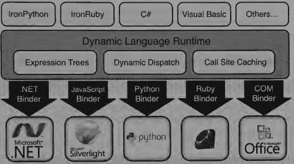

**图 2.4** 动态语言运行时架构。

从 .NET 4.0 开始，DLR 作为 .NET Framework 的一部分开箱即用，供语言在其之上实现，也供其他语言与动态世界桥接。

## 改进 COM 互操作

尽管 .NET 平台被视为 COM 的继任者，但仍然存在大量基于 COM 的 API，开发者需要与其集成。自 .NET Framework 的最早版本以来，COM 互操作设施就一直内置于运行时和库中，以实现这一点，主要涉及类型的来回映射以及促进 COM 调用。

与此同时，C# 的设计者认为，语言支持 COM 风格的编程是不合适的，因为这种风格的常见情况是方法接受大量参数，其中大多数是可选的和/或按引用传递。整个 .NET 设计使命的一部分是使 API 更加一致和友好，而 COM 并不总是一个特别好的风格示例。

这导致了一种不幸的二元性，Visual Basic（和托管 C++）在处理 COM 互操作方面是更具吸引力的语言，而 C# 开发者则被冷落。尽管各种 COM API 已通过更清晰的托管 API 暴露出来，但与原始 COM 交互的能力仍然经常需要，足以证明在 C# 语言中设计和实现改进的 COM 互操作是合理的。

COM API 的一个经典示例是 Office 自动化库，可以通过主互操作程序集（PIA）在托管代码中访问这些库，这些程序集可用于

```
ref missing, ref missing, ref missing,
ref missing, ref missing, ref missing);
```

不少于 15 个可选参数，所有参数都必须按引用提供！使用 C# 4.0，你可以按照 COM API 一直以来的预期方式来编写代码：

```
Word.Document doc = CreateNewDocument();
// ...
doc.SaveAs("demo.docx");
```

此功能称为可选 ref 修饰符。

### 注意

可选 ref 修饰符不是通用语言特性；这种对按引用传递参数的放宽仅适用于 COM 互操作场景，而在这些场景中，这种风格是默认的。

在所有其他情况下，显式指定 ref 修饰符是纯粹的优点。它使读者非常清楚地看到哪些参数是按引用传递的，哪些不是：

```
int answer = 42;
Do(ref answer);
// answer 可能不再是 42，因为它是按引用传递的。
```

对此保持明确可以防止意外，尤其是在 .NET 中按引用传递参数不是默认方式。而在 COM 中则不同，在托管代码中尝试使用此类 API 时会产生大量语法噪音。因此，放宽这些场景的规则是有意义的。

虽然我们处于方法调用领域，但另一个值得一提的特性是参数和返回类型从 object 到 dynamic 的自动映射。许多 COM API 使用 System.Object 类型的参数和返回类型以提供最大的灵活性。然而，为了从托管代码处理这些类型，通常需要转换为为 COM 互操作提供的某个接口（对应于 COM 的 QueryInterface 调用）。这很快变得繁琐，需要大量样板代码，尤其是在处理返回值时。这种体验通常被称为“逐渐失去类型”（peter-out typing），因为在这个过程中你会失去强类型：

```
Workbook workbook = GetWorkbook();
Worksheet sheet = (Worksheet)workbook.Sheets["Products"];
Range range = (Range)sheet.Cells[1, 1];
// 使用选定的范围。
```

在这里的 C# 3.0 代码中，Sheets 和 Cells 集合的索引器返回类型被静态类型化为 System.Object，所以我们需要转换为适当的


接口才能继续。现实情况是，COM 从一开始就是一种动态体验——`IDispatch` 接口就是终极例子——因此，在处理 COM 互操作时减少这种摩擦是合理的。因此，从 .NET 4.0 开始，COM API 中出现的 `System.Object` 被替换为 `dynamic`。这会使 DLR 介入，并使用 COM 绑定器调用底层 COM API。

```csharp
Workbook workbook = GetWorkbook();
Range range = workbook.Sheets["Products"].Cells[1, 1];
// Use the selected range.
```

最后一个属于改善 COM 互操作范畴的语言特性被称为“无 PIA”。（语言特性里带个否定词，多少有点奇怪，不是吗？）历史上，Microsoft 曾为流行的 COM 库提供所谓的 PIA，其中包含导出的类型定义，并带有若干增强，以便从托管代码中使用这些 API。PIA 虽然很好，但通常很占空间，而且在大多数情况下，库中只有非常小的部分会被用到。这会带来麻烦：一方面影响应用程序的大小——这对部署很重要——另一方面会带来加载巨型程序集相关的运行时开销。

借助“无 PIA”，编译器可以抓取 PIA 中在应用程序代码里用到的所有零碎部分，并把它们复制到正在构建的应用程序程序集中。这样就不再需要重新分发 PIA，并将加载成本降至最低。

## 语言协同演进

自 .NET 推出以来，Microsoft 提供了两种主流托管代码语言：C# 和 Visual Basic。尽管这完美体现了该平台如何支持多种语言用于托管代码开发，但它也一直是需要选择语言的开发者的主要困惑来源。这两种语言或多或少面向同一类开发者，即编写各种企业应用程序的开发者。

理想情况下，选择一种语言而非另一种的主要理由，应该只是背景和个人偏好的问题。有 C++ 或 Java 背景的人会觉得 C# 更亲切，而以前接触过 Visual Basic 6 或更早版本的人则会觉得 Visual Basic .NET 更有吸引力。

现实中，两种语言所提供的语言特性范围存在差异，这一直是挫败感的来源，迫使人们选择某一种特定语言，否则就会因缺少特性而处于不利境地。多年来，这种病态状况显然应该得到处理；从 .NET 4.0 开始，Microsoft 承诺让两种语言“协同演进”，确保它们在新增特性方面保持同步。

如今在两种语言中都能看到这一承诺的痕迹。C# 4.0 正在加入命名参数和可选参数，而 Visual Basic 从一开始就有这些特性。反方向上，Visual Basic 10 现在支持自动实现属性，而 C# 自 3.0 版起就已具备该特性。

现在，我们可以把派生程度较低的东西（用于 Person 对象的 IComparer）当作派生程度更高的东西（比较 Students）来对待。我们称之为逆变。同样，在 C# 4.0 中你现在可以这样做。

既然逆变与协变相反，你能猜到为什么这对 IComparer<T> 是安全的吗？因为这一次 T 只用在“输入位置”，如下所示：

```
interface IComparer<T>
{
    int CompareTo(T left, T right);
}
```

通常，关于这个理论上非常有趣的特性，你只需要知道：现在你可以做以前想做却惊讶地发现做不了的事情。这体现了协变和逆变的运用。不过，该特性是对称的，允许开发人员在类型参数上使用变体注解来声明泛型接口或委托类型。下面展示了 BCL 类型 IEnumerable<T> 和 IComparer<T> 是如何做到这一点的：

```
interface IEnumerable<out T>
{
    IEnumerator<T> GetEnumerator();
}
```

```
interface IComparer<in T>
{
    int CompareTo(T left, T right);
}
```

这里的 in 和 out 关键字用于指示参数的变体处理方式。协变通过 out 关键字指定，将类型参数的使用限制为仅输出位置。类似地，逆变通过 in 指示，这次允许参数仅用于输入位置。编译器将强制执行这一点，以确保你不会危及类型安全。

### 注意

协变和逆变并不局限于泛型类型的上下文。事实上，自 C# 3.0 起，该语言就支持（非泛型）委托类型的两种变体。这在处理事件处理程序时特别方便。例如，假设我们希望用一个处理程序同时处理按钮上的 MouseClick 事件和文本框上的 KeyPress 事件。这些事件定义如下：

```
public event MouseEventHandler MouseClick;
public event KeyPressEventHandler KeyPress;
```

用于定义这些事件的委托如下所示：

```
delegate void MouseEventHandler(object sender, MouseEventArgs e);
delegate void KeyPressEventHandler(object sender, KeyPressEventArgs e);
```

虽然我们通过事件参数可以了解所发生事件的专门信息（例如单击时的鼠标光标位置），但可能只关心这些事件中任意一个发生这一事实，而不需要额外的上下文。换句话说，我们希望编写如下代码：

```
txtAmount.KeyPress += this.LoggingHandler;
btnSave.MouseClick += this.LoggingHandler;
```

在这种情况下，事件处理程序方法的声明如下：

```
private void LoggingHandler(object sender, EventArgs e)
{
    // ...
}
```

看到我们刚刚做了什么吗？我们在通用日志处理程序中使用了共同的超类型 System.EventArgs。得益于 C# 的委托协变和逆变特性，这是允许的，从而在将方法签名与委托类型匹配时提供了更大的灵活性。参数类型按逆变处理，而返回类型按协变处理。

## 未来一瞥

既然我们已经了解了 C# 语言的当前状况，接下来谈一谈正在塑造该语言未来的影响因素。

### 多范式

传统上，编程语言根据其所基于的范式进行分类：

- 命令式编程语言使用语句来修改程序状态。这类语言非常面向机器，反映了底层硬件的工作方式，因此让开发者能够对系统进行低层控制。按照这种范式编写软件，重点在于说明执行需要“如何”发生，而不仅仅是需要解决的问题“是什么”。最早的命令式编程语言是 FORTRAN，流行的后继语言包括 COBOL、BASIC、Pascal 和 C。

引入 LINQ，它基于从函数式编程世界吸取的经验教训。

### 注意

在广义上，将 C# 归类为函数式编程语言是可以接受的：即具备用函数进行编程的能力。然而，真正的函数式编程会通过所谓的单子（monad）让每一次副作用使用都显式化。这种形式的函数式编程可以看作极端的纯函数式编程。Haskell 是归入这一类语言的最佳例子。

事实是，我们需要副作用来做有用的事情。如果一切都是纯数学函数，我们就可以用简单的常量替换整个程序。甚至输入/输出（例如，从屏幕/向屏幕）这样的简单任务也应被视为副作用。要求开发人员在副作用出现的所有地方都从类型上显式说明，这不太适合以 OO 范式为中心、且变异是核心特性的框架。

随着 C# 4.0 的引入，也可以说 C# 已经成了一种动态语言；不过，动态调度的使用通过新的 dynamic 关键字变得非常显式。

展望未来，可以预期会有更多范式加入其中。有些人认为这会破坏语言的“纯粹性”，但在当今跨语言互操作的大熔炉中——互联网编程极大地推动了这一点——语言要想保持相关性，就需要具备轻松触达其他世界的手段。这是当今许多语言的一个共同主题：动态语言正在添加静态类型孤岛，函数式概念随处可见（包括最新的 C++ 标准化提案 C++0x），等等

## 塑造语言的力量

要理解像 C# 这样的主流编程语言未来演进会带来什么，我们首先应该看看正在日益流行的主题以及前方的挑战：

- 元编程设施如今正在各种平台中涌现。当今几乎每个企业应用程序都包含以某种方式生成的代码（例如，连接用户界面控件、执行对象关系 [O/R] 之类的映射，或通过生成的代理对象使用 Web 服务）。这一趋势无疑要求有一个更易访问的对象模型来表示代码。
- 并发曾经是一个小众市场，因为能够并行执行代码的机器数量很少。如今几乎不可能买到只有单个处理器核心的新计算机。由于通用编程语言在演进，它们需要提供手段来组织和编写代码，以实现更好的并行化。这个领域仍有许多未解问题，没有万灵药。


- 声明式编程在于将代码执行的控制权更多地交给运行时。今天，开发者倾向于过度指定手头编程任务的解决方案。我们的程序令人尴尬地具有命令式特征，使得运行时别无选择，只能完全按照编写的方式执行程序，运行时几乎没有空间去智能地决定如何执行程序。
- 领域特定语言（DSLs）为程序员工具箱带来了领域专业化的孤岛。在开发软件时，原始问题域在转化为程序员所针对的语言概念的过程中常常丢失。多年来，我们看到为各种领域（例如，查询）构建的专门小语言数量不断增加。允许与通用语言集成可能是下一步。

下一节概述了微软语言团队正在研究的几个想法。这些技术何时以及如何发布目前仍未确定。

## Compiler as a Service

编译器即服务

我撰写本章时，微软的托管语言团队正全力以赴将 C# 和 Visual Basic 编译器转换为托管代码，以用于框架的后续版本。这项工作将为元编程领域的大量场景铺平道路。

今天，微软的 C# 和 Visual Basic 语言编译器是黑箱：源代码输入，程序集输出，但中间发生了什么对用户来说是被屏蔽的。随着 C# 3.0 的发布，暴露代码表示的一部分——更具体地说是表达式树——的需求变得明显，成为允许创建 LINQ 提供程序的基石。在这种情况下，LINQ 提供程序充当编译器的运行时扩展，将代码作为数据进行检查并将其转换为执行（例如，通过生成 SQL 语句）。

随着 DLR 的出现，开放代码表示的这一趋势仍在继续，但展望未来，希望拥有一个可被各种语言共享的代码对象模型，包括像 C# 和 Visual Basic 这样的老牌巨头。将编译器代码库移植到托管代码是朝这一方向迈出的第一步。

NOTE

可以将代码即数据（code-as-data）的信条视为对从 .NET 起就存在的反射能力的扩展。反射的使用允许代码在运行时检查类型及其结构，并构成了动态代码执行的基石。

代码生成（LCG）。使用 LCG，代码可以在运行时发出，但开发成本很高：必须处理 IL 指令，这可能是一个容易出错的工作。

过去曾探索过代码生成的其他途径。其中一种技术是代码文档对象模型（CodeDOM），它使开发人员能够在运行时生成源代码，从而生成源代码图，然后可由 CodeDOM 提供程序将其编译为程序集。Visual Basic、C#、JScript 和 F# 均存在提供程序。尽管该模型适用于整个类型的代码生成，但对于生成小块代码（例如，表示没有包含类型的单个方法）来说，它过于粗粒度且重量过重。CodeDOM 的典型用途是代码生成工具，如 O/R 映射器。

随着新一代编译器的开发，出现了统一的代码对象模型，可用于从工具驱动的代码生成到运行时轻量级代码生成的各种场景。

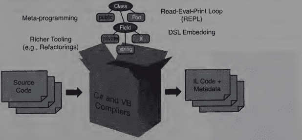

FIGURE 2.5  Compiler as a service.

图 2.5 编译器即服务。

这个整体想法通常被称为编译器即服务（CaaS），因为托管代码编译器将作为易于处理的运行时库提供。有了这项基础设施，元编程的天空将成为极限：

- 代码操作和检查工具（如重构引擎）或代码验证器（如 FxCop）将可供任何人编写和扩展。
- 读-评-印-循环（REPLs）变得可用于（主要是）像 C# 这样的静态类型语言，从而实现交互式开发体验。
- 模型驱动软件受益于在运行时将模型定义翻译为可执行代码的能力。
- DSL 现在可以托管通用代码的孤岛。（例如，MSBuild 文件可以包含 C# 代码片段）。
- 编译时参与成为可能，允许出于优化或插装等目的进行编译时代码重写。

具体何时发生目前尚不清楚，但其潜力太大而无法忽视。

## Taming the Concurrency Beast

驯服并发猛兽

每个软件开发人员都应该听说过摩尔定律。

> 最小组件成本的复杂性以每年大约翻一番的速度增加。毫无疑问，在短期内这一速率可以预期会继续，甚至会增加。从长远来看，增长速率有些不确定，但没有理由相信它在至少 10 年内不会保持近乎恒定。这意味着到 1975 年，最小成本的集成电路每片的组件数量将达到 65,000。我相信这样的大电路可以在单片晶圆上构建。

戈登·摩尔，《电子学》，第 38 卷（1965 年 4 月）


FIGURE 2.6  Gordon E. Moore, cofounder of Intel Corporation.

图 2.6 戈登·E·摩尔，英特尔公司联合创始人。

早在 1965 年，戈登·摩尔（英特尔联合创始人）就提出了他的经验法则，预测芯片上电子元件的数量大约每年翻一番。实际上，这意味着处理器稳步指数级加速，这为软件开发人员在性能优化方面鸵鸟政策提供了理想借口：“再等几年，今天慢的东西就会足够快了。”

尽管该定律仍然成立，给我们带来了芯片上更高的晶体管密度，但它不再带来成比例的加速（由于散热问题等）。因此取而代之的是

这些风格显然导致了支持其积极使用的库、运行时扩展和语言特性的创建。我提及这些开发工具性质的顺序非常重要。在大多数情况下，语言设计者做出承诺将构造放入语言以支持某种特定并发方法还为时过早。在并发专家弄清解决问题的最佳切入点时，语言可以保持自身免受可能短命构造的影响。

话虽如此，自 C# 3.0 发布以来，库编写者可以利用大量语言构造，在尝试新方法时提供与现有语言或多或少自然的集成。一个很好的例子是新的 .NET 4.0 System.Threading 增强功能：

- **任务并行库 (TPL)** 是指一组原语的名称，允许调度可并行运行的轻量级任务。此类任务可以产生值——在这种情况下，它们通常称为 futures——也可以不产生。请注意，任务并不以一对一的方式映射到线程；使用用户模式调度程序重用线程池，以避免昂贵的内核模式转换。任务的使用通过使用 lambda 表达式大大简化，甚至并行控制结构（如循环）也是基于此构建的：

```
Parallel.For(1, 10, i => {
    // perform computation
});
```

- **协调数据结构 (CDS)** 是创建并行算法的构建块，包括丰富的并发安全集合类型。CDS 提供的其他原语包括轻量级等待、锁和事件。TPL 使用的用户模式调度程序的大部分基于这些结构，但它们也可直接供开发人员使用。

- **并行 LINQ (PLINQ)** 是一种数据并行形式，与 TPL 的任务并行相对。使用 LINQ 表达式编写的内存中查询是并行化的理想候选者。假设你正在对一百万条记录应用过滤器（使用 `where` 子句）；没有任何东西可以阻止运行时在执行时变得智能，并在不同核心上运行过滤任务的块。PLINQ 正是这样做的，并且对代码编写方式的影响最小：

```
var res = from person in whitePages.AsParallel()
          where person.City == "Seattle"
          select person;
```

对并行编程感兴趣的读者——这在未来几年只会变得越来越重要——强烈建议查看各种已研究的方法。.NET 4.0 System.Threading 设施是一个良好的起点（我们在第 30 章“任务并行和数据并行”中探讨了这些内容），但诸如 F# 异步工作流之类的技术也值得查看。其他良好的搜索引擎关键词包括并发协调运行时（CCR）、ConCRT 以及最近发布的孵化项目 Axum（以前称为 Maestro），


这是一种类似 C# 的语言，具有一流的概念，如代理（agents）和用于状态隔离的域（domains）。

## 摘要

在本章中，我们探讨了影响 C# 语言的趋势——并预计在可预见的未来将继续影响它。C# 最初作为面向对象的语言与 .NET Framework 的首次发布一起诞生，此后不断增加更多方便开发者的特性（例如，通过 LINQ 简化数据访问，以及利用 DLR 的基础设施与动态类型代码桥接）。但我们还没有完成 C# 的发展；未来还需要应对许多重要趋势，以简化并发软件的开发，使平台更适合元编程，并适应建模领域的趋势。

带着对这一领域的总体理解，你已经准备好开始学习后续章节中基于 C# 的应用程序的实际开发。第 3 章首先介绍 .NET Framework 的安装，以及可用于开发托管代码应用程序的各种工具，并编写你的第一个极简应用程序。

# 第 3 章

## 使用 C# 进行 .NET 开发入门

### 本章内容

- 安装 .NET Framework 99
- 你的第一个应用程序：第一次尝试 109
- Visual Studio 2010 116
- 你的第一个应用程序：第二次尝试 124

是时候为你在使用 C# 进行 .NET 开发的世界中成功之旅做好准备了。显然首先要做的是安装 .NET Framework 和必要的工具，以便我们能够开始运行和编写代码。我们将重点关注的工具之一是 Visual Studio 2010，但也会介绍其他有用的工具。

为了亲自动手实践，我们将编写一个简单的 C# 应用程序，重点介绍一些重要的语言元素，使用各种工具完成构建过程，并了解如何调试代码。

## 安装 .NET Framework

开始编写面向 .NET Framework 的代码的第一步，自然是将其安装在开发机器上。此时，我们将跳过关于如何将 .NET Framework 部署到最终运行应用程序代码的机器（无论是客户端计算机、Web 服务器还是云）上的深入讨论。

### .NET Framework 版本概览

多年来，微软发布了多个版本的 .NET Framework。在本书中，我们介绍的是（在撰写本书时）最新的 .NET Framework 4 版本，它与 Visual Studio 2010 发布相伴而来。

这是否意味着你在 .NET 4 编程中获得的知识不能用于面向旧版本框架呢？当然不是！尽管 .NET Framework 一版又一版地发展，但核心原则保持不变，而且演变的一大部分体现在通过类库提供的额外应用程序编程接口（API）上。类似的演变显然也发生在托管语言层面：每次都会添加新特性，这些特性通常需要额外的框架支持（例如，C# 3.0 中的 LINQ，4.0 版本中的动态）。你可以想象，跟踪所有这些版本及其关键区分特性并不总是容易的。为了使情况更清晰，请看表 3.1。

表 3.1 .NET 平台版本历史

| 版本 | 代号 | Visual Studio | C# | VB | 旗舰特性 |
|---|---|---|---|---|---|
| 1.0 | Lightning | 2002 (7.0) | 1.0 | 7.0 | 托管代码 |
| 1.1 | Everett | 2003 (7.1) | 1.0 | 7.0 |  |
| 2.0 | Whidbey | 2005 (8.0) | 2.0 | 8.0 | 泛型 |
| 3.0 | WinFX | 2005 (8.0) | 2.0 | 8.0 | WPF, WCF, WF |
| 3.5 | Orcas | 2008 (9.0) | 3.0 | 9.0 | LINQ |
| 4.0 | Dev10 | 2010 (10.0) | 4.0 | 10.0 | 动态 |

请注意，.NET Framework 的新版本通常与 Visual Studio 工具支持的更新相伴而生。一个明显的例外是 .NET 3.0 版本，当时对 Visual Studio 2005 进行了添加以支持新加入的特性（例如，通过为 Windows Presentation Foundation [WPF] 提供设计器支持）。另一方面，请注意托管语言的演变速度稍慢。完全可以想象，未来某个 .NET Framework 版本仍将使用 C# 4.0 和 VB.NET 10.0。历史将告诉我们答案。

### 那操作系统集成呢？

作为 Windows 编程中 Win32 API 的逻辑扩展，将框架组件与各种版本的 Windows 操作系统一起提供是非常合理的。然而，Windows 和 .NET Framework 的发展速度不同，因此 .NET Framework 层面的创新不会立即随当时的操作系统提供。

与操作系统集成的一小步发生在 Windows XP 中，当时加载的映像开始识别托管代码的存在，从而能够以减少绕过方式加载托管可执行文件。在 Windows Server 2003 时代，.NET Framework 1.1 版本被引入操作系统，因此 ASP.NET Web 技术栈开箱即用，可用于 Web 服务器安装。

更大的集成故事发生在 Vista 时代，由 WinFX 愿景驱动，即增强核心系统功能，如窗口（使用 WPF）和通信（使用 WCF）。在 Vista（当时被称为 Longhorn）开发期间的相当长一段时间里，WinFX 构成了下一代操作系统的核心支柱，开发与操作系统齐头并进。后来，WinFX 才从 Vista 中解耦并移植回其他平台，形成了后来的 .NET Framework 3.0。尽管如此，.NET Framework 3.0 组件仍然作为 Windows Vista 的可选 Windows 组件随系统一起提供，可以打开或关闭。Windows Server 2008 也是如此。

随着 Windows 7 的发布，这一传统得以延续，.NET Framework 3.5 组件开箱即用。如果你看到 .NET Framework 4 版本与操作系统未来版本集成，也不必惊讶。这种集成有几个优势，最重要的是，当面向这些操作系统开发托管代码应用程序时，框架部署成本降低了。同时，对于操作系统开发者来说，这也意味着托管代码成为编写新功能的一种选择。

表 3.1 没有显示的是 CLR 的版本控制。关于这一点有一个非常重要的观点：CLR 的演变速度远慢于构建在其上的库和语言。“慢”通常带有贬义，但对于 CLR 来说这是一件好事：对运行时核心的变动越少，就越能保证现有代码在不同 .NET Framework 版本之间的兼容性。这一点在图 3.1 中基于 .NET Framework 3.x 的历史得到了很好的说明。

从该图中可以看到，.NET Framework 3.0 和 .NET Framework 3.5 都是构建在现有 CLR 2.0 运行时位之上运行的。这意味着，对于这些 .NET Framework 版本所附带的所有优点，核心执行引擎无需任何更改，这很好地证明了运行时足够坚实，能够承担重任。

### 红色位与绿色位

你有时可能会听到微软人士在框架版本控制的语境中提及“红色位”（red bits）和“绿色位”（green bits）的概念。将框架程序集划分为红色位和绿色位的分类法是在 .NET 3.x 时代引入的，用于区分新增程序集（绿色位）和对现有程序集的修改（红色位）。尽管 .NET 3.x 大多是在现有 .NET 2.0 层上添加新的库功能，但仍需要对已发布的程序集进行一些更新。通过区分红色位和绿色位，开发团队能够跟踪这些修改，并尽量减少对红色位所需更改的数量，以降低破坏现有应用程序的风险。


## 迷失在翻译中

比在已有的运行时上添加像 WPF 和 Windows Communication Foundation (WCF) 这样庞大的库而无需对其进行修改的能力更令人惊讶的是，.NET 3.5 在引入 LINQ 后实现了非常强大的语言扩展。然而，这些新的语言添加都不需要对运行时或中间语言（IL）进行更改。因此，C# 3.0 和 VB 9.0 程序可以在 .NET 2.0 CLR 上运行。更进一步，理论上可以将 C# 3.0 程序交叉编译为语义等价的 C# 2.0 代码。证明这一说法的论文由微软的一组语言设计师撰写，标题为“Lost in Translation.”

这在实践中意味着 .NET 3.0 是 .NET 2.0 的超集，但对 .NET 2.0 二进制文件进行了更新，以服务包的形式提供。这些服务包也单独提供，因为它们包含非常有价值的修复和优化，并且设计为完全向后兼容，以免破坏现有代码。Windows Update 会自动将这些服务包部署到已安装框架的机器上。

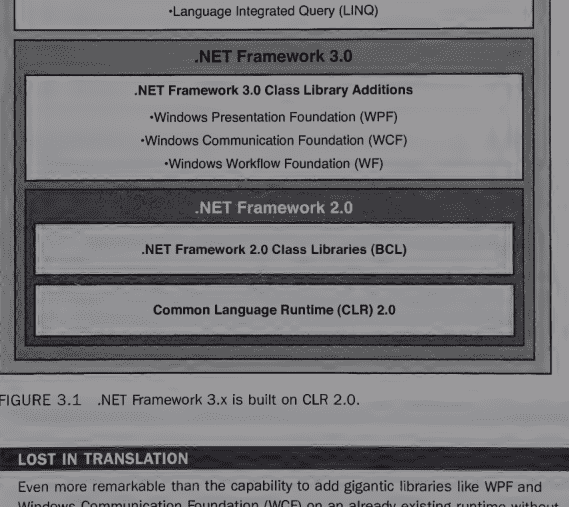

图 3.1 .NET Framework 3.x 建立在 CLR 2.0 之上。

## 这些版本号是怎么回事？

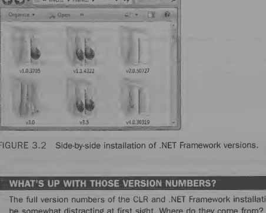

图 3.2 .NET Framework 版本的并排安装。

CLR 和 .NET Framework 安装及二进制文件的完整版本号初看时可能有些令人困惑。它们来自哪里？

在 .NET Framework 1.x 时期，版本号的第三个组成部分（构建号）只是按递增方式创建。版本 1.0 在构建 3705 发布，版本 1.1 最终达到构建 4322。

随着 .NET 2.0，赋予构建号更多含义变得合理，并选择了 yymmdd 模式：年份用一位数字（2005），月份用两位数字（七月），日期用两位（27）。

这种方法直到理论上 2006 年第 55 个月的第 35 天才效果非常好：构建号的元数据编码不能超过 65535，因此使用这种模式的全部威力我们无能为力。结果是妥协。月份和年份的编码保持不变，但年份现在被视为相对于发布开始的时间。对于 .NET 4.0 发布，发布的开始是在 2007 年，因此从图 3.2 可以推断，在撰写本文时我使用的是 2009 年 4 月 24 日的构建。

除了拥有 .NET Framework 的各种版本外，.NET 4.0 还开创了不同“风格”的可用性。在 .NET 3.5 时期，.NET Framework 的大小变得过大，无法实现快速无摩擦的安装，这对于客户端应用程序部署尤其重要。这样的部署的重要因素是下载时间和安装时间。

为了简化框架的典型部署，对 .NET Framework 类库进行了拆分，分离出所谓的 Client Profile 程序集。在 Client Profile 内部，可以找到基本类库（BCL）程序集，例如 WPF 和 WCF，以及 C# 4.0 语言支持，还有其他与客户端应用程序开发相关的程序集。剩余部分（称为 Extended Profile）包含 ASP.NET 等功能，客户端应用程序通常不需要。

实际上，开发人员针对完整框架或其客户端配置文件子集。两个包都有自己的可再发行安装程序，其中（显然）Client Profile 包是两者中较小的，安装速度更快。内部，Extended Profile 包只是 Client Profile 包之上的增量，结果形成如图 3.3 所示的分层蛋糕。这种组织方式的好处是可以将 Client Profile 机器升级为完整的框架安装。

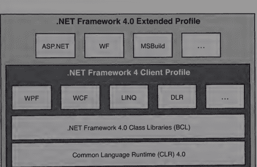

图 3.3 .NET Framework 的 Client Profile 子集。

> **四点零？**
>
> 谨慎的读者会注意到我混用了 .NET Framework 4 和 .NET 4.0。为什么有这种区别，前者哪里去了 .0 部分？答案是营销：决定将 .NET Framework 的第四个版本简单地称为 4，尽管内部程序集也有次要版本号。所以，每当我指的是整个产品时，我使用 .NET Framework 4，而对于对当前 4.x 版本的更技术性引用，我使用 .NET 4.0。

随着这种拆分，你无疑会想知道是否需要记住 .NET Framework 的哪个子集中有什么。幸运的答案是否定的，因为 Visual Studio 2010 将其多目标的概念扩展到 .NET Framework 的各种“配置文件”。当选择 Client Profile 子集时，Visual Studio 2010 会阻止引用来自完整框架的程序集。

## .NET Framework 3.5 Client Profile

你很可能听说过 .NET 3.5 Client Profile。这是产品拥有不同子集思想的前身，并在 .NET 3.5 SP1 时期实现。不幸的是，由于架构限制，Client Profile 3.5 的适用性相当有限：只有在未安装任何先前框架版本的 Windows XP 机器上才能应用该子集。在其他情况下，Client Profile 安装程序 simply 回退到完整 .NET Framework 的安装。

随着 .NET 4.0，这些限制不再适用——得益于安装程序和框架结构本身的架构改造——Client Profile 子集可以安装在支持 .NET Framework 的任何操作系统上。更进一步，这一练习也应用于其他场景：在服务器部署上，各种客户端特定 API 没有意义，因此也对服务器安装进行了单独的重构以降低占用空间。

## 运行安装程序

玩耍时间！要在 .NET Framework 4 上编写代码，让我们先安装完整的 .NET Framework 包。这就是开始托管代码开发所需的一切。

去哪里获取？只需浏览到 http://msdn.microsoft.com/netframework 并点击 .NET Framework 4 下载的链接。安装程序本身应该很简单：接受许可协议（图 3.4 所示），喝杯咖啡，你就可以开始了。

## 安装了什么？

安装完成后，很好地快速查看一下安装了什么，以便熟悉在哪里找到东西。

### 运行时 Shim

运行时 shim 其实是你不必太在意的，但它是一种方便的方式来了解机器上已安装的 CLR 的最新版本。shim 的目的是加载正确的 CLR 版本来执行给定的应用程序，如果安装了多个运行时版本，这项任务尤其重要。

你可以在 %windir%\system32 下找到 shim，名称为 mscoree.dll。通过查看文件属性（图 3.5 所示），你会了解到机器上最新的通用语言运行时版本。

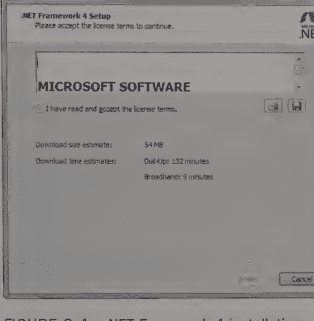

图 3.4 .NET Framework 4 安装。

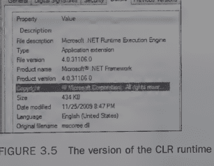

图 3.5 CLR 运行时 shim 的版本。

尽管文件描述写着“Microsoft .NET Runtime Execution Engine”，但这不是 CLR 本身，那么运行时本身在哪里？

### .NET 4.0 CLR

拥有运行时 shim 是一回事；拥有运行时本身则弥足珍贵。所有运行时安装都并排存放在 %windir%\Microsoft.NET\Framework 文件夹中。在 64 位系统上，有一个并行的 Framework64 文件夹结构。拥有 CLR 和伴随库的两种“位数”是必需的，以便应用程序可以作为 32 位（Windows On Windows，或 WOW）或 64 位运行。


从 .NET 4.0 开始，CLR 本身称为 clr.dll（以前是 mscorwks.dll），如图 3.6 所示。

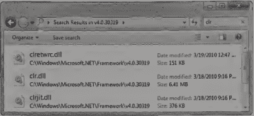

图 3.6 公共语言运行时本身。

## 全局程序集缓存

全局程序集缓存（GAC）是加载类库程序集以供 .NET 应用程序使用的地方。你可以在 %windir%\assembly 下查看 GAC，但用命令行列出目录可以更详细地揭示 GAC 的结构。我们将在第 25 章“程序集与应用程序域”中详尽讨论 GAC 的作用及其对你自己的应用程序的影响。

图 3.7 展示了 .NET 4.0 GAC 的结构，其中包含 4.0 版本的 System.dll 程序集，这是托管代码开发领域中最常用的程序集之一。

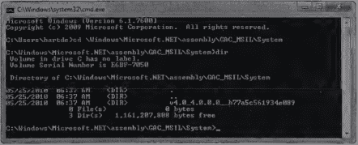

图 3.7 GAC 内部。

### GAC 拆分

注意到包含 .NET 4.0 版本 System.dll 的文件夹名称中有 v4.0 前缀了吗？这是在 .NET 4.0 中实施“GAC 拆分”的产物。这个简单的命名技巧隐藏了面向不同运行时版本的若干程序集，使特定版本的 CLR 不会尝试加载与其不兼容的程序集。在前面的示例中，CLR 2.0 只会将第一个文件夹识别为 GAC 中的有效条目，而 CLR 4.0 只识别第二个。这真实体现了不同运行时的并行共存特性。

## 工具

除了运行时和类库，还有许多工具会安装到 %windir%\Microsoft.NET\Framework 下特定于框架版本的文件夹中。尽管你日常只会用到其中一小部分——也因为其中大多数是通过 Visual Studio 2010 图形用户界面（GUI）间接使用的——但了解哪些工具触手可及总是好的。我最喜欢的工具毫无疑问是 C# 编译器 csc.exe。图 3.8 展示了 .NET Framework 安装中随附的一些工具。

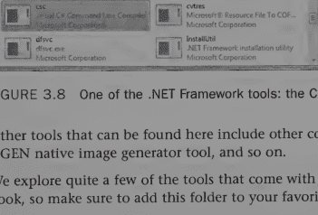

图 3.8 .NET Framework 工具之一：C# 编译器。

在这里还能找到的其他工具包括其他编译器、IL 汇编器、MSBuild、NGEN 本机映像生成器工具，等等。

本书将探索不少随 .NET Framework 提供的工具，所以务必将此文件夹添加到收藏夹。

## 你的第一个应用程序：初次尝试

.NET Framework 安装就绪后，我们就可以开发第一个 .NET 应用程序了。但等一下……那些让生活更轻松的开发工具在哪里？没错，就这一次，我们将过一种没有开发工具的生活，走记事本类编辑器和命令行编译的硬核路线，以说明 .NET 开发并不紧密依赖 Visual Studio 2010 这类特定工具。本章稍后，我们将回归正轨，探索 Visual Studio 2010 的工具支持；对于今后的 .NET 开发者来说，它将成为你的日常环境。

### 记事本与命令行的力量

就个人而言，我非常喜欢只使用所需的最少工具进行编码。任意文本编辑器、老式好用的命令行解释器以及 C# 编译器就足以完成任务。诚然，同事们认为我因这种做法承受了许多不必要的痛苦，但我对此深信不疑。对于任何规模尚可的项目，这种做法就远没有那么吸引人了。高效浏览代码、使用自动补全功能、源代码管理支持、集成调试体验等能力——所有这些都使 Visual Studio 2010 这类专业编辑器的使用变得弥足珍贵。

不过，我建议每个人偶尔回到记事本和命令行的老派世界。有一天，你可能会发现自己在一台没有编辑器的机器上解决某个紧急问题，那时能够回退到某种原始开发模式，肯定派得上用场。总之，这只是我的个人浅见。

为了避免把事情复杂化，我们暂时继续采用简单的命令行控制台应用程序。你编写的大多数应用程序很可能要么是 GUI 应用程序，要么是 Web 应用程序，但控制台应用程序是进行实验和原型设计的绝佳基础。

构建第一个应用程序的工作流程如下：

- 使用记事本编写代码
- 使用 C# 命令行编译器编译代码
- 运行生成的程序

### 编写代码

老套桥段有时也该致敬，那么还有什么比从经典老派的 Hello World 程序开始更好的呢？好吧，我们把它变得稍微复杂一点，做成一个通用的 Hello 程序，询问用户姓名以便向其问候。

打开记事本，输入以下代码，并保存到名为 Hello.cs 的文件：

```
using System;

class Program
{
    static void Main()
    {
        Console.Write("Enter your name: ");
        string name = Console.ReadLine();
        Console.WriteLine("Hello " + name);
    }
}
```

务必注意字母大小写：C# 是区分大小写的语言。特别是，如果你有 Java 或 C/C++ 背景，务必把 Main 中的 M 大写。先不深入探讨该语言的具体细节，我们快速过一遍这段代码。

第一行有一个 using 指令，用于导入 System 命名空间。这使我们能在后面的代码中引用 Console 类型，而不必键入其完整名称 System.Console。接下来，我们声明一个名为 Program 的类。名称并不重要，但通常的做法是将包含应用程序入口点的类命名为 Program。注意使用花括号来标记类声明的开始和结束。

在 Program 类内部，我们声明一个名为 Main 的静态方法。这个特殊方法被公共语言运行时识别为托管代码程序的入口点，也是程序开始执行的地方。注意该方法声明相对于包含它的类声明进行了缩进。尽管 C# 不是对空白敏感的语言，但保持一致的缩进是良好的做法。

最后，在 Main 方法内部，我们编写了几条语句。第一条语句调用 Console 类型上的 Write 方法，将字符串 Enter your name: 打印到屏幕。第二行，我们从控制台输入读取用户的名字，并将其赋给名为 name 的局部变量。该变量在最后一条语句中使用：我们用 + 运算符将它连接到字符串 "Hello "，并通过 Console 类型上的 WriteLine 方法将其打印到控制台。

### 编译代码

要运行代码，我们必须编译它，因为 C# 是编译型语言（至少在没有交互式 REPL 循环 C# 工具的当今世界是如此）。编译代码这一动作会生成一个可在 .NET 运行时上执行的程序集。

打开命令提示符窗口，将目录切换到保存 Hello.cs 文件的位置。顺便说一句，使用 .cs 作为扩展名并不是 C# 编译器的要求；这只是存储 C# 代码文件的一种最佳实践。

由于搜索路径不包含 .NET Framework 安装文件夹，我们必须输入 C# 编译器 csc.exe 的完全限定路径。回想一下，它位于 %windir%\Microsoft.NET\Framework 下的框架版本文件夹中。只需运行 csc.exe 命令，并将 Hello.cs 作为参数传入，如图 3.9 所示。

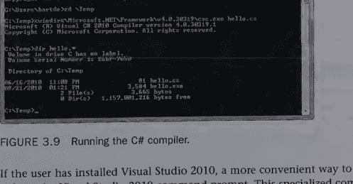

图 3.9 运行 C# 编译器。

如果用户已安装 Visual Studio 2010，一种更方便的调用编译器的方式是从 Visual Studio 2010 命令提示符中调用。这个专用命令提示符已正确配置搜索路径，因此可以找到 csc.exe 这类工具。

### MSBUILD

我们稍后会看到，直接调用命令行编译器的情况非常少见。相反，MSBuild 项目文件用于驱动生成过程。

### 运行程序

编译的结果是一个名为 hello.exe 的可执行文件，这意味着我们可以立即将其作为 Windows 应用程序运行（见图 3.10）。这与 Java 等平台不同，在那些平台上需要单独的应用程序来运行编译后的代码。

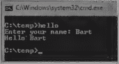

图 3.10 我们的程序正在运行。

这并不太难，对吧？为了满足我们的技术好奇心，让我们看看生成的程序集。

### 使用 .NET Reflector 检查我们的程序集

了解事物如何运作，必定会让你成为更好的开发者。在 .NET 世界中使用中间语言格式的一大好处是，可以在任何时候检查编译后的程序集，而无需原始源代码。

两种常用的程序集检查工具包括 .NET Framework IL 反汇编工具（ildasm.exe）和 Red Gate 的 .NET Reflector。目前，我们将使用 .NET Reflector，你可以从 Red Gate 网站 www.red-gate.com/products/reflector 下载它。

首次运行该工具时，会出现一个如图 3.11 所示的对话框。在这里，你可以填充 .NET Reflector 显示的初始程序集列表。对于我们的目的来说，选择并不重要，但我建议选择 v4.0 框架版本，因为这是本书中最常涉及的版本。

### Compact Framework 与 Silverlight

CLR 的版本变体比你想象的要多。我们为应用程序使用的 CLR 被称为“桌面 CLR”。它本身又分为若干子类别，分别针对客户端应用程序与服务器工作负载进行优化。除桌面 CLR 外，还有一种面向 ARM 处理器的移动设备精简运行时，另有一种由 Silverlight 用于在各种浏览器中运行托管代码。（更不用说 Microsoft 内部为研究和孵化项目存在的各种其他变体了。）但它们都有一个共同点：支持 ECMA 公共语言基础结构（CLI）标准。


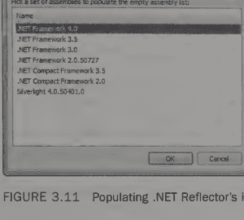

图 3.11 填充 .NET Reflector 的初始程序集列表。

完成此操作后，你会看到一份从 GAC 加载的常用 .NET 程序集简短列表，可供检查。此时，我们真正感兴趣的不是那些程序集，而是想使用“文件”>“打开”加载我们自己的 hello.exe。这会将“hello”添加到已加载程序集列表中，之后我们就可以开始逐层展开该程序集的结构，如图 3.12 所示。

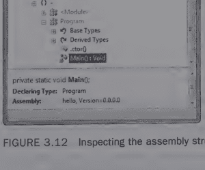

图 3.12 在 .NET Reflector 中检查程序集结构。

查看这一结构为我们简要解释几个概念提供了良好机会。当我们在树视图中逐层展开时，会从刚刚编译的“hello”程序集开始。程序集本身只是 CLR 概念，与基于文件的存储没有直接关联。事实上，也可以从数据库或内存数据流中加载程序集。因此，程序集名称不包含文件扩展名。

在我们的例子中，程序集以文件形式存储在磁盘上，更具体地说，是名为 hello.exe 的文件。在 .NET Reflector 中，我们可以通过程序集的子节点观察到这一点，该子节点就是 hello.exe 模块。程序集可以由一个或多个模块组成，但最常见的情况是只有一个模块。我们暂时不详细讨论这个主题。

接下来，我们遇到一个带有 {} 标志的节点。这表示一个命名空间，是 .NET Reflector 反编译智能的产物，因为 CLR 本身并不知道命名空间。命名空间是一种组织 API 结构的方式，它通过将类型分组到层次化的命名空间树中（例如 System.Windows.Forms）来实现。对 CLR 而言，类型总是通过其完全限定名来引用——例如，在 IL 代码中——（如 System.Windows.Forms.Label）。在我们的小型 hello.exe 程序中，我们没有费心将 Program 类声明在单独的命名空间中，因此 .NET Reflector 显示“-”来表示全局命名空间。

最后，我们到达包含 Main 方法的 Program 类型。现在让我们看看 Main 方法。选择 Main 的树节点并按空格键。图 3.13 显示了结果。

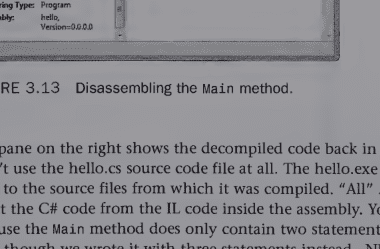

图 3.13 反汇编 Main 方法。

右侧窗格显示反编译回 C# 的代码。重要的是要认识到，这完全没有使用 hello.cs 源代码文件。hello.exe 程序集没有任何指回其编译来源源文件的链接。.NET Reflector 所做的“全部”工作，就是根据程序集内部的 IL 代码重建 C# 代码。你可以清楚地看到情况确实如此，因为根据 .NET Reflector，Main 方法只包含两条语句，尽管我们编写时用了三条语句。不过，.NET Reflector 对我们程序集的视图在语义上是正确的；我们本来可以像这样编写代码。

注意顶部工具栏中的下拉框。在那里，我们可以切换到反汇编代码的其他视图（例如纯 IL）。我们也来看看，如图 3.14 所示。

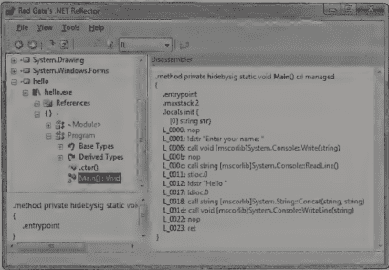

**图 3.14** *Main* 方法的 IL 反汇编器。

你现在看到的是运行时执行时所看到的代码。请注意以下几点：

-   元数据与编译后的方法一起存储，以指示其特征：`.method` 表明它是一个方法，`private` 控制可见性，`cil` 表明方法代码中使用了 IL 代码，等等。
-   CLR 的执行模型基于求值堆栈，这由 `.maxstack` 指令和某些 IL 指令的命名（`pop` 和 `push`，在我们的简单示例中未显示）体现出来。
-   方法调用显然指向被调用的方法，但请注意，C# using 指令的命名空间导入没有留下任何痕迹，并且所有方法名都是完全限定的。
-   我们的局部变量“name”失去了名称，因为执行引擎只需要知道局部变量的存在（和类型），而不需要知道它们的名称。（它显示为 `str` 是因为 .NET Reflector 试图变得智能。）

细心的读者会注意到 *Main* 方法的 IL 指令中有几处奇怪的地方：为什么需要那些 `nop`（代表 *无操作*）指令？答案在于我们编译应用程序的方式：关闭了优化。这种默认模式使编译器尽可能保留输入代码的结构，以便于调试。在这个特定情况下，*Main* 方法代码体周围的花括号被生成为 `nop` 指令，从而允许在该行设置断点。

> > **提示**
> >
> > 探索 csc.exe 命令行选项（/?）以找到开启优化并重新编译应用程序的方法。再次查看反汇编器（你可以在 .NET Reflector 中按 F5 从磁盘重新加载程序集），并观察 nop 指令已经消失。

## Visual Studio 2010

既然我们已经了解了使用普通旧式文本编辑器和 C# 命令行编译器构建应用程序的硬核方式，现在该更现实一些，来看看 Visual Studio 2010 产品提供的专业工具支持。图 3.15 展示了新的 Visual Studio 2010 徽标，反映了该技术的无限可能。


**图 3.15** Visual Studio 2010 徽标。

自 Microsoft 平台上的软件开发伊始，Visual Studio 一直是极其宝贵的工具，极大地简化了日常开发任务。其中一个核心原因是其集成开发环境（IDE）概念，这确实是一个含义广泛、如今承载了过多含义的术语。尽管它最初代表源代码编辑和调试支持的结合，但今天的 IDE 具备涵盖一系列功能的能力，例如：

-   源代码编辑，内置对 C#、Visual Basic、F# 和 C++ 等多种语言的支持，包括语法着色、IntelliSense 自动补全等功能。
-   重构支持是强大的工具之一，它使代码操作更容易，并允许只需点击几下就能以（基本）无风险的方式重构现有代码。
-   探索代码是开发人员在编辑器中花费大部分时间所做的事情。在源文件之间导航只是冰山一角，编辑器还提供了导航到特定类型和成员的方式。
-   **项目结构可视化**弥合了软件架构、设计与实现之间的差距。秉承 UML 的精神，类设计器和架构浏览器可直接在工具中使用。
-   **设计器**在需要为受益于可视化开发方法的常见任务生成代码时发挥作用。典型示例包括 GUI 设计、网页布局、对象/关系映射、工作流图等。
-   **调试设施**是每位开发人员的基本工具，使他们能够通过单步执行代码并分析执行状态，来应对分析代码行为和（希望不会太多）bug 的复杂性。
-   **项目管理**跟踪软件开发项目中的各种项目项，包括源文件、设计器生成的文件、项目级设置等。
-   **集成生成支持**与项目管理功能紧密集成，允许立即调用生成过程以生成可执行代码，并将生成错误和警告反馈回 IDE。
-   **源代码管理和工作项跟踪**是用于管理大型协作软件开发项目的企业级功能，提供签入/签出代码、打开和关闭 bug 等途径。
-   **可扩展性**可能不是 IDE 最显眼的功能，但它为第三方提供了巨大机会，几乎可以为工具支持的每个方面提供扩展。

## 版本

我感觉自己像个营销人员这么说，但为了“区分不同软件开发群体的需求”，Visual Studio 2010 提供了不同的版本。概述如下：

-   **Visual Studio Express 版本**面向爱好者开发人员和学生，提供获得丰富工具支持以探索 .NET 平台和各种语言的绝佳方式。Visual C#、Visual Basic、Visual C++ 和 Visual Web Developer（面向 ASP.NET 网站开发）的单独下载可在 www.microsoft.com/express 找到。请注意，还有 SQL Server 2008 R2 的 Express 版本，可访问出色的关系数据库引擎（有一些强制限制）。为了完善这一系列，最近还新增了新的 Windows Phone 7 Express 工具包。
-   **Visual Studio Standard Edition** 是面向个人开发人员和小型团队的入门级版本，包含在 .NET 平台上使用任何可用编程语言进行丰富应用程序开发所需的所有基本要素。它具有丰富的调试器支持以及 Windows 和 Web 应用程序的项目模板，但缺少单元测试等功能。
-   **Visual Studio Professional Edition** 面向专业开发人员，可在同一包中访问各种语言。它具有丰富的工具功能。


这些功能超出了标准版的范围，包括单元测试、支持使用托管代码扩展 Office 产品的 Visual Studio Tools for Office (VSTO)、移动设备开发、SQL 数据库项目模板以及各种类型的应用程序部署项目。

- Visual Studio 旗舰版是现有最大版本的总称，面向大规模团队开发。存在不同的版本风格，针对开发组织中的不同角色，如开发人员、测试人员、架构师和数据库专业人员。独特的功能包括源代码管理集成、丰富的性能分析工具、质量度量工具等。在服务器端，有 Team Foundation Server (TFS)，它为工作项跟踪、源代码管理、文档库、项目度量报告等提供必要的基础设施。

## 今日缩写词：SKU

Visual Studio 的不同版本——其他产品也是如此——经常被微软代表称为 SKU。SKU 是一个 TLA，即三字母缩写词，指的是库存单位（stock-keeping unit）。它起源于软件主要以纸板箱形式分发、摆放在街角软件商店货架上的时代。不过如今，许多开发者通过下载、MSDN 订阅或企业协议获取他们的工具。

在本书中，我们主要关注 .NET 平台上编程的语言级和框架级方面，这些与工具支持是分开的。然而，在涉及工具支持时，我们假设读者至少可以使用 Visual Studio 2010 的专业版。也就是说，我们介绍的许多功能（比如一个必不可少的调试支持）在速成版中也可用。我们也会不时地关注 Team System 级别的功能，但篇幅比较有限。

哦，顺便提一下，Visual Studio 除了英文之外，还提供不同的（自然）语言版本。然而，本书指的是菜单、对话框等中使用的英语词汇。

## Visual Studio Shell

实际上，Visual Studio 是一个高度可扩展的外壳，适用于各种开发和管理工具。一个基于 Visual Studio 环境构建的工具示例是 SQL Server Management Studio。为了允许第三方工具使用此基础设施，存在所谓的 Visual Studio Shell。你甚至可以通过使用 Visual Studio for Applications (VSTA) 平台，将 Visual Studio 功能嵌入到单独的应用中。

## Expression

具有 GUI 的应用程序，无论是针对 Windows 还是 Web，通常不仅仅由开发团队构建。在 GUI 开发中，与开发者密切配合的一个重要角色是专业设计师，他们负责应用程序用户体验的观感。

平台级技术如 Windows Presentation Foundation (WPF)、Silverlight 和 ASP.NET 正是考虑到了这一点而构建的，它们提供了丰富的样式化能力，并将开发者代码与 UI 定义（例如通过 XAML）分离开来。这是一个非常强大的概念，使开发者和设计师能够并行工作。

虽然本书聚焦于 .NET 应用程序开发的开发者方面，但了解你的设计师同行可以使用的 Expression 工具系列也很重要。更多关于这些工具的信息可以在 www.microsoft.com/expression 找到。

## 安装 Visual Studio 2010

安装 Visual Studio 2010 应该是直截了当的。假设你至少使用该产品的专业版，会看到用于安装托管代码/本机代码开发支持的复选框（参见图 3.16）。确保勾选托管代码选项，或者将选项页面切换到更详细的模式，以便可以单独启用或关闭各个功能。

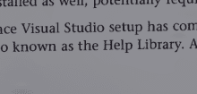

图 3.16 Visual Studio 2010 旗舰版安装选项。

根据你选择的功能数量（我通常进行完整安装，以避免之后寻找 DVD 或其他安装介质），安装可能需要一段时间。如果你尚未安装这些内容，各种先决条件（如 .NET Framework）也会一并安装，可能需要重启一次或两次。但这完全值得等待。

一旦 Visual Studio 安装完成，请务必安装产品文档，也称为帮助库。虽然 Visual Studio 帮助系统可以无缝连接到 MSDN 的在线版本，但如果你能承担磁盘空间，将文档安装在本地会很方便。为此，请转到“开始”菜单，在“Visual Studio 2010”下的“Visual Studio Tools”文件夹中找到“管理帮助设置”条目。图 3.17 显示了该工具的用户界面，你可以从安装盘或通过下载来安装内容。

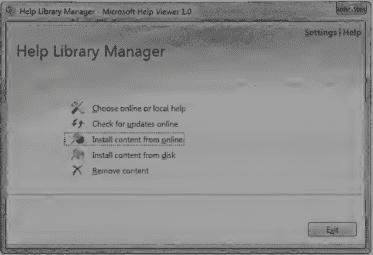

图 3.17 MSDN 库安装选项。

## 快速浏览 Visual Studio 2010

安装完 Visual Studio 2010 后，让我们快速浏览一下这个你作为开发者将花费大量时间的 IDE。

### 安装了哪些内容

根据你安装的版本，许多工具将与 Visual Studio 2010 编辑器本身一起安装。图 3.18 显示了在 64 位机器上安装旗舰版时“开始”菜单中的 Visual Studio 2010 条目。这里有几个值得注意的条目：

- **Visual Studio 2010 命令提示符** 提供一个命令提示符窗口，其中设置了多个环境变量，包括在搜索路径中添加内容，以便定位各种工具，如命令行编译器。
- **Visual Studio 2010 远程调试器** 是我在调试服务或其他在远程机器上运行的应用类型时最喜欢的工具之一。它使你能够直接在 Visual Studio 2010 内部通过网络调试应用程序。

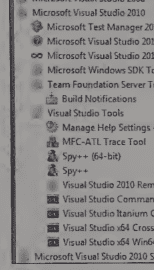

图 3.18 Visual Studio 2010 “开始”菜单条目。

> **提示**
>
> 请使用 Visual Studio 2010 命令提示符重新编译我们在本章前面创建的第一个应用程序。你会看到 csc.exe 在搜索路径中，因此你可以直接调用它，无需指定完整路径。
>
> 另一个已安装的工具是 ildasm.exe，即 IL 反汇编器。请使用它来检查 hello.exe 程序集，查看 Main 方法的 IL 代码。因为我们偶尔会用到这个工具，所以最好知道从哪里启动它。

### 启动画面和起始页

Visual Studio 2010 的启动画面如图 3.19 所示。在 Visual Studio 2010 之前，启动画面会显示已安装的不同扩展包。现在这些信息可以从“帮助”菜单的“关于”中获取。

Visual Studio 2010 中新增且值得注意的包包括内置的 Silverlight 项目和开箱即用的 F# 语言支持。

### 选择你的母语

如果这是你第一次启动 Visual Studio 2010，系统会显示一个对话框，要求你选择设置模板，以便针对特定的编程语言配置 IDE。你可以坚持使用常规设置模板，也可以指出你偏好的语言（可以说是你的编程母语）。如果看到此选项，请随意选择 C# 模板。

这一切意味着某些设置将针对 C# 项目进行优化（例如“新建项目”对话框中的默认语言选择），但其他语言在任何时候仍然可用。因此，这里用词是*偏好*。


图 3.19 Visual Studio 2010 启动画面。

你在 Visual Studio 中看到的第一件事是如图 3.20 所示的起始页。它提供了各种任务的链接（例如重新加载最近使用的项目）。RSS 源显示来自 MSDN 网站的新闻条目。

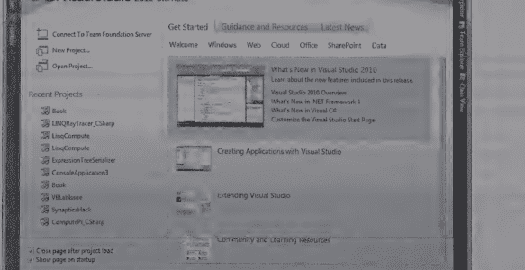

图 3.20 Visual Studio 2010 起始页。


## 核心 UI 元素

菜单和工具栏包含大量功能（我们只介绍其中关键的几个）。建议你稍微探索一下菜单，看看有没有感兴趣的内容。由于我们尚未加载任何项目，各种工具栏目前还不可见。

编辑器边缘停靠着各种可折叠面板。面板数量不少，但此时只有少数几个可见：**工具箱**、**解决方案资源管理器**和**错误列表**是我们经常要打交道的。更多面板可以通过“视图”菜单启用，但大多数面板都具有上下文相关性，会在调用某些操作时自动出现（例如调试时）。图 3.21 展示了面板如何停靠在编辑器的不同位置。面板标题栏上的小图钉按钮可以防止面板自动折叠。随着你对编辑器越来越熟悉，你会开始根据自己的需求重新布置界面。

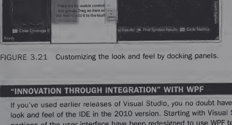

图 3.21 通过停靠面板自定义外观和风格。

## 借助 WPF 实现“融合创新”

如果你使用过 Visual Studio 的早期版本，你肯定已经注意到 2010 版本 IDE 的外观和风格有所不同。从 Visual Studio 2010 开始，用户界面的很大一部分已重新设计为使用 WPF 技术。

无论从短期还是长期来看，这都有诸多优势，而今天我们只看到了它解锁能力的冰山一角。例如，由于代码编辑器采用了 WPF，全新的可视化方式成为可能。仅举一个例子：想象一下，代码注释中可以包含丰富的图表来示意数据流或架构设计，那会是什么样的体验。

值得明确指出的是，Visual Studio 是一个托管代码和本机代码混合的应用程序（这主要是历史原因）。越来越多的组件使用托管代码编写，并且通过新的托管扩展性框架（MEF）添加了新的扩展性 API。这也是使用托管代码的另一个绝佳理由！

## 你的第一个应用程序：第二次尝试

为了继续我们的 Visual Studio 2010 之旅，让我们把内容做得更具体一些，在 IDE 中重新实现那个小小的 Hello C# 应用程序。

## “新建项目”对话框

创建新应用程序的起点是“新建项目”对话框，可通过“文件”、“新建”、“项目”打开，或按 `Ctrl+Shift+N` 调出。“起始页”的“项目”选项卡中也有一个链接。对话框中提供了大量不同的项目类型，具体取决于你所使用的版本和选择的安装选项。实际上，可用的项目模板数量在过去几年里增长得太快，以至于 Visual Studio 2010 对该对话框进行了重新设计，加入了搜索等功能。

由于我在首次启动 Visual Studio 2010 时选择了 Visual C# 作为首选语言，因此 C# 模板会立即显示出来。（对于其他语言，请向下滚动到左侧的“其他语言”条目。）子类别用于组织各种模板。下面介绍几种常用的项目类型：

-   **控制台应用程序**：用于创建命令行应用程序可执行文件。我们的 Hello 应用程序将使用此类型。
-   **类库**：提供一种构建带 `.dll` 扩展名的程序集的方式，可供其他各种应用程序使用（例如，用来提供 API）。
-   **Windows 窗体应用程序**：基于 Windows 窗体技术创建 GUI 驱动的应用程序项目。
-   **WPF 应用程序**：另一种 GUI 应用程序模板，但基于更新、更强大的 WPF 框架。
-   **ASP.NET Web 应用程序**：提供创建 Web 应用程序并将其部署到支持 ASP.NET 的 Web 服务器的方法。

我们还会介绍其他类型的模板，但现在这些是最需要了解的。图 3.22 显示了“新建项目”对话框，你可以在此选择项目类型。

请注意 **.NET Framework 4.0** 下拉框。这就是 Visual Studio 的多目标支持发挥作用的地方。在此列表中，你可以选择面向更早版本的框架，最早可到 2.0。不妨试一下选择 2.0 版本的框架，看看对话框如何过滤掉该框架版本不支持的项目类型。回想一下，WPF 和 WCF 等是在 .NET Framework 3.0（WinFX）时期引入的，因此当选择 .NET Framework 2.0 时它们不会显示。

现在，请保持选中 .NET Framework 4.0，选择“控制台应用程序”模板，并将项目命名为 `Hello`。注意“为解决方案创建目录”复选框。别急，我们稍后会介绍项目和解决方案的概念。现在保持默认设置即可。创建新项目的结果如图 3.23 所示。

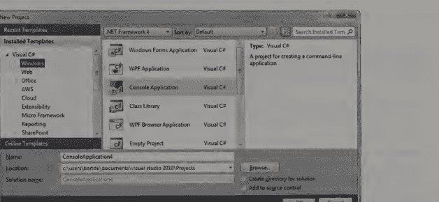

图 3.22 “新建项目”对话框。

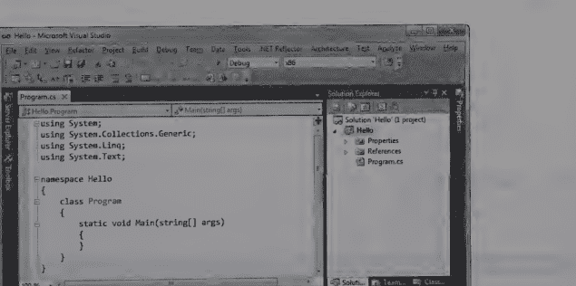

图 3.23 新的控制台应用程序项目。

项目创建完成后会被加载，项目中第一个（在本例中也是唯一一个）相关文件就会显示出来。在我们的这个小控制台应用程序中，这就是包含托管代码入口点的 `Program.cs` 文件。

请注意，根据我们当前所处的上下文，一个额外的工具栏（即“文本编辑器”工具栏）、额外的工具栏项（主要用于调试）以及菜单都已显示出来。

## 解决方案资源管理器

新项目创建并加载后，请将“解决方案资源管理器”（通常停靠在右侧）显示出来，如图 3.24 所示。简单来说，“解决方案资源管理器”是一个迷你文件资源管理器，显示项目中包含的所有文件。在本例中，只有 `Program.cs`。除了项目中的文件之外，还会显示其他节点：

-   **属性**：提供对项目级设置的访问（稍后介绍），并显示一个名为 `AssemblyInfo.cs` 的代码文件，其中包含程序集级特性，我们将在第 25 章中讨论。
-   **引用**：应用程序所依赖的程序集集合。请注意，默认情况下，项目会添加许多对常用类库的引用，具体也取决于项目类型。

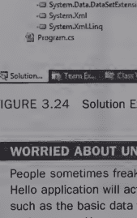

图 3.24 “解决方案资源管理器”。

## 担心未使用的引用？

当人们看到大量未使用的引用时，有时会感到不安。我们简单的 Hello 应用程序实际上只会用到 System 程序集（其中包含基本数据类型和 `Console` 类型等），所以这种担心确实有一定道理。不过请放心，未使用的程序集引用不会带来性能影响，因为 CLR 只在实际使用引用程序集时才加载它们。随着时间的推移，你会更加熟悉那些默认包含的各种程序集的作用。

那么，解决方案和项目之间是什么关系？很简单：解决方案是一个或多个项目的容器。在我们的这个小例子中，解决方案中只有单个控制台应用程序项目。解决方案的目标是能够表达依赖项目之间的关系。例如，类库项目可能被同一解决方案中的控制台应用程序引用。将它们放在同一个解决方案中，就可以一次构建整个项目集。

## 源代码管理

对于将 Visual Studio 2010 与 Team Foundation Server 结合使用的用户来说，“解决方案资源管理器”也是源代码管理的入口之一，例如，你可以对解决方案中的项执行签入/签出操作。

## 项目属性

虽然目前我们不需要重新配置项目属性，但让我们快速了解一下项目配置系统。在“解决方案资源管理器”中双击我们的 Hello 项目的“属性”节点（或右键单击并从上下文菜单中选择“属性”）。图 3.25 显示了项目设置中的“生成”选项卡。

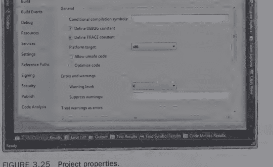

图 3.25 项目属性。

作为一些设置的具体示例，我选择了左侧的“生成”选项卡，但此时你也可以随意探索其他选项卡。我在这里强调“生成”配置是为了突出项目与生成支持之间的关系，这一点稍后将详细说明。


## 代码编辑器

是时候看看我们开发活动的核心了：编写代码。切换回 Program.cs，查看提供的骨架代码：

```csharp
using System;
using System.Collections.Generic;
using System.Linq;
using System.Text;

namespace Hello
{
    class Program
    {
        static void Main(string[] args)
        {
        }
    }
}
```

与我们手动编写小型控制台应用程序时所使用的代码相比，有一些差异。

首先，通过 using 指令导入了更多包含常用类型的命名空间。其次，生成了一个命名空间声明来包含 `Program` 类。我们将在下一章更详细地讨论命名空间，现在不必担心。最后，`Main` 入口点的签名不同：它不再不接受任何参数，而是现在接受一个字符串数组，该数组将被填充为传递给生成的可执行文件的命令行参数。因为我们实际上并不想使用命令行参数，所以这对我们来说影响不大。我们在第 4 章《语言基础》中“入口点”一节讨论了托管代码入口点的可能签名。

现在让我们为我们的应用程序编写代码。回想一下我们之前编写的三行代码：

```csharp
static void Main(string[] args)
{
    Console.Write("Enter your name: ");
    string name = Console.ReadLine();
    Console.WriteLine("Hello " + name);
}
```

当你在编辑器中输入这段代码时，你会注意到一些事情。其中一个小功能是自动缩进，它将光标定位在 `Main` 方法内部，比方法体开头的大括号向右缩进一些。这强制执行良好的缩进习惯（你可以通过 Tools、Options 对话框控制其行为）。

在 Visual Studio 中，构建与项目系统紧密集成，因为最终源文件就存放在那里，引用被添加，属性被设置。要调用构建过程，可以使用 Build 菜单（见图 3.29），也可以在解决方案资源管理器中右键单击解决方案或特定的项目节点。调用整个解决方案构建的快捷键是 F6。

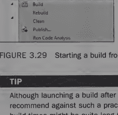

图 3.29 从项目节点上下文菜单启动构建。

## 提示

尽管在编写几行代码后就启动构建可能很诱人，但我不建议这样做。对于大型项目来说，这不可行，因为构建时间可能相当长（尽管 C# 代码编译相对较快）；但更重要的是，这种风格有危险的潜力会让开发者对所写的代码思考得更少。

就我个人而言，我努力挑战自己编写的代码能够立即编译通过，且没有错误甚至警告。自 Visual Studio 2008 SP1 以来为 C# 引入的后台编译支持极大地帮助实现了这一目标，能够及早捕获愚蠢的拼写错误，让更根本的代码缺陷成为需要担心的问题。

在幕后，此构建过程会确定哪些文件需要编译，需要运行哪些额外任务等等。最终，会调用各种工具，例如 C# 编译器。这不是单向过程：底层工具产生的警告和错误会通过构建系统传递到 IDE，从而实现真正交互式的开发体验。图 3.30 显示了 Visual Studio 2010 中的错误列表窗格。

从 Visual Studio 2005 开始，构建系统基于一种名为 MSBuild 的 .NET Framework 技术。这种集成的理由之一是将项目文件的概念从 Visual Studio 的专属使用中解耦。为此，项目文件（对于 C#，即带有 .csproj 扩展名的文件）具有两个目标：它被 MSBuild 原生识别以驱动项目的构建过程，而 Visual Studio 则使用它来跟踪项目配置和其中包含的所有文件。

为了说明项目系统，在解决方案资源管理器中右键单击项目节点并选择卸载项目。接下来，从同一上下文菜单中选择编辑 Hello.csproj（见图 3.31）。

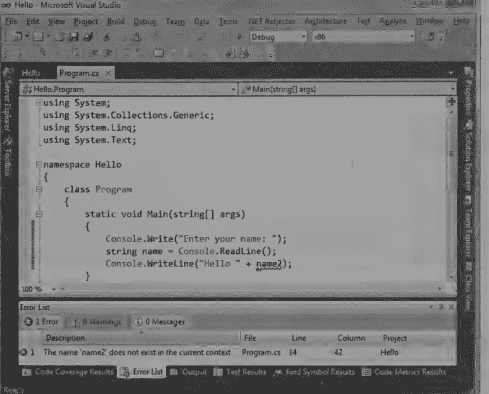

图 3.30 显示构建错误的错误列表窗格。

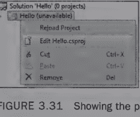

图 3.31 显示项目定义文件。

在图 3.32 中，我在 Visual Studio 内置的 XML 编辑器中折叠了一些 XML 节点。正如你所见，IDE 能够识别许多文件格式。同时注意，我们打开 XML 文件后启用的额外菜单和工具栏按钮。

从中我们可以看出，MSBuild 项目是 XML 文件，描述了正在构建的项目的结构：源文件是什么、所需的依赖项等等。Visual Studio 使用 MSBuild 文件来存储项目的结构并驱动其构建。该文件中的值得注意的条目包括以下内容：

- The Project tag specifies the tool version (in this case, version 4.0 of the .NET Framework tools, including MSBuild itself), among other build settings.
- PropertyGroups are used to define name-value pairs with various project-level configuration settings.

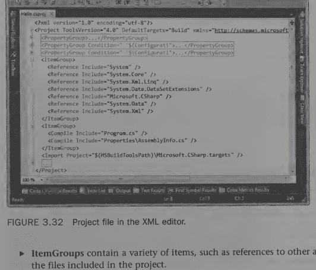

图 3.32 XML 编辑器中的项目文件。

- **ItemGroups** 包含各种项目，例如对其他程序集的引用和项目中包含的文件。
- 使用 **Import** 元素，指定了一个目标文件，其中包含如何构建某些类型文件（例如使用 C# 编译器）的描述。

你很少会直接使用 XML 编辑器修改项目文件。然而，对于高级场景，了解它的存在是很有用的。

现在你知道了如何检查 MSBuild 项目文件，请在解决方案资源管理器中从项目的节点上下文菜单中选择重新加载项目。假设构建成功（纠正之前示例中的愚蠢拼写错误），生成的二进制文件在哪里可以找到？查看项目的目录，你会找到一个名为 bin 的子文件夹。在其下，不同的构建版本各有自己的子文件夹。调试构建输出如图所示 3.33。目前，我们只构建了一个特定的构建版本：Debug。默认情况下提供两种构建版本，更正式地称为解决方案配置。在 Debug 模式下，会构建带有额外调试信息的符号文件。在 Release 模式下则不是这样，并且还会打开优化。这只是默认配置：你可以调整设置，甚至完全创建自定义配置。图 3.34 显示了可选择活动项目构建版本下拉列表。

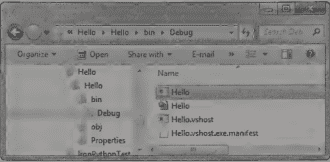

图 3.33 构建输出文件夹。


图 3.34 更改解决方案配置。

## 受管代码中 PDB 文件的作用

在关于 CLR 和托管代码的介绍章节中，我们强调了元数据的重要作用，它支持诸如 IntelliSense、丰富的类型信息、反射功能等各种功能。鉴于所有这些丰富的信息，你可能会想支持完整的调试支持还需要多少信息。托管代码程序集仍然具有 PDB 文件（程序数据库文件）这一事实表明需要额外的“调试符号”。其中一种用途是将编译后的代码映射回源代码中的行。另一种用途是跟踪局部变量的名称，而公共语言运行时并未为其提供元数据存储。

MSBuild 技术最大的优势之一是可以在不使用 Visual Studio 或其他工具的情况下进行构建。事实上，MSBuild 自带 .NET Framework。因此，你可以取任何 Visual Studio 项目（准确地说，自 2005 版本起）并直接在上面运行 MSBuild。没错：甚至不需要安装 Visual Studio。这不仅允许你与可能未安装 IDE 的其他人共享项目，而且还使自动化构建过程成为可能（例如通过 Team Foundation Server [TFS]）。因为现在可以在客户端系统上安装 Team Foundation Server，所以个人项目的自动化（即夜间）构建也对个人专业开发者可用。

事实上，MSBuild 只不过是一个通用的构建任务执行平台，它内置了依赖跟踪和时间戳检查的概念，以查看现有构建的哪些部分已过时（以便实现增量、从而更快的构建）。它能够调用诸如 C# 编译器之类的工具，是因为存在正确的配置文件，即所谓的 target 文件，声明了如何运行编译器。Being written in

对于托管代码，MSBuild 也可以轻松扩展。有关更多信息，请参阅 MSDN 上关于该主题的文档。

要查看命令行生成的实际运行，从“开始”菜单打开 Visual Studio 2010 命令提示符，将目录切换到 Hello.csproj 文件所在位置，然后调用 msbuild.exe（见图 3.35）。由于只有一个可识别的项目文件扩展名，MSBuild 将调用该特定项目文件的生成。

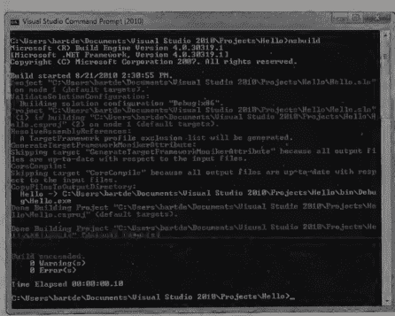

图 3.35 从命令行调用 MSBuild。

由于我们之前已通过 Visual Studio 为该项目调用过生成，所有目标都是最新的，增量生成支持将完全避免重新生成该项目。

> **提示**
>
> 想看到更实质性的生成操作实际运行吗？首先通过调用 `msbuild /target:clean` 清理项目的生成输出。接下来，只需再次发出 `msbuild` 命令即可重新生成。
>
> 要确信 C# 编译器确实在幕后被调用，请通过运行 `msbuild /verbosity:detailed` 开启详细日志记录。这会导致大量输出被发送到控制台，你会在其中发现对带有许多参数的 `csc.exe` 的调用。

## 调试支持

最早被纳入 IDE 概念范畴的功能之一，是编辑器之上的集成调试支持。在 Visual Studio 2010 中显然也不例外，它提供了出色的调试支持设施，作为 .NET Framework 上的专业开发者，你每天都会与之相伴。

最常用的调试技术是在各种关注位置设置断点来运行代码，如图 3.36 所示。直接在源代码文件中这样做很容易：将光标放在关注的行上并按 F9。其他方法包括单击左侧灰色边距，或使用任意工具栏或菜单项选项来设置断点。

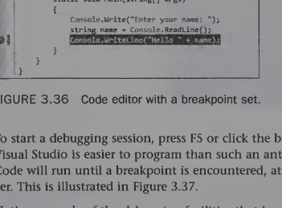

图 3.36 设置了断点的代码编辑器。

要启动调试会话，请按 F5 或单击带有 VCR 播放图标的按钮。（幸运的是，Visual Studio 的编程难度比这种古董且过于复杂的设备要低。）代码将运行，直到遇到断点，此时你将在调试器中中断。如图 3.37 所示。

请注意，当我们进入调试模式后，有几项调试设施变得可用：

- 调用堆栈窗格显示我们在应用程序代码执行中的位置。在这个简单示例中，Main 方法只有一个堆栈帧，但在典型调试会话中，调用堆栈会深得多。通过双击调用堆栈列表中的条目，你可以在不同堆栈帧之间来回切换，以检查程序状态。
- 局部变量窗格显示作用域内的所有局部变量及其值。更复杂的对象类型将带来更高级的可视化效果，以及深入查看局部变量中所保存对象内部结构的能力。此外，当在编辑器中悬停在局部变量上时，会显示其当前值，从而使检查程序状态容易得多。

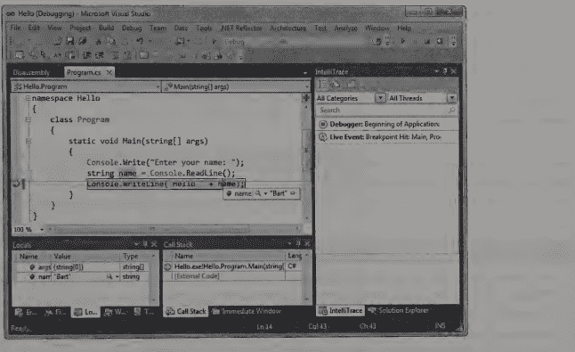

图 3.37 在调试器中命中断点。

- 调试工具栏变得可见，提供继续或停止执行以及以各种方式单步执行代码的选项：一次一行、步入或逐过程执行方法调用，等等。

调试器的更高级用法散布于本书各处，不过我们还是从一万英尺的高空视角强调几项：

- 即时窗口使你能够计算表达式、小段代码。通过这种方式，你可以检查更复杂的程序状态，而这些状态可能无法通过查看单个变量立即显现。例如，你可以执行一个方法来了解系统另一部分的状态。
- 断点窗口直接显示当前设置的所有断点，并提供断点管理选项：删除断点或启用/禁用断点的能力。
- 内存窗口和寄存器窗口是通过检查内存或处理器寄存器来查看机器精确状态的更高级手段。在托管代码的世界里，你不会经常使用它们。
- 反汇编窗口可用于显示程序执行的处理器指令。同样，在托管代码的世界里，这不太相关（回想一下 JIT 编译器的作用），但总的来说，Visual Studio 调试器既可用于托管代码调试，也可用于本机代码调试。
- **线程**窗口显示多线程应用程序中正在执行的所有线程。自 .NET Framework 4 起，System.Threading 中新增了并发库，并且新增了 **并行堆栈** 和 **并行任务** 窗口，以协助调试这些并发代码。

调试不一定通过直接从编辑器内部运行应用程序来启动。相反，你可以使用远程调试器附加到已在运行的进程，甚至可附加到远程计算机上的进程。

Visual Studio 2010 中的新功能是 IntelliTrace 功能，它支持一种时间旅行机制，用于检查程序在执行较早时间点的状态（例如，找出在命中断点很久之前发生的某些状态损坏）。

### 替代调试器

Visual Studio IDE 并不是唯一能够处理托管代码的调试器，尽管由于其丰富的图形特性，它可能是最方便的，因为这些特性允许直接目视检查各种状态等。

Windows 平台上熟悉命令行的开发者无疑听说过 CDB 及其图形界面对应物 WinDbg。两者都可以从 Microsoft 网站作为单独下载获取，称为 Windows 调试工具。

虽然 CDB 和 WinDbg 最初的目标受众是 Win32 本机代码开发者和驱动程序编写者，但用于托管代码的扩展会随 .NET Framework 一起提供。此调试器扩展称为 SOS，代表 Son of Strike，其中 Strike 是 CLR 的旧代号。你可以在框架安装文件夹下名为 sos.dll 的文件中找到它。我们会偶尔查看 SOS 的用法——例如，在第 18 章“事件”中，调试名为“使用 SOS 跟踪泄漏”的侧栏中的内存泄漏。

除了 SOS，还有一个称为 MDbg 的纯托管代码调试器，它代表 Managed Debugger。这个调试器同样以命令行调试器的形式提供。它最初旨在作为示例说明 CLR 调试器 API 的用法，但在我没有安装 Visual Studio 时，我时常发现它是个有用的工具。

鉴于如今应用程序编写时所采用的技术和工具通常混合使用，能够在同一次调试会话中完美地单步执行各种类型的代码至关重要。在托管代码的世界里，对此的一种自然解释是能够单步执行用不同托管语言（例如 C# 和 Visual Basic）编写的代码片段。但 Visual Studio 更进一步，提供了单步执行其他代码片段的能力：T-SQL 数据库存储过程、Windows Workflow Foundation (WF) 中的工作流代码、浏览器中的 JavaScript 代码，等等。实现这一点的核心支柱包括：能够同时调试不同进程（例如，某个 Web 服务器进程中的 Web 服务、SQL Server 数据库进程、运行 JavaScript 的 Web 浏览器进程），以及设置远程调试会话的能力。

## 对象浏览器

随着 .NET Framework 类库不断增长，并且托管代码应用程序中使用了大量其他库，浏览可用库的能力变得相当重要。我们已经看到 IntelliSense 作为一种显示可用类型及其可用成员的方式，但对于更全局的搜索，需要不同的可视化方式。Visual Studio 内置的对象浏览器就是这样一个工具（见图 3.38）。

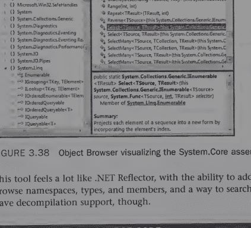

图 3.38 可视化 System.Core 程序集的对象浏览器。

这个工具用起来很像 .NET Reflector，能够添加程序集以供检查、浏览命名空间、类型和成员，并能在所有这些内容中搜索。不过，它不支持反编译。

### .NET Framework 源代码

想查看 .NET Framework 源代码本身吗？这一直是社区提出的一项长期请求，旨在帮助加深对框架功能的理解；为回应这一请求，Microsoft 从 .NET 3.5 开始通过共享源代码计划提供 .NET Framework 的部分源代码。更进一步，Visual Studio 已经过增强，能够单步执行可从 Microsoft 服务器获取的 .NET Framework 源代码。

你可以在 http://referencesource.microsoft.com/netframework.aspx 上找到有关 .NET Framework 的 Microsoft 共享源代码计划的更多信息。

## 代码洞察

如今构成 IDE 功能不可或缺一部分的一组至关重要功能，可以统称为“代码洞察”功能。无论编写代码这一行为看起来多么有吸引力——因为这正是我们开发者如此兴奋的事情，

由开发人员在后续阶段提供。图 3.42 展示了类图功能的外观与体验。

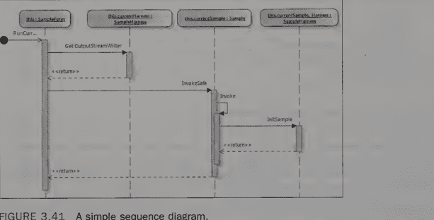

图 3.41 一个简单的序列图。

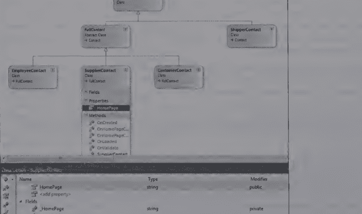

图 3.42 一个简单类型层次结构的类图。

项目中还存在其他可视化类型的方式。我们已经看到，对象浏览器可用于检查任意程序集并搜索类型及其成员。除此之外，还有“类视图”窗口，它将视图限制为当前解决方案中的项目。一个关键区别在于该工具的非交互性质：它是一种单向的类型可视化。

最后，为了从高层视图了解解决方案，还有架构资源管理器（如图 3.43 所示），它也是 Visual Studio 2010 中的新功能。它可以显示解决方案中的各个项目及其包含的项目项，你还可以进一步深入到这些项的结构中（例如类型和成员）。至此，这种视图与底层实现保持同步应该不会令人意外，而且可以使用设计器导航到所描绘的各个项。该工具的独特之处在于其丰富的分析能力，例如能够检测并突出显示循环引用、未使用的引用等。

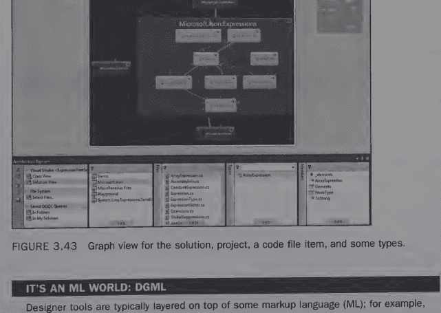

图 3.43 解决方案、项目、代码文件项以及一些类型的图形视图。

### 这是 ML 的世界：DGML

设计器工具通常构建在某种标记语言（ML）之上；例如，Web 设计器可视化 HTML，而在 WPF 和 WF 中，它们使用 XAML。架构资源管理器的设计器也不例外，它基于一种称为 DGML（有向图标记语言）的新格式。本质上，它描述基于节点和链接的图结构，因此可用于各种需要此类图表示/可视化的工具。

## 集成帮助

在安装 Visual Studio 2010 期间，我曾建议你使用“管理帮助设置”实用工具在本地安装完整的 MSDN 文档。尽管这不是必需的，但随时在手边拥有关于工具、框架库和语言的丰富文档会很方便。

尽管你可以通过单击“Microsoft Visual Studio 2010 文档”项从“开始”菜单直接启动 MSDN 库，但更常见的是通过 Visual Studio 中的“帮助”菜单或借助上下文相关集成帮助功能来调用它。可以通过上下文（按 F1）随时获取帮助的位置包括“错误列表”（用于获取编译器错误和警告的信息）和代码编辑器本身（用于查找 API 文档）。请注意，从 Visual Studio 2010 开始，文档通过浏览器而不是独立应用程序提供。这与在线 MSDN 帮助非常相似。

> **社区内容**
>
> msdn.microsoft.com 上的在线 MSDN 文档新增了一项较新的功能，允许用户以某种 wiki 风格贡献内容。例如，如果某个 API 的用法并不像你预期的那样简单直接，那么很可能有其他用户已经弄明白了，并在那里与全世界分享。

## 设计器

自 Visual Basic 1.0 推出以来（早在 1991 年），快速应用程序开发（RAD）一直是 Microsoft 面向开发人员的工具的核心主题。用于用户界面开发的丰富设计器，与通过编码完成同一任务的方法相比，能节省大量时间。在纯 Win32 编程世界中如此，今天依然如此，新的 UI 框架也受益于设计器支持。但正如我们将看到的，设计器也被用于 UI 编程领域之外的各种其他任务。

### Windows Forms

在 .NET 1.0 中，Windows Forms（WinForms）作为 Win32 API 的抽象层被引入，这些 API 用于窗口化以及操作系统中的公共控件。通过将这些旧日巨龙妥善封装在 `System.Windows.Forms` 类库中，创建用户界面变得容易得多。这不仅仅是因为它提供了面向对象的外表，还因为引入了新控件（例如常用的 `DataGrid` 控件）以及额外概念，例如用于在数据与表示之间架起桥梁的数据绑定。

图 3.44 展示了 Windows Forms 设计器正在为一个简单的问候程序设计用户界面。左侧的“工具箱”窗口显示了我们可以拖放到设计器图面上的所有可用控件。当我们选择一个控件时，右侧的“属性”窗口会显示可用于控制该控件外观和行为的所有属性。

要挂接代码以响应各种用户操作，可以通过同一个“属性”窗口单击工具栏上的“闪电”图标来创建事件处理程序。

示例事件包括按钮的 Click、文本框的 TextChanged 等。而每个控件最常见的事件只需双击该控件即可挂接。例如，双击选中的按钮会生成一个用于单击 Say Hello 的事件处理程序。现在，我们又回到了 C# 代码的世界，如图 3.45 所示。

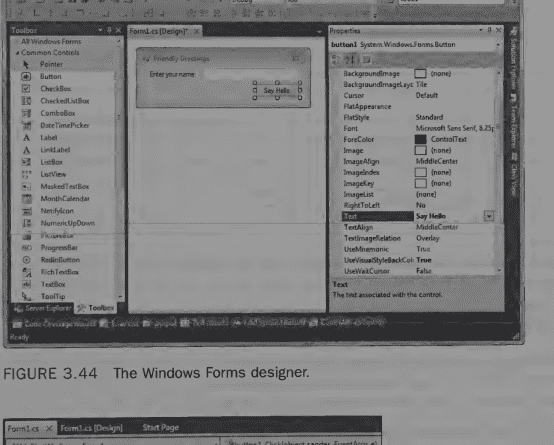

图 3.44 Windows Forms 设计器。


图 3.45 一个准备好实现的空事件处理程序。

Windows Forms 引入的直截了当的工作流，使其从 .NET Framework 推出之初就取得了巨大成功。尽管我们现在有了 Windows Presentation Foundation（WPF）这种更新、更现代的 UI 开发方式，但仍有大量 Windows Forms 应用程序存在。（因此，了解一些相关知识对你是有好处的。）

### 代码生成与 C# 语言

你可能想知道，前面 WinForms 应用程序的 UI 定义是如何存储的。是否存在一种特殊的磁盘格式来描述图形界面，还是别的什么方式？在经典 Visual Basic 的世界中，情况确实如此，使用的是 .frm 和 .frx 文件。不过，对于 WinForms，答案是否定的：UI 定义只是以生成的 C#（或 VB）代码形式存储，使用 System.Windows.Forms 类型，就像你不使用设计器定义 UI 时会自己做的那样。实际上，设计器是你的 UI 的一个实时实例，只是某些交互被重新连接到设计器的功能上（例如，单击按钮时，它会变为选中状态）。

那么这段代码位于哪里？在带有事件处理程序方法的截图中，请注意 Form 类构造函数中对 InitializeComponent 的调用。当你右键单击该调用并选择“转到定义”时，你会看到打开了另一个扩展名为 .designer.cs 的代码文件：

```
#region Windows Form Designer generated code

/// <summary>
/// Required method for Designer support - do not modify
/// the contents of this method with the code editor.
/// </summary>
private void InitializeComponent()
{
    this.label1 = new System.Windows.Forms.Label();
    this.button1 = new System.Windows.Forms.Button();
    this.textBox1 = new System.Windows.Forms.TextBox();
}
```

在这里，你会找到设置控件所有属性、将控件添加到窗体、挂接事件处理程序等代码。

请注意 InitializeComponent 方法顶部的 XML 文档注释，它说明不要修改此代码，因为该代码由图形设计器生成，所做的更改最好情况下会被覆盖，或者可能使设计器困惑，导致奇怪的行为。为什么指出这一点很重要？嗯，.NET 1.0 中设计器的第一个版本不得不使用 C# 语言的第一个版本。当然，这本身没有什么问题，除了生成的代码必须发出到与包含事件处理程序代码相同的文件中这一事实。尽管在更新生成代码时确保用户代码不被篡改在技术上具有挑战性，但还有一个更大的缺陷。开发人员天生好奇，尽管代码顶部有警告注释，他们还是时常忍不住调整生成的代码，有时会造成灾难性的结果。作为（部分）缓解此问题的一种方式，代码被发出到 #region 预处理器指令内，以便在代码编辑器中将其折叠，默认情况下对开发人员隐藏。


图 3.46   集成的 WPF 设计器。

一个关键区别在于设计器所公开的功能。首先，请注意左侧的缩放滑块，它体现了 WPF 的分辨率无关能力。更实质性的区别在于设计器表面与底部 XAML 视图的分离。使用 XAML 时，设计时不再涉及典型的代码生成。相反，XAML 真正完整地描述了 UI 定义。

基于此架构，可以设计不同的工具（例如 Expression Blend），这些工具允许对 UI 进行细化，而无需大量编写 C# 代码。因此，集成设计器仅提供基本的 UI 定义能力，将更复杂的设计任务从 Visual Studio 中解耦，并委托给更专业的 Expression Blend 工具，供专业图形设计人员使用。

同样，双击按钮控件会生成模板代码，用于编写响应用户单击它的事件处理程序。尽管事件处理程序方法的签名略有不同，但思路是一样的。图 3.47 显示了为 WPF 事件生成的空事件处理程序。

不过请注意，Window1 类的构造函数中仍然有对 InitializeComponent 的调用。但我不是刚说过 WPF 不涉及代码生成吗？这基本正确，这里生成的代码本身并不包含 UI 定义。相反，它包含在运行时加载 XAML 文件以构建 UI 所需的基础管道代码。同时，它为添加到用户界面中的所有控件包含字段，以便你可以在代码中引用它们。此生成代码位于一个分部类定义中，存储在一个扩展名为 .g.i.cs 的文件中，如图 3.48 所示。要查看此生成的代码文件，请在解决方案资源管理器中切换“显示所有文件”选项。

```csharp
using System.Windows.Media.Imaging;
using System.Windows.Navigation;
using System.Windows.Shapes;

namespace MyFirstWpfApplication
{
    /// <summary>
    /// Interaction logic for Window1.xaml
    /// </summary>
    public partial class Window1 : Window
    {
        public Window1()
        {
            InitializeComponent();
        }

        private void button_Click(object sender, RoutedEventArgs e)
        {

        }
    }
}
```

**图 3.47**  WPF 中事件处理程序的代码骨架。

```csharp
internal System.Windows.Controls.TextBox textBox1;

#line default
#line hidden

private bool _contentLoaded;

/// <summary>
/// InitializeComponent
/// </summary>
[System.Diagnostics.DebuggerNonUserCodeAttribute()]
public void InitializeComponent() {
    if (_contentLoaded) {
        return;
    }
    _contentLoaded = true;
    System.Uri resourceLocator = new System.Uri("/MyFirstWpfApplication;component/Window1.xaml", System.UriKind.Relative);
#line 1 "..\..\..\Window1.xaml"
    System.Windows.Application.LoadComponent(this, resourceLocator);
#line default
#line hidden
}
```

**图 3.48**  WPF 窗口定义的生成代码。

请注意，XAML 文件（它会被编译成应用程序程序集中的一种称为 BAML 的二进制格式）是如何通过生成的代码加载的。从那时起，XAML 被用于实例化用户界面定义，准备好由 WPF 的呈现引擎显示。

顺便说一句，你实际上可以完全不使用 XAML 来创建 WPF 应用程序，只需自己创建窗口和控制类型的实例即可。换句话说，XAML 并没有什么神秘之处；它只是带来极大的便利，让你不必承担手工定义对象的负担。

支付服务、向运输设施发送通知，等等。工作流提供必要的服务来维护这种有状态的长时运行操作，并在需要时通过状态（去）水合来执行挂起和恢复操作。


图 3.49   一个简单的顺序工作流。

## WPF 再次来袭

Visual Studio 2010 不仅使用 WPF 技术呈现，新的工作流设计器也是如此。这清楚地说明了 WPF 所能提供的丰富性。实际上，工作流设计器也可以重新承载在自定义应用程序中。

## ASP.NET

同样从 .NET Framework 诞生之初就引入的是 ASP.NET，它是经典 Active Server Pages (ASP) 的服务器端 Web 技术继任者。使用基于 ASP 的技术进行 Web 编程时，新旧世界之间的核心差异包括以下内容：

- 支持丰富的 .NET 语言，利用面向对象编程的基础，消除了经典 ASP 中像 VBScript 那样使用服务器端脚本的做法。
- 提供一流的控件概念，这些控件封装了客户端执行中的 HTML 和脚本方面。
- 与控件支持相关的是使用事件驱动方法来控制与用户的交互，从而隐藏 HTTP 回发或 AJAX 脚本向服务器发起回调的复杂性。
- 诸如登录功能、用户配置文件、网站导航等各个方面都获得了内置库支持，从而消除了用户为众所周知的任务重新造轮子的需要。一个例子是成员资格提供程序负责安全的密码存储，提供登录和密码重置控件等。
- 由于 .NET 的 xcopy 愿景，部署变得容易。例如，当需要将类库部署到服务器时，在 .NET 世界中无需执行服务器端注册。
- 丰富的声明性配置系统使 Web 应用程序的部署更加容易，设置存储在文件中，并通过任意选定的上传机制与应用程序的其余部分一起部署。

从 Visual Studio 的角度来看，ASP.NET 具有丰富的项目支持，包括内置设计器和部署设施。图 3.50 显示了 ASP.NET 的页面设计器。


图 3.50   ASP.NET 的页面设计器。

到现在，设计器应该开始看起来非常熟悉了。这一次，标记存储在 HTML 中，包含各种带有 asp: 前缀的 ASP.NET 控件。设置为 server 的 runat 属性表明涉及服务器端处理，会将这些控件转换为浏览器兼容的标记：

```html
<asp:Button ID="Button1" runat="server" Text="Say Hello" />
```

同样，工具箱包含大量可用于 Web 开发的控件，属性窗口也加入其中，帮助配置控件的外观、行为、数据绑定等。设计器表面处于拆分模式，以同时显示 HTML 和 ASP.NET 源以及设计器视图。两者在更新和选择方面保持同步。

实际上，这个设计器相当强大。看看为格式设置、表格、层叠样式表 (CSS) 的使用等而添加的各种菜单和工具栏。话虽如此，对于更复杂的 Web 设计，还存在另一个 Expression 系列工具：Expression Web。与 WPF 配合 Expression Blend 的方式类似，这一对工具促进了开发人员与设计人员之间的协作。

再次，挂接事件处理程序很容易（图 3.51 生成的事件处理程序代码可以证明）。幕后发生的事情则复杂得多。尽管你仍然编写托管代码，但 ASP.NET 在运行时通过回发机制挂接事件处理程序。随着 AJAX 的引入，各种回发操作也可以变为异步。这样一来，回发操作不必触发整个页面刷新，从而大大改善了用户体验。


```csharp
using System;
using System.Web.UI;
using System.Web.UI.WebControls;

public partial class _Default : System.Web.UI.Page
{
    protected void Page_Load(object sender, EventArgs e)
    {
    }

    protected void Button1_Click(object sender, EventArgs e)
    {
    }
}
```

**图 3.51**  ASP.NET 中的事件处理程序代码。

为了简化 ASP.NET 应用程序的测试，Visual Studio 2010 附带了一个内置的 ASP.NET 开发服务器，从而无需在开发计算机上安装 Internet Information Services (IIS)。开发服务器有两个目标。一是便于调试，二是提供站点配置 Web 界面。图 3.52 显示了为响应启动调试会话（例如按下 F5）而启动的开发服务器。


**图 3.52**  开发服务器已启动。

尽管底层发生的交互更为复杂，但调试 ASP.NET 应用程序与调试任何常规类型的应用程序一样简单。在最新版本中

此外，还有“无 PIA（主互操作程序集）”的概念，它显著改善了托管 Office 加载项的部署情况。PIA 包含 Office API 的包装，但体积可能相当大（约为几兆字节）。过去，这些程序集需要与应用程序一起部署，并在运行时整体加载到内存中。借助无 PIA 功能，PIA 中使用的部分可以链接到应用程序的程序集中，从而消除了部署负担并减少了内存占用。

## 服务器资源管理器

现代软件很少与其他系统完全断开连接。数据库驱动的应用程序无处不在，面向服务的应用程序也越来越多。服务器资源管理器是连接服务器、探索服务器的各个方面以及构建用于与相关系统交互的软件组件的手段之一。图 3.54 显示了处理数据库连接时服务器资源管理器的一个视图。向项目中添加组件（Component）文件后，会得到一个空的设计图面，可用于拖放不同类型的服务器对象。


图 3.54 带有活动数据库连接的服务器资源管理器。

服务器资源管理器内置支持多种常用的服务器端技术，包括以下内容：

- 各种**数据库技术**，支持 SQL Server、Access、Oracle、OLE DB 和 ODBC。连接到数据库后，可以可视化表、存储过程等内容。
- **事件日志**从管理角度来看非常有用，既可用于检查，也可在程序执行期间发出诊断信息。.NET 对日志记录基础架构提供了丰富的支持。
- **管理类和事件**是 **Windows 管理规范（WMI）** 技术的两个方面，允许对系统配置进行彻底的查询和修改。
- **消息队列**利用 Microsoft 消息队列（MSMQ）技术，实现机器之间可靠且可能离线的通信。要向队列发送数据或从队列接收数据，可以创建一个映射对象。
- **性能计数器**是应用程序可管理性的另一个基石，能够将诊断性能信息发出到系统中的计数器（例如，服务每秒处理的请求数）。
- 服务节点提供了管理 **Windows 服务** 的门户，例如查询已安装的服务、其状态和配置，并对其进行控制。实际上，C# 甚至可以用来编写托管代码的操作系统服务。

例如，在图 3.55 中，使用组件设计器创建了一个管理组件，其中包含用于 Windows 服务器、性能计数器和事件日志的管理对象。得益于从服务器资源管理器拖放到设计图面的支持，无需手动编写任何代码。可以使用属性窗口调整生成对象的设置。


图 3.55 带有管理对象的组件设计器图面。

### 什么是组件？

术语 *component*（组件）可能是软件设计领域中最被过度使用的词之一。在 Visual Studio 的 Component 项目项的上下文中，它指的是 System.ComponentModel 命名空间中的 Component 基类的子类型。该组件究竟由什么组成，将在第 27 章“诊断和检测”中讨论，该章中经常使用组件。本质上，组件使共享代码、远程访问代码、正确管理内存等成为可能。此外，设计器支持的概念也与组件模型密切相关。

服务器资源管理器不仅参与创建以管理为中心的组件。在其他各种上下文中，服务器资源管理器也可以用来驱动软件的设计。其中一种常见用途是创建数据库映射，这一用途非常普遍，我们专门用下一整节来介绍。

## 数据库映射器

如今，几乎没有应用程序可以离开某种数据存储而存在。一个明显的选择是使用关系数据库，从简单的 Access 文件到完整的客户端/服务器数据库系统（如 SQL Server 或 Oracle）皆可。虽然通过 System.Data 命名空间提供与数据库通信的库支持是 .NET Framework 中的一项关键功能，但事情远不止于此。

数据库技术最大的挑战之一是代码与数据之间所谓的 *阻抗不匹配*。数据库由可能彼此关联的表组成，而 .NET 基于面向对象的编程，因此需要在关系数据和对象之间建立双向映射。在这里，*双向*意味着应该能够从数据库记录构造对象，同时能够将更改从对象反馈回数据库。

为了实现这一点，多年来创建了各种映射机制，每种机制都有其自身的特点，使其适用于不同的场景。乍一看，这似乎有点混乱，但让我们按时间顺序来看一下。我们不会深入讨论它们：已经有整本书对它们进行了详细说明。现在，我们只处理 .NET 编程中的数据库。

### DataSet

.NET Framework 1.0 通过提供离线数据访问手段，开始为数据库映射领域增色。这一设想源于偶尔连接的客户端这一概念。核心思想如下。

首先，查询数据库的一部分，并将其映射到丰富的 .NET 对象上，用熟悉的托管类型反映数据库记录的结构。接下来，这些对象可以通过 ASP.NET 和 Windows 窗体中的数据绑定等机制，在用户界面中可视化。此外，对象可以直接在内存中更新，既可以直接通过代码，也可以通过数据绑定机制。数据绑定中一个常用控件的例子是 DataGrid，它以表格形式呈现数据，就像 Excel 和 Access 一样。

可视化和更新源自数据库的内存中对象只是问题的一部分。那么，跟踪用户所做的更改并将这些更改反馈到数据库呢？这正是通过 DataSet 建立的离线映射的职责之一，它与所谓的数据适配器协作，这些适配器知道如何在请求时将更改反馈回去（例如，通过发出 SQL 中的 UPDATE 语句）。

DataSet 可以通过两种方式使用。最有趣的一种是创建强类型映射，利用数据库架构信息来映射类型并创建完整保真度的 .NET 对象。例如，Products 表中的一条记录会变成一个 Product 对象，其属性与列对应，每个属性都有相应的 .NET 类型。

要创建强类型 DataSet，Visual Studio 提供了一个可以与服务器资源管理器交互的设计器。这使得只需执行几次拖放操作就能非常轻松地生成映射。图 3.56 显示了创建此类映射的结果。


图 3.56 DataSet 设计器。

### DataSet 的未来

有些人认为，自从 LINQ 在 .NET 3.5 中引入及其新的映射机制出现以来，DataSet 的使用已变得多余。事实远非如此。事实上，.NET Framework 类库中甚至还有一个 LINQ to DataSet 提供程序。

无论底层数据存储的类型如何，DataSet 仍然是表示表格数据的一种便捷方式。之所以有效，是因为 DataSet 被有意设计为与特定数据库提供程序解耦，并充当通用数据容器机制。

DataSet 的一个关键优势是它直接支持基于 XML 的序列化。事实上，强类型 DataSet 的扩展名是 .xsd，这揭示了这种关系。从数据库架构生成映射时，实际上是在创建捕获类型定义及其相互关系的 XML 架构。.NET Framework 开发工具附带的命令行工具 xsd.exe 可用于从此类架构生成 C# 或 VB 代码，就像集成设计器所做的那样。

## LINQ to SQL

在数据库映射技术领域相对平静的 .NET 2.0 和 3.0 版本之后，语言集成查询（LINQ）在 .NET 3.5 中引入。正如第 2 章所讨论的（并在第 18 章和第 19 章中详述），LINQ 为 C# 和 VB 提供了丰富的语法扩展，以简化数据查询，无论其形式或来源如何。除了用于查询内存中对象图或 XML 数据的 LINQ 提供程序之外，.NET Framework 3.5 还附带了一个针对 SQL Server 数据库查询的提供程序。

与 DataSet 设计器类似，LINQ to SQL 也带有工具支持，可将数据库架构映射到对象模型定义。图 3.57 显示了使用 Northwind 示例数据库进行此类映射的结果。与 DataSet 的另一个核心区别在于 SQL 专用映射支持，而不是更通用的方法。这意味着 LINQ to SQL 提供程序深入了解 SQL 的功能，能够在运行时生成用于查询和创建/更新/删除（CRUD）操作的 SQL 语句。

与 DataSet 设计器类似，可以使用服务器资源管理器将表（以及其他数据库项）拖放到设计图面上，从而触发映射的生成。请注意，表之间的关系也会被检测到，并转换为对象模型中直观的映射。

一旦建立了此映射，就可以使用 LINQ 语法针对数据库上下文对象查询数据库。该上下文对象负责连接维护和更改跟踪，以便将更改反馈到数据库。

了解设计器如何为映射对象模型生成代码是件有趣的事。大多数设计器使用某种标记语言来表示所设计的内容。ASP.NET 采用以 HTML 为中心的方法，WPF 使用 XAML，而 DataSet 基于 XSD。对于 LINQ to SQL，使用一个包含数据库映射定义的 XML 文件，因此扩展名为 .dbml。


图 3.57 LINQ to SQL 设计器。

要将此标记文件转换为代码，Visual Studio 中会挂接一个所谓的单文件生成器，生成 .cs 或 .vb 文件，具体取决于项目语言。图 3.58 显示了为 LINQ to SQL 使用的 .dbml 文件配置的代码生成工具。生成的代码位于扩展名为 .designer.cs 的文件中。其他文件格式，例如 .diagram 和布局文件，仅用于在设计器中显示映射时的外观和观感。这些不会以任何方式影响映射的含义。

毫不意外，生成的代码再次利用了 C# 2.0 的分部类特性。这允许在单独的文件中向生成的类型添加额外代码。但还有更多：一个 C# 3.0 特性也即将出现。注意到图 3.59 中折叠的“扩展性方法定义”区域了吗？

你会在各种生成的类型中看到这样的区域，其中包含分部方法定义。在图 3.59 的数据上下文类型中，一个这样的分部方法是 OnCreated：

```
    public partial class NorthwindDataContext : System.Data.Linq.DataContext
    {
        #region Extensibility Method Definitions
        partial void OnCreated();
        #endregion

        public NorthwindDataContext(string connection)
            : base(connection, mappingSource)
        {
            OnCreated();
        }
    }
```


图 3.58 DBML 文件如何转换为 C# 代码。


图 3.59 生成的 LINQ to SQL 映射代码。

分部方法的思想是提供一种高效扩展自动生成代码功能的方式。在这个特定示例中，代码生成器发出了对一个未定义的 OnCreated 方法的调用。通过这样做，为开发者创建了一个可利用的扩展点。如果希望在创建数据上下文时执行某些操作，可以在分部类定义的配套文件中为 OnCreated 提供实现。这将生成的代码与开发者编写的代码分离，从而允许随时无风险地重新生成生成的代码。

## ADO.NET 实体框架

最后，我们来到了 .NET Framework 中可用的最新数据库映射技术：实体框架（Entity Framework）。实体框架在 .NET 3.5 SP1 中引入，比其前身提供了更大的灵活性。它通过提供几个关键概念来实现这一点，有效地将概念模型与到数据库存储的映射解耦。这使得应用程序的不同部分可以彼此独立地演进，即使数据库架构发生变化。实体框架还得益于与 WCF 服务栈的丰富集成，尤其是基于 OData 的 WCF Data Services。

图 3.60 展示了架构概览。


图 3.60 实体框架概览。

右侧是执行架构，这个主题我们留待以后讨论。从中最重要的收获是能够使用 LINQ 语法查询通过实体框架公开的数据源。作为此类查询的返回，熟悉的 .NET 对象会返回。这就是映射的全部意义所在。

在底层，数据源有一个 Entity Client Data Provider，它理解三件事：

- 概念模型捕获开发者的意图以及数据如何暴露给其余代码。这里定义了实体和关系，它们被映射到对象模型。
- 存储模型与数据库具体细节相关联，定义数据的底层存储以及配置的各个方面。表定义、索引等内容都属于这里。

```csharp
return a - b;
}

public static int Multiply(int a, int b)
{
    return a * b;
}

public static int Divide(int a, int b)
{
    return a / b;
}
}
```

为了验证 Calculator 类的行为，我们希望用不同的输入调用该计算器的各个方法，既测试常规操作，也测试边界条件。这是一个简单的例子，但你明白意思。

Visual Studio 中的单元测试保存在一种单独的项目类型中，该项目类型挂接到测试执行工具，并将结果报告回用户。这种底层测试执行基础结构也可以在 Visual Studio 之外使用（例如，在某个源代码控制服务器上集中运行测试）。存在不同类型的测试项目。单元测试是迄今为止最常见的，允许对一系列应用程序类型进行自动化测试。手动测试描述了一组要执行的手动步骤，以验证软件组件的行为。其他类型的测试项目包括基础测试、性能测试等。

要创建单元测试项目，只需在代码编辑器中右击类型或成员，然后选择“创建单元测试”（见图 3.62）。


接下来，选择要测试的类型和成员（见图 3.63）。

这会生成一系列带有一些骨架代码的测试方法，供开发者插入具体的测试代码。显然，如有必要，可以添加更多测试方法。


图 3.63 选择要测试的类型和成员。

以下是这样生成的测试方法的示例：

```
[TestMethod()]
public void AddTest()
{
    int a = 0; // TODO: Initialize to an appropriate value
    int b = 0; // TODO: Initialize to an appropriate value
    int expected = 0; // TODO: Initialize to an appropriate value
    int actual;
    actual = Calculator.Add(a, b);
    Assert.AreEqual(expected, actual);
    Assert.Inconclusive("Verify the correctness of this test method.");
}
```

开发者现在的任务是用要测试的有趣输入和输出填充占位符。这里展示了一个过于简单的示例：

```
[TestMethod()]
public void AddTest()
{
    int a = 28;
    int b = 14;
    int expected = 42;
    int actual;
    actual = Calculator.Add(a, b);
    Assert.AreEqual(expected, actual);
}
```

注意末尾的 Assert.Inconclusive 调用已被移除。如果测试工具遇到这样的方法调用，该测试的运行会被指示为“无结论”，意味着结果既不正确也不错误。要编写更有意义的单元测试，请使用另一个 Assert 方法检查预期条件。例如，Assert.AreEqual 测试检查所提供的参数是否相等。

### 使用 PEX 进行测试生成

从前面的示例可以清楚地看出，Visual Studio 2010 并不具备神奇的能力来理解你的代码，从而自行生成一系列单元测试。不过，这并不意味着这样的事情无法实现。

通过仔细分析代码，专用工具可以推断出许多命中有趣条件的有效测试用例。在前面的示例中，我们还没有编写一个测试来处理当 Add 方法的两个参数太大、其和无法表示为 32 位整数时的溢出情况。工具可以通过查看所使用的类型来推断此类情况。

自动化测试生成的另一个吸引人的特性是能够确保高代码覆盖率。假设你有一些带有一堆条件分支的代码，导致可能的执行路径爆炸式增长。流分析工具可以生成不同的输入值集合，以便命中被测单元中的各种代码路径。

如果所有这些听起来像一场美梦，现在醒醒吧。借助 Pex，Microsoft Research 创建了这样一个可插入 Visual Studio 的工具包。Pex 代表 Program Exploration（程序探索），反映了其基于对程序进行推理的自动化测试用例生成能力。如果你关心测试覆盖率（你应该关心！），Pex 绝对值得一看。访问 http://research.microsoft.com/Pex 了解更多信息。

将 Pex 与 .NET 4.0 一起使用的妙处在于它与托管代码契约的协同作用，我们稍后会讨论这一点。契约的一个示例是约束输入值的范围，即所谓的前置条件。契约不仅用于文档目的；它们还用于通过定理证明器或运行时检查来强制正确性。但是，将契约中捕获的信息与 Pex 结合使用甚至更令人兴奋。Pex 可以利用这些丰富的信息来提出更多测试用例，以检查违反契约等情况。

所有这些是否意味着你不应再自己编写单元测试？不。尽管 Pex 可以承担生成各种类型测试的负担，但编写更复杂的测试用例来演练软件组件需要处理的各种具体场景仍然具有很大价值。换句话说，Pex 使你能够更专注于更复杂的测试用例，同时让你从创建稍微枯燥（但仍然重要）的测试用例中解脱出来。

一旦编写好单元测试，它们就可以在测试工具中编译并执行。这是你在进行更改时会开始定期做的事情，以捕获代码中的回归。图 3.64 显示了一个示例测试运行结果。


图3.64 测试结果。

事实证明，我在 Subtract 方法的代码中引入了一些错误，正如单元测试所捕获的那样。当然，测试也可能是错误的。无论如何，失败的测试用例都迫切需要立即关注以追踪问题。请注意，您也可以像调试普通程序代码一样调试测试用例。

与单元测试紧密集成的是分析代码覆盖率的能力。保持较高的代码覆盖率始终是一个值得追求的目标（90% 是最低限度的良好目标，最好更高），这样您才能对测试用例的全面性充满信心。Visual Studio 实际上内置了代码高亮功能，可以将在测试期间命中的代码与未命中的代码进行对比。

## 团队开发

为了完成我们对 Visual Studio 2010 工具支持的深入探索，我们简要了解一下团队环境下的软件开发支持。如今的企业应用程序很少由单个开发人员甚至少数开发人员编写。例如，.NET Framework 本身就有数百名开发人员和测试人员每天在为之工作。

### 团队系统与 Team Foundation Server

为了应对此类组织的复杂性，Visual Studio Team System (VSTS) 为开发团队提供了丰富的工具集。除了工作项和缺陷跟踪、项目状态报告以及集中式文档库之外，源代码管理很可能是团队开发中最直观的方面。

Team Foundation Server (TFS) 的使用入口是集成在 Visual Studio 2010 中的团队资源管理器窗口（参见图 3.65）。

以下是团队资源管理器树视图中不同节点的快速概览：

- 根节点代表我们所连接的 TFS 服务器。TFS 的一个优点是它使用 HTTP(S) Web 服务（因此不存在端口配置的麻烦）。在服务器下，会显示不同的团队项目。
- 工作项是分配给团队成员的缺陷描述和任务的统称。可以定义查询来搜索数据库中的不同字段。通过工作项视图，可以打开、解决缺陷等。


图3.65 Visual Studio 2010 中的团队资源管理器。

- **文档** 显示伴随项目的各种文档——Word 文档、Visio 图表、普通文本文件等。这些文档也可以通过 SharePoint Web 界面使用。
- **报表** 利用 SQL Server Reporting Services 技术来显示项目各个方面的信息，以监控其状态。示例包括缺陷计数、代码统计等。
- **生成** 允许开发人员设置可用于产品生成的生成定义，无论是在本地还是远程。对于团队开发来说，始终保持良好的产品生成是一个很好的实践。自动生成设施允许配置每日生成等。
- **源代码管理** 是通过各种操作管理源代码的地方，以简化多个开发人员同时处理代码的流程。这进一步与解决方案资源管理器集成。

### 源代码管理

源代码管理将源代码集中存储在服务器上，并提供服务来管理开发人员的并发更新。当需要修改代码文件时，会将其签出以允许本地编辑。在做出（并测试）更改后，使用相反的签入操作将更新发送到源代码数据库。如果检测到编辑冲突，工具会通过合并更改来帮助解决冲突。

图 3.66 展示了 Visual Studio 2010 中源代码管理的存在，包括解决方案资源管理器和源代码管理资源管理器窗口中的丰富上下文菜单。

源代码管理的其他功能包括丰富的源代码版本控制（支持回溯历史）、搁置编辑以供同行开发人员代码审查、将签入与已解决的缺陷关联，以及在源代码树中创建分支，为不同的功能团队提供各自的“游乐场”。

# 第4章

## 语言基础

基础很重要。编程语言也不例外，因此我们首先关注 C# 编程语言的本质：内置类型、变量、表达式和语句、控制流、方法等。

### 入口点

为了简单起见，在面向语言的章节中，我们将专门使用控制台应用程序。这样可以让我们专注于编程语言的基础，而不会被用户界面定义等分心。

首先需要考虑的是托管代码入口点，即程序开始执行的地方。不同类型的应用程序都有这样的入口点，包括控制台应用程序和使用 Windows Forms 或 Windows Presentation Foundation (WPF) 构建的 GUI 应用程序。其他技术，例如 ASP.NET Web 应用程序，以不同的方式启动托管代码的执行，但我们暂时不讨论这些。

### 一个简单的控制台应用程序

到目前为止，用 C# 编写的最简单的托管代码应用程序是一个不做任何有用事情的程序。下面的示例虽然目前只有学术意义，但我们必须从某个地方开始：

### 本章内容

- 入口点 171
- 关键字 177
- 类型入门 180
- 内置类型 185
- 局部变量 209
- 注释插曲 220
- 数组 228
- Null 引用 237
- 可空值类型 240

```
class Program
{
    static void Main()
    {
    }
}
```

Main 是我们应用程序的托管代码入口点方法。它的主体由花括号分隔，包含应用程序要执行的语句。在本例中，我们的方法主体为空。

### 区分大小写

请注意 Main 方法的大小写，其首字母大写。C# 是一种区分大小写的语言，就像其他 C 衍生语言（如 C++ 和 Java）一样。换句话说，仅大小写不同的方法名表示不同的方法；因此 `main` 和 `Main` 并不相同。C# 要求托管代码入口点的格式与前面片段所示完全一致。

大小写敏感性不仅适用于方法名。关键字、类型及其成员的名称、命名空间——它们都需要区分大小写。

这里有一个重要点要立即指出。要使程序集符合公共语言规范 (CLS)，任何公开可见的类型或成员，与同类相比，都不应仅仅在大小写上有所不同。如果存在这种情况，像 Visual Basic 这样不区分大小写的语言在无歧义地解析名称时就会遇到麻烦。

C# 没有全局方法的概念，这意味着所有方法（以及您将看到的其他类型的成员）都需要包含在类型定义中。在我们的示例中，该类型是一个名为 Program 的类。在下一章中，我们将研究类型和类之间的区别，所以暂时忽略这个细节。

### 方法签名

方法也有签名，您可以将其视为描述如何调用方法的“配方”。方法签名的重要部分包括方法名、返回类型和参数。它还包含用于“修改”方法行为的修饰符。

让我们根据这些概念来解读图 4.1 中显示的 Main 方法签名：

- 一个修饰符 `static` 关键字应用于该方法。这意味着该方法不操作包含类型的特定实例。为了进一步解释这一点，我们首先需要了解类型和面向对象编程，这是第 14 章“面向对象编程”的主题。敬请期待。


图4.1 分解 Main 方法签名。

- 方法的返回类型是 `void`。顾名思义，这意味着该方法不返回任何内容，使其成为过程。如果方法要返回某些内容，我们称之为*函数*。像 Visual Basic 这样的语言通过使用 `Sub` 关键字声明过程和 `Function` 关键字声明函数来明确这种区别。C# 不区分这一点：`void` 表示过程。
- 正如我们已经知道的，Main 是方法的名称。该名称用于调用方法（例如，从程序中的其他位置或其他库）。Main 有点不同，它是由 CLR 直接调用的入口点。
- 我们的入口点有一个空参数列表，由括号包围，这意味着调用者在调用时无法为其提供输入。稍后您将看到，为了处理命令行参数，可以接受不同的入口点签名。即使为空，这对括号也不能省略。

我们将在第 10 章“方法”中讨论可见性和泛型方法时，进一步完善方法签名的定义。

### void 是一等类型吗？

虽然我们还没有学习类型，但好奇的读者无疑会想知道 `void`（用于表示“无”的东西）是否是一种真正的类型。有点令人失望的是，答案是否定的。稍后您会看到为什么这种一等公民待遇可能会有用，但说实话这没什么大不了的。

### 允许的入口点签名

众所周知，操作系统中程序的调用支持传入命令行参数。此外，可执行文件在终止时可以提供退出代码，指示调用的结果，通常零值表示成功状态。为了实现这些场景，Main 方法允许四种不同的签名：

```
static void Main()
static int Main()
static void Main(string[] args)
static int Main(string[] args)
```


这些基本上是由以下内容构成的四种组合：

- 返回一个整数类型的退出码，或者完全不返回
- 接受一个命令行参数数组，或者完全不接受

每个可执行程序集只能定义一个入口点，因此必须做出选择。Visual Studio 选择的默认入口点是第三种，即接受命令行参数数组但不返回退出码。实际上，这意味着 CLR 会代表开发者提供一个零值退出码，表示调用和执行成功。

## Windows PowerShell

微软平台上的下一代命令行、脚本和自动化环境是 Windows PowerShell。它与经典 Windows 命令行解释器的一个根本不同之处在于对命令的处理。

在 Windows PowerShell 中，命令被 cmdlet（发音为“commandlets”）所取代，这些 cmdlet 都有非常专门的任务，并且可以通过构建管道轻松组合。下面是这样一个管道的示例：

```
dir | where { $_.WorkingSet64 -gt 10MB } | format-table
```

这些 cmdlet 的输入和输出不再基于字符串参数和退出码，而是由完整的 .NET 对象组成。由于这种根本不同的方法，cmdlet 不是作为托管可执行文件编写的，而是作为在托管类库中定义的类编写的。

与此同时，我默默希望有一天 Visual Studio 默认提供 Windows PowerShell cmdlet 项目模板。

为了说明一个稍微更有意义的控制台应用程序，利用可用的最丰富的入口点签名，请看下面的代码：

```
using System;

class Program
{
    static int Main(string[] args)
    {
        foreach (string arg in args)
        {
            Console.WriteLine(arg);
        }

        return args.Length;
    }
}
```

这里我们添加了不少内容，但别担心。到本章结束时，你会熟悉这一切。你能猜到程序现在做什么吗？它接收一个命令行参数数组，使用 foreach 循环遍历它，调用 Console.WriteLine 方法将每个参数打印在单独的一行上。最后，它返回数组的 Length 属性的值。

### 可执行文件名称在哪里？

与 C 语言的 main 入口点相比，C# 中的命令行参数数组不包含程序的可执行文件名。事实上，这更合乎逻辑，因为用户是使用一些参数来调用程序的，很明显程序名不是它自己的参数。然而，在各种情况下获取程序名是有意义的。一个典型的例子是，当指定了无效参数时，在屏幕上打印命令行用法说明，如下所示：

```
Usage: myapp.exe -U:<username> -P:<password>
```

在托管代码中获取可执行文件名称的一种方法是使用反射应用程序编程接口（API），我们将在第 21 章“反射”中讨论。另一种解决方案是调用 Environment.GetCommandLineArgs 方法获取完整命令行。该方法返回一个字符串数组，其中第一个元素设置为可执行文件名。

### 运行示例

基于第 3 章的示例，你应该能够在选择的编辑器中编写我们简单的控制台应用程序代码，编译并运行它。为了再次说明问题，我们将走一遍从命令行编译应用程序的过程，并展示其用法。图 4.2 展示了我们编写并编译的小应用程序的用法。


**图 4.2** 编译并运行应用程序。

在记事本中编写代码，将其保存到扩展名为 .cs 的文件（这是一个约定，并非强制要求）后，我们对它调用了 C# 命令行编译器 csc.exe。接下来，我们调用了生成的可执行文件，传入了三个命令行参数，这些参数随后被写入屏幕。最后，我们使用 ERRORLEVEL 环境变量来打印上次命令调用的退出代码。这对应于入口点方法返回的值，在我们的例子中是参数数组的长度。

注意前面示例中最后一个参数周围的双引号。命令行解释器会将它们作为单个参数的分隔符来处理，因此在这种情况下，托管代码应用程序只接收三个参数。如果我们省略了引号，则会看到五个不同的参数。

> **提示**
>
> 尝试拼错入口点的名称（例如，使用无效的大小写）或指定多个入口点方法，并观察编译器对此的错误报告。C# 编译器期望找到合适的入口点方法，是因为我们正在编译为控制台应用程序。这是因为我们省略了 /target:<type> 编译器选项，默认采用 exe 类型。尝试省略入口点方法并使用 /target:library 编译，看看编译器在构建扩展名为 .dll 的类库程序集时会忽略缺少入口点的问题。
>
> 当你查看 C# 命令行编译器的 /target 选项时，你会看到另一个类型叫 winexe。它与（默认的）.exe 类型有什么区别？答案在于操作系统加载程序提供的窗口。对于 .exe 类型，系统向应用程序提供控制台用户界面（CUI），形成典型的黑色背景命令行解释器外观和感觉。对于 winexe，则提供图形用户界面（GUI）窗口（例如，供基于 Windows Forms 或 WPF 的应用程序使用）。

### 底层原理

CLR 如何知道哪个类型包含入口点以及它如何被调用？即使我们没有明确说明，包含入口点的类型名称并不重要。与 Visual Studio 的选择一致，我们使用了 Program，但这并不是强制性的。因此，认为 CLR 硬编码了在名为 Program 的类型中查找名为 Main 的方法的想法是不成立的。

事实证明，CLR 根本不关心方法名或其包含类型；相反，答案在于用于跟踪定义程序集内入口点方法的元数据。你可以使用 ildasm.exe 查看入口点方法的代码来了解这一点。在 Visual Studio 2010 命令提示符下，对可执行文件运行 ildasm，然后双击 Program 类中的 Main 方法。图 4.3 显示了你将看到的内容。

那么，如果 CLR 不在乎，为什么 C# 要求入口点必须命名为 Main 呢？实际上，这只是为了方便。一方面，在源代码中查找名为 Main 的方法会立即指向应用程序的起始点，因为每个程序集只能定义一个入口点。此外，如果允许使用其他名称，开发者就需要某种方式来指定入口点方法，要么通过编译器选项，要么通过专门的关键字。这显然有点过度设计，因此选择了与其他 C 风格语言一致的命名约定，Main 显然是首选。


图 4.3 IL 中的 .entrypoint 元数据标记。

### STAThread 的历史遗留

在一些旧版本的 Visual Studio 中，为控制台应用程序生成的入口点方法会用一个自定义特性（attribute）进行修饰，如下所示：

```
[STAThread]
static void Main()
{
}
```

事实上，为 Windows Forms 和 WPF 应用程序生成的入口点方法仍然（并且很可能永远）会应用这个 STAThread 特性。它的目的是什么？答案在于深深嵌入操作系统基础中的 COM 根源。STA 代表单线程单元（single-threaded apartment），是各种 COM 组件最常见的操作模式。一个典型的例子是 Windows 上的用户界面编程。

幸运的是，托管代码开发者很少需要了解这一点，除非直接处理 COM 互操作。如果在比如 WPF 应用程序中省略了该特性，将会抛出异常，提示开发者将其添加回去。

## 关键字

关键字是语言为某些特殊含义保留的源代码字符序列，因此它们不能用作用户代码中的标识符。


到目前为止，我们见过的关键字有 class、foreach、in、int、return、static、string、using 和 void。在撰写本书时，C# 有 78 个保留关键字。这听起来像是一个极其庞大的数字，但到本章结束时，你将会见到其中大约一半的关键字。

## @

在极少数情况下，将关键字用作标识符是可取的。几年前，我参与了一些学校管理软件的开发。关于学生、课程和班级的信息必须从数据库中获取。classes 的单数形式是 class，因此有人希望将 class 用作局部变量标识符也就不足为奇了。

幸运的是，C# 为这些罕见但真实的情况提供了一个安全阀，允许通过在保留关键字前加上 @ 字符来转义它。因此，与其写会被视为关键字的 class，我们可以写 @class。

请注意，@ 不会成为标识符字符串的一部分；它只是在编译的词法分析阶段转义关键字含义的一种方式。这意味着，如果这样的标识符要暴露在某个类型的表面上（例如，通过方法参数的方式），它读起来就好像 @ 不存在一样。鉴于 CLS 合规性，强烈不建议向外部世界暴露可能具有保留含义的名称，因为其他语言可能无法处理正确的转义。因此，如果你使用 @ 技巧，请仅限于局部变量或内部状态。

## 上下文关键字

一门拥有太多保留关键字的语言肯定会让开发者烦恼，因为需要到处转义关键字。特别是因为关键字通常基于英语，与标识符发生冲突是非常真实的风险。想象一下，如果 value 是保留关键字会发生什么：

```
int @value = discount.Value;
```

事实上，value 在 C# 中具有保留含义，但仅限于某些上下文。这结合了两全其美的做法：使用听起来自然的英语单词来表示编程语言特性，同时让该单词在特定上下文中可用作标识符。你可以将那些偶尔具有特殊含义的标识符称为上下文关键字，尽管这不是 C# 语言规范中使用的官方术语。

下面是 value 上下文关键字在属性 set 访问器中的使用示例：

```
private int _age;

public int Age
{
    get { return _age; }
    set { _age = value; }
}
```

你将在后续章节中了解更多关于属性的知识。实际上，用于声明属性访问器的 get 和 set 关键字也以上下文相关的方式处理。

同样，value 标识符在索引器和事件的上下文中具有特殊含义。得益于这种上下文处理，value 的使用在其他地方并不是保留的，所以你可以直接写以下内容：

```
int value = discount.Value;
```

## 关于向后兼容性与关键字重用

向后兼容性对 C# 编程语言来说是一件大事。每次发布新版本时，确保现有代码继续正常编译至关重要。上下文关键字是确保这一点的一种方式。当需要新关键字来提高新语言特性所需的语言表现力时，它们只在某些上下文中被设为关键字。

尽管 C# 1.0 没有需要担心的兼容性问题，但使用上下文关键字是为了减少英语中常用保留词的数量，例如 value、get 和 set。在 C# 2.0 中，添加了新的上下文关键字（例如，用于泛型约束的 where 关键字）。

更进一步，某些关键字在不同上下文中被重用，并具有不同的含义。这听起来可能令人困惑，但实际上并没有那么糟。例如，鉴于 where 关键字已在 C# 2.0 中使用，而版本 3 想要添加查询理解语法，表达筛选器的明显选择会是什么？对，where 再次登场。

## Visual Studio 中的语法突出显示

关键字（包括具有上下文特性的关键字）在 Visual Studio 代码编辑器中会突出显示。假设使用默认配色方案，在给定上下文中具有特殊含义的字符序列为蓝色。

对于图 4.4，我更改了默认设置，使关键字显示为粗体。控制代码编辑器外观和感觉的设置可以在“工具”、“选项”、“环境”、“字体和颜色”下找到。在“显示项”下选择“关键字”以控制（上下文）关键字的此设置。请注意，C# 的后台编译器如何识别 value 关键字的上下文使用，并要求代码编辑器仅在该特定上下文中对其进行适当格式化。


图 4.4 Visual Studio 中的语法突出显示。

## 类型入门

类型是托管代码开发者日常工作的基础。此时不深入太多细节——因为我们将用整章篇幅深入探索类型——对类型的构成有一些基本了解是有好处的。

### 代码与数据

将类型视为包含代码和/或数据的实体。基于面向对象的考虑等等，你可以认为数据是这里最重要的部分。给定一组基元类型（你马上就会看到），就可以定义新类型。在数据领域，定义类型可以看作是一种组合行为。

例如，要表示一个人对象，你可以定义一个 Person 类类型，其中包含用于保存相关数据的字段：

```csharp
class Person
{
    private string _name;
    private int _age;

    public Person(string name, int age)
    {
        _name = name;
        _age = age;
    }

    public void Print()
    {
        Console.WriteLine(_name + " is " + _age + " years young");
    }
}
```

在此示例中，字段称为 _name 和 _age。private 关键字是用于定义每个字段可见性的修饰符。

字段是定义包含类型所包含数据的成员。其他成员处理与该类型关联的代码。此上下文中的代码不是指源代码，而是可以对数据进行操作的可执行指令。此类成员的示例包括方法、属性、索引器、事件等。

### 代码与数据之间有清晰界限吗？

代码与数据之间的界限有时可能有些模糊。例如，属性提供了一种访问对象中包含的数据的方式，但严格来说，它们由一对 getter 和 setter 方法组成。方法应归类为代码（显然）。

正如你将在第 11 章“字段、属性和索引器”中看到的，属性最常被用作智能字段，这给它们一种非常以数据为中心的感觉。然而，在本节的上下文中，我们以表示的方式来思考数据：要表示一个人对象，名字需要一个字符串，而人的年龄使用一个整数值。

Person 类示例包含两段代码，两者都是方法。一个方法将人的姓名和年龄打印到屏幕上。另一个是一种特殊的方法，称为构造函数。它用于创建该类型的实例，正如下一节所讨论的。

图 4.5 对比了名为 Person 的类的代码和数据方面。


图 4.5 代码与数据。

代码和数据的替代术语分别是 *操作* 和 *状态*，正如 C# 语言规范中所使用的那样。其他语言使用不同的术语。保持一致即可。

## 类型、对象和实例

你已经看到类型是数据和/或代码的容器。有些类型可能只包含数据，而另一些可能只包含代码。这只是一个一阶近似；进一步细化是可取的。注意我如何谨慎地使用了上一节中的两个术语：person *类* 与 person *对象*。那么两者之间的区别是什么？

*类型*只是蓝图，描述了对象在包含的数据和操作它的代码方面的形状。类型本身只是一种以安全方式对我们程序需要处理的各种事物进行分类的方法。关于类型安全的详尽讨论推迟到第 11 章。类型的一个例子是 Person（大写 P），因为我们就是这样声明类的。

*对象*是此类类型的具体*实例*。也就是说，是可以在运行时使用的具体事物。在我们的示例中，一个名叫 Bart、26 岁的人可以表示为 Person 类型的实例。

一个合乎逻辑的问题是如何从类型得到它的实例。需要此操作来创建要使用的具体对象（例如，表示某个人）。这里构造函数登场了。将构造函数视为某种工厂，它知道如何从类型蓝图生产具体对象。

图 4.6 以抽象方式说明了这一概念。给定一个类型 *T*，它只定义对象的形状（如虚线所示），*T* 的构造函数充当生产具体对象的工厂（如实体块所示）。


在 C# 中，构造函数通过使用 *new* 关键字来调用，后跟类型名称以及括号之间的一组（可能为空的）参数，就像常规方法调用一样。

对于我们的 *Person* 类型，你可以将该工厂视为某种护照办公室，它根据给定的姓名和年龄生产 person 对象，如图 4.7 所示。（是的，我知道，生日会更准确。）


```
new Person("Bart", 26)
```


图 4.7 创建 Person 类型的对象。

## 工厂方法

在此上下文中使用 factory 一词非常恰当，但在代码设计模式的世界中，它已被过度使用。存在一种称为工厂方法的设计模式，它以不同方式创建对象实例，避免直接使用构造函数。在面向对象环境中，当需要根据方法的输入返回特定子类的对象时，这项技术会很有用。有关面向对象编程的更多信息见第 14 章。

## 变量

为了存储数据，我们需要存储单元。这些单元称为变量，并且始终具有关联的类型。像 C# 这样的类型安全语言会保证存储在此类变量中的值具有适当的类型。如果不是这样，就可能把一个 Person 实例当作 Fruit 实例来看待，这毫无意义，并且清楚地表明存在代码缺陷。

变量可以出现在各种位置。实际上，我们已经见过其中大多数。第一种是作为局部变量：

```
int value = discount.Value;
```

这声明了一个 int 类型的变量，并立即通过从另一个名为 discount 的变量中获取 Value 属性（如果使用了糟糕的编码风格，则是字段）来为它赋某个值。

这个 discount 变量从何而来？它本身可以是局部变量，但也完全可以作为参数传入方法：

```
public void ApplyDiscount(Cart cart, Discount discount)
{
    int value = discount.Value;
    // ...
}
```

所示方法体的第二行是单行注释。我们稍后会单独讨论注释风格。我只是用它来表示省略的代码，你可以尽情想象。

另一类变量是字段，实际上又细分为两个子类别：静态字段和实例字段。关于这一区别，请参见第 9 章“介绍类型”中的“静态与实例”一节。下面是两个实例变量的示例，分别对应 `_age` 和 `_name` 字段。

```
class Person
{
    private string _name;
    private int _age;
    // ...
}
```

其他变量类别包括数组元素和输出参数，你将在后面看到。现在请记住，变量是存储单元。它们具体包含什么将在下一节中说明。

## 类和其他类型

到目前为止，我们还没有具体区分类和类型。CLR 支持多种类型（也可以说是“类型的类型”），但可以在顶层做一个大的区分，如下所示：

- 值类型的变量直接包含数据。当赋值给另一个变量时（例如，也当传递给方法参数时），内容会按值复制。因此值类型（默认）按值传递。
- 引用类型的变量存储对数据的引用。这意味着多个变量可以引用同一个对象，这一原则称为别名。因此引用类型按引用传递。

引用类型的定义称为类，而值类型的定义称为结构。C# 中存在相应的关键字，用于构建自定义类型。

现在请忽略进一步的实现细节；我们将在第 9 章讨论它们。为说明问题，请仔细分析图 4.8 和图 4.9。

请注意，图 4.8 中的类型标记包含的是 System.Int32，而不是 int。在 C# 中它们是同义的，正如我们讨论内置类型时你会看到的那样。这个图中真正重要的是，将 x1 赋值给 x2 时，值在单元格之间被复制了。我们并没有通过两个对 42 的引用来为它创建别名；相反，我们拥有同一个值的两个副本，它们彼此独立存在。

另一方面，对于引用类型，会如图 4.9 所示发生别名现象。例如，当通过引用该 person 对象的两个变量中的任意一个来操作该对象时，更改对两者都可见。两个变量都引用同一数据，并且不会复制该数据。还要注意 `_name` 字段具有引用类型，从而导致类似的引用情形。我们目前在此讨论中省略的一点是 null 字面量的概念。

```
int x1 = 42;
```


```
int x2 = x1;
```


图 4.8 值类型按值复制和传递。

```
Person p1 = new Person("Bart", 26);
```


```
Person p2 = p1;
```

图 4.9 引用类型会导致别名现象。

除了类之外，托管代码世界中还存在其他种类的引用类型。接口、委托和数组都是引用类型的示例。在值类型的范畴下，我们会发现枚举和可空类型之类的东西。枚举将在第 11 章“枚举插曲”一节中讨论。有关可空类型的更多信息将在第 5 章“表达式和运算符”讨论表达式和运算符时出现。现在，让我们来看一些基元类型。

## 内置类型

类和结构可分别用于定义新的引用类型或值类型，方法是定义用于数据存储的字段。如你之前所见，字段被归类为变量，而所有变量都有类型。猜怎么着？我们刚刚发现了一个递归定义：值类型和引用类型由其他类型组成。

显然，这个递归定义需要在某处用一个基本情况停止。换句话说，应该有一些无法再通过字段进一步分解的基元类型可用。确定此类类型的一种方法是查看 CLR 在中间语言（IL）指令方面原生了解的类型（例如，用于两个整数或浮点数相加的指令）。

实际上，对内置类型的世界有三种视角。首先，在最底层是类型的 CLR 表示，由位模式组成。往上一层，我们处于基类库（BCL）的世界观中，其中定义了方便的类型来掩盖低层细节。一个例子是 System.Int32，用于表示 CLR 所表示的 32 位整数值。这些类型添加了便利的成员，使开发人员的生活更轻松。最后，还有针对内置类型的语言特定视角，其中关键字被定义为底层 BCL 类型的别名。例如，在 C# 中，int 代表 System.Int32。

## 整型

整型是内置值类型的一个类别。它们具有由若干位表示的整数数值（不出所料，位数是 2 的幂），并且可以是有符号或无符号的。

u 前缀通常用作这些类型的 C# 保留字的前缀，以表示无符号整型。一个显著的例外是 byte，它是无符号的，而用 s 前缀来表示有符号变体。这与开发者听到“byte”时自然想到的内容一致（用十六进制表示就是 0x00 到 0xFF 的范围）。而且“ubyte”的英语发音听起来也不太吸引人！表 4.1 汇总了整型及其 C# 和 BCL 名称，以及它们的范围。

表 4.1 整型

| C# | BCL 类型 | 范围 |
|---|---|---|
| sbyte | System.SByte | -128 到 127 |
| byte | System.Byte | 0 到 255 |
| short | System.Int16 | -32,768 到 32,767 |
| ushort | System.UInt16 | 0 到 65,535 |
| int | System.Int32 | -2,147,483,648 到 2,147,483,647 |
| uint | System.UInt32 | 0 到 4,294,967,295 |
| long | System.Int64 | -9,223,372,036,854,775,808 到 9,223,372,036,854,775,807 |
| ulong | System.UInt64 | 0 到 18,446,744,073,709,551,615 |
| char | System.Char | 0 到 65,535（U+0000 到 U+FFFF） |

请注意，BCL 类型与 C# 保留字的这种别名关系是一种固定映射，与程序运行的机器硬件无关。它就是即时编译（JIT）

编译器的工作是确保变量的精度在代码运行的平台上得到精确遵守。

## 如何计算整数类型的精度

如果你想知道整数类型的范围从何而来，它仅仅由可用位数决定。给定 n 位，无符号值的范围从 0 到 2^n - 1。对于有符号值，范围从 -2^(n - 1) 延伸到 2^(n - 1) - 1。幸运的是，你不需要知道这一点，因为 BCL 类型各自都有两个名为 MinValue 和 MaxValue 的属性，可用于获取这一信息。

## 任意精度算术呢？

尽管 64 位数字的范围看起来大得惊人，但它往往不足以用于科学计算。这一限制反映了 CLR 面向机器的特性，其中算术 IL 指令最终会被 JIT 编译为高效的 CPU 指令。

函数式语言在科学界部分吸引力在于其对大整数的支持。F# 也是如此，它引入了 bigint 类型。同样，DLR 上的动态语言也引入了自己的大整数类型。为了整合这些类型，.NET 4.0 在 System.Numerics 命名空间中引入了具有任意精度的 BigInteger 类型。

显然，基于寄存器的处理器无法处理任意长的数字，因为它们无法装入可供 ALU（算术逻辑单元）执行计算的可用寄存器中。因此，BigInteger 数字被表示为 32 位整数数组，其中部分算术运算在托管代码中定义。这会带来相关成本，但请放心，该类型已经过优化，能够高效地承受最严苛的计算。

撰写本文时，C# 没有保留字来为 BigInteger 类型起别名。我个人认为这是一件好事，因为 C# 的数值类型一直具有类似机器的性能特征。加入 bigint 会破坏这一点，并给那些认为“任意”总是优于“固定”的无知开发者埋下潜在陷阱。

## 整数字面量

能够声明整数类型的变量是一回事；能够为它们赋值则是必需的。字面量是源代码中值的表示形式，编译器可以很容易地理解它们，并在编译时将其转换为正确的表示形式。

由于是整数，字面量的一种显而易见的选择是允许用户按原样书写，而不使用特定区域文化的记法，也就是说（例如，不使用千位分隔符）。以下是一些示例：

```csharp
byte b = 123;
short s = -234;
uint i = 1000000;
```

字面量不一定出现在局部变量赋值中。例如，它们同样可以作为方法的参数出现。

作为十进制记法的替代，C# 还支持十六进制记法，方法是在字面量中使用 `0x` 或 `0X` 前缀。该前缀后可跟的有效字符包括 `0–9` 数字以及字符 `a–f`（大写或小写均可）。例如：

```csharp
byte b = 0x7B;
short s = 0xF15;
uint i = 0x989680;
```

### 不支持八进制或二进制？

C# 既不支持整数字面量的八进制记法，也不支持二进制记法。与十进制和十六进制相比，这些记法往往用得少得多，但这也存在实际原因。历史上，八进制字面量在多种语言（如 C）中使用 0 字符作为前缀来书写。然而，开发者很可能在源代码前面用 0 填充整数值，以便整齐对齐源代码。或者将航班号 047 写成一个整数值。在这种情况下，用户极不可能是指八进制。因此，C# 选择防止这类错误发生。

除了十六进制前缀之外，后缀也存在。但它们服务于一个非常不同的目标：指定所需的精度。我们为什么需要这个？首先，以下代码完全按你的预期工作：

```csharp
long l = 42;
```

尽管值 42 可以放入 sbyte 或 byte，但变量被声明为 long 这一事实意味着它具有 64 位有符号精度。然而，在其他情况下，你可能需要强制字面量具有某种精度，以便其他东西正常工作。当存在多个方法 *重载*（即名称相同但签名不同的方法）时，就会出现这种情况。例如，`System.Math` 类为 `Abs`（绝对值）方法提供了接受不同数值类型的重载，例如 `int` 和 `long`：

```csharp
int Abs(int value);
long Abs(long value);
// ...
```

现在，假设你需要取 -2,147,483,648 的绝对值。好吧，我知道，因为这是一个数学上纯函数，如果我们反正只使用常量输入值，我们本可以预先计算它。但我只是用尽可能简单的示例来设定场景，所以请耐心听我说：

```csharp
long res = Math.Abs(-2147483648);
```

如果我们查看整数类型精度表，就会看到绝对值无法放入 int，因此我们需要改用 uint 或某个 long。因此，我们选择将结果赋给 long。然而，编译器会将作为参数传入的字面量类型推断为 int，因此会选择第一个方法：

```csharp
int Abs(int value);
```

由于该方法不知道如何将值 2,147,483,648 表示为返回类型所要求的 int，它会因运行时异常而崩溃，从而有效地强制终止我们的程序。

我们这里需要的是一种方法，告诉编译器将该字面量不视为 int，而视为 long，以便它选择另一个重载。存在不同的变通方法，从使用中间局部变量到使用转换（见后文）。然而，在这里使用整数类型后缀更为合适。存在三种这样的后缀：u、l 和 ul（它们都可以使用你想要的任意大小写形式书写）。第一个 u 表示将字面量视为无符号。接下来，l 表示将其视为 long。最后，ul 表示将其视为无符号 long。

以下是使用整数类型后缀修复后的示例：

```csharp
long res = Math.Abs(-2147483648L);
```

关于确定整数字面量类型的精确规则，请参阅官方 C# 规范第 2.4.4.2 节。

### 不区分大小写的后缀

为什么这些类型后缀不区分大小写，而 C# 是一种区分大小写的语言？每个关键字都是小写的，自然选择是只允许后缀字符使用这种自然感觉的风格。然而，小写字母 l 在许多字体中看起来类似于数字 1，这存在问题。写成 L 更清晰，可以避免这种混淆。为了允许这一点并保持小写的典型风格，整数字面量中出现的字符（包括 0x 和十六进制字母）不区分大小写。这比给小写规则设置一个例外（仅仅为了 L）更合理。

## 字符字面量

char 类型用于表示单个 Unicode 字符。字符字面量由包含要表示字符的单引号或转义序列组成。以下是一些不涉及使用转义的示例：

```csharp
char c1 = 'A';
char c2 = 'b';
char c3 = '.';
char c4 = '#';
```

有些字符需要使用反斜杠字符作为前缀进行转义。这些是 `\'`（单引号）、`\"`（双引号）、`\\`（反斜杠）、`\0`（空字符）、`\a`（警报，使系统扬声器发出蜂鸣声）、`\b`（退格）、`\f`（换页）、`\n`（换行）、`\r`（回车）、`\t`（水平制表符）和 `\v`（垂直制表符）。其中一些是你很少会使用的旧宝藏。记住引号、换行和水平制表符应该足以应付日常编程活动。

转义序列还允许通过在其前面加上 `\x` 来使用字符的十六进制表示。可以指定一至四个十六进制数字，字母不区分大小写。以下展示了转义的使用示例：

```csharp
char c5 = '\t';
char c6 = '\n';
char c7 = '\x20';  // a space
char c8 = '\x2260';  // "not equal to" symbol
```

## 浮点类型

你可能还记得小学时学过的不同数字类型。自然数对应无符号整数值，但实数（更不用说分数）在哪里呢？在计算机科学世界中，答案有两个方面，并且在精度上存在显著差异。作为人类，我们已经接受了十进制系统，这很可能与我们出生时手指的数量直接相关。不过，计算机使用二进制表示。这给实数带来了问题，其中一些实数无法用二进制精确表示。让我们试一试：

```
0.30 < 1/2        = 0.5
0.30 > 1/4        = 0.25
0.30 < 1/4 + 1/8  = 0.375
0.30 < 1/4 + 1/16 = 0.3125
0.30 > 1/4 + 1/32 = 0.28125
```

我们可以继续细化这个以 2 为底的分数的和，使其越来越接近 0.30，但我们无法用二进制表示精确达到它。这就是使在计算机上使用实数变得困难的原因之一。

表 4.2 中展示的方法是对浮点数概念的简化，你马上就会看到。还存在一种避免使用这些分数的替代方法，称为十进制数。这些是下一节的主题。但首先，C# 支持哪些浮点类型？

表 4.2 浮点类型

| C# | BCL 类型 | 近似范围 | 精度 |
|---|---|---|---|
| float | System.Single | ±1.5 × 10^-45 到 ±3.4 × 10^38 | 7 位数字 |
| double | System.Double | ±5.0 × 10^-324 到 ±1.7 × 10^308 | 15–16 位数字 |


为什么会有那些奇怪的取值范围，为什么它们是近似的？还有精度位数是怎么回事？答案就在“浮点”部分。敬请期待。

## 内部表示

`float` 使用 32 位表示；`double` 使用 64 位。不过，这些位的含义并不简单地对应于固定的二进制位置。如果是那样，我们就必须在小数点前后的某个位置划一条线。这有什么问题呢？关于实数使用的一个观察是：大数（例如以米/秒为单位的光速数值相当可观）和小数（例如以米为单位的电子大小小得惊人）都很常用。对于前者，我们需要尽可能高（或大）的位；对于后者，我们需要尽可能低（或小）的位。这显然是矛盾的。

为了同时满足这两种情况，人们使用了浮点数。顾名思义，小数点（十进制分隔符）的位置不是固定的，而是浮动的。为此，浮点数的位表示被分为三个部分：

- 一位用于符号，表示正数（0）或负数（1）。
- 若干位（单精度为 8 位，双精度为 11 位）用于表示指数（或系数）。
- 其余位（单精度为 23 位，双精度为 52 位）用于表示尾数（或有效数字）。

指数本身相对于所谓的偏移量进行偏移，单精度偏移量的值为 127，双精度为 1023。这一切听起来可能很吓人，但通过一张图（见图 4.10）理解起来并不难。


## IEEE-754

浮点数是许多平台实现的一个定义明确的概念。CLR（以及因此的 C# 和其他托管代码语言）所实现的标准是流行的 IEEE-754 浮点数标准。不过，它不仅仅包含这里讨论的公式。该标准还定义了诸如除以零以及无穷计算等运算的结果。

从图中可以看出，一些小数（如 0.3）可以很好地近似，但无法精确表示。在许多应用中，这不是一个大问题，但最好意识到这一点，因为它可能导致计算中的舍入误差，而且误差可能会累积。所以，如果 `float` 或 `double` 所包含的值与你预期的并不完全一致，不要感到惊讶。

重要的是要记住，这不是语言或运行时特有的限制，而是一个根本性的限制。所有使用浮点数的平台都受到这些约束。如果这不是所期望的，就需要使用其他具有精确十进制表示的类型，这将在接下来讨论。典型的例子包括银行应用程序，在那里每一分钱都很重要。

## 幕后插曲

对于好奇的读者，让我们更深入一点，使用 Visual Studio 2010 调试器真实地看看这种不精确性。但首先，让我们编写一小段使用实数字面量的代码，我们将在下一节讨论它：

```
static void Main()
{
    double d = 0.3;
}
```

请注意，我省略了方法所需的类声明，但到现在你应该能够重新构造它。编译时，你会看到一个警告，提示我们只是给局部变量 `d` 赋值但从未使用它。现在可以忽略这一点，但通常这表示你有一些需要仔细查看清理的死代码。

在 Main 方法的右花括号上设置断点（例如使用 F9），然后启动调试器（F5）。当断点命中时，通过“调试”->“窗口”->“内存”打开一个内存窗口。在该窗口的地址框中输入 `d`，这是我们想查看原始内存内容的局部变量名。通过上下文菜单，可以将显示设置为 64 位浮点数。

重复相同步骤打开另一个内存窗口，同样查看变量 `d` 的内存内容。这次，不要更改显示设置。结果应该像图 4.11 所示。


图 4.11 查看浮点数的内存。

首先，注意内存窗口如何将浮点数显示为 0.299... 而不是 0.300...，这说明了我们所说的不精确性。在十六进制窗口中，查看字节模式。实际上，由于平台的“字节序”，它显示为反向。它实际是 3FD3333333333333。根据前面展示的浮点公式，你可以作为一个小练习来重构其十进制值。（注意我们现在处于 64 位“双精度”情况。）对于运行 Windows 7 的用户，新的计算器有一个很棒的程序员模式，可以查看数字的位表示（见图 4.12）。


图 4.12 查看浮点数的位。

同理，你可能也想知道浮点数在运行时是如何加载的。是 C# 编译器将它转换为正确的 IEEE-754 表示吗？答案是肯定的，你可以通过运行 ildasm 观察到。在图 4.13 中，我打开了“视图”->“显示字节”选项。


图 4.13 在 IL 中加载浮点常量。

这里，`ldc.r8` 指令用于加载一个指定值的浮点常量。你还可以回头反汇编一些使用整数类型的程序，看看其中使用的指令（如 `ldc.i4` 等）。

## 实数字面量

与整数值和字符一样，我们希望能够在源代码中直接写入实数值。这就是实数字面量的用途。与整数字面量相比，一个区别在于使用小数点分隔符，这里使用点号：

```
double half = .5;
double pi = 3.14159265358979323846; // also available as Math.PI
```

第二个区别在于使用科学计数法来指定指数部分，使用 `e` 或 `E` 作为分隔符。指数可以是正数或负数，表示以 10 为底的幂因子：

```
double mole = 6.02214179e23;
double planck = 6.62606896e-34;
```

注意，字符 `e` 的使用不会与十六进制表示冲突，因为十六进制表示在实数字面量的上下文中本来就不被允许。

最后，可以使用实类型后缀来明确指定开发者希望将实数字面量视为哪种实数类型。存在三种后缀，它们的大小写都很灵活（就像整数类型后缀一样）。第一种是 `f` 或 `F`，将字面量视为 32 位单精度浮点数。使用 `d` 或 `D` 可以强制按 64 位双精度处理。第三种 `m` 或 `M` 将在下一节讨论，用于十进制值。

## 十进制类型

在实数类型类别中，到目前为止你已经了解了浮点类型。尽管它们范围很广，但伴随而来的不精确性有时可能会带来问题，尤其是在金融计算中。为了解决这个问题，BCL 提供了 `System.Decimal` 类型，在 C# 中通过 `decimal` 关键字来体现。

`Decimal` 是一个 128 位的值，其范围小于浮点数，但由于精确的十进制表示，它具有更高的精度。这两个属性非常适合金融计算领域：像 `double` 那样达到 10^300 数量级的范围高得离谱，而精确表示像 0.30（例如表示 30 美分）这样的简单值的能力则更有价值。

为了保持原始类型定义的“表格化”，表 4.3 列出了 `decimal` 的概况。

### 表 4.3 十进制类型

| C# | BCL 类型 | 近似范围 | 精度 |
|---|---|---|---|
| decimal | System.Decimal | ±1.0 × 10^-28 到 ±7.9 × 10^28 | 28–29 位 |

十进制值的表示相当直接：96 位用于系数，其余 32 位包含用于符号和标度的标志，标度应为 0 到 28（含）之间的值。与浮点类型的区别就在于标度，它基于 10，以保证（名如其义？）十进制精度。

(-1)^S × C × 10^e

那么位数的限制呢？假设你有一个超过该位数的字面量，如下面的这个字面量包含 30 位数字，而只允许 29 位。除了字面量之外，当诸如平均值之类的运算产生无法再精确表示的值时，也会出现类似情况：

```
decimal x = 0.12345678901234567890123456789M;
```

答案是银行家舍入法，据说它得名于银行家使用它。它的思想基于很好地平衡向上舍入和向下舍入，以避免偏向其中一种，从而可能随时间累积。本质上——尽管听起来矛盾——它旨在成为一种尽可能精确的舍入。

那么这种舍入是基于什么？很简单：如果超出可用精度的分数部分大于一半，则向上舍入；否则向下舍入。如果正好在一半，则舍入到最近的偶数。图 4.14 展示了一些示例。


# 图 4.14 银行家舍入法。


## 十进制字面量

十进制字面量的格式与实数字面量相同：小数分隔符，以及可选地使用指数。正如我们之前所见，decimal 的实数类型后缀是 m 或 M。

关于这个后缀在 decimal 上下文中的使用，有一件有趣的事情需要注意。当实数字面量未使用实数类型后缀时，该值将被视为浮点数。如你所知，浮点数存在精度问题，而允许将这些数值隐式转换为 decimal（具有更高精度特性）则会带来隐藏的数据丢失。因此，你应该使用 m 后缀来显式声明实数字面量应作为 decimal 处理：

```
decimal price = 79.95m;
```

然而，由于整数字面量可以隐式转换为 decimal，且不存在信息丢失风险，因此将整数字面量赋给 decimal 变量是有效的：

```
decimal price = 99;
```

## 为什么使用 M 后缀？

关于十进制字面量中 m 后缀的由来，有两种说法。第一种说法比较严谨，通过排除法缩减了可能的后缀数量。从 decimal 这个词开始，显然 d 不能用，因为它已经被用作 double 的后缀。E 被用于科学计数法，c 则可能被解释为十六进制。至于 i，据说最好让它保持空闲，以备将来可能（但可能性不大）引入虚数，或者避免与 1 在字体上混淆。这样就得到了 m，它是第一个适用的字符。而 a 和 I 也不行，分别是因为十六进制和用于 long。

关于其由来的第二种说法就简单得多：既然 decimal 的目标受众是金融行业，为什么不直接用 m 代表 money（钱）呢？

## 布尔类型

布尔值以乔治·布尔命名，用于表示逻辑真值。该类型在 BCL 中命名为 System.Boolean，在 C# 中通过 bool 别名呈现。布尔值只有两个，且每个都有对应的布尔字面量。不出所料，它们就是 true 和 false。

## 内存表示与使用

虽然表达 true 或 false 只需要 1 位，但 CLR 用 1 字节来表示布尔值。在即时窗口中计算 sizeof(bool) 表达式即可看到这一点。这实际上只是一个实现细节，反映了内存的最小可寻址单元。

但从类型角度看，布尔类型实际上只有两个语义值：全零模式表示 false，而任意位被置为 1 的字节表示 true。

与 C 和 C++ 不同，C# 对布尔值的使用要求非常严格，必须遵循真值语义。例如，`if` 语句的条件要求提供布尔表达式，而不能是其他任何内容（如 C 中的指针或任何整数值）。

## 字符串类型

到目前为止，我们见过的内置类型都是值类型。而 `System.String` 是引用类型。要理解为什么会这样，我们首先需要了解内存布局及其影响（这是第 9 章的主题，我们将在那里讨论堆和栈）。

> **SYSTEM.STRING 与 STRING 保留字**
> 
> 别忘了，C# 中内置类型的保留字只是底层 BCL 类型的别名。以 C# 的 `string` 为例，它对应的就是 `System.String`。两者都可在源代码中使用；当导入 `System` 命名空间时，后者可缩写为 `String`，即首字母大写 S。
> 
> 这种大小写写法不会改变该类型的特性。`String` 是引用类型，并且始终是引用类型。不同编程背景的人有时会在这方面出错。例如，在 Java 中 `int` 和 `Integer` 之间有很大区别，而这里只有 `String`，没有 `string`。

显然，`string` 类型用于表示基于 Unicode 字符的文本数据。有一点比较特殊：.NET 中的字符串是*不可变*的。一旦创建，就无法更改字符串的内容，也无法使其变长或变短。相反，你需要创建一个新的（修改后的）字符串。在第五章的“字符串串联”一节中，你会看到一些与此相关的有趣影响。

## 字符串字面量

字符串字面量是将字符序列放在双引号（`"`）之间形成的。字符串字面量支持的字符与字符字面量支持的字符相同，包括转义序列的使用：

```csharp
string a = "Hello world!";
string b = "Bart says \"Hello C#!\"";
string c = "\\\\bartde-dev07\\c$\\Windows\\Microsoft.NET\\Framework";
```

正如此处所示，在处理路径时，到处都需要转义反斜杠可能相当麻烦。为了简化这一点，C# 支持*逐字字符串字面量*。通过为字符串字面量添加 `@` 前缀，字符串内的字符不会被转义：

```csharp
string c = @"\\bartde-dev07\c$\Windows\Microsoft.NET\Framework";
```

基于面向对象编程（OOP）的原则。在这种情况下，类型形成层次结构；我们将在后面的章节中更加关注 OOP。

.NET 中的每个类型（System.Object 除外）都有一个基类型，并从中继承代码和数据。这句话已经说明了一切。因为 System.Object 没有基类型，所以它必然是类型层次结构的（唯一）根。虽然这听起来可能只具有理论意义，但它有非常实际的一面：统一值类型和引用类型的类型系统。

图 4.15 展示了 .NET Framework 类型层次结构，对比了值类型和引用类型的概念。


图 4.15 .NET Framework 类型层次结构的根。

这一切意味着你可以编写非常通用的代码，例如，在某种算法或数据结构中处理任意类型的对象。在 .NET Framework 的第一个版本中，像 ArrayList 这样的集合类型就是基于这一原则构建的，使它们可以用作任何类型数据的容器：

```csharp
ArrayList primes = new ArrayList { 2, 3, 5, 7, 11 };
int two = (int)primes[0];
primes.Add("thirteen");
int thirteen = (int)primes[5]; // runtime error!
```

## 注意

在前面的代码片段中，我使用了一些我们还没有介绍过的语言特性。具体来说，第一行是集合初始化器。第二行包含一个强制转换表达式和一个索引器的使用，第三行则是一个方法调用。别担心，随着后续的推进，我们会相当详细地介绍所有这些。

前面，我非常随意地使用了*泛型*这个词。将 `System.Object` 用于集合类型并不理想，原因多种多样，稍后便会明了，但最大的障碍是用户可能会犯愚蠢的错误（如代码片段所示）。假设你正在使用 `ArrayList` 存储整数值。然而，由于 `ArrayList` 被定义为能够处理任意类型的对象，因此没有任何机制能阻止你在同一个集合中存储另一种类型的对象，比如字符串。此外，这种方法还会带来性能影响（正如你将看到的，这是由*装箱*导致的）。


为了解决这个问题，.NET 2.0 引入了*泛型类型*的概念，我们将在第 15 章“泛型类型和方法”中详细讨论。泛型类型的关键特性之一是消除了对 `System.Object` 的过度使用，从而切实改善静态类型，并减少那些否则只能在运行时才能发现的典型愚蠢错误：

```csharp
List<int> primes = new List<int> { 2, 3, 5, 7, 11 };
int two = primes[0];
primes.Add("thirteen"); // compile-time error!
int thirteen = primes[5];
```

## 禁用 SYSTEM.OBJECT？

我的一位同事——一位极其热衷原生代码和 COM 的极客——向我讲述了他最初接触 .NET Framework 1.0 时代的经历。尽管像 CLR 这样的新运行时为类型安全代码承诺了人间天堂，并提倡使用静态类型，但你可以猜到他在托管代码中看到大量强制转换时的反应。当我问起那段代码的性质时，他回忆起集合类型被到处使用的情景。这解释了他最初的惊讶，而这种惊讶源于 CLR 早期缺少泛型。

随着时间的推移，需要直接使用 `System.Object` 的场景不断减少。而所谓直接使用，我指的是显式声明 `object` 类型的变量。.NET 2.0 引入了泛型以改进静态类型；.NET 4.0 又引入了一种新的动态类型，以便比单纯使用 `System.Object` 更明确地处理动态类型。


在当今世界中，每当我看到新编写的代码中直接使用 System.Object 时，就会有点紧张。随着你在后续章节中更好地了解泛型和动态类型，你应该也会开始有同样的感觉。我认为现在是时候将 System.Object 更多地视为 CLR 类型系统的一个实现细节，而不是一个适合直接使用的类型了。

不过，用 System.Object 类型声明对象只是事情的一个方面。同样重要的一个视角是使用定义在 System.Object 上的操作。所有类型都继承这些常用方法，我们将在第13章“运算符重载和转换”中更详细地讨论它们的作用。这里列出它们以作铺垫：

- Equals 将实例与另一个对象进行相等性比较。
- GetHashCode 计算实例的哈希码。哈希码用于在特定集合类型中高效地存储和检索对象。
- ToString 提供实例的字符串表示形式。

请注意，这三个方法都是虚方法，这意味着派生类型可以（而且通常会）重写它们以提供专门的含义。我们将在第14章介绍面向对象编程时讨论这些术语的含义。

在所有条件相等的情况下，你仍然需要那么关心 System.Object 吗？毫无疑问，了解它在类型层次结构中的角色并将其视为泛型编程的最终手段是件好事——如果由于某种非常罕见的原因，泛型在某些情况下不适用的话。但如今，System.Object 最常见的用途可能在于使用 ToString 和 Equals 这样的方法。

## 动态类型


从 .NET 4.0 开始，C# 支持动态类型。类型为 dynamic 的变量以晚绑定方式使用，这意味着对它们执行的操作在运行时而非编译时解析。这在处理无法方便地静态类型的对象时非常有用。示例包括没有 XSD 架构的 XML 文档，或来自 Python、Ruby、JavaScript 等动态语言的对象。

除了我们目前看到的这些内置类型之外，C# 保留字 dynamic 与底层 BCL 类型之间没有直接的映射关系。实际上，dynamic 是 System.Object 的一个特殊别名，只是在它上面附加了一些额外的元数据，告诉编译器发出晚绑定代码。这其实很有道理：CLR 中“最小”的静态类型就是 System.Object；你不可能再往下降了。通过将它声明为 dynamic，你基本上是在说：亲爱的编译器，请相信我，我确信我要执行的操作在运行时是有意义的。所以不要浪费时间在编译时静态地去验证它们。

```
object o = GetSomething();
o.DoSomething(); // compile-time error; System.Object does not have DoSomething

dynamic d = GetSomething();
d.DoSomething(); // check for the presence of DoSomething at runtime
```

## 编译时类型与运行时类型

为了使事情更具体一些，假设一个 PetShop 对象定义了一个名为 GetPromotionOfTheDay 的方法，其返回类型是 Animal。Animal 存在不同的子类型，例如 GoldFish 和 Canary。甚至可以存在更多带有中间类型的结构，例如 Fish 和 Bird。我们将在后面的章节中讨论面向对象编程，但你已经明白了。

从静态（编译时）的角度来看，我们对 GetPromotionOfTheDay 所知道的是它返回一个动物。在开车去商店获取动物（运行时的事情）之前，我们无法知道会得到什么，假设我们以任何方式都没有听说过促销的动物类型。此时，我们可以对能够对这个动物做的操作做一些假设。如果我们得到的是鱼，那么“行走”（方法调用）就不太适用，而尝试“给猫洗澡”（另一个方法调用）则太危险了。也许我们唯一能确定的事情是“观察”它。

然而，从动态（运行时）的角度来看，我们得到的动物将具有具体的类型。它可能是一只狗、一条金鱼，等等。现在，“遛狗”或“给金鱼洗澡”等操作就有意义了。但在获得动物之前，我们无法知晓。我们是在获取商店当日促销动物的过程中使用了动态知识。

现在，假设通过某种神奇的力量，你碰巧知道 PetShop 的 GetPromotionOfTheDay 总是返回哺乳动物（并且没有空间库存鲸鱼）。据我所知，除了鲸鱼之外，所有的哺乳动物都会走路（但我不是专家），所以对我们购买的动物调用“行走”总是安全的。从静态类型的角度来看，我们无法知道这一点（会导致编译时错误），但考虑到我们以某种方式获得的额外信息，我们可以动态地对待该动物，并仍然对它调用“行走”。图 4.16 对比了静态类型和动态类型。

我将在第 22 章“动态编程”中详细介绍动态类型的内部机制以及如何使用和扩展它。至此，我们结束了 C# 语言通过保留字所了解的内置类型之旅。


图4.16 静态类型与动态类型对比。

## 关于 CLS 合规性

第 1 章“介绍 .NET 平台”在 .NET 的愿景声明中强调了跨语言互操作性的重要性。在这个领域取得成功的一个关键标准是确保用一种语言创建的类型可以被另一种语言使用或扩展。这就是公共语言规范（CLS）发挥作用的地方。

在深入探讨之前，让我们重新审视 CLS 的第一条规则：

> CLS 规则 1：CLS 规则仅适用于在定义程序集之外可访问或可见的类型部分。

我们还没有讨论可见性，但概念相当简单。程序集包含类型，其中一些类型可以暴露给外部世界。对于类型与其成员的关系也有类似的观察。某些成员（如字段或方法）仅供类型的代码独占使用，而其他成员则是类型契约的一部分，因此对其他成员公开。

第一条 CLS 规则陈述了一个显而易见的事实：要实现跨语言兼容，只有那些在定义程序集之外可访问或可见的类型部分才是重要的。换句话说：在内部你可以随心所欲，但在接触外部时，请稍加驻足。

## 我是否应该关心？

应用程序通常通过将某些功能分离到辅助库中来编写，以代码共享或架构整洁为目的。有时人们会忍不住说，你将永远是唯一使用该库的人，而且你总是会使用 C# 来处理手头的工作。那么，你为什么还要关心让程序集符合 CLS 规范呢？

当意外情况发生时，这种天真的假设可能会带来严重风险，迫使你或其他人不得不去接触不符合 CLS 规范的库。也许你新雇了一位精通另一种 .NET 语言的开发人员，或者你的公司决定追随函数式语言的潮流。又或者，你发现自己处于这样一种境地：你想从某种动态语言的交互提示符中调用一些库的功能。

出于所有这些原因，我在 99% 的项目中做的第一件事就是开启 CLS 合规检查。这样做，我避免了试图将库调整为符合 CLS 规范，从而可能破坏那些已经依赖某些不合规公共 API 的其他人。总的来说，我发现确保 CLS 合规并不会干扰开发工作流，而且当出现 CLS 合规警告时，我会学到一些关于平台的新东西。如果你问我，这是一种双赢的局面。

如何开启 CLS 合规检查？本质上，你只需声明你确保程序集符合 CLS 规范，这会使 C# 编译器在处理公开可见的内容时执行特定的 CLS 检查。要声明程序集符合 CLS，需要使用程序集级特性。在 Visual Studio 中，你可以在解决方案资源管理器的项目“属性”节点下一个名为 AssemblyInfo.cs 的文件中找到这些声明。图 4.17 显示了在哪里可以找到 AssemblyInfo.cs 文件。


图4.17 在C#项目中查找AssemblyInfo.cs文件的位置。

打开这个文件并四处浏览一下，以了解程序集可以携带哪些信息。将鼠标悬停在各种特性上，可以查看它们目标的简要说明。其中大多数都可以通过用户界面进行配置，稍后你会看到。要使程序集符合 CLS 规范并让编译器检查这一声明，请在文件中的某个位置（底部即可）添加以下代码行：

```
[assembly: CLSCompliant(true)]
```

方括号语法用于特性，特性是一种可以附加在各种程序实体上的元数据片段。例如，要使一个类型可以序列化以存储在

## 注意

在同一代码文件（确切地说是编译单元）中声明多个类型的能力，体现了 C# 语言的一点灵活性。其他一些语言对此更为挑剔，强制要求每个文件只能有一个类型。事实上，这种灵活性并不局限于类型的定义。由于类型可以组织在分层命名空间中，你可能会认为源代码文件夹结构需要反映这种组织方式；例如，`System.IO.Stream` 应当放在 `System\IO\Stream.cs` 中。但事实并非如此，你可以想多乱就多乱。

尽管这种灵活性有时很方便，但限制每个文件中的类型数量，并以它们所定义的类型（通常是一个）来命名文件，是一种好做法。让文件夹结构反映命名空间的组织方式也同样有益。当你在没有像 Visual Studio 这样具备源代码浏览能力的丰富编辑器的情况下搜索代码文件时，你会庆幸自己这么做了。

我们将在后续章节中详细说明程序集与命名空间之间的区别，以及它们如何包含类型。

请注意，MSDN Library 文档会指出不符合 CLS 的类型，并给出如何解决该问题的建议，如图 4.20 所示。


*图 4.20 MSDN 文档中的 CLS 符合性备注。*

有时将类型改为符合 CLS 的类型并不可行，因此你希望抑制该类型，承认它可能无法供所有 .NET 语言使用，但你可以接受这一限制。为此，你可以针对单个类型或成员显式选择退出 CLS 符合性。通常，你希望尽可能缩小不符合 CLS 的“孤岛”，因此优先使用成员级抑制而不是类型级抑制（除非缺少某个特定成员的可用性会使整个包含类型变得无用）。

```csharp
public class Numbers
{
    [CLSCompliant(false)]
    public ulong Large { get; set; }
}
```

## 那 dynamic 呢？

最近，我参与了一场关于向 .NET 类库添加一个类型为 dynamic 的公共成员的讨论。回想一下，dynamic 是一种伪类型，实际上代表 System.Object，但带有额外的元数据，指示编译器针对该对象发出后期绑定调用。

如果某种语言不支持后期绑定代码，那会怎样？这不会使该对象变得无用吗？这确实是一条模糊的界线；dynamic 并不严格比 System.Object 更强大；它只是给使用它的编译器一个提示，让其发出特殊代码。CLS 创建之时，静态类型语言是托管代码世界的主要关注点。因此，将某些 CLS 规则应用于动态类型代码有点不自然。

我们最终得出结论：严格来说，应将其视为符合 CLS，因为 CLS 主要关心静态类型。从这个角度看，dynamic 就是 System.Object，而那个特定类型确实符合 CLS。幸运的是，在实践中，C# 和 VB 等主流语言以及 DLR 语言从 4.0 版开始就为动态类型提供了一流支持。

## 提示

作为练习，不妨试用一下你在 MSDN 文档中找到的其他 CLS 规则。感受一下哪些符合、哪些不符合是件好事。此时会有不少规则听起来像天书，但关于大小写敏感性之类的规则应该很容易试验，而且一旦违反，你很快就能看到编译时的影响。

## 风格问题：使用别名与否？

如前所述，C# 为内置类型保留的关键字只是对应基础 BCL 类型的别名。二者在语义上没有任何区别，因此你可以任选其一。

有时人们会就哪种风格更可取展开冗长的讨论。我刻意不参与此类讨论，但有一条经验法则：一致性。混用别名和原始 BCL 类型名称只会造成更多混乱。不过，客观地说，两者各有优点。

- BCL 类型名称以位宽明确表示数值类型的范围，但在以十进制为中心的世界里，这并不能让人一眼看清全貌。而对于 decimal 或 byte 之类的类型，这个论点并不成立：你无论如何都只需要了解关于精度、范围、舍入等的原始事实。
- 另一方面，C# 别名往往更短，并能减少代码中引人注目的类型数量：像 Visual Studio 这样的编辑器会将内置类型按关键字着色，而其他类型则按类型着色。就个人而言，我喜欢能够快速浏览一段代码，寻找特定的类型引用，而不被所有内置类型干扰。

更有说服力的论据是，现存代码中以这种或那种风格编写的数量。就个人观察而言，我认为可以稳妥地说，C# 风格已经赢得了更多开发者的心。因此，如果你坚持使用原始 BCL 类型名称，你仍然需要了解 C# 别名，才能阅读和理解来自各种来源的他人代码。

## 局部变量

我们已经讨论过变量可以出现的许多位置：代码块内的局部变量、字段成员、参数等等。让我们先聚焦于局部变量。

### 声明

局部变量的第一个方面是它们的声明以及它们可用的作用域。声明局部变量采用 C 风格，类型位于名称之前：

```csharp
int a;
long b;
string c;
```

使用逗号分隔符，可以在同一行声明同一类型的多个不同变量：

```csharp
int x, y, z;
```

> **命名风格**
>
> 尽管语言本身并不关心也不强制局部变量使用何种命名模式，但有一些有用的建议可以确保代码可读性。简而言之就是驼峰式大小写：变量名的首字母小写，后续连接单词的首字母大写。例如，`firstName` 和 `htmlDocument` 都是有效的驼峰式标识符。
>
> 驼峰式大小写因这种风格的标识符外观而得名：大写字符在顶部突出表面，看起来像骆驼（单峰驼或双峰驼）。
>
> 那匈牙利命名法呢？变量带有类型提示前缀，例如 `dwSize`（表示 DWORD）和 `pbDocument`（表示指针）。这种风格在托管代码中不推荐。好的变量名应当蕴含足够的意义，让你能从上下文推断出类型。

### 作用域

作用域决定了程序文本（即词法作用域）中的区域，在该区域内引用某个实体的名称无需进一步限定。作用域也可以嵌套。例如，声明类时，会为其成员引入一个作用域。某些类型的成员（如方法）会引入新的作用域：

```csharp
class ScopeSample
{
    private int x = 42;

    public void InnerScope()
    {
        int x = 53;
        int y = x; // refers to the local variable x
        // ...
    }

    public void OuterScope()
    {
        int y = x; // refers to the field x
        // ...
    }
}
```

前面示例中的 InnerScope 方法声明了一个名为 x 的局部变量，隐藏了类中同样名为 x 的实例字段。实际上，可以通过如下限定方式在外部作用域中引用 x：

```csharp
int y = this.x; // refers to the field x
```

`this` 关键字用于引用当前对象实例，这一概念将在第 9 章和第 14 章详细说明。此外，在成员代码块的作用域内（例如在方法内），也可以建立新的作用域：

```csharp
public static void PrintAbs(int x)
{
    if (x >= 0)
    {
        int y = x;
        Print(y);
    }
    else if (x < 0)
    {
        int y = -x;
        Print(y);
    }
}
```


编写这段代码还有很多其他方式，但我只是为了说明代码中使用的 if 语句所引入的新作用域这一点。两个分支都会引入一个新作用域，其中声明了一个变量 y。它们不会冲突，因为它们是彼此并行声明的：两个 y 变量是不同的。

然而，在同一代码块的外层作用域中隐藏变量是非法的：

```csharp
public static void PrintAbs(int x)
{
    int y = x;

    if (x >= 0)
    {
        Print(y);
    }
    else if (x < 0)
    {
        // Error: A local variable named 'y' cannot be declared in this
        //          scope because it would give a different meaning to 'y',
        //          which is already used in a 'parent or current' scope to
        //          denote something else.
        int y = -x; // error: hiding y in outer scope
        Print(y);
    }
}
```

这不仅减少了潜在的混淆，还消除了用某种关键字来区分两个变量的需要。想一想，如果你有一堆嵌套作用域，每个作用域都隐藏外层作用域中的变量，而你想引用这样一个声明在“向上三层作用域”中的隐藏变量，会发生什么。

同样，在子作用域中使用过某个变量名之后，也不允许在外层作用域中重用该变量名：

```csharp
private static void PrintInt(int x)
{
    if (x >= 0)
    {
        int y = x;
        Print(y);
        return;
    }

    // Error: A local variable named 'y' cannot be declared in this scope
    //          because it would give a different meaning to 'y', which is
    //          already used in a 'child' scope to denote something else.
    int y = -x;
    Print(y);
}
```

而且显而易见，正如你现在可能已经猜到的那样，在同一作用域中声明同名但类型不同的变量是无效的。在一些其他无类型语言中，这是可能的，但往往是造成混淆的主要根源。

```csharp
int x = 5;

// Error: A local variable named 'x' is already defined in this scope.
string x = "Five";
```

## 赋值

除了声明局部变量之外，还需要在使用它们之前对其进行初始化。C# 非常严格，不允许使用未初始化的变量，因为这是其他语言中非常常见的错误来源。正因如此，下面的代码片段无法编译：

```csharp
int x;

// Error: Use of unassigned local variable 'x'.
Console.WriteLine(x);
```

为了确保变量在使用前被正确赋值，C# 有几条基于静态程序流分析的明确赋值规则。我不会详细讨论这些规则，但有时会顺带提到其中一些规则。

赋值是指根据类型，用某个值或引用来替换与变量关联的存储单元内容的行为。要使其正常工作，类型必须匹配。赋值运算符是 =，其中左侧（lhs）是变量名，右侧（rhs）是要求值的表达式：

```csharp
int x;
x = 42;
```

这里，42 只是一个由整数字面量组成的常量表达式，它被赋给名为 x 的变量。类型正好匹配，所以编译器很满意。如果你违反类型规则，就会产生错误：

```csharp
int x;

// Error: Cannot implicitly convert type 'string' to 'int'.
x = "Oops";
```

隐式转换与显式转换之间的区别将在第 13 章“运算符重载与转换”中讨论。在前面的示例中，没有理由不将变量的声明和初始化作为同一条语句的一部分：

```csharp
int x = 42;
```

同样，可以在同一行中为多个变量赋值：

```csharp
int x = 0, y = 1, z = 2;
```

到目前为止，我们讨论的是简单赋值。在学习二元运算符之后，我们将看看复合赋值。下面是一个你可以预测其行为的示例：

```csharp
int x = 0;
x += 1;
```

## 常量

变量顾名思义是可变的。它们可以被多次写入，从而导致存储单元的内容被替换。另一方面，常量在其初始化之后就不能再更改，而初始化必须在声明常量的位置进行。要声明局部常量，请使用 const 关键字：

```csharp
const int x = 42;
```

```csharp
// Error: The left-hand side of an assignment must be a variable, property or indexer.
x = 43;
```

常量在可初始化为什么值方面受到限制：该值必须能够在编译时计算出来。在实践中，这意味着允许整数类型和实数类型、字符类型、字符串类型和布尔类型，以及在使用 null 字面量时的引用类型。

看看这里幕后发生了什么很有教育意义。由于该值是在编译时计算的，因此（用 IL 的话说）没有必要将其存储在某个局部变量中。它可以作为常量直接内联到所有使用它的地方。

考虑下面的代码片段：

```csharp
int x = 42;
const int y = 42;

Console.WriteLine(x);
Console.WriteLine(y);
```

执行典型的编译和反汇编步骤，查看包含该代码的方法所生成的 IL 代码。图 4.21 显示了结果。

请注意用于声明局部变量的 IL 指令：

```text
.locals init ([0] int32 x)
```


图 4.21 幕后的变量与常量。

这表明执行该代码需要一个局部变量，其类型为 int32（对应于 C# 的 int 和 BCL 的 System.Int32 的 CLR 内置类型）。常量 y 没有这样的条目。这已经揭示了局部常量所应受到的不同的处理方式。

> **注意**
> 
> 取决于你是在调试模式还是发布模式下构建，局部变量 x 在 ILDASM 的视角下会保留其名称。原因是 ILDASM 会在被反汇编的程序集旁边查找 PDB 符号文件，以获取更多信息，例如局部变量的名称。对 CLR 而言，变量名称无关紧要，因此它们会在编译时被去掉。如果没有 PDB 文件——这是发布模式下的默认行为——你会看到局部变量名为 V_0，这是反汇编器出于美化目的而生成的名字。

在 IL 代码内部，你可以看到常量 42 使用 ldc.i4.s 指令加载，该指令表示“加载 4 字节有符号常量整数”，并使用 stloc.0 存储到局部变量槽，stloc.0 表示“存储到局部槽 0”。第一个矩形标出了这一点。在接下来的几行中，该变量再次被加载，以传入 Console.WriteLine 的方法调用。

对于常量 y，没有保留局部变量槽，源代码中每次出现的 y 都被替换为常量值。第二个矩形说明了这一点。如果我们在该作用域内多次使用 y，那么每次使用都会看到一条针对其常量值 42 的 ldc.i4.s 指令。另一方面，在该作用域内多次使用 x 时，每次使用都会导致使用 ldloc.0 从局部变量槽中读取。

除了常量之外，还有只读字段，我们将在第 11 章中探讨并将其与常量进行比较。

## 隐式类型局部变量声明

**C# 3.0**

在前面的章节中，你已经看到了一种用于声明和初始化局部变量的语法：指定类型，为变量命名（lhs），并为其赋予某个表达式（rhs）。

```csharp
string name = "Bart";
```

正如你将看到的，表达式总是有类型的。这意味着我们向编译器指定了一些冗余信息。在左侧，我们显式声明了一个类型，而编译器可以从右侧推断出该信息。在这个例子中，字面量“Bart”的类型是 System.String。那么，为什么我们需要在左侧显式指定该类型呢？

### var 关键字

在 C# 语言 2.0 版之前，答案就是这样：事情就是这样；接受它吧。但从 3.0 版开始，局部变量声明可以省略左侧的类型，使其成为隐式类型：

```csharp
var name = "Bart";
```

这里，var 关键字指示编译器根据赋值符号右侧的表达式推断变量的类型。

不要以任何方式将其与 dynamic 或 System.Object 混淆。该变量在编译时仍然是静态类型的：编译器完全知道我们的意思。事实上，生成的 IL 代码与原始代码片段的 IL 代码逐条指令等价。为了证明这一点，请使用 Visual Studio 并查看 IntelliSense 和工具提示，如图 4.22 所示。


**图 4.22** 隐式类型的局部变量是静态类型的。

如果 var 代表 System.Object，我们就不会看到字符串对象有任何有意义的 IntelliSense（除了 Equals、GetHashCode 和 ToString 这三项）。如果它代表 dynamic，我们根本看不到 IntelliSense，因为操作会在运行时分派。总之，var 是静态类型的。


## 理由

但为什么要使用它？对于类型像 string 或 int 这样简单的局部变量，它并不会给你带来多少好处。事实上，恰恰相反，你可能会发现代码更难阅读，因为你必须自己推断类型。引入此功能应该有更好的理由。尽管语言最初的代码名称如此，C# 语言设计团队并不是因为功能“很酷”就添加功能。


我们还没有讨论泛型类型，但它们其实很容易理解。本质上，它们允许类型由其他类型参数化。一个具体的例子会让事情更清晰：

```csharp
Dictionary<string, List<int>> lotteryNumbers
    = new Dictionary<string, List<int>>();
```

这里我声明了一个名为 lotteryNumbers 的局部变量，它包含一个字典，将每个字符串键映射到整数值的列表。Dictionary 和 List 都是泛型类型，我们为其指定了类型参数。现在不要太担心细节；在本次讨论的上下文中，更重要的是代码的外观。

## 阅读代码的技巧

编程语言需要可发音。不仅仅是为了在极客深夜俱乐部里的讨论，更是在课程等情境下如此。例如，你如何发音泛型类型？所需的英语连接词是 of 和 and。在前面的例子中，我们声明了一个类型为 Dictionary of string and List of int 的局部变量。

有些语言在语法上比其他语言更简洁。C# 绝对相当简洁，使用简短的关键字、花括号块语法和符号运算符，而不是更多的关键字。Visual Basic 更接近英语，并且有更多的关键字。是的，写代码似乎需要更多时间（尽管像 Visual Studio 这样好的编辑器在自动完成支持方面帮助极大），但另一方面，它更容易阅读。例如，我们在 Visual Basic 中的泛型类型看起来像这样：

```vb
Dictionary(Of String, List(Of Integer))
```

听起来熟悉吗？

你看到了吗？是的，我们必须指定那个过长的类型名称两次才能声明特定类型的局部变量。在左侧，我们通过告诉编译器变量的类型来取悦编译器。在右侧，我们使用构造函数语法创建字典类型的实例。构造函数具体是什么现在并不重要，但关键在于右侧表达式的类型正是我们在左侧指定的类型。

在 .NET 1.0 中，在泛型类型出现之前，这并不是什么大问题：使用时类型名称不会任意变长。然而，由于泛型类型本质上是基于其他类型参数化的，你可以混合搭配各种类型来构建新类型：

```
List<HashSet<Dictionary<string, Tuple<int,int>>>>
```

反复指定如此长的类型名称不仅乏味，还会显著降低代码可读性。从 C# 3.0 开始，可以使用局部变量的类型推断来缩短代码：

```
var lotteryNumbers = new Dictionary<string, List<int>>();
```

现在它又能在一行内显示，大大减少了语法噪音。

## 关于分号和失业的下划线

如果还不明确，C# 允许代码跨多行拆分。语句的结束由分号字符表示，这在 C 风格语言中很常见。其他语言，例如 Visual Basic，最初选择了相反的方法：要拆分代码行，使用行延续标记。在 Visual Basic 的情况下，那是下划线字符。我在这里使用过去时，因为在 Visual Basic 10 中行延续的需求几乎完全被移除。在经济困难时期，为了帮助失业的下划线找到下一个挑战，为它们创建了一个网站：www.unemployedunderscores.com。

但还有更多。尽管泛型类型的用法简化是引入这种类型推断形式带来的非常方便的效果，但它并不是必需的。你完全可以没有它（尽管可能只是有点恼火）。然而，在 C# 3.0 中，作为 LINQ 使命的一部分，引入了另一个功能：匿名类型。我们将对该功能的详尽介绍推迟到第 19 章《语言集成查询精要》中的“匿名类型和对象初始化器”部分，但这里有一个示例：

```
var person = new { Name = "Bart", Age = 26 };
```

这创建了一个类型的实例，该类型有两个属性分别称为 Name 和 Age，类型分别为 string 和 int，并用指定的数据初始化。代码特别之处在于我们根本没有指定类型名称。相反，我们让编译器即时烘焙一个类型，具有所需的“形状”来容纳包含的数据。但是如果编译器为我们生成了一个类型，而我们无法知道其名称，因为我们不必指定它，那么我们如何引用它呢？解决办法在于使用 var 让编译器代表我们插入类型名称。

要亲眼看看这一点，在某个 C# 项目中输入上述代码，并再次观察 Visual Studio 中的 IntelliSense，如图 4.23 所示。如你所见，该工具精确地知道我们在谈论什么；我们没有丢失任何类型信息。


**图 4.23** 匿名类型的类型推断工作情况。

匿名类型作为编写 LINQ 查询表达式的先决条件而引入，特别是投影和分组子句：

```csharp
var expensive = from p in products
    where p.Price > 100
    select new { p.Name, p.Price };
```

要了解 expensive 变量的推断类型是什么，你必须等到我们在第 19 章深入介绍 LINQ 时再说。

### 何时使用它

这种语言特性的适当用例一直是冗长的在线和离线讨论组辩论的话题。意见涵盖了整个可能性光谱：

- 保守派对明显的静态类型缺乏感到不安，尽管他们意识到（希望如此）使用 var 根本不会改变语言的静态类型本质。有些人甚至会进一步禁止完全使用 var。
- 现实主义者构成中间阵营，承认在某些情况下 var 是不可避免的，特别是使用匿名类型时，并且在其他情况下是有益的（例如，减少对冗长泛型类型名称的需求）。
- 极端主义者会在可能的地方到处使用 var。这接近懒惰的边缘，并且可能使代码比最初更难读：类型名称是代码内部良好的文档来源（尤其是在赋值右侧包含复杂表达式时）。

我个人更喜欢这里的中间立场。始终站在阅读代码的人的角度思考。如果变量的类型不能从右侧立即看出，不要使用 var 进行隐式类型化。示例包括以下内容：

```
// Required
var person = new { Name = "Bart", Age = 26 };
var expensive = from p in products
    where p.Price > 100
    select new { p.Name, p.Price };

// Good
var lotteryNumbers = new Dictionary<string, List<int>>();
var name = person.ToString();

// Bad
var mystery = GetSomething(); // what's the return type of GetSomething?
var x = 2159940436;           // answer immediately: int or long?
```

## 哲学注记

C 风格语言传统上在标识符前面写类型：int x, string y, List<Person> z。我个人想不出很多选择这种方法的好理由，但现在一切都已成定局。

尽管类型至关重要，但通过名称轻松找到变量的声明位置并随后查看其类型更为方便。由于在标识符前面有可变长度的类型名称，名称无法对齐。这导致我在阅读代码时称之为“布朗眼动”（取自流体中粒子随机运动的物理现象名称）：

```
int x = 42;
string y = "Hello";
List<Person> z = new List<Person>();
```

其他语言采用了不同的方法，将类型写在名称之后。示例包括具有 Dim... As... 语法的 Visual Basic 以及 Haskell、ML 和 F# 等各种函数式语言：

```
' Visual Basic
Dim x As Integer = 42
Dim y As String = "Hello"
Dim z As New List(Of Person)

(* F# *)
let x : int = 42
let y : string = "Hello"
let z : Person list = []
```


原来使用 var 也能达到类似的效果。但理想情况下，你仍然希望看到类型，对吧？这就是某些人争论的全部内容。原来如果你真的想的话，可以某种程度上强制指定类型：

```
var x = (int)42;
var y = (string)"Hello";
var z = new List<Person>();
```

我不推荐这种做法。这就是为什么本侧边栏标题为“哲学性说明”。原来其中存在隐藏的陷阱。运行时成本，倒也不算。但假设赋值语句右侧有一个复杂表达式，而你插入了错误的强制转换。强制转换的含义是你某种程度上比编译器更了解情况，告诉它在运行时尝试在类型之间进行转换（如第 6 章“类型与对象入门”中的“强制转换表达式”一节所述）。很可能你的代码编译完全正常，但在运行时崩溃。这绝对比我们最初的情况更糟。

## 关于注释的间奏

到目前为止，我们已经处理了一些编译器最关心的程序文本。如果你在语法或更复杂的规则方面犯了错误，你会被惩罚并被提示纠正错误。与源代码本身一样宝贵的是用于记录代码的注释。即使良好的源代码在很大程度上应该是自解释的——因为使用了有意义的标识符名称等等——正确使用注释也同样 invaluable。

作为一种 C 风格的语言，C# 从该语言组继承了几种注释风格。让我们来看看。

## 单行注释

单行注释以两个连续的前斜杠开始，并一直延伸到源代码行的末尾。你已经见过这种风格的众多示例：

// Bad
var mystery = GetSomething(); // what's the return type of GetSomething?
var x = 2159940436;           // answer immediately: int or long?
```

正如你所见，注释不一定需要在代码行中单独占一行；它也可以在有意义的源代码之后直接放在行尾使用。但它不能用在代码行的中间，因为没有办法终止注释文本的运行。

这种注释风格有一个技术优势：不必担心注释的嵌套问题，而——正如你在下一节中会看到的——这可能存在问题。因此，Visual Studio 为这种注释风格提供了工具支持，通常用于“注释掉”一大块源代码，如图 4.24 所示。


图 4.24 在 Visual Studio 中使用单行注释注释代码块。

### TIP

不要在代码文件中留下大块被注释掉的源代码；大多数人在阅读代码时都会觉得这非常分散注意力。即使你因为找到了更好的解决问题方法而删除了大段代码，旧代码对于考古目的来说可能仍然有价值。跟踪这些更改的更好方法是使用一个不错的源代码控制系统，你可以从中查阅源代码文件的历史记录。或者如果你真的想在源代码中留下提示，只留下原始问题的精髓即可，帮助他人避免重复同样的错误。

Visual Studio 编辑器对源文本中的注释使用不同的着色方案。默认颜色为绿色，但你可以更改它。

## 预处理指令入门

在开发过程中使用 Visual Studio 的功能来注释掉代码块。如果你经常这样做（例如启用或禁用某些诊断代码），你可能更适合使用 #if 预处理指令进行条件编译。我们现在不会详细介绍预处理功能（这在 C# 世界中其实是个误称，因为编译过程中没有单独的预处理器阶段），但这里是核心内容。

使用 #define 指令，可以为后续在 #if 等条件预处理指令中使用而定义一个符号。由 #if 和 #endif 包围的代码块会根据条件符号是否被定义，而有条件地包含在编译器分析的源代码中：

```
using System;

class Program
{
    static void Main(string[] args)
    {
#if DEBUG
        Console.WriteLine("Some diagnostic output:");
        Console.WriteLine(DateTime.Now);
#endif

        foreach (string arg in args)
        {
            Console.WriteLine(arg);
        }
    }
}
```

我在前一段片段中使用的 DEBUG 符号在使用 Visual Studio 的 Debug 模式时会自动设置。在 Release 模式下则不会。你可以使用源文本中的 #define 或通过指定要设置的编译器标志来定义自己的符号。项目属性对话框的“生成”选项卡提供了对此设置的便捷访问，如图 4.25 所示。


图 4.25 为条件编译定义符号。

### TIP

条件编译是维护同一源代码的不同构建版本的一种非常强大的手段。例如，BCL 的很大一部分既为“桌面 CLR”编译，也为 Silverlight 编译。为了适应这里和那里所需的小差异，使用了条件编译。

例如，考虑以下代码片段：

/*
int x = 5;

/* Long comment starts here
 * ...
 */

Console.WriteLine("Some diagnostic output:");
Console.WriteLine(DateTime.Now);
*/
```

这里，最后的 */ 没有与开始的 /* 序列配对，导致编译错误。在 Visual Studio 中，由于着色正确，你会立即看到这一点。

## 文档注释

API 编写者的首要目标显然是提供具有所需库功能的二进制文件。但如果没有体面的文档，对于其使用者来说往往用处不大。无论类型的命名和公共成员命名有多好，对预期行为、注意事项等的额外信息也同样 invaluable。

为了促进这种做法并提供处理它的结构化方法，C# 规范定义了文档注释的概念。它们只有在应用于用户定义的类型或成员时才有意义，编译器知道如何将它们导出到文档文件中。

文档注释基于 XML 来构建所需文档的不同部分。有两种风格可以用来编写它们，要么以三个前斜杠的序列（///）开始，要么使用带有一个额外星号的扩展分隔注释（/**）。前者更受青睐，因为 Visual Studio 会提供大量帮助。也有第三方工具可以帮助生成注释。一个例子是 GhostDoc，可以通过 MSDN 上的 Visual Studio 插件库找到。

例如，假设我们写了一个小小的 Calculator 类（有点俗气，我知道）：

```
public static class Calculator
{
    public static int Add(int a, int b)
    {
        return a + b;
    }
}
```

不用担心诸如 static 之类的各种修饰符的使用，很快就会变得清晰。说够了，我在这里通过将无状态类定义为静态类来使用最佳实践。

从文档注释中受益的代码部分包括类本身、其公共方法、参数和返回的数据。在这种情况下，其含义相当明显，但你可以想象更复杂的定义。

在 Visual Studio 中，你可以通过在要记录的实体前一行输入 /// 序列，使编辑器生成所需文档的模板。在图 4.26 中，我已为类及其 Add 方法都这样做了。

```
```csharp
/// <summary>
///
/// </summary>
public static class Calculator
{
    /// <summary>
    ///
    /// </summary>
    /// <param name="a"></param>
    /// <param name="b"></param>
    /// <returns></returns>
    public static int Add(int a, int b)
    {
        return a + b;
    }
}
```
```

图 4.26 生成文档注释。

现在你需要做的就是提供一些有意义的文档。为了使文档尽可能结构化，提供了不同的标签，其中一个出现在图 4.27 中。

```
```csharp
/// <summary>
/// Adds the numbers in <param...
/// </summary>
/// <param name="a"></param>
/// <param name="b"></param>
/// <returns></returns>
public static int Add(int a, int b)
{
    return a + b;
}
```
```

图 4.27 不同标签的 IntelliSense 可用。

有关编写文档注释的丰富文档可在 MSDN 库中找到。下一个合乎逻辑的问题是如何发出此文档。首先，你需要告诉编译器生成文档文件。在 Visual Studio 中，所有此类设置的一站式商店是项目的“属性”窗口。


控制文档文件生成的设置位于“生成”(Build) > “输出”(Output) 下。注意，你可以按配置逐个调整设置：在图 4.28 中，我只更改了当前活动的 Release 配置的文档文件设置。


**图 4.28** 启用 XML 文档文件的生成。

从现在起，编译器将确保所有公开可见的类型和成员都有（完整的）文档与之配套；如果没有，则生成警告。XML 文件将输出到指定位置。下面是一个丰富的 XML 文档注释示例：

```csharp
/// <summary>
/// Provides simple calculator functionality.
/// </summary>
public static class Calculator
{
    /// <summary>
    /// Adds the integer numbers <paramref name="a"/>
    /// and <paramref name="b"/> together.
    /// </summary>
    /// <param name="a">First integer term to add.</param>
    /// <param name="b">Second integer term to add.</param>
    /// <returns>
    /// Sum of the integer numbers <paramref name="a"/>
    /// and <paramref name="b"/>
    /// </returns>
    /// <exception cref="System.OverflowException">
    /// Thrown when the computed sum does not fit in the precision of
    /// System.Int32.
    /// </exception>
    /// <example>
    /// <code>int res = Add(1, 2); // produces value 3</code>
    /// </example>
    public static int Add(int a, int b)
    {
        return a + b;
    }
}
```

注意，我添加了更多关于异常的文档，并提供了一个使用示例。有一整章专门讨论异常（见第 8 章“异常与资源管理基础”），我们还会在第 5 章后面的“溢出检查”一节中讨论特定的 OverflowException。

接下来看一下生成的 XML 文件，如图 4.29 所示。


**图 4.29** 生成的 XML 文档文件。

## SANDCASTLE

XML 文档文件并不能直接被最终用户使用；它需要经过一些格式化处理。由于它是 XML，可以使用 XSLT 等技术让文档外观更美观。网上可以找到多种用于 XML 文档的 XSLT 转换。

但人们往往想要更多。例如，与 MSDN 文档紧密集成怎么样？这也是可以做到的。为了推广 XML 文档转换这一想法，Microsoft 创建了一个代号为 Sandcastle 的项目，可在 http://sandcastle.codeplex.com 获取。如果你正在寻找一种专业方式来生成包含索引、搜索功能等丰富内容的文档，强烈推荐使用它。

## 数组

既然我们已经相当详细地介绍了内置类型，并通过几个示例知道可以定义自己的类型，那么我们可以再深入一些。那么类型的类型呢？乍一听这有点“元”，但这个概念其实非常实用。允许基于现有类型创建新类型的一种此类构造称为数组。

### 理论铺垫

大多数书不会这样介绍数组，但我认为以更有条理的方式思考这些关键概念会有所帮助。具体来说，我们在此上下文中讨论的是类型构造器。不要将其与实例构造函数或静态构造函数混淆，二者都是正式的 C# 语言术语。类型构造器是一个理论概念，表达的是基于一个或多个现有类型创建新类型的能力，而无需为新类型单独编写定义。

数组类型、可空类型和泛型类型都属于这一理论范畴。聚焦于数组，可以取任意类型并基于它构造数组类型，而无需有人显式声明该数组类型。假设你已经编写了一个 Person 类型。如果为了让用户能够使用它，你必须自己定义 Person[] 数组类型，这难道不是既荒谬又繁琐吗？我相信你会同意。

类型构造器正是关于这一点：给定一个现有类型，运行时理解在其之上构造更复杂类型的含义。从 Person 类型出发，你可以轻松定义 Person[] 数组，甚至 Person[][] 这样的数组的数组。正如你将看到的，可空类型和泛型类型也有类似情况。

### 内部表示

数组为若干共享同一类型的变量提供存储空间。每个元素都可以通过整数索引来检索和替换。索引从零开始。要创建数组，需要指定长度，以便为包含的变量分配内存。还要注意，数组是引用类型，因此按引用传递，不同的变量可以引用同一个数组。

为了说明数组在内存中的布局，请看图 4.30。注意数组变量如何作为对另一块包含数组元素的内存的引用。


**图 4.30** 值类型和引用类型的数组。

可以为值类型或引用类型元素创建数组。创建时，CLR 会确保数组的内存被清零，不包含任何垃圾数据，而在其他一些语言和运行时中可能会出现垃圾数据。对于值类型，这意味着从新分配的数组中检索元素将得到零值；对于引用类型，你将得到 null 引用。我们将在后面的“空引用”一节中讨论这一点。

### 一维数组

我们先从一维数组开始看：

```csharp
int[] squares = new int[10];
```

这段代码创建一个长度为 10 的整数数组实例。要设置和获取数组中的元素，可以使用 0 到 9（包含边界）之间的索引：

```csharp
squares[3] = 9;
// ...
Console.WriteLine(squares[3]); // prints 9
```

稍后你将看到使用循环并最终使用 LINQ 来获取或设置数组中所有元素的更有条理的方式。

从历史上看，由于缺乏边界检查，数组一直是大量 bug 的来源。例如，在 C 和 C++ 中，数组的长度通常与数组一起传递（或者用这些语言更低层的术语来说，是指针），以便接收方进行适当的边界检查。bug 来自对数组索引过深，最终进入未知的内存区域。臭名昭著的安全漏洞，例如缓冲区溢出，正是由此而来。

为了消除这类 bug，CLR 上的数组始终会进行边界检查。是的，这会带来一点性能损失，但回报巨大。如果代码以某种方式违反数组的边界，运行时将抛出 IndexOutOfRangeException。为什么是在运行时？对数组进行索引不一定需要使用常量索引值；更常见的是，索引在运行时计算（例如 `squares[i]`，其中 `i` 是整数变量）。编译器不可能在所有情况下都知道这种计算值的范围，因此需要运行时检查。图 4.31 展示了对数组进行无效索引时发生 IndexOutOfRangeException 的情形。


**图 4.31** 对数组进行无效索引触发异常。

边界检查遗漏或违反表明代码中存在严重 bug。你要么必须清理导致计算出无效索引的（用户）输入，要么需要在附近进行适当的边界检查。要获取数组的长度（据此可以计算边界），请使用 `Length`（仅 get）属性：

```csharp
for (int i = 0; i < squares.Length; i++)
{
    squares[i] = i * i;
}
```

这里我们使用一个 `for` 循环，其中循环条件检查索引变量是否落在数组边界范围内。我们稍后会讨论这种循环构造的精确结构，但表面上看它应该相当容易理解。


注意我们需要使用严格的小于比较，因为 C# 中的数组索引是从零开始的。某些其他语言，例如 Visual Basic，允许我们控制数组的基数（在 Visual Basic 的情况下使用 Option Base 语句）；C# 不允许。

### Array Initializers

有时数组必须预先填充元素。为了方便这一点，存在另一种形式的数组创建表达式：

~~~csharp
int[] squares = new int[] { 0, 1, 4, 9, 16, 25, 36, 49, 64, 81 };
~~~

这里数组的长度是从初始化列表中的表达式数量推断出来的。如果你在方括号之间指定长度，则提供的元素数量必须匹配。

事实上，语法可以缩写。请注意，在这里多次说明元素类型是冗余的。一种更简短的记法，使用隐式类型数组创建表达式，如下所示：

~~~csharp
int[] squares = new [] { 0, 1, 4, 9, 16, 25, 36, 49, 64, 81 };
~~~

甚至

~~~csharp
int[] squares = { 0, 1, 4, 9, 16, 25, 36, 49, 64, 81 };
~~~

再加上锦上添花，使用隐式类型的局部变量：

~~~csharp
var squares = new [] { 0, 1, 4, 9, 16, 25, 36, 49, 64, 81 };
~~~

当数组元素的类型未指定时，如此处所示，初始化列表中元素的最佳公共类型将被用作数组的类型。我们在你对类型和继承层次结构有更好理解时再讨论这个概念。

### Behind the Scenes

对数组初始化机制感兴趣的人可能会想知道其性能。前面的代码真的只是对数组进行一系列存储操作的语法糖，会导致过度的偏移计算和边界检查吗？幸运的是，答案是否定的。

请查看以下片段的反汇编代码，并将其与图 4.32 中显示的生成的 IL 代码进行比较：

~~~csharp
int[] squares = { 0, 1, 4, 9, 16, 25, 36, 49, 64, 81 };
Console.WriteLine(squares[5]);
~~~

这里的前两条指令用于创建一个新数组（newarr 指令），元素类型为 System.Int32，大小为 10 个元素。在方法的最后几条指令中，你可以看到使用 ldelem 指令检索索引 5 处元素的索引操作。


图 4.32 数组的初始化。

矩形中的指令对于数组的初始化代码特别重要。这里调用了一个名为 InitializeArray 的方法，传入了新创建的数组实例和一个标记。这个标记就是魔法的所在。

如果你查看 ldtoken 指令提供的标记名称，你会看到 __StaticArrayInitTypeSize=40，表示总字节大小为 40 字节。请记住 Int32 占用 32 位或 4 字节，而我们有 10 个元素。

但数据本身在哪里？在 ILDASM 的主窗口中，你会在 Program 类旁边看到一个辅助类，如图 4.33 所示。这里，我突出显示了一个字段，准备让你双击它。不要对编译器生成的随机数字感到惊讶；它需要强制唯一性：

```text
.field static assembly valuetype '<PrivateImplementationDetails>{5B1857EF-1A80-4329-8B18-B023349B2AC2}'/'__StaticArrayInitTypeSize=40' '$$method0x6000001-1' at
I_00002050
```


图 4.33 指向数组初始化数据的字段。

最后一行，其中包含 at IL 关键字，是值得关注的。这个数字是生成程序集文件（存储在称为可移植可执行文件或 PE 的标准可执行格式中）中某一节的偏移量，相对于可执行映像的基址。如果你是真正的极客，请继续阅读；否则，只要记住这一点：编译器已将我们的数组初始化器转换为二进制数据块，并以非常高效的方式整体加载。

如果你想从这里开始深入挖掘，你需要一个名为 dumpbin.exe 的工具，它随 Visual Studio 2010 安装在 Visual C++ 二进制文件夹中。你的 Visual Studio 2010 命令提示符默认应将其放在搜索路径中。如果你运行 dumpbin.exe /all 并传入程序集的名称，你会看到大量数据在屏幕上飞过。这就是程序集的二进制转储。

首先你需要找到基地址，它在 Optional Header Values 部分附近顶部可以找到。它被称为“image base”，在默认设置下应具有 400000 的值。之前，我们通过 IL 反汇编找到了 00002050 的偏移量。这个数字可能不同，所以请仔细检查。无论如何，将这两个数字相加，你就找到了数组初始化数据所在的原始地址（在我这里是 402050）。

如果你在 dumpbin 输出中向下滚动更多，你会找到一个 Raw Data #1 部分。这就是你接下来要查看的地方。在左列中找到之前找到的地址（例如 402050）。此时，你会看到十个 4 字节值的十六进制表示。


## Jagged Arrays

正如你之前学到的，数组具有类型构造器的特性，这意味着任何现有类型都可用于创建另一个数组类型（即递归定义）。那么数组的数组呢？当然可以：

```
int[][] vectors = new int[3][];
```

元素本身就是数组的数组称为锯齿数组。

在前面的示例中，我们正在创建一个整数数组的数组并指定我们想要的此类数组的数量。vectors 数组本身包含数组，它们是引用类型。因此，在创建锯齿数组后，它包含元素的空引用。接下来，我们可以按如下方式初始化这些元素：

```
vectors[0] = new int[4];
vectors[1] = new int[2];
vectors[2] = new int[3];
```

请注意，锯齿数组的元素数组的维度不需要匹配；这就是锯齿数组名称的由来。请注意图 4.34 右侧的锯齿线，我们在那里说明了这一概念。

```
int[][] vectors = new int[3][];
 vectors[0] = new int[4];
 vectors[1] = new int[2];
 vectors[2] = new int[3];
```


图 4.34 锯齿数组。

也可以使用超过两个维度。维度的数量称为数组的秩，可以使用 Rank 属性检索。通过连续的索引操作引用数组中的元素：

```
int[][][] moreVectors = new int[3][][];
 // ...
 moreVectors[0][1][2] = 15;
```

一次又一次地初始化锯齿数组可能非常乏味。如果你已经知道数组的整个形状，你可以再次利用数组初始化表达式的强大功能：

```
var jagged = new [] {
    new [] {
        new [] { 1, 2, 3 },
        new [] { 4, 5 }
    },
    new [] {
        new [] { 6 },
        new [] { 7, 8, 9 }
    },
};
```

## Multidimensional Arrays

锯齿数组不需要（但可以）具有矩形形状，这正是它们最初被称为锯齿的原因。在某些情况下，数组具有更规则的形状，使其适合使用多维数组。一个典型的例子是具有九行九列的数独挑战：

```
byte[,] sudoku = new byte[9,9];
```

维度数量通过在数组类型的方括号之间写逗号来表示。在初始化数组时，指定维度的大小。在这种特定情况下，我们有两个维度，但允许更多维度（创建立方体或超立方体）。

> > **不要浪费空间**
> >
> > 在第 27 章“诊断和仪器化”中，我们讨论代码分析（也称为 FxCop），以检查如何通过在构建期间运行的一组分析规则来保护代码质量。多维数组会在性能类别中触发警告，因为它们有时会被误用，导致浪费空间。这会给垃圾回收器带来额外压力，并可能对性能产生负面影响。
> >
> > 作为经验法则，如果你处理的数组是稀疏的——即包含大量空单元格或零值单元格——使用锯齿数组会更好。

对多维数组的索引是通过用逗号分隔索引来完成的：

```
int topLeft = boardGame[0,0];
boardGame[3,3] = 1;
```

内部，索引用于计算存储数组的连续内存范围中的偏移量。图 4.35 说明了多维数组。

要初始化数组，允许使用不同的语法，但最方便的可能是以下语法：

```
int[,] boardGame = {
    { 0, 1, 2, 3 },
    { 1, 2, 3, 4 },
    { 2, 3, 0, 1 },
    { 3, 0, 1, 2 },
};
```


```
byte[,] boardGame = new byte[4, 4];
```


图 4.35 多维数组呈立方体形状。

如果任何一个“行”没有用足够数量的“列”初始化，编译器就会触发错误。

## 编码风格

注意到第五行末尾的逗号了吗？这个逗号是可选的，但语言允许将它作为一种风格使用。还有一些其他地方也是如此，比如在枚举的定义中。所以，如果你看到有人这样写，不必惊讶；代码会正常编译。

多维数组并不是 C# 独有的东西。编写下面这段代码：

```
int topLeft = boardGame[0,0];
boardGame[3,3] = 1;
```

这里假设你有一个像前面那样初始化过的 boardGame 数组。现在，以 set 操作为例，看看它的 IL 代码。由此可以看到，多维数组在相当低的层级上是如何被理解的：

```
ldloc.0    // array:      boardGame[
ldc.i4.3   // row:        3,
ldc.i4.3   // column:     3] =
ldc.i4.1   // value to be set: 1
call       instance void int32[0...,0...]::Set(int32, int32, int32)
```

## 空引用

为了避免过早地把讨论复杂化，我还没有介绍引用类型世界中的一位特殊成员：null。回想一下，引用类型指向位于内存中某处的数据。该引用类型的多个变量可以同时指向同一份数据，从而造成别名。然而，引用类型的变量同样可以不指向任何东西。这称为*空引用*。可以把它看作每个引用类型都可使用的一种特殊“值”，由运行时随时提供。在 C# 中，可以使用 null 字面量来写出空引用。例如：

```
string name = null;
```

注意，null 字面量本身没有类型。更具体地说，它是少数几种无类型的表达式之一。为什么这一点重要，等我们后面讨论第 10 章中的方法重载解析时就会清楚。一个直接相关的含义是，你不能在隐式类型的局部变量上下文中使用 null 字面量：

```
var unknown = null; // Error: Cannot assign null to an implicitly-typed local.
```

## NULL、NOTHING、NADA

如果你需要读写 Visual Basic 代码，那里的 null 字面量写作 Nothing。有点遗憾的是，NullReferenceException 沿用了 C# 对空引用的命名法。如果系统中有一等 typedef 支持，那么为 Visual Basic 用户定义一个 NothingReferenceException 别名就有意义了。

尽管在概念上相关，空引用异常与访问冲突并不相同；访问冲突发生在原生代码中解引用零指针时。在空引用的语境下，我们谈论的是托管代码引用：它们最终归结为内存位置，但受垃圾回收管理，并携带丰富的类型信息供 CLR 使用。

图 4.36 将空引用与指向内存中现有对象的引用（该对象位于堆上）作了对比。

## null 究竟是什么？

可空性可能是一个相当人为的概念。当某个东西为 null 时，它是未定义还是什么？以电话簿为例。给定一个姓名，你可以查找电话号码。但如果你找不到条目呢？这是表示这个人完全不存在，还是表示这个人没有电话？更不用说未列出的私人号码了！

```
string name = null;
```


```
name = "Bart";
```


## 图 4.36 空引用。

不幸的是，观点各不相同。有人说 null 表示尚未设置任何值；然而，答案是根本没有答案。另一些人则赋予其额外含义，用来表示找不到或无法计算出值的情况：无法给出答案。在我看来，后一种解释应当避免。为什么？null 根本就不是表示错误的好方法。存在更好的方法，例如返回成功/失败布尔指示符，或者抛出异常。值的缺失——这正是 null 真正表示的东西——可能表示错误，但也同样可能是有效情形。

回到电话簿的例子。存在两种根本不同的情况：要么找不到指定姓名，要么存在空白条目。在第一种情况下，我们遇到了错误：要么输入无效，要么电话簿不完整。第二种情况确实给出了答案；找到了用户，但不知道电话号码。如果两种情况都返回 null，调用方如何区分发生了什么？再考虑一下：如果我们的电话簿最初不允许空白条目，但我们想改变这一点，会发生什么：所有调用方都必须重写，以处理 null 的两种可能解释。

这遵循了将 null 视为类型域内一个正当值的理念。

## 注意

System.Collections.Generic.Dictionary<TKey,TElement> 是一种泛型集合类型，支持我们期望的电话簿语义。有两种方法可以获取给定键的值：要么在找不到键时抛出异常，要么返回一个布尔值向用户表明这一情况。注意，这一图景中完全没有使用 null，从而让它可作为字典内部使用的一个正当值。我们会在第 16 章“集合类型”中详细讨论集合。

## 常见的 Bug 来源

当必须在此类引用类型的实例上调用某个操作时，就会发生解引用操作。然而，解引用空引用是无效的，会导致异常发生。图 4.37 展示了这样一个 NullReferenceException。


图 4.37 与空引用的一次糟糕遭遇。

未加处理的空引用很可能是托管代码编程中的头号 Bug 来源。严格检查空引用是每个人都应掌握的重要模式。显然，问题在于应该在哪些地方应用这种检查。

在设计新库时，必须明确说明对传入空引用的预期处理方式：允许还是不允许？如果不允许，系统如何防范它们？对输出同样如此：在什么情况下调用方可以预期返回空引用？本质上，你应当清晰界定允许空引用存在的边界。

尽管我们后面还会详细讨论这一点，但这里有一个防范空引用的典型技巧。假设我们定义了某个方法——我们将在第 10 章讨论这一过程——它接受一个可能为 null 的参数：

```
public void ChargeAccount(Account account, decimal amount)
{
    if (account == null)
        throw new ArgumentNullException("account");

    // Account processing code goes here...
}
```

在这里，我们保护了一个公共方法，防止传入空引用——假设面对这样的输入无法定义有意义的行为——做法是在检测到违规时抛出异常。这样可以确保我们不会在代码更深处崩溃，从而可能让事情陷入损坏状态，并使追踪问题根源变得困难得多。

不同的异常类型用于表示不同种类的失败，或者在这里表示违规。ArgumentNullException——顾名思义——表示指定参数出现了意外（因而异常）的空引用。当发生其他类型的违规时，例如参数的期望值超出正常操作范围，就会抛出不同类型的异常。一个常用的类型是 ArgumentException。

## 断言与契约

抛出异常只是防止传入数据违反某种契约的一种技术。异常对于加固公共 API 表面特别有用，因为在那种场合你无法信任调用会做正确的事。然而，在代码内部，你常常希望不变式始终成立，同时也希望前置条件和后置条件成立。本质上，所有这些都是真值条件，用来表明某种状态的有效性。不变式始终成立；前置条件在某个块（如方法）开始时成立，后置条件在结束时成立。

在测试充分的代码中，最好以自动化方式进行测试，这类检查的断言在开发时就足够了。当代码在各种条件下承受压力时，断言应当永远不会失败。这就是调试断言典型用武之地。它们不仅检查代码的健康度，还直接在代码内部提供了极好的文档来源。

代码契约扩展了断言的这一思想，将有效状态的检查直接放在代码内部。与调试断言不同，契约既可以在运行时强制执行，也可以在编译时检查。契约的运行时方面包括运行执行所需检查的代码，并在检测到违规时抛出异常。在编译时，使用定理证明器推导出导致契约被违反的条件。

你可以把代码契约看作强化版断言，它提供更丰富的信息，说明代码可以在什么条件下运行，以及对调用方有什么期望。它还对软件维护大有帮助，因为契约提供丰富信息，并能够尽早捕获违规。你才刚刚开始看到 .NET 4.0 代码契约所能实现的可能性。

## 可空值类型


到目前为止，我们只在引用类型的语境中考察了可空性。如果这本书写于 .NET 1.0 时代，那么引用类型语境将是讨论这一概念的唯一有效语境。我们先回顾一下值类型和引用类型。它们的主要特征在于类型实例的传递方式。值类型按值传递其数据，而引用类型只是复制对数据的引用，这意味着可能发生共享。


`null` 仅受引用类型支持这一事实令人遗憾，它把本应属于实现细节的东西暴露到了表面。一个类型是否支持将 `null` 作为可能的值，应当与该类型的物理表示解耦。

例如，设想数据库中的整数值列可以包含 `null` 值。如果你不知道某位客户的鞋码（并且你的数据库架构允许这种情况），就把它留空。鞋码究竟表示为值，还是表示为对某张表的引用，在这个讨论中完全无关紧要。无论哪种方式，它们都应当有权为 `null`。

在 .NET 1.0 时代，规避这个问题的一种做法是在值类型数据旁边存储一个布尔值的“可空性”指示器：

```
class Person
{
    private int _shoeSize;
    private bool _hasKnownShoeSize;
}
```

在 `null` 已经是一个根深蒂固概念的世界里，这无疑是一种笨拙的模式。为了纠正这种情况，.NET 2.0 引入了可空值类型的概念。

## 联合类型

类型就像集合，定义了实例可以拥有的所有允许的“值”。事实上，类型论与集合论之间的类比在学术界已有明确定义。编写 C# 代码时，你其实并不需要知道这一点，但一些其他语言让这种对应关系非常直观可见。

F# 就是这样一个例子，其中可空性以选项类型的形式表达。选项类型构建在某个基础类型之上，通过额外的 `None` 值扩展其值域。例如，考虑 `int` 类型，它没有将 `None` 作为有效值：

```
let a : int = 1
let b : int = None        (* invalid *)
```

换句话说，该类型不可为空。为了让该类型支持可空性，需要创建一个选项类型：

```
let c : int option = Some(1)
let d : int option = None    (* valid *)
```

选项类型是可区分联合的一个示例：它所支持的值集合由其他集合的并集构成。对于选项类型而言，这就是基础类型的值域（此处为 `int`）与单例 `None` 值的并集。

## 内部表示

毫不意外，鉴于值类型和引用类型已有的物理表示，可空值类型正是以这种模式的*封装*形式来表示的（但运行时和 C# 等各种语言都了解这种封装）。

让我们从运行时这一最低层开始。给定一个本质上无法容纳 `null` 值的值类型，我们如何创建其可空对应类型？答案是 `Nullable<T>`，这是一个泛型类型，其中 `T` 是接受值类型的类型参数。图 4.38 从布尔标志和类型 `T` 的可选值两个方面剖析了可空值。


图 4.38 `Nullable<T>` 的表示。

将此类型比作一个盒子，盒中可以有东西，也可以什么都没有（`Value`），而外部的标签（`HasValue`）会揭示这一点。如果根据 `HasValue` 判断盒子为空，那么 `Value` 就没有意义。现实中，内存中仍会存放某个值（因为基础值类型不可为空），但那是用户无法访问的垃圾数据。

整个 `Nullable<T>` 本身就是一个值类型——正如你将在第 9 章“堆与栈”一节中看到的那样，这在内存管理方面带来了好处——并且维护一个布尔标志，指示是否已设置值。

## 在 C# 中的使用

让我们看一个示例：

```
    int a = 42;
    int b = null; // doesn't compile

    Nullable<int> c = 42;
    Nullable<int> d = null; // this is valid
```

每次需要可空整数时都必须写 `Nullable<int>` 会相当繁琐。因此，C# 为可空类型创建了一种简写语法：在（值）类型名称后加上问号：

```
    int? c = 42;
    int? d = null; // this is valid
```

## 克林闭包

熟悉正则表达式或用于表达文法等形式化手段的读者，可能听说过克林闭包运算符。即使你没听说过，也一定在某些命令行环境中使用过通配符。存在三种基本后缀运算符，分别表示不同的重复次数。给定某种标记，在其后加上 `*` 运算符表示零个或多个实例，例如 `dir *.exe`（其中星号表示任意数量的允许字符）。`+` 运算符不允许空产生式，因此表示一个或多个实例。最后，`?` 表示零个或一个。

毫不意外，C# 中的 `?` 表示法类似于对应的克林运算符，后者本质上表达了可空性的概念。

能够将 `null` 字面量赋给可空值类型固然很好，但如何测试是否为 `null` 呢？果然，C# 也允许这样做，以尽可能减少使用上的摩擦。可空值类型在使用时看起来就像引用类型：

```
double? number = GetNumber();
if (number != null)
{
    // Do something
}
```

不过，可空值类型本身是值类型，因此在 CLR 层面上不能具有 `null` 值。回想一下，让值类型支持 `null` 值的整个尝试正是由此开始的。

前面代码片段中看到的是语法糖：C# 语言让代码看起来直截了当，但在内部会启动更复杂的机制。这是一件好事，它让开发者不必了解那些妨碍生产力并破坏代码可读性的细节。事实上，前面的片段等价于下面使用 `HasValue` 属性的形式：

```
double? number = GetNumber();
if (number.HasValue)
{
    // Do something
}
```

好奇的读者可以从 ILDASM 中看到这一点（见图 4.39）。随着我们继续深入，还会发现更多应用语法糖的地方。如果你像我一样对事物的运作方式充满好奇，就会忍不住把 ILDASM 的快捷方式放到各种显眼的位置。

```text
.method private hidebysig static void Main(string[] args) cil managed
{
  .entrypoint
  // Code size       15 (0xf)
  .maxstack 1
  .locals init ([0] valuetype [mscorlib]System.Nullable`1<float64> number)
  IL_0000: ldloca.s number
  IL_0005: stloc.0
  IL_0006: ldloca.s number
  IL_000b: call instance bool valuetype [mscorlib]System.Nullable`1<float64>::get_HasValue()
  IL_0010: pop
  IL_0011: ret
} // end of method Program::Main
```

图 4.39 针对可空值类型的 null 检查是语法糖。

## 公共语言运行时知道吗？

由于可空值类型在 C# 和 Visual Basic 等语言中具有语法糖支持，人们对它们的本质存在一种普遍误解。尽管它们大多只是一个普通的泛型值类型，但在 CLR 的少数地方会得到特殊处理。装箱是一个与内存相关的概念，将在下一章介绍，也是 CLR 内置了关于 `Nullable<T>` 概念的地方之一。

如今，可以公正地说，CLR 的类型系统连同良好的语言支持，已将可空性以及值类型与引用类型之间的区分作为两个正交概念来处理，从而纠正了 1.0 时的状况。

## 类型背景

从类型的角度看，可以将数组类型和泛型类型类比为*类型构造器*。给定一个类型，借助开箱即用的运行时和语言设施，可以构造出另一个类型。对于可空值类型也是如此，但存在一些限制。顾名思义，它们只支持基于值类型构造，而且也无法“嵌套”，例如 `int??` 或 `Nullable<Nullable<int>>`。

图 4.40 的上半部分展示了类型构造器的原理。给定任意类型 `T`（如虚线框所示），就可以创建一个更复杂的类型。在此示例中，它是一个 `Nullable<T>` 类型，为原始类型提供了一个盒子，并在其上带有 `HasValue` 和 `Value` 属性。底部展示了 `Nullable<Block>`——用 C# 的行话来说就是 `Block?`——的具体实例。盒子上的标签表示 `HasValue` 属性，它被设置为 `true` 或 `false`。左侧是一个值为 null 的块；右侧是一个蓝色乐高积木块，被包装在可空的 `Block?` 类型中。

当然，这假设 `Block` 会被有意义地表示为值类型，此处这样做纯粹是为了说明。确实，这有点牵强：我很少见到孩子们以值传递的方式玩积木，因为那意味着每次递出一块积木时都要复制一份。


图 4.40 从抽象视角看 Nullable<T>。

## 没有 null 的生活？

首先明确一点：可空性与值类型和引用类型之间的区分采用正交方法，绝对是一件好事。每种类型都应有权选择是否支持将 null 作为合适的值。然而，细心的读者会发现这个拼图中还缺少另一块。随着可空值类型的出现，null 被带入了值类型的世界。这与现代社会很一致：增加能力总被视为好事。但反过来呢？也许我想定义一种无法有意义地定义 null 的类型。

于是我们面对一种新的不对称性。对于值类型，如果我们想支持 null 值，可以选择启用可空性。但对于引用类型，如果我们不想支持 null 值，却不能选择退出可空性。由于人们会漏掉 null 检查，这被证明是常见的错误来源。

一个牵强的想法？并非如此。有些语言（例如 Eiffel）内置支持非 null 类型（在 Eiffel 中也称为非 void 类型）。另一个例子是 Spec#，这是 Microsoft Research 基于 C# 创建的一种研究语言。Spec# 对非 null 类型的表示法使用感叹号，例如用 string! 表示非 null 字符串。F# 采取折中方式：对现有 .NET 类型接受可空性，但通过将非 null 类型作为新定义类型的标准来推广非 null 类型。当需要 null 时，无论底层类型表示如何，都会使用选项类型。

那么，为什么非 null 类型此时还没有进入主流语言和 CLR 呢？一个答案在于它给现有语言带来的复杂性。可空性扩展了类型的范围，而非 null 类型则限制它。对于可空值类型，如果语言不支持其语法（如 int?），该类型仍然可用（尽管使用起来会稍微麻烦一些）。然而，当取消可空性时，语言需要有规则来确保不会将可空值赋给不可空的位置。在多语言世界中，这将是一个非常具有侵入性的变更。

不过，并非毫无办法。借助 .NET 4.0 代码契约，可以采用库的方式为变量提供非 null 契约。底层类型不会改变，也无需向语言添加语法，因此对现有语言和工具的影响很小。由于契约会被编译成 IL 代码，因此可以提供通用工具来检查非 null 约束，而无论使用哪种语言：

```
public void ContractSample(string input)
{
    Contract.Requires(input != null);
    // ...
}
```

可以将其视为方法签名的扩展，工具可用它来推理代码、证明潜在违反契约的情况、为 API 用户生成丰富的文档等。契约既可以编译到代码中，从而产生运行时检查；也可以在自动化工具通过静态代码分析证明或证伪契约有效性时被编译掉。通过将其作为库，所有语言都能从中受益。

## 小结

通过探索程序的入口点，我们得以在本章及后续章节中试验语言基础。在本章中，你深入了解了类型在程序中的作用以及内置类型有哪些。类型、对象、实例、变量、赋值、数组和可空值类型等概念对你来说应该不再有秘密。

下一章，我们将继续愉快地探索 C# 语言，开始编写真正能做事的代码。表达式将用于计算值，而语句将通过控制流等机制驱动程序的执行。

# 第 5 章

## 表达式与运算符

## 本章内容

- 什么是表达式？ 247
- 求值栈 251
- 算术运算符 255
- 字符串串联 266
- 移位运算符 270
- 关系运算符 271
- 逻辑运算符 273
- 条件运算符 278
- 运算符的结果类型 281
- Null 合并运算符 282
- 赋值 285

继续我们的语言基础之旅，我们现在来到关注代码块的部分。我们需要的一项能力是使用表达式基于现有值计算值。除此之外，还需要控制流结构、指令排序等，这些通过语句提供。在本章中，我们先从表达式开始。下一章，我们将继续探索与处理对象相关的表达式。语句将在讨论表达式之后的章节中介绍。

## 什么是表达式？

每种编程语言表达力的一个关键要素都源于表达式的使用。事实上，有些语言（几乎）完全基于这一概念。不过 C# 并没有那么极端。但什么是表达式？根据语言规范：

> 表达式是运算符和操作数的序列。

首先，重要的是要注意，表达式通常通过某种计算来表示一个值。这是通过让运算符对一个或多个操作数进行运算、执行所需计算来实现的。由于表达式表示一个值，因此它们也有类型。

运算符的例子包括算术运算符、比较运算符等。操作数可以是变量、字面量，甚至其他表达式。这会形成树结构，如图 5.1 所示。


图 5.1 表达式中的运算符和操作数。

## 运算符的元数

运算符具有*元数*，表示它们所操作的操作数个数。例如，对一个整数值取负只需要一个操作数，因此称为*一元运算符*。其他运算，例如加法或布尔合取，需要两个操作数，因此称为*二元运算符*。C# 语言中任何运算符的最大操作数个数为三，因此这些运算符称为*三元运算符*。

## 优先级与结合性

运算符彼此之间也有优先级。可以使用圆括号来规避这些优先级规则。与其假定代码的每位读者都熟知表达式中运算符的优先级，不如额外添加一些圆括号，这样通常更清晰。

大家都熟悉高中数学中的例子：

```text
a + b * c
```

前面的表达式先计算 b 乘以 c，然后与 a 相加。添加圆括号——这里其实很冗余，因为至少在我看来，每位有自尊的开发者都应该知道这些基本数学规则——可以让这个顺序变得明确：

```text
a + (b * c)
```

显然，如果你想用 c 乘以 a 与 b 的和，就需要通过添加一对必需的圆括号来覆盖优先级：

```text
(a + b) * c
```

或者，可以将中间结果存储在临时局部变量中；如果表达式变得过于庞大，这是一个好主意。

表 5.1 展示了所有可用的运算符。

# 表 5.1 运算符优先级

| 类别 | 运算符 |
|---|---|
| 主要 | x.y f(x) a[x] x++ x-- new typeof default checked unchecked delegate |
| 一元 | +, ! ~ ++x --x (T)x |
| 乘法 | * / % |
| 加法 | + - |
| 移位 | << >> |
| 关系、类型测试 | < > <= >= is as |
| 相等 | == != |
| 逻辑 AND | & |
| 逻辑 XOR | ^ |
| 逻辑 OR | \| |
| 条件 AND | && |
| 条件 OR | || |
| Null 合并 | ?? |
| 条件 | ?: |
| 赋值、lambda | = *= /= %= += -= <<= >>= &= ^= |= => |

## 提示

在本章结束时，请回到这张表。你应该能够准确无误地说出所有运算符的名称，用示例说明它们，并推理它们的结果类型。

除了优先级之外，结合性在讨论表达式求值时也是一个重要概念。假设一个操作数（例如变量 b）夹在两个运算符（例如整数加法运算符 +）之间，那么运算执行的顺序是什么？换句话说，这个操作数先与左边的运算符结合，还是先与右边的运算符结合？例如：

```
a + b + c
```

这里，操作数 b 正好处于这种情况。有两种选择：如果按左结合方式处理，则先计算 a + b。在右结合设置中，则先计算 b + c。在这种情况下，与大多数二元运算符一样，使用左结合：

```
(a + b) + c
```


作为右结合性的一个例子，请考虑以下赋值：

```
a = b = c
```

这里，c 会先被求值，然后被赋给 b。赋值的结果随后被赋给 a。是的，这意味着赋值操作有一个值，稍后你会看到：

```
a = (b = c)
```

## 子表达式的求值

优先级和结合性定义了运算符作用于其操作数的顺序。不过，这只是问题的一部分。另一个问题是，操作数在什么时候被转换为运算符可以处理的值。这一点之所以重要，其中一个原因是在求值期间可能发生副作用。为这些副作用提供确定性的顺序，是一个很受欢迎的特性。

让我们稍微调整一下前面的示例，来设定场景：

```
int res = a() + b() * c();
```

现在，a、b 和 c 是被调用的方法（或稍后讨论的委托）。最终，它们会返回某个值，用于这个表达式中各种运算符的操作数。回想一下，乘法运算符的绑定确实比加法运算符更强，所以我们已经知道调用 b 的结果和调用 c 的结果会进入乘法运算。不过，我们还没有说明这些操作数的求值顺序。

要理解为什么这很重要，对代码做一点小变换，为调用 a、b 和 c 的求值结果引入临时局部变量：

```
int ta = a();
int tb = b();
int tc = c();

int res = ta + tb * tc;
```

由此可以看到，我们按从左到右的顺序排列了对 a、b 和 c 的调用。这就是 C# 语言规定子表达式求值顺序的方式。注意，在前面的示例中可能有六种顺序，但严格强制使用从左到右的顺序。

如前所述，在存在副作用时这一点很重要。在这个示例中，我们完全没有指定这些副作用，但你可以想象 a、b 和 c 在求值期间向屏幕打印一些内容。幸运的是，现在这些副作用的顺序已经定义好了。

## 求值栈

要感受代码在 .NET 平台上执行的方式，并能够分析中间语言（IL）代码片段，了解求值栈的概念很重要。IL 是一种基于栈的语言，这意味着各种操作会从栈中弹出其操作数或参数来执行求值。当求值完成并产生结果时，结果会被压入栈中。

为了说明这一点，再次考虑我们正在使用的示例：

```
int a = 1;
int b = 2;
int c = 3;

int res = a + b * c;
```

为简化问题，我为这三个局部变量使用了常量值。大家都知道这里的结果是 7，所以本可以把该值硬编码，但对我们来说重要的是看到计算是如何执行的。

你可以再次猜到答案在 ILDASM 中。将前面的代码编译成一个简单的控制台应用程序，并查看生成的代码。假设你以 Debug 模式构建，它应该看起来像图 5.2 所示。


图 5.2 检查表达式的求值。

首先，注意我们的四个局部变量都被保留下来，并且具有适当的类型。这并不意外。但让我们更仔细地看看求值顺序。

## 优化？

编译器难道不能把前面的代码优化成常量值 7 吗？毕竟，表达式中涉及的操作数在编译时并非全都已知。当然，在这个例子中这样做完全安全（事实上，一些函数式语言会这样做），但在一般情况下，这并不安全。

原因不在于操作数，而在于运算符。正如稍后讨论的，运算符可以被重载，以便自定义类型可以为运算符定义自己的含义。如果这些运算符的行为不像纯函数——也就是说，可能发生副作用——那么改变任何运行时行为都不安全。

对于 Int32 操作数，编译器恰好可以静态地知道所有行为。但即便这一点，在算术溢出行为方面也有点脆弱。我们会在本章后面再回到这一点。

总而言之，C# 是一种命令式语言，会避免这种不平凡的编译时求值。一个例外是字面量的使用：如果你在源代码中写 1 + 2 * 3，它会在编译时求值，并替换为整数值 7。

IL 的前几行相当直接；它们只是把常量 32 位整数值赋给局部变量 a、b 和 c：

```
IL_0000: nop
IL_0001: ldc.i4.1
IL_0002: stloc.0
IL_0003: ldc.i4.2
IL_0004: stloc.1
IL_0005: ldc.i4.3
IL_0006: stloc.2
```

不过，我们在这里已经可以说明求值栈的基本要点。我在图 5.3 中省略了 res 变量，以及第三个赋值（针对 c）。


图 5.3 将常量赋给变量时的求值栈转换。

nop 指令只是 Debug 构建的产物，对应代码中的左花括号。这让开发者可以在该行设置断点。接下来，你会看到三对 ldc 和 stloc 指令。它们对应 a、b 和 c 的赋值语句。它们的栈行为尤其值得关注：

- ldc 通过将常量压入栈来加载常量。
- stloc 从栈顶弹出值，并将其存储到局部变量槽中。

在方法开始时，栈是空的。在方法结束时，栈也应该是空的，以保持求值栈平衡。还要注意，在进入方法时局部变量槽是如何被清零的。

到目前为止一切顺利。你已经看到常量如何被赋给局部变量。现在继续看表达式的求值：

```
IL_0007: ldloc.0
IL_0008: ldloc.1
IL_0009: ldloc.2
IL_000a: mul
IL_000b: add
```

你可以猜到，ldloc 加载局部变量槽，并将值压入栈。算术指令 mul 和 add 会从栈中弹出两个值，执行运算，并压入结果，如图 5.4 所示。


图 5.4 算术运算的求值栈转换。

## 关于逆波兰表示法和 HP 计算器

刚才描述的栈驱动求值对应于后缀或逆波兰表示法，其中运算符写在其操作数之后。例如，中缀表达式 a + b * c 会被转换为 a b c * +。首先，a、b 和 c 被压入某个栈，然后 * 通过将栈顶两个值 b 和 c 相乘来归约它们，最后 + 对那个结果和 a 执行运算。

这种方法在桌面计算器（例如 HP-10C 系列）中非常流行。使用这类计算器时，你先输入操作数（输入数字，然后按 Enter），然后执行操作（例如按 +）。

CLR 使用这种基于栈的求值机制并非巧合。它本质上非常面向机器，但仍然对现代处理器的工作方式提供了足够的抽象。在现实中——在将 IL 代码即时（JIT）编译为 x86 或 x64 指令之后，这种现实就成为现实——处理器希望操作数位于某些寄存器（如 EAX 和 EBX）中，以便对它们执行算术运算。对于为了提高效率而使用寄存器的调用约定，类似的论点也成立。在 IL 中，由于虚拟机的基于栈的操作抽象，不会偏向于特定的机器架构。

注意，求值顺序如何尊重所用算术运算符的*优先级*。最后，我们只剩下栈上的求值结果（也就是值 7），并准备将其赋给 res 变量：

```
IL_000c:  stloc.3
```

这会让我们的求值栈再次处于空状态。剩下的指令是返回。尽管包含它的方法被声明为过程（如果你愿意，也可以说是返回 void），仍然需要 ret 指令。这会将控制权转移给调用方（对于入口点来说，就是 CLR 基础设施本身），以优雅地终止正在执行的进程。

```
IL_000d:  ret
```

## 多种栈

我们这里讨论的只是求值栈。IL 指令通过将值压入和弹出该栈来直接处理它。可以把它看作一个有结构的暂存区。

另一种栈是调用栈，它负责维护（嵌套的）方法调用。每个方法调用都在所谓的帧中有关联的状态。该状态包括参数、方法内使用的局部变量、返回地址，以及需要时向调用方返回值的空间。调用栈在通过代码访问安全性（CAS）实施安全控制时也发挥作用。在堆栈遍历期间，调用栈用于确保具备正确的权限来进行某些方法调用。

在现实中，这些栈彼此紧密相关，并共同组成 CLR 栈。不过，这应被视为只是一个实现细节；通常，分别思考这两个栈会有帮助，因为它们服务于不同的目标。


## 算术运算符

是时候看看 C# 中的各种运算符了。一个常见的类别是算术运算符，包括 +、-、*、/ 和 %。我敢打赌你能猜出其中大多数（如果不是全部的话）的用途：+ 用于加法，- 用于减法和取负，* 用于乘法，/ 用于除法，% 用于除法后的余数。

### 整数算术

显然，算术运算符可以作用于整数值，包括 int、uint、long 和 ulong。这里展示了一些示例：

```
int a = 6;
int b = 7;

int mul = a * b;    // 42
int add = mul + a;  // 48
int div = add / b;  // 6
int sub = mul - div; // 36
int rem = sub % b;  // 1
```

所有这些都应该不言自明，除了也许除法和取余运算。整数除法产生整数结果，向零舍入。例如，3 / 2 会产生 1，-3 / 2 会产生 -1。如果你想要分数结果，操作中至少必须涉及一个分数数。

对于取余运算符，相对于减法、乘法和加法运算符存在一个不变量。更具体地说（以数学语法表示）：

x % y = x - (x / y) * y

那除以零呢？如 Figure 5.5 所示，会抛出 DivideByZeroException 类型的异常，因此请务必在需要时检查潜在的除零条件。虽然你将学习如何捕获异常，但这个特定的异常通常表明你的应用程序存在 bug（例如由于缺乏输入验证）。

### 浮点算术

Float 和 double 类型会产生浮点算术，如 IEEE 754 标准所指定。这有什么特别之处？好吧，请回想一下浮点算术中固有的不精确性。对于大多数应用程序来说这没问题，但科学或货币计算可能更适合使用不同的数值类型（如 decimal）。


FIGURE 5.5 A DivideByZeroException should be avoided by checking the denominator.

但还有更多：浮点数有一系列特殊值来处理无穷大和数学上的无意义值，也称为 NaN（不是一个数字）。C# 规范包含表格来指示所有算术运算符在所有可能的输入组合下的行为。如果计算结果太大而无法表示为浮点数，结果就是无穷大（因为有正负两种）。类似地，零在浮点数世界中也是特殊的：如果计算结果太小而无法适应可用精度，则用零代替。甚至还有正零和负零。

NaN 用于表示——名字里有什么——不是一个数字的东西。涉及此类值的运算也会产生 NaN。

Table 5.2 shows division behavior when using floating-point arithmetic.

TABLE 5.2 Floating-Point Arithmetic for Division

| | +x | -x | +0 | -0 | +∞ | -∞ | NaN |
|---|---|---|---|---|---|---|---|
| +x | +z | -z | +∞ | -∞ | +0 | -0 | NaN |
| -x | -z | +z | -∞ | +∞ | -0 | +0 | NaN |
| +0 | +0 | -0 | NaN | NaN | -0 | +0 | NaN |
| -0 | -0 | +0 | NaN | NaN | +0 | -0 | NaN |
| +∞ | +∞ | -∞ | +∞ | -∞ | +∞ | -∞ | NaN |
| -∞ | -∞ | +∞ | -∞ | +∞ | -∞ | +∞ | NaN |
| NaN | NaN | NaN | NaN | NaN | NaN | NaN | NaN |

### EPSILON

具有数学背景的读者，特别是微积分背景的，可能听说过 epsilon-delta 定义。总之，这些符号值表示被任意缩小的值——即取极限趋向于零——以接近某一点，并用于定义关于极限和函数连续性的定理。你为什么应该关心？

在浮点算术导致的不精确世界中，epsilon 也找到了位置。如果你查看任何浮点类型的静态字段，你会发现一个名为 Epsilon 的字段，其描述为 "defining the smallest positive value that can be represented by the floating-point type." 这在比较两个浮点数是否相等时建立误差范围，这一点尤其重要。不是写 `a == b`，你会写 `Math.Abs(a - b) <= epsilon`，本质上表达数字应足够接近。

不幸的是，Single 和 Double 上的公共 Epsilon 字段不能直接用于这种近似相等比较。解释原因将是对浮点算术所有怪癖的相当大的 digression。如果你想了解更多关于浮点精度的信息，请在互联网上搜索更详细的信息。

这些特殊值到底在哪里？首先，C# 没有像无穷大和 NaN 这样的字面量：这些（希望）不是你日常使用的值。为了检查计算结果是否属于其中之一，浮点类型上提供了静态常量字段，如 Figure 5.6 所示。


FIGURE 5.6 System.Double fields for special floating-point values.

我选择用除法表作为示例的原因是想指出一个重要观察：除以零是允许的，并且返回一个 Infinity 值。这在 Figure 5.7 中通过查看 Watch 窗口来显示 res 变量得以体现。


FIGURE 5.7 Floating-point division by zero.

这种行为符合浮点算术的 IEEE 标准。

### 十进制算术

作为一种数值类型，decimal 定义了与整数和浮点类型相同的算术运算符。主要区别在于舍入方式，如你在 Chapter 4 所见。结果的精度基于操作数的精度来确定。例如，如果你将两个具有不同精度的 decimal 值相加，结果精度会是什么样？对于加法，使用两个精度中较大的一个，相加后进行舍入。

关于舍入的另一件事：在 Chapter 4 中，你看到了 System.Decimal 实现中使用了银行家舍入方法。其一个特点是最小化舍入误差。但它并不能消除舍入的需要。以下显示了一个典型示例：

```
decimal res = (1m / 3m) * 3m;
```

请记住，m 后缀表示一个十进制字面量。虽然从数学上讲你会期望前面的示例求值为 1.0，但结果是 0.9999999999999999999999999999。原因在于表示三分之一十进制除法结果可用的固定精度。连续乘以 3 看不到除可用位数之外的任何内容，导致显示的十进制数。换句话说，decimal 不是有理数（这意味着为数字保留除数和被除数）。

如果你好奇，System.Decimal 上的算术运算并非由 CLR 直接实现。相反，大多数逻辑是在 BCL 中使用运算符重载定义的。这在 Figure 5.8 中使用 .NET Reflector 得以证明。


FIGURE 5.8 Implementation of decimal arithmetic.

### 字符算术

严格来说，我们已经涵盖了字符类型的算术，因为它涉及整数算术。不过我想单独看一下，因为从语法上看起初可能有点奇怪。这里有一些操作的示例：

```
int numberOfLetters = 'z' - 'a' + 1;
char e = (char)('a' + 4);
```

在第一行，两个字符字面量被相减。这是如何工作的？请记住，字符以 2 字节表示以便表示 Unicode 字符。事实上，C# 并未直接为精度小于 4 字节的整数类型指定算术运算。这就是为什么我们关于整数算术的讨论只提到了 int、uint、long 和 ulong 类型。

这里发生的是在执行减法之前，从 System.Char 类型到 System.Int32 的隐式扩展转换。请注意，我在这里使用结合性规则：'z' - 'a' 先执行，然后再加 1（这是一个 int 字面量）。换句话说，'z' 变成一个 System.Int32 值（122，即其 ASCII 值），'a' 也是如此。减法然后得到 25，最后我们加 1 得到 26。我们稍后会讨论扩展和缩小转换，但应该很容易看出名称的由来。从长度为 2 字节的 System.Char 到长度为 4 字节的 System.Int32，显然扩展了表示。

第二行说明了一个强制转换表达式，如我们稍后讨论的那样。忽略强制转换，相同的扩展转换规则适用：'a' 变成 System.Int32，然后加上 4。其结果本身是一个 System.Int32，以 4 字节表示。然而，我们感兴趣的是得到一个字符。为此，我们需要一个缩小转换，可以使用显式强制转换表达式完成。因为这可能导致信息丢失（如果 4 字节值不适合所需的 2 字节表示），C# 不希望隐式执行此操作，并通过要求显式强制转换来强制用户意识到这一点。

一个方便的技巧来查看这些隐式转换隐藏在哪里是利用局部变量类型推断。Figure 5.9 显示了使用字符值进行算术运算时推断的类型。


FIGURE 5.9 Local variable type inference revealing arithmetic result types.


## 一元加号和减号

你已经看到 `+` 和 `-` 标记用于二元加法和减法，但它们也可以在单目上下文中使用，只有一个操作数。在这种情况下，它们被用来——毫不奇怪——进行一元加法和减法：

```csharp
int x = 42;
int y = -x;
```

## 溢出检查

到目前为止，我们在这次讨论中省略了一个至关重要的细节：溢出检查。由于内置类型提供的精度有限——忽略新的 .NET 4.0 `BigInteger` 类型——会出现一些出错的地方。例如，取最大的 32 位整数值并加 1。结果会是什么样？为了了解发生了什么，让我们来看一下 `int.MaxValue` 的位表示。为此，Visual Studio 再次可以提供帮助，如图 5.10 所示。


图 5.10 变量的十六进制显示。

结果将是 `0x7fffffff`，从中我们可以很容易得到位表示。注意第一个位表示符号：7 的二进制是 0111，其中 0 表示数字为正。现在加上 1，其表示为 `0x00000001`（同样第一个位表示符号，同样为正）。图 5.11 显示了位级别的加法。


图 5.11 二进制级别的加法。

应用带进位的初等计算（`1 + 1 = 0` 并进位 1），我们得到 `0x80000000`（记住二进制 1000 对应十六进制的 8），其符号位显然为 1，因此该数字为负。这个位模式实际上代表了最负的有符号 32 位整数值，即 `int.MinValue`。如果你觉得它看起来像 -0，请在网上查找二进制补码表示法以了解负数是如何编码的。无论如何，我们刚刚在计算过程中观察到了溢出。

存在其他会导致溢出的情况。显然，像乘法这样的其他二元运算会引起溢出，但一元取反也会。否定最小的整数值（32 位有符号整数为 `-2147483648`）的结果不会小于该数字本身。难以置信？这只是二进制补码算术的奇妙之处。

默认情况下，C# 中的算术运算是未检查的，这意味着溢出条件不会导致程序崩溃。对于大多数（业务）应用程序来说，这是可以的，因为数字的范围通常不会被完全使用。例如，像下面这样的循环不太可能处理超过 `int.MaxValue` 个元素的数组（同时也把内存分配问题扫到地毯下）：

```csharp
for (int i = 0; i < array.Length; i++)
{
    // Do something
}
```

使用 `foreach` 循环存在更清晰的枚举数组的方法，我们在第 7 章“简单控制流”中讨论控制流语句时会介绍它。

### Ariane 5

> 溢出条件引发了臭名昭著的错误。可以说，最著名的一个是 Ariane-5 火箭坠毁事故。用于控制火箭轨迹计算的软件是用 Ada 编写的，原因不明地禁用了溢出捕获。当控制速度或加速度的正数突然变成负数时，你可以猜到结果，你的火箭会比预期更早回到地球。
>
> 请注意，C# 默认选择“危险”的溢出处理方式，与 Visual Basic 不同，后者在默认情况下启用溢出检查。溢出检查是有成本的，而且鉴于该语言的预期受众（即不是科学计算等），默认选择了未检查的算术。我有时会后悔这个选择，但我们必须接受它。

那么假设你关心溢出条件，并且希望在出现这种危险情况时程序崩溃。你如何将未检查的算术转换为已检查的算术？为此，C# 有两个关键字来控制行为：`checked` 和 `unchecked`。这些关键字用于建立一个上下文，影响编译器发出的算术指令。CLR 具有可导致溢出的算术指令的已检查和未检查变体，我们现在将通过一些实验来证明这一点。

作为运行示例，考虑以下代码：

```csharp
int max = int.MaxValue;
int res = max + 1;

Console.WriteLine(res);
```

我们已经知道这个溢出导致 `-2147483648`。请看图 5.12 中的 IL 代码，了解这里发生了什么。


图 5.12 `add` 指令不会防止溢出。

由此产生的 `add` 指令允许溢出条件，从而导致观察到的行为。存在多种打开溢出检查的选项。第一个是使用 `checked` 关键字作为一元表达式：

```csharp
int max = int.MaxValue;
int res = checked(max + 1);

Console.WriteLine(res);
```

这里，只有被 `checked(...)` 语法包围的表达式中的算术运算才受溢出检查。为此，编译器为加法发出了不同的代码，使用 `add.ovf` 指令代替，如下所示。但首先，让我们看看代码现在的运行时行为。图 5.13 显示了在 Visual Studio 调试器中运行此代码的结果。

结果是一个异常，如果未处理，将导致程序终止。我们会彻底讨论异常，但 `OverflowException` 很可能是你希望保持未处理的异常。如果你选择了算术溢出检查，很可能是因为你想避免溢出时发生灾难，而最好让程序立即终止，而不是尝试从中恢复。溢出应被视为严重的错误，很可能你需要更高的精度或科学数字类型，例如 `BigInteger`。


图 5.13 算术溢出导致 `OverflowException`。

导致这种行为的 IL 有什么问题？正如你在图 5.14 中看到的，结果代码改用 `add.ovf` 指令。


图 5.14 `add.ovf` 指令在溢出时抛出 `OverflowException`。

在每个表达式周围键入 `checked` 会变得非常繁琐。为了避免这种情况，你可以按如下方式定义整个块为已检查：

```csharp
checked
{
    int max = int.MaxValue;
    int res = max + 1;

    Console.WriteLine(res);
}
```

现在，用大括号分隔的代码块内所有可能溢出的算术指令都会被检查。在这个特定示例中，只有我们的加法运算，因此此代码等同于之前的代码片段。

## 未检查与 HRESULT

你可能会想知道 `unchecked` 关键字的用途以及它在何处派上用场。一方面，可以为整个程序打开溢出检查，因此 `unchecked` 提供了在代码的某些部分选择退出溢出检查的选项。

`unchecked` 派上用场的另一个地方是在处理需要检查 HRESULT 的互操作代码时。基于位级标志，HRESULT 具有高位为 1，对应严重性位。位值为 1 表示失败，这使其在严格需要检查失败条件的代码中非常流行。作为示例，请看 `E_FAIL` 的定义。如果你安装了 Windows SDK，你会在名为 `WinError.h` 的文件中找到它；否则，就相信我说的话吧：

```c
#define E_FAIL HRESULT_TYPEDEF_(0x80004005L)
```

在 C# 中处理此类 HRESULT 时，你通常希望为它们声明符号常量以使代码更易读。你还希望使它们成为有符号整数，这样 `Succeeded` 函数就可以简单地检查正值，而 `Failed` 函数检查负值：

```csharp
const int E_FAIL = (int)0x80004005;
```

然而，编译器会抱怨你试图将一个在 `uint` 范围内的十六进制（正）字面量分配给类型为 `int` 的变量。图 5.15 说明了编译器对这种代码的反对意见。


图 5.15 无符号整数值不会隐式转换为有符号整数。

为防止这种情况，`unchecked` 关键字派上用场，作为表达式使用：

```csharp
const int E_FAIL = unchecked((int)0x80004005);
```

现在编译器会接受它，将十六进制原样处理并将其值填入 `E_FAIL` 变量。

但如果你想保护整个应用程序免受溢出条件的影响呢？要求在任何地方使用 `checked` 关键字过于侵入性，因此存在一个编译器标志可为整个程序集打开它。毫不奇怪，该标志称为 `/checked`，并且也可以通过 Visual Studio UI 为项目设置启用。转到项目属性，打开构建选项卡，然后单击高级按钮。An

高级构建设置对话框打开，其中包含一个用于打开溢出检查的复选框（见图 5.16）。


图 5.16 整个项目的溢出检查。

请注意，这可能会带来性能损失。但正如性能问题通常一样，在考虑你关心的用户场景之前不要妄下判断。过早优化永远不是一个好主意。就我个人而言，我倾向于为大多数，如果不是全部的新项目开启已检查算术。不幸的是，将其作为未来版本的默认值会是一个破坏性变更（尽管依赖溢出行为的程序很可能本身就有 bug）。

## 使用可空类型的算术

可空值类型呢？算术如何处理神奇的 null 值？答案在于 *提升运算符* 的概念，这些运算符将原本处理非可空类型的运算符的使用“提升”到可空类型上使用：

```
+   ++   -   --   !   ~
+   -    *   /   %   &   |   ^   <<   >>
==  !=   <   >   <=  >= 
```

不用担心现在还不熟悉的运算符；我们很快就会讲到。提升运算符的规范定义了将运算符应用于若干 null 值时的含义。例如，对于二元算术运算，如果任一操作数为 null，则结果为 null：

```
int? a = null;
int b = 5;
int? res = a + b;
```

我们不要在这个主题上深入太多，因为内容会变得相当复杂。你可以在官方 C# 语言规范中找到更多信息。

## 字符串连接

在语法上与算术运算密切相关的是字符串连接，它重用了 + 运算符的记法。以下是一个示例：

```csharp
Console.Write("Enter your name: ");
string name = Console.ReadLine();

string message = "Hello " + name;
Console.WriteLine(message);
```

连接在内部的工作方式是通过调用 String.Concat 的任意静态方法，如图 5.17 所示。


图 5.17 字符串连接的内部原理。

字符串连接不仅可在两个字符串类型之间进行，也可在字符串与任何对象（System.Object）之间进行。在这种情况下，会先在对象上调用 ToString，然后再执行连接。例如：

```csharp
string res = "The answer is " + 42;
```

当字符串连接的任一操作数为 null 时，它会被替换为空字符串（""，或 string.Empty）。在很多情况下，将空字符串和 null 引用视为可互换是很常见的，因此才有此选择。事实上，BCL 在 System.String 上提供了 IsNullOrEmpty 方法来检查这两种情况：

```csharp
if (string.IsNullOrEmpty(s))
{
    // Do something
}
```

字符串字面量或常量的连接不会导致运行时连接，因为编译器可以直接将两个字符串拼接起来。这对于澄清代码很有用：

```csharp
const string VER = "1.0.0.0";
Console.WriteLine("Sample version " + VER);
```

实际上，通过 *反射* 在运行时获取版本号会更好，但请将此仅视为一个示例片段。上述代码编译为：

```
ldstr      "Sample version 1.0.0.0"
call       void [mscorlib]System.Console::WriteLine(string)
```

ldstr 指令只是从已映射到内存的可执行文件二进制中加载一个字符串标记，这比运行时连接更高效。关于字符串连接的性能其实有很多话要说。连接不会用新字符串替换任何操作数，因为 .NET 中的字符串是不可变的。使用 *复合赋值*，你可以写如下代码：

```csharp
string people = "";
foreach (string name in names)
{
    people += name + ", ";
}
```

循环体中的复合赋值是我们本章后面在“复合赋值”一节中讨论的内容，但它会被解糖（即移除 *语法糖*）为以下形式：

```csharp
people = people + name + ", ";
```

我们在这里想要实现的是一个包含名为 names 的某个集合中所有人员姓名的逗号分隔字符串。换句话说，我们将一系列字符串聚合为一个。

### String.Join 和 LINQ 的 Aggregate 运算符

上述代码片段的问题在于末尾有一个逗号-空格对，我们可能并不想要。进行此类聚合有更好的方法，可以避免这些尾随字符。其中之一是 `string.Join`：

```csharp
string people = string.Join(", ", names);
```

事实上，聚合数据是一个如此常见的模式，以至于在 LINQ 中通过一个通用 Aggregate 运算符进行了泛化，它可以处理任何数据类型的聚合：

```csharp
int[] numbers = new [] { 1, 2, 3, 4, 5 };
int sum = numbers.Aggregate(0, (acc, n) => acc + n);
```

这使用了诸如 lambda 表达式之类的函数式编程概念，我们在第 19 章“语言集成查询精要”中讲解 LINQ 时会对此进行广泛讨论。

为了构建聚合字符串，我们实际上希望在每次循环遍历时变异一个现有字符串并在末尾追加内容。虽然我们不关心中间阶段，但在每次迭代中我们都会分配一个新字符串：

```
""
"Bart, "
"Bart, John, "
...
```

这会产生内存压力，从而导致性能下降。分配的字符串总是增长，每次连接都需要创建大量内存拷贝，等等。为了说明这一点，在循环体末尾设置一个断点（你可以在闭合大括号上设置断点）并检查内存中 people 变量的位置，如图 5.18 所示。它会在每次迭代后发生变化。


图 5.18 观察中间字符串在内存中的分配情况。

在右侧的文本显示中，你可以清楚地看到中间字符串正在被分配。

> **NOTE**
>
> 每次迭代后，前一个字符串对象都会成为孤立对象；无论如何也无法再访问它。毕竟，我们用指向新分配字符串的引用替换了 people 变量中的引用。请记住字符串是引用类型，因此引用会被替换以指向内存中其他位置，包含新的（稍微更聚合的）字符串。总结来说，这意味着在每个先前的字符串对象之后，内存中都会残留一个不可达的对象，受垃圾回收器控制。
>
> 在前面的示例中，你需要有点运气，以免在这种过度的字符串连接过程中触发垃圾回收（这是潜在性能瓶颈的来源）。如果发生这种情况，内存显示将会改变。

这是否意味着你应该不惜一切代价避免字符串连接？不是的。一个好的经验法则是，如果你在编译时静态知道连接次数（例如，因为你做了类似 first + " " + last 的操作），字符串连接是可以的。然而，如果涉及动态行为（例如对未知大小集合的循环），字符串连接就会对你造成伤害。

当然，你会想知道对于这种过度的字符串创建模式更好的方法是什么。解决方案是 System.Text.StringBuilder：

```csharp
using System;
using System.Text;

class Program
{
    static void Main(string[] args)
    {
        string[] names = new[] { "Bart", "John", "Lisa" };

        var peopleList = new StringBuilder();
        foreach (string name in names)
        {
            peopleList.Append(name);
            peopleList.Append(", ");
        }

        string people = peopleList.ToString();
        // More code...
```

StringBuilder 为就地字符串操作（如连接、替换操作等）提供了一个缓冲区。它会动态增长（以智能方式，为后续操作提供额外空间），并且比朴素的字符串连接产生更少的内存压力。

### 关于字符串驻留和 StringBuilder 在互操作中的作用

StringBuilder 在互操作性中也发挥作用。当通过 P/Invoke 机制调用非托管代码时，用于进行调用的方法签名需要包含可封送的类型。System.String 是可封送的，但其不可变特性使其在非托管应用程序编程接口（API）需要变异字符串时不合适。在这种情况下，使用 StringBuilder 类型会更好。

为什么？字符串的不可变性因多种原因被固化在运行时中。它有助于消除多线程代码中讨厌的类型 bug，具有良好的安全特性，等等。在 P/Invoke 期间，你实际上是在向非托管代码提供一个内存位置。该代码随后可以通过在 CLR 字符串的内存中乱写来违反不可变性。字符串驻留是一个在可观察的方式下真正破坏功能的地方。


字符串驻留是一种机制，如果字符串内容相同，则会重用内存存储。例如，如果包含 "Bart" 的字符串被加载两次，CLR 可以决定只分配一次字符串并向两个使用者返回相同的引用。这样做是安全的，原因在于字符串被视为不可变：没有任何其他使用者可以修改字符串，从而对其他使用者可见。然而，在与非托管代码进行互操作期间，CLR 无法控制内存操作，并且可以对驻留字符串进行更改。例如：

```
string me = "Bart";
string he = "Bart";
SomeInteropMethod(ref me, me.Length);
Console.WriteLine(he);
```

因为 he 和 me 的内容相同，CLR 可以对它们进行驻留：包含 "Bart" 的 Unicode 表示的同一块内存将被 he 和 me 同时引用。假设 SomeInteropMethod 对所提供的第一个参数引用的内存进行写入，则该更改将在 he 和 me 中都可见！

互操作可能很棘手。例如，使用 StringBuilder 为非托管 API 的输出提供空间时，必须确保 StringBuilder 具有足够大的容量。StringBuilder 构造函数有一个重载，接受初始容量，可用于此目的。

我们在第 22 章“动态编程”中讨论互操作的基本要素。在此期间的一个建议是尽可能避免使用它。但当你绝对需要它，因为 Framework API 中没有一个公开你正在寻找的非托管代码功能时，请浏览网络，看看是否有人已经为你创建了 P/Invoke 签名。一个值得加入收藏夹的网站是 http://pinvoke.net。

## 移位运算符

与算术运算符相比，使用频率远低于算术运算符的是与整数类型底层位表示紧密绑定的运算符。其中一类是移位运算符 << 和 >>，分别称为左移和右移。移位运算符针对 int、uint、long 和 ulong 类型定义，但由于隐式转换，也可用于其他整数类型。

以下是移位操作的示例：

```
int left = 3;
int lres = left << 5; // 96

int right = 42;
int rres = right >> 3; // 5
```

## 浮点数

浮点数有一些奇怪的值，例如 NaN、无穷大以及正零和负零表示。遵循 IEEE 754，CLR 根据以下顺序实现浮点数关系检查的含义：

```
-∞ < -max < ... < -min < -0.0 == +0.0 < +min < ... < +max < +∞;
```

你可以在 C# 语言规范中找到有关此内容以及 NaN 值处理的更多信息。

## 不同类型的相等性

相等性检查尤其重要。对于引用类型，== 和 != 的默认行为是检查引用的相等性和不相等性。换句话说，操作符的左右两侧是否引用内存中的同一对象？通常这种行为并不理想，并且使用运算符重载来重新定义相等性的含义，通常基于类型所包含的底层数据。一个很好的例子是 System.String，其中 == 检查两个字符串具有相同的长度并且包含相同的字符。

在引用类型和可空值类型的上下文中，还应考虑对 null 字面量的相等性检查。对于引用类型，这基于检查 null 引用。对于可空值类型，会发出对 HasValue 的调用。

## 不同世界中的 NULL

正如你在前几章中已经看到的那样，有时 null 会令人困惑地奇怪。事实上，其他技术和平台有时对 null 有不同的定义，这肯定无济于事。这里有几个例子：

- 在关系数据库和 SQL 语言的世界里，null 永远不等于 null。理由：如果两条数据未定义，我们有什么权利说它们相等？
- 对于托管代码开发人员来说，情况不同：两个 null 引用始终被视为相同。

这种差异在连接这两个世界时可能会带来有趣的挑战。一个很好的例子是 LINQ，其中使用真正的 C# 语法来针对任何类型的数据源（包括 SQL）制定查询。查询表达式中使用 == 是否需要匹配 CLR 语义还是 SQL 语义？因为 LINQ 抽象了各种数据源，所以实现源语言语义是可取的，这正是所做的。

对于值类型，除非重载，否则 == 运算符在两个操作数的值相等时返回 true。实际上，这意味着位模式的相等性。

### Object.ReferenceEquals、Equals 和 ==

相等性也许令人惊讶，概念相当复杂。有三个密切相关的核心要素。

Object.ReferenceEquals 是一个 *静态方法*，可用于比较两个对象的引用相等性。（也就是说，它们是否引用相同的数据？）这对应于引用类型的默认相等概念。在这方面，我们将推迟对值类型的讨论，直到你学习了 *装箱*。

System.Object 还有一个名为 Equals 的 *虚方法*。虚方法可以被子类型重写以重新定义方法的实现。因为 Equals 可在 System.Object 上使用，所以它是一个流行的方法，在框架的各个地方被调用以检查对象相等性（例如，用于集合）。例如，考虑一个集合类型，它需要强制集合中包含的所有元素彼此不同。

最后，还有 `==` 运算符，它只是为了语法上的方便而提供，对大多数人来说更易于阅读。

在讨论完如何定义自己的类型后，我们将把注意力转向为自定义类型定义相等性的含义。

### 提升的运算符

对于可空值类型，关系运算符也会被提升。将非空值与 null 进行比较时，除非检查不等时，始终返回 false：

```
    int? a = 5;
    int? b = null;

    bool gt = a > b;  // false
    bool le = a <= b; // false
    bool eq = a == b; // false
    bool ne = a != b; // true
```

可空逻辑可能令人惊讶。例如，如果你认为将 `>=` 和 `<` 应用于相同操作数的结果始终是完全相反的，那么当 null 参与时，你可以清楚地看到这一点不再成立。

### 逻辑运算符

逻辑运算符针对整数类型、布尔值和枚举定义。

### 整数按位逻辑运算符

处理整数值的可用运算符——通常定义为 int、uint、long 和 ulong——包括以下内容：

`& | ^ ~`

这些分别对应于按位 AND、OR、XOR（异或）和补码操作。以下是一些示例：

```
int x = 5;
int y = 3;

int and = x & y; // 1
int or = x | y; // 7
int xor = x ^ y; // 6
int compX = ~x; // -6
```

图 5.20 说明了这些运算符的操作（为节省空间，我限制为 4 位表示）。


图 5.20 整数按位运算。

### 枚举的用途

枚举提供了一种以逻辑方式定义属于一起的符号常量的方式。存在两种不同的用途。一种是表示代表不同值的常量，例如 DayOfWeek.Monday 到 DayOfWeek.Sunday 的值。尝试将两个这样的值组合成一个新值是没有意义的。第二种用途是标志，其中值可以有意义地组合。例如，考虑文件 I/O 访问模式 FileAccess.Read 和 FileAccess.Write，将它们组合起来打开文件进行读写非常有用。逻辑运算符发挥作用的地方在于基于标志的枚举。枚举具有底层整数类型，并且枚举的每个成员都有该类型的值。通过将它们声明为 2 的幂，可以使用位掩码操作来查看是否设置了某个标志，并且可以有意义地组合标志：

```
[Flags]
public enum FileShare
{
    None = 0x0,
    Read = 0x1,
    Write = 0x2,
    ReadWrite = Read + Write, // has value 0x3
```


```
Delete = 0x4,
Inheritable = 0x10,
}
```

前面的示例实际上取自 System.IO 命名空间。跳过 Inheritable 所使用的值的跳跃；这很可能是为了便于与 Win32 API 进行互操作而选择的。重要的是，每个“basic flag value”都有一个唯一的位与之关联。便利值可以通过求和的方式基于其他值定义，就像对 ReadWrite 所做的那样。

现在可以使用逻辑运算符来组合标志。例如：

```
FileShare flags = FileShare.Read | FileShare.Write | FileShare.Delete;
```

在代码的另一处，我们可能需要检查设置了哪些标志，这可以通过将输入与所需标志的值进行掩码操作来完成。这种在位级别的工作方式在图 5.21 中有所描述：

```
if ((flags & FileShare.Read) != 0)
{
    // FileShare.Read was set, can proceed to read
}
```


图 5.21 检查枚举标志是否已设置。

## 布尔逻辑运算符

很多读者到现在可能已经在我们讨论逻辑运算符的上下文中想到布尔值了。然而我把布尔逻辑运算符留到最后是有原因的：存在短路变体，也称为条件逻辑运算符。

显然，这些布尔运算符的结果本身就是布尔值。然而，从 AND 和 OR 运算符的真值表来看，你可能会回忆起这些运算符的一些重要属性：它们可以被短路。为了复习一下这个主题，请看图 5.22。

| AND | false | true |
|---|---|---|
| false | false | false |
| true | false | true |

| OR | false | true |
|---|---|---|
| false | false | true |
| true | true | true |

图 5.22 AND 和 OR 的布尔逻辑真值表。

观察 AND 的第一行和 OR 的第二行。一旦第一个真值已知，结果就已经完全确定。AND 和 OR 存在具有短路行为的运算符：

&& ||

请记住，表达式可以由子表达式构成，因此 C# 布尔运算符的左右操作数可以是任何布尔类型表达式：

```csharp
if (CheckPermissions(user) & !UserBlackListed(user))
{
    // Perform sensitive operation
}
```

在这种特定情况下，如果 CheckPermissions 返回 false，就没有必要甚至检查 UserBlackListed 的结果值（这可能是一项昂贵的操作；例如，在网络上访问目录服务）。所以我们可以使用 & 运算符的短路变体，写成 &&：

```csharp
if (CheckPermissions(user) && !UserBlackListed(user))
{
    // Perform sensitive operation
}
```

存在一个类似的运算符来短路 | 运算符，写成 ||。如果第一个操作数为 true，则第二个操作数不会被求值。

## 当副作用很重要时……唉

在像 C# 这样的命令式语言中修改代码以使用短路行为——在这种语言中副作用（不幸的是？）是一种生活方式——可能是一个破坏性变更。例如，在前面的示例中，UserBlackListed 方法可能具有将内容写入由某些自动化工具分析的日志文件的副作用。其中一些工具可能依赖于找到 CheckPermission 操作后跟随 UserBlackListed 操作的配对条目。通过将代码更改为短路，负面情况下写入日志的副作用也会消失。难以置信？并非如此。了解你的副作用！

顺便说一下，这些短路运算符可以通过它们的常规对应项（& 和 |）以及另外两个名为 true 和 false 的运算符间接重写。没错：true 和 false 也有与其关联的运算符，当自定义类型需要被求值为真值时就会使用它们。这可能令人费解，并且很少使用，但请注意语言支持这种重载。如果你想知道，&& 和 || 是根据这些底层运算符定义的，如下所示（其中 T 代表重载运算符的类型）：

```
x && y = T.false(x) ? x : T.&(x, y)
x || y = T.true(x) ? x : T.||(x, y)
```

这里使用的 ?: 条件运算符是下一节的主题。这种重载的一个例子可以是 TrafficLight 类型，其中行驶/停止条件可以建模为真值。

## 可空布尔逻辑

涉及可空布尔值的逻辑是三值的，并且模仿 SQL 行为。这个想法基本上基于短路观察：对于 AND，如果任何操作数为 false，整个结果就应该是 false（对于 OR 也是类似的，但使用 true 值）。换句话说，在这种情况下我们不关心另一个操作数是否为 null；结果是明确定义的。图 5.23 总结了可空布尔逻辑。

| & | false | true | null |
|---|---|---|---|
| false | false | false | false |
| true | false | true | null |
| null | false | null | null |

| | | false | true | null |
|---|---|---|---|
| false | false | true | null |
| true | true | true | true |
| null | null | true | null |

图 5.23 可空布尔逻辑的真值表。

就个人而言，我尽量在决策逻辑中尽可能避免使用可空布尔值。即使一切看起来都很“logical”，在可空的情况下，基本的逻辑定律变得非常违反直觉。

## 条件运算符

条件运算符是 C# 语言中唯一的 ternary 运算符，意味着它有三个操作数。有些人喜欢称之为 *the* ternary 运算符。我不喜欢这种说法，因为没有什么能阻止语言设计者在某个时候添加另一个 ternary 运算符。所以它就是条件运算符。

作为一个表达式，条件运算符从其操作数产生一个值。本质上，它是一个决策运算符，根据第一个操作数的真值结果计算并产生第二个或第三个操作数的值。一个例子会使这一点更清晰：

```csharp
int absOfX = x >= 0 ? x : -x;
```

在前面的示例中，首先求值布尔值关系表达式 `x >= 0`。如果结果为 true，则 `?` 和 `:` 字符之间的操作数会被求值并成为运算符的结果。否则， `:` 之后最后一个操作数会被求值并返回。我们可以按如下方式重写前面的代码：

```csharp
int absOfX;
if (x >= 0)
    absOfX = x;
else
    absOfX = -x;
```

以语句为中心的写法效果相同但要冗长得多。条件运算符与众不同的地方在于它是一个表达式，因此可以在任何期望表达式的地方使用：

```csharp
DoSomethingWithPositiveValue(x >= 0 ? x : -x);
```

如果没有条件运算符，你就必须声明一个临时变量来保存条件求值的结果，然后再将其传递到需要该值的地方。

### 内部实现

条件运算符的实现使用与 if 语句类似的分支。图 5.24 所示的代码是优化后的 Release 构建的结果，因为 Debug 代码涉及临时编译器生成的变量，稍微复杂一些。是的，没错。C# 编译器知道在一定程度上优化代码。


图 5.25   解读条件运算符的使用。

如果无论 `systemsOk` 的值如何都求值两个方法调用表达式，后果将是灾难性的。这看起来可能合乎逻辑，但我见过有人认为条件运算符可以重写如下（其中泛型参数 T 用于使 "operator-alike method" 适用于任何类型）：

~~~csharp
T GetConditionalValue<T>(bool condition, T positiveValue, T negativeValue)
{
    if (condition)
        return positiveValue;
    else
        return negativeValue;
}
~~~

我们在第 15 章 “Generic Types and Methods” 中探讨泛型。有什么问题？答案在于方法调用的处理方式，采用按值调用的方式：

~~~csharp
bool success = GetConditionalValue(
                 systemsOk, LaunchRocket(), SendMaintenance());
~~~

这意味着方法调用的所有参数都会首先按从左到右的顺序求值，压入栈中，最后才调用方法。正如你所见，这意味着 LaunchRocket 和 SendMaintenance 都将被首先调用，即使该方法只会使用两个参数中的一个（但调用方无法知道这一点）。


大量类型推断往往会产生相当晦涩的错误信息。考虑条件运算符用作方法调用参数的情况：

```
~~~csharp
AddToLunchPacket(hasSpoon ? basket.GetKiwi() : basket.GetApple());
~~~
```

假设编译器推断条件表达式的类型为 Fruit，但该方法没有接受 Fruit 的重载，而只有接受 Vegetable 的重载。错误信息会类似“找不到接受 Fruit 的重载”，即使你并未直接编写或使用 Fruit 类型。这可能会让人困惑，尤其是在涉及深层类型层次结构且确定的最小公共超类型完全不明显时。因此，C# 采取保守做法，不允许这种情况：

无法确定条件表达式的类型，因为 'Kiwi' 和 'Apple' 之间不存在隐式转换。

如果你真的希望条件运算符产生一个 Fruit，就必须插入一个人工转换来明确你的意图，如下所示：

```
~~~csharp
hasSpoon ? (Fruit)basket.GetKiwi() : basket.GetApple()
~~~
```

任一结果操作数都可以，因为类型与其超类型之间存在隐式转换，例如 Kiwi 到 Fruit 或 Apple 到 Fruit。现在如果出现关于某个 Fruit 不匹配的错误信息，至少你可以看出它来自何处。

## Associativity

关于条件运算符的一个相对次要的说明是其右结合行为：

```
~~~csharp
condition1 ? a : condition2 ? c : d
~~~
```

前者与以下内容含义相同：

```
~~~csharp
condition1 ? a : (condition2 ? c : d)
~~~
```

然而，嵌套的条件运算符往往会迅速导致代码难以阅读（部分原因是 ?: 语法过于简洁），因此我通常建议避免这种用法。

## Null-Coalescing Operator


与条件运算符密切相关的是听起来不错的空合并运算符，它在 C# 2.0 中作为整个可空性规范化任务的一部分引入。在处理引用类型或可空值类型时，有时提供默认值作为 null 的替代是有意义的。这正是空合并运算符提供的功能：

```
~~~csharp
int? deposit = GetDeposit(user);
AddToAccount(user, deposit ?? 0);
~~~
```

写成中缀 ?? 运算符，空合并运算符首先计算左操作数。如果它产生空引用（对于引用类型）或未设置值的可空值（HasValue 为 false），则计算右操作数以产生结果；否则，左操作数的值成为结果。让我们分析前面的示例：

```
deposit ?? 0
```

它实际上表现如下：

```
deposit.HasValue ? deposit.Value : 0
```

正如你所见，如果不为 null，可空值会被解包。对于引用类型，不需要解包。假设这里片段中的 name 为 string 类型：

```
name ?? "Person X"
```

那么这就是以下内容的简写：

```
name != null ? name : "Person X"
```

注意该运算符与条件运算符一样是惰性的，这意味着右默认值操作数仅在需要时才会被求值：

```
name ?? GetDefaultValue()
```

如果 name 不为 null，GetDefaultValue 方法将不会被调用。关于类型的类似说明也适用：允许隐式转换，但语言拒绝追踪最小公共超类型：

```
GetApple() ?? new Jonagold() // this is fine, a Jonagold is an Apple
GetApple() ?? new Kiwi() // this isn't, no magical inference to Fruit supertype
```

空合并运算符也是右结合的：

```
data ?? GetDefault() ?? GetAlternativeDefault()
```

这与以下内容相同：

```
data ?? (GetDefault() ?? GetAlternativeDefault())
```

换句话说，如果 data 为 null，我们就在寻找默认值。首先尝试 GetDefault()，但如果它产生 null，则尝试 GetAlternativeDefault()。但同样，这种编码风格相当脆弱，因此最好避免它。其他人可能会这样写，不过了解语言如何定义其含义是很有用的。

```
vector?["x*"]
calculator.Add?(1, 2) // where Add is a property of type Func<int, int, int>
```

暂时不要太担心索引器和委托；我们分别在第 11 章“字段、属性和索引器”以及第 17 章“委托”中对其进行了详尽的介绍。尚不清楚此类空传播运算符是否会在某个时候进入语言。也许对非空类型的支持将是减少以 null 为中心的 bug 的更具价值的方案。

## Assignment

我们已经多次使用过赋值。它只是一种为变量（或更准确地说，属性、索引器或事件）赋值的方式。例如：

```
// Assigning to a local variable, declared elsewhere.
person = new Person("Bart", 26);
```

```
// Assigning to a property through a setter.
person.DayOfBirth = new DateTime(1983, 2, 11);
```

## Declaration Versus (Simple) Assignment

认识到声明变量和为其赋值之间的根本区别很重要。声明变量只是在包含的作用域中引入一个符号名称（使用标识符指定），同时指定其类型。赋值是将值设置给变量的行为，只要变量在作用域内就可以多次执行（除非变量被声明为常量）。

以下代码片段

```
int x = 42;
```

可以分解为两个独立的步骤：

```
int x;
```

```
x = 42;
```

后者就是我们在这里讨论的内容。它被称为简单赋值，其形式为 lhs = rhs。在计算右侧（rhs）之后，它被赋给左侧（lhs）。

那些一直注意听讲的人会记得表达式具有值。我们在讨论表达式时涵盖赋值这一事实表明，赋值会产生一个结果值。以下是语言规范：

> 简单赋值表达式的结果是赋给左操作数的值。

我们在讨论 as 运算符时已经顺带使用了赋值的这一特性，在那里我们为类型检查编写了一个多分支：

```
    if ((f = item as Fruit) != null)
    {
        return IsFreshFruit(f);
    }
    else if ((v = item as Vegetable) != null)
    {
        return IsFreshVegetable(v);
    }
```

在这里我们将 as 运算符表达式的结果赋给 f 或 v，并随后使用相同的值进行空检查。本质上，我们利用赋值修改局部变量值的副作用，同时进行必要的类型检查的空检查。

不过这种代码不应过度使用，因为在一行上跟踪发生的许多事情可能相当困难。在这种情况下，我认为这样做是可以的，但将赋值用在各种随机位置会使代码在短时间内变得非常微妙：

```
    DoSomething(a, a = 5, b = a + c)
```

还有一个地方赋值作为表达式的这一特性很有用，那就是多重赋值：

```
    x = y = z = 0
```

简单赋值是右结合操作，因此前面的代码片段用括号形式写成如下：

```
    x = (y = (z = 0))
```

## SUBTLE BUT PRECISE

语言规范需要精确，但正因如此，它们也可能变得相当微妙。信不信由你，赋值操作的规范就是一个产生微妙之处的地方。让我们重新表述规范所说的内容：

> > 简单赋值表达式的结果是赋给左操作数的值。

现在举一个例子来说明这一点。以下代码的等价形式是什么？

```
    bar.Foo = foo.Bar = a + b;
```


我们已经知道，利用右结合性，可以将其重写如下：

```csharp
bar.Foo = (foo.Bar = a + b);
```

这已经明确地定义了求值顺序。要给 `bar.Foo` 赋值，我们需要先对右侧求值。因此我们最终得到如下的顺序：

```csharp
foo.Bar = a + b;
bar.Foo = ...;
```

但是，我们应该用什么来替换省略号呢？用 `a + b` 吗？那显然会浪费计算资源，但不仅如此。虽然不理想但有可能，`a + b` 可能通过一个带有副作用的运算符重载来实现；例如，它可能会出于某种原因在屏幕上打印内容。如果重新计算 `a + b`，就会导致该副作用发生两次。

那么用 `foo.Bar` 来替换省略号呢？这也好不到哪里去：`bar.Foo` 可能是一个属性，调用其 getter 除了获取值之外还可能会执行额外的操作。或者在更刻意构造的场景中，该属性甚至可能没有 getter，只有 setter。这里真正发生的事情如下：

```csharp
var __temp = a + b;
foo.Bar = __temp;
bar.Foo = __temp;
```

事实上，一些其他语言以不同的方式定义赋值：在最基础的层面就存在微妙之处。

## 复合赋值

除了简单赋值之外，该语言还支持*复合赋值*。这种赋值形式允许同时将二元运算符与赋值结合起来，其一般形式如下（其中 *op* 表示二元运算符）：

```csharp
x op= y
```

在最简单的情况下，它等价于更冗长的形式：

```csharp
x = x op y
```

之所以说这是最简单的情况，是因为存在允许在将结果赋给 `x` 之前进行转换的规则。下面是一些示例，说明各种复合赋值的用法：

```csharp
int a = 42;
a += 6; // a = 48
a /= 8; // a = 6

char c = 'z';
c -= (char)2; // c = 'x'
```

请注意最后一行将整数字面量 `2` 显式转换为 `char`。这是必需的，因为有一条相对简单的规则规定类型必须保持一致。直观地说，为了使 `x op= y` 这种形式成立，必须能够将 `y` 赋值给 `x`。如果省略转换语法，将会产生一个非常具有可操作性的编译时错误：

```text
Constant value '2' cannot be converted to a 'char'
```

### 复合赋值：同样是一种表达式...

我曾想过是否应该明确提及这一点，但最终决定还是要提：复合赋值是一种表达式。表达式是产生值的东西。因此，它们可以在任何期望值的地方使用：

```csharp
bar.Foo(x += 5)
```

但除非你想让你的同事（或你自己）脑袋爆炸，否则不要这样做。

请注意，复合赋值也可以用于尚未讨论过的属性和索引器：

```csharp
vector["x"] += 2;
account.Balance *= 1.05m;
```

属性和索引器是伪装成方法的东西：一个用于获取值（getter），另一个用于修改值（setter）。要使复合赋值生效，必须同时存在（可见的）getter 和 setter。前面的形式会转换为以下内容：

```csharp
vector["x"] /* set */ = vector["x"] /* get */ + 2;
account.Balance /* set */ = account.Balance /* get */ * 1.05m;
```

虽然我的示例只使用了部分算术运算符，但请注意其他运算符也同样有效：`&=`, `|=`, `<<=`, `>>=` 等等。

当涉及运算符重载时，复合赋值也同样适用。实际上，二元运算符的重载决策过程与您编写冗长形式时完全相同。会选择该运算符的最佳重载。`DateTime` 和 `TimeSpan` 就是一个例子，它们的和是 `DateTime`。例如，要将 `DateTime` 对象增加五天，您可以这样写：

```csharp
DateTime d = DateTime.Now;
d += TimeSpan.FromDays(5);
```

对于字符串，`+=` 同样有效，但有一个很大的隐患：由于 .NET 字符串的不可变特性，字符串连接是一种内存密集型操作。正是因为这个原因，下面的代码令人担忧：

```csharp
void payCheck_Click(object sender, EventArgs e)
{
    // This code will execute when the button is clicked.
}
```

如您所料，要从事件中移除事件处理程序，可以使用成对的 `-=` 语法。

在 UI 开发中，这些事件处理程序是由 UI 设计器工具生成的代码来设置的。不过，事件在其他场景中同样有用，在这些场景中，需要纯代码驱动的方式来完成处理程序的挂接。

## 确定赋值的简明介绍

语言规范的很大一部分涉及确定赋值的规则，简而言之，就是确保变量在被赋值之前不会被使用。未赋值变量的使用历来是许多 bug 的来源，C# 希望避免这类错误。

让我们看一些简单的原生 C/C++ 代码来了解一下背景。下面的代码会向屏幕输出什么？

```cpp
void main()
{
    int x;
    printf("%d\n", x);
}
```

在回答之前，请注意该代码可以顺利编译。实际上，一些 C/C++ 编译器（例如微软的）会通过发出警告来示警：

```text
warning C4700: uninitialized local variable 'x' used
```

但警告可以被忽略。正如您将看到的，在 C# 中，这段代码无法编译，因为该语言将这种情况视为错误。从执行前面 C/C++ 代码的结果中可以看出原因，如图 5.26 所示。


图 5.26 未初始化的变量暴露了垃圾数据。

结果呢？垃圾数据。要理解为什么会出现这种情况，您需要了解操作系统中的内存管理，它并不保证将获取的内存块清零。在这种情况下，分配在栈上的变量包含一些随机数据，结果可能并且确实会有所不同。

您可能会想，最好一开始就将内存清零。这当然有其优点，可以消除因随机数据导致的非确定性行为。事实上，公共语言运行时（CLR）保证内存在暴露给代码之前已经被清零：分配新对象（使用 `newobj`）会确保分配的内存由全零数据组成，类似的局部变量槽也会用零数据初始化。为了说明这一点，我们可以硬核一点——我保证就这一次——在一个文本文件中编写纯 IL 代码：

```text
.assembly extern mscorlib {}
.assembly Zero {}

.class Zero
{
    .method static void Main()
    {
        .entrypoint
        .locals init (int32 x)
        ldloc.0
        call       void [mscorlib]System.Console::WriteLine(int32)
        ret
    }
}
```

感觉有点像 C#，不是吗？相信我，IL 一点也不难。无论如何，前面的代码定义了一个名为 `Zero` 的程序集，其中有一个名为 `Main` 的入口点方法，该方法有一个名为 `x` 的 32 位整数局部变量。该代码本身只是加载局部变量（`ldloc.0`），然后对其调用 `Console.WriteLine` 方法。不用担心 `mscorlib`；它只是指示 `System.Console` 类所在的程序集。出于同样的原因，第一行添加了对 `mscorlib` 外部程序集的引用，以便运行时知道在代码需要时应该准备加载该程序集。

将此代码保存为扩展名为 `.il` 的文件，并对其调用 `ILASM`（即 IL 汇编器，与反汇编器相对）来生成程序集。您会看到汇编器不会对未初始化的数据提出任何异议，因为公共语言运行时保证数据将初始化为零，如图 5.27 所示。


图 5.27 CLR 在内存管理上的干净起点。

请注意，该可执行程序只是打印了 `0`，因为栈上局部变量槽位分配的内存为零。这是值得兴奋的理由吗？也许吧，也许不是。

在运行时层面，具备这种保证是很好的。但在更高级的语言中，最好由用户明确地表明意图。零（或 null 引用）可能是一个好的默认值，但也可能不是。因此，表面上等价的 C# 代码无法编译，导致如图 5.28 所示的错误：

```csharp
using System;

class Zero
{
    static void Main()
    {
        int x;
        Console.WriteLine(x);
    }
}
```

要使前面的代码顺利编译，您需要编写以下内容，让用户的意图得到明确表达：

```csharp
using System;

class Zero
{
    static void Main()
    {
        int x = 0; // Or, in case the original code had a bug, another value...
        Console.WriteLine(x);
    }
}
```


```csharp
for (int i = 0; i < array.Length; i++)
{
    // Use integer value i if desired.
}
```

## 手动数组索引还是 foreach？

给定数组的长度以及索引从零开始的事实，前面所示的典型循环结构是遍历数组元素的流行技术。然而，对集合（包括数组）的枚举是如此常见的事情，以至于 BCL 为此类任务定义了 IEnumerable 和 IEnumerator 接口。C# 和 VB 等语言提供了基于此构建的 for-each 循环结构。因此，除非你需要元素的索引，否则 foreach 循环会产生更简洁的代码。

迭代器部分使用的是后缀递增运算符，有效地将整数变量 i 增加 1。实际上，在前面的示例中，我们仅出于此副作用而使用后缀递增运算符。然而，作为表达式，这些运算符会产生一个值，可以在任何表达式出现的地方使用。后缀和前缀行为之间的区别在于结果值是什么。

- 前缀运算符先执行递增或递减操作并产生结果值。
- 后缀运算符在执行递增或递减操作之前产生值。

## 前缀、后缀、内部

为了确保大家都在同一页面上，这里需要对词汇做简要解释。Pre 代表 before 或“在前面”。示例包括 !b、-i、~f 和 ++x，其中运算符出现在其操作数之前。Post 相反，意为“之后”，如 x++，其中运算符出现在操作数之后。最后，in 意为“在中间”，如 a + b 以及 C# 中的其他二元运算符。

前缀和后缀记法不仅限于一元运算符；你可以认为 + a b 和 a b + 是加法的有效语法。事实上，LISP 偏好使用前缀语法，而求值器通常喜欢后缀记法。（例如，在由栈驱动的 IL 世界中，运算符出现在操作数被压入求值栈之后。）

以下几个例子将阐明这种行为，从后缀情况开始：

```csharp
int x = 0;

// The value before the increment is assigned, so y will be set to 0.
int y = x++;

// At this point, x will have been incremented to 1.
Console.WriteLine(x);
```

在前缀情况下，情况有点不同：

```csharp
int x = 0;

// The value after the increment is assigned, so y will be set to 1.
int y = ++x;

// At this point, x will have been incremented to 1.
Console.WriteLine(x);
```

递减运算符的工作方式类似。为了测试你的理解，以下代码对应于什么？不，我并不是提倡你写这种代码；我只是想确保在遇到此类代码时求值顺序是清晰的。

```csharp
int x = 0;
int y = (x += 1);
Console.WriteLine("X = " + x);
Console.WriteLine("Y = " + y);
```

## 副作用的乐趣

这应该只是一道小测验，但不同运算符行为的组合可以产生有趣的结果。在下次访问程序员夜总会时，试着让他们评估以下内容来区分 C 开发者和 C# 开发者：

```csharp
int x = 0;
x += x++;
```

即使博客也曾以此有趣的表达式为副标题。（如果你不相信我，可以看看 http://blogs.msdn.com/lucabol。）

应该很清楚，所有算术运算，包括这里讨论的运算，只有在 checked 上下文中才会进行溢出检查。因此，当它不在 checked 上下文中出现时，以下代码将永远运行，因为 x 的值会溢出：

```csharp
for (int x = 0; true; x++)
{
    Console.WriteLine(x);
}
```

所讨论的递增和递减运算符也可以应用于属性和索引器，只要同时存在 getter 和 setter：

```csharp
vector["x"]--;
person.Age++;
```

## 摘要

在本章中，我们探讨了 C# 编程语言表达力的重要来源之一，开发者无法离开它：表达式。在介绍完表达式的作用和运行时求值栈之后，我们介绍了一组特定的表达式；即运算符。

对运算符的讨论带你了解了算术运算符以及使用 checked 和 unchecked 关键字进行溢出检查的方面。浮点运算的使用也被解释了，重点关注有限精度的影响。接下来，你查看了其他类型的运算符，例如关系运算符和逻辑运算符。条件运算符（通常称为三元运算符）也被介绍，指出了其对操作数的延迟求值。你还学习了使用 null 和可空值类型的各个方面，包括空合并运算符。

最后，你学习了各种形式的赋值，从简单到复合。这也让你学习了递增和递减运算符，如在 for 循环中更新索引变量时常见的情况。

第 6 章“类型和对象的入门”从表达式的角度关注类型的概念。更具体地说，你将学习如何检查类型、创建新的对象实例、访问对象上的成员等等。

# 第 6 章：类型和对象的入门

我必须承认，我的同事也会附和，我与类型系统息息相关。静态类型是一件很棒的事情，因为你在编译期间就能及早获得对象无效使用的反馈。

以面向对象编程概念（如子类型化和虚分派）为中心的 CLR 类型系统，为你提供了以丰富的方式处理类型化的强大工具。当正确使用时（尤其是自 .NET 2.0 中泛型出现以来），对运行时类型检查或类型之间转换的需求应该相当罕见。罕见，但并非不存在。

本章重点介绍处理类型和对象的各个方面。首先，我们讨论转换和强制转换、类型检查以及 typeof 等运算符。接下来，我们简要探讨 C# 4.0 中的动态类型概念。最后，我们的讨论重点放在使用表达式访问成员、调用方法等方面。

### 本章内容

- 隐式与显式转换 299
- typeof 运算符：反射的预览 317
- 默认值表达式 320
- 使用 new 运算符创建对象 323
- 成员访问 335
- 调用表达式 339
- 元素访问 347

### 隐式与显式转换

简单地说，转换是一种将表达式视为指定类型的方式。这会产生两种不同的情况：要么编译器静态地知道转换是安全的（不会发生数据丢失），要么此类保证不存在。

在前一种情况下，编译器允许隐式转换。基本类型构成了说明这一点的良好试验场。例如，给定一个 int 变量，可以将其视为 long，因为所有 Int32 值肯定适合 Int64 类型的范围。这种特定转换是改变表示形式的转换，需要运行时协助，因为我们将 4 字节值塞入 8 字节中：

```csharp
long Add(long a, long b)
{
    return a + b;
}
```

```csharp
Add(1, 2); // providing int literals that get converted to long implicitly
```

隐式转换也可以在不改变表示形式的情况下发生（例如，在子类型到超类型的转换情况下）：

```csharp
void PrintObject(object o)
{
    Console.WriteLine(o);
}
```

```csharp
PrintObject("Bart"); // System.String is a subtype of System.Object
```

关于一种称为“装箱”的机制存在一些隐藏的注意事项，当值类型被视为 System.Object 时就会发生装箱。我们将把这一细微之处的讨论推迟到第 9 章“介绍类型”。

显式转换是不允许不被注意的转换，因为它们可能在运行时失败。编译器没有足够的证据表明你知道自己在做什么，因此你需要通过强制转换表达式明确表达你的意图。虽然所有隐式转换都可以显式写出（例如，作为使代码自文档化的方式）：

```csharp
PrintObject((object)"Bart");
```

内置类型之间显式转换的一个例子是从 long 到 int，其中存在信息丢失的可能性，因为 int 比 long 精度低：

```csharp
long x = 42;
int y = (int)x;
```

隐式和显式转换都可以由自定义类型定义，正如你在第 13 章“运算符重载和转换”中将会看到的那样。

### 强制转换表达式

强制转换表达式是在运行时执行显式转换的一种方式。实质上，你是在告诉编译器你比它可能知道的更多地了解对象的类型。别担心，编译器对这种类型的侮辱已经做好了防御。


强制转换表达式的语法如下（其中 `type` 是某种类型的名称）：

```
(type) unary-expression
```

一个经常使用它的例子是处理弱类型 API 时。为了最大限度地适用，一些 API 使用类型层次结构的根 `System.Object` 来处理你能想象到的任何种类的对象。在 `System.Collections` 命名空间中的旧的非泛型集合类型里可以找到很好的例子：

```csharp
var list = new ArrayList();
list.Add("Bart");
list.Add("John");
list.Add("Lisa");
string bartIsBack = (string)list[0];
```

在最后一行，我们使用索引器语法来获取列表中第一个位置（也就是从零开始的索引中的第一个位置）的元素。为了让 `ArrayList` 能处理任何元素类型，它被类型化为接收和发出 `System.Object` 类型的对象。因为我们知道这个特定用法下的 `ArrayList` 只包含字符串元素，所以使用强制转换表达式将索引器操作的结果转换为字符串类型是安全的。但编译器无法从静态可用的类型信息中知道这一点，所以它必须相信你的话——也就是说，必须是一个明确的声明。

## 强制转换语法

使用两个括号的强制转换语法并不专门用于运行时转换。一方面，隐式转换也可以显式地写出来：

```csharp
string s = "Bart";
object o = (object)s; // (object) part can be omitted
```

这种多余的“强制转换”在运行时并不暗示任何表示形式的改变：`System.String` 和 `System.Object` 都是引用类型，而引用（不是它们所指向的数据！）的大小都相同。从类型角度看，这样做也是安全的，因为 `System.Object` 是 `System.String` 的超类型。实际上，你在这里丢失了类型信息，所以只能执行字符串功能的一个子集。

但也有一种情况是对字面量进行强制转换，这会改变表示形式。只不过这些转换发生在编译时，而不是运行时。例如，将 `int` 字面量扩大转换为 `long` 可以这样写：

```csharp
long a = (long)42;
```

本质上，你从一个适合 4 字节的字面量开始，并请求编译器将其扩大为 8 字节，因为出于某种原因你需要一个 `long`。当然，你也可以使用 `long` 字面量的 `L` 后缀，但我这里只是说明一个观点：强制转换语法并不暗示运行时操作。

> **注意**
> 
> 尽管我的示例总是在 `System.Object` 及其直接子类型 `System.String` 之间进行强制转换，但实际上可以在任意两种类型之间进行强制转换。例如，你可能有一个返回 `Fruit` 实例的 `FruitStore` 对象，但通过某种不可解释的力量，你知道 `FruitStore` 只卖苹果。在这种情况下，你会将 `Fruit` 强制转换为 `Apple`。

注意我是如何说它“尝试”进行转换的。回想一下，显式转换就是把你的意志强加给编译器，让它忠实地向你选择的类型发出强制转换指令，即使它不知道该调用在运行时是否会成功。在这个特定例子中，我们确实知道只向集合中添加了字符串对象，所以我们只能取出该类型的对象。

但 C# 编译器愿意相信你，并不意味着运行时也必须如此。实际上，如果你试图将一个对象强制转换为不兼容的类型，你就破坏了类型安全。把 `Kiwi` 对象当作 `Apple` 来喂给面包店，不会得到正确的苹果蛋糕。显然，这是不可取的。为了防止这种危险情况，运行时检查强制转换操作是否合理。

例如，以下代码片段可以顺利编译：

```csharp
object o = 5;
string s = (string)o;
```

这里我们试图将 `System.Int32` 对象当作 `System.String` 来对待。这说明了编译时类型和运行时类型之间一个非常重要的区别。编译器处理的是静态知识。在前面的代码中，我们声明 `o` 的类型是 `System.Object`，没有更具体的信息。即使我们给它赋了一个 `System.Int32` 对象，这也不会影响编译器对世界的看法。为了更清楚起见，考虑一下变量 `o` 不是在附近赋值的，而是通过某个方法的形式参数传入的：

```csharp
private void DoSomething(object o)
{
    // Dear compiler, I know o ought to be a string:
    string s = (string)o;

    // Do something useful
}
```

然而，这并不意味着 `System.Object` 类型的变量或成员会完全消失。泛型的限制之一是需要完全指定所有类型参数（从而产生所谓的封闭类型）。仅仅希望以泛型方式处理某个成员，就会给包含类型带来添加类型参数的负担。例如，在 Windows Presentation Foundation（WPF）中，控件可以有一个 `Content` 属性，可以设置为该控件需要可视化的数据。因为应该允许每种类型的数据，所以有两个选择：`System.Object` 或泛型参数。后者肯定很方便，因为从该属性读取数据将得到静态已知类型的数据：

```csharp
// Using a hypothetical generic Label<T> type
Label<Customer> businessCard = new Label<Customer>();
businessCard.Content = customers.GetByName("Bart");
Customer bart = businessCard.Content;
```

另一方面，你真的希望每次使用控件时开发者都必须声明 `Content` 类型吗？也许 `Content` 根本不会被使用，或者只是被设置。设计器工具又如何呢？每次对支持内容的控件执行拖放操作时，都提示用户选择类型，这合理吗？鉴于所有这些观察，可能最好使用 `System.Object`，事实上 WPF 在这种情况下就是这样的：

```csharp
// Using the realistic non-generic Label type
Label businessCardReal = new Label();
businessCardReal.Content = customers.GetByName("Bart");
Customer bart = (Customer)businessCardReal.Content;
```

总之，在可能的情况下使用泛型；在必要时使用 `System.Object`。

这是否意味着编译器根本不做任何检查，只要你编写这种形式的代码，就会盲目地发出强制转换指令？尽管强制转换具有动态性，但仍然存在静态已知不可能的情况。例如，假设 `Kiwi` 和 `Apple` 都是 `Fruit` 的子类型，我们知道它们在类型层次结构中是兄弟关系。这种关系在运行时永远不会产生“是一个”的关系：有足够的信息可以判断这是编译时的无意义操作，如图 6.3 所示。

```csharp
Apple a = new Apple();
Kiwi k = (Kiwi)a;
// Cannot convert type 'Expressions.Apple' to 'Expressions.Kiwi'
```

图 6.3 可证明永远不会成功的强制转换会导致编译时错误。

静态类型的知识为运行时类型设定了一个最低限度。如果我们知道变量 `a` 的类型是 `Apple`，它仍然可能是 `Jonagold` 或另一种苹果，但绝不可能变成 `Kiwi`（除非类型安全被破坏）。另一方面，如果你将变量 `a` 的类型声明为 `System.Object`，编译器就不会抱怨了。现在在编译时已知的一切就是 `a` 的类型不可能是比 `System.Object` 更具体的类型。它很可能是一个 `Kiwi`，因此编译器会信任开发者的判断。换句话说，如果没有找到反驳用户主张的证据，编译器就会按原样接受。

## is 运算符

如前所述，强制转换只应在你绝对确定对象可以转换为指定类型时使用。如果不能，则会发生运行时异常。实际上，可以将此异常视为捕获类型错误的最晚时刻：面对现实吧，你有一个 bug。

那么，如果我们只是想知道一个对象是否具有特定的运行时类型呢？换句话说，我们想要进行运行时类型检查，本质上得到一个布尔真值。这就是 `is` 运算符的作用：

```csharp
object o = "Bart";

bool isString = o is string; // true
bool isInt = o is int; // false
```

`is` 运算符只关心类型，并将类型层次结构视为其操作的一部分。例如，假设 `Apple` 派生自 `Fruit`：

```csharp
// The jonagold variable represents an instance of Jonagold, a subtype of Apple
bool jonagoldIsFruit = jonagold is Fruit; // true
```

> **注意**
> 
> `is` 运算符不关心的是用户定义的转换。当用户请求转换时，语言会发出对这些方法的调用。但对运行时来说，仅此而已：方法本身并不定义类型之间的关系。

虽然一般来说 `is` 运算符需要运行时类型检查，但有时如果编译时已知足够的信息，它可能是退化的。例如，下面是一个重言式，意味着它总是求值为 true：

```csharp
bool IsAppleFruit(Apple a)
{
    return a is Fruit; // true: I don't know any apple that isn't fruit
}
```


静态可知，每个苹果都是水果，因为 Apple 是 Fruit 的子类型。相反的情况是，当编译器确信某种类型关系不可能成立时：

```
bool IsAppleKiwi(Apple a)
{
    return a is Kiwi; // false: can never hold
}
```

有趣的情况显然是编译器对表达式中进行的类型检查毫无头绪，此时决定权留给运行时：

```
bool IsItFruit(object it)
{
    return it is Fruit; // who knows?
}
```

在内部，is 运算符看起来并不令人兴奋。真是这样吗？无论如何，我们还是来看一看。原来 CLR 有一条看似简单的 isinst 指令，它从栈顶弹出对象，将其与给定类型进行核对，并把某个结果压入栈。但结果是什么？布尔值？并不是……像往常一样，把这个示例归结到本质，看看图 6.4 中生成的代码：

```
object o = "Bart";
// compiler can't judge the following because o is typed as System.Object...
bool isString = o is string;
```


图 6.4 展示了 is 运算符。

这里发生了什么？在标记块的第一行，局部变量被压入栈。接下来，isinst 扮演运行时裁判，决定该对象是否为字符串。然而，栈顶的结果并不是布尔值；如果结果证明它是字符串，那么它就是被转换为字符串的原始对象，否则就是 null。


图 6.5 带有 IsFresh 虚方法的类型层次结构。

如果你能控制 Food 类型及其派生类型，那么一切都没问题：添加 IsFresh 虚方法，为每个需要特殊处理的类型实现它，并在需要的地方直接调用该虚方法。运行时会负责确保为你调用正确的方法。

但当你处理一组无法扩展的现有类型时，该如何继续实现类似的 EnsureFreshness 过程呢？答案在于类型检查：对于扫描到的每个食品项，你都会检查其类型，并根据检查结果采取适当的操作。一种可能的方法——我们将在下一节中对其进行改进——如下所示：

```
public void EnsureFreshness()
{
    foreach (Food item in stock)
    {
        if (!IsFresh(item))
        {
            store.TossOut(item);
        }
    }
}

private bool IsFresh(Food item)
{
    if (item is Fruit)
    {
        return IsFreshFruit((Fruit)item);
    }
    else if (item is Vegetable)
    {
        return IsFreshVegetable((Vegetable)item);
    }
    else
    {
        throw new InvalidOperationException("Unknown food type.");
    }
}
```

再往下，你会有像 IsFreshFruit 和 IsFreshVegetable 这样的方法，它们检查已知的子类型，一直深入到能够正确判断新鲜度的程度。这里付诸实践的模式称为（简单）访问者模式。

显然，这比利用虚方法要多得多的样板代码；虚方法本质上在运行时执行类似操作，但已内置于运行时和类型系统中。正因如此，你应当尽量少用类型检查。

## 动态

自 C# 4.0 起可用的动态类型用法，是解决这个问题的另一种方式。实际上，这完全关乎类型化程度的不同。让我们进一步探讨一下……

即使是最初使用虚方法的方法也具有一定的动态性：运行时根据实际运行时类型来选择将调用哪个方法。不过，编译器静态地知道这样的方法将会存在，因此你可以确信不会出现“解析目标方法”失败。

然后是基于访问者的方法，我们在其中极其详细地指定类型检查和强制转换。如果类型检查和强制转换正确配对，我们就可以确信避免运行时麻烦：类型检查保证我们能够执行运行时强制转换，并且最终我们以静态类型的方式对转换后的对象执行操作。

最后，还有 C# 4.0 中的动态这一新事物。与其做各种类型检查，我们不如直接说：“但我知道所有这些对象上都有一个名为 IsFresh 的方法，所以不必在编译时去找它。”在这个特定示例中，完全不应该有理由使用这种方法。然而，如果你拿到的是来自外部世界的对象（比如动态语言），那将是你唯一合理的继续方式。

我们将在第 22 章“动态编程”中讨论动态。重要的是要认识到，C# 为你提供了应对广泛场景的所有工具。

就个人而言，我倾向于尽可能使用静态类型（也就是说，包括虚方法），但在绝对必要时，我知道可以依靠类型检查或动态来让我的生活更轻松。

## as 运算符

你可能会纳闷，我为什么对 is 运算符的底层实现这么大惊小怪。嗯，正如你所见，is 运算符实际上在幕后执行一次强制转换，并检查结果是否为 null，以确定转换是否成功。

将此与强制转换表达式的行为进行对比：转换失败时，它会抛出 InvalidCastException。显然，这两种转换机制都有用。

这就引出了 as 运算符，它是强制转换表达式的温和等价形式：转换失败时，它不抛出异常，而只是返回 null。在前一个使用 is 运算符分派类型的示例中，我们实际上做事相当低效。首先，我们执行了一次类型检查：

```
if (item is Fruit)
```

尽管在成功的情况下，这在内部已经生成了转换后的对象，但我们却让编译器立即检查是否为 null，并丢弃 isinst 转换指令的中间结果。而如果 is 运算符求值为 true，我们会再次转换，这次保留结果：

```
return IsFreshFruit((Fruit)item);
```

## 是否低效？

这里讨论的低效必须有所保留地看待。首先，只有当现实的用户场景因此受到损害时，你才应认为某事物低效。运行时的 JIT 编译器很可能在底层很好地改善了情况。最可能重要的是，你编写的代码是否在可读性和可维护性方面通过了各种测试。

无论如何，这正好是谈论代码分析工具之类内容的好借口。

事实上，这种低效可以被 Visual Studio 中的代码分析工具捕获。既然说到这里，我们就来一窥究竟。在项目的“属性”下，你会看到一个名为“代码分析”的选项卡，如图 6.6 所示。使用第一个复选框在生成期间启用代码分析，并选择 Microsoft All Rules 规则集以开启最详细的检查。这包括检查由不良编码实践导致的性能问题。

现在编写一些遵循前面所述模式的代码。使用 is 运算符检查对象是否为某种类型，并在 if 语句中随后对其进行转换：

```
object o = "Bart";
if (o is string)
{
    string s = (string)o;
    Console.WriteLine(s);
}
```


图 6.6 在 Visual Studio 2010 中启用代码分析。

现在生成项目并查看错误列表。它应显示类似图 6.7 的内容。你可能还有更多警告；暂时忽略它们即可。

注意它甚至提到了所发出的 IL 代码中的底层冗余指令：castclass。到现在，你应该能够把编译器所发出代码的各个部分拼凑起来了。is 运算符的使用会生成 isinst 指令，而强制转换表达式（使用括号语法）会使用 castclass，但 isinst 已经生成了结果。工具甚至建议修复：使用 as。

所以我们就这么做：

```
object o = "Bart";

string s = o as string;
if (s != null)
{
    Console.WriteLine(s);
}
```

代码分析警告也就消失了。现在，我们缓存“软”转换的结果，既用于类型检查，也用于使用转换后的对象，从而避免冗余的转换指令。


图 6.7 代码分析捕获一个潜在的性能问题。

显然，通常情况下，我们希望检查各种可能的类型，并针对任一已知类型采取操作。为了说明如何做到这一点，让我们尝试重写之前的 IsFresh 方法：

```
private bool IsFresh(Food item)
{
    Fruit f = item as Fruit;
    Vegetable v = item as Vegetable;

    if (f != null)
    {
        return IsFreshFruit(f);
    }
    else if (v != null)
    {
        return IsFreshVegetable(v);
    }
    else
    {
        throw new InvalidOperationException("Unknown food type.");
    }
}
```

显然，这样做很浪费，因为我们不需要尝试所有强制转换就能知道面对的是什么类型的对象。更好的做法是改为如下编写代码：

```
private bool IsFresh(Food item)
{
    Fruit f = item as Fruit;
    if (f != null)
    {
```

```
case CardType.Debit:
    // Do something else.
    break;
default:
    // Other type of card. Do yet something else.
    break;
}
```

我们在第 7 章“简单控制流”中详细讨论了 switch 语句，但这里我想指出一点：C# 的 switch 语句不支持“按类型 switch”。

这有多种原因。首先，switch 语句中 case 标签的顺序与 switch 的运行无关。这样做之所以可行，是因为我们对其进行 switch 的对象会与常量进行相等性比较。由于 case 标签中使用的所有常量都必须是唯一的，因此只有一个 case 能应用于该对象。对于类型，情况则不同，因为类型构成一个层次结构。例如，假设你对一份食物按其类型进行 switch，并为 Fruit 和 Apple 指定了 case。对于 Kiwi，这没问题；Fruit 分支会触发。然而，对于 Apple 呢？求值顺序开始变得重要：对象的类型是先按 Fruit 检查，还是先按 Apple 检查？两者都适用。最好采用不同的语法来强调求值顺序确实重要。

但还有另一个原因：如果你决定承担设计、实现、测试和发布一个成熟完善的语言特性的负担，那么它最好是一个广泛可用的好特性。正如全文所述，在相当多的情况下，可以利用虚方法分派等运行时特性来避免按类型 switch。但如果按类型 switch 确实是唯一可用的选择，那也帮不上忙。

从良好的语言设计角度来看，考察全局图景也很重要。其他语言有助于为给定问题提供可能的方法。在按类型 switch 这个问题上，情况确实如此。像 ML（以及作为其衍生物的 F#）这样的语言提供的特性比单纯的基于类型的 switch 更强大。它称为模式匹配。基本上，人们观察到，除了按类型 switch 之外，通常还希望同时从对象中提取数据：

```
match card with
| CreditCard(account, expiration) -> (* do something *)
| DebitCard(account, balance) -> (* do something else *)
| _ -> (* do yet something else *)
```

在这里，card 对象会与各种类型进行匹配，当找到匹配项时，会从中提取数据并绑定到局部变量。模式匹配不仅作用于常规对象；它还可用于对不同类型进行匹配，例如列表（提取头元素和尾列表）或元组（提取元组中不同位置的元素）。

目前尚不清楚 C# 是否终将获得一个成熟完善的模式匹配运算符。但相比于简单的类型 switch，它显然似乎是更好的特性，并且可能提供更多价值。与此同时，如果你正在设计一个需要对类型 switch 友好的 API，而使用虚方法无法得到你想要的效果，那么还有一些变通方法。

例如，System.Linq.Expressions 中的表达式树 API——我们在第 21 章“反射”讨论反射时会探索它——为表达式和语句提供了基于树的对象模型。这是一种将代码表示为数据的便捷方式，以便代码可以在运行时被检查（例如，用于解释、优化和转换）。此类 API 的使用方通常必须按对应于树中节点的类型进行 switch。例如，一个 + 运算会表示为 BinaryExpression，而一个 ! 运算则使用 UnaryExpression 完成。更不用说方法调用等其他类型的表达式了。

表达式树 API 没有要求使用方语言具备类型 switch 或模式匹配能力，而是定义了一个 NodeType 枚举来满足各种 switch 需求：

```
switch (expression.NodeType)
{
    case ExpressionType.Add:
        var add = (BinaryExpression)expression;
        // Do something.
        break;
    case ExpressionType.Not:
        var not = (UnaryExpression)expression;
        // Do something else.
        break;
    /* other cases */
    default:
        throw new InvalidOperationException(
            "Unknown node type: " + expression.NodeType);
}
```

毕竟看起来还不算太糟。而且在这个特定情况下，拥有这样一个枚举甚至是有利的，因为它比用于表示表达式树节点的不同类型更细粒度。有一个 BinaryExpression 用于所有二元表达式，例如 +、-、*、/、&、| 等。因此，在进行 switch 时，你已经获得了比仅基于类型的检查更多的信息。

## typeof 运算符：反射初探

将元数据内置于运行时的一大优势，是能够提供反射能力。工具可以利用元数据，通过提供属性网格来配置需要配置的项（例如 UI 控件），从而提供设计器体验。通过反射，这些元数据在运行时随时可用。


图 6.8 从类型的实例检索反射信息。

在这段代码片段中，prop 的类型通过隐式类型化的局部变量推断出来（还记得 var 关键字吗？），这里先不揭示反射类型：你能猜到描述属性的类型会叫什么吗？这其实不太重要；全局图景要重要得多。不仅是类型，还有构成它们的各个组成部分（如属性、方法等），在 System.Reflection 的世界中都有运行时表示。由此，你还可以进一步深入，提出诸如“一个方法的参数是什么类型？”之类的问题。这是一个非常强大的概念。

运行前一个代码片段的结果如图 6.9 所示。


图 6.9 System.DateTime 上的属性。

但如果你没有（或不想有）一个类型的实例来调用 GetType，该怎么办？在这种情况下，你如何获取类型信息？假设你知道类型的名称，typeof 运算符可以帮你：

```
Type t = typeof(DateTime);
```

这会生成与前面片段完全相同的 System.Type 对象，但不需要手边有一个该类型的实例。

### 泛型类型呢？

如前所述，泛型类型是类型构造器的一种形式。像 List<T> 这样的类型在某种意义上来说是开放的，因为它们具有未设置为特定类型的类型参数。对于 List<T> 来说，T 就是这样一个类型参数。从开放类型中，你可以通过为所有类型参数提供类型名称来创建一个封闭类型（例如 List<int> 或 List<string>）。

开放泛型类型和封闭泛型类型都可以使用 typeof 运算符来引用。封闭泛型类型是可预测的；你只需编写 typeof(List<int>) 之类的内容，就能取回表示该类型的 System.Type 对象。在其中，你会找到诸如带有 int 类型参数的 Add 方法之类的内容，就好像存在一个专门处理整数的 List 类型一样。

要在反射中处理开放类型，还有一点很重要：泛型类型的元数（arity）。元数就是类型上泛型参数的数量。完全可能存在多个名称相同但类型参数数量不同的泛型类型。Tuple 类型就是一个很好的例子：Tuple<T1,T2> 存在，Tuple<T1,T2,T3> 等也存在。因此，要使用 typeof 引用开放类型，你必须以某种方式指定元数。这只需省略类型参数的名称但保留逗号即可：typeof(Tuple<,>) 引用的是具有两个类型参数的那个类型。

你为什么会想要引用开放泛型类型呢？反射关乎真正的动态行为，其中通常会在编译时完成的任务可以推迟到运行时。这样一项任务就是从开放泛型类型开始动态构造封闭泛型类型。假设出于某种晦涩的原因，你想创建一个 Tuple<T1,T2>，其中类型参数直到运行时才知道。换句话说，T1 和 T2 的“值”在运行时以 System.Type 实例的形式提供。借助反射，完全可以在运行时构造这样的泛型类型。我并不指望大多数读者会需要这样做，但以防万一，你现在知道这是可行的。

### 默认值表达式

正如你反复看到的，.NET 2.0 中泛型的引入消除了许多限制，这些限制源于泛型代码中强制使用 System.Object，导致类型约束比期望的更弱。借助泛型，可以使用类型参数，并以尽可能通用的方式编写代码。


然而，有时需要为类型参数合成一个特殊的“默认值”，而在运行时之前并不知道该参数的类型。为设定场景，只需知道我们正在定义一个带有类型参数 T 的泛型类型。在该类型的定义中，我们对 T 一无所知。它可能是 int、string、Customer 或任何类型。泛型类型可以在任何地方使用 T，就好像它是一个已知类型一样：

```
class Sample<T>
{
    private T _data;

    // ...

    public void Reset()
    {
        // How can we set _data to the default value for type T?
    }
}
```

例如，在这种情况下，我们定义了一个类型为 T 的字段。一切顺利，我们的代码正如预期那样非常泛型。但如果我们需要将 _data 与默认值进行比较呢？（例如，如果 T 是引用类型，那将是一次 null 检查？）或者假设你需要重新初始化该字段以恢复其默认值？显然，这里需要某种东西来表达“T 的默认值”，无论 T 可能是什么。默认值表达式正是为此而生：

```
class Sample<T>
{
    private T _data;

    // ...

    public void Reset()
    {
        _data = default(T);
    }
}
```

谈论泛型参数给了我们一个好机会，可以稍微看看幕后，感受泛型如何工作。基本思想很简单：开放泛型类型是带有“洞”的类型。每个类型参数都会创建这样一个大小未知的洞。例如，如果它被设为 Int32，将需要 4 字节的存储空间，而对于 DateTime 则需要更多空间。可以把定义泛型类型的行为大致看作操作一台打孔机，为每个类型参数出现的位置留下孔洞。这个类比如图 6.10 所示。


FIGURE 6.11 一个具有 T 类型字段的泛型类型会产生一个“洞”。

注意，默认值表达式并非只适用于类型参数；它可以用于任何类型。对于引用类型，default 会生成 null 引用；对于值类型，它会生成默认值（本质上把所有内容都“清零”）：

```
int zero = default(int);
string nothing = default(string);
DateTime longAgo = default(DateTime); // 01/01/0001 12:00:00 AM
```

## 使用 new 运算符创建对象

我们已经知道几种创建类型实例的方法：使用字面量和使用默认值表达式。而且，由于表达式求值会产生某种类型的值，它们可以用于所有期望对象的地方。

然而，到目前为止，我们还没有讨论创建对象实例最常见的方法之一：使用构造函数。构造函数不过是定义在类型上的常规方法，但已知它们服务于一个特殊目标：它们返回包含类型的实例。每个类型都可以有不同的构造函数，接受不同的参数，这是为了对类型的使用者更友好。这通过方法重载实现，第 10 章“方法”中对此进行了讨论。

由于我们将把定义自己的带构造函数类型推迟到后面讨论，现在让我们看看 BCL 中的一个现有类型：System.TimeSpan，它表示两个时间之间的差。为了检查该类型并能够窥探其内部，我们可以使用 .NET Reflector。你可以使用搜索选项，或者通过左侧的树视图逐层展开来查找类型（在这个例子中，依次展开 mscorlib、CommonLanguageRuntime、System、TimeSpan）。FIGURE 6.12 突出显示了通过 .NET Reflector 看到的 TimeSpan 构造函数。

对 C# 开发人员来说，找到构造函数最熟悉的方法是查看右侧显示反编译 C# 代码的位置。构造函数看起来像方法，但没有返回类型，并且以类型本身命名。在这个特定例子中，定义了四个重载：

```
    public TimeSpan(long ticks);
    public TimeSpan(int hours, int minutes, int seconds);
    public TimeSpan(int days, int hours, int minutes, int seconds);
    public TimeSpan(int days, int hours, int minutes, int seconds,
                    int milliseconds);
```


FIGURE 6.12 查看 System.TimeSpan 的构造函数。

左侧的树视图中显示了内部表示形式。实际上，构造函数被定义为名为 .ctor 的方法。由于它们作为对象实例创建者的特殊地位，它们在语言中应获得特殊的语法处理。这正是 new 运算符的用途所在。

要创建 TimeSpan 类型的实例，需要使用 new 运算符，后面跟上类型名称和一组（可能为空的）参数：

```
    var oneHourAndAHalf = new TimeSpan(1, 30, 0);
```

由于类型已经出现在赋值的右侧，完全可以省略左侧的类型，并使用 var 关键字进行类型推断。

### 具体与否？

只能为具体类型调用构造函数，但这意味着什么？让我们反过来想：具体的东西不是抽象的。抽象类型是缺少部分实现的类型。

接口就是一个例子：它们只描述对象能够做什么（例如，IEnumerable 表示对象可以被枚举，例如检索集合中的元素），而不说明如何做到。因此，仅创建 IEnumerable 的实例没有意义；我们需要一个实现该接口的东西（如 ArrayList）。


FIGURE 6.14 构造函数如何初始化值类型对象。

首先，使用 ldloca 指令检索局部变量的内存地址，该指令代表“加载局部变量的地址”。除了将地址压入堆栈之外，构造函数的参数也会被压入。对于我们的示例，有三个参数：1 表示小时，30 表示分钟，0 表示秒。最后，调用构造函数方法。正在初始化的数据所在地址可以看作运行时调用构造函数方法的一个隐式参数。

对于引用类型，情况略有不同。引用类型所包含数据所需的空间会在内存的另一部分（称为堆）中动态分配。深入讨论 CLR 中的内存分配此时会使我们偏离主题，所以现在先忽略这些细枝末节。只需记住，引用类型由一个指向位于别处的数据的引用组成。可能会发生别名现象，导致同一份数据存在多个引用。

引用类型的典型示例是 System.String，它定义了几个构造函数，可让我们说明引用类型的实例是如何创建的：

```
var tenStars = new string('*', 10);
```

这个构造函数接受一个 char 参数和一个整数参数，生成一个字符串，该字符串由指定字符重复整数参数所指定的次数组成。在前面的示例中，结果是 10 个星号。


FIGURE 6.16 构造函数如何创建引用类型对象。

## 对象初始值设定项

调用构造函数是创建新对象实例的基本机制，但有时它并不够用。构造函数的一个常见问题是，为了适应各种场景，它们必须提供大量重载。例如，为了方便开发人员，TimeSpan 类型有不少于四个构造函数重载。在内部，TimeSpan 只是由一个计时周期数（tick count）组成，但正如你所见，还存在更方便的重载，允许我们提供小时、分钟和秒（例如）。

事实证明，TimeSpan 是一个能带来良好开发人员体验的类型：最有用的重载都可用，因此在浏览重载列表时，你肯定能找到足够接近所需内容的重载。在前面的示例中，我们不得不表示 1.5 小时，为此使用了接受小时、分钟和秒的重载。虽然秒对我们来说无关紧要，但必须为该参数指定零值也没什么大碍。

不幸的是，还有许多其他类型缺少适合所有人需求的便捷构造函数。这个问题最终归结为要初始化的离散数据片段可能组合的爆炸式增长。假设你有一个 Person 类型，其中包含 20 个字段，用于姓名、出生日期、地址等。也许有几个字段是必需的，但其他字段不是。那么，你要提供多少个构造函数才能让每个人都满意？不仅你会为了想出所有组合而发疯，还要想想那些可怜的 API 使用者，他们要在重载列表中浏览以寻找正确的构造函数。图 6.17 通过查看代码编辑器中的构造函数重载，精确指出了这个问题。


## 图 6.17 构造函数重载？大脑过载！

如果浏览一堆重载后没有找到合适的重载，这可能会是一次相当令人沮丧的体验。对象初始值设定项表达式有助于缓解这个问题。为了说明这一点，我们先创建尽可能简单的类型：

```
class Person
{
    public Person(string name)
    {
        Name = name;
    }

    public string Name { get; set; }
    public int Age { get; set; }
}
```

IntelliSense 将只显示这个 Person 类型的一个重载，而由于某种原因，它并没有提供一个同时接受年龄的重载。但我们仍然希望初始化 Name 和 Age（如第 11 章“字段、属性和索引器”所述，是自动实现的）这两个属性。在 C# 3.0 发布之前，你必须编写两条语句来完成这件事：

```
Person me = new Person("Bart");
me.Age = 26;
```

对于创建新实例来说，这有点冗长，但如果你只想把一个 Person 对象传递给方法，情况会更糟，因为你需要一个中间变量：

```
Person he = new Person("John");
he.Age = 62;
LogEntry(he /* why can't I create the Person object inline? */, DateTime.Now);
```

对象初始值设定项表达式将调用构造函数与对字段或属性赋值结合起来，如下所示（还使用 C# 3.0 的 var 对变量进行类型推断）：

```
var me = new Person("Bart") { Age = 26 };
```

以及

```
LogEntry(new Person("John") { Age = 62 }, DateTime.Now);
```

## LINQ 语言特性包

C# 3.0 中引入对象初始值设定项表达式是 LINQ 设计的一个积极副作用。在查询表达式中，使用带 select 关键字的投影子句将数据投影到丰富的对象上是很常见的：

```
from p in db.People select new Person(p.Name) { Age = p.Age }
```

因为查询表达式，嗯，就是一个表达式，所以希望它的所有子句都能用表达式本身来表示。使用多条语句初始化对象（通过分号分隔来识别）不符合这种图景（因此需要一种表达式来完成丰富的对象初始化）。如果没有这一点，想象一下你不得不写成这样：

```
from p in db.People
select { Person res = new Person(p.Name); res.Age = p.Age; return res; }
```

真糟糕。

一个小知识：当存在默认（即无参数）构造函数重载时，使用对象初始值设定项可以省略空的一对括号：

```
var product = new Product /* optional () */ { Name = "Chai", Price = 12.34m };
```

C# 3.0 在学术上令人感兴趣的特性之一是，它可以编译成等效的 C# 2.0 代码。换句话说，为了展示 C# 3.0 特性是如何实现的，我们可以直接展示一段 C# 2.0 代码，而不必求助于 IL 代码。因此，C# 3.0 特性常被称为语法糖（这是好事！）。这也适用于此特性，那么初始化 me 变量的代码的 C# 2.0 等效代码是什么？看到为此使用了两个局部变量，可能会有点令人惊讶：

```
Person me = new Person("Bart") { Age = 26 };
```

前面的代码会转换为：

```
Person __temp = new Person("Bart");
__temp.Age = 26;
Person me = __temp;
```

原因在于，表达式是一种表达某种计算的手段，该计算会生成某个类型的对象。一旦完成此计算，结果就会被送入使用位置（例如赋值、方法调用等）。注意，我们这里只提到一个对象，即表达式求值的结果。在前面的赋值中，整个表达式的结果将用作赋值右侧的对象。

这种处理方式具有原子赋值这一良好特性。如果你正在初始化一个公开可见的对象（例如，通过某个类型上的属性公开），那么要么完全初始化后的对象变为可见，要么前一个对象保持可见（而不会出现中间状态）。下面是一个示例：

```
class Sample
{
    public Person Visible { get; set; }

    // More meaningful members.

    private void Update()
    {
        // Bad.
        Visible = new Person("Bart");
        Visible.Age = 26;

        // Good.
        Visible = new Person("Bart") { Age = 26 };
    }
}
```

这在并发执行上下文中至关重要：一个线程可能正在执行 Update 方法，而另一个线程正在读取 Visible 属性。在标记为 Bad 的情况中，你的线程可能会看到构造函数赋值与 Age 属性 setter 调用之间的状态。这会导致你看到一个名叫 Bart、年龄为零的人。

另一方面，在 Good 情况中不存在这种风险：一个临时变量（对外部世界不可见）会先被完全初始化，然后才被赋给 Visible 属性。

## 命名参数来救场？

我之前概述的构造函数重载悖论在实践中可能非常烦人。我发现自己经常在寻找最适合需求的最佳重载。对象初始值设定项有帮助，但只是事后补救。为什么？请跟我一起看下去。

我知道我需要一个类型 X 的实例，并设置属性 A、B 和 C。在浏览重载列表时，我遇到接受例如 A、C、A+B、B+C 和 A+C 的构造函数。但它们都没有同时接受这三个参数。唉。下一步是再次浏览重载列表，明知没有理想匹配，但现在要扫描出最佳匹配。我决定选择 A+B，并使用对象初始值设定项来设置 C：

```
new X(someA, someB) { C = someC }
```

构造函数过于具体的情况也可能很烦人。假设在前面的情况中我只需要初始化 B，但没有只接受 B 的重载。我就需要寻找冗余参数最少的重载，并为其提供一个默认值：

```
new X(null, someB)
```

在 C# 4.0 中，由于*命名参数*，有了一种新的 API 设计选项：只提供一个接受所有可能参数的构造函数。等一下，这是否意味着即使用户只关心其中少数几个参数，也必须指定所有参数？如果为非必需参数提供默认值，就不必如此：

```
    class X
    {
        public X(A a = null, B b = null, C c = null)
        {
            // Initialization logic goes here.
        }
    }
```

现在，该类型的使用者可以编写以下代码来仅初始化 B：

`new X(b: someB)`

这比对象初始值设定项更好还是更差？很难说。一方面，对象初始值设定项要求初始值设定项列表中使用的属性具有公共 setter。这与在并发世界中推广不可变类型的愿望形成鲜明对比（稍后会详细讨论）。命名参数和可选参数也有其缺点：并非所有语言都支持它们，而且围绕默认值还有各种微妙之处，你将会看到。因此，可以说，这种新方法至少是 API 设计中值得考虑的一个选项。

Visual Studio 对对象初始值设定项表达式的支持如何？请放心，IntelliSense 知道它（图 6.18 已证明这一点），并会尽量让你的工作更轻松：它会显示可初始化的属性（或字段），同时随着你继续输入而逐步减少列表中的项数。


图 6.18 对象初始值设定项的初始值设定项列表的 IntelliSense。

## 属性与字段

对象初始值设定项可以处理两类成员：属性和字段。在 API 中哪一种更好用将在第 11 章讨论，但可以说推荐使用属性。在很多情况下，属性只是扮演智能字段的角色，是围绕底层字段进行存储的简单包装器。它们与字段的区别在于，数据访问是通过 getter 和 setter 方法进行的。这样做的好处是，类型的内部表示对使用者保持隐藏。这样一来，内部实现可以更改，而不会破坏外部使用。


## 集合初始化器


当在第 4 章“语言基础”中介绍数组时，你看到了使用数组初始化器表达式在一次操作中创建数组并初始化其元素的使用：

```
int[] primes = new int[4] { 2, 3, 5, 7 };
```

请回想一下，可以使用各种类型的类型推断来简化前面的声明和初始化，甚至简化到以下形式：

```
var primes = new [] { 2, 3, 5, 7 };
```

这里更相关的是使用大括号分隔的初始化列表来提供数组的元素。你会同意这比不得不写下面的代码方便得多：

```
int[] primes = new int[4];
primes[0] = 2;
primes[1] = 3;
primes[2] = 5;
primes[3] = 7;
```

尽管数组是非常有用的构造，但在各种场景下它们的用途有限。经常你需要动态增长的集合类型、能够在某个位置插入元素的能力、排序属性等等。System.Collections 命名空间包含具有这些功能的更丰富的类型。随着 .NET 2.0 中 System.Collections.Generic 下的泛型集合类型的出现，一切都只会更好。

但集合类型一直缺少的一点是：以同样简单的方式创建集合类型实例并一次性初始化它。因此，要用泛型 `List<int>` 类型做与前面代码相同的事情，你必须写成这样：

```
List<int> primes = new List<int>();
primes[0] = 2;
primes[1] = 3;
primes[2] = 5;
primes[3] = 7;
```

这是在使用 `List<T>` 类型提供的便捷索引器访问，使其看起来像数组。相同的代码可以重写如下：

```
List<int> primes = new List<int>();
primes.Add(2);
primes.Add(3);
primes.Add(5);
primes.Add(7);
```

使用 C# 3.0，这类代码可以用集合初始化器表达式替换，如下所示（同时使用 var 进行局部变量类型推断）：

```
var primes = new List<int> { 2, 3, 5, 7 };
```

该功能的指定方式是要求在初始化中使用的集合类型上提供合适的 Add 方法。大括号中指定的每个元素都会传递给这样的 Add 方法。与对象初始化器表达式类似，会使用临时变量在集合被分配给其目标或在其他地方使用（如方法参数）之前对其进行初始化：

```
var __temp = new List<int>();
__temp.Add(2);
__temp.Add(3);
__temp.Add(5);
__temp.Add(7);
var primes = __temp;
```

如前所述，这对多线程代码有积极影响。有些人可能会担心性能：“什么，又一个局部变量？” 因为这里使用的是引用类型，所以不需要复制整个数据。最后一行发生的所有操作只是一个引用的简单复制，这是一个非常轻量的操作。

### 再次是 LINQ 的催化剂

就像对象初始化器表达式一样，集合初始化器表达式的引入直接由 LINQ 推动，作为在查询上下文中对复杂初始化任务进行表达式语法的方式。

集合初始化器也可以用于具有更复杂 Add 方法的类型。泛型 `Dictionary<TKey,TElement>` 类型就是这种情况：

```
var ages = new Dictionary<string, int> { { "Bart", 26 }, { "John", 62 } };
```

这里提供了键/值对，这会导致调用具有两个参数的 Add 方法：

```
var __temp = new Dictionary<string, int>();
__temp.Add("Bart", 26);
__temp.Add("John", 62);
var ages = __temp;
```

### 鸭子类型

语言要求 Add 方法来自哪里？答案：没有特别的地方。当将初始化列表中以逗号分隔的元素列表转换为 Add 方法调用时，会使用常规的重载解析来找到合适的 Add 方法。这种方法称为鸭子类型：“如果它走起路来像鸭子，叫起来也像鸭子，那它就应该是一只鸭子。”

然而，只要求存在 Add 方法可能会导致奇怪的用法。例如，Calculator 类型很可能有一个 Add 方法，写下如下内容似乎毫无意义：

```
var calc = new Calculator { 2, 3 };
```

这样，你创建了一个 Calculator 实例，在其上调用 Add 方法，然后丢弃调用结果，最终只将 Calculator 实例分配出去。显然，这没什么用。

为了抵消这种奇怪的用法，语言希望对用作集合的类型有一个线索。所有集合类型使用的最通用接口是 IEnumerable。结合 Add 方法的使用，我们的鸭子类型类比归结为“如果你可以枚举其内容，并且它支持添加对象，那么它就应该是一个集合。”

不过 IEnumerable 接口没有 Add 方法。只要找到“一个” Add 方法，无论它来自哪里，就足以与集合初始化器语法一起使用。实际上这是一件好事，因为集合（如字典）的 Add 方法并没有定义在任何接口上。

## 成员访问

我们一直在处理的一个概念，但从未明确关注过它，就是由句点 (.) 标记表示的成员访问：

```
Console.WriteLine("Hello");
person.Age = 26;
placeOrder.Click += placeOrder_Click;
```

在这里，我们分别使用成员访问查找方法、属性和事件。成员构成了类型的一部分，可以通过类型本身访问（如第一种情况，称为静态方法），也可以通过类型的实例访问（如后两种情况）。字段也可以以类似的方式访问。

### 泛型

有时成员访问会与泛型上下文中类型参数的指定配对。方法本身可能需要一个类型参数，该参数指定在 < 和 > 标记之间：

```
var result = Activator.CreateInstance<MyType>();
```

我们在第 15 章“泛型类型和方法”中讨论泛型时讨论这一方面。

成员访问是 IntelliSense 可以让开发人员的生活变得更轻松的地方之一（至少在静态类型对象存在时，因为代码编辑器可以利用类型信息提供可访问的成员列表，如图 6.19 所示）。


图 6.19 IntelliSense 显示实例成员列表。

图标用于区分各种受支持的成员类型：

- 事件显示为闪电，表示它们可以“触发”（或引发）。
- 属性得到一个小手指向卡片上的键/值条目。
- 方法具有由位移线表示的调用动态性。
- 扩展方法被撒在现有类型上，用箭头表示。
- 字段出于某种原因用蓝色立方体表示。

注意基类型（示例中只是普通的 System.Object）和已实现的接口（示例中没有）的成员如何在 IntelliSense 列表中显示。

在前面的示例中，只显示实例成员。顾名思义，它们与类型的实例相关联。此外，一个类型可以具有静态成员，它们不绑定到实例而存在于类型本身。我们在第 9 章中定义自己的类型时会讨论这种区别。图 6.20 显示了类型上的静态成员。


图 6.20 IntelliSense 显示静态成员列表。

IntelliSense 功能是静态类型的一项伟大优点。我们说当编译器确切知道代码所针对的成员时，成员访问是 *early bound*。IL 代码反映了这一知识，因为它包含无歧义地引用所选成员的元数据标记。考虑以下代码：

```csharp
string s = "Bart";
Console.WriteLine(s.ToUpper());
```

并查看图 6.21 中的相应 IL 代码。


图 6.21 元数据标记揭示了早期绑定静态类型代码。

### 对动态类型的一次初探

C# 4.0

从 C# 4.0 开始，通过动态类型也可以获得成员的 *late-bound* 访问。在这种情况下，编译器对所选成员的存在一无所知。这种行为在各种场景下是可取的：

- 对象可能完全没有类型，因为它们来自 Ruby 或 Python 等动态语言。
- 数据表示可能没有模式，例如没有对应 XSD 模式的 XML 文档。
- 你使用静态 `System.Object` 类型收回了一些对象，但没有更具体的类型可以将其转换为。


历史上，从 C# 与“松散类型”对象交互一直非常痛苦，导致大量样板代码隐藏了程序的意图。由于动态类型对象越来越多，C# 语言设计者认为让这种访问变得容易是个好主意。

为了跟踪需要后期绑定操作的位置——读作：成员访问——C# 引入了 dynamic 类型：

```
dynamic misterX = GetUntypedPerson();
string name = misterX.Name;
Console.WriteLine(name);
```

你能找出前一段代码中动态分派的后期绑定成员访问吗？让我们逐步分析代码。第一行，我们获取了一个没有静态类型的人对象。也许它来自 Python 或脚本。谁知道呢？而不是将 misterX 变量声明为 System.Object（因为每个对象都可以被类型化为它，因为它是所有事物的母类型），我们使用 dynamic。这告诉编译器发出在运行时进行成员访问发现的代码。在这种特定情况下，Name 属性 getter 的访问将被推迟到运行时。

Visual Studio 中的代码编辑器知道动态类型，因为它明确承认由于代码的动态特性，无法提供有意义的 IntelliSense。图 6.22 说明了类型信息缺失是如何表现的。


图 6.22 动态后期绑定操作不可用 IntelliSense。

为了避免大脑爆炸，我们不会检查 IL 代码。相反，我们可以使用一个不了解 C# 4.0 特性的 .NET Reflector 版本，其外观应如图 6.23 所示。

> **NOTE**
> 
> 截至本文撰写时，最新版本的 .NET Reflector 仍成功实现了这一目标，但我预计 .NET Reflector 的新版本将能够完全反编译 C# 4.0 代码；到那时，这里显示的细枝末节的细节将会消失。

你在这里看到的是代表我们想要执行的后期绑定操作的 C# 特定绑定器。图中突出显示的是到名为 Name 的成员的成员绑定器。所有使用调用站点对象的管道允许动态语言运行时（DLR）介入并高效地分派调用。我们将在第 22 章详细讨论这个主题。


图 6.24 IL 级别的直接方法调用。

## CALL 与 CALLVIRT

CLR 有两种不同的用于方法调用的 IL 操作码：call 和 callvirt。但它们有什么区别？顾名思义，callvirt 可以调用虚方法。在前面的示例中，我们调用的 ToString 方法定义在 System.Object 上。通过进行虚方法调用，将调用该方法的最具体重写：如果我们的 Person 类型重新定义了 ToString，则该实现将被执行；如果没有，则会调用 System.Object 的默认实现。我们将在第 14 章更详细地讨论虚方法。

另一方面，call 指令不执行这种虚分派，而是按指定调用目标方法。其使用的一个典型例子是在我们的示例中调用静态方法，如 Console.WriteLine。

那 Calculator 上的 Add 方法呢？让我们看看在前面的示例中使用的该类型的定义：

```
class Calculator
{
    public int Add(int a, int b) { return a + b; }
}
```

该方法未使用 virtual 修饰符声明，因此不是虚方法，但生成的 IL 代码使用了 callvirt 指令。为什么？除了其虚分派属性之外，callvirt 还有另一个有用的属性：如果用作调用目标的对象是空引用，它会抛出 NullReferenceException。因此，即使在可以忽略空值的情况下使用简单的 call 也足够，C# 编译器仍会发出 callvirt。

## 委托调用

另一种形式的调用是我所说的间接调用。这就是委托发挥作用的地方：与其知道调用的确切目标，不如知道目标在方法签名方面的样子。本质上，委托是一种将方法作为对象传递的方式。它们在消费者和提供者之间形成一种契约。示例将阐明这一点，但我们将更彻底的讨论推迟到第 17 章“委托”。

让我们以一个“适度”的计算器作为一个平凡的（而且老实说，有点牵强）的例子。到底什么是适度计算器？它知道所有常识性算术运算，但也承认它不可能无所不知。因此它允许计算器的用户提供（代码）自定义操作，同时为所有操作提供简单易用的用户界面，无论它们是内置的还是由用户提供的。首先考虑计算器的自信部分，定义它开箱即知的操作：

```
class Calculator
{
    public int Add(int a, int b) { return a + b; }
    public int Sub(int a, int b) { return a - b; }
    public int Mul(int a, int b) { return a * b; }
    public int Div(int a, int b) { return a / b; }
}
```

想象它比这更扩展一些：计算器可能有一个用户界面，以一种自然的方式接受用户输入（点击 1、+、2 然后按 = 以在底层调用 Add 方法）。因此可能存在一些内部表，将编程按钮（带有漂亮的标题）与方法关联起来。

现在来看允许计算器通过自定义操作扩展的部分。再次忽略扩展用户界面的许多实际方面，我们只关注核心本质：用户如何向计算器提供自定义（二元）操作供其使用？答案在于委托，它本质上是一种契约，从类型角度说明输入与输出之间的连接。话不多说，这里是整数上二元操作的委托声明的样子：

```
delegate int BinOp(int a, int b);
```

假装 delegate 关键字不存在以及 BinOp 标识符，你最终得到的方法签名表示“给定两个整数值，我将产生一个整数值作为结果。”它如何做到这一点是有意未指定的。

现在我们可以扩展计算器，使其不仅接受算术运算的两个操作数，还通过委托接受自定义操作本身：

```
public int Ext(BinOp op, int a, int b)
{
    if (op == null)
    throw new ArgumentNullException("op");

    return op(a, b);
}
```

我同意这个例子有点牵强，因为我们对委托所做的全部就是在上面进行一次调用。实际上，在计算器中设置自定义操作可能涉及更多：DefineOperation 方法可以接受一个 BinOp，以及一个用于可编程按钮标题的字符串，并将该按钮连接到 BinOp 实例。

Ext 方法的最后一行就是委托调用发生的地方：op 是类型为 BinOp 的变量，我们使用的调用语法与调用（编译时）众所周知的方法完全相同。因此我们是通过委托调用方法。

## 代码即数据

当今计算机遵循冯·诺依曼机器模型，其中代码和数据并排存放在同一内存中。委托是对这一能力的直接证明：它们是一种将代码（自定义二元操作实现）作为数据（op 变量）传递的手段。

## 委托调用幕后

那么委托调用在幕后是如何工作的？你可能会惊讶地发现它是对 Delegate 对象上的某个 Invoke 方法的普通方法调用。委托的实例就是对要调用的方法的引用。这在概念上类似于 C 和 C++ 等语言中的函数指针，但周围有更多基础设施来确保类型安全，允许垃圾回收（意味着代码在内存中的地址可能随时间变化），强制执行安全规则等等。为了说明实现，我在图 6.25 中为了简洁省略了空值检查代码。


图 6.25 通过委托调用。


## 创建委托实例

到目前为止，你已经了解了如何使用委托，计算器通过调用委托来完成操作。同样重要的是如何创建委托实例。委托实例通过使用 new 关键字创建，这次需要指定要传递的方法的名称：

```csharp
static void Main()
{
    var calc = new Calculator();
    Console.WriteLine(calc.Ext(new BinOp(Hypotenuse), 3, 4));
}
```

```csharp
static int Hypotenuse(int a, int b)
{
    return (int)Math.Sqrt(a * a + b * b);
}
```

Hypotenuse 方法中使用的强制转换执行的是窄化转换，因为 Math.Sqrt 产生 double 类型的结果，但我们的计算器只处理整数。对你来说，将计算器改为使用 double 值从而使强制转换消失，是一项简单的练习。我们更感兴趣的是委托实例是如何创建的：

```
new BinOp(Hypotenuse)
```

自 C# 1.0 起就可以这样做，但自那以后事情已被简化。我们稍后会看这一点，但首先看看 IL 层面的底层机制（见图 6.26）。显然，运行时需要以某种方式捕获对 Hypotenuse 方法的引用，并将其存储在委托实例内部。


图 6.26 通过 IL 的视角创建委托实例。

ldftn（load function，加载函数）指令是神奇发生的地方。该指令生成一个“native int”，本质上是指向所请求引用的地址。native 部分意味着将使用我们运行所在 CPU 的地址长度，因为 IL 代码与机器无关。除了对要调用的方法的引用之外，还有对需要在其上调用该方法的对象的引用。由于这里处理的是静态方法，因此将 null 指定为目标。

## 绝对不只是函数指针

委托支持调用目标对象这一事实，使它们与函数指针截然不同。在原生代码中使用函数指针还需要调用约定精确对齐。在对象上调用方法时，还需要传递对象的地址，这通常作为第一个参数发生。这构成了“this-call”，其中 this 代表目标对象。另一方面，调用静态方法没有这种隐藏参数。在 CLR 的世界中，此类细节通过委托的概念被完全抽象掉了。

你会同意，创建委托实例所需的代码相当冗长：调用某个构造出来的构造函数，必须定义一个单独的方法来构成委托的目标，即使该方法在某些情况下几乎微不足道，等等。一项简化允许我们去掉 new 表达式，因为编译器知道 Ext 的第一个参数需要是 BinOp 类型：

```csharp
Console.WriteLine(calc.Ext(Hypotenuse, 3, 4));
```

这稍好一些，但还不值得大书特书。在某些情况下，目标方法可能相当长（例如，当使用委托在后台线程上执行时），因此为它声明一个单独的方法是合适的，甚至是可取的。但在我们的例子中，Hypotenuse 的实现只有一行。运行时并不关心方法如何被调用：它所需要的只是对某些代码的引用，以便将引用包装在委托内部。欢迎来到 C# 2.0。

### 匿名方法

匿名方法允许我们通过以内联方式编写 Hypotenuse 实现来缩写前面的代码：

```csharp
Console.WriteLine(calc.Ext(
    delegate (int a, int b) { return (int)Math.Sqrt(a * a + b * b); },
    3, 4));
```

实际上，这使我们免于浏览代码的开销，因为通过委托传递的代码从上下文中一目了然。编译器在幕后所做的只是创建一个具有随机名称的方法（对我们来说未知，因此具有匿名特性），以通过委托传递。


图 6.27 对运行时而言，匿名方法是有名称的。

### !@#$%

为匿名方法生成的名称是怎么回事？它们被有意创建为“不可言说”的，意味着开发者不可能编写引用它们的有效 C# 代码。例如，我们的 <Main>b__0 方法包含 < 和 > 字符，这些字符在标识符中是无效的。

编译器做的一件事是在生成的名称中捕获一些上下文。在我们的例子中，我们可以追溯匿名方法定义在 Main 方法中。这让我想起不久前我和一位同事的争论，他不喜欢匿名方法，因为它们使异常中的堆栈跟踪更加麻烦。例如，假设我们在启用溢出检查的情况下构建，有人通过使用过大的输入调用编程的 Hypotenuse 按钮使我们的计算器崩溃。图 6.28 说明了由于异常发生而打印的错误消息。


图 6.28 匿名方法名称可能降低可调试性。

如果我们在调试器外运行并面对这样的调用堆栈，崩溃发生的位置可能不会立即显现。好吧，一开始这可能有点烦人，但在 .NET 世界中，使用 .NET Reflector 或 ILDASM 等工具追溯它真的很容易。

此外，随着语言的发展，编译器的角色越来越转向底层代码生成，以从开发者的肩上卸下这一负担。一个很好的例子是 LINQ，其中查询表达式由许多小函数组成，用于执行诸如筛选、排序键选择等操作。匿名方法是驱动此类代码生成的粘合剂。

话虽如此，我对这种担忧有些同情。最好避免使用过大的匿名方法（比如后台线程的入口点方法）。随着代码复杂度的增加，出问题的可能性肯定会更高。在这种情况下，面对奇怪的调用堆栈（带有编译器生成的名称）可能会变得太常见，使调试更加困难。而且从编码风格的角度来看，在另一个方法中内联编写长方法无助于包含该方法的可读性（事实上，恰恰相反）。

匿名方法还支持闭包，这是函数式编程中相当关键的概念。因为匿名方法出现在另一个包含方法的主体中，它们可以捕获外部变量：

```csharp
var calc = new Calculator();
int x = GetDivOfTheDay();
int res = calc.Ext(delegate (int a, int b) { return (a + b) / x; }, 3, 4);
```

在这个例子中，匿名方法捕获了外部变量 x。在第 17 章中，我们将了解它是如何工作的、语义和用例是什么，以及潜在的注意事项。

## Lambda 表达式


你可以说，尽管（或者由于？）使用了匿名方法，传递 Hypotenuse 函数的语法开销仍然相当高。只需看看所需的关键字数量：

```
delegate (int a, int b) { return (int)Math.Sqrt(a * a + b * b); }
```

事实上，编译器可以从上下文中知道其中大部分信息：我们将其作为 Ext 的第一个参数使用，其类型为 BinOp。BinOp 是一个委托，那么为什么需要 delegate 关键字？它接受两个整数值，那么为什么需要声明 a 和 b 的明显类型？显然，我们将返回某些内容，因此 return 关键字似乎也是多余的。Lambda 表达式考虑了所有这些观察结果，允许我们将代码简化为以下内容：

```csharp
Console.WriteLine(calc.Ext((a, b) => (int)Math.Sqrt(a * a + b * b), 3, 4));
```

=> Lambda 箭头可以读作“goes to”（指向），因此前一行仅仅表示我们传入一个函数，该函数接受参数 a 和 b（类型从上下文推断但仍静态已知），并返回它们乘积之和的平方根。简洁、非常易读，并且具有促进更函数式编程风格的可取特性。


### 为什么是“LAMBDA”？

Lambda 是一个希腊字母（写作 λ），指代所谓的 lambda 演算，它是函数式编程概念背后的理论。lambda 演算由阿隆佐·丘奇（Alonzo Church）在20世纪20年代末提出。鼓励精通理论的读者在网上搜索 Cardone 和 Hindley 所著的题为“History of Lambda-Calculus and Combinatory Logic”的论文，以进一步了解这种演算（以及关于使用字母 lambda 之起源的故事）。

### 两种表示

Lambda 表达式本身没有类型。与 null 字面量一起，它们构成了仅有的本身无类型的表达式种类，这意味着不能对它们使用局部变量类型推断：

```
var sum = (int a, int b) => a + b;
```

尽管看起来编译器可以推断这应该是一个具有两个 int 参数和一个 int 返回类型的委托，但这并不是导致类型歧义的原因。这里需要知道的关键点是，lambda 表达式既可以表示为委托（即可直接执行的代码），也可以表示为表达式树。表达式树允许你在运行时通过对象模型的视角查看构成 lambda 的代码。这使库能够接收代码即数据的表示形式，并在运行时对其进行操作（例如，将其交叉编译为某种其他语言）。远程 LINQ 查询执行（例如，在 SQL 数据库上）正是基于这一原理，正如我们将在第20章“语言集成查询内部机制”中深入讨论 LINQ 时所看到的那样。

### 元素访问

成员访问的概念给人一种有限的感觉：如果成员不存在，你就不能调用它。查找成员是在编译时通过静态类型完成，还是在运行时使用动态类型完成，这与此基本无关。不过，在其他一些场景中，拥有用于索引对象的语法是有意义的，以便以一种友好的方式查询运行时状态。

听起来相当理论化？事实上，当我们在第4章讨论数组时，你已经见过这方面的例子。数组由元素组成，因此需要一种检索或替换元素的操作。这是通过方括号语法实现的：

```
int[] primes = new int[] { 2, 3, 5, 7 };
int five = primes[2];
```

在数组中不存在“由成员驱动”的元素访问方式。事实上，数组类型本身并不知道数组的秩（回想一下，即维数）和各维的大小。因此，元素访问有一种动态的感觉，并且访问的有效性在运行时强制执行。

### 依赖类型

类型依赖于值（例如，数组类型依赖于数组大小）的概念在类型论中确实存在。它被称为依赖类型，但尚未进入主流平台或语言。使用这种构造，可以在编译时检查代码的更多方面（例如，防止无效的数组访问）。但是，尽管这种类型机制并未内置到运行时或语言中，定理证明器仍可用于发现某些无效访问的情况。

由于数组元素访问具有如此简洁自然的表示法，因此允许类型通过所谓的索引器定义自己的索引访问操作被认为是有用的。典型示例可以在集合类型中找到：

```
var primes = new List<int> { 2, 3, 5, 7 };

// Index-based access just as with arrays. Lists are flexible arrays after all.
int five = primes[2];

var ages = new Dictionary<string, int> { { "Bart", 26 }, { "John", 62 } };

// Indexers can also use a different type.
// Dictionary<K,T> uses an index of type K, for the dictionary's key type.
int bartAge = ages["Bart"];

// We can add or replace key/value pairs in the dictionary as follows.
// This uses a setter method underneath.
ages["Lisa"] = 8;
```

另一个例子是对 Vector 对象进行索引，其中索引 0、1 和 2 用于表示维度。甚至可以为索引器提供不同的重载，以便也允许使用 x、y 和 z。

索引器本质上是默认属性，它们受益于简洁的方括号访问表示法。它们有两个方面（每个方面都是可选的）：一个用于检索“元素”（getter），另一个用于替换“元素”（setter）。最终，使用索引器的代码会导致对底层方法的调用：

```
var primes = new List<int> { 2, 3, 5, 7 };

// Index-based access just as with arrays. Lists are flexible arrays after all.
int five = primes[2];
```

在这里，索引器访问会生成以下 IL 代码：

```il
// Indexer's argument.
ldc.i4.2

// get_Item is the indexer getter method.
callvirt instance !0 class [mscorlib]List`1<int32>::get_Item(int32)

// Store in slot for "five" variable.
stloc.1
```

你将在第11章中阅读更多关于索引器的内容，并学习如何在自己的类型上定义它们。

### 总结

在本章中，我们继续探索表达式，这次重点关注类型和对象。首先，我们重点介绍了执行类型检查、在类型之间转换等的不同方式。

在学习对象实例的创建之后，我们探讨了如何访问成员、调用方法和委托，以及执行元素访问。委托将在第17章得到更多关注，因此我们略过了一些细节。尽管如此，你已经熟悉了创建委托的不同语法，包括匿名方法和 lambda 表达式。

表达式全都是关于计算值的。但是，对于命令式代码程序员来说，仅仅进行计算是不够的；控制流机制（例如条件分支和循环）是开发者工具箱中的重要内容。下一章将研究这些概念，它们通常被称为语句。

# 第7章：简单控制流

### 本章内容

-   究竟什么是语句？ 351
-   表达式语句 353
-   空语句 355
-   块 356
-   声明 357
-   选择语句 358
-   迭代语句 376
-   迭代器一瞥 392
-   并发时代的循环 400
-   goto 语句 402
-   return 语句 406

### 究竟什么是语句？

在对表达式进行了深入探索之后，我们来到了语句的领域。具有任何知名命令式语言背景的程序员都会立即对 C# 中支持分支和循环等功能的语句感到亲切。

表达式用于驱动计算，而语句则是程序执行流程的主要驱动者。简单地说，它们定义了程序在各种情况下所采取的动作。

C# 支持多种语句，它们构成了如下分类体系：

-   **表达式语句**允许语言所支持的表达式的一个子集单独出现，这通常是因为除了产生值之外，它们还具有有用的副作用。几个例子包括各种形式的赋值、递增和递减的前缀/后缀表示法，也包括方法调用。
-   **块**本身——粗略地说，是由花括号分隔的代码区域——是一种将多个语句组合在一起的方式。它们也在变量作用域中发挥作用。
-   **声明语句**用于通过将名称与标识符关联来声明局部变量或常量。由于作用域规则，它们与块密切相关。
-   **选择语句**提供了根据表达式求值结果来分支执行流程的工具。可以根据该结果以表驱动的方式切换流程，也可以使用布尔条件来决定走一个方向还是另一个方向。
-   **迭代语句**通常称为循环；它们根据某种条件多次执行所含语句，或者为数据序列中的每个元素执行给定的一段代码。
-   **跳转语句**是一种显式转移控制的方式，它可以表示多种含义：可以转到循环的下一次迭代，或者完全跳出循环、从方法返回、抛出异常，等等。甚至臭名昭著的 goto 语句也可作为受支持的跳转语句使用。
-   **异常处理**以块驱动的方式进行，其中一段代码区域——称为受保护块——具有关联的异常处理块，用于处理它愿意处理的异常类型。除了捕获异常这一行为之外，还可以指定一个无论受保护块的结果如何都会运行的块（finally）。
-   **资源管理**确保无论代码执行期间发生什么，都能正确释放所使用的资源。C# 的 using 语句提供了一种在处理资源时采用结构化方法的手段：将资源的使用范围限定在一个块内，保证无论控制如何离开该块，资源都会被清理。
-   **锁**是一种（相当低级的）协调并发代码执行的方式。通过获取锁来对对象执行操作，可以确保只要持有锁，其他代码就无法执行。这使你能够序列化触及该对象的操作执行，防止出现不一致状态。
-   用于控制算术溢出行为的 **checked 和 unchecked 上下文**也被归类为语句。我们在第5章“表达式与运算符”中广泛讨论了 checked 与 unchecked 算术，在那里你看到了表达式语法和基于块的语句语法。

我们将在本章中逐一查看所有这些内容，并将异常处理、资源管理和锁的详细解释推迟到后面。到本章结束时，你应当能够熟练运用各种控制流。

### 关于副作用和求值顺序

语句还具有操作排序的性质；它们定义了事情发生的顺序，在 C# 中由分号和块语法表示。另一方面，表达式可以以更灵活的方式处理，以提高代码效率。例如，expr1 * expr2 是一个可交换操作，因此子表达式 expr1 和 expr2 可以重新排序。或者它们甚至可以并行求值。

理论部分就说到这里。包含许多副作用操作的库（如基类库 BCL）通常由命令式语言（如 C#）使用；如果编译器（或运行时）会……，那么这些库就会产生非确定性行为。

可以自由地重新排列求值顺序。这显然不是一种非常理想的性质，因此 C# 明确规定了求值顺序。要详细了解这种子表达式的从左到右求值方式，请参阅第5章。

（纯）函数式语言禁止副作用——或者更准确地说，通过类型系统仔细跟踪它们——以便（除其他原因外）在表达式求值中允许这种灵活性。

## 表达式语句

去第5章，复制并粘贴。事情几乎就这么简单。C# 作为一种命令式语言，在其核心语言定义中并不回避产生副作用的操作。

## 方法调用

方法是执行操作的主要方式。虽然方法调用体现了一种表达式，但使用它们时常常并不关心返回值（如果有的话）。这是将表达式用作语句的典型情况。

## 副作用无处不在？

一个具体证据在于 void 类型的存在，它可以作为方法的返回类型。显然，调用这样的方法只对它所暴露的副作用有用，而不是对它返回的某个值有用：

```
Console.WriteLine("Hello World");
```

我们很幸运能有这些副作用为我们服务。否则我们如何向屏幕打印呢？前面那行代码实际上是由调用表达式形成的一条语句，唯一区别在于行末出现了一个分号。副作用的存在如此深植于该平台，以至于允许调用方法并丢弃其结果：

```
static void Main()
{
    // Wasteful computation, ignoring the result.
    Math.Sin(Math.PI / 2);
}
```

由于 Math.Sin 是一个没有副作用的纯函数，前面的代码实际上丢弃了计算结果。但对编译器来说，被调用的方法同样可能暴露出有趣的行为，因此不可能剪除整个调用点。换句话说，编译器需要保持保守。

## 不要忽略方法结果

作为一个好规则，应避免忽略方法结果。它们存在是有充分理由的，有时用于直接（通过布尔值）或间接（通过空值结果或另一个内部带有错误状态的结果对象）表示成功或失败。

事实上，Visual Studio 内置的代码分析功能会对已知情况发出警告，在这些情况中，缺少对返回值的检查必然会导致灾难。让我们用一个例子来说明：

```csharp
static int AddOne(string number)
{
    int num;
    int.TryParse(number, out num);
    return num + 1;
}
```

这里我们使用带有输出参数的 TryParse 方法（正如第10章“方法”中讨论方法时所解释的那样），以返回解析后的字符串对应的整数值。然而，TryParse 还会返回一个布尔值，指示输入是否是整数的有效字符串表示形式。由于我们没有检查失败条件，前面的代码很可能有 bug。

如果你已为项目开启代码分析（通过项目的“属性”窗口中的“代码分析”选项卡），前面的代码将产生图7.1所示的警告。


图7.1 忽略方法结果的危险。

## 赋值

赋值通常首先被视为语句，尽管我们之前是在表达式的语境中讨论它们。在99%的情况下，赋值会采用语句形式：

```csharp
name = "Bart";
age = 25;
age += 1;
```

在第5章中，你看到了赋值表达式如何取得赋给左侧的值。尽管这无疑是一个不错的特性，但应谨慎使用。我能想到的少数合理用法之一，是第6章“类型与对象入门”中“间奏：神秘的类型 switch”一节提到的类型 switch。

```csharp
if ((f = item as Fruit) != null)
{
    // Do something with the juicy piece of fruit...
}
```

因为你们已经了解关于赋值的一切，所以这里无需重复。

## 前置和后置递增/递减

递增和递减运算符在通常被当作语句处理这一点上与赋值类似。它们因其副作用而有用，通常用于循环结构中，你稍后会看到。让我们回顾第5章中的示例。

```csharp
for (int i = 0; i < array.Length; i++)
{
    // Do something
}
```

事实上，在这种场景中，这些运算符使用前缀还是后缀语法并不重要，因为唯一区别在于返回的值，而不在于它们造成的副作用。你会看到两种风格被交替使用，一些（古老的）C/C++ 开发者因其相对于后缀表示法的性能优势而略微偏好前缀表示法。

## 空语句

为了逐步进入语句这个主题，让我们从最令人惊叹的一种开始：空语句。它仅由一个简单的分号构成，很少有用。它派上用场的少数情况之一，是当你编写某种“消息泵”时——这是一个循环，调用某个处理方法，直到它返回 false 以表示没有更多消息需要处理：

```csharp
while (ProcessMessage())
    ;
```

我预测大多数读者再也不必编写这样的循环了——我们早已超越了经典 Win32 中所需的手动消息泵——但了解它的存在是件好事，以防你遇到这类代码。事实上，你可以改用空块来消除前面空语句的使用：

```
while (ProcessMessage())
{
}
```

在这个特定情况下，空块或空语句都可以。在大多数其他语境中，使用空语句几乎肯定表示错误，编译器会就此警告你，如图7.2所示。


图7.2 可能误用的空语句。

## 块

块提供了一种将多个语句组合起来、并把它们当作一个语句来处理的方式，正如语言在某些地方可能期望的那样。同时，块为局部变量建立作用域。（更多信息请参阅第4章“语言基础”。）块的一种典型用法示例出现在各种其他语句中，比如 if 语句：

```
if (condition)
    statement-if-true
else
    statement-if-false
```

请注意，if 语句本身并不规定其内嵌语句必须使用花括号。借助块，我们可以在这些位置提供多个语句：

```
if (user.Age >= 18)
{
    session.User = user;
    NavigateToHomepage(user.Homepage);
}
else
{
    LogInvalidAccessAttempt();
    ShowAccessDeniedPage();
}
```

块还具有代码风格方面的特性，因为它们提倡用缩进来反映代码结构。Visual Studio 在左花括号之后开始新行时会自动缩进。为了让浏览代码更容易，移动光标时匹配的花括号会高亮显示（见图7.3）。


图7.3 在 Visual Studio 中高亮显示的匹配花括号。

## 声明

为了结束关于常见语句的讨论，我们也应该考虑声明。局部变量的声明由类型和使用标识符指定的名称组成：

```
int age;
```

初始赋值可以同时进行，但是可选的。声明所需的只是一个名称和一个类型，除非使用了局部变量类型推断（var）。在这种情况下，编译器需要看到一个右侧表达式，以便从中推断类型：

```
var name; // This is invalid.
var name = "Bart"; // Here we can infer System.String.
```

再怎么强调也不为过：局部变量类型推断就只是推断。该变量仍然完全是静态类型的；我们只是减少了必须用键盘实际敲入的内容量。图7.4通过 IntelliSense 展示了在类型推断上下文中静态类型的证据。


图7.4 局部变量类型推断？仍然是静态类型！


对于局部常量声明，使用 `const` 关键字：

```csharp
const int triangleSideCount = 3;
```

正如你在第 4 章中已经了解到的，试图重新赋值给常量是无效的；否则，称它为常量还有什么意义呢？

## 命名很重要

标识符的命名是一个相关的问题。一致性和清晰性可以极大地帮助你理解变量的含义。有些人也偏好对常量使用大小写约定，将其全部大写。如果这对你有帮助，请随意这样做。

## 选择语句

没有条件执行，任何有意义的程序都无法运行。根据运行时状态，会执行不同的语句组。C# 有两种构造来实现这种风格：`if` 语句和 `switch` 语句。

### if 语句

`if` 语句首先计算一个布尔表达式，然后可以有条件地执行一条内嵌语句。根据你是否需要处理否定情况，存在两种形式：

```csharp
// 当条件为 false 时忽略。
if (condition)
    statement-if-true

// 也处理 false 的情况。
if (condition)
    statement-if-true
else
    statement-if-false
```

让我们看一个使用两个分支的示例：

```csharp
static void Main()
{
    var rand = new Random();
    int n = rand.Next(0, 100);
    PrintEvenOrNot(n);
}

static void PrintEvenOrNot(int n)
{
    if (n % 2 == 0)
    {
        Console.WriteLine("Even");
    }
    else
    {
        Console.WriteLine("Odd");
    }
}
```

在 `Main` 方法中，我们使用随机数生成器在 0（包含）和 100（不包含）之间选择一个数字。我们将其作为参数传递给名为 `PrintEvenOrNot` 的方法，在该方法中使用 `if` 语句检查是偶数还是奇数。这种检查通常通过整数除法后取余数，并将余数与零比较来识别偶数。实际上，这段代码可以通过使用条件“三元”运算符根据条件选择“Even”或“Odd”消息来大大简化。很明显，这种方法只适用于简单的情况，即根据条件选择某个值（这里是字符串）：

```csharp
static void PrintEvenOrNot(int n)
{
    Console.WriteLine(n % 2 == 0 ? "Even" : "Odd");
}
```

言归正传，让我们专注于手头的任务：使用 `if` 语句。首先，注意条件需要是一个布尔值表达式（或者准确地说，隐式转换为 `System.Boolean`）。这与 C 和 C++ 不同，在那些语言中，通常不使用任何关系运算符来检查非零值。一个常见的模式是空值检查：

```cpp
// 在 C 或 C++ 中检查字符串是否为 null 的一种方式。
int ManipulateString(LPWSTR str)
{
    if (!str)
    {
        // 传入的字符串为 NULL。返回错误状态。
        return -1;
    }

    // 在此处执行核心处理。
    return 0;
}
```

C# 在类型方面更加严格，因此需要明确写出零检查或空检查。典型的情况是参数检查，如下所示：

```csharp
void ManipulateString(StringBuilder str)
{
    if (str == null)
        throw new ArgumentNullException("str");

    // 在此处执行核心处理。
}
```

注意我省略了包裹 `if` 内嵌语句的花括号。要谨慎这样做，因为它可能导致混淆。为什么？一个问题是所谓的“悬空 else”，如下所示：

```csharp
if (condition1)
    if (condition2)
        // condition1 == true 且 condition2 == true
else
    // ???
```

今日问题：这个 `else` 究竟与哪个 `if` “配对”？它是与外部还是内部的 `if` 配对？前面的片段由于其缩进而具有欺骗性；它让你相信它与外部 `if` 语句配对，但事实并非如此。代码实际上被处理为：

```csharp
if (condition1)
{
    if (condition2)
    {
        // condition1 == true 且 condition2 == true
    }
    else
    {
        // ??? 表示 condition1 == true 且 condition2 == false
    }
}
```

使用花括号，你可以完全避免这种混淆。避免省略块语法的另一个原因是代码差异工具，如源代码控制系统中使用的那些。如果一条 `if` 语句最初只有一个分支是单行，但随着行数的增加，最终会在代码版本比较工具中产生更多噪音。你可能觉得这有点烦人，但这确实是一个很现实的问题。

## 空白敏感……一种信仰？

请记住，C# 对空白不敏感，因此你不能仅通过对齐来改变行为。这让我想起了一个关于同事的小故事。

作为一个语言爱好者，我倾向于在午餐或其他与同事的聊天中高度评价各种语言。其中一种语言是 F#，它的 `#light` 模式本质上使语言——按照真正的 ML 语言家族风格——对空白敏感。我一些习惯于命令式编程的同事最初反应如何？是的，没错（他们感到反胃）。如今，有趣的是看到其中一些同事在接触了 Python 和 F# 等语言后，被转化到了空白敏感阵营。

结论？空白敏感的语言不一定是坏事；更多是习惯它们的问题，而不是其他。就个人而言，我喜欢空白敏感带来的几个方面：缩进揭示了你代码的部分含义（例如，悬空 else 问题通过缩进的宽度得以解决，不可能有欺骗），并且它使代码整体看起来更整洁。而且不需要花括号或 `End` 关键字是另一个优点，减少了代码的大小。

就我个人而言，只有在参数验证代码中，即仅仅是“测试无效条件并抛出异常”的情况下，我才省略花括号，如上例所示，并且仍然保持两行样式：

```csharp
if (str == null)
    throw new ArgumentNullException("str");
```

我不会争论左花括号是应该放在语句第一行的末尾还是单独占一行。选择你觉得最舒服的方式，并通过“工具、选项、文本编辑器、C#、格式设置、缩进、括号的新行选项”让 Visual Studio 知道（见图 7.5）。

当你输入代码以及要求编辑器格式化所选内容或整个文档时，会使用这些设置，你可以在“编辑、高级”菜单中找到这些选项。一个已经深入我骨子里的快捷方式是 Ctrl+K,D，它会格式化你当前正在编辑的整个文档（源文件）。你实际对这些功能的欣赏程度与你对风格的痴迷程度直接相关。你可以猜到，我就是！哦，我喜欢 Visual Studio 中的默认设置，但——正如承诺的那样——我们不要对某一种风格过于狂热。De gustibus non est disputandum（“品味无争辩”）。

## 铜牌在前！FXCOP 和 STYLECOP

FxCop 是 Visual Studio 中“代码分析”功能底层技术的花哨名称。它是一组规则，在中间语言（IL）级别执行静态分析，以发现潜在的代码缺陷或低效之处。你已经看到过这方面的例子，例如检测被忽略的方法结果。

另一方面，StyleCop 在 C# 源文件级别操作，目前不随 Visual Studio 提供。它是一个免费下载，可从 http://code.msdn.microsoft.com/sourceanalysis 获取。它的作用是强制实施编码风格指南，以帮助提高代码可读性。像往常一样，这类“警察”工具在项目一开始就应用，并且从第一天起就在构建系统中启用时效果最佳。在现有的大型项目上运行此类工具可能会让你看到发现的大量潜在问题，从而成为沮丧的一大来源。


图 7.5 Visual Studio 中的代码格式选项。

在内部，控制流是通过分支指令实现的。如果你愿意，可以说是老式的 goto。图 7.6 展示了 `PrintEvenOrNot` 方法内部的图解。


图 7.6 为 `if` 语句提供支持的分支操作。


这个（优化后的 Release 构建）代码相当容易理解。前三行取除以零后的余数。第四行进行分支本身。请注意，在 IL 层级，`brtrue`（条件为真时分支）指令可以操作整数值，其中真表示非零。在 C# 中，为避免错误，这是不允许的：条件需要表示为逻辑布尔值。类似 `brtrue` 的条件分支指令会导致控制转移到目标标签，或控制落到下一条指令。

## IL 中的 .s 后缀代表什么？

答案很简单：short。内部，分支表示为代码中的偏移量：分支到相对于当前指令末尾 x 字节远处的指令。跳转可以向任一方向进行（例如，循环会向后跳转），因此偏移量使用有符号整数值编码。当此距离足够小时（通常如此），可以使用短指令，其操作数作为 1 字节（有符号）值而不是 4 字节值。这意味着短跳转最多可以跨越向后 128 字节或向前 127 字节的距离。所有这些的结果是代码更小，因为短跳转的编码更高效。

另一个极客小知识：IL 中的标签反映了代码中指令的字节位置。注意 `IL_0005` 如何跳转到 `IL_0005`，这意味着分支指令使用了两个字节：一个用于操作码（`brtrue.s = 0x2D`）和一个用于（短 1 字节）偏移量（在我们的例子中为 `0x0B`）。这些细节可以通过在主 ILDASM 窗口的 View 菜单中打开 Show Bytes 选项来揭示。一个快速计算证明了理论：分支指令后的第一个字节位于 `0x05`，偏移量为 `0x0B`。猜猜看？总和是 `0x10`，这正是 "Odd" 情况代码所在的位置。

## The switch Statement

传统上先使用 if 语句来介绍 switch 语句。请考虑以下片段：

```csharp
Image GetBackgroundForColorScheme(Color color)
{
    if (color == Color.Red)
        return Image.FromFile("Roses.png");
    else if (color == Color.Green)
        return Image.FromFile("Grass.png");
    else if (color == Color.Blue)
        return Image.FromFile("Sky.png");
    else
        throw new InvalidOperationException("Expected primary color.");
}
```

我在前面的片段中使用了一些 System.Drawing 类型，例如 `Color` 和 `Image`，但请暂时忽略这个细节，专注于使该片段运行的核心。

程序员通常将这种 if 语句模式称为多路分支。事实上，这里我们使用了省略嵌入语句周围大括号的能力。我把用大括号扩展片段并观察 resulting 代码的“形状”留给你。它不再看起来平坦了。

无论如何，有很多情况下多路分支基于条件比较中的三个固定属性：

-   每个条件都使用相同的表达式。
-   测试相等性。
-   与常量的比较。

为了绝对精确，使用到的表达式通常是无副作用的；如果我们在每个 if 语句中重新评估表达式，我们会复制副作用。因此，通常使用局部变量作为比较的基础。

表达式与不同常量值比较的这种模式在 switch 语句中得到了简化。本质上，它根据常量比较“切换”代码的执行，执行与正比较情况关联的代码。

为了更深入地了解 switch 语句的工作原理，让我们进一步简化片段，去掉 System.Drawing 方面，并使用枚举定义我们自己的 `Color` 类型。虽然我们稍后会讨论枚举，但简单来说，它们是命名常量，被分组在一起形成自己的（值）类型。

```
enum Color
{
    Red,
    Green,
    Blue
}
```

使用 switch 语句，前面的代码可以重写如下，现在使用自定义定义的 `Color` 枚举：

```
Image GetBackgroundForColorScheme(Color color)
{
    switch (color)
    {
        case Color.Red:
            return Image.FromFile("Roses.png");
        case Color.Green:
            return Image.FromFile("Grass.png");
        case Color.Blue:
            return Image.FromFile("Sky.png");
        default:
            throw new InvalidOperationException("Expected primary color.");
    }
}
```

在第一行，我们声明了要在 `color` 的值上进行切换的意图。在 switch 语句的主体内部，定义了多个 case 标签，每个标签指定一个要比较的常量值。如果相等性检查通过，则执行与该标签关联的代码。`default` 标签处理未匹配任何 case 标签常量的值。

## Factory Methods

这里显示的代码使用 System.Drawing 应用程序编程接口（APIs）将颜色与已知值匹配并为其返回一个 `Image` 实例。注意 `Image` 实例是如何创建的——不是通过调用构造函数，而是通过调用静态方法，该方法与类型本身相关联而不是特定实例。它的签名如下所示：

```
public static Image FromFile(string filename);
```

这种对象实例化模式被称为工厂方法：定义在特定类型上（这里是 `Image`）的静态方法，返回包含类型的实例。但为什么选择这种模式而不是常规构造函数？

答案在于面向对象编程，其中 `Image` 是不同更具体的图像表示的基础类型，例如位图（例如 .bmp 文件）与 metafile（例如 .emf 文件）。通过使用工厂方法，调用者无需知道要实例化的特定子类型。相反，工厂方法承担根据其参数确定对象的所需类型的任务。在这个特定示例中，它将打开文件并分析头信息以决定表示图像的最佳对象类型。

为了消除对 `Image` 类型的依赖，我们将更改方法，使其使用熟悉的 `Console` 类型向屏幕打印消息：

```
void PrintMessageForColor(Color color)
{
    switch (color)
    {
        case Color.Red:
            Console.WriteLine("Red roses.");
            break;
        case Color.Green:
            Console.WriteLine("Green grass.");
            break;
        case Color.Blue:
            Console.WriteLine("Blue skies.");
            break;
        default:
            throw new InvalidOperationException("Expected primary color.");
    }
}
```

这也给了我们机会强调 C# 中 switch 语句的另一个重要属性：不允许控制从一个 case 落到另一个 case，不像在 C 和 C++ 中，这通常是错误的常见来源。相反，C# 要求每个部分以 `break` 语句结束。例外情况是当有其他保证部分会被退出时，例如从包含方法返回（我们的第一个示例）或抛出异常（两个示例中的 `default` 情况）。

执行 `break` 语句会导致控制转移到整个 switch 语句之后的下一行。请注意，`default` 情况是可选的；如果未指定，执行 simply 在 switch 语句后恢复，就像什么都没发生一样。也可以用同一段代码处理不同的情况：

```
switch (color)
{
    case Color.Red:
    case Color.Green:
    case Color.Blue:
        Console.WriteLine("Saw a primary color!");
        break;
}
```

## Jump Between Cases?

你可以将 case 标签视为跳转标签，可在 `goto` 语句中使用（参见“ The goto Statement ”部分）。如果代码的“基本块”不以跳转语句结束，控制会落到下一行。这基于以下观察：C 和 C++ 允许这种情况发生在 switch 语句部分之间（看起来是偶然的）。有时让一个部分执行其他部分是有意义的，尽管这种情况很少发生。因为 C# 似乎强制每个部分末尾使用 `break` 语句，看起来这不可能。不是真的。`goto` 语句可用于在 switch 部分之间跳转：

```
switch (color)
{
    case Color.Red:
        Console.WriteLine("Red roses.");
        goto case Color.Blue;
```


```csharp
case Color.Green:
    Console.WriteLine("Green grass.");
    break;
case Color.Blue:
    Console.WriteLine("Saw a primary color!");
    break;
}
```

就我个人而言，我很少使用它，甚至根本不用。代码可能在几秒钟内变得相当难以阅读，你最终可能会花很多小时去追踪那些到处跳转的代码。尽量避免使用它。

哪些类型的表达式（在此上下文中称为*控制类型*）可以用于 switch？任何整型（sbyte、byte、short、ushort、int、uint、long、ulong）、bool（你为什么要那样做？）、char 和枚举类型。如果要 switch 的表达式不属于这些类型中的任何一种，则会尝试进行隐式转换，但如果该尝试也不起作用，则会发生编译时错误。

case 标签需要具有编译时常量值，并且这些值全都不同：

```csharp
string john = "John";

switch (name)
{
    case "Bart": // OK.
        // ...
        break;
    case john: // Not OK, unless you would use const string john = "John" instead.
        // ...
        break;
    case "Bart": // Not OK, already have "Bart" case covered.
        // ...
        break;
}
```

C# 中 switch 语句的特性之一是 case 标签的顺序无关紧要。（在 C 和 C++ 中，它确实重要，因为允许贯穿。）这也有助于解释为什么需要编译时常量：如果 case 标签值在运行时可能相同，并且 case 标签的求值顺序未指定，那么代码将以什么顺序执行？此外，想一想如果 case 标签是需要求值的表达式，那么在副作用顺序方面会发生什么。如果你需要检查非常量值或想要强制顺序，if 语句是你的朋友。

当使用枚举作为控制类型时，可能的值是明确定义的。因此，代码编辑器可以变得更加智能。要对一个枚举值进行 switch，并为每个可能的枚举值提供 case，可以使用代码片段（见图 7.7）。

### 1. switch 代码片段的 IntelliSense


### 2. 按两次 Tab 并键入 Color


### 3. 按 Enter


图 7.7 对枚举值进行 switch 的代码片段。

## “完整”的 SWITCH

枚举表示属于同一域的有限已知常量值集合。例如，我们定义了三种颜色，仅此而已。所以从本质上讲，这里展示的 switch 是“完整”的，因为它覆盖了所有可能的值。真的是这样吗？

首先，我们为什么要关心一个 switch 是否具有“完整”这一属性？原因如下：假设你想编写一个函数，为每个可能的情况返回某个值，如下所示：

```csharp
string ToDutchString(Color color)
{
    switch (color)
    {
        case Color.Red:
            return "rood";
        case Color.Green:
            return "groen";
        case Color.Blue:
            return "blauw";
    }
}
```

不幸的是，前面的代码无法编译，因为 C# 编译器没有意识到（有充分理由，继续读下去）我们正在穷尽测试 Color 枚举域中看起来所有的值。因此，它看到存在一条不保证从方法返回字符串的代码路径。我们要么需要提供 default case，要么在方法末尾返回某个虚拟值。或者我们通过抛出异常以强制方式返回：

```
default:
    throw new InvalidOperationException("Unknown color.");
```

如果你正在处理代码覆盖率，这可能会特别烦人，因为似乎不可能命中 default case。如果我们能告诉编译器该 switch 是“完整”的（或者让它推断出来），那岂不是很好？如果枚举类型真的能建立有限域，那确实会很好。但它们不能。

你从枚举的一种用法——标志——中已经知道这一点。在第 5 章中，我们研究了用于测试标志的位级掩码操作。FileMode 的枚举可以将 Read 和 Write 值定义为 2 的幂，允许用户使用按位 | 运算符将它们组合成 ReadWrite。我们刚刚创建了一个也是有效 FileMode 的值，但它不一定在枚举中显式声明过。

但即使不使用标志，枚举也只是伪装的整数。在我们的 Color 定义中，枚举实际上是一个 int，其中一些符号常量使用编译器生成的数字定义（Red = 0、Green = 1 和 Blue = 2）。由于整数表示形式便于作为存储机制（而不是将新值存储为字符串），你可以在枚举及其基础类型之间来回转换：

```
var unknownColor = (Color)4;
```

这就是未知枚举值如何诞生的，有点不幸。

从风格的角度来看，一个经常反复出现的问题是，switch 语句的嵌入语句是否应该用一对花括号括起来。记住，块可以用于作用域目的，因此如果你需要局部状态并且不想污染外部作用域，使用花括号可能是有益的：

```csharp
static int Eval(Expression ex)
{
    switch (ex.NodeType)
    {
        case ExpressionType.Constant:
        {
            var ce = (ConstantExpression)ex;
            if (!(ce.Value is int))
                throw new InvalidOperationException("Only int supported.");
            return (int)ce.Value;
        }
        case ExpressionType.Add:
        {
            var be = (BinaryExpression)ex;
            return Eval(be.Left) + Eval(be.Right);
        }
        case ExpressionType.Multiply:
        {
            var be = (BinaryExpression)ex;
            return Eval(be.Left) * Eval(be.Right);
        }
        // Other binary operations.
        default:
            throw new NotSupportedException("Can't evaluate " + ex + ".");
    }
}
```

这段代码使用 System.Linq.Expressions 命名空间中的表达式树，为数学表达式定义了一个递归表达式求值器。其机制与本次讨论的范围无关（而且真正的求值器肯定会更复杂）。重要的是 case 标签下方使用了块，这使我们能够在不同 case 中重用变量名等。虽然这种编码风格可行，但我不是很喜欢它。

考虑一下：前面的 switch 语句可能会有更多的 case（减法、除法、取余、checked 对应项、一元运算符等），导致包含它的方法变得非常大。这不仅损害代码可读性，还会妨碍“心灵调试”。你的 IT 同事走进办公室，手里拿着一张便签纸上潦草写下的异常堆栈跟踪（如果你在一家现代公司，则发来一封电子邮件）。上面写着 Eval、Eval、Eval、Eval。你能看出代码哪里出错了吗？如果幸运的话，会有一些更直接明显的状态（如图 7.8 所示，调试器显示了 ex 参数的 ToString），但使用更有意义的方法名会有很大帮助。

就我个人而言，我喜欢将代码分解成简洁的方法，因此 switch 语句中块的使用会显著减少：

```csharp
static int Eval(Expression ex)
{
    switch (ex.NodeType)
    {
        case ExpressionType.Constant:
            return EvalConstant((ConstantExpression)ex);
        case ExpressionType.Add:
            return EvalBinary((BinaryExpression)ex, (a, b) => a + b);
        case ExpressionType.Multiply:
            return EvalBinary((BinaryExpression)ex, (a, b) => a * b);
        // Other binary operations.
        default:
            throw new NotSupportedException("Can't evaluate " + ex + ".");
    }
}
```


图 7.8 由于过度使用 switch 块而导致混淆的调用堆栈。

不过，我忍不住在 EvalBinary 中使用了一个小 lambda 表达式来简化二元运算符的 case。你将在第 17 章“委托”中看到更多关于 lambda 用法的内容，并在第 19 章“语言集成查询基础”和第 20 章“语言集成查询内部机制”中介绍 LINQ 时看到更多相关内容。

还要注意这里自信地使用了强制转换表达式，而不是万无一失的 as 关键字。在这种情况下，我们确信类型为 Add 的表达式必须是 BinaryExpression。如果你确信如此，就使用强制转换！

## 健壮的求值器

在前面的代码片段中编写求值器所采用的方法非常标准。它被称为“递归下降”，因为我们递归地下降表达式树。这种方法的一个潜在问题是其调用栈行为；非常复杂的表达式耗尽调用栈空间并导致 StackOverflowException 并非不可想象。存在替代方案，但超出了本书的范围。因此，如果你需要编写一个应对深度嵌套输入仍能保持弹性的递归求值器，一定要测试这个潜在问题。

在内部，switch 语句是在 IL 指令集的直接协助下实现的。为简单起见，我们仅使用基于 int 的 switch 进行说明：

```csharp
static string ToDutchBinaryString(int x)
{
    switch (x)
    {
        case 0:
            return "nul";
        case 1:
            return "een";
        default:
            throw new InvalidOperationException("Not a binary digit.");
    }
}
```

switch 指令是表驱动的，基本上为整数值 0、1、2 等指定目标标签。如果 case 标签中出现间隙（例如上面只有 0 和 2），switch 会将缺失的值（也就是 1）的控制权转移到 default 标签。所有不属于“覆盖范围”的值也会直接穿过 switch 指令，控制权同样被转移到 default 标签。

在图 7.9 中，switch 检查参数值 x，如果值等于 0，则将控制权转移到标签 IL_0012；如果等于 1，则转移到 IL_0018。否则，控制流直接穿过，在 default 分支所在的位置 IL_001e 处进行无条件跳转。


**图 7.9** switch 标签指定跳转目标。

由于 switch 指令针对其连续的目标标签集合知道值 0、1、2 等，编译器会做一些基本的数学运算来使代码适应这种行为。例如，如果你的 switch 包含值 10 和 11 的 case，编译器会在执行 switch 之前减去 10，然后再次基于 0。这里展示了一个示例，同样在值的范围中留下了一个间隙：

```csharp
switch (x)
{
    case 11:
        return "elf";
    case 13:
        return "dertien";
    default:
        throw new InvalidOperationException("Unexpected value.");
}
```

代码不会对 x 进行 switch，而是对 x - 11 进行 switch。注意这样做是安全的，因为这里使用的减法运算符在编译器看来没有副作用，因为只支持内置的整数类型。11 这个 case 将对应第一个 switch 标签，不存在的 12 的 case 将被修补为跳转到 default，而 13 的 case 将落在其适当的位置。其余的继续向下穿过。图 7.10 说明了这一点，还展示了指令及其操作数的字节。


**图 7.10** 更复杂的 switch 逻辑。

如果 switch 中使用的值的范围过于零散，无法归一化为一个大致连续的区间，编译器将转而生成代码，就像编写了常规的多路 if 语句一样。

注意，switch 指令的从零开始特性使其非常适合枚举值，因为（在标准情况下）枚举值包含一个从零开始的值集合。例如，我们的 Color 枚举从 Red 到 Blue 的值为 0 到 2，因为我们没有否决编译器选择的默认值（稍后会详细讨论）。

对于基于字符串的 switch，代码会被视为多路 if 语句，使用 System.String 类型上定义的 `==` 运算符将字符串与提供的值进行比较。这会执行区分大小写的逐字符相等性检查。如果 case 数量增长得太多（目前的阈值是六个或更多，但这一阈值随时可能改变），而且由于顺序对开发人员来说无关紧要，编译器会生成更高效的代码，在内部使用 `Dictionary<string, int>`。这种集合类型使用一种称为哈希的技术来加快查找操作，正如我们在第 16 章“集合类型”中讨论集合时将会看到的那样。

例如：

```csharp
static string DutchDecimalDigitToEnglish(string s)
{
    switch (s)
    {
        case "nul": return "zero";
        case "een": return "one";
        case "twee": return "two";
        // Enough additional cases here.
        default:
            throw new InvalidOperationException("Not a decimal digit.");
    }
}
```

这段代码大致被编译为如下等价形式：

```csharp
static Dictionary<string, int> s_switchHelper; // really a random name

static string DutchDecimalDigitToEnglish(string s)
{
    if (s_switchHelper == null)
        s_switchHelper = new Dictionary<string, int>
            { { "nul", 0 }, { "een", 1 }, { "twee", 2 }, /* more cases */ };

    int __num;
    if (s_switchHelper.TryGetValue(s, out __num))
        switch (__num)
        {
            case 0: return "zero";
            case 1: return "one";
            case 2: return "two";
            default: goto __default;
        }

    __default:
        throw new InvalidOperationException("Not a decimal digit.");
}
```

实际代码为了适应多线程执行会稍显复杂，但其核心思想是将基于字符串的 switch 转换为运行时原生支持的基于 int 的 switch。这种映射基于一个在首次使用时实例化的字典。

但为什么要这么大费周章呢？实际上，我想通过这个特殊的例子传递一个隐含信息：表驱动执行是一种非常有用的技术。显然，你的 case 标签中的嵌入语句可能会复杂得多，做的事情也远不止建立某种映射。但下次你编写 switch 来编码某种映射时，可以考虑使用表来代替。我们的例子可以完全重写如下：

```csharp
static Dictionary<string, string> s_dutchToEnglish;

static string DutchDecimalDigitToEnglish(string s)
{
    if (s_dutchToEnglish == null)
    {
        s_dutchToEnglish = new Dictionary<string, string>
            { { "nul", "zero" }, { "een", "one" }, /* more mappings */ };
    }

    string english;
    if (!s_dutchToEnglish.TryGetValue(s, out english))
        throw new InvalidOperationException("Not a decimal digit.");

    return english;
}
```

### 其他语言速览：SELECT CASE 和 MATCH

虽然本书讲的是 C#，但在 .NET 的世界中，你迟早可能会面对用其他语言编写的代码。所以我想指出其他语言中与 switch 大致对应的特性。

Visual Basic 有 Select Case，它可以用于我们在 C# 中使用 switch 所做的事情，但还能做更多，比如范围检查（Case 1 to 10）和不等式检查（Case > 1）。

F# 有一种匹配（matching）结构，其功能远超 C# 的 switch 和 Visual Basic 的 Select Case。它支持对元组、列表、可区分联合（discriminated unions）和类型进行完整的模式匹配。这里展示了一个定义函数来计算形状表面积的示例：

这里我们使用一个局部变量从 1 数到 10，并在每次循环迭代时向屏幕打印一定数量的星号。这里使用块语法使循环体包含两条语句，不过我建议即使循环体只有一条语句也使用花括号。熟悉后置递增运算符的读者——现在应该每个人都熟悉了——会注意到这段代码可以缩写如下：

```csharp
int i = 1;
while (i <= 10)
    Console.WriteLine(new string('*', i++));
```

确实，它更短了，但可读性并不更好。请避免在生产代码中这样写。接下来，如果有人过来给循环体添加一条 if 语句，导致 i 的递增变得有条件，那么循环很可能会进入一种状态：i 不再递增，条件永远无法为 false——变成一个失控循环！

有时编写无限循环是有意义的（例如，创建一个作为服务驱动程序的消息处理器）。它的任务是接收消息并将它们分派给某个执行实际处理的工作者。如果你有时看到这样的代码，不要感到惊讶：

```csharp
while (true)
{
    // Do something.
}
```

你接下来的逻辑问题应该是这个循环如何终止。这本身是一个话题，并且高度依赖于上下文。有时会使用异常来实现这一目的，有时会设置一个布尔标志（但可能不会立即产生效果，因为循环可能在等待消息进入时被阻塞），但还有其他技术存在。既然说到这里，这正是讨论如何修改循环迭代行为的最佳位置。

### break

break 语句可用于跳出循环。它将控制权转移到紧跟在循环之后的语句。例如：

```csharp
var rand = new Random();
while (true)
{
    var num = rand.Next();
    if (num % 2 == 0)
        break;
    Console.WriteLine(num);
}
```

如果你愿意，可以把它看作一种奇数彩票。一旦找到偶数随机数，我们就跳出循环。break 语句属于这样一类语句：当它用作 if 语句的嵌入语句时，可以合理地省略花括号。

## 一次只跳出一层

与其他一些语言不同，C# 的 break 语句只允许我们跳出最近的循环或 switch 语句。也就是说，如果存在嵌套——例如循环套循环或循环内嵌 switch——你只能跳出最内层的结构。

为什么 C# 的 break 不实现这个功能呢？可能有几个原因：也许它源于历史；也许是因为 C 和 C++（C# 的精神父辈）也不提供这样的多级 break。或许是因为这种多级跳出并不常见，所以没有理由让语言变得臃肿。

“这些论点太牵强了，”你说。那这个呢？重构。假设通过给循环加标签并将标签指定为 break 语句的“参数”来实现多级跳出，如下所示：

```csharp
// Warning: this is not a valid C# program.
outer:
while (conditionOuter)
{
    // Do stuff.
    while (conditionInner)
    {
        // Some inner loop code.
        break outer;
    }
    // Do more stuff.
}
```

当内层循环变得过大时，较好的做法是让 Visual Studio 的重构功能发挥作用，为它提取一个方法。但在存在带标签的 break 的情况下，要重构的代码依赖于更上层的代码，使得直接重构不可能实现。显然，这个问题在使用常规的（应尽量避免的）goto 语句时也同样存在。使用带标签的 break，我们本质上带回了部分“goto 地狱”。事实上，如果你真的想，你可以显式使用 C# 的 goto 语句来实现这种 break 效果。

我能提出的反对带标签 break 的最后一个论点是，它们并不能提高代码可读性，需要滚动才能找到标签。通过一些基于标志位的传递机制——你很快就会看到——你可以一次一层地跟踪 break 路径。你也可以考虑带标签 break 的替代方案，但它们至多同样很繁琐。例如，指定要跳出的嵌套级别（0 表示当前循环，1 表示外层循环，依此类推）在更新代码时容易出错。更改嵌套级别需要修补所有依赖它的 break 语句。

如果你需要在其他层跳出，就需要一些传递机制。很明显，你需要跳出最内层，并将这个跳出动作向上传递到所需位置。一种常见技术是设置一个布尔标志，并在内层结构之后立即检查该标志，以确定是否需要再次 break。一个小例子可以说明这一点：

```csharp
while (conditionOuter)
{
    bool breakOuter = false;
    // Do stuff.
    while (conditionInner)
    {
        // Some inner loop code.
        breakOuter = true;
        break;
    }
    if (breakOuter)
        break;
    // Do more stuff.
}
```

这可能不如带标签的 break 之类那么诱人，但它很容易逐层跟踪代码流程。而且它对重构友好：如果你尝试将内层循环重构到一个单独的方法中，breakOuter 将成为该方法的返回值。

## continue

break 语句允许你跳出循环并继续执行后面的语句，而 continue 语句则允许你进入下一次迭代。图 7.11 通过并排展示两者提供了一个概念性总览。


图 7.11 break 语句与 continue 语句的对比。

我特意让 continue 的控制流箭头指向闭合花括号，而不是指向循环体中的第一个省略号。你会看到，其他循环构造将一些迭代结束逻辑放在循环底部，可以说几乎就在闭合花括号后面。但这里更重要的部分是，当使用 continue 语句转移控制时，条件会被重新评估。与 break 语句一样，你只能 continue 当前循环。

## 循环？不过是 GOTO 的伪装，只是稍难一点……

在底层，循环是使用分支指令实现的。分支在 IL 层面就是普通的老式 goto 语句。尽管如此，在托管代码中，使用循环、break 语句和 continue 语句进行控制转移的实现还是有一些细微差别。

这些复杂性的根源在于异常处理，我们将在第 8 章“异常和资源管理基础”中深入讨论，该章很大篇幅专门讨论此主题。例如，循环体内的受保护块中出现的 break 语句比简单的 goto 更复杂，因为需要使用一条特殊指令来离开受保护块。这条指令被恰当地命名为 `leave`，它告诉运行时确保异常处理代码提供的所有保证得以满足（进一步阅读可了解这些保证是什么）。

## do...while 语句

while 语句在每次迭代进入循环体之前评估其条件。如果希望在循环结束时评估条件，那么 do 语句是你的选择：

```
do
    embedded statement
while (condition);
```

（不要忘记最后一行的分号。）这种循环结构的一个含义是循环体至少执行一次。控制流在开始时直接落入循环体，当末尾的条件评估为真时，控制流再次转移到循环体的开头。

与 while 语句一样，break 和 continue 语句也可以用于 do 语句的嵌入语句中。

## 代码维护注意事项

因为我曾花了几分钟盯着导致无限循环的代码，我想把这个小注意事项分享给你。有一次，我决定将一个 do-while 循环改成 while 循环：第一次迭代的代码在循环内被某种条件控制，但可以将其从循环中提取出来，突然之间就没有理由再把循环保留为 do-while 了。条件也稍微调整了一下。但出于某种未知原因（至少一开始如此），代码卡住了。代码如下所示：

```
while (newCondition)
{
    // Quite a bit of refactored code here.
    // Next line not within the scroll area of the editor.
} while (oldCondition);
```

由于我的热情，我忘了把 do-while 循环末尾的 while 部分提取出来。结果是我的新循环毫无问题地运行（如预期），但紧接着剩余 while 部分变成了一个新循环：

```
while (oldCondition)
    ;
```

oldCondition 表达式总是评估为 true，于是就有了无限循环。我自认幸运，因为 oldCondition 在循环结束时可能总是评估为 true，所以我立即发现了问题。如果 oldCondition 在第一次测试时为 false，我敢肯定它会在演示项目时第一次变成 true，导致整个程序卡死。是的，墨菲定律潜伏着，但这次它没有抓住我（相信我，它在其他许多场合都抓到过我）。

就个人而言，我很少使用 do 语句。大多数问题都适合用 while 语句或 for 式循环来解决，正如你在接下来的几节中看到的。

## for 语句

除了条件和循环体之外，许多循环还需要一个初始化阶段作为循环执行的前奏。除此之外，通常还会有一个在每次迭代结束时执行的更新阶段。for 语句为这种场景提供了更简洁的语法：

```
for (initializer; condition; iterator)
    embedded-statement
```

像往常一样，嵌入语句可以选择用一对花括号括起来。（通常的说明也适用。）


for 语句可以看作是对以下等效 while 语句的简写语法：

```
{
    initializer;
    while (condition)
    {
        embedded-statement;
        iterator;
    }
}
```

注意外层的一对大括号为在初始化阶段可能引入的变量建立了作用域。这使得这些变量可以在多个 for 语句中重复使用，这在诸如 i、j 和 k 之类的索引变量中很常见：

```
var primes = new [] { 2, 3, 5, 7 };

// Forward loop over the array.
for (int i = 0; i < primes.Length; i++)
{
    Console.WriteLine(primes[i]);
}

// Backwards loop over the array.
for (int i = primes.Length - 1; i >=0; i--)
{
    Console.WriteLine(primes[i]);
}
```

除非你需要索引值，否则使用 foreach 语句迭代数组（或任何集合）有一种更简洁的方法，如下一节所示。不管怎样，for 语句最常用于需要某种索引的循环。

初始化器和迭代器部分是表达式语句的逗号分隔列表，不过典型的用法是在初始化器中声明，并在迭代器中使用复合赋值或前/后自增/自减操作。以下示例打印一系列 2 的幂：

```
for (int exp = 0, pow = 1; exp <= 10; exp++, pow *= 2)
{
    Console.WriteLine("2^{0} = {1}", exp, pow); // Using a string formatter.
}
```

现在先忽略字符串格式化器的使用。直观上，你应该能看出 {0} 和 {1} 代表什么。

break 和 continue 语句在循环中可用，就像在其他类型的循环中一样。以下是 break 语句在 for 循环上下文中使用的示例：

```
static void PrintPrimes(int max)
{
    for (int num = 2; num < max; num++)
    {
        bool foundDiv = false;

        for (int div = 2; div <= Math.Sqrt(num); div++)
        {
            if (num % div == 0)
            {
                foundDiv = true;
                break;
            }
        }

        if (!foundDiv)
        {
            Console.WriteLine(num);
        }
    }
}
```

请注意，这个寻找质数的算法并不是最智能的，仅用于说明嵌套循环和 break 语句的使用。请注意，在内部 for 语句的条件中，对整数值和 Math.Sqrt 调用产生的浮点数进行了比较。这之所以可行，是因为存在从 int 到 double 的隐式转换。

最后，虽然有些人更喜欢 while (true) 作为编写无限循环最合适的方式，但其他人认为他们可以用一个晦涩的 for 循环做出更有力的陈述。我不同意后者，但把判断留给你（你同意！）：

```
for (;;)
{
    // Do something for "ever"; the (;;) above doesn't really read like "ever".
}
```

## foreach 语句

循环结构最常见的形式之一是对某种集合进行枚举并为找到的所有元素执行一些代码。欢迎来到 foreach 语句，它提供了此功能。

在深入细节之前，让我们先看几个示例。最简单的集合类型是数组。与其编写一个使用数组的 Length 属性作为排他性上界遍历索引范围的 for 循环，我们可以写如下代码：

```
int[] primes = new int[] { 2, 3, 5, 7 };
foreach (int prime in primes)
{
    Console.WriteLine(prime);
}
```

foreach 语句可分解为以下部分：

```
foreach (type identifier in expression)
    embedded-statement
```

这里，expression 代表循环的来源。你马上就会看到哪些表达式可用于枚举。在 in 关键字之前，引入了一个局部变量——称为迭代变量。每次迭代时，它都会取源中元素的数值。

集合类型中也有另一个示例。这里我使用的是来自 System.Collections.Generic 命名空间的泛型类型：

```
var primes = new List<int> { 2, 3, 5, 7 };
foreach (int prime in primes)
{
    Console.WriteLine(prime);
}

var ages = new Dictionary<string, int> { { "Bart", 26 }, { "John", 62 } };
foreach (string name in ages.Keys)
{
    Console.WriteLine("{0} is {1}", name, ages[name]);
}
```

第一个示例应该不言自明。在最后一个示例中，我们使用 Dictionary<K,T> 泛型类型的 Keys 属性来获取字典中出现的所有键。在循环内部，我们根据该键对集合进行索引以检索年龄。这只是一种技术：

```
foreach (KeyValuePair<string, int> item in ages)
{
    Console.WriteLine("{0} is {1}", item.Key, item.Value);
}
```

这里，我们将字典本身枚举为 (泛型) KeyValuePair 对象的序列，每个对象都有一个 Key（在前面的示例中为 string 类型）和一个 Value（此处为 int 类型）。输入冗长的泛型类型名可能很乏味，所以请认为自己很幸运，这里也可以使用隐式类型局部变量。要了解编译器从何处推断类型，请继续阅读。图 7.12 显示了 KeyValuePair 对象的 IntelliSense。使用 var 关键字推断类型应产生相同的 IntelliSense 自动补全。

```
foreach (var item in ages)
{
    Console.WriteLine("{0} is {1}", item.Key, item.Value);
}
```


图 7.12 使用显式类型的迭代变量。

为了结束我们对 foreach 语句可能用法的探索——并继续沿着类型推断的道路前进——这里先预览一下使用 LINQ 查询内存中数据的用法：

```
const int MB = 1024 * 1024;
var memHungry = from proc in Process.GetProcesses()
                where proc.WorkingSet64 > 50 * MB
                select new { proc.ProcessName, MB = proc.WorkingSet64 / MB };
```

要运行此示例，你必须导入 System.Diagnostics 命名空间，其中定义了 Process 类型。回想一下，导入命名空间是通过文件顶部的 using 指令完成的。代码编辑器可以帮助你放置正确的指令：一旦你输入了未解析的类型名，名称下方就会亮起一个小提示。你可以单击它或按 Ctrl+.（即键盘字母部分上的句点键 [或“点”]）来选择要导入的命名空间。图 7.13 显示了显示导入缺失命名空间选项的智能标记。


## 图 7.13 轻松导入命名空间。

这个查询的作用应该很清楚：它查找机器上工作集大于 50MB 的所有进程。WorkingSet64 属性名称中的 64 反映了值的精度（long 或 Int64）。还有一个名为 WorkingSet 的 32 位属性，由于其范围不足以处理工作集不适合 32 位值的 64 位进程，现已被标记为过时。

需要隐式类型局部变量的原因在于 select 子句，其中我们使用匿名类型仅投影出我们感兴趣的数据片段：进程名称和以兆字节为单位的工作集。我们在第 19 章和第 20 章更详细地讨论 LINQ 时会介绍匿名类型，但你的直觉是对的：如果一个类型没有名称（至少对开发者来说不可读，因为编译器在幕后已经生成了名称），我们如何引用它？答案是让编译器推断类型：

很明显，select“投影”子句中使用的类型用于塑造我们的结果对象，因此它应该在查询的表面某处出现。这在图 7.14 中有所说明。事实上，我暂时将注意力从查询带来的枚举方面转移开：在我们能够枚举元素之前，foreach 语句要求我们以某种方式声明类型。这里我们别无选择，只能让编译器为我们推断它：

```
foreach (var memoryHungryProcess in memHungry)
{
    Console.WriteLine(memoryHungryProcess);
}
```


## 图 7.14 select 子句中使用的匿名类型会传播到结果。

图 7.15 显示了通过使用 foreach 循环结构迭代运行查询的结果。请注意，匿名类型具有 ToString 重写，会以逗号分隔的字符串打印其属性名称和值。很方便。


图7.15 内存饥饿进程查询的结果。

## IEnumerable 是 foreach 循环的最佳伙伴

现在来看看 foreach 语句是如何工作的。尽管比这要复杂一点，但 foreach 语句与 System.Collections 命名空间中的 IEnumerable 接口及其泛型伙伴 IEnumerable<T> 密切相关。本质上，这意味着 foreach 可以处理所有“可枚举”的东西。

## 枚举与可枚举对象

不要将枚举与可枚举对象混淆。这是一个不幸的命名冲突，具有历史根源。枚举是定义许多符号常量的值类型，就像我们在讨论 switch 语句时看到的 Color 一样。另一方面，可枚举对象是支持被枚举的对象，以 BCL 中对应的接口命名。如果我们使用 enumeration 这个词，无论是作为名词（例如 Color）还是作为动词（对可枚举对象进行枚举的行为，例如使用 foreach），其含义都应当从上下文中明确。

为了了解枚举是如何通过 IEnumerable 和 IEnumerable<T> 接口形式化的，让我们看一下图 7.16。


图7.16 IEnumerable 接口及其伙伴。

“通过这样的操作，我就可以与你合作。”这样一方的例子是 foreach 语句，它要求某人实现执行枚举意味着什么。另一方说：“我会遵守契约规则，以便其他人可以与我合作执行特定任务。”那方面的明显例子是那些经历了实现 IEnumerable 接口负担的集合类型。哦，顺便说一下，I 前缀代表“interface”（接口），而不是英语中的第一人称“我”，如“看，妈妈，我会枚举了。”

## 真正的工作原理

尽管 IEnumerable<T> 和 IEnumerable 接口是表达枚举某物能力的绝佳方式，但 foreach 语句在考虑什么是“可枚举的”时更为宽松。事实上，foreach 语句所关心的只是拥有可用的枚举模式：

-   我能否通过某个名为 GetEnumerator 的方法向源表达式请求一个枚举器？
-   生成的枚举器是否具有 MoveNext 方法，返回 Boolean 以指示推进游标的成功状态？
-   能否使用带有 getter 的 Current 属性向同一个枚举器对象请求我们在迭代中当前所在的元素？
-   还有——这是可选的——如果枚举器对象上有可释放模式，我会忠实地调用它。

除此之外，用于声明迭代变量的类型可以用于隐藏的强制转换表达式。这有历史原因，因为 .NET 1.x 只有非泛型 IEnumerable 接口，其枚举器是 IEnumerable。由于枚举应该适用于所有包含任何可想象元素类型的集合，因此合乎逻辑的选择是将 Current 属性类型化为 System.Object。一个例子是 ArrayList，如下所示（使用朴素的旧 C# 1.0 语法，让我们进入前泛型时代的心境）：

```csharp
ArrayList primes = new ArrayList();
primes.Add(2);
primes.Add(3);
primes.Add(5);
primes.Add(7);

foreach (int prime in primes)
{
    Console.WriteLine(prime);
}
```

即使元素在 foreach 循环的内部表现为 System.Object，C# 也允许用户为迭代变量指定更具体的类型。在内部会执行一次强制转换。显然，如果（非泛型）源集合包含与迭代变量类型不兼容的内容，将会发生 InvalidCastException。但通常这首先表明你有一个 bug，因为大多数集合本应是相同类型元素的容器（或至少是比 System.Object 更具体的类型，例如 Fruit）。还有一个注意事项是，包含值类型对象的非泛型集合会带来装箱和拆箱的隐藏成本（在第 9 章“介绍类型”的“装箱”一节中解释）。在 .NET 1.x 之后的时代，非泛型集合类型的使用应该比过去更少。

## 鸭子类型

foreach 语句并不严格依赖接口，而是可以处理那些看起来对当前任务“合适”的模式，这一事实是语言中鸭子类型的一种形式。有些人一想到这个就不寒而栗，但让我们诚实一点：一个对象具有 GetEnumerator 方法，并且该方法返回一个具有 MoveNext 和 Current 的对象，但它却不打算被枚举，这种可能性有多大？

## 更多琐事

就行为和实现而言，foreach 语句可以说是 C# 1.0 中最复杂的语句。它的另一个特点是对迭代变量的只读处理。IEnumerable 模式是一种单向的只检索机制，因此无法将项目放回去。事实上，枚举器的契约要求 Current 属性只需要 getter。因此，每次尝试给迭代变量赋值（无论是直接还是间接，例如使用 ++ 运算符）都会导致编译时错误。图 7.18 显示了试图修改迭代变量时产生的错误消息。


图7.18 对迭代变量的只读处理。

注意，只读属性是一个浅层概念。虽然不能替换元素本身，但在处理引用类型时可以更改其内容。假设你有一个 Account 类来保存银行账户的余额，并且你想支付利息（忽略围绕事务的许多复杂性）：

```csharp
foreach (var account in bank.GetAccounts())
{
    account.Balance *= 1.05m;
}
```

除此之外，各种集合类型强制执行规则，使得在枚举进行期间无法更改集合的内容。这些条件在运行时检查，一旦检测到违规就会抛出异常。图 7.19 显示了当底层集合在迭代期间被篡改时循环发生的运行时异常。


图7.19 枚举时不要修改集合。

## 初探迭代器

既然你已经大致了解了迭代构造以及 foreach 循环处理 IEnumerable 对象的能力，我们已经处于引入迭代器概念的理想位置。到目前为止，我们看到的所有枚举源都是某种集合。但是，创建我们自己的源来提供可通过枚举消费的数据序列呢？

首先观察 foreach 循环的真实本质。在它的真正本质中，它通过使用 MoveNext 和 Current 成员查询该序列来从某个元素序列中提取数据。没有任何东西要求返回的数据在迭代开始之前就可用；我们边走边计算怎么样？在这里，我们进入了惰性求值的领域。

惰性计算的一个例子是一个接一个地请求素数，而不是在内存中持久保存它们的集合。为了使这个数据序列可以通过 foreach 循环消费，它需要公开上一节解释的迭代模式。

所以，让我们尝试手动构造这样一个惰性计算。请放心，这里讨论的迭代器特性将使编写以下代码变得容易得多。我只是想指出手动编写这样的东西可能是多么痛苦。首先，我们定义一个类作为计算的入口点。这里，枚举模式从提供 GetEnumerator 方法开始：

```csharp
class PrimeGenerator
{
    public PrimeEnumerator GetEnumerator()
    {
        return new PrimeEnumerator();
    }
}
```


我们在第 9 章详细介绍了声明类及其成员的机制，但如你所见，这并不复杂。最终，我们希望能够将该类型的实例用作 foreach 语句的源：

```csharp
foreach (int prime in new PrimeGenerator())
{
    Console.WriteLine(prime);

    Console.Write("Want More? ");
    if (!Console.ReadLine().ToLower().StartsWith("y"))
        break;
}
```

注意，我们正在利用 foreach 语句的灵活性，因为我们没有实现任何 IEnumerable 接口。没有理由不实现这些接口，但为了保持简单，我暂时选择省略接口实现的细节。

接下来是枚举器本身。这里，我们需要有两个成员：一个是 MoveNext 方法；另一个是带有可用 get 访问器的 Current 属性。现在不必过于担心细节，而要关注我们漂亮的算法现在需要如何在多次 MoveNext 调用之间维护状态。对 MoveNext 的调用表示消费者——在我们的例子中是 foreach 语句——正在向我们请求下一个元素。此时，我们需要知道我们返回给调用方的上一个质数是什么，并开始搜索下一个质数。当我们找到一个时，需要跳出循环，将其赋给 _current 字段（该字段在 Current 属性中用于向调用方返回值），然后从 MoveNext 返回，表示我们找到了一个：

```csharp
class PrimeEnumerator
{
    private int _current = 1;

    public bool MoveNext()
    {
        for (int num = _current + 1; num < int.MaxValue; num++)
        {
            bool foundDiv = false;

            for (int div = 2; div <= Math.Sqrt(num); div++)
            {
                if (num % div == 0)
                {
                    foundDiv = true;
                    break;
                }
            }
        }
    }
}
```

```csharp
if (!foundDiv)
{
    _current = num;
    return true;
}
}

return false;
}

public int Current
{
    get { return _current; }
}
}
```

注意我如何将外层循环绑定到 int.MaxValue 以避免溢出条件，否则我们会进入负整数领域，在那里质数定义不明确（更糟的是，我们的算法会无法处理）。图 7.20 展示了在实践中使用迭代器进行质数的惰性计算。


图 7.20 按需计算质数。

如你所见，手工创建迭代器是可行的，但并不十分吸引人。而且这里我们甚至还没有处理资源释放（通过 IDisposable）或迭代器内部更复杂的控制流。从 C# 2.0 开始，可以使用迭代器让编写这种复杂东西变得容易得多。事实上，LINQ to Objects 的实现几乎完全基于此特性（你将在第 20 章看到）。

还记得我们的 PrintPrimes 示例吗？如果不记得，请翻回“for 循环”一节并记住它。现在看看下面的代码，找出几处差异：

```csharp
static IEnumerable<int> GetPrimes(int max)
{
    for (int num = 2; num < max; num++)
    {
        bool foundDiv = false;

        for (int div = 2; div <= Math.Sqrt(num); div++)
        {
            if (num % div == 0)
            {
                foundDiv = true;
                break;
            }
        }

        if (!foundDiv)
        {
            yield return num;
        }
    }
}
```

为方便起见，我用粗体标出了差异：

- 方法的返回类型变成了 IEnumerable<int>。如果使用下一点提到的特性，这有可能将整个方法体变成一个迭代器。
- 我们不再使用普通 return 关键字从方法返回，而是改用 yield return 关键字逐个地将对象返回给调用方。

在内部，迭代器所做的正是我们手工完成的事情：它们构建一个状态机，跟踪控制权让出时的执行位置，以便后续的 MoveNext 调用可以在前一次调用停止的状态继续。此外，生成器迭代器代码确保正确清理迭代器代码中使用的资源。它还处理多线程访问，以便多个迭代可以同时进行。不深入细节，我们只瞥一眼生成代码的宏观结构。图 7.21 通过 ILDASM 的视角展示了迭代器的复杂性。


图 7.21 为迭代器生成的代码。

现在我们要做的就是调整我们的消费代码：

```csharp
foreach (int prime in GetPrimes(int.MaxValue))
{
    Console.WriteLine(prime);

    Console.Write("Want More? ");
    if (!Console.ReadLine().ToLower().StartsWith("y"))
        break;
}
```

迭代器最重要的特性无疑是它保持代码可读，就像代码最初期望的样子。大家都知道 return；现在你只需使用 yield return，而不必操心暂停和恢复迭代器执行相关的所有簿记工作。所有这类底层工作都由编译器处理。


为了激发你对 LINQ 的兴趣，我们来揭示它的一个查询运算符的实现：Where（一个方法，因此首字母大写）。我们在之前的示例中已经使用过 where 子句（一个关键字，因此小写）来筛选出内存占用大于 50MB 的那些进程：

```csharp
const int MB = 1024 * 1024;
var memHungry = from proc in Process.GetProcesses()
    where proc.WorkingSet64 > 50 * MB
    select new { proc.ProcessName, MB = proc.WorkingSet64 / MB };
```

where 关键字只是对 Where 方法调用的一种语法糖，在此上下文中，Where 方法被称为查询运算符。我们将在第 19 章介绍 LINQ 时更详细地说明查询表达式到方法调用的这种转换，但前面代码中的查询表达式“脱糖”后如下：

```csharp
var memHungry =
    Process.GetProcesses()
    .Where(proc => proc.WorkingSet64 > 50 * MB)
    .Select(proc => new { proc.ProcessName, MB = proc.WorkingSet64 / MB });
```

LINQ to Objects 的 Where 运算符实现如下：

```csharp
public static IEnumerable<T> Where<T>(this IEnumerable<T> source,
                                    Func<T, bool> predicate)
{
    foreach (T item in source)
    {
        if (predicate(item))
        {
            yield return item;
        }
    }
}
```

我在这里省略了一些关于参数验证的细节，你稍后会看到。更重要的是理解这个迭代器如何工作。首先，注意它是一个泛型方法，可以处理任何 IEnumerable<T> 作为输入。第一个参数带有 this 修饰符这一事实使它成为扩展方法。这允许该参数出现在左侧，从而实现略微不同且更自然的调用语法：

```csharp
result = src.Where(predicate);
```

应包含在结果序列中。而这正是 `if` 语句中发生的情况。如果谓词返回 true，该元素就会被返回给调用方。而所有这些都以惰性方式完成：当调用方停止从查询中提取元素时，就不再分析更多元素，循环随之终止。很迷人，不是吗？

LINQ 使我们能够任意将多个运算符链接在一起。对于筛选，使用 `Where`；它接收一个序列并产生一个新序列。在我们的示例查询中，我们将这个筛选操作的输出送入由 `Select` 完成的投影，从而产生另一个序列。我们可以继续这样做，使用排序、分组、聚合等操作。这个概念在图 7.22 中以图形方式说明。


图 7.22 查询中不同迭代器之间的交互。

这种齿轮和链条的使用恰好说明了这一点。`foreach` 语句本质上是在拉动链条，使 `Select` 齿轮转动。在内部，它使用 `foreach` 语句从 `Where` 查询运算符的结果中抽取数据。而后者最终从数据源消费数据；在我们的例子中是 `Process.GetProcesses()`。一旦消费的 `foreach` 语句停止运行（例如由于 `break` 语句），通过链条连接的迭代器也会停止运转。

我们稍后会更详细地讨论 LINQ，但我希望你马上记住一件事。如果你正在编写循环结构来处理数据，LINQ 可能是更好的选择。一方面，它显著提高了代码可读性；另一方面，惰性可以成为避免不必要计算的优势。


作为一个小练习，试着用典型的循环结构重写进程筛选示例。我相信你会意识到，代码的意图会被埋在命令式代码风格之下。而且我们还没有进行排序、分组等更花哨的查询操作。

## 并发时代的循环

换个角度看，循环结构本质上是一种任务来源。如果循环的每次迭代都独立于另一次迭代的状态，那么就没有理由不能并行运行各个迭代。在每个桌面都有多核处理器的时代，更好地释放硬件能力的方法成为人们竞相追寻的宝藏。.NET 4.0 中新增的 System.Threading 命名空间以多种方式提供了支持，其中之一就是并行循环结构这一概念。我们将在第 30 章“任务并行与数据并行”中更详细地讨论这一点。图 7.23 展示了 Parallel 类的静态方法。


**图 7.23** System.Threading.Parallel 类型的并行循环结构。

重要的是要认识到，这些结构是由库提供的，而不是由任何托管代码语言提供的。这是一个巨大的优势，因为所有语言都能立即从这个新增特性中受益，同时暂时还不需要承诺采用新的语言语法。不过，它们将来某个时候可能会融入语言之中，但前提是这些结构变得流行。然而，由于 C# 3.0 引入了 lambda 表达式，C# 已经变得足够富有表现力，因此使用这些结构显得相当自然：

```
Parallel.For(1, 100, i =>
{
    // Loop body code goes here.
});
```

要使并行循环值得使用，它们在循环体内部完成的工作应当足够繁重，以超过建立所需多线程基础设施的开销。满足这些条件的一个场景是处理数据密集型操作，例如在 LINQ 中。例如，在筛选海量数据时，可以划分输入数据，让每个处理器核心处理其中一部分。图 7.24 展示了筛选的并行执行。


**图 7.24** 数据筛选很适合并行化。

PLINQ（即 Parallel LINQ）是查询运算符的一种实现，它允许并行执行，并利用了 .NET 4.0 中新增的 System.Threading.Tasks 命名空间。对于像你机器上的进程这样小的输入集来说，这并不值得。然而，对于更大的输入集，这可能会带来显著差别。让查询并行所需的改动很简单：

```csharp
var memHungry = from proc in Process.GetProcesses().AsParallel()
where proc.WorkingSet64 > 50 * MB
select new { proc.ProcessName, MB = proc.WorkingSet64 / MB };
```

## goto 语句

秉承真正的 C 和 C++ 风格，C# 提供了 goto 语句，用于将控制无条件转移到代码中由标签标记的位置。最伟大的计算机科学家们多年来一直在争论 goto 的使用：

- 荷兰计算机科学家 Edsger Dijkstra 于 1968 年发表了他那篇引发争议的论文《Go To Statement Considered Harmful》。当时，结构化编程（if、while 等）正日益流行，goto 的大多数典型用例都被它消除了。而且确实，到处使用 goto 很快会导致意大利面条式代码。
- 以《The Art of Computer Programming》系列闻名的 Donald Knuth 表示，这种观点过于极端，并主张在某些情况下使用 goto 语句仍然有意义。几年后的 1974 年，他在其论文《Structured Programming with go to Statements》中阐述了这一观点。

即使在结构化编程领域，goto 语句也经常被用于错误传播（例如，在 COM 领域中通过 HRESULT 报告成功与否）：

```
// Dealing with HRESULT return codes in C or C++.
HRESULT InitDownloadManager()
{
    IBackgroundCopyManager* g_pbcM = NULL;
    HRESULT hr;

    hr = CoInitializeEx(NULL, COINIT_APARTMENTTHREADED);
    if (FAILED(hr))
        goto Exit;

    hr = CoCreateInstance(__uuidof(BackgroundCopyManager), NULL,
                          CLSCTX_LOCAL_SERVER,
                          __uuidof(IBackgroundCopyManager),
                          (void**)&g_pbcM);

    if (FAILED(hr))
        goto Exit;

    // More code here.

Exit:
    // More cleanup here.

    if (g_pbcM)
    {
```

在它前面进行无条件跳转？对于永远运行或在循环体内部直接返回的循环，也存在类似情况，这会使循环之后的代码不可达：

```
while (true)
{
    // Act busy.
}
```

```
Console.WriteLine("Done.");
```

编译器执行的一项任务是可达性分析，以找出死代码；这些代码通常表明某些重构的遗留物，或揭示一个 bug：开发者仍然认为某段代码有时会执行，但实际上它永远不可能执行。在代码编辑器中，不可达代码会被标记为绿色波浪线警告（见图 7.25）。


**图 7.25** 不可达代码分析引发警告。

这就引出了警告与错误的区别。大多数时候，警告会提出开发者应当处理的有效问题。为了避免马虎，你可以在项目配置中开启“将警告视为错误”模式。还要确保警告级别设置为可用的最高级别（见图 7.26）。


**图 7.26** 配置警告的级别和处理方式。

但如果你遇到一个你认为可以安全忽略的警告，该怎么办？在这种情况下，你可以抑制它：既可以在项目级别使用“抑制警告”列表，在其中输入以逗号分隔的警告编号列表，也可以直接在代码中抑制。不过，首先要知道的是警告编号，你可以在“输出”窗口中找到它，如图 7.27 所示。


**图 7.27** 通过生成时的“输出”窗口条目查找警告编号。

抑制这个特定警告可以（也应该！）被视为完全无稽之谈，但我只是说明这一点——作为最后手段，在你反复说服自己之后——警告是可以被抑制的。要在代码内部做到这一点，请使用 `#pragma` 指令（pragmatic 的缩写，也是从 C 和 C++ 继承而来的）。图 7.28 展示了代码编辑器中的 `#pragma` 指令。


**图 7.28** 使用 `#pragma` 指令抑制警告。

0162 这个编号就是我们在“输出”窗口中找到的警告编号。另外，作为最佳实践，一定要在之后恢复原状（取消抑制），以避免掩盖同一警告的其他潜在出现，而那些出现是你并不想抑制的。如果你确实认为某个警告应该在整个项目中被抑制，可以在项目的“生成”配置中这样做，如前所述。

## return 语句

在方法调用是组织代码的最基本方式之一的世界里，我们需要两个核心概念：一是调用方法，使用调用语法，正如我们在讨论表达式时所看到的那样；二是从方法返回，将控制权交还给调用方。与此密切相关的是调用栈的概念，它用于跟踪谁调用了什么。图 7.29 展示了进行方法调用和返回结果时调用栈的转换。


**图 7.29** 调用栈示意图。

return 语句有两种形式。当用于过程——即返回神奇的 void 类型的方法——时，它不接受操作数，只表示在当前方法结束之前将控制权交还给调用方：

```
void PrintName(string name)
{
    if (name == null)
        return;

    Console.WriteLine(name);
}
```

根据代码结构，这可能比使用相反的逻辑更清晰，那种逻辑把方法末尾作为将控制权交还给调用方的唯一位置。这种风格通常会导致相当多的缩进，并降低代码可读性：

```
void PrintName(string name)
{
    if (name != null)
    {
        // Imagine this code is much,
        // much
        // longer...
        Console.WriteLine(name);
    }
}
```

第二种情况是方法具有 *返回类型*，要求 return 语句指定表达式作为其操作数。该表达式应可隐式转换为包含方法的返回类型：

```
int Add(int a, int b)
{
    return a + b;
}
```

代码中的所有可能执行路径最终都应导致 return 发生（不考虑诸如存在无限循环之类的边界情况）。如果不满足此条件，编译器会投诉（参见图 7.30）。


FIGURE 7.30 所有代码路径都应返回值。

对于返回 void 的方法，在到达方法末尾时直接退出当前方法是可以的。反正也没有值需要返回。

## 摘要

在本章关于语句的入门部分，我们首先通过将表达式作为语句来处理，然后探索块和声明以设定场景。接下来，探索了最基本的控制流机制，例如选择语句和循环语句。你甚至还瞥见了迭代器，它是 LINQ to Objects 的核心粘合剂，正如你稍后将看到的那样。

为了进一步理解控制流，我们研究了（大部分）邪恶的 goto 语句和 return 语句。关于异常以及确保正确资源清理的机制，还有更高级的控制流需要讲述，这些内容属于下一章。

# 第 8 章

## 异常和资源管理的基础

## 本章内容

- 异常处理 409
- 确定性资源清理 438
- 对象锁定 447

在 C# 编程语言中继续我们对语句的探索，我们现在将研究诸如异常、锁和适当的资源释放等概念。后面的章节将详细介绍这些方面的内容。目前，对你来说，深入了解语句的广度至关重要。

## 异常处理

管理代码的一个优势在于使用异常进行结构化错误处理的方法。回顾我们在第 7 章“简单控制流”中关于 goto 语句讨论的本机代码片段，在“goto 语句？”部分。让我们刷新记忆并突出其中的几个方面：

```c
// Dealing with HRESULT return codes in C or C++.
HRESULT InitDownloadManager()
{
    IBackgroundCopyManager* g_pbcm = NULL;
    HRESULT hr;

    hr = CoInitializeEx(NULL, COINIT_APARTMENTTHREADED);
    if (FAILED(hr))
        goto Exit;

    hr =
    CoCreateInstance(__uuidof(BackgroundCopyManager), NULL,
    CLSCTX_LOCAL_SERVER,
    __uuidof(IBackgroundCopyManager),
    (void**) &g_pbcm);
```

```cpp
if (FAILED(hr))
    goto Exit;

// More code here.

Exit:
    // More cleanup here.

    if (g_pbcm)
    {
        g_pbcm->Release();
        g_pbcm = NULL;
    }

    return hr;
}
```

我们的观察如下：

- 方法通常返回错误代码，无论是普通的 int（如 Win32 API 中所示）还是更高级的东西，如 HRESULT（如 COM 世界中实践的那样）。这垄断了方法签名中最有用的部分之一，即返回类型，留不出真实返回值的空间。而且数字错误代码没有任何说明；需要有一个头文件或旁边的大型表格来查找错误代码的含义。
- 这种方法反映在调用方身上。首先，调用方需要有足够的纪律性来检查每次调用的返回值，以确保执行成功。但这不是唯一的问题：由于返回类型未用于返回调用的真实结果，输出参数需要通过传递局部变量的地址来连接。
- 清理逻辑也很繁琐，确保无论方法如何执行（成功或失败）都不会遗漏任何情况。组织它的最方便方式是通过无条件跳转到方法体末尾附近的清理逻辑。然而，这使资源的释放位置与使用位置分离。在代码检查期间，这可能会相当烦人，因为它分散了你对代码真实意图的注意力。
- 如果代码不愿意自行处理某些错误情况，则需要手动传播错误，希望上游不会有人忽略它。导致糟糕情况只需要调用栈上一个粗心的忽略错误代码的方法。你只能寄希望于最好的结果，但不能更多。

简而言之，异常提供了一种详细的错误传播方式，不会干扰方法签名（大幅减少了使用输出参数的需求），并允许以结构化的方式捕获和处理错误。

## 异常是对象

一个问题是错误在异常世界中如何表示。鉴于 CLR 是一个面向对象的平台，答案非常明显：对象。我们暂时不会研究如何自行定义异常类型，而是将重点放在此类类型的本质上，并研究异常如何被抛出和捕获。

异常是名为 System.Exception 的类的子类型，它定义了以下有用的成员（参见图 8.1）。（我现在省略了一些无关的细节。）


FIGURE 8.1 Exception 基类型最相关的成员。

关于异常的一个关键信息位于其成员之外：异常本身的类型名称。例如，信号丢失文件的错误将表示为 FileNotFoundException，以某种方式派生自 System.Exception 类型。将此与 Win32 API 中用于表示此类条件的无意义整数值 2 进行比较。（要自行验证，你可以在命令行运行 net helpmsg 2 来打印相应的消息。）

第二个信息位于 Message 属性中，其中包含解释问题的字符串。这可以显示给用户，在调试期间也很实用。一个字符串消息可能价值千条晦涩的错误代码。HelpLink 有时会填充指向可用帮助信息的 URI。

其他更技术性的错误细节可以通过 StackTrace 属性检索，该属性转储了关于错误在调用栈中发生位置的信息。这突出了 CLR 中异常机制的一个关键方面：只要未被捕获，错误就会自动通过调用栈传播。将此与错误代码的手动且容易出错的传播形成对比。

## 异常的原因

不同情况会导致异常：

- 代码缺陷，例如忘记空值检查导致 NullReferenceException，或向某个方法传递无效参数，该方法使用 ArgumentException 或其变体来指示缺陷。
- 运行时灾难，阻止 CLR 的执行引擎继续执行；例如，由于内存不足（OutOfMemoryException）或栈溢出。
- 代码运行环境中的错误条件，例如缺少配置文件、无法连接到 Web 服务或数据库，或外部组件失败。
- 很少推荐，异常有时可以（被）误用来驱动代码执行的某些方面。一个例子是运行时使用 ThreadAbortException 来向线程发出应终止的信号。

开发人员的行动方案取决于异常类型所属的类别（这 admittedly 是一个定义不明确的概念）——一个探索。

## 代码缺陷和输入验证

在不允许的情况下未检查空值是不可原谅的，肯定是你的代码中的 bug。另一方面，向某个方法传递无效参数可能会是 bug，也可能不是，这取决于输入来自何处。例如：

```csharp
int[] numbers = new [] { 2, 3, 5, 7 };
for (int i = 0; i <= numbers.Length; i++)
{
    Console.WriteLine(numbers[i]);
}
```

你看出问题了吗？由于差一错误，我们没有使用正确的索引范围来检索数组元素；小于操作应为非包含的。这肯定是一个 bug，导致 IndexOutOfRangeException。

但如果某些 API 的输入来自用户呢？这真的取决于情况。一些 API 提供了在调用实际工作的方法之前验证输入的手段。其他 API 提供了“安全”函数，在出错时不会抛出异常，而是使用布尔值等方式来指示错误。让我们从展示一个在输入无效时抛出异常的 API 示例开始：

```csharp
Console.Write("What's your age? ");
string age = Console.ReadLine();
int yearOfBirth = DateTime.Now.Year - int.Parse(age);
Console.WriteLine("I bet you were born around " + yearOfBirth + ".");
```


这里，我们要求用户输入年龄，这应该是一个数值。ReadLine 方法返回一个字符串，因此我们需要一种方法将字符串转换为整数，可以使用 System.Int32 上的静态 Parse 方法（这里使用了 C# 关键字）来完成。但如果用户输入了非数值内容，或超出了 32 位有符号整数的精度范围，该怎么办？没错，int.Parse 会抛出一个异常（见图 8.2）。


图 8.2 未处理的异常会导致程序终止。

由此可见，未处理的异常会导致程序崩溃。根据计算机的配置，这要么会弹出一个对话框，让用户选择附加调试器，要么会生成一个 Watson 崩溃内存转储，可用于事后调试。显然，你的代码应该防范此类程序崩溃，因为这些异常是你可以控制的。

例如，要增强前面展示的整数解析代码，你可以处理 FormatException。然而，对于合理场景要求处理异常的 API 并不是设计良好的。代码会变得更加晦涩，而且抛出和捕获异常会带来显著的性能损失。请注意，如果异常仅用于真正的异常情况，这种性能损失是无关紧要的：如果你的程序执行速度瓶颈在于异常处理，那么你有更严重的问题需要先解决。不过，让我们来看看处理异常会是什么样子：

```
Console.Write("What's your age? ");
string age = Console.ReadLine();
try
{
    int yearOfBirth = DateTime.Now.Year - int.Parse(age);
    Console.WriteLine("I bet you were born around " + yearOfBirth + ".");
}
catch (FormatException)
{
    Console.WriteLine("Invalid age specified.");
}
```

稍后我们会深入探讨异常处理语法的细节，但其思想相当简单：try 块中的代码会被“尝试”执行。如果其中某处发生异常，运行时就会搜索能够处理当前异常类型的处理程序。如果在 catch 块中找到了这样的处理程序，异常就会被捕获，控制权随即转移到该处理程序的块中。

请注意，我们本可以将 try 块的内容限制为仅 int.Parse 调用，因为只有它可能抛出 FormatException。尽管在许多情况下限制受保护区域是个好主意，但在本例中这样做会导致代码进一步变动，需要为 int.Parse 的结果引入另一个局部变量。

作为练习，尝试使用循环在其周围构建一些重试逻辑，并观察代码会变得多么晦涩，因为它需要针对用户输入愚蠢内容这一完全有效的情景来处理错误条件。

在处理 API 输入时，要记住的一点是确保输入得到正确验证，尤其是在输入由你控制的情况下。然而，在这种情况下，用户可以提供任意字符串，我们无法事先知道该字符串是否表示有效的整数。要做到这一点，可以使用 Parse，如果输入无效，它会抛出异常。我们在这里陷入了一个循环论证。在这种情况下，有一个称为 TryParse 的“安全” API，它会使用布尔值来指示输入的有效性：

```
Console.Write("What's your age? ");
string ageString = Console.ReadLine();
int age;
if (int.TryParse(ageString, out age))
{
    int yearOfBirth = DateTime.Now.Year - age;
    Console.WriteLine("I bet you were born around " + yearOfBirth + ".");
}
```

请注意，TryParse 使用了一个我们尚未深入了解的特性——输出参数，它允许方法除了返回自身的返回值外，还能返回其他值。在讨论了按引用传递和按值传递等参数传递方式之后，我们会更详细地介绍这一特性。

再次作为练习，尝试使用循环在其周围创建重试循环。提示：do 语句在这种情况下非常有效，它可以让你反复询问年龄，直到输入一个有效的整数，使 TryParse 成功。

## 改进应用程序编程接口

在前面的章节中，你实际上已经了解到了 BCL 内部 API 设计的经验教训。.NET 1.x 库中，各种基本类型的解析方法缺乏“安全”的 Try 变体，要求用户捕获 FormatException 来验证所需类型的输入。这一 API 缺陷在 .NET 2.0 中通过引入此处展示的 Try 变体得到了解决。

在 .NET Framework 第一个版本发布时，并非所有 API 设计指南都已完美调优。这种处理错误条件的全新方式就像一个新玩具，在旧方法更合适时也容易被过度使用。Int.TryParse 就是一个很好的例子。通过返回值报告错误确实让人感觉像是老式的 Win32 或 COM 风格，但这里的区别在于使用布尔值，而不是毫无意义的整数值。

## 运行时灾难

有些异常类型你是无法防范的，也不应该尝试去防范。这些才是真正灾难性的类型，它们应该导致执行引擎关闭（因为它可能且极有可能变得不稳定）。

其中一种我希望你永远不会遇到的类型是 ExecutionEngineException。它表示虚拟机遇到了内部错误。更常见的是表示严重缺乏资源的异常，例如调用栈空间（StackOverflowException）或堆内存（OutOfMemoryException）。后者会在垃圾回收器尽了最大努力之后，仍无法在进程的虚拟内存地址空间中找到足够的空间来满足请求的对象分配时发生。但我们还是聚焦于前者；它更容易再现，便于说明。

调用栈是一种有限资源。每次方法调用时，栈深度都会增加，直到该方法返回。使用调用栈的一个非常有趣的方面是编写递归算法的能力，即一个方法调用自身（很可能使用不同的参数）。一个典型的例子是遍历树结构以访问每个节点。如果树的深度过大，并且/或者访问每个节点时调用的方法数量相当多，就会导致栈溢出。许多东西都存放在这个栈上，例如方法参数和局部变量，这也会增加内存压力。

话虽如此，调用栈通常有足够的空间来满足程序的需求，因此遇到 StackOverflowException 很可能是用户代码中的 bug 所致：

```
```csharp
static void Main()
{
    Main();
}
```
```

这有点人为造作，确实如此，但总是有可能在某处出现愚蠢的拼写错误，导致方法相互调用形成循环。如果这种情况一直持续下去，你的程序就会陷入无限递归，但你很快就会通过图 8.3 中显示的异常意识到这一点。


图 8.3 调用栈溢出。

## 我的愚蠢拼写错误（以及命名约定）案例

我曾因一个愚蠢的拼写错误而费力排查了一次栈溢出。使用 XML 序列化 API，可以从 XML 文件创建对象实例：<Student> 映射到 Student 类型；你懂的。XML 元素的特性被映射到属性，并且可能发生嵌套。一切都很顺利，直到我遇到了这个奇怪的栈溢出异常。由于 XML 是分层的，我立刻想到是反序列化器 API 实现卡在了无限递归中。总是先责怪别人，对吧？

由于无法通过查看调用栈来定位问题，我开始从我的对象中剥离复杂性。每个表示 Student 或其他东西的对象都有许多属性。为了证明我的“序列化器有问题”的理论，我去掉了一半的属性，直到代码能运行，然后逐渐把它们加回来，直到再次失败。以下是我最终锁定问题的那个属性：

```
```csharp
private string name;

public string Name
{
    get { return name; }
    set { Name = value; }
}
```
```

你看出缺陷了吗？没有？再仔细看看，并记住 C# 是区分大小写的。反序列化器需要根据特性来设置属性。它通过调用属性的 set 访问器来实现。因为这段代码是在 C# 3.0 引入自动实现属性（稍后讨论）之前编写的，所以我不得不为每个属性自己创建存储字段。标准模式是围绕这些存储字段在相应属性中创建简单的 getter 和 setter 访问器。


然而，我在setter中使用了错误的字段名大小写：我写的是`Name`，而不是`name`，而`Name`是属性本身的名称。这就是无限递归的根源。对属性赋值会调用其setter，而我们从setter自身内部调用了它。在反序列化器之外我没遇到这个问题，是因为我的类型为在其他地方使用定义了构造函数，它们直接赋值给底层字段：

```
public Student(string name)
{
    this.name = name;
}
```

这里学到的三个教训如下：

-   确保单元测试具有高代码覆盖率，即使是像属性setter这样看似微不足道的东西也要覆盖。
-   命名约定有助于减少引入问题的可能性。从那以后，我的字段都用下划线作为前缀。
-   不要盲目指责他人，尤其是对于经过高度测试的框架代码。这种指责很快就会反噬到你自己身上。

所以，下次你看到堆栈溢出，而你并没有故意编写深层递归算法时，你基本上可以确定代码中某处存在某个bug。

请注意，运行时不会允许你捕获灾难性的异常类型。无论你多么努力，运行时都会放弃所有希望并终止进程，以避免造成不稳定、数据损坏等风险。

## 硬核调试者的小贴士

有时，当人们使用WinDbg配合SOS等高级调试器深入调试托管代码应用程序崩溃时（稍后会详细介绍），他们会被堆上存在的OutOfMemoryException对象所误导。图8.4使用SOS证明了托管堆上存在这个实例。出于某种原因，这有时会让新手得出结论：内存不足状况导致了程序失败。芯片供应商可能从中受益，因为开发者会因此建议购买更多内存，但根据我们这里解释的原因，这完全是错误的结论。

OutOfMemoryException并不一定（通常也并非）意味着机器没有足够的物理内存。它只意味着正在运行的进程中剩余的地址空间不足，无法让垃圾回收器为托管对象堆分配更多空间。关于虚拟内存和地址空间的深入讨论超出了本书的范围，但你可以在任何像样的操作系统书籍中找到此类信息。


图8.4 为托管代码预分配的OutOfMemoryException。

所以你可能会想，为什么托管对象堆上始终存在一个OutOfMemoryException。想想看，你会发现这很符合逻辑。异常是类，其实例在堆上分配。如果这种特定的异常类型用于表示无法为对象分配获取更多堆空间，那么当这种情况出现时，你该如何为异常对象本身分配空间呢？没错，你做不到。因此，在运行时启动初期，它会分配一个OutOfMemoryException实例，以备需要抛出时使用。

## 环境错误条件

除了空引用解引用、越界索引或运行时灾难等bug之外，还有一种情况是代码运行环境中的错误条件。例如，我们的代码可能依赖某个文件的存在，或期望能够与另一台机器建立网络连接（例如访问数据库）。确保环境状况良好超出了我们代码的控制范围。然而，我们可以（而且通常应该）让代码对此类失败具有健壮性，以便向用户发出问题信号，或者至少优雅地终止。考虑以下代码：

```csharp
static void PrintFile(string path)
{
    foreach (string line in File.ReadAllLines(path))
    {
        Console.WriteLine(line);
    }
}
```

要编写这段代码，你必须导入System.IO命名空间，其中包含我们用来读取文件所有行的File类型。但你能发现问题吗？没错，执行此方法时，指定路径的文件可能不存在。我们可以采取一种措施来缓解这种情况（至少部分缓解）：检查文件是否存在，如果不存在则采取适当行动：

```
if (!File.Exists(path))
{
    // Handle the problematic situation.
}
```

问题当然是，我们是在本地处理该问题，还是应该在更高的位置（即把路径传给方法的地方）进行检查。这很大程度上取决于你的领域。也许存在回退到默认值的情况，也许没有。正如你所见，记录方法的错误处理行为是非常可取的。对于BCL和.NET Framework库API也是如此。图8.5展示了File.ReadAllLines可能抛出的异常列表。


图8.5 MSDN库中关于File.ReadAllLines异常的文档。

请注意，这个System.IO方法还存在许多其他错误条件。我刚刚选择了一个作为讨论主题，但其他错误条件同样值得在此考虑。其中一些仅表示bug，例如ArgumentNullException，而许多其他异常则表示核心执行期间遇到的问题。

## 更多类型？

表示愚蠢bug的异常应被视为延迟的代码检查，以弥补在编译时无法捕获的问题。作为一个类型系统爱好者，我想指出，在实现类型系统增强时，某些类别的错误确实可以在编译时检查。一个例子是残酷的null值，如果引入了非空类型（在Eiffel语言中是non-void），就可以避免。范围检查（例如，整数需要是1到10之间的数字）也可以避免，如果可以创建仅具有该范围的特殊类型的话。

其中一些想法如今实际上正在实现。在.NET 4.0代码契约的世界中，非空类型可以被模拟（达到足以进行编译时检查的程度），你将在后面看到。其他一些类型系统允许这样的类型，如“int where value >= 1 && value <= 10”。

然而，即使我们事先检查了文件是否存在，我们也只是部分缓解了问题。在执行检查和打开文件之间，可能发生上下文切换，导致另一个程序删除、重命名、移动、锁定或保护该文件。也许你的代码运行的具体环境使这种情况不太可能发生，但重要的是要意识到这里存在问题的可能性。其他因素包括：从进行检查到尝试文件操作之间运行的代码量，以及文件的位置（例如，一个可供大量用户或机器访问的文件共享）。

无论如何，如果文件在ReadAllLines尝试打开并读取其内容时不存在，就会发生FileNotFoundException（见图8.6）。


图8.6 调试器中显示的一个未处理的FileNotFoundException。

与前两类异常（源于bug的异常和表示真正致命运行时情况的异常）相比，这种异常是可以捕获的，如果失败时可以定义有意义的操作，或者也许只是记录状况并终止一个工作单元。（例如，处理请求失败不应导致整个服务器宕机。）让我们看看如何做到这一点：

```
static void Main(string[] args)
{
    if (args.Length != 1)
    {
        string executable = Environment.GetCommandLineArgs()[0];
        string executableFileName = Path.GetFileName(executable);
        Console.WriteLine("Usage: {0} <file>", executableFileName);
        return;
    }

    string path = args[0];
    try
    {
        PrintFile(path);
    }
    catch (FileNotFoundException ex)
    {
        Console.ForegroundColor = ConsoleColor.Red;
        Console.WriteLine(ex.Message);
        Console.ResetColor();
    }
}
```

在Visual Studio调试器下按F5运行此示例，你需要指定命令行参数。这可以通过项目属性完成，如图8.7所示。


图8.7 为调试器指定命令行参数。

在编写小型临时工具时，使用File.Exists可能也是可以接受的。但是我们可能还想缓解许多其他异常，例如……


UnauthorizedException。即使 ArgumentException 在这种情况下也可能需要处理，因为用户指定无效路径的情况并非不可想象。作为练习，实现一些其他异常处理程序，并查看各种异常类型上可用的属性。

## 检查异常在哪里？

某些其他编程语言具有检查异常的概念，通过该概念方法声明它可能抛出的异常，强制调用方要么捕获异常，要么将其传播给其调用方：

```
string[] ReadAllLines(string path) throws FileNotFoundException /* and more */
```

虽然这是一种确保正确异常处理的良好方式，但存在一些实际问题。

首先，在接口声明上使用检查异常相当脆弱。接口的实际实现可能需要抛出其他异常。例如，GetUser 接口方法可能基于文件访问实现（IOException 是一个合理的错误条件），也可能基于数据库访问（此时可能发生 SqlException）。并且在初始发布后更改接口是大忌，因为你会破坏所有依赖它的东西：将异常类型添加到 throws 子句中要求调用方处理或传播它，因此你最终会破坏所有已使用该接口的东西：此时你遇到了版本问题：

```
interface IUserManagementService
{
    User GetUser(string username) throws UserNotFoundException;
}
```

其次，使用检查异常可能非常烦人，因为编译器会不断抱怨未处理的异常类型。在很多情况下，你会发现自己处于项目阶段，想要快速拼凑一些东西，心态是“我稍后再修补”。规避过度编译器警告的最简单方法是在现场捕获并吞掉异常（“哦，这永远不会发生”），或通过添加 throws Exception 子句传播所有异常（即抛出所有异常的母类型，以容纳内部的一切）：

```
void Foo() throws Exception
{
    // Every checked exception is propagated unnoticed here.
}
```

你实际上只是压制了整个特性。不幸的是，异常是你必须时刻考虑的事情，有时严重影响开发生产力。由于那些隐藏的陷阱，检查异常是否值得麻烦并不明确。因此，C#（以及许多 CLR 语言）采用了更简约的无检查异常的方法。

## 抛出异常

是时候更结构化地查看异常处理了。我们将从抛出异常以发出错误条件信号这一行为开始。毫不奇怪，抛出异常是使用 throw 关键字完成的，指定异常类型的实例。例如：

```
void DisplayUserProfile(string user)
{
    if (user == null)
        throw new ArgumentNullException("user");

    if (user == "")
        throw new ArgumentException("exception");

    if (!Profiles.Exists(user))
        throw new UserNotFoundException(user);

    // Do real work here.
}
```

这里使用的第三个异常类型是自定义异常类型，我们稍后会探讨。重要的是 throw 语句的语法，如你所见，非常简单直白。话虽如此，我有时会犯一个愚蠢的错误，以为 throw 也会创建实例：

```
throw /* don't forget new here */ ArgumentException("user")
```

因此，你可能从其他地方获取异常实例，而不是使用 new 表达式与 throw 语句结合。此实例可能预先实例化（如 OutOfMemoryException 的单个实例在运行时中），或通过调用某个方法检索。后一种技术在异常消息需要本地化时通常很有用，这可以通过异常创建方法中的自定义逻辑来处理。

## 处理异常

处理异常是通过使用 try 保护某段代码块并使用 catch 为其关联异常处理程序来完成的。你之前见过这些示例，但让我们更仔细地看一下：

```
try
{
    PrintFile(path);
}
catch (FileNotFoundException ex)
{
    Console.ForegroundColor = ConsoleColor.Red;
    Console.WriteLine(ex.Message);
    Console.ResetColor();
}
```

这里我们保护对 PrintFile 的调用免受 FileNotFoundException 的影响。当然，跟随 try 关键字的受保护代码块可以包含多行代码，但如果只是想捕获其中某个特定调用的异常，最好不要保护太多代码，这是一个良好的实践。

### 必须使用大括号

有时语言中存在那些无法解释的不对称性。即使像 if、while、for 等语句在嵌入语句只是单行时允许省略大括号，try 及其朋友则不行。因为我喜欢大括号（因为 C# 语言缺乏空白敏感性），我并不介意这种不对称。

请注意前面的代码中，PrintFile 方法本身并不抛出 FileNotFoundException；相反，它调用的方法之一 ReadAllLines 会抛出。这说明了异常传播与调用栈之间存在的紧密耦合。将其与手动 HRESULT 检查代码形成对比，在后者中，用户有责任在各处手动传播错误。

事实上，甚至不是 ReadAllLines 方法执行此异常类型的 throw 语句。内部，ReadAllLines 方法调用了更多帮助方法，其中之一会检测到问题并抛出异常。为了说明这一点，首先通过 Tools、Options、Debugging、General 禁用 Just My Code 功能，如图 8.8 所示。


图 8.8 禁用 Just My Code。

Just My Code 会从调用栈窗口等各种地方隐藏你未编写的代码。由于我们已经处理了异常，简单执行代码无法让我们观察到异常被抛出的点。一种方法是透过异常对象的 StackTrace 属性检查堆栈跟踪。你可以尝试在异常处理程序块内设置断点，并在断点命中时检查 ex 局部变量。Visual Studio 还有一个异常助手工具，可以显示被捕获的异常（见图 8.9）。打开异常助手后，点击 View Detail 查看异常对象。


图 8.9 调试器中的异常助手。

还有另一种方法可以让你精确地看到异常发生的位置，即使它被代码捕获。从异常被抛出到被捕获（或不被捕获，取决于情况）之间，会发生很多事情。运行时中的整个异常系统相当复杂，但本质上存在不同的阶段：

- 当异常被抛出时，会发出一次首次机会异常通知。这可以在调试器中看到，如你稍后将看到的。
- 接下来，运行时遍历调用栈，寻找具有关联处理程序的受保护块，该处理程序愿意基于其类型处理异常。
- 运行时清单上的下一步是展开栈，直到找到异常处理程序，或如果不存在处理程序则一直展开到入口点。
- 最后，控制权转移到找到的处理程序，将异常对象提供给处理程序的 catch 块。

要观察异常被引发时的情况，你可以在调试器下启用首次机会异常通知。在 Visual Studio 中，你可以通过 Debug、Exceptions 下的对话框执行此操作，如图 8.10 所示。


图 8.10 启用首次机会异常。


现在，如果你再次使用无效的文件路径运行应用程序，你会看到调试器在抛出异常的位置中断，如图 8.11 所示。也就是说，它开始在我们自己的代码中出现的位置，因为真正的根源深藏在 BCL 代码内部。


图 8.11 首次机会异常通知。

注意，由于“仅我的代码”选项被禁用，请注意“调用堆栈”窗口。该异常实际上是由一个名为 __Error.WinIOError 的辅助方法在通过 StreamReader 初始化 FileStream 对象时抛出的。这说明了异常从哪里开始，以及它如何沿着调用堆栈向上冒泡到可以处理它的位置。图 8.12 显示了运行时为查找异常处理程序而执行的堆栈遍历。


图 8.12 遍历堆栈以找到合适的处理程序。

同一个代码块可以通过为不同异常类型声明处理程序来加以保护。实际上，这是嵌套 try 语句的简写形式：

```
try
{
    PrintFile(path);
}
catch (FileNotFoundException ex)
{
    PrintException(ex);
}
catch (UnauthorizedAccessException ex)
{
    PrintException(ex);
}
```

在底层，受保护的代码区域通过方法指令流中的偏移量和长度进行跟踪。这一机制被精心隐藏起来，即使是像 ILDASM 这样的工具也反映出可读的块结构（见图 8.13）。注意使用 leave 指令跳出受保护区域或处理程序，这是必需的，以便运行时可以进行必要的簿记。


图 8.13 从 IL 视角看待异常处理。

现在回到 C# 世界：由于异常类型形成层次结构——根是 System.Exception——处理程序的顺序很重要。为了便于说明，假设你有一个 BadFoodException，并从它派生出 RottenAppleException。下面的代码处理异常，以避免坏食物在生产链中被处理：

```csharp
try
{
    AddToPackage(fruit);
}
catch (BadFoodException)
{
    TossAway(fruit, RecycleBins.GeneralGarbage);
}
catch (RottenAppleException)
{
    TossAway(fruit, RecycleBins.Compost);
}
```

注意在前面的片段中，你不需要在 catch 块中为异常对象指定变量名。无论如何，由于 RottenAppleException 派生自 BadFoodException，前者永远不会执行。编译器实际上会阻止你编写这类代码。图 8.14 显示了编译器在检测到异常处理程序的无意义排序时生成的错误消息。


**图 8.14** catch 子句的顺序很重要。

## 不要捕获所有异常

在某些情况下，使用根类型 System.Exception 或干脆省略类型来编写一个捕获所有异常的处理程序可能很有诱惑力：

```csharp
try
{
    // Do something here.
}
catch /* or with (Exception ex) */
{
    // Catches all exceptions.
}
```

一般来说，这种做法非常不可取。有些异常你无法正确处理，因此尝试捕获它们毫无意义。由于很多人确实编写了这类代码——导致某些致命的运行时异常类型在进程不稳定时也被捕获——.NET 4.0 CLR 已将其自身的一些异常类型归类为不可捕获。

在极少数情况下，捕获所有异常是合理的做法。例如，单个工作线程的崩溃也许不应该导致整个进程崩溃。在这种情况下，将工作线程方法的内容包装在一个捕获所有异常的 try 语句中是值得的。除了此类场景，请以负责任的方式处理异常。

## 运行时包装异常

在 IL 层面，可以抛出任何类型的对象，即使它的类型不是从 System.Exception 派生的。这种支持是为了适应其他语言（例如 C++），在这些语言中这完全是合法操作。然而，这给与其他此类代码互操作的语言带来了问题，因为它导致 catch 和 catch (Exception) 之间存在差异，只有前者能够捕获该异常对象。但即使你这样做，也无法得到该对象，因为编写以下代码是无效的：

```
catch (object o)
```

为了解决这种棘手的情况，CLR 将此类异常对象包装在一个名为 RuntimeWrappedException 的特殊异常类型中，这样 catch (Exception) 处理程序也能捕获它。它的 WrappedException 属性公开了最初抛出的对象。

## 重新抛出

有时，即使你已经在 catch 子句中捕获了一个异常，你也会得出结论：实际上无法真正处理它。你可能会通过检查异常对象的属性，或者因为在异常被捕获时其他某个条件成立而得此结论。在这种情况下，你希望将捕获的异常进一步传播到调用堆栈上层，这种技术称为重新抛出：

```
try
{
    motor.Start();
}
catch (MotorFailureException ex)
{
    if (ex.Component != EngineComponent.Transfer)
        throw;

    // Handle transfer component failure.
}
```

你可以通过编写 throw ex 语句（其中 ex 代表捕获的异常对象）来重新抛出，也可以直接编写 throw，后者会重新抛出当前正在处理的异常对象。显然，裸的 throw 语句只能在 catch 子句上下文中工作。

## throw 和 rethrow 之间神话般的区别

在 IL 代码级别，有两条不同的 throw 指令。一条是 throw，指定要抛到堆栈顶部的对象；另一条是 rethrow，重新抛出当前正在处理的异常。C# 编译器实际上将“裸 throw”转换为 rethrow 指令，而指定异常对象的则使用 throw 指令编码。图 8.15 显示了以下 C# 代码的 rethrow 指令：

```
try
{
    Do2();
}
catch
{
    throw;
}
```

还要注意，未指定任何异常类型的 catch-all 是如何被编码为使用 System.Object 类型的 catch 子句。

但是，throw 与 rethrow 的行为有区别吗？不幸的是，目前由于公共语言运行时实现的一个怪癖，答案是没有。rethrow 的目标是保留原始异常位置的堆栈跟踪，而 throw 会重置它。因此，对于任何拦截过它的中间处理程序，rethrow 都应该是完全透明的。

不幸的是，在当前 CLR 实现中，堆栈跟踪在 rethrow 时也会被重置，因此你丢失了原始上下文。在前面的例子中，你确实希望在堆栈跟踪中看到 Do2，但该信息丢失了。相反，你会在堆栈跟踪顶部看到 Do。


图 8.15 C# 中 throw 语句的 rethrow IL 指令。

在前面的例子中，如果我们自己拥有异常类型，那么 catch 子句中是否真的需要 if 语句是值得怀疑的。与其这样，不如通过引入异常类型的层次结构来完全避免这种情况，这样我们就能捕获更具体的类型。不幸的是，你并不总能控制异常类型，或者条件可能更复杂，因此转而使用 rethrow。

## 筛选器，但语言级别并未提供

事实上，CLR 支持另一个异常处理功能，称为筛选器，它允许你为 catch 子句指定一个谓词。当异常即将根据其类型被捕获时，CLR 首先将控制权转交给筛选器，以决定是否捕获它。如果筛选器评估为 true，控制权转交给处理程序；否则，异常机制会继续寻找其他处理程序。

筛选器在异常处理的第一阶段（正如我们之前看到的首次机会异常）的上下文中执行，此时会遍历堆栈以寻找合适的处理程序。当筛选器自身抛出异常时，事情会变得很麻烦。尽管筛选器有时很有用，但 C# 将该特性完全排除在语言之外。不过，一些其他语言，如 Visual Basic，提供了筛选器：

```
Try
    motor.Start()
Catch ex As MotorFailureException When ex.Component = EngineComponent.Transfer
// Handle transfer component failure.
End Try
```

一些框架库实际上提供了从任何语言连接筛选器的手段，尽管 C# 没有它们。一个例子是 WPF 的 Dispatcher，它有一个 UnhandledExceptionFilter 事件，允许用户连接筛选器（见图 8.16）。


图 8.16 筛选器有时通过框架库的方式提供。

注意“备注”部分如何警告不要在筛选器上下文中引发次要异常。在内部，此功能的基础结构是使用一个微小

一段 Visual Basic 代码，它会被链接到其余用 C# 编写的 WindowsBase 程序集中。所以没错，这个框架里到处都有一点 Visual Basic 的痕迹。观察 Reflector 在遇到筛选器时的反应也很有意思。请看图 8.17，注意 Reflector 输出的无效 C# 语法。


图 8.17 从 .NET Reflector 的视角看筛选器。

## finally 子句

异常处理的另一个方面体现在可与 try 语句关联的 finally 子句。为了说明它的用途，让我们使用 System.IO 命名空间中一些更底层的基元重写 PrintFile 方法：

```csharp
static void PrintFile(string path)
{
    FileStream fs = File.OpenRead(path);
    StreamReader sr = new StreamReader(fs);

    string line;
    while ((line = sr.ReadLine()) != null)
    {
        Console.WriteLine(line);
    }
}
```

这段代码有严重缺陷。即使我们成功在第一行打开了文件，我们也从未关闭 FileStream 对象，这会导致泄漏。等等，CLR 不是有垃圾回收器来处理这件事吗？没错，但正如你将看到的，垃圾回收器不允许确定性的“当场”对象释放。即使我们在方法返回后放弃 FileStream 对象（用垃圾回收器的话说，fs 引用的对象已变得不可达），也可能要过相当长的时间，垃圾回收器才会来清理它。

由于我们不想一直占用 FileStream 对象使用的资源，因此希望在用完它之后尽快关闭这些资源。这正是 FileStream 的 Close 方法负责的事情。这一点对当前这个 API 尤其重要，因为它依赖于本机 Win32 资源（在这里是文件句柄）。要亲自观察这个问题，可以在 Main 方法中 PrintFile 执行之后设置断点，并尝试删除正在打印的文件。由于我们的进程一直保持着一个文件句柄打开（假设 GC 尚未对 FileStream 对象进行终结），你将无法完成此任务。图 8.18 展示了一个因清理不当而被锁定的文件。


图 8.18 未能释放本机资源可能导致严重问题。

## HANDLE.EXE 和 VSHOST.EXE 是什么？

在图 8.18 中，我使用 Sysinternals 工具 handle.exe 来查看哪个进程持有我们文件的 Win32 句柄。正如预期，它显示的是在调试器下运行的 PrintFile 进程。请务必查看以下公开可访问共享中的其他宝贵 Sysinternal 工具：\\live.sysinternals.com\ tools。

然而，请注意进程名不是 PrintFile.exe（默认情况下，程序集文件名是项目名加上 .exe），而是 PrintFile.vshost.exe。这里你看到的是 Visual Studio 宿主进程调试功能的效果，该功能可提升性能和表达式求值能力（例如，在“即时窗口”中，如果 a 和 b 是命中断点时作用域内的两个变量，你可以键入 a + b），以及其他功能。

很明显，我们需要关闭文件读取操作中涉及的某些对象所持有的资源。查看 FileStream 和 StreamReader 对象的 IntelliSense，我们会看到 Close 方法，它们看起来正是我们需要的。人们可能很想按如下方式修补代码：

```csharp
static void PrintFile(string path)
{
    FileStream fs = File.OpenRead(path);
    StreamReader sr = new StreamReader(fs);

    string line;
    while ((line = sr.ReadLine()) != null)
    {
        Console.WriteLine(line);
    }

    sr.Close();
    fs.Close();
}
```

这还不错，但还不完全正确。如果在打开底层资源与调用 Close 之间任何地方抛出异常，会怎样？没错，Close 方法调用就不会成功，我们会再次泄漏文件句柄，直到进程终止。我们真正需要的是一种编写代码块的方法，保证无论关联代码块是成功运行还是因异常而退出，该代码块都会执行。这正是 try 语句的 finally 子句的用途：

```csharp
FileStream fs = File.OpenRead(path);
try
{
    StreamReader sr = new StreamReader(fs);
    try
    {
        string line;
        while ((line = sr.ReadLine()) != null)
        {
            Console.WriteLine(line);
        }
    }
    finally
    {
        sr.Close();
    }
}
finally
{
    fs.Close();
}
```

在下一节中，你将看到如何使用 using 语句简化这种确定性资源释放模式，但理解 finally 子句的本质很重要。无论控制流如何离开 try 块，finally 子句都会执行：

```csharp
void NothingHere()
{
    try
    {
        throw new NotImplementedException("Nothing of interest here.");
    }
/*
    catch (NotImplementedException ex)
    {
        Console.WriteLine(ex.Message);
    }
*/
    finally
    {
        Console.WriteLine("Leaving NothingHere.");
    }
}
```

前面的片段说明了当关联的 try 块遇到异常时 finally 子句如何执行。finally 子句的使用可以与一个或多个 catch 子句组合。即使异常被捕获（通过取消前面片段中 catch 子句的注释），当控制流离开相应的 catch 子句时，finally 子句仍会执行。只需将这种设置视为由嵌套的 try 语句组成，外层带 finally 子句，内层带 catch 子句。

通过方法返回从 try 块离开控制流，也会导致 finally 子句执行：

```csharp
int GetNumber()
{
    try
    {
        return new Random().Next();
    }
    finally
    {
        Console.WriteLine("Leaving GetNumber.");
    }
}
```

请注意，用户代码不可能将控制流转入或转出 finally 子句；此类控制转移完全由运行时通过异常处理子系统和 leave 指令的使用来控制。因此，例如，不可能从 finally 子句返回。稍加思考就会发现这相当合乎逻辑。如果 finally 子句之所以执行，是因为未处理的异常终止了包含它的方法的执行，那么向调用方返回值还有什么意义？而如果 finally 子句之所以执行，是因为对应的 try 块执行了 return 语句，那么从 finally 子句返回又当如何？它会覆盖 try 块的返回值吗？

## FINALLY 和 FAULT

CLR 的异常处理系统比大多数语言所公开的更为完整。你已经看到 C# 不提供筛选器，而 Visual Basic 提供它们。筛选器可被视为 catch 的姊妹功能，finally 也有一个姊妹功能。它称为 fault。

finally 子句在离开关联的 try 块时总会执行，而 fault 子句仅当关联的 try 块因异常状态而离开时才执行。要在 C# 中模拟此功能，你可以使用一个布尔标志，在 try 块以成功状态离开时设置该标志。在 finally 块内部，可以检查该标志以检测异常退出。

图 8.19 展示了在不存在或存在异常的情况下，try-catch-finally 设置中可能出现的不同执行流。


图 8.19 带有 finally 子句的执行流。

从 finally 子句抛出异常会怎样？一般来说，应尽可能避免这样做，但请注意，在 finally 子句的上下文中也可以进行异常处理。catch 子句同样如此，但抛出异常

如果在处理另一个异常时，会导致第一个异常丢失。换句话说，在同一时间（准确地说，按线程计）异常处理系统中只能有一个异常在流动。

在 catch 子句中抛出异常的常见情况之一是包装异常对象。例如，API 可能因某些网络异常而无法连接到服务器，或因为服务器超过了其可接受的连接数。在这种情况下，人们通常希望将此类故障呈现为通用的“connection failure exception”（名称由你决定），以便调用方如果有兴趣以某种方式处理连接失败（例如，通过向用户显示对话框）可以捕获该类型的异常。同时，你也希望在所谓的内部异常中保留原始上下文：

```
try
{
    conn.Open(host, port, user);
}
catch (ServerExceededConnectionLimit ex)
{
    throw new ConnectionException("The server refused the connection.", ex);
}
catch (SocketException ex)
{
    throw new ConnectionException("Failed to open socket to the server.", ex);
}
```

注意传递给我们的 ConnectionException 构造函数调用的第二个参数。你稍后会看到如何声明自己的异常类型，但典型的模式是拥有一个构造函数，该构造函数接收一个用于异常消息的字符串和一个用于内部异常的 Exception 实例。内部而言，此构造函数只是调用 System.Exception 基类上的类似构造函数。图 8.20 显示了此构造函数参数与公开内部异常的只读属性之间的对应关系。


FIGURE 8.20 The inner exception object.

图 8.20 内部异常对象。

## 确定性资源清理

处理各种资源是大多数开发人员的日常任务。这涵盖从本地文件到远程数据库或 Web 服务。为了使应用程序表现良好，通常很重要的一点是，只要不再需要资源就立即释放资源。虽然 .NET 运行时使用垃圾收集器具有自动内存管理，但其他外部资源通常没有。在这种情况下，可能需要你的代码配合才能正确关闭这些资源。

## 简而言之的垃圾收集

如前所述，.NET 运行时使用垃圾收集器提供自动内存管理。该服务的优势不容低估，因为它消除了整类错误。常见的内存管理问题示例包括泄漏对象或多次释放对象（a “double free”）。

从概念上讲，垃圾收集的内存堆让你产生无限内存空间的错觉，可以按需分配任意多的内存。显然，资源是有限的。显然没有物理内存那么有限，因为当今的操作系统提供内存虚拟化机制。但仍然，派对不可能永远持续下去。无需以有纪律的方式自行回收内存，垃圾收集器会不时出现并消除死对象。

但并非一切都是天堂。垃圾收集器的基本属性之一是其异步后台特性。你无法预测垃圾收集何时会发生，因此对象的生命周期是不确定的。虽然在像计算机科学这样精确的世界中不确定性听起来不太好，但在大多数情况下它对于自动内存管理是完全可行的。

为了说明问题，请看图 8.21 中的图表。

步骤 1 请求为新对象分配内存，但堆空间不足。暂时忽略托管堆代；我们假设有一个连续的内存块可用于构成整个托管对象堆。

此对象分配请求触发了收集，在步骤 2 中执行。在第一阶段，收集器查找所有可达对象（即代码仍可引用对象，因为在求值栈中存在对其的引用）在静态字段等中。如何进行追踪以及随后对活动对象的标记并不重要。在第二遍中，收集器消除死对象以腾出空间供新对象使用，并压缩堆以在末尾预留空间。你可以设想其结果是将“high-water mark”移动，该标记表示堆上对象分配的连续空间的末端。注意压缩阶段后对象 I 之后有多少可用空间。

① Request for object allocation

① 请求对象分配

```
newobj Person
```

② Triggered garbage collection

② 触发的垃圾收集


③ Heap allocation

③ 堆分配


④ Return reference to heap object

④ 返回对堆对象的引用

```
newobj Person
```

FIGURE 8.21 Garbage collection induced by new object allocations.

图 8.21 由新对象分配引起的垃圾收集。

现在我们有足够的空间，步骤 3 可以继续授予堆空间请求并执行分配。这会使高水位标记进一步移动，堆开始再次填满。如果在某个时刻像步骤 2 那样的收集无法腾出足够的内存，则会抛出 OutOfMemoryException。

步骤 4 很简单；新分配对象在堆上的地址被压入求值栈，以便 IL 代码现在可以操作该对象（例如，将其存储在局部变量或字段中）、在其上调用方法等等。

## 对象释放

对于需要确定性清理方式的对象，很明显我们需要其他东西。这就是 IDisposable 接口发挥作用的地方，它非常简单：它只包含一个单个 Dispose 方法，该方法不接受参数也不返回任何内容（see Figure 8.22）。正如你所猜测的那样，该方法的目标是在对象实例需要立即清理时被调用：

```
void Dispose();
```


FIGURE 8.22 The IDisposable interface.

图 8.22 IDisposable 接口。

IDisposable 接口并不是运行时固有了解的东西。换句话说，这不会改变垃圾收集器最终回收堆上对象内存分配的方式。另一方面，它提供了一种手段，让代码触发对对象持有的资源（例如 file handles 和 database connections）的清理。请注意，文档实际上通过提及“unmanaged resources”暗示了这种用法。

因为在任何情况下，一旦我们使用完这些资源就不应再持有它们，所以在每条代码路径上触发此清理操作都很重要：正常或异常。请回顾我们关于使用 finally 子句确保 FileStream 和 StreamReader 对象正确清理的讨论：

```
FileStream fs = File.OpenRead(path);
try
{
    StreamReader sr = new StreamReader(fs);
    try
    {
        string line;
        while ((line = sr.ReadLine()) != null)
        {
            Console.WriteLine(line);
        }
    }
    finally
    {
        sr.Close();
    }
}
finally
{
    fs.Close();
}
```

由于与 try 和 finally 块相关的语法噪音以及在各处需要不断增加缩进级别，这变得相当笨拙。

## using 语句

退一步，思考一下前面的代码片段。我们以极其详细的方式写下对象释放需要如何进行。但实际上，我们真正想说的是我们正在使用某个资源，并希望将保证的清理工作交给语言和运行时。这就是 using 语句发挥作用的地方：

```
using (FileStream fs = File.OpenRead(path))
using (StreamReader sr = new StreamReader(fs))
{
    string line;
    while ((line = sr.ReadLine()) != null)
    {
        Console.WriteLine(line);
    }
}
```

这段代码几乎与原始代码完全相同。using 语句由两个不同的部分组成。括号之间是资源获取表达式；它表示将在下面的块内使用的资源，并且无论如何离开块都需要被清理。块本身只是使用已获取资源处于作用域中执行的代码。

编译器执行的转换如下。假设以下使用 using 语句的代码片段：

```
using (T resource = expression)
    embedded-statement
```

这对应于以下展开：

```
{
    T resource = expression;
    try
    {
        embedded-statement
    }
}
```

```
finally
{
    if (resource != null)
        ((IDisposable)resource).Dispose();
}
```

## 这里没有鸭子

之前，你已经看到 foreach 语句如何允许鸭子类型。它处理的对象不需要实现 IEnumerable 和 IEnumerator；只要它们具有所需的方法，就没有问题。using 语句要求一个 IDisposable 对象，因此仅仅有一个具有 Dispose 方法的对象，并不足以使用 using 语句。

通过外层的一对大括号，会为 resource 变量建立新的作用域。finally 子句中的 null 检查仅针对引用类型资源，因为值类型不能有 null 值。

关于在 using 块内可以做什么，有一些规则。首先，为资源声明的变量不能被赋值；毕竟，在使用某个资源的过程中“替换”它意味着什么：是在它被重新赋值时释放当前资源，并在块结束时释放新资源吗？这里会产生很多复杂情况，因此不允许这样做。同样，资源变量不能以按引用方式逃逸出该块，因为那也会允许它被替换。稍后你将了解更多关于按引用传递参数的内容。

这很可能是 using 语句最常见的使用形式。还存在其他形式，其中资源获取表达式不是局部变量声明，而只是某种普通表达式。在这种情况下，编译器会简单地推断表达式的类型，并为你创建一个未命名的局部变量：

```
using (expression)
    embedded-statement

becomes

using (var __resource = expression)
    embedded-statement
```

老实说，打印文件的示例可以简化如下：

```
using (StreamReader sr = File.OpenText(path))
{
    string line;
    while ((line = sr.ReadLine()) != null)
    {
        Console.WriteLine(line);
    }
}
```

我之所以让内容稍微复杂一些，是为了展示（相当明显的）嵌套 try-finally 语句和 using 语句的能力。从我们之前对嵌套 using 语句的使用中，你可以看到可以省略嵌入语句周围的大括号，这通常只在多个资源一起使用时才会这样做，从而降低代码的缩进层级：

```
using (FileStream fs = File.OpenRead(path))
using (StreamReader sr = new StreamReader(fs))
{
    // Two indentation levels for the price of one.
}
```

注重细节的读者会发现，原始 PrintFile 示例中 finally 子句的原始用法与这里展示的 using 语句展开形式之间存在细微差异。using 语句会展开为对 Dispose 方法的调用，而我们最初的代码调用的是 Close 方法。对于 FileStream 和 StreamReader 之类的对象，将释放方法命名为 Close 更合理，因为对于文件 I/O API 领域来说，这感觉更自然。类似地，处理连接的对象可能有一个 Disconnect 方法作为 Dispose 的别名。

不过一般来说，当一个对象实现 IDisposable 时，通常建议利用 using 语句来进行适当的清理。有时这不可能，例如当可释放对象存在于某个对象字段中时。在这种情况下，它的释放时间与包含它的对象的生命周期或释放时间相关。在这种情形下，必须在适当的位置手动调用 Dispose 方法或其别名。

## 实现 IDisposable

你还没有看到如何声明类型或实现接口，但这很容易理解。要创建一个 IDisposable 类型，你可以编写类似下面的代码：

```
class MyResource : IDisposable /* this means we're *implementing* IDisposable */
{
    // Useful members go here.

    public void Dispose()
    {
        // Do some disposal operation here.
    }
}
```

不过，情况会稍微复杂一些，因为通常你希望即使没有调用 `Dispose` 方法，底层资源也能被释放（例如，因为类型的用户搞砸了）。这时就轮到 *终结器* 登场了。我们会在讨论类时详细说明终结器的概念，但简单来说，当对象即将被清理时，垃圾回收器会调用它：

```
class MyResource : IDisposable /* this means we're implementing IDisposable */
{
    // Useful members go here.

    public void Dispose()
    {
        // Do some disposal operation here.
    }

    ~MyResource()
    {
        // This is the finalizer method.
    }
}
```

## 不幸的语法

> 使用波浪号语法来表示终结器方法有点不幸，因为 C++ 世界中使用同样的语法来表示析构函数，而析构函数是一种确定性清理形式。不过，在 CLR 世界中，垃圾回收器会导致非确定性清理，而终结器正是这一图景的一部分。事实上，在底层，终结器被实现为 `Finalize` 方法；你可以通过查看生成的 IL 代码来验证这一点。诸如 Visual Basic 之类的语言要求用户改为编写 `Finalize` 方法，从而避免语法上的混淆。

当垃圾回收器检测到可终结对象不再可达并且将被释放时，这些对象会经历一个额外步骤。对象不会在回收周期中被释放，而是被放入一个队列（有时称为 freachable 队列，即 finalization-reachable 队列）。在释放发生之前，该队列中对象的终结器方法会被调用。最后，对象达到一种可以像任何常规对象一样被释放的状态。根据经验法则，除非绝对需要，否则不要实现终结器。违反此规则会给垃圾回收器带来额外压力，这是强烈不建议的。

现在的大问题是，如何将 `IDisposable` 模式与终结器的使用相互关联起来。如果用户显式调用 `Dispose` 方法，那么终结器就不再需要运行，因为你已经有机会清理对象所持有的资源。另一方面，如果从未调用 `Dispose`，但对象变得不可达，那么终结器就需要运行，并执行与 Dispose 方法在对象生命周期内被用户正确调用时本应执行的相同清理。因此，我们在两个地方拥有相同的清理逻辑。这些观察引出了以下模式：

```
class MyResource : IDisposable
{
    private bool _disposed;

    public void Dispose()
    {
        Dispose(true /* called by user directly */);
        GC.SuppressFinalize(this); // Tell the GC not to finalize this object.
    }

    void Dispose(bool disposing)
    {
        if (!_disposed)
        {
            // Clean up logic goes here.
            // Code can use "disposing" to distinguish between cases.
            _disposed = true;
        }
    }

    ~MyResource()
    {
        Dispose(false /* not called by user directly */);
    }
}
```

_disposed 字段还用于其他成员中，以便在执行操作之前检查对象是否尚未被释放：如果文件句柄已经关闭，那么对包装它的对象调用后续操作就是无效的。如果在 _disposed 已设置为 true 时调用某个成员，代码应抛出 ObjectDisposedException：

```
public void Write(string message)
{
    if (_disposed)
        throw new ObjectDisposedException("MyResource" /* name of the resource */);

    // Do work here.
}
```

如果可释放模式看起来吓人，那就和我一起再看它一眼。公共 Dispose 方法是用户所调用的方法，无论是直接调用它，还是通过类似下面的别名调用


或通过 using 语句在适当时候调用。在内部，它只是调用带有 Boolean 参数的辅助 Dispose 方法来执行清理。这里我们集中处理 IDisposable 情况和终结器情况的所有逻辑。disposing 参数用于区分这两种情况，以防清理逻辑因使用场景不同而略有差异。除了调用清理代码外，Dispose 还告知垃圾回收器无需再调用终结器方法，因为用户已经显式完成了释放。

至此，关于释放模式的初步讨论已接近尾声。请注意，你通常处于使用方，正确使用 using 语句可以为你省去许多麻烦。如果你忘记正确释放资源，问题可能会在你最意想不到的时候突然出现，因此务必检查某个类型是否实现了 IDisposable。如果是，请采取适当措施确保对象在合理的时间被释放。

顺着这个思路，尽量避免 using 语句的代码块超出所需资源的生命周期。这会让资源在毫无必要的时间内保持存活，并可能导致维护该资源的系统出现各种争用（锁持续时间、池耗尽等）。请记住，你可能不是唯一依赖该资源或维护该资源的系统的人。

```
/*ab*/using (resource)
{
    // Lots of resource-agnostic fluff here.

    /* Really using the resource here. */

    // And more fluff that doesn't rely on the resource.
}
```

## IDisposable 的（不）恰当使用

告知人们 using 语句的实现，有一个危险：他们开始将该模式用于确定性资源清理之外的目的。从本质上看，using 语句是一个伪装的 try-finally 语句，在关联块的几乎最后部分会进行一些方法调用。下面是一个使用 IDisposable 实现代码执行计时的示例：

```
using (new ExecutionTimer(Console.Out /* to log to */))
    // Code to be benchmarked goes here.
```

在这里，ExecutionTimer 的构造函数会启动计时器，Dispose 方法会停止计时器，并将自构造函数调用以来经过的时间打印到指定的记录器。尽管这有时很方便，但 using 语句从来就不是一种通用的代码块装饰设施。在浏览代码时，看到 using 语句应当触发的是“啊哈，开发人员正在处理某种需要清理的资源”（IDisposable 语义），而不是“啊哈，开发人员正在块末尾偷偷塞入某些代码，做他认为合适的事情。”

在前面的示例中，情况甚至更微妙，因为构造函数也隐藏了基本逻辑。如果将代码重构为在更高处构造对象，并在 using 语句的获取资源部分以局部变量表达式提供它，其语义将截然不同，因为你将测量更长时间段内代码块的执行时间。

要实现将代码片段与块的进入和退出关联起来的这类场景，我们真正需要的是语言对块的一等公民式处理。Action 委托在伪装下其实就是这样一种东西，但仍然存在一些语法噪音：

```
ExecutionTimer.Measure(() => // using lambda expression syntax here
{
    // Code to be benchmarked goes here.
});
```

在前面的示例中，Measure 方法会先启动计时器，然后调用传入的委托，最后停止计时器并报告经过的时间。显然，目标记录器也可以作为参数传递给该方法。

你可能会想，如果（这完全是业余的语言设计设想）某个委托作为方法的最后一个参数出现，那么将方法和一个块“并置”就等同于将该块作为委托传给该方法，这样可以让这种语法变得更简单：

```
ExecutionTimer.Measure(Console.Out) // The block becomes a second parameter.
{
    // Code to be benchmarked goes here.
}
```

另一个问题是，通过委托进行调用会有额外开销，而这对方法的使用者来说现在确实变得隐不可见。基于委托的一等块处理（或任何此类特性）是否会在可预见的未来登上语言特性优先级列表的顶端，目前尚不明朗。

## 对象上的锁

许多真实世界的软件并不是单线程执行的。为了同时执行多个任务，会使用线程或其抽象（例如 .NET 4.0 中的任务）。让执行单元获得推进机会是底层操作系统调度器或运行时设施的责任。上下文切换、线程池管理等概念与此直接相关。

在这种上下文中，我们更关心的是不同线程同时访问同一资源的问题。这会引发关于状态一致性的潜在问题。为了避免在这里过于抽象，我们通过一个 Counter 类来具体说明。该类维护一个整数值，并有两个操作：Increment 和 Decrement：

```
class Counter
{
    private int _value;

    public void Increment()
    {
        _value++;
    }

    public void Decrement()
    {
        _value--;
    }

    public int Value { get { return _value; } }
}
```

剖析这段代码，我们首先看到一个名为 _value 的字段，它存储计数器的值。类定义末尾的属性提供了一种只读方式来读取计数器的值。Increment 和 Decrement 方法很容易理解，它们对底层字段进行操作。

基于此，你肯定能预测以下代码的行为：

```
const int N = 10000000;

var count = new Counter();

for (int i = 0; i < N; i++) count.Increment();
for (int i = 0; i < N; i++) count.Decrement();

Console.WriteLine(count.Value);
```

如果最终结果不是零，那确实是出了问题。但要是递增和递减循环并行运行呢？为了说明这一点，我们可以使用传统的普通线程，但让我们使用 .NET 4.0 的新设施，利用 Parallel 类来表达我们并行调用的愿望：

```
const int N = 10000000;

var count = new Counter();

Parallel.Invoke(
    () => { for (int i = 0; i < N; i++) count.Increment(); },
    () => { for (int i = 0; i < N; i++) count.Decrement(); });

Console.WriteLine(count.Value);
```

Parallel.Invoke 只是接收一系列我们希望并行执行的委托。从 C# 3.0 开始，传递此类委托最自然的方式是通过 lambda 表达式语法：`() => { /*code*/ }` 表示“无参数，()，转到，=>，/*code*/。” 结果如何？代码更快，但确实是不确定的（参见图 8.23）。


图 8.23 并行执行的不确定性

## 底层原理

你可能会（而且确实应该）好奇这种不确定性来自何处。要理解这一点，我们需要深入一些。问题的关键在于 Increment 和 Decrement 并不是原子操作：

```
public void Increment()
{
    _value++;
}
```

这里使用后置递增表达式（此处用作语句）实际上分解为三个按顺序执行的不同操作：首先读取值，然后递增，最后将结果赋回字段。图 8.24 显示了与后置递增表达式对应的 IL 代码。


## 图 8.24 对字段的非原子后置递增操作

值得花点力气去完全理解这段代码。还有什么比用求值栈转换图来展示更好的方式呢？正如我们之前多次做过的那样（见图 8.25）。相信我，你很快就会掌握要领。


## 图 8.25 一个“无辜”的字段后置递增操作

前两条指令实际上是在为后续操作搭建管道：`ldarg.0` 加载方法的第一个参数，对于实例方法来说，它是对对象实例本身的引用（`this` 引用）。像 `ldfld` 和 `stfld`（加载和存储字段）这类指令要求实例位于栈顶。它们会从栈中弹出实例引用，然后对相关字段进行加载或存储。因为我们需要在同一方法体中执行这两个操作，所以通过 `dup` 指令复制加载的 `this` 引用。这样就不必使用两次 `ldarg.0`，而是使用 `dup` 指令，后者只需复制几个字节，将对象引用复制到求值栈上。多线程执行中的麻烦出在最后四条指令。假设任意数量的其他线程正在对同一字段执行操作（例如递减）。任何数量的交错方案都是可能的，因为


运行时（通常由底层操作系统协助）可以在任意时刻对线程进行上下文切换。图 8.26 展示了一个示例。


图 8.26 两个线程的交错执行。

每个托管执行线程都有自己的求值堆栈。在图中，第一个线程读取该字段后（~1），立即发生了一次上下文切换，使第二个线程获得一些执行时间（~2）。该线程也读取该字段，执行减法并存储结果值。然而，第一个线程的求值堆栈上保存着原始值的副本；当切换回第一个线程时，它会在假定该字段在此期间未发生变化的前提下继续执行。它递增原始值并存储结果值，实际上覆盖了第二个线程的更新。在数据库事务领域，可以用“不可重复读”之类的术语来描述这种情况。

线程能够执行的时间（在操作系统层面称为时间片）很可能远远超过四条 IL 指令。但是，上下文切换可能发生在每个线程执行的中途。因此，这段代码是有缺陷的，而且观察到这个多线程问题可能需要一些时间（很可能它第一次失败就发生在你向经理做演示的时候）。我们这里需要保证递增和递减操作的原子性，确保读取、计算和存储这四条指令不会被上下文切换中断。更准确地说，在该临界区内，不应让任何其他线程有机会访问同一状态。

实际上，你可以使用“调试”>“窗口”菜单下的“并行堆栈”窗口查看同时执行的线程（见图 8.27）。该功能是在 .NET 4.0 中除“线程”窗口之外新增的，在该版本中线程获得了一个额外的抽象层级，称为“任务”。“并行任务”和“并行堆栈”窗口使用户能够更好地了解哪个任务派生了哪些其他任务等信息。


图 8.27 显示同时执行的并行堆栈。

## 更简单的修复

在继续讨论多线程和锁定技术之前，我必须说明，这个特定示例非常简单，我们可以用一种非常具体的方式来处理它，从而得到正确结果。递增和递减值是如此常见的操作，以至于存在其原子变体，并由处理器硬件直接支持。在硬件层面的单条指令执行期间，操作系统不可能执行上下文切换，因此这就解决了问题：

```
public void Increment()
{
    Interlocked.Increment(ref _value);
}

public void Decrement()
{
    Interlocked.Decrement(ref _value);
}
```

请注意，硬件本身基于流水线概念内置了并行化，但这远远超出了我们的讨论范围。

## lock 语句

从 C# 语言的第一个版本开始，人们就认为在语言层面支持代码的互斥执行很重要。这里的核心概念是锁：它在进入代码块时获取，并在代码块结束时释放。锁的所有权是一种独占权利；不应允许两个代码块同时执行。当另一段代码尝试获取已被持有的锁时，后一段代码必须等待该锁再次被释放。图 8.28 展示了线程获取和释放锁的概念。


图 8.28 由锁定实现的互斥。

当第一个线程开始执行时，它获取了锁，这没问题，因为当前没有其他线程持有该锁。获取锁的具体机制将在后面展示，但现在我们先关注概念图。接下来，该线程开始执行。假设同一时间发生了一次上下文切换，正如我们在上一个示例中展示的那样（当然，情况也可能不同），第二个线程被调度，发生了一次上下文切换。

现在，第二个线程开始尝试获取与第一个线程相同的锁。锁被放在不能由不同方同时访问的资源上，因此尝试访问受保护资源的不同方应使用同一把锁。由于线程一已经持有该锁，线程二获取锁的请求失败。第二个线程现在进入阻塞状态，线程基础设施将决定将它切换出去，并将控制权交给另一个线程。线程二现在实际上变得“不可调度”，并且在锁释放之前不会被考虑进行上下文切换。最终，没有被任何东西阻塞的线程一将被调度，并可以继续运行。最终，它将释放锁；此时线程的记录信息将表明线程二现在可调度，因为它不再需要等待锁变为可用。图 8.29 展示了执行递减的线程如何在锁内运行其代码，而第一个线程无法继续执行。


图 8.29 由锁定实现的互斥（续）。

## 抢占式，而非协作式

准确地说，我应该指出，这些图隐藏了一个重要细节。表示上下文切换的虚线似乎是由线程自身触发的，但事实并非如此。实际上，线程切换由运行时与操作系统协同控制，它们根据有关阻塞线程（正在等待某个操作完成）的信息以及公平性规则（确保每个线程最终都有机会向前推进）等，决定何时发生线程切换以及接下来调度哪个线程。前一个线程被中断，这称为抢占，因此得名抢占式调度。

抢占式调度与协作式调度相反；在协作式调度中，线程自己在某个时刻决定将控制权让给另一个线程。协作式调度的簿记工作要困难得多，因为每个线程都需要了解全局情况：谁在等待什么（以避免将控制权让给一个会永久卡住的线程，从而使系统停顿）、每个线程获得了多长的运行机会（以确保公平）等等。这是一个专业领域，对于通用运行时和操作系统来说并不可行。

高级软件（例如 SQL Server 数据库引擎）会采用这类方案。

到目前为止，我们还没有考虑如何从 C# 中获取和释放锁。答案在于 lock 语句，它提供了一种简单的基于块的机制，基于要锁定的对象来建立互斥。引用类型的实例可用于获取锁，本质上使该对象成为保护某些资源的锁。下面是在我们的 Counter 类上下文中使用它的示例：

```csharp
class Counter
{
    private int _value;
    private object _lock = new object();

    public void Increment()
    {
        lock (_lock)
        {
            _value++;
        }
    }

    public void Decrement()
    {
        lock (_lock)
        {
            _value--;
        }
    }

    public int Value { get { return _value; } }
}
```

在进入 lock 语句所使用的代码块时，代码会尝试获取位于括号之间表达式所指定对象上的锁（在示例中为 _lock）。使用一个普通的 System.Object 实例作为锁定对象非常常见；毕竟，它是可能的最小引用类型，而且除了用作锁之外，你通常不会用它做别的事情。

## 为什么不要锁定 this 引用？

> 作为一条规则，绝不要锁定可公开访问的对象。Counter 类的使用者可能会锁定它的一个实例，这会扰乱内部的逻辑。你实际上可以从外部破坏该对象的工作，导致死锁之类的糟糕情况。

lock 语句在内部是如何工作的？重要的是要确保在控制权离开临界区的任何情况下都释放锁，因此 try-finally 语句将是其中必不可少的一部分。剩下的一个问题是


锁的获取和释放是如何进行的。CLR 在 IL 指令集中没有这些原语，因此必须使用 BCL 调用来实现这一点。整体情况如图 8.30 所示。


图 8.30 解开的 lock 语句。

用大花括号包裹的部分是 lock 语句代码块内部的编译后代码。其余代码是 lock 语句本身负责的，本质上是在执行代码之前调用 Monitor.Enter，并在 finally 子句中调用一次 Monitor.Leave，以确保无论在块执行期间是否抛出异常，它都会一定运行。

如果你愿意，也可以手动调用 System.Threading 命名空间中的这些原语。还存在更多 Monitor 方法来适应各种场景（例如，如果你只想等待指定时长来获取锁）。如果超时，则可以继续做其他事情，并在稍后某个时间点再次尝试获取锁。

## 间奏：Lock 的代码生成

在 C# 语言的最新版本中，由于编译器开发领域中一个真正引人入胜的故事，lock 语句的代码生成已被更改。请考虑以下片段：

```
lock (expression)
    embedded-statement
```

在 4.0 版本之前，此 lock 语句被翻译成以下片段：

```
var __lockExpression = expression;
Monitor.Enter(__lockExpression);
try
{
    embedded-statement
}
finally
{
    Monitor.Exit(__lockExpression);
}
```

事实证明，前述代码存在一些非常微妙的问题。首先，锁对象被存储在临时局部变量中，以确保释放的锁与获取的锁相同。如果锁表达式引用一个字段或调用一个方法，那么锁对象可能会发生变化（尽管这绝对不是一个好的实践）。在这种情况下，如果锁的释放与获取不对称，则阻塞在原始锁对象上的其他线程将永远无法被解除阻塞。这很容易理解，对吧？

更令人头疼的问题来自一个看似无害的指令：nop，它代表 no operation，本质上是一个浪费资源的指令，因为它本身没有任何有用的作用。它使用的一种情况是允许用户在诸如花括号之类的词法标记上设置断点，因此编译器在调试构建中会为这些标记发出 nop 指令。然而，CLR 中的任何指令都可能抛出线程中止异常，包括这个指令。

这个片段的问题从何而来，nop 与此有什么关系？事实证明，在未优化的构建中，编译器可以在调用 Monitor.Enter 和进入以下 try-finally 语句之间发出 nop 指令。这样做的原因是允许用户在 try 关键字本身上设置断点，而 try 关键字本身不会产生指令（断点只能设置在指令上）。然而，由于这种情况，如果 nop 指令抛出 ThreadAbortException 而受保护的块尚未进入（因此 finally 子句永远不会运行），则锁可能被获取但永远不会被释放。结果，我们可能会使代码死锁，因为等待锁被释放的其他线程将永远无法继续。

## 可怕的 ThreadAbortException

在继续之前，你应该意识到使用 ThreadAbortException 几乎从来都不是一个好主意。给定一个 Thread 对象，在其上调用 Abort 方法会导致 CLR 在该线程上抛出 ThreadAbortException 以尝试将其关闭。这种方法存在很多问题：你不知道线程在被中止时的状态，可能因此导致不一致的状态。关于 ThreadAbortException 还有更多恐怖的故事。

```csharp
void TransferFunds(Account from, Account to, decimal amount)
{
    lock (globalTransferLock)
    {
        from.Funds -= amount;
        to.Funds += amount;
    }
}
```

这个锁示例的核心思想很简单：我们不想看到钱凭空出现，也不想因为转账不一致而看到世界上总金额减少。这可能在很多情况下发生（例如，如果两个线程处理同一个“from”账户，并且在转账前都读取余额为 $1,000,000）。结果，写操作会重叠，钱就会凭空出现（假设金额为正）：

Thread 1: 1,000,000 - 500,000 = 500,000
Thread 2: 1,000,000 - 250,000 = 750,000

无论哪种情况，无论哪个线程赢得竞争，结果显然不是预期的 $250,000。

但建议解决方案的代码存在相当多的问题。首先，我们似乎锁定在某个名为 transferService 的全局锁对象上。整个银行的所有转账都依赖于单个锁对象，这绝对非常安全。（假设所有事务代码都包装在这样的 lock 语句中，则根本不可能同时发生两个事务。）另一方面，这可能成为资源竞争的巨大来源。锁的性能问题通常源于竞争，但要知道它是否影响你，只有一个办法：测量它！

事实上，我们应该庆幸自己出于正确性原因早先使用了全局锁。如果你得出结论竞争太多，导致整个系统变慢，你可能会想提出以下修复方案：

```csharp
lock (from)
{
    lock(to)
    {
        from.Funds -= amount;
        to.Funds += amount;
    }
}
```

恭喜，你刚刚让事情比原来更糟。但如果我们同时锁定两个账户，我们应该没问题，对吧？概念上听起来是正确的，是的，但有一些注意事项。好吧，我们锁定的是一个公开可见的对象，这绝对不推荐，但我们可以争辩说我们处于一个受信任的子系统中，我们是唯一会获取这些对象锁的人，所以让我们搁置这个论点。这里更大的问题在于对账户对象加锁的顺序，这是并发课程中的经典问题。想想如果另一个线程尝试使用相同的两个账户进行转账，但 from 和 to 被交换了会发生什么。

在图 8.31 中，你可以看到如果在两个线程获取锁的过程中发生上下文切换会发生什么。两个线程都在等待锁，并且永远无法取得进展：它们互相等待，导致死锁情况。除非你能确保对多个对象的锁始终以相同顺序获取，否则不应该这样做。学习如何为两个随机账户的情况确保一致的锁顺序会让我们走得太远。如果使用全局锁的解决方案没有造成瓶颈，那么设计细粒度锁定方案甚至可能是一个完全无关的问题。

```
TransferFunds(from, to, amount)
1: lock (from) {
2:   lock (to) {
3:     // Transfer
4:   }
5: }
```


```
-? // Initial state
-1 1: lock (from) {
-2 1: lock (from) {
-1 2: lock (to) {
-2 2: lock (to) {
```

图 8.31 不一致的锁获取顺序导致死锁。

这就引出了我们在这里要表达的观点：限制在持有锁的情况下执行的代码量。不仅是为了减少竞争，也是因为在修改关键状态时可能引发异常的风险。lock 语句对此没有帮助：如果在触及状态的过程中抛出异常，到那时为止所做的更改不会回滚。在运行的示例中，似乎没什么在进行：

```
from.Funds -= amount;
to.Funds += amount;
```

然而，这可能非常具有欺骗性。Funds 很可能实现为属性，因此实际上前述代码是在调用 get 和 set 访问器方法。尽管强烈建议使属性访问不要过于昂贵（从某种意义上说，它们会触发与访问字段相比数量级不同的代码量），但其中可能有一些代码。也许设置属性会触发对系统其他部分的更改通知（例如，为了同步账户的在线银行视图）。此类操作可能会失败并抛出异常。如果是这种情况并且我们在调用代码中没有对其进行保护，我们可能会从一个账户中减去金额而没有将其添加到另一个账户中。避免运行大块代码可以减轻此类风险。

## ACID

在数据库系统的世界中，事务以四个属性为特征，通常缩写为 ACID，即原子性、一致性、隔离性和持久性：

- 原子性意味着整个事务操作要么作为一个整体成功，要么回滚。不可能存在中间不一致状态。在账户示例中，这意味着如果另一个账户未被贷记，则不可能对一个账户进行借记。
- 一致性表示数据库在所有情况下都保持一致的保证。无论事务是提交还是回滚，事务都会保持一致性属性。对于银行系统而言，这意味着没有钱会消失或凭空出现。
- 隔离性确保在事务执行期间存在的中间状态对正在进行的其他事务不可见。在账户示例中，这意味着任何人都不能看到一个账户处于借记状态而另一个账户尚未被贷记。
- 持久性是指数据库系统保证一旦事务提交，结果就会以永久的方式持久化。如果银行在用户看到事务完成后立即遭遇电力中断，则保证数据库在电力恢复后会回到该已完成状态。

lock 语句构造并不能真正提供像完整数据库系统那样的 ACID 保证。相反，请将其视为一种低级原语，可用于编写提供更多保证的系统，但这始终是用户的责任。要超越这种“限制”，需要引入软件事务内存（STM），但何时（以及是否）会发生仍是未知数。

换句话说，锁定本身并不能提供执行事务操作的方式。lock 语句所保证的只是互斥，以及如果由于使用 try-finally 保护的代码区域而发生异常时避免死锁，保证在所有情况下释放锁。这可能是一件好事，但通常不是。假设一个线程在修改状态期间抛出异常，事情变得极其不一致。由于使用了 lock 语句，锁将会

通过下面的 finally 子句释放。这允许其他正在等待该锁的线程继续运行（当然，由于互斥，一次只能有一个线程运行），但它们现在会从不一致的状态继续执行。这里的关键信息是：避免在持有锁期间抛出异常。

## 总结

恭喜。在读完本章和第 6 章“类型与对象入门”之后，你现在几乎可以算是过程式编程技术方面的专家了，能够运用 C# 语句的全部范围。在本章中，我们讨论了异常处理系统的不同部分，尤其重点介绍了如何编写在面对异常时依然健壮的代码，同时也展示了如何自行抛出异常。

接下来，我们查看了一些建立在异常处理系统之上的构造，例如使用 using 语句进行适当的资源清理，以及使用 lock 语句提供的互斥来协调并发代码。

在下一章中，我们将继续拉远视角，查看类、结构体以及以命名空间形式为它们提供的容器。你将学习如何使用面向对象原则创建自己的类型，并为它们提供典型成员，例如构造函数、方法、属性和索引器。

# 第 9 章

### 类型介绍

### 本章内容

-   类型回顾 463
-   类与结构体 466
-   类型成员 486

一步一步地，我们正从离散语言元素的洞穴中走出来，并开始将它们组合成大型程序。在对表达式和语句进行了广泛介绍之后，现在该在更广泛的上下文中使用它们了。在本章及接下来的几章中，我们为“大规模编程”奠定基础，探索类与结构体，以及它们所支持的各种成员。

在本章中，我们重点讨论类型的概念，并对比类与结构体。对类型成员的讨论将推迟到后续章节。

## 类型回顾

托管代码的核心在于类型的概念。定义类型的概念并非易事，但简而言之，它提供了一种手段，让运行时能够知道某个对象究竟是什么，从而知道可以对其执行哪些有效操作。由于平台提供的类型安全保证，类型化是托管代码世界中的一个关键概念。

类型是对象的蓝图。它们描述据说具有该特定类型的对象的外形。这种外形有两个关键元素：

-   数据是对象包含并操作的内容。它直接关系到对象在内存中的布局，因为需要为构成对象的所有离散数据提供存储。

**操作**定义为提供在数据之上运行的功能，可能接收和/或返回其他数据（这些数据本身也具有类型）。

如果你仔细阅读，就能发现这个定义具有递归性质。类型定义对象的外形，同时它通过包装数据并提供针对数据的操作来做到这一点。所涉及的所有数据本身也都有一个类型。显然，这总得在某处结束。这正是基元类型登场的地方。例如，某个表示 Person 的类型可能包含一个存储为 string 的姓名，以及一个存储为 DateTime 的出生日期。注意，DateTime 本身可以进一步分解为年、月、日等。但最终，DateTime 类型包含一些整数值，这些值无歧义地描述日期和时间。

除了代码 + 数据的划分之外，类型还可以分为具体类型与抽象类型。具体类型可以有实例，而抽象类型不能。*抽象类型*提供了一种定义适当*类型层次结构*的手段，其中类型实现的某些部分留给类型的扩展者完成。接口是这类抽象类型的典型示例，它定义一组操作，作为不同组件之间协作的契约：“如果你实现这个和那个操作，我们就能合作。”

记住一个类型所参与的关系，最简单的方法是按照动词来思考。“is a”关系表示类型层次结构。每个 Person 也是一个 Object。要描述一个类型组合在一起的数据，“has a”关系完全适用。最后，要描述操作，“can”似乎是一个合适的选择。

图 9.1 包含的信息比我们目前所描述的更多。它指出 Person 和 Object 是类，表示我们正在处理的类型种类。展开类型定义后，会为存在的不同种类*成员*显示可折叠区域：字段、属性、方法等。目前，我们只把方法描述为代码、把字段描述为数据，但还没有对属性进行分类。从概念上讲，它们是公开数据的一种方式，尽管从物理上讲，它们被定义为操作（即代码）。

完全公平地说，这个组合中还存在第三个元素：*元数据*，即关于类型及其成员本身的数据。元数据有几个作用。首先，它使运行时能够使用反射探索类型的能力，从而允许在运行时提出问题（例如“这个类型上有哪些方法？”）。此外，某些种类的成员由元数据提供支持。例如，尽管属性看起来像是一种公开数据的机制，但它们实际上由底层的方法（对）组成。使用元数据，工具可以探索类型的能力（例如用于 IntelliSense），并获得如何使用该类型的指导（例如，使用属性 getter 对应于这样一次方法调用）。最后，元数据是某些运行时方面的驱动因素。典型示例是序列化，可以使用自定义特性为类型开启序列化：

```
[Serializable]
class Person { /* ... */ }
```


图 9.1 分解一个类型。

存在不同种类的类型，本章我们查看其中两种：类和结构体。两者都提供代码和数据的容器，而其他一些类型则专门聚焦于某一个方面。例如，委托和接口全都关乎你可以执行的操作，而枚举则全都关乎被定义为命名常量的数据。图 9.2 展示了类和结构体所处的位置。


图 9.2 类与结构体所处的位置。

## 类与结构体

图 9.2 展示了类与结构体在托管代码开发者可用的类型海洋中所处的位置。你可以争论各种类型在图中究竟应归到哪里，但现在我们先接受我的选择。

### 引用与值

结构体是值类型的一个花哨说法。回想一下，值类型按值复制；每次传递值类型的实例（有时简称为值）时，都会创建一个副本。这与引用类型形成鲜明对比，在引用类型中，传递的是对对象的引用。

让我们通过考虑整数数值来具体说明。为什么这些是值类型？有几个原因。首先，值具有某种不可变特征：1 就是 1，而且永远如此。尽管不可变性并不是值类型的必要条件，但不遵守它会招来麻烦，正如你将看到的那样。这并不意味着值类型的变量不能改变（毕竟，变量的意义不就在于变化吗？）；我要说的只是值本身不能改变：

```
for (int i = 0; i < 10; i++)
    // Do something
```

在这里，变量 i 的值一直在改变。然而，Int32 类型的实例并没有改变：通过将 1 递增，你并不会影响所有在某个地方使用 1 的人。即使在自然语言中，这一点也有所体现：当使用单词 one 表示数字时，你并不是指保存在某个中心位置的数字 1 的某个神奇实例（那个一）。而且我们认为，天才数学家不太可能很快出现，并要求改变数字 1！图 9.3 对比了值的概念与引用的概念。


图 9.3 整数是值类型。

值类型的另一个典型示例是点。点具有不同的坐标，例如 X 和 Y，但这些坐标是固定的。你可能会想：但如果某个东西需要移动呢？发生变化的不是点自身的数据，而是被移动对象的位置。这个位置将是 Point 类型，并且在移动期间会被赋予不同的值。想象 Point 是引用类型，并且以下代码设置了

一个桌子和一个孩子分别位于两个不同房间的 Location 属性，其中位置相对于房间的某个角落。桌子位于 (10,10)，孩子也在 (10,10) 读他的《丁丁历险记》，因此 Point 类型的同一个实例可以同时用于两者：

```
var p = new Point(10,10); // with Point a reference type
kid.Location = p;
table.Location = p;
```

现在，如果第一个房间里的人想把他的桌子移到位置 (20,20)，会发生什么？可以采取不同的方法，但引用类型的别名特性可能不利。因为两个 Location 属性使用的是同一个 Point 实例，所以对这个实例本身的更改会影响两个对象的位置：

```
p.X += 10;
p.Y += 10;
```

我猜孩子不会乐意被某种隐形的传送力移动，如图 9.4 所示。


图 9.4 Point 作为引用类型。

这里实际上发生了两件事。第一，Point 被视为引用类型这一事实使得别名成为可能。第二，我们可以给 Point 对象的 X 和 Y 赋值——也就是说，数据是可变的。有多种方法可以避免这个问题，但真正的核心问题在于，我们正在用引用类型来表示具有值特征的东西。多个事物真的应该能够*引用*同一个点吗？不太可能。

对 Point 使用值类型后，情况开始变得相当不同。尽管同样的代码仍能工作，但语义不同。将结构的值赋给不同的 Location 属性时，会进行复制：

```
    var p = new Point(10,10); // With Point a value type
    kid.Location = p;
    table.Location = p;
```

孩子和桌子对象不再引用同一个对象：它们根本不再*引用*该点；相反，它们*存储*一个点*值*。更改其中一个对象上的点值的效果如图 9.5 所示。


图 9.5  Point 作为值类型。

## 可变性：一个正交关注点

在值类型与引用类型之间做选择时，主要考虑因素应该是期望的语义。如果你自然会引用某个对象，那么引用类型是合适的，这样多个实体可以引用它的同一实例。另一方面，值类型表示的就是值本身：数量、坐标、颜色等。

尽管更改一个值通常没有意义——而且实际上，这样做非常不鼓励，后文会讨论——但运行时和 C# 语言都不会阻止你这么做。不过，快告诉我，改变数字 1 或调整红色（Red）的 RGB 表示对你来说意味着什么。

引用类型往往按照真正的命令式编程风格写成可变的，这一点也反映在面向对象编程中（尽管它不是 OO 的基本支柱）。例如，在账户上调用转账方法会改变其余额，而设置一个人的年龄属性会，嗯，改变其年龄。然而，构造不可变的引用类型是完全可行的：一旦创建，就不能再更改其状态。不可变引用类型的典型示例是 System.String。

在当今并发软件世界中，在各种情况下事实上使用可变性已不再是一种理想实践。可变状态越多，当对象被分发出去且各种组件都可能开始更改它们时，所需的同步就越多。因此，使用默认不可变的数据结构可以成为帮助并行化软件的巨大优势。当状态只可读时，将对象交给不同组件没问题；它们无法破坏事情。简单来说，“共享可变状态 = 麻烦。”

目前，运行时以及其上大多数语言都没有提供直接手段来确保或强制不可变性。未来这肯定会改变，因为并行计算的作用正在增强。如今可以在新的 .NET 4.0 System.Threading 命名空间中找到这种影响的痕迹，也可以在默认具有不可变性的 F# 语言中找到。

总之，结构是值类型，类是引用类型。图 9.6 在更广泛的类型图景中突出了结构和类的作用。要声明这类类型，需要使用专用关键字，不出所料，它们分别称为 struct 和 class：

```csharp
struct Point
{
    // Members go here.
}

class Person
{
    // Members go here.
}
```


图 9.6 结构和类。

## 堆与栈

许多书在讨论引用类型与值类型时，首先指出它们不同的内存分配特征。至少可以说，这是一种奇怪的做法，因为这确实是实现细节。因此，在引用类型和值类型之间做选择时，第一个决定因素应该集中在预期语义上，而不是内存分配和释放模式方面的潜在好处。

我们也应该关注这一层面的工作方式。情况是这样的：

- 值类型（例如结构）在栈上分配。
- 引用类型（例如类）在堆上分配。

我目前实际上省略了一个小细节（装箱），但这是总体情况。很简单，不是吗？那么，这个堆和栈到底是怎么回事？在查看 C# 编译器生成的一些中间语言（IL）代码时，我们已经看到了求值栈的使用。为值类型实例存储的数据直接存在于该栈上（也就是说，不引用内存中的其他位置）。例如，Int32 是值类型，因此在以下方法中，变量 a 和 b 以及返回值都直接存在于栈上：

```
static int Add(int a, int b)
{
    return a + b;
}
```

回想一下，这段代码在 IL 级别基本上执行四个操作：逐个获取两个参数（将它们压入栈），将它们相加，然后返回给调用方：

```
ldarg.0
ldarg.1
add
ret
```

图 9.7 展示了此方法如何运行，假设它从某个 Main 方法调用，并传入了参数 3 和 5。


图 9.7 值类型的值存在于栈上。

严格来说，运行时并不要求所有栈结构交织在一起。事实上，我们至少涉及两个概念上的栈：

- 调用栈，其中保存参数、局部变量和返回值
- 求值栈，IL 代码将其作为一种暂存区进行操作

这里更重要的是观察到，值本身分配在栈上。这对内存使用有几个有趣的影响：值的生命周期不能超过其栈帧。（也就是说，当方法返回时，其所有局部变量和参数值都会自动解除分配。）在图 9.7 的最后一个转换中，这一点非常清楚：当 Add 返回时，曾存在于其栈帧中的值 3 和 5 丢失了。

## 递归的关键

栈分配的参数和返回值是实现递归的关键，在递归中方法可以调用自身。在许多更原始的语言中，过程的参数保存在静态已知的内存位置。因此，同一时间只能有一个对某个过程的调用在进行，因为它的参数只有一个位置。进行第二次调用会覆盖那些参数槽中的数据，而跟踪返回值（以及出于同样原因的返回地址）也存在类似问题。

不仅栈上内存的解除分配很简单（只需降低栈上已分配内存的高水位标记），分配也同样简单。只需将值存储在栈顶，并上移高水位标记，以便后续分配不会覆盖新分配的值。如果栈由于某种原因空间耗尽（例如递归过深），就会引发 StackOverflowException。

主要优势在于简单的解除分配，与堆对象的解除分配相比具有性能优势，你将会看到。缺点是，在向外传递指向栈上对象的引用时需要格外小心。幸运的是，C# 语言保护我们免受此问题影响，对“按引用”传递栈分配对象施加了非常严格的规则。我们将在第 10 章“方法”中进一步讨论这一点，但思路如下：

```
static void ChangeIt(ref int a)
{
    a = 42;
}

static void Main()
{
    int x = 24;
    ChangeIt(ref x);
    Console.WriteLine(x); // will print 42
}
```

注意，ref 关键字用于指示参数按引用传递，在声明处（上面的 ChangeIt 方法定义）和使用处（从 Main 中对它的调用）都是如此。前面代码的执行过程如图 9.8 所示。


**图 9.8** 对栈上对象的引用。

在即图 9.8 的执行图中，`ldloca` 表示“加载局部地址”，它会生成对局部变量的强类型引用。`stind` 指令允许设置这种引用所指向的内容，它表示“间接存储”。不要把托管代码中引用的概念与指针混淆，因为运行时完全了解该引用的类型，而指针只是裸内存地址。

按引用传递值并不会神奇地将其变成引用类型：该值仍然像往常一样存在于栈上。但我们之前暗示的所需保护措施是什么呢？考虑以下代码：

```csharp
static ref int s_badRef; // Invalid C# code!

static void Main() {
    First();
    Second();
}

static void First() {
    int x = 5;
    StoreRef(ref x);
}

static void Second() {
    double d = 3.14159;
}

static void StoreRef(ref int x) {
    s_badRef = ref x; // Can't do such a thing in C#.
}
```

问题在于，我们存储了一个指向栈上某物的引用，而该引用的生存期超过了栈帧。图 9.9 展示了这种潜在的错误。


**图 9.9** 假设性地错误使用指向栈的引用。

当调用 First 时，整数值 5 的局部变量会在栈上分配。StoreRef 使用 C# 的按引用传递参数功能来获取对栈上变量的引用。假设可以这样存储该引用；你就成功捕获了一个指向栈内存的引用，而该引用会保留到 First 返回之后，因此用于 5 的局部变量被弃置。随后对 Second 的调用会重用那块栈内存（例如，用来分配一个 double）。但由于存储的引用类型是 int32&（& 是 IL 术语中这种引用的表示法），你可以像对待整数一样对数据调用操作，即使它实际上是一个 double 值。我们刚刚破坏了类型安全。

行为正确的托管代码（如 C# 程序生成的代码）不能做这种事情。尽管使用栈会带来一些限制，但由于释放内存的成本很低，它也带来了很大的好处。无需像堆上那样使用复杂的内存管理系统来处理此事。

引用类型分配在所谓托管对象堆上，该堆由垃圾回收器控制。它提供了一种分配对象的方式，使对象的生存期可以超过栈帧。能在栈上存在的只是指向数据的引用，而数据分配在堆上。

与原生代码领域不同，在堆上分配内存简单而高效，因为堆营造出无限内存的假象。供原生代码使用的堆通常维护一个空闲列表，以查找可用于满足分配请求的内存，这需要搜索逻辑并使用某种适配算法。分配情形的差异如图 9.10 所示。


**图 9.10** 堆内存分配。

注意在托管堆上分配内存是多么容易：只需查看剩余空间是否足够，分配，然后移动高水位标记。看起来很熟悉，不是吗？在托管堆上分配内存在概念上类似于基于栈的分配。

在原生代码领域，通常涉及更多复杂性：为了找到可用空间，需要搜索空闲列表。当找到合适的位置时（例如通过首次适配搜索），会返回指向该内存位置的指针，并修补空闲列表。在此过程中，可能会出现几乎没有任何对象能放得下的小块内存区域。这些区域仍然占用空间，浪费内存空间。这称为内部碎片，托管堆不会遭遇这种问题。

在解释原生世界和托管世界中堆满时会发生什么之前，我们先说明原生世界中的释放是如何发生的。托管代码为开发者免除了手动内存管理的负担，但在原生代码中，这是回收内存的唯一方式（见图 9.11）。

**原生堆**


**图 9.11** 原生代码中的堆内存释放。

简而言之，被释放的内存会返回到空闲列表。显然，相邻的空闲空间可以合并为一个空闲空间块，以减少碎片。在托管代码中，没有确定性的释放。相反，当堆耗尽空间时，内存会被回收，这项任务由垃圾回收器执行，如图 9.12 所示。

**托管堆**


**原生堆**


**图 9.12** 堆分配触发垃圾回收。

注意，由于内部碎片的影响，原生代码中确实可能出现内存耗尽。即使从全局角度看可能仍有足够空间，也可能没有单个足够大的空闲块来容纳请求的内存量。

垃圾回收器通过压缩内存以提供更多连续空间来处理这个问题。

垃圾回收器分几个阶段运行：

- 从已知的存活位置开始，通过跟踪对象之间的引用，递归地追踪存活对象：栈上的内容、静态位置中的内容等都在执行代码的可达范围内，不应被释放。同样，它们所引用的所有对象（无论是直接引用还是通过跟踪更多引用）也应保持存活。
- 标记完所有存活对象后，回收器会清扫堆以释放所有死亡对象。在此阶段，可能会检测到需要终结的对象，这会使情况稍微复杂一些。但本质上，未标记的对象就是死亡对象，需要被清理。
- 压缩会将对象移动到彼此相邻的位置，使它们构成连续空间。在此过程中，需要修补引用。如果对象在内存中移动，所有引用它的对象都需要调整，以便它们指向内存中的正确位置。

如我们所见，分配托管对象非常廉价。另一面是，随着堆被填充并耗尽空间，它可能不时触发垃圾回收。由于回收整个堆是一项代价高昂的操作，堆被划分为不同的代。其思路是，许多程序会创建大量本质上短命的对象。这类对象的数量远多于在程序执行期间更长时间保留在内存中的对象。

这一观察引出了将堆划分为三代的设计：Gen0、Gen1 和 Gen2。Gen0 是最小的一代；对象分配时从 Gen0 开始其生命周期。在某个时刻，Gen0 会耗尽空间。这会触发垃圾回收，首先清理 Gen0 中的死亡对象。在回收周期中存活下来的对象——预计许多对象是短命的，因此存活者数量相对较少——会被提升到 Gen1，这意味着它们开始老化，短期内不太可能被回收。Gen1 的大小大于 Gen0。

对象从 Gen0 提升到 Gen1 本身就可能使 Gen1 变满，此时 Gen1 也会被回收。由于它比 Gen0 大，执行这次回收会花费更多时间，但整个理论是 Gen1 回收应比 Gen0 回收少见得多。正如你现在可以猜到的，Gen1 回收的存活对象会被提升到 Gen2。如果 Gen2 变满，它会被回收，但对象不再提升到下一代（因为 Gen2 是最后一代）。它也是最大的一代，为应用程序的长寿对象提供空间。同样，其思路是 Gen2 回收应比 Gen1 回收少见得多。

如果在某次回收后 Gen2 仍然已满，且无法满足内存请求，垃圾回收器可能通过向操作系统请求更多内存来应对。然而，当一切无济于事时，将抛出 OutOfMemoryException，表示分配失败。


## 大对象堆

完全坦白地说，我应该指出托管堆上还有第四个空间，称为大对象堆（LOH）。它为大小为 85,000 字节或更大的对象提供空间。这些对象不受基于代的回收机制约束，因为认为频繁移动它们的代价太高。典型示例包括已加载到内存中的图像。

## 装箱

.NET 类型系统做出的核心设计选择之一，是对值类型和引用类型采用统一视图。这样一来，每个类型都派生自所有类型的“母亲”：System.Object。尤其是在泛型出现之前的时代，这有几个优点，因为您可以定义通用数据结构（例如列表）来容纳任意类型的对象：

```
public class ArrayList
{
    private object[] items;
    ...
}
```

在 Java 等语言中，没有这种统一，要求用户跳过看似人为设置的障碍，把（相当于）值类型的对象打包进某个“盒子”，然后才能用在期望 Object 类型实例的地方：

```
// How things would look in Java, requiring explicit boxing.
Object number = new Integer(42);
```

与 C 和 C++ 等非托管语言相比，.NET 平台试图抽象掉以内存为中心的设计选择，例如使用类型的开发人员原本不得不做出的栈分配和堆分配。对象的分配位置仅取决于其类型，而不取决于其用途。这与例如 C++ 形成直接对比，在 C++ 中，人们既可以使用 new 关键字在堆上分配对象，也可以在栈上分配对象。

事实上，可以公允地说，即使在 .NET 上使用栈来分配值类型对象，也很大程度上只是一个实现细节。使用栈进行值类型分配的最大优势之一是它使释放变得简单。只需降低栈的高水位标记（例如从方法返回时），就可以释放位于栈顶的对象。因为没有人能引用那些单元（也就是说，在行为良好且经过验证的程序中；参见图 9.9），所以这样做是安全的。

在这个统一类型系统（就值类型与引用类型而言）的世界中，您认为类型继承层次结构的根（即 System.Object）应该具有什么特征？它必须是引用类型还是值类型？如果不深入讨论运行时的实现细节，这个问题没有简单答案。可以说，将 System.Object 设为引用类型，并让值类型通过一个受到运行时特殊处理的 System.ValueType 派生自它，会更方便。下面这段代码可用于可视化某个值类型（例如 System.Int32）所涉及的继承层次结构：

```
int x = 42;

var int32 = x.GetType();
Console.WriteLine(int32);

var valueType = int32.BaseType;
Console.WriteLine(valueType);

var @object = valueType.BaseType;
Console.WriteLine(@object);

var nothing = @object.BaseType;
Console.WriteLine(nothing == null ? "Root of hierarchy" : "Oops*");
```

## 反射

前面的代码片段使用了一种称为反射的运行时设施，它允许我们在运行时查看对象的类型及其所有成员。我们将在第 21 章“反射”中稍后讨论反射的使用。现在，只需查看 GetType 和 BaseType 调用的返回类型，即 System.Type。此类型充当类型的描述符。System.Type 的实例描述一个类型。它可以比作数据库系统中的元数据目录表，例如，这些表反映了表上定义的列。

因为 System.Object 是引用类型，这种对象的接收方会希望访问堆以获取封装的数据。然而，因为值类型派生自此基类型，似乎存在一个问题：

```
Bar(42);
...

void Bar(object x)
{
    // Use x one way or another
}
```

这里，Bar 方法期望一个静态类型为 System.Object 的参数，因此在 Bar 方法内部使用此对象的代码会在堆上查找该对象。本质上，System.Object 是托管代码中类似于指针的东西。然而，如果我们向它传递一个 Int32 值 42，这是否意味着要查看堆中的地址 42？显然，要使前面的代码正常工作，还缺少某些东西。相反，下面的代码片段不存在这个问题，因为接收端看到传入的 Int32 具有该特定类型：

```
Foo(42);
...

void Foo(int x)
{
    // Use x one way or another
}
```

换言之，有一种约定：值类型参数必须位于栈上。（调用方将它们压入栈，被调用方在栈上找到它们。）但在第一个示例中，接收引用类型参数意味着要在堆上查找。图 9.13 展示了将一个值（它仅仅是不透明的位序列）当作引用来错误处理，会如何违反内存安全和类型安全。


图 9.13 将值类型当作引用会违反类型安全。

为了解决这个问题，运行时有一种称为装箱（以及反向操作称为拆箱）的机制，以这样的方式传递值类型对象：可以通过引用的视角安全地查看它。为此，它基本上将该值“装箱”到一个堆分配的单元中，并标记类型信息。只有当值类型的实例要被当作 System.Object 处理时，才需要发生这种情况。要反向转换，单元的内容可以传回栈，直接作为值类型使用。

为了便于说明，编译那个调用 Bar 的小代码片段，并在 ILDASM 中查看。为了也展示拆箱，将接收到的参数强制转换回 int，如下所示：

```
class Box
{
    static void Main()
    {
        Bar(42);
    }

    static void Bar(object value)
    {
        // For some mysterious reason, we know we'll always
        // get an Int32 through the value parameter.
        int a = (int)value;
    }
}
```

图 9.14 显示了为 Main 方法生成的代码。如您所见，编译器发出了一个 box 指令，将 int32 值包装在堆分配的对象中，以确保接收端可以安全地访问该对象。


图 9.14 值类型对象在调用 Bar(object) 之前被装箱。

在接收端，由于将 object 类型的参数强制转换为 Int32，会发生相反的操作。此时，整数值需要传回栈，这由 unbox 操作完成，如图 9.15 所示。


图 9.15 拆箱将堆分配的装箱内容传回栈。

整个机制总结在图 9.16 中。


图 9.16 对之前已装箱的值进行拆箱。

装箱最具吸引力的方面之一也是其主要缺点。因为整个装箱和拆箱过程对开发人员是透明的（除了强制转换，它看起来就像任何其他普通强制转换），所以根本不清楚正在发生堆分配。在某些情况下，这可能导致性能欠佳，通常是在与大量非泛型集合一起使用时：

```
var lst = new ArrayList();
for (int i = 0; i < 100000; i++)
    lst.Add(i);
```

下面展示了一个很好的例子，说明处理可变值类型时可能出现的问题：

```
using System;

class Program
{
    static void Main()
    {
        var kid = new Kid();
        Console.WriteLine(kid.Location.X + ", " + kid.Location.Y);
        kid.Location.X = 3;
        kid.Location.Y = 4;
        Console.WriteLine(kid.Location.X + ", " + kid.Location.Y);
    }
}

class Kid
{
    public Point Location { get; set; }
}

struct Point
{
    public int X { get; set; }
    public int Y { get; set; }
}
```

您预期结果会是什么？让我们来看一看。由于运行时对字段进行零初始化，坐标的初始输出应全为零。有趣的部分发生在 Main 方法的第三行和第四行。因为我们试图移动对象，所以我们检索原始的 Location 对象，其类型为 Point。因为此类型是结构体，所以它按值复制。换句话说，我们刚刚得到了 (0, 0) 点的局部副本，现在将尝试修改它：

```
// How line 3 would be translated
_temp = kid.Location; // Oops, this creates a copy
_temp.X = 3;
// How line 4 would be translated
_temp = kid.Location; // Again, a copy is made
_temp.Y = 4;
```

如果这段代码能够正常编译，那么 kid 的位置根本不会改变，因为除了该点的局部副本之外，什么都没有改变。幸运的是，C# 编译器会阻止您犯这个错误：


Program.cs(9,1): error CS1612: 无法修改 'Kid.Location' 的返回值
    因为它不是一个变量
Program.cs(10,1): error CS1612: 无法修改 'Kid.Location' 的返回值
    因为它不是一个变量

与其尝试这样做，不如防止对 Point 对象的修改，而是让用户用一个全新的 Point 对象替换 Location 属性值：

```
using System;

class Program
{
    static void Main()
    {
        var kid = new Kid();
        Console.WriteLine(kid.Location.X + ", " + kid.Location.Y);
        kid.Location = new Point(3, 4);
        Console.WriteLine(kid.Location.X + ", " + kid.Location.Y);
    }
}

class Kid
{
    public Point Location { get; set; }
}

struct Point
{
    private int _x;
    private int _y;

    public Point(int x, int y)
    {
        _x = x;
        _y = y;
    }

    public int X { get { return _x; } }
    public int Y { get { return _y; } }
}
```

或者，将 location 的类型改为引用类型。然而，仅仅为了恢复可变性而盲目地这样做通常不是个好主意。始终先考虑该类型的特征：它表示的是一个值，还是人们想要引用的东西？如果是前者，那么结构体就是正确的选择，并且强烈建议将该值类型声明为不可变的。

## 让不可变性更简单

由于人们越来越渴望更简单的并发编程模型，未来版本的运行时和/或语言很可能会提供更多的不可变性原语。

请注意，我们使用私有 setter 声明属性并不能完全提供所期望的防止修改的保护。定义在结构体上的代码仍有可能修改其字段。更好的做法是为 X 和 Y 坐标声明两个只读字段。关于字段和属性的深入讨论是第 11 章“字段、属性和索引器”的主题。

## 类型成员

类型上定义了一些成员，这些成员提供了存储状态或调用操作的手段。这些成员包括方法、构造函数、字段、属性、索引器、事件以及一些其他概念。在逐一深入探讨这些成员之前，我们先介绍与成员相关的一些通用方面，例如可见性，以及静态成员和实例成员之间的区别。

## 可见性

为了限制对成员的访问，存在可访问性修饰符。这个功能与对面向对象编程的支持紧密交织在一起，你将在第 14 章“面向对象编程”中看到这一点。

## 类型可见性

可见性不仅存在于成员级别，也存在于类型级别。我们先来看看类型级别的可见性。类型的可见性决定了它可以在哪里被使用，特别是其他程序集是否可以访问它。程序集大致可以看作是类型的容器（详见第 25 章“程序集和应用程序域”）。例如，System.String 类型位于一个名为 mscorlib.dll 的程序集中，并且被声明为“public”，这意味着其他程序集可以访问它。如果你在 Reflector 之类的工具中查看 mscorlib.dll，会发现相当多的类型用灰色字体显示，表示它们是非公开的。这些类型只能在同一个程序集内使用，被称为“internal”。如果没有指定可见性修饰符，这就是类型的默认值：

```csharp
namespace HR
{
    class Person
    {
        public string Name { get; set; }
        public int Age { get; set; }
    }
}
```

这里，Person 类型没有显式指定访问修饰符。假设该类型直接定义在命名空间中（命名空间可以省略，这将在第 24 章“命名空间”中讨论），它的可见性默认为 internal，因此同一程序集内的其他类型可以访问它，但外部类型不能。请注意，你还可以嵌套结构体和类，在这种情况下，省略访问修饰符时默认为 private：

```
class Person
{
    class Jewelry // Only accessible to code inside the Person class
    {
    }
}
```

相同的默认值也适用于类以外的类型，包括接口、结构体、枚举和委托。要覆盖这些默认值，你可以显式指定另一个访问修饰符：

```
namespace HR
{
    public class Person
    {
        public string Name { get; set; }
        public int Age { get; set; }
    }
}
```

将 Person 类型声明为 public 后，引用我们程序集的其他程序集现在就可以访问和使用它了。你将在第 25 章学习如何在程序集中组织类型并相互引用它们。

对于嵌套类型，情况稍有不同。这里涉及可访问域的概念。简而言之，可访问域指示了程序中可以在何处引用某个类型或成员。成员嵌套在类型中，以及类型嵌套在其他类型中，都会导致可访问域不仅取决于访问修饰符，还取决于外层类型的可访问域。例如：

```
class Person
{
    public class Jewelry
    {
    }
}
```

这里，Jewelry 类被声明为 public，但它不会把该类型暴露给外部世界，因为外层类也没有设为 public。最内层类型的有效可访问性是 internal，与其外层类型一样。

### 类似访问控制系统

把可访问域想象成类似于访问控制系统（例如，在文件系统层面）可能会有所帮助。在那里，你可能对一个文件（类比于成员）拥有完全访问权限，但如果你没有权限遍历通向该文件的文件夹层级（类似于可能嵌套的类型），那么你仍然无法访问该文件。

默认情况下，一个好的实践是让类型保持为程序集内部的，除非你在提供框架库，或者需要程序的不同组件相互依赖。当你把某些东西设为 public 时，可以打赌其他人会开始依赖所暴露的功能。这会阻止你在不破坏其他人的情况下以各种方式演进类型。反过来说，一开始把东西设为 internal（默认情况）则可以让你改变主意，并在将来公开它们。

### 成员可见性

在类型级别，我们已经看到了许多访问修饰符。一个是 public，另一个是 internal（默认值，所以之前没有显示出来）。回顾一下，前者将类型暴露给其他程序集，而后者将其访问限制在当前程序集内。

当在类型中嵌套成员，或者在类型中嵌套类型时，在可访问性领域还有更多选项可供选择。默认值也因涉及的类型性质而有很大不同。对于类和结构体，情况非常相似。其中成员的默认可见性是 private：

```csharp
class Person
{
    int _age;
}

class Program
{
    static void Main()
    {
        var p = new Person();
        p._age = 27;  // Error: _age cannot be accessed; it's private to Person
    }
}
```

为了避免混淆，最好显式声明可见性。特别是对于有 C/C++ 背景的人来说，否则事情可能会变得混乱，因为在那些语言中，结构体和类之间的区别与可见性紧密相关。下面展示了一个混合使用可见性修饰符的例子：

```
class Person
{
    private int _age;

    public void Pay(decimal amount) { ... }
    internal void Fire() { ... }
}
```

private 访问修饰符只限制对同一类型的访问。例如，Pay 方法可以使用 _age 字段进行一些计算，但类型之外的任何人都无法访问该字段。

使用 public 时，如果外层类型本身具有足够的可见性，成员有可能被外层类型之外看到。这基于前面讨论过的可访问域概念。在前面的例子中，该类型是 internal，因此即使 Pay 是 public，它在当前程序集之外也不可见。

最后，internal 修饰符将成员暴露给整个外层程序集，这与示例中的 Pay 没有什么不同。然而，如果 Person 类型是 public，Fire 方法仍然只能限制在当前程序集内。

还有两个可访问性级别，称为 protected 和 protected internal。它们与面向对象编程紧密相关，这将在第 14 章讨论。由于结构体不能用于继承层次结构中，因此这些访问修饰符的使用仅限于类。

还存在另外两种类型类别。一种是枚举（enum）的概念，它很像一个命名值的集合。这些值充当枚举的成员，并且始终是 public。第 11 章包含枚举及其使用的概述。

```
enum Color
{
    Red,
    Blue,
    Green
}
```

对于接口类型，成员也始终是 public。接口让你能够声明一个由类型实现的契约。我们将在第 14 章讨论接口。

```
interface IEnumerable
{
    IEnumerator GetEnumerator();
}
```


## 静态与实例

不同类型的成员可以与类型的实例或类型本身相关联。这正是 static 修饰符发挥作用的地方，它允许将成员与类型而非各个实例关联。或者换个角度看，类型的静态成员在所有实例之间共享，而实例成员可以与单个实例关联并对其进行操作。事实上，这种共享视角正是 Visual Basic 呈现静态成员的方式，它使用 Shared 关键字而不是 C# 的 static。

如前所述，类允许将状态和操作捆绑在一个概念中，这与面向对象编程原则紧密一致。在考虑共享静态成员的概念时，这两方面同样适用。到目前为止，我们编写的每个程序的入口点都使用了 static 关键字来表示操作：

```csharp
class Program
{
    static void Main(string[] args)
    {
        ...
    }
}
```

## 用于常见任务的代码片段

Visual Studio 有一个名为“代码片段”的功能，允许通过快捷键插入模板化的代码片段。由于声明 Main 方法很常见，产品中包含针对不同 Main 方法定义的代码片段。例如，要插入“static void Main”，可以键入 `svm` 并按两次 Tab 键。而 `sim` 片段用于插入返回类型为 int 的 Main 方法。

对于 Main 方法的声明来说，此功能的价值相当有限；毕竟，创建可执行项目从一开始就包含了入口点声明。然而，对于其他模式，例如各种语句或成员，代码片段非常方便。例如，你可以使用 `ctor` 在类型上插入构造函数。

注意，Main 方法上省略访问修饰符是允许的，因为它会受到运行时的特殊对待。在我们的示例中，关键重要的一点是 Main 方法在 Program 的所有实例之间共享。事实上，你通常甚至不会创建 Program 类的实例。现在让我们尝试向 Program 类添加另一个方法并从 Main 调用它，如下所示：

```csharp
class Program
{
    static void Main(string[] args)
    {
        if (args.Length != 1)
        {
            PrintUsage();
            return;
        }
    }

    void PrintUsage()
    {
        Console.WriteLine("Usage:  sample.exe <file*>");
    }
}
```

上述代码无法编译，因为 PrintUsage 未声明为 static。由于静态成员与实例无关，它们无法访问实例成员（如果未指定目标实例）。图 9.17 在错误列表中指出了这个代码缺陷。


图 9.17 静态成员不能直接调用实例成员。

将 PrintUsage 方法声明为 static 将解决此问题。对于存储状态（保存在所谓的字段中）的使用，也有类似的说明。我们将在后面更详细地介绍方法、字段和其他成员，但可以说，字段涵盖类型的数据和状态方面，而方法处理操作行为。下面是一个利用静态字段的单例类示例。这使我们能够同时解释多个概念。

- 类实例的概念
- 使用构造函数创建实例
- 回顾成员的可见性方面
- 静态成员和字段的使用

由于此示例仅用于为后续探索做铺垫，我们不会深入探讨面向对象的概念（这些将在第 14 章中介绍）。

```csharp
sealed class PaymentService
{
    private static PaymentService s_service;
    private Queue<Payment> _payments;

    private PaymentService()
    {
        // This is a private constructor; therefore it can only
        // be called from inside the PaymentService type.
        _payments = new Queue<Payment>();
    }

    public static PaymentService Service
    {
        get
        {
            // Create service the first time it's requested. For
            // the remainder of the program's lifetime we'll be
            // using this singleton instance.
            if (s_service == null)
            {
                s_service = new PaymentService();
            }

            return s_service;
        }
    }

    public void SchedulePayment(int fromAccount, int toAccount, decimal amount)
    {
        _payments.Enqueue(new Payment(fromAccount, toAccount, amount));
    }
}
```

PaymentService 的设计意图是成为一个单例，这意味着程序中只能存在它的一个实例。在稍微灵活的设置中，你可能希望控制给定类型可创建的实例数量。要避免创建类的任意实例，首先要确保没有人可以调用构造函数。实例构造函数是创建类实例的一种方式；稍后你会看到静态构造函数也存在，允许初始化静态状态。

```csharp
private PaymentService()
{
    // This is a private constructor; therefore it can only
    // be called from inside the PaymentService type.
    _payments = new Queue<Payment>();
}
```

它们看起来像方法，但根据你的视角，它们要么缺少名称，要么缺少返回类型。一种看法是，它是一个与包含类同名的方法。或者，你也可以说它没有名称，而返回类型就是包含类。

由于前面的构造函数上没有 static 关键字，它是一个实例构造函数，可以使用 new 关键字调用，正如我们在 Service 属性中看到的那样。由于它声明为 private 访问修饰符，因此唯一有效的调用位置是在同一个类内部。注意，构造函数确实会初始化保存在 _payments 字段中的每个实例状态。下划线前缀的命名约定是一种广泛使用的模式，用于识别字段（而不是局部变量或参数等）。

```csharp
private Queue<Payment> _payments;
```

Service 属性声明为 public 和 static，因此调用它的方式如下，“点入类型”：

```csharp
PaymentService theOneAndOnlyInstance = PaymentService.Service;
```

在内部，此属性通过检查静态字段 s_service 来判断是否已经创建了该类型的单个实例。在类型的所有实例中，这样的字段只有一个，这正是允许我们强制执行单例策略的原因：

```csharp
public static PaymentService Service
{
    get
    {
        // Create service the first time it's requested. For
        // the remainder of the program's lifetime we'll be
        // using this singleton instance.
        if (s_service == null)
        {
            s_service = new PaymentService();
        }

        return s_service;
    }
}
```

同样，使用 s_ 前缀来表示静态字段纯粹是一种约定，你可以选择采用或不采用（但如果采用，请在整个代码库中保持一致）。

从用户的角度来看，处理单例并调用 SchedulePayment 现在看起来像这样：

```csharp
// Static members are called with the type (name) as the left-hand side.
var service = PaymentService.Service;
```

```csharp
// Instance members are called with an instance as the left-hand side.
service.SchedulePayment(123, 321, 456.78m);
```

通过调用 Service 属性创建了我们唯一的权威支付服务实例后，我们可以调用实例成员，例如这里显示的方法：

```csharp
public void SchedulePayment(int fromAccount, int toAccount, decimal amount)
{
    _payments.Enqueue(new Payment(fromAccount, toAccount, amount));
}
```

该方法现在操作的是实例数据（在此特定情况下是 _payments 字段）。在 PaymentService 的每个实例中（在我们的例子中，被小心地控制为仅一个），都存在这样一份 _payments 数据。

几乎所有类型的成员都可以用于静态级别或实例级别。在前面的示例中，我们看到了一个实例构造函数和一个实例方法，以及一个静态属性。

### 为什么要使用单例？

你可能会想，如果可以把所有操作和状态都设为静态，为什么还要费心使用单例实例呢？例如，在我们的代码中，我们可以创建一个静态的 SchedulePayment 方法，在内部使用一个静态字段来存储支付信息。虽然确实如此，但在某些情况下，使用单例可以带来更清晰的整体设计。一种情况是，你希望返回的单例对象遵守某个接口契约，而该契约只存在于实例成员中。因此，在这种情况下，你必须有一个实例。

与此相关的是工厂模式，即你想要创建一个静态方法来构造给定类型的对象。然而，由于面向对象的原则，你可以在工厂方法内部返回一个子类型的实例：

```csharp
static Animal CreateAnimal(int legs, ...)
{
    if (legs == 0 && ...) return new Fish();
    else ...
}
```


在此示例中，CreateAnimal 可根据不同的输入返回 Fish 或 Mammal。返回内容的决定可以基于传递给工厂方法的动物的腿数或其他特征属性。

另一个 static 用法的示例在此展示。它基本上按类型为每个类型维护一个已创建实例数量的计数器。如果这种状态保存在每个实例上，显然就不能是一个“shared”计数器。

```
class Person
{
    private static int s_population;

    public Person()
    {
        s_population++;
    }
}
```

## 静态并不是你的主要应用成分

拥有招牌菜系的厨师的精湛之处在于他们对哪些风味和食材适用于其杰作菜肴、哪些不适用有着深入的了解。在编程世界里，同样道理成立。

C#（事实上 CLR 也是）虽然是面向对象的，但在你的代码库中很少应该看到 static 成员占主导地位。事实上，在所有可能的情况下使用 static 成员几乎等同于过程式编程。通过在各处使用 static，你无法利用诸如虚方法和多态等核心面向对象原则。这些概念在第 14 章中讨论。

C 风格面向对象语言的初学者有时会忽略面向对象的构造，并在代码中以传染的方式广泛使用“static”。也许图 9.17 错误中含糊暗示的修复方法（即“我似乎没有实例，让我们把它设为 static”）助长了这种做法。

无论如何，对每个成员需要问的核心问题是：你希望它按类型操作还是按实例操作。例如，打开数据库连接的概念在应用于 Connection 对象的某个实例时才最有意义。

为总结我们的讨论，静态状态与实例状态之间的区别在图 9.18 中进行了说明。

右键单击 Person 将提供生成所选类型的选项（类或结构体），它将被放置在名为 Person.cs 的文件中。再次强调，鼓励使用定义良好的文件夹和文件组织进行规范化管理。

现在你已经了解单个代码文件可以包含多个类型定义，可以提出相反的问题：类型的定义能否跨不同文件展开？从 C# 2.0 开始，答案是肯定的，得益于 partial classes（结构体和接口）的特性。虽然该特性本身就可用于将类型的各个实现方面分组到不同的文件中，从而加快代码浏览速度，但该特性存在的主要原因源于代码生成工具。一个很好的例子可以在 Windows Forms 设计器中找到，它会生成定义窗体上控件布局的代码。此自动生成的代码不打算由开发人员直接修改，因为在使用设计器时它会被重新生成，可能覆盖开发人员所做的更改。在 C# 2.0 之前，此代码会被输出到窗体代码文件中的（可折叠）“region”：

```
class LoginForm : Form
{
    #region Windows Form Designer generated code
    ...
    #endregion

    //
    // Developer code goes here...
    //
}
```

#region 指令使代码段在 Visual Studio 等代码编辑器中可折叠。显然，将此生成的代码段放在开发人员必须为各种事件处理程序添加代码的同一代码文件中（设计器显然无法生成这些代码，因为你希望在其中放置自定义代码）引起了开发人员的兴趣。无论是有意还是无意，尽管有警告阻止人们更改生成的代码，但用户有时仍会修改此代码，有时甚至导致设计器因无法处理未知代码而损坏。

## XAML 来救援？

尽管代码生成工作正常，但它也常常成为头痛的来源。自动代码生成的主要缺陷之一是工具难以重新获得对代码意图的理解。例如，Windows Forms 设计器必须执行设计器生成的代码才能弄清控件的布局。此外，开发人员能够修改生成的代码也会带来不少麻烦。更改可能被工具覆盖，导致开发人员沮丧。被修改的生成代码也可能导致设计器因开发人员插入的外来代码导致的行为异常而出错（例如可能发生异常）。

即使代码通常是执行项目所必需的，它也不是在不同工具甚至不同人员之间共享的理想媒介。在某种意义上，使用代码是“多此一举”，它直接深入到实现的细节，而不是表达领域特定的概念（例如 UI 控件的嵌套）。例如，Windows Forms 设计器生成的代码并不适合 Visual Studio 以外的工具使用，而当专业（人类）设计师参与进来时，这可能是一个值得追求的目标。

XAML 是一种由 WPF 使用的标记语言，用于以可在 Visual Studio 和 Expression Blend 等不同工具之间轻松共享的方式表达 UI 的声明。为了使 XAML 标记可执行，它最终在编译期间被转换为代码，但原始声明仍然可用（通常可以安全地由设计师和开发人员手动调整）。这基本上就是实现“设计师-开发人员”协作链的原因，而这正是 Windows Presentation Foundation (WPF) 和 Silverlight 的关键设计目标。

为避免这些问题，C# 2.0 引入了 partial classes 的概念，使得生成的代码可以与开发人员编写的代码分离。在 Visual Studio 2010 中查看时，你会清楚地看到为项目添加的 Windows Forms 窗体有两个文件，如图 9.19 所示。


图 9.19 Windows 窗体的定义分布在两个文件之间。

注意右侧代码（即开发人员为窗体添加自定义逻辑的游乐场）看起来有多么简单，与 C# 2.0 之前的情况形成对比。实际上，你几乎永远不需要检查左侧并存储在 .Designer.cs 文件中的生成代码。

此特性的关键本质在于，类（或结构体或接口）的成员可以分布在多个文件中。要使用它，只需在 class、struct 或 interface 关键字前加上 *partial*。现在类型的部分定义可以在所有被编译的文件中出现一个或多个。在编译期间，将所有构成同一类型的片段粘合在一起是编译器的任务。

> > **部分方法**
> >
> > C# 3.0 引入了另一种“部分定义”特性，称为 partial methods。我们将在第 10 章中介绍它们。这些特性之间的共同主题是帮助代码生成场景，其中代码生成器负责类型定义的一部分，而开发人员负责其他部分。

## 摘要

类型是状态和操作的容器。虽然我们还没有讨论面向对象编程，但我们已经了解了类型的各种基本特性。首先，我们对比了类和结构体，讨论了引用和值的概念。与此相关，我们了解了运行时提供的内存管理，特别是栈和堆。最后，解释了装箱的概念。

为准备接下来的几章，我们还讨论了类型成员的常见方面。这包括可见性的概念以及静态成员和实例成员之间的区别。为了总结我们对成员的讨论，我们还学习了如何使用 partial 类型将类型成员的定义拆分到不同的代码文件中。

现在我们已经了解类型作为成员的容器，我们准备更详细地研究它们。下一章将讨论类型作为方法的代码方面，然后探讨通过字段、属性和索引器暴露的数据方面。构造函数和终结器也将被涵盖。


# 第十章

## 方法

### 本章内容

- 定义方法 501
- 返回类型 502
- 参数 504
- 重载 516
- 扩展方法 522
- 分部方法 532
- 外部方法 536
- 重构 537
- 代码分析 543

在第九章介绍了类型的概念之后，我们现在准备逐一深入研究类型的成员。在本章中，我们重点讨论方法。类和结构体既充当数据的容器，也充当操作的容器。正如你将看到的，所有可用的成员都侧重其中一个方面。对于方法而言，我们显然属于后者，因为它们由代码体组成。类型的用户可以调用这些方法来执行某些可以修改状态的任务。

我们还将学习如何声明方法，涉及签名、参数和重载等概念。此外，我们还会关注与方法相关的语言特性，如分部方法、外部方法和扩展方法。

特殊种类的方法，例如构造函数或属性访问器（getter 和 setter），将在后面的章节中讨论。目前，我们只专注于“普通”方法。

## 定义方法

方法可以定义为静态成员或实例成员，这会影响它可以访问的状态。你已经多次看到特殊静态方法的用法，即应用程序的入口点 Main 方法：

```
class Program
{
    static void Main(string[] args)
    {
        ...
    }
}
```

在方法声明可用的修饰符中，我们只使用了 static 这一个。还有许多其他修饰符用于指定可见性（public、private、internal，以及与面向对象相关的 protected 和 protected internal 访问修饰符）。你将在第 14 章“面向对象编程”中看到更多此类修饰符，包括 abstract、virtual、override、sealed 和 new。

方法的声明由两部分组成：方法头和可选的实现代码块（称为方法体）。现在不必担心实现是可选的这一事实；下一章就会讲清楚。

图 10.1 说明了方法头的构成。必需的部分包括方法名、返回类型和参数列表。


图 10.1 方法头。

### 泛型方法

从图 10.1 中，我们省略了两个与泛型相关的可选部分：类型参数和泛型约束。由于有整整一章专门讨论泛型（第 15 章“泛型类型和方法”），我们在此不进行讨论。

## 返回类型

方法的返回类型可以是某种类型或 void。这表示方法调用方（在正常情况下）调用该方法后会得到什么。当指定了类型时，通过方法体的所有执行路径都应到达某个使用 return 关键字将结果返回给调用方的位置。稍后你会看到，方法也可能抛出异常。例如：

```
public static int Div(int n, int d)
{
    if (d == 0)
        throw new ArgumentOutOfRangeException("d");

    return n / d;
}
```

在前面的示例中，表达式 n / d 的结果是一个 int 值，可以使用 return 关键字将其返回给调用方。如果分母为零，异常将终止方法，而无需到达 return 语句。任何代码路径如果不能返回与返回类型兼容的值，都是无效的。如图 10.2 所示。在这个特定示例中，编译器认为最后一个 if 语句的条件可能不会被求值为 true，因此我们可能会直接落到方法末尾而不返回任何值。


图 10.2 每条代码路径都应返回指定返回类型的值。

注意，编译器不会应用特定于类型的“领域推理”来更智能地处理某些分支逻辑。凭借我们人类的推理，我们可以判断如果不正确返回，是无法到达方法末尾的，因为两个整数要么小于、大于，要么等于彼此。一个正确的修复方法是将代码重构如下：

```
```
```csharp
static int Compare(int a, int b)
{
    if (a < b)
        return -1;
    else if (a > b)
        return +1;
    else
        return 0;
}
```
```

或者，你可以省略最后一个 if 语句，当执行到达该点时直接返回零。另外，如果 Compare 的约定是：当 a 小于 b 时返回负数，相等时返回零，a 大于 b 时返回正数，那么下面的代码会简单得多：

```
static int Compare(int a, int b)
{
    return a - b;
}
```

除了使用异常之外，另一种不需要从方法返回的情况是，当编译器能够证明你进入了一个无限循环时。在这种情况下，除非抛出异常，否则你根本无法从方法中返回：

```
static int Forever()
{
    while (true) { ... }
}
```

如果声明的返回类型是 void，则不需要 return 语句。如果未指定表达式，可以在到达方法体的右花括号之前使用 return 语句退出方法。（也就是说，你不能从返回类型为 void 的方法中返回“某些东西”。）例如：

```
static void Main(string[] args)
{
    if (args.Length == 0)
    {
        Console.WriteLine("Usage: echo <name>");
        return;
    }

    Console.WriteLine("Hello {0}", args[0]);
}
```

如你所见，在方法末尾不需要使用 return，我们可以直接从“方法底部”退出并返回调用方。为了在到达末尾之前退出方法，可以使用 return 语句来简化方法体内的逻辑。（例如，在前面的示例中，它省去了我们编写 else 分支。）

## 参数

方法可以接受零个或多个参数，这些参数主要充当方法的输入，特别是向方法传递额外的状态。当不需要参数时，仍然需要一对空括号：

```
static void PrintUsage()
{
    Console.WriteLine("Usage:  echo <name>");
}
```

```
void Bar()
{
  int a = 5;
  Foo(a);
  bool b = a == 5;
}
```

```
void Bar()
{
  int a = 5;
  Foo(a);
  bool b = a == 5;
}
```

```
void Bar()
{
  int a = 5;
  Foo(a);
  bool b = a == 5;
}
```

```
void Foo(int x)
{
  x++;
}
```

```
void Foo(int x)
{
  x++;
}
```

```
void Foo(int x)
{
  x++;
}
```


## 图 10.3 将实参传递给值参数。

```
void Bar()
{
  Person p = ...;
  Foo(p);
  ...
}
```

```
void Bar()
{
  Person p = ...;
  Foo(p);
  ...
}
```

```
void Foo(Person x)
{
  x.Age++;
  x = new Person();
}
```

```
void Foo(Person x)
{
  x.Age++;
  x = new Person();
}
```


被复制

引用被复制

更新对调用方可见（x 是 p 的别名）。

更新通过该引用发生。

## 图 10.4 按值传递引用类型对象会导致别名化。

### 给值参数赋值可能会令人困惑

从这些示例中，应该清楚给值参数赋值可能导致令人困惑的代码。当方法的输入需要在本地操作时，我更喜欢使用一个额外的局部变量。这也有助于调试，因为参数值始终会揭示最初接收到的内容。

这里发生的情况是，当从 Bar 调用 Foo 时，引用会被*按值*复制，将 p 作为实参传递给*值*参数 x。一旦调用完成，p 和 x 现在都引用位于 .NET 堆上的同一个对象。换句话说，这两个变量充当别名，都引用同一个对象。通过其中一个引用所做的更改，对于通过其中一个别名进行的后续访问是可见的。但是，当被调用方给其局部变量 x 赋值时，它实际上是在该单元中放入对另一个对象的引用，这对调用方是不可见的。请你绘制由图 10.4 中下面这一行所导致的状态转换（类似于后面图 10.5 中显示的最后一次转换）：

```
```
```csharp
x = new Person();
```
```

```
```csharp
void Bar()
{
    int a = 5;
    Foo(ref a);
    bool b = a == 5;
}

void Foo(ref int x)
{
    x++;
}
```
```

```
```csharp
void Bar()
{
    int a = 5;
    Foo(ref a);
    bool b = a == 5;
}

void Foo(ref int x)
{
    x++;
}
```
```

```
```csharp
void Bar()
{
    int a = 5;
    Foo(ref a);
    bool b = a == 5;
}

void Foo(ref int x)
{
    x++;
}
```
```


图 10.5 将实参传递给引用参数。

引用类型或值类型仅仅指示类型的实例在哪里分配，以及在*按值*传递此类对象时会发生什么复制。值类型对象会被整体复制，而对于引用类型对象，指向目标实例的引用会被...


复制，从而导致别名（多个引用指向同一实例）。当使用值参数时，接收端持有对象的这样一个本地“副本”。对该本地单元的任何赋值对调用方都不可见，但通过引用所做的修改由于别名而对调用方可见。

## 引用参数

尽管对值参数的赋值仅对当前方法可见，而对其调用方不可见，但引用参数可以绕过这一点。不是制作对象的副本（其含义取决于对象的值类型或引用类型特征，正如你在第 9 章“介绍类型”中学到的），而是对调用方持有的局部变量创建引用。图10.5 说明了使用 ref 修饰符创建引用参数。将该图与前面图10.3 所示的图进行对比，以了解差异。

现在，在 Foo 方法内部，我们有一个对调用 Bar 方法上下文中持有的局部变量的引用。对引用参数的任何赋值都将发生在所传递的原始位置。

注意，ref 关键字在参数声明和传递实参时都是必需的。后一项要求是为了在阅读调用点代码时明确正在发生什么。每当你看到实参通过引用传递时，你可以预期所传递的变量将被调用的方法整体替换。

## 大多数情况下 REF 是必需的

从 C# 4.0 开始，仅在与 COM 互操作时使用 ref 才不是必需的。这一点将在第 22 章“动态编程”后面讨论。

## 输出参数

与引用参数密切相关的是输出参数。从概念上讲，它们作为方法返回类型所提供的单一“返回通道”的补充。通过使用 out 修饰符，可以创建这样的方法：

```csharp
static bool TrySqrt(int input, out double root)
{
    root = 0.0; // Will learn in while why this is needed

    if (input < 0)
        return false;

    root = Math.Sqrt(input);
    return true;
}
```

在这个示例中，我们使用返回类型来表示成功或失败，而输出参数将在成功时接收结果。这是各种基类库（BCL）类型的常见模式，例如具有 TryParse 方法的数值类型：

```
Console.Write("Enter your age: ");
string input = Console.ReadLine();

int age;
if (!int.TryParse(input, out age))
    // Print error message, maybe let the user retry
else
    // We got a valid age
```

在 .NET 2.0 之前，此类方法不存在，必须改用 Parse 方法。TryParse 与 Parse 的区别在于向方法传递无效输入时发生的情况。Parse 会抛出异常，而 TryParse 不会。由于异常开销很大，并且在处理用户输入时，无效的数字字符串并不是异常情况，因此 TryParse 更有意义，因为它通过一个可以轻松检查的布尔值来传达成功或失败。

再次注意，out 关键字必须在声明处和调用点都使用。与引用参数类似，这向代码读者阐明了方法调用点正在发生什么。

在内部，ref 和 out 都实现为 ref。事实上，公共语言运行时并没有输出参数的概念。图10.6 显示了以下声明的方法头，该声明同时使用了 ref 和 out：

```
void Bar(int a, ref int b, out int c)
```


图10.6 引用参数和输出参数使用 & 后缀。

基本上，输出参数被实现为带有附加元数据的引用参数。这种元数据的使用允许编译器对引用参数和输出参数进行不同的处理。

那么，从 C# 程序员的角度来看，这两种参数类型的关键区别是什么？答案在于调用方和被调用方两边的“明确赋值规则”。要传递给引用参数的变量必须首先被赋值。对于输出参数，赋值责任在被调用的方法，该方法应保证每条代码路径都确保输出参数被赋值。图10.7 展示了对这两条规则的违反。


图10.7 引用参数和输出参数的明确赋值强制。

## 不要过度使用

使用输出参数看起来很适合从方法返回多个结果，但在调用点却相当麻烦，因为必须预先声明一个单独的局部变量，并且需要 out 关键字。当你开始返回大量数据时，考虑将其包装在某种专门的返回类型中。另外，从 .NET 4 开始，你可以使用 System.Tuple 泛型类型来打包对象。

## 参数数组

有些方法可以从传入数量不限的实参中受益。到目前为止，我们已经顺便看到了一个这样的例子，即 Console.WriteLine 方法。因为第一个实参可用于提供所谓的格式字符串，即带有可变部分占位符的字符串，所以用于填充这些空缺的其余实参取决于字符串本身。例如：

```
Console.WriteLine("{0} + {1} = {2}", a, b, a + b);
```

在处理相当多的格式化时，使用格式字符串会很方便，而此时字符串连接会变得非常丑陋且不可读：

```
Console.WriteLine(a + " + " + b + " = " + (a + b));
```

除此之外，它还提供了一种干净的方式来本地化字符串，例如错误消息，其中可变部分的位置将取决于语言：

```
Could not find file {0}.
Het bestand {0} werd niet gevonden.
```

很明显，传递给 Console.WriteLine 的最后一些实参可能很多。为了允许自然的调用语法，用户应该能够以逗号分隔的方式传递任意数量的实参。但另一方（即方法实现）应该如何接收这些实参呢？这正是参数数组所实现的功能。它们只是某种数组类型的形参，出现在参数列表末尾，并以 params 关键字为前缀。接收端只是将它们视为数组，而调用方可以省略数组创建代码，只需以逗号分隔的方式传递实参，就好像它们对应于单独的形参一样。例如：

```
static int Sum(params int[] numbers)
{
    int sum = 0;
    foreach (var n in numbers)
        sum += n;
    return sum;
}
```

可以通过传递数组或使用更方便的逗号分隔表示法来调用此方法：

```
int six = Sum(new[] { 1, 2, 3 });
int ten = Sum(1, 2, 3, 4);
```

最后一次调用基本上会转换成类似这里所示的形式，其中数组会代表用户进行分配。

方法头中只能出现一个参数数组，并且如果出现，它应该是列表中的最后一个形参。因为方法可以有重载（在本章“重载”一节中讨论），重载决策可能必须在参数数组和常规方法之间进行选择。例如：

```
static int Sum(params int[] numbers)
{ ... }

static int Sum(int a, int b)
{ ... }

static int Sum(int a, int b, int c)
{ ... }
```

除了接受参数数组的方法之外，再定义额外的低参数个数常规方法是一种常见做法，目的是减少每次方法调用都传入数组所造成的过多堆分配。当使用两个或三个实参调用 Sum 方法时，常规方法将优先于参数数组方法。这种技术也应用于 Console.WriteLine，如图10.8 所示。


图10.8 对高实参个数方法使用参数数组。

## 可选参数和命名参数

C# 4.0

为了帮助处理 COM 互操作场景，C# 4.0 引入了可选参数和命名参数。尽管我们在讨论动态编程时会更详细地讨论这些互操作特性，但这里是讨论可选参数和命名参数的合适位置。

方法可以有重载。基本上，这意味着可以存在不同的方法头，它们共享相同的名称，但在参数数量或这些参数的类型上有所不同。通常，人们希望为接受大量参数的方法提供“便利重载”，为更高级的参数提供默认值。

一个很好的例子是 System.IO 命名空间中存在的文件创建应用程序编程接口（API）。最专用的重载之一如下所示：

~~~csharp
public static FileStream Create(string path, int bufferSize,
    FileOptions options)
~~~

还存在另外两个重载，它们逐步去掉参数，以在默认值有意义时减轻 API 用户的负担：

~~~csharp
public static FileStream Create(string path)
{
    return Create(path, 0x1000, FileOptions.None);
}

public static FileStream Create(string path, int bufferSize)
{
    return Create(path, bufferSize, FileOptions.None);
}
~~~

这些重载只是为省略的参数提供默认值，并调用将完成所有繁重工作的最具体重载。尽管这工作得很好，但有一个

```
public static void Main(string[] args)
{
    Create()
}
private static FileStream Create(string path, int bufferSize = 0x1000, FileOptions fileOptions = FileOptions.None)
```

## 图10.10 可选参数默认值显示在IntelliSense中。

如果省略可选参数，编译器会在调用位置插入其默认值（以粗体显示），因此前面的示例变成了这样：

```
Create(@"\temp\test.txt", 4096, FileOptions.None)
Create(@"\temp\test.txt", 1024, FileOptions.None)
Create(@"\temp\test.txt", 1024, FileOptions.RandomAccess)
```

## 确保默认值确实是常量

在调用位置将可选参数的默认值“烧入”的机制有利有弊。从好的方面来看，运行时不必执行检查来以某种方式确定调用期间省略了哪些参数，并在运行时插入默认值。另一种实现方式是编译器生成重载，这本来也行得通，但它无法与支持可选参数的现有语言（如Visual Basic）互操作。

另一方面，你可能会惊讶地发现，当调用中省略了与某个可选参数对应的实参时，编译器会将默认值复制到调用位置。特别是，假设你有多个程序集，其中一个程序集定义了带有可选参数的公共方法。现在另一个程序集调用此方法并省略了某个可选参数，导致编译器将默认值复制到你的程序集的调用位置。在这种情况下，仅仅更新声明该方法的程序集中的默认值是不够的，因为该值已经被复制到了使用该方法的程序集中。所有客户端都需要重新编译才能获取新的默认值。

因此，强烈建议仅在绝对确定默认值将永远保持不变的情况下使用可选参数。如果不是这种情况，最好使用经典的重载。

与固定的重载集合相反，现在你可以使用C# 4.0命名参数特性，自由组合为方法调用提供哪些参数。其思想很简单：通过写出名称来为参数指定实参值，而不是按位置将实参值与参数匹配。假设你想覆盖FileOptions标志的默认值，但保持bufferSize的默认值不变。使用命名参数，你可以编写以下代码：

```
Create(@"\temp\test.txt", fileOptions: FileOptions.RandomAccess)
```

图10.11显示了IntelliSense中通过名称显示某个参数可用性的体验。


## 图10.11 命名参数显示在IntelliSense中。

命名参数与可选参数是相互独立的，它们可以按名称指定任意参数。例如，你甚至可以使用参数名称调用int.TryParse方法，如下所示：

~~~csharp
int res;
if (int.TryParse(result: out res, s: "Hello"))
    ...
~~~

无论你如何指定实参，C#编译器始终会检查你调用的方法重载是否存在。例如，如果你省略了上面给出的s参数（该参数在TryParse上未声明为可选），编译器将报错找不到合适的重载。另外，一旦你在方法调用中开始按名称指定参数，后续参数也应按名称指定；否则，下面的代码会非常隐晦且可能产生歧义。想想看……这个字符串字面量应该赋给哪个参数？

~~~csharp
Create(fileOptions: FileOptions.RandomAccess, @"c:\temp\test.txt")
~~~

> **不要乱改名称！**
>
> 因为语言可以按名称指定参数，所以在首次发布库之后，绝不应该重命名公共方法的参数。如果这样做，使用你的库的客户端代码在重新编译时可能会失败，因为它再也找不到被重命名的参数了。例如，如果File.Create API将fileOptions参数改名为fileOption，我们的一些示例调用将无法编译。但请注意，只要代码不重新编译，客户端程序仍然可以正常工作。解析命名参数只是编译期的工作。

请注意，实参的计算顺序始终是从左到右，即使涉及命名参数也是如此。考虑以下代码：

~~~csharp
public static void Main(string[] args)
{
    Console.WriteLine(Add(b: AskInt("b"), a: AskInt("a")));
}

private static int AskInt(string name)
{
Console.Write(name + ": ");
return int.Parse(Console.ReadLine());
}

private static int Add(int a, int b)
{
    return a + b;
}
~~~

调用Add时出于某种奇怪（但合法）的原因，按名称以相反顺序指定了它的两个参数。我们先把代码简化一下，来说明编译器在遇到命名参数时做了什么。假设你编写了以下表达式：
Add(b: 5, a: 3)

命名参数的查找是由编译器完成的任务，而不是运行时。换句话说，在生成的程序集中，对Add的每次调用都期望参数a和b的实参值按该顺序传入。因此，编译器会将上述表达式代码在运行时重写为以下调用：
Add(3, 5)

然而，事情比这更微妙。如果实参值的表达式计算会产生某些副作用，这将改变程序的含义，与人们的预期不同。考虑我们的示例调用：
Add(b: AskInt("b"), a: AskInt("a"))

AskInt从控制台读取一个整数值。如果前面的调用像下面这样被重排，提示顺序将与代码中AskInt调用的词法从左到右顺序不同：
Add(AskInt("a"), AskInt("b"))

为了恢复预期行为并保持一致的从左到右求值顺序，编译器改为生成以下代码：

```
int __t1 = AskInt("b");
int __t2 = AskInt("a");
Console.WriteLine(Add(__t2, __t1));
```

## 重载

在同一个结构体、类或接口中，可以存在同名但签名不同的方法。签名的概念不仅限于方法；实例构造函数、索引器和运算符也都有签名。对于方法，一个

```
    static int Add(int a, int b) { ... }
    static long Add(long a, long b) { ... } // Oops: only differs in return type
```

签名的另一个不能作为不同重载之间唯一区别的部分是ref和out修饰符。细心的读者会记得，out和ref在运行时层面使用相同的调用机制实现，仅通过一个额外的元数据片段供编译器检查来区分。因为运行时无法区分out和ref（好吧，除非通过元数据绕圈子，这在当今世界效率相当低），所以无法编译以下代码：

```
    static bool TryParse(string s, out int result) { ... }
    static bool TryParse(string s, ref int result) { ... }
```

## 方法组

与方法重载密切相关的是方法组，它们通常与委托一起使用，你将在后面的第17章“委托”中看到。基本上，方法组是一组重载方法的集合，被归类为表达式，并通过成员查找操作创建。例如，以下是方法组：

```
    Console.WriteLine
    name.Substring
```

简而言之，委托是一种引用方法的方式，使方法可以像对象一样传递。例如，一段代码可能需要“一个能够接收对象并返回布尔值以指示其是否通过条件的方法”。为了表达这一点，它可以接收一个委托，该委托基本上捕获了完成其任务所需的辅助方法的签名。例如：

```
    delegate bool Filter(int number);
```

委托是类型，因此可以有实例。要创建Filter类型的实例，你可以声明一个变量并将方法组赋值给它。给定以下具有适当签名的方法，可以创建Filter对象，如最后一行所示：

```
    static class Predicates
    {
        static bool IsEven(int number)
        {
            return number % 2 == 0;
        }
    }
    ...
    Filter filter = Predicates.IsEven; // Using a method group
```


使用方法组创建委托会执行一些重载解析，以检查方法组所表示的重载集合中是否包含与委托签名兼容的方法。例如，我们可以有多个 IsEven 重载，它们接受的输入参数不同。当该组被赋给期望 int 输入参数的 Filter 委托时，确定委托对象应引用的最佳匹配就是编译器的任务。

委托可以像普通方法一样被调用。这样做时，委托实例所捕获的目标方法将被调用。本质上，委托是一种引入一级间接调用方法的方式。有了我们的 Filter 委托，就可以创建一个通用过滤方法：

```csharp
static int[] Where(int[] numbers, Filter predicate)
{
    // In fact, a more general-purpose Where method exists in LINQ.
    // It uses a generic delegate to filter elements of a generic collection.
    // For a thorough explanation, see the chapter on LINQ.

    var results = new List<int>();
    foreach (int n in numbers)
        if (predicate(n))  // delegate invocation
            results.Add(n);

    return results.ToArray();
}
```

我们将在第 17 章更详细地讨论委托，并在第 18 章“事件”中将其付诸实践（事件在幕后使用委托）。

## 重载解析

当存在具有给定名称的方法的多个重载时，编译器的职责之一是根据给定的参数列表确定要调用哪个方法。存在一套完整的规则来确定“最佳目标”。这些规则在很大程度上对应于常识以及开发人员期望的最佳匹配。可以使用 Math.Abs 方法举一个简单的例子，该方法有七个重载：

```csharp
public static decimal Abs(decimal value);
public static double Abs(double value);
public static float Abs(float value);
public static int Abs(int value);
public static long Abs(long value);
public static sbyte Abs(sbyte value);
public static short Abs(short value);
```

大多数，如果不是全部，读者都会同意在以下使用 Math.Abs 的代码片段中必须调用的重载：

```csharp
int x = int.Parse(Console.ReadLine());
Console.WriteLine("Abs({0}) = {1}", x, Math.Abs(x));
```

因为在可用重载集合中存在方法签名的精确匹配，所以 Math.Abs(int) 候选被选中不足为奇。如果找不到精确匹配，其他规则就会启动以找到最佳可能的匹配：

```csharp
uint x = uint.Parse(Console.ReadLine());
Console.WriteLine("Abs({0}) = {1}", x, Math.Abs(x));
```

虽然对正无符号整数取绝对值意义不大，但它很好地说明了重载解析的要点。因为没有接受 uint 作为唯一参数的精确匹配，所以会考虑隐式转换（参见第 13 章“运算符重载和转换”）。在这种情况下，可以隐式地将 uint 参数转换为 long（即无需用户显式指定），则使用该重载，如图 10.13 所示。这种从 uint 到 long 的隐式转换存在的原因是，每个 32 位无符号整数都可以不失精度地放入 64 位（long）有符号整数中。


图 10.13 一个隐式转换弥合了实参与形参之间的差距。

C# 语言规范中存在更多规则以更正式的方式定义重载解析。我不会赘述；如果你感兴趣，请参阅规范。实际操作中你需要知道的是，编译器（而不是运行时）负责找到一个合适的重载。如果所选目标不是预期的目标（这种情况不应该经常发生），总是可以通过添加更多强制转换来影响决策。这也是在找不到最佳匹配且调用存在歧义时引导编译器朝某个方向进行的方式：

```csharp
public static void Main(string[] args)
{
    Bar("Which one", "will you pick?");
}
```

```csharp
public static void Bar(object a, string b) { ... }
public static void Bar(string a, object b) { ... }
```

因为 Bar 的两个重载同样适用（因为每个字符串都是对象，可以如此对待），编译器无法做出决定（幸运的是）并引发错误以提示歧义，如图 10.14 所示。解决此问题的一种方法是显式指定预期的参数类型：

```csharp
public static void Main(string[] args)
{
    Bar((object)"Pick the", "first one");
    Bar("Pick the", (object)"second one");
}
```


图 10.14 重载解析期间发现的歧义提示手动解决。

### 泛型中的挑战

泛型是第 15 章的主题，在重载解析方面带来了额外的挑战。基本上，泛型使你能够对用作类型或方法参数的类型进行抽象：

```csharp
public static void Main(string[] args)
{
    Bar<int, string>(1, "2"); // This is fine...
    Bar<int, int>(1, 2);      // ...but what's meant here?
}
```

```csharp
public static void Bar<TFirst, TSecond>(TFirst f, TSecond s) { ... }
public static void Bar<TFirst, TSecond>(TSecond s, TFirst f) { ... }
```

当从泛型方法的用法推断类型参数时，存在一些平局决胜规则，它们会优先选择提供良好匹配的非泛型参数，而不是走泛型路线。例如：

```csharp
public static void Main(string[] args)
{
    Foo(1, 2); // second one is used as "int" is better than "TSecond"
}
```

```csharp
public static void Foo<TFirst, TSecond>(TFirst f, TSecond s) { ... }
public static void Foo<TFirst>(TFirst f, int n) { ... }
```

在设计泛型丰富的 API 时，始终是一个好主意要考虑泛型类型参数的替换可能导致此处所示的歧义的情况。尽可能避免将消歧挑战放在 API 用户身上，因为它们可能相当棘手。

了解重载解析的最佳方式是在 .NET Framework API 等上下文中练习它。重载被广泛用于提供开发人员便利，因此你会经常遇到它们。

### 扩展方法

作为 LINQ 启用语言功能集的一部分，扩展方法于 C# 3.0 中引入，提供了一种扩展现有类型（例如类、结构、接口、枚举、委托）的方法，使其具有可像实例方法一样调用的附加方法。本质上，它们为调用辅助方法提供了用户便利。

在 .NET 3.5 之前（它包含 C# 3.0 和 VB 9.0，两者都将扩展方法作为语言特性），如果不拥有该类型，为现有类型定义附加功能相当麻烦。例如，假设你急需一个反转字符串的方法。能够编写以下代码片段来执行此操作不是很好吗？

```csharp
var input = Console.ReadLine();
Console.WriteLine(input.Reverse());
```

不幸的是，框架设计者没有想在 System.String 类型上引入 Reverse 方法，因此上述代码无法编写。扩展字符串类型不是解决此问题的可行选项，因为你希望 Reverse 方法存在于每个字符串对象上，而不仅仅是某些专门的子类型上。（此外，BCL 中的字符串类型是密封的，因此你无法从它派生，正如你在第 14 章中所学。）引入 Reverse 操作的唯一方法就是定义如下的辅助方法：

```csharp
static class StringExtensions
{
    public static string Reverse(string s)
    {
        var chars = s.ToCharArray();
        Array.Reverse(chars);
        return new string(chars);
    }
}
```


由于 .NET 中的字符串是不可变的，因此无法就地修改它们，所以要完成此任务，你需要创建一个包含逆序字符序列的新字符串。利用前面的辅助方法，你现在可以编写如下代码：

```csharp
var input = Console.ReadLine();
Console.WriteLine(StringExtensions.Reverse(input));
```

遗憾的是，这极大地破坏了代码的“流畅性”。尤其是，无法将一组转换字符串的方法调用“链接在一起”。例如：

```csharp
var input = Console.ReadLine();
Console.WriteLine(input.ToUpper().Reverse().ToLower());
```

这种过度的链式调用是否是一件好事，尚可争论。因为每个中间方法调用都可能返回 null 或抛出异常，所以要找出故障点可能变得相当困难。此外，没有局部变量保存中间结果，而中间结果对调试可能很有用。尽管如此，在许多情况下，对辅助方法的需求确实破坏了代码的流畅性和从左到右的阅读体验：

```csharp
var input = Console.ReadLine();
Console.WriteLine(StringExtensions.Reverse(input.ToUpper()).ToLower());
```

LINQ 就是其中一个非常需要流畅模式的具体 API。我们稍后会对此进行更详细的讨论（参见第 19 章“语言集成查询基础”），但现在请从语法角度对比下面两个示例查询。我相信你会同意第一个更易读，并且能更好地传达操作的顺序：

```csharp
var resNew = new[] { 1, 2, 3 }
    .Where(x => x % 2 == 0)
    .Select(x => x.ToString());
```

```csharp
var resOld = Enumerable.Select(
    Enumerable.Where(
        new[] { 1, 2, 3 },
        x => x % 2 == 0
    ),
    x => x.ToString()
);
```

实际上，第一个代码片段在编译时通过扩展方法这一语言特性被转换为第二个代码片段。暂时忽略看起来奇怪的箭头语法；那些是 lambda 表达式，将在第 17 章中讨论。如果你想大声读出代码，可以把粗箭头读作“goes to（指向）”，这样你应该就能体会到那些 lambda 表达式代表了什么。


图 10.15 IntelliSense 中显示的扩展方法。

请注意，System.String 上似乎还存在另一个 Reverse 扩展方法。实际上，这是泛型 `IEnumerable<T>` 接口类型上的扩展方法，它被定义为 LINQ 标准查询运算符的一部分。每个字符串都是字符序列，因此 System.String 实现了 `IEnumerable<char>` 接口。LINQ 中的 Reverse 运算符可以作用于任何序列（任意类型 T）并以逆序返回该序列。

## 静态类

请注意，扩展方法定义在静态类中，这是编译器强制执行的要求。静态类是在 C# 2.0 中引入的，以防止因忘记将方法标记为 static 而创建出不可用的类。在 C# 2.0 之前，要声明只包含静态工具方法的类，通常采用以下模式：

```csharp
class Helpers
{
    private Helpers() {}
    public static void Bar() { ... }
    ...
}
```

通过定义私有实例构造函数（参见第 12 章），任何人都无法创建辅助类的实例，这显然是正确的做法，因为类上的所有方法都是静态的，因此不需要实例即可操作。然而，这类类型定义中的错误并未被发现，尤其是当有人添加方法却忘记将其标记为 static 时：

```csharp
class Helpers
{
    private Helpers() {}
    public static void Bar() { ... }
    public void Foo() { ... }    // Oops, forgot to mark as static
    ...
}
```

现在，没有人可以调用此方法（除非使用反射 API 之类的非常手段），因为无法创建实例来调用该方法。通过将类标记为 static，编译器强制规定只能定义静态成员。

## 重载解析

实际上，出现两个 Reverse 扩展方法这一事实说明了重载解析同样适用于扩展方法。当我们编写以下代码时，编译器认为 string 上的扩展方法比 `IEnumerable<T>` 上定义的扩展方法（将 T 替换为 char）更匹配：

```csharp
var input = Console.ReadLine();
Console.WriteLine(input.Reverse());
```

因此，我们的方法将优先于 LINQ API 定义的方法。此外，仅当找不到合适的实例方法时，才会考虑扩展方法。换句话说，在尝试查找实例方法的所有尝试都失败后，它们会作为“最后机会查找”操作来执行：

```csharp
static class StringExtensions
{
    public static string Substring(this string s, int startIndex)
    {
```

尽管像前面那样定义扩展方法是合法的，但你无法通过“实例调用语法”调用它，因为 System.String 已经有一个接受 int 参数的 Substring 方法：

```csharp
var art = "Bart".Substring(1);
```

因为找到了实例方法，编译器就不必再去寻找以 string 为第一个参数、后面接受 int 的扩展方法。如果我们仍然想调用自己的扩展方法，可以使用静态方法调用语法来调用：

```csharp
var art = StringExtensions.Substring("Bart", 1);
```

请注意，由于这种重载解析的顺序，只有在所有实例方法查找都失败后才会尝试使用扩展方法，因此扩展方法不能因为“比实例方法更匹配”而被调用。例如：

```csharp
static class StringExtensions
{
    public static string Substring(this string s, byte startIndex)
    {
```

前面的扩展方法可以被定义为一种高效的 substring，它利用了接收 byte 大小的 startIndex 而不是 32 位整数这一特点。所以，如果我们编写一个索引类型为 byte 的 substring 调用，编译器会首先寻找合适的实例方法。因为 byte 可以隐式转换为 int，所以它会选择 System.String 上定义的 Substring 方法，永远不会考虑我们的“重载”：

```csharp
var art = "Bart".Substring( (byte)1); // Calls System.String.Substring
```

这可能一开始会令人惊讶，但这是为了确保 C# 2.0 代码即使在 C# 3.0 中重新编译后仍能像以前一样工作而采取的措施之一。

## 版本控制的故事

由于前面解释的重载解析规则，扩展方法的版本控制故事并不美好。只要 `this` 参数的类型引入了同名的实例方法，那么在重新编译使用该同名扩展方法的代码时，该实例方法将首先被考虑。例如，如果 .NET 4.x 在 System.String 上引入一个不带任何参数的 Reverse 实例方法，那么当你针对该新平台重新编译代码时，将会选用该方法。如果此方法的行为与我们自己的扩展方法不同，则可能导致意想不到的变化。

尽管如此，一旦发现此类回归，你始终可以通过改用静态方法调用来切换回调用扩展方法。当代码升级到使用较新版本的库或框架（这些库或框架可能带来了新的且冲突的实例方法）时，工具能够帮助检测此类版本问题也并非难以想象。

## 使用扩展方法

你已经看到了如何简单地通过将第一个参数作为左侧来使用扩展方法（模仿实例方法调用语法），但另一个问题是这些扩展方法如何变为可用。答案在于命名空间的使用，这将在第 24 章“命名空间”中介绍。简而言之，命名空间提供了一种以分层方式对类型进行分组的手段。例如，System.Text 命名空间包含 StringBuilder 等类型，而 System.IO 包含处理文件、流等的类型。你不必到处指定完整的类型名，而是可以在 C# 中使用 `using` 关键字导入命名空间：

```csharp
using System;

class Program
{
    static void Main()
    {
        // Same as writing System.Console.WriteLine("Hello");
        Console.WriteLine("Hello");
    }
}
```


从C# 3.0开始，`using`关键字还用于导入在所导入命名空间内的公共静态类中定义的扩展方法。例如，下面的完整程序定义了两个命名空间，其中一个包含扩展方法。只要另一个命名空间中的代码没有导入该命名空间，扩展方法就不可见。图10.16通过IntelliSense的视角证明了这一点。还要注意，由于没有导入`System.Linq`，定义在`IEnumerable<T>`上的`Reverse`方法不会显示出来：

```csharp
namespace Fabrikam.Utilities
{
    using Contoso.CashFlow;  // This is required to "see" the Reverse method.

    public class Program
    {
        public static void Main(string[] args)
        {
            var s = "Bart".Reverse();
        }
    }
}
```

```csharp
namespace Contoso.CashFlow
{
    static class StringExtensions
    {
        public static string Reverse(this string s) { ... }
    }
}
```


图10.16 · 扩展方法随命名空间导入而出现和消失。

这两种方案都有重大缺陷。首先，尽管索引属性的概念在运行时层面是存在的，但拥有这样的语言特性可能会引起混淆，因为诸如`x.Bar[0]`这样的表达式既可能表示从属性`Bar`获取一个集合并对其索引，也可能表示以参数0调用索引属性`Bar`。此外，对这种索引属性进行赋值也会感觉有些奇怪（诚然，和大多数语言特性一样，这有点主观）。

第二种使用`get`和`set`前缀的方法（这些前缀遵循编译器为属性生成的代码所使用的内部命名约定）在该语言中是前所未有的，而且看起来完全不像常规属性。

此外，第一种提议的语法不太适合支持自动实现的属性（参见第11章“字段、属性和索引器”），因为这种情况下会省略getter和setter块。其难点在于如何将属性获取和设置的数据存储在与使用该属性所针对的对象实例相关联的某个位置。这将需要某种全局字典，而这会引入全局状态，并且当目标实例消失时，会给扩展属性数据的垃圾回收带来挑战。

其他扩展成员在寻找一种能够契合扩展属性设计模型的简洁语法方面也有各自的困难。另一种方法是定义“扩展类”的概念，让`this`参数隐式地可用于所有成为扩展成员的成员：

```csharp
class StringExtensions extends String  // not "extends" as in Java
{
    public string Reverse() { /* use this as if we were a string ourselves */ }
    public int Size { get { ... } set { ... } }
}
```

一个缺点是，当用于扩展泛型时，会导致大量这样的扩展类。例如，LINQ的一些查询运算符定义在泛型`IEnumerable<T>`上。其他LINQ运算符（如`Sum`、`Min`和`Max`）针对特定的序列类型，如`IEnumerable<int>`或`IEnumerable<long>`。除了“扩展类型”数量激增之外，它还在现有`this`语法之外引入了另一种编写扩展方法的方式。

## 扩展成员与Expando对象的不同

动态语言使用一种称为expando的概念来向现有对象添加成员。而扩展方法使用一种不同的编译时方法来营造能够用额外方法扩展类型的假象。这两个概念之间的一个区别在于，expando可以用额外的成员扩展特定的对象实例，而扩展方法则是与类型相关联的。

从C# 4.0开始，得益于`dynamic`关键字和DLR基础设施，也可以实现expando的概念。（更多信息请参见第22章。）`System.Dynamic`中定义的`ExpandoObject`类型支持诸如在运行时获得成员的bag之类的场景：

```csharp
dynamic person = new ExpandoObject();
person.Name = "Bart";
person.Age = 27;
```

```csharp
Console.WriteLine("{0} is {1}", person.Name, person.Age);
```

虽然看起来该对象获得了一个名为`Name`的属性和一个名为`Age`的属性，但实际上它是在内部存储了一些额外的数据。基本上，Expando提供了某种字典，将`Bart`关联到`Name`，将27关联到`Age`，而使用属性语法的动态查找则提供了对这一存储的访问。

扩展属性则会非常不同，因为你可以定义一个与类型相关联的新属性，并在其中编写自定义代码。一些动态语言也提供了这样的能力；例如，Windows PowerShell及其可扩展类型系统（暴露了诸如脚本属性之类的概念）。然而，C#本质上是一种静态类型语言，因此扩展成员的概念很可能必须是静态类型的。

## 分部方法

C# 3.0

与分部类密切相关的是分部方法，它是.NET 3.5和C# 3.0中LINQ语言特性浪潮的一部分。与所有“分部”特性一样，该特性在代码生成场景中也非常有用。该特性的原始用例很好地说明了它的用途。接下来介绍LINQ to SQL。

LINQ to SQL有一个设计器，用于创建与数据库中的表对应的类（一种对象关系映射形式）。要亲自尝试，请使用“添加新项”对话框向项目添加一个新的LINQ to SQL Classes文件。图10.18显示了在设计器中创建的映射示例。关于如何定义LINQ to SQL映射的详细讨论与我们的讨论无关，但此示例的一项基本配置任务是让一个属性声明为主键（这将影响代码生成）。可以使用Visual Studio中的“属性”窗格设置映射属性上的属性。

尽管映射文件以扩展名为`.dbml`的XML文件存储（供设计器使用和重新生成），但Visual Studio中注册的单个文件生成器会将此标记转换为生成的`.designer.cs`文件，该文件可在解决方案资源管理器中看到。让我们看一下为简单映射生成的代码，它位于`.designer.cs`文件中（不是常规的`.cs`文件）。


图10.18 为LINQ to SQL映射生成的文件。

为`Person`类生成的代码中，一段精简后的片段如下所示：

```csharp
public partial class Person : INotifyPropertyChanging, INotifyPropertyChanged
{
    private int _ID;
    private string _Name;
    private int _Age;

#region Extensibility Method Definitions
    partial void OnNameChanging(string value);
    partial void OnNameChanged();
    ...
#endregion

    public string Name {
        get {
            return this._Name;
        }

        set {
            if ((this._Name != value)) {
                this.OnNameChanging(value);
                this.SendPropertyChanging();
                this._Name = value;
                this.SendPropertyChanged("Name");
                this.OnNameChanged();
            }
        }
    }
    ...
}
```

在检查示例时，请注意高亮显示的代码部分。在生成类的底部，我们找到了一个人名的属性。稍后你会看到，属性具有getter和setter，它们分别在属性被读取或写入时被调用。生成的setter代码添加了大量逻辑来跟踪对对象所做的更改，这样LINQ to SQL数据上下文就可以用T-SQL UPDATE语句的形式将更改提交到数据库。为了促进这一点，它使用了BCL中的`INotifyProperty`接口。熟悉SQL DML语句的人可能已经知道为什么我们的映射中需要主键，因为生成的T-SQL UPDATE语句将基于对象的主键值，通过指定过滤性的T-SQL WHERE子句来选择要更新的记录。所有这些管道工作造就了易用的对象关系映射。

setter中有两行代码特别值得关注，它们在前面的代码片段中以粗体突出显示。对`OnNameChanging`和`OnNameChanged`的调用由代码生成器作为生成代码的扩展点发出。如果我们沿着这些方法调用找到目标方法定义，最终会到达一个包含声明为`partial`的方法的区域：

```csharp
#region Extensibility Method Definitions
partial void OnNameChanging(string value);
partial void OnNameChanged();
...
#endregion
```

还要注意生成的`Person`类本身是如何被标记为`partial`的。分部方法的目标是让开发人员在分部类定义的其他部分提供自定义逻辑。图10.19显示了我们在另一个（非生成的）`.cs`文件中的`Person`类里输入`partial`关键字，以便为任何分部方法指定逻辑。


图10.19 实现我们选择的分部方法。


其中一个属性变更方法的实现示例是，通过抛出异常来拒绝无效输入。另一个用途则是在发生更改时执行某种日志记录。分部方法特性最关键的地方在于，它将生成的代码与可自定义的代码清晰地分离开来，而这两类代码都属于同一个类型定义：

```
partial class Person
{
    partial void OnAgeChanging(int value)
    {
        if (value <= 0)
            throw new ArgumentOutOfRangeException("value");
    }

    partial void OnCreated()
    {
        Console.WriteLine("New Person created.");
    }
}
```

当分部方法没有给出实现时，整个调用点（通常在类定义中由生成代码产生的部分）就会直接消失。例如，对于前面的代码，`Age` 的设置器实际看起来会像这样：

```
if ((this._Age != value)) {
    this.OnAgeChanging(value);
    this.SendPropertyChanging();
    this._Age = value;
    this.SendPropertyChanged("Age");
    // This code gets dropped as no implementation is given:
    // this.OnAgeChanged();
}
```

使用 Reflector 或 ILDASM 之类的工具很容易验证这一说法。由于这种技术，分部方法只能返回 `void`，并且不能有任何输出参数。如果不是这样，那么在没有给出实现的情况下，方法调用产生的那些输出值将无从确定。

此外，分部方法只能是私有的（因此不允许使用任何访问修饰符）。如果它们是公共的，并且有人试图在无法保证实现存在的情况下调用它们，就会发生严重问题。同样，委托也不可能引用分部方法，因为它可能不存在。

总之，分部方法的使用通常与代码生成场景相关，在这种情况下，代码生成器希望向开发人员提供“扩展点”。通过这种方式，可以在自定义逻辑和生成代码之间实现清晰的分离。在运行时层面，并没有分部类或分部方法这种东西；它们纯粹是编译时的幻象。

## 外部方法

C# 支持的另一种方法声明类型是外部方法。基本上，它可以让你指定一个定义在别处的方法。这听起来相当含糊，事实也确实如此，因为运行时必须介入并帮助找到该方法的实际实现。基本上，对最终用户而言唯一直接适用的场景是 P/Invoke 技术，即桥接到非托管代码中定义的方法（例如 Win32 API 中的方法）。下面的代码展示了它的实际用法：

```
public static void Main(string[] args)
{
    int size = 0;
    var user = new StringBuilder(size);
    if (!GetUserName(user, ref size))
    {
        var error = Marshal.GetLastWin32Error();
        if (error != ERROR_INSUFFICIENT_BUFFER)
        {
            Console.WriteLine("Unexpected error: " + error);
            return;
        }
    }

    user = new StringBuilder(size);
    if (!GetUserName(user, ref size))
    {
        var error = Marshal.GetLastWin32Error();
        Console.WriteLine("Unexpected error: " + error);
        return;
    }

    Console.WriteLine("Welcome, {0}", user.ToString());
}

const int ERROR_INSUFFICIENT_BUFFER = 122;

[DllImport("Advapi32.dll", SetLastError = true)]
static extern bool GetUserName(StringBuilder lpBuffer, ref int nSize);
```

互操作管线可能相当具有挑战性，因为你需要处理很多事情。其中一个关键点是确保互操作签名在数据类型以及参数的输入/输出行为方面是正确的。www.pinvoke.net 社区网站可以帮助你找到 Win32 API 的互操作签名，事实上这里展示的 `DllImport` 就取自该网站。

虽然我们本可以一开始就分配一个足够大的缓冲区（在 Windows 7 中，用户名的当前最大长度被设置为 256，该值在 SDK 中 `LMCons.h` 头文件里的 `UNLEN` `#define` 中定义），但我们采用了一种更能说明在处理 P/Invoke 时典型且过度的错误检查和处理方式的编码方法。应用于外部方法的 `DllImport` 特性上的参数指明了函数定义的位置以及其行为的某些方面，例如错误代码通信和字符串封送（在非托管世界中有很多不同种类的字符串）。这里我们使用的 `GetUserName` 函数定义在 `Advapi32.dll` Win32 系统二进制文件中。其签名与本机函数的签名一致（更多信息请参阅 MSDN）：

```
[DllImport("Advapi32.dll", SetLastError = true)]
static extern bool GetUserName(StringBuilder lpBuffer, ref int nSize);
```

`SetLastError` 的使用表明该函数是否使用 Win32 的 `GetLastError` 方式来存储错误代码。本质上，这告诉 CLR 的互操作基础设施在 P/Invoke 调用返回时调用 `GetLastError`，这样托管代码就可以通过 `Marshal.GetLastWin32Error` 访问最后的 Win32 错误代码（这是另一组在 MSDN 文档中记录的晦涩常量）。

从语言角度来看，外部方法使用 `extern` 关键字表示，不能有实现体（注意必须带有结尾分号），并且必须应用一个自定义特性。从运行时的角度来看，方法如何被找到取决于应用于该方法的特性。`DllImport` 就是运行时知道的一种此类特性，它会在需要调度方法调用时触发并接入 P/Invoke 基础设施。

还存在其他用于外部方法的特性，但它们不能直接被框架用户访问。一个例子是 `MethodImpl`，它可以用于对运行时基础设施方法进行内部调用。例如 `System.Object.GetType` 方法，其实现深藏在运行时内部。图 10.20 通过 Reflector 展示了其定义上使用 `extern` 修饰符的情况。


图 10.20 用于 Object 上外部 `GetType` 方法的内部运行时调用。

## 重构

重构是适用于一系列技术的标签，这些技术涉及持续关注以保持程序代码的可读性、可维护性和健全性，以便于未来扩展。实现这一目标的一种方法是降低系统中不同部件或组件的复杂性和纠缠程度。虽然方法和代码的其他操作方面是重构的典型目标，但类似的技术也适用于程序中数据密集的部分。例如，虽然让一个 `Person` 对象包含街道、城市和邮政编码可能是有意义的，但与某个在线地图服务的集成可能会引导我们采用一种设计，即 `Person` 拥有一个 `Address` 对象。

可以使用各种指标来量化一段代码的复杂性和可维护性。优秀的开发人员往往会在自动驾驶状态下操作时识别出重构的需要，不过各种工具也可以帮助发现潜在的代码维护噩梦。Visual Studio 有一个代码度量功能，可以帮助发现可能的问题，如图 10.21 和图 10.22 所示。


图 10.21 计算项目的代码度量。


**图 10.22**  一个具有良好可维护性的项目。

代码度量功能包含一组根据已编译项目计算出的不同度量值。对这些度量值的完整解释超出了本书范围，但你希望尽量保持较高的可维护性指数，同时降低类耦合（类型通过调用、参数等耦合得越多，就越难复用）和圈复杂度（不同代码路径的数量会使测试更加困难）。

尽管重构是一个崇高的目标，但永远不要忽视代码的正确性。事实上，重构技术的理念绝不是改变软件的功能。从本质上讲，每次重构都应当只是对代码进行机械式重写，从而保持所有原有属性。在充满副作用的命令式编程语言中，这可能相当棘手。例如，消除公共子表达式并不总能保持语义：

```csharp
// Before: will ask input twice and concatenate it
Console.WriteLine(Console.ReadLine() + Console.ReadLine());

// After: will ask input once and duplicate it
string x = Console.ReadLine();
Console.WriteLine(x + x);
```

Visual Studio 包含一些可通过代码编辑器执行的重构技术。图 10.23 显示了在哪里找到这些技术。第三方扩展通常附带更复杂的重构功能，一旦你熟悉了重构辅助开发，就可能相当上瘾。


**图 10.23**  重构上下文菜单承载了几种简单的重构技术。

在图 10.23 所示的示例中，对于 Subtract 的奇怪定义——它执行减法运算的顺序与方法参数顺序相反——你可以考虑三种可能的解释。也许这是一个 bug，也许这是代码演化留下的产物（鉴于示例很简单，这不太可能），或者也许只是原始作者引入的某种无法解释的奇怪约定（或疏忽）。除了第一种情况外，重新排列参数可能是一个好主意，可以让代码看起来更好，行为也更可预测。图 10.24 展示了这一重构的实际操作，首先允许用户选择新的参数顺序。


图 10.24 参数重新排序后新方法签名的预览。

一旦找到合适的顺序，我们就可以确认重构并预览更改。Visual Studio 将建议以下重构代码。注意，对被重构方法的所有调用点也会一并更改。

```
public static void Main(string[] args) {
    Console.WriteLine(Subtract(3, 5));
}

public static int Subtract(int a, int b) {
    return a - b;
}
```

## 行为得以保持吗？

即便是这些简单的重构，在更高级的场景中也往往不能保持语义。例如，重排参数会重新排列每个调用点中的实参。但如果某个实参的求值基于可能带有副作用的表达式，那么由于 C# 从左到右求值子表达式，这些副作用也会被交换。是否一开始就应该编写这样的代码则是另一回事。

也许最有用的重构是提取方法。执行这种重构可能由多种动机触发。一种情况是，你注意到某个方法变得过大，而其中某一部分可以抽取出来，作为能够独立存在（并可能被复用）的功能。另一个相关动机是发现源代码库中不同位置使用了共同的辅助方法。

这里展示一个提取方法重构的示例。不必过于担心这段代码使用的 API；所有奇妙之处将在第 21 章变得清晰。可以这么说，根据某种实体类型确定表名的代码相当复杂，而且与周围的代码关系不大。编写这类代码的一个地方是 LINQ 提供程序的查询转换代码。这类实用工具在不同地方有用也并不罕见，因此提取一个公共辅助方法是一种好做法：

```csharp
public static void Main()
{
    string query = TranslateQuery(typeof(Person) /* more args omitted */);
    Console.WriteLine(query);
}
```

```csharp
public static string TranslateQuery(Type entity /* more params omitted */)
{
    string tableName;
    if (Attribute.IsDefined(entity, typeof(TableAttribute)))
    {
        object[] attributes = entity.GetCustomAttributes(
            typeof(TableAttribute), false);
        TableAttribute table = (TableAttribute)attributes[0];
        tableName = table.Name;
    }
    else
    {
        tableName = entity.Name;
    }

    //
    // Much more (nicely factored) code here...
    //
    string projection = TranslateProjection(/* args omitted */);
    string filter = TranslateFilter(/* args omitted */);

    return "SELECT " + projection + " FROM " + tableName + " WHERE " + filter;
}
```

与其将 if-else 分支直接放在 TranslateQuery 内部，我们希望有一个单独的方法来返回表名，以供后续使用。事实上，这段代码……

事实上，还可以进一步重构，提取一个辅助方法，其唯一目的是获取应用于某个类型对象的单个自定义特性。这样就能隐藏 GetCustomAttribute、强制转换和索引的复杂性。我们把这种实验性的清理留给你。

## 代码分析

运行代码分析（可通过项目的上下文菜单使用）通常会产生不少与方法相关的警告。图 10.26 展示了对一个简单程序运行分析（在项目设置中启用所有规则）的结果。到现在，所有警告都应该能理解了，修复方法也应该显而易见。


**图 10.26**  一些与方法相关的代码分析警告。

如果有充分理由，可以抑制警告。使用项目配置设置中提供的规则集功能，每个项目都可以决定对各种规则应用何种严格程度。例如，参数的命名可能是你不太关心的内容。话虽如此，请记住，公开可见的方法可以通过按名称指定参数来调用。一旦你发布了某些名称，就必须保持这种方式，以避免破坏客户端代码。

有两条规则值得稍作解释。CA1822 会对不访问实例状态的实例方法发出警告。在这种特殊情况下，我们没有理由不能将 Add 方法标记为 static。如果这样做，我们还会看到针对 Calc 的 CA1053，因为该类只包含静态方法。对于像这样的实用工具类，将整个类标记为 static 确实非常合理，正如本章前面所讨论的那样。尽管有些规则会产生大量噪音，但这两条规则给出了有用的设计改进建议。

## 总结

方法正处于类型在代码层面的核心位置。你在学习 C# 表达式时已经了解了如何调用方法，而本章则深入探讨了以各种方式声明方法。

首先，你学习了方法参数以及传递它们的各种方式。这包括仅输入参数，以及通过引用传递或作为方法输出参数的参数。你还学习了参数数组，以及 C# 4.0 的命名参数和可选参数特性。

接下来，讨论引导你了解了签名以及重载方法的能力。方法重载经常有助于提高 API 的灵活性。基于方法组和重载的调用解析完成了对这一概念的介绍。

还讨论了特殊类型的方法。扩展方法在 C# 3.0 中引入，它提供了一种定义静态方法的方式，可以像实例方法一样应用于对象。分部方法（在 C# 2.0 中引入）有助于代码生成工具，而 extern 方法允许互操作场景。

最后，你了解了处理方法时涉及的重构和代码分析方面的一些知识。下一章，你将学习类型的数据层面，它由字段体现，以及用于公开数据的成员：属性和索引器。


## 声明字段

要声明字段，你必须至少指定一个类型和一个字段名。相同类型的多个字段可以以逗号分隔的方式放在同一行，就像你可以在代码块中对变量所做的那样。这里，在 Person 类上声明了一些实例字段和静态字段：

```csharp
class Person
{
    private static int s_population;
    private string _name;
    private int _age;
}
```

默认情况下，无论包含字段的类型是结构体还是类，字段都是私有的。这与 C++ 不同，在 C++ 中，类和结构体与对象的分配位置无关，而是决定成员的默认可见性。不过，显式指定可见性被视为一种良好风格。

### 命名约定

字段的命名指南因可见性而异。Pascal 大小写（以大写字母开头）用于公共（public）和受保护（protected）字段，但如前所述，不建议使用非私有可见性。Camel 大小写用于私有字段（即，以小写字母开头，并将名称中后续的“单词”大写）。

对于私有字段，通常还会使用另一种源自 MFC 的约定。不是仅以小写字母开头，而是为静态字段添加 s_ 前缀，为实例字段添加 m_（很可能来自 member）前缀。有时，后一类字段会省略 m。

能够区分局部变量和字段是非常方便的。此外，在构造函数中，正如你稍后将看到的，字段的名称通常与用于初始化相应字段的参数相同。这样就无需使用 this 关键字来限定字段。我倾向于使用 s_ 和 _ 作为字段名称的前缀。但一如既往，请与你的标准保持一致。

### 访问字段

根据字段是声明为静态字段还是实例字段，可以以不同的方式访问它。对于实例字段，必须通过指定目标实例来限定查找。要从声明类型内部访问字段，可以省略目标实例限定，或使用 this：

```csharp
class Person
{
    private string _name;
    private int _age;

    public override string ToString()
    {
        return _name + " is " + this._age;
    }
}
```

你将在第 14 章了解方法上的 override 修饰符的含义。同样重要的是要认识到，只要访问发生在该类型定义的代码内，private 访问修饰符并不会阻止你访问另一个实例的私有字段。为了说明这一点，请考虑以下代码，它为 Person 实例实现了相等性检查操作：

```csharp
class Person
{
    private string _name;
    private int _age;

    public override bool Equals(object obj)
    {
        if (obj == null || obj.GetType() != this.GetType())
            return false;

        var other = (Person)obj;
        return other._name == this._name && other._age == this._age;
    }
}
```

在第 13 章“运算符重载和转换”中讨论运算符重载时，会讨论如何实现正确的 Equals 重写。不过其本质非常简单。首先，我们确保传递给我们的用于比较的对象是相同的类型。我们不是使用 is 或 as（在涉及子类型时会产生肯定结果），而是对 GetType 返回的 System.Type 进行精确匹配。此外，我们还必须确保不会被要求与 null 引用进行比较，因为 null 永远不会等于一个实例。当我们知道自己是在比较苹果与苹果（好吧，这里是人）时，只需将字段成对比较即可。这说明了在 Person 类型内声明的代码可以访问该 Person 类型任何实例的私有成员。

静态字段通过其包含类型来限定。除了静态只读字段（本章稍后介绍）外，不应当从包含类型的外部访问此类字段。如果确实如此，则可以省略类型限定：

```csharp
class Person
{
    private static int s_population;
    private string _name;
    private int _age;

    public Person(string name, int age)
    {
        s_population++;
        _name = name;
        _age = age;
    }
}
```

这段代码定义了一个实例构造函数，它将初始化当前实例上的 _name 和 _age 字段。此外，它还递增人口计数器，该计数器保存在一个静态字段中（因此所有实例共享）。请注意，人口计数永远不会下降，即使 Person 对象可能变成垃圾并被回收。你稍后会看到如何使用析构函数实现这种递减效果（以及为什么不应这样做）。

由于 s_population 字段被声明为 private，我们只能从声明它的 Person 类型内部访问它。因为外部方面可能对这一信息感兴趣，所以你需要将其暴露出来。与其将其标记为 public（这将意味着每个人都可以随意修改它），不如提供一个仅含 get 访问器的属性：

```csharp
class Person
{
    private static int s_population;

    public static int Population
    {
        get { return s_population; }
    }
}
```

请注意，我们将属性（本章稍后讨论的另一种成员类型）标记为 static，因此可以从外部按如下方式访问它：

```csharp
class Universe
{
    public static void PrintStatistics()
    {
        Console.WriteLine("Number of citizens: {0}", Person.Population);
    }
}
```

静态字段可以从实例成员内部访问，正如你在实例构造函数中递增 s_population 的值时已经看到的那样。在外部，静态成员不会出现在实例上。图 11.1 显示了通过实例访问静态字段的无效尝试所引发的编译错误。

```csharp
var p = new Person();
Console.WriteLine(p.Population);
// Member 'Demo.Person.Population' cannot be accessed with an instance reference; qualify it with a type name instead
```

图 11.1  不能使用实例引用访问静态成员。

尽管语言可以支持这种用法，但如果从成员的使用方式上就能明显看出该成员是静态的还是实例的，代码往往会更清晰。

由于静态成员在实例之间共享，你可以从实例成员内部访问它们（无需使用类型名限定）。然而，由于在没有指定目标实例时无法访问特定实例的状态，你不能从静态成员内部访问实例成员。违反此规则的一个错误示例如图 11.2 所示。因为该特定字段引用的展开形式是 this._age，所以应该清楚为什么这行不通。在静态成员中不存在当前 this 引用这种东西。

```csharp
class Person
{
    private string _name;
    private int _age;

    public static int Age
    {
        get { return _age; }
        // An object reference is required for the non-static field, method, or property 'Demo.Person._age'
    }
}
```

图 11.2  静态成员无法提供隐式的 this 实例引用。

最后，请注意，只要指定了实例，静态成员就可以访问（私有的）实例成员：

```csharp
class Person
{
    ...

    public static bool IsYounger(Person x, Person y)
    {
        // Don't forget to add null-checks!
        return x._age < y._age;
    }
}
```

### 初始化字段

公共语言运行时（CLR）确保字段（以及其他类型的变量）在分配内存时被零初始化。实际上，这意味着引用类型的字段将具有默认值 null。对于值类型，对象的所有字段将被递归地零初始化。基本值类型会获得其默认值；例如，int 将被设置为 0。考虑以下示例：

```csharp
class Basis
{
    private Vector _direction1;
    private Vector _direction2;
}

class Vector
{
    private Point _start;
    private Point _end;
}

struct Point
{
    private int _x;
    private int _y;
}
```

创建新的 Basis 实例将导致两个 direction 字段都被设置为 null。对于每个新的 Vector 实例，我们将在 _start 和 _end 中获得零初始化的 Point。这样的零初始化 Point 会将 _x 和 _y 都设置为一个值为 0 的 32 位整数。这种默认初始化如图 11.3 所示，其中编译器检测到字段从未被赋值。


图 11.3  默认值会自动赋给字段。

请注意，编译器并不强制要求字段在使用前必须被赋值。这与局部变量不同，局部变量在使用前确实需要赋值：


**图11.4** 字段初始化器在构造函数中先于基类构造函数运行。

字段初始化器可以包含比常量表达式更多的代码。为了说明此功能的一种极端用法，请考虑以下代码：

```
class Person
{
    private string _name = Console.ReadLine();
}
```

创建Person实例将触发Console.ReadLine调用，其输出将被赋给新实例的_name字段。显然，这种由对象构造触发的副作用通常是不希望出现的。该功能更合适的用途包括将字段初始化为某些计算的结果（例如，使用Math方法或字符串操作）。实际上，字段初始化器只是按其出现在源代码中的文本顺序运行。虽然语言对预期行为有严格的定义很重要，但不鼓励依赖这个顺序，因为这样可能导致微妙且脆弱的代码——仅仅重新排列字段就可能产生不同的结果：

```
class Person
{
    private string _first = Console.ReadLine();  // Gets asked first
    private string _last = Console.ReadLine();   // Gets asked second
}
```

基本上，在字段初始化期间，this引用不可用于任何用途。因此，也不允许从字段初始化表达式内部访问对象的任何实例成员（正在初始化的字段除外）。下面这段代码是无效的，而且（相信我）你甚至不想去思考如果它被允许会意味着什么：

```csharp
class Person
{
    // Error CS0027 will result, indicating the "this" keyword cannot be used here.
    private string _name = this.ToString();

    public override string ToString()
    {
        return _name;
    }
}
```

不过，在构造函数中，你可以调用方法（包括虚方法，这将在第14章中解释）。这样做时要小心，因为初始化顺序将相当重要。

类似的初始化选项也适用于静态字段。一个区别是，你实际上可以在初始化期间调用静态方法。但仅仅因为可以，并不意味着你应该这样做。通常，初始化器用于（相对）简单直接的初始化任务。

## 只读字段

只读字段只能从构造函数内部或通过字段初始化器进行初始化。基本上，这促进了不可变性的使用，因为它防止了在包含对象（或类型）初始化之后对字段的进一步修改。以下代码演示了在构造函数内初始化的只读字段的正确用法：

```csharp
class Person
{
    private static int s_population;
    private readonly int _id;

    public Person()
    {
        _id = s_population++;
    }

    public int ID
    {
        get { return _id; }
    }
}
```

图11.5展示了违反只读字段赋值要求的情况。稍后你会看到，自动实现属性的使用（遗憾的是）并不能提供对只读字段的使用。

```csharp
class Person
{
    private static int s_population;
    private readonly int _id;
    private static readonly int x = 5;

    public Person()
    {
        _id = s_population++;
    }

    public int ID
    {
        get { return _id; }
        set { _id = value; }
    }
}
// A readonly field cannot be assigned to (except in a constructor or variable initializer)
```

**图11.5** 只读字段不应在对象构造之后进行初始化。

请注意，也不允许在初始化之后按引用传递只读字段，或将它们作为方法的输出参数传递。我们通过展示只读字段如何与ref和out一起使用（但仅在其初始化的有效上下文中）来说明这一点。

例如，以下代码无法工作，因为_id是从一个可能从构造函数之外的地方调用的方法中赋值的。如果InitializeId从构造函数或字段初始化器之外的地方调用，就会违反只读属性。

```csharp
class Person
{
    private static int s_population;
    private readonly int _id;

    public Person()
    {
        InitializeId();
    }

    private void InitializeId()
    {
        _id = s_population++;
    }
}
```

但是，你可以按引用传递只读字段或将其作为输出参数的目标，作为一种变通方法，因为编译器可以证明_id只会从构造函数内部被修改：

```csharp
class Person
{
    private static int s_population;
    private readonly int _id;

    public Person()
    {
        InitializeId(out _id); // This is valid in this context.
    }

    private void InitializeId(out int id)
    {
        id = s_population++;
    }
}
```

如果你尝试在其他地方将_id传递给InitializeId，编译器会再次报错。

## 常量

常量与只读字段相似但又不同。常量不是字段，但在此上下文中值得讨论，因为它们语法相似，并且可以指出一些根本性的差异。

常量的目标是提供一种声明永久不变的值的方式，这些值在程序运行期间直至永远都不会改变。常量的例子包括e（2.71828...）和π（3.14159...）。有些看似常量但实际并非如此的值，例如税率百分比。

例如，System.Math定义了几个公共常量：

```
public static class Math
{
    public const double PI = 3.141592653589793;
    public const double E = 2.7182818284590451;
    ...
}
```

常量可以在编译时计算，并存储在与包含类型关联的元数据中。图11.6展示了Math.E在ILDASM中的样子。


图11.6 常量在IL代码中变成一个“literal”。

常量的声明使用`const`关键字，并且不能包含`static`关键字。提供给常量的值应能在编译时完全求值。这包括数字和布尔值等原始类型、字符串字面量以及引用类型的空引用。不允许调用构造函数（或任何其他类型的方法），因为这涉及代码的运行时执行。

使用常量时，编译器会将其值逐字复制到使用位置。例如，考虑以下用于计算圆面积的代码片段：

```csharp
class Circle
{
    private double _radius;

    public Circle(double radius)
    {
        _radius = radius;
    }

    public double Surface()
    {
        return Math.PI * _radius * _radius;
    }
}
```

在`Reflector`中查看`Surface`方法，我们看不到`Math.PI`的任何痕迹。图11.7展示了常量在编译时如何被固化到使用位置。


由于常量会被复制到使用它们的地方，所以一旦常量公开，你就无法更改它。例如，如果.NET Framework开发人员更改了Pi的值（不，他们没有这样的授权，这与19世纪末美国各州试图立法规定Pi值的故事相反），那么每个使用原始值的应用程序都必须重新编译。这与（静态）只读字段形成对比，后者在运行时访问：

```csharp
class IndianaMath
{
    public static readonly double PI = 3.2;
}
```

图11.8展示了从Surface方法使用IndianaMath.PI时的Reflector。


图11.8 只读字段在运行时查找。

尽管常量在编译时计算，但这并不妨碍你让它们相互依赖，只要没有循环依赖：

```
class Naturals
{
    public const int ZERO = ONE - 1;
    public const int ONE = ZERO + 1;
    public const int TWO = ONE + ONE;
}
```

在前面的代码中，ZERO和ONE相互依赖，因此编译会失败；然而，如果我们将0赋给ZERO，前面的代码将编译通过。另外，你不应该使用在编译时会导致算术溢出的表达式，除非你明确地将它们包裹在unchecked(...)表达式中：

```
class Naturals
{
    // CS0220: The operation overflows at compile time in checked mode
    public const int LARGERTHANLARGE = int.MaxValue + 1;
}
```

关于命名，只读字段和常量通常使用全大写单词拼写。

总之，只读字段和属性在两个方面有所不同：

- 只读字段可以通过运行代码在运行时计算，而常量需要在编译时完全求值。
- 常量没有版本控制故事可言，因为其值被固化到使用位置，而只读字段在运行时查找。

## 易失字段

多线程编程是出了名的困难，尤其是当编译器、运行时甚至硬件进行优化时。特别是，对内存的读写有时会被重新排序以提高执行效率。在这种情况下，字段

可以声明为 volatile 以确保对该字段的读写不会相对于周围代码被移动。因为这是一个非常专业的主题，请参考详细说明 CLR 内存模型和 volatile 关键字实际用法的在线文档。

## 关于枚举的插曲

与常量相关的是枚举，它是一种值类型，为其成员包含一组命名常量。枚举的一个典型示例是 Color，如下所示：

```
enum Color
{
    Red,
    Green,
    Blue,
}
```

在框架内部你也可以找到相当多的枚举；例如，在使用 System.IO API 时用于指示“文件打开模式”。就像其他值类型一样，你可以对该类型应用访问修饰符。

## （尾随）逗号

请注意，枚举的成员是以逗号分隔而不是分号分隔。基本上，它们表示一个符号值的列表。最后一个成员之后允许有尾随逗号，通常这样放置是为了在比较文件的旧版本和新版本时，枚举新增成员不会显示出来。

## 为什么枚举很重要

与在某些类型上定义（并公开）的常量相比，一个关键区别在于枚举将所有相关的常量值放在一个共同的伞下。因此会产生更强的类型检查，（部分地）避免无效赋值。我们的 Color 枚举的使用如下所示，第一行；第二行无效：

```
Color red = Color.Red;
Color blue = 17; // Invalid assignment.
```

请注意，我们已经指出对枚举类型变量的无效赋值只能部分缓解，因为存在从底层类型到枚举的显式转换。这允许轻松的序列化场景，其中枚举的值被存储起来，并在反序列化后放回。正如你稍后会看到的，枚举也可以用于“标志掩码”，在这种情况下可以分配表示标志组合的值。在这种情况下，对无效值的保护会变得稍微困难一些：

```
Color red = Color.Red;
Color blue = (Color)17; // This works.
```

## 底层类型

由于我们已经多次提到“常量”这个词，你可能会想知道枚举成员从哪里获取值。此外，这些常量值的类型是什么？要回答这些问题，我们必须引入与枚举定义关联的底层类型的概念。底层类型表示在枚举内声明的常量的域。如果未指定，枚举的底层类型是 32 位整数。你可以按如下所示显式指定底层类型：

```text
enum Color : long
{
    Red,
    Green,
    Blue,
}
```

你会在第 14 章讨论继承时看到这种冒号“派生自”语法反复出现。允许的底层类型是整数数字类型，如 byte、short、int 和 long，以及它们的无符号变体。

## 为成员分配值

我们尚未解释的是枚举成员的（常量）值来自哪里。因为我们在这里没有指定任何值，枚举将自动为其成员获取连续的常量值，从零开始。因此，我们的 Color 枚举的定义等同于以下内容：

```text
enum Color
{
    Red = 0,
    Green = Red + 1,
    Blue = Green + 1,
}
```

你可以通过将枚举值强制转换为底层类型来查看这些值。请注意，对枚举调用 ToString 实际上会打印出对应枚举成员的符号名称：

```text
Color red = Color.Red;
Console.WriteLine(red);        // Prints "Red".
Console.WriteLine((int)red);   // Prints "0".
```

与其依赖自动编号，你可能希望自己提供值，如下所示。这提供了几个优势，因为你可能希望使用在枚举的目标域中合理的相关整数值：

```
enum Color : uint
{
    Red = 0xFF0000,
    Green = 0x00FF00,
    Blue = 0x0000FF,
}
```

## 当心常量

作为常量值的容器，枚举表现出与常规常量类似的属性。特别是，常量的值会被复制到使用位置，这意味着枚举的版本控制需要一些谨慎的处理。

一方面，改变显式分配的常量值显然会破坏依赖这些值的用户，而且由于复制行为，他们在重新编译代码之前不会注意到更改。此外，当某些存储系统使用枚举的底层值时，更改会导致持久化数据和实际枚举定义不同步，从而导致灾难。

另一个需要注意的警告是，当值以顺序方式隐式分配时，枚举中成员的顺序很重要。因此重新排序枚举中的值不是一个好主意。如果需要在下一个版本中添加新值，请将它们添加到末尾（而不是例如按字母顺序排序）。

如果枚举值在外部可见，无论是通过某种持久化机制还是通过会导致客户端将其值克隆到代码中的公共访问修饰符，这些说明尤其适用。

在枚举定义中，可以拥有具有相同值的不同成员，如果希望为同一个底层值提供两个别名，这可能会很有用。在下面的代码中，我们仅用于说明目的，使用了英语和荷兰语的颜色名称：

```
enum Color : uint
{
    Red = 0xFF0000,
    Rood = Red,
    Green = 0x00FF00,
    Groen = Green,
    Blue = 0x0000FF,
    Blauw = Blue,
}
```

也可以对某些成员使用自动编号，对其他成员使用显式值。当未为枚举成员指定值时，它通过向其前面的枚举成员加一来获取值。

## System.Enum 类型

考虑上一节所示的示例。现在想想使用 ToString 操作时，例如对 Color.Red 值会发生什么。回想一下，此操作为所讨论的枚举值提供符号名称。然而，由于有两个枚举成员具有相同的值，只会返回两个符号名称中的一个。它会是哪一个？你无法确定。

这让我们对平台中元数据的使用进行另一番讨论。因为枚举值的运行时表示只不过是其底层数字（整数）值，将其关联回友好的成员名称有点不自然，需要 ToString 操作深入到与枚举类型关联的元数据中。实现此功能的代码位于 System.Enum 类型中，并利用反射子系统（在第 21 章“反射”中讨论）。

每个枚举类型都派生自 System.Enum，如“幕后”部分后面所示。虽然这在实例成员级别上并没有给我们带来太多（除了一个名为 HasFlag 的方法，稍后会解释），但 Enum 类型在其上定义了一些方便的静态成员。

## 获取字符串表示的三种不同方式

将枚举值转换为具有友好名称的字符串表示的能力证明经常很有用。除了实例 ToString 方法之外，你可能还想获取枚举底层类型值的字符串表示。这样的值可能从外部存储中检索，其中保存的是数值而不是字符串表示。

例如，假设我们得到了我们的 Color 枚举，这次不包含成员的荷兰语别名：

```
enum Color : uint
{
    Red = 0xFF0000,
    Green = 0x00FF00,
    Blue = 0x0000FF,
}
```

接下来我们得到了例如 Red 的原始常量值。该值可能已从数据库、注册表、配置文件或类似位置检索。要将其转换为友好的字符串表示，我们可以做几件事。其中一种可能性是将值转换回枚举并对其执行 ToString：

```
uint value = 0xFF0000;

Color c = (Color)value;
Console.WriteLine(c.ToString("G"));  // "G" is the default and can be omitted.
Console.WriteLine(c.ToString("D"));
Console.WriteLine(c.ToString("X"));
```


Enum 上有三种格式字符串可用于将枚举值转换为字符串。默认的 `G` 会打印与该常量关联的友好名称。若要分别获取十进制或十六进制值，请使用 `D` 或 `X`。此外，我们还可以使用枚举类型的 `System.Type`，并利用 `Format` 方法：

```
Console.WriteLine(Enum.Format(typeof(Color), value, "D"));
Console.WriteLine(Enum.Format(typeof(Color), value, "X"));
Console.WriteLine(Enum.Format(typeof(Color), value, "G"));
```

另一种可能是使用 `Enum.GetName`，如下所示：

```
Console.WriteLine(Enum.GetName(typeof(Color), value));
```

## 枚举一个 Enum

作为一个命名常量的“枚举序列”，你可能想要获取一个枚举的所有已定义成员。`GetNames` 和 `GetValues` 都可以做到这一点。两者都会返回一个数组，其中的结果按对应常量的二进制值排序。如果不存在具有相同值的别名，那么两个数组的长度相等。以下代码用于打印枚举中所有的名称和值：

```
foreach (string member in Enum.GetNames(typeof(Color)))
    Console.WriteLine(member);

foreach (uint member in Enum.GetValues(typeof(Color)))
    Console.WriteLine(member);
```

请注意，由于每个枚举常量所对应的值，前面代码的输出将是 Blue、Green、Red。因为通常以 RGB 值来思考颜色，所以按该顺序列出它们是合理的，尽管它们常见的十六进制表示形式是以相反的顺序增长的。

如果不存在重复值，可以使用下面这些 LINQ 的 `Zip` 运算符示例来获取枚举成员的名称/值对。这里使用的 `Zip` 和 `Cast` 方法将在第 19 章“语言集成查询基础”中介绍 LINQ 时详细讨论。

```
var res = Enum.GetNames(typeof(Color)).Zip(
    Enum.GetValues(typeof(Color)).Cast<uint>(),
    (name, value) => new { Name = name, Value = value }
);

// { Name = Blue, Value = 255 }
// { Name = Green, Value = 65280 }
// { Name = Red, Value = 16711680 }
foreach (var member in res)
    Console.WriteLine(member);
```

## 将整数值转换为枚举值

你已经学会了如何通过使用显式转换将整数值转换回枚举值。但是，如果该整数值没有在目标枚举类型上定义，会发生什么？当这样的值从某些持久化外部存储（例如，注册表，可能被管理员修改）中检索时，这种情况很可能会发生：

```csharp
uint value = 0xFF0001;
Color c = (Color)value;
Console.WriteLine(c);
```

上面的代码可以正常工作，并打印出该颜色的十进制表示形式，即使没有具有给定值的枚举成员。在讨论标志枚举时，我们会看到这可能会派上用场。然而，如果一个枚举定义了一个“离散”的值域（要么是这个，要么是那个，而不是这些值的组合），那么更严格的检查可能是可取的。`System.Enum` 的 `IsDefined` 方法正好可以用于这种情况：

```csharp
static void Main()
{
    PrintColor(0xFF0000);
    PrintColor(0xFF0001);  // 糟糕...
}

static void PrintColor(uint color)
{
    if (!Enum.IsDefined(typeof(Color), color))
        throw new ArgumentOutOfRangeException();

    Color c = (Color)color;
    Console.WriteLine(c);
}
```

异常的使用是第 23 章“异常”的主题。你只需从这个示例中记住 `IsDefined` 方法的行为：如果指定值未在枚举中定义，则返回 `false`。

## 将字符串转换为枚举值

最后一类转换是从像 “Red” 这样的字符串表示形式开始，并转换回对应的枚举值。忽略本地化场景，这可以用于允许用户“按名称”输入颜色，而代码想使用 `Color` 上对应的枚举值。其他用途包括基于名称而非值的持久化（这允许枚举值在应用程序的不同版本之间变化，尽管这仍然不推荐，尤其是当枚举类型是公开可见的）。

`Parse` 和 `TryParse` 方法都可以用于实现这样的转换。后者是在 .NET 4 中引入的。如果字符串在枚举的成员名称中找不到，前者会抛出异常，而后者使用输出参数并在转换失败时返回 `false`。对于接下来要讨论的标志枚举，你还可以传入一个逗号分隔的枚举成员列表，这些成员将构成枚举的值：

```csharp
Console.Write("Enter a color name: ");
var colorName = Console.ReadLine();

Color color;
if (!Enum.TryParse(colorName, /*ignoreCase*/ true, out color))
    Console.WriteLine("Color {0} doesn't exist.", colorName);
else
    Console.WriteLine(color);
```

推荐使用 `TryParse` 而不是 `Parse`，因为无效输入并不少见，而且使用异常处理来检测此类输入的开销很高（无论是处理器周期还是代码膨胀）。另外，由于 `TryParse` 方法是在 .NET 2.0 之后引入的，它可以利用泛型以强类型方式返回枚举值（而不是 `Enum.Parse` 上的 `System.Object` 返回类型）。

## 标志

除了用于离散的命名常量之外，枚举还可以用来描述标志。例如，`System.IO` 定义了如下的 `FileMode` 枚举：

```csharp
public enum FileMode
{
    CreateNew = 1,
    Create = 2,
    Open = 3,
    OpenOrCreate = 4,
    Truncate = 5,
    Append = 6,
}
```

这个非标志枚举被传递给像 `File.Open` 这样的 API，以指定以哪种模式打开文件。基本上，这个枚举对应于传递给 `CreateFile` 的 Win32 常量。事实上，用于不同 `FileMode` 成员的值直接映射到被调用的 Win32 API 上使用的那些值。很明显，像 `FileMode` 这样的东西描述了一组互斥的离散值。你只能以六种可用模式中的任何一种“打开”文件。将诸如 `Append` 和 `CreateNew` 之类的组合在一起是没有意义的。

一个类似的非标志枚举是 `System.ConsoleKey`，它包含键码。因为它排除了像 `Shift`、`Ctrl` 和 `Alt` 这样的修饰键的值，所以组合多个枚举值没有意义。毕竟，你不能同时精确地按下 A 和 B；相反，你的程序会按照输入子系统传递它们的顺序一次看到一个值。其他例子包括 `System.DayOfWeek`，因为很明显，不可能同时（并在同一地点）是星期一和星期三。

然而，对于许多其他枚举来说，组合值是有意义的。例如，`System.IO` 命名空间中的 `FileShare` 枚举就是这样做的。你能看出它与 `FileMode` 枚举声明之间的区别吗？

```
[Flags]
public enum FileShare
{
    None = 0,
    Read = 1,
    Write = 2,
    ReadWrite = Read | Write,
    Delete = 4,
    Inheritable = 16,
}
```

通过在枚举顶部放置 `Flags` 属性，它就被称为标志枚举，其值可以组合，通常使用 `|` 按位或运算符。例如，前面的枚举中的 `ReadWrite` 条目是由 `Read` 和 `Write` 组合而成的。它的十进制值是 3，由按位或得到（恰好等于这两个值的和）。

### 定义标志枚举

标志枚举的值通常是 2 的幂，除了像 `ReadWrite` 这样的辅助条目，它为标志的组合关联一个友好名称。无论在何处使用标志枚举，都可以通过 `|` 运算符传入标志的组合。某些组合是否对目标 API 有意义，是另一个问题，应该通过提供适当的文档来解决。有关 `FileShare` 使用的更多信息，请参阅 MSDN 文档。

看待这些标志枚举值的另一种等价方式是，将它们视为“恰好有 1 位设置为 1 的值”（也就是 2 的幂）。底层类型上的每一位恰好代表一个标志，并且标志之间在它们使用的位上没有干扰。这也说明了为什么底层类型可能对你很重要。对于标志枚举，重要的不再是整数值类型的范围（比如 `uint` 的大范围，从 0 延伸到 4,294,967,295）。相反，数字中的位数很重要（对于 `uint` 或 `int` 是 32），并决定了一个枚举值可以设置的最大不同标志数量。

使用标志枚举通常比使用需要一堆布尔值作为参数来确定操作方式的 API 更受青睐。例如，`File.Open` 接受三个枚举，其中一个是 `FileShare` 标志枚举：


```
public static FileStream Open(
    string path,
    FileMode mode,
    FileAccess access,
    FileShare share
) { ... }
```

想象一下，如果把 FileShare 展开成四个布尔参数，分别代表读、写、删除和可继承，会是什么样子。使用该方法将涉及传递四个对读者来说意义不大的布尔值。写下一系列标志会立刻向读者传达信息：

```
File.Open("c:\\boot.ini", FileMode.Open, FileAccess.Read,
    FileShare.Read | FileShare.Write);
```

## 命名参数：一个可行的替代方案？

有些读者可能会反对这样的说法：带有大量布尔参数的 API 不如标志枚举可取。由于 C# 4.0 现在允许你按名称指定参数，这样的 API 可以为每个参数定义默认的 false 值。需要设置的参数可以按名称传递：

```
File.Open(..., read: true, write: true);
```

尽管这是一个很好的观察，但参数传递只是使用枚举的其中一个地方。如果你的方法接收一组标志，但需要将这些标志存储在某个地方，那该怎么办？你现在会声明一大堆字段吗（每个字段本身将占用 32 位，也就是一个 Boolean 的大小）？另外，你是否想把这些标志传递到各处的其他方法？很可能这两个问题的答案都是否定的，所以你会同意标志是更好的主意。

## 检查标志

到目前为止，我们已经探讨了如何仅通过使用按位或运算符来构造标志枚举值。我们还没有解释的是，接收端如何找出某个值上设置了哪些标志。精通算术的读者会立刻想到如何检查某个值中的某一位是否已设置。本质上，你要做的是应用一个位掩码来执行检查。图11.9说明了这一点。

按位与运算符可以帮忙检查是否设置了某个标志。例如，下面的代码接收一个 FileShare 枚举，并检查是否设置了 Read 标志。使用 TryParse（和 Parse）允许用户以逗号分隔的方式指定标志。试着输入 Read、Read、Write 和 Delete 等内容，看看会有什么行为。因为 FileShare 位于 System.IO 命名空间中，所以必须在文件开头添加 using System.IO; 指令：

```
Console.Write("Enter FileShare flags: ");
var input = Console.ReadLine();

FileShare fileShare;
if (!Enum.TryParse(input, /*ignoreCase*/ true, out fileShare))
{
    Console.WriteLine("Invalid flags specified.");
    return;
}

if ((fileShare & FileShare.Read) == FileShare.Read)
    Console.WriteLine("Read flag set.");
```

## 声明

```
enum FileShare
{
    None = 0,  // 0 0 0 0
    Read = 1,  // 0 0 0 1
    Write = 2, // 0 0 1 0
    Delete = 4, // 0 1 0 0
}
```

## 检查某个标志

```
value            0 0 1 1
& FileShare.Write 0 0 1 0
-----------------------
== FileShare.Write 0 0 1 0

value            0 0 1 1
& FileShare.Read  0 0 0 1
-----------------------
== FileShare.Read 0 0 0 1

value            0 0 1 1
& FileShare.Delete 0 1 0 0
-----------------------
== FileShare.Delete 0 0 0 0
```

## 构造一个值

```
FileShare.Read   0 0 0 1
| FileShare.Write 0 0 1 0
-----------------------
-> value          0 0 1 1
```

图11.9 只读字段在运行时查找。

除了使用按位与运算符，你还可以使用 HasFlag 方法，该方法从 .NET 4 开始作为 System.Enum 上的实例方法引入：

```
if (fileShare.HasFlag(FileShare.Read))
    Console.WriteLine("Read flag set.");
```

从这些示例中，你已经可以看到枚举值支持各种运算符。我们使用了按位与和按位或，以及 == 相等运算符。其他支持的运算符包括所有比较运算符（例如 >）、加法和减法运算符、更多按位运算（^ 表示 XOR，~ 表示反转），以及递增和递减运算（++ 和 --）。

## 重新审视 switch 语句

代码经常需要根据枚举值分派到特定逻辑。执行此任务的最佳候选语句之一是 switch 语句。事实上，Visual Studio 中的代码编辑器有一个便捷功能，可以为枚举的所有成员生成完整的 switch 语句。操作方法如下：给定一个枚举类型的变量，键入 switch 并按两次 Tab 键。现在输入变量名并按 Enter。对于我们的 Color 类型，图11.10说明了这一技巧。


图11.10 为枚举生成 switch 语句。

尽管去掉 default 分支可能看起来很诱人，但这并不是一个好主意，因为如前所述，枚举可以携带未定义的值。在那里放入一些合适的代码，引发运行时异常，以防止未知值。另外，如果你的代码要根据枚举值返回某些内容，那么由于语言的明确赋值规则（“所有代码路径都需要返回值”），你不能省略 default 分支。

你也可以使用普通的 if 语句来根据枚举值执行特定操作。然而，当有很多情况需要检查时，无论从代码可读性还是执行效率来看，switch 语句几乎肯定是更好的选择。

## 幕后一瞥

为了结束关于枚举的讨论，让我们快速一窥幕后。尽管使用冒号语法指定基础类型让人觉得枚举类型似乎派生自该基础类型，但事实并非如此。所有枚举类型都派生自运行时提供的 System.Enum 基类型。枚举上定义的每个成员都会变成一个常量字段。枚举的实例包含一个字段，其中保存正在使用的值。图11.11显示了枚举定义在 ILDASM 中的样子。

```
set { _name = value; }
}
public int Age
{
    get { return _age; }
    set { _age = value; }
}
```

在前面的示例中，Name 和 Age 都是属性。每个属性都有一个 get 和一个 set 访问器，二者都是公开可见的。通过省略 getter 或 setter，属性也可以设为只读或只写。只写属性相当少见，但只读属性很常见。

在我们的 Person 类上使用属性看起来像这样：

```
var person = new Person();
person.Name = "Bart";
person.Age = 27;
Console.WriteLine(person.Name + " is " + person.Age);
```

第二行和第三行调用属性的 set 访问器，这些访问器通过上下文关键字 value 接收赋值运算符右侧的对象。在属性（和索引器）setter 之外，value 可以用作常规标识符。这是 C# 中最早出现的上下文关键字之一，一直可以追溯到 C# 1.0。在第四行，两个属性的 get 访问器都会被调用，以获取属性的值。Getter 类似于方法，必须返回与属性返回类型兼容的类型的对象。

或者，前面的代码可以使用对象初始值设定项表达式编写，该表达式在 C# 3.0 中引入：

```
var person = new Person {
    Name = "Bart",
    Age = 27
};
Console.WriteLine(person.Name + " is " + person.Age);
```

一个细微差别在于，在最终赋值给 person 变量之前，会使用一个中间局部变量来构造对象并设置其属性。这是为了确保没有人能看到处于中间初始化阶段的对象：

```
var __t = new Person();
__t.Name = "Bart";
__t.Age = 27;
var person = __t;
```

只要严格比定义访问器的属性更具限制性，访问器也可以在可访问性上有所不同。例如，我们的 Age 属性可以声明为 public，使 getter 和 setter 都可公开访问。为了限制对 set 访问器的访问，可以将其声明为 private：

```
public int Age
{
    get { return _age; }
    private set { _age = value; }
}
```

不允许让访问器比其所属属性更可访问。尽管将私有 setter 与公共 getter 结合使用是一种限制访问的可能方法，但它并不能防止对象被修改。类型内的所有成员都可以调用 setter。如果数据只打算在构造期间设置一次，建议使用只读字段。在这种情况下，不能有属性 setter，因为它们必须赋值给“支持字段”，而这是不允许的：

```
class Person
{
    private readonly string _name;
    private readonly int _age;

    public Person(string name, int age)
    {
        _name = name;
        _age = age;
    }

    public string Name
    {
        get { return _name; }
    }

    public int Age
    {
        get { return _age; }
    }
}
```

访问器内部的代码不应过于繁重，通常除了访问保存在字段中的某些本地状态之外，不会做太多事情。这条规则有一些例外（例如 .NET 4 的 Lazy<T>.Value 属性），但在大多数情况下，用户期望属性仅仅是一个智能字段。


建议使用属性而不是公开可访问的字段，因为使用字段会限制类型在不破坏类型使用者的前提下演进内部存储结构的能力。属性在访问字段（或由此派生的小型计算）时为你提供了一层间接性（封装）。

关于异常，属性访问器抛出异常是没问题的。最常见的用法是在属性的 set 方法中验证传入的值，这就像任何其他应验证的公共输入一样：

```
public string Name
{
    get { return _name; }
    set
    {
        if (string.IsNullOrEmpty(value))
            throw new ArgumentNullException("value");
        _name = value;
    }
}
```

## “构成类型”与可见性

尽管我们已经在不同上下文中讨论过可访问性，但还没有讲完整。成员的构成类型是指该成员声明中出现的类型集合，例如属性类型，或方法的返回类型及其参数类型。

不允许构成类型的可访问性低于声明成员本身。例如，公共方法不能接收一个非公开可访问类型的对象。如果允许这样做，用户又如何调用该方法呢？作为练习，尝试通过属性的返回类型暴露一个 internal 的 Address 类型，并观察随之而来的编译器错误。

## 自动实现的属性


C# 3.0 引入了一项称为自动实现属性的功能，以减少创建“简单属性”（它们只不过是智能字段）时涉及的“自作聪明的仪式”。不必手动声明支持字段和访问该字段的属性，以下语法会处理这一切：

```
class Person
{
    public string Name { get; set; }
    public int Age { get; set; }
}
```

前面的代码会被转换为以下等价代码：

```csharp
class Person
{
    private string <Name>k__BackingField;
    private int <Age>k__BackingField;

    public string Name
    {
        get { return <Name>k__BackingField; }
        set { <Name>k__BackingField = value; }
    }

    public int Age
    {
        get { return <Age>k__BackingField; }
        set { <Age>k__BackingField = value; }
    }
}
```

尽管可以指定生成的 get 和 set 访问器的可访问性，但无法将支持字段声明为只读。我希望这一小小的功能缺失能在该语言的未来版本中得到纠正，也许作为语言设计者所开展的更大规模不可变性运动的一部分。在 Visual Studio 中，可以使用 prop 代码片段轻松插入自动实现的属性。键入 prop 并按两次 Tab，如图 11.12 所示。


图 11.12 Visual Studio 2010 中的自动实现属性代码片段。

## 属性如何工作

属性不过是由一段元数据组合在一起的一个或两个访问器*方法*。这使代码编辑器和反射等运行时服务能够将它们视为一种独特的成员。其他一些语言对属性（以及索引器、事件等）这类概念没有这样的一等公民待遇，而是依赖某种命名约定：

```csharp
class Person
{
    public string getName() { ... }
    public void setName(string name) { ... }
}
```

尽管这也能正常工作，但它使工具支持更困难，而且（本应是）属性的内容会聚集在方法列表中。由于 get 和 set 访问器对是如此成熟的概念，.NET 使它们成为一等元数据公民。

图 11.13 展示了在我们非常喜爱的 ILDASM 工具中的属性定义。如你所见，访问器有使用 get 和 set 前缀的方法。此外，属性充当一段元数据，将这两个方法捆绑在一起。使用属性的 getter 或 setter 的代码会直接调用相应方法。元数据只是为了工具和序列化之类的服务而存在。


图 11.13 属性的剖析。

## 索引器

与属性密切相关的是索引器。类和结构都只能包含一个索引器，最好将其描述为可通过索引表达式调用的参数化属性。索引器的典型示例是在向量对象或字典集合上。我们先展示后者如何在 System.Collections.Generic 中定义的泛型 Dictionary 类型上使用，然后再继续定义我们自己的带索引器的 Vector 类型：

```
var phoneBook = new Dictionary<string, int>();
phoneBook["Bart"] = 51662;
phoneBook["John"] = 96207;
Console.WriteLine("Bart's phone number is: " + phoneBook["Bart"]);
```

第二行和第三行通过将预期的键作为参数传递给索引表达式并向其赋值，向字典添加条目。第四行，我们从字典中读取一个条目。注意，使用 C# 3.0 集合初始化器，你可以按如下方式初始化字典：

```
var phoneBook = new Dictionary<string, int> {
  { "Bart", 51662 },
  { "John", 96207 }
};
```

这不会使用索引器，而是调用字典的 Add 方法两次，每个元素初始化条目调用一次。

## “一切都应该是字典”

> 在一些动态语言中，索引这门艺术与常规成员访问无法区分。例如，访问数组 xs 中的元素 0 可以写成 xs.0（C# 中不允许），访问成员既可以是 pt.X，也可以是 pt["X"]，你还可以通过给一个尚未定义的成员赋值来直接添加成员。
> 
> 从 C# 4.0 开始，可以通过使用 dynamic 以及 System.Dynamic 命名空间中的 ExpandoObject 类型来启用这一能力。不过，我（以及我的经理）认为，只要可能，就应优先选择静态类型而不是动态类型。你将在第 22 章“动态编程”中进一步了解 dynamic。

## 定义索引器

要定义索引器，你要在又一个上下文中使用 this 关键字。花点时间回想一下到目前为止你见过的 this 的所有允许用法。要理解为什么在这个上下文中使用 this 关键字，请仔细看以下代码：

```
Vector victor = new Vector(1, 2, 3);
Console.WriteLine("X = " + victor[0]);
// We're leaving the implementation of an indexer with a string-typed parameter
// as an exercise for the reader. (See the next code fragment.)
Console.WriteLine("Y = " + victor["y"]);
Console.WriteLine("Z = " + victor[2]);
```

因为索引直接作用于对象，所以不涉及成员名称。事实上，从接收端来看，索引操作的左侧不过是对象本身，因此使用 this。于是，要定义第一个接受整数参数的索引器，你可以这样写：

```
class Vector
{
  private int _x, _y, _z;

  public Vector(int x, int y, int z)
{
    _x = x; _y = y; _z = z;
}

public int this[int index]
{
    get
    {
        if (index == 0) return _x;
        else if (index == 1) return _y;
        else if (index == 2) return _z;
        else throw new ArgumentOutOfRangeException();
    }
}
// Insert the implementation of an indexer with a string-typed parameter
// here, allowing the user to write things like vector["x"] or vector["Y"].
}
```

看待它的方式有多种。一种是将索引器视为名称为 this 的属性，它接受一个或多个在方括号（而不是圆括号）之间指定的参数。在两个访问器内部，都可以使用这些参数的值；在 setter 中，上下文关键字 value 接收传入的对象。

大多数情况下，索引器和属性相似。一个显著区别是索引器不能定义为静态成员。还要注意，由于索引器要求在使用处至少指定一个参数（其中任何一个都不能是 ref 或 out），因此不允许在第一个参数上设置默认值：

```
class Vector
{
    ...
    public int this[int index = 0] { ... }
}
```

如果允许这样做，你就可以编写以下代码，而这（与数组创建表达式相比）可能会被理解得相当令人困惑：

```
Vector v;
int x = v[];
```

我留一个练习给你：在前面的索引器上定义一个 set 访问器，并实现一个接受字符串参数的 setter，该参数使用字母 x、y 或 z 来指定轴。


## 索引器的实现方式

尽管 CLR 具有索引属性的概念（即接受参数的属性），但 C# 并未完全公开此功能。只有在 COM 互操作场景（第 22 章的主题）中以及从 C# 4.0 开始，索引属性才能在有限的场景中使用。广泛使用索引属性的一个关键问题是，下面这段代码可能有多种含义：

```csharp
employees.Numbers["Bart"];
```

这究竟是意味着我们可以获得一个名为 numbers 的对象，然后对该对象进行索引；还是意味着存在一个名为 Numbers 的索引属性，它接受一个字符串作为参数？

C# 中所谓的索引器是一种特殊的索引属性，一个类型上只能定义一个这样的属性。实现方式是为其指定一个固定名称 Item，并将 DefaultMember 自定义特性应用到包含该索引器的类或结构。图 11.14 展示了这一整套结构。


图 11.14 索引器是名为 Item 的索引属性，声明为默认成员。

各种语言都知道默认成员应该受到特殊对待，即访问它们时不需要使用属性名。因此，使用索引 0 对 Vector 对象的 x 坐标进行索引会转换为以下代码。但是，在 C# 中不允许使用 Item 名称来访问索引器。

```csharp
vector.Item[0] = 42;
```

这种实现机制的一个产物是，在 C# 中，你不能在类或结构中同时声明名为 Item 的属性和索引器。即使 DefaultMember 特性可以引用 Item 以外的其他名称，编译器也不会为了消除这种歧义而重命名索引器。图 11.15 显示了由此产生的错误消息（至少对没有读过本节内容的人来说，这条消息相当难以解释）。


图 11.15 名为 Item 的属性会与索引器冲突。

## 小结

在第 10 章“方法”中，我们讨论了类型的代码方面；在本章中，我们则将讨论重点放在了类型的数据方面。这两个方面在类型定义中都是不可或缺的。尽管如此，类型的某些成员并不仅仅属于一个类别；例如，属性和索引器。

首先，你通过字段探索了类型状态谱系的极端一端。字段充当与类型或类型实例相关联的状态的容器。你学习了如何声明和初始化字段，还学习了只读字段的概念，这类字段在构造函数之外是不可变的。乍一看，常量与只读字段很相似，因此你也了解了一些重要的区别。

在讨论完字段之后，你又探索了属性和索引器。这两类成员都相当“有状态”，但可以包含与读取（get）和赋值（set）操作相关的逻辑。正因如此，属性有时被称为智能字段。你还学习了 C# 3.0 的自动实现属性特性。

在第 12 章“构造函数和终结器”中，你将看到代码和数据在类型层面交汇的另一个地方。构造函数是负责初始化类型或实例状态的成员。终结器可用于在对象销毁时清理状态。

# 第 12 章

## 构造函数和终结器

### 本章内容

- 构造函数 579
- 静态构造函数 586
- 析构函数（命名不佳的终结器）589

在通过方法、字段、属性和索引器讨论了类型的代码和数据方面之后，我们现在准备讨论这两个方面明确交汇的地方。这包括初始化类型（通过静态构造函数）及其实例（通过实例构造函数）的逻辑。此外，有时需要在对象实例销毁时执行某些清理操作。正如你将看到的，由于垃圾回收的存在，所谓的终结器的使用可以降至最低。但在某些情况下，仍然需要使用终结器来确保对象所持有的非托管资源得到妥善清理。

### 构造函数

构造函数的目标是执行新类实例或类型初始化所需的初始化任务。第一种构造函数称为实例构造函数，后一种称为静态构造函数（用 CLR 的行话来说，也叫初始化器）。

### 实例构造函数

在创建类的新实例时，通常需要运行一些代码来初始化与被创建实例关联的状态。例如，设置字段或运行其他初始化任务。

因此，构造函数是特殊类型的方法，不能直接调用，而是通过 new 运算符来调用。构造函数定义中可以使用参数来向新创建的对象传递数据。

为了


图 12.1 构造函数是具有特殊名称的方法。


图 12.2 构造函数通过 newobj 指令调用。

### 默认构造函数

如果没有显式定义构造函数，编译器将为你创建一个默认的无参数构造函数。因为新分配的对象的所有字段都将保证被零初始化，所以这不会带来任何问题。

```csharp
class Person
{
    private string _name;
    private int _age;

    public string Name
    {
        get { return _name; }
        set { _name = value; }
    }

    public int Age
    {
        get { return _age; }
    }
}
```

```csharp
public static Ticket PurchaseTicket()
{
    // A long-running task may be needed to purchase a ticket, ultimately
    // returning one that can only be constructed here:
    return new Ticket(321);
}
}
```

### 结构体呢？

到目前为止，我们在讨论构造函数时只提到了类。这引出了一个问题：结构体能否有构造函数？答案是肯定的，但无参数的“默认”构造函数除外。

结构体上非默认且无参数的构造函数被认为有害（因此 C# 禁止它们）的一个主要原因是，创建结构体类型的数组会带来成本。对于这种数组中的每个元素，运行时都必须运行默认构造函数。请注意，在初始化引用类型数组时并非如此，因为所有元素都会被设置为 null。

此外，如果在结构体上实现构造函数，你需要确保所有字段都被显式赋值。原因在于，你的结构体构造函数正在接管初始化任务。实际上，分配新的结构体值不会使用 newobj 指令，因为这样的值存在于栈上。基本上，你的构造函数是在一段预留的栈空间上操作，并且需要初始化其中的所有内容。例如：

```csharp
struct Point
{
    private readonly int _x;
    private readonly int _y;

    public Point(int x, int y)
    {
        _x = x;
        _y = y;
    }
}
```

要初始化 Point 值，你可以使用 new 运算符调用构造函数，也可以调用默认构造函数，而默认构造函数在结构体上不能被隐藏。其理由非常简单。由于创建新结构体值的默认方式是返回全零内存（数组也是如此），因此将其屏蔽掉毫无意义。而且，如果允许这种隐藏操作，那么创建值类型数组又意味着什么呢？运行时是否可以在某种程度上调用你的私有默认构造函数？

以下代码片段展示了初始化新 Point 值的两种方式：

```csharp
var p1 = new Point(3, 5);
var p2 = new Point();
```


## 再次讨论堆与栈

与 C++ 等语言不同，使用 new 运算符并不意味着堆分配。对象分配到哪里完全取决于其类型：值类型放在栈上，引用类型放在堆上。有时对象的使用方式也会影响它的分配位置（参见装箱）。

假设编译时未开启优化，这段代码会被转换为图 12.3 所示的内容。


图 12.3 结构的构造函数在已分配的栈空间上操作。

这里需要注意的一点是缺少 newobj 调用。相反，会将（栈分配的）局部变量的地址传递给构造函数方法进行操作。然后，构造函数中的代码负责正确初始化该内存块中包含的所有字段。如果没有这样做，编译器会以图 12.4 所示的方式报错。使用默认构造函数时，局部变量的初始化由 initobj 指令完成。


图 12.4 结构的所有字段都必须由构造函数中运行的代码完全赋值。

要调用默认初始化行为（例如，如果你的结构的构造函数只想设置少数几个字段），可以编写以下代码，接下来将对此进行讨论：

```
struct Point
{
    private readonly int _x;
    private readonly int _y;

    public Point(int x) : this() // Will set _y = 0
    {
        _x = x;
    }
}
```

## 零初始化：比你想象的更难

零初始化看似是一个简单的话题，但实际上有相当多的复杂情况，尤其是当运行时想要做出保证时。尚未清零的内存可能带来严重的安全和可靠性风险。这是非托管代码中最常见的编程错误之一。

关于零初始化的各个方面以及运行时可以做出哪些保证（或者为什么不能），有兴趣的读者非常欢迎查阅公共语言基础设施（CLI）规范。幸运的是，完全不必担心这些。

## 构造函数初始化器

在前面结构的示例中，我介绍了一些你尚未遇到的语法。为了让我们的构造函数调用默认构造函数（结构上始终存在），我们编写了以下代码：

```
public Point(int x) : this()
```

使用 this 关键字从一个构造函数调用另一个构造函数，称为构造函数初始化器。在第 14 章“面向对象编程”中，你将看到还有一个 base 关键字可用于调用基类构造函数。此特性允许“构造函数重载”，通常用于避免不同构造函数之间的代码重复。例如，如果某些字段从构造函数参数列表中省略，Point 可能对这些字段有一些默认初始化：

```
struct Point
{
    private readonly int _x, _y, _z;
    private readonly DateTime _t;
```

```csharp
public Point(int x, int y, int z, DateTime t)
{
    _x = x; _y = y; _z = z; _t = t;
}

public Point(int x, int y, int z)
    : this(x, y, z, DateTime.Now)
{
}

public Point(int x, int y)
    : this(x, y, 0, DateTime.Now)
{
}
```

在调用 this 的过程中，构造函数的所有参数都在作用域内。正在构造的对象的字段显然尚不可用。与 C# 4.0 中的默认参数值不同，从一个构造函数传递给另一个构造函数的默认参数可以包含任何表达式（例如 DateTime.Now，它不是常量）。

## 对 this 和 base 的调用必须放在最前面

不同语言有不同的初始化顺序。C++ 对象在创建时会遭遇身份危机（由于 vtable 变化），Java 还有实例初始化器带来的额外复杂性，等等。Java 和 C# 的一个共同点是：使用 this 或 base（Java 中为 super）调用初始化器只能放在构造函数的第一行。C# 通过基于冒号的语法强制执行这一点，而 Java 只允许对 this 的调用出现在构造函数体的第一行。

## 静态构造函数

实例构造函数承担初始化新对象实例的任务，而静态构造函数（有时称为类型初始化器）的作用是初始化类型的静态状态。尽管运行时为不止类和结构提供类型初始化器，但 C# 将它们的声明限制在这些类型类别中（主要是因为它们对其他类型的使用有限）。

静态构造函数看起来像实例构造函数，但使用 static 关键字声明，没有访问修饰符，并且不能接受任何参数。就像任何其他静态成员一样，它只能访问其他静态成员，主要用于为类型的静态字段赋值。事实上，静态字段初始化器会成为静态构造函数所运行代码的一部分。例如：

//
// However, this will.
//
A.B();

还要尝试将结构改为类，并观察差异。从所有这些中，有一个关键要点：你无法直接控制静态构造函数何时运行，因此不应依赖它。运行时提供的唯一保证是代码的执行发生得“足够早”，以便后续对该类型的使用能看到已完全初始化的静态状态。

由于静态构造函数运行的时间对类型的使用者来说可能并不明显，因此强烈建议不要从此代码中抛出异常，除非情况真的非常非常糟糕。相反，如果预期可能失败，最好有一个静态初始化方法，可以将其包装在异常处理程序中。建立数据库连接、打开文件等都是可能出错的任务。如果静态构造函数发生异常，它会以包装在 TypeInitializationException 中的形式浮现：

```
static void Main()
{
    A a = null;
    try {
        a = new A();
    }
    catch (TypeInitializationException ex) {
        Console.WriteLine(ex.InnerException.Message);
    }
    Console.WriteLine(a.ToString());
}
```

```
class A
{
    static A(){
        throw new Exception("Oops!");
    }

    public A(){
        Console.WriteLine("Will never get here!");
    }
}
```

即使前面的代码会捕获异常，这也应被视为非常幸运的巧合。一般来说，如果你必须将每个实例创建或静态成员访问都包装在处理程序中，以防止触发类型初始化器运行的可能性，那么你的代码将无法扩展。此外，即使你鼓起勇气尝试实现这一点，那些无法包装在 try-catch 块中的字段初始化器又该怎么办？

而且，事情很快就会变得不可靠，因为前面的代码无法成功创建所请求的类 A 的新实例。根据经验法则，如果类型初始化器失败，就认为应用程序域已崩溃。针对任何导致应用程序域崩溃的异常进行最终清理的一种方法是，在 AppDomain 对象上使用以下代码和事件处理程序。你将在第 18 章“事件”中学习事件处理程序，并在第 17 章“委托”中学习用于指定委托的 lambda 表达式语法。

```
AppDomain.CurrentDomain.UnhandledException += (o, e) =>
{
    // Could inspect e.ExceptionObject in here.
};
```

最后，图 12.5 展示了静态构造函数如何在 IL 代码中呈现，其特殊名称为 .cctor。


图 12.5 静态构造函数只是具有特殊名称和特殊处理的方法。

## 静态类回顾

在讨论静态构造函数时，让我们回顾一下静态类的概念。这些类型只是常规类，但不具备创建新实例的能力；相反，它们只包含静态成员，并且没有可用的实例构造函数。不过，可以定义静态构造函数。

静态类在需要将静态辅助方法包装在一起的情况下大放异彩。C# 缺少全局方法，可以通过将所有辅助方法放入静态类来轻松规避。这也有助于将它们组织到承担某些任务的分类桶中（例如 TypeHelpers 或 Math）。

## 析构函数（命名不佳的终结器）

除了构造函数之外，C# 还有析构函数的概念。在进一步讨论之前，先从必须给出的警告开始。在垃圾回收的世界中，析构函数只是与 C++ 中已知的概念同名。也就是说，它们与 C++ 中的概念完全不同，在


在我们声明类型为 Destruct 的局部变量时，默认构造函数会被调用，导致打印出 Constructing。在方法退出时，为该方法编译的代码会确保栈上分配的对象通过对析构函数的调用而被析构。这是一种确定性的清理方式。

对于堆分配的示例，输出略有不同。这里删除对象的责任由用户通过使用 delete 运算符来承担。就在那个时间点，析构函数将被调用：

```
Heap - begin
Constructing
Destructing
Heap - end
```

再次，这也是一种确定性的清理方式。在这两种情况下，都是词法作用域或手动用户干预导致析构函数被调用。在任何情况下都不会有运行时服务介入来调用析构函数的代码。

## 在 C# 中定义终结器

在详细讨论其行为并与前面展示的 C++ 行为进行对比之前，我们首先展示如何在 C# 中声明终结器。由于它们与 C++ 语法相同，语言规范称它们为析构函数，但为了避免与你的 C++ 程序员朋友混淆，我们称它们为终结器。

下面是一个在 C# 中定义的终结器，使用类名前面加上 ~ 字符：

```
class A
{
    ~A()
    {
        Console.WriteLine("Destructing instance of A");
    }
}
```

终结器不能有访问修饰符，也不能有任何参数。它们不能由用户显式调用（因此传递参数没有意义），正如你将看到的那样。

## 终结器如何运行

现在让我们继续讨论其行为以及与终结器使用相关的最佳实践。与 C++ 不同，终结器是由运行时在对象实例不再可被用户代码访问时调用的。负责其调用的运行时服务是垃圾收集器，它负责在堆分配对象变得不可达之后释放它们占用的内存。前面我们讨论了垃圾收集器采用的标记-清除机制，用于扫描内存、标记仍存活的对象并收集不再可用的对象。

当对象被垃圾回收并且实现了终结器时，该方法将在对象占用的内存最终被回收之前由垃圾收集器安排运行。由于垃圾收集器的工作方式，终结器会给运行时带来额外的压力。原因如下。

在垃圾回收期间，运行时的托管代码执行会被挂起，因为内存正在被操作并且引用暂时不一致。如果此时允许代码运行，这将破坏类型安全，因为跟随托管引用可能会导致你进入无人区。因此，终结器中的代码不能在收集进行时运行。相反，已有资格进行终结的对象（由自定义终结器的实现确定）会被放入队列，以便在进行中的垃圾回收之后执行引擎重新启动时稍后处理。

由于这种行为，使用空终结器是对对象可能做到的最糟糕的事情，因为你只是无缘无故地推迟了它的死亡。你很快就会了解到终结器的使用如何以及应该在可能的情况下尽可能避免。但首先，让我们展示一个终结器被调用的情况：

```
static void Main()
{
    A a = new A();

    // Won't collect before the application quits.
    Console.ReadLine();
}

class A
{
    ~A()
    {
        Console.WriteLine("Destructing instance of A");
    }
}
```

除非发生完全意外的事件导致前一段代码触发垃圾收集器，否则 A 实例的终结器不会在应用程序退出时的最后时刻之前被调用。在前面的示例中，托管堆根本没有足够的压力来证明进行收集是合理的。为了真正说明终结的非确定性行为，让我们展示一个更人为的过度分配示例，导致收集发生：

```
while (true)
{
    A a = new A();
}
```

每次循环迭代都会在堆上分配一个新对象。这会导致堆增长直到第 0 代填满。此时，垃圾收集器将启动以收集不再可达的对象。事实上，先前迭代分配的所有对象都不可达，因为我们覆盖了保存其引用的局部变量。为了显示哪些对象被分配以及哪些对象被终结，我们将在 A 中添加一些计数机制：

```
class A
{
    private static int s_id;
    private int _id;

    public A()
    {
        _id = s_id++;
        Console.WriteLine("Allocated instance " + _id);
    }

    ~A()
    {
        Console.WriteLine("Finalized instance " + _id);
    }
}
```

执行此代码时，结果可能会因计算机而异，也可能因运行而异，因为垃圾收集器会考虑各种参数（例如系统的整体内存压力）。然而，你应该会看到对象被分配很长时间，直到第一次收集启动并移除孤立的实例：

```
Allocated instance 8338
Allocated instance 8339
Allocated instance 8340
Allocated instance 8341
Finalized instance 8331
Allocated instance 8342
Allocated instance 8343
Finalized instance 6
Finalized instance 7
```

这些对象被终结的顺序完全是非确定性的。你也可以监控收集计数以查看何时发生 gen0 收集：

```csharp
int gen0 = 0;
while (true)
{
    A a = new A();
    var new0 = GC.CollectionCount(0);
    if (gen0 != new0)
    {
        Console.WriteLine("Gen0 collection triggered");
        gen0 = new0;
    }
}
```

## 终结器如何实现

为了证明我们使用终结器而非析构函数的命名，请在 ILDASM 中查看生成的代码，如图 12.6 所示。如你所见，C# 析构函数被转换为重写 Finalize 方法的方法，该方法定义在 System.Object 上。用户的自定义逻辑和对基类终结器的调用都位于此方法内部。虽然我们仍需学习继承，但这个想法很简单。当一个类派生自另一个类以专门化其行为时，确保基类的清理逻辑作为终结的一部分运行至关重要。我们终结器中的代码将等同于以下内容：

```csharp
~A()
{
    try {
        Console.WriteLine("Finalized instance " + _id);
    }
    finally {
        base.Finalize();  // Calls System.Object's Finalize method.
    }
}
```

尽管析构函数会变成 Finalize 方法，但 C# 禁止直接使用此方法（例如使用 override 关键字）。另一方面，Visual Basic 不添加析构函数语法，并允许用户重写 Finalize 方法。

## 不适用于结构体

终结器只能在类上定义。确定结构体终结器何时运行的簿记工作会严重影响其轻量级特性。


图 12.6 析构函数重写 Finalize 方法。

## 在收集之前释放：IDisposable

终结器通常用于确保超出垃圾收集器责任范围的资源得到正确清理。一个很好的例子是当你必须处理非托管资源时（例如，在 Win32 互操作场景中需要使用 CloseHandle 调用手动释放对象）。尽管许多 Win32 API 已在 .NET Framework 中被封装，但有时你可能需要手动 P/Invoke 其他 API。例如，考虑 CreateJobObject Win32 函数，它允许创建作业，即进程组。托管代码包装器可能如下所示：

```
public class Job
{
    [DllImport("kernel32.dll", CharSet = CharSet.Unicode, SetLastError = true)]
    static extern IntPtr CreateJobObject(SECURITY_ATTRIBUTES att, string name);

    [DllImport("kernel32.dll", SetLastError = true)]
    static extern bool AssignProcessToJobObject(IntPtr job, IntPtr process);

    [DllImport("kernel32.dll", SetLastError = true)]
    static extern bool TerminateJobObject(IntPtr job, uint exitCode);

    private IntPtr _handle;

    private Job(IntPtr handle)
    {
        _handle = handle;
    }

    public static Job CreateOrOpen(string name)
    {
        // Notice a "null" name is allowed by the Win32 function.
        var res = CreateJobObject(null, name);


```
if (res == IntPtr.Zero)
    throw new Win32Exception(); // Will use the last Win32 error.
return new Job(res);
}

public void AddProcess(Process process)
{
    // Omitted required null-check!
    if (!AssignProcessToJobObject(_handle, process.Handle))
        throw new Win32Exception(); // Will use the last Win32 error.
}

public void Terminate(uint exitCode)
{
    if (!TerminateJobObject(_handle, exitCode))
        throw new Win32Exception(); // Will use the last Win32 error.
}
```

不必太担心 P/Invoke 签名，这本身就是一个独立的话题。Adam Nathan 关于互操作性的优秀著作（.NET and COM: The Complete Interoperability Guide, Sams Publishing）是如果你想成为 .NET 上的互操作性高手时的终极资源。以下是一些基本事实：

-   在 Win32 世界中，各种函数的返回值通常决定了成功或失败。在这里，进行了对 NULL 和布尔值 false 的检查。
-   Win32 错误通常通过最后错误槽进行通信，可以通过 GetLastError 访问。只要我们将 SetLastError 设置为 true，Win32Exception 方法就会自动捕获此代码。
-   字符串的封送需要根据目标 API 进行适当的配置。在这里我们使用 Unicode 封送字符串。
-   对我们的讨论更重要的是在 Job 包装对象上的字段中存储 IntPtr 句柄。

为了完整性，这里是 CreateJobObject 方法使用的安全属性包装器。使用 StructLayout 属性可确保接收端（Win32）按预期顺序看到字段。如果省略此属性，CLR 可以自由选择字段的最佳布局以减少内存占用和/或字对齐：

```
[StructLayout(LayoutKind.Sequential)]
internal class SECURITY_ATTRIBUTES
{
    public int nLength;
    public IntPtr lpSecurityDescriptor;
    public int bInheritHandle;
}
```

以下代码展示了此类型的用法。它创建了五个记事本实例，将它们放入同一个 Win32 作业对象中，然后在用户请求时一次性终止它们。作业的功能超出了进程终止。感兴趣的读者可以将此视为一个很好的 P/Invoke 练习，将其他作业对象函数（参见 MSDN）移植到我们的包装类中：

```csharp
var job = Job.CreateOrOpen("Demo");

for (int i = 0; i < 5; i++)
{
    using (var proc = Process.Start("notepad.exe"))
        job.AddProcess(proc);
}

Console.WriteLine("Press ENTER to terminate job...");
Console.ReadLine();

job.Terminate(0);
```

不幸的是，我们的包装代码在根本上存在缺陷：我们泄漏了 CreateJobObject 返回的句柄。这并不酷，而且即使操作系统会在拥有进程终止时自动关闭句柄，当创建大量 Job 包装器时，它也会形成潜在的严重泄漏。事实上，请注意我们也将新 Process 对象的创建包装在 using 块中：

```csharp
using (var proc = Process.Start("notepad.exe"))
    job.AddProcess(proc);
```

回想一下，using 块只是以下等效代码的语法便利（忽略引入周围作用域以限制 proc 变量使用的情况）：

```csharp
Process proc;
try
{
    proc = Process.Start("notepad.exe");
    job.AddProcess(proc);
}
finally
{
    if (proc != null)
        proc.Dispose();
}
```

进入 IDisposable 接口，我们接下来会将其引入到我们的 Job 对象中。调用 Dispose 实现了一种确定性清理，使得包装类（在此示例中为 Process）保留的资源可以立即释放。请注意，关闭 Win32 进程对象的句柄并不会终止该进程；它仅仅释放了我们对该进程的“引用”。

提供确定性清理的方式优于使用终结器。或者更好的是，正如你将看到的，它与终结器一起使用。但让我们不要跳过，先用 IDisposable 实现改进我们的 Job 对象：

```
public class Job : IDisposable
{
    ...
    [DllImport("kernel32.dll", SetLastError = true)]
    static extern bool CloseHandle(IntPtr obj);

    private IntPtr _handle;

    ...

    public void Dispose()
    {
        CloseHandle(_handle);
    }
}
```

这是一个不错的首次尝试，它允许用户将 Job 对象包装在 using 块中以便释放保留的句柄：

```
using (var job = Job.CreateOrOpen("Demo"))
{
    for (int i = 0; i < 5; i++)
        using (var proc = Process.Start("notepad.exe"))
            job.AddProcess(proc);

    Console.WriteLine("Press ENTER to terminate job...");
    Console.ReadLine();

    job.Terminate(0);
}
```

然而，还剩下几个问题。首先，如果用户不走 using 块路线而手动调用 Dispose 会怎样？乍一看，这似乎没有问题，但 Dispose 调用后对象仍可被使用。现在我们有一个已经关闭的 _handle 字段，但实例方法仍可使用它：

```
...
job.Dispose();
job.Terminate(0);
```

在此代码片段中，Terminate 的调用将失败，因为句柄不再有效，这将以适当的 Win32Exception 消息形式表现出来。为了防止此类事故，你需要保留一些处置标志，并在处置后拒绝除 Dispose 之外的其他方法调用：

```csharp
public class Job : IDisposable
{
    ...
    private bool _disposed;

    public void AddProcess(Process process)
    {
        if (_disposed)
            throw new ObjectDisposedException("job");
        ...
    }
    ...

    public void Dispose()
    {
        if (!_disposed)
        {
            CloseHandle(_handle);
            _disposed = true;
        }
    }
}
```

## 重复处置应被允许

允许多次调用 Dispose 是一个良好的实践，因为可能存在多条代码路径会重复、多次释放对象。第一次之后的每次 Dispose 调用都应为无操作。这样的 Dispose 方法被称为“幂等”。

虽然这已经更好了，但我们仍然存在问题。不管你多么相信人类的善意，都会有开发者忘记释放 Job 对象。在这种情况下，如果对象不再可被代码访问，你仍然不希望泄漏已获取的句柄。为了应对这种情况，你也需要放置一个终结器。这里使用的模式如下：

并且终结器不再有任何工作要做。通过这样做，你避免了涉及终结器队列的额外对象死亡仪式：

```
public void Dispose()
{
    Dispose(true);
    GC.SuppressFinalize(this);
}
```

有了这一切，我们就不应再泄漏作业对象句柄了。为了验证这一说法，你可以使用任务管理器并观察在调用 Dispose 后句柄列递减 1。图 12.7 显示了此实验。如果未调用 Dispose 方法，则需要一些垃圾回收周期后对象才会消失。


图 12.7 由 Dispose 调用触发的正确句柄释放。

## 安全句柄

处理句柄并提供 IDisposable 和终结器的手动实现是一项棘手的工作。为了简化此任务，.NET 2.0 引入了 SafeHandle 对象的概念，建议在处理某些典型类型的句柄时使用（参见 MSDN）。Microsoft.Win32.SafeHandles 命名空间包含一系列句柄类型的基类。

## 摘要

初始化新创建的对象实例甚至类型本身的逻辑就是构造函数的职责。在本章中，你学习了如何声明处理此类状态初始化的构造函数。你看到了如何链接构造函数调用，并了解了在静态构造函数中具有类型初始化逻辑的影响。


终结器（有时称为析构函数）负责处理在对象销毁时执行的清理逻辑。虽然对于纯托管代码来说并非必需，但当需要释放本机资源时，使用终结器很重要，因为这些资源不受垃圾回收器的控制。为了让用户能够在垃圾回收器自动销毁对象之前清理对象，可以实现 IDisposable 接口。

在第13章中，你将了解可在一个类型上声明的最后一组成员。具体来说，你将探索运算符重载以及不同类型对象之间的用户定义转换的概念。

# 第13章

### 运算符重载与转换

### 本章内容

-   运算符 603
-   转换 627

在类型上声明的一组成员中，还有一类尚待讨论：运算符重载和用户定义转换。所有这些类型的成员都定义为一种特殊的静态方法，可以通过各种内置语言构造来调用。

当定义的类型对加法、逻辑运算符等操作具有自然含义时，运算符重载就派上了用场。Vector 类型就是一个很好的例子。用户定义转换通常与表示某种值的对象相关。在这种情况下，定义不同类型值之间的转换可能是有意义的——例如，从角度制转换为弧度制。

### 运算符

我们即将结束对类和结构成员世界的探索之旅。最强大的成员类型（但不如 C++ 等语言中的同一概念那么强大）可能就是运算符重载。基本上，运算符重载是特殊的静态方法，可以通过使用诸如 +、&&（一个非常特殊的运算符，由两次运算符调用组成，你将会看到）和 == 等运算符语法来调用。

使用此功能，就可以为类型实例可支持的各种运算符提供看起来更自然、更方便的语法。向量就是一个很好的例子：

```
Vector v1 = new Vector(1, 2, 3);
Vector v2 = new Vector(3, 2, 1);
Vector allFour = v1 + v2;   // (4, 4, 4)
Vector larger  = v1 * 4;    // (4, 8, 12)
int dotProduct = v1 * v2;   // 10
```

### 强大的工具也是武器

强大工具的主要缺点在于它有可能被当作武器使用。运算符重载就是这类工具之一。尽管物理学家看到运算符重载会垂涎三尺，但对于阅读你代码的人来说，运算符的非标准用法意味着什么可能并不明显。甚至本节展示的简单 Vector 示例也可能被歧义性地解读：* 表示点积还是叉积（回想一下，不能按返回类型进行重载）？

### 定义运算符

运算符的定义看起来像一个公共静态方法，它使用 operator 关键字来表明其特殊性质。一元运算符应当只接受一个参数，而二元运算符应当接受两个参数。所有参数都不能通过引用传递，也不能作为输出参数传递。对于某些运算符，返回类型也确实有限制。

作为示例，再次考虑 Vector 类。这一次我们将定义一组有用的运算符：

```
class Vector
{
    private int _x, _y, _z;
    ...

    // Whitespace is allowed between "operator" and "-".
    public static Vector operator -(Vector vector)
    {
        return new Vector(-vector._x, -vector._y, -vector._z);
    }

    public static Vector operator +(Vector left, Vector right)
    {
        return new Vector(
            left._x + right._x, left._y + right._y, left._z + right._z);
    }

// We choose the dot product to show a different return type.
public static int operator *(Vector left, Vector right)
{
    return left._x * right._x + left._y * right._y + left._z * right._z;
}

// For a scalar product, just one of the operands has to be a Vector.
public static Vector operator *(Vector vector, int scale)
{
    return new Vector(
        vector._x * scale, vector._y * scale, vector._z * scale);
}
}
```

请注意，借助一元算术求负运算符和二元算术加法运算符，仍然无法进行二元算术减法，除非写成下面这样：

```
Vector difference = v1 + -v2;
```

为了支持将正确的减法作为单步操作，你还需要定义这样的运算符。

### 如何查找运算符

要使运算符有效，其参数中至少有一个应当与声明类型相同（对于结构，则是其可空变体）。这一要求与编译器查找运算符的方式有关：编译器会扫描参与该运算符签名的操作数类型上定义的静态方法。请注意，任何运算符都没有某些固定属性，例如“交换律”（例如，a + b 和 b + a 总是产生相同结果）。因此，我们重载的 Vector 与整数值相乘的运算符只能以一种方式工作：

```
Vector okay = v1 * 4;
Vector fail = 4 * v1;
```

因为编译器在 System.Int32 或 Vector 上都找不到接受这两个指定操作数类型的二元算术加法运算符，所以它会放弃。要支持第二种用法，必须定义第二个运算符，以期望的顺序接受操作数。显然，该运算符的实现可以调用另一个运算符：

```
public static Vector operator *(int scale, Vector vector)
{
    return vector * scale;
}
```

定位最佳候选运算符的过程遵循与方法重载解析类似的原则。特别是，定义在更派生类型上的运算符会比定义在较少派生类型上的运算符成为更好的候选。下面用（用途有限的）一元加运算符来说明：

```
class Bar
{
    public static Bar operator +(Bar b)
    {
        return b;
    }
}
```

```
class Foo : Bar
{
    public static Foo operator +(Foo f)
    {
        return f;
    }
}
```

下面示例的第一行将调用 Bar 的运算符，而第二行会变成对 Foo 的运算符的调用。如你所见，在这种情况下，最派生类型上的运算符胜出。事实上，在 Visual Studio 中将鼠标悬停在 + 标记上，就会显示选中的是哪个运算符：

```
Bar b = +new Bar();
Foo f = +new Foo();
```

### 可空性与提升运算符


可空性是在 .NET 2.0 中引入的，它允许结构值同 null 值一起使用。简要回顾一下，可以将 ? 后缀追加到值类型名称后，以创建该类型的可空变体。这使你能够编写如下代码：

```
int? a = 42;
if (a != null) // Really a.HasValue
    Console.WriteLine("Value = " + a /*.Value */);

int? b = null;
if (b == null)
    Console.WriteLine("Null");
```

与大多数触及运行时类型系统（以及因此利用其特性的语言）的更改一样，可空性对该语言产生了相当大的影响。在运算符的语境中，引入了提升运算符的概念。其思想是：与其要求预定义运算符和用户定义运算符既能操作值类型参数又能操作其可空形式，不如只为普通值类型定义此类运算符就足够了。借助提升的概念，这些运算符就可以直接用于可空形式。

例如，二元算术加法运算符可以操作两个 int 操作数，但通过提升，它也可用于可空 int 操作数。如果任一操作数为 null 值，结果也将为 null。如果两者都非 null，则将其包含的值解包，相加，然后再包装回可空 int：

```
int? a = 3, b = 5, c = null;
```

```
// Will print 8. The type of a + b is by itself an int?
Console.WriteLine(a + b);
```

```
// All of those will simply print an empty line since the results are null.
Console.WriteLine(a + c);
Console.WriteLine(c + b);
Console.WriteLine(c + c);
```

提升运算符包括一元运算符 +、-、!、~、++ 和 --；二元运算符 +、-、*、/、%、<<、>>、&、| 和 ^；以及关系运算符和相等运算符 <、<=、>、>=、== 和 !=。

大多数一元和二元提升运算符在其（某个）操作数为 null 时返回 null，但 | 和 & 除外，它们遵循三值逻辑原则。（例如，对 true 和 null 使用 | 将产生 null。）

如果任一操作数为 null，关系运算符将返回 false。相等运算符认为 null 等于 null。这与引用类型的行为一致，即两个 null 引用相等。

由于提升运算符功能，以下结构体的用户定义运算符也可以用于该结构体的可空形式：

```
struct Vector
{
    private int _x, _y;
    
    public Vector(int x, int y)
    {
        _x = x; _y = y;
    }
    
    public static Vector operator +(Vector left, Vector right)
    {
        return new Vector(left._x + right._x, left._y + right._y);
    }
```

```
}
public override string ToString()
{
    return string.Format("X = {0}, Y = {1}", _x, _y);
}
```

如果 Vector 被定义为一个类，+ 运算符显然会简单地接受 null 引用。然而，由于 + 运算符重载的参数没有被声明为可空类型，它们无法接收 null 值。因此，语言会将 + 运算符的使用提升到可空参数上：

```
Vector? v1 = new Vector(3, 4);
Vector? v2 = new Vector(2, 1);
Vector? v3 = null;

// Will print (5, 5). The type of v1 + v2 is by itself a Vector?.
Console.WriteLine(v1 + v2);

// All of those will simply print an empty line since the results are null.
Console.WriteLine(v1 + v3);
Console.WriteLine(v3 + v2);
Console.WriteLine(v3 + v3);
```

也可能只有其中一个操作数是可空的。在这种情况下，在调用运算符之前，非可空的那个操作数会被转换为可空类型。

为了说明提升的 + 运算符是如何基于非提升的自定义运算符实现的，请看以下代码：

```
static Vector? Add(Vector? v1, Vector? v2)
{
    return v1 + v2;
}
```

这段代码会被转换为下面这段等效代码。实际上，两者存在一些细微差别，但这些差别与我们的讨论无关。

```
static Vector? Add(Vector? v1, Vector? v2)
{
    if (v1.HasValue && v2.HasValue)
        return v1.Value + v2.Value;  // Call our operator definition.
    return null;
}
```

## 必列清单

这里列出了所有可重载运算符的完整清单。除了少数几个之外，其余的都相当直观。剩下的几个将在后续章节中进一步讨论。

- 一元运算符：+、-、～、!、++、--、true、false
- 二元运算符：+、-、*、/、%、<<、>>、|、^、<、<=、>、>=、==、!=

有些运算符是基于其他运算符实现的。例如 &&、|| 以及三元条件运算符。

## 自增与自减，前置与后置

我们首先来看 ++ 和 -- 这两个运算符。从第 5 章关于表达式的讨论中我们知道，这些运算符可以出现在两个位置，如下所示。运行这段代码的结果是，所有变量的最终值都是 1。

```
int i = 0;

// j will be assigned i's value prior to incrementing it, hence it will be 0.
// After this post-increment, i's value will be equal to 1.
int j = i++;

// j will be pre-incremented before its updated value is used, and becomes 1.
// k gets this updated value of j, resulting in a value of 1.
int k = ++j;
```

当我们定义自己的 ++（或 --）运算符时，无法根据运算符出现的位置来控制其行为。无论哪种用法，我们的运算符代码都会被调用，唯一不同的只是这个调用发生的时机。对 ++ 和 -- 运算符的另一个限制是，它们的返回类型必须与定义该运算符的类型相同，或者是其子类。举个例子，让我们定义一个带有 ++ 运算符的 cursor 类。这个类的定义很简单，包含一个位置字段，以及一个用于美化输出的 ToString 重载。我们更关心的是运算符的定义：

```
public static Cursor operator ++(Cursor c)
{
    // The definition of Cursor is left as an exercise. A simple implementation
    // could just encapsulate an integer value. More advanced examples of a
    // cursor include a "caret" rendered in some custom textbox control, where
    // increment means moving the "caret" to the right.

    // Just return a new cursor that has advanced one position.
    // Contrast to C++'s overloading for this operator, one isn't asked to
    // change the incoming Cursor's position in place.
    return new Cursor(c._pos + 1);
}
```

有了这个定义，让我们分析一下前置自增和后置自增用法中运算符是如何被调用的。这应该不会有什么令人意外的地方，下面代码的输出也是可以预料的：

```
var c = new Cursor(42);
Console.WriteLine("Before: " + c);
Console.WriteLine("During: " + c++);
Console.WriteLine("After: " + c);

var d = new Cursor(42);
Console.WriteLine("Before: " + d);
Console.WriteLine("During: " + ++d);
Console.WriteLine("After: " + d);
```

已经有答案了吗？下面是结果。第一个用法，即后置自增，会打印两次 42 和一次 43。也就是说，对 c 的自增运算符调用发生在其值被用于构造显示在屏幕上的字符串拼接之后。第二个前置自增的例子中，结果是 42 一次和 43 两次。

## 复合赋值

复合赋值（例如 +=）的使用也支持用户自定义运算符。在省略一些关于转换以及复杂表达式（要求左侧的构成表达式只求值一次）的细节后，a += b 的形式会被转换为 a = a + b。对于二元 + 运算符，用户自定义运算符和提升运算符都可以纳入考虑。

继续使用我们的 Vector 示例，下面的代码片段将使用我们定义的运算符：

```
Vector v1 = new Vector(3, 4);
Vector v2 = new Vector(2, 1);

// Turns into v1 = v1 + v2;
v1 += v2;

Console.WriteLine(v1);
```

复合赋值可以与前面列出的所有可重载二元运算符一起使用。

## 短路逻辑运算符与条件运算符

查看可重载一元运算符列表时，两个看起来奇怪的运算符立刻映入眼帘。true 和 false 难道不是布尔字面量而不是运算符吗？显然，答案是否定的。true 和 false 一元运算符在定义短路 && 和 || 运算符时扮演着重要角色。它也有助于条件运算符的定义。

为了理解这一点，让我们回顾一下这些运算符的行为。它们究竟特殊在哪里？简短的回答是：在某些情况下，并非所有用作运算符操作数的表达式都必须被求值。下面这段代码通过副作用证明了这一点：

```
static bool PromptBool(string s)
{
    Console.Write(s);
    return bool.Parse(Console.ReadLine());
}

static int Get(string s)
{
    Console.WriteLine(s);
    return 42;
}

static void Main()
{
    bool and     = PromptBool("l: ") & PromptBool("r: ");
    Console.WriteLine("& -> " + and);

    bool andAlso = PromptBool("l: ") && PromptBool("r: ");
    Console.WriteLine("&& -> " + andAlso);

    bool or      = PromptBool("l: ") | PromptBool("r: ");
    Console.WriteLine("| -> " + or);

    bool orElse  = PromptBool("l: ") || PromptBool("r: ");
    Console.WriteLine("|| -> " + orElse);

    int res = PromptBool("condition: ") ? Get("true") : Get("false");
    Console.WriteLine("? : -> " + res);
}
```

通过在提示符下输入 true 或 false，你可以很容易地说明这样一个事实：一旦结果可以确定，某些运算符就会短路求值。

例如，对 & 的求值总是会请求左操作数和右操作数的值，而对 && 的求值则不会。如果左操作数的值为 false，那么布尔 AND 运算不可能再产生 true。因此，右操作数的提示永远不会显示。布尔 OR 运算符的短路变体 || 也有类似行为：当左操作数求值为 true 时，再求值右操作数已无意义。

这正是 true 和 false 运算符的用武之地。为了基于 & 和 | 运算符定义短路 && 和 || 运算符，语言规范这样规定：

```
x && y  is evaluated as  T.false(x) ? x : T.&(x, y)
x || y  is evaluated as  T.true(x) ? x : T.|(x, y)
```

由于这种语法相当简洁，有必要进一步详细说明。首先，这里的 T 代表定义了二元运算符的类型，该类型由解析规则选出。在语言规范使用的语法中，调用类型上定义的运算符看起来就像一个静态方法调用。

要计算二元逻辑运算符的短路版本，生成的代码首先必须问的问题是：仅凭第一个操作数能否确定运算结果？这正是 true 和 false 一元运算符所做的事情。它们会问：嘿，你在语义上等同于 true（或 false）吗？如果并非如此，就会调用底层的二元运算符。

### 语法与语义

C# 规范（和大多数其他语言的规范一样）大量使用英语来描述各种构造的语义。尽管这在实践中效果相对不错，但你必须记住大量注释才能完全掌握所应用的一些求值规则。

例如，在前面展示的关于如何使用 &、|、true 和 false 来定义 && 和 || 的摘录中，存在一点不精确之处，因为这种字面转换的行为与预期不符。额外的英文条款记录到，表达式 x 只会被求值一次，并且该结果会复用于条件运算符中 x 的每次出现。

在更正式的语言规范中（对此我只了解一些学术性的语言示例），语义会通过（数学上更密集的）符号清楚地展现出来。

例如，关于重载二元逻辑 & 运算符并使其能够用于短路形式的问题，请考虑下面这个 FilterBool 结构体。这种类型在科学计算或连接 C# 代码与某个求值引擎（如使用布尔逻辑执行过滤操作的数据库）的场景中会很有用：

```
struct FilterBool
{
    public static FilterBool operator &(FilterBool left, FilterBool right) {
        // Carry out the evaluation.
    }
}
```


```csharp
public static bool operator true(FilterBool value) {
    return value.Evaluate();
}

public static bool operator false(FilterBool value) {
    return !value.Evaluate();
}
...
}
```

这里，我们省略了 Evaluate 方法以及 FilterBool 值可能保留的一些额外状态。这类状态可能是发送给求值引擎（例如符号数学包）的字符串、表达式树数据结构，或者诸如此类的内容。无论哪种方式，Evaluate 方法都会被一元 true 和 false 运算符（它们需要成对定义）调用，以告诉调用方 FilterBool 值在语义上等价于 true 还是 false。这实现了短路求值。这两个一元运算符都需要返回常规的 `System.Boolean`。只有当返回类型与操作数类型对应时，二元运算符本身才可用于短路求值。从用户的角度来看，请考虑以下代码：

```csharp
FilterBool a = ...;
FilterBool b = ...;
FilterBool and = a & b;
FilterBool andAlso = a && b;
```

对于 and 的求值，我们的 & 运算符会被直接调用，完全不会用到 true 和 false 运算符。然而，在求值 andAlso 时，我们首先会看到对 false 运算符的调用，并传入 a。如果它返回 true（承认 a 在语义上等价于 false），那么 b 永远不会被求值。在另一种情况下，即 false 运算符返回 false（否认 a 为 false），则会调用 & 运算符，以对逻辑 AND 的结果做出最终判定。

是的，我知道，这在句子里对 true 和 false 来回折腾可不少。要了解这些运算符究竟如何工作，最好使用调试器单步执行 && 或 || 的求值过程。

## 你知道吗……存在非短路的逻辑运算符？

一些使用类 C# 语言的人已经忘记（或从来不知道）& 和 | 非短路运算符的存在。更有甚者，一些人认为它们只是为了按位运算而存在。最可能的原因是文档和示例中过度使用了短路运算符。诚然，这些运算符的优点使它们在大多数情况下值得使用。


图 13.1 成对运算符声明的强制实施。

## System.Object 的实例 Equals 方法的作用

Equals 实例方法定义在 System.Object（所有类型的“母亲类型”）上，用于比较两个对象是否“相等”，至于这对目标对象和所比较对象的类型意味着什么，则另当别论。

```
class Object
{
    ...
    public virtual bool Equals(object obj) { /* default implementation */ }
}
```

正如你在第 14 章“面向对象编程”中学到的，虚方法可以由派生类型重写。类型通常会为 System.Object 的虚方法这样做，这些虚方法包括 Equals、GetHashCode 和 ToString。在深入讨论重写 Equals 方法之前，我们先讨论它的默认行为。

对于引用类型，Equals 方法的默认实现执行引用相等性检查，检查两个引用是否指向同一个对象。对于值类型，则执行按位相等性检查，检查两个值是否携带相同的数据。图 13.2 对此进行了说明，其中使用公共字段来保持简单。

## 装箱呢？

由于引用类型按引用相等性进行比较，而装箱值类型是引用类型的一种形式，你可能想知道以下代码的结果（其中 Point 声明为 struct）。

```
var p1 = new Point { X = 3, Y = 5 };
var p2 = new Point { X = 3, Y = 5 };
Console.WriteLine(p1.Equals(p2));
```

```csharp
object o1 = p1;
object o2 = p2;
Console.WriteLine(o1.Equals(o2));
```

第一个结果比较 p1 和 p2，它们的表示由相同的位序列组成，应该直接为 true。根据前面的讨论，你可能认为第二个结果比较装箱值时会输出 false，因为显然两个装箱对象会位于堆上的不同位置，因此 o1 和 o2 将持有不同的引用。

幸运的是，System.ValueType（它是所有结构的基类型，对装箱尤其重要）的 Equals 方法已被重写以执行正确的操作，即按位比较装箱值。因此，第二个相等性检查的输出也是 true。


图 13.2 Object.Equals 的默认实现。

## 重写 Equals 方法

在某些情况下，为值类型或引用类型重写默认的相等性行为可能是有意义的。最常见的场景是为类自定义该行为，执行（部分的）逐字段相等性检查。例如，如果两个 Person 对象具有相等的标识符，则将它们视为相等，而该标识符被视为对于我们应用程序关心的每个在世人员都是唯一的：

```csharp
class Person
{
    public int Id { get; set; }
    public string Name { get; set; }
    public int Age { get; set; }
}
```

```csharp
public override bool Equals(object obj)
{
        // Implementation goes here.
}
```

在本章中，不必担心 Equals 方法上的 override 修饰符，第 14 章会详细解释它。它只是表示我们正在特化基类的 Equals 方法。

那么，实现 Equals 方法的正确方式是什么？由于 Equals 是弱类型的，接收另一个 System.Object 实例，我们可能比较的是具有不同类型的对象（例如，拿苹果和柠檬作比较）。为了处理这种情况，我们需要首先包含精确的类型检查。如果我们比较的是 Person 对象及其子类型，使用 is 或 as 也会通过（参见第 14 章“面向对象编程”）。此外，在任一情况下，输入对象都可能是 null。显然，将实例（即我们自己，也就是调用 Equals 方法的实例）与 null 引用进行比较也必须返回 false。将所有这些部分结合起来，我们得到以下实现，它只允许比较两个 Person 对象。在其他场景中，可能可以比较两个不同类型的对象，从而导致更多的类型检查：

```csharp
public override bool Equals(object obj)
{
    if (obj == null || obj.GetType() != this.GetType())
        return false;
    var other = (Person)obj;
    return this.Id == other.Id;
}
```

对于这个实现，我们只比较两个 Person 对象的 Id 属性，因为我们认为这是一个人的唯一标识。显然，在其他场景中，更多属性可以参与比较。

注意我们如何对 Id 属性使用 == 运算符，并假定它会针对该属性的类型执行正确的操作。（它确实如此，因为它是 int。）在执行逐字段相等性检查时，最好使用 == 或静态 Object.Equals 方法（我们接下来会讨论）。一个特别的原因是，使用实例 Equals 方法需要更加小心：

```csharp
public override bool Equals(object obj)
{
    ...
    // Assume each Person has a unique Name, and that's what we compare.
    return this.Name.Equals(other.Name);
}
```

如果 this.Name 以某种方式被设置为 null，会发生什么？使用 == 运算符或静态 Object.Equals 方法时，你不会遇到这个问题，因为这些方法会接收要比较的两个对象，并且在面对 null 引用时应该执行正确的操作。

### Equals 实例方法所需的属性

每个 Equals 方法重写的实现都被假定展现一组固定属性，所有使用者都可以依赖这些属性。这些属性包括以下内容：

- 交换性，即 x.Equals(y) 与 y.Equals(x) 相同。
- 传递性，即 x.Equals(y) 且 y.Equals(z)，当且仅当 x.Equals(z)。
- 自反性，即 x.Equals(x) 始终成立（涉及浮点算术的情况除外，此时会稍微宽松一些）。
- 如果 x 和 y 未被修改，连续调用 x.Equals(y) 会返回相同结果。
- Equals 方法不应抛出异常。
- 任何实例都不等于 null；也就是说，如果 x 不为 null，则 x.Equals(null) 返回 false。

### 何时重写 Equals 方法

对于确实具有某种属性、从而应让不同实例（因此会产生不同实例）被视为相等的引用类型，建议重写 Equals 方法。我们的 Person 示例正是基于该类型每个实例所携带的某个唯一标识符属性来做到这一点的。

对于值类型，默认实现通常已经足够，但手动重写它可以带来可观的加速。如果值类型比较的性能往往是你应用程序中的瓶颈，那么提供手动重写将是一个值得检查的好办法。

正如你稍后将看到的，重载 == 运算符的建议与重写 Equals 方法的建议略有不同。特别是，对于结构，完全推荐这样做，而对于类，则应该不那么常见。

### GetHashCode 与 Equals 保持一致的重要性

如果我们只重写 Equals 方法，而没有同时重写定义在 System.Object 上的 GetHashCode 虚方法，编译器将发出警告，如图 13.3 所示。

GetHashCode 方法对于某些集合类型（例如 Hashtable）至关重要，这些集合类型会基于每个对象的哈希代码创建元素查找结构。在集合中搜索元素时，首先通过找到对象所属的“桶”来缩小搜索范围。这是基于哈希代码完成的。找到该桶之后，如果它包含多个元素，则使用 Equals 方法来判断该对象是否存在于集合中。


图 13.3 应将对 Equals 的重写与对 GetHashCode 的重写配对使用。

如果根据 Equals 的结果，两个对象被视为相等，那么它们也应返回相同的哈希代码。反过来，如果两个对象具有相同的哈希代码，它们不一定必须相等。后者之所以不是一项要求，原因相当根本。请注意，GetHashCode 的返回类型是 int：

```
class Object
{
    ...
    public virtual int GetHashCode() { /* default implementation */ }
}
```

如果某个类型的每个不同实例的哈希代码都必须唯一，那么该类型最多只能支持 2^32 个实例，这是由 32 位整数的范围决定的。此外，要确保所有实例都有唯一编号，类型实现者很可能需要复杂的记录管理和状态维护。相反，一个好的哈希代码具有这样的性质：为某个类型的两个不同实例计算出的哈希代码也很可能不同。哈希代码越好，包含该类型对象的集合类型的性能就越好。

实现 GetHashCode 通常并不太难。你只需基于参与对象相等性判断的字段返回一个整数值。在我们针对 Person 类型的示例中，参与相等性检查的唯一字段是 Id，因此我们的实现可以如下所示：

```
public override int GetHashCode()
{
    return this.Id.GetHashCode();
}
```

通常，你会希望委托给每个（非 null）字段的 GetHashCode，以提供自己对象哈希代码的组成部分。如果涉及多个字段，使用按位 XOR 运算符将哈希代码组合起来会非常方便：

```
public override int GetHashCode()
{
    // Assume each Person has a unique Id and Name.
    // The Equals method should use those fields for equality checking.
    return this.Id.GetHashCode()
        ^ (this.Name != null ? this.Name.GetHashCode() : 0);
}
```

GetHashCode 的实现不应返回异常，并且只要对象不发生变化，就应始终为该对象返回相同的值。无需确保相等对象在程序的不同执行过程中保持相同的哈希代码；只要在一次代码运行期间相等对象具有相同的哈希代码即可。因此，哈希代码不应用于持久化目的。最后，计算哈希代码应花费很少时间。

为了结束关于哈希代码的讨论，图 13.4 说明了基于哈希表的集合类型在评估对某个元素的 Contains 查询时的内部工作原理。在此示例中，Bart 和 John 共享相同的哈希代码。查找 Bart 时，第一个非常高效的查找操作是找到与其哈希代码对应的桶。找到桶后，需要执行线性搜索，检查桶中是否有任何对象等于输入。这说明哈希代码分布得越广，查找性能就越好（因为桶中包含的元素会更少）。


图 13.4 Hashtable 集合如何使用 GetHashCode 和 Equals 方法。

## IEqualityComparer<T>

从 .NET 2.0 开始，引入了一个泛型接口，以提供执行相等性检查和哈希代码检索的新方式。这个名为 IEqualityComparer<T> 的接口将在第 16 章“集合类型”中讨论。

对于实现该接口而言，有关重写 System.Object 的 Equals 和 GetHashCode 方法的所有说明，同样适用于该接口上的对应方法。可以使用名为 EqualityComparer<T> 的抽象基类以稳健的方式实现该接口。还加入了一个相关的 IEquatable<T> 接口，用于以强类型方式执行相等性检查。它不向 Equals 方法传入弱类型对象，而是传入泛型类型参数 T 的实例，从而比较兼容类型的对象。有关这个特定接口的更多背景信息以及何时使用它，请参阅 MSDN。

## System.Object 上的静态 Equals 和 ReferenceEquals 方法

除了实例级的 Equals 虚方法外，System.Object 还定义了两个静态相等性检查方法。其中一个名为 Equals，提供比较任意两个对象的方式。它基本上会执行若干空值检查，然后分派到第一个对象的实例 Equals 方法：

```
class Object
{
    ...
    public static bool Equals(object objA, object objB)
    {
        return objA == objB
            || objA != null && objB != null && objA.Equals(objB);
    }
}
```

首先，它基于对两个对象应用 == 运算符所生成的 IL 代码执行的引用相等性检查，来检查这两个对象是否相同。在 System.Object 操作数上这样使用 == 运算符，将始终得到引用相等性检查，这也正是 ReferenceEquals 静态方法所做的事情：

```
class Object
{
    ...
    public static bool ReferenceEquals(object objA, object objB)
    {
        return objA == objB;
    }
}
```

如果 objA 和 objB 不是同一引用，且两个参数都不为 null，Equals 会再次尝试分派到第一个参数上的虚 Equals 方法。（如果两者都为 null，== 运算符已经返回。）此时，最专用的 Equals 方法重写将负责确定相等性。

## 运算符不会被分派

重要的是要认识到，这个 Equals 方法尽可能采用了弱类型。由于运算符是在编译时解析的静态方法，因此必须在任一操作数类型上找到 == 运算符，在本例中即 System.Object。不过，System.Object 上并未定义特殊的 == 运算符重载；相反，它使用一条简单的 IL 指令来实现这种相等性检查。

由于运算符是静态方法，因此运行时不会根据操作数的动态类型发生虚分派。假设使用两个 Person 对象调用 Object.Equals；即使 Person 定义了更专用的 == 运算符，前面代码中的 == 运算符仍会使用 System.Object 的默认 == 行为。简而言之，运算符完全在编译时解析（好吧，如果我们忽略 C# 4.0 的动态类型功能）。我们将在第 14 章讨论虚分派。

需要强调，Equals 方法的实现应就两个参数遵守交换律。如果不满足这一点，交换参数后执行静态 Equals 方法将产生不同结果。因此，绝不应在你的某个类型与一个实现不受你控制的类型之间实现相等性。例如，考虑一个 Person 类型：当在 Person 实例与对应于该人姓名的字符串之间应用 Equals 时，它返回 true：

```
bool returnsTrue = new Person { Name = "Bart" }.Equals("Bart");
```

尽管这个特定方向的比较可以完美工作，但你无法确保交换律会成立。要让下面这段代码工作，System.String 上的 Equals 方法就必须了解你的类型：

```
bool returnsFalse = "Bart".Equals(new Person { Name = "Bart" });
```

由于 Object.Equals 会调用第一个参数的虚 Equals 实例方法，交换律被破坏的问题也会在那里显现：

```
bool returnsTrue = Object.Equals(new Person { Name = "Bart" }, "Bart");
bool returnsFalse = Object.Equals("Bart", new Person { Name = "Bart" });
```

因此，只要你能控制所有涉及类型上的 Equals 实现，在 Equals 重写内部执行类型检查就没问题。所有这些类型都应知道哪些类型的对象可以比较相等性。

最好避免这种人为的相等性检查，因为很有可能漏掉某种特定情况，从而导致难以调试的问题。例如，如果某个集合类型有一次使用 a.Equals(b) 比较两个元素 a 和 b，而另一次（因为另一个


元素遍历顺序) 使用 b.Equals(a)，事情很可能会严重出错。而且通常在这种问题中，问题只会在代码运行很长时间后才出现。

### 重载 == 运算符

最后，在经过 System.Object 方法世界的某些强制性绕路之后，我们终于到达了重载 == 运算符的最终目标。如果类型具有值语义，即两个实例实际上是相同的，则鼓励这样做。一个很好的例子是复数类型，它可以实现为类或结构体。如果没有值语义，最好省略 == 运算符定义，而只重写 Equals（如果需要）。

首先要认识到，与默认 Equals 实现可用性相反，类型没有默认的 == 运算符。例如，以下代码将无法工作：

```csharp
struct Point { public int X; public int Y; }
...
var p = new Point { X = 1, Y = 2 };
var q = p;

Console.WriteLine(p == q);  // Fails since no == operator is found.
```

对于类，情况有点不同，因为使用 == 运算符是允许的，如下所示。然而，与 Equals 不同，== 没有默认的类型特定实现。相反，将 == 应用于任意两个引用类型对象将返回引用相等性检查的结果：

```csharp
class Person { public string Name; public int Age; }
...
var p = new Person { Name = "Bart", Age = 27 };
var q = p;

Console.WriteLine(p == q);  // Returns true due to reference equality.
```

遵循指南，我们不会为 Person 类重载 ==，因为你几乎不能声称一个人是一个值。在这种情况下，只重写 Equals 就足够了。对于值类型，如果你重写了 Equals，则还必须实现一个 == 运算符：

```csharp
struct Point
{
    private readonly int _x, _y;

    public Point(int x, int y)
    {
        _x = x; _y = y;
    }

    public override bool Equals(object obj)
    {
        if (obj == null || obj.GetType() != this.GetType())
            return false;

        var other = (Point)obj;
        return this == other;
    }

    public override int GetHashCode()
    {
        return _x.GetHashCode() ^ _y.GetHashCode();
    }

    public static bool operator ==(Point p1, Point p2)
    {
        return p1._x == p2._x && p1._y == p2._y;
    }

    public static bool operator !=(Point p1, Point p2)
    {
        return !(p1 == p2);
    }
}
```

注意我们如何通过从 Equals 方法调用运算符重载来避免相等性检查代码中的任何冗余。此外，强制配对的 != 运算符使用 == 实现来确定其结果。

确保测试所有用法以捕获可能导致无限递归的任何循环引用。这是一个很容易陷入的陷阱。对于前面的代码，以下一系列测试在检查某些属性方面做得相当不错：

```csharp
var p1 = new Point(1, 2);
var p2 = new Point(2, 3);
var p3 = new Point(1, 2);
var s = "Other";

// False
Console.WriteLine(p1.Equals(p2));          Console.WriteLine(p2.Equals(p1));
Console.WriteLine(p1 == p2);               Console.WriteLine(p2 == p1);
Console.WriteLine(p1.Equals(s));           Console.WriteLine(s.Equals(p1));
Console.WriteLine(p1.Equals(null));  // Console.WriteLine(null.Equals(p1));

// Shouldn't compile as there's no == operator between Point and string
//Console.WriteLine(p1 == s);               Console.WriteLine(s == p1);

// True
Console.WriteLine(p1.Equals(p3));      Console.WriteLine(p3.Equals(p1));
Console.WriteLine(p1 == p3);            Console.WriteLine(p3 == p1);
```

基于我们对 Object 的两个 Equals 方法的讨论以及对 == 运算符重载的讨论，以上显示的结果都不应令人意外。

### 字符串驻留与相等性

字符串因多种原因而有趣。它们是不可变的，作为引用类型实现，但具有值语义。将所有这些属性加在一起，我们得到的是相当奇特的东西。情况变得更加复杂，因为运行时对字符串对象了解很多。它所做的一件事就是所谓的驻留，允许内容相同的字符串被重用，这要归功于不可变性。以下代码展示了一些这种行为：

```csharp
var s1 = "Hello";
var s2 = "Hel"; s2 += "lo";  // Runtime concatenation to avoid compiler smarts
var s3 = string.Intern(s2);    // Memory used for s1 will be found to equal s2
Console.WriteLine(s1 == s2);   // Value equality on string contents -> true
Console.WriteLine(s1 == s3);   // Same deal
Console.WriteLine(s1.Equals(s2)); // Value equality again
Console.WriteLine(s1.Equals(s3)); // Same deal
Console.WriteLine(Object.ReferenceEquals(s1, s2)); // Not the same!
Console.WriteLine(Object.ReferenceEquals(s1, s3)); // But those are...
```

倒数第二个调用返回 false，因为 s1 和 s2 是不同的引用；然而，使用驻留，s3 将与 s1 具有相同的引用。

### 运算符如何被翻译

为了结束我们关于用户定义运算符的讨论，我们快速看看其定义是如何实现的。正如 static 修饰符所揭示的那样，运算符与定义它们的类型相关联，而不是与实例相关联。这在运算符的编译时解析方面有一些优势，但也限制了它们在运行时动态性方面的表达能力。也不可能创建要求实现类型支持某些运算符的接口，这正是神话般的 INumeric 接口所要表达的（“可以 Add、Multiply 等”）。这是运算符设计的一个有点不幸的含义。

运算符的操作性质使其最自然的实现是常规（静态）方法。没有元数据与它们关联来声明其“运算符”属性。相反，引入了一个简单的命名约定，以便支持用户定义运算符的语言可以搜索它们。特别是，每个运算符都有一个英文名词（例如 == 的 Equality）。op_ 前缀表示该方法是运算符。一些在语法上不支持直接使用运算符的语言仍然可以将其作为常规方法调用提供。如果您感兴趣，MSDN 上的语言文档提供了所有受支持运算符的名称。

到具有更大范围（但完全包含第一个范围）的类型。前面的 int 到 long 的例子就属于此类，因为每个 int 也可以由 long 容纳。这种扩展转换可以隐式完成，而可能丢失信息或在运行时失败的缩小转换通常必须显式执行。

回到 C# 的世界，一个显式转换的例子正好与前面显示的相反。不是从 int 到 long，我们可以尝试完全相反的方式。在这种情况下，编译器不会允许你隐式执行此操作，因为转换可能会丢失信息。并非每个 64 位 long 都适合 32 位 int：

```csharp
long l = 123;
int i = (int)l; // Dear compiler: believe me, I know what I'm doing!
```

回想一下我们对表达式的介绍，checked 关键字可用于在表达式求值过程中打开溢出检查。这也可以用于此类显式转换，如果转换失败则会触发 OverflowException。以下代码确实会这样做：

```csharp
long l = 2L << 32; // Notice the use of L to calculate 2^32 as a long
int i = checked((int)l); // This will throw an OverflowException.
```

### 枚举转换

正如你在第 11 章“字段、属性和索引器”中所学，枚举不过是伪装的数值值类型。底层类型决定了枚举所有值的表示。只有一个隐式转换，即从字面量 0 到枚举类型的。 这允许枚举值的默认值初始化。假设枚举的零值提供有意义的默认值。通常，它正因如此而命名为 None：

```csharp
ConsoleColor color = 0; // Will be the same as ConsoleColor.Black.
FileShare share = 0; // Will be the same as FileShare.None.
FileMode mode = 0; // Meaningless, since there's no 0 value in the enum.
```

在枚举类型与其底层类型之间（事实上也与其他数值类型之间）存在需要强制转换的显式转换，双向都存在：

```csharp
ConsoleColor red = (ConsoleColor)12;
int twelve = (int)red;
```

### 可空转换

旨在成为对常规值类型使用的自然扩展，它们的 nullable 形式支持一系列预期中的转换。例如，你可以始终去


从底层类型到其可空形式以隐式方式进行。此外，所有隐式数值转换也适用于可空形式：

```
int i = 42;
int? ni = i;   // int  -> int?
long? nl1 = i; // int  -> long?
long? nl2 = ni; // int? -> long?
```

在不同可空类型的值之间进行转换时，由 HasValue 属性返回 false 表示的空值将简单地导致目标类型的空值。如果值不为空，则底层值将被转换并包装在目标类型的值中。

在显式转换方面，可空类型支持底层类型显式转换的提升形式。此外，你还可以从可空值转换到其非可空类型。在这种情况下，如果原始值为空值，将抛出异常：

```
long? l = 123;
int? i = (int?)l;
int? n = null;
int j = (int)n; // Will throw an InvalidOperationException
```

## 引用转换

对于引用类型，存在多种转换，其中大部分需要进一步讨论面向对象编程原则，这些内容在第 14 章中介绍。为了完整性，我们在这里简单提及支持的转换并通过几个示例进行说明。

隐式转换存在于特定引用类型的对象与其基类型或其实现的任何接口之间。因此，每个引用类型的对象都可以转换为 System.Object 类型的对象：

```
List<int> xs = new List<int> { 1, 2, 3 };
IList<int> list = xs; // Every List<T> implements IList<T>.
IEnumerable<int> sequence = list; // Every IList<T> is an IEnumerable<T>.
```

数组支持协变转换，这将在第 15 章“泛型类型和方法”中作为我们对泛型的介绍的一部分进行讨论，这仅仅意味着你可以将更派生类型的数组分配给较不派生类型的数组。例如，字符串数组可以分配给对象数组：

```
string[] names = new[] { "Bart", "John" };
object[] objects = names; // Because every string is an object...
```

### 破损的数组协变

正如你在第 15 章中所学，数组的协变会带来关于类型安全的问题，这通过运行时类型检查得到缓解。这种破损的方差形式的<|message|> 源于 CLI 旨在支持一系列编程语言的意图，包括一些类型系统中存在破损方差的语言。正如你将看到的，随着泛型的出现，如今情况要好得多。

处理引用类型时经常使用的一种隐式转换是使用 null 字面量，它可以转换为任何引用类型。事实上，null 字面量本身没有类型；相反，它具有灵活性，可以与任何引用类型（或可空值类型）一起使用：

```
string s = null;
```

此外，运行时还提供了几种到特殊基类型的隐式引用类型转换。每个委托都可以分配给 System.Delegate，每个数组都可以分配给 System.Array。你可能还记得每个枚举值也可以分配给 System.Enum，这实际上不是引用转换，因为原始类型本身就不是引用类型。这会导致所谓的装箱转换，这将在下一节中讨论。

对于引用类型支持的显式转换，你始终可以尝试向上转型，从较不派生类型转换到其任何派生类型。例如，因为一个对象可能是字符串，所以尝试这种转换是允许的。然而，由于没有保证它会成功，如果给定的对象最终不是字符串，则可能导致 InvalidCastException。如果可以证明显式转换永远不会成功，编译器将不允许编写它：

```
object o = "Hello";
string s = (string)o; // An object could be a string.

Person p = new Student("Bart", 27, Grade.Third);
Student s = p; // A Person could be a Student.

object q = new Person("John", 62);
string t = (string)q; // Throws an InvalidCastException.

Animal a = new Giraffe();
Person x = a; // Will fail to compile: an Animal is never a Person.
```

使用接口也允许类似的显式转换：一个 IEnumerable<int> 可能是 List<int>，但也可能是另一种集合类型。因此转换可能在运行时失败。

### IS 和 AS 关键字

使用 is 和 as 关键字进行类型检查可以减轻因尝试转换对象而导致的运行时异常。而 is 返回布尔值作为对象与类型比较的结果（大致表示是否可以将对象分配给该类型的变量），as 将尝试转换，如果无效则返回 null。因此，如果操作数对象允许空引用，则不能使用 as，因为无法区分转换失败和空引用。

## 装箱和拆箱转换

正如你之前所学，将值类型分配给引用类型会调用一个称为装箱的运行时机制。相反方向调用称为拆箱的逆操作。这些操作与 CLR 的内存布局直接相关，在栈和堆分配之间进行。虽然灵活且允许对类型进行统一视图，但装箱会给垃圾回收器带来额外压力。随着泛型的出现，装箱在很大程度上可以避免。

以下代码片段显示了一个隐式装箱转换以及随后执行拆箱的显式转换：

```
int i = 42;
object o = i; // Boxing is happening here
int j = (int)o; // Unboxing is happening here.
```

其他隐式装箱转换包括从枚举到 System.Enum、从值类型到 System.ValueType，以及从值类型到其实现的接口。还存在处理可空类型的支持。

显式拆箱转换基本上与前面为隐式装箱描述的转换方向相反。

## 用户定义转换

现在你对各种支持的内置转换有了一些了解，你可以学习如何在用户定义类型上定义隐式和显式转换。虽然转换可能很方便，但建议牢记一些设计最佳实践。最重要的一点涉及隐式转换，它们绝不应丢失任何信息，也不应在其操作过程中抛出异常。这些建议的原因很简单：由于隐式转换可以由编译器静默注入，代码中发生了什么可能完全不明显。

当期望的类型（例如，字段或参数赋值的目标）与可用的对象的类型不匹配时，编译器会考虑隐式转换。在这种情况下，编译器将开始寻找适用的隐式转换，并根据一组规则选择最佳匹配。如果找不到此类运算符（或有多于一个同样适用），则会引发编译错误。

为了说明用户定义的转换运算符，我们首先定义一个在 Point 类型上操作的显式转换。点可以根据所选的坐标系统具有多种表示形式。为了说明目的，我们将考虑二维中的点，可以使用笛卡尔 (x, y) 坐标表示，也可以使用极坐标表示。图 13.6 显示了给定点的这些坐标系统，包括相互转换。


笛卡尔坐标 (x, y)

极坐标 (r, θ)

转换

r = √(x² + y²)    θ = atan(y/x)

x = r cos(θ)    y = r sin(θ)

图 13.6 用笛卡尔坐标和极坐标表示的点。

对于每个坐标系统，我们将使用结构体类型定义一个表示，它将简单地包含坐标的两个字段。我们将选择 double 来表示这些坐标，并将角度 theta 视为以弧度表示。为了允许用户在支持两种坐标系统之一的 API 中使用点值，我们将在两者之间定义显式转换。

我们选择显式转换的原因相当明显。由于转换涉及可能由于使用浮点数而导致的精度损失，我们不应选择隐式转换。在坐标系统之间来回转换可能由于舍入误差而不会完全得到相同的原始点。以下代码实现了两个结构体和转换：

```
struct CartesianPoint
{
    private readonly double _x, _y;

    public CartesianPoint(double x, double y)
    {

```

_x = x; _y = y;
}

// Add get-only properties and ToString overload.

public static explicit operator PolarPoint(CartesianPoint p)
{
    // Math.Atan could be used below as well, feeding in p._y / p._x. This
    // will still work fine, even if _x is zero, due to the use of floating
    // point PositiveInfinity or NegativeInfinity for the division-by-zero.
    return new PolarPoint(
        Math.Sqrt(p._x * p._x + p._y * p._y),
        Math.Atan2(p._y, p._x)
    );
}
}

```
struct PolarPoint
{
    private readonly double _radius, _theta;

    public PolarPoint(double radius, double theta)
    {
        _radius = radius; _theta = theta;
    }

    // Add get-only properties and ToString overload.

    public static explicit operator CartesianPoint(PolarPoint p)
    {
        return new CartesianPoint(
            p._radius * Math.Cos(p._theta),
            p._radius * Math.Sin(p._theta)
        );
    }
}
```

注意，我们使用了与用户定义运算符相同的 operator 关键字，唯一区别是出现了 explicit（或稍后将看到的 implicit）关键字，用来表示我们正在定义转换。转换运算符是一元运算符，要么接受、要么返回包含类型的一个对象。关键字和返回类型的顺序也有严格规定：先是“explicit operator”，然后是返回类型，最后是单参数列表。

有了这段代码，我们就可以编写以下用户代码，通过强制转换语法调用显式运算符。这段代码假设我们已在这两个类型上定义了合适的 ToString，以便轻松检查结果。

```
var pt = new CartesianPoint(1, 1);
Console.WriteLine(pt);
Console.WriteLine((PolarPoint)pt);
Console.WriteLine((CartesianPoint)(PolarPoint)pt);
```

尝试把第一行中的笛卡尔坐标替换为其他值，以观察第一行的往返转换行为。对于不少值，你会看到原始值再次打印到屏幕上。不过，由于舍入误差，你有时可能会看到细微差异（例如，对于坐标为 (0, 1) 的笛卡尔点）：

(0, 1)
(1, 1.5707963267949)
(6.12303176911189E-17, 1)

这不过是浮点精度问题，结果的 X 坐标实际上就是零值，只是被某个极小的噪声掩盖了。不过，这很好地说明了为什么这里不应使用隐式转换。图 13.7 表明，用户定义转换不过是一个特殊的 op_Explicit（或 op_Implicit）方法。


图 13.7 显式转换被实现为 op_Explicit 方法。

隐式转换的适用性没有那么普遍，只限于一些更专门的场景。其中一种是：某个类型充当另一种类型值的包装器（例如，FilterBoolean 在自定义运算符背后实现了一些特殊语义），但它的表示形式始终可以转换为常规的 CLR Boolean（或者可能是其可空形式）。反方向的转换通常也同样适用：

```
struct FilterBoolean
{
    private readonly bool _value;

    public FilterBoolean(bool value)
    {
        _value = value;
    }

    // Other members from previous examples could go here.

    public static implicit operator bool(FilterBoolean b)
    {
        return b._value;
    }

    public static implicit operator FilterBoolean(bool b)
    {
        return new FilterBoolean(b);
    }
}
```

有了前面的定义，用户在需要常规 Boolean 的地方提供这些 FilterBoolean 值之一，或者反过来，都会变得极其容易。例如：

```
static void Main()
{
    PrintIfTrue(new FilterBoolean(true), "Hello");
}
```

```
static void PrintIfTrue(bool value, string s)
{
    if (value)
        Console.WriteLine(s);
}
```

只有在找不到更好的重载匹配时，才会考虑隐式转换。也就是说，如果存在一个接受 FilterBoolean 的 PrintIfTrue 重载，那么对于第一个参数值，会优先选择该重载，而不是需要隐式转换的那个重载。

此外，单个表达式不能使用多个用户定义的隐式转换。

下面的示例说明了这种情况：

```
struct FilterInteger
{
    // Field, constructor, etc. omitted
```

```
public static implicit operator SpecialInteger(FilterInteger i)
{
    return new SpecialInteger(i._value);
}
}
```

```
struct SpecialInteger
{
    // Field, constructor, etc. omitted

    public static implicit operator int(SpecialInteger i)
    {
        return i._value;
    }
}
```

因此，不可能编写以下代码，即使你可以通过隐式转换从 FilterInteger 到 SpecialInteger，再到 System.Int32。只允许有一个带用户定义转换的隐式转换步骤。

```
int i = new FilterInteger(42);
```

当涉及内置转换时，可以说你还能多走一步。在这个例子中，你可以取一个 SpecialInteger 并将其赋给 long。这会先使用用户定义转换转换为 Int32，然后再拓宽为 long：

```
long l = new SpecialInteger(42);
```

图 13.8 展示了通过调用 op_Implicit 方法发生的从 SpecialInteger 到 Int32 的隐式转换。一旦到达 Int32，另一条指令负责内置转换到 long（即 conv.i8，其中 8 表示构成整数的字节数）。


图 13.8 隐式转换，随后是 Int32 到 Int64 的转换。

为了强调行为不良的隐式转换运算符的危险性，考虑这样一种情况：一个看似无害的赋值语句（如上一个代码片段所示）会抛出异常。对于阅读（或调试）代码的人来说，这个异常为何凭空出现将完全不明显。

```
struct BadInteger
{
    public static implicit operator int(BadInteger i)
    {
        throw new Exception();
    }
}
```

...

```
var bad = new BadInteger();
int val = bad; // Throws here?!
```

当在值类型上定义时，转换也会参与 null 值提升，正如你在其他运算符中看到的那样。在我们正在讨论的示例中，可空 FilterInteger 或不可空 FilterInteger 都可以转换为可空 Int32：

```
int? i = new FilterInteger();
int? j = default(FilterInteger?);
```

## SYSTEM.NUMERICS

用户定义运算符和转换的有效用法的最佳示例之一，可以在 .NET 4 的 System.Numerics 命名空间中找到，其中包含 BigInteger 和 Complex 等类型。这两个类型都实现了许多转换，允许将基元类型的值转换为这些特殊类型，从而减少创建这些类型的新实例时会遇到的阻力。隐式转换用于将基元类型转换为 BigInteger，而显式转换用于再次离开这个世界（因为并非每个 BigInteger 都能放入例如 Int32 中）：

```
BigInteger x = int.MaxValue; // Implicit conversion from Int32.
BigInteger y = x + 1; // BigInteger arithmetic.
BigInteger z = (int)y; // Will throw an exception since it doesn't fit.
```

Complex 类型也有许多转换，主要是隐式转换，可用于将内置类型的数值转换为 Complex 数（该转换会将输入值用于实部）。没有提供显式转换来离开复数世界。这样做用途不大，因为对于每个带虚部的数，转换都会失败。相反，用户可以使用相应命名的属性访问实部和虚部。

## 其他转换机制

转换是一个如此重要的概念，以至于历史上产生了许多形态和形式的转换机制。我们在此简要提及这些机制，但更深入的讨论请参阅 MSDN 文档。

## System.Convert，一站式转换商店

.NET Framework 的第一个版本在 System 命名空间中引入了一个（静态）Convert 类，帮助人们处理涉及运行时和框架所支持基元类型的各种转换。尽管该类上有些方法在其他地方确实有对应方法，但 Convert 的整体意图是将各种转换捆绑在一起。

大多数方法以 To 开头，后跟基元类型名称，例如 Int32、Char、Boolean、String 等。所有这些方法都有一系列重载，可接受大约 19 种不同的参数类型。结果就得到了“全网格”式的源类型-目标类型对，其中“从”部分编码在参数类型中，“到”部分编码在方法名中。例如，ToInt32 方法可以通过多种方式使用：

```
int five = Convert.ToInt32(5); // Essentially a no-op.
int nine = Convert.ToInt32("9"); // Much like int.Parse.
int four = Convert.ToInt32((byte)4); // Much like an implicit cast.
int zero = Convert.ToInt32(false); // Cannot be achieved using a cast.
int oops = Convert.ToInt32(DateTime.Now); // InvalidCastException.
```

这些示例中的第二个用法还接受一个额外的格式提供程序参数，用于影响对字符串执行的解析操作的行为（例如，出于全球化目的）。

除了少数方便的方法（如 FromBase64String、ToBase64String）以及一些接受数值基数（例如 2 表示二进制）的数值转换方法运算符之外，我很少使用 Convert 类。不过，要做好准备，会遇到过度使用此类型的代码；有些人真的很喜欢它。

## IConvertible

与 System.Convert 类密切相关，IConvertible 接口提供了通过 System.Convert 支持的所有 To* 转换方法。当一个类型选择实现此接口时，它就可以很容易地通过接受 System.Object 作为参数的 System.Convert 方法来使用。例如：

```
var pt = new Point(3, 4);
var s = Convert.ToString(pt, null /* format provider */);
```

如果 Point 决定实现 IConvertible，它就可以提供一个来自 IConvertible 接口的 ToString 方法，从而提供有意义的转换。然而，除了 System 命名空间中的基元类型之外，很少有类型实现此接口。除非你的类型支持大量到 16 种基元类型的转换，这些转换方法定义在 IConvertible 上，并且你确实想要

enable the use of the Convert class with your type, there's little incentive to bother providing an implementation.

## TypeConverter

在类型转换之上提供了一种泛化，由定义在 System.ComponentModel 命名空间中的 TypeConverter 类提供。它的目标是为设计器和运行时库提供处理转换的手段。这通常与 WPF 等 UI 框架一起使用，其中转换的概念为 XAML 语言所知。例如，要指定一个 Point，你可以写成 "3,4" 字符串，它会被转换为 X 坐标和 Y 坐标分别为 3 和 4 的 Point。

TypeConverter 基类型提供了一组可重写的虚方法。这些方法包括 CanConvertFrom、CanConvertTo、ConvertFrom 和 ConvertTo，以及一些很少被重写的方法。下面展示了一个 Point 类型的类型转换器的示例：

```csharp
class PointConverter : TypeConverter
{
    public override bool CanConvertFrom(ITypeDescriptorContext context,
        Type sourceType)
    {
        if (sourceType == typeof(string))
            return true;
        return base.CanConvertFrom(context, sourceType);
    }

    public override bool CanConvertTo(ITypeDescriptorContext context,
        Type destinationType)
    {
        if (destinationType == typeof(string))
            return true;
        return base.CanConvertTo(context, destinationType);
    }

    public override object ConvertFrom(ITypeDescriptorContext context,
        System.Globalization.CultureInfo culture, object value)
    {
        if (value == null)
            throw base.GetConvertFromException(value);

        var s = value as string;
        if (s != null)
        {
            double x, y;
            string[] parts = s.Split(',');

            if (parts.Length != 2 || !double.TryParse(parts[0], out x)
                || !double.TryParse(parts[1], out y))
                throw base.GetConvertFromException(value);
            return new Point(x, y);
        }
        return base.ConvertFrom(context, culture, value);
    }

    public override object ConvertTo(ITypeDescriptorContext context,
        System.Globalization.CultureInfo culture, object value,
        Type destinationType)
    {
        if (value is Point && destinationType == typeof(string))
            return ((Point)value).ToString();

        return base.ConvertTo(context, culture, value, destinationType);
    }
}
```

要为我们的 Point 类型启用类型转换器，我们必须使用自定义特性来注册它：

```csharp
[TypeConverter(typeof(PointConverter))]
struct Point
{
    ...
}
```

通过放置此特性，(UI) 设计器将能够找到一个转换器，用于将用户输入转换为 Point 类型，反之亦然。我们这样的实现存在于 WPF 的 System.Windows 命名空间中定义的 Point 类型（以及 Windows Forms 使用的 System.Drawing 中的 Point）。图 13.9 显示了另一种转换器类型的用法，它处理画刷，允许使用字符串指定它们。画刷是对绘制某些表面的方式的抽象，可以是纯色，如此处所示。

# Chapter 14: Object-Oriented Programming

**IN THIS CHAPTER**

- The Cornerstones of Object Orientation 643
- Inheritance for Classes 657
- Protected Accessibility 669
- Polymorphism and Virtual Members 670
- Abstract Classes 683
- Interfaces 686

由于你已经熟悉构成类和结构体的各种成员，现在你可以再提升一个层次，建立类之间的关系。这是面向对象编程所体现的众多方面之一。

在深入研究面向对象的语言特定细节之前，你首先学习这种编程范式的三大支柱：封装、继承和多态。在熟悉这些概念之后，你将查看一系列使之成为可能的语言和运行时特性，包括虚方法（和 v-表）、keywords such as override, new, protected, and abstract 等关键字。最后，你将研究以抽象类和接口的形式为类型的功能建立契约的不同方式。

### The Cornerstones of Object Orientation

面向对象编程很大程度上建立在三个核心支柱之上，我们稍后会讨论。但首先，你为什么要关心？或者说，面向对象编程（OOP）旨在解决什么类型的问题？

### A Historical Perspective

随着编程艺术不断且日益试图摆脱赤裸裸的贴近机器的指令序列，更多结构化的编程方法进入了程序员的工具箱。

很明显，以寄存器、手动内存管理、有效指令排序等方面对机器状态进行低级操作，并不是编写企业级应用程序（或实际上任何超出内核或驱动程序原语最低层级的东西）的最有吸引力的方式。

编程民主化的首批进步之一是引入文本符号语言，远离原始字节序列。虽然汇编语言是一个明显的首要目标，但更高层次的结构化编程概念更具吸引力。与其处理分支语句（à la goto），为什么不能有语句并抽象掉分支逻辑？图 14.1 说明了 C 代码与其对应汇编的叠加，强调了一些被抽象掉的低级维护任务。


**FIGURE 14.1** Control flow and stack maintenance abstractions in C.

另一个常见程序员痛苦的来源是低级语言与特定机器架构绑定。你必须知道指令集、寄存器等方面的大量细节才能编写出好的代码。除了阻碍代码向其他机器移植外，事情很容易出错。此外，对预期逻辑的任何微小更改都可能对代码的其余部分造成巨大影响。例如，向例程添加单个参数可能需要将寄存器溢出到栈分配中。过程式编程的需求变得明显。这个概念大致对应于 C# 和 CLR 中方法和方法调用的概念。额外的间接层被放置在其中。

虽然这样工作是没问题的，但我们刚刚在应用程序中打开了一个大漏洞，因为除了 Inc 和 Dec 之外的代码也可以操作共享的整数全局变量。

这让我们非常接近面向对象的一个支柱，即将状态和操作封装在逻辑单元中的能力，被称为类。事实上，前面的代码遭受的问题不仅仅是全局状态变量的暴露。因为它是全局的（并且是静态的），所以不能有两个或多个计数器在各自的计数器值上操作。这引入了这些类的实例的需求。在 C++ 中，一种最早的真正主流工业级面向对象语言中，我们会写如下内容：

```cpp
class Counter {
    int id, i;
public:
    Counter();
    void Inc();
    void Dec();
};

Counter::Counter() {
    static int n = 0;
    id = n++;
    i = 0;
}

void Counter::Inc() {
    printf("%d -> %d\n", id, ++i);
}

void Counter::Dec() {
    printf("%d -> %d\n", id, --i);
}

void main() {
    Counter *c1 = new Counter();
    Counter *c2 = new Counter();
    c1->Inc();    // 1
    c2->Dec();    // -1
    c2->Inc();    // 0
    c1->Inc();    // 2
    c1->Dec();    // 1
    c2->Inc();    // 1
}
```

忽略类定义与其成员实现之间的分离，这是 C++ 的复杂性之一（通常与头文件概念一起使用）。更重要的是，每个 Counter 都有实例级状态用于其标识符（每个计数器的唯一编号，由构造函数维护），以及当前计数器的值。这种状态不再泄漏到包含类实例的边界之外，这实现了封装。此外，计数器的操作不再是全局函数，而是变成了与类关联的方法。

### Encapsulation

即使之前的讨论已经基本介绍了这个概念，让我们先把它带到 C# 的世界。封装使成员（包括用于状态的字段，以及第 11、12 和 13 章讨论的所有其他成员）能够与类型相关联。事实上，C# 不允许在类型之外定义的全局成员（即使 CLR 允许）。在这个世界里，我们的计数器看起来像这样：

```csharp
class Counter {
    private int _id, _i;
    private static int s_n;

    public Counter() {
        _id = s_n++;
    }

    public void Increment() {
        Console.WriteLine("{0} -> {1}", _id, ++_i);
    }

    public void Decrement() {
        Console.WriteLine("{0} -> {1}", _id, --_i);
    }

    public int Count
    {
        get { return _i; }
    }
}
```

我们已经从第 10 章“方法”中知道 static 和 public 等关键字的含义。我们在这里强调的只是你将成员放在类型中这一事实，在本章中它将限制为类（和接口）。要使用我们的计数器类型，我们可以通过使用 new 关键字来构造实例，这也不应该有什么新意：

```csharp
Counter c1 = new Counter();
Counter c2 = new Counter();
c1.Increment();  // 1
c2.Decrement();  // -1
c2.Increment();  // 0
```


```
c1.Increment(); // 2
c1.Decrement(); // 1
c2.Increment(); // 1
```

对封装技术而言，极其重要的是能够为成员声明可访问性级别。这服务于几个目标，其中之一是确保外部代码无法以违背该类型（实例）预期一致性的方式接触状态。在我们的例子中，如果没有发出 Inc 或 Dec 命令，计数器绝不应该出现值发生偏差的情况。

即使外部世界对暴露的可写状态怀有善意，其他危险也潜伏着。例如，暴露私有状态可能并不安全。此外，暴露类型的实现细节会妨碍类型所有者演进该类型的工作方式。这就是为什么绝不要直接暴露字段，而应通过属性提供 get/set 访问器的主要原因，如第 11 章“字段、属性和索引器”所讨论的那样。

## 继承

OOP 的下一个支柱是继承。既然我们已经在一个（类）类型中很好地封装了功能，那么如何将它复用于其他类型呢？有两种方法可以做到这一点。一种是将一个类型的使用包装在另一个类型中。例如，客户跟踪系统可以使用计数器来跟踪在线商店中当前访客的数量。

然而，这种包含机制与代码中其他地方对计数器的任何其他使用并没有太大区别。事实上，我们的客户跟踪系统（实现为另一个类）封装了一个计数器，并可能将计数器的一些操作暴露给外部世界。例如，我们的计数器可以有一个仅提供 get 访问器的 Count 属性，它可以直接在客户跟踪系统上暴露：

```
class Tracking
{
    private Counter _activeVisitors = new Counter();

    public User Logon(string user, string password)
    {
        // Authenticate and authorize. Throw on failure.
        _activeVisitors.Increment();
        // Code to return a User object.
    }

    public void Logoff(User user)
    {
        // Some plumbing...
        _activeVisitors.Decrement();
    }

    public int CurrentVisitorCount
    {
        get { return _activeVisitors.Count; }
    }
}
```

复用计数器的另一种场景是创建专用计数器。鉴于我们的 Counter 类定义的功能非常基础，我们可以创建一种新型计数器，它暴露更多操作或对现有操作进行特化。为此，我们希望创建一个 Counter 的子类，它与外部世界共享相同的契约。这确立了三个重要特性：

- **重用：** 已经有人投入精力创建了一个可靠的计数器；如果我们想创建一个高级计数器，为什么不能利用这些操作呢？
- **扩展：** 除了复用计数器上的现有操作外，计数器的子类型还可以添加更多操作，可能还会使用现有操作。
- **修改：** 通过重写计数器基类型的某些成员，可以调整这些成员以提供特化行为。

现在让我们逐一查看这些内容。从稍作修改的 Counter 类开始，我们想要创建专用的计数器子类型。一个将防止出现负值，另一个将按大于 1 的步长进行递增和递减。还有一个将通过 Reset 操作扩展计数器。

不必过于担心这里引入的一整套概念和相关关键字；本章后文会对它们进行深入讨论。只需顺其自然地理解，让一些基本概念在脑海中建立起来。为了让我们的类更有用一些，我们将对它稍作重新定义，去掉计数器标识符和打印行为，并暴露 Count 值：

```
class Counter {
    public int Increment() {
        return ++Count;
    }

    public int Decrement() {
        return --Count;
    }

    public int Count { get; private set; }
}
```

注意，我们使用自动实现的属性来保存计数器值，并且只为 get 操作提供公共可访问性。这样的属性使我们免于声明后备字段以及简单的 get 和 set 访问器，这没问题，因为我们不需要将该字段声明为只读（如第 11 章所解释的那样）。

我们必须做的第一件事是允许我们的 Counter 被继承，基本上是允许其他类从它派生。这是默认启用的（也就是说，如果类定义中未使用 sealed 关键字）：

```
/* I am not "sealed" */ class Counter
{
    ...
}
```

此时，我们已经可以通过声明子类来扩展该类。为此，我们只需声明另一个类，并在其继承列表中指定 Counter，该列表出现在冒号标记之后：

```
class ResettableCounter : Counter
{
}
```

仅这样做就能让我们使用 ResettableCounter，并且它上面暴露的成员与 Counter 完全相同（构造函数除外，稍后你会看到）。我们说该子类型继承了基类型的成员：

```
var counter = new ResettableCounter();
Console.WriteLine(counter.Increment());
```

显然，我们想为这个专用计数器添加更多操作；特别是我们向用户承诺了将其重置为零的能力。做到这一点的一种方法是定义一个 Reset 方法，它会向下计数直到计数器达到零：

```
class ResettableCounter : Counter
{
    public void Reset()
    {
        if (Count < 0)
            while (Count < 0)
                Increment();
        if (Count > 0)
            while (Count > 0)
                Decrement();
    }
}
```

## 关于线程安全的说明

在我们关于 Counter 类及其子类型的讨论中，我们考虑的是一个不承诺线程安全的类型。如果多个用户同时从不同线程操作该计数器，不变量可能会被破坏。防止同时使用该计数器是用户的责任。

至少可以说，这段代码是一种烦人且低效的归零方式。尽管如此，它表明我们已经从基类继承了 Increment 和 Decrement 操作，并且可以在派生类内部很好地使用它们。为了让情况更好一些，基类可以通过将其他基类成员声明为 protected，来允许子类访问这些成员：

```
class Counter {
    ...
    public int Count { get; protected set; }
}
```

这意味着 Count 属性可由定义在该类自身上的代码访问（也就是说，就像 private 可访问性一样），也可由派生类型访问。继承层次结构之外的其他人无法使用它。因此，我们的 ResettableCounter 可以编写以下代码：

```
class ResettableCounter : Counter
{
    public void Reset()
    {
        Count = 0; // The setter is accessible to us, a derived class.
    }
}
```

你会同意，这段代码在视觉上要舒服得多，而且可以说更高效。

到目前为止，你已经了解了如何从基类派生，并用附加成员扩展它。这留下了我们之前做出的修改承诺。我们如何调整例如 Decrement 的行为，以便在计数器即将降到零以下时抛出异常呢？答案分为两部分。首先，基类需要为这种修改开绿灯。它通过使用 virtual 关键字将成员标记为可重写来做到这一点：

```
class Counter {
    public virtual int Increment() {
        return ++Count;
    }

    public virtual int Decrement() {
        return --Count;
    }

    public int Count { get; protected set; }
}
```

## 不同的语言，不同的默认行为

在真正的原教旨主义面向对象精神中，一些语言默认将成员声明为 virtual，要求用户使用 final（用 C# 的话说就是 sealed）之类的关键字来显式阻止重写它的能力。尽管这看起来可取，但就框架库的可维护性而言，它会带来噩梦，因为一旦可重写性以这种方式暴露出来，就不可能再禁用它。这样做会破坏现有的子类。正因如此，C# 的默认做法是使用非 virtual 成员；如果需要，必须显式使用 virtual 关键字。注意，C# 有一套混合的默认规则。对于成员，默认是 sealed。对于类，默认是允许继承（也就是说，非 sealed）。这种不一致是否是一件好事，尚有争议。我倾向于默认将类标记为 sealed，而我的老板则为 C# 的默认行为辩护。

有了 virtual 成员后，子类可以使用 override 关键字来特化成员的行为。通常，你会希望在特化实现中调用基类的功能，这通过 base 关键字来完成：

```
class NonNegativeCounter : Counter
{
    public override int Decrement()
    {
        if (Count == 0)
            throw new InvalidOperationException("Can't count below zero.");

        return base.Decrement();
    }
}
```

下面展示了另一个通过继承扩展并修改基类行为而构建的计数器：

```
class StepCounter : Counter
{
    private int _step;

    public StepCounter(int step)


```csharp
{
    _step = step;
}

public override int Increment()
{
    Count += _step;  // Remember the setter is protected!
    return Count;
}

public override int Decrement()
{
    Count -= _step;  // Remember the setter is protected!
    return Count;
}
}
```

除了可以从类继承之外，你还可以“继承”接口，这通常被称为*实现*接口。接口在双方（实现方和使用方）之间提供一种契约。它们与*抽象类*有关，因为接口不提供其成员的默认实现。我们将在本章后面的“抽象类”一节中详细讨论这一点。派生类型或实现类型的任务是提供成员实现：

```csharp
// Contract: "I can compare myself to somebody else of type T"
interface IComparable<T>
{
    int CompareTo(T other);
}
```

我们的计数器可以实现这个（泛型）接口。很快你就会看到*实现*接口如何方便地通过*多态*来使用：

```csharp
class Counter : IComparable<Counter> {
    ...

    public int CompareTo(Counter other)
    {
        // Negative if "this < other", positive if "this > other", zero if equal
        return this.Count - other.Count;
    }
}
```

## 多态

面向对象编程的最后一个支柱是多态，这个词源自希腊语，意为“多种形态”。事实上，在讨论继承时，我们已经看到了大多数多态原理在成员声明层面的体现。更具体地说，`virtual` 和 `override` 关键字是多态原理的核心。我们还没有讨论的是它允许的不同用途。到目前为止，我们使用 `virtual` 和 `override` 来专门化一个类：

```csharp
class NonNegativeCounter : Counter
{
    public override int Decrement()
    {
        if (Count == 0)
            throw new InvalidOperationException("Can't count below zero.");

        return base.Decrement();
    }
}
```

要使用这个计数器，我们可以简单地编写以下代码：

```csharp
NonNegativeCounter counter = new NonNegativeCounter();
counter.Increment();
counter.Decrement();
counter.Decrement();  // Will throw an exception.
```

然而，除此之外，多态原理还允许你通过基类类型使用所有类型的计数器。也就是说，在需要 `Counter` 的地方，你也可以使用任何从 `Counter` 派生的类型的对象：

```csharp
Counter counter = new NonNegativeCounter();
counter.Increment();
counter.Decrement();
counter.Decrement();  // Will throw an exception.
```

尽管变量 counter 的静态类型与 NonNegativeCounter 不同，我们仍然会看到专用计数器的行为被 Increment 和 Decrement 方法的调用所触发。实现这一点的机制是虚拟分派，稍后将详细讨论。

实质上，对虚拟方法的调用会进入 CLR 执行一个依赖于所涉及对象运行时类型的虚拟分派操作。在前面的示例中，counter 的静态类型（即编译器为变量槽所知的类型）是 Counter，而该变量中保存的对象的运行时类型恰好是

- 使用 override 关键字重写基类成员
- 使用 sealed 关键字阻止成员重写
- 使用 base 关键字分派到基类成员
- 使用 new 关键字隐藏基类成员
- 使用 abstract 关键字抽象基类
- 关于单继承、接口和扩展方法的说明

但首先，我们研究类型之间的各种关系。

## 类型图解

由于面向对象编程（OOP）涉及大量词汇，值得花点时间将所有内容整合到一幅图中。阅读下面几段时，请同时参考图14.2。


图14.2 类和接口的面向对象概念。

CLR（因而 C#）支持类的单一继承和接口的多重继承。这意味着每个类都有一个基类（默认情况下是 System.Object，所有类型的母类）。或者，我们可以说类是基类的子类。每个类可以实现零个或多个接口，即为接口的成员提供实现。在这种情况下，类支持或公开该接口。类的成员要么从基类继承，要么由类自身引入。

继承的结果是形成一个类型层次结构。请注意，“子类型”关系是传递的。也就是说，如果 D 是类型 B 的子类型的子类型，我们也将 D 视为 B 的子类型。这意味着每种类型都是 System.Object 母类型的子类型，它充当任何类型层次结构的根（通常被省略，因为它隐含）。子类型不同于基类型，基类型表示类型的（单个）直接父类。

## 类的继承

我们首先要看的是如何从一个类派生另一个类。C# 对于从类或一组接口继承使用同一种语法，这与 Java 等语言不同，Java 使用 `extends` 和 `implements` 两个关键字。在下面的示例中，我们显式地从 System.Object 派生一个类：

```csharp
class Person : Object
{
    public Person(string name, int age)
    {
        Name = name;
        Age = age;
    }

    public string Name { get; private set; }
    public int Age { get; private set; }
}
```

前面的代码与完全省略冒号和基类型没有区别，因为如果未指定基类型，Object 就是默认基类型：

```csharp
class Person
{
    public Person(string name, int age)
    {
        Name = name;
        Age = age;
    }

    public string Name { get; private set; }
    public int Age { get; private set; }
}
```

当我们指定另一个非平凡的基类时，事情会变得更有趣，如下所示。在此场景中，Student 被声明为 Person 的子类：

```csharp
class Student : Person
{
}
```

关于前面的代码，有几个有趣的地方需要讨论。首先，前面的代码无法编译。原因是基类的成员会被继承，因此子类上也可以使用这些成员，但构造函数除外。因为基类声明了非默认构造函数，那么从初始化的角度来看，如果我们要创建 Student 的新实例，这意味着什么？基类构造函数又如何被调用？

```csharp
var student = new Student();
Console.WriteLine(student.Name + " is " + student.Age);  // What should it be?
```

图14.3 显示了编译器在检测到这种情况时生成的错误消息。为了让你相信构造函数不会从基类继承，可以尝试编写以下代码：

```csharp
var student = new Student("Bart", 27);
Console.WriteLine(student.Name + " is " + student.Age);
```


图14.3 构造函数不被继承。

要解决这个问题，我们必须为子类提供一个实例构造函数。我们首先尝试添加一个默认构造函数：

```csharp
class Student : Person
{
    public Student() { }
}
```

编译器再次报错，这次指出 Person 不包含接受零参数的构造函数。在不调用 Person 任何构造函数的情况下初始化 Person 是不可能的（CLR 序列化堆栈中的底层机制除外），因此子类在创建自己的实例时无法逃避调用基类构造函数的责任。以下是摆脱这种情况的有效方法：

```csharp
class Student : Person
{
    public Student(string name, int age)
        : base(name, age)
    { }
}
```

这里使用 `base` 关键字来引用直接基类，本例中用于调用构造函数。图14.4 显示了在调用基类构造函数时提供的 IntelliSense，这只能在构造函数使用冒号前缀语法（与子类声明相对称）的上下文中实现。


图14.4 调用基类构造函数。

现在，如果不指定姓名和年龄，就无法创建 Student 实例，这些值将设置在从基类继承的成员上：

```csharp
var student = new Student("Bart", 27);
Console.WriteLine(student.Name + " is " + student.Age);
```

图14.5 证明 Name 属性是从基类继承的：IntelliSense 在所选 Name 属性的工具提示中提到了基类 Person。注意，来自基类的基类的成员也会显示出来。本例中是 System.Object。


在本例中，可以创建一个不指定 college 参数的 Student 对象（如果这是期望的行为）。无论哪种方式，我们最终都必须通过调用基类构造函数来初始化基类继承的状态。

## 智取编译器……还是不能？

如果你像我一样有黑客思维，你会觉得尝试绕过编译器强加的限制（如图 14.3 所示）很有挑战性。事实上，你确实可以，但成功非常有限。如果你使用 this 关键字在构造函数链中制造循环，编译器不会察觉到你从未调用过基类构造函数。然而，你所做的只是创建了一组互相递归的构造函数，这会导致运行时栈溢出异常。

## 类的单一继承

CLR、C# 编程语言以及其他公共语言基础结构（CLI）语言都只支持类的单一继承。换句话说，任何给定的类只能使用一个基类。如果省略，基类就是 System.Object。在图 14.6 所示的示例中，我们试图声明一个类 Tomato，它既是 Fruit 又是 Vegetable。


图 14.6 不允许类多继承。

## 钻石问题

CLR 不支持类多继承的主要原因之一，源自多继承所引发的众所周知的问题和复杂性，如 C++ 中所见。其中一个问题就是钻石问题。

钻石问题得名于一种类型层次结构的形状，其中类 D 同时派生自 B 和 C，而 B 和 C 又都派生自 A。钻石问题指出了这种情况下出现的复杂性。假设 A 有一个名为 Bar 的成员，并且 B 和 C 都重写了它。当 D 中的代码在 C# 中调用等同于 base.Bar() 的语句时，应该调用两个重写中的哪一个？这引入了对虚基类的需求，这使编程变得相当复杂。

人们不时提出侵入性较低的多继承形式，其中最著名的是 traits 和 mixins。事实上，它们并不是真正的多继承形式，而是允许类采用某些功能集合，从而减少代码重复的需求。这类方法也有自己的问题。

正如你将看到的，CLR 支持接口的多继承，这不会遇到那些问题，但在某些多继承证明非常有用的场景中，其用途有限。然而，扩展方法可以在一定程度上用来模拟“带默认实现的接口”。

由于类采用单一继承，任何类的基类都以明确的方式定义。因此，要显式引用基类的成员，你可以使用一个名为 base 的关键字。其中 this 引用当前实例（所属类型的），而 base 引用直接基类。在大多数情况下，base 关键字的使用是可选的：

```csharp
class Student : Person
{
    // Constructors shown earlier.

    public string College { get; private set; }

    public override string ToString()
    {
        return base.Name + " is " + base.Age
            + " and studies at " + this.College;
    }
}
```

稍后你会看到一个需要使用 base 关键字来消除子类成员与基类同名成员歧义的场景。我们将在“密封与隐藏：再谈”一节讨论隐藏成员时谈及这一场景。

## 继承还是包含？

再给你讲个故事。很久以前，在 .NET 1.0 时代，我在讲解面向对象编程和继承。结果发现我的解释是多余的，原因我接下来会讲。

我的一些朋友当时正在开发一个用户界面应用程序，需要显示一个 Windows Forms 树视图控件来可视化组织结构图。如果用户点击树中的节点，所选节点的详细信息应显示在右侧的另一个窗格中（很像 Windows 资源管理器）。显而易见的问题是如何将表示组织层次结构中条目的丰富业务对象与 UI 中使用的 TreeNode 对象关联起来。

由于精通面向对象编程，我的选择相当明显：从 TreeNode 派生一个子类，添加一个属性来包含业务对象，就这样。Windows Forms 仍然可以很好地处理我们的自定义 TreeNode 对象（多态性），而且我们有了放置业务对象的地方。

然而，向朋友们解释这种面向对象技术变得很困难，因为他们没有这样的背景。进一步研究 TreeNode 的 API 时，我很快发现 Windows Forms 的 Control 类型上有一个 Tag 属性，允许将任意对象与控件关联。这不是继承，而是使用了包含技术。它唯一的缺点是弱类型性质，必须从 Tag 的 object 类型强制转换回业务对象类型。最终，我们采用了这种方法。

还有一种选择是使用外部集合将（常规）TreeNode 对象与业务对象关联起来（例如，使用某种字典集合类型）。然而，这会导致内存管理方面的顾虑：删除树节点时，你也应该清理辅助数据结构。

## 接口的多继承

每个类（或结构）可以实现多个接口。接口在本章末尾会介绍，但你可以粗略地把它们看作没有自身实现的契约。实现接口时，你基本上承诺遵守接口指定的契约。一个例子是 IDisposable，我们在第 12 章“构造函数和终结器”中讨论过。

```
public interface IDisposable
{
    void Dispose();
}
```

接口实现可以与从基类派生或实现零个或多个接口共存。在类基规范中，即类声明中冒号后面的部分，基类（如果指定了）必须位于类所实现的接口列表之前。所有这些以逗号分隔：

```
class Stream : MarshalByRefObject, IDisposable
{
    ...
    public void Dispose()
    {
        // I promised to implement IDisposable. Here it is.
    }
}
```

基类库（BCL）中充满了实现多个接口的类型。一些显著的例子是所有数值原始类型，它们派生自 System.ValueType，并实现了一堆允许比较、相等性检查、格式化等操作的接口。图 14.7 通过 .NET Reflector 的检查展示了这一点。


图 14.7 接口的多继承。

## 结构的继承：为什么（不）？

在图 14.7 所示的示例中，你可能会注意到 Byte 如何派生自 System.ValueType 类，尽管 Byte 类型本身是一个结构。这是 CLR 统一类型系统的实现细节之一，促进了装箱等操作。

除了继承自 System.ValueType 之外，值类型不可能有子类型，除非实现接口。这意味着也没有办法用结构实现多态性。情况如此的原因相当根本。回想一下，值类型默认在栈上分配。如果我们允许结构拥有子类型，那么你可以在栈上拥有一个 Point2D 变量，并将其赋值为 Point3D 类型的子类型：

```
static double Distance(Point2D first, Point2D second)
{
    ...
}

static void Main()
{
    var point1 = new Point3D(1, 2, 3);
    var point2 = new Point3D(4, 5, 6);
    Console.WriteLine(Distance(point1, point2));
}
```

假设在前面的示例中，Point2D 和 Point3D 都是结构，并且后者是前者的子类型（假设如此）。使用栈分配参数的 Distance 方法的实现变得极其困难，因为参数的大小不再固定。Point2D 可能有两个 Int32 类型的字段（因此分配该对象总共需要 8 字节），而任何子类型都可能向其添加任意数量的数据。


因此，Distance 方法无法以栈分配内存的固定布局来编写。解决此问题的方法是把参数放到别处，例如将参数存储在托管堆上。但等一下，那我们最初为什么要有结构体呢？确实，结构体的主要优势之一是其轻量、栈分配、固定大小的特性。允许子类型化会破坏这一点。

因此，下面的代码将无法编译，并指出接口列表中的 Point2D 不是接口：

```csharp
struct Point2D
{
    int x, y;
}
```

```csharp
struct Point3D : Point2D
{
    int z;
}
```

冒号后部分的命名法对于类和结构体不同。前一种情况称为“类基规范”。后一种情况称为“接口列表”，因为如前所述，base 一词在此上下文中没有意义。

## 阻止继承

允许继承在应用程序编程接口（API）设计方面带来了极大的灵活性。同时，这也给基类的设计者带来了重大责任。如果基类方法的行为发生变化，可能会破坏子类型。如果使用虚方法，情况尤其如此，你将在后面看到。

为避免这类责任，可以使用 sealed 关键字将类标记为不可继承。这样做可以阻止任何人从该类继承：

```csharp
sealed class Student : Person
{
    ...
}
```

```csharp
class GraduateStudent : Student // fails to compile
{
}
```

图 14.8 显示了这种情况下编译器发出的错误。后面你将看到如何将 sealed 关键字应用于成员。


图 14.8 接口的多重继承。

## 权衡之举

决定在类上使用 sealed 关键字有点像一种权衡。如果这样做，你就摆脱了未来兼容性保证的部分责任。同时，你也限制了该类型使用者的灵活性。

## 隐藏基类成员

有时，通过在子类中引入同名成员来隐藏基类成员是很有用的。毕竟，在定义子类时，你无法控制基类作者所选择的名称。如果子类上要引入的新成员的最佳名称恰好与基类上的某个成员名称冲突，就可以使用隐藏。后面在“接口”一节中，你将看到在实现接口时如何出现类似情况。

下面的示例说明了我们所说的实例成员和静态成员的情况。尽管这里只展示了方法，但其他成员类型也同样适用。

```csharp
class Bar
{
    public void Foo() { Console.WriteLine("Bar.Foo"); }
    public static void Qux() { Console.WriteLine("Bar::Qux"); }
}

class Baz : Bar
{
    public void Foo() { Console.WriteLine("Baz.Foo"); }
    public static void Qux() { Console.WriteLine("Baz::Qux"); }
}
```

要了解前面代码中会发生什么，请考虑下面这段代码：

```csharp
Bar bar = new Bar();
bar.Foo();
Baz baz = new Baz();
baz.Foo();
Bar bazAsBar = baz;
bazAsBar.Foo();
```

这段代码将打印 Bar.Foo、Baz.Foo 和 Bar.Foo。第二个和第三个输出都值得关注。根据变量的静态类型，会调用不同的 Foo 方法。事实上，编译器已根据该类型选择了要调用的方法。你将看到使用 virtual 修饰符时情况有何不同，从而产生虚拟分派。

注意我们如何使用 bazAsBar 来示例 OOP 的多态特性。这里，我们将一个派生程度更高的类型的对象赋给一个派生程度较低的类型的变量。也就是说，凡是需要 Bar 的地方，我们也可以传入更专用的 Baz。

查看 Baz 的声明时，可能不会立即明显看出 Foo 确实在隐藏一个基类成员。Baz 实现中的代码也可能调用 Foo，并认为这会调用基类成员。但只要有人在该类型上放一个新的 Foo 方法，隐藏继承来的那个，那段代码的含义就会开始改变。为防止此类意外，编译器会发出警告，告知你引入了命名冲突。图 14.9 显示了这一点，并建议了一种解决方案（将 new 关键字用作方法上的修饰符）：

```csharp
class Baz : Bar
{
    public new void Foo() { Console.WriteLine("Baz.Foo"); }
    public new static void Qux() { Console.WriteLine("Baz::Qux"); }
}
```


图 14.9 C# 编译器关于可能发生非有意隐藏的警告。

## new 关键字的三种含义

自 C# 2.0 起，new 关键字可用于三个地方。最广为人知的是在表达式上下文中创建给定类型的新实例，通常调用构造函数。（对于委托，情况要复杂一些。）new 关键字的第二个使用位置是隐藏，这在 C# 1.0 中也可用。这里，new 关键字用作修饰符。

随着 C# 2.0 引入泛型，new 关键字被重新用于允许声明泛型约束。我们稍后会讨论泛型和约束，但下面这段代码片段可以让你先睹为快：

```csharp
class Factory<T> where T : new()
{
    // Code is allowed to do new T()
}
```

这里，泛型类型 Factory<T> 无法使用未定义默认构造函数的类型作为类型参数来构造。

new 修饰符只是用于声明意图，并承认以这种方式编写代码可能带来的细微问题。要从内部调用基类成员，可以使用 base 关键字。对于静态成员，使用类型名限定来指示目标成员：

```csharp
class Bar
{
    public void Foo() { Console.WriteLine("Bar.Foo"); }
    public static void Qux() { Console.WriteLine("Bar::Qux"); }
}

class Baz : Bar
{
    public void Foo() { base.Foo(); Console.WriteLine("Baz.Foo"); }
    public static void Qux() { Bar.Qux(); Console.WriteLine("Baz::Qux"); }
}
```

从外部，你可以使用强制转换来指示要操作哪个静态类型，从而使编译器选择预期的方法：

```csharp
static void Main()
{
    Baz baz = new Baz();
    baz.Foo();
    ((Bar)baz).Foo();  // calls base one

    Bar bazAsBar = baz;
    bazAsBar.Foo();
    ((Baz)bazAsBar).Foo();  // calls derived one
}
```

当我们在“多态与虚拟成员”一节中讨论虚方法时，你将了解到 new 和 override 修饰符如何互斥。

### 受保护的可访问性

到目前为止，在解释继承时，我们处理的是可公开访问的成员。然而，还存在一种更细粒度的可访问性级别，称为 *protected*，可与继承和 OOP 结合使用。

public 成员对全世界可见，无论在程序集内部还是外部，而 private 成员仅在声明类型内部（包括嵌套类型）可见。由于类型层次结构建立了“类型家族”，一个相应可访问的级别似乎很有吸引力。这就是 protected 的作用：它允许声明类型中的代码以及派生类型中的代码访问该成员。你在我们开头的 Counter 探索中已经看到了这样的示例：

```csharp
public class Counter
{
    public int Count { get; protected set; }
}
```

在此示例中，Count 属性可从任何位置读取（public），而设置器仅可用于 Counter 或任何子类中的代码：

```csharp
public class ResettableCounter : Counter
{
    public void Reset()
    {
        base.Count = 0;  // base can be omitted
    }
}
```

图 14.10 展示了可访问性，箭头表示“可访问”关系。internal 可访问性级别将在第 25 章“程序集与应用程序域”中讨论程序集时解释。


图14.10 可访问性示意图。

## 虚构的 PROINTERNAL 和 INPROTECTED 修饰符

图14.10 中没有涉及的一种可访问性级别在 C# 中写作“protected internal”或“internal protected”。这两种修饰符顺序的含义相同：该成员对同一程序集中的其他类型可用，并且对继承层次结构中的类型可用。

尽管 CLR 支持对这两个修饰符的组合进行“与”的解释（也就是说，可访问性仅限于同一程序集内的派生类型），C# 却不支持。C# 团队有时将其称为“prointernal”或“inprotected”功能请求，主要是因为完全不清楚该修饰符会是什么样子。

## 多态与虚成员

既然你已经知道如何派生类以及如何在基类上调用成员，我们准备介绍面向对象编程的另一支柱：多态。顺带一提，我们已经看到子类的实例如何在使用一个派生程度较低的类型的地方出现。这使如下所示的代码成为可能：

```
string s = "Hello";
object o = s;
```

因为每个 string 都是一个 object，所以我们可以进行这样的赋值。有趣的是当我们尝试对 o 调用方法时。特别是，如果我们调用 ToString 方法，应该发生什么：

```
Console.WriteLine(o.ToString());
```

谁负责创建一个合适的 ToString 方法来提供有意义的输出？在这种特定情况下，我们恰好知道 o 实际上包含一个 string，因此我们期望对 string 调用 ToString 得到的结果是……嗯，正是这个 string 本身。然而，如果我们看一下编译器对 o 的了解，它无法生成立即调用 System.String 特定方法的代码。毕竟，我们将 o 声明为 System.Object 类型，仅此而已。当我们增加 Console.WriteLine 参数的定义和使用之间的“距离”时，这一点变得更加明显：

```
static void Main()
{
    Print("Hello");
    Print(5);
}

static void Print(object o)
{
    Console.WriteLine(o);  // Console.WriteLine will call ToString on o.
}
```

显然，Print 和 Console.WriteLine 的编译代码都无法预知输入参数在运行时的类型。换句话说，编译时的静态类型知识仅限于我们告诉编译器的内容：Print 接受一个 object，仅此而已。

那么，对传入对象的 ToString 调用（最终发生在 Console.WriteLine 实现深处）究竟如何将最终行为的决定推迟给该对象可用的最佳 ToString 方法呢？显然，我们必须定义“最佳可用”的含义，但你明白我的意思。System.Object 默认的 ToString 实现无法胜任，因为它只会打印对象的类型名称：

System.String
System.Int32

这一观察将我们引向虚成员和虚调度。

### 虚成员

方法、属性、索引器和事件可以使用 virtual 关键字（作为成员声明上的修饰符）声明为虚成员。虚成员可以在派生类中被重写以专门化其行为。最简单的例子可以在 System.Object 类型本身找到，它大致定义如下（省略了一堆不相关的自定义特性和成员）：

```
public class Object
{
    public virtual bool Equals(object obj) { /* default implementation */ }
    public virtual int GetHashCode() { /* default implementation */ }
    public virtual string ToString() { /* default implementation */ }
    public Type GetType() { /* the one and only implementation */ }
    ...
}
```

请注意 .NET Framework 团队如何将三个方法声明为 virtual。虽然这些方法有默认实现，但开发人员的一项常见任务是用专门的行为重写它们，以考虑派生类型的特定语义。你马上就会看到。

请注意 GetType 方法并没有被声明为 virtual。这仅仅意味着该方法的实现不能被派生类型重写，只能使用内置实现。毕竟，对于这种底层原语，怎么可能提供有意义的重写呢？如果你对实例调用 GetType，你总是期望得到该对象的运行时类型。CLR 确切知道如何做到这一点，因此子类型没有机会专门化此行为。

如前所述，仅仅从类派生就会导致基类的成员被继承。更准确地说，并非所有这些成员在子类中都可访问；例如，私有成员对子类不可用。换句话说，前面显示的所有 System.Object 方法，包括 GetType，在任何子类型上都可直接使用：

```
Person bart = new Student("Bart", 27, "C# Academy");
Person lisa = new Student("Lisa", 23, "VB Academy");

Console.WriteLine(bart.ToString());    // OO.Student (the full type name)
Console.WriteLine(bart.Equals(lisa));  // false (no reference equality)
Console.WriteLine(lisa.GetHashCode()); // Some 32-bit integer value
Console.WriteLine(lisa.GetType());     // OO.Student (ToString of Type object)
```

到目前为止，我们除了继承基类的默认行为之外什么都没做，最终一路回溯到 System.Object：Student 派生自 Person，Person 派生自 Object。我们自定义的 Student 和 Person 类型都没有为前面显示的任何虚方法定义自定义的专门行为。

在下一节中，我们将基于前面显示的 System.Object 虚方法的例子，讨论如何重写虚成员。

### 重写虚成员

重写虚成员通过 override 关键字完成。当你在 Visual Studio IDE 中输入该关键字时，IntelliSense 会提供一个可以重写的成员列表，如图14.11所示。


图14.11 使用 override 关键字。

一旦我们从列表中选择一个成员，Visual Studio 就会生成一个默认实现，该实现除了将执行延迟到基类实现之外什么也不做，如图14.12所示。


图14.12 重写方法的默认实现。

显然，你通常希望用更有意义的代码替换这段代码。然而，在某些情况下，你仍然会调用基类方法来辅助你的实现逻辑。你马上就会看到这一点。首先，让我们为 Person 类型重写 ToString，简单打印该人的姓名和年龄：

```
public override string ToString()
{
    return Name + " is " + Age;
}
```

尽管我们还没有讨论虚调度，但这足以说明以两种不同方式调用 ToString 的行为。一次我们仅仅在一个声明为 Person 类型的变量上调用 ToString。第二个例子更有趣，我们在一个静态类型为 object 的变量上调用 ToString：

```csharp
Person bart = new Person("Bart", 27);
Console.WriteLine(bart.ToString());
object him = bart;
Console.WriteLine(him.ToString());
```

对 ToString 的两次调用都会产生相同的输出，都会调用我们实现的、具有 Person 特定行为的代码。图14.13 通过调试器的视角证明了这一行为。正如你将看到的，这正是虚调度在起作用。


图14.13 运行中的 ToString 虚调度。

鉴于我们已在 Person 上重写了 ToString，并且子类型继承其基类型的成员，你期望对 Student 执行 ToString 操作会打印什么？没错，将再次调用我们 Person 的 ToString 实现，在多态代码中再次展示这一点（我们将 bart 视为 object）：

```csharp
object bart = new Student("Bart", 27, "C# Academy");
Console.WriteLine(bart.ToString());
```


显然，我们现在也可以在 Student 类上重写 `ToString` 方法。在这里，调用基类的 `ToString` 方法变得很有用，只需将子类附加信息追加到它后面即可：

```csharp
public override string ToString()
{
    return base.ToString() + " and attends " + College;
}
```

一旦这样做，前述示例代码中对 `ToString` 的调用就会分派到更派生的 Student 类型的 `ToString` 实现上。

## Declaring Virtual Members

为了从不同角度说明虚拟成员的概念，让我们定义另一个类型层次结构，在其中我们自己声明虚拟成员（而不是重写来自 `System.Object` 的成员）。一个很好的例子是 Shape 的概念，它可以被查询其面积和周长。根据 Shape 的子类，这些值的计算方式会有所不同：

```csharp
class Shape
{
    public virtual double Area
    {
        get { return 0.0; }
    }

    public virtual double Circumference
    {
        get { return 0.0; }
    }
}
```

目前，我们为这些虚拟属性 getter 使用默认实现，它们看起来似乎不会产生很有意义的值。稍后，在你学习了抽象类和成员之后，我们将讨论如何完全省略此类实现。

现在让我们定义几个子类 Circle 和 Square，它们对两个指标的计算都相当简单。我们通过重写来定义这些计算：

```csharp
class Circle : Shape
{
    public Circle(double radius)
    {
        Radius = radius;
    }

    public double Radius { get; private set; }

    public override double Area
    {
        get { return Math.PI * Radius * Radius; }
    }

    public override double Circumference
    {
        get { return Math.PI * 2 * Radius; }
    }
}

class Square : Shape
{
    public Square(double side)
    {
        Side = side;
    }

    public double Side { get; private set; }

    public override double Area
    {
        get { return Side * Side; }
    }

    public override double Circumference
    {
        get { return 4 * Side; }
    }
}
```

在输入此代码时，IntelliSense 会通过建议仍可重写的成员来帮助我们。有了这段代码，我们就可以编写多态代码：

```csharp
Shape s1 = new Circle(2.0);
Console.WriteLine(s1.Area);
Shape s2 = new Square(3.0);
Console.WriteLine(s2.Circumference);
```

## Sealing and Hiding: Take Two

如前所述，sealed 关键字会阻止类被进一步派生。我们也可以在更细粒度的成员级别上应用这种特化防止。例如，虽然我们可以让 Square 类型保持未密封（默认值），但我们可以防止人们重写我们已定义的虚拟属性：

```csharp
class Square : Shape
{
    public Square(double side)
    {
        Side = side;
    }

    public double Side { get; private set; }

    public sealed override double Area
    {
        get { return Side * Side; }
    }

    public sealed override double Circumference
    {
        get { return 4 * Side; }
    }
}
```

现在如果有人进来并定义了 Square 的子类，例如 ColoredSquare，就不再可能重写计算属性 Area 或 Circumference。

关于使用 new 修饰符进行隐藏，可以隐藏继承的成员，包括虚拟成员，但 override 和 new 的组合是没有意义的。毕竟，同时声明你隐藏基成员又坚持重写基成员意味着什么？首先你要求完全定义一个不同的成员，接下来你又想重写基成员。这些显然是开发者提出的相互冲突的要求：

```csharp
class Bar
{
    public new string ToString()
    {
        return "Hi there!";
    }
}
```

考虑到前面的代码，尝试预测以下内容的输出：

```csharp
Bar b = new Bar();
Console.WriteLine(b.ToString());
Console.WriteLine(b);
```

在这里，第一次调用 Console.WriteLine 涉及在静态类型为 Bar 的变量上调用 ToString。编译器会在 Bar 类型上找到一个隐藏继承成员的 ToString 方法，因此选择它。因此，第一次调用将打印“Hi there!”

然而，第二次调用使用的是接受 System.Object 作为参数的 WriteLine 重载。在 WriteLine 内部，ToString 将被调用，而编译时除了知道传入的类型是 System.Object 外没有任何其他类型信息。结果是一次虚拟调用。因为我们没有重写 ToString 而是隐藏了它，所以调用的是从 System.Object 继承的默认 ToString 方法，因此打印出 Bar 的类型名称。

如果我们通过将新创建的 Bar 实例赋给 System.Object 类型的变量来进行多态操作，情况也会有所不同：

```csharp
object o = b;
Console.WriteLine(o.ToString());
Console.WriteLine(o);
```

现在，对 ToString 的两次调用，一次是显式调用，一次是通过 Console.WriteLine 的代码，都导致虚拟调用。因为 Bar 没有重写 ToString 方法，所以两次调用都打印 Bar 的类型名称。

## How Virtual Dispatch Works

乍一看，虚拟分派可能看起来有点像魔法。编译器确实知道静态类型，但运行时类型上的虚拟方法重写仍会被考虑执行。这是如何工作的？答案在于为方法调用提供的运行时设施。存在一组不同的指令来调用方法，其中 C# 编译器使用了两种。一种是 call，另一种是 callvirt。从名称上就可以推断出第二个指令的任务（尽管 C# 编译器出于其他目的也会使用它，正如你将看到的）。

考虑到我们之前定义的 Shape 和 Circle 类，请考虑以下代码片段。注意对 Radius 的调用涉及一个非虚拟成员，而对 Area 的调用应使用虚拟分派进行。

```csharp
Circle c = new Circle(3.0);
Console.WriteLine(c.Radius);

Shape s = c;
Console.WriteLine(s.Area);
```

图 14.14 显示了与前述片段对应的 IL 代码。有几件事需要指出。首先，注意所有对静态 WriteLine 方法重载的调用都是使用 call 指令执行的。因为静态方法永远不可能虚拟（毕竟，你通过指定类型名称来调用它们），这是预期的。然而，对 Radius 和 Area 属性 getter 的两次调用都使用 callvirt。当查看 Shape 和 Circle 的代码时，你会期望只有 get_Area 调用使用 callvirt。两者都使用 callvirt 的原因是关于空值检查的行为差异：callvirt 会在发现目标是空引用时立即正确抛出 NullReferenceException。

另一方面，call 指令如果方法不访问目标上的任何实例状态，则可能不会这样做。

除了前面指出的关于 IL 读取的小注意事项外，callvirt 指令会很快判断出该方法实际上是非虚拟的，并像 call 一样工作。现在我们强调了两种不同指令的存在，我们可以仔细查看它们两者以及虚拟分派的工作原理。

首先要指出的是，从 CLR 的角度来看，虚拟分派在方法级别工作。尽管在 C# 等语言中使用 virtual 修饰符修饰其他成员类型是合法的，但它本质上是一个方法级构造。例如，对于属性而言，它是 getter/setter 方法的特性。

现在查看为我们的代码生成的代码，如图 14.14 所示。注意被调用方法是在哪些类型上定义的。对于静态 WriteLine 方法不应有任何意外。对属性 getter 的调用基于编译时关于静态类型的信息。对于 Radius，编译器知道目标类型是 00.Circle。有趣的地方在于针对虚拟方法的情况。在这种情况下，将使用声明虚拟方法的最小派生类型。对于我们的示例，目标是 00.Shape 的 get_Area 方法。但即使我们编写以下代码，也会使用这个特定方法：

```csharp
Circle c = new Circle(3.0);
Console.WriteLine(c.Area);
```


图 14.14 包含虚拟和非虚拟调用的 IL 代码。

尽管我们调用 Area 的对象在静态上已知是 Circle，但仍会发出对 Shape 的 Area getter 的虚拟调用。从这一点开始，运行时负责将调用分派到它能找到的最具体的实现。


这种虚拟分派机制在运行时的工作方式相当复杂，但我们会尽力将其提炼到本质。在运行时，加载类型时，CLR 会构建所谓的 v-table，即虚拟分派表。该表包含从虚拟方法到其代码位置的映射。给定一个对象实例，只需计算内存中的某个偏移量，就能轻松到达对象类型的 v-table。使用 `callvirt` 指令时，运行时会找到 v-table，获取与虚拟方法对应偏移处的条目，并调用该条目所指向位置的代码。

本质上，从对象可以找到其类型信息，再从类型信息找到 v-table（就像电话簿），然后从中找到要调用的方法目标（就像电话簿中给定姓名对应的地址）。图 14.15 展示了 Circle、Shape 和 Object 类型的 v-table。深灰色区域表示虚拟方法槽。注意，该顺序在子类型化过程中得以保留。当调用 Shape 上定义的 get_Area 属性 getter 时，运行时会查看目标对象上的 v-table 槽 4。该槽将始终指向承担执行该虚拟方法角色的代码。对于 Circle 对象，get_Area 将指向我们在 Circle 类上编写的代码，即使用 override 关键字特化 Shape 基类上定义的 Area getter。


图 14.15 通过子类型化关联的不同类型的 v-table。

然而，由于我们没有重写 ToString、Equals 或 GetHashCode，这些槽中的条目将指向 System.Object 定义的实现。如果 Shape 对 ToString 进行了重写（举例来说），那么 Circle 上 ToString 的 v-table 槽将指向该实现，因为它是可用的“最佳”实现。

图 14.16 展示了 Person 类的 v-table 布局，其中我们重写了 ToString 方法，但通过直接从 System.Object 继承，保留了 Equals、GetHashCode 和 Finalize 方法。回想一下，Finalize 方法在 C# 中用于析构函数。


图 14.16 重写如何影响 v-table。

当对运行时类型为 Person 的对象调用 System.Object::ToString 时，将查询位置 0 的 v-table 槽，它指向类 Person 上定义的 ToString 方法重写。另一方面，如果有人通过调用 System.Object::Equals 虚拟方法将 Person 对象与另一个对象进行比较，则对应 Equals 的 v-table 槽将指向 Person 从 System.Object 基类继承的实现：

```
object o = new Person("Bart", 27);
// IL code for the call here:
// ldloc.0          // local variable containing o
// ldstr   "Hello"  // pushes a string reference
// callvirt  System.Object::Equals(object)  // causes v-table lookup at slot 1
bool equal = o.Equals("Hello");
```

记住 v-table 的一个简单技巧是电话网络。像你我的号码这样的某些号码是固定的：从全国任何地方拨打它们，都会接通到墙上的插座。然而，有些看似固定的号码，例如紧急电话线路（例如美国的 911），实际上会转接到“不太远”的响应中心。这些号码可以被视为虚拟的，并在电话网络更细粒度的层级上被重写。尽管如此，呼叫者始终使用相同的紧急号码，尽管可能会进行路由以将呼叫递送到“最近的响应单位”。在这种设定中，一个区域可以看作更大区域的子类，而该子类可以重写某些号码的“实现”。

## 基调用如何工作

现在你知道了虚拟调用是如何进行的，剩下的一个问题是基调用如何避免陷入某种无限递归。考虑我们为 Student 编写的以下代码：

```
class Student : Person
{
    public override string ToString()
    {
        return base.ToString() + " and attends " + College;
    }
}
```

假设对 ToString 的基调用会以虚拟方式处理，即对 System.Object::ToString 使用 callvirt 指令。虚拟分派的内部机制会检查对象运行时类型（即 Student）的 v-table。在 ToString 槽中，会找到对 Student 的 ToString 代码的引用，如前面代码所示。于是我们又回到了起点，导致无限递归。显然，基调用的实现应该有所不同。事实也确实如此，如图 14.17 所示。


图 14.17 基调用使用 call 指令。

如你在 IL_0002 行所见，基调用导致使用了 call 指令，这会直接调用目标方法，绕过任何用于虚拟分派的运行时智能机制。

## 抽象类

回想一下我们对 Shape 类的定义。在定义它的两个虚拟属性时，我们提到的一点是，我们必须提供实际上没有太大意义的默认实现：

```
class Shape
{
    public virtual double Area
    {
        get { return 0.0; }
    }

    public virtual double Circumference
    {
        get { return 0.0; }
    }
}
```

尽管 0.0 看似是一个不错的默认值，但完全不必指定值岂不是更好？此外，创建 Shape 对象的实例到底有没有意义？形状难道不是非常抽象的东西，需要被具体化才能帮助人们形成心理图像吗？尽管 Square 和 Circle 非常具体，但 Shape 的概念绝对不是。正是由于这个原因，下面这种对 Shape 的使用看起来很怪异：

```
Shape someShape = new Shape();
// So you tell me: what can we do with it?
```

这引出了抽象类的概念：抽象类不允许实例化，并且就是要被继承的。子类可以继续是抽象类，或者如果它们填补了所有“抽象空洞”，就可以成为具体类。要声明抽象类，我们在类声明本身上使用 abstract 关键字：

```
abstract class Shape
{
    public virtual double Area
    {
        get { return 0.0; }
    }

    public virtual double Circumference
    {
        get { return 0.0; }
    }
}
```

此时，已经不可能实例化 Shape 类型的对象：

```csharp
Shape someShape = new Shape();
// The problem is gone: the above simply doesn't compile anymore.
```

但我们可以做得更好：通过将这些属性声明为抽象成员，同样使用 abstract 修饰符，去掉 Area 和 Circumference 的虚假默认实现：

```csharp
abstract class Shape
{
    public abstract double Area
    {
        get;
    }

    // Same for Circumference
}
```

此时，我们不能再使用 virtual 修饰符，因为根据定义，每个抽象成员都是虚拟的：必须有某个子类重写它，之后才有可能使用该成员。此外，也不允许在虚拟成员上提供任何实现，因此使用分号表示没有实现该成员行为的代码块。图 14.18 展示了违反这些规则时引发的典型编译器错误。


图 14.18 定义抽象类和成员时犯的一些错误。

从抽象类派生时，你可以选择为所有抽象成员提供实现，或者让某些成员保持抽象。在后一种情况下，派生类也应标记为 abstract。因此，抽象类允许逐步特化，直到最终最派生的类可以被标记为具体类（即没有在其上指定 abstract）。

抽象成员的实现使用 override 修饰符，就像该成员不是抽象成员一样：

```csharp
class Circle : Shape
{
    ...

    public override double Area
    {
        get { return Math.PI * Radius * Radius; }
    }

    public override double Circumference
    {
        get { return Math.PI * 2 * Radius; }
    }
}
```

抽象类可以有构造函数，甚至可以声明为 public，以供子类使用。由于只有子类应使用它们，唯一正确的可访问性级别实际上应是 protected（不带 internal 部分）。如果没有放置任何构造函数，C# 会自动放置一个 protected 默认构造函数。

.NET Framework 中附带的一个抽象类的良好示例是 System.IO 中的 Stream 类，它有许多派生的具体类型，例如 FileStream。Stream 中抽象的部分包括各种 Write 和 Read 方法，以及 Seek、CanRead 和 CanWrite 属性等。由子类负责重写这些抽象成员（例如，通过 Win32 文件 I/O API 来实现它们）。

> **避免给实现者带来沉重负担**
> 
> 良好地使用抽象类通常会在提供大量成员的同时，将抽象部分限制到最少。例如，抽象类可能为某些方法提供大量重载，但最好只把最具体（即参数数量最多）的重载标记为抽象。这样，实现者只需重写一个方法，就能免费获得所有重载，包括参数检查。
> 
> 当涉及多方时，成功的秘诀通常是给人们良好的投资回报：实现少量成员，就能得到一个功能丰富的具体类作为回报。最令人沮丧的体验之一，就是面对一个待办事项清单上有一大堆抽象成员的抽象类。


## 接口

尽管一些框架设计者不同意这种说法，我（以及 C# 规范）真诚地认为接口表示契约。在某些方面，接口的概念类似于抽象类的概念。首先，不能创建接口的实例，因此可以认为接口是“抽象的”。其次，在接口上声明成员的语法与抽象类上的抽象成员非常相似。正如你将看到的，类比基本到此为止。图 14.19 说明了接口作为双方（实现方和使用方）共享契约的角色。


图 14.19 接口是实现方与使用方之间的契约。

## 定义接口

要声明接口，使用 interface 关键字而不是 class 或 struct。在接口体中，可以指定零个或多个成员，不提供任何实现。例如：

```
public interface IDisposable
{
    void Dispose();
}
```

这一切只说明，实现此接口的类型承诺通过为 Dispose 方法提供实现来支持释放操作。

## 契约与否？

有些人不同意接口即契约的观点，原因在于接口除了若干仅属语法层面的签名之外，并没有真正规定一个“完整契约”。例如，一个支持 IDisposable 的类型在 Dispose 被多次调用时应该做什么？或者，如果 Dispose 已被调用，实现 IDisposable 对该类型上的其他操作意味着什么？这些问题的答案在于文档中。

接口也可以从一个或多个其他接口派生。BCL 中的一个示例是 IList<T> 泛型接口，它使用索引器和一对方法定义对 ICollection<T> 对象的按位置访问：

```csharp
public interface IList<T> : ICollection<T>
{
    T this[int index] { get; set; }
    void Insert(int index, T item);
    void RemoveAt(int index);
}
```

事实上，ICollection<T> 本身派生自另一个基接口 IEnumerable<T>：

```csharp
public interface ICollection<T> : IEnumerable<T>
{
    int Count { get; }
    bool IsReadOnly { get; }
    void Add(T item);
    void Clear();
    bool Contains(T item);
    void CopyTo(T[] array, int arrayIndex);
    bool Remove(T item);
}
```

最后，IEnumerable<T> 接口以非泛型变体作为其基接口：

```csharp
public interface IEnumerable<out T> : IEnumerable
{
    IEnumerator<T> GetEnumerator();
}
```

泛型类型参数 T 上指定的 out 修饰符将在第 15 章“泛型类型与方法”中解释，它用于表示所谓的逆变。你可以暂时忽略它。

还需要补充几点。请注意，接口上的成员都没有可访问性修饰符。接口的成员始终被视为 public，因为它们可以通过接口契约被调用，不受任何限制：

```csharp
FileStream fs = File.OpenRead(...);

// Can be done everywhere if we can put our hands on fs.
((IDisposable)fs).Dispose();
```

你稍后会在“实现接口”一节中看到，为什么有时可能需要进行强制转换。在前面的示例中，我们只是使用这种语法使通过接口的调用显式化。

此外，在接口成员上指定任何修饰符都是无效的。它们始终是抽象的和 virtual 的，显式声明这一点是错误的。不允许指定可访问性，而 override 或 static 之类的修饰符没有意义。最后这句话可能令人惊讶，但不存在静态接口这种东西。

## 一些设计建议

契约是敏感事务。接口也不例外，因此需要给出一些设计建议，以确保在定义接口或抽象基类时不会把自己逼入死角。

## 版本控制

接口在代码版本控制方面尤其脆弱。一旦接口发布并且客户开始实现它，在后续版本中向接口添加成员就是破坏性变更。因此，定义一个做许多不相关事情的接口从来都不是好主意，因为这种把杂七杂八成员当作“垃圾场”的接口只能维持一个版本。相反，要确保一个接口做好一件事。

## 还是应该使用类？

由于接口可能带来版本控制麻烦，有时最好使用类。向类添加成员不是破坏性变更，而添加抽象成员则是。如果新成员可以有合适的默认实现，并且可以标记为 virtual 以便派生类型可以重写它，那么使用类可能是好事。

另一方面，类只支持单一继承轴，而接口支持多重继承。因此，要谨慎放弃你在类继承上仅有的一次机会。例如，如果让一个类型可释放的唯一方式是派生自 Disposable 基类，那么任何客户都无法设计自己的类层次结构，因为 Disposable 基类垄断了基类的唯一位置。

在面向对象设计挑战中，我喜欢问自己，一个类型与基类或接口的关系应该是什么。如果最合适的是“is a”关系，抽象类是最佳选择。一个示例包括 Stream，因为每个专用流显然都“is a”Stream。如果答案是“supports”或“can”关系，接口应该是更好的选择。例如，IDisposable 意味着每个实现类型都“can”释放。

最后，接口可以用于结构体，而抽象的基“结构体”并不存在。

## 单方法接口与零方法接口

零个或一个方法的接口是些有趣的怪物，它们存在的原因可能各不相同。取决于原因，使用接口到底是不是好主意可能并不一定。

一种情况是接口具有一等对象特性。实现接口的对象可以使用接口类型传递。如果传递此类对象的唯一目标是包装单个方法，那么委托通常是更好的选择。在像 Java 这样缺少委托的语言中，实现这一点的唯一方式是提供一个像 Runnable 这样的单方法接口。然而，在 .NET 中，你可以通过声明一个类似 ThreadStart 的委托做得更好。你稍后会学习委托，包括委托如何借助闭包包装额外状态。

另一种情况是接口仅用作标记，以声明某个类型支持某种用法。一个很好的例子是传达通过 Web 服务公开类的能力。与使用零成员标记接口相比，使用自定义特性通常更好，并能减少杂乱：

```
[WebService(/* parameters can be specified here */)]
class PaymentService /* rather than : IWebService */
{ ... }
```

前面的示例源自 .NET 1.x 时代，当时 ASP.NET 支持经典 Web 服务。在当今世界，首选 Windows Communication Foundation，它也使用特性来表示契约之类的内容，甚至可以直接用在接口本身上：

```
[OperationContract]
public interface IPaymentService
{
    void TransferBalance(int from, int to, decimal amount);
}
```

## 再次强化接口即契约的理念

Windows Communication Foundation (WCF) 将接口即契约的思想推进一步，并将其映射到服务的分布式环境。其思想是将契约与实现分离，允许接口作为单一权威契约跨层共享。这种契约交换还可以通过各种格式公开，包括 WSDL 和 Web 服务的元数据交换规范。无论哪种方式，在 CLR 服务和客户端的世界中，表示契约的是接口，并带有自定义特性，以提供更多意图参数化。

如果要在对象上实现接口以给它添加某个方面或“能力”，建议使用接口。一个示例包括 IDisposable，只需实现一个方法即可开启“释放能力”。

## 契约：再谈

由于接口可以被视为不同方之间的契约，因此提供良好的文档说明不同成员应该做什么很重要。一份好的


一个例子是 IDisposable 接口：对 Dispose 的多次调用，除了第一次调用之外，不应再产生任何进一步的影响（这就是幂等性）；而且在对象被释放之后，不应再与该对象进行任何进一步的交互（通过抛出 ObjectDisposedException 来实现）。

一个接口契约失败的示例是 ICloneable，它用于指示某个类型的实例可以被克隆。然而，设计者从未明确规定需要的是浅克隆（仅复制引用类型成员的引用）还是深克隆（递归地克隆引用类型成员）。因此，该接口的价值有限：

```
public interface ICloneable {
    object Clone();
}
```

## 实现接口

要实现接口，你需要在类或结构体定义的冒号后指定接口名称：

```
class Resource : IDisposable
{
    public void Dispose() { ... }
}
```

这样做时，要为接口的成员提供实现，或者将它们标记为 abstract，留给子类来实现。实现接口成员有两种方式。前面代码片段中所示的那种方式有时被称为隐式接口实现。在定义 Dispose 方法时，我们没有声明要满足 IDisposable 提供的契约。因此，我们可以用多种方式调用接口方法：

```
Resource res = new Resource();
res.Dispose();
((IDisposable)res).Dispose();
```

在第二种情况下，我们使用虚拟分派机制通过接口契约传递调用。实现该调用的运行时机制与我们之前看到的类似，但涉及一个额外的概念——“接口映射”（interface maps），这超出了本书的讨论范围。对于第一次 Dispose 调用，我们调用的是 Resource 类型的公共“接口”上暴露的方法。稍后你将了解如何将该方法从实现类型的公共接口中隐藏起来。

请注意，为隐式接口实现提供的 Dispose 方法，其可访问性被声明为 public。这是一项要求，因为每个接口成员无论在何处使用，都应能通过接口访问。图 14.20 展示了违反此规则的一个错误。


图 14.20 接口成员的实现应该是公共的。

接口成员上允许的修饰符包括 abstract 和 virtual。后者可用于允许子类重写接口成员的实现。

由于单个类或结构体可以实现多个接口，因此很明显可能会发生命名冲突。例如，假设我们要同时实现 IBar 和 IBaz，它们有一个具有相同名称和签名的成员：

```csharp
interface IBar
{
    void Foo();
}

interface IBaz
{
    void Foo();
}

class Qux : IBar, IBaz
{
    // How can we have two Foo methods here?
}
```

为了满足实现需求，我们需要以某种方式摆脱命名冲突。答案就在于显式接口实现。图 14.21 展示了 Visual Studio 在向结构体或类的声明中添加接口时提供的两个选项。


图 14.21 隐式还是显式？

除了有助于解决命名冲突之外，显式接口实现还可用于减少类或结构体的公共接口上的杂乱。当需要为接口的功能提供一个更友好的名称时，这种技术也会派上用场：

```
~~~csharp
class Resource : IDisposable
{
    void IDisposable.Dispose() { ... }

    // May be a name users expect, rather than Dispose.
    public void Close()
    {
        ((IDisposable)this).Dispose();
    }
}
~~~
```

请注意，前面的 IDisposable 实现仍然可以通过 C# 中的 using 块功能来使用：

```
~~~csharp
using (var res = new Resource())  // Will call ((IDisposable)res).Dispose
{ ... }
~~~
```

有一个使用显式接口实现不可避免的例子，那就是使用泛型 IEnumerable<T> 接口，该接口派生自旧的非泛型 IEnumerable 变体。一旦你点击 Visual Studio 智能标记中隐式实现接口的选项，你会看到还会生成一个显式实现部分：

```
~~~csharp
class Trie<T> : IEnumerable<T>
{
    public IEnumerator<T> GetEnumerator()
    {
        throw new NotImplementedException();
    }

    IEnumerator IEnumerable.GetEnumerator()
    {
        throw new NotImplementedException();
    }
}
~~~
```

由于 IEnumerable<T> 和 IEnumerable 都包含一个名为 GetEnumerator 且签名相同的方法（请记住，返回类型不属于签名的一部分），因此其中一个或两个实现都必须显式完成。由于这两个实现将暴露相同的枚举器（每个 IEnumerable<T> 同时也是非泛型的 IEnumerator），你可以通过将非泛型的 GetEnumerator 连接到它的泛型兄弟来避免重复：

```
IEnumerator IEnumerable.GetEnumerator()
{
    return GetEnumerator(); // This does not recurse infinitely!
}
```

由于 GetEnumerator 调用没有用特定的接口类型来修饰（通过强制转换的方式，就像你之前看到的 Resource 类型的 Close 方法那样），它会正确地调用隐式实现方法，因此不会像人们一开始可能认为的那样导致无限递归。

## 迭代器

IEnumerable<T> 是整个 BCL 中我最钟爱的接口之一。正是这个接口为 LINQ to Objects 的实现提供了动力，为内存中的集合提供了非常丰富的查询能力。

所有针对此类内存中序列的 LINQ 运算符都被实现为返回 IEnumerable<T> 序列。然而，为了实现它们，使用了迭代器。迭代器是返回 IEnumerable<T> 或 IEnumerable 的方法，它们使用 yield 关键字在调用 MoveNext 时将序列的元素返回给调用者。稍后，当我们在第 20 章“语言集成查询内幕”中讨论 LINQ 时，你将了解更多相关内容。

至此，我们关于接口的讨论就结束了。总的来说，如果你在编写代码时希望其他方或组件为某些操作提供专门的实现，你可以使用接口来将这种契约形式化。

## 小结

在本章中，你探索了 C# 编程语言和 CLR 中面向对象编程的广度和深度。首先，你学习了面向对象范式的三个基本支柱：

- 封装：隐藏实现细节，并将成员捆绑到诸如类之类的逻辑单元中。
- 继承：提供子类型继承基类型成员并对其进行扩展的能力。
- 多态：允许在期望较少派生类型的地方使用更多派生类型。虚拟分派允许对对象进行多态使用。

那么，对于常规数组，你可以对数组进行静态类型化，使其只能包含特定类型的元素：

```
int[] xs = new int[] { 1, 2, 3 };
```

这非常方便，因为类型会贯穿整个代码，从而防止用户犯一些愚蠢的错误：

```
xs[0] = "Should not be here";
```

现在，负责创建列表集合对象的框架开发者出现了，他想通过提供动态增长能力以及各种其他有趣的功能来改进数组。为了让它适用于任何元素类型，底层存储（即数组）的类型必须能够包含任何类型的对象。在 .NET 2.0 之前，做到这一点的唯一方法是查看类型层次结构，并通过使用公共超类型沿着该轴进行泛化。所有对象的最小公共超类型是什么？没错，就是 System.Object：

```
class ArrayList {
    private object[] _elements;
    ...
    public object this[int i] {
        get { return _elements[i]; }
        set { _elements[i] = value; }
    }

    public void Add(object o) {
        // Add to array, dynamically growing as necessary.
    }
    ...
}
```

然而，将内部存储类型化为对象数组会产生一种级联效应，使得这种非常通用的类型出现在该类型的公共表面上的各个地方。由于列表的用户通常希望列表中的元素在类型上是同质的，因此这是非常不可取的，并且会带来麻烦：

```
ArrayList xs = new ArrayList();
xs.Add(1);
xs.Add(2);
xs.Add(3);

// An evil guy messing with the collection...
xs[0] = "Should not be here";

// This cast causes an InvalidCastException to be thrown...
int first = (int)xs[0];
```


图 15.2. 装箱和拆箱。

创建泛型类型时，无论是类、结构、接口还是委托，你都是在向类型声明中添加一个或多个类型参数。另一方面，该类型的使用者可以为这些参数指定类型。让我们看一个示例来设定场景：

```csharp
class List<T> {
    private T[] _elements;
    ...
    public T this[int i] {
        get { return _elements[i]; }
        set { _elements[i] = value; }
    }

    public void Add(T o) {
        // Add to array, dynamically growing as necessary.
    }
    ...
}
```

在前面的示例中，我们定义了一个名为 List 的泛型类型，它带有一个类型参数，其符号名为 T。或者，简而言之，我们创建了一个 T 的 List。当使用此类型存储某种类型的元素时，T 会被替换为更具体的东西（例如 int 或 string）：

```csharp
List<int> xs = new List<int> { 1, 2, 3 };
List<string> names = new List<string> { "Bart", "John" };
```

事实上，这里展示的泛型类型已经在 BCL 中为我们实现好了，位于 System.Collections.Generic 命名空间下，那里还驻留着一批其他泛型集合类型。本章稍后会进一步介绍它们，因为集合是此特性的主要推动因素之一。

用类型参数“实例化”的泛型类型会携带类型信息，从而使类型检查强大得多，如图 15.3 所示。


图 15.3 泛型改进静态类型检查。

请注意图 15.3 中，List<T> 的 Add 方法原本接收泛型类型参数 T 的参数，在编译时如何表现为接收 int 值的方法。现在，试图指定类型不兼容的对象会导致编译时错误，而不是在运行时检查失败并以异常形式出现：

```csharp
List<int> xs = new List<int> { 1, 2, 3 };

// An evil guy trying to mess with the collection...
xs[0] = "Should not be here";

// No need to cast here anymore...
int first = xs[0];
```

第二行代码现在无法编译，如图 15.4 所示。这是失败成为好事的绝佳例子，因为难以处理的运行时错误现在被完全避免了。


图 15.4 使用泛型类型促成的更好的编译时检查。

## 集合初始值设定项

在前面的示例中，我们使用了 C# 3.0 的一项称为集合初始值设定项的功能，它使我们能够使用数组中熟悉的花括号语法来初始化集合的元素：

```csharp
int[] xsArray = new int[] { 1, 2, 3 };
List<int> xs = new List<int> { 1, 2, 3 };
```

此功能适用于实现 IEnumerable<T> 类型且具有可用 Add 方法的类型。在底层，会生成代码，为初始值设定项列表中指定的所有元素调用此 Add 方法。

有关此功能与 LINQ 相关设计理由的更多信息，请参阅我们在第 6 章“类型与对象入门”中关于对象初始值设定项的早期讨论。

从概念上讲，可以将泛型类型的声明比作可用于形成其他类型的蓝图。在更正式的场景中，这些蓝图称为未绑定泛型类型，其中 unbound 这个形容词表示还存在尚未应用的类型实参。

不妨善意地联想一下，你可以将对象实例化与使用泛型来实例化类型进行类比。尽管前一种情况是用较小的对象构造较大的对象（例如，由姓名和年龄组成的 Person），但后一种情况是用类型来创建类型。在语法层面上也有点类似：对象构造函数使用普通圆括号接收对象参数，而泛型类型使用尖括号接收类型参数。

图 15.5 比较了对象构造与类型构造。


图 15.5 构造对象与构造泛型类型之间的类比。

## 多态、全称量化与 Gyro

只要某事物可以呈现多种形状或形式，就可以说它是多态的。泛型也不例外，事实上它是类型级多态的一种形式：每替换一次其类型参数，就会创建原始类型的另一种变体。

在上一段中，我微妙地使用了 for every 这个短语。熟悉谓词逻辑的读者会从这里的非正式语言中识别出“for all”全称量词。类型理论家也认识到了同样的相似性（嗯，算是吧，毕竟类型在编程语言出现之前就被发明了），并将泛型的理论基础称为全称量化。

丰富的类型系统一直激励计算机科学家做得更好，试图在编译时捕获越来越多的错误，以取代运行时检查。泛型进入 CLR 的方式也不例外。在早期的 .NET 1.0 时代，微软内部普遍认识到，非常有必要扩展类型系统以允许参数化类型。不久之后，微软研究院的两位研究员 Don Syme 和 Andrew Kennedy 用最初代号为 Gyro 的泛型类型改进了 CLR。后来的事已成为历史，而今天你可以收获这一伟大的类型系统级特性增强。

## 声明泛型类型

让我们更仔细地看看泛型类型是如何声明的。我们已经见过所使用的语法：使用尖括号 < 和 > 来指定以逗号分隔的类型参数列表。例如，下面是另一个具有两个类型参数的泛型集合类型：

```csharp
class Dictionary<TKey, TValue>
```

### Visual Basic 语法

谈论泛型类型时，使用单词 of 将类型名称与其类型参数分隔开，正如 C# 中用尖括号表示的那样。Visual Basic 听起来像平实的英语，并使用 Of 关键字来明确表达这一点：

```vb
Class List(Of T)
    '...
End Class
```

要基于泛型类型构造一个类型，也使用同一个 of 关键字，后跟要替换该位置类型参数的类型——例如 List(Of Integer)。

在风格上，泛型类型参数以大写 T 为前缀，后跟参数说明。这几乎沿用了接口所用的命名约定，即使用 I 前缀。有时，尤其是在只有一个类型参数时，会使用单个字母，尽管样式最佳实践并不推荐这样做。

显然，类型参数的名称需要唯一，以避免名称冲突，就像方法内变量名的情况一样。在声明泛型类型内部，其类型参数可用于期望类型的位置（例如，声明字段时、作为方法参数、声明变量时）。

让我们继续考察泛型类型声明，看看它们在底层是如何表示的。为便于说明，请考虑下面这个相当空的 List<T> 实现：

```csharp
class List<T> {
    private T[] _elements;
}
```

### 用数据结构锻炼你的知识！

我留给你一个练习：实现一个高效的泛型列表类型，包含 Add 和 Insert 方法，以及用于获取和设置列表元素的索引器访问器。若想从使用角度获得灵感，了解真实的 List<T> 实现可能是什么样，可以看看 System.Collections.Generic。显然，你不会想创建自己的 List<T> 实现（毕竟 BCL 的人已经为你做好了），但这仍然是一个有趣的小练习！

用 ILDASM 查看生成的程序集，你会看到类似图 15.6 的内容。


图 15.6 在 ILDASM 中看到的泛型类型。

首先，请注意在这个层面上结果类型的奇怪名称：List`1<T>。在反引号之后，编译器编码了该类型的元数，表示它接收的类型参数个数。这还好，但 _elements 数组类型是怎么回事？我们认得表示数组类型的方括号语法，但它前面的 !0 部分又是什么？那正是由于 T 类型参数出现在该位置而造成的一个“洞”，并通过它在类型参数列表中的索引来引用它。感叹号表示后面是对一个洞的引用，而 0 指的是第一个类型参数，即 T。如果双击 _elements 条目，你将看到以下内容：

```il
.field private !T[] _elements
```

在这里，ILDASM 很贴心，为了可读性将 !0 这个东西解析为原始参数名。所以，从本质上讲，泛型类型就是被打上洞的类型。图 15.7 展示了带有单个泛型参数的 List<T>。


图 15.7 泛型类型是带有占位符或空洞的蓝图。

## 与模板不同

泛型不应与 C++ 模板混淆。虽然它们服务于类似的目的，但模板是一种编译时技术，而泛型则一直存活到运行时，正如我们通过 IL 代码检查所看到的那样。这带来了几个优势，例如能够在一个语言中声明泛型类型并从另一种语言中使用它，这是 .NET 的主要特性之一。

不仅类支持泛型。结构体和接口也支持，如 System.Collections.Generic 中的 IEnumerable<T> 和 IEnumerator<T> 接口所示：

```
public interface IEnumerable<out T> : IEnumerable {
    IEnumerator< T> GetEnumerator();
}
```

```
public interface IEnumerator<out T> : IDisposable, IEnumerator {
    T Current { get; }
}
```

## OUT 修饰符用于什么？

不要对前一段代码片段中类型参数 T 声明上使用的 out 修饰符感到恐慌。本章后面，在“协变和逆变”部分，你将详细阅读关于此特性——在 C# 4.0 中引入的泛型协变。

泛型接口在其实现列表中拥有非泛型对应项的情况并不少见，这样在出于某种原因需要时仍可进行非泛型使用。

声明类型上的类型参数可以用作其他泛型类型上的类型参数。例如，在 IEnumerable<T> 接口中，GetEnumerator 方法返回一个 IEnumerator<T>。这所说的是，只要使用一个类型实例化 IEnumerable<T> 的类型参数 T，GetEnumerator 返回的 IEnumerator<T> 也将使用相同的类型进行实例化。

那实现此接口呢？存在不同的可能性，其中之一是将类型参数传递给实现类型，在这种情况下该实现类型本身会成为泛型。List<T> 是一个很好的例子，因为它实现了 IEnumerable<T>：

```
public class List<T> : ..., IEnumerable<T> {
    ...
}
```

请注意，类型参数的名称选择与声明类型无关。例如，在实现 IEnumerable<T> 时，你并不要求在实现类型上使用 T 作为类型参数的名称。换句话说，在使用位置，你可以选择不同的名称：

```
public class List<TElement> : ..., IEnumerable<TElement> {
    ...
}
```

事实上，Visual Studio 会显示声明位置和用位置之间类型参数名称的映射。图 15.8 显示了 IntelliSense 揭示参数名称及其映射。


图 15.8 类型参数的命名是灵活的。

而不是传播类型参数，你也可以通过提供其任何类型参数来实现泛型接口：

```
class Numbers : IEnumerable<int> {
    public IEnumerator<int> GetEnumerator() {
        ...
    }
    ...
}
```

因为类型参数可以被替换为任何类型（尽管如你后面所见，这可以通过使用约束来限制），它也可以用泛型类型本身来填充。一个很好的例子是 IDictionary<TKey, TValue>，这是一个二元泛型接口，意味着它有两个类型参数：

```
public interface IDictionary<TKey, TValue> : ..., 
    IEnumerable<KeyValuePair<TKey, TValue>> {
    ...
}
```

在这里，注意 IEnumerable<T> 接口是如何在其 T 类型参数位置使用另一个泛型类型来实现的。KeyValuePair<TKey, TValue> 本身是一个二元泛型结构体（元数是参数的数量）：

```
public struct KeyValuePair<TKey, TValue> {
    public KeyValuePair(TKey key, TValue value);

    public TKey Key { get; }
    public TValue Value { get; }
}
```

让我们通过对 IDictionary 的类型参数进行心理替换来稍微具体化这一点。假设我们正在实现一个电话簿，其中键是人的姓名（表示为 string）而值用于包含该人的电话号码（为便于论证表示为简单的 int）。这个电话簿可以被枚举，产生将 string（用于人名）与 int（用于电话号码）联系起来的键/值对序列。示例如下所示：

```
var numbers = new Dictionary<string, int> {
    { "Bart", 911 },
    { "John", 119 }
};

foreach (KeyValuePair<string, int> entry in numbers) {
    // Do something...
}
```


在前面的代码中，我们再次使用 C# 3.0 的集合初始化器来填充创建的字典对象。这对应于以下代码（使用带双下划线前缀的变量来指示在集合初始化器使用时它们的编译器生成性质）：

```
var __temp = new Dictionary<string, int>();
__temp.Add("Bart", 911);
__temp.Add("John", 119);
var numbers = __temp;
```

被调用的 Add 方法在 Dictionary<TKey, TValue> 上定义，具有以下签名，再次使用包含类型引入的类型参数化：

```
void Add(TKey key, TValue value);
```

这应该能让你对类型参数可以在哪里使用以使类型相对于其操作的对象尽可能通用，同时在编译时不丢失任何丰富的类型信息有一个良好的初步认识。

## 使用泛型类型

在我们关于泛型类型的讨论中，你了解了泛型类型如何被重复使用。让我们再多关注一下电话簿示例：

```
var numbers = new Dictionary<string, int> {
    { "Bart", 911 },
    { "John", 119 }
};
```

在前面的代码中，我们通过将 TKey 类型参数替换为 string，将 TValue 类型参数替换为 int 来创建一个构造的泛型类型。正如你从一个优秀的开发环境所期望的那样，Visual Studio 在提供泛型类型参数的类型时提供 IntelliSense，如图 15.9 所示。


图 15.9 在 Visual Studio 的帮助下创建构造的泛型类型。

在幕后，创建构造泛型类型时指定的类型参数化在中间语言（IL）代码中得以保留。从另一个角度看，是 CLR 负责处理最终类型的创建，而不是前端语言编译器。正如前面提到的，这与 C++ 模板的工作方式大不相同。

CLR 的作用——特别是即时（JIT）编译器——是在运行时为它遇到的所有构造的泛型类型提供具体的内存布局。这有效地构成了类型参数创建的空洞的替换，正如你在我们关于泛型类型声明的讨论中早先看到的那样。最终，结果就好像有人创建了一个专门的非泛型类，并将参数类型烘焙到适当的位置，如图 15.10 所示。

## 无擦除

另一个提供参数化类型方式的平台是 Java。尽管共享泛型这个名称，但其实现方式与 CLR 的方法不同。Java 中的泛型类型更像是编译时的一种幻象，允许运行时保持不变，甚至可以针对现有的非泛型集合类型。编译器所做的一切只是确保构造的泛型类型被正确使用，但在最后类型参数会被擦除。

为了实现真正的跨语言互操作故事并消除诸如值类型的装箱之类的低效率，.NET 团队选择将泛型烘焙到 CLR 类型系统中。


图 15.10 创建构造的泛型类型填补了类型定义中的空洞。

图 15.11 再次通过 ILDASM 工具的镜头展示了构造泛型类型的创建。不要太担心细节，但请观察泛型类型的参数化完整类型信息是如何被保留的。

```csharp
// Program::Main: void
.method private hidebysig static void Main() cil managed
{
  .entrypoint
  // Code size       41 (0x29)
  .maxstack  3
  .locals init ([0] class [mscorlib]System.Collections.Generic.Dictionary`2<string,int32> d,
           [1] int32 CS$1$0000,
           [2] string CS$1$0001)
  IL_0000:  newobj     instance void class [mscorlib]System.Collections.Generic.Dictionary`2<string,int32>::.ctor()
  IL_0005:  stloc.0
  IL_0006:  ldloc.0
  IL_0007:  ldstr      "Bart"
  IL_000c:  ldc.i4     42
  IL_0011:  callvirt   instance void class [mscorlib]System.Collections.Generic.Dictionary`2<string,int32>::Add(!0, !1)
  IL_0016:  ldloc.0
  IL_0017:  ldstr      "Lisa"
  IL_001c:  ldc.i4.s   19
  IL_001e:  callvirt   instance void class [mscorlib]System.Collections.Generic.Dictionary`2<string,int32>::Add(!0, !1)
  IL_0023:  ldloc.0
  IL_0024:  ldstr      "Maggie"
  IL_0029:  callvirt   instance int32 class [mscorlib]System.Collections.Generic.Dictionary`2<string,int32>::get_Item(!0)
  IL_002e:  stloc.1
  IL_002f:  ldloc.1
  IL_0030:  stloc.2
  IL_0031:  ret
} // end of method Program::Main
```

图 15.11 从 IL 角度构造泛型类型。

## 性能间奏

正如本章开头提到的，泛型类型的一个好处是其据称更好的性能特征。本章前面也提到过的一个潜在问题是使用 .NET 中最适用的类型 System.Object 存储值类型时发生的过度装箱。


## 其他平台中的装箱情况如何？

.NET 能够以相同方式处理值类型和引用类型，这是其统一类型系统设计哲学的一个副作用。它允许所有语言按照单一类型层次结构来思考，抽象掉各种类型之间看似无关的差异：最终一切都是 System.Object。

其他平台（如 Java）没有走到那么远，并在值与引用之间保留了一定区分。特别是，基元类型不能用于需要对象类型的地方。相反，创建了包装类（属于引用类型）来弥合这一差距。例如，int 值有一个对应的 Integer。事实上，这不过是手动装箱。

Java 方法的一个积极影响是堆分配变得更加可见，因为用户在将包装对象添加到集合时必须手动 new 一个包装对象。然而，其代价是类型没有真正统一，而且随着该平台中泛型的出现，事情也变得更加隐式。

回到我们的顺序列表示例，我们可以问自己哪种集合类型最高效：ArrayList 还是其泛型对应物 List<T>。作为任何测量的参考，我们还会考虑一个普通的旧数组。当然，我们首先需要定义如何测试相关事项。

这里我们唯一关心的是装箱的成本：它真的那么糟糕吗？因为在这个分析中我们并不真正关心动态增长的集合，所以我们会预先固定元素数量。对于数组，在创建新数组实例时很容易做到。而对于集合类型，我们可以通过指定初始容量作为构造函数参数来做到。在内部，ArrayList 和 List<T> 都使用数组作为底层存储，因此这实际上对应于数组大小指定：

```
const int N = 10000000; // 10 million elements

var array = new int[N];
var arrList = new ArrayList(N);
var genList = new List<int>(N);
```

因为 ArrayList 是基于对象的，所以用来保存其中整数值的数组将是 object[]。这正是我们预期代价高昂的装箱会介入的地方，如图 15.12 所示。显然，元素类型为 Int32 的数组是数据最高效的表示形式，它是一段连续内存来保存元素。由于泛型的工作方式，我们预期 List<int> 在内部对应于这样的数组。

然而，我们不应指望泛型 List<int> 与普通旧 int 数组一样高效，因为集合类型必须多做一点工作。每次向列表插入时，它都必须检查后备数组存储中是否留有足够空间来存储该值。如果没有，它就必须扩展数组。我们通过设置初始容量避免了必须扩展数组的情况，但每次插入时检查当前数组大小的成本仍然存在。


## 图 15.12 在对象数组中存储 Int32 值会导致装箱。

基于这一观察，我们预期 List<int> 会比 int[] 稍慢。然而，由于在将 int 值存储到数组中时必须装箱，以及在检索装箱值并将其强制转换回值类型时的逆向操作，使用 ArrayList 存储 int 值预计会相当痛苦。

此外，我们预计幕后过度使用装箱会给垃圾回收器增加压力（观察图 15.12 中巨大的托管堆云），因此垃圾回收的次数也能反映成本。所以让我们进行测试并编写一些代码。首先，这里有一个辅助方法：

```
static void Measure(string message, Action a) {
    var sw = new Stopwatch();
    sw.Start();
    a();
    sw.Stop();
    Console.WriteLine(message, sw.Elapsed);
}
```

Measure 接收一条消息，以格式字符串形式打印，其中有一个 {0} 占位符，用于填入经过的时间。第二个参数是 Action 类型的委托，我们将在第 17 章“委托”中极其详细地研究它。可以把它看作一种传入一段代码的方式，这段代码将在第三行被调用。

## 测量、测量、测量……但要做得正确！

性能是一个动词：去测量。请记住，这个实验仅仅是为了证明关于泛型类型的一个观点。在现实世界中，你应该把宝贵的时间花在寻找影响应用程序性能的性能瓶颈上。但要知道是否存在影响，你首先需要建立一个最低基准，用来衡量你的性能。例如：“响应用户的时间应低于某个阈值。”总之，优化真正重要的事情。但同时，对要寻找什么（比如装箱）有基本了解也无妨。

有一句建议不能省略：如果你要测量（如果你想评估应用性能，就应该测量），那就要做对！System.Diagnostics 中的 Stopwatch 类是你进行性能测量时最好的朋友。

不要使用 DateTime.Now 值相减，因为这些值的时间分辨率不够大，无法用于性能测量或值得信赖。另一方面，Stopwatch 使用底层 Windows 原语，基于更高分辨率的计时器来执行测量。

关键要点是：避免过早优化，设定最低基准，对照它进行测量，并把宝贵时间留给真正重要的事情。

给定我们的小测量辅助方法，我们将启动六项测试：对三种集合类型分别进行读取和写入。此外，我们还会在过程中打印垃圾回收次数。首先，这是我们的 ArrayList：

```
Measure("Write ArrayList: {0}", () => {
    for (int i = 0; i < N; i++)
        arrList.Add(1); // Expected: BOXING!
});
Measure("Read ArrayList: {0}", () => {
    int sum = 0;
    for (int i = 0; i < N; i++)
        sum += (int)arrList[i]; // Expected: UNBOXING!
});
PrintGCStats();
```

不要担心将 Action 委托作为第二个参数传递给 Measure 方法调用时使用的语法。这种语法称为 lambda 表达式语法，将在第 17 章“委托”中向你阐明。在此之前，可以把它读作一个内联方法声明，不接受参数（因此有一对空括号），并转到（胖箭头标记 =>）包含要执行代码的方法体（在花括号之间）。

在前面的代码中，我们预计将元素存储到 ArrayList 中会导致装箱，因为底层存储类型是对象数组（事实上，这发生得更早，因为我们将常量值 1 作为对象传递给 Add 方法）。使用索引器语法从列表中读取时，我们必须将检索到的对象强制转换回 Int32 值类型，我们预计这会导致拆箱。

PrintGCStats 方法使用 System.GC 类向垃圾回收器查询程序运行到目前为止执行的回收次数统计信息，按代划分。（有关更多信息，请参阅本书前面的章节。）

```
static void PrintGCStats() {
    Console.WriteLine("Gen 0: {0}, Gen 1: {1}, Gen 2: {2}\n",
        GC.CollectionCount(1), GC.CollectionCount(2), GC.CollectionCount(3));
}
```

接下来，我们对泛型 List<int> 类型做同样的事情。对于这种情况，我们预计情况会更好，因为当 CLR 创建特化的构造泛型类型时，存储数组将在运行时被强类型化：

```
Measure("Write List<int>: {0}", () => {
    for (int i = 0; i < N; i++)
        genList.Add(1); // Expected: capacity check
});
Measure("Read List<int>: {0}", () => {
    int sum = 0;
    for (int i = 0; i < N; i++)
        sum += genList[i];
});
PrintGCStats();
```

注意读取循环不再需要强制转换表达式，因为泛型列表对象上的索引器将被静态类型化为产生 int 值。

最后，为了建立比较基准，我们对普通 int 数组应用相同的测试，我们预计它在所有测试中性能最好。毕竟，我们测试的每种集合类型都封装了一个数组：

```
Measure("Write int array: {0}", () => {
    for (int i = 0; i < N; i++)
        array[i] = 1;
});
Measure("Read int array: {0}", () => {
    int sum = 0;
    for (int i = 0; i < N; i++)
        sum += array[i];
});
PrintGCStats();
```


同样，不会发生装箱，因为该数组在静态类型上就是包含 Int32 元素，从中取出元素也是静态类型操作，不需要强制转换。是时候运行我们所有的测试了！图 15.13 显示了我的结果。


图 15.13 执行时间和垃圾回收次数。

由此可以清楚地看到，由于其中存储的 1000 万个元素发生了过度装箱，ArrayList 给堆带来了显著压力。事实上，这触发了不少于 14 次第 0 代垃圾回收，甚至还发生了几次开销更大的第 1 代垃圾回收。难怪与原始数组访问相比，ArrayList 的性能相当糟糕。

另一方面，使用泛型会让情况好得多。首先，我们没有再引发任何垃圾回收，性能也非常接近原始数组。尽管与原始数组相比仍存在轻微的性能差异，但不要忘记泛型集合带来的额外价值（例如，能够在需要时动态扩展集合）。

## 对类型参数的操作

让我们快速问自己一个问题：给定类型参数 T，我们可以对它执行哪些操作？由于类型参数 T 可以替换为任何类型，我们的泛型代码无法处理特定类型的细节。尽管如此，仍然可以有意义地定义一些基本操作。

### 默认值

其中一项操作是获取类型参数的默认值。对于引用类型，默认值始终是 null 引用；而对于值类型，则是内容全为零的值。这是 CLR 可以有意义地提供的一种操作，对所使用的任何类型参数都适用。用 C# 的话来说，这是通过 default 关键字实现的：

```
int     zero = default(int);
string  @null = default(string);
T       @default = default(T); // could be null, could be all-zero
```

能想到的一个方便用途是在泛型类型的构造函数内部，初始化泛型参数类型的字段。不过，这有点牵强，因为默认行为是在对象构造时将所有字段都置于其默认状态（这是运行时做出的硬性保证）。更好的例子是，当我们需要在构造函数之外清除泛型参数类型 T 的字段时（例如，编写泛型缓存机制时）：

```
class Cache<T> {
    private bool _invalidated;
    private T _value;

    // Provide a way to recompute the value, for example, using a delegate.
    // In fact, the BCL has a similar construct called Lazy<T>.

    public void Reset() {
        _invalidated = true;
        _value = default(T);
    }
}
```

这里，我们需要通过将存储的值重新设置为其默认值来重置缓存值。这样做之后，对于引用类型，存储的对象不再被引用，因此可以被垃圾回收器回收。

### 弱引用

事实上，框架提供了一种更基础的机制来处理这样一种情况：某个对象方便拥有，但应用程序也可以接受它被垃圾回收器回收（例如，因为需要时可以重新计算）。这种机制称为弱引用，并通过 BCL 中一个名为（多么令人惊讶）WeakReference 的类型公开。

事实上，垃圾回收器知道这个特殊类型，并知道要给予它特殊处理。WeakReference 内部存在一个 System.Object 类型的对象，可以通过 Target 属性访问。可以检查名为 IsAlive 的属性，以查看目标对象是否仍然存在，或者是否因为垃圾回收器认为系统内存有更好的用途而已被回收。

有关更多信息，请参阅 MSDN 上关于该主题的文档。

让我们快速看看 default(T) 表达式在 IL 中是如何实现的。本质上，initobj 指令可以处理作为其操作数指定的任何类型，将引用的位置变成该类型的默认值。代码的前两行非平凡代码取 this._value 字段的地址，然后将其作为 initobj 的输入来将内容清零，结果要么是 null 引用，要么是全零值类型。图 15.14 展示了 default(T) 的内部工作原理。


图 15.14 Default(T) 依赖 initobj 来获得其行为。

### 获取类型的反射信息对象

在泛型参数 T 上另一个有意义的操作是 typeof 表达式，它获取 System.Type 对象，该对象在运行时描述为类型参数 T 提供的类型：

```
Type t = typeof(T);
var methods = t.GetMethods();
```

因为你将阅读一整章关于反射的内容（第 21 章“反射”），我们将关于 System.Type 的进一步讨论推迟到后面。实际来说，你很少需要使用 typeof(T) 这个技巧。

## 泛型约束

到目前为止，你已经学习了如何声明泛型类型以及如何使用它。尽管后一种操作将是你与泛型世界的主要接触点，但有时你也想编写自己的泛型类型。然而，到目前为止，在类型定义内部，我们还没有能够对泛型类型参数做太多事情。让我们先从抽象的角度来看。考虑以下代码：

```
class Foo<T> {
    public void Bar(T input) {
        // What can we do with T?
    }
}
```

主要问题是，对于 Bar 上作为参数接收到的输入，我们可以做什么。首先，我们可以获取该对象并将其存储在某个地方（例如，私有字段中）。这正是 List<T> 所做的，将接收到的元素放入元素类型为 T 的数组中。例如：

```csharp
class Foo<T> {
    private T _field;

    public void Bar(T input) {
        _field = input;
    }
}
```

类似地，我们可以从类型为 T 的字段读取，并通过某种方式（如方法、属性或索引器）将对象返回。但也许我们还希望对参数类型 T 的对象执行某些操作。让我们在 Visual Studio 中看看图 15.15 中 IntelliSense 建议了什么。


图 15.15 编译器对 T 一无所知，只知道它应该是一个对象。呃！

我们在这里看到的不过是 `System.Object` 上实例成员的 IntelliSense。这确实合理，因为 T 可以替换为任何类型：int、string、另一个泛型类型，等等。而所有这些类型的共同点，无非是它们最终都派生自 `System.Object`。

那么，对于声明为泛型参数类型的对象，我们除了这些操作之外就不能做别的了吗？幸运的是，答案是否定的。通过对类型参数施加约束，我们可以丰富可执行的操作数量。这乍听起来有点矛盾，所以让我们进一步研究。你会发现这不过是一个有舍有得的世界。

泛型约束是一种限制可从泛型类型定义创建的构造类型的方式。换句话说，被*约束*的是泛型类型的使用处。因此，声明处对于它能对类型为受约束类型参数的对象执行哪些操作获得了更多*保证*。所以，通过向使用该类型参数的泛型类型*提供更多保证*，我们同时牺牲了一些灵活性，即可以从中定义哪些构造泛型类型。

### 基于接口的约束

举个例子。假设我们想创建一个能使元素保持排序的集合。为了使该集合具有最大的适用性，我们希望将其声明为泛型类型。然而，仅仅创建 `OrderedList<T>` 过于宽松，因为并非每个类型都适合用于排序。因此，我们希望约束类型参数上的灵活性

我们可以通过规定只允许“可排序的类型 T”来限制 T。是什么让一个类型可排序？这开始听起来像一种*契约*，某种可以通过某个接口的实现来强制实施的东西。IComparable<T> 浮现在脑海中：

```
    public interface IComparable<in T> {
        int CompareTo(T other);
    }
```

如果我们可以比较类型 T 的任意两个对象，就能让元素保持有序。.NET Framework 中的许多类型，尤其是基元类型，都实现了 IComparable<T>：

```
    public struct Int32 : ..., IComparable<Int32> {
        public int CompareTo(Int32 value) {
            return this - value; // if this < value, the result is negative; etc
        }
    }
```

IComparable<T> 的 CompareTo 方法的语义应该很容易理解：如果当前对象（this）小于指定的同类型对象（value 参数），返回值为负数；如果相等，结果为零；如果大于，则返回一个正值。

剩下的问题是，如何让我们的 OrderedList<T> 受到约束，只接受实现了 IComparable<T> 的类型 T。答案就在 where 关键字中：

```
    class OrderedList<T> where T : IComparable<T> {
        // Now we can use the CompareTo method on objects of type T...
    }
```

在这个特定情况下，我们是在说，OrderedList<T> 的类型参数 T 只能接受实现了（冒号语法）IComparable<T> 的类型。先来看看这为我们在泛型类型*内部*能做的事情增添了些什么。假设我们使用 List<T> 作为 OrderedList<T> 的内部存储，这样就不必操心动态增长的基于数组的存储。现在我们的任务是实现一个 Add 方法，它会根据与现有元素的比较结果，把对象插入正确的位置：

```
    class OrderedList<T> where T : IComparable<T> {
        private List<T> _elements = new List<T>();

        public void Add(T value) {
            int i = 0;
            while (i < _elements.Count) {
                if (_elements[i].CompareTo(value) >= 0)
                    break;
                i++;
            }
            _elements.Insert(i, value);
        }
    }
```

这个算法简单得有些天真，使用树结构之类的方法来维护有序集合还有更好的方式，但这里对我们重要的是，该约束现在如何让我们能够依赖类型 T 对象上的 CompareTo 方法。在这个特定情况下，编译器知道 List<T> 的索引器会返回一个类型为 T 的对象。由于传递给 Add 的 value 参数也是类型 T，因此可以正确地解析 CompareTo 方法调用，如图 15.16 所示。


图 15.16 IntelliSense 了解泛型约束。

要说服自己这个算法可行（并了解这种算法选择有多不理想），可以使用以下代码：

```
var ordered = new OrderedList<int>();
var rand = new Random();
for (int i = 0; i < 10000; i++)
    ordered.Add(rand.Next(100));

bool faulty = false;
int prev = -1;

// Note: don't forget to implement GetEnumerator methods as shown in Figure 15.16.
foreach (var n in ordered) {
    if (prev > n) {
        faulty = true;
        break;
    }
}
Console.WriteLine(!faulty);
```

这段代码能够顺利编译，是因为 OrderedList<T> 类型被赋予了一个类型参数 int，而它遵守了作为 IComparable<T> 的约束。然而，如果我们尝试用未实现该接口的类型来构造泛型 OrderedList 类型，编译器就会报错（见图 15.17）。


图 15.17 泛型约束在编译时强制执行。

## 数据结构中的更多乐趣

熟悉数据结构的读者可能会发现，基于二叉搜索树实现一个更高效的 OrderedList<T> 类型是一项有趣的练习。正如你将看到的，BCL 开箱即用地提供了这类数据结构，所以请把这项练习当作一个脑筋急转弯，而不是必需之举。

一旦我们在 Person 上实现 IComparable<T> 接口，这段代码就会开始顺利编译。这凸显了泛型有多么强大：我们本质上只编写了一次“让列表保持有序”的含义，而它就能自动适用于每一种支持比较的类型。例如，我们可以让 Person 按 Age 可排序：

```
class Person : IComparable<Person> {
    public Person(string name, int age) {
        Name = name;
        Age = age;
    }

    public string Name { get; private set; }
    public int Age { get; private set; }

    public int CompareTo(Person other) {
        return this.Age - other.Age;
    }
}
```

## 换个角度看排序

我们的 SortedList<T> 遵循通过 IComparable<T> 实现在 T 上实现的排序语义。对于像 Person 这样的类型，不太可能看到 IComparable<T> 的实现，因为它需要“偏好”某个排序键而非另一个。在前面的示例中，我们选择 Age 属性作为 Person 对象的自然顺序，但这里其实并没有定义真正的“自然”排序。IComparable<T> 通常对值类型更有意义。

借助 LINQ（你将在第 19 章“语言集成查询基础”中看到），查询运算符将分层构建在 IEnumerable<T> 之上，允许用户指定任意排序键，而不是由在待排序集合中的对象上实现（或忘记实现）IComparable<T> 接口的人来指定。

正如你在这个示例中所看到的，将接口用作类型参数的约束是一个非常有用特性。我想再次强调 IL 级表示的重要性，因为它提供了跨多种语言使用泛型类型所需的关键粘合剂，同时不丢失任何表达力。毕竟，如果你定义了一个带约束的泛型类型，你不会希望 .NET 武器库中任何语言的用户能够违反该约束。那么，让我们通过图 15.18 中的 ILDASM 来看看泛型类型如何携带其约束。


图 15.18 泛型约束在 IL 中得以保留，使其能够跨语言工作。

几乎不言而喻，单个泛型类型参数可以允许多个约束，就像类型可以实现多个接口一样。要表达这一点，请在同一参数上使用以逗号分隔的约束列表：

```csharp
class OrderedList<T> where T : IComparable<T>, ISerializable {
    ...
}
```

处理多个类型参数时，每个类型参数都可以有自己的一组约束，这需要多次使用 where 关键字：

```csharp
class OrderedDictionary<K, T>
    where K : IComparable<K>
    where T : IComparable<T> {
    ...
}
```

此外，还可以表达建立多个类型参数之间关系的泛型约束（有时称为裸类型约束）：

```csharp
class Bar<TDerived, TBase> where TDerived : TBase {
    ...
}
```

在实践中，这比简单的基于接口的约束少见得多，但了解泛型约束的表达能力是有好处的。

### 我多希望有一个……的接口

能够基于接口类型表达泛型约束是一回事；拥有足够多广泛使用的接口则是另一回事。缺少接口驱动设计往往会带来问题的一个地方是处理运算符重载时。正如你之前所见，.NET Framework 上的运算符重载是通过使用静态方法实现的。与使用某个接口来实现运算符不同，这允许运算符左侧为 null 引用。此外，基于类型重载运算符的灵活性，使得像下面这样朴素的接口驱动方法并不太有吸引力：

```csharp
interface IMultiply<T> {
    T Add(T left, T right);
}
```

例如，向量乘法有多种形式，既允许与标量相乘，也允许两个向量之间相乘。此外，返回类型也可以根据使用点积还是叉积而变化。


泛型约束不足以表达在泛型类型参数上存在某个运算符的要求。如果我们有接口作为运算符契约的容器，那么基于接口的泛型约束就可以派上用场。

基于运算符进行约束的能力长期以来一直是一个请求，但人们担心这可能会变成一个无底洞，不同约束机制的数量会随着版本的发布不断增长。只有未来才能告诉我们，是否会有足够的动力来设计、实现、测试并记录这样一个特性。如果你对此有明确的需求，请大声而清晰地表达出来，确保 .NET 语言团队能够听到。与此同时，也请务必看看 F#，在 F# 中数值数据类型得到了某种不同的处理，尤其是当你发现自己回到科学计算领域时。

## 基类约束

不仅接口可用于将类型参数限制为仅那些实现它的类型，基类也可以用来强制执行类似的关系。你可以约束一个类型参数，使得只有指定基类的子类才能用于实例化该参数：

```
class FruitMixer<T> where T : Fruit {
    private T[] _ingredients;
    public FruitMixer(params T[] ingredients) {
        _ingredients = ingredients;
    }
}
```

约束的强制过程与我们所见过的接口约束类似。下面这段代码可以正常工作，原因显而易见：每一个 Jonagold 都是一个 Apple。

```
var appleMixer = new FruitMixer<Apple>(new Jonagold());
```

请注意，泛型与众所周知的“在期望较少特定类型的地方传入更特定类型的对象”的能力相辅相成。即使用于创建 `FruitMixer<Apple>` 实例的构造函数被类型化为接收 Apple 的 params 数组，我们也可以放入更派生类型的元素，例如 Jonagold。但是，当你尝试使用不从 Fruit 派生的类型来构造泛型类型时，在编译时就会遇到麻烦：

```
var cementMixer = new CementMixer<Cement>();
```

为泛型类型的使用者添加约束，为声明泛型类型的一方提供了更多保证。因为我们保证只会获得 Fruit 派生的类型，所以我们可以依赖 Fruit 类型上定义的方法：

```
class FruitMixer<T> where T : Fruit {
    private T[] _ingredients;

    public FruitMixer(params T[] ingredients) {
        _ingredients = ingredients;
    }

    public Juice MakeJuice() {
        var juice = new Juice();

        foreach (T ingredient in _ingredients)
            juice += ingredient.Squeeze();

        return juice;
    }
}
```

## 默认构造函数约束

除了基于接口或基类表达的泛型约束之外，还有一些其他技术可用。其中之一是 `new` 约束，它表达了为某个类型参数提供默认构造函数的要求：

```
class Factory<T> where T : new() {
    ...

    public T CreateInstance() {
        return new T();
    }
}
```

显然，前面 `Factory<T>` 类型的 `CreateInstance` 方法相对于从外部直接实例化对象而言，并没有提供任何价值。它仅仅是一种方式，用以展示在参数被适当约束的情况下，预期的构造函数语法如何与类型参数配合使用。从外部来看，这个类型的使用方式如下：

```
var factory = new Factory<int>();
var zero = factory.CreateInstance();
```

事实证明，`Int32` 类型有一个默认构造函数（返回默认值 0），所以这可以正常工作。相反，没有默认构造函数的类型在用作泛型参数 `T` 时会被拒绝。图 15.19 显示了这种情况下产生的编译时错误。


图 15.19 违反默认构造函数约束。

当需要实例化参数类型的对象时（例如，提供默认存储或重置某种存储中的项），默认构造函数约束就派上了用场。以服务对象池为例来考虑这种情况。在基本层面上，一个对象池可能看起来像这样：

```
class ServicePool<T> : IService where T : IService, new() {
    private List<T> _objects;

    public ServicePool(int min, int max) { /* TODO */ }
}
```

```
// Any IService interface would do, so we just give a simple example here.
interface IService
{
    void TransferFunds(string sourceAccount, string targetAccount, decimal amount);
}
```

在类型层面，`ServicePool<T>` 实现了某个服务接口，将该功能暴露给外部世界。为了提供此服务，它将所有请求委托给实现相同接口的工作对象。这就解释了类型定义及其约束：

```
class ServicePool<T>
    : IService    // expose the service to the outside
    where T : IService,  // need to be able to delegate to a worker
        new()           // need to be able to instantiate workers as needed
```

该对象池负责确保在任何时候都有一定数量的工作对象处于待命状态。它通过利用默认构造函数约束，创建由类型参数 `T` 指定的工作类型实例来实现这一点。

每当对对象池服务接口的请求到达时，请求会被转发给一个可用工作对象，同时以某种方式将该工作对象标记为已占用。这意味着必须使用一种不同的、最好是线程安全的数据结构来跟踪已占用或可用（空闲）的工作对象。当请求完成时，该工作对象可以被返还到空闲列表，准备服务其他请求。图 15.20 显示了与对象池的交互序列。


图 15.20 对象池交互序列。

可能会出现这样的情况：当没有空闲工作对象可用时，请求到达了。如果尚未达到最大工作对象数的阈值，对象池可以选择创建更多工作对象实例，再次使用默认构造函数约束。这种按需实例化工作对象的过程如图 15.21 所示。

还可以实现其他机制以尽可能保持池的高效（例如，当服务池的工作负载下降时，从池中移除工作对象）。这可能有助于减少资源消耗（例如，当工作对象保持与另一台提供服务的机器的开放连接时）。并且，通过使（引用类型的）对象不可达，它也可以从托管堆中回收。

## 泛型对 CLS 的影响

公共语言规范（CLS）是 .NET 真正实现跨语言互操作性的关键。通过让多种语言遵循一套规则，就可以在类型及其使用方面获得完整保真的集成。

当 CLS 在早期的 .NET 1.0 时代被引入时，许多语言实现了“CLS 角色”（有关更多信息，请参阅第 1 章“介绍 .NET 平台”）。为了使 .NET 2.0 及更高版本中的泛型成为一流的 .NET Framework 特性，CLS 必须扩展额外的规则，以确保在处理此类类型时的跨语言互操作性。

鉴于泛型带来的巨大好处，不得不给语言实现者增加额外负担被认为是一种不错的权衡。万岁！


图 15.21 对象池交互序列。

显然，我们都想知道 `new T()` 调用在底层是如何实现的。首先，注意泛型约束机制已启用，以供跨语言使用。如图 15.22 所示，`.ctor T` 部分揭示了约束贯穿编译过程，一直进入元数据，供其他语言检查。

在 `new T()` 被编译的地方，有更有趣的事情发生。事实上，我选择展示一个带有 `CreateInstance` 方法的 `Factory<T>` 并非随意之举，因为它为我们稍后讨论泛型方法提供了一个很好的起点。让我们看看 `CreateInstance` 内部发生了什么，如图 15.23 所示。


图 15.22 默认构造函数约束在跨语言场景中起作用。


图 15.23 Activator.CreateInstance<T> 是 BCL 中的泛型工厂方法。

无需过分担心这里的样板代码，它们是为了对引用类型和值类型参数提供不同处理而生成的。更值得关注的是，`new T()` 调用最终如何转化为对名为 `Activator` 的类型上某个 BCL 方法的调用，如图 15.24 所示。它的作用是为所有可想象的*对象激活*调用提供一站式服务，最终构造出给定类型的对象。大多数重载使用反射原语，例如 `System.Type`，这一点你将在第 21 章中学到。

在 .NET 2.0 中，新增了一个名为 `CreateInstance<T>` 的静态泛型方法。我们稍后会讨论泛型方法，但其本质很简单：方法本身可以拥有自己的类型参数列表，独立于它们所属的类型。对于 `System.Activator` 来说，类类型本身不是泛型，而 `CreateInstance` 是：

```csharp
class Activator {
  public static T CreateInstance<T>() {
    ...
  }
}
```


图 15.24 查看 System.Activator。

`CreateInstance` 如何通过深入 CLR 内部来实现其魔法超出了本书的讨论范围。不过，为了全面起见，我必须提及：在运行时动态发现默认构造函数所需的机制，比编译器在静态情况下知道调用哪个构造函数要昂贵得多。构造函数在 IL 层面只是一些方法，而方法包含其所属类型的名称。显然，对于泛型参数，在发出 `new T()` 调用的位置缺少这一信息，因为 T 可以替换为任何类型。

这就需要使用 CLR 的反射系统在运行时发现默认构造函数。如图 15.25 中调用堆栈的第四帧所示，反射可能使我们进入一条较慢的执行路径。如果在“调用堆栈”窗口中看不到灰显的方法，只需右键单击窗口中的某一行，然后选择“显示外部代码”。

请注意，尽管在运行时动态发现构造函数，理解泛型约束的语言将阻止使用违反约束的类型参数来构造泛型类型。换句话说，在像 C# 这样的语言中，我们在静态上可以保证这种动态发现在运行时一定会成功。


图 15.25 CreateInstance 调用 CLR 机制来发现默认构造函数。

## 一切皆是相对的...

尽管我们已经指出了基于反射的机制在隐藏使用上的这个小警告，但它成为应用程序性能瓶颈的可能性相当小。和往常一样，对于性能问题，要建立基准并进行度量。使用泛型通常能显著简化代码，从长远来看，这肯定比把时间浪费在过早优化上更有价值。增强的代码可读性降低了代码维护成本。不幸的是，代码可读性作为一种潜在的巨大成本节省手段，经常被忽视。

退一步，从这个所谓的陷阱的不同角度来审视，我们可以得出另一个结论：如果 `CreateInstance` 由于其调用频率而成为真正的瓶颈，那么你可能还会遇到其他问题。别忘了你正在实例化对象，因此正在分配内存。在托管堆上，这通常是一项廉价的操作，除非你过于频繁地执行，以至于触发了垃圾回收。一切皆是相对的。

说到这里，你可能会想，同样的警告是否适用于基于接口的约束：这些约束是否也会导致基于反射的方法查找？幸运的是，答案是否定的。这是因为可以通过接口对目标对象进行调用，依靠 CLR 中的底层机制来高效地分派调用。如果你在 IL 层面更深入地分析我们 `OrderedList<T>` 类的 `Add` 方法，你会看到类似这样的代码：

```text
ldloca.s V_1    // fetching array element "_elements[i]"
ldarg.1         // the method's "value" parameter to compare to
constrained. !T
callvirt instance int32 class System.IComparable`1<!T>::CompareTo(!0)
ldc.i4.0        // load the constant 0
clt             // and compare the CompareTo result was less than 0
```

在第四行，你可以清楚地看到使用 `callvirt` IL 指令对接口上的 `CompareTo` 方法进行的方法调用。它上面一行的 `constrained` 前缀是在 .NET 2.0 中添加到 IL 指令集中的，目的是允许编译器简化方法调用所生成的代码，而无论目标对象是值类型还是引用类型。面对泛型类型时，这变得非常可取，因为类型参数既可以填充值类型，也可以填充引用类型。

## 限制为值类型或引用类型

在讨论了值类型和引用类型的不同处理之后，还存在另一种约束泛型类型的方法。使用 `class` 和 `struct` 关键字，可以将类型参数分别约束为只接受引用类型或值类型：

```csharp
class HasRef<T> where T : class {
    private T _reference;
}
class HasVal<T> where T : struct {
    private T _value;
}
```

对于引用类型约束，使用 `class` 关键字，可以使用任何引用类型，包括类、接口和委托。对于值类型，使用 `struct` 关键字，可以使用所有值类型，但不能使用可空类型。

请注意，基于该约束，编译器在声明点和使用点都会再次拒绝某些用法。在使用点执行的编译时检查是可预测的：如果在使用 `class` 约束的地方使用了值类型，编译器将报错（对于 `struct` 约束，反过来也一样）。在声明点，`struct` 约束会拒绝使用 `null` 引用。例如：

```csharp
class HasVal<T> where T : struct {
    private T _value;

    public bool IsNull() {
        return _value == null; // Fails to compile
    }
}
```

## 关键字的重用

从一开始，C# 语言就在各种地方重用关键字，而且含义往往截然不同。尽管从关键字出现的上下文来看，其含义应该很清楚，但有时这也会造成一些困惑。下面是一些例子（省略了相当多的其他例子）：

- 在 C# 1.0 中，`this` 关键字用于从类或结构内部引用当前实例、从一个构造函数调用另一个构造函数，或编写索引器。
- 在 C# 2.0 中，泛型类型声明重用了 `new`、`class` 和 `struct` 关键字来表达泛型约束，如前文所述。
- 在 C# 3.0 中，`this` 关键字被重用于扩展方法，`in` 关键字出现在 LINQ 查询中，`where` 关键字也用于查询过滤。
- 在 C# 4.0 中，泛型的协变和逆变（将在本章后面的“协变和逆变”一节中讨论）重用了 `in` 和 `out` 关键字。

能够列举一个关键字的所有用法，是对你语言技能的良好检验。

在框架内部使用值类型限制的一个示例是 `Nullable<T>` 的定义：

```csharp
public struct Nullable<T> where T : struct {
    public bool HasValue { get { /* definition omitted */ } }
    public T Value { get { /* definition omitted */ } }

    public T GetValueOrDefault() { /* definition omitted */ }
    public T GetValueOrDefault(T defaultValue) { /* definition omitted */ }

    ...
}
```

## 泛型方法

类、结构、接口和委托（参见第 17 章）并不是唯一可以使用泛型声明的东西。方法也可以使用泛型。泛型方法就是具有一个或多个类型参数的方法，这些参数可用于其参数类型或返回类型。

从语法上讲，类型参数列表放在方法名和参数列表之间的尖括号中。泛型方法示例的一个很好的来源是在 `System.Collections.Generic` 命名空间中定义的 `Enumerable` 类型上定义的 LINQ 扩展方法。例如，下面是 `Where` 方法：


```csharp
static class Enumerable {
    public static IEnumerable<T> Where<T>(this IEnumerable<T> source,
        Func<T, bool> predicate) {
    // See the chapter on LINQ to understand how this works inside
    throw new NotImplementedException();
    }
}
```

方法签名表明，给定一个元素类型为任意类型 T 的序列，以及一个从 T 到 Boolean 的函数委托（第 17 章将更详细地解释），该方法可以返回一个由同一元素类型 T 构成的过滤后的序列。将类型参数 T 替换为你能想到的任意类型，以使这个示例具体化。

让我们使用 Int32 类型来取一个整数序列。给定这个序列以及一个函数，该函数为序列中的每个 Int32 说明它是否应通过筛选（也就是说，该函数定义了一个谓词），结果将是一个由 Int32 对象组成的过滤后的序列。下面展示了如何使用简单的静态方法调用语法来调用这个方法：

```csharp
IEnumerable<int> evens = Enumerable.Where<int>(new int[] { 1, 2, 3 },
    (int x) => x % 2 == 0);
```

暂时忽略第二个参数，它是一个 lambda 表达式，将输入序列中的任意对象转换为一个 Boolean 表达式，表示筛选结果（在我们的例子中，表示某个整数值是否为偶数）。为了调用该方法，我们指定了一个类型参数，它会立即显示在编辑器中，如图 15.26 所示。


## 图 15.26 调用泛型方法。

签名中所有出现的类型参数 T 都已被替换为 int，就好像我们手头有一个专门的方法，它被静态类型化为接受一个 IEnumerable<int> 序列和一个 Func<int, bool> 委托，并返回与输入序列类型相同的序列。

然而，在我们的泛型方法调用中指定类型存在相当多的冗余。在整个赋值语句中，我们提到 int 的次数不少于四次：

```csharp
IEnumerable<int> evens = Enumerable.Where<int>(new int[] { 1, 2, 3 },
    (int x) => x % 2 == 0);
```

我们能不能用更少的噪声达到同样的效果？事实上，编译器有很多机会推断出我们的意思。让我们从右边开始，在这里我们可以去掉 lambda 表达式参数上的类型——在你阅读第 17 章之前，这一点你只能先相信我的话：

```csharp
IEnumerable<int> evens = Enumerable.Where<int>(new int[] { 1, 2, 3 },
    x => x % 2 == 0);
```

前面的代码仍然充满冗余。到目前为止，我们一直表示要显式指定类型参数来调用泛型方法 Where。然而，如果已知第一个参数的类型是某个类型的 IEnumerable，那么同一个类型就应该是该方法的泛型参数类型。让我们看看如果尝试下面这样会发生什么：

```csharp
IEnumerable<int> evens = Enumerable.Where(new int[] { 1, 2, 3 },
    x => x % 2 == 0);
```

如果你尝试编译前面的代码，你会看到它仍然成功。在这里，我们完全省略了泛型类型参数，把它留给编译器去为我们弄清楚。所以，谁说类型推断是 C# 3.0 及以后版本才有的新特性，那就大错特错了：这是一种从 C# 2.0 就开始出现的类型推断形式！

不过，从 C# 3.0 开始，我们可以走得更远。首先，我们可以让编译器根据数组元素最常见的超类型来为我们推断数组的类型，这也称为隐式类型化数组初始化器特性：

```csharp
IEnumerable<int> evens = Enumerable.Where(new[] { 1, 2, 3 }, x => x % 2 == 0);
```

现在我们又回到了一行代码，而编译器仍然准确知道我们在说什么。让我们通过将鼠标悬停在 lambda 表达式中使用的 x 参数上来证明这一点。这正是我们期望编译器推断出的结果：因为数组包含 Int32 类型的元素，而这样的数组实现了 IEnumerable<Int32>，所以泛型类型参数 Where 应当是 Int32。因此，第二个参数必须是 Func<Int32, bool> 类型。最后，x 被用作该函数的参数，而该函数的参数类型是 Int32。你猜怎么着，图 15.27 显示编译器也发现了这一点。


## 图 15.27 类型推断正在工作。

最后，同样在 C# 3.0 中引入的局部变量类型推断，可以用来去掉 evens 变量的类型，尽管对某些程序员来说，这可能开始变得过于不可读：

```csharp
var evens = Enumerable.Where(new[] { 1, 2, 3 }, x => x % 2 == 0);
```

或者，但这超出了泛型的讨论范围，我们可以按下面的方式调用该方法，因为它已被定义为扩展方法。在内部，这会准确转换回前面展示的形式：

```csharp
var evens = new[] { 1, 2, 3 }.Where(x => x % 2 == 0);
```

为了结束我们的转换之战，前面的代码与下面的 LINQ 查询表达式完全相同，正如你稍后也会看到的那样：

```csharp
var evens = from x in new[] { 1, 2, 3 }
    where x % 2 == 0
    select x;
```

泛型方法也可以使用多个类型参数。一个例子是 LINQ 中的 Select 方法：

```csharp
static class Enumerable {
    public static IEnumerable<R> Select<T, R>(this IEnumerable<T> source,
        Func<T, R> project) {
        // See the chapter on LINQ to understand how this works inside
        throw new NotImplementedException();  }
}
```

这里展示了一个完全显式指定类型的示例，它将一个整数值序列（因此 T 是 Int32 类型）投影为一个字符串对象序列（使 R 为 String 类型）：

```csharp
IEnumerable<string> numbers = Enumerable.Select<int, string>(
    new int[] { 1, 2, 3 },
    (int x) => x.ToString());
```

从直觉上说，这应该相当容易理解：给定整数 1 到 3，其中每个整数都会被送入一个函数，该函数通过 ToString 调用得到表示该数字的字符串。这些投影的所有结果构成结果序列，而该序列显然由字符串类型的元素组成。图 15.28 说明了这个查询运算符的思想。


## 图 15.28 将 Select<int, string> 应用于输入序列和投影函数。

同样，我们可以根据编译器已经知道的信息来简化事情。输入数组可以隐式类型化，lambda 表达式参数的类型可以推断出来，并且根据数组的元素类型，T 可以被确定为 Int32 类型。到目前为止一切顺利——但还有更多！根据 lambda 表达式主体中的 ToString 返回值，可以确定 R 是 String 类型。换句话说，可以省略 T 和 R，而编译器不会抱怨，因为它可以自行推断类型：

```csharp
IEnumerable<string> numbers = Enumerable.Select(new[] { 1, 2, 3 },
    x => x.ToString());
```


## 图 15.28 将 Select<int, string> 应用于输入序列和投影函数。

不过，由于各种原因，你并不总是可以省略类型参数。其一，周围可能没有足够的类型信息可供推断。假设我们定义了一个这样的泛型方法：

```csharp
T Identity<T>(T input) {
    return input;
}
```

除了浪费 CPU 周期之外，这根本没有用，但它足以表明，当传入像 null 字面量这样无类型的表达式时，并不会发生什么魔法。图 15.29 显示了类型推断失败时发生的编译时错误。


## 图 15.29 当类型推断无法弄清楚时。

从这个例子中可以注意到，类型并不会从左侧流向右侧。只要给定一个 null 参数，编译器就会判定它无法为类型参数 T 找到类型。

泛型方法类型参数推断不可能的另一种情况是情况变得有歧义时。一个例子是 LINQ 的 Concat 方法，其定义如下：

```csharp
static class Enumerable {
    public static IEnumerable<T> Concat<T>(this IEnumerable<T> first,
        IEnumerable<T> second) {
        // See the chapter on LINQ to understand how this works inside
        throw new NotImplementedException();
    }
}
```

给定两个具有相同元素类型的序列，Concat 返回一个包含两个输入序列元素的序列。例如，给定序列 { 1, 2, 3 } 和 { 4, 5, 6 }，结果将是一个产生数字 1 到 6 的序列。

现在考虑一个包含 Fruit、Apple 和 Lemon 的简单类层次结构，并在下面这段代码中使用这些类型（使用扩展方法语法）：

var fruits = new Apple[] { ... }.Concat(new Lemon[] { ... });

两个数组中的具体苹果和柠檬对象与我们的讨论无关；重要的是两个序列的类型。对于“first”参数，编译器可以推断 T 为 Apple，而“second”参数的 T 似乎是 Lemon。尽管两者都有一个共同超类型 Fruit，编译器并不会把 T 变成 Fruit。

## 驯服类型推断

这看起来可能有些奇怪，但这是由善意设计引入的一种限制。因为每两个类型都有 System.Object 作为共同超类型，如果编译器通过遍历类型层次结构来决定类型，那么愚蠢的错误就会被漏掉。

此外，构造的泛型类型也可能出现在错误消息中。当使用像我们这里讨论的假想规则这样看似灵活的类型推断规则时，你在分析错误消息时会开始看到类型不知从何处冒出来。例如，考虑以下代码：

PrintAnimals(new Apple[] { ... }.Concat(new Lemon[] { ... }));

暂时假设 Concat 方法调用表达式的返回类型已被推断为 IEnumerable<Fruit>，而 PrintAnimals 接受一个 IEnumerable<Animal>。显然，重载决策将会失败，产生一个错误，该错误可能会提到实际给出的是 IEnumerable<Fruit>，而期望的是 IEnumerable<Animal>。查看代码时，你根本看不到任何对 Fruit 的提及。

一般来说，严重依赖类型推断的语言往往会产生非常晦涩的错误消息，提到不知从何处出现的类型。典型的例子包括 Haskell 和 ML 等函数式语言。C# 语言通过看似牺牲灵活性的规则，试图让事情保持更加理智。


## 为什么语法顺序很重要

在与现有的 IntelliSense 引擎结合使用时，编写使用其类型参数之一作为方法返回类型的泛型方法变得有点混乱。从某种意义上说，它们并没有智能地感知用户的意图。因为泛型方法的类型参数列表要到写出来时才会被看到，所以编辑器在输入以下内容时就会尝试提供有意义的 IntelliSense：

```
public static IEnumerable<T>
```

在 Visual Studio 2008 中，这导致了如图 15.30 所示的建议 IntelliSense。


图 15.30 IntelliSense 在 Visual Studio 2008 中的急切自动完成。

如果你很赶时间并且继续输入，你会得到以下结果：

```
public static IEnumerable<ThreadStaticAttribute>
```

在 Visual Studio 2010 中，IntelliSense 引擎对泛型的使用模式变得聪明了很多，并且对你的意图做出了非常合理的猜测。因为 IEnumerable< 表示用户想要编写一个泛型类型，并且因为该类型是用类型参数 T 定义的，所以这可能是一个不错的选择（见图 15.31）。


图 15.31 Visual Studio 2010 的 IntelliSense 对泛型更智能。

注意上一节中的措辞：可能是一个不错的选择；毕竟，用户可能想要为类型参数使用不同的名称。你已经看到过一个例子：Select<T,R> 查询运算符返回一个 IEnumerable<R>。更大的问题实际上源于类型参数相对于返回类型的语法顺序。而返回类型的位置是从 C 风格语言家族继承而来的。只有在看到类型参数之后，如果在其中使用了类型参数，才能对返回类型做出意义上的理解。相比之下，Visual Basic 一直将返回类型放在末尾，这使得情况更好。

```vb
Function Where(Of T)(source As IEnumerable(Of T), ...) As IEnumerable(Of T)
```

所以下次你设计语言时，请考虑语法顺序！

请注意，有时在处理匿名类型时需要对类型参数进行类型推断（例如，使用 LINQ 的 Select 方法时常见的做法）；

```csharp
var res = people.Select(p => new { p.Name, p.Age });
```

在这里，我们将 people 集合中的所有人员投影到包含其 Name 和 Age 属性的匿名对象中。此匿名类型用于 Select 方法调用的类型参数 R。除了在泛型类型参数级别的推断之外，要引用投影的结果类型，你还必须使用局部变量类型推断。在这里，res 的类型将基于推断类型参数 R 的结果进行推断（即作为 IEnumerable<R>，其中 R 是我们的匿名类型）。图 15.32 显示了当显示泛型参数映射时，匿名类型的定义如何在 IntelliSense 中显示。


图 15.32 匿名类型与泛型配合良好。

## 含糊其辞

对泛型类型参数的推断是一个全有或全无的功能。如果编译器无法自行推断出任何类型参数，你就必须自己指定所有参数。有时能够对类型参数进行部分推断的假设语言特性被称为 mumble 类型。实质上，你会给编译器提供关于某些参数的提示，而其他参数可以被推断：

```
Bar<int, *, string>(...) // the * makes a mumbling sound
Bar<int, var, string>(...) // or the var keyword could be reused
```

这种特性从未进入语言，并且只在极少数情况下有用。

最后，我们必须提到泛型方法可以使用与类型参数相同的约束集，使用相同的 where 关键字。

请注意，我们传递了一个 IEnumerable<Apple> 对象，而期望的是 IEnumerable<Fruit>。直观上，你可能会说这应该没问题，因为每个 Apple 都是一个 Fruit。事实证明这是安全的，但在 .NET 4 之前，编译器会拒绝这段代码，因为它将 IEnumerable<> 视为不变的。这是什么意思很快就会清楚。现在，先看一下图 15.33。


**图 15.33** 在 .NET 4 之前，IEnumerable<T> 在 T 上是不变的。

要理解为什么这段代码在 C# 4.0 之前被拒绝，我们需要游览一下奇妙的方差世界。虽然方差深深植根于（听起来吓人的）范畴论和类型论，但它现在已成为 .NET 编程世界中的日常概念。这不仅适用于泛型类型，也适用于委托，正如你在第 17 章关于委托的介绍中将会看到的那样。

简而言之，泛型方差注解将构造类型上的子类型化与用于构造该类型的类型参数上的子类型化联系起来。例如，如果我们知道每个 Apple 都是一个 Fruit，我们也可以说每个 Apple 对象的 IEnumerable 可以安全地视为 Fruit 的 IEnumerable？“安全”这个词在这个定义中至关重要，因为类型安全正受到威胁。（以下部分说明了方差处理破坏所带来的危险。）

## 数组类型的破坏性协变

自 .NET Framework 发布以来，数组一直是协变的。回到我们对方差注解的定义，其中提到了“构造类型”。数组类型就是这种类型，因为任何元素类型都可用于构造数组类型。例如，给定类型 int，我们可以构造一个可以容纳整数值的数组（即类型为 int[] 的数组）。而这本身就是一种新的类型，我们可以从中创建数组类型，即锯齿状的 int[][] 数组。

我们的下一个任务是基于元素类型之间的子类型关系知识来表达数组类型之间的子类型关系。例如，如果我们知道每个 Apple 都是一个 Fruit，我们能否将每个 Apple[] 视为 Fruit[]？事实证明我们能做到，因为 .NET 对数组的协变处理。元素类型与构造的数组类型之间的这种关系在图 15.34 中以图形方式说明。


图 15.34 在 .NET 中数组是协变的。

直观上，当绘制如图所示的图时，如果两侧的子类型箭头方向相同，我们就讨论协变。换句话说，当类型构造（在这里是对类型使用 [] 来在其上构造数组类型）保持子类型关系时，它就是协变的。你可以猜测逆变会是什么样子，但现在忽略它。

但数组类型的协变处理存在一个问题。你还记得本节的标题吗？它某种程度上暗示数组协变是破坏的。这是什么意思？简而言之，将数组视为协变时没有编译时安全，因此运行时必须引入额外的检查以确保类型安全。如果不安全，明显的问题是事情会在哪里出错。我们来看一下：

```csharp
Apple[] apples = new Apple[] { apple1, apple2, apple3 };

// Because of array type covariance we can write the following.
Fruit[] fruits = apples;

// We're putting a Coconut, which is a Fruit, in a Fruit array. This is fine.
fruits[2] = new Coconut();
```

前面的代码乍一看似乎很无害，但事实远非如此。事实上，我们在这里处于破坏类型安全的理想位置。首先，让我们画一个图来说明到目前为止内存中的情况（见图 15.35）。这里的关键观察是 fruits 数组只是一个引用，它’s *aliasing* 原始的 apples 数组。

```java
Apple[] apples = new Apple[] { apple1, apple2, apple3 };
Fruit[] fruits = apples;
```


图 15.35 并非无辜的数组协变使用。

你能看出问题所在吗？如果不能，这里有一个提示。通过 apples 变量查看数组的第三个元素：

```java
Apple[] apples = new Apple[] { apple1, apple2, apple3 };

// Because of array type covariance we can write the following.
Fruit[] fruits = apples;

// We're putting a Coconut, which is a Fruit, in a Fruit-array. This is fine.
fruits[2] = new Coconut();
// An element of an Apple[] should be an Apple, right?
apples[2].Peel();
```

当在最后一行获取数组的第三个元素时，我们将其取回就好像它是一个 Apple。编译器对此是正确的，因为 apples 数组的类型是 Apple 作为数组的元素类型。然而，实际上我们得到的是一个 Coconut

instance. 如果我们现在调用 Apple 特定的 Peel 方法，事情就会出错：能够在对象上调用一个该对象不可用的方法，是对系统类型安全的破坏。你不想尝试剥开一颗椰子！

问题出在哪里？看起来在每一步编译器都得出了正确的结论。这里的根本问题在于允许数组类型被协变地处理，如第二行所示。这是否意味着 CLR 可以被欺骗以破坏类型安全？幸运的是，没有，因为设计者意识到了这个确切的问题并引入了运行时检查来防止它。其结果是第三行代码会抛出 ArrayTypeMismatchException，如图 15.36 所示。


图 15.36 CLR 会防止向数组中插入类型不正确的元素。

## 他们知道吗？

如果设计者知道数组协变是一种不安全的操作，为什么一开始还要允许它？如常，知道一些历史有助于提供良好的解释。回想一下 CLR 是怀着跨语言互操作性的目标被发明的。CLR 创建时期的一个流行语言是 Java，其中损坏的数组协变已被允许很久了。为了使 Java 代码能够在 CLR 上运行（例如使用 J#）而不产生编译时错误，决定让数组协变。

正如你所能想象的，这个设计上就损坏的选择在设计小组内部是一个热议话题，但最终，跨语言互操作性的目标被认为重要到足以推动数组协变的引入。幸运的是，泛型在方差方面做得好得多，如你接下来所见。

## 安全保证

协变和逆变是增加类型系统灵活性的手段，理想情况下同时确保类型安全不会被违反。灵活性部分很清楚：能够把一个 Apple 数组当作 Coconut 数组处理，比不能这样做更有力量。

但为什么这个数组协变的例子不安全？真正的答案在于数组的可写特性：

```csharp
// We're putting a Coconut, which is a Fruit, in a Fruit-array. This is
// actually not fine if the underlying array has a more specific element type.
fruits[2] = new Coconut();
```

如果 fruits 变量引用的是元素类型比 Fruit 更具体的数组，那么前面的代码就不合适。原因是有个人可能会使用更具体的元素类型（在我们的例子中是 Apple）查看同一个数组，观察到一个不兼容类型的对象被放了进去。协变和输入是敌人。

假设我们有只能读取元素的数组（我们没有），协变可以以安全的方式被允许：

```csharp
Apple[] apples = new Apple[] { apple1, apple2, apple3 };

// Because of array type covariance we can write the following.
readonly /* hypothetical keyword use */ Fruit[] fruits = apples;

// Reading from the array is a safe operation.
Fruit fruit1 = fruits[0];

// This wouldn't compile anymore, because the array is read-only!
fruits[2] = new Coconut();
```

事实上，数组使用协变的能力并非全无好处。想想你想要打印一个 Fruit 对象数组的情况。如果用户不能把一个 Apple 对象数组交给你，这个好意的 方法就没什么用处。这个方法可以安全实现的原因是它只会从输入数组中读取。正如你将看到的，使用 IEnumerable<Fruit> 作为参数类型会是更好的选择，因为该接口对协变是安全的。

协变在概念上类似于将函数的输出视为更不派生的类型。例如，即使 Console.ReadLine 给我返回一个 string，我把它看作不过是一个 object 也没问题：

```csharp
object input = Console.ReadLine();
```

在方法调用的领域再停留一小会儿，我们可以问自己逆变对应什么。直觉上，你可以猜到它应该与输入参数有关。当一个方法期望某种类型的对象时，给它一个更派生类型的对象是可以的。例如，接收两个 Fruit 对象的 方法可以安全地传入一个 Apple 和一个 Coconut：

```csharp
Yogurt appleAndCoconut = CreateFruitYogurt(apple, coconut); // Yum?
```

## 泛型协变和逆变

让我们更仔细地看看泛型接口类型上的协变和逆变。本章开始时，你看到下面的代码在 .NET 3.5 中无法编译，假设 MakeJuice 接收一个 IEnumerable<Fruit>：

```csharp
IEnumerable<Apple> apples = ...;
var juice = MakeJuice(from apple in apples
                    where apple.Color == Color.Red
                    select apple);
```

原因在于 IEnumerable<T> 在其类型参数 T 上是不变的。不变性简单地意味着在类型 IEnumerable<Base> 和 IEnumerable<Derived> 之间没有建立类型关系。它们被视为彼此无关。

在 .NET 4 中，IEnumerable<T> 通过在类型参数 T 上放置 out 关键字被标记为协变：

```csharp
public interface IEnumerable<out T> : IEnumerable {
    IEnumerator<T> GetEnumerator();
}
```

通过使用 out 关键字，你向编译器承诺只在输出位置使用泛型参数。以 IEnumerable<T> 为例，这就是因为 T 只在 GetEnumerator 的返回类型中使用。反过来，IEnumerator<T> 需要被声明为协变：

```csharp
public interface IEnumerator<out T> : IDisposable, IEnumerator {
    T Current { get; }
}
```

同样，T 只出现在输出位置，作为 get-only 属性的返回类型。在接口使用者一方，这意味着 IEnumerable<Derived> 可以安全地赋给 IEnumerable<Base>。例如，使用 Apples 和 Coconuts：

```csharp
IEnumerable<Apple> apples = new Apple[] { apple1, apple2, apple3 };

// Because of IEnumerable<T>'s covariance we can write the following.
IEnumerable<Fruit> fruits = apples;

// There is no way to put a Coconut in an IEnumerable<Fruit>, hence this does
// not work anymore:    fruits[2] = new Coconut();
```

如果你将类型参数标记为协变但在输入位置如方法参数或非 get-only 的属性中使用它，编译器会抱怨（参见图 15.37 的方差违规错误消息）：

```csharp
interface IArray<out T> {
    T this[int index] {
        get; // This is fine
        set; // Having a setter is not fine!
    }
}
```


图 15.37 对泛型类型参数协变安全使用的违反。

逆变与协变完全相反，但对大多数人来说不太直观。协变类型参数只能在输出位置使用，而逆变类型参数只能在输入位置使用，如 in 关键字所示。一个很好的例子可以在 IComparer<T> 接口上找到：

```csharp
public interface IComparer<in T> {
    int Compare(T first, T second);
}
```

这里，T 只作为 Compare 方法的输入参数使用。从使用者的角度看，逆变允许写下以下内容：

```csharp
IComparer<Fruit> compareFruits = new CompareFruitBySize();
IComparer<Apple> compareApples = compareFruits;
```

如果一个对象可以比较两个 Fruit 对象，它就可以在需要比较两个 Apple 对象的地方使用。当然，我们不会使用 Apple 的特定属性来进行比较，但将 Apple 当作 Fruit 进行比较是安全的。这完全类似于如果一个基于 Fruit 的 Compare 方法被调用时传入两个 Apple 对象所能实现的情况：

```csharp
public int Compare(Fruit first, Fruit last) {
    return first.Size - last.Size;
}
...
int res = Compare(apple1, apple2); // Fine for method overload resolution
```

当将类型参数标记为逆变时，在输出位置使用它是一个错误，编译器会阻止你犯这个错误。

## 为什么方差不会被自动推断

你可能会想知道为什么在定义泛型接口或委托类型时，使用 in 和 out 关键字的方差注释必须显式提供。（方差仅支持这两种泛型类型。）毕竟，似乎编译器本可以自己弄明白：如果泛型参数只在输入位置使用，它就变成逆变（in），而当它只出现在输出位置时，它就变成协变（out）。

原因在于泛型类型在开发过程中可能仍在演进，而其他代码可能开始依赖使用该类型的对象以协变或逆变方式使用。一旦类型被扩展（例如向接口添加方法），方差注释可能会静默消失，因为类型参数现在也在“相反”位置使用，使得类型变为不变。这会导致依赖先前推断方差的代码开始失效。出于这个原因，语言要求你明确说明预期的方差注释。如果没有方差修饰符，类型参数将被视为不变（就像在 C# 4.0 之前一样）。

关于表观子类型化与协变和逆变使用的关系示意概述，显示在图 15.38 中。

## 底层实现

接口和委托类型的协变和逆变自 .NET 2.0 时代引入泛型以来就一直被 CLR 支持。并且在运行时和 IL 级别得到支持使其再次适用于跨语言支持。给定以下两种类型，让我们看看底层实现：

```csharp
interface IReadOnly<out T> {
    T Give();
}
```

```csharp
interface IWriteOnly<in T> {
    void Take(T input);
}
```


图 15.38 协变和逆变图解。

在如图 15.39 所示的程序集级别，协变在类型参数前用 + 符号表示，而逆变则用 - 表示。


图 15.39 协变和逆变的幕后实现。

对于 C# 4.0 考虑过不同的语法表示，最终选择了 in 和 out 修饰符，因为它们似乎以自然的方式捕捉了含义，反映了类型参数在类型内部使用上的限制。再说一次：in 表示类型参数只能出现在输入位置，这导致逆变处理；而 `out` 将类型参数的使用限制为仅输出位置，导致协变处理。从类型的消费者角度来看，`out` 表示你得到一些东西回来，因此可以将其视为更少派生的；而 `in` 表示你放入一些东西，因此可以提供更派生的类型。

## 使用位置

最重要的特征是泛型接口和委托类型的协变和逆变具有其 *定义位置* 特征。换句话说，作为此类泛型类型的使用者，你无需做任何事情即可获得更（安全）的灵活性。我们已经看到 LINQ 查询现在可以被赋给更通用的 `IEnumerable<T>` 类型的变量，而以前是不行的。

在 .NET 4 中，BCL 中的泛型接口和委托通过在适用时添加方差修饰符得到了改进。最重要的类型如下所示：

```csharp
// Used on collections and in LINQ.
interface IEnumerable<out T>;
interface IEnumerator<out T>;
interface IQueryable<out T>;
```

```csharp
// New Reactive Framework interfaces (see next chapter).
interface IObservable<out T>;
interface IObserver<in T>;
```

```csharp
// Comparer interfaces.
interface IComparer<in T>;
interface IEqualityComparer<in T>;
```

```csharp
// Delegates (see next chapter); read intuitively as method signatures.
delegate void Action<in T>(T arg);
delegate void Action<in T1, in T2>(T1 arg1, T2 arg2);
...
delegate R Func<out R>();
delegate R Func<in T, out R>(T arg);
...
```

作为一个不能将其类型参数标记为任一方差修饰符的接口的示例，请查看 `ICollection<T>`：

```csharp
public interface ICollection<T> : IEnumerable<T> {
    int Count { get; }
    bool IsReadOnly { get; }

    void Add(T item);
    void Clear();
    bool Contains(T item);
    void CopyTo(T[] array, int arrayIndex);
    bool Remove(T item);
}
```

虽然 IEnumerable<T> 接口在 T 上是逆变的，但派生接口不能这样做，因为它添加了在输入位置使用 T 的方法。

## 摘要

泛型为 CLR 的类型系统带来了重大补充，允许改进编译时类型检查并更轻松地创建高度可重用的代码。核心思想是在类型参数上参数化接口、类、结构和委托（以及单个方法）等类型。因此，泛型编写的代码无论为参数提供何种类型都适用。

在本章中，我们讨论了泛型如何在 C# 编程语言中暴露。首先，我们熟悉了在类和方法声明和用法位置中用于泛型的语法。接下来，我们了解了泛型类型参数可用的（有限的）约束机制。最后，我们讨论了新的 C# 4.0 协变和逆变特性。

在下一章中，我们将理论付诸实践，对 .NET Framework 的 BCL 中的各种集合类型进行详尽的介绍，包括许多相关接口。

# 第 16 章

## 集合类型

## 本章内容

- 非泛型集合类型 753
- 泛型集合类型 762
- 其他集合类型 775

没有关于泛型类型的讨论是完整的，如果不遍历 BCL 的内置集合类型。在 .NET 2.0 引入泛型之前，集合类型必须使用 System.Object 为元素类型定义等等。这造成了相当多的困扰和糟糕的开发体验。

在本章中，我们查看随 .NET Framework 的 BCL 提供的各种集合类型，重申上一章中关于泛型的要点。对这些集合类型有扎实的理解对每个 C# 程序员来说都是无价的。

## 非泛型集合类型

在深入研究泛型集合类型之前，了解 System.Collections 命名空间中存在的遗留集合类型是有用的。正如你在第 15 章“泛型类型和方法”中的“没有泛型的生活”部分所学到的，过去创建最大适用性的类型的唯一方法是在某处使用 System.Object，即所有类型的母类型。非泛型集合类型对其存储也是如此，因此在 Add、Remove 等方法上将 System.Object 冒泡到类型的表面。学习这些类型的主要原因是生存目的（例如，面对在引入泛型之前编写的代码时）。对于新代码，泛型集合类型是正确的选择。

### ArrayList

ArrayList 提供类似数组的访问，使用索引器，同时具有按需动态增长的能力。集合维护添加项目的顺序，并提供插入和删除项目的能力。以下是典型操作：

```csharp
var lst = new ArrayList();
lst.Add(1);                          // {  1 }
lst.AddRange(new[] { 2, 3, 7, 6, 5, 4 }); // {  1, 2, 3, 7, 6, 5, 4 }
lst.Insert(index: 0, value: 0);          // {  0, 1, 2, 3, 7, 6, 5, 4 }
lst.RemoveAt(index: 4);                  // {  0, 1, 2, 3,    6, 5, 4 }
lst.Remove(ob: 1);                       // {  0,    2, 3,    6, 5, 4 }
lst.RemoveRange(index: 2, count: 3);     // {  0,    2,          4 }
lst.Reverse();                           // {  4, 2, 0 }
lst.Sort();                              // {  0, 2, 4 }
bool hasTwo = lst.Contains(2);           // true
int two = (int)lst[1];                   // 2
```

从性能角度来看，Add 是一个常数时间操作，除非列表的容量已达到，此时需要分配新的存储数组，并复制原始数组的元素。如果你事先知道列表的容量会是多少，请使用允许指定初始容量的构造函数重载。

由于内部存储是普通数组，像 Contains 这样的查找操作需要顺序扫描列表（但在需要为删除找到元素时也是如此），这对较大的集合会构成问题。

Insert 和基于索引的 Remove 等操作在列表大小上也是线性的，因为元素需要在数组中移动，将元素向右移动以进行 Insert 或向左移动以进行 Remove。

### 大 O

集合的 MSDN 文档为每个方法提供 Big O 成本。大 O 符号在复杂度理论中用于表示执行底层算法所需的计算资源的上界。O(1) 表示常数时间，O(n) 表示在集合大小上线性，类似的符号用于表示关于集合大小的二次或对数复杂度。显然，常数时间最好，其次是对数时间。当事情变得线性或二次时，如果集合大小变大，你可能会遇到问题。

让期望的特性成为你决定使用何种集合类型时的首要指导。如果需要线性排序，使用某种列表；如果需要快速查找，哈希表更好；避免重复可以使用集合；等等。在确定了你的需求以及具有这些特性的集合类型候选后，了解各种操作的成本。


不过，过早优化通常并不是好主意。先进行测量，再判断你是否真的有问题。只需留意元素数量很大的情况；在这种情况下，最好就合适的集合类型做出有依据的决定，以避免之后太多麻烦。并且，为了在你不得不将一种集合类型换成另一种时做好准备，只要向外部世界暴露集合，就应使用集合接口。这是面向对象（OO）世界中的一条普遍真理，但请将公共契约与实现细节彼此分离。

若要遍历非泛型集合，可以将 foreach 关键字与一个比 System.Object 更具体的迭代变量类型一起使用：

```
foreach (int i in lst)
    ...
```

请记住，foreach 语句会在需要时，在 Current 属性 getter 调用上生成一个强制转换表达式。下面的代码大致等价于前面的代码：

```
var enumerator = lst.GetEnumerator();
int i;
while (enumerator.MoveNext()) {
    i = (int)enumerator.Current;
    ...
}
```

对于异构的非泛型集合，当迭代变量上指定的目标类型与 Current 调用所检索到的某一项冲突时，这可能导致 InvalidCastException。而且由于该集合不是泛型的，不能使用 var 关键字推断元素类型（它会改为解析为 System.Object）：

```
foreach (var i in lst)
    ...
```

这又是一个应尽可能选用泛型集合的理由！

## 哈希表

哈希表提供键/值配对，并支持按键进行高效查找。由于是非泛型的，键和值都表示为 System.Object。下面是一个探索性示例：

```
var tbl = new Hashtable();
tbl.Add("Bart", 26);
tbl["John"] = 62;
```

```csharp
bool bartIsKnown = tbl.ContainsKey("Bart");
bool someIsAged62 = tbl.ContainsValue(62);
foreach (string name in tbl.Keys)
    Console.WriteLine("Age of {0} is {1}", name, tbl[name]);

tbl.Remove("Bart");
```

在内部，键通过使用键类型的 GetHashCode 实现来进行哈希。哈希码的思想是为对象提供一个整数值标识符，并尽可能具备良好的唯一性。每当使用键从表中请求某个条目时，都会计算所提供键的哈希码。基于该值，可以在底层存储中进行快速查找，而不是对键/值对进行顺序扫描。哈希码的特征如下：

- 对于比较相等的两个对象（通过 `Object.Equals`），哈希码必须相同。
- 只要对象不改变其状态，哈希码就必须保持不变。这对于哈希表能够基于其哈希码键找回对象很重要。
- 哈希码在同一类型的所有对象之间的分布越随机越好。对于哈希表而言，这可以实现更快的查找时间。

由于不同对象的哈希码可能相同（最好不相同），有时需要区分具有相同哈希码的对象。这是通过对涉及的冲突对象使用 Equals 方法完成的。Equals 和 GetHashCode 都定义在 System.Object 上，并且可以由你的类型重写：

```csharp
class Person {
    // Name and Age property + a constructor

    public override bool Equals(object obj) {
        var other = obj as Person;
        if (other == null)
            return false;
        return other.Name == Name && other.Age == Age;
    }

    public override int GetHashCode() {
        return (Name ?? "").GetHashCode() ^ Age;
    }
}
```

Equals 方法通过使用 as 关键字和 null 检查，确保给定对象是 Person 类型。如果是这种情况，就比较两个实例上的所有状态。对于 GetHashCode，我们利用 Name 字符串的哈希码，并将其与 Age 值进行 XOR。在这些重写方法就位后，你可以通过实验观察到：当 Person 实例作为键添加到 Hashtable 时，GetHashCode 会被使用。该实验如图 16.1 所示。


图 16.1 Hashtable 的 Insert 代码路径调用 GetHashCode。

### 不应将哈希码用于什么

哈希码用于提高对象查找效率，但除此之外并不提供很多（或任何）保证。例如，给定两个相等的哈希码，你不能断定对应的两个对象相等。不要依赖哈希码来做安全决策、替代对象标识，或在持久化存储中找回对象。

不将哈希码用于持久化目的（例如在数据库中）的原因是，System.Object 提供的默认哈希码实现可能（并且将会）在不同的 .NET Framework 版本之间发生变化。对哈希码所要求的，只是在程序执行期间具备前面概述的那些属性。更具体地说，应用程序甚至可以在不同次运行中为对象生成不同的哈希码，这也是有效的。

注意所使用的 Person 类型是不可变的。在处理哈希表时这一点很重要，除非你能通过静态代码分析确保键对象在哈希表中使用期间不改变其状态。原因应该很明显。插入期间，键对象的哈希码用于将对象放到存储中的某个位置。当为查找提供键时（例如通过索引器 getter），会计算哈希码以定位存储中的对象。如果重新计算的哈希码不同，就找不到该项。图 16.2 展示了这样一种情况：Bart 变老了，他的鞋码无法被检索到。


图 16.2 如果找不到键，索引器返回 null。

至此，我们对哈希表集合的讨论结束。你在本节获得的所有知识都将延续到泛型集合的平行世界中，尤其是 Dictionary<TKey, TValue> 类型。

## 队列

队列是一种先进先出（FIFO）集合。基本操作分别是 Enqueue 和 Dequeue，前者将元素添加到队列末尾，后者检索队列中的第一个元素。可以将其与超市里的队列相比：如果你排在前面，就会先得到服务。图 16.3 说明了队列操作的原理。


图 16.3 对队列数据结构执行 Dequeue、Peek 和 Enqueue 操作。

下面是一个现实世界中的队列示例：

```
var postOffice = new Queue();
postOffice.Enqueue(new Person("Bart", 10));
postOffice.Enqueue(new Person("Homer", 38));
postOffice.Enqueue(new Person("Ned", 60));
var bart = (Person)postOffice.Dequeue();
var homer = (Person)postOffice.Peek(); // D'oh
int twoLeft = postOffice.Count;
```

由于所有集合类型都实现 IEnumerable，你也可以对队列进行枚举，这会生成从队头到队尾的枚举顺序。

队列常用于将工作项排队，例如订单处理请求。通过 Dequeue 获取工作是常数时间操作；而 Enqueue 也是常数时间，除非内部存储数组已达到其容量，此时其复杂度会变为与存储大小成线性关系。

### 初始容量与增长因子

可以使用专门的构造函数重载来提供初始容量和增长因子。后一个值是一个 float，用于在队列的内部存储达到容量时对其进行增长。你对初始容量和增长因子估计得越准确越好。当然，和性能问题通常一样，不要仅仅为了调整而开始调整。大多数其他集合类型在需要时也有类似的旋钮可供调整。

## 栈

现在大家都了解栈，例如调用栈和求值栈。栈是后进先出（LIFO）集合。可以把它比作一摞书：如果不先把上面的书从栈中弹出，就（几乎）不可能拿到除最上面那本之外的书。基本操作称为 Push 和 Pop，而 Peek 方法允许查看顶部元素而不将其弹出。图 16.4 以图形方式描述了栈的操作。


图 16.4 栈数据结构的操作。


为了说明栈的用法，请看下面的代码片段：

```
var stack = new Stack();
stack.Push(1);
stack.Push(2);
stack.Push(3);
var three = (int)stack.Pop();
var two = (int)stack.Peek();
var twoLeft = stack.Count;
```

与 Queue 类型类似，Stack 在内部使用数组实现。Pop 是常数时间操作，而 Push 的行为取决于可用容量。如果有空闲存储空间，Push 是 O(1)；否则，由于数组需要重新分配，它会变成线性时间。

## BitArray

最后一个值得一提的非泛型集合类型是 BitArray 类型，它提供了高效的位向量实现。使用 Boolean 数组来跟踪某个系统中一组实体的开/关标志，在存储方面并不是很高效，每个 Boolean 都需要整整一个字节（更不用说潜在的 32 位对齐问题）。如果能够以位为单位对标志进行编码，情况就会好得多。BitArray 类型正是为此提供的：

```
const int N = 20;

var first = new BitArray(N, false);
for (int i = 0; i < first.Length; i += 2)
    first[i] = true;

var second = new BitArray(N, false);
for (int i = 1; i < second.Length; i += 2)
    second[i] = true;

Print("First: ", first);            // 101010101010101010
Print("Second: ", second);          // 010101010101010101
Print("Xor: ", first.Xor(second));  // 111111111111111111
```

在内部，BitArray 使用整数数组将 Boolean 值编码为单个位。它提供了 And、Or、Xor 和 Not 等逻辑运算符，并且整个位数组可以作为 Boolean 序列进行迭代：

```
private static void Print(string title, BitArray bitArray) {
    Console.Write(title);
    foreach (bool b in bitArray)
        Console.Write(b ? "1" : "0");
    Console.WriteLine();
}
```

### 为什么 ICloneable 是个笑话

尽管初衷是好的，但由于缺少对预期克隆语义的规范，ICloneable 实际上变得相当无用。Object.MemberwiseClone 被定义为创建浅拷贝：所有字段都会被复制，但不会沿引用继续复制。（只复制引用，而引用所指向的内容不会被克隆。）对于深克隆，被引用的对象也会被克隆。ICloneable 的 Clone 方法没有指定期望哪种类型的克隆，因此它无法作为可靠且明确的契约使用。

## 泛型集合类型

既然我们已经了解了非泛型集合类型，现在是时候使用 System.Collections.Generic 中的泛型集合来改进集合的静态类型化了。使用泛型集合的优势在第 15 章中已被反复指出，包括在元素类型层面于编译时检测类型错误，以及提升性能。

### List<T>

ArrayList 类型的泛型对应物是泛型 List<T> 类型，其中类型参数 T 不出所料地表示元素类型。List<T> 上可用的方法与 ArrayList 上的几乎相同。我们甚至可以轻松地将之前的 ArrayList 示例移植到 List<int>：

```csharp
var lst = new List<int>();
lst.Add(1);                       // {  1 }
lst.AddRange(new[] { 2, 3, 7, 6, 5, 4 }); // {  1, 2, 3, 7, 6, 5, 4 }
lst.Insert(index: 0, item: 0);    // { 0, 1, 2, 3, 7, 6, 5, 4 }
lst.RemoveAt(index: 4);           // { 0, 1, 2, 3,    6, 5, 4 }
lst.Remove(item: 1);              // { 0,    2, 3,    6, 5, 4 }
lst.RemoveRange(index: 2, count: 3); // { 0,    2,          4 }
lst.Reverse();                    // { 4, 2, 0 }
lst.Sort();                       // { 0, 2, 4 }
bool hasTwo = lst.Contains(2);    // true
int two = lst[1];                 // 2
```

### 命名参数？


你可能已经注意到，在前面非泛型集合类型的示例中，我有时会使用命名参数。这并不是让上述代码通过编译所必需的，而是作为一种文档形式，说明所用参数的含义。过去，我常常通过内联注释（使用 /* parameter name */）来记录某些参数，但我更喜欢命名参数。

还要注意，某些参数名与 ArrayList 上的参数名不同（特别是 obj 已被替换为 item），以便为 API 用户提供更有意义的名称。在高质量的框架设计中，命名非常重要！

与 ArrayList 相比，List<T> 具有相似的性能特征，这是基于以下事实：底层基于数组的存储可能需要在插入元素时增长。可以通过构造函数重载设置初始容量。

除了上一个示例中展示的熟悉方法外，List<T> 还拥有大量受典型函数式编程技术启发的方法，用于处理集合和数据序列。其中大多数方法依赖于委托，第 17 章“委托”对委托进行了深入介绍。为了说明这些方法，我们使用 lambda 表达式语法，它提供了一种将一段代码传递给方法的简写方式（例如，用于表达筛选条件）：

```
    var lst = new List<int> { 1, 2, 3, 4, 5, 6, 7 };

    // Convert all elements and create a new list.
    List<string> numbers = lst.ConvertAll(n => n.ToString());

    // Condition holds for any element (Exists) or all elements (TrueForAll)?
    bool hasLargerThanFive = lst.Exists(n => n > 5);            // true
    bool noElementsThirteen = lst.TrueForAll(n => n != 13);     // true

    // Find element(s) or indexes.
    int firstEven = lst.Find(n => n % 2 == 0);                  // 2
    int lastEven = lst.FindLast(n => n % 2 == 0);               // 6
    List<int> allOdds = lst.FindAll(n => n % 2 != 0);           // { 1, 3, 5, 7 }
    int indexOfFirstLargerThanThree = lst.FindIndex(n => n > 3); // 3
    int indexOfLastLessThanFive = lst.FindLastIndex(n => n < 5); // 3
```

## 与 LINQ 的重叠

这里展示的许多方法在 LINQ 中被泛化为查询运算符，最初被称为序列运算符。关键区别在于，LINQ 查询运算符作用于序列（即 IEnumerable<T> 对象），这使得它们比仅适用于 List<T> 更具通用性。

然而，还有更多内容：正如你将看到的，大多数 LINQ 查询运算符都是惰性的。这意味着应用查询运算符的结果不会在遍历结果之前计算。例如，List<T> 的 FindAll 方法会立即遍历所有元素，以生成包含筛选结果的新列表对象，但 LINQ 的 Where 方法会延迟计算，直到有人遍历生成的 IEnumerable<T>。这可能是有益的（例如，在以下情况中）：

```
var fiveEvensLazy = lst.Where(n => n % 2 == 0).Take(5);
var fiveEvensEager = lst.FindAll(n => n % 2 == 0).Take(5);
```

在后一种情况下，会为所有偶数创建一个全新的中间 List<int>；而前一行代码是惰性求值的。当我们在第 19 章“语言集成查询精要”中更深入地讨论 LINQ 时，这一点会清楚得多。学习 LINQ 之后，请回到这里，将 List<T> 的方法映射到它们对应的查询运算符上。（例如，FindAll 对应于 Where。）

## LinkedList<T>

LinkedList<T> 是一个双向链表，这意味着可以在常数时间内沿两个方向在连续元素之间导航。链表中的各个元素表示为 LinkedListNode<T> 对象，如下所示：

```
// Illustrating the public contract of the class, omitting implementations.
public sealed class LinkedListNode<T> {
    public LinkedList<T> List { get; }
    public LinkedListNode<T> Next { get; }
    public LinkedListNode<T> Previous { get; }
    public T Value { get; set; }
}
```

使用 Next 和 Previous，你可以沿两个方向遍历链表。要找到包含该节点的链表，请沿着 List 引用查找。LinkedList<T> 本身提供对 First 和 Last 元素的访问：

```
// Illustrating the public contract of the class, omitting implementations.
public class LinkedList<T> {
    public LinkedListNode<T> First { get; }
    public LinkedListNode<T> Last { get; }
}
```

图 16.6 展示了链表与其节点之间所有交叉引用的示意图。

LinkedList<T> 的常见操作包括：向链表头部或尾部添加元素（分别使用 AddFirst 和 AddLast），在给定链表节点之前或之后插入元素，以及移除第一个、最后一个或任意元素。此外还提供了在链表中查找元素并返回对应链表节点的方法，这些方法需要线性时间，因为它们必须遍历链表。


图 16.6 LinkedList<T> 和 LinkedListNode<T> 中的引用。

这里展示了一个创建和操作列表的示例：

```csharp
var lst = new LinkedList<string>();

var elem1 = lst.AddFirst("isn't");
var elem2 = lst.AddBefore(elem1, "This");
var elem3 = lst.AddAfter(elem1, "a");
var elem4 = lst.AddLast("list");
var elem5 = lst.AddBefore(elem4, "singly");
var elem6 = lst.AddAfter(elem5, "linked");

lst.Last.Previous.Previous.Value = "doubly";
lst.First.Next.Value = "is";

foreach (var word in lst)
    Console.Write(word + " ");

Console.WriteLine();
```

请注意，所有操作列表的操作都通过 LinkedList<T> 类型进行。这使得列表能够以一致的方式维护列表结构，保持所有 Next 和 Previous 引用处于良好状态。同样地，在第一个元素前添加一个元素需要将 First 引用更新为指向列表新的“头部”。在最后一个元素后添加一个元素需要更新 Last 引用。

手动通过跟踪 Next 或 Previous 引用遍历列表时，请注意列表不是循环的。空引用表示已到达列表的末尾或开头。换句话说，First.Previous 和 Last.Next 将始终返回 null。

### 破损集合初始化器的案例

`LinkedList<T>` 不支持方便的 C# 3.0 集合初始化器语法。查看该类型的接口实现列表，你可能会认为它应该支持；毕竟它实现了 `ICollection` 接口，而该接口上有一个 `Add` 方法，对吧？然而，该集合类型显式实现了该接口，从而使 `Add` 方法在类本身上为私有。因此，编译器找不到可用于集合初始化器的 `Add` 方法来调用。不过以下方法可行：

```csharp
var lst = new LinkedList<string>();
((ICollection<string>)lst).Add("Hello"); // calling through the interface
```

因此，集合初始化器在发现 `Add` 方法方面的鸭子类型特性有时（但很少）会与该功能相悖。

## `Dictionary<TKey, TValue>`

为了提供 `Hashtable` 的泛型类型替代方案，发明了 `Dictionary<TKey, TValue>` 类型。`Hashtable` 对其键和值都使用 `System.Object`，而泛型字典允许键和值的静态类型化。让我们再次交叉翻译我们的原始示例：

```csharp
var tbl = new Dictionary<string, int>();
tbl.Add("Bart", 26);
tbl["John"] = 62;

bool bartIsKnown = tbl.ContainsKey("Bart");
bool someIsAged62 = tbl.ContainsValue(62);
foreach (var name in tbl.Keys)
    Console.WriteLine("Age of {0} is {1}", name, tbl[name]);

tbl.Remove("Bart");
```

代码看起来仍然完全相同，这要归功于与 `Hashtable` 相比的镜像 API 设计。这使得有 `Hashtable` 使用经验的人能够立即在泛型字典的世界中感到宾至如归。明显的差异是你不能再犯任何类型错误了。这在图 16.7 中再次得以说明，同时也展示了 IntelliSense 如何引导你走向正确的方向。


图 16.7 泛型强制执行的更强类型检查。

请注意示例如何为 foreach 循环的迭代变量使用隐式类型局部变量。由于泛型周围的所有类型信息在编译时已知，正如出色的 IntelliSense 体验所证明的那样，编译器可以静态推断循环变量的类型应该是什么。这在图 16.8 的代码编辑器检查中得到了证明。


图 16.8 编译时可用的丰富类型信息。

顺便说一下，直接遍历字典类型（而不是单独遍历键或值）也是可能的。通过查看泛型类型的定义，你可以追踪这是为什么：

```csharp
public class Dictionary<TKey, TValue> : IDictionary<TKey, TValue>, ...
```

从这里，我们进入 IDictionary<TKey, TValue> 泛型接口，进而引向 ICollection 泛型接口：

```csharp
public interface IDictionary<TKey, TValue> :
    ICollection<KeyValuePair<TKey, TValue>>
```

这里事情变得更有趣了：ICollection<T> 接口使用 KeyValuePair<TKey, TValue> 泛型类型作为参数。但首先，让我们通过跟踪 ICollection<T> 轨迹来完成对泛型字典可枚举性质的追踪：

```csharp
public interface ICollection<T> : IEnumerable<T>
```

为了结束这次类型追踪练习，我们发现了每个泛型字典类型如何实现 IEnumerable<T>，其中 T 被替换为 KeyValuePair 泛型构造类型。KeyValuePair<TKey, TValue> 的定义如下：

```csharp
public struct KeyValuePair<TKey, TValue> {
    public KeyValuePair(TKey key, TValue value);

    public TKey Key { get; }
    public TValue Value { get; }
}
```

基于这一观察，我们也可以按如下方式遍历字典，使用 Key 和 Value 属性提取名称和年龄值：

```csharp
foreach (var entry in tbl)
    Console.WriteLine(entry.Key + " is " + entry.Value);
```

再一次，局部变量类型推断确切地知道我们在谈论什么，如图 16.9 所示。


图 16.9 IDictionary<TKey, TValue> 是 IEnumerable<KeyValuePair<TKey, TValue>>。

## 隐式类型局部变量

虽然隐式类型局部变量或使用 var 关键字的局部变量类型推断主要是为了与匿名类型一起使用而引入的，但其用途远不止于此。泛型（集合）类型是类型推断可以证明在减少代码冗余方面非常有用的地方之一。使用泛型类型，可以在短时间内构造大型类型名称：

```csharp
Dictionary<string, List<int>> personLottoNumbers
    = new Dictionary<string, List<int>>();
```

简单对象的实例化甚至不再适合一行，因为类型必须声明两次。尽管一些程序员将 var 关键字视为披着羊皮的狼，但很难否认以下写法更简洁：

```csharp
var personLottoNumbers = new Dictionary<string, List<int>>();
```

你丢失了类型信息吗？没有。代码更简洁吗？是的。如果问我，这就是双赢的局面。

当谈论这种集合类型时，我们应该检查的最后一个方法是方便且自解释的 TryGetValue 方法：

```csharp
int ageOfMarge;
if (tbl.TryGetValue("Marge", out ageOfMarge))
    // Code if the key was found, with ageOfMarge set to the retrieved value.
```

泛型字典类型与 Hashtable 类型一样，基于哈希以提供通过键高效查找条目。这意味着关于为键类型提供良好的哈希函数以及确保键值不可变性的相同注意事项同样适用。

Hashtable 类型直接使用 System.Object 的 GetHashCode 和 Equals 虚方法进行键对象存储，而泛型字典类型通过 IEqualityComparer<T> 接口引入了另一个抽象层：

```csharp
public interface IEqualityComparer<in T> {
    bool Equals(T x, T y);
    int GetHashCode(T obj);
}
```

尽管可以为泛型字典构造函数提供自定义相等比较器实现，但通常依赖于使用默认的 EqualityComparer<T>。它在内部使用 System.Object 虚方法，以与非泛型 Hashtable 集合类型使用的默认行为保持一致。使用自定义相等比较器可以派上用场，以覆盖键类型关于哈希码计算和相等性检查的默认行为（例如，实现不区分大小写的键区分）。这在 .NET Framework 中已通过 StringComparer 类型完成：

```csharp
var ages = new Dictionary<string, int>(StringComparer.CurrentCultureIgnoreCase)
{
    { "Homer", 38 },
    { "Bart", 10 }
};
Console.WriteLine(ages["bart"]); // different casing, still works
```


## 高级集合初始化器语法


C# 3.0 集合初始化器语法适用于实现了 IEnumerable 的对象上能找到的任何 Add 方法重载。因为泛型字典类型有一个 Add 方法，它接受键和值的参数，所以我们可以通过在花括号之间写入两个参数来让初始化器调用它。因此，前面的代码对应如下：

```
var __t = new Dictionary<string, int>(StringComparer.CurrentCultureIgnoreCase);
__t.Add("Homer", 38);
__t.Add("Bart", 10);
var ages = __t;
```

这允许使用简洁的语法以表达式形式初始化集合，因此可以直接将其传递给期望集合类型实例的方法。

默认相等比较器中还有一层间接： 如果指定的类型参数实现了 IEquatable<T>，它会使用该实现作为其 Equals 方法。所有这些额外的抽象增加了大量灵活性，你可能偶尔会想要使用。在过去，要实现这种行为，你不得不通过子类化集合类型来折腾。

## SortedDictionary<TKey, TValue> 和 SortedList<TKey, TValue>

为了按键对象保持字典的有序状态，可以使用 SortedDictionary<TKey, TValue> 和 SortedList<TKey, TValue>。它们在插入和删除等各种操作的性能特征以及内存消耗方面有所不同。两者内部都使用二叉搜索树，使检索成为 O(log n) 的高效操作。有关两者在性能方面的精确差异的更多详细信息，请参阅 MSDN 文档。

这两种类型的接口与 Dictionary<TKey, TValue> 类型相同，仅仅因为它们都实现了相应的泛型字典接口。唯一的差别在于键的有序特性：

```
var ages = new SortedDictionary<string, int> {
    { "Homer", 38 },
    { "Bart", 10 }
};
foreach (string name in ages.Keys)
    Console.WriteLine(name + " is " + ages[name]);
```

前面的代码将先打印 Bart，即使 Homer 是先插入的。所有插入和删除操作都会保持键的有序，这既可以通过键/值对枚举，也可以通过 Keys 集合直接看到。

就像非排序字典类型一样，通过实现 IComparer<T> 来实现抽象，以使排序语义具有灵活性：

```
public interface IComparer<in T> {
    int Compare(T x, T y);
}
```

如果通过构造函数未指定比较器对象，则使用 Comparer<T>.Default 提供的默认比较器。该实现反过来会查找 IComparable<T> 实现，而内置类型如 int 和 string 提供了该实现：

```
public interface IComparable<in T> {
    int CompareTo(T other);
}
```

这里展示了一个反转顺序的泛型比较器的示例。它只是调用默认比较器的 Compare 方法并取反结果。请记住，结果的符号表示两个参数的相对顺序，负数表示小于，正数表示大于：

```
class ReverseComparer<T> : IComparer<T> {
    public int Compare(T x, T y) {
        return -Comparer<T>.Default.Compare(x, y);
    }
}
```

作为示例，请考虑以下代码，它将按字符串键的降序输出 Marge、Homer 和 Bart：

```
var ages = new SortedDictionary<string, int>(new ReverseComparer<string>()) {
    { "Bart", 10 },
    { "Marge", 34 },
    { "Homer", 38 }
};
```

## 接口太多？

起初，你可能会觉得处理灵活排序的接口太多了。虽然两者各有其独特目标。IComparable<T> 接口实现在希望自身可与同类型任何其他对象比较的对象上。换句话说，类型可以自行提供可比性。

IComparer<T> 在类型本身的域之外工作。外部可以定义比较类型 T 的两个实例的含义。这有效地提供了一种推翻类型本身所定义的比较含义的方法。这正是集合所利用的属性。

在此示例中，我们假设 Person 类型已重写了 `GetHashCode` 和 `Equals` 的实现，如本章前面所示。那些方法的默认 `System.Object` 实现将导致引用相等语义，因此两个名为 Lisa 且年龄为 8 的 Person 的独立实例将被视为不同，导致集合中有五个元素而不是四个。

以下示例说明了额外的基于元素的方法。请再次注意 C# 3.0 集合初始化器语法的用法：

```
var numbers = new HashSet<int> { 1, 2, 2, 3, 4, 5, 5 }; // { 1, 2, 3, 4, 5 }
numbers.Add(6);                                      // { 1, 2, 3, 4, 5, 6 }
numbers.Remove(3);                                   // { 1, 2,    4, 5, 6 }
numbers.RemoveWhere(n => n % 2 == 0);                // { 1,         5 }
numbers.Clear();                                     // { }

foreach (int number in numbers)
    Console.WriteLine(number);
```

除了操作单个元素级别的方法外，`HashSet<T>` 还公开集合级操作。让我们定义以下集合并使用它们说明每种操作：

```
var first = new HashSet<int> { 1, 2, 3, 5, 8, 13 };
var second = new HashSet<int> { 2, 3, 5, 7, 11 };
```

图 16.11 以图形方式说明了四种常见的集合级操作。


**图 16.11** 在 `HashSet<T>` 上的集合级操作。

深色背景表示对该集合应用操作后的第一个集合的内容。换句话说，所有集合级操作都在原地修改第一个集合。

除了这些操作之外，还存在各种布尔值检查，允许进行成员检查，也允许进行集合论属性检查，如 SetEquals、Overlaps、IsSubsetOf、IsSuperSetOf、IsProperSubsetOf 和 IsProperSupersetOf。

因为 HashSet<T> 依赖于 GetHashCode 和 Equals，所以增加了灵活性，形式为支持 IEqualityComparer<T>，就像我们之前看到的泛型字典类型一样。

## SortedSet<T>

HashSet<T> 的排序对应物可在 SortedSet<T> 中找到。除了过滤重复条目的集合属性外，它还以排序顺序呈现其内容。此顺序由构造函数可选提供的 IComparer<T> 决定。当省略时，默认比较器会以与我们之前讨论的排序字典类型类似的方式使用。无需太多解释：

```
var sortedNumbers = new SortedSet<int> { 5, 2, 7, 11, 3 };
```

```
// Prints 2, 3, 5, 7, 11
foreach (int number in sortedNumbers)
    Console.WriteLine(number);
```

前面的代码中未显示，Add 方法（隐藏在集合初始化器语法后面）返回一个布尔值以指示元素是否已添加到集合中。false 值表示重复项已存在。此说明同样适用于非排序的 HashSet<T>。此外，SortedSet<T> 提供了一些直接处理排序的成员。Reverse 方法返回一个 IEnumerable<T>，按相反顺序遍历排序集合。两个属性 Min 和 Max 不言自明。最后，一个名为 GetViewBetween 的方法返回一个集合，其中包含原始集合中介于两个指定值之间的元素。

## Queue<T> 和 Stack<T>

为了结束我们对泛型集合类型的探索，我们再次以泛型形式遇到了队列和栈集合。因为它们的使用完全类似于非泛型对应物，我们只需对原始示例进行翻译，现在具有更强的编译时类型检查，并且消除了丑陋的类型转换：

```
var postOffice = new Queue<Person>();
postOffice.Enqueue(new Person("Bart", 10));
postOffice.Enqueue(new Person("Homer", 38));
postOffice.Enqueue(new Person("Ned", 60));
var bart = postOffice.Dequeue();
var homer = postOffice.Peek(); // D'oh
int twoLeft = postOffice.Count;
```


# 第17章：委托

### 本章内容

- 函数式编程 777
- 什么是委托？782
- 委托类型 782
- 委托实例 787
- 调用委托 799
- 综合运用：一个可扩展的计算器 803
- 案例研究：LINQ to Objects 中使用的委托 807
- 异步调用 811
- 合并委托 824

在前面的章节中，你已经看到面向对象编程如何提供一种良好的范式，来驯服应用程序创建过程中涉及的复杂性。然而，面向对象并不是解决所有问题的银弹。多年来，出现了不同的范式来处理应用程序开发中其他复杂的方面。

函数式编程就是这样一种范式，它也在 .NET Framework 及其语言中占据了一席之地。从 .NET 平台的第一个版本开始，委托就一直存在，作为在平台上将函数视为一等公民的方式。在此基础上，我们还能看到 .NET Framework 中常用的事件概念（例如，在 Windows Forms 等 UI 框架中）。

本章介绍函数式编程，并展示它如何通过使用委托以及各种 C# 语言特性（如匿名方法，以及更近期的 lambda 表达式）得到应用。为了说明问题，我们通过 LINQ 的视角来考察委托的使用。在第18章“事件”中，我们将继续这一旅程，解释事件并将其应用于 UI 编程领域。

### 函数式编程

多年来，人们创造了不同的方法来应对应用程序开发中出现的复杂性。毫无疑问，最古老的范式之一就是函数式编程。我们首先把这个范式放在一定的历史背景中，然后概述它的概念。在从这种更理论化的角度介绍函数式编程之后，我们会把这个概念应用到 C# 中委托的使用上。

### 历史视角

面向对象编程提供了一种手段，用来处理应用程序创建和维护过程中出现的各种复杂性。它通过多种方式做到这一点，例如状态封装和多态，并借助类层次结构促进现有功能的复用。

如果我们从面向对象编程再往上走一层，就会回到过程式编程的世界，在那里处理的是另一种复杂性。通过鼓励使用过程（方法）来复用代码块，并以某些输入作为参数，可以避免代码的过度重复。

我们可以继续沿着这条链往上走，来到结构化编程。在这里，强烈不鼓励使用低级的 goto 语句，而提倡使用循环和条件语句等控制流原语。同样，这也是为了处理创建和维护非平凡代码片段时出现的复杂性。

在进一步讨论之前，你需要理解，上述范式并不是互斥的。事实上，C# 很好地契合了所有这些阵营。你甚至可以这样说：面向对象语言源自过程式语言，并通过类等概念对其进行了扩展。类似地，过程式语言通过增加过程的概念，扩展了其结构化父语言所提供的能力。

在沿着这条语言范式的继承链向上走的过程中，我们已经接近了底层机器的硬件。结构化编程语言本质上是在分支等低级机器原语之上提供抽象。回到面向对象编程，我们看到又添加了若干抽象层，以继续简化日益复杂的应用程序的创建。你可以把这比作洋葱的层层结构，围绕在低级汇编语言之外，如图17.1所示。


```
add 1 2 → 3
add 1 2 → 3
...
```

你可能会认为函数与方法同义，但事实并非如此。根本问题与副作用有关，而这些副作用从方法签名中看不出来：

```
int Add(int a, int b)
```

签名中没有任何信息告诉我们，每次给 Add 方法相同的 a 和 b 值时，它都会返回相同的结果。此外，在计算结果的过程中，可能会产生副作用：也许该方法会向文件写入内容，或者发射导弹。要理解这为什么可能成为问题，请考虑下面的代码片段：

```
int res1 = Add(1,2);
// ...
int res2 = Add(1,2);
```

在存在潜在副作用的情况下，编译器无法优化前面的代码来避免重新计算 Add(1,2)，因为这可能会改变程序的行为：

```
int res1 = Add(1,2);
// ...
int res2 = res1;
```

为了说明问题，假设 Add 会向屏幕打印一些消息，那么第一个代码片段会打印两次，而第二个片段只会打印一次。显然，这两个程序不再等价。

然而，如果可以保证在求值方法时不存在副作用，编译器就能优化代码，而不会冒改变程序含义的风险。这是纯函数式编程提供的优势之一。此外，这类程序的求值可以更有效地并行化，因为你不必关心副作用发生的顺序。

这是否意味着我们应该禁止程序中的所有副作用？显然，副作用有时是件好事；没有它们，我们的程序就无法与外部世界通信！要让这一点成立，需要一种方法来驯服副作用，并通过函数签名让它们显式可见。Haskell 就是一门做到这一点的语言。

现实情况是，大多数主流语言（包括 C#）并没有做到这一步，而是允许副作用无处不在。未来将告诉我们，这些显而易见的好处——例如更简单的代码并行化，这在大规模多核处理器时代尤其重要——是否被认为值得对语言和框架进行全面改造。

### 一等函数

因此，看来我们需要退后一步，稍微简化一下对函数的概念，以便进入最广义上更贴近现实的函数式编程，就像在 C# 等语言中看到的那样。下面是我们对函数式编程语言的第二种、也更实用的定义尝试。

在函数式编程的世界里，人们把函数视为语言中的一等公民。但这究竟意味着什么？本质上，这意味着你可以像存储和传递其他类型的对象（例如数字或字符串）一样，存储和传递函数。

例如，你可以设想一个通用函数，它能够根据某个条件（例如，数字是否为偶数？）过滤一个对象序列（例如，自然数）。我们不想把条件硬编码到过滤函数中，而是希望让调用方以谓词函数的形式传入条件。这样，我们的过滤函数就可以复用于不同的序列和条件。下面举例说明：

```
int[] numbers = new [] { 1, 2, 3, 4, 5 };
// Lambda expression syntax used below will be explained later in this chapter.
// Don't worry about it for now, but it doesn't hurt to think about the meaning
// of the "=>" token. Can you come up with a pronunciation of the syntax?
var evens = numbers.Where(/* is even? */ x => x % 2 == 0); // --> { 2, 4 }
var odds  = numbers.Where(/* is odd?  */ x => x % 2 != 0); // --> { 1, 3, 5 }
```

在前面的代码中，我们想要做的是把条件函数传给 Where 方法，以便对 numbers 序列应用过滤。事实上，这里展示的 Where 方法被定义为 LINQ 中的标准查询运算符之一：

```
IEnumerable<T> Where<T>(this IEnumerable<T> source, Func<T, bool> predicate);
```

就当前讨论而言，这个方法如何实现并不重要。这里的关键部分是，第二个参数是一个“从 T 到 bool”的函数。允许我们将函数表示为一级对象的 .NET 机制称为委托。请注意，在前面的示例中使用的是泛型委托类型，它的工作方式与我们之前看到的泛型类、方法或接口完全相同。

现在不必担心细节；我们很快就会深入讨论。这个概念性介绍的关键要点是：你可以像传递对象一样传递函数。

### 函数即数据！

将函数表示为对象是一个根深蒂固的概念，并不只是 .NET 等现代应用开发框架的奇特做法。加速函数求值的一种常见方法是将其实现为表查找。例如，你可以使用泰勒级数通过无穷级数来实现正弦函数，如果反复计算，这种方式的运算量相当大。或者，你可以用内存存储来换取 CPU 周期，把求值结果保存在表中，以便后续查找。表是数据结构，因此“函数即数据”并没有那么牵强。


可能会有点失望地发现，其中除了一个微妙的提示——这些方法的实现由运行时提供——之外，没有什么值得关注的内容。图 17.5 从 ILDASM 的角度展示了 Invoke 方法的定义。


图 17.5 底层管道是公共语言运行时的职责。

## 另一种视角

如果委托类型的概念一开始有点令人困惑，可以换一种略微不同的方式来理解它们。委托类似于内部只有一个方法的接口，对应于我们在 ILDASM 中看到的 Invoke 方法。事实上，像 Java 这样历史上在语言规范中省略了委托的平台，通过 Runnable 这类单方法接口实现了类似的能力。按照这种类比，创建委托实例类似于在该接口上实现那个单一方法。

委托类型声明在表达能力上与方法声明相似。你可以使用 ref 和 out 参数以及 params 数组，如下所示：

```
delegate string Foo(int a, ref double b, out long c, params DateTime[] ds);
```

委托类型的参数列表可以为空，委托的返回类型也可以为 void。此类委托的示例可以在 System.Threading 命名空间和 System 命名空间中找到：

```
delegate void ThreadStart(); // for Java folks: similar to Runnable.run
delegate void Action();
```

## 名义等价性

C# 中的委托类型具有所谓的名义等价性，而不是所谓的结构等价性。这意味着，两个具有相同参数列表和返回类型的委托类型会被视为不同的类型。在前面的示例中，Action 和 ThreadStart 可以引用相同的方法，但被视为不同的类型。

委托类型也可以使用泛型声明，其示例可以在 System 命名空间中以 Func 和 Action 委托类型的形式找到：

```
delegate TResult Func<out TResult>();
delegate TResult Func<in T1, out TResult>(T1 t1);
...
delegate TResult Func<in T1, ..., in T16, out TResult>(T1 t1, ..., T16 t16);

delegate void Action();
delegate void Action<in T1>(T1 t1);
...
delegate void Action<in T1, ..., in T16>(T1 t1, ..., T16 t16);
```

例如，要表示一个接受整数值并产生 bool 的函数，可以使用一元（即带一个参数）泛型 Func 委托类型；而要创建一个整数求和函数，可以使用二元泛型 Func 委托类型：

```
Func<int, bool> isEven = new Func<int, bool>(IsEven);
Func<int, int, int> add = new Func<int, int, int>(Add);
```

## 泛型协变与逆变

注意 Func 和 Action 委托类型的泛型参数上使用了 in 和 out 修饰符。在我们讨论泛型时，你了解了这个 C# 4.0 特性，称为泛型协变与逆变。此特性支持以下在 C# 3.0 中以前无法编译的场景：

```
Func<Fruit, string> printFruit = new Func<Fruit, string>(FruitPrinter);
Func<Apple, object> appleToObject = printFruit; // failed in C# 3.0
```

在泛型协变与逆变之前，C# 2.0 已经提供了协变与逆变的概念，用于从方法组创建委托，即使该方法组的签名与目标委托的签名并不完全匹配：

```
// Assume the following definition:  string PrintFruit(Fruit f);
Func<Apple, object> appleToObject = PrintFruit;
```

编译器可以证明这样做是安全的，因为 Apple 与 Fruit、string 与 object 之间存在子类型关系。如果我们向 appleToObject 传入一个 Apple，PrintFruit 目标将其当作 Fruit 来处理是没问题的。对于返回类型，将 PrintFruit 返回的 string 当作 object 来处理也是安全的。

方法组转换是指编译器能够根据方法组被赋值给的委托类型，从上下文中推断出该组中意指哪个方法的能力。有关更多信息，请参考 C# 语言规范，其中概述了方法组转换的所有规则。

前面的两个代码片段从中间语言（IL）的角度来看完全相同，所以是时候看看委托实例化在幕后是如何工作的了。图 17.7 说明了这一点。


图 17.7 从 IL 视角看委托实例化。

你在上一节已经看到了委托类型上的构造函数，所以那里没有什么意外。它接受两个参数，其中一个表示要在其上调用目标方法的对象实例。因为我们的示例中使用的是静态方法，所以没有实例，因此会发出 ldnull 指令。引用方法的方式可以在 ldnull 指令之后的那一行看到，使用 ldftn，其结果为 native int。正是这个 native int 值指向该方法，并允许 CLR 在通过委托调用请求调用该方法时调用它。注意，我并没有谎报委托是如何被调用的。第 IL_0011 行清楚地显示了委托调用会发出对 Invoke 的调用。

基于这里的讨论，你会猜到委托实例也可以引用实例方法：

```
static void Main() {
    var calc = new Calculator(); // with an Add instance method
    BinOp add = calc.Add;
    int three = add(1, 2); // calls the Add method on calc through the delegate
}
```

## 比 C 风格函数指针更轻松

能够使用完全相同的委托类型来引用静态方法或实例方法，这是一件幸事。在幕后，这两种情况下对目标方法的调用相当不同，因为进行实例方法调用时需要“this 指针”。CLR 的委托系统很好地抽象了所有这些细节，与 C 风格函数指针的世界相比，这很棒；在后者中，调用约定等问题常常带来麻烦和挫败。

## 匿名函数表达式

这是一个好的开始，但即使是最小的方法，要使用或作为委托传递，也需要创建一个方法，这同样相当繁琐。如果我们只是想表达“将两个数字相加”，为什么需要创建一个具有适当签名的完整 Add 方法呢？难道我们不能以某种方式“内联”声明该方法，并让编译器负责在底层创建一个由委托引用的方法吗？C# 2.0 引入了这样一个特性，称为匿名函数表达式：

```
static void Main() {
    BinOp add = delegate (int a, int b) { return a + b; };
    int three = add(1, 2); // calls the anonymous method through the delegate
}
```

在前面的代码中，我们通过复用 delegate 关键字内联声明了一个加法方法。在底层，编译器会生成一个包含 return a + b 部分的匿名方法，并创建一个引用所生成方法的 BinOp 委托实例。这一由编译器处理的管道如图 17.8 所示。


图 17.8 匿名函数表达式生成的目标方法。

在 Main 方法中为引用所生成方法而生成的代码大致如下：

```csharp
static void Main() {
    if (CS$<>9__CachedAnonymousMethodDelegate1 == null) {
        CS$<>9__CachedAnonymousMethodDelegate1 = new BinOp(<Main>b__0);
    }

    BinOp add = CS$<>9__CachedAnonymousMethodDelegate1;
    int three = add(1, 2); // calls the anonymous method through the delegate
}
```

注意通过匿名方法委托缓存实现的这个小优化，这样包含方法后续调用时就不必每次都创建新的委托实例。

## 牢记可调试性

> > 尽管匿名函数表达式的工具支持很好，在调试器下可以完全保真地匹配源代码（因此你可以直接单步执行内联方法声明），但当你面对异常调用堆栈而身边没有调试器时，情况会变得有些晦涩。乍看之下，在像 `<Main>b__0` 这样的方法中看到崩溃可能并不会特别有帮助。幸运的是，包含方法的名称仍然可见，但如果你最终得到庞大的内联方法声明，可能是时候引入一个具有恰当名称的专用方法了。
> >
> > 就个人而言，我倾向于将匿名函数表达式（以及 lambda 表达式）用于不超过少量语句的简短内联方法声明，对于 lambda 通常甚至只是一个表达式。

## 闭包：捕获的外部变量


由于匿名函数表达式能够捕获外部作用域中的局部变量，它们比乍看之下要强大得多。让我们看一个示例：

```csharp
static void Main() {
    int factor = 2;
    BinOp addAndFactor = delegate (int a, int b) { return factor * (a + b); };
    int six = addAndFactor(1, 2);
}
```

在前面的代码片段中，局部变量 factor 被捕获在嵌入的内联方法声明中。这是一个强大的能力，可以显著减少管道代码。想象一下，如果你能——

你不能简单地创建一个匿名函数表达式。更贴近实际的例子是在创建简单线程时：

```csharp
static void DoBackgroundWork(int nTimes, Action<int> doWork) {
    new Thread(delegate () {
        for (int i = 0; i < nTimes; i++)
            doWork(i);
    }).Start();
}
```

前文值得一些解释。System.Threading 中的 Thread 类接收一个 ThreadStart 委托，用于传入需要在新创建的线程上执行的方法。其签名已在本章前面展示过：它返回 void 且不接受任何参数。我们的匿名函数表达式反映了该签名。

现在在匿名函数表达式内部，我们循环 nTimes 次。这里发生了“魔法”：nTimes 变量从外部作用域被捕获。同样，doWork 参数（它本身就是一个委托！）也被从外部作用域捕获。如果没有这个 C# 2.0 特性，也称为闭包，你就必须编写一个辅助类来容纳所有需要传递给线程工作函数的状态：

```csharp
internal class MyThread {
    public MyThread(int nTimes, Action<int> doWork) {
        _nTimes = nTimes;
        _doWork = doWork;
    }

    public void Run() {
        for (int i = 0; i < _nTimes; i++)
            _doWork(i);
    }
}
```

在 DoBackgroundWork 方法中使用此辅助类型的写法如下：

```csharp
static void DoBackgroundWork(int nTimes, Action<int> doWork) {
    new Thread(new MyThread(nTimes, doWork).Run).Start();
}
```

仅为了创建一个访问某些局部状态的线程，就有相当多的开销，如果你问我的话。事实上，编译器实现的闭包机制确实使用了类似的技术来捕获外部变量：它们会被“提升”到一个闭包对象中，如我们在运行的计算器示例中图 17.9 所示。


**图 17.9** 捕获外部变量会创建显示类。

如你所见，编译器会生成一个所谓的显示类，其中包含来自外部作用域的所有捕获状态（在我们的示例中为 factor 变量）。此类状态通过公共字段暴露在显示类上（在这种情况下不是坏事，因为它仅对编译器和外部类可见），这些字段在匿名函数和它们被捕获的作用域之间共享。

### LVAL 捕获

C# 中的闭包实现了一种称为 lval 捕获语义 的机制（其中 lval 代表“左侧值”）。这意味着捕获的是变量本身，而不仅仅是捕获时的值。例如，以下代码会打印 2：

```
    int i = 1;
    Action print = delegate() { Console.WriteLine(i); };
    i = 2;
    print(); // print is called after i has been changed to 2
```

这在很多情况下有其优势，但有时也会成为惊讶的来源。有一句荷兰谚语说：“一个受过警告的人价值翻倍。”

### 为什么闭包是堆分配的

对闭包的内部机制感兴趣的人可能会想知道，为什么闭包是使用堆分配的显示类实现的。这确实是一个非常好的问题，所以让我们再讨论一下。先设定场景，假设闭包 somehow 能捕获存活在栈上的状态供委托使用。现在考虑这里的代码片段：

```
    static Action GetPrint(int number) {
        return delegate() { Console.WriteLine(number); };
    }
```

这里，我们捕获的是存活在栈上的 number 变量，它作为 GetPrint 方法的形式参数传入。假设我们会将该变量保留在栈上。请回忆，方法返回可以被视为从（求值和调用）栈中弹出内容。因此，当我们现在从 GetPrint 返回时，我们手上会有一个指向栈上不再存在的内存位置的变量。

很明显这是一种危险且类型不安全的做法，因为在调用返回的 Action 委托时，该位置可能已经被另一个栈分配的对象覆盖。请回忆，我们在讨论方法上的 ref 参数时见过类似的情况。

### 循环变量的作用域

闭包的一个常见陷阱是在捕获 for 循环变量时，如下一个示例所示：

```
for (int i = 0; i < 10; i++)
    new Thread(delegate () { Console.WriteLine(i); }).Start();
```

这段代码会打印随机的结果，取决于线程启动的时间相对于循环生成新线程的时间。尽管这看起来可能出乎意料，但从下面对循环的展开来看，解释应该是显而易见的：

```
{
    int i = 0;
    while (i < 10)
    {
        new Thread(delegate () { Console.WriteLine(i); }).Start();
        i++;
    }
}
```

只有一个循环变量存在，在循环的不同迭代中被共享（并被修改）。所有线程都引用同一个变量，而该变量正被运行循环的线程修改。一个可能的结果是所有线程都打印值 10，这发生在所有创建的线程在循环完成后才开始运行的情况下。

为了解决这个问题，引入一个额外的作用域并为其提供变量的自己的副本：

```
for (int i = 0; i < 10; i++)
{
    int j = i;
    new Thread(delegate () { Console.WriteLine(j); }).Start();
}
```

现在每个匿名委托都有自己循环变量的副本，而该副本不会与任何其他方共享。

### 谨防空间泄漏

闭包是通过将捕获的局部变量提升到一个堆分配的（类）对象中实现的，在该对象中这些变量成为字段。当多个匿名方法具有重叠的捕获局部变量集合时，同一个“显示类”（参见图 17.9）被用来容纳这些匿名方法。这在相当晦涩的情况下会导致托管对象的“空间泄漏”。这里有一个例子：

```csharp
string s = "Foo";
int i = 42;

Action a = delegate () { Console.WriteLine(i); };
Action b = delegate () { Console.WriteLine(s + " " + i); };
```

欢迎你编译这段代码，并在 ILDASM 或 .NET Reflector 中查看（单个）生成的类，其中包含变量 s 和 i 的字段以及两个匿名方法。这大致等价于

```csharp
class Closure
{
    public string s;
    public int i;

    public void a() { Console.WriteLine(i); }
    public void b() { Console.WriteLine(s + " " + i); }
}

Closure __c = new Closure { s = "Foo", i = 42 };
Action a = __c.a;
Action b = __c.b;
```

执行此代码后，动作委托 a 和 b 引用单个共享显示类实例上的对应方法。现在从垃圾收集器的角度来看，这两个委托都会使该显示类实例（进而持有 s 和 i）保持存活。那么空间泄漏出现在哪里呢？

注意 action a 中的代码不引用 s，而 action b 中的代码引用了 s。假设对委托 b 没有未决引用，s 字符串的唯一使用者。此时，似乎逻辑上字符串 s 变为不可达并且可以被垃圾回收。不幸的是，如果委托 a 仍然存活，这并非如此。如刚才列出的展开代码片段所示，委托 a 引用了闭包对象上的实例方法，因此整个闭包对象被保留存活，其中包括字符串 s 的字段。

这看起来都很糟糕，但幸运的是导致这种情况的场景相当罕见。在多个匿名方法之间具有重叠的捕获局部变量集合是一回事。委托具有根本不同的生命周期也会使这种糟糕的情况不太可能发生（但并非完全不可能）。谨防空间泄漏！

## Lambda 表达式

随着 LINQ 在 C# 3.0 中的出现，将函数作为高阶查询操作符函数的参数的使用将成为开发人员的日常活动，需要编写如下的查询表达式：

```csharp
int[] numbers = new [] { 1, 2, 3, 4, 5 };
var evens = numbers.Where(delegate (int i) { return i % 2 == 0; });
var odds  = numbers.Where(delegate (int i) { return i % 2 != 0; });
```

你会同意，前面的代码仍然相当冗长，充满了使用匿名函数表达式带来的语法噪音：委托、return、 大括号。

> **注**
> C# 3.0 中存在简化的查询表达式语法，减少了直接处理查询操作符函数的需要。然而，在各种情况下，并不存在这样的语法，要求用户手动传递函数，如前面所示。这使得让匿名函数表达式更易于阅读成为一个值得追求的目标。

Lambda 表达式是对委托实例化的又一次简化，也允许以更紧凑的方式内联声明函数（并支持闭包）。前面两个调用可以简化如下：

```csharp
int[] numbers = new [] { 1, 2, 3, 4, 5 };
var evens = numbers.Where((int i) => i % 2 == 0);
var odds  = numbers.Where((int i) => i % 2 != 0);
```

Lambda 箭头标记 => 可以读作“ goes to ”。例如，“整数值 i goes to 表示整数值是否能被 2 整除的布尔值。”事实上，给定 Where 的签名和 numbers 的类型，编译器可以推断出 lambda 参数的类型：

```csharp
IEnumerable<T> Where<T>(this IEnumerable<T> source, Func<T, bool> predicate);
```

因为 source 是一个 IEnumerable<int>，所以 T 必须是 int，因此 predicate 的输入也必须是相同类型。这使我们能够进一步简化语法，同时去掉 i 周围的括号：

```csharp
int[] numbers = new [] { 1, 2, 3, 4, 5 };
var evens = numbers.Where(i => i % 2 == 0);
var odds  = numbers.Where(i => i % 2 != 0);
```


## 回到过去

有时通过回到 C# 的早期阶段来回顾，能更好地了解我们走了多远。想象一下在 C# 1.0 上实现 LINQ（假设为了演示目的我们已经有了泛型）；前面的查询会是什么样子？对于 Where 过滤器的每一次使用（或其他依赖于委托作为参数的查询运算符），我们都必须引入另一个方法来表达该函数。显然，随着所有方面分散在许多方法中，你的查询将不再可读。

C# 中的 lambda 表达式不仅可以包含表达式体（箭头标记右侧的部分），还可以包含语句体。一个例子是使用 lambda 语法创建 ThreadStart 委托：

```csharp
static void DoBackgroundWork(int nTimes, Action<int> doWork) {
    new Thread(() => {
        for (int i = 0; i < nTimes; i++)
            doWork(i);
    }).Start();
}
```

如果要向 lambda 体传递空参数列表，则需要一对空括号。前述代码中更重要的是，我们在 lambda 表达式的主体内部使用了语句。这里展示的语法在我们使用 C# 2.0 的内联委托语法（使用 delegate 关键字而不是 => 标记）时，最终会归结为相同的 IL 代码。

## C# 中的函数式技术：柯里化

函数式语言通常提供一种按部分应用函数、一次一个参数的方式。这种技术被称为柯里化，以数学家 Haskell Curry 命名（Haskell 编程语言也是以他命名），尽管真正提出这一想法的是 Schönfinkel。

例如，在 F# 中，你可以按如下方式编写一个加法函数：

```fsharp
let add a b = a + b
let addFive = add 5
let seven = addFive 2
```

第二行引起了我们的兴趣：在这里我们调用 add 函数而没有第二个参数。这样做的结果是一个单参数函数，当它被应用到一个参数时，会给它加上 5。这在概念上是通过在 add 函数体内部简单地将 a 替换为 5 来完成的。因此，前面的代码等价于

```fsharp
let addFive =
fun b -> 5 + b (* lambda syntax in F# uses a fun keyword *)
let seven = addFive 2
```

在这种柯里化的设定下，每个函数一次只接受一个参数。因此 add 函数不会同时接受 a 和 b，而是先对 add 应用 a，从而得到一个剩余函数，该函数会消耗 b。例如，下面的伪代码逐步展示了 3 是如何求值的：

```fsharp
let three = (add 1) 2      (* application is left-associative *)
          = (fun b -> 1 + b) 2
          = 1 + 2 = 3
```

换句话说，用 C# 的术语来说，add 的签名不是如下所示：

```csharp
delegate int BinOp(int a, int b);   // Same as Func<int, int, int>
```

而是使用 Func 泛型委托类型，如下所示：

```csharp
Func<int, Func<int, int>>
```

外层的 Func<T1, TResult> 委托类型将 int 作为输入，对应于 a 参数，并返回一个 Func<int, int> 委托。这将是剩余函数，它将 b 参数带入最终结果。

我们如何在 C# 中编写它？使用嵌套的 lambda 表达式：

```csharp
Func<int, Func<int, int>> add = a => b => a + b; // same as a => (b => a + b)
var three = add(1)(2);  // add(1) returns (b => 1 + b) which gets called with 2
var addFive = add(5);   // add(5) returns (b => 5 + b)
var seven = addFive(2); // addFive(2) returns 5 + 2 = 7
```

很漂亮，但由于泛型委托声明，相当冗长。不要担心：很可能你永远不需要编写这样的代码。

## 表达式树


如前所述，lambda 表达式作为 C# 3.0 LINQ 语言特性浪潮的一部分被引入，但不仅仅是为了简化创建匿名函数的语法。LINQ 的关键承诺之一是能够使用相同的语言集成语法表达查询，无论它在何处执行。这意味着查询可以针对使用 LINQ to Objects 的内存中对象图，也可以针对使用 LINQ to SQL 或 Entity Framework 的远程数据源，例如 SQL 数据库。

然而，像 SQL Server 这样的数据库不能用代表要执行的查询的 IL 代码来处理，这里完全忽略 SQL CLR 的概念：它们都使用自己的

## LAMBDA 这个名字从何而来？

你可能会想，突然之间，为什么用一个希腊字母来命名一个新的语言特性。Lambda 表达式基于 lambda 演算的概念，这是由 Alonzo Church 在 1920 年代创建的关于数学计算的理论。第一个引入以其命名的特性的语言是 LISP（1958 年），其语言中甚至有一个 LAMBDA 关键字，用来表示类似于如今 C# lambda 表达式的东西。

这再次说明所有好主意都来自数学，尽管它们出现在广泛使用的编程语言中需要一段时间。

## 调用委托

创建委托实例以引用特定方法是为了通过委托调用这些方法的必要步骤。顺便说一下，我们已经展示了如何重复进行此类调用的方法：它们看起来就像普通的函数调用。例如：

```csharp
Func<int, int, int> add = (a, b) => a + b;
int three = add(1, 2);
```

Visual Studio 中的 IntelliSense 显然会通过显示预期参数来帮助调用者。请注意，这些参数的名称来自正在使用的委托类型。在前面的示例中，我们使用的是泛型 Func 类型之一，其中参数的名称类似于 arg1 和 arg2。这在 Visual Studio 中的外观如 17.10 图所示。


图 17.10 调用委托感觉就像调用方法。

当委托按引用传递参数或作为输出时，在调用站点指定参数时必须使用这些修饰符。这与直接调用此类方法的方式完全相似：

```csharp
// delegate string Foo(int a, ref double b, out long c, params DateTime[] ds);
Foo f = /* got it somehow */;
int a = 10;
double d = 12.34;
long c;
string res = f(a, ref d, out c, DateTime.Now);
```


C# 4.0 引入了命名参数和可选参数的概念，正如我们在讨论方法时之前看到的那样。这两个特性也可以在委托的上下文中使用。让我们先从命名参数开始：

```csharp
Func<int, int, int> add = (a, b) => a + b;
int three = add(arg2: 2, arg1: 1);
```

同样，这些名称来自委托的参数列表，而不是委托所引用的方法。如果你仔细想想，这完全有道理，因为编译器无法确定目标方法的参数列表是什么样子的：

```csharp
static int Calculate(Func<int, int, int> op, int a, int b) {
    return op(a, b);
}
```

```csharp
static void Main() {
    int three = Calculate((x, y) => x + y, 1, 2);
    int eight = Calculate((l, r) => l * r, 2, 4);
}
```

在前面的示例中，传递给 Calculate 的 operator `op` 参数由两个 lambda 表达式提供，一个用于加法，一个用于乘法，每个表达式对其参数使用不同的名称。在委托被调用时，很明显编译器并不知道这些信息。

## 不要在公共 API 中重命名参数

就像常规方法一样，按名称传递参数的能力意味着在向客户发布公共 API 后不应重命名参数。更改参数的名称将在重新编译他们的代码时破坏调用：上次有一个名为 x 的参数，但现在它消失了。如果不重新编译，现有的代码将继续工作，因为命名参数只是编译时特性。在底层生成的 IL 代码中，参数按调用目标所期望的顺序传递。换句话说，运行时不关心参数如何命名：只有它们的顺序重要。

除了在委托的调用站点使用命名参数外，委托还可以使用以下熟悉的语法声明为具有可选参数：

```csharp
delegate void Printer(string message = "");
```

使用它，你可以引用任何接受字符串类型参数的方法，但在通过委托进行调用时，可以省略 message 参数，从而


在没有受检异常（如 Java 中那样）的情况下，一个好的做法是记录委托的“异常契约”（如果有的话）。这样，调用方就能知道他们应该准备处理哪些异常，而实例化委托的一方则应确保引用一个符合这些规则的方法：

```
/// <summary>实现引擎的运行过程。</summary>
/// <exception cref="OutOfFuelException">当燃料耗尽时引发。</exception>
delegate void EngineRunner();
```

一个使用 `EngineRunner` 来运行引擎过程的通用引擎控制器，现在就知道它应该适当地处理 `OutOfFuelException`，而引擎的制造商也知道，在报告这种特定异常错误条件时，应使用该特定异常类型。

在底层，委托的调用不过是对 `Invoke` 实例方法的调用。由此可能产生的一个特殊异常情况是委托对象为 null 引用：

```
Action ouch = null;
ouch(); // 抛出 NullReferenceException
```

换句话说，在适当的地方使用 null 检查来防止此类情况，除非你绝对确定存在非 null 的委托实例（例如，因为之前已经做过 null 检查）。

在图 17.12 中，展示了以下方法中发生的委托调用，并说明了底层 `Invoke` 方法的调用过程：

```
static int Calculate(Func<int, int, int> op, int a, int b) {
    return op(a, b);
}
```


图 17.12 委托调用的展开。


图 17.13 可扩展的计算器。

除了加、减、乘、除和取模等典型算术运算外，还提供了四个可编程的函数键。编程的方式你可以尽情想象，但更有趣的是如何创建一个通用的计算器引擎，使这些自定义操作能够插入其中。

让我们尝试定义一个 `Calculator` 类来提供核心计算器引擎：

```
class Calculator {
    public int Add(int a, int b) { return a + b; }
    public int Sub(int a, int b) { return a - b; }
    public int Mul(int a, int b) { return a * b; }
    public int Div(int a, int b) { return a / b; }
    public int Mod(int a, int b) { return a % b; }
}
```

这第一次尝试的问题很明显：除了从 `Calculator` 类派生并为想要的新函数提供方法之外，它不允许插入自定义函数。但这本身会引发一个更大的问题：计算器的 UI 如何轻松发现这些新操作？

不仅如此，给定上述 `Calculator` 定义，你如何实现一个求值器？假设用户输入以下按键序列：

1, 2, +, 3, 4, =

根据为操作选择的键（示例中的 +），按下求值按钮 = 需要调用其中一个内置函数。换句话说，你必须使用某种大型多路分支来调用正确的方法（例如，`Add`）。

你可以做得更好，并采用更函数式的方法。如果你基于一个将操作助记符（如 +）映射到相应实现函数的字典来实现计算器，会怎么样？

```csharp
class Calculator {
    private Dictionary<string, Func<int, int, int>> _ops =
        new Dictionary<string, Func<int, int, int>> {
            { "Add", (a, b) => a + b },
            { "Sub", (a, b) => a - b },
            { "Mul", (a, b) => a * b },
            { "Div", (a, b) => a / b },
            { "Mod", (a, b) => a % b }
        };

    public int Eval(int lhs, string op, int rhs) {
        return _ops[op](lhs, rhs);
    }
}
```

`_ops` 字段使用集合初始化器进行初始化，将预编程运算符的键名映射到用于该运算符计算的函数。这个表可以使用 lambda 表达式非常简洁地构建。

现在 `Eval` 方法变得相当简单。给定左侧和右侧操作数以及运算符的友好名称，它通过字典的索引器查找该运算符的实现。获得委托后，它使用委托调用语法调用它。图 17.14 展示了 `Eval` 内部委托查找和调用的逐步求值过程。

为了说明如何实现此计算器之上的 UI，请考虑以下控制台应用程序代码：

```csharp
class CalculatorUI {
    public static void Main() {
        var calc = new Calculator();
        while (true) {
            Console.WriteLine("操作数 1: ");
            int lhs = int.Parse(Console.ReadLine());

            Console.WriteLine("运算符: ");
            string op = Console.ReadLine();

            Console.WriteLine("操作数 2: ");
            int rhs = int.Parse(Console.ReadLine());

            Console.WriteLine("{0}({1},{2}) = {3}", op, lhs, rhs,
                calc.Eval(lhs, op, rhs));
        }
    }
}
```


图 17.14 运算符委托的表驱动查找。

我们邀请你让这段代码更健壮，以防止用户提供无效的整数字符串（提示：使用 `TryParse`）或无效的运算符名称（提示：在 `Calculator` 上公开某种 `IsValidOperator` 方法，使用内部的 `_ops` 字典）。

剩下的问题是如何让类的用户从外部轻松扩展计算器。答案相当直白。我们只需提供一种方法，将条目添加到封装在 `Calculator` 内部的运算符字典中：

```
class Calculator {
    ...
    public void AddOperator(string name, Func<int, int, int> function) {
        _ops[name] = function;
    }
}
```

例如，计算器的编程接口（无论它可能是什么样子）可以允许用户创建绑定到 F1 键的自定义函数：

```
Func<int, int, int> pyth = (a, b) => (int)Math.Sqrt(a * a + b * b);
calc.AddOperator("F1", pyth);
```

现在，使用参数 3、F1 和 4 调用 `Eval` 将得到 5，即使用勾股定理，边长为 3 和 4 的直角三角形的斜边。

## 关于计算器编程的哲学思考

在讨论可扩展计算器的开头，我们提到了一种替代设计：使用带有虚方法的基础类型 `Calculator` 来处理 F1 到 F4 函数键。自定义计算器将涉及创建派生类型、为这些虚方法提供实现，并编译生成的类型。

这种技术可以与可编程芯片（如可擦除可编程只读存储器芯片或 EPROM）的使用相媲美。在这种情况下，高端计算器的制造商采用我们的通用计算器芯片，并在工厂通过对芯片编程来扩展它。这是一项高级任务，普通最终用户无法直接完成。

另一方面，如果你允许计算器存储可执行代码片段来实现自定义函数，你就不再需要派生自定义计算器类型并编译它来创建高级计算器。相反，你提供一种方法，让通用计算器的最终用户通过调用 `AddOperator` 方法来扩展其功能。

再次将其与物理计算器设备进行比较，这对应于使用带有可编程存储器和小型语言（用于表达自定义函数）的芯片。现在，计算器的最终用户拥有了扩展它的全部灵活性，而无需处理 EPROM 芯片之类的麻烦。

要使你的小计算器在运行时真正可被最终用户扩展，你需要提供一种微型算术语言，允许用户以文本片段的形式输入函数，例如 (a, b) => a * a + b * b。给定这个字符串形式的函数定义，然后你可以在运行时将其编译为委托，这比动态派生专门的 `Calculator` 子类型要可行得多。在第 22 章中，你将学习如何使用表达式树在运行时生成委托。

## 案例研究：LINQ to Objects 中使用的委托

虽然我们将关于 LINQ 的更深入讨论推迟到第 19 章，但我认为花一点时间说明委托在 LINQ 上下文中的使用是值得的。语言集成查询的内置“提供程序”之一允许查询内存中的数据序列，称为 LINQ to Objects。

各种查询运算符被实现为方法，这些方法将 `IEnumerable<T>` 序列作为其输入之一，通常返回一个派生的序列作为结果。这些运算符构成了构建更复杂查询的构建块。换句话说，这些查询运算符允许丰富的组合，这在很大程度上是因为它们受函数式启发的本质。让我们先在图 17.15 中示意性地说明这一点。


## 图 17.15 查询运算符的组成

给定一个对象序列（例如整数），我们希望表达一个查询：首先根据某个条件过滤它们（例如，结果中只允许奇数），然后将对象映射到另一个对象（例如，每个数加 1）。换句话说，我们希望将过滤运算符与映射运算符组合起来，构建一个更大的查询。

在命令式编程中，我们可以这样写：

```
var input = new List<int> { 8, 3, 5, 1, 2, 7, 4 };
var result = new List<int>();
foreach (int x in input) {
    if (x % 2 != 0) {
        result.Add(x + 1);
    }
}
```

尽管这样可行，但代码的意图很快就被循环和 if 等一大堆命令式结构掩盖了。对于过滤和映射，事情还不算太糟，但若再加入排序和分组等其他需求，很快就会变得一团糟。

在函数式世界中，我们更倾向于使用高阶函数，通过传入一个函数来表达过滤的谓词和映射的投影函数，从而实现通用的过滤和映射算法。这正是 LINQ 通过其丰富的标准查询运算符所提供的能力。使用 LINQ，你可以这样表达上述逻辑：

```
var res = input.Where(x => x % 2 != 0) // filter on predicate
    .Select(x => x + 1);    // map using projection
```

这种编程风格因其声明式特性而使代码更具可读性，同时为轻松组合查询运算符提供了可能。例如，如果你想对输出序列进行排序，可以再“链入”一个运算符：

```
var res = input.Where(x => x % 2 != 0) // filter on predicate
          .OrderBy(x => x)       // sort with key selector
          .Select(x => x + 1);   // map using projection
```

这些查询运算符大多接受一个委托来指定运算符的期望行为。例如，要过滤，你必须提供一个返回布尔值的过滤函数，该函数能够为每个元素决定是否应将其添加到结果序列中。对于映射，则使用投影函数来表达元素需要被映射到什么。要实现排序，你必须指定排序所依据的键（例如，给定一个 Person 对象，按其 Age 属性排序）。后者在我们这里就是平凡的恒等*函数*，因为我们按整数的原始值排序。

为了说明可用查询运算符集合的丰富性，请快速查看图 17.16，其中使用 LINQ to Objects 查询来查询这些运算符！


```
var queryOperators =
    from method in typeof(Enumerable)
                      .GetMethods(
                          BindingFlags.Public
                          | BindingFlags.Static)
    group method by method.Name into queryOperator
    orderby queryOperator.Key
    select new {
        Operator = queryOperator.Key,
        Overloads = queryOperator.Count() };

foreach (var queryOperator in queryOperators)
    Console.WriteLine(queryOperator);
```

**图 17.16** 使用……LINQ 本身来查询 LINQ 的查询运算符。

委托就是谓词委托在 foreach 循环内部被调用的地方。因此，对于输出序列中的每个元素，都会计算谓词。如果函数调用返回 true，该元素就会被生成给 Where 运算符的消费者。这个运算符定义的结果是一个普遍适用的过滤构造，由于使用了泛型，可以用于任何类型的对象序列，并且由于使用了委托，可以选择任意过滤函数。

Select 映射或投影函数以类似的方式定义。请跟随我的思路思考一下。为了定义一种最大程度可用的映射机制，我们希望能够消费任何类型的对象序列，因此输入应该是 IEnumerable<T>。输入序列中元素的映射可以通过投影函数完成，该函数接收类型 T 的实例，返回某种其他类型 R 的对象（例如，对于源序列中的每个整数，返回其 ToString 表示，类型为 string）。收集对每个元素调用投影函数的结果，我们得到一个 IEnumerable<R> 类型的结果序列：

```
public static IEnumerable<R> Select<T,R>(this IEnumerable<T> source,
    Func<T, R> project) {
    // Omitting input validation logic (trickier than you may think).
    foreach (T item in source) {
        // given an item of type T, project(item) returns something of type R
        yield return project(item);
    }
}
```

这暂时结束了我们对 LINQ 的初步了解。从这一高层次概述中得到的核心要点是，使用函数是定义可轻松组合的通用查询运算符的好方法。在专门讨论 LINQ 时，我们将详细介绍查询表达式语法和可用运算符的丰富内容。

## 异步调用

到目前为止，你已经看到了一些在调用时几乎立即返回的委托。例如：

```
Func<int, int, int> add = (a, b) => a + b;
int three = add(1, 2); // returns in nanoseconds
```

然而，委托也可以调用长时间运行的操作。如果所引用的方法需要很长时间才能完成，委托的调用点将被阻塞，直到调用返回。对于那些接受委托作为输入并在后续调用的 API 来说，这是一个重要的认识：API 无法知道在给定某些输入时调用会如何执行。例如，在我们的计算器示例中，我们可以添加以下自定义函数：

```
calc.AddOperator("F1", (a, b) => {
    Thread.Sleep(5000);
    return a + b;
});
```

当计算器的用户现在通过 UI 使用 F1 函数时，计算器引擎将调用传递给 AddOperator 的函数：

```
calc.Eval(1, "F1", 2); // calls into the custom delegate
```

然而，这个添加的运算符相当可恶，因为它会挂起五秒钟才返回总和。如果我们盲目地在计算器引擎中调用该委托，这可能会导致用户界面看起来像挂起了一样。或者换句话说：当自定义函数正在做它的“工作”（可能是睡五秒钟！）时，没有其他有用的工作可以完成，因为我们会一直阻塞到调用返回。

事实上，我们甚至不需要寻找像睡五秒钟这样人为的例子；很可能编程的函数是计算密集型的，在面对特定输入时需要一段时间才能返回。一个这样的例子是基于递归的斐波那契函数的一种非常朴素的实现：

```
uint Fibonacci(uint n) {
    return n <= 1 ? n : Fibonacci(n - 1) + Fibonacci(n - 2);
}
```

为了讨论方便，假设我们的计算器不仅支持二元函数，还支持一元函数，并使用 uint（甚至 ulong 或 BigInteger）而不是 int。到现在，扩展我们的 Calculator 类来支持这一点对你来说应该不难。

## 加速斐波那契

一个流行的编程面试题是要求实现一个计算斐波那契数的算法。当面试官开始问与性能相关的问题时，提出递归方法的候选人往往会大汗淋漓。让我分享一些关于这个主题的想法。

递归算法的问题在于中间结果的过度重复计算。例如，看看下面的调用展开：

```
Fibonacci(5) = Fibonacci(4) + Fibonacci(3)
          = Fibonacci(3) + Fibonacci(2) + Fibonacci(3)
          = ...
```

如果你继续展开这些调用，你很快就会得出结论：大量浪费的重复计算正在发生。尽管这使这个例子成为讨论长时间运行委托调用的理想选择，但在实践中它远非理想。你马上就会看到情况有多糟糕。


## 黄金比例

斐波那契数列乍看之下比实际更有趣，至少如果你从数学角度来审视它们的话。有一点可以证明，对于很大的 n 值，fib(n) 与 fib(n + 1) 之间的减速因子会越来越接近 (SQRT(5) + 1) / 2，约等于 1.62。事实上，我们对 Fib(40) 和 Fib(39) 的秒表结果已经接近这个比例：4,149 ms 除以 2,642 ms 等于 1.57。

这个看似随意的数值实际上比初看时有趣得多，以至于它有一个名字：黄金比例。但为什么要把某个特定的比例称为“黄金”呢？事实证明，自然界中许多比例（例如人脸各部分的几何形状）都近似于这个比例。这一直是自古希腊以来对科学家和艺术家如 Pythagoras、Leonardo Da Vinci、Kepler 以及许多其他人的灵感来源。值得你在空闲时间深入阅读！

那么我们如何在后台运行耗时的计算，同时在等待结果返回时进行其他有用的处理呢？答案是异步调用，它本身就值得写成整本书，并且是响应式编程这一更大领域的一部分。让我们将这个响应式概念与其兄弟——交互式编程——进行对比：

-   **在交互式编程中**，你主动向周围的环境发出信息请求。这可能像调用某个方法一样简单，也可能像向地球另一端的 Web 服务发送请求一样复杂。关键在于你掌握主动权并发出请求，然后等待响应返回。
-   **在响应式编程中**，环境会在某个时间点调用你并提供信息供你做出反应。示例包括用户点击某个用户界面元素（如按钮），或本地系统引发的事件（例如，信号硬盘几乎已满），或通过网络传入的数据。现在环境掌握控制权，你的应用程序需要在被要求时做出反应。

异步调用可以归类为一种响应式技术：在发起请求后，我们（可选地）去做其他工作，直到环境发出信号表示请求已完成且响应可用。此时，我们对该信号做出反应，并以某种方式使用已完成的异步计算结果。图 17.18 对比了交互式和响应式编程。

原来委托提供了基于 .NET 中所谓的 IAsyncResult 模式的异步调用的内在支持。随着我们深入介绍 .NET Framework API，你会看到处理此类异步编程场景的其他方法，例如第 29 章“Threading and Synchronization”中的 System.Threading 以及 Reactive Extensions。目前，我们专注于委托公开的模式。

**Interactive**


**Reactive**


FIGURE 17.18 Interactive versus reactive programming.

在我们正在进行的斐波那契示例中，我们希望在计算循环中的下一个数字时做一些有用的工作。为了说明要点，我们保持简单，在计算进行时向屏幕打印点号。这足以让你相信，在我们糟糕的斐波那契函数进行长时间调用 crunching 数字时，我们不再被阻塞。让我们开始通过创建一个引用斐波那契函数的委托：

```
static void CalculateFib(uint n) {
    Func<uint> fibN = () => Fibonacci(n);
    // More to follow...
}
```

我们开始构建的 CalculateFib 函数将负责计算一个斐波那契数，同时向屏幕打印点号以向用户发出应用程序未挂起的信号。请注意 fibN 委托如何对传递给 CalculateFib 函数的 n 参数创建闭包。这样做时，我们在调用时就不必显式地将其传递给 fibN 委托。这只是个人喜好问题。

有了这个 fibN，我们还没有解决任何问题。Naïvely 调用 fibN 将是一个阻塞调用，会等待计算返回：

```
fibN(); // if n is big, we'll be blocked for a while
```

在 .NET 中发现 API 功能就像一个按键一样简单：点。查看图 17.19 中显示的 fibN 的 IntelliSense。


FIGURE 17.19 Instance members on the generic Func<TResult> delegate type.

我们立即认出 Invoke 方法，委托调用语法只是其语法糖。这对应于委托的同步调用机制，会导致我们在目标方法返回之前被阻塞。再往下看，我们立即注意到一对与委托调用有关的其他方法：BeginInvoke 和 EndInvoke。这正是我们以异步方式进行委托调用所需的方法。让我们看看如何实现，但首先查看图 17.20 中显示的 BeginInvoke 方法签名。


FIGURE 17.20 Delegate's BeginInvoke method.

预计有两个参数，其中第一个是 AsyncCallback。这是一种告诉 BeginInvoke 方法的方式：“嘿，如果你将调用的底层方法返回，请给我回电，以便我获取结果并对其做出反应。” 回调会是什么样子？显然，我们希望通过执行一些代码来响应完成事件。我敢打赌你现在已经感觉到了：我们将回调方法的引用传递给 BeginInvoke，这是通过 AsyncCallback 委托完成的，其定义在图 17.21 中揭示。


FIGURE 17.21 The AsyncCallback delegate.

预期的回调函数的签名接收一个 IAsyncResult 且不返回任何内容。我们可以使用匿名函数表达式或 lambda 表达式内联声明这样的方法，如图 17.22 所示。在 lambda 表达式的主体内部，我们试图通过查看 IAsyncResult 的成员来满足好奇心，如图所示。


FIGURE 17.22 IAsyncResult's members.

所有这些成员看起来都非常有趣，但似乎缺少最重要的信息：已完成的异步调用的结果在哪里？这就是 EndInvoke 的用武之地。事实上，IAsyncResult 可以被视为在异步计算生命周期内保留对它的票据。回顾 BeginInvoke 签名并观察 IAsyncResult 对象如何立即从 BeginInvoke 调用中返回。这使我们能够通过反复检查 IsCompleted 来轮询异步调用的状态，或使用等待句柄显式等待调用返回。等待句柄的概念在第 29 章中讨论。有关异步计算的另一种应用，请参阅第 28 章“Working with I/O”。

这仍然没有回答 IAsyncResult 如何在调用完成后用于获取调用结果。令人惊讶的是，EndInvoke 的签名接收此 IAsyncResult 对象以换取计算结果。图 17.23 显示了如何调用 EndInvoke 方法。


FIGURE 17.23 Completing the asynchronous computation.

逐渐地，一步一步，事情开始变得清晰。到目前为止，我们的代码将通过调用 BeginInvoke 以异步方式启动计算，告诉它在回调函数指定的调用完成后如何继续。在此回调函数内部，IAsyncResult 用于通过调用 EndInvoke 来获取已完成调用的结果。现在我们有了结果，可以随心所欲地使用它：打印到屏幕、启动另一个调用等等。


## 消息泵来救场

在基于 Windows Forms 或 Windows Presentation Foundation (WPF) 的 UI 应用程序中，这个问题并不真正存在，因为这些应用程序有一个*消息泵*，它使主线程保持忙碌，直到退出消息被投递到消息队列。当程序的主窗口关闭或进行编程调用时，这样的退出消息就会到达。

在我们的示例中，Console.ReadLine 调用实际上阻塞了主线程，等待用户按 Enter 键来终止程序。不过，有更简洁的方法来处理这个问题，而 BeginInvoke 返回的 IAsyncResult 对象再次提供了成功的关键。

IAsyncResult 上的一个属性名为 AsyncWaitHandle，它返回一个所谓的*等待句柄*，提供了一种等待后台工作完成的方式。为了让 Main 方法使用这些对象，我们将从该方法返回等待句柄：

```csharp
static WaitHandle CalculateFib(uint n) {
    ...
    var asyncRes = fibN.BeginInvoke(asyncResult => {
        ...
        uint result = fibN.EndInvoke(asyncResult);
        ...
    }, null);
    ...
    return asyncRes.AsyncWaitHandle;
}
```

回到 Main 中，我们接收所有这些 WaitHandle 对象，并可以将它们收集到一个数组中。基于此，我们可以表达希望阻塞直到所有后台工作完成的意愿，如下所示：

```csharp
static void Main() {
    const int N = 20;

    var waitHandles = new WaitHandle[N];
    for (uint n = 1; n <= N; n++) {
        waitHandles[n - 1] = CalculateFib(n);
    }

    WaitHandle.WaitAll(waitHandles);
}
```

WaitHandle.WaitAll 基本上告诉 CLR 阻塞，直到与这些等待句柄关联的所有后台线程都已完成。

### 注意

老实说，前面的代码还不完全正确。尽管 WaitAll 会阻塞并阻止主线程在所有异步调用完成之前结束，但这没有考虑到回调过程（在我们的例子中负责将结果打印到控制台）可能需要一些时间才能完成。因此，主线程仍有可能在所有回调完成其工作之前终止。

我们现在不会详细讨论如何修复这个缺陷，而是将关于更多线程同步原语和技术的讨论推迟到第 29 章。尽管如此，这证明了并行计算并非在所有情况下都能轻易做对。请放心，随着并行、异步和响应式计算变得越来越重要，API 多年来已经显著改进。

请暂时参考图 17.24，观察输出中一些明显的奇怪之处。你会注意到的一件事是，Fib(5) 比 Fib(4) 更早返回。在进行后台处理时，乱序到达很常见，因为涉及运行时和操作系统的线程调度机制。更极端的情况是，Fib(7) 的完成消息在 Fib(12) 的完成消息之后到达。通常，不同的后台任务具有非常不同的性能特征（例如，由于进行网络调用等时经历的延迟）。

由于所有这些原因，你不能期望异步调用按顺序到达。更有甚者，每次运行程序时，由于程序运行时系统“动态特性”的差异，你会看到不同的模式。（操作系统中的其他线程可能正在与你应用程序的线程竞争。）

那么，如果我们想以某种方式保持顺序，并在计算某个数时向屏幕打印一些进度，就像我们在本节开头附近承诺的那样，该怎么办呢？使用 IAsyncResult 的 IsCompleted 属性，我们也可以轮询异步调用的完成情况：

```csharp
static void CalculateFib(uint n) {
    Func<uint> fibN = () => Fibonacci(n);

    var asyncResult = fibN.BeginInvoke(_ => { }, null);
    while (!asyncResult.IsCompleted) {
        Console.Write(".");
        Thread.Sleep(500);
    }
    Console.WriteLine();

    uint result = fibN.EndInvoke(asyncResult);
    Console.WriteLine($"Fib({0}) = {1}", n, result);
}
```

这段代码值得详细解释。我们已经知道如何创建 fibN 委托，所以跳过那部分。第一个重要区别在于，没有为 BeginInvoke 指定有意义的回调函数。这里我们传入一个看起来有些古怪的 lambda 表达式：

```
_ => { }
```

回想一下，期望的参数是一个 AsyncCallback 委托，它接收一个 IAsyncResult 对象并返回 void。因为我们不想使用回调过程（稍后我们将轮询完成状态），所以我们不关心传入该 lambda 表达式的参数。事实证明，普通下划线字符在 C# 中是有效标识符，因此它是一种方便而紧凑的方式来表达：“我这里有一个 lambda 表达式参数，但我不关心它。”显然，要创建一个什么都不做的委托，我们指定一个空主体，因此使用了 { }。

### 注意

坦率地说，前面的代码并不需要这个 _ => { } 技巧，因为 BeginInvoke 也接受 null 引用作为其 AsyncCallback 参数。然而，我认为这是揭示这个小技巧的理想时间和地点，它不时会派上用场：_ 是有效的 C# 标识符，将其用作“不关心”的变量名在这种情况下会很有用。

不过，既然你知道 _ 是合法标识符，就不应该跑出去开始写这样的代码：

```
(_, __, ___) => (_ + __) * ___;
```

无论这在受过训练的（熟悉 ASCII 艺术的）眼睛看来多么赏心悦目，它简直就是在招致不可维护且不可读的代码！还要记住，这只不过是一个技巧，而不是语言本身的一项正式特性（因为不能有多个名为 "_" 的“不关心”参数）：对编译器来说，它只是另一个变量名，可能会与作用域中已有的其他变量冲突。

启动异步调用后，我们通过在 while 循环中定期检查 IsCompleted 属性来轮询其完成状态。注意，我们在循环体内休眠半秒（这个间隔可以根据被轮询调用的预期性能特征进行调整），然后再次检查。这避免了忙等待，忙等待是一种不良实践，它会让 CPU 满负荷运转，除了给芯片加热之外没有任何好处。每次我们未能看到完成状态时，就向屏幕额外打印一个点。这向用户表明我们仍然活着，但正在等待操作完成。

图 17.25 展示了用基于轮询的等待和打印“状态点”的方式重构代码后的结果。


图 17.25 带状态轮询与报告的异步计算。

请注意，阻塞与非阻塞的分类取决于你审视代码时的视角。首先，从 CalculateFib 的角度来看，由于使用了 BeginInvoke，对 fibN 委托的调用不再是阻塞的。然而，当从 Main 的角度看 CalculateFib 方法时，该方法仍然是阻塞的，因为在计算结果被打印到屏幕（通过内部的轮询循环）之前，它不会返回。

## 给读者的练习

图 17.25 与前面展示的代码并不完全对应，因为它仍然报告计算所测得的时间。扩展示例代码，使其能够准确报告计时信息，则留作读者的练习。

请注意，这并不像乍看之下那么简单：因为我们在轮询完成状态时每次休眠 500 毫秒，所以把循环包在 Stopwatch 中的简单做法总是会报告 500 毫秒的倍数（近似值）。

一个小提示：使用 BeginInvoke 回调过程，在异步调用一完成时就停止 Stopwatch。

## 不要阻塞消息循环

现实中，我们很可能在等待异步操作完成期间执行更有用的工作。如果操作的结果对于继续系统中的所有后续处理并非必需，我们就可以开始并行地做其他工作。但即使我们确实依赖该值返回后才能做更有意义的工作，异步计算仍然有益，因为我们可以让用户知道应用程序并没有致命卡死。我敢打赌，读者已经太频繁地见到图 17.26 所示的情景了。


图17.26 Windows 中挂起应用程序的“白雪公主效应”。

这个应用程序编写得很糟糕，因为它在执行开销很大的计算时阻塞了 UI 线程，从而阻止了应用程序的消息循环（在 UI 线程上运行）处理窗口消息。窗口消息被用作一种将工作分派给应用程序的方式（例如，处理键盘或鼠标输入）、恢复焦点，甚至将自身重绘到屏幕上。

在图17.26中，当窗口管理器要求窗口重绘自身时，窗口已无法响应 WM_PAINT 消息，因为它被阻塞，正在等待斐波那契数计算返回。Windows 会检测应用程序不再响应窗口消息的情况，并通过在标题栏中添加臭名昭著的“未响应”提示来表示该状态。从 Windows Vista 开始，它还会在窗口客户区覆盖一层雾状云，以直观地表示应用程序已挂起。

稍后你将看到在 Windows Forms 和 WPF 等 UI 开发框架的上下文中如何处理长时间运行的操作。现在，只需注意进行阻塞调用可能引发的问题。

## 合并委托

为了准备第18章关于事件的讨论，我还想再提一件关于委托的事：它们能够在“多播场景”中使用。前面你已经看到，C# 中的委托类型如何派生自一个名为 MulticastDelegate 的基类。在 Visual Studio 中查看该类型的信息，你会看到该类型本身如何派生自 Delegate：

```csharp
namespace System
{
    public abstract class MulticastDelegate : Delegate
    {
        ...
```

再进一步查看 MulticastDelegate 类型的成员，你会注意到其中一个成员揭示了它真正的核心目标：允许在委托的调用过程中调用多个目标方法。图17.27 对此有所暗示。


图17.27 MulticastDelegate 对象内部保留一个 Delegate 对象列表。

如果一个 Delegate 对象可以引用一个方法，而一个 MulticastDelegate 包含一个 Delegate 对象数组（称为*调用列表*），那么显然一个 MulticastDelegate 可以引用多个方法。因此，调用这样的委托会将传入的参数多播到调用列表中的所有方法。

到目前为止，我们创建的委托始终一次只指向一个方法。例如，下面基于 lambda 表达式定义了三个 Action<string> 委托：

```csharp
Action<string> sayHiEnglish = name => Console.WriteLine("Hello " + name);
Action<string> sayHiDutch   = name => Console.WriteLine("Hallo " + name);
Action<string> sayHiFrench  = name => Console.WriteLine("Allo " + name);
```

如果给定一个名字，并且想调用上述所有委托，用多种语言向到来的用户问候，该怎么办？存在不同的方法。显然，我们可以逐个调用这三个委托：

```csharp
sayHiEnglish(name);
sayHiDutch(name);
sayHiFrench(name);
```

如果随后要求我们再加入另一种语言，就需要重新修改这些委托的调用位置，代码会开始变得臃肿。此外，甚至可能出现这样的情况：我们为问候系统的用户提供了一种方式，让他们为我们没有预料到的不同语言接入其他委托。现在，我们代码中的委托调用次数不再固定。

让我们走支持未知数量目标方法的路线：用一个手工构造的调用列表自己完成底层连接：

```csharp
var greetings = new List<Action<string>> {
    name => Console.WriteLine("Hello " + name),
    name => Console.WriteLine("Hallo " + name),
    name => Console.WriteLine("Allo " + name)
};
```

现在我们可以为用户提供某种能力，将问候委托添加到此列表中（显然要运用面向对象编程中学到的所有最佳实践，不直接暴露该列表），并通过循环调用它们全部：

```csharp
void SendGreetings(string name) {
    foreach (var greeting in greetings) {
        greeting(name); // invokes the delegate
    }
}
```

忽略这个用循环实现的简单方法，看看生成的方法签名：它接收一个 string，不返回任何内容。换句话说，它符合 Action<string> 目标方法的签名。我们在这里实际上是以一种相当迂回的方式将一系列委托合并成了一个。为什么说迂回？MulticastDelegate 正是通过一个名为 Combine 的静态方法开箱即用地提供了这一功能，如图17.28 所示。


图17.28 通过 Delegate API 合并委托。

请注意，Combine 方法实际上定义在基类型 Delegate 上，因此我们本来也可以在 Delegate 上调用它。将 Combine 应用于一组 Delegate 对象的结果本身就是一个 Delegate。你可能已经猜到，System.Delegate 是所有委托对象的基类型。为了让前面的代码尽可能具有强类型，我们可以对结果进行强制转换：

```csharp
Action<string> sayHiEnglish = name => Console.WriteLine("Hello " + name);
Action<string> sayHiDutch   = name => Console.WriteLine("Hallo " + name);
Action<string> sayHiFrench  = name => Console.WriteLine("Allo "  + name);

var sendGreetings = (Action<string>)Delegate.Combine(sayHiEnglish, sayHiDutch,
    sayHiFrench);

sendGreetings("Bart");
```

调用生成的 sendGreetings 委托的结果如你所料：三条问候消息会按照它们在 Combine 调用中指定的顺序打印到屏幕上。

尽管前面的做法可行，但由于需要方法调用以及为了回到更强类型的世界而必须进行强制转换，它看起来有些不太舒服。此外，无法基于 Combine 的签名和强制转换进行编译时检查：

```csharp
Action<string> sayHiEnglish = name => Console.WriteLine("Hello " + name);
Func<int, int> twiceAsNice = x => x * 2;
ThreadStart t = (ThreadStart)Delegate.Combine(sayHiEnglish, twiceAsNice);
t();
```

尽管这段代码可以正常编译，但它完全不合理，因为这里要合并的委托彼此不兼容。事实上，Delegate 调用会在运行时失败，因为运行时会检测到这种不兼容性。而且，即使我们用两个兼容的委托（例如 sayHiEnglish 和 sayHiDutch）正确处理了这一部分，如果目标类型（示例中的 ThreadStart）与生成的委托不兼容，强制转换也可能失败。

幸运的是，C# 使用非常熟悉的 + 运算符在语言层面提供了对合并委托的支持。sendGreetings 委托可以这样构造：

```csharp
Action<string> sayHiEnglish = name => Console.WriteLine("Hello " + name);
Action<string> sayHiDutch   = name => Console.WriteLine("Hallo " + name);
Action<string> sayHiFrench  = name => Console.WriteLine("Allo " + name);

var sendGreetings = sayHiEnglish + sayHiDutch + sayHiFrench;
sendGreetings("Bart");
```

这样做的结果是静态类型的，因此 sendGreetings 会被正确推断为 Action<string> 类型，就像组成它的所有委托一样。

既然能够使用 + 运算符，那么使用 += 的复合赋值呢？这同样可行：

```csharp
var sendGreetings = sayHiEnglish + sayHiDutch;
sendGreetings += sayHiFrench;
```

### 为什么这种语法很重要

在第18章关于事件的讨论中，你将看到这种复合赋值如何用于将事件处理程序附加到事件（不过，如你所见，这一功能实际上定义在委托上，而不仅仅是用于事件）。

因为编译器拥有关于被“加在一起”的委托对象的所有类型信息，所以它可以防止我们写出无效的组合。图17.29 展示了这样一种失误触发的编译时错误。


图17.29 委托组合的编译时检查。

使用 + 和 += 运算符实现委托组合根本不是什么黑魔法。我们只是在底层依赖 Delegate.Combine 方法，然后强制转换为目标类型。由于对委托兼容性进行了编译时检查，所有生成的代码在静态上都能保证成功。

将委托与 null 引用组合会怎样？事实证明，Combine 只是允许使用 null 引用，而不会使调用失败。那些 null 引用根本不会进入调用列表，而是会被过滤掉：

```csharp
var sendGreetings = sayHiEnglish + sayHiForeign; // assume sayHiForeign is null
sendGreetings("Bart"); // we still get here and this simply prints "Hello Bart"
```

为什么 null 情况如此重要？嗯，多播委托上不仅有加法操作（我们称之为组合）：也存在移除操作。下面的示例说明了这一点：

```csharp
Action<string> sendGreetings = null;

sendGreetings += sayHiEnglish;
sendGreetings += sayHiDutch;
sendGreetings("Bart"); // Prints "Hello Bart" and "Hallo Bart"

sendGreetings -= sayHiEnglish;
sendGreetings += sayHiFrench;
sendGreetings("John"); // Prints "Hallo John" and "Allo John"
```

在底层，使用二元运算符或复合 -= 赋值移除委托都是通过调用 Delegate.Remove 实现的。

在事件上下文中，从调用列表中添加和移除委托非常重要，你很快就会看到。在这种情况下，通常会从一个空的


一个值为 null 的调用列表，就像 sendGreetings 一样，在前面的示例中开始其生命周期。一旦添加第一个委托，我们实际上是在将 null 委托与新提供的委托实例组合起来。在这种情况下失败没有意义，这就是为什么允许 null 引用而不会导致任何失败。

另外，当从 MulticastDelegate 中移除所有委托时，会得到一个 null 引用，概念上表示一个空调用列表。在外部方可以添加（附加）和移除（分离）委托的场景中，这是一种常见情况。话虽如此，调用 null 引用委托会导致 NullReferenceException，因此无论如何，在调用委托时都应谨慎：

```
Action<string> sendGreetings = null;
...
// external party does: sendGreetings += sayHiEnglish;
...
sendGreetings("Bart"); // Prints "Hello Bart"
...
// external party does: sendGreetings -= sayHiEnglish;
...
sendGreetings("John"); // throws NullReferenceException
```

在讨论事件时，我们会看到在引发事件之前应始终检查是否为 null。从技术上讲，引发事件对应于调用委托。

### System.Delegate 阁楼中的宝藏

到目前为止，我们只演示了使用目标方法不返回值的多播委托。好奇的读者可能想知道，是否也可以组合返回值的委托。让我们试一试：

```
Func<int, int, int> add = (a, b) => { Console.WriteLine("+*"); return a + b; };
Func<int, int, int> mul = (a, b) => { Console.WriteLine("*"); return a * b; };

Func<int, int, int> all = add + mul;
Console.WriteLine(all(2, 3));      // What does it print? 5 or 6
```

前面的代码运行正常，也许有些令人惊讶。屏幕上同时打印了 + 和 *，证明在调用组合后的多播委托期间，add 和 mul 委托都被调用了。保留的是最后一个目标方法调用（即 mul）的返回值，因此打印结果是 6。

在实践中，我从未需要在有用的场景中依赖此行为。更常见的做法可能是收集所有函数调用的结果，并将这些结果呈现在某个输出序列中。除了自己遍历调用列表并逐个调用函数以收集结果之外，没有直接的方法可以实现这一点。我将此留作练习。

最后，让我们谈谈多播委托的某个目标方法引发的异常。如果其中一个目标方法抛出异常，该异常将沿委托调用向上传播。这似乎没什么特别，只要意识到这会导致在抛出异常的那个方法之后的目标方法不执行：

```
Action good = () => { Console.WriteLine("OK"); };
Action boom = () => { throw new Exception("Boom!"); };
Action never = () => { Console.WriteLine("Never printed"); };

Action all = good + boom + never;
all(); // Prints OK and throws an exception, without reaching a call to "never"
```

如果由于某些晦涩的原因，你需要在出现错误时可靠地调用所有目标方法，可以通过手动遍历调用列表来实现。这样做时，你绝不会吞掉所有异常，而只处理你可以适当处理的错误条件：

```
foreach (Action target in all.GetInvocationList()) {
    try {
        target();
    }
    catch (SomeException ex) {
        // Handle SomeException appropriately
    }
}
```

### foreach 的隐藏强制转换

在前面的片段中，我们使用了 foreach 语句的一个便捷特性，它可以追溯到泛型尚未发明的 C# 1.0 时代。假设给你某个非泛型集合（或弱类型数组），而你碰巧知道它只包含字符串。为了让用户轻松遍历该集合，C# 的 foreach 循环会自动插入一个从所检索对象到循环变量上指定类型的强制转换：

```
object[] names = new string[] { "Bart", "John" };
foreach (string name in names) {
    // In reality, the enumerator's Current property returned an object,
    // so the compiler did emit code like:
    //     string name = (string)enumeratorOverNames.Current;
}
```

在前面的代码中，我们方便地利用了这个特性，因为 GetInvocationList 返回 Delegate[]，但我们知道该数组中每个元素的更具体类型，因为 add 是通过组合 Action 委托得到的。通过将 Action 作为目标循环变量的类型，我们指示 foreach 循环替我们插入强制转换。真方便！

### 总结

委托和事件是让 .NET Framework 运转起来的关键部分。扎实理解这两个概念，将在你探索框架功能和设计自己的可扩展 API 时大有帮助。本章探讨了委托的概念，它构成了下一章所讨论事件的基础。

尽管函数式编程的概念至少在概念上位于委托的核心，但委托可以简单地看作描述单个操作的强类型契约。一方作为使用者，调用委托以访问外部提供的功能。另一方通过实例化委托或使用匿名函数表达式或 lambda 表达式，交出一段遵循委托契约（如果你愿意，也可以说是其签名）的代码，并可能使用闭包来捕获外部变量。LINQ 是众多 API 之一，它设计为大量使用委托来传递各种小函数（谓词、投影、键选择器等）。

掌握了委托知识后，我们在下一章通过用委托来解释事件，来检验所学知识。在第 19 章，我们将从另一个角度重新审视委托，这次是为了揭开 LINQ 的内部机制。

# 第 18 章：事件

### 本章内容

- 委托的两面 834
- 响应式应用程序 835
- 事件如何工作 843
- 以正确的方式引发事件 845
- 添加和移除访问器 847
- 分离事件处理程序 852
- 推荐的事件模式 861
- 案例研究：INotifyProperty 接口与 UI 编程 871
- 倒计时，GUI 方式 882
- 响应式编程的现代方法 888

理解事件基本原理的全部要点，就是认识到这两个图只是彼此的镜像。因此，通过了解委托的“经典”用法，你已经知道事件如何工作：恭喜！显然，我们不会止步于此；关于事件的具体细节和某些典型使用模式还有很多要讲，所以现在让我们逐一探索。

### 响应式应用程序

在深入探讨称为事件的 C# 语言特性之前，让我们看看，使用最基础的委托创建一个响应式应用程序，能把我们从前面两幅图的观察带到多远。为简单起见，我们继续在古老的控制台应用程序世界中，实现一个按如下方式操作的倒计时机制：

- 用户设置要倒计时的秒数。
- 用户指示倒计时机制开始。
- 每过去一秒，倒计时就发出一个信号。
- 当倒计时到达零时，倒计时引发一个事件。

通过查看前面句子的谓语，你可以判断所描述的操作步骤是交互式的还是响应式的。

当用户做某事时，他或她正在与计时器交互。每次倒计时引发事件时，用户可能正在对其做出反应。

注意我们留下了许多未指定的细节。我们没有说明用户如何设置秒数，也没有说明倒计时如何开始。到目前为止，我们所指定的只是一个通用倒计时机制，它可以搭配许多接口，如图 18.3 所示。


| 用户手册 | 用户手册 |
| --- | --- |
| 1. 要设置，顺时针旋转顶部 | 1. 要设置，转动顶部旋钮 |
| 2. 要开始，松开上半部分 | 2. 要开始，按下旋钮 |
| 3. 随着时间流逝，它会逆时针转动 | 3. 随着时间流逝，小箭头会转动 |
| 4. 当到达零时，铃会响起 | 4. 当到达零时，它停留在“60” |

图 18.3 倒计时机制的两种物理接口。


假设煮蛋计时器和精密计时器内部都使用相同的倒计时机制实现，它们的交互部分和反应部分呈现方式却大不相同。例如，启动计时器时，煮蛋计时器需要松开其旋转的上半部分；而精密计时器需要按下按钮。这些动作是“交互式”的。我们处于主导地位，发出信号来启动倒计时机制。

在反应侧，情况也有所不同。当倒计时到达零时，煮蛋计时器会通过响铃作出反应。另一方面，精密计时器并不真正关心这个事件，因为它不会向用户提供到达零的特殊通知。由于内部倒计时机制不会再引发任何进一步的时间流逝事件，小箭头将继续向上指向 60（当然，在时钟算术中 60 等于 0）指示器。

我们的任务是提供一个通用倒计时机制，可以嵌入煮蛋计时器和精密计时器中。（邀请你思考其他用途。）你猜怎么着？为了实现反应部分，我们将使用事件。目前，我们先从使用简单委托开始，之后再逐步将解决方案改进为使用 C# 事件。

## 使用委托

为了在代码中实现我们的倒计时机制，让我们构建一个 CountDown 类，用倒计时的秒数来初始化。这部分引出以下显而易见的骨架代码：

```csharp
class CountDown {
    private uint _seconds;

    public CountDown(uint seconds) {
        _seconds = seconds;
    }
}
```

接下来，我们需要分离两个关注点：处理交互式用户动作的部分与具有反应性质的部分。我们已经知道如何通过常规方法实现交互式概念。事实上，我们通过构造函数（创建倒计时时要调用的方法）的定义实现了计时器的初始化。除此之外，我们还需要一个启动倒计时的方法：

```csharp
public void Start() {
    uint n = _seconds;
    while (n > 0u) {
        // TODO: let the user know one second has ticked away
        Thread.Sleep(1000);
    }
    // TODO: let the user know we've reached zero
}
```

暂时忽略“待办”注释。前面的代码用一个简单的 while 循环实现了倒计时的核心引擎。不过，存在一个问题：调用 Start 方法时它会阻塞，在 while 循环中停留计时器指定的时长。更理想的是让 Start 调用异步化，因此我们引入一个后台线程，让计时器在该线程上滴答运行：

```csharp
public void Start() {
    new Thread(() => {
        uint n = _seconds;
        while (n > 0u) {
            // TODO: let the user know one second has ticked away
            Thread.Sleep(1000);
            n--;
        }
        // TODO: let the user know we've reached zero
    }).Start();
}
```

如果你不喜欢用 lambda 表达式承载大量代码，可以随意重构前面的代码，但这只是个人喜好问题。更重要的是，Start 方法现在会立即返回，而计时器在单独的线程上滴答运行。

现在进入任务的核心：如何填补“待办”注释留下的空白，这些注释用于通知用户某些事件。由于我们希望保持倒计时机制的通用性，不能硬编码事件发生时要执行的动作。相反，我们将让用户通过委托提供回调过程，或者用更恰当的说法，事件处理程序。为此，让我们再引入两个委托类型的属性：

```csharp
public Action<uint> Tick { get; set; }
public Action Finished { get; set; }
```

完成上述内容后，可以按如下方式使用 CountDown 类：

```csharp
var countDown = new CountDown(5);

// Hook up event handlers
countDown.Tick = currentSecond => Console.WriteLine(currentSecond);
countDown.Finished = () => Console.Beep();

countDown.Start();
```

这两个属性赋值（之后会被事件处理程序注册取代）是用户指定如何处理 Tick 事件和 Finished 事件的方式。

在 CountDown 的后台线程内部，我们必须在适当的位置调用委托来引发这些事件，如下所示：

```csharp
public void Start() {
    new Thread(() => {
        uint n = _seconds;
        while (n > 0u) {
            if (Tick != null)
                Tick(n);

            Thread.Sleep(1000);

            n--;
        }

        if (Finished != null)
            Finished();
    }).Start();
}
```

注意使用了 null 检查，使代码对未指定一个或多个事件处理程序委托的用户具有健壮性。（例如，我们的精密计时器不会关心 Finished。）完全坦白地说，前面的代码在委托如何被调用方面仍有一个缺陷。你将在本章后面看到原因（提示：多线程）。

基于此处显示的示例，很明显，使用委托提供了一种向用户回调的好方法：引发事件只是调用委托的一种专门应用。示例运行结果如图 18.4 所示。由于纸质书籍的媒介不允许在查看图像时播放声音，你只能相信我的话：到达零时，计算机发出了一声蜂鸣。


图 18.4 使用带有简单事件处理程序的 CountDown 类。

### 精确的计时器？

我们的倒计时机制由于多种原因并不是一个非常精确的计时器。一个原因是操作系统不保证线程休眠的准确性。最终，许多线程在机器上竞争资源，线程调度器需要对所有线程公平。这可能导致我们的线程比我们在 Sleep 调用中指定的时间更晚被唤醒。可以使用高分辨率计时器对此进行改进，但我们先不深入那里。

不准确的另一个因素完全归因于我们编写代码的方式：循环内调用 Tick 委托具有非零成本。这不仅仅是因为我们在调用委托（这有一定成本，就像其他消耗 CPU 周期的操作一样），更因为我们正在调用我们不了解其特性的事件处理程序。例如，煮蛋计时器的机械子系统可能需要几毫秒来旋转设备的上半部分。因此，对于每次对 Tick 的调用，我们都会延迟对 Thread.Sleep 的调用，导致计时器开始漂移。

修复这一缺陷的一种方法是使用异步委托调用。

System.Threading 命名空间中存在一个更好的计时器实现，它基于操作系统级计时器。对于任何严肃的计时任务，都应该使用它，而不是自制的基于循环和休眠的计时器。

### 直接使用委托的限制

将委托直接用于基于事件的编程似乎很有前景，但有一些注意事项需要略微改进的方法。像往常一样，当多方参与使某件事运作时，需要就如何做事达成共识。由于这个原因，如果类的用户不守规矩，暴露原始委托会有问题。让我们看一看。

首先，多方可能想要监听一个事件，假设它们都能访问引发这些事件的类型。换句话说，我们需要一种方法让用户挂接多个事件处理程序。这很简单。只需使用多播委托及其方便的 += 语法进行组合：

```csharp
// Egg timer listening to the countdown
countDown.Tick += currentSecond => TurnSpindle(6 /* degrees */);
countDown.Finished += () => Ring();

// Chronometer listening to the same countdown
countDown.Tick += currentSecond => MoveHand(currentSecond);
```

在前面的示例中，倒计时的两个监听器都表现良好，因为它们都使用 += 复合赋值运算符来添加自己的事件处理程序。但是，由于我们通过可设置属性暴露委托，没有什么能阻止有人进行普通赋值，从而替换整个多播委托。有人可能会这样写

甚至可以说，这会导致拒绝服务攻击，因为一个客户端可以覆盖其他客户端挂接的所有事件处理程序；

```csharp
// Malicious chronometer overwriting the Tick delegate altogether
countDown.Tick = currentSecond => MoveHand(currentSecond);
```

不过，这并不是唯一的问题。引发事件实际上应当是一项特权操作，只能由事件源执行。但是，如果通过属性 getter 为用户提供一种方式来获取包含已挂接事件处理程序的多播委托，那么任何能拿到该委托的人都可以引发事件：

```csharp
// Egg timer listening to the countdown
countDown.Tick += currentSecond => TurnSpindle(6 /* degrees */);
countDown.Finished += () => Ring();

// Evil jealous chronometer that wants to take revenge on our nice egg timer
uint n = 0;
while (true) {
    countDown.Tick(n); // Chronometer raises the event from the outside!
    n = (n + 1) % 60;
}
```

在前面的代码片段中，一个邪恶的计时器拿到了 Tick 委托，而煮蛋计时器已经向该委托挂接了一个处理程序。它既然如此邪恶，就开始通过在紧密的无限循环中调用该委托来引发 Tick 事件。稍微计算一下就会知道，如果以每 20 纳秒调用一次 Tick 的速率（这完全并非不现实），我们可怜的煮蛋计时器将开始以每秒 833,333 圈的令人望而生畏的速度旋转。你绝对不想和受到攻击的煮蛋计时器待在同一间屋子里！

这里概述的两个问题都关乎两方之间的信任：事件源与其使用者。一个行为不端的使用者可以让它的对等使用者以及事件源的日子都相当难过。在技术层面上，我们可以把这个问题归因于我们允许对用于事件的多播委托进行不受限制的访问。换句话说，我们使用属性的方式并不十分理想。

所有这些原因都是事件在 .NET 中总体而言、以及在 C# 语言中具体而言被引入为一等概念的关键动机之一。让我们看看如果改用事件，CountDown 代码会是什么样子。

## 使用 .NET 事件

事件只是披着外衣的委托，但提供了额外层级的保护，以抵御我们前面看到的那些攻击。从语法上说，几乎不需要做太多改变：

```csharp
class CountDown {
    private uint _seconds;

    public CountDown(uint seconds) {
        _seconds = seconds;
    }

    public event Action<uint> Tick;
    public event Action Finished;

    public void Start() {
        ...
    }
}
```

看到区别了吗？现在不再把 Tick 和 Finished 声明为具有委托类型的属性，而是改用 event 关键字，并去掉 get 和 set 属性访问器。（稍后你会看到事件如何拥有称为 add 和 remove 的可选访问器。）

在使用端，我们不能再编写以下代码：

```csharp
var countDown = new CountDown(5);

// Hook up event handlers
countDown.Tick = currentSecond => Console.WriteLine(currentSecond);
countDown.Finished = () => Console.Beep();

countDown.Start();
```

问题在于，这些看似无害的赋值操作会让任何事件处理程序把整个现有调用列表替换成它自己的委托，这正是前面提到的问题之一。编译器发出的抱怨如图 18.5 所示，并暗示了正确的解决方案：使用 += 添加处理程序。


图 18.5 事件处理程序需要使用正确的语法来添加或移除。

因此，修正后的代码如下：

```csharp
var countDown = new CountDown(5);

// Hook up event handlers
countDown.Tick += currentSecond => Console.WriteLine(currentSecond);
countDown.Finished += () => Console.Beep();

countDown.Start();
```

此外，请注意 IntelliSense 中事件具有不同的图标，以将它们与其他类型的成员区分开来。图 18.6 展示了事件在 IntelliSense 中的样子。


图 18.6 事件显示为闪电图标。

### 引发还是触发？

闪电图标指的是短语“触发事件”（to fire off an event）。因为“触发”（to fire）听起来太带贬义（没人想因为被解雇而丢掉工作），所以更倾向于使用短语“引发事件”（to raise an event）。哦，对于异常，则使用动词“抛出”（to throw）。

尽管强制使用 += 可以防止恶意的事件处理程序赋值，我们仍然需要防范外部调用。事件也会做到这一点，它只允许从包含类型内部引发。因此，我们后台线程过程中的现有代码使用委托调用语法仍然可以正常工作：

```csharp
public void Start() {
    new Thread(() => {
        uint n = _seconds;
        while (n > 0u) {
            if (Tick != null)
                Tick(n); // doesn't change, an event is really a delegate!
        ...
    }
}
```

然而，从外部，我们将不再能够引发事件。图 18.7 通过违反该规则时发生的编译时错误证明了这一点。


图 18.7 引发事件是一项特权操作。

这个示例在功能上仍然与我们之前的尝试相同，但实现方式安全得多。这就完成了我们对事件的说明，使我们能够从语言和运行时的角度更仔细地审视它们。

## 事件如何工作

从 C# 语言的角度来看，事件本身并没有太多复杂之处。事件被声明为类或结构体的成员，并可使用常见的可用修饰符，例如 static 关键字和可见性修饰符。从类型角度看，事件必须使用委托类型来声明。例如：

```csharp
public event Action Finished;
```

正如你将看到的，对于事件使用某些委托类型以形成一致的体验，是一种常见的推荐做法。现在，我们先忽略这一点，花一两分钟关注事件的内部工作原理。

事件在内部由什么构成？在借助 ILDASM 进一步细看之前，让我们先做一些有根据的猜测。第一，事件是一种不同类型的成员，需要能通过 Visual Studio 的 IntelliSense 等工具被发现。这第一个要求就是必须存在用于描述事件的元数据。第二，为了防止上一节讨论的问题，我们绝不能把底层多播委托泄漏到外部。换句话说，该委托需要私下保留在包含类型内部。但如果是这样，那么使用 += 和 -= 语法添加和移除处理程序就应当存在一定程度的间接性。实现这一点的合理选择是创建访问器方法，由它们代表调用方执行添加和移除处理程序的操作。

以我们的 CountDown 类为例，图 18.8 说明了事件是如何实现的，首先来看元数据部分。


图 18.8 事件作为元数据实体

如果双击图 18.8 中指示的任意事件，你将看到类似以下内容（略有整理）：

```il
.event Action Finished
{
    .addon instance void Delegates.CountDown::add_Finished(class Action)
    .removeon instance void Delegates.CountDown::remove_Finished(class Action)
}
```

从根本上说，事件不过是一个名称与一个类型以及两个（编译器生成的）方法之间的关联：一个用于添加事件处理程序，另一个用于移除事件处理程序。在 C# 中使用 += 或 -= 语法添加或移除事件处理程序时，编译器会发出对其中一个方法的调用：

```csharp
countDown.Finished += () => Console.Beep();
```

```csharp
// Compiles into...
countDown.add_Finished(() => Console.Beep());
```

由此可以清楚地看出，事件的多播委托从未暴露给事件的使用者。或者用真正的面向对象术语来说，封装得到了保证。你其实已经可以预料这些方法在内部如何工作：它们分别使用 Delegate.Combine 和 Delegate.Remove，作用于一个私有字段，该字段将调用列表保存为一个

多播委托。为我们的 Finished 事件生成的代码大致如下：

```csharp
private Action _finished;

public void add_Finished(Action value) {
    _finished = (Action)Delegate.Combine(_finished, value);
}

public void remove_Finished(Action value) {
    _finished = (Action)Delegate.Remove(_finished, value);
}
```

## 多线程的微妙之处

上一段中的“大致”一词至关重要。实际上，由于多线程方面的考量，生成的代码会稍微复杂一些。如果多个线程同时添加或移除事件处理程序，就会引发各种问题。

要理解为什么会这样，请注意调用 Combine 后紧跟一个赋值操作（Remove 调用也类似）。当线程切换发生在 Combine 调用和赋值之间时，另一个线程也可能对多播委托进行干扰。当切换回原始线程并执行赋值后，被中断线程所造成的影响会被覆盖：这就产生了竞争条件。

作为语言的使用者，你不必担心这一点，但了解一下这种保护机制已经存在是件好事。

## 引发事件的正确方式

在之前的 CountDown 示例中，你已经看到了如何使用以下模式来引发事件：

```csharp
if (MyEvent != null)
    MyEvent(/* args */);
```

看起来很正确，对吧？如果没有人监听该事件，MyEvent 就是 null，我们不应该尝试调用该委托，因为那会导致运行时用不友好的 NullReferenceException 对我们发出警告。

## 为什么偏偏用 null？

空的事件处理程序竟然用 null 引用来表示，这可能有点令人意外。这实际上是由于 Delegate 上 Combine 和 Remove 方法的实现方式所致，但这只是把问题进一步推开：为什么不直接返回一个带有空调用列表的 MulticastDelegate 呢？

如果那样做，编译器就需要确保每个事件在生命周期开始时都有一个空的 MulticastDelegate。换句话说，所有字段都需要用一个带有空调用列表的委托来赋值。这本身不是问题，但要想想这会占用多少内存，尤其是在充满事件的框架中。一个很好的例子是 Windows Forms，最简单的 Button 类型也有不下 68 个事件。带有空调用列表的多播委托会占用可观的内存，这可能会成为问题。尤其因为通常只有一小部分事件会被实际处理。

不幸的是，面对多线程时，前面这段代码并不完全正确，因为 null 检查和调用并不是原子操作。例如，假设一个线程在另一个线程执行 null 检查和调用之间移除了一个事件处理程序。两个线程的交互顺序如表 18.1 所示。

**表 18.1 与事件的多线程交互**

|  | 线程 1 | 线程 2 | MyEvent 目标 |
|---|---|---|---|
| 1 | `if (MyEvent != null)` |  | `A` |
| 2 |  | `MyEvent -= A;` | `A or null` |
| 3 | `MyEvent(/* args */);` |  | `null` |

在最后一行，程序会崩溃，因为线程 2 的穿插执行导致线程 1 观察到了一个 null 的 MyEvent 委托。为了避免这个问题，可以先把事件赋值给一个局部变量作为中间步骤：

```csharp
var evt = MyEvent;
if (evt != null)
    evt(/* args */);
```

回想一下，添加或移除事件处理程序并不是简单地就地调整多播委托的调用列表；相反，对 Combine 或 Remove 的调用会返回一个新的委托实例，其中包含新的调用列表。因此，通过将当前委托的引用缓存在局部变量中，我们就有了可以依赖的稳定对象。图 18.9 更详细地展示了这一点。严格来说，这意味着我们可能会在事件处理程序的调用上稍微滞后一点：采用这种修复后，即使第二个线程已经取消挂钩，第一个线程的最后一行仍会调用 A。这通常不是什么大问题。


**图 18.9 安全的多线程事件处理程序交互。**

如果你想亲眼看看这个图示的问题，用一点点多线程代码就可以很容易地复现：

```csharp
static event Action MyEvent;

static void Main() {
    // Thread mimicking a client attaching and detaching handlers.
    new Thread(() => {
        while (true) {
            Action a = () => Console.WriteLine("Hi!");
            MyEvent += a;
            MyEvent -= a;
        }
    }).Start();

    // Main thread raises the event with too little protection.
    while (true) {
        if (MyEvent != null)
            MyEvent();
    }
}
```

取决于你的运气，屏幕上打印的“Hi!”消息数量会有所不同。但迟早，前面的代码会在主线程上因 null 引用而崩溃。正如我们讨论过的，修复方法是在本地复制 MyEvent 引用。

## add 和 remove 访问器

事件基于指向两个方法的元数据，因此 C# 提供了一种定制这些方法的途径（如果你想要这么做的话），这完全不足为奇。

在事件（和属性）的上下文中，我们称这些方法为访问器。对于事件而言，有两个访问器，分别叫 add 和 remove。语法是可以预见的，与属性的 get 和 set 类似：

```csharp
public event Action Finished {
  add {
    // Called when doing +=.
  }
  remove {
    // Called when doing -=.
  }
}
```

在这些访问器内部，可以通过 `value` 关键字访问 `+=` 和 `-=` 运算符的右侧值。这与属性 setter 访问被赋给它的值的方式类似。

一旦我们实现了 add 和 remove 访问器，编译器就不再为多播委托生成字段，所有实现细节都留给开发者。你可以将其与自动实现属性（它会为你创建后台存储字段）和手动实现 getter/setter 的对比联系起来，如图 18.10 所示。令人惊讶的是，我们竟然要等到 C# 3.0 才迎来自动实现属性，而事件从该语言最初发布起就同时拥有“自动实现”和“手工实现”（使用显式访问器）两种变体。

| 自动实现属性 | 无访问器的事件 |
|---|---|
| `public int Foo { get; set; } =`<br>`private int _foo;`<br>`public int Foo {`<br>`  get {`<br>`    return _foo;`<br>`  }`<br>`  set {`<br>`    _foo = value;`<br>`  }`<br>`}` | `public event Action Foo;`<br>`= (ignoring multithreading)`<br>`private Action _foo;`<br>`public event Action Foo {`<br>`  add {`<br>`    _foo += value;`<br>`  }`<br>`  remove {`<br>`    _foo -= value;`<br>`  }`<br>`}` |

**图 18.10 属性与事件之间的对称性。**

这个特性派上用场的一个例子是实现一个更节省内存的事件系统时。在上一节的边栏中，我提到对没有目标方法的多播委托使用 null 的一个原因，是为了避免为每个空事件进行堆分配。这在另一个方面也有影响：事件的多播委托对象所需要的字段。例如，在 99.99% 的情况下，开发者只会处理按钮控件的 Click 事件。对于 Windows Forms 的 Button 来说，这是该控件 68 个事件中的 1 个，这会导致 67 个 null 引用被白白浪费内存。自己手动实现 add 和 remove 访问器就能解决这个问题。

在继续之前，请注意，这种手动实现 add 和 remove 访问器的做法很少会用到，除非你打算设计事件数量非常庞大、内存占用变得非常显著的系统。为了让你对我们所讨论的框架规模有所了解，请注意，据我所知，这种思路的两个具体实现是 Windows Forms 和 Windows Presentation Foundation（WPF）。

那我们就来试一试，设计一个精简高效的事件管理系统。我们不再为每个多播委托保留存储字段，而是将一个对象的事件处理程序存储在字典中。每个可用事件都由一个唯一键表示。与该键关联的值决定了事件处理程序，而字典中不存在对应条目则表示该事件没有处理程序。为了便于讨论，我们保持一定的抽象，假设我们有这样一个类：

```csharp
class Bar {
    public event Action A1, A2, A3, A4, A5, A6, A7, A8;
}
```

Bar 的每个实例都有八个编译器生成的、用于存放 Action 委托的存储字段，用来保存 A1 到 A8 的处理程序。当没有附加任何事件处理程序时，就浪费了八个引用。如果有 10 个 Bar 实例，总共就是 80 个。

使用字典后，我们会得到如下情形：

```csharp
class Bar {
    static readonly object s_keyA1 = new object();
    // ...
    static readonly object s_keyA8 = new object();

    private Dictionary<object, Delegate> _handlers = /* TODO */;

    public event Action A1 {
        add { /* TODO */ }
        remove { /* TODO */ }
    }
    // ...
    public event Action A8 {
        add { /* TODO */ }
        remove { /* TODO */ }
    }
}
```


首先，我们定义了 8 个符号常量，稍后将用作 `_handlers` 字典中的键。它们作为静态字段存储，初始开销加起来是 8 个引用。但现在，每个实例只有一个字典。在不附加任何事件处理器的情况下，我们只为每个实例支付一个字典引用的代价。对于 10 个 `Bar` 实例，除了指向符号常量的 8 个固定引用外，总共是 10 个字典引用。这使得总数达到 18，与之前要求的 80 个引用相比，节省了大量开销。

显然，我们忽略了字典数据结构本身占用的内存，但如果在类型上有足够多的事件（假设事件通常保持未挂钩状态，正如 UI 元素的典型情况），那么这部分固定成本很快就会得到回报。

剩下一个问题是，在这个基于字典的新基础设施就位后，如何实现添加和移除访问器。答案如下所示：

```
private void AddHandler(object evt, Delegate handler) {
    _handlers[evt] = Delegate.Combine(GetHandler(evt), handler);
}
```

```
private void RemoveHandler(object evt, Delegate handler) {
    var newHandler = Delegate.Remove(GetHandler(evt), handler);
    if (newHandler == null && _handlers.ContainsKey(evt))
        _handlers.Remove(evt);
    else
        _handlers[evt] = newHandler;
}
```

```
private Delegate GetHandler(object evt) {
    Delegate handler = null;
    _handlers.TryGetValue(evt, out handler);
    return handler;
}
```

这些通用方法供所有访问器方法共享使用。给定一个事件标识符 `evt` 和一个要附加或分离的处理器，它们负责维护字典中的条目。添加处理器最终会调用 `Delegate.Combine`，而移除委托则会调用 `Delegate.Remove`，但如果没有任何处理器剩余，它还会移除字典中该事件的条目。请注意，这段代码本质上不适合在多线程上下文中使用。你不妨思考一下使用适当的同步方案等可能的解决方案。

为单个事件连接它们相当简单。给定事件的标识符（定义为静态字段符号常量），我们可以调用这两个方法：

```
static object s_keyA1 = new object();
```

```
public event Action A1 {
```

```csharp
add { AddHandler(s_keyA1, value); }
remove { RemoveHandler(s_keyA1, value); }
```

剩下一个问题是，如何引发事件。如果你认为仍然像通过事件的表面委托来调用一样简单，那你就错了。图 18.11 说明了这一点。


## 图 18.11 使用自定义访问器时，编译器无法知道事件的委托。

原因应该相当明显。由于编译器不再为事件的委托生成私有字段，它不再知道如何访问该委托。最终，实现 add 和 remove 访问器的人可能将事件处理器委托放在任何地方，因此你需要手动实现一种机制来引发事件。

对于我们一直在使用的基于字典的事件处理器存储示例，我们已经添加了一个 `GetHandler` 方法，它也可以用于此目的：

```
private void RaiseA1() {
    Action a1 = (Action)GetHandler(s_keyA1);
    if (a1 != null)
        a1();
}
```

至此，我们已经看到了一个（线程不安全的！）事件管理系统的简单端到端实现，其概念与 Windows Forms 和 WPF 中实现的类似。当我们更详细地讨论 WPF 时，你会看到设计灵活的事件系统不仅仅需要一个深思熟虑的存储机制。事实上，WPF 对基线 .NET 事件概念有自己的扩展，称为路由事件。

## 分离事件处理器

如果你问任何有原生编程背景的 .NET 开发者，这个平台最大的优势是什么，他们很可能会提到它的自动内存管理能力，这减轻了开发者手动记账的负担。

尽管这听起来很不错，但仍然需要注意一些陷阱。特别是，事件处理器在维护不当时往往成为内存泄漏的常见来源。我所说的“正确维护”事件处理器是什么意思？

考虑下面这段代码：

```
static class SystemEvents {
    public static event Action ShuttingDown;
}

class Handlers {
    public void OnShutDown() {
        // React to system shutting down
    }

    ~Handlers() {
        Console.WriteLine("Handlers got collected.");
    }
}

class Program {
    static void Main() {
        var handlers = new Handlers();
        SystemEvents.ShuttingDown += handlers.OnShutDown;

        // Do more stuff here

        // Not interested anymore in the handlers
        handlers = null;

        // Do more stuff here; when does handlers get reclaimed?
    }
}
```

在前面的代码中，我们通过将引用设置为 `null` 来放弃我们的 `Handlers` 事件接收器实例。这时，似乎没有人在引用 `handlers` 对象了，因此它变得适合进行垃圾回收。为了证明或反驳这一点，我们向 `Handlers` 类型添加了一个终结器：

```
~Handlers() {
    Console.WriteLine("Handlers got collected.");
}
```

## 析构函数

我在前面讨论类时已经说过，但 C# 中的终结器很不幸地采用了与 C++ 析构函数语法类似的语法。事实上，在语言规范中它们甚至被称为析构函数。然而，它们的行为却截然不同。

终结器在对象被垃圾回收器回收时被调用，这在时间上是不确定的。另一方面，C++ 中的析构函数用于基于对象作用域的确定性清理：当对象超出作用域时，析构函数会立即被调用。

因此，牢记这一区别至关重要。除此之外，终结器还迫使垃圾回收器做更多的记账工作：在内存被回收之前，需要调用对象的终结器。这涉及为需要终结的对象维护一个队列，给系统增加了压力。因此，如果你不需要终结器（通常对于不持有本机资源的 .NET 对象而言），就不要编写终结器！

作为我们实验的下一步，我们将触发一次垃圾回收，并等待终结器被调用。为此，在 `Main` 方法的末尾添加以下三行代码：

```
GC.Collect();
GC.WaitForPendingFinalizers();
Console.ReadLine();
```

使用 `Console.ReadLine` 是必不可少的，因为我们想看看终结器是否在应用程序终止之前被调用。`Console.ReadLine` 阻止应用程序终止，因为无论如何终止都会触发终结器运行。为了更具体地说明，假设在调用 `GC.Collect` 和 `GC.WaitForPendingFinalizers` 之后还有很多相关代码。我们所做的只是模拟垃圾回收器在应用程序执行期间出现的情况，观察那个表面上被遗弃的 `handlers` 对象是否会被回收。

## 别指挥 GC 该做什么

以编程方式使用 `GC.Collect` 触发垃圾回收被认为是坏习惯。垃圾回收器经过高度调优，能够自行完成最高效的任务。手动触发回收可能代价高昂，应不惜一切代价避免。让 GC 做它的工作，除非 CLR 内存专家在对应用程序异常行为进行大量调查后告诉你这样做，否则不要调用 `GC.Collect` 方法。

是时候见证真相了！以当前的形式运行应用程序，观察 `handlers` 对象的终结器在应用程序终止之前不会被调用。但不要急于下结论，比如“垃圾回收器坏了”。让我们看看原因。

回顾一下，垃圾回收器基于可达性分析：只要执行代码能够引用某个对象（无论是通过栈上的引用、静态字段，还是线程本地存储等），该对象就不能被回收。如果 GC 对我们 `handlers` 对象的判断是正确的，那么应该有某个东西持有对它的引用使其保持存活。那是什么东西？看看下面这一行：

```
SystemEvents.ShuttingDown += handlers.OnShutDown;
```

右侧使用方法组转换为委托类型，创建一个引用 `OnShutDown` 方法的委托。该方法位于何处？由于它是一个实例方法，左侧的 `handlers` 也很重要。实际上，生成的代码大致如下：

```
System.add_ShuttingDown(new Action(&handlers, OnShutDown));
```

前面的代码无法编译，甚至是无效的 C# 语法，但它很好地说明了这一点：一个引用实例方法的委托持有两样东西。一是关于被调用方法的信息（方法的“令牌”），另一个是在调用委托时方法所属的实例。这就是对 `handlers` 对象的保持存活引用的来源。

如何防止这种泄漏？答案很简单：确保在用完事件处理器后移除它。在我们的例子中，将 `handlers` 引用设置为 `null` 并不足以解除事件处理器。此外，我们还应该确保移除事件处理器，如下所示：

```
class Program {
    static void Main() {
        var handlers = new Handlers();
        SystemEvents.ShuttingDown += handlers.OnShutDown;

        // Do more stuff here

        // Not interested anymore in the handlers
        SystemEvents.ShuttingDown -= handlers.OnShutDown;
        handlers = null;

        // Do more stuff here; when does handlers get reclaimed?
    }
}
```


因为你需要对 handlers 的引用来引用其 OnShutDown 方法，所以只有在存在对 handlers 的引用时才能这样做。移除事件处理程序的那一行创建了一个新的委托实例，该实例引用 handlers 上的 OnShutDown，并且该实例由 Delegate.Remove 方法在多播委托的调用列表中定位。简而言之，不要忘记取消挂钩你的事件处理程序。

如果这一切吓得你魂飞魄散，也不用太担心。虽然这个问题确实存在（我们的示例已证明），但它并不常见。所描述问题的核心在于，我们在另一个不拥有引发事件的对象上处理事件。在我们的例子中，我们甚至使用静态事件来构造一个糟糕的场景。为什么事件源的“所有权”很重要？好吧，考虑下面所示的 Windows Forms 窗体的情况：

```csharp
class LoginForm : Form {
    private Button login;

    public LoginForm() {
        login = new Button { Text = "Log in" };
        login.Click += login_Click;
    }

    private void login_Click(object sender, EventArgs e) { /* TODO */ }
}
```

这里，窗体实例拥有登录按钮对象。窗体为按钮的 Click 事件附加了一个事件处理程序，而该处理程序位于窗体实例本身上。实际上，构造函数的第三行可以读作如下：

```csharp
login.Click += this.login_Click;
```

因此，带有事件处理程序的“事件接收器”（窗体）与事件源（按钮）的所有者相同。一旦窗体对象变得无法访问，其所有控件及其事件处理程序也随之无法访问。如图 18.12 所示，这使得可以回收窗体及其控件。另一方面，前面示例（显示在图 18.12 底部）会造成问题，如前所述。

## 使用 SOS 追踪泄漏

.NET Framework 附带了一个名为 SOS（即 "Son of Strike"）的低级调试器扩展，可在 Visual Studio 中加载以进行高级调试。它能帮助的众多事情之一就是定位内存泄漏的来源。

调试我们内存泄漏的一个示例会话显示在图 18.13 中。在第一行，SOS 扩展从 .NET Framework 所在的文件夹加载。

假设我们已经知道某个 Handlers 实例正在泄漏，我们发出 !dumpheap 命令在托管堆中搜索指定类型的对象。我们恰好找到该类型的一个实例，并想知道是什么让它保持存活。给出其报告的地址，!GCRoot 就能解决问题。

GCRoot 命令追踪保持对象存活的引用路径（即证明代码如何仍能访问它）。对于我们怀疑的 Handlers 对象，追踪看起来像 System.Action -> Handlers。（将箭头读作“引用”。）

由此，我们清楚地看到一个 Action 委托仍引用着 Handlers 对象。在某些情况下，这已足以作为线索，开始查找本应移除但未移除事件处理程序的地方。如果需要更多信息，你可以转储 Action 委托以查看其目标方法等等。

在网上搜索术语 GCRoot、SOS 和 event，以了解更多关于使用 SOS 调试此处所示的此类对象泄漏的信息。


## 图 18.12 拥有事件源对象对事件处理程序的使用很有帮助。

由于这个问题已被认为是 .NET 应用程序内存问题的主要来源之一，WPF 添加了“弱事件”模式。我们在此不展开说明，但在使用 WPF 时，你可能希望在 MSDN 上更深入地研究这个问题。

取消挂钩事件处理程序看起来相当直接，只需使用 -= 运算符即可。虽然这是事实，但由于 C# 2.0 中引入匿名函数表达式以及 C# 3.0 中引入 lambda 表达式，存在一个需要注意的地方。之前我们见过这样的代码：


## 图 18.13 使用 SOS 分析内存泄漏。

```csharp
var countDown = new CountDown(5);

// Hook up event handlers, using lambda expressions
countDown.Tick += currentSecond => Console.WriteLine(currentSecond);
countDown.Finished += () => Console.Beep();

countDown.Start();
```

鉴于我们关于事件处理程序的讨论，出于遵循最佳实践的考虑，我们可能希望取消挂钩 Tick 和 Finished 事件处理程序。首先要问的问题是何时适合这样做。显然，在事件仍可能被引发时不应取消挂钩，但我们知道在 Finished 事件被引发后不会再有进一步的事件（尽管这种“协议”应由 CountDown 类型的提供者真正记录下来）。这使得 Finished 事件处理程序内部的代码成为取消挂钩 Tick 事件处理程序以及其自身的合适位置。现在更紧迫的问题是如何实现这一点。

要准确回答这个问题，让我们先退一步。因为我们知道事件不过是伪装的多播委托，我们可以使用一个普通的多播委托作为实验的培养皿。看看下面的代码片段，我们在其中使用方便的 lambda 表达式语法使事情更简洁：

```
Action evt = null;
evt += () => Console.WriteLine("Hello");
if (evt != null)
    evt();
evt -= () => Console.WriteLine("Hello");
if (evt != null)
    evt();
```

小测验：它会打印多少次 Hello？如果你说一次，再想想；答案是两次。虽然看起来我们在第二行和第四行添加和移除的是同一个事件处理程序，但它们并不是同一个对象。回想一下匿名函数在底层编译成什么：包含匿名函数表达式中指定代码的编译器生成方法：

```
Action evt = null;
evt += new Action(__AnonymousMethod1);
if (evt != null)
    evt();
evt -= new Action(__AnonymousMethod2);
if (evt != null)
    evt();
```

两个匿名函数表达式会导致编译器生成两个不同的方法，即使它们内部的代码相同。编译器本可以更聪明一些，检测“语义相同”的匿名函数表达式并为它们共享同一个对象。然而，这实现起来相当棘手，编译器编写者认为还有更重要的事情需要处理。

因为我们在添加和移除委托时使用了两个不同的方法，所以 += 和 -= 操作不会相互抵消。解决此问题的方法是使用中间变量：

```
Action evt = null;
Action handler = () => Console.WriteLine("Hello");
evt += handler;
if (evt != null)
    evt();
evt -= handler;
if (evt != null)
    evt();
```

为了能够取消挂钩我们的 CountDown 事件处理程序，我们必须将它们提升为局部变量，如刚才所示：

```csharp
var countDown = new CountDown(5);

// Hook up event handlers
Action<uint> tickHandler = currentSecond => Console.WriteLine(currentSecond);
Action finishedHandler = () => {
    Console.Beep();

    // Finished has been called: we can unhook both Tick and Finished now.
    countDown.Tick -= tickHandler;
    countDown.Finished -= finishedHandler;
};

countDown.Tick += tickHandler;
countDown.Finished += finishedHandler;

countDown.Start();
```

前面的代码几乎正确；只是还不能编译。概念上，一切看起来都是正确的：我们首先创建类型为 Action 的处理程序委托，然后使用常规 += 语法稍后挂钩它们。在 Finished 事件处理程序内部，我们可以根据对 CountDown 事件协议的了解再次取消挂钩它们。

剩余的问题（阻止我们编译前述代码）相当微妙。仔细看看 finishedHandler lambda 表达式。在定义它的同时，我们在最后一行在其自己的主体内部使用它。用更技术性的术语来说，我们正在定义一个递归 lambda 表达式，而语言在此语法形式下不允许这样做，如图 18.14 所示。


## 图 18.14 递归 lambda 表达式让编译器不满意。


编译器在这里报错的原因是，组合的变量声明和赋值会分解成类似下面这样的内容：

```csharp
Action finishedHandler; // this variable is unassigned!
Action __temp = () => {
    Console.Beep();

    // Finished has been called: we can unhook both Tick and Finished now.
    countDown.Tick -= tickHandler;
    countDown.Finished -= finishedHandler;
};
finishedHandler = __temp;
```

在 lambda 表达式内部使用 `finishedHandler` 变量时，它仍然未被赋值。我在这里明确展示一个中间变量，是为了强调这样一个事实：`finishedHandler` 会在最后一刻才被赋值，也就是整个 lambda 表达式编译完成之后。赋值始终如此：先计算右侧（这里是 lambda 表达式），再将它整体赋给左侧（这里是 `finishedHandler` 变量）。

这个问题的修复方法出奇地小：手动将声明和赋值分开，使用初始的 null 引用：

```csharp
Action finishedHandler = null; // now the variable is pre-assigned!
finishedHandler = () => {
    Console.Beep();

    // Finished has been called: we can unhook both Tick and Finished now.
    countDown.Tick -= tickHandler;
    countDown.Finished -= finishedHandler; // now the compiler is pleased...
};
```

## Y 的缘由

实际上，有一种函数式编程技术可以帮助解决定义匿名递归 lambda 表达式的问题：它被称为固定点组合子（fixed-point combinator，简称 fixpoint）。它允许用户用一行代码编写递归函数，而不需要像我们在 C# 中看到的那样使用中间赋值。其中一种固定点组合子叫作 Y 组合子（别问我为什么）。

例如，假设 .NET 中存在 Y 组合子的实现，那么定义阶乘函数可以按如下方式进行：

```csharp
// In the argument to Y, f stands for what will ultimately become the
// recursive factorial function. Y's role is to "fix" the expression up
// so that f really becomes the case. Dark magic of the highest standard!
Func<int, int> fac = Y(f => n => n == 0 ? 1 : n * f(n - 1));
```

尽管我觉得这类东西极其迷人，但我第一个承认，在 C# 的企业应用开发中最好不要使用这类技术。即使你理解它（提示：互联网上充满了“Y 的缘由与用法”），也不要假设你的同事也理解。它绝对是脑筋急转弯的好素材。

我同意这是一个非常微妙的问题，但现实中你在实践中不太可能写出这样的递归 lambda 表达式。但如果你真写了，你就知道要注意什么了。不过有一句忠告：尽管 lambda 表达式提供了一种非常简洁的方式来内联定义委托（如前面所见，支持闭包），但庞大的 lambda 体会迅速使包含它的方法膨胀。一旦看到带有语句体（即用花括号包围）的 lambda 表达式，就应该敲响警钟，让你思考是否该重构了。老实说，对于 CountDown 示例，一旦涉及我们之前看到的棘手的取消挂钩操作，我会认真考虑这样做。这样做会得到稍长但可以说更清晰的代码：

```csharp
private static CountDown s_countDown;

static void Main() {
    s_countDown = new CountDown(5);
    s_countDown.Tick += TickHandler;
    s_countDown.Finished += FinishedHandler;

    s_countDown.Start();
}

static void TickHandler(uint currentSecond) {
    Console.WriteLine(currentSecond);
}

static void FinishedHandler() {
    Console.Beep();
    s_countDown.Tick -= TickHandler;
    s_countDown.Finished -= FinishedHandler;
}
```

## 推荐的事件模式

为了提高代码可维护性，并让库的用户感到舒适，可以制定一些使用事件的最佳实践。

### EventHandler 和 EventArgs

设计框架时，一致性至关重要，可以让人们快速熟悉新的 API。出于教学目的，我们从事件的本质属性来探讨事件的概念：事件不过是伪装的委托。为此，我们在示例中选择了简单的委托类型，如下所示：

```csharp
public event Action<uint> Tick;
public event Action Finished;
```

在实践中，更常见的是遵循某种事件模式，使其处理程序具有一致的形态。我们之前已经顺带见过这样的情况：在 Windows Forms 中展示按钮控件 Click 事件的事件处理程序时：

```csharp
private void login_Click(object sender, EventArgs e) { /* TODO */ }
```

从这个签名可以推断，该事件的委托类型类似于 `Action<object, EventArgs>`。不过实际上，Windows Forms 中的事件通常使用不同的委托类型。例如：

```csharp
class Control {
    public event EventHandler Click;
    public event KeyEventHandler KeyDown;
    public event MouseEventHandler MouseMove;
    // Many others
}
```

这些用于事件的委托以 Handler 一词作为后缀，遵循接受两个参数的模式：一个指定事件的发送方（例如触发 Click 事件的 Button 实例），另一个提供事件参数（例如引发 MouseMove 事件时的鼠标光标位置）。所展示示例的委托定义如下：

```csharp
public delegate void EventHandler(object sender, EventArgs e);
public delegate void KeyEventHandler(object sender, KeyEventArgs e);
public delegate void MouseEventHandler(object sender, MouseEventArgs e);
```

首先想到的问题是：我们为什么关心发送方？毕竟，我们不是会为每个对象和每个事件分别设置特定的事件处理程序吗？不一定。

到目前为止，我们总是从一种视角来介绍多播委托：它们允许通过一次委托调用调用多个目标。这意味着我们可以让多个处理程序关联到同一个事件源。例如，多方可能对 CountDown 的 Tick 事件感兴趣，这样倒计时机制的单个实例就可以挂接不同的显示。然而，反过来看，将同一个方法作为一个或多个事件处理程序的目标也同样有效。这种情况的一个例子是监听信号，这些事件表示窗体字段（例如文本框）中的数据已更改，以标记某个脏位，该脏位用于在退出窗体时向用户发出未保存更改的信号。对于所有会导致此类更改的控件，在其所有事件处理程序中复用该逻辑是合理的。关于事件的两种视角的概述如图 18.15 所示。


在后一种情况下，能够区分事件的发送方可能很有用。这样，所有公共逻辑仍然可以共享，同时可以根据事件的发送方做出决策。或者，如果共享同一处理程序的所有发送方之间存在共同类型，你可以正确地将 sender 参数（其类型为 `System.Object`）强制转换为最常见的超类型，并使用该信息：

```csharp
private void AnyButton_Click(object sender, EventArgs e) {
    MessageBox.Show(((Button)sender).Text + " was clicked!");
}
```

### 事件处理程序的命名

事件处理程序的典型命名模式是：源对象名称后跟下划线和事件名称。这种模式如此常用，以至于 Visual Studio 的代码编辑器已内置该模式，如图 18.16 所示。

据我所知，这种模式可以追溯到 .NET 之前的 Visual Basic 时代，Visual Basic 是最早将事件作为一等语言构造的主流语言之一。


图 18.16 用于生成和添加事件处理程序的自动完成功能。

好，看来 sender 参数的使用很有用，那么 EventArgs 参数呢？在 Windows Forms 的当前示例中，我们已经看到了三种不同的 EventArgs 类型，如图 18.17 所示。


图 18.17 EventArgs 构成类层次结构。

顾名思义，EventArgs 类型表示事件的参数，其中包含有关已引发事件的有用信息。

请注意，一些公开的属性并不只是只读的，例如 KeyEventArgs 的 Handled 属性。这允许处理程序向事件源反馈进一步要采取的操作。对于键盘输入来说，这是合理的，因为按键输入通常只应由系统中的一个实体处理。

除了 EventArgs 子类型充当事件的数据提供者这一角色之外，它们还有另一个关键方面：由 EventArgs 类型构成的类层次结构会带来一些

有趣的属性。像 co- 和 *逆变* 这样吓人的词再次出现，但不用害怕；它比听起来容易。假设你想为不同类型的事件挂接同一个事件处理程序。例如，让我们处理按钮上的两个事件：KeyDown 和 MouseMove。（想象一下你想对发送到按钮的任何输入做出反应，无论是通过鼠标交互还是键盘。）首先，来看一下这两个事件的声明：

~~~csharp
public event KeyEventHandler KeyDown;
public event MouseEventHandler MouseMove;
~~~

如果我们要挂接两个独立的事件处理程序但想共享它们的逻辑，情况会是这样：

~~~csharp
static void Main() {
    Button sayHello = new Button { Text = "Greet me!" };
    sayHello.MouseMove += new MouseEventHandler(sayHello_MouseMove);
    sayHello.KeyDown += new KeyEventHandler(sayHello_KeyDown);
}

static void sayHello_MouseMove(object sender, MouseEventArgs e) {
    sayHello_KeyDownOrClick(sender, e);
}

static void sayHello_KeyDown(object sender, KeyEventArgs e) {
    sayHello_KeyDownOrClick(sender, e);
}

static void sayHello_KeyDownOrClick(object sender, EventArgs e) {
    // Common logic goes here, for example, using (Button)sender
}
~~~

看到我们是如何将 MouseMove 或 KeyDown 的事件处理程序调用转发到单个方法了吗？肯定是方法调用，但还有一个更微妙的事情正在发生：我们将 sayHello_KeyDownOrClick 的最后一个参数类型设为 MouseEventArgs 和 KeyEventArgs 的共同超类型。这是一个大家都理解的关于常规方法调用的自然规则：给定某种类型的对象，你始终可以将它作为参数传递给类型较不具体（即超类型）的方法。

但我们可以做得更好。得益于委托参数类型的 *逆变*，我们可以改写成如下形式：

~~~csharp
static void Main() {
    Button sayHello = new Button { Text = "Greet me!" };
    sayHello.MouseMove += sayHello_KeyDownOrClick;
    sayHello.KeyDown += sayHello_KeyDownOrClick;
}
~~~

```csharp
static void sayHello_KeyDownOrClick(object sender, EventArgs e) {
    // Common logic goes here, for example, using (Button)sender
}
```

这里我们使用与方法组转换相关的规则，该规则考虑了逆变。这一切意味着可以创建一个委托（此处用作事件处理程序），它引用的是参数类型比预期类型派生程度更低的方法。例如，虽然 MouseMove 期望一个委托指向第二个参数类型为 MouseEventArgs 的方法，但传递一个在参数位置接受 EventArgs 的方法的委托也是可以的。要理解为什么这样是可以的，只需想想当事件源调用委托并传入一个 MouseEventArgs 时会发生什么。通过委托它会被传递给接受参数为 EventArgs 对象的事件处理程序方法，这没问题，因为每个 MouseEventArgs 都是一个 EventArgs。

在参数类型上应用逆变的地方，协变适用于返回类型，但在事件处理程序的上下文中很少使用（因为它们通常具有 void 返回类型）。委托返回类型和参数类型的协变和逆变在图 18.18 中有所描述。在查看图表时，记住前缀 co（顺流）和 contra（逆流）的源自拉丁语的含义会有所帮助。


图 18.18 · 委托类型的协变和逆变。

## EventHandler<T>


要求（或强烈建议，出于一致性考虑）开发者创建自己的 EventArgs 派生类型对他们来说已经是足够的负担，但在 .NET 的早期阶段甚至这还不够。必须创建一个自定义的 EventHandler 委托，使用典型的 object sender 和 MyEventArgs e 签名。

自从 .NET 2.0 引入泛型以来，通过引入 EventHandler<T>，这一过程变得稍微简化：

```
public delegate void EventHandler<TEventArgs>(object sender, TEventArgs e)
where TEventArgs : EventArgs;
```

放在 TEventArgs 类型参数上的泛型约束强制执行事件处理程序模式的正确使用。通过要求第二个参数为派生自 EventArgs 的类型，委托类型的逆变和方法组转换在所有事件中继续有效。

作为示例，让我们按照前面概述的事件模式重构我们的 CountDown 示例。首先，我们为 Tick 事件定义一个 EventArgs 子类型，因为我们希望向用户提供有关已用时间的信息：

```
class TickEventArgs : EventArgs {
    public TickEventArgs(uint seconds) {
        this.Seconds = seconds;
    }

    public uint Seconds { get; private set; }
}
```

对于 Finished 事件，我们可以简单地使用 EventArgs 基类，因为我们不会传达任何事件特定的信息。

借助我们专门的 EventArgs 类型，剩下的就是更改 CountDown 类以使用事件的适当 EventHandler 类型。图 18.19 显示了在 IDE 中执行此操作时的场景，说明了通用 EventHandler<TEventArgs> 委托类型的使用，IntelliSense 显示了约束。

新的事件声明如下所示：

```
public event EventHandler<TickEventArgs> Tick;
public event EventHandler Finished;
```

引发事件的方式必须更改，因为委托的签名已更改。对于 sender 参数，我们只需传递 this。EventArgs 参数方面情况略有不同，但显然在 Tick 情况下我们会使用 TickEventArgs 的实例。为了减少在 Finished 事件上使用的普通空 EventArgs 的内存使用，我们可以使用静态只读 EventArgs.Empty 字段。总的来说，对包含嵌入式后台线程过程的 Start 方法所做的更改相当小：

```
public void Start() {
    new Thread(() => {
        uint n = _seconds;
        while (n > 0u) {
            var tick = Tick;
            if (tick != null) {
                tick(this, new TickEventArgs(n));
            }
            Thread.Sleep(1000);
            n--;
        }

        var finished = Finished;
        if (finished != null) {
            finished(this, EventArgs.Empty);
        }
    }).Start();
}
```


图 18.19 使用 EventHandler<T>。

正如你现在所预期的那样，对于静态事件，应使用 null 值作为 sender 参数。

显然，使用位置也需要更改，以便使用事件处理程序方法的正确签名。在 Tick 事件处理程序中，我们使用事件参数获取已用秒数：

```
static void TickHandler(object sender, TickEventArgs e) {
    Console.WriteLine(e.Seconds);
}
```

```
static void FinishedHandler(object sender, EventArgs e) {
    Console.Beep();

    // Finished has been called; we can unhook both Tick and Finished now.
    s_countDown.Tick -= TickHandler;
    s_countDown.Finished -= FinishedHandler;
}
```

## FXCop 关于命名

FxCop 将触发警告，如果未遵循事件处理程序参数的命名。作为风格问题，将第一个参数命名为 sender，第二个命名为 e。事实上，这是一个极少数官方推荐使用单字母标识符的地方。

## 为派生类使用而设计事件

那我们 CountDown 类型的扩展者呢？假设我们设计的倒计时机制使其核心功能可以被重写（例如，通过将 Start 标记为 virtual）或我们只是没有密封该类。子类型可能希望在扩展的一部分中引发我们的任何事件。例如，具有 EmergencyStop 功能的 CountDown 可能希望在计时器达到零之前调用 Finished。我邀请你思考更多示例。

关键问题是子类型是否可以引发在其基类型上声明的事件。一些推理可以帮助在不 yet 涉及编译器的情况下回答这个问题。你已经看到事件声明如何导致创建包含多播委托的私有字段，该委托跟踪事件的已添加事件处理程序。要引发事件，该私有字段会被获取，然后进行委托调用。所有这些观察都导致我们得出结论：子类型将无法引发其基类上定义的事件，因为使用了私有字段。

作为确认，尝试编译以下代码会在尝试获取 Finished 事件的委托对象的行上惨败：

```
class FancyCountDown : CountDown {
    public void EmergencyStop() {
        // Cause a stop somehow; requires more extensibility
        // provided by the base class.

        var finished = Finished; // this line fails to compile!
        if (finished != null) {
            finished(this, EventArgs.Empty);
        }
    }
}
```

因为事件本身已在基类中声明为 public，试图将其标记为 protected（这意味着从外部不可见）以使底层字段受保护是没有意义的。那么解决方案是什么？

你应该意识到触发事件的能力是一种应该高度特权的运算。在以委托类型事件定义事件时，你已经看到底层委托的不当暴露如何允许伪造攻击：对象外部的任何人都可以触发事件。面对子类型化时，也需要谨慎。为此，你应该显式设计类型，使其允许在类本身范围之外（例如在子类型上）触发事件。

这就需要另一种模式，即受保护的 virtual On* 方法模式。让我们先看看子类型如何使用它来触发事件：

```csharp
public void EmergencyStop() {
    // Cause a stop somehow; requires more extensibility
    // provided by the base class.

    OnFinished(EventArgs.Empty);
}
```

为了使子类型能够触发事件，我们开了一个小口，即一个受保护的方法，其中包含触发事件的逻辑。通过将方法设为 protected，只有派生类型（而不是完全外部的陌生者）才能导致事件被触发。

除此之外，我们还可以将 On* 方法设为 virtual，以便子类型可以重写它们以提供在事件触发时采取的额外步骤（例如进行日志记录）。为了使其有用，我们在基类中也需要保持诚实。（也就是说，我们不应在不使用 On* 方法的情况下触发事件。）

遵循这些规则，我们新的 CountDown 类如下所示：

```csharp
class CountDown {
    private uint _seconds;

    public CountDown(uint seconds) {
        _seconds = seconds;
    }

    public event EventHandler<TickEventArgs> Tick;
    public event EventHandler Finished;

    public void Start() {
        new Thread(() => {
            uint n = _seconds;
            while (n > 0u) {
                OnTick(new TickEventArgs(n));
                Thread.Sleep(1000);
                n--;
            }

            OnFinished(EventArgs.Empty);
        }).Start();
    }

    protected virtual void OnTick(TickEventArgs e) {
        var tick = Tick;
        if (tick != null) {
            tick(this, e);
        }
    }

    protected virtual void OnFinished(EventArgs e) {
        var finished = Finished;
        if (finished != null) {
            finished(this, e);
        }
    }
}
```

## 案例研究：INotifyProperty 接口与 UI 编程

.NET Framework 的基类库 (BCL) 提供了两个接口，可用于跟踪属性值的更改。因为接口是双方之间的契约，我们应该问问自己这些方是谁以及为什么他们会关心。一个典型的用例是在 UI 或 Web 编程的数据绑定场景中：一旦绑定对象的属性发生变化，显示就需要更新以反映底层更改。在这种特定情况下，UI 框架（例如 WPF）使用该接口并为绑定到某个控件的对象提供自动更新服务。为了使其工作，对象需要通知 UI 框架其任何属性的更改，它通过实现所需的接口来做到这一点。

System.ComponentModel 命名空间中存在两个这样的接口。第一个在属性即将更改时发出通知，称为 INotifyPropertyChanging：

```csharp
public interface INotifyPropertyChanging {
    event PropertyChangingEventHandler PropertyChanging;
}
```

```csharp
public delegate void PropertyChangingEventHandler(object sender,
    PropertyChangingEventArgs e);
```

```csharp
public class PropertyChangingEventArgs : EventArgs {
    public PropertyChangingEventArgs(string propertyName);
    public virtual string PropertyName { get; }
}
```

其姊妹接口 INotifyPropertyChanged 用于发出属性值已更改的信号：

```csharp
public interface INotifyPropertyChanged {
    event PropertyChangedEventHandler PropertyChanged;
}
```

```csharp
public delegate void PropertyChangedEventHandler(object sender,
    PropertyChangedEventArgs e);
```

```csharp
public class PropertyChangedEventArgs : EventArgs {
    public PropertyChangedEventArgs(string propertyName);
    public virtual string PropertyName { get; }
}
```

这两个接口都很简单明了，并指定一个需要实现的事件。大多数框架组件只关心后者接口，该接口在事后发出属性更改信号。前者接口有时可用于实现保护属性免受违反某些契约的更改的逻辑（例如验证某些业务逻辑规则）。

例如，让我们为一个表示 Person 的普通旧 CLR 对象添加更改通知：

```csharp
class Person : INotifyPropertyChanging, INotifyPropertyChanged {
    private string _name;
    private int _age;

    public Person(string name, int age) {
        _name = name;
        _age = age;
    }

    public event PropertyChangingEventHandler PropertyChanging;
    public event PropertyChangedEventHandler PropertyChanged;

    public string Name {
        get { return _name; }
        set {
            if (_name != value) {
                OnPropertyChanging("Name");
                _name = value;
                OnPropertyChanged("Name");
            }
        }
    }

    // Same for Age

    protected virtual void OnPropertyChanging(string propertyName) {
        var propertyChanging = PropertyChanging;
        if (propertyChanging != null) {
            propertyChanging(this, new PropertyChangingEventArgs(propertyName));
        }
    }

    protected virtual void OnPropertyChanged(string propertyName) {
        var propertyChanged = PropertyChanged;
        if (propertyChanged != null) {
            propertyChanged(this, new PropertyChangedEventArgs(propertyName));
        }
    }
}
```

从前面的代码中，你还可以看到拥有集中式 On* 事件触发方法的优点，因为它消除了（线程安全）空检查和调用的重复。为了避免在将属性设置为其当前值时出现假阴性，每个属性 setter 中都会检查旧值和新值是否相等。

## 自动实现的属性

由于自动实现的属性是在 C# 3.0 中添加的，开发人员往往想要更多此类功能。该领域最受欢迎的功能请求之一是生成 INotifyProperty* 兼容属性的特性。未来会告诉我们是否会得到这样的功能。

在此期间，了解方便的 "propfull" 代码片段以生成具有支持字段的属性是很有用的。该片段的展开可作为构建“更改通知属性”的良好起点。图 18.20 说明了该片段如何展开。

```csharp
private void PersonEditor_Load(object sender, EventArgs e) {
    _person = new Person("Bart", 26);

    propertyGrid.DataBindings.Add("SelectedObject", _person, null);
    txtName.DataBindings.Add("Text", _person, "Name");
    txtAge.DataBindings.Add("Text", _person, "Age");
}
```

也不要忘记添加一个类型为 Person 的 _person 字段。在前面的代码中，我们使用 Windows Forms 中存在的数据绑定功能来连接一些东西。首先，PropertyGrid 控件有一个 SelectedObject 属性，可以设置为它需要可视化的对象。在这里，我们将其绑定到 _person 实例，并为 dataMember 参数指定 null。这意味着我们想要可视化整个对象，而不仅仅是它的某个特定属性。

接下来的两行建立了与 TextBox 控件的绑定，这些控件以它们显示的数据成员命名。这次绑定目标是控件的 Text 属性，源为 _person 上的 Name 和 Age 属性。

## WPF 中更丰富的数据绑定

Windows Presentation Foundation 也提供了数据绑定功能，其功能比 Windows Forms 中看到的更丰富。与其在关于事件的章节中尝试解释所有这些内容，我建议你参考一本专门讨论 WPF 主题的书籍。

尽管如此，数据绑定的概念在两个世界中基本相同：人们声明事物应如何相互绑定，而框架负责其余部分。相同模式的变化与绑定如何声明有关（在 WPF 的情况下通常使用 XAML）以及附加功能是什么（例如，WPF 具有值转换器）。

声明数据绑定足以让框架代表你设置所有管道。实现 INotifyPropertyChanged 的数据绑定源（在 Add 方法的第二个参数中指定）将导致框架为 PropertyChanged 事件注册事件处理程序。数据绑定逻辑通过检查更改的属性（按名称匹配）是否应导致绑定控件更新来响应此事件。

但这只是故事的一半，因为已建立的绑定是双向的。前面描述的一种方式涵盖了底层对象的更改在用户界面控件中得到镜像。然而，当通过控件进行更改时，这些更改会通过调用相应的属性 setter 发送到底层对象。


图 18.22 显示了对 Name 文本框的更改如何触发一系列事件：

- 在文本框上定位并找到了 Text 属性的数据绑定。
- 绑定的目标，即 _person 上的 Name 属性，被更新。
- 我们的 Person 实现触发了 Name 的 PropertyChanged 事件。
- 数据绑定逻辑已订阅该事件并查找更新目标。
- 因为 _person 已更改，propertyGrid 上的 SelectedObject 得到更新。


图 18.22 INotifyPropertyChanged 驱动对 UI 的更新。

这里说明的场景很容易测试：只需在任意一个 TextBox 控件中输入新的姓名或年龄，并使控件失去焦点（例如使用 Tab）。此时，数据绑定逻辑会启动，PropertyGrid 控件将反映所做的更新。请注意，这一切在另一个方向上也同样适用：对 PropertyGrid 中显示的属性之一进行的更新将传递到底层对象，触发 PropertyChanged 事件，该事件将被数据绑定层捕获。而这反过来又会导致受影响的 TextBox 控件更新。太棒了！

## UI 框架中的事件

顺便说一下，我想强调 UI 框架的事件驱动特性。在前面的示例中，我们订阅了一个事件（即表单本身的 Load 事件）。我们通过 Windows Forms 设计器通过双击表单的空白区域来完成此操作，所有样板代码的生成都交给了工具。让我们仔细看看这是如何实现的。

首先，让我们找到 Windows Forms 设计器中声明事件的位置。在图 18.23 中，找到属性窗口工具栏中的闪电图标。事实上，这里在 Visual Studio 2010 中显示的控件与我们在应用程序内部使用的 PropertyGrid 控件相同，但带有几个额外的工具栏按钮。当通过单击闪电将属性窗口切换到事件模式时，所选控件（或表单）可用的事件将被显示。如你所见，我们之前在设计器表面上的双击导致 Load 事件被提供。


图 18.23 通过 Windows Forms 设计器声明的事件。

右侧的下拉按钮可用于显示所有已定义且具有与目标事件兼容的签名（通过委托和方法组的协变和逆变规则）的方法。“默认事件”对于控件只需双击即可附加处理程序。对于 Form，此事件为 Load；对于 Button，为 Click；对于 TextBox，为 TextChanged。对于控件公开的所有其他事件（很多！），必须使用属性上的事件显示。通常，你在将处理程序附加到事件之前不会编写处理程序；相反，你希望即时生成处理程序。这可以通过在属性网格中双击事件名称旁边的空单元格来实现。

要跳转到表单代码后方定义的事件处理程序，请在网格中双击其名称。我们对 Load 事件处理程序执行此操作。这只是让我们回到 .cs 文件，其中包含表单及其控件的所有用户定义代码。尽管我们以前去过那里，但仍然值得仔细查看（见图 18.24）。

从顶部开始，右侧的下拉菜单提供了一种方便的方式跳转到当前类型中定义的方法。这在 UI 编程情况下特别有用，因为很可能有大量事件处理程序。


图 18.24 我们表单及其控件的事件处理程序。

## 共同演化 "AVANT LES LETTRES"

今天，主流 .NET 语言 Visual Basic 和 C# 之间的共同演化是一件大事。两种语言的目标受众基本相同，都是企业开发者，因此为两者提供跨平台通用的非常相似的语言特性是有意义的。特别是，伴随 C# 4.0 和 Visual Basic 10.0 的 .NET 4 语言创新浪潮突出了这种共同演化语言的愿望：C# 获得了动态分派，VB 获得了诸如自动属性和语句 lambda 表达式等特性（还有更多）。

然而，你不需要 .NET 4 就可以在另一个层面看到共同演化，即开发工具。Visual Basic 从很早开始就是 UI 设计的优秀工具。这最终也是其名称中 Visual 部分的由来。Visual Basic 早期的最大特点之一是它抽象掉了处理控件事件所需窗口消息的底层管道。不是挂钩 BM_CLICK 消息，而是按照某种命名约定编写事件处理程序作为过程：

```
Private Sub LoginButton_Click()
    'Code goes here
End Sub
```

对事件处理程序的导航是通过代码窗口顶部下拉菜单的相同概念实现的，后来它发展成为浏览类方法的通用概念。

再往下看，注意表单类声明上的一些异常：partial 关键字有什么用？我们稍后再说，但由于 partial 类允许将类定义的各个部分拆分到多个文件中，很明显有些东西被隐藏起来了。再往下，我们发现事件处理程序被定义为一个常规方法。但处理程序在哪里附加到 Load 事件？似乎我们遗漏了什么。

## “开发者-设计师”格言

在 Windows Forms 2.0 及更高版本中使用 partial 类可以被视为开发者和 UI 设计师正交关注点之间的第一次分离。如果可以将 .Designer.cs 文件交给可以在精美的 UI 设计工具中打开该文件以美化外观的设计师，那么这个人永远不必看到其同事开发者编写的事件处理程序代码。

不幸的是，从设计师的角度来看，C# 语言并不是表达 UI 定义的理想方式。不仅如此，这个定义还取决于开发者选择的编程语言：在 Visual Basic 项目中，Windows Forms 设计器会为 partial 类的后半部分发出 Visual Basic 代码。专门的标记语言将 UI 定义统一回单一语言，并且被认为更容易被设计师使用。而这正是 WPF 中的 XAML 发挥作用的地方。

## Countdown，图形界面方式

为了给我们正在运行的倒计时示例锦上添花，让我们看看利用我们对 Windows Forms 的基本知识将其连接到图形用户界面需要做什么。

探索各种可用控件超出了本章的范围，所以请相信我，合适的控件正被用于手头的任务。我们将用户界面保持尽可能简单，使用 NumericUpDown 控件选择倒计时的秒数，使用 Button 启动计时器，使用 Label 显示当前时间。倒计时结束时，会出现一个消息框。用户界面定义如 图 18.26 所示。


图 18.26 Windows Forms 中的倒计时时钟。

是时候写代码了！双击 Start 按钮以创建并附加按钮 Click 事件的事件处理程序。在这里，我们实例化一个 CountDown 对象，将其秒数设置为 NumericUpDown 控件中指定的值，将事件处理程序挂钩到 CountDown，最后启动倒计时：

```csharp
public partial class CountDownClock : Form {
    private CountDown _countDown;

    public CountDownClock(){
        InitializeComponent();
    }

    private void btnStart_Click(object sender, EventArgs e) {
        nudSeconds.Enabled = false;
        btnStart.Enabled = false;

        _countDown = new CountDown((uint)nudSeconds.Value);
        _countDown.Tick += new EventHandler<TickEventArgs>(_countDown_Tick);
        _countDown.Finished += new EventHandler(_countDown_Finished);
        _countDown.Start();
    }

    void _countDown_Tick(object sender, TickEventArgs e) {
        lblTime.Text = string.Format("{0} seconds left", e.Seconds);
    }

    void _countDown_Finished(object sender, EventArgs e) {
        MessageBox.Show("Countdown finished!", this.Text, MessageBoxButtons.OK,
            MessageBoxIcon.Information);

        _countDown.Tick -= _countDown_Tick;
        _countDown.Finished -= _countDown_Finished;

        lblTime.Text = "";
        nudSeconds.Enabled = true;
        btnStart.Enabled = true;
    }
}
```

## 匈牙利命名法还是不？

匈牙利命名法是一种技术，即标识符以其包含或引用的对象的类型为前缀。在 C 和 C++ 的世界中，在处理指针到指针到指针（可以一直进行下去）时这特别有用，可以更轻松地推理指针解引用等。由于静态类型、IntelliSense、指针的缺失等等，这种技术在 .NET 世界中是不鼓励的。


然而，就个人喜好而言，我仍然觉得这种记法在 UI 编程中很有用，即用类型为控件加上前缀。一方面，控件是在单独生成的代码文件中声明的，这使得在 IDE 外进行代码检查时更难追溯控件的类型。此外，控件名称与局部变量发生冲突的情况并不少见。（例如，需要将秒值赋给秒控件的 Text 属性。）

这样看起来足够简单，对吧？在 Click 处理程序中，我们首先禁用所有控件，以避免同时激活多个倒计时。接下来我们创建一个 CountDown 实例，将 NumericUpDown 的 decimal 类型 Value 属性转换为 uint（如果 NumericUpDown 控件配置正确，我们知道这会成功；也就是说，DecimalPlaces 设置为 0 且其 Minimum 属性设置为 0 或更大）。在输入 += 时借助 Visual Studio 创建了两个事件处理程序，这会导致两个方法即时生成。请注意，如果你觉得这种风格更清晰，可以去掉显式的委托实例创建调用：

```csharp
_countDown.Tick += _countDown_Tick;
_countDown.Finished += _countDown_Finished;
```

处理程序内部的代码看起来也很合理，应该不言自明。正如你所猜到的，拐角处潜伏着一个小问题，这正是我举这个例子的原因。让我们简单地通过按 F5 在调试器下运行程序来看看问题是什么。将秒数设置为大约五秒，点击 Start，然后观察会发生什么。图 18.27 显示了结果，可能并不完全如预期。


FIGURE 18.27 跨线程访问 UI 控件很麻烦。

你能根据消息猜出出了什么问题吗？回想一下我们的 CountDown 是如何使用后台线程实现的。这样做是为了防止 Start 调用被阻塞。引发 Tick 事件最终会导致对所有已订阅的

```csharp
private void btnStart_Click(object sender, EventArgs e) {
    nudSeconds.Enabled = false;
    btnStart.Enabled = false;
}
```

这就像魔术一样有效，并且是被允许的，因为控件是在同一个线程上被触及的，特别是所谓的 UI 线程，也就是它们被创建的地方。但在我们的场景中，我们也在另一个线程上与控件交互（也就是使倒计时机制滴答的那个线程）。观察到的 InvalidOperationException 告诉我们这是一个非常糟糕的主意。

幸运的是，有一个逃生阀来处理这种情况，允许我们在 UI 线程上运行代码。在 Windows Forms 中，提供了 Invoke 方法来实现此目的；在 WPF 中，有一个 Dispatcher 类型，它是运行在 UI 线程上的操作的中心枢纽。因为我们使用的是 Windows Forms，让我们来看看这个 Invoke 方法：

```csharp
namespace System.Windows.Forms {
    class Control {
        ...
        /// <summary>
        /// Executes the specified delegate on the thread that owns the
        /// control's underlying window handle.
        /// </summary>
        public object Invoke(Delegate method);
        public object Invoke(Delegate method, params object[] args);
        ...
    }
}
```

摘要说明了一切，其中还包含了一些 Win32 特定的词汇，如 *window handle*，但重要的是，我们得到了从倒计时线程“跳转”到 UI 线程以触及 UI 控件的解决方案。猜猜看，参数的类型是 Delegate，这是我们非常熟悉的东西。可用的重载允许调用期望参数的委托，这些参数通过 params 数组指定。

由于 Tick 和 Finished 事件都是在后台线程上引发的，我们需要在两个地方都应用“线程跳转”的技巧：

```csharp
void _countDown_Tick(object sender, TickEventArgs e) {
    this.Invoke(new Action(() => {
        lblTime.Text = string.Format("{0} seconds left", e.Seconds);
    }));
}

void _countDown_Finished(object sender, EventArgs e) {
    this.Invoke(new Action(() => {
        MessageBox.Show("Countdown finished!", this.Text, MessageBoxButtons.OK,
                        MessageBoxIcon.Information);
        _countDown.Tick -= _countDown_Tick;
        _countDown.Finished -= _countDown_Finished;

        lblTime.Text = "";
        nudSeconds.Enabled = true;
        btnStart.Enabled = true;
    }));
}
```

使用 Invoke 使我们的代码正确运行，委托在 UI 线程上运行。你是否注意到我们在 Tick 事件处理程序中如何方便地使用了闭包，以便从 lambda 表达式的主体内部引用 TickEventArgs 对象？

## 神秘的 SYSTEM.DELEGATE 类型

在前面的示例中，我们看到 Windows Forms 团队将 Invoke 方法的参数类型设为 System.Delegate，以便允许每一种委托类型。在 Windows Forms 首次发布时，即 .NET 1.0 时，这非常有益，因为当时针对该框架的任何语言都没有匿名函数表达式，因此也没有闭包。通过支持任何委托类型，用户可以创建自己喜欢的具有所需参数数量的委托。

第一个谜团是，如果目标方法的签名完全未知，框架代码如何调用这样的委托。答案再次在于 CLR 对反射的支持，Delegate 上提供了 DynamicInvoke 方法：

```csharp
/// <summary>
/// Dynamically invokes (late-bound) the method represented by the current
/// delegate.
/// </summary>
public object DynamicInvoke(params object[] args);
```

弄清楚这一点后，你可能会问一个存在性的问题：从 C# 语言的角度来看，System.Delegate 本身是否是一种委托类型。尽管它是所有委托的基础类型，但方法组转换到此类型是不被允许的。例如：

```csharp
Delegate d = Do;
...
void Do() { /* TODO */ }
```

第一行将无法编译，结果出现以下消息：

```
Cannot convert method group 'Do' to non-delegate type 'System.Delegate'. Did you intend to invoke the method?
```

这就回答了你的问题。该规则的一个含义是，在向 Invoke 传递参数时，我们需要显式实例化一个委托对象。

> 这只是 CLR 或 C# 类型系统中关于某些类别类型的基类型的怪癖之一。另一个例子是，尽管 System.ValueType 是所有值类型的基类型，但它本身是一个引用类型。

最后，我们应该提到，这个常见的线程亲和性问题催生了 .NET Framework 中的内置解决方案，例如 BackgroundWorker 类，当异步操作需要通过用户界面报告时非常有用。再一次，它本身是事件驱动的，这使得习惯于基于事件编程的人感到熟悉。我们在第 29 章“线程和同步”中，“BackgroundWorker”部分介绍了 BackgroundWorker。

## 对响应式编程的现代方法

为了结束本章，我们简要回顾一下响应式、基于事件编程领域的最新演进。随着分布式程序变得越来越无处不在，响应式编程的重要性稳步提高。想想 AJAX 等技术，它们强调通信的异步性质，以防止用户因网络操作完成而等待。其中最典型的 AJAX 示例之一是字典建议。

尽管异步分布式计算的概念（关于“云”的未来计算方式的关键部分）是保持用户界面响应灵敏的绝佳方式，但它并非免费。异步编程往往很困难，尤其是在需要以某种方式组合事件时。图 18.29 中显示的示例看起来完全没问题，但灾难发生的余地相当大。

以下是一些例子，说明我们为了对用户礼貌而陷入的疯狂：

- 如果查询字典服务 re 的结果在输入 reactive 的结果返回之后才返回会怎样？如果发生这种情况，reactive 的结果将被 re 的结果覆盖。记住你从网络课程中学到的，互联网上请求的有序响应并不是保证（那里是丛林，数据包可能会被丢弃或被邪恶怪物吃掉），所以这并不遥不可及。
- 如果在与字典服务通信期间出现网络错误怎么办？在异步进行的情况下，错误会在哪里以及如何表现？我们如何挂钩系统中发生的错误事件以向用户显示错误消息或重试操作？
- 回顾一下在 UI 框架上下文中处理异步工作时出现的典型困难，如图 18.27 所示。我们不能让更新 UI 所必需的“线程跳转”更容易做对吗？


## 图 18.29 使用 AJAX 的异步分布式计算。

除此之外，典型的词典实现建议充满了命令式代码，这些代码挂钩事件以启动或取消异步操作，创建线程，等待结果返回等等。它很快就会变得相当混乱。但必须如此吗？

稍作退后，再次审视这个问题。我们实际上要实现的是合并多个事件并最终获取结果。被合并的事件包括用户输入查询的文本框上的 KeyPress 事件，以及表示异步词典请求响应的事件。最终，我们只关心这些操作产生的数据。

基于这一观察，你可能会怀疑 .NET 事件是否理想地适合解决所遇到的挑战。真正的答案是，你可以用 .NET 事件走得很远，但一旦想要拼接不同的事件，事情就会变得相当棘手。其中最困难的部分之一与在完成使用后正确解除事件处理程序的挂钩有关。即使你成功地把所有这些都处理正确，你的代码很可能看起来像意大利面条，各种事件处理程序散布在整个代码库中。

进入由 Microsoft DevLabs 推出名为 Reactive Extensions (Rx) 的项目，它是 .NET 平台上响应式编程新方法的来源。在本章中，我们仅简要介绍这一新框架，以激发你对即将到来内容的兴趣。稍后，当我们在第 19 章“语言集成查询精要”中讨论 LINQ 时，这里使用的查询语法将会变得更清晰。

## 如何获取？

在撰写本文时，Rx 是作为 .NET Framework 之外的独立组件发布的，但它的痕迹已出现在 .NET 4 中，更具体地说就是 IObservable<T> 接口（你很快就会看到）。

要了解更多获取方式，请使用你喜欢的搜索引擎搜索 Reactive Extensions 与 .NET 和/或 LINQ 组合的关键词。其中一个分发载体是 Silverlight SDK，其中它位于名为 System.Reactive.dll 的程序集中。如今它也随 Windows Phone 7 设备一起在 ROM 中发布，作为与设备传感器（例如 GPS 或加速度计）交互的手段。

至于它最终将如何以及在哪里发布，目前尚未决定，但可以放心，它终将在某个时候普及大众。

## 重新审视事件

在回到我们的示例之前，让我们重新确立我们看待事件的方式。回忆一下，典型的事件模式基于 EventHandler<T> 作为事件及其处理程序的签名：

```
public delegate void EventHandler<TEventArgs>(object sender, TEventArgs e)
    where TEventArgs : EventArgs;
```

每当此类事件被触发时，我们都会得到一些从事件源传输到监听器的数据，以 TEventArgs 参数的实例表示。换句话说，可以说事件是数据源。例如，在我们的 CountDown 示例中，事件源实际上是一个数据源，产生递减的值，表示倒计时结束前剩余的秒数。

当有人提到数据时，他们立刻会想到查询（至少我会）。那么过滤事件源，只保留剩余秒数为 60 的倍数会是什么样子？这可以追溯到我们的鸡蛋计时器示例，到目前为止（你注意到了吗？）它基于秒而不是更传统的基于分钟的方法。但由于我们拥有一个很棒的通用倒计时机制，我们需要一种方法将基于秒的事件过滤为基于分钟的事件。使用经典事件，你可以自己编写这样的过滤器：

```
var eggTimerCountDown = new CountDown(minutes * 60);
eggTimerCountDown.Tick += (sender, e) => {
    if (e.Seconds % 60 == 0) {
        // Update egg timer display, e.g. rotate upper half.
    }
};
```

然而，这只是冰山一角。也许你希望多个显示器监听基于分钟的滴答声。那该怎么办？好吧，你可以在多个 Tick 事件处理程序中重复相同的过滤器，这显然不是最优的。相反，从原始事件源合成一个新的事件源，并在其产生的数据上应用过滤器会好得多。概念图如图 18.30 所示。


图 18.30 应用于事件的查询操作。

你能手工使用普通的 .NET 事件做到这一点吗？可以，但当需要移除事件处理程序时，事情会变得相当混乱。假设用户取消了附加到过滤后事件源（图中右侧所示）的事件处理程序的挂钩。为了正确维护资源，这还需要取消由过滤器“操作符”附加到原始源（图中最左侧所示）的事件处理程序的挂钩。更复杂的是，只有在没有更多事件处理程序附加到过滤后的事件源时，才应取消挂钩到源的事件处理程序。这种记账工作往往很繁琐且容易出错。

显然，过滤器并不是处理事件时唯一有意义的东西；投影（例如，秒到 hh:mm:ss 格式的字符串表示）、分组等等也适用。猜猜看？这开始看起来和感觉就像语言集成查询，对吧？如果我们能像下面这样编写从秒到分钟的过滤器会怎样？

```
from n in src.Tick
where n % 60 == 0
select n
```

现在问题变成，为了使事件可用于查询表达式，事件的工作方式需要做出什么改变？.NET 事件的关键问题是缺乏组合性，这使得以简单的方式正确取消事件处理程序的挂钩变得困难。这个问题的本质在于，我们不仅需要知道事件处理程序方法来注册它，还需要知道它来取消注册：

```
src.Tick += filter.Tick;

// Lots of code can follow here, potentially calling into methods that
// don't know about (or can't access) filter.Tick to unsubscribe:
src.Tick -= filter.Tick;
```

因此，一旦我们尝试将取消注册事件处理程序的位置与注册发生的位置解耦，就会遇到麻烦。这与之前讨论的处理程序 *ownership* 概念有关（例如，在 Windows Forms 中，控件上事件的处理程序驻留在拥有这些控件的窗体对象上）。从这些观察来看，似乎摆脱基于委托的事件处理程序取消注册会很方便。因为订阅阶段已经知道事件处理程序，我们可以发放某种“cookie”来用于取消订阅。事实上，这对 Win32 开发者来说相当熟悉，其中句柄用于关闭通过某些 API 调用获得的资源：

```
HANDLE hFile = CreateFile(L"foo.txt", ...);
// Use the file with Win32 file APIs
CloseHandle(hFile); // don't need to know "foo.txt" here anymore!
```

要关闭文件，我们只需跟踪句柄，直到需要将其传递给 CloseHandle 为止。换句话说，关闭文件时无需记住打开的文件名。

为了将这一原则应用于事件，Rx 引入了一个名为 IObservable<T> 的新接口，该接口实际上随 .NET 4 在 System 命名空间中发布。它的名称反映了事件提供 *observe* 数据的能力这一事实。现在来看接口的定义：

```
public interface IObservable<out T> {
    IDisposable Subscribe(IObserver<T> observer);
}
```

尽管事件提供了观察某物的能力，但事件处理程序实际上执行观察，因此可以称为 *observers*。使用 Subscribe 方法，你可以提供一个事件处理程序，每当事件被触发时就会收到通知。换句话说，Subscribe 是 Rx 中与之前看到的用于事件处理程序注册的 += 运算符相对应的功能。关键区别在于没有取消订阅操作。相反，Subscribe 方法返回一个 IDisposable 对象，可用于按如下方式取消注册处理程序：

```
var srcHandler = tickSource.Subscribe(observer /* TODO */);
// Lots of code can go here, while the source is raising events and letting
// our observer know about them.
srcHandler.Dispose(); // don't need to know tickSource here anymore!
```

而经典 .NET 事件的事件处理程序只是方法，这些新的观察者是实现某个 IObserver<T> 接口的完整对象：

```csharp
public interface IObserver<in T> {
    void OnCompleted();
    void OnError(Exception error);
    void OnNext(T value);
}
```

最后一个方法最容易理解，它对应着我们传统意义上的事件处理器。每当事件源引发一个事件时，就会调用这个方法。请注意接口中泛型的使用，它用来表示事件参数，这些参数携带了事件所发出的数据。

## 泛型协变与逆变（再讨论）

`IObservable<T>` 和 `IObserver<T>` 接口都在其泛型参数 `T` 上使用了新的 .NET 4 和 C# 4.0 泛型协变和逆变注解。我们可以尝试通过两种方式来理解这些注解。

首先是机械式的方式，像编译器一样查看代码。对于 `IObserver<T>`，请注意 `T` 只出现在输入位置，即作为 `OnNext` 的参数。因此，该接口可以使用 `in` 关键字标记为逆变。对于 `IObservable<T>`，情况则要复杂一些。因为 `IObserver<T>` 用在 `Subscribe` 方法的输入位置，你可能会认为它也应当被标记为逆变。这时事情会很快变得违反直觉。当在输入位置使用逆变类型时，变体会发生翻转：`T` 在 `IObservable<T>` 上变成了协变。你可以把这与布尔逻辑中的双重否定规则进行类比。

直觉方法可能效果更好。很明显，数据是被送入 `IObserver<T>` 对象的，因此将其标记为逆变是合理的，因为它会通过输入位置充当数据的接收者。另一方面，`IObservable<T>` 产生数据并将其输入观察者。生产是一种导出或输出的行为，因此该类型应当是协变的。

如果一开始没能理解这些，也不用担心：即使是最聪明的语言设计者，在琢磨这个问题时偶尔也会遇到困难。

`OnError` 方法用于向观察者发出信号，表明事件源遇到了某些问题。这使得处理异步发生的错误变得容易得多（例如，在与 Web 服务通信时发生网络错误）。在经典事件的世界中，没有直接渠道将这些信息传递给用户，处理此类异常情况变得非常麻烦。

最后，`OnCompleted` 方法表示事件源不会再产生任何进一步的数据（例如，因为底层操作已完成）。当你需要确知某个事件不再产生数据时（例如，解除观察者的挂钩），这会非常有用。经典的 .NET 事件不会引发此类通知。

## 拉取与推送

`IObservable<T>` 和 `IObserver<T>` 接口乍看起来可能有点奇怪，但实际上它们与众所周知的 `System.Collections.Generic` 接口 `IEnumerable<T>` 和 `IEnumerator<T>` 密切相关。事实上，它们是数学对偶。你觉得这相当抽象是正常的，但其实相当简单。请跟我来。

回顾我们关于语句的讨论，`IEnumerable<T>` 的主要用途是 `foreach` 循环语句。集合实现该接口，允许我们逐个拉取其中的数据。实际上，消费者处于控制地位，这使其成为一种交互式机制。为了从源中拉取数据，消费者通过调用 `MoveNext` 和 `Current` 向枚举器请求更多数据：

```csharp
IEnumerable<T> source = ...;
using (IEnumerator<T> sourceEnumerator = source.GetEnumerator()) {
    while (sourceEnumerator.MoveNext()) { // Do you have more?
        T item = sourceEnumerator.Current; // Give it to me!
        // Do something with the item; could break out as well...
    }
} // Calls Dispose, telling the source we're done fetching data.
```

基于 `IEnumerable<T>` 和 `IEnumerator<T>` 消费数据源的方法如图 18.31 所示。


图 18.31 枚举数据源基于交互式对话。

事件源则恰恰相反，基于响应式方法。现在是源告诉消费者数据可用，并将其推送给消费者。事件处理器（即观察者）的作用是对数据到来的事件做出反应：

```csharp
IObservable<T> source = ...;
using (source.Subscribe(item => { /* Do something with the item */ })) {
    // While observing events, you can do other stuff.
    // Or you could call the Dispose method in a different place later.
} // Calls Dispose, telling the source we're done receiving events.
```

在前面的代码中，我使用了 `IObservable<T>` 上的一个扩展方法，它允许将观察者的 `OnNext` 调用作为 lambda 表达式传入，从而无需仅仅为了注册事件处理器而实现 `IObserver<T>` 接口。

基于 `IObservable<T>` 和 `IObserver<T>` 对事件源做出响应的方法如图 18.32 所示。

警告：请勿在家中尝试。


图 18.32 观察事件源需要观察者做出响应。

总而言之，从 `IEnumerable<T>` 检索数据时，你主动获取一个枚举器对象，并开始一段类似这样的对话：你还有下一个条目给我吗？有！请把它给我……这是非常交互式的。而对于 `IObservable<T>`，你则被动得多，你会这样说：只要有条目可用，就通过这个方法把它推送给我，让我观察它。

对偶是一个非常深刻的属性，能产生许多有用的结果。从数学角度讲，对偶一侧拥有某些属性，必然意味着对偶另一侧也拥有类似属性。在 `IObservable<T>` 与 `IEnumerable<T>` 的关系中，有一个地方能明显看到这一点，那就是两个领域上 *组合子* 的定义。简单来说，组合子将一个领域中的一个或多个输入对象组合成同一领域中的一个输出对象。你可能已经猜到了，LINQ 的标准查询运算符就是此类组合子。

为了说明这一点，请思考下面这些在 `IEnumerable<T>` 上定义为扩展方法的 LINQ to Object 查询运算符。我们将在专门讨论 LINQ 的章节中详细阐述这些运算符，尤其是第 20 章“语言集成查询内幕”，其中有一整节名为“标准查询运算符”。

```csharp
IEnumerable<T> Where<T>(this IEnumerable<T> source, Func<T, bool> predicate);
IEnumerable<R> Select<T, R>(this IEnumerable<T> source, Func<T, R> project);
```

正如你所见，（大多数）这些运算符接受一个处于 `IEnumerable` “领域”中的对象，并返回一个这样的对象作为结果。由于两个世界之间存在深刻的对偶性，我们可以轻松地将前面的签名转换为 `IObservable<T>`：

```csharp
IObservable<T> Where<T>(this IObservable<T> source, Func<T, bool> predicate);
IObservable<R> Select<T, R>(this IObservable<T> source, Func<T, R> project);
```

这些运算符与 `IEnumerable<T>` 上对应的运算符一样有意义。例如，给定一个产生 `T` 类型条目的*事件源*，你可以使用 `Where` 运算符应用过滤，从而获得一个只包含通过过滤条件条目的*事件源*。使用这些运算符时，用户无需担心所有实现细节，包括正确释放 `IObserver<T>` 订阅。

### 查询运算符在哪里？

.NET 4 没有随附 `IObservable<T>` 的查询运算符。由于各种发布限制，这些运算符作为 Rx 的一部分带外发布，而 Rx 仍处于测试阶段。尽管如此，关键的 `IObservable<T>` 和 `IObserver<T>` 接口在 .NET 4 中是可用的，因此组件可以开始依赖它们。

如果我们想在 `CountDown` 类上实现 `IObservable<uint>`，可以进行如下映射：

- `Tick` 事件通过对已订阅观察者调用 `OnNext` 来实现。
- `Finished` 事件对应于对这些观察者调用 `OnCompleted`。

一旦我们这样做了，用户就可以按如下方式订阅计时器的事件（使用 Rx 提供的扩展 `Subscribe` 方法）：

```csharp
var countDown = new CountDown(5);
var unsubscribe = countDown.Subscribe(
    seconds => { Console.WriteLine(seconds + " seconds remaining."); },
```


```
exception => { /* an error occurred */ },
() => { Console.WriteLine("Finished!"); });
```

借助 LINQ 在 `IObservable<T>` 上的实现，你可以过滤这些事件以获得基于分钟的倒计时：

```
var countDown = new CountDown(5);
var inMinutes = from n in countDown
where n % 60 == 0
select n;
var unsubscribe = inMinutes.Subscribe(
    minutes => { Console.WriteLine(minutes + " minutes remaining."); },
    exception => { /* an error occurred */ },
    () => { Console.WriteLine("Finished!"); });
```

使用普通的 .NET 事件实现同样的功能相当困难，而且做对也不容易。通过这个示例，我们才刚刚窥见冰山一角。

### 关于我现有的 .NET 事件怎么办？

你会想，“那我现有的 .NET 事件怎么办？我是否应该抛弃一切并使用 `IObservable<T>` 重新实现所有提供事件的对象？”幸运的是并非如此，因为 Rx 在两者之间提供了桥梁：现有的经典 .NET 事件可以作为 `IObservable<T>` 暴露出来。同样，.NET Framework 中的其他构造，例如 IAsyncResult 模式（正如你在使用委托时所见），也可以相当轻松地提升到 Rx 的世界中。

同时请注意，经典的 .NET 事件不会消失。它们仍然非常有用，并且在许多典型场景中通常足够使用，例如 UI 中的事件处理等等。将 Rx 视为在此模型之上的扩展，它消除了通往更丰富的事件驱动系统的障碍，而无需牺牲已有的投资。

### 字典建议再探

在我们关于响应式编程的讨论介绍中，我提到了典型的 AJAX 字典建议示例。在此过程中，我们得出的结论是存在某种两个事件源。一个是用户在搜索框中输入文本，导致触发 TextChanged 事件。对于每次此类事件，我们都希望启动一个异步调用到 Web 服务，以获取以输入词开头的字典建议。这可以用 LINQ 优雅地表达如下：

// True Rx code is only slightly more complicated, due to the need to bridge .NET
// events to IObservable<T> objects first. Consult the Rx documentation for more
// information on this.
var res = from input in searchBox.TextChanged
    from suggestion in DictionaryService.Suggest(input)
    select new { suggestion.Word, suggestion.Description };
res.Subscribe(result => { /* display in Results box */ });
```

由于我们尚未深入了解 LINQ，请凭直觉理解这个查询表达式：对于每次触发的 TextChanged 事件（生成一个包含用户输入内容的字符串），在字典服务上触发一个异步 Suggest 调用。该调用会返回建议，最终将它们投影到某个匿名类型上，该类型公开找到的单词及其描述的配对。最后，我们订阅由此产生的事件源以执行一些 UI 操作，在其中显示结果。

这种非常声明式的处理事件的方式好处巨大，因为它抽象掉了你否则必须手动完成的所有繁重工作：正确释放获得的观察者对象、处理潜在的多线程问题等等。这并不意味着你的奶奶现在就能编写异步程序了：仍然有一些需要注意的地方，其中大多数是异步计算问题空间固有的。事实上，前面的查询有一个小问题。你还记得我在介绍字典建议示例时提到的第一个警告吗？异步操作响应的乱序交付可能会相当令人困扰，如图 18.33 所示。


图 18.33 异步响应的乱序交付。

幸运的是，这个问题可以通过 Rx 中的另一个组合器 TakeUntil 来解决。其思想是在后续请求已经响应时取消挂起的请求。

```
var res = from input in searchBox.TextChanged
    from suggestion in DictionaryService.Suggest(input)
        .TakeUntil(searchBox.TextChanged)
    select new { suggestion.Word, suggestion.Description };
res.Subscribe(result => { /* display in Results box */ });
```

在前面的代码中，我们监听 Suggest 调用返回，直到用户在文本框中输入新的搜索关键字。此时，挂起的调用将被取消。是的，你仍然需要手动加入 TakeUntil 调用（因为在某些情况下乱序行为可能是可以接受的），但尝试用普通的 .NET 事件实现同样的功能会非常不简单，尤其是在异步操作取消等方面。改进后的情况如图 18.34 所示。


图 18.34 异步响应的有序交付。

### 要真正正确

我们字典建议查询所示代码中还有另一个隐藏的细微警告。事实上，LINQ 构造是 .NET 世界中的函数式编程孤岛，而 .NET 本身是命令式的。有时这两个世界会因副作用而相互冲突。

这里代码中的问题是我们多次订阅同一个事件，这可能导致副作用的重复。为了避免这种情况，建议使用另一个 Rx 操作符，称为 Publish：

# 第 19 章：语言集成查询精要

### 本章内容

- LINQ 之外的生活 902
- 通过示例学习 LINQ 909
- 查询表达式语法 920

几乎每个企业应用程序都必须处理提供给用户交互的数据。这些数据可以来自很多不同的地方，例如关系数据库、XML 文件、诸如 Web 服务之类的其他来源，或者实际上甚至只是内存中的数据结构。

在 .NET 3.5 中引入语言集成查询以及 C# 3.0 和 Visual Basic 9.0 等语言之前，这种大量的潜在数据源种类因各种原因成为开发人员常见的痛苦来源。对于每个数据域，使用不同的查询语言：知道如何使用 SQL 从关系数据库中获取数据并不能帮助查询 XML 文件。除此之外，查询通常埋藏在对编译器不透明的字符串中，无法提供编译时检查：编写将数值列与字符串进行比较的 SQL 查询在编译代码时不会被注意到，最多会导致运行时异常。

语言集成查询统一了各种数据域的查询体验，使开发人员能够学习一种与 C# 编程语言（以及其他语言）本身集成的单一查询语言。这不仅使代码更易于理解，减少了之前所需的大量应用程序编程接口（API）仪式，而且还使编译器能够执行某些检查。

在本章中，我们从语言的角度审视 LINQ：它的语法是什么样子的，它被翻译成什么，以及不同的 LINQ 提供程序如何插入到此模型中。

### 没有 LINQ 的生活

为了了解 LINQ 带来的好处，你必须了解它解决的问题。为此，我们将演示开发人员为了从各种不同的数据源查询数据而必须经历的繁琐过程。在此过程中，我们将使用不同的 API 和查询语言，你会看到人们在没有关于查询正确性的编译时反馈的情况下，很容易出错。

### 内存数据

最突出的数据源之一是计算机自身的内存，尽管它常被忽视为真正的数据源。内存集合是对象序列的容器，你可能想要对其应用某些操作。为了讨论方便，让我们考虑一个存储为 .NET 对象在通用列表集合中的内存产品列表：

```
var products = new List<Product> {
    new Product { Name = "Chai", Price = 18.00m },
    new Product { Name = "Chang", Price = 19.00m },
    new Product { Name = "Aniseed Syrup", Price = 10.00m },
    new Product { Name = "Chef Anton's Cajun Seasoning", Price = 22.00m },
    new Product { Name = "Chef Anton's Gumbo Mix", Price = 21.35m },
    new Product { Name = "Grandma's Boysenberry Spread", Price = 25.00m },
    new Product { Name = "Uncle Bob's Organic Dried Pears", Price = 30.00m },
    new Product { Name = "Northwoods Cranberry Sauce", Price = 40.00m },
    new Product { Name = "Mishi Kobe Niku", Price = 97.00m },
    new Product { Name = "Ikura", Price = 31.00m }
};
```

现在假设我们想要对这些数据执行各种查询操作来过滤、排序、分组等等。这最终变成了一个非常手动、命令式风格的任务，使用循环、条件、中间集合等等。让我们只展示你可以编写的代码来过滤所有价格低于 25 美元的产品：

```
var cheap = new List<Product>();
foreach (var product in products) {
    if (product.Price < 25)
        cheap.Add(product);
}
```

这段代码仍然相当易于理解，但当我们开始向其中添加更多查询构造时，事情会很快变得晦涩。例如，如果我们想按 10 的倍数价格范围对产品进行分组，我们可以使用哈希表或字典来构建这些组；例如，键为 10 表示价格从 10.00 到 19.99：

```csharp
var priceGroups = new Dictionary<int, List<Product>>();
foreach (var product in products) {
    int group = 10 * (int)(product.Price / 10);

    List<Product> productsInGroup;
    if (!priceGroups.TryGetValue(group, out productsInGroup))
        priceGroups[group] = productsInGroup = new List<Product>();

    productsInGroup.Add(product);
}
```

这段代码显然不再以明显的方式揭示分组特征。此外，我们到目前为止只展示了每次一次的查询操作。“仅仅”在之前的分组代码上添加过滤，之后可能按键排序并只保留前 10 个组，显然不是最简单的做法。单独知道如何执行每种查询操作并不足以将它们组合在一起。换句话说，可组合性不足。

主要缺点包括以下内容：

- 代码的命令式特性，未能清晰地体现用户的意图
- 对于看似简单的任务，需要大量手动的管道工作
- 无法由简单的查询操作符原语组合而成

## 关系数据库

关系数据库是企业应用程序中最常用的数据源之一。查询它们需要使用完全不同的语言，例如结构化查询语言（SQL）。假设前面显示的相同数据存在于关系数据库中（例如存储在 SQL Server 中）。图 19.1 说明了 Products 表中的记录可能是什么样子。注意其他表中存在外键（例如，用于将产品 *关联* 到类别）。


FIGURE 19.1 关系数据库中的一个表。

屏幕截图顶部的命令是用于从数据库检索数据的 SQL SELECT 语句。这就是你必须与数据库服务器对话以获取结果的语言。不管添加了多少 API 表面来连接数据库并运行命令，一切最终都归结为执行类似这样的 SQL 语句。例如，要检索价格低于 25 美元的产品，可以编写以下查询：

```
SELECT * FROM Products WHERE UnitPrice < 25
```

要运行此命令，通常会通过上限价格进行参数化以增加灵活性，你通常会使用像 System.Data.SqlClient 这样的 API，从用户角度看如下所示：

```
var products = new List<Product>();
using (var conn = new SqlConnection(connectionString)) {
    string sql = "SELECT * FROM Products WHERE UnitPrice < 25";
    using (var cmd = new SqlCommand(sql, conn)) {
        conn.Open();
        using (var reader = cmd.ExecuteReader()) {
            while (reader.Read()) {
                string name = (string)reader["ProductName"];
                decimal price = (decimal)reader["UnitPrice"];
                products.Add(new Product { Name = name, Price = price });
            }
        }
    }
}
```

即使数据结构与内存中数据示例相似，我们仍需经历完全不同的步骤才能以期望的形状获取数据，并通过完全不同的语言应用过滤。这样做引入了更多出错的机会。

首先，我们不仅需要学习一种具有自己语法和语义的完全不同的语言，还需要了解不同的 API。尽管 System.Data API 中存在一些统一性，允许通过各种提供程序针对不同的服务器（例如 SQL、Oracle、DB2、MySql），但在学习曲线方面仍需付出相当大的代价。例如，注意到过度使用 using 块以确保像连接之类的东西被正确关闭。

其次，我们将 SQL 语句埋藏在字符串中的事实本身就是一个大问题。显然，编译器对这块外来代码没有任何有意义的解释，因此无法在代码编译期间显示 IntelliSense 或捕获问题。简单的拼写错误要到代码运行时才会发现，导致运行时异常，提示服务器无法理解请求。如果你幸运的话，会显示有意义的错误消息，如图 19.2 所示，但在类型、数据库模式出错或处理复杂连接操作时，问题可能会更加繁琐且不明显。


FIGURE 19.2 查询语句无编译时检查。

然而，使用不透明的字符串作为服务器的输入会带来更多问题。因为查询命令在发送到服务器之前没有经过充分验证，所以当查询字符串构建不当 时容易受到不同类型的攻击。错误的典型来源是查询的参数化：

```
string query = "SELECT * FROM Products WHERE Name='" + name + "'";
```

如果 name 变量来自不可信的来源，例如用户通过某些 UI 直接提供输入，则前述代码可能会出现多个问题。如果 name 包含以下内容会怎样？

```
' OR TRUE --
```

这会导致查询的 WHERE 子句如下所示：

```
WHERE Name='' OR TRUE --'
```

-- 是 SQL 的注释语法，使查询执行引擎看不到该行的剩余部分。显然，前述查询将返回所有结果而不是预期结果。这只是查询攻击的冰山一角，还有更严重的攻击可能：
'; DROP DATABASE Northwind --
哎呀，如果与数据库服务器的连接使用的是具有删除数据库权限的账户，用户只需在“name”输入字段中输入精心构造的输入即可删除整个数据库。这种攻击类别被称为 SQL 注入攻击。

## 不要盲目打印异常文本

响应错误时打印异常文本并不总是好主意。当恶意人员试图入侵系统时（例如，利用你代码中的某些 SQL 注入漏洞），异常文本可以帮助探索数据库的结构。它可能会转储发送到服务器的查询的一部分，为敌人提供更多信息，以便在准备另一次入侵尝试时制作更具恶意的输入。

可以通过使用不同且更复杂的 API 来参数化查询来缓解这种 SQL 注入攻击，这进一步模糊了代码的含义：

```
string sql = "SELECT * FROM Products WHERE UnitPrice < @Price";
using (var cmd = new SqlCommand(sql, conn)) {
  var maxPrice = cmd.Parameters.Add("@Price", SqlDbType.Decimal);
  maxPrice.Value = /* get in from somewhere, e.g. user input */;
  conn.Open();
  using (var reader = cmd.ExecuteReader()) {
    while (reader.Read()) {
      string name = (string)reader["ProductName"];
      decimal price = (decimal)reader["UnitPrice"];
      products.Add(new Product { Name = name, Price = price });
    }
  }
}
```

但问题列表还在继续。注意循环如何必须使用索引器从数据读取器对象中检索数据，得到的是 System.Object。需要将数据强制转换为兼容的类型才能以有意义的方式获取数据。对于这个问题已经想出了解决方案，以对象/关系（O/R）映射的形式存在，但这些方案并不能直接解决查询问题。

.NET 以 DataSet 类型的形式具有一些 O/R 映射构造，它提供了一种将数据源映射到内存中数据结构（例如按表）的方式。结合所谓的适配器对象，DataSet 对象可通过操作 DataSet 中包含的数据并随后向服务器发送更新来更新数据库中的记录。你可以将数据库模式导出到强类型 DataSet 中，这是一种 O/R 映射形式。然而，这也有其缺点。为了使更新成为可能，你必须处理（有时通过使用设计器间接处理）用于插入、更新和删除的其他 SQL 命令。而将数据库的大块数据带入应用程序内存的典型模式并不总是理想的，因为你希望尽可能多地保留查询

尽可能在服务器上执行。话虽如此，DataSet 在 Web 服务和离线场景中的使用仍然扮演重要角色。

总之，如今关系数据库的使用受到以下问题的困扰：

- 必须学习一种完全不同的语言来与数据库引擎交互。
- 使用不同的 API 来访问不同的数据库。
- 有很多出错的可能性，包括以下情况：
  - 目标查询语言中的语法错误
  - 通过字符串拼接引入漏洞
  - 手动管理连接所需的各种对象，等等
  - 数据转换不当、查询中的类型不匹配，等等
- 需要单独的对象/关系映射技术来稍微改善情况。

## XML

如今另一种流行的数据存储格式是 XML，它处理分层数据结构。你现在可以猜到，查询这类数据源的方式与处理对象或关系数据又有着根本不同。为了说明这一点，考虑以下我们熟悉的产品目录的 XML 文档：

```xml
<Products>
  <Product Name="Chai" Price="18.00" />
  <Product Name="Chang" Price="19.00" />
  <Product Name="Aniseed Syrup" Price="10.00" />
  <Product Name="Chef Anton's Cajun Seasoning" Price="22.00" />
  <Product Name="Chef Anton's Gumbo Mix" Price="21.35" />
  <Product Name="Grandma's Boysenberry Spread" Price="25.00" />
  <Product Name="Uncle Bob's Organic Dried Pears" Price="30.00" />
  <Product Name="Northwoods Cranberry Sauce" Price="40.00" />
  <Product Name="Mishi Kobe Niku" Price="97.00" />
  <Product Name="Ikura" Price="31.00" />
</Products>
```

再次聚焦于我们的筛选查询示例，让我们尝试选择价格低于 $25 的产品。我们又一次不得不熟悉另一个 API，这次是在 System.Xml 命名空间下。

语言集成查询（LINQ）简介。其核心思想是在语言内部直接提供查询表达式的语法，这些语法会编译为可面向各种数据源的 API 调用。高层概览如图 19.3 所示。


图 19.3 LINQ 总体概览。

## LINQ 示例

在我们从语言和框架的角度开始研究 LINQ 之前，让我们针对三个数据域分别用 LINQ 重新表述查询，以此重温我们的示例。你将看到，相同的查询表达式语法表面可以用于不同的域，并抽象掉我们之前必须手动处理的技术细节。

### 内存中数据

从相同的内存产品集合开始，我们希望摆脱之前那些掩盖查询含义的命令式代码。这里，我们使用 LINQ to Objects 实现，它为实现了 IEnumerable<T> 的对象实现查询模式。给定以下数据源，我们希望表达一个查询，只返回价格低于 $25 的产品：

```
var products = new List<Product> {
    new Product { Name = "Chai", Price = 18.00m },
    new Product { Name = "Chang", Price = 19.00m },
    new Product { Name = "Aniseed Syrup", Price = 10.00m },
    new Product { Name = "Chef Anton's Cajun Seasoning", Price = 22.00m },
    new Product { Name = "Chef Anton's Gumbo Mix", Price = 21.35m },
    new Product { Name = "Grandma's Boysenberry Spread", Price = 25.00m },
    new Product { Name = "Uncle Bob's Organic Dried Pears", Price = 30.00m },
    new Product { Name = 'Northwoods Cranberry Sauce', Price = 40.00m },
    new Product { Name = "Mishi Kobe Niku", Price = 97.00m },
    new Product { Name = "Ikura", Price = 31.00m }
};
```

与其自己遍历元素，我们可以使用 LINQ 查询表达式，简单地声明我们的意图：

```
var cheap = from product in products
            where product.Price < 25
            select product;
```

现在我们可以枚举“cheap”查询结果，查看所有价格低于指定上限的产品。注意，在编写此查询时，我们获得了完整的 IntelliSense 支持，如图 19.4 所示。


图 19.4 查询表达式中的 IntelliSense。

我们在第 20 章“语言集成查询内部机制”的“迭代器”一节中对此进行了广泛讨论，但使用 LINQ 查询表达式与我们之前看到的命令式代码之间还有另一个关键区别。在我们手动查询数据的尝试中，我们创建了一个新的 List<Product> 集合来存放查询结果。这意味着查询会当场执行。然而，使用 LINQ 时，直到你开始遍历查询表达式对象（前面代码中的 cheap）时，查询才开始运行。要说服自己相信这种惰性行为，请编写以下代码：

```
decimal upperPrice = 25m;
var cheap = from product in products
            where product.Price < upperPrice
            select product;

// The upperPrice variable was captured in a closure (see later), hence we
// can change it and the query expression will "see" it.
upperPrice = 100m;

// Here the query executes, and not any earlier!
foreach (var product in cheap)
    Console.WriteLine(product.Name);
```

这会打印所有价格低于 $100 而不是 $25 的产品。如果我们后来将 upperPrice 改为 200 并再次遍历 cheap 查询结果，接下来将显示价格低于 $200 的产品。这表明 LINQ 查询表达式使用惰性求值。我们在第 20 章中广泛讨论了这是如何实现的以及它的影响。

惰性求值与查询运算符的可组合性结合使用非常棒：给定前面的查询，只选择前五个结果。在命令式世界中，我们不得不调整创建的循环，加入计数器之类的东西，但在 LINQ 中，我们只需在查询表达式上附加一个 Take(5) 调用，就可以开始了：

```
var fiveCheap = (from product in products
    where product.Price < upperPrice
    select product).Take(5);
```

这段代码从不会持久保存所有价格低于指定上限的元素；它只是遍历产品并计算 where 子句，但只向调用方返回前五个匹配项。

最后，如果我们想像之前看到的那样按“价格区间”对数据分组，我们不再需要自己摆弄字典对象，而是可以以声明方式完成：

```
var priceGroups = from product in products
    group product by 10m * (int)(product.Price / 10);

foreach (var priceGroup in priceGroups) {
    Console.WriteLine("From {0} to {1}", priceGroup.Key,
        priceGroup.Key + 9.99m);
    foreach (var product in priceGroup)
        Console.WriteLine("{0} costs ${1}", product.Name, product.Price);
}
```

显然，除了筛选和分组之外，我们还能做更多事情。这就是标准查询运算符思想的用武之地，我们将在第 20 章“标准查询运算符”一节中探讨。我们在这里展示的是，这些运算符中的任何一个都可以轻松地粘合在一起，从而促成一种声明式编程风格：你只需说明想要什么，而不是说明需要如何完成。通过使用声明式方法进行查询，你还让运行时能更好地控制查询求值的确切机制，并可能受益于多核处理器等。

### 关系数据库

现在，让我们尝试将相同的查询重新定位到存储在 SQL Server 数据库服务器上的 Northwind 数据库。如果 LINQ 兑现了它的承诺，我们应该能够对远程数据源使用相同的查询，并让它处理所有必要的底层管道工作（例如在后台生成 SQL SELECT 语句）。

为了尝试这一点，我们首先在 Visual Studio 2010 项目中创建一个数据上下文，导出目标数据库的元数据。这是 LINQ to SQL 解决方案中 O/R 部分。完成之后，我们就可以针对数据源编写 LINQ 查询。注意，还有所谓的 Entity Framework，它是 LINQ to SQL 的大哥，也是如今查询关系数据的首选方式。本书不会涵盖 Entity Framework，请参阅有关该主题的专业文献。

首先，在 Visual Studio 2010 中，我们向当前项目添加一个类型为 LINQ to SQL Classes 的新项，如图 19.5 所示。


图 19.5 对象/关系映射始于 LINQ to SQL Classes 项。

这会打开对象关系设计器，我们可以在其中使用服务器资源管理器连接到 SQL Server 数据库，并将数据源（如表、视图和存储过程）拖放到设计器图面。这样做会使设计器生成代码，从而让从代码访问数据库变得容易。图 19.6 显示了从服务器资源管理器向映射图面添加几个 Northwind 表后的结果。

### LINQ to SQL 示例的要求

要运行 LINQ to SQL 示例，你需要有可用的 SQL Server 安装。如果你手边没有这样的服务器，可以下载免费的 Express 版并安装到你的开发计算机上。

对于这些示例，我使用的是大家熟悉的 Northwind 数据库，它直到 SQL Server 2000 版本都随 SQL Server 产品提供。要将其安装到 SQL Server 2005 或 2008 上，请在 Web 上搜索“SQL Northwind Sample”，从 Microsoft 下载中心下载包含安装脚本的数据库。安装程序只是将文件解包到一个名为 SQL Server 2000 Sample Databases 的文件夹中，其余安装工作留给你完成。可以采用多种方法来执行 .sql 文件，其中一种是使用 SQL Server 附带的 sqlcmd.exe 工具：

```
sqlcmd -S . -E -i Northwind.sql
```


在 Visual Studio 2010 中，服务器资源管理器窗口有一个用于连接数据库的按钮，它仅提示输入服务器名称、凭据和数据库名称。图 19.6 展示了一个展开的数据库连接，其中表是可见的。服务器资源管理器可用于检查数据库结构、从中检索数据以及修改设置。

这将在本地服务器实例上使用 Windows 集成身份验证 (-E) 运行 .sql 安装脚本；为 -S 指定的点表示“本地机器”。如果需要针对其他服务器或实例运行脚本，或使用 SQL 身份验证，请参阅 sqlcmd.exe 的命令行帮助。


图 19.6 表到类的简单映射。

映射就位后，我们现在有了一种强类型的方式来与数据库交互并制定查询。一切都从 DataContext 对象开始，该对象以 LINQ to SQL 类文件命名（在我们的示例中为 Northwind）。通过这个上下文对象，我们可以访问通过设计器导出的表。让我们来看一下：

```
using (var ctx = new NorthwindDataContext()) {
    var cheap = from product in ctx.Products
                where product.UnitPrice < 25
                select product;

    foreach (var product in cheap)
        Console.WriteLine("{0} costs {1}", product.ProductName,
            product.UnitPrice);
}
```

我们不再需要手动创建 SQL SELECT 语句，而是可以使用 LINQ 语法，借助生成的对象在完全陌生的数据域上表达查询。IntelliSense 再次出现，如图 19.7 所示。请注意，我们如何使用 LINQ to SQL 类设计器为各个列提供别名（通过“属性”窗口）。现在我们可以直接编写 Price，而不必编写 UnitPrice。如果列名很奇怪，这种映射会使数据的使用更加简单和自然。


图 19.7 生成的 LINQ to SQL 类的静态类型。

拥有代表表结构的静态类型对象是一个极大的改进，因为编译时就能避免类型错误。在内部，查询在运行时由通过 LINQ 语法调用的 LINQ to SQL API 转换为 SQL 语句。第 20 章的“查询表达式的表达式树”一节将讨论各种语言特性如何促成这种转换，但让我们先看看会生成什么。为此，我们启用数据上下文对象上的日志记录：

```
using (var ctx = new NorthwindDataContext()) {
    ctx.Log = Console.Out;
    ...
}
```

此外，在 foreach 关键字上设置断点，以说明查询在我们开始对查询对象进行迭代之前不会被转换和执行。这再次证明了查询是惰性执行的。图 19.8 展示了添加日志记录代码，以及随后在 foreach 上设置的断点，为验证惰性做好了实验准备。在命中断点后按两次 F10 之前，什么都不会发生。执行两次“单步跳过”调试操作将让你命中对 cheap 对象的 GetEnumerator 调用，正是在那里查询在运行时被转换为 SQL SELECT 语句，然后发送到服务器执行。图 19.9 显示了生成的参数化查询。

```
namespace LINQ
{
    class Program
    {
        static void Main(string[] args)
        {
            var ctx = new NorthwindDataContext();
            ctx.Log = ...
            var cheap = from product in ctx.Products
                        where product.UnitPrice < 25
                        select product;
            foreach (var product in cheap)
                Console.WriteLine("{0} costs {1}", product.ProductName, product.UnitPrice);
        }
    }
}
```

图 19.8 使用日志记录来展示 LINQ to SQL 查询的惰性求值。


图 19.9 记录的生成的 SQL SELECT 语句。

## 为什么在运行时进行转换？

你可能会惊讶地看到，LINQ 查询表达式是在运行时而不是编译时被转换为目标查询语言的。LINQ 的好处在于它分离了不同的关注点：验证查询结构可以由语言编译器完成，因为语言集成紧密，允许丰富的类型检查等。另一方面，让编译器了解 SQL（以及其他许多可能想要支持 LINQ 的语言）是极不可取的。相反，人们建立了一种基于提供程序的模型，允许那些运行时库将查询转换为它们认为合适的任何目标语言。

此功能的核心是 C# 3.0 表达式树特性，我们在第 20 章讨论 `IQueryable<T>` 时会谈到它。表达式树捕获查询表达式的结构，供运行时库分析并（如果可能）转换为所选目标语言（例如 SQL）。

LINQ to SQL 能做的远不止查询数据库。映射后的对象也可以用来更新数据库，只需将属性更改为可设置的属性，然后对数据上下文对象调用 SubmitChanges 即可。LINQ 不为插入、更新或删除语句提供语法，这主要是因为主流场景涉及对检索到的数据进行修改；例如，通过数据网格等 UI 控件中的某种数据可视化。类似地，可以通过数据上下文操作表对象来向数据库插入或删除记录：

```
ctx.Products.InsertOnSubmit(new Product() { ProductName = "Visual Studio", ... });

// Deleting an object that was retrieved before, e.g. because the user
// deleted it from a grid control.
Product chai = /* retrieved somehow through a query */;
ctx.Products.DeleteOnSubmit(chai);

// Change tracking through INotifyPropertyChanged tells the context the
// object needs to be updated upon calling SubmitChanges.
Product chang = /* retrieved somehow through a query */;
chang.UnitPrice = chang.UnitPrice * 1.2;

ctx.SubmitChanges();
```

最后，注意数据库的关系性质是如何在生成的对象中体现的。你可以很容易地编写遍历关系的查询；例如，按类别查询产品：

```
var beverages = from product in ctx.Products
                where product.Category.CategoryName == "Beverages"
                select product;
```

为上述代码生成的查询涉及大量关于联接的特定领域查询语言知识。如果没有 LINQ 的帮助，开发人员必须自己解决这个问题，这给了错误可乘之机。（例如，上面的查询很可能会在“Beverages”上参数化，这使得简单的字符串拼接成为一个显而易见但危险的选择，因为存在 SQL 注入攻击的可能。）相反，LINQ to SQL 处理了所有这些，并生成了以下内容：

```
SELECT [t0].[ProductID], [t0].[ProductName], [t0].[SupplierID],
[t0].[CategoryID], [t0].[QuantityPerUnit], [t0].[UnitPrice],
[t0].[UnitsInStock], [t0].[UnitsOnOrder], [t0].[ReorderLevel],
[t0].[Discontinued]
FROM [dbo].[Products] AS [t0]
LEFT OUTER JOIN [dbo].[Categories] AS [t1]
    ON [t1].[CategoryID] = [t0].[CategoryID]
WHERE [t1].[CategoryName] = @p0
```

注意使用参数化以安全的方式传递查询参数（如“Beverages”），以便数据库可以负责输入检查。

## 那效率呢？

有些人担心查询生成和生成的查询的效率。让我们来澄清一下这方面的几个问题。

关于运行时生成查询，数据库访问通常被其他成本所掩盖，例如建立网络连接以及传输查询及其结果。与这些因素相比，生成查询所涉及的成本微不足道，而且好的查询提供程序实际上会缓存已生成的查询，以便在需要时重新执行。请注意查询参数化对这一点也有帮助：如果“Beverages”参数存储在局部变量中，并且在该查询的两次迭代之间发生了变化，则可以重用相同的查询字符串，只需提供不同的参数。

那生成的查询呢？关系数据库供应商花费了数十年时间研究如何尽可能高效地执行查询，并优化投入其数据库产品的任何查询。我更愿意相信那些领域专家来优化生成的查询，而不是相信库编写者代表用户和服务器去调整查询。优化代码是一回事，但在正确性之外进行优化则是大忌。还有谁会比将要执行它的实体（即数据库引擎）更了解针对某种非常专门的查询语言的优化技巧呢？

一个常见的论点是使用存储过程会使查询更高效。虽然这有一定道理，但当你想运行临时查询时，它帮不上忙，而 LINQ 以非常直接的方式支持这种临时查询。此外，存储过程也可以使用，只需通过设计器将其导入数据上下文即可。无论使用哪种数据访问技术，真正有效的可能是拥有一位优秀的数据库管理员，他根据典型场景设置索引来优化查询。这样的优化将比试图代表数据库引擎优化生成的查询更有效。

最后，注意在图 19.9 中，查询转储是如何提到目标数据库服务器版本的。查询提供程序可以对其目标服务器版本有一定的感知，因此可以在需要时生成更新的查询语言结构。

## XML

最后，我们回到了以 XML 形式存储的层次化数据。新的 System.Xml.Linq API（也称为 LINQ to XML）也使处理 XML 数据变得更加容易。事实上，LINQ to XML 的本质是 LINQ to Objects，提供了一种用 IEnumerable 序列表示 XML 数据的方式。这是通过提供各种以不同方式枚举 XML 数据的方法来实现的。例如，有些方法遍历节点的子节点，另一些方法只遍历元素或属性，还有一些方法递归访问所有后代。


从同一个 XML 文档出发，我们将使用 LINQ 构造一些查询，以展示这些方法如何用于表示对 XML 数据的各种枚举策略：

```
<Products>
  <Product Name="Chai" Price="18.00" />
  <Product Name="Chang" Price="19.00" />
  <Product Name="Aniseed Syrup" Price="10.00" />
  <Product Name="Chef Anton's Cajun Seasoning" Price="22.00" />
  <Product Name="Chef Anton's Gumbo Mix" Price="21.35" />
  <Product Name="Grandma's Boysenberry Spread" Price="25.00" />
  <Product Name="Uncle Bob's Organic Dried Pears" Price="30.00" />
  <Product Name="Northwoods Cranberry Sauce" Price="40.00" />
  <Product Name="Mishi Kobe Niku" Price="97.00" />
  <Product Name="Ikura" Price="31.00" />
</Products>
```

加载文档通过 XDocument 类上一个简单的 Load 方法即可完成；LINQ to XML API 使用 X 前缀而不是 Xml，以便与较早的基于 System.Xml DOM 的 API 区分开来。获得文档后，我们就可以使用诸如 Element（选择具有给定名称的单个元素）和 Elements（获取给定节点的所有子元素）之类的方法开始深入其中：

```
var doc = XDocument.Load(@"temp/Products.xml");
var products = doc.Element("Products").Elements();
var cheap = from product in products
    let name = product.Attribute("Name").Value
    let price = decimal.Parse(product.Attribute("Price").Value)
    where price < 25m
    select new Product { Name = name, Price = price };
```

由于 XML 文档是无类型的，像 XAttribute.Value 这样的属性会返回字符串，可以使用基元类型上熟悉的 Parse 方法将其转换为预期类型。为此，我们在查询中使用 let 子句，它可以被视为引入一个新变量的方式，该变量在查询表达式的后续部分可用。然而，查询的结构清晰地揭示了用户的意图。

首先，我们取得文档中的根元素，其名称为 "Products"。从那里，我们检索所有预期具有 Name 和 Price 属性的子元素。提取这些属性值之后，我们就可以开始构造丰富的查询。最后，我们使用对象初始值设定项语法将结果投影到 Product 对象实例中。整个查询的结果成为 IEnumerable<Product>，我们可以对其进行枚举以可视化结果。

## LINQ TO XSD

在它旁边没有对象/XML 映射技术的情况下，LINQ to XML 仍然是无类型的。当使用 XSD 架构处理具有架构的 XML 时，由于文档结构可以详细了解，构造查询的体验可以变得更轻松。例如，Price 属性可以作为 Product 类上类型良好的属性呈现出来。而 Products 节点可以直接从文档中作为 IEnumerable<Product> 检索出来。

在 LINQ 早期的一段时间里，曾有人尝试利用 XSD 架构，使使用 LINQ 对 XML 数据编写查询变得更愉快。然而，这个 LINQ to XSD 项目最终被取消了。尽管这看起来相当有吸引力，但存在不少问题。其一，子元素和属性可以同名，这使得通常无法对两者都使用属性，因为可能存在名称冲突。除此之外，业界的一个普遍趋势是，许多 XML 文档省略 XSD 架构，有时转而使用其他格式，例如 JSON 或 REST（用于没有 WSDL 架构的 Web 服务）。

最后，Visual Basic 9.0 采取了稍有不同的方向来解决遍历 XML 数据的美观性问题。它们为所谓的 XML 字面量增加了语言支持，并加入了选择属性等的语法（.）。在内部，这些构造会编译为 LINQ to XML API 调用。

可以针对 XML 文档编写复杂得多的查询，利用与 SQL 和对象等其他数据领域可用的同一组查询运算符。从这段关于 LINQ to XML 的入门讨论中应该记住的是，这项技术如何隐藏了围绕 XPath 使用以及某些 XML 数据遍历模式的大量复杂性，否则这些模式将使用命令式循环构造来编写。

在结束我们第一次穿越 LINQ to XML API 世界的旅程之前，我想指出，这个 API 也非常适合使用构造函数语法创建新的 XML 元素：

```
var products = new XElement("Products",
    new XElement("Product",
        new XAttribute("Name", "Chai"),
        new XAttribute("Price", 18.00m)
    ),
    ...
);
```

只需调用嵌套构造函数，就可以编写整个 XML 文档（或 XML 片段），最终得到表示 XML 数据的内存对象树。

然后，可以将其序列化到文件或流等其他目标中。在 LINQ to XML 之前，使用 System.Xml DOM 手工构建 XML 数据是一种繁琐的体验，因为它具有非常命令式的风格。

## 查询表达式语法

在我们以示例驱动的 LINQ 探索中，我们已经见过许多查询表达式。现在该更仔细地研究用于编写查询表达式的“语法表面积”了，正如 C# 3.0 中引入的那样。在本节讨论查询表达式的过程中，我们将看到各种可用查询构造的示例。但首先，让我们解释查询表达式在 LINQ 的更大图景中所扮演的角色。

### 为什么需要查询表达式？

LINQ 是 LIN 和 Q 的拼接。尽管这看起来微不足道，但理解这两者正是这里呈现的谜题的两个核心部分，这一点相当重要。后一部分很清楚：我们希望提供一种跨不同领域查询数据的方式，例如内存内、关系型和分层数据，但还不止这些。这一使命可以与前一部分分开，前一部分涉及语言集成，以便允许以更自然的方式表达查询。

为了设定场景，让我们看看一种完全不同的语言：Haskell，一种纯函数式编程语言。由于对命令式风格代码的强调减少，以函数式风格编写的程序往往使更多操作由数据驱动。例如，函数式程序员不会通过获取枚举器并反复调用某个 MoveNext 方法来遍历列表，而是对列表进行模式匹配，提取头元素和尾列表（除第一个元素之外的所有内容），对头元素执行某种操作，并递归地调用自身处理尾列表。作为一个例子，考虑以下代码，它对一个整数列表求和：

```
sum :: [Integer] -> Integer
sum []     = 0        -- sum of empty list is zero
sum (x:xs) = x + sum xs   -- x is the head element, xs is the tail list
```

现在可以调用这个函数来对列表求和，如下所示：

```
sum [1, 2, 3, 4, 5]
```

这相当简洁。但现在假设我们只想对列表中的偶数求和。为了实现这一点，我们可以编写一个 filter 函数，它接收一个带有过滤谓词的函数，并再次递归地创建一个新列表，其中只包含通过该过滤函数的元素：

```
filter :: (a -> Bool) -> [a] -> [a]
filter _ []                 = []        -- empty list stays empty
filter p (x:xs) | p x       = x : filter p xs -- apply the filter to the head,
                | otherwise = filter p xs   -- keep the head if it passes
```

不要太担心这种语法（除非你也想学习 Haskell）。核心思想是，filter 函数接收一个谓词函数，并对每个元素求值。不过，在我们的列表上调用它会引入一点“仪式感”：

```
let evens = filter (\n -> (mod n 2) == 0) nums
```

尽管这清楚地显示了正在使用的 filter 函数，但每次你想对列表应用过滤时，都必须盯着这种相当冗长的语法。为了缓解这个问题，Haskell 引入了列表推导式语法，它提供了一种更简洁的方式来表达相同的内容：

```
let evens = [ n | n <- nums , (mod n 2) == 0]
```

相信我，对 Haskell 开发者来说，这看起来相当性感。但同样的观察也适用于 LINQ：尽管像 filter（在 LINQ 中为 where）这样的函数已经足以表达丰富的查询，但它很快就会在美学上变得令人不快。拥有简化的语法有助于让代码更易理解、感觉更自然。让我们分别在 LINQ 中使用和不使用查询表达式语法来构建一个类似的查询：

```
var nums = new List<int> { 1, 2, 3, 4, 5 };

// Without query expression syntax
var evens = nums.Where(n => n % 2 == 0);

// With query expression syntax
var evens = from n in nums
			where n % 2 == 0
			select n;
```

尽管前一种语法已经足够，但由于点号、括号和 lambda 箭头带来的语法噪音，它看起来相当古怪。后一种语法含义完全相同（事实上，它会被编译成前一种语法），但由于专门的关键字而感觉更自然。

这个示例仍然太简单，无法看出 LINQ 的真正优势。随着我们继续探索查询表达式语法，我们将看到一些看似简单的查询在底层变成相当多不简单的代码。这样的代码涉及大量 lambda 表达式，它们漂浮在大量被调用的泛型运算符方法之中。手工做这些事情通常会导致查询不易理解，而查询表达式语法看起来自然得多。


## 我们究竟为什么要提到 Haskell？

你说得对：我们本可以只展示带查询表达式和不带查询表达式的 C# 语法来说明这一点。然而，由于一些并不那么显而易见的原因，我们决定把 Haskell 也纳入讨论。为什么呢？

首先，Haskell 一直是 LINQ 设计真正的灵感来源，它把列表推导式在一种主流语言中推向了极限。更进一步，LINQ 超越了 Haskell 所提供的能力，而现在思想正朝相反方向流动，人们计划改进 Haskell 的列表推导式。

除此之外，Haskell 是当今世界上真正的函数式编程语言。在 .NET 中实现 LINQ 需要借助 lambda 表达式等让函数式编程更易于使用。通过在前面的讨论中展示 Haskell 的 filter 函数定义，你可以体会到函数对于构建非常灵活的运算符有多么重要。LINQ 也正是这样做的。

## 入门

这里展示的所有示例都基于 LINQ to Objects，操作的是集合中存储的内存数据。要使用 LINQ 功能，你需要确保项目引用了 System.Core（如果目标框架是 .NET Framework 3.5 或更高版本，默认就是如此），并且在代码文件中导入了 System.Linq 命名空间。要检查是否满足这些要求，请编写以下代码：

```
using System.Linq;
...
var n = new [] { 1, 2, 3 }.Count();
```

这样做时，在输入 Count 方法调用前的点号时，你应该会看到 IntelliSense 弹出。图 19.10 展示了如果一切正常你应该看到的内容。请注意 IntelliSense 自动补全列表中 Count 方法旁边的扩展方法图标。


图 19.10 导入 System.Linq 命名空间后，查询运算符就会出现。

## 使用 from 子句选择源

查询表达式从使用 from 子句开始，该子句有两个任务。第一，它指向正在被查询的源，例如内存中的集合，或对数据库中表示表的对象的引用。第二，它为源中的项建立一个名称，随后用于表达筛选、排序等。下面是一个示例：

```
var nums = new List<int> { 1, 2, 3, 4, 5 };
from n in nums ...
```

这里要注意几点。在第二行，我没有把查询表达式赋给变量，是为了强调它是一个表达式。你可以把整个查询表达式作为方法参数，赋给变量，或者做任何允许对表达式做的事情。

接下来，from 子句不能单独存在；如省略号所示，它后面需要跟其他查询运算符，例如投影或分组等。那些其他查询运算符在需要为指定源中的元素表达某些内容时，可以引用 n。（在这里，nums 充当源。）

由于范围标识符 n 表示 nums 源中的一个元素，它最好具有适合在查询表达式中使用的正确类型。这个类型由上下文推断出来，通常借助泛型。在前面的示例中，n 最终会被推断为 int 类型。图 19.11 展示了代码编辑器显示出我们查询表达式中范围变量的推断类型。


图 19.11 范围变量的类型会被推断出来。

### 猜测

事实上，IntelliSense 引擎在这里只是做出有根据的猜测。这里展示的代码无法编译，因为查询表达式还不完整，编译器还没有足够的信息来推断 n 的类型。所以更准确地说，你不应该认为编译器会直接从表示源的泛型类型（例如 List<int>）获取元素类型。

你会在本章后面看到，当我们讨论各种查询子句如何转换为方法调用时，n 会被用作各种查询表达式子句中所用 lambda 表达式的参数。编译器正是从这里推断类型，并且完全基于其所有方法重载知识。对于一些深奥的查询提供程序，范围标识符的类型甚至可能在整个查询表达式中发生变化。假装你没听过这一点，因为在所有实际场景中，范围标识符的类型就是被查询数据源中元素的类型。

这恰好说明了 IntelliSense 经常如何运用启发式方法，根据其对典型使用模式（这些模式构成了所有用法的 99.99%）的了解，对用户正在编写的内容做出有根据的猜测。

## 顺序很重要

有 SQL 背景的读者可能会觉得查询表达式语法中的顺序相当奇怪。为什么 C# 选择让 from 子句放在最前面，后面才是 select 之类的操作？在 SQL 中，你会这样写：

```
SELECT Name, Price
FROM Products
```

但在 LINQ 中，你会这样写同样的内容：

```
from product in products
select new { product.Name, product.Price }
```

事实证明，LINQ 的设计选择比 SQL 更好，原因非常重要：IntelliSense。无论多么努力，SQL 查询编辑器都没有水晶球，无法在你编写以下内容时预测你查询的是哪个表或视图：

```
SELECT Na
```

当它还没有看到 FROM 子句（这里全部大写是因为我们在说 SQL）时，它怎么能自动补全你正在写的内容呢？此外，先写 SELECT 并不合理，因为它是最后才发生的事情：告诉源、筛选项、排序等。但投影结果发生在最后。那么为什么它在语法上却放在最前面？我不知道。如果有 SQL 语言设计者正在读这本书，请给我发邮件，给我点启发！

### 不要重蹈覆辙

假设 SQL 的操作顺序是个错误（它确实是），那么在今天的语言设计中重蹈覆辙就很愚蠢，即使这样做是为了与人们可能已经熟悉的 SQL 语言保持一致和相似。事实上，Visual Basic 9.0 曾长期属于这一阵营，它费尽心思让 Select 子句（这里使用该关键字在 Visual Basic 中的典型拼写）放在前面，导致输入查询时出现难以处理且令人困惑的代码编辑器跳转。如果我没记错，它大致是这样的：

-   输入 Select 并按空格；会在你已输入的内容下方插入一个 From 子句。
-   编辑器会跳转到 From 子句，你在这里指定源和范围标识符。
-   完成 From 子句后（代码编辑器会通过按下空格或 Tab 观察到这一点），你会回到 Select。
-   回到 Select 子句后，你现在就可以使用第二步中引入的范围标识符。

这非常不直观，Visual Basic 团队最终妥协，让 From 子句放在最前面。据我所知，人们会因为这一点与已经熟悉的 SQL 语言不同而不喜欢它的担忧，从未真正成为现实。

因此，即使一些 SQL 语言设计者会为自己的设计选择辩护，.NET 开发者群体已经表明，把 From 子句放在最前面最终要直观得多。

## 范围标识符类型

到目前为止，我们一直假设数据源中元素的类型可以由编译器推断出来。大多数 LINQ 提供程序（例如 LINQ to SQL）和泛型集合类型都是如此。然而，你可能也想对非泛型集合使用 LINQ。并没有很多开发者知道可以像下面这样做：

```
var nums = new ArrayList { 1, 2, 3, 4, 5 };
from int n in nums ...
```

正如前面所暗示的，查询表达式只是方法调用之上的一种语法糖。前面的表达式也不例外，它实际上与下面这个相同：

```
from n in nums.Cast<int>() ...
```

对于 LINQ to Object，Cast<TSource> 被定义为非泛型 IEnumerable 接口上的扩展方法，返回 IEnumerable<TSource>，它会返回源中元素并强制转换为 TSource。等你在第 20 章学习了迭代器，就会看到这样的查询运算符如何在 C# 中实现。当然，要使用它，你不必担心它的实现。

### 上下文语法

把 from 子句放在最前面还带来另一个不错的效果：它帮助编译器只需留意单个 from 标记就能发现查询表达式从哪里开始。一直到查询表达式结束，关键字的意义都可以完全按上下文方式处理。

这对于向后兼容很重要，因为在 LINQ 出现之前，所有 LINQ 关键字都不是保留字。例如，你可能有一个名为 select 的变量。仅仅切换到较新版本的语言，不应该因为一条消息说 select 现在变成了保留字就破坏它。因此，语言中的新关键字被设为上下文关键字，使它们只在特定上下文中具有特殊含义。就 select 而言，上下文就是查询表达式。请注意，这对 C# 3.0 来说并不是什么新问题。C# 2.0 引入 where（用于泛型约束）等关键字时也遇到过同样的问题，而 where 甚至在 LINQ 中被复用。事实上，泛型还在解析器方面带来了其他挑战：

```
F<G<A,B>(4));
```


由于 < 和 > 标记以前只用于比较，将它们用于泛型参数有可能引发问题。前面的代码是否意味着用户想调用方法 F，并向其传入两个参数，这两个参数分别来自比较 G 和 A、以及比较 B 和常量 4 的结果？这看似合理，但使用泛型时，用户可能本意是调用 F，并把使用类型参数 A 和 B 以及实参 4 调用泛型方法 G 的结果传给它。如果你对此感兴趣，可以查看语言规范，了解语言如何解释这种情况。

## foreach 类比

如果你完全刚接触 LINQ，把 from 子句想象成与 foreach 相同会很有帮助。归根结底，查询执行时带有某种迭代感，而且这种语法类比非常显著（这并非巧合）。例如：

```
var nums = new ArrayList { 1, 2, 3, 4, 5 };
from int n in nums ...
```

这类似于以下代码：

```
var nums = new ArrayList { 1, 2, 3, 4, 5 };
foreach (int n in nums) {
...
}
```

从操作的角度看，这种类比在一定程度上成立，足以帮助人们推理查询。但两者有不少差异。foreach 循环是语句，因此不产生值；而查询表达式是（嗯）表达式，因此产生值。其次，由于 foreach 循环是命令式的，它会立即执行；而 LINQ 查询采用惰性求值，正如第 20 章“迭代器”一节所解释的那样。

## 多个源

更复杂的查询往往需要同时从多个数据源进行查询。如果你按“对于第一个源中的每个元素”，再到“对于第二个源中的每个相关元素”的方式逐层推理，那么就需要嵌套的 from 子句。再次与 foreach 语句作比较会很有用，因为这看起来完全就像嵌套循环。下面是一个示例：

```
from product in products
from order in product.Orders
```

这里假设 products 是一个包含 Product 对象的源，并且 Products 类上定义了 Orders 属性。Orders 返回 Order 对象的集合。换句话说，我们正在查询每个产品的订单。

它在内部会转换成第 20 章“投影”一节详细讨论的内容；不过为了让你相信 LINQ 语法最终总是归结为方法调用，下面给出一种可能的形式：

```
products.SelectMany(product => product.Orders, (product, order) => ...)
...
```

事实上，SelectMany 是使用嵌套 foreach 循环实现的。现在重要的是，你可以在查询表达式内部使用多个源。从概念上讲，可以把它们看作嵌套循环。

## 不同的源，不同的方法

处理不同的数据源可以有不同的方式。也许你想创建两个源的笛卡尔积，并针对来自这两个源的每一对元素执行查询的其余部分。这可以通过使用多个 from 子句实现，尤其是当这些源相互独立时：

```
from x in xs
from y in ys // ys is not dependent on x
// I can use x and y here
```

有时第二个源依赖于第一个源产生的元素，如前面 products 和 orders 的示例所示，这种情况就相当不同。

最后，你可能想将两个源中的元素成对组合。例如，如果你有 { 1, 2 } 和 { 3, 4 }，你想得到 { (1,3), (2,4) }。这可以使用 .NET 4.0 新增的标准查询运算符 Zip 来实现，下一章“Zip”一节将讨论它。

## 使用 Select 子句进行投影

既然已经确定了查询源，我们就可以开始对它们提供的数据进行操作。尽管你可能认为筛选和排序是首先要执行的操作，但我们会从最后讲起。C# 中的每个查询表达式都必须以 select 子句或 group by 子句结束。前一种操作最容易解释，因此我们从它开始。

## 恒等投影

最简单的投影不对输入数据做任何变换，称为恒等投影，其名称来自恒等函数。下面是一个示例：

```
var nums = new List<int> { 1, 2, 3, 4, 5 };
var res = from n in nums
    select n;
```

这会生成一个序列，其元素与 nums 源中的元素相同，因此并不是很有用。不过，这种转换有一个可观察的效果：nums 和 res 对象并不是同一个对象。实际发生的是，前面的形式会被转换成以下形式：

```
var res = nums.Select(n => n);
```

对于 LINQ to Objects，Select 方法在 System.Linq 命名空间中定义为 IEnumerable<T> 的扩展方法：

```
public static IEnumerable<R> Select<T, R>(this IEnumerable<T> source,
    Func<T, R> projection);
```

注意，此方法返回的类型并不比 IEnumerable<R> 更具体，其中 R 是对应于投影结果的类型参数。在本例中，T 和 R 相同，都是 int，这是从恒等函数 lambda 表达式推断出来的。你自己应该很容易就能推断出来：源是 List<int>，因此也是 IEnumerable<int>。因此，T 被替换为 int，所以投影函数的输入是 int。投影函数只是返回其输入，因此该输入应当是 int。由于输出类型为 R，我们发现 R 也被替换为 int。我们的查询被转换成以下形式：

```
var res = Enumerable.Select<int, int>(nums, delegate (int n) { return n; });
```

这里我们利用了这样一个知识：Select 是使用 System.Linq 中的静态 Enumerable 类定义的扩展方法。

结果，原本为 List<int> 的输入变成了 IEnumerable<int>，从而隐藏了原始源。因此，可以把结果交给任何只读使用者，而不必冒其强制转换回 List<int> 并操纵元素的风险：

```
var evil = (List<int>)res; // this fails at runtime
evil.Add(0xBAD);
```

Select 方法隐藏原始源的方式，将在第 20 章讨论迭代器时变得清楚；迭代器是 LINQ to Objects 的动力来源。

## 不同的语言，相同的行为

如果查询除了恒等投影之外没有别的内容（即“退化查询表达式”），C# 编译器不会把恒等投影“编译掉”：
var res = from n in nums
select n;

```
var res = from n in nums
select n;
```

前面的代码会编译成一个看似无用的 Select 调用，因为它没有做任何有用的事，但前面解释过的隐藏源属性被认为很重要。要求用户编写 select 子句，或多或少反映了这一点。在 Visual Basic 中，如果 select 子句很简单，可以省略它；但为了保持隐藏源属性，编译器会注入恒等投影 Select 调用：

```
Dim res = From n In nums
```

不过，如果不止有一个简单的 select 子句（例如，在它前面还有一个筛选器），那么简单的 select 子句会被编译掉。原因是前面的运算符（例如 where 子句）已经使源被隐藏：

```
var res = from n in nums
    where n % 2 == 0
    select n;
```

在 C# 中，仍然要求用户编写 select 子句，但这一次它会在编译时被丢弃，从而得到以下代码：

```
var res = nums.Where(n => n % 2 == 0);
```

这说明 C# 与 Visual Basic 之间的语法差异如何在需要时维持简单投影所期望的（微妙）行为。

独立的恒等投影除了具有隐藏源属性之外，并不是很有用。但由于 C# 要求你编写 select 子句（或 group by 子句）来终止查询表达式，你会经常遇到恒等投影：

```
var res = from n in nums
    where n % 2 == 0
    select n;
```

## 非平凡投影

更有趣的是非平凡投影，它们真正把输入序列中的元素转换成某种结果，结果类型可能不同。下面是一个简单示例：

```
var twice = from n in nums
    select n * 2;
```

该查询的输出是 IEnumerable<int>，其生成的元素包含原始元素各自乘以 2 后的结果。在内部，这会转换成前面展示过的 Select 方法调用，如下所示：

```
var twice = nums.Select(n => n * 2);
```

换句话说，Select 接收一个函数，并对源的所有元素执行该函数，然后返回输出对象。编译器对 select 子句执行的语法转换如图 19.12 所示。我们暂时忽略多个范围标识符“在作用域内”的情况。


图 19.12 将 select 子句翻译为标准查询运算符方法调用。

投影也可以发出与源元素类型不同的结果类型。下面的示例说明了对数字执行“转字符”操作，将其转换为 ASCII 字符：

```csharp
var letters = from n in nums
              select (char)('a' + n - 1);
```

例如，nums 输入序列 { 1, 2, 2, 1 } 将产生输出字母 { 'a', 'b', 'b', 'a' }。图 19.13 显示了投影查询运算符在此处所示两个示例中的实际运行情况。


图 19.13 若干示例投影。

## 匿名类型和对象初始化器

在大多数具体情况下，你的数据源不会仅由某种基本数据类型元素组成，而是包含 Person 或 Product 之类的实体类型。投影通常用于仅选择属性的子集（通常对应于关系数据库表中列），可能同时对其中任何一个执行某些操作（例如，将产品的 Price 属性乘以某个百分比）。

这里展示了一个处理内存中产品集合的示例，仅选择单个列：

```csharp
var names = from product in products /* an IEnumerable<Product> */
            select product.Name;
```

这里结果的类型将是 IEnumerable<string>，假设 Product 的 Name 类型为 string。了解底层 Select 方法的签名即可立即揭示输出序列的类型。再来一次：

```
var names = products.Select(product => product.Name);
```

鉴于 products 的类型为 IEnumerable<Product>，并且 lambda 函数返回的类型为 string 的 Product 的 Name 属性，输出不可能是其他类型，只能是 IEnumerable<string>。换句话说，在被调用的泛型 Select 方法中，T 推断为 Product，R 推断为 string：

```
public static IEnumerable<R> Select<T, R>(this IEnumerable<T> source,
Func<T, R> projection);
```

知道底层方法调用只是接受一个 lambda 表达式意味着你可以为 select 子句提供任何表达式。参考图 19.12 可见 select 子句表达式如何转换为 lambda 表达式体。

但我们不仅仅可以只选择单个列；实际上，select 子句投影可以使用任何表达式，例如纯常量、构造函数或方法调用、使用匿名对象等等。作为练习，推断以下所有内容的返回类型：

```
// Not incredibly useful but constants are expressions.
var oneForEveryProduct = from product in products
    select 1;

// Using an anonymous type.
var nameAndPrice = from product in products
    select new { product.Name, product.Price };

// Using a closure over an outer variable (refer to chapter on delegates).
decimal percent = 0.05m;
var productDiscounts = from p in products
    select new { p.Name, Discount = p.Price * percent };

// Calling a method.
var pricingLabels = from p in products
    select string.Format("{0} costs ${1}", p.Name, p.Price);
```

匿名类型是 C# 3.0 中引入的关键特性，使 LINQ 实用可用，因为它们允许即时定义类型，同时创建实例。如果每个投影都需要你自己创建整个类型，事情很快就会变得繁琐：

## 更简单的类型声明

如果有一天我们拥有一种语言特性，允许使用轻量级语法创建名义类型，那就太好了，如下所示：

```
class NameAndPrice(string Name, decimal Price) {}
```

这样一个具有“一级构造函数”的类可以生成一个包含两个只读属性和用于初始化它们的构造函数的类。此外，还会提供 Equals、GetHashCode 和 ToString 的重写。

另外（或额外），拥有一个从匿名类型重构为名义类型的功能也会很有用。

## 垂直分区

关系数据库由表组成，表是矩形数据块，其中每个元素占据不同的行，并且所有元素具有相同数量的列。使用 select 子句进行投影会在该数据上创建垂直分区，如图 19.15 所示。


图 19.15 投影是垂直分区。

## 使用 where 子句进行过滤

基于谓词过滤序列元素是最常见的查询操作之一。查询表达式的 where 子句通过使用对序列中每个元素求值的布尔值表达式来实现这一点：

```
var nums = new List<int> { 1, 2, 3, 4, 5 };
var evens = from n in nums
            where n % 2 == 0
            select n;
```

在内部，where 子句被翻译为对 Where 查询运算符方法的调用，如下所示：

```
var evens = nums.Where(n => n % 2 == 0);
```

图 19.16 说明了此处发生的语法转换，就像我们之前对 select 子句所做的那样。重要的是要强调查询表达式只不过是常规方法调用之上的少量语法糖。你将在第 20 章“查询模式”部分看到如何实现查询模式，以便使对象具备 LINQ 能力（如果它们尚未通过 IEnumerable<T> 等方式具备）。


图 19.16 将 where 子句翻译为标准查询运算符方法调用。

LINQ to Objects 中 Where 方法的签名如下，说明了谓词函数的使用类型：

```
public static IEnumerable<T> Where<T >(this IEnumerable<T> source,
                                        Func<T, bool> predicate);
```

在 nums 示例中，T 被替换为 int。谓词函数随后表示对每个单独元素求值的过滤条件。通过此过滤器的元素会进入结果序列；其他元素会被丢弃。在过滤器内部，范围标识符可用于表达谓词。这里举例说明了使用 products 集合和局部变量的情况：

```
// Capturing an outer local variable in the predicate expression.
decimal maxPrice = 20.00m;
var cheapProducts = from p in products
                    where p.Price < maxPrice
                    select p;
```

图 19.17 说明了偶数示例中 where 子句的执行。


图 19.17 过滤器的执行。

虽然我之前已经做过这个一般性说明，但我应该强调查询表达式的延迟执行特性。只有在开始枚举结果查询对象时，查询才会执行。这可以通过在 where 子句的谓词表达式上设置断点并执行代码来说明。在开始迭代结果之前，你不会看到断点被命中。

请参阅图 19.18，其中以偶数过滤器为例说明了这种情况。注意 foreach 循环中 in 关键字的突出显示，表明我们正在执行循环，并且因此过滤谓词被求值。将鼠标悬停在 n 上会显示当前正在对其求值的过滤器的值。类似的实验也可以针对选择子句的（非平凡）投影表达式进行。


图 19.18 查询表达式的延迟执行。

## 水平分区

与 select 子句的垂直分区相反，where 子句的过滤器应用了一种水平分区，仅保留查询数据源中的某些元素（行）。图 19.19 在我们熟知的 products 表上展示了这一点。

## 使用 orderby 关键字进行排序

按一个或多个条件对元素进行排序是另一种常用的查询操作，通过 orderby 关键字支持。其基本思想是指定一个键选择器函数，为输入序列中的每个元素选择一个排序键。在枚举查询结果对象时，会为所有元素获取排序键，并且


用于对元素进行排序。按键排序既可以按升序（默认），也可以按降序，具体使用相应的关键字。


图 19.19 筛选是水平分区。

除了只进行单一排序（因而只选择单一键）之外，还可以指定次要排序和 n 元排序。例如，你可能希望先按价格降序对产品列表排序，然后按名称升序排序。这样，对于所有价格相同的产品组，会再按名称进行排序。稍后你会看到一个这样的例子。

## 恒等键选择器

如果序列中的元素本身就可以排序（例如，因为它们是某种基本数据类型），可以使用一个平凡的恒等键选择器函数。例如：

```
var nums = new List<int> { 3, 5, 4, 2, 1 };
var sorted = from n in nums
    orderby n /* ascending */
    select n;
```

使用 `ascending` 关键字是可选的。给定元素 n，我们直接使用 n 本身来执行排序。在内部，这会转换为以下代码：

```
var nums = new List<int> { 3, 5, 4, 2, 1 };
var sorted = nums.OrderBy(n => n);
```

由此，恒等函数的使用就很清楚了。同样的恒等函数也可以用于降序排序，如下所示：

```
var nums = new List<int> { 3, 5, 4, 2, 1 };
var sortedDesc = from n in nums
    orderby n descending
    select n;
```

这会转换为一个 `OrderByDescending` 调用，看起来像这样：

```
var nums = new List<int> { 3, 5, 4, 2, 1 };
var sortedDesc = nums.OrderByDescending(n => n);
```

除非另有指定，否则排序基于元素类型的默认 `IComparer`（如你所见，通过 `IComparer<T>.Default` 获取）。我们在第 16 章“集合类型”中讨论比较器的概念。

## 稍微更急切

要建立排序，必须知道源序列中的所有元素，然后才能从有序序列中返回任何元素。尽管在查询表达式中使用排序仍然保持整个查询的惰性，但从结果序列中请求第一个元素的效果却是一个相当急切的操作，因为它会“耗尽”整个源序列以建立排序。

将其与 `Where` 和 `Select` 进行比较，后者只是从源中取出足够的元素来一次生成一个结果序列元素。对于 `Select`，这是一对一的关系：向结果请求下一个元素会导致 `Select` 从源中获取下一个元素并应用投影函数。`Where` 有时会更贪婪一些，因为它需要从源中消耗元素，直到筛选函数求值为 true。

`OrderBy` 只能加载源中的所有元素来对所有元素执行排序。请注意，我们这里只讨论 LINQ to Objects，在这种情况下，所有源元素最终都会进入一个适合执行排序操作的内存集合。对于远程 LINQ 执行（例如，使用 LINQ to SQL），排序操作将被远程化到服务器并在那里执行。

## 非平凡排序

你现在应该已经猜到，`orderby` 子句只是需要一个产生键值的表达式来排序。任何表达式都可以，从荒诞到有用的：

```
// 并不特别有用，但常量也是表达式。注意这并不能保证按输入顺序返回产品！
var orderByConstant = from product in products
    orderby 1
    select product;

// 从昂贵到便宜需要降序排序。
var decreasingPrice = from product in products
    orderby product.Price descending
    select product;

// 调用方法，并使用对捕获的局部变量的闭包。
DateTime from = DateTime.Now - TimeSpan.FromDays(100);
var topSellers = from p in products
    orderby p.GetNumberOfSalesSince(from) descending
    select p;
```

（表达式的）天空是极限。回想一下前面的查询表达式如何转换为带有 lambda 表达式参数的方法调用，你就能明白这种灵活性从何而来。例如：

```
// 调用方法，并使用对捕获的局部变量的闭包。
DateTime from = DateTime.Now - TimeSpan.FromDays(100);
var topSellers = products
    .OrderByDescending(p => p.GetNumberOfSalesSince(from));
```

图 19.20 说明了此查询的执行过程，从顶部的键选择开始。


图 19.20 排序的执行。

## 次要排序和 n 元排序

使用带有单个键选择器表达式的 `orderby` 子句只会创建主排序。通常，人们希望在此基础上建立次要排序和 n 元排序，如图 19.21 所示。


图 19.21 建立次要排序和 n 元排序。

后续排序使用逗号分隔的键选择器列表来声明，如下所示：

```
var priceThenName = from product in products
    orderby product.Price, product.Name
    select product;
```

显然，每个键选择器都可以加上 `ascending`（可选关键字）或 `descending` 后缀（例如，按 Price 降序和按 Name 升序排序）。不过，上述写法与下面的写法并不相同：

```
var priceThenName = from product in products
    orderby product.Price
    orderby product.Name
    select product;
```

这会先按 Price 排序，建立主排序，然后再按 Name 排序，重新建立主排序。这在语义上等同于（忽略运行键选择器表达式 `product.Price` 可能产生的副作用）：

```
var priceThenName = from product in products
    orderby product.Name
    select product;
```

`orderby` 子句中逗号分隔的键选择器被翻译成使用单独的方法：主要的（也可能是唯一的）排序会生成 `OrderBy` 或 `OrderByDescending` 调用，而 n 元排序会追加 `ThenBy` 或 `ThenByDescending` 调用。例如，这里显示的 Name-then-Price 排序会变成以下等价代码：

```
var priceThenName = products
    .OrderBy(product => product.Price)
    .ThenBy(product => product.Name);
```

虽然 `OrderBy` 方法在 LINQ to Objects 中被定义为 `IEnumerable<T>` 接口上的扩展方法，但 `ThenBy` 不是。事实上，这里还有另一个类型在起作用，通过查看 `OrderBy` 的签名可以揭示这一点：

```
public static IOrderedEnumerable<TSource> OrderBy<TSource, TKey>(
    this IEnumerable<TSource> source, Func<TSource, TKey> keySelector);
```

`IOrderedEnumerable<T>` 不过是一个普通的 `IEnumerable<T>`，但其类型揭示了已经建立了主排序。该接口上的扩展方法用于建立次要排序和 n 元排序，通过 `ThenBy` 方法：

```
public static IOrderedEnumerable<TSource> ThenBy<TSource, TKey>(
    this IOrderedEnumerable<TSource> source, Func<TSource, TKey> keySelector);
```

一旦排序，就始终保持排序：`ThenBy` 从 `IOrderedEnumerable<T>` 开始，并返回一个 `IOrderedEnumerable<T>`，从而允许继续链接更多的 `ThenBy` 调用。图 19.22 将其表示为类型（节点）和方法（边）的状态机。


图 19.22. OrderBy 和 ThenBy 查询运算符。

## 查询模式

前面展示了具有一个或多个排序键选择器表达式的 `orderby` 子句的查询表达式转换。让我们像之前对 `select` 和 `where` 子句所做的那样将其形式化，如图 19.23 所示。同样，lambda 表达式用作被调用的查询运算符方法的参数。对于降序排序，使用带 `Descending` 后缀的对应方法。


图 19.23 orderby 子句的转换。

n 元排序的数量不受限制，只是会向方法调用链中添加更多的 `ThenBy` 调用。

## 自定义排序

排序的概念通过 `System.Collections.Generic` 命名空间中的 `IComparer<T>` 接口来形式化。在某些情况下，通过实现具有专门比较语义的 `IComparer<T>` 来覆盖默认排序行为是有意义的。

`OrderBy` 和 `ThenBy` 方法（及其降序变体）提供了接受 `IComparer<TKey>` 对象的重载，其中 `TKey` 表示用于键选择器表达式结果的键类型。

```
public static IOrderedEnumerable<TSource> OrderBy<TSource, TKey>(
    this IEnumerable<TSource> source, Func<TSource, TKey> keySelector,
    IComparer<TKey> comparer
);
```

这个重载没有查询表达式语法，因为它被认为主要用于专门用途，所以你必须使用方法调用语法来使用它。

## 查询语法 = 全有或全无？

有些人认为查询语法是全有或全无的。事实并非如此。例如：

```
from product in products.OrderBy(p => p.Price) select product.Name
(from p in products where p.IsInStock select p).OrderBy(p => p.Price)
```

查询表达式（由）仅仅是表达式（组成）。


## 使用 group by 子句进行分组

通常数据可以根据某些标准分组到桶中。例如，产品可以根据类别分组，人可以根据年龄范围分组（例如，基于年龄取模 10 的除法）。`group by` 子句使你能够按键对对象进行分组，从而得到一个 `IGrouping` 对象的序列。

### 分区

分组查询运算符最好被视为一种分区机制，其中源序列中的项根据匹配的键值进行分组。此键会为源序列中的所有元素计算，以实现此分组。例如，我们可以根据整数序列除以三后的余数对其进行分区。用分组词汇来说，为每个元素计算的键就是这个余数值。所有具有相同计算键值的元素最终会进入同一组：能被三整除的元素、余数为一的元素以及余数为二的元素。这在图 19.24 中显示。


在此示例中，从整数输入序列开始，我们得到一个新的组序列，该序列将键值（表示取模三除法结果的整数）与属于该组的数值序列关联起来。这种分组由一个 `IGrouping<TKey, TElement>` 泛型对象表示：

```csharp
public interface IGrouping<out TKey, out TElement> : IEnumerable<TElement> {
    TKey Key { get; }
}
```

根据此处显示的定义，让我们重新审视组的定义：泛型参数类型为 `TKey` 的 `Key` 属性表示组中所有元素共有的键值。在我们的示例中，我们有键类型为 `Int32` 且值为 0、1 和 2 的分组对象。每个组都是属于该组的元素的容器，由 `IEnumerable<TElement>` 接口实现表示，其中 `TElement` 是用于元素类型的泛型参数。

另一种看待方法是创建一个表，将键值与所有具有该键共有的值关联起来。此处每一行代表一个组，由 `Key` 属性表示并且本身是一个序列，生成组中的元素：

| 键 | 值 |
|---|---|
| 0 | 3, 0, 0 |
| 1 | 7, 1, 4 |
| 2 | 5, 8, 2 |

运行示例可以用 LINQ 语法如下编写：

```csharp
var byMod3 = from n in new [] { 3, 7, 1, 5, 0, 8, 0, 4, 2 }
    group n by n % 3;

foreach (var remainderGroup in byMod3) {
    Console.WriteLine("Remainder = " + remainderGroup.Key);
    foreach (var number in remainderGroup) {
        Console.WriteLine("   " + number);
    }
}
```

自己练习类型推断分析是个不错的主意，以便了解其工作原理。从查询的源头开始，即一个整数数组，显然是一个 `IEnumerable<int>`。分组子句现在声明为所有这些源元素计算键（即 `n % 3`）。`n` 表示类型为 `int` 的源元素，除以三后的余数作为键也将是整数值。这导致 `byMod3` 的以下类型：

```csharp
IEnumerable<IGrouping<int, int>> byMod3 = ...;
```

你得喜欢类型推断，不是吗？图 19.25 显示了丰富的类型推断。


图 19.25 推断分组操作的返回类型。

我们得到的是一个可枚举对象，其中每个元素都是一个将键映射到一组值的分组。将泛型类型定义中 `IGrouping` 的类型参数替换后得到以下内容：

```csharp
public interface IGrouping</* TKey */ int, /* TElement */ int>
    : IEnumerable</* TElement */ int> {
    /* TKey */ int Key { get; }
}
```

因此，分组的返回结果是此类对象的可枚举序列。外部循环遍历所有组，每个组都有可用的 `Key` 属性。因为组可以遍历其包含的元素，所以内部循环可以这样做以打印每个组中的元素。进一步进行类型推断练习后得到以下显式类型代码：

```csharp
List<int> numbers = new List<int> { 1, 2, 3, 4, 5 };

IEnumerable<IGrouping<int, int>> byMod3 = from n in numbers
    group n by n % 3;

foreach (IGrouping<int, int> remainderGroup in byMod3) {
    Console.WriteLine("Remainder = " + remainderGroup.Key);
    foreach (int number in remainderGroup)
        Console.WriteLine(" " + number);
}
```

图 19.26 以更示意的方式显示了这些类型的流向。直观上，你需要知道的是，`foreach` 循环会将 `IEnumerable<T>` “解包”为类型为 `T` 的循环变量。


图 19.26 对分组序列的 foreach 循环的类型推断。

到目前为止，键类型和元素类型是相同的，但很快我们将看到不再是这种情况的示例。

## 计算键

由于分组键表达式就是一个表达式，只要它遵守 `GroupBy` 方法签名所规定的类型限制，你就可以在其中编写任何内容。也就是说，如果键选择器的参数（表示来自输入序列的元素）被使用，其类型必须得到尊重。除此之外，可以使用任何类型的表达式（例如，选择属性或调用方法）。

例如，给定所有产品，我们可能希望根据产品名称的首字母对它们进行分组：

```csharp
var byFirstLetterOfName = from product in products
    group product by product.Name[0];
```

这里我们使用索引器表达式来选择用于分组的键值。在这种情况下，产品 Chai 和 Chang 将进入同一组，其共享键为 `'C'`。当然也可以构建更复杂的表达式，可能捕获外部变量：

```csharp
var byNthLetterOfName = from product in products
    group product by product.Name[n] - 'a';
```

现在我们不仅捕获外部变量 `n`（它也可以是方法参数等），而且还使用减法来选择字母在字母表中的位置。例如，当 `n` 等于 1 时，Chai 和 Chang 都将进入同一组，其键为 `'h' - 'a'`，等于 7。这个示例有点牵强，并且在分组键计算期间可能发生索引超出范围异常的问题。它仅仅说明了你可以使用语言支持的任何表达式形式来计算分组键。

## 简单键选择器

更常见的是按简单键分组，通常对应于表中的单列或对象上的单个属性（或字段）。例如，假设我们运行示例中的每个产品都有一个 `Category` 属性，我们可以按如下方式按其类别对所有产品进行分组：

```csharp
var byCategory = from product in products
    group product by product.Category;
```

其结果将是一个可枚举对象，包含饮料组、食品项组等。在 LINQ to SQL 或其他针对关系数据库的 LINQ 提供程序中，这通常会导致在 SQL 语言中使用 group by 构造。

## 复合键

有时按多个键的组合分组是有意义的。例如，产品可以根据其类别和供应商进行分组，从而为产品表中出现的每个类别和供应商的组合创建组。将多个键组合成复合键的方法是使用匿名类型，这实际上只是另一种表达式。假设每个 `Product` 都有 `Category` 和 `Supplier` 属性，因此我们可以编写以下分组查询表达式：

```csharp
var byCategoryAndSupplier = from product in products
    group product by new { product.Category,
        product.Supplier };
```

为了使说明更简单，让我们创建一个简单的内存员工表，每个员工都有 `ID`、`Name` 和 `Age` 属性。我们希望按 `Name` 和 `Age` 对他们进行分组，以便为所有同名同龄的员工举办派对：

```csharp
var personnel = new[] {
    new { ID = 1, First = "Bart", Age = 26 },
    new { ID = 2, First = "John", Age = 62 },
    new { ID = 3, First = "Mike", Age = 24 },
    new { ID = 4, First = "John", Age = 53 },
    new { ID = 5, First = "Bart", Age = 26 },
    new { ID = 6, First = "Eric", Age = 26 },
    new { ID = 7, First = "John", Age = 62 },
    new { ID = 8, First = "Eric", Age = 30 },
    new { ID = 9, First = "Eric", Age = 26 },
};
```

```csharp
var byNameAndAge = from employee in personnel
    group employee by new { employee.First,
        employee.Age };
```

```csharp
foreach (var group in byNameAndAge) {
    Console.Write(group.Key + ": ");
    foreach (var employee in group)
        Console.Write(employee.ID + " ");
    Console.WriteLine();
}
```

这将打印以下内容：

```text
{ First = Bart, Age = 26 }: 1 5
{ First = John, Age = 62 }: 2 7
{ First = Mike, Age = 24 }: 3
{ First = John, Age = 53 }: 4
{ First = Eric, Age = 26 }: 6 9
{ First = Eric, Age = 30 }: 8
```


要理解其工作原理，不妨深入幕后一探究竟。在查询执行期间，会创建表示包含姓名和年龄的复合键的匿名类型的实例。为了进行分组，必须维护一种数据结构，将键值映射到共享该键的所有对象。

你会想起在讨论泛型时介绍过的一个合适的集合类型，即 `Dictionary<TKey, TValue>`。在这里，键的类型参数将成为匿名类型，而值将是共享该键的对象的某种集合。为此，我们应该能够检查键是否相等，并且为了使内部字典存储性能良好，一个好的哈希码也是可取的。那么，对于用于复合键的匿名类型，这是如何实现的呢？

简单来说，匿名类型是由编译器根据你指定的结构生成的类，它们重写了定义在 `System.Object` 上的 `Equals`、`GetHashCode` 和 `ToString` 方法。在输出中，我们已经看到了 `ToString` 方法的样子，因为它会输出属性的名称-值对：

```
// 打印 { First = Bart, Age = 26 }
Console.WriteLine(new { First = "Bart", Age = 26 });
```

图 19.27 通过 ILDASM 显示了这些被重写方法的存在。建议你使用更合适的工具（如 .NET Reflector）检查这些方法的实现，以了解相等性检查和哈希码计算是如何完成的。简而言之，`Equals` 使用底层数据的默认相等比较器（本例中为 `Age` 整数和 `First` 字符串），而 `GetHashCode` 计算并组合底层数据字段的哈希码，并混入一些（看似神奇的）常量数字，以确保良好的哈希码特性。


图 19.27 对 `Equals`、`GetHashCode` 和 `ToString` 的重写。

为结束本示例的讨论，请注意对局部变量过度使用类型推断的情况。使用复合键会产生匿名类型，顾名思义，这种类型无法通过名称引用。在这种情况下，必须使用隐式类型局部变量，既要引用结果，也要遍历分组：

```csharp
var personnel = new[] {
    new { ID = 1, First = "Bart", Age = 26 },
    ...
};
```

```csharp
var byNameAndAge = from employee in personnel
                   group employee by new { employee.First,
                                           employee.Age };
```

此外，我们使用了一个包含匿名类型的隐式类型数组作为数据源，这仅仅是为了说明。更常见的情况是，你会有针对人员表中员工对象的命名类型。然而，在本示例中到处使用匿名类型，这让你处于一个独特的位置来测试对分组行为与类型关系的理解。像往常一样，编辑器将引导我们完成这个探索性练习。

首先，让我们看一下为 `personnel` 数组推断出的类型，如图 19.28 所示。由于元素是同一个匿名类型的实例，推断出的类型是该匿名类型的数组。


图 19.28 一个包含匿名类型元素的隐式类型数组。

鉴于数组元素属于这个匿名类型，我们已经可以推断出 `GroupBy` 结果对象的部分类型：

```csharp
public static IEnumerable<IGrouping<TKey, TSource>> GroupBy<TSource, TKey>(
    this IEnumerable<TSource> source, Func<TSource, TKey> keySelector);
```

这里，`TSource` 应该是用于源元素的匿名类型（即图 19.28 所示的类型）。键选择器函数接收这些对象，并将其映射到我们用另一个匿名类型指定的复合键对象上。这使我们能够推断出 `TKey` 泛型类型参数。最后，由此我们可以推断出 `GroupBy` 运算符或 LINQ 查询表达式转换后的结果的类型。图 19.29 显示了最终类型。

```
var byNameAndAge = from employee in personnel
System.Collections.Generic.IEnumerable<out T>
公开枚举器，该枚举器支持对指定类型集合进行简单迭代。
如果 IsGrouping 'a','b'
匿名类型：
'a' 是 new { string First, int Age }
'b' 是 new { int ID, string First, int Age }
```

图 19.29 使用复合键的 `GroupBy` 操作的结果类型。

在这里，'a' 表示分组的键类型，包含 `First` 和 `Age` 属性，而 'b' 与我们的源集合元素所使用的类型完全相同。

## 查询模式

我们目前所见的 `group by` 子句可以根据其在幕后发生的转换进行总结。像往常一样，LINQ 查询表达式语法会转换为底层的方法调用，`group by` 也不例外。图 19.30 展示了如何实现 `group by` 的转换。


图 19.30 `group by` 子句的查询模式转换。

## 更复杂的分组子句

紧跟在 `group` 之后、`by` 关键字之前指定的标识符不必与某个范围变量相同。例如，你可以这样写：

```
from product in products
group product.Price by product.Category
```

这将产生以类别为键、每组包含价格的分组结果。此形式的转换使用了另一个 `GroupBy` 重载，该重载额外接收一个用于“元素选择器”的 lambda 表达式。

## 使用 join 子句进行联接

数据往往是更大的整体图景中的一部分，其中包含许多相互关联的数据源，就像关系数据库中那样。在这样的环境中，查询通常会通过某个条件联接多个数据源，从而同时针对多个数据源进行。在关系数据库技术中，这通常是通过为数据记录赋予唯一标识符（称为主键）来实现的。为了引用另一个表中的数据记录，会将某列指定为外键，引用相关表的主键。

图 19.31 在 LINQ to SQL 的上下文中展示了这种关系，有时也称为关联。在这个特定案例中，一个类别可以关联多个产品，因此基数为一对多。要从 `Product` 转到其 `Category`，`Parent` 属性被设置为 `Category`。在相反方向，你可以通过名为 `Products` 的 `Child` 属性获取给定类别中的产品。在“属性”窗口的底部，显示了底层关系：

```
Category.CategoryID -> Product.CategoryID
```


图 19.31 LINQ to SQL 中两个表之间的关系。

在左侧，我们看到用 ID 唯一标识类别的主键，在右侧，它被引用为 `Product` 表中的外键。

因为我们目前专注于 LINQ to Objects 来解释查询运算符和查询表达式语法中的各种子句，所以我们暂且将 LINQ to SQL 排除在外，而是用内存中的数据来创建一个示例。

基类库（BCL）充满了有趣的数据源，返回泛型或非泛型 `IEnumerable` 对象的成员都可用于查询。其中一处是 `System.Diagnostics` 中的 `Process` 类：

```
Process[] processes = Process.GetProcesses();
```

使用此方法，我们可以获取机器上当前运行的所有进程的信息。例如，使用我们已经了解的查询子句，我们可以检索按内存占用降序排列的前几个进程：

```
const int MB = 1024 * 1024;
var heavyMemoryUsers = (from p in Process.GetProcesses()
                         where p.WorkingSet64 > 100 * MB
                         orderby p.WorkingSet64 descending
                         select new { Name = p.ProcessName,
                                      Memory = p.WorkingSet64 / MB }
                        ).Take(10);

foreach (var p in heavyMemoryUsers)
    Console.WriteLine(p);
```

调用 `Take(10)` 只是检索查询结果的前 10 个对象。你将在第 20 章看到这个标准查询运算符及类似的运算符。在我的机器上，上述查询打印了以下内容：

```
{ Name = devenv, Memory = 552 }
{ Name = devenv, Memory = 326 }
{ Name = iexplore, Memory = 279 }
{ Name = devenv, Memory = 230 }
{ Name = devenv, Memory = 229 }
{ Name = dwm, Memory = 199 }
{ Name = iexplore, Memory = 193 }
{ Name = sqlservr, Memory = 190 }
{ Name = svchost, Memory = 173 }
{ Name = WINWORD, Memory = 169 }
```

虽然这很好，但如果能为进程提供友好的名称就更好了。为了实现这一点，我们可以创建一个独立的集合，将进程名映射到描述信息：

```
var processDescriptions = new [] {
    new { Name = "devenv", Description = "Microsoft Visual Studio" },
    new { Name = "dwm", Description = "Desktop Window Manager" },
    new { Name = "iexplore", Description = "Windows Internet Explorer" },
    new { Name = "sqlservr", Description = "Microsoft SQL Server" },
    new { Name = "svchost", Description = "Service Host" },
    new { Name = "WINWORD", Description = "Microsoft Office Word" }
};
```

现在，包含 `Process` 对象的集合和描述信息集合有了共同之处：进程名。接下来要做的是，基于它们共有的某个键的相等性来联接这两个数据源。这如图 19.32 所示。


**图 19.32** 基于公共键联接两个数据源。

为了联接本例中的这两个（内存中的）数据源，我们可以使用以下查询表达式：

```
const int MB = 1024 * 1024;
var heavyMemoryUsers = (from p in Process.GetProcesses()
    join d in processDescriptions on p.ProcessName equals d.Name
    where p.WorkingSet64 > 100 * MB
    orderby p.WorkingSet64 descending
    select new { Name = d.Description, Memory = p.WorkingSet64 / MB }
).Take(10);

foreach (var p in heavyMemoryUsers)
    Console.WriteLine(p);
```

除了使用 join 子句来选择查询中使用的第二个数据源之外，请注意 select 子句中范围标识符 d 的使用。一旦联接建立，就可以在查询“下游”的任何位置使用这两个数据源。这类似于使用多个 from 子句来选择多个数据源，但 join 子句的语义有所不同。这正是 on ... equals ... 部分的作用，用于从两个数据源中提取键并进行相等匹配。

| Name | MB |
|---|---|
| Microsoft Visual Studio | 552 |
| Windows Internet Explorer | 279 |
| Desktop Window Manager | 199 |
| Microsoft SQL Server | 190 |
| Service Host | 173 |
| Microsoft Office Word | 169 |
| ... | ... |

| ProcessName | MB |
|---|---|
| devenv | 552 |
| iexplore | 279 |
| dwm | 199 |
| sqlservr | 190 |
| svchost | 173 |
| winword | 169 |
| ... | ... |

| Name | Description |
|---|---|
| devenv | Microsoft Visual Studio |
| iexplore | Windows Internet Explorer |
| dwm | Desktop Window Manager |
| sqlservr | Microsoft SQL Server |
| svchost | Service Host |
| winword | Microsoft Office Word |
| ... | ... |

在这个特定示例中，我们声明第一个数据源（Process 对象）中的 ProcessName 与第二个数据源（描述集合）中的 Name 属性相对应。一旦建立了这种关系，我们就可以继续执行筛选操作，最后在 select 子句中投影出进程的描述及其消耗的内存。

join 子句的使用并不需要与查询表达式顶部的 from 子句配对。我们同样可以编写以下代码：

```
var heavyMemoryUsers = (from p in Process.GetProcesses() where p.WorkingSet64 > 100 * MB orderby p.WorkingSet64 descending join d in processDescriptions on p.ProcessName equals d.Name select new { Name = d.Description, Memory = p.WorkingSet64 / MB }).Take(10);
```

对于在内存中执行的 LINQ to Objects 场景，从优化的角度来看，对查询操作进行重排可能是有益的。例如，与其先对一批对象排序，然后只筛选出其中一小部分，不如先使用 where 进行筛选，然后再使用 orderby 执行排序操作。类似地，联接经过筛选的对象数量，比联接所有对象然后再筛选出特定对象的开销要小。

## 谨慎优化，警惕不良副作用

尽管诸如交换筛选和排序之类的优化看似非常合理，但这样做时你应格外小心。你肯定不想通过重排操作来改变查询表达式的语义。

声明式查询的一个好处在于，运行时也可以代表你执行某些优化，尽管这对于 LINQ to Objects 来说相当有限。其中一个原因与查询表达式各个部分中可能出现的副作用有关：

```
from x in xs // 3, 4, 2, 1
orderby x
where x.IsEvenAndPrint() ...
```

在上述代码中，用户编写了一个 IsEvenAndPrint（扩展）方法，它既会检查一个数字是否为偶数，也会将其打印到屏幕上。如果运行时交换了 orderby 和 where 操作的相对顺序，打印到屏幕上的消息就会不同。原始查询会打印“1,2,3,4”，而优化后的查询（先筛选）则会打印“3,4,2,1”。

作为经验法则，应避免在查询表达式中的任何位置出现副作用。在惰性求值的上下文中，这些副作用往往很难推理。

新的、更友好的输出如下所示：

```
{ Name = Microsoft Visual Studio, Memory = 552 }
{ Name = Microsoft Visual Studio, Memory = 326 }
{ Name = Windows Internet Explorer, Memory = 279 }
{ Name = Microsoft Visual Studio, Memory = 230 }
{ Name = Microsoft Visual Studio, Memory = 229 }
{ Name = Desktop Window Manager, Memory = 199 }
{ Name = Windows Internet Explorer, Memory = 193 }
{ Name = Microsoft SQL Server, Memory = 190 }
{ Name = Service Host, Memory = 173 }
{ Name = Microsoft Office Word, Memory = 169 }
```

## 查询模式

根据查询的形状，join 子句会被转换为特定的查询运算符方法调用。关于所有可能转换的详细说明，请参阅 C# 语言规范。不过，为了让您对我们所说的这种转换有所感受，图 19.33 示意了 join 子句后紧接 select 子句时的转换。


**图 19.33** join 子句的查询模式转换。

select 子句被 Join 方法调用所吸收，并最终成为最后一个 lambda 表达式参数。这有效消除了查询表达式中所涉及的范围标识符。然而，如果 join 子句后面还有其他查询表达式子句（而不是 select），那么范围标识符还不能被消除：

```
var query = from p in Process.GetProcesses()
    join d in processDescriptions on p.ProcessName equals d.Name
    where p.WorkingSet64 > 100 * MB
    orderby p.WorkingSet64 descending
    select new { Name = d.Description, Memory = p.WorkingSet64 / MB };
```

在这里，p 和 d 都继续用于下游查询运算符，如 where、orderby 和 select。在讨论 let 子句时，我们会看到编译器处理多个范围标识符所采用的技术，正如前面示例所示。

## 使用 into 子句继续查询表达式

尽管大多数查询表达式子句后面都可以直接跟其他子句，但也有几个明显的例外。特别是，select 和 group by 会因其投影特性而结束查询表达式。例如：

```
var query = from product in products
    select new { product.Name, product.Price };
```

一旦投影发生，查询表达式就会生成 select 子句中所使用类型的对象。在这个特定示例中，这是一个具有两个属性的匿名类型：Name 和 Price。此时，我们不再有可用于引用这些对象的标识符：如果 product 仍在“作用域”内，我们就能够访问除已投影出的属性之外的其他属性。或者换句话说，一旦发生了投影，下游就只能访问已投影的数据。

使用 group by 时也存在类似的情况。一旦进行了分组，原始对象已经被放入分组中，不再能直接访问。例如，考虑以下代码：

```
var query = from product in products
    group product by product.Category;
```

分组发生之后，再引用 product 范围标识符已经毫无意义，因为产品已经包含在各自的分组中了。在分组之后引用 product 意味着什么？是任何分组中的任何产品吗？如果是这样，你完全可以在进行分组之前，编写引用 product 的额外查询子句。总之，一旦进行了分组，合理的引用对象就只有分组本身。

有时，你确实希望在投影或分组发生之后继续查询表达式，分别引用对象或分组。这正是 into 子句发挥作用之处。

### 投影后的继续

使用 select 子句进行投影有一个有趣的特性，即限制保留的属性数量（垂直分区），但它还有其他有用的特性。通过使用匿名类型，它可以用更友好的名称来别名化属性，并且可以转换数据。让我们关注前一个别名化示例：

```
var query = from product in products
    select new { Name = product.ProductName, Price = product.UnitPrice };
```


使用动态定义的匿名类型。同时，我们摆脱了那些不关心查询的属性。

有了这种新的数据形态，我们想开始基于它编写查询表达式。其中一种做法是使用中间查询表达式。例如：

```
var products2 = from product in products
                 select new { Name = product.ProductName,
                              Price = product.UnitPrice };
```

这里，products2 的类型是 IEnumerable<T>，其中 T 代表投影中使用的匿名类型。只要存在可枚举序列，就可以使用查询表达式：

```
var expensiveProducts = from product in products2
                         where product.Price > 100m
                         select product;
```

这里，范围标识符 product 引用 products2 中的对象，而这些对象是在第一个查询表达式中创建的匿名类型。编写 where 子句时，你可以在代码编辑器中清楚地看到这一点（如图 19.34 所示）。


图 19.34  链接查询表达式。

## 注意延迟求值

请记住，LINQ 查询采用延迟求值；一旦我们了解各种 LINQ 提供程序如何工作，这一点就会变得更加清楚。

在前面的示例中，products2 尚未求值：只有当有人开始枚举 products2 时，它的求值才会开始发生。在这个特定示例中，将是 expensiveProducts 查询“从” products2 中“拉取数据”，而 products2 又从 products 中拉取数据。因此，对 expensiveProducts 查询表达式进行枚举会导致 products2 求值。

这种查询表达式求值的级联效应起初可能令人意外，但对于 LINQ 的工作方式来说至关重要。如果不是这样，就需要大量中间存储，而且可能存储的是永远不会被请求的内容。举例来说，假设 products2 包含数千个对象，而 expensiveProducts 查询只保留其中几十个。如果 products2 作为中间查询结果持久化到内存中，就会毫无理由地浪费大量存储空间。

为了声明我们前面看到的查询而必须创建中间查询表达式，似乎没有必要。事实上，使用 into 子句可以简化：

```
var expensiveProducts = from product in products
                            select new { Name = product.ProductName,
                                         Price = product.UnitPrice } into product
                            where product.Price > 100m
                            select product;
```

图 19.35 展示了在代码编辑器中编写此查询表达式时的外观和体验，其中新的 product 标识符显然指向上游投影子句中创建的匿名类型对象。


图 19.35  新的范围标识符引用 select 子句生成的对象。

这里，into 子句指定一个新的范围标识符，用于表示其左侧序列中出现的对象。我们可以使用新的范围标识符，也可以像这里所做的那样重用现有标识符。就像你考虑该语言中其他任何地方的变量作用域一样：最内层的 product 标识符会隐藏外层的标识符，如图 19.36 所示。


图 19.36  投影后使用 into。

毫不意外，into 子句基于嵌套查询表达式，就像我们通过引入自己的中间表达式手动完成一样。图 19.37 展示了使用 into 子句时编译器执行的转换。


图 19.37  into 子句的转换。

## 分组后的延续

分组通常只是更复杂数据分析任务的开始。例如，如果要求你按类别为产品创建销售统计，分组将是你的好帮手。同样，要按供应商计算产品的平均价格，分组是合乎逻辑的第一步。

一旦拥有可用分组的序列，就需要更进一步，对每个已创建的分组表达操作。为此，你希望像我们处理投影时那样继续查询。为了让给出的示例更有变化，这次我们考虑反射信息。虽然我们会在第 21 章“反射”中更详细地讨论反射，但本质很简单：使用反射，你可以在运行时获取关于类型的信息：

```
typeof(Enumerable).GetMethods()
```

前面的表达式返回一个 MethodInfo 对象数组，这些对象描述 Enumerable 类型上可用的方法，而该类型位于 System.Linq 中。正是在这里，所有 LINQ to Objects 查询运算符都被定义为方法，第 20 章将对此详细说明。数组是可枚举的，因此我们可以基于它们编写 LINQ 查询。

由于许多查询运算符方法都有重载，GetMethods 调用会返回名称相同但不同的 MethodInfo 对象，每个重载对应一个对象。例如，Where 方法会有多个条目，分别对应那些重载：

```
public static IEnumerable<TSource> Where<TSource>(
    this IEnumerable<TSource> source, Func<TSource, bool> predicate);
public static IEnumerable<TSource> Where<TSource>(
    this IEnumerable<TSource> source, Func<TSource, int, bool> predicate);
```

我们会在更详细讨论查询运算符的提供时讨论第二个重载的含义，但简而言之，谓词的 int 参数表示输入序列中正在被筛选的对象的索引。

现在，我们想定义一个基于 LINQ to Objects 方法的查询，显示不同的方法名称以及它们各自的重载数量。显然，第一步是按名称对它们分组：

```
var query = from m in typeof(Enumerable).GetMethods()
            group m by m.Name;
```

如你所知，这会返回一个 IEnumerable<IGrouping<TKey, TValue>> 对象，其中泛型 TKey 类型参数将被替换为 string（因为我们按方法的 Name 属性分组），而 TSource 将对应 MethodInfo，即输入序列中对象的类型。

如果没有 into 子句，我们的顺利之旅到这里就结束了，因为我们没有标识符可以引用每个生成的分组对象。要输出重载数量，我们可以这样做：

```
var queryOperators = from m in typeof(Enumerable).GetMethods()
                      group m by m.Name;

foreach (var queryOperator in queryOperators) {
    int n = 0;
    foreach (var overload in queryOperator)
        n++;
    Console.WriteLine("{0} has {1} overload(s)", queryOperator.Key, n);
}
```

这就进入了一种相当命令式的编码风格，在查询表达式和 LINQ 的世界里显得不自然。计算序列中元素的数量是一种聚合运算符，查询运算符原生支持它，使我们能够如下简化上面的代码：

```
var queryOperators = from m in typeof(Enumerable).GetMethods()
                      group m by m.Name;

foreach (var queryOperator in queryOperators) {
    int n = queryOperator.Count();
    Console.WriteLine("{0} has {1} overload(s)", queryOperator.Key, n);
}
```

但我们还能做得更好。在查询表达式本身内部表达 Count() 运算符调用怎么样？为此，我们需要使用 into 继续现有查询：

```
var queryOperators = from m in typeof(Enumerable).GetMethods()
                      group m by m.Name into queryOperator
                      select new { Name = queryOperator.Key,
                                   Overloads = queryOperator.Count() };
```

```
foreach (var queryOperator in queryOperators) {
    Console.WriteLine("{0} has {1} overload(s)", queryOperator.Name,
        queryOperator.Overloads);
}
```

这里，新的 queryOperator 范围标识符表示分别为每个运算符方法创建的分组（即 IGrouping<string, MethodInfo> 对象）。随后，我们应用投影，将 IGrouping 的 Key 属性重命名为 Name，并使用通过属性 Overloads 暴露的 Count() 方法计算重载数量。图 19.38 从 IntelliSense 的视角展示了这样一个分组对象。


图 19.38  新的范围标识符表示分组对象。

Count() 方法定义为 IEnumerable<T> 上的扩展方法，它之所以可用于分组对象，是因为正如我们所见，每个 IGrouping<K, T> 对象都实现 IEnumerable<T>。这也允许在分组上任意嵌套查询表达式。

对分组对象执行的最常见操作之一是聚合，Count 只是其中一种。其他常用的聚合运算符包括 Min、Max、Sum 和 Average：

```
var categoryStats = from product in products
    group product by product.Category into category
    select new { Category = category.Key,
        AvgPrice = category.Average(p => p.Price) };
```

Average 聚合扩展方法接受一个 lambda 表达式，用于将源中的对象映射到要计算平均值的值。由于分组将某个类别映射到该类别中的产品，Average 会遍历每个分组中的所有产品，提取 Price 以计算平均值。因此，前面的查询会生成一个 IEnumerable<T>，其中 T 是匿名类型，包含类别以及该类别中所有产品的平均价格。其他聚合运算符的使用方式类似。

由于分组对象也是其包含元素上的序列，因此查询运算符也可以在分组内使用（例如，使用嵌套查询）：

```csharp
var perCategory = from product in products
    group product by product.Category into category
    select new { Category = category.Key,
        Products = from p in category
            orderby p.Price descending
            select new { p.Name, p.Price } };
```

这会生成一个匿名类型对象的序列，其中包含一个 Category，以及一个类型为 IEnumerable<Product> 的 Products 属性。

## 使用 let 子句进行绑定

通常，你会发现在查询表达式内执行中间计算，并将结果绑定到查询表达式内的标识符上很方便。一例胜千言：

```csharp
var res = from i in Enumerable.Range(0, 10)
    let square = i * i
    where square % 2 == 0
    let cube = i * square
    let stars = new string('*', i)
    select new { Stars = stars, Cube = cube };
```

从源选择开始，我们通过 Enumerable 上的 Range 方法获得一个由 0 到 9 的整数组成的序列（参数 10 表示数量）。现在，我们需要计算该数字的平方，筛选出平方值为偶数的项，计算立方，等等。

在典型的命令式风格中，你会用包含部分计算结果的中间变量来编写这段代码。借助 let 子句，你可以在查询表达式的上下文中做类似的事情。如果你在多个地方反复引用同一个计算表达式，这会特别方便。它不会被重复计算，而只是存储在 let 绑定中供以后引用。

例如，在前面的查询中，square 在查询表达式的下游任意位置都可用（忽略会开启全新“作用域”的 into 子句），包括紧随其后的 where 筛选子句，以及其他 let 绑定和其他子句。如果以更命令式的方式思考这个问题对你有所帮助，可以把前面的示例看作以下代码的声明式变体：

```csharp
foreach (int i in Enumerable.Range(0, 10)) {
    int square = i * i;
    if (square % 2 == 0) {
    int cube = i * square;
    string stars = new string('*', i);
    // See further...
    // yield return new { Stars = stars, Cube = cube }
}
}
```

## 类型推断再度来袭

LINQ 查询表达式中的 let 子句是类型推断的另一种形式：根据所赋值的表达式推断类型。但正如 var 一样，类型是静态确定的：无论你在何处对 let 子句中绑定的对象执行操作，编译器都知道其类型。

为什么使用 let 关键字而不复用 var 关键字？答案是两者有细微差别。不是从类型角度看——正如我们这里讨论的——而是在赋值方面。var 用于可重新赋值的变量，而 let 用于将值绑定到标识符，之后不能更改：绑定不是变量，反之亦然。

## 幕后一瞥：透明标识符

在看过许多将查询表达式子句转换为查询运算符方法的方案后，你可能会想知道 let 子句是如何发挥作用的。最终，查询表达式归结为方法调用链，其参数使用 lambda 表达式。其中并没有直接使用局部变量，但有了 let，感觉似乎应该有。这是如何实现的？

可以将 LINQ 查询表达式看作一条将输入序列转换为输出序列的管道。此转换涉及的所有状态都需要以某种方式流经该管道。查询表达式中的每个子句都表示此转换中的一个离散步骤。图 19.39 展示了在我们的示例查询表达式中，每个中间点有哪些状态可用。


图 19.39 作为带有中间环境的管道的查询表达式。

就术语而言，我们将所有可用标识符（绑定到特定的已知静态类型）称为环境。每当引入新源（通过 from 或 join）或使用 let 子句时，查询的管道模型就会扩展此环境。从那时起，该标识符在管道的后续部分可用，供查询运算符引用。

直观上，你可以感觉到所有可用标识符及其值都需要在查询运算符之间传递，而一种方式就是使用 Select 提供的投影机制。例如，在 from 子句选择源之后，结果序列包含由 i 引用的整数值。接下来，let 子句引入标识符 square，它应在后续可用。这可以通过将 i 和 square 都包装在一个对象中来实现，该对象供查询表达式的其余部分使用……以此类推。

这正是编译器代你完成的工作。它会按照以下思路重写查询，使其符合基于管道的纯链式查询运算符模型：

```
var res = from i in Enumerable.Range(0, 10)
    select new { i, square = i * i } into __x1
    where __x1.square % 2 == 0
    select new { __x1, cube = __x1.i * __x1.square } into __x2
    select new { __x2, stars = new string('*', __x2.__x1.i) } into __x3
    select new { Stars = __x3.stars, Cube = __x3.__x2.cube };
```

那些看起来奇怪的 __x1、__x2 和 __x3 标识符是编译器生成的名称，称为透明标识符。（在 C# 规范中，用星号表示它们。）本质上，匿名类型用于跟踪环境，而环境一次扩展一个标识符。凡是出现对标识符的引用，编译器都会以对用户透明的方式，将其映射回对这些中间匿名对象的属性 getter 调用路径。

## 实验：检查透明标识符

为了满足你的技术好奇心，我们可以借助 Reflector 来显示透明标识符。在 .NET Reflector 中，通过“视图”->“选项”对话框中“反汇编程序”部分，将优化模式配置为 .NET 2.0。现在导航到编写前面代码的方法，按空格键对其进行反汇编。现在，我们通过一个不了解 lambda 表达式、LINQ 或透明标识符的 C# 2.0 反编译器的视角，查看 C# 3.0 LINQ 代码。

在图 19.40 中，你可以清楚地看到将查询运算符方法链接在一起作为查询表达式转换的一部分所产生的管道模型。还要注意使用 lambda 表达式处的匿名函数语法。在此情况下（除了用于表达式树，第 20 章“表达式树”一节会解释），lambda 表达式在语义上等同于 C# 2.0 匿名函数。

请自行更深入地探索透明标识符对象；它们只是编译器生成的匿名类型。


图 19.40 将查询运算符方法链接在一起作为查询表达式转换的一部分所产生的管道模型。

## 总结

随着 .NET 3.5（以及 C# 3.0）引入语言集成查询，访问各种领域的数据从未如此轻松。从对 IEnumerable<T> 集合的内存中查询，到分层 XML 数据，再到各种外部数据库格式，LINQ 统一了对所有这些数据域的查询。在此过程中，它带来了许多理想特性：

- 更好的查询编译时检查
- 被查询实体的面向对象映射
- 安全优势（例如防止 SQL 注入攻击）
- 丰富的工具支持，从 IntelliSense 到映射工具
- 支持通过自定义提供程序实现扩展
- 无需学习大量语法晦涩的查询语言

在探索了各种支持 LINQ 的查询目标和启用技术（例如 LINQ to Objects、LINQ to XML 和 LINQ to SQL）之后，我们从语言集成部分开始学习，重点放在查询表达式语法上。在涵盖查询表达式中使用的所有 C# 3.0 关键字的同时，我们还了解到查询表达式不过是建立在方法调用、lambda 表达式等其他语言构造之上的语法糖，等等。


在下一章中，我们将深入LINQ的幕后。我们关注查询模式、LINQ to Objects如何使用迭代器工作，以及查询表达式如何转换为表达式树，以便在运行时翻译为特定领域的查询语言（如SQL）。

# 第20章 语言集成查询内部机制

### 本章内容

- LINQ to Objects的工作原理 967
- 标准查询运算符 990
- 查询模式 1024
- 并行LINQ 1027
- 表达式树 1036

在上一章中，我们学习了LINQ如何统一查询不同数据领域的编程体验。我们学习了C#中添加的查询表达式语法，通过过滤器、投影、连接等来构造丰富的查询。但LINQ在底层是如何工作的呢？本章将回答这个问题。首先，我们来看LINQ to Objects，它使用C# 2.0迭代器来完成工作。接下来，我们介绍BCL中的一组标准查询运算符。最后，对LINQ内部的探索将我们引向表达式树和IQueryable<T>查询提供程序的概念。

### LINQ to Objects的工作原理

到目前为止，我们一直在研究各种查询表达式子句，这些子句使我们能够表达查询，无论我们针对的是哪个数据领域。尽管我们的大多数示例都假设了内存中的数据集合，但所有这些查询同样可以很好地用于关系数据库等。

由于内存数据很常见，因此我们有必要更深入地研究LINQ如何为这些数据集合提供支持。这将引导我们讨论IEnumerable和IEnumerator接口、迭代器以及LINQ to Objects。通过这一探索，我们将清楚查询表达式是如何*惰性*执行的，以及这种执行模型的含义是什么。

#### 回顾IEnumerable<T>和IEnumerator<T>

作为铺垫，我们需要复习一下IEnumerable<T>接口及其“小兄弟”IEnumerator<T>。LINQ to Objects标准查询运算符是作为前一个接口上的扩展方法实现的，这意味着任何查询表达式都可以针对任何可枚举序列。由于集合类型实现了该接口，因此LINQ to Objects可用于所有集合类型（包括数组）。

IEnumerable<T>接口基本上提供了请求枚举器的能力，枚举器就像类型T对象序列上的游标。多个枚举器可以同时处于活动状态，每个枚举器在底层序列中都有自己的游标：

```csharp
interface IEnumerable<T> {
    IEnumerator<T> GetEnumerator();
}
```

每个枚举器由IEnumerator<T>接口的一个实例表示，该实例维护自己的游标。由于枚举器可能会获取资源来执行数据枚举任务（例如，从网络连接读取数据），因此它还实现了IDisposable接口：

```csharp
interface IEnumerator<T> : IDisposable {
    bool MoveNext();
    T Current { get; }
    void Reset();
}
```

MoveNext只是将游标前进到序列中的下一个对象，并返回该对象是否可用。只读的Current属性提供了一种访问枚举器当前所在元素的方式。最后，Reset方法用处不大，因为许多源并未实现它（迭代器也没有实现，稍后将讨论）。

请注意，我们在讨论中省略了非泛型接口。这些接口主要对于现有代码的向后兼容性场景很重要。由于大多数非泛型可枚举序列在它们产生的对象方面是同质的，因此常见操作是将所有元素转换为特定类型。正如我们之前所见，LINQ提供了这样一个名为Cast<T>的运算符：

```csharp
var lst = new ArrayList { 1, 2, 3 }; // Old-fashioned List<int>
```

```csharp
// Two equivalent ways to provide stronger typing, using Cast<T>.
IEnumerable<int> lstInts1 = lst.Cast<int>();
IEnumerable<int> lstInts2 = from int i in lst select i;
```

IEnumerable<T>和IEnumerator<T>之间的重要区别在图20.1中概述。正如你之前所见，foreach语句本质上是这两个接口之上的一种语法糖：

```csharp
foreach (int num in nums)
    // Do something
```


图20.1 IEnumerable<T>与IEnumerator<T>的对比。

前面的代码被转换为以下等价形式：

```csharp
using (var e = nums.GetEnumerator()) {
    while (e.MoveNext()) {
        int num = e.Current;
        // Do something
    }
}
```

一个重要见解是，被枚举的序列不一定需要像集合对象那样持久化。你可以手动实现IEnumerator<T>接口，让MoveNext即时计算对象，并通过Current属性公开它们：

```csharp
class Integers : IEnumerable<int> {
    public IEnumerator<int> GetEnumerator() {
        return new IntegerEnumerator();
    }

    IEnumerator IEnumerable.GetEnumerator() {
        return /* non-generic archaeology */ GetEnumerator();
    }
}

class IntegerEnumerator : IEnumerator<int> {
    private int _n = 0;

    public bool MoveNext() {
        // There are always more integer values (ignoring overflow).
        return true;
    }

    public int Current {
        get { return _n++; }
    }

    object IEnumerator.Current {
        get {/* non-generic archaeology */ return Current; }
    }

    public void Reset() {
        // Call GetEnumerator instead to start enumeration all over again.
        throw new NotSupportedException();
    }

    public void Dispose() {}
}
```

枚举Integer实例将永远持续下去（因为MoveNext始终返回true），直到使用者跳出循环。多个枚举器可以同时运行，它们都从0开始作为向使用者产生的第一个整数。

手动实现IEnumerable<T>和IEnumerator<T>是一种非常强大的模式，但可能会相当繁琐。因此，C# 2.0引入了迭代器，这将在“迭代器”一节中讨论。LINQ to Objects中的查询运算符方法本质上是使用迭代器实现的。

#### LINQ to Objects扩展方法

从语言的角度来看，LINQ只不过是通过所谓的查询表达式提供的语法表面，正如我们之前所见。这些表达式映射到我们所见过的各种转换方案所产生的方法调用。例如：

```csharp
var query = from x in xs
            where x % 2 == 0
            select x + 1;
```

前面的代码转换为以下内容：

```csharp
xs.Where(x => x % 2 == 0).Select(x => x + 1)
```

从语言角度来看，LINQ仅此而已。查询表达式所针对的方法统称为查询模式。任何以某种方式公开这些方法的类型都遵循查询模式，并且可以与集成在C#和Visual Basic等语言中的查询表达式语法一起使用。

对于LINQ to Objects，表示数据序列的类型是IEnumerable<T>，其中T表示序列中各个数据对象的类型。在.NET 3.5中引入LINQ时，这是一个现有的接口。因此，添加Where和Select等方法并不可行，因为所有集合类型都必须重新实现该接口。此外，所有这些查询运算符都可以仅使用IEnumerable<T>功能独立表达：如果你可以枚举数据，那么显然可以对其进行过滤、排序、投影等。

所有这些论点促使引入了扩展方法，作为使用查询运算符扩展现有IEnumerable<T>接口的一种方式。这意味着，当通过导入System.Core程序集中的System.Linq命名空间使扩展方法可用时，所有现有集合类型都会直接启用LINQ：

```csharp
using System.Linq;
```

你可以通过查看任何集合类型对象上的IntelliSense轻易看到这一点，它会显示所有扩展方法，如图20.2所示。如果省略System.Linq命名空间，这些方法就会消失。


图20.2 LINQ to Objects扩展方法。

IEnumerable<T>的所有扩展方法，统称为LINQ to Objects，定义在一个名为Enumerable的静态类中：


```csharp
namespace System.Linq {
    public static class Enumerable {
        ...
        public static IEnumerable<R> Select<T, R>(this IEnumerable<T> source,
            Func<T, R> selector);
        public static IEnumerable<T> Where<T>(this IEnumerable<T> source,
            Func<T, bool> predicate);
        ...
    }
}
```

关于这些 `IEnumerable<T>` 扩展方法，重要的一点是：它们会针对某些参数接收泛型 `Func` 委托对象。换句话说，诸如筛选子句（来自 where）和选择器（来自 select）之类的内容，被表示为可由查询运算符调用来执行特定任务的委托。例如，正如你在讨论迭代器时将看到的那样，`Where` 方法会遍历源对象，并通过委托调用为所有这些对象计算筛选函数。

知道去哪里查找扩展方法，就为你进一步探索各种查询运算符提供了直接途径，只需查看 `Enumerable` 静态类中定义的扩展方法即可。或者，我们可以运行前面看到的分组示例，以显示所有 `Enumerable` 方法及其重载数量。再添加几个子句，只显示静态方法（因为扩展方法始终是静态的），并按字母顺序排列运算符，我们便得到以下查询：

```csharp
var queryOperators = from m in typeof(Enumerable).GetMethods()
    where m.IsStatic
    group m by m.Name into queryOperator
    orderby queryOperator.Key /* Key is method name m.Name */
    select new { Name = queryOperator.Key,
        Overloads = queryOperator.Count() };
foreach (var queryOperator in queryOperators) {
    Console.WriteLine("{0} has {1} overload(s)", queryOperator.Name,
        queryOperator.Overloads);
}
```

用 LINQ 查看 LINQ 运算符，还能更好吗？不管怎样，此查询的结果如表20.1所示。

**表20.1 LINQ to Objects 查询运算符方法**

| 方法 | 数量 | 方法 | 数量 | 方法 | 数量 |
|---|---|---|---|---|---|
| Aggregate | 3 | GroupBy | 8 | SequenceEqual | 2 |
| All | 1 | GroupJoin | 2 | Single | 2 |
| Any | 2 | Intersect | 2 | SingleOrDefault | 2 |
| AsEnumerable | 1 | Join | 2 | Skip | 1 |
| Average | 20 | Last | 2 | SkipWhile | 2 |
| Cast | 1 | LastOrDefault | 2 | Sum | 20 |
| Concat | 1 | LongCount | 2 | Take | 1 |
| Contains | 2 | Max | 22 | TakeWhile | 2 |
| Count | 2 | Min | 22 | ThenBy | 2 |
| DefaultIfEmpty | 2 | OfType | 1 | ThenByDescending | 2 |
| Distinct | 2 | OrderBy | 2 | ToArray | 1 |
| ElementAt | 1 | OrderByDescending | 2 | ToDictionary | 4 |
| ElementAtOrDefault | 1 | Range | 1 | ToList | 1 |
| Empty | 1 | Repeat | 1 | ToLookup | 4 |
| Except | 2 | Reverse | 1 | Union | 2 |
| First | 2 | Select | 2 | Where | 2 |
| FirstOrDefault | 2 | SelectMany | 4 | Zip | 1 |

我们将在本章后面的“标准查询运算符”一节中更详细地讨论查询运算符方法。首先，让我们感受一下它们是如何以实现延迟执行的方式实现的。

## 扩展方法哲学

扩展方法不仅仅是一种用新成员扩展现有接口的方式（例如，因为创建接口时遗漏了这些成员）。它们本身为 API 设计提供了一个全新的维度。

由于 CLR 不提供在接口上拥有非虚方法的手段，因此通过接口公开通用的、集中实现的功能变得很困难。将默认方法附加到“契约”上的一种替代方式是使用抽象类。这样做可行，但由于 CLR 的单继承模型，往往并不理想。你不会想仅仅因为想继承某个本应是接口的东西所带来的某些便利方法，就牺牲自己唯一的基类。查询功能可以像这样公开：

```csharp
abstract class QueryableEnumerable<T> : IEnumerable<T> {
    ...
    public QueryableEnumerable<R> Select<T, R>(Func<T, R> selector) {
        /* common implementation */
    }

    public IEnumerable<T> Where<T>(Func<T, bool> predicate) {
        /* common implementation */
    }

    ...

    abstract IEnumerable<T> GetEnumerator();
}
```

现在，如果你想让现有集合可查询，就必须让它们继承这个新的基类型。这不仅繁琐，而且往往不可能，因为它们出于其他正当原因已经有一个基类。

扩展方法实际上提供了一种手段，可以在不修改接口、也不必依赖抽象基类的情况下，将默认行为分层叠加到接口之上。此外，它们可以通过命名空间导入，这一点允许对正交的接口特性（例如查询、序列化等）进行逻辑分组。尽管接口本身保持干净简单，但你只需导入一个额外的命名空间，就能添加集中实现的功能。

## 迭代器


作为 LINQ 功能集的前奏，C# 2.0 引入了迭代器的概念，使 `IEnumerable<T>` 和 `IEnumerator<T>` 对象的定义更加容易。你之前已经看到过这些接口的自定义实现可以多么强大（例如，按需向使用方产生一个数字序列）。你所需要做的就是正确响应 `MoveNext` 方法和 `Current` 属性 getter 调用。

不过，从概念上讲，你的任务甚至更简单：你只是想在收到请求时把对象分发给使用方。这感觉很像从方法返回数据，区别在于你不只是返回单个对象，而是返回一个对象序列，一次一个。

迭代器正好使你能够使用常规且熟悉的控制流原语做到这一点。你只需编写一个可以产生多个对象的方法，它就会被转换为 `IEnumerable<T>` 的实现。当用户直接或通过 `foreach` 循环在迭代器上调用 `MoveNext` 时，迭代器内部的代码会推进，直到下一个对象被返回给使用方。

迭代器只是声明为常规方法，并根据其签名返回 `IEnumerable<T>` 或 `IEnumerator<T>`。但是，这里不使用常规的 `return` 关键字，而是使用 `yield return` 关键字。我们手工编写的 Integers 示例可以用迭代器重写如下：

```csharp
public IEnumerable<int> GetIntegers() {
    int n = 0;
    while (true)
        yield return n++;
}
```

迭代器的执行模型本质上是惰性的。仅仅调用 `GetIntegers` 方法会返回一个对象，该对象提供了枚举迭代器所产生数据的可能性。直到你开始通过调用 `MoveNext` 方法和 `Current` 属性从迭代器对象中拉取数据时，迭代器内部的任何代码才开始执行。这一点可以在调试器中很好地可视化，如图20.3所示。


图20.3 当有人枚举迭代器时，它会分段执行。

如果你只是单步执行 `Main` 方法，那么在 `foreach` 循环开始从迭代器中拉取数据之前，你不会看到 `GetIntegers` 迭代器中的断点（或任何其他代码）被触发。

对于每一次对 `MoveNext` 的调用，迭代器中的代码都会运行，直到遇到下一个 `yield return` 语句。`yield return` 关键字右侧的表达式会被计算出来，并通过为 `IEnumerator<T>` 接口实现生成的 `Current` 属性呈现给使用方。在这个特定示例中，迭代器具有无限特性，永远不会到达迭代器块的末尾。编译器通过流分析（“迭代器是否可能到达块的末尾？”）自行得出这一结论，从而生成一个始终向调用方返回 `true` 的 `MoveNext` 方法。

为了让这一点更容易理解，我们将编写一个更简单的迭代器，并分析它如何执行以及如何被编译器转换为可执行代码。考虑以下片段：

```csharp
public IEnumerable<int> CountDown() {
    yield return 3;
    yield return 2;
    yield return 1;
    yield return 0;
}
```


注意这次我们使用 IEnumerator<int> 作为返回类型。这将简化我们的分析，但 IEnumerable<T> 和 IEnumerator<T> 接口都可用于迭代器方法的返回类型。在消费者端，情况如下所示：

```
var countDown = CountDown();
while (countDown.MoveNext())
    Console.WriteLine(countDown.Current);
```

此循环将迭代四次，Current 属性随后会依次呈现值 3 到 0，这些值将被打印到屏幕上。为了使迭代器的执行模型更明确，让我们在迭代器体本身中添加诊断输出：

```
public IEnumerator<int> CountDown() {
    Console.WriteLine("Before three");
    yield return 3;

    Console.WriteLine("After three");
    Console.WriteLine("Before two");
    yield return 2;

    Console.WriteLine("After two");
    Console.WriteLine("Before one");
    yield return 1;

    Console.WriteLine("After one");
    Console.WriteLine("Before zero");
    yield return 0;
}
```

通过 while 循环使用此迭代器，将打印以下内容到屏幕上：

```
Before three
3
After three
Before two
2
After two
Before one
1
After one
Before zero
0
```

纯数字输出由消费循环产生，而文本输出来自迭代器的代码体。你会看到事物被交错，因为迭代器是分段运行并对 MoveNext 调用做出反应。这是一个真正的拉取模型，因为是消费者驱动迭代器的执行，同时从中取出对象。一图胜千言，所以请看图 20.4。

## 消费者

## 迭代器（生产者）

```csharp
var countDown = CountDown();
while (countDown.MoveNext()){
    Console.WriteLine(
        countDown.Current);
}
```

```csharp
public IEnumerator<int> CountDown()
{
    Console.WriteLine("Before three");
    yield return 3;
    Console.WriteLine("After three");
    Console.WriteLine("Before two");
    yield return 2;
    Console.WriteLine("After two");
    Console.WriteLine("Before one");
    yield return 1;
    Console.WriteLine("After one");
    Console.WriteLine("Before zero");
    yield return 0;
}
```


## FIGURE 20.4 迭代器代码的分段执行。

yield return 语句需要指定一个与迭代器返回类型中指定的类型兼容的对象。在我们的示例中，我们创建了一个产生整数值的迭代器，因此 yield return 期望一个 int 类型的对象。这与常规方法的返回类型类似。

除了 yield return 之外，还有 yield break，它会导致迭代器通过对消费者下一次对 MoveNext 的调用响应 false 而终止。这在概念上类似于跳转到迭代器块的末尾，这也会导致迭代器结束。break 关键字是有意选择的，以反映消费者通过从循环中 break 来退出迭代器的能力。

通过创建消费其他迭代器的迭代器，你可以实现对数据序列进行操作的强大运算符。这正是 LINQ to Objects 使用其标准查询运算符所做的，如“标准查询运算符”一节所述。让我们给出这样一个运算符实现的简单示例，以帮助你记住迭代器的核心概念和执行模型。以下代码实现了一个过滤器，忽略了验证参数的代码：

```
IEnumerable<T> Filter<T>(IEnumerable<T> source, Func<T, bool> filter) {
    foreach (T item in source)
        if (filter(item))
            yield return item;
}
```

给定一个类型为 T 的可枚举对象（可使用迭代器实现）和一个过滤器委托，Filter 方法可以生成一个仅包含通过过滤器的 T 类型对象的新可枚举对象。重要的是要认识到，调用 Filter 方法并不会立即触发任何执行。只有当调用者开始从返回的可枚举（迭代器）对象中提取数据时，迭代器才会开始进展。例如，考虑以下调用：

```
var evens = Filter(new [] { 2, 5, 7, 4, 1, 9, 5, 8 }, n => n % 2 == 0);
```

一旦消费者获得枚举器并开始调用 MoveNext，过滤器内部的循环就开始运行。对 evens 枚举器的一次 MoveNext 调用会导致循环运行直到找到第一个偶数，而这恰好是输入的第一个元素。然而，第二次对 MoveNext 的调用会导致内部循环再运行几次，直到找到下一个偶数 4。第三次则需要更长的时间才能向消费者产生一个项目，因为迭代器的循环必须运行到在输入序列中找到 8。通过使过滤器委托产生副作用，你可以看到执行是如何进行的：

```
var evens = Filter(new [] { 2, 5, 7, 4, 1, 9, 5, 8 }, n => {
    Console.WriteLine("Filtering " + n);
    return n % 2 == 0;
});
```

在消费端，考虑一个简单的 foreach 循环，将整个迭代器一直耗尽到最后：

```
foreach (int n in evens)
    Console.WriteLine(n);
```

这将产生以下输出：

```
Filtering 2
2
Filtering 5
Filtering 7
Filtering 4
4
Filtering 1
Filtering 9
Filtering 5
Filtering 8
8
```

换句话说，对结果迭代器对象的一次 MoveNext 调用可能会导致在输入序列上进行多次此类调用，而输入序列本身也可以是一个迭代器。在过滤器的情况下，源会被查询，直到找到一个通过过滤器的对象。

## IEnumerable<T> 有多种面孔

接口的美妙之处在于它们可以通过限制实现者与使用者之间做出的承诺数量而变得通用。IEnumerable 系列接口正是如此，声明应该能够以某种方式枚举对象序列。

这种枚举的效果是什么，或者数据必须来自何处，则未作规定。例如，在 List<T> 中，数据将保存在内存中，而接口的另一种实现可能会即时查询数据库，一次通过网络拉取一个对象。

这有时使接口成为双刃剑：为接口使用者提供的保证通常非常有限，而为实现者提供了巨大的灵活性。只有良好的文档才能帮助记录实现者在各个方面如何解释接口。

迭代器的执行模型可以用一个简单的陈述来概括：对迭代器枚举器对象的每次 MoveNext 调用都会导致迭代器运行直到遇到下一个 yield 语句。yield return 语句会导致 MoveNext 返回 true，并将 Current 属性设置为指定的返回值，而到达迭代器末尾或遇到 yield break 则会导致其返回 false。

作为练习，请逐步跟踪以下迭代器链，要么使用原始的脑力，要么借助调试器，假设消费者正在对其进行迭代。图 20.5 显示了此示例中迭代器之间的交互。


## FIGURE 20.5 一个迭代器消费另一个迭代器。

```
var multiplesOfSix = Filter(
    Filter(new [] { 1, 2, 3, 4, 5, 6, 7, 8, 9 }, n => n % 2 == 0),
    n => n % 3 != 0
);
```

Filter 在 LINQ 中称为 Where，但其实现本质上如图所示，只是额外增加了参数验证代码，并且 Where 是一个扩展方法，这使我们能够更流畅地编写前面的示例：

```
var multiplesOfSix = new [] { 1, 2, 3, 4, 5, 6, 7, 8, 9 }
    .Where(n => n % 2 == 0)
    .Where(n => n % 3 != 0);
```

现在代码从左到右、从上到下阅读，这比我们之前看到的深层嵌套更自然。内部而言，此扩展方法调用链会变成这样：

```
var multiplesOfSix = Enumerable.Where(
    Enumerable.Where(new [] { 1, 2, 3, 4, 5, 6, 7, 8, 9 }, n => n % 2 == 0),
    n => n % 3 != 0
);
```

// Somehow the collection changes, e.g. because the user edits the data.
nums.Add(5);
nums.Add(8);

// Still shows 2, 4 since ToList caused the query to execute on the spot,
// conceptually creating a snapshot of query results at that point in time.
foreach (var n in evens)
    Console.WriteLine(n);

惰性求值对迭代器的使用者来说可能有点出乎意料。例如，下面的查询表达式使用 select 子句将一系列数字投影为其倒数：

```
var inverse = from n in nums
              select 1 / n;
```

如果 nums 包含 0，你会预期引发 DivideByZeroException。然而，由于查询表达式（以及其 select 子句）的延迟执行特性，这个异常不会早于迭代发生的位置：

```
try {
    inverse = from n in nums
              select 1 / n;
}
catch (DivideByZeroException) {
    // Bug: you'll never get here.
}
```

```
// But the following line can throw, since the query executes here!
foreach (var n in inverse)
    Console.WriteLine(n);
```

要修正这段代码，你可以做几件事。首先，消除 0 的情况（例如，使用 where 子句过滤掉零值）。另一种可能是将 select 子句改为条件表达式，为除零情况生成一个专用值。最后，你可以在正确的位置执行异常处理（也就是围绕循环代码）。不过请记住，迭代器引发的异常会终止整个查询。

此外，在创建自己的迭代器时，请记住惰性执行特性，尤其是在异常处理方面：

```
IEnumerable<T> Filter<T>(IEnumerable<T> source, Func<T, bool> filter) {
    if (source == null)
        throw new ArgumentNullException("source");
    if (filter == null)
        throw new ArgumentNullException("filter");

    foreach (T item in source)
        if (filter(item))
            yield return item;
}
```

尽管这段代码看起来用意良好，但异常发生的时机很可能并非你所期望的。迭代器块内的所有内容都会延迟到第一次调用 MoveNext 时执行。换句话说，直到用户开始枚举返回的迭代器时，才会引发 ArgumentNullException。迭代器会作用于定义它的整个方法代码块。

要解决这个问题，请将入口方法替换为常规的非迭代器方法，并调用一个单独的迭代器实现：

```
IEnumerable<T> Filter<T>(IEnumerable<T> source, Func<T, bool> filter) {
    if (source == null)
        throw new ArgumentNullException("source");

    if (filter == null)
        throw new ArgumentNullException("filter");

    return FilterInternal(source, filter);
}

IEnumerable<T> FilterInternal<T>(IEnumerable<T> source, Func<T, bool> filter) {
    foreach (T item in source)
        if (filter(item))
            yield return item;
}
```

之所以能达到预期效果，是因为只有包含一个或多个 yield 语句的方法才会被转换为迭代器。在我们的示例中，Filter<T> 方法是常规方法，而 FilterInternal<T> 会转换为迭代器。

## 没有匿名迭代器

不幸的是，C# 没有提供创建匿名迭代器的手段，匿名迭代器本可以是基于块的构造，可用在期望 IEnumerable<T> 或 IEnumerator<T> 的地方。这将使推理延迟执行的代码孤岛变得更容易。例如：

```
IEnumerable<T> Filter<T>(IEnumerable<T> source, Func<T, bool> filter) {
    if (source == null)
        throw new ArgumentNullException("source");
    if (filter == null)
        throw new ArgumentNullException("filter");

    // A hypothetical anonymous iterator (hence it won't compile!)
    return new IEnumerable<T> {
        foreach (T item in source)
            if (filter(item))
                yield return item;
    };
}
```

这样的特性与对象表达式或匿名内部类配合得相当好，后者是接口的就地实现。例如，如果你被要求向 API 函数传入一个 IDisposable 对象，你可以就地提供该接口的实现，并且可能像匿名方法闭包那样捕获外部局部变量。

## 迭代器如何工作

为了结束我们对迭代器相关惰性执行的探索，让我们简要看看编译器如何实现迭代器。我们已经知道，迭代器是一种自动实现 IEnumerable<T> 或 IEnumerator<T> 的语法方式。关键技巧是在不同次调用 MoveNext 之间跟踪迭代器的局部状态。

作为示例，考虑下面的序列运算符，它并非 LINQ 开箱即用的内容。将其定义放在静态类中，以便在可枚举序列上使用它：

```csharp
public static IEnumerable<T> StartWith<T>(this IEnumerable<T> tail, T head) {
    yield return head;
    foreach (T item in tail)
        yield return item;
}
```

这个运算符使你能够将单个对象前置到现有序列，很像 LISP 中的 cons 单元所做的那样。如果你不了解 LISP，也不用担心；下面是一个具体示例，说明它的作用：

```
// { 0, 1, 2, 3, 4, 5, 6, 7, 8, 9 }
StartWith(
    // { 1, 2, 3, 4, 5, 6, 7, 8, 9 }
    StartWith(
        // { 2, 3, 4, 5, 6, 7, 8, 9 }
        Enumerable.Range(2, 8),
        1),
    0)
```

使用扩展方法的类似实例方法调用语法，我们可以将其重写如下：

```
Enumerable.Range(2, 8).StartWith(1).StartWith(0)
```

## 避免在未约束的泛型参数上使用扩展方法

我们的 StartWith 方法的 this 扩展方法参数不是第一个参数“head”，而是 IEnumerable<T> 的“tail”，原因是在未约束的泛型参数上放置扩展方法并不是好做法：

```
static IEnumerable<T> StartWith<T>(this T head, IEnumerable<T> tail)
```

这实际上与在 System.Object 上放置扩展方法相同，它会出现在任何对象上。查看 IntelliSense 时会变得相当嘈杂。

我选择这个迭代器作为示例，是因为该迭代器可以处于多种状态。这些状态可以通过流分析得出，只需查看代码布局以及 yield 语句出现的位置即可。

在这个特定情况下，第一个状态表示迭代器尚未开始被消费。在此状态之后，它进入中央循环之外的第一个 yield return 语句。再一次 MoveNext 会将我们置于循环内部，其中迭代一次产生一个对象。最后，我们到达循环末尾，进入最终状态，此时调用 MoveNext 返回 false。

这里描述的是一个有限状态机，它在概念上跟踪迭代器中的指令指针。每次调用 MoveNext 时，都会检查这个状态以决定下一步做什么，并可能改变状态以为后续调用做准备。图 20.6 展示了我们的 StartWith 迭代器所经历的状态。状态的编号反映了编译器使用的编号，其中缺失的编号用于表示与异常路径等相关的中间状态。

调用 StartWith 会返回一个处于初始状态 -2 的 IEnumerable<T> 实现：

```
static IEnumerable<T> StartWith<T>(this IEnumerable<T> tail, T head) {
    return new StartWithIterator(-2) {
        _tail = tail,
        _head = head
    };
}
```

StartWithIterator 是编译器生成的 IEnumerable<T> 接口实现，实现了前面展示的状态机。它将传递给迭代器的参数存储为局部字段。作为 IEnumerable<T>，它提供了……的实现

与其关注异常情况，不如看看状态 1 如何工作。我们正处在 foreach 循环前面，因此下一次调用 MoveNext 必须进入该循环，并可能向调用方返回一个对象。也可能“tail”序列为空，这应导致 MoveNext 方法返回 false。下面是状态 1 所做的工作：

```
bool MoveNext() {
    try {
        switch (_state) {
            case 0:
                ...
            case 1:
                _enum = _tail.GetEnumerator();
                while (_enum.MoveNext()) {
                    _current = _enum.Current; // yield return item;
                    _state = 3;
                    return true;                // we got an object in Current
                // Compiler writers can use goto-labels,
                // see further...
        Resume:
        }
        Finally();
        break;
        ...
    }
    return false;
}
```

现实中还会加入一个额外状态，但为了清晰起见，我们忽略它。状态 1 本质上使迭代器获取 tail 序列的枚举器，该枚举器存储在一个字段中，以便后续调用 MoveNext 可以重用同一个枚举器（它本身包含 tail 序列中的游标）。

接下来，while 循环几乎原样出现在生成的迭代器代码中，用于检索枚举器的 Current 属性值，并通过 _current 字段暴露给迭代器的使用者。但迭代器不会一直循环到 tail 序列末尾，而是通过将其置于状态 3 并返回 true 来挂起。

如果对枚举器调用 MoveNext 返回 false，我们就会退出 switch 块。这会触发对辅助方法的调用，以确保迭代器获取的所有资源得到正确释放。在实践中，这会导致对 _enum 调用 Dispose。不言而喻，到达 tail 序列末尾会使迭代器向使用者返回 false，表示它已到达末尾。然而，如果迭代器的循环之后还有 yield 语句，我们会推进到另一个状态：

```
static IEnumerable<T> StartWith<T>(this IEnumerable<T> tail, T head) {
    yield return head;
    foreach (T item in tail)
        yield return item;
}
```


```
// If this would be here, there'd be an additional state.
yield return default(T);
}
```

最后，我们到达了状态 3，它应当对应于从尾部枚举器中检索下一个对象，并将它们暴露给迭代器的消费者。这是通过一条简单的分支（`goto`）指令从状态 2 跳转到循环内部来完成的：

```
bool MoveNext() {
    try {
        switch (_state) {
            case 0:
                ...
            case 1:
                _enum = _tail.GetEnumerator();
                while (_enum.MoveNext()) {
                    _current = _enum.Current; // yield return item;
                    _state = 3;
                    return true;                // we got an object in Current
Resume:
                }
                Finally();
                break;
            case 3:
                goto Resume;
        }
        return false;
    }
```

这会导致 while 循环重新求值 `_enum.MoveNext()`，并可能通过我们之前看到的相同逻辑生成下一个对象。如果该调用返回 false，我们会再次进入 `Finally()` 清理调用，并跳出 switch 语句，从而使迭代器向调用者返回 false。

总而言之，迭代器的内部并没有那么吓人，尽管编译器确实需要将迭代器块的代码拆解得相当零散。幸运的是，你不需要对此了解很多（甚至完全不需要），但感受一下实现迭代器所需的底层机制仍然很有意义，因为这清楚地展示了它们的执行模型。

你可以随意使用 .NET Reflector 更深入地研究生成的代码，请将其置于 .NET 2.0 反编译模式，以清楚地看到这些底层机制。还可以尝试对一个更复杂的迭代器进行逆向工程，比如包含更多 yield 语句、嵌套循环等。关键要点是：每个 yield 语句都需要从 `MoveNext` 方法返回，从而使迭代器挂起；要在正确的点恢复执行，迭代器对象中需要捕获足够的状态。图 20.7 展示了一个迭代器的内部结构，你可以清楚地看到一个 switch 跳转表，用来跟踪在 `MoveNext` 调用时需要执行的下一个操作。


图 20.7 一个被展开的迭代器。

## 标准查询运算符

LINQ 的核心优势之一在于，它将跨不同数据域（从内存中的对象到关系数据库）的查询运算符统一起来。为此，它不仅为 C# 和 Visual Basic 等主流语言提供了查询语法，还建立了一组常用的查询运算符。

在本节中，我们来看一下 .NET Framework 附带的所有标准查询运算符，包括一些不太常用但有用的重载。请记住，其中一些是通过语言集成查询语法公开的，而另一些则不是。对于后者，你可以直接使用方法调用语法来使用它们。

### 源生成器

源生成器是标准查询运算符的第一大类。尽管不同的源对象可以启用 LINQ（例如，通过实现 `IEnumerable<T>` 进行本地查询执行，或实现 `IQueryable<T>` 进行远程查询执行；例如 LINQ to SQL 中所使用的），但有时动态创建序列也是有意义的。

这里讨论的所有方法都位于 `Enumerable` 类型上，并且由于惰性求值，它们提供了一种无需在内存中持久化即可生成源的手段。显然，你也可以使用数组、列表或其他集合类型作为内存中数据源，但这些需要立即分配内存。

### Range

第一个源生成器叫做 `Range`，它从给定数字开始生成 `Int32` 值。其第二个参数用于指定向消费者生成多少个数字：

```
IEnumerable<int> firstTen = Enumerable.Range(0, 10); // { 0 .. 9 }
```

虽然它的用途看起来有限，但与其他查询运算符结合时，可以生成更有用的对象（例如字符）：

```
IEnumerable<char> aToz = Enumerable.Range(0, 26).Select(i => (char)('a' + i));
```

此外，对于简单的查询运算符探索，使用 `Range` 提供了一种简便的方法来创建用于实验的序列。

### Repeat

给定一个元素，有时需要重复它多次来创建一个具有恒定值的序列。这可以使用 `Repeat` 运算符来实现：

```
IEnumerable<string> heyHeyHey = Enumerable.Repeat("Hey", 3);
```

请注意，结果序列的类型是如何从指定给 `Repeat` 的第一个参数的元素推断出来的。

### Empty

在某些需要 `IEnumerable<T>` 的场景中，你可能想要传递一个默认序列。`Empty` 会生成一个不包含任何元素的静态类型序列：

```
IEnumerable<int> nothing = Enumerable.Empty<int>();
```

### Return

标准查询运算符集合中缺少的一个运算符是 `Return`，或称为 `Singleton`，它会返回一个包含单个指定元素的序列：

```
static IEnumerable<T> Return<T>(T element) {
    yield return element;
}
```

这很容易通过创建一个单元素数组来实现，正如我们所知，该数组实现了 `IEnumerable<T>`。这个运算符之所以有趣，是因为查询运算符的数学基础——称为单子（monads）——基于两个基本运算符：`Bind` 和 `Return`。后者刚刚已经展示，它在 LINQ 运算符中不存在，但前者实际上是存在的。它叫做 `SelectMany`，提供了一种组合序列的方法，你将在讨论该运算符的“投影”一节中看到。

### DefaultIfEmpty

`Empty` 在某种程度上扮演了空引用的角色，而 `DefaultIfEmpty` 则扮演了空合并运算符 `??` 的角色。如果交给此运算符的序列为空，它会生成一个单独的“默认”元素。这个默认元素既可以显式指定，也可以根据序列的元素类型推断：

```
var src1 = Enumerable.Empty<int>();
var res1 = src1.DefaultIfEmpty(); // { 0 }
var res2 = src1.DefaultIfEmpty(99); // { 99 }

var src2 = Enumerable.Range(1, 9);
var res3 = src2.DefaultIfEmpty(); // { 1 .. 9 }
```

这个运算符的用途相当有限，但了解一下仍然有好处。

### 限制

最常见的查询操作之一显然是基于某些条件过滤元素。这些条件既可以是逐元素级别的（如 `Where` 运算符），也可以具有更全局的性质（如 `Skip` 或 `Take`）。本质上，这里讲的是水平分区：将输入序列中的一定数量对象过滤得到一个子集。这些限制运算符不会改变数据形态，并保持输入序列的类型。

### Where

第一个限制运算符是我们已经熟悉的。`Where` 运算符对输入序列中的每个元素求值一个条件，只保留条件求值为 true 的对象。有两个重载：

```
static IEnumerable<T> Where<T>(this IEnumerable<T> source,
    Func<T, bool> predicate);
static IEnumerable<T> Where<T>(this IEnumerable<T> source,
    Func<T, int, bool> predicate);
```

从我们之前关于查询表达式语法和迭代器的讨论中，我们对第一个重载已相当熟悉。该运算符遍历 `source` 参数，将每个对象送入谓词函数。当该函数求值为 true 时，它将对象生成为输出序列。任何返回布尔值的表达式都可以，无论你让它多么复杂。为了举例说明，我们保持谓词函数简单：

```
// { "Bart", "Lisa" }
var res = new [] { "Bart", "Homer", "Lisa" }.Where(s => s.Length == 4);
```

第二个重载向谓词函数传入一个额外参数，代表元素在输入序列中的从零开始的索引。下面展示了一个示例用法，保留位于偶数位置的元素：

```
// { "Zero", "Two" }
var res = new [] { "Zero", "One", "Two", "Three" }.Where((s, i) => i % 2 == 0);
```

这里，`s` 代表输入序列中的字符串对象，而 `i` 代表对象在输入序列中的索引。我们在这里并没有使用 `s`（尽管我们显然可以使用）来进行基于索引的过滤。

### Distinct

序列可能包含重复对象，这可能是我们不希望的。为了去除这些重复项，可以使用 `Distinct` 运算符。由于这涉及对象之间的相等性检查，你可以预期会有两个重载（一个使用元素类型的默认比较器，另一个允许使用特定的相等比较器）：

```
static IEnumerable<T> Distinct<T>(this IEnumerable<T> source);
static IEnumerable<T> Distinct<T>(this IEnumerable<T> source,
    IEqualityComparer<T> comparer);
```

使用非常简单：

```
var nums = new [] { 5, 2, 1, 3, 1, 4, 5 }.Distinct(); // { 5, 2, 1, 3, 4 }
```

更为专用的重载的用法就留给你想象了。关于 `IEqualityComparer<T>` 的更多信息，请参阅第 16 章“集合类型”中关于集合类型的讨论。一个示例用法是为 `Person` 对象实现一个比较器，仅查看人的标识号来确定对象是否相等。然而，如果这就是 `Person` 对象的语义，那么你很可能已经有一个重写的 `Equals` 方法，默认的相等比较器会为 `Person` 类型使用它。

### Skip 和 SkipWhile

要从一个序列的开头跳过一定数量的元素，可以使用 `Skip` 运算符。它更通用的兄弟 `SkipWhile` 可以在给定条件成立时跳过元素。几个例子足以说明一切：

```
var res1 = Enumerable.Range(0, 10).Skip(5); // { 5, 6, 7, 8, 9 }
var res2 = Enumerable.Range(0, 10).SkipWhile(n => n < 8); // { 8, 9 }
```

如果跳过的数量大于输入序列的长度，或者谓词从未变为 false，则结果序列为空。注意 `SkipWhile` 显然不同于简单的 `Where`：

```
var res1 = new [] { 1, 2, 3, 4, 3, 2, 1 }.SkipWhile(n => n < 4); // { 4, 3, 2, 1 }
var res2 = new [] { 1, 2, 3, 4, 3, 2, 1 }.Where(n => n >= 4); // { 4 }
```


实现这些操作符的任务留作练习，供你运用已掌握的迭代器知识手动完成。你会发现查询操作符往往只有几行代码（忽略输入验证逻辑）。

## Take 和 TakeWhile

与“跳过”相反的是“取用”，即返回一个序列，其中的元素来自输入序列的开头，可以基于数量或条件。Take 只是取一定数量的元素来产出，而 TakeWhile 表示“只要条件成立就产出”。示例如下：

```
var res1 = Enumerable.Range(0, 10).Take(5); // { 0, 1, 2, 3, 4 }
var res2 = Enumerable.Range(0, 10).TakeWhile(n => n < 8);
    // { 0, 1, 2, 3, 4, 5, 6, 7 }
```

请注意某些不变性质成立。我们在下面的示例中使用 Concat 和 SequenceEqual 操作符来演示这些性质，它们应该很容易理解。这两个方法每次都应返回 true：

```
bool AssertSkipTake<T>(IEnumerable<T> source, int n) {
    return source.SequenceEqual(source.Take(n).Concat(
        source.Skip(n)));
}
```

```
bool AssertSkipTakeWhile<T>(IEnumerable<T> source, Func<T, bool> predicate) {
    return source.SequenceEqual(source.TakeWhile(predicate).Concat(
        source.SkipWhile(predicate)));
}
```

## 使用 SKIP 和 TAKE 进行分页

Skip 和 Take 的组合对于数据源分页很有用（例如，每次显示十个元素）：

```
// For example, page 3 = Skip(30).Take(10)
var onePageOfData = source.Skip(page * pageSize).Take(pageSize);
```

这说明了将不同查询操作符组合起来的能力。

## First 和 FirstOrDefault

有些限制性很强的限制操作符只返回单个元素。First 就是其中之一，返回序列的第一个元素。如果不存在任何元素，它会抛出 InvalidOperationException。如果输入序列为空，你可以使用 FirstOrDefault 操作符返回该序列元素类型的默认值：

```
int first = new [] { 42, 24, 12, 123 }.First(); // 42
int zero  = new int[0].FirstOrDefault();
```

还存在基于谓词的重载，用于检索序列中符合特定条件的第一个元素。如果找不到这样的元素，就会产生 InvalidOperationException，这同样可以通过使用 FirstOrDefault 来缓解：

```
int first = new [] { 42, 24, 12, 123 }.First(n => n < 30); // 24
int zero = new [] { 42, 24, 12, 123 }.FirstOrDefault(n => n > 999);
```

这些方便的重载常被初学 LINQ 的用户忽视，导致他们使用 Where 和 First 的组合来实现类似结果。

## Last 和 LastOrDefault

Last 和 LastOrDefault 查询操作符与 First 和 FirstOrDefault 完全类似。它们不是取第一个元素（可能基于谓词，或具有默认值回退行为），而是取最后一个元素：

```
int last = new [] { 42, 24, 12, 123 }.Last(); // 123
int zero = new int[0].LastOrDefault();
```

使用谓词时，会针对序列中的每个元素对该谓词求值，同时记住最后一个使谓词求值为 true 的元素：

```
int last = new [] { 42, 24, 12, 123 }.Last(n => n < 30); // 12
int zero = new [] { 42, 24, 12, 123 }.LastOrDefault(n => n > 999);
```

请注意，无限序列会使 Last（以及各种其他查询操作符）永远卡住。幸运的是，在 .NET 世界中无限序列的使用相当少见，尽管迭代器使创建此类序列成为可能。如果你在某个时候依赖无限迭代器，只需当心这类病态情况。

## Single 和 SingleOrDefault

在某些情况下，你期望序列中只有一个元素，或只有一个元素符合特定条件。此时，Single 操作符就很有用。与 First 和 Last 不同，当没有元素或有多个元素时，它会抛出 InvalidOperationException。同样，可以使用带 OrDefault 的变体来覆盖抛出异常的行为：

```
int oneAndOnly = new [] { 42 }.Single(); // 42
int zero = new [] { 1, 2, 3 }.SingleOrDefault(); // More than one element
```

基于对 First 和 Last 的讨论，带谓词函数的重载不言自明。

## ElementAt 和 ElementAtOrDefault

IEnumerable<T> 和 IEnumerator<T> 接口缺少基于索引的访问，尽管它们的顺序特性显然允许此类检索操作。ElementAt 提供了这种能力；如果指定的索引无效，则会抛出 ArgumentOutOfRangeException。带 OrDefault 后缀的变体再次允许以不抛异常的方式处理：

```
var two = new [] { "Zero", "One", "Two", "Three" }.ElementAt(2);
```

## 谨慎使用 ORDEFAULT 操作符

如果你预期存在第一个或最后一个元素、序列只包含一个元素，或特定索引有效，就不要使用 OrDefault 变体。无谓地使用不抛异常的操作符，很容易掩盖代码中的 bug，而这些 bug 往往会揭示无效的假设。SingleOrDefault 尤其危险，因为它不仅会掩盖序列为空的情况，还会掩盖序列包含的元素比预期更多的情况。

## OfType

给定一个异构的对象集合，你有时希望按类型筛选，就像这里显示的查询：

```
// { 42, 123 }
var src = new object[] { 42, "Bart", DateTime.Now, 123 };
IEnumerable<object> res = src.Where(o => o is int);
```

虽然前面的查询可以正常工作，但它的缺点是不会对所有通过类型检查的元素执行强制转换。我们更希望有一种方式，能取回所有按整数类型返回的整数值：

```
// { 42, 123 }
IEnumerable<int> res = src.Where(o => o is int).Select(o => (int)o);
```

OfType 操作符以更简洁的方式实现这一点：将目标类型指定为方法调用的泛型参数：

```
static IEnumerable<T> OfType<T>(this IEnumerable source);
```

请注意，此操作符的输入使用非泛型 IEnumerable（例如，用于 ArrayList）。但每个 IEnumerable<T> 也是非泛型 IEnumerable，因此该操作符也可用于基于子类型进行筛选：

```
var res = new Animal[] { elephant, ant, giraffe }.OfType<Mammal>();
```

事实上，OfType 操作符并不只是限制操作符；它还通过应用强制转换来转换输入序列中的对象。因此，我们把它作为限制类别的最后一个操作符来介绍，紧邻投影操作符。

## 投影

投影操作符用于将序列中的对象转换为输出序列中的对应对象。它们保留源序列的元素数量，同时转换每个元素，可能实现垂直分区。数据库世界中的典型示例是选择列的子集。

## Select

基本的投影操作符是 Select，它通过我们之前见过的 select 子句在 C# 语言中体现。它有两个重载，其中一个为选择器委托额外接收一个整数参数，表示元素在序列中的索引。请注意，转换特性通过两个泛型参数的存在体现出来（一个表示输入序列元素的类型，一个表示输出序列元素的类型）：

```
static IEnumerable<R> Select<T,R>(this IEnumerable<T> source,
Func<T, R> selector);
static IEnumerable<R> Select<T,R>(this IEnumerable<T> source,
Func<T, int, R> selector);
```

虽然 Select 方法可以转换输入对象的类型，但显然这不是必需的用法。例如：

```
IEnumerable<int> twice = Enumerable.Range(0, 10).Select(n => n * 2);
IEnumerable<string> s = Enumerable.Range(0, 10).Select(n => n.ToString());
```

注意，泛型类型参数是如何从用作选择器函数的 lambda 表达式中推断出来的。虽然这在大多数时候只是一种便利，但在使用匿名类型时，它就成为必需。

最后，是一个使用提供索引的重载来创建带编号项目列表的示例：

```
// { "0 is Zero", "1 is One", "2 is Two", "3 is Three" }
IEnumerable<string> numbers = new [] { "Zero", "One", "Two", "Three" }
    .Select((s, i) => i + " is " + s);
```

## Cast

Cast 操作符与我们之前看到的 OfType 操作符相当相似。它以类似方式转换输入元素，但不会丢弃与指定目标类型不兼容的元素。如果在枚举过程中遇到这样的元素，它会改为抛出 InvalidCastException：

```
foreach (int x in new object[] { 1, "2", 3 }) {
    // Will blow up on the second iteration.
}
```

你可以将 Cast 与典型的 C# 强制转换语法进行类比，其中 OfType 更接近 C# 的 as 关键字与 null 检查的结合。

该运算符像 OfType 一样，为源定义在非泛型 IEnumerable 类型上，因此提供了一种让旧的非泛型集合类型具备 LINQ 能力的方法。当查询表达式的范围变量显式指定了类型时，对 Cast 的调用会被省略：

```
from int x in new ArrayList { 1, 2, 3 } ...
```

前面的写法会变成下面这样：

```
from x in new ArrayList { 1, 2, 3 }.Cast<int>() ...
```

## SelectMany

LINQ 中最重要的运算符大概就是 SelectMany。但为什么呢？回答这个问题有两种方式：一种走单子的理论路线，另一种走查询的实践路线。我们先从后者开始，等对运算符的作用有了扎实理解后，再回到前者。

SelectMany 是 LINQ 中存在的核心“胶水”之一，因为它允许组合跨多个数据源的查询。事实上，下面这个带有多个 from 子句的查询表达式会转换为对 SelectMany 运算符的使用：

```
from product in northwind.Products
from supplier in product.Suppliers
select new { product.Name, supplier.City }
```

这里我们做的是：为正在查询的数据库中定义的每个产品，选出与之对应的所有供应商。仔细看，你可以认出两个交织在一起的查询：一个获取产品，另一个为每个已检索到的产品获取供应商。这大致对应于两个嵌套的 foreach 循环，不过查询可以整体远程执行，而且如你现在所知，它是惰性执行的。

要看清 SelectMany 在哪里登场，你可以通过 .NET Reflector（或者直接阅读 C# 语言规范）验证前面的形式会转换为以下内容：

```
northwind.Products.SelectMany(
    product => product.Suppliers,
    (product, supplier) => new { product.Name, supplier.City }
)
```

这里使用的 SelectMany 重载如下：

```
static IEnumerable<R> SelectMany<T,C,R>(
    this IEnumerable<T> source,
    Func<T, IEnumerable<C>> collectionSelector,
    Func<T, C, R> resultSelector);
```

这里存在三个泛型参数。一个表示源序列中使用的元素类型（T），另一个表示结果元素类型（R）。正中间，我们看到 C 表示中间元素类型。在前面的示例中，T 会被替换为某个 Product 类型，C 代表 Supplier 类型，R 代表投影后的结果类型（一个包含两个字符串的匿名类型，一个用于产品名称，一个用于供应商所在城市）。

还有其他重载可用，例如这里展示的这个：

```
static IEnumerable<R> SelectMany<T,R>(
    this IEnumerable<T> source,
    Func<T, IEnumerable<R>> resultSelector);
```

这个重载本质上会扁平化那些通过对源序列元素应用结果选择器而获得的序列。该运算符的定义使用迭代器，如下所示：

```
static IEnumerable<R> SelectMany<T,R>(this IEnumerable<T> source,
                                      Func<T, IEnumerable<R>> resultSelector)
{
    foreach (T item in source)
        foreach (R result in resultSelector(item))
            yield return result;
}
```

我们前面展示的那个重载，其 SelectMany 实现就留作你的练习。还存在另外两个重载，它们向选择器函数提供整数索引值，指示元素在序列中的位置，类似于 Where 和 Select 上找到的类似重载。

## 语言集成的单子与伪装下的 Bind

LINQ 基于单子（monads）的概念，这是一个来自范畴论的术语，由 Philip Wadler 在 Haskell 语境中引入函数式编程世界。因此，LINQ 并不只局限于查询操作，它可以用于任何类型的单子计算。

事实证明，SelectMany 具有单子 bind 操作的签名，从而允许组合单子计算。由于查询表达式的存在，这个神秘的单子 bind 被伪装在查询表达式中多个 from 子句的使用背后，但我们真正拥有的其实是语言集成的单子。

从更大的图景看，LINQ 实际上是一个作用于序列（这些序列位于本地内存中，或远程存在于某个数据存储中）的查询单子的实现。然而，还存在其他单子，它们并非由 BCL 直接提供，但可以通过为某些类型提供 SelectMany（以及其他运算符）的自定义实现来轻松定义。一个例子是用于可空值计算的假想单子，其中隐藏了检查 null 并传播这些 null 的计算方面，而不求值未使用的值：

```
from x in (int?)null
from y in (int)Console.ReadLine() // would never get called, because...
select x + y // ...SelectMany sees x is null and returns null immediately
```

另一个利用 LINQ 的单子实现是 .NET Framework 的反应式扩展，也称为 Rx 或 LINQ to Events。使用查询表达式这种漂亮的语法，你可以查询事件源提供的可观察数据。这里的单子计算所提供的是隐藏所有涉及并发以及协调挂钩和接收事件与数据的复杂性。更理论地说，Rx 是延续单子的实现。

## Zip

.NET 4 中引入的唯一新查询运算符是 Zip。它没有任何查询表达式语法表面（就像许多其他运算符也没有一样），但它在 LINQ 用户的工具箱中绝对占有一席之地。Zip 所做的是以逐元素配对的方式组合两个输入序列。给定两个序列（元素类型可能不同）以及一个用于组合对应位置元素的函数，它会生成一个输出序列，只要两个输入序列都还有剩余元素，输出序列就会继续产生元素。

图 20.8 以类似于衣物上所用机械装置的形状说明了 Zip 的操作，它把拉链两侧的齿组合起来。

到现在，你应该能够通过阅读像这里提供的文字定义，推断出查询运算符的签名。两个元素类型不同的序列、一个组合器函数以及一个结果序列，应该看起来像这样：

```
static IEnumerable<R> Zip<T1,T2,R>(
    this IEnumerable<T1> left,
    IEnumerable<T2> right,
    Func<T1, T2, R> resultSelector);
```

只要两个序列中有一个元素耗尽，结果序列也会终止，这类似于你夹克上不对称的拉链。此外，当其中一个输入抛出异常时，结果序列也会抛出异常，就像拉链上的一个坏齿破坏了拉链过程，让你受冻。


图 20.8 Zip 实际操作。

下面展示了一个在基元类型上使用 Zip 的示例：

```
Enumerable.Range(0, 26).Zip(
    from i in Enumerable.Range(0, 26) select (char)(i + 'a'),
    (n, c) => "The " + n + "th character of the Latin alphabet is " + c + "."
);
```

这里，n 会在左侧输入上取值（即第一行中 Range 运算符的输出），而 c 会在第二行中嵌入的查询表达式所提供的右侧输出上取值。

## 无查询表达式语法

许多标准查询运算符在 C# 和 Visual Basic 中没有对应的查询表达式语法。这样做通常是为了减少不必要的语言表面，避免语言因为较少使用的运算符而老化。Zip 是撰写本文时没有查询表达式语法的运算符之一，但思考它可能长什么样仍然很有趣，因为这会让人更深入地理解该运算符在类型层面的对称性。

暂且假设 C# 已经有了元组类型。元组是二元组、三元组等的推广，把一组值包装起来。元组的一种常用语法是把值放在圆括号之间，以逗号分隔，如下所示：

```
var person = ("Bart", 27);
```


The preceding could be turned into a Tuple<string, int>, with properties that allow you to get the respective values out (for example, Item1 and Item2). Syntax for those operations could be dreamed up, such as .1 and .2, and unpacking of a tuple could be done by some new form of assignment:

```csharp
(string name, int age) = person;
```

If we now assume we have tuples in the language and allow for use of generics on them, we could write a Zip's signature as follows:

```csharp
static IEnumerable<(T1,T2)> Zip<T1,T2,R>(
    (IEnumerable<T1>,IEnumerable<T2>) sources
);
```

Observe the big symmetry between the sources parameter, a tuple of sequences, and the result type, a sequence of tuples. Used in a query expression, use of this syntax could yield the following form:

```csharp
from (name, age) in (names, ages) select name + " is " + age
```

Maybe tuples will make it into C# one day, and that would be a great time to think about query expression syntax for Zip.

## Ordering

One of the most commonly used query operations in the world of databases is applying ordering to the elements or records. Obviously, LINQ provides for this, as well:

```csharp
var memoryHungry = from process in Process.GetProcesses()
    orderby process.ProcessName, process.WorkingSet64 descending
    select process;
```

The preceding query expression translates into the use of two operators, OrderBy and ThenByDescending. Their respective roles will become apparent in just a moment:

```csharp
var memoryHungry = Process.GetProcesses()
    .OrderBy(process => process.ProcessName)
    .ThenByDescending(process => process.WorkingSet64);
```

### OrderBy and OrderByDescending

A first set of operators start with OrderBy and establish a primary ordering. Within buckets with the same ordering key, secondary and n-ary orderings can be established using the ThenBy family of operators discussed next.

Two overloads for each of the OrderBy operators are available, with the most generic one allowing one to specify a comparer implementation used to investigate the relative order of elements:

```csharp
static IEnumerable<T> OrderBy<T, K>(
    this IEnumerable<T> source,
    Func<T, K> keySelector);

static IEnumerable<T> OrderBy<T, K>(
    this IEnumerable<T> source,
    Func<T, K> keySelector,
    IComparer<K> comparer);
```

Their use should be self-explanatory. Notice, though, there’s no overload that omits the use of a key selector function, but you can always use the identity function to achieve that effect:

```csharp
// Same as    from x in new[] { 5, 2, 6, 3, 4, 1 }
//            orderby x
//            select x
var oneToSix = new[] { 5, 2, 6, 3, 4, 1 }.OrderBy(x => x) // { 1, 2, 3, 4, 5, 6 }
```

### ThenBy and ThenByDescending

After establishing a primary ordering, further orderings can be established using the family of ThenBy operators. In query expressions, the commas used in the comma-separated list of ordering keys correspond to ThenBy or ThenByDescending calls.

Additional overloads with a comparer object are available, but they don’t have a query expression syntax. The signatures are the same as the ones shown earlier for OrderBy operators.

## Grouping and Joining

Slightly more complex query functionality exists in the family of grouping and joining operators. The number of overloads for those standard query operators may be frightening at first, so let’s take a closer look.

### GroupBy

To put elements in buckets with similar properties, grouping operations are used. No fewer than eight overloads exist for the GroupBy operator, which by themselves can be grouped into some categories. One set of overloads exposes a sequence containing IGrouping<K,T> objects, which contain the grouping key and the elements that go with it (because each grouping object is also an IEnumerable):

```csharp
public interface IGrouping<TKey, TElement> : IEnumerable<TElement> {
    TKey Key { get; }
}
```

Another set of overloads projects the obtained groups into result objects immediately, using an extra function parameter. This proves particularly useful when performing analysis tasks such as aggregations, where the elements of the group don't matter but some sum, count, average, or another aggregation over each group's elements is what matters.

Within those categories of grouping operators, another taxonomy can be made based on the presence of additional intermediate projections over the elements. There are also overloads that provide a generic key equality comparer.

The whole set of overloads that return grouping objects is shown here, ordered by increasing complexity:

```csharp
static IEnumerable<IGrouping<K,T>> GroupBy<T,K>(
    this IEnumerable<T> source,
    Func<T, K> keySelector);
```

```csharp
static IEnumerable<IGrouping<K,T>> GroupBy<T,K>(
    this IEnumerable<T> source,
    Func<T, K> keySelector,
    IEqualityComparer<K> comparer);
```

```csharp
static IEnumerable<IGrouping<K,E>> GroupBy<T,K,E>(
    this IEnumerable<T> source,
    Func<T, K> keySelector,
    Func<T, E> elementSelector);
```

```csharp
static IEnumerable<IGrouping<K,E>> GroupBy<T,K,E>(
    this IEnumerable<T> source,
    Func<T, K> keySelector,
    Func<T, E> elementSelector,
    IEqualityComparer<K> comparer);
```

Query expression syntax for grouping translates into the third or first overload, depending on the expression used for the computation of the grouping value:

```csharp
// Same as  from x in new[] { 5, 2, 3, 5, 1, 1 }
//
// group x by x % 2 == 0
//
// ...
new[] { 5, 2, 3, 5, 1, 1 }
.GroupBy(x => x % 2 == 0) ...
```

In the preceding query, only a key selector is present, in particular a Boolean representing the odd or even characteristic of the group's values. However, we could also compute a value in one go:

```csharp
// Same as    from x in new[] { 5, 2, 3, 5, 1, 1 }
//             group x.ToString() by x % 2 == 0
//             ...
new[] { 5, 2, 3, 5, 1, 1 }
.GroupBy(x => x % 2 == 0, x => x.ToString()) ...
```

Here we want to build groups with string elements instead of the original integers, as specified by the element selector function. Because the standard query operator creates the groups, this is the most convenient way to do such a projection within groups in an efficient manner, at the point the group is created. You could achieve a similar effect by using a select clause.

The set of operators that doesn't return an IGrouping object but projects the group into some related value (for example, using aggregation functions) can be derived easily from the set of overloads shown earlier. In particular, we add a function for this projection and change the return type to get rid of the IGrouping type:

```csharp
static IEnumerable<R> GroupBy<T,K,R>(
    this IEnumerable<T> source,
    Func<T, K> keySelector,
    Func<K, IEnumerable<T>, R> resultSelector);
```

```csharp
static IEnumerable<R> GroupBy<T,K,R>(
    this IEnumerable<T> source,
    Func<T, K> keySelector,
    IEqualityComparer<K> comparer,
    Func<K, IEnumerable<T>, R> resultSelector);
```

```csharp
static IEnumerable<R> GroupBy<T,K,E,R>(
    this IEnumerable<T> source,
    Func<T, K> keySelector,
    Func<T, E> elementSelector,
    Func<K, IEnumerable<T>, R> resultSelector);
```

```csharp
static IEnumerable<R> GroupBy<T,K,E,R>(
    this IEnumerable<T> source,
    Func<T, K> keySelector,
    Func<T, E> elementSelector,
    IEqualityComparer<K> comparer,
    Func<K, IEnumerable<T>, R> resultSelector);
```

### GroupJoin

The use of the join clause in a query expression gives rise to a join operator in the generated code that calls into standard query operators. Depending on possible subsequent use of an into clause for a query continuation, either a GroupJoin operator or a plain join operator is used.

When using an into continuation after a join clause, a GroupJoin operator call is emitted, as shown here:

```csharp
// from product in northwind.Products
// join order in northwind.Orders on product.ID equals order.Product into g
// select product.Name + " has " + g.Count() + " orders"
northwind.Products.GroupJoin(
    northwind.Orders,
    product => product.ID,  // role of "primary key"
    order => order.Product, // role of "foreign key"
    (product, g) => product.Name + " has " + g.Count() + " orders"
)
```

If no subsequent select clause is used, a transparent identifier is used, as touched on briefly above. In practice, this corresponds to the use of an intermediate Select call, packaging up all identifiers that are “in scope” in an anonymous type object.

The reason the preceding form of joining carries grouping in its name is quite obvious: Besides joining two data sources on some common key value, the values of the inner data source (northwind.Orders in the preceding) are exposed as a group (g in the preceding) for use later in the query (in this case to calculate the Count aggregate).

Two overloads for GroupJoin exist, one of which provides an additional comparer used in the comparison of extracted key values. The generic parameters O and I, respectively, stand for “outer” and “inner” (in reality, TOuter and TInner):

```csharp
static IEnumerable<R> GroupJoin<O,I,K,R>(
    this IEnumerable<O> outer,
    IEnumerable<I> inner,
    Func<O, K> outerKeySelector,
    Func<I, K> innerKeySelector,
    Func<O, IEnumerable<I>, R> resultSelector);
```

```csharp
static IEnumerable<R> GroupJoin<O,I,K,R>(
    this IEnumerable<O> outer,
    IEnumerable<I> inner,
    Func<O, K> outerKeySelector,
    Func<I, K> innerKeySelector,
    Func<O, IEnumerable<I>, R> resultSelector,
    IEqualityComparer<K> comparer);
```


前四个参数构成了任何一种连接，指定了数据源以及从其元素中提取键值的方式。这种特定连接的分组特性体现在 resultSelector 的存在上，它接收外部元素和对应的内部元素，并要求一个结果值。

## 连接

现在我们已经了解 GroupJoin 如何将单个外部元素与所有对应的内部元素组合起来，是时候来看一种更通用的连接类型了，它允许共享相同键的单个外部元素和内部元素进行组合。存在两个重载：

```
static IEnumerable<R> Join<O,I,K,R>(
    this IEnumerable<O> outer,
    IEnumerable<I> inner,
    Func<O, K> outerKeySelector,
    Func<I, K> innerKeySelector,
    Func<O, I, R> resultSelector);
```

```
static IEnumerable<R> Join<O,I,K,R>(
    this IEnumerable<O> outer,
    IEnumerable<I> inner,
    Func<O, K> outerKeySelector,
    Func<I, K> innerKeySelector,
    Func<O, I, R> resultSelector,
    IEqualityComparer<K> comparer);
```

如前所述，关键区别在于第五个参数，它不再使用整个内部元素组，而是基于键相等，接收一个外部元素和一个关联内部元素的配对。

在查询表达式方面，这对应于使用 join 子句，但后面不跟 into 延续。示例如下：

```
// from product in northwind.Products
// join order in northwind.Orders on product.ID equals order.Product
// select product.Name + " is ordered by " + order.Customer.Name
northwind.Products.Join(
    northwind.Orders,
    product => product.ID,  // role of "primary key"
    order => order.Product,  // role of "foreign key"
    (product, order) => product.Name + " is ordered by " + order.Customer.Name
)
```

再次，立即使用 select 会导致投影函数的主体被嵌入到最后一个参数的选择器函数中。一旦在 join 使用之后跟随其他子句，透明标识符就会出现：

```
from product in northwind.Products
join order in northwind.Orders on product.ID equals order.Product
where order.Quantity >= 10
select product.Name + " is ordered by " + order.Customer.Name
```

这里，product 和 order 将被打包到一个匿名类型中，以便在查询表达式后续的子句中可以引用它们（对查询表达式语法用户来说是透明的）。前述内容大致可翻译为如下：

```
northwind.Products.Join(
    northwind.Orders,
    product => product.ID,
    order => order.Product,
    (product, order) => new { product, order }
).Where(
    transparentId => transparentId.order.Quantity >= 10
).Select(
    transparentId => transparentId.product.Name + " is ordered by "
                    + transparentId.order.Customer.Name
)
```

幸运的是，作为查询表达式语法的用户，你不必担心为在查询中传递对象而必须跳过的各种环节。

GroupJoin 与 Join 的比较如 图 20.9 所示。

### 左外连接

有时人们会寻找左外连接，其中每个外部（左）元素都会被返回，无论它是否有对应的内部（右）元素。虽然没有直接的运算符用于此操作，但你可以结合 GroupJoin 和 DefaultIfEmpty 来实现相同的效果。有关更多信息，请在 MSDN 中搜索 "LINQ left outer join"。

## 聚合

信息分析通常需要减少数据量，计算所涉及数据的某些统计信息。这些操作称为聚合，它们将对象集合转换为单个值，表示以某种形式组合的原始信息。

由于所有聚合在概念上是相同的，我们首先来看通用 Aggregate 运算符，并稍后讨论更具体的聚合运算符。


图 20.9 连接操作类型的比较。

### Aggregate

聚合运算符接收类型为 T 的元素序列，并将其转换为另一种类型 A 的单个值，A 代表累积或聚合，具体取决于你的用词选择。但我们如何将任意数量的类型为 T 的元素转换为另一种类型的单个值呢？让我们从最简单的情况开始，即两种类型相同，并查看如何创建整数值序列的和，如图 20.10 所示。

基于此，我们可以看到计算未知数量整数值的和并不需要任何花哨的东西：我们只需要一个可以相加两个数字的二元函数。通过重复使用该函数，一次从输入序列中消费一个元素（按从左到右的方式），我们可以计算出总和。

到目前为止，我们的输入序列和聚合结果仍保持在相同的值域中，但在更通用的世界里，我们希望这些类型有所不同。事实上，对于求和，我们可能希望整数值的和结果为 long，以降低溢出 32 位精度的风险。更一般地说，我们可能希望做诸如将数字序列聚合为连接它们的字符串之类的操作。在这种情况下，输入类型（整数序列）与聚合输出类型（单个字符串）明显不同。

为了使之在一般情况下可行，我们对第一次尝试的聚合操作引入了两个进一步的更改。特别是，我们添加一个种子值来启动计算，并将聚合函数泛化为接收迄今为止的聚合值和下一个要聚合的元素。在使用泛型的 C# 术语中，它看起来像这样：

```
A Aggregate<T, A>(this IEnumerable<T> source,
                 A seed,
                 Func<A, T, A> accumulate);
```

例如，给定一个等于空字符串 "" 的种子和一个接收字符串和输入中某个元素并将其连接以产生新的聚合值的函数，我们可以将聚合字符串与下一个元素连接起来产生新的聚合值。

### 左折叠

在函数式编程语言中，这种形式的聚合被称为左折叠。给定一个元素序列，我们一次折叠一个元素，从左侧开始，逐步向右侧末尾推进。相反的操作，即右折叠，在 LINQ 中没有直接可用；然而，你可以用左折叠来表达右折叠。（提示：累积类型将是一个函数。）不过，实际上左折叠通常更有用，并且具有更好的内存特征，因为在能够组合右侧末尾的值之前，不必先扫描整个输入序列。

图 20.11 所示的示例可以用 C# 写成如下形式：

```
new[] { 3, 7, 1, 5, 0, 8, 0, 4, 2 }
  .Aggregate("", (s, n) => s + n.ToString())
```


图 20.10 求和是一个简单的聚合操作。


图 20.11 具有不同元素类型和累积类型的聚合。

总之，Aggregate 运算符的一般示意表示如 图 20.12 所示。

```
A Aggregate<T,A>(IEnumerable<T>source,A seed,Func<A,T,A>accumulate)
```


图 20.12 具有不同元素类型和累积类型的聚合。

请注意，由于连接操作的部分结果分配了大量中间字符串，字符串连接示例效率非常低。使用 StringBuilder 会好得多，这也可以使用 Aggregate 实现：

```
new[] { 3, 7, 1, 5, 0, 8, 0, 4, 2 }
.Aggregate(new StringBuilder(), (sb, n) => sb.Append(n.ToString()))
```

StringBuilder 类型有一个 Append 方法，它将给定字符串追加到缓冲区的末尾，并返回 StringBuilder 本身，以便可以以流畅的方式继续向其追加内容。这次，聚合类型是 StringBuilder，这意味着返回类型也将是 StringBuilder。我们更可能希望将此结果转换为字符串，这可以通过对结果调用 ToString 来完成。或者，可以使用 Aggregate 的重载来对结果执行此最终转换：

```
R Aggregate<T, A, R>(this IEnumerable<T> source,
    A seed,
    Func<A, T, A> accumulate,
    Func<A, R> resultSelector);
```

在我们的示例中，我们可以使用此重载来指定将已使用的 StringBuilder 转换为字符串的最后一步：

```
new[] { 3, 7, 1, 5, 0, 8, 0, 4, 2 }
.Aggregate(new StringBuilder(),
    (sb, n) => sb.Append(n.ToString()),
    sb => sb.ToString())
```

### 计数和长计数

最简单的聚合操作之一是统计源序列中出现的元素数量。Count 和 LongCount 正是这样做，分别返回 Int32 和 Int64 值。签名如下所示：

```
int Count<T>(this IEnumerable<T> source);
long LongCount<T>(this IEnumerable<T> source);
```

基于前面关于 Aggregate 的讨论，应该很清楚可以通过依赖 Aggregate 实现相同的效果，如下所示：

```
source.Aggregate(0, (n, item) => n + 1)
```

这种形式的聚合唯一有点奇怪的地方在于，输入序列中的元素并未在聚合结果中使用。


## “无需关心”参数

一些函数式语言提供一种“无需关心”标识符，可用于声明函数的某个参数不会被使用。通常使用下划线字符。由于下划线在 C# 中是有效标识符，你也可以采用同样的技巧：

```csharp
source.Aggregate(0, (n, _) => n + 1)
```

不过请注意，下划线只是一个与其他标识符一样的标识符，因此受适用于标识符、其声明及外围作用域的所有规则约束。如果函数有多个参数可以被忽略，你无法用下划线在所有这些参数上表达“无需关心”的特性。在函数式语言中，这种“通配符”语法实际上是一种允许此类用法的特殊标识符，但在 C# 中，它只是一个与其他标识符一样的标识符。

还有一些重载可用于计算序列中与特定谓词匹配的元素数量：

```csharp
int Count<T>(this IEnumerable<T> source, Func<T, bool> predicate);
long LongCount<T>(this IEnumerable<T> source, Func<T, bool> predicate);
```

使用这些重载，只不过等同于将 Where 运算符与 Count 或 LongCount 的简单形式（不带谓词）结合使用。

## Sum 与 Average

Sum 与 Average 密切相关，计算的就是你所期望的结果。这些聚合操作有大量重载，适用于所有数值基元类型及其可空变体。我们先来看 Sum，展示各种数值类型可用的两个重载：

```csharp
static int Sum(this IEnumerable<int> source);
static int Sum<TSource>(this IEnumerable<TSource> source,
    Func<TSource, int> selector);
```

第一个重载直接作用于数值序列，而后者先执行投影。第二种形式也可以写成先调用 Select，再调用第一种形式的 Sum。

当结果超出该数值类型的精度时，会生成 OverflowException。如果不想这样，你始终可以使用通用的 Aggregate 运算符手动计算总和，并可能返回更精确的类型。下面是一个将 32 位整数值求和为 64 位整数、且不使用 checked 关键字的示例：

```csharp
source.Aggregate(0L, (long sum, int item) => sum + item)
```

可空变体会隐式将 null 值合并为被求和数值类型的默认值。这对应于 Sum 等聚合运算符的典型数据库语义：

```csharp
static int? Sum(this IEnumerable<int> source);
static int? Sum<TSource>(this IEnumerable<TSource> source,
                         Func<TSource, int?> selector);
// Sample use:
new int?[] { 1, null, 2 }.Sum() == 3
```

如果不需要这种 null 合并，你始终可以使用 Aggregate 来获得不同的行为。例如：

```csharp
new int?[] { 1, null, 2 }.Aggregate((int?)0, (sum, n) => sum + n) == null
```

或者，如果你希望在遇到 null 值时抛出异常，只需在聚合期间对可空元素调用 Value 属性：

```csharp
new int?[] { 1, null, 2 }.Aggregate((int?)0, (sum, n) => sum + n.Value)
```

这清楚地说明了通用聚合运算符的强大之处：当某些专用聚合运算符无法提供所需结果时，它可以充当一个“安全阀”。

基于到目前为止对各种聚合运算符的介绍，Average 也应该很容易理解。需要指出的是，Average 运算符并不等同于对同一序列调用 Sum() 再除以 Count()。这个不变式不成立有几个原因：

- Sum 的 null 合并行为会将 null 值视为零。Count 会把 null 值当作正常元素计数，因此 null 元素会被计入除法的分母。而对可空序列求 Average 时，计数只使用非 null 值。
- 分别使用 Sum 和 Count 会导致对源序列进行两次迭代。由于序列采用延迟求值，两次迭代可能产生与单次迭代不同的结果（例如，由于全局状态或外部状态发生变化）。此外，如果输入序列是暴露副作用的迭代器，这些副作用会被重复执行。

关于可用的 Average 重载，最后要说明一点：对整数值求平均时，结果类型属于浮点域。例如：

```csharp
static double Average(this IEnumerable<int> source);
```

如何通过手动应用 Aggregate 来实现不同的效果？基于前面反对使用 Count 和 Sum 的建议，我们应当考虑另一种同时完成求和与元素计数的方式。一种做法是将累加值设为一个匿名类型实例，该实例分别具有用于总和与计数的两个属性：

```csharp
new[] { 1, 2, 3 }.Aggregate(
    new { Count = 0, Sum = 0 },
    (acc, n) => new { Count = acc.Count + 1, Sum = acc.Sum + n },
    acc => acc.Sum / acc.Count /* integral division */
)
```

前面的示例说明了 C# 语言借助匿名类型和 lambda 表达式引入的表达能力。请注意，在同一个外围方法内，多次使用具有相同属性名称和类型的匿名类型会得到兼容的类型。特别是，我们对累加函数的种子和结果使用了同一个匿名类型。

## 结构化类型

匿名类型是该语言中一种非常弱的结构化类型形式。只要它们在属性名称及其类型方面形状相同，它们就是兼容的（在外围方法的范围内）。

在前面的示例中，Aggregate 上的类型推断必须得出结论：种子类型与累加函数的返回类型彼此兼容：

```
new[] { 1, 2, 3 }.Aggregate<int, <>__Anon`2, int>(...)
```

在真正的结构化类型系统（如 Microsoft 的 M 建模语言等语言中所见）中，值之间兼容性的灵活度会更大；例如，可以声明 { X = 1, Y = 2 } 和 { X = 1, Y = 2, Z = 3 } 参与子类型关系（即声明二维点和三维点之间存在某种兼容性）。

## Min 与 Max

最小值和最大值聚合也很容易理解。Min 和 Max 有一系列重载，提供在序列上计算数值最小值和最大值的功能。例如

```
new[] { 1, 3, 2 }.Max() == 3
```

还存在针对可空值的重载，它们在计算最小值或最大值时会忽略 null 值。除此之外，还有接受额外选择器函数的重载：

```
static T Min<T, R>(this IEnumerable<T> source, Func<T, R> selector);
```

对于这类重载，使用类型 R 上的默认比较器执行比较。遗憾的是，没有接受 IComparer<R> 的重载可用。这个非数值运算符也可以在没有选择器函数的情况下使用：

```
static T Min<T>(this IEnumerable<T> source);
```

下面是上述运算符的兄弟运算符 Max 的一个示例用法：

```
new[] { "Bart", "Lisa", "John" }.Max() == "Lisa"
```

## MinBy、MaxBy？

聚合运算符中一个相对经常被要求的功能是 MinBy 和 MaxBy 运算符，它们允许通过指定键提取器函数来选择最小或最大元素（例如，选择年龄最小的人）：

```
people.MinBy(person => person.Age).Name
```

在面对泛型比较器之类的情况时，创建这样的运算符有点棘手。尽管这是一个很好的练习，但 .NET 的响应式扩展很可能会将此类运算符作为 System.Interactive 程序集的一部分提供。有关更多信息，请在 MSDN 上搜索“DevLabs Reactive Extensions”。

## 组合更佳：GroupBy 与聚合

聚合运算符最常见的用途之一是与分组操作结合使用。按某个共同属性对元素分组后，人们希望分别计算每个组内所有元素的统计信息。示例如下：

```
var procStats = from process in Process.GetProcesses()
    group process by process.ProcessName into g
    select new { Process = g.Key,
        Count = g.Count(),
        Memory = g.Sum(p => p.WorkingSet64) } into stat
where stat.Memory > 100 * 1024 * 1024
orderby stat.Memory descending
select stat;
```

打印这些统计信息将显示使用同一可执行文件的进程组，按内存消耗降序排列，并且仅限于总消耗达到 100MB 或以上的组。请注意，在这种场景下，使用带选择器函数的 Sum 重载非常有用。

## Visual Basic 中的聚合

与 C# 相比，Visual Basic 语言为标准查询运算符提供了稍多一点的查询表达式支持。Visual Basic 在查询操作方面额外提供内置关键字的一个领域就是聚合：

```
From p In Process.GetProcesses()
Group p By p.ProcessName Into Memory = Sum(p.WorkingSet64), Count = Count()
Where Memory > 100 * 1024 * 1024
```


```
Order By Memory Descending
Select ProcessName, Memory
```

其他运算符，如 Take、Skip 和 Distinct，在 Visual Basic 中也具有语法语言集成。

## 谓词

在 LINQ 的世界中，谓词运算符表达关于序列及其元素的布尔值真值。诸如 Any 和 All 之类的运算符对于学习过谓词逻辑基础的人来说应该很熟悉。其他运算符包括 SequenceEqual（用于比较两个序列）和 Contains（用于询问序列中元素的成员问题）。让我们来看一下所有这些。

### All 和 Any

All 和 Any 对给定序列中的每个元素求值一个谓词。如果所有元素都通过谓词，All 将返回 true。如果某些元素通过谓词，Any 也将返回 true：

```
static bool All<T>(this IEnumerable<T> source, Func<T, bool> predicate);
static bool Any<T>(this IEnumerable<T> source);
static bool Any<T>(this IEnumerable<T> source, Func<T, bool> predicate);
```

Any 的额外重载检查序列是否包含任何元素，对于空序列返回 false。以下是这些运算符用法的一些示例：

```
var allEven = new[] { 2, 4, 6, 8, 10 }.All(x => x % 2 == 0); // true
var someOdd = new[] { 2, 3, 4, 5 }.Any(x => x % 2 == 1); // true
var anyElement = new int[] {}.Any(); // false, sequence empty
```

事实上，这些运算符也是聚合操作的特殊形式。例如，All 可以使用 && 用聚合来表示。一个细微的区别是，All 和 Any 运算符会在结果已知后立即停止对源序列的迭代。All 会在元素与谓词不匹配时立即返回 false；Any 会在元素与谓词匹配时立即返回 true：

```
var allEven = new[] { 1, 2, 3 }.Aggregate(true,
    (all, x) => all && x % 2 == 0);
```

### Contains

顾名思义，Contains 对给定序列中的给定元素执行成员检查。存在两个重载，一个有相等比较器，一个没有：

```csharp
static bool Contains<T>(this IEnumerable<T> source, T value);
static bool Contains<T>(this IEnumerable<T> source, T value,
                        EqualityComparer<T> comparator);
```

该运算符的使用不需要进一步解释。一个重要的说明是，一旦找到与相等检查匹配的元素，该运算符就会终止对源序列的迭代。另请注意没有 In 运算符，因为这会在泛型参数 T 上创建扩展方法，而该方法会无处不在。

### SequenceEqual

要比较两个序列是否具有相同的元素，可以使用 SequenceEqual 运算符进行相等性测试检查。序列上的相等性定义为逐元素配对相等性检查，同时还要求两个序列具有相同数量的元素：

```csharp
static bool SequenceEqual<T>(this IEnumerable<T> first, IEnumerable<T> second);
static bool SequenceEqual<T>(this IEnumerable<T> first, IEnumerable<T> second,
                             EqualityComparer<T> comparator);
```

几个示例说明了该运算符的行为：

```csharp
var f = new[] { 1, 2, 3 }.SequenceEqual(new[] { 1 }); // false
var s = new[] { 1, 2, 3 }.SequenceEqual(new[] { 2, 3, 1 }); // false
var t = new[] { 1, 2, 3 }.SequenceEqual(new[] { 1, 2, 3 }); // true
```

## 集合论和序列运算符

到目前为止，我们一直谈论序列作为 LINQ 操作的数据源。尽管使用序列意味着元素的排序，但它并不妨碍定义某些集合论运算，例如交集和并集。除此之外，还有一些与序列有内在亲和力的操作。

### Intersect

两个序列的交集由同时存在于两个序列中的所有元素组成，其中存在性检查基于相等性检查：

```csharp
static IEnumerable<T> Intersect<T>(this IEnumerable<T> first,
                                   IEnumerable<T> second);
static IEnumerable<T> Intersect<T>(this IEnumerable<T> first,
                                   IEnumerable<T> second,
                                   EqualityComparer<T> comparator);
```

### Union

要合并两个序列而不保留重复项，可以使用 Union 运算符。就像 Intersect 运算符一样，相等性检查是成员测试的核心：

```
static IEnumerable<T> Union<T>(this IEnumerable<T> first,
                             IEnumerable<T> second);
static IEnumerable<T> Union<T>(this IEnumerable<T> first,
                             IEnumerable<T> second,
                             IEqualityComparer<T> comparer);
```

### Except

要保留序列中在另一个序列中未出现的全部元素，Except 运算符是你的主力。重载再次可预测：

```
static IEnumerable<T> Except<T>(this IEnumerable<T> first,
                              IEnumerable<T> second);
static IEnumerable<T> Except<T>(this IEnumerable<T> first,
                              IEnumerable<T> second,
                              IEqualityComparer<T> comparer);
```

这些三个运算符的图表可以在任何集合论教科书中找到，使用 Venn 图表示集合。

### Concat

串联是对可以按顺序完成的大量事物的一种有意义的操作。序列显然具有顺序性质，因此看到 LINQ 提供 Concat 运算符不足为奇：

```
static IEnumerable<T> Concat<T>(this IEnumerable<T> first,
                              IEnumerable<T> second);
```

### 警惕二次效应

虽然 Concat 是一个很棒的运算符，但它当前使用 foreach 遍历两个序列的迭代器，这是一个小陷阱，当大量 Concat 操作串联在一起时可能会代价高昂。

这个问题的核心在于 C# 中的迭代器不提供嵌套迭代器，有时称为“yield foreach”。为迭代器生成的代码是 C# 编译器发出的最复杂的事情之一，到目前为止，很少有动力引入此优化，以便将整个序列产生给迭代器的使用者（如 Concat 所做的那样）。

进一步的细节超出了本书的范围。然而，如果你好奇，只需在互联网上搜索“Iterators revisited: proof rules and implementation”论文即可。现实地说，除非你非常大量地使用像 Concat 这样的运算符，否则你不太可能遇到这个问题。

### Reverse

如果一个序列有顺序，它也有相反的顺序。要反转序列的顺序，可以使用 Reverse 运算符。请注意，此运算符非常急切（即“不懒惰”），因为它需要在产生第一个结果元素之前遍历整个序列，而该元素显然是输入序列的最后一个元素：

```csharp
static IEnumerable<T> Reverse<T>(this IEnumerable<T> source);
```

## 查询优化

顺便说一下，出于各种原因，LINQ to Objects 提供的查询优化智能非常少。人们可以梦想的一种优化示例是消除两次 Reverse 调用，因为净效果与保留原始序列相同。更复杂的其他优化可能涉及排序和过滤的各种属性，基于某些查询操作似乎是可交换的这一观察。

然而，在像 C# 这样具有状态和副作用的语言中必须谨慎。因为基于迭代器构建的序列在迭代期间可能会表现出某些副作用，查询逻辑的任何轻微重新排序都会导致这些副作用的顺序不同，甚至消除其中一些。

内存中查询的查询优化绝对可以完成，事实上，像 Parallel LINQ 这样的技术以相当粗暴的方式通过并行运行查询的一部分来实现这一点，同时也以性能为代价扰乱可能副作用的顺序。更智能的查询优化，利用查询运算符的语义属性，可以完成，但这是一项高度专业化的任务。首先，你不希望在运行时优化查询的成本超过仅运行未优化查询的成本。

## 序列持久性

迭代器及其上定义的查询运算符的惰性本质出于多种原因（正如顺便提到的）是一个非常好的属性。例如，它使你能够定义一次查询并多次执行它，但每次可能提供不同的结果，因为底层数据存储可能已更改。此外，它还允许查询优化以及将查询表达式整体远程化到某些特定领域的查询语言，如 SQL。


然而，有时你只想立即触发查询的执行，并将其结果存储在内存数据结构中。这正是各种持久化操作符（如 ToArray 和 ToList）所使用的目的。请注意，像 First、Last 和 Single 这样的其他操作符也会触发查询的执行：

```
static T First<T>(this IEnumerable<T> source);
```

这从查询操作符的签名中即可立即看出，其中序列参数被转换为类型为 T 的单个对象，而这绝不是一种表现出惰性特征的类型。

## ToArray 和 ToList

最简单的持久化操作符是 ToArray 和 ToList，它们只是遍历给定的序列，并将元素具体放入数组或（泛型）列表中。从那时起，遍历结果集合将不再触发查询的重新执行。事实上，你刚刚在调用 ToArray 或 ToList 时创建了查询结果的某种快照。

这些操作符的签名很直观，它们的用法也很简单：

```
static TSource[] ToArray<TSource>(this IEnumerable<TSource> source);
static List<TSource> ToList<TSource>(this IEnumerable<TSource> source);
```

## ToDictionary 和 ToLookup

某些序列在其元素中具有某种键值关系，从而允许创建反映这种类似字典或查找的映射的集合。ToDictionary 和 ToLookup 都可用于此类任务。存在重载可接受各种选择器函数，以提取键和元素值，以及用于键比较的可选相等比较器。最丰富的重载如下所示：

```
static Dictionary<K, E> ToDictionary<T, K, E>(this IEnumerable<T> source,
    Func<T, K> keySelector,
    Func<T, E> elementSelector,
    IEqualityComparer<K> comparer);

static ILookup<K, E> ToLookup<T, K, E>(this IEnumerable<T> source,
    Func<T, K> keySelector,
    Func<T, E> elementSelector,
    IEqualityComparer<K> comparer);
```

这两个操作符族的返回类型上的差异在于返回数据的形状。泛型 Dictionary 现在是一个众所周知的类型，因为我们在第 15 章“Generic Types and Methods.”中介绍过它。如你所回忆的那样，这样的字典每个键只容纳一个元素。如果在源数据上应用所提供的键和元素选择器函数时存在该属性，则可以使用 ToDictionary。然而，如果某些键有多个关联元素，你就会遇到麻烦：

```
new[] { 1, 2, 3 }.ToDictionary(x => x % 2);
```

前面的调用将失败，因为有两个元素 1 和 3 共享相同的键值（即 1）。另一方面，ToLookup 允许每个键有多个元素，因为 ILookup 接口允许这样做：

```
interface ILookup<TKey, TElement> : IEnumerable<IGrouping<TKey, TElement>>
{
    int Count { get; }
    IEnumerable<TElement> this[TKey key] { get; }
    bool Contains(TKey key);
}
```

从 ILookup 上的接口也可以清楚地看出查找对象与分组操作符之间的关系。可以说 ToLookup 之于 GroupBy 就像 ToList 之于常规序列：这两种 To 方法都提供了其对应数据源的持久形式。

以下是 ToLookup 在进程列表上的使用示例：

```
var procs = Process.GetProcesses().ToLookup(x => x.ProcessName);
foreach (var instance in procs["notepad"])
    Console.WriteLine(instance.Id);
```

## MINLINQ 与 LINQ 的本质

现在我们已经讨论了所有标准查询操作符，你可能会想知道 LINQ 的本质是什么。换句话说，哪些操作符是真正必不可少的，哪些可以从核心原语集合中派生出来？

我写了一篇名为“The Essence of LINQ”的博文，详细阐述了这个问题，并以名为 MinLINQ 的 LINQ 基本实现形式给出了答案。更多信息请参阅 codeplex.com/LINQSQO。

## 使用 AsEnumerable 实现远程与本地

我们需要最后看一个操作符，那就是 AsEnumerable。乍一看，它似乎相当无用：

```
static IEnumerable<T> AsEnumerable<T>(this IEnumerable<T> source);
```

查看该操作符的实现后，这一观察得到进一步证实，因为它除了返回源参数对象之外什么都不做。那么它的用途是什么？答案在于 C# 在扩展方法上下文中的方法解析规则。

很明显，AsEnumerable 方法将可用于实现 IEnumerable<T> 接口的每个对象（假设已导入 System.Linq 命名空间）。另一个基于 IEnumerable<T> 的更专门的接口是 IQueryable<T> 接口，我们将在“Expression Trees”部分讨论它：

```
interface IQueryable<T> : IEnumerable<T>
{
    ...
}
```

相信我，对于作为扩展方法为 IEnumerable<T> 定义的每个查询操作符，都会为 IQueryable<T> 定义一个行为等价的操作符。更具体地说，Queryable 类型包含所有这些操作符作为扩展方法：

```
static IQueryable<T> Where<T>(this IQueryable<T> source,
    Func<T, bool> predicate);
```

因为 IQueryable<T> 比 IEnumerable<T> 更具体，所以当你在实现 IQueryable<T> 的对象上调用查询操作符时，编译器会选择 Queryable 扩展方法。一个例子是 LINQ to SQL 中的 Table<T> 类型，表示目标数据库中的表。调用 IQueryable 集合的查询操作符的结果是将查询远程到数据库服务器在那里执行。这是如何工作的在本书后面本章的“Expression Trees”部分有解释。

所有这些都很棒，直到你需要使用目标数据库服务器不支持的某个查询操作符为止，也许是因为底层的查询语言（如 T-SQL）不支持该操作符或其使用。（例如，过滤谓词可能包含服务器不知道的复杂函数。）现在的问题是如何摆脱 IQueryable<T> 并导致编译器调用将在本地执行的 IEnumerable<T> 扩展方法。

一个答案是插入一个强制转换，告诉编译器忘记对象的特定类型，并将其视为仅是 IEnumerable<T>：

```
((IEnumerable<Product>)from product in northwind.Products ... select product)
.Where(product => IsWithinMargins(product.Price))
```

这里 IsWithinMargins 函数是一个复杂函数，无法在数据库服务器上执行，因此我们希望在本地执行它。然而，使用强制转换有点破坏了操作的从左到右的阅读顺序：我们过渡到本地执行发生在远程进行投影之后，但我们通过在前面插入强制转换来编写此过渡。AsEnumerable 允许采用流畅的方法：

```
(from product in northwind.Products ... select product).AsEnumerable()
.Where(product => IsWithinMargins(product.Price))
```

事实上，我们甚至可以使用查询表达式语法来去掉显式的 Where 方法调用：

```
from product in
    (from product in northwind.Products ... select product).AsEnumerable()
where IsWithinMargins(product.Price)
select product
```

所以 AsEnumerable 所做的全部就是欺骗编译器发出针对 Enumerable 扩展方法集合的调用，因为 AsEnumerable 的返回类型只是 IEnumerable<T>（而且没有更具体的类型）。

## 不隐藏

AsEnumerable 以任何方式或形式都不掩盖其源对象。特别是

```
var xs = new[] { 1, 2, 3 };
var eq = object.ReferenceEquals(xs, xs.AsEnumerable()); // true
```

如果你想隐藏序列的身份（例如，防止用户将其转换回更具体的类型[像前面的示例中的可变数组]），你可以使用 .Select(x => x)。因此，如果它是查询表达式中唯一的运算符，则不会编译掉恒等投影。

## 查询模式

现在你已经看到了 LINQ 提供的各种标准查询操作符及其查询表达式对应项（在 C# 和 Visual Basic 中使用程度各不相同），我们可以对查询模式再做一些评论。

C# 语言规范将可以被查询表达式针对的查询操作符的具体实现称为查询模式。具体来说，这意味着任何恰好具有（某些）操作符（如 SelectMany、Where、Select、OrderBy 等）的对象集合都可以通过使用查询表达式语法来寻址。

## 关于方法的一切

人们经常忘记的一件事是，这些查询操作符实现只是使用典型的 C# 方法解析规则找到的。特别是，实例方法在任何扩展方法之前被考虑。碰巧的是，最典型的 LINQ 实现，如 LINQ to Objects 和 IQueryable 查询提供程序，使用接口上的扩展方法来为所有目标数据源一次性定义查询操作符。

简而言之，你应该意识到 where、select、orderby、groupby、join 和 let 等关键字都翻译成方法调用的“链”，通常会传入用于过滤、投影、键选择器等功能参数的 lambda 表达式。一旦

查询已被翻译成此形式，常规的 C# 语言方法查找和重载解析规则适用。例如：

```
from p in products
where p.UnitPrice > 100m
orderby p.UnitPrice descending
select new { Name = p.ProductName, Price = p.UnitPrice }
```

前面的查询表达式首先被转换为以下表达式，由使用流畅接口模式的连续方法调用组成：

```
products
.Where(p => p.UnitPrice > 100m)
.OrderByDescending(p => p.UnitPrice)
.Select(p => new { Name = p.ProductName, Price = p.UnitPrice })
```

你之前在各种图表中看到过查询运算符的这种精确的语法驱动翻译。重要的是要意识到，在翻译的这个阶段，编译器尚未选择任何目标方法，并将该解析推迟到后面的阶段。

注意，除了方法调用之外，原始查询表达式中出现的不同子句已被创建为 lambda 表达式。使用查询表达式语法的好处之一是你可以忘记幕后利用的函数概念，这使得代码更易于阅读。

只要编译器能够为方法调用找到具有正确参数类型（例如，lambda 表达式可以赋值的 Func 委托）的良好匹配，一切都会正常工作。

## 重载查询表达式语法

所有这些意味着你可以通过实现合适的一组方法来重载查询表达式语法。例如，如果你有一个可过滤的类型（也许比常规的 IEnumerable<T> 对象更高效），启用 where 关键字的使用所需要做的就是实现一个合适的 Where 方法。无论该方法是在被过滤对象上直接的实例方法还是在别处定义的扩展方法，都无关紧要。

这具有相当深远的影响，允许查询运算符实现具有相当不同的签名。例如，以下示例展示了一个方法，给定输入字符串，使用 System.Text.RegularExpressions 中 BCL 对正则表达式的支持，将获取正则表达式的所有匹配项：

```
static IEnumerable<Match> GetMatches(this string input, Regex regex)
{
    return regex.Matches(input).Cast<Match>();
}
...
```

你可以认为前者是一种特殊的过滤操作，其中字符串充当数据源，正则表达式充当谓词。你可以自由地不同意这种评估，但如果你和我持相同观点，你可能会喜欢以下查询表达式语法：

```
var query = from match in "Bart says \'Hallo\'"
            where new Regex("*.a.*")
            select match;
```

事实上，我们只需稍微更改 GetMatches 方法的签名并将其重命名为 Where，就能启用 where 子句的这种用法：

```
static IEnumerable<Match> Where(this string input, Func<object, Regex> regex)
{
    return regex(null).Matches(input).Cast<Match>();
}
```

注意我们必须将第二个参数转换为一元函数，以便查询表达式编译阶段的第一阶段能够正常工作。回想一下，我们对 where 子句的使用导致了以下方法调用链：

```
"Bart says \'Hallo\'"
.Where(match => new Regex("*.a.*"))
```

注意平凡的恒等投影在转换形式中不再保留，并且在这种情况下被很好地编译掉了。

简单的 Regex 类型参数与传递到转换后的查询表达式内部的 lambda 表达式不兼容。因此我们采用一个小技巧（承认有点脏），将 Regex 提升为函数结果以使编译通过。为了在运行时使其工作，我们需要调用 regex“构造函数”，但我们真的不在乎传递给它的参数值，这只是查询表达式转换的产物。因此，我们只需向此 regex 函数传递 null，然后我们就会得到准备好调用 Matches 的 Regex 对象。我们构建了一个简单的 LINQ to Regular Expressions 提供程序。

尽管这很可能是一个相当笨拙的 LINQ 提供程序，但它说明了查询表达式语法的强大功能；它与可枚举或内存中集合类型完全无关。我将留给你们无尽的想象力，去构思使用查询语法对某种数据表达分析的所有可能用途。

## 字符串是可枚举的

事实上，LINQ 在普通字符串对象上 readily 可用，因为每个字符串也是一个 IEnumerable<char>。因此，你可以编写如下内容：

```
var vowels = new[] { 'a', 'e', 'i', 'o', 'u' };

var stats = from c in "Bart is sitting at Joey's in Bellevue"
            where vowels.Contains(c)
            group c by c into g
            select new { Vowel = g.Key, Count = g.Count() };

foreach (var stat in stats)
    Console.WriteLine(stat);
```

这里，c 的类型为 char，这通过涉及泛型参数的查询运算符方法解析推断得出。特别是，Where<T> 的泛型参数 T 从 IEnumerable<T> 源推断得出，在本例中为 IEnumerable<char>，因为每个字符串都实现了此接口。

你现在可能想根据本章早些时候的讨论，破译查询表达式语法并将其转换为常规方法调用。在 Visual Studio 2010 之前，出于某种原因，System.String 对象上的基于 IEnumerable<char> 的扩展方法没有显示出来，但现在它们出现了。图 20.13 证明了这一点。


图 20.13 字符串对象是字符的可枚举对象。

所以如果你 ever 想知道为什么在字符串上看到这些方法，请记住可枚举序列潜伏在每个角落。

## 并行 LINQ

LINQ 查询的声明性为我们提供了将更多控制权交给运行时的绝佳机会。这是因为我们没有把查询意图的含义埋在大量命令式语言结构之下。

```
var lst = new List<int>();
foreach (var x in Enumerable.Range(0, 10000))
    foreach (var y in Enumerable.Range(0, 10000))
        if (x > y)
            lst.Add(x + y);
```

除了不是惰性求值之外，这段代码的许多问题都会阻止轻松并行化。让我们看一下。

并行化的一个可能机会是将输入拆分为单独的分区并并行运行过滤操作。在双核机器上，一个核心可以处理 x 的前 5,000 个值，而另一个核心可以处理后半部分。这需要根据机器能力应用一些分区策略。如果你在四核上运行相同的代码，你可能希望创建四个分区。虽然使用 Environment.ProcessorCount 似乎很容易，但一般来说，静态等大小分区可能不是正确的选择。查询运算符的应用成本可能因输入而异，以至于一个分区处理得比另一个快得多。在这种情况下，分配给成本最低分区的核心在一段时间后将处于空闲状态。

即使我们想出了一个好的分区策略，其他剩余问题仍潜伏在拐角处。在前面的代码中，我们将结果添加到内存中集合对象中，这通常不安全，特别是对于并发和多线程。因此我们需要使用锁，这使我们处于容易出错的情况，并可能对我们预期的性能优化产生不利影响。我将并行化这段命令式代码的练习留给精通并发的读者。 suffice to say，事情立即变得混乱，我们代码的意图也变得越来越模糊。使用 PLINQ，我们可以简单地写如下：

```
var res = from x in Enumerable.Range(0, 10000).AsParallel()
          from y in Enumerable.Range(0, 10000)
          where x > y
          select x + y;
```

现在两个核心都被投入工作（如图 20.15 所示），总执行时间降至 10 秒，约为原来时间的一半。我们为实现这一点所做的全部工作就是在查询中将 AsParallel 调用放在最顶层（或最外层，取决于你的心智模型）数据源上。


图 20.15 PLINQ 让两个核心都投入工作。


## 让度量成为你的指南

无论如何强调都不为过：度量应当成为实施优化的指南。首先要问的是，原始代码在执行时间方面是否达到某个最低标准。如果未达到，下一步就是留意可能的优化。

定量分析是成功评估性能的关键，尤其是在核心数据处理任务中，这类任务的原始性能很重要，并且不直接受用户感知影响。在 UI 编程领域，你很可能希望开展用户满意度研究，以弄清应用程序的响应速度是否足够快。

尤其是 PLINQ，以及总体上的 .NET 4 任务并行库，其一大好处是：你可以轻松地直接尝试并行化一段代码（例如，在查询上附加 AsParallel）。在命令式编程中，你将面临对代码的彻底重写。遗憾的是，人们在试图让代码运行得更快时，常常会越过正确性的边界。最小的错误也可能对代码的含义造成灾难性影响，有时由于并行代码执行的非确定性，这种错误会长时间不被察觉。借助 PLINQ 这样的技术，尝试某种并行化的成本很低，因此评估某种优化策略的代价也很低。

### PLINQ 如何工作

我们可以用两种方式来探讨 PLINQ 如何施展其魔法这个问题。我们可以查看幕后，研究用于高效分区输入序列、在合并结果时避免锁定，以及整体分析查询以便在运行时决定某些并行化策略的各种技术。尽管所有这些都非常有趣，但要涵盖全部内容需要一整本书。另一种方式（也是我们这里采用的方式）是问自己：PLINQ 如何有机会在运行时分析查询表达式以进行各种形式的优化。这与我们之前见过的查询模式直接相关。

让我们先重复分解查询表达式的练习：这次在其中一个源上带有 AsParallel 调用，并将其分解为各个方法。前面展示的示例查询转换为以下内容：

```
var res = Enumerable.Range(0, 10000).AsParallel()
    .SelectMany(x => Enumerable.Range(0, 10000), (x, y) => new { x, y })
    .Where(_ => _.x > _.y)
    .Select(_ => _.x + _.y);
```

在此上下文中，带有透明标识符的 SelectMany 转换的具体机制并不重要。更重要的是观察到 AsParallel 正好位于后续查询运算符调用的前面。

因此，AsParallel 调用的返回类型对于进一步解析其后的查询运算符方法至关重要。如果你查看这个的定义：

- 合并选项，控制查询结果缓冲，因为并行生产者和查询消费者可以按各自的节奏推进
- 使用取消令牌，允许正在执行的查询被取消，而无需等待所有输入都被消费

由于这些操作面向彻底理解 PLINQ 查询引擎工作方式的高级用户，我们略过详细讨论——更多信息请参阅 MSDN 文档。当省略所有这些选项时使用的默认值，已针对常见 PLINQ 使用场景进行了合理调整。

## 使用 ForAll 进行并行枚举

到目前为止，我们一直将经典的 foreach 循环与基于 PLINQ 的查询结合使用。尽管这是消费查询结果最明显、最自然的方式，但在面对并发时我们可以做得更好。也许查询结果也可以并行消费，从而允许更高的吞吐量。你可以在图 20.17 中看到为什么会这样。


图 20.17 一个消费者和多个生产者涉及的缓冲。

输入序列被分区后（可能是动态方式），并行工作线程开始执行查询（查询本身还可以进一步分解为任务）。为了向 foreach 循环呈现所有信息，来自各个工作线程的结果需要再次汇集到某个生产者-消费者集合中，以便本质上是单线程的 foreach 循环能够一次读取一个结果。

例如，以下代码将打印在接收到结果时调用 WriteLine 方法所在的线程：

```
var res = from x in Enumerable.Range(0, 10).AsParallel()
    where x % 2 == 0
    select x;

foreach (var x in res)
    Console.WriteLine(Thread.CurrentThread.ManagedThreadId + " -> " + x);
```

由于 foreach 以单线程方式运行，这始终会在结果值前面产生相同的线程 ID。然而，当你能够合理地以并行方式消费输出时（如果你需要更新某些 UI 就不会如此，因为 UI 本质上也是单线程的），我们可以消除因将查询结果串行化到生产者-消费者输出缓冲区而引起的争用。PLINQ 的 ForAll 运算符正是允许这样做：

```
var res = from x in Enumerable.Range(0, 10).AsParallel()
    where x % 2 == 0
    select x;

res.ForAll(x =>
    Console.WriteLine(Thread.CurrentThread.ManagedThreadId + " -> " + x)
);
```

现在，传递给 ForAll 的操作委托会接收收到的值，并用它执行操作。现在，我们可能会看到结果在不同线程上到达，具体取决于 PLINQ 如何对输入集进行分区。图 20.18 展示了这段代码的一次运行，其中两个工作线程调用 ForAll 操作来表明有可用结果。


图 20.18 两个工作线程正在将结果推送到 ForAll 操作中。

你是否可以使用 ForAll 方法取决于输出必须在何处被消费。你将在第 29 章“线程与同步”和第 30 章“任务并行与数据并行”中了解更多并发知识。

## 表达式树

尽管扩展方法、lambda 表达式和对象初始化器的可用性似乎为 LINQ 提供了基本构建块，但我们仍然缺少拼图中很大的一块：我们如何远程执行查询？接下来让我们看看这个关键场景，它支持诸如 LINQ to SQL 之类的丰富 LINQ 提供程序。

### 查询表达式转换

要以不同于 LINQ to Objects 中基于迭代器对序列进行内存中处理的方式来执行查询表达式，你必须能够理解用户指定的查询意图。在不同数据域之间保持统一查询语法的同时，LINQ 必须提供丰富的可扩展性方案，允许第三方插入查询执行管道。

你已经见过拦截查询表达式的大锤式方法：只需在你认为合适的任何类型上提供查询模式的实现。例如，为了在某个领域特定概念（如 Table<T>，它可以表示关系数据库中的表）之上提供与 LINQ 兼容的对象模型，你可以在该类型上附加一整套查询运算符方法：

```csharp
class Table<T>
{
    public Query<T> Where(Func<T, bool> predicate) { ... }
    public Query<R> Select<R>(Func<T, R> selector) { ... }
    public OrderedQuery<T> OrderBy<K>(Func<T, K> keySelector) { ... }
    public OrderedQuery<T> OrderByDescending<K>(Func<T, K> keySelector) { ... }
    ...
}

class Query<T>
{
    public Query<T> Where(Func<T, bool> predicate) { ... }
    public Query<R> Select<R>(Func<T, R> selector) { ... }
    public OrderedQuery<T> OrderBy<K>(Func<T, K> keySelector) { ... }
    public OrderedQuery<T> OrderByDescending<K>(Func<T, K> keySelector) { ... }
    ...
}

class OrderedQuery<T> : Query<T>
{
    public OrderedQuery<T> ThenBy<K>(Func<T, K> keySelector) { ... }
    public OrderedQuery<T> ThenByDescending<K>(Func<T, K> keySelector) { ... }
}
```


从前面的示例可以看出，为了能够无限地组合查询运算符，你必须构建一组彼此关联的类型，每次获取一个额外的查询子句，从而实际创建 `Query<T>` 对象。

尽管作为在某个对象模型之上创建查询提供程序的一种方式，这看起来可行，但这种方法存在许多固有的局限性。首先，支持的查询构造越多，你就必须在这样一组类型上实现越多方法。尽管使用类型层次结构可以大有帮助，但这仍然是一个相当繁琐的过程。不过，这实际上还是我们最小的问题，因为我们面临着更大的问题：传递给查询运算符方法的那些函数。

那么这些函数有什么问题呢？如你所见，它们是使用简单的泛型委托类型（例如 `Func<T, bool>` 和 `Func<T, R>`）来指定类型的。因此，任何赋给这些参数的内容都会导致创建一系列中间语言（IL）指令，这些指令直接实现 lambda 表达式的逻辑，以便在调用委托时进行本地执行。基于前面假设的 API，让我们快速梳理以下查询表达式的转换过程：

```
from x in new Table<int>(/* assume there's some data */)
where x > 10
select x + 1
```

它会被转换为以下等效代码，最终返回一个 `Query<int>` 对象：

```
new Table<int>(/* assume there's some data */)
.Where(x => x > 10)
.Select(x => x + 1)
```

在编译的下一阶段，需要将 lambda 表达式赋给所用方法的参数。由于这些参数是用委托类型指定类型的，结果等价于以下 C# 2.0 代码片段：

```
new Table<int>(/* assume there's some data */)
.Where(delegate (int x) { return x > 10; })
.Select(delegate (int x) { return x + 1; })
```

你还可以更进一步，将匿名方法转换为具名方法（编译器实际上无论如何都会这样做），这样就很清楚：用于谓词、投影以及诸如此类用途的函数会被转换为 IL 代码体。

对于查询提供程序来说，要能够理解所编写的查询表达式，生成 IL 代码就太过遥远了。尽管你可以设想出这样或那样的办法，在运行时反编译查询表达式以及其中使用的所有函数子句，但这看起来绝对不够理想。相反，如果我们能让编译器生成一个以对象模型形式捕获查询表达式的数据结构，又会怎样呢？有了这种能力，查询提供程序就可以简单地分析这棵所谓的表达式树，从而采取适当的操作来执行查询。

在这样的世界里，以下查询表达式会被转换为图 20.19 所示的表达式树表示：

```
from x in source
where x > 10
select x + 1
```

```
from x in source where x > 10 select x + 1
source.Where(x => x > 10).Select(x => x + 1)
```


图 20.19 表示整个查询表达式的表达式树。

现在，我们将开始研究导致编译器发出这棵表达式树的机制，最终讨论 `IQueryable<T>` 接口，这是用新的查询提供程序扩展 LINQ 的典型方式之一。事实上，LINQ to SQL 和 LINQ to SharePoint 等提供程序都构建在 `IQueryable` 和表达式树 API 之上。

## 同像性入门

表达式树是一种数据形式。更具体地说，它们是某段代码的数据表示。必须看到，表达式树并不包含执行代码的结果，而是捕获代码本身的形状。编译器开发者对这类代码树表示情有独钟、习以为常，从抽象语法树（AST）开始就是如此。

尽管表达式树与 AST 非常相似，但它们包含的信息不仅仅是作为表达式树来源的语法。此外，表达式树中的每个节点都含有关于其数据类型及其所表示操作（例如所调用的确切方法重载或所查找的属性）的反射信息。所有这些都允许对用户所编写的代码进行丰富的分析。

不过，首先要回答的一个关键问题是：表达式树是如何生成的？用户必须做什么才能创建这些“动物”呢？答案是：不需要做什么，这要归功于 C# 编程语言（从 3.0 版开始）的一个特性，文献中称之为 lambda 表达式的同像性。这一特性通常被归功于 LISP，在 LISP 中，人们可以“引用”表达式来获取其数据表示。它的全部含义是：同一种（homo）语法形状（icon）被用来将 lambda 表达式捕获为代码（IL 指令）或数据表示（表达式树）。仅凭以下代码，你无法判断 lambda 表达式将如何被转换：

```
Calculate(x => x + 1, 42)
```

要了解编译器在转换这个 lambda 表达式时会走哪条路线，你必须查看该 lambda 所赋给的变量的类型。在这个例子中，那显然是 `Calculate` 方法的第一个参数。存在两种可能性，其中第一种对于已经研究过委托的人来说应该很熟悉：

```
int Calculate(Func<int, int> op, int arg)
```

在这种情况下，我们只是将 lambda 表达式赋给一个委托类型的变量，导致编译器生成与 C# 2.0 匿名方法等效的代码：

```
Calculate(delegate (int x) { return x + 1; }, 42)
```

在接收端，`Calculate` 方法可以使用众所周知的委托调用语法来调用该函数，如下所示：

```
int Calculate(Func<int, int> op, int arg)
{
    return op(arg);
}
```

然而，如果 lambda 表达式的赋值目标不是仅仅指定为委托类型，而是 `Expression<TDelegate>`（其中 `TDelegate` 是委托类型），编译器就会换挡，并为该 lambda 发出表达式树。以下 `Calculate` 的签名将导致这种情况：

```
int Calculate(Expression<Func<int, int>> op, int arg)
```

这里我们使用的是 `System.Linq.Expressions` 中的泛型 `Expression` 类型，如今它的用途已经比 LINQ 更广泛。动态语言运行时也使用表达式树，你将在第 22 章“动态编程”中看到。给定这个新签名，我们对 `Calculate` 方法的调用将导致生成以下等效代码：

```
var x = Expression.Parameter(typeof(int), "x");
var f = Expression.Lambda<Func<int, int>>(
    Expression.Add(
        x,
        Expression.Constant(1)
    ),
    x
);
Calculate(f, 42);
```

这些工厂方法调用会在运行时创建一个数据结构，该结构表示用户作为 `Calculate` 调用第一个参数所编写的 lambda 表达式代码。事实上，这段代码本可以在 C# 2.0 中手动编写（如果当时 BCL 中已有表达式树 API 的话），但显然你不会想参与编写这样的样板代码。lambda 表达式的同像性允许你使用与创建新委托实例完全相同的 lambda 表达式语法来生成表达式树。

图 20.20 总结了以代码和数据两种形式使用 lambda 表达式时对调用点的影响。


图 20.20 表示为代码或数据的 lambda 表达式。

既然我们已经看到了将 lambda 表达式赋给表达式树类型的效果，那么下一个显而易见的问题是：在运行时，我们可以用表达式树对象做什么？由于表达式树只是普通对象，我们可以调查其上的调用方法、调查其属性，等等。图 20.21 显示了在 `Calculate` 接收到的表达式树中，对 lambda 表达式树节点对象使用 IntelliSense 的情况。


图 20.21 通过浏览其属性来检查表达式树。

此类代码的目标是分析用户代码的意图，并以某种方式将其转换为执行。在计算示例中，我们可能希望将表达式翻译成一种专门的、高效的数值处理语言。在 LINQ 的世界中，我们会将表达式树转换为类似 SQL 的领域特定查询语言，然后将其发送到（通常是外部进程的）数据库引擎。

为收到的表达式树编写一个有意义的 Calculate 方法实现会让我们走得太远。此类代码的本质是递归地访问树的所有节点，将原始树转换为某种目标语言或使用解释执行。你将在第 22 章讨论动态语言运行时时更深入地了解表达式树，因此我们将推迟进一步探索。

## 用于查询表达式的表达式树

要将整个查询表达式转换为某种远程执行，LINQ 提供程序必须玩的第一个技巧是获得包含所有查询意图所需信息的表达式树。由于你现在已经了解了表达式树的来源，查询运算符的各种函数参数需要转换为 Expression<TDelegate> 类型也就不足为奇了。

如果我们按如下所示重写假设的 Table<T>（和 Query<T>），则对这些对象的查询表达式将触发表达式树的生成。

```
class Table<T>
{
    public Query<T> Where(Expression<Func<T, bool>> predicate) { ... }
    public Query<R> Select<R>(Expression<Func<T, R>> selector) { ... }
    ...
}

class Query<T>
{
    public Query<T> Where(Expression<Func<T, bool>> predicate) { ... }
    public Query<R> Select<R>(Expression<Func<T, R>> selector) { ... }
    ...
}
```

鉴于这个新 API，我们可以再次对以下查询进行翻译。这次，Table<T> 对象将表示对数据的引用，可以从某个数据源获取（例如，通过存储底层 SQL 表的名称）：

```
    from x in new Table<int>(/* a reference to the data, e.g. in a SQL table */)
    where x > 10
    select x + 1
```

翻译的第一部分仍然相同，将查询表达式转换为方法调用链，并传入 lambda 表达式：

```
    new Table<int>(/* a reference to the data, e.g. in a SQL table */)
    .Where(x => x > 10)
    .Select(x => x + 1)
```

由于同像性，使用 lambda 表达式作为代码与作为数据在语法上没有区别。现在编译器找到了 Where 和 Select 方法，它得出结论 lambda 表达式必须分配给表达式树，因此它生成如下代码：

```
    var x = Expression.Parameter(typeof(int), "x");
    var f = Expression.Lambda<Func<int, bool>>(
        Expression.GreaterThan(x, Expression.Constant(10)), x);
    var s = Expression.Lambda<Func<int, int>>(
        Expression.Add(x, Expression.Constant(1)), x);

    new Table<int>(/* a reference to the data, e.g. in a SQL table */)
    .Where(f)
    .Select(s)
```

现在 Table<T> 上的 Where 方法和返回的 Query<T> 对象上的 Select 方法可以看到其参数为表达式树，已准备好翻译成 SQL 等目标查询语言（例如，生成以下假设代码）：

```
    SELECT x + 1 FROM SomeTable WHERE x > 10
```

然而，拼图还缺少最后一块。即使查询运算符方法现在可以看到其函数参数为表达式树，这也不够。因为我们希望整体远程化查询（包括运算符），并且以延迟方式进行，在枚举时触发执行，我们 somehow 需要将所有这些小的表达式树“缝合”在一起。这就是查询提供程序上使用 IQueryable<T> 的原因。

## IQueryable<T>

正如你之前看到的，LINQ to Objects 操作的是普通的 IEnumerable<T> 对象，使用迭代器的魔力执行查询。所有这些都在内存中发生，与集合对象所在的同一进程中。允许远程执行查询的 IEnumerable<T> 的“兄弟”是 IQueryable<T>，它基于表达式树的概念。

让我们先看看接口来设定场景。如图所示，实现 IQueryable<T> 的每个类型也实现了 IEnumerable<T>，它提供了遍历对象的支持。正是这种枚举会触发可查询对象捕获的查询被翻译和执行（例如，通过向数据库服务器发送一段 T-SQL 或通过进行 Web 服务调用）：

```
public interface IQueryable<out T> : IEnumerable<T>, IQueryable
{
}

public interface IQueryable : IEnumerable
{
    Type ElementType { get; }
    Expression Expression { get; }
    IQueryProvider Provider { get; }
}
```

查看此接口时立即出现的问题是查询运算符在哪里定义。就像 IEnumerable<T> 本身没有查询运算符而依赖扩展方法来定义它们一样，IQueryable<T> 也是如此，并将查询运算符定义为静态类 Queryable 中的扩展方法：

```
public static class Queryable
{
    ...
    public static IQueryable<T> Where<T>(this IQueryable<T> source,
        Expression<Func<T, bool>> predicate);
    public static IQueryable<R> Select<T, R>(this IQueryable<T> source,
        Expression<Func<T, R>> selector);
    ...
}
```

注意所有函数参数都使用表达式树而不是普通的委托，这样代码就被捕获为数据。剩下一个问题是，这些在 BCL 中一次性实现的方法如何与 IQueryable<T> 接口的自定义实现协同工作，以构建整个查询表达式作为表达式树。例如，Queryable.Where 的实现大致如下：

```
public static IQueryable<T> Where<T>(this IQueryable<T> source,
    Expression<Func<T, bool>> predicate)
{
    var where =
        Expression.Call(
            MethodInfo.GetCurrentMethod(), // in reality more complex
            source.Expression, // ask the source for its expression tree
            predicate
        );
    return source.Provider.CreateQuery<T>(where);
}
```

其他运算符以类似方式实现。此代码的本质是将表示运算符所用源的表达式树（其本身可以是之前查询运算符调用的结果）与传递给运算符的所有参数“缝合”在一起。在这种情况下，唯一的参数是谓词 lambda 表达式，它是从生成表达式树的编译查询表达式代码中传入的。Queryable 将所有这些表达式树缝合成一个更大的树，表示对运算符方法的调用后，它将新树交给 IQueryable 源对象上公开的 IQueryProvider 对象：

```
public interface IQueryProvider
{
    IQueryable<TElement> CreateQuery<TElement>(Expression expression);
    ...
}
```

图 20.22 说明了在基于 IQueryable 的查询表达式中为 where 子句构造表达式树所涉及的所有步骤。

此过程一直持续到查询的声明位置调用了所有查询运算符。最终结果是一个 IQueryable 对象，其中包含一个表达式树，捕获整个查询表达式，其中包含所有使用运算符的正确顺序以及有关传递的（可能为函数式）参数的信息。图 20.23 说明了在此运行时树缝合下整个查询的结果，假设源对象是 IQueryable<T>，并且因此调用了 Queryable 扩展方法。

由于每个 IQueryable 对象也是 IEnumerable，因此请求迭代查询结果（例如使用 foreach）时使用的 GetEnumerator 方法可以检查这个大的表达式树并将其转换为查询提供程序的目标查询语言。这种翻译的确切工作原理需要更深入地介绍表达式树，超出了本书的范围。有关编写自己的 LINQ 提供程序主题的更多信息，请在网上搜索该主题。


Queryable.Where(source, x => x > 10) ...

对扩展方法的运行时调用

## Queryable 表达式树拼接

- a. “嘿 source，你的表达式树是什么？”
- source. Expression =
- b. 使用 MethodCallExpression 为 source 和 predicate 拼接表达式树
- c. 用新树调用 source 的查询提供程序
- Provider.CreateQuery()

编译时生成的代码

```
var x = Expression.Parameter(..., "x");
var f = Expression.Lambda<...>(Expression.Add(x, Expression.Constant(1)), x);
```

拼接在一起的片段

运行时构建的表达式树

包含 where 子句的新 IQueryable<int>

图 20.22 Queryable 方法执行的表达式树拼接。

from x in source where x > 10 select x + 1

≡

Queryable.Select(

Queryable.Where(source, x => x > 10)

x => x + 1

图 20.23 转换更大的查询表达式会创建更深的表达式树。

现在，当你使用 LINQ to SQL 或其他基于 IQueryable<T> 的 LINQ 提供程序时，想一想编译时表达式树生成与 Queryable 扩展方法所扮演角色之间的良好交互：后者将这些片段拼接在一起，从而向底层查询提供程序提供整体查询表达式。存在一整套查询提供程序，其中许多都利用了这一技术：

- LINQ to SQL、LINQ to Entities（在 .NET 3.5 及更高版本中）
- LINQ to SharePoint（从 Office 2010 开始）
- LINQ to Amazon（我所知的第一个 IQueryable<T> 提供程序）
- LINQ to……任何东西？

## 总结

要理解 LINQ to Objects 如何对集合执行内存中查询，需要扎实掌握 C# 2.0 迭代器。在介绍这一语言特性之后，我们通过实现几个行为类似查询运算符的迭代器将其付诸实践。从迭代器工作方式中得到的一个关键要点是惰性求值这一概念。

在关于迭代器的插曲之后，我们更深入地探索了丰富的查询运算符集合，考察了这些运算符的行为。它们统称为标准查询运算符，构成了 LINQ 查询的核心。C# 等语言提供的查询表达式语法会转换为对这些运算符方法的调用。

因为 LINQ 允许的能力之一是让运行时控制查询的执行方式，所以我们通过简要绕行 .NET 4 的并行 LINQ 实现，说明了这一强大概念。LINQ 的声明式特性不仅带来更可读的代码，还允许框架编写者实施未来的优化。

最后，由于嵌入式查询能力的目标之一是跨越多个数据域，我们研究了允许在运行时将查询转换为专用查询语言的机制。我们从表达式树的基础知识开始，最终进入 IQueryable<T> 的世界；在这里，查询提供程序能够看到完整的查询表达式，为运行时的自定义处理做好准备。

# 第 21 章

## 反射

## 本章内容

- 类型系统再探：静态类型及其他 1048
- 反射 1054
- 轻量级代码生成 1082
- 表达式树 1091

到目前为止，我们大部分时间都在研究静态类型化代码。在静态类型化的世界里，编译器负责在程序编译时解析有关类型的信息。这带来了多种好处：能够针对各种形式的正确性进行程序检查，借助 IntelliSense 改进工具支持，由于操作含义明确而提升运行时性能，等等。

然而，此类静态类型信息并非总是可用。尽管上述好处应该足以说服人们在可能的情况下采用静态类型化，但严酷的现实是，外面存在许多动态类型化的代码和数据。事实上，我们已经看到一种日益增长的趋势：各种类型的系统正在远离静态类型化，例如 Web 服务（没有 WSDL 定义，并使用 REST）以及 XML（没有 XSD 架构）或 JSON 等数据格式。

在本章中，我们将考察公共语言运行时和 .NET Framework 提供的设施，以便与缺少静态类型信息的对象进行互操作。这涉及反射和即时代码生成。下一章将介绍 C# 4.0 中引入的 dynamic 关键字，它部分基于本章介绍的服务。

## 类型系统再探：静态类型及其他

在本书介绍 CLR 时，我强调了该平台的一系列关键特征。其中之一是程序集及其包含的类型和成员以元数据形式呈现的自描述特性。正是由于这些丰富的元数据描述了程序集中包含的功能，我们才获得了丰富的工具支持，以及对各种类型和成员使用情况的编译时检查。

## 元数据的作用

元数据在 .NET 世界中扮演着非常重要的角色，它为运行时和工具提供了大量关于你的程序集、其中包含的类型及其成员的信息。借助元数据，你拥有 IntelliSense 等丰富工具，它们能帮助你在各种上下文中查找类型上公开的特定功能（例如，具备可见性感知）。关于可用内容及其行为方式的所有信息都保存在元数据中。

但它的作用远不止于此。编译器利用相同的元数据来生成可靠代码，以便在运行时驱动你的代码。例如，方法调用会被解析为中间语言（IL）中引用目标方法的正确标记。随后运行时只需确保在需要时加载类型、确保代码在执行时被编译为高效的本机代码（使用 JIT 编译器或利用 NGEN 本机映像）、执行一些类型安全检查，等等。运行时不必操心的是弄清代码的意图，因为那将要求它应用重载解析规则之类的东西。这项任务主要掌握在编译器手中，编译器会强制执行某些特定于语言的规则来选择调用目标。

## 虚方法

如果你对面向对象略知一二，你可能已经注意到，由于虚方法及随之而来的运行时调度操作的存在，上面关于编译时解析的描述略微过于简化。

但即便在虚方法调用的情况下，运行时也已经知道很多关于将要进行的调用的信息。特别是，它知道参数的数量及其类型，以及到哪里查找虚方法目标。剩下要做的只是在运行时查找虚方法调度表，以确定调用的最终接收方。

同样，正是由于编译器基于可用元数据进行了早期介入，运行时在调用目标方面才相对轻松。

例如，考虑以下对 Console.WriteLine 的几次调用，它们每次使用不同的参数类型：

```
Console.WriteLine(123);
Console.WriteLine("Hello metadata");
Console.WriteLine(new Foo());
```

在幕后查看生成的 IL 代码，我们可以从方法调用指令中识别出参数上的静态类型：

```
ldc.i4.s 123
call void [mscorlib]Console::WriteLine(int32)
ldstr "Hello metadata"
call void [mscorlib]Console::WriteLine(string)
newobj instance void Foo::.ctor()
call void [mscorlib]Console::WriteLine(object)
```

这说明了编译器如何基于所用参数的静态可用类型信息以及可用的方法重载（通过 mscorlib 程序集所附元数据的视角来看）来解析这些调用。请注意，这种重载解析的结果可能是使用最通用的 System.Object 类型，但结果仍然是静态类型化的：运行时无需发现必须调用哪个重载；所有那些工作都已在编译时完成。

## 多语言世界

除了 .NET 平台上程序集丰富的元数据特性之外，另一个关键特征是其多语言可用性，这解释了公共语言运行时（CLR）和公共语言规范（CLS）等缩写中“公共语言”部分的含义。因此，类型信息的表示及其使用也必须统一。这一角色由公共类型系统（CTS）承担。

从这一观察可以清楚地看出，类型化已深深融入运行时，从而在跨语言互操作性、运行时性能等方面带来了巨大好处。尽管这一切听起来很棒，但人们早就认识到，必须有一种方法让那些希望在该平台上减少静态类型化程度的语言也能使用。为了实现此类场景，运行时需要提供一组服务，我们现在就来讨论这些服务。

首先要认识到的是编译时类型化与运行时类型化之间的区别。二者相关，但同时又相当不同。一方面，每个对象都有一个运行时类型，当执行处理该对象的代码时，CLR 知道这个类型。正是这种类型信息决定了可以对该对象进行哪些运行时交互以及允许哪些交互。拥有可用的运行时类型信息对许多运行时服务至关重要，例如垃圾回收器（对象有多大；它有哪些字段引用其他对象？）和 JIT 编译器（对象的布局是什么；如何在其上查找方法？）。尽管 CLR 必须知道运行时类型以确保类型安全等，但运行时类型

通过代码，开发者也可以借助所谓的反射来获取信息。具体来说，System.Object 基类型有一个 GetType 方法，它返回一个 System.Type 对象，用于描述该对象的运行时类型：

```
object o = "This is a string";
Type t = o.GetType();
Console.WriteLine(t.FullName);
```

前面的代码会打印 System.String，作为对象 o 的类型。不过请注意，声明类型是不同的：我们没有把字符串字面量赋给一个类型为 string 的变量，而是把它赋给了一个 System.Object 基类型的变量。显然，这样做完全没问题，因为每个字符串都是一个对象。不过，这说明了编译时类型信息（“我告诉你，亲爱的编译器，o 的类型是 System.Object”）与运行时类型信息之间存在明确区别。尽管 C# 编译器会验证你的说法，即该字符串字面量确实是一个对象，从而使该赋值成为有效操作，但你将只能调用那些定义在 System.Object 上的操作：

```
// Fails to compile, there's no ToUpper on every System.Object.
string upper = o.ToUpper();

// Does compile fine, as every System.Object has a ToString method.
string print = o.ToString();
```

显然，第一行不应编译，因为可用于变量 o 的编译时类型信息表明它只是一个 System.Object。编译器并不关心赋给 o 的是什么，事实上，它甚至可能不知道 o 来自哪里（例如，当它是参数或字段时）：

```
void DoSomething(object o)
{
    string upper = o.ToUpper(); // Oops!
    ...
}
```

换句话说，编译器不会对代码中声明类型之外的类型做任何假设。对于它无法肯定地证明在运行时对声明类型的所有实例都存在的任何操作，都会被拒绝。这是静态类型化的特征之一。

不过请注意，编译时缺少精确的类型信息并不妨碍运行时的动态性。面向对象语言中虚方法的使用，使得可以在运行时根据运行时类型将调用分派到该操作更具体的实现。一个极端的例子是接口的使用：编译器知道运行时将有哪些操作可用，但完全不知道这些操作在物理上定义于何处：

```
IComparable c = ...;
if (c.CompareTo(d) < 0)
    Console.WriteLine("c < d");
```

尽管运行时存在这种程度的动态性，静态类型化仍然通过确保没有实现该接口的对象不能被赋给 c，为 CompareTo 方法的可用性提供了可靠保证。尽管你可以尝试通过强制转换来谎报对象的类型，但运行时层面的类型安全会防止此类事故的发生：

```
IComparable c = (IComparable)apple;
if (c.CompareTo(banana) < 0)
    Console.WriteLine("If you get here, you can compare apples with bananas?");
```

假设 apple 没有实现非泛型 IComparable 接口（不过它可能实现了 IComparable<Apple> 接口，因为将苹果相互比较是有意义的），那么第一行的编译时向上转型谎言会蒙混过关。然而，在运行时将检测到这种不兼容性，并引发异常以防止发生不好的事情。如果不是这样，你就能在一个对象上调用不存在的 CompareTo 方法，指向内存中的无人区，这显然是不安全的。

## 将多语言提升到新水平

尽管 CLR 提供的用于支持静态类型化的基础设施可以容纳平台上的许多编程语言，但它不足以满足 JavaScript、Python、Ruby 等众多动态类型语言的需求。

从一开始，人们就认识到需要在运行时发现操作，因此 CLR 提供了多种提供这些能力的服务。这一功能集的核心是反射，即在运行时发现类型及其成员信息的能力。不过，反射还不足以满足动态编程语言的所有需求。让我们快速浏览此类语言的一些常见需求：

-   在运行时发现类型和成员信息，这由反射等运行时服务提供。
-   在运行时向类型添加新成员，这种技术称为 expando 对象。例如，在 JavaScript 中，每个对象都是一个袋子，可以往上面附加内容。
-   调用各种对象成员，这要求在运行时解析重载并进行运行时类型检查。
-   优化动态调用，通常通过在运行时生成调度代码来实现。

多年来，CLR 和 .NET Framework 已经获得了更多设施，为上述所有需求提供了答案。我们将在本章讨论其中大部分内容，从反射开始，讨论轻量级代码生成（LCG，在 .NET 2.0 中引入），最后是 .NET 4 中引入的动态语言运行时。图 21.1 展示了动态语言运行时作为 CLR 之上一个库的分层结构。


FIGURE 21.1 语言、DLR 和 CLR 的分层图。

### 这一切与 C# 编程有何关系？

请注意，像 C# 这样传统的静态类型编程语言也可以利用 DLR 基础设施，在适当的时候涉足动态类型领域。这正是 C# 4.0 的 dynamic 特性所关注的内容，我们将在本章后面详细讨论。

在编写如下片段所示的代码时，方法调用中所使用成员的发现会被推迟到运行时。应该说，这不应被视为静态类型化的替代品；但当无法获得静态类型信息时，使用 dynamic 会让代码比你自己完成所有成员发现和分派时更具可读性。

```csharp
dynamic d = GetCalculator(); // Could come from Python or so
int res = d.Add(1, 2);
Console.WriteLine(res);
```

当你在 Visual Studio 2010 中编写这段代码时，就会清楚地发现，在成员选择方面你得靠自己。IntelliSense 不会出现，原因很简单：dynamic 表示你希望将查找推迟到运行时，因为在设计时或编译时没有可用的有用类型信息。图 21.2 展示了动态类型变量上的 IntelliSense 是什么样子。


FIGURE 21.2 动态表达式不提供 IntelliSense，因为发现被延迟了。

自 C# 4.0 引入 dynamic 以来，取决于 Add 调用所针对对象的性质，你必须编写不同的代码来实现动态调用。如果该对象是一个 CLR 对象，而你在编译时没有它的静态类型（例如，因为你是从运行时交给你的程序集中动态加载它的，等等），你就必须使用反射：

```
object d = GetCalculator(); // From a dynamically loaded assembly
var res = (int)d.GetType().GetMethod("Add").Invoke(d, new object[] { 1, 2 });
Console.WriteLine(res);
```

尽管你可以学会上述底层技术，但显然，使用反射会严重损害代码可读性。此外，这类代码容易产生微妙的问题，例如根据名称发现正确的方法。如果存在重载，前面的代码还需要进一步膨胀，才能为调用选择正确的方法。

假设我们彻底了解反射（本章后面会做到），但当我们尝试接触其他对象模型时，它仍然帮不上忙，因为这些对象模型位于直接在 CLR 上运行的代码领域之外。我们可能面对来自 Python 等动态语言的对象，这要求我们使用不同的底层 API 来查找调用目标方法。

除此之外，对象可能真的是动态的，这意味着它们可以在运行时获得甚至丢弃成员。例如，XML 元素上的特性可以在对象模型中公开为属性。到目前为止一切顺利，但在操作对象期间可能会添加新特性，因此新属性必须在运行时产生。在模式（schema）越来越不受欢迎的今天，访问这类动态数据的更简单方式很有吸引力：

```
XmlElement person = GetPerson();
int age = int.Parse(person.Attributes["Age"].Value);
```

对比：

```
dynamic person = GetPerson();
int age = person.Age;
```

LINQ 统一了跨多个数据域的数据编程，而 C# 4.0 中 dynamic 关键字的引入则统一了跨多个代码域的代码调用，例如动态语言或无类型数据模型。


## 反射

在动态编程功能的核心，我们会发现运行时提供的各种服务，其中之一便是反射。这项由 CLR 提供并通过基类库（BCL）公开的服务，其目标是允许你检查类型、类型成员及其容器（程序集和模块）的特征。稍后你将看到，反射还具有与代码生成相关的额外功能。图 21.3 展示了实例、类型以及与类型关联的反射数据之间的关系。


图 21.3 对对象的类型进行反射会产生一个 System.Type 类型的对象。

## System.Type

反射数据的主要入口之一是 System.Type 类型，可以通过多种方式获取，其中一种方式是 C# 中的 typeof 运算符：

```
var stringType = typeof(string);
var intType = typeof(int);
```

这两个对象都属于 System.Type 类型（也就是说，你可以将两处 var 替换为 Type），并包含有关上述类型能力的信息。前面代码中 typeof 的用法会转换为两条指令，将标记（可以看作是运行时可以在各种数据结构中查找的类型名称）映射到表示该类型的运行时对象上：

```
ldtoken [mscorlib]System.Int32
call class [mscorlib]System.Type [mscorlib]System.Type::GetTypeFromHandle(
valuetype [mscorlib] System.RuntimeTypeHandle)
```

反射允许我们在运行时使用与针对任何对象编程完全相同的概念来了解更多关于类型的信息。要了解类型上存在哪些方法，只需在表示该类型的 Type 对象上调用 GetMethods。

### 在数据库世界中...

反射起初可能看起来有点奇怪，但它是许多系统中广泛存在的概念。数据库，尤其是当今的关系型数据库，长久以来一直有描述表结构的方式。获取此类信息的方式就是简单地针对公开这些信息的系统表（或管理视图）编写查询。因此，你不必为了解系统而学习不同的概念。复用同一套工具箱是一大好处。

## 描述类型的属性

类型有许多描述它们的属性。让我们来看看其中大部分属性：

- 1. 可见性可以通过各种属性进行检查，例如：
  - IsPublic 指示该类型是否被声明为公共类型。
  - IsNonPublic 基本上与上述属性相反。
  - IsVisible 揭示类型是否可以在其定义所在的程序集之外被访问。对于嵌套类型，这可能会与 IsPublic 不同。

- 2. 类型有名称，可以通过不同方式拆分：
  - Name 是类型声明时的名称（例如 String）。
  - Namespace 说明类型所在的命名空间（例如 System）。
  - FullName 将上述内容以点号分隔组合（例如 System.String）。
  - AssemblyQualifiedName 还包含类型所在的程序集名称（例如 System.String, mscorlib）。

- 3. 要了解类型所在的位置，以下属性很方便：
  - Assembly 揭示定义该类型的程序集。
  - Module 指示类型定义程序集内的模块。
  - DeclaringType 可用于嵌套类型，指示父类型。IsNested 属性与此明显相关。

- 4. 面向对象深深植根于 CLR 的类型系统中，以下属性便是明证：
  - BaseType，表示类型的直接基类型
  - IsAbstract，指示类型是否为抽象类型
  - IsInterface，标识接口类型
  - IsSealed，对应于 C# 中的 sealed 关键字

- 类型可以分为各种类别：
  - IsPrimitive 对于被视为基元类型的类型（如 int）返回 true。
  - IsArray 指示你正在处理的是否为数组类型。
  - IsValueType 区分值类型（如结构和枚举）。
  - IsClass、IsInterface 和 IsEnum 应该不言自明。
  - IsCOMObject 揭示 CLR 用于处理 COM 世界类型的集成功能。
  - IsPointer 揭示用于不安全代码中的指针类型。请注意，这些与引用类型不同。更多信息，请阅读有关在 C# 等语言中使用不安全代码进行编程的内容。

- 自从 .NET 2.0 引入泛型以来，泛型已以各种方式侵入 CLR 的大部分区域，包括反射子系统：
  - IsGenericType 指示类型是否为泛型类型（例如 List\<int\>）。
  - IsGenericTypeDefinition 指示泛型类型定义，如 List\<T\>，其中 T 未绑定到某个类型（泛型参数保持“开放”状态）。在 C# 中，你可以编写 typeof(List\<\>) 来获取这样的类型。
  - ContainsGenericParameters 将指出类型上剩余的“开放”泛型参数（例如，如果 List\<T\> 的 T 未被替换为特定类型）。
  - 对于从获取泛型类型上泛型参数的调用中检索到的 Type 对象（如 List\<T\> 中的 T），IsGenericParameter 将为 true。
  - GenericParameterPosition 与上一个属性配合使用，指示泛型参数的从零开始的位置。例如，在 Dictionary\<K, T\> 中，T 的 Type 对象的位置索引为 1，而 K 的 GenericParameterPosition 为 0。

- 其他属性则更为冷门，因此我将感兴趣的读者引导至 MSDN 上有关该主题的文档。

## 发现类型

既然你知道我们可以查询类型的许多属性，我们应该简要回顾一下如何获取 Type 对象本身。有三种主要方式，第一种我们已经介绍过了：在 C# 中使用 typeof 运算符。虽然这种方式最直接，但在你真正想要发现编译时未知的类型信息的场景中，它几乎没有价值：

```
var stringType = typeof(string /* you did know the type name, didn't you? */);
var intType = typeof(int /* same story here */);
```

由于 CLR 托管内存空间中存在的每个对象都有类型，显然应该能够从任何对象获取 System.Type 实例。事实上，正如我们在引言中简要看到的那样，有一个名为 GetType 的方法正是做这件事的。因为它定义在 System.Object 上，你可以在任何对象上使用它，当然，除非你处理的是 null 引用：

```
var someObject = "Reflect on me";
var someType = someObject.GetType();
```

在这个特定情况下，我们已经知道该对象是 System.String（因为我们使用的字面量会产生该类型），但在大多数需要反射的场景中，你会对静态类型为 System.Object 的对象调用此操作。在本章后面的“应用程序扩展性入门”一节中，你将看到一个使用 GetType 在动态加载的对象上定位方法的示例。

第三种常见的发现类型的方式是从其容器开始，通常是程序集（因为如今模块使用得相对较少）。尽管我们将在第 25 章“程序集和应用程序域”中单独讨论程序集，但让我们简要看看在反射的上下文中如何使用它们。首先，我们将获取定义 System.String 类型的程序集（即 mscorlib）的引用，然后通过调用 GetTypes 查询它定义的所有类型。由于该方法返回集合对象，我们可以使用 LINQ 对其编写查询：

```
var res = from t in typeof(string).Assembly.GetTypes()
          where t.Namespace == "System" && t.IsPrimitive
          orderby t.Name
          select t;
foreach (var t in res)
    Console.WriteLine(t.Name);
```

利用 LINQ 提供的丰富查询功能，通常可以非常直接地定位具有某些属性的类型。如果你正在寻找恰好一个你已获得某些信息的类型，也可以使用 Assembly 类型上的 GetType 方法：

```
var int32 = typeof(string).Assembly.GetType("System.Int32");
```

显然，如果传递给 GetType 的字符串是从某处（例如用户输入或配置文件）检索到的，那么前面的代码会更有意义。在这种情况下，你可能还想动态加载包含该类型的程序集，例如使用文件路径。我们将在“应用程序扩展性入门”一节中讨论此类场景。

## 实例化类型

假设你刚刚发现某个类型（例如，通过使用配置）。尽管检查类型的各种属性的能力很有用，但你


很可能想对它进行操作。对类型而言，一项常见操作就是实例化它们（假设你处理的不是接口或抽象类）。

要实例化类型，可以使用几种技术。一种是通过反射获取构造函数并调用它。你会在“应用程序扩展性入门”一节中看到动态方法调用，因此我们改为重点介绍 Activator 类型的用法。该类型位于 System 命名空间中，是创建类型实例的主要工具，既可在本地创建，也可（使用 .NET Remoting 基础设施）远程创建。它有几个重载，其中一些是泛型重载；当我们基于 System.Type 对象进行操作时，下面这个重载最适用：

```
var uri = (Uri)Activator.CreateInstance(typeof(Uri), "http://demo");
Console.WriteLine(uri);
```

在前面的示例中，我们实例化 Uri 类型，调用一个接受一个参数的构造函数。不言而喻，当所有静态类型信息都可用时，前面的代码并不是你应该写的。然而，当类型是动态发现并加载时，这提供了一种实例化它们的方式。

## 处理泛型类型

Activator.CreateInstance 技术适用于可使用公共构造函数构造的类型，并给定一个可选的（params）参数数组。另一个要求是，该类型在多种意义上都是具体的。显然，不能创建接口或抽象类的实例。

自 .NET 2.0 起，还有另一大类处理起来稍复杂的类型：泛型。泛型类型定义提供其他类型的蓝图，这些类型通过用“真实”类型替换类型参数来创建。`List<T>` 是泛型类型定义，而 `List<int>` 是封闭的，因为没有类型参数保持未绑定。只有后一类类型可以被实例化。

要从泛型类型定义得到已替换参数的泛型类型，在静态类型化的 C# 代码中使用尖括号语法。然而，处理动态加载的类型时，必须走基于反射的路线，使用 System.Type 上的 MakeGenericType 方法：

```
var intList = typeof(List<>).MakeGenericType(typeof(int));
var res = (IEnumerable<int>)Activator.CreateInstance(intList, new[] { 1, 3 });
foreach (var item in res)
    Console.WriteLine(item);
```

同样，前面的做法不应替代静态类型信息可用的情况。不过请注意一点：动态实例化类型时，通常期望某种兼容性，并且这种兼容性是静态已知的。在前面的代码中，我们可能动态发现了集合类型，但我们仍然静态地知道结果应实现 `IEnumerable<int>` 接口。将动态加载的类型与静态类型信息结合起来的能力，正是外接程序框架的核心，接下来你会看到。

## 应用程序扩展性入门

扩展性方案常常会增强应用程序的吸引力。应用程序供应商很少能在应用程序开发生命周期的约束内提供应用程序中的所有花哨功能。或者可能存在今天无法设想、但明天可能成为下一个重大热点的完整场景。因此，为应用程序提供丰富的扩展性模型可以显著增加其价值。有很多例子，从办公生产力套件和各种浏览器，到我们的好朋友 Visual Studio。

因为我们正在讨论反射，而此类应用程序通常依赖动态加载扩展，所以现在正是通过一个可扩展应用程序的小示例，将反射理论付诸实践的理想时机。不过请注意，已经编写了更高级别的框架来简化此任务，包括 System.Addins 命名空间和（.NET 4 中新增的）Managed Extensibility Framework (MEF)。在本章中，我们主要关注这种反射用法的最基本要点。同时，我们会指出这种简单方法的缺点，并解释其他框架如何为这些问题提供答案。

图 21.4 展示了我们将要构建的应用程序 ExtensiCalc，一个简单的可扩展计算器。在我们的场景中，假设我们已经为计算器编写了一个出色的接口，并内置了一些数学运算。然而，作为应用程序供应商，我们认识到无法提供人们可能想要使用的所有运算。为了吸引这些人使用我们的应用程序，我们构建了丰富的扩展性方案，以便第三方可以用自定义运算扩展计算器。


图 21.4 使用反射技术加载和使用扩展。

在此设置中，ICalculation 接口充当 ExtensiCalc 应用程序与其各个扩展之间的契约。在运行时，应用程序会在某个存储库（可以是磁盘上的文件夹）中搜索实现此接口的程序集。其中的程序集会被检查是否有扩展实现，并被加载到程序内存中。将扩展添加到计算器的用户界面后，应用程序会显示出来，允许用户选择内置计算或某个扩展。当选择某个扩展时，应用程序通过公共的 ICalculation 接口调用它。

### 隔离性怎么办？

上一段包含一个令人不安的说法（我们将把任意扩展加载到宿主应用程序的内存中）。这意味着扩展崩溃会导致整个应用程序崩溃。此外，还可以找到一些方法（例如使用反射）来检查扩展不应看到的宿主状态。

在更稳健的可扩展应用程序实现中，你会希望通过利用其他 CLR 功能来解决此类问题，例如应用程序域（将在第 25 章讨论）。幸运的是，许多应用程序对扩展的需求促成了各种框架的创建，这些框架有助于正确创建扩展。

一个例子是 System.Addins，其中外接程序（等同于我们所说的扩展）可以加载到单独的应用程序域中，甚至加载到单独的“外接程序宿主”进程中。

### 定义接口

为了在开发 ExtensiCalc 时从一开始就考虑扩展性，我们创建将用于宿主应用程序与其扩展之间通信的接口。为简化问题，我们会让接口尽可能简单：

```
interface ICalculation
{
    int Calculate(int a, int b);
}
```

更重要的是我们在哪里定义接口。两个不同的参与方都需要引用它，其中之一当然是 ExtensiCalc 宿主应用程序，它通过该接口进行调用。在幕布的另一边，是所有需要实现该接口的扩展提供程序。

虽然我们可以把接口放在宿主应用程序的可执行程序集（.exe）中，但这感觉有点奇怪，因为所有扩展库程序集（.dll）都必须引用该可执行文件。相反，我们会进行一些不错的重构，为扩展性接口以及可能对扩展开发人员有用的实用工具提供一个单独的程序集。对于我们的整个示例（包括宿主和一个扩展），这会创建三个程序集，因而在 Visual Studio 中创建三个项目：

- 宿主应用程序，一个可执行的控制台应用程序，包含用户界面以及定位和加载扩展的逻辑
- 扩展性程序集，我们将把 ICalculation 接口放在其中，并可用于提供共享实用工具
- 一个扩展程序集，实现勾股定理公式，在给定三角形两条边的情况下计算斜边

图 21.5 使用 Visual Studio 中的解决方案资源管理器展示了项目结构。请注意，有两个位置引用了 Extensibility 程序集：宿主和 Geometry 扩展。实际上，Geometry 包很可能位于扩展开发人员计算机上的一个完全不同的解决方案中。在这种情况下，可以直接引用 Extensibility.dll 程序集文件，该文件可以在应用程序的安装文件夹中找到，也可以在可能随 ExtensiCalc 一起提供的某个 SDK 中找到。


图 21.5 可扩展应用程序的项目结构。

### 内置操作

首先，我们定义几个内置操作，暂时忽略图中的扩展性方面，但使用与对外暴露给扩展相同的接口。这里展示一个操作；另外三个简单操作留给你完成：

```
namespace ExtensiCalc
{
    using Extensibility;

    class Addition : ICalculation
    {
        public int Calculate(int a, int b)
        {
            return a + b;
        }
    }
}
```

```csharp
Console.WriteLine();

if (selectedOperation == 0)
    break;

ICalculation operation = operations[selectedOperation - 1];
int a = ReadInt("a: ");
int b = ReadInt("b: ");
Console.WriteLine("Result = " + operation.Calculate(a, b));
Console.WriteLine();
Console.WriteLine();
}
}
```

注意我们根据实现操作的类的类型名称将所有操作打印到屏幕上。我们可以通过多种方式提供对操作名称的更多自定义（例如，通过向接口添加只读的 Name 字符串属性）。稍后，我们将看到另一种将此类描述性元数据与对象关联的方法，使用通过反射 API 发现的自定义属性。

在前面的代码中，我们使用了一个小的 ReadInt 辅助函数，它从控制台读取整数值，只要用户未提供有效输入就会重试：

```csharp
static int ReadInt(string prompt)
{
    int result = 0;
    bool valid = false;
    while (!valid)
    {
        Console.Write(prompt);
        valid = int.TryParse(Console.ReadLine(), out result);
    }
    return result;
}
```

如果我们坚持使用内置在线操作，则只需从 GetOperations 提供内置操作实例的列表（例如，使用迭代器如下所示）：

```csharp
static IEnumerable<ICalculation> GetOperations()
{
    yield return new Addition();
    yield return new Subtraction();
    yield return new Multiplication();
    yield return new Division();
    // You can add other built-in operations here easily...
}
```

在此简单实现的基础上，我们已经拥有一个有用的（承认是简单的）计算器，如图 21.6 所示。


图 21.6 未加载任何扩展的可扩展计算器。

## 发现和加载扩展

除了内置扩展之外，我们还希望能够加载第三方供应商提供的所有扩展。这涉及两个契约方面：首先，需要实现我们的 ICalculation 接口；其次，需要将扩展程序集放在主机应用程序可以找到的位置（在图 21.4 中称为“存储库”）。我们假设扩展位于应用程序可执行文件旁边的 Extensions 文件夹中。

使用反射，我们现在可以在程序集中发现扩展类型。这有两个方面：我们首先需要找到所有程序集并加载它们。完成此操作后，我们需要扫描程序集以查找实现 ICalculation 的类型并创建其实例。我们假设扩展需要默认构造函数。

### 发现，更安全且简化

在此示例范围内，此发现过程因其对各种操作的反射使用而引起我们的兴趣。然而，以此处所示的方式实现时存在一些限制和缺点。首先，仅仅通过搜索 .dll 文件并尝试通过反射 API 加载它们来查找程序集是对事物的过度简化。我们可能希望不仅基于包含程序集的目录来发现类型，还要在其他地方查找。

其次，加载这些程序集可能因多种原因而失败。也许 .dll 文件不是程序集，而是原生 DLL 或某种因某种原因伪装成 .dll 扩展名的其他类型文件。

最后，除非包含的应用程序域整体卸载，否则程序集无法卸载。行为不端的程序集或没有任何有用扩展类型的程序集将被加载到程序的内存中。

像 System.Addins 和 MEF 这样的框架有助于避免此类问题。

```csharp
static IEnumerable<ICalculation> GetExtensions()
{
    if (Directory.Exists("Extensions"))
    {
        var icalc = typeof(ICalculation);

        foreach (var file in Directory.EnumerateFiles("Extensions", "*.dll"))
        {
            // For isolation, one will like to use AppDomains...
            var asm = Assembly.LoadFrom(file);

            // "LINQ to Reflection" to the rescue.
            var extTypes = from t in asm.GetTypes()
                           where t.GetInterfaces().Contains(icalc)
                           select t;

            foreach (var ext in extTypes)
                yield return (ICalculation)Activator.CreateInstance(ext);
        }
    }
}
```

在这段代码中，我们在 Extension 子文件夹（相对于工作目录；即应用程序可执行文件所在的位置）中找到所有 .dll 文件。加载文件后通过 Assembly.LoadFrom（也在 System.Reflection 命名空间中），我们使用 LINQ 根据实现 ICalculation 接口的类型过滤程序集的类型。为此，我们依赖于 System.Type 上的 GetInterfaces 方法。

最后，在找到所有实现 ICalculation 接口的类型后，我们可以使用之前见过的 Activator.CreateInstance 方法实例化每一个。这假设存在默认构造函数。

给定前述方法，我们现在可以调整 GetExtensions 方法以同时包含已发现的和内置的操作（再次使用 LINQ 运算符）：

```csharp
static IEnumerable<ICalculation> GetOperations()
{
    return GetBuiltinOperations().Concat(GetExtensions());
}

static IEnumerable<ICalculation> GetBuiltinOperations()
{
    // And seen earlier...
}
```

```csharp
static IEnumerable<ICalculation> GetExtensions()
{
    // As seen above...
}
```

## 关于构造函数和状态的思考

我们对所有使用该操作类型的计算重用同一实例这一事实意味着这些类型应谨慎处理状态。如果计算对象的某次使用中的状态保留下来并可能影响后续操作，你可能会遇到麻烦。

或者，我们可以在每次重用时创建计算对象的新实例。在这种配置下，你仍然希望只发现一次类型，但将实例创建调用推迟到每次使用时。

这让我们进一步讨论关于扩展要求特定构造函数（无法在接口中捕获）的隐式契约。因为我们承担了所有发现任务，直到找到符合特定接口契约的类型为止，我们负责创建实例。

或者，你可以考虑使用一个接口，该接口具有单个成员 GetExtensions，每个扩展程序集都需要用于发现目的。但这样我们所做的只是给扩展提供者增加了更多负担，而且我们仍然需要发现这个假设的 IExtensionProvider 实现，同样需要调用某个构造函数。

### 编写和部署扩展

扩展的开发发生在单独的项目中，导致创建单独的程序集，通常由第三方创建。鉴于我们的简单接口，此类扩展的定义应该是自解释的。例如：

```csharp
using Extensibility;
namespace Geometry
{
    public class Pythagoras : ICalculation
    {
        public int Calculate(int a, int b)
        {
            return (int)Math.Sqrt(a * a + b * b);
        }
    }
}
```

现在我们需要将生成的 Geometry.dll 文件放在主机应用程序查找扩展的 Extensions 子文件夹中。在真实场景中，部署扩展到终端用户机器时将使用某些安装程序来促进此任务，但

出于演示（和开发）目的，我们可以简单地复制它。需要以下文件夹结构：

ExtensiCalc
- ExtensiCalc.exe
- Extensions
- Geometry.dll

为了简化调试由主机应用程序加载的我们自己的扩展，我们可以在 Visual Studio 中为 Geometry 项目配置构建过程，并添加一个后构建步骤。图 21.7 说明了使用某些相对路径将构建文件复制到适当位置的配置。因为我们构建到 Geometry 文件夹下的 bin\Debug 文件夹，所以我们需要向上移动三级，以便转入 ExtensiCalc（主机应用程序）构建文件夹。从这里，我们构造到 ExtensiCalc 可执行文件旁边的 Extensions 子文件夹的路径，同样在 bin\Debug 下（假设你在 Debug 配置下构建）。$(TargetPath) 变量由 MSBuild 提供，包含构建的程序集文件的完整路径。此类变量可以通过使用编辑后生成按钮来发现。


图 21.7 配置后生成事件以复制构建的程序集文件。

最后，当我们现在运行应用程序时，我们应该在操作菜单中看到 Pythagoras 条目出现，如图 21.8 所示。

## 受管扩展框架

有助于在 .NET 平台上创建可扩展应用程序的框架之一是 MEF。虽然对 MEF 的全面讨论超出了本章范围，但简要介绍是必要的，尤其是因为 .NET 4 是首次开箱即用地提供此新技术的框架版本。


图 21.8 一个扩展已加载并显示在菜单中。

MEF 围绕三个核心概念展开，即 MEF 的三 C：

- **契约**是使用某种自定义特性进行注解的接口，使它们能够用于组合。
- **目录**充当扩展的仓库，可被搜索，并抽象化了可扩展性的发现方面。
- **容器**提供了组合的游乐场，主机和各种扩展在此被连接在一起。

在组合的世界中，等式总是有两端。一端充当某种功能的提供者，另一端则希望接收服务以进行互操作。在 MEF 中，前者导出功能，后者导入功能。通过在类型和成员上使用自定义特性，MEF 组合引擎可以将拼图拼在一起，并替你处理各种任务，例如加载扩展、创建扩展实例等等。

使用 MEF 时，我们的扩展只需向 Pythagoras 类型添加一个特性，告知它导出与某个契约相关的功能：

```csharp
[Export(typeof(ICalculation))]
public class Pythagoras : ICalculation
{
    ...
}
```

在接收端，主机应用程序代码中，我们希望基于同一共享契约导入许多这样的扩展：

```csharp
class Calculator
{
    [ImportMany(typeof(ICalculation))]
    public List<ICalculation> Operations { get; set; }
}
```

现在，如果 MEF 发现一个对象导出了 ICalculation 契约，它将完成所有实例化工作，并将新创建的实例添加到主机所要求的位置

```csharp
class Program
{
    static void Main()
    {
        var f = new Foo();

        // Early-bound call
        f.Bar("Early-bound");

        // Late-bound call
        f.GetType().GetMethod("Bar").Invoke(f, new object[] { "Late-bound" });
    }
}
```

第二个调用使用反射定位名为 Bar 的公共实例方法，并通过 Invoke 方法进行调用。在本例中，这样做没有价值，因为该方法可以在编译时静态解析。然而，如果你正在处理一个从某处获得的对象，但没有可转换的类型，则需要依赖某种形式的动态调用。在 C# 4.0 中，可以使用新的 dynamic 功能来简化上述操作，正如你在第 22 章“动态编程”中所了解到的，这允许我们编写以下代码：

```csharp
// Late-bound call
dynamic d = f;
d.Bar("Late-bound");
```

在底层，这将使用反射来定位具有适当参数数量的 Bar 方法以进行调用。

## 性能及其他影响

晚期绑定调用比早期绑定调用慢得多，因为一些原本由编译器执行的操作不得不在运行时执行。

当使用纯反射来定位方法时，需要引入大量运行时基础设施才能产生结果。此外，由于运行时只看到对反射 API 的调用，其中成员以字符串（如 "Bar"）表示，因此无法执行各种优化。早期绑定代码包含直接针对成员的 IL 指令，从而允许进行内联等优化。dynamic 关键字使用的 DLR 增加了一系列优化，例如调用点缓存和为“快速调用路径”生成代码，这使得该问题不那么严重。尽管如此，如果没有充分的理由，你不应该使用晚期绑定。

另一个比晚期绑定更可取的原因是，在早期绑定情况下，编译器会提供有用的诊断。当依赖反射时，你将所有查找操作推迟到运行时，这可能会因抛出异常而失败。特别是，如果找不到匹配项，使用 GetMethod 将返回 null 引用。

所以，让你的座右铭是：尽可能静态绑定，在（确实）必要时才动态绑定。

## 属性和索引器

由于索引器是作为带参数的属性实现的，因此这两个成员在运行时层面上看起来是一样的。要访问它们，可以使用 GetProperty 和 GetProperties 等方法。这里展示了一个示例，它将显示 System.String 上的两个属性：

```
foreach (var p in typeof(string).GetProperties())
    Console.WriteLine(p);
```

结果如下所示：

```
Char Chars [Int32]
Int32 Length
```

第一个显示的属性名为 Chars，实际上是一个索引器，可以通过 PropertyInfo 实例的 ToString 表示中的方括号（包含索引器的参数）来识别。

属性只是元数据中的公民，包装了一对（可能不完整的）方法，称为 getter 和 setter。由于在运行时级别只有方法这一个概念，因此你可以从 PropertyInfo 对象获取 getter 和 setter 方法（其中任何一个都可以为 null），这就不足为奇了：

```
foreach (var p in typeof(string).GetProperties())
{
    Console.WriteLine(p.Name);
    if (p.CanRead)
        Console.WriteLine("get = " + p.GetGetMethod());
    if (p.CanWrite)
        Console.WriteLine("set = " + p.GetSetMethod());
}
```

因为 System.String 上检索到的两个成员都是只读的，所以只有 CanRead 为 true，因此输出如下所示：

```
Chars
get = Char get_Chars(Int32)
Length
get = Int32 get_Length()
```

## 将反射视为关系数据库

通过反射公开的元数据非常类似于由一系列相互关联的表组成的关系数据库。例如，类型可以有许多成员，其中一些成员彼此相关（例如，属性引用的 getter）。

由于这种数据密集的特性，理解反射所暴露数据的最自然方式之一是使用查询表达式，正如你之前在学习方法重载时所看到的那样。在展示 LINQ to Objects 时，反射通常被选为一个很好的内存数据源，用于演示各种运算符。

## 晚期绑定属性访问

与方法一样，如果出于某种原因有必要，你可以以晚期绑定的方式访问属性。虽然 getter/setter 方法可以用于此目的（使用 Invoke 方法），但属性提供了一种直接获取和设置值的方式：

```
var f = new Foo();

// Early-bound set (assume Foo has a Bar property defined)
f.Bar = 42;

// Late-bound get
var res = (int)f.GetType().GetProperty("Bar").GetValue(f, null /* indexer */);
Console.WriteLine(res);
```

## 传说中的 infoof 运算符

C# 语言中最常被请求的功能之一就是某个 infoof（读作“info of”）运算符，类似于 typeof 运算符，但操作对象是成员。尽管它与我们之前编写的成员查找代码非常接近，但它的工作方式截然不同，因为它将使用静态类型信息来定位成员，并生成代码以获取该成员的 MemberInfo 对象。其中一个有用的场景是在创建 LINQ 提供程序时，你必须识别表达式树中执行的某些操作，以便将其有意义地转换为目标查询语言。

同样，从 C# 4.0 开始，可以使用 dynamic 简化此操作：

```
dynamic f = new Foo() { Bar = 42 /* early bound set */ };
// Late-bound get
Console.WriteLine(f.Bar);
```

System 对于新的运行时来说是一种真正的附加价值。这最终导致了自定义特性的创建，这些特性允许开发人员定义自己的元数据片段，这些元数据可以被标记到程序集、类型及其成员上。

在本章前面讨论 MEF 时，你已经看到了一些特性。在下面的代码片段中，Export 就是一个特性：

```csharp
[Export(typeof(ICalculation))]
public class Pythagoras : ICalculation
{
    ...
}
```

这些特性的目的是用可以被工具和库检查的额外数据来注解运行时实体。在 MEF 的情况下，组合引擎使用反射 API 查找类型，并检查是否存在 Export 特性，以找出哪些类型被标记为可用于组合。

.NET Framework 中特性的最早用途之一是在（经典的、WCF 之前的）Web 服务开发中。通过简单地将 WebService 和 WebMethod 等特性贴在类型和方法上，这些类型和方法就可以通过 Web 服务协议公开。此外，为了发现服务，HTTP 处理程序会监视 WSDL 请求。当收到这种“元数据交换”请求时，它会反射类型和成员以构建 XML 文档并返回给客户端。

在其他地方，还会分析程序集中是否存在某些特性以生成其他代码。例如，要使类型能够针对不同目的（如通信或持久化）进行序列化，你可以搜索指导序列化过程的特性（例如字段上的 NonSerialized）。基于这些信息，工具可以生成代码，这些代码可以序列化对象，并符合通过自定义特性在相关类型上指定的要求。

### 定义自定义特性

自定义特性被定义为从 System.Attribute 派生的类，并包含构造函数和属性，以指定它们想要携带的元数据。由于所有这些数据都必须嵌入到程序集中的元数据存储中，因此对可用类型有限制。诸如 int、string、bool 等基元类型是有效的，Type 实例的使用也是有效的。

为了使特性可用，你还必须向该类型应用一个特性，指示其目标用途等。这通过 AttributeUsage 特性完成，它使你能够指定 AttributeTargets 标志。使用该特性时，会检查该特性是否适用于其应用的目标。AttributeUsage 还使你能够确定特性在继承方面的行为：在查询任何派生类型上的特性时，在类型上使用特性是否会在派生类型上体现出来？最后，AttributeUsage 可用于允许或禁止在同一目标上多次使用该特性。


让我们来看一个综合示例：

```
[AttributeUsage(AttributeTargets.Class)]
public class ExtensionAttribute : Attribute
{
    public ExtensionAttribute(string name)
    {
        Name = name;
    }
    public string Name { get; private set; }
}
```

特性的声明有多种模式。由于特性上的某些参数可能是可选的，常见的做法是定义一个构造函数，它接收所有必需的参数，同时组合一组可设置的属性用于可选参数。必需参数也称为“位置参数”，因为它们是按构造函数中出现的顺序指定的，而可选参数则称为“命名参数”，因为你是通过属性名来指定的。

为了简化特性的声明，Visual Studio 提供了一个名为 Attribute 的代码片段。要插入它，请输入 Attribute 并按两次 Tab 键。此操作的结果如图 21.10 所示。


图 21.10 用于声明自定义特性的代码片段。

## 使用特性

在适用目标上使用自定义特性，是通过前面展示的方括号语法完成的。在方括号内，指定特性的名称，其中类型名上的 Attribute 前缀可以省略，后跟括号内的参数。位置参数在前，以逗号分隔，而命名参数可以在后面使用 name = value 语法指定。

例如，考虑 AttributeUsage 特性本身，它在 Visual Studio 中显示的 IntelliSense 辅助如图 21.11 所示。


图 21.11 将特性应用于类定义的使用示例。

## 命名参数语法

编程语言的演进总会带来有趣的挑战。其中之一是让现有程序能在更新版本的语言下继续编译。命名参数也不例外。首先是特性，在括号内使用 name-value 对来指定可选参数：

```
Bar(42, Optional = "Hi")
```

在 C# 3.0 中，添加了对象初始化器表达式，其语法略有不同，因为前面的形式会产生歧义。（你是想将 Optional 初始化为 Bar 实例上的一个属性，还是想调用一个接受整数和字符串的构造函数，并顺便将 Optional 赋值？）

```
new Foo(42) { Optional = "Hi" }
```

最后，在 C# 4.0 中，可选参数和命名参数被引入到各种调用语法形式（构造函数、方法、委托）中，如果要调用的构造函数有一个名为 optional 的参数，你可以编写如下代码：

```
new Foo(42, optional: "Hi")
```

同样，需要使用带有冒号标记的专用语法，以区别于该语言早期版本中已有的赋值表达式。

尽管事后看来，为相关概念提供如此多的语法并不理想，但这就是语言演进（面临高度兼容性需求）所带来的。

## 自定义特性是如何存储的？

自定义特性定义在代码块之外（代码块会表示为中间语言 IL），你可能想知道自定义特性在程序集中是如何存储的，以及存储在哪里。同样，答案可以在 ILDASM 中找到，它也解释了围绕自定义特性数据的一些限制。例如，为什么只有常量表达式才能用于自定义特性中的数据？让我们基于以下代码来看一看：

```
[My("Hello", NamedInt=42)]
class Program
{
    ...
}
```

查看 ILDASM，你首先会看到自定义特性是如何隐藏在某个 .custom 结构后面的，如图 21.12 所示。


图 21.12 在 ILDASM 中显示的自定义特性。

从中你已可以看到自定义特性是如何由一个字节序列表示的，该序列包含其常量数据。换句话说，自定义特性不可能依赖代码执行来计算其数据值，因为所有数据都被序列化为一个字节序列。你可以进一步深入，进入 View、MetaInfo、Show (Ctrl+M) 以文本格式显示类型定义等内容。在那里，Program 的类型定义会显示以下特性：

```
TypeDef #2 (02000003)
....................................................
TypDefName: Program  (02000003)
...
CustomAttribute #1 (0c000006)
....................................................
    CustomAttribute Type: 06000001
    CustomAttributeName: MyAttribute :: instance void .ctor(class String)
    Length: 25
    Value : 01 00 05 48 65 6c 6c 6f 01 00 54 08 08 4e 61 6d ...
    ctor args: ("Hello_")
```

## 发现自定义特性

尽管大多数读者可能只需要使用自定义特性来使用框架的某些部分（如 MEF、WCF 等）或使用外部库，但了解如何声明和发现自定义特性仍然很有用。你已经看到了如何声明它们，但你的代码现在如何检查给定的程序集、类型或成员，并确定是否应用了特性？答案同样在于反射。

为了将理论付诸实践，让我们在 Extensibility 程序集中引入以下自定义特性，从而扩展 ExtensiCalc 应用程序：

```
[AttributeUsage(AttributeTargets.Class)]
public class CalculationOperationAttribute : Attribute
{
    public CalculationOperationAttribute(string name, string infix)
    {
        Name = name;
        Infix = infix;
    }

    public string Name { get; private set; }
    public string Infix { get; private set; }
}
```

该特性的目的是为计算操作提供友好的名称，并提供中缀运算符表示法以实现美观打印。例如，Addition 类可以像下面这样使用该特性进行修饰：

```
[CalculationOperation("Add", "+")]
class Addition : ICalculation
{
    public int Calculate(int a, int b)
    {
        return a + b;
    }
}
```

有了这些信息，宿主应用程序现在可以查看操作的类型，并判断是否存在此自定义特性。如果存在，就可以进行额外的“美观打印”。检测自定义特性并检索其中定义的信息的要点如下所示：

```
var add = typeof(Addition);
var opa = (CalculationOperationAttribute)Attribute.GetCustomAttribute(
    add, typeof(CalculationOperationAttribute));
if (opa != null)
{
    Console.WriteLine("Extension: {0}", add);
    Console.WriteLine("Name: {0}", opa.Name);
    Console.WriteLine("Notation: a {0} b", opa.Infix);
}
```

给定操作类型，第二行使用 System.Attribute 上的 GetCustomAttribute 静态方法在 add 类型上检测 CalculationOperationAttribute。或者，你可以使用 System.Type（或反射的其他成员，如 MethodInfo）上的 GetCustomAttributes（复数）方法来检测给定类型的自定义特性（同样是复数）。LINQ 运算符在这种情况下也很有用：

```
var opa = add.GetCustomAttributes(false /* inherit */)
    .OfType<CalculationOperationAttribute>()
    .SingleOrDefault();
```

这里我们找到所有自定义特性，筛除指定类型之外的，最后获取唯一的那个，如果没有则返回 null。不管怎样，有了自定义特性对象，我们现在就可以检查它的属性，即本例中的 Name 和 Infix。

我将把以下内容留作练习：请你用附加代码改造整个 ExtensiCalc 示例，以查找此自定义特性，并使用所发现操作的 Name 属性呈现自定义菜单。图 21.13 显示了程序改造版本输出的截图。


图 21.13 用于美观打印运算符名称和中缀表示法的自定义特性。

## 自定义特性还是更丰富的接口？

从 ExtensiCalc 示例可以清楚地看到，有多种方式可以暴露与类相关联的丰富元数据。除了使用自定义特性，我们也可以使用额外属性来丰富 ICalculationOperation 接口。虽然这样也行，但接口往往会在使用者和提供者之间造成紧张关系。丰富的接口意味着实现者需要做更多工作，这可能并不是人们所期望的。使用抽象类来摆脱这个问题是一种可能，但由于单一继承模型，它又会带来其他限制。

此外，自定义特性为元数据提供了更丰富的支持，而且不仅限于类，因为它们可以应用于各种成员，甚至整个程序集。因此，请扪心自问：在你的特定用例中，元数据意味着什么？你如何处理其存在或缺失？最终的解决方案是什么？


## 轻量级代码生成

在 .NET 第一代中，没有提供在运行时生成代码的设施，尽管运行时的某些部分本可以利用这种能力。例如，对象序列化堆栈历来依赖在运行时调用 C# 编译器，根据输入中出现的对象类型生成一些辅助程序集。尽管这样做可行，但如果我们已经有某种基于 IL 的通用代码表示，那么额外生成 C# 代码并通过编译器处理以仅仅获得一个程序集，似乎在很大程度上是多余的。

从 .NET 2.0 开始，框架中加入了在运行时发出代码（并保存或执行代码）的服务。这种功能称为轻量级代码生成（lightweight code generation，LCG），公开此功能的 API 位于 `System.Reflection.Emit` 中。尽管它们的使用非常专门化，并且需要透彻理解 IL 代码的语义，但仍有必要简要讨论一下，因为表达式树和 DLR 也利用了 LCG。

## Hello LCG

LCG Hello World 示例如下，它基于动态生成的程序集简单地将“Hello LCG!”打印到屏幕上：

```
// An assembly...
var asm = AppDomain.CurrentDomain.DefineDynamicAssembly(
    new AssemblyName("LCGDemo"),
    AssemblyBuilderAccess.Run);

// ...contains a module...
var mod = asm.DefineDynamicModule("MyModule");

// ...contains a type...
var tpe = mod.DefineType("Sample");

// ...contains a method...
var mtd = tpe.DefineMethod("SayHello",
    MethodAttributes.Public | MethodAttributes.Static);

// ...contains a code body...
var gen = mtd.GetILGenerator();
gen.Emit(OpCodes.Ldstr, "Hello LCG!");
    // The mythical info of Console.WriteLine(string)
gen.Emit(OpCodes.Call, typeof(Console).GetMethod("WriteLine",
    new[] { typeof(string) }, null));
gen.Emit(OpCodes.Ret);
```

```
// Makes the code ready to execute...
var res = tpe.CreateType();
res.GetMethod("SayHello").Invoke(null /* static */, null /* args */);
```

从这段代码中，你可以看到 CLR 上围绕代码的所有分层。顶层是程序集，它是一个或多个模块的容器。在这些模块内部，我们可以定义类型，而类型本身又包含成员。请注意，方法也可以声明在类型之外，作为全局方法，但 C# 等一些语言并不直接支持这种做法。前面的代码等价于以下代码编译到名为 LCGDemo 的程序集中：

```
class Sample
{
    public static void SayHello()
    {
        System.Console.WriteLine("Hello LCG!");
    }
}
```

在最后几行代码中，我们将刚刚定义的类型具体化，并取回一个 `Type` 对象，我们可以对它进行反射（例如，检索 `SayHello` 方法并再次通过反射调用它）。这种基础设施最终就是 CLR 上的动态语言——例如 IronPython 和 IronRuby——用来通过在运行时发出 IL 代码，将用户编写的代码转为执行的方式。与基于解释的系统相比，这具有多种优势，因为可以利用运行时对 IL 代码的所有优化。

## 可回收程序集

.NET 4 引入的 LCG 一项扩展是可回收程序集的概念。在 .NET 4 之前，卸载动态生成代码的唯一方式是卸载加载该代码的整个应用程序域。

注意在我们的示例第一行中，我们如何从 `AppDomain` 对象开始创建一个动态程序集。稍后你将了解更多关于 AppDomain 的内容，但只需说它们在 CLR 级别大致相当于进程，提供各种属性，例如状态隔离。随着托管在 CLR 上的动态语言（通过 DLR）的出现，动态生成代码的使用显著增加，这使得卸载场景与应用程序域的紧密耦合成为实现出色性能特征的一大障碍。

为了控制由大量生命周期有限的小片段代码生成所导致的内存占用，.NET 4 引入了针对生成代码的垃圾回收，称为“可回收程序集”。这是冯·诺依曼机器体系结构的又一体现：代码和数据是相似的实体。数据可以通过垃圾回收来回收，代码也可以。

可回收程序集受 MSDN 上记录的若干限制约束。要在你手动使用 LCG 时启用可回收程序集，请将 `AssemblyBuilderAccess.RunAndCollect` 标志传递给 `DefineDynamicAssembly` 调用。

## 算术表达式的玩具编译器

对于热衷于编写编译器（玩具编译器或其他编译器）的人来说，LCG 可以成为无穷乐趣的来源。尽管如今表达式树是代码生成的理想抽象（你将在后面的“表达式树”一节中看到），但使用原始 LCG 仍具有启发性，可以帮助你了解从对象模型开始进行代码生成的要点。

在本节中，我们研究一个非常简单的算术表达式玩具编译器，从抽象语法树的对象模型开始，该语法树包含常量、参数和算术运算符等简单节点。要在其之上创建真正的语言，你必须构建词法分析器和语法分析器，将文本输入转换为这种树格式，而我们在这里不会这样做。图 21.14 展示了编译器前端和后端之间的分离，这里我们只构建后端。


```
Generated IL Code
ldarg.0  // a
ldarg.1  // a, b
add      // a + b
ldc.i4.2 // a + b, 2
mul      // (a + b) * 2
ret
```

图 21.14 编译器的前端和后端。

## 表达式树的对象模型

我们首先为编译器可以转换为 IL 代码的表达式树创建一个对象模型。稍后讨论表达式树时，我们会用 .NET 3.5 及更高版本内置的树类型替换它们。为简单起见，我们只支持常量、参数和二元运算符。一个名为 `Expression` 的抽象基类型提供了一个将用于编译的虚方法：

```
abstract class Expression
{
    public abstract void Compile(ILGenerator gen, Dictionary<Param, int> env);
}
```

在真正的编译器中，你会将编译逻辑与树表示分离，并针对树对象模型创建一个访问器。为清晰起见，我们将忽略这一点。在前面的代码中，请忽略 `Compile` 的签名，因为这将在后面解释。现在，请关注接下来各种 `Expression` 子类型所建模的数据。首先是一个参数：

```
class Param : Expression
{
    // Implementation of Compile will be added later.
}
```

尽管我们可以通过添加属性来为参数命名，但我们会省略这一点。事实上，在 IL 级别，参数名称无关紧要，因为参数是通过从零开始的索引来引用的。

接下来，常量作为表达式树节点具有稍微复杂的表示，它还有一个 `Value` 属性：

```
class Const : Expression
{
    public int Value { get; set; }
    // Implementation of Compile will be added later.
}
```

在整个树对象模型中，`Param` 和 `Const` 构成叶节点。当我们向上攀爬这棵树时，我们希望有办法将这些叶节点组合成中间节点。我们只允许二元算术运算，如下所示：

```
class Arithmetic : Expression
{
    public Expression Left { get; set; }
    public Expression Right { get; set; }
    public Operation Operation { get; set; }
    // Implementation of Compile will be added later.
}
```

```
```
```csharp
};
Parameters = new List<Param> { a, b }
};
```
```
```

C# 对象和集合初始化器的表达力很好地反映了这里所表示的树结构。我留给你为所有表达式树类型定义构造函数，这应该是更好的设计，因为它可以强制树中所有必需连接的值非 null。

## Compile 方法详解

在 `Expression` 基类上，我们定义了以下 `Compile` 方法，要求所有子类型重写：

```
```csharp
public abstract void Compile(ILGenerator gen, Dictionary<Param, int> env);
```
```

但这意味着什么？其思想是，表达式树中的每个节点通过调用这个 `Compile` 方法递归地编译其所有子节点。例如，表示 `(a + b) * 2` 的树节点必须请求子树 `a + b` 编译自身，并以类似方式请求（常量）子树 `2` 做同样的事。

所有节点都需要向通过第一个参数传入的 IL 生成器对象发出 IL 代码。编译期间我们需要携带的另一项信息是所谓的环境，它包含作用域中所有变量的信息。在我们这个有限的世界中，我们只有参数，但在更强大的编译器中，你还会处理局部变量。在我们的例子中，环境是一个简单的映射，从表达式树参数对象映射到整数，表示该参数在顶层函数签名中的位置。这个环境将在编译开始时构建，对于我们的示例表达式，它看起来像这样：

```
```text
a --> 0
b --> 1
```
```

这一切只意味着参数 `a` 是第一个参数，`b` 是第二个参数。当递归编译到达 `Param` 叶节点时，`Param` 的 `Compile` 方法将在环境中查找，将该参数映射到 `ldarg` 指令：

```
```csharp
class Param : Expression
{
    public override void Compile(ILGenerator gen, Dictionary<Param, int> env)
    {
        gen.Emit(OpCodes.Ldarg, env[this]); // load argument with index...
    }
}
```
```

在这种有限的语言中，对于顶层函数节点以下的所有节点，环境是只读的。对于更一般的编译，情况并非如此，因为局部变量会在代码块内声明并离开作用域。


剩余叶节点的编译同样简单，因为它只是加载一个整数常量值。`ldc.i4` 指令用于此操作，如下所示：

```csharp
class Const : Expression
{
    public int Value { get; set; }

    public override void Compile(ILGenerator gen, Dictionary<Param, int> env)
    {
        gen.Emit(OpCodes.Ldc_I4, Value);
    }
}
```

最后，我们来看最复杂的表达式，即算术表达式。这里，我们需要先按从左到右的顺序访问子子树，以便负责计算子表达式的代码先被求值。一旦这两个调用完成，我们就可以发出与算术运算相对应的 IL 指令，该指令在运行时会弹出栈顶的两个值并使用算术运算将它们组合起来：

```csharp
class Arithmetic : Expression
{
    public Expression Left { get; set; }
    public Expression Right { get; set; }
    public Operation Operation { get; set; }

    public override void Compile(ILGenerator gen, Dictionary<Param, int> env)
    {
        Left.Compile(gen, env);
        Right.Compile(gen, env);
        switch (Operation)
        {
            case Operation.Add:
                gen.Emit(OpCodes.Add);
                break;
            case Operation.Multiply:
                gen.Emit(OpCodes.Mul);
                break;
            case Operation.Subtract:
                gen.Emit(OpCodes.Sub);
                break;
            case Operation.Divide:
                gen.Emit(OpCodes.Div);
                break;
        }
    }
}
```

现在我们已经有了所有中间节点，仍然需要为整个转换编写入口点。因为顶层结构是 Function，所以我们在其上提供一个专门的 Compile 方法，其签名如下：

```csharp
public T Compile<T>()
```

这里的 T 是一个委托类型，将用于编译结果，以便调用方可以对编译后的函数进行静态类型调用。例如，我们的示例表达式 f 可以使用内置的泛型委托类型之一按如下方式编译和执行：

```csharp
var res = f.Compile<Func<int, int, int>>();
Console.WriteLine(res(2, 3)); // 10 = (2 + 3) * 2
```

顶层的 Compile 方法相对直接，并且包含了创建动态程序集所需的所有底层操作，如我们之前所见。额外的代码负责建立环境数据结构，其依据是 Function 实例上指定的参数数量：

```csharp
public T Compile<T>()
{
    var asm = AppDomain.CurrentDomain.DefineDynamicAssembly(
        new AssemblyName("LCG"),
        AssemblyBuilderAccess.RunAndCollect);

    var mod = asm.DefineDynamicModule("Lightweight");
    var tpe = mod.DefineType("Code");
    var mtd = tpe.DefineMethod("Generation",
        MethodAttributes.Public | MethodAttributes.Static,
        // Return type
        typeof(int),
        // Every of the Parameters.Count parameters is of type int as well
        Enumerable.Repeat(typeof(int), this.Parameters.Count).ToArray()
    );

    // Establish environment; we could also use a List<T> and use IndexOf
    // in the recursive compilation code to find the parameter's index.
    var env = new Dictionary<Param, int>();
    int arg = 0;
    foreach (var par in Parameters)
        env[par] = arg++;

    // Compilation is requested for the Body, and a final "ret" instruction
    // is added to the IL generator.
    var gen = mtd.GetILGenerator();
    this.Body.Compile(gen, env);
    gen.Emit(OpCodes.Ret);

    var res = tpe.CreateType();

    // Create a delegate of the specified type, referring to the generated
    // method which we always call "Generation" (see the DefineMethod call).
    return (T)(object)Delegate.CreateDelegate(typeof(T),
        res.GetMethod("Generation"));
}
```

由于编译的递归性质起初可能有点抽象，适当的可视化会有所帮助。图 21.15 显示了我们示例表达式树的编译过程。图中省略了对 Body 的 Compile 调用返回的最后一步，但它只是简单地将最终的返回指令附加到输出中。同样值得在调试器下跟踪编译代码，以实际观察这种树遍历过程。


图 21.15 使用深度优先遍历编译我们的表达式树。

## 为何要费心？

如前所述，大多数读者可能永远不需要直接处理 LCG。然而，前面关于该特性的讨论为理解接下来要讨论的表达式树提供了一个很好的基础。事实上，内置表达式树的编译功能基于相同的技术，并遵循类似的树遍历机制来驱动编译到 IL 代码。

## 将程序集保存到磁盘

关于 LCG 的最后一点说明是，它可以将编译后的程序集保存到磁盘，而不仅仅是用于立即执行。如果您正在编写某种需要将结果持久化到磁盘的编译器，这可能会很有用：

```csharp
var asm = AppDomain.CurrentDomain.DefineDynamicAssembly(
    new AssemblyName("LCG"), AssemblyBuilderAccess.RunAndSave);
...
asm.Save(fileName);
```

我们邀请您在我们的表达式树编译器上尝试此操作。程序集保存到磁盘后，将其添加为 Visual Studio 项目的引用并调用生成的 方法（您可能希望在 Compile 方法中更改其名称）。

## 表达式树

在 C# 3.0 时代，与 .NET Framework 3.5 发布相吻合，解决面向对象编程与各种数据模型之间阻抗不匹配的任务需要能够将代码表示为数据。在第 20 章《语言集成查询内部》中，您看到了 LINQ 查询表达式如何被翻译成查询运算符方法调用的链条。为了使查询提供程序能够理解用户指定的查询意图，所有在查询运算符调用中捕获的信息需要在运行时以对象模型的形式可用。为了解决这个问题，引入了表达式树。

我们现在来看表达式树所涵盖的两个方面。一方面是编译器生成表达式树，如在针对 IQueryable<T> 接口的查询表达式翻译中所利用的那样（参见第 20 章）。另一方面是表达式树的运行时方面，特别是允许您遍历表达式树或将其编译为 IL 代码的对象模型和辅助 API。最后，我们还详细介绍了这些表达式树在 .NET 4 中演变为语句树的过程，这使得它们能够用作 DLR 的核心基础设施。

### 编译器生成的表达式树

如第 20 章所述，lambda 表达式有两种表示形式。一种等同于匿名方法，导致 lambda 表达式被翻译成一段允许直接执行其逻辑的 IL 代码：

```csharp
Func<int, int, int> f = (a, b) => (a + b) * 2;
```

这与以下 C# 2.0 片段相同：

```csharp
Func<int, int, int> f = delegate (int a, int b) { return (a + b) * 2; };
```

前者可以被翻译成一个单独的方法，由委托引用：

```csharp
Func<int, int, int> f = new Func<int, int, int>(MyExpression);
...
static int MyExpression(int a, int b) { return (a + b) * 2; }
```

然而，当我们将 lambda 表达式赋给 Expression<T> 时，其中 T 是委托类型，编译器的代码生成路径会偏离并发出 IL 代码，该代码将在运行时构造一个表示 lambda 表达式的表达式树。表达式树 API 定义在 System.Linq.Expressions 命名空间中，揭示了它们首次使用并在 .NET 3.5 中引入：

```csharp
Expression<Func<int, int, int>> f = (a, b) => (a + b) * 2;
```

使用 .NET Reflector，很容易看到为前一行代码生成的代码（假设其反编译器在未来版本中不会变得更智能）：

```csharp
ParameterExpression a, b;
Expression<Func<int, int, int>> expression =
    Expression.Lambda<Func<int, int, int>>(
        Expression.Multiply(
            Expression.Add(
                a = Expression.Parameter(typeof(int), "a"),
                b = Expression.Parameter(typeof(int), "b")),
            Expression.Constant(2, typeof(int))),
        new [] { a, b });
}
```

每当 lambda 表达式被赋给类型为 Expression<T> 的任何变量（可以是局部变量、参数或字段）时，就会生成表达式树。请注意 *表达式* 这个词的使用。特别是，具有语句体的 lambda 不能被转换为表达式树（因为它们需要语句树），如图 21.16 所示。


```
Expression<Func<int>> e =
{
    ...
};
```
带语句体的 lambda 表达式无法转换为表达式树

图 21.16 表达式树仅支持带表达式体的 lambda。

## 表达式还是语句

如你先前所学，表达式有值，而语句没有。因为 lambda 总是有值，更具体地说，是一个被当作值处理的函数，所以它们被称为 lambda 表达式。然而，lambda 表达式包含不同的语言元素，从参数到主体。这个主体可以是表达式或语句块。指代后者的正确术语是带语句体的 lambda 表达式。这些构造无法由编译器转换为表达式树。

在 .NET 3.5 中，事情就到此为止。根本无法创建包含语句的表达式树，因为 System.Linq.Expressions API 的对象模型中没有此类类型。然而，从 .NET 4 开始，该命名空间也有了可以表示语句的类型，例如条件 if 语句、循环、围绕块的异常处理原语等。

尽管 .NET 4 的 BCL 支持语句树，但 C# 和 VB 的语言编译器尚未经过调整来生成此类代码。之所以没有这样做，一个很好的原因是确保现有 LINQ 提供程序不会在提供给它们的树中看到语句节点（不过那将要求用户开始在查询运算符调用中编写带语句体的 lambda）。

包含语句树节点类型的扩展 .NET 4 API 仍称为 System.Linq.Expressions，它们统称为表达式树。由于可说是最有用的类型是 LambdaExpression，它可以编译为委托，因此将所有树都称为表达式树有一定道理，因为可编译的树将以 lambda 表达式作为其根。

## 表达式树 API

表达式树的主要目的是通过 System.Linq.Expressions 中为其提供的对象模型，允许在运行时检查用户编写的代码。在本节中，我们来看看这些表达式的 API。

## Expression 基类

表达式树对象模型的类层次结构根部是 Expression 抽象基类。从数据角度看，它有几个属性：

- Type 指示树中节点所表示的运行时类型。表达式树中的每个节点都有一个类型，该类型可能派生自其子节点。例如，如果 a 和 b 都是 Int32，则表示 a 与 b 相加的 BinaryExpression 也将是 Int32 类型。
- NodeType 的类型为 ExpressionType，这是一个枚举，指示树中节点的含义。例如，对于用于表示某个操作数的布尔否定的 UnaryExpression，节点类型将是 Not。此属性通常用于根据节点类型进行 switch，以采取适当的操作。
- CanReduce 是 .NET 4 中新增的，用于简化表达式树。如果此属性返回 true，则可以调用 Reduce 方法以获得语义等价但更简单的树。此方法对动态语言运行时之上的语言实现者很有用。可在 http://dynamiclanguageruntime.codeplex.com 找到更多信息。

在操作层面，Expression 类型有两大部分方法。一组是用于创建新表达式树节点的工厂方法。在这些工厂方法内部，会执行检查，以确保创建的树从类型和语义角度看是可靠的。例如，要为两个表达式的加法创建二元表达式，操作数的类型需要兼容，以便可以执行该操作。因此，以下代码将抛出异常，因为整数和字符串不能相加：

```
var invalidAdd =
    Expression.Add(Expression.Constant(42), Expression.Constant("*24*"));
```

要使前面的代码正常工作，你必须通过使用其他表达式树节点更明确地表达意图。一种可能是，你打算在尝试字符串连接之前对 42 调用 ToString（这需要使用 MethodCallExpression，因为字符串连接在表达式树意义上并不是“加法”）。同样也可能是，你想将 42 和 24 作为整数相加，这需要对右侧调用 Int32 上的 Parse 方法。

除了大量工厂方法之外，还存在一些实例方法：

- Reduce、ReduceAndCheck 和 ReduceExtensions 允许简化表达式树，并与前面提到的 CanReduce 属性相关。我们在此不介绍此功能；更多信息请阅读动态语言运行时文档。
- ToString 已被重写，以提供表达式树所表示表达式的友好字符串表示形式。生成的语法既不是 C# 也不是 VB，主要用于调试以及异常消息等中的文档说明。你还将在图 21.23 中看到 .NET 4 的其他调试增强功能。
- Accept 和 VisitChildren 都与 .NET 4 附带的表达式树访问器一起使用。当你用自己的“扩展”节点扩展表达式树集合时，可以重写这些方法，以参与对表达式树执行的各种操作。我们也不在 .NET 4 中介绍此可扩展性功能（同样，请参阅 DLR 文档以获取更多信息）。

## 表达式树叶节点

表达式树中的某些节点只能充当叶节点，因为它们没有任何可以包含子树的属性。尽管像 a + b 这样的表达式显然不是叶节点（因为 + 运算符有左侧和右侧），但表示变量或常量的表达式显然是叶节点。图 21.17 显示了 API 中的叶类型。


图 21.17 表达式树的叶节点。

这些类型上的各种属性（可以使用创建它们时所用的工厂方法来设置）应该是不言自明的。常量有值；参数（对于 lambda 表达式，正如你将在“lambda 表达式、委托调用与引用”一节中看到的那样）有一个名称，并具有按值或按引用调用的行为；而 C# 中的 default(T) 形式接受一个类型作为参数，因此 Expression 基类的 Type 属性可用于该目的。下面展示了一个创建常量表达式的示例：

```csharp
var answer = Expression.Constant(42);
```

## 一元和二元表达式

将不同表达式树组合成更大表达式树的一种方式是使用一元或二元运算符。由于每个一元运算符都具有相同的形状（一个子表达式树表示操作数），每个二元运算符也是如此（分别有两个子节点表示左操作数和右操作数），因此为两者各存在一个类型。为了区分可以用这些类型表示的各种运算符，可以使用 NodeType：

- 二元运算符包括 Add、And、Equal、LessThan 等。
- 一元运算符包括 Not 以及诸如 Negate 的一元算术运算。


图 21.18 一些二元和一元表达式树节点类型。

除了 BinaryExpression 和 UnaryExpression 之外，图中还包含了一些相关节点类型。TypeBinaryExpression 用于与类型相关的操作，例如 TypeIs（C# 中的 is）和 TypeAs（C# 中的 as）节点类型。转换表示为具有 Convert 或 ConvertCheck 节点类型的常规一元表达式，它们对应于 C# 中的强制转换等操作。最后，ConditionalExpression 等价于 C# 的条件运算符，它实际上是一个三元运算符。

## 实例化对象

可以在表达式中捕获的另一种操作是创建对象。C# 和其他语言有多种方式做到这一点，从普通构造函数调用到使用初始化表达式，包括面向集合的初始化表达式。图 21.19 说明了属于对象实例化类别的所有表达式树节点。

初始化表达式形式比其他表达式稍微复杂一些，因为它们捕获关于被初始化成员的额外反射信息。例如，如果你编写以下代码：

```
new Foo { Bar = x }
```

在这种情况下，你正在调用 Foo 上的默认构造函数（但你也可能调用另一个构造函数），随后使用另一个表达式 x 对 Bar 属性或字段进行赋值。这个 MemberInitExpression 分解为一个捕获构造函数调用信息的 NewExpression，以及一系列绑定，每个绑定包含哪个表达式绑定到哪个属性。对于匿名类型，情况略有不同，其中 NewExpression 的 Members 属性用于引用已初始化的属性。


这里展示的是用表达式树表示的Hello World示例。我们使用MethodCallExpression来表示静态的Console.WriteLine方法调用，因此无需为调用中使用的实例指定表达式对象：

```csharp
var hello = Expression.Call(typeof(Console).GetMethod("WriteLine",
    new[] { typeof(string) }, null),
    Expression.Constant("Hello World!") /* first argument*/
);
```

## 那么动态后期绑定操作呢？

由于在我们迄今为止关于表达式树API的讨论中，我们一直在处理早期绑定的静态类型操作，因此你可能想知道.NET 4对后期绑定和动态类型操作的支持如何融入这一图景。这个问题的部分答案在于引入了一种名为DynamicExpression的新表达式树节点类型。要理解这一点，我们首先需要讨论绑定器（binder）的概念（这将在第22章中讨论）。

## Lambda表达式、委托调用与引用

在表达式树领域，最重要的节点类型之一是lambda表达式。这些节点充当可在运行时编译的表达式树的入口，最终生成强类型委托。事实上，泛型Expression<TDelegate>类型直接派生自LambdaExpression基类型。

与委托的定义密切相关的是对委托的调用。显然，表达式树API也以InvocationExpression的形式提供了这样的树节点类型。

最后但同样重要的是，有一个名为Expression.Quote的工厂方法，用于将给定的Expression对象包装为常量表达式。这样做的目的是可以将表达式树作为原样对象来引用（例如，如果某个方法调用接受一个表达式树作为参数）。有关此节点的更多信息，请参阅MSDN。

图21.21展示了我们在这里讨论过的节点，也包括用于表示lambda表达式参数的节点。LambdaExpression的核心属性是Body和Parameters，它们指向子节点。其他属性，如Name和TailCall（TailCall是一种用于递归函数的优化技术），则是为.NET 4中的DLR而引入的。

结合我们目前见过的所有树节点，我们可以为前面在LCG上下文中讨论过的示例创建表达式树。现在我们可以利用System.Linq.Expressions命名空间提供的API，而不是使用我们自己的表达式树对象模型。如前所述，创建新节点的方式是调用相应的工厂方法：

```csharp
var a = Expression.Parameter(typeof(int), "a");
var b = Expression.Parameter(typeof(int), "b");
var f = Expression.Lambda<Func<int, int, int>>(
    Expression.Multiply(
        Expression.Add(a, b),
        Expression.Constant(2)
    ),
    a, b
);
```


图21.21 Lambda表达式及相关的表达式树节点类型。

请参考我们之前为LCG示例编写的代码，并注意各个片段之间的一一对应关系。主要区别在于，我们没有使用对象初始化器和构造函数，而是依赖工厂方法。

虽然表达式树最常见的用途之一是通过访问者（visitor）对它们进行分析（稍后你就会看到），但还有另一个重要用途：在运行时编译动态生成的代码。这正是DLR依赖这些表达式树的原因——因为它们很好地隐藏了直接处理LCG的复杂性。

在下面的代码中，我们通过调用Compile来编译LambdaExpression f，Compile会返回一个委托，其类型是在创建lambda表达式树时所用的工厂方法上指定的类型：

```
// Compiled at runtime (using f defined a moment ago)
var g = f.Compile();
Console.WriteLine(g(2, 3));
```

```csharp
// Compiled at compile time
var h = new Func<int, int, int>((a, b) => (a + b) * 2);
Console.WriteLine(h(2, 3));
```

因为我们记得，表达式树构造代码相当于让编译器完成繁重的工作（得益于同像性，homoiconicity），所以前面的代码与下面的代码是等价的：

```csharp
// Compiled at runtime
Expression<Func<int, int, int>> f = (a, b) => (a + b) * 2;
var g = f.Compile();
Console.WriteLine(g(2, 3));

// Compiled at compile time
Func<int, int, int> h = (a, b) => (a + b) * 2;
Console.WriteLine(h(2, 3));
```

如果你需要在运行时生成代码，表达式树目前是你的最佳选择，原因有很多：简单、表现力强、性能好，等等。

### 那CodeDOM呢？

使用.NET一段时间的读者可能听说过CodeDOM。这项技术是在.NET 1.0时代早期引入的，作为一种文档对象模型（Document Object Model），在源代码级别表示代码。特别是，它提供了一个对象模型，服务于各种提供CodeDOM提供程序的语言，如C#、Visual Basic，甚至F#。

与大多数技术一样，CodeDOM有其优点和缺点。首先，如果你的代码生成输出必须是文本格式（例如，作为工具中的代码生成部分或在构建过程中），CodeDOM是一个相当不错的选择。它的语言无关方法允许你以多种语言生成代码，这些语言可以由用户选择。这种方法的一个示例出现在xsd.exe工具中：

```
C:\> type test.xml
<Test />
C:\> xsd /nologo test.xml
Writing file 'test.xsd'.
C:\> xsd /nologo /classes /language:CS test.xsd
Writing file 'test.cs'.
```

生成的test.cs文件将包含C#代码，按照生成的架构静态地表示XML文档。在文件头部，你会看到：

```csharp
// <auto-generated>
//     This code was generated by a tool.
//     ...
// </auto-generated>
```

这就是CodeDOM运行时的典型特征。虽然仍然有用，但CodeDOM在支持的语言功能方面存在一些限制。实际上，这项技术停留在.NET 2.0时代，因此它不支持扩展方法、lambda表达式等功能。

## 语句树


在继续讨论表达式树的运行时分析之前，我们应当提一下.NET 4中API的重大补充，这些补充得益于DLR的出现。在v3.5中，表达式树只支持表达式节点，而增强后的API现在也支持语句节点。对它们的详尽讨论超出了本文范围，除非你正在编写编译器，否则不会直接处理这些节点。

## 别忘了LINQ

LINQ最大的优势之一在于其通过各种机制实现的可扩展性，其中一种机制是IQueryable<T>。在处理此接口以实现自定义查询提供程序时，你必须使用表达式树将用户编写的查询表达式转换为某种目标查询语言。

下面列出.NET 4中用于表示语句的新表达式树节点：

- BlockExpression充当包含零个或多个语句的块的容器。这大致对应于C#中用花括号包围的块，语句用分号分隔（忽略C#中花括号可选性的某些边界情况）。
- GotoExpression用于goto语句，跳转到给定标签，标签同样由表达式树节点表示。尽管人们常说goto是邪恶的工具，但在代码生成层面并非如此。毕竟，条件语句和循环本质上就是跳转。在这一点上，表达式树API更接近运行时的代码语言（IL），而不是更高级的语言（如C#、VB）。这是表达式树与CodeDOM存在相当大差异的又一处。
- LabelExpression与GotoExpression几乎总是配合使用，用于在代码块中引入跳转目标。
- LoopExpression以最简单形式模拟循环，甚至没有终止条件。本质上，该表达式节点类型封装了两个标签，一个用于跳出循环，一个用于继续循环。有了这两个跳转目标，你就可以模拟任何其他循环（例如，在循环开始或结束时添加对特定条件的检查）。
- SwitchExpression用于构建与C#中switch语句等价的节点，这比使用一系列if语句稍微先进一些。除了用于切换的值表达式外，该节点还包含一系列SwitchCase对象以及一个默认情况。


- TryExpression 是通过表达式树 API 构造异常处理代码的一站式方案。除了主体表达式外，它还接受一个可选的 fault 和 finally 处理块，以及一个可选的处理器列表（以 CatchBlock 对象表示，包含处理器代码、要捕获的异常类型和一个可选过滤器）。

## 那么类型呢？

等一下……Expression 基类型不是有一个 Type 属性吗？你不是说过表达式有值而语句没有吗？那么，语句树节点上的类型是怎么回事？

如果你只站在 C# 的立场上思考，你的这个看法完全正确。然而，相当多的语言（尤其是动态语言和函数式语言）会将更多的语言构造视为有值的表达式，包括代码块。例如，在 Ruby 中，块中最后一条被执行的语句（考虑到这条旁注，或许我们该称之为表达式）将作为整个块的结果值。对于 if 语句，这基本上就像我们在 C# 中熟知的条件三元运算符。对于 for 循环，循环体在最后一次迭代中的值将提供循环的有值结果。

由于表达式树构成了 DLR 基础设施的重要组成部分，因此遵循这一设计并不令人意外。然而，这一选择并不妨碍你在表达式树中捕获 C# 中无值块的语义。诀窍是将块类型设为 System.Void，仅此而已。这是一个考虑通用用途的巧妙设计，不是吗？

除了引入新的树节点类型外，ExpressionType 枚举还新增了一大批值。其中一些值用于新的 Expression 子类型，而另一些则用于与现有标准树节点（如 BinaryExpression）配合使用。大多数新的枚举值都与各种赋值相关，例如 Assign（用于 a = b 的形式）、各种复合赋值（如用于 a += b 形式的 AddAssign），以及递增或递减操作（如用于广为人知且备受喜爱的 i++ 形式的 PostIncrementAssign）。

例如，下面这段代码将利用各种新的表达式树特性，通过运行时生成的代码打印数字 0 到 9。其中的内联注释展示了对应的 C# 代码：

```csharp
var i = Expression.Variable(typeof(int), "i");
var brk = Expression.Label("Break");
var a = Expression.Lambda<Action>(
    Expression.Block(
        new[] { i },
        // int i = 0;
        Expression.Assign(i, Expression.Constant(0)),
        // while (true)
        Expression.Loop(
            // {
            Expression.Block(
                // if
                Expression.IfThen(
                    // (i == 10)
                    Expression.Equal(i, Expression.Constant(10)),
                    // break;
                    Expression.Goto(brk)
                ),
                // Console.WriteLine(i);
                Expression.Call(
                    typeof(Console).GetMethod("WriteLine", new[] { typeof(int) }),
                    i
                ),
                // i++;
                Expression.PostIncrementAssign(i)
            ),
            brk
            // }
        )
    )
);
var f = a.Compile();
f(); // Prints 0 to 9
```

尽管如果你需要在运行时动态生成代码，这一切都很漂亮，但你可能会担心调试支持的问题。对此有两个答案。首先，工厂方法会对它们能发现的所有语义错误抛出异常，确保你的树结构良好。其次，.NET 4 和 Visual Studio 2010 中新增了一个调试器可视化工具，帮助你以更易理解的形式检查表达式树的外观。如果你有一段代码将多个部分拼接成更大的树，这尤其有用。图 21.22 显示了当鼠标悬停在表达式树对象上时，打开可视化工具的图标出现的位置。


图 21.23 展示了该工具提供的可视化效果，以文本块的形式表示表达式树。从中你可以看到许多信息。首先，所有节点显然都有类型；甚至 If 的 else 分支（我们从未显式声明过）也有

## 使用 ExpressionVisitor

正如在第 20 章讨论 LINQ 提供程序时提到的，在必须在运行时解释用户意图的场景中，表达式树特别有用；例如，转换查询表达式。为了实现这一点，编译器为 lambda 表达式实现了同像性（homoiconicity）特性，这样用户就不必手动编写表达式树。

在表达式树运行时解释的整个图景中，另一个利益相关者是希望在运行时对这样的表达式树执行分析的库或应用程序开发人员。由于表达式树具有深度递归的特性，这似乎是一项艰巨的任务。但幸运的是，这是一项可以相当容易地提供标准工具的任务。开发人员分析表达式树的主要工具是 .NET 中引入的 ExpressionVisitor 类型。

访问者是一种众所周知的设计模式，用于实现对某种数据结构中节点进行访问的“策略”。对于 ExpressionVisitor，它会执行对表达式树的深度优先遍历。在访问节点时，会调用一个方法，将正在访问的节点暴露给知道如何处理当前任务的用户代码。例如，在 LINQ 提供程序的转换过程中使用访问者，将实现将所有节点转换为目标查询语言（如 SQL）的转换。

前面你已经在 Expression 基类型上看到了对访问者的内置支持的踪迹，即几个方法：VisitChildren 和 Accept。关于这些方法的背景信息，请参阅 MSDN 文档。

要创建表达式树访问者，需要从 ExpressionVisitor 基类派生一个类，并重写访问者想要处理的任何专用访问方法。这里展示了一个简单的访问者示例，重写了 VisitBinary 来处理树中加法操作的使用：

```csharp
class FindAdditions : ExpressionVisitor
{
    protected override Expression VisitBinary(BinaryExpression node)
    {
        if (node.NodeType == ExpressionType.Add)
            Console.WriteLine(node.Left + " added to " + node.Right);
        return base.VisitBinary(node);
    }
}
```

注意对基类调用的使用，它将递归执行到子树的左右两侧。下面这段代码运行 FindAdditions 访问者：

```csharp
Expression<Func<int, int, int, int>> sum = (x, y, z) => x + y + z + 1;
var fa = new FindAdditions();
fa.Visit(sum);
```

屏幕上会打印三条消息。这留作练习，由你来推断这些消息是什么。（提示：回想一下加法运算符的结合律性质。）

由于访问者的 Visit 方法返回一个 Expression，它们可用于将树转换为新树（例如，执行优化）。访问者基类的默认实现仅返回与原始节点等价的节点，同时仍会访问其中的所有节点。一个更直接有用的例子是布尔逻辑优化器，它试图在保持语义的同时降低布尔表达式的复杂度：

```csharp
class BooleanLogicOptimizer : ExpressionVisitor
{
    protected override Expression VisitUnary(UnaryExpression node)
    {
        // If we represent a ! operator...
        if (node.NodeType == ExpressionType.Not)
        {
            // ...and the recursive visit to our operand...
            var res = base.Visit(node.Operand);
            // ...is also a ! operator...
            if (res.NodeType == ExpressionType.Not)
            {
                // ...then we can forget about the double negation:
                return ((UnaryExpression)res).Operand;
            }
        }
        return base.VisitUnary(node);
    }
}
```

在这个示例中，我们只实现了针对双重否定的优化器，但我们可以同样轻松地扩展它，加入适用于布尔逻辑的更复杂规则（如德摩根定律，或仅由 AND 和 NOT 组成的某种范式的方法）。对于下面这个例子，四个多余的否定将被削减掉：

```csharp
Expression<Func<bool, bool>> b1 = x => !!!!x;
Console.WriteLine(b1);
var b1o = new BooleanLogicOptimizer();
Console.WriteLine(b1o.Visit(b1));
```

这里我们依赖表达式树的 ToString 行为，以可读的形式将它们打印到屏幕上，如图 21.24 所示。


图 21.24 运行中的布尔表达式优化器。

## 并不完全正确……

这个优化器并不完全可靠。要弄清原因，你必须考虑 `!` 运算符所允许的操作数类型。你可能会说，你所知道的唯一类型是 Boolean，但运算符重载是另一个参与者。在某些使用了运算符重载的自定义域中，双重否定很可能不成立。这种运算符重载用法是否妥当，我们在这里不予讨论。

有多种方法可以确保优化器不会偏离正轨，并且只优化可以安全优化的内容。一种方法是检查所涉及的表达式树节点的 Type。另一种有帮助的技术是检查 Method 属性，它会揭示运算符重载的使用情况。

## 小结

静态类型信息并非总是可用。获取对象时可能没有静态类型信息，因此需要在运行时发现类型信息。对处理这类场景的各种方案进行探索，把我们带入了公共语言运行时提供的奇妙反射世界。

在简要绕道讨论可扩展应用程序的编写之后，我们从动态代码生成的角度来探讨动态编程。从使用轻量级代码生成的 .NET 2.0 方案开始，我们逐渐转向支持这类元编程的较新 API。特别地，我们考察了源自 .NET 3.5 中 LINQ 的表达式树 API，这些 API 在 .NET 4 中已扩展为支持语句节点。

在下一章中，我们将把所有这些部分整合在一起，并发现自己又回到了 C# 4.0 dynamic 的世界，它利用了动态语言运行时。

# 第 22 章

## 动态编程

### 本章内容

-   C# 4.0 中的 dynamic 关键字 1109
-   DLR 内部机制 1127
-   Office 和 COM 互操作 1150

在第 21 章中，我们了解了可用于处理弱类型场景的各种机制。这包括使用反射在运行时检查类型信息，以及使用不同的服务在运行时生成代码。

尽管运行时提供了这些服务，但仍有许多处理弱类型对象的场景超出了托管代码的范围。示例包括无架构的 XML、JSON 对象等。在 .NET 4 出现之前，要接触这样的动态世界相当困难，并且需要大量管道代码。此外，在如何进行动态调用方面根本没有任何统一。例如，使用反射调用 .NET 代码所需的应用程序编程接口（API），与访问 Ruby 代码或通过索引器调用等方式“点入”XML 文档所需的 API 完全不同。

在本章中，我们考察 C# 中的动态编程，包括 .NET 4 引入动态语言运行时之前和之后的情况，并结合 C# 4.0 的 dynamic 关键字进行讨论。

## C# 4.0 中的 dynamic 关键字


.NET 4 的关键特性之一是支持从 C# 和 Visual Basic 等旗舰语言内部访问动态类型代码（以及表示数据的对象模型）。该特性在 C# 中唯一的语法体现就是新的 dynamic 关键字。当对象被类型化为 dynamic 时，编译器将生成代码，使所有绑定和调度操作都推迟到运行时进行，而不是在编译时静态解析它们。

那么绑定和调度究竟是什么呢？绑定本质上是指确定代码在预期方法调用、成员使用等方面的含义的行为。为了让这在运行时生效，必须把关于用户意图的足够信息传达给参与此绑定操作的任何运行时库。例如，成员名称、大小写敏感性、参数数量等都是需要考虑的相关信息。到目前为止，我们一直只使用编译时也可用的信息。开始出现差异的地方在于这些操作中会考虑运行时类型（就 System.Type 而言）。例如，要从一组可用重载中挑选一个方法，参数所使用的类型就很重要。

不同语言具有不同的绑定语义（即它们选择重载的方式、是否关心大小写等），因此每种支持 dynamic 的语言都有自己的一组绑定器类型。在 C# 4.0 的世界中，这些绑定器位于一个名为 Microsoft.CSharp 的程序集中。图 22.1 展示了 Reflector 中的该程序集。


图 22.1 C# 4.0 运行时绑定器。

一旦运行时绑定器完成其工作并确定了（或绑定到）要使用的目标（方法、属性、索引器、运算符等），下一项任务就是向它分派。这里可以进行大量优化，形式包括缓存已发现的绑定信息，以及为专用调用点生成代码。

调用点就是动态操作发生的位置。由于操作的动态性质，同一代码路径可能会因许多不同的（运行时）数据类型而被触发，因此该调用点需要能够处理所有这些情况。为了加速绑定操作，调用点会在发现更多调用目标时进行学习。例如：

```csharp
void PrintName(dynamic d)
{
    Console.WriteLine(d.Name);
}
```

在前面的代码中，一个明显的动态调用点是对 `Name` 的调用，因为该操作的左侧被类型化为 dynamic。稍后你会看到，`Console.WriteLine` 也会变成动态调用，因为在这里它的参数也被类型化为 `dynamic`。不过，可以用许多不同运行时类型的对象调用同一方法，例如 `FileInfo`、`DirectoryInfo`、`MethodInfo`、`Person` 等。由于所有这些类型都公开了某个 `Name` 属性，该调用将会成功。

不过，取决于 `d` 的运行时类型，需要进行不同的调用；请记住，运行时本身使用强类型。这正是调用点所跟踪的内容。它们的核心作用是提供调度服务，确保输入被路由到下面正确的调用。所有这些都与各种 DLR 服务协同发生，后文将详细说明。

### dynamic 类型

既然我们已经确定了与动态操作相关的关键术语，现在让我们退后一步，看看 C# 4.0 中该特性的“语言表面”。本质上，只有 `dynamic` 关键字，它表示操作的发现需要推迟到运行时，依赖 `dynamic` 运行时类型而不是 `static` 编译时类型。例如，在下面的代码中，`s` 被静态类型化为 `string`：

```csharp
string s = "Hello world";
Console.WriteLine(s.ToUpper());
```

编译器确实会确保不可能把 `string` 以外的任何内容（或者更一般地说，任何与变量类型不兼容的内容）赋给 `s`。请注意，使用强制转换可能导致运行时异常：

```csharp
string s = (string)GetObject(); // object GetObject();
Console.WriteLine(s.ToUpper());
```

不过，我们之前陈述的不变式仍然成立：你绝不应该看到变量 `s` 持有任何不是 `string` 的内容。运行时阻止你做出这种无效操作，这一点是类型安全和内存安全的关键。

由于该变量被静态类型化为 `System.String`，编译器确切知道我们说的是哪个 `ToUpper` 方法。该方法的返回类型是 `System.String`，因此 `Console.WriteLine` 的重载也被静态确定。如果你查看生成的 IL 代码，这一点会立刻显而易见。

尽管在上面的示例中我们一直使用一个相当具体的类型，但静态类型谱系的另一端是使用最常见的超类型

平台上所有类型：System.Object。现在我们不能再写出像 `ToUpper` 这样花哨的操作了：

```
object s = GetObject(); // object GetObject();
Console.WriteLine(s.ToUpper() /* doesn't compile */);
```

在 C# 的静态类型一侧（直到第四版出现之前，这是唯一的一侧），编译器的任务是从类型检查的角度确保操作是有效的。因为 System.Object 上没有 `ToUpper` 方法，所以上面的代码显然无效。现在，有了 C# 4.0，我们可以有效地说不用太在意这种编译期的有效性证明，并将所有操作检查推迟到运行时。这正是 `dynamic` 的用途：

```
dynamic s = GetObject(); // object GetObject();
Console.WriteLine(s.ToUpper() /* does compile again */);
```

由于在编译时对类型没有任何假定，IntelliSense 不会为动态操作提供任何帮助，如图 22.2 所示。C# 4.0 填补了右下角的空白，其中操作解析发生在运行时，而对象的静态编译期类型信息较低。


图 22.2 从 IntelliSense 视角看到的类型格局。

## 动态类型具有传染性

从 C# 4.0 开始，`dynamic` 成为该语言内置的类型之一，以关键字的形式存在。在可以使用其他类型的任何地方，你也可以使用 `dynamic`。例如，可以将变量声明为 `dynamic`，并且它们可以作为成员及其参数的类型。是的，甚至泛型参数也可以使用 `dynamic`。

我们首先要关注的是在较大表达式中使用某种动态类型表达式所产生的影响。为了更具体一些，请看下面的示例。一个动态类型对象与一个静态类型对象相乘：

```
dynamic a = 3;
int b = 5;
var c = a * b;
```

显而易见的问题是，推断出的 `c` 的静态类型是什么。回想一下，`var` 所做的就是让编译器从赋值操作符右侧推断类型。所以我们实际上在问的是，将一个 `dynamic` 与 `int` 相乘的结果是什么。如果我们还不知道 `a` 的运行时类型，我们怎么能知道如何将其与 `int` 相乘呢？基于这个推理，答案也应该是 `dynamic`。换句话说，在表达式中使用 `dynamic` 会传染到整个表达式的类型。图 22.3 通过 Visual Studio 代码编辑器揭示了这种动态类型的效果。


图 22.3 在表达式中使用 `dynamic` 具有传染性。

## OBJECT、VAR 和 DYNAMIC 之间的区别

扎实理解这三个概念之间的区别至关重要。它们唯一共同点是在 IDE 中的着色，因为它们都是 C# 中的正式关键字。但请注意，`object` 是一个保留字，而另外两个（是在语言第一版之后引入的）是上下文关键字。因此，如果你有一些代码中包含一个名为 `dynamic` 的变量，它在 C# 4.0 中仍然可以编译。

这三者之间的一个关键区别是，其中只有两个被视为类型（`object` 和 `dynamic`）；第三个（`var`）只是从周围可用信息中推断类型的一种方式。

从另一个角度看，`object` 和 `var` 都是强静态类型的，意味着所有类型信息在编译时都是已知的，而 `dynamic`（名字有什么关系呢？）是动态类型的。使用 `object` 显然会得到一个编译时已知的类型，因为它是 System.Object 的别名。虽然 `var` 与 `object` 有很大不同，但它仍然是静态类型的，因为编译器可以推断变量的类型。

静态类型和动态类型在某些上下文中是被过度使用的术语，因此有时最好讨论编译时类型和运行时类型。在这种视角下，`dynamic` 完全依赖于运行时类型，而 `var` 则完全涉及编译时类型信息。

这种传染性的另一个例子是处理对类型为 `dynamic` 的对象的方法调用，或处理一个或多个参数为 `dynamic` 的方法调用。例如，考虑 `Math.Max` 方法的使用，它有不下 11 个针对各种基本数值类型的重载。当我们使用单个 `dynamic` 对象作为该方法的参数时，编译器无法再解析重载，因为它没有关于该特定参数的静态类型信息：

```
dynamic a = 3;
int b = 5;
var c = Math.Max(a, b);
```

同样，`c` 将被推断为 `dynamic`。在上述所有示例中，很明显 `a` 在运行时将是 System.Int32 类型，因为字面量出现在代码片段中。但请记住，当编译器查找 `a` 的类型信息时，它根本不会考虑这个信息。这一点在下面的示例中变得很明显，其中 `a` 是从其他位置获取的：

```
dynamic a = ReadInput();
int b = 5;
var c = Math.Max(a, b);
```

## 延迟的重载解析

在前面的示例中，运行时的情况变得更有趣。稍后你将看到，一个调用点对象隐藏在 `Math.Max` 调用的编译代码背后。现在，这段代码路径很可能会被多次命中，而 `a` 的运行时类型不同。一次，它可能是 Int32，那么 `Math.Max` 实际上有两个 Int32 输入。`dynamic` 的运行时魔法会找出最佳重载是 `Math.Max(int, int)`，并将调用分派到那个目标方法。

当再次执行这段代码且 `a` 的运行时类型为 Int64 时，调用点现在面对的是 Int32 和 Int64。再一次，它与运行时绑定器协同工作，找出最佳重载调用，并分派到 `Math.Max(long, long)`。

为了在实践中说明这种行为，让我们自己动手编写 Max 方法，并通过一些小实验来体验乐趣。假设你有一个包含以下两个 Max 重载的库：

```
static int Max(int a, int b)
{
    Console.WriteLine(MethodInfo.GetCurrentMethod());
    return a > b ? a : b;
}
```

```csharp
static long Max(long a, long b)
{
    Console.WriteLine(MethodInfo.GetCurrentMethod());
    return a > b ? a : b;
}
```

我们使用一点反射来打印所调用的方法，以揭示通过重载解析选择的方法。这对于动态情况尤其方便，因为 IDE 不会（也无法）帮助我们预测动态操作的结果。

下面的代码对比了这些方法的静态和动态用法。注意，为了便于说明，使用了强制转换表达式语法将字面量视为动态对象：

```csharp
//
// Static typing - fully resolved at compile time
//
Max(3, 5);
Max(3, 5L); // the first parameter can be implicitly converted to long
Max(3L, 5L);

//
// Dynamic typing - same resolution at runtime, based on runtime types
//
Max((dynamic)3, 5);
Max(3, (dynamic)5L); // same as above, but discovered by the runtime binder
Max((dynamic)3L, (dynamic)5L);
```

静态和动态两种情况都会产生相同的输出，显示出被调用的方法：

```
Int32 Max(Int32, Int32)
Int64 Max(Int64, Int64)
Int64 Max(Int64, Int64)
```

从中你可以清楚地看到，对于 Max 重载的最佳匹配，如何做出相同的决策，但在后一种情况下会被推迟到运行时。图 22.4 显示了动态分派的调用的调用栈（已打开“显示外部代码”）。通过静态路径调用同一方法将显示来自 Main 方法的直接调用，这说明了编译时解析的发生。

从图 22.4 中，你还可以看到 DLR 已经开始参与了。调用栈中的 [Lightweight Function] 条目实际上只不过是一个在运行时通过 LCG 生成的函数，用于在重载解析完成后创建一条通往目标 Max 方法的快速调用路径。这个动态生成的方法下方的帧来源于生成的调用点代码，正如你将在“DLR 内部机制”一节中学到的那样。


图 22.4 一个正在进行的动态分派调用。

## 为什么 dynamic 也是静态类型

事实上，你可以说 dynamic 是一种静态类型。即使它已添加到 C#，我们仍然可以说该语言在核心上是静态类型的。当你将某物类型化为 dynamic 时，你实际上是在告诉编译器它必须将所有绑定决策推迟到运行时。但在这样做的同时，你是以一种相当静态的方式告诉它这些类型信息。在这种世界观中，你实际上是以静态方式为动态处理而对某物进行类型化。

这种静态处理通过语言的各个方面体现出来。正如你所见，在表达式中使用动态类型对象会导致整个包含表达式被类型化为 dynamic。而这正是编译器基于其可用的静态类型信息所做的：与 dynamic 结合，得到的结果也是类型为 dynamic 的东西。

再次强调，讨论编译时已知类型与运行时已知类型可能更好。真正的动态语言通常在编译（或解释）时省略所有类型信息，因此编译器（或解释器）根本不需要对类型进行推理。在 C# 中，仍然存在关于类型的编译时推理，其中 dynamic 现在也可以是一种类型。

最后，历史发展到语言中 static 和 dynamic 关键字具有根本不同含义的地步。尽管 static 是成员和类型的修饰符（源自 C/C++ 传统），但它与静态类型无关。由于这些关键字处理的是正交的关注点，你可以将它们放在彼此相邻的位置，产生有些好笑的代码：

```
static dynamic Foo() { ... }
```

这里我们有一个静态方法（因此它不作用于实例，这与类型化几乎无关或完全无关），它返回类型为 dynamic 的内容。

除了方法调用之外，其他表达式形式也可以是动态类型的。这些包括属性和索引器的访问（get 和 set 操作均可）、字段的使用、重载运算符的调用以及事件的处理。一种在动态世界（通过 C# 语言暴露）中没有等价物的构造是使用 new 关键字来构造一个将在运行时（基于其名称）动态发现类型的对象。这里展示了一些允许的构造示例：

```
dynamic d = ...;
d.Foo = d[0] * d.Bar; // Property set, indexer get, property get
d.Baz("Hello"); // Method invocation
d.WhenHappened += new EventHandler(d_WhenHappened); // Event add
```

## 没有 System.Dynamic 类型

C# 有一批 BCL 类型的别名，以保留字形式存在，例如 int、long、bool、string 和 object（还有其他各种）。你可能会合理地想知道新的 dynamic 类型是否也是某个 BCL 类型的别名。事实确实如此，但可能不是你期望的那样。

首先，让我让你失望一下。根本不存在 System.Dynamic 类型，这本是最合理的猜测。要理解为什么不是这样做来实现 dynamic 功能的效果，你需要了解一些事情：

- 类型为 dynamic 的对象在运行时可以是任何东西，因此如果为所有类型为 dynamic 的东西存在一个特定类型，它最好与运行时已支持的所有类型兼容。
- Dynamic 仅仅是在编译时创建的一种幻象，指导编译器发出将在运行时执行绑定和分派逻辑的代码，并得到各种运行时库和设施的帮助。
- 如果存在 System.Dynamic 类型，它的成员会是什么样子的？思考一下这样的类型在运行时作为各种对象的代表时可以暴露什么，是很有益的。

所有这些观点都有助于得出结论，我们已经有一个完全可用的类型可以用来自表示动态类型对象。对于运行时（在此上下文中指 CLR），一切都已经派生自 System.Object，所以这看起来像是一个不错的候选。做出这一选择时，dynamic 实际上只不过是支持 dynamic 的各种编译器执行的代码生成的非常专门的策略。不是在编译时解析所有操作，它们需要发出代码来精确地执行这些操作，但推迟到运行时。

不过，有一样东西缺失了。如果我们用 dynamic 取代 object 作为表示动态类型对象的方式，如何区分被静态类型化为 object 的东西和被类型化为 dynamic 的东西？再次，.NET 程序集中元数据的可扩展性故事来救援了。不是“仅仅”将 dynamic 对象类型化为 System.Object，它还会被应用一个属性，表明它必须被如此对待：dynamic。

例如，考虑以下在多种地方使用 dynamic 的代码片段：

```
class Foo
{
    public dynamic Twice(dynamic arg)
    {
        throw new NotImplementedException();
    }
}
```

在撰写本文时，.NET Reflector 尚未意识到 C# 4.0 dynamic 的存在，因此反编译器只是将 dynamic 的使用视为 object 的使用，并在附近带有一些奇怪的 Dynamic 属性。图 22.5 显示了这一点。


图 22.5 dynamic 类型被编码为带有某些属性的 System.Object。

## 自定义属性，再次探讨

在第 21 章“反射”中讨论自定义属性时，在“Custom Attributes”部分，我们简要提到了 AttributeUsage 属性如何用于指定自定义属性适用的目标。常见目标包括类和方法，但实际上大多数反射实体都支持在其上使用属性。

dynamic 的编码使用应用于参数和返回类型等事物的 DynamicAttribute。正如你在图 22.5 中看到的，存在将属性应用于它们的语法。对于参数，你只需将属性用方括号括起来放在参数（的类型）前面。当目标是返回类型时，属性会应用于方法，但带有 return: 前缀。

请注意，C# 编译器不允许手动使用此语法来使用 DynamicAttribute（顺便说一下，它位于 System.Runtime.CompilerServices 中）。相反，你应该使用 dynamic 关键字。事实上，这里展示的内容仅仅是 dynamic 的一个实现细节，未来可能会或可能不会改变。

除了将 return 关键字用作自定义属性的前缀之外，还存在其他此类前缀。其中之一是 assembly，用于应用程序集范围的自定义属性。AssemblyInfo.cs 文件中可以找到此类的良好示例，该文件可以通过在解决方案资源管理器中展开 Properties 节点找到：

```
[assembly: AssemblyTitle("CS40Dynamic")]
```

你在第 25 章“程序集与应用程序域”中阅读更多关于程序集的内容。其他属性目标说明符包括 module（程序集的一部分）、field、event、property、method、param 和 type（其中大多数是可选的，可以从它们出现的上下文中推断出来）。

## 何时使用 dynamic：以 IronPython 为例的案例研究

所有强大的工具都应谨慎使用，dynamic 也不例外。dynamic 绝不是静态类型的替代品。使用静态类型提供了许多好处，例如编译时检查、工具优势、更有益的性能特征等等。

.NET 4 dynamic 的主要理念是使访问动态类型代码和数据变得更简单。换句话说：为什么有人在从像 C# 这样的语言调用时，应该因为拥抱一些动态类型代码（例如使用基于 Python 的库）而受到惩罚？简而言之，C# 4.0 dynamic 允许开发人员以最小的摩擦“逐步进入”动态类型领域。

为此，本章迄今为止展示的所有 dynamic 示例都违反了“在可能时使用静态，在必要时使用动态”的规则，因为你可以用静态类型的方式编写这些简单示例。通过这里提供的示例，我们将 dynamic 用于其真正用途：构建通往动态世界的桥梁。

### 获取 IronPython

在这个示例中，我们从 C# 内部调用 Python 对象，利用 dynamic 功能。任何 DLR 语言实际上都可以用来说明这种桥接，但 Python 在该主题的入门章节中值得特别对待，因为它是 DLR 上的第一个动态语言公民。该语言在 DLR 上的实现被称为 IronPython，并在项目网站上描述如下：

> *IronPython 是 Python 编程语言的开源实现，与 .NET Framework 紧密集成。IronPython 可以使用 .NET Framework 和 Python 库，而其他 .NET 语言也可以同样轻松地使用 Python 代码。*

我们说明了该描述中提出的两个陈述。一个是从 Python 内部利用 .NET 库（例如对 BCL 类型进行运算符重载这样简单的事情），另一个，如加粗所示，是从 C# 调用 Python 代码。官方 IronPython 主页是 http://www.ironpython.net 并提供指向托管在 Microsoft CodePlex 网站上的下载的链接。该网站还提供基于 Silverlight 的在线交互式浏览器 Python 游乐场。


要运行本文展示的示例，请下载并安装适用于 .NET 4 的最新版 IronPython。安装完成后，您将在 Program Files 文件夹下找到一个安装文件夹，其中包含二进制文件、交互式控制台、库、文档和示例。

探索 Python 的一个好方法是使用交互式 IronPython 控制台，其位于 ipy.exe 中；应该已添加了一个“开始”菜单项。这个读-评-印循环（REPL）使您能够输入少量 Python 代码片段并立即在屏幕上看到效果。图 22.6 显示了一个示例运行。


图 22.6 IronPython 控制台运行情况。

从图 22.6 所示的交互式会话中可以清楚地看出，IronPython 是 .NET Framework 上的第一类公民，能够使用 BCL 类型。此外，+ 运算符被证明可用于相当多的操作数类型，这正是我们将其提取到我们定义的 Calc 类型上的独立 Add 方法中的原因。这里，Add 的签名完全是动态类型的，因为 Python 中没有静态类型。因此，我们可以用任意两个参数调用 Add，只是冒着遇到无法相加的一对参数的风险。图 22.7 显示了这种情况。注意，尽管如此，类型错误是在 Add 方法内部检测到的，因此没有任何东西阻止我们尝试进行调用。只是我们的 Add 方法无法处理给定的输入。


图 22.7 使用 + 无法将字符串和整数相加。

## REPL 循环无处不在？

正如前面的示例所示，REPL 是方便的工具。人们常常错误地认为 REPL 只存在于动态类型语言中。事实上，像 PowerShell 这样的 shell 就是很好的例子，因为它们也具有非常动态的特性。然而，像 F# 这样的静态类型语言也有 REPL（使用类型推断），并且在某个未来的版本中，C# 也可能获得 REPL（多亏了正在进行的编译器即服务工作）。

## 在 C# 中托管 IronPython

动态语言（在 Iron* 家族中，如今同时提供 Python 和 Ruby）的一项基本功能是能够通过库在另一个应用程序内部托管。向其提供脚本后，库会在运行时读取脚本（动态语言通常没有独立的离线编译阶段），从而可以调用其中包含的功能。事实上，REPL 循环一次处理一行。

要在 C# 中开始这种托管，我们必须添加对随 IronPython 安装一起提供的 IronPython.dll 和 Microsoft.Scripting.dll 程序集的引用。前者包含 Python 的语言特定部分，包括编译器、具有内置功能的各种模块（如被视为随 Python 发行版一起提供的核心库的一部分的数学函数）、用于处理各种操作的绑定器以及托管入口点。Microsoft.Scripting 程序集提供的则是脚本语言的通用功能，所有这些语言都共享用于解释和托管脚本的概念。从某种意义上说，该程序集充当了 DLR 上提供的动态脚本语言的主要工具箱。

图 22.8 显示了两个必需程序集的包含情况以及由此产生的必需引用程序集列表，省略了不需要的程序集。请注意，我们使用 C# 4.0 运行时库 Microsoft.CSharp 来利用 C# 4.0 的动态功能。


图 22.8 在 C# 应用程序中托管 IronPython 所需的引用。

设置 IronPython 托管的基本代码仅有一行长：

```
var py = Python.CreateEngine();
```

根据您想要利用的运行时设施数量，存在替代的代码路径，但前述内容足以满足我们的目的。现在执行单行代码变得像下面这样简单：

```
Console.WriteLine(py.Execute("27 + 15"));
```

如果我们查看 Execute 的签名，我们已经可以在返回类型中看到 dynamic 的出现，如下所示：

```
public dynamic Execute(string expression);
```

还存在其他重载，包括一个接受泛型参数来指定我们期望返回的对象的静态类型的重载。如果返回对象的类型在给定指定类型的情况下不可分配，则会发生运行时异常：

```
Console.WriteLine(py.Execute<string>("27 + 15")); // Boom! It's not a string.
```

在这一点上，您已经拥有一个非常强大的工具来执行 Python 代码片段。还可以做更多的事情，包括使用 Microsoft.Scripting 和辅助程序集中公开的所有共享功能创建 REPL。不过，让我们只关注与 C# 的交互。

## 从静态到动态再返回的往返票

到目前为止，您看到的大部分示例都是从我们知道其静态类型的对象开始，然后将其转换为动态类型对象。这是处理 dynamic 的最不实用的方向，但在介绍 dynamic 功能时却很合适：

```
dynamic d = 15; // Gosh, we've just thrown away type information.
```

在相反的方向上（如使用 IronPython 所示），对象通常一开始就没有静态类型。因此它们以动态类型开始生命，并以这种方式进入 C# 世界。Execute 方法的返回类型非常清楚地说明了这一点。

现在的十亿美元问题是，我们能否将动态对象转换回静态类型对象。显然，答案是肯定的，但有一些注意事项。因为 dynamic 是 object 的别名（上面附加了一些属性），所以我们必须处理上转型场景，该场景可能在运行时失败（如以下所示）：

```
string s = d; // This may work but the runtime has the final call.
```

因此，简单地将值赋给静态类型变量就为用户提供了随时跳出 dynamic 的方法。也可以使用强制转换为静态类型。有效地，它阻止了该功能对动态类型的传染性传播。

在创建 C# 4.0 期间考虑的一种替代设计是在表达式上下文中使用类似于 checked 和 unchecked 关键字的构造：

```
dynamic c = dynamic(a + b); // Hypothetical C# syntax that never made it.
```

借助这个假设的语言特性，dynamic 表达式中的每个操作都将被延迟绑定，并且可以将此类表达式转换回静态类型，就像我们之前在这里所做的那样。然而，现在 dynamic 的使用不再是变量或对象的属性。语言设计者认为，将 dynamic 视为一等类型 的设计可以更顺畅地使用此类对象。传染性也可以是好的。

## 处理 Python 类型

为了让我们的示例比仅仅执行单个表达式更有趣，我们向项目中添加一个脚本文件并尝试调用其功能。下面是在 REPL 示例中我们之前看到的 Python 简单计算器的定义：

```
class Calc:
    def Add(self, a, b):
        return a + b
def GetCalc():
    return Calc()
```

最后一个函数的添加将使我们能够从 C# 内部创建 Calc 类型的新的实例，因为通过 dynamic 没有实例化对象的语法。事实上，我们可以省略 GetCalc 方法并调用一个小表达式 Calc()，该表达式使用 Evaluate 等方法构造一个新实例。

因为我们已经获得了计算器实例，所以我们可以像通过 REPL 交互式操作那样（如图 22.6 所示）对其调用 Add，并使用各种不同的参数类型。

## 什么是 SELF？

在 Python 中，类上的实例方法接受一个 self 参数来表示当前实例，就像 C# 中的 this 一样。在 Ruby 这种另一种动态语言中，并不需要这个 self 参数来实现这种效果。在本示例中，我们使用一个单独的类型来说明我们将进行的动态 Add 调用，但我们同样可以使用在类型外部定义的普通顶层方法。然而，在典型场景中，您将处理现有的库，在那里您可能需要与现有类型交互。


我们不再像之前那样使用 Evaluate 方法，而是执行一个两步过程：先导入脚本文件，然后使用 dynamic 调用它。第一步如下所示：

```
var py = Python.CreateEngine();
dynamic script = py.ImportModule("Calc");
```

这将通过在工作文件夹（即 C# 可执行程序集旁边）中查找 Calc.py 文件来尝试找到指定的模块。为了自动创建符合要求的文件夹布局，你可以向项目中添加一个名为 Calc.py 的文件，并在“属性”窗口中将“生成操作”配置为“内容”。还要启用“复制到输出文件夹”设置，使其显示为“如果较新则复制”。这些设置如图 22.9 所示。


图 22.9 Calc.py 脚本文件的生成配置。

那么，这个 ImportModule 方法是什么样子呢？根据你目前对 Execute 方法的了解，你可能会认为它应该返回一个 dynamic 类型的对象。但事实并非如此，下面的签名可以证明：

```
public static ScriptScope ImportModule(this ScriptEngine engine,
    string moduleName);
```

尽管此方法返回的是 ScriptScope 类型的对象，但我们将其视为 dynamic 类型的对象。每个静态类型对象都可以赋值给（类型为）dynamic 的对象，就像你可以将每个对象赋值给 object 类型一样。显而易见的问题是，在这个特定情况下，将返回的 ScriptScope 对象视为 dynamic 有什么帮助。让我们看看这个类型，它定义在 Microsoft.Scripting 程序集中，因此可以在各种动态语言实现之间共享。下面的片段省略了一些不相关的细节：

```
public sealed class ScriptScope : IDynamicMetaObjectProvider
{
    public bool ContainsVariable(string name);
    public IEnumerable<KeyValuePair<string, object>> GetItems();
    public dynamic GetVariable(string name);
    public T GetVariable<T>(string name);
    public IEnumerable<string> GetVariableNames();
    public bool RemoveVariable(string name);
    public void SetVariable(string name, object value);
    public bool TryGetVariable(string name, out dynamic value);
    public bool TryGetVariable<T>(string name, out T value);
    ...
}
```

从本章目前所见的内容来看，将某个对象视为 dynamic 除了将操作查找推迟到运行时之外，并不会赋予我们更多能力。那么，通过 dynamic 使用 ScriptScope 是否只能访问此处展示的方法呢？幸运的是，并非如此。因为这个对象实现了一个名为 IDynamicMetaObjectProvider 的接口，所以它会受到 DLR 的特殊处理，参与各种绑定操作。你将在后面的“使用 DynamicObject 自定义动态对象”一节中看到其工作原理，但本质上，它允许我们编写以下代码：

```
var py = Python.CreateEngine();
dynamic script = py.ImportModule("Calc");

dynamic calc = script.GetCalc();
Console.WriteLine(calc.Add(27, 15));
Console.WriteLine(calc.Add(3.14, 0.0015));
Console.WriteLine(calc.Add("Hello, ", "Python!"));
Console.WriteLine(calc.Add(new DateTime(1983, 02, 11),
    TimeSpan.FromDays(10227)));
```

GetCalc 方法显然并不出现在 ScriptScope 上。由于它是一个可以表示任何“脚本作用域”的类型，它显然没有水晶球，无法预见到脚本中可能发生的所有操作。相反，当它被视为动态对象时，大量机制会投入运行，以解析对它执行的操作。前面的代码会产生预期结果，如图 22.10 所示。


图 22.10 使用 dynamic 从 C# 调用 Python 脚本功能。

如果这里没有 dynamic，我们就必须以手动方式获取 GetCalc 方法，很像 .NET 反射的经典用法。例如，下面这段代码会得到相同的结果：

```
var py = Python.CreateEngine();
var script = py.ImportModule("Calc");

// Gets a Python function object, returned as "dynamic".
dynamic getCalc = script.GetVariable("GetCalc");
dynamic calc = getCalc();
```

现在，我们将 script 变量静态类型化为 ScriptScope，并调用 GetVariable 方法来获取已定义的 GetCalc 函数。在动态语言中，所有这些顶级构造都按相同方式简单处理，因此 GetCalc 函数可以作为变量检索。这个 GetVariable 方法的返回类型再次是 dynamic（就像我们之前看到的 Execute 方法一样）。在这种情况下，我们使用委托调用语法来调用检索到的 Python 函数对象。

由于我们去掉了动态处理的一层，代码清晰度正日益降低。突然之间，我们需要调用诸如 GetVariable 之类晦涩的方法，传入字符串来表达我们的意图。这正是 dynamic 的帮助所在：减少建立涉及动态类型的调用所需的杂乱代码。

## 动态类型是动态的：它们可以并且将会改变

动态类型脚本语言的一个关键方面是，变量的（不存在的）类型可以随时间变化。某个时刻，变量可能包含一个整数，然后它可能持有一个字符串甚至一个函数。

这实际上提供了与在静态类型系统中使用最不具体的类型（即 System.Object）来为对象指定类型相同的“灵活性”。然而，在静态世界中，这也是最没有用的类型，因为几乎不能对它执行任何有用的操作。在动态语言中，你可以对任何对象应用任何操作，代价是当检测到缺少某个操作（或操作不兼容）时可能发生运行时错误。

在我们正在运行的示例中，我们可以展示如何使用 dynamic 从 C# 内部替换 GetCalc 顶级变量。该变量原本包含一个 PythonFunction 对象，我们将其替换为字符串。显然，这将导致后续将该变量当作函数使用时会失败，因为你不能“调用字符串”：

```
// IronPython.Runtime.PythonFunction
Console.WriteLine(script.GetCalc.GetType());

// System.String
script.GetCalc = "Oops!";
Console.WriteLine(script.GetCalc.GetType());

// Oops! Can't invoke a string...
```

## 动态调用站点与绑定器

最接近用户编写代码的是表示动态操作的调用站点。例如，如果编写以下代码，就会产生两个调用站点：

```
static void Add(dynamic a, dynamic b)
{
    Console.WriteLine(a + b);
}
```

为什么是两个？因为 a 和 b 被声明为 dynamic，显然 a + b 是一个动态操作。多次使用不同参数调用此方法，可能会导致使用为不同类型定义的不同 + 运算符。+ 操作需要第一个调用站点，稍后将进行解释。

那么第二个调用站点在哪里？因为 a + b 是一个动态操作，其结果也被类型化为 dynamic。这是动态类型传染特性的结果，因此 Console.WriteLine 调用也必须在运行时解析。如果 a + b 的结果是字符串或某种基元类型，那么很可能存在可用于 WriteLine 操作的专用重载。

由于运行时组件现在需要参与操作的解析，很明显，为调用站点生成的代码需要包含有关用户意图执行的操作的所有信息。这就是特定于语言的绑定器发挥作用的地方，它们用语言基元来描述操作。例如，第一个调用站点（针对 + 操作）将包含我们正在处理二元 + 运算符这一事实；第二个调用站点将携带有关调用名为 WriteLine 的方法的意图的信息。

## 动态参数呢？

注重细节的读者会想知道，如果调用一个参数为 dynamic 的方法会发生什么。例如，考虑以下代码：

```
static void Main()
{
    dynamic d = 5;
    Do(d);
}

static void Do(dynamic d)
{
    // Something goes here.
}
```


这段代码是会导致直接调用 `Do`，而不经过运行时解析的调用点，还是会导致创建一个调用点？后者才是对的，因为有一条简单规则：任何包含动态对象的操作都会推迟到运行时。对于前面的示例，只有一个 `Do` 方法，所以这看起来完全多余，但一致性很重要。

作为一个练习，想一想如果我们不使用中间变量而直接调用 `Do(5)` 会发生什么。

现在让我们看看生成的调用点。图 22.11 在 Reflector 中展示了为我们看似简单的 `Add` 方法生成的代码。


## 图 22.11 为动态调用点生成的代码。

C# 编译器疯了吗？乍一看，我们在生成的代码中甚至看不到 `+` 或 `Console.WriteLine` 调用。不过别紧张；这是预期结果，我们现在就仔细看看。

不要盯着截图，让我们粘贴反编译后的 C# 代码。注意，我们依赖的是 Reflector 尚未能反编译动态调用点，所以对于较新版本的工具，这可能不再有效。很可能，View、Options 菜单仍会提供一种基于旧版语言进行反编译的方法，这对于展示新语言特性是如何实现的非常理想：

```
private static void Add([Dynamic] object a, [Dynamic] object b)
{
    if (<Add>o__SiteContainer0.<>p__Site1 == null)
{
    <Add>o__SiteContainer0.<>p__Site1 =
        CallSite<Action<CallSite, Type, object>>.Create(
            Binder.InvokeMember(
                CSharpBinderFlags.ResultDiscarded,
                "WriteLine", null, typeof(Dyn),
                new CSharpArgumentInfo[] {
                    CSharpArgumentInfo.Create(
                        CSharpArgumentInfoFlags.IsStaticType
                        | CSharpArgumentInfoFlags.UseCompileTimeType,
                        null),
                    CSharpArgumentInfo.Create(
                        CSharpArgumentInfoFlags.None, null)
                }
            )
        );
}
if (<Add>o__SiteContainer0.<>p__Site2 == null)
{
    <Add>o__SiteContainer0.<>p__Site2 =
        CallSite<Func<CallSite, object, object, object>>.Create(
            Binder.BinaryOperation(
                CSharpBinderFlags.None,
                ExpressionType.Add, typeof(Dyn),
                new CSharpArgumentInfo[] {
                    CSharpArgumentInfo.Create(
                        CSharpArgumentInfoFlags.None, null),
                    CSharpArgumentInfo.Create(
                        CSharpArgumentInfoFlags.None, null)
                }
            )
        );
}

<Add>o__SiteContainer0.<>p__Site1.Target(
    <Add>o__SiteContainer0.<>p__Site1, typeof(Console),
    <Add>o__SiteContainer0.<>p__Site2.Target(
        <Add>o__SiteContainer0.<>p__Site2, a, b));
}
```

这真是一大堆代码，不是吗？在生成的代码中可以看到两个不同阶段，第一个阶段会创建新的 `CallSite` 对象（如果尚未创建的话）。这些对象保存在一个生成的类型上，称为站点容器。通过让这个对象成为单个实例（它是一个包含许多静态字段的静态类型），调用点可以在对外围方法的多次调用之间保持状态。在我们的示例中，`Add` 方法

将复用在先前调用期间创建的调用点对象，这使得调用点能够自我学习。例如：

```
Add(27, 15); // Prints 42
Add(DateTime.Now, TimeSpan.FromDays(7)); // Prints next week's date and time
Add(15, 27); // Prints 42 again
```

在前面的代码中，相同的调用点对象将在对 `Add` 的所有方法调用中复用，这避免了对如何在 `System.Int32` 对象上执行二元 `+` 操作进行第二次发现。在第一次 `Add` 方法调用期间，它会学习如何执行该操作（稍后讨论），而在第三次调用中，这些知识将被复用。

调用点容器如图 22.12 所示，是按方法生成的（其名称出现在容器的类型名中）。


## 图 22.12 生成的调用点容器类型。

让我们分析已经生成的两个调用点对象。首先，`CallSite` 泛型类型是什么样子？

```
public sealed class CallSite<T> : CallSite where T : class
{
    public T Target { ... }
    public T Update { get { ... } }
    public static CallSite<T> Create(CallSiteBinder binder) { ... }
}
```

此类型位于 `System.Runtime.CompilerServices` 命名空间中。它的泛型 `T` 参数表示一个委托。（对 `T` 的绑定进行这种限制无法用泛型

约束来表达，因此使用了 `where T : class`，这是这里可能的最强约束，因为所有委托类型也都是类。）

为什么这个调用点对象要以委托类型作为参数，应该相当明显：毕竟，我们正在构建一种构造，使我们能够在运行时分派动态调用。调用委托是一个显而易见的选择，因为它允许运行时为我们提供一个专门的（运行时生成的）函数，以尽可能最优的方式执行分派。

在我们当前的示例中，两个生成的调用点的类型如下：

```
public static CallSite<Action<CallSite, Type, object>> <p__Site1;
public static CallSite<Func<CallSite, object, object, object>> <p__Site2;
```

在这个层面上，我们不再关心动态类型的使用，相关内容已被 `object` 替换。第二个站点对象将用于分派二元 `+` 运算符调用，而第一个用于 `Console.WriteLine` 调用。仅看委托参数的类型，这一点应该已经有些清楚了。例如，第二个站点产生一个 `object`（最后一个参数），并且也接收两个这样的对象。为什么 `CallSite` 也被传递给委托，这个谜团很快就会清楚。

继续探索调用点对象的创建，再看一下为 `Add` 生成的代码。在检查调用点容器上的静态字段是否为 `null`（从而检测调用点是否已由先前对 `Add` 的调用创建）之后，以下代码会在第一个调用点创建时运行：

```
<Add>o__SiteContainer0.<p__Site1 =
    CallSite<Action<CallSite, Type, object>>.Create(
        Binder.InvokeMember(
            CSharpBinderFlags.ResultDiscarded,
            "WriteLine", null, typeof(Dyn),
            new CSharpArgumentInfo[] {
                CSharpArgumentInfo.Create(
                    CSharpArgumentInfoFlags.IsStaticType
                    | CSharpArgumentInfoFlags.UseCompileTimeType,
                    null),
                CSharpArgumentInfo.Create(
                    CSharpArgumentInfoFlags.None, null)
            }
        )
    );
```

`CallSite<T>` 的 `Create` 工厂方法接收一个 `CallSiteBinder` 对象，它是在 `System.Runtime.CompilerServices` 中定义的抽象基类。像 C# 这样的语言在其运行时库中提供此类绑定器的实现。我们偏好的语言是 `Microsoft.CSharp.dll`。这些绑定器的目标是表示该语言支持的操作，并提供执行这些操作的运行时逻辑。

在第一个调用点对应的代码中，我们正在静态类型 `Console` 上调用 `WriteLine` 方法。成员调用由通过 `Binder.InvokeMember` 创建的 C# 运行时绑定器表示：

```
```csharp
public static CallSiteBinder InvokeMember(
    CSharpBinderFlags flags,
    string name,
    IEnumerable<Type> typeArguments,
    Type context,
    IEnumerable<CSharpArgumentInfo> argumentInfo);
```
```

对于成员调用操作，需要五条信息。首先，可以设置一些标志来传达操作的预期用途。在我们的 `Console.WriteLine` 示例中，设置了 `ResultDiscarded` 标志，表示调用后不使用结果值（因此绑定器可以绑定到返回 `void` 的方法）。

`name` 参数应该相当明显，类型参数也应该如此，它们用于泛型方法调用。在我们的例子中，这些是 `WriteLine` 和 `null`。（该调用不是泛型的。）第四个参数捕获进行调用的上下文，以便绑定器在需要时围绕可见性做出决定。

最后，`argumentInfo` 参数包含有关调用中使用的参数的信息。使用 C# 运行时绑定器库中的另一个工厂方法，可以传达所用参数的属性。这包括参数名（如果指定了）以及 `by ref` 或 `out` 等属性。这些参数对应于 `CallSite` 的目标委托上的类型参数。图 22.13 说明了原始语法与 `CallSite` 的目标委托泛型参数之间的这种映射。


## 图 22.13 调用点中使用的泛型委托的映射。

有时调用点委托中使用的类型可以比 `object` 更具体——例如，如果操作中只有少数参数被类型化为 `dynamic`（或者就一个参数而言）。如果我们把 `Add` 上 `b` 的类型改为 `int`，则对应的调用点委托类型将是 `Func<CallSite, object, int, object>`。


为了总结我们关于调用站点如何创建的讨论，让我们来看一下为二进制加法运算符生成的另一个调用站点：

```
<Add>o__SiteContainer0.<>__Site2 =
    CallSite<Func<CallSite, object, object, object>>.Create(
        Binder.BinaryOperation(
            CSharpBinderFlags.None,
            ExpressionType.Add, typeof(Dyn),
            new CSharpArgumentInfo[] {
                CSharpArgumentInfo.Create(CSharpArgumentInfoFlags.None, null),
                CSharpArgumentInfo.Create(CSharpArgumentInfoFlags.None, null)
            }
        )
    );
```

从在 C# Binder 类型上使用的工厂方法可以看出，我们正在处理此类操作。ExpressionType 参数对于那些在第 21 章“Expression Trees”一节中研究过表达式树的人来说应该很熟悉。如果我们在使用 + 运算符时使用了 checked，就会看到 ExpressionType.AddChecked。参数信息对象相对乏味，因为没有特殊属性被赋予它们。

到现在为止，应该很清楚，调用站点对象与语言特定的 binder 类型一起捕获了用户意图的操作的所有信息（好吧，除了精确的静态类型之外）。

## Dynamic Dispatch

一旦编译器完成了生成将在运行时构造调用站点对象的代码的任务，所有剩余的工作都留给了运行时。我们已经详细讨论了调用站点是如何构建的，但我们还没有讨论动态操作的调用是如何发起的。在我们运行示例生成的代码中，分派可以在末尾找到：

```
private static void Add([Dynamic] object a, [Dynamic] object b)
{
    // Code to ensure the call site objects are instantiated.

    <Add>o__SiteContainer0.<>__Site1.Target(
        <Add>o__SiteContainer0.<>__Site1, typeof(Console),
        <Add>o__SiteContainer0.<>__Site2.Target(
            <Add>o__SiteContainer0.<>__Site2, a, b));
}
```

这段代码乍一看可能有点让人不知所措，所以让我们通过使用更简单的名称来稍微简化它，这些名称用于从站点容器中检索的调用站点对象。请记住，第一个站点对应于 WriteLine 调用，而第二个站点负责加法：

```
site1.Target(site1, typeof(Console), site2.Target(site2, a, b));
```

这个 Target 到底是怎么回事？请回忆一下我们在前面的讨论中看到的 CallSite<T> 的定义：

```
public sealed class CallSite<T> : CallSite where T : class
{
    public T Target;
    public T Update { get; }
    public static CallSite<T> Create(CallSiteBinder binder);
}
```

Target 显然是一个公共字段，其类型为 T，而 T 本身是一个委托类型。因此，看起来对 Target 的方法调用实际上是获取 Target 字段持有的委托并随后调用它。这些 Target 委托的类型通过 CallSite<T> 上的泛型参数指定，在我们示例中的两个站点看起来如下：

```
// Call site for WriteLine:  CallSite<Action<CallSite, Type, object>>
site1.Target(site1,
    typeof(Console),

// Call site for +:       CallSite<Func<CallSite, object, object, object>>
site2.Target(site2,
    a, b
)
);
```

更具体地说，这个 Target 委托被称为第 0 级缓存。还存在另外两个缓存级别，但我们在这里不会详细阐述。结合调用站点在方法调用之间保存在静态字段中的事实，其作用是基于调用站点使用历史提供快速分派路径。一旦调用站点被用于例如两个 Int32 参数的 + 操作，后续此类使用将快得多，因为站点已经学会如何处理这种情况。

再多思考一下这一点，应该就能明白为什么站点作为第一个参数传递给 Target 委托。因为站点在每次使用时都必须自我学习，DLR 需要能够在学习到更多分派技术时更新 Target 委托。

## POLYMORPHIC INLINE CACHE

使调用站点在使用过程中变得自我学习和更智能的这种缓存机制的高级术语是多态内联缓存。首先，它是多态的，因为它可以根据动态操作中涉及的对象的运行时类型具有多种形式。

其次，它是内联的，因为 CallSite<T> 对象位于调用发生的地方，而不是在运行时的某个神秘角落。应用于站点的原位更新也加强了内联的标签。

最后但并非最不重要的一点是，它是一个缓存，记住动态操作必须如何执行，基于操作中涉及的所有对象的运行时类型（例如，操作数或方法参数）。

那么 CallSite 委托内部看起来如何，以及它是如何创建或更新的？一旦创建了 CallSite<T> 对象，其 Target 委托就会填充一个存根实现，大致如下所示（以 + 调用站点为例）：

```
(CallSite site, object a, object b) =>
{
    return site.Update(site, a, b);
}
```

思路如下。当通过它所代表的动态操作的调用对调用站点进行调用时，该调用会从 Target 委托（如下所示）重定向到站点的 Update 委托：

```
public T Update { get; }
```

在此委托背后，存在代码用于调用 binder，根据所有可用的运行时信息解析调用目标。例如，如果我们使用两个 Int32 参数调用 Add，所有绑定信息（我们想要执行 + 二进制操作的事实）和运行时类型都会传达给 binder。我们可以通过直接使用 C# binder 库来模拟此代码路径，如下所示：

```
var add = Binder.BinaryOperation(CSharpBinderFlags.None,
    ExpressionType.Add, typeof(Program),
    new[] {
        CSharpArgumentInfo.Create(CSharpArgumentInfoFlags.None, null),
        CSharpArgumentInfo.Create(CSharpArgumentInfoFlags.None, null)
    }
);

/* A skeleton Target delegate would look like this:
(CallSite site, object a, object b) => {
    // Different dispatch cases go here.
```

```
Return: // jump target to return
}
*/
var ret = Expression.Label("Return");        // Return:
var a = Expression.Parameter(typeof(object)); // object a
var b = Expression.Parameter(typeof(object)); // object b

// Let's ask the C# binder how 25 and 17 need to be added...
var res = add.Bind(
    new object[] { 25, 17 },
    new List<ParameterExpression> { a, b }.AsReadOnly(),
    ret
);

// if (a is int && b is int) { return (int)a + (int)b; }
Console.WriteLine(res);
```

这段代码说明了在 DLR 与所使用语言的运行时 binder 之间的边界发生了什么。当 Target 委托正在执行时，例如将两个数字相加，它会立即落入 Update 委托中，而 Update 委托最终会调用 binder 对象的 Bind 方法。我们在这里通过手动使用两个数字调用 Bind 来模仿这种情况。除了参数之外，Bind 方法还接受 Target 委托的参数，这些参数代表后续调用中数据将来自何处。返回标签更多的是实现细节，将用于从 Target 委托返回操作的结果。

对我们的讨论更重要的是 Bind 操作的返回类型。如前所示，它返回一个 Expression 对象。所以这里真正发生的是 DLR 在呼救（“我有两个 Int32 对象，不知道如何将它们相加”）与 C# 运行时 binder 交还一个包含精确执行此操作的表达式树的对话（“放松，这里是如何做的”）：

```
public abstract Expression Bind(
    object[] args,
    ReadOnlyCollection<ParameterExpression> parameters,
    LabelTarget returnLabel);
```

图 22.14 显示了 C# binder 对运行时关于如何将给定的两个对象 25 和 17 相加的问题的回答。

现在 DLR 获得了检测和处理两个 Int32 对象相加情况的代码片段，它继续将代码片段“缝合”到 Target 委托的新版本中，现在等效于以下内容：

```
(CallSite site, object a, object b) =>
{
    if (a is int && b is int)   // this is the code


```
return (int)a + (int)b; // from Figure 22.14
return site.Update(site, a, b);
}
```


图22.14 C#绑定器生成的用于将两个Int32对象相加的代码。

这正是调用点需要在调用时传递自身的原因；通过这种方式，DLR才能获取Target委托字段，并在每次对调用目标有了更多了解时，用更专用的委托替换它。

有了这个新委托后，任何后续以两个Int32对象作为输入的调用都将执行这段专用代码片段。这会绕过C#绑定器中的所有逻辑。这些逻辑并不简单；您应当理解，Microsoft.CSharp.dll中的绑定器掌握着针对重载解析、隐式转换等的语言特定规则。例如，如果我们向绑定器传入一个int和一个long，它会应用C#规则：Int32可以隐式转换为Int64，这样就可以在两个Int64之间执行加法：

```
if (a is long && b is int)
    return (long)a + (long)b;
```

当然，这种操作解析还包含了诸如运算符重载之类的查找，如图22.15所示，该图展示了C#运行时绑定器在遇到DateTime和TimeSpan对象时返回的部分表达式树。


图22.15 用于将DateTime和TimeSpan相加的运算符重载。

从这个角度来看，DLR的本质是为通过语言特定绑定器传递给它的表达式树片段提供树拼接服务。这也解释了为什么表达式树API被增强以支持语句树节点——因为类似这样的调用点需要条件逻辑。

## 表达式树：新一代瑞士军刀

随着.NET Framework的每次发布，表达式树的使用变得越来越明显。最初，表达式树是LINQ提供程序理解用户意图的一种方式，现在它们已成为运行时各种编译任务的通用后端。IronPython和IronRuby等语言总是将代码转换为表达式树，以便通过IL高效执行代码。

图22.16展示了我们的调用点背后的Target委托代码在使用不同参数类型组合调用时所经历的状态。至于绘制用于表示这些代码的相应表达式/语句树（在动态语言运行时编译之前），则留给读者作为练习。


图22.16 调用点在传入新输入类型时被更新。

WriteLine调用的调用点以类似方式工作。在这种情况下，第一个参数在静态上被确定为typeof(Console)，因为我们在原始C#代码中指定了这一点（Console.WriteLine）。然而，从运行时类型的角度来看，方法参数会变化，因此会调用Console.WriteLine的不同重载。我把它留作练习：基于我们运行示例的生成代码，为InvokeMember操作创建一个C#绑定器，并用各种参数（如int和DateTime对象）调用绑定器的Bind方法。生成的表达式树大致应如下所示：

```
(CallSite site, Type t, object a) =>
{
    // t will always be typeof(Console); see the CSharpArgumentInfo flags
    if (a is int)
        Console.WriteLine((int)a);
    if (a is DateTime)
        Console.WriteLine(a); // System.Object argument overload
    site.Update(site, a, b);
}
```

## 使用DynamicObject自定义动态对象

到目前为止，我们还没有机会控制在对象上调用动态操作时发生在运行时的任何绑定逻辑。DLR的灵活基础设施提供了一种创建参与这些操作的对象的方式。要实现这一点，最简单的途径是使用System.Dynamic.DynamicObject，如图22.17所示。


图22.17 查看DynamicObject和IDynamicMetaObjectProvider。

如您所见，这个基类包含DLR所支持的每个动态操作的Try方法。作为第一个参数传递的Binder对象与这些操作相对应，并根据前端编译器发出的代码，包含有关所执行操作的信息。

当DLR遇到从DynamicObject派生的对象时，绑定信息将首先传递给该对象的方法，使其有机会为这些操作提供一些非标准语义。作为示例，考虑bag类型的概念，我们将其视为将字符串键映射到对象值的字典。字典对象的典型用法是在索引器上处理字符串。然而，我们的bag实现将允许我们使用C#语法“点入”对象。以下代码示例对比了两种方法：

```csharp
// Classic dictionary
var d = new Dictionary<string, object>();
d["Name"] = "Bart";
d["Age"] = 27;
Console.WriteLine(d["Name"].ToString() + " is " + d["Age"].ToString());

// Bag using dynamic
dynamic bag = new Bag();
bag.Name = "Bart";
bag.Age = 27;
Console.WriteLine(bag.Name + " is " + bag.Age);
```

显然，我们不会提供一个预定义了Name和Age属性的Bag对象，因为我们希望将bag用于任何键值对集合（重新）使用。

为了实现这种效果，我们从DynamicObject派生Bag，并重写其中一些成员来拦截对bag实例执行的操作。具体来说，我们想要参与成员获取和设置操作的动态调用，因此我们重写TryGetMember和TrySetMember：

```csharp
class Bag : DynamicObject
{
    private Dictionary<string, object> _bag = new Dictionary<string,object>();

    public override bool TryGetMember(GetMemberBinder binder, out object res)
    {
        return _bag.TryGetValue(binder.Name, out res);
    }

    public override bool TrySetMember(SetMemberBinder binder, object value)
    {
        _bag[binder.Name] = value;
        return true;
    }
}
```

bag的私有状态由一个经典字典组成，我们为其提供更简单的访问模式。在binder对象上，我们可以找出用户目标成员的名称（例如Name或Age），以及其他信息，例如语言的大小写敏感性（这里我们忽略）。图22.18展示了`TryGetMember`被命中时的调用栈。注意栈上的先前帧：

- `Program.Main`中从站点容器获取生成的调用点对象，并调用Target委托。
- Target委托本身调用Update委托，指向一个DLR函数，用于更新调用点并执行操作。`arg0`参数将是对Bag对象的引用。
- Lightweight Function包含针对`DynamicObject`的类型检查以及随后对`TryGetMember`的调用。


**图22.18** 通过DLR代码路径调用`TryGetMember`。

`DynamicObject`上各个Try方法的布尔返回值用于指示动态操作的成功或失败。当返回false时，后备行为将启动，在运行时绑定器（此处是C#的绑定器）中循环，该绑定器将在Bag实例本身上查找目标操作。例如：

```
public int Count { get { return _bag.Keys.Count; } }

public override bool TryGetMember(GetMemberBinder binder, out object result)
{
    // Count is never in the bag, so hand over to the C# binder (return false).
    return _bag.TryGetValue(binder.Name, out result);
}

public override bool TrySetMember(SetMemberBinder binder, object value)
{
    if (binder.Name == "Count")
        return false; // Attempt to set Count via the C# binder (will fail).
    _bag[binder.Name] = value;
    return true;
}
```

## 扩展对象

事实上，对象可以在运行时获取成员的概念并不新鲜；毕竟，JavaScript等动态语言非常依赖这一点。在这种语言中，甚至每个对象都具备这些能力。

这个概念被称为expando对象（扩展对象），因为它们可以在运行时扩展其表面。我们刚刚构建的Bag实际上以（一种更复杂的方式）存在于System.Dynamic命名空间中，名为ExpandoObject。附加功能包括实现INotifyPropertyChanged，以及直接的字典访问，因为该类型实现了IDictionary<string, object>，因此它既可以作为字典使用（带更改通知），也可以通过新的动态功能使用：

```
var exp = new ExpandoObject();

// Use as generic dictionary
var dct = (IDictionary<string, object>)exp;
dct["Name"] = "Bart";

// Use as dynamic bag
var bag = (dynamic)exp;
bag.Age = 27;

// Use as enumerable for KeyValuePair<string, object>
foreach (var item in dct)
    Console.WriteLine(item);
```

熟悉经典COM编程的人们会认出IDispatchEx接口的这些能力。难怪这个接口在很久以前就被引入，用于支持VBScript和Jscript等脚本语言。


一个常见问题涉及动态对象的调试。在以静态类型为标准的环境中，执行调试任务时可以直接看到对象的成员。不必担心，`GetDynamicMemberNames` 方法可供你重写，以提供调试信息：

```
public override IEnumerable<string> GetDynamicMemberNames()
{
    return _bag.Keys;
}
```

Visual Studio 2010 已经能够识别可提供动态成员名称列表的对象，如图 22.19 所示。展开成员列表时，会调用前面的方法，随后进行一系列调用以获取这些成员的值。说到调试，甚至可以使用即时窗口执行动态操作。由于这些特性，调试动态类型化代码相对容易。


图 22.19 支持 C# 4.0 动态功能的一些调试特性。

## DynamicMetaObject 入门

正如你之前所见，使用 `DynamicObject` 可以让对象参与各种操作的绑定过程。这实际上与 DLR 中的一条通用设计理念一致：对象有机会首先为绑定操作定义含义，然后才由特定语言的绑定器介入协助。

这类动态对象的核心优势之一是，它们遵循一种允许跨不同语言使用的协议。因此，我们自己编写的 `Bag` 对象可以在 C# 之外的语言中使用（例如，在 IronPython 中使用，如图 22.20 所示）。

不过，这种用于与动态对象互操作的通用协议位于比 `DynamicObject` 基类型更低的层级。这里就轮到 `IDynamicMetaObjectProvider` 接口和辅助的 `DynamicMetaObject` 类型登场了。这两个类型的定义如图 22.21 所示。


图 22.20 在 IronPython 中使用我们的 `Bag` 动态对象。


图 22.21 动态对象互操作性的核心类型。

`DynamicObject` 与 `DynamicMetaObject` 的关键差异之一在于 `Bind` 操作的签名不同，这些操作对应于 `DynamicObject` 中的 `Try` 方法族。尽管这些方法也会接收一个 `Binder` 对象，但它们的参数和返回类型使用 `DynamicMetaObject` 对象。

`DynamicMetaObject` 实例包含的关键信息是一个表达式树，它表示为了计算其值而必须执行的代码。DLR 的职责是将此类表达式树拼接起来，构成高效的调用点，而这些调用点可在运行时编译为 IL 代码。在这里，对象可以完全控制定义将产生其值的操作的语义，从而能够发出非常高效的代码。

除了保存在 `Expression` 属性中的表达式树之外，`DynamicMetaObject` 还可以有一组绑定限制，用于确定何时允许绑定到该对象。此类限制可以基于类型，可以写成执行某种检查的表达式树，或者限制绑定到特定实例的有效性。

前面在本章的“动态调用点与绑定器”一节中查看调用点时，我们看到为动态调度点生成的代码具有以下形式：

```
(CallSite site, object a, object b) =>
{
    if (a is int && b is int)
        return (int)a + (int)b;
    if (a is DateTime && b is TimeSpan)
        return (DateTime)a + (TimeSpan)b;
    return site.Update(site, a, b);
}
```

回想一下，这段代码的生成方式基于绑定器与 DLR 之间的交互。一旦遇到 `a` 和 `b` 是两个 `Int32` 值的情况，DLR 就会将请求交给 C# 运行时绑定器。如果存在动态对象（基于 `IDynamicMetaObjectProvider` 进行检查），则请求会被交给重写后的 `BindBinaryOperation` 方法。图 22.22 展示了绑定限制与生成的分支指令之间的关系。

```
public class DynamicMetaObject
{
    public BindingRestrictions Restrictions { get; }
    public Expression Expression { get; }
    ...
```


图 22.22 限制与表达式如何关联到调用点。

无论采用哪条路径，底层都遵循这种互操作协议，将绑定限制和表达式交回给 DLR。在 C# 运行时库提供协助的情况下，它会把绑定限制和用于计算值的表达式交还给我们。

有了这些信息，DLR 可以采用不同的策略来优化调用点，这些策略称为不同的缓存级别。我们不会详细讨论这些实现细节，而是请参阅 dlr.codeplex.com 上的 DLR 文档。可以说，手动实现 `DynamicMetaObject` 类型将为执行动态操作时运行的代码带来极大的灵活性。

使用高效代码生成的一个示例是缓存很少更改的结果值。不可变类型是这一做法的极端情况：获取成员的操作（甚至基于对象中保存的不可变数据计算值的实例方法）都可以简化为返回常量值。尽管对对象操作的首次命中可能需要一段时间来计算结果值，但不可变性保证它永远不会改变，因此发出的表达式树可以简单地返回一个常量。

在可变性谱系的另一类中，是很少更改的对象。对于这些对象，可以应用相同的缓存技巧，但需要结合某种失效逻辑。为实现这一点，重写的 `BindSetMember` 会设置一个与该成员名称关联的标志，以指示该值已失效。为 `BindGetMember` 发出的代码将包含对失效标志的检查。根据该标志的值，返回常量的表达式将受到使用限制。当该标志被设置时，将触发一条重新计算该值的路径。

## 动态操作

为了结束对 `DynamicObject` 和 `DynamicMetaObject` 的概述，我们将快速看一下可以通过重写这些基类上的方法来特化的各种操作。其中一些操作具有 C# 表示法，而另一些仅存在于动态语言中。

- 二元操作，例如数学逻辑运算符和（不）相等运算符。例如，a + b、a > b、a && b。
- 一元操作，例如逻辑非、按位取反或数值负号/正号。例如，-a、!a。
- 获取和设置成员，这对应于 CLR 术语中的属性或字段。例如，a.Foo 或 a.Bar = 5。
- 获取和设置索引，以便对集合、向量等对象进行索引访问。例如，a[0] 或 vector["x*"] = 1。
- 将对象转换为某种指定类型，可以是显式转换（如强制转换语法）或隐式转换。例如，(Hashtable)bag。
- 调用成员，这对应于 CLR 术语中的方法（例如，a.Print("Hello")）。C# 中的方法调用语法映射到此操作。在某些动态语言中，不存在调用成员这回事，而是将所有“方法”编码为包含函数对象的可获取成员。要调用这些成员，需使用直接调用操作，如下所述。
- 对对象的直接调用类似于 C# 中的委托调用。例如，a(42)。一等动态函数可由该操作驱动。
- 以动态方式创建实例在 C# 中不直接支持，但在各种动态语言中受支持。例如，dynamic new Bag。
- 删除成员和索引是另一种在 C# 中缺少某些语法表现的操作，但它在动态语言中早已存在。例如，在 Python 中，你会编写 del bag.Name。

例如，要处理删除成员操作，可以用 `TryDeleteMember` 的重写来扩展我们的 `Bag` 动态对象：

```
public override bool TryDeleteMember(DeleteMemberBinder binder)
{
    return _bag.Remove(binder.Name);
}
```

为了演示这个专用操作的实际效果，我们可以再次使用 IronPython 控制台，甚至可以通过将调试器附加到 ipy.exe 进程来进行调试。启动 REPL 循环后，在 Visual Studio 2010 中转到“工具”>“附加到进程”，并在 `TryDeleteMember` 方法上设置断点。现在在 IronPython 中输入以下代码：

```
import sys
sys.path.append(r"c:\temp")              #wherever the Bag assembly lives

import clr
clr.AddReferenceToFile("CS40Dynamic.exe") #whatever the Bag assembly file is
from CS40Dynamic import *                  #the namespace containing Bag

person = Bag()
person.Name = "Lisa"
del person.Name
```

图 22.23 显示，一旦我们使用 Python 的 `del` 关键字删除成员，调试器就命中了断点。这体现了 DLR 以跨语言方式统一动态对象和动态操作的能力。

## 总体架构

为了结束对 DLR 内部的讨论，让我们看一下可用基础设施的概览图。图 22.24 展示了 DLR 处于支持动态功能的语言与目标对象域之间。


图 22.23 从 Python 调用删除成员操作。


图 22.24 DLR 提供服务以桥接语言和目标域。

正如你所见，使用 DLR 调用 .NET 对象上的操作是可能的，有时这些对象被称为 POCOs，即 plain old CLR objects，从而取代了处理反射 API 时需要编写的管道代码。此外，DLR 使我们能够访问其他域，例如包含 Silverlight 控件的 HTML 页面中的 JavaScript，或整个 Python 或 Ruby 库。对于后者，DLR 还提供辅助服务来托管脚本语言。这就是 IronPython 和 IronRuby 语言发挥作用的地方。

区分前端语言和绑定器很重要。存在特定于语言的绑定器的原因是为了帮助根据该语言所需的语义解析操作，涉及诸如方法重载解析之类的事项。要参与后端，可以实现具有不同复杂度和灵活程度的自定义动态对象，正如我们之前所见。

在中间我们找到 DLR，它提供了一系列服务，例如基于表达式树提供的代码对象模型创建和维护高效的调用站点。

最后，让我们通过查看 Office（以及更广泛的 COM）互操作场景来结束本章。对于这些场景，COM 绑定器会介入以解析动态操作。

## Office 和 COM 互操作

无论新的运行时和框架多么具有革命性，总是存在需要互操作的“旧东西”。其中一个来自旧的 pre-CLR 时代的产物是组件对象模型（COM）。在 20 世纪 90 年代初引入时，COM 的核心目标之一包括在不同语言之间处理对象的能力。例如，它使 C 或 C++ 开发者能够创建可从 Visual Basic 等语言使用的 COM 组件。

COM 源于一套用于处理跨进程集成场景的技术，可追溯到动态数据交换（DDE）。由此发展出对象链接与嵌入（OLE），它构成了 Office 等应用程序中内容嵌入功能的核心。借助 Office 中的 OLE，可以，例如在 Word 文档中包含 Excel 电子表格。Office 中的插入对象对话框，如图 22.25 所示，是其可见的一面。


图 22.25 OLE，作为大众技术的 COM 前身。

在 COM 中引入了对 OLE 模型的扩展和增强，出现了广泛的应用。Windows 操作系统中的许多组件都基于 COM，使其能够从多种不同语言中使用。在 Web 上，与浏览器集成的 ActiveX 控件也基于相同的技术。在这种场景中，允许 VBScript 和 JScript 等动态语言与 COM 组件通信很重要。

迄今为止仍与 COM 保持强烈关联的软件之一可能是 Microsoft Office 套件。对于套件用户来说，一个相当主流的场景是能够使用宏自动执行某些任务，这些宏是用 Visual Basic 的一个特殊版本 Visual Basic for Applications（VBA）编写的。直到今天，Office 仍随附此功能以及用于 VBA 的（有些看起来古老）开发环境，如图 22.26 所示。使这种宏脚本成为可能的正是 COM。


图 22.26 使用 Visual Basic for Applications 编写 Word 宏。

## CLR、COM+ 及其他历史

跨语言互操作，我们在哪里听过这个？的确，COM 和 CLR 的主要任务是相似的。然而，实现互操作目标的方式在两个世界中是相当不同的。

COM 是一种以组件公开的接口为中心的技术，这些接口可被其他可能远程的组件调用，而 CLR 则采用定义通用指令集（IL）以及与其配套的通用类型和元数据信息的方法。其他核心差异包括错误处理（HRESULT 与异常）、类型系统（IUnknown 作为主要接口与 System.Object 作为基类）、内存维护（基于引用计数与垃圾回收）、组件注册等。

CLR 项目启动时，微软内部存在两个阵营。一个阵营相信通过为其添加新功能来推进 COM。这种方法的一个巨大优势将是与现有技术的直接互操作。另一个阵营相信创建完全新的运行时，被称为通用对象运行时（这就是 mscoree 和 mscorlib 中的 COR 的来源）。

不过，CLR 并没有抛弃 COM 的现有投资，并从第一天起就提供了丰富的互操作方案。不仅可以在托管代码应用程序内部调用 COM 组件，还可以将托管类型作为 COM 对象公开。例如，要扩展 Office 应用程序，我们可以使用托管代码。为了使此类任务更容易，减少所需的管道代码量，已创建了库和工具来协助此工作（例如 Visual Studio Tools for Office）。

与此（r）演变部分并行，COM 被扩展以提供处理事务、事件等的服务。通常被称为 COM+，这些新设施在 .NET 中以 System.EnterpriseServices 形式公开。

鉴于基于 COM 构建的现有应用程序数量众多，很难说 COM 已死。相反，用 Don Box 的话来说，COM 已经完成，而 .NET 是今后前进的新编程模型。

## COM 互操作的要点

从托管代码应用程序内部与 COM 的互操作基于几个基本概念：

- 调度服务可访问 COM 组件操作，允许使用（看似）常规的 .NET 方法、属性等进行调用。CLR 和各种辅助库使此成为可能。对于 COM 专家而言，这包括获取 COM 接口、处理 co-classes 等的能力。
- 封送服务解决了 CLR 和 COM 类型系统之间的阻抗不匹配，涉及原始数据类型、调用方法时的 in/out/ref 行为等。此外，互操作层还将 HRESULT 映射到异常。
- （主）互操作程序集使用封装底层库功能的托管代码类型为 COM 库提供入口点。例如，Office 提供了 PIA，.NET 开发者可使用它们从任何托管代码语言内部访问 Office 功能。

这个简洁的总结是对 .NET 中存在的 COM 互操作环境的严重简化。事实上，该主题本身就值得一本书，正如 Adam Nathan 的书《.NET and COM: The Complete Interoperability Guide》所证明的那样，这是一本 1,500 页的书，如果你大量进行 COM 互操作，强烈推荐阅读。

## .NET 4 中简化的 COM 互操作


幸运的是，C# 4.0 和 .NET 4 使得从托管代码应用程序内部使用 COM 变得容易得多，这要归功于大量相关功能：

- 可选参数和命名参数在 COM API 中经常使用，并已进入 C# 编程语言以简化此类场景。COM API 暴露带有大量参数的方法并不少见，其中大多数是可选的，旨在通过指定其名称来调用。虽然此功能的使用并不限于 COM 互操作，但可以创建具有可选参数的方法，并通过指定参数名称来调用方法。


- **索引属性**允许属性在调用时带上额外参数，类似于索引器的工作方式。它们并不是 C# 语言的正式特性，且仅限于 COM 互操作场景中使用。作为通用语言特性的主要困难在于，索引属性无法区分属性检索操作和对对象的索引操作。因此，.NET 设计者认为最好将其排除在托管代码 API 之外（它们也不是 CLS 的一部分）。在 C# 4.0 中，它们仅允许用于 COM 互操作。
- **调用 COM 导入方法时可省略 ref 修饰符。** 因为在 COM API 方法上使用最广泛的调用约定是按引用传递参数，所以从 C# 4.0 开始，你可以在此类调用中省略 ref 修饰符。同样，这不是 C# 中的通用语言特性，仅限于 COM 互操作场景。请记住，ref 修饰符的理念是在调用点显式表明按引用传递参数的意图。
- **导入 COM API 时将 object 映射为 dynamic。** 因为从类型角度来看 COM 体验相当动态，许多参数和返回类型都被键入为 IUnknown 或 IDispatch。这些接口构成了 COM 世界中接口层次结构的根部，大致对应于 .NET 的 System.Object 基类型。在 .NET 4 之前，导入 COM 库会将此类类型映射到 System.Object。现在有了 dynamic，这种映射已更改为使用新的 dynamic 类型。这允许你直接“点入”大量 COM API。
- **嵌入互操作类型（“无 PIA”）**是一种工具功能，就像前一点所阐述的那样。互操作程序集的使用在过去曾造成困扰，因为使用它们的应用程序部署困难。那些 PIA 的一个主要问题是其大小，对于 Word 等互操作程序集而言可达到兆字节范围。通常，你只使用程序集中一小部分的类型和功能，因此这是巨大的空间浪费。在 .NET 4 中，PIA 的使用部分可以在构建时嵌入到你自己的程序集中。

我们现在将通过一次演练更详细地讨论这些特性，在其中我们使用 .NET 4 中改进的 COM 互操作与 Office 库进行通信。请记住，此功能并不限于 Office，而是为涵盖各种技术的全部 COM 互操作场景提供价值（例如，许多 Windows API 均通过 COM 暴露）。

## 一个必要的恶？

新语言特性在引入时经常遭到广泛批评。C# 4.0 改进的 COM 互操作特性或更广泛的 dynamic 也不例外。这里的一个关键问题是，仅仅为了互操作性增强而扩展语言是否合理。

当 .NET 推出时，一些人希望旧技术如 COM 能迅速消失，取而代之的是托管代码。历史的发展却大不相同；COM 的使用仍然十分普遍。

与此类基于 COM 的库的顺畅互操作因缺乏良好的托管代码包装器而受阻。PIA 通常以逐字方式暴露其目标 API，在为其互操作的 API 提供真正的“托管代码感觉”方面做得不好。因此，托管代码开发人员在处理互操作时往往感觉不自在。这反过来又导致人们仅仅因为互操作性差而整体回避某些技术。使此类场景更易用的目标绝对是件好事，因为“COM 并未死亡”。

尽管每个新语言特性都从负分开始（抵消引入特性以避免语言臃肿），但仍有大量评分点促使 C# 4.0 dynamic 的引入。动态语言和未类型化 API 的日益流行，以及 COM 互操作场景，足以推动将 dynamic 添加到语言中。

为了避免不必要地使语言老化，其中一些特性在用途上仅限于 COM 互操作场景，如前所述。总结来说，你可以说这些新特性是“必要的恶”。

## 案例研究：与 Excel 和 Word 的 COM 互操作

为了说明 .NET 4 中 COM 互操作的改进，我们从 .NET 3.5 的旧世界开始，并展示当时我们场景的代码是什么样子的。在此基础上，我们在将其移植到 C# 4.0 的同时逐步简化代码，同时查看构成这些增强的基础的各个特性。

## .NET 3.5 中的演练

本节所示的示例假定你已安装了最新版本的 Office，最好是 2007 或更高版本。此外，请确保已安装 PIA 可再发行组件，你可以通过在网上搜索“下载 Office PIA”找到它。如果一切正确安装，你将在 Visual Studio 的“添加引用”对话框中找到 Office 互操作程序集，如图 22.27 所示。你可以安全地忽略其上的运行时版本，因为 PIA 实际上不包含代码，只是提供了一组互操作接口（可视为运行时中立）。根据你安装的 Office PIA 版本，你会看到不同的条目。Office 2007 对应版本 12.0.0.0，Office 2010（此处选中）版本 14.0.0.0。


图 22.27 导入 Office PIA。

## COM 选项卡怎么办？

当没有 PIA 可用时，始终可以使用 COM 选项卡为选定的 COM 库生成互操作程序集。或者，可以使用命令行工具实现相同的效果，特别是 tlbimp.exe。TLB 代表类型库。

当 PIA 可用时，出于多种原因建议使用它们。顾名思义，PIA 是由某些厂商提供的目标库的主要互操作程序集。当混合使用不同的生成的互操作程序集时，类型标识（.NET 4 之前）问题可能会发生。

一旦引用了两个互操作程序集 Microsoft.Office.Interop.Word 和 Excel 的同名程序集，我们就可以开始编写代码。为了避免在按原样导入命名空间时出现类型名称冲突，我们使用别名进行缩写：

```
using Word = Microsoft.Office.Interop.Word;
using Excel = Microsoft.Office.Interop.Excel;
```

运行示例将是创建一个包含 Excel 图表的 Word 文档，该图表显示当前机器上进程的内存利用率。此示例已在介绍 C# 4.0 的各种场合中展示，并很好地说明了所有适用的特性。

要开始使用 Office 自动化模型，我们需要实例化一个应用程序对象，它充当 Word 或 Excel 等 Office 应用程序的入口点。实际上，这会创建一个目标应用程序的跨进程实例，我们通过 COM 的魔力跨进程与其通信。从本质上讲，我们的代码控制着整个 Office 应用程序的“方向盘”。这种激活行为并非适用于所有 COM API：有些在进程内运行；有些则不是。

图 22.28 显示了如何创建 Excel 应用程序的实例。请注意，我们正在对一个 *接口* 类型（注意菜单项旁边的图标）使用 new 运算符，这看起来有点奇怪。这之所以可行，是因为编译器检测到该接口类型对应于 COM 类型。如果我们转到 Application 接口的定义（使用转到定义或按 F12），我们会看到以下内容：

```csharp
[Guid("00020B05-0000-0000-C000-000000000046")]
[CoClass(typeof(ApplicationClass))]
public interface Application : _Application, AppEvents_Event
{
}
```


**图 22.28**  实例化 Excel 应用程序对象。

这里使用的属性都定义在 System.Runtime.InteropServices 中。我们没有空间详细阐述它们，但编译器（直到 3.5 版本）对我们的代码所做的是将其转换为对所引用 CoClass 的构造函数调用：

```csharp
var excel = new Excel.ApplicationClass();
```

在 C# 4.0 中，生成的代码略有不同，如“Walkthrough in .NET 4”一节后面所示。更重要的是，我们现在可以开始针对 Excel 的自动化模型编写代码。我们首先通过将 Visible 属性设置为 true 使应用程序可见。这会导致 Excel 实例显示出来。在我们执行代码时，你会看到更改实时反映在自动化的应用程序实例中：

```csharp
var excel = new Excel.Application();
excel.Visible = true;
```

接下来，我们要求 Excel 创建一个新工作簿。显然，存在通过指定文件名加载现有工作簿的方法。在这里，我们只是创建一个草稿板以生成图表，准备导出到 Word，因此我们不需要任何花哨的调用来加载现有文件：

```csharp
// New empty workbook
excel.Workbooks.Add(Type.Missing);
```


在 .NET 3.5 中，事情开始显得有点奇怪。因为 C# 没有办法处理可选参数，所以我们必须为 Add 上的单个参数指定某个值，其定义如下（使用“转到定义”）：

```
[DispId(181)]
[LCIDConversion(1)]
Workbook Add(object Template);
```

同样，请忽略用于在运行时使 COM 互操作正常工作的自定义特性。在此类场景中，Type.Missing 字段用于表示我们省略了对应参数的值。你已经可以猜到，在具有一大堆可选参数的方法上，代码会变成什么样子。

接下来，我们可以使用下面显示的代码，开始向所创建工作簿的第一个工作表写入数据：

```
// Column headers
Excel.Worksheet sheet = (Excel.Worksheet)excel.ActiveSheet;
sheet.get_Range("A1", Type.Missing).Value2 = "Process";
sheet.get_Range("B1", Type.Missing).Value2 = "Memory";
```

在这里，我们看到了 v4 之前时代 COM 互操作的另外两个问题。首先，通常需要进行过多的强制转换，因为 COM API 往往会“逐渐退化”到动态类型领域。当我们查看 ActiveSheet 的定义时，会看到 PIA 将此属性类型定为 object，因为 Excel 类型库中没有更具体的类型信息可用：

```
[DispId(307)]
object ActiveSheet { get; }
```

我们在 .NET 3.5 中不得不编写的代码的第二个问题出现在最后两行，我们不得不使用一个在 .NET 中看起来相当陌生的名称的方法。我们不得不使用 PIA 中定义的 get_Range 方法，原因在于 C# 中缺少索引属性。取而代之的是，生成了一个带 get_ 前缀的方法。还要注意可选参数又如何再次出现。

现在工作表中已经有了表头，我们可以开始用数据填充工作表，这些数据可以通过对 System.Diagnostics.Process 对象运行 LINQ to Objects 来获得。关于互操作，没有新的抱怨加入这一堆问题中，尽管由于过度使用 Type.Missing，代码看起来仍然很奇怪：

```
// Populate process list with 10 most expensive processes in terms of memory
var res = (from proc in Process.GetProcesses()
    orderby proc.WorkingSet64 descending
    select new {
        Name = proc.ProcessName,
        Memory = proc.WorkingSet64 / (1024 * 1024) /* in MB */
    }
).Take(10);

int i = 2;
foreach (var proc in res)
{
    sheet.get_Range("A" + i, Type.Missing).Value2 = proc.Name;
    sheet.get_Range("B" + i, Type.Missing).Value2 = proc.Memory;
    i++;
}
```

真正变得难看的，是不得不调用几乎所有参数都是可选参数、但我们又想指定其中少数几个的方法时。ChartWizard 方法正是这样做的，如下所示：

```
// Add new chart
Excel.Range range = sheet.get_Range("A1", Type.Missing);
Excel.Chart chart = (Excel.Chart)excel.ActiveWorkbook.Charts.Add(
    Type.Missing,
    sheet,
    Type.Missing, Type.Missing);
chart.ChartWizard(
    range.CurrentRegion, Type.Missing, Type.Missing, Type.Missing,
    Type.Missing, Type.Missing, Type.Missing,
    "Memory statistics",
    Type.Missing, Type.Missing, Type.Missing);
chart.CopyPicture(
    Excel.XLPictureAppearance.xlScreen,
    Excel.XLCOPYPICTUREFORMAT.xlBitmap,
    Excel.XLPictureAppearance.xlScreen);
```

当这段代码运行后，剪贴板上将出现一个位图，让我们可以把生成的图表粘贴到其他地方。为了说明在使用 C# 4.0 之前 COM 互操作的其他怪异之处，我们将把 Word 作为粘贴操作的目标引入。同样，我们先创建一个应用程序实例：

```
var word = new Word.Application();
word.Visible = true;
```

创建新文档可以通过调用 Documents 集合上的 Add 方法来完成，该集合作为 Word Application 接口上的属性公开。查看这个方法，我们会看到另一个相当侵入性的东西：

```
[DispId(14)]
Document Add(ref object Template, ref object NewTemplate,
    ref object DocumentType, ref object Visible);
```

查看 Range 的定义，我们仍然看到它以 get_ 方法的形式出现。索引属性特性所做的一切，就是提供调用此类方法的简写语法。如果你查看生成的 IL 代码，就会看到对 get_ 方法的调用。

```
[DispId(197)]
Range get_Range(object Cell1, object Cell2 = Type.Missing);
```

如果存在 setter（以 set_ 为前缀的方法），也可以使用索引属性访问语法来调用它们。索引属性访问仅适用于在 PIA 中定义为 COM 导入类型的类型。

前面代码中另一个几乎未被注意到的改进是，我们可以把 ActiveSheet 属性赋给 Excel.Worksheet 类型的对象，而无需先执行强制转换：

```
Excel.Worksheet sheet = excel.ActiveSheet;
```

推动这一点的 C# 4.0 COM 互操作特性，是对导入的 COM API 中出现的类型自动将 object 替换为 dynamic。再次使用“转到定义”可以揭示这里发生了什么：

```
[DispId(307)]
dynamic ActiveSheet { get; }
```

在运行时，对 ActiveSheet 的操作将通过 .NET Framework 4 随附的 COM 绑定器动态分派。在我们的例子中，将动态类型属性赋给静态类型 sheet 变量，会导致创建一个动态转换操作。

```
CallSite<Func<CallSite, object, Excel.Worksheet>>.Create(
    Binder.Convert(CSharpBinderFlags.None, typeof(WorkSheet), typeof(Program))
)
```

基于 LINQ 查询结果填充工作表的代码基本保持不变，同时也消除了人为使用 get_Range 的做法，转而使用索引属性：

```
// Populate process list with 10 most expensive processes in terms of memory
var res = /* same query as shown earlier */

int i = 2;
foreach (var proc in res)
{
    sheet.Range["A" + i].Value = proc.Name;
    sheet.Range["B" + i].Value = proc.Memory;
    i++;
}
```

为了总结 Excel API 用法增强，我们可以利用可选参数来调用创建图表的函数。首先，注意 Charts.Add 如何再次“逐渐退化”为动态类型，因此得益于 C# 4.0，我们可以省略强制转换：

```
// Add new chart
Excel.Range range = sheet.Range["A1"];
Excel.Chart chart = excel.ActiveWorkbook.Charts.Add(After: sheet);
```

在方法调用本身上，我们通过名称来指定第二个参数 After，如图 22.31 所示。注意这个参数以大写字母 A 开头，这在某些 COM API 中作为命名模式并不罕见。尽管对于熟悉托管代码大小写命名约定的开发者来说，这看起来不自然，但这是你为互操作性必须付出的代价之一。别忘了 C# 是区分大小写的语言，因此必须正确拼写 After。


## 图 22.31 按名称指定参数。

这段代码最终会编译为对 Add 方法的调用，并为未指定的参数指定默认值（即 Missing.Value）。以类似方式，我们可以简化对 ChartWizard 的调用，按名称指定 Title 参数，而第一个参数（指图表数据的范围）仅按位置指定。由于 CopyPicture 上的所有参数都是可选的并且具有默认值，我们也可以让这个调用看起来更舒服：

```
chart.ChartWizard(range.CurrentRegion, Title: "Memory statistics");
chart.CopyPicture();
```

最后，我们可以看看用于与 Word 互操作的代码。这里所有可选的按引用传递参数也消失了。尽管这里没有直接展示，但你可以省略 COM 互操作方法上的 ref 修饰符，让编译器为你插入它们：

```
var word = new Word.Application();
word.Visible = true;
word.Documents.Add();
word.Selection.Paste();
```

Add 方法生成的代码如下所示，其中为按引用传递的对象（这里是默认值）引入了临时变量：

```
object <>r__ComRefCallLocal0 = Missing.Value;
object <>r__ComRefCallLocal1 = Missing.Value;
object <>r__ComRefCallLocal2 = Missing.Value;
object <>r__ComRefCallLocal3 = Missing.Value;
word.Documents.Add(ref <>r__ComRefCallLocal0, ref <>r__ComRefCallLocal1,
    ref <>r__ComRefCallLocal2, ref <>r__ComRefCallLocal3);
```

需要使用单独的变量，因为所调用的 API 可能会覆盖它们，而这正是按引用传递的本质特征。

在 .NET 4 中生成的代码显然更接近代码原本应有的样子，减少了以前强加给我们的各种杂乱内容。而且可以肯定的是，它仍然会产生与之前相同的结果。

## 使用 Office 自动化 API 的一些技巧

鉴于 API 中暴露的方法和属性数量庞大，一些读者可能想知道如何发现 Office 自动化功能。各种操作会逐渐失去类型信息、突然落入无类型世界，这种特性也绝对无助于改善这种情况。

尽管 MSDN 文档是一个不错的起点，但通常让系统为你生成代码会更容易。Office 内置的基于用户操作录制宏的支持可以在这方面提供很大帮助。只需在 Office 程序中录制宏时模拟创建工作表、文档等操作，然后查看生成的 VBA 代码。除了语法差异之外，生成的代码可以很容易地移植到 C# 4.0。

## PIA 的嵌入

在前面的讨论中，我们忽略了一个工具和编译器功能，即所谓的 No PIA。正如在介绍改进的 COM 互操作时提到的，使用 PIA 在部署大小方面存在缺点。尽管它们不包含代码，但所包含的接口和定义的操作上仍存在相当多的元数据。所有这些都会导致程序集变得很大，而应用程序通常只使用其中一小部分功能。

为了减轻大型部署的需求，.NET 4 提供了将用到的互操作类型嵌入到你自己的程序集中的选项。图 22.32 显示了在所选 PIA 引用程序集的“属性”窗口中启用此功能的位置。

在底层，这会促使编译器传递 `/link` 标志，并将该 PIA 指定为其参数。查看编译后我们程序的程序集，我们会看到只有用到的互操作类型存在，并嵌入在我们自己的程序集中。图 22.33 展示了这种嵌入的实际效果。

如果你在 .NET Reflector 中查看原始 PIA，会看到数百个类型。很明显，只有用到的子集被嵌入到我们的程序集中。但还不止如此。由于 COM 接口可能相当大，大量冗余的未使用操作（以及定义在其上的元数据）会无缘无故地被嵌入。No PIA 功能还作用于类型内部的操作级别，剪除所有未使用的操作。图 22.34 展示了 Chart 接口的情况，其中 ChartWizard 和 CopyPicture 方法是我们唯一接触过的方法。


**图 22.32** 为引用程序集启用 No PIA 功能。


**图 22.33** 嵌入的 PIA 类型。


**图 22.34** 减少 COM 导入接口类型上的操作。

使用了两个技巧来使这在运行时正确工作。有关它们的细节超出了本讨论的范围，但有必要做一个简短概述。

插入 *Vtable 间隙方法* 以保持与调度操作时所使用的 vtable 的兼容性。神秘的 `_VtblGap` 方法会说明从原始接口中省略了多少个方法。对 COM 接口成员的调用是通过调用基于从接口虚函数表起始位置计算出的偏移量所找到的代码来实现的。如果我们在嵌入的接口中省略了方法，运行时必须能够恢复这种计数，而它会根据间隙方法名称中编码的数字来完成这一点。

接口上的 *TypeIdentifier 特性* 表示该类型参与类型等价关系，在此例中是基于 GUID。如果你有多个程序集使用同一个 PIA 并采用 No PIA，那么它们都会拥有各自定制的、裁剪过的各种接口副本。由于对 CLR 来说这些将是不同的类型，因此它们之间不存在兼容性说明。一个程序集可能嵌入了方法 A、B 和 C，而另一个可能嵌入了 B 和 D。使用类型等价，类型的 GUID 会告诉 CLR 这些类型表示同一个导入的（COM）类型，从而允许在它们之间进行强制转换。有关更多信息，请参阅 MSDN 上的 `Type.IsEquivalentTo`。

## 总结

动态编程已在现代应用程序的编程领域中确立了自己的位置。随着动态语言日益流行，以及采用弱类型方法处理数据（JSON、不带 XSD 的 XML）和 Web 服务（REST）的趋势，在 C# 与动态代码或数据的“孤岛”之间提供桥梁变得越来越重要。换句话说，必须在 C# 语言传统的静态类型核心与处理动态类型代码和数据的灵活性之间找到一个黄金中点。

在本章中，我们建立在上一章介绍的动态编程技术基础之上。随着表达式树和运行时代码生成等机制协同工作，我们最终进入了 C# 4.0 动态功能的世界，它利用了动态语言运行时。

介绍该功能之后，我们研究了调用点、绑定器和表达式树编译，以及它们与 C# 4.0 功能的关系。所有这些都是通过示例来说明的，这些示例展示了动态功能作为反射的替代方案，以及与 IronPython 等其他语言结合使用的情况。

最后，我们讨论了 .NET 4 中改进的 COM 互操作，这得益于 COM 绑定器和一系列 C# 4.0 语言增强。结合所有 C# 4.0 功能（命名参数和可选参数、动态类型、省略 ref 等），我们了解到这如何在处理各种（可能是旧的）代码模型（例如基于 COM 的 Office API）时带来更大的灵活性。

# 第 23 章

## 异常

在 COM 和 Win32 等较旧风格中开发时，最大的挫败感之一是对错误处理的支持很差。需要手动处理错误代码，引入大量对成功状态的检查，这是一种折磨人的体验，不仅导致生产力下降，还使程序代码看起来像意大利面条。为了“改进”这一点，开发者依赖 C 的终极解决方案：宏，来处理错误处理路径等的控制流。

随着操作系统中引入结构化异常处理（SEH），并通过 C++ 的语言特性呈现出来，错误处理可以以更结构化的方式进行，但几乎从未对现有应用程序编程接口（API）进行改造。.NET Framework 的设计者处于一个有利位置，可以通过让异常处理成为平台及构建于其上的语言的一等公民来改善这种情况。

在本章中，我们研究异常如何被抛出和捕获，它们如何与程序的控制流纠缠在一起，以及在哪里适合使用它们。作为这一探索的一部分，你将学习如何创建自己的异常类型，以及如何使用 Visual Studio 2010 调试器在遇到异常时进行调试。

### 没有异常的生活

为了让你感受一下异常出现之前糟糕的状况，让我们看一些基于 Win32 和 COM、带有手动错误处理的代码。

### 本章内容

- 没有异常的生活 1167
- 异常简介 1170
- 异常处理 1172
- 抛出异常 1188
- 定义自己的异常类型 1190
- （不）著名的异常类型 1193


## Win32

在 Win32 世界中，整数值被用来表示函数产生的错误。这本身就引入了一个问题：仅凭查看就无法清楚地知道一个普通整数的含义。相反，需要引入符号常量来使程序代码看起来更有意义。此外，这些错误代码需要在函数调用失败后使用 GetLastError 函数手动查询。以下是此类函数调用的示例，后面跟着错误“处理”：

```cpp
HWND hWindow = CreateWindowEx(0, g_szClassName, L"Hello Win32",
                              WS_OVERLAPPEDWINDOW, 100, 200, 300, 400,
                              NULL, NULL, hInstance, NULL);
if (NULL == hWindow) {
    dwError = GetLastError();
    // Analyze the error and handle appropriately or propagate to caller.
}
```

结合手动资源管理，错误传播通常会导致使用 goto 语句跳转到包含函数的尾声部分，在那里进行已获取资源的正确释放（例如，使用 CloseHandle 和 delete）：

```cpp
int ShowStartDialog() {
    int dwError = 0;

    // More code goes here

    if (NULL == hWindow) {
        dwError = GetLastError();
        // Analyze the error and handle appropriately if possible.
        goto Exit; // Too bad, couldn't handle it meaningfully...
    }

    // More code goes here

Exit:
    if (hSomeResource != NULL) {
        CloseHandle(hSomeResource);
        hSomeResource = NULL;
    }

    // Release other resources.

    return dwError;
}
```

为了传播错误，牺牲函数的返回值来容纳错误代码并不罕见，其中 0 表示成功。或者，在更“自然”的 Win32 风格中，也可以使用 SetLastError 函数。无论采用何种技术，传播错误都是显式地检查错误值并当场做出适当决定的行为。

所有这些都导致了繁琐的错误检查，引入了更复杂的控制流，这可能随后导致资源释放遗漏等等。即使是最无害的函数调用也需要检查错误条件，因为低级系统故障（例如内存不足）也是通过相同的方式报告的。

## COM

在组件对象模型中，情况并没有好多少。同样，整数值被用来报告错误，现在隐藏在名为 HRESULT 的 typedef 后面（它最初代表 handle result）。我们应该承认 COM 的一点是，它通过引入关于函数应如何报告错误的风格指南，为错误处理增加了少许结构。在 Win32 中，每个函数都有自己的习惯，其中一些将错误代码作为返回值返回，而另一些则依赖于 GetLastError 机制。但指南只是指南。偶尔，你会发现不遵循这些指南的 COM API。

由于典型的 COM API 设计是让函数返回 HRESULT，因此引入了宏来使代码更易于阅读（在 C/C++ 的意义上更容易阅读，也就是说）：

```cpp
IBackgroundCopyManager* g_pbcm = NULL;
GUID JobId;
IBackgroundCopyJob* pJob = NULL;
HRESULT hr;

hr = CoInitializeEx(NULL, COINIT_APARTMENTTHREADED);
if (SUCCEEDED(hr)) {
    hr = CoCreateInstance(__uuidof(BackgroundCopyManager), NULL,
                          CLSCTX_LOCAL_SERVER,
                          __uuidof(IBackgroundCopyManager),
                          (void**)&g_pbcm);
    if (SUCCEEDED(hr)) {
        hr = g_pbcm->CreateJob(L"MyJobName", BG_JOB_TYPE_DOWNLOAD, &JobId,
                               &pJob);
        if (SUCCEEDED(hr)) {
            // Add files to the job.
        }
    }
}
```

为了错误报告目的牺牲函数的输出值，过度使用输出参数来传回函数调用的结果会导致代码可读性下降。根据错误检查风格，要么缩进失控（正如前面的示例所示，由于重复的成功检查），要么使用 goto 语句成为集中资源清理的必要条件：

```cpp
if (FAILED(hr)) {
    // Maybe you can do something about it? If not...
    goto Exit;
}
```

或者，人们经常手动检查已知的错误条件：

```cpp
if (BG_E_NETWORK_DISCONNECTED == hr) {
    // Ha! Know what to do here.
}
```

C 和 C++ 开发者提出了更多手工制作的宏，以使这种错误处理在整个代码库中侵入性更小：

```cpp
#define CKHR(hr)  if (FAILED(hr)) goto Exit;
```

尽管这“压平”了包含对可能失败的各种函数的顺序调用的大块代码，但代价是引入了隐藏的控制流。如果项目的某个新开发者开始使用此处所示的 CKHR 宏，但遗漏了当前函数体中的 Exit 标签，将会产生晦涩的错误信息。

## 经验教训

在 Win32 和 COM 之间可以识别出共同的主题，包括需要手动检查错误条件，导致代码库中出现大量分支。此外，错误代码基于可能难以找到的符号常量，这常常导致错误处理遗漏。把这些缺点与两种情况下都需要手动资源处理的需求结合起来，只会使情况更糟，常常以牺牲基于块的结构化编程为代价，转而使用 goto 语句来集中资源清理。不当的清理常常导致难以追踪的内存问题。

显然，通过引入更多结构来处理异常，我们可以做得更好。这就是结构化异常处理发挥作用的地方，如下所示。

## 介绍异常

随着异常的引入，你可以以块结构的方式将错误处理与应用程序的常规流程分离。例如，以下示例说明了使用 System.IO .NET Framework API 从磁盘读取文件：

```csharp
IEnumerable<Customer> ReadCustomersFrom(string file) {
    try {
        using (FileStream fs = File.OpenRead(file)) {
            using (StreamReader sr = new StreamReader(fs)) {
                // Read from the file, creating Customer instances to return...
            }
        }
    }
    catch (IOException ex) {
        // If we handle this exception somehow, we can do it here.
    }
}
```

前述代码中使用的各种方法可能会抛出异常。不是获取需要在当场检查的错误代码，我们使用 try-catch 语句声明异常处理器。我们感兴趣处理的每个异常都可以有自己的 catch 块。如果异常未被处理，它 simply 会传播到当前方法的调用者。

对异常的结构化方法有各种优点，其中大部分已在前一节中展示。首先，我们不必为了错误代码而牺牲方法调用的返回值。代码只需按其在正常情况下预期行为的方式阅读：如果找到文件，我们会得到一个 FileStream 对象。接下来，我们可以创建 StreamReader 等等。

### 两个返回值和受检异常

将结构化异常处理视为为每个函数添加第二个返回“通道”的方式可能会有所帮助。主要的返回通道用于在响应调用时传达函数的结果，并在正常情况下使用。第二个返回通道由运行时监控，用于报告的错误，这些错误表示不太常见的异常情况。

在具有受检异常的平台（如 Java）中，这通过在方法签名上使用 throws 子句变得更加明显：

```java
public String readLine() throws IOException;
```

.NET 没有受检异常，因为它们往往会导致糟糕的代码，人们在其中引入不负责任的捕获所有语句。此外，在引入新的错误条件时，代码版本控制也存在一些注意事项。

其次，未处理的异常的传播是由运行时提供的服务。事实上，这改变了默认值：在 Win32 和 COM 中，如果你对返回的错误代码不做任何处理，你的程序将继续运行。在大多数情况下，这可能不是正确的做法，因为在某个时间点静默失败的程序的行为是未定义的。最好的情况是，它将在未来的某个时间点崩溃。

在最坏的情况下，它会产生错误的结果，或暴露出可能很长时间不被注意的奇怪行为，只会让事情变得更糟。当你使用异常时，如果没有人处理异常，你的程序将终止执行。

尽管听起来似乎有些矛盾，但在遇到未处理的错误时让应用程序崩溃是一种好得多的情形。虽然异常处理草率的程序的*可靠性*较低，但它无疑更加*健壮*。可以这样想：最正确的程序是那种什么都不做的程序，而不是那种继续我行我素、产生错误结果的程序。

### 比你想象的更多的异常处理！

在所示示例中，由于使用了*using*语句，还有更多隐藏的异常处理正在进行。回忆第8章“异常和资源管理基础”，*using*块会产生一个*try-finally*语句，确保在using块第一行获取的资源得到妥善处置。与异常一样，这导致了一种清晰的基于块的代码结构，从而消除了手动资源清理的需要。这是结构化编程的最佳体现。

## 异常处理

我们开始探索异常世界的旅程，首先看一下与异常相关的最常见的开发活动：异常的结构化处理。其关键要素是使用*try-catch-finally*语句。但首先，我们要确保正确理解异常在系统中的流动方式。图23.1显示了根据是否发生异常的两种执行流程，这一流程在前面第8章“异常和资源管理基础”的图8.19中已做说明。

**图23.1** 异常穿过try-catch-finally语句的流程。


在CLR看来，try块对应着所谓的受保护区域。受保护区域只是告诉CLR在该代码块内注意异常，以便将控制转移到潜在的处理程序或确保运行适当的清理代码。处理程序通过catch块声明，而finally块用于添加无论try块结果如何都会执行的代码。

图23.1展示了两种可能的执行路径。左侧路径中，代码成功通过，然后try块以某种方式退出，之后执行finally块。这可能是由于到达终止花括号或因为使用了return语句。

运行时保证无论发生什么情况，finally块都会被调用，包括右侧的情况。如果在ThisCouldFail调用期间发生异常，就会查找处理程序。假设存在与受保护块关联的适用处理程序，控制权将转移到该代码块。无论处理程序如何退出（它本身可能会抛出异常），finally块也会被调用。

为了决定处理程序是否适用于处理受保护块中引发的某个异常，需要使用子类型关系，并扫描处理程序以找到匹配项。这意味着处理程序的声明顺序很重要，如图23.2所示。


**图23.2** 处理程序的顺序很重要。

理解定位处理程序所涉及的操作顺序至关重要，这样才能清楚地了解异常传播期间将观察到的控制流。CLR会对调用堆栈进行两次遍历，以确定所有相关代码段需要执行的位置和顺序。在第一次扫描中，运行时在调用堆栈中搜索一个受保护区域，该区域具有可以处理所抛出异常的关联处理程序。在此过程中，可能会执行筛选器，这是C#语言中未公开的功能，正如第8章“异常和资源管理基础”中“筛选器，但不在语言级别”一节所解释的那样。我们在这里忽略这一点。

对调用堆栈中适用处理程序的扫描从异常引发的位置开始，并沿调用堆栈向上进行。对于每个受保护块，都会按照处理程序出现的顺序扫描所有处理程序，直到找到合适的为止。如前所示，不会寻找“最佳”处理程序（从子类型关系角度而言）。相反，第一个适用的处理程序胜出。

### 不要捕获所有异常！

在本章中我会多次强调这一点，但捕获所有异常应被视为一种罪行。只要发现catch (Exception)（或者说没有指定异常类型的catch块），它就会被用来处理异常。显而易见的原因是所有异常类型都派生自这个基类型。只处理那些你真的能够适当处理的异常。

对调用堆栈的第一次扫描如图23.3所示。注意Method1中的处理程序是如何胜过Main中更具体的处理程序的。这里没有显示的是在方法内按词法顺序扫描处理程序的方式，但这应该是相当明显的。同样的规则也适用于嵌套的try语句；扫描按从内到外的顺序进行：

```
try {
    try {
        // Exception raised here.
    }
    catch (SomeException ex) { /* Considered first. */ }
}
catch (OtherException ex) { /* Considered next. */ }
```

接下来，堆栈被展开，执行在退出过程中遇到的与受保护块关联的所有finally处理程序，最终到达找到的处理程序。如果没有找到处理程序，情况也是一样，此时异常会一路传播到Main方法，回到CLR开始执行托管代码的位置。这会终止应用程序。图23.4显示了图23.3异常处理场景的延续。

### 异常代价高昂

所有堆栈扫描和控制转移逻辑的代价都相当高。如果按预期使用异常来处理异常情况，这不是问题。不要依赖异常来控制程序的常规流程。

**图23.3** 第一次遍历堆栈，寻找合适的处理程序。

```
Method3
throw new SomeException();

Method2
try {
  Method3();
}
catch (MyException ex) {
  // Handle exception.
}
finally {
  // Clean-up.
}

Method1
try {
  Method2();
}
catch (BaseException ex) {
  // Handle exception.
}

Main
try {
  Method1();
}
catch (SomeException ex) {
  // Handle exception.
}
```

**图23.4** 展开堆栈，在退出过程中执行finally块。

```
Method3
throw new SomeException();

Method2
try {
  Method3();
}
catch (MyException ex) {
  // Handle exception.
}
finally {
  // Clean-up.
}

Method1
try {
  Method2();
}
catch (BaseException ex) {
  // Handle exception.
}

Main
try {
  Method1();
}
catch (SomeException ex) {
  // Handle exception.
}
```

### try语句

基于块的异常处理是结构化异常处理的核心特性之一。像C#这样的语言中的try语句体现了这一点。与try块关联的是catch处理程序和/或一个finally块。基于这些规则，这里显示的所有形式都是有效的。首先，单个处理程序：

```
try {
    // Protected block.
}
catch (FirstException ex) {
    // Handle the exception of the specified type.
}
```

其次，使用多个处理程序：

```
try {
    // Protected block.
}
catch (FirstException ex) {
    // Handle the exception of the specified type.
}
catch (SecondException ex) {
    // Handle the exception of the specified type.
}
```

所有这些形式都可以在底部有一个finally块，但该块也可以在没有任何catch块的情况下使用：

```
try {
    // Protected block.
}
finally {
    // This code will execute no matter how the try block is exited.
}
```

只带finally块的try语句正是using语句转换后的形式，用于保证在离开using块时对所获取资源调用Dispose方法：

```
using (resource) {
    // Code using the resource; may crash.
}
```


前面的代码等同于以下内容：

```
try {
    // Code using the resource; may crash.
}
finally {
    if (resource != null)
        resource.Dispose();
}
```

由于异常可能导致控制转移，因此无法保证能够到达 try 块的末尾，所以一开始，明确赋值或流分析可能会让你感到困惑。编译器在进行流分析时非常悲观：

```
int Bar() {
    try {
        return 1;
    }
    catch (SomeException ex) {
        // Handle the exception of the specified type.
    }
    // The compiler concludes you may have ended up in the catch block.
}
```

Try 语句在中间语言（IL）代码级别具有简单得多的形式：每个受保护块只能关联 catch 处理程序或 finally 块，但不能同时关联两者。用 C# 编写的更复杂的 try 语句会在 IL 级别转换为嵌套的 try 语句，如下所示：

```
try {
    // Protected block.
}
catch (FirstException ex) {
    // Handle the exception of the specified type.
}
catch (SecondException ex) {
    // Handle the exception of the specified type.
}
finally {
    // This code will execute no matter how the try block is exited.
}
```

在转换为 IL 时，这会变成下面的等价形式：

```csharp
try {
    try {
        // Protected block.
    }
    catch (FirstException ex) {
        // Handle the exception of the specified type.
    }
    catch (SecondException ex) {
        // Handle the exception of the specified type.
    }
}
finally {
    // This code will execute no matter how the try block is exited.
}
```

你会同意，C# 语法让这段代码看起来好得多，省去了随着每个嵌套 try 语句而增加的缩进层级。

## 词源：受保护块

事实证明，*受保护块*这个词非常契合 C# 的异常处理模型，因为 try 语句基于由花括号分隔的块（对于块来说，*相当特殊的是*，即使只有一行，try、catch 或 finally 块上也不能省略花括号）。

尽管如此，受保护块的概念来自公共语言基础结构（CLI）术语表。虽然 IL 代码看起来是基于块的，但实际上并不是。之前在讨论各种语句（如循环结构）时你已经看到过这一点，这些语句在 IL 级别实际上会变成分支。查看 ILDASM，你会看到异常处理构造的明显块，如图 23.5 所示。

在底层，事情是通过一些元数据结构以更加机械的方式完成的。每个方法都有一个异常表，该异常表与 IL 代码的一个区域（可以理解为一段范围）相关联，该区域由对应的处理程序或 finally 块保护。换句话说，花括号块是语言层面的一种假象。

## 首次异常

草率的代码可能会在未妥善处理的情况下错误地吞掉异常。当你看到类似下面的源代码时，你应该开始发抖了：

```csharp
try {
    // Exception raised here.
}
catch (SomeException) { }
```


图 23.5  IL 中异常处理的块结构。

同时，你应该觉得自己很幸运，因为你一开始就能看到这段代码。更有可能的是，你发现自己正处在一个需要查明程序为什么在某些情况下行为异常的局面中。假设上述代码正是所观察到的异常行为的核心原因，那么问题就变成了如何追踪它。毕竟，异常可能早已被吞掉，而程序可能会在某个不同的角落崩溃。考虑下面的示例：

```
static string s_Name;

static void Main() {
    B();
    A();
}

static void A() {
    Console.WriteLine(s_Name.ToUpper());
}

static void B() {
    try
    {
        C();
        s_Name = "Joe";
    }
}
catch (SomeException) { }
}

static void C() {
    throw new SomeException();
}
```

这个例子很简单，可以通过头脑调试就发现问题所在，但假设涉及更多的方法。让我们先过一遍这个问题，以确保我们达成共识。B 的职责是以某种方式设置 s_Name 变量，但它没能做到，因为 C 抛出了一个异常，该异常被 B 方法中的 try-catch 块吞掉了。当 A 被调用时，B 和 C 的所有痕迹早已消失，代码在尝试对 s_Name 调用 ToUpper 时因 NullReferenceException 而崩溃。

请注意，如果没有 ToUpper 调用，情况可能会更糟。遇到 null 参数时，Console.WriteLine 只会打印一个空行。这可能会在很长一段时间内不被察觉。由于草率的错误处理，一些可能至关重要的输出没有写入屏幕。此时很难再说程序是正确的了。

幸运的是，调试器可以帮助查明哪里出了问题。图 23.6 显示了抛出 NullReferenceException 时的情形。“调用堆栈”窗口并没有向我们展示太多有用的信息，因为错误的根本原因早已过去。不过，“输出”窗口提供了更有帮助的信息，因为它会记录首次异常。除了当前正在发生的 NullReferenceException 之外，还提到了更早出现的 SomeException。实际上，这条记录可能位于“输出”窗口上方很远的位置，但一般来说，应认真对待首次异常。


图 23.6 “输出”窗口揭示了一次首次异常。

要发现首次异常，我们可以做得比查看“输出”窗口更好。要想在异常发生时立即中断调试器，“调试”菜单中的“异常”命令会很有用。如果你在“公共语言运行时异常”条目下勾选“抛出”复选框，调试器将在异常抛出时中断（见图 23.7）。你可以更详细地探索这个对话框，因为你可以按异常类型进行更细粒度的筛选。此外，还可以启用其他类型的异常来进行首次异常可视化，这些异常大多来自本机领域。如果你的代码调用了本机 API，尤其是进行混合模式调试时，这会很有用。


图 23.7 启用首次 CLR 异常。

## 托管调试助手（MDAs）

这个对话框还提供对托管调试助手（MDAs）的访问。可以把它们视为调试器的增强功能，它们能识别出各种表明托管代码世界中常见编程错误的情况。

当再次在调试器下运行该程序时，我们会在异常抛出点看到原始的异常（见图 23.8）。请注意弹窗标题的不同：这里提到异常“已发生”，而图 23.6 中的弹窗显示异常“未处理”。

在调试器中时，检查当前异常对象的一个便捷技巧是在任意“监视”窗口中输入 $exception。在查看首次异常时，或者在某个处理程序中没有声明变量来引用异常对象时，这尤其有用。结果如图 23.9 所示。

## SOS 再次出击

SOS 是 CLR 自带的底层本机调试器扩展，它也能处理异常。尽管大多数读者在日常开发工作中不会立即需要使用 SOS，但在没有或无法安装 Visual Studio 调试器的生产系统上，它有时会很有用。（我还没遇到过允许在数据中心的每台服务器上完整安装 Visual Studio 的系统管理员。）

有三个用于处理托管异常的 SOS 命令非常方便：

- StopOnException（或 soe）使调试器在指定类型的首次异常处中断（例如，soe MyException）。可以使用 -derived 标志来在指定类型或其子类的异常处停止。
- PrintException，缩写为 pe，打印当前异常，很像“监视”窗口中的 $exception 技巧。结果视图类似于对托管对象执行 DumpObject（do）调用。还可以提供额外的 -nested 标志来显示嵌套异常（即 catch 块自行抛出异常时出现的情况）。
- Threads 可能是最令人惊讶的一个命令，但由于每个线程都有自己的计算栈，而异常与计算栈密切相关，因此该命令非常适合显示每个线程上有什么异常对象（如果有的话）在周围漂浮。

如果你刚开始学习 .NET 开发，不必过于担心 SOS。然而，如果你最终处于 Visual Studio 的舒适区之外（例如调试生产系统），要知道 WinDbg 和 SOS 的组合是一个可行的替代方案。


图 23.8 调试器中显示的首次异常。


图 23.9 使用 $exception 可视化异常对象。


## 使用 IntelliTrace 进行历史调试的插曲

当我们身处托管代码应用程序调试的奇妙世界时，应该看看 Visual Studio 2010 新增的一项功能：IntelliTrace。在上一节的示例中，我们处理的是一个在程序开始失败之前很久就被不恰当地吞掉的异常。如果能将程序的执行回溯到过去，以调查当前调用堆栈范围之外的程序状态，岂不是非常方便？这正是 IntelliTrace 所能实现的。

要体验这个令人兴奋的新功能，我们首先需要通过“工具”->“选项”对话框进行配置，在树视图中的 IntelliTrace 节点下。有两种模式可用；后一种称为“诊断事件和调用信息”，是最强大的。图 23.10 显示了下一个实验所需的设置。


图 23.10 配置新的 IntelliTrace 功能。

暂时禁用首次异常，我们将在正确配置历史调试功能的情况下执行同一个程序。在因 NullReference 异常而崩溃的位置，通过“调试”->“IntelliTrace”->“调试历史调用”菜单使 IntelliTrace 窗口可见（如果尚未可见）。这将显示图 23.11 所示的视图。

在这里观察几点。此时，IntelliTrace 显示的信息与你在“调用堆栈”窗口中看到的信息大致相同：调试器在方法 A 中的异常处停止，Main 方法位于堆栈更上方。然而，从这个视图中，我们可以开始进行时间旅行。使用代码编辑器边距中的按钮，可以返回到历史调试器记录的上一个事件。到目前为止，还没有什么太令人兴奋的；这只会让我们回到 Main 方法对 A 的调用。

神奇之处在于，当我们回到 Main 方法对 B 的调用时；现在我们可以根据已收集的 IntelliTrace 信息步入 B。不仅如此，该技术还使我们能够通过重放已收集的事件来调试对 B 的调用。图 23.12 显示了在调用 B 处代码编辑器边距中的不同选项。


图 23.11 崩溃点处的调试历史。


图 23.12 我们不仅可以沿调用堆栈向上走，还可以步入其他路径。

在调试应用程序时，当你完全不知道无效的程序状态源自何处，这项新功能非常方便。

## 为什么日志记录很重要

使用 IntelliTrace 不应成为在代码中省略有用的跟踪和诊断的理由（例如，将程序执行期间的重要事件写入日志文件），因为总有一天你会遇到未启用 IntelliTrace 的实时崩溃。

## 何时捕获以及捕获什么

正确处理异常是框架和应用程序开发人员的巨大责任。仅凭这一点，给出关于何时捕获以及捕获什么的指导就很重要。

让我们从后一个问题开始：捕获哪些异常。你首先想知道所使用的 API 可能抛出哪些异常；对于这类信息，文档非常宝贵。例如，考虑 System.IO.File.OpenRead API，其中记录了以下异常：

- ArgumentException——路径是零长度字符串、仅包含空白，或包含一个或多个 InvalidPathChars 定义无效字符。
- ArgumentNullException——路径为 null。
- PathTooLongException——指定的路径、文件名或两者都超过系统定义的最大长度。例如，在基于 Windows 的平台上，路径必须少于 248 个字符，文件名必须少于 260 个字符。
- DirectoryNotFoundException——指定的路径无效（例如，它位于未映射的驱动器上）。
- UnauthorizedAccessException——路径指定了目录，或调用方没有所需的权限。
- FileNotFoundException——在路径中指定的文件未找到。
- NotSupportedException——路径格式无效。

下一步是根据各种标准对异常进行分类。一类包含由代码中的 bug 或调用堆栈更高层的不正确输入验证导致的异常。例如，ArgumentNullException 是可以通过确保 null 引用永远不会被传入相关参数来避免的。如果这些参数的数据来自外部，那么在接收数据的位置进行正确的输入验证就是正确的做法。执行根本不应到达这一步。

还有一些异常，你无法提供任何有意义的恢复。在前面的示例中，你不太可能从未经授权的访问异常中恢复，因为涉及文件系统级别的设置。根据对 OpenRead 方法的调用所在的位置，你可能希望让此异常继续传播、向用户显示错误对话框，或执行诊断日志记录。

另一类包括你可以尝试阻止但永远无法完全消除的异常。一个很好的例子是 FileNotFoundException，外部世界会影响调用的结果。你可能会自发地想到这样的缓解措施：

```
if (!File.Exists(file)) {
    // Preventing the FileNotFoundException by proper action here?
}

var fs = File.OpenRead(file);
```

无论你检查文件是否存在多少次，上述代码中仍然存在竞态条件。如果文件在检查时间与尝试打开文件时间之间消失，你仍然会得到 FileNotFoundException。如果你处于处理该异常的良好位置（例如，通过通知用户），或者你已经想好了在另一个位置查找文件的回退方案，那就这么做；否则，让异常冒泡到调用方，并记录这种情况。

另一类异常与无论你多么努力都无法处理的情况有关。系统可能内存不足；调用堆栈可能溢出（这可能表明递归算法中存在 bug）；或者如果情况真的很糟，执行引擎可能出了问题。在任何情况下都不应处理这些异常。

### 不可捕获！

CLR 包含一个异常类型列表，将其归类为不可捕获，意味着用户无法处理它们。示例包括 OutOfMemoryException 和 StackOverflowException 类型。

最后，一些设计不良的 API 要求用户即使在常规使用中也要处理异常。幸运的是，这类 API 很少见，并且通常已被更好的成员替换或补充。一个很好的例子是 .NET 1.x 中的 int.Parse：

```
int age = -1;
bool ageValid;

try {
    age = int.Parse(userAge);
    ageValid = true;
} catch (FormatException) {
    ageValid = false;
}

if (!ageValid) {
    // Take appropriate action; e.g. ask for input again.
}
```

API 设计者很快认识到，这不是检查有效输入的好方法，因此引入了一个名为 TryParse 的姊妹方法：

```
int age;
if (int.TryParse(userAge, out age)) {
    // Take appropriate action; e.g. ask for input again.
}
```

绝不要设计要求用户在常规情况下捕获异常的 API；这样做不仅会导致代码更加繁琐，还会降低性能，并在启用首次异常时妨碍调试。

## 不要捕获所有异常（再次强调）

基于上一节的讨论，你应该已经被劝阻不要捕获所有异常。有些异常根本无法捕获，而另一些则应传播给调用方以采取有意义的行动（如果可能）。此规则的例外很少，我不会在这里尝试定义这样的例外。

## 超出你的控制

使用 try 语句捕获异常只有在你的代码位于调用堆栈更高层某处时才有效。毕竟，受保护的块只保护在其内部运行的代码。你并不拥有神奇的能力，可以将异常处理程序扩展到不属于你的代码、系统某个不相关角落的代码周围。

这类实际问题的典型来源是 UI 编程，其中调度器用于代表用户在正确的线程上以指定的正确优先级运行工作。调度已安排工作项的代码超出你的控制。例如，在 Windows Presentation Foundation (WPF) 中，是应用程序的 Run 方法启动调度器。在更详细地介绍 WPF 时，我们会更多地讨论调度器的作用。现在，只需关注下面这个小例子：

```
private void crash_Click(object sender, RoutedEventArgs e) {
    Dispatcher.BeginInvoke(new Action(() => {
        throw new Exception("Oops!"); })
    );
}
```

这里我们通过调度器安排后台工作，使 crash 按钮的事件处理程序立即返回。在未来的某个时刻，这个工作项将被调度器拾取，从而导致委托被调用。崩溃时的调用堆栈大致如下：

```
WpfApplication1.exe!WpfApplication1.MainWindow.crash_Click.AnonymousMethod__0
...
WindowsBase.dll!System.Windows.Threading.Dispatcher.Run
...
PresentationFramework.dll!System.Windows.Application.Run
WpfApplication1.exe!WpfApplication1.App.Main
```

在顶部，我们看到包含传递给 BeginInvoke 的代码的匿名方法。这是由调度器以某种方式调用的，经过了隐藏在应用程序的 Main 方法所进行的 Application.Run 调用背后的所有机制。显然没有地方可以处理这样的异常。我们能做的一件事是确保通过 BeginInvoke 发布的委托不会因为可避免的原因而崩溃。这是迄今为止最好的解决方案。然而，在某些情况下，这会使得

从外部处理异常是合理的，可将其视为处理问题的“最后机会”，否则该问题会导致应用程序崩溃。为了满足此类需求，通常会有全局的应用程序级异常处理机制。对于 WPF，有 `Dispatcher.UnhandledException` 事件：

```
Dispatcher.UnhandledException += (sender, e) => {
    // The e.Exception property contains the exception object.
    // Set e.Handled to true to indicate the exception was handled; if it
    // remains false, the application will terminate.
};
```

## 抛出异常

如前所述，异常应保留用于异常情况，即正在执行的代码无法再做出任何有意义且已定义的尝试来纠正问题状况。这里需要记住的主要异常类型类别包括输入验证，以及表明（由于各种原因）无法成功处理调用。

抛出异常只需在 C# 中使用 throw 语句，指定一个派生自 System.Exception 的对象，并指定一条有意义的消息：

```
throw new InvalidOperationException("The object is in an invalid state.");
```

## RuntimeWrapped 异常

CLR 允许将任何托管对象作为异常抛出，这同样是出于跨语言互操作性的原因。例如，C++ 是一种异常可以是任何对象的语言。捕获此类异常的唯一方式是使用以下代码：

```
try {
    // May throw an object as an exception.
}
catch {
    // But we can't figure out what it was and we had to catch everything...
}
```

这是因为 C# 不允许 catch 块使用不派生自 System.Exception 的类型。不过，这个问题已被认识到，运行时会将这些对象包装在 System.Runtime.CompilerServices.RuntimeWrappedException 对象中。因此，如果你要与其他可能将任何对象作为异常抛出的语言进行互操作，请准备好处理此异常。可以从 WrappedException 属性中检索原始对象。

在 catch 块内部还提供了另一种抛出异常的方式。有时在处理异常期间，你可能会得出结论：捕获到的异常终究无法被妥善处理。在这种情况下，你希望重新抛出当前异常：

```
catch (SomeException ex) {
    if (/* some condition based on ex */)
        throw;
    ...
}
```

如果 SomeException 类型在你的控制之下，那么需要编写像此处所示的代码可能表明你需要提出更具体的异常类型，从而允许基于异常类型编写更细粒度的 catch 处理程序。

## 筛选器和重新抛出的优点、缺点与棘手之处

如前面的示例所示，使用重新抛出的一个问题在于原始调用堆栈信息会丢失，正如异常上的 StackTrace 属性所示。这会严重妨碍调试，因此重要的是尽量提供非常具体的异常类型，以便缩小 catch 处理程序捕获的范围。

作为重新抛出的替代方案，CLR 支持异常筛选器，并通过 Visual Basic 等少数托管代码语言提供。它们如下所示：

```
Try
    DoSomething()
Catch ex As SomeException When ex.Bar = something
    ' Handler code goes here
End Try
```

C# 没有筛选器，因为它们可能变得非常难以推理。出于与 Windows 结构化异常处理 (SEH) 的向后兼容性，CLR 的异常处理机制采用对堆栈的两遍扫描。在第一遍中，它根据异常类型查找合适的异常处理程序，正如我们之前所见。当遇到筛选器时，会执行筛选条件的代码，以决定处理程序是否愿意（以及能够）处理该异常。

由于这种两遍机制，筛选器代码会在抛出异常的位置的上下文中运行。在前面的 Visual Basic 示例中，粗体表达式在抛出 SomeException 时执行，但由于此代码依赖于一个名为 something 的变量，结果可能令人意外。原因是 something 可能自进入 try 块时起已经发生了变化。换句话说，仅从词法层面很难对筛选器进行推理。

在缺少受检异常的情况下，文档对于确保 API 用户能够以有意义的方式正确捕获他们可以处理的异常至关重要。如果他们不知道要注意什么，就不可能做好准备：

```
/// <summary>Logs a message to the log file.</summary>
/// <exception cref="ArgumentNullException">
/// <paramref name="message"/> is null.
/// </exception>
public void LogMessage(string message) {
    if (message == null)
        throw new ArgumentNullException("message");
    ...
}
```

## 定义自己的异常类型

为了表明应用程序或框架特定的错误状况，应定义自己的专用异常类型。使用异常进行错误报告和处理的最重要优势之一在于其名义性质：类型名称包含有关所发生错误种类的宝贵信息。除此之外，异常对象可以携带它想要的任何信息，这使其与过去采用的 Win32 和 COM 方法有显著区别。因此，你可以提供更多随异常对象一起传递的上下文，供处理程序检查。

由于让 .NET Framework 的用户对任何类型的异常都感到熟悉很重要，因此已经为异常类型的形式创建了指南。为了逐步轻松地了解这些内容，我们先来看看 System.Exception 基类，如图 23.13 所示。

注意此处可用的不同构造函数。除了默认构造函数外，还存在两个重载，分别接受消息和（可选的）内部异常。在重新抛出异常对象时，使用内部异常可以证明是有用的，它能提供有关原始失败点的更多上下文。存在各种方法以支持序列化的使用，当异常需要在应用程序域之间或跨不同机器传输时。当 API 在分布式系统的上下文中使用时，这一点相当重要，因为你不希望在异常通过网络传输给调用方时丢失有关异常的信息。

这些不同的属性也值得仔细研究：

- Data 提供一个非泛型字典，用于保存名称/值对，其中包含有关异常的更多信息。应谨慎使用此属性，因为其内容可能被捕获并重新抛出异常的 catch 块修改。同时，这为 catch 块提供了一种方式，以提供有关其处理异常的上下文信息。在子类型中，通常希望通过仅获取属性添加更多上下文信息。


图 23.13 System.Exception 基类。

- HelpLink 用于指定一个 URI，可在其中找到有关该异常的附加信息。我们需要强调这是一个实例属性，因此它可以为异常类型的每个实例提供不同的 URI。毕竟，有关异常类型的信息，XML 文档应该就在某处。HelpLink 的一个使用示例是 ParserException，它为不同的分析失败提供不同的 HelpLink（例如，指向有关被违反的特定语法规则的文档）。
- 当抛出异常的托管代码组件由基于 COM 的客户端使用时，HResult 很重要。这种情况的一个示例是编写 Office 加载项。然后可以将托管异常转换为 HRESULT，以便 COM 客户端检测。反方向上，源自 COM 组件的失败会作为包含失败调用的 HRESULT 的异常呈现出来。
- InnerException 允许将异常相互包装。当在系统中的多个组件之间定义契约时（例如，使用接口），你可能希望将一整套已知失败呈现为单个异常类型。同时，失败的核心可能存在不同的根本原因。这正是 InnerException 的用武之地，它提供了一种捕获详细异常信息的方式。
- Message 很容易理解：它提供有关出错原因的消息。国际化应用程序应本地化此属性，因为它旨在用作向应用程序最终用户显示有意义信息的方式。


- **Source（源）** 可以设置，用于标识异常来自何处（例如，使用应用程序组件或对象的标识符）。如果未设置，则使用引发异常时所在程序集的名称。
- **StackTrace（堆栈跟踪）** 包含引发异常时的调用堆栈，并且即使故障发生时没有附加调试器，也可用于调试错误状况。在提供符号文件的调试版本中，还可能显示诸如行号之类的附加信息。
- **TargetSite（目标站点）** 提供反射 `MethodBase` 对象，指示引发异常的位置。

定义自己的异常类型时，至少应提供有意义的 `Message` 属性，并在合理时提供 `InnerException`。此外，序列化支持非常可取。

为了帮助开发者编写符合这些要求的正确异常类型，Visual Studio 中提供了一个代码片段来生成可自定义的模板代码。这个代码片段称为 Exception，像所有代码片段一样，可以通过键入其名称然后按两次 Tab 键来插入（见图 23.14）。

```csharp
namespace Exceptions
{
    [global::System.Serializable]
    public class MyException : Exception
    {
        public MyException() { }
        public MyException(string message) : base(message) { }
        public MyException(string message, Exception inner) : base(message, inner) { }
        protected MyException(
            System.Runtime.Serialization.SerializationInfo info,
            System.Runtime.Serialization.StreamingContext context)
            : base(info, context) { }
    }
}
```

**图 23.14** 展开后的 Exception 代码片段。

可自定义的点包括异常名称（作为常见后缀 Exception 的前缀）以及基类。注意，通过 Serializable 特性和受保护构造函数，如何开箱即用地提供序列化支持。有关序列化的更多信息，请查看 MSDN 文档，可以从 System.Exception 基类开始查找。

## 编写优秀代码片段的关键

优秀的代码片段只要插入到合适的位置，就能正常工作。Exception 代码片段显然在设计时考虑了这一准则：命名空间被完全展开，并使用 global 关键字确保从全局命名空间中找到 Serializable 自定义特性。不幸的是，这会增加杂乱内容，而这些内容在插入代码片段的上下文中往往无关紧要。我通常会清理代码片段插入所生成的代码。只要安全，就可以随时这样做（例如，如果没有命名空间冲突）。

自定义异常类型有多种价值。在定位适用的 catch 块时，基于类型的匹配不仅提供了进行细粒度异常处理的理想方式，还使你能够随着时间的推移演进异常类型，例如通过为它们添加更多属性，甚至引入新的子类型。稍后我们会更仔细地了解各种可复用的内置异常类型，但如果你要描述特定于应用程序或库的错误状况，定义自己的自定义异常类型被视为最佳实践。

## 来自实战的过度设计：ApplicationException

当异常最初被设计时，人们认为为 CLR 异常和应用程序定义的异常引入单独的类层次结构是个好主意。这促成了两个从 Exception 派生的类的定义。一个称为 SystemException，保留给 CLR 和核心框架组件用来指示错误状况。另一个称为 ApplicationException，原本旨在作为应用程序定义的异常的基类。

这个出于好意的想法最终并没有增加多少价值，而且由于并未阻止直接从 Exception 派生，许多应用程序和框架开始将其作为首选基类。它很快变成了一条设计准则：直接从 Exception 派生，忘掉 ApplicationException。因此，代码片段直接从 Exception 派生是正确的。

## （不）著名的异常类型

基类库（BCL）预定义了许多异常类型。现在我们来看一些每个人都应该了解的最重要的异常类型（不仅要准备好在适当的时候处理其中任何一种，还要在应用程序应当直接使用它们时抛出它们）。

### DivideByZeroException

当对整型或十进制值执行除以零的操作时，就会发生此异常；应用程序可以通过预先检查分母是否为零来避免它。回想一下，浮点类型定义了无穷大和非数字（NaN）值，这些值将用于除以零尝试的结果。

这里的第二行和第三行会引发此异常，无论是否使用检查上下文；其他整型和十进制数据类型也是如此：

```
int n = 1, d = 0;
int div = n / d;
int rem = n % d;
```

### OverflowException

仍然在算术领域，我们会遇到 OverflowException；每当算术运算、强制转换或转换在检查上下文中溢出时，就会发生此异常。有关检查上下文的更多信息，请参见第 5 章“表达式”。

使用检查上下文的目的是使应用程序在面对会产生错误结果的溢出情况时更加健壮。默认情况下，C# 程序以未检查的算术、强制转换和转换操作进行编译。Visual Basic 反转了这一默认设置，这可能会对性能产生负面影响。

在预期不会发生溢出的情况下，不处理这种异常类型并不少见，但仍然会使用检查上下文，以防万一发生溢出时防止产生错误结果。这在金融或科学计算中很典型，不过也常常完全使用不同的类型（如 BigInteger）来消除对数值精度和范围的限制。

下面展示几个溢出示例：

```
checked {
    int tooHigh = int.MaxValue + 1; // add.ovf
    int tooLow = int.MinValue - 1;  // sub.ovf
    byte b = 200;
    sbyte s = (sbyte)b;             // conv.ovf
}
```

### NullReferenceException

对于来自原生代码领域的人来说，NullReferenceException 就是托管世界中现代版的访问冲突对应物。如果你的背景在其他领域，只需记住，这种异常是你在代码中永远不想看到的。

糟糕的是，引用类型默认允许空引用，这使得该异常在测试不充分的代码中极为常见。未能返回合适的对象时，常常通过空引用来表示，这给调用方提供了绝佳的自找麻烦的机会——只要省略空检查即可。所以，不要让自己掉进这个陷阱。相反，应在必要时检查空值：

```
string s = GetStringMaybeNull();
string oops = s.ToUpper();
```

NullReferenceException 错误的另一个常见来源，是在更适合使用常规强制转换的地方不恰当地使用了 as 关键字：

```
object o = GetSomeObject();
string s = o as string;     // No null check? Cast!
string oops = s.ToUpper();
```

如果你知道 o 应该是 string，请使用常规强制转换，而不是 as 表达式。这将导致 InvalidCastException，它能让你更好地了解出了什么问题。在其他确实合理使用 as 关键字的情况下，你应该会看到用空检查来检查操作结果。

在表达式上下文中，处理空引用的方式有多种，如前所述。一种是空合并 ?? 运算符，它使你能够提供一个默认值来替代空引用；另一种是使用条件运算符，并以空检查作为条件：

```
string s = GetStringMaybeNull();
string okay = s ?? "(empty)";
string fine = s != null ? s.ToUpper() : "(empty)";
```

计算机科学家 Tony Hoare 最近把 ALGOL 中引入空引用（早在 1965 年）称为“他的十亿美元错误”。别让它们找上你！

### IndexOutOfRangeException

另一类会暴露低级错误的异常是 IndexOutOfRangeException，它表示数组被访问时超出了边界。“差一”错误是这种异常的典型来源：

```
int[] nums = new[] { 1, 2, 3 };
for (int i = 0; i <= nums.Length; i++)
    nums[i]++;
```

边界检查历来是缺陷的来源，这些缺陷在原生代码世界中常常未被注意到，并因内存损坏而导致程序随机崩溃。你应该感到幸运，CLR 使用运行时检查捕获了这类问题（以避免其内存和类型安全受到破坏），但首先就不要写出这样的缺陷！差一错误可能很隐蔽，但只要多思考一点，你应该就能避免再次看到这种异常。

### InvalidCastException

能够将对象强制转换为不兼容的类型，会破坏系统的类型安全，而这显然应当避免。InvalidCastException 是 CLR 阻止所有此类尝试的方式。

如今，在引入泛型类型之后，强制转换的使用应该已经比过去少得多了。每次你必须将对象强制转换为更具体的类型时，问问自己最初是怎么陷入这种局面的。也许这与泛型有关。如果你发现自己使用 is 或 as 执行基于类型的 switch，也许使用面向对象的虚拟分派机制更合适。


无论如何，如果你进行强制转换，最好非常清楚目标类型应该是什么。本质上，你是在让编译器相信你对某个对象真实类型的判断，而编译器似乎无法自行推断出这一点。如果你自己都不知道类型，那么使用强制转换无异于神风特攻式编程，此时你应该改用类型检查。因此，遇到 InvalidCastException 是不可原谅的：

```
object o = 42;
string s = (string)o;
```

## ArrayTypeMismatchException

有时这并不是开发人员的错。相反，也许应该归咎于运行时或框架的设计者。幸运的是，这种情况并不经常发生，但 ArrayTypeMismatchException 表明它确实会发生。

协变数组的引入（如第 9 章“泛型和集合”所讨论的那样）是 .NET 1.0 早期做出的一个不幸选择（当时有非常充分的理由）。此异常会在运行时捕获使用协变数组时发生的错误，而这类错误本应在编译时就被捕获：

```
int[] nums = new[] { 1, 2, 3 };
object[] numsInDisguise = nums;
numsInDisguise[1] = "two"; // Ow!
```

要了解为什么这是个问题，以及泛型类型如何避免此问题，请参阅第 9 章。幸运的是，数组并不经常以这种不安全的方式使用，而且在使用像 List<T> 这样的泛型集合类型时，该问题就会消失。

## TypeInitializationException

从静态构造函数中抛出异常不被认为是一种好做法，因为该异常可能会在 CLR 决定运行静态构造函数的完全意想不到的位置浮现出来。请记住，静态字段初始化代码最终也会进入静态构造函数，这提供了另一个潜在的异常来源。

下面的示例说明了静态构造函数抛出异常的问题，图 23.15 显示了运行该代码的结果：

```
class Program {
    static void Main(){
        Console.WriteLine(StaticBoom.X);
    }
}
```

```
static class StaticBoom {
    static int x = 0;
    static int y = 1 / x;

    public static int X { get { return x; } }
}
```


图 23.15 静态构造函数崩溃。

TypeInitializationException 的 InnerException 包含原始异常对象（在我们的示例中，是由静态字段 y 的初始化引发的 DivideByZeroException）。要亲眼看到异常的来源，请启用第一次机会异常，并观察在初始化 y 的那一行抛出的异常。此时的调用堆栈非常有趣，如图 23.16 所示。


图 23.16 调用静态构造函数的位置。

本机代码与托管代码之间的来回转换表明了运行时在哪里绕回来，以确保在对类型的任何静态字段进行首次访问之前已经运行了静态构造函数。

## BEFOREFIELDINIT

当一个类型被标记为 BeforeFieldInit 类型特性（可在 ILDASM 中看到）时，CLR 可以自由地在对为该类型定义的静态字段进行首次访问之时或之前运行类型初始化器。C# 编译器会在某些情况下发出该特性，向 CLR 发出信号：它可以更宽松地处理静态构造函数调用的时机。发出该特性的时机相当微妙：当定义了自定义静态构造函数时（即使它是空的），该特性存在；否则（例如，仅初始化静态字段时），它不存在。

这也使得所讨论异常的抛出时机更加“宽松”，意味着你可能会在意想不到的时候遇到它。为避免混淆，只需确保静态构造函数不抛出异常即可。

## ObjectDisposedException

ObjectDisposedException 通常表示程序中有 bug。实现 IDisposable 接口的类型会抛出此类型的异常，以表明对象在释放之后仍被使用（例如，通过 using 语句释放之后）：

```
FileStream fs = File.OpenRead(file);
using (fs) {
    // Do some stuff.
}

// This call will fail with an ObjectDisposedException as Dispose has been
// called when the using block was exited.
var more = fs.ReadByte();
```

正确使用 using 语句可以防止在离开代码块后使用已获取的资源。如果代码改为如下写法，前面的异常就不可能发生：

```
using (FileStream fs = File.OpenRead(file)) {
    // Do some stuff.
}

// Now this line doesn't compile anymore since fs is not in scope.
var more = fs.ReadByte();
```

这是因为这里使用的 using 语句在编译期间被转换为以下形式，并引入了一个新代码块来限定 fs 变量的作用域：

```
{
    FileStream fs = File.OpenRead(file)
    try {
        // Do some stuff.
    }
    finally {
        if (fs != null)
            fs.Dispose();
    }
}
```

```
// Clearly, the fs variable above cannot be seen on the next line anymore:
var more = fs.ReadByte();
```

然而，IDisposable 对象并不总是与 using 语句一起使用，因为它们可能必须保存在对象的字段中。在这种情况下，包含类型本身很可能需要自行实现 IDisposable，以便它所依赖的所有资源也能被正确释放。此时，包含类型的开发者就有责任通过 ObjectDisposedException 来防止对象在释放后被不当使用。下面展示了实现 IDisposable 的典型模式：

```
class MixedResource : IDisposable {
    // Native resource, e.g. a handle to a shared memory section
    private IntPtr _native = ...;

    // Managed resource, in practice a more specific type is used, e.g. Stream.
    private IDisposable _managed = ...;

    // Indicates whether we have been disposed.
    private bool _disposed = false;

    public void DoSomething() {
        if (_disposed)
            throw new ObjectDisposedException(/* add a message */);

        // Do real work here.
    }

    public void Dispose() {
        Dispose(true /* coming from Dispose */);
        // Avoid second disposal caused by the garbage collector calling the
        // finalizer method ~MixedResource.
    }
}
```

```
GC.SuppressFinalize(this);
}

~MixedResource() {
    Dispose(false /* coming from finalizer */);
}

private void Dispose(bool disposing) {
    // Permit duplicate calls to Dispose without ObjectDisposedException.
    if (!_disposed) {
        // Managed resources get disposed on the spot when the containing
        // object's Dispose method is called. If we've gotten here through
        // the finalizer, we should not be touching other managed objects!
        if (disposing) {
            _managed.Dispose();
        }
    }

    // Clean up native resources next, e.g. using Win32 CloseHandle.
    CloseHandle(_native);
    _native = IntPtr.Zero;

    // This flag will be used to throw ObjectDisposedException.
    _disposed = true;
    }
}
```

## OutOfMemoryException

当托管堆变满时，垃圾回收器会向操作系统请求更多虚拟内存。当此请求失败时，就会抛出 OutOfMemoryException。应用程序代码无法捕获此异常，它会当场终止程序。无法捕获该异常的一个原因是，要在处理此类异常时不分配更多内存，需要极强的能力。此外，在内存不足的情况下，不保证 finally 块和终结器会执行，因为它们可能会自行分配内存。幸运的是，无论哪种情况，未关闭的 Win32 资源句柄都会被关闭，因为操作系统会在程序终止时处理此事。

## CER、InsufficientMemoryException 等

CLR 提供了超级专门化的手段，用于为需要尽可能最高可靠性的应用程序处理内存管理。其中一大套此类机制位于 System.Runtime.ConstrainedExecution (CER) 下，它提供了通过约束代码中可以执行的操作来创建高可靠性代码的方法。编写 CER 是一项高度专门化的任务。


一个密切相关的机制是 MemoryFailPoint 对象引发的 InsufficientMemoryException。该对象充当内存闸门，使代码能够检查是否有足够的内存来执行某项操作。如果内存不足，代码可以捕获此异常并降低其需求，或执行可减少程序内存使用的操作。

最后，还有 CLR 宿主 API，用于在原本为本机代码的进程中运行托管代码。一个很好的例子是 SQL Server 2005 及更高版本，其中可以使用托管代码扩展数据库（例如，通过存储过程或用户定义函数）。在这种环境中，宿主可能希望对 CLR 的内存管理进行细粒度控制，以防止运行时使宿主进程不稳定。由于 SQL Server 提供了高可靠性和性能保证，对内存管理进行严格控制是由专用 CLR 宿主 API 解决的关键需求。

对操作系统级内存管理的详尽讨论超出了本文的范围。只需注意，虚拟内存与物理内存不同，因此此异常并不一定意味着机器已耗尽内存。它只意味着应用程序已耗尽其虚拟内存地址空间。下面展示了一个此类意外情况的示例：

```
var lst = new List<byte[]>();
while (true) {
    lst.Add(new byte[1024 * 1024]);
}
```

显然，现实世界中的问题会比前面的示例更微妙。尽管如此，垃圾回收器的存在大大降低了内存泄漏的可能性，而 OutOfMemoryException 的出现通常表明程序存在设计缺陷（例如，一次性加载巨大的文件，而不是分批加载）。

为了让你理解机器的总物理内存消耗与单个程序耗尽虚拟内存之间并不存在关系，请参见图 23.17，它展示了崩溃时在调试器中中断的内存情况。

请注意，在 Exceptions.exe 进程崩溃时，物理内存消耗为 53%。这里另一个相当重要的数据是进程的“位数”。由于该应用程序编译为 x86 专用应用程序，其用户模式地址空间（默认情况下）限制为 2GB，而在崩溃时我们已接近该限制。为说明这一点，任务管理器中添加了“提交大小”列。

有关操作系统级内存管理技术、虚拟内存和页面文件的更多信息，请参阅涵盖通用操作系统设计或（更具体地说）Windows 内部的书籍。


图 23.17 OutOfMemoryException 并不指物理内存。

## StackOverflowException

除了堆内存之外，应用程序中还有另一种有限资源：用于跟踪局部变量、方法调用和表达式求值的栈。当此资源耗尽时，就会产生 StackOverflowException。同样，这是无法捕获的异常类型之一，因为正确处理这种情况绝非易事。（你不应在此过程中造成任何进一步的栈使用。）

通常，StackOverflowException 表示代码中存在无界递归算法（这是一个 Bug），或者表示你正在处理“深层”递归数据结构。让我们看几个示例：

```
void BlowUp() {
    BlowUp();
}
```

取决于调用栈上每一帧保留的状态量（例如，局部变量的使用），可以进行的递归方法调用数量会有所不同。在前面的示例中，我在崩溃发生前成功进行了大约 16,000 次调用。

识别栈溢出的来源相当直接：在崩溃时查看“调用堆栈”窗口，并找出重复的调用模式。然后，尝试弄清楚递归最初为何发生，或者为何没有正确结束。图 23.18 显示了揭示栈溢出异常的“调用堆栈”窗口。


图 23.18 导致栈溢出的重复方法调用模式。

递归算法通常是数据驱动的（例如，访问数据结构以对其各个部分执行某些操作）。一个很好的示例是树：

```
class TreeNode<T> {
    public TreeNode<T> Left { get; set; }
    public TreeNode<T> Right { get; set; }
    public T Value { get; set; }
}
```

可以编写递归算法来访问树中的每个节点（例如，使用“深度优先”遍历算法）：

```
void Visit<T>(TreeNode<T> node) {
    if (node.Left != null)
        Visit(node.Left);
    if (node.Right != null)
        Visit(node.Right);
    Console.WriteLine(node.Value);
}
```

然后，以下代码片段会将 1、2 和 3 输出到屏幕：

```
Visit(
    new TreeNode<int> { Value = 3,
        Left = new TreeNode<int> { Value = 1 },
        Right = new TreeNode<int> { Value = 2 }
    });
```

由于递归 Visit 方法在树数据结构中越陷越深，深层树可能会耗尽求值栈：

```
var t = new TreeNode<int> { Value = 1 };
for (int i = 0; i < 100000; i++)
    t = new TreeNode<int> { Value = i, Left = t };

Visit(t);
```

这里以迭代方式构造的树如图 23.19 所示。根据经验，我发现该算法能够处理的最大树深约为 25,000 个节点。


图 23.19 深层树数据结构。

在此类情况下，要问的主要问题是：如此庞大且高度嵌套的数据结构是否现实。（也许它表明最初生成该数据结构的代码中存在 Bug。）

如果你的应用程序出于某种原因确实需要处理此类数据结构，你可能希望将递归算法换成使用栈集合（如 Stack<T>）来模拟栈的算法。我们不会详细讨论这一点，因为它相当专业，实际上属于数据结构与算法课程的主题。

### 尾调用

有些递归方法实际上是尾递归的，这意味着递归调用发生在整个方法中任何执行路径的末尾。例如：

```
void CountUp(int n) {
    Console.WriteLine(n);
    CountUp(n + 1);
}
```

这段代码会因对 CountUp 的无休止递归调用而引发栈溢出。作为 C# 开发者，你会说：“你一开始为什么不把它写成循环？”没错，但函数式程序员更可能用递归而不是命令式循环来思考。在 F# 中，前面的代码如下所示：

```
let rec countUp n =
    printf "%d\n" n
    countUp (n + 1)
```

在 F# 中，这种递归不会崩溃，因为编译器已检测到该方法是尾递归的，并生成的代码就如同你编写了以下 C# 风格代码一样：

```
void countUp(int n) {
    while (true) {
        printf("%d\n", n);
        n++;
    }
}
```

如果你喜欢用递归来推理，并希望编译器智能地负责找出如何让你的递归代码正常工作，那么 F# 值得你仔细研究。

事实上，运行时也了解尾递归的概念，并提供了尾调用指令。只有当递归调用之后不需要运行更多代码时，尾调用才有效，这允许运行时为调用重用同一个栈帧。当生成设置允许时，F# 编译器可以通过 tailcalls 编译器标志发出此类调用。由于（这种）递归在 C# 程序中很少使用，C# 编译器从不发出尾调用指令。

## ExecutionEngineException

恭喜你，你发现了 CLR 中的一个 Bug。如果你曾看到此异常类型出现，请务必通过 Connect 之类的渠道让 Microsoft 的 CLR 人员知道。不是要打击你，但在我使用该平台 10 年的经验中，我从未见过此异常出现一次。

具有黑客思维的读者可以尝试通过某种本机调试器破坏进程内存，以模拟执行引擎中的错误条件。你很可能会让它抛出此异常，以确认你的破坏性交互。让我们继续讨论更现实的内容。

## ArgumentException

我们仍处在指示 Bug 的异常类别附近，现在来到了你也应该主动抛出的异常类型，用以表明 API 用户做了愚蠢或意外的事情。ArgumentException 就是这样的异常，它表示某个参数具有不支持的值。

例如，当以下情况发生时，File.OpenRead 方法将抛出此异常：

```
path is a zero-length string, contains only white space, or contains one or more invalid characters as defined by System.IO.Path.InvalidPathChars.
```


这要视具体情况而定。在大多数情况下，我会将此类异常的出现视为我代码中的 bug。

请注意，当你输入成员名称时，IntelliSense 中会立即显示已记录的异常列表。图 23.20 展示了 File.OpenRead 方法的这种情况。


图 23.20 File.OpenRead 的已记录异常。

ArgumentException 最常用的构造函数重载如下：

```csharp
public ArgumentException(string message, string paramName);
```

对于第二个参数，请指定收到无效值的参数名称。该数据可以通过 ParamName 属性再次检索。

## ArgumentNullException

ArgumentNullException 是 ArgumentException 那个更专门的“小兄弟”，用于表示参数收到了意外的 null 引用。同样，它指出了代码中缺少 null 检查，应严肃对待。请问问自己，这个 null 引用最初是如何到达代码中的那个位置的。

尽可能在接近根源的地方消灭这个邪恶的 null 引用（例如，在你正在开发的组件的入口处）。而实现这一目标的方法正是抛出这个异常。常用于此目的的构造函数包括：

```csharp
public ArgumentNullException(string paramName);
public ArgumentNullException(string paramName, string message);
```

第一个构造函数通常就足够了，因为 null 参数的含义除了其参数名之外，不需要太多解释。

### API 耻辱堂与 FxCop

如果你选择使用第二个重载，请注意 .NET 早期框架设计者所犯的一个小错误：这里的 paramName 和 message 参数与 ArgumentException 上的顺序相反。作为权宜之计，引入了 FxCop 规则“Microsoft.Usage CA2208”，用于检测这些异常类型构造函数上参数颠倒的情况。它的检测方法是，将传递给 paramName 参数的字符串与该方法存在的所有参数名进行比对。

### 扩展方法

有时会出现的一个问题是：当扩展方法的 this 参数收到 null 引用时，应该使用哪种异常类型。在调用处，这看起来像一次实例方法调用，因此 NullReferenceException 可能是最自然预期的东西：

```csharp
var res = source.Where(n => n > 0); // LINQ's Where operator
```

然而，NullReferenceException 确实应该保留给运行时检测到的真实取消引用 null 引用的尝试。当扩展方法被写成普通静态方法调用时，这一点尤其明显：

```csharp
var res = Enumerable.Where(source, n => n > 0);
```

在这里，你根本不会期望出现 NullReferenceException。

## ArgumentOutOfRangeException

与针对数组的 IndexOutOfRangeException 类似，这种异常类型用于表示提供的参数超出了某个范围。同样，它通常表明调用方的输入验证不够严谨，而这种问题通常是可以避免的。

使用这种异常类型的示例包括 System.Collections 及其子命名空间中的各种集合数据类型：

```csharp
var lst = new List<int> { 1, 2, 3 };
int thereIsNoThirdElement = lst[3];
```

在你自己的 API 中使用这种异常类型很简单，只需使用与 ArgumentException 类似的构造函数（paramName 放在第一位）。提醒一下，参数和索引是两个不同的概念。使用这种异常类型并不意味着必须使用特定的成员类型（如索引器）或特定的数据类型（如数值）。一个方法同样可以抛出这种类型的异常，以表示其字符串参数超出了可接受值的范围。

## InvalidOperationException

当对一个不具备有效状态的对象执行操作时，就会引发这种异常。有时这是因为没有遵循某种“协议”，这种协议可能非正式地记录在该类型的文档中。例如，一个对象可能需要在调用任何其他成员之前先进行某种 Initialize 调用。一个具体的例子是 System.Data.SqlClient 中的 SqlConnection 类：

```csharp
using (SqlConnection conn = new SqlConnection(connString)) {
    Console.WriteLine(conn.ServerVersion);
}
```

在这里，ServerVersion 属性 getter 会抛出上述讨论的异常，因为尚未通过调用 conn.Open() 打开连接。

这种异常也常在遍历集合的同时修改集合时抛出。这会使正在使用的枚举器对象失效，因为底层集合可能发生各种变化。尽管你可能会认为所有集合更改操作都可以在枚举器内部得到处理，但还是会出现不少有趣的情况。例如，MoveNext 可能已经表示后面还有一个元素，但紧接着发生的更改可能会移除该元素。这将破坏“MoveNext 调用返回 true 确保后续对 Current 方法的调用会成功”的约定。基于这些原因，在集合被修改后，枚举器的任何进一步使用都是被禁止的：

```csharp
var lst = new List<int> { 1, 2, 3 };
foreach (var n in lst)
    lst.Add(n);
```

## NotImplementedException

顾名思义，只要某个方法或成员尚未实现，就会产生这种异常。这可能表示你正在处理一个尚未实现的功能的存根（stub）。Visual Studio 代码编辑器的“实现接口”功能会为其生成的方法存根使用这种异常类型，如图 23.21 所示。

```csharp
class MyCollection<T> : IEnumerable<T>
{
    public IEnumerator<T> GetEnumerator()
    {
        throw new NotImplementedException();
    }

    IEnumerator IEnumerable.GetEnumerator()
    {
        throw new NotImplementedException();
    }
}
```

图 23.21 由 Visual Studio 的“实现接口”功能生成的代码。

从代码生成的角度来看，这样做非常有益，因为抛出异常也能让编译器的流分析满意：如果一个方法必须返回一个对象，那么改为抛出异常是让生成的代码能够编译的最简单方法。

NotImplementedException 应保留用于表示功能缺失，而不是表示不支持某操作。前者更常用于存根，而 NotSupportedException 则表示在实现它的类型的上下文中，某个接口成员实现没有意义。我们稍后会回到这一点。

## NotSupportedException

NotSupportedException 并不表示某操作没有实现；而是表示实现该操作没有意义。你可能会想，在这种情况下为什么不直接省略该操作，但通常当实现接口或必须使用基类时，你别无选择，只能提供它。

使用这种异常类型的示例可以在 System.IO 命名空间中看到，当处理不支持某些操作（如 Seek）的 Stream 对象时。自定义派生的流对象通常只支持基类功能的一小部分，因此有必要使用 NotSupportedException 来表示缺失的功能。

NotSupportedException 出现的另一个地方是 C# 编译器为迭代器实现所生成的代码中。你可能还记得我们在讨论 LINQ 时提到过，迭代器实现了 IEnumerator<T> 接口，该接口有一个 Reset 方法。然而，这个方法会得到一个抛出此异常的默认实现：

```csharp
static IEnumerator<int> GetNumbers() {
    int i = 0;
    while (true)
        yield return i++;
}

static void Main() {
    var nums = GetNumbers();
    if (nums.MoveNext())
        Console.WriteLine(nums.Current);

    // Oops, we advanced the enumerator too far. Let's try to reset it...
    nums.Reset();            // Throws a NotSupportedException.

    if (nums.MoveNext())
        Console.WriteLine(nums.Current);
}
```

Reset 方法在 .NET 1.0 时代有点过度设计，主要是为了 COM 互操作而存在（可对比 IEnumVARIANT COM 接口）。因为接口规定此方法可能抛出 NotSupportedException，所以作为一个我们可以普遍依赖的抽象，其价值不大。此外，为 foreach 循环生成的代码也从不调用它。

由于所有这些原因，Reset 大多未被使用，C# 迭代器功能也不愿支持它。在代码生成方面，迭代器是最复杂的语言特性之一，因此为了避免为一个额外但用处不大的 Reset 方法增加更多复杂性，这种简化是受欢迎的。如果你真的想重置迭代器，只需请求一个新的迭代器（反正这是一个廉价的操作）：

```csharp
static void Main() {
    var nums = GetNumbers();
    if (nums.MoveNext())
        Console.WriteLine(nums.Current);

    // Want to start with 0 again... Simply get a new iterator object.
    nums = GetNumbers();
    if (nums.MoveNext())
        Console.WriteLine(nums.Current);
}
```

一般来说，看到 NotSupportedException 意味着你的代码调用了不应该访问的东西。然而，当通过从外部传入的抽象（如 Stream 对象）进行调用时，情况会变得复杂一些：是否应该直接调用 Seek 方法并准备捕获异常呢？事实证明，Seek 方法的可用性与可在调用前检查的 CanSeek 属性配对。

来自 System.IO 命名空间的这个示例应该能让你很好地了解如何处理引入接口或基类的 API 设计，其中操作允许由实现者或子类型不支持。在这种情况下，要求 API 用户仅仅为了弄清楚收到的对象能做什么而捕获 NotSupportedException 是不合理的。应改为提供以 Can 为前缀的属性，这些属性应被实现或重写以表示操作的可用性。

## FormatException

很常见的是，字符串对象被用来接收具有某种结构化形式的输入，比如数字的字符串表示或 URI。在这种情况下，String 类型本身并不足以验证输入，需要由字符串对象的消费者进行额外的检查。例如，一个数字由数字组成，可能还包含小数分隔符字符、符号字符或用于科学记数法的指数。如果字符串输入不符合此格式，就会引发 FormatException。

示例可以在数值类型的静态 Parse 方法上找到：

```csharp
int invalid = int.Parse("Hello");
```

请注意，这些方法提供了额外的参数来规范接受的输入格式（例如，使用十六进制格式时）以及要使用的区域性。后者在使用本地化用户输入时很重要，其中数字的各个部分使用不同的字符（例如，小数分隔符符号）取决于区域性：

```csharp
var res = int.Parse("1A", NumberStyles.HexNumber,
    NumberFormatInfo.InvariantInfo);
```

FormatException 通常可以通过使用同类型提供的 TryParse 方法来检查输入而得以避免。

抛出此类型的异常以表示无效的字符串输入。在此过程中，编写验证和解析代码时，通常不会太麻烦地添加一个仅执行验证的单独方法：

```csharp
public static bool TryParse(string input, out MyData data) {
    // Parse the input, e.g. using System.Text.RegularExpressions.
}
```

```csharp
public static MyData Parse(string input) {
    MyData res;
    if (!TryParse(input, out res))
        throw new FormatException(...);
    return res;
}
```

## AggregateException

异常是按线程处理的。然而，随着对并行计算的重视程度提高，多条线程上出现多个异常的情况成为新的挑战。当 API 启动并行任务并且不同执行的任务抛出多个异常时，你也不希望无法从外部分析所有这些。

一个很好的例子是 .NET 4 中引入的新 System.Threading 并行构造，包括在 Parallel 静态类上公开的并行循环构造：

```csharp
Parallel.For(0, 10, i => {
    if (i % 2 == 0)
        throw new Exception("Even number!");

    // Do meaningful work.
});
```

前面的代码为每次循环体执行生成并行任务，使用循环迭代值作为输入执行指定的 lambda 表达式。For 调用本身会等待所有并行任务完成。在循环体内部，可能会发生异常，需要以某种方式在对 For 的调用中暴露出来。然而，由于并行任务正在进行，任何数量的任务都可能失败。

由于 For 方法只能抛出一个异常，所有任务的异常都会被收集并使用单个 AggregateException 抛出，该异常使用 InnerExceptions 属性公开所有异常：

```csharp
public class AggregateException : Exception {
    ...
    public ReadOnlyCollection<Exception> InnerExceptions { get; }
}
```

在进行并行编程时，如果各个并行任务可能会抛出你愿意从外部处理的异常，你就会习惯处理这种类型的异常。有一个有用的 Handle 方法可用于分析所有异常并有选择地处理它们：

```csharp
public void Handle(Func<Exception, bool> predicate);
```

谓词委托会逐一为 AggregateException 的 InnerExceptions 集合中的所有异常调用。如果对所有异常都返回 true，表示你已处理该异常，则方法 simply 返回。如果有任何异常未被处理（即一个或多个委托调用返回 false），未处理的异常将被收集到 AggregateException 中，并从 Handle 中抛出。

除了 Handle 之外，还有一个 Flatten 方法可将 InnerExceptions 集合中包含的 AggregateException 展平为单个 AggregateException。在处理嵌套的并行调用（例如两个 Parallel.For 调用）时，这非常有用。内部的 Parallel.For 调用可能会抛出 AggregateException，而外部的 Parallel.For 会将其包装在另一个 AggregateException 中。为了消除中间的聚合，可以使用 Flatten。

## Summary

在本章中，你学习了异常的重要性以及如何从消费者和生产者角度处理它们。你看到了如何使用 try 语句捕获异常，并了解了其关联的 catch 和 finally 块。本章还涵盖了与何时以及为何（或为何不）捕获异常相关的若干最佳实践。关于产生异常，我们讨论了创建自己的异常类型。

我们还介绍了 .NET Framework BCL 中出现的一些最基本且常用的异常类型。

# CHAPTER 24 Namespaces

### 本章内容

- 在命名空间中组织类型 1213
- 声明命名空间 1219
- 导入命名空间 1223

在继续研究 C# 编程语言和 .NET 平台时，我们一直在将较小的构造组合成较大的构造。首先，我们研究了表达式能为我们做什么，然后是关于语句的章节。接下来，我们将这些代码块分组为成员，这些成员被组织到类型中。

最后，我们到达了最顶层的构造，它们允许将类型组织成分层命名方案并充当部署的容器。第一个是称为命名空间的语言构造，也支持跨语言场景。第二个是程序集，它是 CLR 对代码、元数据和资源容器的模型。

在本章中，你将学习如何将类型组织到命名空间中，从而避免名称冲突并提供功能的逻辑组织。除了声明命名空间之外，你还将看到如何导入和使用它们，包括使用别名和 extern 别名时的一些更棘手的场景。

### 在命名空间中组织类型

简而言之，命名空间提供了一种为 .NET 库和应用程序中的类型建立分层命名方案的方法。在语言层面，可以声明包含各种类型的新的命名空间。除了提供命名空间之外，还有使用它们的行为，这基于在代码中导入它们的概念。

在语言之下的一层，运行时实际上对命名空间知之甚少，因为类型始终由完全限定名引用。当完整类型名看起来像 System.Collections.Generic.List<int> 时，如果包含的命名空间已被导入，你只需写 List<int>。换句话说，使用命名空间会产生类型名的缩写。

### 曾经的故事

在 Win32 和 COM 的世界里，很少有支持将代码组织成逻辑单元，导致出现扁平的应用程序编程接口（API）。尽管 C++ 有命名空间的概念，但许多 API 源自命名空间的使用并非其设计理念的一部分的早期时代。

例如，Win32 基本上是一个由函数和一些数据类型组成的 API，没有面向对象的抱负。所有这些函数都生活在单个“命名空间”中，因此完全可能出现两个同名函数冲突的情况。这种问题在编译时就会显现，因为编译器（在 C/C++ 中，我们还应提到链接器）无法弄清楚你的意思。为了稍微减少这个问题，你可以使用头文件来建立一些组织，尽管在包含多个头文件时仍可能出现问题：

```csharp
#include <windows.h>
```

```csharp
void SaveData(__in LPCWSTR file)
{
    HANDLE hFile = CreateFile(file,
        GENERIC_WRITE,
        0,
        NULL,
        CREATE_ALWAYS,
        FILE_ATTRIBUTE_NORMAL,
        NULL);
}
```

除了名称冲突的可能性之外，平坦的声明空间还存在其他问题。其中一个问题与 API 的可发现性有关。正如你所能想象的，可用的函数或数据类型的数量会迅速爆炸，尤其是在包含内容丰富的头文件（如 windows.h）时。虽然各种函数在逻辑上属于一起（例如，处理文件 I/O 的函数），但没有任何东西反映这一点。

图 24.1 仅说明了所有以 Create 开头的函数中的一小部分，为不熟悉 API 的开发人员造成了巨大的搜索负担。

尽管部分问题源于缺乏封装状态并将其与操作该状态的函数捆绑在一起的类型，但在 COM 世界中，情况仍然相当混乱，其中接口提供了更好的逻辑组织。从某种意义上说，所有这些都买来了

在 API 结构化这个层面上，这减少了一层混乱，但我们仍然面临一个挑战：如何找到那些通常位于单个扁平命名空间中的接口和辅助类型：

```
HRESULT hr;

// The following interface is declared in a flat namespace.
IBackgroundCopyJob* pJob = ...;

hr = pJob->AddFile(L"http://foo/bar.txt", L"c:\\temp\\bar.txt");
if (SUCCEEDED(hr))
{
    ...
}
```


图 24.1 Win32 函数位于扁平命名空间中。

图 24.2 展示了 COM API 的使用，这次所有接口都被集中到一个扁平的声明空间中，通常通过为接口名称使用某种前缀方案来稍微改善这种情况。

此外，既然我们已经在 API 中引入了某种程度的类型化，我们就会得到顶层函数、接口、枚举等的“不错”混合体（全部堆在一起）。这类似于文件系统中有文件夹，但仍然把一大堆文件放在根文件夹中。

还要注意一些相关的问题（在第 25 章“程序集和应用程序域”中讨论程序集时详细阐述过）：版本控制、创建带整数后缀的晦涩类型名称，或带 Ex 后缀（表示 extended，扩展）的 Win32 函数。


图 24.2 COM 接口将声明空间问题又推高了一层。

## 头文件噩梦

在 C 和 C++ 中使用头文件是众人皆知的一大痛处。原因有很多，包括重复定义的问题（需要使用预处理器技巧）、包含顺序，以及为了让程序正常工作而必须链接的 lib 文件这一独立概念。

在 .NET 世界中，程序集是自描述的，同时也是开发时引用库的方式。尽管引用程序集从代码角度来看是“脱水”的（因此它们有点像包含类型和成员信息的非常丰富的头文件），但它们不会遇到与头文件相关的问题。

很明显，受 C 影响的 Win32、COM 等领域所采用的方法存在各种缺点，例如：

- API 的可发现性非常差，因为所有函数和类型都位于一个扁平的命名空间中（这也可能导致名称冲突）。
- 工具在查找 API 方面帮助不大，而且提供像样的 IntelliSense 支持也颇具挑战性。
- 构建应用程序需要多次引用库，包括使用头文件，以及在链接时引用库文件。

## 程序集与命名空间

由于前面提到的几个问题相互关联，最好将它们放在一起看。一个核心问题与工具有关：通过将这些元数据与库的代码捆绑在一起，可以解决需要头文件来描述二进制库的问题。这正是程序集所做的，如图 24.3 所示。

```
using Contoso.CashFlow.Client;

class Program
{
    static void Main()
    {
        var t = new Terminal();
    }
}
```


图 24.4 命名空间只是前端语言制造的一种假象。

在这个 C# 片段的第一行，我们导入了命名空间，这样我们就可以直接写 Terminal，而不是写完整的长类型名（包括命名空间）。但在 IL 层面，使用的是完整的类型名。

在完全限定的类型名 Contoso.CashFlow.Client.Terminal 前面，方括号中指定了另一个名称。这对应于定义该类型的程序集的名称。这里我们将 Terminal 类型编译到了名为 ContosoCFCClient 的程序集中。要让 CLR 知道去哪里查找被引用的类型，它需要知道该在哪个程序集中查找。

这就引出了对命名空间和程序集之间差异的讨论。简而言之，这两个概念基本上互不相关。程序集的名称并不决定其中可以定义哪些命名空间，类型（及其命名空间）的名称也不会限制它可以定义在哪个程序集中。这两个概念之间唯一真正的关系是：程序集包含类型，类型位于命名空间中，因此程序集包含命名空间。事实上，一个命名空间的定义可以分散在多个程序集中，例如框架程序集 System.dll（其中包含 System.Uri 类）和 mscorlib.dll（包含 System.String 等类型）。

## MSCORLIB 与 SYSTEM

为什么会有多个程序集定义框架顶层 System 命名空间中的类型？答案一部分是历史原因，一部分是技术原因。

更偏技术的原因之一是，mscorlib.dll 中有相当多的类型不仅是托管的，还会对 CLR 层定义的函数进行所谓的内部调用。System.Object 就是一个很好的例子，它在运行时有许多表示形式，并且部分核心操作（例如与元数据服务交互的 GetType）依赖于 CLR 代码。

当使用 C# 等语言构建应用程序时，mscorlib 默认总是会被包含进来，System.dll 也是如此。如果你真的出于某种隐晦的原因想要移除后者，只需在 Visual Studio 的“解决方案资源管理器”中从引用程序集列表里将其删除即可。而要排除 mscorlib.dll，则需要在“项目属性”中再深入一层，在“生成”下的“高级”中设置。

## 声明命名空间

要声明新的命名空间，请在 C# 中使用 namespace 关键字：

```
namespace Contoso.CashFlow.Client
{
    // Classes, structs, interfaces, enums, delegates, etc. can go in here
}
```

Visual Studio 项目中，新代码文件采用的默认命名空间基于为项目指定的设置。该设置（如图 24.5 所示）在创建项目时会从项目名称中获取其默认值。输出程序集名称也遵循这个推断出的默认值。将程序集中定义的类型所在的顶层命名空间体现在程序集名称中，被认为是良好的做法。例如，System.Web 程序集（主要）包含 System.Web 的功能。


图 24.5 默认命名空间配置设置。

命名空间可以通过多种方式嵌套。一种是为命名空间名称使用点分隔的表示法，这实际上建立了嵌套命名空间的层次结构。另一种做法是将命名空间声明在物理上互相嵌套：

```
namespace Contoso
{
    namespace CashFlow
    {
        namespace Client
        {
            // Types could go here...
            // ...as well as other subnamespaces
        }

        // More types could go here...
        // ...as well as namespaces that are siblings to Client
    }

    // And so on...
}
```

通常更倾向于使用点表示法，因为它可以避免代码文件中出现较深的缩进层级，而且最好不要在同一文件中声明多个同级命名空间。

建议在项目的目录名和文件名结构中反映命名空间和类型结构。项目的根文件夹对应顶层命名空间，子文件夹对应嵌套命名空间，文件对应类型名称。

Visual Studio 会根据新代码文件所在的文件夹推断其命名空间，如图 24.6 所示。命名空间名称始终可以在代码中自行更改，但遵循这种文件夹和文件模式通常有助于快速找到声明（尤其是在 IDE 之外，没有“类视图”或“对象浏览器”等工具辅助的情况下）。


图 24.6 Visual Studio 在命名空间名称中反映文件夹结构。

从运行时和语言编译器的角度来看，代码文件的物理位置不会产生任何影响。重要的是代码对命名空间和类型名称的声明。运行时看到的只是程序集中具有唯一名称的类型。


## Java 格局的不同

在 Java 世界中，情况运作得相当不同，因为 .class 文件（对应类型定义的二进制文件）按包组织，其层级名称反映在文件夹名称和文件名中。在 .NET 中，部署的单位是程序集，而不是单个类型的编译二进制文件。你将在第 25 章学习运行时如何定位程序集及其中的类型。

## 命名约定

关于命名，约定是使用公司名称作为顶级命名空间名称，其后跟产品名称、一系列（子）组件名称，最后是这些组件内的类型。你可以在 .NET Framework 可再发行版本身中找到此例，其中 Microsoft 命名空间用于任何不属于核心框架的部分（见侧边栏）（例如，Microsoft.Win32 用于 Win32 API 包装器，如注册表访问）。

## 神圣的 System 命名空间

随 .NET Framework 可再发行版提供的程序集的核心部分共同定义了 System 命名空间及其众多子命名空间。该命名空间的使用保留给 Microsoft 以及参与定义 .NET Framework 库 ECMA 标准 的公司。

特定于平台的 API，例如仅适用于 Microsoft Windows 平台的注册表访问，则定义在平台中立的 System 命名空间之外，并遵循 Microsoft.* 模式。

使用公司名称作为顶级命名空间名称的主要原因是避免由不同公司提供的组件之间的名称冲突。自 C# 2.0 起，此类歧义也可以使用 extern 别名来解决，如后文所述。

## 可见性

命名空间没有可见性的概念。用 C# 的术语来说，可以说命名空间被隐式声明为 public，因为它们不能用于限制其中定义的类型 的可见性。换句话说，类型的可见性声明取决于类型（及其中的成员）。

图 24.7 说明了命名空间如何完全被编译掉并变成更长的类型名称，而这正是 CLR 所看到的。换句话说，在程序集中没有地方可以为命名空间声明放置元数据（如可见性）。像 ILDASM 和 .NET Reflector 这样的工具是通过分析其命名所遵循的点分隔模式来按命名空间显示类型。命名空间没有相关元数据的事实反映在反射 API 中缺乏 NamespaceInfo 对象。


图 24.7 命名空间不会在编译后保留，而成为类型名称的一部分。

## 命名空间内的名称冲突

C# 编译器在将代码转换为程序集时所操作的“构造”称为编译单元，实际上映射到代码文件。所有这些单元一起处理，几乎就像一个包含代码中所有声明的大文件。

同一命名空间的多次出现完全没问题。更正式地说，语言将命名空间视为开放式的。编译器处理的其他编译单元可以自由地向命名空间添加更多声明：

// File1.cs
namespace Contoso.CashFlow.Client
{
    class A { ... }
}

// File2.cs
namespace Contoso.CashFlow.Client
{
    class B { ... }
}
```

当在同一命名空间中声明多个同名类型时，会导致错误，如图 24.8 所示。避免此类名称冲突的一个好方法是遵循前面讨论的文件夹名称和文件名结构。


图 24.8 跨多个文件的名称冲突不会被忽视。

## 导入命名空间

在 C# 中，导入命名空间的方式是通过 using 指令。因此，不必使用完全限定类型名称，即可通过较短名称引用类型。利用 using 指令仅影响编译器执行的名称解析。在运行时，类型始终通过完全限定名称引用，如你在图 24.4 中之前看到的那样。

using 指令的作用域限定于其所在的直接封闭编译单元（即代码文件）或命名空间声明。例如，给定以下代码，你可以直接引用 System 命名空间中的类型：

```csharp
using System;

namespace Contoso.CashFlow.Client
{
    class Program
    {
        static void Main()
        {
            DateTime d = DateTime.Now; // Instead of System.DateTime.
        }
    }
}
```

你不能基于已导入的内容将 using 指令应用于部分命名空间名称。换句话说，不可能写下以下内容：

```csharp
using System;
using Collections; // Error: this won't refer to System.Collections
```

有不同的方式可以解决此冲突，其中最明显的是通过其全名引用目标类型。这可以逐案进行，仅针对存在冲突的类型。换句话说，由于单个问题而撤回命名空间导入是不必要的：

```
var point = new System.Drawing.Point(3, 4);
```

再次，Visual Studio 的名称解析功能在这里可以提供帮助。其他无歧义的名称可以保持简写。例如

```
// Only in the System.Windows namespace (defined in the WindowsBase assembly).
var vector = new Vector(3, 4);
```

不过，使用这些长类型名称可能会妨碍代码可读性，尤其是在出现多个此类冲突时。为缓解此问题，C# 支持为命名空间导入定义别名的方式。

## 使用别名

using 指令可以扩展为定义命名别名，作为右侧命名空间或类型名称的缩写。此例在第 22 章“动态编程”中出现过，当处理 Word 和 Excel 自动化 API 时。在此上下文中，Application 类型同时存在于用于 Word 和 Excel 互操作的两个命名空间中。使用别名使我们能够缩写对它们的引用：

```
using Word = Microsoft.Office.Interop.Word;
using Excel = Microsoft.Office.Interop.Excel;
```

现在我们可以写下以下两行代码，消除对 Application 接口引用的歧义：

```
var excel = new Excel.Application();
var word = new Word.Application();
```

定义的别名的作用域限定于包含的编译单元或直接封闭的命名空间声明。

别名也可以用于引用类型，包括泛型，只要它们是封闭构造的类型；即没有泛型参数被省略或保持未绑定：

```
using WpfPoint = System.Windows.Point;
using IntList = System.Collections.Generic.List<int>;
```

此功能的使用程度往往较低。一些精通 C++ 的读者可能会联想到某些原生语言中的 typedef。这种类比仅在有限程度上成立。例如，不可能在程序集中定义一个别名，使程序集的每个使用者都获得它。这仅仅是因为 using 指令在源代码文件内以词法作用域限定，并且在运行时完全没有表示。即使 IL 汇编语言具有类似的别名机制，运行时始终在完整类型名称上操作。

## 外部别名

尽管存在命名空间和类型的命名约定，跨不同程序集仍可能出现歧义。一个或多或少常见的情况是需要引用多个版本的程序集（例如，出于兼容性场景）。这些程序集可能具有相同的命名空间和类型名称，因此会出现新的歧义：引用的是哪个程序集的命名空间或类型？

图 24.12 显示了如果这两个程序集都包含以下命名空间和类型，而我们尝试从代码中使用它时会出现什么情况：

```csharp
namespace Bar
{
    public class Foo
    {
    }
}
```


图 24.12 包含冲突类型定义的引用程序集。

C# 2.0 引入了 extern 别名的概念来缓解此问题。要理解此功能，重要的是要理解如何使用 /reference 标志将引用程序集传递给编译器。例如，编译引用 System.Drawing 和 WindowsBase 的程序集将导致如下编译器调用：

```shell
csc /r:System.Drawing.dll /r:WindowsBase.dll File1.cs File2.cs
```


从 C# 2.0 开始，可以在传递给 `/reference`（简写为 `/r`）标志的程序集前面指定别名。这称为外部别名：

```
csc /r:X=Assembly1.dll /r:Y=Assembly2.dll File1.cs File2.cs
```

在前面的示例中，引用 Assembly1.dll 内部的命名空间和类型时可以使用 X 来缩写，而 Assembly2.dll 中的命名空间和类型则可以通过别名 Y 访问。在 Visual Studio 中，可以从所选引用程序集的“属性”窗格中指定外部别名。如图 24.13 所示。


图 24.13 配置外部别名。

Alias 属性的默认值是 global，它有一个对应的关键字，允许引用它。要遍历别名后跟命名空间名称，需使用 `::` 运算符，如下所示：

```
global::System.Collections.Generic.IEnumerable<int> numbers = ...;
```

显然，除非我们试图解决冲突，否则可以省略 global 别名规范。在前面的示例中，我们面临两个程序集中 Bar.Foo 类型的冲突。假设我们已经将别名配置为 X 和 Y，现在可以使用 extern 关键字在代码文件中导入这些别名：

```
extern alias X;
extern alias Y;
```

有了这两个别名导入，我们可以编写以下代码：

```
var fooFromX = new X::Bar.Foo();
var fooFromY = new Y::Bar.Foo();
```

请注意，在 IL 代码中，对类型的程序集限定引用是常见做法，因为运行时需要这种形式来定位引用的类型。图 24.14 显示了与前面片段对应的编译后 IL 代码。C# 中外部别名特性提供的只是一种语法，用于在包含同名类型的程序集之间执行这种消歧。


图 24.14 在 IL 代码中，类型总是以定义它们的程序集为前缀。

`::` 的使用正式名称为命名空间别名限定，也可以用来编写超级稳健的代码，以应对未来可能发生的代码变更。例如，可能已经使用某个别名导入了一个命名空间，而该别名在未来某个地方开始与类型名冲突：

```
// File1.cs
namespace Bar
{
    using Foo = System.Drawing;

    class Program
    {
        private Foo.Point point; // Refers to System.Drawing.Point
    }
}
```

如果我们现在在其他地方引入一个 Bar.Foo 类型，前面的代码就会出错：

```
// File2.cs
namespace Bar
{
    class Foo
    {
        ...
    }
}
```

为 Program 类中的字段指定的 Foo.Point 类型现在成了一个需要解决的问题，如图 24.15 所示。


图 24.15 别名与类型冲突。

解决此问题的一种方法是更改正在使用的别名。另外，使用别名在这里也有帮助。事实上，这个问题属于语法性质，其中 `.` 运算符的使用具有不同含义。一种是用点号分隔类型名（例如，访问静态成员），而另一种是用点号进入命名空间层次结构，可能还会使用别名。使用 `::` 将 `.` 替换为命名空间别名限定符即可解决该问题：

```
class Program
{
    public Foo::Point point;
}
```

简而言之，命名空间非常有助于以分层方式对类型进行逻辑组织，但你应该准备好使用这里描述的各种技术来解决一些剩余的冲突。

## 扩展方法

如第 10 章“方法”的“扩展方法”一节所述，扩展方法借助 using 指令进入作用域。这在语言中相当特殊，因为它使成员解析依赖于命名空间，而在 C# 3.0 之前的时代，using 指令只影响类型。LINQ 中有一个使用扩展方法的好例子：

```
using System.Linq;

class Program
{
  static void Main()
  {
    var rabbits = new[] { 1, 1, 2, 3, 5, 8, 13, 21, 34, 55 };
    var evenRes = rabbits.Where(x => x % 2 == 0);
    ...
  }
}
```

同样，using 指令的使用仅是编译时的事情，因为上面的代码会被转换为一个静态 Where 方法调用，该方法定义在 System.Linq.Enumerable 静态类上，而该类位于 System.Core 程序集中：

```
var evenRes = Enumerable.Where(rabbits, x => x % 2 == 0);
```

一旦导入 System.Linq 命名空间，Where 方法就可供解析。图 24.16 说明，Visual Studio 在使用查询理解语法时对扩展方法的使用模式有特殊了解。


图 24.16 Visual Studio 了解 LINQ 扩展方法。

在 System.Core 中，Where 方法定义如下，其中突出了构成扩展方法定义的关键部分：

```
// Somewhere in System.Core
namespace System.Linq
{
    public static class Enumerable
    {
        public static IEnumerable<T> Where<T>(this IEnumerable<T> source,
            Func<T, bool> predicate) { ... }
    }
}
```

扩展方法通过在封闭命名空间以及导入的命名空间中搜索来解析。如果存在适用的重载，实例方法优先，从而根本不会发生对扩展方法的搜索。有关解析（扩展）方法所应用的完整规则集，请参阅语言规范。

## 总结

在当今世界，将应用程序组织成可管理的部分对开发人员来说是一项非常重要的任务。随着应用程序和组件复杂性的增长，能够驾驭这种复杂性并在代码中找到方向变得愈发重要。

这些观察适用于不同层面，从将类型组织到逻辑容器中，到运行时层面——在运行时，多个组件必须协同工作，同时降低它们所承载的应用程序面临的风险。换句话说，我们需要语言和工具提供的设施来组织和探索类型与成员，但运行时也必须参与，以实现加载组件并在需要时提供隔离的目标。

在语言和工具这一阵营中，我们发现命名空间的概念；从运行时的角度看，它们不过是扩大的类型名称。使用以点分隔的命名方案，类型名称被分为类型的“短名称”和包含它的命名空间。使用类型时，可以导入命名空间来缩写那些长名称。然而，当使用许多库时，可能会发生名称冲突。在这种情况下，可以回退到长名称或引入别名。C# 中体现这些原则的关键字是 namespace（用于创建命名空间）和 using（用于导入命名空间）。

在关注驾驭大型组件和应用程序复杂性的运行时方面时，我们将在下一章探讨程序集和应用程序域的概念。

# 第 25 章

## 程序集与应用程序域

### 本章内容

- 程序集 1233
- 应用程序域 1277

在上一章介绍命名空间之后，本章将详细介绍程序集。我们会介绍可以从 Visual Studio 生成的各种类型的程序集，并涵盖与它们相关的各种设置。在部署方面，我们研究命名和版本控制，以及强名称的概念。这引出了全局程序集缓存（GAC）——用于集中存储程序集——以及本机映像生成（NGEN）技术——用于为基于中间语言（IL）的程序集创建本机映像。最后，你将看到程序集不仅仅是 IL 代码的容器，还可以包含资源等。

在本章结尾，我们将重点从程序集的部署方面转向运行时方面。你将看到程序集如何加载，以及公共语言运行时（CLR）如何使用应用程序域建立隔离。我们还会简要介绍 .NET Remoting，这是一种应用程序域之间的低层通信机制。

### 程序集

程序集是自描述的功能单元，由代码以及定义类型及其成员的元数据组成。第 24 章“命名空间”中的图 24.3 说明了程序集的组成部分。在本章的这一部分，我们将重点关注与程序集相关的一系列方面，从生成时到运行时。在探索程序集的过程中，我们会讨论它们的命名和版本控制、强命名和全局程序集缓存（GAC）的概念、它们如何加载、可见性方面等。


## 模块与程序集

程序集承担着多种角色，包括以下方面：

- 它们是代码、相关元数据和嵌入资源的典型部署单元。
- 它们通过构建可供不同组件或应用程序复用的库，来促进代码复用。
- 它们提供了版本控制方案，解决了以前 COM 世界中存在的“DLL 地狱”这一核心问题。
- 作用域和可见性允许“大规模编程”，其中实现的某些方面可以被隐藏。
- 安全决策可以基于程序集的身份、位置等因素，以及基于为其配置的权限来做出。

从部署角度来看，程序集可以包含一个或多个文件，不过如今通常使用单个文件。组成程序集的各个部分被称为*模块*，有时也称作 netmodules。实际上，在使用 .NET Reflector 时，您已经见过这些模块了。图 25.1 展示了 mscorlib 和 System 程序集是如何由单个模块组成的。


图 25.1 程序集包含模块。

尽管 Visual Studio 不提供构建和打包模块的功能，但命令行编译器可以。这里我们将创建一个包含两个模块的程序集，每个模块使用不同的语言构建。

```
~~~csharp
// Compile using:  csc /t:module module1.cs
class CSharp
{
    public void Bar() {}
}
~~~
```

```
~~~vb
// Compile using:  vbc /t:module module2.vb
Class VisualBasic
    Public Sub Bar()
    End Sub
End Class
~~~
```

上述代码将生成两个文件：module1.netmodule 和 module2.netmodule。可以使用名为 al.exe（用于程序集链接器，Assembly Linker）的工具将它们链接在一起。另外，C# 和 VB 编译器都有一个名为 /addmodule 的选项，可用于链接模块。

使用以下命令将创建一个多文件程序集，其中包含之前创建的两个模块。图 25.2 显示了在 .NET Reflector 中生成的结果程序集：

```
~~~
al /target:library /out:sample.dll module1.netmodule module2.netmodule
~~~
```


图 25.2  多文件程序集引用的多个模块。

由于程序集通常由单个文件组成，本书不会深入介绍多文件程序集；更多信息请参阅 MSDN 文档。我们只需要知道程序集并不是 CLR 支持的最小部署单元，但单文件程序集配置是最常见的情况。

## 程序集必须作为文件存在吗？

尽管大多数文档都将程序集与（二进制）文件相提并论，但程序集并不一定要与文件绑定。对 CLR 而言，唯一重要的是获得一系列遵循公共语言基础结构（CLI）规范中明确定义的语法的字节。

程序集不实际存储在磁盘上的独立文件中的一个例子是 CLR 集成到 SQL Server 2005 及更高版本。在这些版本中，程序集存储在表中，并按字节序列读取以加载到运行时。

## 程序集的类型

根据程序集的不同角色，可以创建不同类型的程序集文件。可执行程序集与其他程序集的区别在于它们包含入口点方法，被称为应用程序。库程序集包含供其他库/应用程序使用的组件。

在 Windows 平台上，可执行文件以 .exe 扩展名存储，库二进制文件以 .dll 扩展名存储。对于 CLR 来说，扩展名关系不大，也不是程序集名称的一部分，这一点您稍后会看到。为了将程序集变成平台上的适当代码二进制文件，它们以 Windows PE/COFF 格式存储，该格式代表 Portable Executable（可移植可执行文件）、Common Object File Format（通用对象文件格式）。命令行语言编译器会根据 /target 选项显示可以生成的输出文件类型，如图 25.3 所示。


图 25.3 C# 编译器支持的输出文件类型。

这些类型对应于 Visual Studio 项目类型，以及生成的二进制 PE/COFF 文件中的一个标志，该标志向 Windows 加载程序指示如何处理该文件：

- exe 目标用于控制台应用程序，并将 PE/COFF 文件标记为使用 CUI（控制台 UI）子系统。
- winexe 目标用于 Windows Forms 和 WPF 应用程序，使用 GUI 子系统，因此不显示控制台窗口。
- library 目标创建 .dll 文件，用于各种类库项目。

我们之前看到了 module 目标，并提到它不受 Visual Studio 项目系统的直接支持。其二进制文件格式也是 PE/COFF 文件。

## 查看二进制文件头

技术爱好者可能对 .NET 程序集使用的底层文件格式感兴趣。在 Visual Studio 命令提示符中，可以使用 dumpbin 工具检查二进制文件（例如，使用 /headers 标志显示 PE/COFF 头）。在可执行文件头的输出中，您会找到一个名为“子系统”（subsystem）的“可选头”，其中会显示 CUI 或 GUI。

## 程序集属性

程序集属性的配置通过 Visual Studio 中的项目属性来完成。图 25.4 显示了“应用程序”选项卡，其中包含大多数相关属性。


图 25.4 可在 Visual Studio 中配置的一些程序集属性。

大多数设置应该是不言自明的。在“启动对象”下拉列表中，如果存在多个候选，您可以选择一个入口点函数，这将触发命令行编译器使用 /main 选项。“资源”部分可用于配置应用程序图标和清单，清单中包含 Windows 使用的可执行文件的其他信息（例如，触发用户账户控制）。有关此功能的更多信息，请参阅 Visual Studio 文档和 MSDN。

“程序集信息”按钮提供对许多其他属性的访问，这些属性使用带有元数据的程序集级自定义特性来指定。图 25.5 显示了这些属性。


图 25.5 各种可配置的程序集属性。

我们将在下一节讨论程序集的命名和版本控制。不过，需要注意的是程序集版本（CLR 关心的是这个）和文件版本（Windows 和安装程序使用的）之间的区别。靠近底部的 GUID 和 COM-Visible（COM 可见）设置用于需要从 COM 组件使用托管代码程序集的高级场景。

在幕后，这些设置持久化在名为 AssemblyInfo.cs 的文件中，该文件可以通过在解决方案资源管理器中展开项目的“属性”条目找到，如图 25.6 所示。关于各种设置的额外信息可以在此代码文件生成的注释中找到。


图 25.6 程序集级元数据包含在 AssemblyInfo.cs 中。

我将留给您自己使用 ILDASM 或 .NET Reflector 之类的工具在编译后检查程序集，并追溯这里设置的程序集级特性。

可以在项目属性的“生成”选项卡下找到额外的程序集级设置。其中一个特别引人关注的设置是“平台目标”。这个设置历来被证明是令人困惑的，并且在最新版本中引发了一些争议。首先，让我们来解释一下它的作用，图 25.7 指出了该设置的位置。


图 25.7 平台目标设置。

如您所知，CLR 提供了一种基于称为 IL 的中间语言的硬件无关虚拟机。这意味着代码可以在运行时转换为本机代码，该任务由即时（JIT）编译器执行。.NET 的 JIT 编译器支持将 IL 转换为 x86、x64 或 Itanium 汇编代码。

“平台目标”设置允许您限制生成的 IL 代码在运行时可以转换成什么。请注意，这绝不是在告诉编译器去生成本机代码。程序集始终附带 IL 代码；事实上，像 C# 这样的编译器甚至不知道如何生成本机代码。

因此，如果该设置设置为 x86，则 IL 在运行时只能被翻译为 x86 汇编代码。但这并不意味着代码不能在 x64 平台上运行，因为 64 位 Windows 具有称为 WOW（Windows on Windows）的功能，它允许 32 位代码（这里指的是 x86）运行。但是，如果“平台目标”设置为 x64，则代码只能在 x64 机器上运行（因为显然，32 位机器无法运行更大的 x64 指令集）。

那么，Visual Studio 2010 中发生了什么变化，导致在测试版时期引起了相当大的争议？在早期版本中，“平台目标”的默认设置是 Any CPU（任何 CPU），这意味着 IL 将根据目标机器的能力进行转换。尽管这充分利用了 CLR 的大部分灵活性，但它也有缺点。尽管 x64 无疑是未来（无论如何都是如此），但仍存在一些限制：

- 64 位程序由于指针大小更大，往往会慢一些，因此会使用更多内存，并对 CPU 缓存产生更大影响。
- 当必须支持不同的处理器架构时，与本机代码的互操作可能很难做好，需要相当多的额外测试。


-   CLR 和 Visual Studio 的某些功能尚不能完全支持 x64（例如历史调试和编辑并继续）。

此外，只有当我们讨论的应用程序能够真正利用超过 32 位架构所施加的 2GB 用户模式地址空间限制（假设使用默认计算机配置）的巨大地址空间时，x64 的优势才开始显现。基于所有这些原因，Visual Studio 2010 项目默认将可执行程序集（如控制台应用程序以及 Windows Forms 或 WPF 应用程序）的目标平台设为 x86。

必须强调，这并不意味着配置为面向 x86 的可执行程序集将不再能在 x64 平台上运行。图 25.8 显示了这样一个程序集在 64 位系统上通过 WOW64 运行。


图 25.8 面向 x86 的程序集在 x64 系统上运行。

在当今环境下，应由开发者决定托管应用程序利用完整的 64 位是否有意义；如果使用本机互操作，这可能需要进行大量额外测试。（例如，如前所述，COM 互操作可能会带来一些麻烦。）

类库项目仍然默认为 Any CPU，因为它们被加载到进程中，并且必须适应进程运行时所处的任何“位数”。换句话说，应由可执行程序集决定目标架构。

## 更改程序集的目标平台

除了在 Visual Studio 中重新配置“平台目标”设置并重新编译程序集之外，还有另一种更改目标架构的方法，即使程序集已经编译完成也可以使用。

使用 corflags.exe，可以更改程序集的 CLR 头。例如：

```
corflags /32bit- sample.exe
```

上述命令将移除仅 x86 标志，这会使程序集再次被视为 Any CPU。

## 命名、版本控制和部署

程序集的关键方面之一体现在其命名和版本控制中。在 .NET 引入之前，由于所谓的 DLL 地狱，版本控制相当痛苦。在 COM 和使用“经典”DLL 的时代，组件的部署涉及在运行时注册它们以供使用。然而，当一个组件存在多个版本时，它们通常会覆盖二进制文件/注册信息，导致其他程序开始使用新版本。如果新版本不是完全向后兼容，其他已安装应用程序中很可能会有某些功能损坏。

在 .NET 设计的早期，就已经确定必须解决这个问题。这要求为新的部署单元（即程序集）提供新的命名和版本控制方案。部署方案的第一项重要变化是支持 xcopy 部署，允许（库）程序集与应用程序程序集并排放置，完全不需要注册。该特性的核心是程序集的自描述特性，它们随身携带类型发现所需的所有元数据。

为了在实践中说明 xcopy 部署，让我们创建一个应用程序，并让它依赖于一个程序集。稍后你将看到如何在 Visual Studio 解决方案中声明此类依赖关系，但现在我们采用普通的命令行编译。首先，我们创建由以下 C# 代码文件组成的库：

```csharp
// Calc.cs
public static class Calc
{
    public static int Add(int a, int b)
    {
        return a + b;
    }
}
```

要将该库编译为 .dll 程序集，请调用以下命令：

```bash
csc /t:library calc.cs
```

有了新的 calc.dll 文件后，我们现在创建一个依赖于它的应用程序。为此，请在新文件中输入以下代码：

```csharp
// Program.cs
class Program
{
    static void Main()
    {
        System.Console.WriteLine(Calc.Add(3, 4));
    }
}
```

要建立两个程序集之间的依赖关系，编译器需要一个额外的标志，如下所示。请注意，默认目标类型是 exe，因此不需要 /t 标志：

```bash
csc /r:calc.dll program.cs
```

为了继续我们的 xcopy 部署示例，将 calc.dll 和 program.exe 都复制到另一个文件夹。这样就足以让应用程序正常工作，不需要对注册表等做任何更改。当依赖程序集 calc.dll 被删除（或被重命名为 .dll 或 .exe 以外的扩展名）时，CLR 在尝试加载该依赖程序集时会抛出异常。图 25.10 说明了 xcopy 部署的过程。


图 25.10 在实践中使用 xcopy 部署。

你将在“程序集在运行时如何加载”一节中了解 CLR 如何定位要加载的程序集。现在，让我们关注程序集的命名和版本控制方面。从后者开始，我们已经看到如何通过 Visual Studio 中的项目属性指定版本号。在幕后，这会转换为指定版本号的程序集级特性。对于我们的实验，让我们手动将其添加到 calc.cs：

```
// Calc.cs
using System.Reflection;
[assembly: AssemblyVersion("1.0.0.0")]

public static class Calc
{
    public static int Add(int a, int b)
    {
        return a + b;
    }
}
```

当我们重新编译库程序集并在 ILDASM 中查看时，现在会看到该程序集具有 1.0.0.0 版本。此时，我们仍然将依赖程序集部署在应用程序程序集旁边，在这种情况下版本控制并不太重要。事实上，在这种情况下，CLR 不会强制版本匹配。你会看到，尽管 calc.dll 提升了版本号，program.exe 仍然运行正常。

在 xcopy 部署场景中，应用程序有责任确保本地应用程序文件夹中的程序和依赖程序集保持一致组合。由于没有其他应用程序会使用那些“私有二进制文件”，因此不需要匹配版本号。然而，当程序集开始在不同应用程序或其他库之间共享时，我们就进入了曾经导致 DLL 地狱的危险区域。为了缓解这个问题，引入了强命名，接下来将讨论。

关于程序集命名的最后一点：让程序集名称与其包含类型的顶级（最常见前缀）命名空间匹配被认为是良好实践。对于我们这个简易的计算器示例，我们没有这样的命名空间，但对于我们之前 Contoso.CashFlow.Client 的示例，那会是程序集的理想名称。

## 强命名

当程序集在不同应用程序之间共享时，像 calc 这样的简单名称可能会导致一些歧义。这正是 DLL 地狱时期的一个关键问题，当时组件会被较新版本覆盖。例如，假设 SimpleCalc 是一个依赖 calc.dll 版本 1.0 的应用程序，该版本已注册，因此可以在程序之间共享。后来，SuperCalc 出现，带有 calc.dll 库的 2.0 版本，它也进行了集中注册。此时，较新的版本胜出并覆盖较旧的版本。现在，如果新版本不是（完全）向后兼容旧版本，SimpleCalc 的情况可能变得糟糕。

强命名正是为解决这个问题而发明的。通过让名称比 calc 这样的简单名称更强，就可以避免这些歧义。强名称包括以下部分：

-   简单的文本名称，例如 calc。这是通过 Visual Studio 项目设置配置的名称，实际上对应于包含托管代码程序集的文件名。
-   版本号，由四个部分组成（主版本号、次版本号、生成号、修订号），用于准确指示我们讨论的是程序集的哪个版本。如你之前所见，这通过 AssemblyVersion 特性指定。
-   公钥标记，用于揭示程序集的来源。它对应于对程序集进行签名（使用相应的私钥）并发布该程序集的公司。你将在后面的“创建和使用强名称密钥”一节中进一步了解签名（使用各种工具）。
-   可选的区域文化规范，指示该程序集预期用于哪种用户区域文化。这在创建本地化和全球化应用程序时特别有用。

到目前为止，我们只看到了程序集名称的前两个部分。现在让我们看看其他部分。


## 理解强名称签名密钥

要执行强名称签名，必须在生成过程中使用密钥对程序集进行签名。实际上，这涉及两个方面，因此准确地说，我们需要讨论一对公钥和私钥。关于密码学我们不做过多深入，私钥应当由对程序集进行签名的公司妥善保管，而公钥则可以与全世界共享。CLR 可以基于嵌入到已签名程序集清单中的公钥，来验证该程序集是否被篡改过。从公钥中会派生出一个较小的公钥令牌，它将成为程序集强名称的一部分。

图 25.11 展示了签名过程：

- 首先，执行程序集的初始编译，生成代码和元数据。这与生成弱命名程序集的过程相同。
- 使用诸如 SHA-1 之类的哈希算法，根据生成程序集的字节计算哈希。这样可以验证程序集的完整性。
- 使用 RSA 加密算法，利用公司的私钥对计算出的哈希进行签名，生成一个签名并嵌入到文件中。
- 为了让运行时能够验证签名，公钥会被嵌入到程序集的清单中。


图 25.11 强名称签名。

实际上，事情要稍微复杂一些，因为被签名的文件必须发生变化，以便将生成的签名嵌入其中。如果在被哈希的字节范围内进行此操作，会使哈希失效，因此文件格式专门安排了一个合适的位置来存储哈希。

## 创建和使用强名称密钥

有多种方法可以创建强名称密钥，但最方便的方法是直接使用 Visual Studio。在项目属性的“签名”选项卡中，勾选“为程序集签名”选项，如图 25.12 所示。在下拉框中，你可以选择现有的密钥文件或创建新的密钥文件。由于该密钥文件也包含私钥，因此可以使用密码保护该文件，强烈建议这样做，因为未经授权使用私钥会让其他人以你公司的名义对程序集进行签名。


图 25.12 指定用于签名的强名称密钥文件。

在生成过程中，该文件会通过 `/keyfile` 标志传递给编译器，从而使程序集按前述方式被签名。在 .NET 2.0 之前的时代，密钥是通过名为 `AssemblyKeyFile` 的特性来指定的，现在该特性已不再使用。

### 延迟签名

另一种签名选项是使用延迟签名，这在某些场景下非常有用。避免将私钥与公司内部的大量人员共享，因为无论如何都要防止密钥泄露。使用延迟签名，你可以仅使用公钥对程序集进行签名。我们不会在此详细讨论该功能；如需更多信息，请参阅 MSDN 文档。

另外，也可以使用 .NET Framework 的 sn.exe 工具创建强名称密钥，该工具有大量参数。其中一个是 `/k` 标志，用于创建新的强名称密钥，如图 25.13 所示。使用 `/p` 标志，你可以从密钥文件中提取公钥，随后可以使用 `/tp` 查看该公钥。这还会显示公钥令牌，该令牌将成为使用该密钥签名的每个程序集强名称的一部分。


图 25.13 使用强名称工具 sn.exe。

使用生成的 key.snk，我们现在可以按如下方式生成并签名我们的 calc.dll 程序集：

```
csc /t:library /keyfile:key.snk calc.cs
```

## 检查强命名程序集

生成的程序集清单（如图 25.14 所示）要大得多，因为它包含了公钥。此外，还会显示用于计算程序集哈希的哈希算法（C# 编译器使用 SHA-1）。


图 25.14 嵌入程序集清单中的公钥。

为了继续探索，让我们也重新生成 program.exe 程序集，同样将 calc.dll 作为引用程序集：

```
csc /r:calc.dll program.cs
```

请注意，我们没有对 program.exe 程序集进行强名称签名，尽管我们也可以这样做。这个示例的理念是，我们在多个应用程序之间共享 calc.dll 库，因此需要一个强命名签名的库。

弱命名程序集（如 program.exe）引用强命名程序集是完全可能的，但反过来则不行。换句话说，如果 calc.dll 依赖于其他库，那么所有这些库也必须进行强名称签名。在某种意义上，这会在强命名程序集周围建立一个信任边界。假设强命名程序集能够引用弱命名程序集，那么你将陷入无法再获得防 DLL 冲突保护的局面。

现在，如果我们查看 program.exe 的程序集清单，会发现不仅版本号，连被引用程序集的公钥令牌也被包含在 `.assembly extern` 元数据条目中。图 25.15 展示了这一点。


图 25.15 引用强命名程序集的元数据。

## 运行时的强名称验证

当引用强命名程序集时，CLR 会进入一种对依赖项完整性格外关注的状态。当运行时定位程序集时，它会确保强名称与程序集清单所引用的内容完全匹配。如果不匹配，就会触发异常。

作为练习，通过修改 `AssemblyVersion` 特性来更改 calc.dll 程序集的版本号，并重新编译 calc.dll：

```
// Calc.cs
using System.Reflection;
[assembly: AssemblyVersion("2.0.0.0")]

public static class Calc
{
public static int Add(int a, int b)
{
    return a + b;
}
}
```

不要重新编译 program.exe，并尝试在 calc.dll 的新版本位于其旁边的情况下运行它。此时 CLR 会抱怨被引用程序集的强名称（版本为 .ver 0:0:0:0）与实际 calc.dll 程序集的名称（版本为 .ver 1:0:0:0）不匹配。图 25.16 显示了指示此不匹配的 FileLoadException。


图 25.16 CLR 检测到强命名程序集的版本不匹配。

在开发过程中，可以使用 sn.exe 的 `/Vr` 开关绕过此类验证。请务必极其谨慎地使用此选项；它会对你的机器构成安全威胁。

## 全局程序集缓存

掌握了强命名的知识后，我们准备讨论全局程序集缓存（GAC），它提供了一种在计算机范围内跨应用程序共享程序集的方式（因此称为“全局”）。要存储在 GAC 中的程序集必须经过强名称签名。

到目前为止，我们总是将程序集私有部署在应用程序文件夹中。正如你稍后在“如何在运行时加载程序集”一节中看到的，CLR 会在多个不同的位置查找被引用的程序集，其中之一是当前文件夹。弱命名和强命名程序集都可以私有部署，但只有强命名程序集可以放入 GAC 中。

## 检查 GAC

探索 GAC 的一个很好的起点就是直接查看它。本质上，GAC 是 CLR 可以查找程序集的一个中央文件夹位置。在 .NET 4 之前，它是 Windows 安装目录下的一个“assembly”子文件夹。在最新版本中，Microsoft.NET 文件夹下引入了一个新位置。这种所谓的 GAC 拆分的主要原因在于，CLR 2.0 和 4.0 可以并存于同一台机器上，而后者不应意外拾取面向 v2.0 的程序集。

图 25.17 展示了 .NET 4 使用的 GAC 顶层文件夹结构。不同的文件夹对应不同的目标平台体系结构，其中 MSIL 用于体系结构无关的程序集（Any CPU）。


图 25.17 .NET 4 的 GAC 位置。

### 查看 .NET 4 之前的 GAC

在 .NET 4 之前，GAC 位于 %windir%\assembly 下。实际上，.NET 4 也将本机映像（一种本概念将在“本机映像生成（NGEN）”一节中解释）放在其中。查看此文件夹会稍微困难一些，因为该文件夹注册了 shell 扩展，将 GAC 呈现为扁平文件夹结构。可以通过在 HKLM\Software\Microsoft\Fusion 下添加一个名为 DisableCacheViewer 的 DWORD 值并将其设置为 1 来禁用此 shell 扩展。Fusion 曾是 CLR 中程序集缓存和加载功能的代号。

在这些体系结构文件夹之下，每个共享程序集都有一个与其简单文本名称对应的文件夹。例如，System.Core 程序集存在于 GAC_MSIL 文件夹下。不过还有一层间接级别，中间文件夹包含程序集版本号和公钥令牌：

```
%windir%\Microsoft.NET\assembly
+ GAC_MSIL
+ System.Core
+ v4.0_4.0.0.0__b77a5c561934e089
- System.Core.dll
```

这个中间文件夹以目标运行时版本为前缀。对于 .NET Framework 的 System.Core 程序集，该前缀是 v4.0。

另一种检查 GAC 的方法是使用 gacutil.exe 工具，可以从 Visual Studio 命令提示符中使用。以下命令列出了所有程序集


已在 GAC 中注册的程序集。（在我机器上，共找到 1,432 个程序集，分散在 .NET 2.0 和 .NET 4 中。）

```
gacutil /l
```

通过向 /l 标志指定部分程序集名称（例如，System.Core），工具将仅显示匹配的条目，如图 25.18 所示。


GAC 中 .NET Framework 程序集的存在解释了为何（幸运的是！）无需随应用程序二进制文件一起重新分发它们。稍后，在“运行时如何加载程序集”部分，你将看到 CLR 如何定位应用程序引用的程序集。

> **安装程序如何处理 GAC 程序集**
>
> 更高级的 gacutil.exe 标志 /lr 会显示对 GAC 程序集的引用（例如，由 .NET Framework 可再发行组件等安装程序放置的）。各种安装程序技术都提供将程序集安装到 GAC 的方法，同时还设置了防止其被移除的保护措施。

## 在 GAC 中安装程序集

要将程序集安装到 GAC，可以使用带有 /i 标志的 gacutil.exe 工具，指定强名称程序集的文件名。这在图 25.19 中有所说明。让我们在之前构建的 calc.dll 程序集上试试看。要使其工作，你需要从提升权限的 Visual Studio 命令提示符运行，因为我们将触及机器全局状态。安装程序集后，我们使用 /l 来观察程序集被添加到 GAC。

根据程序集的处理程序架构（对于 Visual Studio 中的类库，默认为 Any CPU 或 MSIL），文件将被复制到 GAC 中的适当文件夹。安装完成后，你应该能够在以下文件夹中找到程序集文件；公钥标记部分会有所不同：

```
%windir%\Microsoft.NET\assembly\GAC_MSIL\calc\v4.0_2.0.0.0__a8e57b80678922f0
```


图 25.19 将程序集安装到 GAC。

> **何时以及如何正确安装 GAC 程序集**
>
> 在询问如何安装随你的产品一起提供的 GAC 程序集之前，首先要提出的问题是是否适合对某些程序集使用 GAC。一般来说，程序集的私有部署是首选方式，除非你必须在不同应用程序之间共享程序集（支持版本控制）或系统上的其他组件必须能够按程序集名称加载它。后一种情况可能出现在你为各种技术编写加载项时，例如 Internet Information Services（IIS）模块。
>
> 要在某些安装程序中将程序集安装到 GAC，请参考所使用的安装程序技术的文档。例如，Visual Studio 设置和部署项目可创建 Windows 安装程序包，其中支持将程序集添加到 GAC。选择使用 GAC 的一个影响是安装程序需要以提升权限运行。
>
> 最后，应强调的是，简单地将程序集复制到 GAC 文件夹并不是部署程序集到 GAC 的受支持方式。除了 CLR 查阅的文件夹结构外，其他注册位置也起作用。使用 gacutil.exe 或 CLR “Fusion” API 之一（安装程序使用）是正确的方法。

将 calc 程序集部署到 GAC 后，我们可以验证 CLR 是否能在那里找到它以供 program.exe 应用程序使用。为了充分测试这一说法，删除仍放在可执行二进制文件旁边的 calc.dll 文件，然后尝试运行 program.exe。即使没有私有部署的 calc.dll 副本，应用程序现在也能工作。在从 GAC 中移除程序集（使用 /u 标志，指定程序集名称；即不带文件扩展名）后，应用程序停止工作。这在图 25.20 中有所说明。


图 25.20 应用程序从 GAC 加载依赖项的说明。

> **开发期间轻松测试 GAC 程序集**
>
> 当你正在开发和测试的某个应用程序需要将某些程序集部署到 GAC 时，反复进行构建、部署和调试周期会变得相当繁琐。这种繁琐的过程会严重干扰方便的 F5 调试体验。幸运的是，有一个简单的配方可以简化生活。在 Visual Studio 项目的属性配置中，转到生成事件并添加一个后生成命令：
>
> ```
> <pathToTools>\gacutil.exe -i $(TargetPath)
> ```
>
> 在这里，将 <pathToTools> 替换为 gacutil.exe 的位置。（提示：从 Visual Studio 2010 命令提示符使用 where gacutil 命令来查找完整路径。）现在每次编译周期都会自动将构建的程序集部署到 GAC。

## 引用程序集

回到 Visual Studio 开发环境，我们现在重点关注创建和引用程序集。你已经多次看到其工作原理，但有些事情值得进一步关注。

### 解决方案由项目组成

首先，我们应该强调解决方案、项目和我们讨论的主题——程序集之间的区别。它们之间的关系相当简单：项目通常构建单个程序集，而多个项目被捆绑到解决方案中。

解决方案没有运行时表示形式，是 Visual Studio 专有的概念，在构建一组不同程序集时提供更好的开发体验。

根据项目的类型，将构建不同类型的程序集，例如类库（.dll）、控制台应用程序或基于 Windows UI 的应用程序（两者都具有 .exe 扩展名）。某些项目在编译之外还有额外的构建逻辑；例如，将二进制文件包装到部署单元中（例如，SharePoint 扩展的 CAB 文件）或为诸如 SQL Server .NET 程序集之类的东西添加额外的部署清单（需要使用一系列 T-SQL 语句进行注册）。

### 程序集之间的引用

正如你之前学到的，程序集可以引用其他程序集以利用其他功能。通常会引用各种 .NET Framework 程序集，但显然将应用程序分解为不同的程序集也是一个良好的实践（例如，将 UI 与业务逻辑和数据访问分离）。要建立程序集之间的引用，使用“添加引用”对话框，如图 25.21 所示。你可以通过右键单击项目或其下的引用节点找到此对话框。


图 25.21 来自 .NET 选项卡的“添加引用”对话框。

“添加引用”对话框中可见的五个选项卡允许你引用不同种类的库，从 .NET 程序集到 COM 库（这会导致使用互操作程序集）。在图 25.21 中，.NET 选项卡处于活动状态，显示了一组可以引用的 .NET 程序集，以及它们的版本、目标运行时（对应于 CLR 版本）以及程序集在开发人员机器上的路径。

> **.NET 选项卡中的程序集来自何处**
>
> 一个流行的误解是 Visual Studio 中 .NET 选项卡中程序集的来源。有些人认为这反映了开发人员机器上的 GAC，但事实并非如此。
>
> .NET 选项卡从注册表中指定的多个引用程序集路径收集程序集（搜索 MSDN 了解详细信息）。根据 Visual Studio 版本，注册表位置会有所不同，主要是由于最近版本中引入了多目标。多目标允许使用相同的 Visual Studio 工具编写针对不同框架版本的应用程序。

在“项目”选项卡上，你可以引用解决方案中的另一个项目，这有几个影响。首先，它会导致程序集对引用的程序集具有运行时引用。除此之外，关于构建还有工具级影响：

- 构建项目时，MSBuild 会遍历被引用的项目，确保最后构建的二进制文件相对于源代码不过时。如果是这种情况，程序集将被重新构建。此项目引用的遍历会一直持续到所有依赖项都是最新的为止。
- 可执行项目会将从引用项目构建的二进制文件与可执行二进制文件一起复制。如果你检查此类项目（具有一个或多个对其他项目的引用）的 bin\Debug 或 bin\Release 文件夹，你可以注意到这一点。这样，应用程序就可以从构建输出文件夹运行，因为运行时会在可执行程序集旁边找到依赖程序集。

> **开发时与运行时**
>
> 尽管“添加引用”对话框的 .NET 选项卡提到了程序集在开发人员机器上的位置，但这对应用程序的运行时方面没有任何影响。如果你仔细检查对话框中的程序集路径，你会看到大多数位于名为 Reference Assemblies 的文件夹中（表明其用途）：用于开发期间引用。最终进入构建的程序集中的只是按名称对其他程序集的引用。
>
> 程序集加载器负责从各种搜索位置（如 GAC 或当前工作文件夹）查找程序集，正如你在下一节中看到的那样。对于引用程序集，对应的运行时文件夹通常是 GAC。对于跨引用项目，通常会部署应用程序，使引用程序集位于主可执行文件同一文件夹中，就像你在 bin\Debug 或 bin\Release 构建输出文件夹中看到的那样。

## 运行时如何加载程序集

现在你已经了解了开发时如何引用程序集，我们可以看看运行时如何定位程序集。给定一个具有对其他程序集引用的程序集，运行时如何找到它们（以及何时）？


## Xcopy 部署

.NET Framework 的早期目标之一是简化应用程序的部署模型。这被称为“xcopy 部署”愿景，意味着只需将应用程序的二进制文件复制到某个文件夹即可从该位置原样运行应用程序，而无需任何注册等。在 COM 的世界中，安装和运行应用程序的负担要高得多，因为组件通常需要在注册表中注册，以便运行时能够找到它们。

为了说明问题，让我们创建一个新的 Visual Studio 解决方案，其中包含两个项目：一个控制台应用程序，将生成应用程序的主可执行文件（包含 UI），以及一个包含计算器逻辑的类库。前者通过“添加引用”对话框的“项目”选项卡引用后者。结果应如下图 25.22 所示，突出显示跨项目引用。


FIGURE 25.22 一个项目引用另一个项目。

您可以随意向 Calculator 类库项目添加一些 Calculator 类型，并在 CalculatorUI 控制台应用程序项目中使用它。由于两个项目的默认命名空间会不同，您必须添加命名空间导入以引用类库的 Calculator 类。

比应用程序程序集的逻辑更重要的是应用程序在不同二进制文件方面的组织，我们可以在编译整个解决方案后检查它。图 25.23 显示了 CalculatorUI 项目调试构建的 bin\Debug 输出文件夹。忽略用于在 Visual Studio 中按 F5 进行调试目的的 vshost 可执行文件和调试符号文件（.PDBs），这里有两个程序集。一个是 CalculatorUI.exe 文件本身，另一个是其引用的类库 Calculator.dll 程序集。


**FIGURE 25.23**  引用类库项目的控制台应用程序的构建输出。

只需将这两个文件复制到另一个文件夹即可部署应用程序并使其从另一个文件夹运行。这就是为什么这种部署被称为 xcopy 部署。

## 加载引用程序集

我们接下来要问自己的问题是如何加载引用程序集。正如本章前面所见，程序集引用存在于程序集的元数据中，运行时会查阅该元数据以定位其中包含的类型。假设您向我们的计算器示例添加了一些代码，练习跨项目使用类型，则 .extern 指令将出现在 CalculatorUI 的清单中。图 25.24 说明了这一点。


**FIGURE 25.24**  对其他程序集的引用。

请注意，Visual Studio 项目引用的程序集不一定会出现在编译后程序集的元数据中。将图 25.22 中的引用列表与图 25.24 中引用的两个程序集进行比较。只有在实际使用程序集中的类型时，结果二进制文件中才会出现该程序集的 .extern 指令。

鉴于引用程序集的信息，运行时何时触发它们的加载？由于代码的即时编译特性，运行时可以以相当懒惰的方式发现已使用的类型（以及包含它们的程序集），将程序集的加载推迟到需要时。我们可以通过使用调试器看到这一点。首先，我们禁用 Visual Studio 主机进程，该进程加载的程序集比所需的多，因此我们的实验会出错。为此，请转到 CalculatorUI 的项目属性，并在“调试”选项卡上取消选中“启用 Visual Studio 主机进程”设置。现在假设您有以下代码片段，利用在引用的 Calculator 类库中定义的 Calc 类型：

```csharp
static void Main(string[] args)
{
    Bar();
}

static void Bar()
{
    // Lives in the other assembly...
    Calculator.Calc.Add(1, 2);
}
```

这里的关键点是我们在使用 Bar 方法中使用 Calc 类型，而不是直接在 Main 方法中使用。只要在程序执行期间不调用 Bar 方法，就没有必要加载包含它的程序集。为了直观地看到运行时确实推迟了此程序集的加载，请在对 Bar 的调用上设置断点并按 F5。

如图所示 25.25 使用模块窗口（可通过“调试”、“窗口”菜单找到），在调用 Bar 之前，引用的 Calculator.dll 文件尚未加载。但是，一旦进入 Bar，就需要解析方法代码体中使用的类型的引用。此时，Calculator.dll 文件将被加载，这可以在模块窗口中再次观察到。


FIGURE 25.25 尚未加载引用的 Calculator.dll 程序集。

## 程序集如何被定位

如图 25.24 所示，对程序集的引用所包含的全部内容就是其名称（可能不仅仅是短名称；即还包括版本和可选的强名称信息）。特别是，程序集中不包含文件路径信息。而且由于我们能够将程序集 xcopy 部署到文件系统上的某个位置，因此不存在这样的注册数据库，说“嘿，如果你在寻找名为 Calculator 的程序集，请在该文件夹中查找文件。”

这就引出了运行时如何找到程序集的问题。定位和加载程序集的任务由加载器负责，也以其旧代码名称 Fusion 为人所知。当给定名称被要求定位程序集时，它会继续搜索一系列文件夹以查找匹配项。搜索中考虑的文件夹根据配置和程序集的性质而有所不同。特别是，对于强名称程序集，查看 GAC 也很有意义。

从实际角度来看，最重要的是要知道程序集可以在引用它的程序集旁边找到。这正是我们案例中使用的技术，并在图 25.23 中说明：为了让 CalculatorUI.exe 定位 Calculator 程序集，加载器将首先搜索工作目录，并在可执行文件旁边找到匹配的 DLL 文件。分析程序集加载失败的一种方法是使用名为 fuslogvw.exe 的工具，其全称为 Fusion Log Viewer。从使用管理员凭据提升的 Visual Studio 命令提示符启动该工具，然后转到“设置”以按图 25.26 所示配置日志记录。


FIGURE 25.26 配置 Fusion 日志查看器。

定位和加载程序集被称为绑定。在图 25.26 中，我们已为所有绑定启用了日志记录，尽管您也可以仅启用失败日志记录。为了演示此工具的实际操作，请转到我们在图 25.23 中看到的 bin\Debug 文件夹并删除所需的 Calculator.dll 程序集（假设 CalculatorUI.exe 正在使用其功能；例如，如我们之前显示的代码片段所示）。现在尝试运行应用程序，这将导致 FileNotFoundException，因为无法找到引用的 Calculator 程序集。图 25.27 显示了此问题。


FIGURE 25.27 无法加载引用程序集。

请再次注意，异常起源于 Bar 方法被进入的位置，如调用堆栈所示。当您刷新记录器时，您现在应该会看到两个条目，其中包含应用程序执行的绑定信息。其中一个只是关于加载可执行程序集，另一个包含有关其引用 Calculator 程序集加载失败的信息。图 25.28 显示了这两个条目。


FIGURE 25.28 两个程序集绑定的日志条目。

通过单击“查看日志”，详细信息可以以网页格式显示，这在图 25.29 中针对第二个（失败）条目进行了显示。在关于应用程序运行位置和正在加载内容的一般信息（或预绑定状态）转储之后，日志继续提供绑定日志信息：

```
LOG: This bind starts in default load context.
LOG: No application configuration file found.
LOG: Using host configuration file:
LOG: Using machine configuration file from
C:\Windows\Microsoft.NET\Framework\v4.0.30128\config\machine.config.
LOG: Policy not being applied to reference at this time.
LOG: Attempting download of new URL
file:///C:/Temp/CalculatorUI/CalculatorUI/bin/Debug/Calculator.DLL.
LOG: Attempting download of new URL
file:///C:/Temp/CalculatorUI/CalculatorUI/bin/Debug/Calculator/Calculator.DLL.
LOG: Attempting download of new URL
file:///C:/Temp/CalculatorUI/CalculatorUI/bin/Debug/Calculator.EXE.
```


LOG: 正在尝试下载新的 URL
file:///C:/Temp/CalculatorUI/CalculatorUI/bin/Debug/Calculator/Calculator.EXE.
LOG: 所有探测 URL 均尝试失败。


图 25.29 程序集加载失败日志转储。

这里可以注意到一些事情。首先，配置文件会影响加载过程。有关此内容的更多信息，请参阅 MSDN 文档（因为这并不常用）。其次，注意用于定位程序集的“下载尝试”的搜索顺序。CLR 可以使用多种协议（包括常规文件查找）加载程序集，并且根据调用程序集的位置和请求的程序集名称按路径序列进行。还请注意扩展名不是程序集名称的一部分，但在搜索时会被附加（其中 .dll 优先于 .exe）。根据名称定位程序集的整个过程称为探测。

## 与 Java 的差异

熟悉 Java 的读者会注意到不少差异。在 .NET 中，类型的加载基于查找其包含的程序集，而不是基于包名称查找 .class 文件。因此，也不存在 CLASSPATH 这种东西。

## 原生映像生成 (NGEN)

如您所知，CLR 使用 JIT 编译策略将 IL 代码转换为可在应用程序运行的机器的 CPU 架构上执行的指令。这有多个好处，包括跨不同架构的代码可移植性。它还简化了各种前端语言编译器的代码生成行为，因为 IL 抽象掉了诸如寄存器使用等具体的机器方面。JIT 编译器承担了分析 IL 代码并将其转换为高效处理器指令的负担。

## 转储 IL 和 JIT 生成的代码

好奇的读者可能会想知道 JIT 为给定方法生成的处理器汇编代码是什么样的。使用 SOS 调试器扩展，您已在其他侧边栏中多次看到，我们可以了解这一点。在下面的列表中，显示了一系列典型的调试器命令以追溯此信息：

```
.load c:\Windows\Microsoft.NET\Framework\v4.0.30128\SOS.dll
extension c:\windows\microsoft.net\framework\v4.0.30128\sos.dll loaded
```

```
!name2ee Calculator.dll!Calculator.Calc.Add
Module: 001438dc
Assembly: Calculator.dll
Token: 59acd57306000001
MethodDesc: 00143da8
Name: Calculator.Calc.Add(Int32, Int32)
JIT TED Code Address: 00300110
```

```
!dumpil 00143da8
ilAddr = 00312050
IL_0000: ldarg.0
IL_0001: ldarg.1
IL_0002: add
IL_0003: ret
```

```
!U 00143da8
Normal JIT generated code
Calculator.Calc.Add(Int32, Int32)
Begin 00300110, size 4f
00300110 55 push ebp
00300111 8BEC mov ebp,esp
// Omitted much more x86 instructions, one of which is an "add" instruction...
0030015D 5D pop ebp
0030015E C3 ret
```

显然，您不必了解幕后发生的任何 JIT 魔法。但是，如果您想满足好奇心并且能够流利地阅读 x86 或 x64 指令，那么查看 JIT 生成的代码将是一项很棒的新爱好。

JIT 术语指的是 IL 指令被转换为特定于架构的指令的时间，即方法首次被执行时。使该技术成为可能的机制是一个所谓的 thunk，它充当尚未编译的方法的占位符。当调用此类方法时，thunk 会调用 JIT 编译器，并存储已编译代码的地址，以便对同一方法的后续调用不会触发重新编译。请注意，所有这些都在运行进程的内存中进行，并且不会使用永久存储（如文件系统）来存放已编译的方法。换句话说，当进程重新启动时，对执行的那些方法会再次进行 JIT 编译。整个机制在图 25.30 中有所说明。


- JIT 编译的说明步骤
- 1. 遇到对 Add 的调用。
- 2. Thunk 触发对 JIT 的调用。
- 3. JIT 编译器发出 x86 代码。
- 4. Thunk 被修补以引用 x86 代码。
- 5. 可以调用 Add（后续调用跳过 JIT）。

图 25.30 JIT 编译可视化。

尽管 JIT 编译器具有所有优点，但 JIT 编译本身会消耗 CPU 周期，对 IL 代码的执行造成初始成本，这应该是显而易见的。对于常用的功能（例如在框架库中），让使用这些方法的每个应用程序都进行 JIT 编译是没有意义的。可以说 JIT 编译对于这些库来说太晚了。从可移植性的角度来看，我们不能分发特定于 x86 或 x64 的代码。综合所有要求（即避免冗余的 JIT 编译成本，同时仍保留可移植性），我们需要在目标机器上将 IL 代码编译为特定于处理器的指令集，但要在应用程序运行之前完成。

这就是原生映像生成或 NGEN 登场的地方。您可以放心地将此运行时服务视为某种“离线 JIT”，它以整体方式（而不是按方法）将包含 IL 的程序集转换为“原生映像”。

通常，此服务在应用程序或框架安装期间被调用，这正是 .NET Framework 安装程序对框架程序集所做的操作。因此，框架可以继续分发与架构无关的程序集，同时通过在安装期间将它们编译为具有特定于处理器的指令的二进制文件来提升运行时性能。

## 没有银弹性能

必须记住，对程序集使用 NGEN 不一定会提供加速，因为性能方程中有许多因素。其中一点是，原生映像往往更大，因此加载速度与基于 IL 的映像不同。

要知道何时 NGEN 对您的程序集是合适的，应进行性能测量。我们关于 NGEN 的讨论的主要目标是提高人们对该功能存在的认识，而不是提供何时适当使用的详尽指导。诸如 MSDN 之类的许多在线资源对使用 NGEN 进行了更详细的介绍。

要为程序集创建和安装原生映像，您可以使用随 .NET Framework 提供的 ngen.exe 工具。图 25.31 显示了使用该工具为我们的 Calculator.dll 程序集创建和安装原生映像，然后使用显示命令显示程序集的 NGEN 状态。您可以随意尝试将“ngen display”命令应用于其中一个框架程序集，这会产生包含依赖程序集的更密集的输出。


图 25.31 使用 ngen.exe 安装程序集并显示其状态。

除了将程序集同步安装到 NGEN 缓存外，还有命令行标志可按各种优先级排队工作。后台服务监视工作队列，并在合适的时间执行（例如，计算机空闲一段时间后）。此排队选项通常由安装程序使用以缩短安装时间。应用程序的功能不会因缺少一个或多个程序集的原生映像而受损；它可能只是运行更慢。因为 NGEN 服务（可执行文件名为 mscorsvw.exe）开始为排队的程序集生成原生映像，所以当程序集被加载时，应用程序会拾取它们。

NGEN 缓存位于 Windows 安装文件夹下，名为 assembly\NativeImages_<version>_<architecture> 的子文件夹中。版本部分与运行时版本匹配，架构部分为 32 或 64。每个具有 NGEN 映像的程序集都有一个以程序集名称命名的文件夹，其中包含一个用于缓存内部组织的附加子文件夹。图 25.32 说明了包含我们程序集原生映像的文件夹。


图 25.32 NGEN 缓存中我们 Calculator 程序集的原生映像。

现在加载我们的 CalculatorUI.exe 应用程序程序集时，加载器将找到对 Calculator 程序集的引用并找到其原生映像，该映像将被加载。您可以通过在调试器下运行应用程序并启用非托管代码调试时检查模块列表来看到这一点。这样做将在模块列表中显示原生映像 Calculator.ni.dll。

## 原生映像内部是什么？

原生映像包含程序集的本地代码。除此之外，它们还包含描述其中定义的类型和成员的所有元数据。事实上，您只需使用 ILDASM 即可查看 NGEN 缓存中的程序集内部。

## 可见性方面

程序集不仅仅是 .NET 代码通常使用的部署单元，它们在保护方面也具有运行时影响。C# 语言中的 internal 可见性修饰符精确地体现了这一点，仅将对类型或成员的访问限制在当前程序集。

## 反射作为逃生阀？

可见性由运行时强制执行，如后面所述，因此代码不可能调用方法或访问其无权访问的成员。然而，使用反射服务，可以绕过可见性检查。为了防止这种情况发生，针对部分信任应用程序必须采取其他安全措施。有关这些代码安全设施的更多信息，请参阅 MSDN。


### 重新审视内部可见性

为了说明内部可见性以及运行时如何跨程序集强制实施对类型和成员的访问，让我们用这个小示例稍作尝试。首先，在 Calculator 程序集中将 Calc 类型声明为 public，并编译整个解决方案。当尝试访问 Calc 类型的 Add 方法时，使用方 CalculatorUI 程序集工作正常，因为该类和方法都是 public：

```csharp
namespace Calculator
{
    public class Calc
    {
        public static int Add(int a, int b)
        {
            return a + b;
        }
    }
}
```

现在让我们做点更隐蔽的事，将 Add 方法标记为 internal，从而限制对当前程序集的访问。不要重新编译整个解决方案，只重新编译 Calculator 项目。如果你尝试重新编译 CalculatorUI，编译器会检测到你试图访问 Add 方法，而该方法的可见性不足以跨程序集调用。

不过，让我们看看运行时会如何看待这种情况，并将更新后的 Calculator.dll 文件放在应用程序可执行文件旁边。图 25.33 展示了这一操作的执行过程，随后是对应用程序的调用。这会触发对 Add 方法的无效调用，而该方法本不应从其定义程序集外部访问。运行时会检测到这种病态情况，并抛出 MethodAccessException 作为响应。让过时的程序集彼此配合工作可能会导致此类情况，因此识别此类异常类型很重要。其他示例包括其他 AccessException 类型以及 MissingException 类型。


图 25.33 因方法调用可见性违规而引发的 MethodAccessException。

### InternalsVisibleTo 特性

有时，两个程序集能够对另一个程序集的内部标记类型或成员拥有一定访问权限是合理的。这样做是信任问题，可能基于不同需求。也许在某些情况下，将应用程序组件分解到多个程序集中是合理的。因为 public 访问修饰符意味着向全世界公开某些内容，这可能不是最佳选择。如你将看到的，internal 在这里可能有帮助。另一种场景与测试有关，测试程序集可能需要访问应用程序或库程序集的某些内部状态。

InternalsVisibleToAttribute 自定义特性在 .NET 2.0 中引入，定义在 System.Runtime.CompilerServices 命名空间中，它提供了一种声明向受信任程序集公开内部类型和成员的方法。需要强调，程序集必须声明它允许哪些其他程序集访问其内部状态。

以下是在我们的 Calculator 示例上下文中使用此特性的示例，其中 Calculator 类库程序集允许 CalculatorUI 应用程序可执行程序集访问内部类型和成员：

```
[assembly: System.Runtime.CompilerServices.InternalsVisibleTo("CalculatorUI")]
```

```
namespace Calculator
{
    public class Calc
    {
        internal static int Add(int a, int b)
        {
            return a + b;
        }
    }
}
```

有了此特性，尽管 Add 方法被声明为 internal，应用程序将再次正常工作。但请注意，我们一直使用最弱的命名方案来声明友元程序集关系。现在任何名称为 CalculatorUI 的程序集都能访问我们 Calculator 程序集的内部状态。幸运的是，可以通过包含友元程序集的公钥（即完整公钥，而不仅仅是公钥标记）来指定更强的名称。

图 25.34 说明了语言编译器如何识别此特性，在此示例中，它指出友元程序集标识符中未指定公钥。要生成此错误，请使用项目属性的“签名”选项卡对 Calculator 程序集进行强名称签名。有关如何在 InternalsVisibleTo 特性中指定公钥的更多信息，请参阅 MSDN 文档。


图 25.34 在强名称签名的程序集上使用 InternalsVisibleTo。

### 谨慎使用

因为 InternalsVisibleTo 会向所有友元程序集公开所有内部功能，所以它几乎移除了整个程序集的一个保护级别。现在当你看到带有 internal 访问修饰符标记的内容时，你不再知道其可见性范围。事实上，internal 本身已经有点像一个 hack，在面向对象范式中没有立足之地。

最好极其谨慎地使用此功能，并仔细考虑将跨程序集功能真正作为 public 公开是否可行。某些类型的跨程序集使用可能表明功能分解不当。

### 嵌入资源

除了作为代码和元数据的容器之外，程序集还可以存储供运行时使用的资源。Visual Studio 通过将文件包含在项目中并将其生成操作标记为“嵌入资源”，直接支持创建此类程序集。图 25.35 展示了这一点，该文件是通过解决方案资源管理器中项目上下文菜单的“添加”>“添加现有项”条目添加到项目中的。

现在可以使用 Assembly 类型上的 System.Reflection API，通过 GetManifestResourceStream 方法访问此流。此方法返回一个 Stream 对象，可用于通过各种 Read 操作访问数据。在我们的示例代码中，我们稍微复杂一些，使用 .NET 4 的 Stream 类 CopyTo 方法将数据从一个流复制到另一个流。作为复制操作的目标，我们使用一个新创建的文件：

```
using (var stream = typeof(Program).Assembly.GetManifestResourceStream(
    "EmbeddedResourceSample.img0.jpg"))
using (var saveAs = File.Create("img0.jpg"))
{
    stream.CopyTo(saveAs);
}
```


图 25.35 将文件标记为要作为嵌入资源包含在程序集中。

注意使用 using 块在使用后正确释放流。需要澄清的一点是嵌入资源的名称，它似乎以包含它的程序集名称为前缀。可以通过在 .NET Reflector 等工具中查看程序集来观察这一点，如图 25.36 所示。

### 附属程序集及其他

这种资源使用方式只是 .NET Framework 在运行时处理资源的内置能力的冰山一角。除了二进制流之外，还存在许多其他类型的资源，例如字符串。资源图景也远不止访问它们；在真实场景中，必须考虑用户的文化区域。由此，我们进入应用程序本地化和全球化的迷人世界。

与资源相关的一个概念涉及重新分发包含特定文化区域资源的程序集，使用包含文化区域名称的命名方案（例如 en-US、nl-BE 或 fr-FR）。由于将应用程序逻辑与可本地化资源分离是合理的（例如，为了能够将其他受支持的应用程序文化区域仅作为附加文件重新分发到基线安装中），.NET 提出了附属程序集的概念。

对附属程序集的详尽讨论超出了本书的范围。本质上，它们是仅包含资源的程序集，存储在应用程序可执行程序集旁边的特定文化区域文件夹中。在运行时，当使用 `System.Resources` 等 API 查询资源时，框架会根据用户的文化区域查找最适用的附属程序集，并从那里获取所请求的资源对象。

本地化和全球化是值得专门著书讨论的主题。有关更多信息，请参阅 MSDN。


图 25.36 通过 .NET Reflector 显示的嵌入资源名称。

### 类型转发

在设计和演进非平凡框架时，将类型放到正确的程序集中通常具有挑战性。尽管某个位置在框架的某个版本中可能非常合理，但在未来版本中不一定仍然如此。出于架构分层等原因，将类型迁移到其他程序集可能是个好主意（例如，避免程序集之间需要过多引用）。

从 .NET 3.5 迁移到 .NET 4 时就出现了这种情况。在前一版本中，引入了 `System.Func<T, TResult>` 等泛型委托类型。由于该版本的框架分层在 .NET 2.0 基线程序集之上，因此选择在添加新类型时不改动它们，于是 Func 和 Action 委托集最终落入了新构建的 `System.Core` 程序集中。随着情况的发展，这些类型被越来越多地使用（例如，在 .NET 4 引入的 DLR 中）。对于所有 DLR 库及其使用者来说，为了使用像 Func 和 Action 委托这样简单的东西而必须引用这个 `System.Core` 程序集，已经不再合理。它们新的、更好的归属是 mscorlib。


然而，将类型从一个程序集移动到另一个程序集，需要这些类型的所有使用者重新编译其程序集，以便对这些类型的引用进行修补。回想一下，在运行时层面，类型是通过其完整名称引用的，这不仅包括命名空间和类型名称，还包括程序集。例如，泛型 Func<int, int> 委托的使用在 IL 中表示如下：

```
[System.Core]System.Func<int, int>
```

很明显，将类型移动到另一个程序集后，当运行时无法定位该类型时，就会导致类型未找到异常。这正是类型转发发挥作用的地方，用于缓解这一问题。此功能无需重新编译使用被移动类型的程序集，而是告诉运行时类型已移动到何处。

要执行类型转发操作，需使用 TypeForwardedToAttribute，它位于 System.Runtime.CompilerServices 命名空间中。这个程序集级特性只是指向一个现已位于其他位置的类型（使用 System.Type 对象）。例如，.NET 4 中 System.Core 的源代码包含类似以下内容：

```
[assembly: TypeForwardedTo(typeof(Func<,>))]
```

回想一下使用 typeof 引用开放泛型类型的语法：省略泛型类型参数并保留逗号。除前面的代码外，泛型 Func 委托的定义已移至 mscorlib 程序集源代码中。当编译 System.Core 程序集时，编译器会在引用的 mscorlib 程序集中找到 Func 类型，并且前面的类型转发特性会被编译为 System.Core 程序集清单中的一个元数据项：

```
.class extern forwarder System.Func`2
{
  .assembly extern mscorlib
}
```

图 25.37 展示了 System.Core 版本 4 中的一些类型转发器。通过将它们放置到位，重定向到 .NET 4 的现有 .NET 应用程序可以继续找到 Func 和 Action 委托类型，即使它们在内部引用的是这些类型的旧宿主——System.Core 程序集。

除了 TypeForwardedToAttribute（它会被转换为供运行时使用的程序集级元数据项）之外，还有类型级的 TypeForwardedFromAttribute（从 .NET 4 开始），它必须附加到已被移动的类型上：

```
[TypeForwardedFrom("System.Core, Version=3.5.0.0, ...")]
delegate TResult Func<T, TResult>(T arg);
```

这使框架和工具的其他各个部分能够重建移动的完整图景。序列化基础设施就是受益于这些信息的一项服务。


图 25.37 System.Core 中的类型转发器。

## 当兼容性是核心要求时

像往常一样，使用某项功能会引发一种平衡取舍：一边是架构纯粹性，另一边是兼容性，同时还要考虑实施修复的负担。类型转发器也不例外；当你确有充分理由移动某个类型，并且绝对必须让现有程序集继续工作（无需重新编译它们）时，它提供某种最后手段式的修复。因此，如果你正在开发全新的东西，无需处理兼容性问题，就没有理由通过使用类型转发器把事情复杂化。

## 反射回顾

我们在第 21 章“反射”中讨论反射时，重点介绍了该技术的两个主要概念：发现类型和成员，以及调用或与它们交互（例如动态调用方法）。虽然我们重点讨论了类型及其成员，但基本省略了针对程序集的反射的讨论。尽管你看到了如何查找属于某个程序集的类型（一项发现功能），但我们没有过多关注以程序集为目标的反射操作。

在本章前面，你看到了一种这样的程序集级操作，它与加载嵌入资源有关。但还有更多内容。事实上，我们也可以通过反射 API 加载程序集。到目前为止，你已经看到，当遇到某个类型或成员，而它位于尚未加载的程序集中时，运行时会加载该程序集。在某些场景中，例如加载项，被引用的程序集在编译时不再是已知事实。根据应用程序配置设置，我们需要动态发现并加载程序集。

## 正在运行什么？

在深入探讨使我们能够在运行时动态加载程序集的功能之前，我们先探索 Assembly 类上公开的一些其他功能，这些功能让我们能够发现正在运行的内容：

- GetEntryAssembly 检索表示启动应用程序执行的入口程序集的 Assembly 对象。正如你在本章后面的“应用程序域”一节中看到的，这与应用程序域的概念相关。一个典型用途是检测入口程序集的版本信息（使用 Assembly 对象上的 GetName().Version），例如在某些“帮助”、“关于”菜单中显示它。
- GetExecutingAssembly 将返回当前正在运行的程序集的 Assembly 对象。从某个方法调用时，它对应于定义该方法的程序集。这对于诊断目的、编写日志条目等可能很有用。除了检索有关当前正在执行的程序集的信息之外，你还可以使用 System.Diagnostics 命名空间中的 StackTrace 等内容。
- GetCallingAssembly 会确定当前方法的调用方来自哪个定义程序集。对于公开可见的方法，这在根据调用方上下文做出决策时可能很方便，不过应谨慎使用这种技巧。发出此警告的一个原因是程序集名称很容易被伪造，尤其是在未使用强命名时。
- GetAssembly 会将给定的 Type 对象与其包含程序集关联起来，就像 Type 对象上的 Assembly 属性所做的那样。检索程序集中定义的所有类型的一种常用技巧是：从已知在该程序集中定义的类型开始，通过反射 API 获取其声明程序集。到达那里后，就很容易调用 GetTypes 来检查该程序集。

从程序集的 Main 方法调用前三个方法时，应得到相同的结果。不过，在使用 Visual Studio 默认配置进行调试时，有一个注意事项。当你按 F5 时，主程序集并不是以常规方式启动；相反，它会通过一个宿主进程加载。考虑以下代码片段来说明这一点：

```csharp
namespace Hosting
{
    class Program
    {
        static void Main()
        {
            Console.WriteLine(Assembly.GetCallingAssembly());
            Console.WriteLine(Assembly.GetEntryAssembly());
```

将其作为程序集加载。对运行时而言，程序集不必存在于磁盘上。事实上，其他 CLR 宿主（例如 SQL Server）可以对程序集的加载过程进行抽象（例如从数据库加载它们）。

- 接收一个描述程序集名称的 AssemblyName 对象，其中包括短名称、版本信息和公钥标记。加载器从本地文件夹开始搜索程序集，并继续按其既定方式，根据名称探测其他位置。对于强命名程序集，这包括 GAC。
- 使用字符串而不是 AssemblyName 来指定程序集的完整名称（即包括版本、公钥标记和区域性）。用于查找程序集的逻辑与上一个重载相同。

下面展示了一个示例，使用硬编码字符串字面量。在更典型的场景中，你会通过配置设置等发现需要加载的程序集，这才真正强调了程序集加载的动态性质。通过在代码中显示名称，我们可以说明程序集完整名称的格式。

```
var addIn = "AddIn, Version=1.2.3456.0, Culture=neutral, " +
            "PublicKeyToken=0123456789abcdef";
var asm = Assembly.Load(addIn);
```

还存在其他重载，其中一些可用于指定调试符号，而另一些则处理用于代码访问安全性 (CAS) 的安全证据。自 .NET 4 起，CAS 策略的概念已被弃用，这些重载也是如此。如果你仍有代码依赖这些重载，是时候重新审视你的代码了。

由于 Load 系列方法基于名称执行程序集加载，并使用加载器的搜索逻辑来定位程序集，因此无法提供一个基于字符串、可根据文件路径加载程序集的重载。为此，存在 LoadFile 方法：

```
var path = @"c:\temp\addin.dll";
var asm = Assembly.LoadFile(path);
```

实际上，不同的加载方法在行为上存在一些更深的细微差别，涉及所谓的加载上下文。我们不会详细阐述这一点；相反，请参阅 MSDN 以获取更全面的介绍。除 LoadFile 外，还有 LoadFrom，它可以基于 URL 执行加载。与使用 Load 相比，它有几个缺点，但也有一些应用场景；你可以在 MSDN 上找到更多信息。

最后，还有一种不同的场景：加载程序集仅仅是因为你想对其内容使用反射 API（例如编写 .NET Reflector 之类的工具）。在这种情况下，触发程序集中包含的某些代码片段的调用是没有意义的。为此，有与 Load 和 LoadFrom 对应的两个方法，分别称为 ReflectionOnlyLoad 和 ReflectionOnlyLoadFrom。例如，以下代码显示给定程序集中的类型，但无法实例化类型：

```
var asm = Assembly.ReflectionOnlyLoadFrom(@"\\temp\\calc.dll");

// Reflection is permitted.
foreach (var type in asm.GetTypes())
    Console.WriteLine(type);

// But invoking operations, such as instantiation of types, is not.
try
{
    dynamic calc = asm.CreateInstance("Calc");
    Console.WriteLine(calc.Add(1, 2));
}
catch (ArgumentException)
{
    Console.WriteLine("Thrown due to reflection-only load.");
}

var asm2 = Assembly.LoadFrom(@"\\temp\\calc.dll");
foreach (var type in asm2.GetTypes())
    Console.WriteLine(type);

// In the regular LoadFrom context, instantiation and invocation is permitted.
dynamic calc2 = asm2.CreateInstance("Calc");
Console.WriteLine(calc2.Add(1, 2));
```

关于程序集加载（无论是否仅反射加载），有一个关键知识点：加载操作无法撤销。换句话说，`Assembly` 对象上不存在一个 `Unload` 方法能让程序集从内存中消失。原因有很多。例如，可能已经加载了其他依赖某个程序集存在的程序集。也可能存在引用某程序集中定义的函数的委托。

基于前面的陈述，你可能会想，摆脱程序集的唯一方法是不是彻底关闭进程。幸运的是，并非如此；CLR 有一种介于两者之间的隔离概念，称为应用程序域。它们可以加载和卸载，稍后你会在“应用程序域”一节中看到。

除了应用程序域之外，.NET 4 运行时的 System.Reflection.Emit API 还允许你创建标记为 `RunAndCollect` 的动态程序集。在某些限制条件下，这些可收集程序集可以在不卸载其创建时所处应用程序域的情况下被卸载。MSDN 文档在一篇题为“用于动态类型生成的可收集程序集”的文章中概述了这些限制。

## 应用程序域

现代操作系统、运行时、服务器软件等投入大量精力在不同的用户之间提供有意义的隔离边界。在操作系统层面，这种隔离不仅用于在用户账户之间建立屏障，还存在于更基础的层面。特别是，进程为应用程序提供了隔离边界，确保一个进程中运行的代码不会影响另一个进程中运行的代码。换个角度说，为了克服操作系统提供的根本性隔离，进程之间的所有交互模式都必须非常显式地完成（例如，利用跨进程通信设施或共享内存段）。

.NET 运行时同样希望提供一个能够建立隔离边界的基础。这些边界带来诸多好处，从可靠性（例如，不会意外地踩到别人的内存）、安全性（例如，一个代码执行容器比另一个更不受信任）到对代码加载和卸载的控制。在 .NET 的世界里，这些隔离的容器被称为应用程序域。图 25.39 展示了承载 CLR 的进程与包含一个或多个应用程序域（作为已加载程序集的容器）之间的关系。


图 25.39　操作系统进程、应用程序域和程序集。

那么，这个神秘的 `ObjectHandle` 是怎么回事？基本上，它们是一种通信原语，用于引用跨域创建的对象。我们忽略它们的复杂性，直接使用 `Unwrap` 方法来完全避开它们。

为了演示在应用程序域中创建类型实例的技术，我们首先创建一个单独的程序集库作为要加载的目标。为简单起见，让我们再次使用计算器示例：

```
using System;

public class Calc
{
    public int Add(int a, int b)
    {
        Console.WriteLine(AppDomain.CurrentDomain);
        return a + b;
    }
}
```

将上述代码编译成 .dll 程序集（例如，使用类库项目）。将程序集命名为 `calc.dll`。接下来，我们创建宿主应用程序，通过 `CreateInstanceFromAndUnwrap` 加载该程序集：

```
class Program
{
    static void Main()
    {
        var ad = AppDomain.CreateDomain("AddIn");

        dynamic calc = ad.CreateInstanceFromAndUnwrap("Calc.dll", "Calc");
        Console.WriteLine(calc.Add(1, 2));

        AppDomain.Unload(ad);

        foreach (var asm in AppDomain.CurrentDomain.GetAssemblies())
            Console.WriteLine(asm);
    }
}
```

关于这个示例，有几点需要注意。首先，`CreateInstanceFromAndUnwrap` 返回一个类型为 `System.Object` 的对象。由于我们的宿主应用程序没有现成的 `Calc` 类型可用于转换返回的对象，我们需要采用其他技巧来调用该对象公开的功能。为简单起见，我们在这里使用 C# 4.0 的 `dynamic` 特性，但稍后在“使用接口契约”一节中，你将看到如何正确地构建宿主和加载项，使用公共接口来表示契约。其次，在卸载加载项的应用程序域后，我们打印默认域中的所有程序集。

要运行宿主应用程序，请确保将 `calc.dll` 文件放在宿主可执行程序集旁边，以便能够找到加载项程序集。但是，此时如果你尝试运行带有加载项的宿主，会引发异常，如图 25.41 所示。这为我们解释跨不同应用程序域使用的类型需要满足的要求提供了一个很好的起点。


图 25.41　无法在应用程序域之间建立通信。

在解决此问题之前，我们需要进一步研究远程处理设施，以真正理解 `SerializationException` 到底是什么。由于这些主题本身足以写成整本书，我们只讨论要点。

### 远程处理的形式

跨边界（此处为应用程序域）传递对象可以通过两种不同的方式完成。要么通过称为*序列化*的机制按值传递，要么按引用传递。图 25.42 描绘了第一种机制，即按值复制对象。当目标域试图从第一个域获取某个 point 实例时，对象的数据会被复制到目标域中。显然，两个域都需要知道 `Point` 类型的结构才能实现这一点。


图 25.42　使用序列化实现按值复制。

由于这个原因（以及其他原因，如对远程对象的访问协调），业界已转向更面向服务的编程风格，web 服务等技术就是例证。在这种环境中，调用方在（无状态的）web 服务“门面”上定义的操作，将对象或唯一标识符序列化传递。例如，支付给我们的 John 这个人，可以通过调用某个 `Pay(8491, 124.45m)` 来完成，其中 8491 是 John 的唯一标识符。使用（静态的）web service 门面方法带来了更粗粒度的通信形式。现在，透明性仅限于 web 服务代理对象上定义的操作，而不会与整个对象图纠缠在一起。

### 基于 MarshalByRefObject 的计算器加载项

为了继续探索对象之间的跨域通信，我们通过让 `Calc` 类型按引用封送来修复它。如前所述，你也可以随意尝试使用可序列化的对象。以下是修改后的代码，使我们的 `Calc` 类型适用于跨应用程序域使用：

```
using System;

public class Calc : MarshalByRefObject
{
    public int Add(int a, int b)
    {
        Console.WriteLine(AppDomain.CurrentDomain);
        return a + b;
    }
}
```

使用我们之前展示的现有宿主代码，现在我们可以让计算器正常工作，不再出现图 25.41 所示的异常。如果我们将鼠标悬停在 `calc` 对象上并查看其类型，.NET 远程处理的使用就变得显而易见，该类型反映了透明代理的使用。图 25.44 显示了远程对象的类型名如何被 .NET 远程处理基础设施设置的一系列间接引用所掩盖。


图 25.44　由 .NET 远程处理引入的透明代理类型。

由于我们的计算器 `Add` 方法会打印其正在执行的应用程序域，我们可以看出调用发生在 `AddIn` 域中。尝试执行相同的宿主，但

```
~~~csharp
var ad = AppDomain.CreateDomain("AddIn");

var calc = (IBinaryOperation)ad.CreateInstanceFromAndUnwrap(
    "AddIn.dll",
    "Pythagorean"
);

Console.WriteLine(calc.Compute(3, 4));
~~~
```

在更贴近现实的可扩展应用程序中，外接程序的程序集名称和类型名称都将从某种配置存储中加载。

在主机与外接程序之间实现这种分离之后，我们还会看到，卸载 AddIn 域变得非常有效，能使已加载的外接程序程序集被正确卸载。加载外接程序后唯一残留的是共享接口程序集，它属于我们主机的信任圈。换句话说，现在可以通过卸载相应的域来彻底摆脱行为异常的外接程序。图 25.47 证明了这一点。


### 托管外接程序框架

尽管作为分布式计算通信机制的 .NET Remoting 已在很大程度上被面向服务的体系结构（SOA）模式（使用 ASP.NET 中的经典 Web 服务或 WCF 堆栈）所取代，但在需要最基本形式的跨域通信的场景中，它仍然很有价值。特别是，外接程序通常需要强隔离属性，这可以像我们之前看到的那样通过应用程序域来实现。

不过，使用应用程序域并不能提供万灵药。某些行为仍可能造成致命后果，例如内存不足、堆栈溢出，或其他会破坏进程状态的异常。为了防范外接程序导致的这类不当行为，需要单独的外接程序进程。

搭建这整套基础结构是一项相当繁琐且重复的任务，其中涉及许多注意事项，既要针对配置和运行时行为中的各种问题提供恢复能力，也要进行生命周期管理。此外，更复杂的是，由外接程序驱动的应用程序常常受到版本管理问题的困扰。当主机或外接程序必须演进，且无法继续遵守它们之间的共享契约接口时，这些问题就会出现。最后，还需要大量关注正确的外接程序发现。

为了消除所有这些手动管道工作，.NET Framework 在 System.AddIn 命名空间集中提供了托管外接程序框架。本质上，它抽象掉了前面提到的许多复杂性。由于其通用性，对于可扩展应用程序而言，涉及不同项目的初始成本可能有点令人不堪重负。尽管如此，具备足够的抽象层可以让您开发出具有适当外接程序发现、隔离、版本管理等能力的外接程序应用程序。

图 25.48 展示了外接程序框架体系结构，它在主机侧和外接程序侧之间具有优美的对称性。在中间，我们可以看到契约的概念，它同样通过一个接口来实现，该接口充当双方之间唯一的共享概念。外接程序框架不是在双方之间直接连接，而是引入了视图和适配器的概念，它们提供从主机或外接程序到共享契约的、支持版本管理的映射。


图 25.48 外接程序框架的总体体系结构。

除了这里概述的管道设施外，外接程序框架还提供 API 来发现外接程序并建立所谓的存储。这里没有空间构建完整的外接程序框架示例；因此，请参阅 MSDN 库以获取示例解决方案。

## MEF 呢？

从 .NET 4 开始，托管扩展性框架（MEF）随框架再发行组件一起开箱即用。乍看之下，它与外接程序框架的目标有相当多的重叠（因为两者都处理可扩展应用程序）。主要区别在于 MEF 侧重于组合（将外接程序对象与其使用者连接起来），而外接程序更侧重于隔离和版本管理方面（使用前面展示的体系结构）。

从这个角度看，这两种技术可以被视为互补的。事实上，两者可以结合使用，以利用两个框架的优势。

## 总结

在上一章中，我们学习了如何从语言的角度使用命名空间的概念，将应用程序组织成可管理的部分。除此之外，运行时也发挥作用，以实现加载组件并在需要时提供隔离的目标。

在运行时、语言和工具之间的边界上，我们找到了 .NET 平台上代码和元数据的部署单元。它们被称为程序集，充当类型、描述这些类型及其成员的所有元数据以及嵌入资源的容器。Visual Studio 提供各种项目模板，以针对不同目标创建这些程序集，例如控制台或 GUI 应用程序（.exe 文件）或类库（.dll 文件）。程序集可以引用它们想要使用的其他程序集。在运行时，CLR 从各种位置定位并加载程序集。安装或使用程序集不需要注册，这称为 xcopy 部署。不过，对于通用程序集，将它们注册到 GAC 中并不罕见。

系统提供了各种辅助服务来处理程序集及其包含的代码。其中之一是在将程序集部署到用户计算机后，将代码转换为本机指令的能力。此设施称为 NGEN。其他服务涉及命名（使用强名称密钥）、在运行时通过各种 API 加载程序集、向友元程序集公开内部类型和成员的能力，以及将已迁移的类型转发到另一个程序集。

最后，在应用程序执行期间，程序集与应用程序域紧密相关，应用程序域提供运行时中的基本隔离单元。尽管程序集可以加载到应用程序域中，但除非包含它的域整体卸载，否则无法卸载程序集。与安全相关的设置可用于影响应用程序域在加载和执行代码时的行为。要在这些隔离单元之间通信，通常需要在应用程序域之间打通一个孔，以调用不同域中对象上的操作。运行时内置的 .NET Remoting 和类型序列化基础结构有助于实现这一点。针对构建可扩展的、由外接程序驱动的应用程序等场景，系统提供了这些 API 的抽象。

# 第 26 章

## 基类库精要

### 本章内容

- BCL：是什么、在哪里以及如何使用？ 1293
- 神圣的 System 根命名空间 1301
- 处理文本的工具 1346

既然已经介绍了大多数日常使用的 C# 语言特性，我们应该用一两句话谈谈 .NET 提供的基类库（BCL）。除了学术示例之外，程序很少能在不使用大量应用程序编程接口（API）和库的情况下编写出来。而这确实是一件好事。运行时、构建在其上的各种语言以及 .NET Framework 提供的所有库之间的关系，应当使得相同的语言级技能可以被复用来访问许多可用的库。

除非某些库密集型模式变得非常普遍，否则没有充分理由用新特性污染语言，这些新特性会给人一种虚假的“集成”印象，并且在不破坏现有代码的情况下无法移除。只有真正受益于语言集成的、有说服力的场景才会被采纳，例如 LINQ。此类特性的一个共同特点是它们的通用性，允许它们与广泛的库一起使用。例如，LINQ 的查询表达式可以针对任何类型的数据源，从内存中的对象图、分层数据和关系存储，到各种其他数据模型和存储。

因此，框架不同层次的演进速度往往相差许多个数量级。多年来，框架提供的 API 集合以相当惊人的方式增长。所有这些都可以在不对话言或框架做出巨大更改的情况下实现。当查看框架的各个版本时，这一观察结果就变得清晰了。例如，2.0、3.0 和 3.5 的所有“浪潮”都构建在同一个 CLR 上

.NET 2.0 运行时。而且在某些编程语言版本正在使用时，出现了更多框架库，其中一些属于非正常发布通道。例如，托管可扩展性框架（MEF）在无需对运行时、任何语言甚至基本类库进行更改的情况下即可完成其所需的一切功能。

图 26.1 显示了运行时、语言和库的分层概念图。显然，应用程序编写时利用了所有这些内容，但所使用的库功能数量显著多于语言功能。本书倾向于关注该图的两个底层：掌握 C# 编程语言以及了解支撑语言功能（例如 generics、DLR、reflection）的运行时基础知识。


图 26.1 运行时、语言和库。

由诸如代码模式（例如 foreach 循环、using 块、查询语法）、面向对象、命名空间等语言特性支持的良好抽象层，在这个库丛林中提供了双赢局面。从库编写者的角度来看，API 可以通过遵循良好的设计原则，为各种语言的用户提供自然的感觉。同时，用户技能集可以被重用于针对所有这些库。诸如静态类型等语言设计原则，结合诸如丰富的元数据支持等运行时设施，往往有助于用户探索 API。IntelliSense 和对象浏览器（其实应该称为类型浏览器）是利用这一点的工具功能的良好示例。

仅仅通过浅显的回顾就对所有框架库做到公平对待几乎是不可能的，因此请参考专门的书籍以深入了解诸如 UI 编程（例如使用 Windows Presentation Foundation [WPF]）、面向 Web（例如使用 ASP.NET 和 Silverlight）、通信和服务（例如使用 WCF）等主题。经常，这些技术支柱引入的辅助概念数量太多，无法在有限的篇幅内熟悉。示例包括配置和安装方面（例如部署 Web 应用程序）、各种设计器工具（例如设计 WPF 应用程序）以及专用调试（例如在使用数据库中的 T-SQL 存储过程时）。

相反，我们专注于一组真正可视为基本类库的基础库，并强调几个有助于探索各种库的基本模式。

## BCL：是什么、在哪里、如何？

本章的主要目标是向您介绍随 .NET Framework 提供的、且在各种场景中常用的基本库。无论您是在编写 UI 应用程序、Web 应用程序、服务，甚至某种基于云的应用程序，了解库的知识都非常有益。虽然 Base Class Library（BCL）一词多年来变得更难定义，但我将借用这个广泛使用的缩写来介绍我认为必不可少的內容。

### 涵盖内容？

BCL 的一部分命名空间数量众多未在此涵盖，因为它们已在语言特性讨论的上下文中得到关注。例如，在讨论泛型时，我们涵盖了该特性的主要用途，即集合。同样，关于 LINQ 的讨论使我们能够讨论诸如 IEnumerable<T> 等基本接口以及用于处理特定数据模型的某些 API。在动态编程探索期间，诸如 System.Reflection 和 DLR 等内容也被相当详细地涵盖。

本章的亮点包括对命名空间（例如根 System 命名空间）及其各种子命名空间（例如 Diagnostics、IO、Text 和 Threading）的覆盖。为了让您了解组件及其安装情况，我们将通过一个简单的 Windows 服务示例进行操作，涵盖 System.ServiceProcess 和 System.Configuration。从场景角度来看，我们的重点是主题，例如处理文本、执行 I/O 等，而不是处理 UI 编程等特定领域。为了设定现实的期望，不要期望以端到端的方式掌握所涵盖的命名空间：这些 API 的复杂程度各不相同，从非常简单到需要紧密控制的更复杂场景不等。大多数时候，我们专注于基础知识，并指出如果您感兴趣可能需要更深入探索的领域。

我认为在有限的页数内进行有意义的覆盖过于专业的事项包括诸如 DirectoryServices（用于与 Active Directory 和基于 LDAP 的目录服务交互）、Messaging（向托管代码公开 MSMQ 消息队列）、Transactions（处理诸如分布式事务等事项）、ComponentServices 中的 COM+ 支持以及 .NET Framework API 丰富集合中许多其他隐藏的宝石。

### 默认项目引用

在创建新项目时引用的程序集可作为探索 BCL 和常用 API 的良好起点。根据项目类型，存在不同的引用集。显而易见的是，构建 Windows Presentation Foundation（WPF）应用程序所需的依赖项与创建 WCF 服务库不同。

最原始的引用集可能存在于我们深爱的控制台应用程序模板中，因此让我们来看看它。图 26.2 显示了针对 .NET Framework 4 的此类项目显示的默认引用集。


图 26.2 为 .NET 4 控制台应用程序添加的默认引用集。

起初，这个引用集可能会有点令人惊讶。某些功能，如 XML 和 Data，似乎在许多场景中并不需要。这是一个很好的观察；所有默认项目模板所做的只是引入一些常用功能以便于发现。多年来，这些默认引用增长了相当多。例如，.NET 3.5 工具引入了对 LINQ 程序集的引用。

### 引用按需加载

尽管在解决方案资源管理器的项目引用部分中存在引用，但这并不意味着所有这些程序集都会实际加载。只有在运行时使用的程序集（这显然取决于执行期间所走的代码路径）才会被加载。及时编译器（JIT）的角色是在需要追踪引用以运行某段代码时调用加载器。

您也可以通过 ILDASM 的视角查看引用。简而言之，Visual Studio 中指定的引用会传播到构建系统，现在基于 MSBuild，该系统使用 /r 标志调用 C# 编译器以传递引用。这些引用最终会作为外部引用出现在编译后程序集的元数据中。对于框架程序集，使用强名称来引用它们。在运行时，当需要执行时，程序集将从全局程序集缓存（GAC，如第 25 章“程序集和应用程序域”中所述）中找到。

### 命名空间与程序集

我们在第 25 章中绘制的重要区别是命名空间与程序集之间的区别。可以这样理解：命名空间提供对功能进行逻辑划分的手段，而程序集是类型和成员的物理容器。两者之间存在多对多的映射：单个程序集可能包含不同的命名空间，而单个命名空间可能分布在不同的程序集中。

这种配置有时会导致一些困惑，不知道最喜欢的类型发生了什么。在这种情况下，应检查两件事。首先，包含该类型的命名空间的 using 指令可能缺失。这可以使用 Visual Studio 中如图 26.3 所示弹出的“智能标记提示”轻松解决。如果您不喜欢使用鼠标，可以使用 Ctrl+.（点）使菜单出现。


图 26.3 Visual Studio 编辑器支持以解决命名空间。

如果在任何引用的程序集中都找不到该类型的名称，添加命名空间导入的方式对您没有帮助。要追踪缺失的引用，有几个选项。其中之一是使用对象浏览器——只需输入类型的名称，让工具在它所知道的一组 .NET Framework 参考程序集中搜索。图 26.4 显示了此操作。


图 26.4 使用对象浏览器查找类型。

在对象浏览器中找到类型后，详细信息窗格中的 Member Of 链接可用于导航到树视图中的相应命名空间，这也将显示类型定义的程序集。图 26.5 显示了这一点。


图 26.5 在对象浏览器中导航程序集、命名空间和类型。


另一种查找定义所需类型的程序集的方法是在 MSDN 文档中查找。每个类型的文档条目都包含命名空间和程序集，如图 26.6 所示。


图 26.6 在 MSDN 文档中查找类型定义所在程序集。

找到该类型后，如果尚未添加程序集引用，下一步就是添加引用。第 25 章讨论过的“添加引用”对话框会显示所有 .NET 程序集，这些程序集已注册在 IDE 查找引用程序集的文件系统位置中。

## System 和 mscorlib 程序集

对于大多数托管应用程序而言，两个最重要的程序集是 mscorlib 和 System。几乎没有任何应用程序不涉及这两个程序集中定义的功能。两者之间的区别主要在于逻辑层面，反映了框架和运行时设计者如何决定拆分这些内容。

请注意，尽管编译器引用了 mscorlib，但它不会出现在 Visual Studio 的“引用”部分。其背后的理念是，System 命名空间中定义的大量类型都存在于 mscorlib 中，并且是编写 C# 应用程序所必需的。例如，由于 System.Object 被用作所有类型的基类，编译器需要在生成的中间语言（IL）中引用它。正如你所猜想的，System.Object 位于 mscorlib.dll 中。

如果出于某些高级原因，你想要省略对 mscorlib 的引用，并为编译器定义自己的 System 命名空间（包括 Object、ValueType、Array 等），那么确实有一个高级选项可以做到这一点。转到项目属性，进入“生成”选项卡，然后单击“高级”按钮。这样就可以启用“不引用 mscorlib.dll”设置，如图 26.7 所示。


图 26.7 禁用对 mscorlib.dll 的重要引用。

一旦这样做，编译器便会报错缺少基本类型，类似于图 26.8 所示。现在你需要负责定义一个 System 命名空间，其中包含 Object 等类型以及另外大约 30 个类型。如果你通过了这一挑战，你将得到一个不依赖于 mscorlib.dll 的程序集。但实际上，很少有令人信服的场景能派上用场，因此你始终可以依赖对 mscorlib.dll 的引用。Visual Basic 有一个类似的功能，称为 *运行时敏捷性*，它允许删除该语言常用的运行时库。


图 26.8 没有 mscorlib.dll 的生活是痛苦的，但它揭示了语言依赖关系。

### 其他语言依赖项

多年来，C# 语言已越来越依赖更多框架 API 来生成代码。在 C# 1.0 中，大多数依赖项都位于 mscorlib 中，包括 System.IDisposable、System.Threading.Monitor 等。我将这两个示例类型与前面讨论的某些 C# 语言功能联系起来作为练习留给你。


图 26.9 运行时、库和工具的版本控制。

.NET 3.5 时代面临的一个挑战是如何在向底层引入新功能的同时向其提供服务包。直到用户为 .NET 3.0 或 .NET 2.0 组件安装服务包后，大量新功能才会突然变得可用。这背后的原因很简单，服务包应该只是现有功能修补程序的容器，同时提供最大程度的向后兼容性。

人们想出的解决方案是将功能和修复划分为“绿色位（green bits）”和“红色位（red bits）”。前者包含新功能，因此如果对 .NET 2.0 应用服务包，则不应将其纳入用户的配置中。因此，这些新功能必须最终出现在一个以前不存在的新程序集中。这就成了 System.Core.dll 的职责，它包含“新东西”，如果这些新东西是在更早版本中引入的，那么它们本可以是 BCL 功能。从这个意义上说，它可以被视为 System 和 mscorlib 的自然扩展。图 26.10 显示，各种“核心”System 命名空间添加了大量功能。最显著的例子是 HashSet<T> 集合类型、对命名管道的支持以及整个 LINQ 功能集。

还存在其他绿色位程序集，例如 System.Windows.Presentation.dll，其中包含对 WPF 的一些增强，而这些增强不仅仅是修复。另一方面，红色位仅仅表示先前框架版本的程序集，这些程序集在 .NET 3.5 版本中受到了更改，并且只是就地修补。

这种通过物理分离程序集来将修复与新功能分开，同时保持命名空间的逻辑结构不变的技术，说明了为什么这两个概念之间的区别实际上是有价值的。在决定是否必须引入新程序集时，有时还会考虑其他变量。例如，如果最终用户只利用了程序集功能的一小部分，那么从磁盘加载大型程序集所带来的性能问题就是一个例子。


图 26.10 System.Core 对框架的丰富。

在 .NET 4.0 中，System.Core 程序集被保留，尽管该最新版本的框架支持与早期版本的运行时和库完全并行安装。严格来说，System.Core 中的功能本可以合并到传统的和特殊的 BCL 容器中，例如 mscorlib 和 System 程序集。出于功能发现（人们已经习惯于将 LINQ 与 System.Core 关联起来）和性能（每个应用程序加载的核心程序集的大小）的原因，System.Core 被保留了下来。

不过，一些常用类型被重新定位（例如 Func 委托类型），如图 26.11 所示。这种转发使得针对 .NET 3.5 System.Core 程序集编译的应用程序即使在某些类型已移动到 mscorlib 后也能继续工作。这种重构被认为是有用的，可以避免为依赖这些常用类型的框架其他部分加载 System.Core。


图 26.11 在 .NET 4 中从 System.Core 转发到 mscorlib 的类型。

总之，当面向 .NET 3.5 或更高版本时，System.Core 与 mscorlib 和 System 一起，是 BCL 程序集三元组的第三个重要成员。在查找常用功能时，请将此程序集包括在搜索范围内。所有面向最新版 .NET Framework 的项目模板都包含对这些程序集的引用，这应该不足为奇。

## 引用程序集

.NET Framework 和 Visual Studio 工具的安装包括所谓的引用程序集，它们位于 Program Files 文件夹中。这些程序集供各种工具使用。但是，它们已被精简，只包含这些工具所需的元数据。特别是，可执行（IL）代码已从其中移除。在运行时，加载器会拾取 GAC 中的程序集。

## 核心 System 根命名空间

从现在开始，我们将忽略 BCL 功能的各种物理位置，并首先假设可以找到所有类型。新建的 .NET 4 项目中的默认引用配置就足够了。在默认配置不适用的情况下（例如，需要引用其他程序集），我会明确说明。

框架的核心命名空间是 System。在本节中，我们将探讨根命名空间，查看前面章节中跳过的某些类型和成员。这样我们就可以讨论一些相关问题，例如处理特定数据类型的格式化等。

## 原始值类型

我们已经了解了 C# 语言支持的所有原始值类型，包括字面量后缀（例如，123L 表示 long）以及定义在这些类型上的各种操作。但是，某些操作需要使用这些类型上的静态或实例成员。让我们来看一看。

## 解析字符串

获得原始值的一种相当常见的操作是解析外部输入，例如来自数据库、直接来自用户或基于文本的存储（如 XML 文件）的输入。在这种情况下，需要将值的文本表示形式解析为适当的值。

大多数原始类型上都有两种方法可以精确地实现这一点：Parse 和 TryParse。它们的区别在于解析失败时是否会引发异常。事实上，在 .NET 2.0 之前，唯一可用的方法是 Parse，这就要求用户为实际上并非异常类型的失败编写异常处理代码。此处展示了如今更常用的 TryParse 示例。如果你不希望输入格式错误，那么使用 Parse 方法仍然是一个好主意，这样解析失败就真正属于异常情况：


```
string ageString;
int age;
do
{
    Console.Write("Enter your age: ");
    ageString = Console.ReadLine();
}
while (!int.TryParse(ageString, out age));

Console.WriteLine("Your age is {0}.", age);
```

在这段代码中，我们还使用格式字符串的概念将获取到的年龄输出到屏幕上。我们将在后面的“格式化文本”一节中更详细地讨论这个框架特性。目前，只需将 {0} 视为传递给 WriteLine 的第一个 params 数组元素的占位符即可。

由于当今的软件环境受到全球化的影响，从文本中解析值并不是在世界各地都能以统一方式奏效的事情。数字、日期等值的文本形式高度依赖于用户的文化。软件的恰当全球化本身就是一个独立主题，已有整本书专门讨论该主题，因此我们将只限于一个处理不同数字样式的基本示例。用于处理数字的核心枚举称为 NumberStyles，定义在 System.Globalization 命名空间中。它是一个支持使用标志的枚举，因此可以组合样式。图 26.12 展示了该枚举的值。


图 26.12 NumberStyles 枚举的值。

一个例子是 AllowThousands 标志，它指定可以使用千位分隔符。与 AllowDecimalPoint 结合使用时，字符串 87,654.32 在英语中是有效的数字字符串。该枚举中的一些值只是将标志组合成一个方便的

```
Console.Write("Enter your salary: ");
salaryString = Console.ReadLine();
}
while (!decimal.TryParse(salaryString, NumberStyles.Currency,
    new CultureInfo(culture), out salary));

Console.WriteLine("Your salary is {0}.", salary);
```

下面是一些示例输入和输出，清楚地展示了根据区域性不同，解析我们的输入可能会失败：

输入你的区域性：en-US
输入你的薪资：87,654.32
你的薪资是 87654.32。

输入你的区域性：en-US
输入你的薪资：87.654,32
输入你的薪资：

输入你的区域性：nl-BE
输入你的薪资：87.654,32
你的薪资是 87654.32。

注意所有 WriteLine 调用的输出都是相同的。稍后你将看到我们如何影响字符串格式化，使其遵循特定的区域性设置。事实上，解析和格式化或多或少可以看作互逆函数。

## 特殊值

大多数基元类型都有一些与该类型领域内在相关的特殊值。例如，整数数据类型具有特定范围，其边界可以使用 MinValue 和 MaxValue 等常量字段获取：

```
Console.WriteLine("32-bit signed integers range from {0} to {1}.",
    int.MinValue, int.MaxValue);
```

对于浮点数，还存在其他特征值，例如由除以零等情况产生的 NaN（非数字）值，以及 IEEE 浮点数规范中定义的无穷大值：

显然，这些字段是只读的或常量，由 BCL 和运行时填充。有关 const（例如用于 int.MaxValue）和只读（例如用于 DateTime.MinValue）之间区别的更多信息，请参阅第 11 章“字段、属性和索引器”中关于字段的讨论。

## 使用关键字还是类型名称？

在前面的示例中，我们一直使用基元类型的 C# 关键字（如 int 和 decimal）来访问静态成员。或者，我们也可以使用与它们对应的类型名称，例如 System 命名空间中的 Int32 和 Decimal。使用哪种风格仅仅是用户偏好问题，两者含义完全相同。

对于有 Java 背景的开发者来说，这起初可能会令人困惑，因为在 Java 中 int 和 Integer 的含义不同：前者表示基元值，而后者用于指代包装此类值的“装箱”引用类型。在 .NET 中，装箱行为与值相对于 object 基类型的使用有关。

## 使用数组

数组是一类常用的类型族，它们实际上是一种类型构造器：给定任意类型，都可以基于它构造数组类型。为了便于执行某些常见操作，存在 System.Array 类型。所有数组都派生自该类型，从而获得一些有用的实例级成员和属性。例如，数组的秩表示维度数：

```
var xs = new int[10];
var ys = new int[3,4];
var zs = new int[3][];
```

对于第一个数组，秩为 1，因为只有一个维度。第二个数组的秩为 2，因为使用了多维数组特性。对于最后一个数组（交错数组），zs 的秩仍然是 1：

```
Console.WriteLine(xs.Rank); // 1
Console.WriteLine(ys.Rank); // 2
Console.WriteLine(zs.Rank); // 1
```

要查找数组不同维度上的有效索引范围，可以使用 GetLowerBound 和 GetUpperBound 等方法。在实践中，它们很少被使用，人们更倾向于使用从零到数组长度减一生成范围的 for 循环，或由 foreach 循环处理所有繁重工作。

在各种情况下，System.Array 上的静态成员更令人感兴趣。以下代码展示了几个示例：

```
var rnd = new Random();
var xs = new int[20];
for (int i = 0; i < 10; i++)
    xs[i] = rnd.Next(10);

Array.Resize(ref xs, 10); // drop last ten, like LINQ's Take
Array.Sort(xs); // in-place quicksort, like LINQ's OrderBy
Array.Reverse(xs); // in-place reversal, like LINQ's Reverse

var ys = new int[10];
Array.Copy(xs, ys, xs.Length); // more overloads available
Array.ForEach(ys, Console.WriteLine); // like a foreach-loop

int fiveAt = Array.BinarySearch(ys, 5); // -1 if not found
bool anyEven = Array.Exists(ys, i => i % 2 == 0); // like LINQ's Any

// Other operations include:
// - TrueForAll (like LINQ's All operator)
// - Find and FindAll (like LINQ's Select operator)
// - Ways to find indexes for an element
```

注意这里代码注释中大量出现了“like LINQ”的说明。从历史角度理解这一点肯定有帮助，因为数组从框架早期就已存在，而 LINQ 对序列运算符的泛化是在 .NET 3.5 中引入的。对于其中一些操作，使用 Array 类型的静态方法与使用 LINQ 运算符之间存在相当大的差异。特别是，许多 Array 方法以就地方式操作数据，而 LINQ to Objects 会生成新序列（基于 `IEnumerable<T>`），不会改变底层数据。此外，Array 方法会基于数组特有的特征（例如高效索引能力以及对数组边界的预先了解）进行大量优化。BinarySearch 和 Sort 之类的方法可以利用这些属性提供非常高效的实现。

## 段

与数组相关的一个相对鲜为人知的类型是 `ArraySegment<T>`，它在 .NET 2.0 中被加入框架。它基本上允许将一个数组与偏移量和长度捆绑在一起。该结构的使用者可以查询这些信息（例如，弄清他们被允许操作数组的哪一部分）：

```
var xs = new[] { 3, 7, 2, 5, 1, 4, 0, 9, 6, 8 };
// ^^^^^^^^
var ys = new ArraySegment<int>(xs, 3, 5);

// Retrieving start and end elements in the segment
var fst = ys.Array[ys.Offset]; // 5
var lst = ys.Array[ys.Offset + ys.Count - 1]; // 9
```

对于对算法感兴趣的读者，一个很好的练习是实现某种递归排序算法，其中排序操作的边界通过 ArraySegment 值来传递。

## 缓冲区

数组表示为连续的内存块，CLR 会根据数组的元素类型知道如何索引到其中。例如，保存 Int32 值的数组每个元素将占用 4 个字节。要访问第五个元素，必须在数组内存中跳过 16 字节的偏移量才能到达该元素。

在本机代码世界中，开发者经常通过计算数组内存中的偏移量，以低级别方式操作数组。此类操作往往会导致大量 bug，并且实际上可能违反内存和类型安全（例如，当访问超出数组边界时）。为了恢复其中一些较低级别的操作技术，可以使用 Buffer 类型，同时保持各种形式的安全性。例如，不能对保存引用的数组使用 Buffer 操作，因为摆弄引用是一种危险行为，应交给垃圾回收器处理。

一个简单操作的示例是获取数组的字节大小：

```
var xs = new[] { 3, 7, 2, 5, 1, 4, 0, 9, 6, 8 };
var len1 = Buffer.ByteLength(xs); // xs.Length * sizeof(int)
var len2 = xs.Length * sizeof(int);
```

掌握这类知识后，你就可以对落在数组边界内的字节进行各种操作。显然，这是一项相当专业化的任务，需要用户了解基元类型在内存中的布局方式。其中一项知识是字节的小端序。下面的示例对一个存储在数组中的 32 位有符号整数的字节进行了一些操作：

```
var xs = new[] { 3, 7, 2, 5, 1, 4, 0, 9, 6, 8 };

byte b1 = Buffer.GetByte(xs, 0); // 3 due to little-endian architecture
byte b2 = Buffer.GetByte(xs, 1); // 0
byte b3 = Buffer.GetByte(xs, 2); // 0
byte b4 = Buffer.GetByte(xs, 3); // 0

Console.WriteLine("{0:X}", xs[0]); // 0x00000003
Buffer.SetByte(xs, 1, 0x42);       //
Buffer.SetByte(xs, 3, 0x17);       // ^^
Console.WriteLine("{0:X}", xs[0]); // 0x17004203
```

这里，数组用于元素的内存中的前 4 个字节由组成第一个元素所用 32 位整数值 3 的字节占据。通过 GetByte 方法，我们实际上可以看到这些字节的原始形式。SetByte 方法会改动这些字节，从而完成右侧注释中突出显示的操作。注意使用了 {0:X} 格式字符串，它将传递给 WriteLine 的第一个 params 数组参数以十六进制格式输出。稍后，我们将更广泛地看到字符串格式化的丰富性。可以说，字符串格式化提供了大量灵活性，远不止在字符串中“打孔”和填充“空洞”。


首先，请注意 BigInteger 位于 BCL 程序集三件套之外，即位于 System.Numerics 程序集中。为了在不限定结构体名称的情况下使用它，还必须导入与该程序集同名的命名空间。

要创建新的 BigInteger 值，可以采用许多途径。一种是调用构造函数，它可以接受大量基元数值类型，或者接受一个字节数组——如果你从一开始就喜欢处理低层表示，这个字节数组包含构成大整数的字节。另一种方式是使用隐式转换，将基元类型的数值转换为 BigInteger：

```
BigInteger x = new BigInteger(uint.MaxValue); // 2^32 - 1
BigInteger y = ulong.MaxValue; // 2^64 - 1
```

所有预期的数学相关运算符都已重载，从而可以轻松使用所创建的大整数值。例如，我们可以直接对前面的值做乘法：

```
BigInteger z = x * y;
Console.WriteLine(z);
Console.WriteLine(BigInteger.Log(z, 2)); // 95.999 ~= 2^(32 + 64)
```

BigInteger.Log 的使用说明，对于大整数值的各种运算，可以使用类似 Math 的静态方法。它们没有被移到 Math 类中的原因在于框架程序集的分层。假设给 Math.Log 方法添加一个 BigInteger 重载，就会使 Math 所在的程序集（mscorlib）依赖于新引入的 System.Numerics 程序集。同样，编译器也需要引用这个新程序集，才能获得进行正确重载解析所需的全部信息。

为了说明另外几个可用运算符，请看下面这个任意精度阶乘计算的实现：

```
BigInteger n = 10000;
BigInteger fac = 1;
for (BigInteger i = 2; i < n; i++)
    fac *= i;

Console.WriteLine(fac);
```

这会生成一个不少于 35,656 位的数字；在 .NET 4 之前，如果没有外部库或自定义的（而且很可能容易出错的）大整数算术实现，人们甚至不敢梦想能高效地计算出这样的数。找出前面代码中使用的所有重载 BigInteger 运算符，就留作你的练习吧。（提示：可不止几个。）

BigInteger 上的静态方法包括典型的 Parse 和 TryParse 方法，以及与 Math 类上类似的各种函数（三角函数之类除外）。一个稍微出人意料的方法是 GreatestCommonDivisor，它的含义应该不言自明。

## 尚无 C# 字面量（暂时？）

不幸的是，在 C# 代码中无法通过写字面量来创建 BigInteger 值，除非该字面量适合 64 位整数；在这种情况下，你只不过是在创建某个基元值（例如 Int32），它可以隐式转换为 BigInteger。我当然很希望看到对 BigInteger 值的字面量支持，但反过来说，这显然会给语言增加另一个依赖，需要引用 System.Numerics 程序集。

在没有这种支持的情况下，你可以使用 BigInteger.Parse 方法将值写成字符串字面量，或者将大整数值转换为字节数组，后者会更高效（不过，一如既往，让测量结果来指导你决定优化什么）。如果你想选择后一种方案，只需使用一次 Parse 方法，对生成的 BigInteger 值调用 ToByteArray，然后将该字节数组转换为一段 C# 数组初始化代码：

```
var bs = BigInteger.Parse("12345678901234567890").ToByteArray();
Console.WriteLine("new byte[] { " + string.Join(",", bs) + " }");
```

这正是 C# 编译器（在编译期）为使用 BigInteger 字面量而可能生成的那类代码：将字节数组传给某个 BigInteger 构造函数。对于前面的输出，看起来会像下面这样：

```
var x = new BigInteger(new byte[] { 210, 10, 31, 235, 140, 169, 84, 171, 0 });
Console.WriteLine(x); // 12345678901234567890
```

如果 BigInteger 在 C# 社区中流行起来，也许我们会在该语言的未来版本中看到对它们的直接支持。更面向科学计算社区的语言（例如 F#）如今已经提供直接支持。

## 复数


BCL 团队在做这件事、添加包含 BigInteger 类型的 System.Numerics 时，还添加了一个复数结构体。由于大多数读者不必每天处理复数，我们只限于在 图 26.14 中简要回顾复数的概念，并给出一个简单的代码片段。

创建 Complex 值有多种方式。一种是将数的实部和虚部传给构造函数，这两部分都使用双精度浮点值类型。精通数学的读者会记得，复数还有另一种表示方式，即基于极坐标的表示。由于这也涉及两个 double 值——一个表示半径，一个表示角度（以弧度为单位）——不可能再提供一个构造函数，因为它最终会有相同的签名。作为替代，提供了一个名为 FromPolarCoordinates 的静态方法。除了这两种构造新复数值的方式之外，还提供了三个公共只读字段，表示常用的复数：

```
var c1 = new Complex(3.0, 4.0);
var c2 = Complex.FromPolarCoordinates(1.0, Math.PI / 3 /* 60 degrees */);
var c3 = Complex.Zero;
var c4 = Complex.One;
var c5 = Complex.ImaginaryOne;
```


图 26.14 复数理论简要回顾。

ToString 表示形式只是将实部和虚部按默认文本形式打印出来，这种形式也称为笛卡尔坐标：

```
Console.WriteLine(c1); // (3, 4)
Console.WriteLine(c2); // (0.5, 0.866025403784439) - see Figure 26.14
Console.WriteLine(c3); // (0, 0)
Console.WriteLine(c4); // (1, 0)
Console.WriteLine(c5); // (0, 1)
```

Complex 值上有四个实例级属性，可用于查询两种表示形式的两部分。例如，我们写下的第一个复数半径为五（称为模），角度（称为相位）可以由实部和虚部使用 Atan 函数推导出来：

```
// Magnitude = Math.Sqrt(3.0 * 3.0 + 4.0 * 4.0)   Phase = Math.Atan(4.0 / 3.0)
Console.WriteLine("({0}, {1})", c1.Magnitude, c1.Phase);
```

借助大量重载运算符，可以对 `Complex` 值进行各种计算。存在从基元数值（甚至 `BigInteger` 结构体）到复数的转换，转换后复数的虚部会被设为零。我们不会详细讨论所有这些操作；相反，如果你对复数的知识已经有些生疏，我鼓励你查阅一些数论方面的标准著作。下面是几个使用复数的示例：

```csharp
Console.WriteLine(c1);
Console.WriteLine(c2.Real);       // Cosine of angle
Console.WriteLine(c3.Imaginary);  // Sine of angle
Console.WriteLine(c4.Magnitude);  // Radius of circle
Console.WriteLine(c5.Phase);      // Angle in radians
```

```csharp
Console.WriteLine(c1 + c2 * c3 - c4 / c5); // Standard arithmetic
Console.WriteLine(Complex.Pow(c1, c2));   // Refer to theory :-)
Console.WriteLine(Complex.Reciprocal(c3)); // 1 + 0i divided by c
Console.WriteLine(Complex.Negate(c4));    // Flip both signs
Console.WriteLine(Complex.Conjugate(c5)); // Flip imaginary sign
```

至此，我们结束关于复数的讨论。值得一提的是，将这些数作为 BCL 的一部分引入，使得原生提供这些数的语言与希望使用这类值的其他语言（例如 C#）之间能够实现真正的互操作。

### 生成随机数

一个相当常见的任务是生成随机数（例如，为集合中的对象创建随机排列、编写彩票应用程序、生成测试输入序列）。`System` 命名空间包含一个为此目的设计的 `Random` 类，它产生所谓的*伪随机序列*。

### 安全性，安全性，安全性

无论如何强调都不为过：`Random` 类并不适合用于安全关键场景（例如，提供具有加密强度的随机数），部分原因是其伪随机（因而可预测）的性质。

对于这类用途，应使用 `System.Security.Cryptography` 命名空间及其 `RandomNumberGenerator` 基类和派生类型。不过，当你发现自己要创建这类随机数时，最好先问一问自己最初为什么要这么做。如果你碰巧要自己实现某种加密算法，请立即停止，除非你是该领域的世界级权威（若果真如此，我非常高兴你在读这本书）。

安全性和密码学是每个人在手头任务合适时都应该使用的东西。同时，试图自己实现这类低层设施并不可取。你会发现，`System.Security` 命名空间及其所有子命名空间包含大量经过充分测试和广泛审查的设施，你可以随时加以利用。


要生成随机数，请实例化一个新的 Random 对象，可选地为其指定生成器种子。如果未指定，系统会选择一个种子，目前该种子取自 Environment.TickCount 静态属性。创建随机数生成器后，可以使用其任意 Next* 方法返回下一个随机数：

```csharp
var r = new Random();

for (int i = 0; i < 5; i++)
    Console.WriteLine(r.Next(0, 100)); // Within range [0, 100[

for (int i = 0; i < 5; i++)
    Console.WriteLine(r.NextDouble()); // Always between 0.0 and 1.0

var bs = new byte[5];
r.NextBytes(bs);                    // Fills the given array with bytes
foreach (byte b in bs)
    Console.WriteLine(b);
```

下面是一个常见的示例：通过生成随机数并计算落入单位圆内的随机数数量来近似 Pi 的值。显然，这种技术的用处有限，但它仍然是一个有趣的奇例。图 26.15 展示了我们采用的方法。基本上，我们在一个边长为一的正方形中生成随机点。然后，我们统计其中落入半径为 1 的单位圆内的点的数量。命中数与总“射击”数的比例近似于 Pi 的四分之一。

下面展示了多次执行此计算的代码：

```csharp
const int TOTAL = 100000; // Number of shots per turn
var random = new Random();

for (int t = 0; t < 10; t++)
{
    int within = 0;
    for (int i = 0; i < TOTAL; i++)
    {
        double x = random.NextDouble();
        double y = random.NextDouble();

        double r = Math.Sqrt(x * x + y * y);
        if (r < 1.0) // Within the circle
            within++;
    }

    var approx = (double)within * 4 / TOTAL;
    Console.WriteLine(approx);
}
```

毫不意外的是，DateTime 值的所有组成部分都可以通过名称可预测的实例级属性来访问。其中，Ticks 包含表示该实例的总计时周期数，而 Day 和 Hour 等属性用于访问该值的特定组成部分。

在内部，DateTime 值存储为一个 ulong 值，该值对应于自 .NET 起始时间以来的计时周期数。访问各种组成部分值属性涉及相当多的算术运算来计算所请求的值，并会考虑闰年等因素。幸运的是，所有这些复杂的算术运算都对最终用户隐藏：

```csharp
var now = DateTime.Now;
Console.WriteLine(now.Year);
Console.WriteLine(now.Month);
Console.WriteLine(now.Day);
Console.WriteLine(now.Hour);
Console.WriteLine(now.Minute);
Console.WriteLine(now.Second);
Console.WriteLine(now.Millisecond);
```

稍后，我们将了解如何使用格式字符串来格式化 DateTime 值，这会让“美观打印”更容易。除了前面显示的组成部分之外，还可以检索该值的其他有趣数据，例如星期几：

```csharp
var birthday = new DateTime(1983, 2, 11);
Console.WriteLine(birthday.DayOfWeek);  // Friday (a DayOfWeek enum value)
Console.WriteLine(birthday.DayOfYear);  // 42 (31 days in January + 11)
```

还可以使用 Date 属性获取 DateTime 值的日期组成部分。类似地，可以使用 TimeOfDay 检索一天中的时间，并返回一个 TimeSpan 值（稍后讨论）。

## 闰年与一个月中的天数

可以想象，闰年的存在使各种必须对日期进行的算术运算变得复杂。由于一年是否为闰年可以计算（能被 4 整除，但有一些例外，以补偿地球绕太阳运行的真实周期），因此也向用户公开了 IsLeapYear 静态方法。此外，DaysInMonth 方法可用于查找给定年份中指定月份的天数。

## 转换

历史上，日期和时间值有过多种表示形式。例如，许多 Win32 API 使用所谓的 FILETIME 值。在该系统中，时间线从 1601 年 1 月 1 日开始，而不是从公元 1 年开始。与 .NET 的时间表示类似，其测量精度为 100 纳秒。

给定一个 FILETIME 值，可以使用 FromFileTime 和 FromFileTimeUtc 静态方法创建 DateTime 值。反过来，可以通过 ToFileTime 和 ToFileTimeUtc 实例方法将 DateTime 值转换为 FILETIME：

```csharp
var now = DateTime.Now;
long fileTime = now.ToFileTimeUtc();
DateTime aWhileAgo = DateTime.FromFileTimeUtc(fileTime);
```

另一种表示形式是所谓的二进制表示形式，可用于精确还原 DateTime 值。这与单纯的计时周期数并不完全相同，因为日期和时间值还包含一个 Kind 标志。该标志用于指示该值是基于 UTC（协调世界时，所以其实应拼写为 UCT）时间计量的，还是表示按某个时区偏移的本地时间。我们将在“时区呢？”及后续章节中讨论时区和 DateTimeOffset 结构。现在，我只想提请注意二进制表示形式及相关转换的用法：

```csharp
var now = DateTime.Now; // Note: the Kind of DateTime.Now is "Local".
long binary = now.ToBinary();
DateTime aWhileAgo = DateTime.FromBinary(binary);
```

DateTime 值的另一种外来表示形式是 OLE 自动化日期，缩写为 OADate。这里我们将忽略这种表示形式。

## DateTime 值的字符串表示形式

DateTime 值的另一种显而易见的表示形式是字符串。从字符串转换以及转换为字符串分别通过静态 Parse 方法和各种类似 ToString 的方法提供支持。

从前一种方法开始，可以使用 Parse 方法将字符串转换为 DateTime，并可选地指定格式提供程序（例如 CultureInfo 对象）或 DateTimeStyles 类型的标志值。我们省略对可用各种标志的讨论，并建议你参阅 MSDN 文档以获取更多信息。请注意，内置基本值类型上所有 Parse 方法的参数都遵循同一种模式。

下面的示例展示了如何将我出生日期的比利时荷兰语表示形式转换为 DateTime 值。依我浅见，无论如何，日排在月前面的顺序都比 en-US 表示形式更合乎逻辑：

```csharp
var birthday = DateTime.Parse("11/02/1983", new CultureInfo("nl-BE"));
Console.WriteLine(birthday);
```

同一日期的其他字符串表示形式也可以传给 Parse 方法；例如，使用月份的文字形式（例如荷兰语中的 februari）。

除了 Parse 方法之外，框架还提供基于格式字符串工作的 ParseExact 方法。可以给定一个格式字符串数组来表示

## 时区呢？

是的，日期和时间概念中的另一个复杂之处是时区概念。.NET 的 BCL 也为此提供了内置支持。有两个类可用于处理时区：TimeZone 和 TimeZoneInfo。后者是时区功能最现代、最灵活的容器，支持多个调整规则。

调整规则基本上反映了与相关时区相关的特殊情况，例如逐年变化的夏令时时段（这种时段可能随时间变化，因此使用单个调整规则并不合适）。由于处理时区时会遇到一大堆复杂情况（例如歧义时间的概念，即 DateTime 值可能映射到多个 UTC 值），我们将只简单领略一下 TimeZone 功能：

```csharp
var here = TimeZone.CurrentTimeZone;
Console.WriteLine(here.StandardName); // Pacific Standard Time
Console.WriteLine(here.GetUtcOffset(DateTime.Now)); // -07:00:00
Console.WriteLine(here.IsDaylightSavingTime(DateTime.Now));
```

前面的代码使用经典的 TimeZone 类检索计算机的当前时区，并打印有关该时区的一些信息。

使用 TimeZoneInfo 类，我们在调整规则方面获得了更大的灵活性，因此，只要场景允许，就推荐用它来处理时区。下面我展示如何枚举所有处理夏令时的时区，并打印与它们相关的一些信息：

```csharp
var res = from zone in TimeZoneInfo.GetSystemTimeZones()
    where zone.SupportsDaylightSavingTime
    select new { zone.Id, zone.DisplayName,
        Adjustments = zone.GetAdjustmentRules().Length };

foreach (var zoneInfo in res)
    Console.WriteLine(zoneInfo);
```

要查找特定时区（例如根据其名称），可以使用静态方法。与 TimeZone 类类似，一个名为 Local 的静态属性返回本地时区对应的对象。使用其他静态方法，可以在时区之间转换 DateTime 值，或进行与 UTC 时间相关的转换：

```csharp
var brussels = TimeZoneInfo.FindSystemTimeZoneById("Romance Standard Time");
Console.WriteLine(TimeZoneInfo.ConvertTime(DateTime.Now, brussels));
Console.WriteLine(TimeZoneInfo.ConvertTimeToUtc(DateTime.Now));
Console.WriteLine(DateTime.UtcNow);
```

在这个示例中，我们获取布鲁塞尔的时区（与哥本哈根、马德里和巴黎共用），并将使用 DateTime.Now 获取的本地时间转换为以下地点的本地时间

```csharp
var endTime2 = startTime + elapsed;
Console.WriteLine(endTime == endTime2);
```

从 TimeSpan 值可以获得不同的度量，包括该值的组成部分（毫秒、秒、分钟、小时和天），以及总计。两者 的示例在下一个示例中显示：

```csharp
Console.WriteLine(elapsed.Hours + ":" + elapsed.Minutes);
Console.WriteLine(elapsed.TotalSeconds);
```

可以通过使用格式字符串获得更美观的格式。ToString 方法产生的默认结果会写下小时、分钟和秒，每个都用两位数字表示并以冒号分隔。如果 TimeSpan 值存储了非平凡的天数或毫秒值，也会打印出来。例如：

```csharp
42.12:34:56.789  // 42 days, 12 hours, 34 minutes, 56 seconds, 789 milliseconds
```

Parse 和 TryParse 方法可用，以及它们的 Exact 变体，完全类似于 DateTime 上的静态方法。

### 性能测量

> 某些人热衷于各种性能测量。其他人则对在应用程序或库的性能尚未出现红旗（尚未）的情况下过度进行此类实践持怀疑态度。无论如何，如果你必须进行此类测量，请以正确的方式进行。减去 DateTime 值由于精度有限而不足。使用 Stopwatch 类才是正确的方法，正如我们在第 27 章“Diagnostics and Instrumentation”中讨论 System.Diagnostics 命名空间时将会看到的那样。

## 使用 DateTime 值的算术运算

在关于 TimeSpan 的讨论中，你了解到两个 DateTime 值之间的差值会产生一个 TimeSpan。另一方面，将 DateTime 和 TimeSpan 相加，则会返回另一个 DateTime 值。为了方便，DateTime 结构体还提供了一系列 Add 方法，避免了首先创建 TimeSpan 值的需要：

```csharp
var hundredDaysFestival = DateTime.Now.AddDays(100);
```

提供了一个 Subtract 方法用于从 DateTime 值中减去 TimeSpan，主要用于不支持运算符重载的语言。这显示了良好的 API 设计如何适应可能缺少 C# 中存在的某些便利性的语言。事实上，运算符重载支持不在通用语言规范（CLS）合规性规则列表中。

## DateTimeOffset

在掌握了 DateTime 和 TimeSpan 之后，我们可以思考将两者结合成单个值意味着什么。这正是 DateTimeOffset 所做的，作为克服 DateTime 对本地时间与 UTC 时间的简单处理方式所存在某些问题的方法，如 Kind 属性所示。

DateTimeOffset 包含一个 DateTime 和一个类型为 TimeSpan 的偏移量。偏移量用于表示 DateTime 值与 UTC 时间之间的差异。这与使用时区的概念并不完全相同，因为后者还具有夏令时和调整规则的概念。

如今，出于各种优势，使用 DateTimeOffset 比使用普通的旧 DateTime 更受推荐。一个很大的优势是该类型表示的日期/时间值明确定义了一个时间点。我们不会进一步详细说明何时适合使用 DateTimeOffset 而非 DateTime。相反，请参考 MSDN 了解该主题的更多文档。从使用角度来看，这两个结构体具有相似的公共契约，因此你应该立即感到自在。

## GUID 值

在 COM 时代，接口的标识和映射由唯一的标识号驱动，称为 GUID。虽然这只是全局唯一标识符的众多用途之一，但 COM 绝对是立刻浮现在脑海中的那个。

为了 COM 互操作以及其他用途，.NET Framework 有一个结构体来表示此类标识符：System.Guid。GUID 基本上只是一个“非常随机”的 128 位整数，具有全局唯一性属性。在此上下文中，全局意味着无论何时何地生成，两个生成的 GUID 相同的可能性非常低。因此，安全地为某些用途生成 GUID（例如标识 COM 接口）并假设它不会与第三方生成的此类标识符冲突。

虽然 GUID 可用于 COM 相关编程以外的其他目的，但应问一下全局唯一属性是否对所解决的问题是必要的。如果不是这样，那么一个更小的，例如 32 位的标识符可能是更好的选择。它不仅在存储方面更便宜，通常还可以以增量的方式生成这些数字，使标识符更容易记忆。例如，收银员会很高兴西红柿的标识符是 42 而不是 [5b8a5333-1bfd-494a-b73a-8812d254d89b]。

可以通过多种方式从已知值创建 GUID，使用构造函数以及 Parse 和 TryParse 方法。由于 GUID 使用了不同的文本表示形式，因此还提供了一组 Exact 解析方法。刚才显示的那些 GUID 字符串形式之一可以很容易地用于创建新的 Guid 值，如下所示：

```csharp
var myId = new Guid("5b8a5333-1bfd-494a-b73a-8812d254d89b");
```

这里是否使用大括号包围 GUID 无关紧要，大写和小写也不影响结果。GUID 看似奇怪的由五个不等段组成的格式是由于标识符的典型内部表示，这从其他构造函数重载中也很明显：

```csharp
public Guid(int a, short b, short c, byte[] d);
public Guid(int a, short b, short c, byte d, byte e, byte f, byte g, byte h, byte i, byte j, byte k);
public Guid(uint a, ushort b, ushort c, byte d, byte e, byte f, byte g, byte h, byte i, byte j, byte k);
```

我们不会详细介绍 GUID 背后的历史及其各种字节级表示。相反，请参考 Win32 和 COM 文档（如果你感兴趣的话）。

在很多情况下，你一开始并没有预定义的 GUID 值，需要即时生成一个。这就是 NewGuid 静态方法可以派上用场的地方，它内部只是简单地使用 CoCreateGuid COM API 生成此类新标识符：

```csharp
Console.WriteLine(Guid.NewGuid());
```

如果需要特定的文本输出，可以使用 ToString 方法传入格式字符串来影响输出的形状。我们在讨论处理文本时，特别是“Formatting Text”部分，会单独讨论格式字符串的概念。

### 让系统完成其工作

有些方法似乎是纯粹的魔法。Guid.NewGuid 似乎绝对是极致的魔法，提供关于提供全局唯一值的保证（失败的概率非常、非常低）。

篡改此类 API 的结果可能不是一个好主意，因为你可能会破坏该函数的保证。有真实的故事，人们使用 GUID 创建 API 来生成他们认为唯一的标识符。结果发现这些人只取了 GUID 的 128 位中的一部分，认为 GUID 的一部分仍具有与整个 GUID 相同的唯一性保证。因为生成的 GUID 值中的某些部分源自机器的身份，你可能会选择一个不具有全局唯一性属性的部分。注意！

在很多场景中，生成新的 GUID 不是运行时的事情，而必须在开发时完成（例如，将 .NET 程序集及其类型暴露给 COM 世界）。虽然 Guid.NewGuid 方法可用于此目的，但随各种 SDK 提供的工具也可以使用。特别是 uuidgen.exe 工具非常方便。在 Visual Studio 内部，一个基于 UI 的版本（称为 guidgen.exe）可通过 Tools 菜单的 Create GUID 条目获得，如图 26.16 所示。


相对顺序) 对同一底层类型的任意两个可空值。这考虑了其中任意一个值可能为 null 的情况（`HasValue` 设置为 `false`）。以下示例展示了这些方法实现的一些真值：

- `null < non-null`（例如，`Nullable.Compare<int>(null, 42) < 0`）
- `null = null`（例如，`Nullable.Compare<int>(null, null) == 0`）
- `non-null > null`（例如，`Nullable.Compare<int>(42, null) > 0`）

## The Uri Type

在高度互联的系统世界中，对端点的寻址非常常见，因此提供一个用于统一资源标识符（URI）的内置原语是合理的。为此目的提供的 Uri 类同时支持绝对 URI 和相对 URI，并有一系列属性可用于查询 URI 的各个部分。下面展示一个基本示例：

```csharp
var url = new Uri("http://bar:8080/foo/quz?answer=42");
Console.WriteLine(url.Host);                 // bar
Console.WriteLine(url.Port);                 // 8080
Console.WriteLine(url.AbsolutePath);         // /foo/quz
Console.WriteLine(url.Query);                // ?answer=42
```

在转义、主机名安全性等方面存在许多复杂性。这也是 Uri 是一个不可变类型的原因之一，因此你不能通过触及各种属性来修改其各部分。要从各部分创建新的 Uri 对象，不要使用像字符串拼接这样的方法（它有很多陷阱）；改用 UriBuilder 类：

```csharp
var builder = new UriBuilder();
builder.Scheme = Uri.UriSchemeFtp; // or use "ftp"
builder.Host = "localhost";
builder.Port = 21;                  // this is the default and will be omitted
builder.Path = "downloads";
builder.UserName = "bartde";
Console.WriteLine(builder.Uri);     // ftp://bartde@localhost/downloads
```

出于安全原因，切勿盲目信任来自用户的输入。如果处理的是 URI，情况也一样。使用 Uri 类及其功能来确保收到的输入是有效的。

## Interacting with the Environment

当今的程序并非独立存在。它们通常需要以多种方式与外部世界交互。虽然我们在第 28 章“Working with I/O”中探讨 I/O，但这里介绍的一种交互形式是：与“the environment”对话。

环境的概念已固化在操作系统中。每个程序都可以访问它，其中包含全局信息以及特定于程序调用的一些信息（如使用的命令行）。在 .NET 中，所有这些信息都通过（静态）类 Environment 提供。

与其在 MSDN 文档中罗列可读取的内容，不如我们仅限于几个示例。首先，这里有一些关于我们正在执行上的物理和虚拟（如 CLR）机器的一般信息：

```csharp
Console.WriteLine("Machine name:   " + Environment.MachineName);
Console.WriteLine("Processor #:    " + Environment.ProcessorCount);
Console.WriteLine("OS version:     " + Environment.OSVersion);
Console.WriteLine("64-bit OS:      " + Environment.Is64BitOperatingSystem);
Console.WriteLine("64-bit process: " + Environment.Is64BitProcess);
Console.WriteLine("Working set:    " + Environment.WorkingSet / 1024 + "MB");
Console.WriteLine("CLR version:    " + Environment.Version);
Console.WriteLine("System32 at:    " + Environment.SystemDirectory);
Console.WriteLine("Not a service:  " + Environment.UserInteractive);
Console.WriteLine("User info:      " + Environment.UserDomainName + "\\"
    + Environment.UserName);
Console.WriteLine("Boot time:      " + (DateTime.Now -
    TimeSpan.FromMilliseconds(
        Environment.TickCount)));
```

其中一些属性返回原始值，其他属性提供更丰富的信息。例如，OSVersion 属性实际上返回一个 OperatingSystem 实例，可以查询版本号、服务包级别等。CLR 版本属性（它只是读取 Version），返回一个 Version 类型的对象，其中包含此类数字所组成的四个部分。

### 64-BIT ODDITIES

在我机器上，查询到的 64 位标志对操作系统返回 True，但对进程返回 False。如果你一直在关注前面的章节，你会记得从 Visual Studio 2010 开始，托管代码可执行文件的默认架构已设置为 32 位。因此，进程在“Windows on Windows”（WOW）32 位仿真模式下运行。

在项目设置的 Build 属性选项卡上将标志更改为 AnyCPU 将导致进程在 64 位机器上以 64 位运行，从而使两个属性都返回 True。是否对你的程序这样做是合适的取决于各种因素。在处理互操作性时，如果对任何架构的测试没有正确执行，你可能会迅速自食其果。毕竟，这也是在 Visual Studio 最新版本中切换 32 位标志的主要原因之一。

除了特定于机器和特定于用户的信息外，我们还可以获取更接近我们进程的信息。这包括环境变量（我们的进程实际上可以影响，并且会被子进程继承）、用于启动进程的命令行等等。

## Tales About the Command Line

你可能会想，为什么 `Environment` 类还要处理提供命令行访问；这不是 `Main` 已经做的事情吗？确实如此，但在各种情况下，将参数数组传递给程序可能过于不便甚至不可能（如果你是加载到某个进程中的组件）。话虽如此，处理命令行参数时需要谨慎。获取它们的不同方式在细微之处有所不同。示例如下：

```csharp
using System;

class Cmdline
{
    static void Main(string[] args)
    {
        Console.WriteLine("CommandLine:");
        Console.WriteLine("  " + Environment.CommandLine);

        Console.WriteLine("Main:");
        foreach (var arg in args)
            Console.WriteLine("  " + arg);

        Console.WriteLine("CommandLineArgs:");
        foreach (var arg in Environment.GetCommandLineArgs())
            Console.WriteLine("  " + arg);
    }
}
```

在三种形式中，第二种在大多数情况下最有意义。第一种和第三种与第二种不同之处在于它们包含了用于启动程序的可执行文件（路径）。例如：

```text
C:\Windows> c:\temp\CmdLine.Exe "Hello, world!" 42
CommandLine:
    c:\temp\CmdLine.Exe  "Hello, world!" 42
Main:
    Hello, world!
    42
CommandLineArgs:
    c:\temp\CmdLine.Exe
    Hello, world!
    42
```

在命令行参数中包含此第一个条目可能出乎意料，这源于底层 Win32 API 的行为方式。

### WHERE DOES MY APPLICATION RUN FROM?

最近，一位朋友问了我这个问题。事实证明这并不像想象中那么容易。使用 "working directory" 显然不是好主意，因为它可能会改变，而且快捷方式也会影响它。我最初的反应之一是使用 GetCommandLineArgs 的第一个元素；然而，它不一定包含完整路径，因为用户可能只是在正确的目录中，从而可以在没有限定路径的情况下启动应用程序。

回答这个问题的正确方法是使用 Assembly 类及其 CodeBase 属性，该属性以字符串形式返回一个 URI，通常使用 file:// 方案。使用 Uri 类，可以将其映射回本地路径。剩下的疑问是使用哪个程序集。Assembly 类上的静态 GetEntryAssembly 方法正是我们需要的：

```csharp
var from = new Uri(Assembly.GetEntryAssembly().CodeBase);
Console.WriteLine(from.LocalPath);
```

同一个 Assembly 对象可用于查询应用程序的版本，这在显示命令行帮助或关于对话框时非常有用。

## Environment Variables

在应用程序之间传递设置和机器或用户特征的最简单方法之一是使用环境变量。使用 Environment 类，可以轻松读取和修改它们。虽然这些环境变量以某种方式被封装，但有时你必须直接根据变量名查询环境：

```csharp
var proc = Environment.GetEnvironmentVariable("PROCESSOR_IDENTIFIER");
```

可以指定一个目标枚举值作为附加参数，以将搜索限制为用户或机器环境，或与当前进程关联的环境块。还存在其他方法来枚举整个环境。

在某些情况下，人们希望像命令行处理器一样展开环境变量。例如，给定字符串 "%WINDIR%\notepad.exe"，你可能希望获取展开后的路径。需要注意的是，一些 I/O API 可以处理未预先展开的字符串，因此根据你的场景可能不需要此操作。尽管如此，以下是实现展开的方法：

```csharp
var notepad = Environment.ExpandEnvironmentVariables(@"%WINDIR%\notepad.exe");
```

在我机器上，这返回 C:\Windows\notepad.exe。需要注意的是，代码也可以写入环境变量。根据目标的不同，此设置会保存在进程的环境块中，或用户的注册表配置单元中，或机器配置单元中。Windows 级别的安全保护机制已到位以防止篡改机器

如果用户无权执行此操作，则设置。然而，由于进程环境块会遮蔽来自用户配置文件或机器级别的设置，因此你必须小心：

```csharp
Environment.SetEnvironmentVariable("WINDIR", "oops");
```

前面的代码在进程环境块中创建了一个 WINDIR 环境变量，因此在没有环境目标标志的情况下对该变量进行无限定访问会使此设置优先：

```csharp
// Prints oops
Console.WriteLine(Environment.GetEnvironmentVariable("WINDIR"));
```

为避免这种情况，可以使用限定：

```csharp
Console.WriteLine(Environment.GetEnvironmentVariable("WINDIR",
                   EnvironmentVariableTarget.Machine));
```

再注意一点，子进程会从其父进程继承进程环境块。设置环境变量可以成为影响由你的应用程序启动的子进程的一种便捷方式（例如，在创建安装自动化时）。下面展示了这种技术的示例：

```csharp
Environment.SetEnvironmentVariable("MSG", "Hello");
System.Diagnostics.Process.Start("cmd.exe");
```

图 26.17 显示了 cmd.exe 子进程（它可以存活于其父进程之外，但仍具有继承的环境块）如何看到已设置的 MSG 变量。


图 26.17 环境块的继承。

## 特殊文件夹和驱动器

Environment 类公开的另一项数据是 shell 认为具有特殊地位的特殊文件夹的路径信息。例如，开始菜单就是众多的特殊文件夹之一。SpecialFolder 枚举可用于指定此类文件夹，并通过调用 GetFolderPath 方法检索其路径：

```csharp
var start = Environment.GetFolderPath(Environment.SpecialFolder.StartMenu);
```

## 大多数情况下让 GC 自行工作

自动内存管理一直是托管代码执行引擎的最大功能之一，它使开发人员免于编写容易出错的代码来处理资源的正确清理。话虽如此，在某些情况下垃圾收集器（GC）需要一点你的配合才能做正确的事情。但我们不要走得太快。直接处理 GC 应该更像是一种例外而不是规则。事实上，如果让收集器自行决定何时以及做什么，它会表现出最佳性能。

## 世代的哲学

如前所述，CLR 维护的托管内存堆分为三个世代，编号为 0 到 2。对象在其生命周期开始时位于最小的世代，即世代 0。在对某个世代的对象进行收集后，存活下来的对象会被提升到下一个世代。此过程一直持续，直到对象最终进入世代 2，即其中最大的世代，在那里它会停留直到最终死亡。

世代的哲学在于，今天程序中的大量对象往往是短暂的。如果该特性成立，将对象开始生命的第一个世代保持较小是自然的设计选择。当该世代填满时，大量对象将可供收集，因为它们不再使用。

为了追踪可以收集的对象，GC 从一组根开始，这些根是来自某些位置的对象引用，例如栈、静态字段和线程本地存储。从这些根开始，对象引用会被递归地跟随，以标记所有仍可到达的对象。完成此标记阶段后，会启动一个清除阶段，该阶段会回收所有未被标记的对象。最后，可以通过压缩堆来清理堆中的空洞。

## 为什么类型安全至关重要

不能再强调类型及其随之而来的各种安全保证是托管代码执行的基础。大量运行时服务严重依赖这种类型信息可用。GC 就是其中一种服务。在标记阶段追踪对象时，收集器必须弄清楚在哪里可以找到对其他对象的引用。

一切都始于根。假设我们正在查看栈位置。在任何时候，运行时都需要确切知道栈上哪个位置占据了何种类型的对象。此信息用于确定哪些位置包含对堆的引用（本质上除未装箱的结构外的一切）以及哪些不包含。对那些对象肯定是存活的，需要被标记。从根开始，GC 现在需要找到由那些对象引用的堆分配对象。为此，它需要知道堆上类型的字段布局。例如，给定该位置包含一个 Person，我们就知道偏移量 12 处包含一个对字符串的 4 字节引用。

运行时中的其他服务也严重依赖于运行时可用的类型信息。显然，JIT 有兴趣据此发出正确的代码，互操作层也是如此。你得爱上静态类型！

在前几章中，我们以略微简化的方式说明了 GC 的运行方式。我们在这里不会重温它。如果你想了解有关托管代码世界内存管理的更多信息，可以找到几部以 CLR 为中心的著作。

现在让我们看看 GC 关于世代保留的一些统计数据。这些统计数据用于多种目的，其中之一是在运行时动态调整 GC 的行为。根据托管堆的使用模式，收集器会尝试找到执行其职责的最佳策略（例如，通过动态扩展某些世代）。由于 CLR 是一个多语言平台，各种分配模式并不罕见。例如，像 F# 这样提倡不可变对象的函数式语言会看到更多的分配，因为需要创建新实例而不是修改已存在的实例。相比之下，在 C# 和 Visual Basic 中，对象的突变是常见的业务。下面的代码展示了有多少个世代，已分配了多少内存，以及不同世代的收集计数情况：

```csharp
static void Main()
{
    long total = GC.GetTotalMemory(false /* don't trigger collection */);
    Console.WriteLine(total);  // Some 60KB

    int generations = GC.MaxGeneration + 1;
    Console.WriteLine(generations);  // 3 for 0 through 2

    for (int i = 0; i < generations; i++) // most likely all print 0
        Console.WriteLine("Gen {0} = {1}", i, GC.CollectionCount(i));
}
```

对于如此简单的程序，很可能还没有发生任何世代。很难想象在我们的 Main 方法被调用之前，启动路径中有足够的代码导致世代 0 填满。尽管如此，这完全可能发生（例如，当存在静态构造函数时）。下面的示例只是在包含 Main 的 Program 类中添加了一个静态构造函数，用 2048 个 1KB 数组填充世代 0。结果可能有所不同，但在我的 PC 上，这足以触发一次世代 0 的收集：

```csharp
static Program()
{
    for (int i = 0; i < 2 * 1024; i++)
    {
        byte[] b = new byte[1024];
    }
}
```

为了让你对 GC 行为的更详细和实证研究有所体会，让我们稍微修改一下简单的片段，在用户按下 Enter 后从 main 分配内存，使用一个简单的循环。请注意，就像前面的代码一样，创建的所有对象在世代 0 收集时都不会存活，因为它们在分配后立即被放弃。更精确地说，循环中分配的一个对象可能会存活，因为在触发收集器进入的新数组分配期间，栈上的一个局部变量槽会持有对它的引用：

```csharp
static void Main()
{
    while (true)
    {
        long total = GC.GetTotalMemory(false);
        Console.WriteLine(total);

        for (int i = 0; i < 3; i++)
            Console.WriteLine("Gen {0} = {1}", i, GC.CollectionCount(i));

        Console.WriteLine("Press ENTER to allocate more");
        Console.ReadLine();

        for (int i = 0; i < 2 * 1024; i++)
        {
            byte[] b = new byte[1024];
        }
    }
}
```

在输出中，你会看到内存量的增长，这也是由于 CLR 在注意到更多内存使用时从操作系统（预）分配内存的方式。分配的内存量足以触发相当多的世代 0 收集。运气好的话，你还会看到一次世代 1 收集到来，总内存缩小。图 26.19 显示了一些这种行为。

不要忘记，除了我们分配的数组外，还有其他对象是存活的，因为各种框架组件已被加载。它们也会带来一些内存压力。

对代码进行仪器化以收集统计数据仅适用于小型示例，并不适用于生产系统。幸运的是，CLR 提供了大量性能计数器，可用于可视化任何给定进程的运行时状态（例如 GC）。图 26.20 显示了性能监视器 MMC 快照中与垃圾收集相关的一些计数器，该快照可从“开始”，“运行”作为 perfmon.msc 加载。

分析这些统计数据通常能很好地说明你的应用程序出现某些问题的原因。希望你不必经常查看这些统计数据，但万一需要，你现在知道它们在哪里了。


图 26.19 内存增长与收缩。


图 26.20 与 CLR 内存管理相关的一些性能计数器。

### 静态事物不会移动

谨防所有静态的东西。从前面几页的解释中，应该很清楚，将它们视为 GC 根对象会使静态字段成为托管内存泄漏的常见来源。确保在适当的时间（如果程序允许）清除保持（大型）对象图存活的静态字段。

## 收集发生时

如前所述，当由于堆上空间不足导致内存分配失败时，就会进行收集。GC 会尽力增长和收缩代，以降低收集的开销。为了完整性，我们必须提到 GC 静态类有一个 Collect 方法，可用于立即触发任意（或全部）代的垃圾回收。

我们不会给出使用此方法示例。如果你曾经需要使用此方法，你的程序很可能存在其他问题。手动触发收集应仅作为最后的手段，因为它会干扰 GC 的正常运行节奏，而 GC 会自行决定何时进行收集是合适的。因为运行收集需要挂起执行引擎，所以没有任何用户代码可以运行，你的程序会停止。

简而言之，Collect 方法的使用应持高度怀疑态度。如果你认为自己有正当理由调用它，我强烈建议通过 Microsoft Connect 或在线论坛等渠道与 CLR 团队交流。他们要么能找出你程序行为的根本原因，要么欢迎你对改进 GC 的建议，因为 GC 是改进后人人受益的运行时服务之一。

## 内存压力

GC 对内存使用了解得越多越好。其中大部分信息它可以自行推断，但如果在进程空间中分配了原生内存缓冲区，内存管理器就没有水晶球来得知这一点。在这种情况下，可以谨慎使用 GC 类上的方法来让 GC 知道这一事实。

在撰写本文时，我知道框架中有一个地方使用了此功能。当 WPF 调用原生 API 为媒体分配内存时，它使用 AddMemoryPressure 方法通知 GC 进程中增加了额外的内存压力。相反的 RemoveMemoryPressure 在此内存被释放时会被调用。绝对关键的是平衡传递给这两个方法的值，以避免给内存管理器造成关于内存使用的错误印象。

在了解了额外的内存压力信息后，GC 可以优化其收集策略。有关何时以及如何使用这些方法的更多信息，请参阅该主题的 MSDN 文档。

## 终结

在处理由托管对象包装的原生资源时，妥善释放不再需要的资源至关重要。我们之前研究过如何使用 IDisposable 模式来实现资源的确定性清理，这通常使用 C# 的 using 语句完成（它只是 try 和 finally 块的包装）。然而，当用户粗心且忘记在对象不再需要时正确调用 Dispose 方法时，唯一可能的补救途径是让 GC 处理清理工作。这正是终结器的用途，它以（命名不当的）析构函数的形式暴露给 C# 程序员。对于典型的基于 Win32 句柄的资源包装，建议使用 SafeHandle 等技术以避免实现上的失误。

使用终结器会给 GC 带来相当大的压力，因为它无法立即回收托管对象占用的内存。相反，对象首先必须被放入终结队列，其中包含在被释放前需要调用其 Finalize 方法的对象。因为在收集期间执行引擎为用户代码暂停，所以这些终结器方法不能作为 GC 操作的一部分被调用，而必须推迟到下一次机会。这不仅进一步延长了对象的生命周期，也使 GC 的工作更困难。这是一笔成本，当用户已正确调用 Dispose 方法时，你不希望支付，在这种情况下可以抑制终结，让 GC 跳过此步骤：

```
public class WrappedResource : IDisposable
{
    private IntPtr _handle;
    private bool _disposed = false;

    public WrappedResource(IntPtr handle)
    {
        _handle = handle;
    }

    public void Dispose()
    {
        Dispose(true);
        GC.SuppressFinalize(this);
    }

    private void Dispose(bool disposing)
    {
        if (!_disposed) {
            CloseHandle(_handle);
            _handle = IntPtr.Zero;
        }
        _disposed = true;
    }

    ~WrappedResource()
    {
        Dispose(false);
    }

    [System.Runtime.InteropServices.DllImport("kernel32")]
    private static extern bool CloseHandle(IntPtr handle);
}
```

GC 类上存在其他用于处理终结的方法。其中一种方法称为 `ReRegisterForFinalization`，用于撤销 `SuppressFinalize` 调用的效果。这些以及其他影响终结的方法具有相当狭窄且专门的使用场景。再一次，MSDN 是你获取更多信息的最佳入口。

## 弱引用

我们尚未涉及的一个直接可见的垃圾回收特性是对所谓的弱引用的支持。到目前为止，我们一直说对象是通过对它们的现有引用保持存活的，这些引用源自其他存活的对象。收集的标记阶段利用该属性和原则来追踪在随后的清除阶段无法回收的对象。更精确地说，我们应该说那些引用是强引用。

另一方面，弱引用不会使对象保持存活。如果不存在对对象的强引用，则仅具有弱引用的对象可以在下一次 GC 周期中被回收。从某种意义上说，它是一个僵尸对象，仍然可以使用，但没有任何东西阻止 GC 将其取走。

弱引用的创建是通过 `WeakReference` 类完成的，由于其使用了 `GCHandle` 结构体，运行时对其给予特殊处理。以下代码展示了如何构造弱引用：

```
var zombie = new WeakReference(person);
```

假设传递给构造函数的 person 对象不存在强引用，收集器可以在认为合适时取走该对象。然而，在对象尚未被收集时，仍可通过弱引用的 `Target` 属性访问它：

```
var reborn = (Person)zombie.Target;
```

如果前面的代码返回 null，则弱引用指向的对象已被回收且永远消失。`WeakReference` 实例上的 `IsAlive` 属性也可以用来检测这一事实。

### 谨慎使用强大的武器

有些人认为，如果你面临内存管理问题，弱引用是自切片面包以来最好的东西。虽然它有一定吸引力，但请极其谨慎使用。误用此功能可能导致错误的印象，即内存泄漏问题已得到解决。在某些情况下，弱引用的使用掩盖了糟糕的错误，而对象在代码未预期的时刻突然消失。

.NET Framework 的某些部分（如 WPF）出于正当理由大量使用弱引用概念。尽管如此，引入该技术的新的用途始终应引发一些疑问。例如，你是更愿意使用弱引用实现数据缓存（如 WeakReference 类的 MSDN 文档所示），还是自己设计某种缓存策略机制？无论你选择哪种方式，与内存管理相关的业务都需要在各种负载条件下进行适当的测试。

## 使用 IntPtr 进行原生互操作

在托管代码中，引用的概念在道德上等同于原生代码编程中已知的指针。然而，存在一系列差异，这与类型安全、垃圾收集器的存在以及构建平台无关运行时的愿望有关。类型安全和使用 GC 带来的影响密切相关，可以从收集器通过跟踪引用来追踪对象的方式看出，这需要访问类型信息。但还有更多，对象可以在内存中移动这一事实意味着引用中捕获的对象地址在程序生命周期中可能会并且将会发生变化。

我们之前的讨论应该足以理解指针和托管引用之间存在相当大的差异。另一个差异来自托管代码能够针对不同平台的能力，其中可寻址内存不同（例如 x86 32 位和 x64 64 位之间）。因此，原生指针必须具有正确的位数以允许正确寻址。因此，它们不能使用 C# 中的整数（int）之类的概念。如果你记得正确，C# 中的 int 在底层对应于 Int32 结构体，这表明其长度固定，无论代码运行在哪个平台上。

对于托管代码应用程序与原生组件互操作而言，重要的是存在一种“原生指针”的概念，其遵循代码运行平台使用的寻址宽度。请注意，这是一个轻微的简化，因为存在 WOW64 对 64 位操作系统的 32 位仿真，在仿真模式下仍可能发生 32 位寻址（例如，当托管可执行文件的平台目标设置为 x86 而非 AnyCPU 时）。

托管代码中对原生指针表示的需求由 System 命名空间中的 IntPtr 结构体填补。在纯托管代码中，你永远不应该看到此类型被使用。然而，当互操作性进入视野时，IntPtr 是让 CLR 与原生代码通信以及反之的正确方式。在 C/C++ 代码中，最接近 IntPtr 的“类型”是 void*。作为一种弱类型引用，可以指向由原生代码实现的对象，GC 无需处理此类对象。原生资源的内存管理完全由底层库决定，可能（并且通常）需要你手动调用某些 API 来触发清理。


## 使用 Lazy<T> 进行延迟初始化

Lazy<T> 泛型类是在 .NET 4 中引入的，它允许对程序生命周期内可能不需要的数据进行延迟初始化。如果是这样，在所有情况下都预先计算这样的值将是一种浪费。

Lazy<T> 类可以通过多种方式使用，所有这些方式都要求你告诉它如何创建类型 T 的新实例。一种是给它一个充当实例工厂的 `Func<T>` 委托：

~~~csharp
private Lazy<double> _pi = new Lazy<double>(() => {
    return /* long running computation of PI */;
});
~~~

如果你必须获取此昂贵计算的值，只需简单调用只读的 `Value` 属性或 `ToString` 方法即可。这将触发对象的初始化，并将获取的值存储起来以备将来重用。也就是说，工厂只能运行一次：

~~~csharp
double area = _pi.Value * radius * radius;  // Triggers computation of PI
double circumference = _pi.Value * 2 * radius; // Precomputed value of PI
~~~

然而，准确地说，我应该指出，可以传递参数来控制懒初始化值的多线程行为。在这种情况下，可能会有多个线程尝试获取该值，并同时触发工厂的调用。如果发生这种情况，可以传递一个 `LazyThreadSafetyMode` 枚举值来指定所需的行为。我们在此不详细讨论这方面。

Lazy<T> 还存在其他构造函数，允许使用不同类型的工厂。如果未指定函数委托，则会查找 T 中的默认构造函数，该构造函数将在后台通过 `Activator.CreateInstance<T>` API 调用。当对象的构造函数中存在昂贵的逻辑，而该对象并非始终需要用于程序执行时，此重载非常有用：

~~~csharp
class Expensive
{
    public Expensive()
    {
        /* lots of work goes in here */
    }
}

...

var costly = new Lazy<Expensive>();
var expensive = costly.Value;  // Will trigger execution
~~~

如果你可以接受没有懒构造对象，但拥有它会带来好处，那么可以检查 `IsValueCreated` 属性来决定在代码中做什么。换句话说，如果已经有人投入足够多的成本来创建该对象，我们就使用它。然而，如果没有人费心去做这件事，我们可以决定不使用它：

~~~csharp
// Lots of other code could run here...
if (costly.IsValueCreated)
{
    // Great, let's use it; we won't trigger expensive initialization here!
    var expensive = costly.Value;
    ...
}
else
{
    // Live without costly.Value here; we don't want to pay the price!
}
~~~

## 元组类型


某些语言提供了一种松散结构化的方式来组合多个对象（例如，以一体化方式传递它们）。这对于克服方法典型的单一输出通道非常有用。输出参数可以作为处理此类情况的替代方案，但它们在方法的调用点更具侵入性。使用输出参数时，你必须引入局部变量，并且需要在所有此类参数上指定 `out` 关键字，这在阅读代码时可能相当分散注意力：

~~~csharp
int res;
if (int.TryParse("42", out res))
    ...
~~~

元组类型允许将多个对象包装在一个具有多个（只读）字段的对象中，并通过属性公开这些字段，从而传递多个对象。例如，使用二元组（也可以说是配对），`TryParse` 方法可以返回 `Tuple<bool, int>`：

~~~csharp
return new Tuple<bool, int>(true /* success */, 42);
~~~

现在，使用者可以通过使用属性分解元组来检查结果，这些属性提供对其各个部分的强类型访问：

~~~csharp
var res = FancyInt.TryParse("42");
if (res.Item1)  // the Boolean success part
{
    int value = res.Item2;  // the int value part
    ...
}
~~~

你可能会说前面的代码不那么方便或更丑陋，事实确实如此。然而，拥有一等元组支持的语言提供了模式匹配能力，可以用更简洁的语法获取元组的组成部分。例如，在类似 F# 的语法中：

```
(success, value) = FancyInt.TryParse("42")
```

### 语法上的便利？

C# 没有用于元组的内置语法。这种情况可能会在未来的版本中发生，尽管存在一些挑战。很可能，如果不向语言中添加模式匹配能力，该功能将被认为是不完整的。至少，随着元组类型在语言间的统一，元组值可以在任何语言中构造和使用。

元组以直接且可预测的方式支持 `Equals`、`GetHashCode` 和 `ToString` 方法。这消除了每次需要返回组合值时都必须实现单独类的负担。然而，在 C# 和 Visual Basic 中，由于没有用于元组的解构语法，像 `Item5` 这样的属性的使用相当丑陋。

因为元组类型最多有七个值，你可能会认为更多值的元组无法表示。事实远非如此；第八个元组类型有一个 `TRest` 泛型参数，可用于进行嵌套。建议使用该参数来编码元数高于七的元组，因为 `ToString` 等方法的重载了解 `TRest` 的特殊处理，并将提供更有意义的结果：

~~~csharp
var t = new Tuple<int, int, int, int, int, int, int, Tuple<int, int>>(
    1, 2, 3, 4, 5, 6, 7, new Tuple<int, int>(8, 9));
Console.WriteLine(t);  // (1, 2, 3, 4, 5, 6, 7, 8, 9)
~~~

对于 BCL 中的元组来说，真正重要的是拥有一种统一的表示形式，让许多语言都能讨论元组。

### 便利还是懒惰？

元组的另一面是它们可能助长懒惰，因为你不需要声明类来包装多个值，也不需要重写 `Equals` 和 `GetHashCode` 等方法。它们在 C# 和 Visual Basic 等经典 .NET 语言中的丑陋使用应该让你思考 API 设计。就我个人而言，我认为它们只是跨语言互操作性的故事，偶尔在方法体内用作相关状态的包装器。即使在这种情况下，匿名类型可能是更好的选择，因为它们为属性提供了有意义的名称。

一旦元组被公开暴露，几乎可以肯定更好的做法是创建具有有意义属性名称的特定包装类型。话虽如此，没有什么能阻止开发者使用内部的单一元组字段来实现它们，同时将 `Equals` 和 `GetHashCode` 调用转发给底层的元组。然而，也要考虑该类代码的可维护性。如果 `Item1` 到 `Item7` 等属性的使用遍布你的代码，将很难保持对代码的清晰理解。更糟糕的是，对于深度嵌套的元组，可能需要像 `Rest.Rest.Item5` 这样的链式访问。这是代码混淆的极致表现。在这种情况下，最好还是承受定义带有 `Equals` 和 `GetHashCode` 实现的自定义类型的负担。

我个人希望看到未来声明不可变对象所需的“仪式”减少，包括构造函数、属性 getter、`Equals`、`GetHashCode` 和 `ToString` 重写。如果语言允许我们编写如下内容，那岂不是很好？

~~~csharp
class Person(string Name, int Age) { }
~~~

人们可以抱有希望！

## 文本处理工具

文本无处不在。用户经常在输入字段中输入文本，从文件和各种其他数据源读取的也是文本，等等。在文本和其他值之间进行转换的能力是一项基本的 API 能力。此外，丰富的格式化功能也非常受欢迎，有助于应用程序的本地化。在本节中，我们将讨论所有这些，以及处理文本的各种其他手段，如正则表达式和编码方案。

### 文本格式化

一种常见的操作是以文本形式表示对象。到目前为止，首先想到的应该是使用 `ToString`。然而，鉴于本地化以及许多类型的对象可能具有不同的文本表示这一事实，`System.Object` 提供的简单方法并不总是足够的：

```
public virtual string ToString();
```

特别地，缺少一个或多个控制所需结果的参数使得此重载并不总是适用。MSDN 如下定义 `ToString` 方法：

> 此方法返回一个区分区域性的、人类可读的字符串。

### IFormattable 接口

此外，文档指出，可以通过名为 `IFormattable` 的接口提供其他 `ToString` 方法：


```
    public interface IFormattable
    {
        string ToString(string format, IFormatProvider formatProvider);
    }
```

事实上，在介绍数值和 DateTime 等大量基元类型时，我们已经多次看到这类方法。在讨论中，我们了解了 `IFormatProvider` 接口如何由 `System.Globalization` 中的 `CultureInfo` 类实现，从而允许我们控制用于格式化对象文本表示的区域性。例如：

```
    Console.WriteLine(123.45.ToString(new CultureInfo("en-US")));
    Console.WriteLine(123.45.ToString(new CultureInfo("nl-BE")));
```

在前面的示例中，第一行打印 123.45，而第二行使用逗号作为小数分隔符（打印 123,45）。请注意，这个 `ToString` 重载并非来自 `IFormattable` 实现，而是一个单参数快捷方式，它省略了我们接下来要讨论的 format 参数。

## 格式字符串

文本格式化一直是嵌入在 C、C++、C# 和 Visual Basic 等大型通用语言中的迷你语言的传统领域。例如，具有原生代码背景的开发人员会知道 `printf` 的格式字符串语法：

```
    printf("The value is %d", 42);
```

.NET 在这方面也不例外，它定义了格式字符串的概念，可用于在值到文本的转换中控制文本格式化。让我们通过接触一些最常用的格式化说明符来看看这些功能。

首先，重要的是要认识到每种数据类型都可以定义自己的格式化样式，这些样式与数据的领域很好地契合。例如，对于数值小数，定义小数点表示法的概念是合理的，而日期和时间值可以根据值的组成部分（例如年份和分钟）来定义格式。由于数字是程序中经常使用的样本，我们先来看看它们。以下代码展示了同一个数字以多种方式进行格式化：

```
    var enUS = new CultureInfo("en-US");
    var nlBE = new CultureInfo("nl-BE");
    var jaJP = new CultureInfo("ja-JP");

    double d = 123.456;
    int i = 1234;
    long l = 123456789;
```

```text
// Zero placeholders
// Inserts zeros if no digit appears at the given position
Console.WriteLine(i.ToString("00000", enUS)); // 01234

// Decimal point
// Here mixed used with trailing zero padding
Console.WriteLine(d.ToString("0###.##", enUS)); // 0123.46
```

还有其他自定义说明符可用，其文档可在 MSDN 上找到。其中一些非常强大，但因此有时语法相当晦涩。

## 迷你语言

不幸的是，格式字符串是那种容易侵入框架的遗留迷你语言之一。由此带来的一个不幸影响是，开发人员需要将它们与所使用的编程语言分开学习。此外，语言并不关心这些不透明的字符串，也不会对它们执行任何类型的编译时检查。

消除这类魔法字符串一直是一个好趋势；例如，通过 LINQ（而不是使用 T-SQL 之类）甚至 C# 4.0 dynamic（而不是将方法指定为字符串之类）等语言特性来实现。一等数学说明符可能会相当复杂，但可能行得通。

在另行通知之前，格式字符串是一种必要的恶，如果使用了不支持的说明符，或者以不恰当的方式使用它们（例如，在小数上使用 D），就可能导致运行时错误信号。

格式化不仅适用于数字。许多其他类型也有自己的格式化方案。这里展示了几个示例：

```text
// Date patterns without time
// Others include date/time, UTC, year/month, roundtrip, etc.
var bd = new DateTime(1983, 2, 11);
Console.WriteLine(bd.ToString("d", nlBE)); // 11/02/1983
Console.WriteLine(bd.ToString("D", nlBE)); // vrijdag 11 februari 1983

// Custom date/time specifiers
// ddd = short day of week; dd = day of month; MM = month
Console.WriteLine(bd.ToString("ddd dd/MM", enUS)); // Fri 11/02
```

在这里复制 MSDN 文档没有意义。最重要的是对格式化的丰富性有所熟悉，足以鼓励你更详细地探索格式字符串。

我们还需要看的一点是，在单个字符串中一次格式化多个值的能力。这称为复合格式化。在本书前面的各种场合，我们在使用 `Console.WriteLine` 方法更高级的重载之一时曾粗略涉及过这一点：

```
Console.WriteLine("{0} costs {1}", product, price);
```

可以猜到，`{0}` 和 `{1}` 子字符串充当后续参数中传入值的占位符。这里的第一个参数充当复合格式字符串，后面跟着一个 `params` 数组：

```
public static void WriteLine(string format, params object[] arg) { ... }
```

复合格式字符串可用于许多地方，`WriteLine` 方法只是其中之一。可能最通用的一个是 `System.String` 类本身的静态 `Format` 方法，其签名与刚刚展示的类似。

## 可本地化的应用程序

使用格式字符串应该成为每个有自尊的 .NET 开发人员的基因，因为它是实现应用程序可本地化的主要方式。简单的字符串拼接无法胜任，因为句子中单词的顺序在不同语言中常常不同。

显然，如果需要翻译格式字符串，就不会把它们保留在编译后的二进制文件中。相反，会使用本地化表，这些表可以通过 BCL 设施加载和查询，我们在此不详述。如果你需要编写可本地化的软件（如今谁不需要呢？），请务必查看这一点。

除了仅填充复合格式字符串的占位符之外，你还可以做更多事情。此外，每个所谓的格式项都可以有一个可选的格式字符串来格式化相应的参数值，以及一个可选的对齐方式。格式项具有以下语法：

```
{index[,alignment][:formatString]}
```

其中，我们已经看到了索引（从零开始）以及一些可用于各种对象的格式字符串。例如，将索引的使用与 C（表示货币）格式字符串结合，我们可以编写以下代码：

```
Console.WriteLine("{0} costs {1:C}", "Chai", 123.45);
```

这会打印此处显示的输出，具体依赖于当前用户的文化设置（实际上可以通过 `System.Globalization` 功能以编程方式调整）：

Chai 的价格为 $123.45

```
foreach (var product in products)
    Console.WriteLine("{0,-30} {1,8:C}", product.Name, product.Price);
```

在前面的示例中，我们使用 30 个字符作为产品名称的宽度，这些名称以左对齐方式打印。价格以最大宽度八个字符右对齐（足以容纳一个货币符号、价格非小数部分的四位数字、一个小数点分隔符以及另外两位表示美分的数字）。在前两行中，我们还打印了具有相同对齐方式的表头，并使用字符串构造函数将短横线字符重复若干次。考虑以下输入：

```
var products = new[] {
    new { Name = "Chai", Price = 1.25m },
    new { Name = "Expensive lawn mower", Price = 495.95m },
    new { Name = "Chang", Price = 5m },
};
```

使用这个 products 集合，会打印以下内容：

| 产品名称 | 价格 |
|---|---|
| Chai | $1.25 |
| 昂贵的割草机 | $495.95 |
| Chang | $5.00 |

这展示了丰富的格式项在实际工作，使用了必需的索引、对齐方式以及（对于价格）格式字符串。如你所见，框架可以代表你完成大量格式化工作，同时使本地化更容易。

## 将文本解析为对象

将对象转换为文本表示是一回事，处理用户（或文本文件等）输入并将其转换为丰富对象则是另一回事。你已经看到了一整套 `Parse`、`TryParse` 和 `Exact` 变体，但还有几点需要注意。

有时，在对象和文本之间来回转换并不是无损转换。在这种情况下，框架通常会提供一个名为 R 的格式字符串，以生成一种文本表示，在使用 `Parse` 方法时可以恢复原始值。一个很好的例子是浮点数，其十进制表示并不精确：

```
double value = 1.0 / 3.0;

string text = value.ToString();
Console.WriteLine(text);            // 0.33333333333333
double res1 = double.Parse(text);
Console.WriteLine(res1);
Console.WriteLine(value == res1);    // False
```


```
string precise = value.ToString("R");
Console.WriteLine(precise);    // 0.33333333333333331
double res2 = double.Parse(precise);
Console.WriteLine(res2);
Console.WriteLine(value == res2);    // True
```

从前述片段的输出可以看出，精确的 ToString 文本确实包含默认 ToString 输出所没有的额外数字。正因如此，往返转换并不会为第一个示例产生完全相同的值。不过，使用 R 样式时，一切都能正常工作。每当你需要将数据（尤其是浮点数或 BigInteger）以文本形式持久化并期望能够读回时，请使用往返样式。

## 正则表达式

解析文本为原始值使用各种 Parse 方法已经足够容易。然而，更复杂的解析任务往往需要完成。在这种情况下，BCL 对正则表达式的支持就派上用场了。因为正则表达式本身就是一种语言，我们只简单介绍一些功能，详细的讨论再次推迟到 MSDN。

在使用正则表达式设施时，首先要确保的是有一个 using 指令来导入 System.Text.RegularExpressions 命名空间。完成此操作后，你就可以无限定地访问 Regex 类，它是 API 的入口点。首先，你创建一个该类的新实例，指定正则表达式模式和可选的 RegexOptions 标志集合。现在让我们忽略这个细节，使用一个没有特殊选项的普通正则表达式：

```
var regex = new Regex("^0|([1-9][0-9]*)");

while (true)
{
    Console.Write("> ");
    string input = Console.ReadLine();
    Match match = regex.Match(input);
    if (match.Success)
        Console.WriteLine(match.Value);
}
```

这个读-评-印循环（REPL）接收用户输入字符串并将其与指定的模式进行匹配。成功时，输入字符串中找到的第一个匹配项将被打印。请注意，匹配项是输入字符串中符合指定模式的最长序列。在本例中，模式规定有效输入要么是 0，要么（使用竖线）是 1 到 9 范围内的数字（[1-9]）后跟 0 到 9 范围内的任意数量的数字（[0-9]*）。

### 当性能需要提升时

正则表达式非常适合预编译。事实上，编译器理论正是从这一事实开始，涵盖词法分析和解析的原理，这大量使用了有限自动机。正则表达式只不过是这种自动机的某种文本表示。使用 Regex 构造函数的 Compiled 标志，你可以要求 API “编译”正则表达式，使其性能非常好。

在内部，正则表达式编译器会发出代码，该代码被转换为加载到当前应用程序域中的程序集。我把实现这一点的基础设施留给你想象。真正的极客甚至可能会尝试使用轻量级代码生成或 System.Linq.Expressions 命名空间来自己构建这样的编译器。

显然，这种编译阶段是有成本的，因此其收益只有在你反复重用 Regex 对象时（例如在解析大量输入数据时）才可能超过成本。

正则表达式不仅仅可以为给定模式查找匹配项；它们还可以用于捕获所谓的组。组只是一个更大的正则表达式模式的一部分，可以从匹配中提取。例如，假设你期望用户使用连字符作为分隔符输入一个数字范围。在这种情况下，你确实希望在正则表达式匹配期间捕获范围的 from 和 to 两部分。这就是组派上用场的地方：

```
var regex = new Regex(@"(?<from>0|[1-9][0-9]*)\-(?<to>0|[1-9][0-9]*)");

while (true)
{
    Console.Write("> ");
    string input = Console.ReadLine();
    Match match = regex.Match(input);
    if (match.Success)
    {
        Console.WriteLine("from {0} to {1}",
            match.Groups["from"].Value,
            match.Groups["to"].Value);
    }
}
```

在示例中使用的模式中，使用了相当晦涩的（对正则表达式来说并不罕见）(?<group>pattern) 语法指定了两个组。group 部分是组的友好名称，可以省略，从而允许通过索引访问它。pattern 部分不言自明，本身就是一个正则表达式。在这种情况下，我们使用

一个用于特定结构的字符串。这些两种方法可以被视为一种通配符搜索的方式，但 Contains 也可以。以下观察成立：

- `s.StartsWith("B")` — `s` 匹配 `B*`
- `s.EndsWith("t")` — `s` 匹配 `*t`
- `s.Contains("a")` — `s` 匹配 `*a*`

其他实现类似效果的方法也存在（例如，通过利用 IndexOf 之类的方法）。它们返回字符串中给定片段的第一次（或最后一次，对于 LastIndexOf）出现的索引。负返回值表示失败，因此可以解释为“不包含”条件。对于比这里讨论的任务更复杂的情况，正则表达式可能提供一个很好的攻击角度。

## 变更？没那么简单

你可能还记得我们第一次接触这种数据类型时字符串的不可变特性。与许多非托管或原生语言相反，托管字符串不允许就地修改值（例如，通过更改字符）。尽管存在这种固有限制，System.String 上存在大量实例方法，似乎暗示了可能的变更。然而情况并非如此，因为所有这些方法都返回一个全新的字符串对象。

这里展示了几个示例：

```
string s = "world.";
s.Insert(0, "Hello ");
s.Replace('.', '!');
Console.WriteLine(s); // Contrary to what you may expect, this prints "world."
```

为什么这段代码会打印 "world." 而不是 "Hello world!"？如果我们更仔细地查看 Insert 和 Replace（或其他方法，比如 Remove）的 IntelliSense，我们就会看到它们本身返回一个 System.String 对象。这就是包含原始字符串值修改副本的新对象。因此，要实现预期的效果，你应该这样写：

```
string s = "world.";
s = s.Insert(0, "Hello ");
s = s.Replace('.', '!');
Console.WriteLine(s); // Prints "Hello world!"
```

请注意，不过，这段小代码至少创建了字符串值的三个副本，如果我们处理的是来自文件或其他倾向于冗长的来源的输入，这些副本都可能非常大。很明显，这种过度的复制会给 GC 带来相当大的压力。如果这对你的应用程序性能造成问题，应该使用 StringBuilder（如下所述）。

### 那 += 呢？

有些人认为字符串上的 += 运算符是神奇的。他们认为它使用秘密技巧在不创建副本的情况下将值追加到现有字符串。这同样不是事实。以下片段实际上涉及总共三个字符串对象：

```
string s = "Hello";
s += " world!";
Console.WriteLine(s);
```

这两个字面量将被嵌入程序集中并从那里加载，使用 ldstr 指令。+= 操作大致被转换为以下内容：

```
s = s + " world!";
```

这反过来会被编译成 String.Concat 静态方法调用，它确实会生成第三个字符串对象，包含两者的连接。现在由于连接的两个部分在编译时已知，你可能会认为编译器足够智能，可以自行执行连接。然而对于这个特定示例并非如此。不过，对于涉及字符串字面量的 + 运算符的一些用法，编译器可以更智能并执行这种简单直接的优化。如果我们写了以下内容，就会执行这种技巧，只需要加载一个字符串对象：

```
string s = "Hello" + " world!";
Console.WriteLine(s);
```

这可能令人惊讶，因为编译器处理的是可以在编译时折叠的常量。同样，在使用大量 + 运算符执行连接时，可以利用该运算符的结合性在编译时连接常量部分。偶尔去 ILDASM 走一趟可以是一次很好的学习体验。

## 修剪和填充

两种常见操作是去掉多余的部分或引入期望的填充。Trim 和 Pad 方法正是实现这些目标所需的。与前面讨论的方法类似，它们不会就地修改字符串对象，而是创建全新的副本。如前所述，如果这影响性能，因为执行了大量此类操作或涉及大字符串，StringBuilder 方法可能是一个不错的替代方案。话虽如此，以下代码展示了这些方法的一些用法：

```
Console.Write("Enter your name: ");
string input = Console.ReadLine();
string name = input.Trim(' ', '\t');
Console.WriteLine("Welcome {0}!", name);
```

这里，Trim 方法会去掉给定字符串开头或结尾的任何空格或制表符（使用 params 数组参数指定）。如果字符串只有一侧

## 默认 using 指令

在几个版本的 Visual Studio 之前，System.Text 命名空间的 using 指令被添加到新创建代码文件的默认模板中。其被包含的一个明显原因是 StringBuilder 的频繁使用，这是一种强烈推荐的最佳实践。请注意，增加 using 指令的数量对应用程序的性能完全没有任何影响，这与一些人的看法相反。同样适用于各种引用程序集的默认存在，它们只有在执行代码真正访问其中的功能时才会被加载。

引入新的默认命名空间导入是 Visual Studio 团队不会轻易处理的事情。每次这样的添加都可能引入命名冲突。避免此类冲突是命名空间最初被发明的主要原因之一。极限情况下，导入每一个命名空间都会让我们回到缺乏命名空间的语言的状态。幸运的是，BCL 中随附的大量命名空间几乎没有此类冲突。

一个有用的提示是可以自定义默认模板（实际上，如果你愿意，也可以自己构建）。查看 Visual Studio 安装文件夹并浏览到 Common7\IDE\ProjectTemplates\CSharp\Windows\1033，以找到在“新建项目”对话框中出现的针对 Windows 平台的 C# 应用程序的一整套模板。你在这里找到的 Zip 文件仅包含正在创建的新项目的蓝图。你可以在 MSDN 上找到有关模板及其创建方式（实际上是在 Visual Studio 内部）的更多信息。

创建新的 StringBuilder 只需使用该类的任何构造函数即可。如果您恰好知道创建或操作字符串所需的容量的良好估计，将其传递给 capacity 参数是有益的。这样做将避免在容量超出时重新分配用于存储字符串的内部数组的开销（还记得 C 语言中的 realloc 吗？）。

StringBuilder 对象的操作相当简单。使用 Append 的各种重载，可以将内容添加到当前由构建器表示的字符串末尾。AppendLine 方法不言自明。AppendFormat 可用于在追加操作中利用格式字符串，这比先使用 string.Format 更高效（后者需要中间分配）。例如，C# 编译器生成的代码使用 Append 方法来实现匿名类型的 ToString 方法。

构建器中包含的字符串的操纵通过 Insert、Replace 和 Remove 等方法提供，这些方法的工作方式与 System.String 类上的对应方法类似。最大的区别是对定义字符串的数据进行原地修改。

谈到 StringBuilder 中字符串的表示，不应该感到惊讶的是，构建器本质上是围绕字符数组的包装器。索引器的存在（具有 getter 和 setter）是这一点的直接证据。

## 字符串表示用于互操作

由于本质上是可变的字符串，因此 StringBuilder 在互操作代码中常见也就不足为奇了。因为原生代码通常喜欢就地修改字符串，所以该类型是理想的候选者。有关这类互操作的更多背景信息，可以从各种在线资源以及专门的书籍中获得。

最后，要从字符串构建器中获取数据，您可以使用 ToString 方法。这类构建器对象的一种常见用途是以高效的方式连接大量数据条目：

```
var sb = new StringBuilder();
foreach (var person in people)
    sb.AppendFormat("{0}\t{1}\r\n", person.Name, person.Age);
return sb.ToString();
```

此外，复杂的格式化任务也可以从使用字符串构建器中受益。通常，单次调用 string.Format 不足以满足需求，因为可能需要条件逻辑来省略文本表示的可选部分。在这种情况下，使用命令式代码进行决策并调用 Append 或 AppendFormat 是合适的。

话虽如此，始终要问几个问题。其中之一是计算出的字符串是否真的需要其完整形式。例如，在向用户可视化数据时，可能足以分块显示数据或使用可以以某种列表框形式显示单独条目的 UI 控件。另一个问题是您打算对结果字符串做什么。如果答案是将其写入文件或任何其他类型的 I/O 系统，您可能最好使用此类 I/O 系统公开的 TextWriter 对象上的 Write 或 WriteLine 方法。我们接下来讨论 I/O。

## 文本编码

处理文本时最后一个重要方面是发送文本到不同（子）系统时存在的众多表示形式。虽然 .NET 平台整体——包括语言、框架、运行时和工具——已将 Unicode 标准化为字符串的表示形式，但大量系统处理其他格式，例如 ASCII 或不同的 UTF 表示形式。

System.Text 命名空间支持各种编码方案，可通过 Encoding 类的静态属性使用。包括 Unicode、ASCII、UTF7 等，它们返回 Encoding 派生类的对象。通过这些对象，您可以访问编码器和解码器对象，以及各种其他编码相关属性和设施。

例如，要将字符串转换为给定编码方案的字节序列表示，可以使用 GetBytes 方法。在相反方向，可以将字节数组传递给 GetString 方法以获得回 .NET 字符串表示：

```csharp
var bytes = Encoding.ASCII.GetBytes("Hello ASCII!");
var hello = Encoding.ASCII.GetString(bytes);
Console.WriteLine(hello);
```

这段简单的代码展示了简单字符串通过 ASCII 编码方案的往返。对于更复杂的示例，请参阅 MSDN。有些人靠创建文本栈及其所有复杂性谋生这一事实，是该主题深度的良好证据。（我见过微软内部的许多文本专家使用 Unicode 书籍作为显示器支架。）

## 摘要

本章介绍了随 .NET Framework 提供的 BCL 提供的必备功能。这包括处理各种原始类型，从数值表示、日期、时间、GUID 一直到文本。由于 BCL 是一个庞大的有用工具集合，因此涵盖 BCL 功能的章节感觉有点像拼盘也就不足为奇了。尽管如此，我们还是努力让本章与处理简单数据值和对象相关。

在接下来的章节中，我们将探索 BCL 的其他功能，包括代码的诊断和质量保证、I/O 机制等。

# 第 27 章

## 诊断与仪器化

## 本章内容

- 确保代码质量 1364
- 仪器化 1378
- 控制进程 1386

编写高质量的软件应该是理所当然的。同样众所周知，在开发期间尽早发现错误有利于降低成本和用户挫败感。幸运的是，.NET 配备了一系列工具，内置于框架中或其他地方，帮助开发人员实现这些目标。

在本章中，我们从不同角度关注代码质量。首先，我们查看各种开发时工具和技术，有助于保持高质量标准。这些包括代码分析和 FxCop、各种 Visual Studio 工具，以及简单但有效的技术，例如编写带断言的代码。从 .NET 4 开始，代码契约扩展了此类工具，允许开发人员编写、分析和强制执行代码应遵守的条件。

这里我们不涉及 Visual Studio 中用于测试驱动开发（TDD）的扩展工具。虽然我坚信采用这种方法是有益的，具有对潜在代码回归和代码覆盖率的持续监控，但我们根本没有空间来公正地处理该主题。（你可以在任何地方找到大量专门讨论 TDD 及其使用 Visual Studio 工具实现方法的书籍。）

能够及早发现问题是一回事，但总会有部署和运行的软件需要检查事故并相应调试的情况。可以在 System.Diagnostics 命名空间中找到的各种类有助于构建更好的代码，使其被仪器化以便更轻松地完成此类生产分析。特别是，我们谈论事件日志记录，

在 Windows 中使用性能计数器基础设施，以及从代码中与调试器交互的各种方式。

最后，作为一点额外内容，我们介绍了 Process 类，该类可用于生成进程并查询其各种属性。此类与本章涵盖的大多数其他主题之间的共同点是 System.Diagnostics 命名空间，我们认为它是基本类库 (BCL) 的不可分割的一部分。

## 确保代码质量

从开发开始就将代码质量提升到高水平是非常有价值的做法。产品开发周期后期发现的问题，相较于早期发现的问题，其成本往往呈指数级增长。可以使用不同的工具来确保高水平的代码质量。

聚焦于 BCL 中的设施，我们对代码质量工具和技术的阐述不包括对单元测试优点、良好的开发流程等的赞美。我强烈建议企业级开发人员也投入时间学习这些方面。关键词 such as *测试驱动开发 (TDD)* 和 *团队软件开发* 立刻浮现。遗憾的是，我们没有足够的篇幅深入探讨这些方面。专门针对这些主题的书籍，同时关注 Visual Studio Team System 等工具，强烈推荐。

### 代码分析

良好框架设计的最大优点之一是拥有通用模式和约定，使开发人员在发现你的应用程序编程接口 (API) 时感到宾至如归。工具通过静态、编译时代码分析来强制实现这些目标也就不足为奇了。事实证明，这类工具也可以用来指出大量常见错误或次优的开发实践。

在 Visual Studio 中统称为“代码分析”，所有这些静态编译时检查提供了一种在持续过程中对代码质量某些方面保持警惕的极佳手段。从 Visual Studio 2010 开始，代码分析规则被分组到所谓的规则集中，这些规则集控制你可以容忍的“噪音”量。

我建议在应用程序、库或类似项目的开发周期早期就打开代码分析，如图 27.1 所示。这也是研究规则集并确定哪一个最适合你的理想时机。除了启用构建时代码分析之外，勾选 Build 标志以将错误视为警告也可能是一个好主意。如果有人引入了新的违规行为，则必须在签入代码之前解决该问题（通过修复或抑制）。事实上，这样的规则也可以在 Team Foundation Server 中强制执行。


图 27.1 使用最小推荐规则集启用代码分析。

对此功能中实现的所有规则进行彻底讨论超出了本次讨论的范围。熟悉规则的最佳方式就是在之前未启用该功能的一个非平凡大小的项目上，使用最大规则集运行代码分析工具。这样做会让你大开眼界，并揭示大量可能需要检查的潜在缺陷。

## 规则是如何编写的

规则基本上是某些 IRule 接口的实现，该接口有机会通过表达式树格式查看编译后的代码。这些树是从编译后的中间语言 (IL) 代码构建的，并由一个名为 CCI 或通用编译器基础设施的框架提供，该框架可以从 CodePlex 下载。与 System.Linq.Expressions 树的一个关键区别在于树的来源。LINQ 的树是在编译时构建的，而 CCI 则从已编译的代码中提取它们。

推荐的纠正措施可以通过在 Visual Studio 的“错误和警告”窗格中突出显示警告并按 F1 打开帮助来找到。研究完这些指导后，你仍可能决定该错误是误报或有充分理由忽略建议。在这种情况下，可以抑制错误，如图 27.2 所示。

抑制应谨慎使用并基于充分的理由。抑制所做的全部工作就是在你指定的位置插入来自 System.Diagnostics.CodeAnalysis 命名空间的自定义属性，要么放在成员顶部，要么放在 GlobalSuppressions.cs 文件中。工具使用此信息在后续运行中抑制消息。


图 27.2 使用抑制来禁用警告。

## 断言与契约

静态发现典型的代码缺陷非常方便，但它不是万能的。许多条件是你在编写算法时固有的，如果没有对开发人员意图的特定了解，工具根本无法检测到。

为了传达意图，多年来创建了各种机制。最古老也是最简单的一种是使用断言，断言是执行逻辑检查的代码片段，通常仅在软件的特殊构建中执行。如果检查失败，开发人员会收到通知并被邀请在调试器中中断以分析出了什么问题。也许该条件对代码不变量做出了错误的假设，或者你刚刚在问题造成进一步损害之前就当场抓住了它。

代码契约在 .NET 4 中引入，基于发布前几年运行的 Microsoft Research 项目。契约允许以更声明式的方式陈述代码的意图，同时向工具传达各种条件和预期的代码不变量。示例包括方法的前置条件和后置条件、异常行为以及假设不存在空引用。基于这些知识，工具可以通过关于你的代码进行推理的定理证明器来尝试静态检测问题。或者也可以生成运行时检查。

在深入探讨这两种方法之前，对比这两种模型并将其与运行时检查的使用联系起来是有用的。首先，断言通常仅用作在（扩展）开发时使用的工具。我们在此定义中提到扩展的原因是所谓的检查构建可能在测试中或有时甚至在预生产中使用以发现问题。尽管如此，断言可能产生的过多检查很可能不是你在运行时愿意支付的代价，特别是如果你处理的是内部实现细节，除非代码中存在错误，否则绝不应被违反。这与可能源于意外甚至恶意用户输入的问题不同，后者应始终在运行时进行检查。

过去，条件在开发时检查和运行时检查之间的选择相当非黑即白。运行时检查使用异常，而断言在发布构建中会被编译掉，并在调试期间被违反时触发开发人员警报。随着代码契约的出现，这一选择可以得到更严格的控制。事实上，你可以通过利用基本上重写程序集以省略或插入运行时检查的后构建工具，在编译时检查和运行时检查之间取得平衡。

### 使用断言进行开发

断言是一种以代码为驱动的方式来记录代码中应保持的不变量（例如，引用在非公共代码中不应为 null，或表示索引的整数应在有效范围内）。制定断言只需使用传递给 Debug.Assert 方法的布尔值表达式即可，该方法定义在 System.Diagnostics 命名空间中。例如：

```
private static void Sort<T>(T[] values, int from, int to)
{
    Debug.Assert(from <= to, "Expected from to be less than to.");
    ...
}
```

我将把实现一个将输入数组分成两半并递归调用 Sort 方法对两半进行排序的排序算法留给你去做。这样做意味着需要在递归调用前计算索引。这类计算容易出现微妙的差一错误等。断言的目标就是捕获此类问题。此外，在实现 Sort 方法时，请思考你对输入所做的其他假设（因此需要声明额外的断言）。

公开的 Sort 方法将简单地包装此方法，传入整个数组的边界，如果私有递归 Sort 方法实现正确，则有效地对整个数组进行排序：

```
public static void Sort<T>(this T[] values)
{
    if (values == null)
        throw new ArgumentNullException("values");

    Sort(values, 0, values.Length - 1);
}
```

你应该注意到，对于私有调用，我们在这里不使用异常来指示无效输入。相反，断言用于捕获断言被破坏时的问题。因为带有排序边界的私有 Sort 方法实际上是一个实现细节，所以确保我们以适当的方式调用该方法是我们唯一的责任。使用异常是一个选项，但它会引入不必要的异常检查成本，只是为了防范我们在开发期间本应捕获的错误。


与之对有效输入不做任何检查相比，断言可以帮助你理解代码的意图并更早地发出问题信号。例如，假设你最终得到一段基于 from 和 to 参数值对要排序的数组块进行迭代的代码。应该不难看出，如果 from 大于 to，这样的循环就会静默地失效：

```
~~~csharp
for (int i = from; i < to; i++)
    ...
~~~
```

断言会发现输入中的不一致，而盲目地使用输入往往会导致更脆弱的代码，其中致命的错误可能在一段时间内未被注意到（也许数组的部分仍未排序）。因此，使用 Debug.Assert 来记录断言是一种良好的实践，它应该在你的代码中成立。

如果断言失败会怎样？答案取决于代码构建的版本。如果你构建的是“Debug”，断言将被保留并连接起来以产生如图 27.3 所示的对话框。如果你构建的是“Release”，则对 Assert 的调用会完全被编译掉，这要归功于放在它上面的条件属性。你可以通过按 F12，转到定义，将光标放在 Assert 方法上来看到这一点：

```
~~~csharp
[Conditional("DEBUG")]
public static void Assert(bool condition, string message);
~~~
```


图 27.3 调试期间的断言失败对话框。

换句话说，如果你在未定义 DEBUG 的情况下构建（这是通过 Visual Studio 中“Debug”版本的构建设置完成的），对 Assert 的调用将被简单地剔除，而且你完全不会付出任何运行时开销。这就是断言与 if 检查后跟异常非常不同的原因，后者除非你自己使用 #if，否则不会以条件方式被编译掉。你会同意这比使用简单的 Assert 调用更具侵入性（不得不求助于一堆 #if 条件命令式代码）。有关代码契约表达能力的更多信息，请参阅 MSDN。


图 27.4 用于表达各种条件的代码契约方法。

代码契约有趣的地方在于它们默认不会被强制执行，并且需要使用单独的工具重写代码，在所有需要的地方注入检查。这不应该令人惊讶，因为代码契约看起来像是对编译器来说普通的旧方法调用，但通常表达的是某种全局性质的东西：

```
public int Count
{
    get
    {
        Contract.Ensures(Contract.Result<int>() >= 0);
        // Implementation goes here...
    }
}
```

在前面的片段中，契约用于说明 getter 确保 int 值的结果大于或等于零。然而，这些调用如何执行检查以确认这确实如此呢？事实上，getter 的实现中甚至可能存在多条返回值的路径。真正需要发生的是，使用定理证明器等高级工具对代码进行静态检查，以确保不存在违反所制定约束的单一代码路径。或者，这段代码需要被重写，以便在任何返回之前进行检查以确保契约成立。

将契约方法调用重写为高级检查的逻辑并未内置于 C# 和 Visual Basic 等编译器中。选择将代码契约作为库实现而不是对所有 .NET 语言编译器的扩展，这样任何能够进行方法调用的语言（哪一种不能？）都可以受益于契约。要基于契约进行分析或注入运行时检查，可以从 MSDN DevLabs 下载单独的工具，网址为 http://msdn.microsoft.com/en-us/devlabs。这些工具与 Visual Studio 2010 集成，并允许与产品的构建平滑集成。

为了总结我们对代码契约的入门介绍，我强烈建议你查看代码契约 API 及其非常富有表现力的特性。可以在上述网站上找到的示例应该是理解代码契约的良好指南。通过添加更多
关于代码意图的信息，可以启用丰富的工具来检查所述不变量在所有情况下是否成立。如果在构建时无法进行静态检查，你可以求助于运行时检查以确保契约不会被违反，否则会发出异常信号。

## 诊断调试器输出

System.Diagnostics 命名空间的另一个功能是从代码内部与调试器交互。示例包括发出有关代码正在做什么的诊断信息，这些信息可以在调试器的输出窗口中可视化。让我们来看看其中一些功能。

重新审视 Debug 类，注意 Write 和 WriteLine 方法的存在。使用它们，你可以将信息写入调试器。就像 Assert 调用一样，如果未使用 DEBUG 标志构建，则对这些方法的调用将被从程序集中省略，因此在发布构建二进制文件中没有运行时开销。下面给出了一个示例：

```
```csharp
private void ContactPaymentService(string account, decimal amount)
{
    Debug.WriteLine("Connecting to payment service");
    try
    {
        // More code goes here...
    }
    catch (IOException ex)
    {
        Debug.WriteLine($"Failure to communicate: " + ex.Message);
        // Production code to handle the exception...
    }
}
```
```

## 条件调试器输出

Write 和 WriteLine 存在带 If 后缀的变体。除了要发出的消息外，它们还接受一个布尔值条件来控制是否将输出写入调试器。

这与使用 if 语句与 Write 或 WriteLine 调用不同，原因在于条件编译的特性。你不希望 if 检查保留在发布构建的程序集代码中，但希望 Write(Line) 调用从生成的程序集代码中省略。将条件和输出结合到一次调用中，可以在非调试构建的情况下将检查和输出的所有效果全部剔除。

事实上，这是指出在 C# 等命令式语言中条件编译代码的一些危险的理想位置，其中副作用是常见编程实践的一部分。请考虑以下代码片段：

```
[Conditional("DEBUG")]
static void Bar(int i) { }

static void Main()
{
    int i = 0;
    Bar(i++);
    Console.WriteLine(i);
}
```

Bar 与 Debug.WriteLine 非常相似，如果未定义 DEBUG 符号，它就会从编译后的代码中省略。你认为代码在 Debug 与 Release 模式下会打印什么？让我告诉你：1 与 0。原因是因为如果未定义 DEBUG，编译器会移除对 Bar 的整个调用站点，包括参数的求值（这里使用 i 上的后增量运算符）。长话短说：不要在对 Debug.WriteLine 等方法调用中产生副作用！

图 27.5 显示了 Visual Studio 2010 IDE 中输出窗口中 Debug.WriteLine 调用的输出。如果此窗口未显示，请转到 Debug > Windows 以启用它。


图 27.5 显示来自 Debug.WriteLine 的输出的调试器输出窗口。

Debug 类公开的其他功能包括控制输出缩进的能力，这对于发出树形调试输出跟踪很有用。缩进可用于显示调用的深度。使用以下代码，你会看到 Bar 调用内部进行的 WriteLine 调用相对于父堆栈帧缩进。显然，你应该确保 Indent 和 Unindent 调用正确平衡。请注意，注释掉的部分中的异常会破坏缩进级别，因此理想情况下应使用 finally 块以确保 Unindent 调用发生；

```
static void Bar()
{
    Debug.Indent();
    Debug.WriteLine("Bar - Begin");
```

// Code goes here

Debug.WriteLine("Bar - End");
Debug.Unindent();
}
```

调试器输出可以发送给多个侦听器，称为跟踪侦听器，它们只是派生自 System.Diagnostics 中的 TraceListener 类的对象。用于发出调试器输出的代码可以保留在原位，但其底层的跟踪侦听器可以替换为其他侦听器（例如，在预生产环境中）。这样做可以获得一种简单机制，在出现问题时分析代码正在做什么，而无需甚至附加调试器。这可以通过使用配置文件来实现，如下所示；更多信息可在 MSDN 上找到：

```
<configuration>
  <system.diagnostics>
    <trace autoflush="false" indentSize="4">
      <listeners>
        <add name="myListener"
             type="System.Diagnostics.TextWriterTraceListener"
             initializeData="TextWriterOutput.log" />
        <remove name="Default" />
      </listeners>
    </trace>
  </system.diagnostics>
</configuration>
```

最后，Debug.Fail 方法与通过调用 Debug.Assert(false) 触发的失败断言基本相同，但它还会向跟踪侦听器打印一条消息——包括失败点的堆栈跟踪。对于所有这些诊断调试器输出日志机制，请记住它们的条件编译特性。如果需要提供在生产环境中可用的诊断信息，其他机制（例如直接使用 Windows 事件日志）会很有帮助。我们将在本章后面的“使用事件日志”部分讨论它们。

## 控制调试器

除了 Debug 类之外，System.Diagnostics 命名空间还有一个 Debugger 类，其静态方法用于控制调试器。可以说，它最有用的方法就是 Break，它会导致代码在调用点在调试器中中断。这种功能通常用于调试程序的启动路径，在这种情况下，事先附加调试器相当不方便。例如，其他某个进程可能会在不给你附加调试器的机会的情况下启动你的程序。

### 映像文件执行选项

事实上，调试启动路径的问题自 Windows 早期的日子就存在了。但这并不是真正的问题。用于在 Windows 上运行可执行文件的加载程序的设计者预见到了这个问题（或很可能自己多次遇到过这种困难）。

为了使此类调试器场景更具吸引力，他们加入了一个名为映像文件执行选项的大型 hack，这是一个基于注册表的设置，可以按程序指定。你可以在注册表的本地计算机配置单元下的 HKLM\SOFTWARE\Microsoft\Windows NT\CurrentVersion\Image File Execution Options 找到它。每个可执行文件的进程创建应受加载程序应用的调整影响的可执行文件都有一个指定此类选项的子项。例如，影响 notepad.exe 可执行映像进程创建的设置位于名为 notepad.exe 的子项下。

Debugger 设置使你能够使加载程序启动指定的程序而不是原始可执行文件。原始可执行文件的路径作为第一个命令行参数传递给“调试器”可执行文件。这样就可以配置调试器来拦截为给定可执行文件创建的任何进程。

Break 的使用示例如下所示：

```
static void Main()
{
    Debugger.Break();
    // More code goes here...
}
```

代码的行为取决于是否附加了调试器。如果是这样，我们对 Break 的调用只会导致我们在调用所在的行进入调试器。如果尚未附加调试器，则会显示一个对话框，如图 27.6 所示。


图 27.6 未附加调试器时调用 Debugger.Break 的结果。

根据机器的配置（即是否已设置调试器），对话框的外观会有所不同。无论如何，你现在可以向触发了 Break 调用的进程附加调试器，这样做会让你直接进入发出 Break 调用的那一行。从那时起，可以分析状态，如果需要，可以恢复执行。

与 Debug 类的方法的一个关键区别在于，Debugger 方法不是条件编译的。换句话说，像 Debugger.Break 这样的东西也会导致“发布”二进制文件在调用点中断。

### 调试器依赖行为的情况

有些人喜欢使用 Debugger.IsAttached 只读属性来检查是否附加了调试器，并使代码基于此条件表现出不同的行为。这种技巧的使用存在于 UI 框架中（例如，在开发期间对用户代码中的跨线程违规更挑剔）。调试器的存在是“开发”的良好指标。

尽管在某些情况下，这种逻辑的条件执行可能是合理的，以便在开发期间更轻松地使用库，但应该很清楚，这也可能是调试库本身时最令人沮丧的来源。（我本人经历过这种情况。）

## 记录堆栈跟踪

从调试开发人员的角度来看，解决问题的最宝贵财富很可能就是堆栈跟踪。拥有这些信息可以回答代码在特定时间点正在做什么的问题。虽然这些信息在调试器中很容易获得，但在代码中记录堆栈跟踪有时也很有用。

这里 System.Diagnostics 中的 StackTrace 类成为当天的英雄。创建此类的新实例会捕获当前线程的堆栈跟踪。有几个构造函数重载可用于从 Exception 对象提取堆栈跟踪、跳过指定数量的帧等等。这里有一个愚蠢的示例：

```
static void Bar()
{
    var trace = new StackTrace();
    Console.WriteLine(trace);
}

static void Main()
{
    Bar();
}
```

StackTrace 对象可以通过其 ToString 方法打印（此处由 WriteLine 的使用隐式调用），或通过使用 GetFrame 和 GetFrames 方法分解为单个堆栈帧。前面的代码片段打印如下内容：

```
at Program.Bar()
at Program.Main()
```

### 看到更大的堆栈跟踪？

尝试运行此示例时，看到更大的堆栈跟踪是可能的，事实上也很可能。这是由于 Visual Studio 主机进程造成的，它用于启用某些调试场景，并且本身是一个托管应用程序，位于调用堆栈的更高位置。

你可以通过存在一个帧来识别这样的调用堆栈，该帧显示对 Microsoft.VisualStudio.HostingProcess.HostProc 中的 RunUsersAssembly 的调用。虽然主机进程具有某些有据可查的优点，但有时它可能被认为是有害的，因为某些全局属性不同。例如，对应用程序域、原生命令行等事物的检查会有所不同。

通过将 true 传递给构造函数，如果找到符号文件（扩展名为 .pdb），也可以获取文件信息。请注意，此过程相当慢，因此最好避免在性能关键的代码路径中使用堆栈跟踪日志记录。还请记住，异常本身就具有堆栈跟踪，因此无需显式代码来捕获此类跟踪。你仍然可以使用 StackTrace 类从代码中更详细地检查堆栈跟踪（例如，在单个帧级别）。

## 使用 StopWatch 测量性能

代码片段的性能测量应使用足够精确的时间，否则毫无价值。仅仅减去 DateTime 值是不够的，因为 DateTime 值的分辨率相对较低。为了证明这一点，输入以下代码片段，该片段多次计算 50 的阶乘：

```
for (int j = 0; j < 10; j++)
{
    var start = DateTime.Now;

    var n = 1L;
    for (int i = 2; i < 50; i++)
        n *= i;

    var end = DateTime.Now;
    Console.WriteLine(end - start);
}
```

随意增加外层循环的迭代次数。无论如何，输出都不应该有太大意义，因为某些阶乘计算实际上不耗时（即打印 00:00:00），而另一些则耗时 1 毫秒或更多。显然，总有可能存在一些噪声（例如，因为触发了框架中某个延迟初始化的代码路径，而该路径在首次调用时耗时；或者因为垃圾回收器暂时暂停了你的代码）。尽管如此，零耗时计算说不通。与其直接输出通过两个 DateTime 值相减计算出的原始 TimeSpan 值，不如尝试打印它的 Ticks 值：

```
for (int j = 0; j < 10; j++)
{
    var start = DateTime.Now;
    ...
    var end = DateTime.Now;
    Console.WriteLine((end - start).Ticks);
}
```

同样，又出现了零值。如果你还记得我们关于 DateTime 值的讨论，它们的最高精度是 100 纳秒。这显然可以解释这些零值，因为我们可能低于这个阈值，所以两次 DateTime.Now 求值即使时间已经过去，也得到相同的值。把事情放在更宏观的视角下看也有好处。当今处理器以数 GHz 的频率运行，单条指令执行的数量级是 10^-9 秒。按三个数量级递减：毫、微、纳。

幸运的是，Windows 通过名为 QueryPerformanceFrequency 和 QueryPerformanceCounter 的 API 提供了获取更精确计时值的方法。这两者都由托管代码 Stopwatch 类封装。这里有许多小注意事项，因为该功能依赖于处理器本身、BIOS 以及硬件抽象层（HAL）的配合，其中一些在旧系统上存在问题。无论如何，如果你需要高精度的性能测量，Stopwatch 是你最好的朋友：

```
for (int j = 0; j < 10; j++)
{
    var sw = new Stopwatch();
    sw.Start();

    var n = 1L;
    for (int i = 2; i < 50; i++)
        n *= i;

    sw.Stop();
    Console.WriteLine(sw.Elapsed);
}
```

```csharp
using (var log = new EventLog(APPLICATION, ".", SOURCE))
{
    log.WriteEntry("Application started.", EventLogEntryType.Information,
        STARTED, LIFECYCLE);
}
```

由于 EventLog 类实现了 IDisposable，强烈建议使用 using 块，以确保正确清理它持有的本机资源。图 27.7 展示了调用 WriteEntry 后的应用程序日志（通过事件查看器显示，事件查看器是一个 MMC 管理单元，可从“管理工具”中打开，或通过运行 eventvwr.msc 打开）。


图 27.7 由 EventLog 类写入的事件日志条目。

处理事件日志的另一种方法是创建组件，如图 27.8 所示。组件只是从公共组件基类派生的类，这带来了一些好处。一是能够通过 .NET Remoting 远程处理此类对象；另一个是 Visual Studio IDE 中的设计时体验。我们将忽略第一个方面，只展示图 27.9 中组件设计器的使用。

现在可以通过公开为 EventLog 实例创建的私有字段（例如通过属性）或提供专用包装器来使用该日志。应用程序的其他部分可以利用该组件（该组件可以被远程处理，从而支持更复杂的应用程序体系结构）来执行各种检测操作，例如日志记录。EventLog 组件对象的各种设置可以在“属性”窗口中配置，如图 27.9 所示。


图 27.8 创建新的组件类。


图 27.9 组件设计器中的事件日志。

关于我们这里讨论的内容，我们假设使用的是本地计算机的事件日志，尽管该 API 支持与其他计算机上的日志通信。请注意，事件日志受各种安全设置和策略的约束，因此这种与另一台计算机的通信可能会带来某些复杂问题。当然，在 Windows 域中运行可以避免其中一些复杂性。

还要注意，从管理员的角度来看，Windows 中的事件日志设施确实具有丰富的能力，包括远程查看日志、将任务与条目关联等。如果你最终大量使用事件日志，请确保了解它们支持的所有功能。这将防止你重复实现系统原生支持的功能，并让你受益于多年开发、调试和调优的成果。

## 使用性能计数器进行监视

使用事件日志是记录离散消息的好方法，这些消息可用于跟踪给定应用程序或其各个组件的执行流。然而，在许多情况下，监视应用程序的动态变化更有价值，而这种动态变化通常具有数值性质。示例包括跟踪服务正在处理的用户请求数、对象分配速率、资源池利用率等。对于此类场景，使用性能计数器会很方便。

与事件日志记录一样，性能计数器的概念植根于操作系统的设施。存在大量计数器类型，它们表明了其数值性质。示例包括基于时间的计数器（例如，某些操作的经过时间）、基于增量的计数器（例如，请求数）、小数值（例如，某些利用率百分比）等等。完整讨论所有这些类型会浪费纸张，因此我们继续讨论要点。

与事件日志一样，首先要做的是通过“计数器类别”设置计数器。对于以前通过性能监视器研究过性能计数器的人来说，此类类别的示例有 Processor、Memory 等。在这些类别中，可以添加一系列计数器。例如，Windows 内置的 Processor 类别有数十个计数器，用于记录空闲时间、用户时间、电源状态转换等。最后，计数器可以是单实例或多实例。在我们正在运行的 Processor 计数器类别示例中，在多处理器机器上，系统中的任何 CPU 都会有计数器。对于与 CLR 相关的计数器，机器上运行的每个托管应用程序可以有一个实例。

以下代码片段展示了如何创建一个带有友好描述以及多个计数器的计数器类别。添加到类别中的计数器出现顺序有时很重要，具体取决于计数器类型。在这个示例中，平均计数器就是这种情况，它后面需要跟一个基础计数器。原因应该不难看出。因为单个计数器用于表示一个值，而平均值是由两个值（使用分子和分母）计算出来的，所以需要两个这样的计数器：

```
const string SOURCE = "Chapter27";
const string DESCRIPTION = "Sample counters";

const string TXCOUNT = "# of transactions";
const string PROCRATE = "Processing rate";
const string PROCRATEBASE = "Processing rate base";

if (!PerformanceCounterCategory.Exists(SOURCE))
{
    PerformanceCounterCategory.Create(SOURCE, DESCRIPTION,
        PerformanceCounterCategoryType.SingleInstance,
        new CounterCreationDataCollection
        {
```

```
new CounterCreationData(TXCOUNT,
    "Keeps track of number of bank transfers",
    PerformanceCounterType.NumberOfItems32),
new CounterCreationData(PROCRATE,
    "Average transaction processing rate",
    PerformanceCounterType.AverageCount64),
new CounterCreationData(PROCRATEBASE,
    "Denominator for processing rate counter",
    PerformanceCounterType.AverageBase),
}
);
```

在这个示例中，我们采用单实例计数器，假设同一时间只会运行一个“Chapter27 服务器应用程序”。从用于命名不同计数器的词汇中，你可以推断出我们正在模拟一个（银行）交易处理器。顺便探索一下 PerformanceCounterCategory 上的其他静态方法，例如 Delete。

接下来，假设计数器已设置好，让我们编写一段获取所有计数器对象的代码。传递给构造函数的 false 参数禁用了只读使用，允许我们从代码中修改计数器的值：

```
var txCount = new PerformanceCounter(SOURCE, TXCOUNT, false);
var procRate = new PerformanceCounter(SOURCE, PROCRATE, false);
var procRateBase = new PerformanceCounter(SOURCE, PROCRATEBASE, false);
```

有了这三个计数器对象，我们现在可以编写一个简单的示例程序，将交易请求排入队列，并由 txCount 计数器监视。程序的另一部分将这些请求出队并处理它们。为了演示这种排队和处理行为，我们将使用两个线程和 .NET 4 的 ConcurrentQueue<T> 泛型集合类型。在第 29 章“线程与同步”和第 30 章“任务并行与数据并行”中，我们会更详细地介绍并发概念。

```
Console.WriteLine("Press ENTER to start processing...");
Console.ReadLine();

var rand = new Random();
var queue = new ConcurrentQueue<int>();

new Thread(() =>
{
    while (true)
    {
        Thread.Sleep(rand.Next(1000, 5000));
```


```
int n = 0;
int tx;
while (queue.TryDequeue(out tx))
{
    Console.WriteLine("Processing transaction {0}", tx);
    Thread.Sleep(rand.Next(0, 100));
    txCount.Decrement();
    n++;
}

procRate.IncrementBy(n);
procRateBase.Increment();
}
}).Start();
```

后台线程基本上每 1 到 5 秒唤醒一次，具体取决于随机的休眠时长值。此时，它会继续出队所有等待处理的事务。处理通过 0 到 100 毫秒的小延迟来模拟。最后，速率计数器会根据已处理的事务数量进行递增，而基数计数器递增一次，表示一批已处理。性能计数器基础设施只会向用户公开前者计数器，根据对应基数两次连续递增之间 procRate 计数器的差值计算平均值。在我们的例子中，这仅仅作为处理器线程每次迭代所完成工作量的度量。

在主线程中，我们以每个请求 0 到 200 毫秒之间节流的到达速率入队工作。要通过性能计数器查看应用程序的行为，请启动程序并等待基于 Console.WriteLine 的提示出现。此时，从管理工具中打开性能计数器 MMC 快照组件（或通过在开始、运行中使用 perfmon.msc）并添加第 27 章计数器，如图 27.10 所示。

我也鼓励你尝试多实例计数器，这将为每个实例在实例列中显示一个非平凡的值。用于处理多个实例的管理 API 非常直接。这种用法的示例包括多个服务实例同时运行且每个实例都从单独的统计数据中受益的情况。请注意，性能计数器快照组件支持通过选择名为 Total 的虚拟实例来汇总多个实例的值。如果你的机器是多核的，处理器计数器很好地揭示了这种能力，允许按每个 CPU  basis 进行处理器利用率分解（实例）和跨所有 CPU 的汇总值。


图 27.10 将我们的性能计数器添加到显示中。

一旦计数器添加到显示中，请在正在运行的事务处理示例应用程序中按 Enter 开始其工作。图 27.11 显示了该程序，它已运行了几分钟。红色线表示由 txCount 计数器的 Increment 和 Decrement 调用记录的队列深度。定期会出现绿色尖峰，表示一批已处理，如 procRateBase 及其分子值计数器 procRate 所记录。基于此信息，精通排队理论的开发人员可以得出关于事务处理速度及其对用户影响的结论（例如，事务处理需要多长时间）。可以设计更复杂的计数器来允许对运行中的事务处理器系统进行分析，但这应该能让你很好地了解实现此类支持的可能性。

## 其他可管理性框架

其他可管理性技术在难度上各不相同，通常仅在专门的场景中使用。例如，功能齐全的服务器产品可能希望拥有丰富的[content]
```
int n = 0;
int tx;
while (queue.TryDequeue(out tx))
{
    Console.WriteLine("Processing transaction {0}", tx);
    Thread.Sleep(rand.Next(0, 100));
    txCount.Decrement();
    n++;
}

procRate.IncrementBy(n);
procRateBase.Increment();
}
}).Start();
```

后台线程基本上每 1 到 5 秒唤醒一次，具体取决于随机的休眠时长值。此时，它会继续出队所有等待处理的事务。处理通过 0 到 100 毫秒的小延迟来模拟。最后，速率计数器会根据已处理的事务数量进行递增，而基数计数器递增一次，表示一批已处理。性能计数器基础设施只会向用户公开前者计数器，根据对应基数两次连续递增之间 procRate 计数器的差值计算平均值。在我们的例子中，这仅仅作为处理器线程每次迭代所完成工作量的度量。

在主线程中，我们以每个请求 0 到 200 毫秒之间节流的到达速率入队工作。要通过性能计数器查看应用程序的行为，请启动程序并等待基于 Console.WriteLine 的提示出现。此时，从管理工具中打开性能计数器 MMC 快照组件（或通过在开始、运行中使用 perfmon.msc）并添加第 27 章计数器，如图 27.10 所示。

我也鼓励你尝试多实例计数器，这将为每个实例在实例列中显示一个非平凡的值。用于处理多个实例的管理 API 非常直接。这种用法的示例包括多个服务实例同时运行且每个实例都从单独的统计数据中受益的情况。请注意，性能计数器快照组件支持通过选择名为 Total 的虚拟实例来汇总多个实例的值。如果你的机器是多核的，处理器计数器很好地揭示了这种能力，允许按每个 CPU  basis 进行处理器利用率分解（实例）和跨所有 CPU 的汇总值。


图 27.10 将我们的性能计数器添加到显示中。

一旦计数器添加到显示中，请在正在运行的事务处理示例应用程序中按 Enter 开始其工作。图 27.11 显示了该程序，它已运行了几分钟。红色线表示由 txCount 计数器的 Increment 和 Decrement 调用记录的队列深度。定期会出现绿色尖峰，表示一批已处理，如 procRateBase 及其分子值计数器 procRate 所记录。基于此信息，精通排队理论的开发人员可以得出关于事务处理速度及其对用户影响的结论（例如，事务处理需要多长时间）。可以设计更复杂的计数器来允许对运行中的事务处理器系统进行分析，但这应该能让你很好地了解实现此类支持的可能性。

## 其他可管理性框架

其他可管理性技术在难度上各不相同，通常仅在专门的场景中使用。例如，功能齐全的服务器产品可能希望拥有丰富的[content]
```
int n = 0;
int tx;
while (queue.TryDequeue(out tx))
{
    Console.WriteLine("Processing transaction {0}", tx);
    Thread.Sleep(rand.Next(0, 100));
    txCount.Decrement();
    n++;
}

procRate.IncrementBy(n);
procRateBase.Increment();
}
}).Start();
```

后台线程基本上每 1 到 5 秒唤醒一次，具体取决于随机的休眠时长值。此时，它会继续出队所有等待处理的事务。处理通过 0 到 100 毫秒的小延迟来模拟。最后，速率计数器会根据已处理的事务数量进行递增，而基数计数器递增一次，表示一批已处理。性能计数器基础设施只会向用户公开前者计数器，根据对应基数两次连续递增之间 procRate 计数器的差值计算平均值。在我们的例子中，这仅仅作为处理器线程每次迭代所完成工作量的度量。

在主线程中，我们以每个请求 0 到 200 毫秒之间节流的到达速率入队工作。要通过性能计数器查看应用程序的行为，请启动程序并等待基于 Console.WriteLine 的提示出现。此时，从管理工具中打开性能计数器 MMC 快照组件（或通过在开始、运行中使用 perfmon.msc）并添加第 27 章计数器，如图 27.10 所示。

我也鼓励你尝试多实例计数器，这将为每个实例在实例列中显示一个非平凡的值。用于处理多个实例的管理 API 非常直接。这种用法的示例包括多个服务实例同时运行且每个实例都从单独的统计数据中受益的情况。请注意，性能计数器快照组件支持通过选择名为 Total 的虚拟实例来汇总多个实例的值。如果你的机器是多核的，处理器计数器很好地揭示了这种能力，允许按每个 CPU  basis 进行处理器利用率分解（实例）和跨所有 CPU 的汇总值。


图 27.10 将我们的性能计数器添加到显示中。

一旦计数器添加到显示中，请在正在运行的事务处理示例应用程序中按 Enter 开始其工作。图 27.11 显示了该程序，它已运行了几分钟。红色线表示由 txCount 计数器的 Increment 和 Decrement 调用记录的队列深度。定期会出现绿色尖峰，表示一批已处理，如 procRateBase 及其分子值计数器 procRate 所记录。基于此信息，精通排队理论的开发人员可以得出关于事务处理速度及其对用户影响的结论（例如，事务处理需要多长时间）。可以设计更复杂的计数器来允许对运行中的事务处理器系统进行分析，但这应该能让你很好地了解实现此类支持的可能性。

## 其他可管理性框架

其他可管理性技术在难度上各不相同，通常仅在专门的场景中使用。例如，功能齐全的服务器产品可能希望拥有丰富的仪器化，既可用于分析运行中的系统，也可用于向其发送命令。Windows 平台为此提供了内置设施，即 Windows Management Instrumentation（WMI）和更近期的 Windows PowerShell。


图 27.11 分析我们示例应用程序的运行时行为。

为这些技术编写提供程序是一项专门任务，我们建议参考在线文档和专门论述该主题的书籍。简而言之，它们也存在托管代码方案，因此作为 C# 开发人员你不必感到被排除在外。是否需要花费时间和金钱学习它们在很大程度上取决于你构建的应用类型。通常，服务器和服务从此类投资中获益颇多，使 IT 管理员能够在无需开发人员干预的情况下执行维护例行程序。

## 控制进程

应用程序需要与同一台机器上的其他程序交互并不罕见。这包括生成其他进程、监控它们等等。System.Diagnostics 命名空间包含使这些场景从托管代码中得以实现的功能。

### 查询进程信息

Process 类是处理进程的核心抽象。一系列静态方法使你能够按名称、进程 ID 或无过滤方式获取 Process 实例。我们在本书前面讨论 LINQ 时使用了这种能力，因为进程列表是一个很好的非平凡数据源，能激发许多读者的想象力（至少我认为如此）。以下代码展示了这一点，同时也强调了 Process 对象上存在许多属性：

```
var memoryHogs = from p in Process.GetProcesses()
    where p.WorkingSet64 > 50 * 1024 * 1024 /* 50 MB */
    select p;

foreach (var memoryHog in memoryHogs)
    Console.WriteLine(memoryHog);
```

### 启动进程

使用 Process.Start 方法生成另一个进程非常简单。实现当前任务的最简单方法是指定可执行文件名。存在重载可接受更多信息，例如参数和/或用户凭据，以执行“以不同用户身份运行”。让我们保持简单，如下所示启动 cmd.exe。请注意，我们没有指定完整路径并依赖环境设置自动解析路径：

```
var cmd = Process.Start("cmd.exe");
```

### Shell 执行行为

托管的 Process API 是 CreateProcess Win32 API 以及 Windows Shell 提供的 ShellExecute API 的包装器。根据 API 的使用方式，会选择其中之一。例如，当向 Process.Start 方法传递 HTTP 地址时，ShellExecute 将启动浏览器。

返回的对象是可用于监控进程的 Process 实例。由于启动进程是一个异步操作，我们可以在进程运行时继续执行。一个常见任务是与另一个进程的终止同步并获取其退出代码。这可以使用 WaitForExit 方法完成：

```
cmd.WaitForExit();
```

当此阻塞方法返回时，目标进程将已终止，退出状态将通过 HasExited、ExitCode 和 ExitTime 属性可用。例如，写下以下代码片段并运行它：

```
var cmd = Process.Start("cmd.exe");
Console.WriteLine("We're not blocked while cmd.exe is running...");
cmd.WaitForExit();
Console.WriteLine(cmd.ExitCode);
```

在出现的命令提示符实例中，输入 exit 5 以使用退出代码 5 退出提示。我们的应用程序应通过 ExitCode 属性观察到这一点。在某些情况下，你无法在等待子进程终止时阻塞父进程。相反，使用事件似乎更有吸引力。这也是可能的，如下所示：

```
var cmd = new Process
{
    EnableRaisingEvents = true,
    StartInfo = new ProcessStartInfo("cmd.exe")
};
cmd.Exited += (o, e) => Console.WriteLine(cmd.ExitCode);
cmd.Start();

while (true)
{
    Thread.Sleep(500);
    Console.Write(".");
}
```

这里我们将 ProcessStartInfo 对象与 Process 类的构造函数结合使用。这是为了避免使用 Process.Start 时会存在的竞争条件，在这种情况下进程可能在我们有机会将事件处理程序附加到 Exited 事件之前退出。运行前述代码会在屏幕上打印点，即使子进程仍在运行。如果子进程终止，则事件处理程序代码（此处使用 lambda 表达式指定）将被执行。虽然打印点并不是最有吸引力的应用，但它清楚地展示了通过使用事件实现的异步特性。

ProcessStartInfo 还有许多其他丰富功能，例如控制生成进程的窗口外观，甚至隐藏它以避免用户看到分散注意力的弹出窗口。以下示例展示了一个有用的技巧，将进程的“标准输出”重定向到我们的进程（例如，在我们的 UI 中记录另一个进程正在做什么）。同样，我们可以与进程的标准输入或错误输出交互：

```
var tlist = new Process
{
    StartInfo = new ProcessStartInfo("tasklist.exe")
    {
        RedirectStandardOutput = true,
        UseShellExecute = false
    }
};
tlist.Start();
Console.WriteLine(tlist.StandardOutput.ReadToEnd());
```


## 摘要

在下一章中，你将了解更多关于I/O类型的信息，例如StreamReader，此处用作StandardOutput的类型。需要指出一个重要方面：必须将UseShellExecute设置为false，以引导Process类使用CreateProcess Win32 API，而不是ShellExecute，后者不支持输入/输出重定向。这段代码只是阻塞，直到StandardOutput完全读入字符串对象，并将其打印到屏幕。因此，它将以文本格式打印由tasklist.exe命令接收的进程列表。

在本章中，我们简要介绍了System.Diagnostics命名空间，重点说明了其主要功能。这些功能包括检测代码以简化调试以及监控生产软件的方法。我们还了解了.NET 4中引入的代码协定API，它允许你通过表达更多关于代码的不变量，超越简单调试断言的表现力。

最后，我们还考察了程序的一种常见操作：与系统上其他进程交互的能力。这个功能同样位于System.Diagnostics命名空间中。

# 第28章：使用I/O

几乎每个应用程序都必须处理输入和输出。I/O是一个非常广泛的术语，可以应用于从用户交互到通过网络进行调用的所有内容。从更狭窄的角度来看，文件操作通常被称为I/O操作。

在本章中，我们通过System.IO命名空间了解基类库（BCL）将哪些内容归类为I/O，该命名空间主要处理文件和目录操作。本章还介绍了流、读取器和写入器的概念，框架的其他部分使用这些概念来公开I/O。我们还介绍了这些类型的基本操作，以实现同步和异步I/O操作。

还讨论了System.IO的其他功能，从文件系统监视器到更新的功能，包括使用命名管道在进程或系统的不同组件之间建立通信。最后，.NET 4中引入了内存映射I/O，本章将简要介绍。

本章的关键要点不是理解框架中的所有I/O功能。如此详尽的理解还需要我们涵盖网络套接字等内容，但我们没有篇幅。相反，我们专注于可以在各种应用程序编程接口（API）中反复应用以处理I/O的关键概念。

### 本章内容

- 文件和目录 1392
- 监视文件系统活动 1400
- 读取器和写入器 1401
- 流：I/O的命脉 1408
- 命名管道入门 1423
- 内存映射文件概述 1426
- 其他I/O功能概述 1429

### 文件和目录

可能最明显的I/O功能是与文件系统交互。在深入了解创建或修改文件的细节之前，我们先讨论用于列出文件和目录的API表面。这还包括宏观的文件和目录级别操作，例如复制或删除文件。公开此类功能的主要类是DriveInfo、DirectoryInfo和FileInfo，它们都位于System.IO命名空间中。

### 列出驱动器

查询计算机的驱动器盘符和相关信息是通过使用DriveInfo类实现的。要创建此类型的实例，要么使用接受驱动器盘符的构造函数（例如`A:`、`B:`或`C:\`），要么使用GetDrives静态方法获取机器上所有驱动器的数组。

每个DriveInfo对象都提供对该对象表示的驱动器的信息的访问。这包括驱动器类型（固定磁盘、DVD等）、卷标、可用空间等。以下示例显示了机器上所有驱动器的部分信息：

```
static void Main()
{
    foreach (var drive in DriveInfo.GetDrives())
    {
        Console.WriteLine("{0} - {1}", drive.Name, drive.DriveType);
        if (drive.IsReady)
        {
            Console.WriteLine(drive.DriveFormat);
            Console.WriteLine(string.IsNullOrEmpty(drive.VolumeLabel)
                ? "(no label)"
                : drive.VolumeLabel);
            Console.WriteLine("{0} free of {1}",
                GetSize(drive.TotalFreeSpace),
                GetSize(drive.TotalSize));
        }
        else
        {
            Console.WriteLine("(No disk present)");
        }

        Console.WriteLine();
    }
}

static string GetSize(double size)
{
    var prefixes = new[] { "bytes", "KB", "MB", "GB", "TB", "PB", "EB" };
    int i;
    for (i = 0; size > 1000; i++)
    {
        size /= 1024;
    }

    return string.Format("{0:#0.##} {1}", size, prefixes[i]);
}
```

### 天文数字般的存储容量

细心的读者可能会注意到，当超过艾字节范围时，GetSize方法可能会遇到数组越界异常。虽然这种情况不太可能，但我建议你计算1024艾字节所容纳的字节数，并将其与有符号长整型的范围进行比较。

这段代码在我的笔记本电脑上打印如下：

```
C:\ - Fixed
NTFS
(no label)
0.99 GB free of 74.43 GB

D:\ - Fixed
NTFS
Backup
215.29 GB free of 465.76 GB

E:\ - CDRom
UDF
HET_EILAND_DVD_2
0 bytes free of 6.24 GB

Y:\ - CDRom
(No disk present)
```

其他驱动器类型也可能出现，例如连接的网络驱动器、可移动存储和RAM磁盘。请注意，对DriveInfo对象的某些操作可能通过抛出异常来指示错误，例如当访问被拒绝、驱动器未就绪等时。有关各种情况下可能抛出的异常类型的更多信息，请参阅MSDN文档。

### SUBST命令

由于操作系统允许将不同的盘符映射到同一存储，因此同一底层存储卷可能会显示多个驱动器。如果你使用磁盘管理MMC管理单元或甚至命令行subst命令，就可能出现这种情况。例如，运行 `subst T: C:\temp` 会将盘符T:映射到C:\temp文件夹。.NET DriveInfo API实际上会看到T:驱动器与保存数据的C:驱动器具有完全相同的信息。

DriveInfo的RootDirectory属性是我们后续讨论DirectoryInfo对象的理想桥梁。此属性允许访问就绪驱动器的根目录（例如，C:驱动器的C:\）。正如你可能已经预料到的，这允许我们枚举驱动器上的文件系统。最后，请注意DriveInfo对象不公开任何类型的生命周期操作，例如创建盘符。

### 使用目录

如你所知，目录是文件和其他目录的容器，因此提供了一种分层的数据组织方式。这几乎是准确的，因为文件系统上存在创建循环的方法。忽略这个细节，你应该已经对DirectoryInfo将公开什么有所了解。下面通过一个例子来说明：

```
Console.Write("Enter path: ");
var path = Console.ReadLine();
Console.WriteLine();

var folder = new DirectoryInfo(path);
if (folder.Exists)
{
    Console.WriteLine("Full name: " + folder.FullName);
    Console.WriteLine("Name: " + folder.Name);
    Console.WriteLine("Created: " + folder.CreationTime);
    Console.WriteLine("Parent: " + folder.Parent.FullName);
    Console.WriteLine("Root: " + folder.Root);
}
```

这段小代码展示了目录的一些有趣属性，包括导航到文件夹父目录和（驱动器）根目录DirectoryInfo对象的方法。输出示例如下：

```
Enter path: c:\windows\system32

Full name: c:\windows\system32
Name: system32
Created: 7/13/2009 8:20:14 PM
Parent: c:\windows
Root: c:\
```


我建议你创建一个不易出现此类问题的递归枚举。这比你想象的要困难，因为需要维护状态，并且路径比较也并不容易。最终，我建议如果你目标路径是一个未知且不可信的位置（例如来自用户输入），不要使用深度枚举方法。幸运的是，对于很多场景而言，逐级下降一个文件夹就足够了（例如在目录浏览对话框中）。

检索目录属性是一回事；在很多情况下，你还希望对目录进行操作。DirectoryInfo 类上也提供了完成这些操作的方法。下面给出几个示例：

```
var folder = new DirectoryInfo(path);
if (!folder.Exists)
    folder.Create();

var subfolder = folder.CreateSubdirectory("Bar");
Console.WriteLine(subfolder.CreationTime);

subfolder.Delete(/* can specify to recurse into subdirectories */);
Console.WriteLine(subfolder.Exists);
subfolder.Refresh();
Console.WriteLine(subfolder.Exists);
```

这些大多不言自明，但 Refresh 可能需要一些解释。System.IO 中表示文件和目录的各种类并不总是调用操作系统 API 来检索数据，这可以加快操作速度。在前面的代码中，即使文件夹已经被删除，调用 Exists 仍会返回 false。请注意这个怪癖（这是有意设计的，无需提交 bug），如果要保留这些信息对象以便重新查询，请使用 Refresh 方法。

## 如果存在，它可能已经消失

使用 Exists 等属性的价值有限。在多任务和多线程环境中，可能存在其他进程在你不知情的情况下更改（文件）系统的状态，从而使你的存在性检查失效：

```
if (file.Exists)
{
    // What if other code is scheduled here, removing the file?
    file.Delete();
}
```

检查共享对象（包括文件和目录）是否存在的唯一可靠方法是：根本不要检查！而是直接对对象执行操作。换句话说，即使你有大量 Exists 检查，也要始终准备好基于这种假设运行的代码可能会失败。也就是说，异常处理（当然，不要吞掉捕获的异常）才是前进的方向。

所有方法的结果都应该是可预测的，也许最后一种情况除外。使用 GetFullPath 可以将相对路径转换为绝对路径，使用当前工作目录。

Path API 上的其他方法允许修改和操作路径，例如更改扩展名或使用路径分隔符（通常是 \ 字符）组合路径片段。例如：

```
var path = Path.Combine("\\", "temp", "test.txt");
var back = Path.ChangeExtension(path, ".bak");
Console.WriteLine(back);
```

最后，一些方便的方法可用于获取临时文件夹、生成随机文件名以及物理创建临时文件。此最后功能是 Path 类上唯一创建文件的 API，而其他方法仅执行字符串操作：

```
Console.WriteLine(Path.GetTempPath());
Console.WriteLine(Path.GetRandomFileName());
```

```
// Creates an empty file on disk under the %TEMP% location:
Console.WriteLine(Path.GetTempFileName());
```

这段代码在我的机器上产生以下输出。如前所述，最后几行包含一个（零字节）临时文件的完整路径，该文件可由应用程序用作草稿板等。完成后，使用 File.Delete 等方法删除此类临时文件被认为是有礼貌的：

```
C:\Users\bartde\AppData\Local\Temp\
nqoh02b4.yik
C:\Users\bartde\AppData\Local\Temp\tmp4A41.tmp
```

## FileInfo 类

为了完善 Info 类的集合，有 FileInfo。如果你想传递一个表示文件、其位置和各种属性的对象，这很可能就是你经常会处理的类。该类型上的成员不应该让人感到惊讶，因为我们都知道常见的操作。

与迄今为止讨论的 Info 类相比，它的一个不同之处在于能够访问和操作单个文件的内容。我们现在忽略这一方面，并在讨论文件 I/O 时再回来。

下面给出几个说明 FileInfo 对象属性的示例：

```
Console.Write("Enter path: ");
var path = Console.ReadLine();
Console.WriteLine();
```

```
var file = new FileInfo(path);
if (file.Exists)
{
    Console.WriteLine("Created:     " + file.CreationTime);
    Console.WriteLine("Accessed:    " + file.LastAccessTime);  // Bogus...
    Console.WriteLine("Modified:    " + file.LastWriteTime);
    Console.WriteLine("Directory:   " + file.Directory.FullName);
    Console.WriteLine("Read-only:   " + file.IsReadOnly);
    Console.WriteLine("Attributes:  " + file.Attributes);
    Console.WriteLine("Size:        " + GetSize(file.Length));
}
```

在这个示例中，我们使用的是在驱动器信息列表示例中定义的 GetSize “漂亮打印” 辅助方法。Attributes 属性返回一个标志枚举，使你能够检查诸如隐藏、系统、压缩、加密、只读等标志。由于检查只读是一个相当常见的操作，因此引入了一个专门的属性来完成此任务。

## 最后访问时间

请注意我们在前一个示例中对 LastAccessTime 属性的礼貌性评论。该属性没有提供太多有意义的信息，因为文件系统会延迟更新此时间戳（对于 NTFS 最长可达一小时）。事实上，在 Windows 7 等操作系统的最新版本中，默认情况下禁用了最后访问时间的更新，这提高了性能。你可以通过运行 fsutil query DisableLastAccess 来检查此设置。

与 DirectoryInfo 类一样，各种文件级操作作为实例方法在此类中公开。示例包括 MoveTo 将文件移动到另一个位置（也允许重命名操作）、Replace 用另一个文件覆盖它，以及 Delete 用于明显的目的。

访问控制方法也存在，但需要读者进一步自行研究 Windows NT 安全，如前所述。一对易于使用的安全相关方法是 Encrypt 和 Decrypt，可在 NTFS 卷上使用。它们利用文件系统的 EFS（加密文件系统）功能。使用此机制加密文件时，只有原始加密它的账户才能解密它，忽略恢复代理的存在。（请参阅 TechNet 以了解有关 EFS 配置和管理的更多信息。）

## 监控文件系统活动

在了解如何创建和操作文件之前，让我们看看如何监控文件系统活动。此类活动包括使用文件系统的任何一方创建、删除、重命名和修改文件。太多时候，人们求助于轮询技术来检查文件的存在，而不是使用某种监控 API 来观察文件创建。轮询文件系统并不便宜，并且涉及过多的 I/O。

幸运的是，.NET 暴露了低级文件系统 API，使你能够监视活动。为此目的使用的组件类称为 FileSystemWatcher。由于该类被定义为组件（如前一章简要讨论的那样），我们可以从工具箱中使用它并将其拖到设计器上，例如组件设计器，如图 28.1 所示。


图 28.1 使用 FileSystemWatcher 组件。

要通过对象公开的事件观察任何更改，必须启用 EnableRaisingEvents 属性。需要提供的其他配置设置包括过滤器（默认设置为 *.*）、监视更改的路径以及是否应监视子目录（默认为 false）。NotifyFilter 属性上设置的标志允许指定会触发 Changed 事件的更改。其他事件，例如 Created、Deleted 和 Renamed，不受这些标志的影响。要挂钩事件处理程序，请转到属性窗口中的事件显示并双击你感兴趣的事件。这会代表你生成事件处理程序方法，如图 28.2 所示。

在事件处理程序中，可以检查事件参数以获取受影响文件的完整路径。对于 Changed 事件，还可以检查更改的类型。与展示使用设计器的组件类（很容易使其工作）不同，我们直接从代码中使用 FileSystemWatcher 来说明其功能：

```
using (var watcher = new FileSystemWatcher(Path.GetTempPath(), "**.*"))
{
    watcher.Created += (o, e) =>
    {
        Console.WriteLine("Created: " + e.FullPath);
    };

    watcher.EnableRaisingEvents = true;

    Console.WriteLine("Monitoring... Press ENTER to exit.");
    Console.Read();
}
```


图28.2 为 FileSystemWatcher 对象配置事件处理程序。

要看到事件处理程序被调用，打开一个 Internet Explorer 实例或 Word 之类的 Office 工具应该就能达到目的，因为这些程序会使用与 Path.GetTempFileName 类似的 API 将文件写入 %TEMP%。

## 读取器和写入器

.NET 输入/输出模型的核心是流的概念。在深入探讨之前，我们先看看流之上的那一层。在那里，我们会看到读取器（对应 I/O 中的 I）和写入器（对应 I/O 中的 O）的概念，两者都使流的使用更加容易。事实上，文件和目录 API 直接公开了这些概念。

## File 类

与 FileInfo 类一起，System.IO 命名空间为名为 File 的静态类提供了容身之处。通常使用 FileInfo 以对象形式传递关于文件的信息，而 File 类则提供了一系列公开文件系统功能的静态方法。事实上，FileInfo 的某些实例方法只是调用了 File 上提供的某些静态方法。

读取整个文件内容，从而允许更细粒度的访问模式，正如“使用文件：第二遍”一节所讨论的那样。

## 便捷的文件写入方法

存在与 ReadAll 方法相对应的镜像方法，以允许类似的写入操作。不言自明的是，它们以 WriteAll 为前缀。这些方法会创建新文件，将指定内容写入其中，然后关闭文件。

例如，以下代码结合了 ReadLines 和 WriteAllLines 方法，并为后者使用了一个接受 IEnumerable<string> 的重载。在 .NET 4 之前，只存在接受字符串数组的重载，这使得将 LINQ 与该 API 结合使用成为相当不理想的体验。在这个小示例中，我们复制一个文件，但删除前导空白：

```csharp
using System;
using System.Linq;
using System.IO;

class Program
{
    static void Main()
    {
        File.WriteAllLines(
            @"..\..\Program.bak",
            from line in File.ReadLines(@"..\..\Program.cs")
            where !string.IsNullOrWhiteSpace(line)
            select line.TrimStart()
        );
    }
}
```

除了 WriteAll 方法之外，还有 AppendAllLines 和 AppendAllText，它们允许追加到现有文件（如果文件尚不存在，则创建文件）。相比之下，WriteAll 方法会创建新文件，可能会覆盖现有文件。

你可能已经注意到，这个示例使用了名为 ReadLines 的方法，而不是前面讨论的 ReadAllLines 方法。区别何在？答案在于返回类型：ReadLines 返回 IEnumerable<string>。在内部，此方法实现为迭代器，因此，响应于对所获取枚举器的 MoveNext 调用，可以一次读取一行。例如，由于各种 LINQ 查询运算符的惰性特性，以下代码只需读取输入的前三行：

```csharp
using System;
using System.Linq;
using System.IO;

class Program
{
    static void Main()
    {
        File.WriteAllLines(
            @"..\..\Program.bak",
            File.ReadLines(@"..\..\Program.cs").Take(3)
        );
    }
}
```

相比之下，使用 ReadAllLines 会将整个文件内容读入内存中的数组。如果你在枚举该数组时在到达末尾之前就跳出循环（这或多或少就是 Take 所做之事），那么你将从文件中（预）取过多无用的数据。

## 使用读取器和写入器公开文件

到目前为止我们讨论的 Read、Write 和 Append 方法集都依赖 I/O API 中的较低层构造来实现其目标。很明显，你也可以直接使用这些基元（例如，使用 File 类公开的其他方法）。

诸如 AppendText、CreateText 和 OpenText 之类的方法正是我在这里所指的。它们不消费或公开字符串序列（如数组），而是使用 StreamReader 和 StreamWriter 对象的概念。例如，使用 CreateText，你会获得一个 StreamWriter，可用于写入底层文件：

```
using (StreamWriter sw = File.CreateText("log.txt"))
{
    sw.WriteLine("{0} - Started", DateTime.Now);
    // Do work
    sw.WriteLine("{0} - Stopped", DateTime.Now);
}
```

如前所述，Create 方法与 Append 在处理现有文件的方式上有所不同，因此如果 log.txt 文件（位于工作目录中）已经存在，前面的代码将覆盖它。请注意，使用 using 块可确保在所有情况下关闭文件，包括可能发生异常的情况。如果不这样做，文件句柄将保持打开状态，导致文件看起来被锁定，如图 28.3 所示，其中在文件仍打开时尝试删除该文件。

请注意，文件大小也仍然是 0 字节。确实，在文件关闭之前打开它时，无法保证你能够看到其内容。出现这种情况的原因是默认配置缺少自动刷新，而自动刷新可让你提高文件 I/O 的性能。如果你确实需要并希望这种刷新行为（尽管它会对文件系统产生影响），可以在 StreamWriter 上设置 AutoFlush 属性：

```
using (StreamWriter sw = File.CreateText("log.txt"))
{
    sw.AutoFlush = true;

    sw.WriteLine("{0} - Started", DateTime.Now);
    // Do work
    sw.WriteLine("{0} - Stopped", DateTime.Now);
}
```


图28.3 不正确的释放可能导致麻烦。

这样做会导致写入器上的每次写入调用都触发刷新操作。更好的做法是，在你绝对希望数据刷新到磁盘的地方手动调用 Flush 方法（例如，因为你需要读取器在完成某些关键工作后立即看到文件内容）。

除了 WriteLine 方法之外，还存在一个带有大量重载的 Write 方法，允许写入基元类型的值。顾名思义，它们后面不会跟换行字符。说到换行，流写入器使用的换行字符可以通过 NewLine 属性配置。它实际上不是一个字符，而是一个字符串，默认值为 "\r\n"。

写入的反面是读取，这由 StreamReader 类提供支持。在以下示例中，我们基本上做了 ReadAllLines 在内部所做的事情：

```
using (StreamReader sr = File.OpenText(@"..\..\Program.cs"))
{
    while (!sr.EndOfStream)
        Console.WriteLine(sr.ReadLine());
}
```

读取文本时还常见其他循环，例如反复调用 ReadLine 方法并检查是否为 null 以检测是否已到达文件末尾的循环。正如预期，还可以找到其他方法，例如 Read、ReadToEnd 和 ReadBlock，它们都允许以不同的粒度级别进行读取。例如，Read 方法有两个重载：一个返回单个字符，另一个接受要填充的字符数组：

```csharp
using (StreamReader sr = File.OpenText(@"..\\..\\Program.cs"))
{
    var buffer = new char[1024];
    int read = sr.Read(buffer, 0, buffer.Length);
    Console.WriteLine("{0} characters read", read);
}
```

在进一步研究 File 类的能力之前，现在应该更仔细地研究读取器和写入器的概念，它们在文件 I/O 之外也有用途。

## TextReader 和 TextWriter

我们在前面示例中简要遇到的两个类分别是 TextReader 和 TextWriter 类的子类。这些基类充分利用面向对象编程的优势，为一系列操作提供虚方法，这些操作不仅可应用于文件 I/O 上下文。事实上，在我们钟爱的 Console 类上，你可以找到名为 In 和 Out 的静态属性，它们分别公开一个 TextReader 和一个 TextWriter：

```csharp
string line = Console.In.ReadLine();
Console.Out.WriteLine(line);
```

Console 通过在类自身上提供快捷方法，直接提供对这些常见操作的访问，但实际上，是一对读取器和写入器对象提供对 Win32 控制台的访问。事实上，这些读取器和写入器可以通过 Set 方法（例如 SetIn）替换。当你编写一个既可以直接从控制台（通过用户交互）接收输入、也可以从文件（例如通过命令行标志指定）接收输入的控制台应用程序时，这非常方便。使用 SetIn 方法，你只需继续针对 Console.ReadLine 之类的方法编写代码，而输入会从另一个读取器重定向过来：

```csharp
static void Main(string[] args)
{
    if (args.Length == 1)
    {
        Console.SetIn(File.OpenText(args[0]));
    }

    string line;
    while ((line = Console.ReadLine()) != null)


因为它们操作的是文本数据，而流则更通用。流真正表示的是字节流，允许读、写和查找（seek）操作。

StreamReader 和 StreamWriter 类显然是在操作流，但将它们以字符或字符串的形式呈现出来；考虑到它们的基类，这相当合理，但考虑到它们的命名，又相当不合理。先不做过多的剧透，只需说基类库（BCL）也有针对流的读写器，它们同样处理二进制数据，名为 BinaryReader 和 BinaryWriter。我们将在下一节讨论流时一并讨论这两个类型。

## 流：I/O 的命脉

在 .NET 托管代码的 I/O 系统中，流的概念是你所能触及的最低层。图 28.4 展示了 Stream 类成员的概览。


图 28.4 通过对象浏览器查看的 Stream 类。

首先，我们来讨论流可能支持的能力，包括从流中读取、向流中写入，以及查找（seek）的能力。查找操作基本上会移动一个光标——通过 Position 属性可以看到——它指示下一次读取或写入操作将发生的位置。另一个能力是流上的操作是否会超时。

这些能力可以通过一组 Is* 属性来查询。如果你直接处理 Stream 对象，这一点很重要。由于 Stream 是各种数据流的基类，并非所有流都支持某些操作。例如，Null 流（通过 Stream 上的公共只读 Null 字段公开）不支持超时，因此不要指望 ReadTimeout 之类的设置会生效。为了防止在针对各种可能流进行操作的高度多态代码中抛出异常，应在执行某些操作之前检查这些 Is* 属性。

从 Read 和 Write 方法可以看出，流对象直接处理字节值，而不是字符、数字等。下面来看几个流对象的示例。

## 内存流

为了强调 I/O 远不止文件操作，我们先使用流来查看内存中的数据。下面的代码使用一个字节数组作为内存存储，数据通过两个内存流呈现出来。每个流在数组中都有一个偏移量，并且可以标记为只读。从某种意义上说，流充当了底层原始数据的一个“视图”。

```
var bs = new byte[20];

var ms1 = new MemoryStream(bs, index: 5, count: 10, writable: true);
var ms2 = new MemoryStream(bs, index: 10, count: 10, writable: false);

ms1.Seek(5, SeekOrigin.Begin);    // @ relative = 5, absolute = 15
ms1.Write(new byte[] { 9, 8, 7 }, 0, 3);

Console.WriteLine(bs[10]);    // 0x09 @          absolute = 10
Console.WriteLine(ms2.ReadByte()); // 0x09 @ relative = 0, absolute = 10
Console.WriteLine(ms2.ReadByte()); // 0x08 @ relative = 1, absolute = 11
Console.WriteLine(ms2.ReadByte()); // 0x07 @ relative = 2, absolute = 12

bs[18] = 1;                  // 0x01 @          absolute = 18
ms2.Seek(5, SeekOrigin.Current);
Console.WriteLine(ms2.ReadByte()); // 0x01 @ relative = 8, absolute = 18
```

图 28.5 展示了数据在内存中的布局方式。每个流都有一个位置，该位置会由 ReadByte 等操作自动更新。因此，你会发现后续对 ms2 的调用会打印出数组内存中连续单元格的值。代码中使用了各种 Seek 操作来移动流中的位置，既可以相对于流的起始位置，也可以相对于当前位置。对 ms2 的三次 ReadByte 调用将光标移动了三个位置，因此再相对于当前位置加上 5（如倒数第二行所示），我们就离流的起始位置总共 8 个字节。这正是 0x01 被写入底层数组的位置，因此我们看到下一个 ReadByte 调用会读出该值。


图 28.5 使用 MemoryStream 对象展现物理存储与逻辑视图。

当不同子系统需要协同填充或读取存储在内存数据结构中的数据时，使用 MemoryStream 会很方便。每个这样的系统都可以看到它负责或可以读取的数据区域。这类内存流还可以用作一种离线的“合成表面”，用于存放随后通过 WriteTo 方法写入另一流的数据。

## 再谈文件操作

虽然 StreamReader 和 StreamWriter 非常适合处理文本文件，但在提供对文件的字节级访问方面，它们有所不足。File 类中用于打开或创建文件的其他方法会暴露 FileStream 对象，从而可以对文件中的数据进行更丰富的操作。例如：

```
using (FileStream fs = File.OpenRead(@"windows\system32\notepad.exe"))
{
    var m = (char)fs.ReadByte();
    var z = (char)fs.ReadByte();
    Console.WriteLine("{0}{1}", m, z);
}
```

这个简单的示例展示了如何获取一个可以从指定文件读取数据的 FileStream 对象。它两次使用 ReadByte 方法读取可执行文件的前两个字节，这两个字节始终是 MZ，以可执行文件格式的创建者 Mark Zbikowski 命名。虽然这是普通的 ASCII 文本，但你可以看到，我们只是在将数据作为字节读取，并将其解释为字符。如果继续查看文件后面的内容，你显然会看到，当被解释为文本数据时，看起来毫无意义的数据（例如可执行文件的汇编代码）。

OpenRead 方法只是众多可用的 Open 方法之一。它控制着对所获 FileStream 允许执行的操作，OpenRead 情况下设置为只读。最通用的方法是 Open，可以向它传入多个标志，包括文件模式、文件访问和文件共享：

- **FileMode** 表示打开文件所隐含的操作。这包括创建文件时是否覆盖、向现有文件追加内容等能力。
- **FileAccess** 就是读、写或两者的组合。该标志枚举提供了一个方便的 ReadWrite 组合值。
- **FileShare** 控制在使用 FileStream 时，其他人可以对该文件执行哪些操作。例如，你可以允许其他人在文件被使用时读取该文件，但不允许同时写入。

File.Create 和 File.OpenRead 是这个最通用 Open 方法的快捷方式。下面展示了使用 Open 方法的一个示例：

```
using (var fs = File.Open(path, FileMode.Open, FileAccess.Read,
    FileShare.ReadWrite))
```

在指定这些标志的情况下，path 所指定的文件将以读访问方式打开；如果文件不存在，则会抛出异常。ReadWrite 共享允许任何其他方打开该文件并执行这些操作。因此，这是最宽松的打开模式之一。

## BinaryReader 和 BinaryWriter

为了在处理 I/O 数据时超越原始的字节序列，BCL 设计者发明了 BinaryReader 和 BinaryWriter 类。正如 StreamReader 和 StreamWriter 可以通过将 Stream 对象传入构造函数来构造一样，这种抽象通过提供额外的方法简化了流的使用。例如，StreamReader 关注文本数据的概念并提供 ReadLine 方法，而 BinaryReader 类则为各种基本的多字节数据类型提供了 Read 方法。

再看一个同样使用二进制文件的示例：

```
using (var fs = File.OpenRead(@"windows\system32\notepad.exe"))
using (var br = new BinaryReader(fs))
{
    br.BaseStream.Position = 0x3c;
    int offset = br.ReadInt32();

    br.BaseStream.Position = offset;
    char[] signature = br.ReadChars(2);
    Console.WriteLine(new string(signature));
}
```


首先，请注意使用 using 块来确保正确释放位于流之上的读取器以及流本身。确保所有此类支持 IDisposable 的 I/O 资源都通过这种模式确定性地清理，被认为是一种良好实践。

创建的 BinaryReader 只是基础文件流对象之上的一个视图，现在可以更轻松地使用它。二进制读取器对象本身无法更改流中的位置，但确实通过 BaseStream 属性公开基础流。在我们的示例中，我们使用流的 Position 属性跳转到可执行文件中偏移 0x3c 的位置。

使用某种基元类型从选定位置读取数据，正是 BinaryReader 派上用场的地方。例如，要从流的当前位置获取一个 Int32 值，我们可以使用 ReadInt32。它会读取 4 个字节，并按小端格式将它们填充到一个有符号 32 位整数中。

### 大端还是小端？

Windows 是选择在较大字（例如 32 位、4 字节整数）内使用“小端”字节序的操作系统之一。字节序概念由 Danny Cohen 在一篇题为“On Holy Wars and a Plea for Peace”的论文中提出，他在文中受到了《格列佛游记》（Jonathan Swift）的启发。在 Swift 的书中，称为小人国的教派曾就如何敲开煮鸡蛋发生争执。一方说从“小端”开始，而反对者说从“大端”开始。Cohen 用这一点来类比字节序：内存中字的表示应该从小端（即最低有效字节）开始，还是反过来？

在小端架构中（Windows 使用这种架构，因此建立在其上的 .NET BCL 也使用这种架构），一个（四字、双字、单字）字的最低有效字节排在前面。例如，值为 0x12345678 的双字（或 32 位整数）实际上存储为序列 0x78、0x56、0x34、0x12。ReadInt32 在根据从流中获取的 4 个字节计算 32 位整数值时会应用此规则（也就是说，它“反转”这些字节以构建 4 字节的 32 位整数）。

既然我们已经读取了表示某种偏移量的有符号 32 位整数（请参阅下一个侧边栏，以揭开这个神奇偏移量的奥秘），我们就将基础流的位置设置为检索到的值。事实上，值得指出的是，调用 ReadInt32 本身会使 BaseStream 的位置增加 4，因为它从流中读取了这么多字节。我们忽略了这种自动位置更新，这种更新会允许我们继续调用 ReadInt32 来读取连续的 4 字节组，每组表示一个 32 位整数。相反，我们只是使用 Position 的 setter 将游标推进到我们想要的位置。

在新位置，我们使用 BinaryReader 上另一个专门的 Read 方法，这次是将指定数量的字符读入数组。读取到的两个字符最终通过使用 System.String 的某个构造函数重载打印到控制台，该重载从字符数组构造字符串。无论你给它什么可执行文件，这段代码的结果都应该显示为 PE。

### PE/COFF 文件

那么这个示例中的全部魔法是怎么回事？Windows 上的可执行文件称为可移植可执行文件，或 PE 文件。COFF 这个缩写也经常被提到。它代表通用对象文件格式。你可以从 Microsoft 网站下载这些文件布局的规范（搜索 PE/COFF）。

如果你是一个真正的极客并决定查阅这份规范，你会发现可执行文件包含一个 DOS 头；如今，如果你尝试在例如 MS-DOS 或某个模拟器上运行现代应用程序，它会打印“This program cannot be run in DOS mode”。然而，旧的 DOS 存根仍被加载器使用，因为它确实包含一个文件偏移量，指向“现代”PE/COFF 头所在的位置。所有这些位操作都是为了保持兼容性。到现在你大概能猜到，这个偏移量位于位置 0x3c。

在将文件流对象中的位置调整到 0x3c 之后，我们就可以读取 PE/COFF 头，它开头是 4 个字节，包含 P E、\0、\0。在我们的示例中，我们只读取其中的前两个。非常欢迎喜欢位操作的读者采用 PE/COFF 规范，并实现一个基于 C# 的工具，从可执行文件中提取更多信息（直至并包括其中的可执行代码字节序列）。

## 异步读写操作

前面各节介绍的所有 I/O 操作都是同步类型的，这意味着调用方会被阻塞，直到数据可用。有时，异步读取或写入数据并在操作完成后收到通知会更合适。Stream 类对这种工作方式提供了内在支持。

此功能的本质体现在 Begin/End 方法对中，例如 BeginRead 和 EndRead。Read 是一个阻塞操作，会等待数据被读取并向上传递到应用程序，而 BeginRead 方法会立即返回。然而，它并不会立即提供所请求的数据。相反，它会在完成后回调你。为此，需要向 BeginRead 方法传递一个回调过程。众所周知，传递方法引用是通过委托来完成的。

让我们探索这种异步方法模式，先从 BeginRead 方法签名看起：

```
IAsyncResult BeginRead(byte[] array, int offset, int numBytes,
    AsyncCallback userCallback, object stateObject);
```

除了返回类型和末尾的两个额外参数之外，这个签名与 Read 几乎相同。正是这些使其成为异步操作。接下来看 AsyncCallback 参数类型，顾名思义，它是一种委托类型：

```
delegate void AsyncCallback(IAsyncResult ar);
```

此委托的作用是指向一个方法，该方法接受由 IAsyncResult 表示的操作结果。这种对象本身并不包含已接收的数据。相反，在完成回调时，你应该将该对象传给相应的 EndRead 方法，以访问异步计算出的信息。

下面展示了调用 Begin 方法的示例，其中使用 lambda 表达式声明回调过程。请注意，我们为 stateObject 传递了 null，原因稍后解释：

```
using (var fs = File.OpenRead(@"c:\windows\system32\write.exe"))
{
    var buffer = new byte[1024 * 1024]; // 1 MB buffer
    IAsyncResult iar = fs.BeginRead(buffer, 0, buffer.Length, result =>
    {
        // This code will be called upon completion.
        int count = fs.EndRead(result);
        Console.WriteLine("{0} bytes read", count);
    }, null);

    Console.Write("Read operation started");
    while (!iar.IsCompleted)
    {
        Console.Write("."); // Here we could be doing other useful work.
    }

    Console.ReadLine();
}
```

运行这段代码的结果会立即显示“Read operation started”，同时 I/O 操作在后台进行。这证明 BeginRead 方法立即返回了。在未来的某个时刻，回调过程（这里使用 lambda 表达式指定）会被调用。与此同时，主线程的代码可以继续执行；在这个例子中，其非常有用的目的是在 I/O 进行期间打印点。如果需要，我们还可以使用 IAsyncResult 上的 IsCompleted 属性检查完成状态。

图 28.6 显示了后台工作线程调用回调过程，这发生在主线程执行其任务的时候。在这种情况下，主线程已经到达打印点循环的末尾，并在那里检查了完成状态。不过，在许多情况下，主线程仍会继续运转，做其他有用的事情（例如，

为诸如 Windows Forms 或 Windows Presentation Foundation [WPF] 之类的用户界面框架泵送消息）。


图 28.6 在工作线程上的异步完成。

## 警惕缓存

多次运行此示例可能会产生相当不同的时序行为，这是由于操作系统对通过 I/O 操作检索的数据进行缓存，甚至是硬件级缓存所致。

注意 FileStreams 上的 EndRead 方法是什么样的。它基本上接受异步结果对象并返回操作的结果，在文件读取的情况下，即读取并写入缓冲区的字节数。图 28.7 显示了这对 Begin/End 方法如何对应于同步的对应方法。粗体文本表示由异步模式引入的签名部分。

```
IAsyncResult BeginRead(byte[] array, int offset, int numBytes,
AsyncCallback userCallback, object stateObject);

int EndRead(IAsyncResult asyncResult);

+ ________________

int Read(byte[] array, int offset, int numBytes);
```

图 28.7 异步方法模式增加了一些中间环节。

有多种接收数据的方式，但它们都涉及使用检索到的 IAsyncResult 对象调用 EndRead 方法。通常这是在回调过程内部使用其参数完成的，但有时你会为此特定目的使用 BeginRead 的返回值，通常会结合空回调：

```csharp
IAsyncResult iar = fs.BeginRead(buffer, 0, buffer.Length, null, null);

// Do some work for which the data is not needed yet...
// But at some point we need it, so we call EndRead to block till we got it:
int count = fs.EndRead(iar);
```

在这个特定的示例代码片段中，如果在调用 BeginRead 之后进行其他工作时数据变得可用，EndRead 会立即返回。但是，如果不是这种情况，EndRead 将会阻塞，直到数据最终到达。

## 异步方法的工作原理

为了总结异步方法、回调过程以及使用工作线程的运行性质，请查看图 28.8。在时间 0 的某个时刻，某个线程（比如主线程）决定开始一个用于文件 I/O 读取操作的异步调用。它通过准备一个空缓冲区和一个 AsyncCallback 委托来实现这一点，并将其传递给 BeginRead。这会导致 FileStream 类准备一个类型为 IAsyncResult 的“票据”，代表将要运行的操作。在将其返回给调用方之前，它会生成一个工作线程来执行 I/O。


图 28.8 异步方法调用摘要。

从此时起，主线程可以自由地做任何它想做的事情，而文件读取则由工作线程使用与操作系统 I/O 子系统的互操作来处理。主线程的自由度由主线程上的矩形区域表示。此代码也可以使用 IAsyncResult 票据来轮询完成状态，甚至决定阻塞以使数据可用，如前所述。我们假设主线程不会执行此类操作。

当主线程愉快地继续运行时，工作线程与操作系统协作填充缓冲区。在某个时刻，工作线程将由操作系统通知 I/O 完成。作为对此的响应，工作线程调用用户在 BeginRead 调用期间指定的回调函数。为了使回调能够将完成与所做的请求关联起来，IAsyncResult 对象会被传递给它。（将其与图中所示的 AsyncCallback 委托签名进行对比。）这允许对 EndRead 的调用查找操作的结果值，在本例中为读取的字节数。我们没有展示此值存储在哪里以及 EndRead 如何检索它，但这正是接口和面向对象框架提供的封装的精妙之处。

最后，回调过程可以使用检索到的字节计数从最初传入的缓冲区中读取数据，此时缓冲区已填充了请求的数据。所有这些操作都在主线程可以继续其其他活动的同时发生。如你在第 29 章“线程和同步”中将看到的那样，使用工作线程（更一般地说，并发概念）会带来一些责任。例如，在工作线程完成其工作之前，主线程读取（或写入，天哪）缓冲区是不安全的。

## 关于 State 参数怎么办？

正如我们在示例中简要提到的那样，异步方法模式对中的 Begin 方法接受 AsyncCallback 以及一个 state 对象。这有什么用？由于异步方法早在 .NET 1.0 时就已引入，当时在 C# 等语言中还没有丰富的委托处理方式。回想一下，匿名方法是在 C# 2.0 中添加的，随后在 C# 3.0 中出现了更简短的 lambda 表达式语法。因此在早期，你必须编写以下内容：

```
void Bar(string path)
{
    using (FileStream fs = File.OpenRead(path))
    {
        byte[] buffer = new byte[1024 * 1024];
        IAsyncResult iar = fs.BeginRead(buffer, 0, buffer.Length,
            new AsyncCallback(OnReadCompleted), null);

        // Here we could be doing other useful work.
    }
}
```

```csharp
void OnReadCompleted(IAsyncResult result)
{
    // Where to get the FileStream from? What about the byte[] buffer?
}
```

在这种情况下，OnReadCompleted 回调方法需要一种方式来访问 FileStream 对象以在其上调用 EndRead，并传入 IAsyncResult 对象。此外，还需要查阅缓冲区，以便读取写入的字节。

尽管对于 FileStream 对象之类的资源来说，由封装它的某个对象拥有是很典型的，但仅为了在两个方法之间共享而将 byte[] 也放在字段中似乎有点危险。类的其他部分代码可能会意外地触及它（例如，在异步操作进行中），从而导致线程问题。这就是 state 参数发挥作用的地方，它允许在 BeginRead 和 EndRead 调用之间传递某个对象。例如：

```csharp
class LogAnalyzer : IDisposable
{
    private FileStream _fs;

    public LogAnalyzer(string path)
    {
        _fs = File.OpenRead(path);
    }

    public void StartRead()
    {
        byte[] buffer = new byte[1024 * 1024];
        IAsyncResult iar = _fs.BeginRead(buffer, 0, buffer.Length,
            new AsyncCallback(OnReadCompleted), buffer);
    }

    private void OnReadCompleted(IAsyncResult result)
    {
        int n = _fs.EndRead(result);
        byte[] buffer = (byte[])result.AsyncState;

        // Do something with the populated buffer contents
    }

    public void Dispose()
    {
        // Left as an exercise. Think about what you want to clean up here, and
        // what effects this may have (tip: stuff is going on in the background).
    }
}
```

state 参数可以通过 IAsyncResult 暴露的 AsyncState 属性在回调方法内部访问。显然，如果你想共享的不止一个对象，可以创建一个对象数组或包装类（或者在 .NET 4 及更高版本中，可以利用 Tuple 类型）。

然而，由于在框架和语言发展的后期阶段引入了匿名方法和 lambda 表达式，这种“状态传递”机制的使用在很大程度上变得多余了。回想一下我们之前是如何编写初始的异步文件读取示例的：

```csharp
using (var fs = File.OpenRead(path))
{
    var buffer = new byte[1024 * 1024];
    IAsyncResult iar = fs.BeginRead(buffer, 0, buffer.Length, result =>
    {
        int count = fs.EndRead(result);
        for (int i = 0; i < count; i++)
            Console.WriteLine(buffer[i]);
    }, null);
    ...
}
```

如你所回忆的那样，匿名方法及其简写的 lambda 表达式语法允许捕获封闭作用域中的变量。在本例中，用于回调的 lambda 表达式“闭包”了 fs 和 buffer 变量。这会导致编译器生成所谓的 display 类，其中包含字段来保存这些对象，以便它们在声明方法与回调 lambda 之间共享。这通过 .NET Reflector 在图 28.9 中进行了说明。

如你所见，lambda 表达式产生了一个匿名方法，该方法由传递给 BeginRead 的 AsyncCallback 委托引用。<Main>b__0 方法是在 C# 2.0 和 3.0 之前你必须手动编写的内容。在此方法内部，通过使用所谓的“display class”上的字段来实现对在 Main 方法中声明的 fs 和 buffer 变量的访问。事实上，已经生成了两个这样的类，每个捕获的外部变量一个，它们全部链接在一起。Main 方法和回调方法都使用它们在彼此之间共享信息。

我们结束了关于匿名方法和闭包的 digression，并参考第 17 章“委托”获取更多信息。简而言之，由于匿名方法上提供了闭包，C# 使异步方法调用的使用变得稍微容易一些。这实际上使得在异步方法调用上 state 参数的原始预期用途在大多数（如果不是全部）情况下变得多余。


图 28.9 异步方法调用摘要。

## 异步委托调用

请记住，可以使用 BeginInvoke 方法异步调用任何委托。要获取计算结果，需使用对应的 EndInvoke 方法；显然，该方法接收一个 IAsyncResult。例如：

```csharp
Func<int, int> twice = x => x * 2;

int n = 21;
twice.BeginInvoke(n, iar =>
{
    int res = twice.EndInvoke(iar);
    Console.WriteLine("And the answer to ({0} * 2) is {1}!", n, res);
}, null /* discard state parameter */);

Console.WriteLine("Please wait while we're computing ({0} * 2)...", n);
```

尽管这是一个刻意构造的示例，但它清楚地展示了在（文件）I/O 之外的上下文中使用异步方法的方式。这里没有任何内容会让人感到意外，因为所遵循的模式与你在 FileStream API 上学到的模式完全相同。在探索 .NET Framework BCL 时，你会发现更多应用此模式的地方。

### 当心生命周期问题

异步执行工作意味着引入并发。毕竟，如果异步操作的发起者希望在结果返回期间不被阻塞地继续工作，那么显然需要由另一个执行单元在此期间承担计算结果的任务。这正是工作线程发挥作用的地方（参见图 28.8）。

我们将在第 29 章更详细地讨论线程，但我想现在就提醒你一些潜在的复杂问题。特别是，在编写代码时，请牢记回调过程所需对象的生命周期。基于我们最初的异步文件读取示例，你能发现下面这段代码中的缺陷吗？

```csharp
using (var fs = File.OpenRead("\\windows\\system32\\write.exe"))
{
    var buffer = new byte[1024 * 1024];
    fs.BeginRead(buffer, 0, buffer.Length, result =>
    {
        int count = fs.EndRead(result);
        for (int i = 0; i < count; i++)
            Console.WriteLine(buffer[i]);
    }, null);
}

Console.ReadLine();
```

图 28.10 展示了如果尝试执行这段代码会发生什么。那么这里发生了什么？请注意 Console.ReadLine() 渲染在其上的灰色背景，它指示了主线程当前所在的位置，而回调正在工作线程上发生。但等一下，主线程不是已经离开 using 块了吗？确实如此，因为 FileStream 资源已经由主线程释放，所以工作线程在尝试使用 FileStream 对象对其调用 EndRead 方法时会遇到异常。修复方法是确保不要这么早释放 FileStream。一个合适的位置可能是回调过程本身，即在调用 EndRead 之后。

这种资源生命周期管理在所有情况下都做对可能相当具有挑战性。并行代码的不幸之处在于，人们必须牢记此类问题。确保对象有合适的拥有者，并且不会在抽象边界之间泄漏，始终是一种好做法。例如，想象一下，如果其他代码也能访问 FileStream 对象（例如在不可预测的时间释放它），情况会糟糕多少？

### 用于 .NET 的响应式扩展

最近，我参与了 .NET 的 Reactive Extensions（Rx）的开发，这是一个帮助简化异步编程的框架。你可以在网上搜索“DevLabs Reactive Extensions”来找到更多相关信息。它的功能之一是围绕异步方法对提供包装，将它们公开为 IObservable<T> 对象。由于 IObservable<T> 提供的抽象，可以在它们之上使用丰富的操作符集。此外，处理错误情况也变得更加容易。


图 28.10 确保不要过早释放对象。

## 流无处不在

流是一种非常有用的抽象，其用途远不止文件 I/O 操作。在探索 .NET Framework 时，你会发现许多使用流的地方。示例包括 System.Net.Sockets 中的 NetworkStream 类，它表示使用 TCP 或 UDP 等协议从套接字接收或发送到套接字的数据。套接字还有一个使用场景是低级数据访问（例如，用于 SQL Server 2008 及更高版本中所谓的文件流）。将它们公开给托管代码使用了 SqlFileStream 概念，它封装了通过表格数据流（TDS）协议与服务器进行的通信。

流也经常被“叠加”在其他流之上使用。压缩就是一个例子，如 System.IO.Compression 命名空间所示。给定任意流（例如来自文件），你可以将其包装在 GZipStream 之类的压缩流中。这里展示了一个示例：读取 Program.cs 本身（使用前面解释过的相对路径“技巧”），并将其复制到一个写入另一个文件的压缩流中：

```csharp
const string SRC = @"..\..\Program.cs";
const string TGT = @"..\..\Program.gz";

using (var zipped = File.Create(TGT))
using (var compress = new GZipStream(zipped, CompressionMode.Compress))
using (var source = File.OpenRead(SRC))
{
    source.CopyTo(compress);
}

Console.WriteLine("Source length = " + new FileInfo(SRC).Length);
Console.WriteLine("Zipped length = " + new FileInfo(TGT).Length);
```

请注意，GZipStream 对象是如何构建在目标流之上以将压缩数据写入其中的。然后使用 CopyTo 方法复制源文件流，这会促使 GZipStream 在压缩数据后将数据写入底层目标流。图 28.11 展示了这一点。


图 28.11 GZipStream 在其他流之上进行操作。

我留给你来构思 GZipStream 的反向组合以实现解压缩。在这种情况下，.gz 文件需要成为输入，而 GZipStream 需要写入未压缩的目标文件。本质上，这只是图 28.11 所示内容的镜像。

## （命名）管道入门

为了巩固你在上一节中学到的流知识，让我们探索 .NET Framework 几个版本之前新增的另一项 System.IO 功能：（命名）管道。命名管道的概念是提供一种由操作系统原生支持的高效进程间通信机制。尽管你不太可能使用这种低层机制——例如，可能会更倾向于使用 Windows Communication Foundation (WCF) 提供的更高抽象级别——但它是使用流的一个很好的示例。

System.IO.Pipes 命名空间中总共有五个 Stream 子类，其中一个充当另外四个的中间基类。我们不必过于详细地讨论这个 PipeStream 类在其基类之外提供的额外功能。图 28.12 展示了此命名空间中相关类型的类图。

可以使用两种不同的通信机制，它们统称为管道。一种是命名管道，与匿名管道的概念相比，它在功能上更加灵活。例如，前者支持通过网络与另一台计算机通信，而后者通常用于在父进程和子进程之间交换数据。

我们在这里要编写的简单应用程序只做一件事：使用命名管道从服务器向客户端发送一条文本消息。为此，我们只编写一个可执行文件，它可以根据命令行输入作为客户端或服务器运行。在实现内部，我们使用 NamedPipeClientStream 和 NamedPipeServerStream 类，并简要涉及连接管道的概念。为了让我们的工作更轻松，就


## 图 28.12 PipeStream 及其派生类。

为了向管道发送信息和从管道接收信息，我们使用 StreamReader 和 StreamWriter 类。简而言之，我们迄今学到的所有内容都在这里协同使用。现在让我们看一下代码：

```
const string PIPE = "PipeSample";

static void Main(string[] args)
{
    if (args.Length == 1)
        Client(args[0]);
    else
        Server();
}

private static void Client(string server)
{
    using (var client = new NamedPipeClientStream(server, PIPE, PipeDirection.In))
    {
        Console.Write("Connecting to {0}... ", server);
        client.Connect();
        Console.WriteLine("Connected");

        using (var reader = new StreamReader(client))
        {
            var message = reader.ReadLine();
            Console.WriteLine("Received message: " + message);
        }
    }
}

private static void Server()
{
    using (var server = new NamedPipeServerStream(PIPE, PipeDirection.Out))
    {
        Console.Write("Waiting for connection...");
        server.WaitForConnection();
        Console.WriteLine("Connected");

        using (var writer = new StreamWriter(server))
        {
            Console.Write("Enter message: ");
            var message = Console.ReadLine();
            writer.WriteLine(message);
        }
    }
}
```

Client 方法接收命名管道服务器所在的计算机名，并使用 NamedPipeClient 流来建立通信。尽管管道可以设置为双向通信，但我们使用 PipeDirection.In 将客户端设为只读。为了连接到服务器，我们调用 Connect 方法，该方法也可以接收一个超时值。另请注意，存在更高级的构造函数重载，它们允许控制管道选项、安全方面等。

客户端连接后，我们在该流之上建立一个 StreamReader，以接收一行文本。值得花点时间思考一下：通用流读取器如何能从任意类型的流中读取一行文本，同时要记住流只具有字节级读写操作。

服务器是客户端的镜像，不同之处在于 NamedPipeServerStream 构造函数上不必指定计算机名（毕竟，这台机器本身就是服务器）。由于数据要发送到客户端，我们将管道方向配置为仅用于出站流量。另一个区别是我们建立连接的方式，现在它会等待客户端到来。NamedPipeServerStream 的构造函数重载允许你指定可以建立多少个连接，但这里我们假设只有一个连接。我留给你去发现可用于在客户端连接到服务器时生成工作线程的异步方法（提示：它以 Begin... 开头）。

鉴于两部分的镜像性质，服务器如何向客户端写入数据应该显而易见。这一次，我们使用 StreamWriter 及其 WriteLine 方法跨管道发送数据。图 28.13 显示了两个命令提示符实例，分别运行此应用程序的服务器和客户端组件。


图 28.13 通过命名管道进行消息传递的实际演示。

## 内存映射文件简述

内存映射文件是在 .NET 4 中引入的，它是向托管代码开发人员展现 Win32 能力的又一种方式。借助内存映射文件，你可以实现许多功能。其中之一是再次建立进程间通信，这一次使用的是以“映射名称”标识的共享内存。多个进程可以读取和写入该共享内存。要使其正常工作，将需要某种同步，这超出了本书所能涵盖的范围。

不过，另一项能力更贴近日常开发：通过将超大文件映射到内存地址空间，并像访问内存中数据一样访问它们，从而能够处理超大文件。这包括进行随机访问（无需在文件中查找；例如，通过流的方式）、在文件上创建视图等能力。有关内存映射 I/O 能力的完整描述，请参阅 MSDN。不过，我们这里有一个小示例。

再次考虑一个我们想以某种方式检查其中数据的可执行文件。你之前已经看到如何使用常规的基于流的操作来检索 PE/COFF 头部的魔术字符串。这一次，我们尝试使用内存映射文件来实现同样的目的（并且还多一点）：

```
using (var file = MemoryMappedFile.CreateFromFile(\\Temp\\Notepad.exe))
{
    using (var accessor = file.CreateViewAccessor())
    {
        int offset = accessor.ReadInt32(0x3c);

        Header header;
        accessor.Read<Header>(offset + 4, out header);
    }
    // Print header fields of interest
}
```

这里展示了两个基本概念。第一个是从路径创建内存映射文件对象。可以指定许多选项，但 CreateFromFile 始终用于引用物理文件。还存在其他可用于创建共享内存节的工厂方法。我们操作的是 Notepad.exe 的副本，因为在使用此工厂方法并采用最少参数时，该文件将以读/写访问方式打开。通常，映射文件无论如何都是用于操作文件，因此这是合理的。

第二个关键方面是视图访问器。这是一种获取文件一部分或整个文件上的视图的方式。这里我们采用后者，但你可以想象使用一个数 GB 的文件，而只在距起始位置数 MB 的偏移处映射几个字节。这永远不需要从磁盘加载整个文件，因为操作系统会跟踪视图地址空间与正在映射的底层文件部分之间的“映射”关系。这正是内存映射文件与处理常规文件流的区别所在。

使用所获得的访问器，我们现在像前面示例中解释的那样，检索存储在位置 0x3c 的偏移值。之后，我们做一件非常漂亮而简洁的事情。我们使用泛型 Read 方法将视图数据的一部分映射到我们定义的结构中，如下所示：

```
[StructLayout(LayoutKind.Explicit)]
struct Header
{
    [FieldOffset(0)]
    public Machine Machine;

    [FieldOffset(2)]
    public ushort NumberOfSections;

    [FieldOffset(18)]
    public Characteristics Characteristics;
}
```

这对应于前面提到的 PE/COFF 规范中可以找到的某个表（的一部分）。图 28.14 显示了该规范的一个摘录。

我们在之前读入的偏移量基础上向前跳 4 个字节，是为了跳过 4 个字节的魔术字符串“PE\0\0”。接下来，我们使用 Read<Header> 将数据映射到一个结构值中，其中使用显式布局来指定符合该表的偏移量。对于 Machine 和 Characteristics 两个字段，我们定义了一个枚举（为节省空间，这里只显示部分值；完整列表请参阅规范）：

```
using (var accessor = file.CreateViewAccessor())
{
    int offset = accessor.ReadInt32(0x3c);
    Header header;
    accessor.Read<Header>(offset + 4, out header);
}
```

图 28.15 Windows 7 上 64 位 Notepad.exe 的一些可执行文件头值。

请注意，此机制与我们之前使用 MemoryStream 对象的方式非常相似，如图 28.5 所示。不同之处在于，我们现在通过虚拟内存地址查看文件，而这些地址由面向托管代码开发人员的新 .NET 4 API 很好地抽象掉了。如果你曾经需要处理大文件，并且无法承受从磁盘完全加载它们、进行大量查找等操作，那么这值得研究。

## 其他 I/O 能力概述

.NET Framework 具有丰富的 I/O 体系，你在这里只看到了冰山一角。这里未讨论的其他能力包括以下内容：

- 独立存储，一种在沙盒中存储数据的方式，数据与应用程序关联，通常以部分信任方式运行。示例包括 Web 下载内容，这些内容被隔离起来供下载它的应用程序（和用户）使用。通过建立隔离边界，可能恶意的部分信任应用程序几乎无法造成危害，也无法干扰其他应用程序的数据。如果这听起来有趣，请查看 System.IO.IsolatedStorage 命名空间。
- 支持基于 Open Packaging Convention (OPC) 标准将多个文件打包到单个容器中，该标准被各种文件格式使用，包括 XPS 和新的基于 XML 的 Office 格式。此类包的容器通常是 ZIP 文件，并由所谓的“部件”组成。有关更多信息，请参见 System.IO.Packaging 命名空间。
- 串行端口通信可通过 System.IO.Ports 的 SerialPort 类使用。只需简单的 Read 和 Write 方法即可与连接到串行端口的其他硬件通信。该类的构造函数支持各种设置，例如波特率、奇偶校验位等。由于该类实现为组件，因此可以将其拖到设计器图面上。
- 对于非常专门的用途，.NET Framework 有一个围绕 Windows Vista 和 Windows Server 2008 中引入的通用日志文件系统 (CLFS) 的包装器。它可用于实现诸如事务处理器之类的专用组件。你可以在 System.IO.Logging 的 MSDN 文档中找到更多信息。


## 摘要

在本章中，你学习了通过 `System.IO` 命名空间提供的丰富 I/O 功能。尽管文件 I/O 操作是最常见的类型，但我们重点介绍了由流、读取器和写入器等概念引入的通用功能。

关于文件系统能力，我们首先了解了各种 `Info` 类，它们提供有关驱动器、目录层次结构和文件的信息。在将文件视为黑盒的宏观世界之后，我们深入探讨了读取和写入文件的各种方式。这些设施涵盖了从易用性到底层控制的各种技术。例如，`ReadToEnd` 等方法极为方便，而基于 `BinaryReader` 的 I/O 则提供了显著的灵活性。

在讨论 `Stream` 对象暴露的功能时，我们还通过几个具体示例介绍了异步方法的概念。这种技术有助于避免在后台执行 I/O 时阻塞应用程序执行有用工作的能力。使用这种模式需要对委托有很好的理解，对线程基础设施的理解要求稍低一些。后者将在下一章中更详细地讨论。

最后，我们查看了 `System.IO` 的一些新增功能，包括使用管道和内存映射 I/O 进行的进程间通信。


**图 29.1** 跨线程冲突是 UI 编程中一个不容忽视的现实问题。

作为快速概述，让我们首先探索操作系统及其上构建的 CLR 所认知的线程概念。然后，我们探讨与线程相关的 CLR 特有概念，并介绍 `Thread` 和 `ThreadPool` 类。接下来，我们进入同步问题的雷区，探索各种有助于我们的原语。最后，我们深入研究 .NET 4 中并行编程的各个方面，使用任务并行库（TPL）及其相关技术，如 PLINQ。

## 使用线程

在深入探讨托管代码中多线程编程的细节之前，我们应该花几分钟讨论线程的一般概念，以及它在操作系统和 CLR 层面是如何实现的。

### 解释线程的概念

在 Windows 上执行的进程可以包含多个线程。线程是代码执行的地方，多个线程可以同时执行不同的任务。这是通过在不同内核上运行代码，或使用（抢占式）操作系统调度创建多核错觉来实现的。操作系统内核负责根据包含各种因素的策略来调度线程。例如，线程可以具有相对优先级，导致调度程序偏向某个线程。当某些事件发生时，线程可能会得到提升；例如，当需要避免笨拙的用户交互时。此外，线程可能会因为等待资源可用而被阻塞，从而允许调度程序让另一个线程运行并取得进展。

从这个稍作简化的描述中，应该可以清楚地看出，进程只是某些线程和相关数据结构的集合，但线程才是真正被操作系统调度和运行的东西。调度涉及许多底层技术，例如交换处理器寄存器，以便线程可以从上次中断的地方恢复。也就是说，当调度程序决定从正在运行的处理器上夺走一个线程时，它会存储该线程的状态，以便在线程再次被分配给处理器执行时重新恢复。图 29.2 以概念性的方式展示了这种机制。


**图 29.2** 调度程序执行上下文切换，使线程轮流运行。

请注意，在像（现代）Windows 这样的抢占式操作系统中，单个线程（以及它所属的进程）不能垄断系统。每个线程在被迫从处理器上让出之前，可以获得一定量的 CPU 时钟周期“配额”，由内核的调度程序将其让给另一个线程（如果存在这样一个准备好执行的线程）。配额的长度取决于 Windows 配置设置（特别是你运行的是客户端还是服务器工作负载）。换句话说，线程轮流获得执行机会。线程应该真正被视为“虚拟处理器”，可以表现得好像它们拥有自己的处理器一样。然而，由于线程数量可能超过物理处理器数量，第三方——操作系统及其调度程序——需要协调物理资源的使用。

### 上下文切换、纤程和用户模式调度

存储一个线程的状态并恢复另一个线程的状态以让后者有机会执行的机制称为上下文切换。这些操作相当昂贵，对于高度可扩展的系统，你会尝试通过各种技术来避免这种成本。一种方法是避免涉及内核的调度程序，而这正是大部分成本来源。这导致了“用户模式调度”等事物的发明，首先由 SQL Server 操作系统（一个直接位于真实操作系统之上的底层层）实践，后来在 Windows 7 和 Windows Server 2008 R2 中引入。另一种技术是使用纤程，它可以被视为轻量级线程，但有很多局限性（例如，线程本地存储变得有问题）。事实上，在某些时候曾尝试让 CLR 支持纤程模式调度，但由于遇到的技术挑战而从未实现。

正如你将看到的，即使在托管代码世界中，也有同步原语和其他概念，它们通过执行“更智能”的操作来避免巨大的性能损失。这些包括线程池、使用“精简”版本的等待事件等等。请继续关注以了解更多。

在多处理器或多核系统出现之前，只有单个 CPU，因此抢占式调度是模拟不同程序及其线程同时执行的唯一方式。抢占的概念是调度程序可以抢占一个线程的执行，以利于另一个线程，如前所述，并在图 29.2 中进行了说明。

如今，随着多核机器的普及，真正的并行执行几乎是标准。虽然这在使用编写良好的软件时可以实现更高的吞吐量，但它也暴露了在多线程真正同时（来自不同 CPU）使用共享资源时，与同步相关的许多潜在问题。图 29.3 以图形方式展示了这一点。


**图 29.3** 两个线程访问共享状态时的竞争条件。

### 托管代码的故事

运行托管代码的进程在执行方面没有什么不同，也可以有多个线程。事实上，公共语言运行时本身会创建许多线程（例如，用于终结和垃圾回收）。运行托管代码的线程通常称为托管线程，而其他线程称为本机线程。CLR 不仅可以创建本机线程；通常，托管代码进程中与本机库的互操作也会导致新线程的创建。事实上，一些 .NET Framework 库就是这样做的，而混合托管/本机应用程序（如 Visual Studio 2010）拥有大量线程在忙碌工作。

托管线程恰好由 CLR 依赖的本机线程支持，从而允许操作系统的线程设施发挥其优势。然而，CLR 在原始本机线程之上添加了许多设施。这里需要认识到的基本点是，每个（本机或托管）线程都有自己的调用栈。为了支持异常处理等功能，CLR 控制着保存在栈上的某些数据，以便它能够找到托管方法调用帧等。垃圾回收也需要与托管线程状态交织在一起的 CLR 特有概念的支持。回想一下，垃圾回收的阶段之一需要扫描所有线程栈上的“根”。

总而言之，CLR 只是另一个利用本机线程的本机组件。只是托管代码运行时做了大量的簿记工作，以允许托管代码在这些本机线程上运行。总之，你可以说 CLR 在它所依赖的底层线程基础设施之上添加了自己的策略和一些机制。这可以扩展到将本机线程复用于由托管代码执行的多个工作项，这种机制称为线程池。一旦托管组件维护了自己要执行的工作列表，就可以公平地说该组件也接管了部分的调度工作。

图 29.4 显示了这种情况的简化图示。本机应用程序只有本机线程，它们完全由操作系统调度程序管理。右侧显示的托管应用程序拥有大量本机线程，其中一些仅由 CLR 的执行引擎自身使用。另一些则作为运行用户代码的托管线程，CLR 参与状态管理的各个方面。最后，可能存在线程池，它们使用有限数量的本机线程，但允许用户代码将工作发布到队列。这实现了一种多路复用机制，CLR 通过它减少本机线程的数量，并执行自己的调度策略（例如，排空工作项队列并分配一个线程来完成工作）。我们稍后将回到这里提出的许多要点。


**图 29.4** 本机线程和托管线程共存。


.NET Framework 4 在以并行方式运行工作的概念上增加了另一层抽象。这通过对 System.Threading 命名空间的扩展所暴露的任务并行库（TPL）实现。这个新库有其自己的任务调度程序概念，它们采用有趣的技术以确保多核以优化的方式被利用。我们也会讨论其中的一些内容，重点关注 Task<T> 类并解释这种新的调度基础设施如何执行一种称为工作窃取的操作。

## 从何开始：Thread 类

离“raw thread”最近的就是使用 Thread 类，它位于本章将要讨论的 System.Threading 命名空间中。所谓“raw thread”，我们指的是一个原生（最终所有线程都是）线程，它可以运行托管代码，但不受 CLR 或任何库的大量额外管理。特别是，没有采用诸如池化或专用调度之类的技术。

## 创建线程

Thread 类的使用相当简单。我们首先查看 Thread 类上定义的实例成员，因此首先需要创建一个实例。线程对象需要知道的全部就是它要运行的代码。正如你现在应该能推断出的，将代码执行的想法委托出去正是委托发挥作用的地方。Thread 的构造函数接受委托类型对象也就不足为奇了：

```
public Thread(ParameterizedThreadStart start);
public Thread(ThreadStart start);
```

存在可以控制新创建线程可使用的最大堆栈大小的重载，但我们在此讨论中省略了这一细节。从这两个构造函数中，我们可以选择一个具有最方便的委托类型的构造函数。让我们先来看第二个，它是两者中更简单的一个：

```
public delegate void ThreadStart();
```

实际上，这不过是 Action 委托（它是在稍后引入的，因此看起来有重复）：它不接受参数也不返回任何内容。

### 单方法接口与 Java 的 Runnable

正如本书前面提到的，许多框架中单方法接口的频繁出现正是引入委托这类概念的原因。其他框架，例如 Java，传统上采用更纯粹的面向对象方法，其中传递一段代码涉及实现一个接口。

因此，在 Java 中创建线程时使用 Runnable 接口，它恰好有一个名为 run 的方法。为了减轻必须去声明实现该接口的类的负担，Java 语言引入了匿名内部类的概念，允许内联实现接口。尽管这种特性有时可能派上用场，但它主要掩盖了缺乏委托的不足。我真的不太怀念为了执行简单的事件处理任务而实现大量“listener”接口的日子。

使用此构造函数重载创建线程的最简单示例如下所示，使用 lambda 表达式语法声明线程的代码：

```
var work = new Thread(() => {
    Console.WriteLine("Doing work!");
});
```

显然，我们稍后会探索更有用的线程任务。此时请注意，线程尚未运行。过一会儿，我们将开始讨论线程的生命周期，包括启动它的能力（这几乎是你应该对线程做的唯一事情）。

除了接受 ThreadStart 的构造函数外，还有一个允许使用 ParameterizedThreadStart 将参数传递给线程代码体的构造函数：

```
public delegate void ParameterizedThreadStart(object obj);
```

与 ThreadStart 委托的唯一区别是存在 object 类型的参数。两个 ThreadStart 委托都返回 void 这一点不足为奇。毕竟，启动线程会引入异步，另一段代码将在后台开始运行。等待该代码的结果意味着某种阻塞。在第 30 章“Task Parallelism and Data Parallelism”中，你将看到 .NET 4 类 Task<T> 如何产生一个值。使用 ParameterizedThreadStart 的构造函数如下所示：

```
var processRequest = new Thread(req => {
    var request = (WebRequest)req;
    // Process the request, e.g. by loading a file from the disk and sending
    // it back to the client over an HTTP/TCP socket.
});
```

因为参数静态类型为 System.Object，所以你必须使用强制转换才能通过期望的类型查看该对象。如果泛型是 .NET Framework 第一个版本的一部分，那么 Thread 类很可能在输入参数的类型上是泛型的。同样，ParameterizedThreadStart 委托也可以被 Action<T> 委托取代，这样参数将是强类型的。线程的参数来自何处（即它如何传递给 lambda 表达式）将在下一节“Starting Threads”中得到解答，在那里我们会遇到 Start 方法。

### 闭包再次来袭

如今，所有这些用于线程参数化的 API 膨胀大多是多余的历史遗迹。自从 C# 2.0 引入闭包以来，就可以在线程内部捕获一个或多个外部变量以供使用。但要小心：

```
var user = "Alice";
var work = new Thread(() => {
    // The variable user is really an implicit parameter to the thread...
    Console.WriteLine("Processing user " + user);
});
user = "Bob";
work.Start();    // See later, but what will the thread print?
user = "Carol";
```

闭包有效地在线程创建者和线程本身之间引入了共享状态。上面的代码肯定不会打印 Alice，因为在线程启动之前 user 变量已经被赋值为 Bob。然而，取决于新线程诞生的时机，它可能看到也可能看不到 user 被赋值为 Carol。无论你是否使用闭包，任何共享状态都应谨慎对待。

是否使用匿名方法或 lambda 表达式内联声明线程代码的主体主要取决于风格因素。如果线程的主体往往很大（通常就是这样；例如运行请求处理循环等），通常最好声明一个单独的工作方法，并让 ThreadStart 委托引用它：

```
void OnRequestReceived(WebRequest request)
{
    var processRequest = new Thread(ProcessRequest);
    processRequest.Start();  // See later
}

void ProcessRequest(object req)
{
    var request = (WebRequest)req;
    // Process the request, e.g. by loading a file from the disk and sending
    // it back to the client over an HTTP/TCP socket.
}
```

## 启动线程

现在你已经了解了如何创建 Thread 对象，让我们来看一下线程的生命周期。实例化 Thread 类不会立即导致线程开始执行；相反，你必须通过在其上调用 Start 方法手动触发线程的启动。此时，线程可以被调度执行，这显然涉及运行其中的代码。让我们展示一个完整但仍然很简单的创建和启动线程的示例：

```csharp
using System;
using System.Threading;

class Program
{
    static void Main()
    {
        var worker = new Thread(() =>
        {
            Console.WriteLine("Worker thread - Hello!");
        });

        Console.WriteLine("Main thread - Press ENTER to start worker");
        Console.ReadLine();
        worker.Start();

        Console.WriteLine("Main thread - Worker started");
        Console.WriteLine("Main thread - Press ENTER to quit");
        Console.ReadLine();
    }
}
```

这里需要对行为进行一些解释。因为我们指定的工作线程不是立即启动的，所以主线程会先打印提示用户按 Enter 启动工作线程的消息。直到那一点，程序的输出应该相当可预测。然而，在线程启动后，情况在每次运行中都可能有所不同。Figure 29.5 显示了现在竞争调度的两个线程可能的交错。

### 潜伏在许多角落的共享状态

注重细节的读者会注意到，我们的代码可能容易出现共享状态问题，因为控制台输出实际上被两个线程同时使用，可能会在同一时间发生。这很可能导致问题，具体取决于控制台 I/O 子系统如何处理多线程同时访问的情况。我们在这里不展开讨论，而是将这一概念留到后面在名为“Synchronization Primitives”的部分中介绍，该部分以用于保护共享访问的构造命名。

该图大大简化了问题，省略了线程执行代码的几种可能的相对顺序。首先，在多核机器上（如今大多数都是），多个线程真正同时做事是完全可能的。Figure 29.5 只显示了两种可能的执行顺序，且一次只有一个线程处于活动状态。我们还省略了线程可能处于的许多状态。例如，

Console.ReadLine 实际上会在某种程度上阻塞线程，直到用户输入可用为止。在上图中，我们没有标明这种特殊的“等待 I/O 完成”状态。

### 一种交错情况

主线程运行到被 Console.ReadLine 阻塞，然后工作线程运行。


### 另一种交错情况

主线程在 Console.WriteLine 之后被抢占，然后工作线程运行。


图 29.5 线程可以以不同的交错方式相互独立地运行。

参数化线程也通过 Start 方法启动，不过使用的是接受要传递给线程代码的参数对象的重载。下面这个小代码示例可以立刻说明这一点：

```csharp
var worker = new Thread(message =>
{
    Console.WriteLine("Worker thread - {0}", message);
});
Console.Write("Main thread - Enter message to send to worker: ");
var input = Console.ReadLine();
worker.Start(input);
```

如前所述，ParameterizedThreadStart 的使用通常可以被使用闭包（配合匿名方法或 lambda 表达式）所取代。即使在简单场景中，这样做也是有益的，尤其是当需要向线程代码传递多个参数时。如果没有闭包，就必须声明一个类来包装所有要传递的参数，或者使用 .NET 4 中的某个 Tuple 类型。不过，使用闭包并不妨碍将线程主体提取到单独的方法中，如下所示：

```csharp
string message = ...;
int repeat = ...;
var worker = new Thread(() => PrintMessage(message, repeat));
worker.Start();
```

在这里，我们在 lambda 表达式主体中捕获了 message 和 repeat 变量，从而创建了一个闭包。编译器实际上接管了创建一个包装类的负担，该类包含从主线程传递给工作线程的 message 和 repeat 值的字段。如果我们使用 ParameterizedThreadStart 委托，就需要自己负责参数的打包和解包，通常伴随着难看的强制转换等等。一个例子是使用数组，这里用 C# 1.0 代码完整展开：

```csharp
string message = ...;
int repeat = ...;
Thread worker = new Thread(new ParameterizedThreadStart(PrintMessage));
worker.Start(new object[] { message, repeat });
```

现在 PrintMessage 方法必须符合该委托及其弱类型参数：

```csharp
void PrintMessage(object args)
{
    string message = (string)((object[])args)[0];  // Magic indexes
    int repeat = (int)((object[])args)[1];         // Casts and (un)boxing
    ...
}
```

## 关于线程生命周期的更多内容

到目前为止，我们已经看到了线程可能处于的三种状态。你至少应该能说出其中两种。首先，每个新的 Thread 实例都代表一个尚未启动的线程。调用 Start 方法后，线程可以进入运行状态，即执行代码的状态。第三种状态可能不是那么显而易见，因为我们对其谈论不多：线程可能正在等待某个操作完成，这种状态通常称为阻塞。

### 阻塞并不容易

在托管代码的世界里，真正的线程阻塞相当少见。由于对 COM 互操作性的深度支持，托管运行时必须确保线程能够继续调度 COM 运行时所需的消息。我们没有足够的篇幅来详细解释这一点，但可以说，在托管代码的上下文中，“线程被阻塞”这种说法可能相当夸张。然而，某些涉及 I/O 的操作确实看起来像是阻塞线程以等待操作完成。不过请记住，CLR 最终会管理线程的许多行为，并且随时可以向正在运行的托管代码制造某些假象。这只是分层和抽象这一强大概念的某种体现。

除了那些基本由开发人员控制的状态之外，还存在许多由运行时管理的内部状态。我们对它们谈论不多，因为它们仅仅是实现细节。其中一个听起来应该很熟悉的是挂起状态，即 CLR 决定线程无法继续执行托管代码，因为需要进行垃圾回收。因为这样的回收需要修正引用（由于对象会移动），所以在内存发生变化时让线程继续运行是不安全的。这只是运行时强制执行其自身关于线程生命周期的策略的一个例子，这种策略超出了操作系统本身所知的范围。

让我们忽略内部状态，继续讨论那些可以直接通过针对 Thread 应用程序编程接口（API）编写代码来影响的状态。

## 如何停止线程

一个合乎逻辑的问题是如何停止线程。有很多方法可以做到这一点，但到目前为止最方便的是让线程自行退出。也就是说，当线程从其入口点方法（即通过委托传递的方法）返回时，它最终就会消亡。这只是托管线程机制的简要描述，因为 CLR 会在线程退出后执行清理工作。对于线程池中的线程（将在“线程池”一节中讨论），底层原生线程不一定会消亡；相反，它可以返回到池中，以便将来运行其他工作。

让线程自然死亡（即从其入口点方法返回）是迄今为止最人道的方式。这也意味着，要停止线程，一个好的做法是让线程检查某个“请求停止”标志，并让它自行执行必要的清理工作，在它认为合适的时候响应停止请求。下面展示了这种常用技术的一个示例：

```csharp
var stopped = false;

var clock = new Thread(() =>
{
    while (!stopped)
    {
        Console.WriteLine("Tick - " + DateTime.Now);
        Thread.Sleep(1000);
    }
});

clock.Start();

Console.WriteLine("Press ENTER to stop the clock...");
Console.ReadLine();

stopped = true;
clock.Join();
```

在“同步原语”一节中，你将学习如何使用事件（不是“C# 事件”，而是“某种同步原语”）以命令式方式阻塞和唤醒线程。

### 绝不中止线程

让我们尽量把这一点说清楚：尽管 Thread 类有一个名为 Abort 的实例方法，但你绝不应该使用它。（我本想写“除非……”，但还是忍住了。）但这是为什么呢？

首先，应该解释一下 Abort 的行为。调用 Abort 后，CLR 会在目标线程中抛出 ThreadAbortException。这通常被称为异步异常，因为它可能出现在目标线程的任何位置。CLR 可以利用任何机会抛出异常（例如，在任何方法调用之前；是的，甚至在 nop 指令上）。

尽管这一切看起来没问题，但可能会发生很多糟糕的事情（多到我不想在这里一一列举）。简而言之，由于可能会处理到损坏的状态，应放弃运行被中止线程的应用程序域。相反，要停止线程，请确保你可以使用标志或其他技术以协作方式进行。

## 等待线程完成

从图 29.6 可以看出，主线程可能会等待一段时间才能完成联接，因为另一个线程无法立即响应停止请求。在这种特定情况下，时钟线程可能需要至多一秒钟才能唤醒、观察到 stopped 标志被设置、跳出循环并最终退出线程方法。

我们也可以使用接受超时时间的 Join 重载，它返回一个布尔值，指示线程是否在分配的时间范围内完成联接。在某些情况下，这种策略是值得的（例如，将一些有用的工作与等待其他线程终止交错进行）：

```csharp
while (!clock.Join(250))
    Console.WriteLine("Waiting for clock to stop...");
```

## 为什么 Suspend 和 Resume 已弃用

除了启动和停止之外，人们会期望在 Thread 类上找到其他生命周期管理方法。事实上，确实存在一些这样的方法，但它们中的大多数已被弃用或不被鼓励使用。其中两个特别的方法是 Suspend 和 Resume。Suspend 和 Resume 被弃用（早在 .NET 2.0 中）的原因在于，请求挂起线程的代码无法知道目标线程正在做什么。因此，人们很容易以各种方式使整个程序死锁。这类 bug 以难以追踪和解决而闻名。

简而言之，绝不要在线程上使用 Suspend 或 Resume。相反，要同步线程，请使用诸如事件、互斥体、信号量、监视器等原语（本章后面会讨论；参见“同步原语”一节）。


## 让步给其他线程

当线程已耗尽执行资源时，它可以自愿地将代码执行的轮次让给其他线程。这很可能是从 .NET Framework 中获得的与原生线程控制最接近的方式，因为此函数与具有相同目的的等效 Win32 API 非常接近。

正如你所猜测的那样，实现让步的方法称为 Yield。与大多数线程方法一样，它是一个静态方法，应用于当前线程。换句话说，你可以让出自己执行代码的轮次，但不能让出其他线程的轮次：

// Have done some work, but can take a nap now...
Thread.Yield();
// At some point, we'll be scheduled again and end up here...

当发生让步操作时，操作系统调度程序会挑选另一个准备好执行的线程来运行。应强调的是，让步是由线程显式执行的操作。

线程可以因多种超出线程直接控制的原因而被换出以让位于其他线程。例如，线程可能因等待 I/O 完成而被阻塞，或者线程的时间片可能已过期。由此类情况导致的上文切换直接受操作系统调度程序控制（尽管可以认为发出 I/O 操作在某种程度上是“请求”在发生阻塞时被调度离开）。

### 协作调度

让步是一种弱形式的协作调度。今天常见的操作系统采用抢占式调度，如果线程的时间片过期则切换出该线程。操作系统调度程序扮演着“老大哥”的角色，监视系统中发生的一切，并始终有能力通过搭载时钟中断在线程之间切换。

在抢占式调度之前，应用程序必须表现良好，以显式的方式相互让出执行时间。显而易见的是，依赖他人的善意并不总是可靠。更常见的是，单个程序可能会失控并独占系统。话虽如此，一些系统仍然出于正当理由采用协作调度。一个例子是 SQL Server OS，其中用户模式调度程序依靠系统的各个部分协作以避免阻塞和昂贵的上文切换。

Thread.Yield 可以认为是一种弱形式的协作调度，因为线程可以决定不使用其完整的时间片，而该时间片由操作系统的抢占式调度程序强制执行。虽然线程可以让步，但如果它不让步也不会造成问题，因为抢占式调度程序会在线程运行足够长时间后暂停它。

## 中断被阻塞的线程

用于控制线程的另一个生命周期方法是 Interrupt，它是一个实例方法。它可用于中断处于所谓的 WaitSleepJoin 状态的线程。该状态的特征是因使用 lock 关键字（或底层的 Monitor 类）导致的等待、线程休眠或之前讨论的 Join 方法的使用而被阻塞。

当在当前处于上述任何状态的线程上调用 Interrupt 时，目标线程中会发生 ThreadInterruptedException。如常，若异常未被处理，目标线程将会终止。因此，使用此中断机制需要线程做好被中断的准备，这在受控环境中效果良好。

与 Abort 方法一样，在目标线程的执行中某个意外的点发生异常是相当不自然的。个人而言，我很少使用 Interrupt。如果其目的是唤醒处于阻塞状态的线程以完全关闭应用程序，通常有更温和的技术可用。虽然我们尚未讨论（同步）事件，但你应该不难理解，唤醒正在等待事件的线程可以通过发出该事件的信号来实现。然而，信号通常表示资源可用，而如果只是为了解除线程阻塞而发出事件信号，则不会是这种情况：

```
sharedFile.WaitOne(); // See later for a discussion of WaitOne.
// When some thread sets the sharedFile event, we'll execute this code.
```

类似的例子也可以使用 lock 关键字给出。判断事件为何被发出的可能方式包括检查某个“停止”标志（在设置事件以解除线程阻塞的情况下，于发出信号前设置）或使用多个事件和 WaitAny 构造（在“同步原语”一节中讨论）。简而言之，Interrupt 仍有其用途（尽管相当罕见）。

## 受管线程特性

构建在原生线程之上，受管线程在某种意义上比单纯的原生线程更丰富。例如，受管线程可能处于的状态引入了许多受管代码特有的状态，例如上一节讨论的 WaitSleepJoin。除了这些差异之外，Thread 上的大量属性揭示了有关线程的许多有用信息。其中一些线程设置也可以被设置以控制其行为。

## 后台与前台

受管线程的一个有用的属性是它们是前台线程还是后台线程。两者概念之间的差异很小。后台线程唯一改变的行为是，在所有前台线程退出后，它不会阻止进程终止。换句话说，前台线程可以在退出前保持进程存活，而后台线程则不能。例如，考虑以下代码片段，其中有两个线程正在运行，其中一个被配置为后台线程。另一个线程使用 IsBackground 的默认设置，其值为 false：

```
static void Main()
{
    var t1 = new Thread(() =>
    {
        for (int i = 0; i < 10; i++)
        {
            Console.WriteLine("Background says {0}", i);
            Thread.Sleep(500);
        }
    }) { IsBackground = true };

    var t2 = new Thread(() =>
    {
        for (int i = 0; i < 10; i++)
        {
            Console.WriteLine("Foreground says {0}", i);
            Thread.Sleep(100);
        }
    });

    t1.Start();
    t2.Start();
}
```

此代码会打印前台线程的所有消息，前台线程保持进程存活。然而，当前台线程在大约 1 秒后完成时，后台线程将没有机会继续执行，因为唯一保持进程存活的线程已退出。

请注意，此示例中有三个线程：使用我们的代码创建的两个线程，以及主线程。你能推断出主线程是前台还是后台吗？观察 Main 方法如何在不终止进程的情况下完成。为什么会这样？因为某个前台线程保持进程存活。

如果主线程仍在运行但程序中所有其他线程都已完成会怎样？显然，你不希望程序的主线程因为其他线程已完成其任务而被突然终止。换句话说，主线程也需要保持进程存活，有机会到达其结束点。这正是成为前台线程的含义：

```
static void Main(string[] args)
{
    // Prints false
    Console.WriteLine(Thread.CurrentThread.IsBackground);
}
```

通常，后台线程用于监视某个组件或其他进程的状态。此类活动不需要保持程序存活，通常只是为了支持程序的其余部分。将此类线程标记为后台是良好的实践。

你将在后文的“线程池”一节中了解到，线程池线程是后台线程。同样，在原生代码创建线程的高级场景中，它们也会从一开始就被标记为后台线程。关于异常行为，后台线程和前台线程之间没有区别：其中任何一个的未处理异常都会终止整个进程。我们在“处理异常”一节中介绍异常。

## 为线程命名

调试具有大量线程的应用程序可能是一项痛苦的工作，尤其是当许多线程执行类似活动时（例如，处理来自网络的用户请求）。为线程提供友好的名称绝对有助于你看清整体。为此目的，可以使用字符串值 Name 属性：

```
var monitor1 = new Thread(() =>
{
    while (true)
    {
        Console.WriteLine("Monitor 1 heartbeat");
        // Do something more useful every second...
        Thread.Sleep(1000);
    }
}) { IsBackground = true, Name = "Monitoring thread 1" };

// ...
monitor1.Start();

// Prevent the main thread from exiting for the sample...
Console.ReadLine();
```

前面的示例展示了如何为监控线程标记一个友好的名称。此名称会显示在 Visual Studio 的 Threads 窗口中，如图 29.7 所示。此显示中出现的额外线程是由于使用 Visual Studio 主机进程进行调试所致。请随意比较启用和未启用主机进程时的结果。要禁用主机进程，请参阅项目属性 Debug 选项卡。

同时请注意，代码窗口如何通过灰色背景标记线程当前所在的位置。在此特定进程执行的快照中，其中一个监控线程位于 Thread.Sleep 调用中，如灰色所示。

为了在调试器中更明确地显示线程，你可以在 Threads 窗口的任何位置右键单击并启用 Show Threads in Source 选项。图 29.8 显示线程在源代码中由边距中的线程图标标识。


图 29.7 具有友好名称的线程。


图 29.8 代码窗口中的线程标识。

注意工具提示文本对线程复数的适应。显然，在同一方法中可能同时执行多个线程。尽管如此，两个线程的调用堆栈可能在许多方面有所不同。例如，多个用户请求可能同时执行相同的身份验证方法，很可能使用不同的参数。要将调试器视图的焦点切换到特定线程，请在 Threads 窗口中双击该线程的条目。观察 Call Stack 窗口（以及其他窗口）如何随所选线程的状态而变化。

## 线程 ID

线程具有多个身份。图 29.7 显示了其中两个身份：本机线程 ID（在 ID 列中）和托管线程 ID（在 Managed ID 列中）。

本机线程 ID 由操作系统分配，主要在进行硬核调试时引起兴趣，此时应用程序中同时执行托管代码和本机代码。托管线程 ID 由通用语言运行时控制，并且不会随时间变化。使用此 ID 对于日志记录目的可能很有用：

```
s_log.WriteLine("{0} @ {1} - Diagnostic message",
    Thread.CurrentThread.ManagedThreadId,
    DateTime.Now);
```

## 快速了解线程单元

线程单元的概念源自 COM 的（美好）旧时代。我们不详细说明托管线程的这一方面，因为它主要与必须处理 COM 组件的用户相关，但基于该功能的常见表现来说明线程单元的概念。

使用 .NET 一段时间的人可能见过 Main 入口点方法应用了自定义 STAThread 属性，如下所示：

```
class Program
{
    [STAThread]
    static void Main()
    {
        ...
    }
```

事实上，如果你创建一个新的 Windows Forms 项目并查看 Program.cs 文件，你会看到入口点声明如下所示。此属性会导致应用程序使用单线程单元的 COM，这会影响 COM 组件。

相同的 STAThread 属性使用（尽管需要更多努力）在 Windows Presentation Foundation (WPF) 应用程序中也可以找到。为此，请在解决方案资源管理器中启用“显示所有文件”选项，并在 obj\x86\Debug 文件夹中查找 App.g.i.cs 文件。你可能需要构建解决方案才能显示此文件，因为它是由 WPF 构建系统和 XAML 编译器生成的。图 29.9 显示了用 STAThread 属性装饰的 WPF 应用程序的 Main 方法。

如果你尝试从头创建 WPF 应用程序，手动创建 Application 实例和一个或多个 Window 实例，你可能会忘记在 Main 方法上指定该属性，从而导致图 29.10 所示的错误。此错误消息也揭示了为什么需要此属性，但进一步讨论需要对 COM 运行时及其复杂性进行彻底解释。


图 29.9 为 WPF 发出的 Main 入口点方法上的 STAThread 属性。


图 29.10 许多 UI 组件需要单线程单元。

除了在入口点方法上使用 STAThread 和 MTAThread 属性外，你还可以使用 Thread 实例上的 SetApartmentState 方法指定单元状态。有关更多信息，请参阅 MSDN 文档。

## 处理异常

在任何线程上发生的未处理异常会导致通用语言运行时终止应用程序。因此，如果特定类型的异常是可以容忍的，则必须保护线程入口点方法免受未处理异常的影响。例如，除非发生真正异常的情况（如内存损坏、内存不足、堆栈溢出等），否则处理用户请求的线程不应能够导致整个 Web 或应用程序服务器崩溃。

这并不意味着你应该使用“捕获所有”技术，因为这可能会静默太多异常，而这些异常可能在应用程序执行期间造成损害（例如，由于不变量被破坏）。换句话说，应该知道什么可以安全捕获，而不是偷懒。此外，如果你决定在线程入口点方法中放置最后的顶层捕获，通常也是一个好主意同时放置日志记录，以便你可以分析可能需要更规范地解决的故障模式。

以下示例说明了一个应用程序，由于某个线程中的未处理异常，大约 1 秒后将被终止。显然，异常在失败线程中产生的调用堆栈可能更深：

```
class Program
{
    static void Main()
    {
        new Thread(() =>
        {
            Thread.Sleep(1000);
            throw new InvalidOperationException("Oops!");
        }).Start();

        while (true)
        {
            Console.Write(".");
            Thread.Sleep(100);
        }
    }
}
```

在 .NET 2.0 之前，线程的未处理异常行为相当不同。取而代之的是终止进程，未处理异常只会导致异常堆栈跟踪在控制台上打印出来。对于线程池线程，工作线程只是被返回到池中。常规线程只是终止，而不会拖垮整个进程。最后，最终线程上的异常也会被静默。

如果出于兼容性原因，应用程序需要恢复 .NET 1.0 和 1.1 的行为，可以在应用程序配置文件中添加设置。这应作为最后的手段，用于将应用程序移植到 .NET 2.0 或更高版本时：

```
<legacyUnhandledExceptionPolicy enabled="1"/>
```

## 线程特定状态

我们已经知道每个线程都有自己的调用堆栈；因此，栈分配的数据是特定于特定线程的状态（例如，传递给方法的局部变量和参数）。在“同步原语”部分，我们讨论如何在线程之间共享状态，最好以安全的方式进行。现在，让我们关注其他形式的线程特定状态。

## ThreadStatic 属性

静态状态按每个应用程序域隔离。因为多个线程可以在同一个应用程序域中执行，所以此类静态状态在这些线程之间共享。可以通过将 ThreadStatic 属性应用于静态字段来更改此行为。首先，让我们展示多个线程访问静态字段而不将其标记为线程特定的情况：

```
class Program
{
    static int s_i;

    static void Main()
    {
        new Thread(() =>
        {
            while (true)
            {
                s_i++;
            }
        }).Start();

        while (true)
        {
            Thread.Sleep(1000);
            Console.WriteLine(s_i);
        }
    }
}
```

在此程序中，主线程充当读取器，而另一个线程充当写入器并更新静态字段。很明显，两者都操作相同状态，因为主线程每次轮询时打印的 s_i 值都会变化。

## 估算的力量

尽管前面的示例很简单，但它是学习估算处理能力的良好练习。在我的 PC 上，连续打印到控制台的 s_i 值之间的差值约为 7 亿。虽然这反映了 1 秒内完成的递增操作数，但不要忘记循环本身的成本。随意对像所示一样简单的片段进行一些硬核调试并分析生成的本机代码。这样可以很好地了解即时 (JIT) 编译等内容。

通过将 s_i 静态字段标记为 ThreadStatic，我们看到每个线程都有该字段的自己的副本。因此，你不会看到写入器（对其自己的副本）所做的递增。因此，读取器将始终打印零值：

```
class Program
{
    [ThreadStatic]
    static int s_i;
```


```
static void Main()
{
    new Thread(() =>
    {
        while (true)
        {
            s_i++;
        }
    }).Start();

    while (true)
    {
        Thread.Sleep(1000);
        Console.WriteLine(s_i);
    }
}
```

当你想避免静态状态在线程之间共享时（例如，多个工作线程需要拥有该状态的自己的副本），ThreadStatic 特性就派上用场了。

有一点需要指出：对标记为线程静态的字段进行初始化并不是一个好主意，因为给该字段赋值的初始化代码位于（静态）类构造函数中，而该构造函数在每个应用程序域中只运行一次。下面的代码会输出 42 和 0，因为该类的静态构造函数是在主线程上执行的。同样的初始化代码并没有在另一个线程上运行。

```
class Program
{
    [ThreadStatic]
    static int s_i = 42;

    static void Main()
    {
        Console.WriteLine(s_i);                 // Prints 42 :-)
        new Thread(() => Console.WriteLine(s_i)).Start(); // Prints 0 :-( 
        Console.ReadLine();
    }
}
```

不要依赖这种表现不稳定的初始化代码（如这里所示），而应依赖静态字段被设置为默认值。代码可以对照该值进行检查，以执行一次性初始化。我最近使用线程静态字段的一个例子是分配线程专用的日志记录器。在这种情况下，进行诊断日志记录时不需要同步，因为每个线程都会获得自己专用的日志记录器实例：

```
class Program
{
    [ThreadStatic]
    static TextWriter s_logger;

    static void Main()
    {
        new Thread(() =>
        {
            EnsureLog();

            // Some thread that's responsible for some I/O operation.
            // At various times, it writes to the log, as shown here:
            s_logger.WriteLine("{0} - Performed some action", DateTime.Now);

            // Much more code is executed on this thread...
        }) { Name = "Lazy writer" }
        .Start();

        // Others threads could be created, each of which has to call
        // the EnsureLog method to have its s_logger field set up properly.
    }

    static void EnsureLog()
    {
        string name = Thread.CurrentThread.Name
            ?? Thread.CurrentThread.ManagedThreadId.ToString();

        // More complicated initialization logic could be dreamed up.
        // What matters is the fact this method will run multiple times
        // on different threads, initializing that thread's logger.
        s_logger = File.CreateText(name + ".log");
    }
}
```

注意使用当前线程的 Name 属性来初始化日志文件名。从 Main 中的代码来看，可能不容易看出这个值在线程看到它之前就已经被设置了。毕竟，我们使用对象初始值设定项来设置线程的 Name；由于调用了 Start，代码（这里在 lambda 表达式体中指定）会在 Name 设置之后才运行。这再次体现了委托的本质：它有助于在代码指定位置之外的地方延迟执行代码。

## ThreadLocal<T> 类


与 Lazy<T> 类密切相关的 ThreadLocal<T> 类是在 .NET 4 中引入的。本质上，当每线程状态需要初始化代码时，该类型解决了 ThreadStatic 特性的缺点。ThreadLocal<T> 类充当每线程状态的工厂，它使用一个 Func<T> 委托，在调用 Value 属性时每个线程会调用该委托一次。这种模式应该很熟悉；毕竟，Lazy<T> 也使用了同样的模式。

例如，考虑上一节中的代码示例。使用 ThreadLocal<T> 类型重写这个示例（用 T 替换为 TextWriter）会得到以下代码：

```csharp
class Program
{
    static void Main()
    {
        new Thread(() =>
        {
            // Some thread that's responsible for some I/O operation.
            // At various times, it writes to the log, as shown here:
            s_log.Value.WriteLine("{0} - Performed some action", DateTime.Now);

            // Much more code is executed on this thread...
        }) { Name = "Lazy writer" }
            .Start();

        // Others threads could be created
        Console.ReadLine();
    }

    static ThreadLocal<TextWriter> s_log = new ThreadLocal<TextWriter>(() =>
    {
        string name = Thread.CurrentThread.Name
            ?? Thread.CurrentThread.ManagedThreadId.ToString();

        // More complicated initialization logic could be dreamed up.
        // What matters is the fact this method will run multiple times
        // on different threads, initializing that thread's logger.
        return File.CreateText(name + ".log");
    });
}
```

两个关键区别是：s_log 字段上缺少 ThreadStatic 特性，以及使用 Value 属性来获取线程本地状态。此外，还有一个 IsValueCreated 属性，用于检查初始化委托（或者随你怎么称呼的工厂）是否已经为当前线程运行过。这也遵循了之前 Lazy<T> 中看到的模式。

ThreadLocal<T> 类型的一个优势是，无需让字段带有 ThreadStatic 特性即可使用它。如果你自己无法控制这些字段（例如在使用闭包时），这一点尤其有用。正如我们在讨论委托时所学到的，对局部变量的闭包会导致在“显示类”上创建字段，而该类完全由编译器控制。例如，看看下面的代码。为了帮助你回顾闭包，图 29.11 展示了编译此示例的结果。

```
static void Main()
{
    int i = 0;
    new Thread(() =>
    {
        while (true)
            i++;
    }).Start();

    while (true)
    {
        Thread.Sleep(1000);
        Console.WriteLine(i);
    }
}
```


图 29.11 对局部变量 i 的闭包会生成一个字段。

这几乎与我们之前展示的多线程读写计数器示例是相同的代码，唯一的区别是计数器使用了局部变量，而不是我们自己使用字段。由于 C# 中没有语法方式将特性应用于局部变量，因此这里不能使用 ThreadStatic。换句话说，用户无法影响因局部变量闭包而生成的字段。

然而，ThreadLocal<T> 可以毫无问题地使用。随着 lambda 表达式（以及因此闭包）的使用变得更加普遍，这是 .NET 4 带给我们的极好礼物。在第 30 章中，你会看到其他 .NET 4 构造的使用，例如 Parallel.For，在这些构造中使用 lambda 非常方便。这些构造的引入使对 ThreadLocal<T> 构造的需求更加迫切。下面的代码展示了如何使计数器变量成为线程本地变量，就像我们之前为使用 ThreadStatic 特性的类似示例所做的那样。回顾一下，这会改变代码的行为，使读取线程打印自己的 i 私有副本，而该副本始终设置为零：

```
static void Main()
{
    var i = new ThreadLocal<int>();
    new Thread(() =>
    {
        while (true)
            i.Value++;
    }).Start();

    while (true)
    {
        Thread.Sleep(1000);
        Console.WriteLine(i.Value);
    }
}
```

## 关于线程安全的说明

到目前为止，我们还没有提到线程安全（本章后面介绍同步原语时会更全面地讨论这一点）。特别是，我们通过只设置一个写入线程，避免了在两个计数器示例的上下文中讨论线程安全。然而，如果多个方试图写入一个共享的（即非线程本地的）计数器，我们就需要停下来思考如何确保线程安全。在使用 ThreadLocal<T> 的最后一个计数器示例中，如果存在多个写入线程，就会出现一个相当明显的多线程问题。看看下面这行代码：

```
i.Value++;
```

这行看似无辜的代码做了很多事情，这些事情导致递增操作不是原子的。首先，通过调用 getter 读取 Value 属性。然后，对检索到的值的本地副本进行递增。最后，通过使用 Value setter 分配递增后的值。如果多个写入线程正在更新计数器，这远非线程安全。稍后会详细讨论。

## 线程本地存储

我们把建立线程本地状态的“最原生”方式留到最后，因为 ThreadStatic 和 ThreadLocal<T> 是实现此效果的推荐方式。尽管如此，还有第三种进行线程本地存储的方式。


The managed code abstraction that sits the closest to operating system primitives for thread-local storage is known as *数据槽*. Management of data slots is done in a way that feels quite native, due to the `Allocate/Free` methods that are used:

```
var slot = Thread.AllocateNamedDataSlot("logger");
```

```
// Use the slot throughout the program with GetData and SetData calls.
```

```
Thread.FreeNamedDataSlot("logger");
```

As a result of calling `AllocateNamedDataSlot`, we get a `LocalDataStoreSlot` object that acts as a handle to access the data contained in the slot. This is achieved by means of the static `GetData` and `SetData` methods on the `Thread` class. Instead of holding on to the slot object, it can also be retrieved by means of its name:

```
// Initialization code.
var slot = Thread.AllocateNamedDataSlot("logger");
Thread.SetData(slot, new Logger() /* type definition omitted for brevity */);
```

Assuming the slot was allocated here, we can now use the `GetData` method to obtain the logger object. Each thread will have its own slot (requiring per-thread initialization as shown earlier), resulting in a separate logger per thread. This technique is typically used to avoid synchronization code for fundamental activities such as logging:

```
var slot = Thread.GetNamedDataSlot("logger");
var logger = (Logger)Thread.GetData(slot);
logger.WriteLine("Diagnostic message");
```

With this, we conclude our discussion of techniques that can be used to allocate per-thread state.

## 浅层与深层

Beware of a false sense of security when using thread-local storage techniques. It’s not because you’re differentiating state on a per-thread basis (for example, to avoid synchronization issues) that all the associated state is partitioned as well.

For example, you might have multiple threads, each of which has its own logger object. But if those logger instances happen to contain a reference to the same underlying resource (by means of aliasing of object references), you’re still in trouble. All you’ve done is segregated state on a shallow basis (such as the top-level logger), forgetting about the deep object graph underneath.

Moral of the story: Beware of any kind of shared state. If multiple parties need to access that state, you better read up on synchronization primitives.

## 必要的线程调试技术

Debugging multithreaded programs can be a true challenge. After all, different parts of the program are running simultaneously, each of which can be changing state. The lack of proper synchronization around shared resources will make things go really bad, posing a true debugging challenge.

### 线程被冻结时

Debuggers pause a program's threads when you're inspecting program state from the debugger, and resuming the program unfreezes all threads again. The notion of resuming should be understood in the broadest sense possible, including single-stepping (using F10). To illustrate this effect, consider the following piece of code:

```csharp
class Program
{
    static void Main()
    {
        // Background thread.
        new Thread(() =>
        {
            while (true)
            {
                Thread.Sleep(30);
                Console.WriteLine("{0} - {1:hh:mm:ss:fff}",
                    Thread.CurrentThread.ManagedThreadId,
                    DateTime.Now);
            }
        }).Start();

        // Main thread's code.
        while (true)
        {
            Thread.Sleep(100);
            Console.WriteLine("{0} - {1:hh:mm:ss:fff}",
                Thread.CurrentThread.ManagedThreadId,
                DateTime.Now);
        }
    }
}
```

Set a breakpoint on the main thread's Console.WriteLine call. By the time we hit this breakpoint, the background thread will (likely) have printed some messages already. Once you're broken in the debugger, notice how all threads have been frozen. The background thread doesn't get a chance to make progress at this point. This is a good thing. Think about what would happen when you're analyzing state in the debugger while other threads can still modify things.

To see the effect of resuming execution, press F10 to single-step from the point where we hit the breakpoint. This moves the main thread to the closing curly brace on its for loop. Notice, though, the background thread also got unfrozen, and there's a chance (because you're dealing with timing, there are no certainties) the background thread made progress while execution was resumed for the very short time it took to single-step over the Console.WriteLine call. Figure 29.12 shows this effect, where it's clear the background thread made progress during the single-stepping we've done.


FIGURE 29.12 分析调试器对线程执行的表现.

Why do I consider this to clearly be the case? Just look at the time deltas in the output for the thread with ID 9. From this, you can see that I stayed in the debugger for about 14 seconds after hitting the breakpoint. During that time, the background thread didn't make any progress. However, upon hitting F10, this background thread had a chance to run and printed another message. This all happened while the debugger was waiting for the main thread (with ID 8) to complete the single-stepping, which took us beyond the Console.WriteLine call, explaining the last message.

### 冻结与解冻

While debugging multithreaded issues, you often want to do some “what if” analysis to get to the bottom of the observed behavior. Suppose, for example, that a whole bunch of threads are dealing with the same underlying resource and you observe that resource going bad one way or another. To pinpoint the source of the problem, you want to narrow down the problem to the thread that's improperly doing its synchronization duties.

Although there’s no perfect way to do such analysis, I want to point out some tools that can help. One is the debugger’s capability to freeze and thaw threads. When you freeze a thread, it remains suspended until you issue the thaw command on the thread, which enables you to eliminate a thread from the global picture you’re trying to get to of the misbehaving program. If the problem you’re debugging suddenly disappears, that can be a pretty good indication of the frozen thread being at fault.

Another reason to freeze a thread is to reduce debugging noise. For example, if you have some thread sitting around to perform periodic maintenance activities, you might want to freeze that thread temporarily while you're performing your analysis. This is especially true if you've set a breakpoint in code that's run by multiple threads but you want to break into the debugger only when a relevant thread hits that code path. Although alternative techniques exist (for example, using a conditional breakpoint based on the thread ID property), the use of freeze and thaw can be appropriate here.

Figure 29.13 shows the use of the Freeze option from the context menu in the Threads window. Using the example from the previous section, we're about to freeze the thread that prints a message every 30 milliseconds. Pressing F10 to single-step the main thread will no longer permit the background thread from making progress, as long as Thaw isn't used on it to "unfreeze" it.


FIGURE 29.13 线程的冻结与解冻选项.

Yet another scenario is when you want to freeze a thread that will only make matters worse. Basically, you might want to prevent the program from accepting more work that causes more concurrency, thus making the analysis of program state harder. As usual, debugging a minimum repro of an issue is much more convenient than having to dissect a more complex problem state—for example, due to many concurrent users in the system. An example of this scenario is to block the thread that runs a procedure to receive work, such as a listener, to accept incoming calls from the network. Freezing that thread prevents more request workers (typically run on separate threads) from entering the picture.


## 线程池

创建新线程是一项相当昂贵的操作。其原因一直追溯到为使新线程创建得以发生而必须执行的操作系统任务。这包括分配线程的栈以及各种数据结构（例如内核模式级别的 KTHREAD）以维护线程状态。此外，线程还需要变得可被调度，这要求更新调度器数据库以获知该线程的存在。

## 内核模式与用户模式

线程是 Windows 操作系统上的代码执行单元。这意味着线程会被调度，并可以处理同步。由于抢占式调度的概念需要硬件提供低层支持（基于定时器中断之类的东西），因此线程是内核模式构造也就不足为奇了。毕竟，内核的作用是提供对硬件的抽象，并模拟一台可以并行运行大量内容的机器，即使硬件可能只有有限的并行能力。

内核参与线程创建的成本导致了软件栈更高层抽象的产生。一个很好的例子是 Microsoft SQL Server 使用的用户模式调度（UMS）概念，用于减少线程之间的上下文切换。Windows 7 也包含 UMS 机制。

从概念上讲，此类 UMS 机制扮演的角色与内核为硬件扮演的抽象角色几乎相同。内核抽象掉了硬件的某些限制：尽管你可能只有少量处理器核心，但它使你能够运行数千个线程。然而，用户模式调度器限制了内核级别创建的并行度（以降低相关成本），同时允许应用程序创建更多工作，并让其产生这些工作可以且将会并发运行的印象。

本质上，由用户模式、内核模式、虚拟化技术（如 Hyper-V 的虚拟机监控程序）和硬件形成的分层结构，不过是一种精巧的多路复用组织。栈的更高层给人一种印象：较低层拥有比其实际更多的能力。

.NET 的线程池可以看作用户模式调度器。它接受工作单元，这些工作单元将被多路复用到真实操作系统线程上，而线程数量受到控制以降低成本。除了一些工程挑战之外，没有什么能阻止公共语言运行时将来利用 Windows 7 的 UMS 之类的东西。

每当创建资源被认为是昂贵的，池化技术就会迅速登场。线程领域之外的另一个例子是使用到数据库服务器的连接池，从而降低通过网络与服务器建立连接所产生的成本。

资源池的概念涉及预分配一组资源，这些资源将在应用程序的整个生命周期中重复使用。该资源池可以根据资源需求动态增长或收缩。

## .NET 的线程池

在线程的情况下，创建池是为了重用操作系统线程。这一观察在不同层次上都成立；操作系统本身在其各种组件中就有这一概念。我们更感兴趣的是 .NET 线程池的概念。

线程池的典型用途是处理需要后台执行的相对短暂的工作项。例如，假设你收到一个发往 Web 服务的用户请求。在 Web 上，你不应该花几十秒来为 Web 请求提供响应。用户根本不会买账，并会离开你的网站。换句话说，为用户请求提供响应的逻辑应该相对短暂。还应该清楚，处理用户请求不应阻止服务器在此期间接受新请求。换句话说，你需要为多个同时到达的请求引入并发。

综合前例提出的两个约束，我们应当让每个请求并行运行，但每个这样的请求只应花费少量时间。生成一个全新的线程来处理请求会效率低下。不仅仅是创建和（在完成时）释放线程的成本。对系统造成的总体压力也应考虑在内。为减少线程创建的影响，在此类场景中建议使用线程池。

总之，当必须运行相对较短的工作单元并重用物理操作系统线程时，线程池通常会派上用场。使用线程池的另一个良好指标是，要执行的工作量取决于动态因素（例如，基于发往 Web 服务器的请求）。

图 29.14 以略微简化的方式展示了 .NET 线程池。


图 29.14 .NET 线程池将工作项多路复用到系统线程上。

## QueueUserWorkItem 方法

对 .NET 线程池来龙去脉的详尽介绍超出了本书范围。在下文中，我们仅将其视为运行时提供的一项服务，该服务在特定（可配置）边界内分配一定数量的线程。

以委托形式表示的工作项由库和应用程序代码排队，以便在将来某个时候执行，从调用方角度看是异步的。实现这种排队的方法称为 QueueUserWorkItem，位于 System.Threading 中的 ThreadPool 类上。两个重载都接受一个 WaitCallback 委托对象，并可选地指定要在调用方和工作项之间传递的一份状态。正如本章前面所解释的，由于 C# 2.0 中引入了闭包，使用此类状态对象已在很大程度上变得多余。

这里展示了一个排队工作的示例。注意对 ReadLine 的调用，以防止程序过早退出。线程池线程不会使进程保持存活；它们是后台线程，正如本章前面所解释的：

```
static void Main()
{
    ThreadPool.QueueUserWorkItem(_ /* state object we don't care about */ =>
    {
        Console.WriteLine("Work item executed.");
    });
    Console.ReadLine();
}
```

基本上，线程池的用法除了这里展示的内容之外没有太多其他内容。不要创建新线程，而应改用 QueueUserWorkItem。为了说明执行工作项所需线程数量方面的巨大差异，让我们编写一个简单的测试：

```
static void Main()
{
    Console.Write("Press ENTER to start... ");
    Console.ReadLine();
    Console.WriteLine("Scheduling work...");
    for (int i = 0; i < 1000; i++)
    {
        ThreadPool.QueueUserWorkItem(_ =>
        {
            Thread.Sleep(100);
        });
    }

    Console.ReadLine();
}
```

这段代码执行 1,000 个工作单元，其中每个工作单元只是执行十分之一秒的睡眠。别忘了调度行为是异步的，因此直到所有工作都执行完，我们才会看到程序阻塞。

图 29.15 显示了进程中正在运行多少线程（也就是说，从操作系统的角度来看）。该数字可能略有不同，但你肯定应该看到运行的线程远少于 1,000 个。


图 29.15 线程池对线程的使用。

线程池使用的最小和最大线程数可以通过 ThreadPool 类上的各种方法进行调整。我们不会详细说明这一点，而是建议你参阅 MSDN 文档以获取更多信息（查找 SetMinThreads 和 SetMaxThreads）。

重复该练习，用创建并启动新线程的代码替换 QueueUserWorkItem 调用。这一次，你会看到分配了多得多的线程：

```
new Thread(_ =>
{
    Thread.Sleep(100);
}).Start();
```

你还可以调整睡眠时长来突出差异。这个数字越大，任务管理器中显示的差异就越明显。为什么会这样？在

如果直接使用原始线程对象，我们会分配尽可能多的线程，每个线程在睡眠期间都会被阻塞。实际上，可以有成千上万个线程同时处于睡眠状态。而使用线程池时，我们只是阻塞了线程池中的线程，这些线程的数量是有限的。换句话说，并非所有工作项都有机会同时开始睡眠。

## 性能特征

这就引出了另一个重要问题：使用线程池可以减轻操作系统的压力，但同时也降低了并行度。在本文讨论的示例中，使用线程池与使用普通线程之间在行为上存在相当大的差异。当我们使用线程池来执行一千个并行的睡眠操作时，这些操作并不会重叠，因为同一时间只有有限数量的工作项被分配给物理线程。因此，并行睡眠 100 毫秒所花费的总时间将远远超过 100 毫秒。然而，使用普通线程时，一千个睡眠操作可以同时进行，这取决于操作系统调度程序的“心情”。

利用 .NET 4 中引入的 CountdownEvent 同步原语，我们可以说明这种行为。我们将在后面的“同步原语”一节中讨论此类原语。

```
static void Main()
{
    const int N = 1000;
    var evt = new CountdownEvent(N);

    Console.WriteLine("Scheduling work...");

    var sw = new Stopwatch();
    sw.Start();

    for (int i = 0; i < N; i++)
    {
        new Thread(_ =>
        {
            Thread.Sleep(100);
            evt.Signal();
        }).Start();
    }

    evt.Wait();
    sw.Stop();

    Console.WriteLine(sw.ElapsedMilliseconds);
}
```

这里发生了什么？主线程分配了一个初始值为 1000 的倒计时事件。Stopwatch 用于测量该计数器降至 0 所需的时间。每个并行运行的工人线程（这里使用普通的旧式线程）首先执行睡眠操作，然后发出信号使计数器减一。主线程被阻塞，等待所有工人线程都发出信号后事件降至零状态。随后停止秒表，并将经过的时间打印到控制台。

如果你使用普通的线程创建调用来运行这个实验，所有工人线程完成的总时间大约与 100 毫秒处于同一数量级。在我的机器上，结果约为 400 毫秒。虽然这仍然是每个并行线程睡眠时间的四倍，但差别并不算悬殊。差异主要来自创建线程本身的成本（这同样需要时间）、调度带来的开销，以及我们的线程与机器上同时运行的其他应用程序之间可能存在的竞争。

但如果你改用线程池来运行这段代码呢？这次计数器归零所需的时间会长得多，因为同一时间只有有限数量的工作线程在睡眠。换句话说，睡眠操作在某种程度上被串行化了。如果线程池的最大线程数设置为 1，那么总时间将不少于 100 秒（1000 乘以 100 毫秒）。在我的机器上运行该测试时，完成所有睡眠操作大约花了 10 秒。快速计算表明，并行执行这些工作的线程数应该在 10 左右。我们有时将这个数字称为并行度。

图 29.16 对比了使用线程池与使用专用线程的效果。


图 29.16 线程池并行度的影响。

虽然这种行为乍一听可能并不理想，但请不要忘记这里展示的示例是人为构造的。首先，依赖精确的时间从来都不是一个好主意，尤其是在处理并发时。毕竟你并非运行在实时操作系统上。其次，仅仅是执行睡眠这样简单的工作项也不现实。在真实应用中，工作项会处理实际有用的工作，例如读取文件或与 Web 服务交互。这通常会导致在等待资源（例如 I/O）可用时发生阻塞。

线程池真正擅长的是确保系统中可能无限量的工作量不会导致系统崩溃。它通过将逻辑工作映射到物理工人（此处指线程）来实现这一点。因此，当你在构建某种接受用户请求的服务时，请考虑使用线程池，这对应用程序、运行时、操作系统乃至整个机器都是一件好事。

## 抽象并发与调度

框架中包含许多引入并发的方式。在本节中，我们已经看到了两种：启动“原始”线程和使用线程池。还存在许多其他方式，例如 UI 编程中使用的 WPF 调度器。

但并发的真正含义是什么？并发关乎事情在哪里运行。对于线程池而言，指的是池中的任意线程。当在 WPF 或 Windows Forms 中使用调度器的概念时，则是指某个专门负责泵送窗口消息的线程。

一个相关的概念是调度。它关乎向系统添加工作的行为，这可能会产生额外的并发，或复用现有的并发。例如，可以启动一个新线程，但使用调度器时，工作会被调度到现有线程上。

将这两个概念抽象化意味着什么？我们如何建立一个可以跨所有类型调度器共享的接口？让我们看看目前为止所涉及的所有调度机制中的一个共同点。无论我们是想在新线程上运行工作，还是想使用线程池，我们都需要以某种方式传递工作单元（“工作项”）。对于线程，通过 ThreadStart 委托完成；而 ThreadPool 的 QueueUserWorkItem 使用 WaitCallback 委托。事实上，两者的签名非常相似。如果我们忽略状态参数（由于闭包的存在，该参数在很大程度上是多余的，前面已经提到过），那么剩下的基本上就是一个 Action 委托。

.NET 的 Reactive Extensions 库基于这一观察结果包含了调度器的抽象。IScheduler 看起来如下（略有简化）：

```
interface IScheduler
{
    IDisposable Schedule(Action action);
}
```

这个接口实际上只是以 Action 的形式接收工作，并在未来的某个时刻运行它，具体取决于实现所依赖的底层资源（例如线程池）。返回的 IDisposable 用于在尚未开始的工作中取消任务。

## 警惕每线程状态

使用线程池时，请注意每线程状态的本质：它是按线程保存的状态。然而，由于线程会在不同的工作项之间复用，这种状态将对其恰好运行在该线程上的所有工作项可见。下面是一个说明此行为的示例：

```csharp
static void Main()
{
    var state = new ThreadLocal<int>();
    for (int i = 0; i < 100; i++)
    {
        ThreadPool.QueueUserWorkItem(_ =>
        {
            Console.WriteLine("{0} @ {1}",
                state.Value++,
                Thread.CurrentThread.ManagedThreadId);
        });
    }
    Console.ReadLine();
}
```

这里使用了 .NET 4 中引入、本章前面已经解释过的 ThreadLocal<T> 类。如果每个被调度的工作项都在各自的线程上运行，我们期望每次打印出的状态都等于 0。然而，由于线程池中的底层线程会被复用，我们实际看到的情况如下：

```
0 @ 5
0 @ 4
0 @ 3
0 @ 6
0 @ 9
1 @ 9
2 @ 9
```

结果会有所不同，但你应该能看到不同的线程被使用和复用来运行已排队的工作项。

尽管存在这种警告，即使在使用线程池时，线程局部状态仍有其价值。在大多数情况下，人们使用这种技术来减少同步需求，即为每个线程提供专用资源。一个很好的例子是日志记录，为每个线程配备专门的记录器。这项技术同样可以与线程池结合使用。由于线程是并发执行发生的地方，按线程拥有独占资源就可以奏效。但是，多个工作项的日志输出最终会写入同一个日志文件。因此，虽然资源的物理使用得到了适当保护，但可能并非


从逻辑角度看，这是正确的做法。如果你真的希望每个工作项（例如，对应用户请求的处理）都有自己专用的日志记录器，就必须在调度的工作项代码中传递一个日志记录器。

## 同步原语

日常生活中存在大量并发。每个人都按照自己的节奏做自己的事。尽管这提供了绝对的自由，但有时不同参与方需要协同工作才能完成某件事。为此，必须建立规则，防止参与个体相互干扰。

这方面的例子比比皆是。想想交通就知道了。尽管许多人可以同时驾驶车辆，但交通标志的设置是为了防止坏事（例如碰撞）发生。因此，所有相关参与方的并发程度可能必须降低。例如，道路交叉口是来自不同方向的车辆共享的资源。为了确保不会有两辆冲突的汽车同时占用交叉口，可以通过只允许对该资源进行不冲突的使用来降低并发。

图 29.17 展示了道路交叉口作为共享资源的两种使用方式。该图对比了一种良好使用与一种糟糕使用。防止糟糕情况需要阻止来自一个方向的车辆，从而减少并发交通量。


图 29.17 共享资源使用的同步至关重要。

不过请注意，可能可以设计一种更细粒度的同步方案，既仍然允许相当程度的并发，又能在所有情况下防止事故。这正是同步艺术的用武之地。当然，防止交叉口中的汽车碰撞可以通过在任意给定时刻只允许一辆车通过交叉口来实现。换句话说，我们正在串行化对共享资源的访问，这可以看作将并行度降为一。

然而，这会极大地降低交通效率，而且实际上是不必要的。难道我们不能只让交叉口安全，同时仍允许良好的并行度吗？当然可以，更智能的同步是可能的，如图 29.17 左侧所示。这里允许两个车流方向同时通行，同时仍然保持安全。设计一种高效又安全的共享资源使用方式，正是同步的艺术。

## 原子性（或缺乏原子性）示例

为了给出一个与编程相关的同步需求示例，我们尽量保持简单，来看一个共享计数器。下面的代码到现在应该都不难理解。我们只是创建并启动一个新线程来反复递增计数器。与此同时，主线程执行自己的职责，递减同一个计数器的值。最后，我们将递增线程（称为 up）与主线程 join，并打印结果。

```csharp
static void Main()
{
    int n = 0;

    var up = new Thread(() =>
    {
        for (int i = 0; i < 1000000; i++)
            n++;
    });

    up.Start();

    for (int i = 0; i < 1000000; i++)
        n--;

    up.Join();
    Console.WriteLine(n);
}
```

显而易见的问题是，前面的代码片段会打印什么。事实上，我不知道，你也不应该能说出来。为什么？因为这里存在严重的同步问题。反复运行这段代码，你会得到不同的值，而且很可能所有这些值都不等于零。然而，两个线程执行的递增和递减次数相同。这是怎么回事？

要回答这个问题，我们需要分析共享资源是如何被使用的。但首先，共享资源到底是什么？它不是别的，正是局部变量 n，它被递增线程“闭包”捕获了。借助 C# 闭包的能力，这个变量被“提升”到了一个堆分配的对象中。这真的就像我们写了一个只包含一个整数字段的小类：

```csharp
class Closure
{
    public int n;

    public void ThreadProc()
    {
        for (int i = 0; i < 1000000; i++)
            this.n = this.n + 1;
    }
}
```

现在我们可以把 Main 方法重写如下：

```csharp
static void Main()
{
    var c = new Closure();

    var up = new Thread(c.ThreadProc);
    up.Start();

    for (int i = 0; i < 1000000; i++)
        c.n = c.n - 1;

    up.Join();
    Console.WriteLine(n);
}
```

你看出这里发生了什么吗？看似简单的代码，例如 n++ 和 n--，其实被转换成了：查找字段、对取出的值执行计算，再把更新后的值存回字段。不要只听我的一面之词；看看 ILDASM 或 .NET Reflector，就能确认情况确实如此。

图 29.18 展示了第二个线程中对应后置递增操作的代码。找出主线程中使用的后置递减操作代码留作练习，但它只在使用了减法指令而不是加法指令这一点上有所不同。


图 29.18 反编译后看似无害的后置递增代码。

稍微简化一下，两个线程实际上都在执行三个动作，而每个动作都可以并行运行。所以，尽管看起来 n++ 和 n-- 各自都在单步中完成，但实际上有更多机制在读取字段、进行计算并存储结果。要真正做到精确，我们应该沿着生成的本机代码指令路径继续分析，但那会绕很大一圈。我们转而关注的是：观察到缺乏原子更新，以及如何补救。

图 29.19 展示了两个线程为更新共享计数器所采取的三个步骤的两种不同执行交错方案。

回想一下，由于操作系统调度器的工作方式，线程的交错在很大程度上超出了开发者的控制。显然，我们的任务是通过使用同步机制来驾驭可能的交错方案，从而防止错误。在这个特定案例中，我们要确保共享状态 n 的更新操作以原子方式完成。也就是说，其他线程不应看到任何部分更新。（在某种意义上，这也完全关乎隔离。）

## 监视器与 lock 关键字

一种基本的同步原语是监视器（monitor）概念，它通过 System.Threading 中的 Monitor 类暴露出来。在大多数情况下，监视器的使用是隐藏的，因为 C# 中的 lock 关键字在底层利用了这一原语。

对于正在运行的共享计数器示例，我们可以做以下修改，以防止两个线程同时更新状态：

```csharp
static void Main()
{
    object gate = new object();
    int n = 0;

    var up = new Thread(() =>
    {
        for (int i = 0; i < 1000000; i++)
            lock (gate)
                n++;
    });

    up.Start();

    for (int i = 0; i < 1000000; i++)
        lock (gate)
            n--;

    up.Join();
    Console.WriteLine(n);
}
```


图 29.19 不同的相对执行顺序会产生不同结果。

无论你运行这段代码多少次，结果都应该始终为零（正如我们一开始所预期的那样）。其工作方式是，监视器保证任何两个线程都不能同时处于锁下操作。

监视器使用一个对象作为“cookie”来执行同步，这与公共语言运行时提供此服务的方式有关。（对象都有一个关联的 SyncBlock。）通常的做法是简单地分配一个占位对象，并在不应由不同线程同时运行的代码块周围使用它。

lock 关键字的使用会转换为 try-finally 语句，其中 try 块包含进入监视器的代码，finally 块负责退出监视器。例如，考虑下面这段代码：

```
object gate = new object();
lock (gate)
{
    // Do stuff...
}
```

## 邪恶的锁代码片段

Visual Studio 自带一个用于“lock 块”的代码片段。默认情况下，这个锁加在 this 对象上，并高亮显示以便替换为其他对象。你确实应该进行这种替换，因为对 this 加锁被认为是一种邪恶的做法：

```
// Don't do this at home!
lock (this)
    // Do work under the lock
```

为什么？当你对类的某个实例加锁，而该实例又与其他代码共享时，其他人可能在你不知情的情况下对该对象加锁。这很容易导致你的程序陷入无休止的锁定状态。

这个问题的核心是共享状态——在这里是 this 或对象本身——它与某个实现细节（通过加锁让代码行为正确）相关联，而这种做法始终应被视为邪恶的。请查看 vssnippets.codeplex.com，这是本书审阅者的一个项目，其中有一些很棒的代码片段，可帮助你处理并发编程（以及更多内容）。

这段代码大致会转换成下面这段代码。但请注意，你不应手写这段代码，而应改用 lock 关键字。多年来，C# 编译器一直在调整为锁生成的代码，以处理一些棘手的边界情况。

```
object gate = new object();
bool __lockTaken = false;
try
{
    Monitor.Enter(gate, ref __lockTaken);
    // Do stuff...
}
finally
{
    if (__lockTaken)
        Monitor.Exit(gate);
}
```

通过引用传递布尔值“lock taken”标志的重载是在 .NET 4 中添加的，C# 编译器生成的代码正是针对这个重载。不过，现在先忽略这个标志。监视器的 Enter 方法的基本思想是：一直阻塞，直到不再有（其他）线程位于该锁内。

当该方法返回时，代码就可以继续运行，而不会受到使用同一锁对象的其他代码影响。总之，这意味着获取到的锁是排他性的：在任意给定时刻，只有一个线程能在该锁下运行。

## 当心装箱

不要使用值类型作为要锁定的对象，因为这会导致装箱。每次将 lock 关键字用于值类型时（即使值相同），都会创建一个不同的（堆分配的）装箱对象。由于监视器处理的是堆上的对象，不同的装箱对象会导致不同的锁。因此，你最终会得到不同的非排他锁，从而使你本以为创建好的保护失效。

使用布尔标志来判断锁是否已被获取，是在 .NET Framework 的最新版本中引入的，用于防范某些异常情况。只有在已获取锁的情况下，才应通过调用 Monitor.Exit 来释放锁。如果在尝试获取锁时发生异常，我们会进入 finally 块，而对“lock taken”标志的检查会表明不应释放该锁。当对被阻塞的线程调用 Interrupt 时，就可能发生这种情况，这会导致从 Enter 调用中抛出 ThreadInterruptedException。

Monitor 类还通过静态方法定义了更多功能。有关更多信息，请参阅 MSDN 文档。

## 互斥体

让同时执行的代码互斥，是驯服并发怪兽的核心思想。事实上，mutex（互斥体）这个概念就由此得名。信号量是互斥体的推广，将在下一节讨论。

使用互斥体，我们可以按如下方式让正在运行的示例变得线程安全。这段代码演示了使用互斥体时调用的两个主要操作。

```
static void Main()
{
    var mutex = new Mutex();
    int n = 0;

    var up = new Thread(() =>
    {
        for (int i = 0; i < 1000000; i++)
        {
            mutex.WaitOne();
            n++;
            mutex.ReleaseMutex();
        }
    });
up.Start();

for (int i = 0; i < 1000000; i++)
{
    mutex.WaitOne();
    n--;
    mutex.ReleaseMutex();
}

up.Join();
Console.WriteLine(n);
}
```

同样，这段代码保证最终会打印出零。基本思想是使用 WaitOne 方法等待互斥体被另一个线程释放。当该调用返回时，我们就已获取互斥体，可以继续运行。完成后，我们释放互斥体，让另一个线程可以获取它。任何两个线程都不能同时获取该互斥体。这种技术在实际生活中也经常使用。例如，如果列车必须反向共享同一轨道，可以制定司机协议来避免碰撞。其中一种协议是要求司机携带一根木棍，才允许其驶过共享轨道。图 29.20 展示了实际中列车司机携带旗帜（即互斥体）的情形。


图 29.20 互斥体在铁路交通中的应用。

那么，为什么我们会使用互斥体而不是采用基于 lock 的方法呢？尽管监视器概念位于公共语言运行时层面，但互斥体是更低层的操作系统原语。Mutex 类上不同的构造函数和静态方法说明了这一事实。特别是，互斥体可以命名，并可从不同进程中使用。这允许在更大系统的一组不同组件之间协调资源访问。

例如，考虑下面的代码片段。这里，Main 方法接收一个要等待的事件名称。然后，应用程序尝试通过调用 WaitOne 获取互斥体，之后它会阻塞，等待用户输入以释放互斥体。运行该应用程序的两个实例，将清楚地展示这两个实例如何可能互相等待：

```
static void Main(string[] args)
{
    var createdNew = false;
    var mutex = new Mutex(/* start as owned */ false, args[0], out createdNew);
    Console.WriteLine("Mutex {0} - Created = {1}", args[0], createdNew);

    Console.Write("Waiting... ");
    mutex.WaitOne();
    Console.WriteLine("Acquired.", DateTime.Now);

    Console.Write("Press ENTER to release... ");
    Console.ReadLine();
    mutex.ReleaseMutex();
}
```

图 29.21 展示了实际中的这个示例，其中一个应用程序实例正在等待另一个实例释放共享互斥体。要获取该互斥体，我们只需创建一个 Mutex 实例并传入共同的互斥体名称。输出参数 createdNew 会揭示是否找到了现有的互斥体。或者，也可以使用 Mutex.OpenExisting 方法。


图 29.21 互斥体跨进程协调资源访问。

需要指出一个注意事项：如果你试图将基于 lock 的计数器解决方案改造成使用互斥体的形式，就会看到显著的性能差异，而这一差异有利于使用 lock。差距可能高达 100 倍。

互斥体性能较弱的原因在于其非常底层的性质：线程会在操作系统调度器层面被阻塞，导致线程转换到另一种状态并引发上下文切换。另一方面，监视器是公共语言运行时设施，位于高得多的堆栈层级，因此开销没有那么大。

反过来，如果你需要跨进程同步，而监视器的使用又不够，那么互斥体就是正确选择。要证明互斥体是底层原语，你可以使用 SysInternals Process Explorer 工具并查看进程的资源，如图 29.22 所示。互斥体在操作系统中被称为“mutant”，因此它们在该工具中也以此名称出现。


图 29.22 互斥体是操作系统级设施，称为 mutant。

## 信号量

信号量是互斥体的推广。也许反过来表述更好：互斥体是荷兰计算机科学家 Dijkstra 发明的信号量原语的一种特殊情况。semaphore 这个名字的灵感来自铁路中使用的同步机制；它们相当于路边的交通信号灯。

在深入了解 Semaphore 类及其属性之前，让我们先看看铁路信号机。图 29.23 展示了信号机可能处于的状态，这些状态用于向列车司机传达动作。我不是铁路设计专家，但基本思想很简单。一个标志表示列车必须停下，另一个表示可以安全通过。有时还存在一种中间状态，表示下一区段有另一列列车，允许司机谨慎前行。如今，此类标志已在很大程度上被交通信号灯取代。

Dijkstra 用两个操作 P 和 V 定义了信号量的概念。前者代表 prolaag，这是一个由 probeer verlaag 构成的荷兰语生造词，意为“尝试减少”。另一方面，V 代表现有的荷兰语单词 verhoog，意为“增加”。


图 29.23 铁路信号机同步对一段铁路的访问。

从托管代码的角度看，信号量通过 Semaphore 类公开，该类使用两个整数值构造：一个表示初始计数，一个表示最大计数。其思路如下：最大计数表示受信号量保护的代码允许的并发进入数量。用铁路信号机作类比，这个计数会是 2，因为两列火车可以同时位于该铁路区段上（其中一列必须谨慎前行）：

```csharp
var railwaySemaphore = new Semaphore(2, 2);
```

初始计数的第一个参数表示最初允许多少个参与者“与”信号量一起运行。在前面的示例中，我们将该数字设为 2，这意味着铁路信号机是在该设备即将保护的路段上没有列车时竖立起来的。换句话说，铁路公司启用该信号机后，立即允许两列火车通过该信号机。

信号量上存在两个关键操作（忽略重载），如下所示。Release 方法用于递减信号量的值，可以减一，也可以减去指定计数。WaitOne 方法继承自 WaitHandle 基类（将在“使用事件发出信号”一节中讨论），并递增信号量的值。如果信号量已达到其最大计数，WaitOne 方法会阻塞，直到该值因 Release 调用而减少：

```csharp
public int Release();
public int Release(int releaseCount);

public virtual bool WaitOne();
// More WaitOne method overloads...
```

多个线程可以同时等待该信号量。在 WaitOne 操作成功后，哪个线程将获得运行机会是不可预测的，取决于操作系统调度器的心情。除非释放计数大于 1，否则不会有两个线程能够从 WaitOne 操作返回。毕竟，像信号量这样的原语会为其保护机制提供坚实的保证。就信号量而言，绝不应该出现同时使用信号量超过指定最大次数的情况。

这里展示了一个使用火车的示例。显然，这个简单示例并没有真正保护共享资源（只是一段想象中的铁路区段）。信号量的真正用途包括保护共享资源池，并对允许同时使用的次数设置上限。MSDN 上展示了这样一个示例。

```csharp
var rnd = new Random();

var railwaySemaphore = new Semaphore(2, 2);
for (int i = 0; i < 10; i++)
{
    new Thread(() =>
    {
        // Time to leave the railway station.
        Thread.Sleep(rnd.Next(500, 8000));
        Console.WriteLine(Thread.CurrentThread.Name + " departing.");

        // Time to reach the semaphore next to the track.
        Thread.Sleep(rnd.Next(100, 5000));
        Console.WriteLine(Thread.CurrentThread.Name + " at signal.");

        // Waiting for the first signal.
        // The train is allowed to pass if no two trains are in the segment.
        railwaySemaphore.WaitOne();
        Console.WriteLine(Thread.CurrentThread.Name + " passed signal.");

        // Time to reach the end of the protected railway segment.
        Thread.Sleep(rnd.Next(2000, 4000));
        Console.WriteLine(Thread.CurrentThread.Name + " exited segment.");
        railwaySemaphore.Release();
    }) { Name = "Train " + i }.Start();
}
```

如果信号量工作正常（它确实如此），那么在没有火车先离开该区段的情况下，你不应看到超过两条关于火车通过信号的消息。留给精通 UI 的读者一个练习：实现轨道、信号机以及不同火车在铁路上行驶的图形化可视化。

就像互斥体一样，信号量是暴露给托管代码的内置操作系统原语。在此处展示的代码中，我们一直使用无名称的本地信号量。但是，存在构造函数重载以及静态 OpenExisting 方法，可用于处理命名信号量。例如，此类信号量对象可以跨多个进程使用，以协调共享资源池的使用。

由于它们对操作系统线程调度的影响（在通过 WaitOne 获取信号量时使线程进入等待阻塞状态），你需要考虑一定的开销。为了在特定场景中减少这种开销，.NET 4 中引入了一个名为 SemaphoreSlim 的新类型。它不依赖操作系统级别的信号量概念，开销更低。它特别适合只有一个进程需要保护共享资源的情况，因为该类仅支持本地未命名信号量。换句话说，它是位于公共语言运行时层面、操作系统并不知晓的特性。

一个 API 层面的差异是使用 Wait 方法而不是 WaitOne 方法。实际上，WaitOne 是从 WaitHandle 基类继承而来的（字面意义上），该基类用于各种操作系统级同步原语包装器。SemaphoreSlim 并不是这样的原语，因此它不派生自该类。但是，如果希望使用 WaitHandle 执行等待操作，可以使用 AvailableWaitHandle 属性。我们暂时不详细阐述等待句柄的概念；在“使用事件发出信号”一节的讨论中会更详细地讨论它们。

最后，Semaphore 类不公开信号量的当前计数，而 SemaphoreSlim 类通过 CurrentCount 属性公开该计数。

## 更高级的锁

分别于 .NET 3.5 和 .NET 4 中新增的 ReaderWriterLockSlim 和 SpinLock 原语也常常很有用。它们的用途相当专门化，因此我们将只进行基本讨论。

## ReaderWriterLock(Slim)

各种并发与同步问题的核心问题归结为对共享资源的并发读取和写入访问。通常，允许多个读取器存在，而写入器应彼此保护以防止损害。因此，经典的基于监视器的锁通常过于粗粒度，因为它无法区分读取器和写入器访问。

ReaderWriterLock 和 ReaderWriterLockSlim 可适应此类场景。后者在 .NET 3.5 中引入，推荐使用。读取器/写入器锁的使用仅限于当前进程，并且该锁不包装操作系统提供的功能。在这种情况下，“越精简越好”的口号绝对成立，因此如今建议使用 ReaderWriterLockSlim。我们讨论这个类只是为了让你了解该锁的用法。

从本质上讲，ReaderWriterLockSlim 为不同种类的访问公开成对的 Enter 和 Exit 方法，如下所示：

- **读取模式：** 任意数量的线程可以同时读取；换句话说，允许共享。
- **写入模式：** 只有一个线程可以拥有此独占写入访问权限。处于此模式会因其独占性质而阻止其他线程进入锁。
- **可升级模式是一种特殊的读取模式：** 在未来某个时刻，读取器线程可能决定升级锁以获得写入访问权限。

尝试获取锁的精确行为取决于锁当前所处的状态。MSDN 上的一个表格详细说明了这一点。简而言之，其理念是允许许多读取器，并防止写入器弄乱状态。为此，写入器会阻塞所有试图以任何模式访问该锁的其他线程。另一方面，读取器允许更多读取器进入，除非有写入器正在等待获取访问权限。获取写入访问权限的尝试会阻塞，直到其他所有线程都已离开该锁。

应该提到，存在两类进入方法。一组方法的形式为 Enter 后跟所需的访问级别。这些方法会阻塞，直到请求的访问被允许。TryEnter 系列方法返回布尔值，指示进入锁的请求（可带可选超时）是否成功。

以下代码片段展示了一个读取器/写入器锁的简单示例：

```csharp
var @lock = new ReaderWriterLockSlim();

int counter = 0;
new Thread(() =>
{
    while (true)
    {
        @lock.EnterWriteLock();
        counter++;
        counter--;
        @lock.ExitWriteLock();
    }
}).Start();

while (true)
{
    Thread.Sleep(100);

    @lock.EnterReadLock();
    Console.WriteLine(counter);
    @lock.ExitReadLock();
}
```

这里的主线程充当某个计数器的监视器。许多这样的监视器可以同时观察计数器值而不会造成任何损害。但是，某个后台线程在不断更新计数器。此类更新绝不应在中间的非原子状态下被观察到。因此，我们需要锁。

试着去掉任意一个锁，就会看到计数器不变式被破坏。特别是，计数器绝不应读取到零以外的值，因为递增和递减操作应保持平衡。还鼓励你向其中加入更多读取器和写入器线程，以展示读取器/写入器锁正确保护了对计数器的读取和写入访问。弄乱与某段代码关联的访问级别（对于


例如，请求读访问但却执行更新）足以通过非零计数器的值来说明线程安全问题。

有关可升级锁的含义以及所谓的锁递归策略的更多信息，请参阅该主题的 MSDN 文档。关于保护集合以防止更新冲突的更现实示例也在其中展示。

## 暴露锁的危险

各种锁都有不少缺点，但在实现正确同步时往往是必要的恶。锁的主要问题之一是缺乏组合性以及需要谨慎地获取锁。例如，如果系统中的不同组件没有以一致的顺序获取锁，就可能遇到（难以调试的）死锁。这种死锁发生在多个方陷入致命拥抱，互相等待对方释放某个锁时。最简单的情况如下所示：

```csharp
// Thread 1                 // Thread 2
lock (a)                   lock (b)
lock (b)                   lock (a)
    /* Do stuff */             /* Do stuff */
```

如果第一个线程在获取 a 上的锁之后继续执行，而第二个线程随后继续获取 b 上的锁，我们就陷入了灾难。此时线程 1 必须等待 b 上的锁，而线程 2 则卡在等待 a 上的锁。这种致命拥抱无法解决，并且两个线程将永远卡住（忽略使用 Interrupt 或 Abort 的情况）。

当锁对象被公开暴露时，很明显所有使用锁的各方必须相互协调，以就适当的锁定方案达成一致。这正是软件组件的组合在锁存在的情况下迅速崩溃的地方。

因此，最好将锁作为实现细节妥善封装在具有良好内部组织的类或更大的组件中。历史上，锁的共享在许多场景中都被实施过，往往导致人们自食其果。一个很好的例子是 .NET 中的非泛型集合，如 ArrayList，它公开了 SyncRoot 对象。只要一方单独持有对象上的锁，就足以阻止其他方进行枚举进度：

```csharp
var lst = new ArrayList { 1, 2, 3 };

// Some bad guy got access to lst's SyncRoot object :-(
new Thread(() =>
{
    Monitor.Enter(lst.SyncRoot);
    Thread.Sleep(Timeout.Infinite);
}).Start();
```

```csharp
foreach (int x in lst) // Stuck forever!
    Console.WriteLine(x);
```

这只是使用锁进行拒绝服务攻击的一个例子。当多个资源被不当使用时，也可能出现其他问题，导致死锁。想象一下这会让你陷入怎样的调试噩梦。希望这些恐怖故事足以激励你好好管理你的锁！

## SpinLock

SpinLock 结构体在 .NET 4 中被添加，以促进在经典锁（使用 Monitor 类）不可行的高性能场景。与经典锁相关的缺点包括需要在堆上分配对象，从而增加垃圾回收和内存压力。应该很清楚，存在这种顾虑的情况高度专业化，不应被视为默认情况。

自旋锁通过在紧密循环中自旋操作，直到锁变得可用。换句话说，自旋锁在等待锁被释放供请求者进入时，仅仅消耗 CPU 周期。这种自旋除非持续时间很短，否则代价很高，因此主要适用于小型锁。换句话说，存在自旋锁的成本超过经典锁成本的临界点。要决定使用哪种锁，性能测量应该是你的指南。

使用自旋锁的模式与使用经典锁完全类似，使用 try...finally 语句确保锁被正确退出：

```csharp
var @lock = new SpinLock();
var lockTaken = false;
@lock.Enter(ref lockTaken);
try
{
    // Do work...
}
finally
{
    if (lockTaken)
        @lock.Exit();
}
```

有关使用自旋锁的更多信息和指导，请查看 MSDN。文档还包括如何在使用 Visual Studio 2010 中的分析工具的情况下在经典锁和自旋锁之间做出选择的建议。

## 使用事件进行信号通知

协调对共享资源的访问只是编写多线程应用程序的一个（以数据为中心）问题。另一个是协调算法的不同部分或一组组件，使其相互协调。这就是事件（在线程意义上的词，而非 C# 构造）发挥作用的地方。

与事件相关联的原始操作是设置（或发出信号）事件或等待它。你可以将此与交响乐团进行比较，其中不同的演奏者可以等待乐团指挥发出信号开始演奏交响乐的各自部分。难怪在这个上下文中 *编排* 这个词经常被使用。

存在两种类型的事件。它们在等待操作成功后的反应方式上有所不同。这值得进一步解释。乐团的例子类似于手动重置事件。多个演奏者，例如小提琴手，正在等待指挥的信号。当信号发出时，他们全部开始演奏，直到指挥重置事件。此操作是手动的；并不是因为某个演奏者在信号发出后开始演奏，其他人仍需等待。换句话说，多个演奏者可能因事件被设置而唤醒。这在图 29.24 中显示。请注意，在此图中，乐团指挥被命名为“orchestrator”，使用了更常见的计算机科学术语。


**图 29.24**  在交响乐团中使用手动重置事件。

另一方面，自重置事件仅允许一个正在等待事件的线程被唤醒并开始运行。换句话说，线程成功等待操作的效果是原子地重置事件。这种信号使用的现实生活例子更难找到。

由于事件通常用于发出线程产生的某些状态的可用性信号，这两种事件之间的差异会影响等待状态变得可用的消费线程。在手动重置事件的情况下，所有等待资源的消费线程一旦事件被发出信号即可继续进行。在自重置事件的情况下，单个线程唤醒并使用可用状态执行其职责。

这里解释的两种事件都是直接构建在 Win32 原语之上，并且由于发生的低级阻塞而对线程调度产生影响。为降低相关成本，手动重置事件自 .NET 4 起引入了一个精简变体，称为 ManualResetEventSlim。

## 使用 ManualResetEvent 运行乐团

为了说明 ManualResetEvent 信号的使用，我们现在用代码构建一个更大的乐团版本，如图 29.24 所示：

```csharp
var conductorSignalsViolins = new ManualResetEvent(false);
var conductorSignalsTrumpetists = new ManualResetEvent(false);

for (int i = 0; i < 5; i++)
{
    new Thread(() =>
    {
        conductorSignalsViolins.WaitOne();
        for (int j = 0; j < 20; j++)
        {
            Console.Write(Thread.CurrentThread.Name + '*');
            Thread.Sleep(100);
        }
    }) { Name = "V" + i }.Start();
}

for (int i = 0; i < 3; i++)
{
    new Thread(() =>
    {
        conductorSignalsTrumpetists.WaitOne();
        for (int j = 0; j < 20; j++)
        {
            Console.Write(Thread.CurrentThread.Name + '*');
            Thread.Sleep(150);
        }
    }) { Name = "T" + i }.Start();
}

Thread.Sleep(1000); // Time for the trumpets
conductorSignalsTrumpetists.Set();

Thread.Sleep(2000); // Time for the violins
conductorSignalsViolins.Set();

```


在这个示例中，两个事件被用来向演出中的多个演出方发出信号。所有小提琴手都在等待它们的事件，而所有小号手也在等待它们的事件。当指挥在他希望他们开始的时候设置该事件时，他们就可以继续自己的工作。

懂音乐的读者会注意到这里缺少了一些东西。指挥如何知道所有演奏者都准备好接收该事件？最有可能的情况是，当事件被设置时，所有演奏者都已经准备好了，因为他们各自的线程已经启动了一段时间。然而，正确的同步需要更精心的设计，我们稍后将讨论这一点。

## CountDownEvent（倒计时事件）

倒计时事件是在 .NET 4 中引入的，它允许多个参与方根据一个计数来相互同步。也就是说，只有当总计数达到零时，事件才会被设置。每次调用 Signal 都会将计数值减 1 或减一个指定的量。在构造时可以设置初始计数。当计数达到零时，等待该事件的线程可以从其 Wait 调用处继续执行。

就我们的乐队而言，这种机制可以用作最初的握手。为了限制代码清单的篇幅，我们做了一点简化，只展示握手部分，即指挥等待所有演奏者发出“已准备好”的信号：

```
var start = new CountdownEvent(8);
var conductorSignalsViolins = new ManualResetEvent(false);
var conductorSignalsTrumpetists = new ManualResetEvent(false);

for (int i = 0; i < 5; i++)
{
    new Thread(() =>
    {
        Console.WriteLine(Thread.CurrentThread.Name + " takes a seat.");
        start.Signal();
        conductorSignalsViolins.WaitOne();
        // Code to play my part...
    }) { Name = "V" + i }.Start();
}

for (int i = 0; i < 3; i++)
{
    new Thread(() =>
    {
        Console.WriteLine(Thread.CurrentThread.Name + " takes a seat.");
        start.Signal();
        conductorSignalsTrumpetists.WaitOne();
        // Code to play my part...
    }) { Name = "T" + i }.Start();
}
```

同样有趣的是两组静态方法的存在，分别名为 WaitAny 和 WaitAll。它们的作用是为涉及多个等待句柄的同步提供支持。在我们的乐队示例中，所有演奏者都在等待唯一的指挥告诉他们开始演奏。但是，想象一下如果指挥从不给他们发开始演奏的信号会怎样？他们将永远卡住。这种情况可能会在剧院火警响起时出现。显然，你不想让演奏者卡住。

我们如何解决前面段落描述的问题呢？这里我们要做的是等待两个事件中的任意一个发生：一个是乐队指挥，另一个是紧急的“逃命吧”情况。在一个更与编程相关的示例中，这种技术可以用来等待一个事件或一个取消信号。应该清楚的是，根据是哪个等待句柄使等待操作成功，应该采取不同的行动。让我们聚焦于一个小提琴手的代码，展示如何执行 WaitAny：

```csharp
var conductorSignalsViolins = new ManualResetEvent(false);
var emergencyAlarm = new ManualResetEvent(false);

for (int i = 0; i < 5; i++)
{
    new Thread(() =>
    {
        int res = WaitHandle.WaitAny(new[] { conductorSignalsViolins,
            emergencyAlarm });
        if (res == 0)
            // Code to play my part...
        else
            // Just quitting from the thread would suffice, but let's be
            // a bit more illustrative here...
            Environment.FailFast("Run for your life!");
    }) { Name = "V" + i }.Start();
}
```

// 乐队指挥可以发出开始演奏的信号——或者——
// 有人可以触发火警。

WaitAny 方法返回导致等待操作成功的等待句柄在数组中的索引。基于这个值，可以执行不同的代码。

我们在对等待句柄的探讨中省略了 WaitAll 方法，但其操作是类似的：传入一个句柄数组，但这一次只有所有句柄都已被发出信号时，等待才会成功。当多个参与方必须先发出就绪信号，另一个参与方才能继续其工作时，这就很有用了。

在幕后，这些方法使用 Win32 [Msg]WaitForMultipleObjects[Ex] 函数。这解释了为什么执行这些高级等待操作需要操作系统句柄；操作系统只知道这些。某些精简变体仍然能够通过将对象“升级”为具有 Win32 句柄来获取 WaitHandle。然而，这样做会失去其一部分“精简”特性。

## Interlocked 辅助方法

回顾我们之前的计数器示例，回想一下使得必须进行同步才能产生正确结果的核心问题。一些基本操作，例如整数值的递增和递减，并不是原子的，这可能会让许多读者感到惊讶。为什么这些简单的操作会造成巨大的麻烦？答案在于它们从 C# 语言角度来看的定义。

特别是，i++ 只是 i += 1 的简写，而后者又是 i = i + 1 的简写语法。注意我们忽略了这种自增表达式作为表达式来使用的能力。但基本事实仍然是，这些表达式是序列变更（mutation）操作的简写语法。正是在这里，运行时和操作系统获得了灵活性，它们可以在不希望的地方交错执行不同的线程，从而导致我们讨论过的问题。

### 递增与递减

但是，像“加一”这样的基本操作就一定要是非原子的吗？事实证明答案是否定的，这要归功于代码运行所在平台（或者更确切地说，JIT 编译到的平台）的指令集。这些指令通过 Interlocked 类暴露给托管代码开发人员。使用 Interlocked 上的静态方法，我们可以将计数器示例重写如下：

```csharp
static void Main()
{
    int n = 0;

    var up = new Thread(() =>
    {
        for (int i = 0; i < 1000000; i++)
            Interlocked.Increment(ref n);
    });

    up.Start();

    for (int i = 0; i < 1000000; i++)
        Interlocked.Decrement(ref n);

    up.Join();
    Console.WriteLine(n);
}
```

Increment 和 Decrement 方法通过 ref 参数接收要变更的值。这些方法提供的保证是操作以原子方式完成，因此其他线程无法观察到中间状态。这里给出的计数器同步问题解决方案是迄今为止最高效的。

从某种意义上说，这是多线程上执行的代码的互斥（mutual exclusion）的一个病态案例，我们非常幸运这些操作能够以互锁（interlocked）方式完成。如果不是这种情况，就必须使用锁（lock）或互斥量（mutex）。其他一些简单操作也有对应的互锁版本，例如通过 Add 方法暴露的加（或减）一个值。然而，以互斥方式从不同线程调用整个方法则需要使用锁。

### （比较并）交换

大量对性能要求极高的多线程代码（例如操作系统内核等中的代码）可以利用一些专门的互锁操作。一种常见的操作是以原子方式交换两个内存位置的内容，可以附带条件，也可以不带条件。

我们先来看两者中较简单的一个：通过 Interlocked.Exchange 方法重载公开的“互锁交换”操作。下面显示了用于 32 位整数值的重载：

```
public static int Exchange(ref int location1, int value);
```

这里，location1 参数引用的是要变更的值，通过将第二个参数中指定的值赋给它来实现变更。该方法返回从 location1 读取的原始值：

```
int value = 24;
Console.WriteLine(value); // Prints 24
Console.WriteLine(Interlocked.Exchange(ref value, 42)); // Prints 24
Console.WriteLine(value); // Now prints 42
```

这种原始操作在各种情况下都会派上用场。在 MSDN 文档中，展示了一个使用 Exchange 方法实现的简单锁。有关更多信息，请参阅该文档。

一个相关的操作称为“比较并交换”，它所做的工作比我们刚才看到的交换操作略多一些。下面显示了用于整数值的一个重载：

```
public static int CompareExchange(ref int location1, int value, int comparand);
```

其思想是这样的：在将 location1 中的值与第二个参数中指定的值交换之前，先将 location1 中的原始值与 comparand 进行比较。如果两者相等，则执行交换操作；如果不相等，则什么都不做。无论哪种情况，该方法都会返回从 location1 读取的原始值。

当我们希望在状态符合预期时执行值交换时，这个方法就很有用。其思想是，当另一个线程有机会在我们线程执行交换之前改变状态时，我们希望以原子方式执行检查和交换操作。使用 if 语句不会


work here because other threads can tweak state in between the check and the if statement's body:
这里会出现问题，因为其他线程可以在检查和 if 语句体之间修改状态：

```
int value = 24;
if (value == 24)
    // If another thread can see 'value', it could have changed here.
    Interlocked.Exchange(ref value, 42);
```

In fact, a simple counter example using CompareExchange is shown on MSDN for the documentation of this method. I kindly refer you to this example.
事实上，MSDN 上针对该方法的文档中展示了一个使用 CompareExchange 的简单反例。我谨推荐你参考此示例。

## UNEXPECTED LIMITS OF 64-BIT ADDRESSING
## 64 位寻址的意外限制

Here's a story for you: 64-bit addressing by modern processors gives access to a huge address space of no less than 16 petabytes. Although this should suffice for a long time to come (but never say never when it comes to memory use), it's been a theoretical limit because of various practical issues.
这里有一个故事给你：现代处理器提供的 64 位寻址可访问不少于 16 PB 的巨大地址空间。虽然这在很长一段时间内应该足够（但在内存使用方面永远不要说永不），它因各种实际问题而成为理论上的限制。

One thing to keep in mind is that 64-bit addressing requires each reference, such as the address of a reference object, to be 64 bits, which obviously takes twice the space compared to a 32-bit address. Use of 64-bit architectures therefore boosts the memory usage by itself.
需要记住的一点是，64 位寻址要求每个引用，例如引用对象的地址，都为 64 位，这显然比 32 位地址占用两倍的空间。因此，使用 64 位架构本身就会增加内存使用量。

A rather unexpected limitation Windows had to deal with in the early days of 64-bit architectures was the lack of a compare-and-exchange instruction that could deal with two 64-bit addresses (for the original value and the target value). Obviously, such an instruction requires 128 bits of operands (two 64-bit addresses), which wasn't supported by all targeted architectures for a while. Primitive kernel data structures, such as a linked list (KLIST), rely on this operation for safe manipulation from different CPUs running code simultaneously.
Windows 在 64 位架构早期不得不处理的一个相当意外的限制是，缺乏能够处理两个 64 位地址（原始值和目标值）的比较并交换指令。显然，这样的指令需要 128 位的操作数（两个 64 位地址），而这在一段时间内并非所有目标架构都支持。原始内核数据结构，例如链表（KLIST），依赖于此操作以便从同时运行代码的不同 CPU 安全地进行操作。

Because of the limitations on the maximum operand size for this instruction, Windows had to reduce its maximum addressable space to be less than the full 64 bits promised by the architecture of the machine. This wasn't much of a problem, though, because the amount of RAM that fits in machines is way below the amount a 64-bit machine could theoretically address.
由于该指令最大操作数大小的限制，Windows 必须将最大可寻址空间减少到小于机器架构承诺的完整 64 位。尽管如此，这并不是什么大问题，因为机器中可容纳的 RAM 数量远低于 64 位机器理论上可寻址的数量。

## More Synchronization Mechanisms
## 更多同步机制

A number of other synchronization mechanisms, which have yet to be discussed, exist in the .NET Framework. We limit ourselves to a brief overview of those constructs and their uses, referring to MSDN for more thorough coverage:
.NET Framework 中存在一些尚未讨论的其他同步机制。我们仅限于对这些构造及其用途进行简要概述，并参考 MSDN 以获得更全面的介绍：

- Barriers have been added in .NET 4 and allow a number of parallel tasks to work hand in hand through some algorithm. The idea is that each such task signals arrival at a phase, at which point all the tasks block until each of them has arrived at the same phase. When that condition is met, they can all proceed from there, making their way to the next phase.
- 屏障在 .NET 4 中添加，允许多个并行任务通过某种算法协同工作。其思想是每个任务在到达某一阶段时发出信号，此时所有任务都会阻塞，直到它们都到达同一阶段。一旦满足该条件，它们就可以从那里继续前进，进入下一阶段。

SynchronizationContext is a concept mainly added for proper synchronization on UI threads, as seen in Windows Forms and WPF. However, other providers of synchronization models can be built, deriving from this base class. The idea is that a synchronization context can accept work by means of Send or Post calls that take in a delegate. This delegate then gets run in the right context as encapsulated by the SynchronizationContext object (for example, a message loop for the UI thread).
SynchronizationContext 主要是一个概念，用于在 UI 线程上进行适当的同步，如 Windows Forms 和 WPF 所见。然而，其他同步模型的提供者可以基于此类构建，派生自该基类。其思想是同步上下文可以通过接受委托的 Send 或 Post 调用接收工作。该委托随后在 SynchronizationContext 对象封装的正确上下文中运行（例如，UI 线程的消息循环）。

Choosing the right tool for the synchronization job at hand is a matter of learning. Start by identifying different parties that have to work with one another. Next, figure out how those parties depend on each other, requiring signals to be sent between them. When different actors have to manipulate the same data, locks might be required.
选择合适的同步工具是一个学习的过程。首先识别需要相互协作的不同方。接下来，弄清这些方如何相互依赖，需要在它们之间发送信号。当不同的参与者需要操作相同数据时，可能需要锁。

## BackgroundWorker
## BackgroundWorker

Before concluding this chapter, we explore one more concept that's closely related to synchronization and leverages the thread pool: the BackgroundWorker. What makes it different from the other mechanisms we've explored up to now is its place outside the System.Threading namespace. Instead, it's defined in System.ComponentModel. One of the reasons for this is to reflect its use, typically related to UI programming.
在结束本章之前，我们探讨一个与同步密切相关并利用线程池的另一个概念：BackgroundWorker。与我们迄今为止探索的其他机制不同之处在于它位于 System.Threading 命名空间之外。相反，它定义在 System.ComponentModel 中。这其中一个原因是为了反映其用途，通常与 UI 编程相关。

The goal of BackgroundWorker is to make asynchrony easier to deal with. In many cases, background work has to be carried out without blocking the party that requested the work to be done in the first place. The requester and the worker move at their own paces, and therefore asynchrony results. However, this shouldn't preclude the requester from being able to receive progress updates of the background work or even to cancel it if there's no further interest in the result.
BackgroundWorker 的目标是使异步处理更容易。在许多情况下，后台工作必须在不阻塞最初请求工作的方的情况下进行。请求方和工作方以各自的节奏移动，因此产生异步。然而，这不应妨碍请求方接收后台工作的进度更新，甚至在不再对结果感兴趣时取消它。

To set the scene for our brief exploration of the BackgroundWorker, look at Figure 29.26, where a Windows Forms application form is shown with this component added to it. Notice properties that have changed from their default values, indicated in bold. Those include WorkerReportsProgress and WorkerSupportsCancellation.
为了为我们对 BackgroundWorker 的简要探索设定场景，请查看图 29.26，其中显示了一个 Windows Forms 应用程序窗体，并添加了此组件。请注意与默认值不同的属性，以粗体标出。其中包括 WorkerReportsProgress 和 WorkerSupportsCancellation。


FIGURE 29.26 A BackgroundWorker component used in Windows Forms.
图 29.26 在 Windows Forms 中使用的 BackgroundWorker 组件。

To make the worker do some useful job, events have to be implemented. There are three such events in total, as shown in Figure 29.27. We implement all three of them, serving the following roles:
为了让工作者执行一些有用的工作，必须实现事件。总共有三个这样的事件，如图 29.27 所示。我们全部实现了它们，承担以下角色：

- DoWork is triggered when someone calls RunWorkerAsync. The DoWork event handler will be run on a thread different from the one that called the RunWorkerAsync method, resulting in asynchrony.
- DoWork 在有人调用 RunWorkerAsync 时触发。DoWork 事件处理程序将在与调用 RunWorkerAsync 方法的线程不同的线程上运行，从而产生异步。
- ProgressChanged is called every time the worker updates its progress from code running under the DoWork handler. This event handler is invoked on the synchronization context of the requester, in this case the UI thread. In other words, one can safely update the user interface from this handler.
- ProgressChanged 在工作者从 DoWork 处理程序下运行的代码更新其进度时每次都会被调用。此事件处理程序在请求方的同步上下文中被调用，在本例中为 UI 线程。换句话说，可以安全地从此处理程序更新用户界面。
- RunWorkerCompleted is similar to the ProgressChanged event with regard to where it gets run. It's triggered by the worker thread signaling completion.
- RunWorkerCompleted 在运行位置方面与 ProgressChanged 事件类似。它由工作线程发出完成信号时触发。


FIGURE 29.27 Events on a BackgroundWorker component.
图 29.27 BackgroundWorker 组件上的事件。

Using the BackgroundWorker component, we now create an asynchronous block-based file copy tool. It simply uses two FileStream objects to read from and write to the source and destination files, respectively. All the copying logic is done from the DoWork event handler, which takes place in the background, relative to the UI thread where the user triggers the copy command. We omit a discussion of UI design and refer to Figure 29.28 for a possible interface including a few labels, text boxes, buttons, a numeric up/down control, and a progress bar.
使用 BackgroundWorker 组件，我们现在创建一个基于块的异步文件复制工具。它只是使用两个 FileStream 对象分别从源文件和目标文件读取和写入。所有的复制逻辑都从 DoWork 事件处理程序完成，该处理程序相对于用户触发复制命令的 UI 线程在后台运行。我们省略了 UI 设计的讨论，并参考图 29.28 以了解可能的界面，其中包括几个标签、文本框、按钮、数字上下控件和进度条。


FIGURE 29.28 Our asynchronous file copy tool in action.
图 29.28 我们的异步文件复制工具运行情况。

In the Click handler of the button used to start the copy operation, we put the following piece of code (ignoring obligatory input handling, left as an exercise):
在用于启动复制操作的按钮的 Click 处理程序中，我们放置了以下代码（忽略必要的输入处理，作为练习留给读者）：

```
private void btnCopy_Click(object sender, EventArgs e)
{
    // TODO: Disable parts of the UI while the copy is in progress.

    worker.RunWorkerAsync(new CopyInfo
    {
        From = txtFrom.Text,
        To = txtTo.Text,
        BlockSize = (int)blockSize.Value
    });
}
```

The definition of CopyInfo isn't rocket science; it consists of three properties to hold the From and To paths and the block size. We use such an object to pass the copy operation info between the UI thread and the worker because the DoWork handler should not touch any UI control. Doing so would result in a cross-thread violation.
CopyInfo 的定义并不复杂；它包含三个属性，用于保存 From 和 To 路径以及块大小。我们使用此类对象在 UI 线程和工作者之间传递复制操作信息，因为 DoWork 处理程序不应触及任何 UI 控件。否则会导致跨线程违规。

Calling RunWorkerAsync causes the DoWork handler of the worker component to be executed on a background thread:
调用 RunWorkerAsync 会导致工作者组件的 DoWork 处理程序在后台线程上执行：

```
private void worker_DoWork(object sender, DoWorkEventArgs e)
{
    var info = (CopyInfo)e.Argument;
    using (FileStream from = File.OpenRead(info.From))
    using (FileStream to = File.OpenWrite(info.To))
    {
        byte[] buffer = new byte[info.BlockSize];
        long total = from.Length, current = 0;
        while (!worker.CancellationPending)
        {
            int n = from.Read(buffer, 0, buffer.Length);
            to.Write(buffer, 0, n);

            current += n;
            worker.ReportProgress(
                (int)(current / (total / 100)), // Trick to avoid overflow...
                string.Format("{0}MB / {1}MB copied", current / MB, total / MB)
            );

            if (n < buffer.Length)
                break;
        }
    }
}
```


```
if (worker.CancellationPending)
{
    e.Cancel = true;
    // TODO: clean-up, e.g. deleting the target file.
}
}
```

这里我们运行一个循环，以指定大小的块读取源文件并将这些块写入目标文件。我们每次循环都使用 worker 上的 CancellationPending 属性检查取消请求。如果不存在取消请求，我们继续并使用 ReportProgress 报告进度，使用进度百分比值和（可选的）用户状态对象（此处为简单的消息字符串）。

进度报告通过 worker 的 ProgressChanged 事件呈现给 UI 线程，在那里我们可以通过安全地操作控件来更新界面。以下片段展示了这一点：

```
private void worker_ProgressChanged(object sender, ProgressChangedEventArgs e)
{
    progressBar.Value = e.ProgressPercentage;
    lblProgress.Text = (string)e.UserState;
}
```

```
private void worker_RunWorkerCompleted(object sender,
    RunWorkerCompletedEventArgs e)
{
    if (e.Cancelled)
        MessageBox.Show("File copy cancelled.", this.Text,
            MessageBoxButtons.OK, MessageBoxIcon.Warning);
    else if (e.Error != null)
        MessageBox.Show(e.Error.Message, this.Text,
            MessageBoxButtons.OK, MessageBoxIcon.Error);
    else
        MessageBox.Show("File copy completed.", this.Text,
            MessageBoxButtons.OK, MessageBoxIcon.Information);

    // TODO: restore UI controls, or close dialog, or ...?
}
```

这里展示的第二个方法处理 RunWorkerCompleted 事件，该事件在 DoWork 结束时触发。这也可能是由于异常引起的，异常会通过事件参数的 Error 属性传播。取消也会在后台 worker 和 UI 线程之间进行通信。至此，我们结束了对 BackgroundWorker 组件的简要探索。

## 摘要

编写并发应用程序正变得成为标准，因为当今机器中的处理器核心数量不断增加。对并行运行多个工作单元并在它们之间进行同步的机制有扎实的理解，是现代程序员必备的知识。

在本章中，我们学习了线程和线程池以并行运行工作。我们还探讨了如何使用各种锁定和同步原语来协调这些工作者。在下一章中，我们将研究任务并行和数据并行。

# 第30章

## 任务并行和数据并行

### 本章内容

- 线程的优缺点 1502
- 任务并行库 1503
- 任务并行 1508
- 数据并行 1529

在第29章“线程和同步”中，我们从相当低的层次审视了并行编程，重点关注线程的概念和一套同步原语。我们还了解了各种操作系统设施的成本，这导致了线程池和用于托管代码的轻量级同步工具的创建。

当今的计算环境已急剧转向对并行编程有更高的需求以加速程序。在过去几十年中，运行缓慢的程序或库并不是什么大问题。只要处理器时钟速度增加到足以使程序运行得足够快所需的时间即可。然而情况已经改变。尽管芯片上可容纳的晶体管密度仍以快速速度增长（符合摩尔定律），但我们在时钟速度方面已遇到瓶颈。取而代之的是，我们在单个芯片上获得更多处理器“核心”，而不是越来越快的处理器。

由于硬件层面的这一变化，我们作为软件人员需要适应多核机器成为标准的现状。很明显，这种编程需要不同的工具和（更重要的是）不同的思维方式来进行“并发推理”。

本章介绍了并行编程领域近期开展的一些工作，从 .NET 4 BCL 开始。你将了解低级概念（如线程）在不断变化的环境中因若干原因而不足之处。在我们的讨论中，我们介绍了两种思考并行编程的方式：面向任务与面向数据。

## 线程的优缺点

正如你在第29章中所学，线程是 Windows 操作系统内核所知的调度单元。进程可以拥有多个线程，从而使进程能够并行处理其许多任务。示例包括为 UI 线程运行消息泵，同时使用后台线程进行计算或不应阻塞 UI 的 I/O 操作。

### 降低成本

最好将线程视为虚拟处理器。它们在物理处理器之上提供了一层抽象，而操作系统的工作是在不同线程之间切换，使它们都能取得进展。将一个线程换出以运行另一个线程的机制称为上下文切换。

上下文切换成本很高，线程创建也是如此。那么为什么要创建大量线程作为并行运行事物的方式呢？这个问题正是引入线程池的动机所在。这样，线程数量可以被限制，减少上下文切换。池化还允许重用线程来执行从工作项队列中取出不同的工作项。

那么线程本身有什么好处吗？事实是，我们离不开它们，因为它们构成了并行工作的主要机制。还存在其他此类机制，但它们都有各自的优缺点。示例包括纤程（CLR 不支持）和用户模式调度，或 UMS（处理起来更复杂）。

### 理想的线程数？

基于这些观察，理想的线程数是多少？如果我们有太多线程竞争处理器时间，我们将面临在它们之间来回切换的成本。如果线程太少，我们就会低估我们可用的核心。图 30.1 显示了一个调优良好的并行程序如何通过为每个可用的处理器核心关联工作队列来优化线程数量。


图 30.1 使用理想数量的线程保持处理器繁忙。

事实上，这与各种池化架构非常接近，其中一种将在本章中讨论。现在一个关键问题是如何将工作正确地划分为可以在不同的“工作线程”上运行的块。

## 任务并行库

.NET Framework 4 引入了任务并行库（TPL）作为编写并行程序的新方式。TPL 的主要优点包括以下内容：

- 高效利用机器中可用的核心
- 直观的编程模型，利用 lambda 表达式和泛型
- 基于 Task<T> 概念的面向任务的并行支持
- 具有并行迭代和 PLINQ 查询的面向数据的并行
- 异步计算的组合

如果 TPL 就是你所需的一切，你可能会想为什么我们还在第29章讨论经典线程。这个问题有几个答案。首先，了解支撑更高抽象层（如 TPL 所提供的）的原语是件好事。其次，你很可能会遇到需要使用经典线程维护的现有代码库。最后，前一章指出的许多事实对每种并行编程都适用。例如，只要你有适当的、深思熟虑的同步方案，触及共享可变状态是可以的。

### 架构

.NET 4 并行编程设施的架构如图 30.2 所示，该图也可以在 MSDN 上找到。它清楚地指出了构成该框架的各个组件的分层。


来源：MSDN 文档“Parallel Programming in the .NET Framework”

图 30.2 使用理想数量的线程保持处理器繁忙。


注意 TPL 只是一个更大故事中的一个小构建块。在本章关于任务并行和数据并行的论述中，我们关注 TPL，同时也关注 PLINQ，严格来说它是一个不同的组件。让我们再谈谈分层。

在图表底部，你可以看到一些线程，它们对应于机器中的处理器（或核心）。这些线程的分配遵循之前指出的想法，并在图 30.2 中进行了说明。换句话说，框架尽力避免引入机器无法处理的并发，但也尽量提供可容忍的尽可能多的并发。显然，并发的引入主要是由堆栈更高层的组件请求更多计算资源而触发的。

再往上一个层级，我们发现两个并行组件：任务并行库和协调数据结构。前者定义了任务的概念。我们稍后会详细说明这一概念，但现在只需将任务视为可与其他任务并行运行的工作单元。后者包含并行计算环境中使用的各种数据结构。这从 `System.Collections.Concurrent` 中的并发安全集合类型到同步原语不等，其中一些已在第 29 章中讨论过。我们在此不详细介绍这些数据结构。在下文中，我们将该组件简称为 CDS，表示协调数据结构。

架构的底层形成了一个计算结构，许多应用程序可以基于此构建。在图表中，这由标注为 *算法* 的箭头表示。任何应用程序都可以使用公开的应用程序编程接口（APIs）进行并行编程，无论开发人员偏好哪种 .NET 语言。然而，事实证明 .NET 4 中的并行编程库可以直接使用 TPL 和 CDS。一个突出的例子是 PLINQ 执行引擎，它允许 LINQ to Objects（从而 LINQ to XML）查询以简便的声明方式并行化。我们简要介绍 PLINQ，假设读者已在本书记载的先前内容中掌握了 LINQ 的先验知识。

### 声明式与命令式

关于并行编程需要指出一个重要方面，即你在代码中表达意图的方式。历史上，并行编程大多属于命令式方法范畴。大多数流行语言都有命令式根源，包括源自 C 和 C++ 的 C# 语言。在这些语言中，你基本上必须牵着机器的手，明确说明你希望它做什么。

命令式语言完全关乎你希望事物如何被执行。本质上，你坐得很靠近机器的裸金属，通过控制流操纵指令指针，通过赋值操纵内存，等等。因此，机器、某些运行时或语言编译器几乎无法神奇地改进你的代码。对你所写的代码几乎没有可调整的余地。例如，考虑下面的循环：

```
foreach (var x in xs)
    ProcessItem(x);
```

同意，智能编译器会尽力让循环尽可能高效运行，但它不会违反你编写代码所使用的编程语言的一些基本假设。其中一个假设在代码中的语法痕迹很小，但却有深远的影响。我所说的是循环体内的单个分号。你应该将这个无害的标记解读为顺序。将其简化到最本质，看看下面的代码：

```
A();
B();
```

这仅仅意味着调用 A，然后调用 B。同样，对于刚才展示的 foreach 循环，假设是 ProcessItem 会按照序列迭代的顺序对序列中的元素进行调用。即，这里没有并行求值的余地。

## 根本主义函数式编程

当今编程语言和运行时中自动并行化代码之所以是误导性话题的一个原因是缺乏“纯度”。副作用在程序的每个角落都冒出来，包括最轻微的 I/O 部分。让我们用一个无害的例子来说明：

```
var now = new Tuple<DateTime, DateTime>(DateTime.Now, DateTime.Now);
```

这里，我们创建一个元组，其两个分量都设置为相同的 DateTime.Now 值。还是不？读取时钟也是耗时 I/O 操作。因此，在评估第一个 DateTime.Now 调用和第二个调用之间，时间会流逝。元组的两个分量不会相同！

对这段代码进行优化以消除 DateTime.Now 的重复求值会产生不同的结果。现在元组的两个分量将始终相同。由于代码语义的改变，这样的优化根本无法进行。甚至并行求值两个 DateTime.Now 表达式也是绝对禁止的。如果两个求值在不同的处理器上真正同时运行会怎样？（记住，时钟的精度是有限的。）

从这里展示的例子可以看出，命令式编程束缚了编译器、运行时和机器的手脚，阻止它们进行某些优化。虽然可以说这是一个人为构造的场景，但只要想象如果 DateTime.Now 不仅涉及输入还涉及输出会发生什么。任何优化都会消除重复的输出操作。不幸的是，这也排除了合法安全优化的任何余地。接下来展示了此类代码的例子：

```
var zeroes = new Tuple<double, double>(Math.Sin(0), Math.Sin(0));
```

零的正弦值不会改变。现在我们可以完全消除公共的 Math.Sin(0) 子表达式并防止浪费计算时间，但没有任何东西告诉编译器或运行时这样做是可以的。

在根本主义纯函数式编程的世界里，所有副作用都必须使用所谓的单子在类型中显式表达。因此，无副作用的代码部分的求值顺序可以由编译器或运行时以任何方式决定。命令式语言仍有很多需要学习。

在声明式世界中，情况则大不相同。在这样的世界里，你只需说明你希望代码产生什么结果。语言、运行时、库以及最终机器如何实现这一点与你无关。你关心的只是代码所产生的结果。LINQ 查询是声明式构造的完美例子：

```
var xs = Enumerable.Range(0, 1000);
var res = from x in xs
    where x % 2 == 0
    select x + 1;
```

```
foreach (var x in res)
    Console.WriteLine(x);
```

这里没有任何东西阻止查询处理器将输入序列 xs 拆分为多个部分，对其并行运行过滤和投影代码，然后合并结果。事实证明这几乎是正确的陈述，因为你必须用一个小提示装饰查询，使其使用 PLINQ 并行运行。我们在第 20 章“语言集成查询内部”中“并行 LINQ”一节讨论过这一点。

.NET 4 中的并行 API 促进了两种编写并行程序的方式。TPL 提供的原语更接近命令式编程，而像 PLINQ 这样的框架则明显更具声明性。一些构造处于两种方法的中心，使命令式构造更具声明性。例如：

```
Parallel.ForEach(xs, x =>
    ProcessItem(x)
);
```

在这段代码中，我们仍然写着看起来像命令式 foreach 循环的东西，但现在我们给予框架更多的灵活性。通过使用 Parallel 类来构建 foreach 循环，我们给予框架对每个迭代并行运行循环体的自由。请注意这里使用了 C# lambda 表达式，这使得代码看起来语言中存在“并行 foreach”构造。

## 同步，同步，再同步！

你可能会想把我们在讨论中展示的并行循环撒遍现有的代码库。不过应格外谨慎。首先，你不再有关于事物运行顺序的任何保证。正因如此，结果可能会以你不期望的顺序出现。例如，如果循环写入文件或调用 Web 服务，那些输出操作会因并行执行而被打乱。

其次，我们关于输出顺序复杂性的讨论指出了一个潜在更大的问题。到目前为止，每当你听到输入、输出或状态这些词与并行或并发在同一句话中出现时，就应该亮起红灯。我们的并行 foreach 循环可能运行得快得多，但如果它不再产生正确和安全的结果，你又何必在意？

重要的词再次是同步。.NET 4 并行编程库中引入的构造没有水晶球来检查你的代码并判断其是否线程安全。适当的同步仍然是你的责任。

## 什么是任务？

你可以从多种方式思考任务。其中一种是从线程的概念出发，认为任务就像轻量级线程，运行在低级操作系统线程池之上。这是一个相当面向实现的定义，它从机器级机制出发并在此基础上构建抽象。

更好地思考任务的方式是将其视为通过函数计算的未来值的表示。作为这样，任务是代码中异步的来源：在任务运行期间，你可以做其他有用的工作，直到你想要等待任务结果为止。此外，任务可以以多种方式组合。

在前一段的定义中，future 这个词是有意使用的：计算机科学文献通常将此机制称为 futures（“将来会有一个值”）或 promises（“任务承诺计算一个值”）。将任务的数据导向特性与常规线程对比以看出差异：

```
// Using threads, there's no convenient way to return data.
var a = 42;
new Thread(() => {
    var res = ComputeResult(a); // Using a closure, see Chapter 17, 'Delegates'
    // How can we return res?
}).Start();
```


```csharp
// Using tasks, data just flows.
var t = Task<int>.Factory.StartNew(() => ComputeResult(a));
// Do other work...
Console.WriteLine(t.Result);
```

在下一节“任务并行”中，我们会详细介绍如何处理任务，但这里只需说明：任务提供了一种更好的抽象，可以在后台执行计算，并允许在稍后的时间点以多种方式获取结果。

## 任务是新的线程（池）

任务实际上应该被视为新线程。第29章提到了线程固有的许多缺点，包括其创建成本。你还了解了如何使用线程池来降低此类成本，甚至通过将多个工作单元复用到可重用的同一物理操作系统线程上来避免过多的上下文切换。

任务的引入使得直接使用线程在很大程度上过时了，因为任务既可用于长时间运行的工作，也可用于短时操作。后一种情况显然是你以前会使用线程池的地方，尽管线程池存在诸如无法返回值、无法组合操作等局限性。任务是更出色的抽象。

以前，将线程池用于长时间运行的工作是有问题的，因为你会长时间占用线程池中的一个工作线程。对任务基础设施（以及构建于其上的底层改良版线程池）所做的工程改进意味着，现在任务也可以用于长时间运行的工作了。

## 任务并行

可以区分两种特定类型的并行：任务并行和数据并行。前者专注于以并行任务（或工作单元）的方式运行某些操作。这与线程的概念最为接近。数据并行是通过对数据块应用操作来创建并行工作单元，这些数据块可能来自对序列的分区操作。我们先介绍任务并行。

## 创建并启动任务

任务并行库（TPL）位于 `System.Threading.Tasks` 命名空间中，我们假定后续代码示例已导入该命名空间。要创建新任务，首先要考虑你想要运行的工作以及它是否返回值。如果是，你的目标是创建一个 `Task<TResult>` 实例。在这里，泛型参数被替换为操作的返回类型。如果不需要返回数据，则可以创建非泛型的 `Task` 对象。

### 使用 Task 构造函数

创建新任务的一种方法是使用 `Task<TResult>` 或 `Task` 构造函数，在其中传入要执行操作的委托。（显然，匿名方法表达式或 lambda 表达式正可用于此目的。）

```csharp
var task = new Task<int>(() => {
    // Do lots of work here, computing int value "res".
    return res;
});
```

请注意，`Task<TResult>` 在概念上类似于 `Func<TResult>`。两者之间的主要区别在于，从并发角度来看，函数的调用发生在其他位置。这就是任务的异步性发挥作用的地方。

我们在此实例化任务的方式不会触发其立即执行。与线程一样，任务也有一个可经历不同状态的生命周期。使用构造函数创建时，任务处于 `Created` 状态。要使其开始运行，你需要调用其上的 `Start` 方法，这会使其进入 `WaitingForActivation` 状态，在该状态下它可能会被调度器拾取以开始运行（准确地说，是经过 `WaitingToRun` 状态之后）。

```csharp
task.Start();
```

最终，任务可以运行到完成（由 `RanToCompletion` 状态指示），或以其他方式终止，例如出错或由于取消。

我们将在本章后面的“任务创建选项”一节中详细介绍一些构造函数参数。

### 使用任务工厂

不过，很多时候，你拿到任务后首先要做的事情就是启动它。在这种情况下，强烈建议使用 `TaskFactory` 上的 `StartNew` 方法创建任务并立即启动它。具体模式如下：

```csharp
var task = Task<int>.Factory.StartNew(() => {
    // Do lots of work here, computing int value "res".
    return res;
});
```

请注意，`Task` 上的泛型参数可以省略，因为它可以从 lambda 表达式的返回值推断出来。不过，为了清晰起见，我保留了下来。

## TaskFactory 的扩展角色

`TaskFactory` 类拥有的方法远不止 `StartNew`。其中大多数请参阅 MSDN 文档。不过，我想明确指出的有一系列方法叫做 `FromAsync`。它们使你能够与 .NET Framework 中多处出现的 Begin/End 异步方法对模式相衔接。其用法示例如下：

```
var file = File.OpenRead("c:\\temp\\demo.txt");
var buff = new byte[1024];
var task = Task.Factory.FromAsync<byte[], int, int, int>(
    file.BeginRead, file.EndRead, buff, 0, buff.Length, null);
```

`FromAsync` 工厂方法重载接受与 Begin 方法参数类型和 End 方法返回类型匹配的泛型参数。由此，`AsyncCallback` 和 `state` 参数被省略，因为它们在此众所周知的模式中总是一样的。

因此，我们得到一个 `Task<TResult>`，其中 `TResult` 与异步方法对中导入的 End 方法的结果类型相匹配。传递给 `FromAsync` 方法的参数包括 Begin 和 End 方法的委托，以及传递给 Begin 方法的参数。从此时起，对异步方法的调用被表示为 `Task<TResult>`，这意味着它可以以 TPL 允许的任何方式使用。

## 任务创建选项

任务的一些构造函数重载和工厂的 `StartNew` 重载会接受一个类型为 `TaskCreationOptions` 的标志枚举值。存在三个不容忽视的选项：

- `LongRunning` 作为向调度器提示任务将长时间运行的提示。基于此提示，调度器可以决定为临时并行分配更多工作线程，因为长时间运行的任务反正会一直存在。如果未指定此提示，调度器需要一些时间才能发现你的任务具有长时间运行的性质。
- `AttachedToParent` 允许创建分层任务，其中父任务必须等到所有附加的子任务也完成才能完成。
- `PreferFairness` 影响调度，使得较早调度的任务较早执行，较晚调度的任务较晚执行（据说这样更公平）。

我们暂时关注一下 `AttachedToParent` 选项。下面是一个示例，展示子任务如何从另一个父任务内部生成：

```
var t = Task.Factory.StartNew(() => {
    var s = Task.Factory.StartNew(() => {
        Console.Write("Task " + Task.CurrentId + " waiting for input...");
        return Console.ReadLine();
    }, TaskCreationOptions.AttachedToParent);

    // Do work and return.
});
```

当我们等待任务 t 完成（参见“检索任务结果”一节）或使用其他方式指定延续（参见“延续”一节）时，我们必须等到其所有附加子任务都完成后才能继续执行。换句话说，已创建了一个任务层级结构。在此示例中，子任务阻塞等待用户输入（仅为说明目的），直到用户输入所需内容后任务才会完成。由于子任务的 `AttachedToParent` 选项，父任务也必须等到此时才能完成。

## 检索任务结果

由于任务可以将值作为后台计算的结果返回，一个显而易见的问题是如何检索该结果。本节考察一种方式，它离开了基于 `Task<TResult>` 的异步世界，并阻塞直到结果可用。在本章后面，我们将讨论如何使用延续的概念（参见“延续”一节）根据任务结果调度更多工作。

检索任务结果的方法如下：只需调用 `Result` 属性。这会导致接收线程阻塞，直到结果可用：

```
var task = new Task<int>(() => {
    // Do lots of work here, computing int value "res".
    return res;
});

// Do other useful work until you can't but wait and block for the task's
// result to become available.

Console.WriteLine(task.Result);
```

这里展示的示例代码中最重要的部分，很可能是我们在调用 `Result` 属性之前的注释。因为你从一开始就是从调用者的角度让任务异步运行，所以创建任务后立即坐下来等待它完成是没有意义的。等待任务完成是一种同步行为，只有在绝对需要该值时才能这样做。

等待任务的方式有多种。由于任务也可以是非值（使用 `Action` 委托指定它们代表的工作），`Result` 属性仅对 `Task<TResult>` 类型有意义。然而，`Task<TResult>` 也派生自非泛型 `Task` 基类，该类也有一个 `Wait` 方法用于等待任务运行完成。使用 `Wait` 的一个好处是你可以指定超时：


## 探索 AggregateException

AggregateException 类型本身并不复杂。基本上，它是一种异常类型，其实例可以在名为 InnerExceptions 的属性中包装多个异常，该属性以 ReadOnlyCollection<Exception> 的形式公开。

尽管你可以直接检查集合中的元素来处理你知道如何处理的异常，但还有一种更方便的方式，即使用名为 Handle 的方法。该方法接受一个函数，将每个内部异常映射为一个布尔值，以指示它是否已得到处理。可以把它看作等同于 LINQ 的 Where 查询运算符方法，用于筛选出已处理的内部异常：

```
try
{
    var res = t.Result; // Oops, this will throw
}
catch (AggregateException ae)
{
    ae.Handle(ex => {
        var ioe = ex as InvalidOperationException;
        if (ioe != null)
        {
            // Handle the exception here and return true when succeeded.
            return true;
        }
        return false;
    });
}
```

在 Handle 的 lambda 参数内部，你通常会对接收到的异常对象执行基于类型的 switch。如果你成功处理了异常，就返回 true。如果没有，则必须返回 false。Handle 调用完成后，如果所有异常都已处理，则不会发生任何事情。如果某些异常仍未处理（由 false 返回值指示），则会抛出一个新的 AggregateException，并将剩余的异常包装在其中。

不过，细心的读者会想到另一种情况：如果一个 AggregateException 内部还包含另一个这样的 AggregateException 怎么办？我们是否需要对这种类型进行类型切换，并递归处理其中包装的异常？幸运的是，使用 Flatten 方法时答案是否定的。该方法会将嵌套的 AggregateException（无论位于异常树的哪个深度）展开为一个扁平的 AggregateException，所有异常都直接位于其 InnerExceptions 中：

```
try
{
    var res = t.Result; // Oops, this will throw
}
catch (AggregateException ae)
{
    ae.Flatten().Handle(ex => /* handler logic here */);
}
```

## 初尝异常延续

延续（Continuations）将在本章后面恰如其名的“Continuations”一节中解释，它允许以声明方式指定任务完成后要做的工作。我们将在上述章节中详细讨论 ContinueWith 方法，但这里先给出一个简单示例：

```
var t = Task<int>.Factory.StartNew(() => {
    throw new InvalidOperationException("Oops!");
});

t.ContinueWith(t_ => {
    var ex = t_.Exception;
    // Handle the AggregateException here (using Handle).
}, TaskContinuationOptions.OnlyOnFaulted);

// A success continuation (using OnlyOnNotFaulted) could be specified too.
```

延续是在任务完成后执行的一项工作，它接收该任务作为 lambda 表达式的参数。可以使用不同的 TaskContinuationOptions 标志来控制延续的行为（例如，仅在失败情况下调用它）。同样，取消和成功情况也可以有各自的延续。我们将在“Continuations”一节中探讨这个概念。

## （真正）未处理的异常

如果我们从不获取有值任务的 Result 属性，从不对无返回值任务调用 Wait，或者从不在任务（错误地）完成时执行延续函数，那会怎样？那么异常会去哪里？显然，未处理的异常绝不应该被丢在地上不管。代码中的不变量可能不再成立，使后续工作变成危险的事情。

简而言之，最好的做法是绝不要放弃一个任务对象，却从不观察它的结果或采取适当的错误处理措施。毕竟，如果你永远不打算查看任务的结果，那为什么还要启动它呢？尽管如此，确实存在任务被放弃或仅仅为了产生副作用而存在的情况（尤其是在缺少结果值的非泛型任务中）。

当一个出错的任务被放弃时，TPL 会尽其所能让异常浮出水面，尽管（诚然）这不是最漂亮的做法：异常会在任务的终结器上出现。正如你从第 12 章“构造函数和终结器”中记得的那样，垃圾回收器负责在回收一个实现了此类方法的已死对象的内存之前调用终结器。下面是一个重现此行为的简单示例：

```
Task.Factory.StartNew(() => { throw new Exception("Oops!"); });
```

```
Console.ReadLine();
GC.Collect(); // Don't try this at home!
```

在前面的代码中，异常会在调用 GC.Collect 方法时出现，这里仅用于说明目的。（你应该只在万不得已时调用此方法。）下面展示了另一个示例，强调异常弹出并使应用程序崩溃的时机：

```
Task.Factory.StartNew(() => { throw new Exception("Oops!"); });
```

```
int i = 0;
while (true) {
    var bs = new byte[1024 * 1024]; // Stressing the GC for our own education.
    Console.WriteLine(i++);
}
```

图 30.4 显示了运行这段代码的结果，它分配 1MB 数组并立即放弃它们，导致垃圾回收器在某个时刻因代已满而使新分配失败时启动。


图 30.4 被放弃任务的终结器会传播其异常。

正如你从第 12 章所知道的，终结器线程会在垃圾回收器恢复虚拟机执行之后介入，因为终结器运行托管代码。因此，在垃圾回收器检测到任务对象已死（因此没有人能再使用 TPL API 观察其异常）之后的某个时刻，它会从终结队列中出队，并调用终结器。此时，TPL 会让未处理的异常浮出水面。图 30.4 清楚地显示了异常消息，这解释了这个设计。此事发生后不久，整个应用程序就会被拆除。显然，最好的做法是确保在适用的情况下设置良好的异常处理策略，避免这类突然崩溃。

为了强调我们在这里要说明的一点，此行为仅在任务对象被放弃且没有用户代码能够观察任务的出错状态时才会发生。对示例代码做一个简单更改就能清楚地说明此行为：

```
var t = Task.Factory.StartNew(() => { throw new Exception("Oops!"); });

int i = 0;
while (true) {
    var bs = new byte[1024 * 1024]; // Stressing the GC for our own education.
    Console.WriteLine(i++);
}
```

你可能想知道，在示例中把任务赋给临时变量为何会带来相当大的变化。答案很简单：只要任务被赋给局部变量（位于活动堆栈帧中），垃圾回收器就会将其视为可达，因此该对象永远不会进入终结队列。当然，如果我们把变量 t 赋为 null，或者退出方法时不保留对该任务的引用（无论是通过返回、将其赋给字段还是其他方式），任务就再次不可达，图 30.4 中的行为就会回来。

简而言之，如果你能有意义地处理异常，就永远不要忘记放置执行此操作的代码，要么等待任务，要么设置延续。

## UNOBSERVEDTASKEXCEPTION

事实上，还有另一种在全局层面处理未处理任务异常的方法。TaskScheduler 类型表示 TPL 使用的默认调度器，它公开了一个名为 UnobservedTaskException 的静态事件，你仍然可以在其中作为最后手段处理此类异常：

```
TaskScheduler.UnobservedTaskException += (sender, e) => {
    e.Exception.Flatten().Handle(ex => {
        // Try to handle the exception, returning true or false.
    });
    
    // If we get here, we can tell the TPL not to "escalate" on the finalizer.
    e.SetObserved();
};
```


个人而言，我认为如果你能在不知道错误来源的更大上下文的情况下，有意义地从未处理的异常中恢复，那是相当不可能且近乎超人的。如果你认为自己能做到，这个事件可能会对你有用。

## 延续

### 基本概念

虽然听起来很吓人，但延续其实是非常简单的构造。在深入探讨它们与任务结合使用的具体细节之前，让我们先从概念层面来探索它们。考虑以下这段命令式顺序同步代码：

```csharp
int c = Add(a, b);
Console.WriteLine(c);
```

这段代码调用了一个方法 Add，该方法在某个时刻返回 a 和 b 的和，我们接收它并可以继续使用（例如，打印到屏幕上）。让我们检查一下这段代码的几个方面。

首先，注意顺序在代码中扮演的重要角色：Console.WriteLine 方法的调用必须等到 Add 返回后才能进行。像 C# 这样的语言中的分号语法在语法上明确体现了顺序执行的特性。

其次，与前一点相关，这段代码本质上是同步的：在 Add 返回之前，你什么也做不了，只能等待，然后才能进行其他工作。虽然这似乎与顺序的概念相关，但我们仍然可以在不同步的情况下保持顺序。这就是延续发挥作用的地方。

在延续传递风格（CPS）中，前面的代码片段被改写为以下风格，乍一看可能有点奇怪：

```csharp
Add(a, b, c => {
    Console.WriteLine(c);
});
```

现在我们调用方法 Add，它不仅接收两个输入，还接受一个回调参数来接收计算结果。Add 的计算完成后，执行将在此处继续（因此得名延续）。以下是 Add 方法的实现：

```csharp
static void Add(int a, int b, Action<int> continueWith)
{
    continueWith(a + b);
}
```

注意我们仍然有操作的顺序：首先，a 和 b 相加，然后将结果传入延续函数，延续函数在加法完成后运行。这些操作本质上仍然是顺序的。然而，这已不再是我们习惯于 C# 等语言中的分号式顺序。现在加法之后要执行的全部剩余代码都放在一个 lambda 表达式中。

经过这次转换后，一个本质上的差异变得明显：Add 的返回类型发生了变化。现在，Add 方法返回 void。这并不意味着我们丢失了加法的结果；结果将被传递给延续。

到目前为止，从同步的角度来看，我们并没有真正做任何不同的事情。这段代码仍然本质上是同步的：调用 Add 会计算其前两个参数的和，然后调用延续函数。然而，现在我们可以在 Add 方法中轻松引入并发来计算 a 和 b 的和，而不会阻塞 Add 的调用者。一旦该值可用，延续函数就可以被调用，即使是在不同的线程上。在 CPS 的世界里，引入异步变得相当容易：

```csharp
static void Add(int a, int b, Action<int> continueWith)
{
    new Thread(() => continueWith(a + b)).Start();
}
```

### .NET Framework 中的隐藏延续

延续在 .NET Framework 中一直很突出，只是没有被这样称呼。其中最好的例子可能是异步方法调用模式，我们可以使用委托上的 BeginInvoke 和 EndInvoke 来说明：

```csharp
Func<int, int, int> add = (a, b) => a + b;
add.BeginInvoke(3, 4, iar =>
{
    int c = add.EndInvoke(iar);
    Console.WriteLine(c);
}, /* state */ null);

// The main thread can continue asynchronously while the delegate is being
// invoked. At some point the AsyncCallback continuation will be called.
```

如果只有一个延续，如前一节示例所示，通常会使用流畅接口模式，将顺序的延续串联成一条长链：

```csharp
Task<int>.Factory.StartNew(() => 42)
.ContinueWith(t => t.Result / 2)
.ContinueWith(t => t.Result.ToString())
.ContinueWith(t => Console.WriteLine("42 / 2 = " + t.Result));
```

如果你将所有错误处理或取消处理逻辑放在延续函数内部，这种方式效果很好。然而，如果你想针对任务可能完成的不同的状态采取不同的延续操作，就必须使用第一种将任务分配给临时变量的风格来指定多个延续。这两种风格在图 30.5 中进行了对比。


图 30.5 顺序与并行延续。

创建新延续时可以指定的一些延续选项标志如下：

- NotOn* 标志会阻止延续在前置任务的指定状态为真时运行。该系列标志的后缀包括 Faulted、Canceled 和 RanToCompletion。
- OnlyOn* 标志针对与上一要点相同的三个状态，仅在前置任务以指定状态完成时才调用延续。
- ExecuteSynchronously 使延续在前置任务完成的线程上同步运行。此选项仅应在延续运行时间很短时使用。

其他延续选项与 TaskCreationOptions 相同，允许指定公平性偏好、长时间运行提示，或将任务附加到其父任务。

以下代码片段展示了一个具有两个延续的任务，一个用于成功，一个用于失败：

```csharp
var answer = Task<int>.Factory.StartNew(() => {
    // Left to the reader: Compute a value "res"; may throw.
    return res;
});

answer.ContinueWith(t => {
    // Will only be called in success cases.
    Console.WriteLine(t.Result);
}, TaskContinuationOptions.OnlyOnRanToCompletion);

answer.ContinueWith(t => {
    // Will only be called in error cases. Handle any exception we can handle.
    t.Exception.Flatten().Handle(ex => {
        // See section "Exploring AggregateException" for more information.
        return false;
    });
}, TaskContinuationOptions.OnlyOnFaulted);
```

## C#（和 Visual Basic）的未来

最有可能出现在 C# 未来版本中的一个特性是对编写看起来像顺序的命令式异步代码的支持。任务上的延续构成了将异步调用链接在一起的底层机制。由于其基于回调的底层特性，代码往往被翻转，变成包含大量错误检查代码的延续 lambda。

C# 5.0 和 VB 11.0 中提出的新 async 特性允许基于名为 await 的新表达式编写看起来像命令式的代码：

```csharp
public async Task<int> CountWords(string url)
{
    string text = await DownloadStringAsync(url);
    return text.Split().Length;
}
```

这里，DownloadStringAsync 方法被假定返回 Task<string>。通过对该任务执行 await 操作，编译器会将方法中剩余的代码转换为该任务上的延续。这只是冰山一角：所有命令式构造，如分支和循环，都可以在异步方法中使用。在内部，编译器生成一个延续的状态机，就像 C# 2.0 及更高版本中的迭代器一样。

有关更多信息，请在网上搜索“Visual Studio Async CTP”

总之，延续用于将异步计算链接在一起。如下一节所述，取消延续也是可能的。鉴于此选项以及处理异常的能力，延续为异步计算链中的顺序点提供了支持。


## 任务的取消

在异步代码领域（以及其他线程和同步构造等）中，取消操作的方法一直是一个众所周知的难题。从 .NET 4 开始，取消操作被统一为两个概念：CancellationToken 和 CancellationTokenSource。

我们在此不详细讨论该机制的复杂性，而是专注于这个功能的基本要点。图 30.6 总结了用于取消的构造之间的基本交互。


图 30.6 任务的取消

第一个关键概念是 CancellationTokenSource。这个类通过调用 Cancel 来发出取消请求。被取消的操作可以通过所谓的 CancellationToken 结构来检查这一情况，该结构可以使用只读的 Token 属性从令牌源中获取。从 .NET 4 开始，这个轻量级对象可以传递给 TPL 和 System.Threading API 中的各种位置。在本章前面的“检索任务结果”一节中，你已经看到 Task 上的 Wait 方法如何接受 CancellationToken，从而允许取消该操作。

请注意，任务的取消是以协作方式完成的。与 Thread.Abort 方法（会抛出异步的 ThreadAbortException）不同，取消令牌仅仅表示一个标志，任务应定期检查该标志，以便在发现取消请求时退出任务代码。任务既可以使用令牌上的 IsCancellationRequested 属性，也可以通过调用 ThrowIfCancellationRequested 来实现这一点。后一种方法会抛出 OperationCanceledException，从而终止任务。显然，在等待任务或从延续函数中观察时，可以看到这个错误。

当任务中发生等待操作时，应该将同一个令牌传递给这些等待操作，以便取消也能解除这些等待操作的阻塞。由于取消的协作性质，取消被批准可能需要一段时间。这也要求任务代码以足够频繁的节奏检查取消请求。

下面展示了一个任务取消支持的示例：

```
var cts = new CancellationTokenSource();
var ct = cts.Token;

Task.Factory.StartNew(() =>
{
    while (true)
    {
        // Alternatively, ThrowIfCancellationRequested could be used,
        // requiring the caller to handle this case.
        if (ct.IsCancellationRequested)
            return;

        Console.WriteLine(DateTime.Now);
        Thread.Sleep(1000);
    }
}, ct);

Console.WriteLine("Press ENTER to stop the clock...");
Console.ReadLine();
cts.Cancel();

Console.WriteLine("Clock stopped");
Console.ReadLine();
```

在这段代码中，我们使用 IsCancellationRequested 属性来检查取消请求，并通过停止任务来处理该请求。使用这种技术，任务的状态不会转换为 Canceled，而是以 RanToCompletion 结束，因为它是正常终止的。这通常就足够了。然而，如果任务的所有者或延续需要检查已取消状态，那么抛出 OperationCanceledException 就是合适的方法。

这种模式的一个示例如下：

```
if (ct.IsCancellationRequested)
{
    // Do cleanup if necessary (if none, the if-check can be omitted).
    ct.ThrowIfCancellationRequested();
}
```

## 并行调用

在许多情况下，调用单个任务就足够了，但通过运行多个任务来实现并行通常也很有意义。虽然我们可以简单地创建多个任务，但 TPL 中存在一些更高层次的抽象。其中一种抽象是 Parallel.Invoke，它接受一个 Action 委托数组并行调用。你可以认为每个这样的操作都会导致创建一个任务。只有所有任务都完成后，Parallel.Invoke 调用才会返回。尽管如此，由于调度的工作方式，Parallel.Invoke 并不保证这些操作真正并行运行。（同一个工作者可能会处理所有操作，导致它们顺序执行。）

下面是 Parallel.Invoke 的一个示例：

```
Parallel.Invoke(
    () => Console.WriteLine("First task"),
    () => Console.WriteLine("Second task"),
    () => Console.WriteLine("Third task")
);
```

Invoke 方法的另一个重载首先接受一个 ParallelOptions 参数，该参数可用于指定一些选项。其中之一是并行度，用于限制执行工作而生成的最大并行工作者数量。另一个选项是取消令牌，其作用不言自明。

事实上，Parallel 类是任务并行与数据并行交汇的地方。本节只介绍 Invoke 方法，它更接近任务并行而非数据并行。在本章后面的“数据并行”一节中，我们将研究 Parallel 类上以静态方法形式公开的并行循环构造。

关于一个或多个任务中发生错误的情况，你可能已经猜到这些错误是如何呈现给 Parallel.Invoke 的调用者的。AggregateException 再一次成为你最好的朋友。类似地，并行调用工作的取消可能导致 OperationCanceledException 被包装在 AggregateException 内。

## 等待多个任务

前面部分展示的 Parallel.Invoke 方法将我们引向了 TPL 中一个有趣的设施。你看到它与常规任务相比最重要的一个区别了吗？就在这里：虽然传递给 Parallel.Invoke 的各个工作片段可以使用异步任务并行运行，但整体上是同步的。也就是说，Parallel.Invoke 要等到其所有操作都已执行（或发生某些错误或取消）后才会返回。

如果你仔细阅读了第 29 章，你可能会立刻想到一种在多个并行操作之间实现这种同步行为的方法。使用诸如 ManualResetEvent 之类的事件，甚至使用（.NET 4 中新增的）CountDownEvent 概念怎么样？

虽然这种技术可行，但要正确实现却相当困难（尤其是当错误和取消也掺杂其中时）。此外，如果处理不慎，由于某些等待原语是构建在 Win32 同步设施之上的底层结构，可能会引发昂贵的上下文切换。

幸运的是，TPL 提供了 WaitAll 和 WaitAny 构造，使我们能够等待多个任务的完成（要么等待所有任务完成，要么至少一个任务完成）。下面是一个简单的类似 Parallel.Invoke 的实现的示例：

```csharp
static void Main()
{
    var cts = new CancellationTokenSource();
    ParallelInvoke(cts.Token,
        () => Console.WriteLine("First task"),
        () => Console.WriteLine("Second task"),
        () => Console.WriteLine("Third task")
    );
}
```

```csharp
static void ParallelInvoke(CancellationToken ct, params Action[] actions)
{
    var tasks = (from action in actions
                 select Task.Factory.StartNew(action, ct))
                .ToArray();

    Task.WaitAll(tasks, ct);
}
```

为了演示，我加入了一种方法，将一个取消令牌贯穿于 WaitAll 调用和所有生成任务的 StartNew 调用中。这展示了 Task 上的 WaitAll 方法的一个重载。

WaitAll 的其他重载允许指定超时，而取消令牌的使用是可选的（和通常一样）。任何子任务中的错误都会集中出现在 WaitAll 调用抛出的 AggregateException 中。

WaitAny 方法也应该是不言自明的，尤其是如果你之前接触过 WaitHandle 上的等价方法。这些方法返回一个整数值，表示数组中已完成任务的索引。存在接受超时值或取消令牌的重载。取消令牌在整个 TPL API 中的存在，是与使用 WaitHandle 对象进行同步的经典方法之间的关键区别之一。以前，经常看到将虚拟事件传递给 Wait 方法以允许它们解除阻塞的情况：

```csharp
WaitHandle cancel = new ManualResetEvent(false);
// Assume other events exist
```


```
int i = WaitHandle.WaitAny(new[] { cancel, event1, event2 });
if (i == 0)
    // Indicates the cancellation event was signaled.
```

尽管这种模式在实践中运行良好，但它会给代码增加不必要的负担。在其他需要取消的位置（例如在线程内协作式地取消），却需要一种不同的机制（例如使用一个取消布尔标志）。在 TPL 的世界中，所有取消场景都通过取消令牌统一起来。

## 任务调度器如何工作

对调度进行详尽讨论超出了本文的范围，但对 TPL 中的任务调度有一个基本理解是有益的。如需更深入的信息，请参阅 MSDN 文档。

首先，请注意 TPL 中的调度是可扩展的，因为你可以创建自己的 TaskScheduler 子类型。事实上，只需实现三个方法就可以相当容易地创建调度器。图 30.7 展示了用于实现调度器的抽象基类的类图。斜体方法表示抽象方法。QueueTask 方法是最基本的方法，它允许将新的 Task 对象安排执行。TPL 抽象会调用此方法来生成工作。


图 30.7 可以提供自定义 TaskScheduler 实现。

我们不介绍如何实现这样的调度器，但会继续概述默认 TPL 调度器如何完成其工作。

## .NET 4 线程池要点

如果未指定自定义调度器，TPL 中的默认 TaskScheduler 会被传递给各种 API（包括任务创建、Parallel 方法等）。此调度器的工作方式是将工作排队到 .NET 线程池，我们已在第 29 章从用户角度讨论过这一点。

与早期版本的 .NET 和 CLR 相比，线程池已得到大幅改进，以实现更高的可伸缩性和吞吐量。特别是，线程池的工作项队列现在使用一种称为 ConcurrentQueue 的数据结构来实现，该结构也可在 System.Collections.Concurrent 命名空间中使用。此队列使用无锁算法来减少工作项入队和出队所需的时间。这也使 ThreadPool 类的所有用户受益。因此，即使你尚未将代码升级为使用 TPL，现有使用 QueueUserWorkItem 方法安排后台工作的 .NET 代码在 .NET 4 平台上运行时也会自动变得更快。

到目前为止，我们一直把线程池说成似乎只有一个这样的池。事实远非如此，原因有几个。首先，出于隔离的考虑，每个应用程序域都有自己的线程池：不应允许委托跨应用程序域泄漏，从而危害系统的其他部分。

其次，与我们的讨论更相关的是，与每个工作线程关联的本地队列用于运行已排队的工作项。这些队列用于调度在另一个（父）任务上下文中创建的子任务。通过这样做，只要可能，就优先利用线程局部性来执行这些子任务。这往往会带来积极效果，甚至可以提高处理器缓存命中率。一个原因是父任务和子任务通常操作共享数据结构（无论可变与否）。在同一线程上运行相关工作具有这种积极效果的技术论据基于以下推理：操作系统调度器会尽量避免将线程跨 CPU 迁移，从而在访问内存时提高 CPU 缓存命中的可能性。

图 30.8 展示了顶级任务（步骤 1）如何排队到全局队列中，而子任务（步骤 3）如何排队到其父任务的本地队列中。在步骤 2 中，一个当前空闲的工作线程被唤醒，以从全局队列中获取工作并开始执行。

如果工作线程的本地队列中有工作，但另一个工作线程处于空闲状态，则调度基础结构可以采用工作窃取。此机制使空闲工作线程能够从另一个工作线程的队列中窃取工作，以最大化系统吞吐量（“让众多核心保持忙碌”）。会应用启发式方法来确定从另一个队列窃取工作是否值得，如果值得，则按先进先出（FIFO）顺序从队列中窃取工作。

你可以在与 TPL 相关的 MSDN 文档中找到有关工作窃取以及任务内联等更高级概念的更多信息。


图 30.8 用于调度和执行任务的全局队列与本地队列。

## 数据并行

现在我们可以来看看数据并行。这种实现并行计算的方式利用将大型数据集分区成块、并并行处理每个块的能力。此类技术已在数据库查询处理器引擎中存在很长时间，但同样适用于通用编程语言的上下文。这正是 TPL 数据并行的用武之地，它可以在 System.Threading.Tasks.Parallel 类中找到。

### 并行 For 循环

数据并行的一种首要形式由 Parallel.For 方法集提供，它提供并行 for 循环。并行 for 循环的思想是并行运行循环的迭代，然后等待所有迭代完成。这类似于我们在本章前面“并行调用”一节中看到的 Parallel.Invoke 构造。

下面展示了 Parallel.For 最简单重载之一的一个示例。请注意，得益于 lambda 表达式的简洁语法，这个循环看起来与常规 C# for 循环多么相似：

```csharp
double[,] xs = GetMatrix(300, 400);
double[,] ys = GetMatrix(400, 500);
double[,] zs = new double[300, 500];

var sw = Stopwatch.StartNew();
Parallel.For(0, zs.GetLength(0), i =>
{
    for (int j = 0; j < zs.GetLength(1); j++)
    {
        zs[i, j] = 0.0;
        for (int k = 0; k < xs.GetLength(1); k++)
        {
            zs[i, j] += xs[i, k] * ys[k, j];
        }
    }
});
sw.Stop();
Console.WriteLine(sw.Elapsed);
```

这个并行 for 循环的典型示例用于执行矩阵乘法，其中结果矩阵的每一行都并行计算。尽管我们处理的是共享的结果数组，但访问它时没有冲突，因为每个单元格都可以彼此独立地计算。图 30.9 以示意图方式展示了工作的并行分区。


图 30.9 矩阵乘法的数据并行。

使用 System.Diagnostics 命名空间中的 Stopwatch 类使我们能够测量使用数据并行执行此操作所需的时间。用常规顺序 for 循环测试相同的代码也同样简单：

```csharp
sw.Restart();
for (int i = 0; i < zs.GetLength(0); i++)
{
    for (int j = 0; j < zs.GetLength(1); j++)
    {
        zs[i, j] = 0.0;
        for (int k = 0; k < xs.GetLength(1); k++)
        {
            zs[i, j] += xs[i, k] * ys[k, j];
        }
    }
}
sw.Stop();
Console.WriteLine(sw.Elapsed);
```

在我的机器上，并行代码在 751 毫秒内完成，而顺序代码耗时惊人的 2364 毫秒，大约慢了三倍。这次运行是在一台八核机器上进行的。尽管这里有显著的加速，但不要期望在可用核心数方面实现线性扩展。生成和调度工作仍然存在开销。

## 使用线程又如何？

尝试使用普通的旧式线程来并行化矩阵乘法是一个很好的练习，为每个结果行使用一个线程。在我们的示例中，这会分配不少于 300 个线程。创建（就 CPU 周期以及由于分配每个线程的堆栈而产生的内存影响而言）并启动这些线程以及所有上下文切换的成本将不可忽视。

## 简单重载

For 的最简单重载接受三个参数：包含下限、排除上限，以及表示循环体的委托。存在两族 For 循环方法，一族基于 Int32（C# int）值，另一族基于 Int64（C# long）值：

```
static ParallelLoopResult For(int fromInclusive, int toExclusive, Action<int> body);
static ParallelLoopResult For(long fromInclusive, long toExclusive, Action<long> body);
```

生成的 ParallelLoopResult 结构将在下一节中解释。在许多情况下，这个值会被直接忽略。

## 使用 ParallelLoopState

第二组重载只是用 ParallelLoopState 类型的附加参数扩展循环体委托：

```
static ParallelLoopResult For(int fromInclusive, int toExclusive, Action<int, ParallelLoopState> body);
static ParallelLoopResult For(long fromInclusive, long toExclusive, Action<long, ParallelLoopState> body);
```

ParallelLoopState 的用例是以多种方式提前跳出循环。要了解为什么必须这样做，请先考虑以下常规 for 循环的构造写法：

```csharp
for (int i = 0; i < 1000; i++)
{
    if (shouldStop(i))
        break;
    // Do work otherwise.
}
```

这里使用 break 语句根据某个条件退出循环，该条件可以（但并非必须）依赖于循环迭代变量。break 语句的工作方式是发出分支指令，跳转到整个 for 循环之外。不过，这种控制流在 lambda 表达式内部不能以相同方式工作。虽然可以跳出此类函数内部包含的循环，但不能跳出 lambda 表达式，毕竟它不过是一个匿名方法。我们说，使用 break 语句无法进行非局部跳转。

为缓解这一问题，引入了 ParallelLoopState 类。它用于从循环内部传达已请求停止循环：

```csharp
Parallel.For(0, 1000, (i, state) =>
{
    if (shouldStop(i))
    {
        state.Break();
        return;
    }
    // Do work otherwise.
});
```

通过调用 Break，Parallel.For 代码不再为超过当前请求中断点的迭代生成新任务。例如，如果 shouldStop 在第 10 次迭代中求值为 true，则调用 Break 将导致第 10 次之后的迭代不会被调度。话虽如此，由于并行执行的性质，超过当前迭代的迭代可能已经在执行中。这些迭代已无法阻止运行，因此中断是一种尽力而为的服务。

Break 确保的一个不变式是：在发出 Break 调用之前的所有迭代都会执行。在前面第 10 次迭代从循环中中断的示例中，这确保第 10 次之前的迭代会被调度并运行。这尽可能贴近 C# break 语句的行为：break 调用之前的所有迭代都可以执行，但超过该点的迭代会（在尽可能的范围内）被阻止运行。

停止并行循环的另一种方式是在 ParallelLoopState 对象上调用 Stop。与 Break 相比的唯一区别是，不保证当前迭代之前的工作会运行。在我们的示例中，在第 10 次迭代期间调用 Stop 并不保证前面的 9 次迭代会执行。

```csharp
static ParallelLoopResult For<TLocal>(int fromInclusive, int toExclusive,
    Func<TLocal> localInit,
    Func<int, ParallelLoopState, TLocal, TLocal> body,
    Action<TLocal> localFinally);
```

第一个函数参数名为 localInit，用于初始化线程局部状态。每次调用循环体都会接收循环变量、ParallelLoopState（上一节已解释）以及当前线程局部值。在这些重载中，循环体不再是 Action，而是变成了一个函数，它返回因该迭代执行而更新后的线程局部状态。最后一个参数会针对循环执行期间初始化的每个线程局部状态执行一次，用于在循环完成时聚合这些结果。

下面是一个示例，同样展示在 MSDN 上：

```csharp
var xs = Enumerable.Range(0, 1000000).ToArray();
long total = 0;

Parallel.For<long>(0, xs.Length,
    () => 0,
    (j, loop, subtotal) => {
        subtotal += xs[j];
        return subtotal;
    },
    subtotal => Interlocked.Add(ref total, subtotal)
);

Console.WriteLine("The total is {0}", total);
```

对于参与执行并行 for 循环的每个唯一工作线程，都会调用局部状态初始化函数（这里只是返回 0）。从此以后，初始化后的数据会存储在线程局部存储中，每当工作线程处理一个新迭代时，都会将其提供给循环体函数。随后，更新后的 subtotal 会从循环体返回，并再次存储到该工作线程的线程局部存储中。当所有工作线程完成该循环的所有工作后，会调用聚合函数，在那里我们以线程安全的方式将这些小计汇总为全局总计。

我建议执行图 30.10 所示的调试器实验。首先，你会看到对初始化函数的调用次数相对较少，大致与可用的处理器核心数（或指定的并行度）成正比。这是因为初始化对每个工作线程只发生一次，而工作线程不过是一个会在多个工作项之间重复使用的线程。

在所有循环体都在活动工作线程上执行完毕后，位于各工作线程线程局部状态中的小计将通过 finally 函数进行聚合，该函数会对每个工作线程调用一次。


图 30.10 观察带线程局部状态的并行循环期间的函数调用情况。

使用并行 for 循环的线程局部状态选项意味着你不必自行管理此类状态（否则很容易出错）。通常，当结果循环需要计算某种聚合值时，会使用此技术。

## AggregateException 再次来袭

很明显，并行循环构造的所有重载（以及“并行调用”一节中讨论的 Parallel.Invoke 方法）都可能抛出 AggregateException，该异常会收集由数据并行构造所生成并行任务上发生的所有异常。

## 并行 foreach 循环

正如 Parallel.For 方法类似于 C# for 循环，Parallel.ForEach 方法旨在对应 C# foreach 循环。给定一个可枚举序列，ForEach 方法允许针对给定序列中的每个元素并行执行循环体。

我们在讨论 For 时介绍的大多数概念也适用于 ForEach 情形，包括使用 ParallelLoopOptions、带有 Break 和 Stop 方法的 ParallelLoopState，以及 ParallelLoopResult。同样，线程局部状态可以与执行循环工作的工作线程相关联。

在下文中，我们将重点介绍为 Foreach 循环引入的、此类循环特有的附加概念。但首先，让我们考虑一个简单示例，展示如何将这一数据并行操作与最全面的重载之一一起使用：

```csharp
var xs = Enumerable.Range(0, 1000000);
long total = 0;

Parallel.ForEach(xs,
    () => 0L,
    (x, loop, subtotal) => {
        subtotal += x;
        return subtotal;
    },
    subtotal => Interlocked.Add(ref total, subtotal)
);

Console.WriteLine($"The total is {0}", total);
```

这里我们通过并行执行循环体来遍历该可枚举序列。同样，我们使用 long 类型的线程局部状态来计算序列元素总和的小计，这些小计会被聚合为最终总和。

## 分区器的作用

要并行地对序列元素运行操作，需要将序列划分为工作块。这就是分区器概念发挥作用的地方。它们在 PLINQ 实现中也起着至关重要的作用（参见第 20 章“并行 LINQ”一节）。

分区器的思想是让执行循环体的工作线程一次处理多个元素，而不仅仅是单个元素。例如，如果你有 100 个元素和四个核心，让每个核心负责 25 个元素的工作是合理的。这种常见的分区方案称为范围分区，其中必须预先知道输入序列的大小，以便为每个工作线程创建基于索引的范围。不过，这种方案有一个缺点：如果一个工作线程远在其他工作线程完成其那部分工作之前就完成了，那么空闲的工作线程无法窃取工作。

划分序列的另一种方式是块分区，即工作线程处理给定大小的块。这与范围分区的不同之处在于，工作的拆分不是静态地基于工作线程数量。例如，给定 100 个元素和块大小 5，我们得到 20 个工作单元。假设有四个核心，每个核心分配一个工作线程，那么它们平均各执行五个块。不过，这并不是将块静态分配给工作线程；如果一个工作线程拿到一个块，它可能比其他工作线程处理其块快得多，并且可以随时继续处理下一个块。总体而言，系统的吞吐量更高。负载均衡分区是使用动态基于块的分区的另一个名称。

你可以使用 Partitioner.Create 工厂方法创建分区器。一组重载基于 from 和 to 边界并结合范围大小，创建采用范围分区的分区器。其他重载可以接收数组或 IList<> 对象，其长度可立即得知。根据名为 loadBalance 的布尔标志，生成的分区器会使用范围分区或负载均衡块分区。

有关分区器的使用以及创建自定义分区器的更多信息，请参阅 MSDN 上关于该主题的文档。


## 摘要

利用多核机器正变得越来越重要。从程序员的角度来看，.NET 4 的 System.Threading 库中的新特性使这更容易做到。

在本章中，我们探讨了以 Task 和 Task\<TResult\> 类型为中心的任务并行概念。我们讨论了如何创建任务、等待其结果、使用延续，以及处理错误和取消等各个方面。总之，任务是异步执行工作的新手段，无论是长时间运行（以前会使用线程）还是更临时的短生命周期计算（以前使用线程池）。我们还讨论了任务调度器如何工作，它分层构建在改进后的线程池之上，并采用了工作窃取等技术。

我们通过介绍数据并行来结束对现代 .NET 4 并行方法的讨论，数据并行通过 Parallel 类的循环方法公开。在讨论中，你了解了循环状态、并行化选项、分区方案等。

## 索引

### 符号

- .（句点），335
- ;（分号），217
- #region 指令，497
- $exception，应用，1182
- + 运算符，260
- ,（逗号），尾随，558
- - 运算符，260
- .（点）参数，1379
- ;（分号），355
- | 运算符，565
- ~ 运算符，重载，624-626

### 数字

- **64 位**
  - 寻址，1494
  - 环境，1329
  - 程序，1239

### A

- 中止线程，**1444**
- 绝对时间，1317-1318
- 抽象类，683-685
- **不明确的类型名称**，1225
  - **分析**
    - 代码，117、543-544、1364-1365
    - 内存泄漏，857
    - 性能，1378
    - 运行时行为，1386
    - 线程，调试，1461
- **AND 运算符**，274、276
- 匿名函数表达式，789-790
- 匿名迭代器，983
- 匿名方法，344-346
- **匿名类型**，66、386
  - 泛型，739
  - 对象初始值设定项，930-933
- Any 运算符，1017
- 单元，线程，1450-1491
- **API（应用程序编程接口）**，6、60、1291
  - Delegate，826
  - 可发现性，1216
  - 异常处理，415
  - 表达式树，1093-1104
  - 泛型，699
  - 继承，阻止，665
  - LINQ，64、901
  - 命名空间，1214
  - .NET Framework 版本，100
  - 并行性，1506
  - 参数，重命名，800
  - 字符串串联，269
  - System.Data.SqlClient，904
  - System.Xml.Linq，917
- **APL**，15
- **Append 方法**，1404
- 应用程序编程接口。参见 API
- **ApplicationException**，1193
- **应用程序**
  - ASP.NET，124
  - 自动化，1159
  - 构建，1216
  - 使用 COM 互操作，1154-1165
  - 编译，175-176
  - 控制台应用程序，124
  - 部署，10
  - 域，37-39、1233、1277-1289、1278-1279
  - 入口点，171-172
  - 可扩展性，1059-1070
  - ExtensiCalc，1059
  - Hello World，110
  - 本地化，1350-1352
  - 本机，1435
  - .NET，109-116
  - 响应式，835-843、888-900
  - 运行，175-176
  - 类型，10
  - Visual Studio 2010，124-169
  - Windows Forms 应用程序，124
  - WPF，124
- **应用**
  - 数组，1305-1310
  - 特性，1077-1078
  - 委托，836-839
  - 目录，1394-1397
  - dynamic 关键字，1119-1127
  - 事件日志，1379-1381
  - ExpressionTreeVisitor，1105-1107
  - 扩展，527-528、1059
  - gacutil.exe，1251
  - 泛型类型，708-709
  - 轻量级代码生成，1104
  - 互斥体，1477-1480
  - 路径，1397-1398
  - 属性，569-572
  - 信号量，1480-1483
  - 强名称密钥，1246-1247
  - 任务构造函数，1509
  - TaskFactory，1509-1510
  - 线程本地数据，1533-1535
  - 线程，1432-1462
- 近似计算 Pi，1316
- 任意精度算术，187
- 体系结构
  - 外接程序，1288
  - DLR，1148-1150
  - TPL，1503-1504
- ArgumentException，412、1185、1205
- ArgumentNullException，240、419、983、1185、1206
- ArgumentOutOfRangeException，1207
- 参数，505
  - 命令行，调试，421
  - 传递，506-507
- 算术
  - 使用 DateTime 值，1324
  - 表达式，编译器，1084-1091
  - 运算符，253、255-265
    - 字符，259
    - 小数，258
    - 浮点，255-257
    - 整数，255-256
    - 可空值，265
- 运算符的元数，248
- ArrayList，754
- 数组，228-236、333
  - 应用，1305-1310
  - 元素访问，348
  - 初始化，231-233
  - 内部表示，228
  - 交错数组，233-235
  - LINQ，1306
  - 手动数组索引，295
  - 多维数组，235-236
  - 参数，510-512
  - 一维数组，229-231
  - 类型，协变，741-744
- ArrayTypeMismatchException，1196
- as 关键字，631
- as 运算符，311-315
- ascending 关键字，936
- AsEnumerable 运算符，1022-1024
- AsOrdered 运算符，1032-1033
- AsParallel 方法，1028-1031
- ASP.NET，10、39、124、151-154、1292
- ASP（Active Server Pages），8
- 汇编器
  - IL 代码，291
  - 语言，778
- 程序集，1217、1233-1276、1277
  - 应用程序域，38
  - BCL，1294-1298
  - 绑定，1260
  - 集合，1083
  - 默认值，514
  - 部署，1240-1244
  - 文件，1236
  - GAC，36、108、1233、1242、1249-1253。另请参见 GAC
  - 检查，112-116
  - 安装，36
  - 加载，35-36、1274-1276、1278
  - 定位，1259-1261
  - 清单，26-27
  - 模块，1234-1236
  - mscorlib，1296-1298
  - 命名，1240-1244
  - 导航，1295
  - .NET，15-17
  - NGEN，42
  - 属性，1237-1240
  - 引用，1253-1255、1301
  - 反射，回顾，1272-1274
  - 资源，嵌入，1268-1270
  - 运行时，加载，1255-1261
  - 附属程序集，1269
  - 保存，1091
  - 搜索，1255、1296
  - 服务，加载，11
  - 强命名，1244-1249
  - System，1296-1298
  - System.Interactive，1016
  - 测试，1253
  - 类型，1236-1237
    - 定义，1227
    - 转发，1270-1272
  - 卸载，37、1278
  - 版本控制，1240-1244
  - 可见性，1265-1268
- Assembly 属性，1055
- AssemblyInfo.cs 文件，1238
- AssemblyName 对象，1275
- AssemblyQualifiedName 属性，1055
- AssemblyVersion 特性，1248
- 断言，1365-1366、1367-1369
- 赋值
  - 复合，287-290、611
  - 常量到变量，252
  - 定义，290-294
  - 局部变量，212-213
  - 运算符，285-297
  - 冗余，293
  - 简单，与声明对比，285-287
  - 语句，354-355
  - 值
    - 到成员，559-560
    - 参数，507
- 关联，语句，360
- 结合性
  - 二元运算符，250
  - null 合并运算符，283
  - 运算符，248-250
  - 结果类型，282
  - 简单赋值，286
- AST（抽象语法树），1038
- AsyncCallback 委托，816
- 异步
  - 斐波那契数的计算，818
  - 分布式计算，889
  - 调用，811-824
  - 方法，1416
  - 编程，95
  - 读取和写入操作，1413-1421
- 原子性，458、1472-1474
- 攻击，注入，906
- 特性
  - AssemblyVersion，1248
  - AttributeUsage，1118
  - BeforeFieldInit 类型，1198
  - 自定义，1075-1081
  - InternalsVisibleTo，1267-1268
  - 序列化，1282
  - STAThread，885
  - StructLayout，596
  - ThreadStatic，1452
- AttributeUsage 特性，1118
- 身份验证，Windows 集成身份验证（-E），913
- 自动完成，738
  - 事件处理程序，命名，864

### B

- 自动实现的属性，74-75、572-573、873-875
- 自动化
  - 内存管理，43-46
  - 编号，559
  - Office，1159
  - 并行化，1505。另请参见并行性
- Average 聚合，960
- Average 运算符，1013
- Axum，97
- 背景
  - 模式，NGEN，42
  - 线程，1446-1448
- BackgroundWorker 组件，1495-1498
- 后备字段，571
- 向后兼容性，6、59
- Bag 动态对象，1145
- Bar 方法，480、508、645、1260
- 基调用，682
- 基类库。参见 BCL
- 基类
  - 约束，723-724
  - 构造函数，659
  - Expression，1093-1094
  - 成员，隐藏，666-669
- base 关键字，656、659
- BaseType 属性，1055
- BASIC，7
- BCL（基类库），10、14、30、51-53
  - Activator.CreateInstance\<T\> 方法，728
  - 别名，1117
  - 程序集，1294-1298
  - 默认项目引用，1293-1294
  - 异常类型，1193-1212
  - GAC，36
  - 接口，871
  - join 子句，950
  - 多个接口，664
  - 命名空间，1293
  - 输出参数，508-510
  - 概述，1291
  - 引用，1294-1298
  - 语句，353
  - System 根命名空间，1301-1346
  - System.Core.dll，1298-1301
  - 文本，1346-1362
  - WeakReference，715
- BeforeFieldInit 类型特性，1198
- BeginInvoke 方法，816
- 行为
  - CLR，39
  - 依赖于调试器，1375
  - 方法，重构，540
  - 运行时分析，1386
  - shell 执行，1387
- 大端序，1412-1413
- 大 O 表示法，754-755
- BigInteger 类型，1310-1312
- 二进制
  - 表达式，1095-1096
  - 表示法，188
  - 运算符，248。另请参见运算符
    - 结合性，250
    - 作为提升运算符，607
- BinaryReader 类，1411-1412
- BinaryWriter 类，1411-1412
- Bind 操作，1137
- 绑定器，1128-1134、1138


- 绑定标志，1075
- 绑定
  - 程序集，1260
  - 程序集版本，重定向，1242-1244
  - dynamic 关键字，1110
  - let 子句，961-964
- 位，浮点数，193
- 黑盒，92
- BlockExpression 语句，1101
- 阻塞
  - 继承，665-666
  - 消息循环，823
  - 线程，1441，1446
- 块，351
  - catch，414
  - finally，执行，1175
  - protected，1178
  - 语句，356-357
  - switch 语句，371
  - try，414
  - using，597
- Body 属性，73
- 布尔
  - 表达式，358
  - 逻辑运算符，275-277
  - 值，196-197，353
- 布尔表达式，1107
- 运行时引导，33-35
- 装箱，700
  - 转换，631
  - 相等运算符，实现，616
  - 泛型类型，710-712
  - 类型，478-479
- 分支操作，362
- break 语句，366，378-380
- breakOuter 方法，379
- 断点，调试，137
- 断点窗口，137
- 破箭协变，630-631
- 缓冲区，1307-1308
- 构建支持，130-135
- 构建应用程序，1216
- 内置
  - 转换，627-631
  - 操作，1061-1062
  - 类型
    - 语言，185-209
    - 保留字，197

## C

- c
  - 控制流/栈维护抽象，644
  - 运行时，堆，44
  - Win32 编程，6
- C 风格函数指针，783
- C++，10
  - 抽象级别，6
  - 类，590
- 缓存，1415
  - GACs，36，108，1233，1242，1249-1253。另见 GACs
  - 多态，1136
- Calculate 方法，22，1039
- calculateFib 方法，823
- 计算
  - 代码度量，538
  - 整数类型精度，187
- CalculatorUI.exe，1259
- 日历系统，1320-1321
- 调用信息模式，1183
- 调用堆栈窗格，136
- 调用堆栈窗口，1183
- 调用
  - 异步方法，1416
  - 基，682
  - 构造函数，328
  - Debugger.Break，1374
  - 委托，342
  - 动态
    - 调用站点，1128-1134
    - 语言，81-83
    - 优化，1051
  - 析构函数，592
  - 泛型方法，733
  - 实例成员，491
  - 方法，340，353-354，1042
  - 非虚，679
  - OrderByDescending，936
  - 反向扩展方法，529
  - 堆栈，254，406，416，471
  - 标准查询运算符方法，934
  - 虚，679
- callvirt 方法，340
- 驼峰命名，546
- 任务取消，1523
- CancellationPending 属性，1498
- CanReduce 属性，1094
- 捕获的外层变量，790-793
- 笛卡尔坐标，632，634
- CAS（代码访问安全），11，47-49，254，1075，1275
- 大小写敏感，172，189
- 强制转换表达式，300-306
- Cast 运算符，997
- Cast<T> 运算符，968
- catch 块，414
- 捕获异常，428，1174，1184-1187
- 异常原因，412-415
- CCI（通用编译器基础设施），1365
- CCR（并发协调运行时），97
- CDS（协调数据结构），96
- 单元，非阻塞，95
- CER（System.Runtime.ConstrainedExecution），1200
- 链式
  - 方法调用，1042
  - 查询表达式，956
- ChangeIt 方法，472
- char 参数，326
- 字符
  - 算术运算符，259
  - 字面量，189，190
  - 序列，1356
  - Unicode，189，327
- checked 上下文，352
- checked 异常，422，1171。另见 异常
- checked 关键字，628
- 检查
  - 枚举标志，275
  - 标志，566-567
  - 溢出，260-265
  - 查询语句，905
  - 时间戳，135
  - 类型，286，767
  - 违规，783
- Church，Alonzo，70，347
- CIL（通用中间语言），12，16
- CKHR 宏，1170
- 类库，124
- 类，465
  - 抽象，683-685
  - 基，约束，723-724
  - BCL。另见 BCL
  - BinaryReader，1411-1412
  - BinaryWriter，1411-1412
  - C++，590
  - Counter，649
  - Debug，1371
  - 声明，393
  - 派生，为...设计事件，869-871
  - Directory，1402
  - DirectoryInfo，1402
  - Environment，1329
  - File，1401
  - FileInfo，1398-1399
  - 函数，781。另见 函数
  - 层次结构，864
  - 继承，657-669
  - 实例，579。另见 实例
  - 语言，184-185
  - Lazy<T>，1343-1344
  - 映射，913
  - Math，1308
  - .NET，19-20
  - OOP，656
  - ParallelLoopState，1533
  - PipeStream，1424
  - 单继承，661-663
  - 静态，589
  - Stream，1408
  - StringBuilder，1359-1361
  - StringReader，1407
  - StringWriter，1407
  - 结构体，比较，466-486
  - System.Console，291
  - System.Exception 基类，1191
  - System.GC，713
  - TextReader，1406-1407
  - TextWriter，1406-1407
  - Thread，791，1436-1441
  - ThreadLocal<T>，1456-1458
  - WaitHandle，1490
- 子句
  - finally，432-433
  - from，923，1029
  - group by，942-949
  - into，955-961
  - join，949-954
  - let，918，961-964
  - orderby，翻译，941
  - Select，924，927-933，955
  - WHERE，534
  - where，71，933-936，1029
- 清理，确定性资源，438-447
- CLFS（通用日志文件系统），1429
- CLI（通用语言基础设施），12-14，56，112，1178
  - 类的单继承，661
  - 零初始化，585
- Click 处理程序，1497
- 客户端配置文件（.NET 3.5），106
- 克隆，深拷贝，762
- Close 方法，434
- 闭包，局部变量，1457
- CLR（通用语言运行时），11，16，30，1233
  - 数组类型协变，744
  - 行为，39
  - 入口点，33，176-177
  - 错误，18
  - 异常处理，431
  - 字段，550
  - 主机，39
  - 受管代码，1435
  - 内存
    - 分配，43
    - 管理，292
  - 多语言可用性，1049
  - 命名空间，1217
  - .NET Framework，102
  - 概述，32-51
  - 进程，1278
  - protected 可访问性，670
  - 运行时，shims，106
  - 强命名程序集，1249
  - 类型，17-24
- CLS（通用语言规范），13
  - 合规性，202-208
  - 合规类型，19
  - 泛型，727-729
  - 多语言可用性，1049
  - 作用，23-24
- 协变和逆变，泛型，786
- COBOL，12，15
- 代码
  - 分析，117，543-544，1364-1365
  - 绑定器，1138
  - 编译，59
  - 契约，1369-1371
  - 跨语言互操作性，12
  - 缺陷，412-415
  - 动态调用站点，1129
  - 编辑器，128-130
  - 哈希，755-758
  - IL，24，27-29，72。另见 IL 代码
  - 洞察功能，139-143
  - 互操作性，11，1240
  - IronPython，1122
  - 迭代器，977
  - Just My Code，424
  - 轻量级生成，1082-1091
  - lock 语句，456-458
  - 受管，24-32，1434-1436
  - 操作，93
  - 度量，计算，538
  - 导航，116
  - .NET
    - 编译，111-112
    - 运行，112
    - 编写，110-111
  - NGEN，42-43
  - 路径，503
  - 质量，1364-1378
  - return 语句，407
  - 重用，649
  - 显示外部代码，1115
  - 代码片段，490
    - 异常，1192
    - 编写，1192
  - 类型，180-182
  - Windows Forms 设计器，879
  - 包装器，595
  - 编写，1052-1053
- 代码访问安全。另见 CAS
- 代码分析，311，354
- 代码文档对象模型（CodeDOM），93，1100-1101
- 代码度量，539
- CodePlex，77，169，1365
- 语言的共同演化，878
- 集合，1338
  - 程序集，1083
  - 泛型类型，61
  - 初始化器，333-335，701-702
  - 内存中，902
  - 语法，766，770-771
  - 类型，389，753，775
    - 泛型，762-775
    - 泛型，697-699
    - 非泛型，753-762
- COM（组件对象模型），7，10，50
  - 异常，1169-1170
  - 接口，1164
  - 互操作性，83-86，1150-1165
  - 受管代码，1152-1154
  - 命名空间，1216
  - 概述，1152
  - 选项卡，1155
- Combine 方法，826，845
- 组合委托，824-830
- COMEFROM，403
- 命令行，109，1330-1331
  - 参数，调试，421
  - MSBuild，135
- 命令。另见 函数
  - Dec，648
  - GCRoot，856
  - Inc，648
  - 提示，Visual Studio 2010，121
  - SOS，1182-1188
  - subst，1394
- 逗号（，），尾随，558
- 注释
  - 分隔，223-224
  - 文档，224-228
  - 单行，220-221
- 通用编译器基础设施（CCI），1365
- 通用中间语言。另见 CIL
- 通用语言基础设施。另见 CLI
- 通用语言运行时。另见 CLR
- 通用语言规范。另见 CLS
- 通用日志文件系统。另见 CLFS
- 通用对象运行时。另见 COR
- 通用类型系统。另见 CTS
- 通信
  - 跨域，1279-1287
  - 串行端口，1429
  - WCF，1283
- 交换律，619
- Compact Framework，10
- 紧凑堆，45
- Compare 方法，771，1493
- CompareTo 方法，719
- 比较运算符，271
- 兼容性
  - 向后，6，59
  - 转发器，1272
  - 类型，18
- Compile 方法，1087-1091
- 编译器，25
  - 算术表达式，1084-1091
  - 基类成员，隐藏，667
  - 表达式树，1092-1093
  - 扩展方法，529-532
  - 作为服务，92-94
- 编译
  - 应用程序，175-176
  - 代码，59
  - 编译时参与，94
  - .dll 程序集，1241
  - 泛型约束，720
  - IL 代码，31
  - 迭代器，984-989
  - JIT，39-41，1263
  - .NET，111-112
  - 查询语句，检查，905
  - 正则表达式，1355
- 复数，1312-1314
- 复杂度，778
- 合规性，CLS，202-208
- 组件对象模型。另见 COM


- 组件对象运行时执行引擎，33
- 组件对象运行时工作站，34
- 组件
  - BackgroundWorker，1495-1498
  - 事件日志，1381
  - FileSystemWatcher，1400
- 复合赋值，267, 287-290, 611
- 复合键，945-949
- 计算键，945
- 计算素数，394
- Concat 方法，737
- Concat 运算符，1019
- 串联
  - LINQ，920
  - 字符串，266-270
- 具体类型，324-325
- ConcRT，96
- 并发，91, 94-97
  - 抽象化，1469
  - 循环，400-401
- 并发协调运行时。参见 CCR
- 条件调试器输出，1371-1373
- 条件运算符，278-281, 611-615
- 条件，代码协定，1370
- 配置
  - 程序集属性，1237-1240
  - 事件处理程序，1401
  - extern 别名，1228
  - Fusion 日志查看器，1259
  - IDE，121
  - IntelliTrace，1183
  - 平台目标，1239
  - 生成后事件，1067
  - 强名称密钥，1246-1247
  - Windows 设置，1433
- 冲突，别名，1230
- 控制台应用程序，124
- 控制台用户界面。参见 CUIs
- Console.WriteLine 方法，291
- const 关键字，213, 358
- 常量，1308
- 串联
  - 字段，555-557
  - 浮点，194
  - 局部变量，213-214
  - 变量，赋值，252
- 构成类型，572
- 约束
  - 基类，723-724
  - 默认构造函数，724-731
  - 泛型，716-732
  - 接口，717-723
- 构造
  - 泛型类型，702, 708
  - 对象，702
- 构造函数，22, 324, 325-328, 579
  - 抽象表示，182
  - 基类，659
  - 默认约束，724-731
  - 字段，初始化，552
  - 继承，658
  - 初始化器，585-586
  - 实例，579-580
  - 命名，581
  - 状态，1066
  - 静态，586-589, 1197
  - 结构，实现于，583
  - 任务，应用，1509
- 结构，循环，400
- 传染性属性，动态类型，1112-1114
- 容器，类型，1131
- Contains 运算符，1017
- ContainsGenericParameters 属性，1056
- Content 属性，305
- 上下文
  - 语法，925
  - 关键字，59, 178-179
  - 切换，1433-1434
- 延续
  - 分组后，958
  - 进入子句，955-961
  - 异常，1515
  - 选项，1520-1522
  - 任务，1518-1522
- 延续传递风格（CPS），1518
- continue 语句，379
- ContinueWith 方法，1520
- 协定
  - 代码，1366-1365, 1369-1371
  - 接口，689, 1285-1287
- 逆变，87-89, 740-751
  - 委托，866
  - 泛型，746-749, 893
- 控制
  - 调试器，1373-1375
  - 进程，1386-1389
- 控制，流程，644
- 约定。参见命名，约定
- 转换，603, 628-641
  - 装箱，631
  - 内置，627-631
  - 日期和时间，1318
  - 枚举，628
  - 显式，628, 632
  - 隐式，299-317, 520, 628, 632
  - 整数值，563
  - MSDN 文档，638-641
  - 收缩，628
  - 可空，628
  - 数值，627-628
  - 引用，629-630
  - 字符串到枚举值，563-564
  - 拆箱，631
  - 用户定义的，631-637
  - 扩大，628
- 协作调度，1445
- 坐标
  - 笛卡尔，632, 634
  - X 坐标，634
- 协调数据结构（CDS），96
- 复制工具，1496
  - 部署，1256-1257
- 按值复制实现，1281
- CopyTo 方法，1268, 1423
- COR（公共对象运行时），1151
- _CorExeMain 函数，33
- 成本
  - 异常的成本，1174
  - 线程的成本，1502
- Count 只读属性，648
- Count 运算符，1012
- Count 属性，669
- CountDownEvent，1467, 1489
- 倒计时
  - GUI，882-888
  - 机制，835
- Counter 类，649
- 计数器，监视性能，1337, 1382-1386
- 协变，87-89, 740-751
  - 损坏的箭头，630-631
  - 委托，866
  - 泛型，705, 746-749, 893
  - 安全性，744-745
- CPS（延续传递风格），1518
- 崩溃，调试，1184
- 小数
  - 算术运算符，258
  - 类型，194-196
- 声明语句，351, 357-358
- 声明式语言，90, 1504-1507
- 声明式编程，92
- 声明
  - 类，393
  - 事件，877
  - extern 方法，536-538
  - 字段，546
  - 泛型类型，703-708, 732
  - 处理程序，427
  - 隐式类型局部变量，215-220
  - 实例构造函数，580
  - 局部变量，209
  - Main 方法，490
  - 命名空间，1219-1223
  - 成对声明，615
  - 属性，569-572
  - 与简单赋值比较，285-287
  - 类型，933
  - 值，555
  - 变量，285
  - 虚成员，675-676
- DeclaringType 属性，1055
- 分解类型，465
- Decrement 方法，1493
- 递减运算符，294-297, 355, 610-611
- 深克隆，762
- 深层树数据结构，1204
- DefaultIfEmpty 源生成器，992
- 默认
  - 构造函数约束，724-731
  - 关键字，714
  - 命名空间配置设置，1219
  - 项目引用，1293-1294
  - (T) 表达式，715
  - 值
    - 表达式，320-323
    - 可选参数，514
    - 类型参数，714-716
- 缺陷，代码，412-415
- 延迟重载解析，1114-1117
- DefineOperation 方法，342
- 定义
  - 带构造函数的类，580
  - 自定义特性，1076-1077
  - 异常类型，1190-1193
  - 扩展方法，524-526
  - 终结器，591
  - 标志枚举值，565
  - 索引器，575-576
  - 接口，686-688, 1060-1061
  - 方法，501-502, 517-518
  - 运算符，604-605
  - 私有实例构造函数，525
- 确定赋值，290-294, 510
- 延迟签名，1246
- 委托，777
  - Action，856
  - 匿名函数表达式，789-790
  - AsyncCallback，816
  - 异步调用，811-824, 1420
  - 捕获的外部变量，790-793
  - 组合，824-830
  - 逆变，866
  - 协变，866
  - 事件，834-835
  - 表达式树，797-799
  - 可扩展计算器，创建，802-807
  - 函数式编程，777-782
  - 泛型，映射，1133
  - 实例，343-344, 787-797
  - 调用，341-344, 799-803, 1098
  - 关键字，341, 797
  - Lambda 表达式，795-797, 825
  - 限制，839-840
  - 方法组，518
  - MultiCastDelegate，784
  - .NET，21-22
  - 可选参数，801
  - 概述，782
  - Target，1135, 1142
  - 类型，782-786
    - Func<int, int>，1271
    - Func<TResult>，816
  - Update，1137
  - 用于 LINQ to Objects，807-811
- delete 运算符，591
- 分隔注释，223-224
- Delphi，15
- 拒绝服务攻击，锁，1486
- 分母，检查，256
- 依赖项
  - 程序集，1241
  - 语言，1297-1298
  - 跟踪，135
  - 类型，348
- 部署
  - 应用程序，10
  - 程序集，1240-1244
  - 复制，1256-1257
  - 扩展，1066-1068
  - .NET 程序集，16
  - xcopy，1241, 1243
- 派生类，1424
  - 事件，设计供使用，869-871
- 设计
  - API，60
  - C# 的演变，58
  - 接口，688-690
  - 可空类型，61-62
  - 运行时，24
- 设计器
  - Visual Studio 2010，144-155
  - Windows 窗体，498
- 析构函数，589-601, 853
  - IDisposable 接口，595-601
- 检测拼写错误，130
- 确定性顺序，250。另请参阅优先级
- 确定性资源清理，438-447
- 开发
  - 断言，1367-1369
  - 多语言代码，32
  - 托管代码，56-58
  - 团队，167-169
  - 用法优先，496
- 诊断事件模式，1183
- 诊断，1363
  - 调试，1371-1373
- 对话框
  - 添加新项，532
  - 添加引用，1312
  - 新建项目，124-125
- 菱形继承问题，661
- 字典，897-900
- Dictionary<TKey, TValue> 类型，766
- Dijkstra，Edsger，402
- 指令
  - .extern，1257
  - .maxstack，115
  - #pragma，405
  - 预处理，221-222
  - #region，497
  - using，1223, 1231, 1295
- 目录
  - I/O，1392-1399
  - 导航，1394-1397
- Directory 类，1402
- DirectoryInfo 类，1394, 1402
- DirectoryNotFoundException，1185
- 禁用
  - 仅我的代码，424
  - mscorlib.dll，1297
  - 警告，1366
- 反汇编工具（ildasm.exe），IL，25
- 反汇编 Main 方法，114
- 反汇编窗口，137
- 灾难，运行时，412, 415-418
- 发现
  - API 的发现，1216
  - 自定义特性，1079
  - 扩展，1064-1066
  - 类型，1056-1057
- 离散数学，1308-1310
- 调度
  - 动态，1134-1140
  - 运算符，623
- 释放对象，439-441
- Dispose 方法，440, 599, 686, 1176
- _disposed 字段，445
- Distance 方法，665
- Distinct 运算符，993
- 分布式 COM。参见 DCOM
- DivideByZeroException，255, 1193
- 除法
  - 浮点算术运算符，256
  - 除以零，255
- .dll 程序集，编译，1241
- DLL（动态链接库），7, 16, 27
- DLR（动态语言运行时），338
  - 体系结构，1148-1150
  - 动态调用点和绑定器，1128-1134
  - 动态分派，1134-1140
  - 动态操作，1147-1149
  - DynamicMetaObject，1144-1147
  - DynamicObject，1140-1144
  - 内部机制，1127-1150
- DNA（Windows 分布式 Internet 应用程序体系结构），8
- do...while 语句，380-381
- 停靠面板，123
- 文档
  - 注释，224-228
  - MSDN，1296
  - XML，907。另请参阅 XML
- 领域特定语言（DSL），92
- 域
  - 应用程序，37-39, 1233, 1277-1289, 1278-1279
  - 跨域通信，1279-1287
  - 状态隔离，97
  - 推理，503
- 点 (.) 参数，1379
- DotGNU，12
- 下载 IronPython，1119-1120
- DownloadStringAsync 方法，1522
- DoWork 事件处理程序，1496
- doWork 参数，791
- 驱动器
  - 列出，1392-1393
  - 特殊，1332
- DSL（领域特定语言），92
- 转储 IL 代码，1262-1264
- 动态调用
  - 优化，1051
  - 调用点，1128-1134


## E
- 动态数据交换（DDE），1137
- 动态分派，1134-1140
- dynamic 关键字，80-81，1109-1127
- 延迟重载决策，1114-1117
- 动态类型化，1112-1114
- IronPython，1119-1127
- System.Dynamic 类型，1117-1119
- 类型，1111-1112
- 动态语言运行时。参见 DLR
- 动态语言，16，76-89。另请参见语言
- 调用，81-83
- 动态后期绑定操作，1098
- 动态链接库。参见 DLLs
- 动态操作，1147-1149
- 动态参数，1128
- 动态编程，1109
- 动态类型化，201-202，310，337-338
- DynamicMetaObject，1144-1147
- DynamicObject，1140-1144
- 版本，Visual Studio 2010，117-118。另请参见版本
- 编辑器
  - 代码，128-130
  - XML，133
- 效果
  - 二次，1019
  - 副作用，353
  - while 语句，376-380
- 效率
  - 作为运算符，311
  - 查询生成的效率，917
- EFS（加密文件系统），1399
- 元素
  - 访问，347-349
  - Import，133
- 嵌入
  - 元数据，33
  - PIAs，1163-1165
  - 资源，1268-1270
- 空源生成器，991
- 空语句，355-356
- EnableRaisingEvents 属性，1400
- 启用
  - 代码分析，312，1365
  - 首次机会异常，425
  - MDAs，1181
  - 无 PIA 功能，1164
- 封装，OOP，647-648
- 编码文本，1361
- 加密文件系统。参见 EFS
- 字节序，大端/小端，1412-1413
- EndInvoke 方法，816
- Ensures 方法，1369
- 入口点
  - CLR，33
  - 语言，171-177
- 可枚举对象，387
- 枚举，387
  - 转换，628
  - .NET，19-20
  - NodeType，317
  - 运算符，274-275
  - switch 语句，369
  - _enum.MoveNext() 方法，989
- 枚举，558-569
  - 标志，564-567
  - 概述，558
  - 字符串转换，563-564
  - switch 语句，568
- System.Enum 类型，561-564
- 底层类型，559
- Environment 类，1329
- Environment.TickCount 静态属性，1315
- 环境
  - 错误条件，418-422
  - 与环境交互，1328-1333
  - 变量，1331-1332
- EPROM（可擦除可编程只读存储器）芯片，807
- ε-δ 定义，256-257
- 相等运算符，272-273，607
  - 实现，615-626
  - 成对声明，615
- EqualityComparer<T> 类型，769
- Equals 方法，273，547，616，756
  - 重写，617-619
  - 属性，619
  - 在 System.Object 上，622-624
- 可擦除可编程只读存储器（EPROM）芯片，807
- Erlang，90
- 错误列表窗格，132
- 错误，410。另请参见异常
  - 抽象类，684
  - CLR，18
  - 环境条件，418-422
  - 任务，1513-1518
  - 将警告视为错误，404
  - Win32，1168
- 估算处理能力，1453
- Evaluate 方法，614
- 求值
  - 布尔表达式，358
  - 表达式，251
  - 惰性求值，915，956
  - 从左到右，353
  - LINQ，981-984
  - REPL，1121，1353
  - 栈，28，251-254，471
  - 子表达式，250
  - switch 语句，371-376
- EventArgs，862-869
- EventHandler，862-869
- EventHandler<T>，867-869
- 事件，22，336，833
  - add/remove 访问器，847-851
  - 倒计时 GUI，882-888
  - 声明，877
  - 委托，834-835
  - 派生类，为供其使用而设计，869-871
  - 扩展，530
  - Finished，838
  - 垃圾回收，853-856
  - 处理程序，配置，1401
  - 处理，834，852-861
  - INotifyProperty 接口案例研究，871-882
  - 日志，1379-1381
  - 手动重置，1487
  - 多线程，845，846
  - .NET，840-843
  - 概述，843-845
  - 模式，861-871
  - 属性，二者之间的对称性，427
  - 查询，891
  - 引发，842，845-847
  - 响应式应用程序，835-843，888-900
  - 反射，1074
  - 用事件发出信号，1486-1492
  - 源，895
  - Tick，838
  - 在 UI 框架中，876-882
- 使用 COM 互操作的 Excel，1154-1165。另请参见应用程序
- Except 运算符，1019
- 异常，409，1167，1170-1172
  - AggregateException，1211-1212，1513-1515
  - ApplicationException，1193
  - ArgumentException，412，1185，1205
  - ArgumentNullException，240，419，983，1185，1206
  - ArgumentOutOfRangeException，1207
  - ArrayTypeMismatchException，1196
  - 捕获，428，1174，1184-1187
  - 异常原因，412-415
  - 已检查，422
  - 代码片段，1192
  - COM，1169-1170
  - 延续，1515
  - DirectoryNotFoundException，1185
  - DivideByZeroException，255，1193
  - ExecutionEngineException，415，1205
  - File.ReadAllLines，419
  - FileNotFoundException，420，1185，1260
  - 首次机会，425，1178-1182
  - FormatException，413，1210-1211
  - 处理，11，46-47，409-437，1172-1188
    - 筛选器，431-432
    - foreach 循环，987
    - 语句，352
  - IndexOutOfRangeException，412，1195
  - 内部异常，437
  - InsufficientMemoryException，1200
  - IntelliTrace，1183-1184
  - InvalidCastException，304，315，630，699，755，1195
  - InvalidOperationException，629，886，1207
  - MethodAccessException，1266
  - NotImplementedException，1208
  - NotSupportedException，1185，1208
  - NullReferenceException，239，315，412，802，1180，1194
  - ObjectDisposedException，1198
  - 作为对象，411
  - OutOfMemoryException，412，415，418，1188
  - OverflowException，263，628，1194
  - PathTooLongException，1185
  - PrintException，1182
  - 传播，49
  - 属性，572
  - 重新抛出，429-431
  - RuntimeWrappedException，429，1188-1190
  - StackOverflowException，415，1202
  - StopOnException，1182
  - System.Exception 基类，1191
  - 任务，1513
  - ThreadAbortException，412，457
  - 线程，1451-1452
  - 抛出，423，1188-1190，1208
  - TypeInitializationException，588，1196
  - 类型，1190-1193，1212
  - UnauthorizedAccessException，1185
  - 未处理，1515-1517
  - UnobservedTaskException，1517
  - Win32，1168-1170
- exchange 方法，1493
- 异或（XOR）运算符，274
- ExCop，517
- exe 目标，1236
- 可执行项目，1255
- ExecuteAssembly，1278
- ExecuteSynchronously 标志，1521
- 执行。另请参见启动
  - 筛选器，935
  - finally 块，1175
  - 使用 finally 子句的控制流，436
  - IL 代码，28
  - 映像文件，1374
  - 迭代器，976
  - 托管代码，24-32
  - 排序，938
  - 并行执行，1434
  - 同时执行，452
  - 线程，451
- ExecutionEngineException，415，1205
- ExitCode 属性，1388
- 退出程序，1333
- expando 对象，531-532，1143-1144
- 实验，110
- 显式转换，299-317，628，632
- 显式接口实现，691
- 显式类型，66
- 显式类型化的迭代变量，385
- 使用读取器和写入器公开文件，1404-1406
- Expression 基类，1093-1094
- Expression Blend，498
- 表达式，247
  - 匿名函数，789-790
  - 算术编译器，1084-1091
  - 二元，1095-1096
  - 布尔，358，1107
  - 强制转换，300-306
  - 复合赋值，288
  - default (T)，715
  - 默认值，320-323
  - dynamic 关键字，1113
  - 求值，251
  - 初始化器，67-68
  - 调用，339-347
  - lambda，22，70-71，346-347，1098
    - 匿名函数语法，963
    - 委托，795-797，825
    - IL 代码，1039
    - 运算符，267
    - 递归，859
    - 线程，1438
  - 对象初始化器，329
  - 概述，247-250
  - 查询，330，796
    - 链接，956
    - into 子句，955-961
    - 重载语法，1025-1027
    - 语法，920-964，1001
    - 转换，1036-1038
  - 正则表达式，1353-1356
  - 语句，351，353-355
  - 树，71-74，797-799，1036-1046，1139-1140
    - API，1093-1104
    - 编译器，1092-1093
    - 叶节点，1095
    - 表达式树的对象模型，1085-1087
    - 用于查询表达式，1041-1046
    - 反射，1091-1107
    - 一元，1095-1096
  - Visual Studio 2010，119
- 应用 ExpressionTreeVisitor，1105-1107
- Ext 方法，342
- 扩展器，24
- 可扩展性，72，117，538
  - 应用程序，1059-1070
  - MEF，1059，1067-1070，1289，1292
- 创建可扩展计算器，802-807
- 可扩展标记语言。参见 XML
- ExtensiCalc，1059
- ExtensionAttribute，529
- 扩展
  - 应用，1059
  - 调试，1067
  - 部署，1066-1068
  - 发现，1064-1066
  - 加载，1059，1064-1066
  - 成员，531-532
  - 方法，68-69，336，522-532，1207
    - 应用，527-528
    - 编译器，529-532
    - LINQ 对象，970-974
    - 命名空间，1231-1232
  - OOP，656
  - 编写，1066-1068
- extern 别名，命名空间，1227-1230
- .extern 指令，1257
- extern 方法，536-538
- 外部程序集引用，1242
- 提取方法，541
## F
- F#，15，78，90
  - 类型安全，18
- 工厂方法，183，365
- 失败
  - 断言，1368
  - Debug.Fail 方法，1373
- false 运算符，614
- 功能，语言，59-63
- 纤程，1433-1434
- 斐波那契数
  - 斐波那契数的异步计算，818
  - 函数，812
- 字段，22，336，545-558
  - 访问，335，546-549
  - 支持字段，571
  - 常量，555-557
  - 声明，546
  - _disposed，445
  - 扩展，530
  - 初始化，549-553
  - 命名约定，546
  - 字段上的非原子后置递增，450
  - 属性，332
  - 反射，1075
  - volatile 字段，558
- FIFO（先进先出），758
- File 类，1401
- 文件系统，监视，1400-1401
- File.ReadAllLines 异常，419
- FileInfo 类，1398-1399
- FileNotFoundException，420，1185，1260
- 文件
  - 程序集，16，1236。另请参见程序集
  - AssemblyInfo.cs，1238
  - Hello.cs，110
  - I/O，1392-1399
  - 映像执行选项，1374
  - 标记，1269
  - 内存映射，1426-1429
  - MSBuild，132
  - 多个文件，打包，1429
  - PDB，134，214
  - PE/COFF，33，1236，1413，1426
  - 项目定义，132
  - 读取方法，1402-1403
  - 流，1410-1411


- 写入方法，1403-1404
- XML 文档，227
- FileSystemWatcher 组件，1400
- filter 函数，921
- Filter 类型，518
- FilterBool 结构，613
- 筛选
  - 数据，401
  - 异常处理，431-432
  - 查询，807
  - where 子句，933-936
- 终结，1338
- Finalize 方法，594
- 终结器，22，579
  - 定义，591
  - 实现，594
  - 运行，591-594
- finally 块，执行，1175
- finally 子句，432-433
- finally 关键字，389
- 查找运算符，605-606
- Finished 事件，838
- First 运算符，994
- 第一次机会异常，425，1178-1182
- 先进先出 (FIFO)，758
- FirstOrDefault 运算符，994
- 不动点组合子，860
- 标志
  - 检查，566-567
  - 枚举，275
  - 枚举，564-567
  - 事件日志，1379
- ExecuteSynchronously，1521
- `/keyfile`，1246
- `__lockTaken`，458
- NotOn\*，1521
- OnlyOn\*，1521
- x86，1240
- 闪回，反射，1272-1274
- 浮点
  - 算术运算符，255-257
  - 数字，272，632
  - 类型，190-194
- 控制流，644
- 文件夹
  - 项目，496
  - 特殊文件夹，1332
- Visual Studio 命名空间，1220
- 向左折叠，1010
- Foo 方法，508
- for 循环，并行性，1529-1535
- for 语句，381-383
- ForAll 操作，1034-1035
- foreach 关键字，755，915
- foreach 循环，295，483，926，935，1292，1505
  - 异常处理，987
  - ForAll 方法，1034-1035
  - 分组，944
  - LINQ，974
  - 并行性，1535-1536
- foreach 语句，384-393，830
- 前台线程，1446-1448
- 外语，375
- FormatException，413，1210-1211
- 格式化，1394-1397，1562
  - 应用程序域，1278-1279
  - 泛型，699-703
  - 实例，1279-1281
  - 对象，323-335
  - 路径，1397-1398
  - 字符串，1347-1350
  - 任务，1508-1511
  - 文本，1346-1352
  - 线程，1436-1438
- 窗体，Windows Forms 应用程序，124
- 转发类型，1270-1272，1300
- **框架 (.NET)**
  - 加载项，1287-1289
  - 延续，1519
- **框架**，24
  - 可管理性，1385
  - MEF，100，1059，1067-1070，1289，1292
  - 非平凡，1270
  - System.Core.dll，1300
  - 版本，27
- **FreeBSD**，12
- **冻结选项**，1462
- **from 子句**，923，1029
- **FromAsync 工厂方法**，1510
- **FullName 属性**，1055
- **`Func<int, int>` 委托类型**，1271
- **`Func<T1, TResult>` 委托类型**，797
- **`Func<TResult>` 委托类型**，816
- **函数式编程**，90
- **功能**，464
  - 委托，777-782
  - 历史，778-779
- **函数**
  - add，73
  - 匿名函数表达式，789-790
  - C 风格函数指针，783
  - _CorExeMain，33
  - Fibonacci，812
  - filter，921
  - GetLastError，1168
  - Hypotenuse，346
  - 标识键选择器，936
  - 轻量级函数，1115，1142
  - 指针，344
  - 使用函数编程，779-782
  - 投影，736
  - SetLastError，1169
  - WIN32 命名空间，1215
- **Fusion**，1259
- **FxCop**，93，361，1206
  - 命名，869

## G

- **GAC（全局程序集缓存）**，36，108，1233，1242，1249-1253，1294
  - 测试，1253
- **gacutil.exe**，1251
- **垃圾回收**，438-439
  - 析构函数，589。另请参见析构函数
  - 事件，853-856
  - 终结器，592。另请参见终结器
  - 泛型类型，714
- **垃圾回收器**。参见 GCs
- **GCRoot 命令**，856
- **GC（垃圾回收器）**，11，34，43-46，268，1334-1341
  - 堆分配，476
  - 托管代码，1435
- **生成**
  - 轻量代码，1082-1091
  - 随机数，1314-1317
  - XML 文档文件，226
- **生成器，源**，909-922
- **GenericParameterPosition 属性**，1056
- **泛型**，60-61
  - 访问，336-337
  - 匿名类型，739
  - API，699
  - CLS，727-729
  - 协变和逆变，786
  - 条件运算符，280
  - 约束，716-732
  - 逆变，746-749，893
  - 协变，705，746-749，893
  - 创建，699-703
  - 数据结构，720
  - 委托，映射，1133
  - LINQ，740-741
  - 方法，502，521，732-739
  - .NET，23
  - 概述，697-700
  - 性能，699
  - System.Object，699
  - 类型，304-306，320-322，483
    - 应用，708-709
    - 装箱，710-712
    - 检查，767
    - 集合，697-699，762-775
    - 声明，703-708
    - 委托，802
    - 垃圾回收，714
    - 实例化，700
    - 方法，697
    - 修饰符，705-708
    - 性能，709-714
    - 模板，705
    - typeof，320
- get 访问器，573，649
- GetAlternativeDefault() 方法，283
- GetAssembly，1273
- GetCallingAssembly，1273
- GetDefault() 方法，283
- GetDefaultValue 方法，283
- GetEntryAssembly，1273
- GetEnumerator 方法，390，392
- GetExecutingAssembly，1273
- GetExtensions 方法，1065
- GetHandler 方法，851
- GetHashCode 方法，619，757
- GetLastError 函数，1168
- GetLowerBound 方法，1305
- GetPrint 方法，793
- getter，348
- GetType 方法，672，1050
- GetUpperBound 方法，1305
- 全局程序集缓存。参见 GACs
- 全局队列，1529
- 全局唯一标识符。参见 GUIDs
- Golde, Peter，57
- goto 语句，378，380，402-405，1168
- GotoExpression 语句，1101
- 语法，上下文相关，925
- 图形用户界面。参见 GUIs
- 绿色位，101
- group by 子句，942-949
- GroupBy 方法，聚合，1016
- GroupBy 运算符，1003
- 分组，942-949
  - 之后的延续，958
  - foreach 循环，944
  - 方法，518-519，787-788
  - 对象，960
  - 运算符，1003-1008
  - 分区，942
- GroupJoin 运算符，1006
- 增长，内存，1337
- GUID（全局唯一标识符）值，1325-1327
- GUI（图形用户界面），6，176
  - 倒计时，882-888
  - .NET 工具，109
- Gunnerson, Eric，57
- Gyro，60，702-703
- GZipStream 对象，1423

## H

- HAL（硬件抽象层），1377
- handle.exe，433-436
- 处理程序
  - 声明，427
  - 事件，配置，1401
- `_handlers` 字典，850
- 处理
  - 事件，834，852-861
  - 异常，11，46-47，409-437，1172-1188。另请参见异常
  - 筛选器，431-432
  - foreach 循环，987
  - 语句，352
- 硬强制转换，308-310
- 硬件抽象层。参见 HAL
- 哈希表，755-758
- `HashSet<T>`，772-774
- Haskell，90，780，921-922
- Haskell 的按需调用语义，281
- 标头
  - 方法，502
  - PE/COFF，34
- 堆，44，326，580，1342
  - 分配，792
  - LOH，478
  - 内存分配，475
  - .NET，507
  - 堆栈，比较，470-478，584
- Hejlsberg, Anders，57
- Hello World 应用程序，110
- Hello.cs 文件，110
- 帮助，管理帮助设置实用工具，144
- 帮助库（Visual Studio 2010），120
- HelpLink 属性，1191
- 变量的十六进制显示，271
- 隐藏基类成员，666-669
- 层次结构
  - 类，864
  - GAC，36
  - 嵌套命名空间，1217
  - 多态性，655
  - 结果类型，281
  - 类型，199，309
- 语法突出显示，179-180
- 历史，5-9
  - COM 互操作的历史，1137
  - 调试的历史，1184
  - 函数式编程的历史，778-779
  - OOP 的历史，643-647
- 空洞，705
- 同像性，73，1038-1041
- 水平分区，936
- 宿主
  - CLR，39
  - C# 中的 IronPython，1121-1123
- 代码热路径，1378
- HRESULT，264-265，410，1169
- HRESULT 属性，1191
- Hugunin, Jim，76
- 匈牙利命名法，209，883
- Hyper-V，1463
- Hypotenuse 函数，346

## I

- IAsyncResult 模式，815
- ICalculation 接口，1060
- ICollection 接口，766
- `IComparable<T>` 接口，771
- IComparer 接口，87
- `IComparer<T>` 接口，747
- 图标，1103


- 标识符
  - 命名，358
  - 范围，925，957
  - 透明，962-964
- Identity
  - 键选择器函数，936
  - 投影，927-928
- IDE（集成开发环境），7，116，121
- IDisposable 接口，440，595-601，663，686
- IDisposable 类型，实现，443-447
- ID，线程，1449
- IEnumerable 接口，387，390，393
- IEnumerable<T> 接口，69，87，335，390，525，693，968-970，1293
  - 泛型类型，705
  - 迭代器，979-981
- IEnumerable<T> 类型，932
- IEnumerator<T> 接口，968-970
- IEnumerator<T> 类型，388
- IEqualityComparer<T> 接口，622-623
- IEquatable<T> 类型，770
- IExtensionProvider 实现，1066
- if 语句，197，311，356，358-363，503
- IFormattable 接口，1346
- IIS（Internet 信息服务），39
- IL（中间语言）代码，24，27-29，72，1233
  - 汇编器，291
  - COM 互操作，1151
  - 常量，555
  - 构造泛型类型，708
  - 直接方法调用，340
  - 反汇编工具（ildasm.exe），25
  - 转储，1262-1264
  - 求值堆栈，251-254
  - 异常处理，427
  - 浮点常量，194
  - 泛型约束，721
  - if 语句，361
  - 索引器，访问，349
  - JIT 编译，39-41
  - lambda 表达式，1039
  - LCG，93
  - lock 语句，458
  - OOP，645
    - .s 后缀，363
    - 堆栈，471
    - try 语句，1177
    - 类型，定义，1229
    - 虚拟分派，678
- ILASM 工具，26
- ILDASM，214
  - 自定义特性，1079
  - 泛型类型，704
  - 可空值类型，243
- ildasm.exe，121
- IList<T> 接口，687
- Image 类型依赖，365
- 映像
  - 中的可访问性，670
  - 文件执行选项，1374
  - NGEN，42-43
  - 中的类型，656-657
- 即时窗口，137
- 不可变性，95，486，626
- 命令式语言，1504-1507
- 命令式风格编程，808
- 实现接口功能，1208
- 实现
  - 抽象成员，685
  - 自动实现的属性，572-573，873-875
  - 结构上的构造函数，583
  - 相等运算符，615-626
  - Fibonacci，812
  - 终结器，594
  - GetHashCode 方法，619
  - IDisposable 类型，443-447
  - IExtensionProvider，1066
  - 索引器，577-578
    - 接口，690-694
    - monad，999
    - 类型，464
    - 虚成员，重写，673
- 隐式转换，299-317，520，628，632
- 隐式接口实现，691
- 隐式类型局部变量，215-220，768-769
- Import 元素，133
- 导入
  - 命名空间，130，386，528，1223-1232
  - Office PIA，1155
- in 关键字，747
- IDisposable 的不当使用，446-447
- Inc 命令，648
- Increment 方法，1493
- 递增运算符，294-297，355，610-611
- 索引器，22，545，574-578
  - 访问，349
  - ArrayList，754
  - 定义，575-576
  - 元素访问，348
  - 扩展，530
  - 哈希表，758
  - 实现，577-578
  - 手动数组索引，295
  - 反射，1072-1073
  - 类型，304
- IndexOutOfRangeException，412，1195
- 推断
  - 分组，943
  - 范围变量，923
  - 类型，66，734，737
    - let 子句，962
    - 局部变量，357
- 中缀 ?? 运算符，283
- infoof 运算符，1073
- 继承，14
  - 阻止，665-666
  - 类，657-669
  - 构造函数，658
  - 跨语言，31
  - 成员，660
  - OOP，648-653
  - 单继承，656
  - 结构，664
- 初始化器
  - 匿名类型，930-933
  - 数组，231-233
  - 集合，333-335，701-702，766，770-771
  - 构造函数，585-586
  - 表达式，67-68
  - 对象，67，328-332
- 初始化
  - 字段，549-553
  - 零，585
- 注入攻击，906
- 内联缓存，多态，1136
- 内存中，902-903，909-911，952
- InnerException 属性，1191
- 内部异常，437
- InnerScope 方法，210
- INotifyProperty 接口案例研究，871-882
- 输入/输出。参见 I/O
- 输入验证，412-415
- COM，10，1164，1216
- 约束，717-723
- 契约，689，1285-1287
- 倒计时，835，882-888
- CUI，176
- 自定义，123
- 定义，686-688，1060-1061
- 设计，688-690
- ExtensiCalc，1062-1064
- 泛型约束，722
- GUI，6，176
- ICalculation，1060
- ICollection，766
- IComparable<T>，771
- IComparer，87
- IComparer<T>，747
- IDisposable，440，595-601，663，686
- IEnumerable，387，390，393
- IEnumerable<T>，69，87，335，390，525，693，968-970，1293
  - 泛型类型，705
  - 迭代器，979-981
- IEnumerator<T>，968-970
- IEqualityComparer<T>，622-623
- IFormattable，1346
- IList<T>，687
- 实现，690-694
- IObservable<T>，890，894-897
- IObserver<T>，894-897
- IQueryable<T>，69
- 多重继承，663-665
- .NET，20
- 对象浏览器，139
- OOP，656，686-694
- Runnable，1437
- 单方法，688，1436
- 版本，688
- Visual Studio 2010，123
- 零方法，688
- 线程交错，1474
- 中间语言。参见 IL 代码
- 内部表示
  - 数组，228
  - 浮点类型，191-192
  - 可空值类型，242
- 内部
  - DLR，1127-1150
  - GAC，36
  - LINQ，967
  - 可见性，1266
- InternalsVisibleTo 特性，1267-1268
- Internet 信息服务。参见 IIS
- 字符串驻留，626
- 互操作性，10，49-51，1435
  - 代码，11，12
  - COM，83-86，1150-1165
  - 跨语言，1127，1137
  - 动态对象，1145
  - 与 Excel 和 Word，1154-1165
- IntPtr，1341-1342
- 本机代码，1240
- 中断被阻止的线程，1446
- Intersect 运算符，1018
- into 子句，955-961
- IntPtr，1341-1342
- InvalidCastException，304，315，630，699，755，1195
- InvalidOperationException，629，886，1207
- Invoke 方法，342，784，816，886
- 调用
  - 异步委托，1420
  - 异步调用，811-824
  - 委托，341-344，799-803，834，1098
  - 表达式，339-347
  - 成员，1051，1097
  - 方法，339-340
  - 并行性，1525
- I/O（输入/输出），1391
  - 目录，1392-1399
  - 文件系统，监视，1400-1401
  - 文件，1392-1399
  - 内存映射文件，1426-1429
  - 功能概述，1429
  - 管道，1424
  - 读取器，1401-1408
  - 流，1407-1423
  - 写入器，1401-1408
- IObservable<T> 接口，890，894-897
- IObserver<T> 接口，894-897
- IP（知识产权），29
- IQueryable<T> 接口，69，1043-1046
- IronPython，15，1145
  - dynamic 关键字，1119-1127
- IronRuby，15，77，1127
- is 关键字，631
- is 运算符，306-307，311
- IsAbstract 属性，1055
- IsArray 属性，1056
- IsClass 属性，1056
- IsCOMObject 属性，1056
- IsCompleted 属性，822
- IsDefined 方法，563
- IsEnum 属性，1056
- isEvenAndPrint 方法，953
- IsGenericType 属性，1056
- IsGenericTypeDefinition 属性，1056
- isinst 指令，307
- IsInterface 属性，1055-1056
- IsNested 属性，1055
- IsNonPublic 属性，1055
- 隔离，1060
  - 应用程序域，39
  - 状态，97
  - 存储，1429
- IsPointer 属性，1056
- IsPrimitive 属性，1056
- IsPublic 属性，1055
- IsSealed 属性，1055
- IsValidOperator 方法，806
- IsValueType 属性，1056
- IsVisible 属性，1055
- ItemGroups，133
- 迭代
  - 语句，352，376-392
  - 变量，只读处理，391
- 迭代器，62-63，392-400
  - 匿名，983
  - 编译，984-989
  - IEnumerable<T> 接口，979-981
  - LINQ，974-981
  - 查询，399
  - while 循环，976

## J

- J++，8
- 交错数组，233-235
- Java，8，478
  - 程序集，1261
  - 命名空间，1221
- Java 虚拟机。参见 JVM
- JavaScript，201
- JIT（实时），708
  - 程序集，1239
  - 编译，11，39-41，254
  - 编译，1263
  - 转储，1262-1264
  - OOP，645

## K

- join 子句，949-954
- Join 运算符，1007
- 联接，1359
  - 运算符，1003-1008
  - 线程，1443
- 跳转
  - 指令，33
  - 标签，366-368
- 联接点，目录，1395
- 仅我的代码，424
- 实时。参见 JIT
- JVM（Java 虚拟机），8，76
- 安德鲁·肯尼迪，60，703
- 内核，线程，1463
- /keyfile 标志，1246
- 键
  - 复合，945-949
  - 计算，945
  - 公钥
    - 程序集，1247
    - 标记，1244
  - 简单键选择器，945
  - 源，联接，952
  - 强名称，1245-1247
- Keys 属性，384
- 关键字，1305
  - abstract，656
  - add、overflow，262
  - as，631
  - ascending，936
  - base，656，659
  - checked，628
  - const，213，358
  - 上下文，59，178-179
  - default，714
  - delegate，341，797
  - dynamic，80-81，1109-1127。另请参见 dynamic 关键字
  - extern，537
  - finally，389
  - foreach，755，915
  - in，747
  - interface，686
  - is，631
  - 语言，177-180
  - let，962
  - lock，1474-1477
  - new，182，493，647，656，668
  - Of，703
  - operator，604，633
  - orderby，935-941
  - override，594，656，673
  - public，647
  - ref，508
  - return，346，502
  - 重用，732
  - sealed，656，665，676
  - select，330
  - Shared，490
  - static，493，586，647
  - this，210，524，546，660，732
  - try，389
  - unchecked，264-265
  - using，528
  - value，59，570
  - var，66，77，324，385
  - virtual，655，672
  - where，59，397，739
  - yield，63，810
  - yield return，974


## L
- 克莱尼闭包算子, 243
- Knuth, Donald, 402
- LabelExpression 语句, 1101
- 跳转标签, 366-368
- lambda 表达式, 22, 70-71, 346-347, 1098
  - 匿名函数语法, 963
  - 委托, 795-797, 825
  - IL 代码, 1039
  - 运算符, 267
  - 递归, 859
  - 线程, 1438
- 语言集成查询。参见 LINQ
- 语言塑造力量, 91-92
- 语言, 171, 220-175, 1292
  - 数组, 228-236
  - 汇编器, 778
  - 内置类型, 185-209
  - 类, 184-185
  - 共演化, 878
  - 注释, 220-228
  - 跨语言互操作性, 1127, 1137
  - 声明式, 90, 1504-1507
  - 默认值, 652
  - 依赖关系, 1297-1298
  - 动态, 76-89。另请参见 动态语言
  - 动态类型, 201-202
  - 入口点, 171-177
  - 特性, 59-63
  - 外部, 375
  - Haskell, 780
  - 恒等投影, 928
  - 命令式, 1504-1507
  - 实例, 182-183
  - 关键字, 177-180
  - 局部变量, 209-220
  - 混合, 30-32
  - .NET 的多语言特性, 14-15
  - 空引用, 237-240
  - 可空值类型, 240-246
  - 对象, 182-183, 198-201
  - 之间的关系, 14
  - 规范, 290
  - 类型, 180-185
  - 变量, 183-184
  - 空白敏感性, 361
- 大对象堆。参见 LOH
- Last 运算符, 995
- 后进先出（LIFO）, 759
- LastOrDefault 运算符, 995
- 晚绑定
  - 方法, 1071
  - 属性访问, 1073
- 延迟求值, 915, 956
- LINQ, 981-984
- `Lazy<T>` class, 1343-1344
- `Lazy<T>.Value` property, 571
- LCG（轻量级代码生成）, 93, 1082-1084
- ldc, 253
- ldnull 指令, 788
- ldstr 指令, 267
- 叶节点, 1095
- 泄漏，追踪, 855-860
- 闰年, 1318
- 左折叠, 1010
- 左外连接, 1008
- 从左到右求值, 353
- let 子句, 918, 961-964
- 词法作用域, 210。另请参见 scope
- 库, 1292
  - Class Library, 124
  - COM, 50
  - 帮助库（Visual Studio 2010）, 120
  - 受管代码开发, 56
  - 运行时, 93
  - 语句, 353
  - TPL, 96, 1503-1508
  - 版本控制, 1299
- 线程生命周期, 1441-1446
- 避免生命周期问题, 1420-1421
- LIFO（后进先出）, 759
- 提升运算符, 273, 606-609
- Lightning, 9。另请参见 .NET
- 轻量级代码生成。参见 LCG
- 轻量级函数, 1115, 1142
- 限制
  - 64 位寻址的, 1494
  - 委托的, 839-840
- `LinkedList<>` type, 764
- LINQ（语言集成查询）, 22, 27, 64-66, 102
  - 数组, 1306
  - 集合类型，泛型, 763-775
  - Concat 方法, 737
  - 字典, 897-900
  - 示例, 909-920
  - 表达式树, 797
  - 扩展方法, 522, 530, 1231
  - foreach 循环, 974
  - 泛型, 740-741
  - 内存数据, 902-903, 909-911
  - 内部实现, 967
  - 迭代器, 396, 974-981
  - 延迟求值, 981-984
  - 映射, 912
  - MiniLINQ, 1022
  - 对象初始化表达式, 330, 334
  - 对象, 967-990
    - 用到的委托, 807-811
    - 扩展方法, 970-974
    - 运算符, 973
    - 部分方法, 532
  - PLINQ。参见 PLINQ
  - 提供程序, 72
  - 查询
    - 代码转换, 541
    - 表达式语法, 920-964
    - 关系数据库, 903-907, 911-917
  - Reverse 运算符, 525
  - 到 SQL, 159-161
  - 标准查询运算符, 990-1024
  - 翻译, 915
  - XML, 907-908, 917-920
  - 到 XSD, 919
- `List<int>` type, 333
- `List<T>` type, 762
  - 集合, 68
  - 参数, 304, 320
- 列出驱动器, 1392-1393
- 字面量, 1312
  - 字符, 189-190
  - 连接, 267
  - 整数, 187
  - null, 237, 630
  - 运行时转换, 301
  - 字符串, 197
- 小端, 1412-1413
- 存活对象, 477
- Load 方法, 918, 1275
- 加载
  - 程序集, 35-36, 1255-1261, 1274-1276, 1278
  - 扩展, 1059, 1064-1066
  - 浮点常量, 194
  - 引用程序集, 1257
  - 引用, 1294
  - 运行时，版本, 34
- 本地队列, 1529
- 线程本地存储, 1458-1459
- 局部变量, 209-220
  - 闭包, 1457
  - 隐式类型, 768-769
  - 类型推断, 66, 259, 357
- 本地化应用程序, 1350-1352
- Locals 窗格, 136
- 定位
  - 程序集, 1259-1261
  - 流, 1422-1423
- Location 属性, 467
- lock 关键字, 1474-1477
- 锁, 352, 1436-1494
  - 高级, 1483-1486
  - 互锁辅助, 1492-1494
  - 对象, 447-462
  - 语句, 452-456
- `__lockTaken` flag, 458
- 日志记录
  - 事件, 1379-1381
  - SELECT 语句, 915
  - 堆栈跟踪, 1375-1376
- 逻辑编程, 90
- 逻辑运算符, 273-278, 611-615
- 日志查看器（Fusion）, 1259
- LOH（大对象堆）, 46, 478
- LongCount 运算符, 1012
- LoopExpression 语句, 1101
- 循环
  - 并发, 400-401
  - for，并行, 1529-1535
  - foreach, 295, 483, 926, 935, 1292, 1505
    - 异常处理, 987
  - ForAll 方法, 1034-1035
  - 分组, 944
  - LINQ, 974
    - 并行, 1535-1536
  - goto 语句, 380
  - 消息，阻塞, 823
  - 并行, 401, 1507
  - REPL, 1121, 1353
  - while，迭代器, 976
  - 包装, 823
- 低级操作, 644
- lvalue 捕获语义, 792

## M
- 宏
  - CKHR, 1170
  - Word, 1151
- Main 方法, 25, 111, 490, 501
  - 反汇编, 114
- 维护
  - 动态语言, 78
  - OOP, 644
- 可管理性框架, 1385
- 受管调试助手。参见 MDAs
- 受管可扩展性框架。参见 MEF
- 管理
  - 自动内存, 43-46
  - EFS, 1399
  - 堆, 44
  - 受管代码, 1434-1436
    - COM（组件对象模型）, 1152-1154
    - 开发, 56-58
    - 执行, 24-32
    - 包装器, 595
  - 受管线程, 1446-1451
- 错误代码, 410
- Evaluate, 614
- Exchange, 1493
- Ext, 342
- 扩展, 336
- 扩展, 68-69, 522-532, 1207
  - 应用, 527-528
  - 编译器, 529-532
  - LINQ 对象, 970-974
  - 命名空间, 1231-1232
- extern, 536-538
- 提取, 541
- 工厂, 183, 365
- Finalize, 594
- Foo, 508
- ForAll, 1034-1035
- FromAsync 工厂, 1510
- 泛型, 502, 697, 732-739
- GetAlternativeDefault(), 283
- GetDefault(), 283
- GetDefaultValue, 283
- GetEnumerator, 390, 392
- GetExtensions, 1065
- GetHandler, 851
- GetHashCode, 619
- GetLowerBound, 1305
- GetPrint, 793
- GetType, 672, 1050
- GetUpperBound, 1305
- GroupBy, 1016
- 组, 518-519, 787-788
- 标题, 502
- IL 代码, 28
- Increment, 1493
- InnerScope, 210
- 调用, 339-340
- Invoke, 342, 784, 816, 886
- IsDefined, 563
- IsEvenAndPrint, 953
- IsValidOperator, 806
- Load, 918, 1275
- Main, 25, 111, 114, 490, 501
- Math.Abs, 519
- Max, 1114
- Measure, 712
- MoveNext, 920, 968
- 命名, 517
- Object.ReferenceEquals, 273
- On*, 870
- OnCompleted, 893
- OnError, 893
- OpenRead, 1411
- op_Explicit, 634
- op_Implicit, 636
- OrderBy, 940
- 重载, 512, 516-522
- 参数, 504-516
- Parse, 918
- 部分, 499, 532-536
- Partitioner.Create 工厂, 1536
- Peek, 759
- PLINQ, 1033
- Pop, 759
- 优先级, 526
- PrintFile, 424
- PrintGCStats, 713
- PrintMessage, 1441
- Push, 759
- 查询运算符, 1024-1025
- QueueUserWorkItem, 1465-1467
- Read, 1404
- ReadAllLines, 424, 1402
- ReadByte, 1410
- ReadLine, 413
- Reduce, 1094
- ReduceAndCheck, 1094
- ReduceExtensions, 1094
- 重构, 537-543
- ReferenceEquals, 622-624
- 反射, 1070-1071
- Remove, 845
- Reset, 322, 1209
- 结果, 353
- Resume, 1444
- 返回类型, 502-504
- Reverse, 68, 522
- SayHello, 1083
- Select, 1042
- 签名, 172-173, 540
- 单方法接口, 1436
- Sort, 1367
- Start, 837
- StartWith, 985
- 静态, 69
- 字符串, 1356-1361
- SuppressFinalize, 601
- Suspend, 1444
- ThenBy, 940
- ToString, 340, 671, 674, 1094
- TryParse, 509, 517, 1186
- Update, 331
- UserBlackListed, 277
- 虚拟, 1048-1049
- VisitChildren, 1094
- void 返回, 407
- WaitAny, 1491
- WaitForExit, 1387
- Where, 781, 1042
- where, 397
- Write, 129, 1371, 1404
- WriteLine, 111, 517, 678, 1371
- 指标，计算, 538
- MFCs（Microsoft Foundation Classes）, 6
- Microsoft Foundation Classes。参见 MFCs
- Microsoft Research, 60
- Min 运算符, 1015
- MinBy 运算符, 1016
- MiniLINQ, 1022
- 混合语言, 30-32
- 模型驱动软件, 93
- 模型
  - 对象, 1085
  - 管道, 964
- 模式
  - NGEN, 42
  - Release, 214
- 修饰符
  - 泛型类型, 705-708
  - 协变, 750
- 修改目标平台, 1240
- Module 属性, 1055
- 模块，程序集, 1234-1236
- 单子, 999
- 监控
  - 集合计数, 594
  - 文件系统, 1400-1401
  - 性能计数器, 1382-1386
- Mono, 12
- 月份，闰年, 1318
- Moonlight, 12
- Moore, Gordon E., 94
- MoveNext 方法, 920, 968
- MSBuild, 112, 132
  - 命令行, 135
  - 项目, 1255
- mscoree.dll（组件对象运行时执行引擎）, 33
- mscorlib, 37, 1218-1219, 1296-1298


- 标识符, 358
- 方法, 517
- 参数, 331-332, 1162
- 强命名, 1244-1249
- 样式, 209
- 线程, 1448-1449
- 类型参数, 706
- 类型, 1225, 1305
- 变量, 115
- NaN（不是数字）, 256
- 窄化转换, 628
- Nathan, Adam, 596
- 本机应用程序, 1435
- 本机代码互操作性, 1240, 1341-1342
- 本机映像生成。参见 NGEN
- 导航
  - 程序集, 1295
  - 代码, 116
  - 目录, 1394-1397
  - 路径, 1397-1398
  - Visual Studio 2010, 120-123
- 嵌套命名空间, 1217, 1219
- 嵌套
  - 类型, 488
  - UI 控件, 498
- .NET, 6
  - 添加引用对话框, 1312
  - 应用程序, 109-116
  - 数组类型协变, 742
  - 程序集, 15-17, 1237。另请参阅 程序集
  - CLI, 12-14
  - 代码
    - 编译, 111-112
    - 运行, 112
    - 编写, 110-111
  - 委托, 21-22, 782
  - 事件, 840-843
  - 框架
    - 4.0, 103-106
    - 加载项, 1287-1289
    - 延续, 1519
    - 安装, 99-109
    - 源代码, 139
    - 类型层次结构, 199
    - 版本历史, 27
    - 版本, 99-106
  - GAC 位置, 1250
  - 泛型, 23
  - 堆, 507
  - IAsyncResult 模式, 815
  - 安装程序，运行, 106
  - 接口, 20
  - 成员, 22
  - 多语言方面, 14-15
  - 概述, 9-12
  - Reflector，检查程序集, 112-116
  - 远程处理, 1283
  - 线程池, 1436-1467
  - 工具, 109
  - 类型, 17-24
- new 关键字, 182, 493, 647, 656, 668
- new 运算符, 323-335, 590
- 新建项目对话框, 124-125
- newobj 指令, 327, 581
- NGEN（本机映像生成）, 42-43, 1233, 1250, 1261-1265
- No PIA 功能，启用, 1164
- 节点
  - 叶节点, 1095
  - Team Explorer 树, 167
- **节点类型**
  - 枚举, 317
  - 属性, 1094
- **名义等价**, 785, 803
- **字段上的非原子后递增**, 450
- **非阻塞单元**, 95
- **不区分大小写的后缀**, 189
- **非泛型集合类型**, 753-762
- **非私有可见性**, 546
- **非短路逻辑运算符**, 614
- **非平凡框架**, 1270
- **非平凡排序**, 937-938
- **非平凡投影**, 929-930
- **不是数字（NaN）**, 256
- **记法**
  - Big O, 754-755
  - 二进制, 188
  - 匈牙利, 209, 883
  - 八进制, 188
- **记事本**, 109
- **记事本，编写代码**, 110-112
- **NotImplementedException**, 1208
- **NotOn* 标志**, 1521
- **NotSupportedException**, 1185, 1208
- **空**, 272
  - 检查, 622
  - 字面量, 630
  - 引用, 237-240
- **空合并运算符**, 282-285
- **可空性**, 606-609, 1327-1328
- **可空类型**
  - 算术运算符, 265
  - 布尔逻辑, 277
  - 转换, 628
  - 类型, 61-62
  - 值类型, 177-246
- **Nullable<T>**, 245
- **NullReferenceException**, 239, 315, 802, 1180, 1194
- **NullReferenceExceptions**, 412
- **数字**
  - 自动编号, 559
  - BigInteger 类型, 1310-1312
  - 复杂, 1312-1314
  - Fibonacci, 812
  - 浮点, 272, 632
  - 整数, 466
  - 质数，计算, 394
  - 随机，生成, 1314-1317
- **数值转换**, 627-628

## O

- **对象浏览器**, 139, 1295
- **对象链接和嵌入。参见 OLE**
- **面向对象编程。参见 OOP**
- **Object.ReferenceEquals 方法**, 273
- **对象/关系（O/R）**, 91
- **对象/XML（O/X）映射**, 908
- **ObjectDisposedException**, 1198
- **对象**, 198-201, 299
  - 分配, 44, 439
  - AssemblyName, 1275
  - 构造, 702
  - COR, 1151
  - 创建, 323-335
  - 释放, 444
  - 处置, 439-441
  - 动态关键字, 1113
  - 动态类型, 337
  - DynamicMetaObject, 1144-1147
  - DynamicObject, 1140-1144
  - 作为异常, 411
  - expando, 1143-1144

- AsEnumerable, 1022-1024
- AsOrdered, 1032-1033
- 赋值, 285-297
- 结合性, 248-250
- Average, 1013
- 二进制, 607
- 布尔逻辑, 275-277
- Cast, 997
- Cast<T>, 968
- 比较, 271
- 复合赋值, 611
- Concat, 1019
- 条件, 278-281, 611-615
- Contains, 1017
- Count, 1012
- 递减, 294-297, 355, 610-611
- 定义, 604-605
- 删除, 591
- 调度, 623
- Distinct, 993
- 枚举, 274-275
- 相等, 272-273, 607, 615-626
- Except, 1019
- 表达式。参见 表达式
- false, 614
- 查找, 605-606
- First, 994
- FirstOrDefault, 994
- GroupBy, 1003
- 分组, 1003-1008
- GroupJoin, 1006
- 递增, 294-297, 355, 610-611
- infix ??, 283
- infoof, 1073
- 整数位逻辑, 273-274
- Intersect, 1018
- is, 306-307, 311
- Join, 1007
- 连接, 1003-1008
- Kleene closer, 243
- Last, 995
- LastOrDefault, 995
- 提升, 273, 606-609
- LINQ, 973
- 逻辑, 273-278, 611-615
- LongCount, 1012
- Max, 1015
- MaxBy, 1016
- Min, 1015
- MinBy, 1016
- new, 323-335, 590
- 非短路逻辑, 614
- 空合并, 282-285
- OfType, 996
- 优化, 252-254
- OR, 274, 276
- OrDefault, 996
- OrderBy, 1002
- OrderByDescending, 1002
- 排序, 1002-1003
- 溢出检查, 260-265
- 重载, 603-627, 609-616, 722, 1138
- 后缀, 294-297
- 优先级, 248-250
- 谓词, 1017-1018
- 前缀, 294-297
- 投影, 997-1002
- 查询, 807
- 关系, 271-273
- 结果类型, 281-282
- Reverse, 525, 1020
- Select, 997
- SelectMany, 998
- SequenceEqual, 1018
- 序列, 1018-1022
- 集合论, 1018-1020
- 移位, 270-271
- Single, 995
- SingleOrDefault, 995
- Skip, 993
- SkipWhile, 993
- 标准查询, 990-1024
- 子表达式, 250
- Sum, 1013
- Take, 994
- TakeWhile, 994
- ThenBy, 1003
- ThenByDescending, 1003
- ToArray, 1021
- ToList, 1021
- 翻译, 626-627
- true, 614
- typeof, 317-320
- 一元, 260, 607
- Union, 1019
- Where, 992-993
- XOR, 274, 621, 757
- Zip, 562, 1000
- _ops 字段, 805

- 优化
  - 绑定操作, 1110
  - 代码质量, 1364-1378
  - 条件运算符, 279
  - 动态调用, 1051
  - 连接子句, 953
  - 运算符, 252-254
  - PLINQ, 1028-1031
  - 查询, 1020

- 可选参数, 512-516
- 选项
  - 延续, 1520-1522
  - Freeze, 1462
  - ParallelOptions 对象, 1533
  - Thaw, 1462
  - Visual Studio 2010 安装, 119
- O/R（对象/关系）, 91
- OR 运算符, 274, 276
- OrDefault 运算符, 996
- orderby 子句，翻译, 941
- orderby 关键字, 935-941
- OrderBy 方法, 940
- OrderBy 运算符, 1002
- OrderByDescending 运算符, 936, 1002
- OrderedList<T> 类型, 718
- 排序, 250。另请参阅 优先级
  - from 子句, 924
  - 自定义, 941
  - 求值, 254
  - 异常处理程序, 428, 1173
  - 泛型约束, 721-723
  - 锁获取, 460
  - n 元, 938-940
  - 非平凡, 937-938
  - 运算符, 1002-1003
  - orderby 关键字, 935-941
  - 次要, 938-940
  - 语法, 738
- Organize Usings 功能, 1224
- 方向，对象, 1055
- out 修饰符, 705
- 异步响应乱序交付, 898
- 外连接，左, 1008
- OutOfMemoryException, 412, 415, 418, 1188

- 输出
  - 调试, 1371-1373
  - 参数, 508-510
- 输出窗口, 1180
- 溢出
  - 检查, 260-265
  - 堆栈, 609, 1203
- OverflowException, 263, 628, 1194
- 重载
  - 构造函数, 329
  - 延迟解析, 1114-1117
  - for 循环, 1529, 1531-1533
  - 方法, 512, 516-522, 526-527
  - 运算符, 603-627, 722, 1138
    - ==, 624-626
    - 标识可重载的运算符, 609-616
  - 查询表达式语法, 1025-1027
  - 任务构造函数, 1510
- override 关键字, 594, 656, 673
- 重写
  - Equals 方法, 617-619
  - v-表, 681
  - 虚拟成员, 673-675
- O/X（对象/XML）映射, 908

## P

- 打包多个文件, 1429
- 填充, 1358
- 成对声明, 615
- 面板，停靠, 123
- Parallel LINQ。参见 PLINQ
- 并行堆栈, 452
- 并行性, 65, 1501
  - 算法, 96
  - 数据, 1529-1536
  - 线程池的影响, 1468
  - 执行, 1434
  - for 循环, 1529-1535
  - foreach 循环, 1535-1536
  - 调用, 1525
  - 堆栈, 452
  - 线程, 1502-1503
  - TPL, 1503-1508
- 并行化, 90, 95, 401
- ParallelLoopState 类, 1533
- ParallelOptions 对象, 1533
- ParallelQuery<T>, 1032
- 参数化, 916
- 参数
  - 数组, 510-512
  - char, 326
  - COM 互操作, 1160
  - 点（.）, 1379
  - doWork, 791
  - 动态, 1128
  - 方法, 504-516
  - 命名, 512-516, 566, 762-763, 1078
  - 命名, 331-332, 1162
  - 输出, 508-510
  - 引用, 508
  - 重命名, 800
  - 状态, 1417-1420
  - 线程, 1438
  - 类型, 714-716
    - 泛型, 699
    - 命名, 706
  - 值, 505-508
- Parse 方法, 918
- 解析
  - 字符串, 1301-1304
  - 文本到对象, 1352
- 部分方法, 499, 532-536


- 分部类型，496-499
- Partitioner.Create 工厂方法，1536
- 分区器，1536
- 分区
  - 分组，942
  - 水平，936
  - 垂直，933。另请参见投影
- Pascal，15，546
- 传递
  - 参数，506，507
  - 引用类型对象，506
  - 值，473
- 路径
  - 代码，503
  - 导航，1397-1398
  - return 语句，407
- PathTooLongException，1185
- 模式
  - 事件，861-871
  - 查询，941，949，954，1024-1027
- PDB（程序数据库）文件，134，214
- PE/COFF（可移植可执行文件，通用对象文件格式），33，1236，1413，1426
- Peek 方法，759
- 性能
  - 分析，1378
  - 代码分析，313
  - 代码质量，1364-1378
  - 计数器，1337
  - 动态语言，78
  - 泛型，699，709-714
  - 后期绑定调用，1071
  - 度量，1376-1377
  - 测量，712-714
  - 监视，1382-1386
  - NGEN，1264-1265
  - 正则表达式，1355
  - 线程，1467-1469

- 句点（.），335
- 持久化，序列，1020-1022
- Pex（程序探索），166
- 分代理念，1334-1337
- Pi
  - 近似，1316
  - 圆周率的值，556
- PIA（主互操作程序集），50，86
  - 嵌入，1163-1165
  - Office，导入，1155
- 图片
  - 可访问性，670
  - 类型，656-657
- 固定，327
- P/Invoke，49，269，536，1397
  - 签名，596
- 管道模型，964
- 管道，1423-1426
- PipeStream 类，1424
- 占位符，705
- 平台版本历史，.NET，100
- 平台，配置目标，1239
- PLINQ（并行 LINQ），96，1027-1035
  - 度量，1031
  - 方法，1033
  - 优化，1028-1031
  - 概述，1031-1033
- Point 类型，467
- Point 值，583
- 指针
  - C 风格函数，783
  - 函数，344
- 策略，CAS，1275
- 轮询，822
- 多态，663，702-703
  - 内联缓存，1136
  - OOP，654-656，670-682

## 参考文献
程序集，1253-1255，1301
BCL，1294-1298
转换，629-630
默认项目，1293-1294
外部程序集，1242
泛型集合类型，765
IronPython，承载，1121
加载，1294
null，237-240
NullReferenceException，1180
对象，45
输出参数，509
参数，508
类型，470，731-732
别名，185
实例化，327
值，比较，466-470
弱，715-716，1340-1341
反射，317-320，1047，1054-1081
算术表达式，1084-1091
自定义特性，1075-1081
事件，1074
表达式树，1091-1107
扩展
应用，1059
加载，1059
字段，1075
闪回，1272-1274
索引器，1072-1073
后期绑定属性访问，1073
轻量级代码生成，1082-1091
MEF，1067-1070
元数据，1048-1053
方法，1070-1071
多语言可用性，1049-1052
属性，1072-1073
关系数据库，1073
System.Type，1054-1055
类型，479-483，716
可见性，1265
Reflector，486，664
绑定，1110
.NET，检查程序集，112-116
Reflector（.NET），编译器生成的表达式树，1092
自反性，619
Refractor，539
区域，497
正则表达式，1353-1356
关系数据库，61
LINQ，903-907，911-917
反射，1073
关系运算符，271-273
成对声明，615
关系
联接，949-954
语言之间，14
类型，464
相对时间，1323-1324
Release 生成，363
Release 模式，214
发行版。参见版本
远程过程调用。参见 RPC
远程处理，1281-1285
remove 访问器，847-851
Remove 方法，845
重命名参数，800
Repeat 源生成器，991
重复释放，599
REPL（读取-求值-打印循环），78，93，1121，1353
报告，822

- 表示形式，字符串，561-562
- 保留字，1117
- 别名，208
- 内置类型，197
- Reset 方法，322，1209
- 解析
  - 延迟重载，1114-1117
  - 方法重载，519-522
- 解析
  - 命名空间，1295
  - 类型名称，1225
- 资源，1217
  - 确定性清理，438-447
  - 嵌入，1268-1270
  - 管理，352，409
  - 同步，1471
- 限制
  - 查询运算符，992-996
  - 类型，731-732
- Result 属性，1515
- 结果
  - 方法，353
  - 任务，检索，1511-1512
  - 类型，运算符，281-282
- Resume 方法，1444
- 重新引发异常，429-431
- 检索任务结果，1511-1512
- return 关键字，346，502
- Return 源生成器，991
- return 语句，406-407，503
- 返回类型，502-504
- 重用
  - 代码，649
  - 关键字，732
  - 工具，103
- 反向扩展方法调用，529
- Reverse 方法，68，522

- Reverse 运算符，1020
- LINQ，525
- 重写契约方法调用，1370
- 丰富的类型信息，767
- 右侧（rhs），285
- 动态语言的健壮性，78
- 角色
  - 程序集，1234-1236
  - CLS，23-24
  - 元数据，1048-1053
  - 分区器，1536
- Rotor，12
- RPC（远程过程调用），1283
- Ruby，201，337
- Ruby on Rails，15，76
- 规则
  - CLS，24
  - 代码分析，544
  - 用于代码分析，1365
  - 类型，17-18。另请参见类型
- Runnable 接口，1437
- 运行
  - 应用程序，175-176
  - 终结器，591-594
- .NET
  - 代码，112
  - 安装程序，106
- 运行时，1292。另请参见 CLR
  - 程序集，加载，1255-1261
  - 行为分析，1386
  - 绑定器，1110
  - 引导，33-35
  - 强制转换表达式，300-306
  - CCR，97
  - 检查，1367
  - 串联，267
  - COR，1151
  - 设计，24
灾难，412，415-418
动态语言，81-83
扩展方法，529
extern 方法，538
is 运算符，306-307
LCG，93
库，93
LINQ 转换，915
成员，添加，1051
只读字段，556
垫片，106
强命名程序集，验证，1248
版本控制，34，1299
RuntimeWrappedException，429，1188-1190
RunWorkerCompleted 事件处理程序，1496
Rx（响应式扩展），890
S
s_ 前缀，494
.s 后缀，363
SafeHandle 对象，601
安全性
  协变，744-745
  多线程，847
  线程，651，1458
  类型，17-18，1334
附属程序集，1269
保存程序集，1091
SayHello 方法，1083
可伸缩性，78
调度
  抽象，1469
  协作式，1445
  抢占式，1445

任务计划程序，1527-1528
UMS，1463
用户模式，1433-1434
Schonfinkel、Haskell Curry，796
范围，1234
  局部变量，210-212
SDK（软件开发工具包），14
sealed 关键字，656，665，676
搜索
  程序集，1255，1259-1261，1296
  联接点，1395
  流，1422-1423
  类型，1295
  通配符搜索，1357
次级排序，938-940
安全性
  程序集，1234
  CAS，47-49，254，1075，1275
  注入攻击，906
  IP（知识产权），29
  .NET，11
  令牌，11
段，1306
SEH（结构化异常处理），1167，1189
Select Case，375
select 子句，924
  投影，927-933，955
select 关键字，330
Select 方法，1042
Select 运算符，997
SELECT 语句，904，911，915
选择
  源，923-927
  语句，352，358-376

- SelectMany 运算符，998
- 语义
  - 绑定，1110
  - 左值捕获，792
  - 运算符，613
- 信号量，1480-1483
- 分号（;），217，355
- 敏感性，空白，361
- SequenceEqual 运算符，1018
- 序列
  - 字符，1356
  - 表达式。参见表达式
  - foreach 循环，944
  - 运算符，1018-1020
  - 与并行延续对比，1521
  - 分区，1536
  - 持久化，1020-1022
  - 服务池，726
- 串口通信，1429
- 序列化
  - 特性，1282
  - 按值复制实现，1281
- 服务器资源管理器，155-157
- 服务器，SQL Server，1434
- ServerVersion 属性，1207
- Service 属性，493
- 面向服务的体系结构。参见 SOA
- ServicePool<T> 类型，725
- 服务
  - 编译器作为，92-94
  - 池，序列，726
  - Web 服务，11
- set 访问器，573，649
- 集合论运算符，1018-1020
- SetLastError 函数，1169
- 设置器，348
- Shared 关键字，490

- 共享源代码 CLI。参见 SSCLI
- 共享状态，故障排除，1439
- 共享资源，同步，1471
- shell
  - 执行行为，1387
  - Visual Studio 2010，118
- 移位运算符，270-271
- 垫片
  - 运行时，106
  - 大小调整，34
- 短路运算符，611-615。另请参见运算符
- 显示外部代码，1115
- 收缩，内存，1337
- 副作用，353
  - 无副作用编程，95
  - while 语句，376-380
- 用事件发出信号，1486-1492
- 签名
  - 入口点，173-175
  - 方法，172-173，540
  - P/Invoke，596
- 签名
  - 进程，程序集，1245
  - 强名称，1245
- Silverlight，10，12，112，498，1292
- 简单赋值，与声明对比，285-287
- 简单键选择器，945
- 简单数学，1308-1310
- 简单对象访问协议。参见 SOAP
- 同时执行，452
- 单继承，656。另请参见继承
  - 对于类，661-663
- Single 运算符，995
- 一维数组，229-231
- 单行注释，220-221
- 单方法接口，688，1436


-   SingleOrDefault 运算符，995
-   Singularity，38
-   SIPs（软件隔离进程），38
-   大小调整垫片，34
-   Skip 运算符，993
-   SkipWhile 运算符，993
-   休眠，线程，1443
-   Smalltalk，15
-   代码片段，490
    -   异常，1192
    -   编写，1192
-   白雪公主效应，822
-   SOA（面向服务的体系结构），1287
-   SOAP（简单对象访问协议），11
-   软转换，308-310
-   软件开发工具包。参见 SDKs
-   软件隔离进程。参见 SIPs
-   软件事务内存。参见 STM
-   Sollich, Peter，57
-   解决方案资源管理器，126-127
-   解决方案，1254
-   SomeException 类型，1189
-   Son of Strike。参见 SOS
-   Sort 方法，1367
-   SortedList\<T>，721
-   SortedSet\<T>，774
-   SOS（Son of Strike），417
    -   命令，1182-1188
    -   泄漏，跟踪，855-860
-   源代码，116。另请参见 code
    -   .NET Framework，139
-   Source 属性，1192
-   源
    -   控件，Visual Studio 2010，169
    -   事件，895
    -   生成器，990-992
    -   键，联接，952
    -   多个，926
    -   选择，923-927
-   特殊驱动器，1332
-   特殊文件夹，1332
-   特殊值，1304-1305
-   指定强名称，1246
-   SpinLock 结构，1486
-   启动画面，Visual Studio 2010
-   拆分，108，1359
-   SQL（结构化查询语言）
    -   表达式树，797
    -   注入攻击，906
    -   LINQ to SQL，159-161
    -   关系数据库，903-907，911-917
    -   SQL Server，39，1434
-   SSCLI（共享源 CLI），12
-   Stack\<T>，774
-   StackOverflowException，415，1202
-   堆栈，759-761
    -   抽象，OOP，644
    -   调用，254，406，471
    -   求值，251-254，471
    -   堆，比较，470-478，584
    -   溢出，609，1203
    -   溢出，416
    -   软件，38-39
    -   跟踪，日志记录，1375-1376
    -   转换，求值，28
    -   展开，1175
    -   遍历，49
-   StackTrace 属性，1192
-   独立标识投影，929
-   标准查询运算符方法调用，934
-   标准查询运算符，990-1024
-   标准化，CLI，12
-   Start 方法，837
-   启动
    -   进程，1387-1389
    -   任务，1508-1511
    -   线程，1438-1441
-   启动对象，1238
-   StartWith 方法，985
-   状态
    -   构造函数，1066
    -   隔离，97
    -   参数，1417-1420
    -   每线程状态，1470-1471
    -   线程，1452-1458
-   语句，89
    -   赋值，354-355
    -   块，356-357
    -   break，366，378-380
    -   continue，379
    -   声明，351，357-358
    -   do...while，380-381
    -   空，355-356
    -   表达式，351，353-355
    -   for，381-383
    -   foreach，384-393，830
    -   goto，378，380，402-405，1168
    -   if，197，311，356，358-363，503
    -   迭代，352，376-392
    -   lock，452-456
    -   概述，351-353
    -   查询，检查，905
    -   return，406-407，503
    -   SELECT，904，911，915
    -   选择，352，358-376
    -   switch，315-317，363-376，568，1101
    -   树，1101-1104
    -   try，1176-1179
    -   try-catch，1171
    -   try-catch-finally，1172
    -   try-finally，1172
    -   UPDATE，534
    -   using，435，441-443，1172
    -   while，376-380
-   STAThread 特性，885
-   静态
    -   类，589
    -   构造函数，586-589，1197
    -   辅助方法，创建，68
    -   关键字，493，586，647
    -   成员，337，549。另请参见 members
    -   方法，69
    -   修饰符，490-496
    -   类型
        -   检查，701
        -   动态关键字，1116-1117
        -   类型化，61，914
-   拼接表达式树，1045
-   stloc，253
-   STM（软件事务内存），95，461
-   StopOnException，1182
-   停止线程，1442-1444
-   Stopwatch，1376-1377
-   存储
    -   自定义特性，1068
    -   隔离，1429
    -   本地存储，线程，1458-1459
-   Stream 类，1408
-   流
    -   异步读写操作，1413-1421
    -   文件，1410-1411
    -   I/O，1407-1423
    -   内存，1409-1410
    -   搜索，1422-1423
-   String 类型，19
-   StringBuilder 类，1359-1361
-   StringReader 类，1407
-   字符串
    -   串联，266-270
    -   DateTime 值，1319-1320
    -   枚举转换，563-564
    -   格式化，1347-1350
    -   驻留，626
    -   字面量，197
    -   方法，1356-1361
    -   对象，1027
    -   解析，1301-1304
    -   表示，561-562
    -   类型，197-198
    -   逐字，1356
-   StringWriter 类，1407
-   强名称实用工具 sn.exe，1247
-   强命名，程序集，1244-1249
-   StructLayout 特性，596
-   结构，465，583
    -   类，比较，466-486
    -   FilterBool，613
    -   继承，664
    -   值，可空性，606
-   结构化类型，1015
-   结构化异常处理。参见 SEH
-   结构
    -   数据，704
    -   泛型。另请参见泛型
    -   .NET，19-20
-   StyleCop，362，517
-   样式，命名，209
-   子表达式。另请参见表达式
    -   求值，250
    -   从左到右求值，353
-   subst 命令，1394
-   子类型，680
-   后缀
    -   decimal 类型，196
    -   不区分大小写，189
    -   .s，363
-   Sum 运算符，1013
-   超集，102
-   支持
    -   生成，130-135
    -   调试，134，136-138
    -   多语言，10
    -   重构，116
    -   工具，11，78
-   抑制警告列表，405
-   SuppressFinalize 方法，601
-   抑制，禁用警告，1366
-   Suspend 方法，1444
-   清扫堆，45
-   switch 语句，315-317，363-376，1101
    -   枚举，568
    -   求值，371-376
-   SwitchExpression 语句，1101
-   切换上下文，1433-1434
-   Syme, Don，60，703
-   同步，1431
    -   基元，65，1471-1498，1504
    -   TPL，1507
-   SynchronizationContext，1495
-   语法
    -   AST，1038
    -   强制转换表达式，301-304
    -   集合初始值设定项，766，770-771
    -   上下文语法，925
    -   委托，合并，827-829
    -   突出显示，179-180
    -   IDisposable 类型，444
    -   命名参数，1078
    -   运算符，613
    -   排序，738
    -   查询表达式，920-964，1001，1025-1027
    -   Visual Basic，泛型类型，703-705

-   **System 程序集**，1296-1298
-   **System 命名空间**，110，1223
-   **System 根命名空间**，1301-1346
-   **System.Collections 命名空间**，333
-   **System.Collections.Concurrent**，775
-   **System.Collections.Generic 命名空间**，61
-   **System.Collections.ObjectModel**，775
-   **System.Collections.Specialized**，775
-   **System.ComponentModel 命名空间**，871
-   **System.Console 类**，291
-   **System.Core**，1271
-   **System.Core 程序集**，1250
-   **System.Core.dll**，1298-1301
-   **System.Data.SqlClient API**，904
-   **System.DateTime**，318
-   **System.Delegate**，829，887
-   **System.Diagnostics**，712，1391
-   **System.Dynamic 类型**，1117-1119
-   **System.Enum 类型**，561-564
-   **System.Exception 基类**，1191
-   **System.GC 类**，713
-   **System.Interactive 程序集**，1016
-   **System.IO 命名空间**，275，418
-   **System.IO.Pipes 命名空间**，1423
-   **System.Linq 命名空间**，922
-   **System.Object**，201。另请参见 objects
    -   其上的 Equals 方法，622-624
    -   泛型，699
    -   其上的 ReferenceEquals 方法，622-624
    -   反射，1050
-   **System.Reflection**，319
-   **System.Runtime.ConstrainedExecution (CER)**，1200
-   **System.String 类型**，69
-   **System.Text.StringBuilder**，269
-   **System.Threading 命名空间**，456，469
-   **System.Threading.Parallel**，400
-   **System.Threading.Tasks 命名空间**，1508
-   **System.Type**，318，1054-1055
-   **System.ValueType**，664
-   **System.Xml.Linq API**，917
-   **System.Xml 命名空间**，907

## T

-   **Table\<T> 对象**，1042
-   表
    -   哈希，755-758
    -   联接，949-954
    -   映射，913
    -   关系数据库，903
-   选项卡
    -   COM，1155
    -   .NET 程序集，1255
    -   项目，1255
-   **表格数据流。参见 TDS**
-   **Take 运算符**，994
-   **TakeWhile 运算符**，994
-   **Target 委托**，1135，1142
-   目标
    -   平台，配置，1239
    -   程序集类型，1236
-   **TargetSite 属性**，1192
-   **任务并行库。参见 TPL**
-   **任务计划程序**，1527-1528
-   **TaskFactory，应用**，1509-1510


- 对象模型 for, 1085-1087
- 用于查询表达式, 1041-1046
- 反射, 1091-1107
- 语句, 1101-1104

# T

- 三角学, 1310
- 修剪, 1358
- 平凡属性, 74
- 故障排除
  - 断言, 1368
  - 调试, 1184
  - 注入攻击, 906
  - 管理帮助设置实用工具, 144
  - 任务, 1513-1518
- 真运算符, 614
- 真值表，可空布尔逻辑, 277
- try 块, 414
- try 关键字, 389
- try 语句, 1176-1179
- try-catch 语句, 1171
- try-catch-finally 语句, 1172
- try-finally 语句, 1172
- TryExpression 语句, 1102
- TryParse 方法, 509, 517, 1186
- 元组类型, 320
- 元组, 1344-1346
- 类型库导出器 (tlibexp.exe), 50
- 类型库导入器 (tlibimp.exe), 50
- Type 属性, 1094
- TypeInitializationException, 588, 1196
- typeof 运算符, 317-320
- 类型, 299, 463
  - 访问, 24
  - 累积, 1011
  - 匿名, 66, 386
  - 泛型, 739
  - 对象初始化器, 930-933
  - 应用程序, 10
  - 数组，协变, 741-744
  - 程序集, 1236-1237
  - BigInteger, 1310-1312
  - 布尔值, 196-197
  - 装箱, 478-479
  - 内置, 185-209
  - 检查, 286, 767
  - 类与结构, 466-486
  - CLR, 17-24
  - 代码, 180-182
  - 集合, 389, 753. 另请参阅 集合类型
  - 具体, 324-325
  - 构成, 572
  - 容器, 1131
  - 数据, 180-182
  - 十进制, 194-196
  - 声明, 933
  - 分解, 465
  - 委托, 782-786
    - Func<int, int>, 1271
    - Func<TResult>, 816
  - 依赖, 348
  - Dictionary<TKey, TValue>, 766
  - 发现, 1051, 1056-1057
  - dynamic 关键字, 1111-1112
  - EqualityComparer<T>, 769
  - 异常, 1190-1193, 1212
  - 显式, 66
  - Filter, 518
  - 浮点, 190-194
  - 转发, 1270-1272, 1300
  - 泛型, 304-306, 320-322, 483
    - 应用, 708-709
    - 装箱, 710-712
    - 集合, 61
    - 声明, 703-708
    - 委托, 802
    - 垃圾回收, 714
    - 实例化, 700
    - LINQ, 740-741
    - 方法, 697
    - 修饰符, 705-708
    - 性能, 709-714
    - 模板, 705
    - typeof, 320
  - 层次结构, 199
  - 标识符，范围, 925
  - IDisposable 实现, 443-447
  - IEnumerable<T>, 932
  - IEnumerator<T>, 388
  - IEquatable<T>, 770
  - 隐式类型局部变量声明, 215-220
  - 隐式与显式转换, 299-317
  - 推断, 66, 734, 737
  - let 子句, 962
  - 局部变量, 357
  - 实例, 182-183, 490-496
  - 实例化, 1057-1058
  - 整数, 186-190
  - 连接的, 1009
  - 语言, 180-185
  - LinkedList<T>, 764
  - List<int>, 333
  - List<T>, 762
  - 成员, 486-499
  - 成员的, 336
  - MulticastDelegate, 824
  - 可变值, 483-486
  - 命名空间，管理, 1213-1219
  - 命名, 1225, 1305
  - 嵌套, 488
  - 可空类型, 61-62, 240-246
  - 对象, 182-183
  - 运算符的, 249
  - 即时构造, 66
  - 概述, 463-465
  - 参数, 714-716
    - 泛型, 699
    - 命名, 706
  - 部分, 496-499
  - 在图片中, 656-657
  - 原始, 19, 1301-1305
  - 属性, 1055-1056
  - Python, 1123-1127
  - 引用, 470, 731-732
    - 别名, 185
    - 实例化, 327
  - 反射, 479-483, 716
  - 关系, 464
  - 保留字, 197
  - 结果，运算符, 281-282
  - 返回, 502-504
  - 安全, 17-18, 1334
  - 搜索, 1295
  - ServicePool<T>, 725
  - SomeException, 1189
  - static
    - dynamic 关键字, 1116-1117
    - 修饰符, 490-496
  - 字符串, 197-198
  - System.Delegate, 887
  - System.Dynamic, 1117-1119
  - System.Enum, 561-564
  - System.String, 69
  - 元组, 1344-1346

# W

- while 循环，迭代器, 976
- while 语句, 376-380
- 空白，敏感性, 361
- 扩展转换, 628
- 通配符搜索, 1357
- Wiltamuth, Scott, 57
- Win32
  - C，编程, 6
  - 异常, 1168-1170
  - 函数命名空间, 1215
- WinDbg, 417
- 窗口
  - 调用堆栈, 1183
  - 输出, 1180
- Windows Communication Foundation. 另见 WCF
- Windows Distributed Internet Applications Architecture. 另见 DNA
- Windows Forms, 10, 124, 144-147, 1495
  - 倒计时时钟, 882
  - 设计器, 498
- Windows Foundation Classes. 另见 WFCs
- Windows Management Instrumentation. 另见 WMI
- Windows on Windows (WOW), 1239
- Windows 操作系统
  - 配置设置, 1433
  - 集成身份验证 (-E), 913
- Windows Presentation Foundation. 另见 WPF
- Windows Workflow Foundation. 另见 WF; WWF
- winexe, 176, 1237
- WMI (Windows Management Instrumentation), 1385
- Word. 另请参阅 应用程序
  - 使用 COM 互操作, 1154-1165
  - 宏, 1151
- 词，保留, 1117
- WOW (Windows on Windows), 1239
- WPF (Windows Presentation Foundation), 10, 53, 147-150, 305, 498, 775, 1187, 1292
  - 应用程序, 124
  - 数据绑定, 875-876
  - 集成, 123
  - Visual Studio 2010, 119
- 包装器，代码, 595
- 包装，循环, 823
- Write 方法, 129, 1371, 1404
- Write 模式, 1483
- WriteLine 方法, 111, 517, 678, 1371
- 写入器，I/O, 1401-1408
- 编写
  - 代码, 1052-1053
  - .NET, 110-111
  - 代码片段, 1192
  - 契约方法调用, 1370
  - 文档注释, 225
  - 事件日志, 1380
  - 扩展, 1066-1068
- WWF (Windows Workflow Foundation), 150-160

# X

- X 坐标, 634
- x64 平台, 1240
- x86 平台, 1240
- XAML, 497-499
- xcopy，部署, 1241, 1243
- XML (Extensible Markup Language), 11
  - 文档文件, 227
  - 编辑器, 133
  - LINQ, 907-908, 917-920
- XOR (exclusive OR) 运算符, 274, 621, 757
- XPath, 908
- XSD，LINQ to, 919

# Y

- Y 组合子, 860-861
- 年，闰年, 1318
- yield 关键字, 63, 810
- yield return 关键字, 974
- 让出给其他线程, 1445

# Z

- 零
  - 除以, 255
  - 堆内存, 580
  - 初始化, 585
- 零长度向量, 609
- 零方法接口, 688
- Zip 运算符, 562, 1000
- 时区，时间, 1322-1323

InformIT 是 Pearson 的品牌，也是世界领先技术出版商的在线存在。它是您可靠且合格的内容和知识的来源，提供顶级品牌、作者和技术社区贡献者的访问。

- Addison-Wesley
- Cisco Press
- EXAM/CRAM
- IBM Press
- QUE
- PRENTICE HALL
- SAMS
- Safari

## LearnIT at InformIT

正在寻找有关新技术的书籍、电子书或培训视频？寻求及时且相关的信息和教程？寻找专家意见、建议和技巧？InformIT 有解决方案。

- 通过订阅各种新闻通讯了解新发布和特别促销。访问 informit.com/newsletters.
- 在 informit.com/podcasts 访问专家的免费播客。
- 在 informit.com/articles 阅读最新的作者文章和样章。
- 在 Safari Books Online 数字图书馆 safari.informit.com 访问数千本图书和视频。
- 在 informit.com/blogs 获取专家博客的技巧。

访问 informit.com/learn 以发现访问最热门技术内容的所有方式。

## Are You Part of the IT Crowd?

通过 RSS 源、Facebook、Twitter、YouTube 等与 Pearson 作者和编辑联系！访问 informit.com/socialconnect。


Unleashed 系列带你超越基础，为需要充分发挥技术潜力的专业人士提供详尽且技术深入的参考。它汇集专家实用建议，并对最新技术进行最深入讲解，是最佳资源。

informit.com/unleashed

## 其他 UNLEASHED 系列图书

- Microsoft Dynamics CRM 4 Integration Unleashed
  ISBN-13: 9780672333054
- Microsoft Exchange Server 2010 Unleashed
  ISBN-13: 9780672333046
- WPF Control Development Unleashed
  ISBN-13: 9780672333033
- Microsoft SQL Server 2008 Reporting Services Unleashed
  ISBN-13: 9780672333026
- ASP.NET MVC Framework Unleashed
  ISBN-13: 9780672332998
- SAP Implementation Unleashed
  ISBN-13: 9780672333004
- Microsoft XNA Game Studio 3.0 Unleashed
  ISBN-13: 9780672333022
- Microsoft SQL Server 2008 Integration Services Unleashed
  ISBN-13: 9780672333032
- IronRuby Unleashed
  ISBN-13: 9780672333078
- Microsoft SQL Server 2008 Integration Services Unleashed
  ISBN-13: 9780672333032
- Microsoft SQL Server 2008 Analysis Services Unleashed
  ISBN-13: 9780672333001
- ASP.NET 3.5 AJAX Unleashed
  ISBN-13: 9780672332973
- Windows PowerShell Unleashed
  ISBN-13: 9780672332988
- Windows Small Business Server 2008 Unleashed
  ISBN-13: 9780672332957
- Microsoft Visual Studio 2010 Unleashed
  ISBN-13: 9780672333081
- Visual Basic 2010 Unleashed
  ISBN-13: 9780672333100


WPF 4 Unleashed
ISBN-13: 9780672331190


ASP.NET 4.0 Unleashed
ISBN-13: 9780672331121


Silverlight 4 Unleashed
ISBN-13: 9780672333361


## 免费在线版

购买《C# 4.0 Unleashed》即可通过 Safari Books Online 订阅服务免费访问在线版 45 天。几乎所有 Sams 图书都可通过 Safari Books Online 在线获取，此外还有来自 Addison-Wesley Professional、Cisco Press、Exam Cram、IBM Press、O'Reilly、Prentice Hall 和 Que 等出版商的 5,000 多种其他技术图书和视频。

**SAFARI BOOKS ONLINE** 让你可以搜索特定答案、剪切和粘贴代码、下载章节，并紧跟新兴技术。

## 在 www.informit.com/safarifree 激活你的免费在线版

- **第 1 步：** 输入优惠码：HAHEHBI。
- **第 2 步：** 新的 Safari 用户请填写简短注册表。Safari 订阅用户只需登录。

如果你在 Safari 注册或访问在线版时遇到困难，请发送电子邮件至 customer-service@safaribooksonline.com


## C# 4.0

## UNLEASHED

C# 4.0 Unleashed 适合任何想要深入学习 C# 编程语言、理解语言特性真正工作原理的人。在为你提供这些洞见的同时，你还会学习在何处以及如何使用这些特性来设计各类软件。本书不仅讲授语言的能力，还深入幕后构建坚实基础，帮助你从整体上理解 .NET 平台。

Bart De Smet 对语言特性以及 Microsoft 更广泛框架的特性提供了非凡见解。他不仅涵盖高效 C# 编程的“是什么”和“怎么做”，还解释了“为什么”，以便你始终选择正确的语言和平台特性，最大化效率与效果。

前几章介绍 .NET 平台、工具生态系统和 C# 编程语言，随后深入讲解 C# 编程语言本身，并立即应用语言特性。最后几章概述 .NET Framework 库，这些是平台上每位优秀开发者都应该了解的。

**Bart De Smet** 从早期 beta 版开始深入研究 .NET。他曾在 Microsoft Belux 连续四个夏天担任实习生，2003 年成为 Visual C# MVP，最终于 2007 年加入雷德蒙德的 Microsoft，担任 Windows Presentation Foundation（WPF）团队的软件开发工程师。自 2010 年 1 月起，他一直在 Cloud Programmability 团队工作，专注于数据访问技术。他经常在其广受欢迎的 B# .NET 博客上撰写关于 Microsoft 编程技术的文章，博客地址为 blogs.bartdesmet.net/bart。

- 理解 .NET 平台：其语言支持、库、工具等
- 了解 C# 的定位、演变历程以及未来方向
- 掌握基本语言特性，包括表达式、运算符、类型、对象和方法
- 高效管理异常和资源
- 编写更高效的 C# 面向对象代码
- 充分利用泛型、集合、委托、反射和其他高级语言特性
- 使用 LINQ 表达针对任何形式数据的查询
- 掌握基于 .NET 动态语言运行时（DLR）的动态编程技术
- 使用命名空间、程序集和应用程序域
- 使用线程处理、同步和高级并行编程技术编写更高效的代码
- 利用基类库（BCL）快速执行许多常见任务
- 对 C# 代码进行检测、诊断、测试和故障排除

类别：Microsoft 编程/C#
涵盖：C#
用户水平：中级–高级
ISBN-13: 978-0-672-33079-7
ISBN-10: 0-672-33079-2

**免费在线版**
购买本书即可获得。
详情见最后一页

## **在线资源：**

从 informit.com/sams 下载本书中提供的所有示例和源代码


9 780672 330797


informit.com/sams

informit.com/unleashed

59.99 美元（美国）/ 71.99 美元（加拿大）

