# C# 5.0 一站式傻瓜书

# 在 Dummies.com® 获取更多、做到更多

## 从免费的速查表开始


速查表包括

- 清单
- 图表
- 常用说明
- 以及其他有用的内容！

要访问专门为本书创建的速查表，请访问 www.dummies.com/cheatsheet/csharp5aio

# 在 Dummies.com 获取智慧

Dummies.com 提供数千个答案，从去除墙纸到使用最新版本的 Windows，让您的生活更加轻松。

看看我们的

- 视频
- 图文文章
- 分步指南

此外，每个月您都可以通过参加我们的 Dummies.com 抽奖活动赢取有价值奖品。*

想要每周获得 Dummies 内容？订阅以下主题的通讯：

- 数码摄影
- Microsoft Windows 与 Office
- 个人理财与投资
- 健康与养生
- 计算、iPod 与手机
- eBay
- 互联网
- 食品、家居与园艺

# 在 Dummies.com 找到“怎么做”


*抽奖活动并非在所有国家/地区提供；请访问 Dummies.com 查看官方规则。*

# 关于作者

你好，我叫 **Bill Sempf**，我是一名软件架构师。虽然我曾经讨厌“架构师”这个词，但它显然是唯一能定义我所做工作的头衔。我的经验范围包括业务和技术分析、软件设计、开发、测试、服务器管理和维护以及安全。在我 17 年的专业经验中，我参与创建了 200 多个面向大中小型公司的应用程序，管理过两家互联网服务提供商的软件基础设施，在能想象到的每种环境中愉快地编写复杂软件，并让大型机与手机通信。简而言之，我让人们在日常生活中使用的技术产品能够很好地协同工作。

我从 1979 年开始接触计算机，此后便一发不可收拾。1985 年，我在当地图书馆帮助父亲（也叫 Bill）管理 Apple IIe 系统。此后，我为 Bank One、Lucent Technologies、Nationwide Insurance 以及 Sears, Roebuck and Co. 等公司构建了应用程序。我是《*Windows 8 编程：HTML5 For Dummies*》和《*Visual Basic 2008 For Dummies*》的作者；合著了《*Effective Visual Studio.NET*》、《*Professional ASP.NET Web Services*》和《*Professional VB.NET*》；是 MSDN、Builder.com、Hardcore Web Services、Cloud Computing Journal、Inside Web Development Journal 和 Intranet Journal 的经常撰稿人；最近还受邀担任 ACM、IEEE、DevEssentials、国际 XML Web Services 博览会和信息技术专业人员协会的演讲嘉宾。我毕业于俄亥俄州立大学，获得工商管理理学学士学位，是 Microsoft 认证专家、认证互联网业务战略师和认证互联网站长。我的公司是 Products Of Innovative New Technology（通常称为 POINT），您可以通过 `bill@pointWeb.net` 联系我。

**Chuck Sphar** 在微软 C++ 文档部门担任了六年高级技术撰稿人后离开了。如果你想表扬或指出小问题，可以通过 `csharp@chucksphar.com` 联系 Chuck。他的 C# 资料网页（本书中多次引用）是 http://csharp102.info。

**Stephen R. Davis**，昵称 Randy，与妻子和儿子住在得克萨斯州达拉斯附近。

# 献词

本版献给 John Wiley & Sons 的 *For Dummies* 团队的好人们。他们真心致力于为开发者社区创作技术扎实又带点幽默的优秀书籍。这种组合无与伦比。

同时，献给 Gabrielle、Adam 和 Kaelan，他们不得不又忍受了六个月爸爸躲在地下室的日子。

# 作者致谢

制作这样一本书需要很多人的努力。别以为仅仅因为作者列在首页，就认为书中的每个想法都是他们构思的。这需要整个社区的力量。

首先，感谢 Chuck Sphar 和 Randy Davis 提供了精彩的基础材料，这些材料是本书的支柱。仅仅为了在这本全能书中使用而编辑前两本小册子，我就学到了很多。同时，感谢 Kelly Ewing 和 Katie Feltman 的编辑专业知识。

许多社区成员在本书的创作中发挥了巨大作用。Carey Payette 和 Phil Japikse 基本上是出于好心编写了第五册（关于 WPF），没有他们我根本无法完成——我的 WPF 技能不值一提。这两位获得了“最大贡献”奖，我感谢他们俩。

Chuck Sphar 除了是本书的原始作者之一外，还担任了本版的技术编辑。他做得非常出色，发现了许多隐藏的陷阱。感谢他的付出。和往常一样，感谢我的妻子 Gabrielle 的支持。有时候我简直不敢相信自己有多幸运。


## 出版方致谢

我们为本书感到自豪；请将您的意见发送至 http://dummies.custhelp.com。如需其他意见，请联系我们的客户服务部：美国境内请拨打 877-762-2974，美国境外请拨打 317-572-3993，或传真至 317-572-4002。

以下是一些帮助本书走向市场的人员：

### 约稿与编辑

### 排版制作服务

项目编辑：Kelly Ewing
（上一版：Christopher Morris）
高级约稿编辑：Katie Feltman
技术编辑：Chuck Sphar
编辑经理：Jodi Jensen
编辑助理：Annie Sullivan
高级编辑助理：Cherie Case
漫画：Rich Tennant (www.the5thwave.com)

项目协调员：Sheree Montgomery
版面设计与图形：Jennifer Creasey
校对：BIM Indexing & Proofreading Services
索引编制：BIM Indexing & Proofreading Services

### Technology Dummies 出版与编辑

Richard Swadley，副总裁兼执行集团出版人
Andy Cummings，副总裁兼出版人
Mary Bednarek，执行约稿总监
Mary C. Corder，编辑总监

### Consumer Dummies 出版

Kathleen Nebenhaus，副总裁兼执行出版人

### 排版制作服务

Debbie Staley，排版制作服务总监

## 引言

《C# 5.0 All-in-One For Dummies》代表了一种看待编程语言的不同方式。本书没有采用标准的 For Dummies 格式——那种格式只会在一个相当大的主题上写 350 页——而是扩展了范围，只增加了几页。

因此，虽然你会在本书中找到原《C# For Dummies》的所有精彩内容，但也会看到关于 Visual Studio、Windows Presentation Foundation (WPF)、面向服务开发、Web 开发以及许多其他主题的讨论。本书是 C# 开发人员的一站式资源。

C# 编程语言是一门强大的语言，大约有 11 年历史，是早期 C、C++ 和 Java 语言相对成熟的后代。使用 C# 编程非常有趣，你将在本书中体会到这一点。

Microsoft 创建 C# 作为其 .NET 计划的主要部分。2000 年夏天，该公司将 C# 语言的规范提交给 ECMA（发音为“ek-ma”）国际标准委员会，以便理论上任何公司都能推出自己的 C# 版本，使其可在任何操作系统、任何比计算器更大的机器上运行。

本书第一版出版时，Microsoft C# 编译器是唯一的选择，其 Visual Studio .NET 工具套件是编写 C# 程序的唯一方式（Windows 命令行除外）。然而，自那以后，Visual Studio 经历了三次重大修订——最新版本是 Visual Studio 2012。而且，至少还有另外两个参与者进入了 C# 领域。

现在，你可以使用 .NET 和 C# 的实现（例如 Mono（www.mono-project.com），这是由 Novell 公司赞助的开源软件项目）在 Windows 和各种基于 Unix 的机器上编写并编译 C# 程序。1.2 版于 2006 年 11 月发布。尽管 Mono 比 Microsoft .NET 落后大约半个版本，但它似乎发展得很快，基本上已实现所有 .NET 1.1 和大部分 .NET 2.0，以及这些版本对应的 C#。

Mono 和一个发展得不太成熟的竞争对手 Portable .NET（www.dotgnu.org/pnet.htm）都声称可以在 Windows 以及包括 Linux 和 Apple Macintosh 操作系统在内的多种 Unix 变体上运行 C# 程序。截至本书撰写之时，Portable .NET 达到了更大的


可用的变体数量，而 Mono 则拥有更完整的 .NET 实现。因此，在它们之间做选择可能很复杂，具体取决于你的项目、平台和目标。（关于这些平台编程的书籍已经开始出现。可以去在线书商那里看看。）

开源软件由志愿程序员组成的协作团体编写，通常免费向全世界开放。

描述如何让 C# 和其他 .NET 语言可移植到其他操作系统，远远超出了本书的范围。但你可以预料，在几年内，你在本书中学会编写的 C# Windows 程序将运行在各种硬件和各种操作系统上——这与 Sun Microsystems 的 Java 语言“可在任何机器上运行”的主张相符。这无疑是一件好事，即使对 Microsoft 来说也是如此。通往这一目标的道路仍在建设中，因此毫无疑问，C# 的真正通用可移植性之路仍布满坑洼和障碍。但这不再只是 Microsoft 的道路。

不过，就目前而言，Microsoft Visual Studio 拥有最成熟的 C# 和 .NET 版本，以及功能最丰富的 C# 和 .NET 编程工具集。

注意：尽管有三位作者为本书撰稿，但在正文中始终使用“我”而不是“我们”似乎更简洁，因此我们（或我）在全书都这样做了。

## C# 5.0 中的新增功能

尽管 C# 5.0 的大部分内容实际上仍与上一版本相同，但这个新版本增加了一些令人兴奋的新功能，其中大多数都围绕着一个目标：让编写快速、流畅的现代应用程序变得更加容易。

能够提升最终用户体验速度的主要特性，是通过该语言全面拥抱异步开发。简而言之，开发者现在可以编写一段代码，它无需阻塞用户界面，也无需使用 System.Threading 类即可运行。

因为俗话说：如果你决定用线程来解决问题，那么你现在就有两个问题了。

除了少数更晦涩、更高级的新增功能外，我会在适当的地方提到一些较小的条目。（如果这篇导言有些部分让你觉得像天书，别担心。你迟早会看懂的。）

## 关于本书

本书的目标是向你解释 C#。要编写可用的程序，你需要一个特定的编码环境。我们打赌大多数读者会使用 Microsoft Visual Studio，尽管我们也建议了一些替代方案。因为本书是*全合一*版本，所以我们在第 IV 册中全面介绍了 Visual Studio。

*《C# 达人迷》*的原始版本（像所有编程语言书籍一样）侧重于将 C# 作为一种语言，而不是你*用* C# 做的所有事情。本书的这个版本——采用超大号的*全合一*格式——涵盖了 Windows 开发、Web 开发、服务开发以及 .NET Framework 开发，例如图形和数据库。

我们的目标是打造一个使用 Microsoft 产品进行开发的一站式平台，尽管这些主题的内容确实比本书所能容纳的更多。例如，本书不涵盖 Office 开发。SharePoint 涉及的内容太多，无法与其他所有内容一起涵盖（不过 Bill 参与合著了*《VSTO 达人迷》*）。本书旨在服务绝大多数 C# 用户，尽管我们的读者中有 20% 会从事我们未涵盖的工作。对此很抱歉——下次我们会努力把书扩展到 1000 页。

另一点是，每个编程问题都不同。尽管本书各章涵盖了许多不同的情况，但你的具体情况仍然不同。必须进行一些推断。如果你对自己具体情况如何适用有疑问，请给作者发电子邮件，我们会尽量提供帮助。

## 使用本书所需条件

你至少需要 .NET 公共语言运行时（CLR），才能执行 C# 生成的程序。Visual Studio 2012 会在安装过程中将 CLR 复制到你的计算机上。或者，你可以从 Microsoft 网站 http://msdn.microsoft.com 下载完整的 .NET 包，其中包括 C# 编译器和许多其他有用的工具。请查找 .NET 软件开发工具包（SDK）。本书网站 http://csharpfordummies.net 说明了如何获取这些内容。


如果你只需要 C#，可以从 http://msdn.microsoft.com/vstudio/express 下载 Visual Studio 的免费版本 Visual Studio 2012 Express。Express 版本包含新的 C# 5.0 功能。


或者，可以看看 SharpDevelop（www.icsharpcode.net），这是一个优秀、免费的 Visual Studio“类似工具”，本书网站上也提供了它。

如果你需要，仍然可以使用早期版本的 Visual Studio（例如 Visual Studio 2008）创建本书中的大多数程序。例外是那些涉及仅在 C# 5.0 中可用的新异步功能的程序。

### 本书使用的约定

在本书中，我们使用了几种约定来帮助你找到方向。不是“真正单词”的术语（例如程序变量名）会以*这种字体*出现，以减少混淆。程序清单会像这样与正文错开：

```csharp
using System;
namespace MyNamespace
{
    public class MyClass
    {
    }
}
```

每个清单后面都有一段巧妙而富有洞察力的解释。完整程序包含在网站上供你查看；小型代码片段则不会。

当你看到命令箭头时，例如在指令“选择 文件➪打开方式➪记事本”中，你只需选择“文件”菜单选项。然后，在出现的菜单中选择“打开方式”。最后，在出现的子菜单中选择“记事本”。

### 如何使用本书

我们已尽可能让本书易于使用。弄清楚一门新语言已经够难了——何必再把它弄得比需要的更复杂呢？虽然本书分为七个分册，但我们采用了更简单的细分方式。

第 I 册和第 II 册构成了原始*《C# 达人迷》*一书的主体，它们涵盖 C# 语言，并已针对 5.0 版更新。第 III 册和第 IV 册涵盖与 C# 外围相关的技术。第 V、VI、VII 册涵盖你用 C# 进行的三种主要开发类型——Windows Presentation Foundation、Web 开发和面向服务的编程。

如果你是全新的初学者，请从开头开始，阅读前两个分册。你会发现很多东西。真的。看起来你像是在读大量文字，但它很吸引人，并且有有趣的示例。

如果你使用的是 .NET Framework（你很可能就是），也请阅读第 III 册。如果你使用的是 Visual Studio，请阅读第 IV 册。（请注意，我们使用的是 Visual Studio 2012 旗舰版，因此如果你使用的是 Express 或 Professional 版，你的屏幕可能看起来略有不同。）

最后，你可以专注于自己的项目类型——第 V、VI、VII 册针对特定项目类型，你可以按需选读。这三个分册的组织方式更像相关文章的合集，而不是独立的书籍单元。你会发现这样使用起来更容易。

## 本书的组织结构

以下是本书各部分内容的简要说明。

## 第 I 册：C# 编程基础

这个分册是基于原始*《C# 达人迷》*的两个分册中的第一个。

## 第 II 册：面向对象的 C# 编程

在第 II 册中，我们深入探讨核心内容，并讨论 C# 适合哪些任务。这个分册涵盖如何创建好的类库，以及如何正确使用内置库。我们还会给你提供大量理论知识和实践知识。

## 第 III 册：为 C# 设计

.NET 本质上就是你可以与 C# 一起使用的一组库。这个广泛的主题几乎涵盖 Microsoft 产品能做的一切，从为 Windows Mobile 编码到访问 XML 文件。第 III 册涵盖四个最需要的主题：

- 数据库
- 文件
- 图形
- 安全性


### 第 IV 册：Visual Studio 之旅

因为 Visual Studio 是 95% 的 C# 程序员使用的工具，所以它是第四册的重点。它涵盖了该图形用户界面的使用、优化和定制。

### 第 V 册：使用 WPF 进行 Windows 开发

这本迷你书对于 Windows 开发来说是一个不寻常的选择。多年来在 .NET 中——自其诞生以来——Windows 开发者的选择是 Windows Forms，即 Visual Basic 6 中 Ruby 引擎的继任者。这就是构建 Windows 应用程序的方式。

即使在引入 C# 5.0 和 Visual Studio 2012 之后，Windows Forms 很可能仍是开发 Windows 应用程序最常见的选择。然而，它不是未来。Windows Presentation Foundation——基于 XML 衍生品 XAML 构建——才是未来。

因此，我们包含了关于使用 WPF 进行 Windows 开发的章节。如果你正在寻找 Windows Forms 101，我们在 http://csharpfordummies.net 上提供了它。

### 第 VI 册：使用 ASP.NET 进行 Web 开发

有些人会认为 ASP.NET Web Forms 因为 ASP.NET MVC 而逐渐被淘汰，但我们认为它还差一两个版本。在本书中，我们将介绍 ASP.NET 应用程序创建、表单控件以及其他常见嫌疑对象。（不过请在本书下一版中寻找 MVC。）

### 第 VII 册：面向服务的开发

关于 Web 服务，我们决定给你一个概述。我们的经验表明，ASP.NET Web Services、Windows Communication Foundation（WCF）以及 REpresentational State Transfer，即 REST，在实际使用中都有应用，因此我们对它们各自进行了描述。

## 本书中使用的图标

在本书的各页中，我们使用以下图标来突出重要信息：


这个听起来吓人的图标标记了你在首次阅读本书时可以跳过的技术信息。


提示图标突出显示了一个可以为你节省大量时间和精力的要点。

## 第一册

### C# 编程基础

The 5th Wave    By Rich Tennant


“Shoot, that’s nothing. Watch me spin him!”

## 目录概览

- 第 1 章：创建你的第一个 C# 控制台应用程序.................11
- 第 2 章：与可变性共存——声明值类型变量 ....................25
- 第 3 章：操作字符串..........................................45
- 第 4 章：流畅的操作符.........................................71
- 第 5 章：进入程序流程.............................83
- 第 6 章：使用集合排列你的“鸭子”...................107
- 第 7 章：遍历集合.............................133
- 第 8 章：购买泛型...........................................159
- 第 9 章：一些特殊的异常.............................181

## 第 1 章：创建你的第一个 C# 控制台应用程序

### 本章内容

- 快速了解编程
- 创建一个简单的控制台应用程序
- 检查控制台应用程序
- 为以后保存代码

在本章中，我将简要介绍计算机、计算机语言——包括计算机语言 C#（读作“see sharp”）——以及 Visual Studio 2012。然后我将带你逐步创建用 C# 编写的简单程序。

### 了解计算机语言、C# 和 .NET

计算机是一个惊人地快但极其愚蠢的仆人。计算机会在合理范围内执行你要求它做的任何事情；它们执行得极快——而且速度还在不断提升。

不幸的是，计算机不理解任何类似人类语言的东西。哦，你可能会反驳我说：“嘿，我的电话只要说出朋友的名字就能拨号。我知道有一个微型计算机在运行我的电话。所以那台计算机说英语。”但那是理解英语的计算机*程序*，而不是计算机本身。

计算机真正理解的语言是*机器语言*。人类编写机器语言是可能的，但极其困难且容易出错。

人类和计算机决定在中间相遇。程序员在一种语言中创建程序，这种语言没有人类口语那么自由，但比机器语言灵活得多、易用得多。占据这一中间地带的语言——例如 C#——是*高级计算机语言*。(*High* 在这里是一个相对术语。)

### 什么是程序？

什么是程序？从实际意义上讲，Windows 程序是一个可执行文件，你可以通过双击其图标来运行。例如，我用来撰写本书的 Microsoft Word 版本就是一个程序。你可以称之为可执行程序，或简称可执行文件。可执行程序文件的名称通常以扩展名 .exe 结尾。例如，Word 就是 Winword.exe。

但程序还有另一层含义。一个可执行程序由一个或多个源文件组成。例如，C# 源文件是一个文本文件，其中包含一系列 C# 命令，这些命令按照 C# 语法的规则组合在一起。该文件被称为源文件，可能因为它是沮丧和焦虑的源头。

呃，语法？会有语法吗？只是 C# 那种，比大多数人在初中挣扎的那种要容易得多。

### 什么是 C#？

C# 编程语言是程序员用来创建可执行程序的中间语言之一。C# 结合了功能强大但复杂的 C++（读作 "see plus plus"）的范围，以及友好但更冗长的 Visual Basic 的易用性。（Visual Basic 的新 .NET 版本在大多数方面几乎与 C# 不相上下。作为 .NET 的旗舰语言，C# 通常会率先引入大多数新功能。）C# 程序文件带有 .cs 扩展名。

有些人指出 C-sharp 和 D-flat 是同一个音符，但你不应该在华盛顿州雷德蒙德附近称这种新语言为“D-flat”。

C# 是

- **Flexible:** C# 程序可以在当前机器上执行，也可以通过网络传输到某台远程计算机上执行。
- **Powerful:** C# 基本上具有与 C++ 相同的命令集，但粗糙的边缘已被磨平。
- **Easier to use:** C# 对导致大多数 C++ 错误的命令进行了错误预防，因此你花费在追踪这些错误上的时间大大减少。
- **Visually oriented:** C# 用于许多功能能力的 .NET 代码库提供了所需的帮助，以便轻松创建带有下拉列表、标签窗口、分组按钮、滚动条和背景图像等复杂显示框架，等等。
- **Internet-friendly:** C# 在 .NET Framework 中发挥着关键作用，.NET Framework 是微软当前针对 Windows、互联网及更广泛领域的编程方法。


.NET 读作 "dot net."

Secure: 任何 intended 用于互联网的语言都必须包含严肃的安全措施以抵御恶意黑客。

最后，C# 是 .NET 的一个组成部分。


本书主要关于 C# 语言。如果你主要目标是使用 Visual Studio、编程 Windows 8 应用或使用 ASP.NET，那么关于这些主题的 For Dummies 书籍与本书搭配使用效果很好。你可以在本书后面找到大量关于如何使用 C# 编写 Windows、Web 和服务应用程序的信息。

### 什么是 .NET？

.NET 几年前开始作为微软向像你我这样的普通人开放网络的策略。今天，它比那更大，涵盖了微软所做的一切。特别是，它是为 Windows 编程的新方式。它还为 C 语言 C# 提供了使 Visual Basic 如此受欢迎的简单、视觉化工具。

一些背景有助于你了解 C# 和 .NET 的根源。互联网编程在旧语言如 C 和 C++ 中传统上非常困难。Sun Microsystems 通过创建 Java 编程语言来应对这一问题。为了创建 Java，Sun 采用了 C++ 的语法，使其更易于用户使用，并围绕分布式开发构建。


当程序员说“distributed”时，他们描述的是地理上分散的计算机运行相互通信的程序——在许多情况下，通过互联网。当微软多年前许可 Java 时，它在想要对语言进行的更改上与 Sun 发生了法律纠纷。因此，微软基本上放弃了 Java，开始寻找与其竞争的方法。被迫退出 Java 也是一件好事，因为 Java 有一个严重问题：尽管 Java 是一种功能强大的语言，但你几乎必须用 Java 编写整个程序才能获得全部好处。微软拥有太多开发者和太多数百万行的现有源代码，因此微软必须想出一种支持多种语言的方法。于是出现了 .NET。.NET 是一个框架，在许多方面类似于 Java 的库——而 C# 语言与 Java 语言高度相似。就像 Java 既是语言本身也是其庞大的代码库一样，C# 远不止 C# 语言的关键字和语法。它是这些东西加上一个组织良好的库赋予的能力，该库包含数千个简化

几乎可以做任何你能想到的编程工作，从基于 Web 的数据库到密码学，再到不起眼的 Windows 对话框。

Microsoft 会声称 .NET 远优于 Sun 基于 Java 的 Web 工具套件，但这不是重点。与 Java 不同，.NET 不要求你重写现有程序。Visual Basic 程序员只需添加几行代码，就能让现有程序具备 Web 知识（也就是说，它知道如何从 Internet 获取数据）。.NET 支持所有常见的 Microsoft 语言——以及第三方供应商编写的数百种其他语言。然而，C# 是 .NET 家族中的旗舰语言。C# 始终是第一种能够访问 .NET 每项新功能的语言。

## Visual Studio 2012 是什么？Visual C# 呢？

（你确实问了很多问题。）Microsoft 的第一种“Visual”语言是 Visual Basic。Microsoft 第一种流行的基于 C 的语言是 Visual C++。与 Visual Basic 一样，它的名称中带有 Visual，因为它内置了图形用户界面（GUI——读作“GOO-ee”）。这个 GUI 包含开发漂亮精巧的 C++ 程序所需的一切。

最终，Microsoft 将其所有语言整合到一个单一环境——Visual Studio 中。随着 Visual Studio 6.0 逐渐显老，开发者焦急地等待版本 7。然而，在其发布前不久，Microsoft 决定将其重命名为 Visual Studio .NET，以突出这个新环境与 .NET 的关系。

这在我听来像是一种营销噱头——直到我开始深入研究它。Visual Studio .NET 与其前代产品差异相当大——足以值得采用一个新名称。Visual Studio 2012 是原 Visual Studio .NET 的第六代后继版本。（第 IV 部分充满了 Visual Studio 的精彩内容，包括自定义它的说明。）


Microsoft 将其语言实现称为 Visual C#。实际上，Visual C# 不过是 Visual Studio 的 C# 组件。无论有没有 Visual Studio，C# 就是 C#。

好了，就这样。没有更多问题了。（至少目前如此。）

## 创建你的第一个控制台应用程序

Visual Studio 2012 包含一个应用程序向导，它可以生成模板程序，并为你省去从头开始做所有事情时不得不做的许多繁琐工作。（我不推荐从头开始的方法。）

通常，入门程序并不会真正做什么——至少不会做什么有用的事。（听起来像我的大多数程序。）然而，它们确实能让你越过起步阶段的最初障碍。有些入门程序相当复杂。事实上，你会惊讶于应用程序向导仅靠自己就能构建出多少功能，尤其是对于图形程序。

不过，这个入门程序甚至不是图形程序。控制台应用程序是在 Windows 内的“控制台”中运行的程序，通常称为 DOS 提示符或命令窗口。如果你按 Win+R，然后键入 cmd，就会看到一个命令窗口。应用程序将在该控制台中运行。

以下说明适用于 Visual Studio。如果你使用 Visual Studio 以外的任何工具，就必须参考你的环境附带的文档。或者，你也可以直接将源代码键入你的 C# 环境。有关 Visual Studio 的一些替代方案，请参阅本书的引言。


## 创建源程序

要启动 Visual Studio，请按键盘上的 Windows 按钮并键入 Visual Studio。Visual Studio 2012 会作为可用选项之一出现。

完成以下步骤以创建你的 C# 控制台应用：

- 1. 打开 Visual Studio 2012，然后单击图 1-1 所示的“新建项目”链接。

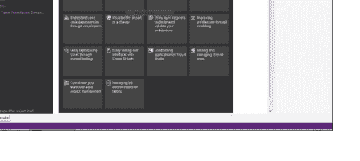

图 1-1：创建新项目会让你踏上开发更好的 Windows 应用程序之路。

Visual Studio 会向你展示许多图标，代表你可以创建的不同类型的应用程序，如图 1-2 所示。

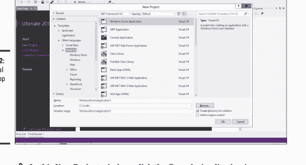

图 1-2：
Visual Studio 应用程序向导迫不及待地要为你创建新程序。


- 2. 在此“新建项目”窗口中，单击“控制台应用程序”图标。

确保在“项目类型”窗格中选择 Visual C#——以及其下的 Windows——否则 Visual Studio 可能会创建像 Visual Basic 或 Visual C++ 应用程序这样糟糕的东西。然后在“模板”窗格中单击“控制台应用程序”图标。

Visual Studio 要求你先创建一个项目，然后才能开始输入你的 C# 程序。项目是一个文件夹，你把构成程序的所有文件都扔进去。它有一组配置文件，帮助编译器完成工作。当你让编译器生成（编译）程序时，它会梳理项目，找出重新创建可执行程序所需的文件。


- 3. 你的第一个应用程序的默认名称是 ConsoleApplication1，但这次请在“名称”字段中键入 Program1，将其更改。

存储此文件的默认位置在“文档”目录深处的某个地方。也许因为我不好对付（或者也许因为我在写书），我喜欢把程序放在我希望它们去的地方，而不一定是 Visual Studio 希望它们去的地方。为了简化本书的操作，你可以更改默认程序位置。请按以下步骤操作：

- a. 选择“工具”→“选项”。

“选项”对话框会打开。你可能需要勾选“显示所有选项”复选框。

- b. 选择*“项目和解决方案”→“常规”。*
- c. 在*“项目位置”*字段中选择新位置，然后单击**确定**。

    （我建议本书使用 C:\C# Programs。）

你可以在“项目位置”对话框中同时创建新目录。单击对话框顶部带小旭日图案的文件夹图标。（如果你已从网站安装了示例程序，该目录可能已经存在。）

你可以在图 1-3 中看到“选项”对话框。暂时不要动项目设置中的其他字段。有关 Visual Studio 自定义的更多内容，请阅读第 IV 部分。

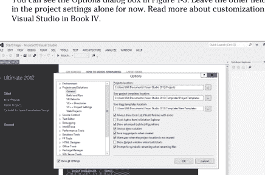

**图 1-3：** 更改默认项目位置。

- 4. 单击**确定**按钮。

在一阵磁盘呼呼作响和咔嗒声之后，Visual Studio 会生成一个名为 *Program.cs* 的文件。（如果你查看标有*“解决方案资源管理器”*的窗口，会看到其他一些文件；暂时忽略它们。如果“解决方案资源管理器”不可见，请选择*“视图”→“解决方案资源管理器”*。）

（C# 源文件的扩展名为 `.cs`。名称 *Program* 是指派给程序文件的默认名称。

你的第一个控制台应用的内容如下所示：

```csharp
using System;
using System.Collections.Generic;
using System.Linq;
using System.Text;
using System.Threading.Tasks;
```

```csharp
namespace Program1
{
    class Program
    {
        static void Main(string[] args)
        {
        }
    }
}
```


在代码窗口的左边缘，你会看到方框中有几个小的加号（+）和减号（−）。单击 using ... 旁边的 + 号。这会展开一个代码区域，这是 Visual Studio 的一个便捷功能，可尽量减少杂乱。以下是展开默认控制台应用中的区域时出现的指令：

```
using System;
using System.Collections.Generic;
using System.Linq;
using System.Text;
```

区域通过隐藏你不在处理的代码，帮助你专注于正在处理的代码。某些代码块——例如命名空间块、类块、方法和其他代码项——会自动获得 +/-，而无需 #region 指令。如果你愿意，还可以通过在一个代码段上方键入 #region、在其下方键入 #endregion 来添加自己的可折叠区域。为区域提供一个名称会很有帮助，例如 Public methods。这个代码段看起来像这样：

```
#region Public methods
... your code
#endregion Public methods
```


这个名称可以包含空格。此外，你可以将一个区域嵌套在另一个区域内，但区域不能重叠。

目前，using System; 是你真正需要的唯一 using 指令。你可以删除其他指令；编译器会告诉你是否缺少某个指令。

## 进行试运行

要将你的 C# 程序转换为可执行程序，请选择“生成”→“生成 Program1”。Visual Studio 会响应以下消息：

```
- Build started: Project: Program1, Configuration: Debug Any CPU -

Csc.exe /noconfig /nowarn ... (and much more)

Compile complete -- 0 errors, 0 warnings

Program1 -> C:\Program Files\... (and more)==Build: 1 succeeded or up-to-date, 0 failed, 0 skipped==
```

这里的关键是最后一行中的 1 succeeded 部分。


作为编程的一般规则，成功是好事；失败是坏事。那些不好的情况——即异常——将在本迷你书的第9章中介绍。


要执行程序，请选择“调试→启动调试”。程序会弹出一个黑色控制台窗口并立即终止。（如果你的电脑速度很快，这个窗口的出现只是屏幕上一闪而过。）程序看起来什么也没做。事实上，确实如此。这个模板不过是一个空壳。


另一个命令“调试→开始执行（不调试）”在此时表现得稍微好一些。试试看吧。

## 让控制台应用做一些事情

编辑`Program.cs`模板文件，直到它变成这个样子：


```csharp
using System;

namespace Program1
{
    public class Program
    {
        // This is where your program starts.
        static void Main(string[] args)
        {
            // Prompt user to enter a name.
            Console.WriteLine("Enter your name, please:");

            // Now read the name entered.
            string name = Console.ReadLine();

            // Greet the user with the name that was entered.
            Console.WriteLine("Hello, " + name);

            // Wait for user to acknowledge the results.
            Console.WriteLine("Press Enter to terminate...");
            Console.Read();
        }
    }
}
```


不要纠结于双斜杠或三斜杠（`//`或`///`）后面的内容，也不用担心是输入一个或两个空格，还是一行或两行换行。但是，一定要注意大小写。

选择“生成→生成程序”将这个新版本的`Program.cs`转换为`Program1.exe`程序。

在Visual Studio 2012中，选择“调试→开始执行（不调试）”。黑色的控制台窗口出现，并提示你输入姓名。（你可能需要点击一下控制台窗口来激活它。）然后窗口会显示Hello，后面跟着你输入的姓名，并显示“按Enter键终止...”。按Enter键关闭窗口。


你也可以从DOS命令行执行该程序。为此，打开“命令提示符”窗口并输入以下内容：

```
CD \C#Programs\Program1\bin\Debug
```

现在输入`Program1`来执行程序。输出应该与之前看到的完全相同。你也可以在Windows资源管理器中导航到`\C#Programs\Program1\bin\Debug`文件夹，然后双击`Program1.exe`文件。


要打开“命令提示符”窗口，请尝试选择“工具→命令提示符”。如果该命令在Visual Studio的“工具”菜单中不可用，请选择“开始→所有程序→Microsoft Visual Studio 2008→Visual Studio工具→Visual Studio 2008命令提示符”。

## 回顾你的控制台应用程序

在接下来的各节中，你将逐一剖析这第一个C#控制台应用程序，以理解它是如何工作的。

### 程序框架

所有控制台应用程序的基本框架如下所示：

```csharp
using System;
using System.Collections.Generic;
using System.Linq;
using System.Text;

namespace Program1
{
    public class Program
    {
        // This is where your program starts.
        public static void Main(string[] args)
        {
            // Your code goes here.
        }
    }
}
```


程序在包含`Main()`的语句之后立即开始执行，并在`Main()`后面的闭合花括号（`}`）处结束。（我会在适当的时候解释这些语句的含义。除此之外，目前我不能多说。）

using指令列表可以紧跟在`namespace Program1 {`之前或之后。顺序无关紧要。在.NET中，你可以对很多东西使用`using`。我将在第二册的面向对象编程章节中解释命名空间和using的全部相关内容。

### 注释

模板已经有很多行，我又添加了几行，比如下面这些（以粗体显示）：

```csharp
// This is where your program starts.
public static void Main(string[] args)
```

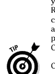

C#会忽略这个示例中的第一行。这一行被称为注释。

任何以`//`或`///`开头的行都是自由文本，C#会忽略它。目前可以把`//`和`///`视为等效。

既然计算机会忽略这些行，为什么还要包含它们呢？因为注释可以解释你的C#语句。即使是用C#编写的程序，也不容易理解。

请记住，编程语言是计算机能理解的内容与人类能理解的内容之间的一种折中。这些注释在编写代码时很有用，尤其对那个一年后试图重建你的逻辑的可怜虫——可能就是你——特别有帮助。

注释会让这项工作变得容易得多。

尽早注释，经常注释。

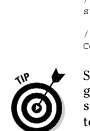

### 程序的核心

这个程序真正的核心嵌入在标记为`Main()`的代码块中，如下所示：

```csharp
// Prompt user to enter a name.
Console.WriteLine("Enter your name, please:");

// Now read the name entered.
string name = Console.ReadLine();

// Greet the user with the name that was entered.
Console.WriteLine("Hello, " + name);
```


使用C#代码片段（Code Snippets）功能可以节省大量常规输入。代码片段对于像`Console.WriteLine`这样的常见语句非常有用。按Ctrl+K,X可以查看代码片段的弹出菜单。（你可能需要按一次或两次Tab键来打开该菜单上的Visual C#文件夹或其他文件夹。）在菜单中向下滚动到`cw`，然后按Enter键。Visual Studio会插入一条`Console.WriteLine()`语句的主体，插入点位于两括号之间，随时可以输入。当你记住了一些快捷方式（如`cw`、`for`和`if`）后，可以使用更快的技巧：输入`cw`，然后按两次Tab键。（还可以尝试选中几行代码，按Ctrl+K，然后再按Ctrl+S。选择类似于`if`的选项。一条`if`语句会环绕选中的代码行。）

程序从第一条C#语句`Console.WriteLine`开始执行。该命令将字符串`"Enter your name, please:"`写入控制台。

下一条语句读取用户的回答，并将其存储在一个名为`name`的变量（一种工作箱）中。（关于这些存储位置的更多信息，请参阅本迷你书的第2章。）最后一行将字符串`"Hello, "`与用户的姓名组合，并将结果输出到控制台。

最后三行让计算机在继续执行前等待用户按Enter键。这些行确保用户在程序继续之前有时间阅读输出：

```csharp
// Wait for user to acknowledge the results.
Console.WriteLine("Press Enter to terminate...");
Console.Read();
```

这一步可能很重要，具体取决于你如何执行程序以及运行环境。特别是，在Visual Studio内或从Windows资源管理器中运行控制台应用程序时，上述几行是必需的——否则，控制台窗口会关闭得太快，你根本无法阅读输出。如果你打开一个控制台窗口并从那里运行程序，窗口无论如何都会保持打开。

## 介绍工具箱技巧

你在前一节中创建的程序的关键部分由最后两行代码组成：

```csharp
// Wait for user to acknowledge the results.
Console.WriteLine("Press Enter to terminate...");
Console.Read();
```

在今后编写的每个控制台应用程序中，重新创建这些关键行的最简单方法将在以下各节中介绍。

### 将代码保存到工具箱中

第一步是将这些行保存到一个方便日后使用的位置：工具箱窗口。在Visual Studio中打开你的Program1控制台应用程序后，请按照以下步骤操作：


- 1. 在 `Program` 类的 `Main()` 方法中，选择要保存的行——这里指前面提到的三行。
- 2. 确保左侧的“工具箱”窗口已打开。（如果没有打开，请选择“视图”→“工具箱”将其打开。）
- 3. 将选中的行拖到“工具箱”窗口的“常规”选项卡中并放下。（或者复制这些行，再将它们粘贴到“工具箱”中。）

“工具箱”会永久为你将这些行保存在那里。图 1-4 显示了放入“工具箱”中的这些行。

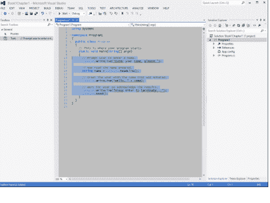

**图 1-4：** 用一些便于将来使用的已保存文本设置“工具箱”。

### 从“工具箱”中重用代码

既然你已经将模板文本存储在“工具箱”中，那么此后编写的所有控制台应用程序都可以重用它。使用方法如下：

- 1. 在 Visual Studio 中，按照本章前面“创建源程序”一节的说明，新建一个控制台应用程序。
- 2. 在编辑器中单击要插入“工具箱”文本的位置。
- 3. **在打开 Program.cs 文件进行编辑的情况下，确保“工具箱”窗口已打开。**
  
  如果没有打开，请参见上文“将代码保存到工具箱中”中的步骤。
- 4. **在“工具箱”窗口的“常规”选项卡中（可能显示的是其他选项卡），找到要使用的已保存文本，并双击它。**
  
  所选项目将插入到编辑器窗口中的插入点处。

有了这些样板文本，你就可以在这些行上方编写应用程序的其余部分。就这样。你现在已经完成了一个控制台应用。试用大约 30 秒。然后你可以查看本分册第 2 章。

## 第 2 章：与可变性共处——声明值类型变量

### 本章内容

- 走访火车站——C# 变量作为储物柜
- 使用整数——你可以指望它
- 处理小数值——半只鸭子是什么？
- 声明其他类型的变量——日期、字符、字符串
- 处理数值常量——天空中的 Π
- 更改类型——强制转换并不意味着丢弃
- 让编译器推断类型——var 魔法

编程中所有概念里最基础的概念就是变量。C# 变量就像一个小盒子，你可以把东西（尤其是数字）存进去，供以后使用。（*变量*这个术语借自数学领域。）

对程序员来说不幸的是，C# 对变量施加了若干限制——这些限制是数学家不必考虑的。本章将带你了解声明、初始化和使用变量的步骤，还会介绍 C# 中几种最基础的*数据类型*。

### 声明变量

当数学家说“*n* 等于 1”时，意思是项 *n* 以某种空灵的方式等同于 1。数学家可以随意引入变量。例如，数学家可能会这样说：

```
x = y² + 2y + y
if k = y + 1 then
  x = k²
```

程序员必须以特定方式定义变量，这种方式比数学家较宽松的风格要求更严格。例如，C# 程序员可能会编写下面这段代码：

```
int n;
n = 1;
```

第一行的意思是：“在计算机内存中划出一小块存储空间，并将其命名为 n。”这一步类似于在火车站预订一个储物柜，并在侧面贴上标签 n。第二行表示：“将值 1 存入变量 n，从而替换该存储位置原有的内容。”换成火车站储物柜的说法就是：“打开储物柜，把里面原有的东西统统扯出来，然后塞一个 1 进去。”


等号（=）称为赋值运算符。

数学家说“n 等于 1”。C# 程序员则更精确地说“将值 1 存入变量 n”。（想想火车站储物柜，你就明白为什么后者更可取。）C# 运算符告诉计算机你想做什么。换句话说，运算符是动词，而不是描述符。赋值运算符取其右侧的值，并将其存入左侧的变量中。我将在本分册第 4 章中更详细地讨论运算符。

### 什么是 int？

在 C# 中，每个变量都有固定的类型。当你分配一个那种火车站储物柜时，必须选择所需的大小。例如，如果你选了一个整数储物柜，就不能转身指望把整个得克萨斯州塞进去——也许能塞下罗德岛州，但塞不下得克萨斯州。

对于本章上一节的示例，你选择了一个专门用来存放整数的储物柜——C# 称之为 int。整数是计数数字 1、2、3 等，再加上 0 和负数 −1、−2、−3 等。


在使用变量之前，必须先声明它。将变量声明为 int 后，它可以保存并输出整数值，如下例所示：

```
// Declare a variable named n - an empty train locker.
int n;
// Declare an int variable m and initialize it with the value 2.
int m = 2;
// Assign the value stored in m to the variable n.
n = m;
```

注释后的第一行是一个声明，它创建了一个用于保存整数值的小存储区 n。n 的初始值直到被赋值时才确定。第二个声明不仅声明了一个 int 变量 m，还一次性将其初始化为值 2。


术语“初始化”的意思是赋予初始值。初始化变量就是第一次给它赋值。在变量被初始化之前，你无法确定它的值是什么。没人知道。

程序中的最后一条语句将 m 中存储的值（即 2）赋给变量 n。变量 n 会一直包含值 2，直到被赋予新值。（当你把变量 n 的值赋给 m 时，n 不会失去它的值。这就像克隆 n。）

### 声明变量的规则

你可以在声明变量时顺便初始化它，如下所示：

```
// Declare another int variable and give it the initial value of 1.
int p = 1;
```

这相当于在第一次租下那个 int 储物柜时就塞入一个 1，而不是之后打开柜子再把值塞进去。


在声明变量时就初始化它。在大多数（但并非所有）情况下，C# 会为你初始化变量——但不要依赖它这样做。

你可以在程序中的任何地方（嗯，几乎任何地方）声明变量。


但是，在声明变量并将其设为某个值之前，不能使用该变量。因此，这里显示的最后两个赋值不合法：

```
// The following is illegal because m is not assigned
// a value before it is used.
int m;
n = m;
// The following is illegal because p has not been
// declared before it is used.
p = 2;
int p;
```

最后，不能在同一作用域（例如函数）中两次声明同一个变量。

### 同一主题的变体：不同类型的 int

大多数简单的数值变量都是 int 类型。不过，C# 为特殊场合提供了 int 变量类型的多种变体。

所有整数变量类型都限于整数。int 类型还受到其他限制。例如，int 变量只能存储大约从 -20 亿到 20 亿范围内的值。

20 亿英寸的距离大于地球的周长。如果 20 亿对你来说还不够大，C# 提供了一种称为 `long`（`long int` 的缩写）的整数类型，它可以表示几乎和你想象中一样大的数字。`long` 的唯一问题在于它需要更大的火车站储物柜：一个 `long` 占用 8 字节（64 位）——是普通 4 字节（32 位）`int` 的两倍。C# 还提供了其他几种整数变量类型，如表 2-1 所示。

**表 2-1 — C# 整数类型的大小和范围**

| 类型 | 字节 | 值范围 | 用法 |
|---|---:|---|---|
| `sbyte` | 1 | −128 到 127 | `sbyte sb = 12;` |
| `byte` | 1 | 0 到 255 | `byte b = 12;` |
| `short` | 2 | −32,768 到 32,767 | `short sh = 12345;` |
| `ushort` | 2 | 0 到 65,535 | `ushort ush = 62345;` |
| `int` | 4 | −20 亿到 20 亿 | `int n = 1234567890;` |
| `uint` | 4 | 0 到 40 亿（确切值列于本书网站的速查表中） | `uint un = 3234567890U;` |
| `long` | 8 | −10²⁰ 到 10²⁰——“非常多” | `long l = 123456789012L;` |
| `ulong` | 8 | 0 到 2 × 10²⁰ | `ulong ul = 123456789012UL;` |

正如我在本章后面的“声明数值常量”一节中所解释的，像 1 这样的固定值也有类型。默认情况下，像 1 这样的简单常量会被假定为 `int`。非 `int` 的常量必须用其变量类型标记。例如，123U 是无符号整数 `uint`。

大多数整数变量称为*有符号*，这意味着它们可以表示负值。无符号整数只能表示正值，但作为回报，你获得两倍的范围。从表 2-1 可以看出，大多数无符号整数类型的名称以 `u` 开头，而有符号类型通常没有前缀。


本书不需要任何无符号整数版本。


## 处理浮点变量

int 变量的局限性对于某些应用程序来说是不可接受的。范围通常不是问题——64 位 long 整数的 double-zillion 范围应该足以满足几乎所有人。然而，int 变量仅限于整数这一事实则更难以接受。

在某些情况下，你需要能够带有非零小数部分的数字。数学家称这些为实数。（不知为何，这总显得像是一个荒谬的数字名称。整数难道 somehow 不真实吗？）


请注意，我说实数可以有非零小数部分——也就是说，1.5 是实数，1.0 也是实数。例如，1.0 + 0.1 等于 1.1。在阅读本章剩余内容时请牢记这一点。

幸运的是，C# 理解实数。实数有两种类型：浮点数和十进制数。浮点数是最常见的类型。我将在本章后面“使用 Decimal 类型：它是整数还是浮点数？”一节中介绍 decimal 类型。

## 声明浮点变量

浮点变量的 designation 为 float，你可以按以下示例声明它：

```
float f = 1.0;
```

声明为 float 后，变量 f 在其生命周期内始终是 float。

表 2-2 描述了两种浮点类型。所有浮点变量都是有符号的。（不存在不能表示负值的浮点变量。）

**表 2-2 浮点变量类型的大小和范围**

| 类型 | 字节 | 值范围 | 有效数字位数 | 用法 |
|---|---|---|---|---|
| float | 4 | 1.5 * 10^-45 to 3.4 * 10^38 | 6 to 7 | float f = 1.2F; |
| double | 8 | 5.0 * 10^-324 to 1.7 * 10^308 | 15 to 16 | double d = 1.2; |


你可能会认为 float 是默认的浮点变量类型，但实际上在 C# 中默认的是 double。如果你没有指定类型，例如 12.3，C# 会将其视为 double。

表 2-2 中的 Accuracy 列指的是此类变量类型可以表示的有效数字位数。例如，⅔ 实际上是 0.555…，后面跟着无穷无尽的 5。然而，float 变量据说具有六位有效数字的精度——这意味着第六位之后的数字会被忽略。因此，当以 float 表示时，⅔ 可能如下所示：

```
0.555551457382
```

这里你知道第六个 5 之后的所有数字都是不可信的。

同一个数字——⅔——以 double 表示时可能如下所示：

```
0.5555555555555557823
```


double 包含惊人的 15 到 16 位有效数字。

除非有特定原因，否则请使用 double 变量类型。

## 转换更多温度

这里是用浮点变量将华氏温度转换为摄氏温度的公式：

```
double celsius = (fahr - 32.0) * (5.0 / 9.0)
```


网站包含一个名为 ConvertTemperatureWithFloat 的浮点版温度转换程序。

以下示例显示了基于 double 的 ConvertTemperatureWithFloat 程序执行结果：

```
Enter temp in degrees Fahrenheit:100
Temperature in degrees Celsius = 37.77777777778
Press Enter to terminate...
```

## 检查浮点变量的一些局限性

由于浮点变量能很好地解决截断问题，你可能会想一直使用它们。当然，它们会占用多一点内存。但如今内存很便宜，所以为什么不呢？但浮点变量也有局限性，我将在以下各节中讨论。

### 计数

你不能将浮点变量用作计数数。一些 C# 结构需要计数（如 1、2、3 等）。你知道 1.0、2.0 和 3.0 与 1、2、3 一样是计数数，但 C# 不知道这一点。例如，鉴于浮点数的精度限制，C# 如何知道你不是在说 1.000001？

无论你是否觉得这个论点有说服力，你都不能在计数事物时使用浮点变量。


### 比较数字

比较浮点数时必须小心。例如，12.5 可能被表示为 12.500001。大多数人不在乎末尾那一点点额外部分。然而，计算机极其字面化。对 C# 来说，12.500000 和 12.500001 不是同一个数字。

所以，如果你把 1.1 加上 1.1，就无法确定结果是 2.2 还是 2.200001。而如果你问“Is `doubleVariable` equal to 2.2?”，你可能得不到预期的结果。通常，你不得不使用类似这样的牵强比较：“Is the absolute value of the difference between `doubleVariable` and 2.2 less than .000001?”换句话说，“within an acceptable margin of error.”


Pentium 处理器玩了一个小技巧，使这个问题比看起来要少一些麻烦：它以特别长的 double 格式执行浮点运算——也就是说，而不是使用 64 位，它使用惊人的 80 位。当把 80 位浮点数舍入为 64 位浮点数时，你（几乎）总是得到预期结果，即使 80 位数字偏差了一点或两点。

### 计算速度

如旧式基于 Windows 的 PC 中使用的 x86 系列处理器，可以比浮点运算快得多地执行整数运算。在那个时代，程序员会不遗余力地将程序限制在整数运算范围内。

在 Pentium III 处理器上，对约 300,000,000 次加法和减法的简单（也许过于简单）测试的额外速度比率约为 3 比 1。也就是说，对于每次 double 加法，你本可以做三次 int 加法。（Computations involving multiplication and division may show different results。）

### 并非如此受限的范围

在过去，浮点变量可以表示的数字范围比整数类型大得多。它仍然可以，但 `long` 的范围已经足够大，使得这一点变得无关紧要。


尽管简单的 float 可以表示非常大的数字，有效数字的数量仍限制在约六位。例如，123,456,789F 与 123,456,000F 相同。（For an explanation of the F notation at the end of these numbers, see “Declaring Numeric Constants,” later in this chapter。）

## 使用 Decimal 类型：它是整数还是浮点数？

正如本章前面各节所解释的，整数和浮点类型都有各自的问题。浮点变量存在与精度限制相关的舍入问题，而 int 变量只是截掉变量的小数部分。在某些情况下，你需要一种变量类型兼具两者的优点：

- 像浮点变量一样，它可以存储分数。
- 像整数一样，此类型数字在计算中提供精确值——例如，12.5 真的是 12.5 而不是 12.500001。

幸运的是，C# 提供了这样一种变量类型，称为 decimal。decimal 变量可以表示 10^-28 到 10^28 之间的数字——那是很多零！而且它不会出现舍入问题。

### 声明 decimal

Decimal 变量的声明和使用与其他变量类型一样，如下所示：

```csharp
decimal m1 = 100;   // Good
decimal m2 = 100M;  // Better
```

这里显示的第一个声明创建了一个变量 m1 并将其初始化为 100。不明显的是，100 实际上是 int 类型。因此，C# 必须在初始化前将 int 转换为 decimal 类型。幸运的是，C# 理解你的意思——并为你执行转换。

m2 的声明是最好的。这个巧妙的声明用十进制常量 100M 初始化 m2。数字末尾的字母 M 指定该常量为 decimal 类型。无需转换。（See the section “Declaring Numeric Constants,” later in this chapter。）

### 比较 decimal、整数和浮点类型

decimal 变量类型似乎具有 int 或 double 类型的所有优点而没有缺点。此类型变量具有非常大的范围，不会遭受舍入问题，而且 25.0 就是 25.0 而不是 25.00001。


然而，decimal 变量类型有两个显著的局限。首先，decimal 不被视为计数类型，因为它可能包含小数值。因此，你不能在流程控制循环中使用它们，这一点我会在本小册子的第5章中解释。

decimal 变量的第二个问题同样严重，甚至更为严重。涉及 decimal 值的计算比涉及简单整数或浮点值的计算慢得多——这里我说的确实是“显著”。在一个粗略的基准测试中，进行 300,000,000 次加法和减法，涉及 decimal 变量的操作大约比涉及简单 int 变量的操作慢 50 倍。对于更复杂的操作，相对计算速度甚至会变得更糟。此外，大多数计算函数，例如计算正弦或指数，对于 decimal 数字类型是不可用的。

显然，decimal 变量类型最适合于银行等应用，在这些应用中，精度极其重要，但计算数量相对较少。

## 探究 bool 类型：它是逻辑类型吗？

终于，一种逻辑变量类型。不过在这里，我确实是指字面意义上的“逻辑”类型。布尔类型 bool 只有两个值：true 或 false。我没开玩笑——一个完整的变量类型仅仅用于两个值。连“也许”都没有。


以前使用 C 和 C++ 的程序员习惯于用 int 值 0（零）表示 false，用非零值表示 true。这在 C# 中行不通。

你可以这样声明一个 bool 变量：

```
bool thisIsABool = true;
```

在 bool 变量和其他任何类型之间不存在转换路径。换句话说，你不能直接将 bool 转换成其他类型。（即使你能，也不应该，因为那毫无意义。）特别是，你不能将 bool 转换成 int（例如 false 变成 0）或 string（例如 false 变成单词“false”）。

## 了解字符类型

一个只能吐出数字的程序，对于数学家、会计师、处理死亡数据的保险代理人，以及计算炮弹弹道的人来说，可能没什么问题。（别笑。最初的计算机就是为了生成炮弹弹道表以帮助炮兵射手而建造的。）然而，对于大多数应用程序来说，程序必须同时处理字母和数字。

C# 以两种截然不同的方式处理字母：char 类型的单个字符（通常发音为 char，就像 singe 或 burn 中的发音）和字符串——这种类型被巧妙地称为 string。

### char 变量类型

char 变量是一个能够容纳单个字符的盒子。字符常量以一对单引号包围的字符形式出现，如下例所示：

```
char c = 'a';
```

你可以存储来自罗马、希伯来、阿拉伯、西里尔以及大多数其他字母表中的任意单个字符。你还可以存储日文片假名和平假名字符，以及许多日文和中文的汉字。

此外，char 被视为一种计数类型。这意味着你可以使用 char 类型来控制我在本小册子第5章中描述的循环结构。字符变量不会遇到舍入问题。

字符变量不包含字体信息。因此，你可能在 char 变量中存储你认为是一个非常好的汉字（它很可能确实是），但当你查看该字符时，如果你不是通过正确的字体来观察它，它看起来可能像乱码。


### 特殊字符

在给定字体中，某些字符是不可打印的，也就是说，当你在电脑屏幕或打印机上查看它们时，你不会看到任何内容。最明显的例子是空格，它由字符 ' '（单引号、空格、单引号）表示。其他字符没有对应的字母——例如，制表符。C# 使用反斜杠来标记这些字符，如表 2-3 所示。

表 2-3 特殊字符

| 字符常量 | 值 |
|---|---|
| '\n' | 换行 |
| '\t' | 制表符 |
| '\0' | 空字符 |
| '\r' | 回车 |
| '\\' | 反斜杠 |

### string 类型

另一种极其常见的变量类型是 string。下面的示例展示了如何声明和初始化字符串变量：

```
// Declare now, initialize later.
string someString;
someString = "this is a string";
// Or initialize when declared - preferable.
string someString2 = "this is a string";
```

字符串常量，通常称为字符串字面量，是一组由双引号包围的字符。字符串中的字符可以包含表 2-3 中显示的特殊字符。在 C# 源文件中，字符串不能跨行书写，但它可以包含换行符，如下面的示例所示（见粗体）：

```
// The following is not legal.
string someString = "This is a line
and so is this";
// However, the following is legal.
string someString = "This is a line\nand so is this";
```

使用 Console.WriteLine 输出时，本示例中的最后一行将两个短语放在单独的行上，如下所示：

```
This is a line
and so is this
```

string 不是计数类型。string 也不是值类型——处理器中没有“string”这种内置类型。常见的运算符中只有一个可以作用于字符串对象：+ 运算符将两个字符串连接成一个。例如：

```
string s = "this is a phrase"
+ " and so is this";
```

这几行代码将字符串变量 s 设置为以下字符串：

```
"this is a phrase and so is this"
```


没有字符的字符串，写作 ""（两个双引号连在一起），是一个有效的字符串，称为空字符串（有时也称为 null 字符串）。null 字符串（""）不同于 null 字符（'\0'），也不同于包含任意数量空格的字符串，即使只有一个空格（" "）。

我喜欢使用 String.Empty 值来初始化字符串，它与 "" 含义相同，而且更不容易引起误解：

```
string mySecretName = String.Empty; // A property of the String type
```

顺便说一下，本章中所有其他数据类型都是值类型。然而，string 类型不是值类型，这一点我将在下一节中解释。本小册子的第3章会更详细地讨论 string 类型。

## 什么是值类型？


我在本章中描述的变量类型都是固定长度的——同样，string 除外。固定长度的变量类型总是占用相同数量的内存。因此，如果你赋值 a = b，C# 可以将 b 的值直接传输给 a，而无需采取额外的措施来处理可变长度的类型。正是这个特点，这些类型的变量才被称为值类型。


int、double 和 bool 类型及其相近的派生类型（如 unsigned int）是处理器内置的固有变量类型。固有变量类型加上 decimal 也被称为值类型，因为变量存储的是实际数据。string 类型两者都不是——因为该变量实际上存储的是一种指向字符串数据的“指针”，称为引用。字符串的数据实际上位于另一个位置。

我在本小册子第8章中解释的程序员自定义类型被称为引用类型，它们既不是值类型也不是固有类型。string 类型是一种引用类型，尽管 C# 编译器确实对它给予了一些特殊处理，因为字符串的使用是如此广泛。

## 比较 string 和 char

尽管字符串处理的是字符，但 string 类型与 char 却有着惊人的不同。当然，确实存在一些琐碎的差异。字符用单引号括起来，如下例所示：

```
'a'
```

另一方面，字符串用双引号括起来：

```
"this is a string"
"a" // So is this -- see the double quotes?
```

关于字符串的规则与关于字符的规则并不相同。首先，你从一开始就知道 char 是一个单个字符，仅此而已。例如，下面的代码无论作为加法还是连接操作都是没有意义的：

```
char c1 = 'a';
char c2 = 'b';
char c3 = c1 + c2
```


## 命名约定

编程本身已经够难了，程序员就别再把它变得更难了。为了让你的 C# 源代码更易于阅读理解，请采用一种命名约定并坚持下去。你的命名约定应尽可能遵循其他 C# 程序员采用的约定：

-   **除变量以外的其他名称均以大写字母开头，而变量以小写字母开头。** 让这些名称尽可能具有描述性——这通常意味着名称由多个单词组成。这些单词应首字母大写，但彼此紧挨着，中间不加下划线——例如 `ThisIsALongName`。以大写字母开头的名称采用*帕斯卡命名法*（Pascal-cased），这源于 20 世纪 70 年代一种名为 Pascal 的语言的命名方式。（我的第一本书就是关于 Pascal 的。）

-   **变量名以小写字母开头。** 典型的变量名如下所示：`thisIsALongVariableName`。这种变量命名风格称为*驼峰命名法*，因为它在中间有“驼峰”。

在 .NET 时代之前，Windows 程序员普遍采用一种约定：变量名的首字母表示变量的类型。这些字母大多很直观：f 表示 float，d 表示 double，s 表示 string，等等。唯一哪怕有一点点不同的是用 m 表示 int。这条规则有一个例外：由于可以追溯到 20 世纪 60 年代的 Fortran 编程语言的原因，单个字母 i、j 和 k 也被用作 int 的常见名称，而且在 C# 中仍然如此。这种变量命名风格被称为匈牙利命名法，得名于查尔斯·西蒙尼（Charles Simonyi），他是一位著名的微软员工，最近作为太空游客去了国际空间站。（玛莎·斯图尔特给他打包了午餐。）

匈牙利命名法已经不再受欢迎，至少在 .NET 编程圈里是如此。在较新的 Visual Studio 版本中，你只需在调试器中将光标悬停在变量上，其数据类型就会显示在工具提示框中。这使得匈牙利前缀有点不那么有用了，不过仍有少数人坚持使用匈牙利命名法。

实际上，这段代码几乎可以编译——但其含义与原本意图完全不同。这些语句将 c1 转换为一个由 c1 的数值组成的 int。C# 还会将 c2 转换为 int，然后将这两个整数相加。错误发生在尝试将结果存回 c1 时——将 int 存入更小的 char 时可能会丢失数值数据。无论如何，这个操作毫无意义。

另一方面，字符串可以是任意长度。因此，像下面这样连接两个字符串是有意义的：

```csharp
string s1 = "a";
string s2 = "b";
string s3 = s1 + s2; // Result is "ab"
```


前两行只是从 `DateTime` 中提取部分信息。接下来的两行将一个持续时间加到一个 `DateTime` 上。持续时间（或时间量）不同于时间点；你用 `TimeSpan` 类指定持续时间，用 `DateTime` 指定时间点。因此，第三行创建了一个表示三天零小时零分零秒的 `TimeSpan`。第四行将三天的持续时间加到表示当前时刻的 `DateTime` 上，得到一个新的 `DateTime`，其日部分比 `thisMoment` 的日部分大三天。

从一个 `DateTime` 中减去另一个 `DateTime` 会返回一个 `TimeSpan`（或者从一个 `DateTime` 中减去一个 `TimeSpan` 会返回一个 `DateTime`）。

```csharp
TimeSpan duration1 = new TimeSpan(1, 0, 0);  // One hour later.
// Since Today gives 12:00:00 AM, the following gives 1:00:00 AM:
DateTime anHourAfterMidnight = DateTime.Today.Add(duration1);
Console.WriteLine("An hour after midnight will be {0}", anHourAfterMidnight);
DateTime midnight = anHourAfterMidnight.Subtract(duration1);
Console.WriteLine("An hour before 1 AM is {0}", midnight);
```

上面代码的第一行创建一个一小时的 `TimeSpan`。下一行获取日期（实际上是今天凌晨午夜），并向其加上一小时的时间跨度，得到一个表示今天凌晨 1:00 的 `DateTime`。倒数第二行从凌晨 1:00 减去一小时的持续时间，得到凌晨 12:00（午夜）。


有关更多信息，请在 Visual Studio 帮助系统中搜索 *DateTime 结构*，并查看本书网站上的 `DateTimeExample` 程序。

## 声明数值常量

生活中很少有绝对的事情；不过，我要给你一个 C# 中的绝对规律：每个表达式都有一个值和一个类型。在诸如 `int n` 这样的声明中，你可以很容易看出变量 n 是一个 `int`。此外，你可以合理假设计算 `n + 1` 的类型是 `int`。然而，常量 `1` 是什么类型呢？

常量的类型取决于两件事：它的值，以及常量末尾是否有一个可选的描述符字母。任何小于 20 亿的整数类型都被假定为 `int`。大于 20 亿的数被假定为 `long`。任何浮点数都被假定为 `double`。

表 2-4 展示了已声明为特定类型的常量。这些描述符的大小写并不重要；`1U` 和 `1u` 是等价的。

表 2-4 常见常量及其声明类型

| 常量 | 类型 |
|---|---|
| 1 | int |
| 1U | unsigned int |
| 1L | long int（避免小写 l；它太像数字 1） |
| 1.0 | double |
| 1.0F | float |
| 1M | decimal |
| true | bool |
| false | bool |
| 'a' | char |
| '\n' | char（字符换行符） |
| '\x123' | char（数值为十六进制 123 的字符）* |
| "a string" | string |
| "" | string（空字符串）；与 String.Empty 相同 |

*‘hex’是 hexadecimal 的缩写（即基数为 16 而不是基数为 10 的数）。

## 更改类型：强制转换

人类不会以不同方式对待不同类型的计数数字。例如，一个普通人（有别于 C# 程序员）不会把数字 1 看作有符号、无符号、短整型或长整型。尽管 C# 认为这些类型不同，但就连 C# 也意识到它们之间存在关系。例如，下面这段代码将 int 转换为 long：

```csharp
int intValue = 10;
long longValue;
longValue = intValue; // This is OK.
```

int 变量可以转换为 long，因为 int 的任何可能值都可以存储在 long 中——而且因为它们都是计数数字。C# 会自动为你完成转换，无需额外说明。这称为隐式类型转换。

然而，反方向的转换可能会引发问题。例如，下面这行代码是非法的：

```csharp
long longValue = 10;
int intValue;
intValue = longValue; // This is illegal.
```


有些可以存储在 long 中的值无法放入 int（例如 40 亿）。如果你试图将这样的值硬塞进 int，C# 会生成错误，因为转换过程中可能会丢失数据。这类 bug 很难发现。

但如果你知道转换没问题呢？例如，尽管 longValue 是 long，也许你知道在这个特定程序中它的值不会超过 100。在这种情况下，将 long 变量 longValue 转换为 int 变量 intValue 就没问题。

你可以通过强制转换告诉 C# 你知道自己在做什么：

```csharp
long longValue = 10;
int intValue;
intValue = (int)longValue; // This is now OK.
```

在强制转换中，你把想要的类型名称放在括号中，并把它紧挨着放在要转换的值前面。这个强制转换的意思是：“尽管把名为 longValue 的 long 转换成 int——我知道自己在做什么。”事后看来，声称自己知道在做什么可能显得过于自信，但这通常是合理的。

计数数字可以自动转换为浮点数，但将浮点数转换为计数数字需要强制转换：

```csharp
double doubleValue = 10.0;
long longValue = (long)doubleValue;
```

与 decimal 之间的所有转换都需要强制转换。事实上，所有数值类型都可以通过应用强制转换转换为所有其他数值类型。bool 和 string 都不能直接转换为任何其他类型。


可以说，C# 内置方法可以将数字、字符或布尔值转换为其字符串等效形式。例如，你可以将 bool 值 true 转换为字符串 "true"；但是，你不能把这种变化视为直接转换。bool 值 true 和字符串 "true" 是完全不同的东西。

## 让 C# 编译器推断数据类型

到目前为止，在本书中——嗯，在本章中——当你声明变量时，总是指定其确切的数据类型，像这样：

```csharp
int i = 5;
string s = "Hello C#";
double d = 1.0;
```


你可以使用 `var` 关键字，将其中一部分工作交给 C# 编译器：

```
var i = 5;
var s = "Hello C# 4.0";
var d = 1.0;
```

现在编译器会为你推断数据类型——它查看赋值右侧的内容，以确定左侧是什么类型。

值得一提的是，本迷你书的第 3 章展示了如何计算像前一个示例中赋值右侧那样的表达式的类型。并不是说你需要这么做——编译器通常会替你完成。例如，假设你有这样一个初始化表达式：

```
var x = 3.0 + 2 - 1.5;
```

编译器能判断出 x 是 double 值。它查看 3.0 和 1.5，发现它们是 double 类型。然后它注意到 2 是 int，编译器可以在计算时将其隐式转换为 double。x 的初始化表达式中的所有附加项最终都成为 double。因此，x 的推断类型是 double。

但现在，你只需说出魔法词 var 并提供初始化表达式，剩下的就交给编译器：

```
var aVariable = <initialization expression here>;
```


如果你用过 JavaScript 或 VBScript 之类的脚本语言，你可能已经习惯了通用的一体化数据类型。VBScript 称它们为 Variant 数据类型——Variant 可以是任何东西。但 C# 中的 var 表示 Variant 类型吗？完全不是。用 var 声明的对象肯定具有 C# 数据类型，例如 int、string 或 double。你只是不必声明它是什么。

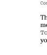

网站上的 UsingVarForImplicitTypeInference 示例用几个例子演示了 var。这里先尝个鲜。

在这个示例中用 var 声明的变量背后到底是什么？看看这个：

```
var aString = "Hello C# 3.0";
Console.WriteLine(aString.GetType().ToString());
```

WriteLine 语句中那堆晦涩的代码在 aString 上调用 String.GetType() 方法来获取其 C# 类型。然后它调用结果对象的 ToString() 方法来显示对象的类型。（诸如此类。）你在控制台窗口中看到的是：

```
System.String
```

这证明编译器正确推断了 `aString` 的类型。


大多数时候，我建议你不要使用 `var`。把它留到必要时再用。明确变量的类型比使用 `var` 对任何阅读你代码的人来说都更清晰。然而，C# 世界中的常见用法可能会发生很大变化，以至于尽管我有好建议，每个人还是一直使用 `var`。那样的话，你也可以随大流。

你会在后面看到确实需要 `var` 的示例，而我在本书中也会时不时使用它，有时甚至是在并非严格必要的地方。你需要看到它的用法，并自己使用它，才能内化它。我自己也还在适应它。（如果我学得慢，那也没办法。）


你可以在其他用法中看到 `var`：在本迷你书第 6 章中用于数组和数据集合，在第二册中用于匿名类型。匿名？我打赌你等不及了。

此外，C# 4.0 及更高版本中的一种类型比 `var` 更灵活：`dynamic` 类型把 `var` 又推进了一步。

`var` 类型使编译器根据预期的输入推断变量的类型。`dynamic` 关键字在运行时使用一套称为动态语言运行时的全新工具来完成这一点。你可以在第三册第 6 章中找到关于 `dynamic` 类型的更多信息。

## 第3章：字符串操作

### 本章内容

-   用 C# 拉拽和扭曲字符串——别跟我玩文字游戏
-   匹配相似值
-   执行其他字符串操作，例如搜索、修剪、拆分和连接
-   解析读入程序的字符串
-   手动格式化输出字符串或使用 `String.Format()` 方法

对于许多应用程序，你可以像对待 `int` 或 `char` 等内置值类型变量类型一样对待字符串。一些原本保留给这些内部类型的操作也可用于字符串：

```csharp
int i = 1;        // Declare and initialize an int.
string s = "abc"; // Declare and initialize a string.
```

在其他方面，如下例所示，字符串被视为用户定义的类（我在第二册中介绍类）：

```csharp
string s1 = new String();
string s2 = "abcd";
int lengthOfString = s2.Length;
```

到底是哪一种——值类型还是类？事实上，`String` 是一个类，由于字符串在程序中使用得如此广泛，C# 为它提供了特殊处理。例如，关键字 `string` 与类名 `String` 同义，如下代码所示：

```csharp
String s1 = "abcd"; // Assign a string literal to a String obj.
string s2 = s1;     // Assign a String obj to a string variable.
```


在这个示例中，`s1` 被声明为类 `String`（大写 S）的对象，而 `s2` 被声明为简单的 `string`（小写 s）。然而，这两个赋值表明 `string` 和 `String` 是相同（或兼容）的类型。

事实上，同样的特性在更有限的程度上也适用于其他内部变量类型。就连不起眼的 `int` 类型也有对应的类 `Int32`，`double` 有类 `Double`，等等。这里的区别在于，`string` 和 `String` 确实是同一个东西。

在本章剩余部分，我将介绍 String 和 string，以及你可以通过使用它们完成的所有任务。

### 联邦不可分割，字符串也是如此

你至少需要知道一件六年级之前没学过的事：字符串对象一旦创建，就不能更改字符串对象本身。尽管我可能会说修改字符串，但 C# 并没有修改实际字符串对象的操作。许多操作看似修改了你正在处理的字符串，但它们总是将修改后的字符串作为新对象返回。一个字符串变成了两个。

例如，操作 "His name is " + "Randy" 不会改变这两个字符串中的任何一个，而是生成第三个字符串 "His name is Randy"。这种行为的一个副作用是，你不必担心别人在你不知情的情况下修改字符串。

考虑这个简单的示例程序：


```csharp
// ModifyString -- The methods provided by class String do
//               not modify the object itself. (s.ToUpper() doesn't
//               modify 's'; rather it returns a new string that has
//               been converted.)
using System;
namespace ModifyString
{
    class Program
    {
        public static void Main(string[] args)
        {
            // Create a student object.
            Student s1 = new Student();
            s1.Name = "Jenny";
            // Now make a new object with the same name.
            Student s2 = new Student();
            s2.Name = s1.Name;
            // "Changing" the name in the s1 object does not
            // change the object itself because ToUpper() returns
            // a new string without modifying the original.
            s2.Name = s1.Name.ToUpper();
            Console.WriteLine("s1 - " + s1.Name + ", s2 - " + s2.Name);
            // Wait for user to acknowledge the results.
            Console.WriteLine("Press Enter to terminate...");
            Console.Read();
        }
    }

    // Student -- You just need a class with a string in it.
    class Student
    {
        public String Name;
    }
}
```

我在第二册中完整讨论了类，但就目前而言，你可以看到 Student 类包含一个名为 Name 的数据变量，类型为 String。Student 对象 s1 和 s2 的设置使每个对象中的学生 Name 数据都指向相同的字符串数据。ToUpper() 将字符串 s1.Name 转换为全大写字符。通常，这会是个问题，因为 s1 和 s2 都指向同一个对象。然而，ToUpper() 不会更改 Name——它创建一个新的独立大写字符串，并将其存储在对象 s2 中。现在这两个 Student 不再指向相同的字符串数据。

该程序的输出很简单：

```
s1 - Jenny, s2 - JENNY
Press Enter to terminate...
```

字符串的这种属性称为不可变性（意为不可更改）。

字符串的不可变性对字符串常量也很重要。像 "this is a string" 这样的字符串是字符串常量的一种形式，就像 1 是 int 常量一样。就像我重复利用衬衫来减小衣柜的规模（也省点银行账户的钱）一样，编译器可能会选择将所有对单一常量 "this is a string" 的访问合并起来。重用字符串常量可以减少结果程序的占用空间（它在磁盘或内存中的大小），但如果字符串可以被修改，这就不可能了。


### 对字符串执行常见操作

C# 程序员对字符串执行的操作比贝弗利山庄的整形外科医生对好莱坞追梦人做的还多。几乎每个程序都使用用于字符串的加法运算符，如下例所示：

```
string name = "Randy";
Console.WriteLine("His name is " + name); // + means concatenate.
```

String 类提供了这个特殊运算符。然而，String 类还提供了其他更直接的字符串操作方法。你可以在 Visual Studio 帮助索引中查找 "String class" 来查看完整列表，本章将介绍许多常见的操作。我在这里介绍的与字符串相关的任务包括此列表中描述的任务：

-   比较字符串——用于判断相等或按字母顺序排序等任务
-   以各种方式更改和转换字符串：替换字符串的一部分、更改大小写，以及在字符串和其他内容之间转换
-   访问字符串中的各个字符
-   在字符串中查找字符或子字符串
-   处理来自命令行的输入


- 管理格式化输出
- 使用 StringBuilder 高效处理字符串


除本章其余部分所示的示例外，请在网站上查看 `StringCaseChanging` 和 `VariousStringTechniques` 示例。

## 比较字符串

比较两个字符串的需求非常常见。例如，用户是否输入了预期值？或者也许你有一个字符串列表，需要对其进行字母排序。

如果只需要知道两个字符串是否相等（长度相同且字符顺序相同），可以使用 == 运算符（或其逆运算 !=，即不相等）：

```csharp
string a = "programming";
string b = "programming";
if (a == b) ... // True if you don't consider case, false otherwise.
if (a != b) ... // False if you don't consider case, true otherwise.
```

但如果要比较两个字符串的相等性以外的其他情况，则是另一回事。说

```csharp
if (a < b) ...
```

是行不通的。

因此，如果你需要询问“字符串 A 是否大于字符串 B？”或“字符串 A 是否小于字符串 B？”，则需要采用另一种方法。

### 对所有字符串的相等性：Compare() 方法

许多操作将字符串视为单个对象——例如 `Compare()` 方法。`Compare()` 具有以下属性，将两个字符串作为数字进行比较：

- 如果左边的字符串大于右边的字符串，`Compare(left, right)` 返回 1。
- 如果左边的字符串小于右边的字符串，它返回 -1。
- 如果两个字符串相等，它返回 0。

当以记号 C#（即没有所有细节的 C#，也称为伪代码）编写时，该算法的工作方式如下：

```csharp
compare(string s1, string s2)
{
    // Loop through each character of the strings until
    // a character in one string is greater than the
    // corresponding character in the other string.
    foreach character in the shorter string
        if (s1's character > s2's character when treated as a number)
            return 1
        if (s2's character > s1's character)
            return -1
    // Okay, every letter matches, but if the string s1 is longer,
    // then it's greater.
    if s1 has more characters left
        return 1
    // If s2 is longer, it's greater.
    if s2 has more characters left
        return -1
    // If every character matches and the two strings are the same
    // length, then they are "equal."
    return 0
}
```

因此，“abcd”大于“abbd”，而“abcde”大于“abcd”。更常见的是，你并不关心一个字符串是否大于另一个字符串，而只关心两个字符串是否相等。


在执行排序时，你确实需要知道哪个字符串更大。

Compare() 操作在两个字符串完全相同时返回 0。以下测试程序使用 Compare() 的相等性功能，在程序遇到特定字符串或字符串时执行特定操作。

BuildASentence 提示用户输入文本行。每一行都会连接到前一行以构建单个句子。如果用户输入单词 EXIT、exit、QUIT 或 quit，则此程序退出。


```csharp
// BuildASentence -- The following program constructs sentences
//   by concatenating user input until the user enters one of the
//   termination characters. This program shows when you need to look for
//   string equality.
using System;
namespace BuildASentence
{
    public class Program
    {
        public static void Main(string[] args)
        {
            Console.WriteLine("Each line you enter will be "
                + "added to a sentence until you "
                + "enter EXIT or QUIT");
            // Ask the user for input; continue concatenating
            // the phrases input until the user enters exit or
            // quit (start with an empty sentence).
            string sentence = "";
            for (; ; )
            {
                // Get the next line.
                Console.WriteLine("Enter a string ");
                string line = Console.ReadLine();
                // Exit the loop if line is a terminator.
                string[] terms = { "EXIT", "exit", "QUIT", "quit" };
                // Compare the string entered to each of the
                // legal exit commands.
                bool quitting = false;
                foreach (string term in terms)
                {
                    // Break out of the for loop if you have a match.
                    if (String.Compare(line, term) == 0)
                    {
                        quitting = true;
                    }
                }
                if (quitting == true)
                {
                    break;
                }
                // Otherwise, add it to the sentence.
                sentence = String.Concat(sentence, line);
                // Let the user know how she's doing.
                Console.WriteLine("\nyou've entered: " + sentence);
            }
            Console.WriteLine("\ntotal sentence:\n" + sentence);
            // Wait for user to acknowledge the results.
            Console.WriteLine("Press Enter to terminate...");
            Console.Read();
        }
    }
}
```

在提示用户程序期望的内容后，程序创建一个名为 sentence 的空初始句子字符串。从那里开始，程序进入无限循环。

控制语句 while(true) 和 for(;;) 会无限循环，或者至少循环足够长的时间，以便某些内部 break 或 return 将你中断。两个循环是等价的，实际上你会看到它们两者。（循环在本书第 5 章中介绍。）

BuildASentence 提示用户输入一行文本，程序使用 ReadLine() 方法读取该行。读取该行后，程序使用前一个示例中的粗体行检查它是否为终止符。

程序的终止部分定义了一个名为 terms 的字符串数组和一个名为 quitting 的 bool 变量，初始化为 false。terms 数组的每个成员都是你正在查找的字符串之一。这些字符串中的任何一个都会使程序比被迫编写 COBOL 的程序员更快地退出。

程序必须同时包含 "EXIT" 和 "exit"，因为 Compare() 默认情况下认为这两个字符串不同。（程序编写的方式，这些是拼写 exit 的唯一两种方式。诸如 "Exit" 和 "exIt" 之类的字符串不被识别为终止符。）你也可以使用其他字符串操作来检查 exit 的各种拼写。我将在下一节中向你展示这一点。

终止部分遍历目标字符串数组中的每个字符串。如果 Compare() 报告与任何终止符短语匹配，则 quitting 设置为 true。如果在终止部分之后 quitting 仍然为 false 且 line 不是终止符字符串之一，则它会使用 String.Concat() 方法连接到句子的末尾。程序输出即时结果，只是为了让用户可以看到正在发生的事情。

遍历数组是查找各种可能值之一的经典方法。（我将在下一节中向你展示另一种方法，并在第二本书中展示一种更酷的方法。）

以下是 BuildASentence 程序的一个示例运行：

```
Each line you enter will be added to a
sentence until you enter EXIT or QUIT
Enter a string
Programming with

You've entered: Programming with
Enter a string
C# is fun

You've entered: Programming with C# is fun
Enter a string
(more or less)

You've entered: Programming with C# is fun (more or less)
Enter a string
EXIT

Total sentence:
Programming with C# is fun (more or less)
Press Enter to terminate...
```

我已将我的输入标记为粗体以使输出更易于阅读。

### 你希望比较时区分大小写还是忽略大小写？

上一示例中使用的 Compare() 方法认为 "EXIT" 和 "exit" 是不同的字符串。然而，Compare() 方法有一个第二个版本，其中包含第三个参数。此参数指示比较是否应忽略字母大小写。true 表示“忽略”。

以下版本在 BuildASentence 示例中冗长的终止部分，无论传递的字符串是大写、小写还是两者混合，都将 quitting 设置为 true：

```csharp
// Indicate true if passed either exit or quit,
// irrespective of case.
if ((String.Compare("exit", source, true) == 0) ||
    (String.Compare("quit", source, true) == 0))
{
    quitting = true;
}
```

此版本比之前的循环版本更简单。此代码无需担心大小写，并且可以使用单个条件表达式

因为它现在只需考虑两个选项，而不是一长串选项：QUIT 或 EXIT 的任意拼写变体。

## 如果我想切换大小写呢？

你可能想知道字符串中的所有字符（或仅一个字符）是大写还是小写字符。而且你可能需要从一种形式转换为另一种形式。

### 区分全大写字符串和全小写字符串

我几乎不想提这件事，但你可以使用 switch 命令（见本迷你书的第 5 章）来查找特定字符串。通常，你使用 switch 命令将计数数字与一组可能值进行比较；不过，switch 也确实可以用于字符串对象。BuildASentence 中终止部分的这个版本使用了 switch 结构：

```
switch(line)
{
    case "EXIT":
    case "exit":
    case "QUIT":
    case "quit":
    return true;
}
return false;
```

这种方法可行，因为你只比较有限数量的字符串。for 循环为搜索字符串值提供了灵活得多的方法。使用上一节中不区分大小写的 Compare()，可以让程序在理解用户输入方面具有更大的灵活性。

### 将字符串转换为大写或小写

假设你有一个小写字符串，需要将其转换为大写。可以使用 ToUpper() 方法：

```
string lowercase = "armadillo";
string uppercase = lowercase.ToUpper();  // ARMADILLO.
```

同样，你可以使用 ToLower() 将大写转换为小写。

如果你只想将字符串中的第一个字符转换为大写，该怎么办？下面这段相当绕的代码可以做到（但本章最后一节会给出更好的方法）：

正如上一节关于切换大小写的最后一个示例所示，你也可以使用数组索引表示法访问字符串中的单个字符。


数组从零开始，所以如果你想获取第一个字符，就请求 `[0]`。如果你想获取第三个字符，就请求 `[2]`：

```
char thirdChar = favoriteFood[2];   // First 'e' in "cheeseburgers"
```

## 搜索字符串

如果你需要在字符串中查找某个特定的单词或字符，该怎么办？也许你需要它的索引，以便对它使用 `Substring()`、`Replace()`、`Remove()` 或其他方法。本节将介绍如何查找单个字符或子字符串。（我仍在使用上一节中的 `favoriteFood` 变量。）

### 我能找到它吗？

最简单的是使用 `IndexOf()` 查找单个字符：

```
int indexOfLetterS = favoriteFood.IndexOf('s');   // 4.
```

`String` 类还有其他用于查找内容的方法，可以查找单个字符或子字符串：

- `IndexOfAny()` 接收一个 `char` 数组，并在字符串中搜索其中任意字符，返回找到的第一个字符的索引。

```
char[] charsToLookFor = { 'a', 'b', 'c' };
int indexOfFirstFound = favoriteFood.IndexOfAny(charsToLookFor);  // 0.
```

这种调用通常更简短地写成这样：

```
int index = name.IndexOfAny(new char[] { 'a', 'b', 'c' });
```

- `LastIndexOf()` 查找的不是字符的第一次出现，而是最后一次出现。

- `LastIndexOfAny()` 的工作方式与 `IndexOfAny()` 类似，但从字符串末尾开始。

- 如果能在目标字符串中找到给定子字符串，`Contains()` 就返回 `true`：

```
if(favoriteFood.Contains("ee")) ...       // True
```

- 而 `Substring()` 会返回该字符串（如果存在），或返回空字符串（如果不存在）：

```
string sub = favoriteFood.Substring(6, favoriteFood.Length - 6);
```

### 我的字符串是空的吗？

如何判断目标字符串是空字符串（""）还是值为 null？（null 表示尚未分配任何值，甚至不是空字符串。）使用 `IsNullOrEmpty()` 方法，如下所示：

```csharp
bool notHere = string.IsNullOrEmpty(favoriteFood);  // False
```

注意调用 `IsNullOrEmpty()` 的方式：`string.IsNullOrEmpty(s)`。

可以通过以下两种方式将字符串设置为空字符串：

```
string name = "";
string name = string.Empty;
```

## 从命令行获取输入

控制台应用程序中的一项常见任务是获取用户在你提示后输入的信息，比如利率或姓名。你需要读取以字符串形式传入的信息。（来自命令行的所有内容都以字符串形式传入。）然后，有时你需要解析输入以从中提取数字。有时你还需要处理大量输入数字。

### 修剪多余的空白字符

首先，请考虑在某些情况下，你不想处理字符串两端的任何空白字符。术语 *空白字符* 指的是通常不会显示在屏幕上的字符——例如空格、换行符（或 \n）和制表符（\t）。有时你可能还会遇到回车字符 \r。

你可以使用 `Trim()` 方法修剪字符串的边缘，如下所示：

```
// Get rid of any extra spaces on either end of the string.
random = random.Trim();
```

`String` 类还提供了 `TrimStart()` 和 `TrimEnd()` 方法，以便进行更精细的控制；你可以传入一个字符数组，让这些字符连同空白字符一起被修剪。例如，你可能会修剪开头的货币符号，比如 '$'。清理字符串可以让解析更容易。这些修剪方法会返回一个新字符串。

### 解析数值输入

程序可以一次从键盘读取一个字符，但你必须处理换行符等。更简单的方法是读取一个字符串，然后从字符串中解析出字符。

// No nondigits found; it's probably okay.
return true;
}

IsAllDigits() 方法首先移除字符串两端任何无害的空白字符。如果什么都不剩，说明该字符串是空白的，不可能是整数。然后，该方法遍历字符串中的每个字符。如果其中任何字符不是数字，该方法就返回 false，表示该字符串很可能不是数字。如果该方法返回 true，那么该字符串很有可能成功转换为整数。

下面的代码示例从键盘输入一个数字，并将其打印回控制台。（为了节省篇幅，我从代码清单中省略了 IsAllDigits() 方法，但已将程序调用它的位置加粗。）


```
// IsAllDigits -- Demonstrate the IsAllDigits method.
using System;
namespace IsAllDigits
{
    class Program
    {
        public static void Main(string[] args)
        {
            // Input a string from the keyboard.
            Console.WriteLine("Enter an integer number");
            string s = Console.ReadLine();
            // First check to see if this could be a number.
            if (!IsAllDigits(s)) // Call the special method.
            {
                Console.WriteLine("Hey! That isn't a number");
            }
            else
            {
                // Convert the string into an integer.
                int n = Int32.Parse(s);
                // Now write out the number times 2.
                Console.WriteLine("2 * " + n + " = " + (2 * n));
            }
            // Wait for user to acknowledge the results.
            Console.WriteLine("Press Enter to terminate...");
            Console.Read();
        }
    }
}
// IsAllDigits here.
```

程序从控制台键盘读取一行输入。如果 IsAllDigits() 返回 false，程序会提醒用户。否则，程序使用 Convert.ToInt32(aString) 的替代方法——调用 Int32.Parse(aString)——将字符串转换为数字。最后，程序输出该数字以及该数字的两倍（后者是为了证明程序确实按所称那样转换了字符串）。

该程序一次示例运行的输出如下：

```
Enter an integer number
1A3
Hey! That isn't a number
Press Enter to terminate...
```

你可以让 Convert 尝试转换垃圾数据，并处理它可能决定抛出的任何异常。然而，很有可能它不会抛出异常，而只是返回错误结果——例如，遇到 1A3 时返回 1。你应该自己验证输入数据。


你也可以改用 Int32.TryParse(s, n)，如果解析失败则返回 false，如果成功则返回 true。如果确实成功，转换后的数字会放在第二个参数中，也就是我命名为 n 的 int。这不会抛出异常。示例见下一节。


## 处理一系列数字

程序经常从键盘的一行中接收一系列数字。使用 String.Split() 方法，你可以轻松地将字符串拆分成若干子字符串，每个数字对应一个子字符串，然后分别解析它们。

Split() 方法使用某个分隔符将单个字符串切分成一个由较小字符串组成的数组。例如，如果你让 Split() 使用逗号（,）作为分隔符来划分字符串，"1,2,3" 就会变成三个字符串："1"、"2" 和 "3"。（分隔符就是你用来拆分集合的那个字符。）

下面的程序使用 Split() 方法输入一系列要求和的数字。（同样，为了节约纸张，我省略了 IsAllDigits() 方法。）


```
// ParseSequenceWithSplit -- Input a series of numbers separated by
commas,
// parse them into integers and output the sum.
// namespace ParseSequenceWithSplit
{
using System;
class Program
{
public static void Main(string[] args)
{
// Prompt the user to input a sequence of numbers.
Console.WriteLine
"Input a series of numbers separated by commas:";
// Read a line of text.
string input = Console.ReadLine();
Console.WriteLine();
// Now convert the line into individual segments
// based upon either commas or spaces.
char[] dividers = {',', ' '};
string[] segments = input.Split(dividers);
// Convert each segment into a number.
int sum = 0;
foreach(string s in segments)
{
// Skip any empty segments.


```csharp
if (s.Length > 0)
{
    // Skip strings that aren't numbers.
    if (IsAllDigits(s))
    {
        // Convert the string into a 32-bit int.
        int num = 0;
        if (Int32.TryParse(s, out num))
        {
            Console.WriteLine("Next number = {0}", num);
            // Add this number into the sum.
            sum += num;
        }
        // If parse fails, move on to next number.
    }
}
}
// Output the sum.
Console.WriteLine("Sum = {0}", sum);
// Wait for user to acknowledge the results.
Console.WriteLine("Press Enter to terminate...");
Console.Read();
}
// IsAllDigits here.
```

ParseSequenceWithSplit 程序首先从键盘读取一个字符串。程序将 char 类型的分隔符数组传给 `Split()` 方法，以表明逗号和空格是用于分隔各个数字的字符。其中任一字符都会在那里引发拆分。

程序使用 foreach 循环控制遍历由 `Split()` 创建的每个较小子数组。程序跳过任何长度为零的子数组。（连续两个分隔符会导致这种情况。）程序接着使用 `IsAllDigits()` 方法确保该字符串包含一个数字。（例如，如果你输入 a, .3 以及一个额外的非数字、非分隔符字符，它就不会包含数字。）有效数字会被转换为整数，然后加到累加器 sum 中。无效数字会被忽略。（为了保持简短，我选择不生成错误消息。）

以下是一次典型运行的输出：

```text
Input a series of numbers separated by commas:
1,2, a, 3 4

Next number = 1
Next number = 2
Next number = 3
Next number = 4
Sum = 10
Press Enter to terminate...
```

程序拆分该列表，接受逗号、空格或两者作为分隔符。它成功跳过了 a，从而生成结果 10。然而，在真实世界的程序中，你可能不希望在不加提示的情况下跳过不正确的输入。你几乎总是希望让用户注意到输入流中的垃圾数据。

## 将字符串数组合并为一个字符串

String 类还有一个 Join() 方法。如果你有一个字符串数组，可以使用 Join() 将所有字符串连接起来。你甚至可以告诉它在数组中的每一项与下一项之间放置某个字符串：

```csharp
string[] brothers = { "Chuck", "Bob", "Steve", "Mike" };
string theBrothers = string.Join(":", brothers);
```

theBrothers 中的结果是 "Chuck:Bob:Steve:Mike"，名称之间用冒号分隔。你可以在名称之间放置任意分隔符字符串：", "、"\t"、"   "。第一项是一个逗号加一个空格。第二项是一个制表符。第三项是若干个空格组成的字符串。

## 手动控制输出

控制程序的输出是字符串处理的一个重要方面。面对现实吧。程序的输出就是用户看到的内容。无论程序的内部逻辑多么优雅，如果输出看起来很粗糙，用户可能也不会留下好印象。

String 类为直接格式化字符串数据以便输出提供了帮助。以下各节将考察 Pad()、PadRight()、PadLeft()、Substring() 和 Concat() 方法。

## 使用 Trim() 和 Pad() 方法

我在前面“修剪多余空白”一节中展示了如何使用 Trim() 及其更专门的变体 TrimStart() 和 TrimEnd()。这里，我讨论另一种用于格式化输出的常见方法。你可以使用 Pad 方法，这些方法向字符串的任一端添加字符，将字符串扩展到某个预定长度。例如，你可以向字符串左侧或右侧添加空格，使其左对齐或右对齐；也可以向货币数字左侧添加 "**" 字符，等等。

下面这个小型 AlignOutput 程序同时使用 Trim() 和 Pad() 来修剪并对齐一系列名称：


```csharp
// AlignOutput -- Left justify and align a set of strings
// to improve the appearance of program output.
namespace AlignOutput
{
using System;
using System.Collections.Generic;
class Program
{
public static void Main(string[] args)
{
    List<string> names = new List<string> {"Christa ",
                                          "Sarah",
                                          "Jonathan",
                                          "Sam",
                                          "Schmekowitz "};
    // First output the names as they start out.
    Console.WriteLine("The following names are of "
        + "different lengths:");
    foreach(string s in names)
    {
        Console.WriteLine("This is the name '" + s + "' before");
    }
    Console.WriteLine();
    // This time, fix the strings so they are
    // left justified and all the same length.
    // First, copy the source list into a list that you can manipulate.
    List<string> stringsToAlign = new List<string>();
    // At the same time, remove any unnecessary spaces from either end
    // of the names.
    for (int i = 0; i < names.Count; i++)
    {
        string trimmedName = names[i].Trim();
        stringsToAlign.Add(trimmedName);
    }
    // Now find the length of the longest string so that
    // all other strings line up with that string.
    int maxLength = 0;
    foreach (string s in stringsToAlign)
    {
        if (s.Length > maxLength)
        {
            maxLength = s.Length;
        }
    }
    // Now justify all the strings to the length of the maximum string.
    for (int i = 0; i < stringsToAlign.Count; i++)
    {
        stringsToAlign[i] = stringsToAlign[i].PadRight(maxLength + 1);
    }
    // Finally output the resulting padded, justified strings.
    Console.WriteLine("The following are the same names "
        + "normalized to the same length:");
    foreach(string s in stringsToAlign)
    {
        Console.WriteLine("This is the name '" + s + "' afterwards");
    }
    // Wait for user to acknowledge.
    Console.WriteLine("\nPress Enter to terminate...");
    Console.Read();
}
```

AlignOutput 定义了一个 List<string>，其中包含对齐方式和长度不一致的名称。（你也可以轻松地编写程序，从控制台或文件读取这些名称。）Main() 方法首先按原样显示这些名称。然后，Main() 使用 Trim() 和 PadRight() 方法对齐名称，再重新显示得到的修剪后字符串：

```text
The following names are of different lengths:
This is the name 'Christa ' before
This is the name 'Sarah' before
This is the name 'Jonathan' before
This is the name 'Sam' before
This is the name 'Schmekowitz ' before
```

```text
The following are the same names normalized to the same length:
This is the name 'Christa      ' afterwards
This is the name 'Sarah       ' afterwards
This is the name 'Jonathan    ' afterwards
This is the name 'Sam         ' afterwards
This is the name 'Schmekowitz ' afterwards
```

对齐过程首先复制输入名称列表。

代码首先遍历列表，对每个元素调用 Trim() 以移除两端不需要的空白。该方法再次遍历列表以找出最长的成员。代码最后再循环一次，调用 PadRight() 将每个字符串扩展为与列表中最长成员的长度相匹配。注意，填充后的名称在输出中形成了整齐的一列。

PadRight(10) 将字符串扩展为至少十个字符长。例如，PadRight(10) 会向一个六字符字符串的右侧添加四个空格。

最后，代码显示经过修剪和填充的字符串列表以供输出。瞧。

## 使用 Concat() 方法

你经常面临这样的问题：拆分一个字符串，或将某个子串插入另一个字符串的中间。将一个字符替换为另一个字符最容易用 Replace() 方法处理，如下所示：

```csharp
string s = "Danger NoSmoking";
s = s.Replace(' ', '!');
```

这个示例将字符串转换为 "Danger!NoSmoking"。

在生成逗号分隔字符串以便更容易解析时，将一个字符（这里是空格）的所有出现位置替换为另一个字符（感叹号）特别有用。然而，更常见也更困难的情况是：将单个字符串拆分为多个子串，分别操作它们，然后将它们重新组合成一个修改后的字符串。

下面的 RemoveWhiteSpace 示例程序使用 Replace() 方法从字符串中移除空白（空格、制表符和换行符——一组特殊字符的所有实例）：

```csharp
// RemoveWhiteSpace -- Remove any of a set of chars from a given string.
// Use this method to remove whitespace from a sample string.
namespace RemoveWhiteSpace
{
using System;
```

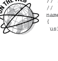


```csharp
public class Program
{
    public static void Main(string[] args)
    {
        // Define the white space characters.
        char[] whiteSpace = { ' ', '\n', '\t' };
        // Start with a string embedded with whitespace.
        string s = " this is a\nstring";  // Contains spaces & newline.
        Console.WriteLine("before:" + s);
        // Output the string with the whitespace missing.
        Console.WriteLine("after:");
        // Start looking for the white space characters.
        for(;;)
        {
            // Find the offset of the character; exit the loop
            // if there are no more.
            int offset = s.IndexOfAny(whiteSpace);
            if (offset == -1)
            {
                break;
            }
            // Break the string into the part prior to the
            // character and the part after the character.
            string before = s.Substring(0, offset);
            string after = s.Substring(offset + 1);
            // Now put the two substrings back together with the
            // character in the middle missing.
            s = String.Concat(before, after);
            // Loop back up to find next whitespace char in
            // this modified s.
        }
        Console.WriteLine(s);
        // Wait for user to acknowledge the results.
        Console.WriteLine("Press Enter to terminate...");
        Console.Read();
    }
}
```

这个程序的关键在于加粗的循环。该循环不断细化一个由输入字符串 `s` 构成的字符串，删除数组 `whiteSpace` 中包含的字符集合中的每一个字符。

该循环使用 `IndexOfAny()` 查找 `whiteSpace` 数组中任意字符的第一次出现。直到这些字符的每一个实例都被删除后，它才会返回。`IndexOfAny()` 方法返回它找到的第一个空白字符的索引。返回值为 `-1` 表示在字符串中未找到数组中的任何项。

第一次循环遍历会删除目标字符串开头的空白。`IndexOfAny()` 在索引 0 处找到该空白。第一次 `Substring()` 调用返回空字符串，第二次调用返回空白之后的整个字符串。然后使用 `Concat()` 将它们拼接起来，生成一个挤掉开头空白的字符串。

第二次循环遍历找到 "this" 后面的空格，并以同样的方式将其挤出，拼接字符串 "this" 和 "is a\nstring"。经过这次遍历后，`s` 变成了 `"thisis a\nstring"`。

第三次遍历找到 `\n` 字符并将其挤出。第四次遍历时，`IndexOfAny()` 已经没有可查找的空白字符，于是返回 `-1`（未找到）。循环到此结束。

RemoveWhiteSpace 程序会打印一个包含多种空白形式的字符串。然后该程序会去除空白字符。该程序的输出如下所示：

```text
before: this is a
string
after:thisisastring
Press Enter to terminate...
```

## 让我们用 Split() 拆分那个拼接程序

RemoveWhiteSpace 程序演示了 `Concat()` 和 `IndexOfAny()` 方法的用法；然而，它并没有使用最高效的方法。像往常一样，稍加检查就会发现一种更高效的方法，即使用我们的老朋友 `Split()`。你可以在网站的 RemoveWhiteSpaceWithSplit 下找到包含这段代码的程序——现在它已作为另一个方法示例。完成这项工作的方法如下所示：


```csharp
// RemoveWhiteSpace -- The RemoveSpecialChars method removes every
// occurrence of the specified characters from the string.
// Note: The rest of the program is not shown here.
public static string RemoveSpecialChars(string input, char[] targets)
{
    // Split the input string up using the target
    // characters as the delimiters.
    string[] subStrings = input.Split(targets);

    // output will contain the eventual output information.
    string output = "";

    // Loop through the substrings originating from the split.
    foreach(string subString in subStrings)
    {
        output = String.Concat(output, subString);
    }
    return output;
}
```

这个版本使用 `Split()` 方法将输入字符串拆分为一组子字符串，并把要删除的字符用作分隔符。创建的子字符串中不包含分隔符，这实际上就删除了这些字符。这里的逻辑简单得多，也更不容易出错。

程序后半部分的 `foreach` 循环使用 `Concat()` 将这些片段重新组合起来。程序的输出保持不变。

将代码提取到一个方法中，可以进一步简化它并使其更清晰。

## 精确格式化字符串

String 类还提供了 `Format()` 方法用于格式化输出，尤其是数字的输出。在其最简单的形式中，`Format()` 允许在格式字符串中间插入字符串、数值或布尔输入。例如，考虑下面这个调用：

```csharp
string myString = String.Format("{0} times {1} equals {2}", 2, 5, 2*5);
```

`Format()` 的第一个参数称为格式字符串——也就是你看到的带引号的字符串。格式字符串中间的 `{n}` 项表示格式字符串之后的第 `n` 个参数将插入到该位置。`{0}` 指第一个参数（在此例中为值 2），`{1}` 指下一个参数（即 5），依此类推。

这会返回一个字符串 `myString`。结果字符串为：

```text
'2 times 5 equals 10'
```

除非另有指示，`Format()` 会为每种参数类型使用默认输出格式。`Format()` 允许你通过在占位符中包含说明符（修饰符或控制符）来影响输出格式。表 3-1 列出了其中一些说明符。例如，`{0:E6}` 表示“以指数形式输出该数字，小数部分使用六位数字”。

### 表 3-1 使用 String.Format() 的格式说明符

| 控制符 | 示例 | 结果 | 说明 |
|---|---|---|---|
| C — 货币 | `{0:C}` 作用于 123.456 | `$123.46` | 货币符号取决于“区域”设置。 |
|  | `{0:C}` 作用于 -123.456 | `($123.46)` | 在 Windows 控制面板中指定“区域”。 |
| D — 十进制 | `{0:D5}` 作用于 123 | `00123` | 仅适用于整数。 |
| E — 指数 | `{0:E}` 作用于 123.45 | `1.234500E+002` | 也称为科学记数法。 |
| F — 固定 | `{0:F2}` 作用于 123.4567 | `123.46` | F 后面的数字表示小数点后的位数。 |
| N — 数字 | `{0:N}` 作用于 123456.789 | `123,456.79` | 添加逗号并四舍五入到最接近的百分位。 |
|  | `{0:N1}` 作用于 123456.789 | `123,456.8` | 控制小数点后的位数。 |
|  | `{0:N0}` 作用于 123456.789 | `123,457` | 控制小数点后的位数。 |
| X — 十六进制 | `{0:X}` 作用于 123 | `7B` | 7B 十六进制 = 123 十进制（仅适用于整数）。 |
| `{0:0...}` | `{0:000.00}` 作用于 12.3 | `012.30` | 如果某一位数字尚不存在，则强制显示 0。 |
| `{0:#...}` | `{0:###.##}` 作用于 12.3 | `12.3` | 强制将该空间留空；其他字段不能侵占小数点左侧的三位数字和小数点后的两位数字所占空间（有助于保持小数点对齐）。 |
|  | `{0:##0.0#}` 作用于 0 | `0.0` | 将 `#` 和零组合使用会强制由 `#` 分配空间，并强制至少显示一位数字，即使数字为 0。 |
| `{0:# or 0%}` | `{0:#0.##%}` 作用于 0.1234 | `12.34%` | `%` 将数字显示为百分比（乘以 100 并添加 `%` 符号）。 |
|  | `{0:#0.00.##%}` 作用于 0.0234 | `2.34%` | `%` 将数字显示为百分比（乘以 100 并添加 `%` 符号）。 |


`Console.WriteLine()` 方法使用相同的占位符系统。第一个占位符 `{0}` 接受语句中格式字符串部分之后列出的第一个变量或值，依此类推。给定与前面 `Format()` 调用完全相同的参数，`Console.WriteLine()` 会将相同的字符串写入控制台。你也可以使用格式说明符。从现在开始，我大多时候会使用 `WriteLine()` 的格式化形式，而不是用 `+` 运算符连接各项来形成最终输出字符串。


这些格式说明符可能看起来有点令人困惑。（我甚至还没有提到详细的货币和日期控制项。）请在“帮助索引”中浏览“格式说明符”主题以了解更多信息。为帮助你梳理这些选项，下面的 OutputFormatControls 程序让你能够输入一个浮点数，随后输入一个说明符序列。然后，程序使用指定的 Format() 控制显示该数字：

```csharp
// OutputFormatControls -- Allow the user to reformat input numbers
// using a variety of format specifiers input at run time.
namespace OutputFormatControls
{
    using System;
    public class Program
    {
        public static void Main(string[] args)
        {
            // Keep looping -- inputting numbers until the user
            // enters a blank line rather than a number.
            for(;;)
            {
                // First input a number -- terminate when the user
                // inputs nothing but a blank line.
                Console.WriteLine("Enter a double number:");
                string numberInput = Console.ReadLine();
                if (numberInput.Length == 0)
                {
                    break;
                }
                double number = Double.Parse(numberInput);
                // Now input the specifier codes; split them
                // using spaces as dividers.
                Console.WriteLine("Enter the format specifiers"
                    + " separated by a blank "
                    + "(Example: C E FI NO 000000.00000)");
                char[] separator = { ' ' };
                string formatString = Console.ReadLine();
                string[] formats = formatString.Split(separator);
                // Loop through the list of format specifiers.
                foreach(string s in formats)
                {
                    if (s.Length != 0)
                    {
                        // Create a complete format specifier
                        // from the letters entered earlier.
                        string formatCommand = "{0:" + s + "}";
                        // Output the number entered using the
                        // reconstructed format specifier.
                        Console.Write(
                            "The format specifier {0} results in ", formatCommand);
                        try
                        {
                            Console.WriteLine(formatCommand, number);
                        }
                        catch(Exception)
                        {
                            Console.WriteLine("<illegal controls>");
                        }
                        Console.WriteLine();
                    }
                }
            }
        }
    }
}
```

类似地，当应用于 `0.12345` 时，控制项 `00.0%` 会输出 `12.3%`。百分号会将数字乘以 100 并添加 `%`。`00.0` 表示输出应包含小数点左边至少两位数字，小数点后仅一位数字。使用相同的 `00.0%` 说明符时，数字 `0.01` 显示为 `01.0%`。

神秘的 `try . . . catch` 会捕获你输入非法格式命令（例如 `D`，代表十进制）时抛出的任何错误。（我在本小册第9章介绍异常。）


### StringBuilder：更高效地操作字符串

用许多较短的字符串构建较长的字符串可能会让你付出高昂代价。因为字符串一旦创建就不能更改——正如我在本章开头所说，它是不可变的。这个示例并没有把 "ly" 附加到 `s1` 上：

```csharp
string s1 = "rapid";
string s2 = s1 + "ly";          // s2 = rapidly.
```

它会创建一个由组合而成的新字符串。（`s1` 保持不变。）类似地，其他看似修改字符串的操作（如 `Substring()` 和 `Replace()`）也会这样做。

结果是，对字符串的每次操作都会产生另一个字符串。假设你需要将 1000 个字符串连接成一个巨大的字符串。每次连接都会创建一个新字符串：

```csharp
string[] listOfNames = ...  // 1000 pet names
string s = string.Empty;
for(int i = 0; i < 1000; i++)
{
    s += listOfNames[i];
}
```

当你要对字符串进行大量修改时，为避免这种开销，请使用配套类 `StringBuilder`。务必在文件顶部添加以下行：

```csharp
using System.Text;  // Tells the compiler where to find StringBuilder.
```


与 `String` 操作不同，对 `StringBuilder` 进行的操作会直接更改底层字符串。示例如下：

```csharp
StringBuilder builder = new StringBuilder("012");
builder.Append("34");
builder.Append("56");
string result = builder.ToString();  // result = 0123456
```

创建一个用现有字符串初始化的 `StringBuilder` 实例，如刚才所示。或者创建一个没有初始值的空 `StringBuilder`：

```csharp
StringBuilder builder = new StringBuilder(); // Defaults to 16 characters
```

你还可以按预期需要的容量创建 StringBuilder，这会减少频繁增加生成器容量带来的开销：

```csharp
StringBuilder builder = new StringBuilder(256); // 256 characters.
```

使用 Append() 方法将文本添加到当前内容的末尾。完成修改后，使用 ToString() 检索 StringBuilder 内的字符串。下面是刚才那个循环的 StringBuilder 版本，其中检索最终连接字符串的部分以粗体显示：

```csharp
StringBuilder sb = new StringBuilder(20000); // Allocate a bunch.
for(int i = 0; i < 1000; i++)
{
    sb.Append(listOfNames[i]);    // Same list of names as earlier
}
string result = sb.ToString();  // Retrieve the results.
```

StringBuilder 还有许多其他有用的字符串操作方法，包括 Insert()、Remove() 和 Replace()。不过，它缺少字符串的许多方法，例如 Substring()、CopyTo() 和 IndexOf()。

假设你只想将字符串的第一个字符改为大写，就像前面“将字符串转换为大写或小写”一节中那样。使用 StringBuilder 时，代码看起来比我之前给出的代码整洁得多。

```csharp
StringBuilder sb = new StringBuilder("jones");
sb[0] = char.ToUpper(sb[0]);
string fixedString = sb.ToString();
```

这段代码将小写字符串 "jones" 放入 StringBuilder，通过 sb[0] 直接访问 StringBuilder 底层字符串中的第一个字符，使用 char.ToUpper() 方法将该字符转为大写，并将大写后的字符重新赋给 sb[0]。最后，它从 StringBuilder 中提取改进后的字符串 "Jones"。

本章前面“所有字符串一律平等：Compare() 方法”一节中介绍的 BuildASentence 示例，使用 StringBuilder 会受益匪浅。我经常使用 StringBuilder。

本书网站上的 StringCaseChanging 和 VariousStringTechniques 示例展示了 StringBuilder 的实际应用。

第II部分介绍 C# 的一项称为扩展方法的功能。那里的示例向 String 类添加了几个方便的方法。在该小册的后面，我描述了如何在字符串、char 数组和 byte 数组之间转换。这些是你可能需要频繁执行的操作（并且本书网站上的 StringCaseChanging 示例中展示了这些操作）。


## 第4章：流畅的运算符

### 本章内容

- 执行一些算术运算
- 进行一些逻辑运算
- 用复合逻辑运算符把事情复杂化

数学家创建变量并以各种方式操作它们：相加、相乘，以及——这里有个棘手之处——甚至对它们进行积分。本小册第2章描述了如何声明和定义变量。然而，它几乎没有说明在声明变量后如何使用变量来完成事情。本章探讨可对变量执行以完成一些工作的操作。操作需要运算符，例如 +、-、*、/、= 和 &。本章介绍算术、逻辑和其他类型的运算符。

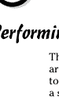

编写能完成工作的程序是好事。如果你的程序不做任何事，你就永远无法成为一名 C# 程序员——当然，除非你是顾问。

### 执行算术运算

算术运算符可分为几组：简单算术运算符、赋值运算符，以及一组编程特有的特殊运算符。消化完这些之后，你还需要消化另一组逻辑运算符。祝你好胃口！

### 简单运算符

你很可能在小学就学会了如何使用大多数简单运算符。表4-1列出了它们。注意：计算机使用星号（*）而不是乘号（×）来表示乘法。


**表 4-1 简单运算符**

| 运算符 | 含义 |
| --- | --- |
| − (一元) | 取负值 |
| * | 乘法 |
| / | 除法 |
| + | 加法 |
| − (二元) | 减法 |
| % | 取模 |

表中大多数运算符是**二元运算符**，因为它们操作两个值：一个在运算符左侧，一个在右侧。唯一的例外是一元负号。然而，它与其它运算符一样简单，如以下示例所示：

```
int n1 = 5;
int n2 = -n1;  // n2 now has the value -5.
```

−n 的值是 n 值的负值。

取模运算符可能不如其它运算符那么熟悉。取模类似于除法后的余数。因此，5 % 3 是 2（5 / 3 = 1，余数 2），25 % 3 是 1（25 / 3 = 8，余数 1）。读作“五模三”或简单地“五 mod 三”。偶数 mod 2 为 0：6 % 2 = 0（6/2 = 3，余数 0）。

除取模外的算术运算符对所有数值类型都有定义。取模运算符未定义浮点数，因为浮点值相除后没有余数。

## 运算顺序

某些表达式的值可能不明确。例如，考虑以下表达式：

```
int n = 5 * 3 + 2;
```

程序员的意思是“先将 5 乘以 3 再加 2”，结果为 17，还是“将 5 乘以 3 与 2 的和”，结果为 25？

C# 通常从左到右执行常见运算符。因此，前面的示例将值 17 赋给变量 n。


C# 在以下示例中先将 24 除以 6，然后将该操作的结果除以 2（而不是用 24 除以 6 除以 2 的比值）。结果为 2：

```
int n = 24 / 6 / 2
```

然而，各种运算符具有层级，即优先级。C# 扫描表达式并先执行优先级更高的操作，再执行优先级更低的操作。例如，乘法比加法的优先级更高。许多书籍费尽心机解释优先级顺序，但说实话，这完全是浪费时间（和脑细胞）。

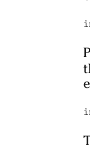

不要依赖自己或他人记住优先级顺序。使用括号使代码对人类阅读者以及编译器来说含义明确。（如果你需要进行语言层面的考证，可以在本书网站上的速查表中找到优先级。）

无论运算符的优先级顺序如何，以下表达式的值都很明确：

```
int n = (7 % 3) * (4 + (6 / 3));
```

括号可以通过明确说明编译器应如何解释表达式来覆盖优先级顺序。为了找到第一个要计算的表达式，C# 会查找最内层的括号，将 6 除以 3 得到 2：

```
int n = (7 % 3) * (4 + 2);    // 6 / 3 = 2
```

然后 C# 从内向外工作，依次计算每一组括号，从最内层到最外层：

```
int n = 1 * 6;    // (4 + 2) = 6
```

因此，最终结果及 n 的值为 6。

## 赋值运算符

C# 从 C 和 C++ 继承了一个有趣的概念：赋值本身就是一个二元运算符。赋值运算符的值为右侧参数的值。赋值的类型与两个参数相同，且必须匹配。

我在本章中描述的其它表达式不受这种对赋值运算符的看法影响：

```
n = 5 * 3;
```

在此示例中，5 * 3 为 15 且为 int。赋值运算符将右侧的 int 存储到左侧的 int 中并返回 15。然而，这种对赋值运算符的看法允许以下行：

```
m = n = 5 * 3;
```

赋值按从右到左的顺序依次求值。右侧的赋值将值 15 存储到 n 中并返回 15。左侧的赋值将 15 存储到 m 中并返回 15，随后该值被丢弃，使每个变量的值均为 15。

这种奇怪的赋值定义使得以下相当奇特的表达式合法：

```
int n;
int m;
n = m = 2;
```

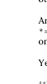

避免链式赋值，因为它对人类阅读者来说不够清晰。任何可能让阅读你代码的人（包括你自己）感到困惑的东西都值得避免，因为困惑会滋生错误。

## 递增运算符

在编程中可能执行的各种加法中，给变量加 1 是最常见的：

```
n = n + 1; // Increment n by 1.
```

C# 用一组由其它二元运算符构造的运算符扩展了简单运算符。例如，n += 1; 等价于 n = n + 1;

几乎每个二元运算符都有对应的赋值运算符：+=、-=、*=、/=、%=、&=、|=、^=。请在帮助中查找 C# 语言、运算符以获取其完整详细信息。

然而，即使是 n += 1 也不够简洁。C# 提供了更短的版本：

```
++n; // Increment n by 1.
```

这些递增数字的形式都等价——它们都将 n 递增 1。

递增运算符已经够奇怪了，但不可思议的是，C# 有两个递增运算符：++n 和 n++。第一个 ++n 是前置递增运算符，n++ 是后置递增运算符。区别很微妙但很重要。

请记住每个表达式都有类型和值。在以下代码中，++n 和 n++ 的类型均为 int：

```
int n;
n = 1;
int p = ++n;
n = 1;
int m = n++;
```

那么 m 和 p 的结果值是多少？（提示：选项为 1 和 2。）p 的值为 2，m 的值为 1。也就是说，表达式 ++n 的值是 n 递增后的值，而表达式 n++ 的值是 n 递增前的值。无论如何，n 本身的最终值都是 2。

C# 有等价的递减运算符——n-- 和 --n。它们的工作方式与递增运算符完全相同。

## 执行逻辑比较 — 这合理吗？

C# 提供了一组逻辑比较运算符，如表 4-2 所示。这些运算符是逻辑比较，因为它们返回类型为 bool 的 true 或 false 值。

**表 4-2 逻辑比较运算符**

| 运算符 | 运算符为真时 |
| --- | --- |
| a == b | a 的值与 b 相同 |
| a > b | a 大于 b |
| a >= b | a 大于或等于 b |
| a < b | a 小于 b |
| a <= b | a 小于或等于 b |
| a != b | a 不等于 b |

这里有一个涉及逻辑比较的示例：

```
int m = 5;
int n = 6;
bool b = m > n;
```

此示例将值 false 赋给变量 b，因为 5 不大于 6。

逻辑比较对所有数值类型都有定义，包括 float、double、decimal 和 char。以下所有语句都是合法的：

```
bool b;
b = 3 > 2;    // true
b = 3.0 > 2.0;  // true
b = 'a' > 'b';  // false -- Alphabetically, later = greater.
b = 'A' < 'a';  // true -- Upper A is less than lower a.
b = 'A' < 'B';  // true -- All upper are less than all lower.
b = 10M > 12M;  // false
```

比较运算符始终产生类型为 bool 的结果。除 == 外的比较运算符对 string 类型的变量无效。（不用担心：C# 提供了其它比较字符串的方式。）

### 比较浮点数：你的浮点数比我的大吗？

比较两个浮点值可能很棘手，你需要谨慎处理这些比较。考虑以下比较：

```
float f1;
float f2;
f1 = 10;
f2 = f1 / 3;
bool b1 = (3 * f2) == f1;  // b1 is true if (3 * f2) equals f1.
f1 = 9;
f2 = f1 / 3;
bool b2 = (3 * f2) == f1;
```

请注意，前例中第五行和第八行都先包含赋值运算符（=），然后是逻辑比较（==）。它们是不同的东西，所以不要在想写 == 时写成 =。C# 先进行逻辑比较，然后将结果赋给左侧的变量。

b1 和 b2 计算的唯一区别是 f1 的初始值。那么 b1 和 b2 的值是多少？b2 的值显然为 true：9 / 3 是 3；3 * 3 是 9；9 等于 9。瞧！

b1 的值并不明显：10 / 3 是 3.333...，而 3.333... * 3 是 9.999...。9.999... 等于 10 吗？这取决于你的处理器和编译器的聪明程度。在 Pentium 或更新的处理器上，C# 不够聪明，无法意识到如果将计算移离比较，b1 应该为 true。

你可以使用系统绝对值方法来比较 f1 和 f2：

```
Math.Abs(f1 - 3.0 * f2) < .00001;  // Use whatever level of accuracy.
```

此计算在两种情况下都返回 true。你可以使用常量 Double.Epsilon 代替 .00001 以获得最高精度。


Epsilon 是两个不相等 double 变量之间可能存在的最小差异。

如需自行浏览 System.Math 类，其中包含 Abs 以及许多其他有用的数学函数，请在帮助中查找 math。

## 用复合逻辑运算加剧混淆

bool 变量还有另一组专门为其定义的运算符，如表 4-3 所示。

**表 4-3 复合逻辑运算符**

| Operator | 运算符为真时 |
|---|---|
| ! a | a 为 false（也称为“not”运算符）。 |
| a & b | a 和 b 均为 true（也称为“and”运算符）。 |
| a \| b | a 或 b 或两者皆为 true（也称为 a and/or b）。 |
| a ^ b | a 为 true 或 b 为 true 但不同时为 true（也称为 a xor b）。 |
| a && b | a 为 true 且 b 为 true，并进行短路求值。 |
| a || b | a 为 true 或 b 为 true，并进行短路求值。（我在本节中讨论短路求值。） |


! 运算符（NOT）是减号的逻辑等价物。例如，!a（读作“not a”）在 a 为 false 时为 true，在 a 为 true 时为 false。这可能吗？

表中接下来的两个运算符很直接。首先，a & b 只有在 a 和 b 均为 true 时才为 true。而 a | b 在 a 或 b 为 true 时为 true（两者皆可）。异或（xor）运算符，或 ^，有点奇怪。异或在 a 或 b 为 true 时为 true，但 a 和 b 同时为 true 时不为 true。

这三个运算符都产生一个逻辑 bool 值作为其结果。


&, | 和 ^ 运算符也具有按位运算符版本。当应用于 int 变量时，这些运算符按位执行操作。因此 6 & 3 为 2（0110₂ & 0011₂ 为 0010₂），6 | 3 为 7（0110₂ | 0011₂ 为 0111₂），而 6 ^ 3 为 5（0110₂ ^ 0011₂ 为 0101₂）。二进制运算很酷，但超出了本书范围。你可以在喜欢的搜索引擎中搜索它。

剩下的两个逻辑运算符与前三个相似，但略有不同。考虑以下示例：

```
bool b = {boolExpression1} && {boolExpression2};
```

在这种情况下，C# 会计算 boolExpression1 和 boolExpression2。然后它会查看两者是否都为 true 才会决定 b 的值。然而，这可能是浪费精力。如果一个表达式为 false，就没有理由执行另一个。无论第二个表达式的值如何，结果都将为 false。尽管如此，& 仍会继续计算两个表达式。

&& 运算符避免不必要地计算两个表达式，如以下示例所示：

```
bool b = (boolExpression1) && (boolExpression2);
```

在这种情况下，C# 会计算 boolExpression1。如果它为 false，则 b 被设为 false，程序继续执行。另一方面，如果 boolExpression1 为 true，则 C# 会计算 boolExpression2 并将结果存储在 b 中。&& 运算符使用这种 *短路求值*，因为如果需要，它会绕过第二个布尔表达式。


大多数程序员大部分时间都使用双重形式。

|| 运算符的工作方式相同，如以下表达式所示：

```
bool b = (boolExpression1) || (boolExpression2);
```

如果 boolExpression1 为 true，则没有必要计算 boolExpression2，因为结果始终为 true。

你可以将这些运算符读作“短路与”和“短路或”。

## 在 TrackDownAMate.com 上匹配表达式类型

在计算中，表达式的类型与它的值一样重要。考虑以下表达式：

```
int n;
n = (5 * 5) + 7;
```

我的计算器说 n 的结果值为 32。然而，该表达式也有一个基于其各部分类型的整体类型。

用“类型语言”写出来，前面的表达式变为

```
int (=) (int * int) + int;
```

要计算表达式的类型，请遵循与计算表达式值相同的模式。乘法优先于加法。int 乘以 int 得到 int。接下来是加法。int 加 int 得到 int。这样，你可以将前面的表达式化简为：

```
(int * int) + int
int + int
int
```

## 计算操作的类型

大多数运算符有各种形式。例如，乘法运算符有以下形式（箭头表示“产生”）：

```
int * int -> int
uint * uint -> uint
long * long -> long
float * float -> float
decimal * decimal -> decimal
double * double -> double
```

因此，2 * 3 使用 * 运算符的 int * int 版本来产生 int 6。

## 隐式类型转换

* 符号适用于相乘两个 int 或两个 float。但想象一下当左右参数不是同一类型时会发生什么。例如，考虑以下情况会发生什么：

```
int anInt = 10;
double aDouble = 5.0;
double result = anInt * aDouble;
```

首先，C# 没有 int * double 操作。C# 完全可以生成错误消息并就此作罢；然而，它会尝试理解程序员的意图。C# 有 int * int 和 double * double 版本的乘法，并且可以将 aDouble 转换为其 int 等价物，但这会涉及丢失数字的任何小数部分（小数点右边的数字）。相反，在隐式提升中，C# 将 int anInt 转换为 double 并使用 double * double 运算符。


隐式提升之所以隐式，是因为 C# 自动执行它，而它之所以是提升，是因为它涉及上坡和下坡的自然概念。乘法运算符列表按从 int 到 double 或从 int 到 decimal 的提升顺序排列——从较窄类型到较宽类型。浮点类型和 decimal 之间不存在隐式转换。从更强大的类型（如 double）转换为较不强大的类型（如 int）称为降级。隐式降级不允许；C# 会生成错误消息。

## 显式类型转换 — 强制转换

想象一下如果 C# 对隐式转换判断错误，而程序员想要执行整数乘法会发生什么？

你可以使用强制转换运算符更改任何值类型变量的类型。强制转换由放在要转换的变量或表达式正前面的括号中括起来的类型组成。

因此以下表达式使用 int * int 运算符：

```
int aInt = 10;
double aDouble = 5.0;
int result = aInt * (int)aDouble;
```

将 aDouble 强制转换为 int 被称为显式降级或向下转换。转换是显式的，因为程序员明确声明了她的意图。（废话。）

你可以在任何两个值类型之间进行显式转换，无论是沿提升阶梯向上还是向下。

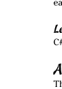

避免隐式类型转换。通过使用强制转换使值类型中的任何更改都显式化。这样可以减少出错的可能性，并使代码对人类更易读。

## 让逻辑保持原样

C# 不提供到或从 bool 类型的类型转换路径。

## 分配类型

你在转换中发现的相同类型匹配也适用于赋值运算符。

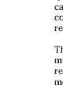

通常会生成编译器错误消息的意外类型不匹配通常发生在赋值运算符中，而不是不匹配点。

考虑以下乘法示例：

```
int n1 = 10;
int n2 = 5.0 * n1;
```

此示例的第二行因类型不匹配而生成错误消息，但错误发生在赋值处——而不是乘法处。以下是可怕的故事：为了执行乘法，C# 会隐式地将 n1 转换为 double。然后 C# 可以执行 double 乘法，其结果是无所不能的 double。

赋值运算符的右手和左手操作数的类型必须匹配，但左手操作数的类型不能更改。因为 C# 拒绝隐式降级表达式，所以编译器会生成错误消息 Cannot implicitly convert type double to int。


C# allows this expression with an explicit cast:

```
int n1 = 10;
int n2 = (int)(5.0 * n1);
```

（括号是必要的，因为转换运算符的优先级非常高。）此示例有效——显式降级是可以的。n1 被提升为 double，进行乘法运算，然后 double 结果被降级为 int。然而，在这种情况下，你会担心程序员的 sanity，因为 5 * n1 对程序员和 C# 编译器来说都更容易阅读。

## 如何改变运算符的工作方式：运算符重载

为了进一步增加复杂性，C# 中有一个称为运算符重载的功能可以改变任何运算符的行为。运算符重载本质上是在定义一个新函数，每当你在定义重载的同一项目中使用运算符时就会运行该函数。

运算符重载实际上比听起来更简单。如果你编写

```
var x = 2+2;
```

你会期望 x 等于 4 对吧？这就是 + 的工作方式。好吧，这已经是 21 世纪了，大家，答案是见仁见智的！我认为在任何交易中都应该给用户比他们要求的更多。为此，让我们确保你在每次加法运算中都加一。

为此，你需要创建一个自定义类，供你的重载运算符使用。此类将具有一些自定义类型和一个用于重载操作的方法。简而言之，如果你添加常规数字，你会得到常规答案；如果添加特殊的 AddOne 数字，你会多加一个：

```
public class AddOne
{
    public int x;

    public static AddOne operator +(AddOne a, AddOne b)
    {
        AddOne addone = new AddOne();
        addone.x = a.x + b.x + 1;
        return addone;
    }
}
```

一旦运算符被重载（在列表中使用 operator 标签），然后你就可以像平常一样使用它：

```
public class Program{
    static void Main(string[] args)
    {
        AddOne foo = new AddOne();
        foo.x = 2;
        AddOne bar = new AddOne();
        bar.x = 3;
        //And 2 + 3 now is 6...
        Console.WriteLine((foo + bar).x.ToString());
        Console.Read();
    }
}
```

答案当然是 6，而不是 5。

运算符重载对于整数来说没有用，除非你打算重写数学定律。然而，如果你确实有两个实体想要能够相加，这种技术可能有用。例如，如果你有一个 `Product` 类，你可以重新定义该类的 `+` 运算符来添加价格。

## 第 5 章：进入程序流程

### 本章内容

- ✓ 如果可以就做决策
- ✓ 决定还要做什么
- ✓ 在不形成循环的情况下循环
- ✓ 使用 while 和 do ... while 循环
- ✓ 使用 for 循环并理解作用域

考虑这个简单程序：

```
using System;
namespace HelloWorld
{
    public class Program
    {
        // This is where the program starts.
        static void Main(string[] args)
        {
            // Prompt user to enter a name.
            Console.WriteLine("Enter your name, please:");
            // Now read the name entered.
            string name = Console.ReadLine();
            // Greet the user with the entered name.
            Console.WriteLine("Hello, " + name);
            // Wait for user to acknowledge the results.
            Console.WriteLine("Press Enter to terminate . . .");
            Console.Read();
        }
    }
}
```

除了向你介绍 C# 编程的几个基础知识外，这个程序几乎毫无价值。它只是原样吐出你输入的内容。你可以想象更复杂的程序示例，它们接受输入，执行某种类型的计算，生成某种类型的输出（否则，为什么要进行计算？），然后在底部退出。然而，即使是这样的程序，其用途也仅限于此。

任何计算机处理器的一项关键要素是其做出决策的能力。当我说“做出决策”时，我的意思是如果条件为真，处理器会将执行流程发送到一条指令路径，如果条件不为真，则发送到另一条路径。任何编程语言都必须提供这种控制执行流程的基本能力。

三种基本流程控制类型是 if 语句、循环和跳转。（我在本书迷你书的第 6 章中描述了其中一种循环控制 foreach。）

## 使用 if 和 switch 分支

所有 C# 决策能力的基础是 if 语句（而我所有决策的基础是也许）：

```
if (bool-expression)
{
    // Control goes here if the expression is true.
}
// Control passes to this statement whether the expression is true or not.
```

紧跟在 if 关键字之后的一对括号包含一个类型为 bool 的条件表达式。（请参阅本迷你书第 2 章，了解 bool 表达式的讨论。）紧跟在表达式之后的是由一对大括号分隔的代码块。如果表达式为真，程序会执行大括号内的代码；如果表达式不为真，程序会跳过大括号内的代码。（如果程序执行大括号内的代码，它会在闭合大括号后结束并继续。）

通过查看具体示例，更容易理解 if 语句：

```
// Make sure that a is not negative:
// If a is less than 0 . . .
if (a < 0)
{
    // . . . then assign 0 to it so that it's no longer negative.
    a = 0;
}
```

这段代码确保变量 a 为非负数——大于或等于 0。if 语句说：“如果 a 小于 0，则将 0 赋给 a。”（换句话说，将 a 变为正值。）

大括号不是必需的。C# 将 if(bool-expression) statement; 视为已写成 if(bool-expression) {statement;}。普遍共识（也是我的偏好）是始终使用大括号以提高清晰度。换句话说，不要问——直接做。


### 介绍 if 语句

考虑一个计算利息的小程序。用户输入本金金额和利率，程序输出每年的结果值。（这个程序并不复杂。）这种简单的计算在 C# 中如下所示：

```
// Calculate the value of the principal plus interest.
decimal interestPaid;
interestPaid = principal * (interest / 100);
// Now calculate the total.
decimal total = principal + interestPaid;
```

第一个等式将本金乘以利息以产生应付利息——interestPaid。（你除以 100，因为利息通常通过输入百分比金额来计算。）应付利息随后加回本金，得到一个新的本金，存储在变量 total 中。

程序在处理人工输入时必须预见到几乎任何情况。例如，你不希望程序接受负本金或利息金额（好吧，也许负利息）。下面的 CalculateInterest 程序包含检查以确保不会发生这些输入：


```
// CalculateInterest -- Calculate the interest amount paid
// on a given principal. If either the principal or the
// interest rate is negative, generate an error message.
using System;
namespace CalculateInterest
{
public class Program
{
public static void Main(string[] args)
{
// Prompt user to enter source principal.
Console.Write("Enter principal: ");
string principalInput = Console.ReadLine();
decimal principal = Convert.ToDecimal(principalInput);
// Make sure that the principal is not negative.
if (principal < 0)
{
Console.WriteLine("Principal cannot be negative");
principal = 0;
}
// Enter the interest rate.
Console.Write("Enter interest: ");
string interestInput = Console.ReadLine();
decimal interest = Convert.ToDecimal(interestInput);
// Make sure that the interest is not negative either.
if (interest < 0)
{
Console.WriteLine("Interest cannot be negative");
interest = 0;
}
// Calculate the value of the principal plus interest.
decimal interestPaid = principal * (interest / 100);
// Now calculate the total.
decimal total = principal + interestPaid;
// Output the result.
Console.WriteLine();
Console.WriteLine("Principal = " + principal);
Console.WriteLine("Interest = " + interest + "%");
Console.WriteLine();
Console.WriteLine("Interest paid = " + interestPaid);
Console.WriteLine("Total = " + total);
}
}
}

// Wait for user to acknowledge the results.
Console.WriteLine("Press Enter to terminate . . .");
Console.Read();
}

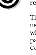

CalculateInterest 程序开始时使用 WriteLine() 通过向控制台写入字符串来提示用户输入他的姓名。请准确告诉用户您想要什么，如果可能的话，指定格式。用户对信息不足的提示，例如 >，反应不佳。

示例程序使用 ReadLine() 命令读取用户输入的任何内容；当用户按下 Enter 时，程序以字符串形式返回输入的值。由于程序需要以十进制形式查找本金，因此输入字符串必须使用 Convert.ToDecimal() 命令进行转换。结果存储在 principalInput 中。


ReadLine()、WriteLine() 和 ToDecimal() 命令都是方法调用的示例。方法调用将部分工作委托给程序的另一部分，称为方法。我在第二册中详细描述了方法调用；这些特定的方法调用很简单。你应该能够通过我极具洞察力的解释性叙述把握其含义的大致意思。如果不行，请忽略叙述。如果仍然不行，请参阅第二册。

示例中的下一行检查 principal。如果它为负数，程序会输出一条礼貌的“nastygram”，表明用户搞砸了。程序对利率也做同样的处理，然后执行前面“Introducing the If Statement”部分中概述的简单利息计算，并使用一系列 WriteLine() 命令输出结果。

程序在合法的本金金额和在大多数州完全合法的高利贷利率下生成以下输出：

```
Enter principal: 1234
Enter interest: 21

Principal      = 1234
Interest       = 21%

Interest paid  = 259.14
Total          = 1493.14
Press Enter to terminate . . .
```

使用非法输入执行程序会生成以下输出：

```
Enter principal: 1234
Enter interest: -12.5
Interest cannot be negative

Principal      = 1234
Interest       = 0%
```

```
Interest paid = 0
Total = 1234
Press Enter to terminate . . .
```


在 if 子句内缩进行以增强可读性。这种缩进对 C# 而言会被忽略，但对我们人类很有帮助。大多数编程编辑器支持自动缩进，即在您输入 if 命令时编辑器会自动缩进。要在 Visual Studio 中设置自动缩进，请选择 Tools→Options。然后展开 Text Editor 节点。从那里展开 C#。最后单击 Tabs。在此页面上，启用 Smart Indenting 并将每级缩进的空格数设置为您喜欢的数量。（我在本书中使用每级缩进两个空格。）将制表符大小设置为相同的值。

## 检查 else 语句

有时，您的代码必须检查互斥条件。例如，以下代码段将两个数字 a 和 b 的最大值存储在变量 max 中：

```
// Store the maximum of a and b into the variable max.
int max;
// If a is greater than b . . .
if (a > b)
{
    // . . . save a as the maximum.
    max = a;
}
// If a is less than or equal to b . . .
if (a <= b)
{
    // . . . save b as the maximum.
    max = b;
}
```

第二个 if 语句导致不必要的处理，因为这两个条件是互斥的。如果 a 大于 b，a 不可能小于或等于 b。C# 正是为了这种情况定义了 else 子句。else 关键字定义了一个代码块，当 if 块未执行时执行该块。

计算最大值的代码段现在如下所示：

```
// Store the maximum of a and b into the variable max.
int max;
// If a is greater than b . . .
if (a > b)
{
    // . . . save a as the maximum; otherwise . . .
    max = a;
}
else
{
    // . . . save b as the maximum.
    max = b;
}
```

如果 a 大于 b，则执行第一个块；否则执行第二个块。最终，max 包含 a 或 b 中较大的值。

## 甚至避免使用 else

else 子句的序列可能会令人困惑。一些程序员喜欢在这样做不会导致更多混淆时避免使用它们。你可以这样编写最大值计算：

```
// Store the maximum of a and b into the variable max.
int max;
// Start by assuming that a is greater than b.
max = a;
// If it is not . . .
if (b > a)
{
    // . . . then you can change your mind.
    max = b;
}
```

有些程序员像避瘟疫一样避免这种风格，我可以感同身受。（这并不意味着我要改变；这只是意味着我感同身受。）你会在常见用法中看到这种风格和“else”风格。

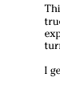

喜欢酷炫和晦涩的程序员经常使用三元运算符 : ?，相当于一行上的 if/else：

```
bool informal = true;
string name = informal : "Chuck" ? "Charles";  // Returns "Chuck"
```

此块计算冒号前的表达式。如果表达式为真，则返回冒号后但问号前的数值。如果表达式为假，则返回问号后的数值。此过程将 if/else 转换为表达式。

我通常建议很少使用三元运算符，因为它确实很晦涩。

## 嵌套 if 语句

CalculateInterest 程序会警告用户非法输入；然而，即使其中一个值不合逻辑，继续进行利息计算似乎也不太合适。这里不会造成真正的伤害，因为利息计算几乎不花费时间，用户可以忽略结果，但有些计算并没有那么快。此外，为什么在她已经输入了无效的本金值后还要询问用户利率？用户知道无论她接下来输入什么，计算结果都将无效。（你会惊讶于这会让用户多么恼火。）

程序只有在本金合理时才应询问用户利率，并且只有在两个值都有效时才执行利息计算。要实现这一点，你需要两个 if 语句，一个嵌套在另一个内部。


在另一个 if 语句的主体中发现的 if 语句是嵌入式或嵌套语句。

下面的程序 CalculateInterestWithEmbeddedTest 使用嵌入式 if 语句来避免在检测到输入问题时提出愚蠢的问题：

```
// CalculateInterestWithEmbeddedTest -- Calculate the interest amount
// paid on a given principal. If either the principal or the
// interest rate is negative, then generate an error message
// and don't proceed with the calculation.
using System;
namespace CalculateInterestWithEmbeddedTest
{
    public class Program
    {
        public static void Main(string[] args)
        {
            // Define a maximum interest rate.
            int maximumInterest = 50;
            // Prompt user to enter source principal.
            Console.Write("Enter principal: ");
            string principalInput = Console.ReadLine();
            decimal principal = Convert.ToDecimal(principalInput);
            // If the principal is negative . . .
            if (principal < 0)
            {
                // . . . generate an error message . . .
                Console.WriteLine("Principal cannot be negative!");
            }
            else  // Go here only if principal was > 0: thus valid.
            {
                // . . . otherwise, enter the interest rate.
                Console.Write("Enter interest: ");
                string interestInput = Console.ReadLine();
                decimal interest = Convert.ToDecimal(interestInput);
                // If the interest is negative or too large . . .
                if (interest < 0 || interest > maximumInterest)
                {
                    // . . . generate an error message as well.
                    Console.WriteLine("Interest cannot be negative " +
                        "or greater than " + maximumInterest);
                    interest = 0;
                }
                else  // Reach this point only if all is well.
                {
                    // Both the principal and the interest appear to be legal;
                    // calculate the value of the principal plus interest.
                    decimal interestPaid;
                    interestPaid = principal * (interest / 100);
                    // Now calculate the total.
                    decimal total = principal + interestPaid;
                    // Output the result.
                    Console.WriteLine();  // Skip a line.
                    Console.WriteLine("Principal      = " + principal);
                    Console.WriteLine("Interest       = " + interest + "%");
                    Console.WriteLine();
                    Console.WriteLine("Interest paid  = " + interestPaid);
                    Console.WriteLine("Total          = " + total);
                }
            }
        }
    }
}
```


```
}
// Wait for user to acknowledge the results.
Console.WriteLine("Press Enter to terminate . . .");
Console.Read();
}
}
```

程序首先从用户那里读取本金。如果本金为负数，程序会输出错误信息并退出。如果本金不是负数，控制权会转到 else 子句，程序继续执行。

本例改进了利率测试。在这里，程序要求利率为非负数（数学定律）且小于某个最大利率（司法法律——我只希望信用卡有利率上限）。这个 if 语句使用了以下复合测试：

```
if (interest < 0 || interest > maximumInterest)
```

如果 interest 小于 0 或大于 maximumInterest，该语句为真。注意，我在程序顶部声明了 maximumInterest，而不是在这里将其硬编码为常量数字。硬编码是指在代码中直接使用值，而不是创建常量来保存它们。

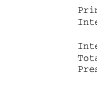

在程序顶部定义重要常量。给常量一个描述性名称（而不只是一个数字）便于查找，也更容易修改。如果该常量在代码中出现十次，要更改所有引用，你仍然只需做一次修改。

输入正确的本金但利率为负数时，会生成以下输出：

```
Enter principal: 1234
Enter interest: -12.5
Interest cannot be negative or greater than 50.
Press Enter to terminate . . .
```

只有当用户输入合法的本金和合法的利率时，程序才会生成正确的计算结果：

```
Enter principal: 1234
Enter interest: 12.5

Principal = 1234
Interest = 12.5%

Interest paid = 154.250
Total = 1388.250
Press Enter to terminate . . .
```

## 运行 switch 控制板

你经常需要针对许多不同的值测试同一个变量。例如，maritalStatus 可能为 0 表示未婚、1 表示已婚、2 表示离婚、3 表示丧偶（我肯定涵盖了所有选项——哦，等等），或者 4 表示“不关你的事”。要区分这些值，可以使用以下一系列 if 语句：

```
if (maritalStatus == 0)
{
    // Must be unmarried . . .
    // . . . do something . . .
}
else
{
    if (maritalStatus == 1)
    {
        // Must be married . . .
        // . . . do something else . . .
    }
```

以此类推。

你可以看到，这些重复的 if 语句很快就会让人厌烦。针对多种情况测试非常常见，因此 C# 提供了一种特殊构造，用于在一组互斥条件之间做出选择。这种控制结构就是 switch，其工作方式如下：

```
switch (maritalStatus)
{
    case 0:
        // . . . do the unmarried stuff . . .
        break;
    case 1:
        // . . . do the married stuff . . .
        break;
    case 2:
        // . . . do the divorced stuff . . .
        break;
    case 3:
        // . . . do the widowed stuff . . .
        break;
    case 4:
        // . . . get out of my face . . .
        break;
    default:
        // Goes here if it fails to pass a case;
        // this is probably an error condition.
        break;
}
```

switch 语句顶部的表达式会被求值。在本例中，表达式就是变量 maritalStatus。然后将该表达式的值与每个 case 的值进行比较。如果找不到匹配项，控制权会转到 default 子句。

switch 语句的参数也可以是字符串：

```
string s = "Davis";
switch(s)
{
case "Davis":
    // . . . control will actually pass here . . .
    break;
case "Smith":
    // . . . do Smith stuff . . .
    break;
case "Jones":
    // . . . do Jones stuff . . .
    break;
case "Hvidsten":
    // . . . do Hvidsten stuff . . .
    break;
default:
    // Goes here if it doesn't pass any cases.
    break;
}
```


使用 switch 语句涉及以下严格限制：

- switch() 的参数必须是计数类型之一（包括 char）或字符串。浮点值被排除在外。
- 各个 case 值必须引用与 switch 表达式相同类型的值。
- case 值必须是常量，即其值必须在编译时已知。（诸如 case x 这样的语句不合法，除非 x 是某种常量。）
- 每个子句都必须以 break 语句（或其他退出命令，例如 return）结束。break 语句将控制权转出 switch。

如果两个 case 导致相同的操作，可以省略 break 语句：单个 case 子句可以有多个 case 标签，如下例所示：

```
string s = "Davis";
switch(s)
{
case "Davis":
case "Hvidsten":
    // Do the same thing whether s is Davis or Hvidsten
    // since they're related.
    break;
case "Smith":
    // . . . do Smith stuff . . .
    break;
default:
    // Goes here if it doesn't pass any cases.
    break;
}
```


这种方法使程序无论输入是 Davis 还是 Hvidsten，都能执行相同的操作。网站上的 SwitchSyntaxTest 示例展示了关于使用 switch 的各种建议。本章最后一节为 switch 的故事提供了一个小补充。你可以在 csharp102.info 找到代码。

## 开始循环吧

if 语句使程序能够根据 bool 表达式的结果，在执行的代码中走不同的路径。与没有决策能力的程序相比，这种语句使程序有趣得多。而增加重复执行一组指令的能力，则是在能力上的又一次量子跃迁。

考虑本章前面“介绍 if 语句”一节中的 CalculateInterest 程序。使用计算器（或手工用纸笔）完成这个简单利息计算，会比编写和执行程序容易得多。

如果你能计算随后几年的本金金额，那会更有用。Microsoft Excel 电子表格中的简单宏仍然更容易处理，但至少你更接近目标了。

你需要的是一种让计算机多次执行同一小段指令的方法——这称为循环。

### while 循环

C# 关键字 while 引入最基本的执行循环形式：

```
while(bool-expression)
{
    // ... repeatedly executed as long as the expression is true.
}
```

第一次遇到 while 循环时，会求值 bool 表达式。如果表达式为真，则执行块内的代码。当代码块到达右花括号时，控制权返回顶部，整个过程重新开始。（这有点像我遛狗时的感觉。我和狗在院子里一圈又一圈地转，直到狗……嗯，直到它完事。）第一次求值 bool 表达式且结果为假时，控制权会越过右花括号。


如果第一次遇到 while 循环时条件不为真，则花括号内的那组命令永远不会执行。


程序员说话时常常变得不严谨。（程序员大多数时候都不严谨。）如果程序员说一个循环会执行到某个条件为假为止，那暗示只要条件变为假，控制权就会立即传到循环之外——无论程序当时正在执行到哪里。事实绝对不是这样。程序不会检查条件是否仍然为真，直到控制权特别返回到循环顶部。

你可以使用 while 循环创建 CalculateInterestTable 程序，这是 CalculateInterest 程序的循环版本。CalculateInterestTable 计算一张显示累计年度付款的本金表：


```
// CalculateInterestTable -- Calculate the interest paid on a given
//              principal over a period of years.
using System;
namespace CalculateInterestTable
{
    using System;
    public class Program
    {
        public static void Main(string[] args)
        {
            // Define a maximum interest rate.
            int maximumInterest = 50;
            // Prompt user to enter source principal.
            Console.Write("Enter principal: ");
            string principalInput = Console.ReadLine();
            decimal principal = Convert.ToDecimal(principalInput);
            // If the principal is negative . . .
            if (principal < 0)
            {
                // . . . generate an error message . . .
                Console.WriteLine("Principal cannot be negative");
            }
            else  // Go here only if principal > 0; thus valid.
            {
                // . . . otherwise, enter the interest rate.
                Console.Write("Enter interest: ");
                string interestInput = Console.ReadLine();
                decimal interest = Convert.ToDecimal(interestInput);
                // If the interest is negative or too large . . .
                if (interest < 0 || interest > maximumInterest)
                {
                    // . . . generate an error message as well.
                    Console.WriteLine("Interest cannot be negative " +
                                      "or greater than " + maximumInterest);
                    interest = 0;
                }
                else  // Reach this point only if all is well.
                {
                    // Both the principal and the interest appear to be
                    // legal; finally, input the number of years.
                    Console.Write("Enter number of years: ");
                    string durationInput = Console.ReadLine();
                    int duration = Convert.ToInt32(durationInput);
                    // Verify the input.
                    Console.WriteLine();  // Skip a line.
                    Console.WriteLine("Principal = " + principal);
```


```
Console.WriteLine("Interest   = " + interest + "%");
Console.WriteLine("Duration   = " + duration + " years");
Console.WriteLine();

// Now loop through the specified number of years.
int year = 1;
while(year <= duration)
{
    // Calculate the value of the principal plus interest.
    decimal interestPaid;
    interestPaid = principal * (interest / 100);
    // Now calculate the new principal by adding
    // the interest to the previous principal amount.
    principal = principal + interestPaid;
    // Round off the principal to the nearest cent.
    principal = decimal.Round(principal, 2);
    // Output the result.
    Console.WriteLine(year + "-" + principal);
    // Skip over to next year.
    year = year + 1;
}
// Wait for user to acknowledge the results.
Console.WriteLine("\nPress Enter to terminate . . .");
Console.Read();
}
}
```

CalculateInterestTable 的一次试运行输出如下所示：

```
Enter principal: 1234
Enter interest: 12.5
Enter number of years: 10

Principal      = 1234
Interest       = 12.5%
Duration       = 10 years

1-1389.25
2-1561.78
3-1757.00
4-1976.62
5-2223.70
6-2501.66
7-2814.37
8-3166.17
9-3561.94
10-4007.18

Press Enter to terminate . . .
```

每个值代表经过相应年数后的本金总额，假设按年复利计算简单利息。例如，$1,234 在 12.5% 的利率下，九年后价值为 $3,561.94。


大多数值在金额中显示两位小数表示美分。由于并非所有版本的 C# 都会显示尾随零，因此某些值可能只显示一位——甚至没有一位——小数点后的数字。因此，$12.70 可能显示为 12.7。如果是这样，你可以通过使用本小书第 3 章中描述的特殊格式字符来修复该问题。（C# 2.0 及更高版本似乎默认显示尾随零。）

CalculateInterestTable 程序首先从用户读取本金和利率值，并检查它们是否有效。CalculateInterestTable 然后读取要迭代的年数，并将此值存储在变量 duration 中。

在进入 while 循环之前，程序声明一个变量 year，并将其初始化为 1。这将是“当前年份”——也就是说，随着程序循环，数字会“每年”发生变化。如果 year 中包含的年份数小于 duration 中包含的总持续时间，则“今年”的本金会通过基于“上一年”计算利息来重新计算。计算出的本金会连同当前年份偏移量一起输出。


语句 decimal.Round() 将计算值四舍五入到最接近的分的分数。

程序的关键在于块内的最后一行。语句 year = year + 1; 将 year 增加 1。如果 year 从值 3 开始，在此表达式之后其值将为 4。这种递增使计算从一年推进到下一年的。

在年份递增后，控制返回到循环顶部，在那里 year 的值与请求的 duration 进行比较。在示例运行中，如果当前年份小于 10，则计算继续进行。在递增十次后，year 的值变为 11，这大于 10，程序控制传递到 while 循环后的第一个语句——程序停止循环。


大多数循环命令遵循这一基本原则，即递增计数器，直到它超过预先定义的值。

CalculateInterestTable 中的计数变量 year 必须在它所使用的 while 循环之前声明并初始化。此外，year 变量必须递增，通常作为循环内的最后一个语句。正如本示例所示，你必须提前考虑需要哪些变量。写过几千个 while 循环后（像我一样），这种模式会更容易使用。


编写 while 循环时，不要忘记递增计数变量，就像我在本示例中所做的那样：

```
int nYear = 1;
while (nYear < 10)
{
    // ... whatever ...
}
```


任何像我一样经常看《辛普森一家》的人都知道 maxPower 是谁。（提示：D'oh!）

break 子句要等到 if 比较中的条件为真时才执行——在本例中，直到计算出的本金是原始本金的 maxPower 倍或更多。执行 break 语句会将控制传递到 while(year <= duration) 语句之外，程序会立即在循环之后恢复执行。

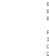

有关此增补的利息表程序版本，请参阅 http://csharp102.info 上的 CalculateInterestTableWithBreak 程序。（为简洁起见，我在此未包含列表。）

此程序的输出示例如下所示：

```
Enter principal: 100
Enter interest: 25
Enter number of years: 100

Principal = 100
Interest = 25%
Duration = 100 years
Quit if a multiplier of 10 is reached

1-125.00
2-156.25
3-195.31
4-244.14
5-305.18
6-381.48
7-476.85
8-596.06
9-745.08
10-931.35
11-1164.19

Press Enter to terminate . . .
```

程序在计算出的本金超过 $1,000 时立即终止——谢天谢地，你不必等待 100 年！

## 直到做对为止的循环

CalculateInterestTable 程序足够智能，可以在用户输入无效余额或利率时终止。然而，仅因用户输入错误就立即退出程序似乎过于严厉。即使是我那个用户不友好的记账程序，也会在放弃之前给我三次机会输入正确的密码。

while 和 break 的组合使程序更具灵活性。CalculateInterestTableMoreForgiving 程序以这种方式演示了这一原理：


```
// CalculateInterestTableMoreForgiving -- Calculate the interest paid on a
// given principal over a period of years. This version gives the user
// multiple chances to input the legal principal and interest.
// using System;
namespace CalculateInterestTableMoreForgiving
{
    using System;
    public class Program
    {
        public static void Main(string[] args)
        {
            // Define a maximum interest rate.
            int maximumInterest = 50;
            // Prompt user to enter source principal; keep prompting
            // until the correct value is entered.
            decimal principal;
            while(true)
            {
                Console.Write("Enter principal: ");
                string principalInput = Console.ReadLine();
                principal = Convert.ToDecimal(principalInput);
                // Exit if the value entered is correct.
                if (principal > 0)
                {
                    break;
                }
                // Generate an error on incorrect input.
                Console.WriteLine("Principal cannot be negative");
                Console.WriteLine("Try again");
                Console.WriteLine();
            }
            // Now enter the interest rate.
            decimal interest;
            while(true)
            {
                Console.Write("Enter interest: ");
                string interestInput = Console.ReadLine();
                interest = Convert.ToDecimal(interestInput);
                // Don't accept interest that is negative or too large . .
                if (interest >= 0 && interest <= maximumInterest)
                {
                    break;
                }
                // . . generate an error message as well.
                Console.WriteLine("Interest cannot be negative " +
                "or greater than " + maximumInterest);
                Console.WriteLine("Try again");
                Console.WriteLine();
            }
            // Both the principal and the interest appear to be
            // legal; finally, input the number of years.
            Console.Write("Enter number of years: ");
            string durationInput = Console.ReadLine();
            int duration = Convert.ToInt32(durationInput);
            // Verify the input.
            Console.WriteLine(); // Skip a line.
            Console.WriteLine("Principal   = " + principal);
            Console.WriteLine("Interest    = " + interest + "%");
            Console.WriteLine("Duration    = " + duration + " years");
            Console.WriteLine();
            // Now loop through the specified number of years.
            int year = 1;
```
第一册
第 5 章
进入程序流程


```
while(year <= duration)
{
    // Calculate the value of the principal plus interest.
    decimal interestPaid;
    interestPaid = principal * (interest / 100);
    // Now calculate the new principal by adding
    // the interest to the previous principal.
    principal = principal + interestPaid;
    // Round off the principal to the nearest cent.
    principal = decimal.Round(principal, 2);
    // Output the result.
    Console.WriteLine(year + " - " + principal);
    // Skip over to next year.
    year = year + 1;
}
// Wait for user to acknowledge the results.
Console.WriteLine("Press Enter to terminate . . .");
Console.Read();
}
```

本程序的工作方式在很大程度上与本章前几节中的示例相同，只是用户输入方面有所不同。这次，用 while 循环取代了早期示例中用于检测无效输入的 if 语句：

```
decimal principal;
while(true)
{
    Console.Write("Enter principal: ");
    string principalInput = Console.ReadLine();
    principal = Convert.ToDecimal(principalInput);
    // Exit when the value entered is correct.
    if (principal >= 0)
    {
        break;
    }
    // Generate an error on incorrect input.
    Console.WriteLine("Principal cannot be negative");
    Console.WriteLine("Try again");
    Console.WriteLine();
}
```

这段代码在循环中从用户输入一个值。如果文本的值正确，程序将退出输入循环并继续；然而，如果输入有错误，用户会看到错误信息，控制权会返回到程序流程以重新开始。


程序会一直循环，直到用户输入正确的值。（在最坏的情况下，程序可能会一直循环，直到一个迟钝的用户因年老而去世。）

请注意条件判断已被反转，因为问题不再是非法输入是否应生成错误信息，而是正确的输入是否应退出循环。例如在利率部分，考虑以下测试：

```
principal < 0 || principal > maximumInterest
```

该测试改为如下：

```
interest >= 0 && interest <= maximumInterest
```

显然，interest >= 0 与 interest < 0 相反。可能不太明显的是，OR（| |）运算符被 AND（&&）运算符取代了。它表示：“如果利率大于零且小于最大值（换句话说，如果正确），则退出循环。”

顺便问一下，你如何修改 CalculateInterestTableMoreForgiving，让用户一次又一次地运行计算，并在每次想要退出之前输入新的本金和利率数字？提示：使用另一个带有自身退出条件的 while(true) 循环。

请注意，由于作用域规则，principal 变量必须在循环外部声明，我将在下一节中解释这一点。


这听起来可能很明显，但表达式 true 的求值结果为 true。因此，while(true) 是典型的无限循环。嵌入的 break 命令使循环退出。因此，如果你使用 while(true) 循环，请确保你的 break 条件可以发生。

该程序示例运行的输出（显示了作者的无知）如下所示：

```
Enter principal: -1000
Principal cannot be negative
Try again

Enter principal: 1000
Enter interest: -10
Interest cannot be negative or greater than 50
Try again

Enter interest: 10
Enter number of years: 5

Principal      = 1000
Interest       = 10%
Duration       = 5 years

1-1100.00
2-1210.00
3-1331.00
4-1464.10
5-1610.51
Press Enter to terminate . . .
```

程序拒绝接受负的本金或利率，并耐心地在每次循环中解释错误。


在循环返回以进行进一步输入之前，准确解释用户做错了什么，否则那个人会变得极度困惑。举例也可能有帮助，尤其是在格式问题上。一点外交手腕也不会有坏处，正如奶奶可能指出的那样。

## 聚焦作用域规则

在循环体内声明的变量仅在该循环内定义。请考虑以下代码片段：

```
int days = 1;
while(days < duration)
{
    int average = value / days;
    // . . . some series of commands . . .
    days = days + 1;
}
```


变量 average 在 while 循环外部未定义。存在各种原因，但请考虑以下原因：循环第一次执行时，程序遇到声明 int average，变量被定义。在第二次循环时，程序再次遇到 average 的声明，如果没有作用域规则，这将是一个错误，因为变量已经被定义了。

我可以提供其他更有说服力的理由，但目前这个理由就足够了。

简而言之，就 C# 而言，变量 average 在程序到达闭合大括号时就会消失——并且在每次循环中都会重新定义。


有经验的程序员说变量 average 的作用域仅限于 while 循环。

## 使用 for 循环指定次数

while 循环是 C# 中最简单且第二常用的循环结构。然而，与 for 循环相比，while 循环的使用频率大约相当于美国机加工车间中的公制工具。

for 循环具有以下结构：

```
for(initExpression; condition; incrementExpression)
{
    // . . . body of code . . .
}
```

当遇到 for 循环时，程序首先执行 initExpression 表达式，然后执行条件。如果条件表达式为真，程序执行循环体，该循环体由紧跟在 for 命令后的大括号包围。当程序到达闭合大括号时，控制权传递给 incrementExpression，然后返回到 condition，在那里开始下一次循环。

实际上，for 循环的定义可以转换为以下 while 循环：

```
initExpression;
while(condition)
{
    // . . . body of code . . .
    incrementExpression;
}
```

## 一个示例

你可以在以下示例中更好地了解 for 循环的工作方式：

```
// Here is one C# expression or another.
a = 1;
// Now loop for awhile.
for(int year = 1; year < duration; year = year + 1)
{
    // . . . body of code . . .
}
// The program continues here.
a = 2;
```

假设程序刚刚执行了 a = 1; 表达式。接下来，程序声明变量 year 并将其初始化为 1。然后程序将 year 与 duration 进行比较。如果 year 小于 duration，则大括号内的代码体被执行。遇到闭合大括号后，程序跳回顶部并执行 year = year + 1 子句，然后再回到 year < duration 比较。


year 变量在 for 循环的作用域之外未定义。循环的作用域包括循环的标题及其主体。

## 为什么还需要另一个循环？

如果 C# 已有等效的 while 循环，为什么还需要 for 循环？简短的回答是：不需要——for 循环没有带来 while 循环无法实现的东西。

然而，for 循环的各部分是为了方便而存在的——并且为了明确建立每个循环应有的三个部分：设置、退出条件和递增。不仅这种安排更易于阅读，而且也更容易正确实现。（请记住，while 循环中最常见的错误是忘记递增计数变量以及未能提供适当的退出条件。）

除了我可能做的任何歌舞式的解释之外，理解 for 循环最重要的原因是：这是每个人都使用的循环——它（连同其表亲 foreach）是你阅读他人代码时 90% 的时间看到的循环。

for 循环的设计使第一个表达式初始化计数变量，最后一个部分递增它；然而，C# 语言并不强制执行此类规则。你可以在这两个部分中做任何你想做的事情——然而，除了初始化和递增计数变量之外做任何事情都是不明智的。


在编写 for 循环时，自增运算符特别受欢迎。（我在本书迷你版的第 4 章中描述了自增运算符以及其他运算符。）之前的 for 循环通常这样写：

```
for(int year = 1; year < nDuration; year++)
{
    // . . . body of code . . .
}
```


你几乎总是看到在 for 循环中使用后置自增运算符而不是前置自增运算符，尽管在这种情况下效果相同。除了习惯和它看起来更酷之外，没有其他原因。（下次你想打破僵局时，只要拿出满是后置自增运算符的 C# 代码清单来展示你有多酷就行了。它几乎从不奏效，但值得一试。）

for 循环有一个我无法声称理解的变化。如果逻辑条件表达式缺失，则假定为真。因此 for( ; ; ) 是一个无限循环。


你看到 for( ; ; ) 用作无限循环的频率比 while(true) 更常见。我不知道为什么会这样。

## 嵌套循环

内层循环可以出现在外层循环内，如下所示：

```
for( . . .some condition . . .)
{
    for( . . .some other condition . . .)
    {
        // . . . do whatever . . .
    }
}
```

内层循环在外层循环的每次遍历后执行完毕。内层 for 循环中使用的循环变量（如 year）在内层循环的作用域之外未定义。


包含在另一个循环内的循环是嵌套循环。嵌套循环不能“交叉”。例如，以下代码无法工作：

```
do                 // Start a do...while loop.
{
    for(... )       // Start some for loop.
    } while(... )   // End do...while loop.
}                   // End for loop.
```

我甚至不确定这段代码是什么意思，但这并不重要，因为编译器会告诉你它是非法的。


嵌套循环中的 break 语句只会跳出内部循环。在下面的示例中，break 语句退出循环 B 并返回到循环 A：

// for loop A
for(... some condition ...)
{
    // for loop B
    for(... some other condition ...)
    {
        // ... do whatever ...
        if (something is true)
        {
            break;      // Breaks out of loop B and not loop A
        }
    }
}
```

C# 没有一个 break 命令可以同时退出两个循环。


这听起来并没有那么大的限制。实际上，这类嵌套循环中包含的、通常较为复杂的逻辑最好封装在一个方法中。从任何循环内部执行 return 都会退出该方法——从而跳出所有循环，无论它们嵌套得多深。我们将在本迷你书的第 7 章描述方法和 return 语句。


DisplayXWithNestedLoops 示例（此处未显示）说明了将一个循环嵌套在另一个循环内以在屏幕上进行一些原始绘图。

### 不要乱用 goto

你可以通过使用 goto 语句以非结构化的方式转移控制。它后面跟随以下其中一项：

- 标签
- switch 语句中的 case
- 关键字 default（switch 语句的 default 子句）

后两项的[content]


包含在另一个循环内的循环是嵌套循环。嵌套循环不能“交叉”。例如，以下代码无法工作：

```
do                 // Start a do...while loop.
{
    for(... )       // Start some for loop.
    } while(... )   // End do...while loop.
}                   // End for loop.
```

我甚至不确定这段代码是什么意思，但这并不重要，因为编译器会告诉你它是非法的。


嵌套循环中的 break 语句只会跳出内部循环。在下面的示例中，break 语句退出循环 B 并返回到循环 A：

```
// for loop A
for(... some condition ...)
{
    // for loop B
    for(... some other condition ...)
    {
        // ... do whatever ...
        if (something is true)
        {
            break;      // Breaks out of loop B and not loop A
        }
    }
}
```

C# 没有一个 break 命令可以同时退出两个循环。


这听起来并没有那么大的限制。实际上，这类嵌套循环中包含的、通常较为复杂的逻辑最好封装在一个方法中。从任何循环内部执行 return 都会退出该方法——从而跳出所有循环，无论它们嵌套得多深。我们将在本迷你书的第 7 章描述方法和 return 语句。


DisplayXWithNestedLoops 示例（此处未显示）说明了将一个循环嵌套在另一个循环内以在屏幕上进行一些原始绘图。

### 不要乱用 goto

你可以通过使用 goto 语句以非结构化的方式转移控制。它后面跟随以下其中一项：

- 标签
- switch 语句中的 case
- 关键字 default（switch 语句的 default 子句）

后两项的想法是“跳转”到另一个 case。

这段代码演示了如何使用 goto 语句：

```
// If the condition is true . . .
if (a > b)
{
    // . . . control passes unconditionally from the goto to the label.
    goto exitlabel;
}
// . . . whatever other code goes here . . .
exitlabel:
// Control continues here.
```

goto 语句不受欢迎，正是因为它强大的控制能力：它几乎完全是非结构化的。如果使用 goto，跟踪任何大于平凡代码片段的控制流都可能很困难。（能说出“意大利面条代码”吗？）


关于使用 goto 语句的使用，出现了宗教战争。事实上，C# 语言本身因包含该控制而受到批评。实际上，goto 既不那么可怕也不必要。因为你几乎总能避免使用 goto，我建议远离它，除了偶尔在 switch 语句中将其用于链接两个 case，像这样：

```
switch(n)  // This example becomes gnarly in the logic department . . .
{
    case 0:
        // Do something for the 0 case, then . . .
        goto case 3;  // jump to another case; no break statement needed.
    case 1:
        // Do something for the 1 case.
        break;
    case 3:  // Case 0 jumps to here after doing its thing.
        // Add some case 3 stuff to what case 0 did, thus "chaining" the cases.
        break;
    default:
        // Default case.
        break;
}
```

不过，不要对 goto 上瘾。真的。

## 第 6 章：使用集合整理你的鸭子

### 本章内容

- 创建包含多项数据的变量：数组
- 使用灵活的“集合”改进数组
- 查看数组和集合初始化器以及集合类型集合

本书中可能遇到的简单单值变量在处理大量同类项目时略显不足：例如十只鸭子而不是一只。C# 用两种存储多项数据的变量填补了这一空白，通常称为集合。这两种集合类型是数组和更通用的集合类。通常，如果我指的是数组，我会明确说出，如果我指的是集合类，我就称之为它。如果我提到集合或列表，我通常意味着它可以是其中任何一种。

数组是一种数据类型，它保存一个项目列表，所有项目必须为同一类型：例如全部为 int 或全部为 double。

C# 为你提供了大量的集合类，它们有各种形状，例如灵活的列表（如串珠）、队列（如买《蜘蛛侠 XII》票的队伍）、栈（如某人桌上的半堆杂物）等。大多数集合类与数组类似，只能保存苹果或只能保存橙子。但 C# 也提供了一些可以同时保存苹果和橙子的集合类——这很少有用。（而且你有比使用这些老旧集合更好的方式来管理这一功能。）

现在，如果你能掌握数组和 List 集合（尽管本章介绍了另外两种集合），你就能在本书的大部分内容中游刃有余。但如果你想扩展你的集合知识库，日后再回来看这里。

### C# 数组

包含单个值的变量非常有用。甚至能够描述由部件组成的复合对象的类结构（如带有发动机和变速箱的车辆）也很关键。但你还需要一种构造来保存大量对象，例如比尔·盖茨广泛的古董车收藏或某位作者的古董袜子收藏。内置类 Array 是一个可以包含同一类型一系列元素（例如所有 int 值和所有 double 值，或所有 Vehicle 对象和 Motor 对象——你在本迷你书第 7 章会遇到这些类型的对象）的结构。

### 数组的理由

考虑求一组六个浮点数的平均值的问题。每个数字都需要自己的 double 存储：

```
double d0 = 5;
double d1 = 2;
double d2 = 7;
double d3 = 3.5;
double d4 = 6.5;
double d5 = 8;
```

（对 int 变量求平均值可能会导致舍入误差，如本迷你书第 2 章所述。）

计算这些变量的平均值可能看起来像这样：

```
double sum = d0 + d1 + d2 + d3 + d4 + d5;
double average = sum / 6;
```

按名称列出每个元素很乏味。也许当你只有 6 个数字要平均时并不那么乏味，但想象一下平均 600 个（甚至 600 万个）浮点值。

### 固定值数组

幸运的是，你不需要分别命名每个元素。C# 提供了可以存储一系列值的数组结构。使用数组，你可以将所有 double 放入一个变量中，像这样：

```
double[] doublesArray = {5, 2, 7, 3.5, 6.5, 8, 1, 9, 1, 3};
```

你也可以在不初始化的情况下声明一个空数组：

```
double[] doublesArray = new double[6];
```

这一行为六个 double 分配空间，但不初始化它们。

所有 C# 数组都基于的 Array 类提供了一种特殊的语法，使其使用更方便。成对的方括号 [] 指的是你如何在数组中访问单个元素：

```
doublesArray[0] // Corresponds to d0 (that is, 5)
doublesArray[1] // Corresponds to d1 (that is, 2)
...
```


数组的第 0 个元素对应于 d0，第 1 个元素对应于 d1，第 2 个元素对应于 d2，依此类推。程序员通常将第 0 个元素称为“doublesArray 下标-0”，将第一个元素称为“doublesArray 下标-1”，依此类推。

数组的元素编号——0、1、2、……——称为索引。

在 C# 中，数组索引从 0 开始而不是从 1 开始。因此，你通常不会将索引 1 处的元素称为第一个元素，而是称为“第 1 个元素”或“索引 1 处的元素”。第一个元素是第 0 个元素。如果你坚持使用正常用语，请注意第一个元素始终位于索引 0，第二个元素位于索引 1。

如果数组的索引不是变量，doublesArray 变量就不会有太大改进。使用 for 循环比手工写出每个元素更容易，如此程序所示：


```csharp
// FixedArrayAverage -- Average a fixed array of numbers using a loop.
namespace FixedArrayAverage
{
    using System;

    public class Program
    {
        public static void Main(string[] args)
        {
            double[] doublesArray = {5, 2, 7, 3.5, 6.5, 8, 1, 9, 1, 3};

            // Accumulate the values in the array into the variable sum.
            double sum = 0;
            for (int i = 0; i < 10; i++)
            {
                sum = sum + doublesArray[i];
            }

            // Now calculate the average.
            double average = sum / 10;
            Console.WriteLine(average);
            Console.WriteLine("Press Enter to terminate...");
            Console.Read();
        }
    }
}
```

程序首先将变量 sum 初始化为 0。然后它遍历 doublesArray 中存储的值，将每个值加到 sum 上。循环结束时，sum 已累积数组中所有值的总和。将所得总和除以元素数量即可得到平均值。执行此程序的输出为预期的 4.6。（你可以用计算器验证。）


## 检查数组边界

幸运的是，FixedArrayAverage 程序（在前一节“固定值数组”中）遍历了全部十个元素。但如果你在循环迭代上出错怎么办？你需要考虑以下两种情况：

```
for(int i = 0; i < 11; i++)
```

当你执行程序时，会看到一个对话框显示以下错误信息：

```
IndexOutOfRangeException was unhandled
Index was outside the bounds of the
array.
```

**你只遍历了九个元素：** C# 不认为这是错误。如果你想读取十个元素的数组中的九个元素，C# 有什么理由说不一样呢？当然，平均值是不正确的，但程序并不知道这一点。

**你遍历了 11 个（或更多）元素：** 现在 C# 很在意。它不允许你索引超出数组末尾，担心你可能会覆盖内存中的重要值。为了测试它，将 FixedArrayAverage 的 for 循环中的比较改为以下内容，将值 10 替换为 11：

初看之下，这个错误信息似乎很吓人。然而，你可以很快抓住要点：很明显，IndexOutOfRangeException 告诉你程序尝试访问超出其范围的数组——在十个元素的数组中访问第 11 个元素。（在本迷你书的第 9 章中，我会向你展示如何了解更多关于该错误的信息。）

## 可变长度数组

FixedArrayAverage 程序示例中使用的数组存在以下两个严重问题：

- 数组的大小固定为十个元素。
- 更糟的是，元素的值直接在程序中指定。

一个能够读取可变数量值的程序，也许在执行期间由用户确定，会灵活得多。它不仅适用于 FixedArrayAverage 中指定的十个值，也适用于任何其他值集合，无论其数量多少。

声明可变大小数组的格式与固定大小、固定值的数组略有不同：

```
double[] doublesArrayVariable = new double[N]; // Variable, versus ...
double[] doublesArrayFixed = new double[10]; // Fixed
```

这里，N 代表要分配的元素数量。

更新后的程序 VariableArrayAverage 使用户能够指定要输入的值的数量。（N 必须来自某个地方。）由于程序保留了输入的值，它不仅计算平均值，还以令人愉悦的格式显示结果，如下所示：


// VariableArrayAverage -- Average an array whose size is
// determined by the user at runtime, accumulating the values
// in an array. Allows them to be referenced as often as
// desired. In this case, the array creates an attractive output.
namespace VariableArrayAverage
{
    using System;
    public class Program
    {
        public static void Main(string[] args)
        {
            // First read in the number of doubles the user intends to enter.
            Console.Write("Enter the number of values to average: ");
            string numElementsInput = Console.ReadLine();
            int numElements = Convert.ToInt32(numElementsInput);
            Console.WriteLine();
            // Now declare an array of that size.
            double[] doublesArray = new double[numElements]; // Here's the 'N'.
            // Accumulate the values into an array.
            for (int i = 0; i < numElements; i++)
            {
                // Prompt the user for another double.
                Console.Write("enter double #" + (i + 1) + ": ");
                string val = Console.ReadLine();
                double value = Convert.ToDouble(val);
                // Add this to the array using bracket notation.
                doublesArray[i] = value;
            }
            // Accumulate 'numElements' values from
            // the array in the variable sum.
            double sum = 0;
            for (int i = 0; i < numElements; i++)
            {
                sum = sum + doublesArray[i];
            }
            // Now calculate the average.
            double average = sum / numElements;
            // Output the results in an attractive format.
            Console.WriteLine();
            Console.Write("The average of (" + doublesArray[0]);
            for (int i = 1; i < numElements; i++)
            {
                Console.Write(" " + doublesArray[i]);
            }
            Console.WriteLine(" / " + numElements);
            // Wait for user to acknowledge the results.
            Console.WriteLine("Press Enter to terminate...");
            Console.Read();
        }
    }
}

第一册
第 6 章
用集合排列你的鸭子

查看以下在输入五个顺序值 1 到 5 且程序计算平均值为 3 的示例运行的输出：

```
Enter the number of values to average:5

enter double #1: 1
enter double #2: 2
enter double #3: 3
enter double #4: 4
enter double #5: 5

3 is the average of (1 + 2 + 3 + 4 + 5) / 5
Press Enter to terminate...
```

VariableArrayAverage 程序首先提示用户输入她打算求平均值的数量。（这就是我稍早提到的 N。）结果存储在 int 变量 numElements 中。在示例中，输入的数字是 5。

程序继续为 doublesArray 分配指定数量元素的数组。在这种情况下，程序分配了一个包含五个元素的数组。程序按 numElements 指定的次数循环，每次从用户读取一个新值。最后一次值后，程序计算平均值。


如本例所示，让控制台输出完全正确有点棘手。请仔细跟踪 VariableArrayAverage 中的每个语句，因为程序输出左括号、等号、加号以及序列中的每个数字，并将其与输出进行比较。

VariableArrayAverage 程序可能并不能完全满足你对灵活性的渴望。你不想每次都要告诉程序你想平均多少个数字。你真正想要的是尽可能长时间地输入要平均的数字——然后告诉程序对你输入的内容进行平均。这就是 C# 集合发挥作用的地方。它们为数组提供了功能强大、灵活的替代方案。直接从用户获取输入并不是填充数组或其他集合的唯一方法。

## Length 属性

用于填充 VariableArrayAverage 程序中数组的 for 循环以这种方式开始：

// Now declare an array of that size.
double[] doublesArray = new double[numElements];
// accumulate the values into an array.
for (int i = 0; i < numElements; i++)
{
...
}

doublesArray 被声明为 numElements 项长。因此聪明的程序员使用 for 循环遍历数组中的 numElements 项。（迭代意味着一次遍历数组的一个元素，如 for 循环所示。）

必须随身携带变量 numElements 与 doublesArray 一起到处走，只是为了知道它的长度，这将是一种遗憾和犯罪。幸运的是，这不是必要的。数组有一个名为 Length 的属性，包含其长度。doublesArray.Length 的值与 numElements 相同。

以下 for 循环更可取：

// Accumulate the values into an array,
for (int i = 0; i < doublesArray.Length; i++) ...

## 初始化数组

以下行显示了一个带有初始化器的数组，然后是一个分配空间但不初始化元素值的数组：

```
double[] fixedLengthArray = {5, 2, 7, 3.5, 6.5, 8, 1, 9, 1, 3};
double[] variableLengthArray = new double[10];
```

你可以使用以下代码自行完成所有操作：

```
double[] fixedLengthArray = new double[10] {5, 2, 7, 3.5, 6.5, 8, 1, 9, 1, 3};
```

在这里，你已使用 new 专门分配了内存，然后用数组成员的初始值跟随该声明。我想我可以预测你更喜欢哪种形式。（提示：第 1 行？）

## 为每个数组定制的循环

给定一个字符串数组，以下循环计算其长度的平均值：

```
public class Student // Read about classes in Book II.
{
    public string name;
    public double gpa;      // Grade point average
}
public class Program
{
    public static void Main(string[] args)
    {
        // . . .create the array somehow . . .
        // Now average the students you have.
        double sum = 0.0;
        for (int i = 0; i < students.Length; i++)
        {
            sum += students[i].gpa;
        }
        double avg = sum / students.Length;
        // . . .do something with the average . . .
    }
}
```


for 循环遍历数组的成员。（是的，你可以拥有任何类型对象的数组，而不仅仅是 double 和 string 这样的简单类型。你可能还没有正式接触过类，请再耐心等我一会儿。我在第二册中会介绍它们。）

students.Length 包含数组中的元素数量。

C# 提供了另一个名为 foreach 的循环，专门用于遍历数组等集合。其工作原理如下：

// Now average the students that you have.
double sum = 0.0;
foreach (Student student in students)
{
    sum += student.gpa;  // This extracts the current student's GPA.
}
double avg = sum / students.Length;
```

第一次循环时，foreach 获取数组中的第一个 Student 对象并将其存储在变量 student 中。每次后续遍历时，foreach 都会检索下一个元素。当数组中的所有元素都被处理完后，控制权会退出 foreach 循环。

请注意，foreach 语句中没有出现索引。缺少索引大大降低了出错的可能性，并且比 for 语句更简单易写，尽管有时该索引很方便，你更喜欢使用 for 循环。

foreach 循环比示例中看起来还要强大。此语句除了数组之外，还适用于其他集合类型。此外，foreach 还处理多维数组（本质上是数组的数组），这是本书中未描述的主题。要了解有关多维数组的所有信息，请在 C# 帮助系统中查找多维数组。


## 数据数组的排序

常见的编程挑战是需要在数组内对元素进行排序。仅仅因为数组不能增长或缩小，并不意味着其中的元素不能被移动、删除或添加。例如，以下代码片段交换了数组 strings 中两个字符串元素的位置：

```
string temp = strings[i]; // Save the i'th string.
strings[i] = strings[k];  // Replace i'th with the k'th.
strings[k] = temp;        // Replace k'th with temp.
```

在此示例中，strings 数组中第 i 个位置的对象引用被保存下来，以便在第二个语句用另一个元素替换它时不会丢失。最后，temp 变量被保存回第 i 个位置。从图示上看，这个过程如图 6-1 所示。

**图 6-1：** 术语 *交换两个对象* 指的是交换对两个对象的 *引用*。

本章其余部分讨论的数据集合在添加和删除元素方面比数组更灵活。

以下程序演示了如何将操作数组内元素的能力作为排序的一部分使用。这种特定的排序算法是 *冒泡排序*。虽然它在大数组（数千个元素）上表现不佳，但在小数组上简单有效：


```csharp
// BubbleSortArray -- Given a list of planets, sort their
//   names: first, in alphabetical order.
//   Second, by the length of their names, shortest to longest.
//   Third, from longest to shortest.
// This demonstrates using and sorting arrays, working with
//   them by array index. Two sort algorithms are used:
//   1. The Sort algorithm used by class Array's Sort() method.
//   2. The classic Bubble Sort algorithm.
using System;

namespace BubbleSortArray
{
    class Program
    {
        static void Main(string[] args)
        {
            Console.WriteLine("The 5 planets closest to the sun, in order: ");
            string[] planets =
                new string[] { "Mercury", "Venus", "Earth", "Mars", "Jupiter" };
            foreach (string planet in planets)
            {
                // Use the special char \t to insert a tab in the printed line.
                Console.WriteLine("\t" + planet);
            }
            Console.WriteLine("\nNow listed alphabetically: ");
            // Array.Sort() is a method on the Array class.
            // Array.Sort() does its work in-place in the planets array,
            // which leaves you without a copy of the original array. The
            // solution is to copy the old array to a new one and sort it.
            string[] sortedNames = planets;
            Array.Sort(sortedNames);
            // This demonstrates that (a) that a sortedNames contains the same
            // strings as planets and (b) that they're now sorted.
            foreach (string planet in sortedNames)
            {
                Console.WriteLine("\t" + planet);
            }
            Console.WriteLine("\nList by name length - shortest first: ");
            // This algorithm is called 'Bubble Sort'. It's the simplest
            // but worst-performing sort. The Array.Sort() method is much
            // more efficient, but I couldn't use it directly to sort the
            // planets in order of name length because it sorts strings,
            // not their lengths.
            int outer;  // Index of the outer loop
            int inner;  // Index of the inner loop
            // Loop DOWN from last index to first: planets[4] to planets[0].
            for (outer = planets.Length - 1; outer >= 0; outer--)
            {
                // On each outer loop, loop through all elements BEYOND the
                // current outer element. This loop goes up, from planets[1]
                // to planets[4]. Using the for loop, you can traverse the
                // array in either direction.
                for (inner = 1; inner <= outer; inner++)
                {
                    // Compare adjacent elements. If the earlier one is longer
                    // than the later one, swap them. This shows how you can
                    // swap one array element with another when they're out of order.
                    if (planets[inner - 1].Length > planets[inner].Length)
                    {
                        // Temporarily store one planet.
                        string temp = planets[inner - 1];
                        // Now overwrite that planet with the other one.
                        planets[inner - 1] = planets[inner];
                        // Finally, reclaim the planet stored in temp and put
                        // it in place of the other.
                        planets[inner] = temp;
                    }
                }
            }
            foreach (string planet in planets)
            {
                Console.WriteLine("\t" + planet);
            }
            Console.WriteLine("\nNow listed longest first: ");
            // That is, just loop down through the sorted planets.
            for(int i = planets.Length - 1; i >= 0; i--)
            {
                Console.WriteLine("\t" + planets[i]);
            }
            Console.WriteLine("\nPress Enter to terminate...");
            Console.Read();
        }
    }
}
```

程序以一个包含距离太阳最近的前五个行星名称的数组开始。（为了保持图表简洁，我没有包含外行星，因此不必决定可怜的冥王星的问题，它现在是什么？——矮行星之类的？）

然后程序调用数组自身的 Sort() 方法。使用 Array 类上的内置 Sort() 方法排序后，程序使用自定义排序对行星名称的长度进行排序，只是为了让你惊讶。


对于数组（和其他集合）而言，内置的 Sort() 方法无疑比自定义冒泡排序更高效。除非有充分理由，否则不要自己实现。

第二个排序的算法通过不断循环遍历字符串列表直到列表被排序来工作。在每次遍历 sortedNames 数组时，程序将每个字符串与其邻居进行比较。如果发现两者顺序错误，方法会交换它们，然后将列表标记为未排序。图 6-2 至图 6-5 显示了每次遍历后行星列表的情况。在图 6-5 中，请注意倒数第二次遍历导致列表已排序，而最后一次遍历因没有任何变化而终止排序。

### 图 6-2：
开始冒泡排序之前。

| 项目 |
|------|
| Mercury ← 大家出发了！ |
| Venus |
| Earth |
| Mars |
| Jupiter |

### 图 6-3：
冒泡排序第 1 次遍历后。

| 项目 |
|------|
| Earth ← Earth 逐渐领先... |
| Mercury |
| Venus |
| Mars |
| Jupiter |

### 图 6-4：
冒泡排序第 2 次遍历后。

|  |  |
|---|---|
| Earth |  |
| Mars | ← Mars 超过 Mercury 和 Venus 升至第二名 |
| Mercury |  |
| Venus |  |
| Jupiter |  |

### 图 6-5：
最后一次遍历因没有任何变化而终止排序。

|  |  |
|---|---|
| Earth | ← 比赛结束时，Earth 以第一名冲线获胜... |
| Jupiter | ← ...而 Jupiter 挤掉了 Mars 取得名次。 |
| Mars | ← 与此同时，Mars 努力争取名次。 |
| Mercury |  |
| Venus |  |

最终，更长的行星名称“冒泡”到列表顶部；因此得名冒泡排序。


为单个项目变量使用单数名称，如 planet 或 student。变量名应以某种方式包含类名，如 badStudent 或 goodStudent 或 sexyCodedStudent。为数组（或其他集合）使用复数名称，如 students 或 phoneNumbers 或 phoneNumbersInMyPalmPilot。如同往常一样，此提示反映了作者的观点，而非本书出版商或其任何股东的观点——C# 不在乎你如何命名变量。

## 使用 var 定义数组

传统上，你使用以下其中一种形式（它们与 C# 一样古老——本书撰写时几乎已有十年历史）来初始化数组：

```csharp
int[] numbers = new int[3]; // Size but no initializer, or ...
int[] numbers = new int[] { 1, 2, 3 }; // Initializer but no size, or ...
int[] numbers = new int[] { 1, 2, 3 }; // Size and initializer, or ...
int[] numbers = { 1, 2, 3 }; // No 'new' keyword -- extreme short form.
```

本迷你书的第 2 章介绍了 var 关键字，它告诉 C# 编译器，“你根据我提供的初始化表达式来推断变量类型。”

值得庆幸的是，var 也适用于数组。


```csharp
// myArray is an int[] with 6 elements.
var myArray = new [] { 2, 3, 5, 7, 11, 13 }; // Initializer required!
```

新语法只有两处变化：

- 在赋值语句左侧，使用 var 代替数字数组的显式类型信息。
- 在赋值语句右侧，方括号前的 int 关键字被省略。这是编译器可以推断的部分。


在使用 var 的版本中，必须提供初始化器。编译器利用它在没有 int 关键字的情况下推断数组元素的类型。

以下是更多示例：

```csharp
var names = new [] { "John", "Paul", "George", "Ringo" }; // Strings
var averages = new [] { 3.0, 3.34, 4.0, 2.0, 1.8 }; // Doubles
var prez = new []{new President("FDR"), new President("JFK")}; // Presidents
```


使用 var 时，不能使用极简形式来初始化数组。以下行无法编译：

```csharp
var names = { "John", "Paul", "George", "Ringo" }; // Needs 'new []'
```

使用 var 的方式在简洁性上稍逊，但在使用于不涉及数组的其他一些情况时，它真正大放异彩，并且在某些情况下是强制性的。（你可以在第一册第7章看到示例。）


本书网站上的 UsingVarWithArraysAndCollections 示例程序演示了 var 与数组初始化器的用法。请注意，现在你不能再像过去那样使用 var 作为变量名。反正它也是一个糟糕的变量名。

## 使用 C# 集合更灵活

通常，数组是处理 Students 列表或 doubles 列表的最简单、最直接的方式。你在 .NET Framework 类库中也会遇到许多要求使用数组的地方。

但数组有几个相当严重的限制，有时会阻碍你。在这种时候，你会欣赏 C# 丰富的、更灵活的集合类库。

尽管数组具有简单且可以有多维度的优势，但它们存在两个重要的限制：

- **程序必须在创建数组时声明其大小。** 与 Visual Basic 不同，C# 不允许你在数组定义后更改其大小。例如，你可能事先不知道数组需要多大。
- **在数组中间插入或删除元素效率极低。** 你必须移动所有元素来腾出空间。在大型数组中，这可能是一项巨大且耗时的任务。

相比之下，大多数集合使添加、插入或删除元素变得容易得多，并且你可以在需要时随时调整其大小。事实上，大多数集合通常会自动处理调整大小。


如果你需要多维数据结构，请使用数组。没有集合允许多维（尽管你可以创建一些复杂的数据结构，例如数组的集合或集合的集合）。

数组和集合有一些共同特征：

- **每个只能包含一种类型的元素。** 你必须在代码中指定该类型，并在编译时指定，声明类型后它就不能更改。
- **与数组一样，你可以使用类似数组的语法通过方括号指定索引来访问大多数集合：** myList[3] = "Joe"。
- **集合和数组都有方法和属性。** 因此，要查找以下 smallPrimeNumbers 数组中的元素数量，你调用其 Length 属性：

```csharp
var smallPrimeNumbers = new [] { 2, 3, 5, 7, 11, 13 };
int numElements = smallPrimeNumbers.Length; // Result is 6.
```

使用集合时，你调用其 Count 属性：

```csharp
List<int> smallPrimes = new List<int> { 2, 3, 5, 7, 11, 13 };
int numElements = smallPrimes.Count; // Collections have a Count property.
```

在帮助中查看 class Array 以了解它还有哪些其他方法和属性（7 个公共属性和 36 个公共方法）。

## 理解集合语法

在本节中，我将带你快速上手集合语法，并介绍最重要的、最常用的集合类。

表 6-1 列出了 C# 中的主要集合类。我发现把集合想象成具有各种“形状”很有用——例如列表形状或字典形状。

**表 6-1 最常见的集合“形状”**

| 类 | 描述 |
|---|---|
| `List<T>` | 这个动态数组包含类型为 T 的对象。 |
| `LinkedList<T>` | 这是类型为 T 的对象的链表。 |
| `Queue<T>` | 从队伍后端开始，最后到达前端。 |
| `Stack<T>` | 总是在列表的“顶部”添加或删除项目，就像一叠食堂托盘。 |
| `Dictionary<TKey, TValue>` | 这个结构像字典一样工作。查找一个键（例如一个词）并检索其对应的值（例如定义）。 |
| `HashSet<T>` | 这个结构类似于数学集合，没有重复项。它工作方式类似于列表，但提供了数学集合操作，例如并集和交集。 |

## 理解 <T>

在表 6-1 中你看到的看似神秘的 <T> 记法中，<T> 是特定数据类型的占位符。要让这个符号对象活起来，请通过插入真实类型来实例化它，如下所示：

```csharp
List<int> intList = new List<int>(); // Instantiating for int
```

Instantiate 是极客用语，意思是“创建此类型的一个对象（实例）。”

例如，你可能会为类型 int、string 和 Student 创建不同的 List<T> 实例。顺便说一下，T 并不是神圣的名字。你可以使用任何你喜欢的名字——例如 <dummy> 或 <aType>。通常使用 T、U、V 等。

请注意我在表 6-1 中如何表达 Dictionary<TKey, TValue> 集合。这里需要两种类型：一种用于字典的键，另一种用于与键关联的值。我将在后面的“使用字典”部分介绍字典。


如果这种记法看起来有点令人望而生畏，不用担心。你会习惯的。

## 泛型化

这些现代集合被称为泛型集合，其含义是你可以用一种（或多种）类型填充某种空白模板，以创建自定义集合。如果泛型 List<T> 让你感到困惑，请查看本小书的第 8 章。该章节更详细地讨论了泛型 C# 设施。

## 使用列表

假设你需要存储一个 MP3 对象的列表，每个对象代表你 MP3 音乐收藏中的一个项目。作为数组，它可能看起来像这样：

```
MP3[] myMP3s = new MP3[50]; // Start with an empty array.
myMP3s[0] = new MP3("Norah Jones"); // Create an MP3 and add it to the array.
// ... and so on.
```

使用列表集合，它看起来像这样：

```
List<MP3> myMP3s = new List<MP3>(); // An empty list
myMP3s.Add(new MP3("Avril Lavigne")); // Call the list's Add() method to add.
// ... and so on.
```

你说，所以呢？这些示例看起来相似，列表似乎没有比数组提供任何优势。但当你向数组添加第 50 个 MP3，然后想添加第 51 个时会怎样？你没有空间了。你唯一的选择是声明一个更大的新数组，然后将所有 MP3 从旧数组复制到新数组中。此外，如果你从数组中删除一个 MP3，数组就会留下大洞。你把什么放到那个空槽里来代替你丢弃的 MP3？也许是值 null？

列表集合在面对同样的障碍时依然顺利航行。想添加第 51 个 MP3？没问题。想扔掉你旧的 Pat Boone MP3？（有吗？）没问题。删除旧 Pat 后，列表会自行修复。

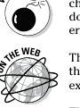

如果你的列表（或数组）可以包含 null 项，请确保在使用 for 或 foreach 循环时检查 null。你不想对 null 的 MP3 项调用 Play() 方法。这会导致错误。

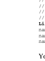

本书网站上的 ListCollection 示例展示了你可以用 List<T> 做的事情。在下面的代码列表中，我穿插了解释和代码片段。

以下代码（摘自示例）展示了如何为字符串类型实例化一个新空列表。换句话说，这个列表只能容纳字符串：

```
// List<T>: note angle brackets plus parentheses in
// List<T> declaration; T is a "type parameter".
// List<T> is a "parameterized type."
// Instantiate for string type.
List<string> nameList = new List<string>();
nameList.Add("one");
nameList.Add(3); // Compiler error here!
nameList.Add(new Student("du Bois")); // Compiler error here!
```

你可以通过使用其 Add() 方法向 List<T> 添加项目。前面代码片段成功向列表添加了一个字符串，但随后它遇到

尝试先添加一个整数、再添加一个 Student 时遇到了麻烦。该列表是为字符串实例化的，因此编译器会拒绝这两次尝试。

下面的代码片段实例化一个新列表来保存 int 类型，然后向该列表添加两个 int 值。随后，foreach 循环遍历这个 int 列表，打印出这些 int 值：

```
// Instantiate for int.
List<int> intList = new List<int>();
intList.Add(3);          // Fine.
intList.Add(4);
Console.WriteLine("Printing intList:");
foreach (int i in intList)  // foreach just works for all collections.
{
    Console.WriteLine("int i = " + i);
}
```

下面的代码片段实例化一个新列表来保存 Student，并用其 Add() 方法添加两个学生。但随后请注意 Student 数组，我使用其 AddRange() 方法将该数组添加到学生列表中。AddRange() 让你可以一次将整个数组或（几乎）任何其他集合添加到列表中：

```
// Instantiate for Student.
List<Student> studentList = new List<Student>();
Student student1 = new Student("Vigil");
Student student2 = new Student("Finch");
studentList.Add(student1);
studentList.Add(student2);
Student[] students = { new Student("Mox"), new Student("Fox") };
studentList.AddRange(students); // Add whole array to List.
Console.WriteLine("Num students in studentList = " + studentList.Count);
```

（不必担心“new Student”相关内容。我会在第二部中讲到这个主题。）

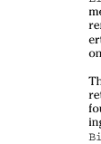

你可以轻松地在列表和数组之间相互转换。要将数组放入列表，请使用刚才描述的列表的 AddRange() 方法。要将列表转换为数组，请调用列表的 ToArray() 方法：

```
Student[] students = studentList.ToArray();  // studentList is a List<Student>.
```

List<T> 还有许多其他用于添加项的方法，包括在列表中的任意位置插入一个或多个项的方法，以及移除项或清空列表的方法。请注意，List<T> 还有一个 Count 属性。（如果你习惯了数组和字符串上的 Length 属性，这一个小细节可能会让你出错。对于集合，用的是 Count。）

下一个代码片段演示了搜索列表的几种方式：IndexOf() 返回项在列表中的数组式索引（如果找到），如果未找到则返回 -1。代码还演示了使用数组式索引和通过 Contains() 方法访问项。其他搜索方法包括未展示的 BinarySearch()：

```
// Search with IndexOf().
Console.WriteLine("Student2 at " + studentList.IndexOf(student2));
string name = studentList[3].Name; // Access list by index.
if (studentList.Contains(student1)) // student1 is a Student object.
{
    Console.WriteLine(student1.Name + " contained in list");
}
```

最后一个代码段演示了更多 List<T> 操作，包括排序、插入和移除项。

```
studentList.Sort(); // Assumes Student implements IComparable interface (Ch 14).
studentList.Insert(3, new Student("Ross"));
studentList.RemoveAt(3); // Deletes the third element.
Console.WriteLine("removed " + name); // Name defined above
```

这只是 List<T> 方法的一个示例。你可以在帮助文档中查找完整列表。


要查找泛型集合，你必须在帮助索引中查找术语 List<T>。如果你只搜索 List，就会迷失在列表的列表的列表中。如果你想查看关于整套集合类（好吧，是泛型集合类）的信息，请在索引中搜索 generic collections。

## 使用字典

你一定用过韦氏词典或其他词典。它按字母顺序组织为一大堆单词。每个单词都关联着一组信息，包括发音、释义和其他信息。要使用词典，你查找一个单词并检索其信息。

在 C# 中，字典的“形状”与列表的形状不同。字典由 Dictionary<TKey, TValue> 类表示。TKey 表示用于字典键的数据类型（类似于标准词典中的单词或你要查找的词条）。TValue 表示用于存储与某个键关联的信息或数据的数据类型（类似于韦氏词典中单词的释义）。


.NET 字典基于哈希表的思想。想象一组桶散布在地板上。当你使用哈希函数计算哈希时，会得到一个值，该值只指定其中一个桶。同一个哈希始终指向同一个桶。如果哈希计算得当，你应该会看到项在桶之间分布良好且相当均匀。因此，哈希是其中一个桶的键。提供该键以检索桶的内容——即其值。


在 C# 中使用字典并不比在高中时更难。下面的 DictionaryExample 程序（节选）展示了你可以用字典做的一些事情。为了节省一点篇幅，我只展示 Main() 方法的部分内容。


如果你觉得这里有点难懂，可以稍后再回过头来看。

第一段代码只是创建一个新的 Dictionary 对象，其键和值都是字符串。不过，你并不限于字符串。键或值，或者两者，都可以是任意类型。请注意，Add() 方法同时需要一个键和一个值。

```
Dictionary<string, string> dict = new Dictionary<string, string>();
// Add(key, value).
dict.Add("C#", "cool");
dict.Add("C++", "like writing Sanskrit poetry in Morse code");
dict.Add("VB", "a simple but wordy language");
dict.Add("Java", "good, but not C#");
dict.Add("Fortran", "ANCNT"); // 6-letters-max variable name for "ancient."
dict.Add("Cobol", "even more wordy, or is it wordier, and verbose than VB");
```

ContainsKey() 方法告诉你字典是否包含特定键。还有一个对应的 ContainsValue() 方法：

```
// See if the dictionary contains a particular key.
Console.WriteLine("Contains key C# " + dict.ContainsKey("C#")); // True
Console.WriteLine("Contains key Ruby " + dict.ContainsKey("Ruby")); // False
```

当然，你可以像遍历任何集合一样在循环中遍历字典。但请记住，字典就像一组项对组成的列表——把每一对看作一个同时包含键和值的对象。因此，要用 foreach 遍历整个字典，你需要在每次循环时检索其中一个对。这些对是 KeyValuePair<TKey, TValue> 类型的对象。在 WriteLine() 调用中，我使用该对的 Key 和 Value 属性来提取项。如下所示：

```
// Iterate the dictionary's contents with foreach.
// Note that you're iterating pairs of keys and values.
Console.WriteLine("\nContents of the dictionary:");
foreach (KeyValuePair<string, string> pair in dict)
{
    // Because the key happens to be a string, we can call string methods on it.
    Console.WriteLine("Key: " + pair.Key.PadRight(8) + "Value: " + pair.Value);
}
```

在示例程序的最后一段中，你可以看到如何只遍历键或只遍历值。字典的 Keys 属性返回另一个集合：一个列表形状的 Dictionary<TKey, TValue>.KeyCollection 类型集合。因为这些键恰好是字符串，你可以将键作为字符串遍历，并在它们上面调用字符串方法。Values 属性类似。最后一点代码使用字典的 Count 属性来查看它包含多少个键/值对。

```
// List the keys, which are in no particular order.
Console.WriteLine("\nJust the keys:");
// Dictionary<TKey, TValue>.KeyCollection is a collection of just the keys,
// in this case strings. So here's how to retrieve the keys:
Dictionary<string, string>.KeyCollection keys = dict.Keys;
foreach (string key in keys)
{
    Console.WriteLine("Key: " + key);
}
// List the values, which are in same order as key collection above.
Console.WriteLine("\nJust the values:");
Dictionary<string, string>.ValueCollection values = dict.Values;
foreach (string value in values)
{
    Console.WriteLine("Value: " + value);
}
Console.Write("\nNumber of items in the dictionary: " + dict.Count);
```

当然，这并没有穷尽使用字典的所有可能性。在帮助索引中查找 generic dictionary 以了解所有细节。


字典中的对没有特定顺序，而且你不能对字典排序。它真的就像一堆散布在地板上的桶。

## 数组和集合初始化器

在本节中，我总结数组和集合的初始化技术——包括旧式和新式。你可能想折一下这页的角。

### 初始化数组

提醒一下，鉴于本章前面“对数组使用 var”一节中介绍的 var 语法，数组声明可以像下面任一示例那样：

```
int[] numbers = { 1, 2, 3 };      // Shorter form -- can't use var.
var numbers = new[] { 1, 2, 3 };  // Full initializer mandatory with var.
```

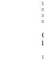

### 初始化集合


当如图所示初始化列表、队列或栈时，你可以传入任何数组或类列表集合，包括列表、队列、栈以及我在下一节中介绍的新集合（但不包括字典——它们的形状不对）。网站上的 MoreCollections 示例说明了从另一个集合初始化一个集合的几种情况。

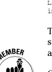

自 C# 3.0 起，集合初始化器类似于新的数组初始化器，并且比大多数早期形式更容易使用。新的初始化器如下所示：

```
List<int> numList = new List<int> { 1, 2, 3 }; // List
int[] intArray = { 1, 2, 3 }; // Array
```

新数组初始化器和集合初始化器之间的关键区别在于，你仍然必须为集合写出类型——这意味着在 new 关键字之后给出 List<int>（请参阅前例中的粗体）。

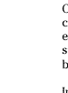

当然，你也可以对集合使用 var 关键字：

```
var list = new List<string> { "Head", "Heart", "Hands", "Health" };
```

你也可以使用新的 dynamic 关键字：

```
dynamic list = new List<string> { "Head", "Heart", "Hands", "Health" };
```

使用新语法初始化字典如下所示：

```
Dictionary<int, string> dict =
    new Dictionary<int, string> { { 1, "Sam" }, { 2, "Joe" } };
```

从外表看，这个示例与 List<T> 的情况相同，但在外层大括号内部，你会看到第二层用大括号括起来的项，每个字典条目一个。因为这个字典 dict 有整数键和字符串值，所以每一对内部大括号都包含一个键和一个值，用逗号分隔。键/值对也是用逗号分隔的。

初始化集合（见下一节）与初始化列表非常相似：

```
HashSet<int> biggerPrimes = new HashSet<int> { 19, 23, 29, 31, 37, 41 };
```

本书网站上的 UsingVarWithArraysAndCollections 示例演示了 var 关键字与数组和集合一起使用。


## Using Sets

C# 3.0 添加了集合类型 HashSet<T>。集合是一个无序且不包含重复项的集合。


下面的示例——网站上的 HashSetExample——展示了几个 HashSet<T> 方法，但更重要的是，演示了将 HashSet<T> 作为处理其他集合的工具使用。你可以用 HashSet<T> 执行严格的数学运算，但我们发现它以各种方式组合集合的能力非常方便。

这段代码的第一部分以一个 List<string> 和一个数组开始。两者都包含颜色名称。虽然你可以通过简单地调用列表的 AddRange() 方法将两者合并：

```
colors.AddRange(moreColors);
```

结果列表包含一些重复项（yellow、orange）。另一方面，使用 HashSet<T> 和 UnionWith() 方法，你可以合并两个集合并一次性消除任何重复项，如以下示例所示。


以下是本书网站上 HashSetExample 的开头：

```
Console.WriteLine("Combining two collections with no duplicates:");
List<string> colors = new List<string> { "red", "orange", "yellow" };
string[] moreColors = { "orange", "yellow", "green", "blue", "violet" };
// Want to combine but without any duplicates.
// Following is just the first stage ...
HashSet<string> combined = new HashSet<string>(colors);
// ... now for the second stage.
// UnionWith() collects items in both lists that aren't duplicated,
// resulting in a combined collection whose members are all unique.
combined.UnionWith(moreColors);
foreach (string color in combined)
{
    Console.WriteLine(color);
}
```

这里给出的结果包含 "red"、"orange"、"yellow"、"green"、"blue" 和 "violet"。第一阶段使用 colors 列表初始化一个新的 HashSet<T>。第二阶段然后调用集合的 UnionWith() 方法将 moreColors 数组添加进来——但只添加那些集合中尚未存在的项。集合最终只包含两个原始列表中的颜色。Green、blue 和 violet 来自第二个列表；red、orange 和 yellow 来自第一个。moreColors 数组中的 orange 和 yellow 会重复集合中已有的项，因此被筛除。

但假设你希望最终得到一个包含这些颜色的 List<T>，而不是 HashSet<T>。下一段展示了如何创建一个用合并后的集合初始化的新 List<T>：

```
Console.WriteLine("\nConverting the combined set to a list:");
// Initialize a new List from the combined set above.
List<string> spectrum = new List<string>(combined);
foreach (string color in spectrum)
{
    Console.WriteLine(color);
}
```

在编写这些示例时，2008 年美国总统竞选正如火如荼进行，每个主要党派约有十名早期候选人。其中许多候选人也是美国参议院的成员。如何生成仅包含那些也是参议员的候选人的列表？HashSet<T> 的 IntersectWith() 方法会给出候选人名单和参议院名单之间的重叠项——即同时存在于两个名单中的项，仅限这些项：

```
Console.WriteLine("\nFinding the overlap in two lists:");
List<string> presidentialCandidates =
  new List<string> { "Clinton", "Edwards", "Giuliani", "McCain", "Obama",
"Romney" };
List<string> senators = new List<string> { "Alexander", "Boxer", "Clinton",
"McCain", "Obama", "Snow" };
HashSet<string> senatorsRunning = new HashSet<string>(presidentialCandidates);
// IntersectWith() collects items that appear in both lists, eliminates others.
senatorsRunning.IntersectWith(senators);
foreach (string senator in senatorsRunning)
{
    Console.WriteLine(senator);
}
```

结果是 "Clinton"、"McCain"、"Obama"，因为它们是两个名单中唯一的共同项。相反的技巧是删除同时出现在两个列表中的任何项，以便最终只保留目标列表中在另一个列表中没有重复的项。这需要使用 HashSet<T> 的 ExceptWith() 方法：

```
Console.WriteLine("\nExcluding items from a list:");
Queue<int> queue =
    new Queue<int>(new int[] { 0, 1, 2, 3, 4, 5, 6, 7, 8, 9, 17 });
HashSet<int> unique = new HashSet<int> { 1, 3, 5, 7, 9, 11, 13, 15 };
// ExceptWith() removes items in unique that are also in queue: 1, 3, 5, 7.
unique.ExceptWith(queue);
foreach (int n in unique)
{
    Console.WriteLine(n.ToString());
}
```

执行此代码后，unique 排除了自身中与 queue 重复的项（1、3、5、7 和 9），并且也排除了 queue 中不在 unique 中的项（0、2、4、6、8 和 17）。最终 unique 中剩下 11、13 和 15。

与此同时，下一个代码段使用 SymmetricExceptWith() 方法创建与 IntersectWith() 相反的结果。交集会给出重叠的项，而 SymmetricExceptWith() 会给出两个列表中不重叠的项。uniqueToOne 集合最终只包含 5、3、1、12 和 10：

```
Console.WriteLine("\nFinding the non-overlapping items in two lists:");
Stack<int> stackOne = new Stack<int>(new int[] { 1, 2, 3, 4, 5, 6, 7, 8 });
Stack<int> stackTwo = new Stack<int>(new int[] { 2, 4, 6, 7, 8, 10, 12 });
HashSet<int> nonoverlapping = new HashSet<int>(stackOne);
// SymmetricExceptWith() collects items that are in one collection but not
// the other. The items that don't overlap
nonoverlapping.SymmetricExceptWith(stackTwo);
```

```
foreach(int n in nonoverlapping)
{
    Console.WriteLine(n.ToString());
}
Console.WriteLine("Press Enter to terminate...");
Console.Read();
```

我在这里对栈的使用有点不寻常，因为我是一次性添加所有成员，而不是逐个推送，并且是一次性移除一批，而不是逐个弹出。那些操作——推送和弹出——才是与栈交互的正确方式。

请注意，我演示的所有 HashSet<T> 方法都是 void 方法——它们不返回值。因此，结果直接反映在你调用这些方法的哈希集合中：前述代码示例中的 nonoverlapping。


我最初发现 UnionWith() 和 IntersectWith() 的行为有点别扭，因为我希望得到一个新的结果集合，而原始（输入）集合在应用这些方法时保持不变。但在 Book I 第 9 章中，你会遇到（我很高兴地报告）LINQ 查询运算符，它们提供了返回全新集合对象的这些方法的版本。将这里看到的内容与那里看到的内容结合起来，你就能兼得两者之长。更多内容，我现在最好不要说了。

什么时候会使用 HashSet<T>？只要你处理两个或多个集合，并且想要查找重叠等项——或创建一个包含另外两个集合的集合，或从集合中排除一组项——集合就很有用。许多 HashSet<T> 方法可以将集合与其他集合类关联。当然，你可以用集合做更多事情，所以在帮助中查找 HashSet<T> 术语并尝试 HashSetExample。

## On Not Using Old-Fashioned Collections

在远古时代，在 C# 2.0 之前，扎拉图斯特拉所言之时，所有集合类都实现为类型为 Object 的集合。你无法仅为字符串或仅为 int 创建集合。这样的集合允许你存储任何类型的数据，因为 C# 中的所有对象都派生自 Object 类。因此，你可以在同一个集合中添加 int 和字符串而不会看到错误消息（这是由于 C# 的继承和多态性，我在 Book II 中讨论）。

但在基于 Object 的安排中存在一个严重缺点：要提取你知道已放入集合的 int，你必须将获取到的 Object 强制转换为 int：

Book I Chapter 6 Lining Up Your Ducks with Collections


```
ArrayList ints = new ArrayList(); // An old-fashioned list of Objects
int myInt = (int)ints[0]; // Extract the first int in the list.
```

就好像你的整数被藏在复活节彩蛋里。如果不进行强制转换，就会产生错误，因为例如Object不支持你期望整数具有的+操作或其他方法、属性和运算符。你可以忍受这些限制，但这种代码容易出错，而且进行所有这些强制转换确实很繁琐。（此外，正如我在第1册第8章中讨论的，处理复活节彩蛋会因“装箱”现象而增加一些处理开销。过多的装箱会降低程序速度。）

而且，如果集合中碰巧包含多种类型的对象——比如石榴和篮球——问题就变得更棘手了。不知何故，你必须检测出取出的对象是石榴还是篮球，以便正确地进行强制转换。

由于旧的非泛型集合存在这些限制，较新的泛型集合就像一股清新的空气。你永远不必进行强制转换，而且你总是知道会得到什么，因为任何给定集合中只能放入一种类型。但你仍然会偶尔在别人编写的代码中看到较旧的集合——有时你甚至可能有正当理由将苹果和橙子放在同一个集合中。


非泛型集合位于System.Collections和System.Collections.Specialized命名空间中。Specialized集合是有趣、有时有用、古怪的集合，而且主要是非泛型的。现代的泛型集合位于System.Collections.Generic中。（我在第2册中讨论面向对象编程时解释了命名空间和泛型。）

## 第7章：遍历集合

### 本章内容

- 将目录作为文件集合、将文件作为字节集合来处理
- “枚举”或迭代集合
- 实现索引器以方便访问集合对象
- 使用C#迭代器块轻松循环访问集合

本分册第6章探讨了.NET Framework类库提供的、可供C#及其他.NET语言使用的集合类。集合类是.NET中的构造，可以实例化以保存一组项（见第6章）。

本章第一部分稍微扩展了集合的概念。例如，考虑以下集合：将文件视为数据行或数据记录的集合，将目录视为文件的集合。因此，本章既基于本分册第6章的集合内容，也基于第3册的文件内容。

然而，本章的重点是遍历或迭代各类集合的几种方法，从文件目录到各种数组和列表。

### 遍历文件目录

读写是你在这一领域立足的基本技能。这正是第3册中FileRead和FileWrite程序的重要之处。然而，在某些情况下，你只是想快速浏览一个文件目录，寻找某些内容。

下面的LoopThroughFiles程序会查看指定目录中的所有文件，读取每个文件并将其内容以十六进制格式转储到控制台。（这听起来可能有点傻，但这个程序也演示了如何以不仅仅是字符串的格式写出文件。我将在下面的侧边栏“认识十六进制”中介绍十六进制格式。）


如果你在一个包含大量文件的目录中运行此程序，十六进制转储可能需要一段时间。此外，长文件也需要一段时间来循环处理。要么选择一个文件较少的目录，要么按Ctrl+C终止耗时较长的程序运行。该命令会中断在任何控制台窗口中运行的程序。

```
// LoopThroughFiles -- Loop through all files contained in a directory;
// this time perform a hex dump, though it could have been anything.
using System;
using System.IO;

namespace LoopThroughFiles
{
    public class Program
    {
        public static void Main(string[] args)
        {
            // If no directory name provided...
            string directoryName;
            if (args.Length == 0)
            {
                // ...get the name of the current directory...
                directoryName = Directory.GetCurrentDirectory();
            }
            else
            {
                // ...otherwise, assume that the first argument
                // is the name of the directory to use.
                directoryName = args[0];
            }
            Console.WriteLine(directoryName);

            // Get a list of all files in that directory.
            FileInfo[] files = GetFileList(directoryName);

            // Now iterate through the files in that list,
            // performing a hex dump of each file.
            foreach(FileInfo file in files)
            {
                // Write out the name of the file.
                Console.WriteLine("\n\nhex dump of file {0}:", file.FullName);

                // Now "dump" the file to the console.
                DumpHex(file);

                // Wait before outputting next file.
                Console.WriteLine("\nenter return to continue to next file");
                Console.ReadLine();
            }

            // That's it!
            Console.WriteLine("\no files left!");
            // Wait for user to acknowledge the results.
            Console.WriteLine("Press Enter to terminate...");
            Console.Read();
        }

        // GetFileList -- Get a list of all files in a specified directory.
        public static FileInfo[] GetFileList(string directoryName)
        {
            // Start with an empty list.
            FileInfo[] files = new FileInfo[0];
            try
            {
                // Get directory information.
                DirectoryInfo di = new DirectoryInfo(directoryName);

                // That information object has a list of the contents.
                files = di.GetFiles();
            }
            catch(Exception e)
            {
                Console.WriteLine("Directory \"{0}\" invalid", directoryName);
                Console.WriteLine(e.Message);
            }
            return files;
        }

        // DumpHex -- Given a file, dump out the contents of the file to the console.
        public static void DumpHex(FileInfo file)
        {
            // Open the file.
            FileStream fs;
            BinaryReader reader;
            try
            {
                fs = file.OpenRead();
                // Wrap the file stream in a BinaryReader.
                reader = new BinaryReader(fs);
            }
            catch(Exception e)
            {
                Console.WriteLine("can't read from \"{0}\"", file.FullName);
                Console.WriteLine(e.Message);
                return;
            }

            // Iterate through the contents of the file one line at a time.
            for(int line = 1; true; line++)
            {
                // Read another 10 bytes across (all that will fit on a single
                // line) -- return when no data remains.
                byte[] buffer = new byte[10];
                // Use the BinaryReader to read bytes.
                // Note: Using the bare FileStream
                // would have been just as easy in this case.
                int numBytes = reader.Read(buffer, 0, buffer.Length);
                if (numBytes == 0)
                {
                    return;
                }

                // Write out the data just read,
                // in a single line preceded by line number.
                Console.Write("{0:D3} - ", line);
                DumpBuffer(buffer, numBytes);

                // Stop every 20 lines so that the data doesn't scroll
                // off the top of the Console screen.
                if ((line % 20) == 0)
                {
                    Console.WriteLine("Enter return to continue another 20 lines");
                    Console.ReadLine();
                }
            }
        }

        // DumpBuffer -- Write a buffer of characters as a single line in hex format.
        public static void DumpBuffer(byte[] buffer, int numBytes)
        {
            for(int index = 0; index < numBytes; index++)
            {
                byte b = buffer[index];
                Console.Write("{0:X2}, ", b);
            }
            Console.WriteLine();
        }
    }
}
```

在命令行中，用户指定要使用的目录作为程序的参数。下面的命令将对temp目录中的每个文件（包括二进制文件和文本文件）进行十六进制转储：

```
loopthroughfiles c:\randy\temp
```

如果不输入目录名，程序默认使用当前目录。（十六进制转储将输出显示为十六进制（基数为16）数字系统的数字。参见旁边的侧边栏“认识十六进制”。）


FileRead和FileWrite都从控制台读取输入文件名，而这个程序从命令行读取输入。我真的不是在故意迷惑你——我只是想展示解决同一问题的不同方法。

LoopThroughFiles中的第一行查找程序参数。如果参数列表为空（args.Length为零），程序将调用Directory.GetCurrentDirectory()。如果你在Visual Studio中运行（而不是在命令行中运行），该值默认为LoopThroughFiles项目目录下的bin\Debug子目录。


Directory类为用户提供了一组操作目录的方法。FileInfo类提供了移动、复制和删除文件等方法，以及其他任务。

然后，程序通过调用本地的GetFileList()创建指定目录中所有文件的列表。该方法返回一个FileInfo对象数组。每个FileInfo对象包含有关文件的信息——例如文件名（带完整路径的FullName或不带路径的Name）、创建日期和最后修改日期。Main()使用你的老朋友foreach语句迭代文件列表。它显示每个文件的名称，然后将文件传递给DumpHex()方法以显示到控制台。


## 了解十六进制

与二进制数（0 和 1）一样，十六进制数（或称“hex”数）也是计算机编程的基础。在基 16 中，数字为 0 到 9，然后是 A、B、C、D、E、F——其中 A=10，B=11……F=15。举例说明（使用 0x 前缀表示十六进制）：

```
0x2A = 42 decimal: 2*16 + A*1 (where A*1 = 10*1)
```

字母数字可以大写或小写：C 与 c 相同。这很奇怪，但非常有用，尤其是在调试或贴近底层硬件处理内存内容时。

```
0xD = 13 decimal
0x10 = 16 decimal: 1*16 + 0*1
```

在循环结束时，它会暂停，让程序员有机会查看 DumpHex() 的输出。

GetFileList() 方法首先创建一个空的 FileInfo 列表。发生错误时，它返回的就是这个列表。

在编写任何 Get...List() 方法时，有一个巧妙的技巧值得记住：如果发生错误，就显示错误消息并返回一个长度为零的列表。


要小心返回对象的引用。例如，不要返回 PriorityQueue 类（本迷你书第 8 章介绍）中包装的某个底层队列的引用——除非你就是想让人通过该引用而不是通过你的类方法来乱动那些队列。那肯定会造成队列损坏、行为不可预测。但 GetFileList() 在这里并不暴露你某个类的内部结构，所以没问题。

然后 GetFileList() 创建一个 DirectoryInfo 对象。顾名思义，DirectoryInfo 对象包含关于目录的信息，其类型与 FileInfo 对象包含的关于文件的信息相同：名称、级别和序列号之类的信息。不过，DirectoryInfo 对象可以访问 FileInfo 无法访问的一项内容：以 FileInfo 数组形式表示的该目录中的文件列表。

像往常一样，GetFileList() 将与目录和文件相关的代码包裹在一个大的 try 块中。（关于 try 和 catch 的解释，见本迷你书第 9 章。）末尾的 catch 会捕获产生的任何错误。为了进一步让你难堪，catch 块还会炫耀目录的名称（该目录很可能不存在，因为你输入错了）。

DumpHex() 方法只是有点棘手，原因仅在于要把输出格式排得恰到好处很困难。

DumpHex() 一开始先打开文件。FileInfo 对象包含关于文件的信息——它并不打开文件。DumpHex() 获取文件的完整名称（包括路径），然后使用该名称以只读模式打开一个 FileStream。如果 FileStream 由于某种原因无法读取文件，catch 块会抛出异常。

然后 DumpHex() 每次读取文件中的 10 个字节。它把每 10 个字节以十六进制格式显示为一行。每 20 行，它会暂停，直到用户按 Enter。我使用取模运算符 % 来完成该任务。

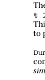

在垂直方向上，控制台窗口默认有 25 行的空间。（当然，用户可以更改窗口大小，从而允许更多或更少的行。）这意味着你大约每 20 行就必须暂停一次。否则，数据会在用户来得及阅读之前就从屏幕顶部滚走。

取模运算符（%）返回除法后的余数。因此，当 line 等于 20、40、60、80 时，(line % 20) == 0 为真——你明白意思。这个技巧很有价值，在各类循环场景中都很有用，因为你想每隔一定次数才执行一次操作。

DumpBuffer() 使用 X2 格式控制符写出字节数组的每个成员。虽然 X2 听起来像某项秘密军事实验的名称，但它只是表示“将数字显示为两位十六进制数字”。

一个字节的范围是 0 到 255，即 0xFF——每个字节两位十六进制数字。

以下是 output.txt 文件的前 20 行（就连它亲妈也认不出这张图）：

```
Hex dump of file C:\C#Programs\Vi\holdtank\Test2\bin\output.txt:
001 - 53, 74, 65, 63, 6D, 20, 28, 70, 72,
002 - 6F, 74, 65, 63, 74, 65, 64, 20, 29, 0D, 0A,
003 - 20, 20, 26, 69, 6C, 65, 53, 72, 74, 72, 65,
004 - 61, 6D, 28, 73, 74, 72, 69, 6E, 67, 2C,
005 - 20, 46, 69, 6C, 65, 4D, 61, 41, 63, 63, 65, 73, 73,
006 - 20, 20, 46, 69, 6C, 65, 4D, 61, 41, 63, 63, 65, 73, 73,
007 - 73, 29, 0D, 0A, 20, 20, 20, 20, 40, 6D, 6F,
008 - 72, 79, 73, 74, 72, 65, 61, 6C, 20, 29, 0D, 0A,
009 - 3B, 0D, 0A, 20, 20, 20, 20, 48, 77, 74, 74, 67,
010 - 72, 6B, 53, 74, 74, 72, 65, 65, 61, 6D, 0D, 0A,
011 - 20, 20, 20, 42, 75, 66, 66, 65, 72, 72, 73, 72, 74,
012 - 72, 65, 65, 61, 6D, 20, 20, 2D, 62, 75, 65, 66,
013 - 66, 65, 75, 72, 73, 20, 61, 61, 66, 20, 65, 78, 78,
014 - 69, 73, 74, 74, 74, 6E, 67, 20, 20, 73, 74, 74, 72,
015 - 65, 65, 61, 6D, 20, 20, 69, 62, 62, 62, 66, 65, 74, 74,
016 - 0D, 0A, 0D, 0A, 42, 69, 6E, 6D, 61, 72, 72, 79,
017 - 52, 65, 65, 51, 64, 65, 65, 20, 20, 2D, 20, 72,
018 - 65, 65, 51, 64, 20, 69, 69, 69, 6E, 20, 20, 76, 61, 72,
019 - 69, 69, 66, 65, 73, 73, 20, 74, 79, 79, 70, 65, 73, 73,
020 - 20, 20, 28, 28, 68, 61, 61, 72, 2C, 20, 20, 49, 6E,
Enter return to continue another 20 lines
```


你可以根据十六进制显示把文件重新构造成字符串。0x61 这个值等同于字符 a 的数值。字母表中的字母按顺序排列，所以 0x65 应该是字符 e；0x20 是空格。本例中的第一行（在行号之后）是 `s} \n\r Nemo`，其中 \n 是换行，\r 是回车。有意思吧？我就想讲到这里。你可以用 Google 或其他搜索引擎搜索 ASCII 表。

这些编码对于庞大得多的 Unicode 字符集的较低部分也同样有效，而 C# 默认使用 Unicode 字符集。（你可以在网上用搜索引擎查找 Unicode characters 一词，我在 http://csharp102.info 网站上的文章“在字节数组与字符数组之间转换”中解释了基础知识。）

以下示例展示了当用户指定无效目录 x 时会发生什么：

```
Directory "x" invalid
Could not find a part of the path "C:\C#Programs\LoopThroughFiles\bin\Debug\x".

No files left
Press Enter to terminate...
```

很厉害吧？

## 遍历 foreach 集合：迭代器

在本章的其余部分，你会看到解决遍历集合这一常见问题的三种不同方法。在本节中，我继续讨论最传统的方法（至少对 C# 程序员来说如此），即迭代器类，或称枚举器，它实现 IEnumerator 接口。


迭代器和枚举器这两个术语是同义的。尽管接口名称如此，迭代器这个术语更常见，但枚举器在微软一直很流行。这两个名词的动词形式也可用：你对容器或集合进行迭代或枚举。注意，本章后面讨论的索引器和新的迭代器块是解决同一问题的其他方法。

### 访问集合：一般问题

不同的集合类型可能有不同的访问方案。并非所有类型的集合都能像数组那样通过索引高效访问——例如链表。链表只包含对列表中下一项的引用，并且被设计为按顺序访问——而不是随机访问。集合类型之间的差异使得如果没有特殊处理，就不可能编写如下这样的方法：

```csharp
// Pass in any kind of collection:
void MyClearMethod(Collection aColl, int index)
{
    aColl[index] = 0; // Indexing doesn't work for all types of collections.
    // ... continues ...
}
```

每种集合类型都可以（而且确实会）定义自己的访问方法。例如，链表可能提供 `GetNext()` 方法来获取对象链中的下一个元素，或者栈表示法可能提供 `Push()` 和 `Pop()` 来添加和移除对象。

一种更通用的方法是为每个集合类提供一个单独的 *迭代器* 类，这个类熟悉如何导航该特定集合。每个集合 X 都定义自己的类 `IteratorX`。与 X 不同，`IteratorX` 提供通用的 `IEnumerator` 接口，这是迭代的黄金标准。该技术使用第二个对象——*迭代器*——作为指向集合的一种指针或游标。

迭代器（枚举器）方法具有以下优点：

- 每个集合类都可以定义自己的迭代类。由于迭代类实现标准的 `IEnumerator` 接口，因此通常很容易编码。
- 应用程序代码不需要知道集合代码如何工作。只要程序员了解如何使用迭代器，迭代类就能处理细节。这是良好的封装。
- 应用程序代码可以为同一个集合创建多个独立的迭代器对象。由于迭代器包含自己的状态信息（在迭代中“知道自己在哪儿”），每个迭代器都可以独立地遍历集合。你可以同时进行多个迭代，每个迭代位于集合中的不同位置。

为了使 `foreach` 循环成为可能，`IEnumerator` 接口必须支持所有不同类型的集合，从数组到链表。因此，它的方法必须尽可能通用。例如，你不能使用迭代器随机访问集合类中的位置，因为大多数集合不提供随机访问。（你需要发明一个具备该能力的其他枚举接口，但它无法与 `foreach` 一起工作。）

`IEnumerator` 提供以下三个方法：

- `Reset()`：将枚举器设置为指向集合的开头。**注意：** `IEnumerator` 的泛型版本 `IEnumerator<T>` 不提供 `Reset()` 方法。例如，对于 .NET 的泛型 `LinkedList`，只需从调用 `MoveNext()` 开始。那个泛型 `LinkedList` 位于 `System.Collections.Generic` 中。


-   **MoveNext()**: 将枚举器从集合中的当前对象移动到下一个对象。
-   **Current**: 一个属性，而不是方法，用于检索枚举器当前位置存储的数据对象。

以下方法演示了这一原理。MyCollection 类（未显示）的程序员创建了相应的迭代器类——比如 IteratorMyCollection（使用我在本章前面描述的 IteratorX 命名约定）。应用程序程序员已在 MyCollection 中存储了大量 ContainedDataObjects。以下代码段使用三个标准的 IEnumerable 方法将这些对象读出：

```csharp
// The MyCollection class holds ContainedDataObject type objects as data.
void MyMethod(MyCollection myColl)
{
    // The programmer who created the MyCollection class also
    // creates an iterator class IteratorMyCollection;
    // the application program creates an iterator object
    // in order to navigate through the myColl object.
    IEnumerator iterator = new IteratorMyCollection(myColl);
    // Move the enumerator to the 'next location' within the collection.
    while(iterator.MoveNext())
    {
        // Fetch a reference to the data object at the current location
        // in the collection.
        ContainedDataObject contained;  // Data
        contained = (ContainedDataObject)iterator.Current;
        // ...use the contained data object...
    }
}
```

方法 MyMethod() 将 ContainedDataObjects 的集合作为其参数。它首先创建 IteratorMyCollection 类的迭代器。方法通过调用 MoveNext() 开始循环。在此次首次调用中，MoveNext() 将迭代器移动到集合中的第一个元素。在每次后续调用中，MoveNext() 将指针移动“一个位置”。当集合耗尽且迭代器无法再移动时，MoveNext() 返回 false。

Current 属性返回迭代器当前位置的数据对象的引用。程序在将其分配给 contained 之前，将返回的对象转换为 ContainedDataObject。如果 MoveNext() 方法在上一次调用中未返回 true，或者尚未调用 MoveNext()，则对 Current 的调用无效。

## 让 C# 通过 foreach 访问容器数据

IEnumerable 方法足够标准，以至于 C# 会自动使用它们来实现 foreach 语句。foreach 语句可以访问实现 IEnumerable 或 IEnumerable<T> 的任何类。本节我以 IEnumerable<T> 讨论 foreach，如下所示的通用方法能够处理此类任何类，从数组到链表再到栈和队列：

```csharp
void MyMethod(IEnumerable<T> containerOfThings)
{
    foreach(string s in containerOfThings)
    {
        Console.WriteLine("The next thing is {0}", s);
    }
}
```

类通过定义 GetEnumerator() 方法来实现 IEnumerable<T>，该方法返回 IEnumerator<T> 的实例。在内部，foreach 调用 GetEnumerator() 方法来检索迭代器。它使用此迭代器遍历集合。它检索到的每个元素在进入大括号内包含的代码块之前都已适当转换。注意 IEnumerable<T> 和 IEnumerator<T> 是不同但相关的接口。C# 也提供了非泛型版本，但你应优先使用泛型版本以获得更高的类型安全性。

IEnumerable<T> 看起来像这样：

```csharp
interface IEnumerable<T>
{
    IEnumerator<T> GetEnumerator();
}
```

而 IEnumerator<T> 看起来像这样：

```csharp
interface IEnumerator<T>
{
    bool MoveNext();
    T Current { get; }
}
```

非泛型 IEnumerator 接口添加了 Reset() 方法，该方法将迭代器移回集合的开头，其 Current 属性返回类型为 Object。注意 IEnumerator<T> 继承自 IEnumerator——请记住接口继承（在第二册第 8 章中介绍）与普通对象继承不同。

C# 数组（以它们基于的 Array 类体现）和所有 .NET 集合类已经实现了这两个接口。因此，只有在编写自己的自定义集合类时才需要处理实现这些接口。对于内置集合，你可以直接使用它们。参见帮助中的 System.Collections.Generic 命名空间主题。

因此你可以这样编写 foreach 循环：

## 以数组方式访问集合：索引器

访问数组的元素很简单：命令 container[n]（读作“container sub-n”）访问容器数组的第 n 个元素。方括号中的值是下标。如果只能对其他类型的集合进行索引就这么简单就好了。

停止印刷！C# 使你能够编写索引操作的自己的实现。你可以为原本不会拥有此功能的集合提供索引功能。此外，你可以对除 C# 数组所限定的简单整数之外的下标类型进行索引；例如字符串；另一个例子，尝试 container["Joe"]。

### 索引器格式

索引器看起来很像普通的 get/set 属性，只是出现了关键字 this 和索引运算符 [] 而不是属性名，如以下代码所示：

```csharp
class MyArray
{
    public string this[int index]  // Notice the 'this' keyword.
    {
        get
        {
            return array[index];
        }
        set
        {
            array[index] = value;
        }
    }
}
```

在内部，表达式 s = myArray[i]; 调用 get 访问器方法，将 i 的值作为索引传递给它。此外，表达式 myArray[i] = "some string"; 调用 set 访问器方法，将相同的索引 i 和 "some string" 作为值传递给它。

### 索引器程序示例

索引类型不限于 int。你可以选择按房屋所有者的姓名、房屋地址或任何其他索引来索引房屋集合。此外，索引器属性可以用多个索引类型重载，因此你可以在同一集合中的各种元素上进行索引。

以下 Indexer 程序生成虚拟数组类 KeyedArray。此虚拟数组看起来并表现得像数组，只是它使用字符串值作为索引：


```csharp
// Indexer -- This program demonstrates the use of the index operator
// to provide access to an array using a string as an index.
// This version is nongeneric, but see the IndexerGeneric example.
using System;

namespace Indexer
{
    public class KeyedArray
    {
        // The following string provides the "key" into the array --
        // the key is the string used to identify an element.
        private string[] _keys;

        // The object is the actual data associated with that key.
        private object[] _arrayElements;

        // KeyedArray -- Create a fixed-size KeyedArray.
        public KeyedArray(int size)
        {
            _keys = new string[size];
            _arrayElements = new object[size];
        }

        // Find -- Find the index of the element corresponding to the
        // string targetKey (return a negative if it can't be found).
        private int Find(string targetKey)
        {
            for (int i = 0; i < _keys.Length; i++)
            {
                if (String.Compare(_keys[i], targetKey) == 0)
                {
                    return i;
                }
            }
            return -1;
        }

        // FindEmpty -- Find room in the array for a new entry.
        private int FindEmpty()
        {
            for (int i = 0; i < _keys.Length; i++)
            {
                if (_keys[i] == null)
                {
                    return i;
                }
            }

            throw new Exception("Array is full");
        }

        // Look up contents by string key -- this is the indexer.
        public object this[string key]
        {
            set
            {
                // See if the string is already there.
```


```csharp
int index = Find(key);
if (index < 0)
{
    // It isn't -- find a new spot.
    index = FindEmpty();
    _keys[index] = key;
}

// Save the object in the corresponding spot.
_arrayElements[index] = value;

get
{
    int index = Find(key);
    if (index < 0)
    {
        return null;
    }
    return _arrayElements[index];
}
}
}

public class Program
{
    public static void Main(string[] args)
    {
        // Create an array with enough room.
        KeyedArray ma = new KeyedArray(100);

        // Save the ages of the Simpson kids.
        ma["Bart"] = 8;
        ma["Lisa"] = 10;
        ma["Maggie"] = 2;

        // Look up the age of Lisa.
        Console.WriteLine("Let's find Lisa's age");
        int age = (int)ma["Lisa"];
        Console.WriteLine("Lisa's age is {0}", age);

        // Wait for user to acknowledge the results.
        Console.WriteLine("Press Enter to terminate...");
        Console.Read();
    }
}
}
```

类 KeyedArray 包含两个普通数组。_arrayElements 对象数组包含实际的 KeyedArray 数据。驻留在 _keys 数组中的字符串充当对象数组的标识符。_keys 的第 i 个元素对应于 _arrayElements 的第 i 个条目。应用程序随后可以通过对应用程序有意义的字符串标识符来索引 KeyedArray。


非整数索引被称为键。顺便说一下，你可以用底层的 List<T> 而不是固定大小的数组来实现 KeyedArray。List<T> 可以像数组一样被索引，因为两者都实现了 IList（或 IList<T>）接口。这使得 KeyedArray 可以是泛型的，并且比使用内部数组灵活得多。

set[string] 索引器首先通过调用 Find() 方法检查指定的索引是否已存在。如果 Find() 返回一个索引，set[] 将新数据对象存储到 _arrayElements 中对应的索引。如果 Find() 找不到该键，set[] 会调用 FindEmpty() 以返回一个空槽来存储提供的对象。

索引的 get[] 部分遵循类似的逻辑。它首先使用 Find() 方法搜索指定的键。如果 Find() 返回一个非负索引，get[] 返回存储数据的 _arrayElements 的对应成员。如果 Find() 返回 -1，get[] 返回 null，表示它在列表中找不到提供的键。

Find() 方法遍历 _keys 的成员，查找与传入的字符串 targetKey 值相同的元素。Find() 返回找到元素的索引（如果未找到则返回 -1）。FindEmpty() 返回第一个没有键元素的元素的索引。

Find() 和 FindEmpty() 都不是以高效的方式编写的。有很多方法可以使这些方法更快，其中没有任何一种与索引器有关。


请注意，你不能通过提供 null 键来移除一个元素。正如大学教材里常说的，“这个问题留给读者作为练习。”

Main() 方法以一种简单的方式演示了 Indexer 类：

```csharp
public class Program
{
    public static void Main(string[] args)
    {
        // Create an array with enough room.
        KeyedArray ma = new KeyedArray(100);

        // Save the ages of the Simpson kids.
        ma["Bart"] = 8;
        ma["Lisa"] = 10;
        ma["Maggie"] = 2;

        // Look up the age of Lisa.
        Console.WriteLine("Let's find Lisa's age");
        int age = (int)ma["Lisa"];
        Console.WriteLine("Lisa is {0}", age);

        // Wait for user to acknowledge the results.
        Console.WriteLine("Press Enter to terminate...");
        Console.Read();
    }
}
```

该程序创建了一个长度为 100 的 KeyedArray 对象 ma（即有 100 个空闲元素）。它继续按每个孩子的名字索引存储《辛普森一家》电视节目中孩子们的年龄。最后，程序使用表达式 ma [ "Lisa" ] 检索 Lisa 的年龄并显示结果。表达式 ma [ "Lisa" ] 读作“ma 下标-Lisa。”

请注意，程序必须对从 ma [ ] 返回的值进行强制转换，因为 KeyedArray 被编写为保存任何类型的对象。如果索引器被编写为仅处理 int 值——或者如果 KeyedArray 是泛型的——则不需要强制转换。（有关泛型的更多信息，请参阅本迷你书的第 8 章。）

程序的输出简单而优雅：

```
Let's find Lisa's age
Lisa is 10
Press Enter to terminate...
```

顺带一提，IList 接口描述了一个提供类似数组的整数索引器的类，其形式为 object this[int]。C# 还有一个 IList<T> 接口，你可以用它用你选择的 type T 替换 object。这将消除前一个示例中对强制转换的需求。

有关 Indexer 程序的泛型版本，请参阅本书网站上的 IndexerGeneric 示例。

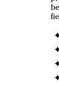

## 在迭代器块周围循环

在 C# 的早期版本中，我们在本章“以数组方式访问集合：索引”一节中讨论的链表，是遍历集合的主要做法，就像在 C++ 和 C 中之前所做的那样。虽然这种解决方案确实有效，但事实证明 C# 2.0 已简化了此过程，使得

- 你不必调用 GetEnumerator()（并转换结果）。
- 你不必调用 MoveNext()。
- 你不必调用 Current 并转换其返回值。
- 你只需使用 foreach 来迭代集合。（C# 会在幕后为你完成剩下的工作——它甚至会编写枚举器类。）

公平地说，foreach 也适用于 .NET 中的 LinkedList 类。这来自于提供 GetEnumerator() 方法。但我仍然必须自己编写 LinkedListIterator 类。新颖之处在于，如果你选择的话，你可以在自己编写的集合类中跳过这部分。

而不是在你编写的集合类中实现所有这些接口方法，你可以提供一个迭代器块——并且你不必编写自己的迭代器类来支持集合。你也可以将迭代器块用于许多其他任务，正如我在下一个示例中向你展示的那样。

现在迭代的最佳方法使用迭代器块。当你编写一个集合类——并且对于自定义集合类（如 `KeyedList` 和 `PriorityQueue`）的需求仍然存在——你在其代码中实现迭代器块，而不是实现 `IEnumerator` 接口。然后该类的用户只需使用 `foreach` 迭代集合即可。我将一步步带你了解它，以展示迭代器块的几种变体。

本节中的每个示例都是本书网站上 `IteratorBlocks` 示例的一部分：


```csharp
// IteratorBlocks -- Demonstrates using the C# 2.0 iterator
//     block approach to writing collection iterators
using System;
namespace IteratorBlocks
{
    class IteratorBlocks
    {
        //Main -- Demonstrate five different applications of
        // iterator blocks.
        static void Main(string[] args)
        {
            // Instantiate a MonthDays "collection" class.
            MonthDays md = new MonthDays();
            // Iterate it.
            Console.WriteLine("Stream of months:\n");
            foreach (string month in md)
            {
                Console.WriteLine(month);
            }

            // Instantiate a StringChunks "collection" class.
            StringChunks sc = new StringChunks();
            // Iterate it: prints pieces of text.
            // This iteration puts each chunk on its own line.
            Console.WriteLine("\nStream of string chunks:\n");
            foreach (string chunk in sc)
            {
                Console.WriteLine(chunk);
            }

            // And this iteration puts it all on one line.
            Console.WriteLine("\nStream of string chunks on one line:\n");
            foreach (string chunk in sc)
            {
                Console.Write(chunk);
            }
            Console.WriteLine();

            // Instantiate a YieldBreakEx "collection" class.
            YieldBreakEx yb = new YieldBreakEx();
            // Iterate it, but stop after 13.
            Console.WriteLine("\nStream of primes:\n");
```


```
foreach (int prime in yb)
{
    Console.WriteLine(prime);
}

// Instantiate an EvenNumbers "collection" class.
EvenNumbers en = new EvenNumbers();
// Iterate it: prints even numbers from 10 down to 4.
Console.WriteLine("\nstream of descending evens \n");
foreach (int even in en.DescendingEvens(11, 3))
{
    Console.WriteLine(even);
}

// Instantiate a PropertyIterator "collection" class.
PropertyIterator prop = new PropertyIterator();
// Iterate it: produces one double at a time.
Console.WriteLine("\nstream of double values:\n");
foreach (double db in prop.DoubleProp)
{
    Console.WriteLine(db);
}

// Wait for the user to acknowledge.
Console.WriteLine("Press enter to terminate...");
Console.Read();
}

// MonthDays -- Define an iterator that returns the months
// and their lengths in days -- sort of a "collection" class.
class MonthDays
{
    // Here's the "collection."
    string[] months =
    {
        "January 31", "February 28", "March 31",
        "April 30", "May 31", "June 30", "July 31",
        "August 31", "September 30", "October 31",
        "November 30", "December 31" };
    
    // GetEnumerator -- Here's the iterator. See how it's invoked
    // in Main() with foreach.
    public System.Collections.IEnumerator GetEnumerator()
    {
        foreach (string month in months)
        {
            // Return one month per iteration.
            yield return month;
        }
    }
}

// StringChunks -- Define an iterator that returns chunks of text,
// one per iteration -- another oddball "collection" class.
class StringChunks
{
    // GetEnumerator -- This is an iterator; see how it's invoked
    // (twice) in Main.
    public System.Collections.IEnumerator GetEnumerator()
    {
        // Return a different chunk of text on each iteration.
        yield return "Using iterator ";
        yield return "blocks ";
        yield return "isn't all ";
        yield return "that hard";
        yield return ".";
    }
}

//YieldBreakEx -- Another example of the yield break keyword
class YieldBreakEx
{
    int[] primes = { 2, 3, 5, 7, 11, 13, 17, 19, 23 };
    //GetEnumerator -- Returns a sequence of prime numbers
    // Demonstrates yield return and yield break
    public System.Collections.IEnumerator GetEnumerator()
    {
        foreach (int prime in primes)
        {
            if (prime > 13) yield break;
            yield return prime;
        }
    }
}

//EvenNumbers -- Define a named iterator that returns even numbers
// from the "top" value you pass in Down to the "stop" value.
// Another oddball 'collection' class
class EvenNumbers
{
    //DescendingEvens -- This is a "named iterator."
    // Also demonstrates the yield break keyword
    // See how it's invoked in Main() with foreach.
    public System.Collections.IEnumerable DescendingEvens(int top, int stop)
    {
        // Start top at nearest lower even number.
        if (top % 2 != 0) // If remainder after top / 2 isn't 0.
            top -= 1;
        // Iterate from top down to nearest even above stop.
        for (int i = top; i >= stop; i -= 2)
        {
            if (i < stop)
                yield break;
            // Return the next even number on each iteration.
            yield return i;
        }
    }
}

//PropertyIterator -- Demonstrate implementing a class
// property's get accessor as an iterator block.
class PropertyIterator
{
    double[] doubles = { 1.0, 2.0, 3.5, 4.67 };
    // DoubleProp -- A 'get' property with an iterator block
    public System.Collections.IEnumerable DoubleProp
    {
        get
        {
            foreach (double db in doubles)
            {
                yield return db;
            }
        }
    }
}
```


关于迭代器块更贴近实际的示例，请参见本章附带的 PackageFactoryWithIterator 示例。该示例扩展了本迷你书第8章中的 PriorityQueue 示例。

## 迭代月份中的天数：第一个示例

以下来自 IteratorBlocks 示例的片段提供了一个迭代器，它逐月遍历一年中的月份：

```
//MonthDays -- Define an iterator that returns the months
// and their lengths in days -- sort of a "collection" class.
class MonthDays
{
    // Here's the "collection."
    string[] months =
    {
        "January 31", "February 28", "March 31",
        "April 30", "May 31", "June 30", "July 31",
        "August 31", "September 30", "October 31",
        "November 30", "December 31" };

    //GetEnumerator -- Here's the iterator. See how it's invoked
    // in Main() with foreach.
    public System.Collections.IEnumerator GetEnumerator()
    {
        foreach (string month in months)
        {
            // Return one month per iteration.
            yield return month;
        }
    }
}
```

以下是 Main() 方法的一部分，它使用 foreach 循环迭代这个集合：

```
// Instantiate a MonthDays "collection" class.
MonthDays md = new MonthDays();
// Iterate it.
foreach (string month in md)
{
    Console.WriteLine(month);
}
```

这个极其简单的集合类基于数组，就像 KeyedArray 一样。这个类包含一个数组，其元素是字符串。当客户端迭代这个集合时，集合的迭代器块会逐个提供字符串。每个字符串包含月份名称（按顺序），并附有该月的天数。它没什么实际用途，但是，天哪，它确实简单——而且与众不同！

这个类定义了自己的迭代器块，在这里是一个名为 GetEnumerator() 的方法，它返回一个 System.Collections.IEnumerator 类型的对象。现在，确实以前你也必须编写这样的方法，但那时你还必须编写自己的枚举器类来支持自定义集合类。在这里，你只需编写一个相当简单的方法，基于新的 yield return 关键字返回一个枚举器。C# 会为你完成其余工作：它创建底层枚举器类，并负责调用 MoveNext() 来迭代数组。你因此省去了大量工作，代码也简单得多。

更少的代码和更少的工作完全符合我的工作理念。

包含 GetEnumerator() 方法的类不再需要实现 IEnumerable 接口。事实上，你并不希望它实现该接口。

在以下各节中，我将向你展示迭代器块的几种变体：

- 普通迭代器
- 命名迭代器
- 实现为迭代器的类属性

请注意，MonthDays 类的 GetEnumerator() 方法包含一个 foreach 循环，用于产出其内部数组中的字符串。迭代器块通常使用某种循环来完成此操作，你可以在后面的几个示例中看到。实际上，在你自己的调用代码中，有一个内部 foreach 循环逐个提供项，而这些项可以在 GetEnumerator() 外部的另一个 foreach 循环中迭代。

## 集合到底是什么

花点时间将这个示例中的小集合与一个复杂的 LinkedList 集合进行比较。LinkedList 具有由指针连接的节点的复杂结构，而这个小小的 months 集合基于一个简单数组——而且还是带有预置内容的。我稍微扩展了集合的概念，并且在本章结束前还会进一步扩展它。

（你的集合类可能不包含预置内容——大多数集合设计用于保存你通过 Add() 方法之类放入其中的内容。例如，前面“以数组方式访问集合：索引器”一节中的 KeyedArray 类使用 [] 索引器来添加项。你的集合也可以提供 Add() 方法，并添加一个迭代器块，以便它能与 foreach 配合使用。）


像 MonthDays 这样的类的额外装置，但迭代器的内容远远超出 MonthDays 示例，正如我将向你展示的那样。）

更一般地说，无论可迭代集合在底层做什么，它都会产生一个值的“流”，你可以通过 foreach 获取这些值。（我在第 III 册中介绍文件流——我在这里借用流的概念，是为了说明迭代器的要点。）

为了把这一点讲透彻，下面是 IteratorBlocks 中的另一个简单集合类，它把集合的概念扩展到了尽可能远的程度（你可能会这么认为）：

```
// StringChunks -- Define an iterator that returns chunks of text,
// one per iteration -- another oddball "collection" class.
class StringChunks
{
    // GetEnumerator -- This is an iterator; see how it's invoked
    // (twice) in Main.
    public System.Collections.IEnumerator GetEnumerator()
    {
        // Return a different chunk of text on each iteration.
        yield return "Using iterator ";
        yield return "blocks ";
        // yield return "isn't all ";
        yield return "that hard";
        yield return ".";
    }
}
```

奇怪的是，StringChunks 集合在通常意义上不存储任何东西。它甚至不包含数组。那么集合在哪里呢？它就在那一系列 yield return 调用中，这些调用使用一种特殊语法一次返回一个项，直到所有项都返回完毕。该集合“包含”五个对象，每个对象都是一个简单的字符串，很像前一个 MonthDays 示例中存储在数组里的那些字符串。而且，在类外部，在 Main() 中，你可以用一个简单的 foreach 循环迭代这些对象，因为 yield return 语句按顺序一次提供一个字符串。以下是简单的 Main() 方法的一部分，它迭代一个 StringChunks 集合：

```
// Instantiate a StringChunks "collection" class.
StringChunks sc = new StringChunks();
// Iterate in: prints pieces of text.
foreach (string chunk in sc)
{
    Console.WriteLine(chunk);
}
```

## 迭代器语法如此轻易地让步

从 C# 2.0 开始，该语言引入了两种新的迭代器语法。yield return 语句类似于过去用于检索集合中下一项的 MoveNext() 和 Current 的组合。yield break 语句类似于 C# 的 break 语句，后者让你跳出循环或 switch 语句。


在这种情况下，迭代器块包含一个 if 语句，当迭代器在集合中到达每个素数时对其进行检查（顺便说一句，这是在迭代器内部使用了另一个 foreach）。如果素数大于 13，该块就调用 yield break 停止生成素数。否则，它继续执行——每次 yield return 让出另一个素数，直到集合耗尽。


除了在正式集合类中使用迭代器块、用它们实现枚举器之外，你完全可以把本章中的任何迭代器块写成与 Program 类中 Main() 平行的静态方法。在本章的许多示例这类情形中，集合位于方法内部。这类专用集合可以有许多用途，而且通常编写起来快速简便。


你还可以在类（或其他类型）上编写一个充当迭代器块的扩展方法。当你有一个在某种意义上可以被视为集合的类时，这会非常有用。我最喜欢的例子来自 C# 3.0 中的语言集成查询（LINQ）领域。借助一点 C# 反射，你可以访问 C# 类型（例如 String）的内容，以枚举其成员。我在本书网站上的 MoreExtensionMethods 示例中给出了这一概念的几个例子。我在第 II 册中介绍扩展方法。

## 各种形状和大小的迭代器块

在本章前面的示例中，迭代器块看起来像这样：

```
public System.Collections.IEnumerator GetEnumerator()
{
    yield return something;
}
```

但迭代器块还可以采用另外几种形式：作为命名迭代器和作为类属性。

## 名为 Fred 的迭代器

你不必总是编写以名为 GetEnumerator() 的方法呈现的迭代器块，而可以编写命名迭代器——一种返回 System.Collections.IEnumerable 接口而不是 IEnumerator 的方法，而且你不必将其命名为 GetEnumerator()——你可以改为将它命名为 MyMethod() 之类的名称。

例如，你可以用这个简单方法从指定的“top”值向下迭代偶数直到“stop”值——没错，按降序——迭代器几乎可以做任何事情：

```
//EvenNumbers -- Define a named iterator that returns even numbers
// from the "top" value you pass in DOWN to the "stop" value.
// Another oddball "collection" class
```

```csharp
class EvenNumbers
{
    //DescendingEvens -- This is a 'named iterator.'
    // Also demonstrates the yield break keyword
    // see how it's invoked in Main() with foreach.
    public System.Collections.IEnumerable DescendingEvens(int top,
        int stop)
    {
        // Start top at nearest lower even number.
        // If remainder after top / 2 isn't 0.
        if (top % 2 != 0)
            top -= 1;
        // Iterate from top down to nearest even above stop.
        for (int i = top; i >= stop; i -= 2)
        {
            if (i < stop)
                yield break;
            // Return the next even number on each iteration.
            yield return i;
        }
    }
}
```

DescendingEvens() 方法接受两个参数（一个方便的补充），它们设定你想要开始的偶数上限以及想要停止的下限。生成的第一个偶数将等于 top 参数；如果 top 是奇数，则等于它下方最近的偶数。生成的最后一个偶数将等于 stop 参数的值（或者，如果 stop 是奇数，则等于它上方最近的偶数）。不过，该方法本身并不返回 int；它返回 IEnumerable 接口。但它仍然包含一个 yield return 语句，用于返回一个偶数，然后等待下一次从 foreach 循环中调用它。int 就是在那里被让出的。


这个例子展示了另一个没有底层集合的集合——比如本章前面提到的 StringChunks。注意，这个集合是计算出来的——该方法“yield 返回”一个计算值，而不是存储值或硬编码值。这是实现无底层集合的集合的另一种方式。（你也可以从数据源或 Web 服务中检索项。）最后，这个例子表明，你几乎可以按任何喜欢的方式迭代集合：例如，向下而不是向上，或者以步长 2 而不是 1 进行。


迭代器也不必是有限的。考虑下面的迭代器，只要你愿意请求，它就会提供一个新数字：

```csharp
public System.Collections.IEnumerable PositiveIntegers()
{
    for (int i = 0; ; i++)
    {
        yield return i;
    }
}
```


这个例子实际上是一个无限循环。你可能想传入一个用于停止迭代的值。下面展示如何在 Main() 中的 foreach 循环里调用 DescendingEvens()。（调用前一个示例中的 PositiveIntegers() 也会类似地工作。）这个例子还演示了如果你把奇数作为限制值传入会发生什么——这是 % 运算符的另一种用法：

```
// Instantiate an EvenNumbers "collection" class.
EvenNumbers en = new EvenNumbers();
// Iterate it: prints even numbers from 10 down to 4.
Console.WriteLine("\nstream of descending evens :\n");
foreach (int even in en.DescendingEvens(11, 3))
{
    Console.WriteLine(even);
}
```

这个调用会生成一个从 10 向下到 4 的偶数整数列表。还要注意 foreach 是如何指定的。你必须实例化一个 EvenNumbers 对象（集合类）。然后，在 foreach 语句中，通过该对象调用命名迭代器方法：

```
EvenNumbers en = new EvenNumbers();
foreach(int even in en.DescendingEvens(nTop, nStop)) ...
```


如果 DescendingEvens() 是静态的，你甚至不需要类实例。你会像往常一样通过类本身调用它：

```
foreach(int even in EvenNumbers.DescendingEvens(nTop, nStop)) ...
```

## 外面简直是一片湿地！

如果你能用 foreach 语句生成一串“流”式的偶数，那么想想你还能用这类专用集合生成哪些其他有用的东西：2 的幂的流，或数学级数中各项的流，例如素数或平方数——甚至像斐波那契数这样奇特的东西。或者，一串随机数（Random 类已经这么做了）或随机生成对象的流怎么样？


如果你查看本迷你书第 8 章中的 PriorityQueue 示例，可能还想看看 PackageFactoryWithIterator 示例——它只出现在本书网站上。该示例说明了如何使用迭代器块生成一串随机生成的对象，这些对象表示到达一家航运公司的包裹。它执行与原始 PriorityQueue 示例中的 PackageFactory 类相同的功能，但使用了迭代器块。

## 迭代属性并不意味着“一栋不断被出售的房子”

你还可以将迭代器块实现为类的属性——具体来说，是在该属性的 get() 访问器中。在这个带有 DoubleProp 属性的简单类中，该属性的 get() 访问器充当迭代器块，返回一个 double 值流。

//PropertyIterator -- Demonstrate implementing a class
// property's get accessor as an iterator block.
class PropertyIterator
{
    double[] doubles = { 1.0, 2.0, 3.5, 4.67 };
    // DoubleProp -- A "get" property with an iterator block
    public System.Collections.IEnumerable DoubleProp
    {
        get
        {
            foreach (double db in doubles)
            {
                yield return db;
            }
        }
    }
}

你编写 DoubleProp 头部的方式，与在命名迭代器示例中编写 DescendingEvens() 方法头部的方式大致相同。该头部返回 IEnumerable 接口，但作为属性，它的属性名后没有括号，并且有一个 get() 访问器——但没有 set()。get() 访问器实现为一个 foreach 循环，该循环迭代集合，并使用标准的 yield return 依次让出 double 集合中的每一项。

下面是在 Main() 中访问该属性的方式：

```
// Instantiate a PropertyIterator 'collection' class.
PropertyIterator prop = new PropertyIterator();
// Iterate it: produces one double at a time.
Console.WriteLine("\nstream of double values:\n");
foreach (double db in prop.DoubleProp)
{
    Console.WriteLine(db);
}
```


你还可以拥有泛型迭代器。在“帮助”中查找 iterators。C# 的“使用迭代器”主题包含一个命名迭代器的示例，而该迭代器恰好也是泛型的。


## 第8章：选购泛型

### 本章内容包括
- 让你的代码泛型化——真正强大
- 编写你自己的泛型类
- 编写泛型方法
- 使用泛型接口和委托

集合的问题在于你需要确切知道里面装的是什么。你能想象一个食谱只接受列出的确切食材而不接受其他任何东西吗？没有替代品——甚至名称不同都不行？大多数集合就是这样对待你的，但泛型不是这样。

就像在本地药房买处方药一样，选择通用名版本可以省一大笔钱。泛型是 C# 2.0 引入的“填空式”类、方法、接口和委托。例如，`List<T>` 类定义了一个泛型的类数组列表，它与较早的非泛型 `ArrayList` 相当——但更好！当你从货架上取下 `List<T>` 来实例化你自己的列表时，比如 int 列表，你用 `int` 替换 `T`：

```
List<int> myList = new List<int>(); // A list limited to ints
```

其多功能之处在于，你可以为任意单一数据类型（string、Student、BankAccount、CorduroyPants——随便什么）实例化 `List<T>`，而且它仍然像数组一样类型安全，没有非泛型的开销。它是超级数组。（接下来我会解释类型安全以及非泛型集合的开销。）

C# 中的泛型有两种：内置泛型（如 `List<T>`）和各种自定义泛型。在快速浏览泛型概念之后，本章将介绍自定义泛型类、泛型方法以及泛型接口和委托。

## 写一张新处方：泛型

泛型有什么了不起的？它们在两个方面表现出色：安全性和性能。

### 泛型是类型安全的

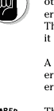

当你声明一个数组时，必须指定它能保存的确切数据类型。如果你指定 int，该数组只能保存 int 或 C# 可以隐式转换为 int 的其他数值类型。如果你试图将错误类型的数据放入数组，编译时会看到编译器错误。因此编译器强制执行类型安全，让你在问题出现之前就将其修复。

编译器错误比运行时错误好得多。事实上，除了同花大顺或树莓圣代之外，编译器错误胜过一切。编译器错误很有用，因为它们能帮助你立即发现问题。

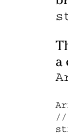

老式的非泛型集合不是类型安全的。在 C# 中，一切类型都 IS_A Object，因为 Object 是所有其他类型（包括值类型和引用类型）的基类型。但是当你将值类型（数字、字符、布尔值和结构体）存储在集合中时，它们必须在放入时装箱，取出时拆箱。就好像你把物品放进蛋托，必须把它们塞进鸡蛋里才能装下，然后要打破蛋壳才能把物品取出来。（诸如 string、Student 和 BankAccount 之类的引用类型不需要装箱。）

非泛型缺乏类型安全的第一个后果是你需要进行强制转换，如下代码所示，才能从 ArrayList 中取出原始对象，因为它隐藏在鸡蛋，呃，Object 中：

```csharp
ArrayList aList = new ArrayList();
// Add five or six items, then ...
string myString = (string)aList[4]; // Cast to string.
```

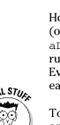

好吧，但第二个后果是：你当然可以把鸡蛋放进蛋托。但你也可以加入弹珠、石头、钻石、软糖——你说得出来的都可以。一个 ArrayList 可以同时容纳许多不同类型的对象。所以下面这样写是合法的：

```csharp
ArrayList aList = new ArrayList();
aList.Add("a string"); // string -- OK
aList.Add(3); // int -- OK
aList.Add(aStudent); // Student -- OK
```

然而，如果你将不兼容类型的混合体放入 ArrayList（或其他非泛型集合），你怎么知道 aList[3] 中是什么类型呢？如果它是一个 Student，而你想把它强制转换为 string，就会遇到运行时错误。就像哈利·波特把手伸进一盒比比多味豆：他不知道会抓到树莓味的豆子还是耳屎味的。


为了安全，你必须求助于 is 运算符（在第 II 册中讨论）或替代方案 as 运算符：

```csharp
// See if the object is the right type, then cast it ...
if(aList[i] is Student)      // Is the object there a Student?
{
    Student aStudent = (Student)aList[i];  // Yes, so it's safe to cast.
}
// Or do the conversion and see if it went well...
Student aStudent = aList[i] as Student;  // Extract a Student, if present;
if(aStudent != null)       // if not, "as" returns null.
{
    // OK to use aStudent; "as" operator worked.
}
```

使用泛型可以避免所有这些额外工作。泛型集合的工作方式类似于数组：在声明时指定它们唯一可以保存的类型。

### 泛型效率高

多态性允许 Object 类型保存任何其他类型——就像上一节中的蛋托类比。但是，放入值类型对象（数字、字符、布尔类型和结构体）并取出时，会带来性能损失。这是因为你添加的值类型对象必须装箱。（更多关于多态性的信息，请参见第 II 册。）

装箱并不令人担忧，除非你的集合很大（尽管装箱的数量可能会让你吃惊，而且比你想象的更耗费资源）。如果你要将一千个或一百万个 int 塞进非泛型集合，所需时间大约是原来的 20 倍，还要占用内存堆上额外的空间（内存堆用于存储引用类型对象）。装箱还可能导致一些微妙错误，让你抓狂。泛型集合消除了装箱和拆箱。


> 别误会：装箱让 C# 拥有统一的类型系统，其巨大好处通常超过装箱带来的不便和成本。

## 泛型类：编写你自己的

除了内置的泛型集合类之外，C# 还允许你编写自己的泛型类，无论它们是否为集合。关键是你可以为自己设计的类创建泛型版本。

想象一个充满 `<T>` 记号的类定义。当你实例化这样的类时，指定一个类型来替换其泛型占位符，就像对泛型集合所做的那样。请注意这些声明的相似性：

```csharp
LinkedList<int> aList = new LinkedList<int>(); // Built-in LinkedList class
MyClass<int> aClass = new MyClass<int>();      // Custom class
```

两者都是类的实例化——一个是内置的，一个是程序员定义的。并非每个类都适合作为泛型类；在本章后面的“轻松编写泛型代码”一节中，我会展示一个合适的例子。


逻辑上可以对不同类型的数据执行相同操作的类最适合成为泛型类。某种集合就是最好的例子。如果你发现自己喃喃自语：“我可能还得为 `Student` 对象写一个此类的版本”，那么它很可能是泛型的良好候选者。

为了演示如何编写自己的泛型类，下面的示例开发了一种特殊的队列集合类——优先队列。

### 在 OOPs 运送包裹

下面是示例场景：一个繁忙的航运仓库，类似 UPS 或 FedEx。包裹源源不断地从 OOPs 公司前门进入，一旦处理完就从后门运出。有些包裹需要通过超快的次日达瞬间传送进行投递；另一些可以慢一点，通过两日达货运鸽子运送；而大多数则可以走蜗牛路线：由你表弟 Fred 的 1982 年沃尔沃进行地面运输。

但是包裹到达仓库时没有特定顺序，因此当它们进来时，你需要将其中一些加急为次日达或两日达。由于有些包裹比其他包裹更“平等”，它们会被优先处理，仓库工作人员会给予高优先级包裹特殊对待。

除了优先级之外，这种情况简直是为队列数据结构量身定做的。队列非常适合任何涉及轮流等待的场景。你在生活中排过（或开车排过）无数次队，等着轮到你买 Twinkies 或为处方药付过高的费用。你懂的。

航运仓库场景类似：新包裹到达，正常情况下排在队尾。但由于某些包裹具有更高优先级，它们是特权角色，就像机场票务柜台的那些头等舱乘客。它们可以插到前面，要么插到队伍最前面，要么离前面不远。

### 在 OOPs 排队：PriorityQueue

OOPs 的航运队列处理到达的高、中、低优先级的包裹。以下是排队规则：

- ♦ **高优先级包裹**（次日达）排到队列前面——但要排在已经在那里的其他高优先级包裹后面。


- 中优先级包裹（次日达）会尽可能往前排——但要排在所有高优先级包裹之后，甚至包括那些落后者稍后才会投递的包裹，也要排在队列中已有的其他中优先级包裹之后。
- 低优先级的地面运输件必须排在队尾。它们只能眼看着所有高优先级包裹一路超车插到它们前面——有时甚至远远插到前面。

C# 自带队列，甚至泛型队列。但它不自带优先级队列，所以你必须自己构建一个。怎么做？一种常见方法是在一个包装类中嵌入几个实际队列，大致如下：

```csharp
class Wrapper    // Or PriorityQueue
{
    Queue queueHigh   = new Queue();
    Queue queueMedium = new Queue();
    Queue queueLow    = new Queue();
    // Methods to manipulate the underlying queues...
}
```

包装类是封装复杂性的类（或方法）。包装类可能具有与其内部对象接口截然不同的接口——那就是适配器。

这里的包装类封装了三个实际队列（它们可以是泛型的），并且包装类必须管理什么进入哪个底层队列以及如何进入。C# 中实现的 `Queue` 类的标准接口包括以下两个关键方法：

- `Enqueue()`（读作“N-Q”）将项插入队列尾部。
- `Dequeue()`（读作“D-Q”）从队列前端移除项。


对于运输优先级队列，包装类提供与普通队列相同的接口，因此它本身伪装成一个普通队列。它实现了一个 `Enqueue()` 方法，该方法确定传入包裹的优先级，并决定它加入哪个底层队列。包装类的 `Dequeue()` 方法会在任意底层队列中找到优先级最高的 `Package`。这个包装类的正式名称是 `PriorityQueue`。

以下是本书网站上 `PriorityQueue` 示例的代码：


```csharp
// PriorityQueue -- Demonstrates using lower-level queue collection
// objects (generic ones at that) to implement a higher-level generic
// Queue that stores objects in priority order
using System;
using System.Collections.Generic;
namespace PriorityQueue
{
    class Program
    {
        // Main -- Fill the priority queue with packages, then
        // remove a random number of them.
        static void Main(string[] args)
        {
            Console.WriteLine("Create a priority queue:");
            PriorityQueue<Package> pq = new PriorityQueue<Package>();
            Console.WriteLine("Add a random number (0 - 20) of random packages to queue:");
            Package pack;
            PackageFactory fact = new PackageFactory();
            // You want a random number less than 20.
            Random rand = new Random();
            int numToCreate = rand.Next(20);  // Random int from 0 - 20
            Console.WriteLine("Creating {0} packages: ", numToCreate);
            for (int i = 0; i < numToCreate; i++)
            {
                Console.WriteLine("\t\tGenerating and adding random package {0}: ", i);
                pack = fact.CreatePackage();
                Console.WriteLine("\t\twith priority {0}", pack.Priority);
                pq.Enqueue(pack);
            }
            Console.WriteLine("See what we got:");
            int total = pq.Count;
            Console.WriteLine("Packages received: {0}", total);

            Console.WriteLine("Remove a random number of packages (0-20): ");
            int numToRemove = rand.Next(20);
            Console.WriteLine("Removing up to {0} packages", numToRemove);
            for (int i = 0; i < numToRemove; i++)
            {
                pack = pq.Dequeue();
                if (pack != null)
                {
                    Console.WriteLine("\t\tShipped package with priority {0}",
                        pack.Priority);
                }
            }
            // See how many were 'shipped.'
            Console.WriteLine("Shipped {0} packages", total - pq.Count);

            // Wait for user to acknowledge the results.
            Console.WriteLine("Press Enter to terminate...");
            Console.Read();
        }

        // Priority enumeration -- Defines a set of priorities
        // instead of priorities like 1, 2, 3, ... these have names.
        // For information on enumerations,
        // see the article "Enumerating the Charms of the Enum"
        // on csharp102.info.
        enum Priority
        {
            Low, Medium, High
        }

        // IPrioritizable interface -- Defines ability to prioritize.
        // Define a custom interface: Classes that can be added to
        // PriorityQueue must implement this interface.
        interface IPrioritizable
        {
            Priority Priority { get; } // Example of a property in an interface
        }
    }

    //PriorityQueue -- A generic priority queue class
    // Types to be added to the queue *must* implement IPrioritizable interface.
    class PriorityQueue<T> where T : IPrioritizable
    {
        //Queue -- the three underlying queues: all generic!
        private Queue<T> _queueHigh = new Queue<T>();
        private Queue<T> _queueMedium = new Queue<T>();
        private Queue<T> _queueLow = new Queue<T>();

        //Enqueue -- Prioritize T and add it to correct queue; an item of type T.
        // The item must know its own priority.
        public void Enqueue(T item)
        {
            switch (item.Priority) // Require IPrioritizable to ensure this property.
            {
                case Priority.High:
                    _queueHigh.Enqueue(item);
                    break;
                case Priority.Medium:
                    _queueMedium.Enqueue(item);
                    break;
                case Priority.Low:
                    _queueLow.Enqueue(item);
                    break;
                default:
                    throw new ArgumentOutOfRangeException(
                        item.Priority.ToString(),
                        "bad priority in PriorityQueue.Enqueue");
            }
        }

        //Dequeue -- Get T from highest-priority queue available.
        public T Dequeue()
        {
            // Find highest-priority queue with items.
            Queue<T> queueTop = TopQueue();
            // If a non-empty queue is found.
            if (queueTop != null && queueTop.Count > 0)
            {
                return queueTop.Dequeue(); // Return its front item.
            }
            // If all queues empty, return null (you could throw exception).
            return default(T); // What's this? See discussion.
        }

        //TopQueue -- What's the highest-priority underlying queue with items?
        private Queue<T> TopQueue()
        {
            if (_queueHigh.Count > 0) // Anything in high-priority queue?
                return _queueHigh;
            if (_queueMedium.Count > 0) // Anything in medium-priority queue?
                return _queueMedium;
            if (_queueLow.Count > 0) // Anything in low-priority queue?
                return _queueLow;
            return _queueLow; // All empty, so return an empty queue.
        }

        //IsEmpty -- Check whether there's anything to dequeue.
        public bool IsEmpty()
        {
            // True if all queues are empty
            return (_queueHigh.Count == 0) && (_queueMedium.Count == 0) &&
                (_queueLow.Count == 0);
        }

        //Count -- How many items are in all queues combined?
        public int Count // Implement this one as a read-only property.
        {
            get { return _queueHigh.Count + _queueMedium.Count + _queueLow.Count; }
        }
    }

    //Package -- An example of a prioritizable class that can be stored in
    // the priority queue; any class that implements
    // IPrioritizable would look something like Package.
    class Package : IPrioritizable
    {
        private Priority _priority;
        //Constructor
        public Package(Priority priority)
        {
            this._priority = priority;
        }

        //Priority -- Return package priority -- read-only.
        public Priority Priority
        {
            get { return _priority; }
        }
        // Plus ToAddress, FromAddress, Insurance, etc.
    }

    //PackageFactory -- You need a class that knows how to create a new
    // package of any desired type on demand; such a class
    // is a factory class.
    class PackageFactory
    {
        //A random-number generator
        Random _randGen = new Random();

        //CreatePackage -- The factory method selects a random priority,
        // then creates a package with that priority.
        // Could implement this as iterator Block.
        public Package CreatePackage()
        {
            // Return a randomly selected package priority.
            // Need a 0, 1, or 2 (values less than 3).
            int rand = _randGen.Next(3);
            // Use that to generate a new package.
            // Casting int to enum is clunky, but it saves
            // having to use ifs or a switch statement.
            return new Package((Priority)rand);
        }
    }
```

`PriorityQueue` 有点长，所以你需要仔细查看每个部分。看过目标类 `Package` 之后，你可以通过靠近顶部的 `Main()` 方法，跟踪一个包裹的流转过程。


运行 `PriorityQueue` 时，请多运行几次。因为它围绕随机数构建，所以每次运行会得到不同结果。例如，有时它可能“收到”零个包。（我猜，总有清闲的日子。）

## 拆开 Package

类 `Package` 在此示例中有意保持简单（见上一节的代码清单），它聚焦于优先级部分，尽管真实的 `Package` 对象会包含其他成员。此示例中 `Package` 需要的全部内容如下：

- 一个用于存储其优先级的私有数据成员
- 一个用于创建具有特定优先级的包的构造函数
- 一个返回优先级的方法（此处实现为只读属性）

类 `Package` 有两个方面需要稍作解释：`Priority` 类型，以及 `Package` 实现的 `IPrioritizable` 接口。

## 指定可能的优先级

优先级使用名为 `Priority` 的枚举类型（即 `enum`）来度量。`Priority` 枚举如下所示：

```
//Priority -- Instead of priorities like 1, 2, 3, they have names.
enum Priority      // See the article "Enumerating the Charms
                   // of the Enum" on www.csharp102.info.
{
    Low, Medium, High
}
```

## 实现 IPrioritizable 接口

任何进入 `PriorityQueue` 的对象都必须“知道”自己的优先级。（一条通用的面向对象原则是：对象应当对自己负责。）

你可以非正式地“承诺”类 `Package` 有一个用于获取其优先级的成员，但你应该把它变成编译器能够强制执行的要求。你要求放入 `PriorityQueue` 的任何对象都具有这样一个成员。

强制执行此要求的一种方式是坚持所有可运输对象都实现 `IPrioritizable` 接口，该接口如下：

```
//IPrioritizable -- Define a custom interface. Classes that can be added to
//                  PriorityQueue must implement this interface.
interface IPrioritizable  // Any class can implement this interface.
{
    Priority Priority { get; }
}
```


记法 { get; } 是在接口声明中编写属性的方式。

类 Package 通过为 Priority 属性提供完整实现来实现该接口：

```
public Priority Priority
{
    get { return _priority; }
}
```

你会在后面“最后再讲 PriorityQueue”一节中类 PriorityQueue 的声明里看到这个可强制执行要求的另一面。

## 浏览 Main()

在深入探究 PriorityQueue 类本身之前，先概览它在 OOPs, Inc. 中实际如何工作会很有用。以下是 PriorityQueue 示例的 Main() 方法：

```
static void Main(string[] args)
{
    Console.WriteLine("Create a priority queue:");
    PriorityQueue<Package> pq = new PriorityQueue<Package>();
    Console.WriteLine();
    // Add a random number (0 - 20) of random packages to queue:
    Package pack;
    RandomFactory fact = new RandomFactory();
    // You want a random number less than 20.
    Random rand = new Random();
    int numToCreate = rand.Next(20); // Random int from 0-20.
    Console.WriteLine("\tCreating {0} packages: ", numToCreate);
    for (int i = 0; i < numToCreate; i++)
    {
        Console.Write("\tGenerating and adding random package {0}, ", i);
        pack = fact.CreatePackage();
        Console.WriteLine("with priority {0}", pack.Priority);
        pq.Enqueue(pack);
    }
    Console.WriteLine("See what we got:");
    int total = pq.Count;
    Console.WriteLine("Packages received: {0}", total);
    Console.WriteLine("Remove a random number of packages (0-20): ");
    int numToRemove = rand.Next(20);
    Console.WriteLine("\tRemoving up to {0} packages", numToRemove);
    for (int i = 0; i < numToRemove; i++)
    {
        pack = pq.Dequeue();
        if (pack != null)
        {
            Console.WriteLine("\t\tShipped package with priority {0}",
                pack.Priority);
        }
    }
    // See how many were 'shipped.'
    Console.WriteLine("Shipped {0} packages", total - pq.Count);
    // Wait for user to acknowledge the results.
Console.WriteLine("Press Enter to terminate...");
    Console.Read();
}
```

以下是 Main() 中发生的过程：

- 1. **为 Package 类型实例化一个 PriorityQueue 对象。**
- 2. **创建一个 PackageFactory 对象，其职责是按需创建具有随机选定优先级的新包。**
- 3. **使用 .NET 库类 Random 生成一个随机数，然后调用 PackageFactory 创建该数量的、具有随机优先级的新 Package 对象。**
- 4. **通过 pq.Enqueue(pack) 将每个包添加到 PriorityQueue。**
- 5. **写出已创建的包数量，然后通过 pq.Dequeue() 从 PriorityQueue 中随机移除其中一些包。**
- 6. **在显示已移除的包数量后结束。**

工厂是一个为你创建对象的类或方法。你会在本章后面“使用（非泛型）简单工厂类”一节中浏览 PackageFactory。

## 以简单方式编写泛型代码

现在你必须弄清楚如何编写一个带有那些 <T> 的泛型类。看起来令人困惑，不是吗？嗯，其实并没有那么难，本节将演示这一点。


编写泛型类的简单方法是先编写一个非泛型版本，然后替换其中的 <T>。例如，你会先为 Package 对象编写 PriorityQueue 类，测试它，然后将其“泛型化”。

下面是一小段非泛型 PriorityQueue 的代码，用以说明：

```
public class PriorityQueue
{
    //Queues -- The three underlying queues: all generic!
    private Queue<Package> _queueHigh = new Queue<Package>();
    private Queue<Package> _queueMedium = new Queue<Package>();
    private Queue<Package> _queueLow = new Queue<Package>();
    //Enqueue -- Prioritize a Package and add it to correct queue.
    public void Enqueue(Package item)
    {
        switch(item.Priority)  // Package has this property.
        {
            case Priority.High:
                _queueHigh.Enqueue(item);
                break;
            case Priority.Low:
                _queueLow.Enqueue(item);
break;
case Priority.Medium:
_queueMedium.Enqueue(item);
break;
}
// And so on ...
```

先以非泛型方式编写类时，测试类的逻辑会更容易。当所有逻辑都理顺后，你可以使用查找替换将名称 Package 替换为 T。（我稍后会解释，事情不止于此，但也没多多少。）

## 最后再讲 PriorityQueue

为什么优先级队列要放在最后讲？对我来说似乎有点倒着来。但其余内容你已经看过了。现在该检查 PriorityQueue 类本身了。本节会展示代码，然后带你逐步理解，并说明如何处理几个小问题。我们一点一点来。

## 底层队列

PriorityQueue 是一个包装类，它隐藏了三个普通的 Queue<T> 对象，每个优先级各一个。以下是 PriorityQueue 的第一部分，展示了三个底层队列（现在是泛型）：

```
//PriorityQueue -- A generic priority queue class
// Types to be added to the queue "must" implement IPrioritizable interface.
class PriorityQueue<T> where T : IPrioritizable
{
// Queues -- the three underlying queues: all generic!
private Queue<T> _queueHigh = new Queue<T>();
private Queue<T> _queueMedium = new Queue<T>();
private Queue<T> _queueLow = new Queue<T>();
// The rest will follow shortly ...
```

这些行声明了三个 Queue<T> 类型的私有数据成员，并通过创建 Queue<T> 对象来初始化它们。关于“子队列”声明上方那行看起来奇怪的类声明，我会在本章后面“处理未完成的事务”一节中进一步说明。

## Enqueue() 方法

Enqueue() 将一个 T 类型的项添加到 PriorityQueue。此方法的职责是查看该项的优先级，并将其放入正确的底层队列。在第一行中，它获取该项的 Priority 属性，并基于该值进行 switch 分支。例如，为了将项添加到高优先级队列，Enqueue() 会转而将该项排入底层队列 queueHigh。以下是 PriorityQueue 的 Enqueue() 方法：

```
//Enqueue -- Prioritize T and add it to correct queue; an item of type T.
// The item must know its own priority.
```


```
public void Enqueue(T item)
{
    switch (item.Priority) // Require IPrioritizable to ensure this property.
    {
        case Priority.High:
            _queueHigh.Enqueue(item);
            break;
        case Priority.Medium:
            _queueMedium.Enqueue(item);
            break;
        case Priority.Low:
            _queueLow.Enqueue(item);
            break;
        default:
            throw new ArgumentOutOfRangeException(
                item.Priority.ToString(),
                "bad priority in PriorityQueue.Enqueue");
    }
}
```

## Dequeue() 方法

Dequeue() 的工作比 Enqueue() 稍复杂一些：它必须找到有内容且优先级最高的底层队列，然后从该子队列中取出前端项。Dequeue() 将任务的第一部分——找到非空的最高优先级队列——委托给私有方法 TopQueue()（将在下一节介绍）。然后 Dequeue() 调用底层队列的 Dequeue() 方法取出最前面的对象并返回。下面是 Dequeue() 的工作方式：

```
//Dequeue -- Get T from highest-priority queue available.
public T Dequeue()
{
    // Find highest-priority queue with items.
    Queue<T> queueTop = TopQueue();
    // If a non-empty queue is found
    if (queueTop != null && queueTop.Count > 0)
    {
        return queueTop.Dequeue(); // Return its front item.
    }
    // If all queues empty, return null (you could throw exception).
    return default(T); // What's this? See discussion.
}
```

仅当所有底层队列都没有任何包时才会出现困难——换句话说，整个 PriorityQueue 为空。这种情况下返回什么？Dequeue() 返回 null。客户端——调用 PriorityQueue.Dequeue() 的代码——应检查 Dequeue() 的返回值是否为 null。它返回的 null 在哪里？就是末尾那个奇怪的 default(T)。我将在本章稍后的“确定类型 T 的 null 值：default(T)”一节中进一步讨论 default(T)。

## TopQueue() 实用方法

Dequeue() 依赖私有方法 TopQueue() 找到优先级最高且非空的底层队列。TopQueue() 从 queueHigh 开始，询问其 Count 属性。如果大于零，说明队列包含项，因此 TopQueue() 返回所找到的整个底层队列的引用。（TopQueue() 的返回类型是 Queue<T>。）另一方面，如果 queueHigh 为空，TopQueue() 会尝试 queueMedium，然后尝试 queueLow。

如果所有子队列都为空会怎样？TopQueue() 可以返回 null，但直接返回其中一个空队列更有用。当 Dequeue() 随后调用返回队列的 Dequeue() 方法时，它会返回 null。TopQueue() 的工作方式如下：

```
//TopQueue -- What's the highest-priority underlying queue with items?
private Queue<T> TopQueue()
{
    if (_queueHigh.Count > 0)   // Anything in high-priority queue?
        return _queueHigh;
    if (_queueMedium.Count > 0) // Anything in medium-priority queue?
        return _queueMedium;
    if (_queueLow.Count > 0)    // Anything in low-priority queue?
        return _queueLow;
    return _queueLow;           // All empty, so return an empty queue.
}
```

## PriorityQueue 的其余成员

PriorityQueue 在知道自己是否为空以及（如果不为空）包含多少项时很有用。（对象应为自己负责。）请看前面清单中 PriorityQueue 的 IsEmpty() 方法和 Count 属性。你可能还会发现，包含返回每个底层队列中项数的方法很有用。要小心：这样做可能会过多暴露优先级队列的实现方式。请将实现保持私有。

## 使用（非泛型的）简单工厂类

在本章前面的“把 PriorityQueue 留到最后”一节中，我使用一个 Simple Factory 对象（尽管在那里我只称它为“Factory”）来生成具有随机优先级级别的无尽 Package 对象流。终于，可以揭示这个简单的类了：

```
// PackageFactory -- You need a class that knows how to create a new
// package of any desired type on demand; such a
// class is a factory class.
class PackageFactory
{
    Random _randGen = new Random();  // C#'s random-number generator
    //CreatePackage -- This factory method selects a random priority,
    // then creates a package with that priority.
    public Package CreatePackage()
```


```
{
    // Return a randomly selected package priority;
    // need a 0, 1, or 2 (values less than 3).
    int rand = _randGen.Next(3);
    // Use that to generate a new package.
    // Casting int to enum is clunky, but it saves
    // having to use ifs or a switch statement.
    return new Package((Priority)rand);
}
```

类 PackageFactory 有一个数据成员和一个方法。（你也可以很容易地把简单工厂实现为方法而不是类——例如，Program 类中的一个方法。）实例化 PackageFactory 对象时，它会创建一个 Random 类的对象并将其存储在数据成员 rand 中。Random 是 .NET 库中用于生成随机数的类。

查看 csharp102.info 上的 PackageFactoryWithIterator 示例。


## 使用 PackageFactory

要生成具有随机优先级的 Package 对象，可以这样调用工厂对象的 CreatePackage() 方法：

```
PackageFactory fact = new PackageFactory();
IPrioritizable pack = fact.CreatePackage(); // Note the interface here.
```

CreatePackage() 让其随机数生成器生成一个 0 到 2（含）之间的数字，并使用该数字设置新 Package 的优先级，然后方法返回该 Package（返回给 Package 变量，或者更好的是返回给 IPrioritizable 变量）。


注意，我让 CreatePackage 返回对 IPrioritizable 的引用，这比返回对 Package 的引用更通用。这个示例展示了间接性——Main() 通过 Package 实现的接口间接引用 Package。间接性使 Main() 与 CreatePackage 返回内容的细节隔离开来。这样你就可以更自由地更改工厂的底层实现而不影响 Main()。

## 关于工厂的更多内容

工厂有助于生成大量测试数据。（工厂不一定非要使用随机数——这只是 PriorityQueue 示例所需要的。）


工厂通过隔离对象创建来改进程序。每当你在代码中按名称提及某个具体类时，你就创建了对该类的依赖。这种依赖越多，类之间的耦合（绑定）就越紧密。


程序员早已知道应避免紧密耦合。（更解耦的方法之一是通过接口（如 IPrioritizable）间接使用工厂，而不是通过具体类（如 Package）。）程序员仍然一直使用 new 运算符直接创建对象，这没问题。但工厂可以使代码耦合更少——因而更灵活。

## 处理未完成的事务

PriorityQueue 需要几处小的“修补”。问题如下：

- PriorityQueue 本身无法阻止你尝试为 int、string 或 Student 等没有优先级的元素实例化它。你需要约束该类，使其只能为实现了 IPrioritizable 的类型实例化。尝试为非 IPrioritizable 类实例化应导致编译器错误。
- PriorityQueue 的 Dequeue() 方法返回 null 值而不是实际对象。但是泛型类型（如 <T>）不像 int、string 和落魄的对象引用等元素那样具有自然的默认 null 值。这部分也需要泛型化。

## 添加约束

PriorityQueue 必须能够询问对象的优先级是什么。为此，所有可存储在 PriorityQueue 中的类都必须实现 IPrioritizable 接口，就像 Package 那样。Package 在类声明头中列出 IPrioritizable，如下所示：

```
class Package : IPrioritizable
```

然后它实现 IPrioritizable 的 Priority 属性。

PriorityQueue 也需要匹配的限制。如果尝试为未实现 IPrioritizable 的类型实例化，你希望编译器报错。在 PriorityQueue 的非泛型形式中（例如专门为 Package 类型编写），当某个优先级队列方法尝试调用 Package 没有的方法时，编译器会自动报错（我建议戴上耳塞）。但是，对于泛型类，你可以通过显式约束进入下一层次。因为你可以用任何类型实例化泛型类，所以需要一种方式告诉编译器哪些类型是可接受的——因为它们保证具有正确的方法。

你可以通过在 PriorityQueue 的头部指定 IPrioritizable 来添加约束，如下所示：


```
class PriorityQueue<T> where T: IPrioritizable
```

你注意到之前的 where 子句了吗？这个加粗的 where 子句指定 T 必须实现 IPrioritizable。这就是执行者。它的意思是，“确保 T 实现 IPrioritizable 接口——否则！”

你可以通过在 where 子句中列出以下一个或多个元素（用逗号分隔）来指定约束：

-   必须派生自（或为）的必需基类的名称。
-   必须实现的接口的名称，如前例所示。
-   你可以查看更多内容——表 8-1 提供了完整列表。

有关这些约束的信息，请在帮助索引中查找 Generics [C#]、constraints。

| Table 8-1 | 泛型约束选项 |
|---|---|
| 约束 | 含义 | 示例 |
| MyBaseClass | T 必须是 MyBaseClass 或其派生类。 | where T: MyBaseClass |
| IMyInterface | T 必须实现 IMyInterface。 | where T: IMyInterface |
| struct | T 必须是任何值类型。 | where T: struct |
| class | T 必须是任何引用类型。 | where T: class |
| new() | T 必须具有无参数构造函数。 | where T: new() |

特别注意 struct 和 class 选项。指定 struct 意味着 T 可以是任何值类型：数值类型、一个 char、一个 bool，或使用 struct 关键字声明的任何对象。指定 class 意味着 T 可以是任何引用类型：任何类类型。

这些约束选项为使你的新泛型类按你想要的方式行为提供了相当大的灵活性。而一个行为良好的类是无价之宝。

你也不限于只有一个约束。以下是声明了对 T 有多个约束的假设泛型类的示例：


```csharp
class MyClass<T> where T: class, IPrioritizable, new()
{ ... }
```

在这行代码中，T 必须是类，而不是值类型；它必须实现 `IPrioritizable`；并且必须包含一个无参数的构造函数。严格！

你可能有两个泛型参数并且两者都需要被约束。（是的，你可以有多个泛型参数——想想 `Dictionary<TKey, TValue>`。）以下是如何使用两个 where 子句的方法：

```csharp
class MyClass<T, U> where T: IPrioritizable, where U: new()
```

你看到两个 where 子句，用逗号分隔。第一个将 T 约束为实现 `IPrioritizable` 接口的任何对象。第二个将 U 约束为具有默认（无参数）构造函数的任何对象。

## 确定类型 T 的空值：default (T)

万一你读了上一节的最后一段而感到困惑，那么，每个类型（如前所述）都有一个默认值，表示该类型的“无”。对于 ints、doubles 和其他数字类型，它是 0（或 0.0）。对于 bool，它是 false。对于所有引用类型，例如 `Package`，它就是 null。与所有引用类型一样，`string` 的默认值是 null。

但是由于像 `PriorityQueue` 这样的泛型类可以为几乎任何数据类型实例化，C# 无法预测在泛型类的代码中应使用哪个适当的空值。例如，如果你使用 `PriorityQueue` 的 `Dequeue()` 方法，你可能会遇到这种情况：你调用 `Dequeue()` 来获取一个包，但没有可用的。什么返回来表示“无”？因为 `Package` 是一个类类型，它应该返回 null。这向 `Dequeue()` 的调用者发出信号，表明没有可返回的内容（并且调用者必须检查 null 返回值）。

编译器无法在泛型类中理解 null 关键字，因为该类可能为各种数据类型实例化。这就是为什么 `Dequeue()` 改用以下行：

```csharp
return default(T);  // Return the right null for whatever T is.
```

这一行告诉编译器查看 T 并为该类型返回正确类型的空值。在 `Package` 的情况下，它是一个类是引用类型，正确的空值要返回的就是，嗯，null。但是，对于某些其他 T，它可能不同，编译器可以弄清楚该使用什么。

如果你认为 `PriorityQueue` 很灵活，请看一下它甚至更灵活的版本——并且遇到一些面向对象设计原则——在随本章提供的 `ProgrammingToAnInterface` 程序中。


## 修订泛型

C# 2.0 中实现的泛型模型是不完整的。泛型对于使程序员的生活更轻松是很好的，但在那个版本中对分析员的生活帮助不大。过去使用泛型对实际业务模型建模非常困难，而这在 C# 4.0 中发生了变化。虽然 C# 2.0 中的参数在几个方向上都允许方差，但泛型却不允许。

方差与参数类型和返回值的类型有关。*协变* 意味着当期望父类实例时，可以使用子类实例，而 *逆变* 意味着当期望子类实例时，可以使用超类实例。当两者都不可能时，称为 *不变*。

所有第四代语言都支持某种方差。在 C# 3.0 及更早版本中，参数是协变的，返回类型是逆变的。所以，这可行，因为 string 和 integer 参数协变于 object 参数：

```csharp
public static void MessageToYou(object theMessage)
{
    if (theMessage != null)
    Console.WriteLine(theMessage)
}
//then:
MessageToYou("It's a message, yay!");
MessageToYou(4+6);
```

并且这可行，因为 object 返回类型逆变于 string 和 integer 返回类型（例如）：

```csharp
object theMessage = MethodThatGetsTheMessage();
```

在 C# 2.0 和 3.0 中，泛型是非变的。这意味着如果 Basket<apple> 是 Basket<Fruit> 的类型，那么这些 Baskets 就像前面的示例中字符串和对象一样不可互换。

## 方差

如果你看一下以下方法：

```csharp
public static void WriteMessages()
{
    List<string> someMessages = new List<string>();
    someMessages.Add("The first message");
    someMessages.Add("The second message");
    MessagesToYou(someMessages);
}
```

然后你尝试像本章前面用 string 类型那样调用该方法

```csharp
//This doesn't work in C#3!!
public static void MessagesToYou(IEnumerable<object> theMessages)
{
    foreach (var item in theMessages)
    {
        Console.WriteLine(item);
    }
}
```

它会失败。在 C# 3.0 中，泛型是不变的。但是，在 Visual Studio 2010 及更高版本中，这可以编译，因为 IEnumerable<T> 是协变的——你可以用更派生的类型作为更高阶类型的替代。下一节展示了一个真实示例。

## 逆变

在我的调度应用程序中，我有 Events，它们有一个日期，然后有一组子类，其中之一是 Course。Course 是一个 Event。Courses 知道它们自己的学生人数。

无论如何，回到农场，我有一个名为 MakeCalendar 的方法：

```csharp
public void MakeCalendar(IEnumerable<Event> theEvents)
{
    foreach (Event item in theEvents)
    {
        Console.WriteLine(item.WhenItIs.ToString());
    }
}
```

假装它制作日历；现在，它所做的只是将日期打印到控制台。MakeCalendar 是系统范围的，所以它期望某个可枚举的事件列表。

我还在主系统中有 Sort 算法，称为 EventSorter。这用于传递到集合的 Sort 方法。它期望从 Events 列表中调用。以下是 EventSorter 类：

```csharp
class EventSorter : IComparer<Event>
{
    public int Compare(Event x, Event y)
    {
        return x.WhenItIs.CompareTo(y.WhenItIs);
    }
}
```

我正在编写事件管理器的 Instructor-Led Training 部分，我需要制作课程列表，对其排序，然后制作日历。所以我在 ScheduleCourses 中制作我的课程列表，然后我调用 sort 并传入 EventSorter：

```csharp
public void ScheduleCourses()
{
    List<Course> courses = new List<Course>()
    {
```


```csharp
new Course() {NumberOfStudents=20, WhenIts = new DateTime(2009,2,1)},
new Course() {NumberOfStudents=14, WhenIts = new DateTime(2009,3,1)},
new Course() {NumberOfStudents=24, WhenIts = new DateTime(2009,4,1)},
};
// Now I am passing an IComparer<Event> class to my List<Course> collection.
// It should be an IComparer<Course> but I can use IComparer<Event> because of contravariance
courses.Sort(new EventSorter());

// I am passing a List of courses, where a List of Events was expected.
// We can do this because generic parameters are covariant
MakeCalendar(courses);
}
```

但等等，我从中调用 Sort 的是一个课程列表，对吧，而不是事件列表。没关系——与 `IComparer<Course>` 相比，`IComparer<Event>` 对于 T（其返回类型）来说是一个逆变的泛型，所以我仍然可以使用这个算法。

现在我得把我的列表传入 MakeSchedule 方法，但该方法期望一个事件的枚举集合。由于现在泛型的参数是协变的，我可以传入一个 Courses 的 List，因为 Course 对 Event 是协变的。明白了吗？

还有另一个逆变的例子，使用的是参数而不是返回值。如果我有一个返回 Courses 泛型列表的方法，我可以调用该方法并期望得到一个 Events 列表，因为 Event 是 Course 的超类。

你知道怎样让一个返回 String 的方法，把返回值赋给一个声明为 object 的变量吗？现在，对于泛型集合，你也可以这样做。

一般来说，C# 编译器会对泛型类型转换做出假设。只要你在参数上沿着继承链向上，或在返回类型上沿着继承链向下，C# 就会神奇地推断出类型。

## 协变

现在我得把我的列表传入 MakeSchedule 方法，但该方法期望一个事件的枚举集合。由于现在泛型的参数是协变的，我可以传入一个 Courses 的 List，因为 Course 对 Event 是协变的。这就是参数的协变。

## 第9章：一些特殊的异常

### 本章内容

- ✔ 通过返回码处理错误
- ✔ 使用异常机制代替返回码
- ✔ 规划你的异常处理策略

我们知道这很难接受，但方法偶尔确实不会做它该做的事。（如果你需要了解方法，请阅读第II册第1章。）即使是我们写的方法——尤其是我们写的方法——也不总是做它们该做的事。用户也是出了名地不可靠。你刚要一个 `int`，用户就输入了一个 `double`。有时，方法还乐呵呵地继续运行，全然不知自己正在输出垃圾。然而，优秀的程序员编写方法时会预判问题，并在问题发生时报告出来。


我说的是运行时错误，不是编译时错误——编译时错误是你在尝试生成程序时 C# 抛出的错误。运行时错误发生在程序运行期间，而不是编译时。

C# 异常机制是一种报告这些错误的方式，能让调用方法最好地理解并利用它来处理问题。与程序员在呃，过去的好日子里处理错误的方式相比，这种机制有很多优点。

本章将带你了解异常处理的基础知识。这里有很多内容需要消化，所以往后靠在你那把破旧的躺椅上吧。

### 使用异常的错误报告机制

C# 引入了一种完全不同的捕获和处理错误的机制：异常。该机制基于关键字 `try`、`catch`、`throw` 和 `finally`。概括来说，它的工作方式如下：一个方法会尝试执行一段代码。如果代码检测到问题，就会抛出一个错误指示，你的代码可以捕获它；而无论发生什么，最后它都会执行一个特殊代码块，如下面的代码片段所示：

```csharp
public class MyClass
{
    public void SomeMethod()
    {
        // Set up to catch an error.
        try
        {
            // Call a method or do something that could throw an exception.
            SomeOtherMethod();
            // . . . make whatever other calls you want . . .
        }
        catch(Exception e)
        {
            // Control passes here in the event of an error anywhere
            // within the try block.
            // The Exception object e describes the error in detail.
        }
        finally
        {
            // Clean up here: close files, release resources, etc.
            // This block runs even if an exception was caught.
        }
    }
    public void SomeOtherMethod()
    {
        // . . . error occurs somewhere within this method . . .
        // . . . and the exception bubbles up the call chain.
        throw new Exception("Description of error");
        // . . . method continues if throw didn't happen . . .
    }
}
```


try、catch 和（可能还有）finally 的组合是一个*异常处理程序*。

SomeMethod() 方法将一段代码包围在以关键字 try 标记的块中。在该块内调用的任何方法（或它调用的任何方法，或沿调用树向上……）都被视为位于 try 块内。如果你有 try 块，就必须有 catch 块或 finally 块，或者两者都有。


在 try、catch 或 finally 块内部声明的变量，无法从该块外部访问。如果需要访问，请在块之前、块外部声明该变量：

```csharp
int aVariable;  // Declare aVariable outside the block.
try
{
    aVariable = 1;
    // Declare aString inside the block.
    string aString = aVariable.ToString(); // Use aVariable in block.
}
// aVariable is visible here; aString is not.
```

### 关于 try 块

可以把使用 try 块想象成让 C# 运行时进入警戒状态。如果执行该块内任何代码时弹出异常，就在古老教堂塔楼上挂一盏灯笼（陆路一盏，海路两盏——或者，拨打 911）。

然后，如果 try 块中的任何一行代码抛出异常——或者该方法内调用的任何方法抛出异常，或者那些方法调用的任何方法抛出异常，依此类推——就尝试捕获它。

一个 try 块可能“覆盖”大量代码，包括其内容调用的所有方法。异常可以从执行树的深处向上渗透（有时会经过很长一段路径）。我们会展示一些示例。

### 关于 catch 块

try 块通常后面紧跟关键字 catch，再后面是 catch 关键字对应的块。如果 try 块内任何地方发生错误，控制权就会转到 catch 块。catch 块的参数是 Exception 类的对象，或者更常见的是 Exception 的子类。

如果你的 catch 不需要访问它所捕获的异常对象中的任何信息，可以只指定异常类型：

```csharp
catch(SomeException) // No object specified here (no 'Exception e')
{
  // Do something that doesn't require access to exception object.
}
```

不过，catch 块不一定必须有参数：裸 catch 会捕获任何异常，等价于 catch(Exception)：

```csharp
catch
{
}
```


关于 catch 块内部应该放什么，我们在 http://csharp102.info 上的两篇文章“创建你自己的异常类”和“响应异常”中还有更多内容要讲。


与 C++ 异常不同——在 C++ 异常中，catch 参数里的对象可以是任意对象——C# 异常要求 catch 参数必须是一个派生自 Exception 的类。（Exception 类及其众多预定义子类定义在 System 命名空间中。第II册第10章介绍了命名空间。）

### 关于 finally 块


如果你提供了 finally 块，那么无论 try 块是否抛出异常，它都会运行。finally 块在 try 成功之后或 catch 之后被调用。即使没有 catch，你也可以使用 finally。使用 finally 块在继续之前进行清理，以免文件一直处于打开状态。示例见 http://csharp102.info 上两篇与异常相关的文章。

finally 的一个常见用途是在 try 块中的代码之后进行清理，无论是否发生异常。因此你经常会看到类似这样的代码：

```csharp
try
{
...
}
finally
{
    // Clean up code, such as close a file opened in the try block.
}
```

事实上，你应该大方地使用 finally 块——每个 try 只使用一个。


一个方法可以有多个 try/catch 处理程序。你甚至可以在 try 中嵌套 try/catch，在 catch 中嵌套 try/catch，在 finally 中嵌套 try/catch——或者以上全部都有。（而且你可以用 try/finally 替代以上所有形式。）

### 抛出异常时会发生什么

发生异常时，会按以下事件序列的某种变体进行：

1. 抛出一个异常。
2. C#“展开调用栈”，寻找 catch 块。

在 SomeOtherMethod() 内部深处的某个地方，发生了一个错误。该方法随时待命，通过抛出一个 Exception 对象来报告运行时错误，把它送回第一个足够了解情况、能够捕获并“处理”它的块。

注意，因为异常是运行时错误而不是编译错误，所以它发生在程序执行期间。因此，错误可能在你把杰作发布给公众之后才发生。哎呀！


我们会在 http://csharp102.info 上的一篇文章中进一步说明展开调用堆栈（或称调用链）的过程。那篇文章描述了如何响应异常，并探讨了你的可选做法。

图 9-1 展示了 C# 搜索异常处理程序时所遵循的路径。


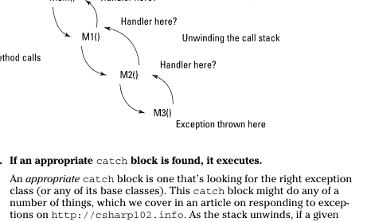

图 9-1  
哪里，究竟哪里才能找到处理程序？


### 3. 如果找到合适的 catch 块，它就会执行。

合适的 catch 块是指寻找正确异常类（或其任一基类）的 catch 块。这个 catch 块可能会做若干事情中的任何一件，我们在 http://csharp102.info 上的一篇文章中介绍了这些内容。随着堆栈展开，如果某个给定方法没有足够的上下文——也就是说，知道得不够多——来纠正该异常状况，它就不会为那个异常提供 catch 块。正确的 catch 块可能位于堆栈中更靠上的位置。

异常机制彻底胜过老式的错误返回机制，原因如下：

-   当调用方法收到一个旧式返回值，却做不了任何有用的事时，它必须显式地把错误本身再返回给它的调用方，如此反复。如果能够处理该问题的方法位于调用链很靠上的位置，那么把返回值一层层往回传，会变得越来越别扭，导致一些丑陋的设计拼凑。（*Kludge* 是工程师对某种能用但拙劣难看之物的称呼。想想“吐口唾沫、用捆扎铁丝绑一绑”的做法。）
-   相比之下，使用异常时，异常会自动沿调用链向上爬升，直到遇到异常处理程序。你不必不断转发消息，这消除了大量拼凑式的代码。

### 4. 如果 finally 块伴随 try 块，那么无论是否捕获到异常，它都会执行。

在堆栈展开到调用链中上一层方法之前，会调用 `finally`。调用链上任何位置的*所有* `finally` 块也都会执行。

### 5. 如果任何地方都找不到 catch 块，程序就会崩溃。

如果 C# 一路到达 `Main()`，却没有在那里找到 `catch` 块，用户就会看到“未处理异常”消息，然后程序退出。这就是崩溃。不过，你可以通过在 `Main()` 中使用异常处理程序，来处理在别处未捕获的异常。参见本章后面的“抓住捕获异常的最后机会”一节。

这种异常机制无疑比使用错误代码更复杂、更难处理。你必须权衡增加的难度与以下考虑因素，如图 9-1 所示：

-   异常提供了一种更“富有表现力”的模型——它让你能够表达各种各样的错误处理策略。
-   异常对象携带的信息要多得多，从而有助于调试——远远超过错误代码所能提供的。
-   异常带来更可读的代码——而且代码更少。
-   异常是 C# 不可分割的一部分，而不是像错误代码方案那样临时附加的事后补丁——没有哪两种错误代码方案彼此很相似。一致的模型有助于理解。

## 自己抛出异常

如果 .NET 类库中的类能抛出异常，那么你也能。

当你发现一个值得抛出异常的错误时，要抛出异常，请使用 `throw` 关键字：

```csharp
throw new ArgumentException("Don't argue with me!");
```

你和任何人一样有权抛出异常。因为 .NET 类库根本不知道你自定义的 `BadHairDayException`，除了你，还有谁会抛出它呢？

如果 .NET 预定义异常中有适合你情况的，就抛出它。但如果没有合适的，你可以发明自己的自定义异常类。

.NET 有一些异常类型你永远不应抛出或捕获：`StackOverflowException`、`OutOfMemoryException`、`ExecutionEngineException`，以及一些与处理非 .NET 代码相关的更高级项。这些异常由系统掌管。


## 了解异常的用途


无法完成其既定任务的软件应当抛出异常。例如，如果一个方法本应处理完整个数组，或读取完整个文件——却因某种原因无法完成这项工作——它就应该抛出合适的异常。

方法可能因各种原因无法完成其任务：例如，输入值错误或出现意外情况（比如文件缺失，或文件比预期小）。任务未完成，甚至根本无法开始。如果你的方法中出现任何这些情况，就应该抛出异常。


这里的总体要点是：调用该方法的人需要知道它的任务没有完成。抛出异常几乎总是比使用任何错误返回代码更好。


调用方如何处理异常，取决于问题的性质和严重程度。有些问题比其他问题更严重。我们将用本章余下内容——再加上 http://csharp102.info 上的文章“响应异常”——来探讨当你的方法“抛出”异常时，调用方有哪些可选做法。

## 能给我一个异常示例吗？

下面的 FactorialException 程序演示了异常机制的关键要素：


```csharp
// FactorialException -- Create a factorial program that reports illegal
// Factorial() arguments using an Exception.
// using System;
namespace FactorialException
{
    // MyMathFunctions -- A collection of mathematical functions
    // we created (it's not much to look at yet)
    public class MyMathFunctions
    {
        // Factorial -- Return the factorial of the provided value.
        public static int Factorial(int value)
        {
            // Don't allow negative numbers.
            if (value < 0)
            {
                // Report negative argument.
                string s = String.Format(
                    "Illegal negative argument to Factorial {0}", value);
                throw new ArgumentException(s);
            }
            // Begin with an 'accumulator' of 1.

            int factorial = 1;

            // Loop from value down to 1, each time multiplying
            // the previous accumulator value by the result.
            do
            {
                factorial *= value;
            } while (--value > 1);

            // Return the accumulated value.
            return factorial;
        }
    }

    public class Program
    {
        public static void Main(string[] args)
        {
            // Here's the exception handler.
            try
            {
                // Call factorial in a loop from 6 down to -6.
                for (int i = 6; i > -6; i--)
                {
                    // Calculate the factorial of the number.
                    int factorial = MyMathFunctions.Factorial(i);

                    // Display the result of each pass.
                    Console.WriteLine("i = {0}, factorial = {1}", i, factorial);
                }
            }
            catch (ArgumentException e)
            {
                // This is a 'last-chance' exception handler -- the buck stops at Main().
                // Probably all you can do here is alert the user before quitting.
                Console.WriteLine("Fatal error:");
                // When you're ready to release the program, change this
                // output to something in plain English, preferably with guide-
                // lines for what to do about the problem.
                Console.WriteLine(e.ToString());
            }

            // Wait for user to acknowledge.
            Console.WriteLine("Press Enter to terminate...");
            Console.Read();
        }
    }
}
```

这个 Main() 的“异常版”几乎把它的全部内容都包在一个 try 块中。Main() 末尾的 catch 块捕获 ArgumentException 对象，并使用其 ToString() 方法，把异常对象中包含的大部分错误信息显示在单个字符串中。

我们在这里选择使用 ArgumentException，是因为它最准确地描述了问题：传给 Factorial() 的参数不可接受。


## 了解示例为何特别

上一节中 `Factorial()` 方法的版本与前一版本一样，包含对负数参数的相同检查。（对整数的测试不再相关，因为我们已经把 `Factorial()` 的参数和返回类型改成了 `int`。）如果它的参数为负，`Factorial()` 无法继续，因此它会格式化一条描述该问题的错误消息，其中包括它认为有问题的值。随后 `Factorial()` 将这些信息打包进一个新创建的 `ArgumentException` 对象，并将其抛回给调用方法。

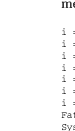

我们建议在调试器中运行该程序，以实时观察异常的发生。（关于调试器的更多内容，我们会在第 IV 册中介绍。）

该程序的输出如下所示（我们精简了错误消息，使其更易读）：

```
i = 6, factorial = 720
i = 5, factorial = 120
i = 4, factorial = 24
i = 3, factorial = 6
i = 2, factorial = 2
i = 1, factorial = 1
i = 0, factorial = 0
Fatal error:
System.ArgumentException: Illegal negative argument to Factorial -1
at Factorial.Int32.Value in c:\programs\Factorial\Program.cs:line 21
at Factorial.Exception.Program.Main(String[] args) in c:\programs\Factorial\Program.cs:line 49
Press Enter to terminate...
```

前几行显示数字 6 到 0 的实际阶乘。尝试计算 -1 的阶乘会生成以 Fatal error 开头的消息——这听起来可不妙。

错误消息的第一行是在 `Factorial()` 自身中格式化的。这一行描述了问题的性质，其中包括有问题的值 -1。

## 跟踪堆栈

输出的其余部分是堆栈跟踪。堆栈跟踪的第一行描述了异常是在哪里抛出的。在本例中，异常是在 `Factorial(int)` 中抛出的——更具体地说，是在源文件 `Program.cs` 的第 21 行。`Factorial()` 是在同一文件的第 49 行、由 `Main(string[])` 方法调用的。堆栈跟踪到 `Main()` 就停止了，因为那正是捕获异常的模块——堆栈跟踪到此结束。

你不得不承认，这个过程很了不起——消息描述了问题并指出了有问题的参数。堆栈跟踪告诉你异常是在哪里抛出的，以及程序是如何到达那里的。利用这些信息，你应当像龙卷风奔向拖车公园一样被引向罪魁祸首。


如果你运行前面的示例并检查它打印到控制台的堆栈跟踪，你会看到 `Main()` 位于列表底部，而更深层的方法在它上方。跟踪信息从 `Main()` 向上构建，因此从技术上说，展开调用堆栈是沿着跟踪信息向下朝 `Main()` 方向进行的。不过，你应该反过来理解：调用者在调用链中位置更高（参见图 9-1）。


在开发期间，返回堆栈跟踪这类技术性信息完全没问题，但你可能希望真实用户看到更易懂的信息。不过，你也许还是想把堆栈跟踪写入某个日志文件。

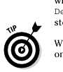

我在本章前面介绍的 `Factorial()` 版本使用非递归算法，即用循环来计算阶乘。至于递归版本，请参见网上的 `RecursiveFactorial` 示例。递归方法会调用自身，可能反复调用，直到出现停止条件。递归版 `Factorial()` 会反复调用自身（递归），当传入的值变为负数时停止。递归是实现 `Factorial()` 最常见的方式。注意：务必确保递归会停止。你可以将 `RecursiveFactorial` 的结果与不那么奇特的 `NonrecursiveFactorial` 示例的结果进行比较；`DeadlyRecursion` 示例则展示了递归不停止时会发生什么——它会引发相当令人不快的 `StackOverflowException`。


当程序在调试器中运行时，可以在 Visual Studio 调试器窗口之一中查看堆栈跟踪。

## 使用多个 catch 块


我们在本章前面提到，你可以定义自己的自定义异常类型。假设你定义了一个 `CustomException` 类。（我们在文章“创建自己的异常类”中描述了这个过程，你可以在以下网址找到它：http://csharp102.info/）现在考虑这里使用的 catch 子句：

```
public void SomeMethod()
{
    try
    {
        SomeOtherMethod();
    }
    catch(CustomException ce)
    {
    }
}
```

第 1 册 第 9 章 **一些特殊的异常**

如果 `SomeOtherMethod()` 抛出了一个简单的 `Exception` 或另一种非 `CustomException` 类型的异常，会怎么样？那就像试图用棒球手套接橄榄球——接与投不匹配。

幸运的是，C# 允许程序定义许多 catch 子句，每个子句针对不同类型的异常。假设这里正是处理其他异常的合适位置，你可以一个接一个地追加。

不要被我使用 *许多* 这个词吓到。实践中，你不会在一个地方使用很多 catch 块。


针对不同异常类型的多个 catch 子句必须在 try 块之后首尾相接地排列。C# 会依次检查每个 catch 块，将抛出的对象与 catch 子句的参数类型进行比较，如下段代码所示：

```
public void SomeMethod()
{
    try
    {
        SomeOtherMethod();
    }
    catch(CustomException ce)   // Most specific exception type
    {
        // All CustomException objects are caught here.
        // You could insert other exception types between these two.
    }
    catch(Exception e)   // Most general exception type
    {
        // All otherwise uncaught exceptions are caught here.
        // Not that you should always do so -- but then it makes sense ...
    }
}
```

如果 `SomeOtherMethod()` 抛出一个 `Exception` 对象，它会越过 `catch(CustomException)`，因为 `Exception` 不是 `CustomException` 类型。它会被下一个 catch 子句 `catch(Exception)` 捕获。


始终按从最具体到最一般的顺序排列 catch 子句。绝不要把更一般的 catch 子句放在前面，就像下面这段相当糟糕的代码那样：

```
public void SomeMethod()
{
    try
    {
        SomeOtherMethod();
    }
    catch(Exception e)   // Most general first -- not good!
    {
        // All exceptions are caught here.
        // The dingo ate everything.
    }
    catch(CustomException ce)
{
  // No exception ever gets this far, because it's
  // caught and consumed by the more general catch clause.
}
```

更一般的 catch 子句会拦截任何抛出，从而使后面的 catch 子句得不到机会。编译器会提醒你这个错误。


任何继承 `CustomException` 的类都是（IS_A）`CustomException`：

```
class MySpecialException : CustomException
{
  // . . . whatever . . .
}
```

只要有机会，`CustomException` 的 catch 就会抓住 `MySpecialException` 对象，就像青蛙抓苍蝇一样。

## 规划异常处理策略

为程序如何应对错误制定计划是合理的。选择使用异常而不是错误码，只是需要做出的一个选择。


由于篇幅限制，我无法充分探讨应对异常时可用的所有选项。这个概述——一组指导原则和一些关键技术——应该能让你很好地入门。要更深入地研究“代码抛出异常时我能做什么？”这个基本问题，请参阅 http://csharp102.info 上的文章。

### 指导规划的一些问题

在开发程序时，你应该考虑几个问题：

- **可能出什么问题？** 对你编写的每一段代码都问这个问题。
- **如果真出了问题，我能修复吗？** 如果可以，你也许能从问题中恢复，程序也可能继续运行。如果不能，你大概就得收拾行李走人了。
- **这个问题会让用户数据面临风险吗？** 如果是，你必须尽一切努力避免丢失或损坏这些数据。明知代码可能破坏用户数据却仍发布它，无异于软件渎职。
- **我应该把针对这个问题的异常处理程序放在哪里？** 尝试在异常发生的方法中处理它可能不是最佳做法。通常，方法调用链中更高层的另一个方法拥有更好的信息，也许能采取更明智的措施


并且在异常情况下也有用。把 `try/catch` 放在那里，使 `try` 块包围那个会导向可能发生异常位置的调用。


- **我应该处理哪些异常？** 捕获任何你能够以某种方式从中恢复的异常。努力寻找恢复的办法，正如 http://csharp102.info 上《响应异常》一文所讨论的那样。然后，在开发和测试期间，未处理的异常会到达程序的顶层。在把程序发布给真实用户之前，如果能够做到，就修复任何未处理异常的底层原因。但有时，异常应当要求提前终止程序，因为情况已经无可救药地搞砸了。
- **那些从缝隙中溜过并躲开我的处理程序的异常怎么办？** 本章后面的“抓住捕获异常的最后机会”一节介绍了如何提供一个“最后机会”异常处理程序来捕获漏网异常。
- **我的代码需要有多健壮（牢不可破）？** 如果你的代码运行的是空中交通管制系统，那它确实应当非常健壮。如果它只是一个小小的一次性工具，你可以稍微放松一些。

## 妥善处理错误的代码准则

工作时，你应当牢记上一节中的问题。以下准则也可能有帮助：

- **不惜一切代价保护用户的数据。** 这是头号准则。请参阅本章末尾的“更多信息”侧栏。另请参阅下一个项目符号项。
- **不要崩溃。** 如果可以恢复，就恢复；但也要准备好尽可能优雅地退出。不要让你的程序只挤出一句晦涩的极客式消息就彻底崩溃。*优雅地* 意味着在关闭之前提供包含尽可能多有用信息的清晰消息。用户确实讨厌崩溃。不过你大概已经知道这一点。
- **如果无法从问题中恢复，就不要让你的程序继续运行。** 程序可能变得不稳定，或者用户数据可能处于不一致状态。当确实一切都无可挽回时，可以显示一条消息并调用 `System.Environment.FailFast()` 立即终止程序，而不是抛出异常。这不算崩溃——这是有意为之。
- **区别对待类库和应用程序。** 在*类库*中，让异常到达调用方，调用方最有能力决定如何处理问题。不要让调用方对问题一无所知。但在*应用程序*中，要处理你能处理的任何异常。你的目标是尽可能让代码继续运行并保护用户的数据，同时不要向用户抛出大量无关紧要的消息。
- **当方法因任何原因无法完成其任务时，抛出异常。** 调用方需要知道这个问题。（调用方可能是你代码中调用堆栈更高层的方法，也可能是使用你的代码的其他开发者所写代码中的方法。）如果你在使用输入值之前检查其有效性，而它们无效——例如意外的 null 值——那么如果可以就修正它们并继续；否则，抛出异常。
- **大多数情况下，除非你能以有用的方式处理异常，最好是能从错误中恢复，否则不要在特定方法中捕获异常。** 捕获一个你无法处理的异常，就像赤手空拳抓住一只黄蜂。接下来怎么办？大多数方法都不包含异常处理程序。
- **彻底测试你的代码**，尤其是你能想到的任何类别的错误输入。你的方法能处理负数输入吗？零？非常大的值？空字符串？null 值？用户可能做什么而导致异常？你的代码使用了哪些可能出错的资源，例如文件、数据库或 URL？请参阅前两个项目符号段落。
- **尽可能捕获最具体的异常。** 不要为 Exception 或 ApplicationException 之类的高层异常类编写许多 catch 块。否则你可能会使调用链更高层的处理程序得不到处理机会。
- **始终在 Main() 中——或者程序的“顶层”所在之处（可重用类库除外）——放置一个最后机会异常处理程序块。** 你可以在此块中捕获 Exception 类型。捕获并处理你能处理的异常，让最后机会异常处理程序收拾任何漏网之鱼。（我们将在后面的“抓住捕获异常的最后机会”一节中解释最后机会处理程序。）

这条建议与你在其他地方可能看到的说法相反，但它来自 Jeffrey Richter——.NET 和 C# 编程领域最杰出的专家之一。你经常听到这样的说法：“异常只用于意外情况——不要把它们用于正常操作过程中可能发生的问题。”这种说法并不准确。异常是 .NET 处理大多数类型错误的方式。你有时可以使用错误代码或其他方法——例如让集合方法在“未找到项”时返回 -1——但并不常见。请留意上一段。

尽量编写不需要抛出异常的代码——并在发现 bug 时修正它们——而不是依赖异常来打补丁。但要把异常作为报告和处理错误的主要方式。

了解如何为你的代码编写单元测试。这相当容易，而且很有乐趣。你可以从 http://csharp102.info 上的文章开始。


- **不要把异常用作正常执行流程的一部分。** 例如，不要用抛出异常的方式跳出循环或退出方法。
- **考虑编写自己的自定义异常类**，前提是它们能带来一些好处——例如有助于调试的更多信息，或对用户更有意义的错误消息。我们在 http://csharp102.info 的一篇文章中介绍了自定义异常。

本章其余部分（以及 csharp102.info 上的文章）为你提供了遵循这些准则所需的工具。有关更多信息，请在帮助系统中查找“异常处理、设计准则”，但要做好阅读一些技术内容的准备。

如果公共方法抛出了调用方可能需要捕获的任何异常，那么这些异常就是类的公共接口的一部分。你需要记录它们，最好使用第 IV 册第 1 章中讨论的 XML 文档注释。

## 如何分析一个方法可能抛出的异常

在下面的方法中（这是设置异常处理程序的第一步），请考虑它可能抛出哪些异常：

```csharp
public string FixNamespaceLine(string line)
{
    const string COMPANY_PREFIX = "CMSCO*";
    int spaceIndex = line.IndexOf(' ');
    int nameStart = GetNameStartAfterNamespaceKeyword(line, spaceIndex);
    string newline = string.Empty;
    newline = PlugInNamespaceCompanyQualifier(line, COMPANY_PREFIX, nameStart);
    return newline.Trim();
}
```

给定一个 C# 文件，此方法属于某段代码的一部分，该代码旨在查找文件中的 namespace 关键字，并插入一个表示公司名称（我们公司之一）的字符串，作为命名空间名称的前缀。（有关命名空间的信息，请参阅第 II 册第 10 章。）下面的示例说明了在 C# 文件中很可能在哪里找到 namespace 关键字：

```csharp
using System;
namespace SomeName
{
    // Code within the namespace . . .
}
```

对此类文件运行 FixNamespaceLine() 方法的结果，应当把第一行转换为第二行：

```text
namespace SomeName
namespace CmSo.SomeName
```

整个程序读取 CS 文件，然后逐行遍历，把每一行传给 FixNamespaceLine() 方法。给定一行代码，该方法调用 String.IndexOf() 来查找命名空间名称的索引（通常是 10）。然后它调用 GetNameStartAfterNamespaceKeyword() 来定位命名空间名称的开头。最后，它调用另一个方法 PlugInNamespaceCompanyQualifier()，把公司名称插入该行中的正确位置，然后返回该行。大部分工作由这些辅助方法完成。

首先，即使不知道这段代码的用途，也不知道所调用的两个方法做什么，也要考虑输入。对于 String.IndexOf() 的调用，line 参数至少可能有一个问题。如果 *line* 为 null，IndexOf() 调用会导致 ArgumentNullException。不能在 null 对象上调用方法。另外，乍一看，对空字符串调用 IndexOf() 能行吗？事实证明可以，因此那里不会发生异常；但如果你把空行传给那些名称很长的方法之一，会发生什么？我们建议在 FixNamespaceLine() 的第一行代码之前，如果有必要，添加一个保护子句——至少检查是否为 null：

```csharp
if (String.IsNullOrEmpty(line))   // A handy string method
{
    return line; // You can get away with a reasonable return value here
                 // instead of throwing an exception.
}
```

其次，在你安全通过 IndexOf() 调用之后，即使先仔细检查了 *line*，两个方法调用之一仍可能抛出异常。如果 spaceIndex 结果为 -1（未找到）——这种情况可能发生，因为传入的行通常不包含 namespace 关键字——把它传给第一个方法可能会出问题。当然，你可以针对这种结果进行防护，如下所示：

```text
if (spaceIndex > -1) ...
```

如果 spaceIndex 为负数，则该行不包含 namespace 关键字。*这不是错误。* 你只需返回原始行来跳过该行，然后继续处理下一行。无论如何，不要调用这些辅助方法。

你方法中的方法调用需要逐一探查，看看每个调用可能抛出哪些异常，然后深入查看那些方法所调用的任何方法，依此类推，直到到达这个特定调用链的底部。

考虑到这种可能性，并且鉴于 FixNamespaceLine() 首先需要额外的加固型保护子句，你可能会把异常处理程序放在哪里？

你可能会想把 FixNamespaceLine() 的大部分内容放进一个 *try* 块中。但你必须考虑这是否是放置它的最佳位置。此方法是

低层级，因此它应该在需要时仅抛出异常——或者只是传递在其调用的方法中发生的任何异常。我们建议查找调用链，以查看哪个方法可能是处理程序的合适位置。


随着你在调用链中向上移动，请自问前面章节“指导你规划的一些问题”中的问题。如果 `FixNamespaceLine()` 抛出异常会有什么后果？这取决于其结果在链中更高层如何被使用。此外，后果需要多严重？如果无法为当前文件“修复”命名空间行，用户会损失什么重要东西吗？也许偶尔出现未修复的文件是可以接受的，在这种情况下，你可能会选择在调用链的某个层级“吞掉”该异常，只通知用户未处理的文件。或者不。你明白了。我们在 http://csharp102.info 上的文章“响应异常”中讨论了这些和其他异常处理选项。

寓意是，正确设置异常处理程序需要一些分析和思考。


然而，请记住，任何方法调用都可能抛出异常——例如，应用程序可能内存耗尽，或者它所在的程序集可能找不到并加载。你对此无能为力。


## 如何找出哪些方法抛出哪些异常

要找出在 .NET 类库中调用某个特定方法，例如 `String.IndexOf()`——甚至是你自己的方法之一——是否会抛出异常，请考虑以下指南：

- **Visual Studio 提供即时帮助，带工具提示。** 当你在 Visual Studio 编辑器中将鼠标指针悬停在方法名称上时，一个黄色工具提示窗口不仅列出该方法的参数和返回类型，还列出它可能抛出的异常。
- **如果你已使用 XML 注释来注释你自己的方法。** Visual Studio 会像对 .NET 方法一样，将这些注释中的信息显示在其 IntelliSense 工具提示中。如果你记录了你的方法可能抛出的异常（参见上一节），你会在工具提示中看到它们。http://csharp102.info 上的文章“在 Visual Studio 中获取帮助”展示了如何使用 XML 注释，而你可以下载的 FactorialException 示例说明了如何使用 XML 注释记录 `Factorial()`。在你的 `<summary>` 注释内插入 `<exception>` 行，使其在工具提示中显示。
- **帮助文件提供更多信息。** 当你在帮助中查找 .NET 方法时，你会找到该方法可能抛出的异常列表，以及通过黄色 Visual Studio 工具提示未提供的额外描述。要打开给定方法的帮助页面，请单击


你的代码中的方法名称并按 F1。你也可以为你自己的类和方法提供类似的帮助。

你应该查看列出的每个异常，判断其发生的可能性，并（如果对你的程序有必要）使用本章其余部分介绍的技术对其进行防护。

## 抓住捕获异常的最后机会

前面章节“我能得到一个异常的示例吗？”中的 `FactorialException` 示例将 `Main()` 的所有内容，除了最后的控制台调用，包装在一个外部的“最后机会”异常处理程序中。


如果你正在编写应用程序，始终将 `Main()` 的内容用 try 块夹住，因为 `Main()` 是程序的起点，也是终点。（如果你正在编写用于重用的类库，请不要担心未处理的异常——使用你的库的人需要知道所有异常，所以让它们通过你的方法冒泡。）

任何其他地方未捕获的异常都会冒泡到 `Main()`。这是你在错误返回到 Windows 之前抓住它的最后机会，在那里错误消息更难解释，可能会让——或吓得要命——程序的用户感到沮丧。

`FactorialException` 的 `Main()` 中的所有重要代码都在 try 块内。关联的 catch 块捕获任何异常并向控制台输出消息，然后应用程序退出。

此 catch 块通过拦截其他地方未处理的异常来防止硬崩溃。而且这是你解释应用程序为何退出机会。

实验一下。为了了解你为什么需要这个最后机会处理程序，故意在一个小程序中抛出异常而不处理它。你会看到用户在没有你使着陆更柔和的努力时会看到什么。


在开发期间，你希望在测试代码时看到发生的异常，在其自然环境中——因此你想要所有技术黑话。在你发布的版本中，将程序员式的细节转换为普通英语，向用户显示消息，包括如果可能的话，他下次成功运行可能采取的措施，然后退出舞台。让这个纯英语版本的异常处理程序成为你在将程序发布到野外之前完成的最后任务之一。

你的最后机会处理程序当然应该以某种方式记录异常信息，以便日后进行取证分析。


## 更多信息

我们希望能够说我们已经在异常方面告诉你全部故事。我们非常希望如此。但我们没有，这是一个相当长的故事。

要追踪故事的其余部分，我们建议你前往网站 http://csharp102.info，在那里你可以找到关于以下主题的文章：

- **创建你自己的异常类：** .NET Framework 类库开发人员并不是唯一可以扩展类 `Exception` 以添加新异常子类的人。你也可以自己扩展 `Exception`。关于原因和如何操作，请参阅本书网站上的文章“创建你自己的异常类”。
- **响应异常——当代码抛出异常时你可以做什么：** 你的选择是修复问题并重试，部分修复问题并将其交给可能能够修复其余部分的更高级别异常处理程序，将异常转换为不同类型的异常，或什么都不做。本书网站上的文章“响应异常”通过几个示例探讨了这些选项。

## 第二部分

### 面向对象的 C# 编程

### 第五波

By Rich Tennant

@RICHTENNANT

> "我们来清理代码。"


## 目录一览

- 第1章：面向对象编程——它到底是什么？ ...203
- 第2章：展示一些类 ...........................211
- 第3章：我们有我们的方法 ...........................223
- 第4章：让我说说这个 ...........................243
- 第5章：让一个类负责 ...........................257
- 第6章：继承：这就是我得到的一切吗？ ...........................281
- 第7章：多态是什么？ ...........................303
- 第8章：与接口进行接口 ...........................329
- 第9章：委托那些重要事件 ...........................353
- 第10章：我可以在库中使用你的命名空间吗？ ...........................373
- 第11章：使用命名和可选参数提高生产力 ...........................395

## 第1章：面向对象编程——它到底是什么？

### 本章内容

- 回顾面向对象编程的基础
- 掌握抽象和分类
- 理解面向对象编程为何重要

本章回答了双重音乐问题：“面向对象编程背后的概念是什么，它们与 Book I 中介绍的过程概念有何不同？”

## 面向对象概念 #1：抽象

有时，当我儿子和我一起看足球时，我会做一批极不健康的那恰斯。我把薯片倒在盘子上，撒上豆子、奶酪和大量哈拉佩ño，然后把整盘东西在微波炉里加热几分钟。

要使用我的微波炉，我打开门，把食物盘子放进去，然后在前面按几个按钮。几分钟后，那恰斯就做好了。（我尽量不在微波炉工作时站在前面，以免我的眼睛在黑暗中发光。）

现在花一分钟想想为了使用我的微波炉我不做的事情。我不

- 为了让微波炉工作而重新布线或改变微波炉内部的任何东西。微波炉有一个接口——前面板上所有按钮和那个小时间显示——让我做我需要的一切。
- 重新编程驱动微波炉内部小处理器使用的软件，即使我上次使用微波炉时烹饪的是不同的菜肴。
- 看微波炉机箱内部。


即使我是微波炉设计师，了解微波炉内部工作原理的所有细节，包括其软件，我在用它加热玉米片时仍然不会去想所有这些概念。


这些观察并不深奥：你在生活中只能承受有限的压力。为了减少需要处理的问题数量，你会在某个细节层次上工作。在面向对象（OO）的计算机术语中，你所工作的细节层次就是抽象层次。趁有机会再引入一个OO术语：我把微波炉内部结构的细节抽象掉了。

幸运的是，计算机科学家——以及成千上万的极客——发明了面向对象以及许多其他概念，降低了程序员必须面对的复杂程度。使用强大的抽象使工作比过去更简单，也远比过去不易出错。从某种意义上说，过去半个世纪左右的计算机进步正是关于这一点：以越来越少的错误管理越来越复杂的概念和结构。

当我制作玉米片时，我把微波炉看作一个盒子。（当我正想快速做点零食时，我不能一边担心微波炉的内部结构，一边还在电视上看达拉斯牛仔队。）只要我只通过微波炉的接口（键盘）来使用它，我所做的任何事情都不应导致微波炉进入不一致状态并崩溃，或者更糟，把我的玉米片——或者我的房子——变成一团焦黑燃烧的东西。

## 用面向过程的方式制作玉米片

假设我让儿子写一个如何制作玉米片的算法。在他明白我想要什么之后，他可以写：“打开一罐豆子，把一些奶酪擦成丝，切好墨西哥辣椒”，等等。当他写到用微波炉加热混合物这一部分时，他可能（在状态好的时候）会写类似这样的话：“在微波炉中加热五分钟。”

这个描述直截了当而且完整。但它并不是面向过程程序员编写制作玉米片程序的方式。面向过程程序员生活在一个没有微波炉和其他电器等对象的世界里。他们往往操心流程图及其无数过程路径。在玉米片问题的面向过程解决方案中，控制流会从我的手指传到前面板，然后传到微波炉内部。很快，控制流就会蜿蜒穿过复杂的逻辑路径，决定微波管开启多长时间，以及是否发出“来拿吧”的提示音。

在面向过程编程的世界里，你无法轻易按抽象层次来思考。你没有对象，也没有可供隐藏固有复杂性的抽象。

## 用面向对象的方式制作玉米片

在制作玉米片的面向对象方法中，你首先识别问题中的对象类型：玉米片、豆子、奶酪、墨西哥辣椒和微波炉。然后开始用软件对这些对象建模，而不考虑它们在最终程序中可能如何被使用的细节。例如，你可以把奶酪建模为一个与其他对象隔离的对象，然后把它与豆子、玉米片、墨西哥辣椒和微波炉组合起来，让它们交互。（你也可能决定其中某些对象在软件中不需要作为对象存在：比如奶酪。）

当你这样做时，可以说你正在基本对象的层次上工作（和思考）。你需要考虑制造一个有作用的微波炉，但暂时不必考虑制作玉米片的逻辑过程。毕竟，微波炉设计者并没有考虑你制作零食这个具体问题。相反，他们着手解决设计和制造一台有用微波炉的问题。

在你成功编写并测试所需对象之后，你可以向上提升到下一个抽象层次，开始从制作玉米片的层次而不是制造微波炉的层次来思考。

（而且，此时我可以把儿子的说明直接翻译成C#代码。）

## 面向对象概念#2：分类

与抽象概念同样关键的是分类概念。如果我问儿子：“微波炉是什么？”他可能会说：“它是一种烤箱，能……”如果我再问：“烤箱是什么？”他可能回答：“它是一种厨房电器，能……”如果我问：“厨房电器是什么？”他大概会说：“你为什么问这么多愚蠢的问题？”


我儿子可能给出的答案源于他把这台特定的微波炉理解为一种称为微波炉的物品类型的一个示例。此外，他可能把微波炉看作只是一种特殊类型的烤箱，而烤箱本身又只是一种特殊类型的厨房电器。

在面向对象的计算机术语中，这台微波炉是“微波炉”类的一个实例。“微波炉”类是“烤箱”类的一个子类，而“烤箱”类是“厨房电器”类的一个子类。

人类会分类。世界上的万事万物都被整理成分类体系。人类这样做是为了减少必须记住的项目数量。例如，你第一次看到SUV时，广告可能把这款SUV说成“革命性的、前所未见的产品”。但你我都知道事实并非如此。我喜欢某些SUV的外观（另一些则需要回炉重造），但是，嘿，SUV就是一辆汽车。因此，它拥有其他汽车的全部（或至少大部分）属性。例如，它有方向盘、座椅、发动机和刹车。我敢打赌，我甚至不用先读用户手册就能开走一辆。

我不必用SUV与其他汽车共有的全部特征来塞满我头脑中有限的存储空间。我只需要记住“SUV是一种汽车，它……”并附加上SUV独有的少数特征（比如价格标签）。我还可以进一步推演。汽车是轮式车辆的一个子类，轮式车辆还有其他成员，比如卡车和皮卡。也许轮式车辆又是车辆的一个子类，而车辆还包括船和飞机——以此类推。

## 为什么要分类？

你为什么要分类？这听起来很麻烦。再说，人们使用面向过程方法已经很长时间了——为什么现在要改变？

专门为这个问题设计和制造一台微波炉，似乎比构建一个独立的、更通用的微波炉对象更容易。假设你想造一台只用来烹饪玉米片的微波炉。除了一个启动按钮之外，你不需要在它上面安装前面板。你制作玉米片的时间长度可能总是一样的。你可以省掉选项中那些解冻和温度烹饪之类的无聊功能。这台微波炉只需要容纳一个扁平的小盘子。三立方英尺的空间对于玉米片来说会被浪费掉。

就此而言，你甚至可以省掉“微波炉”这个概念。你需要的只是微波炉的内部器件。然后，在食谱中，你写下让它工作的说明：“把玉米片放进盒子里。把红线接到黑线上。把雷达管升到大约3000伏。注意有轻微的嗡嗡声。如果你打算要孩子，尽量不要站得太近。”诸如此类的东西。

但面向过程方法存在这些问题：

- **它太复杂。** 你不会想把制造微波炉的细节混入制作玉米片的细节中。如果你无法定义对象并把它们从混乱的细节中抽出来单独处理，你就必须同时处理问题的所有复杂性。
- **它不灵活。** 有时，你可能需要用另一种类型的微波炉替换当前的微波炉。只要两个微波炉具有相同的接口，你就应该能够这样做。如果没有清晰地划分并分别开发，一种对象类型就无法被干净地移除并替换为另一种对象类型。
- **它不可复用。** 微波炉被用来制作许多不同的菜肴。你不会想每遇到一个新食谱就造一台新微波炉。一个问题一旦解决，你就希望能够复用该解决方案


## 第II册 第1章：面向对象编程——它到底是什么？

在程序中的其他地方。如果幸运的话，你或许还能在未来的程序中复用它。

### 面向对象概念 #3：可用的接口

对象必须能够呈现一个充分但尽可能简单的外部接口。这个概念在某种程度上是概念 #4（将在下一节描述）的反面。如果设备接口不充分，用户可能会开始把设备的顶部扯下来，这直接违反了上帝和社会的法律——或者至少违反了伟大的得克萨斯州的责任法。相信我们，你可不想违反伟大的得克萨斯州的法律。反过来，如果设备接口过于复杂，没人会买这个设备——或者至少没人会使用它的全部功能。

人们不断抱怨他们的 DVD 播放器太复杂，不过如今的屏幕控件让这个问题没那么严重了。这些设备有太多按钮，承担太多不同的功能。通常，同一个按钮会根据机器的状态具有不同的功能。此外，似乎没有两台 DVD 播放器拥有相同的接口。不知什么原因，DVD 播放器呈现的接口对大多数人来说过于困难、过于不标准，以至于只能使用最基本的功能。

把录像机和汽车比较一下。很难说汽车比录像机更不复杂。然而，人们开车似乎并没有太大困难。

所有汽车或多或少都在差不多相同的位置提供差不多的控制装置。例如，我姐姐曾有一辆车（还用说是一辆法国车吗？），它的前照灯控制装置位于方向盘左侧，而那里通常是转向灯拨杆的位置。你向下推灯光拨杆来关灯，向上抬拨杆来开灯。这种差异似乎微不足道，但我一直没学会在夜间左转时不把车灯关掉。

设计良好的汽车不会根据汽车状态，用同一个控制装置执行不止一种操作。我能想到这条规则只有一个例外：大多数巡航控制装置上的某些按钮承担了多重功能。

### 面向对象概念 #4：访问控制

微波炉的制造必须保证：你在前面键盘上输入的任何按键组合都不会让微波炉伤害你。当然，有些组合什么也不做。然而，任何按键序列都不应：

- **损坏设备：** 你也许能让设备进入一种奇怪状态，在这种状态下它什么也不做，直到你重置它（比如，扳下内部断路器）。然而，你不应该能通过使用前面板来损坏设备——当然，除非你在沮丧之下把它摔到地上。这类设备的制造商可能不得不为此发布某种修复措施。
- **导致设备起火并烧毁房屋：** 设备自我损坏固然糟糕，但起火要糟糕得多。你生活在一个好讼的社会。制造商的公司高管很可能最终会进监狱，尤其是我要是能对此说上话的话。

不过，要执行这两条规则，你必须承担一些责任。你不能对设备内部进行改装。

几乎所有具有一定复杂度的厨房设备，包括微波炉，都有一个小封条，防止消费者接触到设备内部。如果封条破损，表明设备盖子已被取下，制造商就不再承担责任。如果你改装了微波炉的内部运作结构，那么它随后起火并烧毁房屋时，责任就在你。

同样，类必须能够控制对其数据成员的访问。任何对类成员的调用序列都不应导致程序崩溃。如果外部元素能够访问类的内部状态，类就不可能确保对这种访问的控制。类必须能够让关键数据成员对外部世界不可访问。

### C# 如何支持面向对象概念

好，C# 如何实现面向对象编程？从某种意义上说，这是个错误的问题。C# 是一种面向对象语言；然而，它并不实现面向对象编程——实现它的是程序员。你当然可以用 C# 或任何其他语言编写非面向对象的程序（例如，把整个 Microsoft Word 都写在 Main() 里）。让人想到“你能把马牵到水边，却不能强迫它喝水”之类的话。但在 C# 中，你可以轻松编写面向对象的程序。

以下 C# 特性是编写面向对象程序所必需的：

- **受控访问：** C# 控制类成员的访问方式。C# 关键字使你能够声明某些成员对公众完全开放，而内部成员则受到保护、不可见，某些秘密则保持私有。注意这些小提示。访问控制的秘密将在本迷你书第5章揭晓。
- **特化：** C# 通过一种称为类继承的机制支持特化。一个类继承另一个类的成员。例如，你可以创建一个 `Car` 类，作为 `Vehicle` 的一种特定类型。本迷你书第6章专门讨论特化。
- **多态：** 此特性使对象能够按自己想要的方式执行操作。`Vehicle` 的 `Rocket` 类型实现 `Start` 操作的方式，可能与 `Vehicle` 的 `Car` 类型大不相同。至少，我希望每次我转动车钥匙时它都是这样。（就我的车而言，你永远说不准。）但所有 `Vehicle` 都有一个 `Start` 操作，你可以依赖这一点。本迷你书第7章以自己的方式描述多态。
- **间接性：** 对象经常通过调用其他对象的公共方法来使用它们的服务。但类可能对自己使用的类“知道得太多”。于是这两个类就被说成“耦合过紧”，这使得使用类过于依赖被使用类。这种设计过于脆弱——一旦做出更改就容易损坏。但变化在软件中不可避免，所以你应该寻找更*间接*的方式来连接这两个类。C# 的 `interface` 构造正是在这里派上用场。（你可以在本迷你书第8章了解接口的详细情况。）

## 第2章：展示一些类

### 本章内容

- ✓ 介绍 C# 类
- ✓ 在对象中存储数据
- ✓ 分配和使用对象引用
- ✓ 考察包含类的类
- ✓ 识别静态和实例类成员
- ✓ 在 C# 中使用常量

你可以自由声明并使用所有内置数据类型——例如 `int`、`double` 和 `bool`——来存储必要信息，使程序尽可能完善。对某些程序来说，这些简单变量就足够了。然而，大多数程序都需要一种方法，把相关数据捆绑成一个整洁的包。

如第I册所示，C# 提供数组和其他集合，用于将*同类型*变量（例如 `strings` 或 `ints`）分组到一个结构中。例如，一所假设的大学可能会用数组来跟踪它的学生。但学生远不只是一个名字——这类程序应该如何表示一个学生？

有些程序需要把逻辑上属于一起但类型不同的数据片段捆绑起来。大学招生申请要处理学生，每个学生都有自己的姓名、排名（平均绩点）和学号。从逻辑上讲，学生姓名可以是 `string`；平均绩点可以是 `double`；学号可以是 `long`。这类程序需要一种方法，把这三个不同类型的变量捆绑成一个名为 `Student` 的单一结构。幸运的是，C# 提供了一种称为 `class` 的结构，用来容纳不同类型变量的分组。

### 定义类和对象

`class` 是将逻辑上属于一起的不同数据和函数捆绑成一个整洁的包。C# 让你可以随心所欲地把类搞砸，但好的类是为了表示*概念*而设计的。


计算机科学通过表示世界中概念或事物的结构来为世界建模，例如银行账户、井字棋游戏、客户、游戏棋盘、文档和产品。分析师说：“类将问题中的概念映射到程序中。”例如，你的问题可能是构建一个交通模拟器，为修建街道、十字路口和高速公路的目的而对交通模式进行建模。（我真的很希望你能够构建一个能修复我家门前十字路口的交通模拟器。）

任何关于交通问题的描述，其解决方案中都会包含“车辆”这一术语。车辆有一个必须计入方程式的最高速度。它们还有重量，其中一些是破旧的老爷车。此外，车辆会停下，车辆也会行驶。因此，作为一个概念，车辆是问题域的一部分。

一个优秀的C#交通模拟器程序必然包含`Vehicle`类，该类描述了车辆的相关属性。C#的`Vehicle`类会具有诸如`topSpeed`、`weight`和`isClunker`这样的属性。

因为类是C#编程的核心，本书第II册将在后续章节中更详细地探讨类的方方面面。本章让你入门。

## 定义类

`Vehicle`类的一个示例可能如下所示：

```
public class Vehicle
{
    public string model;        // Name of the model
    public string manufacturer; // Name of the manufacturer
    public int numOfDoors;      // The number of doors on the vehicle
    public int numOfWheels;     // You get the idea.
}
```

类定义以关键字`public class`开头，后跟类的名称——在这里是`Vehicle`。


与C#中的所有名称一样，类名是区分大小写的。C#并不强制规定类名的任何规则，但有一条非正式规则：类名以大写字母开头。

类名后面是一对花括号。在花括号内，你可以有零个或多个成员。类的成员是构成类组成部分的变量。在这个例子中，`Vehicle`类以成员`string model`开头，该成员包含车辆型号的名称。如果车辆是汽车，其型号名称可能是Trooper II。（你见过或听说过Trooper I吗？）这个`Vehicle`类示例的第二个成员是`string manufacturer`。另外两个属性是车辆的车门数和车轮数。


与任何变量一样，尽量使成员名称具有描述性。虽然我给数据成员添加了注释，但这并不是必需的。一个好的变量名本身就能说明一切。

类名前面的`public`修饰符使该类在程序中可以被全局访问。同样地，成员名称前面的`public`修饰符使它们可以被程序中的其他所有内容访问。还可以使用其他修饰符。（本分册第5章会更详细地介绍可访问性的主题，并展示如何隐藏某些成员。）

类定义应该描述对象中与当前问题相关的属性。现在要做到这一点有点困难，因为你不知道问题是什么，但你可以看到我的意图。

## 什么是对象？

定义`Vehicle`设计与制造汽车不是同一回事。必须有人切割金属板并拧紧螺栓，才能真正驾驶一辆实际的车辆。类对象的声明方式与声明内置对象（如`int`）类似（但不完全相同）。


“对象”一词被普遍用来表示“事物”。好吧，这没什么帮助。一个`int`变量是一个`int`对象。一辆车是一个`Vehicle`对象。你是一个读者对象。我是一个作者对象——好吧，忘了那个吧。

以下代码段创建了一个`Vehicle`类的汽车：

```
Vehicle myCar;
myCar = new Vehicle();
```

第一行声明了一个`Vehicle`类型的变量`myCar`，就像你可以声明一个`int`类的`somethingOrOther`一样。（是的，类是一种类型，所有C#对象都被定义为类。）`new Vehicle()`命令创建了一个特定的`Vehicle`类型对象，并将其位置存储到变量`myCar`中。`new`与`myCar`的年龄无关。（如果我的车不那么难看，它可能够资格挂古董车牌。）`new`运算符创建了一块新的内存区域，你的程序可以在其中存储`myCar`的属性。


用C#的术语来说，你说`myCar`是`Vehicle`类的一个对象。你也可以说`myCar`是`Vehicle`的一个实例。在这种上下文中，“实例”的意思是“一个例子”或“之一”。你还可以将“实例”用作动词，例如“实例化Vehicle”。这就是`new`所做的事情。

将`myCar`的声明与一个名为`num`的`int`变量的声明进行比较：

```
int num;
num = 1;
```

第一行声明了变量`num`，第二行将一个已经创建的`int`类型常量赋给变量`num`的位置。

内置的`num`和对象`myCar`在内存中的存储方式不同。常量`1`不占用内存，因为CPU和C#编译器都已经知道`1`是什么。你的CPU没有`Vehicle`的概念。`new Vehicle`表达式分配了必要的内存，以便向CPU、向C#、向世界——是的，向整个宇宙！——描述一辆车。


## 访问对象的成员

`Vehicle`类的每个对象都有自己的一组成员。以下表达式将数字`1`赋给由`myCar`引用的对象的`numOfDoors`成员：

```
myCar.numOfDoors = 1;
```

每个C#操作都必须按类型和值进行求值。对象`myCar`是`Vehicle`类型的对象。变量`Vehicle.numOfDoors`是`int`类型的。（再看一下`Vehicle`类的定义。）常量`5`也是`int`类型，因此赋值运算符右侧变量的类型与左侧变量的类型匹配。


类似地，以下代码存储了对描述`myCar`型号和制造商名称的字符串的引用：

```
myCar.manufacturer = "BMW";    // Don't get your hopes up.
myCar.model = "Isetta";        // The Urkel-mobile
```

Isetta是一款20世纪50年代制造的小型汽车，只有一扇门，可以打开整个车头。Urkel是什么，我留给你和你最喜欢的搜索引擎去查吧。

## 一个基于对象的程序示例

简单的`VehicleDataOnly`程序执行以下任务：

- 定义`Vehicle`类。
- 创建一个`myCar`对象。
- 为`myCar`赋值属性。
- 从对象中检索这些值以进行显示。

以下是`VehicleDataOnly`程序的代码：

```csharp
// VehicleDataOnly -- Create a Vehicle object, populate its
// members from the keyboard, and then write it back out.
using System;
namespace VehicleDataOnly
{
    public class Vehicle
    {
        public string model;          // Name of the model
        public string manufacturer;   // Ditto
        public int numOfDoors;        // The number of doors on the vehicle
        public int numOfWheels;       // You get the idea.
    }
    public class Program
    {
        // This is where the program starts.
        static void Main(string[] args)
        {
            // Prompt user to enter her name.
            Console.WriteLine("Enter the properties of your vehicle");
            // Create an instance of Vehicle.
            Vehicle myCar = new Vehicle();
            // Populate a data member via a temporary variable.
            Console.Write("Model name = ");
            string s = Console.ReadLine();
            myCar.model = s;
            // Or you can populate the data member directly.
            Console.Write("Manufacturer name = ");
            myCar.manufacturer = Console.ReadLine();
            // Enter the remainder of the data.
            // A temp is useful for reading ints.
            Console.Write("Number of doors = ");
            s = Console.ReadLine();
            myCar.numOfDoors = Convert.ToInt32(s);
            Console.Write("Number of wheels = ");
            s = Console.ReadLine();
            myCar.numOfWheels = Convert.ToInt32(s);
            // Now display the results.
            Console.WriteLine("\nYour vehicle is a ");
            Console.WriteLine(myCar.manufacturer + " " + myCar.model);
            Console.WriteLine("with " + myCar.numOfDoors + " doors, "
                              + "riding on " + myCar.numOfWheels
                              + " wheels.");
            // Wait for user to acknowledge the results.
            Console.WriteLine("\nPress Enter to terminate...");
            Console.Read();
        }
    }
}
```

程序清单以`Vehicle`类的定义开始。

类的定义可以出现在`Program`类之前或之后——这都无关紧要。但是，你不应该像我一样，而应该采用一种风格并坚持下去。第IV册在讨论Visual Studio时，展示了更常规的做法：为每个类创建一个单独的`.cs`文件，但现在就先把额外的类放在你的`Program.cs`文件中吧。


## 第II册
## 第2章
## 展示一下类


该程序创建 `Vehicle` 类的对象 `myCar`，然后通过从键盘读取适当数据来填充每个字段。（输入数据没有——但应该——进行合法性检查。）然后程序以略有不同的格式写出 `myCar` 的属性。

执行此程序的输出如下所示：

```
Enter the properties of your vehicle
Model name = Metropolitan
Manufacturer name = Nash
Number of doors = 2
Number of wheels = 4

Your vehicle is a
Nash Metropolitan
with 2 doors, riding on 4 wheels
Press Enter to terminate...
```

调用 `Read()` 而不是 `ReadLine()` 会使光标直接留在输出字符串之后，这使得用户输入显示在提示符同一行。此外，在写入中插入换行字符 '\n' 会生成一个空行，而无需单独执行 `WriteLine()`。


## 区分对象

底特律汽车制造商可以追踪他们制造的每一辆车，而不会把车弄混。同样，程序可以创建同一类的多个对象，如下例所示：

```
Vehicle car1 = new Vehicle();
car1.manufacturer = "Studebaker";
car1.model = "Avanti";
// The following has no effect on car1.
Vehicle car2 = new Vehicle();
car2.manufacturer = "Hudson";
car2.model = "Hornet";
```

创建对象 `car2` 并为其分配制造商名称 Hudson，对 `car1` 对象（制造商名称为 Studebaker）没有影响。

在某种程度上，区分对象的能力正是类构造的真正威力所在。与 Hudson Hornet 关联的对象可以作为一个单独的实体创建、操作和处置，并独立于其他对象，包括 Avanti。（两者都是经典汽车，尤其是后者。）

## 能给我引用吗？

点运算符和赋值运算符是引用类型上仅有的两个已定义运算符：

```
// Create a null reference.
Vehicle yourCar;
// Assign the reference a value.
yourCar = new Vehicle();
// Use the dot to access a member.
yourCar.manufacturer = "Rambler";
// Create a new reference and point it to the same object.
Vehicle yourSpousalCar = yourCar;
```

第一行创建对象 `yourCar`，但没有为其赋值。尚未初始化的引用称为指向 null 对象。任何使用未初始化（null）引用的尝试都会立即产生错误并终止程序。


C# 编译器可以在构建时捕获大多数使用未初始化引用的尝试，并生成警告。如果你以某种方式绕过编译器，访问未初始化的引用会立即终止程序。

第二条语句创建一个新的 `Vehicle` 对象，并将其赋给 `yourCar`。此代码片段中的最后一条语句将引用 `yourSpousalCar` 赋给引用 `yourCar`。此操作使 `yourSpousalCar` 引用与 `yourCar` 相同的对象。这种关系如图 2-1 所示。

图 2-1：
两个引用指向同一对象。

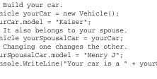

以下两个调用具有相同的效果：

```
// Build your car.
Vehicle yourCar = new Vehicle();
yourCar.model = "Kaiser";
// It also belongs to your spouse.
Vehicle yourSpousalCar = yourCar;
// Changing one changes the other.
yourSpousalCar.model = "Henry J";
Console.WriteLine("Your car is a " + yourCar.model);
```

执行此程序将输出 Henry J，而不是 Kaiser。请注意，`yourSpousalCar` 并不指向 `yourCar`；相反，`yourCar` 和 `yourSpousalCar` 都引用同一辆车。

此外，即使变量 `yourCar` 以某种方式“丢失”（例如超出作用域），引用 `yourSpousalCar` 仍然有效，如这段代码所示：

```
// Build your car.
Vehicle yourCar = new Vehicle();
yourCar.model = "Kaiser";
// It also belongs to your spouse.
Vehicle yourSpousalCar = yourCar;
// When your spouse takes your car away...
yourCar = null; // yourCar now references the "null object."
// ...yourSpousalCar still references the same vehicle.
Console.WriteLine("your car was a " + yourSpousalCar.model);
```

执行此程序会生成输出 Your car was a Kaiser，即使引用 `yourCar` 不再有效。

对象不再能从引用 `yourCar` 访问。直到 `yourCar` 和 `yourSpousalCar` 都“丢失”或置空，对象才完全不可达。

此时——好吧，总之在某个不可预测的较晚时刻——C# 垃圾回收器介入，将该 `Vehicle` 对象先前使用的空间返还到可用于分配更多 Vehicles（或 Students）的空间池。（关于垃圾回收，我在本迷你书第 6 章末尾的边栏中再多说一点。）


使一个对象变量（引用类型变量，如 `Vehicle` 或 `Student`，而不是 `int` 或 `double` 这样的简单类型）指向不同对象——如我在此所做的——使得在数组和集合中存储和操作引用对象非常高效。数组的每个元素存储对对象的引用，当你在数组中交换元素时，只是移动引用，而不是对象本身。引用在内存中有固定大小，不同于它们引用的对象。

## 包含类的类是世界最幸福的类

类的成员本身可以是对其他类的引用。例如，车辆有发动机，发动机有功率和效率因素，包括排量。你可以这样直接把这些因素塞进类中：

```
public class Vehicle
{
    public string model;        // Name of the model
    public string manufacturer; // Ditto
    public int numOfDoors;      // The number of doors on the vehicle
    public int numOfWheels;     // You get the idea.
    // New stuff:
    public int power;           // Power of the motor [horsepower]
    public double displacement; // Engine displacement [liter]
}
```

然而，功率和发动机排量不是汽车的属性。例如，你朋友的 Jeep 可能有两个不同的发动机选项，马力水平差异很大。2.4 升的 Jeep 是蜗牛，而同样车配备 4.0 升发动机则相当轻快。

发动机是独立概念，值得拥有自己的类：

```
public class Motor
{
    public int power;       // Power [horsepower]
    public double displacement; // Engine displacement [liter]
}
```

你可以将此组合到 `Vehicle` 中（见粗体文本）：

```
public class Vehicle
{
    public string model;        // Name of the model
    public string manufacturer; // Ditto
    public int numOfDoors;      // The number of doors on the vehicle
    public int numOfWheels;     // You get the idea.
    public Motor motor;
}
```

现在创建 `myCar` 如下所示：

```
// First create a Motor.
Motor largerMotor = new Motor();
largerMotor.power = 230;
largerMotor.displacement = 4.0;
// Now create the car.
Vehicle friendsCar = new Vehicle();
friendsCar.model = "Cherokee Sport";
friendsCar.manufacturer = "Jeep";
friendsCar.numOfDoors = 2;
friendsCar.numOfWheels = 4;
// Attach the motor to the car.
friendsCar.motor = largerMotor;
```

从 `Vehicle` 可以分两步访问发动机排量。可以一次一步，如这段代码所示：

```csharp
Motor m = friendsCar.motor;
Console.WriteLine("The motor displacement is " + m.displacement);
```

或者，可以直接访问，如下所示：

```csharp
Console.WriteLine("The motor displacement is " + friendsCar.motor.displacement);
```

无论哪种方式，都只能通过 `Motor` 访问排量。

此示例包含在本书网站上的简单程序 VehicleAndMotor 中，此处不完整展示。


## 类成员中的静态

类的大多数数据成员特定于包含它们的对象，而不是其他对象。考虑 `Car` 类：

```csharp
public class Car
{
    public string licensePlate;     // The license plate ID
}
```

因为车牌 ID 是 *对象属性*，它唯一描述 `Car` 类的每个对象。例如，谢天谢地我的车牌和你的不同；否则你可能出不了车道，如这段代码所示：

```csharp
Car myCar = new Car();
myCar.licensePlate = "XYZ123";

Car yourCar = new Car();
yourCar.licensePlate = "ABC789";
```

然而，有些属性是所有汽车共有的。例如，已制造的汽车数量是 `Car` 类的属性，但不是任何单个对象的属性。这些 *类属性* 在 C# 中用关键字 `static` 标记：

```csharp
public class Car
{
    public static int numberOfCars;  // The number of cars built
    public string licensePlate;      // The license plate ID
}
```


静态成员不是通过对象访问。相反，通过类本身访问它们，如这段代码片段所示：

```csharp
// Create a new object of class Car.
Car newCar = new Car();
newCar.licensePlate = "ABC123";
// Now increment the count of cars to reflect the new one.
Car.numberOfCars++;
```


对象成员 newCar.licensePlate 通过对象 newCar 访问，而类（静态）成员 Car.numberOfCars 通过类 Car 访问。所有 Car 对象共享同一个 numberOfCars 成员，因此每辆汽车包含的值与其他所有汽车完全相同。


> 类成员是静态成员。非静态成员特定于每个“实例”（每个单独的对象），并且是实例成员。你在这里看到的斜体短语是泛指这类成员的通用方式。

## 定义 const 和 readonly 数据成员

一种特殊类型的静态成员是 const 数据成员，它表示一个常量。你必须在声明中确定 const 变量的值，并且不能在程序中的任何位置更改它，如下所示：

```
class Program
{
    // Number of days in the year (including leap day)
    public const int daysInYear = 366;  // Must have initializer.
    public static void Main(string[] args)
    {
        // This is an array, covered later in this chapter.
        int[] maxTemperatures = new int[daysInYear];
        for(int index = 0; index < daysInYear; index++)
        {
            // . . .accumulate the maximum temperature for each
            // day of the year . . .
        }
    }
}
```

你可以在程序中的任何位置使用常量 daysInYear 来代替值 366。const 变量很有用，因为它可以用描述性名称 daysInYear 替换 366 这样的神秘数字，从而增强程序的可读性。


C# 提供了另一种声明常量的方式——可以在变量声明前加上 readonly 修饰符，如下所示：

```
public readonly int daysInYear = 366;  // This could also be static.
```

与 const 一样，在分配初始值后，就不能更改它。尽管原因对于本书来说过于技术化，但使用 readonly 方法声明常量通常比 const 更可取。

你可以将 const 与类数据成员一起使用，就像本章中可能看到的那样，也可以在类方法内部使用。但 readonly 不允许在方法中使用。本迷你书的第3章将深入探讨方法。

命名常量还存在另一种约定。许多程序员不喜欢像变量那样命名常量（如 `daysInYear`），而更喜欢使用由下划线分隔的大写字母，如 `DAYS_IN_YEAR`。这种约定将常量与普通读写变量清楚地区分开来。

## 第3章：我们有了方法

### 本章内容

- 定义方法
- 向方法传递参数
- 获取返回结果
- 回顾 `WriteLine()` 方法

程序员需要能够将大型程序分解为易于处理的小块。例如，本迷你书前面各章包含的程序已经达到了一个人一次能消化编程信息量的极限。

C# 允许你将类代码划分为称为 *方法* 的块。正确设计和实现的方法可以极大地简化编写复杂程序的工作。

方法相当于其他语言中的函数、过程或子例程。不同之处在于，方法始终是类的一部分。


### 定义和使用方法

考虑以下示例：

```
class Example
{
    public int anInt;                 // Nonstatic
    public static int staticInt;      // Static
    public void InstanceMethod()      // Nonstatic
    {
        Console.WriteLine("this is an instance method");
    }
    public static void ClassMethod()  // Static
    {
        Console.WriteLine("this is a class method");
    }
}
```

元素 anInt 是一个 *数据成员*，就像第I册中展示的那些一样。然而，元素 InstanceMethod() 是新的。InstanceMethod() 被称为 *实例方法*（废话！），它是一组 C# 语句，你可以通过引用方法名来执行。这个概念最好通过示例来解释——连我现在都糊涂了。（本书几乎每个示例都使用 Main() 和 WriteLine()，它们都是方法。）

注意：静态成员和非静态成员之间的区别很重要。我在本章介绍其中一部分内容，并将在本迷你书第4章继续更详细地讨论，重点是非静态方法（即实例方法）。


要调用非静态方法（实例方法），需要类的实例。要调用静态方法（类方法），应通过类名调用，而不是通过实例。以下代码片段为对象数据成员 anInt 和类成员（即静态成员）staticInt 赋值：

```
Example example = new Example(); // Create an instance of class Example.
example.anInt = 1;               // Initialize instance member through instance.
Example.staticInt = 2;           // Initialize class member through class.
```

以下代码片段以几乎相同的方式定义和访问 InstanceMethod() 和 ClassMethod()：

```
Example example = new Example(); // Create an instance.
example.InstanceMethod();        // Invoke the instance method
                                 // with that instance.
Example.ClassMethod();           // Invoke the class method with the class.
// The following lines won't compile.
example.ClassMethod();           // Can't access class methods via an instance.
Example.InstanceMethod();        // Can't access instance methods via a class.
```


类的每个实例都有任何实例成员的私有副本。但同一个类的所有实例共享相同的类成员——包括数据成员和方法——以及它们的值。

表达式 example.InstanceMethod() 将控制权传递给该方法中包含的代码。C# 对 Example.ClassMethod() 遵循几乎相同的过程。执行刚才展示的行（在注释掉最后两行无法编译的代码之后）会生成以下输出：

```
this is an instance method
this is a class method
```


方法完成执行后，会将控制权返回给调用它的位置。也就是说，控制权会移动到调用之后的下一语句。

两个示例方法中给出的那点 C# 代码只是向控制台写入一个无聊的字符串，但方法通常执行有用的（有时是复杂的）操作，例如计算正弦、连接两个字符串、对学生数组排序，或者偷偷把你的 URL 通过电子邮件发送给 Microsoft（并非真的）。方法可以随你希望的那样大而复杂，但请尝试使用接下来描述的方法，努力让方法更短。


我在正文中描述方法时会加上括号——如 InstanceMethod()——以便更容易识别它们。否则，你可能会在试图理解我说的话时感到困惑。

### 一个供你存档的方法示例

在本节中，我将第I册第5章中单体式的 CalculateInterestTable 程序划分为几个合理的方法；演示展示了正确的方法定义如何帮助使程序更易于编写和理解。这种将工作代码划分开的过程称为重构，Visual Studio 2012 提供了一个方便的“重构”菜单，可自动执行最常见的重构。


我将在本章后面的小节中解释方法定义和方法调用的确切细节。这个示例只是给出一个概述。


通过阅读去掉 C# 代码后的注释，你应该能够很好地了解程序的意图。如果不能，说明你的注释方式不正确。反过来，如果你能删去大部分注释，并且仍能从方法和变量名理解意图，说明你的方法命名不够清晰，或者方法不够小（或两者兼有）。更小的方法更可取，使用良好的方法名胜过使用注释。（这就是为什么现实世界代码的注释远少于本书中的代码示例。我在这里注释得更多，是为了解释得更多。）

以大纲形式来看，CalculateInterestTable 程序如下所示：

```
public static void Main(string[] args)
{
    // Prompt user to enter source principal.
    // If the principal is negative, generate an error message.
    // Prompt user to enter the interest rate.
    // If the interest rate is negative, generate an error message.
    // Finally, prompt user to input the number of years.
    // Display the input back to the user.
    // Now loop through the specified number of years.
    while(year <= duration)
    {
        // Calculate the value of the principal plus interest.
        // Output the result.
    }
}
```

这段代码展示了一种规划方法的好技巧。如果你退后一步，从远处研究这个程序，可以看到它被划分为以下三个部分：

-   一个初始输入部分，用户在其中输入本金、利率和期限信息
-   一个镜像显示输入数据的小节，以便用户核对是否正确录入了数据
-   一个创建并输出表格的小节

利用这份清单开始寻找重构程序的方法。事实上，如果你进一步检查该程序的输入部分，就会发现输入这些金额使用的是同一段基本代码：

-   本金
-   利率
-   期限

你的观察为你提供了另一个值得关注的地方。或者，你可以为其中一些注释编写空方法，然后逐一填充它们。这就是意图编程。

我运用规划方法的技术，创建了以下版本的 CalculateInterestTableWithMethods 程序：


```
// CalculateInterestTableWithMethods -- Generate an interest table
// much like the other interest table programs, but this time using a
// reasonable division of labor among several methods.
// using System;
namespace CalculateInterestTableWithMethods
{
    public class Program
    {
        public static void Main(string[] args)
        {
            // Section 1 -- Input the data you need to create the table.
            decimal principal = 0M;
            decimal interest = 0M;
            decimal duration = 0M;
            InputInterestData(ref principal, ref interest, ref duration);
            // Section 2 -- Verify the data by mirroring it back to the user.
            Console.WriteLine();  // Skip a line.
            Console.WriteLine("Principal  = " + principal);
            Console.WriteLine("Interest   = " + interest + "%");
            Console.WriteLine("Duration   = " + duration + " years");
            Console.WriteLine();
            // Section 3 -- Finally, output the interest table.
            OutputInterestTable(principal, interest, duration);
            // Wait for user to acknowledge the results.
            Console.WriteLine("Press Enter to terminate...");
            Console.Read();
        }
        // InputInterestData -- Retrieve from the keyboard the
        // principal, interest, and duration information needed
        // to create the future value table. (Implements Section 1.)
        public static void InputInterestData(ref decimal principal,
ref decimal interest,
ref decimal duration)
{
    // 1a -- Retrieve the principal.
    principal = InputPositiveDecimal("principal");
    // 1b -- Now enter the interest rate.
    interest = InputPositiveDecimal("interest");
    // 1c -- Finally, the duration
    duration = InputPositiveDecimal("duration");
}
// InputPositiveDecimal -- Return a positive decimal number
//    from the keyboard.
public static decimal InputPositiveDecimal(string prompt)
{
    // Keep trying until the user gets it right.
    while(true)
    {
        // Prompt the user for input.
        Console.Write("Enter " + prompt + ":");
        // Retrieve the decimal value from the keyboard.
        string input = Console.ReadLine();
        decimal value = Convert.ToDecimal(input);
        // Exit the loop if the value that's entered is correct.
        if (value >= 0)
        {
            // Return the valid decimal value entered by the user.
            return value;
        }
        // Otherwise, generate an error on incorrect input.
        Console.WriteLine(prompt + " cannot be negative!");
        Console.WriteLine("Try again");
        Console.WriteLine();
    }
}
// OutputInterestTable -- Given the principal and interest,
//    generate a future value table for the number of periods
//    indicated in duration. (Implements Section 3.)
public static void OutputInterestTable(decimal principal,
    decimal interest,
    decimal duration)
{
    for (int year = 1; year <= duration; year++)
    {
        // Calculate the value of the principal plus interest.
        decimal interestPaid;
        interestPaid = principal * (interest / 100);
        // Now calculate the new principal by adding
        // the interest to the previous principal.
        principal = principal + interestPaid;
        // Round off the principal to the nearest cent.
        principal = decimal.Round(principal, 2);
        // Output the result.
        Console.WriteLine(year + " " + principal);
    }
}
```

我将 Main() 方法划分为三个清晰可辨的部分，每个部分都用粗体注释标记。我又将第一部分细分为标记为 1a、1b 和 1c 的小节。

## 第二部 第3章 我们有了方法


通常，你不会包含这些粗体注释。如果这样做，由于所有的数字和字母，代码清单会变得相当复杂。在实践中，如果方法经过深思熟虑，并且其名称清楚地表达了每个方法的意图，那么这类注释就不必要。

第 1 部分调用 InputInterestData() 方法，输入程序创建表格所需的三个变量：本金、利率和期限。第 2 部分显示这三个值以供验证，就像该程序的早期版本所做的那样。第 3 部分通过 OutputInterestTable() 方法输出表格。

从下往上来看，OutputInterestTable() 方法包含一个带有利率计算的输出循环。这个循环与内联的、非方法式的 CalculateInterestTable 程序中使用的循环相同。不过，这个版本的优势在于，在编写这段代码时，你无需关心输入或验证数据的任何细节。编写这个方法时，可以这样想：“给定三个数字——本金、利率和期限——输出一张利率表”，仅此而已。完成之后，你可以返回到调用 OutputInterestTable() 方法的那一行，并从那里继续。


OutputInterestTable() 提供了一个尝试 Visual Studio 2012“重构”菜单的目标。按以下步骤试一试：

1. 以第一部第 5 章的 CalculateInterestTableMoreForgiving 示例为起点，从 year 变量声明处到 while 循环末尾选择代码：
2. 选择“重构”→“提取方法”。
3. 在“提取方法”对话框中，输入 OutputInterestTable。查看“预览方法签名”框。

```
int year = 0;      // You grab the loop variable
while(year <= duration)  // and the entire while loop.
{
    //...
}
```

注意，新方法建议的签名以 private static 关键字开头，并在括号中包含 principal、interest 和 duration。（我在第一部中介绍了 private，它是 public 的一种替代。目前，如果愿意，你可以在重构后将该方法设为 public。）

```
private static decimal OutputInterestTable(decimal principal,
decimal interest, int duration)
```

4. 单击“确定”，然后单击“应用”，完成“提取方法”重构。

第 1 步中选择的代码会移动到一个新方法中，该方法位于 Main() 下方，名为 OutputInterestTable()。在它原先占据的位置，你会看到以下方法调用：

```
principal = OutputInterestTable(principal, interest, duration);
```

“预览更改”窗口显示两个窗格，以便你可以精确预览哪些信息将发生变化。上方窗格显示你正在修改的代码当前的样子。下方窗格显示代码更改后的样子。对于范围更大的重构，每个窗格可能包含许多行。你可以逐行选择或取消选择，以确定要重构哪些具体元素。


如果重构后你感到“买家懊悔”，请单击“撤销”或按 Ctrl+Z。

假设前一次重构做了你不喜欢的事情，例如没有将 principal 作为参数包含进去。（由于这种情况可能发生，你必须始终检查重构结果，以确保它符合你的要求。）

事实上，本节第一次编写时就发生了这种情况。（我是基于测试版软件编写本章的。）“提取方法”重构没有将 principal 设为参数，而是将其设为了局部变量。要将 principal 移入参数列表，可以使用“将局部变量提升为参数”重构。但在这样做之前，你需要初始化局部变量 principal（如果变量未初始化，提升重构将不起作用）：

```
decimal principal = 0M; // M means decimal.
```

要执行“将局部变量提升为参数”重构，请右键单击局部变量 principal 的名称，然后单击“将局部变量提升为参数”，将局部变量定义移动到参数列表中：

```
private static decimal OutputInterestTable(decimal interest,
int duration,
    decimal principal) ...
```

但是，principal 位于列表末尾，而你希望它位于开头。可以使用“重新排序参数”重构来解决此问题。

要执行“重新排序参数”，请右键单击新的 principal 参数，然后单击“重新排序参数”链接。在对话框中，单击 principal 行以将其选中。然后单击 ↑ 按钮两次，将 principal 移到列表顶部。单击“确定”。


## 为什么要费心使用方法

20 世纪 50 年代，FORTRAN 引入函数概念——在 C# 中就是方法——时，其唯一目的是通过把相似代码段合并成一个公共元素来避免代码重复。假设你要编写一个在多个地方计算比率的程序。程序可以在需要时调用 `CalculateRatio()` 方法，差不多就是为了避免重复代码这个唯一目的。对于像 `CalculateRatio()` 这样小的方法，这种节省似乎并不重要，但方法可能会变得大得多。此外，像 `WriteLine()` 这样的常用方法可能会在数百个不同位置被调用。

很快，第二个优势变得显而易见：正确编写一个方法比编写许多方法更容易——而且如果方法很小，就容易得多。`CalculateRatio()` 方法包含一项检查，以确保分母不为零。如果你在整个程序中重复计算代码，有些情况下你很容易记得这项检查——而在另一些地方则会忘记。

第三个优势不那么明显：精心设计的方法会降低程序的复杂性。定义良好的方法应当代表一个概念。你应当能够在不使用*和*或*或*这些词的情况下描述该方法的目的。方法应当只做一件事。

像 `CalculateSin()` 这样的方法就是一个理想例子。被分配这项任务的程序员可以实现这个复杂操作，而无需关心它可能如何被使用。应用程序员可以使用 `CalculateSin()`，而无需关心这个操作在内部是如何执行的，这大大减少了其必须关注的问题数量。在“变量”数量减少之后，通过实现两个更小、更简单的任务，就完成了一项大任务。

大型程序（例如文字处理软件）由许多层方法构建而成，且抽象层次不断提高。例如，`RedisplayDocument()` 方法无疑会调用 `Reparagraph()` 方法来重新显示文档中的段落。`Reparagraph()` 需要调用 `CalculateWordWrap()` 方法，以决定在何处对组成段落的行进行换行。`CalculateWordWrap()` 又必须调用 `LookUpWordBreak()` 方法，以决定在行尾何处断词，从而使句子换行更自然。这些方法中的每一个都用一句简单的话描述过。（注意，这些方法命名得很好。）

如果没有能力*抽象*复杂概念，那么即使编写中等复杂度的程序的人也会发现这项任务几乎不可能完成——更不用说创建像 Windows 8 这样的操作系统、像 WinZip 这样的实用工具、像 WordPerfect 这样的文字处理软件，或像 *Halo* 这样的游戏了。

所有这些重构的结果由以下两部分组成：

- 在 `Main()` 下方新增一个名为 `OutputInterestTable()` 的私有静态方法
- 在 `Main()` 中原来被提取代码所在的位置加入下面这行代码：

```csharp
principal = OutputInterestTable(principal, interest, duration);
```


酷！同样的分而治之逻辑也适用于 InputInterestData()。不过，那种重构更复杂，所以我手动完成，并且不展示步骤。对完整重构艺术的描述超出了本书的范围，不过你可以在 http://csharp102.info 找到入门介绍。多试试“重构”菜单，并经常用它来构建重构得更好的代码。但一定要检查结果。


由于 C# 支持命名参数，调用方法时，你可以通过在被调用方法期望的参数值之前指定参数名，以任意顺序传入参数。我将在本书第二部后面更详细地介绍这个主题，不过在 C# 4.0 中，重排参数顺序的问题没那么大。

对于 InputInterestData()，你可以只专注于输入三个十进制值。然而，在这个例子中，你会意识到输入每个值都涉及对三个不同输入变量执行相同的操作。InputPositiveDecimal() 方法把这些操作打包成一组通用代码，你可以把它同样应用于 principal、interest 和 duration。注意，原程序中接收输入的三个 while 循环被合并成了 InputPositiveDecimal() 内的一个 while 循环。这个过程减少了代码重复。


避免重复代码。重构人士称之为最糟糕的“代码坏味道”。

这个 InputPositiveDecimal() 方法会显示传给它的提示，并等待用户输入。如果值不是负数，方法就把该值返回给调用方。如果值是负数，方法就输出一条错误消息，并循环回去重试。

从用户的角度看，修改后的程序行为与内联版本完全相同，而这正是关键所在：

```text
Enter principal:100
Enter interest:-10
interest cannot be negative
Try again

Enter interest:10
Enter duration:10

Principal      = 100
Interest       = 10%
Duration       = 10 years

1-110.0
2-121.00
3-133.10
4-146.41
5-161.05
6-177.16
7-194.88
8-214.37
9-235.81
10-259.39
Press Enter to terminate...
```

我把一个冗长、有点难的程序重构为更小、更容易理解的几部分——同时还减少了一些重复。正如我们这一带的人所说：“这简直好得没话说。”

## 与方法争论：参数

像下面示例这样的方法，其用处差不多和比尔·森普夫的发刷一样，因为没有任何数据传入或传出该方法：

```csharp
public static void Output()
{
    Console.WriteLine("this is a method");
}
```

把这个例子与现实中*确实*做点什么的方法比较一下。例如，数学上的正弦运算需要某种输入——毕竟，你必须计算某个东西的正弦。类似地，要连接两个字符串，就需要两个字符串。因此，`Concatenate()` 方法至少需要两个字符串作为输入。（正如 The Beaver 可能会说的：“哎呀，Wally，这听起来很合逻辑。”）你需要找到一种把数据传入和传出方法的方式。

### 向方法传递参数

你输入给方法的值是*方法实参*，或称*参数*。大多数方法如果要做事，就需要某种实参。（这样说来，方法让我想起我儿子：我们得先争论一番，他才会去做任何事。）你把实参传给方法的方式，是将它们列在方法名后面的圆括号中。看看对前面的 `Example` 类所做的小小补充：

```csharp
public class Example
{
    public static void Output(string someString)
    {
        Console.WriteLine("Output() was passed the argument: " + someString);
    }
}
```

我可以在同一个类中调用这个方法，像这样：

```csharp
Output("Hello");
```

然后我会看到如下并不太令人兴奋的输出：

```text
Output() was passed the argument: Hello
```

程序向 `Output()` 方法传递对字符串 `"Hello"` 的引用。方法接收该引用，并把它命名为 `someString`。`Output()` 方法可以在方法内部使用 `someString`，就像使用任何其他字符串变量一样。

我可以用一个小改动来修改这个示例：

```csharp
string myString = "Hello";
Output(myString);
```

这段代码把变量 myString 赋值为引用字符串 "Hello"。调用 Output(myString) 传递的是 myString 所引用的对象，也就是你的老朋友 "Hello"。图 3-1 描绘了这个过程。此后，效果与之前相同。

图 3-1：将 myString 的值复制到 someString。

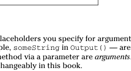


编写方法时为参数指定的占位符——例如 Output() 中的 someString——就是形参。通过形参传给方法的值是实参。在本书中，我或多或少会交替使用这些术语。

类似的想法是向程序传递参数。例如，你可能已经注意到，Main() 通常接受一个数组参数。

### 向方法传递多个参数

当我让女儿去洗车时，她通常给我的不止一个“争论理由”。因为她在沙发上有大把时间琢磨这事，所以能随时准备好几个。

你可以定义带有多个不同类型实参的方法。看看下面的示例方法 AverageAndDisplay()：


```csharp
// AverageAndDisplay -- Demonstrate argument passing.
using System;
namespace Example
{
    public class Program
    {
        public static void Main(string[] args)
        {
            // Access the member method.
            AverageAndDisplay("grade 1", 3.5, "grade 2", 4.0);
            // Wait for user to acknowledge.
            Console.WriteLine("Press Enter to terminate...");
```


```text
Console.Read();
}
// AverageAndDisplay -- Average two numbers with their
// labels and display the results.
public static void AverageAndDisplay(string s1, double d1,
                                     string s2, double d2)
{
    double average = (d1 + d2) / 2;
    Console.WriteLine("The average of " + s1
                    + " whose value is " + d1
                    + " and " + s2
                    + " whose value is " + d2
                    + " is " + average);
}
}
```

执行这个示例程序会生成以下输出：

```text
The average of grade 1 whose value is 3.5 and grade 2 whose value is 4 is 3.75
Press Enter to terminate...
```

方法 `AverageAndDisplay()` 声明了多个参数，这些参数的顺序就是调用时传递实参的顺序。

和往常一样，示例程序的执行从 `Main()` 之后的第一个语句开始。`Main()` 中第一个非注释行调用方法 `AverageAndDisplay()`，并传入两个字符串 "grade 1" 和 "grade 2" 以及两个 double 值 3.5 和 4.0。

方法 `AverageAndDisplay()` 计算传给它的两个 double 值 d1 和 d2 的平均值，同时使用包含在 s1 和 s2 中的名称，计算出的平均值存储在 average 中。


在方法内部更改参数的值可能导致混乱和错误，因此明智的做法是将该值赋给一个临时变量，然后改为修改这个临时变量。

## 参数定义与用法匹配

如果不使用命名参数调用方法，则方法调用中的每个实参都必须在类型和顺序上与方法定义匹配。下面这个（非法）示例会产生编译时错误：


```csharp
// AverageWithCompilerError -- This version does not compile!
using System;
namespace Example
{
    public class Program
    {
        public static void Main(string[] args)
        {
            // Access the member method.
            AverageAndDisplay("grade 1", "grade 2", 3.5, 4.0);
// Wait for user to acknowledge.
Console.WriteLine("Press Enter to terminate...");
Console.ReadLine();
}
// AverageAndDisplay -- Average two numbers with their
// labels and display the results.
public static void AverageAndDisplay(string s1, double d1,
                                     string s2, double d2)
{
    // var okay here, but it's really double.
    var average = (d1 + d2) / 2;
    Console.WriteLine("The average of " + s1
                    + " whose value is " + d1
                    + " and " + s2
                    + " whose value is " + d2
                    + " is " + average);
}
}
}
```

C# 无法将调用 `AverageAndDisplay()` 时每个实参的类型与方法定义中对应的参数匹配。字符串 "grade 1" 与方法定义中的第一个 string 参数匹配；然而，方法定义要求第二个参数是 double，而不是传入的字符串。

你很容易看出，我只是把第二个和第三个实参调换了位置。（这就是我对电脑的看法——它们太字面地理解我的话。我知道我说了什么，但我的*意思！*很明显。）

要解决这个问题，交换第二个和第三个实参。

## 重载方法并不意味着
给它太多任务

只要两个方法的参数不同，就可以在同一个类中给两个方法相同的名称——这称为方法名的*重载*。

这个示例演示了重载：


```csharp
// AverageAndDisplayOverloaded -- This version demonstrates that
// the AverageAndDisplay method can be overloaded.
using System;
namespace AverageAndDisplayOverloaded
{
    public class Program
    {
        public static void Main(string[] args)
        {
            // Access the first version of the method.
            AverageAndDisplay("my GPA", 3.5, "your GPA", 4.0);
            Console.WriteLine();
            // Access the second version of the method.
            AverageAndDisplay(3.5, 4.0);
            // Wait for user to acknowledge.
Console.WriteLine("Press Enter to terminate...");
Console.Read();
// AverageAndDisplay -- Average two numbers with their
// names and display the results
public static void AverageAndDisplay(string s1, double d1,
                                     string s2, double d2)
{
    double average = (d1 + d2) / 2;
    Console.WriteLine("The average of " + s1
                      + " whose value is " + d1);
    Console.WriteLine("and " + s2
                      + " whose value is " + d2
                      + " is " + average);
}
public static void AverageAndDisplay(double d1, double d2)
{
    double average = (d1 + d2) / 2;
    Console.WriteLine("The average of " + d1
                      + " and " + d2
                      + " is " + average);
}
```

## 第II部分
### 第3章

## 我们有了方法

这个程序定义了两个版本的 `AverageAndDisplay()`。程序通过传入适当的实参，先调用其中一个，再调用另一个。C# 通过将调用与方法定义进行比较，可以判断程序想要调用哪个方法。程序能正确编译，并在执行时生成以下输出：

```
The average of my GPA whose value is 3.5
and your GPA whose value is 4 is 3.75

The average of 3.5 and 4 is 3.75
Press Enter to terminate...
```

C# 通常不允许同一个类中的两个方法同名，除非这些方法的参数数量或类型不同（或者两者都不同）。因此，C# 能区分下面两个方法：

- AverageAndDisplay(string, double, string, double)
- AverageAndDisplay(double, double)

这样说来，就很清楚这两个方法是不同的。

## 实现默认参数

通常，你可能想提供方法的两个（或更多）版本：

- 复杂：提供完全的灵活性，但要求调用例程提供大量参数，其中一些用户甚至可能不理解。


用户这个词并不总是指程序的使用者。在实际中，提到方法的使用者时，往往指的是正在使用该方法的程序员。另一个术语是客户端（通常就是你）。

- **可接受（尽管有些平淡）：** 假定某些参数采用默认值。

你可以很容易地通过方法重载来实现默认参数。考虑下面这一对 DisplayRoundedDecimal() 方法：


```
// MethodsWithDefaultArguments -- Provide variations of the same methods,
// some with default arguments, by overloading the method name.
using System;
namespace MethodsWithDefaultArguments
{
    public class Program
    {
        public static void Main(string[] args)
        {
            // Access the member method.
            Console.WriteLine(DisplayRoundedDecimal(12.345678M, 3));
            // Wait for user to acknowledge.
            Console.WriteLine("Press Enter to terminate...");
            Console.Read();
        }
        // DisplayRoundedDecimal -- Convert a decimal value into a string
        // with the specified number of significant digits.
        public static string DisplayRoundedDecimal(decimal value,
            int numberOfSignificantDigits)
        {
            // First round off the number to the specified number
            // of significant digits.
            decimal roundedValue =
                decimal.Round(value,
                    numberOfSignificantDigits);
            // Convert that to a string.
            string s = Convert.ToString(roundedValue);
            return s;
        }
        public static string DisplayRoundedDecimal(decimal value)
        {
            // Invoke DisplayRoundedDecimal(decimal, int) specifying
            // the default number of digits.
            string s = DisplayRoundedDecimal(value, 2);
            return s;
        }
    }
}
```

DisplayRoundedDecimal(decimal, int) 方法将提供的 decimal 值转换为字符串，并保留指定的小数点后位数。由于 decimal 常用于显示货币值，最常见的选择是在小数点后保留两位数字。因此，DisplayRoundedDecimal(decimal) 方法提供相同的转换服务——但默认……的数量


有效数字保留两位，从而消除对第二个参数含义的任何担忧。


该方法的通用（decimal）版本会调用更具体的（decimal, int）版本来完成它的魔法。这种堆叠式方法调用很常见，因为它减少了重复。这些通用方法只是提供一些参数，程序员通常懒得去文档中查找这些参数，而且除非需要，否则也不应该去查找。


不得不为了解通常有默认值的参数含义而多余地查阅参考文档，会让程序员从手头的主要工作中分心——从而使工作更困难、浪费时间，并增加出错的可能性。

提供默认参数并不只是让懒惰的程序员少费一点点力气（编程需要高度集中注意力）。方法的作者理解参数之间的关系——因此有责任提供更友好、重载的方法版本。

Visual Basic、C 和 C++ 程序员应该习惯于直接在方法签名中为参数提供默认值。在 C# 4.0 发布之前，你在 C# 中做不到这一点。现在可以了。

例如，尽管像前一个示例那样重载方法是一种完全可接受的实现默认参数的方式，你也可以像在 Visual Basic 中那样，使用等号（=）来提供默认参数：

```csharp
// MethodsWithDefaultArguments2-- Provide optional parameters to a method
// to avoid overloading. It's another way to do the same thing.
using System;
namespace MethodsWithDefaultArguments2
{
    public class Program
    {
        public static void Main(string[] args)
        {
            // Access the member method.
            Console.WriteLine(DisplayRoundedDecimal(12.3456789, 3));
            // Wait for user to acknowledge.
            Console.WriteLine("Press Enter to terminate...");
            Console.Read();
        }
        // DisplayRoundedDecimal -- Convert a decimal value into a string
        // that has the specified number of significant digits. That argument
        // is optional and has a default value. If you call the method
        // without the second argument, it uses the default value.
        public static string DisplayRoundedDecimal(decimal value,
            int numberOfSignificantDigits = 2)
        {
            // First round off the number to the specified number
            // of significant digits.
            decimal roundedValue =
                decimal.Round(value,
                              numberOfSignificantDigits);
            // Convert that to a string.
            string s = Convert.ToString(roundedValue);
            return s;
        }
    }
}
```

微软为什么要做这些更改？答案是 COM。在 .NET 发布之前，组件对象模型（COM）是微软产品首选的架构范式，而且至今仍然相当普遍。（注意，我可没说它*流行*。）以 Office 为例，它完全是用 COM 开发的。COM 应用程序用 C++ 或 Visual Basic 6 及更早版本开发，而那些类中的方法允许使用可选参数。因此，不使用可选参数与 COM 通信可能会变得困难。为了解决这种不平衡，可选参数（以及许多其他特性）被加入到了 C# 4.0 中。


我在第 III 册中不厌其烦地介绍了命名参数和可选参数。

## 圣诞节后返回值

许多现实世界中的操作都会创建要返回给调用方的值。例如，`Sin()` 接受一个参数并返回三角函数正弦值。方法可以通过两种方式向调用方返回值——最常见的是通过 return 语句；不过，第二种方式使用*按引用调用*特性。

### 通过 return 寄回返回值

下面的代码片段演示了一个小方法，它返回其输入参数的平均值：

```csharp
public class Example
{
    public static double Average(double d1, double d2)
    {
        double average = (d1 + d2) / 2;
        return average;
    }
    public static void Main(string[] args)
    {
        double v1 = 1.0;
        double v2 = 3.0;
        double averageValue = Average(v1, v2);
        Console.WriteLine("The average of " + v1
                          + " and " + v2 + " is "
                          + averageValue);
        // This also works.
        Console.WriteLine("The average of " + v1
                          + " and " + v2 + " is "
                          + Average(v1, v2));
    }
}
```

## 第 II 册
### 第 3 章
### 我们有了方法

首先注意，我把该方法声明为 public static double Average()——名称前面的 double 表示 Average() 方法向调用方返回一个双精度值。

Average() 方法将名称 d1 和 d2 应用于传给它的 double 值。该方法创建一个变量 average，将 d1 和 d2 的平均值赋给它，并把 average 中包含的值返回给调用方。

人们有时会使用这种不严谨但常见的简略说法：“该方法返回 average。” 说 average 或任何其他变量在某个地方被传递或返回是不准确的。在这种情况下，返回给调用方的是 average 中包含的值。


从 Test() 方法中对 Average() 的调用看起来和任何其他方法调用一样；不过，Average() 通过 return 关键字返回的 double 值会存储在变量 averageValue 中。

像 Average() 这样返回值的方法，不能仅仅因为遇到方法的右花括号就返回给调用方。如果真是这样，C# 就不知道要返回哪个值。你需要一条 return 语句。


### 定义无返回值的方法

声明 public static double Average(double, double) 声明了一个方法 Average()，它将其参数的平均值作为 double 返回。（返回的数字最好确实是输入值的平均值，否则有人可得好好解释一番了。）

有些方法不需要向调用方返回值。前面 AverageAndDisplay() 方法的示例显示了其输入参数的平均值，但没有把该平均值返回给调用方。（这个想法也许并不好，但这不是我该质疑的。）与其让返回类型留空，你可以像下面这样声明 AverageAndDisplay() 这样的方法：

```
public void AverageAndDisplay(double, double)
```

在通常放置返回类型的位置，关键字 void 表示无类型。也就是说，声明 void 表示 AverageAndDisplay() 方法不向调用方返回任何值。（无论如何，每个方法声明都会指定返回类型，即使它是 void。）

void 方法不返回值。这个定义并不意味着该方法为空，也不意味着它用于医疗或航天目的；它仅仅指开头的关键字。相比之下，返回值的方法是非 void 方法。


非 void 方法必须通过执行一个 `return`，后跟要返回给调用方的值，将控制权交还给调用方。`void` 方法没有值可返回。`void` 方法在遇到不带值的 `return` 时返回。或者，默认情况下（如果不存在 `return`），当控制到达方法的右花括号时，`void` 方法会自动退出。

考虑下面这个 DisplayRatio() 方法：

```csharp
public class Example
{
    public static void DisplayRatio(double numerator,
                                    double denominator)
    {
        // If the denominator is zero . . .
        if (denominator == 0.0)
        {
            // . . . output an error message and . . .
            Console.WriteLine("The denominator of a ratio cannot be 0");
            // . . . return to the caller.
            return;    // An early return due to the error
        }
        // This code is executed only if denominator is nonzero.
        double ratio = numerator / denominator;
        Console.WriteLine("The ratio of " + numerator
                        + " over " + denominator
                        + " is " + ratio);
    }  // If the denominator isn't zero, the method exits here.
}
```

DisplayRatio() 方法检查分母值是否为零：

- **如果值为零：** 程序会显示一条错误消息并返回调用方，而不尝试计算比值。否则就会用零去除分子值，导致 CPU 处理器故障，也就是那个更形象的名称——处理器呕吐。
- **如果值非零：** 程序会显示比值。紧跟在 WriteLine() 之后的右花括号就是方法 DisplayRatio() 的右花括号，因此充当程序的返回点。

如果这就是唯一的区别，那也没什么值得大书特书的。然而，WriteLine() 的第二种形式还提供了许多对输出格式的控制。我在第 I 册第 3 章中介绍了这些格式控制。


## WriteLine() 方法

你可能已经注意到，本书前面程序示例中我使用的 WriteLine() 构造实际上只是一个由 Console 类调用的方法：

```
Console.WriteLine("this is a method call");
```

WriteLine() 是 .NET Framework 库提供的众多预定义方法之一。预定义的 Console 类指的是应用程序控制台（也称为命令提示符或命令窗口）。

我到目前为止使用的 WriteLine() 方法的参数是一个字符串。+ 运算符使程序员能够在将结果传递给 WriteLine() 之前组合字符串，或组合字符串和内置变量：

```
string s = "Sarah";
Console.WriteLine("My name is " + s + " and my age is " + 3);
```

在这种情况下，WriteLine() 看到的全部内容就是 "My name is Sarah and my age is 3."

WriteLine() 的第二种形式提供了更灵活的参数集：

```
Console.WriteLine("My name is {0} and my age is {1}", "Sarah", 3);
```

第一个参数是格式字符串。字符串 "Sarah" 会被插入到符号 {0} 出现的位置——0 指的是格式字符串之后的第一個参数。整数 3 会被插入到 {1} 标记的位置。这种形式比前一个示例更高效，因为字符串连接并没有看起来那么简单。这是一项耗时的操作。

## 第4章：关于这个，让我说说这个

### 本章内容

- ✔ 弄清楚如何将对象传递给方法
- ✔ 比较类方法和实例方法
- ✔ 理解 *这个* 是什么
- ✔ 在没有 *这个* 时该怎么做
- ✔ 当一个类没有你需要它拥有的方法时采取行动

本章从本迷你书第3章强调的静态方法转向类的非静态方法。静态方法属于整个类，而非静态方法属于从该类创建的每个实例。静态和非静态类成员之间存在重要差异。

### 向方法传递对象

你以与传递值类型变量相同的方式将对象引用作为参数传递给方法，只有一个区别：你总是按引用传递对象。

以下小型程序演示了如何将对象传递给方法——即传递给方法：


```csharp
// PassObject -- Demonstrate how to pass an object to a method.
using System;
namespace PassObject
{
    public class Student
    {
        public string name;
    }
    public class Program
    {
        public static void Main(string[] args)
        {
            Student student = new Student();
            // Set the name by accessing it directly.
            Console.WriteLine("The first time:");
            student.name = "Madeleine";
            OutputName(student);
            // Change the name using a method.
            Console.WriteLine("After being modified:");
            SetName(student, "Willa");
            OutputName(student);
            // Wait for user to acknowledge.
            Console.WriteLine("Press Enter to terminate...");
            Console.Read();
        }
        // OutputName -- Output the student's name.
        public static void OutputName(Student student)
        {
            // Output current student's name.
            Console.WriteLine("Student's name is {0}", student.name);
        }
        // SetName -- Modify the student object's name.
        public static void SetName(Student student, string name)
        {
            student.name = name;
        }
    }
}
```

程序创建一个仅包含姓名的学生对象。程序首先直接设置学生的姓名，并将 *学生对象* 传递给输出方法 `OutputName()`。`OutputName()` 显示其接收到的任何 Student 对象的姓名。

程序随后通过调用 `SetName()` 来更新学生的姓名。由于在 C# 中所有引用类型对象都是按引用传递的，对 student 所做的更改会在调用方法中保留。当 `Main()` 再次输出学生对象时，姓名已更改，如以下代码片段所示：

```text
The first time:
Student's name is Madeleine
After being modified:
Student's name is Willa
Press Enter to terminate...
```

`SetName()` 方法可以更改 Student 对象内的姓名并使其保持不变。


传递 *引用类型* 对象时，你不需要使用 `ref` 关键字。然而，其效果是对象的內容可以 *通过引用* 被修改。但是，如果 `SetName()` 尝试将其 Student 参数赋值为全新的 Student 对象，则不会影响方法外部的原始 Student 对象，如以下代码片段所示：

```csharp
Student student = new Student();
SetName(student, "Pam");
Console.WriteLine(student.name);  // Still "Pam"
...
// A revised SetName():
public static void SetName(Student student, string name)
{
    student = new Student(); // Doesn't replace student outside SetName().
    student.name = name;
}
```

## 定义方法

类应该收集描述现实世界对象或概念的元素。例如，Vehicle 类可能包含最大速度、重量和载重能力等数据元素。例如。然而，Vehicle 也有主动属性——行为——：启动和停止的能力等。这些主动属性由与该车辆数据相关的方法描述。这些方法与数据元素一样，都是 Vehicle 类的一部分。

### 定义静态方法

例如，你可以稍微改进上一节的程序：

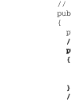

```csharp
// StudentClassWithMethods -- Demonstrate putting methods that
// operate on a class's data inside the class. A class is
// responsible for its own data and any operations on it.
using System;
namespace StudentClassWithMethods
{
    // Now the OutputName and SetName methods are members of
    // class Student, not class Program.
    public class Student
    {
        public string name;
        // OutputName -- Output the student's name.
        public static void OutputName(Student student)
        {
            // Output current student's name.
            Console.WriteLine("Student's name is {0}", student.name);
        }
        // SetName -- Modify the student object's name.
        public static void SetName(Student student, string name)
        {
            student.name = name;
        }
    }
    public class Program
    {
        public static void Main(string[] args)
        {
            Student student = new Student();
            // Set the name by accessing it directly.
            Console.WriteLine("The first time:");
            student.name = "Madeleine";
            Student.OutputName(student); // Method now belongs to Student.
            // Change the name using a method.
            Console.WriteLine("After being modified:");
            Student.SetName(student, "Willa");
            Student.OutputName(student);
            // Wait for user to acknowledge.
            Console.WriteLine("Press Enter to terminate...");
            Console.Read();
        }
    }
}
```

除了名称外，该程序与上一节的 `PassObject` 程序相比只有一个重大变化：我将 `OutputName()` 和 `SetName()` 方法放在了 `Student` 类中。


与其说“在”类中，许多程序员会说成员“在”类“上”。

由于这一改变，`Main()` 必须在调用 `SetName()` 和 `OutputName()` 时引用 `Student` 类。这些方法现在是 `Student` 类的成员，而不是 `Main()` 所在的 `Program` 类。

这一步很小但意义重大。将 `OutputName()` 放在类内可提高复用程度：需要显示对象的外部方法可以直接在类中找到 `OutputName()`。使用 `Student` 类的每个程序都不必分别编写它。

从哲学层面看，这个解决方案也更好。`Program` 类不应该担心如何初始化 `Student` 对象的姓名，也不应该担心如何输出重要材料。`Student` 类应该包含这些信息。_对象负责自身。_


事实上，`Main()` 本不应该首先将姓名初始化为 Madeleine。它应该调用 `SetName()` 代替。

在 `Student` 内部，一个成员方法可以在不显式应用类名的情况下调用另一个方法。`SetName()` 可以在无需引用类名的情况下调用 `OutputName()`。如果省略类名，C# 会假定正在访问的方法位于同一类中或在同一类上。

### 定义实例方法


尽管 `OutputName()` 和 `SetName()` 是静态方法，但它们同样可以是非静态的，或 _实例_ 方法。

类的所有静态成员都是 _类成员_，所有非静态成员都是 _实例成员_。这包括方法。

对象的非静态 _数据成员_ ——类的一个 _实例_ ——是通过对象而不是通过类访问的。因此，你可以说

```csharp
Student student = new Student(); // Create an instance of Student.
student.name = "Madeleine";       // Access the member via the instance.
```

C# 使你能够以相同的方式调用非静态成员方法：

```csharp
student.SetName("Madeleine");
```

下面的示例演示了这种技术：


```csharp
// InvokeMethod -- Invoke a member method through the object.
using System;
namespace InvokeMethod
{
    class Student
    {
        // The name information to describe a student
        public string firstName;
        public string lastName;
        // SetName -- Save name information. (Nonstatic.)
        public void SetName(string fName, string lName)
        {
            firstName = fName;
            lastName = lName;
        }
        // ToNameString -- Convert the student object into a
        // string for display. (Nonstatic.)
        public string ToNameString()
        {
            string s = firstName + " " + lastName;
            return s;
        }
    }
    public class Program
    {
        public static void Main()
        {
            Student student = new Student();
            student.SetName("Stephen", "Davis"); // Call instance method.
            Console.WriteLine("Student's name is"
                              + student.ToNameString());
            // Wait for user to acknowledge.
            Console.WriteLine("Press Enter to terminate...");
            Console.Read();
        }
    }
}
```

该程序的输出是这一简单的行：

```text
Student's name is Stephen Davis
```

除了名字短得多之外，该程序与之前的 `StudentClassWithMethods` 程序非常相似。此版本使用 *非静态* 方法来操作名字和姓氏。

程序首先创建一个新的 Student 对象 student。然后程序调用 `SetName()` 方法，该方法将两个字符串 "Stephen" 和 "Davis" 存储到数据成员 firstName 和 lastName 中。最后，程序调用成员方法 `ToNameString()`，该方法通过连接这两个字符串返回学生的姓名。

**第二卷**  
**第4章**  

*让我们谈谈这个*

再次查看 SetName() 方法，该方法更新 Student 对象中的名字和姓氏字段。要查看 SetName() 修改了哪个对象，请考虑以下示例：

```
Student christa = new Student();    // Here's one student.
Student sarah = new Student();      // And here's a completely different one.
christa.SetName("Christa", "Smith");
sarah.SetName("Sarah", "Jones");
```

第一次调用 SetName() 更新 christa 对象的名字和姓氏。第二次调用更新 sarah 对象。


因此，C# 程序员说方法在当前对象上操作。在第一次调用中，当前对象是 christa；在第二次调用中，它是 sarah。

## 扩展方法的全名

我对方法名称的描述存在一个微妙但重要的问题。要了解这个问题，请考虑以下示例代码片段：

```
public class Person
{
    public void Address()
    {
        Console.WriteLine("Hi");
    }
}
public class Letter
{
    string address;
    // Store the address.
    public void Address(string newAddress)
    {
        address = newAddress;
    }
}
```

随后对 Address() 方法的任何讨论现在变得模糊。Person 中的 Address() 方法与 Letter 中的 Address() 方法无关。如果我的程序员朋友告诉我访问 Address() 方法，他指的是哪一个 Address() 呢？

问题不在于方法本身，而是我的描述。事实上，并不存在独立的 Address() 方法——只有 Person.Address() 和 Letter.Address() 方法。将类名附加到方法名称的开头可以清楚地表明所指的方法。

这种描述与人们的名字非常相似。在我的家庭中，我被称为 Bill。（实际上，我的家人通常只是喊“喂”，但这只是一个例子。）我的家庭中没有其他 Bill（至少在我的近亲家庭中没有）。然而，我工作的地方还有另外两个 Bill。

如果我和同事一起吃午饭，而另外两个 Bill 不在场，名字 Bill 显然指的是我。回到战壕（或隔间）里，喊“Bill”是不明确的，因为它可能指我们中的任何一个。在那种情况下，你需要喊出“Bill Sempf”，而不是“Bill Davis”或“Bill Rogers”。

因此，你可以将 `Address()` 视为方法的名或昵称，其类作为姓氏。

## 访问当前对象

请考虑以下 `Student.SetName()` 方法：

> > **让我谈谈这个**
> >
> > 第二卷 第4章

```csharp
class Student
{
    // The name information to describe a student
    public string firstName;
    public string lastName;
    // SetName -- Save name information.
    public void SetName(string firstName, string lastName)
    {
        firstName = firstName;
        lastName = lastName;
    }
}
public class Program
{
    public static void Main()
    {
        Student student1 = new Student();
        student1.SetName("Joseph", "Smith");
        Student student2 = new Student();
        student2.SetName("John", "Davis");
    }
}
```

方法 `Main()` 使用 `SetName()` 方法先更新 `student1`，然后更新 `student2`。但你在 `SetName()` 本身内部看不到对任何 `Student` 对象的引用。事实上，没有对 `Student` 对象的引用。方法据说在“当前对象”上操作。方法如何知道哪个是当前对象？真正的当前对象请站起来？

答案很简单。当前对象作为隐式参数传递给方法的调用——例如：

```csharp
student1.SetName("Joseph", "Smith");
```

此调用等价于以下内容：

```csharp
Student.SetName(student1, "Joseph", "Smith"); // Equivalent call.
// (but this won't build properly).
```

我并不是说你可以以两种不同的方式调用 `SetName()`；只是说这两个调用在语义上是等价的。标识当前对象的对象——隐藏的第一个参数——被传递给方法，就像其他参数一样。把这项任务交给编译器。

隐式传递对象很容易接受，但从一个方法到另一个方法的引用呢？以下代码片段说明了从一个方法调用另一个方法：

```csharp
public class Student
{
    public string firstName;
    public string lastName;
    public void SetName(string firstName, string lastName)
    {
        SetFirstName(firstName);
        SetLastName(lastName);
    }
    public void SetFirstName(string name)
    {
        firstName = name;
    }
    public void SetLastName(string name)
    {
        lastName = name;
    }
}
```

在调用 `SetFirstName()` 时没有出现对象。当前对象继续从一次方法调用静默传递到下一次。从对象方法内部访问任何成员都被假定是相对于当前对象而言的。结果是方法“知道”它属于哪个对象。“当前对象”（或“当前实例”）意味着类似“我的”。

## `this` 关键字是什么？

与大多数参数不同，当前对象不会出现在方法参数列表中，因此程序员不会为其分配名称。相反，C# 将此对象分配了一个不太有创意的名称 `this`，在需要直接引用当前对象的少数情况下很有用。


C# 关键字 `this` 不能用于任何其他目的，至少在没有美国国家橄榄球联盟的明确书面许可的情况下不能使用。

因此你可以这样写之前的示例：

```csharp
public class Student
{
    public string firstName;
    public string lastName;
    public void SetName(string firstName, string lastName)
    {
        // Explicitly reference the "current object" referenced by this.
        this.SetFirstName(firstName);
        this.SetLastName(lastName);
    }
    public void SetFirstName(string name)
    {
        this.firstName = name;
    }
    public void SetLastName(string name)
    {
        this.lastName = name;
    }
}
```

注意关键字 this 的显式添加。将它添加到成员引用中不会增加任何内容，因为 this 是假定的。然而，当 Main() 进行以下调用时，this 在 SetName() 以及它可能调用的任何其他方法中都引用 student1：

```
student1.SetName("John", "Smith");
```

## this 何时是显式的？

你通常不需要显式引用 this，因为编译器在必要时会理解它。然而，有两种常见情况需要 this。你可能在初始化数据成员时需要它，如以下示例所示：

```
class Person
{
    public string name; // This is this.name below.
    public int id;      // And this is this.id below.
    public void Init(string name, int id) // These are method arguments.
    {
        this.name = name; // Argument names same as data member names
        this.id = id;
    }
}
```

Init() 方法的参数命名为 name 和 id，与相应数据成员的名称匹配。然后该方法易于阅读，因为你立即知道哪个参数存储在哪里。唯一的问题是参数列表中的名称 name 掩盖了数据成员的名称。编译器会对此抱怨。

添加 this 可以澄清所指的名称。在 Init() 中，名称 name 指的是方法参数，但 this.name 指的是数据成员。

你在存储当前对象以供以后使用或由其他方法使用时也需要 this。请考虑此程序示例 ReferencingThisExplicitly：


// ReferencingThisExplicitly -- Demonstrates how to explicitly use
// the reference to 'this'.
// using System;
namespace ReferencingThisExplicitly
{
    public class Program
    {
        public static void Main(string[] strings)
        {
            // Create a student.
            Student student = new Student();
            student.Init("Stephen Davis", 1234);
            // Now enroll the student in a course.
            Console.WriteLine
            ("Enrolling Stephen Davis in Biology 101");
            student.Enroll("Biology 101");
            // Display student course.
            Console.WriteLine("Resulting student record:");
            student.DisplayCourse();
            // Wait for user to acknowledge the results.
            Console.WriteLine("Press Enter to terminate...");
            Console.Read();
        }
    }
    // Student -- The class for university students.
    public class Student
    {
        // All students have a name and an id.
        public string _name;
        public int _id;
        // The course in which the student is enrolled
        CourseInstance _courseInstance;
        // Init -- Initialize the student object.
        public void Init(string name, int id)
        {
            this._name = name;
            this._id = id;
            _courseInstance = null;
        }
        // Enroll -- Enroll the current student in a course.
        public void Enroll(string courseID)
        {
            _courseInstance = new CourseInstance();
            _courseInstance.Init(this, courseID);   // Here's the explicit reference.
        }
        // Display the name of the student and the course.
        public void DisplayCourse()
        {
            Console.WriteLine(_name);
            _courseInstance.Display();
        }
    }
    // CourseInstance -- A combination of a student with
    // a university course.
    public class CourseInstance
    {
        public Student _student;
        public string _courseID;
        // Init -- Tie the student to the course.
        public void Init(Student student, string courseID)
        {
            this._student = student;
~~~csharp
        this._courseID = courseID;
    }
    // Display -- Output the name of the course.
    public void Display()
    {
        Console.WriteLine(_courseID);
    }
}
~~~

这个程序相当平凡。`Student` 对象有空间存放姓名、ID 以及一门大学课程的单个实例（不是一个勤奋的学生）。`Main()` 创建学生实例，然后调用 `Init()` 来初始化该实例。此时，`_courseInstance` 引用被设为 null，因为学生尚未注册课程。

`Enroll()` 方法通过用新对象初始化 `_courseInstance` 来注册学生。然而，`CourseInstance.Init()` 方法以 `Student` 实例作为第一个参数，课程 ID 作为第二个参数。你应该传递哪个 `Student`？显然，你需要传递当前的 `Student` —— 由 *this* 引用的 `Student`。（因此你可以说 `Enroll()` 将 *this* 学生注册到 `CourseInstance` 中。）

> > 第二部
> > 第四章
> >
> > 让我谈谈这个 This


一些程序员（包括我）喜欢通过在每个数据成员的名称前加下划线来更清晰地区分数据成员和其他变量，像这样：`_name`。你会看到我大多数时候都采用这种约定，但当然，这只是一种约定，你可以随意处理。如果你使用这种约定，就不需要用 *this* 来前缀该项，如 `this._id`。仅凭下划线前缀就完全没有歧义。

### 当没有 *this* 时会发生什么？

混合类（静态）方法和实例（非静态）方法就像混合牧羊人和牧场主一样。幸运的是，C# 为两者之间的这些问题提供了一些解决办法。要了解这个问题，请考虑这个程序片段 `MixingStaticAndInstanceMethods`：


~~~csharp
// MixingStaticAndInstanceMethods -- Mixing class (static) methods
//   and instance (nonstatic) methods can cause problems.
using System;
namespace MixingStaticAndInstanceMethods
{
    public class Student
    {
        public string _firstName;
        public string _lastName;
        // Init -- Initialize the student object.
        public void InitStudent(string firstName, string lastName)
        {
            _firstName = firstName;
            _lastName = lastName;
        }
    }
}
~~~

```csharp
// OutputBanner (static) -- Output the introduction.
public static void OutputBanner()
{
    Console.WriteLine("Aren't we clever:");
    // Console.WriteLine(" what student do we use ?"); // The problem!
}
// OutputBannerAndName (nonstatic) -- Output intro.
public void OutputBannerAndName()
{
    // The class Student is implied but no this
    // object is passed to the static method.
    OutputBanner();
    // The current Student object is passed explicitly.
    OutputName(this);
}
// OutputName -- Output the student's name.
public static void OutputName(Student student)
{
    // Here, the Student object is referenced explicitly.
    Console.WriteLine("Student's name is {0}", student.ToNameString());
}
// ToNameString -- Fetch the student's name.
public string ToNameString()
{
    // Here, the current object is implicit --
    // this could have been written:
    // return this._firstName + " " + this._lastName;
    return _firstName + " " + _lastName;
}
public class Program
{
    public static void Main(string[] args)
    {
        Student student = new Student();
        student.InitStudent("Madeleine", "Cather");
        // Output the banner and name statically.
        Student.OutputBanner();
        Student.OutputName(student);
        Console.WriteLine();
        // Output the banner and name again using instance.
        student.OutputBannerAndName();
        // Wait for user to acknowledge.
        Console.WriteLine("Press Enter to terminate...");
        Console.Read();
    }
}
```

从程序底部开始，从 Main() 开始，这样你就能更好地看到问题。程序首先创建 Student 对象并初始化其姓名。这个单例程序现在只想做一件事：输出前面加上简短消息和横幅的姓名。

Main() 首先使用类或静态方法的方式输出横幅和消息。程序调用 OutputBanner() 方法输出横幅行，并调用 OutputName() 方法输出消息和学生姓名。OutputBanner() 方法向控制台输出一条简单的

消息。Main() 将学生对象作为参数传递给 OutputName()，以便它可以显示学生的姓名。

接下来，Main() 通过调用 student.OutputBannerAndName() 使用实例方法的方式输出横幅和消息。

OutputBannerAndName() 首先调用静态方法 OutputBanner()。类 Student 被假定。没有对象被传递，因为静态 OutputBanner 不需要一个。接下来，OutputBannerAndName() 调用 OutputName() 方法。OutputName() 也是一个静态方法，但它接受一个 Student 对象作为参数。OutputBannerAndName() 将 this 作为该参数传递。

第二部
第四章

让我谈谈这个 This

一个更有趣的例子是 OutputName() 内部对 ToNameString() 的调用。OutputName() 被声明为静态，因此没有 this。它有一个显式的 Student 对象，用它来发起调用。

OutputBanner() 方法可能也想调用 ToNameString()；然而，它没有可用的 Student 对象。它没有 this 引用，因为它是一个静态方法，并且没有显式传递对象。请注意示例代码中第一条加粗的行：静态方法不能调用实例方法。


静态方法如果没有显式提供对象，就不能调用非静态方法。没有对象，就不能调用。一般来说，静态方法不能访问类中的任何非静态项。但非静态（实例）方法可以访问静态项以及实例项：静态数据成员和静态方法。


## 第5章：让类承担责任

### 本章内容

- 通过访问控制让类保护自身
- 介绍属性——一种特殊的方法
- 允许对象通过构造函数自行初始化
- 为同一个类定义多个构造函数
- 构造静态成员或类成员

类必须对自己的行为负责。正如微波炉不应该因为按错键就起火一样，类也不应在收到错误数据时就任由自己崩溃失效。

为了让类对自己的行为负责，类必须确保其初始状态正确，然后控制其后续状态以使其保持有效。C# 同时提供了这两种能力。

### 限制对类成员的访问

简单类将其所有成员都定义为 `public`。考虑一个 `BankAccount` 程序，它维护一个余额数据成员来保存每个账户的余额。将该数据成员设为 `public` 会让所有人都处于诚信制度之下。

我不知道你的银行如何，但我的银行可没那么大方，会留一堆钱和一本登记簿，让我每次往这堆钱里存钱或取钱时都记录下来。毕竟，我可能会忘记在登记簿上记录我的取款。

控制访问可以避免小错误，比如偶尔忘记记录一笔取款，并且还能设法避免取款方面的一些真正的大错误。

我完全知道你们这些过程式程序员在想什么：“只要定一条规则，让其他类不能直接访问余额数据成员，就这么简单。”这种方法在理论上可能行得通，但在实践中从来不行。人们一开始都怀着良好的意图（比如我打算工作


```csharp
// AccountNumber
public int GetAccountNumber()
{
    return _accountNumber;
}
public void SetAccountNumber(int accountNumber)
{
    this._accountNumber = accountNumber;
}
// Deposit -- Any positive deposit is allowed.
public void Deposit(double amount)
{
    if (amount > 0.0)
    {
        _balance += amount;
    }
}
// Withdraw -- You can withdraw any amount up to the
// balance; return the amount withdrawn.
public double Withdraw(double withdrawal)
{
    if (_balance <= withdrawal)
    {
        withdrawal = _balance;
    }
    _balance -= withdrawal;
    return withdrawal;
}
// GetString -- Return the account data as a string.
public string GetString()
{
    string s = String.Format("#{0} = {1:C}",
        GetAccountNumber(), GetBalance());
    return s;
}
```


在这个代码示例中，`_balance -= withdrawal` 等同于 `_balance = _balance - withdrawal`。（C# 程序员倾向于使用可用的最短写法。）

将成员标记为公开会使该成员可供程序中的任何其他代码使用。

`BankAccount` 类提供了一个 `InitBankAccount()` 方法来初始化类的成员，一个 `Deposit()` 方法来处理存款，以及一个 `Withdraw()` 方法来执行取款。`Deposit()` 和 `Withdraw()` 方法甚至提供了一些基本规则，例如“你不能存入负数”和“你不能取出超过账户余额的钱”（我相信你会同意，这两条对银行来说都是好规则）。然而，只要 `_balance` 可被外部方法访问，每个人就都处于诚信制度之下。（这里的“外部”指的是“在类外部，但在同一程序内”。）在由程序员团队编写的大型程序中，诚信制度可能会成为问题。考虑到人类普遍的易错性，它甚至可能成为你（和我）的问题。


编写良好的代码带有编译器能够强制执行的规则，可以让每个人免遭偶尔打中脚趾的子弹。

不过，在你过于兴奋之前，请注意这个程序无法构建。尝试构建会生成以下错误消息：

```
'BankAccount._balance' is inaccessible due to its protection level.
```

我不知道为什么它不直接说：“嘿，这是私有的，所以别碰。”语句 `ba._balance += 10;` 是非法的，因为 `_balance` 对 `Main()` 不可访问，而 `Main()` 是 `BankAccount` 类外部的方法。用 `ba.Deposit(10)` 替换这一行即可解决问题。`BankAccount.Deposit()` 方法是公开的，因此可供 `Main()` 以及程序的其他部分访问。


不显式声明类成员的访问类型，等同于将其声明为私有。

默认访问类型是私有的。不过，你应该加上 `private` 关键字以消除任何疑虑。优秀的程序员会明确表达自己的意图，这是减少错误的另一种方式。

### 提前了解——其他安全级别


理解本节需要你具备一些继承（见本迷你书的第6章）和命名空间（本迷你书的第10章）的知识。如果你愿意，可以暂时跳过本节，但只需知道当你需要时它就在这里。

C# 提供了以下安全级别：

- `public` 成员可由程序中的任何类访问。
- `private` 成员只能从当前类访问。
- `protected` 成员可从当前类及其任何子类访问。
- `internal` 成员可由同一程序模块或程序集中的任何类访问。


C# 的“模块”（即程序集）是单独编译的代码单元，它要么是 .EXE 文件中的可执行程序，要么是 .DLL 文件中的支持库模块。单个命名空间可以跨越多个程序集。（本迷你书的第10章解释了 C# 程序集和命名空间，并讨论了除公有和私有之外的访问级别。）

- `protected internal` 成员可从当前类及其任何子类访问，也可从同一模块内的类访问。

通过将成员声明为 `private` 来隐藏它，可提供最高级别的安全性。不过，在许多情况下，你并不需要那种级别的安全性。毕竟，子类的成员已经依赖于基类的成员，因此 `protected` 提供了合适的安全级别。

### 为什么应该关注访问控制

将类的内部成员声明为公开是个坏主意，至少有以下这些原因：

- **当所有数据成员都是公开的时，你无法轻易确定数据成员在何时以及如何被修改。** 为什么还要在 `Deposit()` 和 `Withdraw()` 方法中构建安全检查呢？事实上，为什么还要费心使用这些方法？任何类的任何方法都可以随时修改这些元素。如果其他方法能够访问这些数据成员，它们几乎肯定会这样做。
  
  你的 `BankAccount` 程序可能运行一个小时左右，你才会注意到其中一个账户出现了负余额。`Withdraw()` 方法本应确保这种情况不会发生，所以显然是另一个方法绕过了 `Withdraw()` 访问了余额。要弄清楚是哪个方法造成的、在什么条件下发生，是一个难题。

- **暴露类的所有数据成员会使接口过于复杂。** 作为使用 `BankAccount` 类的程序员，你不想了解类的内部运作。你只需要知道自己可以存款和取款。这就像一台有 50 个按钮的糖果机，与一台只有几个你需要的按钮的糖果机相比。

- **暴露内部元素会导致类规则分散。** 例如，我的 `BankAccount` 类在任何情况下都不允许余额为负。那条必需的*业务规则*应该被隔离在 `Withdraw()` 方法内。否则，你必须在更新余额的每个地方都添加这项检查。
  
  有时，银行决定修改规则，允许“优质客户”在短期内保持略微为负的余额，以避免意外透支。这时你就必须搜索整个程序，更新每一段访问余额的代码，以确保安全检查被修改。


让你的类和方法只具有必要的可访问性。我给出这个建议，与其说是让你对爱窥探的黑客产生偏执，不如说是建议你采取一个有助于在编码时减少错误的审慎步骤。如果可能，使用 `private`，然后根据需要提升为 `protected`、`internal`、`protected internal` 或 `public`。


## 访问器方法

如果你更仔细地查看 BankAccount 类，你会看到一些其他方法。其中一个 GetString()，返回适合向任何 Console.WriteLine() 展示的账户字符串版本。然而，如果其内容无法访问，显示 BankAccount 对象的內容可能会很困难。类应该有权决定如何显示自己。

另外，你会看到两个“getter”方法 GetBalance() 和 GetAccountNumber()，以及一个“setter”方法 SetAccountNumber()。你可能会想，为什么我要费心将像 _balance 这样的数据成员声明为 private，却提供一个公共的 GetBalance() 方法来返回其值。我有 *两个* 原因：

- ◆ GetBalance() **不提供修改 `_balance` 的方式——它仅返回其值。** 余额是只读的。用真实银行作类比，你可以随时查看余额；但你不能不使用银行的取款机制就从账户中取钱。
- ◆ GetBalance() **将类的内部格式隐藏在外部方法之外。** GetBalance() 可能通过读取收据、添加账户费用并核算银行可能想从余额中扣除的任何其他金额来进行大量计算。外部方法不知道也不关心。当然，你关心收取了哪些费用——除非换银行，否则你对此无能为力。

最后，GetBalance() 提供了一种在无需更改 BankAccount 使用者的情况下对类进行内部更改的机制。如果联邦存款保险公司（FDIC）要求你的银行以不同的方式存储存款，该要求不应改变你访问账户的方式。

## 访问控制的救援——一个示例

下面的 DoubleBankAccount 程序演示了 BankAccount 程序中的一个潜在缺陷。整个程序在我的网站上；然而，下面的列表仅显示 Main()——这是与之前的 BankAccount 程序不同的唯一部分：


```csharp
// DoubleBankAccount -- Create a bank account using a double variable
//     to store the account balance (keep the balance in a private
//     variable to hide its implementation from the outside world).
using System;
namespace DoubleBankAccount
{
    public class Program
    {
        public static void Main(string[] args)
        {
            // Open a bank account.
            Console.WriteLine("Create a bank account object");
            BankAccount ba = new BankAccount();
            ba.InitBankAccount();
            // Make a deposit.
            double deposit = 123.454;
            Console.WriteLine("Depositing {0:C}", deposit);
            ba.Deposit(deposit);
            // Account balance.
            Console.WriteLine("Account = {0}", ba.GetString());
            // Here's the problem.
            double fractionalAddition = 0.002;
            Console.WriteLine("Adding {0:C}", fractionalAddition);
            ba.Deposit(fractionalAddition);
            // Resulting balance.
            Console.WriteLine("Resulting account = {0}", ba.GetString());
            // Wait for user to acknowledge the results.
            Console.WriteLine("Press Enter to terminate...");
            Console.Read();
        }
    }
}
```

`Main()` 方法创建一个银行账户，然后存入 $123.454，这是一个包含小数分钱的金额。`Main()` 然后向余额存入一分钱的很小一部分并显示 resulting balance。

程序的输出如下所示：

```
Create a bank account object
Depositing $123.45
Account = #1001 = $123.45
Adding $0.00
Resulting account = #1001 = $123.46
Press Enter to terminate...
```

用户开始抱怨：“我就是无法将我的支票簿与银行对账单核对。” 就我个人而言，如果能凑到最近的 $100 我就很满意了，但有些人坚持他们的账户必须精确到分。显然，程序存在一个 bug。

问题当然是 $123.454 显示为 $123.45。为了避免这个问题，银行决定将存款和取款四舍五入到最近的分。存入 $123.454，银行就拿走那额外的 0.4 分。在另一边，银行放弃足够多的 0.4 金额，使得从长远来看一切都能平衡。好吧，理论上是这样。

解决舍入问题的最简单方法是將银行账户转换为 decimal 并使用 `Decimal.Round()` 方法，如此 `DecimalBankAccount` 程序所示：


```csharp
// DecimalBankAccount -- Create a bank account using a decimal
//     variable to store the account balance.
using System;
namespace DecimalBankAccount
{
    public class Program
    {
        public static void Main(string[] args)
        {
            // Open a bank account.
            Console.WriteLine("Create a bank account object");
            BankAccount ba = new BankAccount();
            ba.InitBankAccount();
            // Make a deposit.
            double deposit = 123.454;
            Console.WriteLine("Depositing {0:C}", deposit);
            ba.Deposit(deposit);
            // Account balance.
            Console.WriteLine("Account = {0}", ba.GetString());
            // Now add in a very small amount.
            double fractionalAddition = 0.002;
            Console.WriteLine("Adding {0:C}", fractionalAddition);
            ba.Deposit(fractionalAddition);
            // Resulting balance.
            Console.WriteLine("Resulting account = {0}", ba.GetString());
            // Wait for user to acknowledge the results.
            Console.WriteLine("Press Enter to terminate...");
            Console.Read();
        }
    }
    // BankAccount -- Define a class that represents a simple account.
    public class BankAccount
    {
        private static int _nextAccountNumber = 1000;
        private int _accountNumber;
        // Maintain the balance as a single decimal variable.
        private decimal _balance;
        // Init -- Initialize a bank account with the next
        //     account id and a balance of 0.
        public void InitBankAccount()
        {
            _accountNumber = ++_nextAccountNumber;
            _balance = 0;
        }
        // GetBalance -- Return the current balance.
        public double GetBalance()
        {
            return (double)_balance;
        }
        // AccountNumber
        public int GetAccountNumber()
        {
            return _accountNumber;
        }
        public void SetAccountNumber(int accountNumber)
        {
            this._accountNumber = accountNumber;
        }
        // Deposit -- Any positive deposit is allowed.
        public void Deposit(double amount)
        {
            if (amount > 0.0)
```

在这种情况下，唯一可能受影响的调用方法就是 Main()，但影响可能扩展到数十个访问银行账户的方法，而这些方法可能分布在数百个程序集中。 这些方法都不需要更改，因为修复在 BankAccount 类的范围内，其公共接口（其公共方法）在表面上没有改变。如果类的内部成员暴露给外部方法，就不可能实现这种解决方案。


对类的内部更改仍然需要对其他代码进行一些重新测试，即使你不需要修改该代码。

## 定义类属性

在上一节 BankAccount 程序中演示的 GetX() 和 SetX() 方法是访问方法，或简称为访问器。虽然在理论上它们代表良好的编程习惯，但在实践中访问方法可能会变得笨拙。例如，以下代码行是必要的来将 _accountNumber 增加 1：

```
SetAccountNumber(GetAccountNumber() + 1);
```

C# 定义了一种称为属性的构造，它使得使用访问方法比将其作为方法使用更容易。下面的代码片段定义了一个读写属性 AccountNumber（它既是 getter 也是 setter）：

```csharp
public int AccountNumber          // No parentheses here.
{
    get { return _accountNumber; }  // The "read" part. Curly braces and semicolon.
    set { _accountNumber = value; } // The "write" part. 'value' is a keyword.
}
```

get 部分在属性被读取时调用，而 set 部分在写入时被调用。下面的 Balance 属性是只读的，因为只有 get 部分被定义（使用较不紧凑的记法）：

```csharp
public double Balance
{
    get
    {
        return (double)_balance;
    }
}
```

使用时，这些属性如下所示：

```csharp
BankAccount ba = new BankAccount();
// Set the account number property.
ba.AccountNumber = 1001;
// Get both properties.
Console.WriteLine("#{0} = {1:C}", ba.AccountNumber, ba.Balance);
```


属性 AccountNumber 和 Balance 在形式和用法上都非常类似于公共数据成员。然而，属性使类能够保护内部成员（Balance 是只读属性）并隐藏其实现（底层 `_balance` 数据成员是私有的）。注意，Balance 执行了一次转换——它本可以执行任意数量的计算。属性不一定是单行代码。

按照约定，属性名以大写字母开头。注意属性没有括号：是 Balance，而不是 Balance()。

属性并非一定低效。C# 编译器可以优化简单的访问器，使其生成的机器代码与直接访问数据成员完全相同。这个概念不仅对应用程序重要，对 C# 本身也很重要。C# 库大量使用属性，你也应该这样做。

即使是在同一个类的方法中，也要使用属性来访问类的数据成员。

### 静态属性

静态（类）数据成员可以通过静态属性公开，如下面这个简单示例所示（注意其紧凑的布局）：

```csharp
public class BankAccount
{
    private static int _nextAccountNumber = 1000;
    public static int NextAccountNumber { get { return _nextAccountNumber; } }
    // . . .
}
```

NextAccountNumber 属性通过类按如下方式访问，因为它不是实例属性（它被声明为 static）：

```csharp
// Read the account number property.
int value = BankAccount.NextAccountNumber;
```

（在此示例中，value 不在属性的上下文中，因此它不是保留字。）

### 带副作用的属性

get 操作除了简单地检索关联属性外，还可以执行额外的工作，如下所示：

```csharp
public static int AccountNumber
{
    // Retrieve the property and set it up for the
    // next retrieval by incrementing it.
    get{ return ++_nextAccountNumber; }
}
```

此属性在返回结果之前递增静态账户号成员。然而，这可能不是一个好主意，因为属性的使用者除了实际读取属性之外，不会获得任何其他正在发生的线索。递增操作就是一种副作用。

与它们所模拟的访问器方法一样，属性不应改变类的状态，除非是设置数据成员的值。属性和方法通常都应避免副作用，因为它们可能导致微妙的 bug。要尽可能直接、明确地修改类。


### 让编译器为你编写属性

上一节描述的大多数属性都非常常规，编写它们很繁琐（虽然简单）：

```csharp
private string _name; // An underlying data member for the property
public string Name { get { return _name; } set { _name = value; } }
```

由于你反复编写同样的样板代码，自 C# 3.0 起，编译器现在替你完成了这项任务。对于前面的属性（包括私有数据成员），你只需编写这一行：

```csharp
public string Name { get; set; }
```

这行代码大致相当于：

```csharp
private string <somename>; // What's <somename>? Don't know or care.
public string Name { get { return <somename>; } set { <somename> = value; } }
```


编译器会创建一个无名的神秘数据成员，以及访问器的样板代码。csharp102.info 上的 AccessorPropertyShortcuts 示例说明了这种用法。这种风格鼓励你即使在包含该属性的类的其他成员中也使用该属性，因为你只知道属性名。因此，在编写简化属性时，必须同时具有 get 和 set。你可以使用属性语法来初始化此类属性：

```csharp
public int AnInt { get; set; } // Compiler provides a private variable.
...
AnInt = 2; // Initialize compiler-written instance variable via property.
```

### 带访问级别的访问器

访问器属性不一定非要声明为 public。你可以在任何适当的级别声明它们，甚至可以是 private，只要该访问器仅在其类内部使用即可。（接下来的示例将 Name 属性标记为 internal。）

你甚至可以单独调整访问器的 get 和 set 部分的访问级别。假设你不想在类外部公开 set 访问器——它仅供内部使用。你可以这样编写属性：

```csharp
internal string Name { get; private set; }
```

csharp102.info 上的 AccessorPropertyShortcuts 示例说明了这种用法。


## 让对象有一个良好的开端——构造函数


控制类访问只是问题的一半：一个对象要想成长，需要一个良好的开端。类可以提供应用程序调用的初始化方法，让一切得以启动，但应用程序可能会忘记调用该方法。类以垃圾数据开始，之后情况也不会好转。如果你想让类为此负责，就必须确保它有机会正确起步。

C# 通过为你调用初始化方法来解决这个问题——例如：

```csharp
MyObject mo = new MyObject();
```

换句话说，这条语句不仅从特殊内存区域获取一个对象，还会初始化该对象的成员。

请将类和对象这两个术语区分开来。Cat 是一个类。我的猫 Striper 是 Cat 类的一个对象。


### C# 提供的构造函数

C# 会跟踪变量是否已初始化，并且不允许你使用未初始化的变量。例如，以下代码块会产生编译时错误：

```csharp
public static void Main(string[] args)
{
    int n;
    double d;
    double calculatedValue = n + d;
}
```

C# 会跟踪到局部变量 n 和 d 未被赋值这一事实，并且不允许它们在表达式中使用。编译这个小程序会产生以下编译器错误：

```
Use of unassigned local variable 'n'
Use of unassigned local variable 'd'
```

相比之下，C# 提供了一个*默认构造函数*，它可以将对象的*数据成员*初始化为：

- 数值类型初始化为 0
- 布尔类型初始化为 false
- 对象引用初始化为 null

请看下面这个简单的程序示例：

```csharp
using System;
namespace Test
{
    public class Program
    {
        public static void Main(string[] args)
        {
            // First create an object.
            MyObject localObject = new MyObject();
            Console.WriteLine("localObject.n is {0}", localObject.n);
            if (localObject.nextObject == null)
            {
                Console.WriteLine("localObject.nextObject is null");
            }
            // Wait for user to acknowledge the results.
            Console.WriteLine("Press Enter to terminate...");
            Console.Read();
        }
    }
    public class MyObject
    {
        internal int n;
        internal MyObject nextObject;
    }
}
```

这个程序定义了一个类 `MyObject`，它包含一个 `int` 类型的简单数据成员 `n`，以及一个对象引用 `nextObject`（两者都声明为 `internal`）。`Main()` 方法创建一个 `MyObject`，然后显示 `n` 和 `nextObject` 的初始内容。

执行该程序的输出如下：

```
localObject.n is 0
localObject.nextObject is null
Press Enter to terminate...
```

当对象被创建时，C# 会执行一小段由编译器提供的代码来初始化对象及其成员。如果任由它们自行发展，数据成员 `localObject.n` 和 `nextObject` 将包含随机的垃圾值。


在创建值时执行初始化的代码就是*默认构造函数*。它“构造”类，即初始化其成员。这样，C# 确保对象一开始就处于已知状态：全为零。这个概念只影响类的数据成员，而不影响方法中的局部变量。

### 替换默认构造函数

尽管编译器会自动将所有实例变量初始化为零，但对于许多类（可能是大多数类），全零并不是有效的状态。请考虑本章前面出现的 BankAccount 类：

```csharp
public class BankAccount
{
    private int _accountNumber;
    private double _balance;
    // ... other members
}
```

虽然初始余额为 0 可能没问题，但账号为 0 绝对不是有效银行账户的标志。

在本书的这个阶段，BankAccount 类包含 `InitBankAccount()` 方法来初始化对象。然而，这种方法将过多的责任推给了使用该类的应用程序软件。如果应用程序没有调用 `InitBankAccount()` 方法，银行账户方法可能无法正常工作，而这并非它们自身的过错。


类不应该依赖像 `InitBankAccount()` 这样的外部方法来使对象以有效状态启动。

为了解决这个问题，你可以让类提供自己的显式*类构造函数*，这样 C# 在创建对象时会自动调用它。构造函数本可以命名为 `Init()`、`Start()` 或 `Create()`，但 C# *要求构造函数使用类的名称*。因此，BankAccount 类的构造函数如下所示：

```csharp
public void Main(string[] args)
{
    BankAccount ba = new BankAccount();  // This invokes the constructor.
}
public class BankAccount
{
    // Bank accounts start at 1000 and increase sequentially.
    private static int _nextAccountNumber = 1000;
    // Maintain the account number and balance for each object.
    private int _accountNumber;
    private double _balance;
    // BankAccount constructor -- Here it is -- ta-da!
    public BankAccount()  // Parentheses, possible arguments, no return type
```


```csharp
{
    _accountNumber = ++_nextAccountNumber;
    _balance = 0.0;
}
// ... other members . . .
}
```

BankAccount 构造函数的内容与原来的 `Init(...)` 方法的内容相同。不过，你声明和使用构造函数的方式有所不同：

- 构造函数始终与类同名。
- 构造函数可以带参数（也可以不带参数）。
- 构造函数永远没有返回类型，连 void 都没有。
- 创建对象时，`Main()` 不需要调用任何额外方法来初始化该对象；不需要 `Init()`。


如果你提供了自己的构造函数，C# 就不再提供默认构造函数。你的构造函数会取代默认构造函数，并成为创建该类实例的唯一方式。

## 构造某物

试一试构造函数这个东西。考虑以下程序 DemonstrateCustomConstructor：


```csharp
// DemonstrateCustomConstructor -- Demonstrate how you can replace the
//    C# default constructor with your own, custom constructor.
// Creates a class with a constructor and then steps through a few scenarios.
using System;
namespace DemonstrateCustomConstructor
{
    // MyObject -- Create a class with a noisy custom constructor
    //    and an internal data object.
    public class MyObject
    {
        // This data member is a property of the class (it's a static).
        private static MyOtherObject _staticObj = new MyOtherObject();
        // This data member is a property of each instance.
        private MyOtherObject _dynamicObj;
        // Constructor (a real chatterbox)
        public MyObject()
        {
            Console.WriteLine("MyObject constructor starting");
            Console.WriteLine("(Static data member constructed before " +
                              "this constructor)");
            Console.WriteLine("Now create nonstatic data member dynamically:");
            _dynamicObj = new MyOtherObject();
            Console.WriteLine("MyObject constructor ending");
        }
    }
    // MyOtherObject -- This class also has a noisy constructor but
    //    no internal members.
}
```

## 第II部分
第5章
**让类承担责任**

```csharp
public class MyOtherObject
{
    public MyOtherObject()
    {
        Console.WriteLine("MyOtherObject constructing");
    }
}
public class Program
{
    public static void Main(string[] args)
    {
        Console.WriteLine("Main() starting");
        Console.WriteLine("Creating a local MyObject in Main():");
        MyObject localObject = new MyObject();
        // Wait for user to acknowledge the results.
        Console.WriteLine("Press Enter to terminate...");
        Console.Read();
    }
}
```

执行这个程序会生成以下输出：

```text
Main() starting
Creating a local MyObject in Main():
MyOtherObject constructing
MyObject constructor starting
(Static data member constructed before this constructor)
Now create nonstatic data member dynamically:
MyOtherObject constructing
MyObject constructor ending
Press Enter to terminate...
```

以下步骤重现了刚才发生的情况：

- 1. **程序启动，`Main()` 输出初始消息，并宣布即将创建一个局部 `MyObject`。**

- 2. `Main()` **创建一个局部对象，其类型为** `MyObject`。

- 3. `MyObject` 包含类 `MyOtherObject` 的一个**静态成员** `_staticObj`。

所有静态数据成员都会在第一个 `MyObject()` 构造函数运行之前初始化。在本例中，C# 会先用一个新创建的 `MyOtherObject` 填充 `_staticObj`，然后把控制权交给 `MyObject` 构造函数。这一步对应输出的第三行。


- 4. **`MyObject` 的构造函数获得控制权。它输出初始消息，**`MyObject constructor starting`，**然后指出静态成员已经在**`MyObject()`**构造函数开始之前构造完成：**

```text
(Static data member constructed before this
    constructor)
```

- 5. 在输出“现在动态创建非静态数据成员”以表明其意图后，**`MyObject` 构造函数**使用 **`new` 运算符**创建类 `MyOtherObject` 的一个对象，从而在调用 **`MyOtherObject` 构造函数**时生成第二条 **`MyOtherObject` 构造消息**。

- 6. 控制权返回 `MyObject` 构造函数，然后返回 `Main()`。

干得漂亮！

## 从调试器执行构造函数

从调试器执行同一个程序会很有启发：

- 1. 重新生成程序：选择命令 `Build > Build DemonstrateCustomConstructor`。

你可能还需要将该项目设为启动项目：右键单击 `DemonstrateCustomConstructor` 项目，然后选择 **设为启动项目**。


- 2. 在从调试器开始执行程序之前，在 **`MyOtherObject` 构造函数**中的 `Console.WriteLine()` 调用处设置断点。

要设置断点，请单击编辑器窗口左侧的灰色槽中、与你想停下的行相邻的位置。

图5-1显示了我设置断点后的显示效果：暗色圆球位于槽中。

- 3. 不要选择 `Debug > Start Debugging`，而应选择 `Debug > Step Into`（或按 F11）。

你的菜单、工具栏和窗口应该会有一些变化，然后 `Main()` 中的左花括号上会出现明亮的黄色高亮。

- 4. 再按三次 F11，并轻轻将鼠标指针停在 `localObject` 变量上（不要单击）。

你即将调用 `MyObject` 构造函数。此时你的显示应如图5-2所示。你可以看到光标下的 `localObject` 当前为 `null`。Locals 窗口也显示相同内容。（如果 Locals 不可见，请选择 `Debug > Windows > Locals` 将其显示出来。）

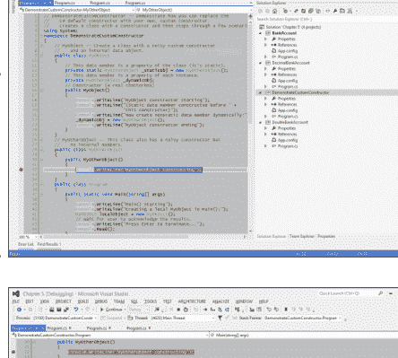

图5-1：
MyOtherObject 构造函数中的高亮表示存在断点。

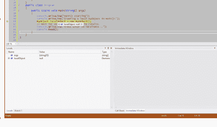

图5-2：
就在你跳入构造函数世界之前，Visual Studio 调试器的显示如下。

- 5. 再按一次 F11。

程序会执行到 MyOtherObject 中的断点，如图5-3中的黄色条所示。你是如何到达这一步的？`Main()` 中的最后一次调用调用了 MyObject 的构造函数。但在该构造函数开始执行之前，C# 会初始化 MyObject 类中的静态数据成员。该数据成员的类型是 MyOtherObject，因此初始化它就意味着调用其构造函数——这让你停在断点处。（如果没有断点，你不会看到调试器停在那里，尽管构造函数确实会执行，你可以通过检查构造函数消息是否出现在控制台窗口中来确认这一点。）

- 6. 再按两次 F11，你会停在静态数据成员 _staticObj 处，如图5-4所示。

你刚刚步出的正是该对象的构造函数。

- 7. 继续按 F11，单步执行整个程序。

第一次按 F11 时，你终于停在 MyObject 构造函数的开头。请注意，当 MyObject 构造函数创建另一个 MyOtherObject 数据成员 _dynamicObj（非静态的那个）时，你会第二次步入 MyOtherObject 构造函数。

记得继续执行回到 `Main()` 中的 `Console.Read()` 语句。查看控制台窗口后，你可以按 Enter 将其关闭。


图5-3：控制权在进入 MyObject 构造函数之前先传递到 MyOtherObject 构造函数。

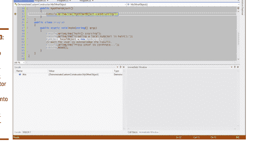

图5-4：
步出 MyOtherObject 构造函数后，你回到了调用该构造函数的位置。

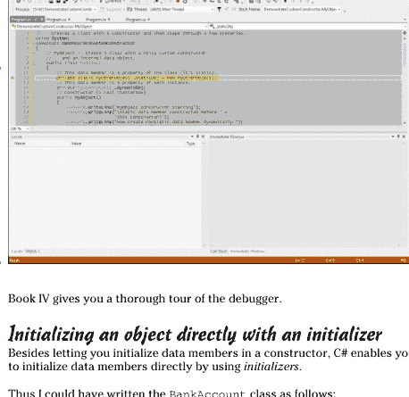

第IV部分将带你全面了解调试器。

## 使用初始化器直接初始化对象

除了允许你在构造函数中初始化数据成员外，C# 还允许你使用初始化器直接初始化数据成员。

因此，我本可以按如下方式编写 BankAccount 类：

```csharp
public class BankAccount
{
    // Bank accounts start at 1000 and increase sequentially.
    private static int _nextAccountNumber = 1000;
    // Maintain the account number and balance for each object.
    private int _accountNumber = ++_nextAccountNumber;
    private double _balance = 0.0;
    // . . . other members . . .
}
```

这就是初始化器的作用。_accountNumber 和 _balance 都在声明时被赋值，这与构造函数的效果相同，但不必在构造函数中完成这项工作。

要清楚到底发生了什么。你可能认为这条语句现在就把 _balance 设为 0.0。然而，_balance 只作为对象的一部分存在。因此，直到创建 BankAccount 对象时，这个赋值才会执行。事实上，每次创建对象时，这个赋值都会执行。


请注意，静态数据成员 _nextAccountNumber 在首次访问 BankAccount 类时初始化——正如你在调试器中的浏览过程所示，那正是你首次访问拥有该静态数据成员的对象的方法或属性（包括构造函数）的时候。

静态成员初始化之后，每次构造 BankAccount 实例时都不会重新初始化。这一点与非静态成员不同。

初始化器按照它们在类声明中出现的顺序执行。如果 C# 同时遇到初始化器和构造函数，那么初始化器会在构造函数体之前执行。

## 用初始化器观察构造过程

在 DemonstrateCustomConstructor 程序中，将 new MyOtherObject() 调用从 MyObject 构造函数移到声明本身，如下所示（见粗体文本），按所示修改第二个 WriteLine() 语句，然后重新运行程序：

```
public class MyObject
{
    // This member is a property of the class (it's static).
    private static MyOtherObject _staticObj = new MyOtherObject();
    // This member is a property of each instance.
    private MyOtherObject _dynamicObj = new MyOtherObject();  // <- Here.
    public MyObject()
    {
        Console.WriteLine("MyObject constructor starting");
        Console.WriteLine
        ("Both data members initialized before this constructor");
        // _dynamicObj construction was here, now moved up.
        Console.WriteLine("MyObject constructor ending");
    }
}
```

将修改后程序的以下输出与其前身 DemonstrateCustomConstructor 的输出进行比较：

```
Main() starting
Creating a local MyObject in Main():
MyOtherObject constructing
MyOtherObject constructing
MyObject constructor starting
(Both data members initialized before this constructor)
MyObject constructor ending
Press Enter to terminate...
```


你可以在网站上找到完整程序（完成这些更改之后），它有一个显赫的名字：DemonstrateConstructorWithInitializer。

## 初始化没有构造函数的对象

假设你有一个用来表示 Student 的小类：

```
public class Student
{
    public string Name { get; set; }
    public string Address { get; set; }
    public double GradePointAverage { get; set; }
}
```

Student 对象有三个公共属性：Name、Address 和 GradePointAverage，它们指定学生的基本信息。

通常，当你创建新的 Student 对象时，必须像这样初始化其 Name、Address 和 GradePointAverage 属性：

```
Student randal = new Student();
randal.Name = "Randal Sphar";
randal.Address = "123 Elm Street, Truth or Consequences, NM 00000";
randal.GradePointAverage = 3.51;
```

（是的，弗吉尼亚，新墨西哥州确实有个地方叫 Truth or Consequences。我的侄子 Randal 就出生在那里。）

如果 Student 有构造函数，你可以这样做：

```
Student randal = new Student
    ("Randal Sphar", "123 Elm Street, Truth or Consequences, NM, 00000", 3.51);
```

然而遗憾的是，Student 除了 C# 自动提供的默认构造函数（不接受任何参数）之外，并没有其他构造函数。


在 C# 3.0 及更高版本中，你可以用某种看起来可疑地像构造函数的东西来简化该初始化——嗯，算是吧：

```
Student randal = new Student
{
    Name = "Randal Sphar",
    Address = "123 Elm Street, Truth or Consequences, NM 00000",
    GradePointAverage = 3.51
};
```

最后两个示例在这一点上有所不同：第一个使用构造函数，显示的是包含两个字符串和一个 double 值、以逗号分隔的圆括号；第二个使用新的对象初始化器语法，取而代之的是包含三个以逗号分隔的赋值语句的花括号。该语法的用法大致如下：

```
new LatitudeLongitude
{
    assignment to Latitude, assignment to Longitude
};
```

新语法简洁得多：一条语句对三条语句。而且，它还简化了创建那些不允许通过构造函数进行初始化的已初始化对象的过程。（我把 Student 示例拆成多行只是为了适应页面——而且只是因为 Truth or Consequences 这个名字很长。如果你住在那儿，它看起来还会更长。）

新的对象初始化器语法除了带来便利之外，并没有给你带来太多别的东西，但在编码时，便利性在每位程序员的清单上都名列前茅。简洁性也是如此。此外，当你读到匿名类时，这个特性会变得至关重要。

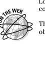

尽情使用新的对象初始化器语法吧。在本书余下部分，我自己也经常使用它。

在“帮助”中查找术语 object initializer，以找到关于它适用于哪些类型属性的法律条文式措辞。


网站上的 ObjectInitializers 程序示例演示了对象初始化器。

## 第 6 章：继承：我能得到的就这些吗？

### 本章内容

- ✓ 依据另一个更基础的类来定义一个类
- ✓ 区分“是”（is a）与“拥有”（has a）关系
- ✓ 用一个类对象替换另一个类对象
- ✓ 构造静态成员或实例成员
- ✓ 在继承层次结构中包含构造函数
- ✓ 显式调用基类构造函数

面向对象编程基于四项原则：控制访问的能力（封装）、从其他类继承、做出恰当响应（多态），以及间接地从一个对象引用另一个对象（接口）。

继承是一个常见的概念。我是人类，除非我刚醒来的时候。我从 Human 类继承某些属性，比如我多少还行的交谈能力，以及我对空气、食物和含大量咖啡因的碳水化合物饮料的依赖。Human 类从 Mammal 类继承对空气、水和营养的依赖，而 Mammal 类又从 Animal 类继承。

传递属性的能力是一种强大的能力。你可以用它以经济的方式描述事物。例如，如果我儿子问：“鸭子是什么？”我可以说：“是一种嘎嘎叫的鸟。”不管你信不信，这个回答传达了相当多的信息。我儿子知道鸟是什么，现在他知道了鸭子具有鸟的所有相同特征，再加上鸭子额外的“嘎嘎叫”特性。

面向对象语言通过允许一个类继承另一个类的属性来表达这种继承关系。这一特性使面向对象语言能够生成比不支持继承的语言所生成的模型更接近真实世界的模型。

### 类继承

在下面的 InheritanceExample 程序中，SubClass 类继承自 BaseClass 类：


```csharp
// InheritanceExample -- Provide the simplest possible
//      demonstration of inheritance.
using System;
namespace InheritanceExample
{
    public class BaseClass
    {
        public int _dataMember;
        public void SomeMethod()
        {
            Console.WriteLine("SomeMethod()");
        }
    }
    public class SubClass : BaseClass
    {
        public void SomeOtherMethod()
        {
            Console.WriteLine("SomeOtherMethod()");
        }
    }
    public class Program
    {
        public static void Main(string[] args)
        {
            // Create a base class object.
            Console.WriteLine("Exercising a base class object:");
            BaseClass bc = new BaseClass();
            bc._dataMember = 1;
            bc.SomeMethod();
            // Now create a subclass object.
            Console.WriteLine("Exercising a subclass object:");
            SubClass sc = new SubClass();
            sc._dataMember = 2;
            sc.SomeMethod();
            sc.SomeOtherMethod();
            // Wait for user to acknowledge the results.
            Console.WriteLine("Press Enter to terminate...");
            Console.Read();
        }
    }
}
```

BaseClass 类定义了一个数据成员和简单方法 SomeMethod()。Main() 创建并演练 BaseClass 对象 bc。

SubClass 类通过在类定义中的冒号后放置类名 BaseClass 来继承该类：

```csharp
public class SubClass : BaseClass
```


## 第二卷，第 6 章——继承：我能得到的就这些吗？

### 继承很神奇

为了理解周围环境，人类构建了庞大的分类体系。例如，Fido 是狗的一个特例，狗是犬科动物的一个特例，犬科动物是哺乳动物的一个特例——如此类推。这种对事物进行分类的能力塑造了人类对世界的理解。

在 C# 这样的面向对象语言中，你会说类 `Student` 继承自类 `Person`。你还会说 `Person` 是 `Student` 的基类，而 `Student` 是 `Person` 的子类。最后，你会说 `Student` IS_A `Person`。（使用全大写字母和下划线是表达这种独特关系的常见方式——这个概念可不是我编出来的。）

注意，IS_A 关系不是自反的：虽然 `Student` IS_A `Person`，但反过来并不成立。`Person` IS_NOT_A `Student`。这样的陈述总是指一般情况。某个特定的 `Person` 实际上可能是 `Student`——但许多属于 `Person` 类的个体并不是 `Student` 类的成员。此外，`Student` 类具有一些不与 `Person` 类共享的属性。例如，`Student` 有平均绩点，而普通的 `Person` 则乐得没有。

继承关系具有传递性。例如，如果我将一个新类 `GraduateStudent` 定义为 `Student` 的子类，那么 `GraduateStudent` 也是一个 `Person`。它必然如此：如果一个 `GraduateStudent` IS_A `Student`，并且一个 `Student` IS_A `Person`，那么一个 `GraduateStudent` IS_A `Person`。

`SubClass` 获得 `BaseClass` 的所有成员作为自己的成员，再加上它可能添加到这一堆中的任何成员。`Main()` 演示了 `SubClass` 现在拥有一个数据成员 `_dataMember` 和一个成员方法 `SomeMethod()`，并与这个家族的全新成员——小方法 `SomeOtherMethod()`——会合，而这也是多么令人愉快啊。

该程序产生以下预期输出（每当我的某个程序按预期工作时，我通常都会有点惊讶）：

```
Exercising a base class object:
SomeMethod()
Exercising a subclass object:
SomeMethod()
SomeOtherMethod()
Press Enter to terminate...
```

### 为什么需要继承

继承具有若干重要功能。例如，你可能会认为继承减少了输入量。在某种程度上确实如此——在描述 `Student` 类时，你不需要重复 `Person` 的属性。一个更重要且相关的问题是那个重要流行词*复用*。软件科学家早就知道，每个新项目都从头开始并重新构建相同的软件组件，意义不大。

将软件开发中的情况与其他行业的情况相比较。想一想有多少汽车制造商会先制造自己的扳手和螺丝刀，然后再制造汽车。在那些这样做的制造商中，估计有多少会完全从头开始，为下一个车型制造所有新工具。其他行业的从业者发现，从现有的螺钉、螺栓、螺母，甚至电机和压缩机等更大的现成组件开始，比从头开始更有意义。

继承使你能够调整现有的软件组件。你可以让现有类适应新的应用，而无需进行内部修改。现有类被继承到——或者，正如程序员常说的，被*扩展*为——一个新的子类中，该子类包含必要的添加和修改。如果基类是别人编写的，你可能无法修改它，因此继承可以救场。

这种能力还带来了继承的第三个好处。假设你继承——扩展——一个现有类。后来，你发现基类有一个必须修正的 bug。如果你为了复用它而修改了该类，就必须在每个应用中分别手动检查、修正并重新测试该 bug。如果你继承该类时没有做更改，通常就可以轻松地将更新后的类放入另一个应用中。

但继承最大的好处在于，它描述了生活的本来方式。事物彼此继承属性。这是无法回避的。（*够了！*——正如我的意大利祖母会说的那样。）

### 从 BankAccount 类继承（一个更复杂的示例）

银行维护多种类型的账户。其中一种类型是储蓄账户，它具有简单银行账户的所有属性，还具备累积利息的能力。下面的 `SimpleSavingsAccount` 程序在 C# 中为这种关系建模。


网站上的这个程序版本包含本章下一节的一些修改，因此与这里显示的代码清单略有不同。


```csharp
// SimpleSavingsAccount -- Implement SavingsAccount as a form of
//    bank account; use no virtual methods.
using System;
namespace SimpleSavingsAccount
{
    // BankAccount -- Simulate a bank account, each of which
    //    carries an account ID (which is assigned
    //    on creation) and a balance.
    public class BankAccount    // The base class
    {
        // Bank accounts start at 1000 and increase sequentially.
        public static int _nextAccountNumber = 1000;
        // Maintain the account number and balance for each object.
        public int _accountNumber;
        public decimal _balance;
        // Init -- Initialize a bank account with the next account ID and the
        //    specified initial balance (default to zero).
        public void InitBankAccount()
        {
            InitBankAccount(0);
        }
        public void InitBankAccount(decimal initialBalance)
        {
            _accountNumber = ++_nextAccountNumber;
            _balance = initialBalance;
        }
        // Balance property.
        public decimal Balance
        {
            get { return _balance; }
        }
        // Deposit -- any positive deposit is allowed.
        public void Deposit(decimal amount)
        {
            if (amount > 0)
            {
                _balance += amount;
            }
        }
        // Withdraw -- You can withdraw any amount up to the
        //    balance; return the amount withdrawn.
        public decimal Withdraw(decimal withdrawal)
        {
            if (Balance <= withdrawal) // Use Balance property.
            {
                withdrawal = Balance;
            }
            _balance -= withdrawal;
            return withdrawal;
        }
        // ToString - Stringify the account.
        public string ToBankAccountString()
        {
            return String.Format("{0} - {1:C}",
                _accountNumber, Balance);
        }
    }

    // SavingsAccount -- A bank account that draws interest
    public class SavingsAccount : BankAccount    // The subclass
    {
        public decimal _interestRate;

        // InitSavingsAccount -- Input the rate expressed as a
        // rate between 0 and 100.
        public void InitSavingsAccount(decimal interestRate)
        {
            InitSavingsAccount(0, interestRate);
        }
        public void InitSavingsAccount(decimal initialBalance, decimal interestRate)
        {
            InitBankAccount(initialBalance); // Note call to base class.
            this._interestRate = interestRate / 100;
        }

        // AccumulateInterest -- Invoke once per period.
        public void AccumulateInterest()
        {
            _balance = Balance + (decimal)(Balance * _interestRate);
        }

        // ToString -- Stringify the account.
        public string ToSavingsAccountString()
        {
            return String.Format("{0} ({1})",
                ToBankAccountString(), _interestRate * 100);
        }
    }

    public class Program
    {
        public static void Main(string[] args)
        {
            // Create a bank account and display it.
            BankAccount ba = new BankAccount();
            ba.InitBankAccount(100M); // M suffix indicates decimal.
            ba.Deposit(100M);
            Console.WriteLine("Account {0}", ba.ToBankAccountString());

            // Now a savings account
            SavingsAccount sa = new SavingsAccount();
            sa.InitSavingsAccount(100M, 12.5M);
            sa.AccumulateInterest();
            Console.WriteLine("Account {0}", sa.ToSavingsAccountString());

            // Wait for user to acknowledge the results.
            Console.WriteLine("Press Enter to terminate...");
            Console.Read();
        }
    }
}
```

`BankAccount` 类与本书其他章节中出现的一些类并无不同。它以一个重载的初始化方法 `InitBankAccount()` 开始：一个用于具有初始余额的账户，另一个用于初始余额为零即可满足的账户。注意，这个版本的 `BankAccount` 没有利用最新最先进的构造函数进展。如果你读完整章，并看到我在 `BankAccount` 的最终版本中清理了这个主题，那么你就能明白我为什么选择在这里“退后”一点。

`Balance` 属性允许其他人读取余额，但不允许他们修改余额。`Deposit()` 方法接受任何正存款。`Withdraw()` 允许你取出任意金额，只要你有


```csharp
sa.InitSavingsAccount(12.5m);
DirectDeposit(sa, 100m);
sa.AccumulateInterest();
Console.WriteLine($"Account {0}", sa.ToSavingsAccountString());
// Wait for user to acknowledge the results.
Console.WriteLine("Press Enter to terminate...");
Console.Read();
}
}
```

实际上，一切都没有改变。唯一真正的区别是，现在所有的存款都是通过本地方法`DirectDeposit()`进行的，而该方法不属于`BankAccount`类。该方法的参数是银行账户和存款金额。


注意（精彩部分来了），`Main()`可以将银行账户或储蓄账户传递给`DirectDeposit()`，因为储蓄账户IS_A（是一种）银行账户，并且被赋予所有相同的权利和特权。由于SavingsAccount IS_A BankAccount，你可以将SavingsAccount赋值给BankAccount类型的变量或方法参数。

## 通过包含关系访问BankAccount

类SavingsAccount可以通过另一种方式访问BankAccount的成员，如下面的代码所示，其中关键行以粗体显示：

```csharp
// SavingsAccount -- A bank account that draws interest
public class SavingsAccount_    // Notice the underscore: this isn't
                                // the SavingsAccount class.
{
    public BankAccount _bankAccount;  // Notice this, the contained BankAccount.
    public decimal _interestRate;
    // InitSavingsAccount -- Input the rate expressed as a
    //    rate between 0 and 100.
    public void InitSavingsAccount(BankAccount bankAccount, decimal interestRate)
    {
        this._bankAccount = bankAccount;
        this._interestRate = interestRate / 100;
    }
    // AccumulateInterest -- Invoke once per period.
    public void AccumulateInterest()
    {
        _bankAccount._balance = _bankAccount.Balance
            + (_bankAccount.Balance * _interestRate);
    }
    // Deposit -- Any positive deposit is allowed.
    public void Deposit(decimal amount)
    {
        // Delegate to the contained BankAccount object.
        _bankAccount.Deposit(amount);
    }
    // Withdraw -- You can withdraw any amount up to the
// balance; return the amount withdrawn.
public double Withdraw(decimal withdrawal)
{
    return _bankAccount.Withdraw(withdrawal);
}
```

在这种情况下，类SavingsAccount_包含一个数据成员_bankAccount（而不是继承自BankAccount）。_bankAccount对象包含储蓄账户所需的余额和账号信息。SavingsAccount_类保留储蓄账户特有的数据，并在需要时委托给所包含的BankAccount对象。也就是说，当SavingsAccount需要，比如余额时，它会向所包含的BankAccount请求。

在这种情况下，我们说SavingsAccount_ HAS_A（有一个）BankAccount。硬核面向对象程序员会说SavingsAccount组合（composes）了一个BankAccount。也就是说，SavingsAccount部分由一个BankAccount构成。

## HAS A（有一个）关系

HAS_A关系与IS_A关系有本质区别。在下面的应用程序代码片段示例中，这种区别似乎并不那么糟糕：

```
// Create a new savings account.
BankAccount ba = new BankAccount();
SavingsAccount_ sa = new SavingsAccount_(); // HAS_A version of SavingsAccount
sa.InitSavingsAccount(ba, 5);
// And deposit 100 dollars into it.
sa.Deposit(100M);
// Now accumulate interest.
sa.AccumulateInterest();
```

问题是，这个修改后的SavingsAccount_不能用作BankAccount，因为它不继承自BankAccount。相反，它包含一个BankAccount——这不是同一个概念。例如，以下代码示例会失败：

```
// DirectDeposit -- Deposit my paycheck automatically.
void DirectDeposit(BankAccount ba, int pay)
{
    ba.Deposit(pay);
}
void SomeMethod()
{
    // The following example fails.
    SavingsAccount_ sa = new SavingsAccount_();
    DirectDeposit(sa, 100);
    // . . . continue . . .
}
```


`DirectDeposit()`不能接受`SavingsAccount`来代替`BankAccount`。就C#而言，两者之间不存在明显的关系，因为不涉及继承。不过，不要认为这种情况使包含关系成为一个坏主意。你只需要以稍微不同的方式来看待这个概念，以便使用它。

## 何时使用IS_A，何时使用HAS_A

IS_A和HAS_A关系之间的区别不仅仅是软件便利性的问题。这种关系在现实世界中也有相应的体现。

例如，一辆福特探险者IS_A（是一辆）汽车（当然是在它正常行驶的时候）。一辆探险者HAS_A（有一个）发动机。如果你的朋友说“开你的车过来”，而你开着一辆探险者出现，他没有理由抱怨。然而，如果你抱着探险者的发动机出现，他可能会抱怨。（或者至少你会抱怨。）

类`Explorer`应该继承类`Car`，这不仅是为了让`Explorer`能够访问`Car`的方法，也是为了表达两者之间的基本关系。

不幸的是，初学者程序员可能让`Car`继承`Motor`，作为一种简单的方式，让`Car`类访问`Motor`的成员，而`Car`需要这些成员才能运行。例如，`Car`可以继承`Motor.Go()`方法。然而，这个例子突显了这种方法的一个问题：即使人们说话不严谨，让汽车行驶和让发动机运转也不是一回事。汽车的“行驶”操作当然依赖于发动机的“运转”，但它们不是一回事——你还需要挂挡、松开刹车，并完成其他任务。


也许更重要的是，继承`Motor`歪曲了事实。汽车根本不是一种发动机。

软件的优雅本身就是一个值得追求的目标。它能增强可理解性、可靠性和可维护性（还能治愈消化不良和痛风）。

硬核面向对象程序员建议在更简单的程序设计中优先使用HAS_A而不是IS_A。但在合理的情况下使用继承，就像在BankAccount层次结构中可能那样。

```
// If the object is a SavingsAccount, collect interest now.
SavingsAccount savingsAccount = (SavingsAccount)bankAccount;
savingsAccount.AccumulateInterest();
}
public static void TestCast()
{
    SavingsAccount sa = new SavingsAccount();
    ProcessAmount(sa);
    BankAccount ba = new BankAccount();
    ProcessAmount(ba);
}
```

`ProcessAmount()`执行一些操作，包括调用`AccumulateInterest()`方法。必须将ba转换为SavingsAccount，因为bankAccount参数被声明为BankAccount。程序可以正确编译，因为所有类型转换都是通过显式转换进行的。

从`TestCast()`内部第一次调用`ProcessAmount()`一切正常。SavingsAccount对象sa被传递给`ProcessAmount()`方法。从BankAccount到SavingsAccount的转换没有问题，因为ba对象本来就是SavingsAccount。

然而，第二次调用`ProcessAmount()`就不那么幸运了。不允许转换为SavingsAccount。ba对象没有`AccumulateInterest()`方法。

不正确的转换会在程序执行过程中产生错误（以异常形式出现的运行时错误）。运行时错误比编译时错误更难发现和修复。更糟糕的是，它们可能发生在除你之外的用户身上，而用户往往会对此感到不满。

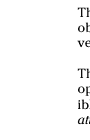

## 使用is运算符避免无效转换

如果`ProcessAmount()`方法能在执行转换之前确保传递给它的对象是SavingsAccount对象，那么它就能正常工作。C#为此提供了两个关键字：is和as。

is运算符在左侧接受一个对象，在右侧接受一个类型。如果左侧对象的运行时类型与右侧类型兼容，则is运算符返回true。在尝试转换之前，使用它来验证转换是否合法。

你可以使用is运算符修改上一节中的示例，以避免运行时错误：

```
public static void ProcessAmount(BankAccount bankAccount)
{
    // Deposit a large sum to the account.
    bankAccount.Deposit(10000.00M);
```


```csharp
// If the object is a SavingsAccount . . .
if (bankAccount is SavingsAccount)
{
    // . . . then collect interest now (cast is guaranteed to work).
    SavingsAccount savingsAccount = (SavingsAccount)bankAccount;
    savingsAccount.AccumulateInterest();
}
// Otherwise, don't do the cast -- but why is BankAccount not what
// you expected? This could be an error situation.
}
public static void TestCast()
{
    SavingsAccount sa = new SavingsAccount();
    ProcessAmount(sa);
    BankAccount ba = new BankAccount();
    ProcessAmount(ba);
}
```

新增的 if 语句检查 bankAccount 对象以确保它属于 SavingsAccount 类。第一次调用 ProcessAmount() 时，is 运算符返回 true。然而在第二次调用时传入一个 BankAccount 对象，is 运算符返回 false，从而避免了非法转换。此版本的程序不会产生运行时错误。

一方面，我强烈建议你使用 is 运算符保护所有转换，以避免运行时错误的可能性。另一方面，如果可能的话，你应该完全避免转换。

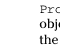

第二部
第 6 章
继承：
就这样吗？

## 使用 as 运算符避免无效转换

as 运算符的工作方式与 is 略有不同。它不会返回一个布尔值来表示转换是否可行，而是将左侧的类型转换为右侧的类型，但如果转换失败则安全地返回 null——而不是引发运行时错误。你应该仅在结果不为 null 时才使用 as 运算符的转换结果。因此，使用 as 的形式如下：

```csharp
SavingsAccount savingsAccount = bankAccount as SavingsAccount;
if (savingsAccount != null)
{
    // Go ahead and use savingsAccount.
}
// Otherwise, don't use it: generate an error message yourself.
```

通常，你应该优先使用 as，因为它更高效。使用 as 运算符转换已经完成，而使用 is 时必须完成两个步骤：首先使用 is 进行测试，然后使用转换运算符完成转换。


不幸的是，as 不能用于值类型变量，因此你不能将其与 int、long、double 或 char 等类型一起使用。当你尝试转换值类型对象时，优先使用 is 运算符。


## object 类

考虑以下相关类：

```csharp
public class MyBaseClass {}
public class MySubClass : MyBaseClass {}
```

这两个类之间的关系使程序员能够进行以下运行时测试：

```csharp
public class Test
{
    public static void GenericMethod(MyBaseClass mc)
    {
        // If the object truly is a subclass . . .
        MySubClass msc = mc as MySubClass;
        if(msc != null)
        {
            // . . . then handle as a subclass.
            // . . . continue . . .
        }
    }
}
```

在这种情况下，方法 `GenericMethod()` 使用 `as` 关键字在 `MyBaseClass` 的子类之间进行区分。

为了帮助你使用 `as` 运算符区分看似不相关的类，C# 将所有类都扩展自公共基类 `object`。也就是说，任何没有明确继承自其他类的类都继承自 `object` 类。因此，以下两个语句声明的类具有相同的基类——`object`——并且是等价的：


```csharp
class MyClass1 : object {}
class MyClass1 {}
```

共享 `object` 的公共基类提供了以下通用方法：

```csharp
public class Test
{
    public static void GenericMethod(object o)
    {
        MyClass1 mc1 = o as MyClass1;
        if(mc1 != null)
        {
            // Use the converted object mc1.
            // . . .
        }
    }
}
```

`GenericMethod()` 可以使用任何类型的对象调用。`as` 关键字可以从对象牡蛎中挖掘出 `MyClass1` 珍珠。（我提到的泛型并不是 Book I 中介绍的那种。）

## 继承与构造函数

本章前面“类继承”部分描述的 `InheritanceExample` 程序依赖于那些糟糕的 `Init...()` 方法来将 `BankAccount` 和 `SavingsAccount` 对象初始化为有效状态。为这些类配备构造函数绝对是正确的做法，但它会引入一些复杂性。这就是为什么我在本章前面使用那些丑陋的 `Init...()` 方法，直到我能够介绍本节中的特性。

### 调用默认基类构造函数

只要构造子类，就会调用默认的基类构造函数。子类的构造函数会自动调用基类的构造函数，如以下简单程序所示：


```csharp
// InheritingAConstructor - Demonstrate that the base class
//     constructor is invoked automatically.
using System;

namespace InheritingAConstructor
{
    public class Program
    {
        public static void Main(string[] args)
        {
            Console.WriteLine("Creating a BaseClass object");
            BaseClass bc = new BaseClass();

            Console.WriteLine("Now creating a SubClass object");
            SubClass sc = new SubClass();

            // Wait for user to acknowledge.
            Console.WriteLine("Press Enter to terminate...");
            Console.Read();
        }
    }

    public class BaseClass
    {
        public BaseClass()
        {
            Console.WriteLine("Constructing BaseClass");
        }
    }

    public class SubClass : BaseClass
    {
        public SubClass()
        {
            Console.WriteLine("Constructing SubClass");
        }
    }
}
```

`BaseClass` 和 `SubClass` 的构造函数除了向命令行输出一条消息外什么都不做。创建 `BaseClass` 对象


会调用默认的 BaseClass 构造函数。创建 SubClass 对象会先调用 BaseClass 构造函数，然后再调用它自己的构造函数。

以下是此程序的输出：

```
Creating a BaseClass object
Constructing BaseClass
Now creating a SubClass object
Constructing BaseClass
Constructing SubClass
Press Enter to terminate...
```

继承类层次结构很像建筑物的楼层布局。每个类都建立在它扩展的类之上，就像上层楼建在下层楼之上一样，原因很明确：每个类都负责自身。子类不应负责初始化基类的成员。必须在子类成员有机会访问它们之前，给 BaseClass 一个构造其成员的机会。你希望马车前面有马。


## 向基类构造函数传递参数 — mama sang base

除非另有指定，否则子类会调用基类的默认构造函数——即使是从非默认的子类构造函数中调用。以下稍作更新的示例演示了此特性：

```csharp
using System;
namespace Example
{
    public class Program
    {
        public static void Main(string[] args)
        {
            Console.WriteLine("Invoking SubClass() default");
            SubClass sc1 = new SubClass();
            Console.WriteLine("\nInvoking SubClass(int)");
            SubClass sc2 = new SubClass(0);
            // Wait for user to acknowledge.
            Console.WriteLine("Press Enter to terminate...");
            Console.Read();
        }
    }
    public class BaseClass
    {
        public BaseClass()
        {
            Console.WriteLine("Constructing BaseClass (default)");
        }
        public BaseClass(int i)
        {
            Console.WriteLine("Constructing BaseClass (int)");
        }
    }
    public class SubClass : BaseClass
```


```csharp
{
    public SubClass()
    {
        Console.WriteLine("Constructing SubClass (default)");
    }
    public SubClass(int i)
    {
        Console.WriteLine("Constructing SubClass (int)");
    }
}
```

执行此程序将生成以下结果：

```text
Invoking SubClass()
Constructing BaseClass (default)
Constructing SubClass (default)

Invoking SubClass(int)
Constructing BaseClass (default)
Constructing SubClass (int)
Press Enter to terminate...
```

程序首先创建一个默认对象。正如预期，C# 调用默认的 SubClass 构造函数，该构造函数先将控制权传递给默认的 BaseClass 构造函数。然后程序创建一个对象，并传入一个整数参数。同样如预期，C# 调用 SubClass(int) 构造函数。该构造函数调用默认的 BaseClass 构造函数，和前面的示例一样，因为它没有要传递的数据。

## 用 base 指定具体基类

子类构造函数可以使用 base 关键字调用特定的基类构造函数。

此功能类似于同一类中的一个构造函数使用 this 关键字调用另一个构造函数。

例如，考虑这个小程序 InvokeBaseConstructor：

```csharp
// InvokeBaseConstructor -- Demonstrate how a subclass can
//    invoke the base class constructor of its choice
//    using the base keyword.
using System;
namespace InvokeBaseConstructor
{
    public class BaseClass
    {
        public BaseClass()
        {
            Console.WriteLine("Constructing BaseClass (default)");
        }
        public BaseClass(int i)
        {
            Console.WriteLine("Constructing BaseClass({0})", i);
```


不过，SavingsAccount 构造函数可以将信息传回 BankAccount 构造函数。这里只显示 Main() 和构造函数本身：


```csharp
// ConstructorSavingsAccount -- Implement a SavingsAccount as
// a form of BankAccount; use no virtual methods, but
// implement the constructors properly.
using System;
namespace ConstructorSavingsAccount
{
    // BankAccount -- Simulate a bank account, each of which carries an
    // account ID (which is assigned upon creation) and a balance.
    public class BankAccount
    {
        // Bank accounts start at 1000 and increase sequentially.
        public static int _nextAccountNumber = 1000;
        // Maintain the account number and balance for each object.
        public int _accountNumber;
        public decimal _balance;
        // Constructors
        public BankAccount() : this(0)
        {
        }
        public BankAccount(decimal initialBalance)
        {
            _accountNumber = ++_nextAccountNumber;
            _balance = initialBalance;
        }
        public decimal Balance
        {
            get { return _balance; }
            // Protected setter lets subclass use Balance property to set.
            protected set { _balance = value; }
        }
        // Deposit -- Any positive deposit is allowed.
        public void Deposit(decimal amount)
        {
            if (amount > 0)
            {
                Balance += amount;
            }
        }
        // Withdraw -- You can withdraw any amount up to the
        // balance; return the amount withdrawn.
        public decimal Withdraw(decimal withdrawal)
        {
            if (Balance <= withdrawal)
            {
                withdrawal = Balance;
            }
            Balance -= withdrawal;
            return withdrawal;
        }
        // ToString -- Stringify the account.
        public string ToBankAccountString()
        {
            return String.Format("{0} - {1:C}",
                _accountNumber, Balance);
        }
    }
    // SavingsAccount -- A bank account that draws interest
    public class SavingsAccount : BankAccount
    {
        public decimal _interestRate;
        // InitSavingsAccount -- Input the rate expressed as a
        // rate between 0 and 100.
        public SavingsAccount(decimal interestRate) : this(interestRate, 0) { }
        public SavingsAccount(decimal interestRate, decimal initial) : base(initial)
        {
            this._interestRate = interestRate / 100;
        }
        // AccumulateInterest -- Invoke once per period.
        public void AccumulateInterest()
        {
            // Use protected setter and public getter via Balance property.
            Balance = Balance + (decimal)(Balance * _interestRate);
        }
        // ToString -- Stringify the account.
        public string ToSavingsAccountString()
        {
            return String.Format("{0} ({1})",
                ToBankAccountString(), _interestRate * 100);
        }
    }
    public class Program
    {
        // DirectDeposit -- Deposit my paycheck automatically.
        public static void DirectDeposit(BankAccount ba, decimal pay)
        {
            ba.Deposit(pay);
        }
        public static void Main(string[] args)
        {
            // Create a bank account and display it.
            BankAccount ba = new BankAccount(100M);
            DirectDeposit(ba, 100M);
            Console.WriteLine("Account {0}", ba.ToBankAccountString());
            // Now a savings account
            SavingsAccount sa = new SavingsAccount(12.5M);
            DirectDeposit(sa, 100M);
            sa.AccumulateInterest();
            Console.WriteLine("Account {0}", sa.ToSavingsAccountString());
            // Wait for user to acknowledge the results.
            Console.WriteLine("Press Enter to terminate...");
            Console.Read();
        }
    }
}
```

BankAccount 定义了两个构造函数：一个接受初始账户余额，另一个是默认构造函数，不接受初始余额。为了避免在构造函数内重复代码，默认构造函数使用 this 关键字调用 BankAccount(initial balance) 构造函数。

## 垃圾回收与 C# 析构函数

C# 提供了一种与构造函数相反的方法：析构函数。它的名称是类名前面加一个波浪号（~）。例如，~BaseClass() 方法是 BaseClass 的析构函数。

C# 在不再使用对象时调用析构函数。默认析构函数是唯一可以创建的析构函数，因为析构函数不能被直接调用。此外，析构函数始终是虚函数。

当涉及类的继承层次时，析构函数的调用顺序与构造函数相反。也就是说，子类的析构函数先于基类的析构函数被调用。

C# 中的析构函数方法远不如在 C++ 等其他面向对象语言中有用，因为 C# 具有非确定性析构。理解这个术语的含义——以及它为什么重要——需要一些解释。

当程序执行 new 命令（例如 new SubClass()）时，对象的内存从堆中借用。只要任何正在运行的程序使用对该内存的有效引用，这块内存就会保持保留状态。可能有多个变量引用同一个对象。

当最后一个引用超出作用域时，该内存被称为不可达。换句话说，在不再存在对该内存块的引用后，任何人都无法访问它。

当内存块首次变为不可达时，C# 不会做任何特别的事情。一个低优先级系统任务在后台执行，寻找不可达的内存块。为了避免对程序性能产生负面影响，这个“垃圾回收器”会在程序中活动很少时执行。当垃圾回收器找到不可达的内存块时，会将它们归还给堆。

通常，垃圾回收器在后台静默运行。只有当堆内存开始耗尽时，垃圾回收器才会在短时间内接管程序的控制权。

C# 析构函数——例如 ~BaseClass()——是非确定性的，因为它要等到对象被垃圾回收时才会被调用，而该任务可能在对象不再被使用很久之后才发生。事实上，如果程序在对象被找到并归还给堆之前终止，析构函数就永远不会被调用。非确定性意味着你无法预测对象何时会被垃圾回收。对象被垃圾回收并调用其析构函数之前，可能经过相当长的时间。

C# 程序员很少使用析构函数。C# 还有其他方法可以在不再需要借用的系统资源时归还它们，例如使用 Dispose() 方法，该主题超出了本书的范围。（你可以在帮助中搜索术语 Dispose 方法。）


`SavingsAccount` 类还提供两个构造函数。`SavingsAccount(interest rate)` 构造函数调用 `SavingsAccount(interest rate, initial balance)` 构造函数，并传入初始余额 0。这个最通用的构造函数使用 `base` 关键字将初始余额传递给 `BankAccount(initial balance)` 构造函数，如图 6-1 所示。

图 6-1：使用默认构造函数构造对象的路径。

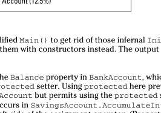

我修改了 `Main()`，去掉了那些讨厌的 `Init...()` 方法，改用构造函数取而代之。该程序的输出是一样的。


注意 `BankAccount` 中的 `Balance` 属性，它有一个公共 getter，但有一个受保护的 setter。在这里使用 `protected` 可以防止从 `BankAccount` 外部使用，但允许在子类中使用受保护的 setter，这种情况出现在 `SavingsAccount.AccumulateInterest` 中，其中 `Balance` 位于赋值运算符的左侧。（属性和 protected 关键字见第 II 册第 5 章。你可以在本书的索引中查找它们。）

## 第 7 章：多什么态？

### 本章内容

- 决定是隐藏还是重写基类方法（选择真多！）
- 构建抽象类——你是认真的吗？
- 将方法和包含它的类声明为抽象
- 使用 `ToString`，类的名片
- 密封类，使其不能被子类化

在继承中，一个类“采用”另一个类的成员。因此，我可以创建一个 `SavingsAccount` 类，它从基类 `BankAccount` 继承数据成员（如 `account id`）和方法（如 `Deposit()`）。这很有用，但这个继承定义不足以模拟商业世界中的情况。

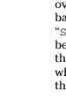

如果你不太了解（或记不清）类继承，请参阅本小册子的第 6 章。

微波炉是一种烤箱，不是因为它看起来像烤箱，而是因为它执行与烤箱相同的功能。微波炉可以执行附加功能，但它至少执行基础烤箱功能——最重要的是，当我说“StartCooking”时加热我的玉米片。（我依靠 `Refrigerator` 类的对象来冷却啤酒。）我并不特别关心烤箱内部必须做什么才能实现这一点，就像我不关心它是什么类型的烤箱、是谁制造的，或者我妻子买它时是否在打折一样。（嘿，等等——我确实关心最后一点。）

从人类的角度来看，微波炉与传统烤箱之间的关系似乎没什么大不了的，但请从烤箱的角度考虑这个问题。传统烤箱内部执行的步骤与微波炉可能采取的步骤完全不同。


继承的强大之处在于，子类不必完全按照基类方法的写法继承每一个方法。子类可以继承基类方法的本质，同时以不同方式实现细节。

### 重载继承的方法

如本小册子第 3 章所述（在索引中查找*重载*），两个或多个方法可以具有相同的名称，只要参数的数量或类型不同（或者只要两者都不同）。


#### 这是一个方法重载的简单例子

给两个方法起相同的名称就是*重载*，正如“把它们区分清楚是在让我的大脑*超载*”一样。

方法的参数成为其扩展名称的一部分，如下例所示：

```csharp
public class MyClass
{
    public static void AMethod()
    {
        // Do something.
    }
    public static void AMethod(int i)
    {
        // Do something else.
    }
    public static void AMethod(double d)
    {
        // Do something even different.
    }
    public static void Main(string[] args)
    {
        AMethod();
        AMethod(1);
        AMethod(2.0);
    }
}
```

C# 可以通过参数区分这些方法。`Main()` 中的每个调用都访问不同的方法。


返回类型不是扩展名称的一部分。不能有两个仅返回类型不同的方法。

#### 不同的类，不同的方法

毫不意外，方法所属的类也是其扩展名称的一部分。考虑以下代码段：

```csharp
public class MyClass
{
    public void AMethod() { }
}

public class UrClass
{
    public static void AMethod() { }
}

public class Program
{
    public static void Main(string[] args)
    {
        UrClass.AMethod();   // Call static method.
        // Invoke the MyClass.AMethod() instance method:
        MyClass myObject = new MyClass();
        myObject.AMethod();
    }
}
```

类的名称是方法扩展名称的一部分。`MyClass.AMethod()` 方法与 `UrClass.AMethod()` 的关系，大致就像 `YourClass.StartOnAColdMorning()` 与 `MyCar.StartOnAColdMorning()` 的关系——至少你的还能工作。

#### 躲猫猫——隐藏基类方法

因此，一个类中的方法可以通过具有不同的参数来重载其自身类中的另一个方法。事实证明，一个方法也可以重载其基类中的方法。重载基类方法称为*隐藏方法*。

假设你的银行采用一项政策，使储蓄账户取款不同于其他类型的取款。假设（仅为讨论起见）从储蓄账户取款需要花费 1.50 美元。

采用过程式方法，你可以在类中设置一个标志（变量）来指示对象是 `SavingsAccount` 还是普通的 `BankAccount`，从而实现该政策。然后，取款方法必须检查该标志，以决定是否需要收取 1.50 美元，如下所示：

```csharp
public class BankAccount
{
    private decimal _balance;
    private bool _isSavingsAccount;  // the flag
    // Indicate the initial balance and whether the account
    // you're creating is a savings account.
    public BankAccount(decimal initialBalance, bool isSavingsAccount)
    {
        _balance = initialBalance;
        _isSavingsAccount = isSavingsAccount;
    }
    public decimal Withdraw(decimal amountToWithdraw)
    {
        // If the account is a savings account . . .
        if (_isSavingsAccount)
        {
            // . . .then skim off $1.50.
            _balance -= 1.50M;
        }
        // Continue with the usual withdraw code:
        if (amountToWithdraw > _balance)
        {
            amountToWithdraw = _balance;
        }
        _balance -= amountToWithdraw;
        return amountToWithdraw;
    }
}

class MyClass
{
    public void SomeMethod()
    {
        // I want to create a savings account:
        BankAccount ba = new BankAccount(0, true);
    }
}
```

你的方法必须在构造函数中通过传递标志来告诉 `BankAccount` 它是否是 `SavingsAccount`。构造函数保存该标志，并在 `Withdraw()` 方法中使用它来决定是否收取额外的 1.50 美元。

更面向对象的方法是在 `SavingsAccount` 类中用同名、同身高、同发色的新方法隐藏基类 `BankAccount` 中的 `Withdraw()` 方法：


```csharp
// HidingWithdrawal -- Hide the withdraw method in the base
// class with a method in the subclass of the same name.
// using System;
namespace HidingWithdrawal
{
    // BankAccount -- A very basic bank account
    public class BankAccount
    {
        protected decimal _balance;
        public BankAccount(decimal initialBalance)
        {
            _balance = initialBalance;
        }
        public decimal Balance
        {
            get { return _balance; }
        }
        public decimal Withdraw(decimal amount)
        {
            // Good practice means avoiding modifying an input parameter.
            // Modify a copy.
            decimal amountToWithdraw = amount;
            if (amountToWithdraw > Balance)
            {
                amountToWithdraw = Balance;
            }
            _balance -= amountToWithdraw;
            return amountToWithdraw;
        }
    }
    // SavingsAccount -- A bank account that draws interest
    public class SavingsAccount : BankAccount
    {
        public decimal _interestRate;


```csharp
// SavingsAccount -- Input the rate expressed as a
//    rate between 0 and 100.
public SavingsAccount(decimal initialBalance, decimal interestRate)
    : base(initialBalance)
{
    _interestRate = interestRate / 100;
}
// AccumulateInterest -- Invoke once per period.
public void AccumulateInterest()
{
    _balance = Balance + (Balance * _interestRate);
}
// Withdraw -- You can withdraw any amount up to the
//    balance; return the amount withdrawn.
public decimal Withdraw(decimal withdrawal)
{
    // Take the $1.50 off the top.
    base.Withdraw(1.50M);
    // Now you can withdraw from what's left.
    return base.Withdraw(withdrawal);
}
}
public class Program
{
    public static void Main(string[] args)
    {
        BankAccount ba;
        SavingsAccount sa;
        // Create a bank account, withdraw $100, and
        // display the results.
        ba = new BankAccount(200M);
        ba.Withdraw(100M);
        // Try the same trick with a savings account.
        sa = new SavingsAccount(200M, 12);
        sa.Withdraw(100M);
        // Display the resulting balance.
        Console.WriteLine("When invoked directly:");
        Console.WriteLine("BankAccount balance is {0:C}", ba.Balance);
        Console.WriteLine("SavingsAccount balance is {0:C}", sa.Balance);
        // Wait for user to acknowledge the results.
        Console.WriteLine("Press Enter to terminate...");
        Console.Read();
    }
}
```

在这种情况下，Main() 创建了一个初始余额为 $200 的 BankAccount 对象，然后提取 $100。Main() 用 SavingsAccount 对象重复了同样的操作。当 Main() 从基类提取资金时，BankAccount.Withdraw() 非常得体地执行了提取功能。当 Main() 随后从储蓄账户提取 $100 时，方法 SavingsAccount.Withdraw() 额外加上了 $1.50。

请注意，SavingsAccount.Withdraw() 方法使用 BankAccount.Withdraw() 而不是直接操作余额。如果可能，让基类维护其自身的数据成员。


## 让隐藏方法的做法优于添加简单测试

表面上，给 BankAccount.Withdraw() 方法添加一个标志似乎比所有这些方法隐藏的东西更简单。毕竟，它只是四行代码，其中两行不过是花括号。

问题很多。（我必须写好几章才能使用这个词。）一个问题是 BankAccount 类没有义务关心 SavingsAccount 的细节。更正式地说，这被称为“破坏 SavingsAccount 的封装”。基类通常不知道其子类，这导致了真正的问题：假设你的银行随后决定添加 CheckingAccount 或 CDAccount 或 TBillAccount。所有这些可能的添加都有不同的取款政策，每个都需要自己的标志。在添加了三四个不同类型的账户后，旧的 Withdraw() 方法开始看起来很复杂。每种类型的类都应该关心自己的取款政策，让可怜的旧 BankAccount.Withdraw() 安心。类要对自己负责。

## 意外隐藏基类方法

奇怪的是，你可能会意外地隐藏基类方法。例如，你可能有一个 Vehicle.TakeOff() 方法来启动车辆滚动。后来，别人用 Airplane 类扩展了你的 Vehicle 类。它的 TakeOff() 方法完全不同。在飞机术语中，“起飞”意味着不仅仅是“开始移动”。显然，这是一个身份混淆的案例——两个方法除了名称相同外没有任何相似之处。

幸运的是，C# 检测到了这个问题。

C# 在编译之前的 HidingWithdrawal 程序示例时生成了一个看起来很不祥的警告。警告消息的文本很长，但这里是重要部分：

```
'...SavingsAccount.Withdraw(decimal)' hides inherited member
'...BankAccount.Withdraw(decimal)'.
    Use the new keyword if hiding was intended.
```

C# 试图告诉你，你在子类中编写了一个与基类中的方法同名的方法。你是想这样做吗？


这条消息只是一个警告——除非你切换到错误列表窗口查看，否则你甚至不会注意到它。但你必须整理并修复所有警告。在几乎所有情况下，警告都在告诉你一些如果不修复就会咬你的东西。


告诉 C# 编译器将警告视为错误，至少在某些时候。要这样做，选择 项目>属性。在项目属性页面的构建窗格中，向下滚动到错误和警告。将警告级别设置为 4，即最高级别，这会让编译器变得更啰嗦。此外，在将警告视为错误部分，选择全部。（如果某个特定警告变得烦人，你可以将其列在被抑制的警告框中以保持它不出现在你面前。）当你将警告视为错误时，你被迫修复警告——就像你被迫修复真正的编译器错误一样。这种做法能写出更好的代码。即使你没有启用将警告视为错误选项，也请将警告级别保持在 4，并在每次构建后选择错误列表窗口。

以下示例代码中显示的描述符 new 告诉 C# 方法的隐藏是有意的，而不是疏忽的结果（并且它使警告消失）：

```csharp
// No withdraw() pains now.
new public decimal Withdraw(decimal withdrawal)
{
    // ... no change internally ...
}
```


这个关键字 new 的使用与用于创建对象的同一个词 new 无关。（C# 甚至对自己进行了重载！）

## 回调到基类

查看本章前面显示的 Hiding Withdrawal 示例中的 SavingsAccount.Withdraw() 方法。从这个新方法内部对 BankAccount.Withdraw() 的调用包含了新的关键字 base。

以下没有 base 关键字的版本不起作用：

```csharp
new public decimal Withdraw(decimal withdrawal)
{
    decimal amountWithdrawn = Withdraw(withdrawal);
    amountWithdrawn += Withdraw(1.5);
    return amountWithdrawn;
}
```

此调用与以下调用有相同的问题：

```csharp
void fn()
{
    fn(); // Call yourself.
}
```

fn() 内部对 fn() 的调用最终会一遍又一遍地调用自身（递归）。同样，方法内部对 Withdraw() 的调用会在循环中调用自身，直到程序最终正常返回。

不知何故，你需要指示 C#，从 SavingsAccount.Withdraw() 内部的调用意味着要调用基类 BankAccount.Withdraw() 方法。一种方法是先将 this 引用强制转换为 BankAccount 类的对象，然后再进行调用：

// Withdraw -- This version accesses the hidden method in the base
// class by explicitly recasting the this object.
// new public decimal Withdraw(decimal withdrawal)
{
// Cast this reference into an object of class BankAccount.
BankAccount ba = (BankAccount)this;
// Invoking Withdraw() using this BankAccount object
// calls the method BankAccount.Withdraw().
decimal amountWithdrawn = ba.Withdraw(withdrawal);
amountWithdrawn += ba.Withdraw(1.5);
return amountWithdrawn;
}

这个解决方案有效：调用 ba.Withdraw() 现在按预期调用 BankAccount 方法。这个方法的问题在于对 BankAccount 的显式引用。程序的未来更改可能会重新排列继承层次结构，使得 SavingsAccount 不再直接继承自 BankAccount。这种重新排列会以未来程序员可能不易找到的方式破坏此方法。（老实说，我永远也找不到这样的错误。）

你需要一种方法来告诉 C# 调用层次结构中“正上方”类的 Withdraw() 方法，而无需明确命名它。那将是 SavingsAccount 扩展的类。C# 为此提供了关键字 base。


这个关键字 base 与构造函数用于将参数传递给其基类构造函数的那个相同。

以下代码片段中显示的 C# 关键字 base 与 this 相同，但会自动强制转换为基类，无论该类可能是什么：

// Withdraw -- You can withdraw any amount up to the
// balance; return the amount withdrawn.
// new public decimal Withdraw(decimal withdrawal)
{
// Take the $1.50 off the top.
base.Withdraw(1.5M);
// Now you can withdraw from what's left.
return base.Withdraw(withdrawal);
}

调用 base.Withdraw() 现在调用 BankAccount.Withdraw() 方法，从而避免了“自身调用”递归问题。此外，如果继承层次结构发生变化，此解决方案也不会中断。


## 多态

你可以在子类中用同名方法重载基类中的方法。
听起来这个过程很简单，但它引入了相当大的能力，而能力越大，危险越大。

这里有一个思想实验：你应该在编译时还是运行时决定调用 BankAccount.Withdraw() 还是 SavingsAccount.Withdraw()？

为了说明区别，我对之前的 HidingWithdrawal 程序做了一个看似无害的改动。我把这个新版本称为 HidingWithdrawalPolymorphically。（我通过省略不变的部分精简了代码清单。）新版本如下所示：


// HidingWithdrawalPolymorphically -- Hide the Withdraw() method in the
// base
// class with a method in the subclass of the same name.
public class Program
{
    public static void MakeWithdrawal(BankAccount ba, decimal amount)
    {
        ba.Withdraw(amount);
    }
    public static void Main(string[] args)
    {
        BankAccount ba;
        SavingsAccount sa;

        // Create a bank account, withdraw $100, and
        // display the results.
        ba = new BankAccount(200M);
        MakeWithdrawal(ba, 100M);

        // Try the same trick with a savings account.
        sa = new SavingsAccount(200M, 12);
        MakeWithdrawal(sa, 100M);

        // Display the resulting balance.
        Console.WriteLine("When invoked through intermediary:");
        Console.WriteLine("BankAccount balance is {0:C}", ba.Balance);
        Console.WriteLine("SavingsAccount balance is {0:C}", sa.Balance);

        // Wait for user to acknowledge the results.
        Console.WriteLine("Press Enter to terminate...");
        Console.Read();
    }
}
```

以下输出可能令人困惑，也可能不令人困惑，取决于你的预期：

```
When invoked through intermediary
BankAccount balance is $100.00
SavingsAccount balance is $100.00
Press Enter to terminate...
```

这次，而不是在 `Main()` 中执行取款，程序将银行账户对象传递给方法 `MakeWithdrawal()`。

第一个问题相当直接：为什么 `MakeWithdrawal()` 方法甚至接受一个 `SavingsAccount` 对象，而它明明声明要寻找一个 `BankAccount`？答案很明显：“因为一个 `SavingsAccount` IS_A `BankAccount`。”（参见本小册子的第 6 章。）

第二个问题比较微妙。当传递一个 `BankAccount` 对象时，`MakeWithdrawal()` 调用 `BankAccount.Withdraw()` —— 这很清楚。但当传递一个 `SavingsAccount` 对象时，`MakeWithdrawal()` 调用的是同一个方法。它不应该调用子类中的 `Withdraw()` 方法吗？

控方打算证明调用 `ba.Withdraw()` 应该调用方法 `BankAccount.Withdraw()`。显然，`ba` 对象是一个 `BankAccount`。做任何其他事情只会混淆状态。辩方在 `Main()` 中有证人证明，尽管 `ba` 对象被声明为 `BankAccount`，但实际上它是一个 `SavingsAccount`。陪审团陷入僵局。两种论点同样有效。

在这种情况下，C# 站在了控方一边：两种可能性中更安全的做法是使用声明的类型，因为它避免了任何误解。对象被声明为一个 `BankAccount`，就这么定了。然而，这可能不是你想要的。

## 每次都使用声明的类型
### （这有错吗？）

在某些情况下，你不想选择声明的类型。你想要的（或者，引用流行乐队 Spice Girls 的歌词，“你真的、真的想要的”）是基于 *实际类型* —— 运行时类型 —— 而不是声明类型来做出调用。例如，你想使用存储在 `BankAccount` 变量中的 `SavingsAccount`。这种在运行时决定的能力被称为 *多态*，或 *晚期绑定*。每次都使用声明的类型被称为 *早期绑定*，因为它听起来像是 *晚期绑定* 的相反。


荒谬的术语 *多态* 来自希腊语：*Poly* 意为“多于一个”，*morph* 意为“变形”，而 *ism* 是一个相当无用的希腊语后缀。但我们只能接受它。

多态和晚期绑定并不完全是同一个概念——但区别很微妙：

- 多态指的是在运行时决定调用哪个方法的一般能力。
- 晚期绑定指的是语言实现多态的具体方式。

多态是面向对象（OO）编程强大之处的关键。它如此重要，以至于不支持它的语言不能自称是 OO 语言。（我认为这是 FDA 的规定：除非加上外科医生总监的免责声明之类的，否则你不能把不支持它的语言标记为 OO。）


支持类但不支持多态的语言是基于对象的语言。Visual Basic 6.0（不是 VB.NET）就是这种语言的一个例子。

没有多态，继承就意义不大。让我举另一个例子来说明为什么。假设你写了一个很棒的程序，使用了一个名为（随便挑一个名字）Student 的类。在数月的设计、编码和测试之后，你发布了这个应用程序，得到了同事和评论家的一致好评。（你甚至听说有人提议为软件设立新的诺贝尔奖类别，但你谦虚地把这种说法搁置一边。）

时间流逝，你的老板要求你为这个程序增加处理研究生的能力，他们与本科生相似但不完全相同。（研究生可能声称他们在任何方面都不相似。）假设计算研究生学费的公式与本科生完全不同。现在，你的老板不知道也不关心的是，程序深处有许多对成员方法 CalcTuition() 的调用。（顺便说一下，老板不知道也不关心的事情有很多。）下面的例子展示了其中一次对 CalcTuition() 的调用：

```
void SomeMethod(Student s) // Could be grad or undergrad
{
    // . . . whatever it might do . . .
    s.CalcTuition();
    // . . . continues on . . .
}
```

如果 C# 不支持晚期绑定，你就需要编辑 someMethod() 来检查传递给它的学生对象是 GraduateStudent 还是 Student。程序会在 s 是 Student 时调用 Student.CalcTuition()，在它是研究生时调用 GraduateStudent.CalcTuition()。

编辑 someMethod() 看起来没什么大不了的，除了两个问题：

用不同的类表示。这给可怜的 MakeWithdrawal() 带来了太多责任。目前，你的应用程序只处理两种类型的银行账户，但假设你的老板要求你实现一种新的账户类型 CheckingAccount，并且它有不同的 Withdraw() 要求。如果不找出并找到检查其参数运行时类型的每个方法，你的程序就无法正常工作。

## 声明方法为 virtual 并重写它

作为 MakeWithdrawal() 的作者，你不想知道所有不同类型的账户。你希望使用 MakeWithdrawal() 的程序员负责了解他们的账户类型，而让你安宁。你希望 C# 根据对象的运行时类型来决定调用哪个方法。

你通过将基类方法标记为 virtual 关键字，并将每个子类版本的方法标记为 override 关键字，来告诉 C# 对 Withdraw() 的版本做出运行时决策。

我使用多态重写了上一节的程序示例。我在 Withdraw() 方法中添加了输出语句，以证明确实调用了正确的方法。（我还删掉了任何重复的信息。）以下是 PolymorphicInheritance 程序：


// PolymorphicInheritance -- Hide a method in the
// base class polymorphically. Show how to use
// the virtual and override keywords.
using System;
namespace PolymorphicInheritance
{
    // BankAccount -- A basic bank account
    public class BankAccount
    {
        protected decimal _balance;
        public BankAccount(decimal initialBalance)
        {
            _balance = initialBalance;
        }
        public decimal Balance
        {
            get { return _balance; }
        }
        public virtual decimal Withdraw(decimal amount)
        {
            Console.WriteLine("In BankAccount.Withdraw() for ${0}...", amount);
            decimal amountToWithdraw = amount;
            if (amountToWithdraw > Balance)
            {
                amountToWithdraw = Balance;
            }
            _balance -= amountToWithdraw;
            return amountToWithdraw;
        }
    }


```csharp
}
// SavingsAccount -- A bank account that draws interest
public class SavingsAccount : BankAccount
{
    public decimal _interestRate;
    // SavingsAccount -- Input the rate expressed as a
    //     rate between 0 and 100.
    public SavingsAccount(decimal initialBalance, decimal interestRate)
        : base(initialBalance)
    {
        _interestRate = interestRate / 100;
    }
    // AccumulateInterest -- Invoke once per period.
    public void AccumulateInterest()
    {
        _balance = Balance + (Balance * _interestRate);
    }
    // Withdraw -- You can withdraw any amount up to the
    //     balance; return the amount withdrawn.
    override public decimal Withdraw(decimal withdrawal)
    {
        Console.WriteLine("In SavingsAccount.Withdraw(...):");
        Console.WriteLine("Invoking base-class Withdraw twice...");
        // Take the $1.50 off the top.
        base.Withdraw(1.5M);
        // Now you can withdraw from what's left.
        return base.Withdraw(withdrawal);
    }
}
public class Program
{
    public static void MakeAWithdrawal(BankAccount ba, decimal amount)
    {
        ba.Withdraw(amount);
    }
    public static void Main(string[] args)
    {
        BankAccount ba;
        SavingsAccount sa;
        // Display the resulting balance.
        Console.WriteLine("Withdrawal: MakeAWithdrawal(ba, ...)");
        ba = new BankAccount(200M);
        MakeAWithdrawal(ba, 100M);
        Console.WriteLine("BankAccount balance is {0:C}", ba.Balance);
        Console.WriteLine("Withdrawal: MakeAWithdrawal(sa, ...)");
        sa = new SavingsAccount(200M, 12);
        MakeAWithdrawal(sa, 100M);
        Console.WriteLine("SavingsAccount balance is {0:C}", sa.Balance);
        // Wait for user to acknowledge the results.
        Console.WriteLine("Press Enter to terminate...");
        Console.Read();
    }
}
```

The output from executing this program is shown here:

```
Withdrawal: MakeAWithdrawal(ba, ...)
In BankAccount.Withdraw() for $100...
BankAccount balance is $100.00
Withdrawal: MakeAWithdrawal(sa, ...)
In SavingsAccount.Withdraw()...
Invoking base-class Withdraw twice...
In BankAccount.Withdraw() for $1.5...
In BankAccount.Withdraw() for $100...
SavingsAccount balance is $98.50
Press Enter to terminate...
```

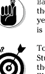

The Withdraw() method is flagged as virtual in the base class BankAccount, and the Withdraw() method in the subclass is flagged with the keyword override. The MakeAWithdrawal() method is unchanged, yet the output of the program is different because the call ba.Withdraw() is resolved based on the ba runtime type.

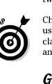

To get a good feel for how this works, step through the program in the Visual Studio 2012 debugger. Just build the program as normal, set a breakpoint at the first line in SavingsAccount.Withdraw(), and then repeatedly press F11 to watch the program walk through its paces. Watch the Withdraw() calls carefully. Watching the same call end up in two different methods at two different times is impressive.

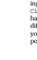

Choose sparingly which methods to make virtual. Each one has a cost, so use the virtual keyword only when necessary. It's a trade-off between a class that's highly flexible and can be overriden (lots of virtual methods) and a class that isn't flexible enough (hardly any virtuals).

第二册
第7章
多态——是什么？

## 从多态中获得最大收益——do-to-each 技巧

Much of the power of polymorphism springs from polymorphic objects sharing a common interface. For example, given a hierarchy of Shape objects — Circles, Squares, and Triangles — you can count on all shapes having a Draw() method. Each object's Draw() method is implemented quite differently, of course. But the point is that, given a collection of these objects, you can freely use a foreach loop to call Draw() or any other method in the polymorphic interface on the objects. I call it the "do-to-each" trick.

## 类的名片：ToString()

All classes inherit from a common base class that carries the clever name Object. However, it's worth mentioning here that Object includes a method, ToString(), that converts the contents of the object into a string. The idea is that each class should override the ToString() method to display itself in a meaningful way. I used the method GetString() until now because I didn't want to begin discussing inheritance issues until Chapter 6 of this minibook. After you understand inheritance, the virtual keyword, and overriding, we can describe ToString(). By overriding ToString() for each class, you give each class the ability to

display itself in its own way. For example, a useful, appropriate `Student.ToString()` method may display the student's name and ID.

Most methods — even those built into the C# library — use the `ToString()` method to display objects. This overriding `ToString()` has the useful side effect of displaying the object in its own, unique format, no matter who does the displaying.

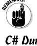

Always override `ToString()`.

## C# 的抽象时期

The duck is a type of bird, I think. So are the cardinal and the hummingbird. In fact, every bird out there is a subtype of bird. The flip side of that argument is that no bird exists that *isn't* some subtype of `Bird`. That statement doesn't *sound* profound, but in a way, it is. The software equivalent of that statement is that all `bird` objects are instances of some subclass of `Bird` — there's never an instance of class `Bird`. What's a bird? It's always a robin or a grackle or another specific species.

Different types of birds share many properties (otherwise, they wouldn't be birds), yet no two types share every property. If they did, they wouldn't be different types. To pick a particularly gross example, not all birds `Fly()` the same way. Ducks have one style. The cardinal's style is similar but not identical. The hummingbird's style is completely different. (Don't even get me started about emus and ostriches or the rubber ducky in my tub.)

But if not all birds fly the same way and there's no such thing as a `Bird`, what the heck is `Bird.Fly()`? The subject of the following sections, that's what it is.

### 类分解

People generate taxonomies of objects by factoring out commonalities. To see how factoring works, consider the two classes `HighSchool` and `University`, shown in Figure 7-1. This figure uses the Unified Modeling Language (UML), a graphical language that describes a class along with the relationship of that class to others. UML has become universally popular with programmers and is worth learning (to a reasonable extent) in its own right.


A Car IS_A Vehicle but a Car HAS_A Motor.

Figure 7-1:
A UML description of the High-School and University classes.

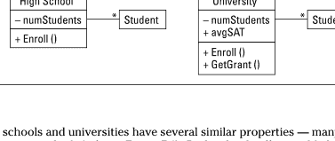

High schools and universities have several similar properties — many more than you may think (refer to Figure 7-1). Both schools offer a publicly available Enroll() method for adding Student objects to the school. In addition, both classes offer a private member numStudents that indicates the number of students attending the school. Another common feature is the relationship between students: One school can have any number of students — a student can attend only a single school at one time. Even high schools and most universities offer more than I describe, but one of each type of member is all I need for illustration.

In addition to the features of a high school, the university contains a method GetGrant() and a data member avgSAT. High schools have no SAT entrance requirements and receive no federal grants (unless I went to the wrong one).

Figure 7-1 is acceptable, as far as it goes, but lots of information is duplicated, and duplication in code (and UML diagrams) stinks. You can reduce the duplication by allowing the more complex class University to inherit from the simpler HighSchool class, as shown in Figure 7-2.

Figure 7-2:
Inheriting High-School simplifies the University class but introduces problems.

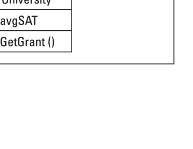


## UML 精简版

统一建模语言（UML）是一种富有表现力的语言，能够清晰地定义程序中对象之间的大量关系。UML 的一个优势是，你可以忽略更具体的语言特性，而不会完全失去其含义。

UML 最基本的特性如下：

- 类用一个垂直分为三部分的方框表示。类名出现在最上面部分。
- 类的数据成员出现在中间部分，类的方法出现在底部。如果类没有数据成员或方法，或者你只想要一个高层次的、仅显示类的视图，可以省略中间或底部部分。
- 前面带加号（+）的成员是公有的；带减号（–）的成员是私有的。为了表示受保护和内部可见性，大多数人分别使用井号（#）——或者我该说“升号”？——以及波浪号（~）。

私有成员只能从同一类的其他成员访问。公有成员可被所有类访问。参见本迷你书第5章。

- 名称旁的标签 {abstract} 表示抽象类或抽象方法。
- UML 对抽象方法使用不同的符号，但我保持简单。（这是 UML 精简版。）你也可以只用斜体显示抽象项。
- 两个类之间的箭头表示这两个类之间的关系。线上方的数字表示基数——即箭头两端可以拥有的项数。星号（*）表示*任意数量*。如果没有数字，则假定基数为 1。因此可以看出，一所大学有任意数量的学生——这是一种一对多关系（参见图7-1）。
- 带大空心箭头或三角形箭头的线表示 IS_A 关系（继承）。箭头指向类层次结构的*上方*，即基类。其他类型的关系包括 HAS_A 关系（在拥有端带实心菱形的线）。

要深入探索 UML，请参阅 Michael Jesse Chonoles 和 James A. Schardt 所著的*《UML 2 达人迷》*。

HighSchool 类保持不变，但 University 类更容易描述。你说“University 是一个 HighSchool，同时还拥有 avgSAT 和 GetGrant() 方法”。但这个解决方案有一个根本问题：大学并不是具有特殊属性的高中。

你说：“那又怎样？继承行得通，而且省力。”没错，但我的保留意见（预订）可不只是风格上的琐碎问题。（我的保留意见（预订）是在城里一些最好的餐馆——至少，所有卡车司机都这么说。）这种错误表示会让程序员现在和将来都感到困惑。总有一天，一个不熟悉你编程技巧的程序员将不得不阅读并理解你的代码做了什么。误导性的表示难以协调和理解。

此外，这种错误表示还可能日后引发问题。假设高中决定在毕业舞会上评选一名“最喜爱”学生——并不是说我对那种事了解什么。聪明的程序员向 HighSchool 类添加 NameFavorite() 方法，应用程序调用它来评选最喜爱的 Student 对象。

但现在你有麻烦了：大多数大学除了价格之外，不会评选任何“最喜爱”的东西。然而，只要 University 继承自 HighSchool，它就会继承 NameFavorite() 方法。多一个方法似乎没什么大不了。你说：“忽略它就行了。”

多一个方法确实没什么大不了，但它只是困惑之墙上又一块砖。额外的方法和属性会随着时间累积，直到 University 类背负大量多余包袱。可怜那些必须弄清楚哪些方法是“真正的”、哪些不是的软件开发者。

“图方便的继承”会导致另一个问题。按现在的写法，图7-2暗示 University 和 HighSchool 具有相同的入学程序。尽管这种说法听起来不太可能，但假设它是真的。程序被开发、打包，并运送给不知情的公众——当然，我已经植入了必要数量的 bug，以便他们愿意升级到修复了所有 bug 的 2.0 版——当然，要付一点小费用。

几个月过去了，学区才决定修改其入学程序。没有人会明显意识到，修改高中入学程序也会修改当地大学的报名程序。

如何避免这些问题？不上学是一种办法，但另一种是修复问题的根源：大学并不是一种特殊类型的高中。两者之间存在关系，但 IS_A 并不是正确的关系。（HAS_A 也不行。大学 HAS_A 高中？高中 HAS_A 大学？得了吧！）相反，高中和大学都是特殊类型的学校。这才是它们最大的共同点。

图7-3描述了一种更好的关系。新定义的 School 类包含两类学校的共同属性，包括它们与 Student 对象的共同关系。School 甚至包含共同的 Enroll() 方法，尽管它是抽象的，因为 HighSchool 和 University 通常不会以相同方式实现 Enroll()。

图7-3：HighSchool 和 University 都应基于一个共同的 School 类。

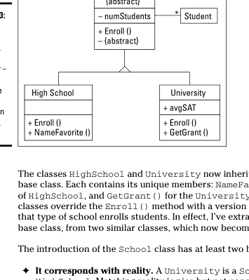

HighSchool 和 University 类现在继承自一个共同的基类。每个类都包含其独特成员：HighSchool 有 NameFavorite()，University 有 GetGrant()。此外，两个类都重写了 Enroll() 方法，用描述该类学校如何招收学生的版本取而代之。实际上，我从两个相似的类中提取了一个超类（或基类），而这两个类现在成为子类

引入 School 类至少有两个重大优势：

- **它与现实相符。** University 是一所 School，但它不是 HighSchool。与现实相符固然好，但并非决定性因素。
- **它使一个类与另一个类的修改或新增隔离开来。** 当我的老板日后不可避免地要求我为大学引入毕业典礼活动时，我可以将 CommencementSpeech() 方法添加到 University 类，而不影响 HighSchool。

从相似类中挑选共同属性的过程称为提取公共特性（factoring）。面向对象语言的这一特性之所以重要，除了本迷你书前面描述的原因外，还有一个原因：减少冗余。让我重复一遍：冗余是不好的。


只有当继承关系与现实相符时，提取公共特性才是合理的。因为 Mouse 和 Joystick 类都是硬件指向设备，而将它们提取到一起是合理的。因为 Mouse 和 Display 类都进行低级操作系统调用，而将它们提取到一起则不合理。

提取公共特性可能而且通常会导致多层抽象。例如，为更发达的学校层次结构编写的程序，其类结构可能更像图7-4所示。

**图7-4：** 类提取可能（而且通常会）导致继承层次增加。


你可以看到，我在 University 和 School 之间插入了一对新类：HigherLearning 和 LowerLevel。例如，我将新类 HigherLearning 细分为 College 和 University。在提取关系时，这种多级类层次结构很常见，也很可取。它们与现实相符，并且有时能让你了解解决方案中一些微妙的特性。

然而请注意，对于任何给定的一组类，并不存在统一的提取理论。图7-4所示的关系看起来自然，但假设某个应用更关心区分由当地政客管理的学校类型与不是由他们管理的学校类型。图7-5所示的关系更适合这类问题。不存在“正确”的提取方式。正确分解类的方法部分取决于所要解决的问题。

**图7-5：** 分解类部分取决于所要解决的问题。


## 抽象类：除了概念，一无所有

尽管这听起来在智力上令人满足，但它本身也带来了一个问题。回顾（或重温）本章开头介绍的 `BankAccount`。想一想你可能会如何定义 `BankAccount` 中定义的不同成员方法。

大多数 `BankAccount` 成员方法重构起来没有问题，因为两种账户类型都以相同方式实现它们。你应该在 `BankAccount` 中实现这些通用方法。然而，`Withdraw()` 不同。从储蓄账户取款的规则与从支票账户取款的规则不同。你必须以不同于 `CheckingAccount.Withdraw()` 的方式实现 `SavingsAccount.Withdraw()`。但是，你应该如何实现 `BankAccount.Withdraw()` 呢？

向银行经理求助。我想象了这样的对话：

> > “从账户取款有什么规则？”你满怀期待地问。
> >
> > “哪种类型的账户？储蓄账户还是支票账户？”对方回答。
> >
> > “从账户里，”你说，“就是一个账户。”
> >
> > [茫然的表情。]（你也许会说“银行式的茫然表情”。不过，也未必。）

问题在于这个问题本身没有意义。不存在“仅仅是一个账户”这种东西。所有账户（在这个例子中）要么是支票账户，要么是储蓄账户。账户的概念是*抽象的*：它抽取出两个具体类共有的属性。它是不完整的，因为它缺少关键属性 `Withdraw()`。（在你深入细节之后，可能会发现简单账户还缺少其他属性。）

`BankAccount` 的概念是抽象的。

## 如何使用抽象类？

抽象类用于描述抽象概念。

*抽象类*是包含一个或多个抽象方法的类。（哦，太好了。这很有帮助。）好吧，抽象方法就是标记为 `abstract` 的方法。（我们正在推进！）让我再试一次：抽象方法没有实现——现在你*真的*困惑了。

考虑下面这个精简的演示程序：


// AbstractInheritance -- The BankAccount class is abstract because
// there is no single implementation for Withdraw.
// namespace AbstractInheritance
{
using System;
// AbstractBaseClass -- Create an abstract base class with nothing
// but an Output() method. You can also say "public abstract."
abstract public class AbstractBaseClass
{
// Output -- Abstract method that outputs a string
abstract public void Output(string outputString);
}
// SubClass1 -- One concrete implementation of AbstractBaseClass
public class SubClass1 : AbstractBaseClass
{
override public void Output(string source) // Or "public override"
{
string s = source.ToUpper();
Console.WriteLine("Call to SubClass1.Output() from within {0}", s);
}
}
// SubClass2 -- Another concrete implementation of AbstractBaseClass
public class SubClass2 : AbstractBaseClass
{
public override void Output(string source) // Or 'override public'
{
string s = source.ToLower();
Console.WriteLine("Call to SubClass2.Output() from within {0}", s);
}
}
class Program
{
public static void Test(AbstractBaseClass ba)
{
ba.Output("Test");
}
public static void Main(string[] strings)
{
// You can't create an AbstractBaseClass object because it's
// abstract -- duh. C# generates a compile-time error if you
// uncomment the following line.
// AbstractBaseClass ba = new AbstractBaseClass();
// Now repeat the experiment with SubClass1.
Console.WriteLine("\nCreating a SubClass1 object");
SubClass1 sc1 = new SubClass1();
Test(sc1);
// And, finally, a SubClass2 object
Console.WriteLine("\nCreating a SubClass2 object");
SubClass2 sc2 = new SubClass2();
Test(sc2);
// Wait for user to acknowledge.
Console.WriteLine("\nPress Enter to terminate...");
Console.Read();
}
}
}

密封类不能用作任何其他类的基类。


考虑下面这段代码：

```
using System;
public class BankAccount
{
    // Withdrawal -- You can withdraw any amount up to the
    // balance; return the amount withdrawn
    virtual public void Withdraw(decimal withdrawal)
    {
        Console.WriteLine("invokes BankAccount.Withdraw()");
    }
}
public sealed class SavingsAccount : BankAccount
{
    override public void Withdraw(decimal withdrawal)
    {
        Console.WriteLine("invokes SavingsAccount.Withdraw()");
    }
}
public class SpecialSaleAccount : SavingsAccount  // Oops!
{
    override public void Withdraw(decimal withdrawal)
    {
        Console.WriteLine("invokes SpecialSaleAccount.Withdraw()");
    }
}
```

这段代码会生成以下编译器错误：

'SpecialSaleAccount' : 无法从密封类 'SavingsAccount' 继承

你使用 sealed 关键字来保护你的类，免受子类窥探方法的侵扰。例如，允许程序员扩展一个实现系统安全的类，就会使某人能够创建安全后门。

密封一个类可以阻止另一个程序（可能位于 Internet 上的某处）使用你类的修改版本。远程程序可以按原样使用该类，也可以不使用，但它不能继承你类的零碎部分，同时重写其余部分。

## 第 8 章：与接口交互

### 本章内容

- 超越 IS_A 和 HAS_A：C# 接口
- 创建自己的接口或使用 .NET 提供的接口
- 用接口统一分离的类层次结构
- 将类公开接口的一部分隐藏在接口之后
- 管理软件变更——通过接口获得灵活性

一个类可以包含对另一个类的引用；这句话描述了简单的 HAS_A 关系。一个类可以通过继承的奇妙机制扩展另一个类——这就是 IS_A 关系。C# 接口实现了另一种同样重要的关联：CAN_BE_USED_AS 关系。

本章介绍 C# 接口，并展示它们增强面向对象编程能力和灵活性的众多方式中的一些。

## 介绍 CAN_BE_USED_AS

如果你想记一条笔记，可以用笔草草写下，输入智能手机，或者在笔记本电脑键盘上敲出来。你完全可以说，这三个对象——笔、智能手机和计算机——都实现了 TakeANote 操作。假设你利用继承的魔力在 C# 中实现这个概念：

```
abstract class ThingsThatRecord    // The base class
{
    abstract public void TakeANote(string note);
}
public class Pen : ThingsThatRecord    // A subclass
{
    override public void TakeANote(string note)
    {
        // ... scribble a note with a pen ...
    }
}
public class PDA : ThingsThatRecord    // Another subclass
{
    override public void TakeANote(string note)
{
    // ... stroke a note on the PDA ...
}
}
public class LapTop : ThingsThatRecord  // A third subclass
{
    override public void TakeANote(string note)
    {
        // ... tap, tap, tap ...
    }
}
```


如果 *abstract* 一词让你困惑，请参阅本迷你书的第 7 章，并阅读本章后面“抽象还是具体：何时使用抽象类以及何时使用接口”一节中的讨论。如果继承的整个概念对你来说是个谜，请查看本迷你书的第 6 章。

下面这个简单方法展示了继承方法运行良好：

```
void RecordTask(ThingsThatRecord recorder)  // Parameter type is base class
{
    // All classes that extend ThingsThatRecord have a TakeANote method.
    recorder.TakeANote("shopping list");
    // ... and so on.
}
```

参数类型是 ThingsThatRecord，因此你可以把任何子类传给这个方法，使这个方法相当通用。

这看起来似乎是个好方案，但它有两个重大缺点：

- **一个根本问题：** Pen、PDA 和 LapTop 真的具有 IS_A 关系吗？这三个物品在现实中都是同一类型吗？我不这么认为，你呢？我只能说，这里的 `ThingsThatRecord` 是一个糟糕的基类。
- **一个纯技术问题：** 你可能会合理地将 LapTop 和 PDA 都派生为 Computer 的子类。但没人会说 Pen IS_A Computer。你必须把笔描述为 `MechanicalWritingDevice` 或 `DeviceThatStainsYourShirt` 的一种类型。但是，C# 类不能同时继承两个不同的基类——一个 C# 类只能是物品的一种类型。

因此，Pen、PDA 和 LapTop 类唯一的共同点就是它们 CAN_BE_USED_AS 记录设备。继承并不适用。


## 了解什么是接口

C# 中的接口类似于一个没有数据成员、只包含抽象方法的类，几乎就像一个抽象类——几乎：

```
interface IRecordable
{
    void TakeANote(string note);
}
```

接口以 interface 关键字开头。它只包含抽象方法，没有数据成员，也没有已实现的方法。

接口还可以包含其他一些特性，包括属性（参见本书第5章）、事件（参见本书第9章）和索引器（参见第I册第7章）。


C# 接口不能包含的元素包括：

- 访问说明符，例如 public 或 private（参见本书第5章）
- 诸如 virtual、override 或 abstract 之类的关键字（参见本书第7章）
- 数据成员（参见本书第2章）
- 已实现的方法——带有方法体的非抽象方法

C# 接口的所有成员都是公共的（在定义接口方法时甚至不能提及访问说明符），并且 C# 接口不参与普通继承；因此，它没有这些关键字。（接口本身可以是 public、protected、internal 或 private。）

与抽象类不同，C# 接口不是类。它不能被继承，并且它包含的任何方法都不能有方法体。

## 如何实现接口

要使用 C# 接口，你需要用一个或多个类来实现它。类的声明头看起来像这样：

```
class Pen : IRecordable // Looks like inheritance, but isn't
```


C# 接口规定，实现该接口的类必须提供特定的实现。必须这样做。例如，任何实现 IRecordable 接口的类都必须为 TakeANote 方法提供实现。实现 TakeANote 的方法不使用 override 关键字。使用接口不同于在类中重写虚方法。

Pen 类可能如下所示：

```
class Pen : IRecordable
{
    public void TakeANote(string note)    // Interface method implementations
    {                                    // MUST be declared public.
        // ... scribble a note with a pen ...
    }
}
```

这个示例满足两个要求：请注意，该类实现了 IRecordable，并为 TakeANote() 提供了方法实现。

指示类继承基类（例如 ThingsThatRecord）的语法，与指示类实现 C# 接口（例如 IRecordable）的语法本质上没有区别：

```
public class PDA : ThingsThatRecord ...
public class PDA : IRecordable ...
```

Visual Studio 可以帮助你实现接口。将鼠标指针悬停在类声明头中的接口名称上。接口名称的第一个字符下方会出现一个小下划线——这是一个智能标记（Smart Tag）。移动鼠标直到菜单打开，然后选择“实现接口 <名称>”。瞧！会出现一个骨架框架——你只需填写细节即可。

## 如何为接口命名

.NET 接口命名约定是在名称前加上字母 I。接口名称通常是形容词，例如 IRecordable。

## 为什么 C# 包含接口

接口的要点在于，接口描述一种能力，例如“游泳安全培训”或“A类驾驶执照”。作为一个类，当我实现了 TakeANote 能力时，就获得了我的 IRecordable 徽章。

更重要的是，接口是一种契约。如果你同意实现接口中定义的每个方法，你就可以声明拥有其能力。不仅如此，在程序中使用了你的类的客户端也能保证可以调用这些方法。实现接口是一个承诺——由编译器强制执行。（通过编译器强制执行承诺可以减少错误。）

## 混合继承和接口实现

与某些语言（如 C++）不同，C# 不允许多重继承——即一个类继承自两个或更多基类。可以想象一个 `HouseBoat` 类同时继承自 `House` 和 `Boat`。但别在 C# 中这样想。

但是，尽管一个类只能继承自一个基类，它*此外*还可以实现任意多个所需的接口。在我将 `recordability` 视为一个接口之后，一些记录设备看起来像这样：

```csharp
public class Pen : IRecordable          // Base class is Object.
{
    public void TakeANote(string note)
    {
        // Record the note with a pen.
    }
}
public class PDA : ElectronicDevice, IRecordable
{
    public void TakeANote(string note)
    {
        // Record the note with your thumbs or a stylus.
    }
}
```

PDA 类继承自一个基类*并*实现了一个接口。

## 而这就是真正的好处所在

要开始了解像 `IRecordable` 这样的接口的用处，请考虑以下示例：

```csharp
public class Program
{
    static public void RecordShoppingList(IRecordable recorder)
    {
        // Jot it down, using whatever device was passed in.
        recorder.TakeANote(...);
    }
    public static void Main(string[] args)
    {
        PDA pda = new PDA();
        RecordShoppingList(pda);  // Oops, battery's low ...
        Pen pen = new Pen();
        RecordShoppingList(pen);
    }
}
```

`IRecordable` 参数是任何实现了 `IRecordable` 接口的类的实例。`RecordShoppingList()` 不会对记录对象的确切类型做出任何假设。无论设备是 PDA 还是某种 ElectronicDevice，都不重要，只要该设备能记录笔记即可。

这个概念非常强大，因为它使 RecordShoppingList() 方法具有高度的通用性——因此可以在其他程序中重复使用。该方法甚至比使用诸如 ElectronicDevice 这样的基类作为参数类型更加通用，因为接口允许你传入几乎任意的对象，这些对象除了实现该接口外，不一定有其他共同点。它们甚至不必来自同一个类层次结构，这确实简化了层次结构的设计，例如。


术语过载警告：程序员使用“interface”一词的方式不止一种。你可以看到 C# 关键字 interface 及其用法。人们也会谈论一个类的公共接口，即它向外部世界公开的公共方法和属性。为了保持区分清晰，当我的意思是 C# 接口时，我大多数时候会说“C# 接口”（C# interface）；当我指的是公共方法集合时，我会说“公共接口”（public interface）。


C# 结构体也可以像类一样实现接口。

## 使用接口

除了可以将 C# 接口用作参数类型之外，接口还可用作：

- 方法返回类型
- 高度通用的数组或集合的基类型
- 更通用的变量类型的对象引用

我在上一节中解释了使用 C# 接口作为方法参数类型的优势。现在我可以告诉你接口的其他用途。

### 作为方法返回类型

我喜欢把创建所需关键对象的任务交给一个工厂方法。假设我有一个这样的变量：

```
IRecordable recorder = null; // Yes, you can have interface-type variables.
```

```
static IRecordable CreateRecorder(string recorderType)
{
    if(recorderType == "Pen") return new Pen();
    ...
}
```

本章后面的“隐藏在接口背后”（Hiding Behind an Interface）一节中，我会对工厂模式做更多说明。但请注意，CreateRecorder() 的返回类型是接口类型。

### 作为数组或集合的基类型

假设你有两个类 Animal 和 Robot，而且它们都是抽象的。你想设置一个数组来同时存放 thisCat（一个 Animal）和 thatRobot（一个可爱的机器人）。唯一的方法是使用 Object 类型，这是 C# 中的终极基类，也是 Animal 和 Robot 及其子类共有的唯一基类：

```
object[] things = new object[] { thisCat, thatRobot };
```

由于很多原因，这是糟糕的设计。但假设你关注的是对象的移动。你可以让每个类实现一个 IMovable 接口：

```
interface IMovable
{
    void Move(int direction, int speed, int distance);
}
```

然后设置一个 IMovable 数组来操作这些原本不兼容的对象：

```
IMovable[] movables = { thisCat, thatRobot };
```

接口为你提供了一种可以在集合中利用的共性。

### 作为更通用的对象引用类型


现在你可以将实现 IMovable 的任何对象放入变量中。这种做法在面向对象编程中有广泛而强大的用途，如下一节所示。

## 使用 C# 预定义接口类型

由于接口非常有用，你会在 .NET 类库中找到比 NRA 大会上枪架更多的接口。我在 Help 中数了几十个，然后累了就停了。仅 System 命名空间中就有十多个接口，其中包括 IComparable、IComparable<T>、IDisposable 和 IFormattable。System.Collections.Generic 命名空间包括 IEnumerable<T>、IList<T>、ICollection<T> 和 IDictionary<TKey, TValue>。还有更多。带有 <T> 标记的是泛型接口。我在 Book I 第 6 章关于集合类的讨论中解释了 <T> 标记。


Help 文件会显示所有带有小勾号的 ISomething<T> 类型（IList<'T>），但请在 Help 索引中查找 “IList<T>”。

两个常用接口是 IComparable 和 IEnumerable——现在 largely 被它们的泛型版本 IComparable<T>（读作 "IComparable of T"）和 IEnumerable<T> 取代。

我将在本章后面向你展示 IComparable<T> 接口——不可比较的 IComparable<T> 接口。它使得各种对象（如 Students）之间可以相互比较，并启用了所有数组和大多数集合提供的 Sort() 方法。IEnumerable<T> 使强大的 foreach 循环得以工作——大多数集合实现了 IEnumerable<T>，因此你可以使用 foreach 遍历集合。你可以在 Book I 中找到 IEnumerable<T> 的另一个主要用途，作为新的 C# 3.0 查询表达式的基础。你也可以在 http://csharp102.info 上阅读更多关于 LINQ 的内容。

## 查看可作为示例使用的程序

下面的 SortInterface 程序是特别优惠。两种不同接口带来的功能在任何继承关系中都无法匹敌。接口实现已就位。

然而，我想将 SortInterface 程序拆分为各部分以演示各种原理。（Pfft！好像我有什么原则似的。我只是想确保你能清楚地看到程序是如何工作的。）

## 在业余时间在家创建自己的接口

下面的 IDisplayable 接口由任何包含 Display() 方法的类满足（并且当然声明它实现了 IDisplayable）。Display() 返回对象的字符串表示，可使用 WriteLine() 显示。

```
// IDisplayable -- Any object that implements the Display() method
interface IDisplayable
{
    // Return a description of yourself.
    string Display();
}
```

下面的 Student 类实现了 IDisplayable：

```
class Student : IDisplayable
{
    public Student(string name, double grade)
    { Name = name; Grade = grade; }
    public string Name { get; private set; }
    public double Grade { get; private set; }
    public string Display()
    {
        string padName = Name.PadRight(9);
        return String.Format("{0,-9} : {1:N0}", padName, Grade);
    }
}
```

Display() 使用 String 的 PadRight() 和 Format() 方法来返回格式整齐的字符串，该方法在 Book I 第 3 章中介绍。

下面的 DisplayArray() 方法接受实现 IDisplayable 接口的任何对象的数组。每个对象都保证（由接口保证）拥有自己的 Display() 方法（整个程序出现在后面的 “Putting it all together” 部分）：

```
// DisplayArray -- Display an array of objects that implement
// the IDisplayable interface.
public static void DisplayArray(IDisplayable[] displayables)
{
    foreach(IDisplayable disp in displayables)
    {
        Console.WriteLine("{0}", disp.Display());
    }
}
```

下面的示例显示了 DisplayArray() 的输出：

```
Homer   : 0
Marge   : 85
Bart    : 50
Lisa      : 100
Maggie    : 30
```

*注意：* DisplayArray() 不是任何示例程序的一部分。

## 实现不可比较的 IComparable<T> 接口

C# 以这种方式定义 IComparable<T> 接口：

```
interface IComparable<T>
{
    // Compare the current T object to the object 'item'; return a
    // 1 if larger, -1 if smaller, and 0 if the same.
    int CompareTo(T item);
}
```

类通过实现 CompareTo() 方法来实现 IComparable<T> 接口。请注意，CompareTo() 接受类型为 T 的参数，当你为特定数据类型 *实例化接口* 时提供该类型——就像本例中一样。

```
class Student : IComparable<Student>  // Make me comparable,
```

当你为类实现 IComparable<T> 时，其 CompareTo() 方法如果两个被比较的项（属于你的类类型）在你定义的方式下 “equal”，应返回 0。否则，应根据哪个对象 “greater” 返回 1 或 −1。

这似乎有点达尔文主义，但你可以说如果一个 Student 对象的平均绩点更高，那么它就 “greater than” 另一个 Student 对象。（好吧，要么是更好的学生，要么是更好的苹果抛光工——没关系。）

实现 CompareTo() 方法意味着对象具有排序顺序。如果一个学生 “greater than” 另一个学生，你必须能够将学生从 “least” 到 “greatest” 排序。事实上，大多数集合类（包括数组但不包括字典）都提供类似这样的 Sort() 方法：

```
void Sort(IComparable<T>[] objects);
```

此方法对实现 IComparable<T> 接口的对象集合进行排序。对象属于哪个类根本无关紧要。例如，它们甚至可以是 Student 对象。数组或 List<T> 等集合类甚至可以对这个版本的 Student 进行排序：

```
// Student -- Description of a student with name and grade
class Student : IComparable<Student>, IDisplayable  // Instantiation
{
// Constructor -- initialize a new student object.
public Student(double grade)
{
    Grade = grade;
}
public double Grade { get; private set; }
// Implement the IComparable<T> interface:
// CompareTo -- Compare another object (in this case, Student objects) and
// decide which one comes after the other in the sorted array.
public int CompareTo(Student rightStudent)
{
    // Compare the current Student (call her 'left') against the other
    // student (call her 'right').
    Student leftStudent = this;

    // Now generate a -1, 0 or 1 based on the Sort criteria (the student's
    // grade). I could use class Double's CompareTo() method instead.
    if (rightStudent.Grade < leftStudent.Grade)
    {
        return -1;
    }
    if (rightStudent.Grade > leftStudent.Grade)
    {
        return 1;
    }
    return 0;
}
```

对 Students 数组的排序简化为这一次调用：

```
void MyMethod(Student[] students) // Where Student implements IComparable<T>
{
    Array.Sort(students); // Sort array of IComparable<Student>s
}
```

你提供比较器（CompareTo()），Array 完成所有工作——听起来很公平。

## 把所有东西放在一起

这是你一直在等待的时刻：完整 SortInterface 程序，它使用了本章前面描述的功能：


```
// SortInterface - Demonstrates how the interface concept can be used
//  to provide an enhanced degree of flexibility in factoring
//  and implementing classes.
using System;

namespace SortInterface
{
    // IDisplayable - An object that can convert itself into a displayable
    // string format. (This duplicates what you can do by overriding
    // ToString(), but it helps make me a point.)
    interface IDisplayable
    {
        // Display - return a string representation of yourself.
        string Display();
    }
}

class Program
{
    public static void Main(string[] args)
    {
        // Sort students by grade...
        Console.WriteLine("Sorting the list of students");
        // Get an unsorted array of students.
        Student[] students = Student.CreateStudentList();
        // Use the IComparable interface to sort the array.
        Array.Sort(students);
        // Now the IDisplayable interface to display the results.
        DisplayArray(students);
        // Now sort an array of birds by name using the same routines even
        // though the classes Bird and Student have no common base class.
        Console.WriteLine("\nSorting the list of birds");
        Bird[] birds = Bird.CreateBirdList();
        // Notice that it's not really necessary to cast the objects explicitly
        // to an array of IDisplayables (and wasn't for Students either) ...
        Array.Sort(birds);
        DisplayArray(birds);
        // Wait for user to acknowledge the results.
        Console.WriteLine("Press Enter to terminate...");
        Console.Read();
    }
    // DisplayArray - Display an array of objects that
    // implement the IDisplayable interface.
    public static void DisplayArray(IDisplayable[] displayables)
    {
        foreach(IDisplayable displayable in displayables)
        {
            Console.WriteLine("{0}", displayable.Display());
        }
    }
    // ---------- Students - Sort students by grade ------
    // Student - Description of a student with name and grade.
    class Student : IComparable<Student>, IDisplayable
    {
        // Constructor - initialize a new student object.
        public Student(string name, double grade)
        {
            this.Name = name;
            this.Grade = grade;
        }
        // CreateStudentList - To save space here, just create
        // a fixed list of students.
        static string[] names = {"Homer", "Marge", "Bart", "Lisa", "Maggie"};
        static double[] grades = {0, 85, 50, 100, 30};
        public static Student[] CreateStudentList()
        {


```
Student[] students = new Student[names.Length];
for (int i = 0; i < names.Length; i++)
{
    students[i] = new Student(names[i], grades[i]);
}
return students;

// Access read-only properties.
public string Name { get; private set; }
public double Grade { get; private set; }

// Implement the IComparable interface:
// CompareTo - Compare another object (in this case, Student objects)
// and decide which one comes after the other in the sorted array.
public int CompareTo(Student rightStudent)
{
    // Compare the current Student (let's call her 'left') against
    // the other student (we'll call her 'right').
    Student leftStudent = this;

    // Now generate a -1, 0 or 1 based upon the Sort criteria (the student's
    // grade). Double's CompareTo() method would work too.
    if (rightStudent.Grade < leftStudent.Grade)
    {
        return -1;
    }
    if (rightStudent.Grade > leftStudent.Grade)
    {
        return 1;
    }
    return 0;
}

// Implement the IDisplayable interface:
// Display - Return a representation of the student.
public string Display()
{
    string padName = Name.PadRight(9);
    return String.Format("{0,-1:N0}", padName, Grade);
}

// ----------Birds - Sort birds by their names----------
// Bird - Just an array of bird names.
class Bird : IComparable<Bird>, IDisplayable
{
    // Constructor - initialize a new Bird object.
    public Bird(string name) { Name = name; }

    // CreateBirdList - Return a list of birds to the caller;
    // Use a canned list here to save space.
    static string[] birdNames = { "Oriole", "Hawk", "Robin", "Cardinal", "Bluejay", "Finch", "Sparrow" };

    public static Bird[] CreateBirdList()
    {
        Bird[] birds = new Bird[birdNames.Length];
        for(int i = 0; i < birds.Length; i++)
        {
            birds[i] = new Bird(birdNames[i]);
        }
        return birds;
    }

    // Access read-only property.
    public string Name { get; private set; }

    // Implement the IComparable interface:
    // CompareTo - Compare the birds by name; use the
    //      built-in String class compare method.
    public int CompareTo(Bird rightBird)
    {
        // We'll compare the 'current' bird to the
        // 'right hand object' bird.
        Bird leftBird = this;

        return String.Compare(leftBird.Name, rightBird.Name);
    }

    // Implement the IDisplayable interface:
    // Display - returns the name of the bird.
    public string Display() { return Name; }
}
```

Student 类（它位于程序清单的中间）实现了前面描述的 IComparable<T> 和 IDisplayable 接口。CompareTo() 方法按成绩比较学生，因此学生会按成绩排序。Student 的 Display() 方法返回学生的姓名和成绩。

Student 的其他方法包括只读的 Name 和 Grade 属性、一个简单的构造函数，以及一个 CreateStudentList() 方法。这个方法只是返回一个固定的学生列表，供代码处理。

清单底部的 Bird 类也实现了 IComparable<T> 和 IDisplayable 接口。该类通过 String.Compare() 比较鸟的名称来实现 CompareTo()。因此，如果一只鸟的名称更大，它就比另一只鸟更大。Bird.CompareTo() 会按字母顺序排列列表。Bird 的 Display() 方法只返回鸟的名称。

## 回到 Main() 事件

如果你一直跟到这里，那么你已经为精彩的部分做好了准备，回到 Main()。CreateStudentList() 方法用于返回一个未排序的列表，该列表存储在数组 students 中。

你可能认为有必要将学生数组强制转换为 comparableObjects 数组，以便将学生传递给 Array 的 Sort() 方法：

```
IComparable<Student>[] comparables = (IComparable<Student>[])students;
```

但并非如此，我的朋友。Sort() 会看到传入的数组由实现了 IComparable<something> 的对象组成，并直接对每个 Student 对象调用 CompareTo() 来排序。很棒，对吧？

然后，排序后的 Student 对象数组被传递给本地定义的 DisplayArray() 方法。DisplayArray() 使用 foreach 遍历一个对象数组，这些对象实现了 Display() 方法（这是由对象实现了 IDisplayable 来保证的）。在循环中，它对每个对象调用 Display()，并使用 WriteLine() 将结果显示到控制台。

Main() 中的程序继续对鸟进行排序和显示！我想大家都同意，鸟和学生毫无关系。然而，同样的 Sort() 和 DisplayArray() 方法既能作用于 Student，也能作用于 Bird。

程序的输出如下：

```
Sorting the list of students
Lisa : 100
Marge : 85
Bart : 50
Maggie : 30
Homer : 0

Sorting the list of birds
Bluejay
Cardinal
Finch
Hawk
Oriole
Robin
Sparrow
Press Enter to terminate...
```

## 统一类层次结构

图 8-1 展示了 Robot 和 Animal 层次结构。每个层次结构中有些（但不是全部）类不仅继承自基类 Robot 或 Animal，还实现了 IPet 接口（你看，并非所有动物都是宠物），如下面的代码所示——我省略了很多细节：

```
// Two abstract base classes and one interface
abstract class Animal
{
    abstract public void Eat(string food);
    abstract public void Sleep(int hours);
    abstract public int NumberOfLegs { get; }
    public void Breathe() { ... } // Nonabstract, implementation not shown.
}
```
```csharp
abstract class Robot
{
    public virtual void Speak(string whatToSay) { ... } // Impl not shown
    abstract public void LiftObject(object o);
    abstract public int NumberOfLegs { get; }
}
interface IPet
{
    void AskForStrokes();
    void DoTricks();
    int NumberOfLegs { get; }    // Properties in interfaces look like this.
    string Name { get; set; }    // get/set must be public in implementations.
}
// Cat -- This concrete class inherits (and partially implements)
// class Animal and also implements interface IPet.
class Cat : Animal, IPet
{
    public Cat(string name) { Name = name; }
    // 1. Overrides and implements Animal members (not shown).
    // 2. Provides additional implementation for IPet.
    #region IPet Members
    public void AskForStrokes() ...
    public void DoTricks() ...
    public string Name { get; set; }
    // Inherits NumberOfLegs property from base class, thus meeting
    // IPet's requirement for a NumberOfLegs property.
    #endregion IPet Members
    public override string ToString() { return Name; }
}
class Cobra : Animal
{
    // 1. Inherits or overrides all Animal methods only (not shown).
}
class RoboZilla : Robot    // Not IPet
{
    // 1. Override Speak.
    public override void Speak(string whatToSay)
    { Console.WriteLine("DESTROY ALL HUMANS!"); }
    // 2. Implement LiftObject and NumberOfLegs, not all shown.
    public override void LiftObject(object o) ...
    public override int NumberOfLegs { get { return 2; } }
}
class RoboCat : Robot, IPet
{
    public RoboCat(string name) { Name = name; }
    // 1. Override some Robot members, not all shown:
    #region IPet Members
    public void AskForStrokes() ...
    public void DoTricks() ...
    public string Name { get; set; }
    #endregion IPet Members
}
```
（注意 IPet 中的属性——接口中指定属性的方式就是这样。如果你需要 getter 和 setter，只需在 get; 后面加上 set;）

图 8-1：
两个类层次结构和一个接口的故事。


我已经向你展示了两个继承自 Animal 的具体类，以及两个继承自 Robot 的具体类。然而，你可以看到 Cobra 类和 Robozilla 类都没有实现 IPet——这大概有充分的理由。我可没打算让我的宠物眼镜蛇坐在沙发上陪我看电视，而 robozilla 听起来也很凶恶。两个层次结构中的一些类表现出你可能称为“宠物性”的特征，而另一些则没有。

本书网站上的 InterfacesBridgingHierarchies 示例让这些项经受考验。

本节的重点是：任何类都可以实现接口，只要它提供正确的方法和属性。Robocat 和 Robodog 可以执行 AskForStrokes() 和 DoTricks() 动作，并具有 NumberOfLegs 属性，Animal 层次结构中的 Cat 和 Dog 也可以——而同一层次结构中的其他类并不实现 IPet。

你可以为任何类添加对某个接口的支持——但前提是你可以自由修改源代码。


## 隐藏在接口背后

在本书中，我经常讨论这样的代码：(a) 由你编写，但 (b) 由其他人（客户端）在她的程序中使用（当然，你自己也可能就是客户端）。有时，你有一个复杂或棘手的类，你确实宁愿不向客户端公开整个公共接口。由于各种原因，它包含一些危险操作，但这些操作仍然必须公开。理想情况下，你会公开类的公共方法和属性中安全的一部分，并隐藏危险的部分。C# 接口也可以做到这一点。

这里有一个不同的 Robozilla 类，它包含若干方法和属性，业余爱好者可以安全且愉快地使用。但 Robozilla 也有一些高级功能，嗯，可能会很吓人：

## 隐藏在接口背后

```csharp
public class Robozilla  // Doesn't implement IPet!
{
    public void ClimbStairs();                     // Safe
    public void PetTheRobodog();                   // Safe? Might break it.
    public void Charge();                          // Maybe not safe
    public void SearchAndDestroy();                // Dangerous
    public void LaunchGlobalThermonuclearWar();   // Catastrophic
}
```

你想只暴露两个较安全的方法，同时隐藏最后三个危险的方法。下面介绍如何通过使用 C# 接口做到这一点：

- 1. 设计一个仅暴露安全方法的 C# 接口：

```csharp
public interface IRobozillaSafe
{
    void ClimbStairs();
    void PetTheRobodog();
}
```

- 2. 修改 `Robozilla` 类以实现该接口。因为它已经有所需方法的实现，你只需在类声明行加上 `: IRobozillaSafe` 表示法：

```csharp
public class Robozilla : IRobozillaSafe  ...
```

现在你可以把 `Robozilla` 本身保密，比如只让甘地、马丁·路德·金和特蕾莎修女知道它，而把 `IRobozillaSafe` 接口交给大多数用户。给你的客户端一种实例化新 `Robozilla` 的方法，但返回给它们的是接口引用（在这个例子中，通过向 `Robozilla` 类添加一个静态工厂方法来实现）：

```csharp
// Creates a Robozilla but returns only an interface reference to it.
public static IRobozillaSafe CreateRobozilla(<parameter list>)
{
    return (IRobozillaSafe)new Robozilla(<parameter list>);
}
```

然后客户端这样使用 `Robozilla`：

```csharp
IRobozillaSafe myZilla = Robozilla.CreateRobozilla(...);
myZilla.ClimbStairs();
myZilla.PetTheRobodog();
```

就这么简单。通过该接口，它们可以调用接口指定的 `Robozilla` 方法——但不能调用任何其他 `Robozilla` 方法。


程序员（我想我能猜出是哪些人）可以用一个简单的强制转换来挫败我这个小把戏：

```csharp
Robozilla myZillaZilla = (Robozilla)myZilla;
```

## 继承接口

不过，这样做通常是个坏主意。接口有其用途。Bill Wagner 说：“那些费这么大劲去制造 bug 的程序员，活该得到这样的结果。”

在现实中，程序员有时会把这种“发放接口”的技术用于 ADO.NET 中与数据库交互的复杂 `DataSet` 类。`DataSet` 可以返回一组已加载记录的数据库表——例如一个 `Customers` 表和一个 `Orders` 表。（现代关系数据库，例如 Oracle 和 SQL Server，包含通过各种关系链接的表。每个表包含大量记录，其中每条记录可能是，例如，一个 `Customer` 的姓名、级别和序列号。）

不幸的是，如果你把 `DataSet` 引用交给客户端（即使是通过只读属性的 `get` 子句），他也能轻易通过深入 `DataSet` 并修改你不希望被修改的元素来把局面搞乱。防止这种捣乱的一种方法是返回一个只读的 `DataView` 对象。或者，你可以创建一个 `C#` 接口，只暴露 `DataSet` 上可用操作的安全子集。然后你可以为 `DataSet` 创建子类，并让该子类（称其为 `MyDataSet`）实现该接口。最后，给客户端一种获取指向活动 `MyDataSet` 对象的接口引用的方法，让它们相对安全地使用它——通过该接口。


通常你也不应该返回集合的引用，因为这会让任何人都能在创建它的类之外修改该集合。记住，你交出去的引用仍然可能指向你类内部的原始集合。这就是为什么例如 `List<T>` 提供了 `AsReadOnly()` 方法。这个方法返回一个不能被修改的集合：

```csharp
private List<string> _readWriteNames = ...; // A modifiable data member
...
ReadOnlyCollection<string> readonlyNames = _readWriteNames.AsReadOnly();
return readonlyNames; // Safer to return this than _readWriteNames.
```


尽管这不算使用接口，但目的是一样的。

本书网站上的 `HidingBehindAnInterface` 示例展示了本节中的 `Robozilla` 代码。

## 继承接口

C# 接口可以“继承”另一个接口的方法。我在 *继承* 一词周围加了引号，因为无论它看起来多么像，这都不是真正的继承。下面的接口代码在它的声明中列出了一个 *基接口*，很像基类：

``` 
interface IRobozillaSafe : IPet  // Base interface
{
    // Methods not shown here ...
}
```

通过让 IRobozillaSafe“继承”IPet，你可以让 Robozilla 的这个子集实现自己的“宠物性”，而不会试图把宠物性强加到整个 Robozilla 上：

```
class PetRobo : Robozilla, IRobozillaSafe  // (also an IPet by inheritance)
{
    // Implement Robozilla operations.
    // Implement IRobozillaSafe operations, then ...
    // Implement IPet operations too (required by the inherited IPet interface).
}
```

```
// Hand out only a safe reference, not one to PetRobo itself.
IPet myPetRobo = (IPet)new PetRobo();
// ... now call IPet methods on the object.
```

IRobozillaSafe 接口继承自 IPet。因此，实现 IRobozillaSafe 的类也必须实现 IPet，才能使其对 IRobozillaSafe 的实现完整。

这种继承与类继承不是同一个概念。例如，上一个示例中的 PetRobo 类可以有构造函数，但 IRobozillaSafe 或 IPet 没有等价的基类构造函数。接口没有构造函数。更重要的是，多态在接口上的工作方式并不相同。虽然你可以通过基类的引用调用子类的方法（类多态），但涉及接口的对应操作（接口多态）却行不通：你不能通过基接口引用（IPet）调用派生接口（IRobozillaSafe）的方法。

尽管接口继承不像类继承那样具有多态性，但你可以通过其基接口类型（IPet）的参数传递派生接口类型（IRobozillaSafe）的对象。因此，你也可以把 IRobozillaSafe 对象放入 IPet 对象的集合中。本书网站上的 PassInterface 示例演示了本节中的这些思想。

## 使用接口管理面向对象程序中的变化

接口是让面向对象程序灵活顺应变化之风的关键。你的代码将笑对新需求。


你无疑听过这种说法：“变化是永恒的。”当你把一个新程序交给一群用户时，他们很快就开始要求更改。请添加这个功能。请修复那个问题。RoboWarrior 有功能 X，为什么 Robozilla 没有？许多程序都有很长的生命周期——成千上万的程序，尤其是旧的 Fortran 和 Cobol 程序，已经服役 20 年、30 年或更久。在这么长的时间跨度里，它们要经历大量维护，这使得为变化进行规划和设计成为你最重要的优先事项之一。

这里有一个例子：在 Robot 类层次结构中，假设所有机器人都能以某种方式移动。Robocats 漫步。Robozillas 冲锋——至少在被饥饿用户操作时如此。而 Robosnakes 滑行。实现这些不同移动方式的一种方法涉及继承：给基类 Robot 一个抽象的 Move() 方法。然后每个子类重写 Move() 方法，以不同方式实现它：

```
abstract public class Robot
{
    abstract public void Move(int direction, int speed);
    // ...
}
public class Robosnake : Robot
{
    public override void Move(int direction, int speed)
    {
        // A real Move() implementation here: slithering.
        ... some real code that computes angles and changes
        snake's location relative to a coordinate system, say ...
    }
}
```

但假设你经常收到向现有 Robot 子类添加新移动类型的请求。也许是“请让 Robosnake 波动前进而不是滑行”。（别问我这两者有什么区别。）现在你必须打开 Robosnake 类并直接修改它的 Move() 方法。


在 Move() 方法已经能正确实现滑行之后，大多数程序员宁愿不去干涉它。实现滑行很困难，而更改实现可能引入全新的 bug。如果它没坏，就别修它。


刚才给出的代码说明了问题。本书网站上的 StrategyExample 程序说明了解决方案，接下来的几节将讨论它。该解决方案的优点是，既能让旧的滑行代码在某些应用中继续繁荣，又能在较新的应用中提供新的波动移动方式。皆大欢喜。

第 II 卷
第 8 章
与接口交互


## 通过接口实现灵活的依赖关系

一定有一种实现 `Move()` 的方法，不必每次客户端想要*扭动*而不是移动时都惹出一堆麻烦。当然，你可以使用接口！

看看下面这段代码，它使用了 `HAS_A`，这是两类之间如今已经熟悉的一种关系，即一个类包含另一个类：

```csharp
public class Robot
{
    // This object is used to implement motion.
    protected Motor _motor = new Motor(); // Refers to Motor by name
    // ...
}
internal class Motor { ... }
```

这个例子的要点在于，被包含的对象类型是 `Motor`，而 `Motor` 是一个具体对象。（也就是说，它表示一个真实项，而不是抽象。）`HAS_A` 在类 `Robot` 和 `Motor` 之间建立了一种*依赖关系*：`Robot` *依赖于*具体类 `Motor`。带有具体依赖的类会与这些依赖紧密耦合：当你需要把 `Motor` 替换成别的东西时，像这样直接依赖 `Motor` 的代码也必须修改。相反，应当只依赖依赖项的公共接口来隔离代码，而你可以通过接口做到这一点。你可以以一种，呃，依赖更少的方式来依赖被依赖对象。


依赖抽象，而不是具体类。我会向你展示怎么做。

## 抽象还是具体：何时使用抽象类，何时使用接口

在这本小册子的第7章中，在我关于鸟的简短论述里，我说过：“外面的每只鸟都是 `Bird` 的子类型。”换句话说，鸭子是子类 `Duck` 的一个实例。你永远不会看到 `Bird` 本身的实例——`Bird` 是一个*抽象*。相反，你总是看到*具体的*、有形的鸭子、麻雀或蜂鸟。抽象是概念。作为生物，鸭子是真实的具体对象。而具体对象是具体类的实例。（*具体*类是可以实例化的类。它没有 `abstract` 关键字，并且实现了所有方法。）


在 C# 中，你可以用两种方式表示抽象：使用抽象类或使用 C# 接口。二者之间的差异会影响你选择使用哪一种：

- 当你可以有收益地与子类共享实现时，使用**抽象类**——抽象基类可以提供真实代码，供其子类通过继承使用。例如，也许类 `Robot` 可以处理机器人的部分任务，只是不能处理移动。

抽象类不必是完全抽象的。虽然它必须至少有一个抽象的、未实现的方法或属性，但其中一些也可以提供实现（方法体）。使用抽象类提供实现供其子类继承，可以防止代码重复。这始终是件好事。

- 当你不能共享任何实现，或你的实现类已经有一个基类时，**使用接口**。

C# 接口是纯粹、完全抽象的。C# 接口不提供其任何方法的实现。然而，它也可以增加原本不可能实现的灵活性。抽象类选项可能不可用，因为你想要给一个已经有基类（而且你无法修改该基类）的类添加一种能力。例如，类 Robot 可能已经有一个位于某个库中的基类，而这个库不是你写的，因此你无法更改它。接口特别有助于表示完全抽象的能力，例如可移动性或可显示性，而你想把这些能力添加到多个原本可能毫无共同之处的类中——例如，它们位于同一个类层次结构中。

## 用接口实现 HAS_A

我在本章前面提到过，你可以把接口用作更通用的引用类型。包含类可以引用被包含类，但不是用对具体类的引用，而是用对抽象的引用——抽象类或 C# 接口都可以：

```
AbstractDependentClass dependency1 = ...;
ISomeInterface dependency2 = ...;
```

假设你有一个 IPropulsion 接口：

```
interface IPropulsion
{
    void Movement (int direction, int speed);
}
```

类 Robot 可以包含一个 IPropulsion 类型的数据成员，而不是具体类型 Motor：

```
public class Robot
{
    private IPropulsion _propel;    // <--Notice the interface type here.
    // Somehow, you supply a concrete propulsion object at runtime ...
    // Other stuff and then:
    public void Move(int speed, int direction)
    {
        // Use whatever concrete propulsion device is installed in _propel.
        _propel.Movement(speed, direction); // Delegate to its methods.
    }
}
```

Robot 的 Move() 方法把实际工作委托给通过接口引用的对象。一定要提供一种方式，把具体的 Motor 或 Engine 或其他 IPropulsion 实现者安装到该数据成员中。程序员通常通过把该具体对象传给构造函数来安装它——“注入依赖”：

```
Robot r = new Robosnake(someConcreteMotor);  // Type IPropulsion
```

或者通过 setter 属性赋值：

```
r.PropulsionDevice = someConcreteMotor;     // Invokes the set clause
```

依赖注入的另一种方法是使用工厂方法（我在本章前面“作为方法返回类型”一节中讨论过，并在“隐藏在接口之后”一节中演示过）：

```
IPropulsion _propel = CreatePropulsion();   // A factory method
```

## 第9章：委托那些重要事件

### 本章内容

- 使用委托解决回调问题
- 使用委托自定义方法
- 使用匿名方法实现委托
- 使用 C# 事件在发生有趣事件时通知外界

本章探讨 C# 中一个自该语言诞生以来就存在的角落，但也是我一直回避的角落，因为它很有挑战性。不过，如果你能耐心听我讲——而我会尽量让你轻松一些——回报是非常值得的。

### E.T.，打电话回家——回调问题

如果你看过史蒂文·斯皮尔伯格 1982 年的电影《E.T.外星人》，你会看到那个可爱但丑陋的小外星人困在地球上，试图用旧玩具零件搭建一个装置，以便能“打电话回家”。他需要他的飞船来接他。

从 E.T. 跳到 C# 是个很大的跨越，但代码有时也需要打电话回家。例如，你可能想知道 Windows 进度条是如何工作的。它就是那个水平的“条”，在耗时操作（例如复制文件）期间逐渐填充颜色以显示进度。（当然，在我的机器上，经典的墨菲定律——“凡是可能出错的事就一定会出错”——似乎会在任务完成前很久就把它填满。图9-1 显示了一个绿色进度条（不过在一本黑白书里，要呈现绿色可不容易）。

进度条基于耗时操作定期暂停来“打电话回家”。用程序员的话说，这就是回调。通常，耗时操作会估计其任务需要多长时间，然后频繁检查已经进展到什么程度。进度条会定期通过调用母舰上的回调方法发送信号——母舰就是启动该长时间操作的类。然后母舰可以更新其进度条。

诀窍在于，你必须提供这个回调方法供长时间操作使用。

这个回调方法可能与耗时操作位于同一个类上——就像给房子另一头的姐姐打电话。或者，更常见的是，它位于另一个了解进度条的类上——就像给明尼苏达州的 Maxie 阿姨打电话。无论如何，在开始时，长时间操作已经拿到了一个打电话回家的机制——有点像给你的孩子一部手机，好让她在晚上10点给你打电话。

本章讨论你的代码如何建立这种回调机制，然后在需要时调用它来打电话回家。


回调在 Windows 编程中使用很多，通常用于让程序底层的一段代码通知更高层模块任务已完成、请求所需数据，或让该模块执行有用的操作，例如写入日志条目或更新进度条。

图9-1：
使用 Windows ProgressBar 控件显示进度。


### 定义委托

C# 提供委托来制作回调——以及完成许多其他任务。委托是 C# 的方式（实际上是 .NET 的方式，因为任何 .NET 语言都可以使用它们），让你像传递数据一样传递方法。

你是在说：“给，需要的时候执行这个方法”（然后把要执行的方法交出去）。

本章帮助你掌握这个概念，看到它的用处，并开始自己使用它。

你可能是一位有经验的程序员，会立刻认出委托类似于 C/C++ 函数指针——只是要好得多得多。但在这一节中，我假设你并不是有经验的程序员，也不了解这一点。

可以把委托想成一种载体，用来把回调方法传递给一个“干重活”的方法，而该方法需要回调你，或需要你协助完成该操作，比如对集合中的每个元素执行同样的操作。因为集合并不知道你的自定义操作，你需要一种方式提供该操作，让集合去执行。图9-2 展示了这个方案各部分如何组合在一起。


## 图 9-2：
让你的委托代表你去蹦极。


```
void DoLongComplexProcess(<aDelegate parameter>)
{
  // ... Some code...
  aDelegate [3, 4, 5]
}
```

委托是一种数据类型，类似于类。与类一样，你需要创建委托类型的实例才能使用该委托。图 9-2 展示了当你完成以下步骤时，委托生命周期中的事件顺序：

- 1. 定义委托类型（与定义类的方式大致相同）。

有时，C# 已经定义了你可以使用的委托。不过，大多数时候，你需要定义自己的自定义委托。

在底层，委托是一个类，派生自 System.MulticastDelegate 类，它知道如何存储一个或多个指向方法的“指针”，并为你调用它们。别担心：编译器会为你编写其中属于类的部分。

- 2. 创建委托类型的实例——就像实例化一个类一样。

在创建过程中，你把希望它用作回调或操作方法的方法名交给这个新委托实例。

### 3. 将委托实例传递给一个主力方法，该方法有一个委托类型的参数。

这就是你将委托实例插入主力方法的入口。

这就像把一块糖果偷偷带进电影院——只不过在这个例子中，电影院期待甚至邀请这种违禁糖果。

### 4. 当主力方法准备好时——例如，到了更新进度条的时候——主力方法会“调用”委托，并向它传递任何预期的参数。

### 5. 调用委托又会调用（调用）委托所“指向”的回调方法。

借助委托，主力方法给家里打电话。（年长的读者可能记得艾德先生：“马就是马……”）

这种基本机制解决了回调问题——而且它还有其他用途。

委托类型也可以是泛型的，允许你对不同的数据类型使用同一个委托，就像你可以为 string 或 int 实例化 List<T> 集合一样。第 I 册详细介绍了这一点。


## 请把代码递给我——示例

在本节中，我将直接进入几个示例——并解决本章开头讨论的回调问题。

## 我把示例委托给了伊戈尔

在本节中，我将带你了解两个使用回调的示例——一个委托实例给创建它的对象打电话，就像 E.T. 一样。但首先，请看看你可以将回调委托用于哪些常见变体：

- 通知委托的“大本营”某个事件：一个耗时操作已经完成、取得了一些进展，或者可能遇到了错误。“妈妈，我是 E.T.。你能来艾略特家接我吗？”
- 回调“大本营”以请求完成任务所需的数据：“亲爱的，我在商店。我该买白面包还是全麦面包？”
- 更一般地说，自定义一个方法：你正在自定义的方法提供一个框架，而其调用者提供一个委托来完成工作。“亲爱的，把这张购物清单拿到商店，并严格照着它买。”委托方法执行自定义方法需要完成（但自身无法处理）的任务。自定义方法负责在适当的时刻调用委托。


## 首先，一个简单的示例

网站上的 SimpleDelegateExample 程序演示了一个简单的委托：


```
// SimpleDelegateExample -- Demonstrate a simple delegate callback.
using System;
namespace SimpleDelegateExample
{
    class Program
    {
        delegate int MyDelType(string name);  // Inside class or inside namespace

        static void Main(string[] args)
        {
            // Create a delegate instance pointing to the CallBackMethod below.
            // Note that the callback method is static, so you prefix the name
            // with the class name, Program.
            MyDelType del = new MyDelType(Program.CallBackMethod);
            // Call a method that will invoke the delegate.
            UseTheDel(del, "hello");
            // Wait for user to acknowledge results.
            Console.WriteLine("Press Enter to terminate...");
            Console.Read();
        }
        // UseTheDel -- A 'workhorse' method that takes a MyDelType delegate
        // argument and invokes the delegate. arg is a string I want to pass
        // to the delegate invocation.
        private static void UseTheDel(MyDelType del, string arg)
        {
            if (del == null) return;  // Don't invoke a null delegate!
            // Here's where you invoke the delegate.
            // What's written here? A number representing the length of arg.
            Console.WriteLine("UseTheDel writes {0}", del(arg));
        }
        // CallBackMethod -- A method that conforms to the MyDelType
        // delegate signature (takes a string, returns an int).
        // The delegate will call this method.
        public static int CallBackMethod(string stringPassed)
        {
            // Leave tracks to show you were here.
            // What's written here? stringPassed.
            Console.WriteLine("CallBackMethod writes: {0}", stringPassed);
            // Return an int.
            return stringPassed.Length;  // Delegate requires an int return.
        }
    }
}
```

这个示例中与委托相关的部分已用粗体突出显示。

首先你会看到委托定义。MyDelType 定义了一个签名——你可以把任何方法传递给该委托；这样的方法必须接受一个 string 参数并返回一个 int。其次，位于代码清单底部的 CallBackMethod() 与该签名匹配。第三，Main() 创建了一个委托实例，名为 del，然后将该委托实例连同委托需要的一些字符串数据 "hello" 一起传递给一个“主力”方法 UseTheDel()。

在这种设置下，事件顺序如下：

- 1. UseTheDel() 接受两个参数：一个 MyDelType 委托，以及一个它称为 arg 的字符串。因此，当 Main() 调用 UseTheDel() 时，它把我创建的委托实例传入该方法内部使用。当我在 Main() 中创建委托实例 del 时，我传入了 CallBackMethod() 的名称作为要调用的方法。由于 CallBackMethod() 是静态的，我必须在该名称前加上类名 Program。本章后面我会详细说明。
- 2. 在 UseTheDel() 内部，该方法确保委托不为 null，然后开始调用 WriteLine()。在该调用中，在它完成之前，该方法通过调用 del(arg) 来调用委托。arg 只是你可以传递给委托的东西，它会导致 CallBackMethod() 被调用。
- 3. 在 CallBackMethod() 内部，该方法写入自己的消息，其中包括 UseTheDel() 调用委托时传入的字符串。然后 CallBackMethod() 返回传给它的字符串长度，该长度作为 UseTheDel() 中 WriteLine() 的最后一部分写出。

输出如下：

```
CallBackMethod writes: hello
UseTheDel writes 5
Press Enter to terminate...
```

UseTheDel() 给家里打电话，CallBackMethod() 接听电话。

## 一个更贴近现实的示例

为了给出比 SimpleDelegateExample 更现实的示例，我将向你展示如何编写一个小型应用：它显示一个进度条，并在每次某个耗时方法调用委托时更新该进度条。

## 了解更大示例的概览

网站上的 SimpleProgress 示例演示了我在本章开头讨论的 Windows Forms ProgressBar 控件。（顺便说一句，这个 Windows 图形编程示例几乎是本书中唯一的一个——即使它很简单——所以我会仔细地逐步讲解。我敦促你按照我提供的步骤完成操作。）


该示例显示了一个带有两个按钮和一个进度条的小型对话框样式窗口（参见图 9-1）。当你将解决方案示例加载到 Visual Studio 中，然后生成、运行它，并单击上方标有“单击开始”的按钮时，进度条会运行几秒钟。你会看到它逐渐填满，每次填充其长度的十分之一。当它完全填满时，你可以单击“关闭”按钮来结束程序，或再次单击“单击开始”。

## 整合应用

要自行创建示例应用，而不是仅从网站示例中加载它——并体验一点 Windows 图形编程——请按照以下步骤操作，首先在 *设计模式* 下工作，在该模式下你只是在布局应用的外观。

首先创建项目，并将必要的控件放置在你的“窗口”上：

- 1. **选择“文件”⇒“新建项目”**，在左侧 **C#** 下选择 **Windows**，但这次在右侧选择 **Windows 窗体应用程序**，而不是通常的 **控制台应用程序**；将项目命名为 **SimpleProgress**。
  
  你首先看到的是 *窗体*：一个由你使用若干控件自行布局的窗口。
- 2. **选择“视图”⇒“工具箱”**，从“工具箱”窗口的 **公共控件** 组中，将 **ProgressBar** 控件拖到窗体上并放下；然后将两个 **Button** 控件拖到窗体上。
- 3. **调整按钮和 **ProgressBar** 的位置，使它们看起来大致如图 9-1 所示。**
  
  注意有助于定位的便捷参考线。

接下来，为这些控件设置属性：选择“视图”⇒“属性”，在窗体上选择一个控件，然后设置该控件的属性：

- 1. 对于 **进度条**——在代码中名为 **progressBar1**——确保 **Minimum** 属性为 **0**，**Maximum** 属性为 **100**，**Step** 属性为 **10**，**Value** 属性为 **0**。
- 2. 对于上面的按钮，将 **Text** 属性改为 **“单击开始”**，并拖动按钮图像上的尺寸手柄，直到它看起来合适并显示全部文本。
- 3. 对于下面的按钮，将 **Text** 属性改为 **“关闭”**，并按你的喜好调整按钮大小。

在这个简单示例中，你把所有代码都放在 *窗体* 类中。（窗体就是你的窗口；它的类——这里名为 **Form1**——负责所有图形相关事务。）通常，你应该把所有“业务”代码——执行计算、数据访问和其他重要工作的代码——放在其他类中。窗体类应保留给与在窗体上显示元素以及响应其控件密切相关的代码。我在这里打破了那条规则——但无论委托的回调方法位于何处，委托都能正常工作。


现在，仍在设计模式下，为每个按钮添加一个 *处理程序* 方法：

- 1. **在窗体上，双击新的“关闭”按钮。**
  
  此操作会在“窗体后台代码”（或简称为“代码隐藏”）中生成一个方法——即让窗体工作的代码。它看起来如下——你添加加粗的代码：
  
  ```csharp
  private void button2_Click(object sender, EventArgs e)
  {
      this.Close();  // 'this' refers to the Form1 class.
  }
  ```
  
  要在窗体的代码和其图像之间切换，只需更改主面板中的选项卡。
  
  
  
- 2. **双击新的“单击开始”按钮以生成其处理程序方法，该方法在代码隐藏中如下所示：**
  
  ```csharp
  private void button1_Click(object sender, EventArgs e)
  {
      UpdateProgressCallback callback =
          new UpdateProgressCallback(this.DoUpdate);
      // Do something that needs periodic progress reports.
      // This passes a delegate instance that knows how to update the bar.
      DoSomethingLengthy(callback);
      // Clear the bar so that it can be used again.
      progressBar1.Value = 0;
  }
  ```
  
- 3. **将以下回调方法添加到窗体类中：**
  
  ```csharp
  private void DoUpdate()
  {
      progressBar1.PerformStep(); // Tells progress bar to update itself
  }
  ```

在下一节中，我将带你了解剩余的代码，这些代码全都在窗体类中。在本章后面，我会向你展示所传递委托的其他变体。

## 查看代码

塞进 Form1 类的剩余代码片段由本章前面介绍过的委托生命周期各部分构成。我先向你展示这个类，然后向你展示这些部分分别在哪里。加粗的行是你在此前小节添加的项之外新增的代码：


```csharp
using System;
using System.Windows.Forms;
namespace SimpleProgress
{
    public partial class Form1 : Form
    {
        // Declare the delegate. This one is void.
        delegate void UpdateProgressCallback();

        public Form1()
        {
            InitializeComponent();
        }
        // DoSomethingLengthy -- My workhorse method takes a delegate.
        private void DoSomethingLengthy(UpdateProgressCallback updateProgress)
        {
            int duration = 2000;
            int updateInterval = duration / 10;
            for (int i = 0; i < duration; i++)
            {
                Console.WriteLine("Something or other");
                // Update every tenth of the duration.
                if ((i % updateInterval) == 0 && updateProgress != null)
                {
                    updateProgress(); // Invoke the delegate.
                }
                if ( updateProgress != null ) updateProgress();
            }
        }
        // DoUpdate -- The callback method
        private void DoUpdate()
        {
            progressBar1.PerformStep();
        }
        private void button1_Click(object sender, EventArgs e)
        {
            // Instantiate the delegate, telling it what method to call.
            UpdateProgressCallback callback =
                new UpdateProgressCallback(this.DoUpdate);
            // Do something that needs periodic progress reports.
            // This passes a delegate instance that knows how to update the bar.
            DoSomethingLengthy(callback);
            // Clear the bar so that it can be used again.
            progressBar1.Value = 0;
        }
        private void button2_Click(object sender, EventArgs e)
        {
            this.Close();
        }
    }
}
```


顺便提一下，这个类声明很有趣：

```csharp
public partial class Form1 : Form
```

partial 关键字表明这一行只是完整类的一部分。其余部分可以在解决方案资源管理器中列出的 Form1.Designer.cs 文件中找到。（看看它。）在本章后面的“事情发生——C# 事件”一节中，我会重新查看该文件，向你展示关于“事件”的几个要点。C# 2.0 引入的分部类允许你将一个类拆分到两个或多个文件中。编译器生成 Form1.Designer.cs 文件，因此不要直接修改其代码。不过，你可以通过更改窗体上的元素来间接修改它。Form1.cs 是你负责的部分。

## 跟踪委托的生命周期

通过委托生命周期的各个部分来看这个示例：

- 1. **你在类顶部附近定义 UpdateProgressCallback 委托：**
  
  `delegate void UpdateProgressCallback();`
  
  这个委托可以“指向”的方法将是 void，且没有参数。在 delegate 关键字之后，其余部分定义了该委托可以指向的任何方法的签名：其返回类型以及参数的数量、顺序和类型。委托不必是 void——你可以编写返回任意类型并接受任意参数的委托。
  
  定义委托就是定义一种类型，就像 class Student {...} 所做的那样。你可以根据需要将委托声明为 public、internal、protected，甚至 private。
  
  对于定义回调方法的委托类型，通常良好的做法是在其名称后附加 Callback 名称，不过 C# 并不在乎。
  
- 2. **你实例化委托，然后在 button1_Click() 方法中将该实例传递给 DoSomethingLengthy() 方法：**
  
  ```csharp
  UpdateProgressCallback callback =
      new UpdateProgressCallback(this.DoUpdate); // Instantiate the delegate.
  DoSomethingLengthy(callback); // Pass the delegate instance to a method.
  ```
  
  这个委托“指向”此类上的一个方法（而这是可选的）。要指向另一个类上的方法，你需要该类的实例（如果该方法为实例方法），并像这样传递该方法：
  
  ```csharp
  SomeClass sc = new SomeClass();
  UpdateProgressCallback callback =
      new UpdateProgressCallback(sc.DoUpdate);
  ```
  
  但如果该方法是静态方法（位于任何位置），请像这样传递它：
  
  ```csharp
  UpdateProgressCallback callback =
      new UpdateProgressCallback(SomeClass.DoUpdate);
  ```


你在实例化时传入的只是方法的名称，没有参数。你传给 DoSomethingLengthy() 的是委托实例，即回调（它指向该方法）。

- 3. 你的 DoSomethingLengthy() 方法执行一些“耗时处理”，并定期暂停，回调窗体，以便它能更新进度条。

在 DoSomethingLengthy() 内部调用委托看起来就像调用一个方法，如果有参数的话，也一并传递；

```
updateProgress(); // Invoke the delegate instance passed in.
```

DoSomethingLengthy() 如下所示：

```
private void DoSomethingLengthy(UpdateProgressCallback updateProgress)
{
    int duration = 2000;
    int updateInterval = duration / 10; // Every 200 milliseconds
    for (int i = 0; i < duration; i++)
    {
        Console.WriteLine("Something or other");
        // Update the form periodically.
        if ((i % updateInterval) == 0 && updateProgress != null)
        {
            updateProgress(); // Invoke the delegate.
        }
        if (updateProgress != null) updateProgress();
    }
}
```

这个“耗时过程”做的事情并不多。它将 duration 变量设为 2000 次循环迭代——在运行时只需几秒钟，对于这个演示来说绰绰有余。接着，该方法通过将总时长分成十份，计算出每 200 次迭代的“更新间隔”。然后 for 循环走完这 2000 次迭代。每执行一次，它都会检查是否到了更新用户界面（UI）的时间。大多数循环都不会触发更新。但每当 if 条件为真时，该方法就会调用通过 updateProgress 参数传入的 UpdateProgressCallback 实例。取模表达式 i % updateInterval 只在余数为 0 时成立，从而满足 if 条件，即每 200 次迭代一次。


在调用新实例化的委托之前，始终检查它是否为 null。

- 4. 当 DoSomethingLengthy() 调用委托时，委托又会调用你让它指向的方法——在这个例子中，是 Form1 类上的 DoUpdate() 方法。

- 5. 通过委托调用时，DoUpdate() 会调用 ProgressBar 类上名为 PerformStep() 的方法来执行更新：

```
private void DoUpdate()
{
    progressBar1.PerformStep();
}
```

`PerformStep()` 接着用颜色再填充进度条的 10% 增量，该增量由它的 `Step` 属性决定，该属性一开始设置为 10。

- 6. 最后，控制权返回到 `DoSomethingLengthy()`，它继续循环。当循环运行完毕，`DoSomethingLengthy()` 退出，将控制权返回给 `button1_Click()` 方法。该方法随后将其 `Value` 属性设为 0，从而清除 `ProgressBar`。然后应用程序静下来等待再次点击它的某个按钮（或它的关闭框）。


就是这么简单。程序使用委托实现回调，从而让进度条保持最新状态。请参阅“我把示例委托给了 Igor”一节中委托用途的列表。更多委托示例，请参阅网站上的 `DelegateExamples` 程序。

当你需要为委托类型的参数定义类型以实现回调时，请编写*自定义*委托。对于事件以及集合类的 `Find()` 和 `ForEach()` 方法，请使用*预定义*委托。

## 嘘！安静点——匿名方法

在掌握了委托的使用要点之后，快速回顾一下微软几年前在 C# 2.0 中简化委托的*第一次尝试*。


为了省去一些委托的繁琐步骤，你可以使用匿名方法。匿名方法只是用更传统的记法编写。尽管语法和一些细节有所不同，但无论使用“原始”委托、匿名方法还是 lambda 表达式，效果本质上是一样的。你可以在 http://csharp102.info 上找到更多关于 lambda 表达式的信息。

匿名方法会同时创建委托实例和它“指向”的方法——就在原处，即时完成，*立即*。下面是 `DoSomethingLengthy()` 方法的核心内容，这次改写为使用匿名方法（粗体部分）：

```
    private void DoSomethingLengthy()   // No arguments needed this time.
    {
        ...
        for (int i = 0; i < duration; i++)
        {
            if ((i % updateInterval) == 0)
            {
                UpdateProgressCallback anon = delegate()  // Create delegate instance.
                {
                    progressBar1.PerformStep();         // Method "pointed" to
                };
                if (anon != null) anon();               // Invoke the delegate.
            }
        }
    }
```

这段代码看起来像我描述的委托实例化，只是等号后面是 delegate 关键字、括号内的匿名方法参数（如果没有参数，则为空括号）以及方法体。原来位于独立 DoUpdate() 方法中的代码——也就是委托“指向”的方法——已经移到了匿名方法内部——不再有“指向”。而且这个方法完全是匿名的。

你仍然需要 UpdateProgressCallback 委托类型定义，并且仍然在调用委托实例，本例中名为 anon。


不用说，这段描述并未涵盖匿名方法的所有知识，但这是一个开始。在“帮助”中查找“anonymous method”一词，可以查看网站上 DelegateExamples 程序中的更多匿名方法示例。我临别的建议是：让你的匿名方法保持简短。

## 事情总会发生——C# 事件

委托的另一个应用值得在本节讨论：C# 事件，它是用委托实现的。事件是回调的一种变体，但提供了一种更简单的机制，在任何重要事件发生时提醒“感兴趣的观察者”。当不止一个焦急的亲属在等待回调时，事件尤其有用。事件在 C# 中被广泛使用，尤其是在将用户界面中的对象连接到使它们工作的代码时。本章前面介绍的 SimpleProgress 示例中的按钮就说明了这种用法。

### 观察者设计模式

在编程中，运行程序中各种对象——我提到的那些焦急的亲属——“对”其他对象上发生的事件“感兴趣”是极其常见的。例如，当用户点击按钮时，包含该按钮的窗体“想要”知道这件事。事件提供了 C# 和 .NET 中向任何感兴趣方通知重要操作的标准机制。


事件模式非常常见，以至于它有一个名字：观察者设计模式。它是人们发布的许多常见设计模式之一，任何人都可以在自己的代码中使用。要开始学习其他设计模式，你可以参考 Steve Holzner 所著的《设计模式傻瓜书》。

观察者模式由一个 Observable 对象——即拥有有趣事件的对象（有时称为 Subject，虽然这让我困惑）——和任意数量的 Observer 对象组成：也就是对特定事件感兴趣的那些对象。观察者们以某种方式向 Observable 注册自己，并且，当感兴趣的事件发生时，Observable 会通知所有已注册的观察者。你不用事件也可以用多种方式实现这种模式（比如回调和接口），但 C# 的方式是使用事件。

你可能遇到的观察者的另一个叫法是监听器。监听器“监听”事件。而这还不是替代叫法的全部。


### 什么是事件？发布/订阅

关于事件的一个类比是当地的报纸。你和其他许多人联系报社订阅，然后报社把当天的报纸送到你手上，通常都被雨坑浸湿了。报社就是发布者，其客户是订阅者，因此观察者模式的这种变体通常被称为发布/订阅。这就是我在本章采用的类比，但请记住，观察者模式就是换了词汇的发布/订阅模式。观察者就是订阅者，而被他们观察的 Observable 对象就是发布者。

在 C# 中，当你有一个会产生有趣事件的类时，你可以通过提供事件对象（通常是 public），向任何可能有兴趣了解此类事件的类发布通知。


在 C# 中，event 一词有两种含义。你可以认为 event 既表示“一个有趣的事件”，也表示一种特定的 C# 对象。前者是现实世界的概念，后者是它在 C# 中的设置方式，即使用 event 关键字。


### 发布者如何宣传其事件

为了招揽订阅者，类会声明一个委托和对应的事件，如下所示：

```csharp
public class PublisherOfInterestingEvents
{
    // A delegate type on which to base the event.
    // Should be declared 'internal' if all subscribers are in the same assembly.
    public delegate void NewEditionEventHandler(object sender,
                                                NewEditionEventArgs e);
    // The event:
    public event NewEditionEventHandler NewEdition;
    // ... other code.
}
```

委托和事件定义向世界宣告：“欢迎订阅！”你可以把 NewEdition 事件看作类似于 NewEditionEventHandler 委托类型的变量。（到目前为止，还没有发送任何事件。这仅仅是事件的基础设施。）


在作为事件基础的委托类型名称后面附加 EventHandler 被认为是一种良好的做法。


一个常见示例（你可以在本章前面讨论过的 SimpleProgress 代码示例中看到）是 Button 公开其各种事件，包括 Click 事件。在 C# 中，Button 类将此事件公开为：

```
event _dispCommandBarControlEvents_ClickEventHandler Click;
```

其中第二个——很——长——的项是在 .NET 中某处定义的委托。


由于事件的使用非常普遍，.NET 为你定义了两种与事件相关的委托类型：`EventHandler` 和 `EventHandler<TEventArgs>`。你可以将前面代码中的 `NewEditionEventHandler` 改为 `EventHandler`，或改为泛型 `EventHandler<TEventArgs>`，这样就不需要自定义委托类型了。在本章其余部分，我会假使自己使用的是前面提到的内置 `EventHandler<TEventArgs>` 委托类型，而不是 `EventHandler`，也不是我自定义的 `NewEditionEventHandler` 类型。你也应该优先采用这种形式：

```
event EventHandler<NewEditionEventArgs> NewEdition;
```


网站上的 NewspaperEvents 示例演示了如何正确设置事件并在多个订阅者中处理它。（第二个示例程序 `NewspaperEventsNongeneric` 则避开了泛型内容，如果你对代码感到<咳咳>发怵的话。如果是这样，你可以在心里忽略下一节中的 `<eventhandlerargs>` 信息。）

## 订阅者如何订阅事件

要接收特定事件，订阅者需要像这样登记：

```
publisher.EventName +=
    new EventHandler<some EventArgs type here>(some method name here);
```

其中 `publisher` 是发布类的一个实例，`EventName` 是事件名，`EventHandler<TEventArgs>` 是该事件底层的委托。更具体地说，前面示例中的代码可能如下所示：

```
myPublisher.NewEdition += new EventHandler<NewEditionEventArgs>(MyPubHandler);
```


## 如何发布事件

当发布者认定发生了值得向所有订阅者发布的事情时，它就会引发（发送）该事件。这种情况类似于真正的报纸发行周日版。

要发布事件，发布者会在其某个方法中编写类似如下的代码（但请参阅后面的“引发事件的推荐方式”一节）：

```
NewEditionEventArgs e = new NewEditionEventArgs(<args to constructor here>);
NewEdition(this, e); // Raise the event -- 'this' is the publisher object.
```

或者以 Button 为例，尽管这隐藏在 Button 类中：

```
EventArgs e = new EventArgs(); // See next section for more on this topic.
Click(this, e); // Raise the event.
```

在这些示例中，你都要先设置必要的参数——不同事件所需的参数各不相同；有些事件需要传递大量信息。然后你通过“调用”事件名来引发事件（就像调用委托一样！）：

```
eventName(<argumentlist>); // Raising an event (distributing the newspaper)
NewEdition(this, e);
```


事件可以基于具有不同签名、不同参数的委托，如前面的 `NewEditionEventHandler` 示例所示，但为事件提供 `sender` 和 `e` 参数是常规做法。内置的 `EventHandler` 和 `EventHandler<TEventArgs>` 委托类型已经为你定义了这两个参数。

如果事件处理方法需要从事件发送者（引发该事件的对象）获取更多信息，那么传递对该发送者的引用会很有用。因此，一个特定的 Button 对象 `button1` 可以传递对该按钮所属 Form 类的引用。该按钮的 Click 事件处理程序位于 Form 类中，因此发送者就是窗体：你应该传递 `this`。


你可以在发布类的任何方法中“引发”事件。但何时引发呢？只要合适就引发。在下一节之后，我还会对引发事件再多说一些。

## 如何向事件处理程序传递额外信息

事件处理方法中的 `e` 参数是 `System.EventArgs` 类的一个自定义子类。你可以编写自己的 `NewEditionEventArgs` 类来携带你需要传递的任何信息：

```csharp
public class NewEditionEventArgs : EventArgs
{
    public NewEditionEventArgs(DateTime date, string majorHeadline)
    {
        PubDate = date; Head = majorHeadline;
    }
    public DateTime PubDate { get; private set; }  // Compiler creates details.
    public string Head { get; private set; }       //
}
```

如前面的代码示例所示，你应该将该类的成员实现为属性。构造函数使用了属性上的私有 setter 子句。


通常，你的事件不需要额外参数，直接使用 `EventArgs` 基类即可，如下一节所示。

如果你的事件不需要特殊的 EventArgs 派生对象，只需传递：

```csharp
NewEdition(this, EventArgs.Empty);  // Raise the event.
```

## 引发事件的推荐方式

前面的“如何发布事件”一节展示了引发事件的基本骨架。不过，我建议你始终定义一个特殊的“事件引发器”方法，如下所示：

```csharp
protected virtual void OnNewEdition(NewEditionEventArgs e)
{
    EventHandler<NewEditionEventArgs> temp = NewEdition;
    if(temp != null)
    {
        temp(this, e);
    }
}
```

提供此方法可以确保你始终记得完成两个步骤：

1. **将事件存储在临时变量中。**

   这一步可以让事件在多个“线程”同时尝试使用它时更加健壮——线程会将你的程序划分为一个前台任务和一个或多个后台任务，这些任务同时（并发）运行。本书不介绍如何编写多线程程序；只需遵循这条准则即可。

2. **在尝试引发事件之前，先检查事件是否为 null。**

   如果为 null，尝试引发它会导致错误。此外，null 还表示没有其他对象对你的事件感兴趣（没有订阅者），那又何必引发它呢？*务必*检查事件是否为 null，无论你是否编写了这个 `OnSomeEvent` 方法。


第 II 卷 第 9 章 委托那些重要事件

将该方法设为 `protected` 和 `virtual`，可以让子类重写它。这是可选的。

有了这个方法后，它总是采用相同的形式（因而很容易快速编写），你需要在引发事件时调用它：

```csharp
void SomeMethod()
{
    // Do stuff here and then:
    NewEditionEventArgs e =
        new NewEditionEventArgs(DateTime.Today, "Peace Breaks Out!");
    OnNewEdition(e);
}
```

## 观察者如何“处理”事件

订阅对象在订阅时会指定一个*处理方法*的名称——它是构造函数的参数（用粗体表示）：

```csharp
button1.Click += new EventHandler<EventArgs>(button1_click);
```

这行代码大体是在说：“请把我的报纸送到这个地址。”下面是 NewEdition 事件的一个处理程序：

```csharp
myPublisher.NewEdition += new EventHandler<NewEditionEventArgs>(NewEdition);
void NewEdition(object sender, NewEditionEventArgs e)
{
    // Do something in response to the event.
}
```

例如，BankAccount 类可以在 BankAccount 对象中发生任何情况（如存款、取款、转账，甚至错误）时引发自定义的 TransactionAlert 事件。Logger 观察者对象可以订阅这些事件，并将它们记录到文件或数据库中作为审计跟踪。


当你在 Visual Studio 中创建按钮处理程序时（通过双击窗体上的按钮），Visual Studio 会在 Form1.Designer.cs 文件中生成订阅代码。你不应该编辑该订阅，但可以删除它，并在分部窗体类属于你的那一半中编写同样的代码来替代它。此后，窗体设计器就不再知道该订阅了。

在订阅者的处理方法中，你要执行当你的类获知此类事件时应当发生的操作。为了帮助你编写该代码，你可以将 `sender` 参数强制转换为你所知道的类型：

```csharp
Button theButton = (Button)sender;
```

然后按需调用该对象的方法和属性。由于你拥有发送对象的引用，因此可以向订阅者提问。


如果需要，还可以对它执行操作——就像送报纸的人敲你的门来收取每月订阅费那样。并且，你可以用同样的方式访问 e 参数的属性，从而从中提取信息：

```
Console.WriteLine(e.HatSize);
```

你并不总是需要使用这些参数，但它们会很有用。

### 何时使用委托、何时使用事件、何时使用 lambda

- **事件：** 当可能有多个订阅者，或与使用你的类的客户端软件通信时，使用事件。
- **委托：** 当你需要回调或需要自定义操作时，使用委托或匿名方法。
- **Lambda：** http://csharp102.info 上有关于 lambda 的附加章节（第 8 章）。lambda 表达式本质上只是指定要传递给委托的方法的一种简短方式。你可以使用 lambda 代替匿名方法。

## 第 10 章：我可以在库中使用你的命名空间吗？

### 本章内容

- 处理单独编译的程序集
- 编写类库
- 使用更多访问控制关键字：protected、internal、protected internal
- 使用命名空间

C# 提供了多种方式，将代码拆分成有意义且可操作的单元。

你可以使用*方法*把一长串代码划分成独立、可维护的单元。使用*类结构*以有意义的方式将数据和方法分组，从而进一步降低程序的复杂性。程序本身已经很复杂，而人又容易混淆，所以我们需要一切能得到的帮助。

C# 提供了另一个分组层级：你可以将相似的类归入一个单独的库。除了编写自己的库之外，你还可以在程序中使用任何人的库。这些程序包含多个称为*程序集*的模块。本章会介绍库和程序集。

与此同时，本迷你书第 5 章中关于访问控制的内容还留下几个未理清的尾巴——protected、internal 和 protected internal 关键字——而命名空间的使用又使它稍微复杂了一些；命名空间是另一种将相似类分组并允许在程序的两个部分中使用重复名称的方式。本章也会介绍命名空间。

### 将单个程序拆分为多个源文件

本书中的程序仅用于演示目的。每个程序最多只有几十行，包含的类也不超过几个。一个工业级程序，配齐所有必要的花哨功能后，可能包含数十万行代码，分布在一百个或更多类中。

以航空公司票务系统为例：有供你电话联系的订票代理使用的界面，有供登机口柜台人员使用的另一个界面，还有互联网（除了控制飞机座位库存的部分，还有计算票价（含税费）的部分）；这样的清单还可以继续列下去。这样的程序在全部完成之前会变得*极其庞大*。

把所有这些类都放进一个庞大的 `Program.cs` 源文件中，很快就会变得不切实际。这样做并不合理，原因如下：

- **你必须理清这些类。** 单个源文件可能变得极难理解。例如，要掌握下面这样的模块就容易得多：

    ```
    Aircraft.cs
    Fare.cs
    GateAgent.cs
    GateAgentInterface.cs
    ResAgent.cs
    ResAgentInterface.cs
    ```

  它们也让查找内容变得更容易。

- **创建大型程序的工作通常分散在众多程序员之间。** 两个程序员不能同时编辑同一个文件——每个程序员都需要自己的一个或多个源文件。一个大型项目可能同时有 20 或 30 名程序员参与。如果只有一个文件，那么即使让 24 名程序员全天候轮班，每人每天也只能编辑一小时。如果把程序拆成 24 个文件，虽然仍有困难，但可以让每个程序员同时编辑。如果把程序拆分到每个类都有自己的文件，协调同样的 24 名程序员就会容易得多。

- **编译一个大文件可能要花相当长的时间。** 咖啡休息时间最多也只能拖那么久，再拖老板就要起疑心了。

  你肯定不希望仅仅因为某个程序员改了一行代码，就重新生成构成大型系统的所有指令。Visual Studio 2012 可以重新生成单个项目（整个程序中的一个独立模块，而整个程序可能包含多个项目）。这比一次性生成整个大型程序更快、更容易。

出于这些原因，聪明的 C# 程序员会把程序拆分成多个 `.cs` 源文件，这些文件会一起编译和生成，最终成为一个可执行的 `.exe` 文件。

项目文件包含有关哪些文件应一起使用以及如何组合它们的说明。

你可以组合项目文件，生成依赖于相同用户定义类的程序组合。例如，你可能想将写入程序与其对应的读取程序关联起来。这样一来，如果其中一个发生变化，另一个就会自动重新生成。一个项目描述写入程序，另一个项目描述读取程序。一组项目文件称为解决方案。（我本可以把第 III 册中介绍的 FileRead 和 FileWrite 程序当作一个合并的解决方案来处理，但我没有这样做。）

Visual C# 程序员使用 Visual Studio 解决方案资源管理器，在 Visual Studio 2012 环境中将多个 C# 源文件组合成项目。我在第 IV 册中介绍解决方案资源管理器。

### 将单个程序拆分为多个程序集

在 Visual Studio 中，以及在 C#、Visual Basic .NET 和其他 .NET 语言中，一个项目等于一个已编译模块——在 .NET 中又称为程序集。

模块和程序集这两个词在技术含义上略有不同，但这只对高级程序员而言。在本书中，你可以直接把这两个术语等同起来。

### 可执行文件还是库？

C# 可以生成两种基本程序集类型：

- **可执行文件（.EXE）：** 本身就是一个包含 Main() 方法的程序。例如，你可以在 Windows 资源管理器中双击一个 .EXE 文件，使它运行。本书中到处都是控制台应用程序形式的可执行文件。可执行程序集经常使用其他程序集中库提供的支持代码。
- **类库（.DLL）：** 一个已编译的功能库，可供其他程序使用。本书中的所有程序也会使用库。例如，System 命名空间（String、Console、Exception、Math 和 Object 等类的归属地）存在于一组库程序集中。每个程序都需要 System 类。库驻留在 DLL 程序集中。

库不是可执行文件——你不能让它们直接运行。相反，你必须从可执行文件或另一个库中调用它们的代码。运行 C# 程序的公共语言运行时（CLR）会按需将库程序集加载到内存中。

需要了解的重要概念是：你可以轻松编写自己的类库。我会在后面的“将你的类放入类库”一节中展示如何操作。

### 程序集

程序集是各个项目的已编译版本，以特殊格式包含项目的代码，还包含大量*元数据*，即有关程序集中类的详细信息。

我在本节介绍程序集，是因为它们能让你对 C# 生成过程的理解更完整——而且它们在我讨论命名空间以及 *protected* 和 *internal* 等访问关键字时也会涉及。（我会在本章后面介绍命名空间和这两个访问关键字。）程序集在理解类库方面也起着重要作用。这些内容都在后面的“将你的类放入类库”一节中介绍。

C# 编译器将项目的 C# 代码转换为公共中间语言（通常称为 IL），并存储在相应类型的程序集文件中。IL 类似于汇编语言（比机器语言使用的 1 和 0 更进一层），硬核程序员几十年来一直使用它来“贴近硬件”，因为他们所用的高级语言无法完成所需的工作，或者编译器无法生成尽可能高效的代码。

从 .NET 编译到 IL 的一个主要结果是，无论使用哪种语言，程序都可以使用用不同语言编写的程序集。例如，C# 程序可以调用最初用 Visual Basic 或 C++ 编写的程序集中的方法，或者 C# 程序可以为 VB 类创建子类。

你可以运行 .NET 软件开发工具包（SDK）中的 ildasm.exe 工具，或我让你访问 http://csharptool.info 查看的 Reflector 工具，来查看一些 IL。选择一个 .EXE 或 .DLL 程序集文件，即可查看其 IL 代码。一个 Visual Studio 解决方案可以包含任意数量的项目。

### 可执行文件

你可以通过多种方式运行可执行程序集：

- 在 Visual Studio 中运行：选择“调试”→“开始调试”（F5）或“调试”→“开始执行（不调试）”（Ctrl+F5）。
- 在 Windows 资源管理器中双击程序集文件（.EXE）。
- 在 Windows 资源管理器中右键单击该文件，然后从弹出菜单中选择“运行”或“打开”。
- 在控制台窗口中键入程序集的名称（和路径）。


如果程序从命令行接收参数，例如文件名，请将文件拖到 Windows Explorer 中的可执行文件上。我在文章“Passing Arguments to a Program”中展示了此过程，网址为 http://csharp102.info；点击 Articles 标签并在“C# Techniques”部分查找。

Visual Studio 中的解决方案可以包含多个项目——有些是 .DLL，有些是 .EXE。如果解决方案包含多个 .EXE 项目，您必须告诉 Visual Studio 哪个项目是启动项目：该项目从 Debug 菜单运行。要指定启动项目，请在 Solution Explorer 中右键单击该项目并选择 Set As Startup Project。启动项目的名称在 Solution Explorer 中以粗体显示。

可以将包含两个 .EXE 程序集的解决方案视为两个使用相同库程序集的独立程序。例如，您可能在解决方案中有一个控制台可执行文件、一个 Windows Forms 可执行文件以及一些库。如果您将控制台应用程序设为启动项目并编译代码，您会得到一个控制台应用程序。如果将 Windows Forms 应用程序设为启动项目——嗯，您明白了。

## Class libraries
类库包含一个或多个类，通常是某种方式协同工作的类。通常，库中的类位于自己的命名空间中。（我将在本章后面“Putting Classes into Namespaces”部分解释命名空间。）例如，您可以构建数学例程库、字符串处理例程库和输入/输出例程库。

有时，您甚至可以构建一个完全只包含类库而非可独立执行的程序的解决方案。（通常，在开发此类库时，您还会构建一个配套的 .EXE 项目，或驱动程序，以便在开发过程中通过调用其方法来测试库。但当您将库发布给程序员使用时，您只发布 .DLL [not the .EXE]——以及它的文档，您可以通过在代码中编写 XML 注释来生成。XML 注释在 Book IV 中描述，Book IV 全部关于 Visual Studio。）

下一节将向您展示如何编写自己的类库（和驱动程序）。

## Putting Your Classes into Class Libraries
类库项目的最简单定义是其类不包含 Main() 方法。这个定义可以正确吗？可以，而且是正确的。Main() 的存在区分了类库和可执行文件。与 C 或 C++ 中的类似库相比，C# 库更容易编写和使用。

以下各节解释了创建自己的类库所涉及的基本概念。别担心：C# 做了繁重的工作。您的工作非常简单。


即使是免费的 Visual C# 2012 Express Edition 现在也可以创建类库。以前需要一个小技巧才能使其工作。

## Creating the projects for a class library
您可以以两种方式之一创建新类库项目及其驱动程序的文件：

- **Create the class library project first and then add the driver project to its solution.** 您可能会采用这种方法，如果您正在编写独立的类库程序集。我将在下一节描述如何创建类库项目。
- **Create a driver program first and then add one or more library projects to its solution.** 因此，您可能首先创建驱动程序作为控制台应用程序或图形 Windows Forms（或 Windows Presentation Foundation）应用程序。然后您将把类库项目添加到该解决方案。

如果您想向正在进行的应用程序添加支持库，则采用这种方法。在这种情况下，“driver”可以是正在进行的程序，也可以是专门添加到解决方案中仅用于测试库的特殊驱动程序项目。为了进行测试，您将驱动程序项目设为启动项目，如前面“Executables”部分所述。

## Creating a stand-alone class library
如果您的全部目的是开发一个可用于各种其他程序的独立类库，您可以从头开始创建一个包含类库项目的解决方案——方法非常简单：

- 1. **Create a new project.**
- 2. **When you pick the template to base it on in the New Project dialog box, select Class Library (rather than, say, Console Application).**

Figure 10-1 shows what Solution Explorer looks like at this point.

在拥有类库项目后，您可以使用下一节中描述的方法添加驱动程序项目（或单元测试项目或两者）。


### Adding a second project to an existing solution
如果您有一个现有解决方案——无论是正在进行的应用程序还是前面所述的类库项目——您可以轻松地向解决方案添加第二个项目：类库项目或可执行项目，例如驱动程序。请按照以下步骤操作：

- 1. After your existing solution is open in Visual Studio, right-click the solution node (the top node) in Solution Explorer.
- 2. From the pop-up menu, choose Add→New Project.
- 3. In the New Project dialog box, select the type of project you want to add.

Select a class library, a console application, a Windows Forms application, or another available type on the right side of the dialog box.

- 4. Use the Location box to navigate to the folder where you want the project.

您导航到的位置取决于您希望如何组织解决方案。您可以将新项目的文件夹放在两个位置之一：

### Can't Use Your Namespace in Class Library?
- *All-in-one-folder*: Navigate into the main project folder, making the added project a subfolder. (See Figure 10-2.)
- *Side-by-side*: Navigate to the folder that contains the main project folder so that the two projects are at the same level. (See Figure 10-3.)

- 5. Name your project and click OK.

如果新项目是库项目，请仔细选择其名称——它将成为库的 .DLL 文件的名称和包含项目类的命名空间的名称。

如果您需要为库项目指定与另一个项目甚至主项目相同的名称，可以通过附加后缀 Lib 来区分它，如 `MyConversionLib`。

如果您添加的项目旨在独立存在并可在其他程序中使用，请使用 side-by-side 方法。

本节中的 `ClassLibrary` 示例（如本书中的大多数示例）采用 all-in-one-folder 方法。重点是，虽然文件夹不必放在同一位置，但将它们放在一起可能很方便。

选择位置的任务与将新项目直接添加到 `ClassLibrary` 解决方案是独立的。两个项目文件夹可以在同一解决方案中，同时仍位于不同的位置。


Figure 10-2:
Organizing two projects in an all-in-one-folder.


Figure 10-3:
Organizing two projects side by side.


## Creating classes for the library
在拥有类库项目后，创建构成库的类。以下 ClassLibrary 示例显示了一个简单的类库——我在示例后向您展示了一些驱动代码：


// ClassLibrary -- in a Class Library project

// File: Program.cs in ClassLibraryDriver project
// ClassLibrary -- A simple class library and its driver program
using System;
namespace ClassLibrary
{
    public class MyLibrary
    {
        public void LibraryFunction1()
        {
            Console.WriteLine("This is LibraryFunction1()");
        }
        public static int LibraryFunction2(int input)
        {
            Console.WriteLine("This is LibraryFunction2(), returning {0}", input);
            return input; // Just parrot the input.
        }
    }
}

Book II Chapter 10 Can I Use Your Namespace in the Library?


库可以包含任何 C# 类型：class、structure、delegate、interface 和 enumeration。我在 http://csharp102.info 上的 bonus Chapter 4 中介绍 structures（structs），在本书的 Chapter 9 中介绍 delegates，在本书的 Chapter 8 中介绍 interfaces，并在同一网站上的文章“Enumerating the Charms of the Enum”中介绍 enumerations（enums）。


在类库代码中，您通常不应该捕获异常。让它们从库中冒泡到调用库的客户端代码。客户端需要知道这些异常并以自己的方式处理它们。我在 Book I 中介绍异常。

## Using a driver program to test a library
单独的类库本身不会做任何事情，因此您需要一个驱动程序，一个小的可执行程序，在开发过程中通过调用其方法来“驱动”库以测试它。

换句话说，编写一个使用库中的类和方法 的程序。您将在本章后面的 NamespaceUse 程序示例中看到这种行为（以及本书中的其他程序）——例如，当您从 .NET Framework 类库调用类 Console 的 WriteLine() 方法时。（Console 位于 System 命名空间中，位于库文件 mscorlib.dll 中。）


下面的代码片段延续了之前代码清单的内容。它添加了一个新项目，其中包含一个类，该类包含 Main() 方法，你可以在 Main() 中编写代码来测试你的库：


// ClassLibrary driver program
// In a separate Console Application project:
// File: Program.cs in ClassLibraryDriver project
using System;
using ClassLibrary;
namespace ClassLibraryExample
{
    class Program
    {
        static void Main(string[] args)
        {
            // Create a library object and use its methods.
            MyLibrary ml = new MyLibrary();
            ml.LibraryFunction1();
            // Call its static methods through the class.
            int result = MyLibrary.LibraryFunction2(27);
            Console.WriteLine(result.ToString());
            // Wait for user to acknowledge the results.
            Console.WriteLine("Press Enter to terminate...");
            Console.Read();
        }
    }
}

要通过驱动程序运行和测试库，请在驱动程序项目的引用中添加对库的引用，将驱动程序项目标记为启动项目（如前所述，在“Executables”部分中所述），并像运行本书中所有控制台应用程序一样运行程序。


你还可以通过另一种甚至更好的方式测试你的库——使用 Visual Studio 的单元测试功能。Book V 中有一些单元测试示例，你可以在 http://csharp102.info 了解更多关于 NUnit 的信息。

以下是测试驱动程序的输出：

```
This is LibraryMethod1()
This is LibraryMethod2(), returning 27
27
Press Enter to terminate...
```


库通常只提供静态方法。在这种情况下，你不需要实例化库对象。只需通过类调用方法即可。

## 从程序中使用类库

在你编写的任何程序中，只需为你的类库的命名空间包含 using 指令，并添加对包含库的 DLL 文件的引用（提供指向其所在位置的路径）。然后在你的程序中使用库中的类。这种策略正是本书中其他程序使用 .NET Framework 库中类的操作方法。请注意，编译器会将库复制到项目的构建目录中。

## 超越 Public 和 Private：更多访问关键字

如前几节所述，将程序划分为多个程序集会影响你能从 AssemblyA 访问 AssemblyB 中的哪些代码。

本迷你书第 5 章中的访问控制示例很好地（我希望）说明了 public 和 private 关键字。但该章节对其他访问关键字：protected、internal 以及组合 protected internal 讲得不多。我在本节中纠正了这种情况，假设你理解继承和方法重写以及 public 和 private。

为了确保本节内容易于理解，你可能需要阅读（或重读）第 5 章。

### Internal：仅限 CIA 阅览

假设一个程序具有以下两个项目：

- InternalLimitsAccess：一个可执行文件，其类 Congress 包含启动程序执行的 Main() 方法。（没有任何法律要求 Main() 类必须命名为 Program。）
- CIAAssembly：类库项目。

你可以在网络上的 InternalLimitsAccess 示例中看到此设置。


在现实生活中，美国国会有一个令人讨厌的习惯，即期望中央情报局（CIA）透露其秘密——当然只是对国会议员和参议员而言。("我们不会泄露你的秘密——诚实。") 与此同时，CIA 中那些过于神秘的特工也有一些他们更愿意保留的秘密。（也许他们知道可口可乐的秘密配方或肯德基上校的秘密香料，或更险恶的东西。）Secret X 到底是什么在这里并不重要，但 CIA 希望 Secret X 保持秘密。

不过有一个问题。CIA 的每个人都需要知道 Secret X。在 InternalLimitsAccess 示例中，CIA 被划分为多个类——例如 class GroupA 和 class GroupB。把它们看作是 CIA 的部门，它们有时会相互通信和共享。假设 GroupA 是 Secret X 的持有者，因此该组将其标记为 private。代码看起来像这样：

// In assembly InternalLimitsAccess:
class Congress
{
    static void Main(...)
    {
        // Code to oversee CIA
    }
}

// In assembly CIAAssembly:
public class GroupA
{
    private string _secretFormulaForCocaCola; // Secret X
    internal GroupA() { _secretFormulaForCocaCola = "lots of sugar"; }
}
public class GroupB
{
    public void DoSomethingWithSecretX()
    {
        // Do something with Secret X, if only you could access it.
    }
}

现在 GroupB 看不到 Secret X，但假设它确实有合法的需求去知道它。GroupA 当然可以将 Secret X 提升为 public 状态，但如果这样做，秘密就不再是秘密了。如果 GroupB 能看到秘密，那么国会那边那些窃听者也能看到。更糟糕的是，CNN 也知道它，更不用说 Fox、ABC 和其他网络了。你知道那些人保密做得多好。哦，对了——俄罗斯也能看到 Secret X。


幸运的是，C# 也有 internal 关键字。使用 internal 只比 public 低一级，远高于 private。如果你改用 "internal" 关键字标记 GroupA 类及其 "public" 方法——即在类外部可见的方法——那么 CIA 的每个人都可以看到并访问 Secret X——只要你将秘密本身（一个数据成员）标记为 internal，或者提供一个 internal 属性来获取它，如本版本所示：

// In assembly CIAAssembly:
internal class GroupA
{
    private string _secretFormulaForCocaCola; // Secret X
    internal string SecretX { get { return _secretFormulaForCocaCola; } }
    internal GroupA() { _secretFormulaForCocaCola = "lots of sugar"; }
}
public class GroupB
{
    public void DoSomethingWithSecretX()
    {
        // Do something with Secret X, now that we can see it:
        Console.WriteLine("I know Secret X, which is {0} characters long, but " +
            "I'm not telling.", GroupA.SecretX.Length);
    }
}

现在 class GroupB 获得了它需要的访问权限——并且它没有泄露秘密（即使在水刑威胁下）。它在 Main() 中告诉国会的一切，只是它知道 Secret X，并且 Secret X 有 11 个字符。以下是这段代码：

```
class Congress
{
    static void Main(string[] args)
    {
        // Code to oversee CIA
        // The following line doesn't compile because GroupA isn't accessible
        // outside CIAAssembly. Congress can't get at GroupA over at CIA.
        // CIAAssembly.GroupA groupA = new CIAAssembly.GroupA();

        // Class Congress can access GroupB because it's declared public.
        // GroupB is willing to admit to knowing the secret, but it's
        // not telling -- except for a small hint.
        GroupB groupB = new GroupB();
        groupB.DoSomethingWithSecretX();

        // Wait for user to acknowledge results.
        Console.WriteLine("Press Enter to terminate...");
        Console.Read();
    }
}
```

从 Main() 看来，GroupA 现在不可见，因此尝试构造它的实例不会编译。但由于 GroupB 是 public，Main() 可以访问它并调用其 public 方法 DoSomethingWithSecretX()。

等等！CIA 确实需要就某些话题与国会沟通，我很高兴地报告——但基于需要知道的原则，当然仅限于国会和参议院的特定成员。他们已经可以通过 GroupB 做到这一点，只要他们出示适当的凭证，尽管你需要在代码中添加它们：

```
public string DoSomethingWithSecretXUsingCredentials(string credentials)
{
    if (credentials == "congressman with approved access")
    {
        return GroupA.SecretX;
    }
    return string.Empty;
}
```


internal 关键字使类及其成员仅在其自己的程序集内部可访问。但在程序集内部，internal 项对所有本地类 effectively 来说是 "public" 的。

你可以将 internal 类内部的方法标记为 public，尽管它并不是真正 public。类的成员不能比其类更可访问，因此所谓的 "public" 成员只是 internal。


CIA 仍然可以通过在其自己的类中将这些最深、最暗的秘密声明为 private，来让它们保持绝密。这种策略使它们只能在该类中访问。

## 受保护：与子类共享

*private* 的主要目的是隐藏信息。特别是，*private* 会隐藏类的内部实现细节。（那些对类了解得过于亲密的类并不是世界上最幸运的类。事实上，它们是最不幸的。）具有大量实现细节的类被认为与其了解过多的类“耦合过紧”。如果类 A 知道类 B 的内部运作方式，A 就可能过于依赖这些细节。一旦这些细节发生变化，最终就不得不修改这两个类。

其他类——以及程序集——对类 B 如何施展其魔法了解得越少越好。在本迷你书的第 5 章中，我使用了一个 *BankAccount* 类的示例。银行不希望像我这样健忘的人——或者像类 A 这样健忘的类——能够直接更改余额。该余额理应属于 *BankAccount* 类的实现的一部分。它是 *private* 的。*BankAccount* 提供对余额的访问——但只能通过精心控制的公共接口。在 *BankAccount* 类中，公共接口由三个公共方法组成：

-   **Balance**：提供一种只读方式来查询当前余额。你不能使用 *Balance* 修改底层余额。
-   **Deposit()**：让类外部的人以受控方式增加余额。
-   **Withdraw()**：让某人（大概是账户所有者）从余额中减去金额，但要在精心控制的限额内。*Withdraw()* 强制执行*业务规则*：取款金额不能超过余额。

编程中会出现除 *private* 和 *public* 之外的访问控制考虑因素。我在上一节解释了 *internal* 关键字如何开放一个类——但只对该类自己所在程序集中的其他类开放。

然而，假设 *BankAccount* 类有一个子类 *SavingsAccount*。当然，*SavingsAccount* 中的方法需要访问基类中定义的该余额，尽管其他类（即使在同一程序集中）可能不需要。幸运的是，*SavingsAccount* 可以使用与外部人员相同的公共接口、相同的访问方式：使用 *Balance*、*Deposit()* 和 *Withdraw()*。

不过，有时基类并不提供此类访问方法供其子类（以及其他类）使用。如果 *BankAccount* 中的 _balance 数据成员是 *private*，并且该类不提供 *Balance* 属性，那该怎么办？


引入 protected 关键字：如果基类中的 _balance 实例变量声明为 protected 而不是 private，外部人员就无法看到它——对他们来说它实际上是私有的。但子类可以正常看到它。

更好的解决方案是像之前一样在 BankAccount 中将 _balance 标记为 private，然后提供一个标记为 protected 的 Balance 属性。像 SavingsAccount 这样的子类可以通过使用 Balance 属性来访问 _balance。但余额对外部人员不可见，这保护了 BankAccount 的实现，甚至不让其子类看到。

如果余额确实需要让外部人员访问（只读），那么当然应该提供公共的 Balance 属性来获取余额（只读）。然而，你可能仍然需要从 SavingsAccount 内部设置余额。为此，你可以给 Balance 的 set 访问器赋予 protected 访问权限——可从 SavingsAccount 和其他子类访问，但外部人员无法访问。本迷你书第 5 章对属性的讨论展示了如何做到这一点，代码如下所示：

```csharp
// In BankAccount:
public decimal Balance
{
    get { return _balance; }    // Public
    protected set { _balance = value; }  // Not public
}
```


网上的 ProtectedLimitsAccess 示例演示了刚才描述的 protected 关键字用法。

你甚至可以在不同的程序集中子类化 BankAccount，而该子类可以访问 BankAccount 中声明为 protected 的任何内容。ProtectedLimitsAccess 示例也演示了这一过程。

该示例有两个 BankAccount 的子类：一个与 BankAccount 在同一程序集中，另一个在不同的程序集中。关于 protected 的有趣之处在于，任一 BankAccount 子类都可以访问 BankAccount 中标记为 protected 的任何项。子类不必与其基类位于同一程序集中。


能够从基类所在程序集之外扩展（子类化）一个类，会对安全性产生影响，这就是许多类应标记为 sealed 的原因。密封类可防止外部人员通过子类化它来获得访问权限。这就是为什么建议只有在类需要可子类化时，才将其设为可扩展（非密封）。让同一程序集中的其他代码访问基类成员——包括同一程序集中的子类——的一种方法是将这些成员标记为 internal 而不是 protected。这样，你就能从本地子类获得所需的访问级别，同时防止外部子类访问。当然，随后

第 II 册
第 10 章
我将来可以使用你的命名空间吗？

程序集中的其他类也可以访问。这个解决方案可能并不理想，但如果安全性是需要考虑的因素，它应该更安全。

## 受保护的内部：做一个更慷慨的保护者

将 BankAccount 基类中的项设为 protected internal，而不仅仅是 protected，只是为这些项在程序中的可访问性增加了一个新维度。单独使用 protected 允许子类（在程序中的任何程序集中）访问基类中的受保护项。添加 internal 会将项的可访问性扩展到任何类，只要它与 BankAccount 在同一程序集中，或者至少是其他程序集中的子类。


在 http://csharp102.info 上的 ProtectedInternalLimitsAccess 示例中，你可以看到这种效果。定义在 BankAccount 自己程序集中的 AnotherClass 类可以访问 Balance 属性中的 protected internal set 访问器。然而，不同程序集中几乎相同的 AnotherClass 却无法访问 Balance 的 set 访问器来设置余额。


让项尽可能不可访问。从 private 开始。如果代码的某些部分需要比这更多的访问权限，就选择性地提高它。也许只用 protected 就行（子类需要的也不过如此）。也许同一程序集中的其他类确实需要访问权限。如果是这样，就提高到 internal。如果子类和同一程序集中的其他类都需要访问权限，就使用 protected internal。只对程序中无论程序集如何都应可由每个类访问的类（及其成员）使用 public。


适用于整个类的相同建议也适用于类成员：让它们尽可能不可访问。小型 *辅助类*，或支持更多公共类实现的类，可以限制为不超过 internal。

如果某个类或其他类型需要是 private、protected 或 protected internal，那么如果可以，请将其嵌套在需要访问它的类内部。

## 将类放入命名空间

命名空间的存在是为了将相关的类放入同一个袋子中，并减少不同位置使用的名称之间的冲突。例如，你可以将所有与数学相关的类编译到一个 MathRoutines 命名空间中。


单个文件可以（但通常不会）划分为多个命名空间：

```csharp
// In file A.cs:
namespace One
{
}
namespace Two
{
}
```

更常见的是，你将多个文件分组。例如，文件 Point.cs 可能包含类 Point，而文件 ThreeDSpace.cs 包含类 ThreeDSpace，用于描述欧几里得空间（如立方体）的属性。你可以将 Point.cs、ThreeDSpace.cs 以及其他 C# 源文件合并到 MathRoutines 命名空间中（并且可能是一个 MathRoutines 库程序集）。每个文件都会将其代码包装在同一个命名空间中。（构成命名空间的是这些文件中的类，而不是文件本身。类位于哪些文件对命名空间无关紧要。它们位于哪个程序集也无关紧要：一个命名空间可以跨越多个程序集。）

```csharp
// In file Point.cs:
namespace MathRoutines
{
    class Point {}
}
// In file ThreeDSpace.cs:
namespace MathRoutines
{
    class ThreeDSpace {}
}
```

如果你不将类包装在命名空间中，C# 会将它们放入全局命名空间，即所有其他命名空间的基（未命名）命名空间。不过，更好的做法是使用特定的命名空间。

命名空间服务于以下目的：

-   **命名空间将橙子与橙子放在一起，而不是与苹果放在一起。** 作为应用程序员，你可以合理假设构成 MathRoutines 命名空间的类都与数学相关。同样，当寻找完美的数学方法时，你会首先在构成 MathRoutines 命名空间的类中查找。
-   **命名空间避免名称冲突的可能性。** 例如，一个文件输入/输出库可能包含一个 Convert 类，用于将一种文件类型中的表示转换为另一种文件类型中的表示。同时，一个翻译库可能包含一个同名类。将 FileIO 和 TranslationLibrary 命名空间分配给这两组类可以避免该问题：FileIO.Convert 类明显不同于 TranslationLibrary.Convert 类。


“点分名称”，例如 `System.IO`，看起来像嵌套命名空间，但它们只命名一个命名空间。因此，`System.Data` 是一个完整的命名空间名称，而不是嵌套在 `System` 中的 `Data` 命名空间的名称。这种约定让你更容易拥有多个相关命名空间，例如 `System.IO`、`System.Data` 和 `System.Text`，并使它们的家族相似性显而易见。在实践中，嵌套命名空间和带点分名称的命名空间无法区分。

用公司名作为程序中所有命名空间的前缀是一种惯例——让公司名成为由点分隔的多个段的前面部分：`MyCompany.MathRoutines`。（如果你有公司名，这句话就是对的；你也可以只用自己的名字。我可以用 `CMSCo.MathRoutines` 或 `Sphar.MathRoutines`。）如果你的代码使用两个恰好使用相同基本命名空间名称（例如 `MathRoutines`）的第三方代码库，添加公司名可以防止名称冲突。

Visual Studio 的“新建项目”对话框会运行一个应用程序向导，将它生成的所有代码都放入命名空间中。该向导会用它创建的项目目录来命名这些命名空间。看看本书中的任何程序，每个都是由应用程序向导创建的。例如，`AlignOutput` 程序创建在 `AlignOutput` 文件夹中。源文件的名称为 `Program.cs`，与默认类的名称相匹配。包含 `Program.cs` 的命名空间名称与文件夹名称相同：`AlignOutput`。

（不过，你可以更改其中任何名称。只是要仔细且彻底地去做。你可以在项目的“属性”窗口中更改项目的整体命名空间名称。与其尝试重命名所有内容，我有时会用正确的名称创建一个新程序，然后从原始程序导入类文件——之后我就丢弃原始程序。）

## 将命名空间与访问关键字相关内容联系起来

除了帮助将代码打包成更有用的形式外，命名空间还扩展了本迷你书第5章中介绍的访问控制概念（该章介绍了 `public`、`private`、`protected`、`internal` 和 `protected internal` 关键字）。命名空间通过进一步限制你可以从何处访问类的哪些成员，扩展了访问控制。

然而，命名空间对*可见性*的影响大于对*可访问性*的影响。默认情况下，`NamespaceA` 中的类和方法对 `NamespaceB` 中的类不可见，无论它们的访问控制说明符是什么。但你可以通过几种方式让一个命名空间中的类和方法对另一个命名空间可见。底线是：你只能访问对你可见且“足够公共”的内容。


## 第II册，第10章：我可以在库中使用你的命名空间吗？

我把“足够公共”定义为：从调用方 Class1 的视角来看，具有足够强的访问说明符。这个问题涉及访问控制，已在本章前面扩展，并在本迷你书第5章关于访问说明符的讨论中有所涉及。

### *确定你需要的类和方法对你是否可见且可访问*

要确定 NamespaceA 中的 Class1 能否调用 NamespaceB.Class2.AMethod()，请考虑以下两个问题：

- **NamespaceB 中的 Class2 对调用类 Class1 是否可见？**
  这个问题涉及命名空间可见性，将在本列表末尾讨论。
- **如果第一个问题的答案为 True，那么 Class2 及其 AMethod() 对 Class1 来说是否也“足够公共”，可供 Class1 访问？**

如果 Class2 与 Class1 位于不同的程序集中，那么它必须是 public，Class1 才能访问其成员。同一程序集中的 Class2 至少需要声明为 internal。类只能是 public、protected、internal 或 private。

同样，在每种情况下，Class2 的方法都必须至少具有某一级别的访问权限。方法在类所具有的访问说明符列表中增加了 protected internal 选项。本迷你书第5章以及前面的“超越 public 和 private：更多访问关键字”一节提供了详细细节。

在 Class1 能调用 Class2 方法之前，你需要对两个问题都回答 Yes。

### *使另一个命名空间中的类和方法可见*

C# 提供两种方式使 NamespaceB 中的项在 NamespaceA 中可见：

- **在 NamespaceA 中使用 NamespaceB 的名称时，对名称进行完全限定。** 这种方法会产生如下代码行：它以命名空间名称开头，然后加上类，并列出方法：
  ```
  System.Console.WriteLine("my string");
  ```
- **为你的文件添加针对 NamespaceB 的 using 指令，从而消除在 NamespaceA 中使用完全限定名称的需要：**
  ```
  using System;  // These are namespace names.
  using NamespaceB;
  ```

本书中的程序使用 using 指令使 NamespaceB 中的项在 NamespaceA 中可见。我将在接下来的两节中讨论完全限定和 using 指令。


如果 NamespaceB 中的项位于其他程序集中，请选择“项目”→“添加引用”，并为这些程序集添加引用。

### 使用完全限定名称

类的命名空间是扩展类名的一部分，这引出了使一个命名空间中的类在另一个命名空间中可见的第一种方法。此示例没有任何 using 指令来简化对其他命名空间中类的引用：

```
namespace MathRoutines // Broken into two segments -- see below.
{
    class Sort
    {
        public void SomeMethod(){}
    }
}
namespace Paint
{
    public class PaintColor
    {
        public PaintColor(int nRed, int nGreen, int nBlue) {}
        public void Paint() {}
        public static void StaticPaint() {}
    }
}
namespace MathRoutines // Another piece of this namespace
{
    public class Test
    {
        static public void Main(string[] args)
        {
            // Create an object of type Sort from the same namespace
            // we're in and invoke a method.
            Sort obj = new Sort();
            obj.SomeMethod();
            // Create an object in another namespace -- notice that the
            // namespace name must be included explicitly in every
            // class reference.
            Paint.PaintColor black = new Paint.PaintColor(0, 0, 0);
            black.Paint();
            Paint.PaintColor.StaticPaint();
        }
    }
}
```

在这种情况下，Sort 和 Test 这两个类包含在同一个命名空间 MathRoutines 中，尽管它们出现在文件中的不同声明中（或不同文件中）。该命名空间被分成两部分。


通常，Sort 和 Test 会位于不同的 C# 源文件中，你再将它们一起构建成一个程序。

方法 Test.Main() 可以在不指定命名空间的情况下引用 Sort 类，因为这两个类位于同一个命名空间中。

但是，`Main()` 在引用 `PaintColor` 时必须指定 `Paint` 命名空间，例如在调用 `Paint.PaintColor.StaticPaint()` 时。这个过程称为对名称进行*完全限定*。

请注意，在引用 `black.Paint()` 时不需要采取任何特殊步骤，因为 `black` 对象的类在 `black` 声明中已经指定，包括命名空间等全部信息。

## 第11章：使用命名参数和可选参数提高生产力

### 本章内容

- 区分命名参数和可选参数
- 使用可选参数
- 实现引用类型
- 声明输出参数

参数，你可能还记得，是方法的输入。它们是你放入以便获得返回值的值。有时，返回值也是参数，这会让事情变得混乱。

在 C# 和大多数派生自 C 的语言中，参数不能是可选的。与其让参数可选，你只需要为预期用户可能需要的每个方法版本分别创建一个重载。

这种模式相当有效，但仍然存在很多问题。许多 VB 程序员把灵活的参数化视为选择 VB 而非 C# 的有力理由。

C# 4.0 具有可选参数。可选参数是在方法签名中直接带有默认值的参数——就像 VB.NET 的实现一样。这是朝着语言对等性迈出的又一步，而且再次是以 COM 编程的名义。

这与第1章向你展示的关于动态类型的控制与生产力问题相同。可选参数给你的绳子刚好够你上吊。程序员可以帮助自己，也同样容易犯错误。

### 探索可选参数

可选参数要成为可选的，取决于是否设置了默认值。例如，如果你正在按姓名查找电话号码


## Book II 第 11 章：使用命名参数和可选参数提高生产力

并且城市，你可以将城市名称默认为你的城市，使该参数变为可选。

```
public static string searchForPhoneNumber(string name, string city = "Columbus")
(...)
```

在 C# 3.0 中，你通过搜索方法的两个重载实现来实现这一点。其中一个包含名称和城市作为参数。第二个仅将名称作为参数。它在方法体中设置城市并调用第一个方法。代码如下所示：

```
public static string searchForPhoneNumber(string name, string city) {...}
public static string searchForPhoneNumber(string name) {
    string city = "Columbus";
    return searchForPhoneNumber(name, city);
}
```

这个的典型例子是 addit 方法。它很愚蠢，但它说明了多个重载的现实。所以，在此之前你有这个：

```
public static int addit(int z, int y)
{
    return z + y;
}
public static int addit(int z, int y, int x)
{
    return z+y+x;
}
public static int addit(int z, int y, int x, int w)
{
    return z + y + x + w;
}
public static int addit(int z, int y, int x, int w, int v)
{
    return z + y + x + w + v;
}
```

使用可选参数，你现在有这个：

```
public static int addit(int z, int y, int x = 0, int w = 0, int v = 0)
{
    return z + y + x + w + v;
}
```

如果你需要加两个数字，你可以轻松完成。

```
int answer = addit(10, 4);
```

如果你需要加四个数字，也不会有任何问题。

```
int answer = addit(10, 4, 5, 12);
```

那么为什么可选参数很危险呢？因为有时默认值会产生意外的后果。例如，你不想创建一个 divideit 方法并将参数默认为 0。有人可能会调用它并得到一个无法调试的除零错误。在方法体内将 additall 中的可选值设置为 1 是不好的。

```
    public static int additall(int z, int y, int x = 0, int w = 0, int v = 1)
    {
        //You CLEARLY don't want this
        return z + y + x + w + v;
    }
```

有时问题可能非常微妙，因此请谨慎使用可选参数。例如，假设你有一个基类，然后有一个派生类实现基类，像这样：

```
    public abstract class Base
    {
        public virtual void SomeFunction(int x = 0)
        {
            [...]
        }
    }

    public sealed class Derived : Base
    {
        public override void SomeFunction(int x = 1)
        {
            [...]
        }
    }
```

**如果声明一个新实例会发生什么？**

```
    Base ex1 = new Base();
    ex1.SomeFunction ();            // SomeFunction (0)

    Base ex2 = new Derived();
    ex2.SomeFunction ();            // SomeFunction (0)

    Derived ex3 = new Derived();
    ex3.SomeFunction ();            // SomeFunction (1)
```

这里发生了什么？根据你如何实现类，可选参数的默认值设置不同。第一个例子 ex1 是 Base 的实现，默认的可选参数为 0。在第二个例子中，ex2 被强制转换为 Derived 类型（这是合法的，因为 Derived 是 Base 的子类），默认值也为 0。然而，在第三个例子中，Derived 被直接实例化，默认值是 1。这不是特别预期的行为，尽管我必须承认我不确定在这种情况下 *什么* 是预期行为。不管怎么说，这都是一个陷阱，需要注意。

### 引用类型

引用类型，正如 Book 1 所讨论的，是存储对实际数据的引用而不是数据本身的变量。引用类型通常被称为对象，尽管这有点不准确，因为 .NET Framework 中的一切都是对象。

新的引用类型通过以下方式实现

- Class
- Interface
- Delegate

这些需要在使用之前构建；class 本身不是引用类型，但 Calendar 类是。

.NET Framework 中有三种内置引用类型：

- String （谁知道为什么这不是静态类型）
- Object
- Dynamic

你可以像传递静态类型一样将引用类型传递给方法。它仍然被视为参数。你在方法内部像使用任何其他变量一样使用它。

但引用类型可以像静态类型一样传递吗？让我们试试。例如，如果你为我们的 Calendar 类有一个 Schedule 方法，你可以传入 CourseId，也可以传入整个 Course。一切都取决于你如何构建应用程序。

```
public class Course
{
    public int CourseId;
    public string Name;
    public Course(int id, string name)
    {
        CourseId = id;
        Name = name;
    }
}
public class Calendar
{
    public static void Schedule(int courseId)
    {
    }
    public static void Schedule(Course course)
    {
        //Something interesting happens here
    }
}
```

在这个例子中，你为 Schedule 有一个重载方法——一个接受 CourseId，一个接受 Course 引用类型。第二个是引用类型，因为 Course 是一个类，而不是像 CourseId 的 Integer 那样的静态类型。

如果想让第二个 Schedule 方法支持可选的 Course 参数怎么办？比如，如果你只是想在省略参数时默认创建一个新的 Course。这就类似于将静态整数设置为“0”或类似的东西，对吧？

```
public static void Schedule(Course course = new Course())
{
    //Implementation here
}
```

然而这是不允许的。Visual Studio 只允许在静态类型上使用可选参数，编译器会告诉你这一点。如果你想这样做，你必须在 Schedule 方法中接受 CourseId，并在方法体中构造一个新的 Course。

### 输出参数

正如 Book I 所讨论的，输出参数是方法签名中的参数，它们实际上会更改用户传入给它们的变量的值。参数引用原始变量的位置，而不是创建“工作副本”。

输出参数在方法签名中用 out 关键字声明。你可以有任意多个（好吧，在合理范围内），尽管如果你使用超过几个，你可能应该使用其他东西（也许是一个通用列表？）。

一个输出参数在方法声明中可能看起来像这样：

```
public static void Schedule(int courseId, out string name, out DateTime scheduledTime)
{
    name = "something";
    scheduledTime = DateTime.Now;
}
```

按照规则，你应该能够通过预设值使这些参数中的一个变为可选。但，唉，它不起作用，如图 11-1 所示。

与引用参数不同，输出参数不支持默认值是有意义的。输出参数就是输出，设置值应该在方法体内发生。

请记住可选参数的目的——解决对大量重载方法的需求。因为输出参数根本不期望传入值，所以为其提供默认值对程序员没有好处。


图 11-1：Visual Studio 对默认可选参数值的错误。

### 查看命名参数

与可选参数的概念相伴的是命名参数。如果你有多个默认参数，你需要一种方法告诉编译器你提供的是哪个参数！

例如，查看本章前面 additall 方法，在实现可选参数之后：

```
public static int additall(int z, int y, int x = 0, int w = 0, int v = 0)
{
    return z + y + x + w + v;
}
```

显然，在此实现中参数的顺序无关紧要，但如果这在类库中，你可能不知道参数顺序不是问题！你如何告诉编译器跳过 x 和 w 如果你想提供 v？在过去，你会这样做：

```
int answer = additall(3,7, , ,4);
```

幸运的是，你现在不必再这样做了。现在，有了命名参数，你可以说

```
int answer = additall(z:3, y:7, v:4);
```

非可选参数不必命名，因为位置是假设的，因为它们无论如何都是必需的。尽管如此，将它们命名是良好的实践。如果你跳过命名，你会有这个：

```
int answer = additall(3, 7, v:4);
```

你必须承认这有点更难阅读。人们必须回到方法签名才能弄清楚发生了什么。


### 处理重载解析

当你在同一个方法签名中同时使用可选参数和重载方法时，问题就开始出现了。因为 C# 允许重载中使用不同名称的参数，情况可能会变得相当棘手。例如：

```csharp
class Course
{
    public void New(object course)
    {
    }
    public void New(int courseId)
    {
    }
}
```

尝试像这样调用 New 方法：

```csharp
Course course = new Course();
course.New(10);
```

在这里，运行时会选择第二个重载，因为 10 比 object 更匹配 int。在处理带可选参数的重载方法签名时也是如此。决胜规则归于需要最少强制转换即可工作的重载。

**第二册**

**第11章**

使用命名参数和可选参数提高生产力

## 第 III 册

## 为 C# 设计

《第五波》 作者 Rich Tennant


“是的，我知道如何从程序中查询信息，但如果我只想泄露它呢？”

## 内容概览

- 第1章：编写安全代码 ................................ 405
- 第2章：访问数据 ................................ 417
- 第3章：钓取 FileStream ................................ 437
- 第4章：访问 Internet ................................ 457
- 第5章：创建图像 ................................ 471
- 第6章：动态编程！ ................................ 481
- 第7章：借助互操作帮忙 ................................ 493

## 第1章：编写安全代码

### 本章内容

- 设计安全性
- 构建安全的 Windows 和 Web 应用程序
- 深入 System.Security

安全是一个大主题。暂且忽略围绕安全的所有流行术语，我相信你意识到需要保护应用程序，防止不应使用它的人使用它。你还需要防止应用程序被用于不应被用于的事情。

在电子时代初期，安全通常通过混淆来实现。如果你有一个不希望人们窥视的应用程序，你只需把它藏起来，没人会知道在哪里找到它。因此，它就会是安全的。（还记得电影《战争游戏》吗？军方以为没人能找到连接其大型机所需的电话号码——但马修·布罗德里克饰演的角色找到了？）

这显然已经行不通了；现在你需要将安全视为所编写的每个系统不可或缺的需求。你的应用程序可能不包含敏感数据，但它能被用来访问机器上的其他信息吗？它能被用来访问不应访问的网络吗？这些问题的答案很重要。

安全有两个主要部分：身份验证和授权。身份验证是确保用户真实可信的过程——即用户就是他声称的那个人。最常见的身份验证方法是要求使用用户名和密码，尽管也存在其他方式，例如指纹扫描。授权是确保用户有权做他所请求之事的行动。文件权限就是一个很好的例子——例如，用户不能删除仅系统可用的文件。

安全的无声伙伴确保你的系统不会被欺骗，从而相信用户是真实的或已获授权的。由于这一需求，安全不仅仅是在程序中插入用户名和密码文本框。在本章中，我将告诉你 .NET Framework 中可用来帮助确保应用程序安全的工具。

### 设计安全的软件

要准确设计安全需要相当多的工作。如果把过程分解成若干部分，你会发现完成起来容易得多。模式与实践团队（Microsoft 的一组软件架构师，负责制定编程最佳实践）创建了一种系统化方法来设计安全程序，我认为你会发现它很直接，因此我在以下各节中描述它。

#### 确定要保护什么

不同应用程序有不同的需要保护的工件，但所有应用程序都共享某些需要保护的东西。如果你的应用程序中有数据库，那就是最重要的保护项。如果你的应用程序是基于服务器的应用程序，那么在确定要保护什么时，服务器的优先级应该相当高。

即使你的程序只是一个小的单用户应用程序，软件也不应做错事——外部人员不应能够利用该应用程序闯入用户的计算机。

#### 记录程序的组件

如果你觉得本节标题听起来像设计过程的一部分，你说得对。很多威胁建模不过是理解应用程序如何工作并很好地描述它。

首先，描述应用程序做什么。这个描述成为功能概述。如果你遵循普遍接受的软件开发生命周期（SDLC），那么用例、需求或用户故事文档（取决于你的个人方法论）应该能给你一个很好的起点。

接下来，在最高层次上描述应用程序如何完成所有这些任务。软件架构概览（SAO）图是一种有用的方式。该图显示你的软件中哪些机器和服务做什么。


如果你碰巧使用 Visual Studio Team System，在企业架构师版本中构建图是最终的 SAO 图，也是一个好模型。

有时 SAO 是一个简单的图——如果你有一个独立的 Windows 窗体程序，比如游戏，那就只有这些！独立程序没有网络连接，软件各部分之间也没有通信。因此，软件架构图只包含一个实例。

#### 将组件分解为功能

在创建描述软件做什么以及如何做的文档之后，你需要拆出软件的各个功能部分。如果你以组件方式设置软件，类和方法会显示功能分解。这比听起来简单。

将软件分解为各个部分的最终结果是得到一个不错的矩阵，其中包含哪些组件需要保护、软件的哪些部分与每个组件交互、网络和硬件系统的哪些部分与每个组件交互，以及软件的哪些功能对每个组件做什么。

#### 识别功能中的潜在威胁

在创建需要保护的组件列表之后，你要处理困难的部分：将信息综合起来。识别威胁是让安全顾问获得高薪的过程，它几乎完全取决于经验。

例如，如果你的应用程序连接到数据库，你必须设想连接可能被第三方拦截。如果你使用文件存储敏感信息，理论上该文件可能被破坏。

要创建威胁模型，你需要对软件的潜在威胁进行分类。记住不同威胁类别的一种简单方法是缩写 STRIDE：

- **身份欺骗：** 用户假装自己是别人。
- **篡改数据或文件：** 用户编辑不应被编辑的内容。
- **否认操作：** 用户有机会说他们没有做过实际上做过的某事。
- **信息泄露：** 用户看到不应被看到的内容。
- **拒绝服务：** 用户阻止合法用户访问系统。
- **权限提升：** 用户获得不应获得的访问权限。

所有这些威胁都必须记录在暴露该威胁的功能下的大纲中。这种策略不仅给你一份良好、离散的威胁列表，还将你的安全加固重点放在应用程序中构成最大安全风险的部分。


### 评定风险

过程中的最后一步是对风险进行评级。微软使用 DREAD 模型来评估其应用程序的风险。缩写 DREAD 代表用于衡量每个漏洞的五个关键属性：

- **损害潜力：** 泄露给公司造成的美元成本
- **可复现性：** 可能使泄露更难或更容易被发现的特殊条件
- **可利用性：** 黑客能够进入企业系统深度的衡量指标
- **受影响用户：** 受影响的用户数量以及他们是谁
- **可发现性：** 发现潜在泄露的难易程度

你可以在 http://msdn.microsoft.com/security 研究 DREAD 模型，或将你的威胁模型定位以考虑这些属性。关键是确定哪些威胁最可能导致问题，然后加以缓解。

### 构建安全的 Windows 应用程序

.NET 框架在客户端计算机上运行时生活在一个严格控制的沙箱中。由于沙箱的现实情况，你的应用程序的安全策略配置变得很重要。

在编写 Windows 应用程序时，你需要首先关注安全性的地方是身份验证和授权的世界。*身份验证* 确认用户的身份，而 *授权* 决定她在应用程序内可以做什么和不可以做什么。

当你进行威胁建模时，可以使用 STRIDE 缩写轻松考虑所有可能的身份验证和授权威胁。（请参阅前面的章节“Identifying potential threats in functions,” 了解有关 STRIDE 的更多信息。）

### 使用 Windows 登录进行身份验证

坦率地说，应用程序授权用户的最佳方式是使用 Windows 登录。关于这种策略和其他策略存在大量争论，但关键是简单性：简单的事情更安全。

对于使用 Visual Studio 开发的大部分软件，应用程序将在办公室中由公司内具有不同角色的用户使用；例如，一些用户可能在销售或会计部门。在许多环境中，权限最高的用户是经理或管理员——又一组角色。在大多数办公室，每个员工都有自己的用户账户，每个用户都被分配到适合其在公司中担任角色的 Windows 组。


只有在 Windows 环境设置正确时，使用 Windows 安全才有效。你无法在所有人都以管理员身份登录的一堆 Windows XP 机器的工作区中有效地构建安全应用程序，因为你无法判断谁处于什么角色。

构建利用 Windows 安全的 Windows 应用程序很简单。目标是检查谁已登录（身份验证），然后检查该用户的角色（授权）。


以下步骤展示了如何创建应用程序，通过显示和隐藏按钮来保护每个用户的菜单系统：

- 1. 通过选择 File→New Project 并为项目指定一个描述性名称，启动一个新的 Windows Forms 应用程序项目。
  这也适用于 Windows Presentation Foundation（WPF），但在 Windows Forms 中展示更容易。（Book V is all about WPF。）我将我的项目命名为 Windows Security。
- 2. 在你的窗体上添加三个按钮——一个用于 Sales Menu，一个用于 Accounting Menu，一个用于 Manager's Menu。
  我的示例显示在图 1-1 中。


图 1-1:
Windows Security 应用程序示例。

Book III
Chapter 1

Writing Secure Code

- 3. 将每个按钮的 visible 属性设置为 False，以便它们默认不在窗体上显示。
- 4. 双击窗体以到达 Form1_Load 事件处理程序。
- 5. 在 Namespace 语句上方，按如下方式导入 System.Security.Principal 命名空间：
  using System.Security.Principal;
- 6. 在 Form1_Load 事件处理程序中，通过添加以下代码，使用 WindowsIdentity 对象的 GetCurrent 方法实例化一个代表当前用户的新的 Identity 对象：
  WindowsIdentity myIdentity = WindowsIdentity.GetCurrent();
- 7. 使用 WindowsPrincipal 类获取此身份的引用：
  WindowsPrincipal myPrincipal = new WindowsPrincipal(myIdentity);
- 8. 最后，也在 Form1_Load 子程序中，编写一个小的 If/Then 语句来确定显示哪个按钮。
  代码显示在清单 1-1 中。

### 清单 1-1：Windows Security 应用程序代码

```
using System;
using System.Collections.Generic;
using System.ComponentModel;
using System.Data;
using System.Drawing;
using System.Linq;
using System.Text;
using System.Threading.Tasks;
using System.Windows.Forms;
using System.Security.Principal;

namespace Windows_Security
{
    public partial class Form1 : Form
    {
        public Form1()
        {
            InitializeComponent();
        }

        private void Form1_Load(object sender, EventArgs e)
        {
            WindowsIdentity myIdentity = WindowsIdentity.GetCurrent();
            WindowsPrincipal myPrincipal = new WindowsPrincipal(myIdentity);
            if (myPrincipal.IsInRole("Accounting"))
            {
                AccountingButton.Visible = true;
            }
            else if (myPrincipal.IsInRole("Sales"))
            {
                SalesButton.Visible = true;
            }
            else if (myPrincipal.IsInRole("Management"))
            {
                ManagerButton.Visible = true;
            }
        }
    }
}
```

要成功运行此代码，你必须拥有具有 Accounting、Sales 和 Management NT 用户组的环境。

在某些情况下，你不需要这种角色多样化。有时你只需要知道用户是否处于标准角色，System.Security 提供了此功能。使用 WindowsBuiltInRole 枚举器，你描述当例如管理员登录时应发生的操作：

```
if (myPrincipal.IsInRole(WindowsBuiltInRole.Administrator))
{
    //Do something
}
```

### 加密信息

加密在核心上是一个极其复杂的流程。五个命名空间用于不同的算法。由于加密非常复杂，本书不涉及细节。

尽管如此，了解一个加密元素对于安全的一个关键要素——加密文件——仍然很重要。当你在 Windows Forms 应用程序中处理文件时，如果你没有加密程序，就有风险有人在文本编辑器中打开并查看它。

常见的加密方案数据加密标准（DES）在 .NET 中实现。在 64 位桌面机器的时代，它不是最强的加密，但足以加密 Windows 应用程序的数据文件。你可以在 System.Security.Cryptography 命名空间中的 DESCryptoServiceProvider 中找到用于 DES 加密的方法。

### 部署安全

如果你使用 ClickOnce 部署应用程序，你需要定义应用程序将请求的 PC 访问权限。ClickOnce 是一种基于 Web 服务器的部署策略，允许用户通过 My Project 配置文件中的 Windows Security 选项卡从 Web 浏览器运行 Windows Forms 应用程序，如图 1-2 所示。


图 1-2:
Windows-Security 选项卡的
My Project 配置文件。

获取 My Project 配置文件很简单：

- 1. 从打开的项目中，通过按 Ctrl+Alt+L 进入 Solution Explorer。
- 2. 双击 My Project 文件。
- 3. 单击 Security 选项卡。

在这里，你可以定义应用程序使用的功能，以便安装用户在安装时收到警告，而不是在运行应用程序时出现安全错误。

### 构建安全的 Web Forms 应用程序

Web Forms 应用程序是断开连接的、松散耦合的程序，通过应用程序使用的暴露端口将服务器暴露给潜在攻击。所谓松散耦合，我的意思是它们与服务器具有交易并等待的关系。请求发出后，请求方等待响应。

由于这种耦合，使用 Web Forms 应用程序构建安全性变得比以往任何时候都更重要。一个副作用是你的应用程序可能会变得功能较少。

在构建基于 Web 的应用程序时，你花在身份验证上的时间更少（尤其是如果你的应用程序是公开提供的）并且


更多时间担心黑客。因为你正在让服务器——通常是保持私有的东西——对公众开放，你的程序将受到一套全新安全规则的约束。

保护公共服务器的关键是诚实。你必须对自己坦诚系统的弱点。不要想：“嗯，黑客可以通过做XYZ猜出密码，但没人会那么做。”相信我，总会有人想出来的。

对于Web Forms应用程序，需要关注的两种主要攻击类型是SQL注入攻击和脚本攻击。

## SQL注入攻击

当黑客在网页表单中用于查询数据库的输入字段（如登录表单中的用户名和密码文本框）中输入一行SQL代码时，就会发生SQL注入攻击。恶意SQL代码会导致数据库出现意外行为，或者让黑客得以访问、篡改或破坏数据库。

了解黑客如何利用SQL注入的最佳方式是看一个示例。例如，某个网页的代码接受用户在文本框中输入的产品ID，并根据用户输入的产品ID返回产品详细信息。服务器上的代码可能如下所示：

```csharp
//Get productId from user
string ProductId = TextBox1.Text;
//Get information from the database
string SelectString = "SELECT * FROM Items WHERE ProductId = '" + ProductId + "' ";
SqlCommand cmd = new SqlCommand(SelectString, conn);
conn.Open();
SqlDataReader myReader = cmd.ExecuteReader();
//Process results
myReader.Close();
conn.Close();
```

通常，用户会在文本框中输入适当的信息。但试图进行SQL注入攻击的黑客可能会在textBox1中输入以下字符串：

```
*'FOOBAR';--DELETE FROM Items;--'
```

你的代码实际运行的SQL代码将如下所示：

```sql
SELECT * FROM Items WHERE ProductID = 'FOOBAR';DELETE FROM Items;--'
```

SQL Server执行了一些你意料之外的代码；在本例中，该代码删除了Items表中的所有数据。

第III册
第1章
编写安全代码


防止SQL注入最简单的方法是永远不要使用字符串拼接来生成SQL。请使用存储过程和SQL参数。你可以在本分册的第2章中了解更多相关内容。

## 脚本攻击

脚本攻击是一种利用用户Web浏览器中JavaScript引擎的安全漏洞。脚本攻击利用了公共Web Forms应用程序较常见的功能之一——允许用户之间进行交互。例如，Web Forms应用程序可能允许用户发布评论供站点其他用户查看，或者允许用户填写在线个人资料。

如果恶意用户在其个人资料或评论中放入一些脚本代码，该黑客就可能控制下一个访问该站点用户的浏览器。可能产生多种后果，而且没有一种是好的。

例如，当用户访问你的站点时，cookie集合对JavaScript是可用的。恶意用户可以在其个人资料中放入一些脚本代码，将你站点的cookie复制到远程服务器。这可能会让恶意用户访问当前用户的会话，因为会话标识符以cookie形式存储。然后恶意用户就能够冒充当前用户的身份。

幸运的是，ASP.NET会阻止用户将大多数脚本代码输入表单字段并发布到服务器。你可以按以下步骤在基本Web Forms项目中尝试（会看到图1-3所示的错误）：

- 1. **创建一个新的Web Forms项目。**
- 2. **在默认页面添加一个文本框和一个按钮。**
- 3. **运行该项目。**
- 4. **在文本框中输入 `<script>msgbox()</script>`。**
- 5. **单击该按钮。**


此外，你可以使用Server.HtmlEncode方法对Web Forms应用程序发送到屏幕的任何内容进行编码——这会使脚本代码以纯文本而非HTML形式显示。

## 保护Web Forms应用程序的最佳实践

除了确保你的Web Forms应用程序能够防止SQL注入攻击和脚本攻击之外，你还应记住一些保护Web应用程序的良好实践。


**图1-3：**
默认情况下会阻止脚本攻击。

下面的列表列出了保护Web应用程序的一些最重要实践。

- 保持你的Internet信息服务（IIS）服务器处于最新状态。
- 备份所有内容。
- 避免使用查询字符串变量（URL中页面名称之后的值）。
- 不要保留HTML注释。任何用户都可以通过浏览器中的“查看→源文件”查看HTML代码并看到你的注释。
- 不要依赖客户端验证来确保安全——它可能是伪造的。
- 使用强密码。
- 不要假设用户发送给你的内容来自你的表单并且是安全的。伪造表单提交很容易。
- 确保错误消息不会向用户透露有关应用程序的任何信息。将错误消息通过电子邮件发送给你自己，而不是显示给用户。
- 使用安全套接字层（SSL）。
- 不要在cookie中存储任何有用信息。
- 关闭Web服务器上所有未使用的端口。
- 除非需要，否则关闭IIS上的SMTP。
- 如果允许上传，则运行病毒检查程序。
- 不要以管理员身份运行应用程序。

- 如果可能，使用临时cookie，将过期日期设置为过去的日期。这样cookie将仅在会话期间保持有效。
- 对文件上传设置大小限制。你可以在Web.Config文件中进行设置：

```xml
<configuration>
    <system.web>
        <httpRuntime maxRequestLength="4096" />
    </system.web>
</configuration>
```

- 请记住，Web Forms的ViewState很容易被查看。

## 使用System.Security

虽然许多安全工具都内置在使用它们的类中，但有些类却难以描述或归类。因此，System.Security是存放其他任何地方都不适合的内容的容器。

表1-1描述了System.Security中较常见的命名空间。我在前面的“使用Windows登录进行身份验证”一节中展示了如何使用Security.Principal命名空间。

|  |  |  |
|---|---|---|
| **表1-1** | **System.Security中的常见命名空间** |  |
| *命名空间* | *描述* | *常见类* |
| Security | 安全的基础类 | CodeAccessPermission, SecureString |
| AccessControl | 用于授权的精细控制 | AccessRule, AuditRule |
| Authorization | 描述应用程序安全性的枚举 | CipherAlgorithmType |
| Cryptography | 包含几个有助于加密的命名空间 | CryptoConfig, DESCryptoServiceProvider |
| Permissions | 控制对资源的访问 | PrincipalPermission, SecurityPermission |
| Policy | 使用证据类防抵赖 | Evidence, Site, Url |
| Principal | 定义表示当前用户上下文的对象 | WindowsIdentity, WindowsPrincipal |

## 第2章：访问数据

### 本章内容包括

- 理解System.Data命名空间
- 连接数据源
- 探索Entity Framework
- 处理来自数据库的数据

不是要让你对本章内容产生先入为主的看法，但你可能会发现数据访问是你使用.NET Framework时最重要的部分。你使用System.Data命名空间的各种功能的频率可能会超过任何其他命名空间。

毫无疑问，Visual Studio最常见的用途之一是创建业务应用程序。业务应用程序离不开数据。这就是使用Visual Studio进行开发的核心要义。虽然对各方面都有所了解很重要，但在构建业务应用程序时，全面理解System.Data命名空间至关重要。

在.NET Framework于2003年前后流行之前，使用Microsoft产品构建的大多数业务应用程序都使用FoxPro或Visual Basic。在过去几年中，C#无疑已取代这些语言，成为业务程序员的首选语言。

你可以从三个方面来看待C#中的数据工具：

- **数据库连接：** 从数据库获取信息和向数据库写入信息是System.Data命名空间的主要部分。
- **在程序内的容器中保存数据：** DataSet、DataView和DataTable容器是完成数据保存的有用机制。如果你曾是Visual Basic 6或ASP程序员，你可能还记得Recordset，它们已被新的构造取代。语言集成查询（Language Integrated Query）使你能够使用结构化语言查询（SQL）而非复杂的面向对象语言（OOL）从数据容器中获取数据。
- **与数据控件集成：** System.Web和System.Windows命名空间用于与数据控件集成。数据


control integration uses database connectivity and data containers extensively. This makes data controls a great target for your reading in this chapter.

## 了解 `System.Data`

.NET 中的数据与其他任何 Microsoft 平台中的数据都不同。Microsoft 一直在改变在 .NET Framework 中操作数据的方式。ADO.NET，其实现包含在新的数据库 `System.Data` 中，为从开发角度思考数据提供了又一种新方法：

- **断开连接：** 从数据源获取数据后，您的程序不再与该数据源连接。您拥有数据的副本。这解决了 一个问题，同时引发了另一个问题：
  - 您不再有行锁定问题。因为您拥有数据的副本，所以不必限制数据库进行更改。
  - 您遇到了 *后写入获胜* 问题。如果程序的两个实例获取相同的数据，并且都对其进行更新，最后一个写回数据库的实例会覆盖第一个程序所做的更改。
- **基于 XML：** 从数据源收集的数据副本在底层是 XML。如果 Microsoft 认为出于性能原因有必要，它可能会以自定义格式移动，但无论如何它只是 XML，这使得在平台、应用程序或数据库之间移动变得容易得多。
- **数据库通用容器：** 容器完全不依赖于数据库类型——它们可用于存储来自任何地方的数据。
- **数据库特定适配器：** 与数据库的连接特定于数据库平台，因此如果您想连接到特定数据库，则需要与该数据库配合使用的组件。

获取数据的过程也有所改变。以前您有一个连接和一个命令，它返回一个 `Recordset`。现在，您有一个适配器，它使用连接和命令填充 `DataSet` 容器。发生变化的是用户界面帮助您完成工作的方式。

`System.Data` 具有帮助您连接到许多不同数据库和其他类型数据的类。这些类分为表 2-1 中的命名空间。

**表 2-1 System.Data 命名空间**

| 命名空间 | 用途 | 最常用的类 |
|---|---|---|
| System.Data | 适用于所有 ADO.NET 的通用类 | 容器 DataSet, DataView, DataTable, DataRow |
| System.Data.Common | 数据库特定类使用的实用程序类 | DbCommand, DbConnection |
| System.Data.ODBC | 用于连接 ODBC 数据库（如 dBASE）的类 | OdbcCommand, OdbcAdapter |
| System.Data.OleDb | 用于连接 OleDb 数据库（如 Access）的类 | OleDbCommand, OleDbAdapter |
| System.Data.OracleClient | 用于连接 Oracle 的类 | OracleCommand, OracleAdapter |
| System.Data.SqlClient | 用于连接 Microsoft SQL Server 的类 | SqlCommand, SqlDataAdapter |
| System.Data.SqlTypes | 用于引用 SQL Server 通用的本机类型 | SqlDateTime |

尽管 `System.Data` 命名空间及其相关工具内容很多，但我关注的是 Visual Studio 实现这些工具的方式。在以前所有品牌和型号的开发软件版本中，由于黑盒问题，视觉工具只是让事情变得更困难。


*黑盒问题*是指开发环境为您做一些您无法控制的事情。有时让别人代劳是件好事，但当开发环境没有完全按照您的需求构建它们时，就会生成无用的代码。

幸运的是，现在情况不再如此。使用视觉数据工具时，Visual Studio 现在会生成完全开放且合理的 C# 代码。我想你会对结果感到满意。

## 数据类如何在框架中配合

数据类都与信息存储有关。在第一册中，我谈到了集合，它们用于在应用程序运行时存储信息。哈希表是存储信息的另一个例子。*集合*保存对象列表，而*哈希表*保存名称和值对。

数据容器以更大的量保存数据并帮助您操作这些数据。以下是数据容器：

- **DataSet：** 可以说是所有容器的鼻祖，DataSet 容器是对整个数据库的内存表示。
- **DataTable：** 存储在内存中的单个数据表，DataTable 容器是您能找到的最接近 Recordset 的东西，如果您是 VB 6 程序员并且正在寻找的话。DataSet 容器由 DataTable 容器组成。
- **DataRow：** 不出所料，是 DataTable 容器中的一行。
- **DataView：** DataTable 的一个副本，您可以使用它对数据进行排序和筛选以供查看。
- **DataReader：** 用于一次性处理（如填充列表框）的只读、向前流数据。通常称为 *消防水带*。

### 获取您的数据

System.Data 命名空间中的所有内容都围绕从数据库（如 Microsoft SQL Server）获取数据并填充这些数据容器展开。您可以手动获取这些数据。一般来说，过程大致如下：

1. **您创建一个适配器。**
2. **您告诉适配器如何从数据库获取信息（连接）。**
3. **适配器连接到数据库。**
4. **您告诉适配器从数据库获取哪些信息（命令）。**
5. **适配器用数据填充 DataSet 容器。**
6. **适配器与数据库之间的连接关闭。**
7. **您现在在程序中拥有数据的断开连接副本。**

不想说得太过分，但您根本不必经历这个过程。如果您允许，Visual Studio 会为您处理很多数据管理，我建议您这样做。

## 使用 System.Data 命名空间

System.Data 命名空间是另一个在代码世界和视觉工具世界之间混淆的命名空间。虽然它更多的是表单控件与 Data 命名空间之间的关系，但在处理 Windows Forms 时，数据似乎经常直接存在于控件内部。

在以下各节中，您主要处理视觉工具，它们与代码一样是 C# 体验的一部分。首先，我介绍如何连接到数据源，然后向您展示如何使用其中一个连接编写快速应用程序。最后，我介绍一些代码方面的内容。

要使所有这些工作，您需要在数据库中设置某种模式。它可以是您自己创建的本地项目，也可以是示例模式。下一节将告诉您如何操作。

## 设置示例数据库模式

开始时，请将浏览器指向 http://msftdbprodsamples.codeplex.com/releases/view/55330。如果此 URL 不工作，请在网上搜索 SQL Server 2012 示例并找到最近的 CodePlex 链接。它应该能带您到达那里。

此页面提供大量示例列表——示例应用程序和示例模式，以及报表数据库和 OLTP 部分以及其他大量内容。示例应用程序是完整的应用程序，展示了使用 .NET 构建的数据驱动软件的完整端到端实现。有些是用 C# 编写的，有些是用 Visual Basic 编写的。示例模式仅为数据库，旨在让数据库管理员练习处理系统的经验。

任何示例模式都可以使用。如果您想要与我在本文示例中使用的完全相同的模式，请选择 AdventureWorks2012 Data File。其他选项可能更适合您正在进行的工作。

要安装，请下载 MDF 文件并将其放在对您有意义的位置。您最终会在项目中引用它，因此像 C:\Databases 这样的本地位置可能不错。

如果您熟悉 SQL Server，您可以将数据库添加到本地安装并在那里指向它。如果您不是 DBA，也可以直接将数据提供程序指向文件。这就是本章其余部分我采用的角度。

## 连接到数据源

如今，连接到数据库不仅仅是建立到 Microsoft Access 的简单连接。Visual Basic 开发人员必须连接到大型机、文本文件、非标准数据库、Web 服务和其他程序。所有这些不同的系统都集成到窗口和 Web 屏幕中，并具有更新、添加和删除功能。

Express 版本中的许多数据功能都不同。这些示例是在 Visual Studio 2012 Professional 中完成的。如果您使用的是各种 Express 版本之一，效果可能会有所不同。

访问这些数据源主要取决于个性化数据库命名空间的 Adapter 类。Oracle 有自己的，SQL Server 也有。符合 ODBC（开放数据库连接）标准的数据库（如 Microsoft Access）有自己的 Adapter 类；较新的 OLEDB（对象链接和嵌入数据库）协议也有。

幸运的是，助手处理了其中的大部分。Data Source Configuration Wizard 可从 Data Sources 面板访问，您在处理数据时会在那里花费大量时间。要开始使用 Data Source Configuration Wizard，请按照以下步骤操作：

1. **通过单击“开始”页面中的“新建项目”图标启动新的 Windows Forms 应用程序项目；选择 C# Windows Forms 应用程序并为其指定适当名称。**
   
   例如，我将 Windows 应用程序项目命名为 `Accessing Data`。
   
2. **要打开 Data Sources 面板，请选择 Data\>Show Data Sources 或按 Shift+Alt+D。**
   
   它应该告诉您您没有数据源，如图 2-1 所示。
   
3. **在 Data Sources 面板中单击 Add New Data Source 链接。**
   
   它是旁边带有一个加号的小图标。
   
   这会调出 Data Source Configuration Wizard。向导有多种数据源类型可供选择。其中最有趣的是 Object source，它使您能够访问程序集中的对象以将控件绑定到该对象。
   
4. **单击 Object source 类型，然后单击 Next 查看可用选项，如图 2-2 所示；然后单击 Previous 按钮返回上一屏幕。**


You can pick a web service to connect to a function on another computer. I cover web service creation and consumption in Book V, but this functionality sets you up to have a data source along with the web service reference. It's cool. An example of the blank screen is shown in Figure 2-3.


When you finish looking around, click the Cancel button to return.

- **5. Click the Database data source type to be taken to the Choose a Database Model screen.**

For this example, I just used an Entity Data Model. The next part of the wizard is the Entity Data Model Wizard, as shown in Figure 2-4. You want to select Generate from Database.

- **6. If you have an existing data connection, it appears in the drop-down list; otherwise, you need to click the New Connection button to bring up the Add Connection dialog box, shown in Figure 2-5.**

For this example, I click the New Connection button and select Microsoft SQL Server Database File.


**Figure 2-4:**  
Choosing your data connection.


**Figure 2-5:**  
The Add Connection dialog box.

The Add Connection dialog box assumes that you’re going to connect to a SQL server. If that isn’t the case, click the Change button to select a different database from the Change Data Source dialog box, as shown in Figure 2-6. For this example, I chose Microsoft SQL Server Database File and clicked OK.

Depending on what edition of SQL Server you have installed, you may see extra steps. You may be asked by Visual Studio to upgrade the database file, which is totally fine. If you're in a large-scale enterprise environment, check with your database administrator as to the best way to connect to your database system.


Figure 2-6:
The Change Data Source dialog box.

If you do use a database file, Visual Studio will copy pertinent files to your project. If you're working through this book in an isolated project, that's fine. If you're on a development effort with others, check to make sure that it's appropriate to your life cycle methodology.

- **7. Click the Next button to save the connection string to the application configuration file.**
- **8. Accept the defaults by clicking Next.**
- You see the Choose Your Database Objects and Settings screen. You can choose the tables, views, or stored procedures that you want to use.
- **9. Under Tables, select Product and ProductCategory (under the Production heading, as shown in Figure 2-7), and click Finish.**

You're done! If you look at the designer, you can see that an Entity Data Model was added to your project with the two tables on the design surface, as shown in Figure 2-8.


**Figure 2-7:** Selecting data objects.


**Figure 2-8:** New data connections appear in the Data Sources panel to the left.

## Book III
Chapter 2
Accessing Data

By following the preceding steps, you create two significant entities in Visual Studio:

- You create a connection to the database, shown in the Server Explorer. You find that it sticks around — it’s specific to this installation of Visual Studio.
- You also create an Entity Data Model, which is specific to this project and won’t be there if you start another project.

Both of them are important, and they provide different functionality. In this chapter, I focus on the project-specific data source displayed in the Entity Data Model.

## Working with the visual tools

The Rapid Application Development (RAD) data tools for C# are a massive improvement over what Microsoft previously provided. The RAD data tools in Visual Studio are usable and do what you need, and they write decent code for you.


You need to know that I would never show this kind of black magic if it weren’t a best practice. In the past, tools that did something you couldn’t see often did their job poorly. Using the tools, in the long run, made your program worse. The new tools, though, are a good way to build software. People may tell you that I am wrong, but it really isn’t bad. Try it!

If you select the Data Sources panel (View⋗Other Windows⋗Data Sources) and click a table in the panel, a drop-down arrow appears, as shown in Figure 2-9. Click it, and you see something interesting: A drop-down list appears, and you can then choose how that table is integrated into Windows Forms.

Change the Product table to Details View. It’s used to create a detail type form — one that easily enables users to view and change data. Then drag the table to the form, and Details View is created for you, as shown in Figure 2-10.

A whole lot of things happened when you dropped the table on your form:

- The fields and the field names were added.
- The fields are in the most appropriate format.
- The field name is a label.
- Visual Studio automatically adds a space where the case changes.


**Figure 2-9:** Table Options drop-down list.


**Figure 2-10:** Creating a Parts Detail data form.


Note that each field gets a SmartTag that enables you to specify a query for the values in the text box. You can also preset the control that's used by changing the values in the Data Sources panel (refer to Figure 2-10).

Also, a VCR Bar (technically called the BindingNavigator) is added to the top of the page. When you run the application, you can use the VCR Bar to cycle among the records in the table.

Finally, four completely code-based objects are added in the Component Tray at the bottom of the page: the DataSet, the BindingSource, the DataAdapter, and the BindingNavigator objects.

Click the Play button, and you can see the VCR Bar work. You can walk through the items in the database with no problems, as shown in Figure 2-11. It’s just like working in Access or FoxPro, but with enterprise quality!

## Writing data code

In most enterprise development environments, however, you won’t be using the visual tools to build data access software. Generally, an infrastructure is already in place.

The reason for this is that often, enterprise software has specific requirements, and the easiest way to manage those specifications is with unique and customized code. In short, some organizations don’t want things done the way Microsoft does them.


## Output of the visual tools

The reason that the visual tools often aren't used in enterprise environments is that the code the tools put out is rather sophisticated. If you switch to Code View and right-click an instance of an object (such as the PartsTableAdapter object) and select Go to Definition, you see the code behind the designer.

Figure 2-12 shows what you see when you first get in there. The box marking the region near the top of the code window is marked as Windows Form Designer generated code, and you can't help but notice that the line number before that section is in the twenties and the number after that is in the four hundreds. That's a lot of generated code.


Figure 2-12: Generated code. Huh?

Nothing is wrong with this code, but it is purposely generic to support anything that anyone might want to do with it. Enterprise customers often want to make sure that everything is done the same way. For this reason, they often define a specific data code format and expect their software developers to use that, rather than the visual tools.

## Basic data code

The code of the sample project is simple:

```
using System;
using System.Collections.Generic;
using System.ComponentModel;
using System.Data;
```


```csharp
using System.Drawing;
using System.Linq;
using System.Text;
using System.Windows.Forms;

namespace Accessing_Data
{
    public partial class Form1 : Form
    {
        public Form1()
        {
            InitializeComponent();
        }

        private void partsBindingNavigatorSaveItem_Click(object sender, EventArgs e)
        {
            this.Validate();
            this.partsBindingSource.EndEdit();
            this.tableAdapterManager.UpdateAll(this.assets_MaintenanceDataSet);
        }

        private void Form1_Load(object sender, EventArgs e)
        {
            // TODO: This line of code loads data into the "assets_MaintenanceDataSet.Part_Faults" table. You can move, or remove it, as needed.
            this.part_FaultsTableAdapter.Fill(this.assets_MaintenanceDataSet.Part_Faults);
            // TODO: This line of code loads data into the "assets_MaintenanceDataSet.Parts" table. You can move, or remove it, as needed.
            this.partsTableAdapter.Fill(this.assets_MaintenanceDataSet.Parts);
        }
    }
}
```

尽管这相当直截了当，但显然并不是你需要的全部。其余代码位于生成可视窗体本身的文件中，用于支持可视组件。

总有一天你可能想在不使用可视化工具的情况下连接数据库。我在前面“数据类如何融入框架”一节中讨论了相关步骤，这里展示与之配套的代码：

- 1. `SqlConnection mainConnection = new SqlConnection();`
- 2. `mainConnection.ConnectionString = "server=local;database=assets_Maintenance;Trusted_Connection=True";`
- 3. `SqlDataAdapter partsAdapter = new SqlDataAdapter("SELECT * FROM Parts", mainConnection);`
- 4. `DataSet partsDataSet = new DataSet();`
- 5. `mainConnection.Open();`
- 6. `partsAdapter.Fill(partsDataSet);`
- 7. `mainConnection.Close();`


当你想构建 Web 服务或类库时，这尤其有用——不过应当注意，在这些项目类型中你仍然可以使用可视化工具。

让我们逐行讨论。第 1 行建立一个新的数据连接，第 2 行用连接字符串填充它。你可以从数据库管理员（DBA）或数据连接的属性面板中获取该连接字符串。

第 3 行包含一个 SQL 查询。在本迷你书第 1 章中，我谈到这样做并不好，你应该使用存储过程。存储过程是一种数据库工件，它允许你从 ADO.NET 使用参数化查询，而不是动态生成的 SQL 字符串。不要在生产系统中使用内联 SQL。我本来也可以很容易地在其中放入一个存储过程名称。

第 4 行构建一个新的数据集。这里保存返回数据的架构，我也会用它来导航数据。

第 5、6、7 行执行神奇的操作：打开连接、联系数据库、使用适配器填充数据集，然后关闭数据库。在这个简单示例中，一切都很直截了当。更复杂的示例会带来更复杂的代码。

运行这段代码后，你会像前面“数据类如何融入框架”一节中使用可视化工具时那样，在 DataSet 容器中获得 Products 表。要访问信息，你可以将文本框的值设置为 DataSet 容器中某个单元格的值，如下所示：

```
TextBox1.Text = myDataSet.Tables[0].Rows[0]["name"];
```

要更改为下一条记录，你需要编写代码，在下一个示例中将 Rows[0] 改为 Rows[1]。如你所见，这需要相当多的代码。

这就是为什么很少有人使用基本数据代码来获取数据库。你要么使用可视化工具，要么使用某种对象关系模型，比如 Entity Framework。

## 使用 Entity Framework

我不想在这里过多讨论编程哲学，但对象模型（本书大部分内容都有讨论）和数据库就是不搭。它们是思考同一信息的两种不同方式。

问题主要在于继承，我在第 II 册中讨论过。如果你有一个名为 ScheduledEvent 的类，它具有某些属性，并且有一批继承自它的类，比如 Courses、Conferences 和 Parties，那么在以关系型数据库展示这一点并没有好办法。如果你为 ScheduledEvents 制作一张包含所有可能属性类型的大表，并只是添加一个 Type 属性，以便区分 Courses 和 Parties，那么你会得到大量空表格单元格。如果你只为 ScheduledEvents 中的属性制作一张表，然后为 Courses 和 Parties 分别制作单独的表，那么数据库会变得非常复杂。

为了解决这个问题，Microsoft 创建了 Entity Framework。它是 Microsoft 和其他所有人自关系数据库和面向对象编程的流行使对象角色建模器成为必要以来一直尝试创建的产品的最新版本。

对象角色建模器试图把整件事彻底翻过来。目标是先设计数据库（无论如何我都推荐这样做），然后自动创建一个对象模型来与之配合工作。之后，保持其最新状态。

Entity Framework 在这一过程中做得还算可以。它会为你生成一个上下文，你可以用它来与数据通信，这种方式看起来更像对象模型，而不是数据库。

### 生成实体模型

要开始，你需要模型本身。只需按照以下步骤生成实体模型：

- 1. **创建一个新项目。**
    我又使用了一个 Windows Forms 项目，名为 EntityFramework。
- 2. **右键单击项目，在上下文菜单中单击“添加新建项”；选择 ADO.NET 实体数据模型，并将其命名为 PartsDatabase。**
- 3. **在“选择模型内容”窗口中选择“从数据库生成”选项。**
- 4. **从“连接”下拉列表中选择 `Assets_Database.mdf`。**
    如果它不在那里，请参阅前面的“连接到数据源”一节。
- 5. **如果收到询问是否要将数据库复制到项目中的消息，请选择“否”。**
    复制数据库通常是一种不良做法，尤其是在共享项目中。如果你是构建独立项目并且独自工作，那么这是可以接受的解决方案。
- 6. **选择 Asset_Parts、Assets、Part_Faults 和 Parts 表，只是为了好玩（见图 2-13），并保留默认名称。**


图 2-13：选择几个表。

接下来你会看到类设计器的设计器画布。图 2-14 显示了一个示例图。它只是一个类图，就像第 III 册第 2 章中的那些一样。


图 2-14：看起来像类模型，走起来像数据库。

注意到缺少了什么吗？`Asset_Parts` 表不见了；它已经为你抽象到模型中，因为该表只是为了在多对多关系中链接 Assets 和 Parts 表而存在。很巧妙，不是吗？

### 为实体模型编写代码

在你的编码环境中有了一个有趣的补充，并且数据库已经很好地融入 C# 对象模型之后，你就可以使用这个新实体模型中提供的对象进行编码。要开始，请按照以下步骤：

- 1. 返回窗口设计器，双击窗口以转到**代码视图**。
- 2. 在 `window.Load` 事件处理程序中，键入 `Part part = new Part();`。
- 3. 在下一行中，键入 `part.` 并查看 IntelliSense。

它包含 Parts 表中的所有列作为该类的属性。

你现在拥有的是一个可供操作的上下文。没有复杂的 LINQ 查询——它们都在幕后完成。没有内联 SQL。没有存储过程。你可以用一个作用域对象完成所有事情。

## 第 3 章：钓取 FileStream

### 本章内容

- 读取和写入数据文件
- 使用 Stream 类
- 使用 using 语句
- 处理输入/输出错误

我曾在故乡科罗拉多州一条美丽的山溪中用一只鱼钩钓到两条鳟鱼——对一个 11 岁的孩子来说真是激动人心。用 C# 钓“文件流”并没有那么刺激，但它是那些不可或缺的编程技能之一。

文件访问指的是在磁盘上存储和检索数据。本章介绍基本的文本文件输入/输出。从数据库读取和写入数据在第 2 章中介绍，向 Internet 读取和写入信息在第 4 章中介绍。

### 到有鱼的地方去：FileStream

本书中的控制台应用程序大多从控制台获取输入并将输出发送到控制台。本章之外的程序有更好——或至少不同——的事情要做，涉及文件操作。我不想让它们的信息因额外复杂的输入/输出（I/O）负担而混淆。然而，不执行文件 I/O 的控制台应用程序，就像造纸厂里的塞拉俱乐部横幅一样常见。

I/O 类定义在 `System.IO` 命名空间中。基本的文件 I/O 类是 `FileStream`。在过去，程序员会打开一个文件。`open` 命令会准备文件并返回一个句柄。通常，这个句柄只不过是一个数字，就像你在汉堡店点餐时他们给你的那个数字。每次你想从文件读取或写入文件时，就出示这个 ID。

### 流

C# 使用一种更直观的方法，将每个文件与一个 `FileStream` 类的对象关联起来。`FileStream` 的构造函数打开文件并管理底层句柄。`FileStream` 的方法执行文件 I/O。


## 异步 I/O：值得等待吗？

通常，程序会等待文件 I/O 请求完成后才继续。调用 `read()` 方法后，通常直到文件数据安全地进入缓冲区，你才会收回控制权。这称为*同步 I/O*。可以把*同步*理解为“在你等待的时候”。

C# 的 `System.IO` 类也支持*异步 I/O*。使用*异步 I/O* 时，`read()` 调用会立即返回，让程序可以在 I/O 请求于后台完成的同时继续做其他事情。程序可以随时检查“完成”标志，以决定 I/O 何时完成。

这有点像做汉堡。使用同步 I/O 时，你把肉放进灶台上的平底锅里，站在那里看着它，直到肉完全煮熟，然后才离开去切放在汉堡上的洋葱。

使用异步 I/O 时，你可以在汉堡肉饼烹饪的同时开始切洋葱。每隔一段时间，你瞥一眼看看肉是否熟了。熟了就停止切菜，把肉从烤架上取下来，啪地放在面包上。

异步 I/O 及其他异步功能是 C# 5.0 的核心部分。在 Windows 商店中，任何完成时间应超过 50 毫秒的操作都应是异步的。当然，Web 应用或本地 WPF 应用不必遵循该标准。不过，我着眼于未来以及 Windows 8，因此我会在附加材料中深入介绍异步方法。


`FileStream` 并不是唯一可以执行文件 I/O 的类。不过，它代表了你熟悉的基本文件，涵盖了 90% 的文件 I/O 需求。本章描述的主要类就是它。如果它对 C# 够好，对我也够好。

*流*的概念是 C# I/O 的基础。想象一场从你身边“流过”的游行：先是一群小丑，然后是花车，然后是一两支乐队、一些马、一群 Customer 对象、一个 BankAccount，等等。将文件视为字节流（或字符流、字符串流）很像一场游行。你把数据“流”进和流出程序。

C# 中使用的 .NET 类包括一个抽象的 Stream 基类和若干子类，用于处理磁盘上的文件、网络上的文件，或已经作为数据块存在于内存中的文件。有些流类专门用于加密和解密数据，有些则用于帮助加速使用其他流之一可能很慢的 I/O 操作；如果你想到了一个新流的好主意，你可以自由地用自己的子类扩展 Stream 类（不过我警告你，扩展 Stream 很艰巨）。我会在后面的“探索比刘易斯与克拉克更多的流”一节中带你游览这些流类。

## 读取器与写入器

`FileStream` 可能是你最常使用的流类，它是一个基本类。打开文件、关闭文件、读取一个字节块、写入一个字节块——你所能做的差不多就这些。但在字节级别读写文件工作量很大，我会刻意避免这种事。幸运的是，.NET 类库引入了“读取器”和“写入器”的概念。这些类型的对象大大简化了文件 I/O。

当你创建一个新的读取器（在几种可用类型之一中）时，你会将一个流对象与它关联。对流来说，它连接的是文件、内存块、网络位置还是密西西比河，都无关紧要。读取器向流请求输入，而流则从——嗯，无论哪里——获取输入。使用写入器非常相似，只不过你是向流发送输出，而不是请求输入。流会将其发送到指定目标。目标通常是文件，但并非总是如此。

`System.IO` 命名空间包含包装 `FileStream`（或其他流）的类，让你更容易访问，并带来温馨舒适的感觉：

- **TextReader/TextWriter:** 一对用于读取字符（文本）的抽象类。这些类是两个子类系列的基础：`StringReader`/`StringWriter` 和 `StreamReader`/`StreamWriter`。由于 `TextReader` 和 `TextWriter` 是抽象类，你将使用它们的子类对之一，通常是 `StreamReader`/`StreamWriter`，来完成实际工作。我在第II册中解释抽象类。
- **StreamReader/StreamWriter:** 更复杂的文本读取器和写入器，适合更挑剔的品味——更不用说它们不是抽象类，因此你甚至可以用它们进行读写。例如，`StreamWriter` 有一个 `WriteLine()` 方法，很像 `Console` 类中的方法。`StreamReader` 有一个对应的 `ReadLine()` 方法，以及一个方便的 `ReadToEnd()` 方法，它一口吞下整个文本文件，将读取的字符作为字符串返回——然后你可以将其与 `StringReader`（稍后讨论）、`foreach` 循环、`String.Split()` 方法等一起使用。在帮助中查看这些类的各种构造函数。

你将在接下来两节中看到 `StreamReader` 和 `StreamWriter` 的实际运用。

像 `StreamReader` 和 `StreamWriter` 这样的读取器/写入器类的一个好处是，你可以将它们与任何类型的流一起使用。这使得从 `MemoryStream` 读取和向 `MemoryStream` 写入，并不比从本章前面讨论的那种 `FileStream` 读取和写入更难。（我在本章后面的“探索比刘易斯与克拉克更多的流”一节中介绍 `MemoryStream`。）


有关更多读取器/写入器对，请参见后面的“更多读取器和写入器”一节。

以下各节提供 FileWrite 和 FileRead 程序，演示以 C# 方式使用这些类进行文本 I/O 的方法。

## 为老沃尔特进行流写入

在电影《金色池塘》中，亨利·方达的退休岁月都用来设法钓到一条他命名为“老沃尔特”的巨型鳟鱼。你并不是要钓上大鱼，但至少应该向流中抛一条线。本节介绍写入文件。

程序生成两类输出：

- 有些程序以纯二进制格式将数据块写为字节。这类输出对于高效存储对象很有用——例如，一个需要持久化（永久保存在磁盘文件中）的 Student 对象文件。
- 大多数程序读取和写入人类可读的文本：也就是字母、数字和标点符号，就像记事本。对人类友好的 StreamWriter 和 StreamReader 类是使用流类的最灵活方式。部分详情请参见前面的“读取器和写入器”一节。

有关 BinaryReader 和 BinaryWriter 类，请参见后面的“更多读取器和写入器”一节。

二进制 I/O 的一个复杂示例是持久化相互引用的对象组（使用 HAS_A 关系）。将对象写入磁盘涉及写入标识信息（以便在将对象读回时能够重建其类型），然后写入它的每个数据成员；其中一些数据成员可能是对关联对象的引用，而每个关联对象又有自己的标识信息和数据成员。以这种方式持久化对象称为序列化。准备好时你可以在帮助中查阅；这里我不涵盖它。复杂度超出我的能力范围。


人类可读数据以前称为 ASCII 文本，或稍后称为 ANSI 文本。这两个名称指定义它们的标准组织。然而，ANSI 编码不提供奥地利以东和夏威夷以西的字母表：它只能处理罗马字母，例如英语中使用的那些字母。它没有用于俄语、希伯来语、阿拉伯语、印地语或任何其他使用非罗马字母表的语言的字符，包括中文、日语和韩语等亚洲语言。现代、更灵活的 Unicode 文件格式是“向后兼容的”——在其字符集开头包含熟悉的 ANSI 字符，但仍提供大量其他字母表，包括你所


我刚刚列出的所有语言都需要它。Unicode 有几种变体，称为编码；不过，UTF8 是 C# 的默认编码。
（你可以在 csharp102.info 上的文章“在字节数组和字符数组之间转换”中了解更多关于编码以及如何使用编码的信息。）

## 使用流：一个示例

下面的 FileWrite 程序从控制台读取数据行，并将它们写入用户选择的文件。这是伪代码——它并不打算编译。我只是把它用作示例。


```csharp
// FileWrite -- Write input from the Console into a text file.
using System;
using System.IO;

namespace FileWrite
{
    public class Program
    {
        public static void Main ( string[] args )
        {
            // Get a filename from the user -- the while loop lets you
            // keep trying with different filenames until you succeed.
            StreamWriter sw = null;
            string fileName = "";
            while ( true ) {
                try {
                    // Enter output filename (simply hit Enter to quit).
                    Console.Write( "Enter filename " );
                    // (Enter blank filename to quit.)
                    fileName = Console.ReadLine();
                    if ( fileName.Length == 0 ) {
                        // No filename -- this jumps beyond the while
                        // loop to safety. You're done.
                        break;
                    }

                    // I factored out these tasks to simplify the loops a bit.

                    // Call a method (below) to set up the StreamWriter.
                    sw = GetWriterForFile( fileName );
                    // Read one string at a time, outputting each to the
                    // FileStream open for writing.
                    WriteFileFromConsole( sw );

                    // Done writing, so close the file you just created.
                    sw.Close(); // A very important step. closes the file too.
                    sw = null; // Give it to the garbage collector.
                }
                catch ( IOException ioErr ) {
                    // Oops -- Error occurred during the processing of the
                    // file -- tell the user the full name of the file:
                    // Tack the name of the default directory to the filename.
                    string dir = Directory.GetCurrentDirectory(); // File directory class
                    string path = Path.Combine( dir, fileName ); // System.IO.Path class
                    Console.WriteLine( "Error on file {0}", path );
                }
                // Now output the error message in the exception.
                Console.WriteLine( ioErr.Message );
            }

            // Wait for user to acknowledge the results.
            Console.WriteLine( "Press Enter to terminate..." );
            Console.Read();
        }

        // GetWriterForFile -- Create a StreamWriter set up to write
        //     to the specified file.
        private static StreamWriter GetWriterForFile( string fileName )
        {
            StreamWriter sw;
            // Open file for writing in one of these modes:
            //    FileMode.CreateNew to create a file if it
            //        doesn't already exist or throw an
            //        exception if file exists.
            //    FileMode.Append to append to an existing file
            //        or create a new file if it doesn't exist.
            //    FileMode.Create to create a new file or
            //        truncate an existing file.
            //
            // FileAccess possibilities are:
            //    FileAccess.Read,
            //    FileAccess.Write,
            //    FileAccess.ReadWrite.
            FileStream fs = File.Open(fileName,
                                      FileMode.CreateNew,
                                      FileAccess.Write );

            // Generate a file stream with UTF8 characters.
            // Second parameter defaults to UTF8, so can be omitted.
            sw = new StreamWriter( fs, System.Text.Encoding.UTF8 );
            return sw;
        }

        // WriteFileFromConsole -- Read lines of text from the console
        //     and split them back out to the file.
        private static void WriteFileFromConsole( StreamWriter sw )
        {
            Console.WriteLine( "Enter text; enter blank line to stop" );
            while ( true ) {
                // Read next line from Console; quit if line is blank.
                string input = Console.ReadLine();
                if ( input.Length == 0 ) {
                    break;
                }
                // Write the line just read to output file.
                sw.WriteLine( input );
                // Loop back up to get another line and write it.
            }
        }
    }
}
```

第三册
第3章

完成文件系统

FileWrite 使用 System.IO 命名空间以及 System。System.IO 包含文件 I/O 类。

## 启动一个新的外置 StreamWriter

FileWrite 程序在 Main() 中从一个包含 try 块的 while 循环开始。这对文件操作程序来说很常见。

将所有文件 I/O 活动都包在 try 块中。文件 I/O 容易出错，例如文件或目录缺失、路径错误等。有关异常处理的更多内容，请参阅第一册。

while 循环有两个作用：

-   它允许程序在发生 I/O 失败时返回并重试。例如，如果程序找不到用户想要读取的文件，程序可以在拒绝用户之前再次询问文件名。
-   在程序内部执行 break 命令会让你直接越过 try 块，并把你留在循环末尾。这是退出方法或程序的一种便捷机制。请记住，break 只会让你跳出它被调用时所在的循环。（第一册第5章介绍了循环和 break。）

FileWrite 程序从控制台读取要创建的文件的名称。如果用户输入空文件名，程序通过跳出 while 循环来终止。该程序的关键在于对 GetWriterForFile() 方法的调用；你可以在 Main() 下面找到该方法。GetWriterForFile() 中的关键代码行是：

```
FileStream fs = File.Open(filename, FileMode.CreateNew, FileAccess.Write);
// ...
sw = new StreamWriter(fs, System.Text.Encoding.UTF8);
```

在第一行中，程序创建一个 FileStream 对象，它表示磁盘上的输出文件。这里使用的 FileStream 构造函数接受三个参数：

-   文件名：这显然是要打开的文件的名称。像 filename.txt 这样的简单名称被假定位于当前目录中（对于 FileWrite 来说，在 Visual Studio 内工作时，当前目录就是项目目录的 \bin\Debug 子目录；它是生成程序后包含 .EXE 文件的目录）。以反斜杠开头的文件名，如 \some_directory\filename.txt，被假定为本地计算机上的完整路径。以两个斜杠开头的文件名——例如 \\your_machine\some_directory\filename.txt——位于网络上的其他计算机上。从这里开始，文件名编码会迅速变得复杂，这超出了本迷你册的范围。
-   文件模式：此参数指定你想对文件做什么。基本的写入模式有创建（CreateNew）、追加（Append）和覆盖（Create）。CreateNew 会创建一个新文件，但如果文件已存在，则抛出 IOException。Create 模式会在文件不存在时创建文件，但如果文件存在则覆盖（“截断”）文件。Append 正如其名，会添加到现有文件的末尾，或者在文件不存在时创建文件。
-   **访问类型**：文件可以打开用于读取、写入或两者兼有。

FileStream 有许多构造函数，每个构造函数都会为模式参数和访问参数中的一个或两个提供默认值。不过，依我拙见，你应该显式指定这些参数，因为它们对程序的清晰性有很大影响。总的来说，这是很好的建议。默认值对程序员来说可能很方便，但对任何阅读代码的人来说却可能造成困惑。

在 **GetWriterForFile()** 方法的倒数第二行代码中，程序将新打开的 **FileStream** 对象“包装”在 **StreamWriter** 对象 **sw** 中。**StreamWriter** 类包装 **FileStream** 对象，以提供一组便于处理文本的方法。该方法返回的就是这个 **StreamWriter**。

**StreamWriter** 构造函数的第一个参数是 **FileStream** 对象。这就是包装所在。第二个参数指定要使用的编码。默认编码是 UTF8。


*读取*文件时不需要指定编码。**StreamWriter** 会将编码类型写入文件的前三个字节。**StreamReader** 在打开文件时读取这三个字节以确定编码。隐藏这类细节是优秀软件库提供的一项优势。

### *终于，你开始写了！*

设置好 **StreamWriter** 后，**FileWrite** 程序开始从控制台读取文本输入行（这段代码位于 **WriteFileFromConsole()** 方法中，由 Main() 调用）。当用户输入空行时，程序停止读取；在此之前，它会吞掉收到的任何内容，并使用该类的 **WriteLine()** 方法将其写入 **StreamWriter sw**。


**StreamWriter.WriteLine()** 与 **Console.WriteLine()** 之间的相似性绝非巧合。

最后，使用 **sw.Close()** 表达式关闭流。这样做很重要，因为它也会关闭文件。（关于关闭内容，我将在下一节中进一步说明。）


## 用报纸包住我的鱼

这种把一个类包裹在另一个类外面的做法是一种有用的软件模式——StreamWriter“包裹”（包含对另一个类的引用）另一个类 FileStream，并用一些好用的便利功能扩展 FileStream 的接口。StreamWriter 的方法会委托给（调用）内部 FileStream 对象的方法。这就是第二部中讨论的 HAS_A 关系，因此每当你使用 HAS_A 时，你就在进行包裹。于是，实际上，你告诉包装器 StreamWriter 要做什么，而它会把你的简单指令转换成被包裹的 FileStream 所需的更复杂的指令。StreamWriter 再把这些转换后的指令交给 FileStream 执行。

包裹是编程中一种强大且常用的技术。包装器类看起来像这样：

```java
class Wrapper
{
    private Wrapped _wrapped;
    public Wrapper(Wrapped w)
    {
        _wrapped = w; // Now Wrapper has a
                // reference to Wrapped.
    }
}
```

在这个例子中，我使用 Wrapper 类的构造函数来装入被包裹的对象，让调用方提供被包裹的对象。

你也可以通过 SetWrapped() 方法或其他方式来装入它，例如在构造函数内部创建被包裹的对象。

你还可以用一个方法包裹另一个方法，如下所示：

```java
void WrapperMethod()
{
    _wrapped.DoSomething();
}
```

在这个例子中，WrapperMethod() 所在的类对 _wrapped 对象所指向的任何对象都有一个 HAS_A 引用。换句话说，这个类包裹了那个对象。WrapperMethod() 把全部或部分“晚间杂务”委托给 _wrapped 对象上的 DoSomething() 方法。

把包裹看作一种将一种模型转换为另一种模型的方式。被包裹的项可能很复杂，因此你想提供一个更简单的版本；或者被包裹的项可能有一个不方便的接口，你想把它改造成更方便的接口。一般来说，包裹体现了适配器设计模式（你可以用自己喜欢的搜索引擎找到它）。你可以在 StreamWriter 与 FileStream 之间的关系中看到这一点。

在许多情况下，你可以用一个流包裹另一个流，以便将一种流转换为另一种流。

## 第 III 册
### 第3章 钓取 FileStream


注意，程序在关闭 StreamWriter 后将 sw 引用设为 null。文件关闭后，文件对象就无用了。良好的编程实践是在引用失效后将其设为 null，这样你就不会再次尝试使用它。（如果再次使用，代码会抛出异常，让你知道这件事！）关闭文件并将引用设为 null 可以让垃圾回收器回收它（参见第二部，认识你沿途遇到的友好回收器），并让该文件可供其他程序打开。

catch 块就像足球守门员：它的作用是捕获程序中可能发生的任何文件错误。catch 会输出一条错误消息，其中包括出错文件的名称。但它输出的不只是简单的文件名——它会输出包括路径在内的完整文件名，方便你阅读。它通过 `Path.Combine()` 方法实现这一点：将通过对 Directory 类获得的当前目录名附加到你输入的文件名前面。（Path 是用于操作路径信息的类。Directory 提供用于处理目录的属性和方法。）第一部详细介绍了异常，包括异常的例外、这些例外的例外——我放弃了。


路径是文件文件夹的完整名称。例如，在文件名 `c:\user\temp\Directory\text.txt` 中，路径是 `c:\user\temp` 目录。


`Combine()` 方法足够智能，能够识别出对于像 `c:\test.txt` 这样的文件，路径并不在当前目录中。`Path.Combine()` 也是确保要合并的两个路径段能够正确合并的最安全方式，包括在它们之间加入路径分隔符。（在 Windows 中，路径分隔符是 `\`。无论你的代码运行在 Windows 还是某种 Unix 上，都可以用 `Path.DirectorySeparatorChar` 获取适用于相应操作系统的正确分隔符。.NET Framework 库中充满了这类特性，显然旨在编写可在多个操作系统上运行的 C# 程序，例如用于 Linux 和 Unix 的 Mono，我在本书的引言中讨论过。）

当到达 while 循环末尾时，无论是成功完成 try 块，还是经由 catch 被引导过去，程序都会返回 while 循环顶部，让用户写入另一个文件。

程序的几次示例运行如下所示。我的输入以粗体显示：

```
    Enter filename (Enter blank filename to quit): **TestFile1.txt**
    Enter text; enter blank line to stop
    **This is some stuff**
    **So is this**
    **As is this**

    Enter filename (Enter blank filename to quit): **TestFile1.txt**
    Error on file C:\C#Programs\FileWrite\bin\Debug\TestFile1.txt
    The file 'C:\C#Programs\FileWrite\bin\Debug\TestFile1.txt' already exists.

    Enter filename (Enter blank filename to quit): **TestFile2.txt**
    Enter text; enter blank line to stop
    **I messed up back there. I should have called it**
    **TestFile2.**

    Enter filename (Enter blank filename to quit):
    Press Enter to terminate...
```

当我向 TestFile1.txt 输入一些随机文本时，一切顺利。然而，当我再次尝试打开 TestFile1.txt 时，程序会吐出一条消息，其大意是“文件已存在”，并附上文件名。文件的路径看起来很别扭，因为“当前目录”是 Visual Studio 放置可执行文件的目录。我纠正了错误，输入一个可接受的文件名——例如 TestFile2.txt——程序便不再抱怨。

## 使用更好的钓鱼工具：using 语句

既然你已经看到了 FileStream 和 StreamWriter 的实际应用，我应该指出在 C# 中进行流写入更常用的方式——放在 using 语句中：

```
using(<someresource>)
{
    // Use the resource.
}
```

using 语句是一种构造，可自动完成使用流之后的清理过程。当遇到 using 块的右花括号时，C# 会替你“刷新”流并关闭它。（刷新流是指在关闭之前，将流缓冲区中最后剩余的字节推送到关联文件中。可以想象成按下把手，把最后的水从你的……鳟鱼溪里排出去。）使用 using 可以消除写入文件后忘记刷新和关闭文件的常见错误。不要到处遗留打开的文件。

如果不用 using，你就需要这样写：

```
Stream fileStream = null;
TextWriter writer = null;
try
{
    // Create and use the stream, then ...
}
finally
{
    stream.Flush();
    stream.Close();
    stream = null;
}
```

注意我是如何在 try 块上方声明流和写入器的（这样它们在整个方法中都可见）。我还使用抽象基类而不是具体类型 FileStream 和 StreamWriter 来声明 fileStream 和 writer 变量。这是一种好做法。我把它们设为 null，这样编译器就不会抱怨变量未初始化。

在 FileWrite 示例中编写关键 I/O 代码的首选方式更像是这样：

```
// Prepare the file stream.
FileStream fs = File.Open(fileName,
FileMode.CreateNew,
FileAccess.Write);
// Pass the fs variable to the StreamWriter constructor in the using statement.
using (StreamWriter sw = new StreamWriter(fs))
{
    // sw exists only within the using block, which is a local scope.

    // Read one string at a time from the console, outputting each to the
    // FileStream open for writing.
    Console.WriteLine("Enter text; enter blank line to stop");
    while (true)
    {
        // Read next line from Console; quit if line is blank.
        string input = Console.ReadLine();
        if (input.Length == 0)
        {
            break;
        }
        // Write the line just read to output file via the stream.
        sw.WriteLine(input);
        // Loop back up to get another line and write it.
    }
} // sw goes away here, and fs is now closed. So ...
fs = null; // Make sure you can't try to access fs again.
```

using 关键字后括号中的项是它的“资源获取”部分，你在其中分配一个或多个资源，例如流、读取器/写入器、字体等。（如果分配多个资源，它们必须属于同一类型。）该部分之后是由外层花括号包围的封闭块。


using 语句的块不是循环。该块只定义局部作用域，就像 try 块或方法块一样。（在块内定义的变量，包括其头部定义的变量，在块外不存在。因此 StreamWriter sw 在 using 块外不可见。）我在第一部中讨论了作用域。

在前一个示例的顶部，在资源获取部分，你设置一个资源——在这个例子中，创建一个包裹已存在 FileStream 的新 StreamWriter。块内部是你执行该文件所有 I/O 代码的地方。

在 using 块末尾，C# 会自动刷新 StreamWriter、关闭它，并关闭 FileStream，同时将它仍包含的任何字节刷新到磁盘上的文件中。结束 using 块还会释放 StreamWriter 对象——参见接下来的警告和技术讨论。


良好的做法是将大多数流操作包裹在 using 语句中。例如，将 StreamWriter 或 StreamReader 包裹在 using 语句中，与把写入器或读取器的使用放入 try/finally 异常处理块具有相同的效果。（异常相关内容参见第一部。）事实上，编译器会把 using 块转换为与 try/finally 相同的代码，从而保证资源得到清理。


```
try
{
    // Allocate the resource and use it here.
}
finally
{
    // Close and dispose of the resource here.
}
```


在 using 块之后，StreamWriter 不再存在，并且 FileStream 对象也无法再访问。fs 变量仍然存在，前提是你是在 using 语句之外创建流，而不是像这样临时创建：

```
using(StreamWriter sw = new StreamWriter(new FileStream(...)) ...
```

刷新并关闭写入器也会刷新并关闭流。如果尝试对流执行操作，你会收到一个异常，提示你无法访问已关闭的对象。请注意，在本节前面 FileWrite 代码中，我在 using 块之后将 FileStream 对象 fs 置为 null，以确保不会再次尝试使用 fs。之后，FileStream 对象会被交给垃圾回收器。

当然，你写入磁盘的文件仍然存在。如果需要再次操作它，请创建并打开一个新的文件流。


具体来说，using 的目的是管理实现 IDisposable 接口的对象清理（请参阅 Book II 了解接口信息）。using 语句确保对象的 Dispose() 方法被调用。实现 IDisposable 的类保证它们具有 Dispose() 方法。IDisposable 主要用于释放非 .NET 资源，主要是 Windows 操作系统外部的东西，例如文件句柄和图形资源。例如，FileStream 包装了一个必须释放的 Windows 文件句柄，这就是我在此提到 IDisposable 的原因。（许多类和结构体实现了 IDisposable；如果需要，你的类也可以实现。）

本书不深入介绍 IDisposable，但随着你的 C# 能力增强，你应该计划更熟悉它。正确实现它与我在 Book II 中简要提到的不确定垃圾回收有关，可能很复杂。因此 using 用于实现 IDisposable 的类和结构体，你可以在 Help 中检查这一点。它不会帮助你处理任何旧类型的对象。注意：C# 的内置类型——int、double、char 等——不实现 IDisposable。类 TextWriter，StreamWriter 的基类，确实实现了该接口。在 Help 中，它看起来像这样：

```
public abstract class TextWriter : MarshalByRefObject, IDisposable
```

如有疑问，请检查 Help，看看你计划使用的类或结构体是否实现了 IDisposable。

你可以在网上 `FileWriteWithUsing` 示例中查看 `FileWrite` 的重写版本。请注意，在重写中，我必须先将 `Main()` 调用的两个方法解构，把它们的代码拉回 `Main()` 中——内联它——然后才能引入 using 块。


## 从流中取出它们：使用 StreamReader

写入文件很酷，但如果之后无法读取文件回来，就有点毫无价值了。以下 `FileRead` 程序将输入重新带入文件 I/O 流程。这个程序读取像 `FileWrite` 或记事本创建的那样的文本文件——它有点像 `FileWrite` 的反向操作（请注意，我在这个程序中没有使用 using）：


```csharp
// FileRead -- Read a text file and write it out to the console.
using System;
using System.IO;

namespace FileRead
{
    public class Program
    {
        public static void Main(string[] args)
        {
            // You need a file reader object.
            StreamReader sr = null;
            string fileName = "";

            try
            {
                // Get a filename from the user.
                sr = GetReaderForFile(fileName);

                // Read the contents of the file.
                ReadFileToConsole(sr);
            }
            catch (IOException ioErr)
            {
                //TODO: Before release, replace this with a more user friendly message.
                Console.WriteLine("{0}\\n\\n", ioErr.Message);
            }
            finally // Clean up.
            {
                if (sr != null) // Guard against trying to close() a null object.
                {
                    sr.Close();   // Takes care of flush as well
                    sr = null;
                }
            }

            // Wait for user to acknowledge the results.
            Console.WriteLine("Press Enter to terminate...");
            Console.Read();
        }
    }
}
```

```csharp
// GetReaderForFile -- Open the file and return a StreamReader for it.
private static StreamReader GetReaderForFile(string fileName)
{
    StreamReader sr;
    // Enter input filename.
    Console.Write("Enter the name of a text file to read:");
    fileName = Console.ReadLine();

    // User didn't enter anything; throw an exception
    // to indicate that this is not acceptable.
    if (fileName.Length == 0)
    {
        throw new IOException("You need to enter a filename.");
    }

    // Got a name -- open a file stream for reading; don't create the
    // file if it doesn't already exist.
    FileStream fs = File.Open(fileName, FileMode.Open, FileAccess.Read);

    // Wrap a StreamReader around the stream -- this will use
    // the first three bytes of the file to indicate the
    // encoding used (but not the language).
    sr = new StreamReader(fs, true);
    return sr;
}

// ReadFileToConsole -- Read lines from the file represented
// by sr and write them out to the console.
private static void ReadFileToConsole(StreamReader sr)
{
    Console.WriteLine("\nContents of file:");
    // Read one line at a time.
    while(true)
    {
        // Read a line.
        string input = sr.ReadLine();

        // Quit when you don't get anything back.
        if (input == null)
        {
            break;
        }

        // Write whatever you read to the console.
        Console.WriteLine(input);
    }
}
```


请记住，FileRead 使用的当前目录是 FileRead 项目下的 \bin\Debug 子目录（不是 FileWrite 程序目录下的 \bin\Debug 目录，那里你在前一节使用 FileWrite 创建了一些测试文件）。在运行 FileRead 试用之前，将任何纯文本文件（.TXT 扩展名）放在 FileRead 的 \bin\Debug 目录中并记下其名称，以便打开它。FileWrite 示例中创建的 TestFile1.txt 文件的副本就很好。

在 FileRead 中，用户一次只读取一个文件。用户必须输入有效的文件名才能让程序输出。没有第二次机会。程序读取文件后就会退出。如果用户想查看第二个文件，她必须再次运行程序。这是一个设计选择，你可能会做出不同的决定。

程序一开始就将所有核心代码包裹在异常处理器中。在 try 块中，该处理器尝试调用两个方法，首先获取文件的 StreamReader，然后读取文件并将其行输出到控制台。如果发生异常，catch 块会写入异常消息。最后，无论是否发生异常，finally 块都会确保流及其文件被关闭，并且变量 sr 被置为 null，以便垃圾回收器可以回收它（参见 Book II）。在 try 块中调用的任一方法都可能发生 I/O 异常。这些异常会向上冒泡到 Main() 寻找处理器。（方法中不需要异常处理器。）


请注意 catch 块中的 //TODO: 注释。这是在发布程序之前提醒使消息更用户友好的提示。以这种方式标记的注释会出现在 Visual Studio 任务列表窗口中。在该窗口中，从左上角的下拉列表中选择 Comments。双击其中的一项即可在代码中打开该注释的编辑器。


由于变量 sr 在异常块内部使用，你必须最初将其设为 null——否则编译器会抱怨在异常块中使用未初始化的变量。同样，在尝试调用其 Close() 方法之前，请检查 sr 是否已经（或仍然）为 null。更好的做法是，将程序转换为使用 using。

在 GetReaderForFile() 方法内部，程序给用户一次输入文件名的机会。如果在控制台输入的文件名只是空白，程序会抛出自己的错误消息：You need to enter a filename。如果文件名不为空，则会用它以只读模式打开一个 FileStream 对象。此处的 File.Open() 调用与 FileWrite 中使用的相同：

- 第一个参数是文件名。
- 第二个参数是文件模式。模式 FileMode.Open 表示“如果文件存在则打开它，如果不存在则抛出异常”。另一个选项是 OpenNew，如果文件不存在则创建一个零长度文件。说实话，我从未见过这种模式的必要性（谁想从空文件中读取呢？），但各有所好。
- 最后一个参数表示我想从此 FileStream 读取。其他替代方案是 Write 和 ReadWrite。（使用 FileRead 以 Write 模式打开文件似乎也有些奇怪，不是吗？）


## 将它们从流中拉出：使用 StreamReader

得到的 `FileStream` 对象 `fs` 随后被包装在 `StreamReader` 对象 `sr` 中，以提供便捷的方法来访问文本文件。`StreamReader` 最终被传回 `Main()` 使用。

当文件打开过程完成后，`FileRead` 程序调用 `ReadFileToConsole()` 方法，该方法通过 `ReadLine()` 调用循环读取文件中的文本行。程序使用无处不在的 `Console.WriteLine()` 调用将每一行回显到控制台，然后回到循环顶部读取下一行文本。当程序到达文件末尾时，`ReadLine()` 调用返回 `null`。此时，该方法跳出 `read` 循环并返回。`Main()` 然后关闭对象并终止。（你可能会说，这个读取程序的读取部分被包装在一个 `while` 循环中，而该循环位于一个 `try` 块中的方法内，整个结构仿佛一个谜。）

`Main()` 中的 `catch` 块用于防止异常向上传播并中止程序。如果程序抛出异常，`catch` 块会写入一条消息，然后简单地吞掉（忽略）该错误。你在 `Main()` 中，所以没有地方可以重新抛出异常，除了关闭流并收工之外别无他法。`catch` 块的存在是为了让用户知道程序失败的原因，并防止未处理的异常。你也可以让程序循环回去并请求另一个文件名，但这个程序太小了，让用户重新运行一次更简单。

提供一个带有吞掉异常的 `catch` 块的异常处理程序，可以防止程序因不重要的错误而中止。但是，只有在错误确实（而非虚假地）无害的情况下，才应使用这种技术并吞掉异常。请参阅 Book II 中更详细的讨论。

以下是一些示例运行：

```
Enter the name of a text file to read:yourfile.txt
Could not find file 'C:\C#Programs\FileRead\bin\Debug\yourfile.txt'.

Press Enter to terminate...

Enter the name of a text file to read:
You need to enter a filename.

Press Enter to terminate...

Enter the name of a text file to read:myfile.txt

Contents of file:
Dave?
What are you doing, Dave?
Press Enter to terminate...
```


有关从文件中读取任意字节（无论是二进制还是文本）的示例，请参阅 Book I 第 7 章中的 `LoopThroughFiles` 示例。该程序实际上会遍历目标目录中的所有文件，读取每个文件并将其内容转储到控制台，因此如果文件很多，就会变得很繁琐。你可以随时按 Ctrl+C 或单击控制台窗口的关闭按钮来终止它。请参阅下一节中关于 `BinaryReader` 的讨论。

## 更多的读取器和写入器

在本章前面，我向你展示了 `StreamReader` 和 `StreamWriter` 类，你可能会在大部分 I/O 需求中使用它们。然而，.NET 还提供了其他几对读取器/写入器：

- **BinaryReader/BinaryWriter：** 一对流类，包含用于读写每种值类型的方法：`ReadChar()`、`WriteChar()`、`ReadByte()`、`WriteByte()` 等等。（这些类稍微更原始一些：它们不提供 `ReadLine()`/`WriteLine()` 方法。）这些类对于以二进制（非人类可读）格式读写对象非常有用，而不是文本格式。你可以使用字节数组将二进制数据作为原始字节处理。例如，你可能需要读取或写入构成位图图形文件的字节。

**实验：** 使用记事本打开一个扩展名为 `.EXE` 的文件。你可能会在窗口中看到一些可读的文本，但大部分看起来像某种乱码。那就是二进制数据。


我网站上的文章“Converting Between Byte and Char Arrays”简要介绍了如何处理字节或字符数组。Book I 第 7 章包含一个前面提到的读取二进制数据的示例。该示例使用带有 `FileStream` 对象的 `BinaryReader` 从文件中读取字节块，然后将数据以十六进制（基数为 16）表示法输出到控制台，我在那一章中对此进行了解释。虽然该示例将 `FileStream` 包装在更方便的 `BinaryReader` 中，但它也可以直接使用 `FileStream`。读取操作是相同的。虽然 `BinaryReader` 在该示例中并没有带来什么额外优势，但我使用它是为了提供这个读取器的一个示例。该示例确实演示了将原始字节读入缓冲区（一个足够容纳所读字节的数组）。

- **StringReader/StringWriter：** 现在来点更特别的：仅限于读写字符串的简单读取器和写入器类。它们让你可以像对待文件一样对待字符串，作为以通常方式（如 `foreach` 循环）访问字符串字符的替代方案。

```
foreach(char c in someString) { Console.Write(c); }
```

或者使用类似数组的方括号表示法 `[ ]`

```
char c = someString[3];
```

或者使用 `String` 方法，如 `Split()`、`Concatenate()` 和 `IndexOf()`。使用 `StringReader`/`StringWriter`，你可以像读写文件一样读写字符串。这种技术对于包含成百上千个字符的长字符串（例如将整个文本文件读入一个 `string`）非常有用，你可以分批处理这些字符串，并且它提供了一种使用 `StringBuilder` 的便捷方式。

当你创建 `StringReader` 时，你需要用一个要读取的字符串来初始化它。当你创建 `StringWriter` 时，你可以向它传递一个 `StringBuilder` 对象，也可以创建一个空白的。在内部，`StringWriter` 存储一个 `StringBuilder`——要么是你传递给其构造函数的那个，要么是一个新的空白对象。你可以通过调用 `StringWriter` 的 `ToString()` 方法来获取内部 `StringBuilder` 的内容。

每次你从字符串中读取（或向其中写入）时，“文件指针”都会前进到读写位置之后的下一个可用字符。因此，与文件 I/O 一样，你有“当前位置”的概念。当你从 1000 个字符的字符串中读取 10 个字符时，读取后位置会设置在第 11 个字符处。

这些类中的方法与前面描述的 `StreamReader` 和 `StreamWriter` 类的方法类似。如果你会使用后者，就会使用前者。

网站上的 `StringReadingAndWritingStringWritingAndReading` 示例演示了如何使用 `StringReader` 和 `StringWriter`，包括一些需要注意的怪癖。


## 探索比刘易斯和克拉克更多的流

在我继续之前，我应该提一下，文件流并不是唯一可用的 `Stream` 类。大量的 `Stream` 类包括（但可能不限于）以下列表中的那些。请注意，除非我另有说明，否则这些流类都位于 `System.IO` 命名空间中。

- **FileStream：** 用于读写磁盘上的文件。
- **MemoryStream：** 管理对内存块的数据读写。我有时在单元测试中使用这种技术，以避免实际与（缓慢的、可能麻烦的）文件系统交互。这样，我就可以在测试读写代码时“伪造”一个文件。有关此技术的说明，请参阅我的网站。（我会在那里留下一个面包屑。）另请参阅 Web 上 `MemoryStreamSpike` 示例中关于 `MemoryStream` 的简要说明。


`StringWritingAndReading`


- **BufferedStream：** *缓冲*是一种通过一次读写更大块数据来加速输入/输出操作的技术。大量的小型读取或写入意味着大量缓慢的磁盘访问——但如果你读取的块比当前需要的要大得多，那么你可以继续从缓冲区中读取小块数据——这比读取磁盘快得多。当 BufferedStream 的底层缓冲区数据用完时，它会再读入一大块数据——甚至可能是整个文件。缓冲写入也类似。

FileStream 类会自动缓冲其操作，因此 BufferedStream 用于特殊场景，例如使用 NetworkStream 通过网络读写字节。在这种情况下，你将 BufferedStream 包装在 NetworkStream 周围，实际上是在“链接”流。当你写入 BufferedStream 时，它会写入底层的 NetworkStream，依此类推。

当你将一个流包装在另一个流周围时，你就是在*组合流*。（你可以在帮助索引中查找更多信息。）我在前面的边栏“Wrap my fish in newspaper”中讨论了包装。

- **NetworkStream：** 管理通过网络的数据读写。请参阅 BufferedStream 以获取简化的使用讨论。NetworkStream 位于 System.Net.Sockets 命名空间中，因为它使用称为*套接字*的技术来通过网络建立连接。

- **UnmanagedMemoryStream：** 允许你在“非托管”内存块中读写数据。*非托管*基本上意味着“不是 .NET”的，并且不受 .NET 运行时及其垃圾回收器的管理。这是高级内容，涉及 .NET 代码与 Windows 操作系统下编写的代码之间的交互。

- **CryptoStream：** 位于 System.Security.Cryptography 命名空间中，这个流类允许你在加密或解密转换之间传递数据。我相信你每天都会用到它。我知道我会。


## 第4章：访问互联网

### 本章内容

- 浏览 `System.Net` 命名空间
- 使用内置工具访问网络
- 让网络工具为你服务

在我看来，微软最初不得不创建 .NET Framework 的原因就是其现有基础设施中缺乏互联网互操作性。组件对象模型 (COM) 根本无法处理互联网。互联网的工作方式与其他平台（如个人电脑）不同。互联网基于 *协议* —— 经过精心定义并达成一致的方式，使邮件和文件传输等功能得以运行。在2002年之前，微软的环境在处理这些方面明显不够好。

正如本书各处所示，.NET Framework 从一开始就设计为考虑到互联网和网络的一般情况。毫不奇怪，这一点在 `System.Net` 命名空间中体现得最为明显。互联网在这里占据首位，网络工具占据了该命名空间中的九个类。

在框架的这个第五个版本中，甚至集成了更多互联网功能。虽然在第一个版本中重点是用于构建其他工具的工具（低级功能），现在它包含对你有用的功能，例如网络、邮件和文件传输协议 (FTP)。安全套接字层——互联网的传输安全——在本版本中使用起来容易得多，FTP 和邮件也是如此，而之前它们需要使用其他更难使用的类。

`System.Net` 是一个庞大而丰富的命名空间，在其中找到方向可能很困难。本章的目标是介绍你经常做的事情的基础知识，然后为你提供研究这些类更复杂功能所需的工具。

网络是 .NET Framework 的重要组成部分，所有功能都位于此命名空间中——关于该主题可以（并且已经）写一整本书。为了介绍使用 C# 进行网络编程，我向你展示以下功能：

- 从网络获取文件
- 发送电子邮件
- 记录传输
- 检查正在运行的应用程序周围网络的状态

请记住，我并不是说套接字和 IPv6 以及其他高级互联网协议不重要。本章讨论的是你每天会使用的命名空间部分。正如 always 所说，关于 `System.Net` 还有更多内容可以发现。

### 了解 System.Net

`System.Net` 命名空间充满了如果在文档中查看会令人困惑的类，但在应用程序中使用时却非常有意义。该命名空间消除了处理互联网上各种协议的复杂性。

互联网协议有超过 2,000 个 RFC（RFC 是请求评论，是一份发送给标准机构供同行评审的文件，在成为标准之前），如果你必须分别学习所有这些，你永远无法完成项目。`System.Net` 命名空间就是为了让这一过程不那么痛苦。

`System.Net` 不仅适用于网络项目。与基类库中的其他所有内容一样，你可以用各种项目使用 `System.Net`。你可以

- 从互联网上的网页获取信息并在你的程序中使用。
- 使用 FTP 通过互联网移动文件。
- 轻松发送电子邮件。
- 使用更高级的网络结构。
- 使用 SSL 协议通过互联网保护通信。

如果需要从 Windows 应用程序检查计算机的连接性，你可以使用 `System.Net`。如果需要构建一个从网站下载文件的类，`System.Net` 就是你需要的命名空间。仅仅因为大多数类与互联网相关，并不意味着只有网络应用程序才能使用它。这就是 `System.Net` 的魔力。任何应用程序都可以成为连接的应用程序。虽然命名空间的某些部分有助于使网络应用程序的开发变得更容易，但总体而言，该命名空间旨在使任何应用程序都能与网络协同工作。

### .NET 类如何融入框架

System.Net 命名空间包含 62 个类和六个较小的命名空间。即使在我写这篇文章时，我也感到不知所措。然而，如果仔细观察，你可以看到一些模式。


如果需要帮助使用类，你可以在第二部分找到更多信息。

这些类命名良好，你会注意到一些协议每个都有多个类。在你翻译之后，你可以根据协议的命名方式缩小所需内容：

- **身份验证和授权：** 这些类提供安全性。
- **Cookie：** 此类管理来自网络浏览器的 cookie，通常用于 ASP.NET 页面。
- **DNS（域名服务）：** 这些类有助于将域名解析为 IP 地址。
- **下载：** 此类用于从服务器获取文件。
- **EndPoint：** 此类有助于定义网络节点。
- **FileWeb：** 这组出色的类将网络文件服务器描述为本地类。
- **FtpWeb：** 此类是简单的文件传输协议实现。
- **Http（超文本传输协议）：** 此类是网络协议。
- **IP（互联网协议）：** 此类有助于定义特定于互联网的网络端点。
- **IrDA：** 此类是红外端点。红外端口也是网络！
- **NetworkCredential：** 此类是另一种安全实现。
- **Service：** 此类有助于管理网络连接。
- **Socket：** 此类处理最原始的网络连接。
- **上传：** 这组类帮助你将信息上传到互联网。
- **Web：** 这些类有助于万维网——主要是更面向任务的 `http` 类的实现。

这个列表很长，因为这些类相互构建。EndPoint 类被套接字类用来定义某些网络细节，而 IP 类使它们特定于互联网。Web 类特定于万维网。你很少使用最高级别的类，但通常很难看出需要什么。

不过，你每天使用的许多功能都封装在 System.Net 命名空间下的七个大多数是新的命名空间中：

- **Cache：** 此功能具有大量枚举器，用于管理命名空间内置的浏览器和网络缓存功能。
- **Configuration：** 此功能提供访问你需要设置的属性，以便使许多其他 System.Net 类正常工作。
- **Mail：** 此功能取代 System.Web.Mail 以促进互联网电子邮件的发送。
- **Mime：** 此功能将文件附件与 Mail 命名空间捆绑在一起。
- **NetworkInformation：** 此功能获取有关应用程序周围网络的详细信息。
- **Security：** 此功能实现由 System.Net 的许多类管理的网络安全。
- **Sockets：** 此功能利用 Windows 可用的最基本的网络连接。

### 使用 System.Net 命名空间

System.Net 命名空间以代码为导向，这意味着很少有实现专门用于用户界面。你使用这些类做的大多数事情都在幕后进行。你几乎没有拖放用户控件——System.Net 命名空间在代码视图中使用。

为了演示这一点，在本章的其余部分，我将介绍构建一个 Windows Forms 应用程序，该应用程序具有以下要求：

- 检查网络状态。
- 从互联网获取特定文件。
- 将其通过电子邮件发送到特定电子邮件地址。
- 记录整个交易。

这不是一个微不足道的一组要求。事实上，即使在 C# 的 1.0 和 1.1 版本中，这也会很困难。System.Net 命名空间在本版本中的主要目标之一是使常见任务变得更加容易。你可以开始加载示例代码，也可以启动一个新项目并按照以下各节中的步骤进行操作。


## 检查网络状态

首先，你需要按照以下步骤告知用户网络连接情况：

- 1. **在 Visual Studio 中新建一个 Windows 窗体应用程序项目。**
  我把它命名为 NetworkTools。
- 2. **从工具箱中拖动一个 StatusStrip 控件到窗体上。**
- 3. **选择出现的智能标记，并添加一个 StatusLabel。**
- 4. **双击窗体以获取 Form_Load 事件处理程序，并切换到代码视图。**
- 5. **在代码顶部添加一行 `using System.Net.NetworkInformation;`，以引用 System.Net 命名空间。**
- 6. **将以下清单中加粗的代码添加进去，以测试网络是否可用，并在状态栏上显示结果：**

```
using System;
using System.Collections.Generic;
using System.ComponentModel;
using System.Data;
using System.Drawing;
using System.Linq;
using System.Text;
using System.Threading.Tasks;
using System.Windows.Forms;
using System.Net.NetworkInformation;

namespace NetworkTools
{
    public partial class Form1 : Form
    {
        public Form1()
        {
            InitializeComponent();
        }

        private void Form1_Load(object sender, EventArgs e)
        {
            if (NetworkInterface.GetIsNetworkAvailable())
            {
                toolStripStatusLabel1.Text = "Connected";
            }
            else
            {
                toolStripStatusLabel1.Text = "Disconnected";
            }
        }
    }
}
```

就这么简单。`NetworkInformation` 类包含大量关于网络状态、当前 IP 地址、当前计算机所使用的网关等信息。


请记住，`NetworkInformation` 类仅在本地计算机上有效。如果在 ASP.NET Web Forms 应用程序中使用此类，你将获取有关服务器的信息。

## 从 Internet 下载文件

你可以通过几种方式之一从 Internet 获取文件，其中最常见的一种是使用 FTP。轻量级 FTP 协议之所以受欢迎，是因为它安全并且得到许多系统的支持。

要构建一个使用 FTP 的应用程序，请按照以下步骤操作：

- 1. **从工具箱中拖动一个按钮到窗体上。**
- 2. **双击该按钮以获取** `Click` **事件处理程序。**
- 3. **添加所需的导入项，** `System.Net`、`System.Net.Mail` **和** `System.IO` **到代码顶部。**
- 4. **创建一个名为** `Download_File` **的新子例程，它接受远程文件名和本地文件名作为字符串。**
- 5. **在新子例程中，创建一个新的** `FileStream` **（名为** `localFileStream`**）和一个** `FtpWebRequest` **（名为** `ftpRequest`**），如清单 4-1 所示。**

`FileStream` 引用本地文件，并接受传入子例程的本地文件。`FtpWebRequest` 对于远程文件也是如此。

### 清单 4-1：DownloadFile 方法

```csharp
private void DownloadFile(string remoteFile, string localFile)
{
    FileStream localFileStream = new FileStream(localFile, FileMode.OpenOrCreate);
    FtpWebRequest ftpRequest = (FtpWebRequest)WebRequest.Create(remoteFile);
    ftpRequest.Method = WebRequestMethods.Ftp.DownloadFile;
    ftpRequest.Credentials = new NetworkCredential("Anonymous", "bill@semf.net");
    WebResponse ftpResponse = ftpRequest.GetResponse();
    Stream ftpResponseStream = ftpResponse.GetResponseStream();
    byte[] buffer = new byte[1024];
    int bytesRead = ftpResponseStream.Read(buffer, 0, 1024);
    while (bytesRead > 0)
    {
        localFileStream.Write(buffer, 0, bytesRead);
        bytesRead = ftpResponseStream.Read(buffer, 0, 1024);
    }
    localFileStream.Close();
    ftpResponseStream.Close();
}
```

- 6. 将 FtpWebRequest 的 Method 参数设置为 WebRequestMethods.Ftp.DownloadFile。
- 7. 将 FtpWebRequest 的 Credentials 属性设置为一个新的 NetworkCredential，其中包含匿名信息，就像我在清单 4-1 中所做的那样。
- 8. 从 ftpRequest 方法创建一个新的 WebResponse 对象。这会从 FTP 服务器返回关于将如何处理你的请求的说明。
- 9. 从 Response 对象获取 Stream。
- 10. 使用 While 循环，一次一个块地将文件读入 1024 字节的缓冲区，如清单 4-1 末尾所示。
- 11. 从 Button1_Click 事件处理程序中调用 DownloadFile 方法，就像我在下面这段代码中展示的那样：

```csharp
private void button1_Click(object sender, EventArgs e)
{
    DownloadFile("ftp://ftp.csharpfordummies.net/sampleFile.bmp", @"c:\sampleFile.bmp");
}
```

这个 FTP 示例虽然简化了，但足以说明我的观点。例如，System.Net 命名空间中的 WebRequest 和 WebResponse 类被充分利用，以创建更完整的 FtpWebRequest。诸如下载的 Method 和 Credentials 之类的属性使调用变得简单。

事实上，这个过程最难的部分是处理 FileStream 对象，它仍然是移动文件的最佳方式，并且并非 System.Net 命名空间所特有。本迷你书的第 3 章讨论了流，该章涵盖 System.IO 命名空间，但流对网络类也很重要。流表示某种数据流，而来自 Internet 的信息流也符合这一点。

当你从 Internet 获取网页或文件时，你做的就是收集数据流。仔细想想，把它称为流是合理的，因为应用程序中的状态栏会显示完成百分比。就像往玻璃杯里倒水一样，数据流就是一种流，因此这个概念被命名为 Stream。

从万维网获取文件时，这个概念同样适用。HTTP 这种 Web 协议只是另一种协议，它定义文档如何从 Internet 上的服务器移动到你的本地计算机。事实上，这段代码看起来与 FTP 示例惊人地相似，正如你将在下面这段代码中看到的那样。获取到的是同一个流；只是格式不同。

```csharp
private void DownloadWebFile(string remoteFile, string localFile)
{
    FileStream localFileStream = new FileStream(localFile, FileMode.OpenOrCreate);
    WebRequest webRequest = WebRequest.Create(remoteFile);
    webRequest.Method = WebRequestMethods.Http.Get;
    WebResponse webResponse = webRequest.GetResponse();
    Stream webResponseStream = webResponse.GetResponseStream();
    byte[] buffer = new byte[1024];
    int bytesRead = webResponseStream.Read(buffer, 0, 1024);
    while (bytesRead > 0)
    {
        localFileStream.Write(buffer, 0, bytesRead);
        bytesRead = webResponseStream.Read(buffer, 0, 1024);
    }
    localFileStream.Close();
    webResponseStream.Close();
}
```


你需要传入一个网址，因此子例程调用看起来像这样：

```csharp
DownloadWebFile(@"http://your.ftp.server.com/sampleFile.bmp",
    @"c:\sampleFile.bmp");
```

注意以粗体标出的更改。**webRequest** 现在是 **WebRequest**，而不是 **FtpWebRequest**。此外，**WebRequest** 的 **Method** 属性已改为 **WebRequestMethods.Http.Get**。最后，**Credentials** 属性已被移除，因为不再需要凭据。

## 通过电子邮件发送状态报告

电子邮件是网络系统的一项常见需求。如果你在企业环境中工作，你将会编写一个规模更大的应用程序来处理所有电子邮件需求，而不是让每个单独的应用程序都具备电子邮件功能。

但是，如果你正在编写独立产品，它可能需要电子邮件支持。因为我恰好正在编写一个独立应用程序，所以我正是要这么做。

电子邮件是一种基于服务器的操作，因此如果你没有可用于发送邮件的电子邮件服务器，这可能会很难。许多 ISP 不再允许*中继*，即在不先拥有账户并登录的情况下发送外发邮件。因此，运行示例的这一部分时你可能会遇到麻烦。

然而，如果你处于企业环境中，通常可以与电子邮件管理员沟通，并获得使用电子邮件服务器的许可。由于外发请求通常只在防火墙内部受到管控，中继通常是可用的。要构建电子邮件功能，请按照以下步骤操作：

- **1. 在“设计视图”中向默认窗体添加一个文本框，然后切换到“代码视图”。** 在“代码视图”顶部，确保已引用 `System.Net.Mail` 命名空间。

- **2. 创建一个名为 SendEmail 的新子例程。** 它应接受发件人电子邮件地址、收件人电子邮件地址、电子邮件主题和电子邮件正文。

- **3. 声明一个新的 MailMessage，并传入 fromAddress、toAddress、subject 和 body 参数，如下所示：** `MailMessage message = new MailMessage(fromAddress, toAddress, subject, body);`

- **4. 声明一个新的 SmtpClient，并传入邮件服务器的地址。** 该地址可以是 IP 地址、计算机名或 URL。

- **5. 使用你创建的 SmtpClient 对象的 Send 方法发送作为参数传入的 MailMessage。**

- **6. 完成后，请确保将 MailMessage 和 SmtpClient 的值设置为 Nothing，因为它们确实会占用资源。**

清单 4-2 显示了完整的子例程。

### 清单 4-2：SendEmail 子例程

```csharp
private void SendEmail(string fromAddress, string toAddress, string subject,
    string body)
{
    MailMessage message = new MailMessage(fromAddress, toAddress, subject, body);
    SmtpClient mailClient = new SmtpClient("localhost");
    mailClient.Send(message);
    message = null;
    mailClient = null;
}
```

请注意，我使用 localhost 作为电子邮件服务器名称。如果你在本地安装了电子邮件服务器软件，即使是带有 SMTP 的 IIS 6.0，这也会奏效。大多数时候，你会希望在 SmtpClient 构造函数中放入另一个电子邮件服务器名称。电子邮件服务器名称通常可以在 Outlook 首选项中找到。

编写完方法后，需要在 Button1_Click 事件处理程序中下载文件后调用它。将该子例程的代码更改为以下内容以调用该方法：

```csharp
private void button1_Click(object sender, EventArgs e)
{
    DownloadFile(@"ftp://ftp.server.net/sampleFile.bmp", @"c:\sampleFile.bmp");
    SendEmail(textBox1.Text, textBox1.Text,
        "FTP Successful", "FTP Successfully downloaded");
}
```

请注意，我两次传入了文本框的值：一次用于收件人地址，一次用于发件人地址。这并不总是必要的，因为你可能会遇到希望电子邮件仅来自网站管理员地址或仅发送到你的地址的情况。

现在你应该已经有足够的代码来运行应用程序了。按 F5 以调试模式启动应用程序并试一试。

单击按钮时，应用程序应将文件下载到本地驱动器，然后向你发送电子邮件，通知你下载已完成。不过，网络应用程序可能会出现很多问题，你应该了解它们。以下是几个问题：

- 对于大多数网络活动，运行软件的计算机必须连接到网络。作为开发人员，这对你来说不是问题，但你需要考虑到最终用户，他们可能需要连接才能访问他们想要使用的功能。使用网络状态代码可以帮助告知用户这些功能的可用性。

- 防火墙和其他网络设备有时会阻止来自合法应用程序的网络流量。其中的一些示例包括
  - FTP 经常被企业网络阻止。
  - .NET 的网络分析功能经常在公司服务器上被阻止。如果服务器对公众开放，这些开口可能会造成可供黑客钻入的漏洞。
  - 说到黑客，请确保如果你在应用程序中使用入站网络功能，你已经充分保护了应用程序。更多相关内容可在 Michael Howard 和 David C. LeBlanc 所著的优秀书籍《Writing Secure Code, Second Edition》（Microsoft Press 出版）中找到。
  - 电子邮件尤其脆弱。互联网服务提供商经常会阻止来自未在邮件服务器上注册的地址的电子邮件。这意味着，如果你使用的是 localhost 服务器（如清单 4-2 中的示例），你的 ISP 可能会阻止该电子邮件。

- 网络流量出了名地难以调试。例如，如果示例应用程序可以运行，但你从未收到来自你编写的 SmtpServer 的电子邮件，那么出了什么问题？你可能永远都不会知道。XML Web 服务（在第 VII 卷中介绍）也有类似的问题——要查看 SOAP 信封（围绕 Web 服务请求添加的标记）中的实际代码以判断出了什么问题，是极其困难的。

## 记录网络活动

这将引出下一个主题，即网络日志记录。由于网络活动问题非常难以调试和重现，Microsoft 内置了多种用于管理网络活动跟踪的工具。

此外，与可用的 ASP.NET 跟踪一样，`System.Net` 命名空间跟踪完全通过配置文件进行管理。因此，为了能够使用这些功能，你无需更改并重新编译代码。事实上，只需稍作管理，你甚至可以通过管理应用程序使用的配置文件来向用户显示调试信息。

每种应用程序都有不同类型的配置文件。对于你在这里使用的 Windows Forms 应用程序，该文件名为 `app.config`，存储在开发项目目录中。编译时，文件名会更改为应用程序的名称，并复制到 bin 目录中以供运行。

如果你现在打开 app.config 文件，你会看到其中几乎没有任何内容。这对 .NET 来说相当新，因为 .NET 过去有非常复杂的配置。你将向配置中添加一些内容以开启跟踪。

### 清单 4-3：默认 app.config 文件

```xml
<?xml version="1.0" encoding="utf-8" ?>
<configuration>
    <startup>
        <supportedRuntime version="v4.0" sku=".NETFramework,Version=v4.5" />
    </startup>
</configuration>
```

首先，你需要为 System.Net 命名空间添加一个新源。接下来，在 Switches 部分为你添加的源添加一个开关。最后，你向该部分添加一个 SharedListener，并将文件设置为自动刷新跟踪信息。

完成后的 app.config 文件如清单 4-4 所示，其中新增内容以粗体显示。它也位于本书配套网站的示例代码中。

### 清单 4-4：完成后的 app.config 文件

```xml
<?xml version="1.0" encoding="utf-8" ?>
<configuration>
    <startup>
        <supportedRuntime version="v4.0" sku=".NETFramework,Version=v4.5" />
    </startup>
    <system.diagnostics>
        <sources>
            <source name="System.Net">
                <listeners>
                    <add name="System.Net" />
                </listeners>
            </source>
        </sources>
        <switches>
            <add name="System.Net" value="Verbose" />
        </switches>
        <sharedListeners>
            <add name="System.Net"
                 type="System.Diagnostics.TextWriterTraceListener"
                 initializeData="my.log" />
        </sharedListeners>
        <trace autoflush="true" />
    </system.diagnostics>

</configuration>
```


再次运行应用程序并查看“输出”窗口。由于你对配置文件所做的更改，那里会显示高级日志记录信息。此外，还写入了一个日志文件。在开发环境中，该文件位于项目的 bin/debug 目录中。你可能需要单击“解决方案资源管理器”顶部的“显示所有文件”按钮才能看到它。

在该文件夹中，你应该会看到名为 my.log 的文件，你添加到 app.config 文件中的共享侦听器将日志记录信息定向到该文件。我的该文件副本如清单 4-5 所示——你的结果可能会有所不同。

### 清单 4-5：日志信息

```text
System.Net Information: 0 : WebRequest::Create(ftp://ftp.csharpfordummies.net/sample.bmp)
System.Net Information: 0 : Exiting WebRequest::Create() ->
    FtpWebRequest#37460558
System.Net Information: 0 : FtpWebRequest#37460558::GetResponse()
System.Net Information: 0 : Exiting FtpWebRequest#37460558::GetResponse()
System.Net Information: 0 : Associating Message#59487907 with
    HeaderCollection#23085090
System.Net Information: 0 : HeaderCollection#23085090::Set(mime-version=1.0)
System.Net Information: 0 : Associating MailMessage#964596 with Message#59487907
System.Net Information: 0 : SmtpClient::ctor(host=24.123.157.3)
System.Net Information: 0 : Associating SmtpClient#17113003 with
    SmtpTransport#3544512
System.Net Information: 0 : Exiting SmtpClient::ctor() -> SmtpClient#17113003
System.Net Information: 0 : SmtpClient#17113003::Send(MailMessage#964596)
System.Net Information: 0 : SmtpClient#17113003::Send(DeliveryMethod=Network)
System.Net Information: 0 : Associating SmtpClient#17113003 with
    MailMessage#964596
System.Net Information: 0 : Associating SmtpTransport#3544512 with
    SmtpConnection#44365459
System.Net Information: 0 : Associating SmtpConnection#44365459 with
    ServicePoint#7044526
System.Net Information: 0 : Associating SmtpConnection#44365459 with
    SmtpPooledStream#20001460
System.Net Information: 0 : HeaderCollection#30689639::Set(content-transfer-encoding=base64)
```


```
System.Net Information: 0 : HeaderCollection#30689639::Set(content-transfer-encoding=quoted-printable)
System.Net Information: 0 : HeaderCollection#23085090::Remove(x-receiver)
System.Net Information: 0 : HeaderCollection#23085090::Set(from=bill@empf.net)
System.Net Information: 0 : HeaderCollection#23085090::Set(to=bill@empf.net)
System.Net Information: 0 : HeaderCollection#23085090::Set(date=1 Apr 2006 16:32:32 -0500)
System.Net Information: 0 : HeaderCollection#23085090::Set(subject=FTP Successful)
System.Net Information: 0 : HeaderCollection#23085090::Get(mime-version)
System.Net Information: 0 : HeaderCollection#23085090::Get(from)
System.Net Information: 0 : HeaderCollection#23085090::Get(to)
System.Net Information: 0 : HeaderCollection#23085090::Get(date)
System.Net Information: 0 : HeaderCollection#23085090::Get(subject)
System.Net Information: 0 : HeaderCollection#30689639::Get(content-type)
System.Net Information: 0 : HeaderCollection#30689639::Get(content-transfer-encoding)
System.Net Information: 0 : Exiting SmtpClient#17113003::Send()
```

阅读此文件，你可以看到与服务器上的请求相匹配的引用编号全部出现，极大地提高了调试的便利性。此外，由于所有内容都按操作顺序排列，找出错误在流程中确切发生的位置要容易得多。

## 第 5 章：创建图像

### 本章内容

- 理解 `System.Drawing` 命名空间
- 了解绘图类如何融入 .NET Framework
- 使用 `System.Drawing` 创建一个简单的游戏应用程序

没有人会用 C# 编写下一版 *《生化奇兵》*。它并不是那种用来编写像射击类游戏这样图形密集型应用程序的语言。

不过，C# 在 `System.Drawing` 类中注入了相当强大的能力。尽管这些类在某些方面有些原始，使用它们可能会让你不得不编写比应有数量更多的代码，但只要投入足够的工作，这些类几乎没有什么做不到的。

.NET Framework 提供的绘图能力被 Microsoft 提供的命名空间设计划分为四个逻辑区域。所有通用绘图能力都位于 `System.Drawing` 命名空间中。然后还有一些专用命名空间：

- `System.Drawing.2D` 具有高级矢量绘图功能。
- `System.Drawing.Imaging` 主要涉及使用位图图形格式，如 `.bmp` 和 `.jpg` 文件。
- `System.Drawing.Text` 处理高级排版。

在本章中，我重点关注基础命名空间，只介绍 C# 中绘图的基础知识。（讨论绘图的每个方面很容易写满一整本书。）

### 了解 `System.Drawing`

即使在最高层面上，图形编程也无非是在某种画布上绘制多边形、用颜色填充它们，并为它们添加文本标签。不出所料，这会给你留下构成所编写图形代码核心的四个对象：图形、笔、画笔和文本。

## 图形

一般来说，Graphics 类会创建一个作为调色板的对象。它就是画布。Graphics 对象的所有方法和属性都旨在让你绘制所在的区域更符合你的需求。

此外，框架中其他类的大多数与图形和图像相关的方法都会将 Graphics 对象作为输出提供。例如，你可以从 Windows Forms 应用程序调用 System.Web.Forms.Control.CreateGraphics 方法，并取回一个 Graphics 对象，它使你能够在项目中的窗体控件内绘图。你也可以处理窗体的 Paint 事件，并查看该事件的 Graphics 属性。

Graphics 对象使用笔和画笔（将在本章后面的“笔”和“画笔”部分讨论）来绘制和填充。Graphics 对象具有如下方法：

- `DrawRectangle`
- `FillRectangle`
- `DrawCircle`
- `FillCircle`
- `DrawBezier`
- `DrawLine`

这些方法接受笔和画笔作为参数。你可能会想：“一个圆能帮我什么？”但你必须记住，即使是像《光环 3》中的星盟那样复杂的图形对象，也是由圆形和矩形组成的——成千上万个。创作有用图像的诀窍在于利用数学将大量圆形和方形组合起来，直到得到完整图像。本章后面描述的示例应用程序正是这一点的简单示例。

## 笔

你使用笔来绘制直线和曲线。复杂图形由多边形组成，而这些多边形由线条组成，这些线条由笔生成。笔具有如下属性：

- `Color`
- `DashStyle`
- `EndCap`
- `Width`

你明白意思：你使用笔来绘制东西。这些属性用于让笔决定绘制方式。

## 画笔

画笔绘制多边形的内部。虽然你使用笔来绘制形状，但使用画笔以渐变、图案或颜色填充形状。画笔通常作为参数传递给笔对象的 `DrawWhatever` 方法。当笔绘制它被要求绘制的形状时，会使用画笔填充该形状——就像你在幼儿园用蜡笔和涂色书所做的那样。（不过，画笔对象始终保持在线条内部。）

不过，不要去找 Brush 类。它是真正画笔的存放区域，而那些画笔的名字有点奇怪。画笔可被自定义，但使用框架自带的画笔也能做很多事情。一些画笔包括

- SolidBrush
- TextureBrush
- HatchBrush
- PathGradientBrush

虽然笔用于传入 Graphics 对象的 Draw 方法，但画笔用于传入构成多边形的 Fill 方法。

## 文本

文本通过字体和画笔的组合来绘制。就像笔一样，Font 类使用画笔填充文本操作中的线条。

`System.Drawing.Text` 包含运行程序的系统中安装的所有字体的集合，或作为应用程序一部分安装的所有字体的集合。`System.Drawing.Font` 具有排版的所有属性，例如

- 粗体
- 大小
- 样式
- 下划线

同样，Graphics 对象负责在画布上写入文本。

## 打印窗体

在 VB6 及更早版本中，将信息输出到纸张的最常见方式之一就是打印窗体。.NET 缺少此功能，但它在 Power Pack 中回归，现在已内置于 Visual Studio 2008。所有语言都可以使用它，但 VB 程序员最怀念它。

如果你需要构建报表，应使用 Microsoft Report Viewer，本书不涉及它。不过，如果你只是想将一些文本和图像发送到用户的打印机，PrintForm 组件应该就能满足需求。

要使用 PrintForm 组件，请从“工具箱”将其拖到“设计视图”中的窗体上。它会出现在组件托盘中。在打印函数的事件处理程序（例如 MenuItem.Click 函数）中，设置该组件的 Form 属性、PrintAction，然后调用 Print 命令。它看起来像这样：

```
using PrintForm printForm = new PrintForm
    .Form = theFormWantPrinted
    .PrintAction = PrintToPrinter
    .Print()
end using
```

窗体将被发送到 Windows 打印功能，就像你使用“打印”对话框打印文件一样。

## 绘图类如何融入框架

System.Drawing 命名空间将绘图分为两步：

- 1. 创建一个 System.Drawing.Graphics 对象。
- 2. 使用 System.Drawing 命名空间中的工具在其上绘图。

这看起来很简单，也确实如此。第一步是获取 Graphics 对象。Graphics 对象主要来自两个地方——现有图像和 Windows Forms。

要从现有图像获取 Graphics 对象，请看 Bitmap 对象。Bitmap 对象是一个很棒的工具，使你能够使用现有图像文件创建对象。这会给你一个新的调色板，它基于硬盘上已有的位图图像（例如 JPEG 文件）。这是一个便利的工具，尤其适用于 Web 图像。

```
Bitmap currentBitmap = new Bitmap(@"c:\images\myImage.jpg");
Graphics palette = Graphics.FromImage(currentBitmap);
```

现在，对象 myPalette 是一个 Graphics 对象，其高度和宽度基于 myBitmap 中的图像。此外，myPalette 图像的基础内容看起来与 myBitmap 对象中引用的图像完全相同。


你可以使用 Graphics 类中的笔、画笔和字体直接在此图像上绘制，就像它是一块空白画布一样。我用它在将图像显示到网页上之前向图像添加文本，也用它即时修改图像的格式。

获取 Graphics 对象的另一种方法是从 Windows Forms 中获取。你需要的方法是 `System.Windows.Forms.Control.CreateGraphics`。此方法会为你提供一个新调色板，它基于所引用控件的绘图表面。如果它是一个窗体，它会继承窗体的高度和宽度，并具有窗体的背景色。你可以使用笔和画笔直接在窗体上绘制。

当你拥有一个 Graphics 对象时，可选项无穷无尽。复杂的绘图并非不可能，不过要想使用 Visual Studio 创建像你在 *光环* 中看到的那种图形，你得做大量工作。（并没有一个可以自动生成的 Master Chief 类。）

尽管如此，即使是最复杂的三维图形也不过是带颜色的多边形，而你可以使用 `System.Drawing` 类来制作它们。在接下来的几节中，我将使用 Graphics 对象、笔、画笔和字体构建一个克里比奇棋盘。

## 使用 System.Drawing 命名空间

好的应用程序往往来自奇怪的契机。加布里埃尔（我的妻子）和我喜欢游戏，我们最喜欢的游戏之一是纸牌游戏克里比奇。我们在迪士尼世界度假时，她突然很想玩，但我们没有克里比奇棋盘。我们有牌，但没有棋盘。

不过，我带了笔记本电脑、Visual Studio 和 `System.Drawing` 命名空间。仅仅工作了一两个小时后，我就构建了一个可用作克里比奇棋盘的程序！

我知道这很令人震惊，但不知怎么的，在看我编程两个小时后，她仍然想和我对战！

这个应用程序相当完整，而我没有足够的篇幅带你逐步完成它。请从本书网站加载该应用程序，并跟随本章剩余内容一起操作。这个应用程序并不复杂，但篇幅很长。


第 III 册
第 5 章
创建图像

### 入门

克里比奇是一种纸牌游戏，玩家将一手牌计为分数，最先得到 121 分的玩家获胜。计分由玩家自己完成，分数记录在棋盘上。

克里比奇棋盘由两排用于插计分钉的孔组成，通常总共有 120 个孔，但有时使用 60 个孔，需要玩两轮。图 5-1 展示了一个典型的克里比奇棋盘。克里比奇棋盘有各种样式——如果你好奇，可以访问 www.cribbage.org；那里有一个很棒的图库，展示了近 100 种棋盘，从基础款到奇趣款应有尽有。

在这个示例中，我为记录克里比奇游戏分数的应用程序创建棋盘图像——不过用 C# 把纸牌也写进游戏中，也并非做不到！

因此，这个应用程序的棋盘在每对线中的每一排上各有 40 个孔，共三对线，这是两名玩家玩到 120 分的标准棋盘布局，如图 5-2 所示。第一项任务是绘制棋盘，然后随着玩家分数（在文本框中输入）的变化绘制计分钉。


**图 5-1：**
一个传统的克里比奇棋盘。


**图 5-2：**
数字克里比奇棋盘。

其前提是这样的：玩家玩一手牌，并将所得分数输入各自名字下方的文本框中（参见图 5-2）。输入每手牌的分数后，玩家名字旁边的分数会更新，棋盘上的计分钉也会移动。下一次同一玩家得分时，前面的计分钉向前移动，后面的计分钉移到它的位置。我提到后面的计分钉了吗？哦，提到了，克里比奇的发明者很多疑，怕人作弊——如果你不熟悉克里比奇，不妨访问 www.cribbage.org 查看规则。

## 设置项目

首先，创建一个游戏界面。我设置了图 5-2 所示的棋盘，但没有绘制棋盘本身——稍后我会向你展示如何使用 System.Drawing 将它画上去。当我准备开始处理业务规则时，我的棋盘看起来很像图 5-3。


**图 5-3：**
基本棋盘。

我用一个小型子程序来处理分数变化，通过从两个文本框的 OnChange 事件中调用它来实现。下面是调用该子程序的代码：

第 III 册
第 5 章
创建图像

```csharp
private void HandleScore(TextBox scoreBox, Label points, Label otherPlayer)
{
    try {
        if (0 > (int)scoreBox.Text || (int)scoreBox.Text > 27) {
            ScoreCheck.SetError(scoreBox, "Score must be between 0 and 27");
            scoreBox.Focus();
        }
        else {
            ScoreCheck.SetError(scoreBox, "");
            //Add the score written to the point
            points.Text = (int)points.Text + (int)scoreBox.Text;
        }
    }
    catch (System.InvalidCastException ex) {
        //Something other than a number
        if (scoreBox.Text.Length > 0) {
            ScoreCheck.SetError(scoreBox, "Score must be a number");
        }
    }
    catch (Exception ex) {
        //Eek!
        MessageBox.Show("Something went wrong!  " + ex.Message);
    }
    //Check the score
    if ((int)points.Text > 120) {
        if ((int)points.Text / (int)otherPlayer.Text > 1.5) {
            WinMessage.Text = scoreBox.Name.Substring(0, scoreBox.Name.Length - 6) + " Skunked 'em!!!";
        }
        else {
            WinMessage.Text = scoreBox.Name.Substring(0, scoreBox.Name.Length - 6) + " Won!!!";
        }
        WinMessage.Visible = true;
    }
}
```

所有这些屏幕值的变化都会触发表单的 Paint 事件——每当 C# 因任何原因需要改变窗体外观时，该事件都会触发——所以我只是在该事件处理程序中放入了一点代码，让它为我绘制棋盘：

```csharp
private void CribbageBoard_Paint(object sender, PaintEventArgs e)
{
    PaintBoard(BillsPoints, GabriellesPoints);
}
```

从那时起，我最大的关注点就是绘制棋盘本身。

## 绘制棋盘

我需要直接在窗体上绘制，以便为我的克里比奇应用程序创建棋盘图像，因此我使用窗体控件的 CreateGraphics 方法。接下来，我需要完成以下任务：

- 使用画笔将棋盘涂成棕色。
- 使用笔绘制六排小圆圈。
- 如果分数正确，则填充该孔。
- 清理我的绘图工具。

为此，我设计了一个 PaintBoard 方法，它接受包含两名玩家当前分数的标签。该方法见代码清单 5-1。

### 代码清单 5-1：PaintBoard 方法

```csharp
private void PaintBoard(ref Label Bill, ref Label Gabrielle)
{
    Graphics palette = this.CreateGraphics();
    SolidBrush brownBrush = new SolidBrush(Color.Brown);
    palette.FillRectangle(brownBrush, new Rectangle(20, 20, 820, 180));
    //OK, now I need to paint the little holes.
    //There are 244 little holes in the board.
    //Three rows of 40 times two, with the little starts and stops on either end.
    //Let's start with the 240.
    int rows = 0;
    int columns = 0;
    int scoreBeingDrawn = 0;
    Pen blackPen = new Pen(System.Drawing.Color.Black, 1);
    SolidBrush blackBrush = new SolidBrush(Color.Black);
    SolidBrush redBrush = new SolidBrush(Color.Red);

    //There are 6 rows, then, at 24 and 40, 80 and 100, then 140 and 160.
    for (rows = 40; rows <= 160; rows += 60) {
        //They are 40 columns. They are every 20
        for (columns = 40; columns <= 820; columns += 20) {
            //Calculate score being drawn
            scoreBeingDrawn =
                ((columns - 20) / 20) + (((rows + 20) / 60) - 1) * 40;
            //Draw Bill
            //If score being drawn = bill fill, otherwise draw
            if (scoreBeingDrawn == (int)Bill.Text) {
                palette.FillEllipse(blackBrush, columns - 2, rows - 2, 6, 6);
            }
            else if (scoreBeingDrawn == BillsLastTotal) {
                palette.FillEllipse(redBrush, columns - 2, rows - 2, 6, 6);
            }
            else {
                palette.DrawEllipse(blackPen, columns - 2, rows - 2, 4, 4);
            }

            //Draw Gabrielle
            //If score being drawn = Gabrielle fill, otherwise draw
            if (scoreBeingDrawn == (int)Gabrielle.Text) {
                palette.FillEllipse(blackBrush, columns - 2, rows + 16, 6, 6);
            }
            else if (scoreBeingDrawn == GabriellesLastTotal) {
                palette.FillEllipse(redBrush, columns - 2, rows + 16, 6, 6);
            }
            else {
                ...
            }
        }
    }
}
```


### 清单 5-1（续）

```csharp
                palette.DrawEllipse(blackPen, columns - 2, rows + 16, 4, 4);
            }
        }
        palette.Dispose();
        brownBrush.Dispose();
        blackPen.Dispose();
    }
```

除了数学计算之外，请注意决策过程。如果绘制的分数是标签中的分数，就用红色棋子填满孔。如果是最后绘制的分数，就用黑色棋子填满孔。否则，就简单画一个圆圈。

难以想象，但这正是大型游戏的编写方式。坦白说，大型图形引擎会做出更多 If-Then 决策，但前提是相同的。

此外，大型游戏有时会使用位图图像，而不是一直绘制。例如，对于 cribbage 计分应用程序，你可以使用棋子的位图图像，而不是用黑色或红色画刷填充椭圆！

## 第 6 章：动态编程！

### 本章内容

- 理解动态类型
- 定义变量
- 通过动态保持灵活性
- 使静态操作动态化

多年来，我一直认为动态编程是指在编写代码时非常花哨和浮夸。所以，我开始穿夏威夷衬衫并大声歌唱。

后来我发现事实并非如此。

动态编程是另一个流行词，定义并不明确。最宽泛地说，它意味着以这样的方式开发程序：程序在运行时而不是在编译时做出更多关于其运行方式的决策。

脚本语言是很好的例子。当你用 VBScript 编写内容时，根本不编译——所有决策都在运行时做出。Ruby 也是另一个很好的例子：大多数情况下，整个程序可以直接输入到命令提示符中并立即运行。

也有不太好的例子——比如 VB Classic。还记得 Variant 类型吗？你可以声明变量为 Variant，而 VB 要等到程序运行时才真正决定它应该是什么。在最好的情况下，这为语言增加了极大的灵活性。在最坏的情况下，你会在运行时遇到类型不匹配错误。


为了举一个具体的例子，当你在动态类型语言中声明变量时，不必说明该变量的类型。编译器会为你推断出来。在静态语言（如 C# 3.0）中，你必须说明该变量的类型。

微软最初承诺 C# 中永远不会有动态类型，但后来决定必须添加该功能。为什么呢？主要是因为 Microsoft Office 的开发。Office 使用 COM，即 Microsoft 应用程序的 .NET 之前的结构。

此外，新的 WinRT API 不基于托管代码，并支持 JavaScript——这是一种原始的动态语言。他们可能也是为了展望 WinRT 而添加了动态支持。

COM 和 WinRT 希望使用它的语言（如 VB Classic 和 C++）具有动态类型。这使得 C# 程序员为 Microsoft Office 开发变得困难，而这正是微软不希望发生的情况。最终结果？动态类型。

## 将 C# 转变为动态类型

所谓的“动态语言”是一种反复出现的趋势，就像褶皱燕尾服衬衫一样。动态语言是指允许松散类型而非静态类型的语言。该概念始于 1960 年代的 LISP。动态语言在 1980 年代末因两个原因重新兴起：网络管理脚本和人工智能热潮。多亏了网络，这个流行词再次回来了。

万维网，对于那些不够老记住的人来说，建立在 View Source 和动态语言之上。微软最初的 Web 开发语言 Active Server Pages 建立在 VBScript 上——这是一种动态语言。

Web 在动态编程环境下更好，所以这种趋势可能这次会持续下去（直到下一个大趋势出现为止）。C# 并不是唯一添加动态语言特性的语言，动态类型也不是唯一为了让 Web 程序员更感兴趣而添加的语言特性。

有几种动态语言已经存在一段时间了，例如：

- Perl
- Visual Basic
- Smalltalk
- LISP
- Scheme

虽然其中一些不如过去流行，但它们仍然存在，并推动了新语言中的趋势。你可以在过去十年中出现的各种新或翻新的动态语言中看到这一趋势。其中许多源于 Web，而其他一些则被新用于 Web：

- PHP
- Ruby
- JavaScript
- Cold Fusion
- Python
- Cobra (my new favorite)
- Groovy
- Boo
- Newspeak

在动态语言中工作的程序员——我该如何委婉地说——对他们选择的工具非常执着。社区非常强大。在动态语言中工作的开发者几乎将它们用于除高度结构化的团队构建环境之外的所有事情。用途包括

- 用于系统维护的基础设施脚本
- 构建测试
- 一次性实用工具
- 服务器场维护
- 为其他应用程序编写脚本
- 构建网站
- 文件维护

动态语言因两个原因而流行于这些任务。首先，它们提供即时反馈，因为你可以尝试一段代码，而不受正在编写的其余程序的约束。其次，你可以在构建使其工作的管道之前开始构建更高级别的代码。

例如，Ruby 有一个命令行界面，你可以简单地粘贴一个函数，即使脱离上下文，也可以看到它是如何工作的。甚至还有一个网页版，网址为 http://tryruby.hobix.com。你可以在那里直接输入代码，即使引用了未定义的类，因为 Ruby 只是会猜测。

这很好地引出了下一个观点，即动态语言使你能够构建一个引用尚未在其他地方定义的类型的类。例如，你可以创建一个用于安排事件的类，而无需先构建底层的 Event 类型。

## 第三部分 — 第 6 章 — 动态编程！

所有这些都使语言对变化更具响应性。你可以在一个地方进行逻辑更改，而不必翻阅大量代码来修复所有地方的类型声明。再加上可选参数和命名参数（参见第 2 章），当你需要更改程序时，你需要输入的代码就会少得多。

随着你使用动态语言的增多，其一般性优势也会显现出来。例如，宏语言通常是动态类型的。如果你曾尝试在以前版本的 Visual Studio 中构建宏，你就知道使用静态语言是多么痛苦。

使 C#（顺便说一下 VB.NET）更具动态性不仅使其成为扩展 Visual Studio 的更好语言，而且还使程序员能够将该语言包含在他们编写的程序中，以便其他开发人员可以进一步扩展这些应用程序。

## 动态编程

到现在为止，你一定在问：“我们到底在谈论什么？”公平的问题。当你定义新变量时，可以使用 dynamic 关键字，C# 将允许你对变量的成员做出假设。

差不多，我谈论的就是这个。如果你想声明一个新的 Course 对象，你这样做：

```
Course newCourse = new Course();
newCourse.Schedule();
```

这当然假设你在程序的其他地方定义了 Course 类，如下所示：

```
class Course {
    public void Schedule()
    {
        //Something fancy here
    }
}
```

但如果不知道新对象将是什么类怎么办？你如何处理？你可以将其声明为 Object，因为一切都派生自 Object，对吧？代码如下：

```
Object newCourse = new Object();
```

别急，我的朋友，如果你的下一行是这样：

```
newCourse.Schedule();
```

注意，波浪线几乎立即出现，在设计时错误列表（Error List）中你会看到著名的“object does not contain a definition for Schedule...”错误。

但是，你可以这样做：

```
dynamic newCourse = SomeFunction();
newCourse.Schedule();
```

这段代码所需要的只是一个返回某个值的函数存根，你就可以开始了。如果 SomeFunction() 返回一个字符串会怎样？嗯，你会得到运行时错误。但它仍然可以编译！

现在，如果你和我一样，你一定会想：“这是好事？怎么会？！”我理解你，相信我。目前，你可以把责任推给 COM。

你看，COM 主要用 C++ 构建，而 C++ 有一种变体类型。在 C++ 中，你可以像这样声明一个动态变量：

```
VARIANT newCourse;
```

它的工作方式与 dynamic 类型完全一样，只是当时 C# 还没被发明出来。无论如何，因为 COM 中的许多对象使用 Variant 输出参数，使用 .NET 处理 Interop 确实非常困难。

因为 Microsoft Office 主要由 COM 对象组成，而且它短期内不会改变，还因为 Microsoft 希望我们有一天都成为 Office 开发者，砰，你就有了 dynamic 类型。

比方说，你的 newCourse 是 COM 类中某个方法的 variant 输出参数。为了获取该值，你必须将其声明为 Object，如下所示：

```
CourseMarshaler cm = new CourseMarshaler(); // a COM object
int courseId = 4;
Object newCourse;
cm.MakeCourse(courseId, newCourse);
// and now we are back to square one
newCourse.Schedule(); //This causes a 'member not found exception'
```

第 6 行将无法编译，即使 Schedule 方法存在也是如此，因为你不能假设 newCourse 总是以 Course 对象的形式返回，因为它被声明为 variant。你被卡住了。

不过，使用 dynamic 类型，你又一次高枕无忧了，代码如下：

```
CourseMarshaler cm = new CourseMarshaler(); // a COM object
int courseId = 4;
dynamic newCourse;
cm.MakeCourse(courseId, newCourse);
newCourse.Schedule(); //This now compiles
```

## 第 III 册
### 第 6 章

## 动态编程！

如果 `newCourse` 返回的是一个没有 Schedule 方法的对象会怎样？你会遇到运行时错误。但运行时错误可以用 try/catch 块处理。如果没有 dynamic 关键字，什么也无法帮助它编译。

长期使用 Visual Basic 的读者，甚至新接触 VB.NET 的程序员，都会意识到你可以在 Visual Basic 中动态处理这个问题——而且一直都能。很长一段时间以来，我一直建议在遗留系统上工作的程序员使用 Visual Basic 编写新代码，这正是原因所在。

为了语言对等，现在 C# 也能做到这一点。总的来说，这是好事，因为许多组织正在用 VB 编写遗留代码，而用 C# 编写新代码——在实际操作中可能会变得相当混乱。这种改变使代码库更加精简。

## 将 Dynamic 投入使用

当 C# 遇到动态类型变量（比如你之前创建的变量）时，它会将变量接触到的所有内容都变成*动态操作*。这种动态转换意味着，当你在表达式中使用动态类型对象时，整个操作都是动态的。

## 经典示例

这里有六个示例说明其工作原理。假设你有动态变量 `dynamicVariable`。由于该动态变量将经历全部六个示例，它们将由 C# 编译器动态分派。以下是这些示例，感谢 Daniel Ng。

- `dynamicVariable.someMethod("a", "b", "c");` 由于 `dynamicVariable` 是动态的，编译器在运行时绑定方法 `someMethod`。这并不意外。
- `dynamicVariable.someProperty = 42;` 编译器像在第一个方法调用中那样绑定属性 `someProperty`。
- `var newVar = dynamicVariable + 42;` 编译器查找类型为 dynamic 的“+”重载运算符。如果没有，则输出 dynamic 类型。
- `int newNumber = dynamicVariable;` 这是隐式转换为 int。运行时确定转换是否可能。如果不可能，则抛出类型不匹配错误。
- `int newNumber = (int) dynamicVariable;` 这是显式强制转换为 int。编译器将其编码为强制转换——你实际上在这里更改了类型。
- `Console.WriteLine(dynamicVariable);`：由于没有显式接受 `dynamic` 类型的 `WriteLine` 重载，整个方法调用被动态分派。

## 使静态操作动态化

如果编译器选择使静态操作动态化——正如上一节第 6 项那样——编译器会即时重建代码以处理动态变量。这对你意味着什么？很高兴你问。

以第 6 项 `Console.WriteLine(dynamicVariable);` 为例。这段代码迫使编译器构建中间代码，在运行时检查变量类型，以得出可以写入控制台的内容。编译后的代码首先检查输入是否是它已知的静态类型。接下来，检查程序中是否存在该类型。然后，它只会尝试一些可能有效的方法。如果什么也没找到，就会以错误告终。

如果必须这样，那也没关系。但请记住，它比什么都慢。这就是 `Variant` 在经典 Visual Basic 中名声不佳的原因。Dynamic 是在你需要时才使用的东西。它会给运行程序的机器带来巨大压力，尤其是当所有变量都是动态的时候。

## 了解幕后发生的事情

这里有一个直接来自 MSDN 的例子。微软指出了这个简单的方法：

```
class C
{
    public dynamic MyMethod(dynamic d)
    {
        return d.Foo();
    }
}
```

这是相当直白的内容——这个方法接受一个 `dynamic` 类型参数，并返回该类型 `Foo` 方法的结果。没什么大不了的。

这是编译后的 C# 代码：

```
class C
{
    [return: Dynamic]
    public object MyMethod([Dynamic] object d)
    {
        if (MyMethod0__SiteContainer0.p__Site1 == null)
        {
            MyMethod0__SiteContainer0.p__Site1 =
CallSite<Func<CallSite, object, object>>
    .Create(new CSharpCallPayload(
        CSharpCallFlags.None, "Foo", typeof(object), null,
        new CSharpArgumentInfo[] {
            new CSharpArgumentInfo(CSharpArgumentInfoFlags.None,
                null) }));
}
return MyMethod0__SiteContainer0.p__Site1
    .Target(MyMethod0__SiteContainer0.p__Site1, d);
}
}

[CompilerGenerated]
private static class MyMethod0__SiteContainer0
{
    public static CallSite<Func<CallSite, object, object>> p__Site1;
}
}
```

是的，我也是这么说的。我甚至不会开始尝试分解这段代码——幸运的是，我也不需要。这就是编译器的用途，对吧？

## 使用动态语言运行时

动态语言不仅仅是动态类型。你可以做一些强大的事情。像所有力量一样，你必须小心不要滥用它。

动态语言运行时——如图 6-1 所示——是添加到 .NET Framework 中的一个库，专门用于将动态语言（如 Ruby）添加到 Visual Studio 系列中（如 IRONRuby），或者将动态语言功能添加到现有的静态语言（如 C# 4.0）中。


**图 6-1：** 动态语言运行时。

该运行时帮助编译器在编译后的程序集中构造代码，以便在运行时做出许多选择。上一节末尾的代码块是最简单的例子。

DLR 协助创建了 IronRuby，使得直接在 Visual Studio 中用 Ruby（当前热门的动态语言）编写代码成为可能。当然，因为 DLR 使 C# 能够采用动态语言功能，所以你在 Ruby 中能做的很多事情，现在在 C# 中也能做了。

## 动态 Ruby

Ruby 在实现 Trabb Pardo-Knuth 算法时充分利用了其动态根源。不要被这个名字吓到——这只是一个可以用计算机代码解决的简单问题。

程序需要从输入设备读取 11 个数字——在本例中是控制台的 ReadLine 方法。它将它们存储在一个数组中。然后，它用某个函数从后向前处理数组——从最后输入的值开始。如果该值不超过某个任意阈值，则打印结果。

用 Ruby 编写，程序如下：

```ruby
class T
  def f ( x )
    return Math.sqrt(x.abs) + 5*x **3
  end

  def main
    Array.new(11) { gets.to_i }.reverse.each do |x|
      y = f(x)
      puts "#{x} #{y > 400 ? 'TOO LARGE' : y}"
    end
  end
end
```

这不是一本 Ruby 书，这一点我并不糊涂。尽管如此，这是我能用来举例的最佳动态语言——没有之一。

定义了两个函数：f 和 main。main 从控制台接受 11 个数字，然后将它们转换为整数数组（这就是 gets.to_i 的作用）。对于数组中的每个值，它将 y 设置为 f(x)，然后检查 y 是否高于这个任意值。如果是，则打印“TOO LARGE”；否则，打印该数字。

为什么动态对这个算法很重要？并不重要。你可以用静态类型完成这一切。不过，动态部分确实会产生影响。


首先，`f(x)` 并不关心 `x` 是什么。程序假定无论传入什么，都会在 `gets_to_i` 处被转换为整数，但函数本身对类型并不敏感。这既是好事也是坏事，因为如果你确实传给它一个字符串或其他类型，它就会失败。

数组本身也没有类型限制。这可能有好处，因为如果你知道自己只是要把它写到屏幕上，就可以往里面放入一个类型不同的值。

## 动态 C#

当然，C# 现在也有类似的功能，对吧？你应该也能做同样的事情！是的，事实上你可以。代码如下：

```csharp
static dynamic f(dynamic x)
{
    return (Math.Sqrt(x) + 5.0 * Math.Pow(x, 3.0));
}
static void Main(string[] args)
{
    dynamic[] array = new dynamic[11];
    for (int i = 0; i < 11; i++)
    {
        array[i] = Console.ReadLine();
    }
    for (int i = 10; i>=0; i--)
    {
        dynamic y = f(array[i]);
        if (y > 400.0)
        {
            Console.WriteLine(string.Format("{0} TOO LARGE", i));
        }else{
            Console.WriteLine("{0} : {1}", i, array[i]);
        }
        Console.ReadKey();
    }
}
```

逐行来看，这个应用程序与 Ruby 代码做的事情相同，只是更长。我保留了相同的名称，以便更容易理解。由于我必须使用 for 循环来处理整数，程序主体变得相当臃肿。图 6-2 展示了程序运行时的样子。

但这里为什么要使用 dynamic 类型？显然，你本来可以只用 double 来完成这件事。使用 dynamic 只是让程序更容易编写。试着把数组改成 double 数组，像这样：

```csharp
double[] array = new double[11];
```

嘿，看吧：现在 `ReadLine` 不能用了。你只要把它强制转换为 double 就行了。不行，不能这样做；你必须使用 `TryParse`。你明白了吧。静态类型写起代码来很困难。动态类型写起代码来更容易。

## 图 6-2：
TPK 程序正在运行。


另一面是什么呢？嗯，显然，如果用户输入一个字符串，她就会遇到运行时错误，这很糟糕。如果你对所有内容都进行静态类型化，那么你可以更容易地捕获该错误，并在用户输入时直接处理它。

再加上一个现实：C# 在程序的整个运行过程中都会对每一个变量做出运行时决策。这是一大堆额外的处理，如果你当初就采用静态类型化，本来可以避免这些处理。

这里的要点是：使用动态类型会让编程工作容易得多，也会让故障排查工作困难得多。如果你是在为自己编写实用脚本，并且不在乎它偶尔因类型不匹配而崩溃，那就使用 dynamic。如果你是在为医院编写备份脚本，成千上万人的生命攸关，我建议使用静态类型。

## 第 7 章：协助处理互操作

### 本章内容
- 与 COM 通信
- 在没有主互操作程序集的情况下部署
- 不使用 `ref` 也能完成

组件对象模型（通常称为 COM）是二进制级别软件组件接口的标准。由于它是二进制的，因此与语言无关，这正是微软在 1993 年推出 COM 时的目标。COM 是一种与语言无关的方式，用于在许多不同环境中实现对象。

COM 是微软世界中许多不同技术的统称。OLE、OLE2、ActiveX、COM+ 和 DCOM 都是同一理念的不同版本——只是实现方式不同。

COM 的问题在于网络。虽然详细解释超出了本书范围，但重要的是要理解，微软在 20 世纪 90 年代对广泛分布式应用的解决方案并不理想。DCOM（分布式 COM）问题重重。

20 世纪 90 年代末，XML Web 服务随着 SOAP 登场时，微软只是在 COM 外面加了一个包装器，用于与 SOAP 相互转换。然而在幕后，微软正在为 Windows 规划一个复杂得多的消息传递系统。该系统最终演变为 ASP.NET Web 服务，并在其最新迭代中成为 WCF。

不过，与桌面紧密绑定的应用程序并不真正使用 DCOM，因此它们向服务迁移的速度很慢，进而向 .NET 迁移的速度也很慢。这些应用程序仍然存在于 COM 中，所以即使在你所处的这个面向服务的 .NET 世界中，你仍然需要与 COM 交互。

哪些应用程序会如此老古董？微软 Office 如何？没错——Microsoft Office 就是那个重头戏，这也是 C# 4.0 包含一系列 COM 互操作性功能的原因，这些功能统称为互操作改进。

主要是，本书第 2 章讨论的可选参数就是为 COM 互操作而实现的。这里我将介绍另外三项重大改进：使用动态导入、在没有主互操作程序集（PIA）的情况下部署，以及跳过 `ref` 语句。

如果你打算针对 Microsoft Office 编写代码，相信我——这些信息是你需要的。

## 使用动态导入

许多 COM 方法接受并返回变体类型，这些类型在主互操作程序集中表示为 object。在大多数情况下，调用这些方法的程序员已经从上下文中知道返回对象的静态类型，但为了利用这一知识，仍必须显式对返回值执行强制转换。这些强制转换在日常开发中如此常见，以至于构成了一个很大的麻烦。

为了获得更顺畅的体验，你可以按照一种让变体使用 dynamic 类型表示的方式来导入这些 COM API。换句话说，从你的角度来看，COM 签名中出现的是 dynamic，而不是 object。

这意味着你可以轻松地直接从返回对象访问成员，或者无需强制转换就可以将对象赋给强类型局部变量。举例来说，你现在可以这样写

```
excel.Cells[1, 1].Value = "Hello";
```

而不是

```
(Excel.Range)excel.Cells[1, 1].Value2 = "Hello";
```

以及

```
Excel.Range range = excel.Cells[1, 1];
```

而不是

```
Excel.Range range = (Excel.Range)excel.Cells[1, 1];
```

为什么这很重要？一个原因是它简化了程序员的工作。来自 Microsoft Office 的代码非常难以阅读。看看我为《VSTO For Dummies》一书编写的一个 Office 应用程序中的这段代码块：

```
Office.CommandBars commandBars = default(Office.CommandBars);
Office.CommandBar commandBar = default(Office.CommandBar);
Office.CommandBarButton runStoreReport = default(Office.CommandBarButton);
commandBars = (Microsoft.Office.Core.CommandBars)Application.CommandBars;
commandBars.Add("VSTOAddinToolbar", Office.MsoBarPosition.msoBarTop,
true);
commandBar = commandBars.Add("VSTOAddinToolbar", Office.MsoBarPosition.msoBarTop,
true);
commandBar.Context = Visio.ViaUIObjSets.viaUIObjSet.Drawing + "**";
runStoreReport = (Microsoft.Office.Core.CommandBarButton)commandBar.Controls.
Add(Office.MsoControlType.msoControlButton);
runStoreReport.Tag = "Store Report";
runStoreReport.Click += VisualizeSales;
```

下面是该代码块在 C# 4.0 中的样子：

```csharp
Office.CommandBars commandBars = Office.CommandBars;
Office.CommandBar commandBar = Office.CommandBar;
Office.CommandBarButton runStoreReport = Office.CommandBarButton;
commandBars = Application.CommandBars;
commandBar = commandBars.Add("VSTOAddinToolbar", MsoBarType.msoBarType, true);
commandBar.Visible = true;
runStoreReport = (Office.CommandBarButton)commandBar.Controls.Add(MsoControlType.msoControlButton, missing, missing, missing, true);
runStoreReport.Tag = "Store Report";
runStoreReport.Click += VisualizeSales;
```

它读起来简单多了。不过请记住，所有这些强制转换仍然存在——只是由编译器处理了。微软并没有把 Office 组件重做成 .NET；公司只是让编译器更好地进行通信。编译器仍然生成与主互操作程序集按其原样通信的代码。

### 在没有主互操作程序集的情况下工作

说到 PIA（请原谅它与另一个著名的三字母缩写相似），在 .NET 4.0 中它们总体上得到了更好的处理。

PIA 是从 COM 接口生成的大型 .NET 程序集，用于促进强类型互操作。它们在设计时提供了很好的支持，此时你的互操作体验就如同这些类型真的在 .NET 中定义一样好。然而在运行时，这些大型程序集很容易使程序臃肿，并且还会导致版本控制问题，因为它们独立于你的应用程序分发。

无 PIA 功能允许你在设计时继续使用 PIA，而在运行时不必让它们存在。取而代之的是，C# 4.0 编译器会把程序实际使用的那一小部分 PIA 直接烘焙到其程序集中。运行时不必加载 PIA。

要了解其工作方式，请在 Visual Studio 2012 和 Visual Studio 2010（如果你有的话）中尝试以下步骤：

- 1. 通过选择“文件▸新建▸项目”，选择“C#▸控制台应用程序”，并将项目命名为 PIAs，来创建一个新的控制台应用程序。
- 2. 项目加载后，右键单击“引用”。
- 3. 单击“添加引用”。
- 4. 选择 Microsoft.Office.Interop.Excel，版本 12（如果你有的话），或者你已加载的最新版本。
- 5. 单击“确定”。
- 6. 在文件头添加 using Microsoft.Office.Interop.Excel;。


7. 将 Main 过程更改为以下内容（只需足以让 Excel 运行起来）：

```
static void Main(string[] args)
{
    Microsoft.Office.Interop.Excel.Application xl = new Application();
    xl.Quit();
}
```

- 8. 右键单击解决方案，然后选择“添加”->“新建项目”。
- 9. 添加一个新的安装项目。
- 10. 右键单击该安装项目，然后选择“添加”->“项目输出”。
- 11. 选择“主输出”。
- 12. 单击“确定”。

安装项目将自动确定随应用程序部署的内容。在 Visual Studio 2012 中，使用 C# 3.0 时，它将部署主互操作程序集，如图 7-1 所示。


图 7-1：
在 C# 3.0 中部署 PIA。

在 Visual Studio 2012 中，安装程序不部署 PIA。正在使用的特定部分会直接编译到应用程序的 EXE 中。图 7-2 演示了这一点。


**图 7-2：** 在 C# 4.0 中不部署 PIA。

## 跳过 ref 语句

由于编程模型不同，许多 COM API 包含大量引用参数。与 C# 中的 ref 不同，这些参数通常不是为了改变传入的参数以便调用方后续使用，而只是传递值参数的另一种方式。

因此，C# 程序员必须为所有此类 ref 参数创建临时变量并按引用传递它们，这似乎不合理。所以让我们删除它们。

相反，专门针对 COM 方法，C# 编译器允许你按值向此类方法传递参数，并自动生成临时变量来保存传入的值，然后在调用返回时丢弃这些变量。这样，调用方看到的是值语义，不会经历任何副作用，但被调用的方法仍然获得引用。

你可以在第 2 章经典的可选参数示例中看到这一点。在 Microsoft Word 通常的 SaveAs 中，一切都是引用参数。

```csharp
object filename = "test.docx";
object missing = System.Reflection.Missing.Value;

doc.SaveAs(ref filename,
    ref missing, ref missing, ref missing,
    ref missing, ref missing, ref missing,
    ref missing, ref missing, ref missing,
    ref missing, ref missing, ref missing,
    ref missing, ref missing, ref missing);
```

在 C# 4.0 中，你可以同时跳过“missing”可选参数和 ref 语句。

```
object filename = "test.docx";
doc.SaveAs(filename);
```

## 第 IV 册

## Visual Studio 之旅


> > “我所寻找的是动态软件应用程序和内容，而不是软件的含沙射影和意图。”

## 内容速览

- 第 1 章：Visual Studio 入门 ..................501
- 第 2 章：使用界面 ................................517
- 第 3 章：自定义 Visual Studio ............................541
- 第 4 章：转换文本模板 ..........................557

## 第 1 章：Visual Studio 入门

### 本章内容

- 概览可用版本
- 设置 Visual Studio
- 了解项目和解决方案
- 探索不同类型的项目

你很可能已经发现的许多 C# 内容都可以使用命令提示符和 `csc.exe` 来运行。事实是，这并不是一种很好的编程方式。它不宽容、缓慢，而且很难记住语言的具体细节。集成开发环境（IDE）是一个为开发提供平台的程序。它有助于让开发更容易。

习惯从空白屏幕和命令行开始的程序员常常认为 IDE 缓慢、拖沓、浪费时间。然而，我从未见过这些程序员中的任何一个在 Visual Studio 中工作后不改变看法。它快速、易用、敏捷且智能。

确实，你不必使用 IDE 来编程，但如果你要使用一个 IDE，那就应该是 Visual Studio。它是专门为编写 C# 代码而构建的，也是为构建 Windows 程序而设计的。（推销结束——微软，现在给我 20 美元吧。）

然而，还有其他选择。MonoDevelop 是为 Linux 用户编写 .NET 代码而构建的工具，但也可在 Windows 中运行。SharpDevelop 是另一个 IDE，作为测试平台具有一些极佳的潜力。这两个工具都是免费的。

说真的，自从我深入钻研并撰写 *《Visual Studio .NET 高效编程》* 以来，我就不是 Visual Studio 的粉丝。它确实让编写软件更容易。它不能替代对语言、面向对象编程或 .NET Framework 的了解，但它确实让生活稍微轻松了一些。

本章向你介绍 Visual Studio 的各种版本，并讨论你可用的 C# 项目。

## 版本划分

Visual Studio 有许多不同的版本（多得数不清——甚至有一大堆）。

原因在于其著名的许可问题。如果微软只按整套软件的价值出售整个包，只有《财富》50 强企业才买得起，这会排除约 99% 的受众。如果微软制作许多不同版本，并试图纳入不同人群使用的功能，它就能覆盖近 100% 的受众。


本书重点介绍 Professional 版，正如我在引言中提到的。然而，许多示例代码可在任何版本中运行——尽管步骤列表有所不同。

在本章中，我将逐一介绍所有主要版本的功能和优势。在本节末尾，有一个表格显示主要功能以及每个版本包含的内容。

### Express 版

Express 是 Visual Studio 的免费版本。

是的，我说的是*免费*，也就是“不花钱”。

Express 是为爱好者而设计的，但我认识的许多专业程序员将其用作“家庭”版，用于小型个人项目或从事开源项目。

尽管 Express 的功能比 Professional 版少得多，但你可以在 Express 中编译本书中几乎所有的代码示例。它拥有 .NET Framework 的强大功能，而 .NET Framework 也是免费的，并为你提供学习 C# 的重要途径。

Express 版并非为制作生产软件而设计。它缺少几种项目类型以及许多团队开发工具。尽管如此，它运行 C# 和其他任何东西一样好——请记住，C# 只是一种语言。

Express 有许多不同的子版本。Express 的细分将微软开发生态划分为技术领域：每个主要平台一个版本。这样，爱好者开发者就可以专注于自己的兴趣所在。

- **用于 Windows 8 的 Visual Studio Express：** Windows 应用商店及其应用程序将彻底改变 Windows 世界。用于 Windows 8 的 Express 使你能够免费开发 Windows 应用商店风格的应用，只需承担使用商店相关的部署成本。你可以使用此版本开发 C#、C++ 和 JavaScript Windows 8 应用以及相关组件。不过，此版本非常适合学习语言和参与开源应用程序项目。开源项目（你只需贡献代码，而不是为报酬贡献整个项目）是 Express 版本的良好用途。如果你没有其他选择，我建议你从这里开始。

- **用于 Windows 桌面的 Visual Studio Express 2012：** 与 Windows 8 版一样，Visual Studio 的 Windows 桌面版允许你用多种语言编写在 Windows 7 或 8（或服务器版）的 Windows 桌面上运行的应用程序。你无法像在大公司中那样拥有大型多层应用程序，但可以编写相当可靠的 WPF 或 Windows Forms 程序作为组件。

- **用于 Web 的 Visual Studio Express 2012：** Web 版是 Visual Studio 一个有趣的免费版本。它围绕使用 ASP.NET、ASP.NET MVC 或 Silverlight 创建网页而设计。由于这些语言不进行编译，你可以免费编写生产软件。这对你我来说都更好。

撰写本文时，VB 和 C# 都受支持，并且 Visual Studio 中 Web 项目的大部分功能都可用。要了解更多信息，请访问 www.microsoft.com/express。

- **用于 Windows Phone 的 Visual Studio Express 版本：** 撰写本文时，Visual Studio 的 Windows Phone 版仍然是 2010 版，但我敢打赌，当你读到本文时，它将是 2012 版。WP 版是最早创建的特定平台版本之一，显然也是这批 Express 版本的模板。此包为你提供使用 XAML 和 C# 或 VB.NET 构建、调试和部署 Windows Phone 应用所需的一切。

### Professional 版

Professional 版是为专业程序员设计的。这个 Visual Studio 版本是我每天使用的版本。它旨在生成解决特定问题的独立程序。

微软很在行，其 Professional 版有三个目标：

- 支持新兴趋势
- 激发开发者的愉悦感
- 驾驭下一代平台浪潮

这真是一针见血。这是整本书所基于的版本，也是我推荐用于大多数程序生产的版本，尽管它需要花钱。


尽管它已经很不错了，Professional 并不具备微软提供的全部功能。全面的团队管理功能、报告、签入和测试功能都保留给了价格昂贵版本：Team System。

## Team System

Visual Studio Team System，通常简称为 VSTS，是微软平台的最高掌权者。它连接到 Team Foundation Server（微软提供软件开发团队度量数据的产品），当团队参与开发时，它能提供大量软件创建度量数据。

图 1-1 显示了我所说的一些内容。构建统计数据和开发细节可以通过 SharePoint 提供的仪表板收集。

事实就是事实——Team System 是很酷的软件，但如果没有庞大的企业环境围绕它，它根本无法正常工作。它需要 SharePoint、Exchange 和 SQL Server 才能正常运行。


**图 1-1：** 使用 Team Foundation Server 管理软件开发。

## MSDN

Microsoft Developer Network（MSDN）订阅是获取微软产品迄今为止最好的方式。似乎搭建一个用于开发任何重要东西的开发环境会贵得离谱。这不一定是真的。

MSDN 订阅正如其名——对大多数重要的微软产品的订阅。每年大约一千美元，你就能获得所需的一切。这实际上并不是 Visual Studio 的一个版本。

听起来很多，但换个角度想——即使你一年只做一个业余项目，你的投资也会回本。考虑到仅 Visual Studio 本身就占了一半，而且大约每两年更新一次，这很划算。除了 Visual Studio Professional，你还获得以下订阅：

- Microsoft Office
- Windows 客户端平台
- Windows Server 平台
- SQL Server
- 像 SharePoint 和 BizTalk 这样不错的中间件
- 你以前从未使用过（但现在会用）的奇怪组件

基本上运作方式是这样的——你去 Amazon 或其他地方购买一个 MSDN 许可证代码。然后你去 `http://msdn.microsoft.com` 用你的 Live 账户注册该代码。从那里，根据你的许可证级别，你只能将软件下载用于开发。

这一点很重要。从 MSDN 获得的产品仅用于开发目的。所以，是的，你可以获得 SQL Server（例如）。不，你不能使用 MSDN 许可证在互联网上架设你的新 Widget 商店。

因此 MSDN 许可证中的操作系统仅用于开发。这没问题。这是一本开发书籍。如果你能获得 MSDN，就去获得它。

## Academic

如果你买不起 MSDN 但你是学校学生或讲师，请购买面向学习机构的 Visual Studio 学术版。它的价格比 MSDN 便宜，但从许可角度来看限制更严格。


学术版现在只需一百美元左右。这意味着它比免费的 Express 版贵，但它拥有 Professional 的所有功能。如果你只是为了学习，这是一个有用的选择。但如果你想部署生产软件，则需要另寻他处。该产品未获得此许可。

学生、老师，去学校书店吧。如果他们没有 Visual Studio Academic，告诉他们应该引进它。

## An edition breakdown under MSDN

表 4-1 描述了微软认为的重要功能以及不同版本中的功能。星号代表对特定功能的支持级别。我在每次向客户推荐软件时都会使用它，希望你也觉得它同样有用。

表 4-1 Visual Studio 版本

| Visual Studio 2012 | VS 2012 Professional with MSDN | VS 2012 Premium with MSDN | VS 2012 Ultimate with MSDN |
|---|---|---|---|
| Team Foundation Server | **** | **** | **** |
| Development Platform Support | **** | **** | **** |
| Testing | * | *** | **** |
| Database Development |  | **** | **** |
| Debugging and Diagnostics | ** | *** | **** |
| Architecture and Modeling |  | * | **** |
| Lab Management |  |  | *** |

## Installing Visual Studio

Visual Studio Professional，即本书大部分内容使用的版本，像其他 Windows 程序一样安装。首先，确保你的机器能够运行 Visual Studio。然后运行安装程序（或从 DVD 自动运行）并做出一些决定。

然后你等待。Visual Studio 体积很大。需要一段时间。

Visual Studio 的官方要求如下所示：

- **操作系统：**
  - Windows 7 SP1
  - Windows 8
  - Windows Server 2008 R2 SP1
  - Windows Server 2012
- **支持的架构：**
  - 32 位 (x86)
  - 64 位 (x64)
- **硬件：**
  - 1.6 GHz 或更快的处理器
  - 1GB of RAM
  - 10GB of available hard disk space
  - 5400 RPM drive
  - DirectX 9-capable video card at 1024x768

你可以在此配置上运行——我试过，可以工作。只是不美观。Visual Studio 2012 全部用 WPF 编写，这对于如此庞大的应用程序来说可能很耗资源。

既然如此，我相信你不会对我有一套安装 Visual Studio 的建议感到惊讶。

首先，这里是我认为 Visual Studio 的一个现实基础配置：

- 2.4 GHz 64 bit dual core processor
- 64-bit Windows 8 with 8GB of RAM
- 250GB of available HDD space
- Dual monitors (or a laptop with an external monitor) with one being a touch screen

- 2.4 GHz 64 位双核处理器
- 配备 8GB RAM 的 64 位 Windows 8
- 250GB 可用 HDD 空间
- 双显示器（或带外接显示器的笔记本电脑），其中一个为触摸屏

看起来过分？并不。首先，我建议你对任何会影响 Windows 基础安装的项目使用虚拟机。Virtual PC 是免费的，而且你通常可以毫无问题地获得 Windows 8 的 180 天试用版。将 Virtual PC 设置为仅在机器运行时运行时钟，你就拥有了一个完美的测试环境。


要查找 Virtual PC，请在 http://download.microsoft.com 上搜索 Virtual PC。要查找更改虚拟机时钟的技巧，请访问 Virtual PC Guy 的博客 http://www.virtualpcguy.com 并搜索 "clock only while active"。

不过这个方案需要资源。你必须有 4GB RAM，这样才能分配 2GB 给虚拟机。虚拟硬盘通常约为 13GB，所以你需要空间。双显示器使你可以在虚拟机全屏运行的同时轻松查看主机操作系统。

即使你不打算在虚拟 PC 中运行（但我建议你这样做），你仍然需要一个可靠的双核处理器和大量 RAM。为什么要节省？硬件很便宜，你的时间可不便宜！

## Breaking Down the Projects

在运行安装程序并设置默认设置后，剩下的就是开始一个项目并动手实践。第一、二本迷你书中的所有项目类型（可能一两个除外）都是控制台应用程序，意味着它们 intended 在命令行提示符下运行。还有很多其他项目可用。

请注意 Visual Studio 新建项目对话框中的四种主要项目类型。

- **Windows Store projects** 是面向 Windows 8 用户的全屏打包应用，可放入 Windows Store。它们通常不是（为分发而打包），而是部署到商店以便在那里分发。
- **Windows projects** 是丰富的客户端应用程序，编译为 .EXE 并在你的计算机上运行。Microsoft Word 就是一个 Windows 应用程序。
- **Web projects** 用于创建网站，需要 Web 服务器运行。（Visual Studio 为开发目的包含了一个 Web 服务器。）Microsoft.com 就是一个 Web 应用程序的例子。
- **Special projects** 包括诸如安装项目（构建安装程序的项目）和数据库项目（为数据库提供框架的项目）等。它们通常与 Windows 或 Web 应用程序一起使用。你在上一节中运行以安装 Visual Studio 的 Setup.exe 程序就是这些特殊项目之一——一个安装项目。


## 探索“新建项目”对话框

我先从“新建项目”对话框开始分解说明，如图 1-2 所示。这个界面是 Visual Studio 易用性的重要组成部分。你可以通过单击设置页上的“新建项目”链接来打开它。

对话框最左侧的区域是一个树视图选择器，类似于 Outlook 中的那个。你有三个选项——最近使用的模板、已安装的模板和联机模板。当前选中“已安装的模板”。Visual Studio 所称的这些模板就是项目类型。

选择器内是一个 WPF 风格的树查看器。这个树查看器里不是枫树和橡树，而是本章后续各节将介绍的所有项目类别。

例如，如果在树视图中单击 Visual C# 选项，那么右侧窗口中会显示 Visual C# 的所有项目。如果单击某个子选项，则只显示那些项目类型——即 Visual C# 的项目类型。

要指定希望针对哪个版本的 .NET Framework 进行开发，可以使用项目列表正上方、当前显示为 .NET Framework 4.5 的下拉列表。要更改排序选项，请使用右侧紧邻的“排序依据:”下拉列表。再向右一步，就可以更改视图选项（对话框中的图标大小）。


图 1-2：如此多的（项目）选项！

右上角有一个搜索框；考虑到 Visual Studio 现在有大量模板，这个搜索框并不像听起来那么傻。搜索框正下方是说明面板，你可以在其中看到所选项目类型的文本说明。

底部有三个重要的文本框：

- **名称：** 此项目的名称。
- **位置：** 项目文件的路径。
- **解决方案：** 解决方案的名称。解决方案是项目的集合。

有关解决方案和项目的更多信息，请参阅下一节。

## 理解解决方案和项目

Visual Studio 项目文件以及与之相伴的解决方案，一直是 Microsoft 开发人员津津乐道的话题。你一次只处理一个解决方案，其中包含若干项目。你如何组织解决方案及其项目，将决定你在查找内容时是成功还是失败。

你可以把解决方案看作容纳项目的文件夹。它们只是具有特殊属性的文件夹。事实上，请注意图 1-2 右下角的复选框。它就是标有“为解决方案创建目录”的那个复选框。我的意思正是如此——解决方案实际上就是项目的组织性“文件夹”。

项目是你放置程序代码文件的地方。它们存储各种内容，例如对 .NET Framework 的引用、图形或文件等资源，以及应使用哪个文件来启动项目。

解决方案对项目所做的事，就像项目对文件所做的事。它们将项目保存在一个文件夹中，并存储某些属性。例如，它们会存储调试开始时应该启动哪个项目。

项目本身和解决方案都与最终完成的程序没有太大关系。它们只是 Visual Studio 的简单组织结构。最终程序的安装由安装项目决定。

实际上，解决方案不只是一个文件夹。它是文件夹中的一个文件，Visual Studio 用它来管理开发体验。因此，解决方案文件夹内有一个描述其中项目的文件，然后还有一堆包含项目本身的文件夹。

项目也有文件——描述项目资源和引用的文件。它们都是 XML 文件，其中包含对你使用 Visual Studio 所设置值的文本引用。

在 Visual Studio 中开发时，你不必担心这一点。在 14 年使用各种版本 Visual Studio 的工作中，我只有少数几次不得不查看解决方案文件或项目文件，而且只在特殊情况下才这样做。不过，了解它们如何工作将有助于你设计项目结构。

我的工作方式是：先看我想要最终完成的程序是什么，并把它视为一个解决方案。在此之上，我有一个客户文件夹。结果如图 1-3 所示。


图 1-3：我偏好的项目结构。

这种策略让我更有条理，并且与 Visual Studio 模型配合得很好。我要做的就是使用“浏览”按钮更改项目和解决方案的位置。先创建解决方案的主项目（例如用户界面），然后再创建解决方案的其余部分，也会有所帮助。

## 可用项目类别简述

下面的列表描述了 Visual Studio 的“新建项目”对话框中列出的项目类型。这些最终程序类型都是你可以使用已安装模板创建的。

- **Windows Store 项目：** 这些是面向 Windows 8 的全屏、触控优先应用程序。可使用 C#、VB.NET、C++ 或 HTML5 开发。
  - *空白应用*：顾名思义，一个基础版 Windows Store 应用。
  - *网格和拆分应用*：两个预置模板的 Windows Store 示例应用，用于展示列表视图。
  - *Windows Store 类库*：帮助你生成 .NET DLL。
  - *Windows 运行时组件*：用于构建 Windows 8 的 WinMD 组件的模板。
  - *Windows Store 单元测试库*：用于 Windows 8 中单元测试的附加项目。
- **Windows 项目：** Visual C# 中的 Windows 项目是编译后成为可运行程序的程序，例如 Microsoft Word 或 Visual Studio 本身。这些项目包括
  - *Windows 窗体应用程序*：经典的“程序”。编译成一个运行时带有自己的窗口和红色关闭框（里面有小小的 X）以退出的程序。这是最初的 Windows 程序风格，正逐渐被 Windows Presentation Foundation 取代。
  - *类库*：全部完成后会生成一个 DLL。它是 .NET Framework 的基础，在此之前则是 COM 的基础。用于生成可复用代码块。
  - *WPF 应用程序*：新的“程序”。也会编译成 EXE，但使用一种称为 Windows Presentation Foundation 的新用户界面格式。我在第 V 部分深入介绍它。
  - *WPF 浏览器应用程序*：与 WPF 应用程序类似，但在 Internet Explorer 中运行。这*不是* Silverlight 应用程序；它是 XBAP 应用程序，即 XAML Browser Application 的缩写。它可用的用户界面玩具较少，但仍然强大。
  - *控制台应用程序*：这些 EXE 设计为从命令提示符（或 Windows 资源管理器）运行。
  - *WPF 自定义控件库*：这是一种制作实际自定义控件的方法，这些控件会出现在工具箱中，并可在你的 WPF 应用程序中使用。
  - *空项目*：顾名思义——一个空荡荡的、富有诗意的项目。它用于构建没有模板的程序。
  - *Windows 服务*：这些程序出现在“服务”控制面板中。不知道可以用 .NET 创建它们？你不是一个人。这是一个鲜为人知的强大功能。Windows 服务本质上是终止并驻留（TSR）程序。（还记得 DOS 时代的那些程序吗？它们会留在内存中。）
  - *WPF 用户控件库*：这种更松散控件格式的成品不会出现在工具箱中，但构建起来容易得多，因为不需要用 C# 编写全部代码。
  - *Windows 窗体控件库*：类似于 WPF 控件库，但用于 Windows 窗体。它有助于构建可从工具箱中使用的控件。
- **Web 项目：** Web 项目是需要服务器才能运行（嗯，通常如此）并从浏览器使用的程序。它们向浏览器呈现 HTML，而不是 Silverlight 这类花哨格式。这些项目包括
  - ASP.NET Web 应用程序：这是 Web 开发领域的核心。它创建一个可在 IIS 上运行的应用程序，向用户呈现网页。
  - ASP.NET Web 服务应用程序：这是一个用于面向服务应用程序的类库。如果你要将应用程序分布到多台计算机上，或提供广泛分布的应用程序，此项目类型将为你的服务提供基于标准的实现。
  - ASP.NET AJAX 服务器控件：异步 JavaScript 和 XML（AJAX）是一种在 Web 浏览器内提供大量用户交互的开发风格。这使你能够构建支持该模式的控件。
  - WCF 服务应用程序：此项目属于 Communication Foundation 部分。它类似于 ASP.NET Web 服务应用程序，不同之处在于它为你的服务提供多种不同的基于标准的实现。ASP.NET Web 服务只提供一种。
  - ASP.NET 服务器控件：此 Web 控件会出现在工具箱中，使你能够在开发时将所选功能直接拖到网页上。
  - ASP.NET AJAX 服务器控件扩展器：此控件扩展另一个 AJAX 控件的功能。它针对某个控件并添加一项功能。
  - 动态数据 LINQ to SQL Web 应用程序：这是一个 ASP.NET Web 应用程序，使用 LINQ 创建数据驱动的网页。
  - 动态数据实体 Web 应用程序：此 ASP.NET Web 应用程序使用 ADO.NET 数据实体创建数据驱动的网页。
- **Office 项目：** Office 项目是 Visual Studio Tools for Office 包的一部分，使用 Office 作为平台，而不是 Windows 或 Web 浏览器。要了解更多信息，请参阅我与 Peter Jaunovich 合著的《Office Development For Dummies》。Office 项目包括
  - Excel 2010 工作簿：输出为 Microsoft Excel 工作簿（Excel 工作表的集合）。
  - Word 2010 模板：输出为 Microsoft Word 2007 模板（.dot 文件）。


- *Project 2010 加载项*: 为 Microsoft Project 创建加载项。
- *Visio 2010 加载项*: 为 Microsoft Visio 创建加载项。
- *Word 2010 加载项*: 为 Microsoft Word 创建加载项。
- *Excel 2010 加载项*: 为 Microsoft Excel 创建加载项。
- *Outlook 2010 加载项*: 为 Microsoft Outlook 创建加载项。
- *Word 2010 文档*: 输出为 Microsoft Word 2007 文档。
- *Excel 2010 模板*: 输出为 Microsoft Excel 2007 模板（一个 .xlt 文件）。
- *InfoPath 2010 加载项*: 为 Microsoft InfoPath 创建加载项。
- *PowerPoint 2010 加载项*: 为 Microsoft PowerPoint 创建加载项。

### Communication Foundation Projects
Windows Communication Foundation 是 Microsoft 提供的一种使程序之间能够相互通信的机制：

- *Syndication Service Library*: 创建一个聚合提要服务（RSS），可使用 ATOM 或 RSS 通信。
- *WCF Service Library*: 用于通信基础的类库。
- *Declarative Flowchart Service Library*: 创建一组使用流程图样式工作流来提供服务的服务。
- *Declarative Sequential Service Library*: 创建一组使用顺序样式工作流来提供服务的服务。

### Workflow Projects
Workflow Foundation 是在 Microsoft 程序中创建工作流的标准库。你可以设置标准审批、文档流转等：

- *Activity Designer Library*: 该项目帮助你创建用于创建活动的用户界面。
- *Activity Library*: 如果你不想创建用于创建活动的用户界面，你可以直接创建活动。
- *Flowchart Workflow Console Application*: 该项目和顺序项目提供了一种在安全环境中测试 WF 工作流的方法。
- *Sequential Workflow Console Application*: 这与流程图 WF 项目类似，但适用于顺序工作流。

### Special Projects
指不符合前述条目的任何内容：

## Chapter 2: Using the Interface

### In This Chapter
- 使用设计器
- 探索解决方案资源管理器
- 使用代码视图进行编码
- 使用“工具”菜单

集成开发环境（IDEs）是程序员工具箱中的瑞士军刀。IDEs 提供了存储程序代码、组织和构建代码以及通过设计编辑器查看成品的机制。IDEs 让事情得以实现，同时还能节省数小时的工作时间。

Visual Studio 正被真正全球公认为 IDE 中的佼佼者，甚至连 Microsoft 的批评者也如此认为。我认识一些 Python 程序员，他们整天在 Linux 机器上冲浪时痛骂 Windows，然后切换到 Windows 分区使用 Visual Studio 用 IRONPython 进行编码。

Visual Studio 令人印象深刻；它非常庞大。世纪之交时（呵！）我与 David Deloveh 合著了一本书，试图涵盖所有 Visual Studio 功能。那本书有 600 页。读者的主要抱怨是：太短了。涵盖不够。现在的 Visual Studio 大了两倍。它太庞大，无法用一章来概括。

因此，与其试图涵盖一切，我让你有机会体验我每天使用的 Visual Studio 功能。我不想隐瞒任何东西，希望你继续探索 IDE 并发现新事物——不要只停留在我告诉你的内容上。这只是对该工具中一些惊人功能的简要概述。

## Designing in the Designer

集成开发环境中集成的一项功能是图形化编辑文件的方式，有时称为图形开发环境或设计器。Visual Studio 允许你图形化编辑五种不同类型的代码库，并提供进一步管理这些代码库的辅助工具。

简而言之，设计器是 Visual Studio 世界中的拖放元素。它不总是开发程序的最佳方式，但有时确实能帮上忙。

Visual Studio 维护的每种主要项目类型都有一个设计器。设计器处理体验中的所见即所得部分，通常还处理幕后的标记代码。

问题在于，由于软件开发世界的需要，不同的设计器各有不同。例如，HTML 和 XAML 之间存在显著差异，因此网页设计器和 WPF 设计器的外观和行为并不相同。

Visual Studio 为你提供了多个视觉设计器来帮助开发应用程序，包括以下这些：

- Class Designer
- Data View
- Web Forms
- Windows Forms
- Windows Presentation Foundation (WPF)


目前 Windows Store 应用使用 Blend 作为其设计表面。我想随着时间的推移这种情况会发生变化，就像 WPF 一样，但目前就是这样，这使它有点超出本迷你书的范围。我建议阅读 Windows 8 Programming with HTML5 For Dummies 以了解有关 Windows Store 应用设计的更多信息。

## Windows Presentation Foundation (WPF)

Windows Presentation Foundation 在第 V 书中有深入介绍，但现在你应该知道它代表了 Microsoft Windows 开发体验的未来。第 V 书全面讲述了 WPF，你可以在那里阅读更多内容。

用户界面设计体验的核心是一种名为 XAML 的语言，它（毫不奇怪）是一种源自 XML 的领域特定标记语言，用于创建用户界面。在图 2-1 所示的设计器中，设计位于上部框架，底层代码位于下部框架。

你可以在设计器中点击设计并移动元素，如果你愿意，也可以利用设计器选择元素并在属性面板中编辑属性（我在即将到来的“Paneling the Studio”部分中介绍）。此外，如果你在代码区域更改了某些内容，你会在设计中看到更改。这是一个不错的系统。


Figure 2-1: The WPF Designer.

WPF 设计器中有一些虽小但重要的功能值得指出。你可以在图 2-1 中看到它们全部。

靠近左上角有一个缩放条。你可以点击其底部进行“缩放以适应”，或移动滑块。这对于处理比屏幕更大的应用程序，或适度调整大小非常宝贵。

在设计与 XAML 框架之间的分隔线左侧有一个小双箭头图标。点击此图标会将底部框架中的内容切换到顶部框架，反之亦然。

在同一分隔线的右侧有三个按钮，用于确定拆分方式——垂直拆分、水平拆分（默认）或不拆分。

设计器本身内置了一些很酷的点选调整工具。这里只举一个例子：在设计器窗口中表格的红色区域点击。将鼠标放在“146”尺寸标识正上方。

看到出现的那个小浮动框了吗？里面有一个星号、一个井号和单词 Auto？这只是 WPF 设计器中众多小助手之一。井号将列宽设置为固定数值（默认即如此）。星号将其设置为表格的百分比——便于调整大小。单词 Auto 根据内容调整列宽。

这些小功能仅对设计器下方框架中的 XAML 进行更改。如果你点击浮动表格设计器中的单词 Auto，你将把这行代码：

```
<ColumnDefinition Width="146" />
```

改为 XAML 框架中的这行代码：

```
<ColumnDefinition Width="Auto" />
```

有些人喜欢代码。有些人喜欢设计器。有些人（像我一样）更喜欢两者之间的一种奇怪混合。你决定如何使用这些工具。

## Windows Forms

Windows Forms 设计器与 WPF 设计器之间的主要区别在于 Windows Forms 缺少代码面板。虽然 Windows Forms 背后有（某种）代码，但你无法编辑它。就这样。

本书不涉及 Windows Forms 主题。虽然它仍然是一个活跃的开发平台，但我不得不做出艰难决定，转而介绍 WPF。它执行与 Windows Forms 相同的编程任务，但技术更新。图 2-2 显示了 Windows Forms 设计器。


**Figure 2-2:** The Windows Forms designer


说实话，关于 Windows 窗体设计器本身，可说的并不多。各个控件有一些不错的设计器功能，但设计器本身并没有做太多事情。

## Web 窗体

Web 编程与 WPF 编程的相似程度高于与 Windows 窗体编程的相似程度，但它是从 Web 服务器运行并在浏览器中查看的。（第 VI 卷讲的全是 Web 窗体。）由于设计器具有后端代码元素，你可以看到拆分视图，如图 2-3 所示。

在 HTML 设计器中操作很容易。我想特别指出 HTML 设计器的两个功能。这些功能位于设计器视图底部的菜单条中：

-   **视图切换按钮，分别标为“源”、“设计”和“拆分”：**“源”只显示 HTML 代码。“设计”只显示可视化设计器。“拆分”不出所料，像 WPF 设计器一样，在两个面板中同时显示两者。
-   **视图切换按钮旁边的小文档树：**它显示光标在层次树中的位置，以及光标与 HTML 文档其余部分的关系。


**图 2-3：** 回到 Web 项目的代码。

## 类设计器

你可以从任何项目创建类设计器，但我的下一个示例使用了类库项目，如图 2-4 所示。


图 2-4：
我的花园，以数字形式呈现。

类设计器为你提供进入类库的可视化界面。你可以轻松看到继承关系，成员可见且可编辑。以下是我用于图 2-4 的类库：

```
namespace MyGarden
{
    public class Flower
    {
        public string Color;
    }
    public class Vegetable
    {
        public bool Yummy;
    }
    public class Daisy : Flower
    {
        public double Height;
    }
    public class Sunflower : Flower
    {
        public bool Harvested;
    }
    public class Tomato: Vegetable
    {
        public double StakeHeight;
    }
    public class Carrot : Vegetable
    {
        public double Depth;
    }
}
```

要创建这样的类库，请按以下步骤操作：

1. **创建新的类库项目。**
2. **用你自己的代码清单替换默认代码。**
   如果你愿意，可以使用本节中的那个。
3. **按 Ctrl + Shift + B 生成类库。**
4. **右键单击项目，选择“查看类图”。**
   Visual Studio 会创建一个名为 `ClassDiagram1.cd` 的新文件。这是你的类图文件。
5. **保存项目。**

你也可以向新类添加方法。单击 Flower 类的“方法”，然后通过以下方式添加一个 Water 方法：在名称下输入 **Water**，在类型下输入 **Void**，在修饰符下输入 **Public**。如果切换回类库视图，你会发现该类下的代码中已经添加了一个方法。


为了帮助编写项目文档，你可以右键单击设计器窗格中的任意位置，选择“将此图导出为图像”，然后将其保存为 .PNG 文件。（默认情况下，它会保存到包含你的解决方案的目录中。）我在为项目创建文档时发现这非常有用。它比 Visio 有用得多，因为它与你的代码集成、包含在 Visual Studio 中，而且是免费的！

## 数据视图

数据视图通常与服务器资源管理器一起使用，并且是 SQL Management Studio 在 IDE 内呈现的一部分。你可以直接在 Visual Studio 中查看和编辑 SQL Server（以及其他）数据库管理系统中的数据表。示例如图 2-5 所示。

这里的功能非常强大，而篇幅实在不足以全面介绍。再说一次，这不是一本数据库书，所以我建议阅读 MSDN 中关于 SQL Explorer 的 Data Connections 功能的条目以了解更多细节。


**图 2-5：** 使用数据视图时，谁还需要 SQL Management Studio？

## 把工作室面板化

面板化：这真是太七十年代了。

为了尽可能灵活，Visual Studio 拥有大量称为面板的模块化窗口。这些面板负责所有不涉及直接编辑设计或代码的事情。它们管理文件、管理对象、显示反馈、显示属性，以及各种其他内容。

Visual Studio 大约有 23 个面板。这里没有空间逐一讨论，所以我只介绍五个——你每天都会用到的那些。其余的可以在“视图”菜单中找到。

### 解决方案资源管理器

解决方案资源管理器（见图 2-6）管理解决方案、项目和文件。尽管我之前声称解决方案只是文件和文件夹的问题，但它实际上比乍看之下要复杂一些。

#### 解决方案

对于解决方案本身，解决方案资源管理器提供了许多重要工具，包括以下内容：

-   **配置管理器**为解决方案中本质上是一个设置文件的内容提供了有用的界面。你可以在这里指定生成时希望使用 Release 还是 Debug 编译，如果你希望所有调试信息都随文件存储的话。你还可以告诉编译器你希望软件是为 32 位系统还是 64 位系统生成。你可以从“生成”菜单访问配置管理器。
-   **项目依赖项**显示项目之间如何相互关联，并描述项目相互依赖的方式。它还有一个用于生成顺序的选项卡。当你遇到奇怪的“引用的成员在对象中不可用”错误时，先检查这里。只有解决方案包含多个项目时，此命令才会出现在“项目”菜单中。
-   **属性页**决定调试时启动哪个项目、源文件保存在哪里等。这些仅在 C++ 项目中可用。

此外，解决方案资源管理器是项目的存储库。每个项目都显示在树视图中。

#### 项目

项目是单独的编译单元，并按类型划分。你可以在本迷你书的第 1 章中了解更多关于项目的内容。

解决方案资源管理器为项目提供了添加和删除文件、创建引用和服务、设置类图、打开对应的 Windows 资源管理器文件夹以及设置属性的能力。


**图 2-6：** 解决方案的资源管理器。

所有这些信息都保存在项目文件中。项目文件只是一个 XML 文件。该文件有几个关键特征：

-   它为每种生成类型包含一个 PropertyGroup。这是因为你可以为每种可执行文件类型设置不同的属性。
-   它包含一个 ItemGroup，其中包含所有引用，包括所需的 Framework 版本，还包含另一组包含项目加载详细信息的 ItemGroup。
-   该文件包含项目常规详细信息和 Target 集合的导入。你实际上可以手动编辑该文件来创建自定义生成环境。

你可能不会修改项目文件，但我认为重要的是你知道这是可以做到的，并且 Microsoft 提供了内联注释。他们预料到该文件会被修改。

#### 文件

文件就没那么令人兴奋了。它们几乎完全如你所料。它们承载正在开发的程序的源代码。这里没什么隐藏的东西。

解决方案资源管理器管理项目中的文件的方式基本上与 Windows 资源管理器类似。解决方案资源管理器列出文件和文件夹，并允许在设计器或代码编辑器中打开它们。


解决方案资源管理器还知道要显示哪些文件。如果文件不在项目中，但恰好位于项目文件夹中，它不会在资源管理器中显示。如果找不到文件，请尝试单击资源管理器顶部灰色按钮栏中的“显示所有文件”按钮。隐藏文件将灰显，但仍然不会编译到项目中。如果需要，你可以将它们添加到项目中。

#### 属性

属性面板（见图 2-7）是一个简单而灵活的工具，允许你更新开发项目中关于所有内容的无穷无尽的细节列表。该面板基本上是一个带有两列宽数据网格的窗口。它读取键/值对形式的属性，并允许轻松查看和编辑。


图 2-7：将属性面板化。

当我说它会显示关于一切事物的无穷无尽的详细信息列表时，我指的是一切事物。如果你在 Visual Studio 中几乎单击任何内容并按 F4 调出属性面板（参见图 2-7），你就会看到属性。试试以下这些有趣的选项：

- 解决方案资源管理器中的文件
- 数据库连接
- WPF 项目中的文本框
- XML 树节点
- 类视图中的项

如果某事物有任何元数据，其属性就在属性面板中。这是个很棒的工具。

## 工具箱

最容易被误解的工具之一就是工具箱（见图 2-8）。从表面上看，工具箱似乎很简单。给定文件类型的设计时控件可以拖放使用。不过，关于工具箱，有一件重要的事情你需要记住。等等，我要拿出我的“记住”图标。


工具箱只显示与当前焦点文件相适应的控件。

因此，如果你在设计器中处理 Windows 窗体，就不会看到可拖放的数据库表。相信我；如果你期望看到某个控件，而它不在那里，工具箱很可能并没有出问题。如果没有打开文件，工具箱就是空的。这是有意设计的。


**图 2-8：**  
工具箱及其中工具。

我说不清有多少次，我期待在工具箱中看到某个东西，结果却发现它是空白的。然后我花十分钟追查问题，结果才意识到问题出在我自己——我没有打开文件。有一次，我居然因为找不到用于 Web Forms 项目的 maskedtextbox 而打电话给 Microsoft。

Web Forms 项目没有 maskedtextbox。

所以请记住，工具箱是上下文相关的。只有当它有文件可处理时才会工作。

工具箱还有一个有趣特性：它可以用来存储文本剪辑，这对演示和展示很有用。它也便于存储常用代码段（第 I 册第 1 章），但代码片段（snippets，第 3 章介绍）甚至更好。要这样做，请按以下步骤操作：

- 1. **打开代码文件。**

   任何文件都行，`.cs` 文件、`.xaml` 文件，随便什么。

- 2. 突出显示一段代码。

- 3. 确保工具箱已打开，然后将所选代码拖到工具箱的“常规”部分。

   复制的代码会变成一个工具。

- 4. 打开另一个空白代码文件。

- 5. 将新工具拖到代码中。

   复制的代码现在会出现在代码文件中。

## 服务器资源管理器

服务器资源管理器（见图 2-9）并非每个 Visual Studio 版本都有。本书付印时，只有专业版及更高版本才包含它。


图 2-9：服务器资源管理器。

服务器资源管理器使开发人员能够访问远程计算机上的重要服务。这些服务可以是从 SharePoint 到 Microsoft 消息队列（MSMQ）的任何内容，但通常包括两类服务：

- 托管服务
- 数据库连接

### 托管服务

托管服务包括事件查看器和 MSMQ 之类的东西：这些是你测试应用程序各部分时可能需要查看的东西。例如，Internet Information Services 就是一种会出现在列表中的托管服务。

要将服务器添加到服务器资源管理器中，请按以下步骤操作：

- 1. 右键单击“服务器”。
- 2. 单击“添加服务器”按钮。
- 3. 输入要添加的服务器的计算机名或 IP 号。
- 4. 如果你想使用与登录时不同的凭据（例如，使用其他账户），请单击“使用其他用户名连接”并输入新凭据。
- 5. 单击“确定”。

随意试用你看到的服务。这个面板有很多功能，我在这里没有篇幅深入介绍。

### 数据连接

图 2-9 中“服务”上方是数据连接。这些是在以前项目中建立的数据连接，Visual Studio 会保留它们，以备你在其他项目中需要时使用。虽然保留这些连接看起来有点安全风险，但它确实非常方便。

目标是减少对 SQL Management Console（开发人员过去用于管理数据库的旧方法）的依赖，而它在这方面做得相当不错。关键问题在于访问数据模型（表名和列）和存储过程；在没有数据库访问权限的情况下开发程序是很困难的。

在新连接中，这些数据库对象会被归入默认文件夹：

- 数据库关系图
- 表
- 视图
- 存储过程
- 函数
- 类型
- 同义词
- 程序集

我希望你尝试的关键操作是打开一个存储过程（可以在数据源面板中双击它来打开——该面板在具有数据连接的解决方案中可用）。打开后，你可以直接在 Visual Studio 中轻松编辑 SQL 代码，并带有缩进和着色。试试这个。它真的很棒。

## 类视图

五个主面板中的最后一个是类视图。正如我在第 I 册和第 II 册中始终讨论的那样，.NET Framework 中的所有内容都是对象。构成该框架的类——都是 Object 的派生类——可以在树视图中查看。

类查看器就是该树视图的所在位置（见图 2-10）。


图 2-10：带有类的查看器。

在类视图中，你可以查看某个类的所有成员，并访问内联文档；这些文档让你概览框架以及构成项目的自定义类。

## 在代码编辑器中编码

说真的，你还能在代码编辑器里做什么？什么也不做，就是这样！

Visual Studio 中的代码编辑器内容很多。事实是，你将在这里花掉 75% 的时间，天哪，你会庆幸它运行良好。

代码编辑器有两个主要工具：

- **编辑器本身：** 第一个是你编辑代码的屏幕——代码编辑器。
- **辅助窗口：** 第二个是小型辅助窗口，它们会做许多与代码不直接相关的有用事情。

### 使用代码编辑器

代码编辑器就是你编辑代码的地方。无论什么类型的代码，都在这里编辑（见图 2-11）。


**图 2-11：** 查看代码编辑器。

不过，它是一个智能工具。如果你处理的是 XML，它就像 XML 编辑器一样工作。在 C++ 中，它有助于处理制表符缩进。

有几种方法可以在代码编辑器中打开代码文件。最常见的方法是在解决方案资源管理器中双击源代码文件，它就会在代码编辑器中打开。

如果你正在设计器中查看某些内容，可以通过以下三种方法中的任意一种转到与该文件相关的代码隐藏文件：

- 单击解决方案资源管理器中的“查看代码”按钮。
- 右键单击设计图面，然后选择“查看代码”。
- 在设计器中双击某个控件，为该控件生成事件，并转到代码视图。

随着时间推移，你会发现自己三种方法都会用到。请注意，你可以通过单击设计器文件旁边的小三角形，然后双击其中嵌套的代码文件，直接转到代码隐藏文件。

### 使用 IntelliSense 自动完成

IntelliSense 是 Microsoft 的自动完成功能，也是代码编辑器的重要组成部分。无论你想不想用，都会遇到 IntelliSense。在代码视图中，单击某个类内部并按 Ctrl+空格键。你可以在那里输入的所有内容都会显示在一个大列表中。

好处是，IntelliSense 是上下文相关的。输入 `Console` 并按点号（`.`）。Console 的所有可用成员都会出现。IntelliSense 让你保持准确，免得你每天都要记住 .NET Framework 中那两百多万个成员。

IntelliSense 对方法签名也有帮助。通过添加 `WriteLine` 来续写你之前开始的那一行——换句话说，输入 `Console.WriteLine(`——然后查看 IntelliSense。它会告诉你该成员的所有重载。使用上下箭头在它们之间移动。这很巧妙。

### 大纲显示

Visual Studio 会为你自动大纲显示代码。注意代码编辑器中每个命名空间、类和方法旁边那个带减号（–）的小方框了吗（见图 2-12）？这些是为了提高可读性而折叠的代码段。现在看起来没什么，但当里面有 2,200 行代码时，你会很高兴。

你也可以创建自己的大纲。在要大纲显示的节之前，另起一行放置 `#region`。在该节之后，放置 `#endregion`。这个新定义的节——无论它是否位于现有的大纲点——都会获得一个新的大纲标记。

如果在 `region` 语句之后添加了注释，它会显示在折叠的大纲中——如图 2-12 所示。


图 2-12：细小的轮廓标记。

## 探索辅助窗口

许多窗口会影响文本输入和输出，以解决某些问题。它们作为一个整体并没有真正的名称，所以我称它们为辅助窗口。这里我介绍其中的四个。

### 输出窗口

我经常将“输出”窗口用于两件事：
- *生成日志记录：* 每次生成时，“输出”窗口都会跟踪后台进行的所有链接和编译，并显示可能出现的任何错误。

默认情况下，生成时“输出”窗口会显示。在 Visual Studio 的“选项”对话框中选择“常规→项目和解决方案”后，可以将其设置为不显示。

“输出”窗口中列出的错误可用于在代码中导航。“输出”框中的按钮可帮助你根据窗口中的消息在代码中导航。


- *调试语句：* “输出”窗口的第二个用途是标准输出（对各位 C++ 用户来说）。如果你在代码中使用 `Debug.Write` 语句，它就会进入“输出”窗口。此外，如果你使用 `Console.Write`，但运行的是 Windows 窗体应用程序，那么文本也会进入“输出”窗口。

### 即时窗口

这个窗口完全做到了人们期望它做的事——它会立即做某事。在调试模式下，你可以使用“即时”窗口在程序运行时向其发送命令、更改状态或计算操作。试试下面的操作，看看我的意思：


1. **打开一个 Windows 窗体项目。**
   本书配套网站上本章示例代码中的那个项目就可以——你只需要一个默认项目模板。

2. **在 `InitializeComponent()` 上设置断点：单击代码视图侧边灰色栏。**
   会出现一个红点。

3. **调试程序。**
   程序应停在 `load` 方法处。

4. **打开“即时”窗口。**
   你应该可以在“调试”窗口中执行此操作，或按 Ctrl+D、I。

5. **键入 ?this。**
   看到 IntelliSense 菜单了吗？

6. **在点号后面键入 WindowPosition。**
   第 5 步中的问号表示 Print。此命令会将窗口位置打印到屏幕上。
   响应应为 `windowDefaultLocation`。

这就是“即时”窗口的用途。你还可以做的不只是打印值。你可以更改变量值并修改程序的执行。它是调试工具箱中一个强大的部分。

### 断点窗口

等等！尝试上一个示例后，不要更改 Visual Studio 中的任何内容。按 Ctrl+D、B。“断点”窗口会出现，你刚添加的断点将位于其中（见图 2-13）。


图 2-13：
断点窗口，它并不叫“书签”窗口。

这里很酷的一点是，你可以右键单击任何断点，并完全更改该断点的属性。试试看——重要选项在此列表中描述：

- *位置*：指定应承载断点的代码行的位置。如果你设置了筛选器，并且发现需要将某一行移回，这会很方便。
- *条件*：你可以让断点仅在某个变量为特定值时停在此行。
- *命中次数*：仅在命中第 x 次后停在此处。
- *筛选器*：它与“条件”类似，不同之处在于你可以使用系统值，如 `MachineName`、`ProcessName`、`ProcessId`、`ThreadName` 和 `ThreadId`。它在多处理器开发等场景中很有用。
- *命中时*：你不仅能停在断点处，还可以执行诸如将值打印到“输出”窗口，甚至运行测试脚本等操作。

### 任务列表窗口

在编码时，你是否曾想告诉之后接手工作的开发者，还有某件事需要完成？也许你会添加注释，也许你会把它称为 `// TODO:`。

那么，如果你这样做，它就会出现在“任务列表”中的某个任务里。是不是很酷？在“任务列表”中单击该任务会转到设置该任务的行，因此你无需再搜索它。

## 使用常用工具

任何概述章节中总有一些内容无法归入任何类别。本章中，我想至少提及十多个工具。

### “工具”菜单

我相信你会惊讶地发现，“工具”菜单是寻找无法归入其他位置的工具的好地方，其中包括以下内容：

- **附加到进程：** 用于调试，此工具使你能够连接到计算机上另一个正在运行的程序，并在该服务中调试你的代码。
- **连接到数据库：** 参见本章前面的“服务器资源管理器”一节。
- **连接到服务器：** 在“服务器资源管理器”一节中讨论。
- **代码片段管理器：** 我在本迷你书的第 3 章中聊到代码片段。
- **选择工具箱项：** 此工具帮助你管理“工具箱”中的项。你可以添加或移除各种组件，包括 .NET、WPF、COM 和 Silverlight。
- **外接程序管理器：** 管理 Visual Studio 外接程序。可以添加、移除、启用和禁用。
- **宏：** 你可以将这些命令或指令组合为单个命令，以自动完成某项任务。它们通常用于自动化重复性操作。宏在第 4 章中介绍。
- **创建 GUID：** 它出现在这里很有趣。此工具确实会创建一个全局唯一 ID（GUID），也就是那种 25 个字符的代码之一，据说在未来 2,500 年左右都不会重复。创建一个新的，然后在 eBay 上卖掉它。
- **Dotfuscator 社区版：** 这是一个面向 .NET 的免费代码混淆器。
- **WCF 服务配置管理器：** WCF 配置文件的图形界面。服务在第 VII 卷中介绍。
- **外部工具：** 此工具使你能够将单独的 .EXE 文件添加到“工具”菜单，例如记事本、NUnit 或其他为 Visual Studio 增加功能的工具。

在它执行之前，并允许你选择或取消选择任何将被重命名的项。

- **提取方法：** 也许你写了一段代码，然后想：“哦，天哪，我在那边会需要这个。”如果是这样，“提取方法”正适合你。它会将高亮显示的代码块移到某个方法中，提取所有变量，将它们作为参数，然后你就可以重用代码了。
- **封装字段：** 与提取方法类似，“封装字段”会获取一个私有变量并将其变为公共字段。例如，取一行类似 private string _theValue; 的代码；在代码设计器中将其高亮，然后从“重构”菜单中选择“封装字段”。
- **提取接口：** “提取接口”获取一组方法签名并为你创建一个接口。接口对于契约驱动开发至关重要。
- **移除参数：** 这是从方法中去除多余参数的安全方式。说实话，这个重构工具我用得最少。
- **重排参数：** 能够更改参数顺序要方便得多。有时你只需要交换两个参数的顺序。如果这样做，所有调用该方法的调用处都必须更改参数顺序，否则它们会传入错误的内容。

Visual Studio 会要求你为新属性命名，并根据你的选择创建新属性：

```
public string TheValue
{
    get { return _theValue; }
    set { _theValue = value; }
}
```

如果你所在的项目突然有不止一名程序员（也就是说，他们给你找来了帮手！），将项目中常用类的接口提取出来，可以降低新成员入门的障碍，并让你的代码在未来更容易更改。

这个简单的工具让你能够更改参数顺序，然后找到所有调用相关方法的位置，并切换传入的参数顺序。


## 第三章：自定义 Visual Studio

### 本章内容

- 设置环境选项
- 更改菜单和命令
- 创建和访问代码片段
- 修改项目模板

在《第四册》第1章和第2章中，您了解如何安装 Visual Studio 并创建新项目。您还看到了用户界面提供的部分内容。乐趣结束了。现在轮到您让它为您工作了。

不过，也许乐趣才刚刚开始。

Visual Studio 提供了令人眼花缭乱的自定义选项。如果使用不当，这些选项确实有潜力让您和同事的生活变得糟糕。如果使用正确，它们有潜力将您的效率翻倍。

我追求的是翻倍的部分。

最基本地说，自定义涉及设置选项以更好地匹配您的环境、风格和工作模式。这些选项包括从代码可见性到源代码控制的一切。想法是将 Visual Studio 的选项配置到您的确切规格。

下一步是改进应用程序的可用性以匹配您的日常操作。实现这一目标的总体最佳方法之一是更改按钮工具栏和菜单，使您每天使用的内容更易获取。另一种很好的方法是管理或创建代码片段以自动化代码生成。

最后，您将对 Visual Studio 的项目和文件模板进行一次简短的深入探索（只要屏住呼吸，您会没事的）。您知道当您创建新的 XAML 文件（例如）或 C# 类文件时，该文件的内容由模板控制并且可编辑吗？不知道？好吧，我有一个惊喜给您！

所有这些加在一起构成了一个相当灵活的集成开发环境（IDE）。虽然灵活性很好，但目标是设置一个与您风格匹配的配置。我无法告诉您那是什么配置。我能做的只是告诉您软件能做什么并提供做出更改的工具。

我在 *DevLink* 学到一个新短语：*约定优于配置*。您以大多数人使用的方式构建软件，而不是提供 10,000 个选项来改变其工作方式。我认为 Visual Studio 兼具两者，但您必须自己将平衡推向约定的一方。

### 设置选项

选择 工具 ▸ 选项 菜单项以打开选项对话框，其外观与图 3-1 非常相似。它通常设计用于设置布尔类型选项，如 *显示此项* 或 *提供该项*，或更改 Visual Studio 将存储某些文件的资源路径。


**图 3-1：** 默认选项屏幕。

这些细节都很好，但我的目标是介绍选项提供的其他内容。我从对环境的调整开始，描述出色的语言选项，然后探索一些有趣的东西。

### 环境

环境部分是您在选项对话框中开始的地方。此处的部分包括代码编辑屏幕的字体细节、键映射以及开始页的 RSS 源设置。

字体和颜色设置可能只有在您需要进行演示时才会有兴趣。大多数演讲者（包括我自己）选择的尺寸是 16 点。市面上有许多“适合代码”的字体，这里就是您选择它们的地方。

### 定义开始页

开始页是您启动 Visual Studio 时看到的第一个页面。它使用来自 Microsoft 的 RSS 源，其中包含与您所从事的开发类型相关的新闻，正如您在首次安装软件时告诉 Visual Studio 的那样。经常，人们会更换角色，RSS 源不再适用于他们的工作。这是一个问题。


解决方案是开始页新闻频道字段。您可以选择任何您感兴趣的 RSS 源用于开始页内容。如果您喜欢 Microsoft 开发者内容，可以选择 Scott Hanselman 的源作为开始页。如果您对安全感兴趣，可以使用 Exotic Liability 的博客。如果您喜欢无聊的东西，可以使用 `www.sempf.net` 上的源。或者，您可以将其设置为不显示任何内容。您说了算。

### 键盘命令

选项对话框中最有用的设置是键盘设置。这里您可以通过使用键盘映射使 Visual Studio 感觉像 Emacs（一种流行的代码编辑器）。


键盘映射是您设置的键组合，用于从键盘运行命令而不是通过单击鼠标。例如，一个常用的映射是 Ctrl+C，它以与单击编辑菜单然后单击复制相同的方式复制材料。许多开发人员认为使用键盘映射命令使开发体验更快、更轻松。

键盘设置本质上使您能够为 Visual Studio 中的任何菜单选择设置键盘命令。应用以下附加键盘映射方案 下拉列表使键盘映射有所不同，如果您碰巧喜欢其他开发环境的映射。

### 语言

说到语言，我不是指国际化设置，该设置使您在安装了其他语言包时可以更改 Visual Studio 的显示语言（虽然这很不错）。我指的是您使用 Visual Studio 工作时使用的编程语言。语言选项部分是您可以为每种编程语言提供设置的地方。

文本编辑器选项会改变代码编辑器的行为。Visual Studio 开箱即支持的所有语言都出现在主标题下的树视图中，允许您更改常规选项、制表符、格式，有时还有高级选项和文本编辑器的杂项功能。

- 在选项对话框的 Windows Forms 设计器 / 数据 UI 自定义 部分为自定义控件（您购买或构建的）设置设计器中的自动 Windows Forms 数据绑定。
- 如果您是那些认为表名不应复数化的疯狂人士之一，您可以在选项对话框的 数据库工具 / O/R 设计器 部分的数据设计器中关闭该行为。
- 您可以使用选项面板的 文本编辑器 / 文件扩展名 部分教 Visual Studio 使用特定文件编辑器打开具有给定扩展名的文件。

### 使用代码片段

*代码片段* 是一些预编码的逻辑片段，旨在帮助您记住如何在各种语言中执行某些标准代码功能。例如，在 VB 中，您可能不记得如何从文件读取，因此有一个代码片段用于此。在 C# 中，您可能想要实现属性 getter 和 setter，因此您使用快捷方式将代码片段放置到位。

### 使用代码片段

您可以使用几种不同方式使用代码片段，其中大多数速度稍慢。最快的方式是通过使用键命令。要以这种方式使用代码片段，请输入其快捷代码并按两次 Tab。例如，尝试以下步骤：

- 1. 打开 Visual Studio 并在 C# 中启动一个新的类库项目。
- 2. 在创建的新类中，将光标放在大括号内。
- 3. 输入 prop。
- 4. 按两次 Tab。
- 5. 输入 string 并按两次 Tab。
- 6. 输入 FirstName 并按两次 Enter。

您的结果应如下图 3-2 所示。您看到放置的模板了吗？int 被高亮显示。您可以覆盖它。

现在 MyProperty 被高亮显示。

现在您有一个完成的自动实现属性。它应如下所示：

```
public string FirstName { get; set; }
```


您可以通过其他方式访问代码片段，包括以下方式：

- 1. 在插入点右键单击。

  您可以选择插入代码片段选项。
- 2. 单击插入代码片段。

  所有已安装代码片段的完整列表将出现在插入点。
- 3. 单击列表中的项目。

  该文件夹的内容会出现。继续选择类别（菜单向右扩展），直到您选择了要查找的代码片段。
- 4. 双击代码片段以插入它。

插入后，填充变量的方式与快捷方式版本一样。

### 使用环绕代码片段

环绕代码片段非常酷。您是否曾经编写了几行代码，然后意识到您可能应该尝试捕获错误？您必须在开头添加一点代码，然后在结尾添加一点代码，然后确保中间部分在正确的位置。这很痛苦。

环绕代码片段旨在解决这个问题。它们是带有一些逻辑的普通代码片段，逻辑表示：“这部分位于选择上方，这部分位于选择下方。”如果您想处理

对于某个部分的错误，你高亮该部分，代码片段就会把 try 放在所选内容之前，把 catch 放在末尾。

要使用环绕代码片段，请按以下步骤操作：

- 1. 在代码设计器中高亮一些代码。
- 2. 按 Ctrl+K,S 打开代码片段菜单。
- 3. 从菜单中选择合适的代码片段。
  你可以选择适合当前编码内容的代码片段。
  尝试使用 prop 生成属性 getter 和 setter。要打开子菜单，请使用 Tab。
  要关闭，请使用 Shift+Tab。
- 4. 设置 Visual Studio 提示你输入的各种变量。

代码片段会恰当地出现在所选文本的上方和下方。

例如，如果我有下面这段代码：

```
for (int loopcounter = 1; loopcounter <= 10; loopcounter++)
{
    Console.WriteLine(string.Format("The number is {0}.", loopcounter));
}
```

并且我觉得需要在其周围加一个 try ... catch 块，那么我可以高亮那段代码并执行前面的步骤。如果我从菜单中选择 try，就会得到：

```
try
{
    for (int loopcounter = 1; loopcounter <= 10; loopcounter++)
    {
        Console.WriteLine(string.Format("The number is {0}.", loopcounter));
    }
}
catch (Exception)
{
    throw;
}
```

异常会以绿色高亮显示；我可以按 Tab 跳到那里，并添加我期望的异常类型。这套系统很巧妙。

## 制作代码片段

代码片段是遵循 Visual Studio 可识别格式的 XML 文件。它们包含 Header 和 Snippet 元素。Header 包含标题，即代码片段的称呼方式。Snippet 元素是完成所有工作的地方，它包含 Code 元素，其中是要插入的代码。

制作新代码片段的最佳方式是修改现有代码片段。代码片段可以在 Visual Studio 安装目录中找到；如果你使用的是 64 位操作系统，该目录应为 C:\Program Files (x86)\Microsoft Visual Studio 11.0\VC\Snippets\1033（否则可以去掉 x86）。

在前一段提到的文件夹中，查看一个简单示例：cw.snippet 是一个 Console.WriteLine 命令。右键单击该文件将其打开。代码如下：

```xml
<?xml version="1.0" encoding="utf-8" ?>
<CodeSnippets xmlns="http://schemas.microsoft.com/VisualStudio/2005/CodeSnippet">
  <CodeSnippet Format="1.0.0">
    <Header>
      <Title>cw</Title>
      <Shortcut>cw</Shortcut>
      <Description>Code snippet for Console.WriteLine</Description>
      <Author>Microsoft Corporation</Author>
      <SnippetTypes>
        <SnippetType>Expansion</SnippetType>
      </SnippetTypes>
    </Header>
    <Snippet>
      <Declarations>
        <Literal Editable="false">
          <ID>SystemConsole</ID>
          <Function>SimpleTypeName(global::System.Console)</Function>
        </Literal>
      </Declarations>
      <Code Language="csharp">
        <![CDATA[$SystemConsole$.WriteLine($end$);]]>
      </Code>
    </Snippet>
  </CodeSnippet>
</CodeSnippets>
```

以下列表说明 Header 元素中的内容：

- **标题：** 显示在上下文菜单中。
- **快捷方式：** 可以为 IntelliSense 键入的键组合。
- **说明和作者：** 在 Visual Studio 中将鼠标悬停在代码片段上时显示在工具提示中。
- **片段类型：** 定义代码片段出现在哪些菜单中。最常见的类型是 Expansion 和 SurroundsWith。Expansion 表示插入文本。SurroundsWith 表示将代码片段放在所选内容的上方和下方。

Snippet 元素是完成工作的地方。在 cw.snippet 示例中，Snippet 里有两个元素：Declarations 和 Code。Declarations 声明变量，Code 是要插入的内容。在这些元素中，以下说法成立：

- Literal 元素描述将在创建代码片段时使用的变量。
- 在本例中，Function 会尝试在当前约束下获取 System.Console 命名空间的最简版本，ID 将其命名为 SystemConsole。

- Code 元素指定语言，然后放入实际代码。


如果你想制作自己的代码片段，我建议从 Visual Studio 安装中提供的某个示例开始。你也可以完全从头开始——如果需要，可以创建一个 XML 文件并赋予其 .snippet 文件扩展名——但我认为这些事情最好迭代完成。

## 部署代码片段

要部署你自己的代码片段，请使用代码片段管理器。该管理器位于“工具”菜单中，外观如图 3-3 所示。


图 3-3：
代码片段管理器。

通过这种方式添加新代码片段相当简单。创建代码片段文件后，单击“导入”按钮并选择 .snippet 文件。它会放入所选文件夹中，因此请确保已高亮显示代码片段文件夹。

管理器中的“添加”和“删除”按钮针对的是目录，而不是文件。使用它们可以新建代码片段文件夹。“联机搜索”功能只是在帮助中搜索 IntelliSense 代码片段。

## 共享代码片段

共享代码片段比它本应复杂得多。人们会以为，只需创建一个 .snippet 文件，把它发给别人，就大功告成了。事实并非如此。

## 修改项目模板

首先最明显的修改目标是项目类型，因为它们基于文本，并且包含大量有用信息。ProjectTemplates 文件夹位于前一段提到的 IDE 文件夹中，它遵循“新建项目”树视图的层次结构（见图 3-4）。


图 3-4：一组项目类型目录。

我重点关注 CSharp 目录树，因为本书讲的是 C#。为了尽量少用示例，请打开 Windows\1033 文件夹，以查看 Windows 项目类型。在默认安装中，它大致如下：

- ClassLibrary
- ConsoleApplication
- EmptyProject
- PortableClassLibrary
- WindowsApplication
- WindowsControlLibrary
- WindowsService
- WPFApplication
- WPFBrowserApplication
- **WPFControlLibrary**
- **WPFcustomControl**

资源管理器应如图 3-4 所示。这些文件按文件夹组织，并应保持这种结构。开发环境的安装过程会直接从这些目录中读取。

ConsoleApplication 大概是最简单的项目类型，也是开始创建自己的项目类型的好起点。打开 ConsoleApplication 目录，查看它包含的五个文件：

- **`assemblyInfo.cs`**：此文件会直接放入项目中。看看代码；它与项目中的 assemblyInfo 文件里的代码完全相同，只不过其中有用美元符号括起来的项目特定变量。这些变量是待填充内容的占位符。
- **`consoleApplication.csproj`**：这是实际的项目文件；其名称将由新项目创建过程替换。与其他包含的文件一样，该文件的 XML 中也有变量名。
- **`csConsoleApplication.vstemplate`**：这是一个关键文件，它告诉项目创建过程如何构建新项目。重要部分是 `TemplateContent` 元素，它包含 `ProjectFile` 的名称以及进入最终成品的 `ProjectItems`。显然，如果你需要新文件，这里就是放置它们的地方。
- **`program.cs`**：这是应用程序的默认文件。开始编码时，你会从这里开始。看看代码——它应该看起来很熟悉。

那么接下来该怎么办？你可以修改项目。试试以下步骤：

- 1. **复制** `ConsoleApplication` **目录**，来源为 `C:\Program Files\Microsoft Visual Studio 11.0\Common7\IDE\ProjectTemplates\CSharp\Windows\1033`。
- 2. 将该目录**粘贴**回**文件夹**中——它应会生成 `ConsoleApplication – Copy`。
- 3. 暂时将新类**拖拽**到你的桌面。
- 4. **打开** `C:\Program Files\Microsoft Visual Studio 10.0\Common7\IDE\ProjectTemplates\CSharp\Windows\1033\ClassLibrary`。
- 5. 从该文件夹中**复制** `class1.cs` 文件。
- 6. 将其**粘贴**回桌面上的新 `ConsoleAndClass` 文件夹中。


7. 右键单击 csConsoleApplication.vstemplate，然后从菜单中选择“编辑”，在记事本中打开该文件。

8. 在文件中，将每个 ConsoleApplication 实例改为 ConsoleClassApplication。

9. 向文件中添加加粗的行，以便引用新文件。

```xml
<VSTemplate Version="3.0.0" Type="Project" xmlns="http://schemas.microsoft.com/developer/vstemplate/2005">
<TemplateData>
  <Name Package="{FA04E4C1-301F-11d3-BF4B-00C04F79EFBC}" ID="2320" />
  <Description Package="{FA04E4C1-301F-11d3-BF4B-00C04F79EFBC}" ID="4321" />
  <Icon Package="{FA04E4C1-301F-11d3-BF4B-00C04F79EFBC}" ID="4548" />
  <TemplateID>Microsoft.CSharp.ConsoleClassApplication</TemplateID>
  <ProjectType>CSharp</ProjectType>
  <RequiredFrameworkVersion>2.0</RequiredFrameworkVersion>
  <SortOrder>70</SortOrder>
  <NumberOfParentCategoriesToRollUp>1</NumberOfParentCategoriesToRollUp>
  <CreateNewFolder>true</CreateNewFolder>
  <DefaultName>ConsoleClassApplication</DefaultName>
  <ProvideDefaultName>true</ProvideDefaultName>
</TemplateData>
<TemplateContent>
  <Project File="ConsoleClassApplication.csproj" ReplaceParameters="true">
    <ProjectItem ReplaceParameters="true" TargetFileName="Properties\AssemblyInfo.cs">AssemblyInfo.cs</ProjectItem>
    <ProjectItem ReplaceParameters="true" OpenInEditor="true">Program.cs</ProjectItem>
    <ProjectItem ReplaceParameters="true" OpenInEditor="true">Class1.cs</ProjectItem>
  </Project>
</TemplateContent>
</VSTemplate>
```

10. 保存并关闭 csConsoleApplication.vstemplate。

11. 将 consoleapplication.csproj 重命名为 consoleclassapplication.csproj。

12. 将目录文件复制回原始文件夹。

13. 如果 Visual Studio 已打开，请将其关闭。

14. 以管理员身份打开 Visual Studio 命令提示符。

（它位于开始栏的“所有程序”文件夹中，在 Visual Studio 2012\Visual Studio Tools 下。）

15. 运行 devenv /setup。

现在，当你打开 Visual Studio 并单击“新建项目”时，应该会有一个新的项目类型，名为 Console And Class。基于此类型创建新项目，它将为你生成一个 Console .cs 文件和一个类 .cs 文件。

## 修改项模板

项模板的工作方式相同。查看 C:\Program Files (x86)\Microsoft Visual Studio 11.0\Common7\IDE\ItemTemplates\CSharp，你会看到与“添加新项”对话框中显示相同的一组项类型：

- 代码
- 数据
- 常规
- Office
- 报告
- Silverlight
- Web
- Windows 窗体
- 工作流
- WPF

如果通过 Code/1033 文件夹深入某个目录，你会发现与上一节项目模板中看到的大致相同的内容。模板位于目录中（并且必须保持这种结构）。这些文件包括一个 .vstemplate 文件，其中包含 Visual Studio 所需的详细信息。进入项目的文件也在那里。

是的，其中一些项模板是项目模板中项的副本。我不喜欢这样，但我想不出任何避免的方法。

查看 Code/1033 文件夹。有一个 ClassLibrary 目录，如果你右键单击项目名称并选择“添加新类”，它就会维护类模板。假设你也想在这里放入默认注释块。操作如下：

1. 复制 Class 目录。
2. 在 Visual Studio 中打开 class1.cs 文件。
3. 向文件中添加加粗的行。

项目组中的文件如下所示。要编辑它，只需在类声明前新建一行并键入 ///。

```csharp
using System;
using System.Collections.Generic;
#if ($targetframeworkversion$ >= 3.5) using System.Linq;
#endif using System.Text;

namespace $rootnamespace$
{
    /// <summary>
    ///
    /// </summary>
    class $safeitemrootname$
    {
    }
}
```

4. 保存文件并关闭 Visual Studio。
5. 将文件放回 C:\Program Files\Microsoft Visual Studio 10.0\Common7\IDE\ItemTemplates\CSharp\Code\1033。
6. 打开 Visual Studio 并新建一个类项目。
7. 右键单击项目名称，选择“添加”→“类”。
   保留默认名称。
   Visual Studio 会创建一个带注释块的新文件，如图 3-5 所示。

图 3-5：
你又改变了 Visual Studio 的行为！


## 第 4 章：转换文本模板

### 本章内容

- 了解 Visual Studio 模板功能的起源
- 定义 T4 的用户案例
- 为使用 T4 准备好环境
- 像使用一门语言一样使用 T4

T4（文本模板转换工具包）是内置于 Visual Studio 的代码生成工具包。它是一种内置语言，用于在 C# 或 VB 中生成默认的 ASP.NET 和 Windows 窗体文件（例如，当你使用“添加新项”功能时）。

微软的 Scott Hanselman 说得最好：“现在是把代码生成引入你的公司的时候了。”我完全同意。代码生成能提高开发人员的工作效率，减少最终版本中的缺陷，并让人感到愉快。

微软 MVP Lars Corneliussen 说：“VS 中的 T4 相当于 Apache 中的 `index.php`”，这话离事实不远。T4 是项目的起点，为用户（这里是开发人员）实际看到的内容提供无缝重定向和逻辑格式化。正如其名称所示，它就是模板。

T4 是一个大主题，就像本书中的许多其他主题一样，但你应该能够从这里的材料开始创建代码生成。准备好环境并理解概念是最重要的步骤。

### 了解 T4

本章中，我将 T4 视为一种代码生成工具。但它远不止于此。实际上，它是一种用于管理领域特定语言相关元数据的工具。如果这让你完全摸不着头脑，那你并不孤单。

计算机科学的许多方面都很优雅，而当前对元编程以及使用越来越高级的语言来

此外，你可以在 T4 文件中用 C# 或 VB.NET 编写代码。这些代码负责对输出做出任何决策、访问生成代码可能需要的数据源，等等。它遵循通常的 .NET 规则。

尽管 T4 是作为 Visual Studio 2008 的附加功能开发的，并已内置到 2012 版本中，但你可以在直到 2005 的所有先前版本中使用它。

### 确定何时使用 T4

既然 T4 的设计用途或多或少已经清楚了，下一步就是确定何时使用它。主要有两类应用，此外还有许多次要应用——以下各节并不完全涵盖所有情况。主要应用是替代重复性编码和基于外部数据构建代码。

### 替代重复性编码

就像代码片段在类级别所做的那样，T4 可以在文件级别替代重复性编码。仔细想想，你会意识到有大量代码你本不应该一遍又一遍又一遍地编写，但你还是这么做了。

举个简单的例子，比如 HTML 页面。按照 HTML 4.0 Transitional 标准，每个页面都必须包含某些元素：

```html
<!DOCTYPE html PUBLIC "-//W3C//DTD XHTML 1.0 Transitional//EN" "http://www.w3.org/TR/xhtml1/DTD/xhtml1-transitional.dtd">

<html xmlns="http://www.w3.org/1999/xhtml">
<head>
    <title></title>
</head>
<body>

</body>
</html>
```

这些都是必需的元素！难道不能直接……假定它们存在吗？事实证明，不能，因为其中一些元素必须在内部插入数据。这只是一个起点——而这正是 T4 擅长提供的东西。

### 基于外部数据构建代码

T4 更强大的用途是引用外部数据来设置代码模板。这些数据可以是关于项目的元数据，例如需要引用的支持文件，也可以是定向数据，例如前面的产品网站示例。


先花一点时间看看项目元数据。MVC4WPF 是一个我参与的开源项目，它使用合同文件形式的元数据来生成代码。（请访问 http://mvc4wpf.codeplex.com/.）

在一个自动化模式的经典示例中，MVC4WPF 的新建文件对话框（见图 4-1）会向用户确认用于生成给定 Model、View 或 Controller 的合同（以接口形式）。


**图 4-1：** 选择控制器接口。

这使得 T4 能够解析接口，抓取相关信息，并将其添加到结果文件中。

## 设置环境

你需要了解一些与环境相关的细节。

### 修改安全设置

你可以放宽 T4 的安全要求。如果你编写 T4 文档且未对其签名（这种情况很常见），你会收到一个对话框警告你可能正在生成一些危险代码。你可以在图 4-4 中看到该消息。你可以在图 4-2 所示的安全选项对话框中更改显示此消息的选项。

由于 T4 文件本质上是宏，此警告是有道理的。有人可能会编写恶意代码并在你的开发工作站上执行它。我建议你在开发模板期间关闭安全设置，并在恢复日常编程时重新打开。


图 4-2：
工具/选项框中的安全设置。

## 从文本文件创建模板

最简单的 TT 文件只是一个用记事本编辑的文本文件，其中包含一些称为指令的基本命令。按照以下步骤从该基本文本文件创建模板：

- 1. 打开记事本。
- 2. 在新文件中，添加以下代码行。

```
<#@ output extension=".cs" #>
public class TestClass
{
}
```

这些行看起来晦涩难懂，我知道，但它们很快就会有意义。

- 3. 将文件保存在你的文档文件夹中，命名为 GenerateClass.tt。
它应如下图 4-3 所示。


图 4-3：
世界上最简单的 TT 文件。

- 4. **在 Visual Studio 中创建一个新的类库。**
- 5. **右键单击项目文件，选择添加，然后选择现有文件。**
  你会看到一个文件选择对话框。
- 6. **选择你在步骤 3 中创建的 `GenerateClass.tt` 文件。**
  如果 `.tt` 不是可用文件类型之一，你可能需要从“文件类型”下拉菜单中选择所有文件。
- 7. **单击确定。**
  你会收到本章前面“更改安全设置”一节中讨论的安全警告，如图 4-4 所示。
- 8. **也单击该安全警告的确定。**


**图 4-4：** 安全警告消息。

请注意，在解决方案资源管理器中的文件树中，在 TT 文件下，现在有一个包含你的代码的 CS 文件，如图 4-5 所示。


**图 4-5：** 生成的代码文件。

## 使用一些 T4 指令

显然，这是一个非常基础的 Hello World 示例。T4 的魔力很复杂，我花了很多时间（信不信由你）来制作最简单的示例。

使 T4 运行良好的因素之一是语言内置的指令。这些命令就像 shell 命令一样。它们具有参数并对文件执行特定任务。

### 设置输出

在前面“从文本文件创建模板”一节中的示例中，你看到的第一个指令是输出指令。我想要一个 C# 文件，所以我使用了 .cs 扩展名。不过，你可以输出任何内容——文本、HTML、VB，甚至是项目所需的自定义格式，例如

```
<#@ output extension=".bill" #>
```

输出的另一个参数是 Encoding，正如其名所示。选项包括

- Default
- ASCII
- BigEndianUnicode
- Unicode
- UTF32
- UTF7
- UTF8

如果你需要在文件中表示特殊字符，你需要指定编码。

### 配置模板

Template 是一个指令，用于指定 T4 文本本身的各种属性。目标是影响解析引擎如何解释模板本身中的代码。选项包括

- **language:** 这是执行工作的代码的语言。你可以输出任何内容，但模板中的代码必须是 VB 或 C#。
- **inherits:** 这是从 TextTransformation 派生的类，用于作为基类。
- **culture:** 这设置 `System.Globalization` 区域性。你知道的，像 en-US 或 en-GB。
- **debug:** 就像 ASP.NET 调试器一样，这设置调试符号的返回。
- **hostspecific:** 这用于自定义主机——如果你为自定义主机编写代码，就会遇到它。

### 包含包含

包含很简单易用。

还记得 ASP classic 吗？不，我不是指 ASP.NET pre-MVC。我指的是旧的 ASP，使用 VB 脚本，pre-.NET。这就像那样。（如果你不记得也没关系；我在下一节中解释它。）

如果你想在模板中的某个位置包含文件的内容，只需在其中放置 include 指令，并在 file 属性中指定文件名即可。

```
<#@ include file="c:\specialsource.cs" #>
```

就是这样。

### 导入项和程序集

import 和 assembly 指令有助于在模板中编写代码。在上一节的示例中，我输出了文本，但在 MSDN 中找到的真实示例中，你编写 C# 或 VB 代码来修改文本。

如果你希望该代码使用 .NET Framework 构造，你需要引用程序集并导入命名空间。例如，如果要在模板中从文件获取值，你需要 System.IO 库。

首先，你需要引用程序集，除非你确定该程序集将在项目中被引用。然后，你应该导入命名空间，这样你就不必通过完全限定名引用项，如下所示：

```
<#@ assembly name="System.IO.DLL" #>
<#@ import namespace="System.IO" #>
```

然后，你可以在模板的代码中引用文件维护类。你使用 <# 和 #> 语句引用代码。

## 第五册

## 使用 WPF 进行 Windows 开发


基本输入控件

## 目录概览

- 第 1 章：介绍 WPF ...................................567
- 第 2 章：了解 WPF 基础知识 ...................................577
- 第 3 章：WPF 中的数据绑定 ...................................601
- 第 4 章：实用 WPF ...................................623

## 第 1 章：介绍 WPF

### 本章内容

- ✓ 初步了解 WPF 及其能为你做的事情
- ✓ 使用 XAML
- ✓ 构建你的第一个 WPF 应用程序
- ✓ 将 XAML 与 C# 进行比较

WPF，即 Windows Presentation Foundation，是用于渲染用户界面的图形系统。它提供了在布局和与应用程序交互方面的极大灵活性。以通用语言运行时 (CLR) 为核心，你可以使用 C# 或任何其他 CLR 语言与用户界面元素通信并开发应用程序逻辑。WPF 对你的应用程序的优势在于其丰富的数据绑定和可视化支持，以及设计灵活性和样式。

WPF 使你能够创建对受众更易用的应用程序。它赋予你设计应用程序的能力，而这些应用程序以前需要极长的开发周期和微积分天才才能实现。现在，你可以用少至三行代码实现图形和动画等困难的事情！

本章向你介绍关键的 WPF 概念以及软件行业今天使用的常见应用程序模式。

## 了解 WPF 的功能

WPF 的图形功能使其成为数据可视化的完美选择。例如，标准下拉列表（或组合框）。其当前用途是让用户从项目列表中选择单个项目。对于此示例，假设你希望用户选择要购买的汽车型号。

显示此选择的标准方式是显示一个下拉列表，其中包含用户可以从中选择的汽车型号名称。这种常见解决方案存在一个根本性的可用性问题：用户仅获得一个信息来基于此做出决定——用于在列表中表示该项目的文本。

对于高级用户（或汽车发烧友）来说，这可能不是问题，但其他用户需要的不只是型号名称才能对汽车做出明智的决定

他们希望购买。这正是 WPF 及其数据可视化能力发挥作用的地方。

可以提供模板来定义下拉列表中每个项的呈现方式。该模板可以包含任何视觉元素，例如图像、标签、文本框、工具提示、投影等！

图 1-1 展示了一个组合框的典型显示效果。此控件有局限性：它只能向用户传达一条信息，即用于表示汽车型号的文本。可以通过一些工作，根据列表中的选择在单独的控件中显示汽车型号的图像，但这仍然要求用户先做出选择，然后才能确切看到他们正在选择什么。相比之下，WPF 可以灵活地在每个组合框项中显示多条信息，就像一站式商店一样，提供用户做出决定所需的所有信息。（有关 WPF 组合框，请参见图 1-2。）


**图 1-1：** 一个典型的组合框。

图 1-2 展示了 WPF 中的一个示例组合框。组合框项的呈现方式通过数据模板定义。（我在本迷你书的第 3 章中介绍数据模板。）此组合框中的每个项在呈现时都会向用户提供一个视觉提示以及多个数据字段。显示所有这些信息可以使用户在做出选择时做出明智的决定。


**图 1-2：** 可视化数据——一个 WPF 组合框。

## XAML 简介

WPF 使你能够以声明方式构建用户界面。XAML（提示：它与 camel 押韵）构成了 WPF 的基础。XAML 与 HTML 类似，因为界面元素是使用基于标记的语法定义的。


XAML 基于 XML，因此它必须是格式良好的，这意味着所有开始标记都需要结束标记，并且文档中包含的所有元素和属性都必须严格依据指定的架构进行验证。

默认情况下，在 Visual Studio 2012 中创建 WPF 应用程序时，生成的 XAML 文件中会表示以下架构：

- `http://schemas.microsoft.com/winfx/2006/xaml/presentation`：此架构表示默认的 Windows Presentation Foundation 命名空间。
- `http://schemas.microsoft.com/winfx/2006/xaml`：此架构表示一组映射到 CLR 对象的类。

大多数 CLR 对象都可以表示为 XAML 元素（抽象基类以及 CLR 中严格用于继承目的的一些其他非抽象基类除外）。XAML 元素映射到类；特性映射到属性或事件。

在运行时处理 XAML 元素时，会调用其基础类的默认构造函数，并实例化该对象；其属性和事件会根据 XAML 中指定的特性值进行设置。

我坚信，熟练使用 WPF 和 XAML 的最佳方式就是直接动手尝试。下一节将回顾更多 XAML 基础知识，并让你踏上 WPF 应用程序开发之路。

## 开始动手！创建你的第一个 WPF 应用程序

现在是时候放松一下了：停一会儿，去拿一杯含咖啡因的饮料，坐在舒适的椅子上，拉近电脑，准备好开始吧！

要创建你的第一个项目，请按以下步骤操作：

- 1. 打开 Visual Studio 2012。
- 2. 通过选择“文件 ⇒ 新建项目”创建新项目。
- 3. **在树中的 Visual C# 部分下的“已安装模板”区域中，单击“Windows”项。**
- 4. **从窗口中央的模板列表框中，选择“WPF 应用程序”。**
- 5. **在“名称”文本框中，输入 MyFirstWPFApplication。**  
  这还会将解决方案的名称设置为相同的值，这没问题（见图 1-3）。
- 6. **单击“确定”。**

Visual Studio 现在会自行完成工作，创建应用程序的解决方案结构。默认情况下，如图 1-4 所示，WPF 应用程序模板会创建两个 XAML 文件及其各自的代码隐藏文件：App.xaml（App.xaml.cs）和 MainWindow.xaml（MainWindow.xaml.cs）。

App.xaml 表示应用程序的入口点。这里定义了应用程序范围（全局范围）的资源和启动窗口（参见清单 1-1）。

资源是可重用对象的键控集合。可以使用 XAML 和 C# 创建和检索资源。资源可以是任何内容——数据模板、字符串数组，或用于为文本框背景着色的画笔。资源也是有范围的，这意味着它们可供整个 Application（全局）、Window、User Control，甚至仅可供特定控件使用。


**图 1-3：** 在“新建项目”对话框中创建项目。


**图 1-4：** WPF 应用程序解决方案结构。


### 清单 1-1：App.xaml

```xml
<Application x:Class="MyFirstWPFApplication.App"
    xmlns="http://schemas.microsoft.com/winfx/2006/xaml/presentation"
    xmlns:x="http://schemas.microsoft.com/winfx/2006/xaml"
    StartupUri="MainWindow.xaml">
    <Application.Resources>
    </Application.Resources>
</Application>
```

清单 1-1 显示了 Visual Studio 中 WPF 应用程序模板生成的 XAML。请注意，其中定义了 WPF 命名空间。表示 CLR 对象的命名空间将在 XAML 文件中用 x: 前缀加以区分。

StartupUri 值定义了应用程序执行后将显示的窗口。在此示例中，将显示 MainWindow.xaml 窗口。

x:Class 特性定义了此 XAML 文件的 C# 代码隐藏文件。如果打开 App.xaml.cs，你会看到其类名为 App，并且它继承自 Application 类（它是 XAML 文件的根元素）。


C# 使用命名空间来组织和定位类。为了从特定命名空间创建对象，需要在类定义顶部使用“using”语法。与 C# 类似，XAML 也要求你声明文档中使用了哪些命名空间。命名空间通常定义为文档根元素内的一个特性：根元素是 XAML 文档中的第一个 XML 标记。XAML 使用 XML 语法定义命名空间——“xmlns”表示“XML namespace（XML 命名空间）”，它通常后跟冒号（:），然后是一个别名。此别名是该命名空间在整个 XAML 文档中的简写引用；你可以使用它来实例化该命名空间中某个类的对象。

例如，如果要从程序集 `MyTemplates.dll` 中添加命名空间 `MyTemplates.DataTemplates`，可以将命名空间定义为

`xmlns:myDTs="clr-namespace:MyTemplates.DataTemplates;assembly=MyTemplates.dll"`

然后，你就可以按如下方式从 MyTemplates.DataTemplates 命名空间实例化对象：

`<myDTs:MyClass></myDTs:MyClass>`

### 声明应用程序范围资源

为了演示全局应用程序范围资源的创建和使用，在本节中，你将创建一个资源，用于保存应用程序中使用的一个字符串。应用程序范围资源可供项目中定义的所有窗口和用户控件使用。请按以下步骤操作：

- 1. 添加位于 `mscorlib.dll` 程序集中的 `System` 命名空间。`String` 类就位于此处。
- 2. 为此，请将以下命名空间添加到 `App.xaml` 根元素：  
  `xmlns:sys="clr-namespace:System;assembly=mscorlib"`  
  现在，`String` 类可在整个 `App.xaml` 文档中使用。
- 3. 在 `Application.Resources` 标记之间创建资源，并添加以下 `String` 类元素：  
  `<sys:String x:Key="Purpose">Hello WPF World!</sys:String>`  
  此元素实例化一个 `String` 类型的对象，将其初始化为值 Hello WPF World!，并使用键 `Purpose` 进行键控。现在，通过请求资源“Purpose”，该资源可在整个 `MyFirstWPFApplication` 应用程序中使用（参见清单 1-2）。

### 清单 1-2：定义了资源和 System 命名空间的更新后 App.xaml

```xml
<Application x:Class="MyFirstWPFApplication.App"
    xmlns="http://schemas.microsoft.com/winfx/2006/xaml/presentation"
    xmlns:x="http://schemas.microsoft.com/winfx/2006/xaml"
    xmlns:sys="clr-namespace:System;assembly=mscorlib"
    StartupUri="MainWindow.xaml">
    <Application.Resources>
        <sys:String x:Key="Purpose">Hello WPF World!</sys:String>
    </Application.Resources>
</Application>
```

标签；在这种情况下，你使用前一节中定义的应用程序资源，通过其键值 Purpose 来检索它。标签文本以 25 单位的字体大小渲染，并应位于网格的第一行第一列。

WOW！这一行 XAML 真的很有分量！以下是其中发生的一些事情：

- **x:Name：** 此属性为 XAML 标签创建的对象分配一个变量名。这使你能够从代码后置文件中访问该对象。在本例中，被实例化的标签对象的变量名为 `lblPurpose`。
- **Content：** 分配给此属性的值可以是任何类型。默认情况下，你可以为其分配一个 `string` 值，它将像你认为的标准标签那样渲染。在 WPF 的现实中，`Content` 可以由任何内容组成：字符串、图像、用户控件的实例、文本框等等。更多信息请参阅本迷你书的第 2 章。
- **FontSize：** 标签字体的大小。需要注意的是，大小不是以磅表示的；它以设备无关单位表示。WPF 摆脱了像素和磅的概念，采用了通用的尺寸策略。将设备无关单位视为比率而非像素。例如，如果标签的包含元素为 100 单位 x 100 单位，则标签将以其大小的 ½ 渲染。
- **Grid.Row：** 标识要渲染标签的网格行。网格行集合是基于零的，这意味着第一行是第 0 行，第二行是第 1 行，依此类推。你还应注意 Label 类不包含名为 Grid 的属性。这里看到的是附加属性的概念。附加属性是一种相对于祖先控件的属性为当前控件分配上下文的方式。在本例中，你将标签分配为出现在其包含网格的第一行（行索引 0）。还请注意标签位于 `Grid` 标签内；这就是如何定位祖先 `Grid` 元素的方式。
- **Grid.Column：** 类似于 `Grid.Row`，此附加属性标识要渲染标签的网格列。`Grid.Row` 与 `Grid.Column` 一起标识标签所在的单元格。在本例中，你将标签分配为在其包含网格的第一列中渲染。网格列集合也是基于零的。

继续运行你的应用程序。你现在会在窗口上的标签中看到 Hello World。恭喜，你刚刚创建了你的第一个 WPF 应用程序！

完整解决方案可在 http://csharpfordummies.net 的章节下载中获得。


## 无论 XAML 能做什么，C# 做得更好！

任何你可以用 XAML 实现的功能都可以用 C# 实现。这在反向情况下不成立；不是所有你可以用 C# 完成的事情都能在 XAML 中完成。C# 是执行使用过程式代码且无法在 XAML 中表达的业务逻辑任务的明显选择。在以下步骤中，你将创建一个与前一节中创建的相同的 WPF 应用程序，这次使用 C# 来实现其功能：

1. 通过选择 文件 ▸ 新建项目 创建一个新项目。
2. 在 Visual C# 下，选择 Windows。
3. 选择 WPF 应用程序。
4. 将应用程序命名为 MyFirstCodeOnlyWPFApplication。
5. 单击 确定。
6. 打开 App.xaml.cs。
7. 通过向 App 类添加以下代码来重写 OnStartup 方法以包含 Purpose 应用程序资源的创建：

```csharp
protected override void OnStartup(StartupEventArgs e)
{
    //create and add the Purpose application resource
    string purpose = "Hello WPF World. in C#";
    this.Resources.Add("Purpose", purpose);

    base.OnStartup(e);
}
```

8. 打开 MainWindow.xaml 并通过添加以下属性为 Grid 元素命名：

```xml
x:Name="gridLayout"
```

9. 打开 MainWindow.xaml.cs，并在默认构造函数中，在 InitializeComponent 方法调用之后，添加以下代码：

```csharp
//define grid column and row
this.gridLayout.ColumnDefinitions.Add(new ColumnDefinition());
this.gridLayout.RowDefinitions.Add(new RowDefinition());

//obtain label content from the application resource, Purpose
string purpose = this.TryFindResource("Purpose") as string;
Label lblPurpose = new Label();
lblPurpose.Content = purpose;
lblPurpose.FontSize = 25;

//add label to the grid
this.gridLayout.Children.Add(lblPurpose);

//assign attached property values
Grid.SetColumn(lblPurpose, 0);
Grid.SetRow(lblPurpose, 0);
```

运行应用程序并观察结果产品与本章前面“深入！创建你的第一个 WPF 应用程序”一节中获得的产品相似。


完整解决方案可在 http://csharpfordummies.net 网站的章节下载中获得。

## 第 2 章：了解 WPF 的基础知识

### 本章内容

- 布局应用程序
- 使用布局面板
- 使用网格
- 实现仅显示、输入和基于列表的控件

正如第 1 章所述，WPF 不仅带来了 Windows 应用程序外观和感觉的巨大转变，也改变了开发方式。从工具箱拖放控件到窗体上的日子早已一去不复返。即使在 WPF 中仍然可以拖放，你会发现直接在 XAML 中工作会更好、更开心。

曾经困难的事情现在相对简单。例如，在传统的 Windows 应用程序中，当用户更改窗体大小时，控件通常挤在角落，显示大片空白画布。唯一的解决办法是大量自定义代码或昂贵的第三方控件。WPF 将网页中的流式布局概念带入了 Windows 世界。

在 WinForms 的 GDI/GDI+ 世界中，修改控件样式或构建复杂外观是一项艰巨的任务。WPF 完全重新定义了控件范式，赋予你作为开发者的自由，让控件执行难以想象的任务——包括在按钮表面播放视频。然而，请记住，仅因为你可以做某事并不意味着你应该做！

在本章中，我们将使用 WPF 的布局过程来控制应用程序的布局，并向你介绍各种 WPF 控件。

### 使用 WPF 布局你的应用程序

传统的 Windows 窗体开发采用绝对值。控件的位置和大小在设计时决定，并基于开发人员机器的分辨率。当应用程序部署给用户时，在开发人员机器上看起来很棒的窗体现在可能看起来非常不同（并且可能完全无法使用），这是由于硬件分辨率差异造成的。

WPF 不依赖屏幕分辨率，而是以基于 *系统 DPI* 的设备无关单位（DIU）来测量 UI 元素。这使得在许多不同的硬件配置之间保持一致的外观成为可能。

WPF 布局基于 *相对* 值，并在运行时进行调整。当你将控件放置在布局容器中（参见下一节）时，渲染引擎仅将高度和宽度视为“建议”值。位置是相对于其他控件或容器的定义的。实际渲染是一个两步过程，首先测量所有控件（并查询它们的首选尺寸），然后相应地排列它们。如果控件会说话，对话可能如下：

布局引擎：“控件，你想要多少空间？”

*<这是测量阶段>*

控件：“我希望高度为 50 DIU，宽度为 100 DIU，并且在包含的 Grid 单元格中有 3 DIU 的边距。”

*布局引擎询问所有其他控件和布局容器。*

布局引擎：“抱歉，高度你只能有 40 DIU，但我可以满足你的其他请求。”

*<这是排列阶段>*

### 新技术，新术语

似乎每次微软推出新技术，我们都必须学习一套全新的术语。WPF 也不例外！变化的根源是我们所称的 Windows 窗体（WinForms）中的窗体和控件。以下是一些新术语：

- WinForms 中的 *Form* 在 WPF 中称为 *Window*。
- 放置在 WinForms Form 上的任何东西称为 *control*，而放置在 WPF Window 上的项目则称为 *UIElements*。
- *Panels* 是用于布局的 WPF UIElements。
- WPF 中的 *Control* 是一个可以接收焦点并响应用户事件的 UIElement。
- WPF 中的 *Content* 控件只能包含单个项目，该项目本身可以是其他 UIElements。
- WPF Window 类是一个专门的 Content 控件。


## 使用布局面板排列元素

设计窗口始于布局控件或面板。面板与内容控件不同之处在于它们可以容纳多个项目，并且根据面板的不同，会为您处理大量底层工作。

面板控制 UIElements 彼此之间以及与其包含的 UIElement 的关系，但不规定绝对定位。大多数应用程序窗口都需要某种面板组合来实现所需用户界面，因此了解它们所有都很重要。WPF 提供了六个核心面板：

- 堆栈面板
- 换行面板
- 停靠面板
- 画布
- 均匀网格
- 网格

## 堆栈面板

堆栈面板将 UIElements 放置在——等一下——堆栈中。项目以垂直堆叠（默认）的方式放置，如 DVD 堆叠，或水平排列，如书架上的书籍。重要的是要理解，项目在 XAML 中的出现顺序就是它们在面板中的出现顺序——XAML 中第一个 UIElement 出现在顶部（垂直）或最左侧（水平）。图 2-1 和 2-2 显示了同一组按钮在两种方向下的情况。清单 2-1 包含图 2-1 中所示垂直堆栈面板的 XAML。

你可以在 http://csharpfordummies.net 找到这些示例的代码。


图 2-1：
垂直堆栈面板。


第五册
第 2 章
理解 WPF 基础

### 清单 2-1：垂直堆栈面板 XAML

```xml
<StackPanel Name="pnlStack" Grid.Row="0" Orientation="Vertical">
  <Button Content="A Button"/>
  <Button Content="Another Button"/>
  <TextBlock Text="This is a text block"/>
  <Button Content="Short"/>
  <Button Content="Really Long Button Label"/>
</StackPanel>
```


还记得本章开头渲染引擎与控件之间的对话吗？水平布局说明了当容器中控件的首选尺寸总和大于容器所能容纳的尺寸时可能发生的裁剪。

Orientation（以及所有其他属性）可以在运行时更改，如清单 2-2 所示。窗口底部的按钮会在单击事件中更改方向、按钮标签和窗口标题。第 4 章展示了编码按钮单击事件的更好方法。

### 清单 2-2：代码中更改堆栈面板方向

```csharp
private void cmdOrientation_Click(object sender, RoutedEventArgs e)
{
    Button button = sender as Button;
    if (button.Content.ToString() == "Set Vertical")
    {
        pnlStack.Orientation = Orientation.Vertical;
        button.Content = "Set Horizontal";
        Title = "Stack Panel - Vertical";
    }
    else
    {
        pnlStack.Orientation = Orientation.Horizontal;
        button.Content = "Set Vertical";
        Title = "Stack Panel - Horizontal";
    }
}
```

## 换行面板

换行面板会自动将溢出内容换行到下一行（或多行）。这与典型工具栏的工作方式不同，典型工具栏在没有足够空间显示时隐藏溢出项。图 2-3 和 2-4 显示了来自堆栈面板的相同内容控件（按钮和文本块的混合）在换行面板中的情况。第一个窗口有足够的空间显示所有 UIElements，第二个窗口则因空间不足而显示元素的换行。换行面板示例的 XAML 在清单 2-3 中。

图 2-3：
换行面板
（宽形式）。


图 2-4：
换行面板
（窄形式）。


请注意，即使使用换行面板，如果容器无法容纳最宽的项目（示例中的最后一个按钮），仍会发生一些裁剪。

### 清单 2-3：换行面板 XAML

```xml
<WrapPanel>
<Button Content="A Button"/>
<Button Content="Another Button"/>
<TextBlock Text="This is a text block"/>
<Button Content="Short"/>
<Button Content="Really Long Button Label"/>
</WrapPanel>
```

## 停靠面板

停靠面板使用附加属性（参见本迷你书第 1 章）来“停靠”子 UIElements。（参见图 2-5 和清单 2-4。）需要记住的重要一点是，子元素按 XAML 顺序停靠，这意味着如果有两个项目分配到左侧（通过 DockPanel.Dock="Left"），则 XAML 中出现的第一个 UIElement 获得面板的最左侧边墙，其后是下一个项目。

停靠面板还具有一个名为 LastChildFill 的设置。如果此项为 true，则 XAML 中的最后一个元素将填充剩余空间。未指定 Dock 设置的元素（在最后一个 XAML 元素之前）将默认为 DockPanel.Dock="Left"。


图 2-5：
停靠面板。

### 清单 2-4：停靠面板 XAML

```xml
<DockPanel LastChildFill="True">
    <Button DockPanel.Dock="Left" Content="Far Left"/>
    <Button DockPanel.Dock="Left" Content="Near Left"/>
    <Button DockPanel.Dock="Top" Content="Top"/>
    <Button DockPanel.Dock="Bottom" Content="Bottom"/>
    <Button Content="Fill"/>
    <Button Content="Fill More"/>
</DockPanel>
```

## 画布

画布在 WPF 中有点异常，因为它不使用流布局，而是回到固定位置布局渲染。“什么？！”你说。“我以为流布局是未来的方向！”

确实如此……大多数时候。在某些情况下，应用程序的一部分需要以“旧方式”布局。用于设计平面图的图形应用程序就是一个完美的例子。

项目相对于任意一侧放置（或绘制）于画布上，图层通过 z 顺序处理。（参见图 2-6 和清单 2-5。）


图 2-6：
画布示例。

### 清单 2-5：画布 XAML

```xml
<Canvas>
    <Rectangle Canvas.Left="40" Canvas.Top="40" Height="53" Name="rectangle1" Stroke="Black" Width="96" Fill="#FFEE2323" />
    <Ellipse Canvas.Left="28" Canvas.Top="142" Height="80" Name="ellipse1"
Stroke="Black" Width="161" Fill="#FF00D0FA" />
<Ellipse Canvas.Left="96" Canvas.Top="14" Height="108" Name="ellipse2"
Stroke="Black" Width="78" Fill="#FFED5620" />
</Canvas>
```

## 均匀网格

均匀网格将布局区域划分为大小相等的单元格。（参见图 2-7 和清单 2-6。）行数和列数在 UniformGrid XAML 标签中定义。如第 1 章所述，单元格内容使用 Grid.Row 和 Grid.Column 附加属性定位。请注意，行和列是从零开始的。

均匀网格不如网格（见下一节）多功能，但如果需要非常快速的棋盘格模式，它可以是一个有效的面板。为了突出单元格的边框，我添加了 Borders。有关 Borders 的更多信息，请参阅本章后面的“探索常用 XAML 控件”部分。

图 2-7：
均匀网格。


### 清单 2-6：均匀网格 XAML

```xml
<UniformGrid Rows="2" Columns="2">
<Border Grid.Row="0" Grid.Column="0" BorderBrush="Black" BorderThickness="1"
HorizontalAlignment="Stretch" VerticalAlignment="Stretch">
<TextBlock Text="0,0"/>
</Border>
<Border Grid.Row="0" Grid.Column="1" BorderBrush="Black" BorderThickness="1"
HorizontalAlignment="Stretch" VerticalAlignment="Stretch">
<TextBlock Text="0,1"/>
</Border>
<Border Grid.Row="1" Grid.Column="0" BorderBrush="Black" BorderThickness="1"
HorizontalAlignment="Stretch" VerticalAlignment="Stretch">
<TextBlock Text="1,0"/>
</Border>
<Border Grid.Row="1" Grid.Column="1" BorderBrush="Black" BorderThickness="1"
HorizontalAlignment="Stretch" VerticalAlignment="Stretch">
<TextBlock Text="1,1"/>
</Border>
</UniformGrid>
```

## 网格

本迷你书第 1 章介绍了网格，它是屏幕设计的常见起点。事实上，当向项目添加新的 WPF 窗口时，网格是窗口中的默认面板。

网格使用行（RowDefinitions）和列（ColumnDefinitions）划分布局区域。网格与均匀网格的区别在于，网格允许通过定义 RowDefinition Height 和 ColumnDefinition Width 来调整单元格大小。

行和列的定义通过 Grid.RowDefinitions 和 Grid.ColumnDefinitions 标签指定（参见清单 2-7）。

### 清单 2-7：XAML 网格 RowDefinitions 和 ColumnDefinitions

```xml
<Grid>
    <Grid.RowDefinitions>
        <RowDefinition Height="2*" />
        <RowDefinition Height="3*" />
    </Grid.RowDefinitions>
    <Grid.ColumnDefinitions>
        <ColumnDefinition Width="*"/>
        <ColumnDefinition Width="2*"/>
    </Grid.ColumnDefinitions>
</Grid>
```

### 调整行和列大小

定义高度和宽度使用三种 GridUnitTypes：

- **像素：** 设备无关单位中的固定大小。
  
  你可以通过在定义中指定数字来基于 DIU 定义固定高度或宽度。这违背了流布局的原则，但确实有充分的理由这样做，例如当窗口上的图形图像缩放效果不佳（放大或缩小）且需要固定大小时。应谨慎使用固定大小，因为它会限制用户界面的有效性。如果内容是动态的或需要本地化，控件可能会裁剪内容或留下大量浪费的空间。

- **自动：** 大小基于内容的首选大小。
  
  Auto 定义允许行或列根据其内容确定可以有多大（或多小）。这是在布局过程的测量阶段决定的。

- **星号：** 大小使用所有剩余空间。


星号（*）告诉渲染引擎：“把你所有的都给我！我全都要！”每个定义的星号都会在计算完所有其他尺寸选项后，获得剩余空间的等分部分。要实现按比例调整大小，可以添加乘数。例如，在图 2-8（以及代码清单 2-8）中，第一行使用可用空间的 40%，第二行使用剩余的 60%。

### 图 2-8：具有比例（*）行高的基本网格


### 代码清单 2-8：基本网格 XAML

```
<Grid>
    <Grid.RowDefinitions>
        <RowDefinition Height="2*" />
        <RowDefinition Height="3*" />
    </Grid.RowDefinitions>
    <Grid.ColumnDefinitions>
        <ColumnDefinition Width="*" />
        <ColumnDefinition Width="*" />
    </Grid.ColumnDefinitions>
    <Border Grid.Row="0" Grid.Column="0" BorderBrush="Black" BorderThickness="1" HorizontalAlignment="Stretch" VerticalAlignment="Stretch">
        <TextBlock Text="0,0"/>
    </Border>
    <Border Grid.Row="0" Grid.Column="1" BorderBrush="Black" BorderThickness="1" HorizontalAlignment="Stretch" VerticalAlignment="Stretch">
        <TextBlock Text="0,1"/>
    </Border>
    <Border Grid.Row="1" Grid.Column="0" BorderBrush="Black" BorderThickness="1" HorizontalAlignment="Stretch" VerticalAlignment="Stretch">
        <TextBlock Text="1,0"/>
    </Border>
    <Border Grid.Row="1" Grid.Column="1" BorderBrush="Black" BorderThickness="1" HorizontalAlignment="Stretch" VerticalAlignment="Stretch">
        <TextBlock Text="1,1"/>
    </Border>
</Grid>
```

## RowSpan 和 ColumnSpan

与 HTML 表格类似，Grid 中的内容可以通过使用 Grid.RowSpan 和 Grid.ColumnSpan 附加属性来跨行或跨列。图 2-9 显示了一个 Grid 布局，其中第一行的 Border 控件跨两列，第一列的 Border 控件跨接下来的两行。

### 图 2-9：具有行跨度和列跨度的 Grid


### 代码清单 2-9：列跨度和行跨度 XAML

```
<Grid>
    <Grid.RowDefinitions>
        <RowDefinition Height="2*" />
        <RowDefinition Height="3*" />
        <RowDefinition Height="5*" />
    </Grid.RowDefinitions>
    <Grid.ColumnDefinitions>
        <ColumnDefinition Width="3*"/>
        <ColumnDefinition Width="3*"/>
    </Grid.ColumnDefinitions>
    <Border Grid.Row="0" Grid.Column="0" Grid.ColumnSpan="2" BorderBrush="Black" BorderThickness="1" HorizontalAlignment="Stretch" VerticalAlignment="Stretch">
        <TextBlock Text="0,0 - 0,1"/>
    </Border>
    <Border Grid.Row="1" Grid.Column="0" Grid.RowSpan="2" BorderBrush="Black" BorderThickness="1" HorizontalAlignment="Stretch" VerticalAlignment="Stretch">
        <TextBlock Text="1,0 - 2,1"/>
    </Border>
    <Border Grid.Row="1" Grid.Column="1" BorderBrush="Black" BorderThickness="1" HorizontalAlignment="Stretch" VerticalAlignment="Stretch">
        <TextBlock Text="1,1"/>
    </Border>
    <Border Grid.Row="2" Grid.Column="1" BorderBrush="Black" BorderThickness="1" HorizontalAlignment="Stretch" VerticalAlignment="Stretch">
        <TextBlock Text="2,1"/>
    </Border>
</Grid>
```

## 父容器布局槽中的水平和垂直对齐

通过设置 VerticalAlignment 和 HorizontalAlignment 属性，可以在容器的布局槽中对齐元素（参见代码清单 2-9 中的 Border 元素示例）。水平设置为 Center、Left、Right 和 Stretch。垂直选项为 Center、Top、Bottom 和 Stretch。Stretch 指定元素填充所有可用空间。元素的显式尺寸设置会覆盖 Stretch 设置。

## 内容控件中的内容对齐

可以使用相同的选项，通过在控件中设置 HorizontalContentAlignment 和 VerticalContentAlignment 属性来设置内容控件中内容的对齐方式。

## 边距（Margin）与内边距（Padding）

Margin 会在 UIElement 与其父容器周围创建空间。Margin 值从左侧开始，顺时针旋转（这与 CSS 不同，只是让你保持警觉）。还可以使用一些简写形式。将值设置为一个数字会创建统一的边距；将值设置为两个数字（以逗号分隔）会将左右边距设为第一个数字，将上下边距设为第二个数字。

```
<Button Margin="2,4,2,4" Content="Push Me" /> <!-- L,T,R,B -->
<Button Margin="2,4" Content="Push Me" /> <!-- L-TR,TB -->
<Button Margin="2" Content="Push Me" /> <!-- L-TR-TB -->
```

Padding 会增加 Block、Border、Control 或 TextBlock 内部 UIElement 周围的间距。想象一幅图片被一条蓝色边框材料包围，而蓝色边框本身又在一个画框内。假设图片区域（把它想象成一个容器）四周有一个小边距，使得实际图片永远不会接触到蓝色边框。这就是 Margin 的概念。蓝色边框本身是图片区域之外额外的内边距。这就是 Padding 的概念。把 Margin 想象成内部空间，把 Padding 想象成外部空间。

以下 XAML 显示了类似的情况：一个 TextBlock 和四个按钮位于 StackPanel 内，外面有一个 Border，同时使用了 Margin 和 Padding：

```
<Border Background="LightBlue" BorderBrush="Black" BorderThickness="2" Padding="15">
    <StackPanel Background="White" HorizontalAlignment="Center" VerticalAlignment="Top">
        <TextBlock Margin="10,10" FontSize="18" HorizontalAlignment="Center">HorizontalAlignment Sample</TextBlock>
        <Button HorizontalAlignment="Left">Button 1 (Left)</Button>
        <Button HorizontalAlignment="Right">Button 2 (Right)</Button>
        <Button HorizontalAlignment="Center">Button 3 (Center)</Button>
        <Button HorizontalAlignment="Stretch">Button 4 (Stretch)</Button>
    </StackPanel>
</Border>
```

Border 包围着一个 15 单位的浅蓝色内边距区域。白色矩形内部的 TextBlock 被蓝色包围，每一边都有一个 10 单位的窄 Margin，如文本 “Horizontal Alignment Sample” 周围的白色区域所示。（这些按钮没有 Margin。）图 2-10 显示了你将在设计器中看到的内容。

## 共享大小组

大多数复杂的窗口需要多个 Panel 才能实现所需的用户体验。如果某个 Grid 中的内容大小与另一个 Grid 不同，就可能导致窗口布局不稳定。图 2-11 说明了这个问题。

### 图 2-10：边距（Margin）和内边距（Padding）


幸运的是，有一个简单的解决方案。通过在父 Grid 上设置 Grid.IsSharedSizeScope 附加属性，所有子 Grid 都可以定义订阅 SharedSizeGroup 的行和列，渲染引擎将确保它们的大小正确。图 2-12 说明了设置这些属性的效果。代码清单 2-10 显示了简化后的 XAML。

### 代码清单 2-10：共享大小组

```
<Grid Grid.IsSharedSizeScope="False">
    <Grid Grid.Row="1" Grid.Column="0">
        <Grid.RowDefinitions>
            <RowDefinition Height="Auto" />
            <RowDefinition Height="Auto" />
        </Grid.RowDefinitions>
        <Grid.ColumnDefinitions>
            <ColumnDefinition Width="Auto" SharedSizeGroup="Header" />
            <ColumnDefinition Width="*" />
        </Grid.ColumnDefinitions>
    </Grid>
    <Grid Grid.Row="3" Grid.Column="0">
        <Grid.RowDefinitions>
            <RowDefinition Height="Auto"/>
            <RowDefinition Height="Auto"/>
        </Grid.RowDefinitions>
        <Grid.ColumnDefinitions>
            <ColumnDefinition Width="Auto" SharedSizeGroup="Header"/>
            <ColumnDefinition Width="*" />
        </Grid.ColumnDefinitions>
    </Grid>
</Grid>
```

### 图 2-11：多个不共享尺寸的网格


### 图 2-12：多个共享尺寸的网格

## 用一个简单的数据输入窗体整合所有内容

对于复杂的数据输入窗体，DataGrid 是最合适的。（更多信息，请参阅本章后面的“探索常见 XAML 控件”一节。）本示例中的数据输入窗体使用多个 Grid 来实现所需的外观。文本框位于使用星号尺寸的列中，因此它们会随窗体增大和缩小。还要注意，当窗体大小改变时，按钮如何保持相同的相对位置。

代码清单 2-11 显示了构建图 2-13 和图 2-14 所示窗口所需的 XAML。

### 代码清单 2-11：简单的数据输入窗体 XAML

```xml
<Grid Background="FloralWhite">
    <Grid.RowDefinitions>
        <RowDefinition Height="Auto"/>
        <RowDefinition Height="Auto"/>
        <RowDefinition Height="Auto"/>
        <RowDefinition Height="Auto"/>
        <RowDefinition Height="Auto"/>
        <RowDefinition Height="10"/>
        <RowDefinition Height="Auto"/>
    </Grid.RowDefinitions>
    <Grid.ColumnDefinitions>
        <ColumnDefinition Width="Auto" />
        <ColumnDefinition Width="Auto" />
        <ColumnDefinition Width="*" />
        <ColumnDefinition Width="Auto" />
    </Grid.ColumnDefinitions>
    <Label Grid.Row="0" Grid.Column="0" Grid.RowSpan="2" Content="Name"
        HorizontalAlignment="Stretch" HorizontalContentAlignment="Center">
        <Label.LayoutTransform>
            <RotateTransform Angle="-90"/>
        </Label.LayoutTransform>
    </Label>
    <Label Grid.Row="0" Grid.Column="1" Content="First:"
        HorizontalAlignment="Stretch" HorizontalContentAlignment="Right"/>
    <TextBox Grid.Row="0" Grid.Column="2" HorizontalAlignment="Stretch" />
    <Label Grid.Row="1" Grid.Column="1" Content="Last:"
        HorizontalAlignment="Stretch" HorizontalContentAlignment="Right"/>
    <TextBox Grid.Row="1" Grid.Column="2" HorizontalAlignment="Stretch" />
    <Label Grid.Row="2" Grid.Column="1" Content="Address:"
        HorizontalAlignment="Stretch" HorizontalContentAlignment="Right"/>
    <TextBox Grid.Row="2" Grid.Column="2" HorizontalAlignment="Stretch" />
    (continued)


## 列表 2-11（续）

```xml
<Label Grid.Row="3" Grid.Column="1" Content="City:"
       HorizontalAlignment="Stretch" HorizontalContentAlignment="Right" />
<TextBox Grid.Row="3" Grid.Column="2" HorizontalAlignment="Stretch" />
<Button Grid.Row="3" Grid.Column="3" Content="Lookup" Margin="3,0" />
<Label Grid.Row="4" Grid.Column="1" Content="State:"
       HorizontalAlignment="Stretch" HorizontalContentAlignment="Right" />
<Grid Grid.Row="4" Grid.Column="2">
    <Grid.RowDefinitions>
        <RowDefinition Height="*" />
    </Grid.RowDefinitions>
    <Grid.ColumnDefinitions>
        <ColumnDefinition Width="*" />
        <ColumnDefinition Width="Auto" />
        <ColumnDefinition Width="Auto" />
    </Grid.ColumnDefinitions>
    <TextBox Grid.Row="0" Grid.Column="0" HorizontalAlignment="Stretch" />
    <Label Grid.Row="0" Grid.Column="1" Content="Zip:"
           HorizontalAlignment="Right" />
    <TextBox Grid.Row="0" Grid.Column="2" HorizontalAlignment="Stretch" />
</Grid>
<Grid Grid.Row="6" Grid.Column="0" Grid.ColumnSpan="3">
    <Grid.RowDefinitions>
        <RowDefinition Height="Auto" />
    </Grid.RowDefinitions>
    <Grid.ColumnDefinitions>
        <ColumnDefinition Width="*" />
        <ColumnDefinition Width="Auto" />
        <ColumnDefinition Width="Auto" />
    </Grid.ColumnDefinitions>
    <Button Grid.Row="0" Grid.Column="1" Content="Save" Margin="3,0" />
    <Button Grid.Row="0" Grid.Column="2" Content="Close" Margin="3,0" />
</Grid>
</Grid>
```

而且没错，这就是大量的 XAML！WPF 的众多优点之一就是其灵活性，可以创建你能想象到的几乎任何外观和感觉。但是，有时（好吧，大多数时候），这需要大量的尖括号。

**图 2-13：** 简单的数据输入表单。


**图 2-14：** 加宽的简单数据输入表单。


除了使用 XAML 进行布局外，你还可以完全使用代码来实现所有所示的示例。“Shenanigans！”你说？不，这是真的——甚至包括行/列大小调整。

固定大小是通过为 ColumnDefinition 或 RowDefinition 的 Width 属性分配一个数字来指定的。将 Auto 或 * 分配给它更复杂，因为 Width 属性的类型是 GridLength。（参见列表 2-12。）

## 列表 2-12： 在代码中设置自动和星号大小

```csharp
//Set to Auto sizing
column1 = new ColumnDefinition();
column1.Width = new GridLength(1, GridUnitType.Auto);
//Set to Star sizing
column2 = new ColumnDefinition();
column2.Width = new GridLength(1, GridUnitType.Star);
```

有关完整示例（以及更多示例），请参阅此处找到的 MSDN 文档：

http://msdn.microsoft.com/en-us/library/system.windows.gridunittype.aspx


## 荣誉提及的面板

除了已经讨论过的面板外，还有四个额外的专用布局面板。由于它们非常专用，我不会详细介绍：

- **TabPanel：** 处理 TabControl 上项目的布局。
- **ToolbarPanel：** 处理 Toolbar 中项目的布局。
- **ToolbarOverflowPanel：** 处理从 Toolbar 溢出的控件的布局。
- **VirtualizingStackPanel：** 用于大量数据绑定场景。仅渲染数据集合中的可见项。
- **InkCanvas：** 接受数字墨水输入的 Canvas 面板。用于平板电脑收集签名等场景。

## 探索常用的 XAML 控件

Visual Studio 2012 自带了大量控件（还有更多厂商提供的控件可供购买）。本节介绍更常用的控件。我更喜欢将可用控件分为三类：

- 仅显示控件
- 基本输入控件
- 基于列表的控件

本节中的所有控件都可绑定到数据（请参阅本迷你书第 3 章）并且可通过代码修改。

## 仅显示控件

四个主要控件专注于向用户显示信息：

- **Image：** Image 控件显示图像（类型为 .bmp、.gif、.ico、.jpg、.png、.wdp 和 .tiff）。为保留图像的纵横比，请设置 Width 或 Height，但不能同时设置两者。此外，DecodePixelWidth 应设置为与 Width 相同的大小。这将导致渲染引擎适当缩放图像，可能节省大量内存。

顺便说一下，你可以在 WPF 的几乎任何地方放置图像——例如，按钮上的图像、标签中的图像，或段落文本中的内联图像。而且操作相当简单。我在这里不做那么花哨的处理，但我想让你知道这种可能性。

列表 2-13 显示了加载显示色轮的图像的 XAML。仅设置了 Width 和 DecodePixelWidth。结果窗口显示在图 2-15 中。

### 列表 2-13： Image 控件

```xml
<Image Grid.Row="0" Grid.Column="0" Width="256" >
    <Image.Source>
        <BitmapImage DecodePixelWidth="256" UriSource="/Images/1460_PaintPalette_256x256.png"/>
    </Image.Source>
</Image>
```


**图 2-15：**
Image control.

### TextBlock 和 Label

TextBlock 和 Label 控件都设计用于向用户提供文本或其他内容，区别不大。TextBlock 控件设计为标签的轻量级“小兄弟”，直接派生自 UIElement。

Label 控件提供访问修饰符功能，并且还派生自 ContentControl，这提供了额外的可能性。在字母前放置下划线（_）可启用访问修饰符。要在 Label 中提供下划线，请使用双下划线。在 XAML 中，因为它本质上是 XML，所以使用下划线是因为和号会破坏 XAML。Target 属性指定在键入访问修饰符时接收焦点的控件。你必须使用 Binding 表达式，这在本书第 3 章中介绍。

TextBlock 和 Label 控件在列表 2-14 和图 2-16 中进行了说明。

### 列表 2-14： TextBlock 和 Label

```xml
<TextBlock Grid.Row="0" Grid.Column="0" Margin="5,0" HorizontalAlignment="Right" Text="Text_Block:" />
<TextBox Grid.Row="0" Grid.Column="1" Margin="5,0" HorizontalAlignment="Stretch" />
<Label Grid.Row="1" Grid.Column="0" Margin="5,0" HorizontalAlignment="Stretch" HorizontalContentAlignment="Right" Content="Label__Content:" Target="{Binding ElementName=SampleTextBox}" />
<TextBox Name="SampleTextBox" Grid.Row="1" Grid.Column="1" Margin="5,0" HorizontalAlignment="Stretch" />
```

在示例中，Label 内容中的“L”是访问修饰符，双下划线会在渲染输出中添加一个下划线字符。

图 2-16：
TextBlock
和 Label
控件。


### ProgressBar

最后一个仅显示控件是进度条。虽然技术上是 RangeBase 类的后代，但它不像 Slider（见下一节）那样启用用户输入。图 2-17 显示了进度条示例。要使条形持续运动，请将 IsIndeterminate 属性设置为 True

```xaml
<Grid>
    <Grid.RowDefinitions>
        <RowDefinition Height="Auto"/>
        <!--<RowDefinition Height="Auto"/>-->
    </Grid.RowDefinitions>
    <!--
        <ProgressBar Name="ConstantProgressBar" Grid.Row="0" Grid.Column="0"
                     IsIndeterminate="True" -->
                     Height="20" Width="200" Foreground="Blue"
                     Background="White" />
    <!--
        <ProgressBar Grid.Row="1" Grid.Column="0" Maximum="100" Minimum="1"
                     Value="50"
                     IsIndeterminate="False" Height="20" Width="200"
                     Foreground="Blue" Background="White"/>
    -->
</Grid>
```


## 基本输入控件

业务应用程序的支柱是基本输入控件。你在创建的每个窗口上都会找到其中一些控件，它们非常简单直接。图 2-18 在单个 Window 上显示了所有这些控件。以下是基本输入控件：

- **TextBox and PasswordBox：** `TextBox` 和 `PasswordBox` 都允许向 Window 输入标准文本。`PasswordBox` 会混淆输入的字符（使用默认系统密码字符或开发者指定的字符），用于收集敏感信息。`TextBox` 通过 `Text` 属性公开其内容，`PasswordBox` 通过 `Password` 属性公开。

```xaml
<TextBox Text="Some Text" />
<PasswordBox PasswordChar="X" Password="Some Text" />
```

- **CheckBox：** 复选框通过 `IsChecked` 属性表示布尔值。`IsChecked` 属性可为空，这提供了三态显示（True、False、Unknown）。使用水平方向的 `StackPanel` 将 `CheckBox` 水平排列，并使用一些边距分隔各框：

```xaml
<StackPanel Orientation="Horizontal">
    <CheckBox IsChecked="True"
              Content="True" Margin="15,15" />
    <CheckBox IsChecked="False" />
</StackPanel>
```

```
Content="False" Margin="15,15" />
<CheckBox IsChecked="{x:Null}" Content="Null" Margin="15,15" />
</StackPanel>
```

### 单选按钮
单选按钮允许在一系列选项中进行单一选择。选项由 `GroupName` 属性决定。在选择其中一个单选按钮后，该组只能通过编程方式完全取消选择。

```
<StackPanel Orientation="Horizontal">
<RadioButton GroupName="RBSample"
IsChecked="true"
Content="Red" Margin="15,15" />
<RadioButton GroupName="RBSample"
Content="White" Margin="15,15" />
<RadioButton GroupName="RBSample"
Content="Blue" Margin="15,15" />
</StackPanel>
```

### 滑块
滑块控件是一个范围输入控件。类似于 `ProgressBar`，该控件接受 `Minimum`、`Maximum` 和 `Interval` 值。此外，您可以指定显示刻度、位置和刻度频率。*刻度？* 它们是显示在滑块上的值线。

```
<Slider Interval="1" Minimum="1" Maximum="10" IsSnapToTickEnabled="True"
TickPlacement="BottomRight" TickFrequency="1"/>
```

### 日期选择器
Visual Studio 2012 中新增的 `DatePicker` 控件通过将 `TextBox` 与 `Calendar` 控件结合，提供了一种简洁的方法来获取（或显示）日期信息。其众多选项中包括选择多个日期以形成日期范围的能力。

```
<DatePicker />
```

### 日历
Visual Studio 2012 中也新增了 `Calendar` 控件。`Calendar` 与 `DatePicker` 的区别在于 `Calendar` 控件始终处于全显示模式，而 `DatePicker` 的默认外观类似于文本框。

```
<Calendar />
```

### 按钮
好吧，你抓到我了。`Button` 控件并不真正适合本节中的其他控件，因为它更像是一个操作控件。按钮响应用户的点击。以下代码展示了 Button 在窗口的代码隐藏文件中通过事件处理程序实现。在第 4 章中，你将了解到如何使用命令来获得对按钮的更多控制，但目前，点击按钮仅显示“Hello World。”

```
<Button Content="Click Me" Click="Button_Click" Width="60"/>
private void Button_Click(object sender, RoutedEventArgs e)
{
    MessageBox.Show("Hello World");
}
```


图 2-18：
所有基本输入控件。

## 基于列表的控件

基于列表的控件（也称为项控件）增加了极大的灵活性。正如我在本书迷你书第 1 章中所讨论的，基于列表的控件不再需要依赖数据技巧或其他魔法来使内容对用户有意义，而是可以被模板化以显示有关所包含项目的更多详细信息。

数据绑定在本书迷你书第 3 章中有详细讨论，但控件如果没有要显示的内容则不会执行任何操作。ComboBox、ListBox 和 DataGrid 控件示例将绑定到表示 Person 的类。IList<Person>。请参阅 Person 类：

```
public class Person
{
    public string Name { get; set; }
    public string Address { get; set; }
    public string City { get; set; }
    public string State { get; set; }
    public string Zip { get; set; }
}
```

以下是基于列表的控件：

- ComboBox 和 ListBox：下面的示例中 ListBox 和 ComboBox 使用 DataTemplate 来创建所包含项目的显示。两个控件的主要区别在于 ComboBox 显示单个项目并带有下拉选择器（参见图 2-18），而 ListBox 显示允许空间内的整个项目列表并滚动其余部分（参见图 2-19）。ComboBox 可以设置为启用选择列表中不存在的项目，以及编辑列表中的项目。


图 2-19 和图 2-20 中显示的 ComboBox 和 ListBox 在 DataTemplate 标签之间使用完全相同的 XAML，因此仅显示 ComboBox XAML。

以下 XAML 若没有代码隐藏文件中的额外代码支持将不会产生正确输出。第 3 行中的 {Binding} 元素需要一些代码支持。

### 列表 2-15：ComboBox XAML

```xml
<ComboBox Margin="5,0" HorizontalAlignment="Stretch" HorizontalContentAlignment="Stretch" ItemsSource="{Binding Path=People}">
    <ComboBox.ItemTemplate>
        <DataTemplate>
            <Border HorizontalAlignment="Stretch" BorderBrush="AliceBlue" BorderThickness="1">
                <Grid HorizontalAlignment="Stretch">
                    <Grid.RowDefinitions>
                        <RowDefinition Height="Auto"/>
                        <RowDefinition Height="Auto"/>
                        <RowDefinition Height="Auto"/>
                    </Grid.RowDefinitions>
                    <Grid.ColumnDefinitions>
                        <ColumnDefinition Width="Auto"/>
                        <ColumnDefinition Width="*"/>
                        <ColumnDefinition Width="*"/>
                    </Grid.ColumnDefinitions>
                    <TextBlock Grid.Row="0" Grid.Column="0" Grid.ColumnSpan="3" Margin="5,0" Text="{Binding Name}"/>
                    <TextBlock Grid.Row="1" Grid.Column="0" Grid.ColumnSpan="3" Margin="5,0" Text="{Binding Address}"/>
                    <TextBlock Grid.Row="2" Grid.Column="0" Margin="5,0" Text="{Binding City}"/>
                    <TextBlock Grid.Row="2" Grid.Column="1" Margin="5,0" Text="{Binding State}"/>
                    <TextBlock Grid.Row="2" Grid.Column="2" Margin="5,0" Text="{Binding Zip}"/>
                </Grid>
            </Border>
        </DataTemplate>
    </ComboBox.ItemTemplate>
</ComboBox>
```


### 图 2-19：ComboBox。


- TreeView：TreeView 是一个分层 ItemsControl，很像 Windows 资源管理器。节点（或分支）可以展开或收缩，为任何多级数据提供良好的用户界面。（参见图 2-21。）

列表 2-16 中显示的示例（取自 MSDN）使用硬编码数据，但通过简单的分层模板，树视图可以像其他任何控件一样绑定。

与这里的 ComboBox 和 DataGrid 示例不同，以下 TreeView XAML 无需额外代码支持即可正常工作。

### 列表 2-16：TreeView XAML。

```
    <TreeView Name="myTreeViewEvent" >
      <TreeViewItem Header="Employee1" IsSelected="True">
        <TreeViewItem Header="Jesper Aaberg"/>
        <TreeViewItem Header="Employee Number">
          <TreeViewItem Header="12345"/>
        </TreeViewItem>
        <TreeViewItem Header="Work Days">
          <TreeViewItem Header="Monday"/>
          <TreeViewItem Header="Tuesday"/>
          <TreeViewItem Header="Thursday"/>
        </TreeViewItem>
      </TreeViewItem>
      <TreeViewItem Header="Employee2">
        <TreeViewItem Header="Dominik Paiha"/>
        <TreeViewItem Header="Employee Number">
          <TreeViewItem Header="98765"/>
        </TreeViewItem>
        <TreeViewItem Header="Work Days">
          <TreeViewItem Header="Tuesday"/>
          <TreeViewItem Header="Wednesday"/>
          <TreeViewItem Header="Friday"/>
        </TreeViewItem>
      </TreeViewItem>
    </TreeView>
```


### DataGrid
与 DatePicker 和 Calendar 控件一起，.NET 4 中也新增了 DataGrid。（参见图 2-22。）在 WPF 早期版本中 conspicuously 缺失的此控件是 WPF 工具包的一部分，该工具包是一个非同步发布，至今仍是 WPF 信息的极佳资源。

DataGrid 有五个基本列：

- DataGridTextColumn：用于文本
- DataGridCheckBoxColumn：用于布尔值
- DataGridComboBoxColumn：用于列表项
- DataGridHyperlinkColumn：用于显示链接
- DataGridTemplateColumn：用于设计自定义列

DataGrid 可以根据其绑定的数据自动生成列（如示例中所示）。然后它使用反射根据数据确定最佳列类型。

以下 XAML 若没有代码隐藏文件中的额外代码支持将不会产生正确输出。第 3 行中的 {Binding} 元素需要一些代码支持。

```
<DataGrid HorizontalAlignment="Stretch" VerticalAlignment="Stretch"
AutoGenerateColumns="True" ItemsSource="{Binding People}">
</DataGrid>
```


### 图 2-22：一个简单的数据网格。


## 第3章：WPF 中的数据绑定

### 本章内容

- 了解依赖属性
- 使用绑定模式
- 定义示例绑定对象
- 理解数据

数据绑定允许将应用程序对象（绑定源）中的数据显示在用户界面元素（绑定目标）中。这意味着你可以将 Textbox 的 `Text` 属性（例如）绑定到 `Car` 类实例的 `Name` 属性。取决于在设置关系时使用的绑定模式，`Textbox` 的 `Text` 属性值的更改可以自动更新 `Car` 对象底层的 `Name` 属性（反之亦然），而无需任何额外代码。

如今大多数应用程序都处理数据，这已不是什么秘密。作为 WPF 开发人员，你可以完全自由地决定数据如何呈现，以及用户输入的信息如何被验证并用于更新底层对象。WPF 的优势之一是其丰富的数据绑定支持。本章将带你了解其细节。

### 了解依赖属性

数据绑定发生在你设置绑定源属性与绑定目标属性之间的关系时。绑定目标对象必须是 `DependencyObject`，并且目标属性必须是 `DependencyProperty`。

理解依赖属性对于牢固掌握 WPF 技术至关重要。依赖属性存在于继承自 `DependencyObject` 的对象中。归根结底，依赖属性通过添加一套也称为 WPF 属性系统的服务，扩展了已存在于 CLR 对象上的常规属性的功能。（`DependencyObject` 和 `DependencyProperty` 共同构成了该属性系统。）依赖属性的值可以由多个输入源确定，这意味着它们的值可以通过 Style 或数据绑定表达式获得。依赖属性像常规属性一样工作，但允许你基于以下内容设置值：

- **默认值：** 这些是在属性上预定义的。
- **计算表达式（类似于网页世界中的 CSS 表达式）：** 这可以是数据绑定表达式或对应用程序中定义的资源的引用。
- **数据绑定：** 这实际上是基于前一点，使用绑定源对象上的绑定表达式构建的。
- **属性值继承：** 不要与对象继承混淆，属性值继承允许在父属性上设置的值传播到其子元素。例如，如果你在 Window 元素（根元素）上设置 FontSize 值，则 TextBlock 和 Label 等子元素会自动继承这些字体属性值。你可以通过回顾本迷你书第 1 章中介绍的附加属性概念来看到另一个例子。
- **样式：** 每个样式通常包含设置器来设置一个或多个属性值。

WPF 属性系统还提供内置的属性值更改通知和属性值验证功能，我将在本章后面“编辑、评估、转换和可视化您的数据”部分中介绍。

总之，依赖属性使开发人员能够直接在 XAML 以及代码中设置属性值。其优点是你可以保持代码整洁，并将对象属性值的初始化留给 XAML。

### 探索绑定模式

你可以完全控制创建的绑定关系的行为。WPF 为你提供了多种绑定模式，包括以下内容：

- **OneTime 绑定模式** 用于你希望源属性仅初始设置目标属性值时。源属性的后续更改不会反映在目标属性中。同样，目标属性的更改也不会反映在源属性中。
- **OneWay 绑定模式** 通常用于只读行为的属性。在此绑定模式中，源属性的数据设置目标属性的初始值。源属性的后续更改将自动更新绑定目标属性值。相反，对目标属性值所做的任何后续更改都不会反映在源属性中。
- **OneWayToSource 绑定模式** 本质上是 OneWay 绑定模式的相反。在此绑定模式中，源属性的数据初始化目标属性值。源属性值的后续更改不会更新目标属性。然而，对目标属性值的更新将自动更新源属性值。
- TwoWay 绑定模式合并了 OneWay 和 OneWayToSource 绑定模式的功能。在此绑定模式中，源属性值初始化目标属性值。源属性值的后续更改会更新目标属性值。同样，对目标属性值的更新也会更新源属性值。

### 调查绑定对象

绑定可以使用代码或 XAML 定义。在这里你从 XAML 版本开始。为了了解如何将数据绑定到 UI 元素，你首先定义一组测试数据来使用。


完整解决方案可在 www.csharpfordummies.net 的章节下载中获得，位于 BindingSample1 下。

### 使用 XAML 定义绑定

只需按照以下步骤使用 XAML 创建绑定：

- 1. 创建一个新的 WPF 应用程序项目并将其命名为 BindingSample1。
- 2. 通过向解决方案添加一个名为 Car.cs 的新类来定义一个简单的 Car 类，并按如下方式编码：

```csharp
using System;
using System.Collections.Generic;
using System.Linq;
using System.Text;

namespace BindingSample1
{
    public class Car
    {
        private string _make;
        public string Make
        {
            get { return _make; }
            set { _make = value; }
        }
        private string _model;
        public string Model
        {
            get { return _model; }
            set { _model = value; }
        }
        public Car() { }
    }
}
```

- 3. 在 MainWindow.xaml 中，用一个定义双列单行网格的网格替换网格；然后在每个网格单元中添加一个标签，如下所示：

```xml
<Grid>
    <Grid.ColumnDefinitions>
        <ColumnDefinition/><ColumnDefinition/>
    </Grid.ColumnDefinitions>
    <Grid.RowDefinitions>
        <RowDefinition/>
    </Grid.RowDefinitions>
    <Label x:Name="lblCarMake" Grid.Row="0" Grid.Column="0"
        Content="{Binding Path=Make, Mode=OneTime}" />
    <Label x:Name="lblCarModel" Grid.Row="0" Grid.Column="1"
        Content="{Binding Path=Model, Mode=OneTime}" />
</Grid>
```

查看 Content 依赖属性值。大括号内的信息定义了要在标签中显示内容的绑定。它们将在下一节中描述此 Binding 表达式的含义，但首先需要一些要绑定到的数据。

- 4. 打开 MainWindow.xaml.cs 代码隐藏文件并创建一个名为 GenerateData 的方法，该方法实例化一个 Car 对象并将其分配给窗口的 DataContext，如下所示：

```csharp
private void GenerateData()
{
    Car car1 = new Car() { Make = "Athlon", Model = "XYZ" };
    this.DataContext = car1;
}
```

DataContext 定义了所有子元素获取其值的根对象（只要子元素上的 DataContext 值不是通过 XAML 或代码直接设置——此属性是属性值继承的一个示例；其值是从其父元素获取的，除非另有指定）。


- 5. 在 MainWindow 构造函数（public MainWindow()）中调用 GenerateData() 方法，紧跟在 InitializeComponent() 调用之后。

现在，回头看 XAML 文件（MainWindow.xaml），第一个标签 lblCarMake 将绑定到 DataContext 的 Make 属性。值是从绑定 Path 组件中指定的属性检索的。同样，第二个标签 lblCarModel 将绑定到 DataContext 的 Model 属性，如绑定表达式的 Path 属性所指定。这些绑定都使用 OneTime 模式，这意味着标签内容只会绑定一次，无论绑定的底层对象属性是否更改。


使用点表示法访问所需的属性，例如 Property.SomeObject.SomeOtherProperty。

6. 运行应用程序。

可以看到，标签现在显示的是分配给窗口 DataContext 的 Car 对象的 Make 和 Model。（参见图 3-1。）

图 3-1：
绑定到 DataContext 的属性。


## 使用 C# 定义绑定

你也可以使用 C# 定义绑定。为演示这一点，请从 XAML 文件中的两个标签中完全移除 Content 属性。标签标记现在应类似于以下内容：

```
<Label x:Name="lblCarMake" Grid.Row="0" Grid.Column="0" />
<Label x:Name="lblCarModel" Grid.Row="0" Grid.Column="1" />
```

修改 MainWindow.xaml.cs 中的 GenerateData() 方法，在代码中实现 Binding 定义。为此，必须直接实例化 Binding 对象。Binding 对象的构造函数接收字符串 Path 值。使用 BindingOperations 类将 Binding 应用到标签的 Content 依赖属性。


BindingOperations 是 WPF 提供给你的辅助类。它包含静态方法，使你能够添加和清除应用程序元素上的数据绑定定义。

```
makeBinding.Mode = BindingMode.OneTime;
BindingOperations.SetBinding(lblCarMake,
    Label.ContentProperty, makeBinding);

Binding modelBinding = new Binding("Model");
modelBinding.Mode = BindingMode.OneTime;
BindingOperations.SetBinding(lblCarModel,
    Label.ContentProperty, modelBinding);

}
this.DataContext = car;
```

运行应用程序，并观察其运行方式与使用 XAML 定义绑定时相同。


依赖属性通常使用后缀“Property”定义，但你只有在浏览 MSDN 文档并通过代码访问它们时才会看到这种形式。在 XAML 中，指定依赖属性特性时，需要去掉名称上的“Property”后缀。

## 编辑、验证、转换和可视化你的数据

在上一节中，你初步了解了绑定语法，并看到数据出现在屏幕上。本节将基于这些知识，向你展示一个简单示例：既包括从用户界面元素更新数据，也包括在后台对象发生更改时更新用户界面。


完整解决方案可在网上的 BindingSample2 项目中找到。

为此，请按照以下步骤操作：

- 1. 创建一个新的 WPF 应用程序项目，并将其命名为 BindingSample2。
- 重用你在 BindingSample1 中创建的 Car 类（注意：如果复制并粘贴此类，请确保将类的命名空间更改为 BindingSample2。）
- 在此示例中，你在 TextBox 控件中显示 Car 对象（即 DataContext）的 Make 和 Model。这使你可以编辑 Car 属性的值。你还将使用 TwoWay 数据绑定模式，以便用户界面所做的更改会反映到底层 Car 对象中，而代码隐藏对 Car 对象所做的任何更改也会反映到用户界面中。
- 2. 定义两个按钮，一个显示包含 DataContext 当前值的消息框，另一个通过代码隐藏强制更改 DataContext。

在 MainWindow.xaml 中，将 Grid 内容替换为以下内容：

```xml
<Grid>
    <Grid.ColumnDefinitions>
        <ColumnDefinition></ColumnDefinition>
        <ColumnDefinition></ColumnDefinition>
    </Grid.ColumnDefinitions>
    <Grid.RowDefinitions>
        <RowDefinition></RowDefinition>
        <RowDefinition></RowDefinition>
    </Grid.RowDefinitions>

    <StackPanel Orientation="Horizontal" Grid.Row="0" Grid.Column="0">
        <Label Content="Make" />
        <TextBox x:Name="lblCarMake" VerticalAlignment="Top" Text="{Binding Path=Make, Mode=TwoWay}" Width="200" Height="25" />
    </StackPanel>

    <StackPanel Orientation="Horizontal" Grid.Row="0" Grid.Column="1">
        <Label Content="Model" />
        <TextBox x:Name="lblCarModel" VerticalAlignment="Top" Text="{Binding Path=Model, Mode=TwoWay}" Width="200" Height="25" />
    </StackPanel>

    <Button x:Name="btnShowDataContextValue" Click="btnShowDataContextValue_Click" Content="Show Current Data Context Value" Grid.Row="1" Grid.Column="0"/>

    <Button x:Name="btnChangeDataContextValue" Click="btnChangeDataContextValue_Click" Content="Change Data Context Value with Code-Behind" Grid.Row="1" Grid.Column="1" />

</Grid>
```

### 3. 在代码隐藏文件 MainWindow.xaml.cs 中，添加以下方法：

```csharp
private void GenerateData()
{
    Car car1 = new Car() { Make = "Athlon", Model = "XYZ" };
    this.DataContext = car1;
}

private void btnShowDataContextValue_Click(object sender, RoutedEventArgs e)
{
    Car dc = this.DataContext as Car;
    MessageBox.Show("Car Make: " + dc.Make + "\nCar Model: " + dc.Model);
}

private void btnChangeDataContextValue_Click(object sender, RoutedEventArgs e)
{
    Car dc = this.DataContext as Car;
    dc.Make = "Changed Make";
    dc.Model = "Changed Model";
}
```

4. **在 MainWindow() 的构造函数中，确保在调用 InitializeComponent() 之后立即调用 GenerateData() 方法。**

5. **运行此应用程序。**

你会看到 DataContext 中的值正确显示在 TextBox 控件中。可以随意更改 TextBox 控件中的值。例如，将 Make 值改为 Athlon X，将 model 改为 ABC。完成编辑后，单击“Show Current Data Context Value”按钮。你对 TextBox 中值所做的更改现在会反映到底层 DataContext 对象中。（参见图 3-2。）

图 3-2：
使用 TwoWay 绑定模式编辑数据。


6. **单击“OK”按钮以关闭消息框。**

如果查看“Change Data Context Value With Code-Behind”按钮（btnChangeDataContextValue_Click）的 Click 事件处理程序，你会注意到 DataContext 的 Car 对象属性将分别更改为 Changed Make 和 Changed Model。

7. **单击“Change Data Context Value With Code-Behind”按钮。**

嗯，什么也没发生。这是怎么回事？如果单击“Show Current Data Context Value”按钮，你会看到属性实际上已经更改。因为你使用的是 TwoWay 绑定，你的设置应该会自动更新 UI，对吧？错！这时 WPF 的另一个特性——INotifyPropertyChanged 概念——就派上用场了。

> INotifyPropertyChanged 是一个简单的接口，允许你的对象引发事件，通知其订阅者（即你的应用程序）对象上的某个属性值已更改。客户端应用程序订阅这些事件，并仅在发生更改时用新值更新用户界面。


集合也有类似的接口——INotifyCollectionChanged 接口。WPF 还提供了一个名为 ObservableCollection<T> 的泛型类，它已经为你实现了 INotifyCollectionChanged。创建 ObservableCollection 或实现 INotifyCollectionChanged 的自定义集合时，需要确保该集合中将包含的对象也实现 INotifyPropertyChanged 接口。

INotifyPropertyChanged 接口包含一个必须实现的单一事件。此事件称为 PropertyChanged，其参数是拥有已更改属性的对象（发送方），以及已更改属性的字符串名称。

8. 打开你的 Car 类，并让它实现 INotifyPropertyChanged 接口。

该接口位于 System.ComponentModel 命名空间中（在类的顶部添加 using System.ComponentModel）

```
public event PropertyChangedEventHandler PropertyChanged;
```

为了让应用程序获知 Car 对象中发生的更改，每次属性值更改时都必须触发 PropertyChanged 事件。

9. 要在 Car 类中实现这一点，请创建一个名为 NotifyPropertyChanged 的辅助方法，该方法接收字符串属性名称，并针对对象实例和已更改属性的名称触发 PropertyChanged 事件，如下所示：

```
private void NotifyPropertyChanged(string propertyName)
{
    if (PropertyChanged != null)
    {
        this.PropertyChanged(this,
            new PropertyChangedEventArgs(propertyName));
    }
}
```


检查 PropertyChanged 是否为 null，实质上是在检查是否有任何对象正在监听（订阅）PropertyChanged 事件。

10. 修改 Car 对象上每个公共属性中的 Set 方法，以便每次属性值更改时调用 NotifyPropertyChanged 辅助方法；像这样编辑公共属性：

```
public string Make
{
    get { return _make; }
    set {
        if (_make != value)
        {
            _make = value;
```


```
NotifyPropertyChanged("Make");
}
}
public string Model
{
    get { return _model; }
    set
    {
        if (_model != value)
        {
            _model = value;
            NotifyPropertyChanged("Model");
        }
    }
}
```

## 11. 再次运行应用程序。

现在，当你单击“使用代码隐藏更改数据上下文值”按钮时，更改后的值会自动反映到 TextBox 元素中。这是由于 TwoWay 绑定模式以及 INotifyPropertyChanged 的实现共同作用的结果。（见图 3-3。）


图 3-3：
使用 INotifyPropertyChanged 的 TwoWay 数据绑定。

## 验证数据

验证用户提供给您的任何输入是一种良好做法。人无完人，而且有些人可能完全怀有恶意。WPF 提供了用于数据验证和错误通知的内置框架。通过在你的类上实现 IDataErrorInfo 接口，即可使用该框架。

你可以向上一节 Binding Sample2 中已创建的 Car 类添加验证。

## 元素绑定

在本章中，你将 Label 和 TextBox 控件绑定到基础对象的属性。你并不限于这种场景；几乎可以绑定任何内容，从基元变量到从其他 UIElement 中获取的属性值。元素绑定在 Binding 表达式中尤其有自己专门的组件。例如，假设窗口中有一个 TextBox 和一个 Label 控件。你希望 Label 的 Content 随 TextBox 的 Text 属性值变化而自动更新。用于在 TextBox 和 Label 之间完成元素绑定的 XAML 代码类似于

```
<Label x:Name="lblCarMake"
    Content="{Binding
        ElementName=txtCarMake,
        Path=Text}">
    <TextBox x:Name="txtCarMake"
        Width=200 Height=25 />
```

定义此绑定的 C# 代码类似于

```
Binding b = new
Binding("Text");
b.ElementName = "txtCarMake";
BindingOperations.
SetBinding(lblCarMake, Label.
ContentProperty, b);
```


完整解决方案可在网上的 BindingSample2-Validation 项目中获取。

只需按照以下步骤向你的 Car 类添加验证：

- 1. 打开 Car.cs 文件，编辑该类，使其还实现 IDataErrorInfo 接口，如下所示：

```
public class Car : INotifyPropertyChanged, IDataErrorInfo
```

实现此接口会向 Car 类添加以下方法：

```
public string Error
{
    get { throw new NotImplementedException(); }
}

public string this[string columnName]
{
    get { throw new NotImplementedException(); }
}
```

- 2. 编辑 Error 属性的 Get 方法，使其返回 null。

现在是时候向 Car 对象的属性添加一些验证规则了。Car 的 Make 和 Model 属性应强制执行这样的规则：它们的长度必须始终至少为三个字符。public string this[string columnName] 方法由数据绑定引擎使用，以便在对象属性更改时，根据属性名（也就是方法签名中 columnName 的含义）验证对象属性。此方法返回与被编辑属性相关的任何错误消息。

3. 要定义并强制执行这些规则，请编辑 public string this[string columnName] 方法，如下所示：

```
public string this[string columnName]
{
    get {
        string retval = null;
        if (columnName == "Make")
        {
            if (String.IsNullOrEmpty(this._make)
                || this._make.Length < 3)
            {
                retval = "Car Make must be at least 3 " +
                    "characters in length";
            }
        }
        if (columnName == "Model")
        {
            if (String.IsNullOrEmpty(this._model)
                || this._model.Length < 3)
            {
                retval = "Car Model must be at least 3 " +
                    "characters in length";
            }
        }
        return retval;
    }
}
```

在 MainWindow.xaml 中，Make 和 Model 属性绑定到用户界面中的 TextBox 控件。

4. 要使输入到 TextBox 中的文本能够根据基础属性上定义的约束进行验证，请编辑每个 TextBox 中的绑定表达式，如下所示：

```
<TextBox x:Name="txtCarMake" VerticalAlignment="Top"
Text="{Binding Path=Make, Mode=TwoWay,
UpdateSourceTrigger=PropertyChanged,
ValidatesOnDataErrors=True,
ValidatesOnExceptions=True}"
Width="200" Height="25" />

<TextBox x:Name="txtCarModel" VerticalAlignment="Top"
Text="{Binding Path=Model, Mode=TwoWay,
UpdateSourceTrigger=PropertyChanged,
ValidatesOnDataErrors=True,
ValidatesOnExceptions=True}"
Width="200" Height="25" />
```

UpdateSourceTrigger 用于确定何时进行验证调用。在此示例中，验证会在文本更改时进行，并在基础对象属性触发 PropertyChanged 事件时被触发。

ValidatesOnDataErrors 使 IDataErrorInfo 验证方法能够在该属性上被调用。


如果基础数据源抛出异常，ValidatesOnExceptions 会将 TextBox 标记为无效；例如，当你有一个整数属性而用户输入了字符串时，WPF 会自动抛出“输入字符串的格式不正确”异常。

5. 运行示例，并清除 Make 和 Model 这两个 TextBox 控件中的所有文本。

你会看到 TextBox 控件现在以红色呈现：当你重新向 TextBox 输入文本时，一旦达到三个字符，红色边框就会消失。图 3-4 显示了处于无效状态的 Make 文本框。

图 3-4：
使用 IDataErrorInfo 接口的简单数据验证。


红色边框足以指示发生了错误，但对用户来说用处不大，因为他们并未被告知错误的详细信息。显示错误的一种简单方法是在 TextBox 上添加工具提示。为此，请向 Window 添加一个 Style 资源，定义一个在数据处于无效状态时触发工具提示的样式。

6. 将以下 XAML 直接添加到 MainWindow.xaml 顶部的 Window 标签下方，如下所示：

```
<Window.Resources>
    <Style x:Key="errorAwareTextBox" TargetType="{x:Type TextBox}">
        <Style.Triggers>
            <Trigger Property="Validation.HasError" Value="true">
                <Setter Property="ToolTip" Value="{Binding RelativeSource={x:Static RelativeSource.Self}, Path=(Validation.Errors)[0].ErrorContent}"/>
            </Trigger>
        </Style.Triggers>
    </Style>
</Window.Resources>
```

7. 向你的 TextBox 添加 Style 属性，如下所示：

```
Style="{StaticResource ResourceKey=errorAwareTextBox}"
```

现在，当你运行应用程序并清除 TextBox 控件中的文本时，TextBox 会显示包含实际错误消息的工具提示。（见图 3-5。）


图 3-5：
使用样式显示错误消息。

## 转换数据

WPF 为你提供了让用户界面直观易用的能力。有时，这意味着允许用户以对他们有意义的不同格式输入数据，并由你负责将其输入的数据转换为数据源允许的格式。反之亦然；你可能希望将数据源中的数据转换为对用户更直观的形式。此类转换的一个常见用例是日期值的字符串表示形式，或者你希望显示红色或绿色圆圈而不是 True 或 False 值。

WPF 通过提供一个名为 IValueConverter 的简单接口使数据转换变得容易。此接口包含两个方法：

- ♦ **Convert：** 此方法从数据源获取值，并将其塑造成要在屏幕上向用户显示的形式。
- ♦ **ConvertBack：** 此方法执行相反的操作——它从用户界面获取值，并将其塑造成数据源所期望的形式。

需要注意的是，使用这些方法时，你不必受限于被绑定值的数据类型。例如，被绑定的数据源属性可以是 Date 数据类型，而 Convert 方法仍可向用户界面返回字符串值。

为了演示此功能，请创建一个名为 BindingSample3 的新 WPF 应用程序项目。该项目是一个仪表板应用程序，可以显示

网络上的服务器状态。在这个项目中，你将实现两个用户控件：RedX 和 GreenCheck。你还要创建一个名为 BooleanToIconConverter 的值转换器，它将布尔值 False 转换为显示 RedX 控件，将 True 转换为显示 GreenCheck 控件。这些值指示服务器是否可用。

用户控件是可重用 XAML 的集合。它可以由任意数量的元素组成，并且实现规则与实现普通 Window 时相同（例如，只能有一个根元素）。你还可以在用户控件上定义属性（包括依赖属性！）。


该项目可在网上以 BindingSample3 名称获取。

按以下步骤创建你的示例：

- 1. 创建一个名为 BindingSample3 的新 WPF 应用程序。
- 2. 向项目中添加一个新的用户控件；将其命名为 GreenCheck.xaml。
- 3. 将 GreenCheck.xaml 中的 XAML 替换为以下 XAML：

```
<UserControl x:Class="BindingSample3.GreenCheck"
xmlns="http://schemas.microsoft.com/winfx/2006/xaml/presentation"
xmlns:x="http://schemas.microsoft.com/winfx/2006/xaml"
xmlns:mc="http://schemas.openxmlformats.org/markup-compatibility/2006"
mc:Ignorable="d"
xmlns:d="http://schemas.microsoft.com/expression/blend/2008"
d:DesignHeight="50" d:DesignWidth="50">

<Canvas x:Name="CheckCanvas" Width="50.4845" Height="49.6377"
Canvas.Left="0" Canvas.Top="0">

<Path x:Name="CheckPath" Width="43.4167" Height="45.6667"
Canvas.Left="0" Canvas.Top="1.3113e-006"
Stretch="Fill" Fill="#FF00642"
Data="F1 M 19.0833,45.6667 3.4167,2.16667 38,
1.3113e-006L 19.0833,42.58331 2.41667,25.3333L 0,
27.9167L 17.4167,44.25"/>

</Canvas>
</UserControl>
```


你不需要凭空想出类似 CheckPath 这样的东西。（路径是描述对勾如何绘制的。）在 Expression Suite 中，你可以找到设计器工具，它们允许你在图形程序中绘制项目，并以 XAML 格式导出最终图形。Expression Design 就是用于创建本示例中用户控件的工具。

- 4. 向项目中添加另一个用户控件；将其命名为 RedX.xaml。
- 5. 将 RedX.xaml 文件中的 XAML 替换为以下 XAML：

```
<UserControl x:Class="BindingSample3.RedX"
xmlns="http://schemas.microsoft.com/winfx/2006/xaml/presentation"
xmlns:x="http://schemas.microsoft.com/winfx/2006/xaml"
xmlns:mc="http://schemas.openxmlformats.org/markup-compatibility/2006"
xmlns:d="http://schemas.microsoft.com/expression/blend/2008"
mc:Ignorable="d" d:DesignHeight="50" d:DesignWidth="50">

    <Canvas Width="44.625" Height="45.9394">

        <Path x:Name="Line1Path" Width="44.625" Height="44.375" Canvas.Left="0" Canvas.Top="0" Stretch="Fill" Fill="#FFDE0909" Data="F1 M 0,3.5L 3.5,0 44.625,41.125,44.375"/>

        <Path x:Name="Line2Path" Width="43.5772" Height="45.3813" Canvas.Left="0.20177" Canvas.Top="0.55809" Stretch="Fill" Fill="#4FDE0909" Data="F1 M 3.7719,45.93941 0.20177,42.5115L 40.353,0.55809L 43.7784,2.98867"/>

    </Canvas>
</UserControl>
```

- 6. 添加一个名为 BooleanToIconConverter.cs 的新类。
- 7. 向你的类中添加以下 using 语句：
    - `using System.Windows.Data;`
- 8. 让 BooleanToIconConverter 继承 IValueConverter 接口。在 Convert 方法中，如果传入的值是 True，则返回 GreenCheck 用户控件的新实例。如果传入的值是 False，则让 Convert 方法返回 RedX 用户控件的实例。

以下是 BooleanToIconConverter 类的代码：

```
using System;
using System.Collections.Generic;
using System.Linq;
using System.Text;
using System.Windows.Data;

namespace BindingSample3
{
    public class BooleanToIconConverter : IValueConverter
    {
        public object Convert(object value, Type targetType,
            object parameter,
            System.Globalization.CultureInfo culture)
        {
            if (value != null)
            {
                bool boolValue = (bool)value;
                if (boolValue)
                    return new GreenCheck();
                else
return new RedX();
}
return value;
}
public object ConvertBack(object value, Type targetType,
object parameter,
System.Globalization.CultureInfo culture)
{
throw new NotImplementedException();
}
}
```

## 9. 添加一个名为 ServerStatus.cs 的新类，该类具有三个属性：服务器名称、一个指示服务器是否启动的布尔值，以及当前连接的用户数。

这将是应用中使用的数据类。以下是 ServerStatus.cs 的代码：

```
public class ServerStatus
{
private string _serverName;

public string ServerName
{
get { return _serverName; }
set { _serverName = value; }
}
private bool _isServerUp;

public bool IsServerUp
{
get { return _isServerUp; }
set { _isServerUp = value; }
}
private int _numberOfConnectedUsers;

public int NumberOfConnectedUsers
{
get { return _numberOfConnectedUsers; }
set { _numberOfConnectedUsers = value; }
}
public ServerStatus() { }
}
```

## 10. 在 MainWindow.xaml.cs 中，创建一个 GenerateData() 方法（在 Window 构造函数中的 InitializeComponent() 方法之后立即调用它），该方法将初始化一个包含几个 ServerStatus 对象的列表，并将该列表设置为 Window 的 DataContext。

代码如下：

```
private void GenerateData()
{
ServerStatus ss = new ServerStatus() {
ServerName = "HeadquartersApplicationServer1",
NumberOfConnectedUsers = 983,
        IsServerUp = true
    };

    ServerStatus ss2 = new ServerStatus()
    {
        ServerName = "HeadquartersFileServer1",
        NumberOfConnectedUsers = 0,
        IsServerUp = false
    };

    ServerStatus ss3 = new ServerStatus()
    {
        ServerName = "HeadquartersWebServer1",
        NumberOfConnectedUsers = 0,
        IsServerUp = false
    };

    ServerStatus ss4 = new ServerStatus()
    {
        ServerName = "HQDomainControllerServer1",
        NumberOfConnectedUsers = 10235,
        IsServerUp = true
    };

    List<ServerStatus> serverList = new List<ServerStatus>();
    serverList.Add(ss);
    serverList.Add(ss2);
    serverList.Add(ss3);
    serverList.Add(ss4);

    this.DataContext = serverList;
}
```

- 11. **保存并生成你的应用程序。**
    
    执行此步骤是为了让你已定义的用户控件类可供你的 XAML 文件使用。

- 12. **在 MainWindow.xaml 中，将 XAML 替换为以下代码段中的 XAML。**

```
<Window x:Class="BindingSample.MainWindow"
    xmlns="http://schemas.microsoft.com/winfx/2006/xaml/presentation"
    xmlns:x="http://schemas.microsoft.com/winfx/2006/xaml"
    xmlns:local="clr-namespace:BindingSample"
    Title="MainWindow" Height="400" Width="525">
    <Window.Resources>
        <local:BooleanToIconConverter x:Key="BooleanToIconConverter" />

        <DataTemplate x:Key="ServerTemplate">
            <Border BorderBrush="Blue" Margin="3" Padding="3"
                BorderThickness="2" CornerRadius="5" Background="Beige">

                <StackPanel Orientation="Horizontal">

                    <Label Content="{Binding
                        Path=IsServerUp,
                        Converter={StaticResource BooleanToIconConverter}}" />

                    <StackPanel Orientation="Vertical"
VerticalAlignment="Center">

<TextBlock FontSize="25" Foreground="Goldenrod"
Text="{Binding Path=ServerName}" />

<TextBlock FontSize="18" Foreground="BlueViolet"
Text="{Binding Path=NumberOfConnectedUsers}" />
</StackPanel>

</StackPanel>
</Border>
</DataTemplate>

</Window.Resources>
<Grid>
<Grid.ColumnDefinitions>
<ColumnDefinition />
</Grid.ColumnDefinitions>
<Grid.RowDefinitions>
<RowDefinition />
</Grid.RowDefinitions>

<ListBox x:Name="listServers" Width="490" Height="350"
ItemsSource="{Binding}" Grid.Row="0" Grid.Column="0"
ItemTemplate="{StaticResource ResourceKey=ServerTemplate}" />
</Grid>
</Window>
```

在 MainWindow.xaml 中，首先要注意的是，本地程序集（BindingSample3）的命名空间已添加到 Window 中（通过 Window 标签中带有 local 前缀的命名空间定义来标识）。这使你可以在 XAML 中实例化当前程序集中定义的类，例如 BooleanToIconConverter。

```
xmlns="http://schemas.microsoft.com/winfx/2006/xaml/presentation"
xmlns:x="http://schemas.microsoft.com/winfx/2006/xaml"
xmlns:local="clr-namespace:BindingSample3"
Title="MainWindow" Height="400" Width="525">
<Window.Resources>
<local:BooleanToIconConverter x:Key="BooleanToIconConverter" />
```

在 Window 资源中，你初始化了一个 BooleanToIconConverter 的实例，该实例可通过 local 命名空间获得。

```
<local:BooleanToIconConverter x:Key="BooleanToIconConverter" />
```

定义的另一个 Window 资源是一个数据模板。该数据模板提供了一种查看与服务器当前状态相关数据的方式。数据模板定义如下：

```
<DataTemplate x:Key="ServerTemplate">
<Border BorderBrush="Blue" Margin="3" Padding="3"
BorderThickness="2" CornerRadius="5" Background="Beige">
```


```xml
<StackPanel Orientation="Horizontal">
    <Label Content="{Binding
        Path=IsServerUp,
        Converter={StaticResource BooleanToIconConverter}" />

    <StackPanel Orientation="Vertical"
        VerticalAlignment="Center">

        <TextBlock FontSize="25" Foreground="Goldenrod"
            Text="{Binding Path=ServerName}" />

        <TextBlock FontSize="18" Foreground="BlueViolet"
            Text="{Binding Path=NumberOfConnectedUsers}" />
    </StackPanel>
</StackPanel>
</Border>
</DataTemplate>
```


在第 1 章中，我指出采用 WPF 作为用户界面技术的主要原因之一是其数据可视化的灵活性。数据模板使你能够使用任意数量的 XAML 元素来表示对象中包含的数据。你可以尽情发挥，使用数据模板以最易用、最直观的方式向用户传达应用程序信息。

分析 `ServerTemplate` 数据模板。该数据模板表示 `ServerStatus` 对象实例的显示方式。查看数据模板中的 `Label` 元素：

```xml
<Label Content="{Binding Path=IsServerUp,
    Converter={StaticResource BooleanToIconConverter}}" />
```

`Label` 的 `Content` 属性绑定到 `ServerStatus` 对象的布尔属性 `IsServerUp`。你还会注意到绑定表达式中还有另一个组成部分，称为 `Converter`。在这里，布尔值（`IsServerUp`）被传入 `BooleanToIconConverter`，并根据其值呈现为 `RedX` 或 `GreenCheck` 图标控件。

数据模板的其余部分只是以黄色输出 `ServerStatus` 对象的服务器名称，并以蓝紫色输出已连接用户数。

在窗口的 `Grid` 中，定义了一个 `ListBox` 控件，用于显示网络中的服务器列表。查看 `ListBox` 的定义：

```xml
<ListBox x:Name="lstServers" Width="490" Height="350"
    Grid.Row="0" Grid.Column="0"
    ItemsSource="{Binding}"
    ItemTemplate="{StaticResource ResourceKey=ServerTemplate}" />
```


WPF 提供了许多称为 `ItemsControls` 的控件，允许将对象集合绑定到它们。`ItemsControls` 的示例包括 `ListBox` 和 `ComboBox`（以及其他控件）。集合通过 `ItemsSource` 属性绑定到 `ItemsControl`。还可以通过 `ItemsControl` 的 `ItemTemplate` 属性，将数据模板应用于正在绑定的每个对象。

通过属性值继承，`ListBox` 的 `ItemsSource` 默认设置为 `Window` 的 `DataContext`。空的 `{Binding}` 元素只是表示它将使用其父级的当前绑定，这会沿元素树向上递归，直到到达设置了绑定的位置。请记住，在 `GenerateData` 中，你将 `Servers` 列表的 `DataContext` 绑定设置到 `Window` 自身，因此 `ListBox` 会将那个列表继承为其 `ItemSource`。

在资源中定义的、用于描述 `ServerStatus` 对象的数据模板将用于呈现每个正在绑定的对象。你可以通过 `ItemTemplate` 属性看到这一点，该属性使用 `StaticResource`，而该 `StaticResource` 指向资源中定义的 `ServerTemplate`。

现在运行应用程序时，你会看到 `ServerStatus` 数据以视觉上令人愉悦的方式呈现！（参见图 3-6。）

图 3-6：使用值转换器和数据模板呈现数据集合。


## 进一步了解 WPF 数据绑定

本章并非旨在涵盖 WPF 出色的数据绑定支持所能实现的所有功能。WPF 数据模板还有其他值得研究的方面，包括以下概念：

- **DataTemplateSelector**：这是一个基类，允许你根据某些逻辑条件呈现数据模板。
- **使用数据模板作为向用户提供数据添加/编辑功能的手段。**
- **根据用户偏好，在运行时切换数据模板。** 这允许用户随意切换数据模板。例如，在 `ListBox` 中，你可能只显示摘要信息；但是，你可以在数据模板中提供一个按钮，使用户能够按需在摘要模板和更详细的模板之间切换。

## 第 4 章：WPF 实践

### 本章内容

- 使用内置命令和自定义命令
- 编写充分的单元测试
- 使用 ViewModel

尽管 WPF 仍然支持直接连接事件处理程序（例如通过 `OnClick` 事件），但 WPF 引入了一种更好的机制来响应用户事件。它显著减少了必须编写的代码量，并为应用程序增加了可测试性。传统事件处理全部包含在窗体的代码隐藏文件中，这极难通过自动化方式进行测试。

软件模式已经存在很长时间，最初由经典著作《设计模式：可复用面向对象软件的基础》（Addison-Wesley）带到前沿，作者是 Erich Gamma、Richard Helm、Ralph Johnson 和 John Vlissides——通常被称为“四人帮”。软件不断发展，多年来开发了许多新模式。为 WPF 开发的最有效的用户界面模式之一是模型-视图-视图模型模式（通常称为 ViewModel）。在 WPF 应用程序中使用 ViewModel 模式将提高软件复用性、可测试性、可读性、可维护性，以及大多数其他“-性”。（在整本书中你都会遇到其他设计模式。）

## 命令控制注意力

命令模式已经存在很久，嗯，几乎一直都有，而且你很可能每天都在使用它。复制和粘贴命令就是该模式内置于 Windows 和大多数 Windows 应用程序中的示例实现。WPF 提供了大量内置命令，还允许完全自定义命令！

传统用户事件处理（WPF 仍支持）是通过事件处理程序进行的。当单击窗口上的按钮时，事件处理程序中的代码（必须位于代码隐藏文件中）将执行。通过将此代码放入代码隐藏事件处理程序中，业务逻辑现在与用户界面代码混在一起，混淆了关注点。公平地说，框架中没有任何东西强制人们把代码放在代码隐藏文件中；只是它似乎总是最终出现在那里。（当然，你可以将业务逻辑分离到代码隐藏文件之外的类中。）

当向窗口添加需要执行相同代码的其他 `UIElements` 时，这种情况会变得更加复杂。针对这种情况的常见修复方法是，将原始事件处理程序中的代码重构为一个单独的方法，并让相关 `UIElements` 的事件处理程序调用这个新方法。这个新方法甚至可以移到业务层中，从而分离关注点并支持可测试性。

另一个问题与用户体验有关。通常，菜单和按钮需要根据 `Window` 中数据的状态（或其他条件/用户操作）主动启用或禁用。如果用户有选择，他往往会反复单击“活动”项，想知道为什么什么也没发生。毕竟，他天生就受训寻找你应用程序中的漏洞。

在 WPF 中实现的命令模式干净利落地解决了这两个问题。

## ICommand

`ICommand`（这里是讨论的所有命令的基接口）定义了两个处理程序和一个事件（参见清单 4-1）。

### 清单 4-1：ICommand 接口

```
bool CanExecute(object parameter);
void Execute(object parameter);
event EventHandler CanExecuteChanged
```

也许 WPF 命令最强大的功能是能够在运行时确定它们所绑定的控件是否能够执行。（详细讨论见下一节。）每当焦点更改、引发 `PropertyChanged` 或 `CollectionChanged` 事件，或通过代码按需调用时，`CommandManager` 都会运行 `CanExecute`。如果事件处理程序返回 `false`，则绑定到该命令的所有 `UIElements` 都会被禁用。

`Execute` 事件处理程序包含在用户操作被处理或通过代码执行命令时执行的代码。

`CanExecuteChanged` 事件提供了一种机制，可连接到 `INotifyCollectionChanged` 和 `INotifyPropertyChanged` 事件处理程序，以确定何时需要重新调用 `CanExecute`。


## RoutedCommand versus RoutedUICommand

RoutedCommand 与 RoutedUICommand 之间的唯一区别是 RoutedUICommand 添加了一个 Text 属性，用于统一装饰绑定控件的内容。MenuItems 会自动拾取此属性并将其分配给 Header 属性。按钮（和其他 UIElement）需要一些绑定技巧，例如以下 XAML 片段，才能将 Text 放入 Content 属性中。

```xml
Content="{Binding RelativeSource={RelativeSource Mode=Self}, Path=Command.Text}"
```

## Routed commands

ICommand 接口并不能提供 WPF 中命令的全部功能。RoutedCommand 类（及其第一个派生类 RoutedUICommand）利用事件路由提供了额外的功能。

CanExecute 事件处理程序会引发 PreviewCanExecute 事件，而 Execute 事件处理程序会引发 PreviewExecuted 事件。这些事件在 CanExecute 和 Execute 处理程序之前立即引发，并沿元素树向上冒泡，直到找到具有正确 Command Binding 的元素为止。这对于在更高级别控制命令同时仍允许细粒度元素控制 CanExecute 和 Execute 事件处理程序非常有用。

Routed Commands 还公开一个 InputGestures 集合——键击或其他手势会触发 Execute 事件处理程序。这允许为命令分配热键组合，例如 Control+S 用于保存（如大多数 Windows 应用程序中）。

## Built-in commands

WPF 提供了许多内置命令，可以在几乎不使用代码（有时根本不需要代码）的情况下使用。业务线开发者最常用的集合被封装在 ApplicationCommands 库中。使用内置命令的优势在于所有底层实现都已为您处理。例如，CanExecute 和 Execute 事件处理程序已经实现。您所需要做的就是通过 XAML 将它们绑定到 UIElement。

内置命令的完整列表可在网上查阅 http://msdn.microsoft.com/en-us/library/system.windows.input.aspx。


Listing 4-2 和 Figure 4-1 中显示的示例使用 ApplicationCommands.Copy 和 ApplicationCommands.Paste 命令来促进应用程序中的剪贴板操作。当具有焦点的 UIElement 支持剪贴板粘贴操作并且剪贴板中存在焦点元素可支持的数据时，绑定到 Paste 命令的任何元素都会被启用。当具有焦点的 UIElement 支持剪贴板复制操作并且有可复制到剪贴板的选定项时，则绑定到 Copy 命令的任何元素都会被启用。（参见图 4-2 和 4-3。）顺便提一下，WPF 允许您通过去掉容器名称（ApplicationCommands）来缩写内置命令，因此 Copy 和 Paste 是命令绑定 ApplicationCommands.Copy 和 ApplicationCommands.Paste 的合法缩写。出于可读性考虑，我更喜欢完全限定名称。


命令示例的完整代码位于 Chapter4 Solution 中的项目 Chapter4Commands 和 Chapter4CommandsTests 中。

### Listing 4-2: XAML 中的内置命令

```
<Menu Grid.Row="0" Grid.Column="0" HorizontalAlignment="Left" Name="menu1">
<MenuItem Command="ApplicationCommands.Copy"/>
<MenuItem Command="ApplicationCommands.Paste"/>
</Menu>
<TextBox Grid.Row="1" Grid.Column="0" HorizontalAlignment="Stretch"/>
<TextBox Grid.Row="2" Grid.Column="0" HorizontalAlignment="Stretch"/>
```

### Figure 4-1:
内置命令
（剪贴板为空
且无选择）。


### Figure 4-2:
内置命令
（剪贴板为空
且有文本选择）。


### Figure 4-3:
内置命令（剪贴板有数据且无文本选择）。


## Focus!

我知道你迫不及待想问的问题：如果用户点击菜单项，那个菜单项不就获得焦点了吗？答案令人困惑的“否！” 那是因为 WPF 中的菜单在菜单项被点击之前会做一些小魔法来确定哪个 UIElement 具有焦点。

不幸的是，这不适用于标准按钮和其他可绑定命令的控件。即使图 4-4 中的菜单项已启用，按钮也未启用。解决此问题的有两种方法。第一种是通过将 CommandTarget 属性绑定到 UIElement 以及命令本身来实现。这是一个单元素解决方案。要为所有 UIElement 解决此问题，父容器中的 FocusManager.IsSharedScope 属性需要设置为 True。

### Figure 4-4:
内置控件带按钮。


## Custom commands

创建自定义命令需要实例化一个新的 RoutedUICommand 或基于 ICommand 接口编写新的命令。好吧，没错——还有其他方法。最流行的两种方法就是我在这里讨论的。

### Custom routed UI commands

创建新的 RoutedUICommand 只是一个简单的实例化，如 Listing 4-3 中的代码所示。

### Listing 4-3: 创建自定义 RoutedUICommand

```
public static RoutedUICommand SaveCommand = 
new RoutedUICommand("Save", "SaveCommand", typeof(UIElement));
```

构造函数中的第一个参数填充 Text 属性，第二个参数是命令序列化的名称（我通常在第一个参数的文本后附加 Command），最后一个参数是 UIParent。（在此示例中，代码说明任何 UIElement 都可以作为父级。）另一个构造函数（此处未显示）中还有第四个参数，即 InputGestures 列表。

自定义 RoutedUICommand 通常创建为静态变量，这样只有一个实例（并且使绑定更简单）。是的，它仍然在代码隐藏文件中，因此您还没有实现关注点分离，但您正在接近！

## Command bindings

与内置命令（它们是框架的一部分并且自动连接到 CommandManager 和绑定系统）不同，自定义命令不是：您需要在 XAML 中进行三项更改以支持自定义命令：

- 将命令的命名空间添加到命名空间声明中。
- 将命令赋值更改为绑定表达式。
- 将命令添加到容器的绑定集合中。

正如第 1 章所解释的，您可以向 Window 添加自定义命名空间声明，以允许 XAML 访问自定义类和命名空间。自定义命令的命名空间（如果命令是代码隐藏中的静态变量，则与 Window 相同）需要添加到 Window 标签中。Listing 4-4 显示了一个示例命名空间声明。粗体文本是与标准 WPF Window 中的默认命名空间声明相比所更改的内容。

### Listing 4-4: 自定义 RoutedUICommand 的更新 XAML

```
<Window x:Class="Chapter4.Commands.CommandBindingSample" xmlns="http://schemas.microsoft.com/winfx/2006/xaml/presentation" xmlns:x="http://schemas.microsoft.com/winfx/2006/xaml" xmlns:Commands="clr-namespace:Chapter4.Commands" Title="Command Binding" Height="122" Width="261">
```

在将命名空间引入 Window 之后，命令必须插入到 Window.CommandBindings 集合中。您需要设置三个主要属性，如 Listing 4-5 所示：

- **Command:** 对命令对象的绑定
- **CanExecute:** 用于测试执行状态的事件处理程序
- **Executed:** 命令执行的事件处理程序

对于内置命令，一个简单的字符串将命令分配给 UIElement。对于自定义命令，您必须使用绑定表达式（如第 3 章所述）。静态命令绑定的格式为 ({x:Static NamespaceReference:Class.CommandVariableName})。

NamespaceReference 是在 Window 标签中分配的昵称。有趣的是，CanExecute 和 Executed 属性设置为方法名称——不需要花哨的绑定！

### Listing 4-5: Window CommandBindings XAML

```xml
<Window.CommandBindings>
<CommandBinding Command="{x:Static Commands:CommandBindingSample.SaveCommand}" CanExecute="Save_CanExecute" Executed="Save_Executed"/>
</Window.CommandBindings>
```

CommandBinding 和 UIElement 的 Command 属性使用与 Listing 4-6 中所示相同的绑定表达式。当 UIElement 绑定了命令时，框架会在元素树向上查找 CommandBindings 部分中的第一个匹配项。当找到一个时，UIElement 使用分配的 CanExecute 和 Execute 事件处理程序。

### Listing 4-6: 向 MenuItem 和 Button 分配命令

```xml
<MenuItem Command="{x:Static Commands:CommandBindingSample.SaveCommand}"/>
<Button Command="{x:Static Commands:CommandBindingSample.SaveCommand}" Content="{Binding RelativeSource={RelativeSource Mode=Self}, Path=Command.Text}"/>
```

RoutedUICommand 的 CanExecute 事件处理程序使用 CanExecuteRoutedEventArgs 而不是返回 True 或 False。


将 `e.CanExecute` 设置为 True（可运行）或 False（不可运行），将启用或禁用该命令（以及任何关联的 UIElements）。

如果命令已启用，则当 UIElement 触发该命令时（例如单击按钮时），Executed 事件处理程序就会执行。

## 命令参数

CanExecuteRoutedEventArgs 和 ExecutedRoutedEventArgs 包含一个 Parameter 属性，它提供了一种机制，用于将对象从窗口传入 CanExecute 和 Executed 事件处理程序。对于图 4-5 中的示例，TextBox 的文本作为参数传入。如果字符串为空或为 null，则 CanExecute 事件处理程序中 CanExecuteRoutedEventArgs 的 CanExecute 属性设置为 False，而 Executed 事件处理程序会在消息框中将其显示回用户。好吧，这不是一个现实的示例，但它是一个演示！

清单 4-7 和 4-8 展示了如何通过 XAML 将参数传入命令，然后在事件的 C# 实现中使用该参数。

## 清单 4-7：更新后的 XAML，包含命令参数

```xml
<Button Command="{x:Static
    Commands:CommandBindingSample.SaveCommand}"
    CommandParameter="{Binding ElementName=TextField, Path=Text}"
    Content="{Binding RelativeSource={RelativeSource Mode=Self}, Path=CommandText}"/>
```

## 清单 4-8：更新后的 C#，向用户显示参数

```csharp
private void Save_CanExecute(object sender, CanExecuteRoutedEventArgs e)
{
    e.CanExecute = !String.IsNullOrEmpty(e.Parameter as string);
}
private void Save_Executed(object sender, ExecutedRoutedEventArgs e)
{
    MessageBox.Show(e.Parameter.ToString());
}
```

## 清单 4-9：CustomSaveCommand

```csharp
public class CustomSaveCommand : ICommand
{
    public string Text { get; set; }
    public CustomSaveCommand(string text)
    {
        Text = text;
    }
    public void Execute(object parameter)
    {
        //Insert Actual "Save" code here
        //Display feedback message to user
        MessageBox.Show(parameter.ToString());
    }

    public bool CanExecute(object parameter)
    {
        return !String.IsNullOrEmpty(parameter as string);
    }

    public event EventHandler CanExecuteChanged
    {
        add { CommandManager.RequerySuggested += value; }
        remove { CommandManager.RequerySuggested -= value; }
    }
}
```

在示例中，自定义命令通过代码隐藏文件中的静态属性进行实例化，方式与上一个示例中自定义 RoutedUICommand 相同。下一节将详细介绍一种更好的方式，用于向 XAML 公开命令。

## 关注点分离与可测试性

带有自定义 SaveCommand 的窗口最终结果与上一个示例具有相同的外观和功能。两者的区别在于，业务逻辑现在位于一个完全自包含的类中，该类独立于显示机制（在此例中为 WPF）。

这样一来，就可以执行自定义命令类中的代码，而无需与 CommandManager 子系统或 WPF 呈现引擎打交道（有些人会说“搏斗”）。它还允许该命令在多个窗口中复用。


本章的单元测试使用 MbUnit，它是 Gallio 的一部分。任何测试框架都可以使用（包括 NUnit、xUnit、MSTest 等）。你可以在 www.gallio.org 找到 Gallio。你可以在 http://csharp102.info 网站上了解更多关于单元测试、测试驱动开发（TDD）和 NUnit 的信息。

## 单元测试

单元测试是软件开发的重要组成部分。关于单元测试和测试驱动开发入门，有许多优秀资源，包括 Kent Beck 的经典著作《测试驱动开发：实例解析》（Addison-Wesley）。

设置测试项目的常见惯例是为每个业务线项目创建一个测试项目，并将项目命名为 <ProjectToTestName>Tests。本章示例代码中的项目名为 Chapter4Commands；因此，测试项目名为 Chapter4CommandsTests。

每个测试都应针对一个不同的代码单元（在 C# 中，这对应一个方法），具有描述测试场景的有意义名称，并由三部分组成：

- *安排（Arrange）：* 设置测试所需的任何对象或数据
- *执行（Act）：* 执行代码单元
- *断言（Assert）：* 验证结果

本章的单元测试并不全面，但它们说明了遵循关注点分离原则所获得的能力。

## 第一个单元测试

第一个单元测试验证所实例化命令的 Text 属性会在构造函数中赋值。完整的单元测试如清单 4-10 所示。Arrange、Act 和 Assert 注释通常不会包含在单元测试中。它们被包含在清单 4-10 中，以演示单元测试的结构。

要执行测试，请运行 Gallio Icarus——Gallio 附带的 GUI 测试运行器。单击“添加文件”，导航到已编译的测试项目，然后单击“开始”以运行测试。

## 清单 4-10：对设置 Text 属性的构造函数进行单元测试

```
[Test]
public void Should_Set_Text_Property_In_The_Constructor()
{
    //Arrange
    CustomSaveCommand command;
    //Act
    string expectedValue = "Save";
    command = new CustomSaveCommand(expectedValue);
    //Assert
    Assert.AreEqual(expectedValue, command.Text);
}
```

## 测试正反条件

编写单元测试时，既要测试成功条件，也要测试失败条件，这一点很重要。对于自定义 Save 命令的 CanExecute 方法，这意味着测试除了覆盖参数具有字符串值的情况外，还必须覆盖参数为 null 或空的情况。这些测试如清单 4-11 所示。

## 清单 4-11：测试 CanExecute 事件处理程序

```csharp
[Test]
public void Should_Not_Execute_If_Parameter_Is_Null()
{
    ICommand command = new CustomSaveCommand("Save");
    bool canExecute = command.CanExecute(null);
    Assert.IsFalse(canExecute);
}
[Test]
public void Should_Not_Execute_If_Parameter_Is_Empty_String()
{
    ICommand command = new CustomSaveCommand("Save");
    bool canExecute = command.CanExecute(string.Empty);
    Assert.IsFalse(canExecute);
}
[Test]
public void Should_Execute_If_Parameter_Is_Not_Empty_String()
{
    ICommand command = new CustomSaveCommand("Save");
    bool canExecute = command.CanExecute("Test");
    Assert.IsTrue(canExecute);
}
```

## 开始使用 ViewModel

设计模式已经存在相当长一段时间了。随着时间的推移，一些较旧的模式失去相关性，而新模式被创建以满足当前开发的需求。在 WPF 和 Silverlight 中获得显著关注的一种新模式是 Model-View-ViewModel 模式。通常称为“ViewModel”（尽管这一名称仍在不断变化，甚至在微软内部也是如此），该模式与 Martin Fowler 的 Presentation Model 模式非常相似。


你可以在 http://martinfowler.com/eaaDev/PresentationModel.html 阅读 Martin Fowler 关于 Presentation Model 模式的论文。

## 谁在乎？

我知道你在想什么：“为什么我不能坐下来，用我目前学到的所有技巧开始编写 WPF 应用程序？”简短的回答是：你可以。但你应该这样做吗？在那些喜欢围坐在一起讨论这些事情的人中间，这场辩论仍在激烈进行。使用一种促进关注点分离、减少重复代码、提高可测试性并降低复杂性的用户界面模式（例如 ViewModel）不会有什么坏处。

> > **MVVM？ViewModel？谁先谁后？**
> >
> > 这个模式有多个版本在流传，同样也有数量相当的“框架”。它们似乎都有略微不同的名称和实现。这在很大程度上是因为 MVVM 是一个最近才出现的模式（就模式而言），而且有相当多的人试图让“他们的”名称固定下来。最终，名称并不像所获得的益处那么重要。本书使用 ViewModel 这个名称，因为飞镖正好扎到了那里。
> >
> > 我最好的建议是：查看所有不同风格的用户界面模式，采用最适合你情况的部分，丢弃那些不合理部分。模式旨在激发批判性思考，而不应被视为绝对真理。
> >
> > 本书介绍的 ViewModel 模式在大型和小型应用中都非常适合我的客户，它并不是一份精确的蓝图。

“使用这些模式之一开发应用程序不会花更长时间吗？”这是一个常见问题，答案非常明确：“视情况而定。”一旦开发人员完全理解了目标和技巧，*速度*（团队在给定时间段内完成的工作量）就会开始逐步提升。达到这种理解水平（尤其是当尝试了多种变体时）可能需要时间，而且通常过程中会经历一些反复。

当有变更请求时（用户称之为 *缺陷*，但我更喜欢另一种叫法），如果你使用的是确保关注点分离的表示模式，那么就很清楚应该到代码库的哪里去解决问题。传统开发风格（例如 Windows Forms 中常用的那些技术）很容易把业务代码放入事件处理程序和代码隐藏文件中，从而混合了关注点和依赖关系。

## *传统！*

要完全理解 ViewModel 模式为何有帮助，你需要了解“传统”应用程序体系结构的组成部分。

### *数据访问层（DAL）*

DAL 是一组类和方法，它们从数据存储（例如 SQL Server）中获取数据并填充模型（见下一项）。它还负责将数据的任何更改持久化（保存）回数据存储。

## *模型*

模型是组成应用程序的数据——不是数据存储本身（例如数据库），而是对象图（见 WikiPedia，

“对象图”)表示应用程序的数据。在销售应用程序中，示例对象可以是 Customer、SalesRegion 和 SalesPerson 等类。

## 业务层 (BL)

BL 是应用程序业务规则的实现。该层确保模型中的数据符合既定规则。

## 视图

视图表示应用程序中与用户交互的部分。对于 WPF，就是构成应用程序的窗口集合。

在视图中显示对象图（模型）的最大障碍是，应用程序很少同时只显示一种类型的对象。如果窗口允许编辑客户，那么它可能还需要显示销售区域、销售人员等。

将多个对象组合成一个数据对象会使模型变得模糊，而把所有那些代码放进视图则会把过多知识放入视图——更不用说完全无法对该代码进行单元测试。对象图所需部分的汇集不应影响应用程序的其他任何部分。

命令对象是另一个考虑因素。传统应用层中没有合适的位置放置自定义命令。命令中包含的代码（通常）是业务逻辑，但窗口需要绑定到命令，因此是视图特有的。

## 引入 ViewModel

ViewModel 填补了这个空白。它被设计为一个单一类，将特定视图所需的所有数据点和命令汇集到一个一站式位置。每个视图通常有自己的 ViewModel，但这完全取决于你的具体应用程序。

如第3章所述，WPF 会自动监视任何实现 INotifyPropertyChanged（用于绑定到类属性的项）和/或 INotifyCollectionChanged（用于绑定到项集合的项）的类。这些接口应在两个阵营之一中实现——ViewModel 或 Model。

在 ViewModel 中实现这两个接口是更学术、更教科书式的实现。因为它将用户界面代码与模型分离。它还需要大量额外工作，因为需要重新编码模型的所有属性和集合，以包含引发相应事件。

在模型中实现可减少工作量，因为只需在类中已实现的属性里添加几行代码。反对在模型中实现的一个主要论点围绕代码重用。例如，如果模型也被 ASP.NET 应用程序使用，这些事件仍会引发，但没有人监听。这可能潜在带来性能问题。当然，如果你将同一模型用于 WPF 和非 WPF 视图，那么向模型类的构造函数传入一个简单标志，指示是否应引发事件，就能解决该问题。

两种方式都是有效实现。你的应用程序和具体情况很可能决定这些接口在何处实现。

在第3章中你会发现，如果控件没有显式 DataContext，它会从控件树中最近的、显式分配了 DataContext 的父级继承。

使用 ViewModel 模式开发 WPF 应用程序时，实例化的 ViewModel 会成为窗口（或用户控件）的 DataContext。

## 展示代码！

ViewModel 示例的完整代码位于 Chapter4 解决方案中的 Chapter4ViewModelModels 和 Chapter4ViewModelModelsTests 项目。

## 你究竟在构建什么？

这个窗口（用“架构术语”说就是视图）是一个简单的客户维护窗体。用户可以选择一个客户并编辑其姓名和销售区域。单击“Add Customer”按钮会向列表添加一个客户。你说得对——这不太现实，但它演示了 ViewModel 原则。图 4-6 显示了完整的示例用户界面。


## 模型

好了，闲话少说。对于示例 ViewModel，你需要定义一个模型。

## 为什么用“internal”？

NotifyPropertyChanged 方法使用 internal 访问修饰符而不是 protected，主要原因是——测试。protected 方法只能从派生类访问，而 internal 方法可由同一程序集中的任何同级类访问。

程序集级特性 InternalsVisibleTo 指定哪些其他程序集可以访问被该特性修饰的程序集的 internal 方法和类。将此特性添加到 Chapter4ViewModels 项目（通常放在 assemblyinfo.cs 类中），并指定测试项目（Chapter4ViewModelsTests），即可授予测试访问内部成员的权限。

清单 4-12 显示了所有模型类将从中派生的基类。该基类实现了 INotifyPropertyChanged 接口以及 IsDirty 属性。

## 清单 4-12：ModelBase

```
public class ModelBase : INotifyPropertyChanged
{
    public bool IsDirty { get; private set; }
    public event PropertyChangedEventHandler PropertyChanged;
    internal void NotifyPropertyChanged(object sender, string propertyName)
    {
        if (PropertyChanged != null)
        {
            PropertyChanged(sender, new PropertyChangedEventArgs(propertyName));
        }
        IsDirty = true;
    }
}
```

清单 4-13 和 4-14 显示了将填充视图的 Customer 和 SalesRegion 类。对于类中的每个属性（主键和集合属性除外），都会检查该属性的值是否被设置为新值。如果是新值，则引发 PropertyChanged 事件。NotifyPropertyChanged 方法还会将 IsDirty 标志设置为 True，以指示模型有需要持久化的更改。

## 清单 4-13：Customer 模型类

```
public class Customer : ModelBase
{
    private string _name;
    private SalesRegion _region;
    public int ID { get; set; }
    public string Name
    {
        get { return _name; }
        set
        {
            if (value == _name)
            {
                return;
            }
            _name = value;
            NotifyPropertyChanged(this, "Name");
        }
    }
    public SalesRegion SalesRegion
    {
        get { return _region; }
        set
        {
            if (value == _region)
            {
                return;
            }
            _region = value;
            NotifyPropertyChanged(this, "SalesRegion");
        }
    }
}
```

## 清单 4-14：SalesRegion 模型类

```
public class SalesRegion:ModelBase
{
    private string _name;
    public int ID {get; set;}
    public string Name
    {
        get { return _name; }
        set
        {
            if (value == _name)
            {
                return;
            }
            _name = value;
            NotifyPropertyChanged(this, "Name");
        }
    }
}
```

## 为什么叫“SUT”？

该变量名代表 System Under Test（被测系统），是单元测试中的常见约定。它清楚地区分了被测对象与测试所需的其他对象。为什么前面的示例不使用这个？啊，小蚱蜢——这是循序渐进，免得你像对着消防水管喝水一样一下子接受太多！

## 模型单元测试

模型中没有太多可测试的内容。你通常不会针对 .NET Framework 本身编写测试——必须假设它是可用的！此示例中唯一的真正逻辑是设置 IsDirty 标志，以及在某项内容更改时引发 PropertyChanged 事件。

第一个测试是验证属性更改时 IsDirty 标志会被设置，这非常直接。你创建一个新的 Customer，断言 IsDirty 标志为 False，进行一项更改，然后断言 IsDirty 标志为 True。此测试如清单 4-15 所示。

### 清单 4-15：测试 IsDirty 标志

```csharp
[Test]
public void Should_Set_Is_Dirty_On_Property_Change()
{
    var sut = new Customer();
    Assert.IsFalse(sut.IsDirty);
    sut.Name="New Name";
    Assert.IsTrue(sut.IsDirty);
}
```

第二个测试要复杂得多，因为它测试 PropertyChanged 事件的引发。你必须创建一个订阅者来监听此事件。窗口（以及 WPF 呈现引擎）会自动附加到此事件，但你不会想仅仅为了测试一个方法而重新创建呈现引擎。要测试该事件，请创建一个订阅者，引发事件，然后断言事件的处理程序已执行。

此类测试通常使用模拟框架完成，例如 RhinoMocks（示例中使用的工具）。模拟框架允许除了状态之外还测试行为，并且由于测试需要验证事件已引发，RhinoMocks 非常合适。深入探讨模拟和行为测试超出了本书范围。查看代码，理解它，并动手修改它。这是扩展测试知识的好方法！


### 清单4-16：事件订阅器

```csharp
public interface IPropertyChangedSubscriber
{
    void Handler(object sender, PropertyChangedEventArgs e);
}
```

该测试首先创建订阅器的模拟对象，并将PropertyChanged事件注册到处理程序。测试通过更改名称来操作Customer对象，然后断言处理程序被调用。`Arg<object>.Is.Anything`语法告诉RhinoMocks不要对参数进行相等性测试。同样，该测试只是验证当Customer对象上的属性更新时是否会引发事件。参见清单4-17中的代码。

### 清单4-17：测试事件是否被引发

```csharp
[Test]
public void Should_Raise_Property_Changed_Event_On_Property_Change()
{
    var sut = new Customer();
    var eventArgs = new PropertyChangedEventArgs(string.Empty);
    var subscriber = MockRepository.GenerateMock<IPropertyChangedSubscriber>();
    sut.PropertyChanged += subscriber.Handler;
    sut.Name = "New Name";
    subscriber.AssertWasCalled(x => x.Handler(Arg<object>.Is.Anything,
        Arg<PropertyChangedEventArgs>.Is.Anything));
}
```

在上述代码中，表达式`x => x.Handler(...)`是.NET lambda表达式的一个示例。你可以访问http://csharp102.info网站了解更多关于lambda及其所支持的查询表达式的信息。

## 状态测试与行为测试

基于状态的测试测试对象的值（例如，IsDirty标志是否被设置）。行为测试用于测试对象的操作和交互。使用像RhinoMocks这样更高级的框架，测试某个特定方法是否被调用或事件是否被引发变得轻而易举。

要创建客户，必须有一个销售区域列表可用，因此客户仓库的伪实现（如清单4-20所示）使用构造函数注入将允许值插入仓库。它本可以自己创建列表，但那样会破坏XAML中的绑定，因为对象会不同。

Fake到底是什么？单元测试人员通常需要编写一个测试替身：一个伪造或模拟真实对象的对象。通常，测试替身是窥探一个本来无法进入的对象内部的唯一方式，或者该对象会做一些你在测试中不希望它做的事情。清单4-20中的伪SalesRegion仓库就是测试替身的一个例子。有关测试替身及其用途的更多信息，请访问http://csharp102.info网站。因此，出于测试目的伪造某些事物是合理的。只是不要伪造你正在测试的对象。要伪造它所使用的对象。

### 清单4-20：伪客户仓库

```csharp
public class CustomerRepositoryFake : IRepository<Customer>
{
    readonly IList<SalesRegion> _salesRegions;

    public CustomerRepositoryFake(IList<SalesRegion> salesRegions)
    {
        _salesRegions = salesRegions;
    }

    public IList<Customer> GetAll()
    {
        var list = new ObservableCollection<Customer>();
        var customer = new Customer { Name = "Jane Doe", ID = 1, SalesRegion = _salesRegions[0] };
        list.Add(customer);
        customer = new Customer { Name = "John Smith", ID = 2, SalesRegion = _salesRegions[1] };
        list.Add(customer);
        customer = new Customer { Name = "John Doe", ID = 3, SalesRegion = _salesRegions[2] };
        list.Add(customer);
        return list;
    }
    public bool Update(Customer customer)
    {
        throw new NotImplementedException();
    }
}
```

## 添加客户命令

有趣的是，使用ViewModel模式，命令可以在视图之前开发，从而支持命令的测试驱动开发。使用本章前面“命令关注”一节中讨论的相同方法，提取了一个CommandBase类（如清单4-21所示）来保存公共属性和CanExecuteChanged事件。

### 清单4-21：CommandBase类

```csharp
public abstract class CommandBase : ICommand
{
    public string Text { get; internal set; }
    public abstract void Execute(object parameter);
    public abstract bool CanExecute(object parameter);
    public event EventHandler CanExecuteChanged
    {
        add { CommandManager.RequerySuggested += value; }
        remove { CommandManager.RequerySuggested -= value; }
    }
}
```

AddCustomerCommand（如清单4-22所示）将Customer列表作为参数，并向列表中添加另一个客户。在本例中，它是一组硬编码的值，但实际中，你可能需要另一个窗口（或某种数据录入机制）来收集所需信息。

CanExecute事件处理程序检查参数是否为`List<Customer>`。Execute方法中还有一个额外的检查。这基本上是多余的——如果参数不是`IList<Customer>`，命令就不应该执行。然而，防御式编程开始起作用，我总是再次检查，以避免抛出错误的可能性。

### 清单4-22：AddCustomerCommand

```csharp
public class AddCustomerCommand : CommandBase
{
    public AddCustomerCommand()
    {
        Text = "Add Customer";
    }
    public override void Execute(object parameter)
    {
        var list = parameter as IList<Customer>;
        if (list == null)
        {
            return;
        }
        list.Add(new Customer { ID = 4, Name = "New Customer" });
    }
    public override bool CanExecute(object parameter)
    {
        return parameter is IList<Customer>;
    }
}
```

## 添加客户命令的单元测试

AddCustomerCommand的测试与本章前面“命令关注”一节的测试类似。在清单4-23的代码中，前三个测试验证CanExecute事件处理程序；最后一个测试验证Executed事件处理程序。

## 防御式编程还是try-catch？

是编写额外的代码来防止异常，还是仅仅将代码包装在try-catch块中更好？异常代价高昂，通常不应被视为控制流工具。正如它们的名字一样，异常应该是，嗯，异常的。最好进行防御式编码，并将代码包装在try-catch块中，以处理那些用户总是能发现的恼人情况。

为什么这些示例没有try-catch块？仅仅是为了简洁。日志记录和错误处理在任何真实代码中都是必需的，但它们会占用大量篇幅，并可能将读者带入兔子洞，从而偏离当前部分的概念。

### 清单4-23：AddCustomerCommand单元测试

```csharp
[Test]
public void Should_Not_Execute_If_Parameter_Is_Null()
{
    var cmd = new AddCustomerCommand();
    var canExecute = cmd.CanExecute(null);
    Assert.IsFalse(canExecute);
}

[Test]
public void Should_Not_Execute_If_Parameter_Is_Not_List_Customer()
{
    var cmd = new AddCustomerCommand();
    var canExecute = cmd.CanExecute("test");
    Assert.IsFalse(canExecute);
}

[Test]
public void Should_Execute_If_Parameter_Is_List_Customer()
{
    var cmd = new AddCustomerCommand();
    var canExecute = cmd.CanExecute(new List<Customer>());
    Assert.IsTrue(canExecute);
}

[Test]
public void Should_Add_Customer_To_List_On_Execute()
{
    var cmd = new AddCustomerCommand();
    var customers = new List<Customer>();
    var count = customers.Count;
    cmd.Execute(customers);
    Assert.AreEqual(count + 1, customers.Count);
}
```

## ViewModel

所以，此刻你心里在想：“到目前为止已经写了很多代码。我们甚至还没有触及ViewModel？”你说得没错。然而，你很快就会看到，由于你已经完成了这些设置，ViewModel变成了一个相当简单的练习。ViewModel中只有三个属性，以及需要在构造函数中运行的两行代码（其中一行是XAML渲染引擎要求的）。是的。仅此而已。

图4-6中的图像包含两个需要填充的下拉框。ViewModel模式的原则之一是为视图提供一站式服务。除了主要数据（Customers）之外，还包括任何参考数据（Sales Regions）。ViewModel（如清单4-24所示）将这些`IList<>`作为属性包含在内，这些属性可以在视图中绑定，并且（在本例中）在构造函数中填充。

窗口还包含一个按钮，需要绑定到AddCustomerCommand。命令需要更多的连接代码，因为它们必须在使用前实例化。本示例中展示的技术是即时实例化，旨在减少资源消耗。如果按钮从未被点击，为什么要在内存中创建命令呢？

### 清单4-24：ViewModel

```csharp
public class CustomerMaintenanceViewModel
{
    ICommand _addCustomerCmd;

    public CustomerMaintenanceViewModel()
    {
        Regions = new SalesRegionRepositoryFake().GetAll();
        Customers = new CustomerRepositoryFake(Regions).GetAll();
    }
    public IList<Customer> Customers { get; set; }
    public IList<SalesRegion> Regions { get; set; }

    public ICommand AddCustomerCmd
    {
        get { return _addCustomerCmd ?? (_addCustomerCmd = new AddCustomerCommand()); }
        set { _addCustomerCmd = value; }
    }
}
```

## 测试ViewModel

实际上，这个ViewModel中没有任何需要测试的内容，因为所有内容都已在其他地方测试过了。但如果ViewModel确实包含需要测试的代码，你可以像测试任何其他类库一样测试它。

## View

关于视图，有几件事值得一提。首先也是最重要的，视图的构造函数需要将其DataContext分配给ViewModel的一个实例（参见清单4-25中的粗体行）。


## 依赖注入 (DI)

本示例中的 ViewModel *依赖*于获取客户和销售区域数据。但在实际项目中，硬编码假存储库并不是个好主意。我不止一次发布过代码中仍留有测试值的软件！“发布前我会把它改回去”这种想法在两步发布流程中往往会被遗忘。

依赖注入是一种将所需依赖*注入*到需要它们的类中的技术。这有助于防止上述情况发生。WPF 中常用的 DI 工具是 Unity，但还有其他几种高质量的开源工具，例如 Ninject。而且在大多数情况下，用代码自行实现 DI 并不难（见网站 http://csharp102.info）。尽管远超本书范围，DI 仍是软件开发中极其有价值的模式。

### 清单 4-25：视图的代码隐藏文件

```
public partial class CustomerMaintenance : Window
{
    public CustomerMaintenance()
    {
        InitializeComponent();
        DataContext = new CustomerMaintenanceViewModel();
    }
}
```

等等！我们不是说过要从代码隐藏文件中移除所有代码吗？不，不是*所有*代码。*几乎*所有代码。塞满业务逻辑的事件处理程序，当然要移除。但构造函数中必须有两行：*InitializeComponent()*，它呈现所有 XAML；以及 DataContext 赋值。你可能会有一些情况需要在代码隐藏文件中放置额外代码，而这些情况可能完全合理。在开始把代码添加到无法测试或无法复用的地方之前，请先进行批判性思考。

使用 ViewModel 模式后，命令绑定表达式会变得非常不同。实际上，如清单 4-26 所示，它们会变得简单不少。由于基类将 *Command* 挂接到 *CommandManager* 中，因此不再需要 *Windows.CommandBindings* 部分。

### 清单 4-26：添加客户按钮的 XAML

```
<Button HorizontalAlignment="Right" Margin="3,0,3,0"
Command="{Binding Path=AddCustomerCmd}"
CommandParameter="{Binding Path=Customers}"
Content="{Binding RelativeSource={RelativeSource Mode=Self},Path=Command.Text}"
/>
```

Content 与前面的示例相比没有变化，但 Command 和 CommandParameter 的赋值变了。所有控件的 DataContext 都会沿元素树向上查找第一个 DataContext。由于唯一的 DataContext 是在 Window 级别（在构造函数中）设置的，因此所有元素的 DataContext 都是 ViewModel。因此，绑定简化为将 Path 设置为 ViewModel 的属性（在本例中，Command 使用 AddCustomerCmd，CommandParameter 使用 Customers 属性）。

同样，ComboBox 将其 ItemsSource 属性绑定到 ViewModel 中的 IList<T> 属性。清单 4-27 显示了 Window 上两个 ComboBox 的 XAML。

### 清单 4-27：使用 ViewModel 的 ComboBox XAML

```
<ComboBox ItemsSource="{Binding Path=Customers}"
    DisplayMemberPath="Name"/>
<ComboBox ItemsSource="{Binding Path=Regions}"
    DisplayMemberPath="Name"
    SelectedItem="{Binding ElementName=CustomerList,Path=SelectedItem.
    SalesRegion}"
/>
```

第二个 ComboBox 展示了 WPF 数据绑定的强大之处。SelectedItem 应设置为 Customer 的 SalesRegion 属性的值。要通过绑定实现这一点，需将该属性项设置为 CustomerList 的 SelectedItem。这会返回一个 Customer 对象，从而允许在 Path 中选择该 Customer 上的任何属性（在本例中为 SalesRegion 属性）。

## 总结

最近有人问我，使用 ViewModel 模式是否值得，因为它“看起来像是很多额外工作”。这是目前 WPF 开发者中的一个常见话题，考虑到该模式尚属新鲜、当前实际项目中存在各种变体，以及围绕该主题的相互冲突的观点，这并不令人意外。

简而言之，它*确实*绝对值得。ViewModel 带来的最大好处是真正的关注点分离，并附带可测试性。任何时候，只要你能减少对人工用户测试的依赖并增加自动化测试覆盖率，那就是一种胜利。更高的代码隔离性、更强的代码复用能力以及更低的复杂性都随之而来。而且并没有开发出“更多”代码——只是把代码移出了 Window 的代码隐藏文件。

## 第 VI 册

## 使用 ASP.NET 进行 Web 开发


测试，测试

## 内容速览

- 第 1 章：了解 ASP.NET 如何与 C# 协同工作.................651
- 第 2 章：构建 Web 应用程序.......................663
- 第 3 章：掌控你的开发体验 ...........677
- 第 4 章：利用 .NET Framework .....................705
- 第 5 章：深入 Web 构建 .....................723

## 分解 Web 应用程序

Web 应用程序是一种计算机程序，它使用非常轻量的客户端界面，通过 Internet 以无状态方式与服务器通信。*无状态*意味着浏览网站的计算机和提供网站的服务器之间不保持连接。你可以在图 1-1 中从高层视角看到这一过程。


**图 1-1：** Web 应用程序流程。

客户端向服务器请求文档，服务器在方便时发送该文档。该文档通常由超文本标记语言 (HTML)、层叠样式表 (CSS) 和 JavaScript 组合而成，包含构成应用程序界面的标准化元素。

为什么你完全需要 Web 应用程序？如果服务器上只有一组文档，而客户端只是一个接一个地请求它们，那又有什么意义呢？当然，获取文档是件好事，但“应用程序”这一部分又体现在哪里呢？

答案就在 Web 应用程序之中。Web 应用程序之所以强大，是因为服务器可以在收到请求时即时构造文档。正是这个服务器端过程让 Web 应用程序得以运作（见图 1-2）。

别误会，轻量客户端界面——称为 Web 浏览器或简称浏览器——提供了一些重要功能。它负责处理用户界面，并且可以独立于服务器执行一些操作。

不过，服务器在很大程度上才是关键所在。因为服务器可以时刻记住事情，而且假定客户端在页面与页面之间会忘记一切，所以长时间运行的通信都驻留在服务器端。


图 1-2：ASP.NET 解构。

ASP.NET 是一个控件和处理逻辑库，使构建服务器端的事情变得容易得多。你构建“服务器页面”，但它们最终会转换为客户端用来向你显示用户界面的文档。ASP.NET 被归类为 Web 应用程序框架，而不是编程语言。

就你的目的而言，编程语言是 C#。不过，你可以用任何 .NET 语言为 ASP.NET 编写代码——它只是框架中的又一组工具。

C# 是你用来告诉服务器如何组织 ASP.NET 各个部件并将它们发送给客户端的语言。客户端永远不会看到任何 C# 代码；它们甚至不会知道你是用 C# 编写的。


这涉及我在本书中多次讨论过的同一个话题：库与语言之间的区别。ASP.NET 是一个工具库，而该库与语言无关。你使用语言来编排库中各个部件的功能。

然而，Web 开发有几个小注意事项。客户端——它并不关心你是否用 C# 编写代码——需要一些照料和供给。Web 应用程序中没有状态，因此你需要换一种方式思考。在 Web 开发中，客户端会自动为你完成许多事情。服务器则有一些安全性方面的顾虑。

在我深入探讨将 C# 与 ASP.NET 结合使用的细节之前，我想先带你浏览 Web 开发的细节，并指出一些你需要牢记的事情。

## 审视客户端

当你编写 Windows Form、WPF 或控制台应用程序时，客户端平台是 Windows 计算机。当你编写 Web 应用程序时，你完全不知道客户端平台是什么。它可能是 Mac、12 种 Windows 操作系统中的任意一种，或者 Linux。它可能是手机、平板电脑或上网本。它可能是电视、游戏设备，甚至是一台冰箱（真的：见图 1-3）。


**图 1-3：** 没错，一台冰箱。

关键在于，你不知道自己是在为什么平台编写，因此针对 Web 浏览器的开发体验与针对 Windows 客户端的开发体验非常不同。你不知道屏幕尺寸是多少，你不知道

你不知道机器设置成什么语言，也不知道互联网连接速度有多快。你对你的客户端一无所知。

你必须对客户端提出疑问。你不能对浏览器做过多假设，因此某些设计决策的制定方式必须与通常不同。

你可以依靠浏览器替你完成一些你过去可能习惯自己动手做的事情。编程细节将在第4章中说明，但现在先有一个整体了解是很重要的。

首先，客户端浏览器内置了一个名为 ECMAScript 的脚本系统。其次，浏览器可以告诉你一些关于自身、宿主机器以及正在使用它的用户的部分细节。

## 客户端脚本

到现在你应该明白，与浏览器的通信通过网络进行，而且客户端与浏览器是断开的。尽管如此，在与用户交互方面，客户端并非完全处于迷雾之中。

你可以随 HTML 文档一起发送一个脚本。这个脚本引用屏幕上的对象——就像 C# 代码所做的那样——并让用户看到实际效果。

通常这个脚本使用 JavaScript 语言。为什么不用 C#？因为 C# 不是脚本语言。C# 需要编译，而 JavaScript 不需要编译。它只是以文本形式存在，等待浏览器来运行它。


脚本以文本形式存在，这意味着你必须小心，不要把安全信息放在脚本中。在浏览器中右键单击任意网页，然后选择“查看源代码”，即可看到该页面的脚本代码。

你的页面所需的许多脚本将由 ASP.NET 生成。本书讲的是 C#，而不是 JavaScript，因此我会重点关注服务器功能，而不是客户端功能。不过，现在你应该知道，客户端这边确实“有事在发生”。

## 从客户端获取信息

当浏览器向服务器发出请求时，许多关于客户端的有用信息会与所请求的页面名称一起发送。你可以在名字起得有点别扭的 ServerVariables 集合中引用这些信息。

这差不多就是了解客户端的最佳途径了。不过，这些细节将帮助你最充分地利用与客户端的通信。以下是一些可用值的示例：

- **AUTH_USER**：已登录的用户。
- **REMOTE_USER**：与 `AUTH_USER` 相同。
- **CONTENT_LENGTH**：请求的大小。若上传了文件，此值很有用。
- **HTTP_USER_AGENT**：客户端正在使用的浏览器。
- **REMOTE_ADDR**：客户端计算机的 IP 地址。
- **QUERY_STRING**：请求中问号后面的所有内容。在许多 Web 应用中查看浏览器的地址栏，你就会明白我的意思。
- **ALL_HTTP**：客户端发送的每个头变量（可供服务器使用的请求详情）。

总的来说，请求头中通常有 63 个变量。其中最常访问的变量位于 `System.Web.HttpRequest` 类中。你也可以在那里找到 `ServerVariables` 集合。关于如何访问该类的更多信息，请参阅本小书的第 4 章。在 MSDN 中搜索 ServerVariables 可获得完整列表。

## 理解浏览器的弱点

可以想见，将浏览器作为客户端的模式存在一些弱点。读到本书此处，你应该明白，叠加的层越多，遇到的问题就越多。而连让程序员知道用户使用的是什么计算机都做不到，就是另一个弱点。

以下是其中一些弱点：

- **窗口大小的变化**：使用浏览器作为客户端时最基本的困难是窗口大小的变化。在 Windows 程序中，你对窗口大小至少有一定控制力——如果窗口太小，你可以通过编程方式更改。但在 Web 应用中，你对窗口大小的控制非常有限。说不定用户正用着手机呢，对吧？那窗口可小了！

- **零星的通信**：当客户端想从服务器获取某些内容时，它会向服务器发出请求。服务器要负责把客户端想要的东西交给它，然后继续等待。等啊等。再等一会儿。

- **不受信任的输入：** 浏览器文档是以文本和图像（如果需要，还有声音、字体和 Flash 电影）的形式从服务器发送给客户端的。请求也以类似的方式——文本——从客户端返回给服务器。面对这么多文本，你可能会觉得总会有人想办法伪造请求。嗯，没错，他们确实能伪造。而且伪造的人很多。这很容易，而且免费。

看看 Fiddler（www.fiddlertool.com），这是一个免费工具，可以让你完全改变从浏览器发送的请求（见图 1-4）。Fiddler 让你能够查看请求——包括表单（甚至是登录表单）的结果——直接修改文本，然后让它继续上路。


图 1-4：
Fiddler。

安全风险？当然。你需要不信任客户端发来的每一个字符。在服务器代码中验证一切。我将在本小书的第 2 章和第 3 章讨论这一点。

- **随机的实现：** 当你用 C# 编写 WPF 应用程序时，你知道该应用程序将在 Windows 上运行。你可能不知道是哪个版本，但你对它的工作方式有很好的了解。另一方面，当你编写 ASP.NET 系统时，你知道客户端可能会也可能不会遵循一套标准，但也仅此而已。你不知道浏览器会如何表现。

事实证明，这种影响更显著地体现在定位方面。负责浏览器中大多数定位和样式规范的技术，称为层叠样式表（CSS），充斥着错误实现。

这意味着你不仅不知道应用程序在外面会如何表现，而且还可能看起来不正确！真是为 Web 叫好！说真的，脚本是另一个在不同浏览器中不一致的难题。ECMAScript 是另一个标准，不同的浏览器公司对它的实现也各不相同。

解决这一切的唯一办法就是测试、测试、再测试。如果其他方法都失败了，就走最简单的路。不要对这里或那里的一个像素过分挑剔。

## 处理 Web 服务器

这个客户端/服务器等式的另一边是服务器。对于使用 ASP.NET 编写代码的人来说，99.5% 的情况下服务器将是 Internet Information Services（IIS）。其他服务器也以某种方式实现 ASP.NET，但你几乎见不到它们。

Web 服务器的角色是接受客户端请求，进行所需的任何处理，然后传回浏览器可查看的页面。这意味着你编写的 ASP.NET 代码将由 Web 服务器转换为 HTML 和 JavaScript。你对实际发生的事情的控制力比你想象的要小。

### 了解 PostBack（提示：它不是退回的包裹）

PostBack 不是邮局退回的包裹。它是 ASP.NET 处理客户端与服务器之间通信的方式，这样你就不必自己处理了。

在某个会话中，用户第一次请求 ASP.NET 页面时，通常会在地址栏中输入 URL，或点击类似 www.csharpfordummies.net 的链接。然而，下一次加载的页面是与服务器的一次精心控制的通信，称为 PostBack。


PostBack 是一种 JavaScript 函数，用来替代内置的 POST 函数，将页面上数据的信息发送回服务器。对于客户端而言，它看起来像这样：

```
javascript:WebForm_DoPostBackWithOptions(new WebForm_PostBackOptions("ctl00$cphAdminBtnSave", "", true, "", "", false, false))
```

和 URL 相比变化挺大吧？为了更清楚地说明我的意思，我回溯一下历史。

## 回顾过去的工作方式

过去，Web 服务器支持 GET 和 POST。而且，它们现在仍然支持 GET 和 POST。

GET 是仅使用 URL 对页面发起的请求。你可以在 URI 中发送数据（在链接文本的问号之后），但这就是你发送的全部内容——页面本身没有任何内容会返回。GET 请求如下所示：

```
GET /fiddler2/updatecheck.asp?isBeta=False HTTP/1.1
User-Agent: Fiddler/2.2.4.6 (.NET 2.0.50727.4918; Microsoft Windows NT 6.1.7100.0)
Pragma: no-cache
Host: www.fiddler2.com
Connection: Close
```

POST 会发送页面上表单中的值。表单可以是不可见的，但必须存在。POST 比 GET 大得多，而且具有固定格式，有时难以浏览。下面是一个 POST 示例：

```
POST /feedbackAction.asp HTTP/1.1
Accept: application/x-ms-application, image/jpeg, application/xaml+xml, image/gif, image/pjpeg, application/x-ms-xbap, application/vnd.ms-excel, application/vnd.ms-powerpoint, application/msword, application/x-shockwave-flash, */*
Referer: http://www.groovycity.com/feedback.asp
Accept-Language: en-US
User-Agent: Mozilla/4.0 (compatible; MSIE 8.0; Windows NT 6.1; WOW64; Trident/4.0; SLCC2; .NET CLR 2.0.50727; .NET CLR 3.5.30729; .NET CLR 3.0.30729; Media Center PC 6.0; .NET CLR 1.1.4322; InfoPath.2; OfficeLiveConnector.1.3; OfficeLivePatch.0.0)
Content-Type: application/x-www-form-urlencoded
Accept-Encoding: gzip, deflate
Host: www.groovycity.com
Content-Length: 69
Connection: Keep-Alive
Pragma: no-cache
Cookie: ASPSESSIONID... 
user=Bill&email=bill@semf.net&subject=Test&comment=This+is+a+POST&21
```

所有标头变量都在那里，然后表单内容全部连接在请求末尾。

## 从过去到 PostBack

在涉及 ASP.NET 提供的复杂 Web 表单时，必须处理标头会带来很多问题，因此 Microsoft 使用 JavaScript 来绕开这一过程。它创建了一个特殊方法，该方法会出现在 ASP.NET 生成的每个页面上。

此方法会格式化信息，以便更好地管理与服务器的通信。PostBack 如下所示：

```
POST /admin/Pages/Add_entry.aspx?id=e387aab8-1292-4c75-985f-5f8e5db3d089 HTTP/1.1
Accept: application/x-ms-xbap, image/apng, image/jpeg, application/xaml+xml, image/
 gif, image/pjpeg, application/x-ms-xbap, application/vnd.ms-excel,
 application/vnd.ms-powerpoint, application/msword, application/x-shockwave-
 flash, */*
Referer: http://www.sempf.net/admin/Pages/Add_entry.aspx?id=e387ccb8-1292-4c75-
 985f-5f8e5db3d089
Accept-Language: en-US
User-Agent: Mozilla/4.0 (compatible; MSIE 7.0; Windows NT 6.1; WOW64;
 Trident/4.0; .NET CLR 2.0.50727; .NET CLR 3.5.30729; .NET
 CLR 3.0.30729; Media Center PC 6.0; .NET CLR 1.1.4322; InfoPath.2;
 OfficeLiveConnector.1.3; OfficeLivePatch.1.0)
Content-Type: multipart/form-data; boundary=
 7d922c323b0016
Accept-Encoding: gzip, deflate
Host: www.sempf.net
Content-Length: 939
Connection: Keep-Alive
Pragma: no-cache

-----------------------------7d922c323b0016
Content-Disposition: form-data; name="__LASTFOCUS"

-----------------------------7d922c323b0016
Content-Disposition: form-data; name="ctl00$cphAdmin$txtTitle"

C# 4.0 at CONDG
-----------------------------7d922c323b0016
Content-Disposition: form-data; name="ctl00$cphAdmin$txtAuthor"

Admin
-----------------------------7d922c323b0016
Content-Disposition: form-data; name="ctl00$cphAdmin$txtDate"

2009-09-08 22:21
-----------------------------7d922c323b0016
Content-Disposition: form-data; name="ctl00$cphAdmin$txtContent$TinyMCE1$txtContent"

<p>I was very pleased to be able to give my C# 4.0 talk at the <a href="http://
www.codng.org/">Central Ohio .NET Developers Group</a> last month.</p>
-----------------------------7d922c323b0016
Content-Disposition: form-data; name="ctl00$cphAdmin$txtUploadImage"; filename=""
Content-Type: application/octet-stream

    -----------------------------------7d922c323b0016
    Content-Disposition: form-data; name="ctl00$cphAdmin$txtUploadFile"; filename=""
    Content-Type: application/octet-stream

    -----------------------------------7d922c323b0016
    Content-Disposition: form-data; name="ctl00$cphAdmin$txtSlug"

    C-40-at-CONDG
    -----------------------------------7d922c323b0016
```

注意到数据的布局很清晰，包含表单字段名、数据，所有内容都便于阅读吗？幸运的是，你不必担心这些。ASP.NET 会替你处理。

当你为对象（例如按钮）创建事件处理程序时，将使用 PostBack 进行该通信。这就是 ASP.NET 改变你与服务器和客户端交互接口的方式。它让 Web 编程看起来像 Windows 编程，至少就事件而言是如此。

### 这是状态的问题

Web 服务器使用中的另一个主要难题是状态。不，我指的不是 Address 数据库中的那个字段。我指的是服务器应随时知道应用程序的状态。

Web 服务器在记住状态方面做得不太好，原因之一是 Web 浏览器存在通信不一致的问题。由于服务器不知道你下一分钟是否会发送任何内容，因此它不能依赖能收到这些内容。

出于这个原因，服务器尝试通过在表单中放入值来记住会话的某些信息，以便以后使用。服务器使用 *ViewState* 值来实现这一点。*ViewState* 是一个加密字符串，服务器可以用它在多次 POST 之间记住你是谁。

即使有这些值，维护会话状态也有其问题。例如，在安全应用程序中，你可能需要为数据库功能维护事务。这在 Web 应用程序中几乎不可能，因为你无法确定会收到返回确认。因此，几乎所有数据处理都在服务器上进行——我在本迷你书的第 5 章中更详细地介绍了这一点。

第 VI 本  
第 1 章  

加载：ASP.NET 如何与 C... 协同工作

## 第 2 章：构建 Web 应用程序

### 本章内容

- ✓ 使用 Visual Studio 构建 ASP.NET
- ✓ 使用样式表
- ✓ 使用 ASP.NET MVC

Web 开发涉及的内容很多。过去人们常问我用什么语言编程。我告诉他们，我是一名 Web 开发人员。

> “不，说真的，你用什么语言编程？”他们会问。

> “Web。” 那是七种语言。七种我必须懂的语言。天哪，真的是七种吗？

当时确实是七种。我需要懂 SQL、VBScript、XML、Visual Basic、HTML、CSS 和 JavaScript。至少现在好一点了。你可以不用 C++ 也能应付，而它曾经是必需的。哦，而且 C# 可以替代 Visual Basic。其余的呢……

有了 Visual Studio 的加入，事情比过去稍微容易一些。当你选择 Visual Studio 作为构建 Web 应用程序的首选工具时，有两个考虑因素。第一个是工具本身。第二个是你将如何使用这个工具，也就是你的方法。

如果你一直在使用本书中的示例，那么在 Visual Studio 中工作会感觉非常熟悉。用户界面有一个设计视图。代码编辑器的工作方式与所有其他环境中的代码编辑器完全相同。唯一需要注意的是，你偶尔会在 Web 应用程序中看到不寻常的文件类型。你会习惯它们的。我就习惯了。

方法论之争——也就是哪种方法更好——更难适应，因为它是一场“宗教战争”。人们会因为这个原因或那个原因告诉你使用某一种或另一种方法。我在这里也会这样做。你可以随意忽略我。只是不要仅仅因为某个东西又新又亮就使用它。做研究，尝试各种做法，并构建能正常工作的软件。在本章中，你将看到如何采用一种方法构建应用程序，并以 Visual Studio 作为你的工具。


## 在 Visual Studio 中工作

你已经了解在 Visual Studio 中使用 C# 的基础知识；你一直都在 Visual Studio 中工作。在 Web 领域使用 Visual Studio 略有不同，但差别不大。使用 Visual Studio 构建 Web 应用程序实际上很像 Windows Presentation Foundation (WPF)，因为 Web 应用程序有一个对应设计视图的代码元素——ASPX 文件中的 HTML 文档。然后还有一个代码元素，位于 ASPX.cs 文件中。

还有许多其他文件也让网页得以运行，包括图像、样式表和脚本文件。它们都有各自的 Visual Studio 编辑器。不过，它们都与 C# 没什么关系，所以我不会在这里过多讨论。有关这些文件的更多信息，请参阅后面即将介绍的“认识其他文件类型”一节，或参考 Ken Cox 所著的 ASP.NET 3.5 For Dummies（Wiley）。


以下步骤是在 Visual Studio 2012 Professional 中完成的。如果你使用的是 Web Express，屏幕截图看起来会有所不同。

以下步骤在 Visual Studio 中创建一个简单网站。你将使用这个网站查看 Visual Studio 所有酷炫的 Web 功能。然后你就可以开始查看更复杂的网站了。以下是创建简单网站所需的全部操作：

- 1. 打开 Visual Studio，依次单击“文件”、“新建”、“项目”。
- 2. 在“新建项目”对话框中，在左侧树视图中选择 Visual C#，然后选择 Web，并在右侧窗口中选择 ASP.NET Web Forms Application。
  我将我的项目命名为 AspNetFirstSample。
- 3. 单击“确定”。
  Visual Studio 会创建一个项目。

嘿，就这样。它的运行方式和你做过的其他项目很像，会生成 Web 项目运行所需的全部文件。要运行项目，请按 <F5>。这样做时，Visual Studio 会启动 Cassini，即 Visual Studio 自带的 Web 服务器。你的 Web 浏览器会启动，项目也会启动。

如今 Visual Studio 为 Web 应用程序提供的模板包含大量预填充内容。Web Forms 示例有一个 Default 页，以及预填充的 Contact 和 About 页。项目中已经有网站的母版页模板以及配置和脚本文件。简而言之，微软已经帮你开了个头。

Web 应用程序有许多可变部分，可能难以管理。在我 17 年的 Web 开发经历中，用 Visual Studio 管理 Web 应用程序和我用过的任何工具一样轻松。

## 使用设计器

Visual Studio 会在设计器中启动 Web 项目。唯一的问题是，设计器显示的是某种代码编辑器。这并不能马上帮你构建这个应用程序，对吧？

过去，可视化界面是使用黑盒架构开发的。黑盒架构是一种设计组件的方式，让用户不知道其工作原理。你使用可视化设计器将对象放到页面上，位置等信息则以自定义二进制格式存储。如果没有设计器，关于“文档”（即窗体本身）的任何内容实际上都无法编辑。HTML，以及现在的 XHTML，改变了这一切。现在窗体至少是使用基于标准、易于理解的标记语言来布局的。

要查看窗体设计器，请在打开 ASPX 文件后单击“设计”选项卡。删除微软放入页面 MainContent 部分的标准文本。单击最左侧的“工具箱”选项卡。我曾将工具箱用于 Windows Forms 和其他应用程序。现在它包含用于 Web 应用程序的控件。打开“标准”树视图。

“标准”树视图包含主要 HTML 控件，这些控件属于标准库，但带有 ASP.NET 的特色。将一个 Label 控件和一个 Button 控件拖到 Web 窗体上。它应该如图 2-1 所示。


图 2-1：
入门很简单。


你在这里做了什么？嗯，你添加了一个 Label 控件，它会变成一个包含一些文本的 <SPAN> 标记；还添加了一个 Button 控件，完成后它实际上会成为一个 <INPUT> 标记。

切换到“源”视图，回到你开始的地方。查看设计器源，我会稍微把 ASP.NET 代码与 HTML 代码区分一下。以下是添加控件后的代码：

```aspnet
<%@ Page Title="Home Page" Language="C#" MasterPageFile="~/Site.Master" AutoEventWireup="true" CodeBehind="Default.aspx.cs" Inherits="AspNetFirstSample._Default" %>

<asp:Content runat="server" ID="FeaturedContent" ContentPlaceHolderID="FeaturedContent">
    <section class="featured">
        <div class="content-wrapper">
            <hgroup class="title">
                <h1><%: Title %></h1>
                <h2>Modify this template to jump-start your ASP.NET application</h2>
            </hgroup>
            <p>
                To learn more about ASP.NET, visit <a href="http://asp.net" title="ASP.NET Website">http://asp.net</a>.
                The page features <mark>videos, tutorials, and samples</mark> to help you get the most from ASP.NET.
                If you have any questions about ASP.NET visit our forums<a href="http://forums.asp.net/18.aspx" title="ASP.NET Forum">our forums</a>
            </p>
        </div>
    </section>
</asp:Content>
<asp:Content runat="server" ID="BodyContent" ContentPlaceHolderID="MainContent">
    <asp:Label ID="Label1" runat="server" Text="Label"></asp:Label><asp:Button ID="Button1" runat="server" Text="Button" />
</asp:Content>
```

如果你有任何 HTML 经验，就能认出屏幕上 90% 的内容。<html>、<head>、<body> 和 <form> 都是常见 HTML 标记，你可以在任何网页中找到它们。以 <asp 开头的两个标记是 ASP.NET 服务器控件，这正是我在这里要讨论的内容。

要查看这些控件的作用，请按 <F5>。IIS Express 会启动，Web 浏览器会启动，新页面会出现（见图 2-2）。


图 2-2：
你颇具艺术感的新 Web 应用程序。

看起来和设计器很像。但背后有一些差异。请记住，Web 浏览器不讲 ASP.NET，它们讲 HTML。你的 Web 服务器必须将我们的 ASP.NET 代码转换成 Web 浏览器可以使用的内容。下面是这种转换的一部分：

```
<div id="body">

<section class="featured">
<div class="content-wrapper">
<hgroup class="title">
<h1>Home Page</h1>
<h2>Modify this template to jump-start your ASP.NET application.</h2>
</hgroup>
<p>
To learn more about ASP.NET, visit <a href="http://asp.net" title="ASP.NET Website">http://asp.net</a>. The page features <mark>videos, tutorials, and samples</mark> to help you get the most from ASP.NET. If you have any questions about ASP.NET visit <a href="http://forums.asp.net/18.aspx" title="ASP.NET Forum">our forums</a>.
</p>
</div>
</section>

<section class="content-wrapper main-content clear-fix">
<span id="MainContent_Label1">Label</span><br /> <br /> />
<input type="submit" name="ctl00$MainContent$Button1" id="MainContent_Button1" value="Button" />

<section>
```

正如之前所说，ASP.NET Label 控件变成了 <span>，ASP.NET Button 控件变成了 <input> 控件。设计器所做的只是帮助你编写标记代码。这里没有魔法。

刚刚添加的所有控件都具有默认值。为了获得整洁的代码，你需要合理地命名控件。此外，你可能还需要在这些控件上设置其他值。甚至可能还有一些你原本不知道控件能做的事情，也可以在这里设置。

做到这一点的诀窍在于“属性”面板，第 IV 篇第 2 章介绍过它。“属性”面板处理 ASP.NET 控件的属性和处理其他任何内容一样得心应手。例如，要重命名前面示例中的控件，请按以下步骤操作：

- 1. 如果之前正在处理的项目尚未打开，请打开它。
- 2. 在“解决方案资源管理器”中双击 Default.aspx。
- 3. 切换到“设计”视图。
- 4. 按 <F4> 键调出“属性”面板。
- 5. 在设计器中单击你添加的 Label。
  注意，“属性”面板会变成图 2-3 所示的样子。
- 6. 将 Text 属性改为 This is The Text to Change。
- 7. 单击 Font 旁边的小三角，打开 Font 树视图。
- 8. 将 Size 属性改为 14。
  看到设计器中的标签发生变化了吗？

图 2-3：
属性
看起来
像这样！


9. 将 (ID) 改为 TextToChange。
10. 在设计器中单击 Button。
11. 将 Text 属性更改为 Click Me。
12. 将 (ID) 改为 ChangeText。

属性面板会更改为显示按钮的属性。

现在切换回源视图并注意代码中的更改：

```
<%@ Page Language="VB" AutoEventWireup="false" CodeFile="Default.aspx.cs" Inherits="AspNetFirstSample._Default" %>

<%@ Page Title="Home Page" Language="C#" MasterPageFile="~/Site.Master" AutoEventWireup="true" CodeBehind="Default.aspx.cs" Inherits="AspNetFirstSample._Default" %>

<asp:Content runat="server" ID="FeaturedContent" ContentPlaceHolderID="FeaturedContent">
<section class="featured">
<div class="content-wrapper">
<hgroup class="title">
<h1>Title 1</h1>
<h2>Modify this template to jump-start your ASP.NET application.</h2>
</hgroup>
</div>
<p>
To learn more about ASP.NET, visit <a href="http://asp.net" title="ASP.NET Website">http://asp.net</a>.
The page features <mark>videos, tutorials, and samples</mark> to help you get the most from ASP.NET.
If you have any questions about ASP.NET visit forums <a href="http://forums.asp.net/18.aspx" title="ASP.NET Forum">our forums</a>.
</p>
</div>
</section>
<asp:Content runat="server" ID="BodyContent" ContentPlaceHolderID="MainContent">
<asp:Label ID="TextToChange" runat="server" Text="This is the text to change" Font-Size="14pt"></asp:Label><br /><br />
<asp:Button ID="ChangeText" runat="server" Text="Click Me" />
</asp:Content>
```

因此，代码的管理就是设计器为你做的事情。现在，有些人并不喜欢 Visual Studio 篡改他们的代码。有些人也不喜欢记住 ASP.NET 的所有细节。完全取决于你；你可以使用它，也可以不用。

不过，这并不是魔法的所在。这是一本 C# 书籍，如果你在大型公司工作，你的 ASP.NET 代码可能本来就是由别人编写的。你想玩一下服务器代码，我不怪你。

## 在代码编辑器中编码

如果你回到设计视图并双击拖过来的 Button 控件，你会看到一些比所有这些疯狂的标记更熟悉的东西。通常称为代码后置，这是使表单可由服务器管理的 C# 代码。代码后置位于名为 `Default.aspx.cs` 的文件中，在其解决方案资源管理器树中位于 `Default.aspx` 下方。此代码应如下所示：

```
    using System;
    using System.Collections.Generic;
    using System.Linq;
    using System.Web;
    using System.Web.UI;
    using System.Web.UI.WebControls;

    namespace AspNetFirstSample
    {
        public partial class _Default : Page
        {
            protected void Page_Load(object sender, EventArgs e)
            {

            }

            protected void ChangeText_Click(object sender, EventArgs e)
            {

            }
        }
    }
```

我来稍微解释一下。我知道你以前见过类，这就是全部内容，但我想指出几件事：

- **这是一个 partial 类。** 这个类的其余部分是内置的 Web 功能，以前会出现在本文件中。事实上，没有人需要编辑它，所以微软把它移除了。我很高兴他们这么做了。这样看起来容易多了。
- **该类继承自 `System.Web.UI.Page`。** Page 类提供了将页面中的控件集合保持在一起所需的所有工具。对于某些 Web 应用程序来说这非常重要，但它超出了本书的范围。请阅读 Page 类的文档。它是 ASP.NET 的重要组成部分。
- **有一个 `Page.Load` 的事件处理程序。** 还记得第 1 章中的 ASP.NET 加载序列吗？（回想请求和回发？）这就是它重要的原因。你可以在此处理程序中执行预设置操作。
- **有一个 `Button.Click` 事件的事件处理程序。** 嘿，这个是怎么来的？哦，对了，你双击控件以获取默认事件处理程序，就像我在第一册中谈到的那样。

根据你的背景，你可能会觉得这非常熟悉，也可能非常陌生。

这*不*像经典的 Active Server Pages 时代，也不像带内联脚本的现代 PHP。虽然内联脚本是使用 ASP.NET 编码的一种方式，但它不是默认方式。

如果你是 Windows 程序员，你可能会对 Web 表单感到非常舒适。它们的工作方式类似。然而，正如我在第 1 章中提到的，这些控件上没有真正的状态管理——所有状态都由 HTML 中的 ViewState 变量伪造的。

如果你过度使用 ViewState，你的应用程序会变慢。

## 使用 C# 添加一些功能

首先让表单做点什么。代码视图基本上允许开发人员编写对 Web 表单有用的代码。这里我保持简单，但它可以变得更复杂。

Button.Click 事件已经有一个事件处理程序，所以我建议你使用该方法来更改 Label 的文本。这是在 Web 应用程序中常见的操作。标签 ID 为 TextToChange，所以你需要添加以下代码：

```
TextToChange.Text = "It has changed!";
```

这很简单。不过你需要知道，这将是你写过的最简单的事件处理程序。它们会变得更难。

通过按 <F5> 运行应用程序。（如果我们都没有犯错，它应该能构建。）然后启动 IIS Express，然后你的浏览器应该启动。单击 Click Me 按钮，你的屏幕应该看起来像图 2-4 中的那样。


Figure 2-4:
嘿，它工作了！


第一次在调试器中运行 Web 表单时，你会收到一条消息，告诉你如果想调试此项目，需要更改 web 配置。为了本书的目的，请说“是”然后继续。不过，请记住，当你部署到生产环境时，你需要审查配置并更改此设置。我在本书的第 5 章中介绍它。

你可以在代码视图中做更多的事情——很多更多（而且比我能在这里涵盖的更多）。接下来的三章包含你可以吸收的技巧。

### 使用 Page.Load 添加更多功能

现在假设客户端希望在页面加载时发生一些事情。假装这个“某事”是动态的。对于这个示例它不会是动态的，但它可能是。

由于 ASP.NET 的特性，以及 Windows 编程的一般特性，你不能总是在设计时控制器中编码属性——尤其是事件。有时你需要手动编写事件处理程序来处理事件。这就是你要做的事情——这次从代码视图开始。上次你使用了设计器。只需按照以下步骤编写事件处理程序：

1. **首先在代码视图中编写一个事件处理程序。**

```csharp
protected void ChangeTheColor(object sender,
    EventArgs e)
{
    TextToChange.BackColor = System.Drawing.Color.Red;
}
```

C# 5.0 中不需要事件参数，如果你不打算使用它们的话。然而，如果你希望表单设计器正常工作，请包含它们。

2. **切换回设计视图并选择 TextToChange 标签。**

3. **打开属性面板并单击顶部按钮栏中的闪电图标。**

这会将属性面板更改为某种事件面板。

4. **单击 Misc 标题下的 Load 事件。**

你应该会看到一个小下拉列表，如图 2-5 所示。

5. **选择你在步骤 1 中创建的 ChangeTheColor 方法。**

6. **再次运行应用程序。**

标签的背景颜色应设置为红色。


### 识别其他文件类型

我相信到目前为止你已经明白了 ASPX 标记文件。有些 ASPX 文件包含标记，有些 ASPX.CS 文件包含 C# 代码。这就是 ASP.NET 模型的核心。


**图 2-5：** 事件面板。

如果您曾经做过任何 Web 开发，您就知道还有其他文件会被使用。事实上，会用到很多其他文件。

Visual Studio 为几乎所有这些其他文件都提供了位置。表 2-1 对其中一些文件进行了分解，说明了它们的作用以及如何访问。

**表 2-1 — Web 应用程序文件类型**

| 文件类型 | 其作用 | Visual Studio 如何处理 |
|---|---|---|
| 样式表（通常为 .css 文件） | 控制页面外观。有关 CSS 的更多信息，请参阅 *《傻瓜也能懂的 HTML 与 CSS》*。 | Visual Studio 拥有出色的 CSS 处理器。我更喜欢它胜过 Blend 中号称更好的那些。 |
| JavaScript 文件 | 处理客户端交互。 | 现在微软支持 AJAX，JavaScript（AJAX 中的 J）突然变得更加重要。现在已支持 JavaScript IntelliSense，以及真正的调试功能。 |
| 图像（GIF、JPEG 和 PNG） | 美化页面。 | 不要依赖 Visual Studio 来编辑您的图像。请使用 Photoshop，或像 Expression Blend 这样的合并产品或套件。 |
| 用户控件（ASCX） | 我将在第 4 章讨论这些，但基本上它们是一种将工具箱控件组合起来实现特定功能的方式。 | 支持完美，而且一直如此。Visual Studio 希望您重用代码，所以请这样做！ |

## 使用风格进行开发

ASP.NET 开发有许多不同的风格。这些风格包括内联脚本和常规 Web 窗体，还有 MVC、n 层、三层以及数据上的窗体。我不确定为什么 ASP.NET 应用程序的开发会有这么多模式，但确实存在。

记住
请记住，这其中与应用程序的运行方式关系不大。这些只是做同一件事的不同方法。每种方法都有利有弊。在做出决定之前请仔细研究它们。

您会发现，这里许多选项都与代码放在何处有关。这属于应用程序架构或软件模式的范畴。我尽可能将以下 ASP.NET 模式翻译成传统名称，以便您可以将他人所说的内容与您在此学到的内容对应起来。

记住
这只是高层次的软件设计原则。这里看到的内容对终端用户没有任何意义——他们看到的是 HTML。这里看到的内容不会改变 ASP.NET 的工作方式。仍然有带 ASP.NET 控件的 HTML 标记，以及用于管理这些控件的 C# 代码。

您的应用程序风格将由多种不同的因素决定。项目类型是首要因素，您的团队是第二因素。在本节中，我将介绍几种更受欢迎的风格，以及这些变量如何契合。

### 代码后置

创建 ASP.NET 应用程序的默认条件是使用代码后置文件。正如您在第一个示例中看到的那样，Visual Studio 为标记代码创建一个 ASPX 文件，为 C# 代码创建一个 ASPX.CS 文件。如果绘制成图，它将看起来像图 2-6。

图 2-6：
代码后置风格项目的结构。


这样做有几个好处，而且相当重要。

- **职责划分：** 首先，它将 C# 服务器代码与 ASP.NET 和 HTML 模板代码分开。虽然它做得并不完美，但比 Active Server Pages 和 PHP 等将所有内容合并在一起的脚本语言要好得多。它只是让跟踪事物变得更容易。

- **速度和安全性：** 使用此模式，Microsoft 将 C# 代码编译成 DLL，就像 *第二册* 深入探讨的类库一样。这使得应用程序运行速度更快，并且在一定程度上保护应用程序免受罪犯侵害。

- **基于传统：** 此模式模仿了 Windows Forms 开发，可追溯到 Visual Basic 3。如果已有经验的人使用它，则很容易上手。我知道历史并不总是最佳的模仿对象，但通常不会有什么坏处。

### n 层构建

与内联代码方向相反，我所说的曾经被称为 n 层代码，但现在被称为各种不同的名称。在本质上，我说的是有意将应用程序的代码分成 DLL，而不是让 Visual Studio 为您完成。

为了用图片说明我的意思，图 2-7 显示了一个普通的 code-behind 风格 ASP.NET 应用程序。现在，假设您将所有数据访问代码——与数据库对话的代码——放在一个类项目中。然后将所有业务逻辑——数学、验证等——放在另一个类项目中。


那么，代码后置层中的所有代码就只是让标记正常工作的东西，对吧？没错。这就是想法。像这样分层您的应用程序使调试更容易，进一步分离关注点，并提供代码重用。它也更容易进行单元测试。如果您有一个使用相同数据模型的手机应用程序，那么如果将其分离出来，您就可以使用相同的数据库代码。

实现 n 层很简单。只需为代码中的每个逻辑划分创建一个类项目。如此简单的事情有时却会很苛刻。确定将什么放在哪里以及如何将所有内容连接起来并非易事——但这也超出了本书的范围。我建议获取一些 Wrox Professional ASP.NET 书籍来了解更多关于 Web 应用程序架构的信息。

### 视图控制器建模

ASP.NET MVC 通过将其正式化，将 n 层的想法更进一步。我提到的关于决定所有内容去向的艰难决策，在 ASP.NET MVC 中大多已为您做出。

MVC 代表 Model View Controller。简而言之，想法是您的标记放在 View 中，业务逻辑放在 Controller 中，数据库连接代码放在 Model 中。听起来也像 n 层，对吧？我理解。差异大多是理论上的。

MVC 相对于其他类型的 Web 窗体应用程序的最大好处是，用户界面代码使用自动化测试更容易进行测试。事实上，当您启动一个 ASP.NET MVC 项目时，它会要求您同时创建一个测试项目。

与 n 层相比的另一个区别是对 MVC 实现的某种正式化。它是一种项目类型，而不是让您自己弄清楚事物如何连接，MVC 会为您完成部分工作。

MVC 是一个很大的主题，我在这里无法详细涵盖。如果您有一个大型项目，需要在技能各异的开发人员之间分配工作，那很棒。请在 Wrox Press 出版的 Professional ASP.NET 中阅读更多内容。

## 第 3 章：控制您的开发体验

### 本章内容

- ✓ 与用户交互
- ✓ 连接数据
- ✓ 使用样式表使网站看起来更好
- ✓ 构建和使用用户控件

ASP.NET 是一个渲染引擎。它将预设的功能批处理渲染为 HTML。例如，ASP.NET 可以采用数据库表和少量布局信息并生成漂亮的动态 HTML 表格。

在 Web 世界中，渲染引擎是一个好主意。凭借各种不同的实现和版本，您的渲染引擎可以从同一个有效代码库中生成不同的用户标记。

ASP.NET 做得很好。您可以告诉它从同一个 ASP.NET 文件中生成移动设备标记、纯文本标记和丰富的 Internet Explorer 标记，它会做得不错。

这是因为 *web controls*。Web 控件是 ASP.NET 将其渲染为客户端标记（如 HTML、CSS 和 JavaScript）的控件。编程良好的控件会保护开发人员免受实现细节的影响，但在需要时仍能完成所需的工作。

Web 控件并没有什么特别之处。基本上，它们在 Visual Studio 的设计器窗格中显示一个漂亮的文本框，然后在被要求时发出文本——一个 `<input>` 标签。

ASP.NET 有很多内置控件，许多其他控件可从第三方提供商获得，您甚至可以自己构建并基于现有控件构建。这是一个很好的系统。


图 3-1：
有文本，也有文本。


## 7. 通过设置 Text 属性，在 Page_Load 事件处理程序中更改标签的值。

新的事件处理程序应如下所示：

```
using System;
using System.Collections.Generic;
using System.Linq;
using System.Web;
using System.Web.UI;
using System.Web.UI.WebControls;

namespace WebControls
{
    public partial class Text : System.Web.UI.Page
    {
        protected void Page_Load(object sender, EventArgs e)
        {
            Label1.Text = "This is some text from the codebehind.";
        }
    }
}
```

## 8. 按 <F5> 启动应用程序。

你会看到标签文本是由 C# 代码设置的。

如何在标签和文本之间做选择？这通常很简单。如果文本需要根据用户或服务器的输入而变化，就使用标签。如果文本是静态的，就使用文本。从数据库加载的项的描述？那是标签。你 CEO 的简介？那是文本。

## 图像

在标准网站内容的领域中，图像与文本并驾齐驱。这是一个复杂的话题，因为很少有程序员是图形艺术家，而要制作出彼此协调且美观的图像很困难。

尽管如此，有时你只是想在页面上显示一张图片。和文本一样，你可以用两种方式来实现。（好吧，其实不止两种。）你可以使用 HTML  标签，也可以使用 ASP.NET Image 控件。

区别是什么？和文本一样：如果你需要一张可以从 C# 侧管理的图像——例如产品图像——就使用图像控件。如果它只是静态图像，比如你 CEO 的照片，那就使用 HTML 标签。

只需按照以下步骤，使用 ASP.NET 的 Image 控件添加图像：

- 1. **右键单击项目并选择“添加”→“现有项”，向项目中添加两个图像。**
  你可以找两张图像或下载一些。我用了鼓和大号。（现在是大学橄榄球时间！）
- 2. **添加一个名为 Images.aspx 的新页面。**
- 3. **将其中一张图片直接拖到表示 div 的框中。**
  你将看到“辅助功能属性”对话框，随后图片就会直接显示出来。
- 4. **按几次 Enter 键以腾出一些空间。**
- 5. **从“工具箱”中将一个 Image 控件拖到光标所在的页面上。**
  它应显示为损坏的图像。这没关系。
- 6. **在页面其他位置双击，以打开 Page_Load 事件处理程序并切换到“代码”视图。**
- 7. **就像我在 Text 示例中所做的那样，设置控件的 visible 属性。**

在本例中，该属性是 ImageUrl。新代码应如下所示：

```csharp
using System;
using System.Collections.Generic;
using System.Linq;
using System.Web;
using System.Web.UI;
using System.Web.UI.WebControls;

namespace WebControls
{
    public partial class Images : System.Web.UI.Page
    {
        protected void Page_Load(object sender, EventArgs e)
        {
            Image1.ImageUrl = "tuba.gif";
        }
    }
}
```

- 8. **在解决方案资源管理器中右键单击 `Images.aspx` 页面，然后从上下文菜单中选择“设为起始页”。**
- 9. **按 <F5>** 查看运行效果。

到这里，你大概已经明白思路了。你可以使用 HTML 并设置静态值，也可以使用 ASP.NET 控件并设置动态值。在此处的示例中，你显然只是在设置“静态的”动态值，但你也可以从 Web 服务、数据库读取值，甚至计算这些值。图像可以从目录中列出。文本可以生成并读入表格。可能性无穷无尽。

## 面板和多视图

管理所有这些文本块和图像可能很麻烦。ASP.NET 提供了许多有助于此的工具，包括以下两种工具：

- **面板**只是可以在代码隐藏中管理的 div。就像你在上一节中添加的文本和图像一样，面板可以在 C# 中命名和控制。服务器会在将 HTML 发送到浏览器之前处理更改。这有助于将内容划分为可管理的组。
- **多视图**本质上是容纳大量面板的容器。你可以将它们用于向导和标记分组。它们有助于管理面板，而面板又有助于管理内容。有关更多信息，请在 MSDN 中搜索 ASP.NET Multiview。

从客户端的角度看，面板和多视图实际上是相同的结构，但它们为开发人员提供了几个选项。例如，多视图默认只显示自身的一个视图，而未使用的面板则需要你手动隐藏。

## 表格

表格的工作方式与其他 Web 控件类似。在 HTML 中，有基本的 `<table>`、`<tr>` 和 `<td>` 标签。在 ASP.NET 中，有一个 `Table` 控件，以及 `TableRows` 和 `TableCells`。如果添加 ASP.NET 表格，它看起来如下所示：

```
<%@ Page Language="C#" AutoEventWireup="true" CodeBehind="Tables.aspx.cs" Inherits="Chapter_3.Tables" %>

<!DOCTYPE html PUBLIC "-//W3C//DTD XHTML 1.0 Transitional//EN" "http://www.w3.org/TR/xhtml1/DTD/xhtml1-transitional.dtd">

<html xmlns="http://www.w3.org/1999/xhtml" >
<head runat="server">
<title></title>
</head>
<body>
<form id="form1" runat="server">
<div>
<asp:Table ID="Table1" runat="server">
<asp:TableRow runat="server">
<asp:TableCell runat="server"></asp:TableCell>
<asp:TableCell runat="server"></asp:TableCell>
<asp:TableCell runat="server"></asp:TableCell>
</asp:TableRow>
<asp:TableRow runat="server">
<asp:TableCell runat="server"></asp:TableCell>
<asp:TableCell runat="server"></asp:TableCell>
<asp:TableCell runat="server"></asp:TableCell>
</asp:TableRow>
<asp:TableRow runat="server">
<asp:TableCell runat="server"></asp:TableCell>
<asp:TableCell runat="server"></asp:TableCell>
<asp:TableCell runat="server"></asp:TableCell>
</asp:TableRow>
</asp:Table>
</div>
</form>
</body>
</html>
```

那么，以这种方式创建表格有什么意义？嗯，你可以为那些行和单元格命名，然后在代码隐藏中使用 C# 管理它们。不过，说实话，我不推荐这样做。

表格擅长两件事——布局和表格数据。布局已被 CSS 取代。我建议你使用 CSS 进行布局。

对于表格数据，表格仍然适用。不过，还有一种更有趣的解决方案。GridView（位于“工具箱”的“数据”部分）同样功能强大——而且它可以绑定数据。我会在本章后面的“数据绑定”一节中进一步讨论。

## 获取用户输入

从用户处获取输入是 Web 开发者所做的最重要过程之一。数据驱动的 Web 全都关乎交互性；Web 2.0 也全都关乎交互性。从用户那里获取信息是首要任务。

你可以做很多事情来获取用户输入，但有一组控件通常被视为用户输入控件。你会经常使用这些控件。

### 使用文本输入控件

从用户收集数据最明显的形式是文本输入框，如图 3-2 所示。在 HTML 中，有三种已定义的控件：文本框、密码框和文本区域。ASP.NET 的 TextBox 控件可处理所有这些控件。TextMode 属性告诉 IIS 如何呈现该控件。


图 3-2：
三个文本输入框，排成一行。

要使用 TextBox 控件，请将其从“工具箱”拖到设计器中。你可以在 ASP.NET 标记、属性面板或 C# 代码中更改控件实例的属性——属性是另一个唯一重要的元素。

你最感兴趣的属性包括

- **ID：** 用于在 C# 代码中引用控件的名称。必须先设置此项，然后才能使用该控件。
- **TextMode：** 确定呈现的文本框类型。
- **MaxLength：** 用户可以在该字段中键入的最大字符数。请注意，当 TextMode 定义为 TextArea 时，此项不起作用。
- **Height 和 Width：** 文本框在页面上显示的大小。
- **CssClass：** 控件呈现时要使用的样式表类。必须与样式表结合使用。


♦ 启用：设置该字段是否可由用户键入。

在图3-2的示例中，我只是将 TextBox 控件拖到设计器上三次，并分别将每个设置为三种不同的 TextMode。以下是生成的 ASP.NET 标记：

```
<%@ Page Language="C#" AutoEventWireup="true" CodeBehind="Textbox.aspx.cs" Inherits="WebControls.Textbox" %>
<!DOCTYPE html>
<html xmlns="http://www.w3.org/1999/xhtml">
<head runat="server">
<title></title>
</head>
<body>
<form id="form1" runat="server">
<div>
1 - The TextBox<br />
<asp:TextBox ID="TextBox1" runat="server">The TextBox</asp:TextBox>
<br />
<br />
2. The TextArea<br />
<asp:TextBox ID="TextBox2" runat="server" TextMode="MultiLine">The TextArea</asp:TextBox>
<br />
<br />
3. The Password<br />
<asp:TextBox ID="TextBox3" runat="server" TextMode="Password">The Password</asp:TextBox>

</div>
</form>
</body>
</html>
```

为了在 C# 代码中设置属性，我会引用属性面板中设置的 ID。如果使用默认值（不要在真实代码中这样做，要为控件取真实的名称），配置第一个文本框可能类似如下：

```
public partial class WebForm1 : System.Web.UI.Page
{
    protected void Page_Load(object sender, EventArgs e)
    {
        TextBox1.MaxLength = 20;
        TextBox1.Height = 22;
        TextBox1.Width = 135;
        TextBox1.Enabled = true;
    }
}
```

## 使用单项选择控件

收集文本之后，次最常见的用户输入收集操作是让用户从列表中选择一项。在 HTML 中，可以使用复选框、单选按钮或下拉列表来完成（见图3-3）。

ASP.NET 为所有这些项目提供了支持：

-   **布尔复选框：** 这只是一个单独的复选框，答案为“是”或“否”。尽管只有一个项目可供选择，它仍被视为单项选择，并且通常用于表示 C# 代码中的布尔值或位。它由 `checkbox` 控件表示。
-   **单选按钮列表：** 单选按钮很好，因为它们让用户在查看所有选项的同时无法选择多个选项。列表是一种有趣的东西，因为它们可以绑定到集合。我会在后面的“数据绑定”一节中介绍这一点。此控件是 `radiobuttonlist`。
-   **下拉列表：** 由 `dropdownlist` 控件表示，这类列表允许用户单击以查看列表，然后选择一项，随后列表会关闭。它也可以绑定到集合。


图3-3：
单项选择器。

以下是这三者的代码。请注意，`dropdownlist` 和 `radiobuttonlist` 都使用 `listitem` 控件来呈现列表项。

```
<%@ Page Language="C#" AutoEventWireup="true" CodeBehind="SingleItem.aspx.cs" Inherits="WebControls.SingleItem" %>
<!DOCTYPE html>
<html xmlns="http://www.w3.org/1999/xhtml">
<head runat="server">
<title></title>
</head>
<body>
<form id="form1" runat="server">
<div>
1. The CheckBox<br />
<asp:CheckBox ID="CheckBox1" runat="server" />
<br />
2. The Radio Button List<br />
<asp:RadioButtonList ID="RadioButtonList1" runat="server">
<asp:ListItem>Item 1</asp:ListItem>
<asp:ListItem>Item 2</asp:ListItem>
<asp:ListItem>Item 3</asp:ListItem>
<asp:ListItem>Item 4</asp:ListItem>
</asp:RadioButtonList>
<br />
3. The DropDownList<br />
<asp:DropDownList ID="DropDownList1" runat="server">
<asp:ListItem>Item 1</asp:ListItem>
<asp:ListItem>Item 2</asp:ListItem>
<asp:ListItem>Item 3</asp:ListItem>
<asp:ListItem>Item 4</asp:ListItem>
</asp:DropDownList>
</div>
</form>
</body>
</html>
```

## 使用多项选择控件

有时你希望用户能够从列表中的可用项目中选择多个。HTML 有两个控件可以处理这一点：`listbox` 和 `checkbox list`（见图3-4）。

ASP.NET 复制了这些控件，如下所示：

-   **列表框：** 这是一个与 `dropdownlist` 非常相似的列表，不同之处在于无需展开——你会立即看到展开的列表，包括滚动条等。要选择多个项目，用户通常需要在单击时按住 Control 键或 Command 键
-   **复选框列表：** 这正如其名：一个复选框列表。它看起来就像单选按钮列表，只不过用的是复选框。你可以在图3-4中看到我的意思。


图3-4：
用于多项选择的控件。

以下是这些控件的代码。与 dropdownlist 一样，使用 listitem 来显示项目。如果它是数据绑定的，listitem 就不会出现在那里——它们只会在运行时从数据源呈现。

```
<html xmlns="http://www.w3.org/1999/xhtml" >
<head runat="server">
<title></title>
</head>
<body>
<form id="form1" runat="server">
<div>
1. CheckBoxList <br />
<asp:CheckBoxList ID="CheckBoxList1" runat="server">
<asp:ListItem>Item 1</asp:ListItem>
<asp:ListItem>Item 2</asp:ListItem>
<asp:ListItem>Item 3</asp:ListItem>
<asp:ListItem>Item 4</asp:ListItem>
</asp:CheckBoxList>
<br />
2. ListBox <br />
<asp:ListBox ID="ListBox1" runat="server">
<asp:ListItem>Item 1</asp:ListItem>
<asp:ListItem>Item 2</asp:ListItem>
<asp:ListItem>Item 3</asp:ListItem>
<asp:ListItem>Item 4</asp:ListItem>
</asp:ListBox>

</div>
</form>
</body>
</html>
```

## 使用其他类型的输入控件

ASP.NET 还提供了许多其他输入类型，它们是上述类型的组合，或者是非传统输入（见图3-5）。它们都是特殊用途控件，但需要出现在你的工具箱中，以便在需要时使用。

它们包括以下输入类型：

-   **FileUpload：** FileUpload 完全如其名所示。它创建一个类型为 File 的 HTML 输入，并将表单的 *enctype*（编码类型）设置为 multipart form-data。这允许 Web 服务器接受一长串二进制数据，然后你可以用 streamreader 捕获它。
-   **图像映射：** 图像映射几乎是过去时代的遗物。本质上，它们允许你在图像上逐像素地标记出映射，然后将这些映射内的区域分配给 URL 或其他操作。此控件通过提供框架来协助你。你仍然必须提供映射。现在，人们通常使用单独的图像。
-   **日历：** 日历控件只是一个帮助用户正确格式化日期的文本框。它工作得很好。还有大量的格式选项——可以在属性面板中查看它们。


还有其他控件。我可能已经涵盖了你在工具箱中会看到的所有内容，但还有更多控件存在。你需要记住的是基础知识——它们是具有 ASP.NET 实现和 HTML 输出的可见控件。你可以使用属性面板、标记或 C# 代码来更改属性。并且你可以将它们绑定到代码中的对象——我们将在本章后面的“数据绑定”一节中讨论这一点。

## 使用提交按钮提交输入

在将所有此类输入放入表单后，你需要用户将其发送给你。基本方式是通过“提交”按钮。

在本迷你书的第1章中，我讨论了 PostBack 事件，以及 Microsoft 如何使用 JavaScript 改变将表单回发到服务器的工作方式。提交按钮就是实现这一操作的方式。

明确一点——任何控件都可以引发回发。如果你为控件中的某个事件设置了事件处理程序，它就会引发回发。一旦表单数据返回服务器，你可以在任何时候保存这些数据。我使用提交按钮，因为用户已经习惯了它。

ASP.NET 默认控件有三个按钮：

-   **Button** 完全如其名——在 HTML 中提交的类型为 Button 的输入。
-   **ImageButton** 是一个具有内置 `src` 图像属性的按钮控件。
-   **LinkButton** 只是显示一个 HTML 锚点，并将其当作按钮处理。

几乎在我接受用户输入的每个页面中，我都会使用其中一种。大多数时候，用户期望如此。

## 数据绑定

将数据放入网页中的控件还不够。需要某种方式在数据输入后持久保存（保存以便重用）该信息。数据绑定就是答案。

数据绑定告诉控件从基础类的哪个成员获取数据。例如，如果你有一个 `Apple` 对象集合，其中有一个 `Color` 属性，你想在文本框中显示它，可以将值 `Apple.Color` 绑定到 `Text` 属性。


但事情还不止于此。假设你想提供一个颜色列表，并允许用户选择所讨论对象的颜色。你可以通过将集合列表和选定值绑定到列表控件的 SelectedItem 属性来实现。如果你想显示颜色本身，可以绑定到文本控件的 FontColor 属性。

## 为绑定设置标记

回到 Active Server Page 时代，你只需将数据直接打印到页面上，就能把所有数据放到页面中。听起来很简单，但它有很多问题。最重要的是，你的表单必须对它正在显示的数据有大量了解。这是件坏事。不管怎样，当时这样做的格式是

```
<%= ThisIsWhatIWantToPrint %>
```

如果你需要列表，就在周围的代码中循环。如果你需要方法结果，就直接把方法放在那里。所见即所得。

数据绑定是将数据显示到屏幕上的一种更高级的形式。ASP.NET 内置的控件知道如何自行处理数据，只要这些数据满足一些基本要求。

数据绑定是通过将控件的属性设置为底层类的成员来实现的。对于单个控件，比如文本框，你只需设置相关属性，如下所示：

```
<asp:Label ID="Label1" runat="server" Text="<%# IAmBindingToThisVariable %>" />
```

如果你要绑定到重复控件，比如 Grid 或 ListBox，那么需要设置 DataSource 属性。我会在下一节向你展示如何操作。


你绑定到的变量需要位于代码隐藏文件中，并且是公共的。如果不是，就会出现运行时错误。这也是在代码中绑定是个好主意的原因，我会在下一节这样做。

现在，我将讨论在标记中进行绑定。以下是为绑定设置标记所需做的全部事情：

- 1. **在你一直添加带控件页面的第3章 Web 项目中，右键单击并选择“添加”、“新建项”，然后选择“类”。**
- 我将类命名为 Show。
- 2. **单击“确定”，然后将这个简单的数据类放入其中。**
- 这个类只是示例——它可以是数据库、数据类或 Entity Framework 模型。

```
```csharp
using System;

namespace WebControls
{
    public class Show
    {
        public int ID { get; set; }
        public string ShowTitle { get; set; }
        public String EpisodeTitle { get; set; }
        public DateTime ScheduledTime { get; set; }
        public int Channel { get; set; }
    }
}
```
```

- 3. **打开第3章项目中的 Text.aspx 文件。**
- 4. **双击设计界面进入代码隐藏文件。**
- 如果 Page.Load 中已经出现任何代码，可以将其删除。
- 5. **向 Page.Load 添加代码以创建模拟的 Show 对象。**
- 在真实项目中，你会从数据库或服务层获取此对象。对于此示例，我只使用模拟代码：

```
```csharp
Show show = new Show { ID = 1, Channel = 5,
    EpisodeTitle = "ASP.NET Databinding", ScheduledTime
    = new DateTime(2009, 4, 12, 12, 0, 0), ShowTitle =
    "The C# Show" };
```
```

- 6. **通过在 Page_Load 末尾添加** `Page.DataBind()` **调用来告诉页面你将进行数据绑定。**
- 完成后的方法如下：

```
```csharp
protected void Page_Load(object sender, EventArgs e)
{
    Show show = new Show { ID = 1, Channel = 5, EpisodeTitle = "ASP.NET
    Databinding", ScheduledTime = new DateTime(2009, 4, 12, 12, 0, 0),
    ShowTitle = "The C# Show" };
    Page.DataBind();
}
```
```

- 7. **切换到设计器中的标记。**
- Text 字段会获得绑定的标记。
- 8. **你可以直接为文本字段提供该属性，如下所示：**

```
```aspx
<asp:Label ID="Label1" runat="server" Text='<%# show.EpisodeTitle %>'></asp:Label>
```
```

这并不是绑定事物的有趣方式。它的好处是无需重新编译即可编辑绑定，但有趣的方式是在 C# 代码中。在 C# 代码中完成它可读性和可管理性要好得多。每种方式都有适用的时候，但这是一本 C# 书。我至少可以专注于代码隐藏文件，对吧？


## 使用代码隐藏进行数据绑定

与其直接在标记中设置属性，你可以将其设置为代码隐藏文件中的某个值。对于重复控件，你可以在该控件的 C# 代码中设置 DataSource 属性。然后，当你绑定页面时，它会使用该值从代码隐藏文件中加载正确的值或多个值。

不过请记住，对于 Label 的 Text 属性（举例来说），这只是简单的数据绑定。我只是在设置一个值。

用 Show 示例试一试。只需按照以下步骤操作：

1. 保持标签文本简单——只需去掉 Text 属性，如下所示：

```
<%@ Page Language="C#" AutoEventWireup="true" CodeBehind="Text.aspx.cs" Inherits="Chapter_3_Text" %>

<!DOCTYPE html PUBLIC "-//W3C//DTD XHTML 1.0 Transitional//EN" "http://www.w3.org/TR/xhtml1/DTD/xhtml1-transitional.dtd">

<html xmlns="http://www.w3.org/1999/xhtml" >
<head runat="server">
<title></title>
</head>
<body>
<form id="form1" runat="server">
<div>

    This is some text.<br />
    <asp:Label ID="Label1" runat="server" />

</div>
</form>
</body>
</html>
```

2. 在代码隐藏文件中，将 Text 属性设置为要绑定到的控件上的属性。

注意，此页面没有 DataBind 命令：

```
using System;
using System.Collections.Generic;
using System.Linq;
using System.Web;
using System.Web.UI;
using System.Web.UI.WebControls;

namespace Chapter_3
{
    public partial class Text : System.Web.UI.Page
    {
        public Show show;
        protected void Page_Load(object sender, EventArgs e)
        {
            show = new Show { ID = 1, Channel = 5, EpisodeTitle = "ASP.NET Databinding", ScheduledTime = new DateTime(2009, 4, 12, 0, 0), ShowTitle = "The C# Show" };
```

```
Label1.Text = show.EpisodeTitle;
}
}
```

- 3. 运行应用程序以查看值被设置。

这样运行良好，但请记住，这只是简单的数据绑定。它只是在设置值。完整数据绑定适用于具有重复属性的控件。

## 使用常用绑定控件

在讲了这么多标签相关内容之后，我要谈谈数据绑定真正擅长的地方——集合。数据绑定非常适合处理绑定到 HTML 中重复结构的一组组项。

数据绑定的典型示例是 DataGrid 控件。如果一切设置正确，你就能对网格的外观有极佳的控制。如果名称设置不正确，你仍然可以选择以默认样式显示所有数据。要创建数据绑定网格，请按照以下步骤操作：

- 1. 向项目中添加一个名为 Grid.aspx 的新 ASPX 文件。
- 2. 切换到设计视图。
- 3. 打开工具箱的“数据”部分，将 GridView 拖到设计界面上。
- 4. 双击设计界面切换到代码视图，并获得页面加载事件处理程序。
- 5. 在页面加载事件处理程序中创建一个模拟的 Show 集合。

我使用了 Show 的泛型列表。

```
List<Show> shows = new List<Show>();
protected void Page_Load(object sender, EventArgs e)
{
    shows.Add(new Show { ID = 1, Channel = 5, EpisodeTitle = "ASP.NET Databinding", ScheduledTime = new DateTime(2009, 4, 12, 12, 0, 0), ShowTitle = "The C# Show" });
    shows.Add(new Show { ID = 2, Channel = 5, EpisodeTitle = "ASP.NET Styling", ScheduledTime = new DateTime(2009, 4, 12, 13, 0, 0), ShowTitle = "The C# Show" });
    shows.Add(new Show { ID = 3, Channel = 8, EpisodeTitle = "Inheritance", ScheduledTime = new DateTime(2009, 4, 16, 9, 0, 0), ShowTitle = "Learning C#" });
    shows.Add(new Show { ID = 4, Channel = 8, EpisodeTitle = "Partial Classes", ScheduledTime = new DateTime(2009, 4, 17, 9, 0, 0), ShowTitle = "Learning C#" });
    shows.Add(new Show { ID = 5, Channel = 8, EpisodeTitle = "Operator Overloading", ScheduledTime = new DateTime(2009, 4, 18, 9, 0, 0), ShowTitle = "Learning C#" });
}
```


## 6. 在页面加载事件底部添加数据源和 databind 命令。

我用粗体标出了代码中添加的行：

```
List<Show> shows = new List<Show>();
protected void Page_Load(object sender, EventArgs e)
{
    shows.Add(new Show { ID = 1, Channel = 5, EpisodeTitle = "ASP.NET DataBinding", ScheduledTime = new DateTime(2009, 4, 12, 12, 0, 0), ShowTitle = "The C# Show" });
    shows.Add(new Show { ID = 2, Channel = 5, EpisodeTitle = "ASP.NET Styling", ScheduledTime = new DateTime(2009, 4, 12, 13, 0, 0), ShowTitle = "The C# Show" });
    shows.Add(new Show { ID = 3, Channel = 8, EpisodeTitle = "Inheritance", ScheduledTime = new DateTime(2009, 4, 16, 9, 0, 0), ShowTitle = "Learning C#" });
    shows.Add(new Show { ID = 4, Channel = 8, EpisodeTitle = "Partial Classes", ScheduledTime = new DateTime(2009, 4, 17, 9, 0, 0), ShowTitle = "Learning C#" });
    shows.Add(new Show { ID = 5, Channel = 8, EpisodeTitle = "Operator Overloading", ScheduledTime = new DateTime(2009, 4, 18, 9, 0, 0), ShowTitle = "Learning C#" });

    GridView1.DataSource = shows;
    Page.DataBind();
}
```

## 7. 按 <F5> 查看应用程序运行。

如图 3-6 所示，数据库中的列都已自动绑定到 HTML 网格。


图 3-6：
电视节目表！
这里的列已绑定到网格。

这一切都很好，但如果你不想显示 ID，或者想把列放到更合你意的地方，该怎么办？你也可以这样做；只是需要多花一点功夫。

gridview 自动显示表中所有列的能力由一个属性处理：AutoGenerateColumns。你需要做的第一件事是将其设置为 False。这会告诉 ASP.NET，你将手动设置所有列。

接下来，你必须告诉 C# 你正在使用哪些列。这可以在 ASP.NET 代码中完成，但这是一本 C# 书，所以请在 C# 代码中完成。

你需要向网格中添加两列——比如 Channel 和 Episode。为此，你需要定义并设置两个 BoundColumn 对象。然后需要将它们添加到网格中。当你在标记中添加 datacolumn 标记时，底层发生的就是这件事。

下面是生成的标记。我用粗体标出了添加到页面加载事件处理程序中的代码行：

```csharp
List<Show> shows = new List<Show>();
protected void Page_Load(object sender, EventArgs e)
{
    shows.Add(new Show { ID = 1, Channel = 5, EpisodeTitle = "ASP.NET Databinding", ScheduledTime = new DateTime(2009, 4, 12, 12, 0, 0), ShowTitle = "The C# Show" });
    shows.Add(new Show { ID = 2, Channel = 5, EpisodeTitle = "ASP.NET Styling", ScheduledTime = new DateTime(2009, 4, 12, 13, 0, 0), ShowTitle = "The C# Show" });
    shows.Add(new Show { ID = 3, Channel = 8, EpisodeTitle = "Inheritance", ScheduledTime = new DateTime(2009, 4, 16, 9, 0, 0), ShowTitle = "Learning C#" });
    shows.Add(new Show { ID = 4, Channel = 8, EpisodeTitle = "Partial Classes", ScheduledTime = new DateTime(2009, 4, 17, 9, 0, 0), ShowTitle = "Learning C#" });
    shows.Add(new Show { ID = 5, Channel = 8, EpisodeTitle = "Operator Overloading", ScheduledTime = new DateTime(2009, 4, 18, 9, 0, 0), ShowTitle = "Learning C#" });

    GridView1.DataSource = shows;
    GridView1.AutoGenerateColumns = false;

    BoundField channelColumn = new BoundField();
    channelColumn.DataField = "Channel";
    channelColumn.HeaderText = "Channel";
    GridView1.Columns.Add(channelColumn);

    BoundField episodeColumn = new BoundField();
    episodeColumn.DataField = "EpisodeTitle";
    episodeColumn.HeaderText = "Episode";
    GridView1.Columns.Add(episodeColumn);

    Page.DataBind();
}
```

## 设置控件样式

当控件中已有数据后，你需要让控件呈现某种外观。这里有很多选项。所有控件都带有可在设计时和运行时设置的属性，也可以绑定到层叠样式表 (CSS)。

能够设置样式是必要的；能够在运行时用 C# 管理样式简直近乎魔法。结合使用这三种方法，可以创建为用户提供最佳体验的动态应用程序。

### 设置控件属性

到目前为止，在控件上设置样式最简单的方法是使用内置属性。它很直接，你清楚自己正在为哪个对象应用外观，而且 IntelliSense 会帮助你。

注意，我并没有说这是设置样式的“最佳”方式。我说的是它最简单。

设置控件属性有许多问题。如果你有多个控件要设置，就必须在每个控件上设置属性——即使它们相同。运行时必须处理大量额外内容。此外，这还会让代码变得混乱。

不过，有时你确实需要以这种方式设置样式。要查看全部属性，最好的方法是查看 Grid View 的“属性”面板项。将其设置为“分类”，然后查看底部，如图 3-7 所示。如果你实际在这里设置属性，它们会像下面示例那样出现在标记中，而不是在代码隐藏文件中，但至少你可以在这里找到名称。

```aspx
<asp:GridView ID="GridView1" runat="server"
    onselectedindexchanged="GridView1_SelectedIndexChanged">
    <RowStyle BackColor="#FF6666" />
</asp:GridView>
```

获得要设置的项的名称后，只需像设置任何其他属性一样设置它：

```csharp
GridView1.RowStyle.BackColor = System.Drawing.Color.Red;
```

最难的部分是弄清楚该样式需要什么框架元素作为值。确定这一点最简单的方法是，先输入等号左边的部分，然后将鼠标悬停在属性上，查看它是如何声明的。例如，BackColor 需要 System.Drawing.Color 元素。当我发现这一点后，我就知道该去哪里获取值了。


图 3-7：
属性面板中的样式。

### 使用 CSS 绑定样式

由于你身处 Web 应用程序中，使用层叠样式表 (CSS) 似乎是处理样式的好方法。ASP.NET 中几乎每个控件都有一个属性——CssClass——可利用作为项目一部分加载的样式。

首先，你需要几个 CSS 类，它们与 .NET 类不同。CSS 中的类是一组样式，可以连接到一组标记，从而匹配它们之间可匹配的属性。要使用 CSS 绑定样式，请按以下步骤操作：

- 1. 右键单击项目，然后选择“添加”>“新建项”。
- 2. 从对话框中选择“样式表”。
- 3. 样式表出现后，右键单击 CSS 大纲，然后选择“添加样式规则”。
- 4. 在元素对话框中，选择“类名”，然后在文本框中输入 GridViews。
- 5. 单击右箭头按钮，如图 3-8 所示。
- 6. 单击“确定”。


图 3-8：
添加样式表类。

仅作演示，我向样式表中添加了一些内容。

```
body
{
}
.GridView
{
    font-family:French Script MT;
    background-color: Fuchsia;
}
```

要将此绑定到控件，请使用 CssStyle 属性，它接受 CSS 文件中的类。首先，在页面标记中使用 ASP.NET 标记中的 "link" 代码片段，将 CSS 文件链接到相关页面（记得将其放在 <head> 标记部分）。

在代码隐藏文件中，只需像设置任何其他属性一样设置 CssStyle 属性，如下所示：

```
GridView1.CssStyle = "GridViews";
```

## 确保网站可访问

我在这里说的可访问，并不是指服务器处于运行状态。我指的是确保你使用的控件可供有残障的人士使用，例如视力、听力或触觉减弱的人。这些人的浏览体验与你我不同。

Microsoft 在可访问的 Web 浏览方面投入了大量资源，你会高兴地发现，大多数控件开箱即用就能在可访问性方面做出良好决策。不过，要理解如何为此目的使用它们，还需要花一点功夫。

如果你正在为大型企业或政府构建网站，Section 508（《康复法》的一项修正案）使这一点非常重要。请访问 www.section508.gov 了解更多信息。


## 无障碍访问的控制功能

大多数 ASP.NET 控件，在适用情况下，都符合无障碍访问的一定功能列表。目标是让程序员轻松实现无障碍编码，同时对用户功能正常。

- 任何非文本元素都应提供替代文本选项。例如，所有图像标签都支持 AlternateText 属性，该属性会填充 HTML alt 标签。网页转文本阅读器会“朗读”该标签的内容来代替图像。如果你向网页添加图像，Visual Studio 甚至会提示你输入替代文本。
- 控件不需要使用样式表或颜色依赖。如果你愿意，很容易从页面中删除所有样式信息，以便阅读器或低视力版本的应用程序更易于使用。
- 《从用户获取输入》中的所有输入控件都支持 TabIndex 属性，这允许用户在控件之间切换选项卡。对于不使用鼠标的人来说，这是最佳选择。
- 在 ASP.NET 中，使用 DefaultFocus 属性设置表单默认光标所在部分（称为默认焦点）很容易。使用 SetFocus 方法更改它也很简单。
- 按钮可以使用 AccessKey 属性获得键盘等效项。
- 标签和输入控件可以关联，许多网页阅读器都依赖于此。

## 设计考虑

无障碍访问的主要设计考虑是使用这些功能。设置替代文本。使用选项卡索引。设置默认焦点。让你的应用程序人人易用。

Visual Studio 中有一个名为 Check Page for Accessibility 的功能，可检查 Web 内容无障碍指南（WCAG）和 Section 508 错误。如果你使用此功能，警告实际上会发布到你的构建过程中。

## 构建用户控件

你是否曾经访问过一个网站，其中的美国电话号码以三部分显示为三个文本框？你通常可以在它们之间自动切换选项卡，并且这种结构可确保每个文本框中的数字数量完全正确。这是你可能会在许多应用程序的每个页面上使用的东西，对吧？

该电话号码控件由你已有的东西组成：文本框控件、客户端脚本和验证。你需要做的就是把它们组合起来。

你用来以有用的方式组合现有控件的技术称为用户控件，或 ASCX。ASCX 是封装的，易于创建，使用也更简单。（ASCX 是这些控件标记文件的扩展名。）

## 创建新的电话号码用户控件

为了说明我的意思，以下是如何制作我最喜欢的用户控件：电话号码控件。在这种实现中，它仅适用于美国格式，但没关系。它传达了要点。只需按照以下步骤创建电话号码控件：

- 1. 在本章中一直使用的 Web 项目中，右键单击项目文件并选择 Add->New Item。
- 2. 选择 Web 用户控件（见图 3-9）。
我将其命名为 PhoneNumber.ascx。


Figure 3-9:
添加电话号码控件。

- 3. 切换到设计视图。
- 4. 将三个文本框拖到设计器中，彼此相邻。
- 5. 在属性面板中，将前两个文本框的 MaxLength 设置为 3，最后一个设置为 4。
- 6. 右键单击设计器并选择查看代码。
- 7. 在代码隐藏中添加一个属性，允许使用该控件的页面获取电话号码。

如果你想更精致，可以在它们之间加上连字符。

这可以防止用户在字段中输入太多字符。

目标是从控件中获取所有内容，将其拼凑在一起，格式化并作为公共属性提供。以下是代码：

```
private string _phoneNumber;
public string PhoneNumberValue
{
    get
    {
        _phoneNumber = string.Format("({0}){1}-{2}*");
        return _phoneNumber;
    }
}
```

现在你有一个控件——就像工具箱中的控件一样——它接受分段的电话号码并很好地格式化它。你可以在下一节中尝试它。

## 使用你的新控件

你会喜欢使用这个控件。它确实像工具箱控件一样工作。按照以下步骤查看其工作原理：

- 1. 右键单击项目，并添加一个新的 Web 窗体文件。
我将其命名为 UseThePhoneNumber.aspx。
- 2. 切换到设计视图。
- 3. 直接从解决方案资源管理器将 PhoneNumber.ascx 控件拖到设计表面。

哇！控件显示的方式就像一个普通文本框，但它就像你格式化的那样。查看图 3-10。


Figure 3-10:
电话号码控件。

- 4. 向窗体添加标签和按钮；尝试填写控件，单击按钮，查看格式化的电话号码。
- 5. 在设计视图中双击按钮以获取单击事件的事件处理程序；添加一些代码以在按钮单击时填充标签，如下所示：

```
using System;
using System.Collections.Generic;
using System.Linq;
using System.Web;
using System.Web.UI;
using System.Web.UI.WebControls;

namespace Chapter_3
{
    public partial class UseThePhoneNumber : System.Web.UI.Page
    {
        protected void Button1_Click(object sender, EventArgs e)
        {
            Label1.Text = PhoneNumber1.PhoneNumberValue;
        }
    }
}
```

- 6. 右键单击 ASPX 页面并将其设为起始页。
- 7. 按 <F5> 并运行应用程序。
- 8. 在控件中输入电话号码并单击按钮。

格式化的电话号码应出现在标签中。

这是一个枯燥的例子，但你可以看到它如何用于将常用字段收集在一起以在应用程序中重用。订单详情、地址和地图坐标等信息通常会分组在一起，是很棒的用户控件。在我最近参与的旅行应用程序中，出发城市和日期以及到达城市和日期都变成了用户控件。这是一种解决简单重用问题的绝佳方法。

## 添加自定义控件

超出用户控件范围的是一个控件——也许——没人想过。也许你的公司制造了一种带压力表的设备，你需要在代码中复制它。或者你可能需要在监视器上显示一组独特的患者统计数据，或演示某些数据引擎的运行。

这类控件需要更高级别：自定义控件，有时称为服务器控件。自定义控件是使用与 Microsoft 在本章中使用的控件相同的工具构建的 Web 控件。

我不会骗你——构建服务器控件并非易事。要开始一个，你需要一个全新的项目，而不仅仅是一个新文件。项目类型是服务器控件项目，它为我们提供了大量起始代码，如下所示：

```
using System;
using System.Collections.Generic;
using System.ComponentModel;
using System.Linq;
using System.Text;
using System.Web;
using System.Web.UI;
using System.Web.UI.WebControls;

namespace NewServerControl
{
    [DefaultProperty("Text")]
    [ToolboxData("<{0}:ServerControl1 runat=server></{0}:ServerControl1>*")]
    public class ServerControl1 : WebControl
    {
        [Bindable(true)]
        [Category("Appearance")]
        [DefaultValue("")]
        [Localizable(true)]
        public string Text
        {
            get
            {
                String s = (String)ViewState["Text"];
                return (s == null ? "[" + this.ID + "]" : s);
            }
            set
            {
                ViewState["Text"] = value;
            }
        }
        protected override void RenderContents(HtmlTextWriter output)
        {
            output.Write(Text);
        }
    }
}
```

默认配置中出现一个属性和一个方法。服务器控件基本上只是向屏幕输出文本。它会产生标记，就像 Label 控件发出一组 <span> 标签一样。如果你希望此控件发出一组 <div> 标签，只需更改属性 get 语句即可。

有关制作良好控件的更多信息，请在 MSDN 中搜索 Server Control。有很多好的文章，任何 ASP.NET 2.0 或更高版本的内容都完全适用。


## 第 4 章：利用 .NET Framework

### 本章内容
- 在 ASP.NET 网站中使用 .NET Framework
- 处理请求
- 使用 ASP.NET 安全
- 使用站点地图
- 管理文件和 Cookie
- 跟踪和调试

让我们明确 ASP.NET 和 .NET Framework 的区别。它们是不同的。ASP.NET 依赖于 .NET Framework，但它实际上被定义为第 3 章中的控件集合，外加其他控件。.NET Framework 带来了一套不同的工具。

ASP.NET 中的控件以用户体验为中心——它们关注用户查看应用程序的方式。Framework 中的工具以传输为中心——专注于在客户端和服务器之间传递信息。如果查看 System.Web 命名空间（大多数这些组件都存储在其中），你会很快发现其中的大多数类都以“Http”开头。这是有原因的：HTTP 是传输协议。

这很重要，因为操作在客户端和服务器之间往返的信息是在 Web 应用程序中做任何“非标准”事情的第一种也是最好的方法。每当控件、服务器或客户端的默认条件并不完全符合你的需求时，你首先要转向的就是 System.Web 命名空间中的类。

ASP.NET 中的控件和 .NET Framework 中的控件有相当多的重叠，但每个组都是不同的。你应该始终牢记自己可用的工具以及如何最好地使用它们。

## 浏览 Web 流

从核心来看，ASP.NET 是关于发送和接收文本流。客户端发送请求，服务器发送 HTML。有时应用程序是客户端，有时它是服务器。System.Web 命名空间中的类处理所有这些情况。


请注意，这些解决方案以及 System.Web 命名空间中的许多其他内容，并非专门与 ASP.NET 网站相关。其他应用程序有时也可以利用 System.Web 提供的功能，因此请仔细考虑！

### 拦截请求

在一次合理的命名冲动中，Microsoft 决定将包含客户端请求所有数据的对象命名为“Request”。那个人此后已被解雇。

查看请求有几种不同的方法，但这里你关注的是当前请求，或上下文请求。幸运的是，这是 ASP.NET 空间中的默认请求。你可以用 ASP.NET“拦截”该请求。但让我们先退一步。

### 挖掘请求数据

每当用户在网页中输入 URL 或点击按钮时，就会发出一个请求。请求由服务器处理，你可以通过当前上下文访问它们


不要被语言误导：我所说的“当前上下文”只是 ASP.NET 在请求处理时为你提供的对象集合。简而言之，该类称为 HttpRequest，ASP.NET 创建一个实例并称之为 Request。它是 HttpRequest 类的一个实例，也是 HttpContext.Request 属性。

为了展示我的意思，请按以下步骤设置一个项目：
- 1. **创建一个新的 ASP.NET 空 Web 应用程序项目。**
- 我把它命名为 Chapter4。
- 2. **添加一个名为 Request.aspx 的页面。**
- 3. **右键单击新的 Request.aspx 页面并将其设为起始页。**
- 4. 在设计器中将一个按钮控件拖到页面上。
- 5. 双击新按钮以获取 Click 事件处理程序。
- 6. 在新的 Button1_Click 方法中，添加一些代码来遍历 Request 对象。

```
protected void Button1_Click(object sender, EventArgs e)
{
    foreach (String requestInfo in Request.Form)
    {
        Debug.WriteLine(requestInfo);
    }
}
```

你在这里做的只是查看请求返回的上下文。实际上它只是给你放置调试器的地方。

- 7. 右键单击 Debug 语句并为 System.Diagnostics 添加 using 指令。
- 8. 在 Page_Load 中添加大致相同的代码，以便你可以看到原始请求和回发之间的差异。注意对回发语句的检查。

```
protected void Page_Load(object sender, EventArgs e)
{
    if (!Page.IsPostBack)
    {
        foreach (String requestInfo in Request.Form)
        {
            Debug.WriteLine(requestInfo);
        }
    }
}
```

- 9. 在两个 foreach 语句旁边设置断点。
- 10. 按 <F5> 运行应用程序。

运行后，在 Web 应用程序出现之前，应用程序会在 Page_Load 方法中的 foreach 处中断。将鼠标悬停在那里的 Request 对象上，你会看到类似图 4-1 的内容。注意 ContentLength 为 0，HttpMethod 为 GET。这是针对页面的初始基于 URL 的请求。


图 4-1:
初始请求。

现在按 <F10> 直到 Page_Load 事件结束，Visual Studio 将控制权返回给你的 Web 浏览器。注意 Debug.WriteLine 语句从未被调用。为什么？ContentLength 为 0。没有 Form。（有点像“没有勺子”。）内容为空，因为这是一个初始请求。Form 集合为空。除基本请求信息外什么都没有。

当浏览器返回时按下按钮。Visual Studio 会再次在 Button1_Click 方法中的另一个 foreach 语句处中断。再次将鼠标悬停在 Request 对象上。注意 Form 集合，如图 4-2 所示。其中有三项，ASP.NET 添加的两个隐藏字段和你添加的按钮 Button1。

这就是第二种类型的请求——POST。它是对表单的响应。这里可以找到很多有用的信息。


图 4-2:
表单请求。

## 使用请求信息

请求是你收集用户需求信息并使用它的地方。尤其是在回发时（尽管不止于此），你可以使用很多信息，包括以下内容：
- **请求的 content。** 请求的类型（ContentType）告诉你它是否有数据或只是文本。我可以知道它是 ISO 还是 Unicode（ContentEncoding）。我还知道请求的长度（ContentLength）。
- **请求本身的文本。** 例如，我有 URL 的全部文本（Url）和此请求之前的请求（UrlReferrer）。如果我只想要查询字符串（问号后面的部分），我可以用 QueryString 获取它。
- **用户是否已登录到域（IsAuthenticated）**，如果是，则是哪个用户（LogonUserIdentity）。
- **访问 Cookies 集合（Cookies）。**

当你有权访问请求时，你可以对内容做出决策。如果需要了解他们的登录信息，你就有它。检查 cookie——没问题。确认查询字符串。无论需要做什么。你将信息传递给业务层，获取所需内容，组合新的控件页面，然后需要修改响应。这时你需要 HttpResponse 类。

## 修改发送给客户端的内容

ASP.NET 和 IIS 在为客户端浏览器设置标记方面做得很好。你甚至可以告诉 Visual Studio 你正在针对某个浏览器（例如在工作组环境中），它会调整发送给客户端的 HTML，使其更接近该浏览器支持的 HTML 标准的具体实现。

有时你需要更改页面在客户端的渲染方式。更常见的是，你需要更改页面元数据传递给客户端的方式。HTML 页面比屏幕上看到的值多得多。HttpResponse 帮助你管理可以看到和看不到的内容。

### 将用户发送到其他地方

Response 对象最常见的用途之一是将用户完全发送到其他地方。如果查看请求头并意识到（例如）用户未登录 Windows 域账户（使用 HttpRequest.IsAuthenticated），你可以将用户重定向到登录屏幕：

```
If (!Request.IsAuthenticated) {
    Response.Redirect("login.aspx");
}
```

另一方面，有时你需要告诉用户这里根本不是正确的地方。尤其是在你必须更改网站结构时很有用。RedirectPermanently 会告诉搜索引擎蜘蛛“不，这里已经没有了。去那边并更改你的索引。”

例如，假设你有一条产品线已移动到全新的 URL。你可以检查 QueryString 中的产品线语句，如果找到它，就永久重定向链接。

```
If(Request.QueryString("ProductLineId")=="4")
    Response.RedirectPermanently("http://newproduct.com")
```

### 直接更改请求或响应

有时你只是想直接更改事物。


在当今的开发中，`Response.Write` 主要用于执行你希望在每个满足特定条件的页面上执行的操作，无论该页面由谁编写。你可以将其添加到母版页的代码隐藏文件中（第 5 章将详细讨论），并确保站点的输出流会被直接修改。

## 保护 ASP.NET 安全

第 III 册第 1 章涵盖了 .NET 安全性，而且有一整本关于安全性的书你应该读——由 Michael Howard 和 David LeBlanc 合著的 *编写安全代码（第二版）*（Microsoft Press）。我在本章只讨论安全性，是因为 `AspNetHostingPermission` 位于 `System.Web` 命名空间中，我想给它一点展示机会。

ASP.NET 安全性是一个复杂的话题。由于网站访问者是匿名的，绕过 Windows 安全系统的情况经常发生。这种绕过——称为*模拟*——允许 IIS 代表用户执行操作，即使 Windows 实际上并不认识该用户。请记住，仅仅因为你输入了用户名和密码，并不意味着 Windows 认可你的凭据。


因此，ASP.NET 网站通常以 IIS 服务运行时所用的权限运行。正常情况下，该服务是一个权限相当受限的帐户，称为 Network Service。但事实是，你实际上根本不知道权限会是什么，因为托管公司很可能会管理这些权限。据你所知，你的用户可能拥有管理员权限。

你可以在代码中有意限制用户的权限。这可以防止有人通过你的代码逻辑找到方法来调用你不希望他们能够调用的方法。

相信我，这种情况确实会发生。

总体思路是不信任任何人，我在第 III 册第 1 章中反复强调这一点。你要假装大多数将要运行你的代码的人都是敌人。我知道这并不好玩。但在今天这是必要的。有一些预构建的脚本可以侵入网页——甚至不需要真人在那里实施入侵。

MSDN 文档是这样说的：

> “对于受信任的站点，建议将 trust 配置元素的 level 属性设置为 High。对于不受信任的站点，例如托管运行外部客户代码的网站的 Web 服务器，建议将 trust 配置元素的 level 属性设置为 Medium。”

郑重说明一下，未设置权限级别的站点默认使用 Full，这显然高于上述两个级别。

### 更改信任级别

要更改类的信任级别，你需要在 ASP.NET 应用程序中使用宿主权限来修饰该类，如下所示：

```csharp
using System;
using System.Web;
using System.Security.Permissions;

[AspNetHostingPermission(SecurityAction.Demand, Level=AspNetHostingPermissionLevel.High)]
public class ApplicationClass
{
    //My Code is here.
}
```

因此这段代码使用 High 级别。其他级别包括 None、Minimal、Low、Medium 和 Unrestricted。表 4-1 显示了大致分类。

| 表 4-1 | ASP.NET 权限级别 |
|---|---|
| AspNetHostingPermissionLevel | 描述 |
| None | 无法访问任何内容。别问了。 |
| Minimal | 代码可以执行，但什么也做不了。 |
| Low | 你对某些受限信息（例如 Request 本身）具有只读访问权限。非常粗略。 |
| Medium | 或多或少可以查看任何内容——数据库、网络等等。没有写访问权限。 |
| High | 对任何托管代码具有读/写权限，但不能运行非托管（本机）代码。 |
| Unrestricted | 完全控制这台机器。 |

### 解决问题

最常见的问题是使用 None 或 Minimal 作为权限级别。我甚至不知道 Microsoft 为什么提供这些选项。如果你将类设置为 Minimal，据我所知，什么都无法访问。对于受信任的环境，请坚持使用 High；对于共享服务器，请使用 Medium。

### 3. 接受默认名称 Web.SiteMap。

Visual Studio 会生成一个模板站点地图。以下是默认代码：

```xml
<?xml version="1.0" encoding="utf-8" ?>
<siteMap xmlns="http://schemas.microsoft.com/AspNet/SiteMap-File-1.0" >
  <siteMapNode url="" title="" description="">
    <siteMapNode url="" title="" description="" />
    <siteMapNode url="" title="" description="" />
  </siteMapNode>
</siteMap>
```

该模板文件向你展示了添加站点导航的指导原则。如果你在 About 部分中有多个文件，你可以为 About 创建一个 SiteMapNode，然后在其内部（在结束标签 </sitemap-node> 之前）添加该部分中的页面，例如 Contact Us 或 Our Story。

不过，对于这个示例，站点没有分区划分。第 5 章中会有分区。在当前情况下，你将其设为扁平结构并以此进行操作。

### 4. 为我们的三页扁平结构设置站点地图，如下所示：

```xml
<?xml version="1.0" encoding="utf-8" ?>
<siteMap xmlns="http://schemas.microsoft.com/AspNet/SiteMap-File-1.0" >
<siteMapNode>
  <siteMapNode url="" title="" description="" />
  <siteMapNode url="" title="" description="" />
  <siteMapNode url="" title="" description="" />
</siteMapNode>
</siteMap>
```

请注意，按照规范，SiteMapNode 必须有两层深度。

### 5. 添加三个页面名称和 URL，如下所示：

```xml
<?xml version="1.0" encoding="utf-8" ?>
<siteMap xmlns="http://schemas.microsoft.com/AspNet/SiteMap-File-1.0" >
<siteMapNode url="Cookies.aspx" title="Cookies" description="Learn all about Cookies" />
<siteMapNode url="Default.aspx" title="Home" description="The main page" />
<siteMapNode url="Request.aspx" title="Request" description="Coding for the Request" />
</siteMapNode>
</siteMap>
```

如果你不是使用本书的示例代码，则需要将 Cookies.aspx 文件添加到项目中。

## 使用 SiteMap 导航站点

将 web.sitemap 文件安全地安装到应用程序中后，IIS 现在拥有一个 SiteMap 集合，其中包含你刚刚在内存中创建的 XML 文件。如果你需要弄清楚还有哪些页面与用户正在查看的页面相关，你可以做到。请按照以下步骤操作：

- 1. 在当前项目中打开 Default.aspx 页面。
- 2. 将一个空的 ListBox 控件拖到页面中。
- 3. 转到“代码”视图。
- 4. 循环遍历 SiteMap 集合中的项，并将项添加到列表框中。

```csharp
using System;
using System.Collections.Generic;
using System.Linq;
using System.Web;
using System.Web.UI;
using System.Web.UI.WebControls;

namespace Chapter_4
{
    public partial class _Default : System.Web.UI.Page
    {
        protected void Page_Load(object sender, EventArgs e)
        {
            // Reference the parent node to keep the object model happy.
            string baseNode = SiteMap.CurrentNode.Title;

            // Check to make sure there are subpages.
            if (SiteMap.CurrentNode.HasChildNodes)
            {
                foreach (SiteMapNode sitemapKids in
                    SiteMap.CurrentNode.ChildNodes)
                {
                    // Put the node name in the listbox.
                    ListBox1.Items.Add( new ListItem(sitemapKids.Title));
                }
            }
        }
    }
}
```

如果你感兴趣，可以在循环中放置一个调试器，并查看那个 SiteMap 对象。它是一个很好的集合，包含 Web.sitemap 文件中已引用的页面。尽管这项技术不能解决每个站点上的所有导航问题，但它是 System.Web 中一个很好但未被充分使用的部分。

## 管理文件

forms 集合包含从客户端发回的所有数据。这包括使用 multipart-data 格式上传的任何文件。

ASP.NET 使用一个由两部分组成的方案将文件数据提供给你。请记住，你可以完全手动完成所有这些操作，但这一切都回归到 ASP.NET 模型背后的理念：前端是控件，后端是 System.Web 相关内容。

我将从“设计”视图开始。用户只需选择一个本地文件，浏览器就会负责对文件进行编码并将其发送到服务器。文件编码标准内置于协议中，就像 HTML 本身一样。请按照以下步骤设置上传：

- 1. 在第 4 章项目中创建一个名为 FileUpload.aspx 的新 Web 窗体。
- 2. 从“工具箱”中将 FileUpload 控件拖到设计图面上。
- 3. 将一个按钮拖到图面上。

FileUpload 控件上的按钮仅用于选择文件系统中的一个项。你仍然需要回发该窗体。

这为你提供了一个良好的开端。FileUpload 有一个文本框和一个按钮，可让你访问本地文件系统。该按钮提供提交功能。

在此示例中，所有神奇之处都发生在后端。浏览器会为你处理文件上传。服务器端则由你负责。

4. 在设计图面上双击提交按钮，以获取 Button1_Click 事件处理程序。

5. 设置保存文件的路径。

```csharp
protected void Button1_Click(object sender, EventArgs e)
{
    String localPath = Server.MapPath("~/UploadedFiles/");
}
```

6. 向处理程序添加一些代码，以检查窗体中是否有文件。新增代码以粗体显示。

```csharp
protected void Button1_Click(object sender, EventArgs e)
{
    String localPath = Server.MapPath("~/UploadedFiles/");
}
```

7. 在 if 语句的主体中，让 FileUpload 控件帮助我们保存文件。

新增代码以粗体显示。

```csharp
protected void Button1_Click(object sender, EventArgs e)
{
    String localPath = Server.MapPath("~/UploadedFiles/");
    if (FileUpload1.HasFile)
    {
        try
        {
            FileUpload1.PostedFile.SaveAs(localPath + FileUpload1.FileName);
        }
    }
}
```


```
}
catch (Exception ex)
{
    Response.Write(ex.Message);
}
}
```

这是一个不错的功能。在过去，你需要亲自处理字节本身。双向爬坡，还在雪地里。

要构建一个全面的文件上传功能，你需要更严格一些的编程实践。（比如我的错误处理？）不过这里的想法是，有一个 FileUpload 控件可以让你获得显著的后端控制。

在此顺便看看 HttpFileCollection，它是 System.Web 类，为 FileUpload 控件提供其功能。FileUpload 控件的所有属性，如文件的位、名称等，都在 HttpFileCollection 中。如果你需要比 FileUpload 控件提供的更精细的控制，请查看它。

## 烘焙 Cookie

Cookie 是网站可以在客户端机器上直接保存而无需客户端直接许可的唯一东西。它仍然需要间接许可，因为用户可以禁用 Cookie，但被动地，Cookie 可以在不真正询问用户“可以保存吗？”的情况下保存。

Cookie 对于状态管理很有用。例如，如果你知道客户端购物车的 ID，你可以将该 ID 保存到 Cookie 中，即使客户端离开一周后回来，你仍然可以回到业务层查找信息。

Cookie 存储在键值集合中——实际上是一个字典。如果你知道自己在找什么，可以查询集合获取想要的值；如果不知道，可以遍历集合直到找到它。

Cookie 集合使用 Request 和 Response 对象进行管理——基于我在前面章节“浏览 Web 流”中介绍的 HttpRequest 和 HttpResponse 类。

## 为客户端存储编码

要获取 Cookie，你必须先设置一个 Cookie。在对客户端的响应的一部分中——比如他在登录后——你希望告诉平台将信息保存到 Cookies 集合中。


请记住 Cookie 是纯文本——任何人都可以读取它们。切勿存储可能被所谓的“黑帽”人士利用的东西。我几乎总是创建一个 System.Guid（全局唯一标识符）并用它来跟踪我随后在后端数据存储中持久化信息。

更好的做法是存储有关会话本身的信息，并了解该信息将在一段时间后从数据库中删除。这可以防止拦截 Cookie 的人冒充用户。选项很多，但在设置 Cookie 策略之前，请查看 Microsoft 和其他组织提供的最佳实践。

如果我想将会话信息存储在 Cookie 中并告诉数据库我的客户正在使用该会话，我会生成一个 Guid 并将其保存在两个地方。然后我可以在下一次请求时检索 Cookie，将其与用户集合中可用的 Guid 进行比较，并找到相关用户。

以下是基于会话信息设置 Cookie 的示例：

```
using System;
using System.Collections.Generic;
using System.Linq;
using System.Web;
using System.Web.UI;
using System.Web.UI.WebControls;

namespace Chapter_4
{
    public partial class Cookies : System.Web.UI.Page
    {
        WebUser currentUser = new WebUser();
        List<WebUser> usersInDatabase = new List<WebUser>();
        protected void Page_Load(object sender, EventArgs e)
        {
            if (!Page.IsPostBack)
            {
                //This is a first request, so we need to set the cookie
                Guid sessionGuid = new Guid();
                currentUser.SessionId = sessionGuid;
                //Tell the database about the new user
                usersInDatabase.Add(currentUser);
                //Get the cookies
                Response.Cookies.Add(new HttpCookie("SessionId",
                sessionGuid.ToString()));
            }
        }
        //This class would be in the library somewhere,
        //not actually in this file.
        public class WebUser
        {
            public Guid SessionId { get; set; }
        }
    }
```

## 在服务器上处理 Cookie

现在用户有了 Cookie，下一个请求来了。我需要从集合中获取 Cookie 并搜索我已知的用户库以获取所需的信息。以下代码中的粗体表示添加的代码：

```csharp
using System;
using System.Collections.Generic;
using System.Linq;
using System.Web;
using System.Web.UI;
using System.Web.UI.WebControls;

namespace Chapter_4
{
    public partial class Cookies : System.Web.UI.Page
    {
        WebUser currentUser = new WebUser();
        List<WebUser> usersInDatabase = new List<WebUser>();
        protected void Page_Load(object sender, EventArgs e)
        {
            if (!Page.IsPostBack)
            {
                //This is a first request, so we need to set the cookie
                Guid sessionGuid = new Guid();
                currentUser.SessionId = sessionGuid;
                //Tell the database about the new user
                usersInDatabase.Add(currentUser);
                //Set the cookie
                Response.Cookies.Add(new HttpCookie("SessionId", sessionGuid.ToString()));
            }
            else
            {
                //The is a postback so we need to get the cookie
                string cookieSession = Request.Cookies.Get("SessionId").Value.ToString();
                Guid sessionGuid = new Guid(cookieSession);
                var returningUser = from u in usersInDatabase
                                    where u.SessionId.ToString() == sessionGuid.ToString()
                                    select u;
                foreach (var user in returningUser)
                {
                    //Better only be one
                    currentUser = user;
                }
            }
        }
        //This class would be in the library somewhere,
        //not actually in this file.
        public class WebUser
        {
            public Guid SessionId { get; set; }
        }
    }
}
```

按照以下步骤修改 Web.config 文件以进行跟踪：

- 1. 在项目中为跟踪创建一个新页面。
- 2. 在新 Tracing.aspx 页面的 @page 指令中添加 Trace 语句。
- 3. 在代码隐藏中，向 Page_Load 事件处理程序添加代码以模拟异常并捕获它，然后写入 Trace。
- 4. 按 <F5> 运行应用程序。

我把它命名为 Tracing.aspx。

```
<%@ Page Language="C#" AutoEventWireup="true" CodeBehind="Tracing.aspx.cs" Inherits="Chapter_4.Tracing" Trace="true" %>
```

这只是为了看看 Trace 如何工作。Book I 更详细地介绍了异常处理。

```
using System;
using System.Collections.Generic;
using System.Linq;
using System.Web;
using System.Web.UI;
using System.Web.UI.WebControls;

namespace Chapter_4
{
    public partial class Tracing : System.Web.UI.Page
    {
        protected void Page_Load(object sender, EventArgs e)
        {
            try
            {
                throw new ApplicationException("This is the fake exception.");
            }
            catch (ApplicationException ex)
            {
                Trace.Warn(ex.Message);
            }
        }
    }
}
```

页面看起来不会像你期望的那样。大量信息以 Response.Write 样式转储到页面上，包括 Trace 消息（请查看图 4-4）。

Figure 4-4:
ASP.NET 跟踪示例。


当然，你不想向用户展示所有这些，但如果应用程序出现问题，你是否希望能够为相关页面打开跟踪？你可以给它一些输入，然后使用跟踪查看服务器处理细节如何响应。


## 第5章：深入探究 Web 构建

### 本章内容
- Web 技术入门
- 组织文件
- 使用母版页
- 测试可测试的内容

你可以了解控件，也可以了解框架，但直到你理解那些让一切协同工作的小小怪异细节，你才真正了解 Web。没有哪种技术比 Web 技术拥有更多的“胶水”组件。

本章介绍如何使用其中一些“胶水”组件来构建应用程序。它让你有机会去做每次创建 Web 应用程序时都必须做的事情——设置母版页、测试应用程序，以及几项其他有趣的事。

ASP.NET 为开发者屏蔽了大量这类工作。例如，你不必担心公共网关接口（CGI）的细节。尽管如此，为了让应用程序上 Internet，你确实必须管理许多细节，如下所示：

- **设置 Web 项目可能……很费劲。** Microsoft 提供的默认选项并非一眼就能看明白，而且一次就设置正确的需求很高。
- **ASP.NET 站点有模板。** 这些模板提供了所有能让站点在你浏览时流畅运转的东西，比如导航、广告、页眉和页脚。
- **Web 应用程序的安全性……有所不同。** 因为相当大比例的 Web 应用程序可供公众访问（这与 Windows 应用程序相比是很大的转变），你必须考虑一个现实：人们会试图把你的应用程序用作钓鱼、跨站脚本（XSS）以及上百种其他当代黑客攻击的平台。
- **测试 Web 应用程序是另一个考虑因素，因为它不只是单元测试。** 如果你的 Web 应用程序爆红，明天可能会有 1,000,000 名访客。你今天不必为此做好准备，但你必须知道需要做什么来做好准备。
- **最后，部署 Web 应用程序是一堆新的乐趣，你会逐渐了解并爱上它。** 我保证。还记得你在学校里学过的那些 UML 部署图吗？它们终究可能有用！在 Web 世界里，你确实会用到它们。

## 管理文件

设置 ASP.NET 项目并非易事，而且有很多错误做法。我无法告诉你正确方法——这取决于你的具体情况。我想做的是给你一些最佳实践，帮助你形成自己的路径。思路是了解工具如何工作，以便帮助你完成工作。

### 回顾项目类型

这个过程的第一部分是新建项目。与 ASP.NET 中的其他一切一样，这也不是一件简单的事。你甚至必须使用不同的菜单项来启动项目——用“新建网站”而不是“新建项目”，如图5-1所示。


图5-1：
甚至还有一个不同的菜单项！

“新建网站”对话框包含若干项，但你只关心其中一项，即 ASP.NET 网站。以下是所有选项：

- **ASP.NET 网站：** 这就是你想要的。它是一个文件共享，字面意思就是：由 ASP.NET 文件组成的网站。太棒了。并不像听起来那么简单，但这是正确的起点。
- **Silverlight 脚本 Web：** 这里不是讨论 Silverlight 的合适地方。与 WPF 一样，Silverlight 是 XAML（与“camel”押韵）项目，但它是为 Web 设计的。它是 Microsoft 对 Adobe Flash 的回应。现在不用为它费心。
- **ASP.NET Web 服务：** 不要用这个；Web 服务请使用 WCF。
- **空网站：** 只是一个文件夹和一个共享。
- **WCF 服务：** 服务的模板。第 VII 册会介绍这些。
- **ASP.NET 报表网站：** 与第一个选项相同，只是它包含一堆对报表定义语言（RDL）报表结构的引用。
- **动态数据 LINQ to SQL 网站：** 这是一个简单的、自动生成的基于数据的表单网站。我不喜欢它们，它们也不是 C# 的好示例，所以暂时跳过。另外，LINQ to SQL 已终止支持（意味着 Microsoft 不再支持它）。
- **动态数据实体网站：** 同样是自动生成的基于数据的表单网站。不是你要找的。

如果你取消“新建网站”对话框，改为添加“新建项目”，然后在“已安装模板”树视图（在 C# 下）中单击“Web”，你会发现一整份新的好东西列表（见图5-2）。

图5-2：
网站和 Web 应用程序有什么区别？


在 Visual Studio 2002 和 2003 中，Web 项目的工作方式与其他所有项目一样。它们有项目文件，需要编译和打包，等等。在 Visual Studio 2005 中，网站放弃了这一方案——只是任意文件夹中松散的文件集合，却会被当作项目对待。没有项目文件，也没有单个资源文件的编译——更像是经典 ASP。

事实是，两者都有存在空间，而在 Visual Studio 2008、2010 和 2012 中，两者都提供。所以，如果你说想要一个新网站，你会得到文件夹中一组联合的文件，可以直接复制到 Web 服务器上。如果你想要一个新 Web 应用程序，你会得到一个真正的、编译后的应用程序。其他所有约束条件同样适用。下面是一个细分：

- **ASP.NET Web 应用程序：** 如何让网站更像常规程序。带有项目文件，等等。
- **ASP.NET Web 服务应用程序：** 同样的建议（使用 WCF）。
- **ASP.NET AJAX 服务器控件：** 这允许你为 ASP.NET 构建新的工具箱项。确实是个不错的功能，但对这本迷你手册来说太深入了。请查看 MSDN。（AJAX 是异步 JavaScript 和 XML，是一种更高效地更新网页部分的机制。）
- **WCF 服务应用程序：** 如何在 .NET 中进行面向服务的开发。更多内容见第 VII 册。
- **ASP.NET 服务器控件：** 与 AJAX 控件类似，只是它允许你创建普通控件。
- **ASP.NET AJAX 服务器控件扩展程序：** 用于更改现有 AJAX 工具箱项功能的模板。
- **动态数据 LINQ to SQL Web 应用程序：** 如前所述——已终止支持。不要使用它。
- **动态数据实体 Web 应用程序：** 与实体网站一样，只是它是一个真正的应用程序。这是此项目类型的首选实现。

那么你该选择哪一个？如果它是一个网站——字面意义上的公共站点，将放在公共服务器上，并包含少量匿名用户查看的页面——我会使用网站格式。如果它是一个应用程序——公司更大计划的一部分，且有开发标准、标准库等等——我会使用 Web 应用程序格式。

你的情况可能有所不同。要了解更多关于项目类型之间争议的内容，请访问 http://Webproject.scottgu.com。

## 回顾文件类型

新建一个名为 Chapter5 的 ASP.NET Web 窗体应用程序，并将其保存在默认位置。Visual Studio 会在指定文件夹中为你创建一个新站点。会添加三个文件：

- **Default.aspx**：这是起始标记文件。包含 HTML 和 ASP.NET 控件。
- **Default.aspx.cs**：Default.aspx 文件的代码隐藏文件。
- **Web.config**：神奇的配置文件。这个文件里包含很多东西。

还有一个 App_Data 文件夹。Visual Studio 和 ASP.NET 用它来存储例如你可能创建用于存储应用程序数据的 SQL Lite 数据库。暂时别管它。

你就是知道需要几个新文件，对吧？你应该添加一个样式表，也许再加一两个脚本文件。右键单击项目，选择“添加新项”。

你可以向站点添加多得离谱的文件——看看图5-3就知道了。全局应用程序类？支持 Silverlight 的 WCF 服务？这些都是什么？真的有人用这些东西吗？


图5-3：
天哪，文件真多。

是的，但不必太为此费心。要做一个好的应用程序，你只需要担心少数几种文件类型，比如这些：

- **母版页**：这是站点的模板。你将在下一节处理这些。


- ♦ **样式表：** 这是用于你的应用程序的 CSS 3.0 样式。如果你不熟悉，可以参考 Ed Tittel 和 Jeff Noble 的 *《HTML、XHTML与CSS达人迷》*——很棒的书。
- ♦ **Jscript 文件：** 之所以这样命名，是因为微软不能再叫它 JavaScript 了，否则律师会找他们麻烦。
- ♦ **类：** 就是基本的 C# 类，放在它自己的文件中。

这就是你需要的。现在来组织它们。

## 组织文件

在组织网站时，你有两个选择。你可以创建几个项目来管理文件，也可以把文件夹建到 Web 项目中并把文件放在那里。我通常的做法是为类文件建立单独的项目，为与 Web 相关的文件建立文件夹。这样，如果你想在 Windows Mobile 应用程序中重用这些类，只需轻松引用类文件项目即可。

Web 文件应放在 Web 应用程序的文件夹中。注意，这可能会对引用文件产生一些影响。如果你的项目不是 Web 服务器的根目录，你可能必须仔细考虑如何引用文件。


如果你将网站部署到某个域，例如 www.mynewwebsite.com，你可以使用 ./ 来引用文件，如下所示：

```

```

如果你不部署到域——例如，如果你正在创建一个位于某个站点文件夹中的应用程序，比如 www.someone elses site.com/myApplication，你就不能使用 ./，因为你不知道应用程序的根目录有多远，或者目录到底是什么。

ASP.NET 可以为你处理这个问题。ASP.NET 中的一种构造用波浪号（~）实现，但它只在 ASP.NET 控件中有效。这意味着 img HTML 标签不能与波浪号一起使用；你必须使用 asp:Image 控件，如下所示：

```
<asp:Image ID="Image1" runat="server" ImageUrl="~/images/myImage.png" />
```

关于组织，我有一个模式。它可能适合你，也可能不适合。请随意制定你自己的模式。我的模式分解如下：

- ♦ 我把类库放在一个单独的项目中。通常，我在第二个项目中放业务逻辑层（或控制器），在第三个项目中放数据访问层（或模型）。
- 我添加一个 Bits 文件夹，并在其中为所有零碎内容建立文件夹。
  - 样式表
  - 图像
  - JavaScript 文件
  - 其他任何内容
- 然后，我为站点的每个部分建立一个根级文件夹。如果我的站点有三个顶级菜单项，我就有三个文件夹。如果我只应用程序文件而没有常规菜单结构，所有内容都会放在根目录中。

## 掌握母版页

现在项目已经有了一些形式和功能，下一步是为站点本身添加一些形式和功能。母版页正像它们听起来的那样，是包含站点内容作为“从属”组件的结构元素。

母版页不仅仅是页面模板。它们是完全功能化的内容容器，Visual Studio 以多种方式支持它们。母版页会自动复制公共内容，并从开发者的角度将编程集中到一个文件中，从而降低维护 Web 页面上公共内容的复杂性。

并不要求使用母版页。事实上，我工作的大多数项目都不使用母版页，因为依赖较旧的安全或导航框架。这没关系。如果你在构建新东西，当然可以考虑使用母版页。

## 创建母版页

首先创建一个新的母版页。只需按以下步骤操作：

- 1. 右键单击 Chapter5 网站，然后选择“添加新项”。
- 2. 单击“母版页”。
- 3. 保留默认名称 MasterPage.Master，然后单击“添加”。
- 4. 切换到“设计”视图。
- 5. 打开“属性”面板。
- 6. 单击设计器中标有 Body 的区域之外，以便在“属性”面板中选中 DOCUMENT。
- 7. 将 style 属性中的前景色改为 color:#333333。
- 8. 回到设计器，单击标有 Body 的区域，然后输入“我的网站”或同样吸引人的内容。
- 9. 突出显示文本，并在“HTML 源编辑”工具栏中选择 H1，就像我在图5-4中所做的那样；单击工具栏上写着“段落”的框。
- 10. 按 Enter 在标题下添加一个空行。
- 11. 从“工具箱”中，将 ContentPlaceholder 控件拖到标题下方。

现在你有了用于其余页面的模板。你可以在此处添加导航，我建议这样做。不过，为了让本介绍保持简单，我继续往下讲。


图5-4：
制作页眉。

## 添加内容

你不会相信添加内容有多简单。你看，母版页是内容页所遵循的东西，而不是你必须将内容注入其中的东西。你只需像平常一样创建页面，它们就会自动放入那个内容占位符中。按以下步骤添加内容：

- 1. 右键单击网站，然后选择“添加新项”。
- 2. 单击“Web 窗体”（母版页可能仍处于选中状态），并将其命名为 Home.aspx。
  等等！先不要单击“添加”！
- 3. 选中右下角的“选择母版页”复选框。
- 4. **现在可以单击“添加”了。**
出现“选择母版页”对话框。
- 5. **你可以选择想要的母版页——如图5-4所示。**
我们只有一个，所以在“文件夹内容”下单击它。
- 6. **单击“确定”。**
注意，有了母版页后，页面的模板内容有多么不同。Visual Studio 知道如何处理这个！没有 HTML 页眉或页脚，因为 VS 知道它们在母版页中。

```
<%@ Page Title="" Language="C#" MasterPageFile="~/MasterPage.master" AutoEventWireup="true" CodeFile="Home.aspx.cs" Inherits="Home" %>
<asp:Content ID="Content1" ContentPlaceHolderID="head" Runat="Server">
</asp:Content>
<asp:Content ID="Content2" ContentPlaceHolderID="ContentPlaceHolder1" Runat="Server">
</asp:Content>
```

关于母版页以及如何使用它们开发站点，显然还有更多要学习的内容，但我这里的目标只是介绍最佳实践。既然你已经知道了，就转到 MSDN，看看如何为你的项目最好地使用母版页。

## 使用 Visual Studio 测试 Web 应用程序

使用 Visual Studio 测试 Web 应用程序很容易，尽管这不是一个大力宣传的功能。

此功能仅在 Team System 中可用。如果你使用的是 Professional 版本，则无法进行 Web 测试。同样重要的是：你不必测试解决方案中的 Web 项目——你可以针对任何 URL 编写 Web 测试。

按以下步骤测试你的 Web 应用程序：

- 1. 选择“文件→新建→项目”，然后选择“Web 性能和负载测试项目”。
- 2. 在新项目中，右键单击项目文件，然后选择“新建性能和负载测试”。
- 3. 在“新建测试”对话框中，选择“Web 测试”。
- 4. 将测试名称改为 GoogleTest.Webtest，然后单击“确定”。

Web 测试记录器会在浏览器中打开（见图5-5）。
尽管我将使用 Google 进行此测试，但请不要使用你自己的生产网站进行测试。


**图5-5：** 启动 Web 测试记录器。

- 5. **转到** `www.google.com`。
- 6. **搜索 C# 5.0 All In One。**
- 7. **单击 Amazon 链接。**
  我假设有一个。
- 8. **单击“停止”以停止录制。**
  Visual Studio 会花一分钟尝试检测动态参数。它应该会在“将动态参数提升为 Web 测试参数”对话框中找到（至少）搜索条件，如图5-6所示。
- 9. **选中搜索参数（C# All In One）复选框，将其提升为 Web 测试参数，然后单击“确定”。**


**图5-6：** “将动态参数提升为 Web 测试参数”对话框。

你会返回到 Visual Studio 测试管理器，在“Web 测试”面板中可以看到你发出的所有请求（总共两个）。然后，你可以单击请求树中的各个项，并更改任何请求的参数——例如查询字符串。

运行测试时，测试管理器会询问你提升的任何查询参数。在这种情况下，搜索词被提升了，因此你可以将该测试用作搜索引擎！不过，搜索可能有更方便的方法。

## 部署你的杰作

从历史上看，Web 部署在许多平台上都很困难。因为你需要标记文件、任何后端支持（如脚本文件或编译库），甚至可能需要任何中间支持（例如 PHP 文件的解释器），所以将 Web 应用程序部署到服务器上可能很费劲。

## 多种选择

当 ASP.NET 问世时，它承诺了 xcopy 部署，并且总体上实现了这一点。由于 .NET 组件有版本控制，如果你为 DLL 文件指定强名称，就可以直接使用 DOS xcopy 命令（或在资源管理器中拖放）将它们拖到服务器上，因此有了“xcopy 部署”这个术语。如果你有权限问题，可以使用文件传输协议（FTP）或其他方式。

事实上，xcopy 部署使各种事情成为可能。DotNetNuke，一个用于 ASP.NET 的开源内容管理系统，将事情推向了合乎逻辑的极端。当你为平台构建新模块时，将文件添加到一个压缩文件夹中，然后通过站点上的文件上传控件直接上传它们。然后组件就安装好了——你可以立即使用它。真妙。

对于你的站点，如果你对服务器有共享权限，可以使用 Windows 资源管理器；如果没有，则可以使用 FTP。图5-7显示了我管理的一个网站。左侧是我的开发副本——注意 .cs 文件。右侧是服务器上的版本。


图 5-7:
xcopy 部署的示例。

如果我愿意，我只需在左侧选择所需的所有文件，然后拖到右侧即可。这意味着我必须获取所有 ASPX 文件，但不需要 .CS 文件，因为它们已编译到 DLL 中。哦，对了，我也必须获取 DLL。此外还有脚本文件。

哦等等，目录也必须整理好，因为它们也有自己的 ASPX 和 .CS 文件。而且我记不起来……是否需要复制报表文件（不需要）？嗯，这比我想象的更难。

## 使用“Copy Web”复制网站

如果你有一个网站项目，你就有 Visual Studio 驱动的 xcopy 选项。因为这些站点不编译，你需要将 .cs 文件与 .aspx 文件一起移动，这个工具正合适。

要运行它，请在解决方案资源管理器中查找 Copy Web 图标（或在网站菜单上找到 Copy Web Site 命令）。我在图 5-8 中用红色框标出了该图标。它启动了 Copy Web 设计界面，看起来很像图 5-6 中的两个 Windows 资源管理器窗口，只是它带有整洁的按钮。

图 5-8:
看起来很像 Windows 资源管理器，不是吗？


要使用 Web Copy 工具，请在面板右侧找到部署位置。使用连接按钮（在两个框上方的栏上）到达那里。由于它基于 URI 驱动，你可以轻松推送到 FTP 站点或 Windows 共享、本地 IIS 安装，或使用 SharePoint 扩展的远程站点。

从那里，突出显示你想要复制的文件，然后单击你想要移动它们的方向（通常是指向右侧的箭头）。Visual Studio 会通过文件左侧的图标告诉你文件需要去的方向，从而提供帮助。

## 打包/发布

对于 Web 应用程序，也有答案——而且它还能修复我在上一节“使用‘Copy Web’复制网站”中提到的那个糟糕的应用程序。Package and Publish 旨在协助处理通常在 Web 应用程序项目中发现的更复杂的部署。

要访问打包和部署选项，请在项目中双击 Properties 文件夹，然后单击设计器表面左侧的 Package/Publish 选项卡。此面板如图 5-9 所示，包含了解决大多数中级部署问题所需的一切。


图 5-9:
用于发布的打包。

从顶部开始——你可以使用 Platform 下拉列表隔离 64 位操作系统。当你在 32 位环境下开发但知道服务器是 64 位时，这很有用。就在其下方有一个指向帮助文件的链接，以防你手边没有本章。

在“要部署的项目”部分，你可以指示部署仅部署标记和编译文件，如果这就是你需要做的。也有排除调试符号的选项——记住，如果它们不存在就不会运行，而且速度会快一点。你始终可以在需要时添加它们。

你现在可以在 Visual Studio 中使用 MsDeploy。MsDeploy 是 IIS 的一项新功能，有助于部署非常复杂的 Web 应用程序。在 TechNet 上搜索它以获取更多信息。它使用 Zip 文件，你可以在 MsDeploy Package Settings 部分进行配置。

## 第七册

### 面向服务的开发

### 第五波

作者 Rich Tennant


## 目录一览

- 第 1 章：了解 Web 服务.................739
- 第 2 章：使用 ASMX 构建 Web 服务.....................751
- 第 3 章：使用 WCF 构建 Web 服务......................765
- 第 4 章：使用 REST 构建 Web 服务.....................779

## 第 1 章：了解 Web 服务

### 本章内容

- 探索面向服务应用的基本原则
- 创建面向服务的应用
- 使 XML Web 服务可用

Web 服务只是通过开放接口在互联网上提供功能。网页提供你可以看见的功能；Web 服务提供底层数据，以可在另一个应用程序中使用的格式。Web 服务是一种数据源——某种程度上类似于文件和数据库——但在网络上。

Web 服务很简单——至少在软件制造商开始干预之前。Web 服务是标准驱动的，就像 HTML 一样，万维网联盟（W3C）拥有其文档。Web 服务在过去十年中一直是热门话题，但在过去大约五年中（随着互联网的无处不在），它们才成为提供难以找到的软件功能的可行选择。

在 .NET 世界中存在几种不同的 Web 服务格式，它们解决了两个基本问题：

- 使应用程序的一部分在应用程序的物理边界之外可用。
- 为你的应用程序提供分布式中间层，以便在站点突然流量激增时可以扩展段落。

在介绍了一些 Web 服务原则后，我将展示一些代码来说明每种格式的工作方式。

### 了解 Web 服务

Web 服务提供了一种将方法扩展到软件系统正常边界之外的方式。你通常会编写如下代码块来开始构建程序：

```
```csharp
public bool AddStuff(string stuff)
{
    //Add it here
    return true;
}
```
```

然后你像这样调用它：

```
```csharp
bool DidItWork = AddStuff("This is the new Stuff");
```
```

然而，使用 Web 服务，你是这样调用函数的：

```
```http
POST /Service1.asmx HTTP/1.1
Host: localhost
Content-Type: application/soap+xml; charset=utf-8
Content-Length: length
<?xml version="1.0" encoding="utf-8"?>
<soap12:Envelope xmlns:xsi="http://www.w3.org/2001/XMLSchema-instance"
    xmlns:xsd="http://www.w3.org/2001/XMLSchema" soap12="http://www.w3.org/2003/05/soap-envelope">
  <soap12:Body>
    <AddStuff xmlns="http://tempuri.org/">
      <stuff>string</stuff>
    </AddStuff>
  </soap12:Body>
</soap12:Envelope>
```
```

然后看到类似这样的响应：

```
```http
HTTP/1.1 200 OK
Content-Type: application/soap+xml; charset=utf-8
Content-Length: length
<?xml version="1.0" encoding="utf-8"?>
<soap12:Envelope xmlns:xsi="http://www.w3.org/2001/XMLSchema-instance"
    xmlns:xsd="http://www.w3.org/2001/XMLSchema" soap12="http://www.w3.org/2003/05/soap-envelope">
  <soap12:Body>
    <AddStuffResponse xmlns="http://tempuri.org/">
      <AddStuffResult>boolean</AddStuffResult>
    </AddStuffResponse>
  </soap12:Body>
</soap12:Envelope>
```
```

哇！嘿，为什么有人会想那样构建一个函数呢？我很高兴你问了。在后面的“构建面向服务的应用”部分，我会回答你的问题。现在，我描述一些使构建 Web 服务更易处理的概念。

定义 Web 服务的三个基本原则是：

- **松散耦合：** 它们不需要与服务器保持恒定连接
- **契约驱动：** 它们提供描述其所有功能的接口
- **更可能块状而非啰嗦：** 而不是大量具有单个值的属性，它们提供返回集合的大方法。

我将在以下各节中更详细地讨论这些主题。

### 松散耦合

因为 Web 服务像 Web 应用程序一样是松散耦合的，所以 Web 服务对话不保证有意义。你可能会在另外四句话过去后收到三分钟前的句子，或者在第一句话之后就再也听不到他们的消息。

仔细想想，松散耦合是有道理的：Web 服务调用就像网页中的导航。有时你点击一个链接然后关闭浏览器，有时你点击链接两次。Web 应用程序取决于用户的意愿，Web 服务也是如此。

因此，Web 服务的客户端必须与服务松散耦合。例如，你不希望让用户等待 Web 服务调用完成。你必须异步调用 'x'，并在结果准备好时显示出来。

幸运的是，.NET 处理异步调用。你只需告诉应用程序你正在异步调用服务，然后提供一个委托供服务在准备好时调用。只要你正确处理代码，服务就会按预期工作。

在此示例中，你可以看到我们通过异步调用实现了松散耦合：

```
using System;
using System.Collections.Generic;
using System.Linq;
using System.Text;

namespace ConsoleApplication1
{
    class Program
    {
        static void Main(string[] args)
        {
            //Here YOU are calling the service asynchronously.
            AddStuffReference.ServiceSoapClient client =
                new AddStuffReference.ServiceSoapClient();
            client.AddStuffCompleted += new EventHandler(client_AddStuffCompleted);
            client.AddStuffAsynch("This is the stuff");
        }

        //This method is called when the response comes back.
        //No timers or anything. .NET handles it for you.
        void proxy_AddStuffCompleted(object sender, AddStuffReference.ServiceSoapClient.AddStuffCompletedEventArgs e)
        {
            string result = e.Result.ToString();
        }
    }
}
```


前面的示例只能保护你的用户界面不出现卡顿。你仍然无法真正知道消息是否会被送达，因此绝不应编写依赖服务数据送达的软件。它必须能够优雅地失败。

## 契约驱动

在客户端-服务器开发中，接口定义了领域模型与用户界面之间的某种契约。你可以利用这份契约来驱动开发，就像利用合同来推动商业交易一样。如果你知道我需要什么，我也知道你需要什么，我们就能快速而轻松地达成交易。

Web 服务必须具有符合 Web 服务描述语言（WSDL）标准的接口。WSDL 像接口一样描述预期的输入和允许的输出，从而在服务提供者与客户端之间建立契约。

在 .NET 中，你的契约是根据服务代码自动创建的。如果在开发机器上通过浏览器调用服务（这并不是设计上的调用方式——我将在本分册后面详细介绍），你会看到如图 1-1 所示的测试屏幕。尽管浏览器获得了一些关于服务的基本重要信息，但这并不是契约。契约显示在“服务描述”链接后面。


图 1-1：
默认服务概览。

单击“服务描述”链接后，URI 末尾会追加 ?WSDL 文本，Web 浏览器随即显示该契约。客户端系统利用此契约来准确判断服务需要哪些信息以及它将对输入做出何种响应。虽然 WSDL 显示在浏览器中，如图 1-2 所示，但有趣的部分是屏幕背后的 XML。

图 1-2：
WSDL 中的
服务描述


对于可编译语言，无论客户端机器运行在何种平台上（Java、Basic、PHP 或 Ruby），其行为本质上是相同的：在编译时，它读取 WSDL 并创建一个客户端与之通信的代理。这可以：

- 在客户端与服务之间协调通信过程
- 如果支持，提供类型安全性
- 通常让开发工作更轻松，因为 WSDL（及其提供的契约）是服务开发者工作的重要部分


该契约并不具有法律约束力（而且只包含少量小字条款）。服务提供者保留随时更改服务的权利，甚至可以放弃更新 WSDL 而无需担心法律制裁。不过，因为你是 .NET 开发者，你的 WSDL 会自动生成。

## 粗粒度与细粒度

虽然粗粒度与细粒度服务的问题听起来像是两种糖果棒之间的对决，但实际上并非如此。

与其通过 Web 服务执行细小的增量操作，不如利用它们来实现大规模、大幅度的“动作”。单个调用的长度可能更长，但通信次数更少，从而减少了网络开销。

假设某个应用程序要修改数英里之外一台硬件的设置——也许是你的家庭供暖系统（这正是使用服务的一个好例子）。客户端应用程序（你的计算机）位于本地，远程设备（你的加热器）当然在远端，中间隔着网络（很可能是互联网）。如果你的服务包含一系列个别的控制项，比如 TurnFanOn 和 TurnFanOff，那么对于本地应用程序来说，这是一种常见的接口，例如将加热器直接连接到计算机。

下面这段代码给出了这种细粒度接口的示例：

```
namespace HomeHeater
{
    public class Chatty : IChatty
    {
        public bool TurnFanOn()
        {
            return true;
        }
        public bool TurnFanOff()
        {
            return true;
        }
        public bool SetTemperature(int newTemperature)
        {
            return true;
        }
        public bool SetFanSpeed(string newFanSpeed)
        {
            return true;
        }
    }
}
```

示例中的这个接口就是细粒度的（以防你从它的类名中看不出来）。每次你改变控制器上的旋钮，都会向服务发出一次调用。将温度调到 72 度，调用服务；将风扇调至高风挡，调用服务；将温度调回 71 度，再调用服务。客户端就这样与服务“聊天”。

这种实现本身并没有什么问题。不过，对于服务而言，每次调用都会产生更多网络开销，因此这不是构建方法的最佳方式。相反，你希望客户端先更改设置，然后再扳动侧面的“大杠杆”，一次性完成所有更改。

粗粒度接口为客户端提供了一个可用的领域模型，其中包含可设置的属性。然后，当所有设置都进入模型对象后，你再把整个匹配内容发送给服务。如下所示：

```
namespace HomeHeater
{
    public class Chunky : IChunky
    {
        public bool UpdateHeaterSettings(HeaterModule heaterModule)
        {
            return true;
        }
    }
    public class HeaterModule
    {
        public int Temperature { get; set; }
        public bool FanOn { get; set; }
        public string FanSpeed { get; set; }
    }
}
```

现在，无论你多频繁地进行更改，只有在“扳动大杠杆”（即更新）时才会调用服务。这样做是否会阻止用户在每次更改后都进行更新，取决于你的界面设计。通常，这是服务开发的最佳设计原则。

你可能会想，为什么有人会费心去研究像 Web 服务这样复杂的概念。我可以向你保证，这里确实有充分的理由，而且你会在项目中想要使用这项技术。

## 构建面向服务的应用程序

服务最直接、最显而易见的一个用途就是创建面向服务的应用程序（Service-Oriented Application，SOA）。这个被过度使用、用滥了的术语意味着你的应用程序（就像我在上一节提到的供暖系统）使用服务来协助远程客户端与服务器进行通信。

不幸的是，SOA 一词在市场上已不再那么有用。太多所谓的“专家”纷纷提出了庞大而难以管理的系统级服务创建思路，以至于任何人都难以分辨良莠。

这个概念很简单：用户界面在流程中的某个时刻调用服务，以便与服务器通信。这样做有两个原因：

- **可扩展性（Scalability）：** 这是在应用程序（尤其是 Web 应用程序）中使用服务的主要原因。

在某种程度上，大多数 Web 应用程序都具备内置的扩展能力。如果你需要更多的访问点，只需增加服务器，然后使用设备将流量分发到另一台机器，如图 1-3 所示。

图 1-3：
简单网站的
扩展。


不过，Web 应用程序有所不同，因为各层的扩展需求不同。有时数据库负载大，有时 Web 服务器负载大。你必须能够分隔应用程序的各层，如图 1-4 所示——这正是服务开始发挥作用的地方。

由于这些服务使用通用格式——通常是基于 HTTP 的 XML——你可以相对容易地将应用程序的某些部分安装到各自的机器上，从而在物理上隔离它们。由于被移除部分的功能是通过服务调用的，你可以水平扩展应用程序——从一台服务器扩展到多台服务器。

- **可重用性（Reusability）：** 每个组织都有一份参与者列表——例如客户、用户、选民、厨师或邮件列表订阅者。无论参与者是哪类人，列表中的所有人员都有名和姓以及其他识别特征。

图 1-4：
分离
各层。


如今编写的几乎每个应用程序似乎都有一张 People 表。例如，精明的程序员会使用巧妙的技巧让这些表保持同步或共享信息，但共享 People 表只有一种方式——使用数据筒仓，如图 1-5 所示。


图 1-5：
一个数据筒仓。

数据筒仓的工作方式如下：

- 1. 某个地方某台服务器上的数据库包含所有参与者的人口统计信息。
- 2. 数据库被一个服务层包围，该服务层包含所有允许的操作。
- 3. 服务层由系统中的所有其他应用程序使用，如图 1-5 所示。

这组步骤向你展示了复用的概念。复用不在于零碎的代码（不管你可能听到什么说法）——而在于数据。服务有助于提供对数据筒仓的访问。

## 提供 XML Web 服务

服务的一个常见用途是，通过使用可在任何地方调用的开放 API，让其他程序员公开访问你的信息。你可能还记得前面“契约驱动”一节中描述的 WSDL 文件——它可以让你的出色函数或有价值的数据可供任何需要它的人使用。

在前面“构建面向服务的应用程序”一节所述的人口统计筒仓示例中，如果你有一份有价值的邮件列表，并且想让客户访问它，你可以把列表发给他们。然而，如果你这样做，他们就可以永远使用它。相反，假设你可以按客户每次使用列表来收费。如果你为列表上已实现的功能提供 Web 服务，那么你就可以跟踪列表的实际使用情况。

你到处都能看到这种被称为“越界供给”（provision past the boundary）的概念。以 Twitter 为例。Twitter 没有让用户去网页上搜索数十亿条消息，而是提供了一个 WSDL 契约，使开发者能够在他们自己的应用程序中进行搜索。

Web 服务可以像任何其他 Web 应用程序一样受到控制。过去在数据库级别处理的字段级或操作级安全性，现在可以内置到半公开 API 中。

## 构建三个示例应用

你可以通过几种方式用 C# 构建服务，接下来的三章将对此进行描述。不过，本节的标题并不完全准确：我将向你展示如何以三种不同方式构建同一个应用。这个应用，即 SHARP 会议管理系统（或其简化版本），是使用以下格式构建的：

- **ASMX：** 第一个版本采用久负盛名的 ASMX 格式：ASP.NET Web 服务。尽管这种格式已在很大程度上被 WCF 取代，但它仍然可用。我会在本章和下一章介绍它，因为在某些情况下它仍是可行的解决方案。
- **WCF：** Windows Communication Foundation（WCF）是最重要的服务平台，本书会给出足够的篇幅让你入门。这个主题很广，你可以找到大量对其他资源的引用。
- **REST：** 表述性状态转移（REST）是地球上最古老的服务协议，得益于异步 JavaScript 和 XML（AJAX），它焕发了新生。REST 在 .NET 世界中不是一等公民，但它很重要。我将向你展示如何使用 WCF 项目模板来设计和构建有效的 REST 服务。

整个过程使用单个实体数据模型，如图 1-6 所示，并为其提供允许的操作。


图 1-6：
简化的 SHARP 数据模型。

其理念是提供一个类似于本章前面描述的供暖系统平台的服务模型，只不过使用的是真实、有状态、数据驱动的应用程序。

最后，我将向你展示如何解决三个不同的问题。然后你可以争取三种不同的结果。否则，那还有什么乐趣呢？

## 第 2 章：使用 ASMX 构建 Web 服务

### 本章内容

- ✔ 熟悉 SOAP
- ✔ 创建 ASMX 服务
- ✔ 运行 ASMX 服务
- ✔ 构建 SHARP 代码

在本分册第 1 章中，我指出服务通过网络提供对功能代码的访问。虽然没有涉及这一点，但可能已经很明显：如果没有某种包装器，就不能直接在远程机器上调用方法。让 .NET 方法在客户端程序中工作的“黑魔法”无法在互联网上工作。

多年来，已经出现过许多远程过程调用协议（它们就是这么叫的）。你可能熟悉的一些包括

- ♦ CORBA
- ♦ DCOM
- ♦ RCW
- ♦ OpenBinder
- ♦ LINX
- ♦ DLPI
- ♦ STREAMS
- ♦ DDE
- ♦ 甚至 AJAX，也以其自己的方式。

使用服务的好处在于，它们基于一种

- ♦ 标准
- ♦ 人类可读
- ♦ 可扩展
- ♦ 协议

其他消息传递协议都不具备所有这些特性。它们都存在某些小问题（偶尔是大问题），阻碍远程过程访问的优势真正显现。Web 服务提供了实际所需的东西。第二个以可用形式提供这些益处的 Web 服务协议是 SOAP。（REST 是第一个，但那是后面章节的内容。）

## 了解 SOAP

简单对象访问协议（SOAP）是一种基于 XML 的协议，用于通常通过 HTTP 在互联网上发送消息。你可以把它看作远程过程调用的信封，因为它确实就是这样的东西。

SOAP 的主要好处，除了其相当广泛的接受度和长久生命力之外，是它为客户端提供了丰富的体验。SOAP 中有许多面向开发者的功能，例如事务和安全性，而且它们都运行得相当好。

### SOAP 与标准

本书通篇都会讨论标准，但这里也值得讨论一下。基于标准的开发流程如下：

- 1. 要么由于行业需求，要么由于某家公司的构想，某个组织制定了一项标准。这通常是一个公认的组织，例如万维网联盟（W3C），或者是一家公司，例如 Microsoft 或 IBM。
- 2. 该标准被分发给社区进行评审。
- 3. 在社区接受之后，该标准由发起组织或 IEEE 或 ISO 之类的组织认证。
- 4. 某个公司在开发产品时，意识到它需要一项恰好由该标准描述的功能。
- 5. 在评审该标准之后，该公司决定实现该标准。

现实地说，无论是否经过认证，只有当大量公司实现某项标准时，它才真正成为一项名副其实的标准。多年来，许多所谓的“web”浏览器支持过像 VRML 之类的“标准”协议，但它们从未成功。

这是真的，朋友们。互联网超级高速公路上散落着已消亡标准的残破文档。

### WS-* 标准

WS-*（通常读作 WS-star，指通配符 * 字符，表示所有以 WS 开头的标准）标准正好适用于这里。

这些 Web 服务标准适用于 SOAP 之类的协议。它们由标准组织编写、评审、认证，并由工具开发者——例如 Microsoft——使用。

更好的是，这些附加标准包含许多非常棒的功能，使 SOAP 成为一种非常丰富的开发体验。通常，分布式通信标准会把事务、安全性及其他类似功能留给开发者。

SOAP 并非如此。它本应将所有这些功能内置。

WS-* 标准包括所有这些有用的功能：

- **Web 服务事务（WS-TX）：** 协调广泛分布式通信的结果。
- **Web 服务可靠交换（WS-RX）：** 为服务调用提供通信确认。
- **Web 服务联合（WS-FED）：** 允许服务提供者之间建立信任联合。
- **Web 服务远程 Portlet（WS-RP）：** 一种使用服务的 Web 部件标准（就像你在 SharePoint 中看到的那样）。
- **Web 服务安全（WS-SX）：** 一种受支持的受信任交换。
- **Web 服务发现（WS-DD）：** 在大型企业中查找服务的一种方式。
- **建筑信息交换（oBIX）：** 允许建筑物彼此交流其布线情况。不，我没开玩笑！
- **OASIS ebXML：** 一种业务 XML 标准，旨在为通信提供标准化的数据模型。

总的来说，这些是极好的补充。它们定义了一组功能，所有 Web 服务开发软件提供商——Microsoft、IBM、Sun、开源项目以及任何其他厂商——都可以实现。如果你需要事务，它们就在那里。安全性？已内置。

## 对你的影响

问题在于，每一家实现这些标准的公司都以不同方式使用它们。

不，我不是在开玩笑。范围如此详细的标准的问题在于，为了有用，它们要么给想象留下很大空间，要么定义一切。OASIS 失之于过于宽松，而各种实现则一团糟。


如果你在 Microsoft 技术栈内部工作——也就是说，你正在与其他 .NET 项目通信——那就万事大吉了。在 Microsoft 平台内部，一切都定义得相同。

然而，如果你在 .NET Framework 之外进行通信——比如与 IBM 或 Sun 通信——如果你使用的是 WS-* 定义的功能，就应该预期会出现问题。

要点是 SOAP 包含大量在其他地方找不到的标准功能。当然，一些分布式消息契约具有 SOAP 中找到的许多功能，而且 SOAP 在各处的实现可能并不完全相同，但没有其他任何东西甚至尝试以标准化方式提供此功能。

从这个角度来看，SOAP 是一个很棒的平台。需要事务，特别是安全事务？SOAP 提供了。需要大型二进制附件？SOAP 也有。有 Business Process Execution Language 需求？有对应的 SOAP。

### 又大、又胖、又慢

所有这些在标准化功能的大槽中进食，使得 SOAP，嗯，有点骨架大。让我举个例子。仅用于设置事务上下文（服务等同于 cookie）的 XML 是

```xml
<wsc:CoordinationContext
xmlns:wsa="http://www.w3.org/2005/08/addressing"
xmlns:wsc="http://docs.oasis-open.org/
ws-tx/wscoor/2006/06"
xmlns:myApp="http://www.example.com/myApp"
ws11:mustUnderstand="true">
<wsc:Identifier>
http://fabrikam123.com/SS/1234
</wsc:Identifier>
<wsc:Expires>3000</wsc:Expires>
<wsc:CoordinationType>
http://docs.oasis-open.org/ws-tx/wat/2006/06
</wsc:CoordinationType>
<wsc:RegistrationService>
<wsa:Address>
http://Business456.com/
mycoordinationservice/registration
</wsa:Address>
<wsa:ReferenceParameters>
<myApp:Betamax>...</myApp:Betamax>
<myApp:EDDCode>...</myApp:EDDCode>
</wsa:ReferenceParameters>
</wsc:RegistrationService>
<myApp:IsolationLevel>
RepeatableRead
</myApp:IsolationLevel>
</wsc:CoordinationContext>
```

在 Java 世界中，J2EE SOAP 消息并不罕见——尽管其中包括有效负载——这算下来是多少，200,000 行？一次 HTTP 调用？这可能有点过头了。

SOAP 会大幅增加你的通信开销。如果你不需要 SOAP 的安全、联合和事务能力，请考虑 REST——在第 4 章中介绍。如果你在一个同质的 Microsoft 环境中进行通信，请考虑二进制编码。

另一方面，如果你在中度异构环境中进行通信，并且确实需要使用通用企业数据模型进行加密的联合事务，那么请务必查看 SOAP。

## 创建 ASMX 服务

你可以在 ASMX 或 WCF 中编写 SOAP 服务。

ASMX 不代表任何含义——它是 ASPX 将 *P* 改为 *M*，意为 Service（服务）。（别笑。）它是 ASP.NET Web 文件的扩展，提供服务而不是网页。

关键是，ASMX 仅允许 SOAP。WCF 做其他事情。这里我介绍 ASMX；我保留 ASMX 在这里，因为 WCF 的额外功能使 WCF 在这场比赛中成为明显的赢家。（有关在 WCF 中编写的内容，请查看第 3 章。）

尽管如此，如果你正在制作一个可公开消费的服务，并且需要它部署简单直接，那么 ASMX 可能适合你。当然，外面有很多 ASMX 服务代码，你可能需要维护。

你可以先从构建一个开始。

### 创建新服务

ASMX Web 服务是 ASP.NET 网站项目的一部分。因此，它们看起来很像 ASP.NET Web 应用程序——因为它们就是 ASP.NET Web 应用程序。你实际上可以将 ASMX 文件放在常规 ASP.NET 应用程序中，并在 Web 服务应用程序中放置 Web 文件，就像我们在以下步骤列表中所做的那样。模板只是为了帮助你入门。

- 1. **打开 Visual Studio 并单击新建项目。**
  新建项目对话框出现。
- 2. **在 Visual C# 节点下的已安装模板中，选择 Web。**
- 3. **在右侧的框中，单击 ASP.NET 空 Web 应用程序。**
- 4. 将名称更改为 ANewService，解决方案更改为第 2 章。
  示例显示在图 2-1 中。
- 5. 单击确定。

此过程会生成一个项目，其中包含 ASP.NET 中 Web 应用程序项目所需的所有正确引用，并为你提供一个示例文件以便开始。

## 第七书 第 2 章 — 使用 ASMX 构建 Web 服务

### 分析文件设置

右键单击项目并选择添加新项。对话框中有所有常见的选项。最后一项是 Web 服务，这就是你想要的。选择它并将其命名为 TheService.asmx。

请注意，虽然 TheService.asmx（以及通常的代码隐藏文件）已创建，但标记文件只有一行：

```
<%@ WebService Language="C#" CodeBehind="TheService.asmx.cs" Class="ANewService.TheService" %>
```

这是有意设计的。标记文件中什么都不放。所有魔法都在代码隐藏中。


Figure 2-1:
新建一个 Web 服务。

### 拆解示例代码

TheService.asmx.cs 文件完成了新服务中的所有工作，从模板中的代码开始。我逐行介绍该代码：

```
using System;
using System.Collections.Generic;
using System.Linq;
using System.Web;
using System.Web.Services;

namespace ANewService
{
    /// <summary>
    /// Summary description for TheService
    /// </summary>
    [WebService(Namespace = "http://tempuri.org/")]
    [WebServiceBinding(ConformsTo = WsiProfiles.BasicProfile1_1)]
    [System.ComponentModel.ToolboxItem(false)]
    // To allow this Web Service to be called from script, using ASP.NET AJAX,
    // uncomment the following line.
    // [System.Web.Script.Services.ScriptService]
    public class TheService : System.Web.Services.WebService
    {
        [WebMethod]
        public string HelloWorld()
        {
            return "Hello World";
        }
    }
}
```

有八点需要指出：

- Line 5 brings in the System.Web.Services namespace; it's essential to the rest of the template.
- 第 5 行引入了 System.Web.Services 命名空间；它是模板其余部分必不可少的。
- Line 12 sets the Namespace for the service. The namespace, just like the namespace of your .NET classes, can be anything you want. It doesn't refer to a real place on the web.
- 第 12 行设置服务的命名空间。命名空间，就像你的 .NET 类的命名空间一样，可以是你想要的任何内容。它不指网络上的真实位置。
- Line 13 sets the Web Service Binding. WS-I is the Web Services Interoperability organization who (you guessed it) sets even more standards for web services. Basic Profile 1.1 is more or less the industry standard. You can find out more at www.ws-i.org.
- 第 13 行设置 Web 服务绑定。WS-I 是 Web Services Interoperability 组织（你猜对了）为 Web 服务制定更多标准。Basic Profile 1.1 或多或少是行业标准。你可以在 www.ws-i.org 了解更多信息。
- Line 14 declares if the item should show up in design time Toolboxes.
- 第 14 行声明该项是否应在设计时工具箱中显示。
- Line 16 (when uncommented) activates runtime support for AJAX.
- 第 16 行（取消注释时）激活 AJAX 的运行时支持。
- Line 17 is a normal, everyday class definition, but notice that it inherits System.Web.Services.WebService.
- 第 17 行是一个普通、日常的类定义，但请注意它继承自 System.Web.Services.WebService。
- On Line 20, you can see the [WebMethod] attribute. This allows you to control what methods are available to the service from the class, and there are a few attributes for fine-grained control.
- 在第 20 行，你可以看到 [WebMethod] 属性。这允许你控制从类中可用于服务的哪些方法，并且有一些属性用于精细控制。
- The code itself is fairly boring — the functional code is exactly the same as it would be in a normal class. All the things that make it a web service are in the declaration.
- 代码本身相当无聊——功能代码与在普通类中完全相同。使其成为 Web 服务的所有内容都在声明中。

### 运行服务

按 F5 运行服务。如果一切顺利，你应该会看到类似图 2-2 的内容。这是服务的默认可视化——请记住，你没有制作用户界面；IIS 为你做了这个，以便更容易测试。外部用户看不到这个。

单击服务说明会为你提供整个服务的 WSDL。这是非 .NET 应用程序构建其代理所需的内容。请注意浏览器地址栏中，它所做的只是将 ?WSDL 附加到 URL 的末尾。

单击 Hello World 链接会为你提供测试屏幕和方法实现指导。你将为类中标记为 WebMethod 的每个方法都有一个这样的链接。


**图 2-2：** 运行默认服务。

### 为 SHARP 构建代码

首先你需要设置好。以下是开始使用 Web 模板需要做的事：

- 1. **通过右键单击解决方案并选择添加新项目，在解决方案中添加一个新的空 Web 应用程序项目。将项目命名为** `SharpAsmx`.
- 2. **如果尚未添加，请添加对** `ConferenceDB` 的数据连接。数据库可从 `http://csharpfordummies.net` 下载。


3. 右键单击 `SharpAsmx` 项目，选择“添加新项”，然后从列表中选择“ADO.NET 实体数据模型”，以添加实体数据模型。

（它位于“数据”下。）我将其命名为 SHARP.edmx。

4. 当“实体数据模型”向导出现时，选择“从数据库生成”，然后单击“下一步”。

5. 在“选择数据连接”中，选择你在第 1 步中添加的 `ConferenceDb`；其余保留默认值。

6. 当它要求将文件复制到项目时，选择“否”。

你不需要在周围保留数据库的副本。

7. 在“选择数据库对象”中，选择除 sysdiagrams 之外的所有表，并将模型命名空间更改为 ConferenceDB。

示例见图 2-3。

8. 单击“完成”。

这就是设置 ASMX Web 服务项目的方法。你有了数据源、实体模型（你可以使用组织的领域模型，或手工编写的过程和 ADO.NET，或任何其他方式），以及服务的起点。

接下来，你设置一些能够理解用户界面的服务。对此有两种思路。第一种，你可以在服务签名中直接包装实体模型。第二种，你可以编写单独的业务层，然后仅通过服务调用业务层（BL）方法。


图 2-3：
将 Sharp 表添加到模型中。

决定因素是重用。如果以后你需要将这套逻辑完整地纳入独立应用程序（任何不会使用这些服务的程序），那么请创建单独的 BL。为简单起见，我们将采用前一种方式。

1. 使用默认模板，删除默认的 <code>HelloWorld</code> 方法，并放入新 <code>conferencesAtLocation</code> 方法的方法签名。
它将接受一个 <code>conferenceId</code>（可能来自网站导航），并返回该位置的会议列表。
<pre><code>public List&lt;Conference&gt; conferencesAtLocation(int locationId)
{
}</code></pre>

2. 第一步只是从实体数据模型中获取实体。
通过添加粗体行来完成。它们为 Entity Framework 设置上下文。然后获取会议列表：
<pre><code>public List&lt;Conference&gt; conferencesAtLocation(int locationId)
{
    ConferenceDbEntities conferenceContext = new ConferenceDbEntities();
    DbSet&lt;Conference&gt; allConferences = conferenceContext.Conferences;
}</code></pre>

3. 编写一个 Linq 查询，仅获取具有 <code>locationId</code> 的会议。
这在粗体行中：
<pre><code>public List&lt;Conference&gt; conferencesAtLocation(int locationId)
{
    ConferenceDbEntities conferenceContext = new ConferenceDbEntities();
    DbSet&lt;Conference&gt; allConferences = conferenceContext.Conferences;
    <b>var conferenceQuery = from c in allConferences
                              where c.LocationId == locationId
                              select c;</b>
}</code></pre>

4. 为了使用 Linq 查询的结果，你必须使用迭代器
并释放上下文；最后，返回结果。
这些步骤在添加的粗体行中：
<pre><code>public List&lt;Conference&gt; conferencesAtLocation(int locationId)
{
    ConferenceDbEntities conferenceContext = new ConferenceDbEntities();
    DbSet&lt;Conference&gt; allConferences = conferenceContext.Conferences;
    var conferenceQuery = from c in allConferences
                         where c.LocationId == locationId
                         select c;
    <b>List&lt;Conference&gt; locationConferences = conferenceQuery.ToList();
    conferenceContext.Dispose();</b>

    <b>return locationConferences;</b>
}</code></pre>

5. 要使其成为 Web 服务，需要在方法签名上添加 `WebMethod` 装饰器，这样就完成了：

```csharp
[WebMethod]
public List<Conference> conferencesAtLocation(int locationId)
{
    ConferenceDbEntities conferenceContext = new ConferenceDbEntities();
    DbSet<Conference> allConferences = conferenceContext.Conferences;
    var conferenceQuery = from c in allConferences
                          where c.LocationId == locationId
                          select c;
    List<Conference> locationConferences = conferenceQuery.ToList();
    conferenceContext.Dispose();

    return locationConferences;
}
```

6. 按 F5 运行测试页，单击 `conferencesAtLocation` 方法链接；在“测试”字段中输入 3。

如果一切正常，结果应像图 2-4 那样返回。

那么进入 SOAP 的其他那些内容呢？安全性、事务之类的？这些都已内置，但远远超出了本书的范围。

例如，看看 `SoapHeader` 属性。它允许你在 Web 方法上指定甚至最复杂的安全属性。还有更多内容。请查看 MSDN。


图 2-4：服务的结果。

3. **单击“发现”按钮。**

Visual Studio 会找到解决方案中的所有服务。在实际项目中，你可能会在“地址”文本框中放入一个 URL。

4. **选择 `Registration.asmx` 服务，并将命名空间设置为 `SharpReference`。**

示例见图 2-6。


**图 2-6：** 添加服务引用。

5. **单击“确定”。**

Visual Studio 在这里为你做了大量工作。没有魔法——Visual Studio 读取所引用服务的 WSDL，并构建一个代理，就像该服务是用 C++ 或 Java 编写的一样。

因此，返回给你的对象会更像服务对象，而不是你在 C# 中期望的对象，尤其是 ASMX 交付的对象。控制台应用程序中使用现在已代理的服务的代码如下所示：

```csharp
using System;
using System.Collections.Generic;
using System.Linq;
using System.Text;

namespace ConsoleApplication1
{
    class Program
    {
        static void Main(string[] args)
        {
```

```csharp
SharpReference.conferencesSoapClientServiceReference =
    new SharpReference.conferencesSoapClient();
SharpReference.Conference[] conferences =
    serviceReference.conferencesAtLocation(3);
Console.WriteLine("There will be {0} conferences at location number
3.", conferences.Length);
Console.ReadKey();
    }
}
}
```

请注意，conferencesAtLocation 方法现在返回数组而不是 List<Conference>。使用方语言不必具有泛型，但必须具有数组（如果它符合 WS-I）。这是我们唯一能做的假设。（见图 2-7。）


右键单击控制台应用程序，然后按 F5。控制台应用程序应启动，并且应像在列表中一样在数组中找到那两行。

## 第 3 章：使用 WCF 构建 Web 服务

### 本章内容

- 了解 WCF
- 构建 WCF 服务
- 配置新服务
- 部署新服务

Windows Communication Foundation 正是如此——Windows 计算机之间通信的基础。碰巧的是，得益于 SOAP 和 REST 等开放标准，WCF 可以与其他软件系统（甚至非 Windows 系统）通信。

尽管 ASMX 实际上是为了创建公共服务而设计的——例如，为简单的 Web 应用程序添加 API——但 WCF 是 Windows 的完整分布式计算平台。

在 .NET 的早期，有一种称为 .NET Remoting 的技术取代了 DCOM。DCOM 是 Distributed COM，即分布式组件之间通信的通用公认方式。.NET 出现后，它被 Remoting 取代。Remoting 基本上采用了 DCOM 的原理，并将它们迁移到 .NET。

WCF 并非如此。WCF 是对分布式计算的彻底重新思考，其基础是认识到计算正变得越来越分布式。新的通信协议每天都在涌现。

那么，这里的目标是定义 ASMX 和 WCF 之间的差异，并了解 WCF 是真正的通信协议，而 ASMX 仅用于向网站添加服务。你可以将这两种技术用于这两项任务，但每种技术显然更适合其中一项。

在本章中，我将探讨 WCF 为何表现良好，然后为多种服务类型构建 SHARP 服务。而且你完全不需要改动任何代码。一切都在配置中。


## 了解 WCF

起初是 DCOM。然后是 .NET Remoting。

微软通往分布式计算平台的道路一直很漫长。分布式计算是一个难以解决的问题——微软开发者不断打磨他们的平台，这并没有什么不好。

无论如何，有 SOAP，有微软的二进制格式，人们还在创建自定义 HTTP 上下文——分布式计算平台一片混乱。需要有一种机制，让你们能够将现有代码在整个企业中提供使用。

WCF 的设计者（主要是 Doug Purdy、Don Box 及其团队）面临两个不同的问题。一方面是 ASMX，它提供对业务逻辑的 SOAP Web 服务访问。另一方面是 .NET Remoting，它为微软提供了一种自定义的黑盒格式，用于通过已知网络协议在组件之间传输信息。

在第 2 章中，我讨论了 ASMX 及其局限性。更深入地了解 Remoting 会让构建一个综合性平台的理由更加清晰（见图 3-1）。


如果两个系统（比如客户端系统和服务器系统）都配置了类似的 Remoting 系统，那么它们就可以通信。当然，问题在于它从来就没有被正确配置过（至少看起来如此）。等式的一端或另一端做出一些更改，整个系统就会彻底崩溃。

显然，必须有一种产品将各种远程访问格式统一到同一个框架之下——它能够接受一块逻辑，并提供多种服务类型。

最终，WCF 成为了这样的解决方案。WCF 最初是作为 .NET 2.0 的附加组件出现的，它有效地使开发者能够为通用连接器创建特定的终结点。

让我们明确一下我们试图解决的问题。图 3-2 展示了 David Chappell 在 2007 年为微软说明的最初问题。

一家汽车经销商正在尝试构建一个新的预订应用程序（类似于 SHARP 的会议管理应用程序）。业务逻辑既需要可供外部应用程序访问，又需要为内部通信提供高质量的二进制传输格式。

WCF 就是答案。它使用配置向使用方应用程序提供各种终结点，从 SOAP 到 REST，再到类似 DCOM 的二进制关联。它不需要在管道两端都进行配置，只需要在服务器端配置。如果服务器提供该服务，客户端就可以使用它。


图 3-2：
需要解决的最初问题。

## 创建 WCF 服务

与使用 .NET Framework 的许多工作一样，创建 WCF 服务与其说关乎代码，不如说关乎配置。SHARP 项目一开始与 ASMX 服务非常相似。

要开始在 WCF 中构建 SHARP 服务，请按照以下步骤操作：

- 1. 打开 Visual Studio，然后单击“新建项目”。
- 2. 在树视图的 WCF 文件夹中选择“WCF 服务应用程序”。
- 3. 按图 3-3 所示设置项目。
- 4. 单击“确定”。


图 3-3：
启动
新的 WCF
服务。

## 拆解分析

先看一下模板代码。它与 ASMX 代码完全不同，因为请记住，WCF 是不一样的。你可以让它完成与 ASMX 大致相同的事情，但它并不是同一种技术。WCF 代码如下所示：

```csharp
using System;
using System.Collections.Generic;
using System.Linq;
using System.Runtime.Serialization;
using System.ServiceModel;
using System.ServiceModel.Web;
using System.Text;

namespace SharpWcf
{
    // NOTE: You can use the "Rename" command on the "Refactor" menu to change
    // the class name "Service1" in code, svc and config file together.
    // NOTE: In order to launch WCF Test Client for testing this service, please
    // select Service1.svc or Service1.svc.cs at the Solution Explorer and start
    // debugging.

    public class Service1 : IService
    {
        public string GetData(int value)
        {
            return string.Format("You entered: {0}", value);
        }

        public CompositeType GetDataUsingDataContract(CompositeType composite)
        {
            if (composite == null)
            {
                throw new ArgumentNullException("composite");
            }
            if (composite.BoolValue)
            {
                composite.StringValue += "Suffix";
            }
            return composite;
        }
    }
}
```

这里有几点值得注意：

- **没有 [WebMethod] 修饰。** 在 WCF 中不需要它。整个对象就是一个服务项目。
- **该类实现了自定义接口 IService。** 我们稍后会查看它。
- **有两个示例方法。** 一个是常见的老式 Hello World 风格方法 GetData，另一个是名为 `GetDataUsingContract` 的更复杂示例。

当你查看 IService.cs 时，GetDataUsingContract 方法就合理多了：

```csharp
using System;
using System.Collections.Generic;
using System.Linq;
using System.Runtime.Serialization;
using System.ServiceModel;
using System.ServiceModel.Web;
using System.Text;

namespace SharpWcf
{
    // NOTE: You can use the "Rename" command on the "Refactor" menu to change
    // the interface name "IService1" in both code and config file together.
    [ServiceContract]
    public interface IService1
    {
        [OperationContract]
        string GetData(int value);

        [OperationContract]
        CompositeType GetDataUsingDataContract(CompositeType composite);
    } // TODO: Add your service operations here
}

// Use a data contract as illustrated in the sample below to add composite types to service operations.
[DataContract]
public class CompositeType
{
    bool boolValue = true;
    string stringValue = "Hello ";

    [DataMember]
    public bool BoolValue
    {
        get { return boolValue; }
        set { boolValue = value; }
    }

    [DataMember]
    public string StringValue
    {
        get { return stringValue; }
        set { stringValue = value; }
    }
}
```

嘿，看这里！类上出现了修饰特性！还有神秘的 CompositeType！别被名字骗了——这段代码只是一个类，和其他任何类一样。它就像你从 ASMX 服务返回的 Conference 类型的 List<T> 一样。Framework 并没有 Conference 类——你是在实体数据模型中定义它的。

第 4 行有一个 [ServiceContract] 特性，类似于 ASMX 的 [WebClass]；[OperationContract] 也类似于 [WebMethod]，至少在用法上如此。

然后是 DataContract。它允许你用特性来修饰类——甚至是你领域模型中的类——这些特性定义了当该类被调用到服务中时（可以这么说），哪些类和方法可以暴露给服务。

## 创建注册服务

要创建注册服务，请先从返回会议列表的服务开始。请按照以下步骤操作：

- 1. **创建一个新的 WCF 服务项目。**
  我将其命名为 `SHARPService`。
- 2. **添加一个名为 Conference 的类。**
  这将是一个手工编写的类，目前不会连接到数据库，但会提供一个很好的示例，说明如何设置 `DataContract`。下面的清单是该服务文件的代码隐藏部分。

```csharp
using System;
using System.Collections.Generic;
using System.Linq;
using System.Web;
using System.Runtime.Serialization;

namespace SHARPSERVICE
{
    public class Conference : SHARPSERVICE.IConference
    {
        public int Id { get; set; }
        public string Title { get; set; }
        public string Description { get; set; }
        public int LocationId { get; set; }
    }
}
```

你希望这个类成为该服务的 DataContract。根据你在模板中看到的内容，你应该在该类上方添加 [DataContract]，并在属性上方添加 [DataMember]。

- 3. 右键单击类名，然后从上下文菜单中选择“重构”→“提取接口”。
- 4. 选择所有公共成员，并保留默认名称，如图 3-4 中的对话框所示。


图 3-4：
为 Conference 类提取接口。

- 5. 为该服务添加 DataContract：

```csharp
using System;
using System.Collections.Generic;
using System.Linq;
using System.Web;
using System.Runtime.Serialization;

namespace SHARPSERVICE
{
    [DataContract]
}
```


```csharp
public class Conference : SHARPService.IConference
{
    [DataMember]
    public int Id { get; set; }
    [DataMember]
    public String Title { get; set; }
    [DataMember]
    public String Description { get; set; }
    [DataMember]
    public int LocationId { get; set; }
}
```

现在有了可用的类，是时候创建服务了。

- 6. **右键单击 SHARPService 项目并添加新的 WCF 服务。**
- 我将我的命名为 `Registration.svc`。

- 7. **删除模板方法并添加以下代码。**
- 与 ASMX 示例不同，这不是一个可工作的版本；你只是设置一个模拟回复。

```csharp
namespace SHARPService
{
    public class Registration : IRegistration
    {
        public List<Conference> conferencesAtLocation(int locationId)
        {
            List<Conference> locationConferences =
                new List<Conference>();
            return locationConferences;
        }
    }
}
```

- 8. **右键单击 Registration.svc 文件并选择设为启动页。**

- 9. **按 F5 运行项目。**

请注意，虽然 ASP.NET 开发服务器正在运行，但你的 Web 浏览器不会打开。WCF 测试客户端取代了 ASMX 的开发测试页。它使你能够添加请求值并查看响应值，而无需依赖 HTTP。

为什么会这样？WCF 使你能够使用除 HTTP 之外的其他协议（Web 的骨干协议）来传输消息详细信息。（你可以在侧边栏“使用不同的端点”中找到一些示例。）

## 配置

WCF 的唯一缺点是配置。因为 WCF 是 Windows 中远程过程调用的全部，配置选项足够处理所有情况。有时有点棘手。

## 使用不同的端点

WCF 的全部意义在于你可以编写一个服务，然后让 IIS 接受许多不同的协议调用同一代码。当然，我们可以做 SOAP，就像在 ASMX 中做的那样。我们还可以做很多其他协议。以下是根据 MSDN 提供的所有不同端点的说明：

- **BasicHttpBinding：** 适用于与符合 WS-Basic Profile 的 Web 服务（例如 ASP.NET Web 服务或 [ASMX] 基于服务的服务）通信的绑定。此绑定使用 HTTP 作为传输，使用文本/XML 作为默认消息编码。
- **WSHttpBinding：** 一种安全且可互操作的绑定，适用于不需要双向通信的非双工服务契约。
- **WSDualHttpBinding：** 一种安全且可互操作的绑定，适用于双工服务契约或通过 SOAP 中间件的通信。
- **WSFederationHttpBinding：** 一种安全且可互操作的绑定，支持 WS-Federation 协议，使联邦中的组织能够高效地对用户进行身份验证和授权。
- **NetTcpBinding：** 一种安全且优化的绑定，适用于 WCF 应用程序之间的跨机器通信。
- **NetNamedPipeBinding：** 一种安全、可靠、优化的绑定，适用于 WCF 应用程序之间的同一机器通信。
- **NetMsmqBinding：** 一种队列绑定，适用于 WCF 应用程序之间的跨机器通信。

- **NetPeerTcpBinding：** 一种启用安全多机通信的绑定。
- **MsmqIntegrationBinding：** 一种适用于 WCF 应用程序与现有消息队列应用程序之间跨机器通信的绑定。
- **BasicHttpContextBinding：** 一种适用于与符合 WS-Basic Profile 的 Web 服务通信的绑定，可启用使用 HTTP Cookie 交换上下文。
- **NetTcpContextBinding：** 一种安全且优化的绑定，适用于 WCF 应用程序之间的跨机器通信，可启用使用 SOAP 头交换上下文。
- **WebHttpBinding：** 用于配置通过 HTTP 请求而不是 SOAP 消息公开的 WCF Web 服务端点的绑定。
- **WSHttpContextBinding：** 一种安全且可互操作的绑定，适用于可启用使用 SOAP 头交换上下文的非双工服务契约。

那么何时使用什么呢？如果希望两个 .NET 应用程序通信，或单个应用程序的层之间通信，则使用 NetTcpBinding。如果进行跨平台通信，则使用 WSHttpBinding。

只有在这些方法因某种原因无法工作时，才开始考虑其他选项。哦，记住同一个服务可以有多个端点。不要对数据层使用 SOAP。如果需要跨平台支持，只需单独制作 SOAP 头即可。

幸运的是，有服务配置编辑器。如图 3-5 所示，服务配置编辑器允许你管理 WCF 主要功能所涉及的复杂选项。


图 3-5：服务配置编辑器。

使用服务配置编辑器添加服务端点似乎比应有的更复杂。只需按照以下步骤操作：

- 1. **通过选择 文件➤打开 打开项目的 Web.config 并导航到你的 Web.config。**
  
- 2. **在编辑器的主窗口中单击 创建新服务。**
  
- 3. **单击 浏览 并找到项目的编译后 DLL。**
- 如果你使用了我的命名，它应该在 Bin 文件夹中，名为 `SHARPService.dll`。
  
- 4. **双击该 DLL。**
- 所代表的服务会出现。
  
- 5. **如 图 3-6 所示，单击 Registration 服务，单击 打开，然后单击 下一步。**
  
- 6. **确认服务契约。**
- （看，我早就告诉你它以后会很有用！）
  
- 7. **单击 下一步。**
- 在 绑定配置 窗口中，你会明白我所说的选项数量。选择 现有绑定配置 单选按钮并查看下拉列表。该列表中的项目在侧边栏“使用不同的端点”中有所介绍。现在接受默认值即可。


**图 3-6：** 选择相关服务。

- 8. **单击 下一步。**
  
- 9. **在端点地址中，** 为本次演练输入 `http://localhost/`。
  
- 10. **在确认窗口中单击 完成。**
  
- 完成后，一个无名称的端点将出现在 SHARPService Registration 服务下。
  
- 11. **单击该端点并添加名称，** 如 SharpHttp。
  
- 端点面板如图 3-7 所示。
  
- 12. **选择 文件→保存 然后关闭配置编辑器。**


**图 3-7：** 一个完成的端点。

回到 Visual Studio 中，通过在解决方案资源管理器中双击它，在代码编辑器中打开 Web .Config 文件。你会看到 ServiceModel 部分已使用你的新端点进行了编辑。代码如下所示：

```xml
<?xml version="1.0"?>
<configuration>

  <appSettings>
    <add key="aspnet:UseTaskFriendlySynchronizationContext" value="true" />
  </appSettings>
  <system.web>
    <compilation debug="true" targetFramework="4.5" />
    <httpRuntime targetFramework="4.5" />
  </system.web>
  <system.serviceModel>
    <services>
      <service name="SHARPService.Registration">
        <endpoint address="http://localhost/" binding="basicHttpBinding"
                  bindingConfiguration="" name="SharpHttp" contract="SHARPService.IRegistration" />
      </service>
    </services>
    <behaviors>
      <serviceBehaviors>
        <behavior>
          <!-- To avoid disclosing metadata information, set the values below to
false before deployment -->
          <serviceMetadata httpGetEnabled="true" httpsGetEnabled="true"/>
          <!-- To receive extra exception details in faults for debugging purposes, set
          the value below to true. Set to false before deployment to avoid disclosing
          exception information -->
          <serviceDebug includeExceptionDetailInFaults="false"/>
        </behavior>
      </serviceBehaviors>
    </behaviors>
    <protocolMapping>
      <add binding="basicHttpsBinding" scheme="https" />
    </protocolMapping>
    <serviceHostingEnvironment aspNetCompatibilityEnabled="true" multipleSiteBindingsEnabled="true" />
  </system.serviceModel>
  <system.webServer>
    <modules runAllManagedModulesForAllRequests="true"/>
    <!-- To browse web app root directory during debugging, set the value below to
true.
    Set to false before deployment to avoid disclosing web app folder
information.
    -->
    <directoryBrowse enabled="true"/>
  </system.webServer>

</configuration>
```

现在，在代码中执行会更容易吗？也许吧。为什么会有服务编辑器？因为当绑定很多时，里面会变得相当混乱。查看关于使用其他绑定的侧边栏以了解大致情况。


## Deploying

如果你使用 IIS 来托管服务，WCF 的部署与 ASMX 相同。你可以有效地将 .svc 和 .config 文件与编译后的二进制文件一起复制，从而拥有一个可工作的 Web 应用程序。

更好的部署方式是在 Visual Studio 2012 中使用发布 Web 工具。如果你右键单击项目并选择发布，你可以选择设置一个可重复的配置文件，以便不会遗漏任何内容（参见图 3-8）。


**图 3-8：** 发布 Web 对话框。

此面板会执行你需要自行完成的所有操作：

- 设置服务的 URL
- 为应用程序命名（在 IIS 中的站点属性中）
- 设置凭据
- 复制正确的文件

你可以一次性设置配置文件，然后在每次需要重新发布应用程序时重复使用它。挺不错的。

## Consuming

剩下的就是使用它。

正如预期的那样，为 WCF 服务设置服务引用与在本迷你书第 2 章中为 ASMX 服务设置引用非常相似。你仍然右键单击并选择添加服务引用，你仍然会看到图 3-9 所示的对话框，并且你仍然可以在代码中轻松引用该服务。


**图 3-9:**  
添加 WCF 服务引用。

需要记住两件事：

- 你要查找的文件扩展名是 `.svc`。
- 你设置的绑定对你来说是抽象的——少了一件需要担心的事情。

找到文件不是什么大问题，但绑定很重要。请记住，选择绑定对开发者来说是不可见的，但它对功能和尤其是性能有重大影响。选择使用哪一个的决定不能轻率做出；它应该只在大量研究和需求分析之后才进行。

## 第 4 章：使用 REST 构建 Web 服务

### 本章内容

- 探索 REST 原则
- 使用 WCF 实现 REST 服务
- 消费 REST 服务

第 3 章包含一个侧边栏“使用不同的端点”，其中列出了可与 WCF 一起使用的大量绑定格式。我指出，对于大多数应用程序，你使用的是 SOAP 或二进制。这并不一定准确。

另一种绑定非常流行——它是你的 Web 浏览器用来从 Web 服务器获取页面的绑定。它被称为 REST，全称为 Representational State Transfer（表述性状态转移）。

在本章中，我向你介绍 REST 并指导你了解其优点和缺点。

### 了解 REST

REST 基本上是使用老一辈人会记得的来自 CGI 的传统 GET 和 POST 模式。对于你们这些年轻人来说，它是 Web 请求的基本格式。例如，当你点击如下链接时：

```
http://mydomain.com/start.aspx?id=3
```

你正在使用 REST。记住，我们这里谈的不是实现。我们谈论的是远程过程调用机制。它只是一种向远程机器获取查询参数并获取数据的方式。

我们也不是在谈论协议，就像 SOAP 那样。REST 是一种架构。它有指导原则，而不是规则。

REST 接口有四个目标：

- 组件交互的可扩展性
- 接口的通用性
- 组件的独立部署
- 中间组件以降低延迟、强制执行安全并封装遗留系统

与 Windows Communication Foundation（WCF）一起使用满足了其中大部分，但并非全部目标。本章快速概述了 WCF 中 REST 实现的细节，你可以自行判断。

### 了解 REST 的指导原则

REST 有四个指导原则。根据标准，所有 RESTful 接口必须提供符合这些原则的接口。在现实世界中，合规性是有待讨论的。以下是这些原则：


- **资源标识：** 个别资源（例如数据项）在请求中被标识（例如，在基于 Web 的 REST 系统中使用 URI）。资源本身在概念上与返回给客户端的表示是分开的。例如，服务器不会发送其数据库，而是可能发送一些 HTML、XML 或 JSON，用来表示某些数据库记录，例如用法语表达并以 UTF-8 编码，具体取决于请求和服务器实现的细节。
- **通过这些表示操作资源：** 当客户端持有资源的表示（包括任何附加的元数据）时，只要它有权限，它就有足够的信息来修改或删除服务器上的资源。
- **自描述消息：** 每条消息都包含足够的信息来描述如何处理该消息（例如，调用哪个解析器）。一个例子是使用 Internet 媒体类型，之前称为 MIME 类型。仅凭媒体类型，客户端就必须知道如何处理其内容。如果它需要查看消息的内容才能理解它们，则该消息不是自描述的。例如，仅使用 "application/xml" 媒体类型不足以知道对其内容做什么，除非使用代码下载。
- **超媒体作为应用状态的引擎：** 如果客户端很可能想要访问相关资源，则应在返回的表示中标识这些资源（例如，通过在足够上下文中提供其 URI，例如超文本链接）。这创造了一个环境，其中消费服务的软件系统对数据存储方式的知识超过了正常水平。

### 深入 REST 的细节

REST 作为概念与 Web 一样古老，但作为 Web 服务实现，它相当新——大约与 SOAP 一样新。REST 作为标准的最大的实现就是 Web 本身。CGI 基于 REST 接口。

对 REST 接口的调用明显小于 SOAP 调用。说真的。看这两个例子：

REST：

```
POST /Start.aspx HTTP/1.1
Host: localhost
Content-Type: http; charset=utf-8
http://mydomain.com/start.aspx?id=3
```

SOAP：

```
POST /Service.asmx HTTP/1.1
Host: localhost
Content-Type: application/soap+xml; charset=utf-8
Content-Length: length

<?xml version="1.0" encoding="utf-8"?>
<soap12:Envelope xmlns:xsi="http://www.w3.org/2001/XMLSchema-instance" xmlns:xsd="http://www.w3.org/2001/XMLSchema" xmlns:soap12="http://www.w3.org/2003/05/soap-envelope">
<soap12:Body>
<helloWorld xmlns="http://tempuri.org/" />
</soap12:Body>
</soap12:Envelope>
```

SOAP 的 XML 有点碍事。

另一方面，SOAP 有一系列安全功能。有事务功能列表。有附件功能列表。SOAP 有很多功能。

REST 则不然。REST 只有四个功能：

- GET – 请求资源
- PUT – 上传资源
- POST – 提交数据
- DELETE – 删除资源

### 设置 WCF 服务以使用 REST

WCF 服务模型是为 SOAP 设计的，但可以毫无问题地使用 REST。幸运的是，在 .NET 的一次更新中，Microsoft 制作了 WCF 中 REST 服务的模板。该模板大大简化了构建跨平台 REST 服务的过程。

不幸的是，截至本文撰写时，此模板仅适用于 Visual Studio 2010。我假设到你阅读本书时，它将可用并使用一些 C# 4.0 代码来解释在 C# 5.0 中同样可以正常工作的内容。这并不理想，但我认为该模板功能强大到必须收录在书中。

### 获取模板

你应该能够打开新建项目对话框，点击在线，并在对话框的搜索框中搜索 WCF REST，然后让模板出现。正如你在图 4-1 中看到的，现在它不在那里。


图 4-1:
WCF REST 模板

如果它在那里，你会点击它并安装它。你需要批准许可协议，然后就可以开始了。从那时起，Visual Studio 会管理模板的任何更新。

如果你碰巧在 Visual Studio 2010 中工作，你可以从 Visual Studio Gallery 获取模板。完整的 URL 是 http://visualstudiogallery.msdn.microsoft.com/fbc7e5c1-a0d2-41bd-9d7b-e54c845394cd，但我认为去 http://visualstudiogallery.msdn.microsoft.com 并搜索 WCF REST 会更容易。


模板为你提供了一些重要的东西。

-   **配置：** WCF 的配置是一头熊（正如你在第 3 章中所见），使其具备 REST 功能甚至更糟。模板会为你处理细节。
-   **文件格式：** REST 的文件与 WCF 没有任何不同，但设置方式不同。文件级模板帮助很大。
-   **项目设置：** Visual Studio 帮助你很好地为 REST 项目设置项目。

REST 模板为你做的配置更改之一是路由。请记住 REST 是一种基于 URI 的格式。路由需要使用出色的 WebServiceHostFactory 设置，以便将传入请求定向到项目中的适当代码。唯一需要就位的是基本服务（对于默认项目），但 global.asax 文件已准备就绪，如果你需要添加更多内容。

```
using System;
using System.ServiceModel.Activation;
using System.Web;
using System.Web.Routing;

namespace Chapter4.REST
{
    public class Global : HttpApplication
    {
        void Application_Start(object sender, EventArgs e)
        {
            RouteTable.Routes.Add(new ServiceRoute("",
                new WebServiceHostFactory(), typeof(Service)));
        }
    }
}
```

另一个配置被调整的地方是在配置文件中。请记住，虽然 WCF 本质上是 IIS 的附加组件，但 REST 项目是 ASP.NET MVC 的扩展。web.config 已内置到项目中，你可以基本不加修改地使用它。尤其是路由模块很重要——它使 global.asax 中的代码正常工作：

```
<system.webServer>
    <modules runAllManagedModulesForAllRequests="true">
        <add name="UrlRoutingModule" type="System.Web.Routing.UrlRoutingModule, System.Web, Version=4.0.0.0, Culture=neutral, PublicKeyToken=b03f5f7f11d50a1a" />
    </modules>
</system.webServer>
```

## 构建服务

制作服务与在 WCF 中工作并没有太大区别：首先你构建一个接口，然后是一个方法。契约看起来就像你从本迷你书第 3 章所期望的那样。方法与 System.ServiceModel.Web 交互，外观略有不同。

这是一个简单的 datacontract，用于获取服务程序集的版本：

```
namespace Chapter4.REST.Interface
{
    [DataContract]
    public class ServiceVersion
    {
        [DataMember] public String Version;

        public static ServiceVersion Read()
        {
            var asm = Assembly.GetExecutingAssembly();
            var fvi = FileVersionInfo.GetVersionInfo(asm.Location);
            var version =
                String.Format("{0}.{1}", fvi.ProductMajorPart, fvi.ProductMinorPart);
            return new ServiceVersion { Version = version };
        }
    }
}
```

有趣的地方在于方法。WCF 的普通类库让位于 REST 中的控制器风格类。以下是与数据契约交互的方法。

```
[Description("Read the version of this service.")]
[WebGet(UriTemplate = "/version", ResponseFormat = WebMessageFormat.Json)]
public ServiceVersion ReadVersion()
{
    return ServiceVersion.Read();
}
```

方法代码上方有两个部分：Description 和 WebGet。Description 属性将更改当用户访问服务页面时 IIS 自动生成的内置文档。WebGet 是你在 global.asax 和 web.config 文件中看到的所有路由的实现。

现在，要获取版本，你只需访问 http://myurl.com/version，就能获得从数据契约方法返回的信息的 JSON 表示。这就是 REST 变得 RESTful 的原因，并使事情变得容易得多。而且这一切都来自 ASP.NET MVC，而且是免费的。

## 处理错误

正如你可能想象的那样，REST 空间中的错误与你在 SOAP 中可能遇到的错误有点不同。REST 中处理错误有预定义的方法，它们与你在网络上看到的相同。大致上是一样的。

这意味着如果他们拼错了服务，你应该返回 404（文件未找到），如果发生服务器错误，则返回 500（内部服务器错误）。这此时不是 WCF 编程；这是一个全新的世界。

幸运的是，System.ServiceModel.Web 有一个名为 WebFaultException 的类，可以帮助处理这个问题。它将接受一个对象并帮助你将其转换为 HTTP 状态代码，几乎无需麻烦。我建议向你的项目添加类似这样的方法：

```
private static WebFaultException<String> InternalError(Exception ex)
{
    var msg = ex.Message;
    if (null != ex.InnerException)
    {
        msg += " - " + ex.InnerException.Message;
    }
    return new WebFaultException<String>(msg,
        HttpStatusCode.InternalServerError);
}
```

## 处理棘手的 MVC 缓存

你必须处理的另一件事是缓存。MVC 的速度很大程度上取决于缓存，它将经常请求的数据保存在缓冲区中，无需数据库或其他资源使用。

有东西告诉 HttpContext 忽略缓存会有所帮助。以下是我发现对重置 REST 项目的缓存设置很有用的一个小方法：

```
private static void SetNoCache()
{
    var cache = HttpContext.Current.Response.Cache;
    cache.SetExpires(DateTime.UtcNow.AddMinutes(-1));
    cache.SetCacheability(HttpCacheability.NoCache);
    cache.SetNoStore();
}
```

## 索引

### 特殊字符

-   - 运算符, 72
-   ! (NOT) 复合逻辑比较运算符, 77
-   != 逻辑比较运算符, 75
-   % (取模) 运算符, 72, 138
-   & (and) 复合逻辑比较运算符, 77–78
-   && (短路与) 复合逻辑比较运算符, 77–78, 101
-   * 运算符, 72, 79–80
-   . (点运算符), 217
-   / 运算符, 72
-   // 运算符, 21
-   /// 运算符, 21
-   [ ] (索引运算符), 143
-   \\ (反斜杠字符), 35
-   ^ (xor) 复合逻辑比较运算符, 77
-   | (and/or) 复合逻辑比较运算符, 77
-   || (短路或) 复合逻辑比较运算符, 77–78, 101
-   ~ (波浪号), 301, 728
-   + (连接) 运算符, 36, 72
-   < 逻辑比较运算符, 75, 101
-   <= 逻辑比较运算符, 75
-   == 运算符。参见赋值运算符
-   == 逻辑比较运算符, 75–76
-   > 逻辑比较运算符, 75
-   >= 逻辑比较运算符, 75, 101
-   ? (三元运算符), 88
-   - (一元) 运算符, 72

### A

-   抽象类
    -   使用接口进行变更管理
        -   对比, 350–351
    -   示例, 324–326
    -   概述, 324
-   AbstractInheritance 示例, 325
-   抽象, 203–205, 230
-   Visual Studio 2012 学术版, 505–506
-   访问控制
    -   访问器方法, 262
    -   示例, 262–265
    -   internal 成员, 383–386
    -   命名空间, 391–393
    -   面向对象编程, 207–208
    -   概述, 383
    -   protected internal 成员, 388
    -   protected 成员, 386–388
    -   使用原因, 261
    -   限制成员访问, 257–260
    -   安全级别, 260–261
-   AccessControl 命名空间, 416
-   可访问性, 698–699
-   AccessKey 属性, 699
-   访问器方法, 262, 266–269
-   Activity Designer Library 项目, 514
-   Activity Library 项目, 514
-   适配器
    -   数据检索过程, 420
    -   数据库特定, 418
    -   定义, 163
-   Add( ) 方法, 122–123, 125, 128, 152
-   AddCustomerCommand 类, 643–645
-   Add-in Manager, Visual Studio 工具菜单, 537
-   addit( ) 方法, 396
-   additall( ) 方法, 397, 400
-   AddRange( ) 方法, 122–123
-   ADO.NET, 418
-   Advanced 面板, Visual Studio 选项对话框, 544
-   广告事件, 366–367
-   AlignOutput 示例, 60–62
-   ALL, HTTP 值, 656
-   all-in-one-folders, 380
-   and (&) 复合逻辑比较运算符, 77–78
-   and/or (|) 复合逻辑比较运算符, 77
-   匿名方法, 364–365
-   ANSI 编码, 440
-   App_Data 文件夹, 727


app.config 文件，467–469
Append() 方法，70
Visual Studio 的应用程序向导，14
ApplicationCommands 类，626
App.xaml 文件，570–573
Arg<object>.Is.Anything 语法，641
ArgumentException 对象，188–189
arguments
    实现默认参数，236–239
    将定义与用法匹配，234–235
    重载方法名称，235–236
    概述，232
    向方法传递多个参数，233–234
    向方法传递参数，232–233
算术运算符，71–75
数组索引表示法，54
_arrayElements 数组，145
arrays
    与集合共同的特性，120
    将列表转换为数组，123
    定义，107
    固定值数组，108–109
    初始化，113，126
    Length 属性，112–113
    局限性，120
    用于数组的循环，113–114
    多维数组，114
    概述，107–108
    范围，110
    使用数组的原因，108
    排序，114–118
    使用接口作为数组的基类型，335
    var 关键字，118–119
as 运算符，160–161，293
ASCII 编码，440
ASMX Web 服务构建
    使用服务，762–764
    创建服务，755–757
    部署，762
    概述，751–752
    运行服务，758
    SHARP，758–761
    SOAP，752–755
ASP.NET。另见 Web 应用程序；Web 控件
    浏览器弱点，656–658
    Cookie，717–720

文件管理，715–717
    概述，651，705
    询问客户端，654–655
    从客户端检索信息，655–656
脚本漏洞利用，414
客户端脚本编写，655
安全性，711–712
站点地图，713–715
流，706–711
跟踪，720–722
Web 服务器，658–661
Web 服务，493
ASP.NET AJAX 服务器控件扩展器项目，513，726
ASP.NET AJAX 服务器控件项目，513，726
ASP.NET MVC 项目，515
Visual Studio 的 ASP.NET 报表网站选项，725
ASP.NET 服务器控件项目，513，726
ASP.NET Web 应用程序项目，513，726
ASP.NET Web 服务应用程序项目，513，726
Visual Studio 的 ASP.NET Web 服务选项，725
Visual Studio 的 ASP.NET 网站选项，725
程序集（模块），260，375–376。另见库
程序集指令，564
assemblyInfo.cs 文件，552
赋值运算符（=）
    分配引用，217
    分配类型，80–81
    默认参数，237–238
    定义，26
    概述，73–74
异步 I/O，438
Visual Studio 的“工具”菜单中的“附加到进程”工具，537
附加属性，定义，574
AUTH_USER 值，656
身份验证，405，408–411
Authentication 类，459
授权，定义，405
Authorization 类，459
Authorization 命名空间，416
Auto 网格单位类型，584，591
AutoGenerateColumns 属性，695
自动缩进，87

## B
- Visual Studio 的辅助窗口，534–537
- AverageAndDisplay( ) 方法，233–236，240
- AverageAndDisplayOverloaded 示例，235–236
- 反斜杠字符（\），35
- BankAccount 示例，258–259
- 基类。另见继承，282–283
- 调用默认基类，295–296
- 调用特定基类，297–298
- 将参数传递给基类，296–297
- 可替换类，291
- base 关键字，297，310
- 基本输入 XAML 控件，594–595
- BasicHttpBinding 终结点，773
- BasicHttpContextBinding 终结点，773
- Visual Studio 的批生成工具，538
- 行为测试，641
- 二进制 I/O，440
- 二元运算符，72
- BinaryReader 类，454
- BinarySearch( ) 方法，123
- BinaryWriter 类，454
- 绑定模式，602
- BindingOperations 类，605
- BindingSample1 示例，603–605
- BindingSample2 示例，606–614
- BindingSample3 示例，614–621
- 按位运算符，77
- BL（业务层），636
- 黑盒架构，665
- 黑盒问题，419
- 空白应用项目，512
- Blend，518
- bool 变量类型，34，37，41
- 布尔复选框，685–686
- break 命令
- 与 while 循环结合，98–101
- 文件 I/O 活动，443
- 在嵌套循环内，105
- 概述，97–98
- 断点，274–275，535–536

## C
- Visual Studio 的“断点”窗口，535–536
- 画笔，473
- 冒泡排序算法，115–118
- BufferedStream 类，456
- 生成日志记录，534
- Visual Studio 的“生成”菜单，538
- BuildASentence 示例，49–52
- 建筑信息交换（oBIX），753
- 业务层（BL），636
- Button 控件，595，689
- Button.Click 事件处理程序，670
- byte 变量类型，28
- Format( ) 方法的 C 说明符，65，68
- C# 编程语言
- 优点，12–13
- 定义，12
- 与 .NET Framework 的关系，13–14
- C++ 编程语言，12–13，485
- Cache 类，460
- CalculateInterest 示例，84–88
- CalculateInterestTable 示例，94–96，225
- CalculateInterestTableMoreForgiving 示例，98–101
- CalculateInterestTableWithBreak 示例，98
- CalculateInterestTableWithMethods 示例，226–231
- CalculateInterestWithEmbeddedTest 示例，89–90
- Calendar 控件，595，688
- 回调方法，353–354
- 回调，353–354。另见委托
- 驼峰命名法，38
- CAN_BE_USED_AS 关系，329–330
- CanExecute 事件处理程序，625，629–631，634，644
- CanExecuteChanged 事件，624，643
- CanExecuteRoutedEventArgs 参数，629–630
- WPF 的 Canvas，582–583
- 回车字符，35
- 层叠样式表。另见 CSS
- **case**
    - case 分支，212
    - 比较字符串时区分或不区分大小写，51–52
    - 常量，222
    - 将字符串转换为大写或小写，52–53
    - 用 if 语句确定，53
    - 区分全大写和全小写字符串，52
    - 属性，267
- **Visual Studio 的 Cassini Web 服务器**，664
- **casts**
    - 定义，42
    - 显式类型转换，79
    - 运行时无效，291–293
- **catch 块**
    - 分配多个 catch 块，190–192
    - 在异常处理序列中，181–182，184–185
    - 文件 I/O 活动，446
    - 遍历文件目录，137–138
    - 嵌套，184
    - 优先级顺序，191–192
    - 概述，183
    - 吞掉异常，453
- **使用接口进行变更管理**
    - 与抽象类对比，350–351
    - 灵活依赖，350
    - HAS_A 关系，351–352
    - 概述，348–349
- **char 变量类型**
    - 常量，41
    - 概述，35
    - 特殊字符，35
    - 与字符串对比，37–38
- **字符变量类型**，34–35。*另见* char 变量类型；string 变量类型
- **复选框控件**，594–595，685–686
- **复选框列表控件**，686–687
- **Visual Studio 的“工具”菜单中的“选择工具箱项”工具**，537
- **粗粒度服务与细粒度服务**，740，743–745
- **类约束**，175
- **Visual Studio 的类设计器**，522–524
- **类继承**，208–209，282–283
- **类库（.dll 文件）**
    - 将项目添加到现有解决方案，379–380
    - 创建，523
    - 为其创建类，381
    - 为其创建项目，378
    - 创建独立类库，378–379
    - 定义，375
    - 其中的异常处理，193
    - 概述，377
    - 使用驱动程序测试，381–382
    - 从程序中使用，382–383
- **适用于 Windows 应用商店的类库项目**，512
- **类库项目**，377–378，512，522
- **类方法**。*另见* 静态方法
- **Visual Studio 的类视图面板**，531
- **类**
    - 抽象类，324–326，350–351
    - 区分大小写，212
    - 构造函数，269–277
    - 已定义，211–212
    - 定义，212，215
    - 展开方法名称，248–249
    - 分解类，318–323
    - 初始值设定项，277–280
    - **成员**
        - 访问，214
        - 概述，212–213
        - 作为对其他类的引用，218–219
        - 限制对成员的访问，257–266
        - 静态，220–221
    - 对象，213–214，216
    - 概述，211
    - 类的属性，220，266–269
    - 引用类型，218–219
    - 密封，326–327
    - 可替换，291
    - 统一层次结构，343–345
    - 包装，445
- **分类**
    - 概述，205–206
    - 过程式编程与面向对象编程，206–207
    - 分类原因，206–207
- **ClassLibrary 示例**，380–382
- **Visual Studio 的清理工具**，538
- **ClickOnce 部署策略**，411
- **客户端存储**，717–718


- 客户端验证，415
- CLR（公共语言运行时），375，569
- Visual Studio 的代码编辑器
  - 使用 IntelliSense 自动完成，533
  - 辅助窗口，532
  - 在代码编辑器中打开代码文件，532–533
  - 大纲显示，533–534
  - 概述，531–533
  - Web 应用程序类构造，670–673
- 代码元素，547，549
- Visual Studio 的代码区域功能，18
- Visual Studio 的代码片段功能，21，549
- 代码隐藏文件，674–675
- 代码隐藏 Web 控件，692–693
- 可折叠区域，添加到代码，18
- 集合类，107
  - 数组
    - 固定值，108–109
    - 初始化，113，126
    - Length 属性，112–113
    - 用于数组的循环，113–114
    - 概述，107–108
    - 范围，110
    - 使用原因，108
    - 排序，114–118
    - var 关键字，118–119
    - 可变长度，110–112
  - 预设内容，152
  - 与数组的共同特征，120
  - 合并，129
  - 常见，121
  - 计算所得，156
  - 定义，107，420
  - 字典，124–126
  - 泛型，121
  - 初始化，126–127
  - 迭代
    - 使用索引器，143–147
    - 使用迭代器块，147–158
    - 使用迭代器，139–143
    - 遍历文件目录，133–139
  - 缺乏类型安全，160–161
  - 列表，122–124
  - Object 类型，131–132
  - 概述，119–120，152–153
  - 返回对集合的引用，347
  - 集合，127–131
- <T> 记号，121
- 使用接口作为其基类型，335
- var 关键字，127
- COM（组件对象模型），239，481–482，485，493
- Combine() 方法，446
- 组合框，WPF 与典型组合框的对比，568
- ComboBox 控件，596–597
- 命令绑定，628–630，647
- 命令模式
  - 内置命令，625–627
  - 自定义命令，627–632
  - 焦点，627
  - ICommand 接口，624
  - RoutedCommand 类，625
  - 单元测试，632–634
- 命令提示符窗口，打开，20
- Command 属性，629
  - 注释
    - 定义，21
    - 关于方法异常，197
    - 使用原因，21
    - 安全性与注释，415
    - TODO，452
- 公共中间语言（IL），376
- 公共语言运行时（CLR），375，569
- Communication Foundation 项目，514
- Compare() 方法，48–51
- CompareTo() 方法，338–339，342
- 组件对象模型（COM），239，481–482，485，493
- 复合逻辑比较运算符，77–78
- 计算集合，156
- Concat() 方法，63–64
- 串联（+）运算符，36，72
- Configuration 类，460
- Visual Studio 的配置管理器工具，524–525，538
- 控制台应用程序
  - 向其中添加功能，19–20
  - 代码片段功能，21–22
  - 注释，21
  - 转换为可执行程序，18–19
  - 核心，21–22
  - 定义，15
  - 从 DOS 命令行执行，20
  - 概述，14–15

## D
- 控制台应用程序（续）
- 程序框架，20–21
- 源程序，15–18
- 工具箱窗口，22–24
- ConsoleApplication 项目类型，512，552–553
- consoleapplication.csproj 文件，552
- Console.WriteLine() 语句，21–22
- const 数据成员，221
- 常量
  - 声明，221–222
  - 定义重要常量，90
  - 数值常量，40–41
  - 字符串常量，36，47
- 约束，174–176
- 构造函数
  - 默认构造函数，269–271
  - 示例，272–274
  - 从调试器执行，274–277
  - 继承，295–298
  - 优先级顺序，278
  - 概述，269
  - 替换默认构造函数，271–272
- ConstructorSavingsAccount 示例，298–300，302
- container[n] 命令，143
- 包含，288–289
- Contains() 方法，54，123
- ContainsKey() 方法，125
- Content 属性，574
- 内容控件，578，586
- CONTENT_LENGTH 值，656
- continue 命令，97
- 逆变，177–179
- Convert 类，56
- Convert 方法，614
- ConvertBack 方法，614
- Cookie 类，459
- Cookie
  - 客户端存储，717–718
  - 管理，720
  - 脚本攻击，414
  - 安全最佳实践，415–416
  - 服务器上的 Cookie，719
- Visual Studio 的复制网站功能，734–735
- Lars Cornellussen，557
- Count 属性
  - 集合，120，123，125
  - PriorityQueue 类，172
- 协变，177，179
- Visual Studio 的“工具”菜单中的“创建 GUID”工具，537
- CreateGraphics() 方法，471，475，478–479
- 克里比奇记分板示例，475–480
- Cryptography 命名空间，416
- CryptoStream 类，456
- .cs 扩展名，12，17
- csConsoleApplication.vstemplate 文件，552
- CSS（层叠样式表）
  - 随机实现，658
  - 为 Web 控件设置样式，696–698
- CssClass 属性，697–698
- 输出指令的 culture 选项，564
- Current 属性，141
- 自定义控件（服务器控件），703–704
- 客户维护窗体示例
  - AddCustomerCommand 类，643–644
  - 模型，637–643
  - 概述，637
  - 单元测试，644–645
  - 视图，646–648
  - 视图模型，645–646
- Visual Studio 的“工具”菜单中的“自定义”工具，538
- CustomSaveCommand 示例，631–632
- cw 快捷方式，21
- Format() 方法的 D 说明符，65
- DAL（数据访问层），635
- 数据访问
  - 数据类，420
  - 数据检索过程，420–421
  - 概述，417–418
  - System.Data 命名空间
    - 连接到数据源，422–428
    - Entity Framework，433–436
    - 概述，418
    - 示例数据库架构，421–422
    - 可视化工具，428–430
    - 可视化工具，输出，431
    - 编写数据代码，430–433
- 数据访问层（DAL），635
- 数据绑定
  - 绑定节点，602
  - 转换数据，614–621
  - 用 C# 定义，605–606
  - 用 XAML 定义，603–605
  - 依赖属性，601–602
  - 编辑数据，606–610
  - 概述，601
  - 设置自动绑定，545
  - 验证数据，610–614
  - Web 控件
    - 常用绑定控件，693–695
    - 概述，689–690
    - 为 Web 控件设置标记，690–691
    - 使用代码隐藏，692–693
- Visual Studio 的“选项”对话框中的“数据设计器”，545
- 数据加密标准（DES），411
- 数据输入窗体示例，589–591
- 数据成员，使用默认构造函数初始化，270–271
- 数据孤岛，747
- Visual Studio 的“数据视图”，523–524
- 数据库通用容器，418
- 特定于数据库的适配器，418
- DataContext 类，604，606，608，648
- DataGrid 控件，599，693–695
- DataReader 类，420
- DataRow 类，420
- DataSet 类，347，420，433
- DataSource 属性，690，692
- DataTable 类，420
- DataTemplateSelector 类，621
- DataView 类，347，420
- DatePicker 控件，595
- DateTime 数据类型，39–40
- DayOfWeek 对象，39
- DCOM（分布式 COM），493，765
- Visual Studio 的“调试”菜单，538
- 输出指令的 debug 选项，564
- 调试语句，535
- Visual Studio 调试器，274–277
- decimal 变量类型
  - 常量，41
  - 相互转换，42
  - 声明，33
  - 与整数和浮点数的比较，33–34
  - 局限性，34
  - 概述，33
  - 作为值类型，37
- DecimalBankAccount 示例，263–265
- 声明式流程图服务库项目，514
- 声明式顺序服务库项目，514
- 声明
  - 常量，221–222
  - 数值常量，40–41
  - 变量
    - Boolean，34
    - decimal，33
    - 浮点，30–31
    - 声明时初始化，27
    - 概述，25–27
    - 规则，27
    - 字符串，36
- 解耦方法，174
- 递减（--n 和 n--）运算符，75
- Default.aspx 文件，727
- Default.aspx.cs 文件，727
- 委托
  - 匿名方法，364–365
  - 回调问题，353–354
  - 自定义与预定义，364
  - 定义，354–355
  - 事件
    - 公布，366–367
    - 观察者如何处理，370–371
    - 观察者设计模式，365–366
    - 向事件处理程序传递额外信息，368–369
    - 发布，368
    - 发布/订阅类比，366
    - 引发，369–370
    - 订阅，367
    - 何时使用，371
  - 示例，356
  - 生命周期，355–356，362–364
  - SimpleDelegateExample 示例，357–358
  - SimpleProgress 示例，358–364
  - 何时使用，371
- 分隔符，定义，58
- DemonstrateCustomConstructor 示例，272–278
- 依赖注入（DI），647
- 依赖属性，601–602
- DependencyObject 对象，601


DependencyProperty 属性，601
Dequeue( ) 方法，163，171，174
DES（数据加密标准），411
DescendingEvens( ) 方法，156–157
设计模式，365–366
设计器（图形开发环境），Visual Studio
Class Designer，522–523
数据视图，523–524
概述，517–518
Web 窗体，521
Windows 窗体，520–521
WPF，518–520
析构函数，301
设备无关单位（DIUs），578
DI（依赖注入），647
字典，124–126
DictionaryExample 示例，124–126
Dictionary<TKey, TValue> 类，121，124–126
目录，遍历，133–139
Directory 类，136，446
DirectoryInfo 对象，137
Display( ) 方法，337
DisplayArray( ) 方法，337–338
仅显示 XAML 控件，592–594
DisplayRatio( ) 方法，241
DisplayRoundedDecimal( ) 方法，237–238
Dispose( ) 方法，301，449
分布式 COM（DCOM），493，765
DIUs（设备无关单位），578
.dll 文件。参见类库
DLR（动态语言运行时）
C#，490–491
概述，488–489
Ruby，489–490
DNS 类，459
do...while 循环，97
Dock Panel，WPF，581–582
领域特定语言（DSLs），557–558
点运算符（.），217
Dotfuscator Community Edition，Visual Studio 的“工具”菜单，537
do-to-each 技巧，317
double 变量类型
访问控制，265
常量，41
定义无返回值的方法，240

动态 C#，490
局限性，32
大小和范围，30–31
作为值类型，37
DoubleBankAccount 示例，262–263
Double.Epsilon 常量，76–77
向下转型（显式降级），80–81
Download 类，459
downloadFile( ) 方法，462–464
下载文件，462–464
风险评估的 DREAD 模型，408
驱动程序
创建项目并将其添加到，378
定义，377
使用其测试类库，381–382
DropDownList 控件，685–686
DSLs（领域特定语言），557–558
DumpBuffer( ) 方法，138
DumpHex( ) 方法，136–138
duration 变量，363
Dynamic Data Entities Web Application 项目，513，726
Dynamic Data Entities Web 站点选项，Visual Studio，725
Dynamic Data Linq to SQL Web Application 项目，513，726
Dynamic Data Linq to SQL Web 站点选项，Visual Studio，725
动态导入，494–495
dynamic 关键字，44，484
动态语言运行时。参见 DLR
动态语言，482–484
动态操作，486–487
动态编程
经典示例，486–487
动态语言运行时，488–491
动态类型，482–484
使静态操作动态化，487
概述，481–482
过程，484–486
动态类型，481–484

## E

e 参数，368
E 说明符，Format( ) 方法，65，68
ECMAScript，658

元素绑定，611
else 语句，87–88
电子邮件支持，464–466
Empty 项目，512
空字符串（null 字符串），36，55
Empty Web 站点选项，Visual Studio，725
封装字段，Visual Studio 的“重构”菜单，539
加密，Windows 应用程序，411
EndPoint 类，459
Enqueue( ) 方法，163，170–171
实体数据模型，创建，424–427
Entity Framework
生成实体模型，434–436
概述，433–434
为实体模型编写代码，436
枚举，139。另请参见迭代
枚举器，155–157。另请参见迭代
EnvDTE（环境设计时环境），558
Visual Studio 的“选项”对话框中的“环境”部分
定义起始页，543
字体和颜色设置，542–543
键盘命令，543
概述，542–543
EvenNumbers 示例，155–157
事件
定义，364，366
观察者如何处理，370–371
观察者设计模式，365–366
发布/订阅类比，366–370
何时使用，371
Excel 2010 加载项项目，514
Excel 2010 模板项目，514
Excel 2010 工作簿项目，513
异常处理策略
类库与应用程序，193
编码准则，193–195
Main( ) 方法作为最后的捕获机会，194
要问的问题，192–193
代码的健壮性，193
测试代码，194
用户数据，192–193

在何处放置处理程序，192–193，196–197
异常
catch 块，183，190–192
类库代码，381
自定义，186，195
设计用于处理的系统，195–198
错误代码与异常的比较，186
FactorialException 示例，187–190
finally 块，184
Main( ) 方法作为最后的捕获机会，198
概述，181–182
规划处理策略，192–195
用途，187
REST 服务，785
引发时的事件顺序，184–186
环绕代码片段，546–547
try 块，183
ExceptWith( ) 方法，130
可执行程序（可执行文件；.exe 文件）
控制台应用程序，18–19
定义，12，375
驱动程序，377
运行，376–377
Execute 事件处理程序，624–625
ExecutedRoutedEvent 参数，630–631
ExecutionEngineException 异常，186
显式降级（向下转型），80–81
显式类型转换，79–80
Visual Studio 2012 的 Express 版本
用于 Web，503
用于 Windows 8，502–503
用于 Windows 桌面，503
用于 Windows Phone，503
表达式类型
赋值，80–81
显式类型转换，79–80
隐式类型转换，79
概述，78–79
扩展方法，155

## F

外部方法，定义，259
外部工具，Visual Studio 的“工具”菜单，537
提取接口工具，Visual Studio 的“重构”菜单，539
提取方法工具，Visual Studio 的“重构”菜单，228–229，539
F 说明符，Format( ) 方法，65，68
Factorial( ) 方法，188–190
FactorialException 示例，187–190
工厂
创建接口类型，334–335
定义，169
用途，173–174
分解类，318–323
Fake 关键字，642–643
Fiddler，657
文件访问
定义，437
FileRead 示例，450–454
FileWrite 示例，441–446
读取器和写入器，439，454–455
流，437–438
using 语句，447–450
文件扩展名，默认程序
用于，545
文件管理
文件类型，727–728
.NET Framework，715–717
组织，728–729
项目类型，724–726
文件传输协议（FTP），462
文件上传大小限制，416
FileInfo 对象，137–138
FileRead 类，136
FileRead 示例，450–454
FileStream 类
参数，443–444
定义，455
FTP，462
遍历目录，138
读取器和写入器，439
流，437–438
using 语句，447–449
包装，445
FileUpload 控件，688，716–717

FileWeb 类，459
FileWrite 类，136
FileWrite 示例
概述，441–442
StreamWriter 类，443–446
using 语句，447–450
finally 块
在异常处理序列中，181–182，185–186
嵌套，184
概述，184
Find( ) 方法，146
FindEmpty( ) 方法，146
消防水带，420
防火墙，466
FixedArrayAverage 示例，109–110
固定值数组，108–109
标志，305–306，308
灵活依赖关系，350
浮点（float）变量类型
比较，76–77
常量，41
转换为计数数字，42
声明，30–31
与整数和小数的比较，33–34
局限性，31–33
概述，30
大小和范围，30–31
类型，30
控制流
else 语句，87–88
goto 语句，105–106
if 语句，84–90
循环
break 命令，97–101
continue 命令，97
do...while 循环，97
for 循环，102–104
嵌套，104–105
概述，93
作用域规则，102
while 循环，93–97，98–101
概述，83–84
switch 语句，91–93
Flowchart Workflow Console Application 项目，514
刷新流，447
fn( ) 方法，309
焦点，627，699

## G

## H

FocusManager.IsSharedScope 属性，627
Visual Studio 的“选项”对话框中的字体和颜色设置，542-543
FontSize 属性，574
for(;;) 循环，104
for 循环
对数组求平均值，113-114
示例，103
递增运算符与 for 循环，104
概述，102-103
与 while 循环的比较，103-104
foreach 循环
访问字符串的各个字符，53
迭代，139-143
迭代集合，151
多维数组，114
窗体类，359-360
Format( ) 方法，65-66
格式字符串，65
Visual Studio 的“选项”对话框“语言”部分中的“格式”面板，544
FORTRAN，230
Fowler, Martin，634
FTP（文件传输协议），462
FtpWeb 类，459
FtpWebRequest 类，462-464
完全限定名，392-394

Gallio，632-633
垃圾回收器，217，301
GenerateData( ) 方法，604-605，608
泛型
优点，160-161
集合，121，124，132
概述，159
PriorityQueue 示例
代码，163-166
Main( ) 方法，168-169
概述，161-162
Package 类，167-168
PackageFactory 类，172-173
PriorityQueue 类，169-172，174-176
场景，162

变体，177-179
包装器，163
get( ) 访问器，157-158
get[ ] 索引器，146
GET 请求，659，706-707
GetData( ) 方法，769
GetDataUsingContract( ) 方法，769
GetEnumerator( ) 方法，142，152
GetFileList( ) 方法，136-137
GetNext( ) 方法，139
GetReaderForFile( ) 方法，452
GetWriterForFile( ) 方法，444
全局应用程序范围资源，570，572
全局命名空间，389
goto 语句，105-106
图形开发环境。参见 Visual Studio 设计器
Graphics 类，472，474
Grid，WPF
内容对齐，586
水平和垂直对齐，586
边距与填充，587
概述，584
共享大小组，587-589
调整行和列的大小，584-585
跨行和跨列，585-586
Grid and Split 应用项目，512
Grid.Column 附加属性，574，583
Grid.ColumnDefinitions 标记，584
Grid.ColumnSpan 附加属性，585-586
Grid.IsSharedSizeScope 附加属性，588
Grid.Row 附加属性，574，583
Grid.RowDefinitions 标记，584
Grid.RowSpan 附加属性，585-586

处理程序方法，360，370
Hanselman, Scott，557
硬编码，定义，90
HAS-A 关系
二进制 I/O，440
使用接口进行变更管理，351-352
概述，289-290
何时使用，290


HashSetExample 示例，129
HashSet<T> 类
创建，128
定义，121
何时使用，131
哈希表，定义，420
Header 元素，547-548
header 变量，656
十六进制转储，133-139
十六进制系统，137
隐藏方法
使用 is 运算符访问，314-315
意外地，308-309
与接口一起，345-347
概述，305-307
HidingWithdrawal 示例，306-307
HidingWithdrawalPolymorphically 示例，311
高权限级别，ASP.NET，712
高级计算机语言，定义，11
HorizontalAlignment 属性，586
HorizontalContentAlignment 属性，586
主机特定输出指令，564
HTML 设计器，Visual Studio，521，665-669
Http 类，459
HTTP_USER_AGENT 值，656
HttpFileCollection 类，717
HttpRequest 类，706，710
HttpResponse 类，709-710
匈牙利命名法，38
ICommand 接口，624，631-632
IComparable<T> 接口，336，338-339
IDataErrorInfo 接口，610-612
IDEs（集成开发环境），501。另请参阅 Visual Studio 2012
IDisplayable 接口，337，342
IDisposable 接口，449
IEnumerable<T> 接口
功能，336
foreach 迭代集合，142
使用命名迭代器返回，155
IEnumerator<T> 接口，140-142
if 语句，22，84-87

IIS（Internet Information Server）框，415
IL（通用中间语言），376
Ildasm.exe 工具，376
IList<T> 接口，145-147
Image 控件，592，680-681
图像创建
画刷，473
示例项目，475-480
Graphics 类，472
概述，471
画笔，472-473
文本，473
ImageButton 控件，689
Imagemap 控件，688
 标签，680
Immediate 窗口，Visual Studio，535
模拟，711
隐式降级，79
隐式提升，79
隐式类型转换，41，43，79
导入和导出设置，Tools 菜单，Visual Studio，538
import 指令，564
IMyInterface 约束，175
include 指令，564
自增运算符，74-75，104
索引运算符（[ ]），143
Indexer 示例，144-146
索引器，143-147
索引，数组，109
IndexOf( ) 方法，54，123
IndexOfAny( ) 方法，54，63-64
IndexOutOfRangeException 错误，110
间接，209
推断数据类型，42-44
InfoPath 2010 Add-in 项目，514
继承
优点，283-284
类，282
构造函数，295-298
ConstructorSavingsAccount 示例，298-300，302
包含，288-289
析构函数，301
HAS_A 关系，289-290
继承类层次结构，296
接口实现和，332
运行时的无效转换，291-293
IS_A 关系，283，287-288，290

object 类，294
概述，281，283
SimpleSavingsAccount 示例，284–287
可替代类，291
InheritanceExample 示例，282
InheritingAConstructor 示例，295–296
inherits 选项，输出指令，563
InitializeComponent( ) 方法，647
初始化器，277–280
初始化
数组，113，126
集合，126–127
对象
使用构造函数，269–277
使用初始化器，277–280
变量
概述，26–27
字符串，36
声明时，27
InkCanvas 面板，591
INotifyCollectionChanged 接口，609，624，636
INotifyPropertyChanged 接口，608，624，636
<input> 控件，666，668
Insert( ) 方法，70
插入
元素到数组中，120
项目到列表中，124
子字符串，62–65
安装 Visual Studio 2012，506–508
实例成员，221
实例方法。另请参阅非静态方法
InstanceMethod( ) 实例方法，223–224
实例，定义，205，213
实例化，定义，121，213
int 变量类型
常量，41
转换为 long，41
与十进制和浮点数相比，33–34
声明，26
定义，26
分数，29
初始化，26–27

有符号，28
大小和范围，28
类型，27–28
作为值类型，37
整数截断，29
整数，定义，26
集成开发环境（IDEs），501。另请参阅 Visual Studio 2012
IntelliSense 自动完成功能，533，544
接口
CAN_BE_USED_AS 关系，329–330
能力和，332
定义，331
实现，331–332
继承和，332，347–348
命名，332
预定义，336
SortInterface 示例，336–343
统一类层次结构，343–345
可用性，207
有用性，333–334
用作数组或集合的基础类型，335
用作对象引用的通用类型，335–336
用作方法返回类型，334–335
用于变更管理，348–352
internal 成员，260–261，383–386
internal protected 成员，260–261
InternalLimitsAccess 示例，383–385
InternalsVisibleTo 属性，638
Internet 访问
检查网络状态，461–462
类，459–460
下载文件，462–464
通过电子邮件发送状态报告，464–466
记录网络活动，467–469
概述，457–458
Internet Information Server（IIS）框，415
互操作性
Dynamic Import，494–495
no-PIA 功能，495–497
概述，493–494
跳过 ref 语句，497–498
交集操作，128，130
IntersectWith( ) 方法，130，131
不变性，定义，177
InvokeBaseConstructor 示例，297–298

InvokeMethod 示例，247
I/O 类，437
IF 类，459-460
IPrioritizable 接口，167-168，174-175
IProxy 类，459
IronPython，515
IronRuby，489，515
is 运算符
访问隐藏方法
多态地，314-315
避免运行时的无效转换，292-293
泛型，160-161
IS A 关系
概述，287-288
传递性，非自反性，283，291
何时使用，290
IsAllDigits 示例，56-58
IsAllDigits( ) 方法，56-57，59
IsDirty 属性，638，640
IService 接口，769
IsNullOrEmpty( ) 方法，55
项目模板，破解，554-555
ItemGroup 项目，项目文件，526
ItemsControl 控件，621
ItemsSource 属性，621
ItemTemplate 属性，621
迭代（枚举）
优点，140
集合，139-158
定义，113
通过目录，133-139
迭代器块
示例，151-152
行为类似的扩展方法，155
生成流，157
将迭代器作为属性实现，157-158
命名迭代器，155-157
概述，147-151
语法，154-155
作为与 Program.Main( ) 并行的静态方法编写，155
迭代器类，140
IteratorBlocks 示例，148-151，153-158
迭代器（枚举器），155-157。另请参阅迭代
IteratorX 命名约定，140-141
IValueConverter 接口，614

## J
Java 编程语言，13-14
Join( ) 方法，60
Jscript 文件，728

## K
键盘映射，创建，543
KeyedArray 类，144-147，152
键
字典，124
索引，145
_Keys 数组，145
KeyValuePair<TKey, TValue> 类，125
kludge，185

## L
Label 控件，593
Label 文本，678-679
lambdas，371，641
Language Integrated Query，417
language 选项，输出指令，563
Languages 部分，Options 对话框，Visual Studio，543-544
LastChildFill 设置，Dock 面板，581-582
LastIndexOf( ) 方法，54
LastIndexOfAny( ) 方法，54
布局面板，WPF
Canvas，582-583
数据输入表单示例，589-591
Dock，581-582
Grid，584-589
概述，579
专用，591
Stack，579-580
Uniform Grid，583
Wrap，580-581
闰年计算程序，39
Length 属性，数组，112-113，120

库
访问控制，383–388
向现有解决方案添加项目，379–380
为其创建类，381
为其创建项目，378
创建独立库，378–379
定义，375
将程序划分为多个程序集，375
将程序划分为多个源文件，373–375
可执行文件，375–377
概述，373，377
使用驱动程序测试，381–382
从程序中使用，382–383
轻量级客户端接口（Web 浏览器），652–653，656
LinkButton 控件，689
链表，139–140
LinkedList<T> 类，121
LISP，482
基于列表的 XAML 控件，596–599
listbox 控件，596–598，686–687
ListCollection 示例，122–124
监听器。另请参阅观察者
列表
向列表添加数组，123
向列表添加项目，122–123
转换为数组，123
初始化，126
向列表中插入项目，124
链接，139–140
列表中的 null 项目，122
从列表中删除项目，124
搜索，123–124
排序，124
List<T> 类
定义，121
泛型特性，159
索引，145–146
初始化，126–127
方法，123–124
记录网络活动，467–469
逻辑比较运算符
比较浮点数，76–77
复合，77–78
概述，75–76

long 变量类型
常量，41
转换为 int，41–42
大小和范围，28
循环
break 命令，97–98
continue 命令，97
do ... while，97
for (;;)，104
for
平均数组，113–114
示例，103
自增运算符，104
概述，102–103
while 循环，103–104
foreach
访问字符串的单个字符，53
迭代，139–143
迭代集合，151
多维数组，114
无限，156
中断，134
嵌套，104–105
概述，93
作用域规则，102
通过字符串，53–54
while
与 break 命令结合，98–101
do ... while 循环，97
文件 I/O 活动，443
与 for 循环对比，103–104
递增计数变量，96–97
概述，93–97
yield break 语句，154–155
LoopThroughFiles 示例，133–136
松耦合程序，412
松耦合服务，740–742
低权限级别，ASP.NET，712

## M
机器语言，定义，11
Macros 工具，Tools 菜单，Visual Studio，537
Mail 类，460
MailMessage 类，465–466


- Main() 方法
  - 控制台应用程序，20-21
  - 作为捕获异常的最后机会，194, 198
  - 队列数据结构，168-169
  - SortInterface 示例，342-343
- 边距值，587
- 主页面
  - 添加内容，730-731
  - 定义，727, 729
  - 创建，729-730
  - 概述，729
- MblUnit，632
- 中等权限级别，ASP.NET，712
- 成员
  - 访问，214
  - 定义，212-213
  - 作为对其他类的引用，218-219
  - 限制访问，257-266
  - 静态，220-221
- MemoryStream 类，455
- 元数据，定义，376
- 方法调用，86
- 方法
  - 访问当前对象，249-250
  - 访问器，262, 266, 268-269
  - 优点，230
  - 参数
    - 实现默认值，236-239
    - 将定义与用法匹配，234-235
    - 概述，232
    - 向方法传递多个参数，233-234
    - 向方法传递参数，232-233
  - 定义，223-225, 245-248
  - 示例，225-232
  - 扩展名称，248-249
  - 隐藏
    - 使用 is 运算符访问，314-315
    - 意外隐藏，308-309
    - 与接口一起，345-347
    - 概述，305-307
  - 混合静态和非静态，253-255
  - 命名，225
  - 重载方法名称，235-236
  - 向方法传递对象，243-244
  - 堆栈调用，237-238
  - this 关键字，250-253
  - 值，239-241
  - 包装，445
- MethodsWithDefaultArguments 示例，237-239
- Microsoft Developer Network (MSDN)
  - 订阅，505-506
- Microsoft Office
  - 动态编程，481, 485
  - 互操作性，493-495
  - Visual Studio 项目，513-514
- Microsoft Report Viewer，474
- Mime 类，460
- 最小权限级别，ASP.NET，712
- MixingStaticAndInstance Methods 示例，253-254
- 模拟框架，640-641
- Model View Controller (MVC)，514, 676, 785
- Model-View-View Model 模式。参见 ViewModel 模式
- 模块（程序集），260, 375-376。另请参阅 库
- 取模 (%) 运算符，72, 138
- MonoDevelop，501
- MonthDays 集合，151-152
- MoveNext() 方法，141
- MSDeploy 功能，Visual Studio，736
- MSDN (Microsoft Developer Network)
  - 订阅，505-506
- MsgIntegrationBinding 端点，773
- 多维数组，114
- 多项选择控件，686-687
- 多视图，681
- MVC (Model View Controller)，514, 676, 785
- MVC4WPF 项目，515, 560
- MyBaseClass 约束，175
- MyFirstCodeOnlyWPFApplication 示例，575-576
- MyFirstWPFApplication 示例，569-574
## N
- ++n（前置递增）运算符，74-75
- --n 和 n--（递减）运算符，75
- N 说明符，Format() 方法，65-66, 68
- n 变量，25-27
- n++（后置递增）运算符，74-75
- 命名迭代器，155-157
- 命名参数，400
- namespace 关键字，390
- 命名空间
  - 访问控制，391-393
  - 声明，390-391
  - 在 XAML 中定义，571-572
  - 完全限定名称，393-394
  - 全局，389
  - 嵌套，390
  - 概述，388-389
  - 前缀，391
  - 目的，388-389
- 命名约定
  - 构造函数，271
  - 接口，332
  - Iterator，140-141
  - 命名空间，391
  - 重载方法名称，235-236
  - 变量，38, 213
- 嵌套
  - if 语句，88-90
  - 循环，104-105
  - 命名空间，390
  - 区域，18
  - try/catch 处理程序，183
- .NET Framework
  - cookie，717-720
  - 定义，13-14
  - 文件管理，715-717
  - Internet 访问，457
  - 与 Java 编程语言对比，14
  - 起源，13
  - 概述，705
  - 安全，711-712
  - 站点地图，713-715
  - 指定版本，509
  - 流，706-711
  - 跟踪，720-722
- .NET Remoting，765
- NetMsmqBinding 端点，773
- NetNamedPipeBinding 端点，773
- NetPeerTcpBinding 端点，773
- NetTcpBinding 端点，773
- NetTcpContextBinding 端点，773
- 网络活动
  - 被阻止，466
  - 检查状态，461-462
  - 调试，466
  - 记录，467-469
  - 网络状态代码，466
- NetworkCredential 类，459
- NetworkInformation 类，460-462
- NetworkStream 类，456
  - new() 构造函数，175
- new 关键字，309
- 换行字符，35, 41
- new 运算符，213
- New Project 对话框
  - Visual Studio，509-510
  - WPF，570
- New Project 链接，Visual Studio，15
- New Project 窗口，Visual Studio，16
- New Web Site 对话框，Visual Studio，724-725
- Ng, Daniel，486
- NUnit，647
- 非确定性销毁，301
- 无权限级别，ASP.NET，712
- 非递归算法，190
- 非静态（实例）方法
  - 访问当前对象，249-250
  - 定义，223
  - 定义，246-248
  - 扩展名称，248-249
  - 调用，224
  - 与静态混合，253-255
  - 向方法传递对象，243-244
  - this 关键字，250-253
- 非 void 方法，240-241
- NOT (!) 复合逻辑比较运算符，77
- 符号化 C#（伪代码），48
- Now 属性，DateTime 数据类型，39
- n 层代码，675-676
- null 字符，35
- null 字符串（空字符串），36, 55
- null 值，176
- 数字常量，40-41
## O
- OASIS ebXML，753
- oBIX（Building Information Exchange），753
- object 基类，294
对象链接和嵌入数据库 (OLEDB) 协议，422
Object 类型，基于对象的集合类，131-132
面向对象 (OO) 编程。另请参阅 类；委托；继承；接口；库；方法；参数；多态
  抽象，203-205
  访问控制，207-208
  C# 支持，208-209
  分类，205-207
  示例，214-216
  可用接口，207
objects
  访问当前，249-250
  访问成员，214
  定义，213-214
  区分，216
  初始化，269-280
  传递给方法，243-244
  属性，220
Observer 设计模式，365-366
observers（监听器）
  定义，365-366
  事件处理，370-371
ODBC（Open Database Connectivity）协议，422
Office 项目，513-514
OLEDB（Object Linking and Embedding Database）协议，422
OneTime 绑定模式，602
OneWay 绑定模式，602
OneWayToSource 绑定模式，602-603
OO 编程。另请参阅 类；委托；继承；接口；库；方法；面向对象编程；参数；多态
Open Database Connectivity（ODBC）协议，422
运算符
  赋值，73-74
  表达式类型，78-81
  递增，74-75
  逻辑比较，75-78
  优先级顺序，72-73
  重载，81-82
  概述，71
  简单，71-72
可选参数
Output 参数，399-400
概述，395-397
引用类型，397-399
跳过，498
Options 对话框，Visual Studio
  Data Designer 在 Database Tools 部分，545
  Environment 部分，542-543
  Languages 部分，543-544
  打开，542
  概述，16-17
  Projects and Solutions 部分，544
  Security 部分，560-561
  Text Editor 部分，545
  Windows Forms Designer 部分，545
使用 Visual Studio Code Editor 大纲显示，533-534
Outlook 2010 Add-in 项目，514
OutOfMemoryException 异常，186
output 指令，563
Output( ) 方法，232-233
Output 参数，399-400
Output 窗口，Visual Studio，534-535
OutputFormatControls 示例，67-68
重载
  方法名称，235-236
  方法
    参数，304
    基类方法，305-310
    不同类，304-305
    与可选参数，401
    概述，235-236
    运算符，81-82
## p
- Package 类，167-168
- PackageFactory 类，172-173
- Package/Publish 功能，Visual Studio，735-736
- Pad( ) 方法，60-62
- 填充字符串，60-62
- Padding 值，587
- PadRight( ) 方法，60-62
- Page 类，670
- Page_Load 事件处理程序，670, 672
- PaintBoard( ) 方法，479-480


参数

COM 和，239

定义，232-233

实现默认值，236-239

命名，400

可选，395-400

重载方法与，401

括号，运算符的优先级顺序，73

ParseSequenceWithSplit 示例，58-60

解析数值输入，55-58

partial 关键字，362

Pascal 命名法，38

PassObject 示例，243-244

PasswordBox 控件，594

Path 类，446

笔，472-473

Permissions 命名空间，416

电话号码用户控件示例，699-703

PIAs（主互操作程序集），495-497

像素网格单位类型，584

Policy 命名空间，416

PolymorphicInheritance 示例，315-317

多态

抽象类，324-326

使用 is 运算符访问隐藏方法，314-315

定义，312

do-to-each 技巧，317

分解类，318-323

泛型，161

后期绑定，312-314

面向对象编程，209

重载继承的方法，304-310

概述，303，311

密封类，326-327

ToString() 方法，317-318

虚方法，声明与重写，315-317

POST 响应，659，708-709

PostBack 函数

定义，658

GET 与 POST 的比较，659-661

概述，658-659

状态，661

后置递增（n++）运算符，74-75

PowerPoint 2010 加载项项目，514

前置递增（++n）运算符，74-75

Presentation Model 模式，634

PreviewCanExecute 事件，625

PreviewExecuted 事件，625

主互操作程序集（PIAs），495-497

Principal 命名空间，416

PrintForm 组件，474

Priority 枚举类型，167-168

PriorityQueue 类

约束，174-176

Dequeue() 方法，171

确定类型 T 的 null 值，176

Enqueue() 方法，170-171

IsEmpty() 方法与 Count 属性，172

Queue<T> 对象，170

TopQueue() 实用方法，172

PriorityQueue 示例，157

私有成员，260-261

私有静态方法，228，230

过程式编程，204，206-207

处理器 upchuck，241

Visual Studio 2012 专业版，503-504，506

程序位置，更改默认位置，16-17

program.cs 文件，552

意图编程，226

程序，定义，12

进度条

代码，360-362

创建应用程序，359-360

委托生命周期，362-364

概述，358-359

Windows，353-354

ProgressBar 控件，593-594

Project 2010 加载项项目，514

“项目依赖项”工具，Visual Studio，525

项目文件

合并，375

定义，375

概述，510-511

解决方案资源管理器，526

项目模板，改造，551-553

- 项目类型，改造
  - 项模板，554-555
  - 概述，550

- 项目模板，551-553

- 项目，Visual Studio
  - 类别，511-515
  - 更改存储位置，544
  - 定义，16
  - 解决方案资源管理器，525-526
  - 解决方案与，510-511
  - 类型，508

- “项目与解决方案”部分，Visual Studio 的“选项”对话框，544

- “将局部变量提升为参数”重构功能，Visual Studio，229

- 属性
  - 访问级别，268-269
  - 定义，266-267
  - 快捷方式，268
  - 有副作用，267-268
  - 静态，267

- “属性”面板，Visual Studio，526-527，668-669

- 属性元素，573

- “属性页”工具，Visual Studio，525

- 属性值更改通知，608-610

- 属性值继承，602

- 属性值验证，610-614

- PropertyGroup 项，项目文件，526

- PropertyIterator 示例，158

- 受保护的内部成员，388

- 受保护成员，260-261，386-388

- 伪代码（表示法 C#），定义，48

- 公共接口，334

- 公共成员
  - 访问控制，257-259
  - 定义，213
  - 应避免的原因，261

- 发布（引发）事件，368-370

- 发布/订阅类比
  - 广告，366-367
  - 定义特殊事件引发器方法，369-370
  - 概述，366
  - 向事件处理程序传递额外信息，368-369
  - 发布（引发），368
  - 订阅，367

## Q

- QUERY_STRING 值，656

- Querystring 变量，415

- 队列数据结构
  - 代码，163-166
  - Main( ) 方法，168-169
  - 概述，162

- Package 类，167-168

- PackageFactory 类，172-173

- PriorityQueue 类，169-172，176

- 场景，162

- 包装器，163

- Queue<T> 类，121，126-127，170

## R

- RAD（快速应用程序开发）数据工具，427

- RadioButton 控件，595

- radiobuttonlist 控件，685-686

- 引发（发布）事件，368-370

- 快速应用程序开发（RAD）数据工具，427

- 读取器
  - BinaryReader 类，454
  - 概述，439

- StreamReader 类，439-440，447-448，450-454

- StringReader 类，439，454-455

- TextReader 类，439

- ReadFileToConsole( ) 方法，453

- ReadLine( ) 方法，56，86，439，453

- readonly 修饰符，221

- ReadToEnd( ) 方法，439

- 实数，定义，30

- “重新生成”工具，Visual Studio，538

- 递归算法，190

- 重定向，710

- ref 关键字，244，497-498

- “重构”菜单，Visual Studio，538-539

- 重构，225，228-231，538

- 引用类型
  - 定义，37，397-398
  - 概述，217-218
  - 传递给方法，244，398-399
  - 未初始化，217

- ReferencingThisExplicitly 示例，251-253

## S

反射，枚举类型成员，155
#region 指令，18
区域，18
中继，464
REMOTE_ADDR 值，656
REMOTE_USER 值，656
Remove( ) 方法，70
“移除参数”工具，Visual Studio 的“重构”菜单，539
RemoveWhiteSpace 示例，62–64
移除
列表中的项，124
空白，55，57，62–64
“重命名”工具，Visual Studio 的“重构”菜单，538–539
“重新排列参数”工具，Visual Studio 的“重构”菜单，539
重复编码，替换，559
Replace( ) 方法，62–63，70
报表应用程序项目，515
表述性状态转移。参见 REST
Web 服务构造
Request 对象，706–708
请求评论（RFCs），458
Reset( ) 方法，140，142
Response 对象，710–711
REST（表述性状态转移）
Web 服务构造
创建服务，784
错误处理，785
MVC 缓存，785
概述，779–780
原则，780–781
与 SOAP 的比较，781
模板，782–783
return 语句，239–240
可重用性，746–747
重用代码，从“工具箱”窗口，23–24
RFCs（请求评论），458
RhinoMocks，640–642
Richter, Jeffrey，194
风险评估，408
Round( ) 方法，96，263–265
RoutedCommand 类，625
RoutedUICommand 类，625，627–628
RSS 源，543

Ruby
动态语言运行时与，489–490
动态编程，481
在上下文之外粘贴函数，483
运行时错误
定义，181
无效强制转换，291–293
SAO（软件架构概览）
图，406
保存代码，在“工具箱”窗口中，22–23
sbyte 变量类型，28
可伸缩性，745–746
作用域，102
脚本攻击，414–415
SDLC（软件开发生命周期），406
sealed 关键字，326–327
密封类，326–327
搜索引擎优化（SEO），713–715
搜索
列表，123–124
字符串，54–55
第 508 条（《康复法》修正案），698
安全套接字层（SSL），457
安全软件设计
ASP.NET，711–712
概述，405
系统化方法，406–408
System.Security，416
Web Forms 应用程序，412–416
Windows 应用程序，408–412
Security 类，460
Security 命名空间，416
“安全”部分，Visual Studio 的“选项”对话框，560–561
SendEmail 子例程，465–466
SEO（搜索引擎优化），713–715
顺序工作流控制台应用程序项目，514
序列化，定义，440
服务器控件（自定义控件），703–704
“服务器资源管理器”，Visual Studio
数据连接，530–531
托管服务，530
概述，529

- Server.HTMLEncode 方法，414
- ServerTemplate 数据模板，620
- ServerVariables 集合，655
- Service 类，459
- 面向服务的应用程序（SOAs）。参见 Web 服务
- set[string] 索引器，146
- SetFocus 方法，699
- 集合
  - 合并，129
  - 创建，128
  - 定义，127
  - 从不重叠的列表中提取项，130–131
  - 从重叠的列表中提取项，130
  - 初始化，127
  - 移除出现在多个列表中的项，130
- 共享大小组，587–589
- SharedListener 类，467–468
- 共享代码片段，549–550
- SharpDevelop，301
- short 变量类型，28
- 短路与（&&）复合逻辑比较运算符，77–78，101
- 短路求值运算符，78
- 短路或（||）复合逻辑比较运算符，77–78，101
- 快捷属性，268
- 项目的并行组织，380
- 有符号整数变量，28
- Silverlight 项目，515
- Silverlight Script Web 选项，Visual Studio，725
- Simonyi, Charles，38
- 简单对象访问协议。参见 SOAP
- SimpleDelegateExample 示例，357–358
- SimpleProgress 示例，358–364
- SimpleSavingsAccount 示例包含，288–289
  - HAS_A 关系，289–290
  - 运行时无效，291–293
  - IS_A 关系，287–288
  - 概述，284–287
  - 可替换类，291
- 单项选择控件，685–686

- 站点地图
  - 添加，713–714
  - 使用其导航，714–715
- Slider 控件，595
- “智能缩进”功能，Visual Studio，87
- SmtpClient 构造函数，465–466
- Snippet 元素，547–548
- 代码片段
  - 定义，545
  - 部署，549
  - 制作，547–549
  - 概述，21，545
  - 共享，549–550
  - 环绕，546–547
  - 通过键命令使用，545–546
- SOAP（简单对象访问协议）概述，752–755
  - 与 REST 的比较，781
  - WCF 与，766–767
  - WS-* 标准，752–753
- SOAs（面向服务的应用程序）。参见 Web 服务
- Socket 类，459
- Sockets 类，460
- 软件架构概览（SAO）图，406
- 软件开发生命周期（SDLC），406
- “解决方案资源管理器”，Visual Studio
  - 项目文件，526
  - 项目，525–526
  - 解决方案，524–525
  - 可见性，17
- 解决方案
  - 向现有解决方案添加项目，379–380
  - 作为解决方案的类库，377
  - 包含多个项目，377
  - 定义，375
  - 概述，510–511
  - 解决方案资源管理器，524–525
- Sort() 方法，117
- 排序
  - 数组，114–118
  - 列表，124
- SortInterface 示例，336–343
- 源代码管理提供程序，实现，544


- 源文件
  - 控制台应用程序，15–18
  - 定义，12
  - 将程序划分为多个，373–375
- 控制，666，668
- 特殊项目
  - 定义，508
  - 类型，514–515
- 专业化，208–209
- 指定符，定义，65
- Split( ) 方法，58–60，64
- 拆分数字序列，58–60
- SQL 注入攻击，413–414
- SQL Server 项目，515
- SSL（Secure Sockets Layer），457
- 堆栈面板，WPF
  - 更改方向，580
  - 概述，579
  - 垂直，579–580
- 堆栈跟踪，189–190
- 堆栈方法调用，237–238
- StackOverflowException 异常，186
- Stack<T> 类，121，126–127
- 星形网格单位类型，584–585，591
- 开始页 RSS 源，543
- 启动项目，377
- StartupUri 值，571
- 基于状态的测试，641
- 无状态，定义，652
- 静态（类）方法
  - 优点，230
  - 参数
    - 实现默认值，236–239
    - 将定义与用法匹配，234–235
  - 概述，232
  - 向方法传递多个参数，233–234
  - 向方法传递参数，232–233
- 定义，22–25，245–246
- 示例，225–232
- 调用，224
- 与非静态混合，253–255
- 命名，225
- 方法名重载，235–236
- 私有，228，230
- 堆栈调用，237–238
- 值，239–241
- 静态关键字，220
- 静态属性，267
- 停止条件，190
- 存储过程
  - 定义，433
  - 在 Server Explorer 中打开，531
- Stream 类
  - BufferedStream 类，456
  - CryptoStream 类，456
  - FileStream 类
    - 参数，443–444
    - 定义，455
    - 读写器，439
    - 流，437–438
    - using 语句，447–449
    - 包装，445
  - MemoryStream 类，455
  - NetworkStream 类，456
  - UnmanagedMemoryStream 类，456
- StreamReader 类，439–440，447–448，450–454
- 流
  - 修改发送给客户端的内容，710–711
  - 刷新，447
  - 概述，437–438
  - 使用 foreach 语句生成，157
  - 请求，706–709
- StreamWriter 类，439–440，443–449
- STRIDE 首字母缩略词，407
- String 类。另请参阅 字符串
  - 用于比较字符串的方法，48–52
  - 用于格式化的 方法，65–69
  - 用于连接数组的方法，60
  - 用于拆分数字序列的方法，58–60
  - 用于输出管理的方法，60–64
  - 用于解析数字输入的方法，55–58
  - 用于搜索的方法，54
  - 用于搜索字符串的方法，54–55
  - 用于切换大小写的方法，52–54
  - 用于修剪空白的方法，55
  - 字符串变量类型与之对比，45
- 字符串常量（字符串文字）
  - 定义，36
  - 不可变性，47
- 字符串变量类型。另请参阅 字符串
  - char 与之对比，37–38
  - 常量，41
  - 转换为，42
- *字符串变量类型（续）*
  - 概述，36–37
  - String 类与之对比，45
  - StringBuilder 类，69–70
  - StringChunks 集合，153–154，156
  - String.Empty 值，36
  - StringReader 类，439，454–455
- 字符串
  - 命令行输入
    - 连接数组，60
    - 解析数字输入，55–58
    - 拆分数字序列，58–60
    - 修剪多余空白，55
  - 比较
    - 有无大小写，51–52
    - Compare( ) 方法，48–51
    - 概述，48
  - 格式化输出，65–69
  - 不可变性，46–47
  - 遍历，53–54
  - 输出管理，60–65
  - 搜索，54–55
  - StringBuilder 类，69–70
  - 切换大小写，52–53
- StringWriter 类，439，454–455
- struct 约束，175
- StudentClassWithMethods 示例，245
- 子类，282–283，291。*另请参阅* 继承
- 提交按钮，689
- 订阅事件，367
- 可替代类，291
- Substring( ) 方法，53，54
- 包围代码片段，546–547
- sut（System Under Test）变量，640
- switch 命令，52
- switch 语句
  - 使用限制，92
  - 测试变量的多个值，91–93
  - yield break 语句，154–155
- SymmetricExceptWith( ) 方法，130
- 同步 I/O，438
- Syndication Service Library 项目，514
- System 命名空间，375
- System Under Test（sut）变量，640
- System.Data 命名空间
  - 连接到数据源，422–428
  - Entity Framework，433–436
  - 功能，418
  - 命名空间，419
  - 概述，418
  - 示例数据库架构，421–422
  - 可视化工具，428–431
  - 编写数据代码，430–433
- System.Data.Common 命名空间，419
- System.Data.Odbc 命名空间，419
- System.Data.OleDb 命名空间，419
- System.Data.OracleClient 命名空间，419
- System.Data.SqlClient 命名空间，419
- System.Data.SqlTypes 命名空间，419
- System.Drawing 命名空间
  - 画刷，473
  - 示例项目，475–480
  - Graphics 类，472
  - 概述，471
  - 画笔，472–473
  - 文本，473
- System.Drawing.2D 命名空间，471
- System.Drawing.Font 命名空间，473
- System.Drawing.Imaging 命名空间，471
- System.Drawing.Text 命名空间，471，473
- System.IO 命名空间
  - 概述，437–438
  - 读写器，439
- System.Net 命名空间
  - 检查网络状态，461–462
  - 类，459–460
  - 代码导向，460
  - 下载文件，462–464
  - 发送状态报告电子邮件，464–466
  - 记录网络活动，467–469
  - 概述，457–458
- System.Security 命名空间，416
- System.Web 命名空间，417，670，705–706
- System.Windows 命名空间，417

## T
- <T> 记法，121
- T4（Text Template Transformation Toolkit），
  - Visual Studio
    - 指令，563–564
    - 概述，557–559

## V
- VirtualizingStackPanel 面板，591
- Visio 2010 Add-in 项目，514
- Visual Basic，486
- Visual C#，定义，14
- Visual Studio 2012
  - 自动缩进，87
  - 辅助窗口，534–537
  - 更改默认程序位置，16–17
  - 类库，378–380
  - 代码编辑器，531–534
  - 数据源配置向导，422–424
  - 设计器
    - 类设计器，522–524
    - 数据视图，523–524
    - 概述，517–518
    - Web 表单，521
    - Windows 窗体，520–521
    - WPF，518–520
  - 详细信息视图，428–429
  - 电子邮件支持，464–466
  - 实体数据模型向导，424–427，434–435
  - 从调试器执行构造函数，274
  - Extract Method 重构，228–229
  - 文件下载，462–464
  - 图形编程示例，358–364
  - 黑客项目类型，550–555
  - 识别可能异常，197–198
  - 实现接口，332
  - 安装，506–508
  - My Project 配置文件，411–412
  - 命名空间，391
  - 网络连接状态，461–462
  - 网络日志，467–469
  - 新建项目对话框，509–510
  - 打开，15
  - 选项对话框，542–544
  - 起源，14
  - 概述，501，541–542
  - 面板
    - 类视图，531
    - 属性，526–527
    - Server Explorer，529–531
    - 解决方案资源管理器，524–526
    - 工具箱，527–529
  - 打印窗体，474
  - 项目，508，510–515
  - Promote Local Variable to Parameter 重构，229
  - 代码片段，545–550
  - 软件架构概述图，406
  - 解决方案资源管理器，375，378
  - 解决方案，510–511
  - 系统要求，507
  - T4
    - 指令，563–564
    - 概述，557–559
    - 设置，560–562
    - 用途，559–560
  - 使用进行测试，731–733
  - 工具，537–539
  - 将警告视为错误，309
  - 单元测试功能，382
  - VCR Bar，429
  - 版本，502–506
  - Web 应用程序构建
    - 代码编辑器，670–673
    - 代码后置文件，674–675
    - 创建项目，664
    - 文件类型，673
    - HTML 设计器，665–669
    - MVC，676
    - n 层代码，675–676
    - 概述，663
  - Windows 登录身份验证，409–410
- Visual Studio 6.0，14
- Visual Studio .NET，14
- void 关键字，240
- void 方法，定义，240–241
- .vscontent 文件，550
- .vsi 文件，550
- .vstemplate 文件，554
- VSTS（Visual Studio 2012 的 Team System 版本），504

## W
- Wagner，Bill，347
- WCF（Windows Communication Foundation）
  - 配置，772，774–776
  - 消费服务，777–778
  - 创建服务，767–770
  - 部署，777


WCF（续）
  概述，765–767
  注册服务，770–772
  设置以使用 REST，782–785
  Visual Studio 项目，514
  WCF 服务应用程序项目，513，726
  WCF 服务配置管理器，Visual Studio“工具”菜单，537
  WCF 服务库项目，514
  WCF 服务选项，Visual Studio，725
Web 应用程序。另请参阅 ASP.NET；Web 控件
  使用 Visual Studio 构建
    代码编辑器，670–673
    代码隐藏文件，674–675
    创建项目，664
    HTML 设计器，665–669
    MVC，676
    N 层代码，675–676
    概述，663
  部署，733–736
  文件管理，724–729
  文件类型，673
  母版页，729–731
  概述，652–654，723–724
  使用 Visual Studio 测试，731–733
  Web 浏览器（轻量客户端界面），652–653，656
Web 类，459
Web 控件
  辅助功能，698–699
  自定义，703–704
  数据绑定，689–695
  定义，677
  图像，680–681
  Label 文本，678–679
  多视图，681
  面板，681
  样式，696–698
  表格，681–682
  用户控件，699–703
  用户输入，682–689
Web 窗体设计器，Visual Studio，521
Web 项目
  定义，508
  类型，513
Web 服务联合（WS-FED），753
Web 服务远程 Portlet（WS-RP），753

Web 服务安全性（WS-SX），753
Web 服务
  ASMX
    使用服务，762–764
    创建服务，755–757
    部署，762
    概述，748–749，751–752
    运行服务，758
    SHARP，758–761
    SOAP，752–755
  构建，743–747
  粗粒度与细粒度，740，743–745
  契约驱动，740，742–743
  松散耦合，740–742
  概述，739–741
  REST
    创建服务，784
    错误处理，785
    MVC 缓存，785
    概述，748–749，779–780
    原理，780–781
    与 SOAP 对比，781
    模板，782–783
  WCF
    配置，772，774–776
    使用服务，777–778
    创建服务，767–770
    部署，777
    概述，748–749，765–767
    注册服务，770–772
    XML，747–748
Web 服务描述语言（WSDL）标准，742–743，758
Web 服务发现（WS-DD），753
Web 服务可靠交换（WS-RX），753
Web 服务事务（WS-TX），753
Web 测试记录器，Visual Studio，731–732
Web.config 文件，727
WebHttpBinding 终结点，773
了解 Web 的程序，定义，14
WebRequest 类，463–464
WebResponse 类，463
WF（工作流基础），514
where 子句，175–176
while 循环
  与 break 命令结合，98–101
  do...while 循环，97
  文件 I/O 活动，443，446

- 与 for 循环对比，103–104
- 递增计数变量，96–97
- 概述，93–97
- 空白，修剪多余部分，55，57，62–64
- Windows，WPF，578
- Windows Communication Foundation。另请参阅 WCF
- Windows 窗体应用程序
  - 项目，512
- Windows 窗体控件库项目，513
- Windows 窗体设计器，Visual Studio，520–521
- “选项”对话框中的 Windows 窗体设计器部分，Visual Studio，545
- Windows 登录，408–411
- Windows Presentation Foundation。另请参阅 WPF
- Windows Presentation Foundation（WPF）设计器，Visual Studio，518–520
- Windows 项目
  - 定义，508
  - 类型，512–513
- Windows 运行时组件项目，512
- Windows 安全应用程序示例，409–411
- Windows 服务项目，512
- Windows 应用商店项目
  - Blend，518
  - 定义，508
  - 类型，511–512
- WinRT，482
- Word 2010 加载项项目，514
- Word 2010 文档项目，514
- Word 2010 模板项目，513
- 工作流基础（WF），514
- 工作流项目，514
- WPF（Windows Presentation Foundation）
  - 功能，567–568
  - 命令模式
    - 内置命令，625–627
    - 命令绑定，628–630
    - 命令参数，630–631
    - 焦点，627
    - ICommand 接口，624，631–632
    - 概述，623–624
    - RoutedCommand 类，625
    - RoutedUICommand 类，627–628
    - 单元测试，632–634
  - 控件
    - 基本输入控件，594–596
    - 定义，578
    - 只显示控件，592–594
    - 基于列表的控件，596–599
    - 概述，591–592
  - 数据绑定
    - 绑定模式，602
    - 转换数据，614–621
    - 使用 C# 定义，605–606
    - 使用 XAML 定义，603–605
    - 依赖属性，601–602
    - 编辑数据，606–610
    - 概述，601
    - 验证数据，610–614
  - 定义，567
  - 布局面板
    - Canvas，582–583
    - 数据输入窗体示例，589–591
    - Dock，581–582
    - Grid，584–589
    - 概述，579
    - 专用，591
    - Stack，579–580
    - Uniform Grid，583
    - Wrap，580–581
  - MyFirstCodeOnlyWPFApplication
    - 示例，575–576
  - MyFirstWPFApplication 示例，569–574
    - 概述，577–578
    - 术语，578
  - ViewModel 模式
    - AddCustomerCommand 类，643–645
    - Model，637–643
    - 概述，623
    - 使用原因，634–635
    - 与传统架构对比，635–637
    - View，646–648
    - ViewModel，645–646
  - XAML，569
- WPF 应用程序项目，512
- WPF 浏览器应用程序项目，512
- WPF 自定义控件库项目，512
- WPF（Windows Presentation Foundation）
  - 设计器，Visual Studio，518–520
- WPF 用户控件库项目，512
- Wrap 面板，WPF，580–581
- 包装器，定义，163

## X
- x 说明符，Format( ) 方法，66
- XAML
  - 与 C# 对比，575-576
  - 控件，591-599
  - 使用其定义绑定，603-605
  - 命名空间，571-572
  - 概述，569
  - WPF，518-520
  - x:Class 特性，571
- xcopy 部署，733-734
- XML，418，493，747-748。另请参阅 ASMX Web 服务构建
- x:Name 特性，574
- xor (^) 复合逻辑比较运算符，77

## Y
- yield break 语句，153-155
- yield return 语句，152-153，154-155，156
- YieldBreakEx 示例，154
- 包装类和方法，445，448
- WriteLine( ) 方法，66-67，86，125，241-242，439，444
- 编写器
  - BinaryWriter 类，454
  - 概述，439
  - StreamWriter 类，439-440，443-449
  - StringWriter 类，439，454-455
  - TextWriter 类，439
- WS-* 标准，752-754
- WS-DD（Web 服务发现），753
- WSDL（Web 服务描述语言）标准，742-743，758
- WSDualHttpBinding 终结点，773
- WS-FED（Web 服务联合），753
- WSFederationHttpBinding 终结点，773
- WSHttpBinding 终结点，773
- WSHttpContextBinding 终结点，773
- WS-RP（Web 服务远程 Portlet），753
- WS-RX（Web 服务可靠交换），753
- WS-SX（Web 服务安全性），753
- WS-TX（Web 服务事务），753

## 移动应用达人迷

## 这里有一款 Dummies 应用，应有尽有

Dummies 的印刷书籍销量超过 2 亿册，拥有超过 1,600 种独特的图书，是实用信息领域的全球领导者。现在，您可以通过一款应用程序获得同样出色的 Dummies 信息。无论您需要美酒、西班牙语、数码摄影、认证考试等主题，都能以值得信赖的形式即时访问所需内容。

要了解我们所有 Dummies 应用程序的信息，请访问以下网址：
在电脑上访问 **www.Dummies.com/go/mobile**。
在手机上访问 **www.Dummies.com/go/iphone/apps**。


