# 程序员的 C# 6


## DEITEL® 开发者系列

DEITEL® 开发者系列专为专业程序员设计。该系列针对不断增长的新兴和成熟技术提供深入讲解，包括 C# 和 .NET、C++、C、JavaScript®、Internet 与 Web 开发、Android™ 应用开发、Java™、iOS® 应用开发、Swift™ 等。该系列中的每本书都采用与 Deitel 的 HOW TO PROGRAM 系列大学教材相同的实时代码教学方法——在本书中，大多数概念都是在完整编码的实时应用情境中呈现的。

## 关于封面

本书封面展示了一幅分形——一种可由递归重复的模式生成出来的几何图形。通过将模式应用于原始图形的每一段，该图形会被修改。尽管这些图形在 20 世纪之前就已被研究，但数学家本华·曼德博在 20 世纪 70 年代引入了“分形”一词，并阐述了分形如何创建及其实际应用。分形几何为自然界中发现的许多复杂形态提供了数学模型，例如山脉、云朵、星系团和大脑褶皱。并非所有分形都类似自然界的物体。绘制分形已成为一种流行的艺术形式。


封面插图：Lisa Ewing/GettyImages

## DEITEL & ASSOCIATES, INC.

Deitel & Associates, Inc. 由 Paul Deitel 和 Harvey Deitel 创立，是一家国际知名的写作和企业培训机构，专长于计算机编程语言、对象技术、Internet 与 Web 软件技术以及 Android 和 iOS 应用开发。该公司的客户包括许多全球大型企业、政府机构、军种和学术机构。公司通过其与 Prentice Hall/Pearson 长达 40 年的出版合作关系，在客户现场提供以讲师为主导的培训课程，涵盖主要编程语言和平台。Deitel & Associates, Inc. 还制作前沿的编程专业书籍、大学教材、LiveLessons™ 视频产品、电子书和 REVEL™ 交互式多媒体课程（revel.pearson.com），并配有集成实验和评估。如需了解更多关于 Deitel & Associates, Inc.、其文字和视频出版物及其全球讲师主导的现场培训课程的信息，请访问 www.deitel.com/ 或发送电子邮件至 deitel@deitel.com。欢迎加入 Deitel 社交媒体社区：Facebook®（facebook.com/DeitelFan）、Twitter®（twitter.com/deitel）、Google+™（google.com/+DeitelFan）、LinkedIn®（bit.ly/DeitelLinkedIn）和 YouTube™（youtube.com/DeitelTV），并订阅 Deitel® Buzz Online 新闻简报（www.deitel.com/newsletter/subscribe.html）。

Paul Deitel
Deitel & Associates, Inc.

Harvey Deitel
Deitel & Associates, Inc.

## Deitel® 系列页面

### Deitel® 开发者系列

- Android™ 6 面向程序员：应用驱动方法，第 3 版
- C 面向程序员：C11 入门
- C++11 面向程序员
- C# 6 面向程序员
- iOS® 8 面向程序员：使用 Swift™ 的应用驱动方法
- Java™ 面向程序员，第 3 版
- JavaScript 面向程序员
- Swift™ 面向程序员

### How To Program 系列

- Android™ 程序设计教程，第 3 版
- C++ 程序设计教程，第 10 版
- C 程序设计教程，第 8 版
- Java™ 程序设计教程（早期对象版），第 10 版
- Java™ 程序设计教程（晚期对象版），第 10 版
- Internet 与万维网程序设计教程，第 5 版
- Visual Basic® 2012 程序设计教程，第 6 版
- Visual C#® 程序设计教程，第 6 版

### Simply 系列

- Simply Visual Basic® 2010：应用驱动方法，第 4 版
- Simply C++：应用驱动教程方法

### VitalSource 网络图书

- http://bit.ly/DeitelOnVitalSource
- Android™ 程序设计教程，第 2 版和第 3 版
- C++ 程序设计教程，第 8 版和第 9 版
- Java™ 程序设计教程，第 9 版和第 10 版
- Simply C++：应用驱动教程方法
- Simply Visual Basic® 2010：应用驱动方法，第 4 版
- Visual Basic® 2012 程序设计教程，第 6 版
- Visual C#® 2012 程序设计教程，第 5 版
- Visual C#® 程序设计教程，第 6 版

### LiveLessons 视频学习产品

- http://informit.com/deitel
- Android™ 6 应用开发基础，第 3 版
- C++ 基础
- Java™ 基础，第 2 版
- C# 6 基础
- C# 2012 基础
- iOS® 8 使用 Swift™ 的应用开发基础，第 3 版
- JavaScript 基础
- Swift™ 基础

### REVEL™ 交互式多媒体

Deitel Java™ 的 REVEL™

如需获取 Deitel 出版物、资源中心、培训课程、合作伙伴优惠等的最新信息，请加入以下 Deitel 社区：

- Facebook®—http://facebook.com/DeitelFan
- Twitter®—http://twitter.com/deitel
- LinkedIn®—http://linkedin.com/company/deitel-&-associates
- YouTube™—http://youtube.com/DeitelTV
- Google+™—http://google.com/+DeitelFan

并注册免费的 Deitel™ Buzz Online 电子邮件新闻简报：
http://www.deitel.com/newsletter/subscribe.html

要与作者联系，请发送电子邮件至：
deitel@deitel.com

有关 Deitel & Associates, Inc. 在全球范围内提供的编程语言企业培训研讨会的信息，请写信至 deitel@deitel.com 或访问：
http://www.deitel.com/training/

要获取 Pearson/Deitel 出版物的持续更新，请访问：
http://www.deitel.com
http://www.pearsonhighered.com/deitel/

访问 Deitel 资源中心，这些资源中心将帮助您掌握编程语言、软件开发、Android™ 和 iOS® 应用开发以及 Internet 和 Web 相关主题：
http://www.deitel.com/ResourceCenters.html


## 商标

DEITEL 和双拇指向上虫是 Deitel and Associates, Inc. 的注册商标。

Microsoft® 和 Windows® 是 Microsoft Corporation 在美国及其他国家的注册商标。本书未得到 Microsoft Corporation 的赞助、认可或隶属关系。

UNIX 是 The Open Group 的注册商标。

在整本书中，使用了商标。 rather than put a trademark symbol in every occurrence of a trademarked name, we state that we are using the names in an editorial fashion only and to the benefit of the trademark owner, with no intention of infringement of the trademark.

纪念 William Siebert，麻省理工学院电气工程与计算机科学系荣休教授：

您在《信号与系统》讲座中使用可视化技术启发了几代工程师、计算机科学家、教育工作者和作者呈现他们工作的方式。

Harvey and Paul Deitel

## 联系作者

随着你阅读本书，如果你有问题，我们很容易联系到，地址是

```
deitel@deitel.com
```

我们会及时回复。

## 加入 Deitel & Associates, Inc. 社交媒体社区

获取图书更新，请访问

```
http://www.deitel.com/books/CSharp6FP
```

订阅 Deitel® Buzz Online 新闻通讯

```
http://www.deitel.com/newsletter/subscribe.html
```

并在以下平台加入讨论

- Facebook®—http://facebook.com/DeitelFan
- LinkedIn®—http://linkedin.com/company/deitel-&-associates
- YouTube®—http://youtube.com/DeitelTV
- Twitter®—http://twitter.com/Deitel
- Instagram™—http://instagram.com/DeitelFan
- Google+™—http://google.com/+DeitelFan

## 新的 C# 6 特性

我们在全书中介绍了关键的新 C# 6 语言特性（图 1）——每个定义出现处都用“6”页边图标标记，如本段旁所示。

| C# 6 新语言特性 | 首次介绍于 |
|---|---|
| 字符串插值 | 第 3.5 节 |
| 表达式体方法和 get 访问器 | 第 7.15 节 |
| 自动实现属性初始值设定项 | 第 8.6.1 节 |
| 仅 getter 的自动实现属性 | 第 8.6.1 节 |
| nameof 运算符 | 第 10.5.1 节 |
| 空条件运算符 (?. ) | 第 13.9.1 节 |
| 异常过滤的 when 子句 | 第 13.10 节 |
| using static 指令 | 第 19.3.1 节 |
| 空条件运算符 (?[]) | 第 19.6 节 |
| 任何具有 Add 扩展方法的集合的集合初始值设定项 | 第 19.7 节 |
| 索引初始值设定项 | 第 19.7 节 |

图 1 | C# 6 新语言特性。

## 本书概览

这里是对本书主要特性的快速概览。

### *Visual C# 和 Visual Studio 2015 Community Edition 简介*

讨论内容包括

- 第 1 章，引言
- 第 2 章，Visual Studio 和可视化编程简介

介绍 C# 编程语言、Microsoft 的 .NET 平台和可视化编程。本书绝大多数示例将在 Windows 7、8 和 10 上运行，使用 *Visual Studio 2015 Community* 版，我们在第 1.7 节中使用它来试用 *Painter* 应用程序。第 1 章简要回顾了本书其余部分所依赖的面向对象编程术语和概念。

### *C# 基础简介*

讨论内容包括

- 第 3 章，C# 应用编程简介
- 第 4 章，类、对象、方法与字符串简介
- 第 5 章，控制语句：第 1 部分
- 第 6 章，控制语句：第 2 部分
- 第 7 章，方法：深入探讨
- 第 8 章，数组；异常处理简介

提供 C# 编程基础（数据类型、类、对象、运算符、控制语句、方法和数组）的丰富讲解，通过一系列面向对象编程案例研究。第 3 章简要介绍了异常处理，并通过一个尝试访问数组边界之外元素的示例来演示。

### *面向对象编程：深入探讨*

讨论内容包括

- 第 9 章，LINQ 和 List 集合简介
- 第 10 章，类和对象：深入探讨
- 第 11 章，面向对象编程：继承
- 第 12 章，OOP：多态性和接口
- 第 13 章，异常处理：深入探讨

提供对面向对象编程的深入探讨，包括类、对象、继承、多态性、接口和异常处理。本序言后面将描述一个在线两章案例研究，介绍设计和实现简单 ATM 的面向对象软件。

第 9 章介绍了 Microsoft 的语言集成查询（LINQ）技术，该技术为从各种数据源（如数组、集合以及在后续章节中你将看到的数据库和 XML）操作数据提供统一的语法。第 9 章有意保持简单和简短，以鼓励读者尽早开始使用 LINQ 技术。

第 9.4 节介绍了 List 集合。本书后面我们将更深入地探讨 LINQ，使用 LINQ to Entities（用于查询数据库）和 LINQ to XML。

### *Windows Forms 图形用户界面 (GUI)*

讨论内容包括

- 第 14 章，使用 Windows Forms 的图形用户界面：第 1 部分
- 第 15 章，使用 Windows Forms 的图形用户界面：第 2 部分

详细介绍了使用 Windows Forms 构建 GUI。我们还在几个后续章节中使用 Windows Forms GUI。

### *字符串和文件*

讨论内容包括

- 第 16 章，字符串和字符：深入探讨
- 第 17 章，文件和流

更详细地研究字符串，并介绍文本文件处理和对象序列化以输入和输出整个对象。

### *泛型和泛型集合*

讨论内容包括

- 第 18 章，泛型
- 第 19 章，泛型集合；使用 LINQ/PLINQ 的函数式编程

介绍泛型和泛型集合。第 18 章介绍了 C# 泛型并演示如何创建类型安全的泛型方法和类型安全的泛型类。与“重新发明轮子”不同，大多数 C# 程序员应使用 .NET 内置的搜索、排序和泛型集合（预包装数据结构）功能，这些功能在第 19 章中讨论。

### *使用 LINQ、PLINQ、Lambda、委托和不可变性的函数式编程*

除了泛型集合之外，第 19 章现在介绍了函数式编程，展示了如何将其与 LINQ to Objects 结合使用，以比使用先前技术编写的程序更简洁、更少错误的方式编写代码。在第 19.12 节中，通过一次额外的方法调用，我们通过计时示例演示了 PLINQ（并行 LINQ）如何在多核系统上大幅提高 LINQ to Objects 的性能。

### *使用 LINQ to Entities 和 SQL Server 的数据库*

讨论内容包括

- 第 20 章，数据库和 LINQ

介绍使用 ADO.NET 实体框架、LINQ to Entities 和随 Visual Studio 2015 Community 版安装的 Microsoft 免费版 SQL Server 的数据库编程。

### *异步编程*

讨论内容包括

- 第 21 章，使用 async 和 await 进行异步编程

说明如何通过编写能够异步处理任务的应用程序来利用多核架构，对于具有长时间运行或计算密集型任务的应用，这可以提高应用性能和 GUI 响应能力。async 修饰符和 await 运算符极大地简化了异步编程，减少了错误，并使您的应用能够利用当今多核计算机、智能手机和平板电脑的处理能力。在本版中，我们添加了一个案例研究，在 GUI 应用中使用任务并行库 (TPL)、async 和 await——我们让 GUI 线程中的进度条持续移动，同时另一个线程中执行冗长且计算密集型的计算。

## 在线附加内容

图 2 展示了随本书出版提供的在线附加内容。

| 在线主题 |
|---|
| XML 与 LINQ to XML |
| Windows Presentation Foundation (WPF) GUI 与 XAML |
| Windows Presentation Foundation (WPF) 图形与多媒体 |
| ATM 案例研究，第 1 部分：使用 UML 进行面向对象设计 |
| ATM 案例研究，第 2 部分：在 C# 中实现面向对象设计 |
| 附录：使用 Visual Studio 调试器 |

图 2 | 《C# 6 for Programmers, 6/e》配套网站上的在线主题。

## 访问附加内容

要访问这些材料——以及在下载、更新和更正内容可用时获取它们——请在 informit.com 注册您的《C# 6 for Programmers, 6/e》副本。注册方法：

- 1. 转到 http://informit.com/register
- 2. 登录或创建账户。
- 3. 输入产品 ISBN——9780134596327——并单击“提交”。

注册图书后，您将在“已注册产品”下找到任何可用的附加内容。以下是对初始在线内容的快速浏览。

## XML 与 LINQ to XML

可扩展标记语言（XML）在第 21 章中作了简要介绍，它广泛存在于软件开发行业、电子商务以及整个 .NET 平台中。要理解 XAML——一种 Microsoft XML 词汇表，用于描述 Windows Presentation Foundation (WPF) 应用、通用 Windows 平台 (UWP) 应用和 Windows 10 Mobile 的图形用户界面、图形与多媒体——需要先了解 XML

## 适用于桌面和移动应用的通用 Windows 平台 (UWP)

通用 Windows 平台 (UWP) 旨在为所有 Windows 设备提供共同的平台和用户体验，包括个人计算机、智能手机、平板电脑、Xbox，甚至 Microsoft 新的 HoloLens 虚拟现实和增强现实全息头戴式设备——所有这些设备都使用几乎相同的代码。²

## REST Web 服务

Web 服务使您能够以将 Web 转变为可重用服务库的方式打包应用功能。我们在第 21 章中使用了一个基于 Flickr REST 的 Web 服务。

## Microsoft Azure™ 云计算

Microsoft Azure 的 Web 服务使您能够在“云”中开发、管理和分发应用。

## 关于表述方式的说明

《C# 6 for Programmers, 6/e》包含丰富的示例集。我们专注于构建精心设计、高性能的软件，并强调程序的清晰性。

*语法着色。* 为了提高可读性，我们对代码进行语法着色，类似于 Visual Studio 为代码着色的方式。我们的语法着色约定如下：

```text
comments appear like this
keywords appear like this
constants and literal values appear like this
all other code appears in black
```

*代码突出显示。* 我们通过将关键代码段置于灰色矩形中来强调它们。

*使用字体强调。* 我们将关键术语以及索引中每次定义出现处的页码引用放在**粗体**文本中，以便于参考。我们以**粗体 Helvetica** 字体显示屏幕组件（例如，文件菜单），并以 Lucida 字体显示 Visual C# 程序文本（例如，int count = 5;）。我们使用*斜体*表示强调。

*目标。* 章目标预览本章涵盖的主题。

*编程提示。* 我们包含专注于程序开发重要方面的编程提示。这些提示和实践代表了我们从总计九十年的编程、专业培训和大学教学经验中汲取的精华。


## 良好的编程实践

> 良好的编程实践提醒您注意有助于编写更清晰、更易理解且更易维护的程序的技巧。

2. 截至 2016 年夏季，Windows Forms、WPF 和 UWP 应用均可通过 Windows 商店发布分发，无论免费还是收费。有关更多信息，请参见 http://bit.ly/DesktopToUWP。

- **常见编程错误**
  *指出这些常见编程错误可降低您犯这些错误的可能性。*
- **错误预防提示**
  *这些提示包含有关暴露和消除程序中缺陷的建议；许多提示描述了 Visual C# 中防止缺陷进入程序的方面。*
- **性能提示**
  *这些提示强调使程序运行更快或最大限度减少程序占用内存量的机会。*
- **软件工程观察**
  *软件工程观察强调影响软件系统构造（尤其是大型系统）的体系结构和设计问题。*
- **外观与感觉观察**
  *这些观察帮助您设计符合行业规范、有吸引力且用户友好的图形用户界面。*

*索引。* 我们包含了一个详尽的索引供参考。索引中关键术语的定义出现处以粗体页码突出显示。

### 获取《C# 6 for Programmers, 6/e》中使用的软件

我们在《C# 6 for Programmers, 6/e》中使用 Microsoft 免费的 Visual Studio 2015 Community 版编写了本书的代码示例。有关下载和安装说明，请参见本前言之后的“开始之前”部分。

### Microsoft DreamSpark™

Microsoft 通过一项名为 DreamSpark (http://www.dreamspark.com) 的计划，向学生免费提供许多专业开发人员工具。如果您是在大学课程中使用本书的学生，请查看网站，了解验证您身份的详细信息，以便利用该计划。

### 致谢

我们要感谢 Deitel & Associates, Inc. 的 Barbara Deitel。她悉心研究了 Visual C#、Visual Studio、.NET 和其他关键组件的最新版本。我们还要感谢哈丁大学计算机科学副教授 Frank McCown 博士，他建议在第 21 章中包含一个使用 ProgressBar 以及 async 和 await 的示例——因此我们将我们另一本书 *Java for Programmers, 3/e* 中的一个类似示例移植到了 C#。

我们很幸运能与 Pearson 敬业的出版专业团队合作。我们感谢我们的朋友和职业同事、Pearson IT Professional Group 主编 Mark L. Taub 的非凡努力和指导。

Kristy Alaura 在招募本书审阅者和管理审阅流程方面做了出色的工作。Julie Nahil 在使本书得以出版方面做得非常出色，Chuti Prasertsith 在封面设计上施展了他的魔法。

### 审阅者

本书由行业 C# 专家和教授 C# 课程的学者仔细审阅。他们为改进表述提供了无数建议。书中任何遗留的缺陷均由我们自己负责。

*第六版审阅者：* Lucian Wischik（Microsoft Visual C# 团队）、Octavio Hernandez（Microsoft 认证解决方案开发人员，Advanced Bancios 首席软件工程师）、José Antonio González Seco（西班牙安达卢西亚议会）、Bradley Sward（杜佩奇学院）和 Qian Chen（萨凡纳州立大学工程技术系：计算机科学技术项目）。

*其他近期版本审阅者：* Douglas B. Bock（MCSD.NET，南伊利诺伊大学爱德华兹维尔分校）、Dan Crevier（Microsoft）、Shay Friedman（Microsoft Visual C# MVP）、Amit K. Ghosh（得克萨斯大学埃尔帕索分校）、Marcelo Guerra Hahn（Microsoft）、Kim Hamilton（Microsoft 软件设计工程师，*Learning UML 2.0* 合著者）、Huanhui Hu（Microsoft Corporation）、Stephen Hustedde（South Mountain College）、James Edward Keysor（佛罗里达理工学院）、Narges Kasiri（俄克拉何马州立大学）、Helena Kotas（Microsoft）、Charles Liu（得克萨斯大学圣安东尼奥分校）、Chris Lovett（Microsoft 软件架构师）、Bashar Lulu（NIETA 阿拉伯湾地区负责人）、John McIlhinney（Spatial Intelligence；Microsoft MVP Visual Developer，Visual Basic）、Ged Mead（Microsoft Visual Basic MVP，DevCity.net）、Anand Mukundan（Polaris Software Lab Ltd. 架构师）、Hamid R. Nemati 博士（北卡罗来纳大学格林斯伯勒分校）、Timothy Ng（Microsoft）、Akira Onishi（Microsoft）、Jeffrey P. Scott（黑鹰技术学院）、Joe Stagner（Microsoft 开发人员工具与平台高级项目经理）、Erick Thompson（Microsoft）、Jesús Ubaldo Quevedo-Torrero（威斯康星大学帕克赛德分校计算机科学系）、Shawn Weisfeld（Microsoft MVP，UserGroup.tv 总裁兼创始人）以及 Zijiang Yang（西密歇根大学）。

在阅读本书时，我们真诚地感谢您的评论、批评、更正和改进建议。请将所有通信寄至：

deitel@deitel.com

我们将及时回复。撰写 *C# 6 for Programmers, 6/e* 很有趣——希望您喜欢阅读！

Paul Deitel  
Harvey Deitel

## 关于作者

Paul Deitel 是 Deitel & Associates, Inc. 的首席执行官兼首席技术官，在计算领域拥有超过 35 年的经验。他毕业于麻省理工学院 (MIT)，在那里学习信息技术。通过 Deitel & Associates, Inc.，他在全球范围内为客户提供了数百门企业编程培训课程，客户包括 Cisco、IBM、Boeing、Siemens、Sun Microsystems（现为 Oracle）、Dell、Fidelity、位于肯尼迪航天中心（Kennedy Space Cen-）的 NASA

ter、国家强风暴实验室、NOAA（国家海洋和大气管理局）、白沙导弹靶场、Rogue Wave Software、SunGard、北电网络、彪马、iRobot、英维思以及许多其他机构。他与合著者哈维·戴特尔博士是全球最畅销的编程语言专业图书/教材/视频作者。

Paul在2012—2014年被评为Microsoft® C#最有价值专家（MVP）。据Microsoft称，“Microsoft MVP奖是一项年度奖项，旨在表彰全球范围内积极与用户和Microsoft分享其高质量、真实世界专业知识的杰出技术社区领袖。”

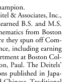

他还拥有Java认证程序员和Java认证开发人员称号，并且是Oracle Java Champion。

Harvey Deitel博士是Deitel & Associates, Inc.的董事长兼首席战略官，在计算机领域拥有超过55年的经验。Deitel博士在麻省理工学院获得电气工程学士和硕士学位，在波士顿大学获得数学博士学位——在这些项目衍生出计算机科学项目之前，他在每个项目中都学习了计算。他拥有丰富的大学教学经验，包括在1991年与儿子Paul共同创立Deitel & Associates, Inc.之前，在波士顿学院获得终身教职并担任计算机科学系系主任。Deitel父子的出版物获得了国际认可，已被翻译成日语、德语、俄语、西班牙语、法语、波兰语、意大利语、简体中文、繁体中文、韩语、葡萄牙语、希腊语、乌尔都语和土耳其语出版。Deitel博士已为企业、政府、军队和学术客户讲授了数百门编程课程。

## 关于Deitel & Associates, Inc.

Deitel & Associates, Inc.由Paul Deitel和Harvey Deitel创立，是一家国际公认的写作和企业培训组织，专门从事计算机编程语言、对象技术、互联网和Web软件技术以及Android和iOS应用开发。该公司的客户包括许多世界最大的公司、政府机构、军队分支机构和学术机构。该公司在全球客户现场提供讲师授课的培训课程，涵盖主要编程语言和平台，包括C#®、C++、C、Java™、Android应用开发、iOS应用开发、Swift™、Visual Basic®以及互联网和Web编程。

通过与Prentice Hall/Pearson长达40年的出版合作，Deitel & Associates, Inc.打造前沿的编程专业图书、大学教材、LiveLessons视频产品、电子书以及带有集成实验和评估的REVEL™交互式多媒体课程（`http://revel.pearson.com`）。可通过以下方式联系Deitel & Associates, Inc.和作者：`deitel@deitel.com`

要了解更多关于Deitel企业培训课程的信息，请访问`http://www.deitel.com/training`。

如需申请在贵组织进行全球现场讲师授课培训的方案，请发送电子邮件至`deitel@deitel.com`。

希望购买Deitel图书的个人可通过`http://bit.ly/DeitelOnAmazon`购买。

希望购买Deitel *LiveLessons*视频培训的个人可访问：`http://bit.ly/DeitelOnInformIT`。

Deitel图书和*LiveLessons*视频通常以电子形式向Safari Books Online订阅者提供，网址为：`http://SafariBooksOnline.com`。

您可以在以下网址获得Safari Books Online免费10天试用：`https://www.safaribooksonline.com/register/`。

企业、政府、军队和学术机构的批量订单应直接向Pearson下订。更多信息请访问`http://www.informit.com/store/sales.aspx`。

## 开始之前

请在使用本书前阅读本节，以确保您的计算机设置正确。

### 字体和命名约定

我们使用字体来区分程序开发环境中出现的功能，例如菜单名称、菜单项和其他元素。我们的约定是

- 用无衬线粗体强调Visual Studio功能（例如**属性**窗口），以及
- 用等宽无衬线字体强调程序文本（例如`bool x = true`）。

### Visual Studio 2015 Community Edition

本书使用Windows 10和免费的Microsoft Visual Studio 2015 Community Edition——Visual Studio也可以在各种较旧的Windows版本上运行。请确保您的系统满足Visual Studio 2015 Community Edition的最低硬件和软件要求，列于：

`https://www.visualstudio.com/en-us/visual-studio-2015-system-requirements-vs`

接下来，从以下网址下载安装程序

`https://www.visualstudio.com/products/visual-studio-express-vs`

然后执行它，并按照屏幕上的说明安装Visual Studio。

尽管我们在Windows 10上开发了本书的示例，但大多数示例将在Windows 7及更高版本上运行。大多数没有图形用户界面（GUI）的示例也将在其他C#和.NET实现上运行——更多信息请参阅本“开始之前”后面的“如果你不使用Microsoft Visual C#...”。

### 查看文件扩展名

《C# 6 for Programmers》第6版中的一些屏幕截图显示带有文件扩展名的文件名（例如.txt、.cs、.png等）。您可能需要调整系统设置以显示文件扩展名。如果您使用的是Windows 7：

1. 打开Windows资源管理器。
2. 按*Alt*键显示菜单栏，然后从**工具**菜单中选择**文件夹选项...**。
3. 在出现的对话框中，选择**视图**选项卡。
4. 在**高级设置窗格**中，*取消选中*文本**隐藏已知文件类型的扩展名**左侧的复选框。
5. 单击**确定**应用设置并关闭对话框。

如果您使用的是Windows 8或更高版本：

1. 打开**文件资源管理器**。
2. 单击**视图**选项卡。
3. 确保**文件扩展名**复选框处于*选中*状态。

### 获取源代码

*《C# 6 for Programmers》*第6版的源代码示例可在以下网址下载

`http://www.deitel.com/books/CSharp6FP`

单击**示例**链接将ZIP存档文件下载到您的计算机——大多数浏览器会将文件保存到您用户账户的“下载”文件夹中。您可以使用Windows内置功能，或使用第三方存档文件工具（如WinZip（www.winzip.com）或7-Zip（www.7-zip.org））解压ZIP文件的内容。

在整本书中，要求您在计算机上访问我们的示例代码的步骤假定您已将示例从ZIP文件中解压并放入您用户账户的“文档”文件夹中。您可以将它们解压到任何您喜欢的位置，但如果您选择其他位置，则需要根据您的位置更新我们的步骤。要使用Windows内置功能解压ZIP文件的内容：

1. 打开**Windows资源管理器**（Windows 7）或**文件资源管理器**（Windows 8及更高版本）。
2. 在您的系统上找到ZIP文件，通常位于您用户账户的“下载”文件夹中。
3. 右键单击ZIP文件并选择**全部提取...**。
4. 在出现的对话框中，导航到您要解压内容的目标文件夹，然后单击**提取**按钮。

### 配置Visual Studio以配合本书使用

在本节中，您将使用Visual Studio的**选项**对话框配置若干Visual Studio选项。设置此选项不是必需的，但会使您的Visual Studio与本书中Visual Studio屏幕截图所示内容一致。

#### Visual Studio主题

Visual Studio有三种颜色主题——**蓝色、深色**和**浅色**。我们使用了带浅色背景的**蓝色**主题，以使本书的屏幕截图更易阅读。要切换主题：

1. 在Visual Studio的“工具”菜单中，选择**选项...**以显示**选项**对话框。
2. 在左列中，选择**环境**。
3. 选择您希望使用的**颜色主题**。

保持“选项”对话框打开，以便进行下一步。


### 行号

在本书的讨论中，我们通过行号引用示例中的代码。许多程序员发现在 Visual Studio 中显示行号也很有帮助。为此：

- 1. 展开“选项”对话框左侧窗格中的“文本编辑器”节点。
- 2. 选择“所有语言”。
- 3. 在右侧窗格中，勾选“行号”复选框。

保持“选项”对话框打开，以便执行下一步。

### 代码缩进的制表符大小

Microsoft 建议源代码使用四个空格缩进，这也是 Visual Studio 的默认设置。由于打印版中代码行的宽度固定且有限，我们使用三个空格缩进——这可以减少代码行换行的数量，使代码更易于阅读。如果你希望使用三个空格缩进：

- 1. 展开“选项”对话框左侧窗格中的“C#”节点，然后选择“制表符”。
- 2. 确保已选择“插入空格”。
- 3. 在“制表符大小”和“缩进大小”字段中均输入 3。
- 4. 单击“确定”保存设置。

### 如果你不使用 Microsoft Visual C#...

C# 可以通过 .NET 基金会 (http://www.dotnetfoundation.org) 管理的两个开源项目在其他平台上使用——Mono 项目和 .NET Core。

#### Mono 项目

Mono 项目是一个开源、跨平台的 C# 和 .NET Framework 实现，可以安装在 Linux、OS X（即将更名为 macOS）和 Windows 上。本书中大多数控制台（非 GUI）应用程序的代码都可以使用 Mono 项目编译和运行。Mono 还支持 Windows Forms GUI，这将在第 14-15 章及后面的一些示例中使用。更多信息和下载 Mono，请访问：http://www.mono-project.com/

#### .NET Core

.NET Core 是一个全新的跨平台 .NET 实现，适用于 Windows、Linux、OS X 和 FreeBSD。本书中大多数控制台（非 GUI）应用程序的代码都可以使用 .NET Core 编译和运行。在撰写本文时，Windows 版 .NET Core 已经可用，而其他平台的版本仍在开发中。更多信息和下载 .NET Core，请访问：https://dotnet.github.io/

现在你已经准备好使用《C# 6 程序员教程（第6版）》开始学习 C# 和 .NET 平台了。我们希望你喜欢这本书！

## 引言

### 目标

在本章中，你将：

- 了解 Visual C# 编程语言和 Windows 操作系统的历史。
- 了解 Microsoft Azure 的云计算是什么。
- 回顾对象技术的基础知识。
- 理解 Windows、.NET、Visual Studio 和 C# 在 C# 生态系统中各自扮演的角色。
- 测试运行一个 Visual C# 绘图应用。

### 目录

- 1.1 引言
- 1.2 对象技术：简要回顾
- 1.3 C#
  - 1.3.1 面向对象编程
  - 1.3.2 事件驱动编程
  - 1.3.3 可视化编程
  - 1.3.4 泛型与函数式编程
  - 1.3.5 国际标准
  - 1.3.6 非 Windows 平台上的 C#
  - 1.3.7 Internet 与 Web 编程
  - 1.3.8 使用 async 和 await 的异步编程
- 1.4 Microsoft 的 .NET
  - 1.4.1 .NET Framework
  - 1.4.2 公共语言运行时
  - 1.4.3 平台无关性
  - 1.4.4 语言互操作性
- 1.5 Microsoft 的 Windows® 操作系统
- 1.6 Visual Studio 集成开发环境
- 1.7 在 Visual Studio Community 中试驾 Painter

## 1.1 引言

欢迎来到 C#！——一种用于构建大型计算机应用程序的强大计算机编程语言。目前有数十亿台个人计算机在使用，而以计算机为核心的移动设备数量更为庞大。自 2001 年发布以来，C# 主要用于构建个人计算机及其支持系统的应用程序。手机、平板电脑和其他设备的爆炸式增长也为移动应用编程创造了巨大机遇。借助这本新的第六版《C# 程序员教程》，你将能够使用 Microsoft 新的通用 Windows 平台 (UWP) 和 Windows 10，为个人计算机和 Windows 10 移动设备构建 C# 应用程序。随着 Microsoft 收购 Xamarin，你还可以为 Android 设备和 iOS 设备（如 iPhone 和 iPad）开发 C# 移动应用。

1. C# 的名称读作“C-sharp”，基于音乐中表示“升音”的 # 记号。

## 1.2 对象技术：简要回顾

C# 是一种面向对象的编程语言。在本节中，我们将回顾对象技术的基础知识。

在人们对新的、更强大的软件需求激增之时，快速、正确且经济地构建软件仍然是一个难以实现的目标。对象，或者更准确地说——正如我们将在第 4 章中看到的——对象所来自的类，本质上是可重用的软件组件。有日期对象、时间对象、音频对象、视频对象、汽车对象、人物对象等等。几乎任何名词都可以合理地表示为软件对象，包含属性（如名称、颜色和大小）和行为（如计算、移动和交流）。软件开发人员发现，使用模块化的、面向对象的设计与实现方法可以显著提高软件开发团队的效率，远非早期技术可比——面向对象的程序通常更容易理解、纠正和修改。

#### 汽车作为对象

让我们从一个简单的类比开始。假设你想驾驶一辆汽车，并通过*踩下油门踏板*使其加速。在你能做到这一点之前，必须发生什么？好吧，在你驾驶汽车之前，必须有人*设计*它。汽车通常始于工程图纸，类似于描述房屋设计的*蓝图*。这些图纸包括油门踏板的设计。踏板向驾驶员*隐藏*了真正使汽车加速的复杂机制，就像刹车踏板隐藏了使汽车减速的机制，方向盘*隐藏*了使汽车转向的机制。这使得即使对发动机、制动和转向机制的工作原理知之甚少或完全不了解的人也能轻松驾驶汽车。

在你驾驶汽车之前，必须根据描述它的工程图纸*制造*出汽车。一辆完工的汽车有一个*实际的*油门踏板使汽车加速，但即使这样还不够——汽车（希望如此）不会自行加速，因此驾驶员必须*踩*踏板来加速汽车。

#### 方法与类

让我们用汽车的示例来介绍一些关键的面向对象编程概念。在程序中执行任务需要方法。方法包含实际执行任务的程序语句。它向使用者*隐藏*这些语句，就像汽车油门踏板向驾驶员隐藏使汽车加速的机制一样。在 C# 中，我们创建一个称为类的程序单元，用来容纳执行类任务的一组方法。例如，一个表示银行账户的类可能包含一个*存入*资金的方法和另一个*取出*资金的方法。类在概念上类似于汽车的工程图纸，其中包含油门踏板、方向盘等的设计。

#### 从类创建对象

正如必须有人根据工程图纸*制造汽车*，你才能真正驾驶汽车一样，你必须从类*构建对象*，程序才能执行类方法所定义的任务。这一过程称为*实例化*。对象随后被称为其类的一个实例。

#### 复用

正如汽车的工程图纸可以被*重复使用*多次来制造许多汽车一样，你可以*重复使用*一个类多次来构建许多对象。在构建新类和新程序时复用现有类可以节省时间和精力。复用还有助于构建更可靠、更高效的系统，因为现有类和组件通常经过了广泛的*测试*（以查找问题）、*调试*（以纠正这些问题）和*性能调优*。正如*可互换部件*的概念对工业革命至关重要一样，可复用类对由对象技术推动的软件革命也至关重要。

#### 消息与方法调用

开车时，踩下油门踏板会向汽车发送一个*消息*来执行任务——即加速。类似地，你*向对象发送消息*。每条消息都实现为一次方法调用，告诉该对象的一个方法执行其任务。例如，程序可能会调用某个银行账户对象的*存款*方法来增加账户余额。


### 属性与实例变量

汽车除了具有完成任务的能力之外，还具有 *属性*，例如其颜色、车门数量、油箱中的汽油量、当前速度以及行驶总里程记录（即里程表读数）。与它的能力一样，汽车的属性在其设计中作为工程图的一部分表示（例如包括里程表和燃油表）。当你驾驶一辆真正的汽车时，这些属性会随汽车一起携带。每辆车都维护其 *自己的* 属性。例如，每辆车都知道自己油箱中有多少汽油，但不知道 *其他汽车* 油箱中有多少。

对象同样具有属性，这些属性在程序中使用时随其携带。这些属性是作为对象类的一个部分指定的。例如，银行账户对象具有一个 *balance attribute* 表示账户中的金额。每个银行账户对象都知道其所代表账户的余额，但 *不* 知道银行中 *其他* 账户的余额。属性由类的实例变量指定。

### 属性、get 访问器和 set 访问器

属性不一定可以直接访问。汽车制造商不希望驾驶员拆开汽车发动机来观察油箱中的汽油量。相反，驾驶员可以查看仪表板上的燃油表。银行不希望客户走进金库清点账户中的金额。相反，客户与银行出纳员交谈或查看个性化的网上银行账户。同样，你不需要访问对象的实例变量就能使用它们。你应该使用对象的属性。属性包含用于读取变量值的 *get accessors*，以及用于向其中存储值的 *set accessors*。

### 封装

类将属性和方法封装（即包装）到由这些类创建的对象中——对象的属性和方法密切相关。对象之间可以相互通信，但它们通常不被允许知道其他对象的实现方式——实现细节在对象本身内部是 *hidden*。这种信息隐藏，正如我们将看到的，对于良好的软件工程至关重要。

### 继承

可以通过继承快速便捷地创建新对象类——新类吸收现有类的特征，可能对其进行定制并添加其自身独特的特征。在我们的汽车类比中，“convertible”类的对象当然是更 *general* 的“automobile”类的对象，但更 *specifically*，车顶可以升起或放下。

### 面向对象分析与设计（OOAD）

你很快就会用 C# 编写程序。你将如何为你的程序创建代码？也许像许多程序员一样，你只需打开电脑开始打字。这种方法对于小型程序（就像我们在本书早期章节中介绍的那样）可能有效，但如果要求你为一家大银行创建控制数千台自动取款机的软件系统怎么办？或者假设要求你加入一个由数千名软件开发人员组成的团队，构建美国下一代空中交通管制系统？对于如此庞大和复杂的项目，你不应该只是坐下来开始编写程序。为了创建最佳解决方案，你应该遵循一个详细的分析过程来确定项目的需求（即定义系统应该做什么）并开发满足这些需求的设计（即决定系统应该如何做）。理想情况下，在编写任何代码之前，你应该经历这个过程并仔细审查设计（并让其他软件专业人员审查你的设计）。如果这个过程涉及从面向对象的角度分析并设计你的系统，那么它就被称为面向对象分析与设计（OOAD）过程。像 C# 这样的语言是面向对象的——在这种语言中编程，称为面向对象编程（OOP），允许你将面向对象的设计实现为一个工作系统。

### UML（统一建模语言）

尽管存在许多不同的 OOAD 过程，但一种用于传达任何 OOAD 过程结果的图形语言已被广泛使用。这种语言被称为统一建模语言（UML），现在是建模面向对象系统最广泛使用的图形方案。我们在第 4 章和第 5 章中介绍我们的第一个 UML 图，然后在第 12 章的面向对象编程深入处理中继续使用它们。在我们的在线 ATM 软件工程案例研究中，我们在引导你进行面向对象设计和实现体验时，介绍了 UML 功能的一个简单子集。

## 1.3 C#

2000 年，微软宣布了 C# 编程语言。C# 的根源在于 C、C++ 和 Java 编程语言。它的功能与 Java 相似，适用于最苛刻的应用程序开发任务，特别是用于构建当今的桌面应用程序、大规模企业应用程序以及基于网络、移动和云的应用程序。

### 1.3.1 面向对象编程

C# 是面向对象的——我们已经讨论了对象技术的基础，并在全书中提供了丰富的面向对象编程内容。C# 可以访问功能强大的 .NET Framework Class Library——一个庞大的预建类集合，可让你快速开发应用程序（图 1.1）。我们将在第 1.4 节中更多地介绍 .NET。

| .NET Framework Class Library 中的一些关键功能 |  |
|---|---|
| Database | Debugging |
| Building web apps | Multithreading |
| Graphics | File processing |
| Input/output | Security |
| Computer networking | Web communication |
| Permissions | Graphical user interface |
| Mobile | Data structures |
| String processing | Universal Windows Platform GUI |

Fig. 1.1 | Some key capabilities in the .NET Framework Class Library.

### 1.3.2 事件驱动编程

C# 图形用户界面（GUI）是事件驱动的。你可以编写响应用户发起事件的程序，例如鼠标点击、按键、计时器到期以及 *touches* 和 *finger swipes*——这些手势在智能手机和平板电脑上广泛使用。

### 1.3.3 可视化编程

Visual Studio 使你能够将 C# 用作 *visual programming language*——除了编写程序语句来构建应用程序的部分之外，你还可以使用 Visual Studio 将预定义的 GUI 对象（如 *buttons* 和 *textboxes*）拖放到屏幕上，并对其进行标记和调整大小。Visual Studio 将为你编写大部分 GUI 代码。

### 1.3.4 通用和函数式编程

#### 通用编程

编写处理集合的程序很常见——例如数字集合、联系人集合、视频集合等。历史上，你必须分别编程来处理每种类型的集合。有了通用编程，你编写处理集合“一般情况”的代码，而 C# 为每种集合类型处理具体细节，为你节省了大量工作。第 18–19 章介绍泛型和泛型集合。

#### 函数式编程

在函数式编程中，你指定任务中要完成的内容 *what*，但 *not how* 完成它。例如，使用微软的 LINQ——我们在第 9 章中介绍，然后在许多后续章节中使用——你可以说：“这里有一个数字集合，给我它的元素之和。”你 *不* 需要指定遍历元素并一次将它们加到运行总计中的机制——LINQ 会为你处理所有这些。函数式编程加快了应用程序开发并减少了错误。我们将在第 19 章更深入地探讨函数式编程。

### 1.3.5 国际标准

C# 已通过 ECMA International 标准化：

```
http://www.ecma-international.org
```

这使得除了微软的 Visual C# 之外还有该语言的其他实现。在撰写本文时，C# 标准文档——ECMA-334——仍在为 C# 6 进行更新。有关 ECMA-334 的信息，请访问

```
http://www.ecma-international.org/publications/standards/Ecma-334.htm
```

访问微软下载中心以找到微软 C# 6 规范的最新版本、其他文档和软件下载。

### 1.3.6 非 Windows 平台上的 C#

微软最初为 Windows 开发开发了 C#，但它可以通过 Mono Project 和 .NET Core 在其他平台上使用——两者均由 .NET Foundation 管理

```
http://www.dotnetfoundation.org/
```

有关更多信息，请参阅前言之后的“开始之前”部分。


### 1.3.7 Internet 与 Web 编程

当今的应用程序可以以在世界各地计算机之间通信为目标来编写。正如你将看到的，这是 Microsoft .NET 战略的重点。在本书后面，你将使用 C# 和 Microsoft 的 ASP.NET 技术构建基于 Web 的应用程序。

### 1.3.8 使用 async 和 await 的异步编程

在当今大多数编程中，程序中的每个任务必须先执行完毕，下一个任务才能开始。这称为*同步编程*，也是本书大部分内容采用的风格。C# 还允许*异步编程*，其中多个任务可以在*同一*时间执行。异步编程可以帮助你使应用程序对用户交互（例如鼠标点击和按键等众多用途）更具响应性。

早期版本的 Visual C# 中的异步编程既困难又容易出错。C# 的 async 和 await 功能通过使编译器对开发者隐藏许多相关复杂性，简化了异步编程。在第 21 章，我们将介绍使用 async 和 await 的异步编程。

## 1.4 Microsoft 的 .NET

2000 年，Microsoft 宣布了其 .NET 计划（www.microsoft.com/net），这是一个在软件的开发、工程、分发和使用中使用 Internet 和 Web 的广阔愿景。.NET 不强迫你使用单一编程语言，而是允许你使用*任何*与 .NET 兼容的语言（如 C#、Visual Basic、Visual C++ 及许多其他语言）创建应用程序。该计划的一部分包括 Microsoft 用于构建基于 Web 的应用程序的 ASP.NET 技术。

### 1.4.1 .NET Framework

.NET Framework 类库提供了许多功能，你将用它们快速轻松地构建大型 C# 应用程序。它包含*数千个*有价值的*预构建*类，这些类已经过测试和调优以最大化性能。你将学习如何创建自己的类，但应尽可能*重用* .NET Framework 类，以加快软件开发过程，同时提高所开发软件的质量和性能。

### 1.4.2 公共语言运行时

公共语言运行时（CLR）是 .NET Framework 的另一个关键部分，它执行 .NET 程序并提供使其更易于开发和调试的功能。CLR 是一个虚拟机（VM）——管理程序执行并对程序隐藏底层操作系统和硬件的软件。由 CLR 执行和管理的程序的源代码称为*托管代码*。CLR 为托管代码提供各种服务，例如

非托管代码程序无法访问 CLR 的服务，这使得非托管代码更难编写。² 托管代码通过以下步骤编译为特定于机器的指令：

- 1. 首先，代码被编译为 Microsoft 中间语言（MSIL）。从其他语言和来源转换为 MSIL 的代码可以由 CLR 组合在一起——这允许程序员使用他们首选的 .NET 编程语言工作。应用程序组件的 MSIL 被放入应用程序的可执行文件——即导致计算机执行应用程序任务的文件。
- 2. 当应用程序执行时，CLR 中的另一个编译器（称为即时编译器或 JIT 编译器）将可执行文件中的 MSIL 转换为机器语言代码（针对特定平台）。
- 3. 机器语言代码在该平台上执行。

### 1.4.3 平台独立性

如果 .NET Framework 存在并已为某个平台安装，则该平台可以运行任何 .NET 程序。程序无需修改即可在多个平台上运行的能力称为平台独立性。一次编写的代码无需修改即可用于另一种类型的计算机，从而节省时间和金钱。此外，软件可以面向更广泛的受众。以前，公司必须决定将其程序转换到不同平台——这一过程称为移植——是否值得付出成本。使用 .NET，移植程序不再是一个问题，至少一旦 .NET 本身已在各平台上可用。

### 1.4.4 语言互操作性

.NET Framework 提供高水平的语言互操作性。由于用不同 .NET 语言（如 C# 和 Visual Basic）编写的软件组件都编译为 MSIL，因此这些组件可以组合起来创建单个统一的程序。因此，MSIL 允许 .NET Framework 独立于语言。

.NET Framework 类库可由任何 .NET 语言使用。.NET 的最新版本包括 .NET 4.6 和 .NET Core：

- .NET 4.6 引入了许多改进和新功能，包括用于基于 Web 的应用程序的 ASP.NET 5、对当今高分辨率 4K 屏幕的改进支持等。
- .NET Core 是 .NET 的跨平台子集，适用于 Windows、Linux、OS X 和 FreeBSD。

## 1.5 Microsoft 的 Windows® 操作系统

Microsoft 的 Windows 是全球使用最广泛的个人计算机桌面操作系统。操作系统是使计算机对用户、开发人员和系统管理员来说使用更便捷的软件系统。它们提供的服务允许每个应用程序安全、高效地与其他应用程序并发（即并行）执行。

其他流行的桌面操作系统包括 macOS（以前称为 OS X）和 Linux。智能手机和平板电脑中使用的*移动操作系统*包括 Microsoft 的 Windows 10 Mobile、Google 的 Android 和 Apple 的 iOS（用于 iPhone、iPad 和 iPod Touch 设备）。图 1.2 展示了 Windows 操作系统的演变。

| 版本 | 描述 |
|---|---|
| 20 世纪 90 年代的 Windows | 20 世纪 80 年代中期，Microsoft 开发了基于图形用户界面的 Windows 操作系统，该界面包含按钮、文本框、菜单和其他图形元素。整个 20 世纪 90 年代发布的各种版本面向个人计算。Microsoft 通过 1993 年发布的 *Windows NT* 进入企业操作系统市场。 |
| Windows XP 和 Windows Vista | *Windows XP* 于 2001 年发布，结合了 Microsoft 的企业和消费者操作系统产品线。在撰写本文时，它仍占有超过 10% 的操作系统市场（https://www.netmarketshare.com/operating-system-market-share.aspx）。*Windows Vista* 于 2007 年发布，提供了吸引人的新 Aero 用户界面、许多强大的增强功能和新应用程序以及增强的安全性。但 Vista 从未流行起来。 |
| Windows 7 | *Windows 7* 目前是世界上使用最广泛的桌面操作系统，占有超过 47% 的操作系统市场（https://www.netmarketshare.com/operating-system-market-share.aspx）。Windows 7 增加了对 Aero 用户界面的增强、更快的启动时间、对 Vista 安全功能的进一步改进、支持多点触控的触摸屏等。 |
| 面向台式机和平板电脑的 Windows 8 | Windows 8 于 2012 年发布，在包括个人计算机、智能手机、平板电脑和 Xbox Live 在线游戏服务在内的各种设备上提供类似的平台（应用程序运行所基于的底层系统）和*用户体验*。其新的外观和感觉以开始屏幕为特色，其中的磁贴代表每个应用程序，类似于 *Windows Phone*（现为 Windows 10 Mobile）——Microsoft 的智能手机操作系统。Windows 8 具有对*触摸板*和*触摸屏*设备的*多点触控*支持、增强的安全功能等。 |
| Windows 8 UI（用户界面） | Windows 8 UI（以前称为“Metro”）引入了简洁的外观和感觉，尽量减少对用户的干扰。Windows 8 应用程序采用*无边框窗口*，没有边框、标题栏和菜单。这些元素被隐藏，允许应用程序填满*整个*屏幕——在平板电脑和智能手机等较小屏幕上尤其有用。当用户按住鼠标按钮、沿滑动方向移动鼠标并释放鼠标按钮来滑动屏幕顶部或底部时，或者使用*手指*在触摸屏设备上滑动时，界面元素显示在*应用栏*中。 |

**图 1.2** | Windows 操作系统的演变。（第 1 部分，共 2 部分。）


| 版本 | 描述 |
|---|---|
| Windows 10 和通用 Windows 平台 | Windows 10 于 2015 年发布，是当前版本的 Windows，目前占据操作系统市场 15% 的份额（且仍在增长）(https://www.netmarketshare.com/operating-system-market-share.aspx)。除了许多用户界面和其他更新之外，Windows 10 还引入了通用 Windows 平台（UWP），其设计目标是在所有 Windows 设备上提供共同的平台（应用程序运行所依赖的底层系统）和用户体验，包括个人计算机、智能手机、平板电脑、Xbox，甚至 Microsoft 的新款 HoloLens 增强现实全息头显——所有这些设备都使用几乎相同的代码。 |

**图 1.2** | Windows 操作系统的演变。（第 2 部分，共 2 部分。）

### Windows 商店

你可以在 Windows 商店中出售应用或免费提供应用。撰写本书时，注册开发者的费用为个人 19 美元、公司 99 美元。Microsoft 保留购买价格的 30%（某些市场更高）。更多信息请参阅应用开发者协议：

https://msdn.microsoft.com/en-us/library/windows/apps/hh694058.aspx

Windows 商店为你的应用提供多种盈利商业模式。你可以在下载前对应用收取全价，价格从 1.49 美元起。你还可以提供限时试用版或功能受限试用版，让用户在购买完整版之前试用应用；使用应用内购买出售虚拟商品（例如额外的应用功能）等。要详细了解 Windows 商店以及如何通过应用盈利，请访问

https://msdn.microsoft.com/windows/uwp/monetize/index

## 1.6 Visual Studio 集成开发环境

C# 程序可以使用 Microsoft 的 Visual Studio 创建——Visual Studio 是一组称为集成开发环境（IDE）的软件工具。Visual Studio Community 版 IDE 使你能够快速方便地编写、运行、测试和调试 C# 程序。它还支持 Microsoft 的 Visual Basic、Visual C++ 和 F# 编程语言以及许多其他语言。本书的大多数示例都是使用 Visual Studio Community 构建的，它可在 Windows 7、8 和 10 上运行。本书有少数示例需要 Windows 10。

## 1.7 在 Visual Studio Community 中试运行 Painter

**步骤 1：检查你的设置**

阅读本书前言之后的“开始之前”部分，确认你已正确设置计算机和软件。

**步骤 2：找到 Painter 应用的目录**

打开“文件资源管理器”（Windows 8 和 10）或“Windows 资源管理器”（Windows 7）窗口，并导航到

```
C:\Users\yourUserName\Documents\examples\ch01
```

双击 Painter 文件夹查看其内容（图 1.3），然后双击 Painter.sln 文件，在 Visual Studio 中打开该应用的解决方案。应用的解决方案包含该应用的所有代码文件、支持文件（如图像、视频、数据文件等）和配置信息。我们将在下一章更详细地讨论解决方案的内容。

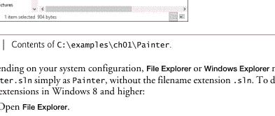

**图 1.3** | C:\examples\ch01\Painter 的内容。

根据你的系统配置，文件资源管理器或 Windows 资源管理器可能仅将 Painter.sln 显示为 Painter，而不显示文件扩展名 .sln。要在 Windows 8 及更高版本中显示文件扩展名：

- 1. 打开文件资源管理器。
- 2. 单击“查看”选项卡，然后确保选中“文件扩展名”复选框。

要在 Windows 7 中显示它们：

- 1. 打开 Windows 资源管理器。
- 2. 按 Alt 显示菜单栏，然后从 Windows 资源管理器的“工具”菜单中选择“文件夹选项...”。
- 3. 在出现的对话框中，选择“查看”选项卡。
- 4. 在“高级设置”窗格中，取消选中“隐藏已知文件类型的扩展名”文本左侧的框。[注意：如果此项已取消选中，则无需采取任何操作。]
- 5. 单击“确定”应用设置并关闭对话框。

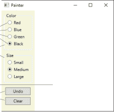

**图 1.5** | 在 Windows 10 中运行的 Painter 应用。

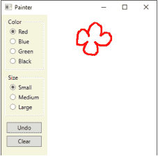

**图 1.6** | 用小号红色画笔绘制花瓣。

**步骤 5：更改画笔颜色和大小**

点击 Green 单选按钮更改画笔颜色。然后，点击 Large 单选按钮更改画笔大小。绘制草和花茎，如图 1.7 所示。

**步骤 6：完成绘图**

点击 Blue 和 Medium 单选按钮。绘制雨滴，如图 1.8 所示，完成绘图。

**步骤 7：停止应用**

从 Visual Studio 运行应用时，你可以通过单击 Visual Studio 工具栏上的停止按钮，或单击正在运行的应用窗口上的关闭框来终止它。


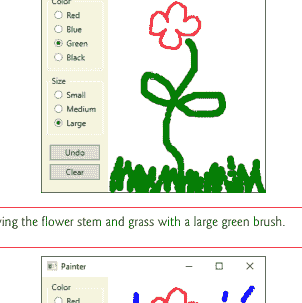

**图 1.7** | 用大号绿色画笔绘制花茎和草。

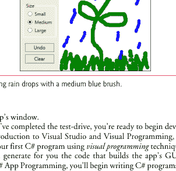

**图 1.8** | 用中号蓝色画笔绘制雨滴。

现在你已完成试运行，可以开始开发 C# 应用了。在第 2 章“Visual Studio 和可视化编程简介”中，你将使用 Visual Studio 通过可视化编程技术创建你的第一个 C# 程序。正如你将看到的，Visual Studio 将为你生成构建应用 GUI 的代码。在第 3 章“C# 应用编程简介”中，你将开始编写包含你自己编写的常规程序代码的 C# 程序。

## Visual Studio 和可视化编程简介

### 目标

在本章中，你将：

- 了解用于编写、运行和调试应用的 Visual Studio Community 2015 集成开发环境（IDE）概述。
- 使用 Visual Studio 的 Windows 窗体应用程序模板创建新项目。
- 了解 Windows 窗体和用于构建图形用户界面的控件。
- 使用可视化应用开发方便地创建、编译和执行一个显示文本和图像的简单 Visual C# 应用。

- 2.1 简介
- 2.2 Visual Studio Community 2015 IDE 概述
  - 2.2.1 Visual Studio Community 2015 简介
  - 2.2.2 Visual Studio 主题
  - 2.2.3 起始页上的链接
  - 2.2.4 创建新项目
  - 2.2.5 “新建项目”对话框和项目模板
  - 2.2.6 窗体和控件
- 2.3 菜单栏和工具栏
- 2.4 浏览 Visual Studio IDE
  - 2.4.1 解决方案资源管理器
  - 2.4.2 工具箱
  - 2.4.3 属性窗口
- 2.5 帮助菜单和上下文相关帮助
- 2.6 可视化编程：创建一个显示文本和图像的简单应用
- 2.7 总结
- 2.8 Web 资源

## 2.1 简介

Visual Studio 是 Microsoft 的集成开发环境（IDE），用于创建、运行和调试用 C# 及各种其他 .NET 编程语言编写的应用（也称为应用程序）。在本章中，我们概述 Visual Studio Community 2015 IDE，然后展示如何通过将预定义构建块拖放到适当位置来创建简单的 Visual C# 应用——这种技术称为可视化应用开发。

## 2.2 Visual Studio Community 2015 IDE 概述

Visual Studio 有多个版本。本书的示例、屏幕截图和讨论均基于在 Windows 10 上运行的免费 Visual Studio Community 2015。有关安装软件的信息，请参阅前言之后的“开始之前”部分。除少数例外，本书的示例都可以在 Windows 7、8.x 或 10 上创建和运行——我们将指出任何需要 Windows 10 的示例。

这些示例也适用于 Visual Studio 完整版——尽管某些选项、菜单和说明可能有所不同。从现在开始，我们将 Visual Studio Community 2015 简称为“Visual Studio”或“IDE”。

**2.2.1 Visual Studio Community 2015 简介**

> *[注意：我们使用 > 字符表示你应从菜单中选择菜单项。例如，表示法 File > Save All 表示你应从 File 菜单中选择 Save All 菜单项。]*

首先，打开 Visual Studio。在 Windows 10 上，单击

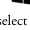

然后选择“所有应用”>“Visual Studio 2015”。在 Windows 7 上，单击


然后选择“所有程序”>“Visual Studio 2015”。在 Windows 8 的“开始”屏幕中，找到并单击 Visual Studio 2015 磁贴，该磁贴包含以下图标：

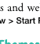

最初，Visual Studio 显示“起始页”（图 2.1）。根据你的 Visual Studio 版本，起始页的外观可能有所不同。起始页包含指向 Visual Studio 资源和基于 Web 的资源的链接列表。你可以随时通过选择“视图”>“起始页”返回起始页。

### 2.2.2 Visual Studio 主题

Visual Studio 支持三种主题，用于指定 IDE 的配色方案：

- 深色主题（深色窗口背景和浅色文本）
- 浅色主题（浅色窗口背景和深色文本）
- 蓝色主题（浅色窗口背景和深色文本）。

本书通篇使用蓝色主题。前言之后的“开始之前”部分说明了如何设置此选项。

### 2.2.3 起始页上的链接

起始页链接分为两列。左列的“开始”部分包含用于生成新应用或处理现有应用的选项。左列的“最近”部分包含指向你最近创建或修改的项目的链接。

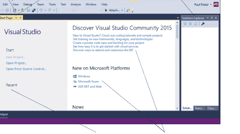

图 2.1 | Visual Studio Community 2015 中的起始页。

### 2.2.5 “新建项目”对话框和项目模板

在接下来几节的讨论中，我们将创建一个新项目。选择“文件”>“新建”>“项目...”以显示**新建项目**对话框（图 2.3）。对话框是便于用户与计算机通信的窗口。

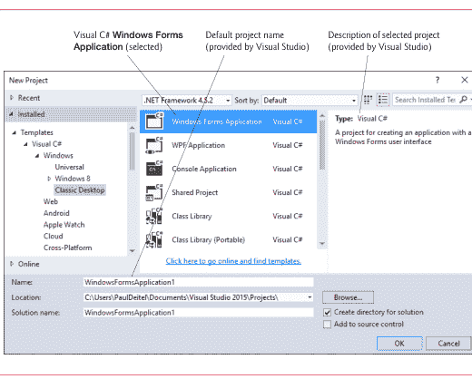

**图 2.3** | “新建项目”对话框。

Visual Studio 提供了许多模板（图 2.3 左列）——即用户可以在 Visual C# 和其他语言中创建的*项目类型*。模板包括 Windows Forms 应用、WPF 应用等——完整版本的 Visual Studio 提供额外模板。在本章中，你将生成一个 *Windows Forms 应用程序*——一种在 Windows 操作系统（如 Windows 7、8 或 10）中执行的应用，通常具有图形用户界面（GUI）。用户与应用的这个*可视*部分进行交互。GUI 应用包括 Microsoft Word、Internet Explorer 和 Visual Studio 等 Microsoft 软件产品，其他供应商创建的软件产品，以及你和其他应用开发者创建的自定义软件。本书中你将创建许多 Windows 应用。

要创建 Windows Forms 应用程序，请在“模板”下选择“Visual C#”>“Windows”>“经典桌面”，然后在中间列中选择“Windows Forms 应用程序”。默认情况下，Visual Studio 会将名称 WindowsFormsApplication1 分配给新的 Windows Forms 应用程序项目和解决方案（图 2.3）。单击“确定”以在**设计视图**中显示 IDE（图 2.4），其中包含可用于创建应用 GUI 的功能。

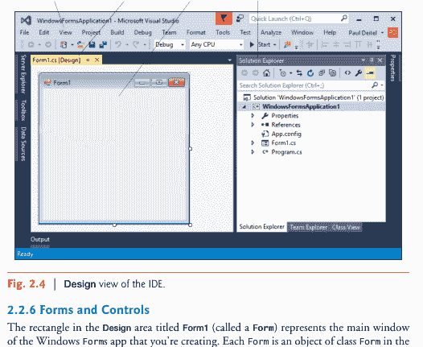

图 2.4 | IDE 的设计视图。

### 2.2.6 窗体和控件

设计区域中标题为 Form1 的矩形（称为窗体）表示你正在创建的 Windows Forms 应用的主窗口。每个窗体都是 .NET Framework 类库中 Form 类的对象。应用可以有多个窗体（窗口）——但是，你将在第 2.6 节中创建的应用，以及本书后面创建的大多数其他 Windows Forms 应用，都将只包含一个窗体。你将学习如何通过添加 GUI 控件来自定义窗体——在第 2.6 节中，你将添加一个 Label 和一个 PictureBox。Label 通常包含描述性文本（例如，“Welcome to Visual C#!”），而 PictureBox 显示图像。Visual Studio 有许多预置控件和其他组件，可用于生成和自定义你的应用。本书通篇讨论并使用了许多此类控件。其他控件可从第三方获取。

在本章中，你将使用 .NET Framework 类库中的预置控件。当你将控件放在窗体上时，你将能够修改其属性（在第 2.4 节中讨论）。

窗体和控件共同构成应用的 GUI。用户通过键盘输入、单击鼠标按钮以及各种其他方式将数据输入应用。应用使用 GUI 显示说明和其他信息供用户查看。例如，图 2.3 中的“新建项目”对话框呈现了一个 GUI，用户在其中单击鼠标按钮选择模板类型，然后通过键盘输入项目名称（图中显示默认项目名 WindowsFormsApplication1）。

每个打开的文档的名称都列在选项卡上。当打开多个文档时，要查看某个文档，请单击其选项卡。活动选项卡（当前显示的文档的选项卡）会高亮显示（例如，图 2.4 中的 Form1.cs [Design]）。活动选项卡的高亮颜色取决于 Visual Studio 主题——蓝色主题使用黄色高亮，浅色和深色主题使用蓝色高亮。

## 2.3 菜单栏和工具栏

用于管理 IDE 以及开发、维护和执行应用的命令包含在菜单中，菜单位于 IDE 的菜单栏上（图 2.5）。显示的菜单集取决于你当前在 IDE 中执行的操作。


图 2.5 | Visual Studio 菜单栏。

菜单包含称为菜单项的相关命令组，选中这些命令时，会使 IDE 执行特定操作——例如，打开窗口、保存文件、打印文件和执行应用。例如，选择“文件”>“新建”>“项目...”会告诉 IDE 显示“新建项目”对话框。图 2.5 中描绘的菜单总结在图 2.6 中。

| 菜单 | 包含以下命令 |
|------|-----------------------|
| 文件 | 打开、关闭、添加和保存项目，以及打印项目数据和退出 Visual Studio。 |
| 编辑 | 编辑应用，例如剪切、复制、粘贴、撤销、重做、删除、查找和选择。 |
| 视图 | 显示 IDE 窗口（例如，解决方案资源管理器、工具箱、属性窗口）以及向 IDE 添加工具栏。 |
| 项目 | 管理项目及其文件。 |
| 生成 | 将你的应用转换为可执行程序。 |
| 调试 | 编译、调试（即识别和纠正应用中的问题）和运行应用。 |
| 团队 | 连接到 Team Foundation Server——供通常有多人处理同一应用的开发团队使用。 |
| 格式 | 排列和修改窗体的控件。“格式”菜单仅在设计视图中选中 GUI 组件时出现。 |
| 工具 | 访问额外的 IDE 工具和用于自定义 IDE 的选项。 |
| 测试 | 对应用执行各种类型的自动化测试。 |
| 分析 | 查找并报告违反 .NET Framework 设计准则 (https://msdn.microsoft.com/library/ms229042) 的情况。 |

图 2.6 | 当窗体处于设计视图时显示的 Visual Studio 菜单摘要。（第 1 部分，共 2 部分。）

| 菜单 | 包含以下命令 |
|------|-----------------------|
| 窗口 | 隐藏、打开、关闭和显示 IDE 窗口。 |
| 帮助 | 访问 IDE 的帮助功能。 |

图 2.6 | 当窗体处于设计视图时显示的 Visual Studio 菜单摘要。（第 2 部分，共 2 部分。）

你可以从工具栏（图 2.7）访问许多常用菜单命令，工具栏包含以图形方式表示命令的图标。默认情况下，首次运行 Visual Studio 时会显示标准工具栏——它包含最常用命令的图标，例如打开文件、保存文件和运行应用（图 2.7）。标准工具栏上出现的图标可能因你使用的 Visual Studio 版本而异。有些命令最初处于禁用状态（灰显或不可用）。Visual Studio 仅在你能够使用这些命令时才会启用它们。例如，一旦你开始编辑文件，Visual Studio 就会启用保存文件的命令。

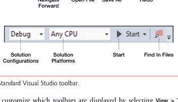

图 2.7 | 标准 Visual Studio 工具栏。

你可以通过选择“视图”>“工具栏”，然后从图 2.8 的列表中选择一个工具栏，来自定义显示哪些工具栏。你选择的每个工具栏都会与其他工具栏一起显示在 Visual Studio 窗口顶部。你可以通过拖动工具栏左侧的拖动手柄  来移动工具栏。要通过工具栏执行命令，请单击其图标。


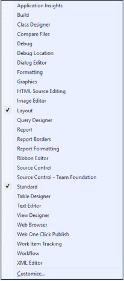

**图 2.8** | 可以添加到 IDE 顶部的工具栏列表。

记住每个工具栏图标代表什么可能很困难。*悬停*鼠标指针在图标上时会突出显示它，并在短暂暂停后显示该图标的描述，称为*工具提示*（图 2.9）——这些提示有助于您熟悉 IDE 的功能，并作为每个工具栏图标功能的实用提醒。

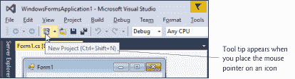

**图 2.9** | 工具提示 for the **新建项目** 按钮。

## 2.4 在 Visual Studio IDE 中导航

IDE 提供用于访问项目文件和自定义控件的窗口。本节介绍在开发 Visual C# 应用程序时您会经常使用的几个窗口。IDE 的每个窗口都可以通过在“视图”菜单中选择其名称来访问。

### 自动隐藏

Visual Studio 提供自动隐藏的节省空间功能。当为窗口启用自动隐藏时，包含窗口名称的选项卡会出现在 IDE 窗口的左侧、右侧或底部边缘（图 2.10）。单击自动隐藏窗口的名称会显示该窗口（图 2.11）。再次单击名称（或单击外部）会隐藏窗口。要“固定”窗口（即禁用自动隐藏并保持窗口打开），请单击图钉图标。当启用自动隐藏时，图钉图标为水平


如 图 2.11 所示。当窗口被“固定”时，图钉图标为垂直


如 图 2.12 所示。

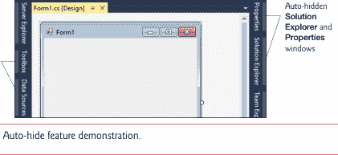

**图 2.10** | 自动隐藏功能演示。

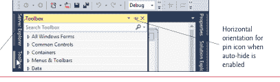

**图 2.11** | 启用自动隐藏时显示隐藏的工具箱窗口。

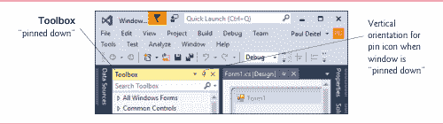

**图 2.12** | 禁用自动隐藏——“固定”窗口。

接下来的几节介绍了三个 Visual Studio 窗口，您将经常使用它们——**解决方案资源管理器**、**属性** 窗口和 **工具箱**。这些窗口显示项目信息并包含帮助您构建应用程序的工具。

### 2.4.1 解决方案资源管理器

**解决方案资源管理器** 窗口（图 2.13）提供对解决方案所有文件的访问。如果在 IDE 中未显示，请选择 **视图 > 解决方案资源管理器**。当您打开新的或现有解决方案时，**解决方案资源管理器** 会显示解决方案的内容。

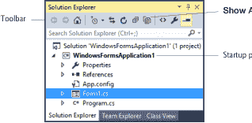

**图 2.13** | 解决方案资源管理器窗口显示 **WindowsFormsApplication1** 项目。

解决方案的启动项目（在解决方案资源管理器中以 **粗体** 显示）是在您选择 **调试 > 开始调试**（或按 **F5**）或选择 **调试 > 开始不调试**（或按 **Ctrl + F5** 键）时运行的项目。对于本书示例中的单项目解决方案，启动项目是唯一项目（本例中为 **WindowsFormsApplication1**）。当您第一次创建应用程序时，**解决方案资源管理器** 窗口如 图 2.13 所示。与图 2.4 所示的窗体对应的 Visual C# 文件名为 **Form1.cs**（在图 2.13 中选中）。Visual C# 文件使用 **.cs** 文件名扩展名，简写为“C#”。

默认情况下，IDE 仅显示您可能需要编辑的文件——IDE 生成的其他文件是隐藏的。**解决方案资源管理器** 窗口包含一个工具栏，其中包含多个图标。单击 **显示所有文件** 图标（图 2.13）会显示解决方案的所有文件，包括 IDE 生成的文件。单击节点左侧的箭头可展开或折叠该节点。单击 **引用** 左侧的箭头以按该标题分组显示其项目（图 2.14）。再次单击箭头可折叠树。其他 Visual Studio 窗口也使用此约定。

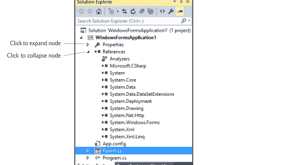

**图 2.14** | 解决方案资源管理器中引用节点已展开。

### 2.4.2 工具箱

要显示工具箱窗口，请选择 视图 > 工具箱。工具箱包含用于自定义窗体的控件（图 2.15）。使用可视化应用程序开发，您可以将控件“拖放”到窗体上，IDE 将为您编写创建控件的代码。这比自己编写代码更快、更简单。正如您不需要知道如何制造发动机就能驾驶汽车，您也不需要知道如何构建控件就能使用它们。*重用* 预先存在的控件可在开发应用程序时节省时间和金钱。在本章后面创建第一个应用程序时，您将使用工具箱。

工具箱将预构建的控件分组为类别——所有 Windows 窗体、常用控件、容器、菜单和工具栏、数据、组件、打印、对话框、报表、WPF 互操作和常规在图 2.15 中列出。再次注意，使用箭头展开或折叠控件组。我们在全书中讨论了工具箱的许多控件及其功能。

### 2.4.3 属性窗口

如果属性窗口未显示在解决方案资源管理器下方，请选择 视图 > 属性窗口 以显示它——如果窗口处于自动隐藏模式，请通过单击其水平图钉图标固定窗口


**属性** 窗口包含 IDE 中当前选定的窗体、控件或文件的属性。属性指定有关窗体或控件的信息，例如其大小，

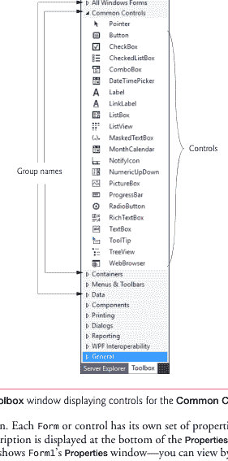

图 2.15 | 工具箱窗口显示常用控件组的控件。

颜色和位置。每个窗体或控件都有自己的属性集。当您选择一个属性时，其描述会显示在属性窗口底部。

图 2.16 显示了 Form1 的属性窗口——您可以通过单击 Form1.cs [设计] 窗口中的任意位置来查看。左列列出窗体的属性——右列显示每个属性的当前值。您可以按以下方式对属性进行排序

- *按字母顺序*（通过单击 **按字母顺序** 图标）或
- *按类别*（通过单击 **按类别** 图标）。

根据属性窗口的大小，某些属性可能对您不可见。您可以通过在滚动条内拖动滚动框上下滚动属性列表，或单击滚动条顶部和底部的箭头来滚动。我们将在本章后面展示如何设置单个属性。

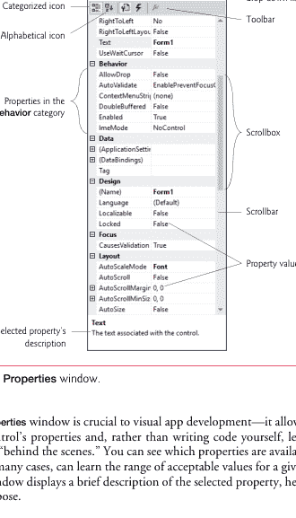

图 2.16 | 属性窗口。

属性窗口对可视化应用程序开发至关重要——它允许您快速修改控件的属性，而不是自己编写代码，让 IDE 为您“幕后”编写代码。您可以查看哪些属性可供修改，并且在许多情况下可以了解给定属性的可接受值范围。属性窗口显示所选属性的简要描述，有助于您理解其用途。

## 2.5 帮助菜单和上下文相关帮助

Microsoft 通过“帮助”菜单提供广泛的帮助文档，这是在 Visual Studio、Visual C# 等方面快速获取信息的好方法。Visual Studio 提供与“当前内容”相关的上下文相关帮助（即鼠标光标位置周围的项目）。要使用上下文相关帮助，请单击一个项目，然后按 F1 键。帮助文档在 Web 浏览器窗口中显示。要返回 IDE，请关闭浏览器窗口或在 Windows 任务栏中选择 IDE 的图标。

## 2.6 可视化编程：创建显示文本和图像的简单应用程序

接下来，我们创建一个应用程序，显示文本“Welcome to C# Programming!”和 Deitel & Associates 错误吉祥物的图像。该应用程序由一个使用标签和图片框的窗体组成。图 2.17 显示了最终应用程序的执行情况。该应用程序和错误图像可与本章示例一起使用——请参阅前言后的“开始之前”部分获取下载说明。我们假设您将示例放在用户帐户的“文档”文件夹中的名为 examples 的子文件夹中。

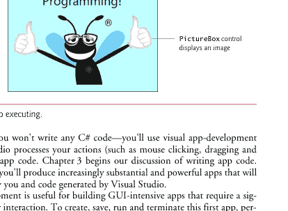

图 2.17 | 简单应用程序正在执行。

在此示例中，您不会编写任何 C# 代码——您将使用可视化应用程序开发技术。Visual Studio 处理您的操作（例如鼠标单击、拖放）以生成应用程序代码。第 3 章开始讨论编写应用程序代码。在整本书中，您将制作越来越重要和强大的应用程序，其中包括您编写的代码和 Visual Studio 生成的代码。

可视化应用程序开发对于构建需要大量用户交互的 GUI 密集型应用程序很有用。要创建、保存、运行和终止此第一个应用程序，请执行以下步骤。

### 第 1 步：关闭打开的项目

如果您在本章前面正在使用的项目仍处于打开状态，请通过选择 文件 > 关闭解决方案 来关闭它。

### 第 2 步：创建新项目

要创建新的 Windows 窗体应用程序：

- 1. 选择 文件 > 新建 > 项目... 以显示“新建项目”对话框（图 2.18）。
- 2. 选择 Windows 窗体应用程序。将项目命名为 ASimpleApp，指定要保存的位置，然后单击“确定”。我们将应用程序存储在 IDE 的默认位置——在您的用户帐户的“文档”文件夹下的 Visual Studio 2015\Projects 中。


正如本章前面所见，当你首次创建一个新的 Windows Forms 应用时，IDE 会在设计视图中打开（即应用正在被设计而非执行）。包含窗体的选项卡中显示的文本 Form1.cs [Design] 表示我们是在以可视方式而非以编程方式设计窗体。选项卡中文本末尾的星号 (*) 表示你已更改文件且更改尚未保存。

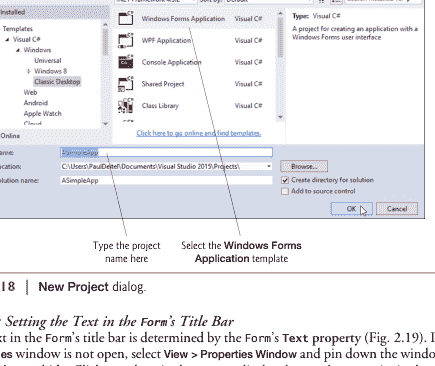

Fig. 2.18 | 新建项目对话框。

### 第 3 步：在窗体标题栏中设置文本

窗体标题栏中的文本由窗体的 Text 属性决定（图 2.19）。如果属性窗口未打开，请选择 查看 > 属性窗口 并固定窗口使其不自动隐藏。单击窗体中的任意位置以在属性窗口中显示窗体的属性。在 Text 属性右侧的文本框中，输入 “A Simple App”，如图 2.19 所示。按下 Enter 键——窗体的标题栏会立即更新（图 2.20）。

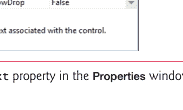

Fig. 2.19 | 在属性窗口中设置窗体的 Text 属性。

### 第 5 步：更改窗体的背景颜色

BackColor 属性指定窗体或控件的背景颜色。在属性窗口中单击 BackColor 会在属性值旁边显示一个向下箭头按钮（图 2.22）。单击向下箭头按钮会显示其他选项，具体取决于属性。在此情况下，箭头显示 Custom、Web 和 System（默认）选项卡。单击 Custom 选项卡以显示调色板（颜色网格）。选择代表浅蓝色的方块。选择颜色后，调色板关闭，窗体的背景颜色变为浅蓝色（图 2.23）。

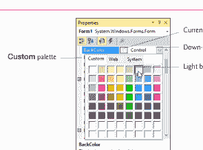

**Fig. 2.22** | 更改窗体的 BackColor 属性。

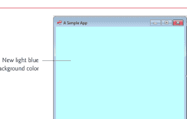

**Fig. 2.23** | 应用了新的 BackColor 属性的窗体。

### 第 6 步：向窗体添加标签控件

本章创建的应用中，我们通常使用的控件位于工具箱的 Common Controls 组中，也可以在 All Windows Forms 组中找到。如果工具箱尚未打开，请选择 查看 > 工具箱 以显示用于创建应用的控件集。如果任一组名称已折叠，请单击组名称左侧的箭头展开（图 2.15 中显示了 All Windows Forms 和 Common Controls 组）。接下来，在工具箱中双击 Label1 控件，将 Label1 添加到窗体的左上角（图 2.24）——添加到窗体的每个 Label 都是来自 .NET Framework 类库的 Label 类的对象。[注意：如果窗体位于工具箱后面，可能需要隐藏或固定工具箱才能看到标签。] 虽然双击任何工具箱控件都会将控件放置在窗体上，但你也可以“拖动”控件从工具箱到窗体——你可能更喜欢拖动控件，因为你可以将其放置在任何想要的位置。标签默认显示文本 label1。默认情况下，标签的 BackColor 与窗体相同。

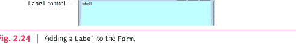

**Fig. 2.24** | 向窗体添加标签。

### 第 7 步：自定义标签的外观

单击窗体中的标签文本以选中它并在属性窗口中显示其属性。标签的 Text 属性决定标签显示的文本。窗体和 Label1 各自拥有自己的 Text 属性——窗体和控件可以具有相同的属性名称（如 Text、BackColor 等）而不会冲突。每个通用属性的目的可能因控件而异。请执行以下步骤：

- 1. 将标签的 Text 属性设置为 Welcome to C# Programming!。标签会调整大小以在一行内容纳所有输入的文本。
- 2. 默认情况下，标签的 AutoSize 属性设置为 True，以便标签可以更新自身大小以适应所有文本。将 AutoSize 属性设置为 False，以便你可以更改标签的大小，然后使用调整大小手柄调整标签大小，使文本适配。
- 3. 通过拖动标签或使用键盘的左右箭头键调整其位置，将标签移动到窗体的顶部中央（图 2.25）。或者，在选中标签时，你也可以通过选择 格式 > 置中于窗体 > 水平 来将其水平居中。

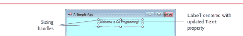

**Fig. 2.25** | 窗体和标签已自定义后的 GUI。

### 第 8 步：设置标签的字体大小

更改标签文本的字体类型和外观：

- 1. 选择 Font 属性的值，这会在值旁边显示一个省略号按钮（图 2.26）——你可以单击此按钮以显示该属性的选项对话框。单击省略号按钮以显示 **字体** 对话框（图 2.27）。

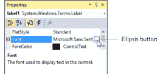

**Fig. 2.26** | 属性窗口显示标签的 Font 属性。

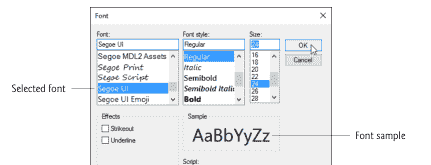

**Fig. 2.27** | 用于选择字体、样式和大小的字体对话框。

- 2. 在此对话框中，你可以选择字体名称（字体选项可能因系统而异）、字体样式（Regular、*Italic*、**Bold** 等）和字体大小（16、18、20 等）。示例文本显示所选的字体设置。在 Font 下，选择 Segoe UI，微软推荐的用户界面字体。在 Size 下，选择 24 磅并单击确定。
- 3. 如果标签的文本不适合单行，它会 *wrap* 到下一行。调整标签大小，使单词 “Welcome to” 出现在标签的第一行，单词 “C# Programming!” 出现在第二行。
- 4. 重新将标签水平居中。

### 第 9 步：对齐标签的文本

选择标签的 TextAlign 属性，该属性决定文本在标签内的对齐方式。会显示一个三乘三的按钮网格，表示对齐选项（图 2.28）。每个按钮的位置对应文本在标签中的出现位置。对于此应用，在三乘三网格中将 TextAlign 属性设置为 MiddleCenter——此选择会在标签内水平和垂直居中文本。其他 TextAlign 值，如 TopLeft、TopRight 和 BottomCenter，可用于将文本放置在标签内的任何位置。某些对齐值可能需要你调整标签大小以更好地适应文本。

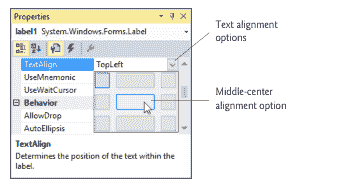

**Fig. 2.28** | 居中标签的文本。

### 第 10 步：向窗体添加 PictureBox

PictureBox 控件显示图像。在工具箱中定位 PictureBox（图 2.15）并双击它将其添加到窗体——添加到窗体的每个 PictureBox 都是来自 .NET Framework 类库的 PictureBox 类的对象。当 PictureBox 出现时，将其移动到标签下方，可以通过拖动或使用箭头键（图 2.29）。

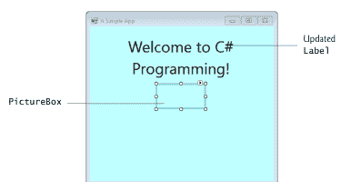

**Fig. 2.29** | 插入并对齐 PictureBox。

### 第 11 步：插入图像

单击 PictureBox 以在属性窗口中显示其属性（图 2.30），然后：

- 1. 定位并选择 **Image** 属性，该属性显示所选图像的预览，或在未选择图像时显示 (none)。
- 2. 单击省略号按钮以显示 **选择资源** 对话框（图 2.31），该对话框用于导入文件（如图像）以供应用使用。

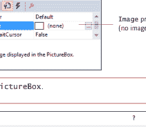

图像属性值（未选择图像）

Fig. 2.30 | PictureBox 的 Image 属性。

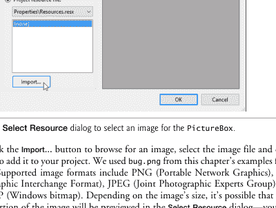

Fig. 2.31 | 选择资源对话框以为 PictureBox 选择图像。

- 3. 单击 Import... 按钮浏览图像，选择图像文件并单击确定将其添加到项目。我们使用了本章示例文件夹中的 bug.png。支持的图像格式包括 PNG（便携式网络图形）、GIF（图形交换格式）、JPEG（联合摄影专家组）和 BMP（Windows 位图）。根据图像大小，在选择资源对话框中可能只能预览图像的一部分——你可以调整对话框大小以查看更多图像（图 2.32）。单击确定以使用图像。
- 4. 要将图像缩放到 PictureBox 中，请将 SizeMode 属性更改为 StretchImage（图 2.33）。调整 PictureBox 大小，使其更大（图 2.34），然后重新将 PictureBox 水平居中。

### 第 12 步：保存项目

选择 文件 > 全部保存 以保存整个解决方案。解决方案文件（文件扩展名为 .sln）包含其项目的名称和位置，而项目文件（文件扩展名为 .csproj）包含项目中所有文件的文件名和位置。如果以后想重新打开项目，只需打开其 .sln 文件即可。


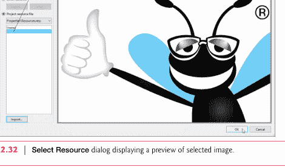

图像资源名称

Fig. 2.32 | 选择资源对话框显示所选图像的预览。

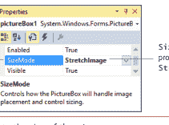

SizeMode 属性

SizeMode 属性设置为 StretchImage

Fig. 2.33 | 将图像缩放到 PictureBox 的大小。

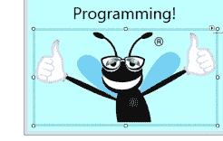

新插入的图像

Fig. 2.34 | PictureBox 显示图像。

### 第 13 步：运行项目

请回想一下，到目前为止我们一直处于 IDE 设计模式下工作（即正在创建的应用未在执行）。在运行模式下，应用正在执行，并且你只能与少数 IDE 功能交互——不可用的功能会被禁用（变灰）。选择 Debug > Start Debugging 来执行应用（或按 F5 键）。IDE 进入运行模式，并在 IDE 标题栏中应用名称旁边显示“(Running)”。图 2.35 显示了正在运行的应用，它出现在 IDE 外部的独立窗口中。

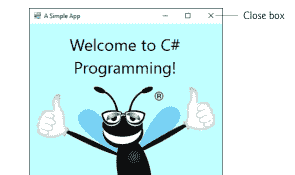

**Fig. 2.35** | IDE 处于运行模式，运行中的应用位于前台。

### 第 14 步：终止应用

你可以通过点击正在运行应用窗口右上角的关闭按钮 ✕ 来终止应用。此操作会停止应用的执行并将 IDE 返回到设计模式。你也可以选择 Debug > Stop Debugging 来终止应用。

## 2.7 小结

在本章中，我们介绍了 Visual Studio IDE 的关键功能。你在不编写任何代码的情况下可视化设计了一个可工作的 Visual C# 应用。Visual C# 应用开发是两种风格的混合——可视化应用开发让你可以轻松开发 GUI 并避免繁琐的 GUI 编程；“常规”编程（我们在第 3 章介绍）让你可以指定应用的行为。

你创建了一个包含一个 Form 的 Visual C# Windows Forms 应用。你使用 IDE 的 Solution Explorer、Toolbox 和 Properties 窗口，这些窗口对于开发 Visual C# 应用至关重要。我们还演示了上下文相关帮助，它会显示与所选控件或文本相关的帮助主题。

你使用可视化应用开发通过在 Form 上添加 Label 和 PictureBox 控件来设计应用的 GUI。你使用 Properties 窗口设置 Form 的 Text 和 BackColor 属性。你了解到 Label 控件显示文本，而 PictureBox 显示图像。你在 Label 中显示文本并向 PictureBox 添加图像。你还使用 Label 的 AutoSize、TextAlign 和 Font 属性以及 PictureBox 的 Image 和 SizeMode 属性。

在下一章中，我们将讨论“非可视化”或“常规”编程——你将使用自己编写的 C# 代码创建第一个应用，而不是让 Visual Studio 编写代码。

## 2.8 网络资源

请花点时间访问以下每个站点。

https://www.visualstudio.com/
Microsoft Visual Studio 的主页。该站点包含新闻、文档、下载和其他资源。

https://social.msdn.microsoft.com/Forums/vstudio/en-US/home?forum=csharpgeneral
该站点提供访问 Microsoft Visual C# 论坛，你可以在此获得 Visual C# 语言和 IDE 问题的解答。

https://msdn.microsoft.com/magazine/default.aspx
这是 Microsoft Developer Network Magazine 站点。该站点提供有关许多 Visual C# 和 .NET 应用开发主题的文章和代码。还有往期期刊的存档。

http://stackoverflow.com/
除了 Microsoft 论坛之外，StackOverflow 是获取大多数编程语言和技术编程问题解答的优秀站点。

## 3

# 3 C# 应用编程简介

### 目标

在本章中你将：

- 使用代码而非可视化编程编写简单的 C# 应用。
- 从键盘输入数据并向屏幕输出数据。
- 使用 C# 6 的字符串插值通过将值插入字符串文字来创建格式化的字符串。
- 声明和使用各种类型的数据。
- 使用算术运算符。
- 理解运算符应用的顺序。
- 使用相等和关系运算符编写决策语句。

```
1   // Fig. 3.1: Welcome1.cs
2   // Text-displaying app.
3   using System;
4
5   class Welcome1
6   {
7       // Main method begins execution of C# app
8       static void Main()
9       {
10          Console.WriteLine("Welcome to C# Programming!");
11      } // end Main
12  } // end class Welcome1
```

```
Welcome to C# Programming!
```

**Fig. 3.1** | 显示文本的应用。

### 3.2.1 注释

第 1 行以 `//` 开始，表示该行的其余部分是注释。我们以注释开始每个源代码文件，注释中指明代码所在的图号和文件名。

以 `//` 开始的注释称为单行注释，因为它在所在行的末尾终止。`//` 注释也可以在一行的中间开始并持续到该行的末尾（如第 7、11 和 12 行）。

像这样的定界注释

```
/* This is a delimited comment.
   It can be split over many lines */
```

可以跨越多行。这种类型的注释以定界符 `/*` 开始并以定界符 `*/` 结束。定界符之间的所有文本都会被编译器忽略。第 2 行是单行注释，描述了应用的目的。

### 常见编程错误 3.1

忘记定界注释的定界符之一是语法错误。编程语言的语法指定了在该语言中编写代码的语法规则。*语法错误* 发生在编译器遇到违反 C# 语言规则的代码时。在这种情况下，编译器不会生成可执行文件。相反，它会发出一个或多个错误消息来帮助你识别和修复错误代码。语法错误也称为编译器错误、编译时错误或编译错误，因为编译器在编译阶段检测到它们。在你纠正应用中的所有编译错误之前，你无法执行你的应用。我们将看到一些编译时错误不是语法错误。

### 防错提示 3.1

当编译器报告错误时，错误可能不在错误消息指示的行中。首先，检查报告错误的该行。如果该行不包含语法错误，请检查前几行。

### 3.2.2 using 指令

第 3 行

```
using System;
```

是一个 using 指令，告诉编译器在哪里查找在此应用中使用的类。Visual C# 的一大优势是其丰富的预定义类集，你可以重用这些类而不是“重新发明轮子”。这些类组织在命名空间下——相关类的命名集合。统称，.NET 的预定义命名空间被称为 .NET Framework Class Library。每个 using 指令标识一个命名空间，其中包含 C# 应用应能够使用的类。第 3 行的 using 指令表示此示例打算使用 System 命名空间中的类，该命名空间包含第 10 行中使用的预定义 Console 类（稍后讨论），以及许多其他有用的类。

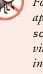

> 防错提示 3.2
> 忘记包含包含你在应用中使用的类的命名空间的 using 指令通常会导致编译错误，其中包含诸如“'Console' 在当前上下文中不存在”之类的消息。当这种情况发生时，请检查你是否提供了正确的 using 指令，并且名称拼写正确，包括正确使用大写和小写字母。在编辑器中，当你将鼠标悬停在错误的红色波浪线时，Visual Studio 会显示一个包含链接“显示潜在修复”的框。如果缺少 using 指令，显示的一个潜在修复是向你的代码添加 using 指令——只需点击该修复，Visual Studio 就会编辑你的代码。

对于我们使用的每个新的 .NET 类，我们都会指明它所在的命名空间。这些信息很重要，因为它帮助你在 .NET 文档中定位每个类的描述。此文档的基于 Web 的版本可以在以下位置找到

```
https://msdn.microsoft.com/library/w0x726c2
```

这也可以通过 Help 菜单访问。你可以点击任何 .NET 类或方法的名称，然后按 F1 键获取更多信息。最后，你可以通过转到以下位置了解给定命名空间的内容

```
https://msdn.microsoft.com/namespace
```

所以

```
https://msdn.microsoft.com/System
```

会带你到命名空间 System 的文档。

### 3.2.3 空行和空白

第 4 行只是一个空行。空行和空格字符使代码更易于阅读，并与制表符字符一起被称为空白。空格字符和制表符具体称为空白字符。空白会被编译器忽略。

### 3.2.4 类声明

第 5 行

```
class Welcome1
```


开始为名为 `Welcome1` 的类进行类声明。每个应用程序至少包含一个由你定义的类声明，这些类称为*用户定义类*。关键字 `class` 引入类声明，其后紧跟类名（`Welcome1`）。关键字（也称为保留字）是保留给 C# 使用的。

### 类命名约定

按照约定，所有类名都以大写字母开头，并且类名中包含的每个单词的首字母都大写（例如，`SampleClassName`）。这种命名约定称为驼峰式大小写，因为大写字母像骆驼的驼峰一样突出。当首字母大写时，称为帕斯卡命名法。类名是标识符——由字母、数字和下划线（`_`）组成的字符序列，不能以数字开头，也不能包含空格。一些有效的标识符有 `Welcome1`、`identifier`、`_value` 和 `m_inputField1`。名称 `7button` *不是*有效的标识符，因为它以数字开头；名称 `input field` *不是*有效的标识符，因为它包含空格。通常，不以大写字母开头的标识符不是类名。C# 区分大小写——也就是说，大写字母和小写字母是不同的，因此 `a1` 和 `A1` 是不同的（但都是有效的）标识符。关键字总是全部用小写字母拼写。C# 关键字的完整列表如图 3.2 所示。¹

**关键字和上下文关键字**

|  |  |  |  |  |  |
|---|---|---|---|---|---|
| abstract | as | base | bool | break | byte |
| case | catch | char | checked | class | const |
| continue | decimal | default | delegate | do | double |
| else | enum | event | explicit | extern | false |
| finally | fixed | float | for | foreach | goto |
| if | implicit | in | int | interface | internal |
| is | lock | long | namespace | new | null |
| object | operator | out | override | params | private |
| protected | public | readonly | ref | return | sbyte |
| sealed | short | sizeof | stackalloc | static | string |
| struct | switch | this | throw | true | try |
| typeof | uint | ulong | unchecked | unsafe | ushort |
| using | virtual | void | volatile | while |  |

**上下文关键字**

|  |  |  |  |  |  |
|---|---|---|---|---|---|
| add | alias | ascending | async | await | by |
| descending | dynamic | equals | from | get | global |
| group | into | join | let | nameof | on |
| orderby | partial | remove | select | set | value |
| var | where | yield |  |  |  |

图 3.2 | 关键字和上下文关键字。

1. 图 3.2 底部的上下文关键字在它们作为关键字的上下文之外可以用作标识符，但为了清晰起见，我们不建议这样做。

**良好编程实践 3.1**

按照约定，始终以大写字母开头类名的标识符，并让标识符中每个后续单词的首字母大写。

**常见编程错误 3.2**

C# 区分大小写。对标识符没有使用正确的大小写通常会导致编译错误。

**常见编程错误 3.3**

将关键字用作标识符是编译错误。

### 类声明的文件名

类声明的文件名通常是类名后跟 .cs 文件扩展名，尽管这不是必需的。对于我们的应用程序，文件名是 Welcome1.cs。

**良好编程实践 3.2**

按照约定，包含单个类的文件应该具有与类名相同的名称（加上 .cs 扩展名），并且在拼写和大小写上都要一致。这样可以很容易地识别哪个文件包含类的声明。

### 类声明的主体

左花括号 {（图 3.1 中的第 6 行）开始每个类声明的主体。相应的右花括号 }（第 12 行）必须结束每个类声明。第 7-11 行缩进了。这种缩进是一种间距约定。我们将每种间距约定和其他提高程序清晰度的约定定义为良好编程实践。

**良好编程实践 3.3**

将每个类声明的整个主体缩进一个“级别”的缩进，位于界定类主体的左花括号和右花括号之间。这种格式强调了类声明的结构，使其更易于阅读。你可以通过选择 **编辑 > 高级 > 设置文档格式** 让 IDE 为你格式化代码。

**良好编程实践 3.4**

为你偏好的缩进大小设定约定，然后统一应用该约定。Microsoft 建议四个空格的缩进，这是 Visual Studio 中的默认值。由于印刷书籍中代码行的宽度有限，我们使用三个空格的缩进——这减少了换行的代码行数，使代码更容易阅读。我们在“开始之前”部分（位于前言之后）中展示了如何设置制表符大小。

**错误防范提示 3.3**

每当你在应用程序中键入一个左花括号 { 时，IDE 会立即插入对应的右花括号 }，然后将光标重新定位到花括号之间，以便你开始键入主体。这种做法有助于防止因缺少花括号而导致的错误。

**常见编程错误 3.4**

如果花括号没有成对匹配，则是语法错误。

### 3.2.5 Main 方法

第 7 行是一条注释，表示第 8-11 行的用途。第 8 行

```csharp
static void Main()
```

是应用程序开始执行的地方——这被称为入口点。标识符 Main 后面的圆括号表示它是一个方法。类声明通常包含一个或多个方法。方法名遵循与类名相同的大小写约定。对于每个应用程序，类中的一个方法必须命名为 Main；否则，应用程序将不会执行。方法能够执行任务并在完成任务时返回一个值。关键字 void（第 8 行）表示 Main 在完成任务后不会返回值。稍后，我们将看到大多数方法确实会返回值。你将在第 4 章和第 7 章中了解更多关于方法的内容。我们将在第 8 章中讨论 Main 的圆括号中的内容。现在，只需在你的应用程序中模仿 Main 的第一行即可。

### 方法声明的主体

第 9 行的左花括号开始方法声明的主体。相应的右花括号结束主体（第 11 行）。方法主体中的第 10 行缩进在花括号之间。

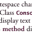

**良好编程实践 3.5**

*将每个方法声明的主体语句缩进一个级别，位于定义主体的左花括号和右花括号之间。*

### 3.2.6 显示一行文本

第 10 行

```csharp
Console.WriteLine("Welcome to C# Programming!");
```

指示计算机执行一个操作——即显示双引号之间的字符串，双引号界定了该字符串。字符串有时称为字符串、消息或字符串字面量。我们简称为字符串。编译器不会忽略字符串中的空白字符。

Console 类提供标准输入/输出功能，使应用程序能够从控制台窗口读取文本并将文本显示在控制台窗口中，应用程序是在该窗口中执行的。Console.WriteLine 方法在控制台窗口中显示一行文本。第 10 行圆括号中的字符串是方法的参数。Console.WriteLine 方法通过在其参数在控制台窗口中的显示来执行其任务。当 Console.WriteLine 完成任务时，它会将屏幕光标（指示下一个字符将显示在哪里的闪烁符号）定位到控制台窗口中下一行的开头。光标的这种移动类似于用户在文本编辑器中按 Enter 键时发生的情况——光标移动到文件中下一行的开头。

### 语句

### 3.2.7 匹配左（{）和右（}）花括号

在阅读或编写应用程序时，你可能会发现很难匹配界定类或方法主体的左花括号和右花括号（{ 和 }）。Visual Studio 可以帮助你在代码中定位匹配的花括号。只需将光标放在左花括号之前或右花括号之后，Visual Studio 就会突出显示两者。

## 3.3 在 Visual Studio 中创建简单应用程序

现在我们已经展示了第一个控制台应用程序（图 3.1），我们提供如何使用 Visual Studio Community 2015 创建、编译和执行它的分步说明，从这一点开始，我们将简称为 Visual Studio。

### 3.3.1 创建控制台应用程序

在 Visual Studio 中，选择 **文件 > 新建 > 项目...** 以显示 **新建项目** 对话框（图 3.3）。在左侧，在 **已安装 > 模板 > Visual C#** 下选择 **Windows**，然后在中间选择 **控制台应用程序** 模板。在对话框的 **名称** 字段中，键入 **welcome**——你的项目名称——然后点击 **确定** 创建项目。项目的文件夹将放在你的用户账户的文档文件夹下的 `visual studio 2015\Projects` 中。

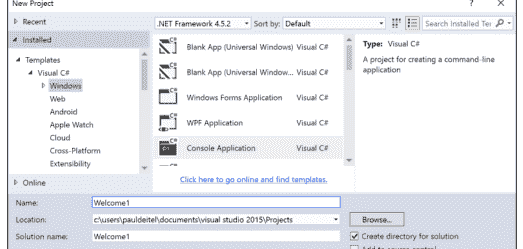

**图 3.3** | 在 **新建项目** 对话框中选择 **控制台应用程序**。

IDE 现在包含打开的控制台应用程序（图 3.4）。编辑器窗口已经包含了一些由 IDE 提供的代码。其中一些代码类似于图 3.1。有些则不同，并使用了我们尚未讨论的功能。IDE 插入这些额外代码是为了帮助组织应用程序并提供对 .NET Framework 类库中一些常用类的访问——在本书的这一点上，这些代码既不是必需的，也与本应用程序的讨论无关；请将其全部删除。


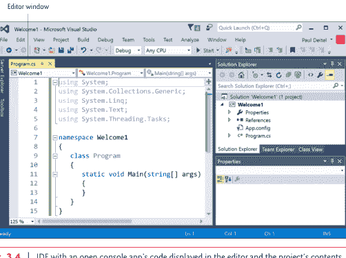

**图3.4** | IDE 编辑器显示了一个打开的控制台应用代码，IDE 右上角的**解决方案资源管理器**中显示了项目内容。

IDE 使用的代码着色方案称为语法着色高亮，可以帮助你直观地区分代码元素。例如，关键字显示为蓝色，注释显示为绿色。我们按照前言中讨论的方式对代码进行类似着色。字面量的一个示例是传递给图3.1中第10行 `Console.WriteLine` 的字符串。你可以通过选择“工具”>“选项...”来自定义代码编辑器中显示的颜色。这将显示“选项”对话框。然后展开“环境”节点并选择“字体和颜色”。在这里，你可以更改各种代码元素的颜色。Visual Studio 提供了多种个性化编码体验的方式。

### 3.3.2 更改应用文件名

对于本书中创建的应用，我们会将源代码文件的默认名称（Program.cs）更改为更具描述性的名称。要重命名文件，请在解决方案资源管理器中右键单击 Program.cs，然后选择“重命名”使文件名可编辑。Windows 会自动选中文件名的基本部分（即 Program）。输入 Welcome1，然后按 Enter 将名称更改为 Welcome1.cs。请务必保留 .cs 文件名扩展名。

> **错误预防提示 3.4**
> *在 Visual Studio 项目中更改文件名时，请始终在 Visual Studio 中进行。在 IDE 外部更改文件名可能会损坏项目并阻止其执行。*

### 3.3.3 编写代码和使用 IntelliSense

在编辑器窗口（图3.4）中，将生成的代码替换为图3.1中的代码。当你开始键入名称 Console（第10行）时，会显示一个 IntelliSense 窗口（图3.5）。

a) 键入时显示的 IntelliSense 窗口

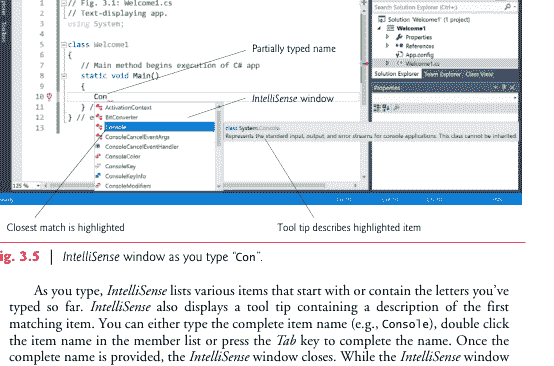

最接近的匹配项突出显示

工具提示描述突出显示的项

图3.5 | 键入“Con”时的 IntelliSense 窗口。

当你键入时，IntelliSense 会列出以你已键入的字母开头或包含这些字母的各种项目。IntelliSense 还会显示一个工具提示，其中包含第一个匹配项的描述。你可以键入完整的项目名称（例如 Console）、双击成员列表中的项目名称或按 Tab 键来补全名称。一旦提供了完整的名称，IntelliSense 窗口就会关闭。当 IntelliSense 窗口显示时，按 Ctrl 键会使窗口变为透明，以便你可以看到窗口后面的代码。

当你在 Console 后面键入点（.）时，IntelliSense 窗口会重新出现，最初只显示 Console 类中可在点右侧使用的成员——随着你的键入，此列表会缩小为包含你已键入内容的项目。图3.6显示了 IntelliSense 窗口缩小到仅包含“Write”的项目。你也可以键入“wL”来查找所有包含大写字母“W”和“L”的项目（例如 WriteLine）。

当你在 Console.WriteLine 后面键入左括号字符 ( 时，会显示参数信息窗口（图3.7）。其中包含有关方法参数的信息——方法执行任务所需的数据。正如你将在第7章中学到的，一个方法可以有多个版本。也就是说，一个类可以定义多个同名方法，只要它们具有不同数量和/或类型的参数——这一概念称为方法重载。这些方法通常都执行类似的任务。

## 文档结构测试样例

本文档用于测试文档解析系统的各项功能，包含标题、段落、列表、表格、插图和引用等多种元素。通过解析此样例，可以验证解析器对文档结构的识别能力。

- 支持文本检测
- 支持版面分析
- 支持结构化提取

| 序号 | 内容 | 结果 |
| --- | --- | --- |
| 1 | 标题识别 | 通过 |
| 2 | 段落识别 | 通过 |
| 3 | 表格识别 | 通过 |

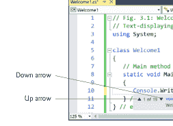

> 这是一条引用文本，用于测试引用块的识别与提取效果。

按该键，或直接继续输入并忽略它。输入完应用的代码后，选择“文件”>“全部保存”来保存项目。

### 3.3.4 编译并运行应用

现在可以编译并执行应用了。根据项目类型，编译器可能会将代码编译为具有 .exe（可执行）扩展名、.dll（动态链接库）扩展名或其他几种扩展名的文件——你可以在磁盘上项目的子文件夹中找到这些文件。此类文件称为程序集，是已编译 C# 代码的打包单元。这些程序集包含应用的 Microsoft 中间语言（MSIL；见第1.4.2节）代码。

要编译应用，请选择“生成”>“生成解决方案”。如果应用没有编译时错误，则将编译应用并生成可执行文件（名为 Welcome.exe，位于项目的某个子目录中）。要执行它，请按 Ctrl + F5，这将调用 Main 方法（图3.1）。如果在生成前尝试运行应用，IDE 会先生成应用，然后仅在没有编译错误时运行它。Main 的第10行语句显示 `Welcome to C# Programming!`。图3.8显示了在控制台（命令提示符）窗口中执行此应用的结果。让应用的项目在 Visual Studio 中保持打开；我们将在本节后面回到它。[注意：控制台窗口通常具有黑色背景和白色文本。为了便于阅读，我们将其重新配置为白色背景和黑色文本。如果你也想这样做，请右键单击命令提示符窗口标题栏中的任意位置，然后选择“属性”。你可以在出现的对话框的“颜色”选项卡中更改颜色。]

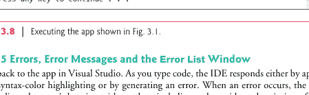

图3.8 | 执行图3.1中所示的应用。

### 3.3.5 错误、错误消息和错误列表窗口

回到 Visual Studio 中的应用。当你键入代码时，IDE 会应用语法着色高亮或生成错误。发生错误时，IDE 会用红色波浪线在错误位置下划线，并在错误列表窗口（图3.9）中提供错误描述。如果错误列表窗口不可见，请选择“视图”>“错误列表”以显示它。在图3.9中，我们故意省略了第10行末尾的分号。错误消息指示缺少分号。你可以双击错误列表中的错误消息以跳转到代码中的错误位置。

> **错误预防提示 3.5**
> 一个编译时错误可能导致错误列表窗口中出现多个条目。当你重新编译应用时，修正的每个错误都可能消除后续的几个错误消息。因此，当你看到知道如何修复的错误时，请修正它——IDE 会在后台重新编译代码，因此修复一个错误可能会使其他几个错误消失。

故意省略的分号（语法错误）

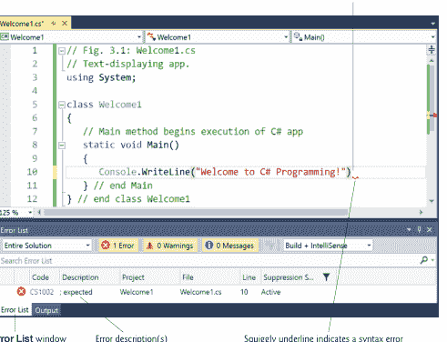

图3.9 | IDE 指示的语法错误。

## 3.4 修改简单的 C# 应用

本节通过两个修改图3.1示例的示例继续介绍 C# 编程。

### 3.4.1 使用多条语句显示一行文本

图3.10所示的 Welcome2 类使用两条语句产生与图3.1相同的输出。从现在开始，我们会在每个代码清单中突出显示新功能和关键功能，如图3.10中的第10–11行所示。

```csharp
// Fig. 3.10: Welcome2.cs
// Displaying one line of text with multiple statements.
using System;

class Welcome2
{
7  // Main method begins execution of C# app
8  static void Main()
9  {
10     Console.Write("Welcome to ");
11     Console.WriteLine("C# Programming!");
12 } // end Main
13 } // end class Welcome2
```

图3.10 | 使用多条语句显示一行文本。

Welcome to C# Programming!

该应用与图3.1几乎相同。我们在此讨论更改。第2行

```csharp
// Displaying one line of text with multiple statements.
```

说明了此应用的目的。第5行开始 Welcome2 类声明。

Main 方法的第10–11行

```csharp
Console.Write("Welcome to ");
Console.WriteLine("C# Programming!");
```

在控制台窗口中显示一行文本。第一条语句使用 Console 的 Write 方法显示字符串。与 WriteLine 不同，Write 在显示其参数后，不会将屏幕光标定位到控制台窗口中的下一行开头——应用显示的下一个字符将紧跟在 Write 显示的最后字符之后。因此，第11行将其参数中的第一个字符（字母“C”）紧靠第10行显示的最后字符（字符串结束双引号前的空格字符）之后。每个 Write 或 WriteLine 语句都从上一个 Write 或 WriteLine 语句显示其最后一个字符的位置继续显示字符。

### 3.4.2 使用单条语句显示多行文本

单条语句可以通过使用换行符显示多行，换行符向 Console 方法 Write 和 WriteLine 指示何时应将屏幕光标定位到下一行开头。与空格字符和制表符一样，换行符是空白字符。图3.11中的应用使用换行符指示何时开始每一新行，从而输出四行文本。

```csharp
1  // Fig. 3.11: Welcome3.cs
2  // Displaying multiple lines with a single statement.
3  using System;
4
5  class Welcome3
6  {
7    // Main method begins execution of C# app
8    static void Main()
9  {
```

图3.11 | 使用单条语句显示多行文本。（第1部分，共2部分。）


```csharp
10  Console.WriteLine("Welcome\nto\nC#\nProgramming!");
11 } // end Main
12 } // end class Welcome3
```

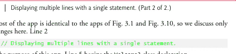

**图 3.11** | 用单条语句显示多行。

此应用的大部分内容与图 3.1 和图 3.10 中的应用相同，因此这里只讨论更改之处。第 2 行

```csharp
// Displaying multiple lines with a single statement.
```

说明了此应用的目的。第 5 行开始 Welcome3 类声明。

```csharp
Console.WriteLine("Welcome\nto\nC#\nProgramming!");
```

在控制台窗口中显示四行独立的文本。通常，字符串中的字符会完全按照它们在双引号中出现的样子显示。但请注意，两个字符 `\` 和 n（在该语句中重复三次）不会显示在屏幕上。反斜杠（`\`）称为转义字符。它向 C# 表明字符串中存在一个“特殊字符”。当字符串中出现反斜杠时，C# 会将下一个字符与反斜杠组合成转义序列。

| 转义序列 | 描述 |
| --- | --- |
| `\n` | 换行。将屏幕光标定位到下一行的开头。 |
| `\t` | 水平制表符。将屏幕光标移动到下一个制表位。 |
| `\"` | 双引号。用于在字符串中放置双引号字符（"）——例如，`Console.Write("\"in quotes\"");` 显示 "in quotes"。 |
| `\r` | 回车。将屏幕光标定位到当前行的开头——不会将光标推进到下一行。回车后输出的任何字符都会覆盖该行之前输出的字符。 |
| `\\` | 反斜杠。用于在字符串中放置反斜杠字符。 |

**图 3.12** | 常见转义序列。

## 3.5 字符串内插

许多程序会将数据格式化为字符串。C# 6 引入了一种称为字符串内插的机制，使你能够在字符串字面量中插入值来创建格式化字符串。图 3.13 演示了这一能力。

```csharp
 1 // Fig. 3.13: Welcome4.cs
 2 // Inserting content into a string with string interpolation.
 3 using System;
 4
 5 class Welcome4
 6 {
 7     // Main method begins execution of C# app
 8     static void Main()
 9     {
10         string person = "Paul"; // variable that stores the string "Paul"
11         Console.WriteLine($"Welcome to C# Programming, {person}!");
12     } // end Main
13 } // end class Welcome4
```

```text
Welcome to C# Programming, Paul!
```

**图 3.13** | 使用字符串内插将内容插入字符串。

### 声明 string 变量 person

第 10 行

```csharp
string person = "Paul"; // variable that stores the string "Paul"
```

是一条变量声明语句（也称为声明），它指定此应用中使用的变量的名称（person）和类型（string）。变量在使用前要用名称和类型声明：

- 变量的名称使应用能够访问内存中对应的值——名称可以是任何有效标识符。（有关标识符命名要求，请参见 3.2 节。）
- 变量的类型指定内存中该位置存储何种信息。string 类型的变量存储基于字符的信息，例如

```text
Enter first integer: 45
Enter second integer: 72
Sum is 117
```

**图 3.14** | 显示从键盘输入的两个数之和。

第 5 行

```csharp
class Addition
```

开始 Addition 类的声明。请记住，每个类声明的主体以左花括号（第 6 行）开始，并以右花括号（第 26 行）结束。应用从 Main（第 8—25 行）开始执行。

### 3.6.1 声明 int 变量 number1

第 10 行

```csharp
int number1; // declare first number to add
```

是一条变量声明语句，指定 number1 的类型为 int——它将保存整数值（整数，例如 7、–11、0 和 31914）。int 的取值范围是 –2,147,483,648（int.MinValue）到 +2,147,483,647（int.MaxValue）。我们很快会讨论 float、double 和 decimal 类型，用于指定带小数点的数字（如 3.4、0.0 和 –11.19），以及 char 类型，用于指定字符。float 和 double 类型的变量在内存中存储实数的近似值。decimal 类型的变量精确存储带小数点的数字（精确到 28—29 位有效数字），因此 decimal 变量常用于货币计算——我们在第 4 章的 Account 类中使用 decimal 类型表示余额。char 类型的变量表示单个字符，例如大写字母（例如 A）、数字（例如 7）、特殊字符（例如 * 或 %）或转义序列（例如换行字符 `\n`）。int、float、double、decimal 和 char 等类型称为简单类型。简单类型名称是关键字，必须全部使用小写字母。附录总结了简单类型（bool、byte、sbyte、char、ushort、int、uint、long、ulong、float、double 和 decimal）的特征，包括存储每种类型的值所需的内存量。

### 3.6.2 声明变量 number2 和 sum

第 11—12 行的变量声明语句

```csharp
int number2; // declare second number to add
int sum; // declare sum of number1 and number2
```

将变量 number2 和 sum 声明为 int 类型。

> **良好编程实践 3.6**
> 将每个变量声明在单独的一行。这种格式便于在每条声明旁边插入注释。


> **良好编程实践 3.7**
> 按照惯例，变量名标识符以小写字母开头，名称中第一个单词之后的每个单词都以大写字母开头（例如 firstNumber）。这种命名约定称为驼峰命名法。

### 3.6.3 提示用户输入

第 14 行

```csharp
Console.Write("Enter first integer: "); // prompt user
```

使用 Console.Write 提示用户输入。

### 3.6.4 将值读入变量 number1

第 16 行

```csharp
number1 = int.Parse(Console.ReadLine());
```

分两步工作。首先，它调用 Console 的 ReadLine 方法，该方法等待用户在键盘上输入一串字符并按 Enter 键。如前所述，有些方法会执行任务，然后返回该任务的结果。在本例中，ReadLine 返回用户输入的文本。然后，返回的字符串被用作 int 类型的 Parse 方法的参数，该方法将这串字符转换为 int 类型的数据。

**可能的错误用户输入**

从技术上讲，用户可以将任何内容作为输入值键入。ReadLine 会接受它，并将其传递给 int 的 Parse 方法。该方法假定字符串包含有效的整数值。在这种情况下，如果用户键入非整数值，就会发生称为异常的运行时逻辑错误，应用将终止。你将在第 16 章学习的字符串处理技术可用于在尝试将字符串转换为 int 之前检查输入格式是否正确。C# 还提供了一种称为异常处理的技术，它使应用能够处理异常并继续执行，从而帮助你使应用更健壮。这也称为使应用具有容错能力。我们在 8.5 节介绍异常处理，然后在第 10 章再次使用它。我们将在第 13 章以及全书更深入地研究异常处理。

**将值赋给变量**

在第 16 行中，通过使用赋值运算符 =，将调用 int 的 Parse 方法的结果（一个 int 值）放入变量 number1。该语句读作“number1 获取 int.Parse 返回的值”。运算符 = 是二元运算符，因为它处理两条信息。这些信息称为它的操作数——在本例中，是 number1 和调用 int.Parse 的结果。该语句称为赋值语句，因为它将值赋给变量。赋值运算符 = 右侧的所有内容总是在执行赋值之前求值。


> **良好编程实践 3.8**
> 在二元运算符两侧各放一个空格，使代码更具可读性。


### 3.6.5 提示用户输入并将值读入 number2

第18行

```csharp
Console.Write("Enter second integer: "); // prompt user
```

提示用户输入第二个整数。第20行

```csharp
number2 = int.Parse(Console.ReadLine());
```

读取第二个整数并将其赋给变量 `number2`。

### 3.6.6 将 number1 与 number2 求和

第22行

```csharp
sum = number1 + number2; // add numbers
```

使用赋值运算符 `=` 计算 `number1` 与 `number2` 的和，并将结果赋给变量 `sum`。该语句读作“sum 取得 number1 + number2 的值”。当遇到 `number1 + number2` 时，计算中使用变量中存储的值。加法运算符是二元运算符——它的两个操作数是 `number1` 和 `number2`。语句中包含计算的部分称为表达式。实际上，表达式是语句中任何具有关联值的部分。例如，表达式 `number1 + number2` 的值是这些数字的和。类似地，表达式 `Console.ReadLine()` 的值是用户键入的字符串。

### 3.6.7 使用字符串内插显示和

计算执行后，第24行

```csharp
Console.WriteLine($"Sum is {sum}"); // display sum
```

使用方法 `Console.WriteLine` 显示和。C# 用第22行计算出的和替换内插表达式 `{sum}`。因此方法 `WriteLine` 显示“Sum is ”，后跟 `sum` 的值和一个换行符。

### 3.6.8 在输出语句中执行计算

计算也可以在插值表达式中执行。我们本可以将第22行和第24行的语句合并为语句

```csharp
Console.WriteLine($"Sum is {number1 + number2}");
```

## 3.7 算术

算术运算符汇总于图3.15。星号（`*`）表示乘法，百分号（`%`）是余数运算符，我们很快会讨论它。图3.15中的算术运算符是二元运算符——例如，表达式 `f + 7` 包含二元运算符 `+` 和两个操作数 `f` 与 `7`。

| C# 运算 | 算术运算符 | 代数表达式 | C# 表达式 |
|---|---|---|---|
| 加法 | `+` | f + 7 | f + 7 |
| 减法 | `-` | p - c | p - c |
| 乘法 | `*` | b · m | b * m |
| 除法 | `/` | x / y 或 x⁄y 或 x ÷ y | x / y |
| 余数 | `%` | r mod s | r % s |

**图 3.15** — 算术运算符。

如果除法运算符（`/`）的两个操作数都是整数，则执行整数除法，结果为整数——例如，表达式 `7 / 4` 的求值结果为 `1`，表达式 `17 / 5` 的求值结果为 `3`。整数除法中的任何小数部分都会被直接截断（即丢弃）——不会进行舍入。C# 提供余数运算符 `%`，它产生除法后的余数。表达式 `x % y` 产生 `x` 除以 `y` 后的余数。因此，`7 % 4` 产生 `3`，`17 % 5` 产生 `2`。此运算符最常与整数操作数一起使用，但也可用于浮点数、双精度浮点数和十进制数。在后续章节中，我们将考虑余数运算符的一些有趣应用，例如判断一个数是否为另一个数的倍数。

### 3.7.1 直线形式的算术表达式

算术表达式必须以直线形式书写，以便将应用程序代码输入计算机。因此，诸如“a除以b”的表达式必须写成直线形式的 `a / b`。以下代数记号不被 C# 编译器接受，也无法在 Visual Studio 编辑器中键入：


### 3.7.2 用于分组子表达式的括号

括号用于对 C# 表达式中的项进行分组，方式与代数表达式相同。例如，要用 `a` 乘以量 `b + c`，我们写成

```csharp
a * (b + c)
```

### 3.7.3 运算符优先级规则

C# 按照由以下运算符优先级规则确定的精确顺序应用算术表达式中的运算符，这些规则通常与代数中遵循的规则相同（图3.16）。这些规则使 C# 能够以正确的顺序应用运算符。

| 运算符 | 运算 | 求值顺序（结合性） |
|---|---|---|
| **首先求值** | | |
| `*` | 乘法 | 如果有多个此类运算符，则从左到右求值。 |
| `/` | 除法 | 如果有多个此类运算符，则从左到右求值。 |
| `%` | 余数 | 如果有多个此类运算符，则从左到右求值。 |
| **接下来求值** | | |
| `+` | 加法 | 如果有多个此类运算符，则从左到右求值。 |
| `-` | 减法 | 如果有多个此类运算符，则从左到右求值。 |

**图 3.16** — 算术运算符的优先级。

当我们说运算符从左到右应用时，指的是它们的结合性。你会看到一些运算符从右到左结合。图3.16总结了这些运算符优先级规则。随着引入其他运算符，该表将会扩展。附录提供了完整的优先级图表。

## 3.8 决策：相等运算符和关系运算符

条件是可为真或假的表达式。本节介绍 C# `if` 语句的简单版本，它允许应用程序根据条件的值做出决策。例如，条件 `grade is greater than or equal to 60` 判断学生是否通过考试。如果 `if` 语句中的条件为真，则执行 `if` 语句的主体。如果条件为假，则跳过主体——不执行。我们很快就会看到一个示例。

`if` 语句中的条件可以使用图3.17中汇总的相等运算符（`==` 和 `!=`）和关系运算符（`>`、`<`、`>=` 和 `<=`）构成。两个相等运算符（`==` 和 `!=`）各自具有相同的优先级，关系运算符（`>`、`<`、`>=` 和 `<=`）各自具有相同的优先级，并且相等运算符的优先级低于关系运算符。它们都从左到右结合。

> **常见编程错误 3.5**
>
> 将相等运算符 `==` 与赋值运算符 `=` 混淆可能导致逻辑错误或语法错误。相等运算符应读作“等于”，赋值运算符应读作“取得”或“取得……的值”。为避免混淆，一些程序员将相等运算符读作“双等号”或“等号等号”。

| 标准代数相等运算符和关系运算符 | C# 相等运算符或关系运算符 | 示例 C# 条件 | C# 条件的含义 |
|---|---|---|---|
| **关系运算符** | | | |
| `>` | `>` | x > y | x 大于 y |
| `<` | `<` | x < y | x 小于 y |
| ≥ | `>=` | x >= y | x 大于或等于 y |
| ≤ | `<=` | x <= y | x 小于或等于 y |
| **相等运算符** | | | |
| `=` | `==` | x == y | x 等于 y |
| ≠ | `!=` | x != y | x 不等于 y |

**图 3.17** — 关系运算符和相等运算符。

### 使用 if 语句

图3.18使用六个 `if` 语句比较用户输入的两个整数。如果这六个 `if` 语句中的任一条件为真，则执行与该 `if` 语句关联的语句。该应用程序使用 `Console` 类提示用户并从用户读取两行文本，使用 `int.Parse` 方法从该文本中提取整数，并将它们存储在变量 `number1` 和 `number2` 中。然后，应用程序比较这些数字，并显示为真的比较结果。

```csharp
// Fig. 3.18: Comparison.cs
// Comparing integers using if statements, equality operators
// and relational operators.

using System;

class Comparison
{
   // Main method begins execution of C# app
   static void Main()
   {
      // prompt user and read first number
      Console.Write("Enter first integer: ");
      int number1 = int.Parse(Console.ReadLine());

      // prompt user and read second number
      Console.Write("Enter second integer: ");
      int number2 = int.Parse(Console.ReadLine());

      if (number1 == number2)
      {
         Console.WriteLine("{0} == {1}", number1, number2);
      }
}
```

**图 3.18** — 使用 if 语句、相等运算符和关系运算符比较整数。（第1部分，共2部分。）


if (number1 != number2)
{
    Console.WriteLine("{0} != {1}", number1, number2);
}
if (number1 < number2)
{
    Console.WriteLine("{0} < {1}", number1, number2);
}
if (number1 > number2)
{
    Console.WriteLine("{0} > {1}", number1, number2);
}
if (number1 <= number2)
{
    Console.WriteLine("{0} <= {1}", number1, number2);
}
if (number1 >= number2)
{
    Console.WriteLine("{0} >= {1}", number1, number2);
}
} // end Main
} // end class Comparison

Enter first integer: 42
Enter second integer: 42
42 == 42
42 <= 42
42 >= 42

Enter first integer: 1000
Enter second integer: 2000
1000 != 2000
1000 < 2000
1000 <= 2000

Enter first integer: 2000
Enter second integer: 1000
2000 != 1000
2000 > 1000
2000 >= 1000

Fig. 3.18 | Comparing integers using if statements, equality operators and relational operators.
(Part 2 of 2.)

## Class Comparison

The declaration of class Comparison begins at line 6

```
class Comparison
```

The class's Main method (lines 9–48) begins the execution of the app.

## Reading the Inputs from the User

Lines 11–13

```
// prompt user and read first number
Console.Write("Enter first integer: ");
int number1 = int.Parse(Console.ReadLine());
```

prompt for and input the first value. Line 13 also declares number1 as an int variable that stores the first value entered by the user.

Lines 15–17

```
// prompt user and read second number
Console.Write("Enter second integer: ");
int number2 = int.Parse(Console.ReadLine());
```

prompt for and input the second value.

## Comparing Numbers

The if statement in lines 19–22

```
if (number1 == number2)
{
    Console.WriteLine($"{number1} == {number2}");
}
```

compares the values of variables number1 and number2 to test for equality. The condition number1 == number2 is enclosed in required parentheses. If the values are equal, line 21 displays a line of text indicating that the numbers are equal. We used two interpolation expressions to insert the values of number1 and number2 in line 21's output. If the conditions are true in one or more of the if statements starting in lines 24, 29, 34, 39 and 44, the corresponding body statement displays an appropriate line of text. Each if statement in Fig. 3.18 contains a single body statement that's indented. Also notice that we've enclosed each body statement in a pair of braces, { }, creating what's called a block.

Good Programming Practice 3.9
Indent the statement(s) in the body of an if statement to enhance readability.

Error-Prevention Tip 3.6
You don't need to use braces, { }, around single-statement bodies, but you must include the braces around multiple-statement bodies. To avoid errors and make your code more readable, always enclose an if statement's body statement(s) in braces, even if it contains only a single statement.

## Whitespace

Note the use of whitespace in Fig. 3.18. Recall that whitespace characters, such as tabs, newlines and spaces, are normally ignored by the compiler. So, statements may be split over several lines and may be spaced according to your preferences without affecting the meaning of an app. It's incorrect to split identifiers, strings, and multicharacter operators (like >=). Ideally, statements should be kept small, but this is not always possible.

## Good Programming Practice 3.10

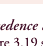

> A lengthy statement can be spread over several lines. If a single statement must be split across lines, choose breaking points that make sense, such as after a comma in a comma-separated list, or after an operator in a lengthy expression. If a statement is split across two or more lines, indent all lines after the first until the end of the statement.

## Precedence and Associativity of the Operators We've Discussed So Far

Figure 3.19 shows the precedence of the operators introduced in this chapter. The operators are shown from top to bottom in decreasing order of precedence. All these operators, with the exception of the assignment operator, =, associate from left to right. Addition is left associative, so an expression like x + y + z is evaluated as if it had been written as (x + y) + z. The assignment operator, =, associates from right to left, so an expression like x = y = 0 is evaluated as if it had been written as x = (y = 0), which, as you'll soon see, first assigns the value 0 to variable y, then assigns the result of that assignment, 0, to x.

## Good Programming Practice 3.11

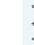

> Refer to the operator precedence chart (the complete chart is in Appendix ) when writing expressions containing many operators. Confirm that the operations in the expression are performed in the order you expect. If you're uncertain about the order of evaluation in a complex expression, use parentheses to force the order, as you would do in algebraic expressions. Some programmers also use parentheses to clarify the order. Observe that some operators, such as assignment, =, associate from right to left rather than left to right.

| Operators | Associativity | Type |
|---|---|---|
| * / % | left to right | multiplicative |
| + - | left to right | additive |
| < <= > >= | left to right | relational |
| == != | left to right | equality |
| = | right to left | assignment |

Fig. 3.19 | Precedence and associativity of operations discussed so far.

## 3.9 Wrap-Up

We presented many important features of C# in this chapter. First you learned how to display data on the screen in a Command Prompt using the Console class's Write and WriteLine methods. Next, we showed how to use C# 6's new string-interpolation capabilities to insert values into string literals. You learned how to input data from the keyboard us-


## Introduction to Classes,
Objects, Methods and strings

## Objectives

In this chapter you'll:

- Declare a class and use it to create an object.
- Implement a class's attributes as instance variables and a
class's behaviors as methods.
- Call an object's methods to make them perform their tasks.
- Understand how local variables differ from instance
variables of a class.
- Use validation to prevent bad data from being stored in an
object.
- Understand the software engineering benefits of private
instance variables and public access methods.
- Use properties to provide a friendlier notation for storing
and retrieving data.
- Use a constructor to initialize an object's data when the
object is created.
- Use type decimal for precise monetary amounts and
calculations.

## 4.1 Introduction

[Note: This chapter depends on the terminology and concepts introduced in Section 1.2, Object Technology: A Brief Review.]

Section 1.2 presented a friendly introduction to object-oriented programming concepts, including classes, objects, instance variables, properties and methods. In this chapter’s examples, we make those concepts real by building a simple bank-account class. The final version of the class maintains a bank account’s name and balance, and provides properties (Name and Balance) and methods (Deposit and Withdraw) for behaviors including

- querying the balance (with the Balance property).
- making deposits that increase the balance (with the Deposit method) and
- making withdrawals that decrease the balance (with the Withdraw method).

We’ll build the Balance property and Deposit method into the chapter’s examples. As an exercise, you can add the Withdraw method.

Each class you create becomes a new type you can use to create objects, so C# is an extensible programming language. Major development teams in industry work on applications that contain hundreds, or even thousands, of classes.

## 4.2 Test-Driving an Account Class

A person drives a car by telling it what to do (go faster, go slower, turn left, turn right, etc.)—without having to know how the car's internal mechanisms work. Similarly, a method (such as `Main`) "drives" an `Account` object by calling its methods—without having to know how the class's internal mechanisms work. In this sense, the class containing method `Main` is referred to as a driver class. We show the `Main` method and its output first, so you can see an `Account` object in action.

To help you prepare for the larger programs you'll encounter later in this book and in industry, we define class `AccountTest` and its `Main` method in the file `AccountTest.cs` (Fig. 4.1). We define the `Account` class in its own file as well (file `Account.cs`, Fig. 4.2). After we present classes `AccountTest` (in this section) and `Account` (in Section 4.3), Section 4.4 discusses how to create and build a project that contains multiple `.cs` source-code files. First, let's walk through the `AccountTest` class.

```csharp
// Fig. 4.1: AccountTest.cs
// Creating and manipulating an Account object.
using System;

class AccountTest
{
    static void Main()
    {
        // create an Account object and assign it to myAccount
        Account myAccount = new Account();

        // display myAccount's initial name (there isn't one yet)
        Console.WriteLine($"Initial name is: {myAccount.GetName()}");

        // prompt for and read the name, then put the name in the object
        Console.Write("Enter the name: "); // prompt
        string theName = Console.ReadLine(); // read the name
        myAccount.SetName(theName); // put the name in the myAccount object

        // display the name stored in the myAccount object
        Console.WriteLine($"myAccount's name is: {myAccount.GetName()}");
    }
}
```

| Initial name is: |
| --- |
| Enter the name: Jane Green |
| myAccount's name is: Jane Green |

**Fig. 4.1** | Creating and manipulating an `Account` object.

### 4.2.1 Instantiating an Object—Keyword `new`

You cannot call a method of a class until you create an object of that class.¹ Line 10 of Fig. 4.1

```csharp
Account myAccount = new Account();
```

1. You'll see in Section 10.9 that `static` methods (and other `static` class members) are an exception.


使用对象创建表达式

```csharp
new Account()
```

用于创建 Account 对象，然后将其分配给变量 myAccount。变量的类型是 Account——我们在图 4.2 中定义的类。关键字 new 创建指定类的新对象——在此例中为 Account。Account 右侧的括号是必需的（我们将在第 4.8 节讨论这些）。

### 4.2.2 调用类 Account 的 GetName 方法

Account 类的 GetName 方法返回存储在特定 Account 对象中的账户名称。图 4.1 的第 13 行

```csharp
Console.WriteLine($"Initial name is: {myAccount.GetName()}");
```

通过调用对象的 GetName 方法并使用表达式 myAccount.GetName() 来显示 myAccount 的初始名称。要为特定对象调用此方法，需要指定
- 对象的名称（myAccount）后跟
- 成员访问运算符（.），以及
- 方法名（GetName）以及
- 一组括号。

空括号表示 GetName 执行其任务不需要任何额外信息。不久后，你将看到 SetName 方法，它在执行任务时确实需要额外信息。

当 Main 调用 GetName 方法时：
- 1. 应用程序将执行从表达式 myAccount.GetName()（Main 中的第 13 行）转移到方法 GetName 的声明（我们将在第 4.3 节研究）。由于 GetName 是通过对象 myAccount 访问的，因此 GetName 知道要操作哪个对象的数据。
- 2. 接下来，方法 GetName 执行其任务——即，它将 myAccount 对象的名称返回到调用该方法的第 13 行。
- 3. Console.WriteLine 显示 GetName 返回的字符串——名称被插入到插值字符串中，替换对 GetName 的调用——然后程序继续在 Main 中第 16 行执行。

因为我们尚未在 myAccount 对象中存储名称，所以第 13 行不会显示名称。

### 4.2.3 从用户输入名称

接下来，第 16–17 行提示并输入名称。第 17 行

```csharp
string theName = Console.ReadLine(); // read a line of text
```

用户输入直到按下 *Enter* 时输入的换行符——换行符将被丢弃。按下 *Enter* 还会将输出光标定位到控制台窗口下一行的开头，因此程序的下一个输出将从用户输入的下一行开始。

### 4.2.4 调用类 Account 的 SetName 方法

Account 类的 SetName 方法将（*sets*）账户名称存储在特定 Account 对象中。第 18 行

```csharp
myAccount.SetName(theName); // put theName in the myAccount object
```

调用 myAccount 的 SetName 方法，将 theName 的值作为 SetName 的参数传递。该方法将此值存储在对象 myAccount 中——我们将在下一节看到它具体存储在哪里。

当 Main 调用 SetName 方法时：
- 1. 应用程序将程序执行从 Main 中的第 18 行转移到方法 SetName 的声明。由于方法 SetName 是通过 myAccount 对象访问的，因此 SetName “知道”要操作哪个对象。
- 2. 接下来，方法 SetName 将参数的值存储在 myAccount 对象中（我们将在第 4.3 节看到具体位置）。
- 3. 当 SetName 执行完成时，程序控制返回到调用方法 SetName 的位置（Main 中的第 18 行），然后执行继续在第 21 行。

### 显示用户输入的名称

为了证明 myAccount 现在包含用户输入的名称，第 21 行

```csharp
Console.WriteLine($"MyAccount's name is: {myAccount.GetName()}");
```

再次调用 myAccount 的 GetName 方法。正如你在程序输出的最后一行所看到的，第 17 行用户输入的名称被显示出来。当前一条语句执行完成后，达到 Main 的末尾，因此应用程序终止。

## 4.3 具有实例变量和 Set 与 Get 方法的 Account 类

图 4.1 中我们可以在不知道其实现细节的情况下创建和操作 Account 对象这一事实称为 *abstraction*。这是面向对象编程最强大的软件工程优势之一。现在我们已经看到了类 Account 的实际应用（图 4.1），在接下来的几个小节中我们将详细解释其实现。然后，我们将展示一个 UML 图，它以简洁的图形表示总结了类 Account 的 *attributes* 和 *operations*。

### 4.3.1 Account 类声明

类 Account（图 4.2）包含一个 *name* 实例变量（第 7 行），用于存储账户持有人的姓名——每个 Account 对象都有自己的一份 *name* 实例变量副本。在第 4.9 节，我们将添加一个 *balance* 实例变量来跟踪每个 Account 的当前余额。类 Account 还包含方法 SetName，程序可以调用它将名称存储在 Account 对象中，以及方法 GetName，程序可以调用它从 Account 对象获取名称。

```csharp
// Fig. 4.2: Account.cs
// A simple Account class that contains a private instance
// variable name and public methods to Set and Get name's value.

class Account
{
    private string name; // instance variable

    // method that sets the account name in the object
    public void SetName(string accountName)
    {
        name = accountName; // store the account name
    }

    // method that retrieves the account name from the object
    public string GetName()
    {
        return name; // returns name's value to this method's caller
    }
}
```

Fig. 4.2 | 一个简单的 Account 类，包含私有实例变量 name 以及用于设置和获取 name 值的公共方法。

### 4.3.2 关键字 class 和类体

类声明从第 5 行开始

```csharp
class Account
```

正如我们在第 3 章提到的，每个类声明都包含关键字 class，紧跟其后的是类的名称——在此例中为 Account。此外，每个类声明通常存储在与类同名且以 .cs 文件扩展名结尾的文件中，因此我们将类 Account 放在文件 Account.cs 中。类的主体被一对大括号括起来（图 4.2 的第 6 行和第 20 行）。

**标识符和驼峰式命名**

类、属性、方法 和 变量名 都是标识符，并且按照惯例都使用我们在第 3 章讨论的命名方案：
- 类、属性 和 方法名 以大写字母开头（即 Pascal 命名法）
- 变量名 以小写字母开头（即 camel 命名法）。

### 4.3.3 类型为 string 的实例变量 name

回顾第 1.2 节，类具有属性，由实例变量实现。类的对象在其生命周期内携带这些实例变量。每个对象都有类实例变量的自己的副本。通常，类还包含方法和属性。它们操作属于类特定对象的实例变量。

实例变量在类声明 *内部* 声明，但 *在* 类的方法和属性的主体 *之外*。第 7 行

```csharp
private string name; // instance variable
```

在方法 SetName 和 GetName 的主体 *之外* 声明了类型为 string 的实例变量 name。如果有多个 Account 对象，每个对象都有自己的 name。因为 name 是实例变量，所以它可以被类的每个方法和属性操作。类 Account 的客户端——即调用该类方法的任何其他代码（如图 4.1 中类 AccountTest 的 Main 方法）——无法访问 name 实例变量，因为它被声明为 private。然而，客户端可以访问 Account 的公共方法 SetName 和 GetName。这些方法可以访问私有实例变量 name。我们将在第 4.3.6 节讨论 private 和 public，然后在第 4.5 节更详细地讨论私有实例变量和公共 *access methods* 这种架构为何强大。

> **Good Programming Practice 4.1**
>
> 我们更喜欢先在类的主体中列出类的实例变量，这样你可以在它们在类的方法和属性中使用之前看到变量的名称和类型。你可以在类的方法（和属性）声明之外类的任何位置列出类的实例变量，但分散实例变量可能导致代码难以阅读。


**null——string 变量的默认值**

每个实例变量都有一个 *default initial value*——如果不指定实例变量的初始值，则由 C# 提供的值。因此，在程序中使用实例变量之前不需要显式初始化——除非它们必须初始化为默认值以外的其他值。类型为 string 的实例变量（像本例中的 name）的默认值是 **null**，我们将在第 7 章进一步讨论它，当我们考虑所谓的 *reference types* 时。当你使用 `Console.Write` 或 `Console.WriteLine` 显示包含值 null 的字符串变量时，屏幕上不会显示任何文本——这就是为什么在 Main（图 4.1）第 13 行第一次调用 myAccount 的 GetName 方法时没有显示名称的原因。

### 4.3.4 SetName 方法

让我们逐步查看方法 SetName 声明的代码（图 4.2，第 10–13 行）：

```csharp
public void SetName(string accountName)
{
    name = accountName; // store the account name
}
```

每个方法声明的第一行（第 10 行）是 *method header*。方法的 *return type*（出现在方法名称左侧）指定方法在执行任务后返回给其 *caller* 的数据的类型。返回类型 `void`（第 10 行）表示当方法 SetName 完成其任务时，它不会向其 *calling method* 返回（即交还）任何信息——在此例中为 Main 方法（图 4.1）的第 18 行。正如你很快会看到的，Account 方法 GetName 确实会返回一个值。


## *SetName's 参数*

我们从第 1.2 节的汽车类比中提到，按下汽车油门踏板会向汽车发送一条消息，让它执行任务——使汽车加速。但汽车应该加速多快呢？踩得越深，汽车加速越快。因此，发给汽车的消息既包括要执行的任务，也包括帮助汽车执行该任务的信息。这种信息被称为参数——参数的值有助于汽车确定加速速度。同样，一个方法可能需要一个或多个参数来表示其执行任务所需的数据。

方法 SetName 声明了 String 参数 accountName——它接收作为参数传递给 SetName 的名称。当图 4.1 中的第 18 行

```
myAccount.SetName(theName); // put theName in the myAccount object
```

执行时，调用括号中的参数值（即存储在 theName 中的值）会被复制到方法头中对应的参数（accountName）中（图 4.2 的第 10 行）。在图 4.1 的示例执行中，我们为 theName 输入了 "Jane Green"，因此 "Jane Green" 被复制到了 accountName 参数中。

## *SetName 参数列表*

像 accountName 这样的参数是在方法名称后必需的圆括号中位置的参数列表中声明的。每个参数必须指定一个类型（例如 String），后跟一个参数名称（例如 accountName）。当有多个参数时，它们以逗号分隔的列表放置，如

```
(type1 name1, type2 name2, ...)
```

方法调用中的参数数量和顺序必须与方法声明的参数列表中的参数数量和顺序相匹配。

## *SetName 方法体*

每个方法体都以左大括号（图 4.2，第 11 行）开头，以右大括号（第 13 行）结尾。大括号内有一个或多个执行方法任务的语句。在这种情况下，方法体包含一个单一语句（第 12 行）

```
name = accountName; // store the account name
```

它将 accountName 参数的值（一个字符串）分配给类的 name 实例变量，从而将账户名称存储在为其调用 SetName 的对象中——在本示例的 Main 程序中为 myAccount。2 在第 12 行执行后，程序执行到达方法的闭合大括号（第 13 行），因此方法返回到其调用者。

## *参数是局部变量*

在第 3 章中，我们在 Main 方法中声明了应用程序的所有变量。在特定方法体中（例如 Main）声明的变量是局部变量，只能在该方法中使用。每个方法只能访问其自己的局部变量，而不能访问其他方法的局部变量。当方法终止时，其局部变量的值会丢失。方法的参数也是该方法的局部变量。

2. 我们为 SetName 方法的参数（accountName）和实例变量（name）使用了不同的名称。在工业界使用相同的名称来表示两者是常见习惯用法。我们将在第 10.4 节向您展示如何在不产生歧义的情况下做到这一点。

### 4.3.5 GetName 方法

方法 GetName（第 16–19 行）

```csharp
public string GetName()
{
    return name; // returns name's value to this method's caller
}
```

*返回*特定 Account 对象的名称给调用者——一个字符串，如方法返回类型所指定。方法具有空的参数列表，因此它不需要额外的信息来执行其任务。当返回类型不是 `void` 的方法被调用并完成其任务时，它*必须*向其调用者返回一个结果。调用 Account 对象上的方法 GetName 的语句期望接收 Account 的名称。

第 18 行的返回语句

```csharp
return name; // returns name's value to this method's caller
```

将实例变量 `name` 的字符串值传回给调用者，调用者随后可以使用返回的值。例如，图 4.1 第 21 行的语句

```csharp
Console.WriteLine($"myAccount's name is: {myAccount.GetName()}");
```

使用 GetName 返回的值输出存储在 myAccount 对象中的名称。

### 4.3.6 访问修饰符 private 和 public

关键字 **private**（图 4.2 第 7 行）

```csharp
private string name; // instance variable
```

是一个访问修饰符。实例变量 `name` 为 private，以指示 name 只能由类 Account 的方法（以及其他成员，如您将在后续示例中看到的属性）访问。这被称为*信息隐藏*——实例变量 name 被隐藏，只能在类 Account 的方法（SetName 和 GetName）中使用。大多数实例变量声明为 private。

该类还包含 **public** 访问修饰符（第 10 行）

```csharp
public void SetName(string accountName)
```

和第 16 行

```csharp
public string GetName()
```

声明为 **public** 的方法（以及其他类成员）是“对公众开放的”。它们可以被

- 在其声明的类中声明的方法（和其他成员）使用，
- 该类的客户端使用——即任何其他类的方法（和其他成员）（在本应用程序中，类 AccountTest 的 `Main` 方法是类 Account 的客户端）。

在第 11 章中，我们将介绍 protected 访问修饰符。

### 类成员的默认访问

默认情况下，类中的所有内容都是 private，除非您通过提供访问修饰符另行指定。

> **错误预防提示 4.1**
>
> *使类的实例变量为 private 而其方法（以及您将看到的属性）为 public 并仅通过类的方法和属性访问这些实例变量有助于调试，因为数据操作的问题被局限在方法（和属性）中。*

> **常见编程错误 4.1**
>
> *由不是特定类的成员的方法尝试访问该类的私有成员是编译错误。*

### 4.3.7 Account UML 类图

我们经常使用 UML 类图来总结类的属性和操作。在工业界，UML 图帮助系统设计者在程序员用特定编程语言实现系统之前，以简洁、图形化、与编程语言无关的方式指定系统。图 4.3 展示了图 4.2 中类 Account 的 UML 类图。

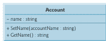

图 4.3 | 图 4.2 中类 Account 的 UML 类图。

*顶部分区*

在 UML 中，每个类在类图中被建模为具有三个分区的矩形。在此图中，顶部分区包含类名 Account，以粗体居中水平排列。

*中间分区*

中间分区包含类的属性名称，它们对应于 C# 中同名的实例变量。图 4.2 中的单个实例变量 name 在 C# 中为 private，因此 UML 类图在属性名称前列出减号 (-) UML 访问修饰符。在属性名称之后是冒号和属性类型，在本例中为 string。

*底部分区*

底部分区包含类的操作 SetName 和 GetName，它们对应于 C# 中同名的<|message|> 方法。UML 通过列出操作名称前面带有 UML 访问修饰符来建模操作，例如 + SetName。此加号 (+) 表示在 UML 中 SetName 是一个公共操作（因为它在 C# 中是一个公共方法）。操作 GetName 也是一个公共操作。

## 返回类型

UML 通过在操作名称后的圆括号之后放置冒号和返回类型来指示操作的返回类型。方法 SetName 不返回值（因为它在 C# 中返回 void），因此 UML 类图未在此操作圆括号后指定返回类型。方法 GetName 具有 string 返回类型。UML 具有与 C# 类似的自己的数据类型——为简单起见，我们使用 C# 类型。

## 参数

UML 通过在操作名称后的圆括号内列出参数名称，后跟冒号和参数类型来建模参数。Account 方法 SetName 具有一个名为 accountName 的 string 参数，因此类图在方法名称后的圆括号之间列出

```
accountName : string
```

操作 GetName 没有任何参数，因此类图中操作名称后的圆括号为空，就像图 4.2 第 16 行方法声明中的情况一样。

## 4.4 创建、编译和运行包含两个类的 Visual C# 项目

当您为此应用程序创建项目时，您应该将 Program.cs 重命名为 AccountTest.cs 并将 Account.cs 文件添加到项目中。要设置包含两个类的项目：

- 1. 创建控制台应用程序，如第 3 章中所做。我们将本章的项目命名为 Account1、Account2、Account3 和 Account4。
- 2. 将项目的 Program.cs 文件重命名为 AccountTest.cs。用类 AccountTest 的代码（图 4.1）替换自动生成的代码。
- 3. 在解决方案资源管理器中右键单击项目名称并从弹出菜单中选择 Add > Class...。
- 4. 在添加新项对话框的名称字段中输入新文件的名称（Account.cs），然后单击添加。在新的 Account.cs 文件中，用图 4.2 中类 Account 的代码替换自动生成的代码。

您可以通过在解决方案资源管理器窗口中双击文件名在 Visual Studio 编辑器中打开每个类。

您必须在执行应用程序之前编译图 4.1 和 4.2 中的类。这是您创建具有*多个类*的应用程序的第一次。类 AccountTest 具有 Main 方法；类 Account 没有。IDE 自动将包含 Main 的类识别为应用程序的入口点。当您在 Visual Studio 中选择 Build > Build Solution 时，IDE 会编译项目中的所有文件以创建可执行应用程序。如果两个类都编译正确——即没有显示编译错误——您就可以通过键入 *Ctrl + F5* 来运行应用程序，以执行 AccountTest 类的 Main 方法。如果您在运行应用程序之前未构建应用程序，键入 *Ctrl + F5* 将首先构建应用程序，并且只有在没有编译错误的情况下才会运行应用程序。


> **常见编程错误 4.2**
> 
> 在给定项目中，在多于一个类中声明 `Main` 方法会导致编译错误：“程序定义了多个入口点。”


## 4.5 使用设置和获取方法的软件工程

*设置* 和 *获取* 方法可以分别验证修改私有数据的尝试，并控制该数据向调用方呈现的方式。这些是令人信服的软件工程优势。如果实例变量是 `public`，该类的任何客户端都能看到并修改数据，包括将其设置为无效值。此外，公共数据允许客户端代码程序员编写依赖于该类数据格式的代码。如果类的所有者更改该格式，任何依赖它的客户端代码都会“中断”，并且需要调整为新格式，从而使其再次面临中断的风险。

你可能认为，即使类的客户端不能直接访问私有实例变量，客户端仍然可以通过公共的 *设置* 和 *获取* 方法对该变量为所欲为。你可能会认为，可以随时通过公共的 *获取* 方法窥视私有数据（并确切了解它在对象中是如何存储的），并且可以通过公共的 *设置* 方法随意修改私有数据。

实际上，可以对 *设置* 方法进行编程，使其 *验证* 参数，并拒绝任何将数据设置为不良值的尝试，例如

- 负的体温
- 3 月中不在 1 到 31 范围内的日期
- 不在公司产品目录中的产品代码，等等。

*获取* 方法可以以不同形式呈现数据，而实际的数据表示对用户保持隐藏。例如，Grade 类可能将成绩实例变量存储为 0 到 100 之间的 int，但 *GetGrade* 方法可能以字符串形式返回字母等级，例如 90 到 100 分的成绩返回 "A"，80 到 89 分的成绩返回 "B"，……我们将在 5.5 节中使用属性来实现这一点。严格控制对私有数据的访问和 *呈现* 可以大大减少错误，同时提高程序的健壮性、安全性和可用性。

### 带有私有数据的 Account 对象的概念视图

你可以将 Account 对象视为图 4.4 所示。私有实例变量 name *隐藏在对象内部*（由包含 name 的内圆表示），并 *由公共方法的外层保护*（由包含 GetName 和 SetName 的外圆表示）。任何需要与 Account 对象交互的客户端代码只能通过调用保护外层的公共方法来实现。

> **软件工程观察 4.1**
> 
> *通常，实例变量应为私有，方法应为公共。*


> **软件工程观察 4.2**
> 
> *变化是规律而非例外。你应预料到代码会被修改，而且可能经常被修改。使用公共的设置和获取方法控制对私有数据的访问，可使程序更清晰、更易于维护。*


图 4.4 | 带有私有实例变量 name 和公共方法保护层的 Account 对象的概念视图。

## 4.6 使用属性而非设置和获取方法的 Account 类

我们最初的 Account 类包含一个私有实例变量 name，以及公共方法 SetName 和 GetName，它们分别使客户端能够为 Account 的 name 赋值和从中检索值。C# 提供了一种更优雅的解决方案——称为属性——来完成相同的任务。属性封装了一个 set 访问器（用于将值存储到变量中）和一个 get 访问器（用于获取变量的值）。在本节中，我们将重新审视 AccountTest 类，演示如何与包含公共 Name 属性的 Account 对象交互，然后给出更新后的 Account 类，并详细研究属性。

### 4.6.1 使用 Account 的 Name 属性的 AccountTest 类

图 4.5 显示了更新后的 AccountTest 类，它使用 Account 类的 Name 属性（在图 4.6 中声明）来获取和设置 Account 的 name 实例变量。假设用户在提示输入姓名时再次输入 Jane Green，此应用将生成与图 4.1 相同的输出。

```
// Fig. 4.5: AccountTest.cs
// Creating and manipulating an Account object with properties.
using System;

class AccountTest
{
    static void Main()
    {
        // create an Account object and assign it to myAccount
        Account myAccount = new Account();
```

图 4.5 | 创建和操作带属性的 Account 对象。（第 1 部分，共 2 部分。）

```
```csharp
11
12        // display myAccount's initial name
13        Console.WriteLine($"Initial name is: {myAccount.Name}");
14
15        // prompt for and read the name, then put the name in the object
16        Console.Write("Please enter the name: "); // prompt
17        string theName = Console.ReadLine(); // read a line of text
18        myAccount.Name = theName; // put theName in myAccount's Name
19
20        // display the name stored in object myAccount
21        Console.WriteLine($"MyAccount's name is: {myAccount.Name}");
22
     }
```
```

```
```text
Initial name is:
Please enter the name: Jane Green
myAccount's name is: Jane Green
```
```

**图 4.5** | *创建和操作带属性的 Account 对象。（第 2 部分，共 2 部分。）*

### *调用 Account 类的 Name 属性以获取名称*

Account 类的 Name 属性的 get 访问器获取存储在特定 Account 对象中的账户名。图 4.5 的第 13 行

```
```csharp
Console.WriteLine($"Initial name is: {myAccount.Name}");
```
```

通过使用表达式 myAccount.Name 访问对象的 Name 属性，显示 myAccount 的初始名称。要访问属性，需指定对象名（myAccount），后跟成员访问运算符（.）和属性名（Name）。当用于获取账户名时，此表示法会隐式执行属性的 get 访问器，该访问器返回账户名。

当 Main 在第 13 行访问 Name 属性时：

1. 应用将程序执行从表达式 myAccount.Name（Main 中的第 13 行）转移到属性 Name 的 get 访问器。
2. 接着，Name 属性的 get 访问器执行其任务——即，将 myAccount 的 name 实例变量的值返回（即交回）到访问该属性的第 13 行。
3. Console.WriteLine 显示 Name 属性的 get 访问器返回的字符串——该字符串被插入到内插字符串中，以替代表达式 myAccount.Name——然后程序继续执行 Main 中的第 16 行。

与图 4.1 一样，图 4.5 中的第 13 行不会显示名称，因为我们尚未在 myAccount 对象中存储名称。

### *调用 Account 类的 Name 属性以设置名称*

接下来，第 16–17 行提示并输入名称。Account 类的 Name 属性的 set 访问器在特定 Account 对象中设置账户名。第 18 行

```
```csharp
myAccount.Name = theName; // put theName in myAccount's Name
```
```

将用户在第 17 行输入的字符串赋给 myAccount 的 Name 属性。当赋值左侧的表达式 myAccount.Name 调用属性 Name 时：

1. 应用将程序执行从 Main 中的第 18 行转移到 Name 的 set 访问器。
2. 属性 Name 的 set 访问器执行其任务——即，将 Main（第 18 行）中赋给属性 Name 的字符串值存储到 myAccount 对象的 name 实例变量中。
3. 当 Name 的 set 访问器完成执行后，程序执行返回到访问 Name 属性的位置（Main 中的第 18 行），然后继续执行第 21 行。

为演示 myAccount 现在包含用户输入的姓名，第 21 行

```
Console.WriteLine($"myAccount's name is: {myAccount.Name}");
```

再次访问 myAccount 的 Name 属性，这会使属性的 get 访问器获取 name 实例变量的新值。如你所见，程序输出的最后一行显示用户在第 17 行输入的姓名。

### 4.6.2 带有实例变量和属性的 Account 类

更新后的 Account 类用属性 Name（图 4.6 的第 10–20 行）替换了图 4.2 中的 GetName 和 SetName 方法。属性的 get 和 set 访问器分别处理获取和设置数据的细节。与方法名不同，访问器名 get 和 set 均以小写字母开头。

```
```csharp
// Fig. 4.6: Account.cs
// Account class that replaces public methods SetName
// and GetName with a public Name property.

class Account
{
    private string name; // instance variable

    // property to get and set the name instance variable
    public string Name
    {
        get // returns the corresponding instance variable’s value
        {
            return name; // returns the value of name to the client code
        }
        set // assigns a new value to the corresponding instance variable
        {
            name = value; // value is implicitly declared and initialized
        }
    }
}
```
```

**图 4.6** —— 用公共 Name 属性替换公共方法 SetName 和 GetName 的 Account 类。


### 属性 Name 的声明

第 10 行

```
public string Name
```

开始了 Name 属性的声明，该声明指定：

- 该属性是 public，因此可由该类的客户端使用；
- 该属性的类型是 string；
- 该属性的名称是 Name。

按照惯例，属性的标识符是其操作的实例变量标识符的首字母大写形式——Name 是表示实例变量 name 的属性。C# 区分大小写，因此 Name 和 name 是不同的标识符。属性体包含在第 11 行和第 20 行的大括号中。

### 属性 Name 的 get 访问器

get 访问器（第 12–15 行）执行与图 4.2 中方法 GetName 相同的任务。get 访问器以关键字 get 开头，其主体由大括号分隔。与方法 GetName 一样，get 访问器的主体包含一条 return 语句（第 14 行），用于返回 Account 的 name 实例变量的值。因此，在图 4.5 的第 13 行

```
Console.WriteLine($"{myAccount.Name}");
```

表达式 myAccount.Name 获取 myAccount 的实例变量 name 的值。属性表示法允许客户端将属性视为底层数据，但客户端仍然不能直接操作私有实例变量——关键字 get 是上下文关键字，因为只有在属性的上下文中（即其主体中）它才是关键字——在其他上下文中，get 可用作标识符。

### 属性 Name 的 set 访问器

set 访问器（图 4.6 第 16–19 行）以标识符 set 开头，其后是它的主体，主体由大括号分隔。方法 SetName（图 4.2）声明了一个参数 accountName，用于接收要存储在 Account 对象中的新名称——set 访问器使用关键字 value（图 4.6 第 18 行）来实现同样的目的。value 会由客户端代码赋给属性的值隐式声明并初始化。因此，在图 4.5 的第 18 行

```
myAccount.Name = theName;  // put theName in myAccount's Name
```

value 会用 theName（用户输入的字符串）初始化。属性 Name 的 set 访问器只是将 value 赋给实例变量 name——我们将在图 4.11 中展示一个执行验证的 set 访问器。与 get 一样，关键字 set 和 value 也是上下文关键字——set 仅在属性的上下文中才是关键字，而 value 仅在 set 访问器的上下文中才是关键字。


> **错误预防提示 4.2**
> 
> 尽管上下文关键字（例如 set 访问器中的 value）在某些上下文中可用作标识符，但我们最好不要这样做。

属性中第 14 行和第 18 行（图 4.6）的语句都会访问 name，尽管它是在属性声明之外声明的。我们可以在 Account 类的属性（以及其他属性和方法，如果有的话）中使用实例变量 name，因为 name 是同一个类中的实例变量。

## 4.6.3 带属性的 Account UML 类图

图 4.7 展示了图 4.6 中 Account 类的 UML 类图。我们在 UML 中将 C# 属性建模为特性（attributes）。属性 Name 被列为 public 特性——由加号 (+) 表示——其后是用法式引号（« 和 »）括起来的单词 “property”。在法式引号中使用描述性单词（在 UML 中称为构造型）有助于将属性与其他特性和操作区分开来。UML 通过在属性名后放置冒号和类型来表示该属性的类型。


图 4.7 | 图 4.6 中 Account 类的 UML 类图。

类图有助于设计类，因此不必显示每个实现细节。由于由属性操作的实例变量实际上是该属性的实现细节，因此我们的类图不显示 name 实例变量。根据这个类图实现 Account 类的程序员会在实现过程中创建实例变量 name（就像我们在图 4.6 中所做的那样）。同样，属性的 get 和 set 访问器也是实现细节，因此它们不会列在 UML 图中。

## 4.7 自动实现的属性

在图 4.6 中，我们创建了一个 Account 类，其中包含私有实例变量 name 和公共属性 Name，以便客户端代码可以访问该名称。查看 Name 属性的定义（图 4.6 第 10–20 行）时会注意到，get 访问器只是返回私有实例变量 name 的值，而 set 访问器只是将一个值赋给该实例变量——访问器中没有其他逻辑。对于这种简单情况，C# 提供了自动实现的属性。

使用自动实现的属性时，C# 编译器会自动创建一个隐藏的私有实例变量，并创建用于获取和设置该隐藏实例变量的 get 和 set 访问器。这使你能够简单地实现该属性，这在初次设计类时很方便。如果以后决定在 get 或 set 访问器中包含其他逻辑，你可以直接使用图 4.6 所示的技术实现该属性和一个实例变量。要在图 4.6 的 Account 类中使用自动实现的属性，你可以将第 7 行的私有实例变量以及第 10–20 行的属性替换为下面这一行代码：

```
public string Name { get; set; }
```

我们将在图 4.8 的 Name 属性中使用这种技术。

name。前面的语句需要一个能接收 string 的 Account 构造函数。图 4.8 包含一个经过修改的 Account 类，其中具有这样的构造函数。

### Account 构造函数声明

让我们逐步分析构造函数声明的代码（图 4.8，第 9–12 行）；

```
public Account(string accountName) // constructor name is class name
{
    Name = accountName;
}
```

我们将每个构造函数声明的第一行（本例中为第 9 行）称为构造函数头。这个构造函数接收 string 参数 accountName——它表示作为参数传递给构造函数的名称。构造函数与方法的一个重要区别是，构造函数不能指定返回类型（甚至不能是 void）。通常，构造函数声明为 public，以便类的客户端代码可以使用它来初始化类的对象。

### 构造函数体

构造函数体由一对大括号分隔，其中包含一条或多条执行构造函数任务的语句。在本例中，函数体包含一条语句（第 11 行），它将参数 accountName 的值（一个 string）赋给类的 Name 属性，从而将账户名称存储在对象中。第 11 行执行后，构造函数就完成了任务，因此会返回到包含调用该构造函数的对象创建表达式的那行代码。你很快就会看到，Main（图 4.9）中第 11–12 行的语句都会调用这个构造函数。

## 4.8.2 类 AccountTest：在创建 Account 对象时初始化它们

AccountTest 程序（图 4.9）使用构造函数初始化两个 Account 对象。第 11 行创建并初始化 Account 对象 account1。关键字 new 从系统请求内存来存储 Account 对象，然后隐式调用类的构造函数来初始化该对象。该调用由类名后的圆括号表示，圆括号中包含参数 "Jane Green"，用于初始化新对象的名称。第 11 行随后将初始化后的对象赋给变量 account1。第 12 行重复此过程，传递参数 "John Blue" 来初始化 account2 的名称。第 15–16 行使用每个对象的 Name 属性来获取名称，并表明它们在创建对象时确实已被初始化。输出显示了不同的名称，确认每个 Account 都维护自己的名称。

```
1  // Fig. 4.9: AccountTest.cs
2  // Using the Account constructor to set an Account's name
3  // when an Account object is created.
4  
5  using System;
```

图 4.9 | 在创建 Account 对象时使用 Account 构造函数设置 Account 的名称。（第 1 部分，共 2 部分。）


```csharp
6 class AccountTest
7 {
8     static void Main()
9     {
10     // create two Account objects
11     Account account1 = new Account("Jane Green");
12     Account account2 = new Account("John Blue");
13
14     // display initial value of name for each Account
15     Console.WriteLine($"account1 name is: {account1.Name}");
16     Console.WriteLine($"account2 name is: {account2.Name}");
17     }
18 }
```

account1 名称是：Jane Green
account2 名称是：John Blue

**图 4.9** | 使用 Account 构造函数在创建 Account 对象时设置 Account 的名称。 (第 2 部分，共 2 部分。)

## 默认构造函数

请回忆 Fig. 4.5 的第 10 行

```csharp
Account myAccount = new Account();
```

使用 new 创建了一个 Account 对象。 空白的圆括号在表达式中

```csharp
new Account()
```

表示对类的默认构造函数的调用——在任何未显式声明构造函数的类中，编译器都会提供一个公共的默认构造函数（它始终没有参数）。 当类只有默认构造函数时，类的实例变量会被初始化为其默认值：

- 数值简单类型的 0，
- 简单类型 bool 的 false 以及
- 所有其他类型的 null。

在第 10.5 节中，你将学习到类可以通过一种称为重载的过程拥有多个构造函数。

## 声明了构造函数的类中没有默认构造函数

如果你为一个类声明一个或多个构造函数，编译器将不会为该类创建默认构造函数。 在这种情况下，你将无法使用我们在图 4.5 中使用的表达式 new Account() 来创建 Account 对象——除非你声明的自定义构造函数之一不带参数。

### 软件工程观察 4.4

除非你接受类实例变量的默认初始化，否则请提供自定义构造函数，以确保在创建类的每个新对象时，实例变量都能使用有意义的值正确初始化。

## 将构造函数添加到类 Account 的 UML 类图中

图 4.10 的 UML 类图对图 4.8 中的类 Account 进行了建模，该类具有一个带有 string accountName 参数的构造函数。 UML 将构造函数建模为类图中第三个区间的操作。 为了区分构造函数和类的其他操作，UML 要求将单词“constructor”用引号 (« 和 ») 括起来并放在构造函数的名称之前。 通常在第三个区间中将构造函数列在其他操作之前。 在图 4.14 中，你将看到一个在第三个区间中同时包含构造函数和操作的类图。


**图 4.10** | 图 4.8 的 Account 类的 UML 类图。

## 4.9 带有余额的 Account 类；处理货币金额

在本节中，我们将声明一个 Account 类，该类除了名称外还维护 Account 的 *balance*。 大多数账户余额不是整数（如 0、−22 和 1024），而是包含小数点的数字，例如 99.99 或 −20.15。 因此，类 Account 使用类型 `decimal` 表示账户余额，该类型专为精确表示带小数点的数字而设计，尤其是 *monetary amounts*。

### 4.9.1 具有 decimal 余额实例变量的 Account 类

典型银行服务 *many* 账户，每个账户都有其 *own* 余额，因此我们下一个 Account 类（图 4.11）维护银行账户的

- `name`—作为自动实现的 Name 属性（第 6 行）——以及
- `balance`—作为私有 decimal 实例变量 balance（第 7 行）以及相应的公共 Balance 属性（第 17–32 行）。我们在此使用完全实现的 Balance 属性，以便在将其分配给 balance 实例变量之前确保 set 访问器的参数有效。

decimal 实例变量默认初始化为零。类 Account 的每个实例（即对象）都包含其 *own* 名称和余额。

```csharp
// Fig. 4.11: Account.cs
// Account class with a balance and a Deposit method.

class Account
{
6    public string Name { get; set; } // auto-implemented property
7    private decimal balance; // instance variable
8
9    // Account constructor that receives two parameters
10   public Account(string accountName, decimal initialBalance)
11   {
12       Name = accountName;
13       Balance = initialBalance; // Balance's set accessor validates
14   }
15
16   // Balance property with validation
17   public decimal Balance
18   {
19       get
20       {
21           return balance;
22       }
23       private set // can be used only within the class
24       {
25           // validate that the balance is greater than 0.0; if it's not,
26           // instance variable balance keeps its prior value
27           if (value > 0.0m) // m indicates that 0.0 is a decimal literal
28           {
29               balance = value;
30           }
31       }
32   }
33
34   // method that deposits (adds) only a valid amount to the balance
35   public void Deposit(decimal depositAmount)
36   {
37       if (depositAmount > 0.0m) // if the depositAmount is valid
38       {
39           Balance = Balance + depositAmount; // add it to the balance
40       }
41   }
42 }
```

**图 4.11** | 具有 decimal 实例变量 balance 以及执行验证的 Balance 属性和 Deposit 方法的 Account 类。（第 1 部分，共 2 部分）

**图 4.11** | 具有 decimal 实例变量 balance 以及执行验证的 Balance 属性和 Deposit 方法的 Account 类。（第 2 部分，共 2 部分。）

### Account 类双参数构造函数

开户时立即存款是很常见的，因此构造函数（第 10–14 行）现在接收第二个参数——initialBalance，其类型为 decimal，表示起始余额。 第 13 行将 initialBalance 分配给属性 Balance，调用 Balance 的 set 访问器，以确保在将值分配给实例变量 balance 之前 initialBalance 参数有效。

### Account 属性 Balance

类型为 decimal 的属性 Balance（第 17–32 行）提供 get 访问器，允许类的客户端获取特定 Account 对象的余额。 该属性还提供 set 访问器。

在图 4.6 中，类 `Account` 定义了 `Name` 属性，其中 `set` 访问器只是将隐式参数 `value` 接收到的值简单地分配给类 `Account` 的实例变量 `name`。 `Name` 属性 did *not* 确保 `name` 只包含有效数据。

`Balance` 属性的 `set` 访问器执行验证（也称为有效性检查）。 第 27 行（图 4.11）确保 `set` 访问器的隐式 `value` 参数大于 `0.0m`——字母 `m`（或 `M`）表示 `0.0` 是一个 **decimal literal**。 如果 `value` 大于 `0.0m`，则将存储在 `value` 中的金额分配给实例变量 `balance`（第 29 行）。 否则，`balance` 保持不变——我们将在全书中进一步讨论错误处理。

尽管我们在本示例中验证了 `balance`，但我们没有验证 `name`。 名称通常相当“自由形式”——有各种可接受的名称格式。 当你填写表格时，通常会被要求将 `name` 限制为一定数量的字符。 在第 16 章 *Strings and Characters: A Deeper Look* 中，你将学习如何检查 `string` 的长度，以便通过检查它们是否不过长来验证字符串。

### 具有不同访问修饰符的 set 和 get 访问器

默认情况下，属性的 `get` 和 `set` 访问器与属性具有 *same* 访问权限——例如，`public` 属性 `Name` 的访问器是 `public`。 可以使用不同的访问修饰符声明 `get` 和 `set` 访问器。 在这种情况下，其中一个访问器必须 *implicitly* 具有与属性 *same* 的访问权限，而另一个必须使用比属性更 *more restrictive* 的访问修饰符 *explicitly* 声明。 我们将 `Balance` 属性的 `set` 访问器声明为 `private`——这表示它只能在类 `Account` 中使用，而不能由类的客户端使用。 这使我们能够确保一旦 `Account` 对象存在，其 `balance` 只能由方法 `Deposit` 修改。


### **错误预防提示 4.3**

*仅仅因为实例变量设为 private，数据完整性的好处并不是自动的——你必须提供适当的有效性检查并报告错误。*


### **错误预防提示 4.4**

*设置私有数据值的 set 访问器应验证预期新值是否正确；如果不正确，set 访问器应保持实例变量不变并指示错误。我们将在第 10 章中演示如何通过抛出异常来指示错误。*

### Account 类 Deposit 方法

`public` 方法 `Deposit`（图 4.11 的第 35–41 行）使客户端代码能够向 `Account` 存款，从而增加其 `balance`。 第 35 行表示

- 该方法不向其调用者返回任何信息（如返回类型 `void` 所示）以及
- 接收一个名为 `depositAmount` 的参数——一个 decimal 值。

只有当参数的值 *valid* 时——即如第 37 行所指定大于 `0.0m`——`depositAmount` 才会被加到 `balance` 上。 第 39 行首先将当前 `Balance` 与

4. 需要 `m` 来表示十进制文字。 C# 默认将带小数点的数字文字视为 `double` 类型，而 `double` 和 `decimal` 不能混用。 我们将在第 5 章介绍 `double` 类型。


depositAmount，形成一个*临时*的和，然后被赋给 `Balance` 属性。属性的 setter 然后*替换*实例变量 balance 的先前值（请注意加法具有比赋值运算符*更高*的优先级）。因此第 39 行在赋值的右侧使用 `Balance` 属性的 `get` 访问器，在左侧使用 `set` 访问器。重要的是要理解，第 39 行赋值运算符右侧的计算*不会*修改实例变量 balance——这就是为什么需要赋值的原因。


> **软件工程观察 4.5**
> 
> 在实现类的一个方法时，虽然该方法可以直接访问类的实例变量，但请始终使用类的属性来实现该目的。在第 10 章中，我们将更深入地探讨这个问题。

## 4.9.2 使用带余额的 Account 对象的 AccountTest 类

类 AccountTest（图 4.12）创建了两个 Account 对象（第 9–10 行）并分别用有效的余额 50.00m 和无效的余额 -7.53m 初始化它们——为我们的示例目的，我们假设余额必须大于或等于零。第 13–16 行中对方法 Console.WriteLine 的调用输出账户名称和初始余额，这些信息是从每个账户的 Name 和 Balance 属性获取的。

```csharp
// Fig. 4.12: AccountTest.cs
// Reading and writing monetary amounts with Account objects.
using System;

class AccountTest
{
    static void Main()
    {
        Account account1 = new Account("Jane Green", 50.00m);
        Account account2 = new Account("John Blue", -7.53m);

        // display initial balance of each object
        Console.WriteLine(
            $"{account1.Name}'s balance: {account1.Balance:C}");
        Console.WriteLine(
            $"{account2.Name}'s balance: {account2.Balance:C}");

        // prompt for them to enter input
        Console.Write("\nEnter deposit amount for account1: ");
        decimal depositAmount = decimal.Parse(Console.ReadLine());
        Console.WriteLine(
            $"adding {depositAmount:C} to account1 balance\n");
        account1.Deposit(depositAmount); // add to account1's balance

        // display balances
        Console.WriteLine(
            $"{account1.Name}'s balance: {account1.Balance:C}");
        Console.WriteLine(
            $"{account2.Name}'s balance: {account2.Balance:C}");
}
```

**图 4.12** | 使用 Account 对象读写货币金额。（第 1 部分，共 2 部分。）

```csharp
30
31      // prompt for then read input
32      Console.Write("\nEnter deposit amount for account2: ");
33      depositAmount = decimal.Parse(Console.ReadLine());
34      Console.WriteLine(
35         $"adding {depositAmount:C} to account2 balance\n");
36      account2.Deposit(depositAmount); // add to account2's balance
37
38      // display balances
39      Console.WriteLine(
40         $"{account1.Name}'s balance: {account1.Balance:C}");
41      Console.WriteLine(
42         $"{account2.Name}'s balance: {account2.Balance:C}");
43   }
44 }
```

```text
Jane Green's balance: $50.00
John Blue's balance: $0.00

Enter deposit amount for account1: 25.53
adding $25.53 to account1 balance

Jane Green's balance: $75.53
John Blue's balance: $0.00

Enter deposit amount for account2: 123.45
adding $123.45 to account2 balance

Jane Green's balance: $75.53
John Blue's balance: $123.45
```

**图 4.12** | 使用 Account 对象读写货币金额。（第 2 部分，共 2 部分。）

### 显示 Account 对象的初始余额

当第 14 行访问 account1 的 Balance 属性时，account1 的 balance 实例变量的值从图 4.11 的第 21 行返回并插入到图 4.12 第 14 行的插值字符串中以供显示。类似地，当第 16 行访问 account2 的 Balance 属性时，account2 的 balance 实例变量的值从图 4.11 的第 21 行返回并插入到图 4.12 第 16 行的插值字符串中以供显示。account2 的余额初始为 0.00，因为构造函数拒绝了将 account2 以*负数*余额开始的尝试，因此 balance 实例变量保留其默认初始值。

### 使用格式化的字符串插值表达式

此应用程序将每个 Account 的余额显示为货币金额。您可以在 C# 6 字符串插值表达式中通过在花括号中的值后跟冒号和格式说明符来指定格式。例如，在第 14 行，插值表达式

```csharp
{account1.Balance:C}
```

使用格式说明符 C 将 account1.Balance 格式化为*货币*。用户机器上的 Windows 区域设置决定了货币金额的显示格式，例如用于分隔千位、百万位等的逗号与句点。例如，

- 50 在美国（U.S.）显示为 $50.00，在德国和许多其他国家显示为 50,00 €（欧元），在日本显示为 ¥50。
- 4382.51 在美国显示为 $4,382.51，在德国显示为 4.382,51 €，在日本显示为 ¥4,382。
- 1254827.40 在美国显示为 $1,254,827.40，在德国显示为 1.254.827,40 €，在日本显示为 ¥1,254,827。

图 4.13 列出了其他格式说明符。

| 格式说明符 | 描述 |
|---|---|
| C or c | 将字符串格式化为货币。包含适当的货币符号（在美国为 $）放在数字旁边。用适当的分隔字符分隔数字（在美国，每三位数字之间用逗号分隔千位、百万位等），并且默认小数位数设置为两位。 |
| D or d | 将字符串格式化为整数（仅限整数类型）。 |
| N or n | 使用千位分隔符格式化字符串，默认小数位数为两位。 |
| E or e | 使用科学计数法格式化数字，默认小数位数为六位。 |
| F or f | 使用固定小数位数格式化字符串（默认为两位）。 |
| G or g | 根据上下文，使用小数位或科学计数法正常格式化数字。如果格式项不包含格式说明符，则隐式假定格式为 G。 |
| X or x | 将字符串格式化为十六进制（基数 16 的数字；我们在在线《数字系统》附录中讨论这些）。 |

**图 4.13** | 字符串格式说明符。

### 从用户读取 decimal 值

第 19 行（图 4.12）提示用户输入 account1 的存款金额。第 20 行声明局部变量 depositAmount 以存储用户输入的每个存款金额。与实例变量（例如类 Account 中的 name 和 balance）不同，局部变量（如 Main 中的 depositAmount）默认不会初始化，因此通常必须显式初始化。正如您即将学到的，变量 depositAmount 的初始值将由用户输入决定。

> **常见编程错误 4.3**
> 
> 如果您尝试使用未初始化的局部变量的值，C# 编译器将发出编译错误“Use of unassigned local variable 'variableName'”——在错误消息中，variableName 将是实际的变量名。这有助于您避免危险的执行时逻辑错误。最好在编译时而不是执行时将错误从程序中排除。

第 20 行通过调用 Console 类的 ReadLine 方法从用户获取输入，然后将用户输入的字符串传递给类型 decimal 的 Parse 方法，该方法返回此字符串中的 decimal 值——每个简单类型都有一个 Parse 方法。第 21–22 行以货币格式显示存款金额。

### 进行存款

第 23 行调用对象 account1 的 Deposit 方法并提供 depositAmount 作为方法参数。然后该方法将参数的值添加到 Balance 属性（图 4.11 的第 39 行）。然后图 4.12 中的第 26–29 行再次输出两个 Accounts 的余额，以显示只有 account1 的 balance 实例变量发生了变化。

### 读取 decimal 值并存入 account2

第 32 行提示用户输入 account2 的存款金额。第 33 行通过调用方法 Console.ReadLine 并将返回值传递给类型 decimal 的 Parse 方法从用户获取输入。第 34–35 行显示存款金额。第 36 行调用对象 account2 的 Deposit 方法并提供 depositAmount 作为方法参数。然后，该方法将该值添加到 account2 的 Balance 属性。最后，第 39–42 行再次输出两个 Accounts 的余额，以显示只有 account2 的 balance 实例变量发生了变化。

### 类 Account 的 UML 类图

图 4.14 中的类图简洁地建模了图 4.11 的类 Account。图表在其第二个分区中建模了公共属性 Name（类型为 string）和 Balance（类型为 decimal）。类 Account 的构造函数在第三个分区中建模，参数为 name（类型为 string）和 initialBalance（类型为 decimal）。类的公共 Deposit 操作也在第三个分区中建模——Deposit 有一个类型为 decimal 的 depositAmount 参数。Deposit 方法不返回值（因为它在 C# 中返回 void），因此 UML 类图未为此操作指定返回类型。


**图 4.14** | 图 4.11 的 Account 类的 UML 类图。

## 4.10 总结

在本章中，我们讨论了面向对象编程的概念：类、对象、方法、实例变量、属性和构造函数——这些将在您创建的大多数实质性 C# 应用程序中使用。您声明类的实例变量以维护该类的每个对象的数据，并声明 Set 和 Get 方法来操作该数据。我们演示了如何调用方法以执行其任务以及如何将信息作为参数传递给方法。接下来，我们展示了 C# 优雅的属性语法来设置和获取数据，并演示了如何访问属性以执行其 set 和 get 访问器。我们讨论了方法局部变量与类实例变量之间的差异，以及只有实例变量会自动初始化。您学习了如何创建自动实现的属性，这些属性只需在访问器的声明中不带任何额外逻辑即可获取或设置实例变量。您学习了关于类型

decimal 用于精确操作带小数点的数字，例如货币金额。

我们展示了如何创建 UML 类图，以对类的构造函数、方法、属性和特性进行建模。你了解了将实例变量声明为 private 并使用公共属性来操作它们的价值。例如，我们演示了如何使用属性中的 set 访问器，在修改实例变量的值之前验证其可能的新值。

在第 5 章中，我们开始介绍控制语句，它们指定应用动作的执行顺序。你将在方法和属性中使用这些控制语句，以帮助指定它们应如何执行任务。

## 5
# 5 控制语句：第一部分
## 目标

本章中，你将：

- 使用 `if` 和 `if...else` 选择语句在操作之间进行选择。
- 使用 `while` 语句重复执行语句。
- 使用计数器控制迭代和哨兵控制迭代。
- 使用自增、自减和复合赋值运算符。
- 使用 `decimal` 类型进行精确的货币金额和计算。

- 大纲
- 5.1 引言
- 5.2 控制结构
- 5.2.1 顺序结构
- 5.2.2 选择语句
- 5.2.3 迭代语句
- 5.2.4 控制语句小结
- 5.3 if 单选择语句
- 5.4 if...else 双选择语句
- 5.4.1 嵌套 if...else 语句
- 5.4.2 悬空 else 问题
- 5.4.3 块
- 5.4.4 条件运算符 (?:)
- 5.5 Student 类：嵌套 if...else 语句
- 5.6 while 迭代语句
- 5.7 计数器控制迭代
- 5.7.1 实现计数器控制迭代
- 5.7.2 整数除法与截断
- 5.8 哨兵控制迭代
- 5.8.1 实现哨兵控制迭代
- 5.8.2 哨兵控制迭代的程序逻辑
- 5.8.3 while 语句中的花括号
- 5.8.4 简单类型之间的显式转换和隐式转换
- 5.8.5 格式化浮点数
- 5.9 嵌套控制语句
- 5.10 复合赋值运算符
- 5.11 自增和自减运算符
- 5.11.1 前缀自增 vs. 后缀自增
- 5.11.2 简化自增语句
- 5.11.3 运算符优先级和结合性
- 5.12 简单类型
- 5.13 小结

## 5.1 引言

本章中，我们将更详细地讨论 C# 的 if 语句，并介绍 if...else 和 while 语句——所有这些构建块都允许你指定方法和属性执行任务所需的逻辑。我们还会介绍复合赋值运算符以及自增和自减运算符。最后，我们将讨论 C# 简单类型的更多细节。

## 5.2 控制结构

通常，语句按照书写的顺序一个接一个地执行。这个过程称为顺序执行。各种 C# 语句使你能够指定下一个要执行的语句不一定是序列中的下一个语句。这称为控制转移。

20 世纪 60 年代，人们逐渐认识到，不加区分地使用控制转移是软件开发团队经历许多困难的根源。责任被归咎于 goto 语句（当时大多数编程语言都使用），它允许你将控制转移到程序中的众多目标位置之一。

Bohm 和 Jacopini 的研究表明，程序可以在没有任何 goto 语句的情况下编写。那个时代的程序员面临的挑战是转变
他们的风格，转向“无 goto 编程”。结构化编程一词几乎成了“消除 goto”的同义词。直到 20 世纪 70 年代，大多数程序员才开始认真对待结构化编程。结果令人印象深刻。软件开发团队报告了更短的开发时间、更频繁地按时交付系统以及更频繁地在预算内完成软件项目。这些成功的关键在于，结构化程序更清晰、更易于调试和修改，并且从一开始就更有可能没有 bug。

Bohm 和 Jacopini 的工作表明，所有程序都可以仅用三种控制结构来编写——顺序结构、选择结构和迭代结构。我们将讨论这些结构在 C# 中如何实现。

### 5.2.1 顺序结构

顺序结构内置于 C# 中。除非另有指示，C# 语句按照书写顺序一个接一个地执行——也就是按顺序执行。图 5.1 中的 UML 活动图展示了一个典型的顺序结构，其中按顺序执行两个计算。在顺序结构中，C# 允许你拥有任意多个动作。


图 5.1 | 顺序结构活动图。

活动图对软件系统某一部分的工作流（也称为活动）进行建模。此类工作流可能包含算法的一部分，如图 5.1 中的顺序结构。活动图由符号组成，例如

- 动作状态符号（左右两侧替换为向外弧线的矩形），
- 菱形和
- 小圆圈。

这些符号通过转换箭头连接，转换箭头表示活动的流向——即动作应发生的顺序。

1. C. Bohm 和 G. Jacopini，“Flow Diagrams, Turing Machines, and Languages with Only Two Formation Rules，” Communications of the ACM，第 9 卷，第 5 期，1966 年 5 月，第 336–371 页。

活动图有助于你开发和表示算法。在本章和下一章中，我们使用 UML 来展示控制语句中的控制流。

考虑图 5.1 中的顺序结构活动图。它包含两个动作状态，每个动作状态包含一个动作表达式——例如“将成绩加到总分”或“将计数器加 1”——指定要执行的特定动作。活动图中的箭头表示转换，指示动作状态所表示的动作发生的*顺序*。实现图 5.1 所示活动的应用部分首先将成绩加到总分，然后将计数器加 1。

活动图顶部的实心圆表示初始状态——应用执行所建模动作*之前*工作流的*开始*。图底部的实心圆被空心圆包围，表示最终状态——应用执行其动作*之后*工作流的*结束*。

图 5.1 还包含右上角折起的矩形。这些是 UML 注释（类似于 C# 中的注释），描述图中符号的用途。图 5.1 使用 UML 注释显示与每个动作状态关联的 C# 代码。虚线将每个注释与其描述的图元素连接起来。活动图通常*不*显示实现该活动的 C# 代码。我们在这里这样做是为了说明该图与 C# 代码的关系。

### 5.2.2 选择语句

C# 有三种选择结构，从现在起我们将它们称为选择语句：

- if 语句在条件为*真*时执行（选择）一个动作，或在条件为*假*时跳过该动作。
- if…else 语句在条件为*真*时执行一个动作，或在条件为*假*时执行另一个不同的动作。
- switch 语句（第 6 章）根据表达式的值执行许多不同动作中的一个。

if 语句称为单选择语句，因为它选择或忽略单个动作（或一组动作）。if…else 语句称为双选择语句，因为它在*两个*不同动作（或动作组）之间进行选择。switch 语句称为多选择语句，因为它在*许多*不同动作（或动作组）之间进行选择。

### 5.2.3 迭代语句

C# 提供四种迭代语句，使程序能够在条件（称为循环继续条件）保持为*真*时重复执行语句。这些迭代语句是 while、do…while、for 和 foreach 语句。（第 6 章介绍 do…while 和 for 语句。第 8 章讨论 foreach 语句。）while、for 和 foreach 语句在其循环体中执行动作（或一组动作）*零次或多次*。do…while 语句在其循环体中执行动作（或一组动作）*一次或多次*。if、else、switch、while、do、for 和 foreach 这些词是 C# 关键字。


## 5.2.4 控制语句总结

C# 只有三种控制语句：顺序、选择（三种类型）和迭代（四种类型）。每个应用都是通过根据其实现的算法，将适当数量的这些语句组合而成。我们可以将每种控制语句建模为活动图。与图 5.1 一样，每个图包含一个初始状态和一个最终状态，分别表示顺序语句的入口点和出口点。单入口/单出口控制语句使构建程序变得容易——我们只需将一个语句的出口点连接到下一个语句的入口点。我们称之为控制语句堆叠。控制语句之间只有另一种连接方式——控制语句嵌套——即一个控制语句出现在另一个控制语句内部。因此，C# 应用中的算法仅由三种控制语句构成，并且仅以两种方式组合。这就是简单性的本质。

## 5.3 if 单选择语句

我们在第 3.8 节简要介绍了 if 单选择语句。应用使用选择语句在备选行动方案中做出选择。例如，假设考试及格分数为 60 分。下面的语句

```csharp
if (studentGrade >= 60)
{
    Console.WriteLine("Passed");
}
```

判断条件“studentGrade >= 60”是否为 *真*。如果为真，则显示“Passed”，并按顺序执行下一条语句。如果条件为 *假*，则忽略 Console.WriteLine 调用，并按顺序执行下一条语句。

### bool 简单类型

你在第 3 章已经看到，决策可以基于包含关系运算符或相等运算符的条件。实际上，决策可以基于*任何*求值为 *真* 或 *假* 的表达式。C# 提供简单类型 bool，用于只能保存值 true 和 false 的布尔变量——这两个值都是 C# 关键字。

### if 语句的 UML 活动图

图 5.2 展示了单选择 if 语句。该图包含活动图中最重要的符号——菱形，即判定符号，表示需要做出判定。工作流沿着由该符号关联的守卫条件所确定的路径继续，这些条件可以是 *真* 或 *假*。从判定符号引出的每个转换箭头都在箭头旁边用*方括号*指定一个守卫条件。如果守卫条件为 *真*，则工作流进入转换箭头指向的动作状态。在图 5.2 中，如果学生成绩大于或等于 60，应用显示“Passed”，然后转换到此活动的最终状态。如果成绩小于 60，应用立即转换到最终状态，而不显示任何消息。


**图 5.2** | if 单选择语句的 UML 活动图。

if 语句是*单入口/单出口*控制语句。我们将看到，其余控制语句的活动图也包含初始状态、转换箭头、指示要执行动作的动作状态、指示要做出判定的判定符号（及其关联的守卫条件）以及最终状态。

## 5.4 if...else 双选择语句

if 单选择语句*仅*在条件为 *真* 时执行指定的动作；否则跳过该动作。*if...else* 双选择语句允许你指定条件为 *真* 时执行的动作，以及条件为 *假* 时执行的不同动作。例如，下面的语句

```csharp
if (grade >= 60)
{
   Console.WriteLine("Passed");
}
else
{
   Console.WriteLine("Failed");
}
```

是一个 *if...else* 语句，如果 grade >= 60 则显示“Passed”，但如果小于 60 则显示“Failed”。无论哪种情况，在显示“Passed”或“Failed”之后，都会按顺序执行下一条语句。

注意 *if 部分* 和 *else 部分* 主体的缩进，以提高可读性。Microsoft 建议使用四空格缩进——这是 Visual Studio 中的默认设置。由于行宽限制，我们在所有印刷版图书中使用三空格缩进。

### if...else 语句的 UML 活动图

图 5.3 展示了前面 *if...else* 语句中的控制流。同样，UML 活动图中的符号（除初始状态、转换箭头和最终状态之外）表示动作状态和判定。


*图 5.3*  if...else 双选择语句的 UML 活动图。

### 5.4.1 嵌套 if...else 语句

应用可以通过将 if...else 语句放在其他 if...else 语句内部来测试多种情况，从而创建嵌套 if...else 语句。例如，下面的嵌套 if...else 语句在考试成绩大于或等于 90 时显示 A，在 80 到 89 时显示 B，在 70 到 79 时显示 C，在 60 到 69 时显示 D，在所有其他成绩时显示 F（我们使用底纹突出显示嵌套部分）：

```csharp
if (studentGrade >= 90)
{
    Console.WriteLine("A");
}
else
{
    if (studentGrade >= 80)
    {
        Console.WriteLine("B");
    }
    else
    {
        if (studentGrade >= 70)
        {
            Console.WriteLine("C");
        }
        else
        {
            if (studentGrade >= 60)
            {
                Console.WriteLine("D");
            }
            else
            {
                Console.WriteLine("F");
            }
        }
    }
}
```

如果变量 studentGrade 大于或等于 90，则嵌套 if...else 语句中的前四个条件都将为真，但只有第一个 if...else 语句的 if 部分中的语句会执行。该语句执行后，“最外层” if...else 语句的 else 部分将被跳过。你可以将前面的嵌套 if...else 语句写成以下形式，除了编译器忽略的空格和缩进外，两者完全相同：

```csharp
if (studentGrade >= 90)
{
    Console.WriteLine("A");
}
else if (studentGrade >= 80)
{
    Console.WriteLine("B");
}
else if (studentGrade >= 70)
{
    Console.WriteLine("C");
}
else if (studentGrade >= 60)
{
    Console.WriteLine("D");
}
else
{
    Console.WriteLine("F");
}
```

后一种形式避免了代码向右深度缩进。这种缩进常常使一行代码所剩空间很小，迫使代码行换行。

### 5.4.2 悬空 else 问题

在本书全文中，我们始终用花括号括起控制语句主体。这避免了称为悬空 else 问题的逻辑错误：在该问题中，代码缩进会让人看起来某个 else 与特定的 if 相关联，而实际上并非如此。

### 5.4.3 块

if 语句的主体通常只期望包含*一个*语句。要在 if 的主体（或 if...else 语句中 else 的主体）中包含*多个*语句，必须将这些语句括在花括号中。正如我们在全书中一直所做的那样，始终使用花括号是一种良好实践。一对花括号中包含的语句（例如控制语句、属性或方法的主体）构成一个块。在控制语句、属性或方法中，凡是能放置单个语句的地方，都可以放置一个块。

下面的示例在 if...else 语句的 else 部分包含一个由*多个*语句组成的块：

```csharp
if (studentGrade >= 60)
{
    Console.WriteLine("Passed");
}
else
{
    Console.WriteLine("Failed");
    Console.WriteLine("You must take this course again.");
}
```

在这种情况下，如果 studentGrade 小于 60，程序将执行 else 主体中的*两个*语句，并输出

```
Failed
You must take this course again.
```

如果不用花括号括住 else 子句中的这两个语句，那么语句

```csharp
Console.WriteLine("You must take this course again.");
```

将位于 if...else 语句 else 部分的主体之外，并且会*不管*成绩是否小于 60 都执行。

### 空语句

正如块可以放在任何能放置单个语句的地方一样，也可以有空语句，其表示方法是在通常放置语句的位置放置一个分号（;）。

### 5.4.4 条件运算符 (?:)

C# 提供条件运算符 (?:)，可用于替代 if...else 语句。这可以使代码更短、更清晰。条件运算符是 C# 中唯一的三元运算符——它接受三个操作数。操作数和 ?: 符号一起构成条件表达式：

- 第一个操作数（位于 ? 的左侧）是一个 bool 表达式，其求值为 true 或 false。
- 第二个操作数（位于 ? 和 : 之间）是 bool 表达式为 true 时条件表达式的值。
- 第三个操作数（位于 : 的右侧）是 bool 表达式为 false 时条件表达式的值。

目前，第二个和第三个操作数应具有相同的类型。在第 7.6 节中，我们将讨论如果这些操作数不具有相同类型时可能发生的隐式转换。

例如，下面的语句

```csharp
Console.WriteLine(studentGrade >= 60 ? "Passed" : "Failed");
```

显示 WriteLine 的条件表达式参数的值。前面语句中的条件表达式在以下条件

```csharp
studentGrade >= 60
```

为 true 时求值为字符串 "Passed"，为 false 时求值为字符串 "Failed"。因此，这个使用条件运算符的语句执行的任务与第 5.4 节中显示的第一个 if...else 语句基本相同。条件运算符的优先级较低，因此整个条件表达式通常放在圆括号中。我们将看到，条件表达式可用于某些 if...else 语句无法使用的情况。

## 5.5 Student 类：嵌套 if...else 语句

图 5.4–5.5 的示例演示了一个嵌套 if...else 语句，它根据学生在课程中的平均成绩确定其字母等级。


## Student 类

Student 类（图 5.4）存储学生的姓名和平均分，并提供用于操作这些值的属性。该类包含：

- * 自动实现的字符串属性 Name（第 7 行），用于存储学生的姓名。
- * 类型为 int 的实例变量 average（第 8 行），用于存储学生在某门课程中的平均分，以及对应的 Average 属性（第 18–36 行），用于*获取*和*设置*学生的平均分。Average 的 set 访问器使用*嵌套 if 语句*（第 28–34 行）来验证赋给 Average 属性的值。这些语句确保该值大于 0 *并且*小于或等于 100；否则，实例变量 average 的值保持不变。每个 *if* 语句都包含一个*简单条件*——即只进行一次测试的条件。在 6.10 节中，你将看到如何使用*逻辑运算符*编写*复合条件*，从而方便地组合多个简单条件。如果第 28 行的条件为 true，则只有这时才会测试第 30 行的条件，并且*只有*当第 28 行*和*第 30 行的条件都为 true 时，第 32 行的语句才会执行。
- * 一个构造函数（第 11–15 行），用于设置 Name 和 Average 属性。
- * 只读属性 LetterGrade（第 39–68 行），它使用*嵌套 if…else 语句*根据学生的平均分确定学生的字母等级。只读属性只提供 get 访问器。注意，局部变量 letterGrade 被初始化为 string.Empty（第 43 行），它表示空字符串（即不包含任何字符的字符串）。

```
1    // Fig. 5.4: Student.cs
2    // Student class that stores a student name and average.
3    using System;
4
5    class Student
6    {
7        public string Name { get; set; } // property
8        private int average; // instance variable
9
10       // constructor initializes Name and Average properties
11       public Student(string studentName, int studentAverage)
12       {
13           Name = studentName;
14           Average = studentAverage; // sets average instance variable
15       }
16
17       // property to get and set instance variable average
18       public int Average
19       {
20           get // returns the Student's average
21           {
22               return average;
23           }
24           set // sets the Student's average
25           {
```

**图 5.4** | 存储学生姓名和平均分的 Student 类。（第 1 部分，共 2 部分。）

```
```csharp
26    // validate that value is > 0 and <= 100; otherwise,
27    // keep instance variable average's current value
28    if (value > 0)
29    {
30       if (value <= 100)
31       {
32          average = value; // assign to instance variable
33       }
34    }
35
36 }
37
38 // returns the Student's letter grade, based on the average
39 string LetterGrade
40 {
41    get
42    {
43       string letterGrade = string.Empty; // string.Empty is ""
44
45       if (average >= 90)
46       {
47          letterGrade = "A";
48       }
49       else if (average >= 80)
50       {
51          letterGrade = "B";
52       }
53       else if (average >= 70)
54       {
55          letterGrade = "C";
56       }
57       else if (average >= 60)
58       {
59          letterGrade = "D";
60       }
61       else
62       {
63          letterGrade = "F";
64       }
65
66       return letterGrade;
67    } // end get
68 } // end property
69 } // end class Student
```
```

**图 5.4** | 存储学生姓名和平均分的 Student 类。（第 2 部分，共 2 部分。）

## StudentTest 类

为了演示 Student 类的 Average 和 LetterGrade 属性中分别使用的嵌套 if 语句和嵌套 if...else 语句，Main 方法（图 5.5）创建了两个 Student 对象（第 9–10 行）。接下来，第 12–15 行分别通过访问对象的 Name、Average 和 LetterGrade 属性来显示每个学生的姓名、平均分和字母等级。

```
```csharp
// Fig. 5.5: StudentTest.cs
// Create and test Student objects.
using System;

class StudentTest
{
    static void Main()
    {
        Student student1 = new Student("Jane Green", 93);
        Student student2 = new Student("John Blue", 72);

        Console.Write($"{student1.Name}'s letter grade equivalent of ");
        Console.WriteLine($"{student1.Average} is {student1.LetterGrade}");
        Console.Write($"{student2.Name}'s letter grade equivalent of ");
        Console.WriteLine($"{student2.Average} is {student2.LetterGrade}");
    }
}
```
```

```
```text
Jane Green's letter grade equivalent of 93 is A
John Blue's letter grade equivalent of 72 is C
```
```

图 5.5 | 创建并测试 Student 对象。

## 5.6 while 迭代语句

迭代语句允许你指定：当某个条件保持为 *true* 时，程序应重复执行某个动作。考虑一段旨在找出大于 100 的 3 的第一个幂的代码——当下面的 while 迭代语句执行完毕时，product 包含结果：

```
```csharp
int product = 3;

while (product <= 100)
{
    product = 3 * product;
}
```
```

当这个 while 语句开始执行时，变量 product 包含值 3。while 语句的每次迭代都会将 product 乘以 3，因此 product 依次取值 9、27、81 和 243。当 product 变为 243 时，product <= 100 变为 false。这会终止迭代，因此 product 的最终值为 243。此时，程序继续执行 while 语句之后的下一条语句。


**常见编程错误 5.1**
*在 while 语句的循环体中未提供最终会使 while 中的条件变为 false 的操作，会导致无限循环。*

## while 迭代语句活动图

图 5.6 中的 UML 活动图说明了前面 while 语句中的控制流。该图引入了 UML 的合并符号。UML 将合并符号和判定符号都表示为菱形。合并符号将多个活动流合并为一个。在此图中，合并符号将来自初始状态和来自动作状态的转移连接起来，因此它们都流入决定循环是否应开始（或继续）执行的判定。


图 5.6 | while 迭代语句 UML 活动图。

判定符号和合并符号可以通过“传入”和“传出”转移箭头的数量来区分。判定符号有一个指向菱形的转移箭头，以及两个或更多从菱形指出的转移箭头，以表示从该点可能发生的转移。此外，每个从判定符号指出的转移箭头旁边都有一个守卫条件。合并符号有两个或更多指向菱形的转移箭头，而只有一个从菱形指出的转移箭头，以表示多个活动流合并后继续该活动。与合并符号关联的转移箭头都没有守卫条件。

图 5.6 清楚地展示了本节前面讨论的 while 语句的迭代。从动作状态引出的转移箭头指回合并符号，程序流从合并符号转回在循环每次迭代开始时进行测试的判定。循环继续执行，直到守卫条件 product > 100 变为 true。然后 while 语句退出（到达其最终状态），控制权按顺序传递给应用中的下一条语句。

## 5.7 计数器控制的迭代

考虑以下问题陈述：

一个班有 10 名学生参加了一次测验。这次测验的成绩（0 到 100 范围内的整数）已提供给你。请确定该测验的班级平均分。

班级平均分等于成绩总和除以学生人数。应用必须输入每个成绩，跟踪所有已输入成绩的总和，执行平均分计算并打印结果。

我们使用计数器控制的迭代一次输入一个成绩。在此示例中，当计数器超过 10 时，迭代终止。


## 5.7 实现计数器控制的迭代

在图 5.7 中，方法 Main 实现了班级平均分算法——它允许用户输入 10 个成绩，然后计算并显示平均分。

```
// Fig. 5.7: ClassAverage.cs
// Solving the class-average problem using counter-controlled iteration.
using System;

class ClassAverage
{
    static void Main()
    {
        // initialization phase
        int total = 0; // initialize sum of grades
        int gradeCounter = 1; // initialize grade # to be entered next

        // processing phase uses counter-controlled iteration
        while (gradeCounter <= 10) // loop 10 times
        {
            Console.Write("Enter grade: "); // prompt
            int grade = int.Parse(Console.ReadLine()); // input grade
            total = total + grade; // add the grade to total
            gradeCounter = gradeCounter + 1; // increment the counter by 1
        }

        // termination phase
        int average = total / 10; // integer division yields integer result

        // display total and average
        Console.WriteLine($"\nTotal of all 10 grades is {total}");
        Console.WriteLine($"Class average is {average}");
    }
}
```
```
Enter grade: 88
Enter grade: 79
Enter grade: 95
Enter grade: 100
Enter grade: 48
Enter grade: 88
Enter grade: 92
Enter grade: 83
Enter grade: 100
Enter grade: 85

Total of all 10 grades is 848
Class average is 84
```

**图 5.7** | 使用计数器控制的迭代解决班级平均分问题。

### *Main 中的局部变量*

第 10、11、17 和 23 行分别声明局部变量 total、gradeCounter、grade 和 average。在方法体中声明的变量是局部变量，只能被使用

### 5.7.2 **整数除法与截断**

第 23 行执行的平均分计算产生整数结果。应用输出表明，示例执行中各成绩值之和为 848，将其除以 10 应得到 84.8。然而，计算 `total / 10` 的结果是整数 84，因为 `total` 和 10 *都是*整数。两个整数相除会执行整数除法——计算中的小数部分会丢失（即被截断，而不是四舍五入）。下一节我们将了解如何从平均分计算中获得浮点结果。


> **常见编程错误 5.3**
> 
> *假设整数除法会四舍五入（而不是截断）可能导致不正确的结果。例如，7 ÷ 4 在常规算术中得 1.75，在整数算术中会截断为 1，而不是四舍五入为 2。*

## 5.8 **哨兵控制的迭代**

让我们考虑第 5.7 节的班级平均分问题。考虑以下问题：

> *开发一个班级平均分应用，每次运行时处理任意数量学生的成绩。*

在前面的班级平均分示例中，问题陈述指定了学生人数，因此成绩数量（10）是预先已知的。在本例中，没有说明用户在程序执行期间将输入多少个成绩。

解决此问题的一种方法是使用一个称为哨兵值（也称为信号值、哑值或标志值）的特殊值来表示“数据输入结束”。用户输入成绩，直到所有合法成绩都已输入。然后用户输入哨兵值，表示将不再输入成绩。哨兵控制的迭代通常称为不定迭代，因为在循环开始执行之前迭代次数*并不*已知。显然，必须选择一个不会与可接受的输入值混淆的哨兵值。测验成绩是非负整数，因此对于此问题，−1 是可接受的哨兵值。因此，班级平均分程序的一次运行可能处理诸如 95、96、75、74、89 和 −1 这样的输入流。程序随后会计算并打印成绩 95、96、75、74 和 89 的班级平均分；由于 −1 是哨兵值，它*不应*参与平均分计算。


> **错误预防提示 5.2**
> 
> *当除以一个值可能为零的表达式时，应显式测试这种可能性，并在应用中妥善处理（例如，显示错误消息），而不是让错误发生。*

### 5.8.1 **实现哨兵控制的迭代**

在图 5.8 中，方法 Main 实现了班级平均分问题的哨兵控制迭代解决方案。尽管用户输入的每个成绩都是整数，但平均分计算很可能产生带小数点的数字——换句话说，实数或浮点数（例如 7.33、0.0975 或 1000.12345）。int 类型无法表示这样的数字，因此本示例必须使用另一种类型来表示。C# 提供数据类型 float 和 double，用于在内存中存储浮点数。这些类型的主要区别在于，double 变量通常可以存储量级更大、细节更精细的数字（即小数点右侧更多位数——也称为数字的精度）。

```csharp
// Fig. 5.8: ClassAverage.cs
// Solving the class-average problem using sentinel-controlled iteration.
using System;

class ClassAverage
{
   static void Main()
   {
      // initialization phase
      int total = 0; // initialize sum of grades
      int gradeCounter = 0; // initialize # of grades entered so far

      // processing phase
      // prompt for input and read grade from user
      Console.Write("Enter grade or -1 to quit: ");
      int grade = int.Parse(Console.ReadLine());

      // loop until sentinel value is read from the user
      while (grade != -1)
      {
         total = total + grade; // add grade to total
         gradeCounter = gradeCounter + 1; // increment counter

         // prompt for input and read grade from user
         Console.Write("Enter grade or -1 to quit: ");
         grade = int.Parse(Console.ReadLine());
      }

      // termination phase
      // if the user entered at least one grade...
      if (gradeCounter != 0)
      {
         // use number with decimal point to calculate average of grades
         double average = (double) total / gradeCounter;

         // display the total and average (with two digits of precision)
         Console.WriteLine(
            $"Total of the {gradeCounter} grades entered is {total}");
         Console.WriteLine($"Class average is {average:F}");
      }
      else // no grades were entered, so output error message
      {
         Console.WriteLine("No grades were entered");
      }
   }
}
```

**图 5.8** | 使用哨兵控制的迭代解决班级平均分问题。（第 1 部分，共 2 部分。）

```
Enter grade or -1 to quit: 97
Enter grade or -1 to quit: 88
Enter grade or -1 to quit: 72
Enter grade or -1 to quit: -1

Total of the 3 grades entered is 257
Class average is 85.67
```

图 5.8 | 使用哨兵控制的迭代解决班级平均分问题。（第 2 部分，共 2 部分。）

回想一下，整数除法产生整数结果。本程序引入一种称为强制转换运算符的特殊运算符，以*强制*平均分计算产生浮点数值结果。本程序还将控制语句按顺序*堆叠*在一起——`while` 语句（第 19–27 行）之后依次是 `if…else` 语句（第 31–44 行）。本程序中的大部分代码与图 5.7 中相同，因此我们重点关注新概念。

### 5.8.2 哨兵控制的迭代的程序逻辑

图 5.8 的第 11 行将 gradeCounter 初始化为 0，因为尚未输入任何成绩。请记住，本程序使用*哨兵控制的迭代*来输入成绩。程序仅在用户输入有效成绩时才递增 gradeCounter。第 34 行声明 double 变量 average，它将班级平均分存储为浮点数。

将本程序中哨兵控制迭代的程序逻辑与图 5.7 中计数器控制迭代的程序逻辑进行比较。在计数器控制的迭代中，`while` 语句的每次迭代（图 5.7 的第 14–20 行）都会在指定的迭代次数内从用户读取一个值。在哨兵控制的迭代中，程序在到达 `while` 之前提示并读取第一个值（图 5.8 的第 15–16 行）。该值决定程序的控制流是否应进入 `while` 的主体。如果 `while` 的条件为假（第 19 行），则用户输入了哨兵值，因此 `while` 的主体不会执行（即未输入任何成绩）。另一方面，如果条件为真，则主体开始执行，循环将成绩值加到 total，并递增 gradeCounter（第 21–22 行）。然后循环体中的第 25–26 行从用户输入下一个值。接下来，程序控制到达第 27 行循环体的右花括号，因此继续执行 `while` 条件的测试（第 19 行）。该条件使用用户输入的最新成绩来确定循环体是否应再次执行。

变量 grade 的值总是在程序测试 `while` 条件之前立即从用户输入。这使程序能够在处理该值（即将其加到 total）*之前*确定刚刚输入的值是否为哨兵值。如果输入的是哨兵值，则循环终止，程序不会将 -1 加到 total。

**良好编程实践 5.1**

*在哨兵控制的循环中，提示应提醒用户哨兵值。*


### 5.8.3 `while` 语句中的花括号

循环终止后，第31–44行的 `if...else` 语句会执行。第31行判断是否输入了任何成绩。如果未输入任何成绩，则执行该 `if...else` 语句的 `else` 部分，并显示消息“No grades were entered”。

注意图5.8中 `while` 语句的块（第20–27行）。如果没有花括号，循环会将其循环体视为只有第一条语句，也就是将成绩加到总分中。该块中的最后三条语句将落在循环体之外，导致计算机按如下方式错误地解释代码：

```text
while (grade != -1)
    total = total + grade; // add grade to total
    gradeCounter = gradeCounter + 1; // increment counter

    // prompt for input and read grade from user
    Console.Write("Enter grade or -1 to quit: ");
    grade = int.Parse(Console.ReadLine());
```

如果用户没有在第16行（`while` 语句之前）输入哨兵值−1，上述代码会导致无限循环。

> **错误预防提示 5.3**
>
> 省略用于界定块的花括号可能导致逻辑错误，例如无限循环。为防止此类问题及其他问题，应始终将每个控制语句的循环体或语句体用花括号括起来，即使该语句体只包含一条语句。

### 5.8.4 在简单类型之间进行显式和隐式转换

如果至少输入了一个成绩，则图5.8的第34行

```text
double average = (double) total / gradeCounter;
```

会计算平均值。回想图5.7可知，整数除法会得到整数结果。尽管变量 `average` 声明为 `double`，但如果我们把第34行写成

```text
double average = total / gradeCounter;
```

那么在除法结果用于初始化 `average` *之前*，商的小数部分就会丢失。

### *强制类型转换运算符*

在本例中，要用整数执行浮点计算，首先需要使用一元强制类型转换运算符创建一个*临时*浮点值。第34行使用 **(double)** 一元强制类型转换运算符——它的优先级高于算术运算符——为其操作数 `total` 创建一个临时的 double *副本*，该操作数位于运算符右侧。存储在 `total` 中的值仍然是整数。以这种方式使用强制类型转换运算符称为显式转换。

### *提升*

强制类型转换操作之后，计算由 `total` 的临时 double 副本除以整数 `gradeCounter` 组成。对于算术运算，编译器只知道如何计算操作数类型*相同*的表达式。为了确保这一点，编译器会对选定的操作数执行一种称为*提升*（也称为*隐式转换*）的操作。在包含 `int` 和 `double` 类型值的表达式中，编译器会将 `int` 操作数提升为 `double` 值。因此，在第34行中，编译器会创建 `gradeCounter` 值的 double 类型临时副本，然后执行浮点除法。最后，用浮点结果初始化 `average`。第7.6.1节讨论了允许的简单类型提升。

### *适用于任何类型的强制类型转换运算符*

强制类型转换运算符适用于所有简单类型。我们将在第12章讨论其他类型的强制类型转换运算符。强制类型转换运算符由围绕类型名称的一对圆括号构成。该运算符是一元运算符——它只接受一个操作数。C# 还支持加（+）和减（−）运算符的一元版本，因此可以编写诸如 +5 或 −7 的表达式。强制类型转换运算符的优先级位居第二。（参见附录中的运算符优先级表。）

### 5.8.5 格式化浮点数

```csharp
Console.WriteLine($"Class average is {average:F}");
```

输出班级平均分。在本例中，我们决定将班级平均分*舍入到最接近的百分位*来显示，并输出小数点后恰好两位的平均分。插值表达式

```text
{average:F}
```

中的格式说明符 F 通常会将 average 的值格式化为小数点后两位——同样，用户计算机上的 Windows 区域性设置决定实际格式，包括小数点后的位数，以及千位、百万位等使用逗号还是句点分隔。

### *舍入浮点数*

使用 F 格式说明符格式化浮点值时，格式化后的值会舍入到特定小数位，但内存中的值保持不变。在许多区域性中，使用 F 输出的浮点值会舍入到百分位——例如，123.457 会舍入为 123.46，27.333 会舍入为 27.33——不过在有些区域性中，这些值会舍入为整数。在此应用中，示例执行期间输入的三项成绩总计为257，得到的平均值为85.66666...。在美国，F 格式说明符会将 average 舍入到百分位，因此平均值显示为85.67。

## 5.9 嵌套控制语句

我们已经看到，控制语句可以（按顺序）*堆叠*在一起。在本案例研究中，我们考察控制语句可以连接的另一种结构化方式，即把一个控制语句嵌套在另一个控制语句中。

### *问题陈述*

考虑以下问题陈述：

> 一所大学开设了一门课程，为学生参加房地产经纪人的州级执照考试做准备。去年，完成这门课程的10名学生参加了考试。学院想知道其学生考试表现如何。你被要求编写一个应用来汇总结果。你已获得这10名学生的名单。每个名字旁边写有1表示该学生通过考试，写有2表示该学生未通过。

你的应用应按如下方式分析考试结果：

- 1. 输入每个考试结果（即1或2）。每次应用请求考试结果时，在屏幕上显示消息“Enter result”。
- 2. 统计每种类型的考试结果数量。
- 3. 显示考试结果汇总，指出通过和未通过的学生人数。
- 4. 如果超过八名学生通过考试，显示消息“Bonus to instructor!”。

### *问题陈述观察*

阅读问题陈述后，我们得出以下观察结果：

- 1. 应用必须处理10名学生的考试结果。因为考试结果数量事先已知，所以可以使用计数器控制的循环。
- 2. 每个考试结果都有一个数值——要么是1，要么是2。每次应用读取考试结果时，都必须判断该数字是1还是2。我们的算法中测试是否为1。如果该数字不是1，我们就假定它是2。
- 3. 使用两个计数器跟踪考试结果——一个统计通过考试的学生人数，另一个统计未通过考试的学生人数。
- 4. 应用处理完所有结果后，必须判断是否有超过八名学生通过考试。

实现伪代码算法及两个示例执行的程序如图5.9所示。第10–12行和第19行声明了 `Main` 方法用于处理考试结果的局部变量。

```csharp
// Fig. 5.9: Analysis.cs
// Analysis of examination results, using nested control statements.
using System;

class Analysis
{
    static void Main()
    {
        // initialize variables in declarations
        int passes = 0; // number of passes
        int failures = 0; // number of failures
        int studentCounter = 1; // student counter
```

**图 5.9** | 使用嵌套控制语句分析考试成绩。（第1部分，共3部分。）

```text
Enter result (1 = pass, 2 = fail): 1
Enter result (1 = pass, 2 = fail): 1
Enter result (1 = pass, 2 = fail): 1
Enter result (1 = pass, 2 = fail): 1
Enter result (1 = pass, 2 = fail): 1
Enter result (1 = pass, 2 = fail): 2
Passed: 5
Failed: 5
```

**图 5.9** | 使用嵌套控制语句分析考试成绩。（第3部分，共3部分。）

`while` 语句（第15–33行）循环10次。在每次迭代中，循环输入并处理一个考试结果。注意，用于处理每个结果的 `if…else` 语句（第22–29行）*嵌套*在 `while` 语句中。如果结果为1，则 `if…else` 语句递增 `passes`；否则，它*假定*结果为2并递增 `failures`。第32行在第15行再次测试循环条件之前递增 `studentCounter`。输入10个值后，循环终止，第36行显示 `passes` 的数量和 `failures` 的数量。第39–42行判断是否有超过八名学生通过考试，如果是，则输出消息“Bonus to instructor!”。

## 5.10 复合赋值运算符

复合赋值运算符可缩写赋值表达式。如下形式的语句

```text
variable = variable operator expression;
```

其中*运算符*是二元运算符 +、-、*、/ 或 %（或本文后面讨论的其他运算符）之一，可以写成以下形式

```text
variable operator= expression;
```

例如，可以将语句

```text
c = c + 3;
```

用加法复合赋值运算符 += 缩写为

```text
c += 3;
```

+= 运算符将其右侧表达式的值加到其左侧变量的值上，并将结果存储在该运算符左侧的变量中。因此，赋值表达式 c += 3 会将3加到 c。图5.10展示了算术复合赋值运算符、使用这些运算符的示例表达式以及这些运算符作用的说明。

| 赋值运算符 | 示例表达式 | 说明 | 赋值给 |
| --- | --- | --- | --- |
| 假设：int c = 3, d = 5, e = 4, f = 6, g = 12; | | | |
| += | c += 7 | c = c + 7 | 将10赋给 c |
| -= | d -= 4 | d = d - 4 | 将1赋给 d |

**图 5.10** | 算术复合赋值运算符。（第1部分，共2部分。）


| 赋值运算符 | 示例表达式 | 说明 | 赋值给 |
| --- | --- | --- | --- |
| *= | e *= 5 | e = e * 5 | 将 20 赋给 e |
| /= | f /= 3 | f = f / 3 | 将 2 赋给 f |
| %= | g %= 9 | g = g % 9 | 将 3 赋给 g |

图 5.10 | 算术复合赋值运算符。（第 2 部分，共 2 部分。）

## 5.11 递增和递减运算符

C# 提供了两个一元运算符，用于将数值变量的值加 1 或减 1（总结于图 5.11）。它们分别是一元递增运算符 `++` 和一元递减运算符 `--`。应用可以使用递增运算符 `++` 将名为 c 的变量的值递增 1，而不是使用表达式 `c = c + 1` 或 `c += 1`。放在变量前面（前缀）的递增或递减运算符分别称为前置递增运算符或前置递减运算符。放在变量后面（后缀）的递增或递减运算符分别称为后置递增运算符或后置递减运算符。

| 运算符 | 示例表达式 | 说明 |
| --- | --- | --- |
| ++（前置递增） | ++a | 将 a 递增 1，并在 a 所在的表达式中使用 a 的新值。 |
| ++（后置递增） | a++ | 将 a 递增 1，但在 a 所在的表达式中使用 a 的原始值。 |
| --（前置递减） | --b | 将 b 递减 1，并在 b 所在的表达式中使用 b 的新值。 |
| --（后置递减） | b-- | 将 b 递减 1，但在 b 所在的表达式中使用 b 的原始值。 |

图 5.11 | 递增和递减运算符。

使用前置递增（或递减）运算符将变量加 1（或减 1）称为前置递增（或前置递减）。这会使变量递增（或递减）1；然后，变量的新值用于其所在的表达式。

使用后置递增（或递减）运算符将变量加 1（或减 1）称为后置递增（或后置递减）。这会使变量的当前值用于其所在的表达式；然后，变量的值递增（或递减）1。

### 良好编程习惯 5.2

与二元运算符不同，作为风格问题，一元递增和递减运算符应紧挨其操作数放置，中间不留空格。

### 5.11.1 前置递增与后置递增

图 5.12 演示了 `++` 递增运算符的前置递增版本和后置递增版本之间的区别。递减运算符（`--`）的工作方式类似。

```
// Fig. 5.12: Increment.cs
// Prefix-increment and postfix-increment operators.
using System;

class Increment
{
    static void Main()
    {
        // demonstrate postfix increment operator
        int c = 5; // assign 5 to c
        Console.WriteLine("c before postincrement: {0}", c); // displays 5
        Console.WriteLine("postincrementing c: {0}", c++); // displays 5
        Console.WriteLine("c after postincrement: {0}", c); // displays 6

        Console.WriteLine(); // skip a line

        // demonstrate prefix increment operator
        c = 5; // assign 5 to c
        Console.WriteLine("c before preincrement: {0}", c); // displays 5
        Console.WriteLine("preincrementing c: {0}", ++c); // displays 6
        Console.WriteLine("c after preincrement: {0}", c); // displays 6
    }
}

c before postincrement: 5
postincrementing c: 5
c after postincrement: 6

c before preincrement: 5
preincrementing c: 6
c after preincrement: 6
```

图 5.12 | 前置递增和后置递增运算符。

第 10 行将变量 c 初始化为 5，第 11 行输出 c 的初始值。第 12 行输出表达式 `c++` 的值。该表达式对变量 c 进行后置递增，因此先输出 c 的原始值（5），然后将 c 的值递增（变为 6）。因此，第 12 行再次输出 c 的初始值（5）。第 13 行输出 c 的新值（6），以证明第 12 行中变量的值确实递增了。

第 18 行将 c 的值重置为 5，第 19 行输出 c 的值。第 20 行输出表达式 `++c` 的值。该表达式对 c 进行前置递增，因此其值递增；然后输出新值（6）。第 21 行再次输出 c 的值，以表明第 20 行执行后 c 的值仍然是 6。

### 5.11.2 简化递增语句

算术复合赋值运算符以及递增和递减运算符可用于简化语句。例如，图 5.9 中的三条赋值语句（第 24、28 和 32 行）

```
passes = passes + 1;
failures = failures + 1;
studentCounter = studentCounter + 1;
```

可以用复合赋值运算符更简洁地写为

```
passes += 1;
failures += 1;
studentCounter += 1;
```

还可以用前置递增运算符更简洁地写为

```
++passes;
++failures;
++studentCounter;
```

或用后置递增运算符写为

```
passes++;
failures++;
studentCounter++;
```

在单独的语句中对变量进行递增或递减时，前置递增和后置递增形式的效果相同，前置递减和后置递减形式的效果也相同。只有当变量出现在更大表达式的上下文中时，前置递增和后置递增才会产生不同结果（前置递减和后置递减也是如此）。

> **常见编程错误 5.4**
> 
> 尝试对不可赋值的表达式使用递增或递减运算符是语法错误。例如，编写 `++(x + 1)` 是语法错误，因为 `(x + 1)` 不是可赋值的表达式。

### 5.11.3 运算符优先级和结合性

图 5.13 按优先级从高到低（从上到下）显示了到目前为止介绍的运算符的优先级和结合性。第二列描述了每个优先级层次上运算符的结合性。条件运算符（`? :`）；一元运算符前置递增（`++`）、前置递减（`--`）、加（`+`）和减（`-`）；强制转换运算符；以及赋值运算符 `=`、`+=`、`-=`、`*=`、`/=` 和 `%=` 从右到左结合。图 5.13 的运算符优先级表中的所有其他运算符都从左到右结合。第三列给出了运算符组的名称。

| 运算符 | 结合性 | 类型 |
|---|---|---|
| ., new, ++(postfix), --(postfix) | 从左到右 | 最高优先级 |
| ++, --, +, -, (type) | 从右到左 | 一元前缀 |
| *, /, % | 从左到右 | 乘法 |
| +, - | 从左到右 | 加法 |
| <, <=, >, >= | 从左到右 | 关系 |
| ==, != | 从左到右 | 相等 |
| ?: | 从右到左 | 条件 |
| =, +=, -=, *=, /=, %= | 从右到左 | 赋值 |

图 5.13 | 到目前为止讨论的运算符的优先级和结合性。

## 5.12 简单类型

附录中的表格列出了 C# 的简单类型。与其前身语言 C 和 C++ 一样，C# 要求所有变量都具有类型。

在 C 和 C++ 中，你经常必须编写应用的不同版本以支持不同的计算机平台，因为简单类型在不同计算机之间并不保证完全相同。例如，一台机器上的 int 值可能用 16 位（2 字节）存储表示，而另一台机器上的 int 值可能用 32 位（4 字节）存储表示。在 C# 中，所有 C# 数值类型都具有固定大小，如附录所示。因此，例如，int 值始终是 32 位（4 字节）。

附录中的每种类型都列出了其以位为单位的大小（1 字节等于 8 位）及其值范围。由于 C# 的设计者希望它具有最大可移植性，他们对字符格式（Unicode；http://unicode.org）和浮点数（IEEE 754；http://grouper.ieee.org/groups/754/）都使用了国际公认标准。

请记住，在方法外部声明为类的实例变量的简单类型变量，除非显式初始化，否则会自动赋予默认值。类型为 char、byte、sbyte、short、ushort、int、uint、long、ulong、float、double 和 decimal 的实例变量默认都被赋予值 0。类型为 bool 的实例变量默认被赋予值 false。类似地，引用类型实例变量默认初始化为值 null。

## 5.13 小结

开发任何算法只需要三种控制语句——顺序、选择和迭代。具体来说，我们演示了 if 和 if...else 选择语句以及 while 迭代语句。我们使用控制语句堆叠，通过计数器控制和哨兵控制迭代来计算一组学生成绩的总分和平均分；我们还使用控制语句嵌套，根据一组考试做出决策

结果。我们介绍了 C# 的复合赋值、一元转换、条件 (?:)、增量和减量运算符。最后，我们讨论了简单类型。在第 6 章中，我们继续讨论控制语句，介绍 for、do...while 和 switch 语句。

# 6 控制语句：第 2 部分

## 目标

在本章中你将：

- 使用计数控制迭代。
- 使用 for 和 do...while 迭代语句。
- 使用 switch 多选语句。
- 在 switch 表达式中使用字符串，并在 case 标签中使用字符串文字。
- 使用 break 和 continue 程序控制语句来改变控制流。
- 使用逻辑运算符形成复杂的条件表达式。
- 理解条件 && 和 || 运算符的短路求值。
- 使用 decimal 类型来避免使用浮点数据类型保存货币值时相关的表示错误。

**大纲**

- 6.1 引言
- 6.2 计数控制迭代的要点
- 6.3 for 迭代语句
  - 6.3.1 更详细地查看 for 语句的头部
  - 6.3.2 for 语句的一般格式
  - 6.3.3 for 语句控制变量的作用域
  - 6.3.4 for 语句头部中的表达式是可选的
  - 6.3.5 for 语句的 UML 活动图
- 6.4 应用：求偶整数之和
- 6.5 应用：复利计算
  - 6.5.1 使用 Math 方法 pow 执行利息计算
  - 6.5.2 使用字段宽度和对齐进行格式化
  - 6.5.3 注意：不要对货币金额使用 float 或 double
- 6.6 do...while 迭代语句
- 6.7 switch 多选语句
  - 6.7.1 使用 switch 语句统计 A、B、C、D 和 F 等级
  - 6.7.2 switch 语句 UML 活动图
  - 6.7.3 switch 中每个 case 的表达式说明
- 6.8 类 AutoPolicy 案例研究：switch 语句中的字符串
- 6.9 break 和 continue 语句
  - 6.9.1 break 语句
  - 6.9.2 continue 语句
- 6.10 逻辑运算符
  - 6.10.1 条件 AND (&&) 运算符
  - 6.10.2 条件 OR (||) 运算符
  - 6.10.3 复杂条件的短路求值
  - 6.10.4 布尔逻辑 AND (&) 和布尔逻辑 OR (|) 运算符
  - 6.10.5 布尔逻辑异或 (^)
  - 6.10.6 逻辑否定 (!) 运算符
  - 6.10.7 逻辑运算符示例
- 6.11 总结

## 6.1 引言

在本章中我们介绍除一个之外的所有 C# 的其他控制语句——foreach 语句在第 8 章中介绍。我们演示 C# 的 for、do...while 和 switch 语句。通过使用 while 和 for 的示例，我们枚举计数控制迭代的要点。你将使用 decimal 类型精确表示货币金额，而不是使用 float 或 double 类型可能发生的表示错误。我们使用 switch 多选语句来统计用户输入的一组数值成绩中 A、B、C、D 和 F 等级对应的数量。我们介绍 break 和 continue 程序控制语句。我们讨论 C# 的逻辑运算符，它们使你能够在控制语句中组合简单条件。

## 6.2 计数控制迭代的要点

本节使用第 5 章中介绍的 while 迭代语句来形式化计数控制迭代的元素：

- 1. 控制变量（或循环计数器），
- 2. 控制变量的初始值，
- 3. 在每次循环迭代期间应用的控制变量的增量，
- 4. 确定是否应继续循环的循环继续条件。

图 6.1 显示了从 1 到 10 的数字。计数控制迭代的元素在第 9、11 和 14 行定义。第 9 行声明控制变量 counter 为 int，在内存中为其保留空间并将其初始值设为 1。

> **错误预防提示 6.1**
>
> 浮点值是近似的，因此使用 float 或 double 类型的浮点变量控制计数循环可能导致计数器值不精确和终止测试不准确。使用整数值控制计数循环。

```csharp
 1  // Fig. 6.1: WhileCounter.cs
 2  // Counter-controlled iteration with the while iteration statement.
 3  using System;
 4
 5  class WhileCounter
 6  {
 7      static void Main()
 8      {
 9          int counter = 1; // declare and initialize control variable
10
11          while (counter <= 10) // loop-continuation condition
12          {
13              Console.Write($"{counter}  ");
14              ++counter; // increment control variable
15          }
16
17          Console.WriteLine();
18      }
19  }
```

1 2 3 4 5 6 7 8 9 10

**图 6.1** | 使用 while 迭代语句的计数控制迭代。

## 6.3 for 迭代语句

while 语句可用于实现任何计数控制循环。C# 还提供了 for 迭代语句，它在一行代码中指定计数控制迭代的元素。通常，for 语句用于计数控制迭代，而 while 语句用于哨兵控制迭代。然而，while 和 for 都可用于任一迭代类型。图 6.2 使用 for 语句重新实现了图 6.1 中的应用。

```csharp
 1  // Fig. 6.2: ForCounter.cs
 2  // Counter-controlled iteration with the for iteration statement.
 3  using System;
 4
 5  class ForCounter
 6  {
 7      static void Main()
 8      {
 9       // for statement header includes initialization,
10      // loop-continuation condition and increment
11      for (int counter = 1; counter <= 10; ++counter)
12      {
13         Console.Write($"{counter}  ");
14      }
15
16      Console.WriteLine();
17   }
18 }
```

**图 6.2** | 使用 for 迭代语句的计数控制迭代。（第 1 部分，共 2 部分。）

| 1 | 2 | 3 | 4 | 5 | 6 | 7 | 8 | 9 | 10 |

**图 6.2** | 使用 for 语句的计数控制迭代。（第 2 部分，共 2 部分。）

当 for 语句（第 11–14 行）开始执行时，控制变量 counter 被声明并初始化为 1。接下来，程序检查循环继续条件 counter <= 10，它位于两个必需的分号之间。如果条件为真，主体语句（第 13 行）显示控制变量 counter 的值（1）。在执行循环主体之后，程序在表达式 ++counter 中递增 counter。然后程序再次执行循环继续测试以确定是否继续循环的下一次迭代。当循环继续测试失败时，迭代终止，程序继续在 for 之后的第一条语句执行（第 16 行）。

### 6.3.1 更详细地查看 for 语句的头部

图 6.3 更详细地查看图 6.2 中的 for 语句。第一行——包括关键字 for 和 for 之后括号中的所有内容（图 6.2 中的第 11 行）——有时称为 for 语句头部。for 头部“包办一切”——它指定使用控制变量进行计数控制迭代所需的所有项目。


**图 6.3** | for 语句头部组件。

### 6.3.2 for 语句的一般格式

for 语句的一般格式是

```
for (initialization; loopContinuationCondition; increment)
{
    statement
}
```

其中 *initialization* 表达式命名循环的控制变量并提供其初始值，*loopContinuationCondition* 确定是否应继续循环，而 *increment* 修改控制变量的值（无论是增量还是减量），以便循环继续条件最终变为 false。*for* 头部中的两个分号是必需的。我们不为 *statement* 包含分号，因为分号已假定包含在 *statement* 的概念中。

### 6.3.3 for 语句控制变量的作用域

如果 *for* 头部中的 *initialization* 表达式声明了控制变量（即在变量名之前指定了控制变量的类型，如图 6.2 所示），则控制变量只能在该 *for* 语句中使用——它在该语句之外不存在。对控制变量名称的这种受限使用称为变量的 *scope*。变量的作用域定义了它可以在应用中使用的位置。例如，局部变量只能在声明该变量的方法中使用，并且 *only* 从声明点到变量被声明的块结束为止。作用域在第 7 章 *方法：深入探讨* 中详细讨论。

**常见编程错误 6.1**

当 *for* 语句的控制变量在 *for* 的头部初始化部分声明时，在 *for* 的主体之后使用控制变量是编译错误。

### 6.3.4 for 语句头部中的表达式是可选的

*for* 头部中的全部三个表达式都是可选的。如果省略了 *loopContinuationCondition*，C# 假定它 *always true*，从而创建 *infinite loop*。如果应用在循环之前初始化控制变量，则可以省略 *initialization* 表达式——在这种情况下，控制变量的作用域将 *not* 限制在循环内。如果应用使用循环主体中的语句计算增量或不需要增量，则可以省略 *increment* 表达式。*for* 中的 *increment* 表达式就像在 *for* 的主体末尾的一个独立语句一样起作用。因此，表达式

```
    counter = counter + 1
    counter += 1
    ++counter
    counter++
```

是 *for* 语句中等价的增量表达式。许多程序员更喜欢 counter++，因为它简洁，并且因为 *for* 循环在主体执行后才评估其增量表达式——因此后缀增量形式似乎更自然。在这种情况下，被递增的变量不会出现在更大的表达式中，因此前缀和后缀增量运算符具有 *same* 效果。

### 6.3.5 for 语句的 UML 活动图

图 6.4 显示了图 6.2 中 *for* 语句的活动图。该图清楚地表明初始化只发生一次——*before* 第一次评估循环继续测试之前——并且递增在每次通过循环 *after* 主体语句执行后发生。


## 6.4 应用：偶数整数求和

现在考虑一个示例应用，它演示 for 的简单用法。图 6.5 中的应用使用 for 语句对 2 到 20 的偶数整数求和，并将结果存储在名为 total 的 int 变量中。循环的每次迭代（第 12–15 行）将控制变量 number 的值加到变量 total 中。

```
1  // Fig. 6.5: Sum.cs
2  // Summing integers with the for statement.
3  using System;
4  
5  class Sum
6  {
7     static void Main()
8     {
9        int total = 0; // initialize total
10
11       // sum even integers from 2 through 20
12       for (int number = 2; number <= 20; number += 2)
13       {
14          total += number;
15       }
16
17       Console.WriteLine($"Sum is {total}"); // display results
18    }
19 }
```

```
Sum is 110
```

*初始化*和*增量*表达式可以是逗号分隔的列表，使您能够使用多个初始化表达式或多个增量表达式。例如，尽管不鼓励这样做，您也可以通过使用逗号，将 `for` 的主体语句（第 14 行）合并到 `for` 头部的增量部分，如下所示：

```
total += number, number += 2
```

## 6.5 应用：复利计算

下一个应用使用 `for` 语句计算复利。考虑以下问题：

> 一个人在储蓄账户中投资 $1,000，年利率为 5%。假设所有利息都留在存款中，计算并打印 10 年中每年年末账户中的金额。使用以下公式确定金额：

*a* = *p* (1 + *r*)^n

其中

- *p* 是原始投资金额（即本金）
- *r* 是年利率（例如，5% 使用 0.05）
- *n* 是年数
- *a* 是第 *n* 年末的存款金额。

该问题的解决方案（图 6.6）涉及一个循环，它对资金留在存款中的 10 年中的每一年执行指定的计算。

```csharp
 1  // Fig. 6.6: Interest.cs
 2  // Compound-interest calculations with for.
 3  using System;
 4
 5  class Interest
 6  {
 7     static void Main()
 8     {
 9        decimal principal = 1000; // initial amount before interest
10        double rate = 0.05; // interest rate
11
12        // display headers
13        Console.WriteLine("Year  Amount on deposit");
14
15        // calculate amount on deposit for each of ten years
16        for (int year = 1; year <= 10; ++year)
17        {
18           // calculate new amount for specified year
19           decimal amount = principal *
20              ((decimal) Math.Pow(1.0 + rate, year));
21
22           // display the year and the amount
23           Console.WriteLine($"{year,4}{amount,20:C}");
24        }
25     }
26  }
```

**图 6.6** | 使用 `for` 的复利计算。（第 1 部分，共 2 部分。）

| 年份 | 存款金额 |
| ---- | ---------------- |
| 1 | $1,050.00 |
| 2 | $1,102.50 |
| 3 | $1,157.63 |
| 4 | $1,215.51 |
| 5 | $1,276.28 |
| 6 | $1,340.10 |
| 7 | $1,407.10 |
| 8 | $1,477.46 |
| 9 | $1,551.33 |
| 10 | $1,628.89 |

图 6.6 | 使用 for 的复利计算。（第 2 部分，共 2 部分。）

第 9 行和第 19 行声明 decimal 变量 principal 和 amount，第 10 行声明 double 变量 rate。第 9–10 行还将 principal 初始化为 1000（即 $1,000.00），并将 rate 初始化为 0.05。C# 将像 0.05 这样的数字字面量视为 double 类型。类似地，C# 将像 7 和 1000 这样的整数字面量视为 int 类型——与 double 值不同，int 值可以赋给 decimal 变量。当 principal 初始化为 1000 时，int 值 1000 会隐式提升为 decimal 类型——不需要强制转换。第 13 行输出应用两列输出的标题。第一列显示年份，第二列显示该年末的存款金额。

### 6.5.1 使用 Math 方法 pow 执行利息计算

类提供对对象执行常见任务的方法。大多数方法必须在特定对象上调用。例如，为了向图 4.12 中的银行账户存款，我们在 Account 对象 account1 和 account2 上调用了方法 Deposit。许多类还提供执行不需要特定对象的常见任务的方法——这些方法必须使用类名调用。此类方法称为静态方法。您已经使用过 Console 类的几个静态方法——方法 Write、WriteLine 和 ReadLine。调用静态方法时，需要指定类名，后跟成员访问运算符（.）和方法名，如下所示：

```
ClassName.MethodName(arguments)
```

C# 不包含求幂运算符，因此我们使用 Math 类的静态方法 Pow 来执行复利计算。表达式

```
Math.Pow(x, y)
```

计算 x 的 y 次方的值。该方法接收两个 double 实参并返回一个 double 值。图 6.6 中的第 19–20 行执行以下计算

```
a = p (1 + r)^n
```

其中 a 是金额，p 是本金，r 是利率，n 是年份。在此计算中，我们需要将 decimal 值 principal 乘以一个 double 值（调用 Math.Pow 返回的值）。由于任一种转换都可能丢失信息，C# 不会将 double 隐式转换为 decimal 类型，反之亦然，因此第 20 行包含一个 (decimal) 强制转换运算符，将 Math.Pow 的 double 返回值显式转换为 decimal。

for 语句的主体包含计算 1.0 + rate，它作为 Math.Pow 方法的实参出现。事实上，该计算在每次循环中都会产生相同结果，因此在循环的每次迭代中重复该计算是浪费的。

### 性能提示 6.1

在循环中，避免进行结果永远不会改变的计算——此类计算通常应放在循环之前。优化编译器通常会为您执行此操作。

### 6.5.2 使用字段宽度和对齐进行格式化

在每次计算后，第 23 行

```
Console.WriteLine($"{year,4}{amount,20:C}");
```

显示年份以及该年末的存款金额。以下内插表达式格式化年份：

```
{year,4}
```

逗号后的整数 4 表示年份值应显示在宽度为 4 的字段中——也就是说，WriteLine 显示该值时至少占四个字符位置。如果要输出的值宽度少于四个字符位置（本例中为一或两个字符），默认情况下该值在字段中右对齐——在这种情况下，根据年份值的不同，该值前面会有两个或三个空格。如果要输出的值宽度超过四个字符位置，字段宽度将向右扩展以容纳整个值——这会将金额列向右推，破坏表格输出中整齐的列。类似地，内插表达式

```
{amount,20:C}
```

将金额格式化为货币（C），在至少 20 个字符的字段中右对齐。要将值左对齐，只需使用负的字段宽度。

### 6.5.3 注意：不要将 float 或 double 用于货币金额

第 4.9 节介绍了用于精确货币表示和计算的简单类型 decimal。您可能想使用浮点类型 float 或 double 进行此类计算。然而，对于某些值，float 或 double 类型会出现我们所说的表示误差。例如，浮点数常常作为计算的结果出现——当我们用 10 除以 3 时，结果是 3.333333...，其中数字 3 的序列无限重复。计算机只分配固定大小的空间来保存这样的值，因此显然存储的浮点值只能是一个近似值。

### 常见编程错误 6.2

以假定浮点数会被精确表示的方式使用它们（例如，在相等比较中使用它们）可能导致错误结果。浮点数只能近似表示。

### 错误预防提示 6.2

不要使用 double（或 float）类型的变量执行精确的货币计算——而应使用 decimal 类型。浮点数的不精确性可能导致错误，从而产生不正确的货币值。


## 浮点数的应用

浮点数有大量应用，尤其适用于测量值。例如，当我们说“正常”体温为 98.6 华氏度时，并不需要精确到很多位数字。当我们从温度计上读到温度为 98.6 时，实际可能是 98.5999473210643。对于大多数涉及体温的应用来说，把这个数简单称为 98.6 是可以的。同样，我们在第5章中使用 double 类型执行班级平均分计算。由于浮点数的不精确性质，double 类型优于 float 类型，因为 double 变量能更精确地表示浮点数。因此，本书通篇使用 double 类型，除非我们在处理货币金额，这种情况下我们使用 decimal。

## 6.6 do...while 迭代语句

do...while 迭代语句类似于 while 语句。在 while 中，应用在循环开始处、执行循环体之前测试循环继续条件。如果条件为假，循环体永远不会执行。do...while 语句在执行循环体之后测试循环继续条件；因此，循环体至少执行一次。当 do...while 语句终止时，执行会按顺序继续下一条语句。图 6.7 使用 do...while（第 11–15 行）输出数字 1–10。

```csharp
// Fig. 6.7: DoWhileTest.cs
// do...while iteration statement.
using System;

class DoWhileTest
{
   static void Main()
   {
      int counter = 1; // initialize counter

      do
      {
         Console.Write( $"{counter} " );
         ++counter;
      } while ( counter <= 10 ); // required semicolon

      Console.WriteLine();
   }
}
```

| 1 | 2 | 3 | 4 | 5 | 6 | 7 | 8 | 9 | 10 |
|---|---|---|---|---|---|---|---|---|---|

图 6.7 | do...while 迭代语句。

第 9 行声明并初始化控制变量 counter。进入 do...while 语句后，第 13 行输出 counter 的值，第 14 行递增 counter。然后应用在循环底部（第 15 行）求值循环继续测试。如果条件为真，循环从第一条循环体语句（第 13 行）继续。如果条件为假，循环终止，应用继续执行循环之后的下一条语句（第 17 行）。

### do...while 迭代语句的 UML 活动图

图 6.8 包含 do...while 语句的 UML 活动图。该图清楚地表明，循环继续条件直到循环至少执行一次动作状态之后才会被求值。请将此活动图与 while 语句的活动图（图 5.6）进行比较。


**图 6.8** | do...while 迭代语句 UML 活动图。

## 6.7 switch 多选择语句

我们在第5章讨论了 if 和 if...else 选择语句。C# 提供了 switch 多选择语句，以便根据表达式的可能值执行不同操作，该表达式称为 switch 表达式。每个操作与 switch 表达式的一个或多个可能值相关联。这些值被指定为常量整型表达式或常量字符串表达式：

- 常量整型表达式是涉及字符常量和整数常量的任何表达式，其求值结果为整数值——即 sbyte、byte、short、ushort、int、uint、long、ulong 和 char 类型的值，或 enum 类型中的常量（enum 在 7.9 节讨论）。
- 常量字符串表达式是由字符串字面量或常量字符串变量组成的任何表达式，其结果始终为同一字符串。

### 6.7.1 使用 switch 语句统计 A、B、C、D 和 F 等级

图 6.9 计算用户输入的一组数字成绩的班级平均分，并使用 switch 语句确定每个成绩是否相当于 A、B、C、D 或 F，并递增相应的等级计数器。程序还显示获得每个等级的学生人数汇总。

```csharp
// Fig. 6.9: LetterGrades.cs
// Using a switch statement to count letter grades.
using System;

class LetterGrades
{
    static void Main()
    {
        int total = 0; // sum of grades
        int gradeCounter = 0; // number of grades entered
        int aCount = 0; // count of A grades
        int bCount = 0; // count of B grades
        int cCount = 0; // count of C grades
        int dCount = 0; // count of D grades
        int fCount = 0; // count of F grades

        Console.WriteLine("Enter the integer grades in the range 0-100.");
        Console.WriteLine(
            "Type <Ctrl> z and press Enter to terminate input:");

        string input = Console.ReadLine(); // read user input

        // Loop until user enters the end-of-file indicator (<Ctrl> z)
        while (input != null)
        {
            int grade = int.Parse(input); // read grade off user input
            total += grade; // add grade to total
            ++gradeCounter; // increment number of grades

            // determine which grade was entered
            switch (grade / 10)
            {
                case 9: // grade was in the 90s
                case 10: // grade was 100
                    ++aCount; // increment aCount
                    break; // necessary to exit switch
                case 8: // grade was between 80 and 89
                    ++bCount; // increment bCount
                    break; // exit switch
                case 7: // grade was between 70 and 79
                    ++cCount; // increment cCount
                    break; // exit switch
                case 6: // grade was between 60 and 69
                    ++dCount; // increment dCount
                    break; // exit switch
                default: // grade was less than 60
                    ++fCount; // increment fCount
                    break; // exit switch
            }

            input = Console.ReadLine(); // read user input
        }

        Console.WriteLine("\nGrade Report:");

        // if user entered at least one grade...
        if (gradeCounter != 0)
        {
            // calculate average of all grades entered
            double average = (double) total / gradeCounter;

            // output summary of results
            Console.WriteLine(
                $"Total of the {gradeCounter} grades entered is {total}");
            Console.WriteLine($"Class average is {average:F}");
            Console.WriteLine("Number of students who received each grade:");
            Console.WriteLine($"A: {aCount}"); // display number of A grades
            Console.WriteLine($"B: {bCount}"); // display number of B grades
            Console.WriteLine($"C: {cCount}"); // display number of C grades
            Console.WriteLine($"D: {dCount}"); // display number of D grades
            Console.WriteLine($"F: {fCount}"); // display number of F grades
        }
        else // no grades were entered, so output appropriate message
        {
            Console.WriteLine("No grades were entered");
        }
    }
}
```

```text
Enter the integer grades in the range 0-100.
Type <Ctrl> z and press Enter to terminate input:
99
92
45
57
63
71
76
85
90
100
^Z

Grade Report:
Total of the 10 grades entered is 778
Class average is 77.80
Number of students who received each grade:
A: 4
B: 1
C: 2
D: 1
F: 2
```

图 6.9 | 使用 switch 语句统计字母等级。（第 2 部分，共 2 部分。）

第 9 行和第 10 行声明并初始化为 0 的局部变量 total 和 gradeCounter，分别用于跟踪用户输入的成绩总和以及输入的成绩数量。第 11–15 行声明并初始化为 0 的计数器变量，每个成绩类别一个。main 方法有两个关键部分。第 21–52 行使用哨兵控制迭代从用户读取任意数量的整数成绩，更新变量 total 和 gradeCounter，并为输入的每个成绩递增相应的字母等级计数器。第 54–76 行输出报告，包含所有输入成绩的总和、平均成绩以及获得每个字母等级的学生人数。

### 从用户读取成绩

第 17–19 行提示用户输入整数成绩，并键入 Ctrl + z，然后按 Enter 终止输入。符号 Ctrl + z 表示在命令提示符中键入时按住 Ctrl 键并轻按 z 键。Ctrl + z 是 Windows 中用于键入文件结束指示符的键序列。这是通知应用没有更多数据输入的一种方式。如果在应用等待 ReadLine 方法输入时键入 Ctrl + z，则返回 null。（文件结束指示符是与系统有关的按键组合。在许多非 Windows 系统中，通过键入 Ctrl + d 输入文件结束。）在第 17 章“文件和流”中，我们将看到当应用从文件读取输入时如何使用文件结束指示符。当键入文件结束指示符时，Windows 通常会在命令提示符中显示字符 ^Z，如程序输出所示。

第 21 行使用 Console 的 ReadLine 方法获取用户输入的第一行，并将其存储在变量 input 中。while 语句（第 24–52 行）处理此输入。第 24 行的条件检查 input 的值是否为 null——Console 的 ReadLine 方法仅在用户键入文件结束指示符时才返回 null。只要尚未键入文件结束指示符，input 就不会为 null，条件就会通过。第 26 行将 input 中的字符串转换为 int 类型。第 27 行将 grade 加到 total。第 28 行递增 gradeCounter。

### 处理成绩

switch 语句（第 31–49 行）确定要递增哪个计数器。在此示例中，我们假设用户输入 0–100 范围内的有效成绩。90–100 范围内的成绩表示 A，80–89 表示 B，70–79 表示 C，60–69 表示 D，0–59 表示 F。switch 语句由一个块组成，该块包含一系列 case 标签和一个可选的 default 标签。在此示例中，这些用于根据成绩确定要递增哪个计数器。

### switch 语句

当控制到达 switch 语句时，应用会求值括号中的表达式 grade / 10——这就是 switch 表达式。应用尝试将 switch 表达式的值与某个 case 标签匹配。第 31 行中的 switch 表达式执行整数除法，这会截断结果的小数部分。因此，当我们将 0–100 范围内的任何值除以 10 时，结果始终是 0 到 10 之间的值。我们在 case 标签中使用了其中几个值。例如，如果用户输入整数 85，则 switch 表达式求值为 int 值 8。如果 switch 表达式与某个 case 匹配（第 37 行的 case 8:），应用会执行该 case 的语句。对于整数 8，第 38 行递增 bCount，因为 80 多分的成绩是 B。break 语句（第 39 行）使程序控制转到 switch 之后的第一个语句（第 51 行），该语句读取用户输入的下一行并将其赋给变量 input。第 52 行标记 while 语句主体的结束，该语句

输入成绩，因此控制流转向 `while` 的条件（第24行），以根据刚刚赋给变量 *input* 的值判断循环是否应继续执行。

### *连续的* `case` 标签

`switch` 的 case 显式测试值 10、9、8、7 和 6。第33–34行测试值 9 和 10（两者都表示成绩 A）。以这种方式连续列出 case 标签且它们之间没有语句，可使这些 case 执行同一组语句——当 `switch` 表达式的求值为 9 或 10 时，第35–36行的语句执行。`switch` 语句不提供测试值范围的机制，因此每个要测试的值都必须列在单独的 case 标签中。每个 case 可以有多个语句。`switch` 语句与其他控制语句的不同之处在于，它*不*要求在每个 case 中的多个语句周围加大括号。

### *该* `default` *分支*

如果 `switch` 表达式的值与某个 `case` 标签之间*没有匹配*，则执行 `default` 标签之后的语句（第47–48行）。在此示例中，我们使用 `default` 标签处理所有小于 6 的 `switch` 表达式值——即所有不及格成绩。如果没有匹配发生，并且 `switch` *不*包含 `default` 标签，则程序控制直接继续执行 `switch` 语句之后的第一个语句（如果有的话）。

> **良好编程习惯 6.1**
> *尽管 `switch` 中的每个 `case` 和 `default` 标签可以按任意顺序出现，但为了清晰起见，请将 `default` 标签放在最后。*

### *C# 的* `switch` *语句中没有“穿透”*

在许多其他包含 `switch` 的编程语言中，case 末尾的 **break 语句** *不是必需的*。在这些语言中，如果没有 break 语句，则每当 `switch` 中发生匹配时，该 case 及后续 case 的语句都会执行，直到遇到 break 语句或 `switch` 结束。这通常称为“穿透”到后续 case 的语句。当你忘记 break 语句时，这会导致逻辑错误。C# 与其他编程语言不同——在 case 中的语句之后，你*必须*包含一个终止该 case 的语句，例如 `break`、`return` 或 `throw`；¹ 否则会发生编译错误。²

### *显示成绩报告*

第54–76行根据输入的成绩输出报告（如图6.9中的输入/输出窗口所示）。第57行判断用户是否至少输入了一个成绩——这有助于避免除以零。如果是，第60行计算这些成绩的平均值。然后第63–71行输出所有成绩的总分、班级平均分以及获得每个字母等级的学生人数。如果未输入任何成绩，第75行输出相应的消息。图6.9中的输出显示了基于10个成绩的示例成绩报告。

1. 我们在第13章“异常处理：深入探讨”中讨论 `throw` 语句。
2. 你可以通过将 case 或 default 的动作之后的 break 语句替换为如下形式的语句来实现穿透：`goto case` *value*;（其中 *value* 是 switch 的某个 case 中的字面量或常量）或 `goto default`;。

### 6.7.2 switch 语句 UML 活动图

图6.10显示了通用 switch 语句的 UML 活动图。case 标签之后的每组语句通常以 break 或 return 语句结束执行，以便在处理完该 case 后终止 switch 语句。通常，你会使用 break 语句。图6.10通过在活动图中包含 break 语句来强调这一点。该图清楚地表明，case 末尾的 break 语句会使控制立即退出 switch 语句。


**图 6.10** | 带 break 语句的 switch 多选择语句 UML 活动图。

### 6.7.3 关于 switch 每个 case 中表达式的说明

在 switch 语句的 case 中，常量整型表达式可以是字符常量——单引号中的特定字符，例如 'A'、'7' 或 '$'——它们表示字符的整数值。（附录显示了 ASCII 字符集中字符的整数值，ASCII 字符集是 C# 使用的 Unicode 字符集的一个常用子集。）字符串常量（或字符串字面量）是双引号中的字符序列，例如 "Welcome to C# Programming!"，或者是 const string 变量。对于字符串，你也可以使用 null 或 string.Empty。

每个 case 中的表达式也可以是常量——一个在整个应用期间不会改变的值。常量使用关键字 `const` 声明（在第7章讨论）。C# 还有一个称为*枚举*的特性，我们也会在第7章介绍。枚举常量也可以用在 case 标签中。在第12章中，我们介绍一种更优雅的实现 switch 逻辑的方式——我们使用一种称为*多态*的技术来创建应用，这些应用通常比使用 switch 逻辑的应用更清晰、更易于维护且更易于扩展。

## 6.8 AutoPolicy 类案例研究：switch 语句中的字符串

`strings` 可用于 `switch` 表达式中，`string` 字面量可用于 `case` 标签中。为了演示这一点，我们将实现一个满足以下要求的应用：

> *你受雇于一家汽车保险公司，该公司服务于这些东北部州——康涅狄格州、缅因州、马萨诸塞州、新罕布什尔州、新泽西州、纽约州、宾夕法尼亚州、罗得岛州和佛蒙特州。公司希望你创建一个程序，生成一份报告，针对其每份汽车保险单，指出该保单是否位于提供“无过错”汽车保险的州——马萨诸塞州、新泽西州、纽约州和宾夕法尼亚州。*

该应用包含两个类——`AutoPolicy`（图6.11）和 `AutoPolicyTest`（图6.12）。

**类 AutoPolicy**

`Class AutoPolicy`（图6.11）表示一份汽车保险单。该类包含：
- 自动实现的 `int` 属性 `AccountNumber`（第5行），用于存储保单的账号，
- 自动实现的 `string` 属性 `MakeAndModel`（第6行），用于存储汽车的品牌和型号（例如“Toyota Camry”），
- 自动实现的 `string` 属性 `State`（第7行），用于存储表示保单所在州的两个字符的州缩写（例如，马萨诸塞州的“MA”），
- 一个构造函数（第10–15行），用于初始化该类的属性，以及
- 只读属性 `IsNoFaultState`（第18–37行），返回一个 `bool` 值，指示该保单是否位于无过错汽车保险州；请注意属性名——`bool` 属性的常见命名约定是以“Is”开头。

在属性 `IsNoFaultState` 中，`switch` 表达式（第25行）是 `AutoPolicy` 的 `State` 属性返回的 `string`。`switch` 语句将 `switch` 表达式的值与 `case` 标签（第27行）进行比较，以确定该保单是否位于马萨诸塞州、新泽西州、纽约州或宾夕法尼亚州（这些是无过错州）。如果有匹配，则第28行将局部变量 `noFaultState` 设置为 `true`，并且 `switch` 语句终止；否则，`default` case 将 `noFaultState` 设置为 `false`（第31行）。然后，`IsNoFaultState` 的 `get` 访问器返回局部变量 `noFaultState` 的值。

```
// Fig. 6.11: AutoPolicy.cs
// Class that represents an auto insurance policy.
class AutoPolicy
{
    public int AccountNumber { get; set; } // policy account number
    public string MakeAndModel { get; set; } // car that policy applies to
    public string State { get; set; } // two-letter state abbreviation

    // constructor
    public AutoPolicy(int accountNumber, string makeAndModel, string state)
    {
        AccountNumber = accountNumber;
        MakeAndModel = makeAndModel;
        State = state;
    }

    // returns whether the state has no-fault insurance
    public bool IsNoFaultState
    {
        get
        {
            bool noFaultState;

            // determine whether state has no-fault auto insurance
            switch (State) // get AutoPolicy object's state abbreviation
            {
                case "MA": case "NJ": case "NY": case "PA":
                    noFaultState = true;
                    break;
                default:
                    noFaultState = false;
                    break;
            }

            return noFaultState;
        }
    }
}
```

**图 6.11** | 表示汽车保险单的类。

为简单起见，我们不验证 AutoPolicy 的属性，并假设州缩写始终是两个大写字母。此外，真实的 AutoPolicy 类可能还会包含许多其他属性和方法，用于处理账户持有人的姓名、地址、出生日期等数据。

### 类 AutoPolicyTest

类 AutoPolicyTest（图6.12）创建两个 AutoPolicy 对象（Main 中的第10–11行）。第14-15行将每个对象传递给静态方法 policyInNoFaultState（第20-28行），该方法使用 AutoPolicy 的方法来确定并显示它接收的对象是否表示一份位于无过错汽车保险州的保单。


```csharp
// Fig. 6.12: AutoPolicyTest.cs
// Demonstrating strings in switch.
using System;

class AutoPolicyTest
{
    static void Main()
    {
        // create two AutoPolicy objects
        AutoPolicy policy1 = new AutoPolicy(11111111, "Toyota Camry", "NJ");
        AutoPolicy policy2 = new AutoPolicy(22222222, "Ford Fusion", "ME");

        // display whether each policy is in a no-fault state
        PolicyInNoFaultState(policy1);
        PolicyInNoFaultState(policy2);
    }

    // method that displays whether an AutoPolicy
    // is in a state with no-fault auto insurance
    public static void PolicyInNoFaultState(AutoPolicy policy)
    {
        Console.WriteLine("The auto policy:");
        Console.WriteLine($"Account #: {policy.AccountNumber}; ");
        Console.WriteLine($"Car: {policy.MakeAndModel};");
        Console.WriteLine($"State {policy.State}:");
        Console.WriteLine($"{(policy.IsNoFaultState ? "is" : "is not")}");
        Console.WriteLine(" a no-fault state\n");
    }
}
```

汽车保单：
账号 #：11111111； 汽车：Toyota Camry；
州 NJ 是无过错州

汽车保单：
账号 #：22222222； 汽车：Ford Fusion；
州 ME 不是无过错州

图 6.12 | 使用 switch 演示字符串。

## 6.9 break 和 continue 语句

除了选择语句和迭代语句之外，C# 还提供了 break 和 continue 语句来改变控制流。前一节展示了如何使用 break 终止 switch 语句的执行。本节讨论如何使用 break 终止任何迭代语句。

### 6.9.1 break 语句

当在 while、for、do...while、switch 或 foreach 中执行 break 语句时，会立即退出循环或 switch。执行会继续执行控制语句之后的第一个语句。图 6.13 演示了 break 语句退出 for。 当 for 语句（第 11–19 行）中第 13 行嵌套的 if 确定 count 为 5 时，第 15 行的 break 语句执行。这会终止 for 语句，应用程序继续执行第 21 行（紧跟在 for 语句之后），该行显示循环终止时控制变量的值。由于 break 的存在，循环的主体只完全执行了四次，而不是 10 次。

```csharp
// Fig. 6.13: BreakTest.cs
// break statement exiting a for statement.
using System;

class BreakTest
{
    static void Main()
    {
        int count; // control variable also used after loop terminates

        for (count = 1; count <= 10; ++count) // loop 10 times
        {
            if (count == 5) // if count is 5,
            {
                break; // terminate loop
            }

            Console.Write($"{count} ");
        }

        Console.WriteLine($"\nBroke out of loop at count = {count}");
    }
}
```

```text
1 2 3 4
Broke out of loop at count = 5
```

**图 6.13** | break 语句退出 for 语句。

### 6.9.2 continue 语句

当在 while、for、do...while 或 foreach 中执行 **continue** 语句时，会跳过循环体中剩余的语句并继续下一次循环迭代。在 while 和 do...while 语句中，应用程序会在 continue 语句执行后 *立即* 评估循环继续条件。在 for 语句中，通常会先执行增量表达式，然后应用程序再评估循环继续条件。

图 6.14 在 for 语句中使用 continue 语句，当嵌套的 if（第 11 行）确定 count 的值为 5 时跳过第 16 行的语句。当 continue 语句执行时，程序控制继续执行 for 语句中控制变量的增量（第 9 行）。


> **软件工程观察 6.1**
> 
> *在实现高质量软件工程和实现性能最佳的软件之间存在紧张关系。通常，这两个目标是以牺牲另一个为代价实现的。对于除最耗性能的情况之外，应用以下规则：首先使代码简单且正确；然后使其变快，但仅在必要时。*

当且仅当 *两者* 简单条件都为真时才为真。一些程序员发现，前述的组合条件使用冗余的括号更易读，如

(gender == 'F') && (age >= 65)

图 6.15 中的表格总结了 `&&` 运算符。表格显示了 `expression1` 和 `expression2` 的 false 和 true 值的全部四种可能组合。这类表格称为真值表。C# 将包含关系运算符、相等运算符或逻辑运算符的所有表达式求值为 `bool` 值——它们要么是 `true`，要么是 `false`。


### 6.10.2 条件或 || 运算符

现在假设我们希望在选择某个执行路径之前确保两个条件中 *任一* 或 *两者* 都为真。在这种情况下，我们使用 `||`（条件或）运算符，如以下应用程序段所示：

```
if ((semesterAverage >= 90) || (finalExam >= 90))
{
    Console.WriteLine ("Student grade is A");
}
```

该语句也包含两个简单条件。条件 `semesterAverage >= 90` 被评估以确定学生是否因整个学期的稳定表现而在课程中获得 A。条件 `finalExam >= 90` 被评估以确定学生是否因期末考试的出色表现而在课程中获得 A。然后 `if` 语句考虑组合条件

(semesterAverage >= 90) || (finalExam >= 90)

如果任一或两个简单条件为真，则授予学生 A。 只有当 *两者* 简单条件都为 *假* 时，消息 `"Student grade is A"` 才 *不会* 显示。图 6.16 是条件或运算符 (`||`) 的真值表。运算符 `&&` 的优先级高于运算符 `||`。两个运算符都从左到右结合。


### 6.10.3 复杂条件的短路求值

包含 && 或 || 运算符的表达式的各部分仅在已知条件为真或假时才被求值。因此，对表达式的求值

```
(gender == 'F') && (age >= 65)
```

如果 gender 不等于 'F'，则会立即停止（即此时可以确定整个表达式为假），并且仅当 gender 等于 'F' 时才继续（即如果条件 age >= 65 为真，整个表达式仍可能为真）。条件与和条件或表达式的这一特性称为短路求值。

> > **常见编程错误 6.3**
> >
> > 在使用运算符 && 的表达式中，一个条件——称为依赖条件——可能需要另一个条件为真才能使依赖条件的求值有意义。在这种情况下，依赖条件应放在另一个条件之后，否则可能会发生错误。例如，在表达式 `(i != 0) && (1/i == 1/2)` 中，第二个条件必须出现在第一个条件之后，否则可能会发生除零错误。


### 6.10.4 布尔逻辑与 & 和布尔逻辑或 | 运算符

布尔逻辑与 (&) 和布尔逻辑包含或 (|) 运算符的工作方式与 &&（条件与）和 ||（条件或）运算符完全相同，只有一个例外——布尔逻辑运算符始终求值其两个操作数（即它们不执行短路求值）。因此，表达式

```
(gender == 'F') & (age >= 65)
```

无论 gender 是否等于 'F'，都会求值 age >= 65。如果 & 或 | 运算符的右操作数具有必需的副作用——例如变量值的修改——这很有用。例如，表达式

```
(birthday == true) | (++age >= 65)
```

保证条件 ++age >= 65 会被求值。因此，无论前述表达式的整体结果为真还是假，变量 age 都会被递增。

> > **错误预防提示 6.3**
> >
> > 为了清晰起见，避免在条件中使用具有副作用的表达式。副作用可能看起来很巧妙，但它们会使代码更难理解，并可能导致微妙的逻辑错误。


### 6.10.5 布尔逻辑异或 ^

包含布尔逻辑异或 (^) 运算符（也称为逻辑 XOR 运算符）的复杂条件当且仅当其一个操作数为真而另一个为假时为真。如果两个操作数都为真或都为假，则整个条件为假。图 6.17 是布尔逻辑异或运算符的真值表。该运算符也保证求值其两个操作数。


| 表达式1 | 表达式2 | 表达式1 ^ 表达式2 |
|---|---|---|
| false | false | false |
| false | true | true |
| true | false | true |
| true | true | false |

**图 6.17** | ^（布尔逻辑异或）运算符真值表。

### 6.10.6 逻辑非（!）运算符

!（逻辑非或取反）运算符使你能够“反转”条件的含义。与逻辑运算符 &&、||、& 和 ^ 不同——它们是组合两个条件的*二元*运算符——逻辑非运算符是只以一个条件作为操作数的*一元*运算符。逻辑非运算符放在条件之前，以便在原始条件（不含逻辑非运算符）为 false 时选择一条执行路径，如下面的代码段所示

```csharp
if (!(grade == sentinelValue))
{
   Console.WriteLine($"The next grade is {grade}");
}
```

该代码段仅当 grade 不等于 `sentinelValue` 时才执行 *WriteLine* 调用。条件 `grade == sentinelValue` 两边的括号是必需的，因为逻辑非运算符的优先级高于相等运算符。

大多数情况下，可以通过使用合适的关系运算符或相等运算符以不同方式表达条件，从而避免使用逻辑非。例如，前面的语句也可以写成

```csharp
if (grade != sentinelValue)
{
   Console.WriteLine($"The next grade is {grade}");
}
```

这种灵活性有助于你以更方便的方式表达条件。图 6.18 是逻辑非运算符的真值表。

| 表达式 | !表达式 |
|---|---|
| false | true |
| true | false |

**图 6.18** | !（逻辑非）运算符真值表。

### 6.10.7 逻辑运算符示例

图 6.19 通过生成真值表演示了逻辑运算符和布尔逻辑运算符。输出显示了被求值的表达式以及该表达式的 *bool* 结果。第 10–14 行生成 &&（条件与）的真值表。第 17–21 行生成 ||（条件或）的真值表。第 24–28 行生成 &（布尔逻辑与）的真值表。第 31–35 行生成 |（布尔逻辑包含或）的真值表。第 38–42 行生成 ^（布尔逻辑异或）的真值表。第 45–47 行生成 !（逻辑非）的真值表。

```csharp
// Fig. 6.19: LogicalOperators.cs
// Logical operators.
using System;

class LogicalOperators
{
    static void Main()
    {
        // create truth table for && (conditional AND) operator
        Console.WriteLine("Conditional AND (&&)");
        Console.WriteLine($"false && false: {false && false}");
        Console.WriteLine($"false && true: {false && true}");
        Console.WriteLine($"true && false: {true && false}");
        Console.WriteLine($"true && true: {true && true}\n");

        // create truth table for || (conditional OR) operator
        Console.WriteLine("Conditional OR (||)");
        Console.WriteLine($"false || false: {false || false}");
        Console.WriteLine($"false || true: {false || true}");
        Console.WriteLine($"true || false: {true || false}");
        Console.WriteLine($"true || true: {true || true}\n");

        // create truth table for & (boolean logical AND) operator
        Console.WriteLine("Boolean logical AND (&)");
        Console.WriteLine($"false & false: {false & false}");
        Console.WriteLine($"false & true: {false & true}");
        Console.WriteLine($"true & false: {true & false}");
        Console.WriteLine($"true & true: {true & true}\n");

        // create truth table for | (boolean logical inclusive OR) operator
        Console.WriteLine("Boolean logical inclusive OR (|)");
        Console.WriteLine($"false | false: {false | false}");
        Console.WriteLine($"false | true: {false | true}");
        Console.WriteLine($"true | false: {true | false}");
        Console.WriteLine($"true | true: {true | true}\n");

        // create truth table for ^ (boolean logical exclusive OR) operator
        Console.WriteLine("Boolean logical exclusive OR (^)");
        Console.WriteLine($"false ^ false: {false ^ false}");
        Console.WriteLine($"false ^ true: {false ^ true}");
        Console.WriteLine($"true ^ false: {true ^ false}");
        Console.WriteLine($"true ^ true: {true ^ true}\n");

44  // create truth table for ! (logical negation) operator
45  Console.WriteLine("Logical negation (!)");
46  Console.WriteLine($"!false: {!false}");
47  Console.WriteLine($"!true: {!true}");
48  }
49  }
```

```text
Conditional AND (&&)
false && false: False
false && true: False
true && false: False
true && true: True

Conditional OR (||)
false || false: False
false || true: True
true || false: True
true || true: True

Boolean logical AND (&)
false & false: False
false & true: False
true & false: False
true & true: True

Boolean logical inclusive OR (|)
false | false: False
false | true: True
true | false: True
true | true: True

Boolean logical exclusive OR (^)
false ^ false: False
false ^ true: True
true ^ false: True
true ^ true: False

Logical negation (!)
!false: True
!true: False
```

图 6.19 | 逻辑运算符。

### 目前介绍的运算符的优先级和结合性

图 6.20 显示了目前介绍的 C# 运算符的优先级和结合性。运算符按优先级递减的顺序自上而下显示。

| 运算符 | 结合性 | 类型 |
|---|---|---|
| . new ++(后缀) --(后缀) | 从左到右 | 最高优先级 |
| ++ -- + - ! (类型) | 从右到左 | 一元前缀 |
| * / % | 从左到右 | 乘法 |
| +  - | 从左到右 | 加法 |
| <  <=  >  >= | 从左到右 | 关系 |
| ==  != | 从左到右 | 相等 |
| & | 从左到右 | 布尔逻辑与 |
| ^ | 从左到右 | 布尔逻辑异或 |
| \| | 从左到右 | 布尔逻辑包含或 |
| && | 从左到右 | 条件与 |
| \|\| | 从左到右 | 条件或 |
| ?: | 从右到左 | 条件 |
| =  +=  -=  *=  /=  %= | 从右到左 | 赋值 |

**图 6.20** | 目前讨论的运算符的优先级/结合性。

## 6.11 小结

第 5 章讨论了 `if`、`if…else` 和 `while` 控制语句。第 6 章讨论了 `for`、`do…while` 和 `switch` 控制语句——我们将在第 8 章讨论 `foreach` 语句。`for` 和 `do…while` 语句只是表达某些类型迭代的更方便方式。在某些情况下，`switch` 语句是进行多路选择的更方便表示法，而不是使用嵌套的 `if…else` 语句。可以使用 `break` 和 `continue` 语句改变迭代语句中的控制流。逻辑运算符使你能够在控制语句中使用更复杂的条件表达式。我们使用 `decimal` 类型精确表示货币金额，而不是承受与 `float` 和 `double` 类型相关的表示误差。在第 7 章，我们将更深入地研究方法。

# 7 方法：更深入的探讨

## 目标

在本章中，你将：

- 了解静态方法和变量与类关联，而不是与对象关联。
- 使用常用的 Math 类函数。
- 学习 C# 的实参提升规则，了解实参类型与形参类型不完全匹配时会发生什么。
- 大致了解 .NET Framework 类库中的各种命名空间。
- 使用随机数生成来实现游戏类应用。
- 理解标识符的可见性如何限于程序的特定区域。
- 了解方法调用栈如何支持方法调用与返回机制。
- 创建重载方法。
- 使用可选参数和命名参数。
- 使用递归方法。
- 理解值类型和引用类型是什么。
- 按值和按引用传递方法实参。


-   7.1 引言
-   7.2 在 C# 中打包代码
-   7.3 静态方法、静态变量和 Math 类
-   7.3.1 Math 类方法
-   7.3.2 Math 类常量 PI 和 E
-   7.3.3 为什么 Main 被声明为 static？
-   7.3.4 关于 Main 的额外说明
-   7.4 具有多个参数的方法
-   7.4.1 关键字 static
-   7.4.2 方法 Maximum
-   7.4.3 使用连接组装字符串
-   7.4.4 分割大型字符串字面量
-   7.4.5 何时将变量声明为字段
-   7.4.6 通过重用方法 Math.Max 实现方法 Maximum
-   7.5 使用方法的说明
-   7.6 参数提升和强制转换
-   7.6.1 提升规则
-   7.6.2 有时需要显式强制转换
-   7.7 .NET Framework 类库
-   7.8 案例研究：随机数生成
-   7.8.1 创建 Random 类型的对象
-   7.8.2 生成随机整数
-   7.8.3 缩放随机数范围
-   7.8.4 移动随机数范围
-   7.8.5 结合移动和缩放
-   7.8.6 掷六面骰子
-   7.8.7 缩放和移动随机数
-   7.8.8 用于测试和调试的可重复性
-   7.9 案例研究：一个机会游戏；介绍枚举
-   7.9.1 方法 Roll1Dice
-   7.9.2 方法 Main 的局部变量
-   7.9.3 enum 类型 Status
-   7.9.4 第一次掷骰
-   7.9.5 enum 类型 DiceNames
-   7.9.6 enum 的基础类型
-   7.9.7 比较整数和 enum 常量
-   7.10 声明的作用域
-   7.11 方法调用栈和激活记录
-   7.11.1 方法调用栈
-   7.11.2 栈帧
-   7.11.3 局部变量和栈帧
-   7.11.4 栈溢出
-   7.11.5 方法调用栈的实际运行
-   7.12 方法重载
-   7.12.1 声明重载方法
-   7.12.2 区分重载方法
-   7.12.3 重载方法的返回类型
-   7.13 可选参数
-   7.14 命名参数
-   7.15 C# 6 表达式体方法和属性
-   7.16 递归
-   7.16.1 基础情形和递归调用
-   7.16.2 递归阶乘计算
-   7.16.3 递归实现阶乘
-   7.17 值类型与引用类型
-   7.18 按值和按引用传递参数
-   7.18.1 ref 和 out 参数
-   7.18.2 演示 ref、out 和值参数
-   7.19 总结

## 7.1 引言

在本章中，我们将更深入地研究方法。我们将讨论非静态方法和静态方法之间的区别。您将看到 .NET Framework 类库中的 Math 类提供了许多静态方法来执行数学计算。我们还将讨论静态变量（称为类变量）以及为什么方法 Main 被声明为 static。

您将声明一个具有多个参数的方法并使用运算符 + 来执行字符串连接。我们将讨论 C# 的参数提升规则，用于将简单类型值隐式转换为其他类型，以及编译器在何时应用这些规则。我们还将介绍几个常用的 Framework Class Library 命名空间。

我们将简要地，也希望是有趣地，转向使用随机数生成的模拟技术，并开发一个流行的赌场骰子游戏的版本，该游戏使用了迄今为止您学到的大多数编程技术。您将使用 const 关键字和 enum 类型声明命名常量。然后我们将介绍 C# 的作用域规则，该规则确定标识符可以在应用程序中引用的位置。

我们将讨论方法调用栈如何使 C# 能够跟踪当前正在执行的方法，方法的局部变量如何在内存中维护，以及方法在完成执行后如何知道返回的位置。您将在类中重载方法，通过提供具有相同名称但参数数量和/或类型不同的方法，并学习如何使用可选参数和命名参数。

我们将介绍 C# 6 的表达式体方法，它为仅向调用者返回值的 方法提供了一种简洁的表示法。我们还将对只读属性的 get 访问器使用这种表达式体表示法。

我们将讨论递归方法如何调用自身，将较大问题分解为较小的子问题，直到最终解决原始问题。最后，我们将提供更多关于值类型和引用类型参数如何传递给方法的见解。

## 7.2 在 C# 中打包代码

到目前为止，我们一直使用属性、方法和类来打包代码。我们将在后面的章节中介绍额外的打包机制。C# 应用程序是通过将您的属性、方法和类与 .NET Framework 类库和其他类库中提供的预定义属性、方法和类组合而编写的。相关的类通常被分组到命名空间中并编译成类库，以便可以在其他应用程序中重用。您将在第 15 章学习如何创建自己的命名空间和类库。Framework Class Library 提供了许多预定义的类，其中包含用于执行常见数学计算、字符串操作、字符操作、输入/输出操作、图形用户界面、图形、多媒体、打印、文件处理、数据库操作、网络操作、错误检查、Web 应用程序开发、辅助功能（针对残疾人士）等的方法。

> **软件工程观察 7.1**
> *不要试图“重新发明轮子”。在可能的情况下，重用 Framework Class Library 类和方法 (https://msdn.microsoft.com/library/mt472912)。这可以减少应用程序开发时间和错误，有助于提高性能并通常增强安全性。*

## 7.3 静态方法、静态变量和 Math 类

尽管大多数方法都是为了对特定对象的 数据进行操作而调用的，但并非总是如此。有时方法执行一项任务，该任务不依赖于任何对象的数据（除了方法参数之外）。这种方法适用于它所声明的整个类，被称为静态方法。

类中包含一组静态方法来执行常见任务是很常见的。例如，回忆一下我们在图 6.6 中使用类 Math 的静态方法 Pow 将值提高到幂。要将方法声明为 static，请在方法声明中在返回类型之前放置关键字 static。您通过指定方法所声明的类的名称，后跟成员访问运算符（.）和方法名称，如下所示调用任何静态方法

```
~~~csharp
ClassName.MethodName(arguments)
~~~
```

### 7.3.1 Math 类方法

类 Math（来自 System 命名空间）提供了一组静态方法，使您能够执行常见的数学计算。例如，您可以使用静态方法调用计算 900.0 的平方根

```
~~~csharp
double value = Math.Sqrt(900.0);
~~~
```

表达式 Math.Sqrt(900.0) 的计算结果为 30.0。方法 Sqrt 接受类型为 double 的参数并返回类型为 double 的结果。以下语句在控制台窗口中显示前一个方法调用的值：

```
~~~csharp
Console.WriteLine(Math.Sqrt(900.0));
~~~
```

这里，Sqrt 返回的值成为 WriteLine 的参数。我们在调用 Sqrt 之前没有创建 Math 对象，也没有在调用 WriteLine 之前创建 Console 对象。此外，Math 的所有方法都是静态的——因此，每个方法都是通过在方法名称前加上类名 Math 和成员访问运算符（.）来调用的。

方法参数可以是常量、变量或表达式。如果 c = 13.0，d = 3.0 且 f = 4.0，则语句

```
~~~csharp
Console.WriteLine(Math.Sqrt(c + d * f));
~~~
```

计算并显示 13.0 + 3.0 * 4.0 = 25.0 的平方根——即 5.0。图 7.1 总结了几个 Math 类方法。在图中，x 和 y 为 double 类型。

| 方法 | 描述 | 示例 |
|---|---|---|
| Abs(x) | x 的绝对值 | Abs(23.7) 为 23.7<br>Abs(0.0) 为 0.0<br>Abs(-23.7) 为 23.7 |
| Ceiling(x) | 将 x 舍入到不小于 x 的最小整数 | Ceiling(9.2) 为 10.0<br>Ceiling(-9.8) 为 -9.0 |
| Floor(x) | 将 x 舍入到不大于 x 的最大整数 | Floor(9.2) 为 9.0<br>Floor(-9.8) 为 -10.0 |
| Cos(x) | x 的三角余弦（x 以弧度为单位） | Cos(0.0) 为 1.0 |
| Sin(x) | x 的三角正弦（x 以弧度为单位） | Sin(0.0) 为 0.0 |
| Tan(x) | x 的三角正切（x 以弧度为单位） | Tan(0.0) 为 0.0 |

图 7.1 Math 类方法（第 1 部分，共 2 部分）


| 方法 | 描述 | 示例 |
| --- | --- | --- |
| Exp(x) | 指数方法 e^x | Exp(1.0) 为 2.71828<br>Exp(2.0) 为 7.38906 |
| Log(x) | x 的自然对数（以 e 为底） | Log(Math.E) 为 1.0<br>Log(Math.E * Math.E) 为 2.0 |
| Max(x, y) | x 和 y 中较大的值 | Max(2.3, 12.7) 为 12.7<br>Max(2.3, -12.7) 为 2.3 |
| Min(x, y) | x 和 y 中较小的值 | Min(2.3, 12.7) 为 2.3<br>Min(2.3, -12.7) 为 -12.7 |
| Pow(x, y) | x 的 y 次幂（即 x^y） | Pow(2.0, 7.0) 为 128.0<br>Pow(3.0, 0.5) 为 3.0 |
| Sqrt(x) | x 的平方根 | Sqrt(900.0) 为 30.0 |

**图 7.1** | Math 类方法。（第 2 部分，共 2 部分）

### 7.3.2 Math 类常量 PI 和 E

类的每个对象都维护该类每个*实例变量*的自己的副本。还有一些变量，类的每个对象不需要自己的单独副本（你马上就会看到）。这样的变量声明为 static，也称为类变量。当创建包含*静态变量*的类的对象时，该类的所有对象共享这些变量的*一个*副本。类的*静态变量*和*实例变量*一起称为其字段。你将在 10.9 节中学习更多关于静态字段的内容。

Math 类还声明了两个 double 常量，用于常用的数学值：

- Math.PI (3.1415926535897931) 是圆的周长与其直径之比，以及
- Math.E (2.7182818284590451) 是自然对数的底值（用静态 Math 方法 Log 计算）。

这些常量在 Math 类中用修饰符 `public` 和 `const` 声明。使它们成为 public 允许其他程序员在自己的类中使用这些变量。常量用关键字 `const` 声明——常量声明后其值不能更改。声明为 `const` 的字段隐式是静态的，因此你可以通过类名 Math 和成员访问运算符（.）访问它们，如 Math.PI 和 Math.E。

**常见编程错误 7.1**
*在类中声明但不在方法或属性内声明的常量隐式是静态的——用关键字 static 显式声明这样的常量是语法错误。*

### 7.3.3 为什么 Main 被声明为 static？

为什么 Main 必须声明为 static？在应用启动期间，当尚未创建该类的任何对象时，必须调用 Main 方法来开始程序执行。Main 有时称为应用的入口点。将 Main 声明为 static 允许执行环境在不创建类实例的情况下调用 Main。方法 Main 通常用以下标头声明：

```
static void Main()
```

但也可以用以下标头声明：

```
static void Main(string[] args)
```

我们将在 8.12 节“洗牌和发牌”中讨论并演示。此外，你可以将 Main 声明为返回类型 int（而不是 void）——如果应用由另一个应用执行，并且需要向那个应用返回成功或失败的指示，这会很有用。

### 7.3.4 关于 Main 的补充评论

大多数较早的示例都有一个只包含 Main 的类，有些示例还有第二个类，由 Main 用来创建和操作对象。实际上，任何类都可以包含 Main 方法。事实上，我们的每个双类示例都可以实现为一个类。例如，在图 4.11–4.12 的应用中，方法 Main（图 4.12 的第 7–43 行）可以移到 Account 类（图 4.11）中。应用结果将与双类版本相同。你可以把 Main 方法放在你声明的每个类中。一些程序员利用这一点，在他们声明的每个类中构建一个小型测试应用。然而，如果你在项目的类中声明了多个 Main 方法，你需要向 IDE 指出你希望哪一个作为应用的入口点。为此：

- 1. 在 Visual Studio 中打开项目，选择“项目”>“[ProjectName] 属性...” （其中 [ProjectName] 是项目的名称）。
- 2. 从“启动对象”列表框中选择包含应作为入口点的 Main 方法的类。

## 7.4 带多个参数的方法

我们现在考虑如何编写带多个参数的方法。图 7.2 定义了 Maximum 方法，它确定并返回三个 double 值中的最大值。当应用开始执行时，Main 方法（第 8–23 行）执行。第 19 行调用方法 Maximum（在第 26–43 行声明），以确定并返回其三个 double 参数中的最大值。在 7.4.3 节中，我们将讨论第 22 行中 + 运算符的使用。示例输出表明，无论最大值是第一个、第二个还是第三个参数，Maximum 都会确定最大值。

```csharp
1 // Fig. 7.2: MaximumFinder.cs
2 // Method Maximum with three parameters.
3 using System;
4
5 class MaximumFinder
6 {
7   // obtain three floating-point values and determine maximum value
8   static void Main()
9   {
10    // prompt for and input three floating-point values
11    Console.Write("Enter first floating-point value: ");
12    double number1 = double.Parse(Console.ReadLine());
13    Console.Write("Enter second floating-point value: ");
14    double number2 = double.Parse(Console.ReadLine());
15    Console.Write("Enter third floating-point value: ");
16    double number3 = double.Parse(Console.ReadLine());
17
18    // determine the maximum of three values
19    double result = Maximum(number1, number2, number3);
20
21    // display maximum value
22    Console.WriteLine("Maximum is: " + result);
23  }
24
25  // returns the maximum of its three double parameters
26  static double Maximum(double x, double y, double z)
27  {
28      double maximumValue = x; // assume x is the largest to start
29
30      // determine whether y is greater than maximumValue
31      if (y > maximumValue)
32      {
33          maximumValue = y;
34      }
35
36      // determine whether z is greater than maximumValue
37      if (z > maximumValue)
38      {
39          maximumValue = z;
40      }
41
42      return maximumValue;
43  }
44 }
```

Enter first floating-point values: 3.33
Enter second floating-point values: 1.11
Enter third floating-point values: 2.22
Maximum is: 3.33

Enter first floating-point values: 2.22
Enter second floating-point values: 3.33
Enter third floating-point values: 1.11
Maximum is: 3.33

Enter first floating-point values: 2.22
Enter second floating-point values: 1.11
Enter third floating-point values: 3.33
Maximum is: 3.33

图 7.2 | 带三个参数的方法 Maximum。（第 2 部分，共 2 部分。）

### 7.4.1 关键字 static

方法 Maximum 的声明以关键字 static 开头，这使得 Main 方法（另一个静态方法）可以如第 19 行所示调用 Maximum，而无需创建 MaximumFinder 类的对象，也无需用类名 MaximumFinder 限定方法名——同一类中的静态方法可以直接相互调用。

### 7.4.2 方法 Maximum

考虑方法 Maximum 的声明（第 26–43 行）。第 26 行表明该方法返回 double 值，方法名为 Maximum，并且该方法需要三个 double 参数（x、y 和 z）来完成其任务。当一个方法有多个参数时，这些参数指定为逗号分隔的列表。当第 19 行调用 Maximum 时，参数 x 用实参 number1 的值初始化，参数 y 用实参 number2 的值初始化，参数 z 用实参 number3 的值初始化。方法调用中每个必需参数都必须有一个实参。此外，每个实参必须与对应参数的类型一致。例如，double 类型的参数可以接收像 7.35（double）、22（int）或 -0.03456（double）这样的值，但不能接收像 "hello" 这样的字符串。7.6 节讨论了在方法调用中可为简单类型的每个参数提供的实参类型。注意第 12、14 和 16 行使用了 double 类型的 Parse 方法，将用户键入的字符串转换为 double 值。

> **常见编程错误 7.2**
> 
> 将方法参数声明为同一类型 double x, y 而不是 double x, double y 是语法错误——参数列表中的每个参数都需要一个类型。

**确定最大值的逻辑**
为了确定最大值，我们首先假设参数 x 包含最大值，因此第 28 行声明局部变量 maximumValue，并用参数 x 的值初始化它。当然，参数 y 或 z 也可能包含最大值，所以我们必须将每个值与 maximumValue 比较。第 31–34 行的 if 语句确定 y 是否大于 maximumValue。如果是，第 33 行将 y 赋给 maximumValue。第 37–40 行的 if 语句确定 z 是否大于 maximumValue。如果是，第 39 行将 z 赋给 maximumValue。此时，三个值中的最大值位于 maximumValue 中，因此第 42 行将该值返回给第 19 行，在那里它被赋给变量 result。当程序控制返回到应用中调用 Maximum 的位置时，Maximum 的参数 x、y 和 z 不再可访问。方法最多可以返回一个值；返回的值可以是一个包含一个或多个值的值类型（实现为 struct；10.13 节），也可以是指向包含一个或多个值的对象的引用。

### 7.4.3 用串联组装字符串

C# 允许通过使用运算符 +（或复合赋值运算符 +=）组装较小的字符串来创建字符串对象。这称为字符串串联。当运算符 + 的两个操作数都是字符串对象时，+ 运算符会创建一个新的字符串对象，其中包含其左操作数中字符的副本，后跟其右操作数中字符的副本。


其右操作数中字符的副本。例如，表达式 `"hello" + "there"` 创建字符串 `"hello there"`，而不会改动原始字符串。

在第 22 行，表达式 `"Maximum is: " + result` 使用运算符 +，其操作数类型为 string 和 double。每个简单类型的值都有一个字符串表示。当 + 运算符的一个操作数是字符串时，另一个操作数会被隐式转换为字符串，然后这两个字符串被*拼接*。因此，在第 22 行中，double 值被转换为其字符串表示，并放在 `"Maximum is: "` 的末尾。如果 double 值中有任何尾随零，这些零会被*丢弃*。因此，9.3500 的字符串表示是 *"9.35"*。

## 任何内容都可以转换为字符串

如果将 bool 与字符串拼接，bool 会被转换为字符串 "True" 或 "False"（两者首字母均大写）。此外，每个对象都有一个 ToString 方法，返回该对象的字符串表示。当对象与字符串拼接时，会*隐式*调用该对象的 ToString 方法，以获得该对象的字符串表示。如果对象为 null，则写入一个*空字符串*。

如果某个类型没有定义 ToString 方法，则默认的 ToString 实现会返回一个字符串，其中包含该类型的完全限定名——即定义该类型的命名空间，后跟一个点（.）和类型名（例如，.NET 类 Object 的 `System.Object`）。你创建的每个类型都可以声明自定义的 ToString 方法，正如你将在第 8 章中为表示一副纸牌中一张扑克牌的 Card 类所做的那样。

## 使用字符串内插格式化字符串

当然，图 7.2 的第 22 行也可以使用字符串内插写成

```
Console.WriteLine($"Maximum is: {result}");
```

与字符串拼接一样，使用字符串内插将对象插入字符串时，会*隐式*调用该对象的 ToString 方法，以获得该对象的字符串表示。

## 7.4.4 拆分大型字符串字面量

当在应用的源代码中输入大型字符串字面量或内插字符串时，为了可读性，你可以将该字符串拆分成几个较小的字符串，并将它们放在多行上。可以使用字符串拼接将这些字符串重新组合起来。我们将在第 16 章讨论字符串的细节。


**常见编程错误 7.3**
将字符串字面量或内插字符串跨多行代码拆分是语法错误。如果字符串无法放在一行中，你可以将其拆分成几个较小的字符串，并使用拼接来构成所需的字符串。


**常见编程错误 7.4**
将字符串拼接 + 运算符与加法 + 运算符混淆可能会导致奇怪的结果。+ 运算符是左结合的。例如，如果 y 的 int 值为 5，则表达式 "y + 2 = " + y + 2 的结果是字符串 "y + 2 = 52"，而不是 "y + 2 = 7"，因为首先将 y 的值（5）与字符串 "y + 2 = " 拼接，然后将值 2 与新形成的更大字符串 "y + 2 = 5" 拼接。表达式 "y + 2 = " + (y + 2) 会生成所需的结果 "y + 2 = 7"。使用 C# 6 字符串内插可以消除此问题。

> **常见编程错误 7.5**
> 
> *在类声明的正文之外或另一个方法的正文之内声明方法是语法错误。*

> **常见编程错误 7.6**
> 
> *在方法体内将方法参数重新声明为局部变量是编译错误。*

> **常见编程错误 7.7**
> 
> *忘记从应返回值的方法中返回值是编译错误。如果指定了 void 以外的返回类型，该方法必须使用 return 语句返回一个值，并且该值必须与方法返回类型一致。从返回类型已声明为 void 的方法中返回值是编译错误。*

## **static 成员只能直接访问该类的其他 static 成员**

static 方法或属性只能直接调用同一类的其他 static 方法或属性（即，仅使用方法名本身），并且只能直接操作同一类中的 static 变量。要访问类的非 static 成员，static 方法或属性必须使用对该类对象的引用。回想一下，static 方法与整个类相关，而非 static 方法与类的特定对象（实例）相关联，并且可以操作该对象的实例变量（以及该类的 static 成员）。

一个类的许多对象可能同时存在，每个对象都有自己的实例变量副本。假设一个 static 方法直接调用一个非 static 方法。该方法如何知道要操作哪个对象的实例变量？如果在调用非 static 方法时该类没有任何对象存在，会发生什么？

> **软件工程观察 7.2**
> 
> *static 方法不能直接访问同一类的非 static 成员。*

## **7.6 实参提升与强制转换**

方法调用的另一个重要特性是实参提升——将实参的值隐式转换为方法在其对应参数中期望接收的类型（如果可能）。例如，应用可以使用整数实参调用 Math 方法 Sqrt，即使该方法期望接收 double 实参。语句

```
    Console.WriteLine(Math.Sqrt(4));
```

会正确地计算 Math.Sqrt(4) 并显示值 2.0。Sqrt 的参数列表使 C# 在将值传递给 Sqrt 之前，将 int 值 4 转换为 double 值 4.0。如果不满足 C# 的提升规则，此类转换可能会导致编译错误。提升规则指定了允许哪些转换——即哪些转换可以在不丢失数据的情况下执行。在上面的 Sqrt 示例中，int 被转换为 double 而不改变其值。然而，将 double 转换为 int 会截断 double 值的小数部分——因此，值的一部分会丢失。此外，double 变量可以保存比 int 变量大得多（也小得多）的值，因此当 double 值不适合放入 int 时，将 double 赋值给 int 可能会导致信息丢失。将大整数类型转换为小整数类型（例如，long 转换为 int）也可能产生不正确的结果。

### 7.6.1 提升规则

提升规则适用于包含两个或更多简单类型值的表达式，以及作为实参传递给方法的简单类型值。每个值都会被提升为表达式中适当的类型。（实际上，表达式使用的是每个提升后值的临时副本——原始值的类型保持不变。）图 7.3 按字母顺序列出了简单类型以及每个类型可提升到的类型。所有简单类型的值也可以隐式转换为 object 类型。我们将在第 19 章演示此类隐式转换。

| 类型 | 转换类型 |
|---|---|
| bool | 无法隐式转换为其他简单类型 |
| byte | ushort、short、uint、int、ulong、long、decimal、float 或 double |
| char | ushort、int、uint、long、ulong、decimal、float 或 double |
| decimal | 无法隐式转换为其他简单类型 |
| double | 无法隐式转换为其他简单类型 |
| float | double |
| int | long、decimal、float 或 double |
| long | decimal、float 或 double |
| sbyte | short、int、long、decimal、float 或 double |
| short | int、long、decimal、float 或 double |
| uint | ulong、long、decimal、float 或 double |
| ulong | decimal、float 或 double |
| ushort | uint、int、ulong、long、decimal、float 或 double |

图 7.3 | 简单类型之间的隐式转换。

### 7.6.2 有时需要显式强制转换

默认情况下，如果目标类型不能表示原始类型的每个值（例如，int 值 2000000 不能表示为 short，并且小数点后带有非零数字的任何浮点数都不能用 long、int 或 short 等整数类型表示），C# 不允许你在简单类型之间隐式转换值。

在由于简单类型之间的隐式转换可能导致信息丢失的情况下，为防止编译错误，编译器要求你使用强制转换运算符来强制执行转换。这使你能够从编译器那里“取得控制权”。你本质上

你基本上可以说：“我知道这种转换可能会导致信息丢失，但就我当前的目的而言，这没关系。”假设你创建一个方法 Square，用于计算 int 参数的平方。要用名为 doubleValue 的 double 参数的整数部分调用 Square，你会写成 Square((int) doubleValue)。此方法调用将 doubleValue 的值显式强制转换（转换）为整数，以便在方法 Square 中使用。因此，如果 doubleValue 的值为 4.5，则该方法接收值 4 并返回 16，而不是 20.25。

> **常见编程错误 7.8**
>
> 当不允许提升时，将一种简单类型的值转换为另一种简单类型的值可能会改变该值。例如，将浮点值转换为整数值可能会在结果中引入截断错误（丢失小数部分）。

## 7.7 .NET Framework 类库

许多预定义类被分组到称为命名空间的相关类类别中。这些命名空间统称为 .NET Framework 类库。

### *using* 指令与命名空间

在本书中，using 指令使我们能够使用 Framework Class Library 中的库类，而无需指定其命名空间名称。例如，应用会包含以下声明

```csharp
using System;
```

以便无需完全限定名称即可使用 System 命名空间中的类名。这使您可以在代码中使用非限定名 Console，而不是完全限定名 System.Console。

> **软件工程观察 7.3**
>
> 如果每次使用类名时都指定完全限定的类名，C# 编译器不要求源代码文件中包含 using 声明。许多程序员更喜欢 using 声明所带来的更简洁的编程风格。

您可能已经注意到，在每个包含多个类的项目中，每个类的源代码文件都不需要额外的 using 指令即可使用项目中的其他类。项目中的类之间存在一种特殊关系——默认情况下，这些类位于同一命名空间中，并且可以被项目中的其他类使用。因此，当项目中的一个类使用同一项目中的另一个类时，不需要 using 声明——例如第 4 章示例中 AccountTest 类使用 Account 类时。此外，任何未显式放入命名空间的类都会被隐式放入所谓的全局命名空间。

### .NET 命名空间

C# 的一个优势是 .NET Framework 类库的命名空间中包含大量类。图 7.4 描述了一些关键的 Framework Class Library 命名空间，它仅代表 .NET Framework 类库中可重用类的一小部分。

| 命名空间 | 描述 |
| --- | --- |
| System.Windows.Forms | 包含创建和操作 GUI 所需的类。（本命名空间中的各种类将在第 14 章“使用 Windows 窗体的图形用户界面：第 1 部分”和第 15 章“使用 Windows 窗体的图形用户界面：第 2 部分”中讨论。） |
| System.Windows.Controls<br>System.Windows.Input<br>System.Windows.Media<br>System.Windows.Shapes | 包含用于 GUI、二维和三维图形、多媒体和动画的 Windows Presentation Foundation 类。 |
| System.Linq | 包含支持语言集成查询 (LINQ) 的类。（参见第 9 章“LINQ 和 List 集合简介”，以及本书中的其他几章。） |
| System.Data.Entity | 包含用于操作数据库（即组织的数据集合）中数据的类，包括对 LINQ to Entities 的支持。（参见第 20 章“数据库与 LINQ”。） |
| System.IO | 包含使程序能够输入和输出数据的类。（参见第 17 章“文件和流”。） |
| System.Web | 包含用于创建和维护可通过 Internet 访问的 Web 应用的类。 |
| System.Xml | 包含用于创建和操作 XML 数据的类。可以从 XML 文件读取数据，也可以将数据写入 XML 文件。 |
| System.Xml.Linq | 包含支持对 XML 文档进行语言集成查询 (LINQ) 的类。（参见第 21 章“使用 async 和 await 的异步编程”。） |
| System.Collections<br>System.Collections.Generic | 包含定义用于维护数据集合的数据结构的类。（参见第 19 章“泛型集合；使用 LINQ/PLINQ 的函数式编程”。） |
| System.Text | 包含使程序能够操作字符和字符串的类。（参见第 16 章“字符串和字符：深入探讨”。） |

**图 7.4** | .NET Framework 类库命名空间（一个子集）。

### 查找 .NET 类方法的附加信息

您可以在 .NET Framework 类库参考文档 `https://msdn.microsoft.com/library/mt472912` 中查找有关 .NET 类方法的附加信息。

访问此站点时，您将看到 Framework Class Library 中所有命名空间的按字母顺序列表。找到相应命名空间并单击其链接，即可看到该命名空间所有类的按字母顺序列表，以及每个类的简要描述。单击某个类的链接可查看该类的更完整描述。单击左栏中的**方法**链接可查看该类方法的列表。

> **良好编程实践 7.1**
>
> .NET Framework 在线文档易于搜索，并提供每个类的许多详细信息。在学习本书中的每个类时，您应在在线文档中查看该类以获取附加信息。

## 7.8 案例研究：随机数生成

在本节和下一节中，我们将开发一个结构良好、包含多个方法的游戏应用。该应用使用了本书到目前为止介绍的大多数控制语句，并引入了若干新的编程概念。

赌场的氛围中有某种东西让人振奋——从豪华的桃花心木与毛毡双骰子赌桌旁的豪赌客，到老虎机前投 25 美分硬币的玩家。这就是机会因素，即运气有可能将一口袋钱变成巨额财富。在应用中，可以通过 Random 类（位于 System 命名空间）的对象引入机会因素。Random 类的对象可以生成随机 byte、int 和 double 值。在接下来的几个示例中，我们使用 Random 类的对象来生成随机数。

### 安全随机数

根据 Microsoft 对 Random 类的文档，它生成的随机值“并非完全随机，因为使用数学算法来选择这些值，但对于实际用途而言已足够随机”。例如，此类值不应用于创建随机选择的密码。如果您的应用需要所谓的加密安全随机数，请使用 System.Security.Cryptography 命名空间中的 RNGCryptoServiceProvider 类来生成随机值：

`https://msdn.microsoft.com/library/system.security.cryptography.rngcryptoserviceprovider`

### 7.8.1 创建 Random 类型的对象

可以使用 Random 类（来自 System 命名空间）创建一个新的随机数生成器对象，如下所示：

```csharp
Random randomNumbers = new Random();
```

然后可以使用该 Random 对象生成随机 byte、int 和 double 值——这里我们只讨论随机 int 值。

### 7.8.2 生成随机整数

考虑以下语句：

```csharp
int randomValue = randomNumbers.Next();
```

当不带参数调用时，Random 类的 Next 方法会生成一个范围在 0 到 +2,147,483,646（含端点）之间的随机 int 值。如果 Next 方法真正随机地生成值，那么每次调用 Next 方法时，该范围内的每个值都应有相同的机会（或概率）被选中。Next 返回的值实际上是伪随机数——由复杂数学计算生成的一系列值。该计算使用当前时刻（当然，它不断变化）为随机数生成器提供种子，使应用的每次执行都产生不同的随机值序列。

### 7.8.3 缩放随机数范围

方法 Next 直接生成的值范围通常不同于特定 C# 应用所需的取值范围。例如，模拟掷硬币的应用可能只需要 0 表示“正面”、1 表示“反面”。模拟掷六面骰子的应用可能需要 1–6 范围内的随机整数。一个视频游戏随机预测下一种将飞过地平线的飞船类型（四种可能性之一），可能需要 1–4 范围内的随机整数。对于这些情况，Random 类提供了接受参数的 Next 方法版本。其中一个版本接收一个 int 参数，并返回从 0 到该参数值（不包括该参数值）的值。例如，您可以使用以下语句：

```csharp
int randomValue = randomNumbers.Next(6); // 0, 1, 2, 3, 4 or 5
```

该语句返回 0、1、2、3、4 或 5。参数 6——称为缩放因子——表示 Next 应生成的唯一值数量（在此例中为六个——0、1、2、3、4 和 5）。这种操作称为缩放 Random 方法 Next 生成的值范围。

### 7.8.4 平移随机数范围

假设我们想模拟一个六面骰子，其各面上的数字是 1–6，而不是 0–5。仅缩放值范围还不够。因此我们平移生成数字的范围。可以通过在方法 Next 的结果上加上一个平移值——在此例中为 1——来实现，如下所示：

```csharp
int face = 1 + randomNumbers.Next(6); // 1, 2, 3, 4, 5 or 6
```

平移值 (1) 指定所需随机整数集合中的第一个值。前面的语句将 1–6 范围内的一个随机整数赋给 face。

### 7.8.5 组合平移与缩放

方法 Next 的第三个重载提供了一种更直观的方式来表示平移和缩放。此方法接收两个 int 参数，并返回从第一个参数值到第二个参数值（不包括第二个参数值）的值。我们可以使用此方法编写与前面语句等效的语句，如下所示：

```csharp
int face = randomNumbers.Next(1, 7); // 1, 2, 3, 4, 5 or 6
```

### 7.8.6 掷六面骰子

为了演示随机数，我们来开发一个应用，模拟掷六面骰子 20 次并显示每次掷出的值。图 7.5 显示了两个示例输出，它们确认前面计算的结果是 1–6 范围内的整数，并且应用的每次运行都可以产生不同的随机数序列。第 9 行创建 Random 对象 randomNumbers 以生成随机值。第 15 行在循环中执行 20 次以掷骰子，第 16 行显示每次掷出的值。


```csharp
// Fig. 7.5: RandomIntegers.cs
// Shifted and scaled random integers.
using System;

class RandomIntegers
{
    static void Main()
    {
        Random randomNumbers = new Random(); // random-number generator

        // loop 20 times
        for (int counter = 1; counter <= 20; ++counter)
        {
            // pick random integer from 1 to 6
            int face = randomNumbers.Next(1, 7);
            Console.Write(face + "  "); // display generated value
        }

        Console.WriteLine();
    }
}
```

|  |  |  |  |  |  |  |  |  |  |  |  |  |  |  |  |  |  |  |  |
|---|---|---|---|---|---|---|---|---|---|---|---|---|---|---|---|---|---|---|---|
| 3 | 3 | 3 | 1 | 1 | 2 | 1 | 2 | 4 | 2 | 2 | 3 | 6 | 2 | 5 | 3 | 4 | 6 | 6 | 1 |
| 6 | 2 | 5 | 1 | 3 | 5 | 2 | 1 | 6 | 5 | 4 | 1 | 6 | 1 | 3 | 3 | 1 | 4 | 3 | 4 |

**图 7.5** | 平移和缩放后的随机整数。

## 掷六面骰 60,000,000 次

为了说明 Next 生成的数字出现的可能性大致相等，让我们模拟掷骰子 60,000,000 次（图 7.6）。1 到 6 的每个整数应出现约 10,000,000 次。

```csharp
// Fig. 7.6: RollDie.cs
// Roll a six-sided die 60,000,000 times.
using System;

class RollDie
{
    static void Main()
    {
        Random randomNumbers = new Random(); // random-number generator

        int frequency1 = 0; // count of 1s rolled
        int frequency2 = 0; // count of 2s rolled
        int frequency3 = 0; // count of 3s rolled
        int frequency4 = 0; // count of 4s rolled
        int frequency5 = 0; // count of 5s rolled
        int frequency6 = 0; // count of 6s rolled

        // summarize results of 60,000,000 rolls of a die
        for (int roll = 1; roll <= 60000000; ++roll)
        {
            int face = randomNumbers.Next(1, 7); // number from 1 to 6

            // determine roll value 1-6 and increment appropriate counter
            switch (face)
            {
                case 1:
                    ++frequency1; // increment the 1s counter
                    break;
                case 2:
                    ++frequency2; // increment the 2s counter
                    break;
                case 3:
                    ++frequency3; // increment the 3s counter
                    break;
                case 4:
                    ++frequency4; // increment the 4s counter
                    break;
                case 5:
                    ++frequency5; // increment the 5s counter
                    break;
                case 6:
                    ++frequency6; // increment the 6s counter
                    break;
            }
        }

        Console.WriteLine("Face\tFrequency"); // output headers
        Console.WriteLine("1\t" + frequency1 + "\n2\t" + frequency2);
        Console.WriteLine("3\t" + frequency3 + "\n4\t" + frequency4);
        Console.WriteLine("5\t" + frequency5 + "\n6\t" + frequency6);
    }
}
```

**图 7.6** | 掷六面骰 60,000,000 次。（第 1 部分，共 2 部分。）

| 点数 | 频率 |
|------|-----------|
| 1 | 10006774 |
| 2 | 9993289 |
| 3 | 9993438 |
| 4 | 10006520 |
| 5 | 9998762 |
| 6 | 10001217 |

| 点数 | 频率 |
|------|-----------|
| 1 | 10002183 |
| 2 | 9997815 |
| 3 | 9999619 |
| 4 | 10006012 |
| 5 | 9994806 |
| 6 | 9999565 |

图 7.6 | 掷六面骰 60,000,000 次。（第 2 部分，共 2 部分。）

如两个示例输出所示，方法 Next 生成的值使应用能够逼真地模拟掷六面骰。该应用使用嵌套控制语句（switch 嵌套在 for 中）来确定骰子每一面出现的次数。for 语句（第 19—45 行）迭代 60,000,000 次。在每次迭代中，第 21 行生成一个 1 到 6 的随机值。然后这个面值用作 switch 表达式（第 24 行）。根据面值，switch 语句在循环的每次迭代中递增六个计数器变量之一。（在 8.4.7 节中，我们将展示一种优雅的方法，用单条语句替换此应用中的整个 switch 语句。）switch 语句没有 default 标签，因为对于第 21 行表达式可能产生的每个骰子值，我们都有 case 标签。运行该应用若干次并观察结果。你会看到，每次执行此应用时，它都会产生不同的结果。

### 7.8.7 缩放和平移随机数

前面，我们演示了以下语句

```
int face = randomNumbers.Next(1, 7);
```

它模拟掷六面骰。该语句总是将范围 1 ≤ *face* < 7 内的一个整数赋给变量 *face*。该范围的宽度（即范围中连续整数的个数）为 6，范围的起始数为 1。参考前面的语句，我们看到范围的宽度由传递给 Random 方法 Next 的两个整数之差决定，而范围的起始数是第一个参数的值。可将此结果概括为

```
int number = randomNumbers.Next(shiftingValue, shiftingValue + scalingFactor);
```

其中 *shiftingValue* 指定所需连续整数范围中的第一个数，*scalingFactor* 指定该范围中的数字个数。

也可以从不同于连续整数范围的*其他*数值集合中随机选择整数。为此，使用只接受*一个*参数的 Next 方法版本更简单。例如，要从序列 2、5、8、11 和 14 中获得一个随机值，可以使用以下语句

```
int number = 2 + 3 * randomNumbers.Next(5);
```

在本例中，randomNumbers.Next(5) 生成 0–4 范围内的值。生成的每个值乘以 3，得到序列 0、3、6、9 和 12 中的一个数。然后对该值加 2，以*平移*值范围，并从序列 2、5、8、11 和 14 中获得一个值。可将此结果概括为

```
int number = shiftingValue +
    differenceBetweenValues * randomNumbers.Next(scalingFactor);
```

其中 *shiftingValue* 指定所需值范围中的第一个数，*differenceBetweenValues* 表示序列中连续数字之间的差，*scalingFactor* 指定该范围中的数字个数。

### 7.8.8 测试和调试的可重复性

正如本节前面提到的，Random 类的方法实际上基于复杂的数学计算生成*伪随机*数。重复调用 Random 的任意方法会产生一个看似随机的数字序列。生成伪随机数的计算使用一天中的时间作为种子值，以改变序列的起点。每个新的 Random 对象在创建时都会根据计算机系统的时钟用一个值作为自身的种子，从而使应用的每次执行都产生不同的随机数序列。

调试应用时，有时在应用的每次执行中重复相同的伪随机数序列会很有用。这种可重复性使您能够在用不同随机数序列测试应用之前，证明应用对于特定随机数序列工作正常。当可重复性很重要时，可以按如下方式创建 Random 对象：

```
Random randomNumbers = new Random(seedValue);
```

seedValue 参数（一个 int）为随机数计算提供种子——每次使用相同的 seedValue 会产生相同的随机数序列。当然，不同的种子值会产生不同的随机数序列。

## 7.9 案例研究：机会游戏——引入枚举

一种流行的机会游戏是名为 craps 的骰子游戏，世界各地的赌场和后巷都在玩这种游戏。游戏规则很简单：

你掷两个骰子。每个骰子有六个面，分别包含一、二、三、四、五和六个点。骰子停止后，计算两个朝上面的点数之和。如果第一次投掷的点数之和为 7 或 11，你赢。如果第一次投掷的点数之和为 2、3 或 12（称为 craps），你输（即庄家赢）。如果第一次投掷的点数之和为 4、5、6、8、9 或 10，则该和成为你的目标点数。要赢，你必须继续掷骰子，直到掷出你的目标点数（即掷出相同的目标点数值）。如果在掷出目标点数之前掷出 7，你就输了。

图 7.7 中的应用模拟 craps 游戏，使用方法定义游戏逻辑。Main 方法（第 24—80 行）根据需要调用静态 RollDice 方法（第 83—94 行）来掷两个骰子并计算它们的和。四个示例输出分别显示第一次投掷获胜、第一次投掷失败、后续投掷失败和后续投掷获胜。变量 randomNumbers（第 8 行）声明为 static，因此它可以在程序执行期间创建一次，并在 RollDice 方法中使用。

```csharp
// Fig. 7.7: Craps.cs
// Craps class simulates the dice game craps.
using System;

class Craps
{
   // create random-number generator for use in method RollDice
   private static Random randomNumbers = new Random();

   // enumeration with constants that represent the game status
   private enum Status {Continue, Won, Lost}
```

图 7.7 | Craps 类模拟骰子游戏 craps。（第 I 部分，共 4 部分。）


```csharp
// enumeration with constants that represent common rolls of the dice
private enum DiceNames
{
    SnakeEyes = 2,
    Trey = 3,
    Seven = 7,
    YoLeven = 11,
    BoxCars = 12
}

// plays one game of craps
static void Main()
{
    // gameStatus can contain Continue, Won or Lost
    Status gameStatus = Status.Continue;
    int myPoint = 0; // point if no win or loss on first roll

    int sumOfDice = RollDice(); // first roll of the dice

    // determine game status and point based on first roll
    switch ((DiceNames) sumOfDice)
    {
        case DiceNames.Seven: // win with 7 on first roll
        case DiceNames.YoLeven: // win with 11 on first roll
            gameStatus = Status.Won;
            break;
        case DiceNames.SnakeEyes: // lose with 2 on first roll
        case DiceNames.Trey: // lose with 3 on first roll
        case DiceNames.BoxCars: // lose with 12 on first roll
            gameStatus = Status.Lost;
            break;
        default: // did not win or lose, so remember point
            gameStatus = Status.Continue; // game is not over
            myPoint = sumOfDice; // remember the point
            Console.WriteLine($"Point is {myPoint}");
            break;
    }

    // while game is not complete
    while (gameStatus == Status.Continue) // game not Won or Lost
    {
        sumOfDice = RollDice(); // roll dice again

        // determine game status
        if (sumOfDice == myPoint) // win by making point
        {
            gameStatus = Status.Won;
        }
        else
        {
            // lose by rolling 7 before point
            if (sumOfDice == (int) DiceNames.Seven)
            {
                gameStatus = Status.Lost;
            }
        }
    }

    // display won or lost message
    if (gameStatus == Status.Won)
    {
        Console.WriteLine("Player wins");
    }
    else
    {
        Console.WriteLine("Player loses");
    }
}

// roll dice, calculate sum and display results
static int RollDice()
{
    // pick random die values
    int die1 = randomNumbers.Next(1, 7); // first die roll
    int die2 = randomNumbers.Next(1, 7); // second die roll

    int sum = die1 + die2; // sum of die values

    // display results of this roll
    Console.WriteLine($"Player rolled {die1} + {die2} = {sum}");
    return sum; // return sum of dice
}
}
```

```text
Player rolled 2 + 5 = 7
Player wins

Player rolled 2 + 1 = 3
Player loses

Player rolled 2 + 4 = 6
Point is 6
Player rolled 3 + 1 = 4
Player rolled 5 + 5 = 10
Player rolled 6 + 1 = 7
Player loses

Player rolled 4 + 6 = 10
Point is 10
Player rolled 1 + 3 = 4
Player rolled 1 + 3 = 4
Player rolled 2 + 3 = 5
Player rolled 4 + 4 = 8
Player rolled 6 + 6 = 12
Player rolled 4 + 4 = 8
Player rolled 4 + 5 = 9
Player rolled 2 + 6 = 8
Player rolled 6 + 6 = 12
Player rolled 6 + 4 = 10
Player wins
```

## 7.9.1 方法 RollDice

在游戏规则中，玩家必须在第一次掷骰时掷两个骰子，并且在所有后续掷骰中也必须这样做。我们声明方法 RollDice（第83–94行）来掷骰子，并计算和显示它们的和。方法 RollDice 只声明一次，但它在方法 Main 中的两个地方（第30行和第54行）被调用，而方法 Main 包含一局完整双骰子游戏的逻辑。方法 RollDice 不接受参数，因此它具有空参数列表。每次调用时，RollDice 都会以 int 返回骰子点数之和。虽然第86行和第87行看起来相同（除了骰子名称不同），但它们不一定产生相同的结果。这些语句中的每一条都会生成1–6范围内的随机值。变量 randomNumbers（在第86–87行使用）不是在该方法中声明的。相反，它被声明为类的私有静态变量，并在第8行初始化。这使我们能够创建一个 Random 对象，并在每次调用 RollDice 时复用它。

## 7.9.2 方法 Main 的局部变量

这个游戏相当复杂。玩家可能在第一次掷骰时赢或输，也可能在任何后续掷骰中赢或输。方法 Main（第24–80行）使用局部变量 gameStatus（第27行）跟踪整体游戏状态，使用局部变量 myPoint（第28行）在玩家第一次掷骰未赢或未输时存储“点数”，并使用局部变量 sumOfDice（第30行）保存最近一次掷骰的骰子点数之和。变量 myPoint 被初始化为0以确保应用能够编译。如果不初始化 myPoint，编译器会报错，因为 myPoint 并非在 switch 语句的每个 case 中都被赋值——因此，应用可能会在 myPoint 确定被赋值之前尝试使用它。相比之下，gameStatus 不需要初始化，因为 switch 语句的每个分支都会给它赋值——因此，可以保证它在使用前已被初始化。不过，作为良好实践，我们仍然初始化它。

## 7.9.3 enum 类型 Status

局部变量 gameStatus（第27行）被声明为一种名为 Status 的新类型，该类型在第11行声明。Status 是一种用户定义类型，称为枚举，它声明一组由标识符表示的常量。枚举由关键字 enum 和类型名（这里是 Status）引入。与类一样，大括号 { 和 } 界定枚举声明的主体。大括号内是一个逗号分隔的枚举常量列表——默认情况下，第一个常量的值为0，后续每个常量的值递增1。枚举常量名必须唯一，但每个常量关联的值不必唯一。类型 Status 被声明为类 Craps 的私有成员，因为 Status 只在该类中使用。

类型 Status 的变量应只被赋值为该枚举中声明的三个常量之一。当游戏获胜时，应用将局部变量 gameStatus 设置为 Status.Won（第37行和第59行）。当游戏失败时，应用将 gameStatus 设置为 Status.Lost（第42行和第66行）。否则，应用将 gameStatus 设置为 Status.Continue（第45行），表示必须再次掷骰。

> **良好编程实践 7.2**
>
> 使用枚举常量（如 Status.Won、Status.Lost 和 Status.Continue）而不是字面整数值（如 0、1 和 2），可以使代码更易读、更易维护。

## 7.9.4 第一次掷骰

方法 Main 中的第30行调用 RollDice，它会从1到6中选取两个随机值，显示第一个骰子的值、第二个骰子的值以及骰子点数之和，并返回骰子点数之和。方法 Main 接下来进入第33–49行的 switch 语句，该语句使用 sumOfDice 值来判断游戏是赢了还是输了，还是应继续再掷一次。

## 7.9.5 enum 类型 DiceNames

第一次掷骰会导致赢或输的骰子点数之和在第14–21行的 DiceNames 枚举中声明。这些值用于 switch 语句的各个 case。标识符名称使用赌场术语来表示这些点数之和。在 DiceNames 枚举中，我们为每个标识符名称显式赋值。声明枚举时，枚举声明中的每个常量都是 int 类型的常量值。如果未在枚举声明中为标识符赋值，编译器会代为赋值。如果第一个枚举常量未赋值，编译器会赋予它值0。如果任何其他枚举常量未赋值，编译器会赋予它比前一个枚举常量高1的值。例如，在 Status 枚举中，编译器隐式地将0赋给 Status.Continue，将1赋给 Status.Won，将2赋给 Status.Lost。

## 7.9.6 枚举的基础类型

你也可以通过编写以下代码，将枚举的基础类型声明为 byte、sbyte、short、ushort、int、uint、long 或 ulong：

```csharp
private enum MyEnum : typeName {Constant1, Constant2, ...}
```

## 7.9.7 比较整数与枚举常量

如果需要将简单整型值与枚举常量的基础值进行比较，必须使用强制转换运算符使两种类型匹配——enum 与整型之间没有隐式转换。在 switch 表达式（第33行）中，

我们使用强制类型转换运算符将 sumOfDice 中的 int 值转换为类型 DiceNames，并将其与 DiceNames 中的每个常量进行比较。第 35–36 行判断玩家在第一次掷骰时是否以 Seven（7）或 YoLeven（11）获胜。第 39–41 行判断玩家在第一次掷骰时是否以 SnakeEyes（2）、Trey（3）或 BoxCars（12）落败。第一次掷骰后，如果游戏尚未结束，则默认情况（第 44–48 行）将 sumOfDice 保存到 myPoint（第 46 行）中并显示点数（第 47 行）。

### 骰子的额外掷骰
如果我们仍在尝试“达到我们的点数”（即游戏从之前的掷骰继续进行），则第 52–69 行的循环会执行。第 54 行再次掷骰。如果第 57 行中 sumOfDice 与 myPoint 匹配，则第 59 行将 gameStatus 设置为 Status.Won，并且循环终止，因为游戏已完成。第 64 行，我们使用强制类型转换运算符 (int) 获取 DiceNames.Seven 的底层值，以便将其与 sumOfDice 进行比较。如果 sumOfDice 等于 Seven（7），则第 66 行将 gameStatus 设置为 Status.Lost，并且循环终止，因为游戏已结束。游戏完成后，第 72–79 行显示一条消息，指示玩家是赢还是输，并且应用程序终止。

### Craps 示例中的控制语句
请注意我们所讨论的各种程序控制机制的使用。Craps 类使用两个方法——Main 和 RollDice（从 Main 中调用两次）——以及 switch、while、if...else 和嵌套 if 控制语句。此外，请注意我们在 switch 语句中使用多个 case 标签，以便对 Seven 和 YoLeven 的和（第 35–36 行）以及 SnakeEyes、Trey 和 BoxCars 的和（第 39–41 行）执行相同的语句。

### 用于自动实现属性的代码片段
Visual Studio 具有一个名为代码片段的功能，允许您将预定义的代码模板插入源代码中。其中一个片段使您能够轻松创建针对枚举类型所有可能值的 switch 语句的 case。 在 C# 代码中键入 switch 然后按两次 Tab。如果在 switch 语句的表达式中指定枚举类型的变量并按 Enter，则会为每个枚举常量自动生成一个 case。

要获取所有可用代码片段的列表，请键入 Ctrl + k、Ctrl + x。这将在代码编辑器中显示“插入代码片段”窗口。您可以使用鼠标浏览 Visual C# 代码片段文件夹以查看代码片段。此功能还可以通过在源代码编辑器中右键单击并选择“插入代码片段...”菜单项来访问。

## 7.10 声明的作用域
您已经看到 C# 实体（如类、方法、属性、变量和参数）的声明。声明引入了可用于引用此类 C# 实体的名称。声明的作用域是应用程序中可以通过其非限定名称引用已声明实体的部分。这样的实体对于应用程序的该部分来说被称为“在作用域内”。本节介绍几个重要的作用域问题。基本作用域规则如下：

- 1. 参数声明的作用域是声明所在方法的体。
- 2. 局部变量声明的作用域是从声明出现的位置到包含该声明的块的末尾。
- 3. for 语句头初始化部分中出现的局部变量声明的作用域是 for 语句的体以及头中的其他表达式。
- 4. 类的方法、属性或字段的作用域是类的整个体。这使得类的非静态方法和属性可以使用类的任何字段、方法和属性，而不管它们的声明顺序如何。类似地，静态方法和属性可以使用类的任何静态成员。

任何块都可能包含变量声明。如果方法中的局部变量或参数与字段具有相同的名称，则该字段在块终止之前会被隐藏——在第 10 章中，我们将讨论如何访问隐藏的字段。如果方法中的嵌套块包含与该方法外部块中的局部变量同名的变量，则会发生编译错误。图 7.8 中的应用程序演示了字段和局部变量的作用域问题。

### 错误预防提示 7.1
使用不同的名称为字段和局部变量，以帮助防止在方法被调用且该方法的局部变量隐藏了类中同名字段时发生的微妙逻辑错误。

```
// Fig. 7.8: Scope.cs
// Scope class demonstrates static- and local-variable scopes.
using System;

class Scope
{
    // static variable that's accessible to all methods of this class
    private static int x = 1;

    // Main creates and initializes local variable x
    // and calls methods UseLocalVariable and UseStaticVariable
    static void Main()
    {
        int x = 5; // method's local variable x hides static variable x

        Console.WriteLine("local x in method Main is {x}");

        // UseLocalVariable has its own local x
        UseLocalVariable();

        // UseStaticVariable uses class Scope's static variable x
        UseStaticVariable();

        // UseLocalVariable reinitializes its own local x
        UseLocalVariable();

        // class Scope's static variable x retains its value
        UseStaticVariable();
    }
}
```

图 7.8 | Scope 类演示静态变量和局部变量的作用域。（第 1 部分，共 2 部分。）

```csharp
29     Console.WriteLine($"\nlocal x in method Main is {x}");
30 }
31
32     // create and initialize local variable x during each call
33     static void UseLocalVariable()
34     {
35         int x = 25; // initialized each time UseLocalVariable is called
36
37         Console.WriteLine(
38             $"\nlocal x on entering method UseLocalVariable is {x}");
39         ++x; // modifies this method's local variable x
40         Console.WriteLine(
41             $"local x before exiting method UseLocalVariable is {x}");
42     }
43
44     // modify class Scope's static variable x during each call
45     static void UseStaticVariable()
46     {
47         Console.WriteLine("static variable x on entering method " +
48             $"UseStaticVariable is {x}");
49         x *= 10; // modifies class Scope's static variable x
50         Console.WriteLine("static variable x before exiting " +
51             $"method UseStaticVariable is {x}");
52     }
53 }
54
```

```text
local x in method Main is 5

local x on entering method UseLocalVariable is 25
local x before exiting method UseLocalVariable is 26

static variable x on entering method UseStaticVariable is 1
static variable x before exiting method UseStaticVariable is 10

local x on entering method UseLocalVariable is 25
local x before exiting method UseLocalVariable is 26

static variable x on entering method UseStaticVariable is 10
static variable x before exiting method UseStaticVariable is 100

local x in method Main is 5
```

图 7.8 | Scope 类演示静态变量和局部变量的作用域。（第 2 部分，共 2 部分。）

第 8 行声明并初始化静态变量 x 为 1。此静态变量在声明了名为 x 的局部变量的任何块（或方法）中都会被隐藏。方法 Main（第 12–31 行）声明局部变量 x（第 14 行）并将其初始化为 5。此局部变量的值被输出以显示静态变量 x（其值为 1）在方法 Main 中被隐藏。应用程序声明了另外两个方法——UseLocalVariable（第 34–43 行）和 UseStaticVariable（第 46–53 行）——它们均不接受参数也不返回结果。方法 Main 两次调用每个方法（第 19–28 行）。方法 UseLocalVariable 声明局部变量 x（第 36 行）。当 UseLocalVariable 第一次被调用（第 19 行）时，它创建局部变量 x 并

另一个方法，新的方法调用的栈帧只是被 *压入* 调用栈。因此，新调用的方法返回到其调用者所需返回地址现在位于栈的 *顶部*。

## 7.11.3 局部变量和栈帧
栈帧还有另一个重要职责。大多数方法都有局部变量——参数以及方法声明的任何局部变量。局部变量需要在方法执行期间存在。如果方法调用其他方法，它们需要保持活动状态。但当被调用方法返回到其调用者时，被调用方法的局部变量需要“消失”。被调用方法的栈帧是为被调用方法的局部变量保留内存的理想位置。只要被调用方法处于活动状态，该栈帧就存在。当该方法返回并且不再需要其局部变量时，其栈帧会被从栈中 *弹出*，并且这些局部变量不再存在。

## 7.11.4 栈溢出
当然，计算机中的内存量是有限的，因此只能使用一定量的内存来在方法调用栈上存储激活记录。如果发生的方法调用多于可以在方法调用栈上存储其激活记录的数量，则会发生一种致命错误，称为栈溢出——通常由无限递归引起（第 7.16 节）。

## 7.11.5 方法调用栈的实际操作
现在让我们考虑调用栈如何支持由 Main（第 8–12 行）调用的 Square 方法（图 7.9 的第 15–18 行）的操作。

```csharp
// Fig. 7.9: SquareTest.cs
// Square method used to demonstrate the method
// call stack and activation records.
using System;

class Program
{
    static void Main()
    {
        int x = 10; // value to square (local variable in main)
        Console.WriteLine($"x squared: {Square(x)}");
    }

    // returns the square of an integer
    static int Square(int y) // y is a local variable
    {
        return y * y; // calculate square of y and return result
    }
}
```

**图 7.9** | 用于演示方法调用栈和激活记录的 Square 方法。（第 1 部分，共 2 部分）

2. 这就是网站 stackoverflow.com 得名的方式。这是一个流行的网站，用于获取编程问题的答案。


x 的平方：100

**图 7.9 |** 用于演示方法调用栈和活动记录的 Square 方法。（第 2 部分，共 2 部分。）

首先，操作系统调用 Main——这会将一个活动记录压入栈中（图 7.10）。这告诉 Main 如何返回操作系统（即转移到返回地址 R1），并包含 Main 的局部变量 x 的空间，该变量被初始化为 10。

### 步骤 1：操作系统调用 Main 开始程序执行

```csharp
static void Main()
{
    int x = 10;
    Console.WriteLine("x squared: {Square(x)}");
}
```


**图 7.10 |** 操作系统调用 Main 执行程序后的方法调用栈。

方法 Main——在返回操作系统之前——调用图 7.9 第 11 行中的方法 Square。这会导致 Square 的栈帧（第 15–18 行）被压入方法调用栈（图 7.11）。此栈帧包含 Square 返回 Main 所需的返回地址（即 R2）以及 Square 的局部变量 y 的内存。

Square 执行完计算后，需要返回 Main——不再需要 y 的内存。因此，Square 的栈帧从栈中弹出——为 Square 提供 Main 中的返回位置（即 R2），并丢失 Square 的局部变量（步骤 3）。图 7.12 显示了 Square 的活动记录被弹出后的方法调用栈。

方法 Main 现在显示调用 Square 的结果（图 7.9 第 11 行）。到达 Main 的右大括号会使其栈帧从栈中弹出，为 Main 提供返回操作系统所需的地址（即图 7.10 中的 R1）——此时，Main 的局部变量 x 不再存在。现在你已经看到栈数据结构在实现支持程序执行的关键机制方面有多么重要。本节的一系列插图有一个重大遗漏。看看你是否能在阅读下一句之前发现它。当然，对 Console.WriteLine 方法的调用也涉及栈，这应该反映在本节的插图和讨论中。

### 步骤 2：Main 调用方法 Square 执行计算

```csharp
static void Main()
{
   int x = 10;
   Console.WriteLine(
      "x squared: {Square(x)}");
}
```

```csharp
static int Square(int y)
{
   return y * y;
}
```


图 7.11 | Main 调用 Square 执行计算后的方法调用栈。

### 步骤 3：Square 将其结果返回给 Main

```csharp
static void Main()
{
   int x = 10;
   Console.WriteLine(
      "x squared: {Square(x)}");
}
```

```csharp
static int Square(int y)
{
   return y * y;
}
```


图 7.12 | 方法 Square 返回 Main 后的方法调用栈。

## 7.12 方法重载

只要具有不同的参数集（由参数的数量、类型和顺序决定），就可以在同一个类中声明同名方法。这称为方法重载。当调用重载方法时，C# 编译器通过检查调用中参数的数量、类型和顺序来选择合适的方法。方法重载通常用于创建多个同名方法，这些方法执行相同或相似的任务，但针对不同类型或不同数量的参数。例如，Random 方法 Next（第 7.8 节）具有接受不同数量参数的重载，Math 方法 Max 具有接受不同类型参数（int 与 double）的重载。这些方法分别找出每种数值简单类型的两个值中的最小值和最大值。我们的下一个示例演示声明和调用重载方法。你将在第 10 章看到重载构造函数的示例。

### 7.12.1 声明重载方法

在 MethodOverload 类（图 7.13）中，我们包含两个 Square 方法——一个计算 int 的平方（并返回 int），另一个计算 double 的平方（并返回 double）。尽管这些方法具有相同的名称以及相似的参数列表和方法体，但你可以简单地将它们视为不同的方法。将方法名称分别理解为“int 的 Square”和“double 的 Square”可能会有所帮助。

```csharp
// Fig. 7.13: MethodOverload.cs
// Overloaded method declarations.
using System;

class MethodOverload
{
   // test overloaded square methods
   static void Main()
   {
      Console.WriteLine("Square of integer 7 is {Square(7)}");
      Console.WriteLine("Square of double 7.5 is {Square(7.5)}");
   }

   // square method with int argument
   static int Square(int intValue)
   {
      Console.WriteLine("Called square with int argument: {intValue}");
      return intValue * intValue;
   }

   // square method with double argument
   static double Square(double doubleValue)
   {
      Console.WriteLine(
         "Called square with double argument: {doubleValue}");
      return doubleValue * doubleValue;
   }
}
```

**图 7.13** | 重载方法声明。（第 1 部分，共 2 部分。）

```
Called square with int argument: 7
Square of integer 7 is 49
Called square with double argument: 7.5
Square of double 7.5 is 56.25
```

图 7.13 | 重载方法声明。（第 2 部分，共 2 部分。）

Main 中的第 10 行使用参数 7 调用方法 Square。整数字面量值被视为 int 类型，因此第 10 行的方法调用会调用第 15–19 行中指定 int 参数的 Square 版本。类似地，第 11 行使用参数 7.5 调用方法 Square。实数字面量值被视为 double 类型，因此第 11 行的方法调用会调用第 22–27 行中指定 double 参数的 Square 版本。每个方法首先输出一行文本，以证明在每种情况下都调用了正确的方法。

图 7.13 中的重载方法执行相同的计算，但使用两种不同的类型。C# 的泛型特性提供了一种机制，可以编写单个“泛型方法”来执行与整组重载方法相同的任务。我们将在第 18 章讨论泛型方法。

### 7.12.2 区分重载方法

编译器通过方法的签名来区分重载方法——签名是方法名称与其参数的数量、类型和顺序的组合。签名还包括这些参数的传递方式，这可以通过 ref 和 out 关键字进行修改（在第 7.18 节讨论）。如果编译器在编译期间只查看方法名称，图 7.13 中的代码将产生歧义——编译器无法知道如何区分这些 Square 方法（第 15–19 行和第 22–27 行）。在内部，编译器使用签名来确定一个类的方法在该类中是否唯一。

例如，在图 7.13 中，编译器将使用方法签名来区分“int 的 Square”方法（指定 int 参数的 Square 方法）和“double 的 Square”方法（指定 double 参数的 Square 方法）。再举一个例子，如果 Method1 的声明开头为

```
void Method1(int a, float b)
```

那么该方法将具有与以下开头的方法不同的签名

```
void Method1(float a, int b)
```

参数类型的顺序很重要——编译器认为前面两个 Method1 头是不同的。

### 7.12.3 重载方法的返回类型

在讨论编译器使用的方法逻辑名称时，我们没有提到方法的返回类型。方法不能通过返回类型来区分。如果在一个名为 MethodOverloadError 的类中定义具有以下头的重载方法：

```
int Square(int x)
double Square(int x)
```

它们具有*相同*的签名但*不同*的返回类型，编译器会为第二个 Square 方法生成以下错误：

```
Type 'MethodOverloadError' already defines a member called 'Square'
with the same parameter types
```

如果参数列表*不同*，重载方法可以具有*相同*或*不同*的返回类型。此外，重载方法不必具有相同数量的参数。

> **常见编程错误 7.9**
>
> 声明具有相同参数列表的重载方法是编译错误，无论返回类型是否不同。

## 7.13 可选参数

方法可以具有可选参数，允许调用方法*改变要传递的参数数量*。可选参数指定一个默认值，如果省略可选参数，则将该默认值赋给该参数。你可以创建具有一个或多个可选参数的方法。*所有可选参数都必须放在方法的非可选参数的右侧*——即参数列表的末尾。

> **常见编程错误 7.10**
>
> 在可选参数右侧声明非可选参数是编译错误。

当参数具有默认值时，调用者*可以选择*传递该特定参数。例如，方法头

```
static int Power(int baseValue, int exponentValue = 2)
```

指定了一个可选的第二个参数。每次调用 Power 都必须至少传递一个 baseValue 参数，否则会发生编译错误。可以选择向 Power 传递第二个参数（用于 exponentValue 参数）。每个可选参数都必须通过使用等号（=）后跟值来指定默认值。例如，Power 的头将 2 设置为 exponentValue 的默认值。考虑以下对 Power 的调用：

- Power()——此调用会生成编译错误，因为该方法至少需要一个参数。
- Power(10)——此调用有效，因为传递了一个参数（10）。方法调用中未指定可选的 exponentValue，因此编译器使用方法头中指定的 2 作为 exponentValue。
- Power(10, 3)——此调用也有效，因为 10 作为必需参数传递，3 作为可选参数传递。

图 7.14 演示了一个可选参数。该程序计算将基值提升到幂的结果。方法 Power（第 15–25 行）指定其第二个参数是可选的。在 Main 中，第 10–11 行调用方法 Power。第 10 行调用该方法时没有使用可选的第二个参数。在这种情况下，编译器使用可选参数的默认值 2 提供第二个参数，这在调用中对你不可见。


// Fig. 7.14: CalculatePowers.cs
// Optional parameter demonstration with method Power.
using System;

class CalculatePowers
{
    // call Power with and without optional arguments
    static void Main()
    {
        Console.WriteLine($"Power(10) = {Power(10)}");
        Console.WriteLine($"Power(2, 10) = {Power(2, 10)}");
    }

    // use iteration to calculate power
    static int Power(int baseValue, int exponentValue = 2)
    {
        int result = 1;

        for (int i = 1; i <= exponentValue; ++i)
        {
            result *= baseValue;
        }

        return result;
    }
}

Power(10) = 100
Power(2, 10) = 1024

图 7.14 | 方法 Power 的可选参数演示。

## 7.14 命名参数

通常，调用方法时，实参值会按顺序从左到右赋给参数列表中的参数。考虑一个 Time 类，它按 24 小时制格式将一天中的时间存储为表示小时（0–23）、分钟（0–59）和秒（0–59）的 int 值。这样的类可能提供一个带可选参数的 SetTime 方法，如下所示：

```
public void SetTime(int hour = 0, int minute = 0, int second = 0)
```

在前面的方法头中，SetTime 的三个参数都是可选的。假设我们有一个名为 t 的 Time 对象，请考虑以下对 SetTime 的调用：

- `t.SetTime()`——此调用未指定任何实参，因此编译器为每个参数赋予默认值 0。得到的时间为 12:00:00 AM。
- `t.SetTime(12)`——此调用为第一个参数 hour 指定实参 12，编译器为 minute 和 second 参数赋予默认值 0。得到的时间为 12:00 PM。
- `t.SetTime(12, 30)`——此调用分别为 hour 和 minute 参数指定实参 12 和 30，编译器为参数 second 赋予默认值 0。得到的时间为 12:30:00 PM。
- `t.SetTime(12, 30, 22)`——此调用分别为 hour、minute 和 second 参数指定实参 12、30 和 22，因此编译器不提供任何默认值。得到的时间为 12:30:22 PM。

如果你只想为 hour 和 second 指定实参，该怎么办？你可能会认为可以按如下方式调用该方法：

```csharp
t.SetTime(12, , 22); // COMPILATION ERROR
```

C# 不允许像上面那样跳过实参。C# 提供了一项称为*命名参数*的功能，使你能够通过*仅*提供希望指定的可选实参来调用接收可选参数的方法。为此，你需要显式指定参数的名称和值——在方法调用的实参列表中用冒号（`:`）分隔。例如，前面的语句可以写成如下形式：

```csharp
t.SetTime(hour: 12, second: 22); // sets the time to 12:00:22
```

在这种情况下，编译器将实参 12 赋给参数 hour，将实参 22 赋给参数 second。参数 minute 未指定，因此编译器为其赋予默认值 0。使用命名参数时，也可以*乱序*指定实参。必需参数的实参必须始终提供。*参数名*: *值* 语法可用于任何方法的必需参数。

## 7.15 C# 6 表达式主体方法与属性

C# 6 为以下情况引入了一种新的简洁语法：

- 仅包含一条返回值的 return 语句的方法
- get 访问器仅包含一条 return 语句的只读属性
- 包含单语句主体的方法。

考虑以下 `Cube` 方法：

```csharp
static int Cube(int x)
{
    return x * x * x;
}
```

在 C# 6 中，可以用表达式主体方法表示为

```csharp
static int Cube(int x) => x * x * x;
```

`x * x * x` 的值会隐式返回给 `Cube` 的调用方。符号 `=>` 跟在方法的参数列表之后，并引入方法的主体——不需要大括号或 return 语句，并且这同样可用于 `static` 和 `non-static` 方法。如果 `=>` 右侧的表达式没有值（例如，调用一个返回 `void` 的方法），则表达式主体方法必须返回 `void`。类似地，只读属性可以实现为表达式主体属性。下面的代码实现了图 6.11 中的 `IsNoFaultState` 属性，以返回一个逻辑表达式的结果：

```csharp
public bool IsNoFaultState =>
    State == "MA" || State == "NJ" || State == "NY" || State == "PA";
```

## 7.16 递归

到目前为止，我们讨论的应用程序通常都组织成以规范的、分层的方式相互调用的方法。然而，对于某些问题，让一个方法调用自身是很有用的。递归方法就是调用自身的方法，可以是*直接*调用，也可以是*通过另一个方法间接*调用。我们先从概念上考虑递归，然后研究一个包含递归方法的应用程序。

### 7.16.1 基本情况与递归调用

递归问题求解方法有许多共同要素。当调用递归方法来解决问题时，它实际上*仅*能够解决最简单的情况，即基本情况。如果以基本情况调用该方法，它会返回一个结果。如果以更复杂的问题调用该方法，它会将问题划分为两个概念部分（通常称为*分而治之*）：方法知道如何完成的部分和方法不知道如何完成的部分。为了使递归可行，后一部分必须类似于原始问题，但应是其稍微简单或稍微小一些的版本。由于这个新问题看起来像原始问题，该方法会调用自身的一个新副本（或几个新副本）来处理这个更小的问题；这称为递归调用，也称为递归步骤。递归步骤通常包含 return 语句，因为其结果将与方法知道如何解决的问题部分组合，形成一个将传回原始调用方的结果。

递归步骤在对方法的原始调用仍处于活动状态（即尚未完成执行）时执行。随着方法将每个新的子问题划分为两个概念部分，递归步骤可能导致更多递归调用。为了使递归最终*终止*，每当方法用原始问题的稍微简单版本调用自身时，越来越小的问题序列必须收敛到基本情况。此时，方法识别出基本情况，并将结果返回给方法的前一个副本。随后发生一系列返回，直到原始方法调用将结果返回给调用方。与我们到目前为止执行的传统问题求解相比，这个过程听起来很复杂。

### 7.16.2 递归阶乘计算

让我们编写一个递归应用程序来执行一种常见的数学计算。非负整数 *n* 的阶乘写作 *n!*（读作“n 阶乘”），是以下乘积

$$n \cdot (n - 1) \cdot (n - 2) \cdot \ldots \cdot 1$$

0! 等于 1，并被定义为 1。例如，5! 是乘积 5 · 4 · 3 · 2 · 1，等于 120。

大于或等于 0 的整数（数 *n*）的阶乘可以使用以下语句迭代（非递归）计算：

```
long factorial = 1;

for (long counter = number; counter >= 1; --counter)
{
    factorial *= counter;
}
```

通过观察以下关系，可以得出阶乘方法的递归声明：

n! = n · (n - 1)!

例如，5! 显然等于 5 · 4!，如下列等式所示：

5! = 5 · 4 · 3 · 2 · 1
5! = 5 · (4 · 3 · 2 · 1)
5! = 5 · (4!)

5! 的求值过程将如图 7.15 所示。图 7.15(a) 展示了连续递归调用如何进行，直到 1! 被求值为 1，从而终止递归。图 7.15(b) 展示了每个递归调用向其调用方返回的值，直到该值被计算并返回。


图 7.15 | 5! 的递归求值

### 7.16.3 递归实现阶乘

图 7.16 使用递归计算并显示从 0 到 10 的整数的阶乘。递归方法 Factorial（第 17–28 行）首先测试终止条件（第 20 行）是否为真。如果 number 小于或等于 1（基本情况），Factorial 返回 1，不需要进一步递归。如果 number 大于 1，第 26 行将问题表示为 number 与对 Factorial 的递归调用的乘积，该递归调用求 number - 1 的阶乘，这比原始计算 Factorial(number) 稍微简单一些。

```
// Fig. 7.16: FactorialTest.cs
// Recursive Factorial method.
using System;
```

图 7.16 | 递归阶乘方法。（第 1 部分，共 2 部分。）


```
class FactorialTest
{
    static void Main()
    {
        // calculate the factorials of 0 through 10
        for (long counter = 0; counter <= 10; ++counter)
        {
            Console.WriteLine($"{counter}! = {Factorial(counter)}");
        }
    }

    // recursive declaration of method Factorial
    static long Factorial(long number)
    {
        // base case
        if (number <= 1)
        {
            return 1;
        }
        else // recursion step
        {
            return number * Factorial(number - 1);
        }
    }
}
```

```
0! = 1
1! = 1
2! = 2
3! = 6
4! = 24
5! = 120
6! = 720
7! = 5040
8! = 40320
9! = 362880
10! = 3628800
```

图 7.16 | 递归阶乘方法。（2 之 2。）

方法 Factorial（第 17–28 行）接收一个 long 类型的参数，并返回一个 long 类型的结果。如图 7.16 所示，阶乘值会迅速变大。我们选择 long 类型（它可以表示相对较大的整数），以便应用能够计算大于 20! 的阶乘。不幸的是，Factorial 方法产生大值的速度如此之快，以至于阶乘值很快就超过了 long 变量中可存储的最大值。由于整型的限制，最终可能需要 float、double 或 decimal 类型的变量来计算更大数的阶乘。这种情况指出了某些编程语言的一个弱点——这些语言不容易扩展以满足各种应用的独特需求。如你所知，C# 允许创建新类型。例如，可以创建一个用于任意大整数的类型 HugeInteger。这个类将使应用能够计算更大数的阶乘。事实上，

.NET Framework 的 `BigInteger` 类型（来自命名空间 `System.Numerics`）支持任意大的整数。

> **常见编程错误 7.11**
> 
> *省略基本情况，或者错误地编写递归步骤使其无法收敛到基本情况，都会导致无限递归，最终耗尽内存。此错误类似于迭代（非递归）解决方案中的无限循环问题。*

## 7.17 值类型与引用类型

C# 中的类型分为两类——值类型和引用类型。

### 值类型

C# 的简单类型（如 `int`、`double` 和 `decimal`）都是值类型。值类型的变量只包含该类型的一个*值*。例如，图 7.17 显示了一个名为 `count` 的 `int` 变量，其中包含值 7。

```
~~~csharp
int count = 7;
~~~
```


**图 7.17** | 值类型变量。

### 引用类型

相比之下，引用类型变量（也称为引用）包含该变量所引用的数据所存储的*位置*。这样的变量称为引用程序中的对象。例如，语句

```
~~~csharp
Account myAccount = new Account();
~~~
```

创建我们的类 `Account`（第 4 章介绍）的一个对象，将其放入内存，并将该对象的引用存储在类型为 `Account` 的变量 `myAccount` 中，如图 7.18 所示。`Account` 对象显示了其 `name` 实例变量。

```
~~~csharp
Account myAccount = new Account();
~~~
```


**图 7.18** | 引用类型变量。

### 引用类型实例变量默认初始化为 `null`

引用类型实例变量（如图 7.18 中的 `myAccount`）默认初始化为 `null`。类型 `string` 是引用类型。因此，`string` 实例变量 `name`

## 7.18.1 ref 和 out 参数

如果希望按引用传递变量，以便被调用方法能够修改调用方中该变量的值，该怎么办？为此，C# 提供了关键字 **ref** 和 **out**。

### ref 参数

将 ref 关键字应用于参数声明，可以按引用将变量传递给方法——该方法将能够修改调用方中的原始变量。关键字 ref 用于在调用方法中已经初始化的变量。

> **常见编程错误 7.12**
> 
> *当方法调用包含未初始化变量作为 ref 参数的实参时，编译器会生成错误。*

### out 参数

在参数前加上关键字 out 会创建输出参数。这向编译器表明，实参将按引用传入被调用方法，并且被调用方法将为调用方中的原始变量赋值。这还可以防止编译器为作为实参传递给方法的未初始化变量生成错误消息。

> **常见编程错误 7.13**
> 
> *如果方法在每一条可能的执行路径中都没有为 out 参数赋值，编译器会生成错误。此外，在 out 参数被赋值之前读取它也是编译错误。*

> **软件工程观察 7.6**
> 
> *方法通过 return 语句只能向调用方返回一个值，但可以通过指定多个输出（ref 和/或 out）参数返回多个值。*

### 按引用传递引用类型变量

你也可以按引用传递引用类型变量，这允许你修改它，使其引用一个新对象。按引用传递引用是一种棘手但强大的技术，我们将在 8.13 节讨论。

> **软件工程观察 7.7**
> 
> *默认情况下，C# 不允许你选择每个实参是按值传递还是按引用传递。值类型按值传递。对象不会传递给方法；传递的是对象的引用——引用本身按值传递。当方法接收到对象的引用时，该方法可以直接操作对象，但不能更改引用值使其指向新对象。*

```
// parameter x receives a copy of the value passed as an argument,
// so this method cannot modify the caller's variable
static void Square(int x)
{
    x = x * x;
}
```

```
Original value of y: 5
Original value of z: uninitialized

Value of y after SquareRef: 25
Value of z after SquareOut: 36

Value of y after Square: 25
Value of z after Square: 36
```

图 7.19 | 引用参数、输出参数和值参数。（2 之 2。）

方法 SquareRef（第 37–40 行）将其参数 x 自乘，并将新值赋给 x。SquareRef 的参数声明为 ref int，这表明传递给该方法的实参必须是按引用传递的整数。由于实参按引用传递，第 39 行的赋值会修改调用方中原始实参的值。

方法 SquareOut（第 44–48 行）将其参数赋值为 6（第 46 行），然后对该值求平方。SquareOut 的参数声明为 out int，这表明传递给该方法的实参必须是按引用传递的整数，并且该实参不需要预先初始化。

方法 Square（第 52–55 行）将其参数 x 自乘，并将新值赋给 x。调用此方法时，会将实参的副本传递给参数 x。因此，即使参数 x 在方法中被修改，调用方中的原始值也不会被修改。

方法 Main（第 8–34 行）调用方法 SquareRef、SquareOut 和 Square。我们首先将变量 y 初始化为 5，并声明但不初始化变量 z。第 18–19 行调用方法 SquareRef 和 SquareOut。请注意，当向带有引用参数的方法传递变量时，实参前必须加上用于声明该引用参数的相同关键字（ref 或 out）。第 23–24 行显示调用 SquareRef 和 SquareOut 后 y 和 z 的值。请注意，y 已改为 25，z 已设置为 36。第 27–28 行以 y 和 z 作为实参调用方法 Square。在这种情况下，两个变量都按值传递——只将它们的值的副本传递给 Square。因此，y 和 z 的值分别保持为 25 和 36。第 32–33 行输出 y 和 z 的值，以表明它们未被修改。


常见编程错误 7.14

> 方法调用中的 ref 和 out 实参必须与方法声明中指定的 ref 和 out 参数匹配；否则，会发生编译错误。


## 7.19 小结

在本章中，我们讨论了非静态方法和静态方法之间的区别，并展示了如何通过在方法名前面加上该方法所属类的名称和成员访问运算符（.）来调用静态方法。你看到了 .NET Framework 类库中的 Math 类提供了许多用于执行数学计算的静态方法。我们还讨论了静态类成员，以及为什么将 Main 方法声明为 static。

我们介绍了几个常用的 Framework 类库命名空间。你学习了如何使用运算符 + 执行字符串串联。你还学习了如何使用 const 关键字声明常量，以及如何使用 enum 类型定义命名常量集合。我们演示了模拟技术，并使用 Random 类生成随机数集合。我们讨论了类中字段和局部变量的作用域。你看到了如何通过提供名称相同但签名不同的方法来重载类中的方法。你学习了如何使用可选参数和命名参数。

我们展示了 C# 6 表达式主体方法和只读属性的简洁表示法，用于实现仅包含 return 语句的方法和只读属性 get 访问器。我们讨论了递归方法如何调用自身，将较大的问题分解为较小的子问题，直到最终解决原始问题。你学习了值类型和引用类型在传递给方法方面的差异，以及如何使用 ref 和 out 关键字按引用传递实参。

在第 8 章中，你将使用数组维护数据列表和数据表。你将看到一个更优雅的应用实现，该应用将骰子掷 60,000,000 次，以及 GradeBook 案例研究的两个版本。你还将访问控制台应用开始执行时传递给 Main 方法的命令行参数。

## 8 数组：异常处理简介

### 目标

本章中，你将：
- 使用数组在值列表和值表中存储和检索数据。
- 声明数组、初始化数组并引用数组的各个元素。
- 使用 foreach 语句遍历数组。
- 使用 var 声明隐式类型的局部变量，并让编译器根据初始值推断其类型。
- 使用异常处理处理运行时问题。
- 声明 C# 6 的仅 getter 自动实现属性。
- 使用 C# 6 自动属性初始化器初始化自动实现属性。
- 将数组传递给方法。
- 声明并操作多维数组——包括矩形数组和交错数组。
- 编写使用变长实参列表的方法。
- 将命令行参数读入应用。

### 大纲

**大纲**

8.1 简介
8.2 数组
8.3 声明和创建数组
8.4 使用数组的示例
8.4.1 创建和初始化数组
8.4.2 使用数组初始化器
8.4.3 计算要存储在每个数组元素中的值
8.4.4 对数组元素求和
8.4.5 使用 foreach 遍历数组
8.4.6 使用条形图以图形方式显示数组数据；介绍使用 var 进行类型推断
8.4.7 使用数组元素作为计数器
8.5 使用数组分析调查结果；异常处理简介
8.5.1 汇总结果
8.5.2 异常处理：处理不正确的响应
8.5.3 try 语句
8.5.4 执行 catch 块
8.5.5 异常参数的 Message 属性
8.6 案例研究：洗牌与发牌模拟
8.6.1 Card 类和仅 getter 自动实现属性
8.6.2 DeckOfCards 类
8.6.3 洗牌与发牌
8.7 将数组和数组元素传递给方法
8.8 案例研究：使用数组存储成绩的 GradeBook
8.9 多维数组
8.9.1 矩形数组
8.9.2 交错数组
8.9.3 二维数组示例：显示元素值
8.10 案例研究：使用矩形数组的 GradeBook
8.11 变长实参列表
8.12 使用命令行参数
8.13（可选）按值和按引用传递数组
8.14 小结

### 8.1 简介

数组是由*相同*类型的相关数据项组成的数据结构。它们是*固定长度*的实体——创建后长度保持不变，不过数组变量可以被重新赋值，使其引用一个不同长度的新数组。

我们将讨论如何声明、创建和初始化数组，然后展示几个常见数组操作的示例。我们将介绍 foreach 迭代语句，它提供了一种简洁的表示法来访问数组（以及集合，你将在第 9.4 节“集合简介”和第 19 章“泛型集合；使用 LINQ/PLINQ 进行函数式编程”中看到）中的数据。

你将使用关键字 var 声明隐式类型的局部变量——如你将看到的，编译器可以根据初始值确定局部变量的类型。我们将介绍*异常处理*，用于检测和处理执行时发生的问题。

本章许多示例操作 int 简单类型值的数组。为了演示数组也可以存储引用类型，我们将创建一个洗牌与发牌模拟，用于操作 Card 对象数组。在该示例中，我们将介绍 C# 的仅 getter 自动实现属性，它定义的属性可用于获取值，但不能设置值。

我们介绍教师 GradeBook 案例研究的两个版本，它们使用数组在*内存中*维护学生成绩集合并对其进行分析。我们还将演示如何定义接收变长实参列表的方法（C# 将其实现为数组），以及一个 Main 方法版本，该方法可以接收包含应用所谓命令行参数的 string 数组。

### 8.2 数组

数组是一组变量——称为元素——包含*相同类型*的值。数组是引用类型——数组变量实际上是对数组对象的引用。数组的元素可以是值类型或引用类型，包括其他数组——例如，int 数组的每个元素都是 int *值*，而 string 数组的每个元素都是对 string 对象的*引用*。数组名遵循与其他变量名相同的约定。

### 数组的逻辑表示；数组访问表达式

图 8.1 展示了一个名为 c 的整数数组的逻辑表示，该数组包含 12 个元素。应用使用数组访问表达式引用其中任一元素，该表达式包括对数组的引用名 c，后跟方括号（[]）中特定元素的索引（即*位置编号*）。每个数组的第一个元素索引为零（0），有时称为*第零*个元素。因此，数组 c 的元素名称是 c[0]、c[1]、c[2] 等。数组 c 的最高索引是 11——比数组元素个数少 1，因为索引从 0 开始。


图 8.1 | 一个包含 12 个元素的数组。

### 索引必须是非负整数值

索引必须是非负整数，或具有 int、uint、long 或 ulong 值的表达式——或者可以隐式提升为这些类型之一的值（如第 7.6.1 节所述）。假设变量 a 为 5，变量 b 为 6，则语句

```
c[a + b] += 7;
```

会计算表达式 a + b 以确定索引，在本例中向元素 c[11] 加 2。数组访问表达式可用于赋值语句左侧，以将新值放入数组元素中。

### 更详细地检查数组 c

让我们更仔细地检查图 8.1 中的数组 c。引用该数组的变量名是 c。每个数组实例都知道自己的长度，并提供对此信息的访问。


使用 Length 属性。例如，表达式 c.Length 返回数组 c 的长度（即 12）。数组的 Length 属性是只读的，因此不能更改。数组的 12 个元素称为 c[0]、c[1]、c[2]、…、c[11]。引用此范围之外的元素（例如 c[-1] 或 c[12]）会导致运行时错误（我们将在图 8.9 中演示）。c[0] 的值为 -45，c[1] 的值为 6，c[2] 的值为 0，c[7] 的值为 62，c[11] 的值为 78。要计算数组 c 前三个元素中所含值之和，并将结果存入变量 sum，我们应编写

```csharp
sum = c[0] + c[1] + c[2];
```

要将 c[6] 的值除以 2，并将结果赋给变量 x，我们应编写

```csharp
x = c[6] / 2;
```

## 8.3 声明和创建数组

数组会占用内存空间。由于数组是对象，因此通常使用关键字 new 创建。¹ 要创建数组对象，需要在数组创建表达式中指定类型和数组元素个数；该表达式使用关键字 new，并返回一个可存储在数组变量中的引用。以下语句创建一个包含 12 个 int 元素的数组对象——每个元素默认初始化为 0——并将该数组的引用存储在变量 c 中：

```csharp
int[] c = new int[12];
```

使用 new 创建数组时，数组的每个元素都会获得该数组元素类型的默认值——数值简单类型元素为 0，bool 元素为 false，引用为 null。上述语句为图 8.1 中的数组创建了内存，但并未用该图所示的值填充数组。在 8.4.2 节中，我们将在创建数组时提供特定的非默认初始值。

¹ 8.4.2 节展示了一种不需要 new 的情况。

> **常见编程错误 8.1**
>
> 在数组变量声明中，在方括号中指定元素个数（例如 `int[12] c`）是语法错误。

创建数组 c 也可以按如下方式执行：

```csharp
int[] c; // declare the array variable
c = new int[12]; // create the array; assign to array variable
```

在声明中，int 后面的方括号表示 c 将引用一个 int 数组（即 c 将存储对数组对象的引用）。在赋值语句中，数组变量 c 接收对一个新的、包含 12 个 int 元素的数组对象的引用。元素个数也可以指定为在执行时计算的表达式。

### 调整数组大小

尽管数组是固定长度的实体，但你可以使用静态 Array 方法 Resize 创建一个具有指定长度的新数组——Array 类定义了许多用于常见数组操作的方法。此方法接受以下参数

- 要调整大小的数组，以及
- 新长度

并会将旧数组的内容复制到新数组中，然后将作为其第一个参数接收的变量设置为引用新数组。例如，在以下语句中：

```csharp
int[] newArray = new int[5];
Array.Resize(ref newArray, 10);
```

newArray 最初引用一个包含五个元素的数组。随后，Resize 方法将 newArray 设置为引用一个包含原数组元素值的新 10 元素数组。如果新数组比旧数组*小*，则无法放入新数组的任何内容都会被*截断且不发出警告*。如果没有其他数组变量引用该数组，运行时将回收旧数组的内存。²

## 8.4 使用数组的示例

本节给出若干示例，演示声明数组、创建数组、初始化数组以及操作数组元素。

### 8.4.1 创建并初始化数组

在图 8.2 中，第 10 行使用数组创建表达式创建一个包含五个元素的 int 数组，其值默认初始化为 0。结果数组的引用会初始化变量 array，使其引用新的数组对象。

```csharp
1  // Fig. 8.2: InitArray.cs
2  // Creating an array.
3  using System;
4
5  class InitArray
6  {
7      static void Main()
8      {
9          // create the space for array and initialize to default zeros
10         int[] array = new int[5]; // array contains 5 int elements
11
12         Console.WriteLine("{0,5}{1,8}", "Index", "Value"); // headings
13
14         // output each array element's value
15         for (int counter = 0; counter < array.Length; ++counter)
16         {
17             Console.WriteLine("{0,5}{1,8}", counter, array[counter]);
18         }
19     }
20 }
```

**图 8.2** | 创建数组。（第 1 部分，共 2 部分。）

| 索引 | 值 |
|---|---|
| 0 | 0 |
| 1 | 0 |
| 2 | 0 |
| 3 | 0 |
| 4 | 0 |

**图 8.2** | 创建数组。（第 2 部分，共 2 部分。）

第 12 行显示应用输出的列标题。第一列将显示每个数组元素的索引（对于包含五个元素的数组为 0–4），第二列包含每个元素的默认值（0）。列标题 "Value" 在字段宽度 8 中右对齐，如字符串内插表达式

```csharp
{"Value",8}
```

所指定。*for* 语句（第 15–18 行）显示每个数组元素的索引（由 counter 表示）和值（由 `array[counter]` 表示）。循环控制变量 counter 最初为 0——索引值从 0 开始，因此从零开始的计数方式允许循环访问每个元素。循环继续条件使用属性 `array.Length`（第 15 行）获取数组长度。在此示例中，长度为 5，因此只要 counter 的值小于 5，循环就继续执行。包含五个元素的数组中的最高索引是 4，因此在循环继续条件中使用小于运算符可保证循环不会尝试访问数组末尾之外的元素（即，在循环的最后一次迭代中，counter 为 4）。我们很快将看到在执行时遇到*超出范围的索引*时会发生什么。

### 8.4.2 使用数组初始化器

应用可以使用数组初始化器创建数组并初始化其元素——数组初始化器是用花括号括起来的、以逗号分隔的表达式列表（称为初始化器列表）。数组长度由初始化器列表中的元素个数决定。例如，以下语句

```csharp
int[] n = {10, 20, 30, 40, 50};
```

创建一个包含五个元素的数组，索引值为 0、1、2、3 和 4。元素 n[0] 初始化为 10，n[1] 初始化为 20，依此类推。此语句*不*需要 `new` 来创建数组对象——编译器会统计初始化器的个数（5）以确定数组大小，然后在“幕后”设置相应的 `new` 操作。图 8.3 中的应用初始化一个包含 5 个值的整数数组（第 10 行），并以*表格*格式显示该数组。用于显示数组内容的第 15–18 行与图 8.2 的第 15–18 行相同。

```csharp
// Fig. 8.3: InitArray.cs
// Initializing the elements of an array with an array initializer.
using System;

class InitArray
{
   static void Main()
   {
      // initializer list specifies the value of each element
      int[] array = {32, 27, 64, 18, 95};

      Console.WriteLine($"{"Index",5}{"Value",8}"); // headings

      // output each array element's value
      for (int counter = 0; counter < array.Length; ++counter)
      {
         Console.WriteLine($"{counter,5}{array[counter],8}");
      }
   }
}
```

**图 8.3** | 使用数组初始化器初始化数组的元素。（第 1 部分，共 2 部分。）

| 索引 | 值 |
| --- | --- |
| 0 | 32 |
| 1 | 27 |
| 2 | 64 |
| 3 | 18 |
| 4 | 95 |

**图 8.3** | 使用数组初始化器初始化数组的元素。（第 2 部分，共 2 部分。）

### 8.4.3 计算要存入每个数组元素的值

图 8.4 创建一个包含 5 个元素的数组，并将从 2 到 10 的偶数（2、4、6、8 和 10）赋给其元素。然后，应用以表格格式显示该数组。第 13–16 行通过将 for 循环控制变量 counter 的当前值乘以 2，再加 2，来计算数组元素的值。

```csharp
// Fig. 8.4: InitArray.cs
// Calculating values to be placed into the elements of an array.
using System;

class InitArray
{
   static void Main()
   {
      const int ArrayLength = 5; // create a named constant
      int[] array = new int[ArrayLength]; // create array

      // calculate value for each array element
      for (int counter = 0; counter < array.Length; ++counter)
      {
         array[counter] = 2 + 2 * counter;
      }

      Console.WriteLine($"{"Index",5}{"Value",8}"); // headings
   }
}
```

**图 8.4** | 计算要放入数组元素的值。（第 1 部分，共 2 部分。）


```csharp
// output each array element's value
for (int counter = 0; counter < array.Length; ++counter)
{
    Console.WriteLine($"{counter,5}{array[counter],8}");
}
```

| 索引 | 值 |
|---:|---:|
| 0 | 2 |
| 1 | 4 |
| 2 | 6 |
| 3 | 8 |
| 4 | 10 |

**图 8.4** | 计算要放入数组元素中的值。（第 2 部分之 2。）

### 使用 `const` 声明命名常量

第 9 行使用修饰符 const 声明常量 ArrayLength，其初始化为 5。常量必须在其声明中初始化，之后不能再修改。常量使用与类、方法和属性相同的 Pascal 大小写命名约定。


> **良好的编程实践 8.1**
> 
> 常量也称为命名常量。使用常量的应用程序通常比使用字面值（例如，5）的应用程序更易于阅读——例如，命名常量 ArrayLength 清楚地表明了其用途，而字面值 5 根据其使用的上下文可能具有不同的含义。使用命名常量的另一个优点是，如果必须更改常量的值，则只需在声明中进行更改，从而降低代码维护成本。


> **良好的编程实践 8.2**
> 
> 将数组的大小定义为命名常量而不是字面值可以使代码更清晰。这种技术称为符号命名，常用。例如，在处理包含五个元素的数组的数组处理代码中反复提及大小 5 会使数字 5 具有人为的重要性，并且当程序包含与数组大小无关的其他 5 时会令人困惑。


> **常见的编程错误 8.2**
> 
> 在命名常量初始化后为其赋值是编译错误。


> **常见的编程错误 8.3**
> 
> 尝试在未初始化的情况下声明命名常量是编译错误。

### 8.4.4 对数组元素求和

通常，数组的元素代表一系列用于计算的值。例如，如果数组的元素代表考试成绩，教师可能希望对元素求和，然后使用该和来计算班级平均分。本章后面的 GradeBook 示例（第 8.8 节和第 8.10 节）使用了这种技术。图 8.5 对包含在 10 个元素的 int 数组中的值求和，该数组在第 9 行声明并初始化。for 语句通过将每个元素的值加到总计中来执行计算（第 15 行）。³

```csharp
// Fig. 8.5: SumArray.cs
// Computing the sum of the elements of an array.
using System;

class SumArray
{
   static void Main()
   {
      int[] array = { 87, 68, 94, 100, 83, 78, 85, 91, 76, 87 };
      int total = 0;

      // add each element's value to total
      for (int counter = 0; counter < array.Length; ++counter)
      {
         total += array[counter]; // add element value to total
      }

      Console.WriteLine($"Total of array elements: {total}");
   }
}
```

```
Total of array elements: 849
```

**图 8.5** | 计算数组元素的总和。

### 8.4.5 使用 foreach 遍历数组

到目前为止，我们使用计数控制的 for 语句遍历数组元素。在本节中，我们介绍 foreach 语句，它遍历整个数组的元素（或集合的元素，如第 9.4 节中所述）。foreach 语句的语法是

```
foreach (type identifier in arrayName)
{
   statement
}
```

其中 *类型* 和 *标识符* 是迭代变量的类型和名称（例如 int number），而 *arrayName* 是要遍历的数组。迭代变量的类型必须与数组的元素类型一致。迭代变量在 foreach 语句的连续迭代中代表数组中的连续值。

图 8.6 使用 foreach 语句（第 13–16 行）计算数组元素的总和。迭代变量 number 的类型在第 13 行声明为 int，因为 array 包含 int 值。foreach 语句一次迭代一个地遍历 array 中的连续 int 值，从第一个元素开始。foreach 头可以简洁地读作“每次迭代，将数组的下一个元素赋给 int 变量 number，然后执行以下语句。”第 13–16 行等价于图 8.5 中第 13–16 行使用的计数控制迭代。

> **常见的编程错误 8.4**
> 
> 在 foreach 语句的主体中尝试更改迭代变量的值会导致编译错误。

```csharp
1 // Fig. 8.6: ForEachTest.cs
2 // Using the foreach statement to total integers in an array.
3 using System;
4
5 class ForEachTest
6 {
7     static void Main()
8     {
9         int[] array = {87, 68, 94, 100, 83, 78, 85, 91, 76, 87};
10         int total = 0;
11
12         // add each element's value to total
13         foreach (int number in array)
14         {
15             total += number;
16         }
17
18         Console.WriteLine($"Total of array elements: {total}");
19     }
20 }
```

```
Total of array elements: 849
```

图 8.6 | 使用 foreach 语句对数组中的整数求和。

### foreach 与 for

只要遍历数组的代码不需要访问当前数组元素的索引，就可以使用 foreach 语句代替 for 语句。例如，对数组中的整数求和只需要访问元素值——每个元素的索引无关紧要。如果应用程序出于除简单遍历数组之外的其他原因必须使用计数器（例如，根据计数器的值计算元素的值，如图 8.4 所示），则应使用 for 语句。

> **常见的编程错误 8.5**
> 
> 尝试使用 foreach 语句的迭代变量修改数组元素的值是逻辑错误——迭代变量只能用于访问每个数组元素的值，而不能修改它。

### 8.4.6 使用条形图以图形方式显示数组数据；介绍使用 var 进行类型推断

许多应用程序以图形方式向用户呈现数据。例如，数值通常以条形图中的条形显示。在这样的图表中，更长的条形代表成比例更大的数值。以图形方式显示数值数据的一种简单方法是使用条形图，其中每个数值显示为星号 (*) 的条形。

教师可能会绘制每个类别中的成绩数量，以可视化考试的成绩分布。假设一次考试的成绩为 87、68、94、100、83、78、85、91、76 和 87。其中有一个 100 分，两分在 90 分段，四分在 80 分段，两分在 70 分段，一分在 60 分段，没有低于 60 分的成绩。我们的下一个应用程序（图 8.7）将此成绩分布数据存储在包含 11 个元素的数组中，每个元素对应一个成绩类别。例如，array[0] 表示 0-9 范围内的成绩数量，array[7] 表示 70-79 范围内的成绩数量，array[10] 表示 100 分的成绩数量。第 8.8 节和第 8.10 节中类 GradeBook 的两个版本包含基于一组成绩计算这些成绩频率的代码。目前，我们手动创建数组并用每个范围内的成绩数量对其进行初始化（图 8.7，第 9 行）。我们在介绍应用程序的逻辑后讨论关键字 var（第 14 行和第 27 行）。

```csharp
1  // Fig. 8.7: BarChart.cs
2  // Bar chart displaying app.
3  using System;
4  
5  class BarChart
6  {
7      static void Main()
8      {
9          int[] array = {0, 0, 0, 0, 0, 0, 1, 2, 4, 2, 1}; // distribution
10 
11         Console.WriteLine("Grade distribution:");
12 
13         // for each array element, output a bar of the chart
14         for (var counter = 0; counter < array.Length; ++counter)
15         {
16             // output bar labels ("00-09: ", ..., "90-99: ", "100: ")
17             if (counter == 10)
18             {
19                 Console.Write("  100: ");
20             }
21             else
22             {
23                 Console.Write($"{counter * 10:D2}-{counter * 10 + 9:D2}: ");
24             }
25 
26             // display bar of asterisks
27             for (var stars = 0; stars < array[counter]; ++stars)
28             {
29                 Console.Write("*");
30             }
        }
```


```
31
32    Console.WriteLine(); // start a new line of output
33        }
34      }
35    }
```

成绩分布:
00-09:
10-19:
20-29:
30-39:
40-49:
50-59:
60-69: *
70-79: **
80-89: ****
90-99: **
  100: *

**Fig. 8.7**  |  显示应用程序的条形图。（第 2 部分，共 2 部分。）

该应用程序从数组中读取数字并将信息绘制为条形图。每个成绩范围后面跟着一串星号，表示该范围内成绩的数量。为了标记每个条形，17–24 行根据 counter 的当前值显示一个成绩范围（例如，“70–79：”）。当 counter 为 10 时，第 19 行显示“100：”，以使冒号与其他条形标签对齐。当 counter 不为 10 时，第 23 行使用字符串插值表达式格式化成绩范围的标签

```
{counter * 10:D2}
```

和

```
{counter * 10 + 9:D2}
```

格式说明符 D 表示值应格式化为整数，D 后的数字表示此格式化整数必须包含的位数。2 表示位数少于两位的值应以前导 0 开始。

嵌套的 for 语句（第 27–30 行）显示条形。请注意第 27 行的循环继续条件（stars < array[counter]）。每次应用程序到达内部 for 时，循环从 0 计数到 array[counter] 减一，从而使用数组中的值来确定要显示的星号数量。在此示例中，array[0]–array[5] 包含 0，因为没有学生获得低于 60 的成绩。因此，应用程序在前六个成绩范围旁边不显示任何星号。

## 隐式类型局部变量和关键字 var

第 14 行

```
for (var counter = 0; counter < array.Length; ++counter)
```

注意 var 关键字而不是变量前面的类型。这声明了变量并让编译器根据变量的初始值确定变量的类型。此过程称为类型推断，以这种方式声明的局部变量称为隐式类型局部变量。这里，编译器推断 counter 的类型为 int，因为它是用文字 0 初始化的，而 0 是 int。

同样，考虑图 4.9 的第 11 行：

```
Account account1 = new Account("Jane Green");
```

请注意类型 Account 出现了两次——一次用于声明变量 account1 的类型，一次用于指定正在创建的新对象的类型。从现在开始，编写此语句的首选方法是

```
var account1 = new Account("Jane Green");
```

这里，编译器推断 account1 的类型为 Account，因为编译器可以从表达式

```
new Account("Jane Green")
```

确定类型，该表达式创建了一个 Account 对象。

Microsoft C# 编码约定

```
https://msdn.microsoft.com/library/ff926074
```

建议在使用类型推断时，局部变量的类型基于其初始值是显而易见的。⁴ 这些编码约定只是指导方针，而不是要求。在行业中，您的雇主可能有与 Microsoft 指南不同的编码要求。

## 有关隐式类型局部变量的更多信息

隐式类型局部变量也可以通过初始化列表来初始化数组变量。在以下语句中，values 的类型推断为 int[]：

```
var values = new[] { 32, 27, 64, 18, 95, 14, 90, 70, 60, 37 };
```

new[] 指定初始化列表是用于数组的。数组的元素类型 int 是从初始值推断出来的。以下语句——其中 values 直接在没有 new[] 的情况下初始化——会生成编译错误：

```
var values = { 32, 27, 64, 18, 95, 14, 90, 70, 60, 37 };
```

> **常见编程错误 8.6**
> 
> *初始化列表可用于数组和集合。如果隐式类型局部变量通过没有 `new[]` 的初始化列表进行初始化，则会发生编译错误，因为编译器无法推断变量应为数组还是集合。我们在第 9 章中使用 List 集合，并在第 19 章详细介绍集合。*

## 8.4.7 使用数组元素作为计数器

有时，应用程序使用计数器变量来汇总数据，例如调查结果。在图 7.6 中，我们在掷骰子应用程序中使用了单独的计数器来跟踪六面骰子每个面出现的次数，因为应用程序掷骰子 60,000,000 次。图 7.6 的数组版本显示在图 8.8 中。

该应用程序使用数组 frequency（第 10 行）来计算每次掷出的出现次数。第 15 行的单个语句替换了图 7.6 的第 24–44 行。图 8.8 的第 15 行使用随机值来确定要递增的 frequency 数组元素。调用 Next

4. 您将在第 9 章中看到，类型推断对于匿名类型特别有帮助——即作为表达式的结果创建的类型，并且没有名称。

```csharp
// Fig. 8.8: RollDie.cs
// Roll a six-sided die 60,000,000 times.
using System;

class RollDie
{
    static void Main()
    {
        var randomNumbers = new Random(); // random-number generator
        var frequency = new int[7]; // array of frequency counters

        // roll die 60,000,000 times; use die value as frequency index
        for (var roll = 1; roll <= 60000000; ++roll)
        {
            ++frequency[randomNumbers.Next(1, 7)];
        }

        Console.WriteLine($"{"Face"}{"Frequency",10}");

        // output each array element's value
        for (var face = 1; face < frequency.Length; ++face)
        {
            Console.WriteLine($"{face,4}{frequency[face],10}");
        }
    }
}
```

```text
Face Frequency
   1    10004131
   2     9998200
   3    10003734
   4     9998352
   5     9999792
   6     9994811
```

**Fig. 8.8** | 掷六面骰子 60,000,000 次。

产生 1 到 6 之间的随机数，因此 frequency 必须足够大以存储六个计数器。我们使用一个七元素数组，其中忽略 frequency[0]——让面值 1 递增 frequency[1] 比递增 frequency[0] 更合乎逻辑。因此，每个面值直接用作数组 frequency 的索引。我们还通过遍历数组 frequency 来输出结果，从而替换了图 7.6 的第 48–50 行（图 8.8，第 21–24 行）。

## 8.5 使用数组分析调查结果；异常处理简介

我们的下一个示例使用数组来汇总调查中收集的数据。考虑以下问题陈述：

> *二十名学生被要求在 1 到 5 的范围内对学生食堂的食物质量进行评分，1 表示“糟糕”，5 表示“优秀”。将 20 个响应放在一个整数数组中并确定每个评分的频率。*

这是一个典型的数组处理应用程序（图 8.9）。我们希望汇总每种类型响应的数量（即 1–5）。数组 responses（第 10–11 行）是一个包含学生调查响应的 20 元素整数数组。数组中的最后一个值是有意错误的响应（14）。当 C# 程序执行时，运行时会检查数组元素索引的有效性——所有索引必须大于或等于 0 且小于数组的长度。任何尝试访问该索引范围之外的元素都会导致运行时错误，称为 IndexOutOfRangeException。本节末尾，我们将讨论无效响应，演示数组边界检查并介绍 C# 的异常处理机制，可用于检测和处理 IndexOutOfRangeException。

```csharp
 1   // Fig. 8.9: StudentPoll.cs
 2   // Poll analysis app.
 3   using System;
 4
 5   class StudentPoll
 6   {
 7      static void Main()
 8      {
 9         // student response array (more typically, input at runtime)
10         int[] responses = {1, 2, 5, 4, 3, 5, 2, 1, 3, 3, 1, 4, 3, 3, 3,
11            2, 3, 3, 2, 14};
12         var frequency = new int[6]; // array of frequency counters
13
14         // for each answer, select responses element and use that value
15         // as frequency index to determine element to increment
16         for (var answer = 0; answer < responses.Length; ++answer)
17         {
18            try
19            {
20               ++frequency[responses[answer]];
21            }
22            catch (IndexOutOfRangeException ex)
23            {
24               Console.WriteLine(ex.Message);
25               Console.WriteLine(
26                  $"   responses[{answer}] = {responses[answer]}\n");
27            }
28         }
29
30         Console.WriteLine($"{"Rating"}{"Frequency",10}");
31
32         // output each array element's value
33         for (var rating = 1; rating < frequency.Length; ++rating)
34         {
35            Console.WriteLine($"{rating,6}{frequency[rating],10}");
36         }
37      }
38   }
```

**Fig. 8.9** | 民意调查分析应用程序。（第 1 部分，共 2 部分。）


```
Index was outside the bounds of the array.
responses[9] == 14
```

| 评分 | 频数 |
|---|---|
| 1 | 3 |
| 2 | 4 |
| 3 | 8 |
| 4 | 2 |
| 5 | 2 |

**图 8.9** | 投票分析应用。（第 2 部分，共 2 部分。）

## *frequency* 数组

我们使用六元素数组 `frequency`（第 12 行）来统计每个响应出现的次数。每个元素用作一种可能的调查响应类型的计数器——`frequency[1]` 统计将食物评为 1 的学生人数，`frequency[2]` 统计将食物评为 2 的学生人数，依此类推。

### 8.5.1 汇总结果

第 16–28 行从数组 `responses` 中一次读取一个响应，并递增计数器 `frequency[1]` 到 `frequency[5]` 中的一个；我们忽略 `frequency[0]`，因为调查响应仅限于 1–5 的范围。循环中的关键语句位于第 20 行。该语句根据 `responses[answer]` 的值递增相应的频率计数器。

让我们逐步分析 foreach 语句的前几次迭代：

- 当计数器 answer 为 0 时，`responses[answer]` 的值是 `responses[0]` 的值（即 1——见第 10 行）。在这种情况下，`frequency[responses[answer]]` 被解释为 `frequency[1]`，并且 `frequency[1]` 递增 1。为了计算该表达式，我们从*最内层*括号中的值（answer，当前为 0）开始。将 answer 的值代入表达式，然后计算下一组括号（`responses[answer]`）。该值用作 frequency 数组的索引，以确定要递增哪个计数器（在本例中为 `frequency[1]`）。
- 下一次循环时，answer 为 1，`responses[answer]` 的值是 `responses[1]` 的值（即 2——见第 10 行），因此 `frequency[responses[answer]]` 被解释为 `frequency[2]`，从而使 `frequency[2]` 递增。
- 当 answer 为 2 时，`responses[answer]` 的值是 `responses[2]` 的值（即 5——见第 10 行），因此 `frequency[responses[answer]]` 被解释为 `frequency[5]`，从而使 `frequency[5]` 递增，依此类推。

无论调查中处理多少个响应，汇总结果都只需要一个六元素数组（其中我们*忽略*元素零），因为所有正确的响应值都在 1 到 5 之间，而六元素数组的索引值为 0–5。在图 8.9 的输出中，频数列只汇总了 responses 数组中 20 个值中的 19 个——数组 `responses` 的最后一个元素包含一个*不正确*的响应，该响应*未*被计入。第 16–28 行可以简化：将第 16 行改为

```
foreach (var response in responses)
```

将第 20 行改为

```
++frequency[response];
```

并修改第 25–26 行显示的错误消息。

### 8.5.2 异常处理：处理不正确的响应

异常表示程序执行期间发生的问题。异常处理使你能够创建容错程序，这些程序可以解决（或处理）异常。在许多情况下，这允许程序继续执行，就像没有遇到问题一样。例如，即使其中一个响应超出范围，Student Poll 应用仍然显示结果（图 8.9）。更严重的问题可能会阻止程序继续正常执行，转而要求程序向用户通知该问题，然后终止。当运行时或方法检测到问题时，例如无效的数组索引或无效的方法参数，它会抛出异常——也就是说，发生异常。这里的异常由运行时抛出。在 10.2 节中，你将看到如何抛出自己的异常。

### 8.5.3 try 语句

要处理异常，请将可能抛出异常的任何代码放在 try 语句中（图 8.9，第 18–27 行）。try 块（第 18–21 行）包含可能抛出异常的代码，catch 块（第 22–27 行）包含在发生异常时处理该异常的代码。你可以有多个 catch 块，以处理相应 try 块中可能抛出的不同类型的异常。当第 20 行正确递增 frequency 数组的某个元素时，第 22–27 行会被忽略。分隔 try 块和 catch 块主体的花括号是必需的。

### 8.5.4 执行 catch 块

当程序在 responses 数组中遇到值 14 时，它会尝试将 1 加到 frequency[14] 上，但 frequency[14] 不存在——frequency 数组只有六个元素。由于运行时执行数组边界检查，因此会生成异常——具体来说，第 20 行会抛出 IndexOutOfRangeException，以通知程序此问题。此时 try 块终止，catch 块开始执行——如果你在 try 块中声明了任何变量，它们将不再存在，因此在 catch 块中无法访问它们。

catch 块声明异常参数的类型（IndexOutOfRangeException）和名称（ex）。catch 块可以处理指定类型的异常。在 catch 块内部，你可以使用参数的标识符与捕获的异常对象交互。获取错误消息并显示它。消息显示后，异常被视为已处理，程序继续执行 catch 块右花括号之后的下一语句。在本例中，程序到达 foreach 语句的末尾（第 28 行），因此继续执行循环的下一次迭代。我们将在第 10 章再次使用异常处理，然后第 13 章会更深入地介绍异常处理。

**错误预防提示 8.1**

*在编写访问数组元素的代码时，请确保数组索引始终大于或等于 0 且小于数组的长度。这有助于防止程序中出现 IndexOutOfRangeExceptions。*

## 8.6 案例研究：洗牌与发牌模拟

到目前为止，本章的示例使用的都是值类型元素的数组。本节使用随机数生成和引用类型元素的数组——即表示扑克牌的对象——来开发一个模拟洗牌和发牌的类。然后，这个类可用于实现玩纸牌游戏的应用。

我们首先开发 Card 类（图 8.10），它表示一张扑克牌，具有牌面（例如 "Ace"、"Deuce"、"Three"、……、"Jack"、"Queen"、"King"）和花色（例如 "Hearts"、"Diamonds"、"Clubs"、"Spades"）。接下来，我们开发 DeckOfCards 类（图 8.11），它创建一副 52 张扑克牌，其中每个元素都是一个 Card 对象。然后，我们构建一个应用（图 8.12），它使用 DeckOfCards 类的洗牌和发牌功能。

### 8.6.1 Card 类与仅 Getter 的自动实现属性

Card 类（图 8.10）包含两个自动实现的字符串属性——Face 和 Suit——它们存储对特定 Card 的牌面值和花色名的引用。在 C# 6 之前，自动实现的属性需要同时具有 get 和 set 访问器。Face 和 Suit 被声明为 C# 6 的仅 getter 自动实现属性，客户端代码只能使用它们获取每个属性的值。此类属性为只读。仅 getter 自动实现属性只能在其声明中或该类型的所有构造函数中初始化。在声明中初始化自动实现属性是另一项 C# 6 功能，称为自动属性初始化器。为此，请在属性声明后加上 = 和初始值，如下所示

```
Type PropertyName { get; set; } = initializer;
```

你也可以在声明中初始化实例变量。

```
// Fig. 8.10: Card.cs
// Card class represents a playing card.
class Card
{
    private string Face { get; } // Card's face ("Ace", "Deuce", ...)
    private string Suit { get; } // Card's suit ("Hearts", "Diamonds", ...)

    // two-parameter constructor initializes card's Face and Suit
    public Card(string face, string suit)
    {
        Face = face; // initialize face of card
        Suit = suit; // initialize suit of card
    }
}
```

图 8.10 | Card 类表示一张扑克牌。（第 1 部分，共 2 部分。）


```csharp
// return string representation of Card
public override string ToString() => $"{Face} of {Suit}";
}
```

图 8.10 | Card 类表示一张扑克牌。（第 2 部分，共 2 部分。）

构造函数（第 9–13 行）接收两个字符串，并用它们初始化该类的属性。方法 `ToString`（第 16 行）——此处实现为表达式主体方法——创建一个由牌的 `Face`、字符串 `" of "` 和牌的 `Suit` 组成的字符串（例如 `"Ace of Spades"`）。当对象用在需要字符串的地方时，对象的 `ToString` 方法会在许多情况下被隐式调用，例如

-   当 `Write` 或 `WriteLine` 输出该对象时，
-   当使用 `+` 运算符将该对象连接到字符串时，或
-   当将该对象插入字符串插值表达式时。

也可以显式调用 `ToString` 来获取对象的字符串表示形式。必须使用与图 8.10 第 16 行所示完全相同的标头来声明 `ToString`。我们将在第 11.4.1 节解释 `override` 关键字的用途。

## 8.6.2 DeckOfCards 类

`DeckOfCards` 类（图 8.11）创建并管理一个 `Card` 引用的数组。命名常量 `NumberOfCards`（第 10 行）指定一副牌中 `Cards` 的数量（52）。第 11 行声明一个名为 `deck` 的实例变量，它引用一个包含 `NumberOfCards`（52）个元素的 `Card` 对象数组——`deck` 数组的元素默认是 `null`。与简单类型数组变量的声明类似，对象数组变量的声明（例如 `Card[] deck`）包含数组元素的类型，后跟方括号和数组变量名。`DeckOfCards` 类还声明了 `int` 实例变量 `currentCard`（第 12 行），表示要从 `deck` 数组中发出的下一张 `Card`。注意，我们不能对 `NumberOfCards`、`deck` 和 `currentCard` 使用 `var` 进行类型推断，因为它们不是方法或属性的局部变量。

```csharp
// Fig. 8.11: DeckOfCards.cs
// DeckOfCards class represents a deck of playing cards.
using System;

class DeckOfCards
{
    // create one Random object to share among DeckOfCards objects
    private static Random randomNumbers = new Random();

    private const int NumberOfCards = 52; // number of cards in a deck
    private Card[] deck = new Card[NumberOfCards];
    private int currentCard = 0; // index of next Card to be dealt (0-51)
```

图 8.11 | DeckOfCards 类表示一副扑克牌。（第 1 部分，共 2 部分。）

```csharp
    // constructor fills deck of Cards
    public DeckOfCards()
    {
        string[] faces = {"Ace", "Deuce", "Three", "Four", "Five", "Six", "Seven", "Eight", "Nine", "Ten", "Jack", "Queen", "King"};
        string[] suits = {"Hearts", "Diamonds", "Clubs", "Spades"};

        // populate deck with Card objects
        for (var count = 0; count < deck.Length; ++count)
        {
            deck[count] = new Card(faces[count % 13], suits[count / 13]);
        }
    }

    // shuffle deck of Cards with one-pass algorithm
    public void Shuffle()
    {
        // after shuffling, dealing should start at deck[0] again
        currentCard = 0; // reinitialize currentCard

        // for each Card, pick another random Card and swap them
        for (var first = 0; first < deck.Length; ++first)
        {
            // select a random number between 0 and 51
            var second = randomNumbers.Next(NumberOfCards);

            // swap current Card with randomly selected Card
            Card temp = deck[first];
            deck[first] = deck[second];
            deck[second] = temp;
        }
    }

    // deal one Card
    public Card DealCard()
    {
        // determine whether Cards remain to be dealt
        if (currentCard < deck.Length)
        {
            return deck[currentCard++]; // return current Card in array
        }
        else
        {
            return null; // indicate that all Cards were dealt
        }
    }
}
```

图 8.11 | DeckOfCards 类表示一副扑克牌。（第 2 部分，共 2 部分。）

### DeckOfCards 类：构造函数

构造函数（第 22–25 行）用 `Cards` 填充 `deck` 数组。`for` 语句将 `count` 初始化为 0，并在 `count` 小于 `deck.Length` 时循环，使 `count` 依次取 0 到 51 的每个整数值（即 `deck` 数组的索引）。每个 `Card` 都用两个字符串初始化——一个来自第 17–18 行的 `faces` 数组（包含 `"Ace"` 到 `"King"`），另一个来自第 19 行的 `suits` 数组（包含 `"Hearts"`、`"Diamonds"`、`"Clubs"` 和 `"Spades"`）。计算 `count % 13`（第 24 行）的结果为 0 到 12 的值——即数组 `faces` 的 13 个索引。类似地，计算 `count / 13` 的结果始终为 0 到 3 的值——即数组 `suits` 的四个索引。当 `deck` 数组初始化时，它包含按每种花色顺序排列的、牌面为 `"Ace"` 到 `"King"` 的 `Cards`。注意，在第 22–25 行不能使用 `foreach` 循环，因为我们需要修改 `deck` 的每个元素。

### DeckOfCards 类：Shuffle 方法

`Shuffle` 方法（第 29–45 行）对 `deck` 中的 `Cards` 进行洗牌。该方法循环遍历全部 52 张 `Cards`，并执行以下任务：

-   对每张 `Card`，选取 0 到 51 之间的一个随机数来选择另一张 `Card`。
-   接着，交换当前 `Card` 对象和随机选中的 `Card` 对象。这个交换由第 41–43 行的三条赋值语句完成。额外变量 `temp` 临时存储被交换的两个 `Card` 对象之一。

*仅用下面两条语句无法完成交换*

```csharp
deck[first] = deck[second];
deck[second] = deck[first];
```

如果 `deck[first]` 是 `"Spades"` 的 `"Ace"`，而 `deck[second]` 是 `"Hearts"` 的 `"Queen"`，那么在第一次赋值后，两个数组元素都包含 `"Hearts"` 的 `"Queen"`，而 `"Spades"` 的 `"Ace"` 丢失了——因此需要额外变量 `temp`。`for` 循环终止后，`Card` 对象按随机顺序排列。在一次遍历整个数组的过程中只进行 52 次交换，`Card` 对象数组就完成了洗牌。

### 建议：使用无偏洗牌算法

建议在真实纸牌游戏中使用所谓的无偏洗牌算法。这种算法确保所有可能的洗牌后牌序出现的概率相等。一种流行的无偏洗牌算法是 Fisher-Yates 算法

http://en.wikipedia.org/wiki/Fisher-Yates_shuffle

该网页还使用伪代码展示如何实现该算法。

### DeckOfCards 类：DealCard 方法

`DealCard` 方法（第 48–59 行）发一张 `Card`。回想一下，`currentCard` 表示牌堆顶部 `Card` 的索引。因此，第 51 行将 `currentCard` 与 `deck` 数组的长度进行比较。如果牌堆不为空（即 `currentCard` 小于 52），第 53 行返回顶部 `Card` 并递增 `currentCard`，为下一次调用 `DealCard` 做准备——否则，第 57 行返回 `null`，表示已经到达牌堆末尾。

## 8.6.3 洗牌与发牌

图 8.12 演示了 `DeckOfCards` 类（图 8.11）的洗牌和发牌功能。图 8.12 的第 10 行创建一个名为 `myDeckOfCards` 的 `DeckOfCards` 对象，并使用类型推断确定该变量的类型。回想一下，`DeckOfCards` 构造函数按花色和牌面顺序创建包含 52 个 `Card` 对象的牌堆。第 11 行调用 `myDeckOfCards` 的 `Shuffle` 方法重新排列 `Card` 对象。第 14–22 行的 `for` 语句发出牌堆中的全部 52 张 `Cards`，并将它们按每行 13 张、共四列显示。第 16 行通过调用 `myDeckOfCards.DealCard` 方法发出一张并显示一个 `Card` 对象。当 `Card` 对象放入字符串插值表达式时，会隐式调用 `Card` 的 `ToString` 方法。由于字段宽度为负数，结果显示在宽度为 19 的字段中并左对齐。

```csharp
1  // Fig. 8.12: DeckOfCardsTest.cs
2  // Card-shuffling-and-dealing app.
3  using System;
4
5  class DeckOfCardsTest
6  {
7     // execute app
8     static void Main()
9     {
10       var myDeckOfCards = new DeckOfCards();
11       myDeckOfCards.Shuffle(); // place cards in random order
12
13       // display all 52 Cards in the order in which they are dealt
14       for (var i = 0; i < 52; ++i)
15       {
16          Console.Write($"{myDeckOfCards.DealCard(),-19}");
17
18          if ((i + 1) % 4 == 0)
19          {
20             Console.WriteLine();
21          }
22       }
23    }
24  }
```

|  |  |  |  |
|---|---|---|---|
| 梅花8 | 梅花10 | 黑桃10 | 黑桃4 |
| 黑桃A | 黑桃J | 黑桃3 | 黑桃7 |
| 方块3 | 红桃5 | 黑桃8 | 梅花5 |
| 红桃A | 红桃10 | 红桃2 | 梅花2 |
| 红桃J | 黑桃9 | 红桃4 | 梅花7 |
| 黑桃Q | 方块7 | 方块5 | 梅花A |
| 梅花4 | 方块10 | 梅花J | 方块6 |
| 方块8 | 红桃K | 梅花3 | 黑桃K |
| 方块K | 黑桃6 | 黑桃2 | 黑桃5 |
| 梅花Q | 梅花K | 红桃Q | 红桃7 |
| 方块A | 方块2 | 方块4 | 梅花9 |
| 方块Q | 方块J | 红桃6 | 方块9 |
| 红桃9 | 红桃3 | 梅花6 | 红桃8 |

图 8.12 | 洗牌与发牌应用。

## 8.7 将数组和数组元素传递给方法

要将数组实参传递给方法，请指定数组名，*不带任何方括号*。例如，如果 `hourlyTemperatures` 声明为

```csharp
var hourlyTemperatures = new double[24];
```


然后，方法调用

```csharp
ModifyArray(hourlyTemperatures);
```

将数组 `hourlyTemperatures` 的引用传递给方法 `ModifyArray`。每个数组对象都“知道”自己的长度（并通过其 `Length` 属性提供该长度）。因此，当我们将数组对象的引用传递给方法时，无需将数组长度作为额外参数传递。

### 指定数组参数

要使方法能够通过方法调用接收数组引用，该方法的参数列表必须指定一个数组参数。例如，方法 `ModifyArray` 的方法头可以写成

```csharp
void ModifyArray(double[] b)
```

表示 `ModifyArray` 在参数 `b` 中接收一个 double 数组的引用。方法调用传递数组 `hourlyTemperatures` 的引用，因此当被调用方法使用数组变量 `b` 时，它引用的是与调用方法中的 `hourlyTemperatures` 相同的数组对象。

### 按值传递与按引用传递

当实参是整个数组或引用类型的单个数组元素时，被调用方法接收的是引用的副本。然而，当方法的实参是值类型的单个数组元素时，被调用方法接收的是该元素值的副本。要将单个数组元素传递给方法，请使用数组的索引名称作为实参（例如 `hourlyTemperatures[2]`）。如果希望按引用将值类型数组元素传递给方法，必须使用 `ref` 关键字，如第 7.18 节所示。

### 传递整个数组与传递单个数组元素

图 8.13 演示了将整个数组与将值类型数组元素传递给方法之间的区别。第 16–19 行的 `foreach` 语句输出 `array` 的五个 `int` 元素。第 21 行调用方法 `ModifyArray`，将 `array` 作为实参传递。方法 `ModifyArray`（第 38–44 行）接收 `array` 引用的副本，并使用该引用将 `array` 的每个元素乘以 2。为了证明 `array` 的元素（在 `Main` 中）已被修改，第 25–28 行的 `foreach` 语句再次输出 `array` 的五个元素。如输出所示，方法 `ModifyArray` 将每个元素的值加倍。

```csharp
// Fig. 8.13: PassArray.cs
// Passing arrays and individual array elements to methods.
using System;

class PassArray
{
    // Main creates array and calls ModifyArray and ModifyElement
    static void Main()
    {
        int[] array = {1, 2, 3, 4, 5};

        Console.WriteLine("Effects of passing reference to entire array:");
        Console.WriteLine("The values of the original array are:");

        // output original array elements
        foreach (var value in array)
        {
            Console.Write($"{value,5}");
        }

        ModifyArray(array); // pass array reference
        Console.WriteLine("\n\nThe values of the modified array are:");

        // output modified array elements
        foreach (var value in array)
        {
            Console.Write($"{value,5}");
        }

        Console.WriteLine("\n\nEffects of passing array element value:\n" +
            $"array[3] before ModifyElement: {array[3]}");

        ModifyElement(array[3]); // attempt to modify array[3]
        Console.WriteLine($"array[3] after ModifyElement: {array[3]}");
    }

    // multiply each element of an array by 2
    static void ModifyArray(int[] array2)
    {
        for (var counter = 0; counter < array2.Length; ++counter)
        {
            array2[counter] *= 2;
        }
    }

    // multiply argument by 2
    static void ModifyElement(int element)
    {
        element *= 2;
        Console.WriteLine($"Value of element in ModifyElement: {element}");
    }
}
```

图 8.13 | 将数组和单个数组元素传递给方法。（第 1 部分，共 2 部分。）

```text
Effects of passing reference to entire array:
The values of the original array are:
  1   2   3   4   5
The values of the modified array are:
  2   4   6   8  10
Effects of passing array element value:
array[3] before ModifyElement: 8
Value of element in ModifyElement: 16
array[3] after ModifyElement: 8
```

图 8.13 接下来演示：当值类型的单个数组元素的副本传递给方法时，在被调用方法中修改该副本不会影响调用方法数组中该元素的原始值。为了显示调用方法 `ModifyElement` 之前 `array[3]` 的值，第 30–31 行显示 `array[3]` 的值，即 8。第 33 行调用方法 `ModifyElement`（第 47–51 行），并将 `array[3]` 作为实参传递。请记住，`array[3]` 实际上是 `array` 中的一个 `int` 值（8）。因此，应用传递的是 `array[3]` 值的副本。方法 `ModifyElement` 将作为实参接收的值乘以 2，将结果存储在其参数 `element` 中，然后输出 `element` 的值（16）。由于方法参数（如局部变量）在声明它们的方法完成执行时不再存在，因此当方法 `ModifyElement` 终止时，方法参数 `element` 被销毁。当应用将控制权返回给 `Main` 时，第 34 行显示 `array[3]` 的未修改值（即 8）。

## 8.8 案例研究：使用数组存储成绩的 GradeBook

现在，我们给出 `GradeBook` 类的第一个版本，教师可以使用它来维护学生在一次考试中的成绩，并显示一份成绩报告，其中包括成绩、班级平均分、最低分、最高分和成绩分布条形图。本节介绍的 `GradeBook` 类版本将一次考试的成绩存储在一维数组中。在第 8.10 节中，我们将介绍 `GradeBook` 类的第二个版本，它使用二维数组来存储学生在多次考试中的成绩。

### 在 GradeBook 类中使用数组存储学生成绩

图 8.14 显示了汇总我们存储在 `GradeBook` 类对象（图 8.15）中的 10 个成绩的输出，该对象使用整数数组存储 10 名学生在一次考试中的成绩。数组 `grades` 在图 8.15 的第 7 行声明为实例变量——因此，每个 `GradeBook` 对象都维护自己的一组成绩。

```text
Welcome to the grade book for
CS101 Introduction to C# Programming!

The grades are:

Student  1:  87
Student  2:  68
Student  3:  94
Student  4: 100
Student  5:  83
Student  6:  78
Student  7:  85
Student  8:  91
Student  9:  76
Student 10:  87

Class average is 84.90
Lowest grade is 68
Highest grade is 100
```

图 8.14 | 将一个考试的成绩存储在数组中的 GradeBook 示例的输出。（第 1 部分，共 2 部分。）

```text
Grade distribution:
00-09:
10-19:
20-29:
30-39:
40-49:
50-59: *
60-69: *
70-79: **
80-89: ****
90-99: **
 100: *
```

图 8.14 | 将一个考试的成绩存储在数组中的 GradeBook 示例的输出。（第 2 部分，共 2 部分。）

```csharp
// Fig. 8.15: GradeBook.cs
// Grade book using an array to store test grades.
using System;

class GradeBook
{
    private int[] grades; // array of student grades

    // getter-only auto-implemented property CourseName
    public string CourseName { get; }

    // two-parameter constructor initializes
    // auto-implemented property CourseName and grades array
    public GradeBook(string name, int[] gradesArray)
    {
        CourseName = name; // set CourseName to name
        grades = gradesArray; // initialize grades array
    }

    // display a welcome message to the GradeBook user
    public void DisplayMessage()
    {
        // auto-implemented property CourseName gets the name of course
        Console.WriteLine(
            $"Welcome to the grade book for\n{CourseName}!\n");
    }

    // perform various operations on the data
    public void ProcessGrades()
    {
        // output grades array
        OutputGrades();

        // call method GetAverage to calculate the average grade
        Console.WriteLine($"\nClass average is {GetAverage():F}");
    }

    // sum students' grades
    foreach (var grade in grades)
    {
        total += grade;
    }

    // return average of grades
    return total / grades.Length;
}

// output bar chart displaying grade distribution
public void OutputBarChart()
{
    Console.WriteLine("Grade distribution:");

    // stores frequency of grades in each range of 10 grades
    var frequency = new int[11];

    // for each grade, increment the appropriate frequency
    foreach (var grade in grades)
    {
        ++frequency[grade / 10];
    }

    // for each grade frequency, display bar in chart
    for (var count = 0; count < frequency.Length; ++count)
    {
        // output bar label ("00-09: ", ..., "90-99: ", "100: ")
        if (count == 10)
        {
            Console.Write(" 100: ");
        }
        else
        {
            Console.Write($"{count * 10:D2}-{count * 10 + 9:D2}: ");
        }

        // display bar of asterisks
        for (var stars = 0; stars < frequency[count]; ++stars)
        {
            Console.Write("*");
        }

        Console.WriteLine(); // start a new line of output
    }
}

// output the contents of the grades array
public void OutputGrades()
{
    Console.WriteLine("The grades are:\n");
```

图 8.15 | 使用数组存储测试成绩的成绩簿。（第 1 部分，共 4 部分。）


```csharp
137
138 // output each student's grade
139 for (var student = 0; student < grades.Length; ++student)
140 {
141     Console.WriteLine(
142         $"Student {student + 1, 2}: {grades[student],3}");
143 }
144 }
145 }
```

**图 8.15** | 使用数组存储测试成绩的成绩册。（第 4 部分，共 4 部分。）

构造函数（第 14–18 行）接收课程名称和一个成绩数组。当应用（例如图 8.16 中的 GradeBookTest 类）创建 GradeBook 对象时，应用将一个现有的 int 数组传递给构造函数，构造函数将该数组的引用赋给实例变量 grades（图 8.15，第 17 行）。grades 的大小由将数组传递给构造函数的类决定。因此，GradeBook 可以处理数量可变的成绩——与调用方数组中的成绩数量一样多。传入数组中的成绩值可能是用户在键盘上输入的，也可能是从磁盘上的文件读取的（如第 17 章所述）。在我们的测试应用中，我们只是用一组成绩值初始化一个数组（图 8.16，第 9 行）。一旦成绩存储在 GradeBook 类的实例变量 grades 中，该类的所有方法都可以根据需要访问 grades 的元素，以执行各种计算。

## 方法 ProcessGrades 和 OutputGrades

方法 ProcessGrades（图 8.15，第 29–43 行）包含一系列方法调用，这些调用会输出一份汇总成绩的报告。第 32 行调用方法 OutputGrades 显示数组 grades 的内容。方法 OutputGrades 中的第 139–143 行使用 for 语句输出学生成绩。我们使用 for 语句而不是 foreach，因为第 141–142 行使用计数器变量 student 的值，将每个成绩输出到特定学号旁边（见图 8.14）。尽管数组索引从 0 开始，但教师通常从 1 开始给学生编号。因此，第 141–142 行（图 8.15）输出 student + 1 作为学号，以生成成绩标签“Student 1: ”、“Student 2: ”等。

## 方法 GetAverage

方法 ProcessGrades 接下来调用方法 GetAverage（第 35 行），以获取数组中成绩的平均值。方法 GetAverage（第 82–94 行）使用 foreach 语句在计算平均值之前对数组 grades 中的值求和。foreach 头中的迭代变量表明，在每次迭代中，grade 取数组 grades 中的一个值。第 93 行中的平均值计算使用 grades.Length 确定参与平均的成绩数量。请注意，我们将 total 初始化为 double（0.0），因此不需要强制转换。

## 方法 GetMinimum 和 GetMaximum

方法 ProcessGrades 中的第 38–39 行分别调用方法 GetMinimum 和 GetMaximum，以确定考试中任何学生的最低成绩和最高成绩。这些方法各自使用 foreach 语句遍历数组 grades。方法 GetMinimum 中的第 51–58 行遍历该数组，第 54–57 行将每个成绩与 lowGrade 进行比较。如果某个成绩小于 lowGrade，则将 lowGrade 设置为该成绩。当第 60 行执行时

## 8.9 多维数组

二维数组通常用于表示由按行和列排列的信息组成的值表。要标识特定的表元素，我们必须指定*两个*索引。按照约定，第一个索引标识元素的行，第二个索引标识元素的列。（多维数组可以具有两个以上的维度，但此类数组超出了本书的范围。）C# 支持两种类型的二维数组——矩形数组和交错数组。

### 8.9.1 矩形数组

矩形数组用于表示以行和列形式组织的信息表，其中每行具有相同数量的列。图 8.17 展示了一个名为 *a* 的矩形数组，包含三行四列——一个三行四列的数组。一般来说，具有 *m* 行和 *n* 列的数组称为 *m*×*n* 数组。

| | 列 0 | 列 1 | 列 2 | 列 3 |
|---|---|---|---|---|
| 行 0 | a[0, 0] | a[0, 1] | a[0, 2] | a[0, 3] |
| 行 1 | a[1, 0] | a[1, 1] | a[1, 2] | a[1, 3] |
| 行 2 | a[2, 0] | a[2, 1] | a[2, 2] | a[2, 3] |

列索引 / 行索引 / 数组名

**图 8.17** | 具有三行四列的矩形数组。

**二维矩形数组的数组访问表达式**

数组 *a* 中的每个元素都通过形式为 *a*[*row*, *column*] 的数组访问表达式来标识；*a* 是数组名，*row* 和 *column* 是分别按行号和列号唯一标识数组 *a* 中每个元素的索引。第 0 行中所有元素名称的第一个索引均为 0，第 3 列中所有元素名称的第二个索引均为 3。

**二维矩形数组的数组初始值设定项**

与一维数组一样，多维数组可以在声明中使用数组初始值设定项进行初始化。一个具有两行两列的矩形数组 *b* 可以按如下方式使用嵌套数组初始值设定项声明并初始化：

```csharp
int[,] b = {{1, 2}, {3, 4}};
```

初始值设定项的值按行分组放在花括号中。因此，1 和 2 分别初始化 b[0, 0] 和 b[0, 1]，3 和 4 分别初始化 b[1, 0] 和 b[1, 1]。编译器会统计初始值设定项列表中嵌套数组初始值设定项的数量（由外层花括号内的两组内层花括号表示），以确定数组 *b* 的行数。编译器会统计某一行嵌套数组初始值设定项中的初始值数量，以确定该行的列数（两列）。如果每行中的初始值设定项数量不相同，编译器将生成错误，因为矩形数组的每一行都必须具有*相同*的长度（即相同的列数）。

### 8.9.2 交错数组

交错数组是一种一维数组，其中每个元素都引用一个一维数组。这使它们非常灵活，因为数组中各行的长度*不必*相同。例如，交错数组可用于存储单个学生在多门课程中的考试成绩，其中考试数量可能因课程而异。

**二维交错数组的数组初始值设定项**

我们可以通过形式为 *arrayName[row][column]* 的数组访问表达式访问交错数组中的元素——这类似于矩形数组的数组访问表达式，但每个维度都有一组单独的方括号。一个具有三行且各行长度不同的交错数组可以按如下方式声明并初始化：

```csharp
int[][] jagged = {new int[] {1, 2},
                  new int[] {3},
                  new int[] {4, 5, 6}};
```

其中，1 和 2 分别初始化 jagged[0][0] 和 jagged[0][1]；3 初始化 jagged[1][0]；4、5 和 6 分别初始化 jagged[2][0]、jagged[2][1] 和 jagged[2][2]。因此，数组 jagged 实际上由四个独立的一维数组组成——一个用于行，每行一个。因此，数组 jagged 本身是一个包含三个元素的数组，每个元素都是对 int 值一维数组的引用。

**内存中二维交错数组的示意图**

观察矩形数组和交错数组的数组创建表达式之间的差异。jagged 的类型后面有两组方括号，表明这是一个 int 数组的数组。此外，在数组初始值设定项中，C# 要求使用关键字 *new* 为每一行创建数组对象。图 8.18 展示了声明并初始化后的数组引用 jagged。


**使用数组创建表达式创建二维数组**

可以使用数组创建表达式创建矩形数组。例如，以下各行声明变量 b，并将一个对三行四列矩形数组的引用赋给它：

```csharp
int[,] b;
b = new int[3, 4];
```

在这种情况下，我们使用字面量值 3 和 4 分别指定行数和列数，但这*不是*必需的——应用也可以使用变量和表达式来指定数组维度。与一维数组一样，矩形数组的元素在创建数组对象时初始化。


不能使用单个数组创建表达式完全创建锯齿数组。下面的语句是语法错误：

```csharp
int[][] c = new int[2][5]; // error
```

相反，锯齿数组中的每个一维数组必须分别初始化。锯齿数组可以按如下方式创建：

```csharp
int[][] c;
c = new int[2][]; // create 2 rows
c[0] = new int[5]; // create 5 columns for row 0
c[1] = new int[3]; // create 3 columns for row 1
```

前面的语句创建了一个具有两行的锯齿数组。第 0 行有五个列，第 1 行有三个列。

### 8.9.3 二维数组示例：显示元素值

图 8.19 演示了使用数组初始化器初始化矩形数组和锯齿数组，并使用嵌套的 *for* 循环遍历数组（即访问每个数组的每个元素）。类 `InitArray` 的 `Main` 方法创建了两个数组。第 12 行使用嵌套数组初始化器初始化变量 `rectangular`，其中第 0 行的值为 1、2 和 3，第 1 行的值为 4、5 和 6。第 17–19 行使用不同长度的嵌套初始化器初始化变量 `jagged`。在这种情况下，初始化器使用关键字 `new` 为每一行创建一个一维数组。第 0 行初始化为有两个元素，值分别为 1 和 2。第 1 行初始化为有一个元素，值为 3。第 2 行初始化为有三个元素，值分别为 4、5 和 6。

```csharp
1 // Fig. 8.19: InitArray.cs
2 // Initializing rectangular and jagged arrays.
3 using System;
4
5 class InitArray
6 {
7    // create and output rectangular and jagged arrays
8    static void Main()
9    {
10      // with rectangular arrays,
11      // every row must be the same length.
12      int[,] rectangular = {{1, 2, 3}, {4, 5, 6}};
13
14      // with jagged arrays,
15      // we need to use "new int[]" for every row,
16      // but every row does not need to be the same length.
17      int[][] jagged = {new int[] {1, 2},
18                        new int[] {3},
19                        new int[] {4, 5, 6}};
20
21      OutputArray(rectangular); // displays array rectangular by row
22      Console.WriteLine(); // output a blank line
23      OutputArray(jagged); // displays array jagged by row
24    }
```

**Fig. 8.19** 初始化锯齿数组和矩形数组。（第 1 部分，共 2 部分。）

```csharp
// output rows and columns of a rectangular array
static void OutputArray(int[,] array)
{
    Console.WriteLine("Values in the rectangular array by row are");
    // loop through array's rows
    for (var row = 0; row < array.GetLength(0); ++row)
    {
        // loop through columns of current row
        for (var column = 0; column < array.GetLength(1); ++column)
        {
            Console.Write($"{array[row, column]} ");
        }

        Console.WriteLine(); // start new line of output
    }
}
```

```csharp
// output rows and columns of a jagged array
static void OutputArray(int[][] array)
{
    Console.WriteLine("Values in the jagged array by row are");

    // loop through each row
    foreach (var row in array)
    {
        // loop through each element in current row
        foreach (var element in row)
        {
            Console.Write($"{element} ");
        }

        Console.WriteLine(); // start new line of output
    }
}
```

```text
Values in the rectangular array by row are
1 2 3
4 5 6

Values in the jagged array by row are
1 2
3
4 5 6
```

**Fig. 8.19** 初始化锯齿数组和矩形数组。（第 2 部分，共 2 部分。）

### 重载方法 OutputArray

方法 `OutputArray` 被重载。第一个版本（第 27–42 行）将数组参数指定为 `int[,] array`，以表示它接受矩形数组。第二个版本（第 45–60 行）接受锯齿数组，因为其数组参数列为 `int[][] array`。

### 方法 OutputArray 用于矩形数组

第 21 行使用参数 `rectangular` 调用方法 `OutputArray`，因此调用了第 27–42 行的 `OutputArray` 版本。嵌套的 `for` 语句（第 32–41 行）输出矩形数组的行。每个 `for` 语句（第 32 行和第 35 行）的循环继续条件使用矩形数组的 `GetLength` 方法来获取每个维度的长度。维度从 0 开始编号，因此对 `array` 的方法调用 `GetLength(0)` 返回数组第一个维度的大小（行数），而调用 `GetLength(1)` 返回第二个维度的大小（列数）。`foreach` 语句也可以遍历矩形数组中的所有元素。在这种情况下，`foreach` 从第 0 行开始遍历所有行和列，就好像元素位于一维数组中一样。

### 方法 OutputArray 用于锯齿数组

第 23 行使用参数 `jagged` 调用方法 `OutputArray`，因此调用了第 45–60 行的 `OutputArray`。嵌套的 `foreach` 语句（第 50–59 行）输出锯齿数组的行。内部的 `foreach` 语句（第 53–56 行）遍历当前行中的每个元素。这使得循环能够确定每一行的确切列数。由于锯齿数组是作为数组的数组创建的，我们可以使用嵌套的 `foreach` 语句在控制台窗口中输出元素。外部循环遍历 `array` 的元素，这些元素是对表示每一行的 `int` 值的一维数组的引用。内部循环遍历当前行的元素。

### 使用 for 语句执行的常见多维数组操作

许多常见的数组操作使用 `for` 语句。例如，下面的 `for` 语句将图 8.17 中矩形数组 `a` 的第 2 行中的所有元素设置为 0：

```csharp
for (int column = 0; column < a.GetLength(1); ++column)
{
    a[2, column] = 0;
}
```

我们指定了第 2 行；因此，我们知道第一个索引始终为 2（0 是第一行，1 是第二行）。此 `for` 循环仅改变第二个索引（即列索引）。前面的 `for` 语句等价于以下赋值语句

```csharp
a[2, 0] = 0;
a[2, 1] = 0;
a[2, 2] = 0;
a[2, 3] = 0;
```

下面的嵌套 `for` 语句一次对数组 `a` 中的一行元素求和：

```csharp
int total = 0;
for (int row = 0; row < a.GetLength(0); ++row)
{
    for (int column = 0; column < a.GetLength(1); ++column)
    {
        total += a[row, column];
    }
}
```

外部循环首先将行索引设置为 0，以便内部循环对第 0 行的元素求和。外部循环然后将 `row` 增加到 1，以便对第 1 行的元素求和，然后将 `row` 增加到 2，以便对第 2 行的元素求和。外部 `for` 语句终止时可以显示总和。下一个示例展示了如何使用 `foreach` 语句更简洁地处理矩形数组。

## 8.10 案例研究：使用矩形数组的 GradeBook

在第 8.8 节中，我们介绍了类 `GradeBook`（图 8.15），它使用一维数组存储单次考试的学生成绩。在大多数课程中，学生会参加几次考试。教师可能希望对整个课程的成绩进行分析，既针对单个学生，也针对整个班级。

### 在类 GradeBook 中使用矩形数组存储学生成绩

图 8.20 显示了汇总 10 名学生在三次考试中的成绩的输出。图 8.21 包含一个版本的类 `GradeBook`，它使用矩形数组 `grades` 存储多名学生在多次考试中的成绩。数组的每一行代表单个学生在整个课程中的成绩，每一列代表学生在课程期间参加的某次考试中全班的成绩。诸如 `GradeBookTest`（图 8.22）的应用程序将数组作为参数传递给 `GradeBook` 构造函数。在本例中，我们使用一个 10×3 的数组，包含 10 名学生在三次考试中的成绩。

Welcome to the grade book for  
CS101 Introduction to C# Programming!

The grades are:

| 学生 | 测试 1 | 测试 2 | 测试 3 | 平均值 |
|---|---:|---:|---:|---:|
| 学生 1 | 87 | 96 | 70 | 84.33 |
| 学生 2 | 68 | 87 | 90 | 81.67 |
| 学生 3 | 94 | 100 | 90 | 94.67 |
| 学生 4 | 100 | 81 | 82 | 87.67 |
| 学生 5 | 83 | 65 | 85 | 77.67 |
| 学生 6 | 78 | 87 | 65 | 76.67 |
| 学生 7 | 85 | 75 | 83 | 81.00 |
| 学生 8 | 91 | 94 | 100 | 95.00 |
| 学生 9 | 76 | 72 | 84 | 77.33 |
| 学生 10 | 87 | 93 | 73 | 84.33 |

成绩簿中的最低成绩是 65  
成绩簿中的最高成绩是 100

总体成绩分布:
- 00-09:
- 10-19:
- 20-29:
- 30-39:
- 40-49:
- 50-59:

**Fig. 8.20** 使用二维数组的 GradeBook 输出。（第 1 部分，共 2 部分。）


Fig. 8.20 | 使用二维数组的 GradeBook 输出。(第 2 部分，共 2 部分。)

```csharp
// Fig. 8.21: GradeBook.cs
// Grade book using a rectangular array to store grades.
using System;

class GradeBook
{
    private int[,] grades; // rectangular array of student grades

    // auto-implemented property CourseName
    public string CourseName { get; }

    // two-parameter constructor initializes
    // auto-implemented property CourseName and grades array
    public GradeBook(string name, int[,] gradesArray)
    {
        CourseName = name; // set CourseName to name
        grades = gradesArray; // initialize grades array
    }

    // display a welcome message to the GradeBook user
    public void DisplayMessage()
    {
        // auto-implemented property CourseName gets the name of course
        Console.WriteLine(
            $"Welcome to the grade book for\n{CourseName}!\n");
    }

    // perform various operations on the data
    public void ProcessGrades()
    {
        // output grades array
        OutputGrades();

        // call methods GetMinimum and GetMaximum
        Console.WriteLine(
            $"\nLowest grade in the grade book is {GetMinimum()}\n" +
            $"Highest grade in the grade book is {GetMaximum()}\n");

        // output grade distribution chart of all grades on all tests
        OutputBarChart();
    }
}
```

Fig. 8.21 | 使用矩形数组存储成绩的 GradeBook。(第 1 部分，共 4 部分。)

```csharp
// find minimum grade
public int GetMinimum()
{
    // assume first element of grades array is smallest
    var lowGrade = grades[0, 0];

    // loop through elements of rectangular grades array
    foreach (var grade in grades)
    {
        // if grade less than lowGrade, assign it to lowGrade
        if (grade < lowGrade)
        {
            lowGrade = grade;
        }
    }

    return lowGrade; // return lowest grade
}

// find maximum grade
public int GetMaximum()
{
    // assume first element of grades array is largest
    var highGrade = grades[0, 0];

    // loop through elements of rectangular grades array
    foreach (var grade in grades)
    {
        // if grade greater than highGrade, assign it to highGrade
        if (grade > highGrade)
        {
            highGrade = grade;
        }
    }

    return highGrade; // return highest grade
}

// determine average grade for particular student
public double GetAverage(int student)
{
    // get the number of grades per student
    var gradeCount = grades.GetLength(1);
    var total = 0.0; // initialize total

    // sum grades for one student
    for (var exam = 0; exam < gradeCount; ++exam)
    {
        total += grades[student, exam];
    }
}
```

```csharp
// return average of grades
return total / gradeCount;
}

// output bar chart displaying overall grade distribution
public void OutputBarChart()
{
    Console.WriteLine("Overall grade distribution:");

    // stores frequency of grades in each range of 10 grades
    var frequency = new int[11];

    // for each grade in GradeBook, increment the appropriate frequency
    foreach (var grade in grades)
    {
        ++frequency[grade / 10];
    }

    // for each grade frequency, display bar in chart
    for (var count = 0; count < frequency.Length; ++count)
    {
        // output bar label ("00-09: ", ..., "90-99: ", "100: ")
        if (count == 10)
        {
            Console.Write(" 100: ");
        }
        else
        {
            Console.Write($"{count * 10:D2}-{count * 10 + 9:D2}: ");
        }

        // display bar of asterisks
        for (var stars = 0; stars < frequency[count]; ++stars)
        {
            Console.Write("*");
        }

        Console.WriteLine(); // start a new line of output
    }
}

// output the contents of the grades array
public void OutputGrades()
{
    Console.WriteLine("The grades are:\n");
    Console.Write(" "); // align column heads

    // create a column heading for each of the tests
    for (var test = 0; test < grades.GetLength(1); ++test)
    {
        Console.Write($"Test {test + 1} ");
    }
}
```

```csharp
Console.WriteLine("Average"); // student average column heading
// create rows/columns of text representing array grades
for (var student = 0; student < grades.GetLength(0); ++student)
{
    Console.Write($"Student {student + 1,2}");
    // output student's grades
    for (var grade = 0; grade < grades.GetLength(1); ++grade)
    {
        Console.Write($"{grades[student, grade],8}");
    }
    // call method GetAverage to calculate student's average grade;
    // pass row number as the argument to GetAverage
    Console.WriteLine($"{GetAverage(student):9:F1}");
}
```

## Fig. 8.21 | 使用矩形数组存储成绩的 GradeBook。(第 4 部分，共 4 部分。)

五个方法执行数组操作来处理成绩。每个方法都与其在图 8.15 中的对应方法相似。方法 GetMinimum（图 8.21 中的第 44–60 行）确定任何学生的最低成绩。方法 GetMaximum（第 63–79 行）确定任何学生的最高成绩。方法 GetAverage（第 82–96 行）确定特定学生的学期平均成绩。方法 OutputBarChart（第 99–133 行）输出整个学期所有学生成绩分布的条形图。方法 OutputGrades（第 136–164 行）以表格格式输出二维数组，并附带每个学生的学期平均成绩。

## 使用 foreach 语句处理二维数组

方法 GetMinimum、GetMaximum 和 OutputBarChart 各自使用 foreach 遍历数组 grades——例如方法 GetMinimum 中的第 50–57 行。为了找到整体最低成绩，此 foreach 语句遍历矩形数组 grades 并将每个元素与变量 lowGrade 进行比较。如果某个成绩小于 lowGrade，则 lowGrade 被设为该成绩。

当 foreach 语句遍历数组 grades 的元素时，它按索引顺序查看第一行的每个元素，然后按索引顺序查看第二行的每个元素，以此类推。foreach 语句（第 50–57 行）遍历 grades 的元素顺序与以下使用嵌套 for 语句表示的等效代码相同：

```csharp
for (var row = 0; row < grades.GetLength(0); ++row)
{
    for (var column = 0; column < grades.GetLength(1); ++column)
    {
        if (grades[row, column] < lowGrade)
        {
            lowGrade = grades[row, column];
        }
    }
}
```

当 foreach 语句完成后，lowGrade 包含矩形数组中的最低成绩。方法 GetMaximum 的工作方式与方法 GetMinimum 类似。请注意使用 foreach 与前面嵌套 for 语句的简洁性。

> > **软件工程观察 8.2**
> >
> > *“保持简单”是对你编写的大多数代码的良好建议。*

## *方法 OutputBarChart*

方法 OutputBarChart（第 99–133 行）以条形图的形式显示成绩分布。foreach 语句（第 107–110 行）的语法对于一维和二维数组是相同的。

## *方法 OutputGrades*

方法 OutputGrades（第 136–164 行）使用嵌套 for 语句输出成绩值，以及每个学生的学期平均成绩。图 8.20 中的输出显示了结果，其类似于教师实体成绩簿的表格格式。图 8.21 中的第 142–145 行显示每个测试的列标题。我们在此使用 for 语句而不是 foreach 语句，以便可以用数字标识每个测试。同样，第 150–163 行中的 for 语句首先使用计数器变量输出行标签以标识每个学生（第 152 行）。尽管数组索引从 0 开始，但第 144 行和第 152 行分别输出 test + 1 和 student + 1，以生成从 1 开始的测试和学生编号（参见图 8.20）。图 8.21 中第 155–158 行的内部 for 语句使用外部 for 语句的计数器变量 student 遍历数组 grades 的特定行并输出每个学生的测试成绩。最后，第 162 行通过将 grades 的行索引（即 student）传递给方法 GetAverage 来获取每个学生的学期平均成绩。

## *方法 GetAverage*

方法 GetAverage（第 82–96 行）接受一个参数——特定学生的行索引。当第 162 行调用 GetAverage 时，参数是 int 值 student，它指定矩形数组 grades 的特定行。方法 GetAverage 计算该行数组元素的总和，将总数除以测试结果的数量，并将浮点结果作为 double 值返回（第 95 行）。

## *演示类 GradeBook 的类 GradeBookTest*

图 8.22 使用 gradesArray 引用的整型二维数组（图 8.22，第 9–18 行）创建类 GradeBook（图 8.21）的对象。第 20–21 行将课程名称和 gradesArray 传递给 GradeBook 构造函数。然后第 22–23 行分别调用 myGradeBook 的 DisplayMessage 和 ProcessGrades 方法，以显示欢迎消息并获取汇总学期学生成绩的报告。

```csharp
    // Fig. 8.22: GradeBookTest.cs
    // Create a GradeBook object using a rectangular array of grades.
    class GradeBookTest
    {
```

Fig. 8.22 | 使用矩形数组创建 GradeBook 对象。(第 1 部分，共 2 部分。)


```csharp
5   // Main method begins app execution
6   static void Main()
7   {
8       // rectangular array of student grades
9       int[,] gradesArray = {{87, 95, 70},
10                           {68, 87, 90},
11                           {94, 100, 90},
12                           {100, 81, 82},
13                           {83, 65, 85},
14                           {78, 87, 65},
15                           {85, 75, 83},
16                           {91, 94, 100},
17                           {76, 72, 84},
18                           {87, 93, 73}};
19
20      GradeBook myGradeBook = new GradeBook(
21         "CS101 Introduction to C# Programming", gradesArray);
22      myGradeBook.DisplayMessage();
23      myGradeBook.ProcessGrades();
24  }
25 }
```

**图 8.22** | 使用矩形成绩数组创建 GradeBook 对象。（第 2 部分，共 2 部分。）

## 8.11 可变长度参数列表

可变长度参数列表允许你创建接收任意数量参数的方法。在方法的参数列表中，由关键字 *params* 开头的一维数组类型参数表示该方法接收与数组元素类型相同、数量可变的参数。*params* 修饰符的这种用法只能出现在参数列表的最后一个参数。虽然你可以使用方法重载和数组传递来完成可变长度参数列表所能完成的许多工作，但使用 *params* 修饰符更为简洁。

图 8.23 演示了 Average 方法（第 8–19 行），它接收一个可变长度的 double 序列（第 8 行）。C# 将可变长度参数列表视为一维数组，其元素类型全部相同。因此，方法体可以将参数 numbers 作为 double 数组来处理。第 13–16 行使用 foreach 循环遍历数组，并计算数组中 double 值的总和。第 18 行访问 numbers.Length 以获取 numbers 数组的大小，用于平均值计算。Main 中的第 30、32 和 34 行分别用两个、三个和四个参数调用 Average 方法。由于 Average 方法具有可变长度参数列表，因此它可以对调用者传入的任意多个 double 参数求平均值。输出表明，每次对 Average 方法的调用都返回了正确的值。

### 常见编程错误 8.7

*params* 修饰符只能用于参数列表的最后一个参数。

```csharp
// Fig. 8.23: ParamArrayTest.cs
// Using variable-length argument lists.
using System;

class ParamArrayTest
{
    // calculate average
    static double Average(params double[] numbers)
    {
        var total = 0.0; // initialize total

        // calculate total using the foreach statement
        foreach (var d in numbers)
        {
            total += d;
        }

        return numbers.Length != 0 ? total / numbers.Length : 0.0;
    }

    static void Main()
    {
        var d1 = 10.0;
        var d2 = 20.0;
        var d3 = 30.0;
        var d4 = 40.0;

        Console.WriteLine(
            $"d1 = {d1:F1}\nd2 = {d2:F1}\nd3 = {d3:F1}\nd4 = {d4:F1}");
        Console.WriteLine($"Average of d1 and d2 is {Average(d1, d2):F1}");
        Console.WriteLine(
            $"Average of d1, d2 and d3 is {Average(d1, d2, d3):F1}");
        Console.WriteLine(
            $"Average of d1, d2, d3 and d4 is {Average(d1, d2, d3, d4):F1}");
    }
}
```

```text
d1 = 10.0
d2 = 20.0
d3 = 30.0
d4 = 40.0

Average of d1 and d2 is 15.0
Average of d1, d2 and d3 is 20.0
Average of d1, d2, d3 and d4 is 25.0
```

图 8.23 | 使用可变长度参数列表。

## 8.12 使用命令行参数

在许多系统上，可以通过在 Main 的参数列表中包含一个 string[]（即字符串数组）类型的参数，从命令行向应用传递参数（这些参数称为命令行参数）。按照惯例，此参数命名为

args（图 8.24，第 7 行）。你可以通过切换到包含应用 .exe 文件的目录，键入文件名（可能后跟命令行参数）并按 Enter 键，直接从命令提示符执行应用。执行时，运行环境将应用名称后出现的任何命令行参数作为字符串传递给应用的 Main 方法，存储在一维数组 args 中。通过访问数组的 Length 属性可获取从命令行传递的参数个数。例如，命令“MyApp a b”向应用 MyApp 传递两个命令行参数。必须使用空白字符（而不是逗号）分隔命令行参数。执行上述命令时，Main 方法入口点接收包含两个元素的数组 args（即 args.Length 为 2），其中 args[0] 包含字符串 "a"，args[1] 包含字符串 "b"。命令行参数的常见用途包括向应用传递选项和文件名。

```csharp
// Fig. 8.24: InitArray.cs
// Using command-line arguments to initialize an array.
using System;

class InitArray
{
    static void Main(string[] args)
    {
        // check number of command-line arguments
        if (args.Length != 3)
        {
            Console.WriteLine(
                "Error: Please re-enter the entire command, including\n" +
                "an array size, initial value and increment.");
        }
        else
        {
            // get array size from first command-line argument
            var arrayLength = int.Parse(args[0]);
            var array = new int[arrayLength]; // create array

            // get initial value and increment from command-line argument
            var initialValue = int.Parse(args[1]);
            var increment = int.Parse(args[2]);

            // calculate value for each array element
            for (var counter = 0; counter < arrayLength; ++counter)
            {
                array[counter] = initialValue + increment * counter;
            }

            Console.WriteLine($"{"Index"}{"Value",8}");

            // display array index and value
            for (int counter = 0; counter < array.Length; ++counter)
            {
                Console.WriteLine($"{counter,5}{array[counter],8}");
            }
        }
    }
}
```

C:\Users\PaulDeitel\Documents\examples\ch08\fig08_24\InitArray.exe
Error: Please re-enter the entire command, including
an array size, initial value and increment.

C:\Users\PaulDeitel\Documents\examples\ch08\fig08_24\InitArray.exe 5 0 4

| 索引 | 值 |
|-------|-------|
| 0 | 0 |
| 1 | 4 |
| 2 | 8 |
| 3 | 12 |
| 4 | 16 |

C:\Users\PaulDeitel\Documents\examples\ch08\fig08_24\InitArray.exe 10 1 2

| 索引 | 值 |
|-------|-------|
| 0 | 1 |
| 1 | 3 |
| 2 | 5 |
| 3 | 7 |
| 4 | 9 |
| 5 | 11 |
| 6 | 13 |
| 7 | 15 |
| 8 | 17 |
| 9 | 19 |

图 8.24 | 使用命令行参数初始化数组。（第 2 部分，共 2 部分。）

图 8.24 使用三个命令行参数初始化数组。应用执行时，如果 args.Length 不是 3，应用将显示错误消息并终止（第 10–15 行）。否则，第 16–39 行根据命令行参数的值初始化并显示数组。

命令行参数以字符串形式通过 args 提供给 Main。第 19 行获取 args[0]——一个指定数组大小的字符串——并将其转换为 int 值，应用在第 20 行使用该值创建数组。

第 23–24 行将 args[1] 和 args[2] 命令行参数转换为 int 值，并分别存储到 initialValue 和 increment 中——与往常一样，如果用户没有输入有效的整数，这些行可能会导致异常。第 29 行计算每个数组元素的值。

第一次示例执行表明应用收到的命令行参数数量不足。第二次示例执行使用命令行参数 5、0 和 4，分别指定数组大小（5）、第一个元素的值（0）和数组中每个值的增量（4）。对应的输出表明，这些值创建了一个包含整数 0、4、8、12 和 16 的数组。以下输出

第三个示例执行表明，命令行参数 10、1 和 2 会生成一个数组，其 10 个元素是从 1 到 19 的非负奇数。

## 在 Visual Studio 中指定命令行参数

我们可以在命令提示符窗口中检查此示例。你也可以在 IDE 中提供命令行参数。为此，在解决方案资源管理器中右击项目的“属性”节点，然后选择“打开”。选择“调试”选项卡，然后在标有“命令行参数”的文本框中输入参数。运行应用时，IDE 会将命令行参数传递给应用。

## 8.13（可选）按值和按引用传递数组

在 C# 中，“存储”对象（如数组）的变量实际上并不存储对象本身。相反，此类变量存储对对象的*引用*。引用类型变量和值类型变量之间的区别会引发一些微妙的问题，你必须理解这些问题才能创建安全、稳定的程序。

如你所知，当应用将参数传递给方法时，被调用方法会收到该参数值的一个*副本*。对被调用方法中*本地副本*的更改*不会*影响调用方中的原始变量。如果参数是引用类型，则方法会生成该*引用*的*副本*，而不是生成所引用实际对象的*副本*。引用的本地副本也引用原始对象，这意味着在被调用方法中对对象所做的更改会影响原始对象。


### 性能提示 8.1

*出于性能原因，传递对数组和其他对象的引用是合理的。如果数组按值传递，则会传递每个元素的副本。对于大型且频繁传递的数组，这会浪费时间，并会为数组的副本消耗相当多的存储空间。*

第 7.18 节展示了 C# 允许使用关键字 ref 按引用传递变量。你也可以使用关键字 ref 按引用传递*引用类型变量*，这允许被调用方法修改调用方中的原始变量，并使该变量引用不同的对象。这是一项能力，如果误用，可能会导致微妙的问题。例如，当像数组这样的引用类型对象使用 ref 传递时，被调用方法实际上获得了对*引用本身*的控制权，允许被调用方法用对不同对象的引用（甚至为 null）替换调用方中的原始引用。此类行为可能导致*不可预测的影响*，在关键任务应用中可能是灾难性的。

图 8.25 演示了按值传递引用与使用关键字 ref 按引用传递引用之间的微妙区别。第 11 行和第 14 行声明了两个整数数组变量 firstArray 和 firstArrayCopy。第 11 行用值 1、2 和 3 初始化 firstArray。第 14 行的赋值语句将存储在 firstArray 中的*引用*复制到变量 firstArrayCopy，使这些变量引用同一个数组对象。我们复制引用，以便以后可以确定引用 firstArray 是否被覆盖。第 21–24 行的 foreach 语句在将 firstArray 传递给方法 FirstDouble（第 27 行）之前显示其内容，以便我们可以验证被调用方法确实更改了数组的内容。

```csharp
// Fig. 8.25: ArrayReferenceTest.cs
// Testing the effects of passing array references
// by value and by reference.
using System;

class ArrayReferenceTest
{
    static void Main(string[] args)
    {
        // create and initialize firstArray
        int[] firstArray = {1, 2, 3};

        // copy the reference in variable firstArray
        int[] firstArrayCopy = firstArray;

        Console.WriteLine("Test passing firstArray reference by value");
        Console.Write(
            "Contents of firstArray before calling FirstDouble:\n\r");

        // display contents of firstArray
        foreach (var element in firstArray)
        {
            Console.Write("{0} ", element);
        }

        // pass variable firstArray by value to FirstDouble
        FirstDouble(firstArray);

        Console.Write(
            "\nContents of firstArray after calling FirstDouble\n\r");

        // display contents of firstArray
        foreach (var element in firstArray)
        {
            Console.Write("{0} ", element);
        }

        // test whether reference was changed by FirstDouble
        if (firstArray == firstArrayCopy)
        {
            Console.WriteLine("\n\nThe references refer to the same array");
        }
        else
        {
            Console.WriteLine(
                "\n\nThe references refer to different arrays");
        }

        // create and initialize secondArray
        int[] secondArray = {1, 2, 3};
        // copy the reference in variable secondArray
        int[] secondArrayCopy = secondArray;

        Console.WriteLine(
            "\nTest passing secondArray reference by reference");
        Console.Write(
            "\nContents of secondArray before calling SecondDouble:\n\t");

        // display contents of secondArray before method call
        foreach (var element in secondArray)
        {
            Console.Write($"{element} ");
        }

        // pass variable secondArray by reference to SecondDouble
        SecondDouble(ref secondArray);

        Console.Write(
            "\n\nContents of secondArray after calling SecondDouble:\n\t");

        // display contents of secondArray after method call
        foreach (var element in secondArray)
        {
            Console.Write($"{element} ");
        }

        // test whether reference was changed by SecondDouble
        if (secondArray == secondArrayCopy)
        {
            Console.WriteLine("\n\nThe references refer to the same array");
        }
        else
        {
            Console.WriteLine(
                "\n\nThe references refer to different arrays");
        }

        // modify elements of array and attempt to modify reference
        static void FirstDouble(int[] array)
        {
            // double each element's value
            for (var i = 0; i < array.Length; ++i)
            {
                array[i] *= 2;
            }

            // create new object and assign its reference to array
            array = new int[] {11, 12, 13};
        }

        // modify elements of array and change reference array
        // to refer to a new array
        static void SecondDouble(ref int[] array)
        // double each element's value
        for (var i = 0; i < array.Length; ++i)
        {
            array[i] *= 2;
        }

        // create new object and assign its reference to array
        array = new int[] {11, 12, 13};
        }
        }
```

**图 8.25** | 测试按值和按引用传递数组引用的效果。（共 3 部分，第 2 部分。）

Test passing firstArray reference by value
Contents of firstArray before calling FirstDouble:
1 2 3
Contents of firstArray after calling FirstDouble
2 4 6

The references refer to the same array
Test passing secondArray reference by reference
Contents of secondArray before calling SecondDouble:
1 2 3
Contents of secondArray after calling SecondDouble:
11 12 13

The references refer to different arrays

**图 8.25** | 测试按值和按引用传递数组引用的效果。（共 3 部分，第 3 部分。）

### 方法 FirstDouble

FirstDouble 中的第 94–97 行将数组元素的值乘以 2。第 100 行创建一个包含值 11、12 和 13 的新数组，并将该数组的引用赋给参数 array，试图覆盖调用方中的引用 firstArray——当然，这不会发生，因为引用是按值传递的。方法 FirstDouble 执行后，第 33–36 行的 foreach 语句显示 firstArray 的内容，表明元素的值已被该方法更改。第 39–47 行的 if...else 语句使用 == 运算符比较引用 firstArray（我们刚刚试图覆盖的引用）和 firstArrayCopy。如果运算符 == 的操作数引用同一对象，则第 39 行的表达式计算结果为 true。在此例中，firstArray 所表示的对象是第 11 行创建的数组——而不是方法 FirstDouble（第 100 行）中创建的数组——因此存储在 firstArray 中的原始引用未被修改。

### 方法 SecondDouble

第 50–87 行使用数组变量 secondArray 和 secondArrayCopy 以及方法 SecondDouble（第 105–115 行）执行类似的测试。方法 SecondDouble 执行与 FirstDouble 相同的操作，但使用关键字 ref 接收其数组参数。在此例中，方法调用后存储在 secondArray 中的引用是指向 SecondDouble 第 114 行所创建数组的引用，这表明使用关键字 ref 传递的变量可以被被调用方法修改，使得调用方中的变量实际上指向不同的对象——在此例中，是 SecondDouble 中创建的数组。第 79–87 行的 if...else 语句确认 secondArray 和 secondArrayCopy 不再引用同一数组。


**软件工程观察 8.3**
*当方法按值接收引用类型参数时，传递的是对象引用的副本。这可以防止方法覆盖传递给它的引用。在绝大多数情况下，保护调用方的引用不被修改是所期望的行为。如果你遇到确实希望被调用过程修改调用方引用的情形，请使用关键字 ref 传递引用类型参数——但同样，这种情况很少见。*

**软件工程观察 8.4**
*在 C# 中，对象（包括数组）的引用会传递给被调用的方法。被调用的方法——接收调用方中对象的引用——可以与调用方的对象交互，并可能更改该对象。*

## 8.14 小结

本章开始了我们对 C# 数据结构的讨论，使用数组在值列表和值表中存储和检索数据。我们声明、创建并初始化了数组。我们通过示例演示了常见的数组操作。我们引入了 C# 的最后一个控制语句——foreach 迭代语句——它为访问数组和其他数据结构中的数据提供了一种简洁且不易出错的表示法。

我们演示了隐式类型局部变量（使用关键字 var），编译器会根据其初始化值确定这些变量的类型。我们引入了异常处理机制，并用它使程序在尝试访问数组边界之外的数组元素时能够继续执行。

我们使用数组来模拟洗牌和发牌。在该示例中，我们引入了 C# 6 的仅获取器自动实现属性，该属性定义了可用于获取但不能设置值的属性。我们还讨论了自动实现属性的自动属性初始化。

我们展示了教师版 GradeBook 案例研究的两个版本，该案例研究使用数组在内存中维护学生成绩集并分析学生成绩。最后，我们演示了如何定义接收可变长度参数列表的方法，以及如何处理作为字符串数组传递给 Main 的命令行参数。

我们将在第 9 章继续讨论数据结构，在那里我们将讨论 List——一种动态可调整大小的基于数组的集合。第 18 章介绍泛型，它提供了创建通用方法和类模型的方法，这些模型可以声明一次，但可以用于多种不同数据类型。第 19 章介绍 .NET Framework 提供的数据结构类，这些类使用泛型允许你指定特定数据结构将存储的确切对象类型。你几乎应始终使用这些预定义的数据结构，而不是自己构建。.NET Framework 还提供了类 Array，它包含用于数组操作的实用方法，例如本章介绍的 Resize 方法。

在第 9 章中，我们介绍语言集成查询（LINQ），它使你能够编写可从各种数据源（如数组）检索信息的表达式。你将看到如何使用 LINQ 搜索、排序和筛选数据。

## LINQ 和 List 集合简介

## 目标

在本章中，你将：
- 学习基本的 LINQ 概念。
- 使用范围变量以及 from、where 和 select 子句查询数组。
- 遍历 LINQ 查询结果。
- 使用 orderby 子句对 LINQ 查询结果进行排序。
- 学习基本的接口概念，以及 IEnumerable<T> 接口如何使 foreach 能够遍历数组或集合的元素。
- 学习基本的 .NET 集合概念。
- 熟悉泛型类 List 的常用方法。
- 创建和使用泛型 List 集合。
- 使用 let 子句在 LINQ 查询中声明多个范围变量。
- 理解延迟执行如何帮助使 LINQ 查询可重用。

目录
- 9.1 简介
- 9.2 使用 LINQ 查询 int 值数组
  - 9.2.1 from 子句
  - 9.2.2 where 子句
  - 9.2.3 select 子句
  - 9.2.4 遍历 LINQ 查询结果
  - 9.2.5 orderby 子句
  - 9.2.6 接口 IEnumerable<T>
- 9.3 使用 LINQ 查询 Employee 对象数组
  - 9.3.1 访问 LINQ 查询范围变量的属性
  - 9.3.2 按多个属性对 LINQ 查询结果排序
  - 9.3.3 Any、First 和 Count 扩展方法
  - 9.3.4 选择对象的属性
  - 9.3.5 在 LINQ 查询的 select 子句中创建新类型
- 9.4 集合简介
  - 9.4.1 List<T> 集合
  - 9.4.2 动态调整 List<T> 集合的大小
- 9.5 使用 LINQ 查询泛型 List 集合
  - 9.5.1 let 子句
  - 9.5.2 延迟执行
  - 9.5.3 扩展方法 ToArray 和 ToList
  - 9.5.4 集合初始化器
- 9.6 小结
- 9.7 Deitel LINQ 资源中心

## 9.1 简介

第 8 章介绍了数组——用于存储特定类型项目的数据结构。虽然数组很常用，但其功能有限。例如，创建数组时必须指定数组的大小。如果在执行时需要修改该大小，必须手动创建新数组并将元素复制到其中，或使用类 Array 的 Resize 方法（该方法为你执行这些任务）。

在本章中，我们介绍 .NET Framework 的 List 集合类——它比传统数组提供更强大的功能。List 类似于数组，但提供了额外功能，例如动态调整大小——当向 List 中添加项目时，它可以增加自身大小。我们使用 List 集合来实现与上一章类似的若干数据操作。List 和 .NET Framework 的其他集合是可重用、可靠、强大且高效的，并且经过精心设计和测试，以确保正确性和良好性能。

需要超出应用程序执行时间持久存在的大量数据通常存储在数据库中——一种有组织的数据集合（在第 20 章讨论）。数据库管理系统（DBMS）提供了在数据库中存储、组织、检索和修改数据的机制。一种名为 SQL（结构化查询语言）的语言——发音为“sequel”——是用于执行查询（即请求满足给定条件的信息）和操作关系数据库中数据的国际标准。关系数据库将数据组织在表中，表维护每个表中存储数据片段之间的关系——一个关键目标是消除重复数据。多年来，访问关系数据库的程序将 SQL 查询传递给数据库管理系统，然后处理返回的结果。本章介绍 C# 的 LINQ（语言集成查询）功能。LINQ 允许你编写类似于 SQL 查询的查询表达式，从各种数据源（而不仅仅是数据库）检索信息。在本章中，我们使用 LINQ to Objects 来操作内存中的对象，例如数组和 List。

### LINQ 提供程序

LINQ 的语法内置于 C# 中，但 LINQ 查询可以通过称为*提供程序*的库在许多上下文中使用。LINQ 提供程序是一组实现 LINQ 操作并允许程序与*数据源*交互以执行诸如*排序*、*分组*和*筛选*元素等任务的类。许多 LINQ 提供程序更加专业化，允许你与特定网站或数据格式交互。图 9.1 显示了本书中使用 LINQ 的位置和方式。

| 章 | 用途 |
|---|---|
| 第 9 章，LINQ 和 List 集合简介 | 查询数组和 List。 |
| 第 16 章，字符串和字符：深入探讨 | 在 Windows 窗体应用中选择 GUI 控件（位于本书网页 www.deitel.com/books/CSsharp6FP 上该章的在线正则表达式部分）。 |
| 第 17 章，文件和流 | 搜索目录并操作文本文件。 |
| 第 19 章，泛型集合；使用 LINQ/PLINQ 的函数式编程 | 展示带委托和 lambda 的 LINQ 方法调用语法。介绍函数式编程概念，使用 LINQ to Objects 编写的代码比用以前技术编写的程序更简洁、错误更少。展示 PLINQ（并行 LINQ）如何在多核系统上大幅提高 LINQ to Objects 的性能。 |
| 第 20 章，数据库和 LINQ | 使用 LINQ to Entities 从数据库查询信息。与 LINQ to Objects 一样，LINQ to Entities 内置于 C# 和 .NET Framework 中。 |
| 第 21 章，使用 async 和 await 的异步编程 | 使用 LINQ to XML 查询来自 Web 服务的 XML 响应。与 LINQ to Objects 一样，LINQ to XML 内置于 C# 和 .NET Framework 中。 |

图 9.1 | 本书中 LINQ 的使用。

### LINQ 语法与方法调用语法

有两种 LINQ 方法——一种使用类似于 SQL 的语法，另一种使用方法调用语法。本章展示更简单的类似于 SQL 的语法。在第 19 章中，我们将展示方法调用语法，并介绍委托和 lambda 的概念——这些机制使你可以将方法传递给其他方法以帮助它们执行任务。

## 9.2 使用 LINQ 查询 int 值数组

图 9.2 展示了如何使用 LINQ to Objects 查询整数数组，选择满足一组条件的元素——此过程称为筛选。用于筛选数组的迭代语句侧重于获取结果的过程——遍历元素并检查它们是否满足所需标准。LINQ 指定所选元素必须满足的条件。这称为声明式编程——与命令式编程（我们迄今为止一直在做的）相反，在命令式编程中，你指定执行任务的实际操作。第 22–24 行中的查询指定结果应由


即 values 数组中所有大于 4 的 int。它并未指定这些结果是如何得到的——C# 编译器会生成所有必要的代码，这是 LINQ 的一大优势。使用 LINQ to Objects 需要 System.Linq 命名空间（第 4 行）。

```csharp
1 // Fig. 9.2: LINQWithSimpleTypeArray.cs
2 // LINQ to Objects using an int array.
3 using System;
4 using System.Linq;
5 
6 class LINQWithSimpleTypeArray
7 {
8     static void Main()
9     {
10        // create an integer array
11        var values = new[] {2, 9, 5, 0, 3, 7, 1, 4, 8, 5};
12
13        // display original values
14        Console.Write("Original array:");
15        foreach (var element in values)
16        {
17            Console.Write($"{element} ");
18        }
19
20        // LINQ query that obtains values greater than 4 from the array
21        var filtered =
22            from value in values // data source is values
23            where value > 4
24            select value;
25
26        // display filtered results
27        Console.Write("\nArray values greater than 4:");
28        foreach (var element in filtered)
29        {
30            Console.Write($"{element} ");
31        }
32
33        // use orderby clause to sort original values in ascending order
34        var sorted =
35            from value in values // data source is values
36            orderby value
37            select value;
38
39        // display sorted results
40        Console.Write("\nOriginal array, sorted:");
41        foreach (var element in sorted)
42        {
43            Console.Write($"{element} ");
44        }
45
// sort the filtered results into descending order
var sortFilteredResults =
    from value in filtered  // data source is LINQ query filtered
    orderby value descending
    select value;

// display the sorted results
Console.Write(
"\nValues greater than 4, descending order (two queries):");
foreach (var element in sortFilteredResults)
{
    Console.Write($"{element}");
}

// filter original array and sort results in descending order
var sortAndFilter =
    from value in values  // data source is values
    where value > 4
    orderby value descending
    select value;

// display the filtered and sorted results
Console.Write(
"\nValues greater than 4, descending order (one query):");
foreach (var element in sortAndFilter)
{
    Console.Write($"{element}");
}

Console.WriteLine();
}
```

原始数组：2 9 5 0 3 7 1 4 8 5
大于 4 的数组值：9 5 7 8 5
原始数组，排序后：0 1 2 3 4 5 5 7 8 9
大于 4 的值，降序（两个查询）：9 8 7 5 5
大于 4 的值，降序（一个查询）：9 8 7 5 5

**图 9.2** | 使用 int 数组的 LINQ to Objects。（第 2 部分，共 2 部分。）

### 9.2.1 from 子句

LINQ 查询以 from 子句（第 22 行）开头，该子句指定范围变量（value）和要查询的数据源（values）。范围变量表示数据源中的每一项（一次一项），很像 foreach 语句中的控制变量。由于 value 是从数组 values——一个 int 数组——中一次一个元素地赋值的，编译器会推断 value 应为 int 类型。你也可以在 from 关键字和范围变量名之间显式声明范围变量的类型。

在 from 子句中引入范围变量后，IDE 可以在你键入查询的其余部分时提供 IntelliSense。当你在代码编辑器中输入范围变量名并后跟一个点（.）时，IDE 会显示该范围变量的方法和属性，使你更容易构造查询。

### 隐式类型的局部变量

通常，隐式类型的局部变量（用 var 声明）用于 LINQ 查询返回的数据集合，如我们在第 21、34、47 和 61 行所做的那样。我们还使用此功能在 foreach 语句中声明控制变量。

### 9.2.2 where 子句

如果 where 子句（第 23 行）中的条件求值为 true，则选择该元素——也就是说，它会被包含在结果中。在这里，数组中的 int 只有在大于 4 时才会包含在结果中。一个接受值并通过测试该值上的条件来返回 true 或 false 的表达式称为谓词。

### 9.2.3 select 子句

对于数据源中的每一项，select 子句（第 24 行）确定结果中出现什么值。在本例中，就是范围变量当前表示的 int，但你很快就会看到，select 子句可以包含一个表达式，在将值包含到结果中之前对其进行转换。大多数 LINQ 查询以 select 子句结尾。

### 9.2.4 遍历 LINQ 查询的结果

第 28–31 行使用 foreach 语句显示查询结果。如你所知，foreach 语句可以遍历数组的内容，允许你处理数组中的每个元素。实际上，foreach 语句可以遍历数组、集合以及 LINQ 查询结果的内容。第 28–31 行中的 foreach 语句遍历查询结果 filtered，显示其中的每个 int 项。

### LINQ 与迭代语句

使用迭代语句在显示每个值之前测试它，从而显示大于 4 的整数，这本来很简单。然而，这会使选择元素的代码与显示元素的代码交织在一起。使用 LINQ 时，这些保持分离：
- LINQ 查询指定如何定位这些值，并且
- 循环访问结果

从而使代码更易于理解和维护。

### 9.2.5 orderby 子句

orderby 子句（第 36 行）按升序对查询结果排序。第 49 和 64 行在 orderby 子句中使用 descending 修饰符按降序对结果排序。还存在 ascending 修饰符，但通常不使用，因为它是默认值。任何可与同类型其他值进行比较的值都可以与 orderby 子句一起使用。简单类型（例如 int）的值始终可以与同类型的另一个值进行比较；我们将在第 12 章讨论如何比较引用类型的值。第 48–50 行和第 62–65 行中的查询生成相同的结果，但方式不同。第 48–50 行使用 LINQ 对第 22–24 行中查询 filtered 的结果进行排序。第二个查询同时使用 where 和 orderby 子句。由于查询可以操作其他查询的结果，因此可以一次一步地构建查询，并在方法之间传递查询结果以进行进一步处理。

### 9.2.6 接口 `IEnumerable<T>`

正如我们提到的，`foreach` 语句可以遍历 *数组*、*集合* 和 *LINQ 查询结果* 的内容。实际上，`foreach` 会遍历任何所谓的 `IEnumerable<T>` 对象，而这恰好是大多数 LINQ 查询返回的对象。

`IEnumerable<T>` 是一个 *接口*。接口定义并标准化了人与系统相互交互的方式。例如，收音机上的控件充当收音机用户与收音机内部组件之间的 *接口*。这些控件允许用户执行一组有限的 *操作*（例如，更换电台、调节音量以及在 AM 和 FM 之间选择），不同的收音机可以用不同方式实现这些控件（例如，使用按钮、旋钮或语音命令）。接口规定了收音机允许用户执行 *什么* 操作，但没有规定这些操作 *如何* 实现。类似地，驾驶员与手动挡汽车之间的接口包括方向盘、变速杆、离合器、油门踏板和制动踏板。几乎所有手动挡汽车都有相同的接口，使知道如何驾驶一辆手动挡汽车的人能够驾驶另一辆。

软件对象也通过接口进行通信。C# *接口* 描述了一组可以在对象上调用的方法和属性——例如，告诉对象执行某项任务或返回某条信息。`IEnumerable<T>` 接口描述了任何可迭代对象的功能，因此提供了访问每个元素的方法和属性。*实现* 接口的类必须声明该接口所描述的所有方法和属性。

大多数 LINQ 查询返回 `IEnumerable<T>` 对象——有些查询返回单个值（例如，`int` 数组元素的和）。对于返回 `IEnumerable<T>` 对象的查询，你可以使用 `foreach` 语句遍历查询结果。`<T>` 表示法表示该接口是一个 *泛型接口*，可用于任何类型的数据（例如，`ints`、`strings` 或 `Employees`）。你将在第 9.4 节了解更多关于 `<T>` 表示法的内容。在第 12.7 节，我们将讨论接口并展示如何定义自己的接口。在第 18 章，我们将详细讨论泛型。

## 9.3 使用 LINQ 查询 Employee 对象数组

LINQ 不仅限于查询 `ints` 等简单类型的数组。它可用于任何数据类型的数组，包括 `strings` 和用户定义的类。当查询没有定义明确的含义时不能使用它——例如，不能对不可比较的值使用 `orderby`。.NET 中的 *可比较* 类型是实现 `IComparable` 接口的类型，这将在第 18.4 节讨论。所有内置类型（如 `string`、`int` 和 `double`）都实现 `IComparable`。图 9.3 展示了一个 `Employee` 类。图 9.4 使用 LINQ 查询 `Employee` 对象数组。

```csharp
1 // Fig. 9.3: Employee.cs
2 // Employee class with FirstName, LastName and MonthlySalary properties.
3 class Employee
4 {
```

**图 9.3** | 具有 FirstName、LastName 和 MonthlySalary 属性的 Employee 类。（第 1 部分，共 2 部分）


```csharp
public string FirstName { get; } // read-only auto-implemented property
public string LastName { get; } // read-only auto-implemented property
private decimal monthlySalary; // monthly salary of employee

// constructor initializes first name, last name and monthly salary
public Employee(string firstName, string lastName,
decimal monthlySalary)
{
    FirstName = firstName;
    LastName = lastName;
    MonthlySalary = monthlySalary;
}

// property that gets and sets the employee's monthly salary
public decimal MonthlySalary
{
    get
    {
        return monthlySalary;
    }
    set
    {
        if (value >= 0M) // validate that salary is nonnegative
        {
            monthlySalary = value;
        }
    }
}

// return a string containing the employee's information
public override string ToString() =>
    $"{FirstName,-10} {LastName,-10} {MonthlySalary,10:C}";
}
```

图 9.3 | 包含 FirstName、LastName 和 MonthlySalary 属性的 Employee 类。（第 2 部分，共 2 部分。）

```csharp
// Fig. 9.4: LINQWithArrayOfObjects.cs
// LINQ to Objects querying an array of Employee objects.
using System;
using System.Linq;

class LINQWithArrayOfObjects
{
    static void Main()
    {
        // initialize array of employees
        var employees = new[] {
            new Employee("Jason", "Red", 5000M),
            new Employee("Ashley", "Green", 7600M),
            new Employee("Matthew", "Indigo", 3587.5M),
            new Employee("James", "Indigo", 4700.77M),
```

图 9.4 | 使用 LINQ to Objects 查询 Employee 对象数组。（第 1 部分，共 3 部分。）

```csharp
new Employee("Luke", "Indigo", 6200M),
new Employee("Jason", "Blue", 3200M),
new Employee("Wendy", "Brown", 4236.4M)};

// display all employees
Console.WriteLine("Original array:");
foreach (var element in employees)
{
    Console.WriteLine(element);
}

// filter a range of salaries using && in a LINQ query
var between4K6K =
    from e in employees
    where (e.MonthlySalary >= 4000M) && (e.MonthlySalary <= 6000M)
    select e;

// display employees making between 4000 and 6000 per month
Console.WriteLine($"\nEmployees earning in the range " +
    $"{4000:C}-{6000:C} per month:");
foreach (var element in between4K6K)
{
    Console.WriteLine(element);
}

// order the employees by last name, then first name with LINQ
var nameSorted =
    from e in employees
    orderby e.LastName, e.FirstName
    select e;

// header
Console.WriteLine("\nFirst employee when sorted by name:");

// attempt to display the first result of the above LINQ query
if (nameSorted.Any())
{
    Console.WriteLine(nameSorted.First());
}
else
{
    Console.WriteLine("not found");
}

// use LINQ to select employee last names
var lastNames =
    from e in employees
    select e.LastName;

// use method Distinct to select unique last names
Console.WriteLine("\nUnique employee last names:");
```

图 9.4 | 使用 LINQ to Objects 查询 Employee 对象数组。（第 2 部分，共 3 部分。）

```csharp
67      foreach (var element in lastNames.Distinct())
68      {
69          Console.WriteLine(element);
70      }
71
72      // use LINQ to select first and last names
73      var names =
74          from e in employees
75          select new {e.FirstName, e.LastName};
76
77      // display full names
78      Console.WriteLine("\nNames only:");
79      foreach (var element in names)
80      {
81          Console.WriteLine(element);
82      }
83
84      Console.WriteLine();
85  }
86  }
```

原始数组：
Jason      Red        $5,000.00
Ashley     Green      $7,600.00
Matthew    Indigo     $3,587.50
James      Indigo     $4,700.77
Luke       Indigo     $6,200.00
Jason      Blue       $3,200.00
Wendy      Brown      $4,236.40

每月收入在 $4,000.00-$6,000.00 范围内的员工：
Jason      Red        $5,000.00
James      Indigo     $4,700.77
Wendy      Brown      $4,236.40

按姓名排序后的第一个员工：
Jason      Blue       $3,200.00

不重复的员工姓氏：
Red
Green
Indigo
Blue
Brown

仅姓名：
{ FirstName = Jason, LastName = Red }
{ FirstName = Ashley, LastName = Green }
{ FirstName = Matthew, LastName = Indigo }
{ FirstName = James, LastName = Indigo }
{ FirstName = Luke, LastName = Indigo }
{ FirstName = Jason, LastName = Blue }
{ FirstName = Wendy, LastName = Brown }

## 9.3.1 访问 LINQ 查询范围变量的属性

图 9.4 中第 30 行的 where 子句访问范围变量的属性。编译器推断该范围变量的类型为 Employee，因为 employees 被定义为 Employee 对象数组（第 11-18 行）。where 子句中可以使用任何 bool 表达式。第 30 行使用 &&（条件 AND）运算符组合条件。这里，只有月薪在 $4,000 到 $6,000（含）之间的员工才会包含在查询结果中，结果显示在第 36-39 行。

## 9.3.2 按多个属性对 LINQ 查询结果排序

第 44 行使用 orderby 按多个属性对结果排序——这些属性在以逗号分隔的列表中指定。这里，员工按姓氏字母顺序排序。姓氏相同的员工按名字排序。

## 9.3.3 Any、First 和 Count 扩展方法

第 51 行介绍了 Any 方法，如果应用该方法的查询至少包含一个元素，则返回 true。查询结果的 First 方法（第 53 行）返回结果中的第一个元素。在调用 First 之前，应检查查询结果不为空（第 51 行）；如果集合为空，First 会抛出 InvalidOperationException。

我们尚未指定定义 First 和 Any 方法的类。你的直觉可能会告诉你它们是接口 IEnumerable<T> 的方法，但事实并非如此。它们实际上是扩展方法，可以在不修改类定义的情况下增强类的功能。LINQ 扩展方法可以像 IEnumerable<T> 的方法一样使用。第 10.14 节展示了如何创建扩展方法。

LINQ 定义了更多扩展方法，例如 Count，它返回结果中的元素数量。我们可以检查 Count 是否非零，而不是使用 Any，但确定是否至少有一个元素比统计所有元素更高效。LINQ 查询语法实际上会被编译器转换为扩展方法调用，其中一个方法调用的结果会用于下一个方法调用。正是这种设计允许对先前查询的结果运行查询，因为它只是将方法调用的结果传递给另一个方法。有关 IEnumerable<T> 扩展方法的完整列表，请访问

```
https://msdn.microsoft.com/library/9eekhta0
```

## 9.3.4 选择对象的属性

第 63 行使用 select 子句选择范围变量的 LastName 属性，而不是范围变量本身。这使得查询结果仅包含姓氏（字符串），而不是完整的 Employee 对象。第 67-70 行显示不重复的姓氏。Distinct 扩展方法（第 67 行）移除重复元素，使结果集合中的所有元素都唯一。

## 9.3.5 在 LINQ 查询的 select 子句中创建新类型

示例中的最后一个 LINQ 查询（第 74-75 行）选择 FirstName 和 LastName 属性。语法

```
new {e.FirstName, e.LastName}
```

创建一个*匿名类型*（没有名称的类型）的新对象，编译器会根据花括号 {} 中列出的属性为你生成该类型。在这种情况下，每个匿名类型的新对象都会用对应 Employee 对象中的 FirstName 和 LastName 值初始化。随后在遍历结果时可以访问这些选中的属性。隐式类型的局部变量允许你使用*匿名类型*，因为声明此类变量时不必显式说明类型。

当编译器创建匿名类型时，它会自动生成一个 ToString 方法，返回该对象的字符串表示形式。你可以在程序输出中看到这一点——它由属性名及其值组成，并括在花括号中。第 20 章将进一步讨论匿名类型。

## 投影

第 74-75 行的查询是*投影*的一个示例，投影将对象转换为新形式。在这种情况下，转换会创建仅包含 FirstName 和 LastName 属性的新对象，但投影也可以操作数据。例如，包含 MonthlySalary 的投影可以通过用表达式

```
e.MonthlySalary * 1.1M
```

将员工的 MonthlySalary 属性乘以 1.1，从而给所有员工加薪 10%。

## 更改匿名类型中属性的名称

你可以在匿名类型中为选中的属性指定新名称。例如，如果将第 75 行写成

```
new {FirstName = e.FirstName, Last = e.LastName}
```

则匿名类型将具有名为 First 和 Last 的属性，而不是 FirstName 和 LastName。如果不指定新名称，则使用属性的原始名称。

## 9.4 集合简介

.NET Framework 类库提供了若干称为*集合*的类，用于存储相关对象组。这些类提供了高效的方法来组织、存储和检索数据，而*无需*了解数据的存储方式。这减少了应用开发时间。

你已经使用数组来存储对象序列。数组不会在执行时自动更改大小以容纳额外元素——你必须通过创建新数组或使用 Array 类的 Resize 方法手动调整。

## 9.4.1 List<T> 集合

泛型集合类 List<T>（来自命名空间 System.Collections.Generic）为这个问题提供了方便的解决方案。T 是占位符——在声明新的 List 时，将其替换为你希望该 List 保存的元素类型。这类似于声明数组时指定类型。例如，

```
List<int> intList;
```

将 intList 声明为一个只能存储 int 值的 List 集合，而

```
List<string> stringList;
```


将 stringList 声明为对字符串的引用的 List。带有这种占位符、使其可与任意类型一起使用的类称为泛型类。第 18 章将讨论泛型类。第 19 章将讨论其他泛型集合类。图 19.2 提供了集合类的表格。图 9.5 显示了类 List<T> 的一些常用方法和属性。

| 方法或属性 | 描述 |
| --- | --- |
| Add | 向 List 末尾添加一个元素。 |
| AddRange | 将其集合参数的元素添加到 List 末尾。 |
| Capacity | 属性，获取或设置 List 在不调整大小的情况下可存储的元素数。 |
| Clear | 从 List 中移除所有元素。 |
| Contains | 如果 List 包含指定元素，则返回 true，否则返回 false。 |
| Count | 属性，返回 List 中存储的元素数。 |
| IndexOf | 返回指定值在 List 中首次出现的索引。 |
| Insert | 在指定索引处插入一个元素。 |
| Remove | 移除指定值的第一个匹配项。 |
| RemoveAt | 移除指定索引处的元素。 |
| RemoveRange | 从指定索引开始移除指定数量的元素。 |
| Sort | 对 List 排序。 |
| TrimExcess | 将 List 的 Capacity 设置为 List 当前包含的元素数（Count）。 |

图 9.5 | 类 List<T> 的一些方法和属性。

## 9.4.2 动态调整 List<T> 集合的大小

图 9.6 演示了动态调整 List 对象的大小。第 11 行创建一个字符串 List，然后第 14–15 行分别显示该 List 的初始 Count 和 Capacity：

- Count 属性返回 List 中当前元素的数量。
- Capacity 属性指示 List 在不扩容的情况下可容纳多少项。

创建 List 时，两者最初都为 0——不过 Capacity 取决于具体实现。

```
1   // Fig. 9.6: ListCollection.cs
2   // Generic List<T> collection demonstration.
3   using System;
4   using System.Collections.Generic;
5
6   class ListCollection
7   {
```

图 9.6 | 泛型 List<T> 集合演示。（第 1 部分，共 3 部分。）

```csharp
static void Main()
{
    // create a new List of strings
    var items = new List<string>();

    // display List's Count and Capacity before adding elements
    Console.WriteLine("Before adding to items: " +
        $"Count = {items.Count}; Capacity = {items.Capacity}");

    items.Add("red"); // append an item to the List
    items.Insert(0, "yellow"); // insert the value at index 0

    // display List's Count and Capacity after adding two elements
    Console.WriteLine("After adding two elements to items: " +
        $"Count = {items.Count}; Capacity = {items.Capacity}");

    // display the colors in the list
    Console.Write(
        "\nDisplay list contents with counter-controlled loop:");
    for (var i = 0; i < items.Count; i++)
    {
        Console.Write("{0} {items[i]}");
    }

    // display colors using foreach
    Console.Write("\nDisplay list contents with foreach statement:");
    foreach (var item in items)
    {
        Console.Write("{0} {item}");
    }

    items.Add("green"); // add "green" to the end of the List
    items.Add("yellow"); // add "yellow" to the end of the List

    // display List's Count and Capacity after adding two more elements
    Console.WriteLine("\n\nAfter adding two more elements to items: " +
        $"Count = {items.Count}; Capacity = {items.Capacity}");

    // display the List
    Console.Write("\nList with two new elements:");
    foreach (var item in items)
    {
        Console.Write("{0} {item}");
    }

    items.Remove("yellow"); // remove the first "yellow"

    // display the List
    Console.Write("\n\nRemove first instance of yellow:");
    foreach (var item in items)
    {
        Console.Write("{0} {item}");
    }
}
```

~~~csharp
61    items.RemoveAt(1); // remove item at index 1

    // display the List
    Console.WriteLine("\nRemove second list element (green):");
    foreach (var item in items)
    {
        Console.Write($"{item}");
    }

    // display List's Count and Capacity after removing two elements
    Console.WriteLine("\nAfter removing two elements from items: " +
        $"Count = {items.Count}; Capacity = {items.Capacity}");

    // check if a value is in the List
    Console.WriteLine("\n\"red\" is " +
        $"{(items.Contains("red") ? string.Empty : "not ")}in the list");

    items.Add("orange"); // add "orange" to the end of the List
    items.Add("violet"); // add "violet" to the end of the List
    items.Add("blue"); // add "blue" to the end of the List

    // display List's Count and Capacity after adding three elements
    Console.WriteLine("\nAfter adding three more elements to items: " +
        $"Count = {items.Count}; Capacity = {items.Capacity}");

    // display the List
    Console.WriteLine("List with three new elements:");
    foreach (var item in items)
    {
        Console.Write($"{item}");
    }
    Console.WriteLine();

    }
}
~~~

向 items 添加元素前：Count = 0；Capacity = 0

向 items 添加两个元素后：Count = 2；Capacity = 4

使用计数器控制的循环显示列表内容：yellow red
使用 foreach 语句显示列表内容：yellow red

再向 items 添加两个元素后：Count = 4；Capacity = 4
包含两个新元素的列表：yellow red green yellow

移除第一个 yellow 实例：red green yellow
移除第二个列表元素（green）：red yellow
从 items 中移除两个元素后：Count = 2；Capacity = 4

"red" 在列表中

再向 items 添加三个元素后：Count = 5；Capacity = 8
包含三个新元素的列表：red yellow orange violet blue

图 9.6 | 泛型 List<T> 集合演示。（第 3 部分，共 3 部分）

### 添加和插入元素

`Add` 和 `Insert` 方法向 `List` 添加元素（第 17–18 行）：

- `Add` 方法将其参数*追加*到 `List` 的末尾。
- `Insert` 方法在指定位置插入一个新元素。

Insert 的第一个参数是索引——与数组一样，集合索引从零开始。第二个参数是要在指定索引处插入的值。为了给新元素腾出空间，位于指定索引及以上的元素的索引都增加一——在此例中，"red" 最初位于索引 0，但现在位于索引 1，以便 "yellow" 可以插入到索引 0。

### Count 和 Capacity

第 21–22 行显示 `Add` 和 `Insert` 操作后 `List` 的 `Count`（2）和 `Capacity`（4）。第 17 行执行时，`List` 会增长，将其 `Capacity` 增加到 4，以便 `List` 可以容纳*四个元素*。其中一个元素立即被 "red" 占用。此时，`List` 的 `Count` 为 1。第 18 行执行时，仍有空间容纳另外三个元素，因此插入 "yellow"，`Count` 变为 2。

### 遍历 List 的内容

第 27–30 行显示 `List` 中的项。与数组元素一样，可以通过在 `List` 变量名后的方括号中放置索引来访问 `List` 元素。带索引的 `List` 表达式可用于修改该索引处的元素。第 34–37 行使用首选的 `foreach` 语句显示 `List`。

### 添加更多元素并扩展 List

第 39–51 行向 `List` 添加更多元素，然后再次显示其 `Count`、`Capacity` 和内容。

### 移除元素

`Remove` 方法删除具有特定值的第一个元素（第 53 行），如果成功则返回 `true`，否则返回 `false`。第 57–60 行显示第 53 行执行后 `List` 的内容。类似的方法 `RemoveAt` 移除指定索引处的元素（第 62 行）。通过这两种方法之一移除元素时，该索引之上所有元素的索引都减一——与 `Insert` 方法相反。第 66–69 行显示第 62 行执行后 `List` 的内容。第 72–73 行显示移除操作后 `List` 的 `Count`（2）和 `Capacity`（4）。此时，`List` 中还有空间容纳另外两个元素。

### 确定元素是否在 List 中

第 77 行使用 `Contains` 方法检查某项是否在 `List` 中。如果在 `List` 中找到该元素，`Contains` 方法返回 `true`，否则返回 `false`。该方法按顺序将其参数与 `List` 的每个元素进行比较，直到找到该项，因此在大型 `List` 上使用 `Contains` 效率低下。

### 添加更多元素并扩展 List

第 79–81 行向 `List` 再添加三个元素。在第 79–80 行执行之前，`Count` 为 2，`Capacity` 为 4，因此 `List` 中有空间容纳这些行添加的两个新元素

语句。然而，当执行第 81 行时，Count 和 Capacity 均为 4，因此 List 将其 Capacity 翻倍为 8，Count 变为 5，从而留下可再容纳三个元素的空间。

## 容量翻倍

当 List 增长时，它必须（在后台）创建一个更大的内部数组，并将每个元素复制到新数组中。这是一个耗时的操作。如果每次添加元素时 List 都增长，效率会很低。为了尽量减少内存重新分配的次数，List 在需要更多内存时会将其容量翻倍。¹

> **性能提示 9.1**
> 
> *将 List 的容量翻倍是一种让 List 快速增长到“大致合适的大小”的高效方式。此操作比仅按容纳所添加元素所需的空间来增长 List 要高效得多。缺点是 List 可能占用比所需更多的空间。这是空间/时间权衡的经典示例。*


> **性能提示 9.2**
> 
> *当需要更多空间时，将 List 的大小翻倍可能会造成浪费。例如，一个包含 1,000,000 个元素的满 List 在添加一个新元素时会调整大小以容纳 2,000,000 个元素。这会留下 999,999 个未使用的元素。你可以使用 TrimExcess（如你的 List 对象中那样）将 List 的容量减少到其当前 Count。你也可以直接设置 Capacity 来更好地控制空间使用——例如，如果你知道某个 List 永远不会超过 100 个元素，可以通过将 100 赋给该 List 的 Capacity，或使用接收初始容量的 List 构造函数来预分配该空间。*


## 9.5 使用 LINQ 查询泛型 List 集合

与数组一样，你可以使用 LINQ to Objects 查询 List。在图 9.7 中，一个字符串 List 被转换为大写，并搜索以 "R" 开头的项。

```csharp
// Fig. 9.7: LINQWithListCollection.cs
// LINQ to Objects using a List<string>.
using System;
using System.Linq;
using System.Collections.Generic;

class LINQWithListCollection
{
    static void Main()
    {
        // populate a List of strings
        var items = new List<string>();
        items.Add("aQua"); // add "aQua" to the end of the List
        items.Add("RuSt"); // add "RuSt" to the end of the List
        items.Add("yElLoW"); // add "yElLoW" to the end of the List
        items.Add("rEd"); // add "rEd" to the end of the List
18        // display initial List
19        Console.Write("items contains:");
20        foreach (var item in items)
21        {
22            Console.Write($"{item}");
23        }
24
25        Console.WriteLine(); // output end of line
26
27        // convert to uppercase, select those starting with "R" and sort
28        var startsWithR =
29            from item in items
30            let uppercaseString = item.ToUpper()
31            where uppercaseString.StartsWith("R")
32            orderby uppercaseString
33            select uppercaseString;
34
35        // display query results
36        Console.Write("results of query startsWithR:");
37        foreach (var item in startsWithR)
38        {
39            Console.Write($"{item}");
40        }
41
42        Console.WriteLine(); // output end of line
43
44        items.Add("rUBY"); // add "rUBY" to the end of the List
45        items.Add("saffron"); // add "saffron" to the end of the List
46
47        // display initial List
48        Console.Write("items contains:");
49        foreach (var item in items)
50        {
51            Console.Write($"{item}");
52        }
53
54        Console.WriteLine(); // output end of line
55
56        // display updated query results
57        Console.Write("results of query startsWithR:");
58        foreach (var item in startsWithR)
59        {
60            Console.Write($"{item}");
61        }
62
63        Console.WriteLine(); // output end of line
64    }
65 }
```

```text
items contains: aQua RuSt yElLoW rEd
results of query startsWithR: RED RUST
items contains: aQua RuSt yElLoW rEd rUBY saffron
results of query startsWithR: RED RUBY RUST
```

**图 9.7** 使用 List<string> 的 LINQ to Objects。（第 1 部分，共 2 部分。）

**图 9.7** 使用 List<string> 的 LINQ to Objects。（第 2 部分，共 2 部分。）

1. 这不是必需的，并且可能取决于具体实现。

### 9.5.1 let 子句

第 30 行使用 LINQ 的 let 子句创建一个新的范围变量。如果你需要存储临时结果以便在 LINQ 查询后面使用，这会很有用。通常，let 声明一个新的范围变量，并将对查询原始范围变量进行运算的表达式结果赋给该变量。在本例中，我们使用 string 方法 `ToUpper` 将每个项转换为大写，然后将结果存储到新的范围变量 `uppercaseString` 中。然后，我们在 `where`、`orderby` 和 `select` 子句中使用 `uppercaseString`。`where` 子句（第 31 行）使用 string 方法 `StartsWith` 确定 `uppercaseString` 是否以字符 "R" 开头。方法 `StartsWith` 执行区分大小写的比较，以确定字符串是否以作为参数接收的字符串开头。如果 `uppercaseString` 以 "R" 开头，则方法 `StartsWith` 返回 true，该元素会被包含在查询结果中。使用第 16 章《字符串与字符：深入探讨》在线部分（http://www.deitel.com/books/CSharp6FP/）中介绍的正则表达式功能，可以进行更强大的字符串匹配。

### 9.5.2 延迟执行

我们只创建一次查询（第 29–33 行），但遍历结果（第 37–40 行和第 58–61 行）却得到两个不同的颜色列表。这演示了 LINQ 的延迟执行。LINQ 查询仅在你访问结果时执行——例如遍历结果或使用 Count 方法——而不是在定义查询时执行。这使你能够创建一次查询并多次执行它。每次执行查询时，数据源中的任何更改都会反映在结果中。

> **性能提示 9.3**
> 
> *当查询结果不是立即需要时，延迟执行可以提高性能。*


### 9.5.3 扩展方法 ToArray 和 ToList

有时你可能希望立即检索结果集合。LINQ 为此提供了扩展方法 ToArray 和 ToList。这些方法会执行调用它们的查询，并分别以数组或 List<T> 的形式返回结果。我们在第 19.12 节中使用 ToArray。

> **性能提示 9.4**
> 
> *如果你要多次遍历相同的结果，方法 ToArray 和 ToList 也可以提高效率，因为查询只会执行一次。*


### 9.5.4 集合初始化器

集合初始化器提供了一种方便的语法（类似于数组初始化器）来初始化集合。例如，图 9.7 的第 12–16 行可以替换为以下语句：

```csharp
var items = new List<string> { "aQua", "RuSt", "yElLoW", "rEd" };
```

在前面的声明中，我们使用 new 显式创建了 List<string>，因此编译器知道初始化器列表包含的是 List<string> 的元素。下面的声明会生成编译错误，因为编译器无法确定你希望创建数组还是集合。

```csharp
var items = { "aQua", "RusT", "yElLoW", "rEd" };
```

## 9.6 小结

本章介绍了 LINQ（Language Integrated Query），这是一个用于查询数据的强大功能。我们展示了如何使用 LINQ 的 where 子句筛选数组或集合，以及如何使用 orderby 子句对查询结果排序。我们使用 select 子句选择对象的特定属性，并使用 let 子句引入新的范围变量，使编写查询更加方便。使用 string 类的 StartsWith 方法筛选以指定字符或字符序列开头的字符串。我们使用了几个 LINQ 扩展方法来执行查询语法未提供的操作——使用 Distinct 方法从结果中移除重复项，使用 Any 方法确定结果是否包含任何项，以及使用 First 方法检索结果中的第一个元素。

我们介绍了 List<T> 泛型集合，它提供了数组的所有功能，以及动态调整大小等其他有用功能。我们使用 Add 方法将新项追加到 List 末尾，使用 Insert 方法将新项插入 List 中的指定位置，使用 Remove 方法移除指定项的第一次出现，使用 RemoveAt 方法移除指定索引处的项，并使用 Contains 方法确定某项是否在 List 中。我们使用 Count 属性获取 List 中的项数，并使用 Capacity 属性确定 List 在不增长的情况下可以容纳的元素数。我们将在后续章节中使用 LINQ 的更高级功能。

在第 10 章中，我们将更深入地研究类概念。我们将讨论 this 引用、其他构造函数概念、运行时如何通过垃圾回收管理内存、静态类成员、只读类成员、对象初始化器和运算符重载。

## 9.7 Deitel LINQ 资源中心

我们的 LINQ 资源中心（http://www.deitel.com/LINQ/）包含许多指向其他信息的链接，包括 Microsoft LINQ 团队成员的博客、书籍、示例章节、常见问题解答、教程、视频、网络广播等。


## 类和对象：深入探讨

## 目标

本章中你将：

- 使用组合使一个类能够将对其他类对象的引用作为成员。
- 抛出异常以指示参数超出范围。
- 启用对象使用关键字 this 引用自身。
- 使用静态变量和方法。
- 使用只读字段。
- 利用 C# 的内存管理功能。
- 使用 IDE 的类视图和对象浏览器窗口。
- 使用对象初始化器在同一语句中创建对象并对其进行初始化。
- 重载内置运算符以处理你自己的类型对象。
- 使用 struct 定义你自己的值类型。
- 使用扩展方法增强现有类的功能。

## 大纲

| 10.1 引言 | 10.7.3 类 EmployeeTest |
|---|---|
| 10.2 Time 类案例研究：抛出异常 | 10.8 垃圾回收和析构函数 |
| 10.2.1 Time1 类声明 | 10.9 static 类成员 |
| 10.2.2 使用类 Time1 | 10.10 readonly 实例变量 |
| 10.3 控制成员访问 | 10.11 类视图和对象浏览器 |
| 10.4 使用 this 引用引用当前对象的成员 | 10.11.1 使用类视图窗口 |
| 10.5 Time 类案例研究：重载构造函数 | 10.11.2 使用对象浏览器 |
| 10.5.1 具有重载构造函数的类 Time2 | 10.12 对象初始化器 |
| 10.5.2 使用类 Time2 的重载构造函数 | 10.13 运算符重载：介绍 struct |
| 10.6 默认和无参数构造函数 | 10.13.1 使用 struct 创建值类型 |
| 10.7 组合 | 10.13.2 值类型 ComplexNumber |
| 10.7.1 类 Date | 10.13.3 类 ComplexTest |
| 10.7.2 类 Employee | 10.14 Time 类案例研究：扩展方法 |
| 10.15 总结 |  |

## 10.1 引言

在本章中，我们将更深入地探讨构建类、控制类成员的访问以及创建构造函数。我们讨论组合——一种允许类将对其他类对象的引用作为成员的功能。本章还讨论静态类成员以及只读实例变量和属性。

我们还介绍了运算符重载。在之前的章节中，我们声明了自己的类并使用方法对这些类的对象执行任务。运算符重载允许我们在使用自己的类对象时定义内置运算符（如 + 和 -）的行为。这比调用方法来使用对象执行某些任务（如算术）提供了更方便的记法。

我们展示如何使用 struct 创建自己的值类型，讨论 struct 和类之间的关键区别，并讨论何时应使用 struct 类型。最后，我们演示如何创建自己的扩展方法，为你未定义的现有类型添加功能。

## 10.2 Time 类案例研究：抛出异常

我们的第一个示例由类 Time1（图 10.1）和 Time1Test（图 10.2）组成。类 Time1 表示一天中的时间。1 类 Time1Test 的 Main 方法创建类 Time1 的对象并调用其方法。该应用程序的输出显示在图 10.2 中。

1. C# 具有 DateTime 和 DateTimeOffset 等类型用于日期和时间操作。我们的时间示例仅用于演示目的——你不需要为日期和时间创建自己的类型。我们在第 15.4 节中使用 DateTime。

### 10.2.1 Time1 类声明

类 Time1 包含三个类型为 int 的公共属性——Hour、Minute 和 Second（图 10.1，第 7–9 行）。这些以通用时间格式表示时间（24 小时制格式，其中小时范围为 0–23）。类 Time1 包含公共方法 SetTime（第 13–25 行）、ToUniversalString（第 28–29 行）和 ToString（第 32–34 行）。这些是该类为其客户端提供的公共服务或公共接口。在此示例中，类 Time1 未声明构造函数，因此编译器定义了默认构造函数。每个属性都接收 int 的默认值 0。实例变量和自动实现的属性也可以在其声明中被赋予值。

```csharp
// Fig. 10.1: Time1.cs
// Time1 class declaration maintains the time in 24-hour format.
using System; // namespace containing ArgumentOutOfRangeException

public class Time1
{
   public int Hour { get; set; } // 0 - 23
   public int Minute { get; set; } // 0 - 59
   public int Second { get; set; } // 0 - 59

   // set a new time value using universal time; throw an
   // exception if the hour, minute or second is invalid
   public void SetTime(int hour, int minute, int second)
   {
      // validate hour, minute and second
      if ((hour < 0 || hour > 23) || (minute < 0 || minute > 59) ||
         (second < 0 || second > 59))
      {
         throw new ArgumentOutOfRangeException();
      }

      Hour = hour;
      Minute = minute;
      Second = second;
   }

   // convert to string in universal-time format (HH:MM:SS)
   public string ToUniversalString() =>
      $"{Hour:D2}:{Minute:D2}:{Second:D2}";

   // convert to string in standard-time format (H:MM:SS AM or PM)
   public override string ToString() =>
      $"{((Hour == 0 || Hour == 12) ? 12 : Hour % 12)}:" +
      $"{Minute:D2}:{Second:D2} {(Hour < 12 ? "AM" : "PM")}";
}
```

图 10.1 | Time1 类声明以 24 小时格式维护时间。

### 公共类

在图 10.1 中，我们将类 Time1 声明为公共类，这意味着它可能在其他项目中被重用。尽管我们仅在此项目中使用类 Time1，从现在开始，我们将把任何可能在另一个项目中重用的类声明为 public。

### 方法 SetTime 和抛出异常

方法 SetTime（第 13–25 行）是一个公共方法，声明了三个 int 参数并使用它们设置时间。第 16–17 行测试每个参数以确定值是否超出范围。如果所有值都在范围内，第 22–24 行将值赋给 hour、Minute 和 Second 属性。小时（第 13 行）必须在 0 到 23 的范围内，因为通用时间格式将小时表示为 0 到 23 的整数（例如，下午 1 点是 13 小时，下午 11 点是 23 小时；午夜是 0 小时，中午是 12 小时）。同样，分和秒的值必须在 0 到 59 的范围内。对于超出这些范围的值，第 19 行抛出类型为 **ArgumentOutOfRangeException**（命名空间 System）的异常，这通知客户端代码向该方法传递了无效参数。正如你在第 8 章中学到的，你可以使用 try...catch 来捕获异常并尝试从中恢复，我们将在图 10.2 中这样做。throw 语句（第 19 行）创建类型为 **ArgumentOutOfRangeException** 的新对象。类名后面的括号表示对 ArgumentOutOfRangeException 构造函数的调用。在创建异常对象后，throw 语句立即终止方法 SetTime，并将异常返回给尝试设置时间的代码，在那里它可以被捕获并处理。

### 方法 ToUniversalString

方法 ToUniversalString（第 28–29 行）是一个表达式体方法——请回忆这是一种仅包含 return 语句的方法的简写表示法。该方法不接受参数并返回一个通用时间格式的字符串，由六位数字组成——小时两位、分钟两位、秒两位。例如，如果时间为下午 1:30:07，方法 ToUniversalString 将返回 13:30:07。该方法隐式返回第 29 行的字符串插值表达式的值。D2 格式说明符将整数格式化为两位数字，并在需要时在整数少于两位数字时加上前导 0。

### 方法 ToString

方法 ToString（第 32–34 行）是一个表达式体方法，不接受参数并返回一个字符串，其中 Hour、Minute 和 Second 值由冒号分隔并跟随 AM 或 PM 指示符（例如，1:27:06 PM）。与方法 ToUniversalString 类似，方法 ToString 隐式返回字符串插值表达式的值。在这种情况下，我们不格式化 Hour，但将 Minute 和 Second 格式化为两位数字，并在必要时加上前导 0。第 33 行使用条件运算符 (?:) 来确定字符串中 Hour 的值——如果小时为 0 或 12（上午或下午），则显示为 12——否则显示为 1 到 11 的值。第 34 行的条件运算符确定字符串中将插入 AM 还是 PM。

## 10.2.2 使用类 Time1

Time1Test 应用类（图 10.2）使用类 Time1。第 10 行创建 Time1 对象并将其分配给局部变量 time。new 运算符调用类 Time1 的默认构造函数，因为 Time1 未声明任何构造函数。第 13–17 行输出时间，首先以通用时间格式（通过在第 14 行调用 time 的 ToUniversalString 方法），然后以标准时间格式（通过在第 16 行显式调用 time 的 ToString 方法）来确认 Time1 对象已正确初始化。第 20 行调用 time 对象的 SetTime 方法以更改时间。然后第 21–24 行再次以两种格式输出时间，以确认时间已正确设置。


```csharp
// Fig. 10.2: Time1Test.cs
// Time1 object used in an app.
using System;

class Time1Test
{
    static void Main()
    {
        // create and initialize a Time1 object
        var time = new Time1(); // invokes Time1 constructor

        // output string representations of the time
        Console.WriteLine(
            $"The initial universal time is: {time.ToUniversalString()}");
        Console.WriteLine(
            $"The initial standard time is: {time.ToString()}");
        Console.WriteLine(); // output a blank line

        // change time and output updated time
        time.SetTime(13, 27, 6);
        Console.WriteLine(
            $"Universal time after SetTime is: {time.ToUniversalString()}");
        Console.WriteLine(
            $"Standard time after SetTime is: {time.ToString()}");
        Console.WriteLine(); // output a blank line

        // attempt to set time with invalid values
        try
        {
            time.SetTime(99, 99, 99);
        }
        catch (ArgumentOutOfRangeException ex)
        {
            Console.WriteLine(ex.Message + "\n");
        }

        // display time after attempt to set invalid values
        Console.WriteLine("After attempting invalid settings:");
        Console.WriteLine($"Universal time: {time.ToUniversalString()}");
        Console.WriteLine($"Standard time: {time.ToString()}");
    }
}
```

```text
The initial universal time is: 00:00:00
The initial standard time is: 12:00:00 AM

Universal time after SetTime is: 13:27:06
Standard time after SetTime is: 1:27:06 PM

Specified argument was out of the range of valid values.

After attempting invalid settings:
Universal time: 13:27:06
Standard time: 1:27:06 PM
```

**图10.2** | 应用中所使用的Time1对象。

### 使用无效值调用Time的方法SetTime

为了说明方法SetTime会验证其参数，第30行用无效参数99分别作为时、分和秒调用方法SetTime。该语句放在try块（第28–31行）中，以防SetTime抛出ArgumentOutOfRangeException——由于所有参数均无效，因此它确实会抛出该异常。当这种情况发生时，异常在第32–35行被捕获，并显示异常的Message属性。第38–40行再次以两种格式输出时间，以确认当提供无效参数时SetTime没有改变时间。

### 关于Time1类声明的说明

考虑与Time1类相关的几个类设计问题。时间用三个整数表示：时、分、秒。然而，类内部使用的实际数据表示与类的客户端无关。例如，Time1完全可以在内部将时间表示为自午夜以来的秒数，或自午夜以来的分钟数和秒数。客户端可以使用相同的公共方法和属性获得相同的结果，而无需意识到这一点——当然，Hour、Minute和Second属性需要重新实现以适应新的数据表示。作为练习，你可以将时间表示改为自午夜以来的秒数，然后配合现有的客户端代码使用更新后的类。


### 软件工程观察 10.1

类简化了编程，因为客户端只能使用类公开的公共成员。这些成员通常面向客户端而非面向实现。客户端既不感知也不参与类的实现。客户端通常关心类做什么，而不是类如何做。当然，客户端确实关心类能否正确且高效地运行。


### 软件工程观察 10.2

接口比实现变化更少。当实现发生变化时，依赖于实现的代码必须相应改变。隐藏实现可以减少应用的其他部分依赖类实现细节的可能性。


### 软件工程观察 10.3

日期和时间操作比我们在本书中使用的简化类更复杂。对于需要日期和时间处理的应用，请查看System命名空间中的.NET的DateTimeOffset、DateTime、TimeSpan和TimeZoneInfo值类型。

## 10.3 控制对成员的访问

访问修饰符public和private控制对类的变量、方法和属性的访问。（在第11章中，我们将介绍另一个访问修饰符protected。）正如我们在10.2节所述，公共方法和属性的主要目的是向类的客户端展示类所提供的服务的视图（即类的公共接口）。类的客户端无需关心类如何完成其任务。因此，类的私有变量、属性和方法（即类的实现细节）对类的客户端不可直接访问。

图10.3演示了私有类成员在类外部不能直接访问。在此应用中，我们使用了Time1类的修改版本，它声明了私有实例变量hour、minute和second，而不是公共属性Hour、Minute和Second。第9–11行尝试直接访问Time1对象time的私有实例变量hour、minute和second。编译此应用时，编译器会生成错误消息，指出这些私有成员不可访问。

```csharp
// Fig. 10.3: MemberAccessTest.cs
// Private members of class Time1 are not accessible outside the class.
class MemberAccessTest
{
    static void Main()
    {
        var time = new Time1(); // create and initialize Time1 object

        time.hour = 7; // error: hour has private access in Time1
        time.minute = 15; // error: minute has private access in Time1
        time.second = 30; // error: second has private access in Time1
    }
}
```


**图10.3** | Time1类的私有成员在类外部不可访问。

## 10.4 使用`this`引用访问当前对象的成员

每个对象都可以通过关键字 **this**（也称为 *this 引用*）访问对自身的引用。当针对特定对象调用非静态方法（或属性）时，方法体隐式使用关键字 **this** 引用该对象的实例变量和其他非静态类成员。正如你将在图10.4中看到的，你也可以在非静态方法体中显式使用关键字 **this**。第10.5节展示了关键字 **this** 的一个更有趣的用途。第10.9节解释了为什么关键字 **this** 不能在静态方法中使用。

```csharp
// Fig. 10.4: ThisTest.cs
// this used implicitly and explicitly to refer to members of an object.
using System;

class ThisTest
{
    static void Main()
    {
        var time = new SimpleTime(15, 30, 19);
        Console.WriteLine(time.BuildString());
    }

    // class SimpleTime demonstrates the "this" reference
    public class SimpleTime
    {
        private int hour; // 0-23
        private int minute; // 0-59
        private int second; // 0-59

        // if the constructor uses parameter names identical to
        // instance-variable names, the "this" reference is
        // required to distinguish between the names
        public SimpleTime(int hour, int minute, int second)
        {
            this.hour = hour; // set "this" object's hour instance variable
            this.minute = minute; // set "this" object's minute
            this.second = second; // set "this" object's second
        }

        // use explicit and implicit "this" to call ToUniversalString
        public string BuildString() =>
            $"this.ToUniversalString(): {this.ToUniversalString()}" +
            $"\nToUniversalString(): {ToUniversalString()}";

        // convert to string in universal-time format (HH:MM:SS)
        // "this" is not required here to access instance variables,
        // because the method does not have local variables with the same
        // names as the instance variables
        public string ToUniversalString() =>
            $"{this.hour:D2}:{this.minute:D2}:{this.second:D2}";
    }
}
```

```text
this.ToUniversalString(): 15:30:19
  ToUniversalString(): 15:30:19
```

**图10.4** | this 被隐式和显式用于引用对象的成员。


作为实例变量，局部变量被称为在方法体中遮蔽（或隐藏）该实例变量。不过，你可以使用 this 显式访问被隐藏的实例变量，如第 26–28 行对 SimpleTime 隐藏的实例变量所示。


## 软件工程观察 10.4

在整个类中使用属性来访问该类的实例变量通常可以消除遮蔽，因为属性名使用帕斯卡命名法（首字母大写），而参数名使用驼峰命名法（首字母小写）。

方法 BuildString（第 32–34 行）返回一个字符串，该字符串由一条显式和隐式使用 this 引用的语句创建。第 33 行显式使用 this 引用来调用方法 ToUniversalString。第 34 行隐式使用 this 引用来调用同一个方法。程序员通常不会显式使用 this 引用来引用当前对象中的其他方法。另外，方法 ToUniversalString 中的第 41 行显式使用 this 引用来访问每个实例变量。这里没有必要这样做，因为该方法没有任何隐藏该类实例变量的局部变量。

类 ThisTest（第 5–12 行）演示 SimpleTime 类。第 9 行创建 SimpleTime 类的实例并调用其构造函数。第 10 行调用该对象的 BuildString 方法，然后显示结果。

## 10.5 Time 类案例研究：重载构造函数

接下来，我们演示一个具有多个重载构造函数的类，这些构造函数使该类的对象能够以不同方式方便地初始化。要重载构造函数，只需提供多个具有不同签名的构造函数声明。

### 10.5.1 带重载构造函数的 Time2 类

默认情况下，Time1 类（图 10.1）的属性 Hour、Minute 和 Second 被初始化为默认值 0——通用时间午夜。Time1 类不允许该类的客户端用特定的非零值初始化时间，因为它没有定义这样的构造函数。Time2 类（图 10.5）包含重载构造函数。在此应用中，一个构造函数调用另一个构造函数，后者又调用 SetTime，通过该类的 Hour、Minute 和 Second 属性（这些属性执行验证）来设置私有实例变量 hour、minute 和 second。编译器通过将构造函数调用中指定的参数数量和类型与每个构造函数声明中指定的参数数量和类型进行匹配，来调用合适的 Time2 构造函数。

```csharp
// Fig. 10.5: Time2.cs
// Time2 class declaration with overloaded constructors.
using System; // for class ArgumentOutOfRangeException

public class Time2
{
    private int hour; // 0 - 23
    private int minute; // 0 - 59
    private int second; // 0 - 59
}
```

图 10.5 | 带重载构造函数的 Time2 类声明。（第 1 部分，共 3 部分。）

```csharp
// constructor can be called with zero, one, two or three arguments
public Time2(int hour = 0, int minute = 0, int second = 0)
{
    SetTime(hour, minute, second); // invoke SetTime to validate time
}

// Time2 constructor: another Time2 object supplied as an argument
public Time2(Time2 time)
    : this(time.Hour, time.Minute, time.Second) { }

// set a new time value using universal time; invalid values
// cause the properties to throw exceptions
public void SetTime(int hour, int minute, int second)
{
    Hour = hour; // set the Hour property
    Minute = minute; // set the Minute property
    Second = second; // set the Second property
}

// property that gets and sets the hour
public int Hour
{
    get
    {
        return hour;
    }
    set
    {
        if (value < 0 || value > 23)
        {
            throw new ArgumentOutOfRangeException(nameof(value),
                value, $"{nameof(Hour)} must be 0-23");
        }
        hour = value;
    }
}

// property that gets and sets the minute
public int Minute
{
    get
    {
        return minute;
    }
    set
    {
        if (value < 0 || value > 59)
        {
            throw new ArgumentOutOfRangeException(nameof(value),
                value, $"{nameof(Minute)} must be 0-59");
```

图 10.5 | 带重载构造函数的 Time2 类声明。（第 2 部分，共 3 部分。）

```csharp
        minute = value;
    }
}

// property that gets and sets the second
public int Second
{
    get
    {
        return second;
    }
    set
    {
        if (value < 0 || value > 59)
        {
            throw new ArgumentOutOfRangeException(nameof(value),
                value, $"{nameof(Second)} must be 0-59");
        }

        second = value;
    }
}

// convert to string in universal-time format (HH:MM:SS)
public string ToUniversalString() =>
    $"{Hour:D2}:{Minute:D2}:{Second:D2}";

// convert to string in standard-time format (H:MM:SS AM or PM)
public override string ToString() =>
    $"{(Hour == 0 || Hour == 12) ? 12 : Hour % 12}:" +
    $"{Minute:D2}:{Second:D2} {(Hour < 12 ? "AM" : "PM")}";
```

图 10.5 | 带重载构造函数的 Time2 类声明。（第 3 部分，共 3 部分。）

## Time2 类的三参数构造函数

第 12–15 行声明了一个带有三个默认参数的构造函数。我们没有定义带空参数列表的构造函数，因此对于 Time2 类，第 12–15 行的构造函数也被视为该类的无参数构造函数——你可以不传参数调用该构造函数，编译器将提供默认值。这个构造函数也可以用一个参数（表示小时）、两个参数（表示小时和分钟）或三个参数（表示小时、分钟和秒）来调用。该构造函数调用 SetTime 来设置时间。

> **常见编程错误 10.1**
> 
> *构造函数可以调用其类的方法。请注意，实例变量可能尚未初始化，因为构造函数正在初始化对象。在实例变量被正确初始化之前使用它们是逻辑错误。*

## 构造函数初始化器

第 18–19 行声明了另一个 Time2 构造函数，它接收一个对 Time2 对象的引用。在这种情况下，Time2 参数中的值被传递给第 12–15 行的三参数构造函数，以初始化 hour、minute 和 second。在此构造函数中，我们以仅允许在构造函数头部使用的方式来使用 this。在第 19 行，

```
this(time.Hour, time.Minute, time.Second) {
```

：这里的 this 后跟包含参数的括号，表示调用该类的另一个构造函数——在本例中，是接受三个 int 参数的 Time2 构造函数（第 12–15 行）。第 19 行传递 time 参数的 Hour、Minute 和 Second 属性的值，以初始化正在构造的 Time2 对象。第 18–19 行的构造函数主体中的任何初始化代码都将在另一个构造函数被调用之后执行。

像第 19 行这样使用 this 称为构造函数初始化器。它使类能够重用某个构造函数提供的初始化代码，而不是在另一个构造函数中定义类似的代码。如果我们需要更改 Time2 类对象的初始化方式，只需修改第 12–15 行的构造函数。甚至那个构造函数也可能不需要修改——它只是调用 SetTime 方法执行实际初始化，因此类可能需要的更改可能只局限于 SetTime。

## 软件工程观察 10.5

> 构造函数初始化器使类更易于维护、修改和调试，因为公共初始化代码可以在一个构造函数中定义，并由其他构造函数调用。

第 19 行本可以使用表达式 time.hour、time.minute 和 time.second 直接访问构造函数 time 参数的实例变量 hour、minute 和 second——即使它们被声明为 Time2 类的私有变量。

## 软件工程观察 10.6

> 当执行类的某个方法时，如果该方法拥有对同一个类的另一个对象的引用（通常通过参数接收），则该方法可以访问那个对象的所有数据和方法（包括私有成员）。

## SetTime 方法以及 Hour、Minute 和 Second 属性

方法 SetTime（第 23–28 行）调用属性 Hour（第 31–47 行）、Minute（第 50–66 行）和 Second（第 69–85 行）的 set 访问器，这些访问器确保小时在 0 到 23 的范围内，并且分钟和秒的值分别在 0 到 59 的范围内。如果某个值超出范围，每个 set 访问器都会抛出 ArgumentOutOfRangeException（第 41–42、60–61 和 79–80 行）。在此示例中，我们使用异常类的重载构造函数，它接收三个参数：

- 超出范围的项的名称字符串
- 为该提供的值，以及
- 一条字符串错误消息。

在异常的错误消息中包含变量或属性的标识符是很常见的。此信息可以帮助客户端代码程序员理解异常发生的上下文。在 C# 6 之前，你必须将这些标识符硬编码到错误消息字符串中。从 C# 6 开始，你可以改用 nameof 运算符（第 41–42、60–61 和 79–80 行），它返回括号中标识符的字符串表示形式。例如，表达式

```
nameof(value)
```


第 41 行返回字符串 "value"，而第 42 行的表达式 `nameof(Hour)` 返回字符串 "Hour"。

## 良好的编程实践 10.1

*当需要在字符串字面量中包含标识符时，应使用 nameof 运算符，而不是在字符串中硬编码标识符的名称。如果在 Visual Studio 中右键单击某个标识符，然后使用 Rename... 选项在整个代码中更改该标识符的名称，那么 nameof 返回的字符串将自动更新为该标识符的新名称。*

## 关于 Time2 类的方法、属性和构造函数的说明

Time2 的属性在整个类体中被访问——SetTime 在第 25–27 行给 Hour、Minute 和 Second 赋值，而 ToUniversalString 和 ToString 分别在第 89 行以及第 93–94 行使用 Hour、Minute 和 Second 属性。这些方法可以直接访问类的私有数据。然而，可以考虑将时间的表示从三个 int 值（需要 12 字节内存）改为一个 int 值，该值表示自午夜以来经过的总秒数（只需要四个字节内存）。如果进行此更改，只有直接访问私有数据的代码需要更改——对于 Time2 类来说，就是 Hour、Minute 和 Second 属性的主体。无需修改 SetTime、ToUniversalString 或 ToString，因为它们通过 Hour、Minute 和 Second 间接访问私有数据。以这种方式设计类可以降低在更改类实现时出现编程错误的可能性。

同样，每个构造函数都可以包含来自 SetTime 方法的相应语句的副本。这样做可能稍微更高效，因为消除了额外的构造函数调用和对 SetTime 的调用。然而，在多个方法或构造函数中重复语句会使更改类的内部数据表示更加困难且更容易出错。让一个构造函数调用另一个构造函数，甚至直接调用 SetTime，可以使对 SetTime 实现的任何更改只需进行一次。

## 软件工程观察 10.7

*在实现类的方法时，使用类的属性来访问类的私有数据可以简化代码维护并降低出错的可能性。*

### 10.5.2 使用 Time2 类的重载构造函数

类 Time2Test（图 10.6）创建了六个 Time2 对象（第 9–13 行和第 41 行），以调用重载的 Time2 构造函数。

```csharp
1 // Fig. 10.6: Time2Test.cs
2 // Overloaded constructors used to initialize Time2 objects.
3 using System;
4
5 public class Time2Test
6 {
    static void Main()
    {
        var t1 = new Time2(); // 00:00:00
        var t2 = new Time2(2); // 02:00:00
        var t3 = new Time2(21, 34); // 21:34:00
        var t4 = new Time2(12, 25, 42); // 12:25:42
        var t5 = new Time2(t4); // 12:25:42

        Console.WriteLine("Constructed with:\n");
        Console.WriteLine("t1: all arguments defaulted");
        Console.WriteLine("{0}", t1.ToUniversalString()); // 00:00:00
        Console.WriteLine("{0}", t1.ToString()); // 12:00:00 AM

        Console.WriteLine(
            "t2: hour specified; minute and second defaulted");
        Console.WriteLine("{0}", t2.ToUniversalString()); // 02:00:00
        Console.WriteLine("{0}", t2.ToString()); // 2:00:00 AM

        Console.WriteLine(
            "t3: hour and minute specified; second defaulted");
        Console.WriteLine("{0}", t3.ToUniversalString()); // 21:34:00
        Console.WriteLine("{0}", t3.ToString()); // 9:34:00 PM

        Console.WriteLine("t4: hour, minute and second specified");
        Console.WriteLine("{0}", t4.ToUniversalString()); // 12:25:42
        Console.WriteLine("{0}", t4.ToString()); // 12:25:42 PM

        Console.WriteLine("t5: Time2 object t4 specified");
        Console.WriteLine("{0}", t5.ToUniversalString()); // 12:25:42
        Console.WriteLine("{0}", t5.ToString()); // 12:25:42 PM

        // attempt to initialize t6 with invalid values
        try
        {
            var t6 = new Time2(27, 74, 99); // invalid values
        }
        catch (ArgumentOutOfRangeException ex)
        {
            Console.WriteLine("\nException while initializing t6:");
            Console.WriteLine(ex.Message);
        }
    }
}
```

图 10.6 | 用于初始化 Time2 对象的重载构造函数。（第 1 部分，共 3 部分。）

```
Constructed with:
t1: all arguments defaulted
00:00:00
12:00:00 AM

t2: hour specified; minute and second defaulted
02:00:00
2:00:00 AM

t3: hour and minute specified; second defaulted
21:34:00
9:34:00 PM

t4: hour, minute and second specified
12:25:42
12:25:42 PM

t5: Time2 object t4 specified
12:25:42
12:25:42 PM

Exception while initializing t6:
Hour must be 0-23
Parameter name: value
Actual value was 27.
```

图 10.6 | 用于初始化 Time2 对象的重载构造函数。（第 3 部分，共 3 部分。）

第 9–13 行演示了向 Time2 构造函数传递参数。C# 通过将构造函数调用中的参数数量和类型与每个构造函数声明中的参数数量和类型进行匹配，来调用相应的重载构造函数。第 9–12 行分别调用图 10.5 第 12–15 行的构造函数：

- 图 10.6 的第 9 行调用无参构造函数——编译器为三个参数分别提供默认值 0。
- 第 10 行调用带一个表示小时的参数的构造函数——编译器为分钟和秒提供默认值 0。
- 第 11 行调用带两个分别表示小时和分钟的参数的构造函数——编译器为秒提供默认值 0。
- 第 12 行调用带小时、分钟和秒值的构造函数。

第 13 行调用图 10.5 第 18–19 行的构造函数。第 15–36 行（图 10.6）显示每个已初始化 Time2 对象的字符串表示，以确认每个对象都已正确初始化。

第 41 行尝试通过创建新的 Time2 对象并向构造函数传递三个无效值来初始化 t6。当构造函数尝试使用无效的小时值来初始化 Hour 属性时，会发生 ArgumentOutOfRangeException。我们在第 43 行捕获此异常并显示其 Message 属性，这会产生图 10.6 输出中的最后三行。由于在创建异常对象时使用了带三个参数的 ArgumentOutOfRangeException 构造函数，该异常的 Message 属性还包含有关超出范围值的信息。

### 10.6 默认构造函数和无参构造函数

每个类必须至少有一个构造函数——如果在类的声明中未提供任何构造函数，编译器会创建一个默认构造函数，该构造函数在被调用时不接受参数。在第 11.4.1 节中，你将了解到默认构造函数会隐式执行一项特殊任务。

对于显式声明了至少一个构造函数的类，编译器不会创建默认构造函数。在这种情况下，如果希望能够调用无参构造函数，则必须声明一个无参构造函数——即声明时没有参数的构造函数，或者所有参数都具有默认值的构造函数（例如，图 10.5 的第 12 行）。与默认构造函数一样，无参构造函数使用空括号调用。如果调用 Time2 类的三参数构造函数时不提供参数，编译器会显式向每个参数传递 0。如果从 Time2 类中省略可无参调用的构造函数，则该类的客户端将无法使用表达式 new Time2() 创建 Time2 对象。如果一个类同时提供无参构造函数和所有参数都具有默认值的构造函数，那么当你不向构造函数传递任何参数时，编译器将使用无参构造函数。

### 10.7 组合

一个类可以将值类型的对象或其他类的对象引用作为成员。这称为组合，有时也称为 has-a 关系。例如，AlarmClock 类的对象需要知道当前时间和应该响铃的时间，因此在 AlarmClock 对象中包含两个对 Time 对象的引用是合理的。


> **软件工程观察 10.8**
>
> 软件复用的一种形式是组合，即一个类包含对其他对象的引用。回想一下，类是引用类型。一个类可以具有自身类型的属性——例如，Person 类可以具有 Person 类型的 Mother 和 Father 属性，这些属性引用其他 Person 对象。

### 10.7.1 Date 类

我们的组合示例包含三个类——Date（图 10.7）、Employee（图 10.8）和 EmployeeTest（图 10.9）。类 Date（图 10.7）声明了 int 实例变量 month 和 day（第 7–8 行）以及自动实现的属性 Year（第 9 行），用于表示日期。

```csharp
// Fig. 10.7: Date.cs
// Date class declaration.
using System;

public class Date
{
    private int month; // 1-12
    private int day; // 1-31 based on month
    public int Year { get; private set; } // auto-implemented property Year

    // constructor: use property Month to confirm proper value for month;
    // use property Day to confirm proper value for day
    public Date(int month, int day, int year)
    {
        Month = month; // validates month
```

图 10.7 | Date 类声明。（第 1 部分，共 3 部分。）


```
Year = year; // could validate year
Day = day; // validates day
Console.WriteLine($"Date object constructor for date {this}");
}

// property that gets and sets the month
public int Month
{
    get
    {
        return month;
    }
    private set // make writing inaccessible outside the class
    {
        if (value <= 0 || value > 12) // validate month
        {
            throw new ArgumentOutOfRangeException(
                nameof(value), value, $"{nameof(Month)} must be 1-12");
        }

        month = value;
    }
}

// property that gets and sets the day
public int Day
{
    get
    {
        return day;
    }
    private set // make writing inaccessible outside the class
    {
        int[] daysPerMonth =
            {0, 31, 29, 31, 30, 31, 30, 31, 31, 30, 31, 30, 31};

        // check if day in range for month
        if (value <= 0 || value > daysPerMonth[Month])
        {
            throw new ArgumentOutOfRangeException(nameof(value), value,
                $"{nameof(Day)} out of range for current month/year");
        }
        // check for leap year
        if ((Month == 2 && value == 29 &&
            !(Year % 400 == 0 || (Year % 4 == 0 && Year % 100 != 0))))
        {
            throw new ArgumentOutOfRangeException(nameof(value), value,
                $"{nameof(Day)} out of range for current month/year");
        }

        day = value;
    }
}
```

**图 10.7** | Date 类声明。（第 2 部分，共 3 部分。）

```
// return a string of the form month/day/year
public override string ToString() => $"{Month}/{Day}/{Year}";
}
```

图 10.7 | Date 类声明。（第 3 部分，共 3 部分。）

### 构造函数

构造函数（第 13—19 行）接收三个 int。第 15 行调用属性 Month 的 set 访问器（第 28—37 行）来验证月份——如果值超出范围，该访问器将引发异常。第 16 行使用属性 Year 设置年份。由于 Year 是自动实现的属性，它不提供验证——在本示例中，我们假定 Year 的值是正确的。第 17 行使用属性 Day 的 set 访问器（第 47—67 行），根据当前 Month 和 Year（依次使用属性 Month 和 Year）获取 month 和 Year 的值，以验证并赋值 day。

初始化顺序很重要，因为属性 Day 的 set 访问器在执行验证时假定 Month 和 Year 是正确的。第 53 行根据 Month 中的天数确定 day 是否超出范围，如果是，则引发异常。第 59—60 行确定 Month 是否为二月、day 是否为 29 以及 Year 是否为非闰年（在这种情况下，29 超出范围），如果是，则引发异常。如果未引发异常，则 day 的值正确，并在第 66 行赋给实例变量。构造函数中的第 18 行将 this 引用格式化为字符串。由于 this 是对当前 Date 对象的引用，因此会隐式调用该对象的 ToString 方法（第 71 行）以获得 Date 的字符串表示形式。

### private set 访问器

Date 类使用访问修饰符确保类的客户端必须使用适当的方法和属性来访问私有数据。具体来说，属性 Year、Month 和 Day 声明了 private set 访问器（分别在第 9、28 和 47 行）——这些 set 访问器只能在类内部使用。我们将这些访问器声明为 private，理由与将实例变量声明为 private 相同——为了简化代码维护并控制对类数据的访问。尽管 Date 类中的构造函数、方法和属性仍然具有使用 set 访问器执行验证的所有优点，但类的客户端必须使用类的构造函数来初始化 Date 对象中的数据。Year、Month 和 Day 的 get 访问器隐式为 public——当 get 或 set 访问器前没有访问修饰符时，将使用属性的访问修饰符。

## 10.7.2 Employee 类

Employee 类（图 10.8）具有公共的自动实现、仅 getter 的属性 FirstName、LastName、BirthDate 和 HireDate。BirthDate 和 HireDate（第 7—8 行）引用 Date 对象，表明类可以将其他类的对象引用作为成员。当然，FirstName 和 LastName 也是如此，它们引用 String 对象。Employee 构造函数（第 11—18 行）使用其四个参数初始化类的属性。当调用 Employee 类的 ToString 方法时，它返回一个字符串，其中包含两个 Date 对象的字符串表示形式。这些字符串中的每一个都是通过对 Date 类的 ToString 方法进行隐式调用来获得的。

```csharp
// Fig. 10.8: Employee.cs
// Employee class with references to other objects.
public class Employee
{
    public string FirstName { get; }
    public string LastName { get; }
    public Date BirthDate { get; }
    public Date HireDate { get; }

    // constructor to initialize name, birth date and hire date
    public Employee(string firstName, string lastName,
        Date birthDate, Date hireDate)
    {
        FirstName = firstName;
        LastName = lastName;
        BirthDate = birthDate;
        HireDate = hireDate;
    }

    // convert Employee to string format
    public override string ToString() => $"{LastName}, {FirstName} " +
        $"Hired: {HireDate} Birthday: {BirthDate}";
}
```

图 10.8 | 引用其他对象的 Employee 类。

## 10.7.3 EmployeeTest 类

EmployeeTest 类（图 10.9）创建两个 Date 对象（第 9—10 行），分别表示 Employee 的生日和雇佣日期。第 11 行创建一个 Employee，并通过向构造函数传递两个字符串（表示 Employee 的名字和姓氏）和两个 Date 对象（表示生日和雇佣日期）来初始化其实例变量。第 13 行隐式调用 Employee 的 ToString 方法，以显示 Employee 的字符串表示形式，并证明该对象已正确初始化。

```csharp
// Fig. 10.9: EmployeeTest.cs
// Composition demonstration.
using System;

class EmployeeTest
{
    static void Main()
    {
        var birthday = new Date(7, 24, 1949);
        var hireDate = new Date(3, 12, 1988);
        var employee = new Employee("Bob", "Blue", birthday, hireDate);

        Console.WriteLine(employee);
    }
}
```

图 10.9 | 组合演示。（第 1 部分，共 2 部分。）

```
Date object constructor for date 7/24/1949
Date object constructor for date 3/12/1988
Blue, Bob Hired: 3/12/1988 Birthday: 7/24/1949
```

图 10.9 | 组合演示。（第 2 部分，共 2 部分。）

## 10.8 垃圾回收与析构函数

你创建的每个对象都会使用各种系统资源，例如内存。在许多编程语言中，这些系统资源会保留给对象使用，直到程序员显式释放它们。如果在资源被显式释放之前，对管理该资源的对象的所有引用都已丢失，则应用将无法再访问该资源来释放它。这称为资源泄漏。

为了避免资源泄漏，我们需要一种规范的方式，在不再需要资源时将其归还给系统。公共语言运行时（CLR）通过使用垃圾回收器来执行自动内存管理，垃圾回收器回收不再使用的对象所占用的内存，以便该内存可用于其他对象。当不再有对对象的引用时，该对象就有资格被销毁。每个对象都有一个称为析构函数的特殊成员，垃圾回收器会调用它，在垃圾回收器回收对象的内存之前对对象执行终止清理。析构函数的声明方式类似于无参数构造函数，不同之处在于其名称是类名，前面带有波浪号（~），并且其头部没有访问修饰符。垃圾回收器调用对象的析构函数后，该对象就有资格进行垃圾回收。此类对象的内存可由垃圾回收器回收。

内存泄漏在 C 和 C++ 等其他语言中很常见（因为这些语言不会自动回收内存），在 C# 中则不太可能发生，但仍可能以微妙的方式发生。还可能发生其他类型的资源泄漏。例如，应用可以打开磁盘上的文件以修改其内容。如果应用不关闭该文件，则在打开它的应用终止之前，其他应用都无法修改（甚至可能无法使用）该文件。

垃圾回收器的一个问题是，它不保证在指定时间执行其任务。因此，垃圾回收器可以在对象有资格被销毁后的任何时间调用析构函数，并且可以在析构函数执行后的任何时间回收内存。事实上，在应用终止之前，这两件事都可能不会发生。因此，无法确定析构函数是否会被调用或何时被调用。因此，析构函数很少使用。

> 软件工程观察 10.9
> 
> 使用资源（如磁盘上的文件）的类应提供一个最终释放资源的方法。许多框架类库（Framework Class Library）类为此提供了 Close 或 Dispose 方法。第 13.6 节介绍 IDisposable 方法，随后许多后续示例都会使用它。Close 方法通常与文件（第 17 章）和其他所谓的数据流类型的对象一起使用。

## 10.9 static 类成员

每个对象都有自己的类实例变量副本。在某些情况下，一个特定变量只应有一份副本，由类的所有对象共享。静态变量（或属性——

这种情况下会使用属性（property）。`static` 变量或属性表示类级别的信息——类的所有对象共享同一份数据。`static` 变量或属性的声明以关键字 `static` 开头。

让我们用一个例子来说明 `static` 数据。假设我们有一个包含火星人和其他太空生物的视频游戏。每个火星人在意识到至少有其他四个火星人在场时，往往会变得勇敢并愿意攻击其他太空生物。如果当前存在的火星人少于五个，每个火星人就会变得怯懦。因此，每个火星人都需要知道 `martianCount`。我们可以赋予类 `Martian` 一个实例变量 `martianCount`（或者作为属性，但这里为了讨论我们使用实例变量）。如果这样做，每个火星人都会有一份单独的实例变量副本，而每次我们创建新的火星人时，都必须更新每个火星人中的实例变量 `martianCount`。这会浪费空间存储冗余副本，浪费时间更新单独的副本，并且容易出错。相反，我们声明 `martianCount` 为 `static`，使 `martianCount` 成为类级数据。每个火星人都能访问 `martianCount`，但只维护一份 `static` `martianCount` 的副本。这节省了空间。我们让火星人的构造函数递增 `static` `martianCount` 来节省时间——**只有一份副本**，所以我们不必为每个火星人对象递增各自的 `martianCount` 副本。

**软件工程观察 10.10**

*当类的所有对象必须共享同一份变量副本时，应使用 `static` 变量。*

## static 变量的作用域

`static` 变量的作用域是其类的主体。类的 `public` `static` 成员可以通过类名和成员访问运算符（`.`）限定成员名称来访问，如 `Math.PI`。类的 `private` `static` 类成员只能**通过类的方法和属性**访问。要从类的外部访问 `private` `static` 成员，可以提供 `public` `static` 方法或属性。

**常见编程错误 10.2**

*像访问非 `static` 成员那样，通过类的实例引用 `static` 成员来访问或调用它是编译错误。*

**软件工程观察 10.11**

*即使尚未实例化该类的任何对象，`static` 变量、方法和属性也存在并可被使用。在执行期间，一旦类被加载到内存中，`static` 成员就可用。*

## static 方法和非 static 类成员

`static` 方法（或属性）不能直接访问非 `static` 类成员，因为即使在类**没有**对象存在时，也可以调用 `static` 方法（或属性）。出于同样的原因，`static` 方法中不能使用 `this`——`this` 引用始终指向类的**特定对象**。当 `static` 方法被调用时，它不知道要操作哪个对象，而且内存中可能**没有任何**其类的对象。

### Employee 类

我们的下一个应用包含 `Employee`（图 10.10）和 `EmployeeTest`（图 10.11）类。`Employee` 类声明了 `private` `static` 自动实现属性 `Count` 来维护计数

```csharp
// Fig. 10.11: EmployeeTest.cs
// static member demonstration.
using System;

class EmployeeTest
{
    static void Main()
    {
        // show that Count is 0 before creating Employees
        Console.WriteLine(
            $"Employees before instantiation: {Employee.Count}");

        // create two Employees; Count should become 2
        var e1 = new Employee("Susan", "Baker");
        var e2 = new Employee("Bob", "Blue");

        // show that Count is 2 after creating two Employees
        Console.WriteLine(
            $"\nEmployees after instantiation: {Employee.Count}");

        // get names of Employees
        Console.WriteLine($"\nEmployee 1: {e1.FirstName} {e1.LastName}");
        Console.WriteLine($"Employee 2: {e2.FirstName} {e2.LastName}");

        // in this example, there is only one reference to each Employee,
        // so the following statements cause the CLR to mark each
        // Employee object as being eligible for garbage collection
        e1 = null; // mark object referenced by e1 as no longer needed
        e2 = null; // mark object referenced by e2 as no longer needed
    }
}
```

```text
Employees before instantiation: 0
Employee constructor: Susan Baker; Count = 1
Employee constructor: Bob Blue; Count = 2

Employees after instantiation: 2
Employee 1: Susan Baker
Employee 2: Bob Blue
```

**图 10.11** | static 成员演示。

图 10.11 的第 18–19 行显示更新后的 Count。当 Main 使用完两个 Employee 对象后，第 28–29 行将引用 e1 和 e2 设置为 null，因此它们不再引用第 14–15 行实例化的对象。因为这些对象不再有引用，所以它们符合销毁条件。在对象的析构函数被调用后，这些对象符合垃圾回收的条件。（注意，这里我们不需要将 e1 和 e2 设为 null，因为它们是局部变量——当引用类型的局部变量超出作用域时，对象的引用计数会自动递减。）

最终，垃圾回收器可能会回收这些对象的内存（或者当应用终止时由操作系统回收）。C# 不保证垃圾回收器何时执行，甚至不保证是否会执行。即使垃圾回收器运行，也可能不会回收任何对象，或者只回收符合条件对象中的一部分。

## 10.10 readonly 实例变量

最小权限原则是良好软件工程的基础。在应用的上下文中，该原则声明代码应被授予完成其指定任务所需的权限和访问量，但不应多于一丁点。让我们看看这个原则如何应用于实例变量。

有些实例变量需要可修改，有些则不需要。在第 8.4 节中，我们使用关键字 const 声明常量，常量必须在声明中初始化——类的所有对象对于该常量具有相同的值。然而，假设我们需要一个类的每个对象可以具有不同值的常量。为此，C# 提供了关键字 readonly 来指定对象的实例变量不可修改，并且在对象构造后任何修改它的尝试都是错误。例如，

```csharp
private readonly int Increment;
```

声明类型为 int 的 readonly 实例变量 Increment。与常量一样，readonly 变量的标识符按惯例使用 Pascal 大小写。虽然 readonly 实例变量可以在声明时初始化，但这不是必需的。readonly 变量应由类的每个构造函数或在变量的声明中初始化。每个构造函数可以多次为 readonly 实例变量赋值——该变量在构造函数执行完成之前不会变得不可修改。如果构造函数没有初始化 readonly 变量，则该变量使用与其他实例变量相同的默认值（数值简单类型为 0，bool 类型为 false，引用类型为 null）——这些值实际上在构造函数执行之前就设置好了，并且可以被调用的构造函数覆盖。

**软件工程观察 10.13**

*将实例变量声明为 readonly 有助于强制执行最小权限原则。如果实例变量在对象构造后不应被修改，应将其声明为 readonly 以防止修改。*

const 成员必须在编译时被赋值。因此，const 成员只能使用其他常量值初始化，例如整数、字符串字面量、字符和其他 const 成员。值无法在编译时确定的常量成员（例如使用方法调用的结果初始化的常量）必须用关键字 readonly 声明，以便在运行时初始化。readonly 变量可以使用更复杂的表达式进行初始化，例如数组初始化器或返回某个值或对象引用的方法调用。

**常见编程错误 10.3**

*在声明处或对象的构造函数之外的任何位置修改 readonly 实例变量都是编译错误。*

**错误预防提示 10.1**

*对 readonly 实例变量的修改在编译时就会被捕获，而不是导致运行时错误。如果可能，最好在编译时就消除错误，而不是让它们溜到运行时（研究发现修复运行时错误的成本往往要高得多）。*


## 软件工程观察 10.14

> 如果一个只读实例变量仅在其声明中初始化为常量，则不必为类的每个对象都保留一个单独的实例变量副本。变量应改为声明为 const。 使用 const 声明的常量是隐式静态的，因此整个类只有一个副本。

## C# 6 仅 getter 的自动实现属性和 readonly

第 8.6.1 节介绍了 C# 6 的仅 getter 自动实现属性。当自动实现属性只有 get 访问器时，属性只能用于读取值，因此编译器会隐式地将对应的私有实例变量声明为 readonly。仅 getter 的自动实现属性可以在其声明中或在构造函数中进行初始化。

## 10.11 类视图和对象浏览器

现在我们已经介绍了面向对象编程的关键概念，我们介绍两个便于设计面向对象应用程序的 Visual Studio 功能——类视图和对象浏览器。

### 10.11.1 使用类视图窗口

类视图显示项目中所有类的字段、方法和属性。选择 View > Class View 将类视图作为选项卡显示在 IDE 中与解决方案资源管理器相同的位置。图 10.12 显示了图 10.1（类 Time1）和图 10.2（类 Time1Test）的 Time1 项目的类视图。


Fig. 10.12 | 类 Time1（图 10.1）和类 Time1Test（图 10.2）的类视图。

视图遵循层次结构，将项目名称（Time1）定位为根，并包含一系列表示项目中类、变量、方法和属性的节点。如果在节点的左侧出现一个 ，则该节点可以展开以显示其他节点。如果在节点的左侧出现一个 ，则该节点可以折叠。根据类视图，项目 Time1 包含类 Time1 和类 Time1Test 作为子项。当选择类 Time1 时，类的成员会出现在窗口的下半部分。类 Time1 包含方法 SetTime、ToString 和 ToUniversalString，用紫色框表示，以及公共属性 Hour、Minute 和 Second，用扳手图标表示

如果类有任何私有成员，则这些成员的图标包含小锁。类 Time1 和类 Time1Test 都包含 Base Types 节点。如果展开此节点，您将在每种情况下都看到类 Object，因为每个类都继承自类 System.Object——我们在第 11 章讨论这一概念。

### 10.11.2 使用对象浏览器

Visual Studio 的对象浏览器列出 .NET 库中的所有类。您可以使用对象浏览器了解特定类提供的功能。要打开对象浏览器，请选择 View > Object Browser。图 10.13 描述了用户在 System 命名空间中导航到 Math 类时对象浏览器的情况。为此，我们在对象浏览器的左上窗格中展开了 mscorlib（Microsoft Core Library）的节点，然后展开其 System 的子节点。来自 System 命名空间的最常见类，例如 System.Math，都在 mscorlib 中。


Fig. 10.13 | 类 Math 的对象浏览器。

对象浏览器在右上窗格中列出类 Math 提供的所有方法——这为您提供了有关各种对象功能的“即时访问”信息。单击右上窗格中成员的名称会在右下窗格中显示该成员的描述。对象浏览器可用于快速了解类或其方法之一。您还可以通过在对象浏览器中选择类型或成员并按 F1 来在在线文档中查看类或方法的完整描述。

## 10.12 对象初始化器

对象初始化器允许您在同一语句中创建对象并初始化其公共属性（如果有公共实例变量）。当类没有提供满足您需求的适当构造函数，但提供了一个可以不带参数调用的构造函数以及可用于设置类数据的属性时，这可能很有用。以下语句演示了使用图 10.5 中的类 Time2 的对象初始化器。

```
// create a Time2 object and initialize its properties
var aTime = new Time2 {Hour = 14, Minute = 30, Second = 12};

// create a Time2 object and initialize only its Minute property
var anotherTime = new Time2 {Minute = 45};
```

第一条语句创建一个 Time2 对象（aTime），使用可以不带参数调用的类 Time2 的构造函数对其进行初始化，然后使用对象初始化器设置其 Hour、Minute 和 Second 属性。请注意，new Time2 后面立即跟随一个对象初始化器列表——用大括号 ({ }) 表示的属性及其值的逗号分隔列表。每个属性名称在对象初始化器列表中只能出现一次。对象初始化器按其出现的顺序执行属性初始化器。

第二条语句创建一个新的 Time2 对象（anotherTime），使用可以不带参数调用的类 Time2 的构造函数对其进行初始化，然后使用对象初始化器仅设置其 Minute 属性。当不带参数调用 Time2 构造函数时，它将时间初始化为午夜。然后对象初始化器将每个指定的属性设置为提供的[content]
## 软件工程观察 10.14

> 如果一个只读实例变量仅在其声明中初始化为常量，则不必为类的每个对象都保留一个单独的实例变量副本。变量应改为声明为 const。 使用 const 声明的常量是隐式静态的，因此整个类只有一个副本。

## C# 6 仅 getter 的自动实现属性和 readonly

第 8.6.1 节介绍了 C# 6 的仅 getter 自动实现属性。当自动实现属性只有 get 访问器时，属性只能用于读取值，因此编译器会隐式地将对应的私有实例变量声明为 readonly。仅 getter 的自动实现属性可以在其声明中或在构造函数中进行初始化。

## 10.11 类视图和对象浏览器

现在我们已经介绍了面向对象编程的关键概念，我们介绍两个便于设计面向对象应用程序的 Visual Studio 功能——类视图和对象浏览器。

### 10.11.1 使用类视图窗口

类视图显示项目中所有类的字段、方法和属性。选择 View > Class View 将类视图作为选项卡显示在 IDE 中与解决方案资源管理器相同的位置。图 10.12 显示了图 10.1（类 Time1）和图 10.2（类 Time1Test）的 Time1 项目的类视图。


Fig. 10.12 | 类 Time1（图 10.1）和类 Time1Test（图 10.2）的类视图。

视图遵循层次结构，将项目名称（Time1）定位为根，并包含一系列表示项目中类、变量、方法和属性的节点。如果在节点的左侧出现一个 ，则该节点可以展开以显示其他节点。如果在节点的左侧出现一个 ，则该节点可以折叠。根据类视图，项目 Time1 包含类 Time1 和类 Time1Test 作为子项。当选择类 Time1 时，类的成员会出现在窗口的下半部分。类 Time1 包含方法 SetTime、ToString 和 ToUniversalString，用紫色框表示，以及公共属性 Hour、Minute 和 Second，用扳手图标表示

如果类有任何私有成员，则这些成员的图标包含小锁。类 Time1 和类 Time1Test 都包含 Base Types 节点。如果展开此节点，您将在每种情况下都看到类 Object，因为每个类都继承自类 System.Object——我们在第 11 章讨论这一概念。

### 10.11.2 使用对象浏览器

Visual Studio 的对象浏览器列出 .NET 库中的所有类。您可以使用对象浏览器了解特定类提供的功能。要打开对象浏览器，请选择 View > Object Browser。图 10.13 描述了用户在 System 命名空间中导航到 Math 类时对象浏览器的情况。为此，我们在对象浏览器的左上窗格中展开了 mscorlib（Microsoft Core Library）的节点，然后展开其 System 的子节点。来自 System 命名空间的最常见类，例如 System.Math，都在 mscorlib 中。


Fig. 10.13 | 类 Math 的对象浏览器。

对象浏览器在右上窗格中列出类 Math 提供的所有方法——这为您提供了有关各种对象功能的“即时访问”信息。单击右上窗格中成员的名称会在右下窗格中显示该成员的描述。对象浏览器可用于快速了解类或其方法之一。您还可以通过在对象浏览器中选择类型或成员并按 F1 来在在线文档中查看类或方法的完整描述。

## 10.12 对象初始化器

对象初始化器允许您在同一语句中创建对象并初始化其公共属性（如果有公共实例变量）。当类没有提供满足您需求的适当构造函数，但提供了一个可以不带参数调用的构造函数以及可用于设置类数据的属性时，这可能很有用。以下语句演示了使用图 10.5 中的类 Time2 的对象初始化器。

```
// create a Time2 object and initialize its properties
var aTime = new Time2 {Hour = 14, Minute = 30, Second = 12};

// create a Time2 object and initialize only its Minute property
var anotherTime = new Time2 {Minute = 45};
```

第一条语句创建一个 Time2 对象（aTime），使用可以不带参数调用的类 Time2 的构造函数对其进行初始化，然后使用对象初始化器设置其 Hour、Minute 和 Second 属性。请注意，new Time2 后面立即跟随一个对象初始化器列表——用大括号 ({ }) 表示的属性及其值的逗号分隔列表。每个属性名称在对象初始化器列表中只能出现一次。对象初始化器按其出现的顺序执行属性初始化器。

第二条语句创建一个新的 Time2 对象（anotherTime），使用可以不带参数调用的类 Time2 的构造函数对其进行初始化，然后使用对象初始化器仅设置其 Minute 属性。当不带参数调用 Time2 构造函数时，它将时间初始化为午夜。然后对象初始化器将每个指定的属性设置为提供的值。在这种情况下，Minute 属性被设置为 45。Hour 和 Second 属性保留其默认值，因为在对象初始化器中未为它们指定值。

## 10.13 运算符重载；介绍 struct

对于某些类型的操作，例如算术，方法调用表示法可能很麻烦。在这些情况下，使用 C# 丰富的内置运算符会更方便。本节展示了如何通过称为运算符重载的过程创建可与您自己的类型的对象一起工作的运算符。

您可以使用重载大多数运算符。其中一些比其他运算符更常被重载，尤其是算术运算符，例如 + 和 -，在这些情况下运算符表示法比调用方法更自然。有关可重载运算符的列表，请参阅

https://msdn.microsoft.com/library/9edha89s

### 10.13.1 使用 struct 创建值类型

为了演示运算符重载，我们将定义类型 ComplexNumber（第 10.13.2 节）。复数具有以下形式

$\mathrm{realPart} + \mathrm{imaginaryPart} * i$

其中 i 是 √−1。与整数和浮点数一样，复数是常用的算术类型。作为您所知，C# 的简单数值类型是值类型。为了模仿简单数值类型，我们将使用 struct（“结构”的缩写）而不是 class 来将 ComplexNumber 定义为值类型。C# 的简单类型如 int 和 double 实际上是结构的别名，由 struct System.Int32 定义，long 由 System.Int64 定义，double 由 System.Double 定义，等等。第 10.13.2 节中显示的运算符重载技术也可以应用于类。

### 何时声明 struct 类型

Microsoft 建议对大多数新类型使用类，但如果满足以下条件则建议使用 struct：

- 该类型表示单个值——复数表示一个具有实部和虚部的数字。
- 对象的大小为 16 字节或更小——我们将使用两个 double（总共 16 字节）表示复数的实部和虚部。

有关 struct 建议的完整列表，请参阅

https://msdn.microsoft.com/library/ms229017

### 10.13.2 值类型 ComplexNumber

值类型 ComplexNumber（图 10.14）重载加号（+）、减号（−）和乘法（*）运算符，使程序能够使用常见的数学符号对类 ComplexNumber 的实例进行加法、减法和乘法运算。行 9–10 为 ComplexNumber 的 Real 和 Imaginary 组件定义了仅 getter 的自动实现属性。

```csharp
// Fig. 10.14: ComplexNumber.cs
// Value type that overloads operators for adding, subtracting
// and multiplying complex numbers.
using System;

public struct ComplexNumber
{
   // read-only properties that get the real and imaginary components
   public double Real { get; }
   public double Imaginary { get; }

   // constructor
   public ComplexNumber(double real, double imaginary)
   {
```

**Fig. 10.14** | 值类型重载运算符以添加、减去和乘以复数。（第 1 部分，共 2 部分。）


```csharp
15         Real = real;
16         Imaginary = imaginary;
17     }

19     // return string representation of ComplexNumber
20     public override string ToString() =>
21         $"{Real} {Imaginary < 0 ? "-" : "+"} {Math.Abs(Imaginary)}i";

23     // overload the addition operator
24     public static ComplexNumber operator+(ComplexNumber x, ComplexNumber y)
25     {
26         return new ComplexNumber(x.Real + y.Real,
27             x.Imaginary + y.Imaginary);
28     }

30     // overload the subtraction operator
31     public static ComplexNumber operator-(ComplexNumber x, ComplexNumber y)
32     {
33         return new ComplexNumber(x.Real - y.Real,
34             x.Imaginary - y.Imaginary );
35     }

37     // overload the multiplication operator
38     public static ComplexNumber operator*(ComplexNumber x, ComplexNumber y)
39     {
40         return new ComplexNumber(
41             x.Real * y.Real - x.Imaginary * y.Imaginary,
42             x.Real * y.Imaginary + y.Real * x.Imaginary);
43     }
44 }
```

**图 10.14** | 重载运算符以对复数执行加法、减法和乘法运算的值类型。（第 2 部分，共 2 部分。）

### 构造函数

第 13–17 行定义了一个 `ComplexNumber` 构造函数，它接收参数来初始化 `Real` 和 `Imaginary` 属性。与类不同，不能为结构定义无参数构造函数——编译器总是会提供一个默认构造函数，将结构的实例变量初始化为其默认值。此外，结构不能在实例变量或属性声明中指定初始值。

### 重载运算符

第 24–28 行重载加号运算符 (+) 以将 `ComplexNumber` 相加。关键字 `operator` 后跟一个运算符符号（如 `+`），表示方法重载了指定的运算符。重载的运算符方法必须是 `public` 和 `static`。

重载二元运算符的方法必须接受两个参数——第一个是左操作数，第二个是右操作数。`ComplexNumber` 类重载的 `+` 运算符接受两个 `ComplexNumber` 作为参数，并返回一个表示参数之和的 `ComplexNumber`。方法体将两个 `ComplexNumber` 相加，并将结果作为新的 `ComplexNumber` 返回。我们*不会*修改作为参数 x 和 y 传入的任何一个原始操作数的内容。这与我们对该运算符应如何表现的直观感受一致——两个数相加不会修改任何一个原始值。第 31–43 行声明了类似的重载运算符，用于对复数执行减法和乘法运算。


### 10.13.3 ComplexTest 类

`ComplexTest` 类（图 10.15）演示了重载的 `ComplexNumber` 运算符 +、- 和 *。第 10–21 行提示用户输入两个复数的实部和虚部，然后使用这些输入创建两个 `ComplexNumber` 对象用于计算。

```csharp
1   // Fig. 10.15: ComplexTest.cs
2   // Overloading operators for complex numbers.
3   using System;
4
5   class ComplexTest
6   {
7       static void Main()
8       {
9           // prompt the user to enter the first complex number
10          Console.Write("Enter the real part of complex number x: ");
11          double realPart = double.Parse(Console.ReadLine());
12          Console.Write("Enter the imaginary part of complex number x: ");
13          double imaginaryPart = double.Parse(Console.ReadLine());
14          var x = new ComplexNumber(realPart, imaginaryPart);
15
16          // prompt the user to enter the second complex number
17          Console.Write("\nEnter the real part of complex number y: ");
18          realPart = double.Parse(Console.ReadLine());
19          Console.Write("Enter the imaginary part of complex number y: ");
20          imaginaryPart = double.Parse(Console.ReadLine());
21          var y = new ComplexNumber(realPart, imaginaryPart);
22
23          // display the results of calculations with x and y
24          Console.WriteLine();
25          Console.WriteLine($"{x} + {y} = {x + y}");
26          Console.WriteLine($"{x} - {y} = {x - y}");
27          Console.WriteLine($"{x} * {y} = {x * y}");
28      }
29  }
```

**图 10.15** | 为复数重载运算符。（第 1 部分，共 2 部分。）

```text
Enter the real part of complex number x: 2
Enter the imaginary part of complex number x: 4

Enter the real part of complex number y: 4
Enter the imaginary part of complex number y: -2

(2 + 4i) + (4 - 2i) = (6 + 2i)
(2 + 4i) - (4 - 2i) = (-2 + 6i)
(2 + 4i) * (4 - 2i) = (16 + 12i)
```


第 25–27 行使用重载运算符（在字符串插值表达式中）对 x 和 y 执行加法、减法和乘法运算，然后输出结果。在第 25 行中，我们对 `ComplexNumber` 操作数 x 和 y 使用 + 运算符。如果没有运算符重载，表达式 x + y 就毫无意义——编译器不知道如何将两个 `ComplexNumber` 对象相加。这个表达式在这里是有意义的，因为我们在图 10.14 的第 24–28 行中为两个 `ComplexNumber` 定义了 + 运算符。当两个 `ComplexNumber` 在图 10.15 的第 25 行进行“相加”时，会调用 operator+ 声明，并将左操作数作为第一个参数、右操作数作为第二个参数传入。当我们在第 26–27 行使用减法和乘法运算符时，它们各自的重载运算符声明也会以类似方式被调用。

每次计算的结果都是相应的重载运算符方法返回的新的 `ComplexNumber` 对象。当这个新对象被放入字符串插值表达式时，会隐式调用其 `ToString` 方法（图 10.14，第 20–21 行）。图 10.15 第 25 行中的表达式 x + y 可以重写为显式调用所得 `ComplexNumber` 对象的 `ToString` 方法，如下所示：

`(x + y).ToString()`

## 10.14 Time 类案例研究：扩展方法

可以使用扩展方法在不修改类型源代码的情况下向现有类型添加功能。你在第 9.3.3 节中看到，LINQ 的功能是作为扩展方法实现的。图 10.16 使用扩展方法向 `Time2` 类（第 10.5 节）添加了两个新方法——`DisplayTime` 和 `AddHours`。

```csharp
1 // Fig. 10.16: TimeExtensionsTest.cs
2 // Demonstrating extension methods.
3 using System;
4
5 class TimeExtensionsTest
6 {
    static void Main()
    {
        var myTime = new Time2(); // call Time2 constructor
        myTime.SetTime(11, 34, 15); // set the time to 11:34:15

        // test the DisplayTime extension method
        Console.Write("Use the DisplayTime extension method: ");
        myTime.DisplayTime();

        // test the AddHours extension method
        Console.Write("Add 5 hours with the AddHours extension method: ");
        var timeAdded = myTime.AddHours(5); // add five hours
        timeAdded.DisplayTime(); // display the new Time2 object

        // add hours and display the time in one statement
        Console.Write("Add 15 hours with the AddHours extension method: ");
        myTime.AddHours(13).DisplayTime(); // add hours and display time

        // use fully qualified extension-method name to display the time
        Console.Write("Use fully qualified extension-method name: ");
        TimeExtensions.DisplayTime(myTime);
    }

    // extension-methods class
    static class TimeExtensions
    {
        // display the Time2 object in console
        public static void DisplayTime(this Time2 aTime)
        {
            Console.WriteLine(aTime.ToString());
        }

        // add the specified number of hours to the time
        // and return a new Time2 object
        public static Time2 AddHours(this Time2 aTime, int hours)
        {
            // create a new Time2 object
            var newTime = new Time2() {
                Minute = aTime.Minute, Second = aTime.Second
            };

            // add the specified number of hours to the given time
            newTime.Hour = (aTime.Hour + hours) % 24;

            return newTime; // return the new Time2 object
        }
    }
}
```


```text
Use the DisplayTime extension method: 11:34:15 AM
Add 5 hours with the AddHours extension method: 4:34:15 PM
Add 15 hours with the AddHours extension method: 2:34:15 AM
Use fully qualified extension-method name: 11:34:15 AM
```


### 扩展方法 DisplayTime

扩展方法 DisplayTime（第 35–38 行）显示时间的字符串表示。方法 DisplayTime 的关键新特性是方法头中位于 Time2 参数之前的 this 关键字（第 35 行）——这通知编译器 DisplayTime 是现有类（Time2）的扩展方法。扩展方法的第一个参数的类型指定了可以在其上调用该方法的对象的类型——因此，每个扩展方法必须至少定义一个参数。此外，扩展方法必须定义为静态类（如 TimeExtensions，第 32–53 行）中的静态方法。静态类只能包含静态成员，并且不能实例化。

### 调用扩展方法 DisplayTime

第 14 行使用 Time2 对象 myTime 调用 DisplayTime 扩展方法。注意，我们没有为方法调用提供参数。编译器隐式地将调用该方法的对象（myTime）作为扩展方法的第一个参数传递。这使你可以像调用 Time2 实例方法一样调用 DisplayTime。事实上，IntelliSense 将扩展方法与类的实例方法一起显示，并用一个独特的图标标识它们


图标中的向下箭头表示扩展方法。此外，当你在 IntelliSense 窗口中选择一个扩展方法时，描述该方法的工具提示会包含每个扩展方法的文本 (extension)。

### 扩展方法 AddHours

图 10.16 的第 42–52 行声明了 AddHours 扩展方法。同样，第一个参数声明中的 this 关键字表明可以在 Time2 对象上调用 AddHours。第二个参数是一个 int 值，指定要添加到时间的小时数。AddHours 方法返回一个新的 Time2 对象，其中添加了指定的小时数。

第 45–46 行创建新的 Time2 对象，并使用对象初始化器将其 Minute 和 Second 属性设置为参数 aTime 中的对应值——当我们向时间添加小时数时，这些值不会被修改。第 49 行将第二个参数的小时数添加到原始 Time2 对象的 Hour 属性，然后使用 % 运算符确保该值保持在 0–23 范围内。结果被赋给新 Time2 对象的 Hour 属性。第 51 行将新 Time2 对象返回给调用方。

### 调用扩展方法 AddHours

第 18 行调用 AddHours 扩展方法，向 myTime 对象的小时值添加五个小时。注意，该方法调用只指定一个参数——要添加的小时数。同样，编译器隐式地将用于调用该方法的对象（myTime）作为扩展方法的第一个参数传递。AddHours 返回的 Time2 对象被赋给局部变量（timeAdded），并使用 DisplayTime 扩展方法在控制台中显示（第 19 行）。

### 在单条语句中调用两个扩展方法

第 23 行在单条语句中使用两个扩展方法（DisplayTime 和 AddHours），向原始 myTime 添加 15 小时，并在控制台中显示结果。同一语句中的多个方法调用称为级联方法调用。当方法返回对象时，你可以在方法调用后跟成员访问运算符 (.)，然后对返回的对象调用方法。方法从左到右调用。在第 23 行中，DisplayTime 方法在 AddHours 方法返回的 Time2 对象上调用。这消除了将 AddHours 返回的对象赋给变量，然后在单独的语句中调用 DisplayTime 的需要。

### 使用完全限定名调用扩展方法

第 27 行使用扩展方法 DisplayTime 的完全限定名调用它——即定义扩展方法的类的名称（TimeExtensions），后跟成员访问运算符 (.)、方法名（DisplayTime）及其参数列表。注意在第 27 行中，对 DisplayTime 的调用将一个 Time2 对象作为参数传递给该方法。使用完全限定方法名时，必须为扩展方法的第一个参数指定参数。这种扩展方法的使用采用静态方法调用的语法。

### 扩展方法注意事项

如果你为其声明扩展方法的类型已经定义了具有相同名称和兼容签名的实例方法，则该实例方法将遮蔽（即隐藏）扩展方法。此外，如果预定义类型后来更新为包含遮蔽扩展方法的实例方法，编译器不会报告任何错误，并且该扩展方法不会出现在 IntelliSense 中。

### 10.15 小结

在本章中，我们讨论了额外的类概念。时间示例以一个完整的类声明结束，该声明包括私有数据、用于灵活初始化的重载公共构造函数、用于操作类数据的属性，以及以两种不同格式返回时间字符串表示的方法。

我们提到，this 引用在类的非静态方法和属性中隐式使用，以访问当前对象的实例变量和其他非静态成员。你看到了显式使用 this 引用访问类的成员（包括被遮蔽的实例变量），以及如何在构造函数中使用关键字 this 调用同一类的另一个构造函数。

你看到了组合使一个类能够将其他类的对象引用作为成员。我们讨论了垃圾回收以及它如何回收不再使用的对象的内存。我们引出了静态类变量的概念，并演示了如何在自己的类中声明和使用静态变量和方法。你看到了如何声明和初始化 readonly 变量，并且我们讨论了编译器会自动将仅 getter 的自动实现属性的实例变量标记为 readonly。

我们还展示了如何使用 Visual Studio 的类视图和对象浏览器窗口来浏览框架类库和你自己的应用中的类，以发现有关这些类的信息。你使用对象初始化器在创建对象时初始化其属性。我们展示了如何通过运算符重载为你自己的类的对象定义内置运算符的行为，并演示了如何使用 struct 创建自己的值类型。最后，我们展示了如何使用扩展方法向现有类型添加功能，而无需修改其源代码。

在下一章中，你将学习继承。你将看到 C# 中的所有类都直接或间接与 object 根类相关，并开始理解继承如何使你能够更快地构建相关类。

## 面向对象编程：继承

### 目标

在本章中，你将：

- 理解继承如何促进软件可重用性。
- 创建一个派生类，它从基类继承属性和行为。
- 在派生类中重写基类方法。
- 使用访问修饰符 protected 使派生类方法能够访问基类成员。
- 使用 base 访问基类成员。
- 理解构造函数如何在继承层次结构中使用。
- 查看类 object 的方法概述，它是所有类的直接或间接基类。

| | |
|---|---|
| 11.1 简介 | 11.4.4 使用 protected 实例变量的 CommissionEmployee-BasePlusCommissionEmployee 继承层次结构 |
| 11.2 基类和派生类 | 11.4.5 使用 private 实例变量的 CommissionEmployee-BasePlusCommissionEmployee 继承层次结构 |
| 11.3 protected 成员 | 11.5 派生类中的构造函数 |
| 11.4 基类和派生类之间的关系 | 11.6 使用继承的软件工程 |
| 11.4.1 创建和使用 CommissionEmployee 类 | 11.7 类 object |
| 11.4.2 创建不使用继承的 BasePlusCommissionEmployee 类 | 11.8 小结 |
| 11.4.3 创建 CommissionEmployee-BasePlusCommissionEmployee 继承层次结构 |  |

### 11.1 简介

本章继续讨论面向对象编程（OOP），介绍其主要特性之一——继承，这是一种软件重用形式，通过吸收现有类的成员并用新的或修改后的能力增强它们来创建新类。继承让你在应用开发期间通过重用经过验证、高性能且已调试的高质量软件来节省时间。这也增加了系统被有效实现的可能性。

新类从中继承成员的现有类称为基类，新类称为派生类。每个派生类都可以成为未来派生类的基类。派生类通常添加自己的字段、属性和方法。因此，它比其基类更具体，并表示更专门的对象组。通常，派生类表现出其基类的行为以及特定于自身的附加行为。

直接基类是派生类显式继承的基类。间接基类是类层次结构中直接基类之上的任何类，它定义类之间的继承关系。类层次结构从类 object 开始——这是 C# 关键字，是框架类库中 System.Object 的别名。每个类都直接或间接扩展（或“继承自”）object。11.7 节列出了类 object 的方法，其他每个类都继承这些方法。在单继承中，类派生自一个直接基类。C# 仅支持单继承。在第 12 章“OOP：多态和接口”中，我们解释如何使用接口来实现多重继承（即从多个直接基类继承）的许多好处，同时避免某些编程语言中出现的相关问题。

构建软件系统的经验表明，大量代码处理密切相关的特殊情况。当你专注于特殊情况时，细节可能会掩盖大局。使用面向对象编程，你可以在适当的时候关注系统中对象之间的共性，而不是特殊情况。

我们区分 is-a 关系和 has-a 关系。Is-a 表示继承。在 is-a 关系中，派生类的对象也可以被视为其基类的对象。例如，汽车是车辆，卡车是车辆。通过

相反，has-a 表示组合（见第 10 章）。在 has-a 关系中，一个对象包含对其他对象的引用作为成员。例如，汽车有一个方向盘，而一个汽车对象有一个指向方向盘对象的引用。

新类可以继承类库中的类。各组织开发自己的类库，并可以利用全球范围内可用的其他类库。总有一天，大多数新软件很可能将由标准化的可复用组件构造而成，就像今天汽车和大多数计算机硬件被构造出来一样。这将促进开发更强大、更丰富且更经济的软件。

## 11.2 基类与派生类

通常，一个类的对象同时也是另一个类的对象。例如，在几何学中，矩形是四边形（正方形、平行四边形和梯形也是如此）。因此，可以说 Rectangle 类继承自 Quadrilateral 类。在此语境下，Quadrilateral 类是基类，Rectangle 类是派生类。矩形是四边形的一种特定类型，但声称每个四边形都是矩形是不正确的——该四边形可能是平行四边形或其他形状。图 11.1 列出了基类和派生类的几个简单示例——基类往往更一般，派生类往往更具体。

| 基类 | 派生类 |
|---|---|
| Student | GraduateStudent, UndergraduateStudent |
| Shape | Circle, Triangle, Rectangle |
| Loan | CarLoan, HomeImprovementLoan, MortgageLoan |
| Employee | Faculty, Staff, HourlyWorker, CommissionWorker |
| SpaceObject | Star, Moon, Planet, FlyingSaucer |
| BankAccount | CheckingAccount, SavingsAccount |

图 11.1 | 继承示例。

因为每个派生类对象都是其基类的对象，而一个基类可以有许多派生类，所以基类所表示的对象集合通常大于其任何派生类所表示的对象集合。例如，基类 Vehicle 表示所有车辆——汽车、卡车、船、自行车等。相比之下，派生类 Car 表示车辆中一个更小、更具体的子集。继承关系形成树状层次结构（图 11.2 和图 11.3）。基类与其派生类之间存在层次关系。当类参与继承关系时，它们就与其他类“关联”起来。一个类要么成为基类，向其他类提供成员；要么成为派生类，从另一个类继承成员。有时，一个类既是基类又是派生类。让我们开发一个示例类层次结构，也称为继承层次结构（图 11.2）。图 11.2 的 UML 类图展示了一个大学社区，其中有许多类型的成员，包括员工、学生和校友。员工要么是教职成员，要么是职员。教职成员要么是管理人员（如院长和系主任），要么是教师。该层次结构可以包含许多其他类。例如，学生可以是研究生或本科生。本科生可以是一年级新生、二年级学生、三年级学生或四年级学生。


图 11.2 | 大学 CommunityMembers 的继承层次结构 UML 类图。

层次结构图中每个带有空心三角箭头的箭头都表示一个 is-a 关系。沿着箭头看，例如我们可以说“一个 Employee 是一个 CommunityMember”以及“一个 Teacher 是一个 Faculty 成员”。CommunityMember 是 Employee、Student 和 Alumnus 的直接基类，并且是图中所有其他类的间接基类。从底部开始，你可以沿着箭头向上应用 is-a 关系，直至最顶层的基类。例如，一个 Administrator 是一个 Faculty 成员，是一个 Employee，并且是一个 CommunityMember。

现在考虑图 11.3 中的 Shape 层次结构，它以基类 Shape 开始。该类由派生类 TwoDimensionalShape 和 ThreeDimensionalShape 扩展——一个 Shape 要么是 TwoDimensionalShape，要么是 ThreeDimensionalShape。该层次结构的第三层包含具体的 TwoDimensionalShape 和 ThreeDimensionalShape。我们可以沿着箭头从底部到该层次结构最顶层的基类，以识别 is-a 关系。例如，一个 Triangle 是一个 TwoDimensionalShape，并且是一个 Shape；而一个 Sphere 是一个 ThreeDimensionalShape，并且是一个 Shape。该层次结构可以包含许多其他类。例如，椭圆和梯形也是 TwoDimensionalShape。


图 11.3 | 展示 Shapes 继承层次结构的 UML 类图。

并非每一种类关系都是继承关系。在第 10 章中，我们讨论了 has-a 关系，其中类拥有作为对其他类对象引用的成员。这类关系通过组合现有类来创建类。例如，给定 Employee、BirthDate 和 TelephoneNumber 类，说一个 Employee 是一个 BirthDate 或一个 Employee 是一个 TelephoneNumber 是不恰当的。然而，一个 Employee 有一个 BirthDate，并且一个 Employee 有一个 TelephoneNumber。

可以类似地对待基类对象和派生类对象——它们的共性体现在基类的成员中。所有扩展同一个基类的类的对象都可以当作该基类的对象来对待——这类对象与该基类具有 is-a 关系。然而，基类对象不能当作其派生类的对象来对待。例如，所有汽车都是车辆，但并非所有车辆都是汽车（其他车辆可能是卡车、飞机、自行车等）。本章和第 12 章会考虑许多 is-a 关系的示例。

派生类可以定制它从基类继承的方法。在这种情况下，派生类可以用适当的实现来重写（重新定义）基类方法，正如我们将在本章代码示例中经常看到的那样。

## 11.3 protected 成员

第 10 章讨论了访问修饰符 public 和 private。类的 public 成员在应用持有该类或其某个派生类对象引用的任何地方都可访问。类的 private 成员只能在该类自身内部访问。基类的 private 成员会被其派生类继承，但不能由派生类的方法和属性直接访问。本节介绍访问修饰符 protected。使用 protected 访问提供了一种介于 public 和 private 之间的中间访问级别。基类的 protected 成员可以由该基类的成员及其派生类的成员访问，但不能由该类的客户端访问。

所有非 private 的基类成员在成为派生类成员时都保留其原始访问修饰符——基类的 public 成员成为派生类的 public 成员，基类的 protected 成员成为派生类的 protected 成员。

派生类方法只需使用成员名就可以引用从基类继承的 public 和 protected 成员。当派生类方法重写基类方法时，可以通过在基类方法名前加上关键字 base 和成员访问（.）运算符来从派生类中访问基类版本。我们将在 11.4 节讨论访问基类中被重写的成员。


> **软件工程观察 11.1**
> 派生类的属性和方法不能直接访问基类的 private 成员。派生类只能通过基类中提供的非 private 方法和属性来更改基类 private 字段的状态。


> **软件工程观察 11.2**
> 在基类中声明 private 字段有助于测试、调试和正确修改系统。如果派生类能够访问其基类的 private 字段，那么继承自该派生类的类也能够访问这些字段。这会将访问权传播到本应为 private 字段的成员上，信息隐藏的好处就会丧失。


## 11.4 基类与派生类之间的关系

在本节中，我们使用一个包含公司工资单应用程序中各种员工类型的继承层次结构，来讨论基类与派生类之间的关系。在这家公司中：

- *佣金制员工*——将表示为基类的对象——按其销售额的一定百分比获得报酬，而
- *底薪加佣金制员工*——将表示为派生类的对象——获得底薪*加上*其销售额的一定百分比。

我们将关于这些员工类型之间关系的讨论分为一组逐步演进的五个示例，这些示例经过精心设计，旨在讲授使用继承进行良好软件工程的关键能力：

- 1. 第一个示例创建类 `CommissionEmployee`，该类直接继承自类 `object`。该类声明了用于名字、姓氏和社会安全号码的 `public` 自动实现属性，以及用于佣金率和总（即总计）销售额的私有实例变量。
- 2. 第二个示例声明类 `BasePlusCommissionEmployee`，该类也直接继承自 `object`。该类声明了用于名字、姓氏和社会安全号码的 `public` 自动实现属性，以及用于佣金率、总销售额*和*底薪的私有实例变量。我们通过编写该类所需的*每一*行代码来创建该类——我们很快会看到，通过继承 `CommissionEmployee` 来创建这个类更高效。
- 3. 第三个示例声明一个单独的 `BasePlusCommissionEmployee` 类，该类扩展类 `CommissionEmployee`——也就是说，`BasePlusCommissionEmployee` *是* 一名还拥有底薪的 `CommissionEmployee`。`BasePlusCommissionEmployee` 尝试访问类 `CommissionEmployee` 的私有成员，但这会导致编译错误，因为派生类*不能*访问其基类的私有实例变量。
- 4. 第四个示例表明，如果将基类 `CommissionEmployee` 的实例变量声明为 `protected`，那么继承自 `CommissionEmployee` 的 `BasePlusCommissionEmployee` 类就可以直接访问这些数据。
- 5. 第五个也是最后一个示例通过将类 `CommissionEmployee` 中的 `CommissionEmployee` 实例变量重新设置为 `private` 来演示*最佳实践*，以贯彻良好的软件工程。然后我们展示一个继承自类 `CommissionEmployee` 的单独 `BasePlusCommissionEmployee` 类如何能够使用 `CommissionEmployee` 的公共方法和属性，以受控方式操作 `CommissionEmployee` 的私有实例变量。

在前四个示例中，在若干本应使用属性的情况下，我们将直接访问实例变量。在第五个示例中，我们将应用本书到目前为止介绍的有效软件工程技术，来创建易于维护、修改和调试的类。

### 11.4.1 创建并使用 CommissionEmployee 类

我们从类 CommissionEmployee（图 11.4）开始。第 5 行中冒号（:）后跟类名 object，表示类 CommissionEmployee 扩展（即继承自）类 object（System 命名空间中类 Object 的别名）。你使用继承从现有类创建类。每个类（object 除外）都扩展现有类。因为类 CommissionEmployee 扩展 object，所以类 CommissionEmployee 继承 object 的方法——object 没有字段。（第 11.7 节总结了 object 的方法。）每个 C# 类都直接或间接继承 object 的方法。如果一个类没有指定它继承自另一个类，那么这个新类会隐式继承自 object。因此，通常不会在代码中包含 `': object'`——我们在本示例中这样做，但本书后面不再这样做。

```csharp
// Fig. 11.4: CommissionEmployee.cs
// CommissionEmployee class represents a commission employee.
using System;

public class CommissionEmployee : object
{
    public string FirstName { get; }
    public string LastName { get; }
    public string SocialSecurityNumber { get; }
    private decimal grossSales; // gross weekly sales
    private decimal commissionRate; // commission percentage

    // five-parameter constructor
    public CommissionEmployee(string firstName, string lastName,
        string socialSecurityNumber, decimal grossSales,
        decimal commissionRate)
    {
        // implicit call to object constructor occurs here
        FirstName = firstName;
        LastName = lastName;
        SocialSecurityNumber = socialSecurityNumber;
        GrossSales = grossSales; // validates gross sales
        CommissionRate = commissionRate; // validates commission rate
    }

    // property that gets and sets commission employee's gross sales
    public decimal GrossSales
    {
        get
        {
            return grossSales;
        }
        set
        {
            if (value < 0) // validation
            {
                throw new ArgumentOutOfRangeException(nameof(value),
                    value, $"{nameof(GrossSales)} must be >= 0");
            }
            grossSales = value;
        }
    }

    // property that gets and sets commission employee's commission rate
    public decimal CommissionRate
    {
        get
        {
            return commissionRate;
        }
        set
        {
            if (value <= 0 || value >= 1) // validation
            {
                throw new ArgumentOutOfRangeException(nameof(value),
                    value, $"{nameof(CommissionRate)} must be > 0 and < 1");
            }
            commissionRate = value;
        }
    }

    // calculate commission employee's pay
    public decimal Earnings() => commissionRate * grossSales;

    // return string representation of CommissionEmployee object
    public override string ToString() =>
        $"commission employee: {FirstName} {LastName}\n" +
        $"social security number: {SocialSecurityNumber}\n" +
        $"gross sales: {grossSales:C}\n" +
        $"commission rate: {commissionRate:F2}";
}
```

**图 11.4** | CommissionEmployee 类表示一名佣金制员工。（第 2 部分，共 2 部分。）

### CommissionEmployee 类概述

CommissionEmployee 的属性包括公共的、仅含 getter 的自动实现属性 FirstName、LastName 和 SocialSecurityNumber，以及私有实例变量 grossSales 和 commissionRate。该类提供

- 一个构造函数（第 14–24 行）
- 用于设置和获取 grossSales 和 commissionRate 的公共属性（第 27–62 行），以及
- 表达式主体方法 Earnings（第 65 行）和 ToString（第 68–72 行）。

因为实例变量 grossSales 和 commissionRate 是私有的，其他类不能直接访问这些变量。将实例变量声明为私有并提供公共属性来操作和验证它们，有助于贯彻良好的软件工程。属性 GrossSales 和 CommissionRate 的 set 访问器在分别将值赋给实例变量 grossSales 和 commissionRate 之前，会验证其参数。

### CommissionEmployee 构造函数

构造函数不会被继承，因此类 CommissionEmployee 不继承类 object 的构造函数。然而，类 CommissionEmployee 的构造函数会隐式调用 object 的构造函数。事实上，在执行自身主体中的代码之前，每个派生类的构造函数都会显式或隐式地（如果未指定构造函数调用）调用其直接基类中的某个构造函数，以确保从基类继承的实例变量被正确初始化。

显式调用基类构造函数将在第 11.4.3 节讨论。如果代码没有显式调用基类构造函数，编译器会生成对基类的默认构造函数或无参数构造函数，或具有全部默认实参的构造函数的隐式调用。第 18 行的注释指出了对基类 object 的构造函数的隐式调用发生在何处（你不会为这个调用编写代码）。即使基类没有构造函数，编译器为该类隐式声明的默认构造函数也会调用基类的默认构造函数或无参数构造函数。类 object 是唯一没有基类的类。

在对 object 的构造函数的隐式调用发生之后，构造函数中的第 19–23 行会将值赋给该类的属性。我们不会验证参数 firstName、lastName 和 socialSecurityNumber 的值。我们当然可以验证名字和姓氏——也许通过确保它们具有合理的长度。同样，可以验证社会安全号码，以确保它包含九位数字，无论是否带连字符（例如 123-45-6789 或 123456789）。

### CommissionEmployee 方法 Earnings

方法 Earnings（第 65 行）通过将 commissionRate 和 grossSales 相乘来计算 CommissionEmployee 的收入，然后返回结果。作为最佳实践，我们应该使用属性 CommissionRate 和 GrossSales 来访问第 65 行中的实例变量。我们在这里以及接下来的几个示例中直接访问它们，以帮助引出并随后演示 protected 访问修饰符。在本章的最后一个示例中，我们将遵循最佳实践。

### CommissionEmployee 方法 ToString

方法 ToString（第 68–72 行）很特殊——它是每个类都直接或间接从类 object 继承的方法之一。方法 ToString 返回表示对象的字符串。它可以被显式调用，但每当对象必须转换为字符串表示形式时，应用程序会隐式调用它，例如使用 Console 的 Write 或 WriteLine 方法显示对象时，或将对象插入字符串内插表达式时。默认情况下，类 object 的 ToString 方法返回对象的完全限定类名。对于 object，ToString 返回

```csharp
System.Object
```

因为 object 是 System 命名空间中类 Object 的别名。ToString 主要是一个占位符，可由派生类重写（而且通常应该重写），以指定派生类对象中数据的适当字符串表示形式。

类 CommissionEmployee 的方法 ToString 重写（重新定义）类 object 的 ToString 方法。调用时，CommissionEmployee 的 ToString 方法返回一个包含有关 CommissionEmployee 信息的字符串。第 71 行使用格式

格式说明符 C（位于 ("{grossSales:C}") 中）将 grossSales 格式化为货币，第 72 行使用格式说明符 F2（位于 ("{commissionRate:F2}") 中）将 commissionRate 格式化为小数点后两位。

要重写基类方法，派生类必须声明一个方法，使用关键字 override，并具有与基类方法相同的签名（方法名、参数数量和参数类型）以及返回类型——object 的 ToString 方法不接受参数并返回 string 类型，因此 CommissionEmployee 声明 ToString 时具有相同的参数列表和返回类型。你很快就会看到，基类方法还必须声明为 virtual，object 方法 ToString 就是这种情况。

## 常见编程错误 11.1

> 用具有不同访问修饰符的方法重写方法会导致编译错误。用限制性更强的访问修饰符重写方法会破坏 is-a 关系。如果 public 方法可以被重写为 protected 或 private 方法，那么派生类对象将无法像基类对象那样响应相同的方法调用。特别是，一旦在基类中声明了某个方法，该方法对于该类的所有直接和间接派生类都必须具有相同的访问修饰符。

## CommissionEmployeeTest 类

图 11.5 测试 CommissionEmployee 类。第 10–11 行创建一个 CommissionEmployee 对象并调用其构造函数（图 11.4 的第 14–24 行）来初始化它。同样，我们在总销售额金额和佣金率后附加 M 后缀，以表明它们是 decimal 字面量。图 11.5 中的第 16–22 行使用 CommissionEmployee 的属性获取对象的实例变量值以便输出。第 23 行输出由 Earnings 方法计算出的金额。第 25–26 行调用对象 grossSales 和 CommissionRate 属性的 set 访问器，以更改实例变量 grossSales 和 commissionRate 的值。第 30 行输出更新后的 CommissionEmployee 的字符串表示。当对象由 Console 的 WriteLine 方法输出时，该方法显示对象的字符串表示，ToString 方法会被隐式调用。第 31 行输出更新后的收益。

// Fig. 11.5: CommissionEmployeeTest.cs
// Testing class CommissionEmployee.
using System;

class CommissionEmployeeTest
{
    static void Main()
    {
        // instantiate CommissionEmployee object
        var employee = new CommissionEmployee("Sue", "Jones",
        "222-22-2222", 10000.00M, .06M);

        // display CommissionEmployee data
        Console.WriteLine(
        "Employee information obtained by properties and methods: \n");
        Console.WriteLine($"First name is {employee.FirstName}");

图 11.5 | 测试 CommissionEmployee 类。（第 1 部分，共 2 部分。）

```csharp
Console.WriteLine($"Last name is {employee.LastName}");
Console.WriteLine(
$"Social security number is {employee.SocialSecurityNumber}");
Console.WriteLine($"Gross sales are {employee.GrossSales:C}");
Console.WriteLine(
$"Commission rate is {employee.CommissionRate:F2}");
Console.WriteLine($"Earnings are {employee.Earnings():C}");

employee.GrossSales = 5000.00M; // set gross sales
employee.CommissionRate = .1M; // set commission rate

Console.WriteLine(
"\nUpdated employee information obtained by ToString:\n");
Console.WriteLine(employee);
Console.WriteLine($"Earnings: {employee.Earnings():C}");
}
```

通过属性和方法获得的员工信息：

名字是 Sue
姓氏是 Jones
社会保险号是 222-22-2222
总销售额为 $10,000.00
佣金率为 0.06
收益为 $600.00

通过 ToString 获得的更新后员工信息：

佣金员工：Sue Jones
社会保险号：222-22-2222
总销售额：$5,000.00
佣金率：0.10
收益：$500.00

图 11.5 | 测试 CommissionEmployee 类。（第 2 部分，共 2 部分。）

## 11.4.2 创建不使用继承的 BasePlusCommissionEmployee 类

现在我们讨论继承入门的第二部分：声明并测试一个全新的独立类 BasePlusCommissionEmployee（图 11.6），它包含名字、姓氏、社会保险号、总销售额、佣金率和基本工资——类名中的“Base”代表“基本工资”，而不是基类。

// Fig. 11.6: BasePlusCommissionEmployee.cs
// BasePlusCommissionEmployee class represents an employee that receives
// a base salary in addition to a commission.
using System;

图 11.6 | BasePlusCommissionEmployee 类表示除佣金外还领取基本工资的员工。（第 1 部分，共 3 部分。）

```csharp
public class BasePlusCommissionEmployee
{
public string FirstName { get; }
public string LastName { get; }
public string SocialSecurityNumber { get; }
private decimal grossSales; // gross weekly sales
private decimal commissionRate; // commission percentage
private decimal baseSalary; // base salary per week

// six-parameter constructor
public BasePlusCommissionEmployee(string firstName, string lastName,
string socialSecurityNumber, decimal grossSales,
decimal commissionRate, decimal baseSalary)
{
// implicit call to object constructor occurs here
FirstName = firstName;
LastName = lastName;
SocialSecurityNumber = socialSecurityNumber;
GrossSales = grossSales; // validates gross sales
CommissionRate = commissionRate; // validates commission rate
BaseSalary = baseSalary; // validates base salary
}

// property that gets and sets gross sales
public decimal GrossSales
{
get
{
return grossSales;
}
set
{
if (value < 0) // validation
{
throw new ArgumentOutOfRangeException(nameof(value),
value, "{nameof(GrossSales)} must be >= 0'");
}

grossSales = value;
}
}

// property that gets and sets commission rate
public decimal CommissionRate
{
get
{
return commissionRate;
}
set
{
```

```csharp
if (value <= 0 || value >= 1) // validation
{
    throw new ArgumentOutOfRangeException(nameof(value), value, $"{nameof(CommissionRate)} must be > 0 and < 1");
}

commissionRate = value;
}

// property that gets and sets BasePlusCommissionEmployee's base salary
public decimal BaseSalary
{
    get
    {
        return baseSalary;
    }
    set
    {
        if (value < 0) // validation
        {
            throw new ArgumentOutOfRangeException(nameof(value), value, $"{nameof(BaseSalary)} must be >= 0");
        }

        baseSalary = value;
    }
}

// calculate earnings
public decimal Earnings() => baseSalary + (commissionRate * grossSales);

// return string representation of BasePlusCommissionEmployee
public override string ToString() =>
    $"base-salaried commission employee: {FirstName} {LastName}\n" +
    $"social security number: {SocialSecurityNumber}\n" +
    $"gross sales: {grossSales:C}\n" +
    $"commission rate: {commissionRate:F2}\n" +
    $"base salary: {baseSalary:C}";
}
```

## 图 11.6 | BasePlusCommissionEmployee 类表示除佣金外还领取基本工资的员工。（第 3 部分，共 3 部分。）

BasePlusCommissionEmployee 的属性包括：FirstName、LastName 和 SocialSecurityNumber 的 public、仅 getter、自动实现的属性，以及 grossSales、commissionRate 和 baseSalary 的 private 实例变量。该类提供

- 一个构造函数（第 16–27 行）
- 用于操作 grossSales、commissionRate 和 baseSalary 的 public 属性（第 30–84 行），以及
- 表达式主体方法 Earnings（第 87–88 行）和 ToString（第 91–96 行）。

实例变量 grossSales、commissionRate 和 baseSalary 是 private 的，因此其他类的对象不能直接访问这些变量。属性 GrossSales、CommissionRate 和 BaseSalary 的 set 访问器在将值分别赋给实例变量 grossSales、commissionRate 和 baseSalary 之前，会验证其参数。

BasePlusCommissionEmployee 的变量、属性和方法封装了基本工资加佣金员工的所有必要特征。注意这个类与 CommissionEmployee 类（图 11.4）之间的相似性——在本例中，我们尚未利用这种相似性。

BasePlusCommissionEmployee 类没有在第 6 行使用语法 ':' 'object' 指定它扩展 object，因此该类隐式扩展 object。另外，与 CommissionEmployee 类的构造函数（图 11.4 的第 14–24 行）一样，BasePlusCommissionEmployee 类的构造函数会隐式调用 object 类的默认构造函数，如图 11.6 第 20 行的注释所述。

BasePlusCommissionEmployee 类的 Earnings 方法（第 87–88 行）计算基本工资加佣金员工的收益。第 88 行将员工的基本工资与佣金率和总销售额的乘积相加，并返回结果。

BasePlusCommissionEmployee 类重写 object 方法 ToString（第 91–96 行），以返回包含 BasePlusCommissionEmployee 信息的字符串。我们再次使用格式说明符 C 将总销售额和基本工资格式化为货币，并使用格式说明符 F2 将佣金率格式化为小数点后两位精度。

## BasePlusCommissionEmployeeTest 类

图 11.7 测试 BasePlusCommissionEmployee 类。第 10–11 行实例化一个 BasePlusCommissionEmployee 对象，并分别将 "Bob"、"Lewis"、"333-33-3333"、5000.00M、.04M 和 300.00M 作为名字、姓氏、社会保险号、总销售额、佣金率和基本工资传递给构造函数。第 16–24 行使用 BasePlusCommissionEmployee 的属性和方法获取对象的实例变量值，并计算收益以便输出。第 26 行调用对象的 BaseSalary 属性来更改基本工资。属性 BaseSalary 的 set 访问器（图 11.6 第 68–84 行）确保实例变量 baseSalary 不会被赋负值，因为员工的基本工资不能为负。图 11.7 的第 30–31 行隐式调用对象的 ToString 方法，并调用对象的 Earnings 方法。

// Fig. 11.7: BasePlusCommissionEmployeeTest.cs
// Testing class BasePlusCommissionEmployee.
using System;

class BasePlusCommissionEmployeeTest
{
    static void Main()
    {
        // instantiate BasePlusCommissionEmployee object
        var employee = new BasePlusCommissionEmployee("Bob", "Lewis",
            "333-33-3333", 5000.00M, .04M, 300.00M);

图 11.7 | 测试 BasePlusCommissionEmployee 类。（第 1 部分，共 2 部分。）


```csharp
13    // display BasePlusCommissionEmployee's data
14    Console.WriteLine(
15        "Employee information obtained by properties and methods: \n");
16    Console.WriteLine($"First name is {employee.FirstName}");
17    Console.WriteLine($"Last name is {employee.LastName}");
18    Console.WriteLine(
19        $"Social security number is {employee.SocialSecurityNumber}");
20    Console.WriteLine($"Gross sales are {employee.GrossSales:C}");
21    Console.WriteLine(
22        $"Commission rate is {employee.CommissionRate:F2}");
23    Console.WriteLine($"Earnings are {employee.Earnings():C}");
24    Console.WriteLine($"Base salary is {employee.BaseSalary:C}");
25
26    employee.BaseSalary = 1000.00M; // set base salary
27
28    Console.WriteLine(
29        "\nUpdated employee information obtained by ToString:\n");
30    Console.WriteLine(employee);
31    Console.WriteLine($"Earnings: {employee.Earnings():C}");
32    }
33 }
```

```text
Employee information obtained by properties and methods:

First name is Bob
Last name is Lewis
Social security number is 333-33-3333
Gross sales are $5,000.00
Commission rate is 0.04
Earnings are $500.00
Base salary is $300.00

Updated employee information obtained by ToString:

base-salaried commission employee: Bob Lewis
social security number: 333-33-3333
gross sales: $5,000.00
commission rate: 0.04
base salary: $1,000.00
earnings: $1,200.00
```

**图 11.7** | 测试类 BasePlusCommissionEmployee（第 2 部分，共 2 部分）。

## 代码重复

类 BasePlusCommissionEmployee（图 11.6）的大部分代码与类 CommissionEmployee（图 11.4）的代码相似或相同。例如，在类 BasePlusCommissionEmployee 中，属性 FirstName、LastName 和 SocialSecurityNumber 与类 CommissionEmployee 中的相应属性完全相同。类 CommissionEmployee 和 BasePlusCommissionEmployee 也都包含私有实例变量 commissionRate 和 grossSales，以及用于操作这些变量的相同属性。此外，BasePlusCommissionEmployee 的构造函数与类 CommissionEmployee 的构造函数几乎相同，区别在于 BasePlusCommissionEmployee 的构造函数还会设置 BaseSalary。

```csharp
// Fig. 11.8: BasePlusCommissionEmployee.cs
// BasePlusCommissionEmployee inherits from CommissionEmployee.
using System;

public class BasePlusCommissionEmployee : CommissionEmployee
{
    private decimal baseSalary; // base salary per week

    // six-parameter derived-class constructor
    // with call to base class CommissionEmployee constructor
    public BasePlusCommissionEmployee(string firstName, string lastName,
        string socialSecurityNumber, decimal grossSales,
        decimal commissionRate, decimal baseSalary)
        : base(firstName, lastName, socialSecurityNumber,
        grossSales, commissionRate)
    {
        BaseSalary = baseSalary; // validates base salary
    }

    // property that gets and sets
    // BasePlusCommissionEmployee's base salary
    public decimal BaseSalary
    {
        get
        {
            return baseSalary;
        }
        set
        {
            if (value < 0) // validation
            {
                throw new ArgumentOutOfRangeException(nameof(value),
                    value, $"{nameof(BaseSalary)} must be >= 0");
            }

            baseSalary = value;
        }
    }

    // calculate earnings
    public override decimal Earnings() =>
        baseSalary + (commissionRate * grossSales);

    // return string representation of BasePlusCommissionEmployee
    public override string ToString() =>
        // not allowed: attempts to access private base-class members
        $"base-salaried commission employee: {firstName} {lastName}\n" +
        $"social security number: {SocialSecurityNumber}\n" +
        $"gross sales: {grossSales:C}\n" +
        $"commission rate: {commissionRate:F2}\n" +
        $"base salary: {baseSalary:C}";
}
```


图 11.8 | BasePlusCommissionEmployee 继承自 CommissionEmployee。（第 2 部分，共 2 部分。）

## 派生类的构造函数必须调用其基类的构造函数

每个派生类构造函数都必须隐式或显式调用其基类构造函数，以确保从基类继承的实例变量被正确初始化。BasePlusCommissionEmployee 的六参数构造函数显式调用类 CommissionEmployee 的五参数构造函数，以初始化 BasePlusCommissionEmployee 对象中属于 CommissionEmployee 的部分——即 FirstName、LastName、SocialSecurityNumber、GrossSales 和 CommissionRate。

BasePlusCommissionEmployee 构造函数中的第 14–15 行通过构造函数初始化器调用 CommissionEmployee 的构造函数（声明于图 11.4 的第 14–24 行）。在第 10.5 节中，我们使用带关键字 this 的构造函数初始化器来调用同一个类中的重载构造函数。图 11.8 的第 14 行使用带关键字 base 的构造函数初始化器来调用基类构造函数，并传递参数以初始化那些被继承到派生类对象中的基类相应属性。如果 BasePlusCommissionEmployee 的构造函数没有显式调用 CommissionEmployee 的构造函数，C# 会尝试隐式调用类 CommissionEmployee 的无参数构造函数或默认构造函数。CommissionEmployee 没有这样的构造函数，因此编译器会报错。

### 常见编程错误 11.2

> 如果派生类构造函数调用某个基类构造函数时，所传参数与某个基类构造函数声明中指定的参数数量和类型不匹配，就会发生编译错误。

## BasePlusCommissionEmployee 的 Earnings 方法

图 11.8 的第 41–42 行使用关键字 override 声明方法 Earnings，以重写 CommissionEmployee 的 Earnings 方法，就像我们在前面的示例中对方法 ToString 所做的那样。第 41 行导致图 11.8 中显示的第一个编译错误，表明我们不能重写基类的 Earnings 方法，因为它没有被显式“标记为 virtual、abstract 或 override”。virtual 和 abstract 关键字表示基类方法可以在派生类中重写。override 修饰符声明

构造函数，因为 CommissionEmployee 没有提供可被隐式调用的无参数构造函数。

```csharp
// Fig. 11.9: BasePlusCommissionEmployee.cs
// BasePlusCommissionEmployee inherits from CommissionEmployee and has
// access to CommissionEmployee's protected members.
using System;

public class BasePlusCommissionEmployee : CommissionEmployee
{
    private decimal baseSalary; // base salary per week

    // six-parameter derived-class constructor
    // with call to base class CommissionEmployee constructor
    public BasePlusCommissionEmployee(string firstName, string lastName,
        string socialSecurityNumber, decimal grossSales,
        decimal commissionRate, decimal baseSalary)
        : base(firstName, lastName, socialSecurityNumber,
            grossSales, commissionRate)
    {
        BaseSalary = baseSalary; // validates base salary
    }

    // property that gets and sets
    // BasePlusCommissionEmployee's base salary
    public decimal BaseSalary
    {
        get
        {
            return baseSalary;
        }
        set
        {
            if (value < 0) // validation
            {
                throw new ArgumentOutOfRangeException(nameof(value),
                    value, $"{nameof(BaseSalary)} must be >= 0");
            }

            baseSalary = value;
        }
    }

    // calculate earnings
    public override decimal Earnings() =>
        baseSalary + (commissionRate * grossSales);

    // return string representation of BasePlusCommissionEmployee
    public override string ToString() =>
        $"base-salaried commission employee: {FirstName} {LastName}\n" +
        $"social security number: {SocialSecurityNumber}\n" +
```

图 11.9 | BasePlusCommissionEmployee 继承自 CommissionEmployee，并可访问 CommissionEmployee 的受保护成员。（第 1 部分，共 2 部分。）


```
49   $"gross sales: {grossSales:C}\n" +
50   $"commission rate: {commissionRate:F2}\n" +
51   $"base salary: {baseSalary}";
52 }
```

Fig. 11.9 | BasePlusCommissionEmployee 继承自 CommissionEmployee 并可访问 CommissionEmployee 的受保护成员。 (第 2 部分，共 2 部分.)

## 测试类 BasePlusCommissionEmployee

本示例项目中的 BasePlusCommissionEmployeeTest 类与图 11.7 中的类相同，并产生相同的输出，因此此处不展示代码。尽管图 11.6 中的 BasePlusCommissionEmployee 类版本不使用继承，而图 11.9 中的版本使用了继承，但这两个类都提供相同的功能。图 11.9 中的源代码（52 行）比图 11.6 中的源代码（97 行）短得多，因为该类的很大一部分功能现在是从 CommissionEmployee 继承而来——CommissionEmployee 的功能现在只有一个副本。这使得代码更易于维护、修改和调试，因为与 CommissionEmployee 相关的代码仅存在于该类中。

## public 与 protected 数据

我们本可以将基类 CommissionEmployee 的实例变量 grossSales 和 commissionRate 声明为 public，以便派生类 BasePlusCommissionEmployee 访问基类的实例变量。然而，将实例变量声明为 public 是糟糕的软件工程做法，因为它允许类的任何客户端不受限制地访问实例变量，大大增加了错误和不一致的可能性。使用 protected 实例变量时，派生类可以访问实例变量，但未从基类派生的类无法直接访问其变量。

## protected 实例变量的问题

在本例中，我们将基类实例变量声明为 protected，以便派生类可以访问它们。继承 protected 实例变量使你能够在派生类中直接访问变量，而无需调用相应属性的 set 或 get 访问器，从而违反了封装。在大多数情况下，最好使用 private 实例变量并通过属性访问它们，以鼓励良好的软件工程实践。你的代码将更易于维护、修改和调试。

使用 protected 实例变量会产生几个潜在问题。首先，由于派生类对象可以直接设置继承变量的值，而无需使用属性的 set 访问器，因此派生类对象可能会为变量分配无效值。例如，如果我们将 CommissionEmployee 的实例变量 grossSales 声明为 protected，则派生类对象（例如 BasePlusCommissionEmployee）可以直接为 grossSales 分配负值，使其无效。

protected 实例变量的第二个问题是，派生类方法更可能被编写为依赖于基类的数据实现。实际上，派生类应仅依赖于基类服务（即非 private 方法和属性），而不是基类数据实现。如果基类实现发生变化，在基类中使用 protected 实例变量时，我们可能需要修改基类的所有派生类。例如，如果出于某种原因我们要更改实例变量 grossSales 和 commissionRate 的名称，那么我们就必须对派生类直接引用基类实例变量 grossSales 和 commissionRate 的所有出现位置进行更改。在这种情况下，软件被认为很脆弱或很易碎，因为基类的小改动可能会“破坏”派生类的实现。你应该能够在仍向派生类提供相同服务的同时更改基类实现。当然，如果基类服务发生变化，我们必须重新实现派生类。

> **软件工程观察 11.4**
> 将基类实例变量声明为 private（而不是 protected）可以使这些实例变量的基类实现发生变化，而不会影响派生类的实现。

## 11.4.5 使用 private 实例变量的 CommissionEmployee–BasePlusCommissionEmployee 继承层次结构

## 基类 CommissionEmployee

类 CommissionEmployee（图 11.10）再次将实例变量 grossSales 和 commissionRate 声明为 private（第 10–11 行）。方法 Earnings（第 65 行）和 ToString（第 68–72 行）不再直接访问这些实例变量——而是使用属性 GrossSales 和 CommissionRate 来访问数据。如果我们决定更改实例变量的名称，Earnings 和 ToString 的声明将不需要修改——只有直接操作实例变量的属性 GrossSales 和 CommissionRate 的主体需要更改。这些更改仅发生在基类中——派生类不需要更改。将此类更改的影响本地化是一种良好的软件工程实践。派生类 BasePlusCommissionEmployee（图 11.11）继承自 CommissionEmployee，并可通过继承的公共属性访问私有基类成员。

// Fig. 11.10: CommissionEmployee.cs
// CommissionEmployee class represents a commission employee.
using System;

public class CommissionEmployee
{
    public string FirstName { get; }
    public string LastName { get; }
    public string SocialSecurityNumber { get; }
    private decimal grossSales; // gross weekly sales
    private decimal commissionRate; // commission percentage

    // five-parameter constructor
    public CommissionEmployee(string firstName, string lastName,
        string socialSecurityNumber, decimal grossSales,
        decimal commissionRate)
    {

Fig. 11.10 | CommissionEmployee 类表示一个佣金员工。 (第 I 部分，共 3 部分.)

```csharp
71        $"gross sales: {GrossSales:C}\n" +
72        $"commission rate: {CommissionRate:F2}";
73    }
```

Fig. 11.10 | CommissionEmployee 类表示一个佣金员工。 (第 3 部分，共 3 部分.)

## 派生类 BasePlusCommissionEmployee

类 BasePlusCommissionEmployee（图 11.11）在其方法实现上有一些变化，使其与图 11.9 中的版本有所区别。方法 Earnings（图 11.11，第 43 行）和 ToString（第 46–47 行）各自调用属性 BaseSalary 的 get 访问器来获取基本工资值，而不是直接访问 baseSalary。如果我们决定重命名实例变量 baseSalary，则只需要更改属性 BaseSalary 的主体。

```csharp
 1   // Fig. 11.11: BasePlusCommissionEmployee.cs
 2   // BasePlusCommissionEmployee inherits from CommissionEmployee and has
 3   // controlled access to CommissionEmployee's private data via
 4   // its public properties.
 5   using System;
 6
 7   public class BasePlusCommissionEmployee : CommissionEmployee
 8   {
 9       private decimal baseSalary; // base salary per week
10
11       // six-parameter derived-class constructor
12       // with call to base class CommissionEmployee constructor
13       public BasePlusCommissionEmployee(string firstName, string lastName,
14           string socialSecurityNumber, decimal grossSales,
15           decimal commissionRate, decimal baseSalary)
16           : base(firstName, lastName, socialSecurityNumber,
17               grossSales, commissionRate)
18       {
19           BaseSalary = baseSalary; // validates base salary
20       }
21
22       // property that gets and sets
23       // BasePlusCommissionEmployee's base salary
24       public decimal BaseSalary
25       {
26           get
27           {
28               return baseSalary;
29           }
30           set
31           {
32               if (value < 0) // validation
```

Fig. 11.11 | BasePlusCommissionEmployee 继承自 CommissionEmployee 并可通过其公共属性访问 CommissionEmployee 的私有数据。 (第 1 部分，共 2 部分.)


```csharp
34     throw new ArgumentOutOfRangeException(nameof(value),
35         value, $"{nameof(BaseSalary)} must be >= 0");
36     }

38     baseSalary = value;
39     }
40 }

42     // calculate earnings
43     public override decimal Earnings() => BaseSalary + base.Earnings();

45     // return string representation of BasePlusCommissionEmployee
46     public override string ToString() =>
47     $"base-salaried {base.ToString()}\nbase salary: {BaseSalary:C}";
48 }
```

图 11.11 | BasePlusCommissionEmployee 继承自 CommissionEmployee 并可通过其公共属性访问 CommissionEmployee 的私有数据。（第 2 部分之 2。）

### BasePlusCommissionEmployee 方法 Earnings

类 BasePlusCommissionEmployee 的 Earnings 方法（图 11.11，第 43 行）重写了类 CommissionEmployee 的 Earnings 方法（图 11.10，第 65 行），用于计算 BasePlusCommissionEmployee 的收入。新版本通过调用 CommissionEmployee 的 Earnings 方法并使用表达式 base.Earnings()（图 11.11，第 43 行）获得仅基于佣金的员工收入部分，然后将基本工资加到该值上以计算员工的总收入。注意从派生类中调用被重写的基类方法的语法——在基类方法名称前放置关键字 base 和成员访问运算符（.）。此方法调用是一种良好的软件工程实践——通过让 BasePlusCommissionEmployee 的 Earnings 方法调用 CommissionEmployee 的 Earnings 方法来计算 BasePlusCommissionEmployee 对象收入的一部分，我们避免了代码重复并减少了代码维护问题。

### 常见编程错误 11.3


当基类方法在派生类中被重写时，派生类版本通常会调用基类版本来完成部分工作。如果在从派生类版本引用基类方法时，未在基类方法名称前加上关键字 base 和成员访问运算符（.），则会导致派生类方法调用自身，造成无限递归。

### BasePlusCommissionEmployee 的 ToString 方法

同样，BasePlusCommissionEmployee 的 ToString 方法（图 11.11，第 46–47 行）重写了 CommissionEmployee 的（图 11.10，第 68–72 行），以返回适合基本工资佣金员工的字符串表示形式。新版本通过调用 CommissionEmployee 的 ToString 方法并使用表达式 base.ToString()（图 11.11，第 47 行）创建 BasePlusCommissionEmployee 字符串表示的一部分（即字符串 "commission employee" 和 CommissionEmployee 数据的值），并将结果合并到派生类 ToString 方法返回的字符串中，其中包含基本工资。

### 测试类 BasePlusCommissionEmployee

类 BasePlusCommissionEmployeeTest 对 BasePlusCommissionEmployee 对象执行的操纵与图 11.7 中相同，并产生相同的输出，因此此处不予展示。虽然您见过的每个 BasePlusCommissionEmployee 类的行为都相同，但图 11.11 中的版本工程设计最佳。通过使用继承并使用隐藏数据并确保一致性的属性，我们高效有效地构建了一个设计良好的类。

## 11.5 派生类中的构造函数

正如我们在前一节中解释的那样，实例化派生类对象会开始一系列构造函数调用。派生类构造函数在执行自己的任务之前，会显式（通过带有 base 引用的构造函数初始化器）或隐式（调用基类的默认构造函数或无参数构造函数）调用其直接基类的构造函数。同样，如果基类派生自另一个类，则基类构造函数会调用层次结构中上一级的构造函数，以此类推。链中最后调用的构造函数始终是类 object 的构造函数。原始派生类构造函数的体最后完成执行。每个基类的构造函数都会操作派生类对象继承的基类数据。

例如，再次考虑图 11.10 和 11.11 中的 CommissionEmployee–BasePlusCommissionEmployee 层次结构。当应用程序创建 BasePlusCommissionEmployee 对象时，BasePlusCommissionEmployee 构造函数被调用。该构造函数立即调用 CommissionEmployee 的构造函数，后者又立即隐式调用 object 的构造函数。类 object 的构造函数执行其任务，然后立即将控制权返回给 CommissionEmployee 的构造函数，后者随后初始化 BasePlusCommissionEmployee 对象的一部分的 CommissionEmployee 数据。当 CommissionEmployee 的构造函数执行完毕后，它将控制权返回给 BasePlusCommissionEmployee 的构造函数，后者随后初始化 BasePlusCommissionEmployee 对象的 BaseSalary。

## 11.6 使用继承进行软件工程

本节讨论使用继承自定义现有软件。当新类扩展现有类时，新类继承现有类的成员。我们可以通过包含额外成员并重写基类成员来自定义新类以满足我们的需求。C# 只需要访问编译后的基类代码，因此可以编译和执行使用或扩展基类的任何应用程序。这种强大的功能对独立软件供应商（ISVs）具有吸引力，他们可以开发专有类以供销售或许可，并在类库中提供给用户。然后用户可以快速从这些库类派生新类，而无需访问 ISVs 的专有源代码。


> 软件工程观察 11.5
>
> 尽管从类继承不需要访问该类的源代码，但开发人员通常坚持查看源代码以了解类的实现方式。例如，他们可能希望确保他们扩展的是性能良好且实现安全的类。

有经验的人指出，大型软件项目设计师面临的问题范围表明，有效的软件重用可以改善软件开发过程。面向对象编程促进了软件重用，可能缩短开发时间。大量且有用的类库的可用性有助于通过继承实现软件重用的最大收益。

> **软件工程观察 11.6**
>
> *在面向对象系统的设计阶段，设计师经常发现某些类密切相关。设计师应“提取”公共成员并将其放在基类中。然后设计师应使用继承来开发派生类，使其具备超出从基类继承的能力。*

> **软件工程观察 11.7**
>
> *声明派生类不会影响其基类的源代码。继承保持了基类的完整性。*

阅读派生类声明可能会令人困惑，因为继承的成员在派生类中并未显式声明，但在其中仍然存在。记录派生类成员时存在类似问题。

## 11.7 类 object

正如本章前面讨论的那样，所有类直接或间接继承自类 object——框架类库中 System.Object 的别名，因此其非静态方法被所有类继承。图 11.12 总结了 object 的方法。您可以在以下位置了解有关 object 方法的更多信息：

`http://msdn.microsoft.com/library/system.object`

| 方法 | 描述 |
| --- | --- |
| Equals | 此方法将当前对象与另一个对象进行相等性比较，如果相等则返回 true，否则返回 false。它接受任何对象作为参数。当特定类的对象必须进行相等性比较时，该类应重写 Equals 方法以比较两个对象的内容。网站 http://bit.ly/OverridingEqualsSharp 解释了正确重写 Equals 方法的要求。 |
| Finalize | 此方法不能显式声明或调用。当类包含析构函数时，编译器会隐式重命名它以重写受保护的 Finalize 方法，该方法仅在垃圾回收器回收对象内存之前由垃圾回收器调用。垃圾回收器不保证回收对象，因此不保证对象的 Finalize 方法会执行。当派生类的 Finalize 方法执行时，它执行自己的任务，然后调用基类的 Finalize 方法。一般来说，您应避免使用 Finalize。 |

图 11.12 | 直接或间接被所有类继承的 object 方法。（第 1 部分之 2。）


| 方法 | 描述 |
|---|---|
| GetHashCode | 可哈希数据结构将称为键的对象与称为值的对应对象关联起来。当某个值最初插入可哈希结构时，会调用键的 GetHashCode 方法。可哈希结构使用返回的值来确定插入对应值的位置。可哈希结构还使用键的哈希码来定位该键对应的值。 |
| GetType | 每个对象在执行时都知道自己的类型。方法 GetType（在第 12.5 节中使用）返回一个 Type 类（System 命名空间）的对象，该对象包含有关对象类型的信息，例如其类名（从 Type 属性 FullName 获得）。 |
| MemberwiseClone | 这个 protected 方法不接受参数并返回一个对象引用，它复制调用它的对象。该方法的实现执行浅复制——一个对象中的实例变量值被复制到同一类型的另一个对象中。对于引用类型，只复制引用。 |
| ReferenceEquals | 这个静态方法接收两个对象引用，如果它们是同一实例或都是 null 引用，则返回 true。否则，它返回 false。 |
| ToString | 此方法（在第 7.4 节中介绍）返回当前对象的字符串表示形式。该方法的默认实现返回命名空间后跟一个点和对象所属类的类名。 |

图 11.12 | 所有类直接或间接继承的 object 方法。（第 2 部分，共 2 部分。）

## 11.8 小结

本章介绍了继承——通过吸收现有类的成员并用新能力增强它们来创建类的能力。你学习了基类和派生类的概念，并创建了一个派生类，该派生类从基类继承成员并重写继承的虚方法。我们介绍了访问修饰符 protected；派生类成员可以访问 protected 基类成员。你学习了如何使用 base 访问基类成员。你还了解了构造函数在继承层次结构中的使用方式。最后，你学习了类 object 的方法，它是所有类的直接或间接基类。

在第 12 章，我们将通过介绍多态来继续继承的讨论——多态是一种面向对象概念，使我们能够编写应用，以更通用的方式处理通过继承相关联的各种类的对象。学习第 12 章后，你将熟悉类、对象、封装、继承和多态——面向对象编程最基本的方面。

## 面向对象编程：多态与接口

### 目标

在本章中，你将：
- 理解多态如何使你能够“以通用方式编程”并使系统可扩展。
- 使用重写方法实现多态。
- 创建抽象类和方法。
- 使用运算符 is 在执行时确定对象的类型，然后使用向下转换执行特定于类型的处理。
- 创建 sealed 方法和类。
- 声明并实现接口。
- 了解 .NET Framework 类库中的接口 IComparable、IComponent、IDisposable 和 IEnumerable。

### 大纲

- 12.1 简介
- 12.2 多态示例
- 12.3 演示多态行为
- 12.4 抽象类和方法
- 12.5 案例研究：使用多态的工资系统
  - 12.5.1 创建抽象基类 Employee
  - 12.5.2 创建具体派生类 SalariedEmployee
  - 12.5.3 创建具体派生类 HourlyEmployee
  - 12.5.4 创建具体派生类 CommissionEmployee
  - 12.5.5 创建间接具体派生类 BasePlusCommissionEmployee
  - 12.5.6 多态处理、运算符 is 和向下转换
  - 12.5.7 基类变量和派生类变量之间允许的赋值总结
- 12.6 sealed 方法和类
- 12.7 案例研究：创建和使用接口
  - 12.7.1 开发 IPayable 层次结构
  - 12.7.2 声明接口 IPayable
  - 12.7.3 创建类 Invoice
  - 12.7.4 修改类 Employee 以实现接口 IPayable
  - 12.7.5 使用接口 IPayable 以多态方式处理 Invoice 和 Employee
  - 12.7.6 .NET Framework 类库的常用接口
- 12.8 小结

## 12.1 简介

现在我们通过解释和演示继承层次结构中的多态，继续面向对象编程的学习。多态使我们能够以通用方式编程，而不是以特定方式编程。特别是，多态使我们能够编写应用，这些应用处理类层次结构中共享同一基类的对象，就像它们都是基类的对象一样。

让我们考虑一个多态示例。假设我们创建一个应用，为一项生物学研究模拟几种动物的移动。Fish、Frog 和 Bird 类表示正在研究的动物类型。想象每个类都扩展基类 Animal，该类包含方法 Move，并以 x–y–z 坐标维护动物的当前位置。每个派生类以不同方式实现方法 Move。我们的应用维护一个引用集合，这些引用指向各种 Animal 派生类的对象。为了模拟动物的移动，应用每秒向每个对象发送同一条消息——即 Move。每种特定类型的 Animal 都以独特方式响应 Move 消息——Fish 可能游三英尺，Frog 可能跳五英尺，Bird 可能飞 10 英尺。应用以通用方式向每个动物对象发出 Move 消息，但每个对象会根据其特定移动类型适当地修改自己的 x–y–z 坐标。依靠每个对象响应同一方法调用时“做正确的事”，是多态的关键概念。同一条消息（在本例中为 Move）发送给各种对象会产生多种形式的结果——因此有了多态这一术语。

### 系统易于扩展

借助多态，我们可以设计和实现易于扩展的系统——只要新类属于应用以通用方式处理的继承层次结构，就可以在几乎不修改或不修改应用的多态部分的情况下添加新类。应用中必须修改以容纳新类的部分，只有那些需要直接了解你添加到层次结构中的新类的部分。例如，如果我们扩展类 Animal 来创建类 Tortoise（它可能通过爬行一英寸来响应 Move 消息），我们只需编写 Tortoise 类以及模拟中实例化 Tortoise 对象的部分。模拟中以通用方式处理每个 Animal 的部分可以保持不变。

本章包含几个部分。首先，我们讨论多态的常见示例。你很快会看到，你将使用基类引用来以多态方式操作基类对象和派生类对象。

### 多态 Employee 继承层次结构

然后，我们给出一个案例研究，重新审视 11.4.5 节的 Employee 层次结构。我们开发一个简单的工资系统应用，它使用每个员工的 Earnings 方法以多态方式计算几种不同类型员工的周薪。尽管每种类型员工的收益都按特定方式计算，但多态允许我们“以通用方式”处理员工。在案例研究中，我们扩大层次结构以包含两个新类——SalariedEmployee（适用于按固定周薪支付的人）和 HourlyEmployee（适用于按小时工资支付、加班按“一倍半”支付的人）。我们在基类 Employee（12.5.1 节）中为更新后的层次结构中的所有类声明一组通用功能，SalariedEmployee、HourlyEmployee 和 CommissionEmployee 类直接继承该类，BasePlusCommissionEmployee 类也直接继承该类。你很快会看到，当我们通过基类 Employee 引用调用每个员工的 Earnings 方法时，由于 C# 的多态能力，会执行正确的收益计算。

### 在执行时确定对象的类型

有时，在执行多态处理时，我们需要“以特定方式”编程。我们的 Employee 案例研究演示了应用可以在执行时确定对象的类型，并据此对该对象执行操作。在案例研究中，我们使用这些能力来确定某个特定员工对象是否为 BasePlusCommissionEmployee。如果是，我们将该员工的基本工资增加 10%。

### 接口

本章接着介绍 C# 接口。接口描述了一组可以在对象上调用的方法和属性，但不为它们提供具体实现。你可以声明实现一个或多个接口的类（即为接口的方法和属性提供具体实现）。对于实现该接口的所有类，都必须定义每个接口成员。一旦某个类实现了一个接口，该类的所有对象都与该接口类型具有 is-a 关系，并且该类的所有对象都保证提供该接口所描述的功能。该类的所有派生类也是如此。

接口对于为可能不相关的类分配通用功能特别有用。这允许以多态方式处理不相关类的对象——实现同一接口的类的对象可以响应相同的方法调用。为了演示创建和使用接口，我们修改工资系统应用，创建一个通用的应付账款应用，该应用可以计算公司收益的应付款项

员工以及待开具发票的所购商品金额。正如你将看到的，接口支持的多态能力类似于继承所支持的能力。

## 12.2 多态示例

让我们考虑几个额外的多态示例。

### 四边形继承层次结构

如果 Rectangle 类派生自 Quadrilateral 类（一种四边形），那么 Rectangle 是 Quadrilateral 的一个更具体的版本。任何可以对 Quadrilateral 对象执行的操作（例如计算周长或面积）也可以对 Rectangle 对象执行。这些操作也可以对其他 Quadrilateral 对象执行，例如 Square、Parallelogram 和 Trapezoid。当应用程序通过基类变量调用方法时，多态就发生了——在执行时，基于被引用对象的类型调用正确版本的派生类方法。你将在 12.3 节看到一个简单的代码示例来说明这一过程。

### 视频游戏 SpaceObject 继承层次结构

作为另一个示例，假设我们设计一个视频游戏，操作许多不同类型的对象，包括 Martian、Venusian、Plutonian、SpaceShip 和 LaserBeam 类的对象。设想每个类继承自共同的基类 SpaceObject，该基类包含 Draw 方法。每个派生类都实现此方法。屏幕管理器应用程序维护一个对各类对象引用的集合（例如 SpaceObject 数组）。为了刷新屏幕，屏幕管理器会定期向每个对象发送相同的消息——即 Draw。然而，每个对象都以独特的方式响应。例如，Martian 对象可能以红色绘制自身，并带有适当数量的天线。SpaceShip 对象可能将自身绘制成亮银色飞碟。LaserBeam 对象可能将自身绘制成横跨屏幕的亮红色光束。同样，发送给各种对象的相同消息（此处为 Draw）会产生多种形式的结果。

屏幕管理器可以使用多态来以对系统代码的最小修改向系统添加新类。假设我们要向视频游戏中添加 Mercurian 对象。为此，我们必须构建一个扩展 SpaceObject 并提供自己的 Draw 方法实现的 Mercurian 类。当 Mercurian 类的对象出现在 SpaceObject 集合中时，屏幕管理器代码会调用 Draw 方法，就像它对集合中每个其他对象（无论其类型如何）所做的那样，因此新的 Mercurian 对象只需“直接插入”即可，程序员无需对屏幕管理器代码进行任何修改。因此，无需修改系统（除了构建新类和修改创建新对象的代码之外），你就可以使用多态来包含创建系统时可能未曾预见的其他类型。


> **软件工程观察 12.1**
> 
> 多态促进了可扩展性：调用多态行为的软件独立于消息发送到的对象类型。能够响应现有方法调用的新对象类型可以被纳入系统，而无需修改多态系统逻辑。只有实例化新对象的客户端代码必须修改以适应新类型。

## 12.3 演示多态行为

11.4 节创建了一个佣金员工类层次结构，其中 BasePlusCommissionEmployee 类继承自 CommissionEmployee 类。该节中的示例通过引用来操作 CommissionEmployee 和 BasePlusCommissionEmployee 对象以调用它们的方法。我们将基类引用指向基类对象，将派生类引用指向派生类对象。这些赋值自然且直接——基类引用旨在引用基类对象，派生类引用旨在引用派生类对象。然而，其他赋值也是可能的。

下一个示例将基类引用指向派生类对象，然后展示如何通过基类引用对派生类对象调用方法时调用派生类的功能——实际被引用对象的类型，而非引用的类型，决定调用哪个方法。这演示了一个关键概念：派生类对象可以被视为其基类的对象，这实现了各种有趣的操纵。应用程序可以创建一组基类引用，这些引用指向许多派生类类型的对象，因为每个派生类对象都是其基类的对象。例如，我们可以将 BasePlusCommissionEmployee 对象的引用赋给基类 CommissionEmployee 变量，因为 BasePlusCommissionEmployee 是一种 CommissionEmployee——因此我们可以将 BasePlusCommissionEmployee 视为 CommissionEmployee。

基类对象不是其任何派生类的对象。例如，我们不能直接将 CommissionEmployee 对象的引用赋给派生类 BasePlusCommissionEmployee 变量，因为 CommissionEmployee 不是 BasePlusCommissionEmployee——例如，CommissionEmployee 没有 baseSalary 实例变量，也没有 BaseSalary 属性。如果我们显式地将基类引用强制转换为派生类类型，编译器才允许将基类引用赋值给派生类变量——我们将在 12.5.6 节更详细地讨论这一技术。

> **软件工程观察 12.2**
> 
> *is-a 关系适用于从派生类到其直接和间接基类，但反之不成立。*

图 12.1 演示了使用基类和派生类变量存储基类和派生类对象引用的三种方式。前两种方式很直接——如 11.4 节所示，我们将基类引用赋值给基类变量，将派生类引用赋值给派生类变量。然后，我们通过将派生类引用赋值给基类变量，演示派生类与基类之间的关系（即 is-a 关系）。[注意：本应用程序分别使用了图 11.10 和图 11.11 中的 CommissionEmployee 和 BasePlusCommissionEmployee 类。]

// Fig. 12.1: PolymorphismTest.cs
// Assigning base-class and derived-class references to base-class and
// derived-class variables.
using System;

图 12.1 | 将基类和派生类引用赋值给基类和派生类变量。（第 1 部分，共 3 部分。）

```csharp
class PolymorphismTest
{
   static void Main()
   {
      // assign base-class reference to base-class variable
      var commissionEmployee = new CommissionEmployee(
         "Sue", "Jones", "222-22-2222", 1000.00M, 0.06M);

      // assign derived-class reference to derived-class variable
      var basePlusCommissionEmployee = new BasePlusCommissionEmployee(
         "Bob", "Lewis", "333-33-3333", 500.00M, .04M, 300.00M);

      // invoke ToString and Earnings on base-class object
      // using base-class variable
      Console.WriteLine(
         "Call CommissionEmployee's ToString and Earnings methods " +
         "with base-class reference to base object\\n");
      Console.WriteLine(commissionEmployee.ToString());
      Console.WriteLine($"earnings: {commissionEmployee.Earnings()}\\n");

      // invoke ToString and Earnings on derived-class object
      // using derived-class variable
      Console.WriteLine($"Call BasePlusCommissionEmployee's ToString and " +
         "Earnings methods with derived-class reference to " +
         "derived-class object\\n");
      Console.WriteLine(basePlusCommissionEmployee.ToString());
      Console.WriteLine(
         $"earnings: {basePlusCommissionEmployee.Earnings()}\\n");

      // invoke ToString and Earnings on derived-class object
      // using base-class variable
      CommissionEmployee commissionEmployee2 = basePlusCommissionEmployee;
      Console.WriteLine(
         "Call BasePlusCommissionEmployee's ToString and Earnings " +
         "methods with base-class reference to derived-class object");
      Console.WriteLine(commissionEmployee2.ToString());
      Console.WriteLine(
         $"earnings: {basePlusCommissionEmployee.Earnings()}\\n");
   }
}
```

```text
Call CommissionEmployee's ToString and Earnings methods with base class
reference to base class object:

commission employee: Sue Jones
social security number: 222-22-2222
gross sales: $10,000.00
commission rate: 0.06
earnings: $600.00
```

**图 12.1** — 将基类和派生类引用赋值给基类和派生类变量。（第 2 部分，共 3 部分。）


使用派生类引用调用派生类对象的 BasePlusCommissionEmployee 的 ToString 和 Earnings 方法：

base-salaried commission employee: Bob Lewis
social security number: 333-33-3333
gross sales: $5,000.00
commission rate: 0.04
base salary: $300.00
earnings: $500.00

使用基类引用调用派生类对象的 BasePlusCommissionEmployee 的 ToString 和 Earnings 方法：

base-salaried commission employee: Bob Lewis
social security number: 333-33-3333
gross sales: $5,000.00
commission rate: 0.04
base salary: $300.00
earnings: $500.00

图 12.1 | 将基类和派生类引用分配给基类和派生类变量。（第 3 部分，共 3 部分。）

在图 12.1 中，第 11–12 行创建一个新的 CommissionEmployee 对象并将其引用分配给一个 CommissionEmployee 变量，第 15–16 行创建一个新的 BasePlusCommissionEmployee 对象并将其引用分配给一个 BasePlusCommissionEmployee 变量。这些赋值是自然的——CommissionEmployee 变量的主要目的是保存对 CommissionEmployee 对象的引用。第 23–24 行使用引用 commissionEmployee 调用方法 ToString 和 Earnings。由于 commissionEmployee 引用的是一个 CommissionEmployee 对象，因此会调用基类 CommissionEmployee 的方法版本。类似地，第 31–33 行使用引用 basePlusCommissionEmployee 在 BasePlusCommissionEmployee 对象上调用方法 ToString 和 Earnings。这会调用派生类 BasePlusCommissionEmployee 的方法版本。

第 37 行随后将对派生类对象 basePlusCommissionEmployee 的引用分配给基类 CommissionEmployee 变量，第 41–43 行使用该变量调用方法 ToString 和 Earnings。请注意，第 41 行中的调用 commissionEmployee2.ToString() 实际上调用的是派生类 BasePlusCommissionEmployee 的 ToString 方法。编译器允许这种“交叉”，因为派生类的对象是其基类的对象（反之则不成立）。当编译器遇到通过变量进行的虚方法调用时，编译器会检查变量的类类型以确定是否可以调用该方法。如果该类包含适当的方法声明（或继承了它），则调用可以编译。在执行时，变量所引用的对象的类型决定了实际使用的方法。


> > 软件工程观察 12.3
> >
> > 包含对派生类对象引用的基类变量在使用时调用虚方法，实际上会调用重写的派生类版本的方法。

## 12.4 抽象类和方法

当我们思考一个类类型时，我们假设应用程序会创建该类型对象。然而，在某些情况下，声明 *我们永远不打算实例化对象的类* 是有用的。这样的类称为 *抽象类*。由于它们仅用作继承层次结构中的基类，我们称之为 *抽象基类*。这些类 *不能* 用于实例化对象，因为，正如你很快就会看到的，抽象类是 *不完整* 的——派生类必须定义“缺失的部分”。第 12.5.1 节演示了抽象类。

### 抽象类的目的

抽象类的目的主要是提供一个适当的基类，供其他类继承，从而 *共享一个共同的设计*。例如，在图 11.3 的 Shape 层次结构中，派生类继承了作为 Shape 的含义——共同的属性如 `Location`、`Color` 和 `BorderThickness`，以及行为如 `Draw`、`Move`、`Resize` 和 `ChangeColor`。可以用来实例化对象的类称为 *具体类*。此类类提供了它们声明的 *每个* 方法的实现（某些实现可以继承）。例如，我们可以从抽象基类 `TwoDimensionalShape` 派生出具体类 `Circle`、`Square` 和 `Triangle`。类似地，我们可以从抽象基类 `ThreeDimensionalShape` 派生出具体类 `Sphere`、`Cube` 和 `Tetrahedron`。抽象类过于 *通用*，无法创建真实对象——它们仅指定派生类之间的共同点。我们需要在创建对象之前变得更 *具体*。例如，如果你向抽象类 `TwoDimensionalShape` 发送 `Draw` 消息，该类知道二维形状应该是可绘制的，但它 *不知道* 要绘制的 *具体* 形状是什么，因此无法实现真正的 `Draw` 方法。*具体类提供了* 实例化对象所需的具体细节。

### 仅使用抽象基类类型的客户端代码

并非所有继承层次结构都包含抽象类。然而，你经常会编写仅使用 *抽象基类类型* 的客户端代码，以减少客户端代码对一系列特定派生类类型的依赖。例如，你可以编写一个参数为抽象基类类型的方法。调用时，此类方法可以传递 *任何* 直接或间接扩展作为参数类型指定的抽象基类的具体类的对象。

### 层次结构中抽象基类类型的多级

抽象类有时构成层次结构的多个级别。例如，图 11.3 的 Shape 层次结构以 *抽象* 类 `Shape` 开始。在层次结构的下一级有两个更 *抽象* 的类，`TwoDimensionalShape` 和 `ThreeDimensionalShape`。层次结构的下一级声明了 `TwoDimensionalShapes` 的 *具体* 类（`Circle`、`Square` 和 `Triangle`）以及 `ThreeDimensionalShapes` 的 *具体* 类（`Sphere`、`Cube` 和 `Tetrahedron`）。

### 创建抽象类

你通过使用关键字 `abstract` 声明类使其成为抽象类。抽象类通常包含一个或多个抽象方法。抽象方法是在其声明中使用关键字 `abstract` 的方法，如

```java
public abstract void Draw(); // abstract method
```

抽象方法隐式为虚方法且不提供实现。包含抽象方法的类必须声明为抽象类，即使它包含一些具体（非抽象）方法。抽象基类的每个具体派生类还必须提供基类抽象方法的具体实现。我们在图 12.4 中展示了一个具有抽象方法的抽象类的示例。

### 抽象属性

属性也可以声明为抽象或虚，然后在派生类中使用 `override` 关键字重写，就像方法一样。这允许抽象基类指定其派生类的公共属性。抽象类属性的形式为：

```csharp
public abstract PropertyType MyProperty { get; set; }
```

get 和 set 关键字后的分号表示我们为这些访问器 *不提供* 实现。抽象属性省略了 get 访问器和/或 set 访问器的实现。具体派生类 *必须* 为抽象属性声明的每个访问器提供实现。当同时指定 get 和 set 访问器时，每个具体派生类都必须实现两者。如果省略了一个访问器，则派生类 *不允许* 实现该访问器。否则会导致编译错误。

### 构造函数和 static 方法不能为抽象或虚

构造函数和 static 方法不能声明为抽象或虚。构造函数不会被继承，因此这样的构造函数永远无法实现。类似地，派生类不能重写 static 方法，因此这样的 static 方法永远无法实现。

**软件工程观察 12.4**

*抽象类声明了继承它的各种类在类层次结构中直接或间接继承的共同属性和行为。抽象类通常包含一个或多个抽象方法或属性，具体派生类必须重写它们。抽象类的实例变量、具体方法和具体属性受正常的继承规则约束。*

**常见编程错误 12.1**

*尝试实例化抽象类的对象是编译错误。*

**常见编程错误 12.2**

*如果派生类也未声明为抽象，则未能在派生类中实现基类的抽象方法和属性是编译错误。*

### 声明抽象基类类型的变量

虽然我们不能实例化抽象基类的对象，但你很快就会看到，我们 *可以* 使用抽象基类来声明变量，这些变量可以保存对 *从这些抽象类派生的任何具体类* 对象的引用。应用程序通常使用此类变量以多态方式操作派生类对象。此外，你可以使用抽象基类名来调用这些抽象基类中声明的 static 方法。

### 多态性和设备驱动程序

多态性对于实现所谓的 *分层软件系统* 特别有效。在操作系统中，例如，每种不同类型的物理设备可能与其它设备完全不同。即使如此，通用命令也可以读取或写入数据

以及设备。对于每个设备，操作系统使用一个称为设备驱动程序的软件来控制系统与设备之间的所有通信。发送到设备驱动程序对象的写消息需要在该驱动程序的上下文中具体解释，以及它如何操作特定设备。然而，写调用本身与系统对任何其他设备的写操作其实并无不同：将内存中的若干字节放置到该设备上。面向对象的操作系统可能会使用抽象基类为所有设备驱动程序提供合适的“接口”。然后，通过从该抽象基类继承，形成派生类，它们都表现相似。设备驱动程序方法在抽象基类中声明为抽象方法。这些抽象方法的实现由对应特定类型设备驱动程序的派生类提供。新设备总是在不断开发，通常是在操作系统发布很久之后。当你购买新设备时，它附带由设备厂商提供的设备驱动程序。将设备连接到计算机并安装设备驱动程序后，设备即可立即运行。这又是多态性使系统具有可扩展性的另一个优雅示例。

## 12.5 案例研究：使用多态的工资系统

本节重新审视我们在第 11.4 节中探讨的 CommissionEmployee-BasePlusCommissionEmployee 层次结构。现在我们使用抽象方法和多态根据员工类型执行工资计算。我们创建增强的员工层次结构来解决以下问题：

> 公司按周向员工支付工资。员工分为四种类型：

- 1. 薪资员工无论工作小时数如何，均按固定周薪支付。
- 2. 按小时计酬的员工按小时计酬，并对超出 40 小时的工作时间获得“1.5 倍”加班费。
- 3. 佣金员工按其销售额的百分比获得报酬。
- 4. 薪资佣金员工获得基本工资加上其销售额的百分比。

> 对于当前工资期，公司决定通过为薪资佣金员工的基本工资增加 10% 来奖励他们。公司希望实现一个应用程序，以多态方式执行工资计算。

我们使用抽象类 Employee 表示员工的一般概念。扩展 Employee 的类有 SalariedEmployee、CommissionEmployee 和 HourlyEmployee。类 BasePlusCommissionEmployee——它扩展了 CommissionEmployee——表示最后一种员工类型。图 12.2 中的 UML 类图显示了我们多态员工工资应用程序的继承层次结构。根据 UML 约定，抽象类 Employee 以斜体显示。


Fig. 12.2 | 员工层次结构 UML 类图。

以下小节实现 Employee 类层次结构。第 12.5.1 节实现抽象基类 Employee。第 12.5.2–12.5.5 节各自实现一个具体类。第 12.5.6 节实现一个测试应用程序，构建所有这些类的对象并以多态方式处理这些对象。

### 12.5.1 创建抽象基类 Employee

类 Employee（图 12.4）提供了方法 Earnings 和 ToString，除此之外还有操作 Employee 数据的自动实现属性。Earnings 方法当然普遍适用于所有员工。但每个收益计算都取决于员工的类。因此我们在基类 Employee 中将 Earnings 声明为抽象，因为该方法没有默认实现是有意义的——没有足够的信息来确定 Earnings 应返回什么金额。每个派生类都用特定实现重写 Earnings。要计算员工的收益，应用程序将员工对象的引用分配给基类 Employee 变量，然后在该变量上调用 Earnings 方法。我们维护一个 Employee 变量的 List，每个变量都保存对 Employee 对象的引用（当然，不能存在 Employee 对象，因为 Employee 是一个抽象类——然而，由于继承，所有 Employee 派生类的所有对象仍可被视为 Employee 对象）。应用程序遍历 List 并为每个 Employee 对象调用方法 Earnings。这些方法调用以多态方式处理。将 Earnings 作为 Employee 中的抽象方法包含在内，强制 Employee 的每个直接派生的具体类都用执行适当工资计算的方法重写 Earnings。

类 Employee 中的方法 ToString 返回一个包含员工名字、姓氏和社会安全号码的字符串。Employee 的每个派生类都重写方法 ToString，以创建该类对象的字符串表示，其中包含员工类型（例如，“salaried employee:”），随后是员工的其他信息。

图 12.3 中的图表在左侧按层次结构显示五个类，在顶部显示方法 Earnings 和 ToString。对于每个类，图表显示每个方法的期望结果。[注意：我们不列出基类 Employee 的属性，因为它们在任何派生类中都没有被重写——每个属性都由每个派生类继承并“原样”使用。]

| 类 | Earnings | ToString |
|---|---|---|
| Employee | abstract | firstName lastName 社会安全号码：SSN |
| Salaried-Employee | weeklySalary | 薪资员工：firstName lastName 社会安全号码：SSN 周薪：weeklySalary |
| Hourly-Employee | if hours <= 40 wage * hours if hours > 40 40 * wage + (hours - 40) * wage * 1.5 | 按小时计酬员工：firstName lastName 社会安全号码：SSN 小时工资：wage 工作小时数：hours |
| Commission-Employee | commissionRate * grossSales | 佣金员工：firstName lastName 社会安全号码：SSN 销售额：grossSales 佣金率：commissionRate |
| BasePlus-Commission-Employee | baseSalary + (commissionRate * grossSales) | 基本薪资佣金员工：firstName lastName 社会安全号码：SSN 销售额：grossSales 佣金率：commissionRate 基本工资：baseSalary |

Fig. 12.3 | 员工层次结构类的多态接口。

### Class Employee

让我们考虑类 Employee 的声明（图 12.4）。该类包括用于名字、姓氏和社会安全号码的自动实现、仅 getter 属性（第 5-7 行）；一个初始化名字、姓氏和社会安全号码的构造函数（第 10-16 行）；表达式体方法 ToString（第 19-20 行），它使用属性返回 Employee 的字符串表示；以及抽象方法 Earnings（第 23 行），必须由具体派生类实现。在此示例中，Employee 构造函数不验证社会安全号码。通常应提供此类验证。

```csharp
1 // Fig. 12.4: Employee.cs
2 // Employee abstract base class.
3 public abstract class Employee
4 {
5     public string FirstName { get; }
6     public string LastName { get; }
7     public string SocialSecurityNumber { get; }
```

Fig. 12.4 | Employee 抽象基类。（第 1 部分，共 2 部分。）


// three-parameter constructor
public Employee(string firstName, string lastName,
    string socialSecurityNumber)
{
    FirstName = firstName;
    LastName = lastName;
    SocialSecurityNumber = socialSecurityNumber;
}

// return string representation of Employee object, using properties
public override string ToString() => $"{FirstName} {LastName}\n" +
    $"social security number: {SocialSecurityNumber}";

// abstract method overridden by derived classes
public abstract decimal Earnings(); // no implementation here

图 12.4 | Employee 抽象基类。（第 2 部分，共 2 部分。）

为什么我们将 Earnings 声明为抽象方法？如前所述，在 Employee 类中提供该方法的实现根本没有意义。我们无法计算一般 Employee 的收入——首先必须知道具体的 Employee 类型，才能确定合适的收入计算方式。通过将该方法声明为抽象方法，我们表明每个具体派生类都必须提供适当的 Earnings 实现，并且应用将能够使用基类 Employee 变量，对任何类型的 Employee 多态地调用 Earnings 方法。

## 12.5.2 创建具体派生类 SalariedEmployee

类 SalariedEmployee（图 12.5）扩展类 Employee（第 5 行）并重写 Earnings（第 37 行），这使 SalariedEmployee 成为具体类。该类包含一个构造函数（第 10–15 行），它接收名、姓、社会保障号和周薪作为参数；属性 WeeklySalary（第 18–34 行）用于操作实例变量 weeklySalary，其中包括一个 set 访问器，确保我们只向 weeklySalary 赋予非负值；方法 Earnings（第 37 行）用于计算 SalariedEmployee 的收入；以及方法 ToString（第 40–42 行），它返回一个字符串，其中包含员工类型，即 "salaried employee: "，后面是由基类 Employee 的 ToString 方法和 SalariedEmployee 的 weeklySalary 属性生成的员工特定信息。类 SalariedEmployee 的构造函数通过构造函数初始值设定项将名、姓和社会保障号传递给 Employee 构造函数（第 12 行），以初始化基类的数据。方法 Earnings 重写 Employee 的抽象方法 Earnings，以提供返回 SalariedEmployee 周薪的具体实现。如果我们不实现 Earnings，类 SalariedEmployee 就必须声明为抽象类——否则会发生编译错误（当然，我们希望 SalariedEmployee 是具体类）。

```csharp
if (value < 0) // validation
{
    throw new ArgumentOutOfRangeException(nameof(value),
        value, $"{nameof(Wage)} must be >= 0");
}

    wage = value;
}

// property that gets and sets hourly employee's hours
public decimal Hours
{
    get
    {
        return hours;
    }
    set
    {
        if (value < 0 || value > 168) // validation
        {
            throw new ArgumentOutOfRangeException(nameof(value),
                value, $"{nameof(Hours)} must be >= 0 and <= 168");
        }

        hours = value;
    }
}

// calculate earnings; override Employee's abstract method Earnings
public override decimal Earnings()
{
    if (Hours <= 40) // no overtime
    {
        return Wage * Hours;
    }
    else
    {
        return (40 * Wage) + ((Hours - 40) * Wage * 1.5M);
    }
}

// return string representation of HourlyEmployee object
public override string ToString() =>
    $"hourly employee: {base.ToString()}\n" +
    $"hourly wage: {Wage:C}\nhours worked: {Hours:F2}";
```

图 12.6 | 扩展 Employee 的 HourlyEmployee 类。（第 2 部分，共 2 部分。）

## 12.5.4 创建具体派生类 CommissionEmployee

类 CommissionEmployee（图 12.7）扩展类 Employee（第 5 行）。该类包含一个构造函数（第 11–18 行），它接收名、姓、社会保障号、销售额和佣金率；属性 GrossSales 和 CommissionRate（第 21–37 行和第 40–56 行）分别用于操作实例变量 grossSales 和 commissionRate；重写的方法 Earnings（第 59 行）用于计算 CommissionEmployee 的收入；以及重写的方法 ToString（第 62–65 行），它返回 CommissionEmployee 的字符串表示（包含 Employee 的信息）。该构造函数还将名、姓和社会保障号传递给 Employee 构造函数（第 14 行），以初始化 Employee 的数据。方法 ToString 调用基类方法 ToString（第 63 行），以获取 Employee 特定信息（即名、姓和社会保障号）的字符串表示。

```csharp
// Fig. 12.7: CommissionEmployee.cs
// CommissionEmployee class that extends Employee.
using System;

public class CommissionEmployee : Employee
{
    private decimal grossSales; // gross weekly sales
    private decimal commissionRate; // commission percentage

    // five-parameter constructor
    public CommissionEmployee(string firstName, string lastName,
        string socialSecurityNumber, decimal grossSales,
        decimal commissionRate) : base(firstName, lastName, socialSecurityNumber)
    {
        GrossSales = grossSales; // validates gross sales
        CommissionRate = commissionRate; // validates commission rate
    }

    // property that gets and sets commission employee's gross sales
    public decimal GrossSales
    {
        get
        {
            return grossSales;
        }
        set
        {
            if (value < 0) // validation
            {
                throw new ArgumentOutOfRangeException(nameof(value),
                    value, $"{nameof(GrossSales)} must be >= 0");
            }

            grossSales = value;
        }
    }

    // property that gets and sets commission employee's commission rate
    public decimal CommissionRate
    {
    get
    {
        return commissionRate;
    }
    set
    {
        if (value <= 0 || value >= 1) // validation
        {
            throw new ArgumentOutOfRangeException(nameof(value),
                value, $"{nameof(CommissionRate)} must be > 0 and < 1");
        }

        commissionRate = value;
    }
    }

    // calculate earnings; override abstract method Earnings in Employee
    public override decimal Earnings() => CommissionRate * GrossSales;

    // return string representation of CommissionEmployee object
    public override string ToString() =>
        $"commission employee: {base.ToString()}\n" +
        $"gross sales: {GrossSales:C}\n" +
        $"commission rate: {CommissionRate:F2}";
}
```

图 12.7 | 扩展 Employee 的 CommissionEmployee 类。（第 2 部分，共 2 部分。）

## 12.5.5 创建间接具体派生类 BasePlusCommissionEmployee

类 BasePlusCommissionEmployee（图 12.8）扩展类 CommissionEmployee（第 5 行），因此是类 Employee 的间接派生类。BasePlusCommissionEmployee 有一个构造函数（第 10–17 行），它接收名、姓、社会保障号、销售额、佣金率和基本工资作为参数。然后它将名、姓、社会保障号、销售额和佣金率传递给 CommissionEmployee 构造函数（第 13–14 行），以初始化基类的数据。BasePlusCommissionEmployee 还包含属性 BaseSalary（第 21–37 行），用于操作实例变量 baseSalary。重写的方法 Earnings（第 40 行）计算 BasePlusCommissionEmployee 的收入，并调用基类 CommissionEmployee 的 Earnings 来计算 BasePlusCommissionEmployee 收入中基于佣金的部分。这再次展示了代码复用的优势。重写的 ToString 方法（第 43–44 行）创建 BasePlusCommissionEmployee 的字符串表示，其中包含 "base-salaried"，后面是基类 CommissionEmployee 的 ToString 方法返回的字符串（代码复用的另一个示例），然后是基本工资。结果是一个以 "base-salaried commission employee" 开头的字符串，后面是 BasePlusCommissionEmployee 的其余信息。回想一下，CommissionEmployee 的 ToString 方法通过调用其基类（即 Employee）的 ToString 方法，获取员工的名、姓和社会保障号——这进一步展示了代码复用。BasePlusCommissionEmployee 的 ToString 启动了一个方法调用链，该调用链跨越 Employee 层次结构的所有三个层级。


```csharp
// Fig. 12.8: BasePlusCommissionEmployee.cs
// BasePlusCommissionEmployee class that extends CommissionEmployee.
using System;

public class BasePlusCommissionEmployee : CommissionEmployee
{
    private decimal baseSalary; // base salary per week

    // six-parameter constructor
    public BasePlusCommissionEmployee(string firstName, string lastName,
        string socialSecurityNumber, decimal grossSales, decimal commissionRate,
        decimal baseSalary)
        : base(firstName, lastName, socialSecurityNumber,
        grossSales, commissionRate)
    {
        BaseSalary = baseSalary; // validates base salary
    }

    // property that gets and sets
    // BasePlusCommissionEmployee's base salary
    public decimal BaseSalary
    {
        get
        {
            return baseSalary;
        }
        set
        {
            if (value < 0) // validation
            {
                throw new ArgumentOutOfRangeException(nameof(value),
                    value, $"{nameof(BaseSalary)} must be >= 0");
            }

            baseSalary = value;
        }
    }

    // calculate earnings
    public override decimal Earnings() => BaseSalary + base.Earnings();

    // return string representation of BasePlusCommissionEmployee
    public override string ToString() =>
        $"base-salaried {base.ToString()}\nbase salary: {BaseSalary:C}";
}
```

图 12.8 | 扩展 CommissionEmployee 的 BasePlusCommissionEmployee 类。

### 12.5.6 多态处理、is 运算符和向下转型

为了测试我们的 Employee 层次结构，图 12.9 中的应用程序创建了四个具体类 SalariedEmployee、HourlyEmployee、CommissionEmployee 和 BasePlusCommissionEmployee 的每个对象的实例（第 11–19 行）。应用程序首先通过每个对象自身类型的变量操作这些对象（第 23–30 行），然后以多态方式使用 Employee 变量的 List 进行操作（第 33–56 行）——当对象作为字符串输出时，WriteLine 会*隐式*调用每个对象的 ToString 方法。在*多态*处理对象时，应用程序将每个 BasePlusCommissionEmployee 的基本工资提高 10%（这当然需要在*执行*时确定对象的类型）。最后，第 59–63 行*多态*地确定并输出 Employee 列表中每个对象的类型。

```csharp
// Fig. 12.9: PayrollSystemTest.cs
// Employee hierarchy test app.
using System;
using System.Collections.Generic;

class PayrollSystemTest
{
    static void Main()
    {
        // create derived-class objects
        var salariedEmployee = new SalariedEmployee("John", "Smith",
            "111-11-1111", 800.00M);
        var hourlyEmployee = new HourlyEmployee("Karen", "Price",
            "222-22-2222", 16.75M, 40.0);
        var commissionEmployee = new CommissionEmployee("Sue", "Jones",
            "333-33-3333", 10000.00M, .06M);
        var basePlusCommissionEmployee =
            new BasePlusCommissionEmployee("Bob", "Lewis",
            "444-44-4444", 5000.00M, .04M, 300.00M);

        Console.WriteLine("Employees processed individually:\n");

        Console.WriteLine($"{salariedEmployee}\nEarned: " +
            $"{salariedEmployee.Earnings():C}\n");
        Console.WriteLine(
            $"{hourlyEmployee}\nEarned: {hourlyEmployee.Earnings():C}\n");
        Console.WriteLine($"{commissionEmployee}\nEarned: " +
            $"{commissionEmployee.Earnings():C}\n");
        Console.WriteLine($"{basePlusCommissionEmployee}\nEarned: " +
            $"{basePlusCommissionEmployee.Earnings():C}\n");

        // create List<Employee> and initialize with employee objects
        var employees = new List<Employee>() { salariedEmployee,
            hourlyEmployee, commissionEmployee, basePlusCommissionEmployee };

        Console.WriteLine("Employees processed polymorphically:\n");

        // generically process each element in employees
        foreach (var currentEmployee in employees)
        {
            Console.WriteLine(currentEmployee); // invokes ToString

            // determine whether element is a BasePlusCommissionEmployee
            if (currentEmployee is BasePlusCommissionEmployee)
```

```text
hourly employee: Karen Price
social security number: 222-22-2222
hourly wage: $16.75
hours worked: 40.00
Earned: $670.00

commission employee: Sue Jones
social security number: 333-33-3333
gross sales: $10,000.00
commission rate: 0.06
Earned: $600.00

base-salaried commission employee: Bob Lewis
social security number: 444-44-4444
gross sales: $5,000.00
commission rate: 0.04
base salary: $300.00
new base salary with 10% increase is: $330.00
Earned: $530.00

Employee 0 is a SalariedEmployee
Employee 1 is a HourlyEmployee
Employee 2 is a CommissionEmployee
Employee 3 is a BasePlusCommissionEmployee
```

图 12.9 | 员工层次结构测试应用程序。（第 3 部分，共 3 部分。）

### 将派生类对象分配给基类引用

第 33-34 行创建名为 employees 的 List<Employee> 并用第 11-19 行创建的 SalariedEmployee、HourlyEmployee、CommissionEmployee 和 BasePlusCommissionEmployee 进行初始化。List 的每个元素都是一个 Employee 变量。派生类对象可以各自分配给 employees 的一个元素，因为 SalariedEmployee 是一个 Employee，HourlyEmployee 是一个 Employee，CommissionEmployee 是一个 Employee，BasePlusCommissionEmployee 是一个 Employee。即使 Employee 是一个抽象类，这也是允许的。

### 员工的多态处理

第 39-56 行遍历 employees 并使用 Employee 变量 currentEmployee 调用方法 ToString 和 Earnings，在每次迭代中 currentEmployee 被赋予不同 Employee 的引用。输出说明了每个类的适当方法确实被调用。所有对虚拟方法 ToString 和 Earnings 的调用都在执行时解析，基于 currentEmployee 所引用的对象的类型。此过程称为动态绑定或后期绑定。例如，第 41 行隐式调用 currentEmployee 所引用对象的 ToString 方法。只能通过 Employee 变量调用 Employee 类的方法——而 Employee 包括类 object 的方法，例如 ToString。（第 11.7 节讨论了所有类从类 object 继承的方法。）基类引用只能用于调用最初在基类或类层次结构中更高位置声明的方法。

### 给 BasePlusCommissionEmployee 员工 10% 的加薪

我们对 BasePlusCommissionEmployee 对象执行特殊处理——在遇到它们时，我们将其基本工资提高 10%。在多态处理对象时，我们通常不需要担心具体细节，但要调整基本工资，我们确实需要在执行时确定每个 Employee 对象的具体类型。第 44 行使用 is 运算符来确定特定 Employee 对象的类型是否为 BasePlusCommissionEmployee。第 44 行中的条件只有在 currentEmployee 引用的对象是 BasePlusCommissionEmployee 时才为真。对于 BasePlusCommissionEmployee 派生类的任何对象（如果有的话）也同样为真，因为任何 BasePlusCommissionEmployee 派生类的对象都是一个 BasePlusCommissionEmployee。

第 48 行将 currentEmployee 从类型 Employee 转换为类型 BasePlusCommissionEmployee，并将结果赋给 BasePlusCommissionEmployee 变量 employee。这被称为向下转型，因为转换的目标类型在类层次结构中更低。只有当 currentEmployee 所引用的对象与 BasePlusCommissionEmployee 具有 is-a 关系时，才允许这种向下转型——第 44 行的条件确保了这一点。我们为什么要执行这样的向下转型呢？基类引用只能用于调用在基类中声明的方法——尝试通过基类引用调用仅派生类的方法会导致编译错误。如果应用程序需要在由基类变量引用的派生类对象上执行派生类特定的操作，则必须先将基类引用转换为派生类引用。因此，在此程序中需要此转换，以便我们在 currentEmployee 上使用派生类 BasePlusCommissionEmployee 的 BaseSalary 属性。

### 常见编程错误 12.3

将基类变量分配给派生类变量（没有显式向下转型）是编译错误。

### 软件工程观察 12.5

如果在执行时，派生类对象的引用已被分配给其直接或间接基类之一的变量，则将存储在该基类变量中的引用转换回派生类类型的引用是可以接受的。在执行此类转换之前，使用 is 运算符确保该对象确实是适当派生类类型的对象。

在向下转型对象时，如果在执行时对象与转换运算符中指定的类型没有 is-a 关系，则会发生 InvalidCastException（System 命名空间）。对象只能转换为其自己的类型或其基类之一的类型。您可以通过使用 as 运算符执行向下转型而不是转换运算符来避免潜在的 InvalidCastException。例如，在语句中

```csharp
var employee = currentEmployee as BasePlusCommissionEmployee;
```

employee 被赋予对 BasePlusCommissionEmployee 对象的引用，如果 currentEmployee 不是 BasePlusCommissionEmployee，则为值 null。然后您可以将 employee 与 null 进行比较以确定转换是否成功。

如果第 44 行的 is 表达式为真，则 if 语句（第 44–53 行）执行 BasePlusCommissionEmployee 对象所需的特殊处理。使用 BasePlusCommissionEmployee 变量 employee，第 50 行访问仅派生类的属性 BaseSalary 以检索并用 10% 的加薪更新员工的基本工资。

第 55 行在 currentEmployee 上调用方法 Earnings，该方法以多态方式调用适当派生类对象的 Earnings 方法。获取 Sal- 的收入

使用基类 `Employee` 变量 `currentEmployee` 在第 55 行多态地对 `SalariedEmployee`、`HourlyEmployee` 和 `CommissionEmployee` 的每个实例调用方法 `Earnings`，产生的结果与在第 24、26 和 28 行分别获取这些员工的收入相同。然而，第 55 行获得的 `BasePlusCommissionEmployee` 的收入金额高于第 30 行获得的金额，这是由于其基本工资增加了 10%。

### 每个对象都知道自己的类型

第 59-63 行以字符串形式显示每个员工的类型。每个对象都知道自己的类型，并且可以通过方法 `GetType` 访问此信息，所有类都从类 `object` 继承该方法。该方法返回类 `Type`（`System` 命名空间）的对象，其中包含有关对象类型的的信息，包括其类名、方法名称和基类名称。第 62 行在对象上调用方法 `GetType` 以获取其运行时类（即表示对象类型的 `Type` 对象）。然后在 `GetType` 返回的对象上隐式调用方法 `ToString`。`Type` 类的 `ToString` 方法返回类名。

### 避免通过向下转型导致编译错误

在前面的示例中，我们通过在第 48 行将 `Employee` 变量向下转型为 `BasePlusCommissionEmployee` 变量来避免编译错误——类型 `BasePlusCommissionEmployee` 由转型操作推断得出。如果我们移除转型运算符并尝试将 `Employee` 变量 `currentEmployee` 直接赋给显式声明类型（而不是使用 `var`）的名为 `employee` 的 `BasePlusCommissionEmployee` 变量，我们会收到“Cannot implicitly convert type”编译错误。该错误表明，未使用适当的转型运算符，将基类对象 `currentEmployee` 的引用赋给派生类变量 `employee` 的尝试是不允许的。编译器阻止此赋值，因为 `CommissionEmployee` 不是 `BasePlusCommissionEmployee`——再次强调，is-a 关系仅适用于派生类与其基类之间，而不适用于反向关系。

同样，如果第 50 行和第 52 行在访问仅派生类属性 `BaseSalary` 时使用基类变量 `currentEmployee` 而不是派生类变量 `employee`，我们会在每一行收到 `'Employee' does not contain a definition for 'BaseSalary'` 编译错误。在基类引用上尝试调用仅派生类的方法或属性是不允许的。尽管第 50 行和第 52 行仅在第 44 行的 `is` 表达式返回 true 以指示 `currentEmployee` 引用 `BasePlusCommissionEmployee` 对象时执行，但我们不能尝试使用基类 `Employee` 引用 `currentEmployee` 来使用派生类 `BasePlusCommissionEmployee` 属性 `BaseSalary`。编译器会在第 50 行和第 52 行生成错误，因为 `BaseSalary` 不是基类成员，不能与基类变量一起使用。尽管实际调用的方法取决于执行时对象的类型，但变量只能用于调用该变量类型成员的方法，编译器会验证这一点。使用基类 `Employee` 变量，我们只能调用类 `Employee` 中找到的方法和属性——方法 `Earnings` 和 `ToString`，以及属性 `FirstName`、`LastName` 和 `SocialSecurityNumber`——以及从类 `object` 继承的方法。

### 12.5.7 基类与派生类变量之间允许赋值的总结

现在你已经看到一个完整的应用以多态方式处理各种派生类对象，我们总结一下使用基类和派生类对象及变量时可以做什么和不可以做什么。尽管派生类对象也是基类对象，但两者仍然不同。如前所述，派生类对象可以被当作基类对象处理。然而，派生类可以有额外的仅派生类成员。因此，未经显式转型就将基类引用赋给派生类变量是不允许的——这样的赋值会使基类对象的派生类成员未定义。

我们讨论了四种将基类和派生类引用赋给基类和派生类类型变量的方式：

- 1. 将基类引用赋给基类变量很直接。
- 2. 将派生类引用赋给派生类变量很直接。
- 3. 将派生类引用赋给基类变量是安全的，因为派生类对象是其基类的对象。然而，此引用只能用于引用基类成员。如果此代码通过基类变量引用仅派生类成员，编译器会报告错误。
- 4. 尝试将基类引用赋给派生类变量是编译错误。为了避免此错误，基类引用必须显式转型为派生类类型，或使用 `as` 运算符进行转换。在执行时，如果引用所指的对象不是派生类对象，将会发生异常（除非你使用 `as` 运算符，在这种情况下你必须检查表达式的结果是否为 `null`）。可以使用 `is` 运算符确保只有在对象是派生类对象时才进行转型。

## 12.6 sealed 方法和类

只有声明为 `virtual`、`override` 或 `abstract` 的方法才能在派生类中被重写。在基类中声明为 `sealed` 的方法不能在派生类中被重写。声明为 `private` 的方法隐式为 sealed，因为在派生类中无法重写它们（尽管派生类可以声明一个与基类中私有方法具有相同签名的新方法）。声明为 `static` 的方法也隐式为 sealed，因为静态方法也不能被重写。同时声明为 `override` 和 `sealed` 的派生类方法可以重写基类方法，但不能在继承层次结构中更下层的派生类中被重写。

sealed 方法的声明永远不会改变，因此所有派生类都使用相同的方法实现，并且对 sealed 方法（和非虚方法）的调用在编译时解析——这被称为静态绑定。由于编译器知道 sealed 方法不能被重写，它通常可以通过移除对 sealed 方法的调用并在每个方法调用位置用其声明的展开代码替换来优化代码——这种技术称为内联代码。


> **性能提示 12.1**
> 编译器可以决定内联 sealed 方法调用，并且会对其进行小而简单的 sealed 方法。内联不会违反封装或信息隐藏，但会提高性能，因为它消除了方法调用的开销。

声明为 sealed 的类不能作为基类（即不能扩展 sealed 类）。sealed 类中的所有方法都隐式为 sealed。类 string 是一个 sealed 类。

所有接口成员都 *隐式* 声明为 `public` 和 `abstract`。此外，每个接口可以扩展一个或多个其他接口，以创建更复杂的接口供其他类实现。

> **常见编程错误 12.5**
>
> *显式声明接口成员为 `public` 或 `abstract` 是编译错误，因为它们在接口成员声明中是冗余的。在接口中指定任何实现细节，例如具体方法声明，也是编译错误。*

### 实现接口

一个类必须通过在类声明中冒号 (`:`) 后列出接口名称来指定它实现了该接口。这是用于指示从基类继承的 *相同* 语法。实现接口的具体类必须使用接口声明中指定的签名声明接口的每个成员。一个实现接口但 *未* 实现其所有成员的类是抽象类——它必须声明为抽象，并且必须为接口的每个未实现成员包含抽象声明。实现接口就像与编译器签订合同，声明：“我将为接口指定的所有成员提供实现，或将它们声明为抽象。”

> **常见编程错误 12.6**
>
> *在实现接口的类中未能定义或声明接口的任何成员会导致编译错误。*

### 不相关类的通用方法

接口通常在不相关的类需要 *共享* 共同方法时使用。这允许不相关类的对象以多态方式处理——实现相同接口的类的对象可以响应 *相同* 的方法调用。你可以创建一个描述所需功能的接口，然后在需要该功能的任何类中实现此接口。例如，在本节开发的应付账款应用中，我们在每个必须能够计算付款金额的类（例如 `Employee`、`Invoice`）中实现接口 `IPayable`。

### 接口 vs. 抽象类

当没有默认实现可继承时——即没有字段和默认方法实现——接口通常被用作抽象类的替代。像抽象类一样，接口通常是 `public` 类型，因此它们通常单独声明在文件中，文件名与接口名相同并带有 `.cs` 文件扩展名。

### 12.7.1 开发一个 IPayable 层次结构

为了构建一个能够确定员工和发票付款的应用，我们首先创建一个名为 `IPayable` 的接口。接口 `IPayable` 包含方法 `GetPaymentAmount`，它返回实现该接口的任何类的对象的应付 `decimal` 金额。方法 `GetPaymentAmount` 是 `Employee` 层次结构中方法 `Earnings` 的通用版本——方法 `Earnings` 专门为 `Employee` 计算付款金额，而 `GetPaymentAmount` 可应用于广泛的 *不相关* 对象。在声明接口 `IPayable` 之后，我们引入类 `Invoice`，其

实现接口 IPayable。然后我们修改类 Employee，使其也实现接口 IPayable。

类 Invoice 和 Employee 都表示公司必须能够计算付款金额的对象。这两个类都实现 IPayable，因此应用可以对 Invoice 对象和 Employee 对象同样调用方法 GetPaymentAmount。这使我们公司的应付账款应用能够以多态方式处理 Invoice 和 Employee。

> **良好的编程习惯 12.1**
> *按照惯例，接口名称以 I 开头（例如 IPayable）。这有助于区分接口和类，提高代码可读性。*

> **良好的编程习惯 12.2**
> *在接口中声明方法时，应选择一个能概括描述该方法用途的名称，因为该方法可能由各种不相关的类实现。*

### 包含接口的 UML 图

图 12.10 中的 UML 类图显示了我们的应付账款应用中使用的接口和类层次结构。该层次结构从接口 IPayable 开始。UML 通过将单词“interface”放在接口名称上方的法式引号（« 和 »）中，来区分接口和类。UML 通过实现（realization）来表达类和接口之间的关系。一个类被称为“实现（realize）”或实现一个接口。类图将实现关系建模为一条虚线箭头，箭头头部为空心，从实现类指向接口。图 12.10 中的图表明类 Invoice 和 Employee 各自实现（即实现）接口 IPayable。与图 12.2 的类图一样，类 Employee 以斜体显示，表明它是抽象类。具体类 SalariedEmployee 扩展 Employee，并继承其基类与接口 IPayable 的实现关系。图 12.10 可以包含 12.5 节的整个 Employee 类层次结构——为使即将给出的示例保持简短，我们没有包含类 HourlyEmployee、CommissionEmployee 和 BasePlusCommissionEmployee。


**图 12.10** | IPayable 接口和类层次结构 UML 类图。

### 12.7.2 声明接口 IPayable

接口 IPayable 的声明从图 12.11 的第 3 行开始。接口 IPayable 包含 public abstract 方法 GetPaymentAmount（第 5 行）。该方法不能显式声明为 public 或 abstract。接口可以有任意数量的成员，接口方法可以有参数。

```csharp
// Fig. 12.11: IPayable.cs
// IPayable interface declaration.
public interface IPayable
{
    decimal GetPaymentAmount(); // calculate payment; no implementation
}
```

**图 12.11** | IPayable 接口声明。

### 12.7.3 创建类 Invoice

我们现在创建类 Invoice（图 12.12），表示一个简单发票，其中包含一种零件的账单信息。该类包含属性 PartNumber（第 7 行）、PartDescription（第 8 行）、Quantity（第 23–39 行）和 PricePerItem（第 42–58 行），分别表示零件号、零件描述、订购的零件数量和每件价格。类 Invoice 还包含一个构造函数（第 13–20 行）和一个 ToString 方法（第 61–63 行），后者返回 Invoice 对象的字符串表示形式。属性 Quantity 和 PricePerItem 的 set 访问器确保 quantity 和 pricePerItem 只被赋予非负值。

```csharp
// Fig. 12.12: Invoice.cs
// Invoice class implements IPayable.
using System;

public class Invoice : IPayable
{
    public string PartNumber { get; }
    public string PartDescription { get; }
    private int quantity;
    private decimal pricePerItem;

    // four-parameter constructor
    public Invoice(string partNumber, string partDescription, int quantity,
        decimal pricePerItem)
    {
        PartNumber = partNumber;
        PartDescription = partDescription;
        Quantity = quantity; // validate quantity
        PricePerItem = pricePerItem; // validate price per item
    }
```

**图 12.12** | Invoice 类实现 IPayable。（第 1 部分，共 2 部分。）

```csharp
    // property that gets and sets the quantity on the invoice
    public int Quantity
    {
        get
        {
            return quantity;
        }
        set
        {
            if (value < 0) // validation
            {
                throw new ArgumentOutOfRangeException(nameof(value),
                    value, $"{nameof(Quantity)} must be >= 0");
            }

            quantity = value;
        }
    }

    // property that gets and sets the price per item
    public decimal PricePerItem
    {
        get
        {
            return pricePerItem;
        }
        set
        {
            if (value < 0) // validation
            {
                throw new ArgumentOutOfRangeException(nameof(value),
                    value, $"{nameof(PricePerItem)} must be >= 0");
            }

            pricePerItem = value;
        }
    }

    // return string representation of Invoice object
    public override string ToString() =>
        $"Invoice\npart number: {PartNumber}\n{PartDescription}\n" +
        $"quantity: {Quantity}\nprice per item: {PricePerItem:C}";

    // method required to carry out contract with interface IPayable
    public decimal GetPaymentAmount() => Quantity * PricePerItem;
}
```

**图 12.12** | Invoice 类实现 IPayable。（第 2 部分，共 2 部分。）

第 5 行表明类 Invoice 实现接口 IPayable。与所有类一样，类 Invoice 也隐式继承自 object 类。一个类的所有对象都可以实现多个接口；在这种情况下，它们与每个已实现的接口类型都具有 is-a 关系。

要实现多个接口，请在类声明中的冒号（:）后使用以逗号分隔的接口名称列表，如下所示：

```csharp
public class ClassName : BaseClassName, FirstInterface, SecondInterface, ...
```

当一个类继承自基类并实现一个或多个接口时，类声明必须将基类名称列在任何接口名称之前。

> **软件工程观察 12.6**
>
> C# 不允许派生类继承多个基类，但允许一个类继承一个基类并实现任意数量的接口。

类 Invoice 实现接口 IPayable 中的一个方法——方法 *GetPaymentAmount* 在第 66 行声明。该方法计算支付发票所需的金额。该方法将 *quantity* 和 *pricePerItem* 的值（通过相应的属性获得）相乘并返回结果。该方法满足接口 IPayable 中方法的实现要求——我们已向编译器 *履行了接口契约*。

### 12.7.4 修改类 Employee 以实现接口 IPayable

我们现在修改类 Employee，使其实现接口 IPayable（图 12.13）。该类的声明与图 12.4 的声明相同，但有两个例外：

- 图 12.13 的第 3 行表明类 Employee 现在实现接口 IPayable。
- 第 27 行实现接口 IPayable 的 *GetPaymentAmount* 方法。

请注意，*GetPaymentAmount* 只是调用 Employee 的抽象方法 *Earnings*。在执行时，当对 Employee 派生类的对象调用 *GetPaymentAmount* 时，*GetPaymentAmount* 会调用该类的具体 *Earnings* 方法，该方法知道如何为该派生类类型的对象计算收入。

```csharp
 1   // Fig. 12.13: Employee.cs
 2   // Employee abstract base class that implements interface IPayable.
 3   public abstract class Employee : IPayable
 4   {
 5      public string FirstName { get; }
 6      public string LastName { get; }
 7      public string SocialSecurityNumber { get; }
 8
 9      // three-parameter constructor
10      public Employee(string firstName, string lastName,
11         string socialSecurityNumber)
12      {
13         FirstName = firstName;
14         LastName = lastName;
15         SocialSecurityNumber = socialSecurityNumber;
16      }
17   }
```

**图 12.13** | 实现接口 IPayable 的 Employee 抽象基类。（第 1 部分，共 2 部分。）


```
18  // return string representation of Employee object, using properties
19  public override string ToString() => $"{FirstName} {LastName}\n" +
20  $"{SocialSecurityNumber}";
21
22  // abstract method overridden by derived classes
23  public abstract decimal Earnings(); // no implementation here
24
25  // implementing GetPaymentAmount here enables the entire Employee
26  // class hierarchy to be used in an app that processes IPayables
27  public decimal GetPaymentAmount() => Earnings();
28 }
```

图 12.13 | 实现接口 IPayable 的 Employee 抽象基类。（第 2 部分，共 2 部分。）

## Employee 的派生类和接口 IPayable

当一个类实现接口时，适用与继承相同的 is-a 关系。类 Employee 实现 IPayable，因此可以说一个 Employee 是一个 IPayable，因而 Employee 派生类的任何对象也是一个 IPayable。所以，如果用图 12.13 中的新 Employee 类更新 12.5 节中的类层次结构，那么 SalariedEmployees、HourlyEmployees、CommissionEmployees 和 BasePlusCommissionEmployees 都是 IPayable 对象。正如我们可以将 SalariedEmployee 派生类对象的引用赋给基类 Employee 变量一样，我们也可以将 SalariedEmployee 派生类对象（或任何其他 Employee 派生类对象）的引用赋给 IPayable 变量。Invoice 实现 IPayable，因此 Invoice 对象也是一个 IPayable 对象，我们可以将 Invoice 对象的引用赋给 IPayable 变量。

### 软件工程观察 12.7

继承和接口在实现 is-a 关系方面相似。实现接口的类的对象可以被视为该接口类型的对象。实现接口的类的任何派生类的对象也可以被视为该接口类型的对象。

### 软件工程观察 12.8

基类与派生类之间、接口与实现它们的类之间存在的 is-a 关系，在将对象传递给方法时仍然成立。当方法参数接收基类或接口类型的实参时，该方法会以多态方式处理作为实参接收的对象。

## 12.7.5 使用接口 IPayable 多态地处理 Invoice 和 Employee

PayableInterfaceTest（图 12.14）说明了接口 IPayable 可用于在单个应用中多态地处理一组 Invoice 和 Employee。第 12–16 行创建一个名为 payableObjects 的 List<IPayable>，并用四个新对象初始化它——两个 Invoice 对象（第 13–14 行）和两个 SalariedEmployee 对象（第 15–16 行）。这些赋值是允许的，因为 Invoice 是一个 IPayable，SalariedEmployee 是一个 Employee，而 Employee 是一个 IPayable。第 22–28 行使用 foreach 语句多态地处理 payableObjects 中的每个 IPayable 对象，将该对象显示为字符串，并显示应付金额。第 25 行通过 IPayable 接口引用 payable 隐式调用方法 ToString，即使 ToString 未在接口 IPayable 中声明——所有引用（包括接口类型的引用）都指向扩展 object 的类的对象，因此都有 ToString 方法。第 27 行调用 IPayable 方法 GetPaymentAmount 以获取 payableObjects 中每个对象的付款金额，而不管对象的实际类型是什么。输出表明，第 25 和 27 行中的方法调用调用了相应类对 ToString 和 GetPaymentAmount 方法的实现。

### 软件工程观察 12.9


> 类 object 的所有方法都可以通过接口类型的引用来调用——该引用指向一个对象，而所有对象都继承类 object 的方法。

```csharp
// Fig. 12.14: PayableInterfaceTest.cs
// Tests interface IPayable with disparate classes.
using System;
using System.Collections.Generic;

class PayableInterfaceTest
{
    static void Main()
    {
        // create a List<IPayable> and initialize it with four
        // objects of classes that implement interface IPayable
        var payableObjects = new List<IPayable>() {
            new Invoice("01234", "seat", 2, 375.00M),
            new Invoice("56789", "Tire", 1, 79.99M),
            new SalariedEmployee("John", "Smith", "111-11-1111", 800.00M),
            new SalariedEmployee("Lisa", "Barnes", "888-88-8888", 1200.00M)
        };

        Console.WriteLine(
            "Invoices and Employees processed polymorphically:\n");

        // generically process each element in payableObjects
        foreach (var payable in payableObjects)
        {
            // output payable and its appropriate payment amount
            Console.WriteLine($"{payable}");
            Console.WriteLine(
                $"payment due: {payable.GetPaymentAmount():C}\n");
        }
    }
}
```

```
Invoices and Employees processed polymorphically:
invoice:
part number: 01234 (seat)
quantity: 2
price per item: $375.00
payment due: $750.00
```

图 12.14 | 用不同类测试接口 IPayable。（第 1 部分，共 2 部分。）

```
invoice:
part number: 56789 (tire)
quantity: 1
price per item: $79.99
payment due: $79.99

salaried employee: John Smith
social security number: 111-11-1111
weekly salary: $800.00
payment due: $800.00

salaried employee: Lisa Barnes
social security number: 888-88-8888
weekly salary: $1,200.00
payment due: $1,200.00
```

图 12.14 | 用不同类测试接口 IPayable。（第 2 部分，共 2 部分。）

## 12.7.6 .NET Framework 类库的常见接口

在本节中，我们概述 .NET Framework 类库中定义的几个常见接口。这些接口的实现和使用方式与你创建的接口（例如 12.7.2 节中的接口 IPayable）相同。实现这些接口使你能够将自己类型的对象集成到 Framework 类库的许多重要方面中。图 12.15 概述了几个常用的 Framework 类库接口，以及为什么可能要在自己的类型中实现它们。

| 接口 | 描述 |
|---|---|
| IComparable | C# 包含几个比较运算符（例如 <, <=, >, >=, ==, !=），它们允许你比较简单类型的值。10.13 节展示了如何为自己的类型重载这些运算符。接口 IComparable 可用于允许实现该接口的类的对象相互比较。该接口包含一个方法 CompareTo，它将调用该方法的对象与作为参数传递的对象进行比较。类必须实现 CompareTo，以返回一个值，指示调用该方法的对象是小于（负整数返回值）、等于（0 返回值）还是大于（正整数返回值）作为参数传递的对象，并使用你指定的任何条件。例如，如果类 Employee 实现 IComparable，其 CompareTo 方法可以按收入金额比较 Employee 对象。接口 IComparable 常用于对集合（如数组）中的对象进行排序。我们在第 18 章《泛型》和第 19 章《泛型集合；使用 LINQ/PLINQ 的函数式编程》中使用 IComparable。 |
| IComponent | 由表示组件的任何类实现，包括图形用户界面（GUI）控件（如按钮或标签）。接口 IComponent 定义组件必须实现的行为。我们在第 14 章《使用 Windows Forms 的图形用户界面：第 1 部分》和第 15 章《使用 Windows Forms 的图形用户界面：第 2 部分》中讨论 IComponent。 |

图 12.15 | .NET Framework 类库的常见接口。（第 1 部分，共 2 部分。）

| 接口 | 描述 |
|---|---|
| IDisposable | 由必须提供释放资源的显式机制的类实现。有些资源一次只能由一个程序使用。此外，有些资源（如磁盘上的文件）是非托管资源，与内存不同，它们不能由垃圾回收器释放。实现接口 IDisposable 的类提供 Dispose 方法，可以调用该方法来显式释放与对象显式关联的资源。我们在第 13 章《异常处理：深入了解》中简要讨论 IDisposable。你可以在 http://msdn.microsoft.com/library/system.idisposable 了解更多关于此接口的信息。MSDN 文章《实现 Dispose 方法》（位于 http://msdn.microsoft.com/library/fs2xkftw）讨论了在你的类中正确实现此接口的方法。 |
| IEnumerator | 用于一次一个元素地遍历集合（如数组或 List）的元素——foreach 语句使用 IEnumerator 对象遍历元素。接口 IEnumerator 包含方法 MoveNext 以移动到集合中的下一个元素，方法 Reset 以移动到第一个元素之前的位置，以及属性 Current 以返回当前位置的对象。我们在第 19 章中使用 IEnumerator。所有 IEnumerable 对象（第 9 章）都提供返回 IEnumerator 对象的 GetEnumerator 方法。 |

图 12.15 | .NET Framework 类库的常见接口。（第 2 部分，共 2 部分。）

## 12.8 小结

本章介绍了多态——在类层次结构中，将共享同一基类的对象当作基类的所有对象来处理的能力。本章讨论了多态如何使系统具有可扩展性和可维护性，然后演示了如何使用重写的方法来实现多态行为。我们介绍了抽象类的概念，它允许你提供一个合适的基类，供其他类继承。你了解到，抽象类可以声明抽象方法，每个派生类必须实现这些方法才能成为具体类。我们还讨论了应用可以使用抽象类的变量来多态地调用抽象方法的具体派生类实现。你还学习了如何在执行时确定对象的类型。我们展示了如何创建密封方法和密封类。最后，本章讨论了声明和实现接口，作为实现多态行为的另一种方式，通常是在不同且不相关的类的对象之间。

现在你应该熟悉类、对象、封装、继承、接口和多态——面向对象编程最本质的方面。接下来，我们将更深入地研究使用异常处理来处理运行时错误。


## 13
## 异常处理：深入探究
## 目标
在本章中，您将：
- 了解何时使用异常处理。
- 使用 `try` 块界定可能引发异常的代码。
- 使用 `throw` 指示运行时的问题。
- 使用 `catch` 块指定异常处理程序。
- 理解未捕获的异常会发生什么。
- 理解异常处理的机制。
- 使用 `finally` 块释放资源。
- 了解 `using` 语句如何自动释放资源。
- 理解 .NET 异常类层次结构。
- 使用 `Exception` 属性。
- 创建新的异常类型。
- 使用 C# 6 的 null 合并运算符（`??`）在使用引用调用方法或访问属性之前确定该引用是否为 null。
- 使用可空值类型指定变量可以包含值或 null。
- 使用 C# 6 异常筛选器指定捕获异常的条件。

## 大纲
- 13.1 简介
- 13.2 示例：未使用异常处理的除零
- 13.2.1 除以零
- 13.2.2 输入非数字分母
- 13.2.3 未处理的异常终止应用
- 13.3 示例：处理 DivideByZeroExceptions 和 FormatExceptions
- 13.3.1 将代码包含在 try 块中
- 13.3.2 捕获异常
- 13.3.3 未捕获的异常
- 13.3.4 异常处理的终止模型
- 13.3.5 异常发生时的控制流
- 13.4 .NET 异常层次结构
- 13.4.1 System.Exception 类
- 13.4.2 方法可能引发哪些异常？
- 13.5 finally 块
- 13.5.1 将资源释放代码移到 finally 块中
- 13.5.2 演示 finally 块
- 13.5.3 使用 throw 语句引发异常
- 13.5.4 重新引发异常
- 13.5.5 在 finally 块之后返回
- 13.6 using 语句
- 13.7 异常属性
- 13.7.1 InnerException 属性
- 13.7.2 其他异常属性
- 13.7.3 演示异常属性与堆栈展开
- 13.7.4 引发带有 InnerException 的异常
- 13.7.5 显示有关异常的信息
- 13.8 用户定义的异常类
- 13.9 检查 null 引用：介绍 C# 6 的 ?. 运算符
- 13.9.1 null 条件运算符（?.）
- 13.9.2 重新探讨 is 和 as 运算符
- 13.9.3 可空类型
- 13.9.4 null 合并运算符（??）
- 13.10 异常筛选器与 C# 6 的 when 子句
- 13.11 小结

## 13.1 简介
在本章中，我们将更深入地探讨异常处理。正如您从 8.5 节所知，异常表示程序执行期间发生了问题。“异常”这个名称源于以下事实：尽管问题可能发生，但它不常发生。正如我们在 8.5 节和第 10 章中所示，异常处理使您能够创建可以处理异常的应用——并且在许多情况下，允许程序像未遇到问题一样继续执行。更严重的问题可能会阻止程序继续正常执行，而要求程序向用户通知该问题，然后以受控方式终止。本章介绍的功能使您能够编写清晰、健壮且更具容错能力的程序（即能够处理可能出现的问题并继续执行的程序）。Visual C# 中异常处理的“最佳实践”在 Visual Studio 文档中规定。¹

1. “处理异常的最佳实践 [C#]。”，.NET Framework 开发人员指南，Visual Studio .NET 联机帮助。可从 https://msdn.microsoft.com/library/seyszs ts 获取。

您将看到各种 C# 功能，用于处理可能为 null 的值，包括：
- C# 6 的 null 条件运算符（?.），它在使用引用调用方法或访问属性之前确定该引用是否为 null。
- null 合并运算符（??），如果其左操作数的值不为 null，则返回该值，否则返回其右操作数的值。
- 可空类型，它指定值类型变量可以包含值或 null。

最后，我们将介绍 C# 6 的异常筛选器，它指定捕获异常的条件。

## 13.2 示例：未使用异常处理的除零
让我们重新审视在不使用异常处理的控制台应用中发生错误时会出现什么情况。图 13.1 从用户处输入两个整数，然后用第一个整数除以第二个整数，使用整数除法获得 int 结果。在此示例中，当方法检测到问题且无法处理时，就会引发异常（即发生异常）。

```csharp
// Fig. 13.1: DivideByZeroNoExceptionHandling.cs
// Integer division without exception handling.
using System;

class DivideByZeroNoExceptionHandling
{
    static void Main()
    {
        // get numerator
        Console.Write("Please enter an integer numerator: ");
        var numerator = int.Parse(Console.ReadLine());

        // get denominator
        Console.Write("Please enter an integer denominator: ");
        var denominator = int.Parse(Console.ReadLine());

        // divide the two integers, then display the result
        var result = numerator / denominator;
        Console.WriteLine(
            $"\nResult: {numerator} / {denominator} = {result}");
    }
}
```


图 13.1 | 未使用异常处理的整数除法。（第 1 部分，共 2 部分。）

```
Please enter an integer numerator: 100
Please enter an integer denominator: 0
Unhandled Exception: System.DivideByZeroException:
Attempted to divide by zero.
at DivideByZeroNoExceptionHandling.Main()
in C:\Users\PaulDeitel\Documents\examples\ch13\Fig13_01\
DivideByZeroNoExceptionHandling\DivideByZeroNoExceptionHandling\
DivideByZeroNoExceptionHandling.cs:line 18
```

```
Please enter an integer numerator: 100
Please enter an integer denominator: hello
Unhandled Exception: System.FormatException:
Input string was not in a correct format.
at System.Number.StringToNumber(String str, NumberStyles options,
NumberBuffer& number, NumberFormatInfo info, Boolean parseDecimal)
at System.Number.ParseInt32(String s, NumberStyles style,
NumberFormatInfo info)
at System.Int32.Parse(String s)
at DivideByZeroNoExceptionHandling.Main()
in C:\Users\PaulDeitel\Documents\examples\ch13\Fig13_01\
DivideByZeroNoExceptionHandling\DivideByZeroNoExceptionHandling\
DivideByZeroNoExceptionHandling.cs:line 15
```

图 13.1 | 未使用异常处理的整数除法。（第 2 部分，共 2 部分。）

### 运行应用
在我们的大多数示例中，无论您是通过从“调试”菜单中选择“开始调试”还是“开始执行(不调试)”来运行应用，应用的运行情况看起来都相同。正如我们稍后将讨论的，图 13.1 中的示例可能会根据用户输入引发异常。对于此示例，我们不想调试应用；我们只想看看发生错误时会出现什么情况。因此，我们通过“调试”>“开始执行(不调试)”执行此应用。如果执行期间发生异常，将出现一个对话框，指示应用“已停止工作”。您只需单击“取消”或“关闭程序”即可终止应用。描述所发生异常的出错信息将显示在程序的输出中。为了便于阅读，我们对图 13.1 中的错误消息进行了格式调整。在第一个示例执行中，程序成功执行除法并运行至完成，没有异常。

### 13.2.1 除以零
在第二个示例执行中，用户输入 0 作为分母。针对无效输入，会显示若干行信息。这些信息——称为堆栈跟踪——包括异常类的名称（System.DivideByZeroException）、一条指示所发生问题的消息，以及导致异常的执行路径（逐方法显示）。堆栈跟踪有助于调试程序。错误消息的第一行指明发生了 DivideByZeroException。当程序将整数除以 0 时，CLR 会引发 DivideByZeroException（命名空间 System）。异常名称后面的文本“Attempted to divide by zero”是一条错误消息，指示发生此异常的原因。整数算术中不允许除以零。²


堆栈跟踪中的每个“at”行都指示异常发生时正在执行的特定方法中的一行代码。“at”行包含异常发生的命名空间、类和方法

```
DivideByZeroNoExceptionHandling.Main
```

包含代码的文件的位置和名称

```
C:\Users\PaulDeitel\Documents\examples\ch13\Fig13_01\DivideByZeroNoExceptionHandling\DivideByZeroNoExceptionHandling.cs
```

以及行号

```
:line 18
```

异常发生的位置。（类 DivideByZeroNoExceptionHandling 未在命名空间中声明，因此堆栈跟踪中类名之前不显示命名空间。）

在这种情况下，堆栈跟踪表明 DivideByZeroException 在程序执行 Main 方法的第 18 行时发生。堆栈跟踪中的第一个“at”行指示异常的抛出点——异常发生的最初位置（即 Main 中的第 18 行）。此信息让你可以轻松看出是哪个方法调用导致了异常。堆栈跟踪中后续的“at”行指定了为到达程序中的抛出点而进行了哪些方法调用。

### 13.2.2 输入非数字分母

在第三个示例执行中，用户输入 "hello" 作为分母。这会导致 FormatException，并显示另一个堆栈跟踪。我们之前从用户读取数值的示例假设用户会输入整数值，但也可以输入非整数值。例如，当 int.Parse 接收到一个不表示有效整数的字符串时，就会发生 FormatException（命名空间 System）。从堆栈跟踪中的最后一个“at”行开始，我们看到异常是在 Main 方法的第 15 行检测到的。堆栈跟踪还显示了导致异常被抛出的其他方法：

- Main 调用了 Int32.Parse——回想一下，int 只是 Int32 的别名，
- Int32.Parse 调用了方法 Number.ParseInt32，并且
- Number.ParseInt32 调用了 Number.StringToNumber。

抛出点发生在 Number.StringToNumber 中，正如堆栈跟踪中的第一个“at”行所示。请注意，堆栈跟踪的实际文本取决于你的区域设置。

### 13.2.3 未处理的异常会终止应用

在图 13.1 的示例执行中，当发生未处理的异常并显示堆栈跟踪时，程序会终止。这并不总是发生——有时即使发生了异常并显示了堆栈跟踪，程序也可能继续执行。在这种情况下，应用可能产生不正确的结果。下一节演示如何处理异常，使程序能够运行至完成。

2. 浮点值除以零是允许的，结果为无穷大——由常量 Double.PositiveInfinity 或常量 Double.NegativeInfinity 表示，具体取决于分子是正还是负。这些值显示为 Infinity 或 -Infinity。如果分子和分母都为零，则计算结果是常量 Double.NaN（“非数字”），当计算结果未定义时会返回该值。

## 13.3 示例：处理 DivideByZeroExceptions 和 FormatExceptions

现在，让我们考虑一个简单的异常处理示例。图 13.2 中的应用使用异常处理来处理可能出现的任何 DivideByZeroExceptions 和 FormatExceptions。应用从用户读取两个整数（第 18–21 行）。假设用户提供整数作为输入，并且没有指定 0 作为除法的分母，第 25 行执行除法，第 28–29 行显示结果。然而，如果用户输入非整数值或提供 0 作为分母，就会发生异常。此程序演示如何捕获和处理此类异常——在本例中，显示错误消息并允许用户输入另一组值。

```csharp
// Fig. 13.2: DivideByZeroExceptionHandling.cs
// FormatException and DivideByZeroException handlers.
using System;

class DivideByZeroExceptionHandling
{
    static void Main(string[] args)
    {
        var continueLoop = true; // determines whether to keep looping

        do
        {
            // retrieve user input and calculate quotient
            try
            {
                // int.Parse generates FormatException
                // if argument cannot be converted to an integer
                Console.Write("Enter an integer numerator: ");
                var numerator = int.Parse(Console.ReadLine());
                Console.Write("Enter an integer denominator: ");
                var denominator = int.Parse(Console.ReadLine());

                // division generates DivideByZeroException
                // if denominator is 0
                var result = numerator / denominator;

                // display result
                Console.WriteLine(
                    $"\nResult: {numerator} / {denominator} = {result}");
                continueLoop = false;
            }
            catch (FormatException formatException)
            {
                Console.WriteLine($"\n{formatException.Message}");
                Console.WriteLine(
                    "You must enter two integers. Please try again.\n");
            }
            catch (DivideByZeroException divideByZeroException)
            {
                Console.WriteLine($"\n{divideByZeroException.Message}");
                Console.WriteLine(
                    "Zero is an invalid denominator. Please try again.\n");
            }
        } while (continueLoop);
    }
}
```

图 13.2 | FormatException 和 DivideByZeroException 处理程序。（第 1 部分，共 2 部分。）

```
Please enter an integer numerator: 100
Please enter an integer denominator: 7

Result: 100 / 7 = 14
```

```
Enter an integer numerator: 100
Enter an integer denominator: 0

Attempted to divide by zero.
Zero is an invalid denominator. Please try again.

Enter an integer numerator: 100
Enter an integer denominator: 7

Result: 100 / 7 = 14
```

```
Enter an integer numerator: 100
Enter an integer denominator: hello

Input string was not in a correct format.
You must enter two integers. Please try again.

Enter an integer numerator: 100
Enter an integer denominator: 7

Result: 100 / 7 = 14
```

图 13.2 | FormatException 和 DivideByZeroException 处理程序。（第 2 部分，共 2 部分。）

### 示例输出

在讨论程序细节之前，我们先看看图 13.2 中的示例输出。第一个示例输出显示了一次成功的计算，其中用户输入分子 100 和分母 7。结果（14）是 int，因为整数除法总是产生 int 结果。第二个示例输出演示了尝试除以零的结果。在整数运算中，CLR 会检查除零，并在分母为零时生成 DivideByZeroException。程序检测到该异常，并显示一条错误消息，表明尝试除以零。最后一个示例输出描绘了输入非 int 值的结果——在本例中，用户输入字符串 "hello" 作为分母。程序尝试使用方法 int.Parse（第 19 和 21 行）将输入字符串转换为 int。如果参数无法转换为 int，该方法会抛出 FormatException。程序捕获该异常，并显示一条错误消息，表明用户必须输入两个 int。

### 将字符串转换为整数的另一种方法

验证输入的另一种方法是使用 int.TryParse 方法，它在可能的情况下将字符串转换为 int 值。与 int.Parse 一样，每种数值简单类型都有一个 TryParse 方法。TryParse 需要两个参数——一个是要解析的字符串，另一个是用于存储转换后值的变量。该方法返回一个 bool 值，仅当字符串成功转换为 int 时才为 true。否则，TryParse 会将值 0 赋给第二个参数——该参数按引用传递，因此 TryParse 可以修改其值。

> **错误预防提示 13.1**
>
> *方法 TryParse 可用于在代码中验证输入，而不是让代码抛出异常——通常首选此技术。*

### 13.3.1 将代码包含在 try 块中

现在我们考虑产生示例输出窗口中所示结果的用户交互和控制流。第 14–31 行定义了一个 try 块，其中包含可能抛出异常的代码，以及发生异常时将被跳过的一些代码。例如，除非第 25 行的计算成功完成，否则程序不应显示新结果（第 28–29 行）。

用户输入表示分子和分母的值。读取 int 的两个语句（第 19 和 21 行）调用方法 int.Parse 将字符串转换为 int 值。如果该方法无法将其字符串参数转换为 int，则会抛出 FormatException。如果第 19 和 21 行正确转换了值（即没有发生异常），那么第 25 行用分子除以分母，并将结果赋给变量 result。如果 denominator 为 0，第 25 行会使 CLR 抛出 DivideByZeroException。如果第 25 行没有导致抛出异常，那么第 28–29 行显示除法的结果。

### 13.3.2 捕获异常

异常处理代码出现在 catch 块中。通常，当 try 块中发生异常时，相应的 catch 块会捕获该异常并处理它。此示例中的 try 块后面跟着两个 catch 块——一个处理 FormatException（第 32–37 行），另一个处理 DivideByZeroException（第 38–43 行）。catch 块指定一个异常参数，表示该 catch 块可以处理的异常。catch 块可以使用该参数的标识符（由你选择）与被捕获的异常对象交互。如果不需要在 catch 块中使用异常对象，则可以省略异常参数的标识符。catch 块参数的类型是该 catch 块处理的异常类型。可选地，

你可以包含一个不指定异常类型的 catch 块——这种 catch 块（称为一般 catch 子句）会捕获所有异常类型。至少一个 catch 块和/或 finally 块（将在 13.5 节讨论）必须紧跟在 try 块之后。

在图13.2中，第一个 catch 块捕获 FormatExceptions（由方法 int.Parse 抛出），第二个 catch 块捕获 DivideByZeroExceptions（由 CLR 抛出）。如果发生异常，程序只执行第一个匹配的 catch 块。本例中的两个异常处理程序都显示一个错误消息对话框。任一 catch 块终止后，程序控制将继续执行最后一个 catch 块之后的第一条语句（在本例中是方法的末尾）。我们很快将更深入地研究异常处理中的控制流是如何工作的。

### 13.3.3 未捕获的异常

未捕获异常（或未处理异常）是指没有匹配的 catch 块的异常。你在图13.1的第二个和第三个输出中看到了未捕获异常的结果。回想一下，在该例中发生异常时，应用程序会提前终止（在显示异常的堆栈跟踪之后）。未捕获异常的结果取决于你如何执行程序——图13.1演示了在应用程序使用“调试 > 开始执行(不调试)”执行时未捕获异常的结果。如果你使用“调试 > 开始调试”运行应用程序，并且运行时环境检测到未捕获异常，应用程序将暂停，并出现“异常助手”窗口（图13.3）。


图13.3 | 异常助手。

“异常助手”窗口包含：

- *一条从“异常助手”指向导致异常的代码行的线，*
- *异常的类型，*
- **疑难解答提示**，提供指向可能引发异常的原因及应对方法的有用信息的链接，以及
- *查看或复制完整异常详细信息的链接*

### 13.3.4 异常处理的终止模型

回想一下，程序中出现异常的位置称为*抛出点*——这对于调试来说是一个重要的位置（我们将在 13.7 节中演示）。如果 try 块中发生异常（例如图13.2第19行和第21行的代码导致抛出了 FormatException），try 块会立即终止，程序控制将转移到后续 catch 块中第一个异常参数类型与所抛出异常的类型匹配的 catch 块。异常被处理后，程序控制*不会*返回到抛出点，因为 try 块已经*退出*（这也会导致其任何局部变量超出作用域）。相反，控制从最后一个 catch 块之后继续执行。这就是所谓的异常处理终止模型。[*注*：某些语言使用异常处理恢复模型，在这种模型中，异常被处理后，控制从抛出点之后继续执行。]

如果 try 块中没有发生异常，程序将成功完成 try 块（将 continueLoop 设置为 false），并忽略第32–37行和第38–43行的 catch 块。然后程序执行 try 和 catch 块之后的第一条语句。在本例中，程序到达 do…while 循环的末尾（第44行），此时条件为 false，因此程序因到达 Main 的末尾而终止。

try 块及其相应的 catch 和 finally 块一起构成 try 语句。重要的是不要混淆“try块”和“try语句”这两个术语——“try块”指的是关键字 try 后面的代码块（但在任何 catch 或 finally 块之前），而“try语句”则包含从开始的关键字 try 到最后一个 catch 块或 finally 块结束的所有代码。这包括 try 块以及任何关联的 catch 块和 finally 块。

当 try 块终止时，其局部变量超出作用域。如果 try 块因异常而终止，CLR 会搜索第一个能够处理所发生异常类型的 catch 块——可能位于同一方法的外层块中，或位于方法调用栈中的前一个方法中。CLR 通过将抛出的异常的类型与每个 catch 的参数类型进行比较来定位匹配的 catch。如果类型相同，或者抛出的异常的类型是 catch 参数类型的派生类，则发生匹配。一旦异常与某个 catch 块匹配，该块中的代码将执行，而 try 语句中的其他 catch 块将被忽略。

### 13.3.5 异常发生时的控制流

在图13.2的第三个示例输出中，用户输入 hello 作为分母。当执行第21行时，int.Parse 无法将此字符串转换为 int，因此该方法抛出一个 FormatException 对象，以指示该方法无法将字符串转换为 int。当异常发生时，try 块退出（终止）。接下来，CLR 尝试定位匹配的 catch 块。第32行的 catch 块发生匹配，因此异常处理程序显示异常的 Message 属性（以检索与该异常关联的错误信息），并且程序忽略 try 块之后的所有其他异常处理程序。一旦 catch 块执行完毕，程序控制继续执行第44行。

### 常见编程错误 13.1

> *在 catch 块中指定逗号分隔的参数列表是一种语法错误。一个 catch 块最多只能有一个参数。13.10 节将展示如何使用异常筛选器来指定可以捕获异常的附加条件。*

在图13.2的第二个示例输出中，用户输入 0 作为分母。当执行第25行的除法时，发生 DivideByZeroException。同样，try 块终止，程序尝试定位匹配的 catch 块。在这种情况下，第一个 catch 块不匹配——catch 处理程序声明中的异常类型与抛出的异常类型不同，并且 FormatException 不是 DivideByZeroException 的基类。因此，程序继续搜索匹配的 catch 块，并在第38行找到。第40行显示异常的 Message 属性。同样，一旦 catch 块执行完毕，程序控制继续执行第44行。

## 13.4 .NET 异常层次结构

在 C# 中，异常处理机制只允许抛出和捕获类 Exception（命名空间 System）及其派生类的对象。但请注意，C# 程序可能会与用其他 .NET 语言（如 C++）编写的软件组件交互，这些语言不限制异常类型。一般 catch 子句可用于捕获此类异常。

本节概述了 .NET Framework 的一些异常类，并重点讨论从类 Exception 派生的异常。此外，我们还将讨论如何确定某个特定方法是否抛出异常。

### 13.4.1 SystemException 类

类 Exception（命名空间 System）是 .NET 异常类层次结构的基类。一个重要的派生类是 SystemException。CLR 会生成 SystemException。如果应用程序编写得当，许多此类异常是可以避免的。例如，如果程序尝试访问超出范围的数组索引，CLR 会抛出类型为 IndexOutOfRangeException（SystemException 的派生类）的异常。类似地，当程序使用引用类型变量调用方法而该引用为 null 时，会发生异常。这会导致 NullReferenceException（另一个 SystemException 的派生类）。你在本章前面已经看到，当程序尝试除以零时，整数除法中会发生 DivideByZeroException。CLR 抛出的其他异常包括 OutOfMemoryException、StackOverflowException 和 ExecutionEngineException，当出现导致 CLR 不稳定的问题时，会抛出这些异常。有时此类异常甚至无法

被捕获。最好简单地记录此类异常（使用 Apache 的 log4net 之类的工具—— http://logging.apache.org/log4net/），然后终止你的应用。

异常类层次结构的一个好处是，catch 块可以捕获特定类型的异常，或者——由于继承的 is-a 关系——可以使用基类类型来捕获相关异常类型层次结构中的异常。例如，第13.3.2节讨论了无参数的 catch 块，它会捕获所有类型的异常（包括并非派生自 Exception 的异常）。指定 Exception 类型参数的 catch 块可以捕获所有派生自 Exception 的异常，因为 Exception 是 .NET Framework 中所有异常类的基类。这种方法的优点是异常处理程序可以通过 catch 中的参数访问被捕获异常的信息。我们将在第13.7节进一步讨论访问异常信息。

将继承与异常结合使用，使 catch 块能够用简洁的表示法捕获相关异常。一组异常处理程序可以逐个捕获每个派生类异常类型，但捕获基类异常类型更简洁。然而，只有当基类及所有派生类的处理行为相同时，此技术才有意义。否则，请逐个捕获每个派生类异常。

### 常见编程错误 13.2

如果捕获基类异常的 catch 块被放在该类的任何派生类类型的 catch 块之前，编译器会报错。在这种情况下，基类 catch 块会捕获所有基类和派生类异常，因此派生类异常处理程序将永远不会执行。

### 13.4.2 方法可能抛出哪些异常？

我们如何确定程序中可能发生异常？对于 .NET Framework 类中包含的方法，请阅读在线文档中方法的详细说明。如果方法可能抛出异常，其说明包含一个名为 Exceptions 的小节，其中指定该方法可能抛出的异常类型，并简要描述这些异常的原因。例如，在 Visual Studio 在线文档中搜索“int.Parse 方法”。该方法网页的 Exceptions 小节表明，int.Parse 方法会抛出三种异常类型：

- `ArgumentNullException`，
- `FormatException`，以及
- `OverflowException`

并描述每种异常的原因。[注意：你也可以在第10.11节介绍的对象浏览器中找到此信息。]

### 软件工程观察 13.1

如果方法可能抛出异常，则直接或间接调用该方法的语句应放在 try 块中，并且应捕获并处理这些异常。

确定 CLR 何时可能抛出异常更困难。此类信息出现在 C# 语言规范中，其中规定了会抛出异常的情况。在撰写本文时，C# 规范尚未由 Microsoft 正式发布。你可以在以下地址查看非官方副本：

```
https://github.com/jw1004/csharpspec/blob/gh-pages/README.md
```

## 13.5 `finally` 块

程序经常动态地（即在执行时）请求和释放资源。例如，从磁盘读取文件的程序首先发出打开文件请求（我们将在第17章“文件和流”中看到）。如果该请求成功，程序会读取文件内容。操作系统通常阻止多个程序同时操作同一个文件。因此，当程序完成对文件的处理后，程序应关闭文件（即释放资源），以便其他程序可以使用它。如果文件未关闭，就会发生资源泄漏。在这种情况下，文件资源无法供其他程序使用。

在 C 和 C++ 等由程序员负责动态内存管理的编程语言中，最常见的资源泄漏类型是内存泄漏。当程序分配内存（C# 程序员通过关键字 `new` 这样做），但在不再需要时未释放内存，就会发生内存泄漏。通常，这在 C# 中不是问题，因为 CLR 会对正在执行的程序不再需要的内存执行*垃圾回收*（第10.8节）。但是，其他类型的资源泄漏（例如未关闭的文件）也可能发生。

> **错误预防提示 13.2**
> 
> *CLR 并不能完全消除内存泄漏。只有当程序不再包含对该对象的引用时，它才会垃圾回收该对象；即便如此，也可能要等到需要内存时才会回收。因此，如果你无意中保留了对不需要对象的引用，就可能发生内存泄漏。*


### 13.5.1 将资源释放代码移到 `finally` 块中

异常经常在应用使用需要显式释放的资源时发生。例如，处理文件的程序可能在该处理过程中收到 IOException。因此，文件处理代码通常出现在 try 块中。无论程序在处理文件时是否遇到异常，程序都应在不再需要文件时关闭它。假设程序将所有资源请求和资源释放代码放在一个 try 块中。如果没有异常发生，try 块正常执行，并在使用完资源后释放它们。然而，如果发生异常，try 块可能在资源释放代码能够执行*之前*就退出。我们可以在每个 catch 块中复制所有资源释放代码，但这会使代码更难修改和维护。我们也可以将资源释放代码放在 try 语句之后；然而，如果 try 块因 return 语句而终止，或者发生了异常，则 try 语句之后的代码将永远不会执行。

为解决这些问题，C# 的异常处理机制提供了 `finally` 块，无论 try 块成功执行还是发生异常，它都*保证*会执行。这使 finally 块成为放置资源释放代码的理想位置，这些资源是在相应 try 块中获取和操作的：

- 如果 try 块成功执行，则 finally 块在 try 块终止后立即执行——无论是到达该块的右花括号，还是块中执行了 return 语句。
- 如果 try 块中发生异常，则 finally 块在 catch 块完成后立即执行——无论是到达该块的右花括号，还是块中执行了 return 语句。
- 如果没有 catch 块，如果异常未被与 try 块关联的 catch 块捕获，或者如果与 try 块关联的 catch 块本身抛出异常，则 finally 块在异常由下一个外层 try 块（可能位于调用方法中）处理之前执行。

通过将资源释放代码放在 finally 块中，我们将确保即使程序因未捕获的异常而终止，资源也会被释放。try 块中的局部变量不能在相应的 finally 块中访问。因此，必须在 try 块及其相应的 finally 块中访问的变量，应在 try 块之前声明。

> **错误预防提示 13.3**
> *finally 块通常包含用于释放相应 try 块中获取的资源的代码，这使 finally 块成为消除资源泄漏的有效机制。*

> **性能提示 13.1**
> *通常，一旦程序中不再需要资源，就应尽快释放它们。这样可以使其及时可供重用。*

如果一个或多个 catch 块跟在 try 块之后，则 finally 块是可选的。然而，如果没有 catch 块跟在 try 块之后，则 finally 块必须紧跟在 try 块之后出现。如果任何 catch 块跟在 try 块之后，则 finally 块（如果有）出现在最后一个 catch 块之后。在 try 语句中，只有空白和注释可以分隔这些块。

### 13.5.2 演示 finally 块

图13.4中的应用演示了 finally 块始终执行，无论相应 try 块中是否发生异常。该应用由 Main 方法（第8–47行）和 Main 调用来演示 finally 的另外四个方法组成。这些方法是 DoesNotThrowException（第50–67行）、ThrowExceptionWithCatch（第70–89行）、ThrowExceptionWithoutCatch（第92–108行）和 ThrowExceptionCatchRethrow（第111–136行）。

```
1 // Fig. 13.4: UsingExceptions.cs
2 // finally blocks always execute, even when no exception occurs.
3 
4 using System;
5
```

图 13.4 | finally 块始终执行，即使没有异常发生。（第1部分，共4部分。）


```csharp
class UsingExceptions
{
    static void Main()
    {
        // Case 1: No exceptions occur in called method
        Console.WriteLine("Calling DoesNotThrowException");
        DoesNotThrowException();

        // Case 2: Exception occurs and is caught in called method
        Console.WriteLine("\nCalling ThrowExceptionWithCatch");
        ThrowExceptionWithCatch();

        // Case 3: Exception occurs, but is not caught in called method
        // because there is no catch block
        Console.WriteLine("\nCalling ThrowExceptionWithoutCatch");

        // call ThrowExceptionWithoutCatch
        try
        {
            ThrowExceptionWithoutCatch();
        }
        catch
        {
            Console.WriteLine(
                "Caught exception from ThrowExceptionWithoutCatch in Main");
        }

        // Case 4: Exception occurs and is caught in called method,
        // then rethrown to caller.
        Console.WriteLine("\nCalling ThrowExceptionCatchRethrow");

        // call ThrowExceptionCatchRethrow
        try
        {
            ThrowExceptionCatchRethrow();
        }
        catch
        {
            Console.WriteLine(
                "Caught exception from ThrowExceptionCatchRethrow in Main");
        }
    }

    // no exceptions thrown
    static void DoesNotThrowException()
    {
        // try block does not throw any exceptions
        try
        {
            Console.WriteLine("In DoesNotThrowException");
        }
        catch
        {
            Console.WriteLine("This catch never executes");
        }
        finally
        {
            Console.WriteLine("finally executed in DoesNotThrowException");
        }

        Console.WriteLine("End of DoesNotThrowException");
    }

    // throws exception and catches it locally
    static void ThrowExceptionWithCatch()
    {
        // try block throws exception
        try
        {
            Console.WriteLine("In ThrowExceptionWithCatch");
            throw new Exception("Exception in ThrowExceptionWithCatch");
        }
        catch (Exception exceptionParameter)
        {
            Console.WriteLine($"Message: {exceptionParameter.Message}");
        }
        finally
        {
            Console.WriteLine(
                "finally executed in ThrowExceptionWithCatch");
        }

        Console.WriteLine("End of ThrowExceptionWithCatch");
    }

    // throws exception and does not catch it locally
    static void ThrowExceptionWithoutCatch()
    {
        // throw exception, but do not catch it
        try
        {
            Console.WriteLine("In ThrowExceptionWithoutCatch");
            throw new Exception("Exception in ThrowExceptionWithoutCatch");
        }
        finally
        {
            Console.WriteLine(
                "finally executed in ThrowExceptionWithoutCatch");
        }

        // unreachable code; logic error
        Console.WriteLine("End of ThrowExceptionWithoutCatch");
    }
}
```

图 13.4 | *finally* 块总是执行，即使没有异常发生。 (第 2 部分，共 4 部分。)

图 13.4 | finally 块总是执行，即使没有异常发生。 (第 3 部分，共 4 部分。)

```csharp
110 // throws exception, catches it and rethrows it
111 static void ThrowExceptionCatchRethrow()
112 {
113     // try block throws exception
114     try
115     {
116         Console.WriteLine("In ThrowExceptionCatchRethrow");
117         throw new Exception("Exception in ThrowExceptionCatchRethrow");
118     }
119     catch (Exception exceptionParameter)
120     {
121         Console.WriteLine("Message: " + exceptionParameter.Message);
122
123         // rethrow exception for further processing
124         throw;
125
126     }
127     // unreachable code; logic error
128     finally
129     {
130         Console.WriteLine(
131             "finally executed in ThrowExceptionCatchRethrow");
132     }
133
134     // any code placed here is never reached
135     Console.WriteLine("End of ThrowExceptionCatchRethrow");
136 }
137 }
```

调用 DoesNotThrowException
在 DoesNotThrowException 中
finally 在 DoesNotThrowException 中执行
DoesNotThrowException 结束

调用 ThrowExceptionWithCatch
在 ThrowExceptionWithCatch 中
消息: Exception in ThrowExceptionWithCatch
finally 在 ThrowExceptionWithCatch 中执行
ThrowExceptionWithCatch 结束

调用 ThrowExceptionWithoutCatch
在 ThrowExceptionWithoutCatch 中
finally 在 ThrowExceptionWithoutCatch 中执行
在 Main 中捕获了来自 ThrowExceptionWithoutCatch 的异常

调用 ThrowExceptionCatchRethrow
在 ThrowExceptionCatchRethrow 中
消息: Exception in ThrowExceptionCatchRethrow
finally 在 ThrowExceptionCatchRethrow 中执行
在 Main 中捕获了来自 ThrowExceptionCatchRethrow 的异常

图 13.4 | finally 块总是执行，即使没有异常发生。 (第 4 部分，共 4 部分。)

第 12 行的 Main 调用方法 DoesNotThrowException。该方法的 try 块输出一条消息（第 55 行）。由于 try 块未抛出任何异常，程序控制忽略 catch 块（第 57–60 行）并执行 finally 块（第 61–64 行），后者输出一条消息。此时，程序控制继续执行 finally 块结束后的第一个语句（第 66 行），该语句输出一条表示方法已到达结束的消息。然后程序控制返回到 Main。

## 13.5.3 使用 throw 语句抛出异常

第 16 行的 Main 调用方法 ThrowExceptionWithCatch（第 70–89 行），该方法在其 try 块（第 73–77 行）中首先输出一条消息。接下来，try 块创建一个 Exception 对象并使用 throw 语句抛出它（第 76 行）。执行 throw 语句表示代码中出现问题。如你在前几章所见，你可以使用 throw 语句抛出异常。就像由 Framework Class Library 的方法和 CLR 抛出的异常一样，这表明客户端应用程序发生了错误。throw 语句指定要抛出的对象。throw 语句的操作数可以是 Exception 类型或其派生类型。

传递给构造函数的字符串成为异常对象的错误消息。当 try 块中的 throw 语句执行时，try 块立即退出，程序控制继续执行 try 块之后的第一个匹配的 catch 块（第 78–81 行）。在本例中，被抛出的类型（Exception）与 catch 中指定的类型匹配，因此第 80 行输出一条指示发生异常的消息。然后，finally 块（第 82–86 行）执行并输出一条消息。此时，程序控制继续执行 finally 块结束后的第一个语句（第 88 行），该语句输出一条表示方法已到达结束的消息。程序控制随后返回到 Main。第 80 行中，我们使用异常对象的 Message 属性检索与异常关联的错误消息（即传递给 Exception 构造函数的消息）。第 13.7 节讨论了 Exception 类的多个属性。

Main 的第 23–31 行定义了一个 try 语句，其中 Main 调用方法 ThrowExceptionWithoutCatch（第 92–108 行）。try 块使 Main 能够捕获 ThrowExceptionWithoutCatch 抛出的任何异常。ThrowExceptionWithoutCatch 中第 95–99 行的 try 块首先输出一条消息。接下来，try 块抛出一个 Exception（第 98 行）并立即退出。通常，程序控制会继续执行此 try 块之后的第一个 catch。然而，此 try 块没有任何 catch 块。因此，异常未在方法 ThrowExceptionWithoutCatch 中被捕获。程序控制继续执行 finally 块（第 100–104 行），后者输出一条消息。此时，程序控制返回到 Main 寻找合适的 catch 块——finally 块之后出现的任何语句（例如第 107 行）都不会执行。（事实上，编译器对此发出警告。）在本例中，这样的语句可能导致逻辑错误，因为第 98 行抛出的异常未被捕获。在 Main 中，第 27–31 行的 catch 块捕获异常并显示一条消息，指示异常已在 Main 中被捕获。

## 13.5.4 重新抛出异常

Main 的第 38–46 行定义了一个 try 语句，其中 Main 调用方法 ThrowExceptionCatchRethrow（第 111–136 行）。try 语句使 Main 能够捕获 ThrowExceptionCatchRethrow 抛出的任何异常。ThrowExceptionCatchRethrow 中第 114–132 行的 try 语句首先输出一条消息。接下来，try 块抛出一个 Exception（第 117 行）。try 块立即退出，程序控制

控制权会继续转移到 try 块之后的第一个 catch 块（第119–127行）。在本例中，抛出的类型（Exception）与 catch 中指定的类型匹配，因此第121行输出一条消息，指明异常发生的位置。第124行使用 throw 语句重新抛出该异常。这表明 catch 块已对该异常进行了部分处理，现在再次抛出该异常（此处是抛回 Main 方法）以进行进一步处理。

还可以使用一种带操作数的 throw 语句来重新抛出异常，该操作数是对所捕获异常的引用。不过，务必要注意，这种形式的 throw 语句会重置抛出点，因此原始抛出点的堆栈跟踪信息会丢失。13.7节演示了在 catch 块中使用带操作数的 throw 语句。在该节中，你会看到，在捕获异常后，可以在 catch 块中创建并抛出不同类型的异常对象，并且可以将原始异常作为新异常对象的一部分。类库设计者经常这样做，以便定制从其类库方法中抛出的异常类型，或提供额外的调试信息。

### 软件工程观察 13.2

*一般来说，更好的做法是抛出新异常，并将原始异常传递给新异常的构造函数，而不是重新抛出原始异常。这样可以保留原始异常的全部堆栈跟踪信息。我们将在13.7.3节演示如何将现有异常传递给新异常的构造函数。*

方法 ThrowExceptionCatchRethrow 中的异常处理并不会完成，因为第124行的 throw 语句会立即终止 catch 块——如果第124行与块末尾之间还有任何代码，这些代码都不会执行。第124行执行时，方法 ThrowExceptionCatchRethrow 终止，并将控制权返回给 Main，以查找合适的 catch。在控制权返回 Main 之前，finally 块（第128–132行）会再次执行并输出一条消息。当控制权返回 Main 后，第42–46行的 catch 块捕获该异常，并显示一条消息，说明该异常已被捕获。然后程序终止。

### 13.5.5 在 finally 块之后返回

finally 块终止之后，要执行的下一条语句取决于异常处理状态。如果 try 块成功完成，或者 catch 块捕获并处理了异常，程序将继续执行 finally 块之后的下一条语句。但是，如果异常未被捕获，或者 catch 块重新抛出了异常，程序控制将转移到下一个外层 try 块。这个外层 try 可以位于调用方法中，也可以位于它的某个调用者中。还可以在 try 块中嵌套 try 语句；在这种情况下，外层 try 语句的 catch 块将处理内层 try 语句中未捕获的任何异常。如果 try 块执行并且有对应的 finally 块，那么即使 try 块因 return 语句而终止，finally 块也会执行。return 会在 finally 块执行完毕之后发生。

### 常见编程错误 13.3

*如果在 finally 块执行时，有一个未捕获的异常正在等待处理，而 finally 块又抛出了一个未在 finally 块中捕获的新异常，那么第一个异常将丢失，新异常会被传递给下一个外层 try 块。*

### 防错提示 13.4

*在 finally 块中放置可能抛出异常的代码时，务必用一条 try 语句将这些代码括起来，并捕获适当的异常类型。这可以防止在 finally 块执行之前出现的任何未捕获和重新抛出的异常丢失。*

### 软件工程观察 13.3

*不要在每个可能抛出异常的语句周围都放置 try 块——这会使程序难以阅读。相反，应在一大段代码周围放置一个 try 块，并在该 try 块后面跟随处理每种可能异常的 catch 块，然后在 catch 块之后放置一个单独的 finally 块。如果要区分多个可能抛出相同异常类型的语句，请使用单独的 try 块。*

## 13.6 using 语句

通常，资源释放代码应放在 finally 块中，以确保资源被释放，无论资源在对应的 try 块中使用时是否发生了异常。另一种表示法——using 语句（不要与用于命名空间的 using 指令混淆）——简化了此类代码的编写：获取资源，在 try 块中使用资源，并在相应的 finally 块中释放资源。例如，文件处理应用（第17章）可以使用 using 语句处理文件，以确保文件在不再需要时被正确关闭。该资源必须是实现 IDisposable 接口的对象，因此具有 Dispose 方法。using 语句的一般形式为：

```csharp
using (var exampleObject = new ExampleClass())
{
    exampleObject.SomeMethod(); // do something with exampleObject
}
```

其中，ExampleClass 是实现了 IDisposable 接口的类。这段代码创建 ExampleClass 类型的对象，并在一条语句中使用它，然后调用其 Dispose 方法释放该对象使用的所有资源。using 语句会隐式地将其主体中的代码置于 try 块中，并带有一个对应的 finally 块，该 finally 块调用对象的 Dispose 方法。例如，前面这段简短的代码等同于：

```csharp
{
    var exampleObject = new ExampleClass();
    try
    {
        exampleObject.SomeMethod();
    }
    finally
    {
        if (exampleObject != null)
        {
            exampleObject.Dispose();
        }
    }
}
```

finally 块中的 if 语句确保 exampleObject 不为 null——也就是说，它引用了一个对象——否则，尝试调用 Dispose() 时会发生 NullReferenceException。13.9节将介绍 C# 新增的 ?. 运算符，它可以用一行代码更优雅地表达上面的 if 语句。

## 13.7 异常属性

正如我们在13.4节中所讨论的，异常类型派生自 Exception 类，该类有几个属性。这些属性经常用于构造错误消息，以指明所捕获的异常。其中两个重要的属性是 Message 和 StackTrace。Message 属性存储与 Exception 对象关联的字符串错误消息。该消息可以是在异常类型中定义的默认消息，也可以是在抛出 Exception 对象时传递给其构造函数的自定义消息。StackTrace 属性包含一个表示方法调用堆栈的字符串。回想一下，运行时环境始终维护着一个已发出但尚未返回的方法调用列表。StackTrace 表示在异常发生时尚未完成处理的一系列方法。如果编译器为方法生成的调试信息可供 IDE 访问（例如，代码是你的项目的一部分，而不是某个第三方库），那么堆栈跟踪还会包含行号；第一个行号表示抛出点，后续行号表示堆栈跟踪中的各个方法被调用的位置。

### 13.7.1 InnerException 属性

另一个常用的属性是 InnerException。当类库中发生异常时，类库通常会捕获该异常，然后抛出一个包含相关信息的新异常，以帮助客户端代码程序员确定异常原因。类库程序员通常会将原始异常对象“包装”到新异常对象中——这为客户端代码程序员提供了导致异常的完整细节。

例如，实现会计系统所用类库的程序员可能有账号处理代码，其中账号以字符串形式输入，但在代码中以 int 表示。回想一下，程序可以使用 int.Parse 将字符串转换为 int 值，如果遇到无效的数字格式，int.Parse 会抛出 FormatException。发生这种情况时，类库程序员可能希望使用与 FormatException 提供的默认消息不同的错误消息，或者希望指明新的异常类型，例如 InvalidAccountNumberException。

在这种情况下，类库程序员会提供代码来捕获 FormatException，然后在 catch 块中创建 InvalidAccountNumberException 对象，并将原始异常作为构造函数参数传递。原始异常对象就会成为 InvalidAccountNumberException 对象的 InnerException。13.8节将展示如何创建自定义异常类。当使用会计系统类库的代码中出现 InvalidAccountNumberException 时，catch 处理程序可以通过 InnerException 属性引用原始异常。因此，InvalidAccountNumberException 既可以表明用户指定了无效的账号，也可以表明数字格式无效。如果 InnerException 属性为 null，则表明该异常不是由另一个异常导致的。


### 13.7.2 其他异常属性

Exception 类提供了其他属性，包括 HelpLink、Source 和 TargetSite：

- 属性 HelpLink 指定一个指向帮助文件的链接，该帮助文件描述发生的问题。如果不存在此类文件，此属性为 null。
- 属性 Source 指定导致该异常的程序集（即应用或库）的名称。
- 属性 TargetSite 指定异常最初发生的方法。

### 13.7.3 演示异常属性和堆栈展开

我们的下一个示例（图 13.5）演示 Exception 类的 Message、StackTrace 和 InnerException 属性。此外，该示例正式介绍堆栈展开——当异常被抛出但在特定作用域中未被捕获时，方法调用堆栈会被“展开”，并尝试在下一个外层 try 块中捕获该异常。在讨论 StackTrace 属性和堆栈展开机制时，我们会跟踪调用堆栈上的方法。要查看正确的堆栈跟踪，应使用与 13.2 节所示步骤类似的方式执行此程序。

```csharp
// Fig. 13.5: Properties.cs
// Stack unwinding and Exception class properties.
// Demonstrates using properties Message, StackTrace and InnerException.
using System;

class Properties
{
    static void Main()
    {
        // call Method1; any Exception generated is caught
        // in the catch block that follows
        try
        {
            Method1();
        }
        catch (Exception exceptionParameter)
        {
            // output the string representation of the Exception, then output
            // properties Message, StackTrace and InnerException
            Console.WriteLine("exceptionParameter.ToString: \n" +
                exceptionParameter);
            Console.WriteLine("exceptionParameter.Message: \n" +
                exceptionParameter.Message);
            Console.WriteLine("exceptionParameter.StackTrace: \n" +
                exceptionParameter.StackTrace);
            Console.WriteLine("exceptionParameter.InnerException: \n" +
                exceptionParameter.InnerException);
        }
    }

    // calls Method2
    static void Method1()
    {
        Method2();
    }

    // calls Method3
    static void Method2()
    {
        Method3();
    }

    // throws an Exception containing an InnerException
    static void Method3()
    {
        // attempt to convert string to int
        try
        {
            int.Parse("Not an integer");
        }
        catch (FormatException formatExceptionParameter)
        {
            // wrap FormatException in new Exception
            throw new Exception("Exception occurred in Method3", formatExceptionParameter);
        }
    }
}
```

**图 13.5** | 堆栈展开和 Exception 类属性。（第 1 部分，共 3 部分。）

```text
exceptionParameter.ToString:
System.Exception: Exception occurred in Method3 ---> System.FormatException: Input string was not in a correct format.
at System.Number.StringToNumber(String str, NumberStyles options, NumberBuffer& number, NumberFormatInfo info, Boolean parseDecimal)
at System.Number.ParseInt32(String s, NumberStyles style, NumberFormatInfo info)
at System.Int32.Parse(String s)
at Properties.Method3() in C:\Users\PaulDeitel\Documents\examples\ch13\Fig13_05\Properties\Properties\Properties.cs:line 49
--- End of inner exception stack trace ---
at Properties.Method3() in C:\Users\PaulDeitel\Documents\examples\ch13\Fig13_05\Properties\Properties\Properties.cs:line 54
at Properties.Method2() in C:\Users\PaulDeitel\Documents\examples\ch13\Fig13_05\Properties\Properties\Properties.cs:line 40
at Properties.Method1() in C:\Users\PaulDeitel\Documents\examples\ch13\Fig13_05\Properties\Properties\Properties.cs:line 34
at Properties.Main() in C:\Users\PaulDeitel\Documents\examples\ch13\Fig13_05\Properties\Properties\Properties.cs:line 14

exceptionParameter.Message:
Exception occurred in Method3

exceptionParameter.StackTrace:
  at Properties.Method3() in C:\Users\PaulDeitel\Documents\examples\
    ch13\Fig13_05\Properties\Properties.cs:line 54
  at Properties.Method2() in C:\Users\PaulDeitel\Documents\examples\
    ch13\Fig13_05\Properties\Properties.cs:line 40
  at Properties.Method1() in C:\Users\PaulDeitel\Documents\examples\
    ch13\Fig13_05\Properties\Properties.cs:line 34
  at Properties.Main() in C:\Users\PaulDeitel\Documents\examples\
    ch13\Fig13_05\Properties\Properties.cs:line 14

exceptionParameter.InnerException:
System.FormatException: Input string was not in a correct format.
  at System.Number.StringToNumber(String str, NumberStyles options,
    NumberBuffer& number, NumberFormatInfo info, Boolean parseDecimal)
  at System.Number.ParseInt32(String s, NumberStyles style,
    NumberFormatInfo info)
  at System.Int32.Parse(String s)
  at Properties.Method3() in C:\Users\PaulDeitel\Documents\examples\
    ch13\Fig13_05\Properties\Properties.cs:line 49
```

**图 13.5** | 堆栈展开和 Exception 类属性。（第 2 部分，共 3 部分。）

**图 13.5** | 堆栈展开和 Exception 类属性。（第 3 部分，共 3 部分。）

程序执行从 Main 开始，Main 成为方法调用堆栈上的第一个方法。Main 中 try 块的第 14 行（图 13.5）调用 Method1（声明于第 32–55 行），Method1 成为堆栈上的第二个方法。如果 Method1 抛出异常，第 16–28 行的 catch 块会处理该异常，并输出关于所发生异常的信息。Method1 的第 34 行调用 Method2（第 38–41 行），Method2 成为堆栈上的第三个方法。然后 Method2 的第 40 行调用 Method3（第 44–57 行），Method3 成为堆栈上的第四个方法。

此时，程序的方法调用堆栈（从上到下）为

```text
Method3
Method2
Method1
Main
```

最近被调用的方法（Method3）位于堆栈顶部；最先被调用的方法（Main）位于底部。Method3 中的 try 语句（第 47–56 行）调用方法 int.Parse（第 49 行），它尝试将字符串转换为 int。此时，int.Parse 成为调用堆栈上的第五个也是最后一个方法。

### 13.7.4 抛出带有 InnerException 的异常

由于 int.Parse 的参数不是 int 格式，第 49 行抛出一个 FormatException，并在 Method3 的第 51 行被捕获。该异常终止对 int.Parse 的调用，因此该方法从方法调用堆栈中展开（即移除）。然后 Method3 中的 catch 块创建并抛出一个 Exception 对象。Exception 构造函数的第一个参数是本示例的自定义错误消息：“Exception occurred in Method3.” 第二个参数是 InnerException——即被捕获的 FormatException。这个新异常对象的 StackTrace 反映异常抛出的位置（第 54–55 行）。现在 Method3 终止，因为 catch 块中抛出的异常未在方法体内被捕获。因此，控制权返回到调用堆栈中前一个方法（Method2）中调用 Method3 的语句。这会将 Method3 从方法调用堆栈中*展开*。

当控制权返回到 Method2 的第 40 行时，CLR 判定第 40 行不在 try 块中。因此异常无法在 Method2 中捕获，Method2 终止。这会将 Method2 从调用堆栈中*展开*，并将控制权返回到 Method1 的第 34 行。

这里同样，第 34 行不在 try 块中，因此 Method1 无法捕获该异常。该方法终止并从调用堆栈中*展开*，将控制权返回到 Main 中的第 14 行，该行位于 try 块中。Main 中的 try 块退出，catch 块（第 16–28 行）捕获该异常。catch 块使用 Message、StackTrace 和 InnerException 属性生成输出。堆栈展开会一直持续，直到某个 catch 块捕获异常或程序终止。

### 13.7.5 显示异常相关信息

图 13.5 中的第一块输出（为便于阅读，我们重新格式化了它）包含异常的字符串表示形式，该表示形式由对方法 ToString 的*隐式*调用返回。该字符串以异常类的名称开头，后跟 Message 属性值。接下来的四项显示 InnerException 对象的堆栈跟踪。该输出块的其余部分显示 Method3 第 54–55 行抛出的异常的 StackTrace。StackTrace 表示异常抛出点处的方法调用堆栈状态，而不是异常最终被捕获点处的状态。每个以“at”开头的 StackTrace 行表示调用堆栈上的一个方法。这些行指出异常所在的方法、该方法所在的文件以及文件中抛出点的行号。内部异常信息包括*内部异常*堆栈跟踪。

> **错误预防提示 13.5**
> 
> *在捕获并重新抛出异常时，请在重新抛出的异常中提供额外的调试信息。为此，请创建一个包含更具体调试信息的 Exception 子类对象，然后将原始捕获的异常传递给新异常对象的构造函数，以初始化 InnerException 属性。*


下一块输出（两行）仅显示 Method3 中抛出的异常的 Message 属性值（Exception occurred in Method3）。

第三块输出显示 Method3 中抛出的异常的 StackTrace 属性。此 StackTrace 属性包含从 Method3 第 54 行开始的堆栈跟踪，因为这是 Exception 对象被创建并抛出的位置。堆栈跟踪总是从异常的抛出点开始。

最后，最后一块输出显示 InnerException 属性的字符串表示形式，其中包括异常对象的命名空间和类名，以及其 Message 和 StackTrace 属性。

## 13.8 用户定义的异常类

在许多情况下，你可以使用 .NET Framework 类库中的现有异常类来表示程序中发生的异常。然而，在某些情况下，你可能希望针对程序中发生的问题创建新的异常类。用户定义的异常类应直接或间接派生自 Ex-

System 命名空间的例外。当您创建抛出异常的代码时，应该为它们编写良好的文档，以便使用您代码的其他开发人员知道如何处理它们。

> **良好编程实践 13.1**
> 将每种故障类型与命名恰当的异常类关联起来，可以提高程序清晰度。

> **软件工程观察 13.4**
> 在创建用户定义的异常类之前，调查 .NET Framework 类库中现有的异常，以确定是否已经存在适当的异常类型。

## NegativeNumberException 类

图 13.6–13.7 演示了一个用户定义的异常类。NegativeNumberException（图 13.6）表示程序对负数执行非法操作（如尝试计算平方根）时发生的异常。根据微软的“异常处理最佳实践”（bit.ly/Exceptions-BestPractices），用户定义的异常通常应扩展 Exception 类，类名以 Exception 结尾，并定义三个构造函数：

- 一个无参构造函数，
- 一个接收字符串参数（错误消息）的构造函数，
- 一个接收字符串参数和 Exception 参数（错误消息和内部异常对象）的构造函数。

定义这三个构造函数使你的异常类更加灵活，允许其他程序员轻松使用和扩展它。

```csharp
// Fig. 13.6: NegativeNumberException.cs
// NegativeNumberException represents exceptions caused by
// illegal operations performed on negative numbers.
using System;

public class NegativeNumberException : Exception
{
    // default constructor
    public NegativeNumberException()
        : base("Illegal operation for a negative number")
    {   // empty body
    }

    // constructor for customizing error message
    public NegativeNumberException(string messageValue)
        : base(messageValue)
    {
        // empty body
    }

    // constructor for customizing the exception's error
    // message and specifying the InnerException object
    public NegativeNumberException(String messageValue, Exception inner)
        : base(messageValue, inner)
    {
    } // empty body
}
```

**图 13.6** | *NegativeNumberException* 表示对负数执行非法操作导致的异常。

*NegativeNumberException* 最常发生在算术运算期间，因此从 *ArithmeticException* 类派生 *NegativeNumberException* 类是合乎逻辑的。然而，*ArithmeticException* 类派生自 *SystemException* 类——这是由 CLR 抛出的异常类别。根据微软的异常处理最佳实践，*用户定义的异常类应继承自 Exception 而不是 SystemException*。在这种情况下，我们可以使用内置的 *ArgumentOutOfRangeException* 类（第 10 章介绍过），最佳实践建议在无效参数值的情况下使用它。我们在这里创建自己的异常类型只是为了演示。

## *使用 NegativeNumberException 类*

*SquareRootTest* 类（图 13.7）演示了我们用户定义的异常类。该应用程序允许用户输入一个数值，然后调用 *SquareRoot* 方法（第 40–52 行）计算该值的平方根。为了执行此计算，*SquareRoot* 调用 *Math* 类的 *Sqrt* 方法，该方法接收一个 double 值作为参数。通常，如果参数为*负数*，*Sqrt* 方法会返回 *NaN*。在此程序中，我们希望*防止*用户计算负数的平方根。如果用户输入的数值为负数，*SquareRoot* 方法会抛出 *NegativeNumberException*（第 45–46 行）。否则，*SquareRoot* 调用 *Math* 类的 *Sqrt* 方法计算平方根（第 50 行）。

```csharp
// Fig. 13.7: SquareRootTest.cs
// Demonstrating a user-defined exception class.
using System;

class SquareRootTest
{
    static void Main(String[] args)
    {
        var continueLoop = true;

        do
        {
        // catch any NegativeNumberException thrown
        try
        {
            Console.Write(
                "Enter a value to calculate the square root of: ");
            double inputValue = double.Parse(Console.ReadLine());
            double result = SquareRoot(inputValue);

            Console.WriteLine(
                $"The square root of {inputValue} is {result:F6}\n");
            continueLoop = false;
        }
        catch (FormatException formatException)
        {
            Console.WriteLine("\n" + formatException.Message);
            Console.WriteLine("Please enter a double value.\n");
        }
        catch (NegativeNumberException negativeNumberException)
        {
            Console.WriteLine("\n" + negativeNumberException.Message);
            Console.WriteLine("Please enter a non-negative value.\n");
        }
        } while (continueLoop);

    }

    // computes square root of parameter; throws
    // NegativeNumberException if parameter is negative
    public static double SquareRoot(double value)
    {
        // if negative operand, throw NegativeNumberException
        if (value < 0)
        {
            throw new NegativeNumberException(
                "Square root of negative number not permitted");
        }
        else
        {
            return Math.Sqrt(value); // compute square root
        }
    }
}
```

```
Enter a value to calculate the square root of: 30
The square root of 30 is 5.477226
```

```
Enter a value to calculate the square root of: hello

Input string was not in a correct format.
Please enter a double value.

Enter a value to calculate the square root of: 25
The square root of 25 is 5.000000
```

```
Enter a value to calculate the square root of: -2
Square root of negative number not permitted
Please enter a non-negative value.

Enter a value to calculate the square root of: 2
The square root of 2 is 1.414214
```

**图 13.7** | 演示用户定义的异常类。

当用户输入一个值时，try 语句（第 14–34 行）尝试使用用户输入的值调用 SquareRoot。如果用户输入的不是数字，则会发生 FormatException，第 25–29 行的 catch 块会处理该异常。如果用户输入负数，SquareRoot 方法会抛出 NegativeNumberException（第 45–46 行）；第 30–34 行的 catch 块会捕获并处理这种类型的异常。

## 13.9 检查 null 引用；介绍 C# 6 的 ?. 运算符

在 13.6 节中，我们展示了以下代码片段：

```
{
    var exampleObject = new ExampleClass();
    try
    {
        exampleObject.SomeMethod();
    }
    finally
    {
        if (exampleObject != null)
        {
            exampleObject.Dispose();
        }
    }
}
```

前面 finally 块中的 if 语句确保，如果 exampleObject 为 null，则跳过对 Dispose 的调用，从而防止 NullReferenceException。

> **错误预防提示 13.6**
> 在使用引用调用对象的方法或访问对象的属性之前，务必确保该引用不为 null。

### 13.9.1 空条件运算符（?.）

C# 6 的新空条件运算符（?.）提供了一种更优雅的检查 null 的方式。以下语句替代了上面四行的 if 语句：

```
exampleObject?.Dispose();
```

在此语句中，仅当 exampleObject 不为 null 时才会调用 Dispose——这与前面的 if 语句完全相同。

### 13.9.2 重新审视 is 和 as 运算符

在 12.5.6 节中，我们介绍了使用 is 运算符进行向下转换，并提到向下转换可能导致 InvalidCastException。然后我们提到，可以通过使用 as 运算符来避免 InvalidCastException，如下所示：

```
var employee = currentEmployee as BasePlusCommissionEmployee;
```

如果 currentEmployee 是 BasePlusCommissionEmployee，那么 employee 被赋值为该 BasePlusCommissionEmployee；否则，它被赋值为 null。由于 employee 可能为 null，在使用它之前必须确保它不为 null。例如，要给 BasePlusCommissionEmployee 加薪 10%，我们可以使用以下语句：

```
employee?.BaseSalary *= 1.10M;
```

该语句仅当 employee 不为 null 时才会访问并修改 BaseSalary 属性。

### 13.9.3 可空类型

假设你想要捕获表达式 employee?.BaseSalary 的值，如下所示：

```
decimal salary = employee?.BaseSalary;
```

此语句实际上会导致编译错误，指示你无法将类型 decimal? 隐式转换为类型 decimal。

通常，值类型变量不能赋值为 null。由于 employee 引用可能为 null，表达式

```
employee?.BaseSalary
```

返回一个可空类型——一种也可以为 null 的值类型。你可以通过在值类型名称后加上问号（?）来指定可空类型——因此 decimal? 表示一个可空的 decimal。以下语句：

```
decimal? salary = employee?.BaseSalary;
```

表示 salary 要么为 null，要么是 employee 的 BaseSalary。

可空类型具有以下访问其基础值的能力：

- GetValueOrDefault 方法检查可空类型变量是否包含值。如果包含，则该方法返回该值；否则，返回该值类型的默认值。此方法的一个重载接收一个参数，允许你指定自定义默认值。
- HasValue 属性在可空类型变量包含值时返回 true；否则返回 false。
- Value 属性返回可空类型变量的基础值；如果基础值为 null，则抛出 InvalidOperationException。

可空类型的变量也可以用作空条件运算符（?.）或空合并运算符（??——下一节讨论）的左操作数。

> **错误预防提示 13.7**
> 在使用可空类型变量的 Value 属性之前，请使用 HasValue 属性检查该变量是否具有值。如果可空类型变量为 null，访问 Value 将导致 InvalidOperationException。


## 13.9.4 null 合并运算符（??）

C# 还提供了 null 合并运算符（??），用于处理可为 null 的值。该运算符有两个操作数。如果左操作数不为 null，则整个 ?? 表达式的计算结果为左操作数的值；否则，计算结果为右操作数的值。例如，在以下语句中

```csharp
decimal salary = employee?.BaseSalary ?? 0M;
```

如果 employee 不为 null，则将 employee 的 BaseSalary 赋给 salary；否则，将 0M 赋给 salary。前面的语句等效于

```csharp
decimal salary = (employee?.BaseSalary).GetValueOrDefault();
```

如你所见，前面的语句比编写下面这种必须显式测试 null 的等效代码更优雅、更紧凑：

```csharp
decimal salary = 0M;

if (employee != null)
{
    salary = employee.BaseSalary;
}
```

## 13.10 异常筛选器与 C# 6 的 when 子句

在 C# 6 之前，只能根据异常的类型来捕获异常。C# 6 引入了异常筛选器，使你能够根据 catch 的异常类型以及由 when 子句指定的条件来捕获异常，如下所示

```csharp
catch(ExceptionType name) when(condition)
```

你也可以为不提供异常类型的常规 catch 子句指定异常筛选器。这允许你仅根据条件捕获异常，如下所示

```csharp
catch when(condition)
```

在每种情况下，只有当 when 子句的条件为 true 时才会捕获异常；否则，不会捕获该异常，并继续搜索合适的 catch。

异常筛选器的一个典型用途是确定异常对象的某个属性是否具有特定值。考虑一个连接到 Web 服务器以下载视频的应用。这样的应用会调用可能抛出 HttpExceptions 的方法——例如，可能找不到 Web 服务器、你可能没有访问该 Web 服务器的权限等。HttpException 类有一个 ErrorCode 属性，其中包含一个数字代码，应用可以使用该代码来确定出了什么问题并相应地处理异常。下面的 catch 处理程序仅当异常对象的 ErrorCode 属性包含 401（表示你的应用没有访问该 Web 服务器的权限）时，才捕获 HttpException：

```csharp
catch (HttpException ex) when (ex.ErrorCode == 401)
```

你可能会提供几个类似的 catch 处理程序，并使用异常筛选器来测试各种其他 ErrorCode。

**常见编程错误 13.4**

在 try 块后为同一类型提供多个 catch 子句会导致编译错误，除非它们提供不同的 when 子句。如果有多个这样的 catch，且其中一个没有 when 子句，则它必须出现在最后；否则会发生编译错误。

## 13.11 小结

在本章中，你学习了如何使用异常处理来处理应用中的错误。你通过一个除以零的示例了解了异常处理。你学习了如何使用 try 块包含可能抛出异常的代码，以及如何使用 catch 块处理可能出现的异常。我们解释了异常处理的终止模型，其中异常被处理后，程序控制不会返回到抛出点。

我们讨论了 .NET Exception 层次结构中的几个重要类，包括 Exception（用户定义的异常类从中派生）和 SystemException。接下来，你学习了如何使用 finally 块在无论是否发生异常的情况下释放资源，以及如何使用 throw 语句抛出和重新抛出异常。我们展示了如何使用 using 语句自动完成释放资源的过程。然后，你了解了如何使用 Exception 属性 Message、StackTrace 和 InnerException 以及方法 ToString 获取有关异常的信息。我们演示了如何创建自己的异常类。

我们介绍了 C# 6 新的 ?. null 条件运算符，用于在访问所引用对象之前测试引用是否为 null。我们还介绍了可为 null 的值类型和 ?? null 合并运算符。最后，我们展示了如何使用 C# 6 新的 when 子句为 catch 子句添加异常筛选器。

在接下来的两章中，我们将深入讨论图形用户界面。在这些章节以及本书其余部分中，我们使用异常处理使示例更健壮，同时演示该语言的新特性。


## 使用 Windows Forms 的图形用户界面：第 1 部分

## 目标

本章你将：

- 图形用户界面（GUI）的设计原则。
- 创建图形用户界面。
- 处理响应用户与 GUI 控件交互的事件。
- 理解包含 GUI 控件和事件处理相关类的命名空间。
- 创建和操作各种控件。
- 为 GUI 控件添加描述性工具提示。
- 处理鼠标和键盘事件。

靠近顶部有一个*菜单栏*，其中包含“文件”“编辑”“视图”等菜单。其下方是一个由按钮组成的*工具栏*，每个按钮都有定义好的任务，例如创建新项目或打开文件。再下方是一个表示当前打开文件的*选项卡*——这种*选项卡视图*允许用户在打开的文件之间切换。这些控件构成了一个用户友好的界面，你一直通过它与 IDE 交互。

GUI 由 *GUI 控件* 构建（有时称为组件或部件——窗口小部件（window gadgets）的简称）。GUI 控件是*对象*，可以在屏幕上显示信息，或使用户能够通过鼠标、键盘或其他某种输入形式（如语音命令）与应用交互。图 14.2 列出了几个常见 GUI 控件——在后续各节以及第 15 章中，我们将详细讨论其中的每一个。第 15 章将探讨其他 GUI 控件的功能和属性。

| 控件 | 描述 |
|---|---|
| Label | 显示图像或*不可编辑*的文本。 |
| TextBox | 使用户能够*通过键盘输入数据*。它也可用于显示*可编辑或不可读的文本*。 |
| Button | 用鼠标单击时触发*事件*。 |
| CheckBox | 指定一个可以*选中*（勾选）或*未选中*（未勾选）的选项。 |
| ComboBox | 提供项的*下拉列表*，用户可以通过单击列表中的项或在框中键入来进行选择。 |
| ListBox | 提供项的*列表*，用户可以通过单击一个或多个项进行选择。 |
| Panel | 一个*容器*，可在其中放置和组织控件。 |
| NumericUpDown | 使用户能够从一定范围的数值输入值中进行选择。 |

**图 14.2** 一些基本 GUI 控件。

## 14.2 Windows Forms

Windows Forms 是可用于创建 GUI 的一个库。窗体是出现在计算机桌面上的图形元素；它可以是对话框、窗口或 MDI 窗口（多文档界面窗口）——第 15 章将讨论。*组件*是实现 *IComponent* 接口的类的实例，该接口定义了组件必须实现的行为。*控件*（如 Button 或 Label）是一种在运行时具有图形表示的组件。有些组件缺少图形表示（例如 System.Windows.Forms 命名空间中的 Timer 类——见第 15 章）。此类组件在运行时不可见。

图 14.3 显示了 C# 工具箱中的 Windows Forms 控件和组件。控件和组件按功能分类。在工具箱顶部选择 All Windows Forms 类别，可以让你在一个列表中查看来自其他选项卡的所有控件和组件（如图 14.3 所示）。本章和下一章将讨论其中的许多控件和组件。要将控件或组件添加到窗体，请从工具箱中选择该控件或组件，并将其拖到窗体上。要取消选择控件或组件，请选择工具箱中的 Pointer 项（列表顶部的图标）。


**图 14.3** | Windows Forms 的组件和控件。

## 活动窗口和焦点

当屏幕上有多个窗口时，活动窗口是最前面的*最前面*并具有*高亮的标题栏*。当用户在窗口内部某处单击时，该窗口成为活动窗口。活动窗口被称为“获得焦点”。例如，在 Visual Studio 中，当您从中选择项目时，活动窗口是工具箱，或当您编辑控件的属性时，活动窗口是属性窗口。

## 自动生成的代码存储在单独的文件中

窗体是控件和组件的容器。当您从工具箱拖动项目到窗体上时，Visual Studio 会生成创建对象并设置其基本属性的代码。当在 IDE 中修改控件或组件的属性时，此代码会得到更新。从窗体中移除控件或组件会删除相应的生成代码。IDE 使用*部分*类在单独的文件中维护生成的代码——类被拆分到多个文件中，并由编译器组装成单个类。您可以自己编写此代码，但让 Visual Studio 处理细节要容易得多。我们在第 2.6 节中介绍了可视化编程概念。在本章和下一章中，我们使用可视化编程来构建更实质性的 GUI。

## 常见的窗体属性、方法和事件

本章介绍的每个控件或组件都位于命名空间 `System.Windows.Forms` 中。要创建 Windows Forms 应用，您通常会创建一个 Windows 窗体，设置其属性，将控件添加到窗体，设置其属性并实现事件处理程序（方法），以响应用户与控件交互时生成的事件。图 14.4 列出了常见的窗体属性、常见方法和常见事件。

| 窗体属性、方法和事件 | 描述 |
|---|---|
| 常见属性 | |
| AcceptButton | 按 Enter 时默认单击的按钮。 |
| AutoScroll | 布尔值（默认为 false），在需要时允许或禁止滚动条。 |
| CancelButton | 按下 Escape 键时单击的按钮。 |
| FormBorderStyle | 窗体的边框样式（默认为可调整大小）。 |
| Font | 窗体上显示的文本字体，以及添加到窗体的控件的默认字体。 |
| Text | 窗体标题栏中的文本。 |
| 常见方法 | |
| Close | 关闭窗体并释放所有资源，例如用于窗体内容的内存。关闭的窗体无法重新打开。 |
| Hide | 隐藏窗体，但不销毁窗体或释放其资源。 |
| Show | 显示隐藏的窗体。 |
| 常见事件 | |
| Load | 在窗体显示给用户之前发生。您将在下一节学习事件和事件处理。 |

图 14.4 | 常见的窗体属性、方法和事件。

## 14.3 事件处理

通常，用户与应用的 GUI 交互以指示应用应执行哪些任务。例如，当您在电子邮件应用中撰写电子邮件时，单击发送按钮会告诉应用将电子邮件发送到指定的电子邮件地址。GUI 是事件驱动的。当用户与 GUI 组件交互时，该交互——称为事件——驱动程序执行任务。在 GUI 之前，程序告诉用户下一步该做什么。有了 GUI，用户告诉程序该做什么。可能导致应用执行任务的常见事件（用户交互）包括
- 单击 Button，
- 在 TextBox 中输入，
- 从菜单中选择项目，
- 关闭窗口和
- 移动鼠标。

所有 GUI 控件都有与其关联的事件。其他类型的对象也可以具有关联的事件。响应事件而执行任务的方法称为事件处理程序，而响应事件的整体过程称为事件处理。

- 2. 在设计器中单击窗体，然后使用属性窗口将窗体的 Text 属性设置为“Simple Event Example”。
- 3. 将窗体的 Font 属性设置为 Segoe UI，9pt。为此，在属性窗口中选择 Font 属性，然后单击属性值字段中的省略号 (...) 按钮以显示字体对话框。

### 向窗体添加按钮

从工具箱拖动 Button 到窗体上。在属性窗口中，将 (Name) 属性（指定 Button 的变量名）设置为 clickButton，并将 Text 属性设置为 Click Me。根据惯例，控件的变量名以控件的类型结尾。例如，在变量名 clickButton 中，“Button”是控件的类型。

### 为按钮的 Click 事件添加事件处理程序

当用户在此示例中单击 Button 时，我们希望应用通过显示 MessageBox 来响应。为此，您必须为 Button 的 Click 事件创建事件处理程序，您可以通过在窗体上双击 Button 来完成。这将在程序代码中打开包含以下空事件处理程序的文件：

```
private void clickButton_Click(object sender, EventArgs e)
{
}
```

根据惯例，IDE 将事件处理程序方法命名为 objectName_eventName（例如，clickButton_Click）。当用户单击 clickButton 控件时，clickButton_Click 事件处理程序会执行。

### 事件处理程序参数

每次调用时，每个事件处理程序都会接收两个参数。第一个——默认情况下名为 sender 的对象引用——是对用户与之交互以生成事件的对象的引用。第二个是对 EventArgs 对象（或 EventArgs 派生类的对象）的引用，通常命名为 e。该对象包含有关发生的事件的附加信息。EventArgs 是表示事件信息的类的基类。

### 显示 MessageBox

要在响应事件时显示 MessageBox，请在事件处理程序的主体中插入语句

```
MessageBox.Show("Button was clicked.");
```

生成的事件处理程序出现在图 14.5 的第 18–21 行。当您执行应用并单击 Button 时，会出现一个 MessageBox，显示文本“Button was clicked.”

### 14.3.2 自动生成的 GUI 代码

Visual Studio 将自动生成的 GUI 代码放在窗体类的 Designer.cs 文件中——在此示例中为文件 SimpleEventExampleForm.Designer.cs。您可以通过在解决方案资源管理器窗口中展开窗体类的节点并双击以 Designer.cs 结尾的文件名来打开此文件。图 14.6 和 14.7 显示了此文件的内容。IDE 默认折叠图 14.7 中第 23–57 行的代码——您可以单击
行 23 旁边的
图标以 _展开_ 代码，然后单击
该行旁边的
图标以 _折叠_ 它。


图 14.6 | Visual Studio 生成的代码文件的前半部分。

现在您已经详细研究了类和对象，此代码将更容易理解。由于此代码由 Visual Studio 创建和维护，因此您通常不需要查看它。事实上，要构建 GUI 应用，您不需要理解此处显示的大部分代码。但是，我们现在更仔细地查看它，以帮助您了解 GUI 应用的工作原理。

定义 GUI 的自动生成代码实际上是窗体类的一个部分——在这种情况下为 `SimpleEventExampleForm`。图 14.6 的第 3 行（以及图 14.5 的第 9 行）使用 `partial` 修饰符，这允许该类在多个文件之间拆分，包括包含自动生成代码的文件和您编写自己的代码的文件。图 14.7 的第 59 行声明了我们在设计模式下创建的 `clickButton`。它被声明为类 `SimpleEventExampleForm` 的实例变量。默认情况下，通过 C# 设计窗口创建的控件的所有变量声明都有 private 访问修饰符。代码还包括用于释放资源的 Dispose 方法（图 14.6，第 14–21 行）和方法 `InitializeComponent`（图 14.7，第 29–55 行），其中包含创建 Button 然后设置 Button 和窗体的一些属性的代码。属性值对应于为每个控件在属性窗口中设置的值。Visual Studio 会向其生成的代码添加注释，如第 33–35 行所示。第 42 行是在我们为 Button 的 Click 事件创建事件处理程序时生成的。


图 14.7 | Visual Studio 生成的代码文件的后半部分。

创建 Form 时会调用方法 InitializeComponent，并设置 Form 标题、Form 大小、控件大小和文本等属性。Visual Studio 还使用此方法中的代码创建你在设计视图中看到的 GUI。更改 InitializeComponent 中的代码可能会使 Visual Studio 无法正确显示 GUI。

### 错误预防提示 14.1

> 在设计模式下构建 GUI 时生成的 Designer.cs 文件中的代码不应直接修改，这就是此代码放在单独文件中的原因。修改此代码可能会导致 GUI 无法在设计模式下正确显示，并可能导致应用运行不正确。在设计模式下，建议仅在“属性”窗口中修改控件属性，而不要修改 Designer.cs 文件。

## 14.3.3 委托与事件处理机制

生成事件的控件称为事件发送者。事件处理方法——称为事件处理程序——响应控件生成的特定事件。当事件发生时，事件发送者调用其事件处理程序来执行任务（即“处理事件”）。

.NET 事件处理机制允许你为事件处理方法选择自己的名称。但是，每个事件处理方法必须声明正确的参数，以接收有关其处理的事件的信息。由于你可以自行选择方法名，诸如 Button 之类的事件发送者无法预先知道哪个方法将响应其事件。因此，我们需要一种机制来指示哪个方法是某个事件的事件处理程序。

### 委托

事件处理程序通过称为委托的特殊对象连接到控件的事件。委托类型声明指定方法的返回类型和签名——在事件处理中，委托指定事件处理程序的返回类型和参数。GUI 控件具有预定义的委托，这些委托对应于它们可以生成的每个事件。例如，Button 的 Click 事件的委托类型为 EventHandler（命名空间 System）。在线帮助文档按如下方式声明该类型：

```
public delegate void EventHandler(object sender, EventArgs e);
```

这里使用 delegate 关键字声明名为 EventHandler 的委托类型，该类型可保存对满足以下条件的方法的引用：返回 void，并接收两个参数——一个为 object 类型（事件发送者），一个为 EventArgs 类型。如果将委托声明与 clickButton_Click 的第一行（图 14.5 第 18 行）比较，你会看到此事件处理程序返回的类型和接收的参数与 EventHandler 委托指定的相同——参数名称不必匹配。前面的声明实际上为你创建了一个完整的类。这个特殊类的声明的详细信息由编译器处理。

### 指示委托应调用的方法

由于每个事件处理程序都声明为委托，事件发送者只需在事件发生时调用适当的委托——Button 在响应单击时调用与其 Click 事件对应的 EventHandler 委托。委托的工作是调用适当的方法。为使 clickButton_Click 方法能够被调用，Visual Studio 将 clickButton_Click 分配给 clickButton 的 Click EventHandler 委托，如图 14.7 第 42 行所示。当你在设计模式下双击 Button 控件时，Visual Studio 会添加此代码。表达式

```
new System.EventHandler(this.clickButton_Click);
```

创建一个 EventHandler 委托对象，并用 clickButton_Click 方法初始化它。第 42 行使用 += 运算符将该委托添加到 Button 的 Click EventHandler 委托。这使 clickButton_Click 能在用户单击 Button 时响应。+= 运算符由编译器创建的委托类重载。

### （可选）多播委托

实际上，你可以通过使用类似于图 14.7 第 42 行的语句，向 Button 的 Click 事件添加其他委托，从而指定应调用多个方法来响应一个事件。事件委托是多播的——它们表示一组具有相同签名的委托对象。当事件发生时，事件发送者调用多播委托引用的每个方法。这称为事件多播。事件委托派生自 MulticastDelegate 类，而 MulticastDelegate 类派生自 Delegate 类（二者均来自 System 命名空间）。在大多数情况下，你只需为控件上的特定事件指定一个事件处理程序。

## 14.3.4 创建事件处理程序的另一种方式

对于图 14.5 中的 GUI 应用，你双击窗体上的 Button 控件来创建其事件处理程序。此方法为控件的默认事件创建事件处理程序——默认事件是与该控件最常一起使用的事件。控件可以生成许多不同的事件，每个事件都可以有自己的事件处理程序。例如，你的应用还可以为 Button 的 MouseHover 事件提供事件处理程序，该事件在鼠标指针在 Button 上停留一小段时间时发生。现在我们讨论如何为非控件默认事件的事件创建事件处理程序。

### 使用“属性”窗口创建事件处理程序

可以通过“属性”窗口创建事件处理程序。如果你在窗体上选择一个控件，然后单击“属性”窗口中的“事件”图标（图 14.8 中的闪电图标），该控件的事件将列在窗口中。你可以双击事件名称，在编辑器中显示该事件的现有事件处理程序，或者如果代码中尚不存在该事件处理程序，则创建它。你也可以选择一个事件，然后使用其右侧的下拉列表选择应用作该事件的事件处理程序的现有方法。此下拉列表中显示的方法是 Form 类的方法，这些方法具有正确的签名，可用作所选事件的事件处理程序。你可以通过选择“属性”图标（图 14.8）返回查看控件的属性。


图 14.8 | 在“属性”窗口中查看 Button 控件的事件。

单个方法可以处理来自多个控件的事件。例如，考虑一个显示表示粗体和斜体字体的 CheckBoxes 的应用。用户可以选择粗体、斜体或两者。在这种情况下，字体的样式取决于两个 CheckBoxes，因此它们的事件可以由同一个方法处理，该方法将确定每个 CheckBox 的状态以确定用户选择的字体样式。

你可以通过选择多个控件（拖过它们、按住 **Shift** 并单击每个控件，或按住 **Ctrl** 并单击每个控件）并在 **属性** 窗口的 **事件** 选项卡中选择单个方法，为多个事件指定一个事件处理程序。如果以这种方式创建新的事件处理程序，应适当地重命名它，使其不包含某个控件的名称。你也可以分别选择每个控件，并为每个控件的事件指定相同的方法。

## 14.3.5 查找事件信息

阅读 Visual Studio 文档以了解每个控件引发的不同事件。为此，在 IDE 中选择一个控件（在窗体设计器中或在工具箱中），然后按 **F1** 键显示该控件的在线帮助（图 14.9）。


**图 14.9** | 指向 Button 事件列表的链接。

显示的网页包含有关控件类的基本信息。页面左栏中有几个指向该类更多信息的链接——**Button 方法**、**Button 属性**、**Button 事件**和 **Button 构造函数**。每个链接显示该类成员的一个子集。单击指向该控件事件列表的链接（此处为 **Button 事件**），以显示该控件支持的事件。

接下来，单击事件名称以查看其说明和使用示例。我们选择了 **Click** 事件以显示图 14.10 中的信息。Click 事件是 Control 类的成员，Control 类是 Button 类的间接基类。页面的 **备注** 部分讨论所选事件的详细信息。或者，你可以使用 **对象浏览器** 在 **System.Windows.Forms** 命名空间中查找此信息。**对象浏览器** 仅显示最初在给定类中定义的成员。Click 事件最初在 Control 类中定义，并继承到 Button 中。因此，你必须在 **对象浏览器** 中查看 Control 类，才能看到 Click 事件的文档。有关 **对象浏览器** 的更多信息，请参见第 10.11 节。


图 14.10 | 单击事件详细信息。

## 14.4 控件属性与布局

本节概述许多控件共有的属性。控件派生自类 Control（命名空间 System.Windows.Forms）。图 14.11 列出了类 Control 的一些属性和方法。这里显示的属性可以为许多控件设置。例如，Text 属性指定控件上显示的文本。此文本的位置因控件而异。在 Form 中，文本显示在标题栏中，但 Button 的文本显示在其表面上。

| 类 Control 的属性和方法 | 描述 |
|---|---|
| 常见属性 | |
| BackColor | 控件的背景色。 |
| BackgroundImage | 控件的背景图像。 |
| Enabled | 指定控件是否启用（即用户是否可以与之交互）。通常，禁用控件的部分会显示为“灰色”，以向用户直观指示该控件已禁用。 |
| Focused | 指示控件是否具有焦点（仅在运行时可用）。 |

图 14.11 | 类 Control 的属性和方法。（第 1 部分，共 2 部分。）

例如，状态栏之类的控件通常应保留在 Form 的底部并横跨该 Form 的整个底部，无论 Form 的宽度如何。当父控件调整大小时，停靠控件也会调整大小。

### 锚定演示

当窗口（或其他类型的容器，如 Panel）调整大小时，锚定控件会被移动（并可能调整大小），以便它们所锚定的边到控件的距离保持不变。默认情况下，大多数控件锚定到 Form 的左上角。要查看锚定控件的效果，请创建一个包含两个 Button 的简单 Windows Forms 应用。通过设置 Anchor 属性（如图 14.12 所示），将一个控件锚定到右侧和底部。让另一个控件保持默认锚定（顶部、左侧）。运行该应用并放大 Form。锚定到右下角的 Button 始终与右下角保持相同距离（图 14.13）。另一个控件则与其左上角保持原始距离。


图 14.12 | 操作控件的 Anchor 属性。


图 14.13 | 锚定演示。

在图 14.14 中，一个 Button 停靠在 Form 的顶部（横跨顶部部分）。当 Form 调整大小时，Button 会调整为 Form 的新宽度。Form 具有 Padding 属性，用于指定停靠控件与 Form 边缘之间的距离。此属性指定四个值（每边一个），每个值默认设置为 0。图 14.15 总结了一些常见的控件布局属性。


图 14.14 | 将 Button 停靠到 Form 的顶部。

| 控件布局属性 | 描述 |
|---|---|
| Anchor | 使控件即使在容器调整大小时也与其容器的一侧或多侧保持固定距离。 |
| Dock | 允许控件横跨其容器的一侧，或填充容器中的剩余空间。 |
| Padding | 设置容器边缘与停靠控件之间的空间。默认值为 0，使控件看起来与容器两侧齐平。 |
| Location | 指定控件左上角相对于其容器左上角的位置（作为一组坐标）。 |
| Size | 以 Size 对象（具有 Width 和 Height 属性）的形式指定控件的大小（以像素为单位）。 |
| MinimumSize、MaximumSize | 分别指示 Control 的最小和最大大小。 |

图 14.15 | 控件布局属性。

Control 的 Anchor 和 Dock 属性是相对于 Control 所在的容器（称为父容器）设置的，该容器可以是 Form 或其他容器（如 Panel）。Form（或其他 Control）的最小和最大大小可以分别通过 MinimumSize 和 MaximumSize 属性设置。两者均为 Size 类型，具有 Width 和 Height 属性。MinimumSize 和 MaximumSize 属性允许你针对给定的大小范围设计 GUI 布局。用户不能将 Form 设置为小于 MinimumSize 属性指定的大小，也不能将 Form 设置为大于 MaximumSize 属性指定的大小。要将 Form 设置为固定大小（即用户无法调整 Form 的大小），请将其最小大小和最大大小设置为相同的值。

### 14.4.2 使用 Visual Studio 编辑 GUI 布局

Visual Studio 可帮助你进行 GUI 布局。当你在 Form 上拖动控件时，会出现蓝色对齐线，帮助你相对于其他控件（图 14.16）和 Form 边缘定位控件。此功能使正在拖动的控件看起来与其他控件一起“吸附到位”。Visual Studio 还提供 Format 菜单，其中包含用于修改 GUI 布局的选项。只有在设计视图中选择一个或多个控件时，Format 菜单才会出现在 IDE 中。选择多个控件时，可以使用 Format 菜单的 Align 子菜单对齐它们。Format 菜单还使你能够修改控件之间的间距或将控件居中于 Form 上。


**图 14.16** | 用于对齐控件的对齐线。

## 14.5 标签、文本框和按钮

标签提供文本信息（以及可选图像），由类 Label（Control 的派生类）定义。Label 显示用户无法直接修改的文本。可以通过修改 Label 的 Text 属性以编程方式更改 Label 的文本。图 14.17 列出了常见的 Label 属性。

| 常见 Label 属性 | 描述 |
|---|---|
| Font | Label 上文本的字体。 |
| Text | Label 上的文本。 |
| TextAlign | Label 文本在控件上的对齐方式——水平方向（左、中或右）和垂直方向（上、中或下）。默认值为左上。 |

**图 14.17** | 常见 Label 属性。

文本框（类 TextBox）是一个区域，程序可以在其中显示文本，用户也可以通过键盘在其中输入文本。密码 TextBox 是一种隐藏用户输入信息的 TextBox。当用户键入字符时，密码 TextBox 通过显示密码字符来掩蔽用户输入。如果将属性 UseSystemPasswordChar 设置为 true，则 TextBox 变为密码 TextBox。用户在登录计算机或网站时经常会遇到这两种 TextBox——用户名 TextBox 允许用户输入其用户名；密码 TextBox 允许用户输入其密码。图 14.18 列出了 TextBox 的常见属性和一个常见事件。

按钮是一种控件，用户单击它可触发特定操作或选择程序中的选项。正如你将会看到的，程序可以使用多种类型的按钮，例如复选框和单选按钮。所有按钮类都派生自类 ButtonBase（命名空间 System.Windows.Forms），该类定义常见的按钮功能。本节讨论类 Button，它通常使用户能够向应用发出命令。图 14.19 列出了类 Button 的常见属性和一个常见事件。

| TextBox 属性和事件 | 描述 |
|---|---|
| *常见属性* | |
| AcceptsReturn | 如果多行 TextBox 中为 true，则在 TextBox 中按*Enter*会创建新行。如果为 false（默认值），则按*Enter*与按 Form 上的默认 Button 相同。默认 Button 是指分配给 Form 的 AcceptButton 属性的 Button。 |
| Multiline | 如果为 true，则 TextBox 可以跨多行。默认值为 false。 |
| ReadOnly | 如果为 true，则 TextBox 具有灰色背景，并且其文本无法编辑。默认值为 false。 |
| ScrollBars | 对于多行文本框，此属性指示显示哪些滚动条（None——默认值、Horizontal、Vertical 或 Both）。 |
| Text | TextBox 的文本内容。 |
| UseSystemPasswordChar | 当为 true 时，TextBox 变为密码 TextBox，系统指定的字符会掩蔽用户键入的每个字符。 |
| *常见事件* | |
| TextChanged | 当 TextBox 中的文本更改时（即当用户添加或删除字符时）生成。在**设计**模式下双击 TextBox 控件时，会为此事件生成一个空事件处理程序。 |

图 14.18 | TextBox 属性和事件。

| Button 属性和事件 | 描述 |
|---|---|
| *常见属性* | |
| Text | 指定显示在 Button 表面上的文本。 |
| FlatStyle | 修改 Button 的外观——Flat（Button 显示为无三维外观）、Popup（Button 在用户将鼠标指针移到 Button 上之前显示为平面）、Standard（三维）和 System，其中 Button 的外观由操作系统控制。默认值为 Standard。 |
| *常见事件* | |
| Click | 当用户单击 Button 时生成。在设计视图中双击 Button 时，会为此事件创建一个空事件处理程序。 |

图 14.19 | Button 属性和事件。

图 14.20 使用了一个 TextBox、一个 Button 和一个 Label。用户在密码框中输入文本并单击 Button，导致输入的文本显示在 Label 中。通常，我们不会显示此文本——密码 TextBox 的目的是隐藏用户正在输入的文本。当用户单击 **显示给我看** 按钮时，此应用会检索用户在密码 TextBox 中键入的文本，并将其显示在 Label 中。


```csharp
// Fig. 14.20: LabelTextBoxButtonTestForm.cs
// Using a TextBox, Label and Button to display
// the hidden text in a password TextBox.
using System;
using System.Windows.Forms;

namespace LabelTextBoxButtonTest
{
    // Form that creates a password TextBox and
    // a Label to display TextBox contents
    public partial class LabelTextBoxButtonTestForm : Form
    {
        // default constructor
        public LabelTextBoxButtonTestForm()
        {
            InitializeComponent();
        }

        // display user input in Label
        private void displayPasswordButton_Click(object sender, EventArgs e)
        {
            // display the text that the user typed
            displayPasswordLabel.Text = inputPasswordTextBox.Text;
        }
    }
}
```


Fig. 14.20 | 用于在密码框中显示隐藏文本的程序。

首先，通过将控件（一个 TextBox、一个 Button 和一个 Label）拖放到 Form 上来创建 GUI。控件定位后，将其名称在属性窗口中从默认值---textBox1、button1 和 label1---更改为更具描述性的 displayPasswordLabel、displayPasswordButton 和 inputPasswordTextBox。属性窗口中的 (Name) 属性使我们能够更改控件的变量名。Visual Studio 创建必要的代码并将其放置在文件 LabelTextBoxButtonTestForm.Designer.cs 中部分类的 InitializeComponent 方法中。

我们将 displayPasswordButton 的 Text 属性设置为 "Show Me"，并清空 displayPasswordLabel 的 Text，使其在程序开始执行时为空。displayPasswordLabel 的 BorderStyle 属性设置为 Fixed3D，使我们的 Label 具有三维外观。我们还将其 TextAlign 属性更改为 MiddleLeft，以便 Label 的文本在其顶部和底部之间居中显示。当将 UseSystemPasswordChar 设置为 true 时，inputPasswordTextBox 的密码字符由用户系统设置决定。

我们通过在设计模式下双击此控件为 displayPasswordButton 创建事件处理程序。我们在事件处理程序的主体中添加了第 23 行。当用户在正在执行的应用程序中单击 Show Me 按钮时，第 23 行获取用户在 inputPasswordTextBox 中输入的文本并将其显示在 displayPasswordLabel 中。

## 14.6 组框和面板

GroupBoxes 和 Panels 用于在 GUI 上排列控件。GroupBoxes 和 Panels 通常用于对功能相似的多个控件或在 GUI 中相关的多个控件进行分组。当 GroupBox 或 Panel 被移动时，其中的所有控件一起移动。此外，GroupBoxes 和 Panels 还可用于同时显示或隐藏一组控件。当您修改容器的 Visible 属性时，它会切换其中所有控件的可见性。

这两个控件的主要区别在于，GroupBoxes 可以显示标题（即文本）且不包含滚动条，而 Panels 可以包含滚动条且不包含标题。GroupBoxes 默认具有细边框；Panels 可以通过更改其 BorderStyle 属性来设置边框。图 14.21–14.22 分别列出了 GroupBoxes 和 Panels 的常见属性。

> **外观与感觉观察 14.2**
> Panels 和 GroupBoxes 可以包含其他 Panels 和 GroupBoxes 以实现更复杂的布局。

> **外观与感觉观察 14.3**
> 您可以通过在 GroupBox 或 Panel 内锚定和停靠控件来组织 GUI。然后可以将 GroupBox 或 Panel 锚定或停靠在 Form 内。这将控件划分为可轻松排列的功能“组”。

| GroupBox 属性 | 描述 |
|---|---|
| Controls | GroupBox 包含的控件集合。 |
| Text | 指定显示在 GroupBox 顶部的标题文本。 |

Fig. 14.21 | GroupBox 属性。

| Panel 属性 | 描述 |
|---|---|
| AutoScroll | 指示当 Panel 太小而无法显示其所有控件时是否出现滚动条。默认值是 false。 |
| BorderStyle | 设置 Panel 的边框。默认值是 None；其他选项是 Fixed3D 和 FixedSingle。 |
| Controls | Panel 包含的控件集合。 |

Fig. 14.22 | Panel 属性。

要创建 GroupBox，请从 Toolbox 将其图标拖到 Form 上。然后，从 Toolbox 将新控件拖入 GroupBox。这些控件被添加到 GroupBox 的 Controls 属性中并成为 GroupBox 的一部分。GroupBox 的 Text 属性指定 GroupBox 顶部的标题。

要创建 Panel，请从 Toolbox 将其图标拖到 Form 上。然后，您可以通过从 Toolbox 将它们拖到 Panel 上直接向 Panel 添加控件。要启用滚动条，请将 Panel 的 AutoScroll 属性设置为 true。如果 Panel 被调整大小且无法显示其所有控件，则会出现滚动条（图 14.23）。滚动条可用于在设计时和执行时查看 Panel 中的所有控件。在图 14.23 中，我们将 Panel 的 BorderStyle 属性设置为 FixedSingle，以便您可以在 Form 中看到 Panel。


Fig. 14.23 | 创建带有滚动条的 Panel。

图 14.24 中的程序使用 GroupBox 和 Panel 来排列 Buttons。当单击这些 Buttons 时，它们的事件处理程序会更改 Label 上的文本。

```csharp
// Fig. 14.24: GroupBoxPanelExampleForm.cs
// Using GroupBoxes and Panels to arrange Buttons.
using System;
using System.Windows.Forms;

namespace GroupBoxPanelExample
{
    // Form that displays a GroupBox and a Panel
    public partial class GroupBoxPanelExampleForm : Form
    {
        // default constructor
        public GroupBoxPanelExampleForm()
        {
            InitializeComponent();
        }
    }
```

Fig. 14.24 | 使用 GroupBoxes 和 Panels 安排 Buttons。（第 1 部分，共 2 部分。）

```csharp
16    // event handler for Hi Button
17    private void hiButton_Click(object sender, EventArgs e)
18    {
19        messageLabel.Text = "Hi pressed";  // change text in label
20    }
21
22    // event handler for Bye Button
23    private void byeButton_Click(object sender, EventArgs e)
24    {
25        messageLabel.Text = "Bye pressed";  // change text in label
26    }
27
28    // event handler for Far Left Button
29    private void leftButton_Click(object sender, EventArgs e)
30    {
31        messageLabel.Text = "Far Left pressed";  // change text in label
32    }
33
34    // event handler for Far Right Button
35    private void rightButton_Click(object sender, EventArgs e)
36    {
37        messageLabel.Text = "Far Right pressed";  // change text in label
38    }
39
40    }
41  }
```


**Fig. 14.24** | 使用 GroupBoxes 和 Panels 安排 Buttons。（第 2 部分，共 2 部分。）

mainGroupBox 有两个 Buttons——hiButton（显示文本 Hi）和 byeButton（显示文本 Bye）。Panel（名为 mainPanel）也有两个 Buttons，leftButton（显示文本 Far Left）和 rightButton（显示文本 Far Right）。mainPanel 的 AutoScroll 属性设置为 true，允许在 Panel 的内容需要比 Panel 可视区域更多的空间时出现滚动条。Label（名为 messageLabel）最初为空。要向 mainGroupBox 或 mainPanel 添加控件，Visual Studio 会调用每个容器 Controls 属性的 Add 方法。此代码放置在文件 GroupBoxPanelExampleForm.Designer.cs 中部分类中。

四个 Buttons 的事件处理程序位于第 18–39 行。第 20、26、32 和 38 行更改 messageLabel 的文本以指示用户按下了哪个 Button。

## 14.7 CheckBoxes 和 RadioButtons

C# 有两种状态按钮，可以处于开/关或真/假状态——CheckBoxes 和 RadioButtons。与类 Button 类似，类 CheckBox 和 RadioButton 都派生自类 ButtonBase。

### 14.7.1 CheckBoxes

CheckBox 是一个小方块，要么为空白，要么包含复选标记。当用户单击 CheckBox 以选择它时，方块中会出现复选标记。如果用户再次单击 CheckBox 以取消选择它，则会删除复选标记。您还可以通过将 ThreeState 属性设置为 true 来配置 CheckBox 在三种状态（已选中、未选中和不确定）之间切换。一次可以选中任意数量的 CheckBoxes。图 14.25 中列出了常见的 CheckBox 属性和一个常见事件。

| CheckBox 属性和事件 | 描述 |
| --- | --- |
| **常见属性** | |
| Appearance | 默认情况下，此属性设置为 Normal，CheckBox 显示为传统的复选框。如果设置为 Button，CheckBox 会显示为按钮，当 CheckBox 被选中时看起来像是被按下。 |
| Checked | 指示 CheckBox 是否被选中（包含复选标记）或未选中（空白）。此属性返回一个 bool 值。默认值是 false（未选中）。 |
| CheckState | 使用 CheckState 枚举的值指示 CheckBox 是已选中还是未选中（Checked、Unchecked 或 Indeterminate）。当不确定状态应为 Checked 还是 Unchecked 时使用 Indeterminate。当 CheckState 设置为 Indeterminate 时，CheckBox 通常会被着色。 |
| Text | 指定 CheckBox 右侧显示的文本。 |
| ThreeState | 当此属性为 true 时，CheckBox 有三种状态——已选中、未选中和不确定。默认情况下，此属性为 false，CheckBox 只有两种状态——已选中和未选中。当为 true 时，Checked 对已选中和不确定状态都返回 true。 |
| **常见事件** | |
| CheckedChanged | 每当 Checked 或 CheckState 属性更改时都会生成。此事件是 CheckBox 的默认事件。当用户在设计视图中双击 CheckBox 控件时，会为此事件生成一个空事件处理程序。 |

Fig. 14.25 | CheckBox 属性和事件。

图 14.26 中的程序允许用户选择 CheckBoxes 来更改 Label 的字体样式。一个 CheckBox 的事件处理程序应用粗体，另一个的事件处理程序应用斜体。如果两个 CheckBoxes 都被选中，则字体样式设置为粗体和斜体。最初，没有任何 CheckBox 被选中。


```csharp
// Fig. 14.26: CheckBoxTestForm.cs
// Using CheckBoxes to toggle italic and bold styles.
using System;
using System.Drawing;
using System.Windows.Forms;

namespace CheckBoxTest
{
    // Form contains CheckBoxes to allow the user to modify sample text
    public partial class CheckBoxTestForm : Form
    {
        // default constructor
        public CheckBoxTestForm()
        {
            InitializeComponent();
        }

        // toggle the font style between bold and
        // not bold based on the current setting
        private void boldCheckBox_CheckedChanged(object sender, EventArgs e)
        {
            outputLabel.Font = new Font(outputLabel.Font,
                outputLabel.Font.Style ^ FontStyle.Bold);
        }

        // toggle the font style between italic and
        // not italic based on the current setting
        private void italicCheckBox_CheckedChanged(
            object sender, EventArgs e)
        {
            outputLabel.Font = new Font(outputLabel.Font,
                outputLabel.Font.Style ^ FontStyle.Italic);
        }
    }
}
```


图 14.26 | 使用 CheckBoxes 切换斜体和粗体样式。

boldCheckBox 的 Text 属性设置为 Bold。italicCheckBox 的 Text 属性设置为 Italic。outputLabel 的 Text 属性设置为 Watch the font style change。创建控件后，我们定义它们的事件处理程序。在设计时双击 CheckBoxes 会创建空的 CheckedChanged 事件处理程序。

要更改 Label 的字体样式，请将其 Font 属性设置为新的 Font 对象（第22-23行和第31-32行）。Font 类位于 System.Drawing 命名空间中。此处使用的 Font 构造函数接受一个 Font 和一个新样式作为参数。参数 outputLabel.Font 使用 outputLabel 原始字体名称和大小。样式通过 FontStyle 枚举的成员指定，该枚举包含 Regular、Bold、Italic、Strikeout 和 Underline。（Strikeout 样式使文本显示一条删除线。）Font 对象的 Style 属性是只读的，因此只能在创建 Font 对象时设置。

## 14.7.2 使用位运算符组合字体样式

样式可以通过位运算符组合——位运算符是对信息位进行操作的运算符。所有数据在计算机中均表示为0和1的组合。每个0或1代表一个位。FontStyle（命名空间 System.Drawing）表示为一组位，其选择方式允许我们使用位运算符组合不同的 FontStyle 元素以创建复合样式。这些样式*并非互斥*，因此我们可以组合不同样式并移除它们，而不影响先前 FontStyle 元素的组合。

我们可以使用*逻辑或*（|）运算符或*逻辑异或*（^）运算符（又称XOR）组合各种字体样式。当*逻辑或*运算符应用于两个位时，如果两个位中至少有一个为1，则结果为1。使用*逻辑或*运算符组合样式的方式如下。假设 FontStyle.Bold 由位01表示，FontStyle.Italic 由位10表示。当我们使用*逻辑或*（|）组合这些样式时，得到位11。

```
01      =       Bold
10      =       Italic
--
11      =       Bold and Italic
```

*逻辑或*运算符有助于创建样式组合。然而，如果我们想*撤销*样式组合，就像我们在图14.26中所做的那样，会发生什么？

*逻辑异或*运算符使我们能够组合样式，并*撤销*现有的样式设置。当*逻辑异或*应用于两个位时，如果两个位值相同，则结果为0；如果两个位值不同，则结果为1。

使用*逻辑异或*组合样式的方式如下。再次假设 FontStyle.Bold 由位01表示，FontStyle.Italic 由位10表示。当我们对两种样式使用*逻辑异或*（^）时，得到位11。

```
01      =       Bold
10      =       Italic
--
11      =       Bold and Italic
```

现在，假设我们想从先前 FontStyle.Bold 和 FontStyle.Italic 的组合中*移除* FontStyle.Bold 样式。最简单的方法是再次对复合样式和 FontStyle.Bold 应用*逻辑异或*（^）运算符。

```
11      =       Bold and Italic
01      =       Bold
--
10      =       Italic
```

这是一个简单的示例。考虑有五个 FontStyle 值（Bold、Italic、Regular、Strikeout 和 Underline），共产生16种 FontStyle 组合时，使用位运算符组合 FontStyle 值的优势就更加明显。使用位运算符组合字体样式大大减少了检查所有可能字体组合所需的代码量。

在图14.26中，我们需要设置 FontStyle，使文本原来不是粗体则显示为粗体，反之亦然。第23行使用*位异或运算符*来实现这一点。如果 outputLabel.Font.Style 是粗体，则结果样式不是粗体。如果文本原本是斜体，则结果样式为粗体斜体，而不仅仅是粗体。第32行对 FontStyle.Italic 的处理相同。

如果我们不使用位运算符来复合 FontStyle 元素，就必须测试当前样式并相应地更改它。在 boldCheckBox_CheckedChanged 中，我们可以测试常规样式并将其设为粗体，测试粗体样式并将其设为常规，测试斜体样式并将其设为粗斜体，测试斜体粗体样式并将其设为斜体。这很繁琐，因为每添加一个新样式，组合数就会翻倍。为下划线添加一个 CheckBox 将需要额外测试8种样式。为删除线添加一个 CheckBox 将需要额外测试16种样式。

## 14.7.3 单选按钮

单选按钮（由类 RadioButton 定义）与 CheckBoxes 相似，也有两种状态——选中和未选中（也称为取消选中）。但是，RadioButtons 通常以组的形式出现，在组中一次只能选择一个 RadioButton。在组中选择一个 RadioButton 会强制取消选择所有其他 RadioButton。因此，RadioButtons 用于表示一组互斥选项（即不能同时选择多个选项的集合）。


> **观感观察 14.4**
> 
> *当用户应在一个组中只选择一个选项时，使用 RadioButtons。当用户应能在一个组中选择多个选项时，使用 CheckBoxes。*

添加到一个容器中的所有 RadioButtons 都处于同一组。要将 RadioButtons 分成多个组，必须将它们添加到不同的容器中，例如 GroupBoxes 或 Panels。RadioButton 的常见属性和一个常见事件在图14.27中列出。

| RadioButton 的属性和事件 | 描述 |
|---|---|
| *常见属性* | |
| Checked | 指示 RadioButton 是否被选中。 |
| Text | 指定 RadioButton 的文本。 |
| *常见事件* | |
| CheckedChanged | 每次选中或取消选中 RadioButton 时生成。在设计视图中双击 RadioButton 控件时，会为此事件生成事件处理程序。 |

**图 14.27**  |  RadioButton 的属性和事件。


## 软件工程观察 14.1

Form、GroupBox 和 Panel 可以作为 RadioButton 的逻辑组。每组内的 RadioButtons 彼此互斥，但不与不同逻辑组中的 RadioButtons 互斥。

图14.28中的程序使用 RadioButtons 让用户为 MessageBox 选择选项。选择所需属性后，用户按下 Display 按钮以显示 MessageBox。左下角的 Label 显示 MessageBox 的结果（即用户单击了哪个按钮——Yes、No、Cancel 等）。

```csharp
// Fig. 14.28: RadioButtonsTestForm.cs
// Using RadioButtons to set message window options.
using System;
using System.Windows.Forms;

namespace RadioButtonsTest
{
    // Form contains several RadioButtons--user chooses one
    // from each group to create a custom MessageBox
    public partial class RadioButtonsTestForm : Form
    {
        // create variables that store the user's choice of options
        private MessageBoxIcon IconType { get; set; }
        private MessageBoxButtons ButtonType { get; set; }

        // default constructor
        public RadioButtonsTestForm()
        {
            InitializeComponent();
        }

        // change Buttons based on option chosen by sender
        private void buttonType_CheckedChanged(object sender, EventArgs e)
        {
            if (sender == okRadioButton) // display OK Button
            {
                ButtonType = MessageBoxButtons.OK;
            }
            // display OK and Cancel Buttons
            else if (sender == okCancelRadioButton)
            {
                ButtonType = MessageBoxButtons.OKCancel;
            }
            // display Abort, Retry and Ignore Buttons
            else if (sender == abortRetryIgnoreRadioButton)
            {
                ButtonType = MessageBoxButtons.AbortRetryIgnore;
            }
        }
    }
```


```csharp
39 // display Yes, No and Cancel Buttons
40 else if (sender == yesNoCancelRadioButton)
41 {
42     ButtonType = MessageBoxButtons.YesNoCancel;
43 }
44 // display Yes and No Buttons
45 else if (sender == yesNoRadioButton)
46 {
47     ButtonType = MessageBoxButtons.YesNo;
48 }
49 // only one option left--display Retry and Cancel Buttons
50 else
51 {
52     ButtonType = MessageBoxButtons.RetryCancel;
53 }
54 }
55
56 // change Icon based on option chosen by sender
57 private void iconType_CheckedChanged(object sender, EventArgs e)
58 {
59     if (sender == asteriskRadioButton) // display asterisk Icon
60     {
61         IconType = MessageBoxIcon.Asterisk;
62     }
63     // display error Icon
64     else if (sender == errorRadioButton)
65     {
66         IconType = MessageBoxIcon.Error;
67     }
68     // display exclamation point Icon
69     else if (sender == exclamationRadioButton)
70     {
71         IconType = MessageBoxIcon.Exclamation;
72     }
73     // display hand Icon
74     else if (sender == handRadioButton)
75     {
76         IconType = MessageBoxIcon.Hand;
77     }
78     // display information Icon
79     else if (sender == informationRadioButton)
80     {
81         IconType = MessageBoxIcon.Information;
82     }
83     // display question mark Icon
84     else if (sender == questionRadioButton)
85     {
86         IconType = MessageBoxIcon.Question;
87     }
```

图 14.28 | 使用 RadioButton 设置消息窗口选项。（第 2 部分，共 4 部分。）

```csharp
// display stop Icon
else if (sender == stopRadioButton)
{
    IconType = MessageBoxIcon.Stop;
}
// only one option left--display warning Icon
else
{
    IconType = MessageBoxIcon.Warning;
}

// display MessageBox and Button user pressed
private void displayButton_Click(object sender, EventArgs e)
{
    // display MessageBox and store
    // the value of the Button that was pressed
    DialogResult result = MessageBox.Show(
        "This is your Custom MessageBox.", "Custom MessageBox",
        ButtonType, IconType);

    // check to see which Button was pressed in the MessageBox
    // change text displayed accordingly
    switch (result)
    {
        case DialogResult.OK:
            displayLabel.Text = "OK was pressed.";
            break;
        case DialogResult.Cancel:
            displayLabel.Text = "Cancel was pressed.";
            break;
        case DialogResult.Abort:
            displayLabel.Text = "Abort was pressed.";
            break;
        case DialogResult.Retry:
            displayLabel.Text = "Retry was pressed.";
            break;
        case DialogResult.Ignore:
            displayLabel.Text = "Ignore was pressed.";
            break;
        case DialogResult.Yes:
            displayLabel.Text = "Yes was pressed.";
            break;
        case DialogResult.No:
            displayLabel.Text = "No was pressed.";
            break;
    }
}
}
```

**a) 用于测试 RadioButton 的 GUI**


**b) AbortRetryIgnore 按钮类型**


**c) OKCancel 按钮类型**


**d) OK 按钮类型**


**e) AbortRetryIgnore 按钮类型**


**f) YesNoCancel 按钮类型**


**g) YesNo 按钮类型**


**h) RetryCancel 按钮类型**


图 14.28 | 使用 RadioButton 设置消息窗口选项。（第 4 部分，共 4 部分。）

我们将用户的选择存储在属性 IconType 和 ButtonType 中（在第 13-14 行声明）。IconType 的类型为 MessageBoxIcon，可具有值 Asterisk、Error、Exclamation、Hand、Information、None、Question、Stop 和 Warning。示例输出只显示了 Error、Exclamation、Information 和 Question 图标。ButtonType 的类型为 MessageBoxButtons，可具有值 AbortRetryIgnore、OK、OKCancel、RetryCancel、YesNo 和 YesNoCancel。名称表示 MessageBox 中向用户显示的选项。示例输出窗口展示了 MessageBoxButtons 枚举所有值对应的 MessageBox。

我们创建了独立的 GroupBox——Button Type 和 Icon——其中包含对应枚举选项的 RadioButton。每个 GroupBox 中只能选择一个 RadioButton。当用户单击 Display 按钮时，会显示一个自定义 MessageBox。一个 Label（displayLabel）显示用户在 MessageBox 中按下了哪个按钮。

RadioButton 的事件处理程序响应每个 RadioButton 的 CheckedChanged 事件。当选择 Button Type GroupBox 中的某个 RadioButton 时，事件处理程序（第 23–54 行）——我们为该组中的所有 RadioButton 设置了该处理程序——会设置 ButtonType。类似地，当选择 Icon GroupBox 中的某个 RadioButton 时，事件处理程序（第 57–98 行）——我们为该组中的所有 RadioButton 设置了该处理程序——会设置 IconType。

displayButton 的 Click 事件处理程序（第 101–135 行）创建一个 MessageBox（第 105–107 行）。MessageBox 的选项由存储在 IconType 和 ButtonType 中的值指定。当用户单击 MessageBox 的某个按钮时，消息框的结果会返回给应用。该结果是 DialogResult 枚举中的一个值，该枚举包含 Abort、Cancel、Ignore、No、None、OK、Retry 或 Yes。第 111–134 行中的 switch 语句测试该结果，并相应地设置 displayLabel.Text。

## 14.8 PictureBox 控件

PictureBox 显示图像。图像可以是多种格式之一，例如 bitmap、PNG（便携式网络图形）、GIF（图形交换格式）和 JPEG（联合图像专家组）。PictureBox 的 Image 属性指定要显示的图像，SizeMode 属性指示图像的显示方式（Normal、StretchImage、AutoSize、CenterImage 或 Zoom）。图 14.29 描述了 PictureBox 的常见属性和一个常见事件。

| PictureBox 的属性和一个事件 | 描述 |
|---|---|
| *常见属性* | |
| Image | 设置要在 PictureBox 中显示的图像。 |
| SizeMode | 控制图像的尺寸和位置。值为 Normal（默认）、StretchImage、AutoSize、CenterImage 和 Zoom。Normal 将图像放在 PictureBox 的左上角，CenterImage 将图像放在中间。如果图像太大，两者都会截断图像。StretchImage 使图像适合 PictureBox。AutoSize 调整 PictureBox 的大小以适合图像。Zoom 调整图像大小以适合 PictureBox，但保持原始宽高比。 |
| *常见事件* | |
| Click | 当用户单击控件时发生。在设计器中双击此控件时，会为此事件生成事件处理程序。 |

图 14.29 | PictureBox 的属性和一个事件。

图 14.30 使用名为 imagePictureBox 的 PictureBox 显示三个位图图像之一——image0.bmp、image1.bmp 或 image2.bmp。这些图像位于本章示例目录的 Images 子目录中。每当用户单击 Next Image 按钮时，图像会按顺序更改为下一张图像。当显示最后一张图像且用户单击 Next Image 按钮时，会再次显示第一张图像。

```csharp
// Fig. 14.30: PictureBoxTestForm.cs
// Using a PictureBox to display images.
using System;
using System.Drawing;
using System.Windows.Forms;

namespace PictureBoxTest
{
   // Form to display different images when Button is clicked
   public partial class PictureBoxTestForm : Form
   {
      private int ImageNumber { get; set; } = -1; // image to display

      // default constructor
      public PictureBoxTestForm()
      {
         InitializeComponent();
      }

      // change image whenever Next Button is clicked
      private void nextButton_Click(object sender, EventArgs e)
      {
         ImageNumber = (ImageNumber + 1) % 3; // cycles from 0 to 2

         // retrieve image from resources and load into PictureBox
         imagePictureBox.Image =
            (Image)(Properties.Resources.ResourceManager.GetObject(
               $"image{ImageNumber}"));
      }
   }
}
```


图 14.30 | 使用 PictureBox 显示图像。


## 以编程方式使用资源

在此示例中，我们将图像作为资源添加到项目中。这会使 IDE 将图像复制到应用的可执行文件中，并使应用能够通过项目的 Properties 命名空间访问这些图像。这样做后，当你将应用移动到其他位置或计算机时，无需担心需要将图像与应用一起打包。

如果你要创建新项目，请使用以下步骤将图像作为资源添加到项目中：

- 1. 创建项目后，在“解决方案资源管理器”中右键单击项目的 Properties 节点，然后选择“打开”以显示项目属性。
- 2. 在左侧的选项卡中，单击“资源”选项卡。
- 3. 在“资源”选项卡顶部，单击“添加资源”旁边的向下箭头，然后选择“添加现有文件...”，以显示“将现有文件添加到资源”对话框。
- 4. 找到要作为资源添加的图像文件，然后单击“打开”按钮。我们在本章示例的 Images 文件夹中提供了三个示例图像。
- 5. 保存项目。

这些文件现在会出现在“解决方案资源管理器”中名为 Resources 的文件夹中。在今后大多数使用图像的示例中，我们都会使用这种方法。

项目的资源可通过其 Resources 类（属于项目的 Properties 命名空间）供应用访问。Resources 类包含一个 ResourceManager 对象，用于以编程方式与资源交互。要访问图像，可以使用 GetObject 方法，该方法接受资源在“资源”选项卡中显示的名称作为参数（例如 "image0"），并将资源作为 Object 返回。第 27-28 行使用字符串内插表达式的结果调用 GetObject：

```
$"image{ImageNumber}"
```

该表达式通过将下一张图片的索引（ImageNumber，先前在第 23 行获得）放在单词 "image" 的末尾来构造资源名称。必须将此 Object 转换为 Image 类型（System.Drawing 命名空间），才能将其赋给 PictureBox 的 Image 属性（第 26-28 行）。

Resources 类还提供对已定义资源的直接访问，可使用 Resources.resourceName 形式的表达式，其中 resourceName 是创建资源时为资源提供的名称。使用此类表达式时，返回的资源已经具有适当的类型。例如，Properties.Resources.image0 是表示第一张图像的 Image 对象。

## 14.9 工具提示

在第 2 章中，我们演示了工具提示——当鼠标悬停在 GUI 中的某一项上时出现的有帮助的文本。回想一下，Visual Studio（以及大多数带 GUI 的应用）中的工具提示可帮助你熟悉 IDE 的功能，并可作为每个工具栏图标功能的有用提醒。本节演示如何使用 ToolTip 组件向应用添加工具提示。图 14.31 描述了 ToolTip 类的常见属性和一个常见事件。

| ToolTip 属性和一个事件 | 描述 |
|---|---|
| *常见属性* | |
| AutoPopDelay | 鼠标位于控件上时工具提示显示的时间量（以毫秒为单位）。 |
| InitialDelay | 工具提示出现之前，鼠标必须悬停在控件上的时间量（以毫秒为单位）。 |
| ReshowDelay | 两个不同工具提示出现之间的时间量（以毫秒为单位）（当鼠标从一个控件移动到另一个控件时）。 |
| *常见事件* | |
| Draw | 当工具提示即将显示时引发。此事件允许程序员修改工具提示的外观。 |

图 14.31 | ToolTip 属性和一个事件。

从“工具箱”添加 ToolTip 组件时，它会出现在组件栏中——当窗体处于设计模式时，该组件栏位于窗口底部。将 ToolTip 添加到窗体后，窗体的其他控件会在“属性”窗口中显示一个新属性。此属性在“属性”窗口中显示为 ToolTip on，后面是 ToolTip 组件的名称。例如，如果窗体的 ToolTip 命名为 helpfulToolTip，则可以设置控件的 ToolTip on helpfulToolTip 属性值，以指定控件的工具提示文本。图 14.32 演示了 ToolTip 组件。对于此示例，我们创建一个包含两个 Label 的 GUI，以便为每个 Label 演示不同的工具提示文本。由于此示例中没有事件处理代码，因此不展示窗体类的代码。


图 14.32 | 演示 ToolTip 组件。

在此示例中，IDE 将 ToolTip 组件命名为 toolTip1。图 14.33 显示了组件栏中的 ToolTip。我们将第一个 Label 的工具提示文本设置为 "First Label"，将第二个 Label 的工具提示文本设置为 "Second Label"。图 14.34 演示了为第一个 Label 设置工具提示文本。


组件栏中的 ToolTip

图 14.33 | 演示组件栏。


用于设置工具提示文本的属性

工具提示文本

图 14.34 | 设置控件的工具提示文本。

## 14.10 NumericUpDown 控件

有时，你会希望将用户的输入选择限制在特定的数值范围内。这正是 NumericUpDown 控件的用途。此控件显示为 TextBox，右侧有两个小 Button——一个带向上箭头，一个带向下箭头。默认情况下，用户可以像在 TextBox 中一样在此控件中键入数值，也可以单击向上和向下箭头来分别增大或减小控件中的值。范围中的最大值和最小值分别由 Maximum 和 Minimum 属性指定（两者均为 decimal 类型）。Increment 属性（也是 decimal 类型）指定当用户单击箭头时当前值变化多少。DecimalPlaces 属性指定控件应显示的小数位数。图 14.35 描述了 NumericUpDown 的常见属性和一个事件。

| NumericUpDown 属性和一个事件 | 描述 |
|---|---|
| *常见属性* | |
| DecimalPlaces | 指定控件中显示的小数位数。 |
| Increment | 指定当用户单击控件的向上和向下箭头时，控件中的当前数字变化多少。 |
| Maximum | 控件范围中的最大值。 |
| Minimum | 控件范围中的最小值。 |
| UpDownAlign | 修改 NumericUpDown 控件上向上和向下 Button 的对齐方式。此属性可用于将这些 Button 显示在控件的左侧或右侧。 |
| Value | 控件中当前显示的数值。 |
| *常见事件* | |
| ValueChanged | 当控件中的值更改时引发此事件。这是 NumericUpDown 控件的默认事件。 |

图 14.35 | NumericUpDown 属性和一个事件。

图 14.36 演示了 GUI 中用于计算利率的 NumericUpDown 控件。此应用中执行的计算与图 6.6 中的计算类似。TextBox 用于输入本金和利率金额，NumericUpDown 控件用于输入我们要计算利息的年数。

```csharp
1 // Fig. 14.36: InterestCalculatorForm.cs
2 // Demonstrating the NumericUpDown control.
3 using System;
4 using System.Windows.Forms;
5 
6 namespace NumericUpDownTest
7 {
8     public partial class InterestCalculatorForm : Form
9     {
10        // default constructor
11        public InterestCalculatorForm()
12        {
13            InitializeComponent();
14        }
15 
16        private void calculateButton_Click(object sender, EventArgs e)
17        {
18            // retrieve user input
19            decimal principal = decimal.Parse(principalTextBox.Text);
20            double rate = double.Parse(interestTextBox.Text);
21            int year = (int) yearUpDown.Value;
22 
23            // set output header
24            string output = "Year\tAmount on Deposit\r\n";
```

图 14.36 | 演示 NumericUpDown 控件。（第 1 部分，共 2 部分。）


// calculate amount after each year and append to output
for (int yearCounter = 1; yearCounter <= year; ++yearCounter)
{
    decimal amount = principal *
        ((decimal) Math.Pow((1 + rate / 100), yearCounter));
    output += $"{yearCounter}\t{amount:C}\r\n";
}

displayTextBox.Text = output; // display result
}
}


图 14.36 | 演示 NumericUpDown 控件。（第 2 部分，共 2 部分。）

对于名为 yearUpDown 的 NumericUpDown 控件，我们将 Minimum 属性设置为 1，将 Maximum 属性设置为 10。我们将 Increment 属性保留为其默认值 1。这些设置指定用户可以在 1 到 10 的范围内以 1 为增量输入年数。如果我们将 Increment 设置为 0.5，还可以输入诸如 1.5 或 2.5 之类的值。如果不修改 DecimalPlaces 属性（默认为 0），则 1.5 和 2.5 将分别显示为 2 和 3。我们将 NumericUpDown 的 ReadOnly 属性设置为 true，以指示用户无法在控件中键入数字来进行选择。因此，用户必须单击向上和向下箭头来修改控件中的值。默认情况下，ReadOnly 属性设置为 false。此应用的输出显示在带垂直滚动条的多行只读 TextBox 中，因此用户可以滚动查看整个输出。请注意，在 TextBox 中移动到下一行需要使用 \r\n（第 24 和 31 行）。

## 14.11 鼠标事件处理

本节说明如何处理鼠标事件，例如单击和移动，这些事件在用户通过鼠标与控件交互时生成。可以为任何派生自 System.Windows.Forms.Control 类的控件处理鼠标事件。对于大多数鼠标事件，有关事件的信息通过 MouseEventArgs 类的对象传递给事件处理方法，而用于创建鼠标事件处理程序的委托是 MouseEventHandler。这些事件的每个鼠标事件处理方法都需要一个 object 和一个 MouseEventArgs 对象作为参数。

MouseEventArgs 类包含与鼠标事件相关的信息，例如鼠标指针的 x 和 y 坐标、按下的鼠标按钮（Right、Left 或 Middle）以及鼠标单击次数。MouseEventArgs 对象的 x 和 y 坐标相对于生成该事件的控件——即点 (0,0) 表示发生鼠标事件的控件的左上角。图 14.37 描述了几种常见的鼠标事件和事件参数。

鼠标事件和事件参数

### 事件参数类型为 EventArgs 的鼠标事件
| 事件 | 描述 |
|---|---|
| MouseEnter | 鼠标光标进入控件的边界。 |
| MouseHover | 鼠标光标在控件的边界内悬停。 |
| MouseLeave | 鼠标光标离开控件的边界。 |

### 事件参数类型为 MouseEventArgs 的鼠标事件
| 事件 | 描述 |
|---|---|
| MouseDown | 鼠标光标位于控件边界内时按下鼠标按钮。 |
| MouseMove | 鼠标光标在控件边界内移动。 |
| MouseUp | 光标位于控件边界上时释放鼠标按钮。 |
| MouseWheel | 控件具有焦点时移动鼠标滚轮。 |

### MouseEventArgs 类的属性
| 属性 | 描述 |
|---|---|
| Button | 指定按下了哪个鼠标按钮（Left、Right、Middle 或 None）。 |
| Clicks | 鼠标按钮被单击的次数。 |
| X | 事件在控件内发生位置的 x 坐标。 |
| Y | 事件在控件内发生位置的 y 坐标。 |

图 14.37 | 鼠标事件和事件参数。

图 14.38 使用鼠标事件在 Form 上绘制。每当用户拖动鼠标（即按住鼠标按钮的同时移动鼠标）时，Form 上会在拖动操作期间每个鼠标事件发生的位置出现小圆圈。

```csharp
// Fig. 14.38: PainterForm.cs
// Using the mouse to draw on a Form.
using System;
using System.Drawing;
using System.Windows.Forms;

namespace Painter
{
    // creates a Form that's a drawing surface
    public partial class PainterForm : Form
    {
        bool ShouldPaint { get; set; } = false; // whether to paint
```

图 14.38 | 使用鼠标在 Form 上绘制。（第 1 部分，共 2 部分。）

```csharp
// default constructor
public PainterForm()
{
    InitializeComponent();
}

// should paint when mouse button is pressed down
private void PainterForm_MouseDown(object sender, MouseEventArgs e)
{
    // indicate that user is dragging the mouse
    ShouldPaint = true;
}

// stop painting when mouse button is released
private void PainterForm_MouseUp(object sender, MouseEventArgs e)
{
    // indicate that user released the mouse button
    ShouldPaint = false;
}

// draw circle whenever mouse moves with its button held down
private void PainterForm_MouseMove(object sender, MouseEventArgs e)
{
    if (ShouldPaint) // check if mouse button is being pressed
    {
        // draw a circle where the mouse pointer is present
        using (Graphics graphics = CreateGraphics())
        {
            graphics.FillEllipse(
                new SolidBrush(Color.BlueViolet), e.X, e.Y, 4, 4);
        }
    }
}
}
```


图 14.38 | 使用鼠标在 Form 上绘制。（第 2 部分，共 2 部分。）

在第 12 行，程序声明了属性 ShouldPaint，它决定是否在 Form 上绘制。我们希望程序仅在鼠标按钮被按下（即按住）时绘制。因此，当用户单击或按住鼠标按钮时，系统会生成 MouseDown 事件，事件处理程序（第 21–25 行）将 ShouldPaint 设置为 true。当用户释放鼠标按钮时，系统会生成 MouseUp 事件，PainterForm_MouseUp 事件处理程序（第 28–32 行）将 ShouldPaint 设置为 false，程序停止绘制。与 MouseMove 事件在用户移动鼠标时连续发生不同，系统仅在鼠标按钮首次按下时生成 MouseDown 事件，并且仅在鼠标按钮释放时生成 MouseUp 事件。每当鼠标在控件上移动时，该控件的 MouseMove 事件就会发生。在 PainterForm_MouseMove 事件处理程序（第 35–46 行）内部，程序仅在 ShouldPaint 为 true（即按下了鼠标按钮）时绘制。在 using 语句中，第 40 行调用继承的 Form 方法 CreateGraphics 来创建一个 Graphics 对象，该对象允许程序在 Form 上绘制。Graphics 类提供了绘制各种形状的方法。例如，第 42–43 行使用方法 FillEllipse 绘制一个圆。在这种情况下，方法 FillEllipse 的第一个参数是 SolidBrush 类的对象，它指定填充形状的纯色。颜色作为参数提供给 SolidBrush 类的构造函数。Color 类型包含许多预定义的颜色常量——我们选择了 Color.BlueViolet。FillEllipse 在一个边界矩形中绘制椭圆，该矩形由其左上角的 x 和 y 坐标、宽度和高度指定——即该方法的最后四个参数。x 和 y 坐标表示鼠标事件的位置，可以从鼠标事件参数（e.x 和 e.y）中获取。要绘制一个圆，我们将边界矩形的宽度和高度设置为相等——在此示例中，两者均为 4 像素。Graphics、SolidBrush 和 Color 都属于 System.Drawing 命名空间。回想第 13 章，using 语句会自动对在关键字 using 后的括号中创建的对象调用 Dispose。这一点很重要，因为 Graphics 对象是一种有限资源。对 Graphics 对象调用 Dispose 可确保其资源返回系统以供重用。

## 14.12 键盘事件处理

键盘事件在按下和释放键盘按键时发生。可以为任何继承自 System.Windows.Forms.Control 的控件处理此类事件。有三个键盘事件——KeyPress、KeyUp 和 KeyDown。当用户按下字符键或空格键或退格键时，会发生 KeyPress 事件。特定按键可以通过事件处理程序的 KeyPressEventArgs 参数的 KeyChar 属性来确定。KeyPress 事件不指示按键事件发生时是否按下了修饰键（例如 Shift、Alt 和 Ctrl）。如果此信息很重要，可以使用 KeyUp 或 KeyDown 事件。这些事件各自的 KeyEventArgs 参数包含有关修饰键的信息。图 14.39 列出了重要的键盘事件信息。若干属性返回 Keys 枚举中的值，该枚举提供用于指定键盘上各种按键的常量。与 FontStyle 枚举（第 14.7 节）类似，Keys 枚举用一组位表示，因此该枚举的常量可以与按位运算符组合，以指示同时按下的多个按键。


### 键盘事件和事件参数

**具有 KeyEventArgs 类型事件参数的键事件**

- **KeyDown**：在最初按下某个键时生成。
- **KeyUp**：在释放某个键时生成。

**具有 KeyPressEventArgs 类型事件参数的键事件**

- **KeyPress**：在按下某个键时生成。在 KeyDown 之后、KeyUp 之前引发。

**KeyPressEventArgs 类的属性**

- **KeyChar**：返回所按键的 ASCII 字符。

**KeyEventArgs 类的属性**

- **Alt**：指示是否按下了 Alt 键。
- **Control**：指示是否按下了 Ctrl 键。
- **Shift**：指示是否按下了 Shift 键。
- **KeyCode**：以 Keys 枚举中的值形式返回该键的键代码。这不包括修饰键信息。它用于测试特定键。
- **KeyData**：返回键的键代码与修饰键信息组合而成的 Keys 值。此属性包含有关所按键的所有信息。
- **KeyValue**：以 int 形式返回键代码，而不是作为 Keys 枚举中的值。此属性用于获取所按键的数值表示。该 int 值称为 Windows 虚拟键代码。
- **Modifiers**：返回一个 Keys 值，指示任何按下的修饰键（Alt、Ctrl 和 Shift）。此属性仅用于确定修饰键信息。

**图 14.39** | 键盘事件和事件参数。

图 14.40 演示了如何使用键事件处理程序显示用户按下的键。该程序是一个包含两个 Label 的 Form，其中一个 Label 显示按下的键，另一个显示修饰键信息。

```csharp
1 // Fig. 14.40: KeyDemo.cs
2 // Displaying information about the key the user pressed.
3 using System;
4 using System.Windows.Forms;
5
6 namespace KeyDemo
7 {
8     // Form to display key information when key is pressed
9     public partial class KeyDemo : Form
10     {
11         // default constructor
12         public KeyDemo()
13         {
14             InitializeComponent();
15         }
```

**图 14.40** | 显示用户所按键的信息。（第 1 部分，共 2 部分。）

```csharp
// display the character pressed using KeyChar
private void KeyDemo_KeyPress(object sender, KeyPressEventArgs e)
{
    charLabel.Text = $"Key pressed: {e.KeyChar}";
}

// display modifier keys, key code, key data and key value
private void KeyDemo_KeyDown(object sender, KeyEventArgs e)
{
    keyInfoLabel.Text =
        $"Alt: {(e.Alt ? "Yes" : "No")}\n" +
        $"Shift: {(e.Shift ? "Yes" : "No")}\n" +
        $"Ctrl: {(e.Control ? "Yes" : "No")}\n" +
        $"KeyCode: {e.KeyCode}\n" +
        $"KeyData: {e.KeyData}\n" +
        $"KeyValue: {e.KeyValue}";
}

// clear labels when key released
private void KeyDemo_KeyUp(object sender, KeyEventArgs e)
{
    charLabel.Text = "";
    keyInfoLabel.Text = "";
}
```


**图 14.40** | 显示用户所按键的信息。（第 2 部分，共 2 部分。）

控件 charLabel 显示所按键的字符值，而 keyInfoLabel 显示与所按键相关的信息。由于 KeyDown 和 KeyPress 事件传递不同的信息，Form（KeyDemo）同时处理这两个事件。

KeyPress 事件处理程序（第 18–21 行）访问 KeyPressEventArgs 对象的 KeyChar 属性。这会以 char 形式返回所按键，然后我们在 charLabel 中显示它（第 20 行）。如果按下的键不是 ASCII 字符，则不会发生 KeyPress 事件，并且 charLabel 不会显示任何文本。ASCII 是字母、数字、标点符号和其他字符的常见编码格式。它不支持功能键（如 F1）或修饰键（Alt、Ctrl 和 Shift）等按键。

KeyDown 事件处理程序（第 24–33 行）显示其 KeyEventArgs 对象中的信息。该处理程序使用 Alt、Shift 和 Control 属性测试 Alt、Shift 和 Ctrl 键，这些属性各自返回一个 bool——如果按下了相应键则为 true，否则为 false。然后，该处理程序显示 KeyCode、KeyData 和 KeyValue 属性。

KeyCode 属性返回一个 Keys 枚举值（第 30 行）。KeyCode 属性返回所按键，但不提供任何关于修饰键的信息。因此，大写和小写的“a”都表示为 A 键。

KeyData 属性（第 31 行）也返回一个 Keys 枚举值，但还包含修饰键数据。因此，如果输入“A”，KeyData 会显示 A 和 Shift 都被按下。最后，KeyValue（第 32 行）返回一个表示所按键的 int。这个 int 就是键代码。键代码在测试非 ASCII 键（如 F12）时很有用。

KeyUp 事件处理程序（第 36–40 行）在释放键时清除两个 Label。从输出中可以看到，非 ASCII 键不会显示在 charLabel 中，因为不会生成 KeyPress 事件。例如，按 F7 键时 charLabel 不显示任何文本，如图 14.40(b) 所示。但是，KeyDown 事件仍会生成，并且 keyInfoLabel 显示有关所按键的信息。通过将所按键的 KeyCode 与 Keys 枚举中的值进行比较，可以使用 Keys 枚举测试特定键。


> **软件工程观察 14.2**
> 
> 要使控件在按下特定键（例如 Enter）时做出反应，请处理键事件并测试所按键。要使在 Form 上按下 Enter 键时单击 Button，请设置 Form 的 AcceptButton 属性。

默认情况下，键盘事件由当前具有焦点的控件处理。有时适合让 Form 处理这些事件。这可以通过将 Form 的 KeyPreview 属性设置为 true 来实现，这会使 Form 在键盘事件传递给另一个控件之前先接收它们——例如，即使 Form 内的某个控件（而不是 Form 本身）具有焦点，按键也会引发 Form 的 KeyPress。

### 14.13 小结

本章介绍了几种常见的 GUI 控件。我们详细讨论了事件处理，并展示了如何创建事件处理程序。我们展示了如何使用委托将事件处理程序连接到特定控件的事件。你学习了如何使用控件属性和 Visual Studio 来指定 GUI 的布局。然后我们演示了几个控件，从 Label、Button 和 TextBox 开始。你学习了如何使用 GroupBox 和 Panel 组织其他控件。然后我们演示了 CheckBox 和 RadioButton，它们是允许用户在多个选项中进行选择的状态按钮。我们在 PictureBox 控件中显示图像，使用 ToolTip 组件为 GUI 显示有帮助的文本，并使用 NumericUpDown 控件为用户指定数值输入范围。然后我们演示了如何处理鼠标和键盘事件。下一章将介绍更多 GUI 控件。你将学习如何向 GUI 添加菜单，以及创建显示多个 Form 的 Windows 窗体应用。


## 15 使用 Windows 窗体的图形用户界面：第 2 部分

### 目标

本章中，你将：

- 创建菜单、选项卡式窗口和多文档界面（MDI）程序。
- 使用 ListView 和 TreeView 控件显示信息。
- 使用 LinkLabel 控件创建超链接。
- 在 ListBox、CheckedListBox 和 ComboBox 控件中显示信息列表。
- 使用 MonthCalendar 控件输入日期。
- 使用 DateTimePicker 控件输入日期和时间数据。
- 创建自定义控件。
- 使用可视化继承在现有 GUI 基础上构建。


### 15.1 简介

这里我们继续介绍 Windows 窗体。我们从菜单开始，菜单向用户呈现按逻辑组织的命令（或选项）。我们展示如何在 Windows 窗体设计器中创建菜单。我们讨论如何使用 MonthCalendar 和 DateTimePicker 控件输入和显示日期与时间。我们还将介绍 LinkLabel，它只需单击鼠标即可超链接到当前计算机上的文件或网页。

我们演示如何通过 ListBox 和 ListView 操作值列表，以及如何在 CheckedListBox 中组合多个复选框。我们还使用 ComboBox 创建下拉列表，并使用 TreeView 控件以层次结构显示数据。你将学习另外两个重要的 GUI 元素——选项卡控件和多文档界面（MDI）窗口。这些组件使你能够创建具有复杂 GUI 的实际程序。你将使用可视化继承在现有 GUI 基础上构建。

Visual Studio 提供了许多 GUI 组件，本章（以及上一章）讨论了其中几个。你还可以设计自定义控件并将其添加到 ToolBox，正如本章最后一个示例所演示的那样。这里介绍的技术为创建更复杂的 GUI 和自定义控件奠定了基础。

### 15.2 菜单

菜单为 Windows 窗体应用提供相关命令组。尽管这些命令取决于程序，但有些命令——例如“打开”和“保存”——在许多应用中都很常见。菜单是 GUI 不可或缺的一部分，因为它们组织命令而不会“弄乱”GUI。

在图 15.1 中，Visual Studio 中一个展开的菜单列出了各种命令（称为菜单项），以及子菜单（菜单中的菜单）。顶级菜单出现在图的左侧部分，而任何子菜单或菜单项显示在右侧。包含某个菜单项的菜单称为该菜单项的父菜单。包含子菜单的菜单项被视为该子菜单的父项。

菜单可以具有 Alt 键快捷方式（也称为访问快捷方式、键盘快捷方式或热键），通过按 Alt 和下划线字母来访问——例如，Alt + F 通常会展开“文件”菜单。菜单项也可以有快捷键（Ctrl、Shift、Alt、F1、F2、字母键等的组合）。某些菜单项显示复选标记，通常表示可以同时选择菜单上的多个选项。


Fig. 15.1 | 菜单、子菜单和菜单项。

要创建菜单，请打开工具箱并将 MenuStrip 控件拖到窗体上。这会在窗体顶部（标题栏下方）创建一个菜单栏，并在组件托盘中放置一个 MenuStrip 图标。要选择 MenuStrip，请单击此图标。现在您可以使用设计模式为应用程序创建和编辑菜单。菜单与其他控件一样，具有属性和事件，可通过属性窗口访问。

要向菜单添加菜单项，请单击“在此处输入”文本框（图 15.2）并输入菜单项的名称。此操作会在菜单中添加一个类型为 ToolStripMenuItem 的条目。按下 Enter 键后，菜单项名称将被添加到菜单中。然后会出现更多“在此处输入”文本框，允许您在原始菜单项下方或旁边添加项目（图 15.3）。

要创建访问快捷方式，请在要下划线的字符前输入与号（&）。例如，要创建带下划线字母 F 的 File 菜单项，请输入 &File。要显示与号，请输入 &&。要为菜单项添加其他快捷键（例如 Ctrl + F9），请设置相应 ToolStripMenuItem 的 ShortcutKeys 属性。为此，在属性窗口中选择该属性右侧的向下箭头。在出现的窗口中（图 15.4），使用复选框和下拉列表选择快捷键。完成后，单击屏幕其他位置即可。您可以通过将属性 ShowShortcutKeys 设置为 false 来隐藏快捷键，并通过修改属性 ShortcutKeyDisplayString 来修改菜单项中快捷键的显示方式。

在文本框中输入菜单名称

主菜单栏


MenuStrip 图标

Fig. 15.2 | 在 Visual Studio 中编辑菜单。

在菜单中将 & 字符放在字母前以对其进行下划线，以便该字符可作为访问快捷方式使用

用于添加更多菜单或向所选菜单添加项目的文本框


Fig. 15.3 | 向 MenuStrip 添加 ToolStripMenuItem。

选择键（菜单项的修饰键和键组合）

使用这些复选框指定修饰键


Fig. 15.4 | 设置菜单项的快捷键。

## 外观与风格观察 15.1

按钮可以有访问快捷方式。将 & 符号立即放在按钮文本中所需字符之前。要在运行的应用程序中使用其访问键按下按钮，用户按下 Alt 键以显示带下划线的字符。如果应用程序运行时下划线不可见，请按 Alt 键显示下划线。

您可以通过选择菜单项并按 Delete 键来删除菜单项。菜单项可以通过分隔条进行逻辑分组，分隔条可通过右键单击菜单并选择插入 > 分隔符插入，或通过为菜单项的文本输入“—”来插入。

除了文本外，Visual Studio 还允许您轻松地将文本框和组合框（下拉列表）作为菜单项添加。在设计模式下添加项目时，您可能注意到在为新项目输入文本时，会提供一个下拉列表。单击向下箭头（图 15.5）可让您选择要添加的项目类型——MenuItem（类型为 ToolStripMenuItem，默认）、ComboBox（类型为 ToolStripComboBox）和 TextBox（类型为 ToolStripTextBox）。我们重点关注 ToolStripMenuItems。 [注意：如果您查看非顶层的菜单项的此下拉列表，会出现第四个选项，允许您插入分隔条。]


**Fig. 15.5** | 菜单项选项。

选择 ToolStripMenuItem 时会生成 Click 事件。要创建空的 Click 事件处理程序，请在设计模式下双击菜单项。对这些事件的常见响应操作包括显示对话框和设置属性。常见的菜单属性和一个常见事件在图 15.6 中进行了总结。

## 外观与风格观察 15.2

惯例是在需要用户提供更多信息（通常通过对话框）的菜单项名称后放置省略号 (...)（例如，Save As...）。不提示用户提供更多信息的即时操作菜单项（例如，Save）在其名称后不应有省略号。

| MenuStrip 和 ToolStripMenuItem 属性及事件 | 描述 |
|---|---|
| *MenuStrip 属性* | |
| RightToLeft | 导致文本从右到左显示。这对于从右到左阅读的语言很有用。 |
| *ToolStripMenuItem 属性* | |
| Checked | 表示菜单项是否被选中。默认值是 false，表示菜单项未选中。 |
| CheckOnClick | 表示菜单项在被点击时应显示为选中或未选中。 |
| ShortcutKeyDisplayString | 指定应显示在菜单项旁的快捷键文本。如果留空，则显示键名。否则，此属性中的文本将用于快捷键显示。 |
| ShortcutKeys | 指定菜单项的快捷键（例如，Ctrl+F9 等同于点击特定项）。 |
| ShowShortcutKeys | 表示是否在菜单项文本旁显示快捷键。默认值为 true，会显示快捷键。 |
| Text | 指定菜单项的文本。要创建 Alt 访问快捷方式，请在字符前加上 &（例如，&File 指定名为 File 的菜单，且字母 F 下划线）。 |
| *常用的 ToolStripMenuItem 事件* | |
| Click | 在点击项或使用快捷键时生成。这是设计器中双击菜单时的默认事件。 |

Fig. 15.6 | MenuStrip 和 ToolStripMenuItem 属性及事件。

类 MenuTestForm（图 15.7）在窗体上创建一个简单的菜单。窗体具有顶级 File 菜单，其中包含菜单项 About（显示 MessageBox）和 Exit（终止程序）。程序还包括一个 Format 菜单，其中包含更改 Label1 上文本格式的菜单项。Format 菜单具有子菜单 Color 和 Font，可更改 Label1 上文本的颜色和字体。

```
1  // Fig. 15.7: MenuTestForm.cs
2  // Using Menus to change font colors and styles.
3  using System;
4  using System.Drawing;
5  using System.Windows.Forms;
6  
7  namespace MenuTest
8  {
9    // our Form contains a Menu that changes the font color
10   // and style of the text displayed in Label1
```

Fig. 15.7 | 使用菜单更改文本字体和颜色。（第 1 部分，共 5 部分。）

```
public partial class MenuTestForm : Form
{
    // constructor
    public MenuTestForm()
    {
        InitializeComponent();
    }

    // display MessageBox when About ToolStripMenuItem is selected
    private void aboutToolStripMenuItem_Click(
        object sender, EventArgs e)
    {
        MessageBox.Show("This is an example\nof using menus.", "About",
            MessageBoxButtons.OK, MessageBoxIcon.Information);
    }

    // exit program when Exit ToolStripMenuItem is selected
    private void exitToolStripMenuItem_Click(object sender, EventArgs e)
    {
        Application.Exit();
    }

    // reset checkmarks for Color ToolStripMenuItems
    private void ClearColor()
    {
        // clear all checkmarks
        blackToolStripMenuItem.Checked = false;
        blueToolStripMenuItem.Checked = false;
        redToolStripMenuItem.Checked = false;
        greenToolStripMenuItem.Checked = false;
    }

    // update Menu state and color display black
    private void blackToolStripMenuItem_Click(
        object sender, EventArgs e)
    {
        // reset checkmarks for Color ToolStripMenuItems
        ClearColor();

        // set color to Black
        displayLabel.ForeColor = Color.Black;
        blackToolStripMenuItem.Checked = true;
    }

    // update Menu state and color display blue
    private void blueToolStripMenuItem_Click(object sender, EventArgs e)
    {
        // reset checkmarks for Color ToolStripMenuItems
        ClearColor();

        // set color to Blue
        displayLabel.ForeColor = Color.Blue;
```


```csharp
63     }
64     blueToolStripMenuItem.Checked = true;
65 }
66
67 // update Menu state and color display red
68 private void redToolStripMenuItem_Click(
69     object sender, EventArgs e)
70 {
71     // reset checkmarks for Color ToolStripMenuItems
72     ClearColor();
73
74     // set color to Red
75     displayLabel.ForeColor = Color.Red;
76     redToolStripMenuItem.Checked = true;
77 }
78
79 // update Menu state and color display green
80 private void greenToolStripMenuItem_Click(
81     object sender, EventArgs e)
82 {
83     // reset checkmarks for Color ToolStripMenuItems
84     ClearColor();
85
86     // set color to Green
87     displayLabel.ForeColor = Color.Green;
88     greenToolStripMenuItem.Checked = true;
89 }
90
91 // reset checkmarks for Font ToolStripMenuItems
92 private void ClearFont()
93 {
94     // clear all checkmarks
95     timesToolStripMenuItem.Checked = false;
96     courierToolStripMenuItem.Checked = false;
97     comicToolStripMenuItem.Checked = false;
98 }
99
100 // update Menu state and set Font to Times New Roman
101 private void timesToolStripMenuItem_Click(
102     object sender, EventArgs e)
103 {
104     // reset checkmarks for Font ToolStripMenuItems
105     ClearFont();
106
107     // set Times New Roman font
108     timesToolStripMenuItem.Checked = true;
109     displayLabel.Font = new Font("Times New Roman", 14,
110         displayLabel.Font.Style);
111 }
```

图 15.7 | 使用菜单更改文本字体和颜色。（第 3 部分，共 5 部分。）

```csharp
// update Menu state and set Font to Courier
private void courierToolStripMenuItem_Click(
    object sender, EventArgs e)
{
    // reset checkmarks for Font ToolStripMenuItems
    ClearFont();

    // set Courier font
    courierToolStripMenuItem.Checked = true;
    displayLabel.Font = new Font("Courier", 14,
        displayLabel.Font.Style);
}

// update Menu state and set Font to Comic Sans MS
private void comicToolStripMenuItem_Click(
    object sender, EventArgs e)
{
    // reset checkmarks for Font ToolStripMenuItems
    ClearFont();

    // set Comic Sans font
    comicToolStripMenuItem.Checked = true;
    displayLabel.Font = new Font("Comic Sans MS", 14,
        displayLabel.Font.Style);
}

// toggle checkmark and toggle bold style
private void boldToolStripMenuItem_Click(object sender, EventArgs e)
{
    // toggle checkmark
    boldToolStripMenuItem.Checked = !boldToolStripMenuItem.Checked;

    // use Xor to toggle bold, keep all other styles
    displayLabel.Font = new Font(displayLabel.Font,
        displayLabel.Font.Style ^ FontStyle.Bold);
}

// toggle checkmark and toggle italic style
private void italicToolStripMenuItem_Click(
    object sender, EventArgs e)
{
    // toggle checkmark
    italicToolStripMenuItem.Checked =
        !italicToolStripMenuItem.Checked;

    // use Xor to toggle italic, keep all other styles
    displayLabel.Font = new Font(displayLabel.Font,
        displayLabel.Font.Style ^ FontStyle.Italic);
}
```

a) 初始 GUI


b) 选择“粗体”菜单项


c) 将文本设置为粗体后的 GUI


d) 选择“红色”菜单项


e) 将文本设置为红色后的 GUI


f) 通过选择“文件”>“关于”显示的对话框


图 15.7 | 使用菜单更改文本字体和颜色。（第 5 部分，共 5 部分。）

## 创建 GUI

要创建此 GUI，首先从工具箱（ToolBox）中将 MenuStrip 拖到窗体（Form）上。然后使用设计模式创建示例输出中所示的菜单结构。文件菜单（fileToolStripMenuItem）包含以下菜单项

- 关于（aboutToolStripMenuItem）和
- 退出（exitToolStripMenuItem）。

格式菜单（formatToolStripMenuItem）有两个子菜单。第一个子菜单“颜色”（colorToolStripMenuItem）包含以下菜单项

- 黑色（blackToolStripMenuItem），
- 蓝色（blueToolStripMenuItem），
- 红色（redToolStripMenuItem）和
- 绿色（greenToolStripMenuItem）。

第二个子菜单“字体”（fontToolStripMenuItem）包含以下菜单项

- Times New Roman（timesToolStripMenuItem），
- Courier（`courierToolStripMenuItem`），
- Comic Sans（`comicToolStripMenuItem`），
- 分隔条（`dashToolStripMenuItem`），
- 粗体（`boldToolStripMenuItem`）和斜体（`italicToolStripMenuItem`）。

## 处理“关于”和“退出”菜单项的 Click 事件

文件菜单中的“关于”菜单项在被单击时显示一个 MessageBox（第 20–25 行）。“退出”菜单项通过 Application 类的静态方法 Exit 关闭应用（第 30 行）。Application 类的静态方法控制程序执行。方法 Exit 使我们的应用终止。

## 颜色子菜单事件

我们使“颜色”子菜单中的项（黑色、蓝色、红色和绿色）互斥——用户一次只能选择一项（我们很快会解释如何做到这一点）。为了指示某个菜单项已被选中，我们会将每个“颜色”菜单项的 Checked 属性设置为 true。这会使菜单项左侧出现一个勾选标记。

每个“颜色”菜单项都有自己的 Click 事件处理程序。黑色对应的处理方法为 blackToolStripMenuItem_Click（第 44–53 行）。类似地，蓝色、红色和绿色对应的事件处理程序分别为 blueToolStripMenuItem_Click（第 56–64 行）、redToolStripMenuItem_Click（第 67–76 行）和 greenToolStripMenuItem_Click（第 79–88 行）。每个“颜色”菜单项必须互斥，因此每个事件处理程序在将其对应的 Checked 属性设置为 true 之前，都会调用方法 ClearColor（第 34–41 行）。方法 ClearColor 将每个颜色 ToolStripMenuItem 的 Checked 属性设置为 false，从而有效防止一次选择多个菜单项。在设计器中，我们最初将“黑色”菜单项的 Checked 属性设置为 true，因为程序启动时窗体上的文本为黑色。

> **软件工程观察 15.1**
> 
> *即使 Checked 属性为 true，MenuStrip 也不会强制实施菜单项的互斥。你必须通过编程实现此行为。*

## 字体子菜单事件

字体菜单包含三个用于字体的菜单项（Courier、Times New Roman 和 Comic Sans）以及两个用于字体样式的菜单项（粗体和斜体）。我们在字体菜单项和字体样式菜单项之间添加了一个分隔条，以表明它们是不同的选项。Font 对象一次只能指定一种字体，但可以同时设置多个样式（例如，一种字体可以同时为粗体和斜体）。我们将字体菜单项设置为显示勾选标记。与“颜色”菜单一样，我们必须在事件处理程序中强制这些菜单项互斥。

字体菜单项 Times New Roman、Courier 和 Comic Sans 的事件处理程序分别为 timesToolStripMenuItem_Click（第 100–110 行）、courierToolStripMenuItem_Click（第 113–123 行）和 comicToolStripMenuItem_Click（第 126–136 行）。这些事件处理程序与“颜色”菜单项的事件处理程序类似。每个处理程序都通过调用方法 ClearFont（第 91–97 行）清除所有字体菜单项的 Checked 属性，然后将引发事件的菜单项的 Checked 属性设置为 true。这强制了字体菜单项的互斥。在设计器中，我们最初将 Times New Roman 菜单项的 Checked 属性设置为 true，因为这是窗体上文本的原始字体。“粗体”和“斜体”菜单项的事件处理程序（第 139–160 行）使用按位逻辑异或（^）运算符来组合字体样式，正如我们在第 14 章中讨论的那样。

## 15.3 MonthCalendar 控件

许多应用必须执行日期和时间计算。.NET Framework 提供了两个控件，使应用能够检索日期和时间信息——MonthCalendar 和 DateTimePicker（15.4 节）。

MonthCalendar 控件（图 15.8）在窗体上显示月历。用户可以从当前显示的月份中选择日期，也可以使用提供的箭头导航到另一个月份。选择日期后，该日期会突出显示。按住 Shift 键的同时单击日历中的日期，可以选择多个日期。此控件的默认事件是 DateChanged 事件，当选择新日期时会生成该事件。提供的属性允许你修改日历的外观、一次可选择多少个日期，以及可选择的最小日期和最大日期。图 15.9 总结了 MonthCalendar 的属性和一个常用的 MonthCalendar 事件。


图 15.8 | MonthCalendar 控件。

| MonthCalendar 属性和一个事件 | 描述 |
|---|---|
| *MonthCalendar 属性* | |
| FirstDayOfWeek | 设置日历中每周首先显示的星期几 |
| MaxDate | 可选择的最后日期。 |
| MaxSelectionCount | 一次可选择的最大日期数。 |
| MinDate | 可选择的第一日期。 |
| MonthlyBoldedDates | 将在日历中以粗体显示的日期数组。 |
| SelectionEnd | 用户所选日期中的最后一个日期。 |
| SelectionRange | 用户所选的日期。 |
| SelectionStart | 用户所选日期中的第一个日期。 |

图 15.9 | MonthCalendar 属性和一个事件。（第 1 部分，共 2 部分。）


| MonthCalendar 属性和事件 | 描述 |
|---|---|
| *常见的 MonthCalendar 事件* | |
| DateChanged | 在日历中选择日期时生成。 |

**图 15.9** | MonthCalendar 属性和事件。（第 2 部分，共 2 部分。）

## 15.4 DateTimePicker 控件

**DateTimePicker** 控件（参见图 15.11 的输出）与 MonthCalendar 控件类似，但在选择*下箭头*时显示日历。DateTimePicker 可用于从用户处检索日期和时间信息。DateTimePicker 的 **Value** 属性存储一个 DateTime 对象，该对象始终包含日期和时间信息。可以使用 **Date** 属性从 DateTime 对象检索日期信息，并且可以使用 **TimeOfDay** 属性仅检索时间信息。

DateTimePicker 也比 MonthCalendar 控件更可自定义——提供了更多属性来编辑下拉日历的外观。**Format** 属性使用 **DateTimePickerFormat** 枚举指定用户的选择选项。此枚举中的值为 Long（以长格式显示日期，如 **Thursday, July 10, 2013**）、Short（以短格式显示日期，如 **7/10/2013**）、Time（显示时间值，如 **5:31:02 PM**）和 Custom（表示将使用自定义格式）。如果使用值 Custom，则使用 **CustomFormat** 属性指定 DateTimePicker 中的显示。此控件的默认事件是 **ValueChanged**，当所选值（无论是日期还是时间）更改时发生。图 15.10 总结了 DateTimePicker 属性和一个常见事件。

| DateTimePicker 属性和事件 | 描述 |
|---|---|
| *DateTimePicker 属性* | |
| CalendarForeColor | 设置日历的文本颜色。 |
| CalendarMonthBackground | 设置日历的背景颜色。 |
| CustomFormat | 设置控件中显示的日期和/或时间的自定义格式字符串。 |
| Format | 设置控件中显示的日期和/或时间所使用的格式。 |
| MaxDate | 可以选择的最大日期和时间。 |
| MinDate | 可以选择的最小日期和时间。 |
| ShowCheckBox | 指示是否应在所选日期和时间的左侧显示 CheckBox。 |
| ShowUpDown | 指示控件是否显示向上和向下按钮。当 DateTimePicker 用于选择时间时很有用——按钮可用于增加或减少小时、分钟和秒。 |
| Value | 用户选择的日期。 |
| *常见的 DateTimePicker 事件* | |
| ValueChanged | 当 Value 属性更改时生成，包括当用户选择新的日期或时间时。 |

**图 15.10** | DateTimePicker 属性和事件。（第 1 和 2 部分，共 2 部分。）

图 15.11 演示了使用 DateTimePicker 选择物品的发货时间。许多公司使用此类功能——在线零售商通常指定包裹发出日期和预计到达您家中的时间。用户选择发货日，然后显示预计到达日期。该日期始终是发货后两天，如果遇到星期日则为三天（邮件在星期日不递送）。

```csharp
// Fig. 15.11: DateTimePickerForm.cs
// Using a DateTimePicker to select a drop-off time.
using System;
using System.Windows.Forms;

namespace DateTimePickerTest
{
    // Form lets user select a drop-off date using a DateTimePicker
    // and displays an estimated delivery date
    public partial class DateTimePickerForm : Form
    {
        // constructor
        public DateTimePickerForm()
        {
            InitializeComponent();
        }

        private void dropOffDateTimePicker_ValueChanged(
            object sender, EventArgs e)
        {
            DateTime dropOffDate = dropOffDateTimePicker.Value;

            // add extra time when items are dropped off Sunday
            if (dropOffDate.DayOfWeek == DayOfWeek.Friday ||
                dropOffDate.DayOfWeek == DayOfWeek.Saturday ||
                dropOffDate.DayOfWeek == DayOfWeek.Sunday)
            {
                // estimate three days for delivery
                outputLabel.Text = dropOffDate.AddDays(3).ToLongDateString();
            }
            else
            {
                // otherwise estimate only two days for delivery
                outputLabel.Text = dropOffDate.AddDays(2).ToLongDateString();
            }
        }

        private void DateTimePickerForm_Load(object sender, EventArgs e)
        {
            // user cannot select days before today
            dropOffDateTimePicker.MinDate = DateTime.Today;

            // user can only select days up to one year in the future
            dropOffDateTimePicker.MaxDate = DateTime.Today.AddYears(1);
        }
    }
}
```


**图 15.11** | 使用 DateTimePicker 选择发货时间。（第 1 和 2 部分，共 2 部分。）

DateTimePicker（dropOffDateTimePicker）的 Format 属性设置为 Long，因此用户在此应用程序中只能选择日期。当用户选择日期时，会发生 ValueChanged 事件。此事件的事件处理程序（第 18–36 行）首先从 DateTimePicker 的 Value 属性中检索所选日期（第 21 行）。第 24–26 行使用 DateTime 结构的 DayOfWeek 属性来确定所选日期是星期几。使用 DayOfWeek 枚举表示日期值。第 29 行和第 34 行分别使用 DateTime 的 AddDays 方法将日期增加三天或两天。然后使用 ToLongDateString 方法以 Long 格式显示生成的日期。

在此应用程序中，我们不希望用户能够选择今天之前或一年之后的发货日期。为强制此行为，我们在加载 Form 时设置 DateTimePicker 的 MinDate 和 MaxDate 属性（第 41 行和第 44 行）。属性 Today 返回当前日期，方法 AddYears（参数为 1）用于指定一年后的日期。

让我们仔细看看输出。此应用程序首先显示当前日期（图 15.11(a)）。在图 15.11(b) 中，我们选择了 6 月 23 日。在图 15.11(c) 中，预计到达日期显示为 6 月 25 日。图 15.11(d) 显示，23 日被选中后在日历中突出显示。

## 15.5 LinkLabel 控件

LinkLabel 控件显示指向其他资源（如文件或网页）的链接（图 15.12）。LinkLabel 显示为带下划线的文本（默认蓝色）。当鼠标移到链接上时，指针变为手形；这类似于网页中超链接的行为。链接可以更改颜色以指示其是否尚未访问、以前访问过或处于活动状态（鼠标悬停在链接上并按下了按钮）。单击时，LinkLabel 会生成 LinkClicked 事件（见图 15.13）。LinkLabel 类派生自 Label 类，因此继承了 Label 类的所有功能。


**图 15.12** | 正在运行的程序中的 LinkLabel 控件。

> 外观与感觉观察 15.3
> LinkLabel 是表示用户可以单击链接跳转到资源（如网页）的首选控件，尽管其他控件也可以执行类似任务。

| LinkLabel 属性和事件 | 描述 |
|---|---|
| *常见属性* | |
| ActiveLinkColor | 指定用户正在单击链接时活动链接的颜色。默认颜色（通常为红色）由系统设置。 |
| LinkArea | 指定 LinkLabel 中文本的哪一部分属于链接。 |
| LinkBehavior | 指定链接的行为，例如当鼠标放在链接上时链接如何显示。 |
| LinkColor | 指定访问之前链接的原始颜色。默认颜色（通常为蓝色）由系统设置。 |
| LinkVisited | 如果为 true，链接看起来就像已被访问过（其颜色更改为属性 VisitedLinkColor 指定的颜色）。默认值为 false。 |
| Text | 指定控件的文本。 |
| UseMnemonic | 如果为 true，Text 属性中的 & 字符用作快捷方式（类似于菜单中的 Alt 快捷键）。 |
| VisitedLinkColor | 指定已访问链接的颜色。默认颜色（通常为紫色）由系统设置。 |
| 常见事件（事件参数 LinkLabelLinkClickedEventArgs） | |
| LinkClicked | 单击链接时生成。这是在设计模式下双击控件时的默认事件。 |

**图 15.13** | LinkLabel 属性和事件。（第 1 和 2 部分，共 2 部分。）

类 LinkLabelTestForm（图 15.14）使用三个 LinkLabel 分别链接到 C: 驱动器、Deitel 网站（www.deitel.com）和记事本应用程序。LinkLabel cDriveLinkLabel、deitelLinkLabel 和 notepadLinkLabel 的 Text 属性描述了每个链接的用途。

```csharp
// Fig. 15.14: LinkLabelTestForm.cs
// Using LinkLabels to create hyperlinks.
using System;
using System.Windows.Forms;

namespace LinkLabelTest
{
    // Form using LinkLabels to browse the C:\ drive,
    // load a web page and run Notepad
    public partial class LinkLabelTestForm : Form
    {
        // constructor
        public LinkLabelTestForm()
        {
            InitializeComponent();
        }

        // browse C:\ drive
        private void cDriveLinkLabel_LinkClicked(object sender,
            LinkLabelLinkClickedEventArgs e)
        {
```

**图 15.14** | 使用 LinkLabel 创建超链接。（第 1 部分，共 3 部分。）


// change LinkColor after it has been clicked
cDriveLinkLabel.LinkVisited = true;

System.Diagnostics.Process.Start(@"C:\");
}

// load www.deitel.com in web browser
private void deitelLinkLabel_LinkClicked(object sender,
LinkLabelLinkClickedEventArgs e)
{
    // change LinkColor after it has been clicked
    deitelLinkLabel.LinkVisited = true;

    System.Diagnostics.Process.Start("http://www.deitel.com");
}

// run app Notepad
private void notepadLinkLabel_LinkClicked(object sender,
LinkLabelLinkClickedEventArgs e)
{
    // change LinkColor after it has been clicked
    notepadLinkLabel.LinkVisited = true;

    // program called as if in run
    // menu and full path not needed
    System.Diagnostics.Process.Start("notepad");
}
}

单击第一个 LinkLabel 查看 C: 盘的内容


单击第二个 LinkLabel 转到 Deitel 网站


可以向用户提供 TextBox 和 Button，用于指定要添加到列表中的项，但实际的添加必须在代码中执行。CheckedListBox 控件（15.7 节）通过在列表中的每一项旁边包含 CheckBox 来扩展 ListBox。这允许用户一次对多个项打勾，就像使用 CheckBox 控件一样。（用户还可以通过设置 ListBox 的 `SelectionMode` 属性从 ListBox 中选择多个项，稍后将讨论该属性。）图 15.15 显示了一个 ListBox 和一个 CheckedListBox。在这两个控件中，如果项数超过 ListBox 的可视区域，就会出现滚动条。


## 图 15.15 | 窗体上的 ListBox 和 CheckedListBox。

图 15.16 列出了常见的 ListBox 属性、方法和一个常见事件。`SelectionMode` 属性确定可选择的项数。此属性可能的值有 None、One、MultiSimple 和 MultiExtended（来自 `SelectionMode` 枚举）——这些设置之间的差异在图 15.16 中说明。当用户选择新项时，会发生 `SelectedIndexChanged` 事件。

| ListBox 属性、方法和一个事件 | 描述 |
|---|---|
| **常用属性** |  |
| `Items` | ListBox 中项的集合。 |
| `MultiColumn` | 指示 ListBox 是否可以显示多列。多列会消除显示中的垂直滚动条。 |
| `SelectedIndex` | 返回选中项的索引。如果未选择任何项，该属性返回 -1。如果用户选择多个项，该属性只返回其中一个选中索引。如果选择了多个项，请使用属性 `SelectedIndices`。 |
| `SelectedIndices` | 返回包含所有选中项索引的集合。 |
| `SelectedItem` | 返回对选中项的引用。如果选择了多个项，它可以返回任意一个选中项。 |
| `SelectedItems` | 返回选中项的集合。 |

## 图 15.16 | ListBox 属性、方法和一个事件。（第 1 部分，共 2 部分。）

| ListBox 属性、方法和一个事件 | 描述 |
|---|---|
| SelectionMode | 确定可选择的项数以及选择多个项的方式。值为 None、One（默认值）、MultiSimple（允许多选）或 MultiExtended（允许使用方向键或鼠标单击与 Shift 和 Ctrl 键的组合进行多选）。 |
| Sorted | 指示项是否按字母顺序排序。将此属性的值设置为 true 会对项进行排序。默认值为 false。 |
| 常用方法 |  |
| ClearSelected | 取消选择每一项。 |
| GetSelected | 如果指定索引处的项已被选中，则返回 true。 |
| 常用事件 |  |
| SelectedIndexChanged | 当选中索引更改时生成。当在设计器中双击该控件时，这是默认事件。 |

## 图 15.16 | ListBox 属性、方法和一个事件。（第 2 部分，共 2 部分。）

ListBox 和 CheckedListBox 都有属性 Items、SelectedItem 和 SelectedIndex。属性 Items 返回列表项的集合。集合是 .NET Framework 中管理对象列表的常用方式。许多 .NET GUI 组件（例如 ListBox）使用集合来公开内部对象列表（例如 ListBox 中的项）。我们将在第 19 章进一步讨论集合。属性 Items 返回的集合表示为 ListBox.ObjectCollection 类型的对象。属性 SelectedItem 返回 ListBox 当前选中的项。如果用户可以选择多个项，请使用集合 SelectedItems 将所有选中项作为 ListBox.SelectedObjectCollection 返回。属性 SelectedIndex 返回选中项的索引——如果可能有多个选中项，请使用属性 SelectedIndices，它返回 ListBox.SelectedIndexCollection。如果未选择任何项，属性 SelectedIndex 返回 -1。方法 GetSelected 接受一个索引，如果对应项被选中则返回 true。

## 向 ListBox 和 CheckedListBox 添加项

要向 ListBox 或 CheckedListBox 添加项，必须将对象添加到其 Items 集合。这可以通过调用方法 Add 将字符串添加到 ListBox 或 CheckedListBox 的 Items 集合来完成。例如，我们可以编写

```
myListBox.Items.Add(myListItem);
```

以将字符串 myListItem 添加到 ListBox myListBox。要添加多个对象，可以多次调用方法 Add，或调用方法 AddRange 添加对象数组。类 ListBox 和 CheckedListBox 都会调用所提交对象的 ToString 方法，以确定列表中对应对象项的标签。这允许您将不同的对象添加到 ListBox 或 CheckedListBox，之后可以通过属性 SelectedItem 和 SelectedItems 返回这些对象。

或者，您可以通过在“属性”窗口中检查 Items 属性，以可视方式向 ListBox 和 CheckedListBox 添加项。单击省略号按钮会打开“字符串集合编辑器”，其中包含用于添加项的文本区域；每个项显示在单独的一行中（图 15.17）。然后，Visual Studio 会编写代码，将这些字符串添加到 InitializeComponent 方法内的 Items 集合中。


## 图 15.17 | 字符串集合编辑器。

图 15.18 使用类 ListBoxTestForm 在 ListBox displayListBox 中添加、移除和清除项。类 ListBoxTestForm 使用 TextBox inputTextBox 允许用户键入新项。当用户单击 Add 按钮时，新项会出现在 displayListBox 中。类似地，如果用户选择一项并单击 Remove，该项会被删除。单击 Clear 时，会删除 displayListBox 中的所有条目。用户通过单击 Exit 终止应用。

addButton_Click 事件处理程序（第 20–24 行）调用 ListBox 中 Items 集合的方法 Add。此方法接受一个字符串作为要添加到 displayListBox 的项。在本例中，使用的字符串是来自 inputTextBox 的用户输入（第 22 行）。添加项后，inputTextBox.Text 被清除（第 23 行）。

removeButton_Click 事件处理程序（第 27–34 行）使用方法 RemoveAt 从 ListBox 中移除项。事件处理程序 removeButton_Click 首先使用属性 SelectedIndex 确定选中了哪个索引。如果 SelectedIndex 不为 -1（即选中了项），第 32 行会移除与选中索引对应的项。

```csharp
1    // Fig. 15.18: ListBoxTestForm.cs
2    // Program to add, remove and clear ListBox items
3    using System;
4    using System.Windows.Forms;
5
6    namespace ListBoxTest
7    {
8       // Form uses a TextBox and Buttons to add,
9       // remove, and clear ListBox items
10      public partial class ListBoxTestForm : Form
11      {
12         // constructor
13         public ListBoxTestForm()
14         {
```

## 图 15.18 | 用于添加、移除和清除 ListBox 项的程序。（第 1 部分，共 3 部分。）


```csharp
    InitializeComponent();
}
// add new item to ListBox (text from input TextBox)
// and clear input TextBox
private void addButton_Click(object sender, EventArgs e)
{
    displayListBox.Items.Add(inputTextBox.Text);
    inputTextBox.Clear();
}

// remove item if one is selected
private void removeButton_Click(object sender, EventArgs e)
{
    // check whether item is selected; if so, remove
    if (displayListBox.SelectedIndex != -1)
    {
        displayListBox.Items.RemoveAt(displayListBox.SelectedIndex);
    }
}

// clear all items in ListBox
private void clearButton_Click(object sender, EventArgs e)
{
    displayListBox.Items.Clear();
}

// exit app
private void exitButton_Click(object sender, EventArgs e)
{
    Application.Exit();
}
}
```

a) 添加 Dog、Cat 和 Chicken 后、添加 Cow 前的 GUI


b) 添加 Cow 后、删除 Chicken 前的 GUI


c) 删除 Chicken 后的 GUI


d) 清空 ListBox 后的 GUI


图 15.18 | 用于添加、移除和清除 ListBox 项的程序。（第 3 部分，共 3 部分。）

clearButton_Click 事件处理程序（第 37–40 行）调用 Items 集合的 Clear 方法（第 39 行）。这会移除 displayListBox 中的所有条目。最后，事件处理程序 exitButton_Click（第 43–46 行）通过调用 Application.Exit 方法（第 45 行）终止应用。

## 15.7 CheckedListBox 控件

CheckedListBox 控件派生自 ListBox，并为每个项显示一个 CheckBox。可以通过 Add 和 AddRange 方法或通过字符串集合编辑器添加项。CheckedListBox 允许勾选多个项，但项选择限制更严格。SelectionMode 属性仅有的值是 None 和 One。One 允许单项选择，而 None 不允许选择。由于必须选中某个项才能勾选它，因此如果希望允许用户勾选项，就必须将 SelectionMode 设置为 One。因此，在 One 和 None 之间切换 SelectionMode 属性，实际上就是在启用和禁用用户勾选列表项的能力之间切换。CheckedListBox 的常用属性、一个方法和一个事件如图 15.19 所示。

### 常见编程错误 15.1

> 如果尝试在 CheckedListBox 的属性窗口中将 SelectionMode 属性设置为 MultiSimple 或 MultiExtended，IDE 会显示错误消息。如果以编程方式设置此值，则会发生运行时错误。

每当用户勾选或取消勾选 CheckedListBox 项时，就会发生 ItemCheck 事件。事件参数属性 CurrentValue 和 NewValue 分别返回该项当前状态和新状态的 CheckState 值。通过比较这些值，可以确定 CheckedListBox 项是被勾选还是取消勾选。CheckedListBox 控件保留 SelectedItems 和 SelectedIndices 属性（它们继承自 ListBox 类）。不过，它还包括 CheckedItems 和 CheckedIndices 属性，这些属性返回有关已勾选项及其索引的信息。

```csharp
5 namespace CheckedListBoxTest
6 {
7     // Form uses a checked ListBox to add items to a display ListBox
8     public partial class CheckedListBoxTestForm : Form
9     {
10        // constructor
11        public CheckedListBoxTestForm()
12        {
13            InitializeComponent();
14        }
15
16        // item checked or unchecked
17        // add or remove from display ListBox
18        private void itemCheckedListBox_ItemCheck(
19            object sender, ItemCheckEventArgs e)
20        {
21            // obtain reference of selected item
22            string item = itemCheckedListBox.SelectedItem.ToString();
23
24            // if item checked, add to ListBox
25            // otherwise remove from ListBox
26            if (e.NewValue == CheckState.Checked)
27            {
28                displayListBox.Items.Add(item);
29            }
30            else
31            {
32                displayListBox.Items.Remove(item);
33            }
34        }
35    }
36 }
```


图 15.20 | 使用 CheckedListBox 向显示 ListBox 中添加项。（第 2 部分，共 2 部分。）

当用户勾选或取消勾选 itemCheckedListBox 中的项时，会发生 ItemCheck 事件，并执行事件处理程序 itemCheckedListBox_ItemCheck（第 19–35 行）。if...else 语句（第 27–34 行）确定用户勾选还是取消勾选了 CheckedListBox 中的项。第 27 行使用 NewValue 属性确定该项是否正在被勾选（CheckState.Checked）。如果用户勾选某项，第 29 行会将勾选的条目添加到 ListBox displayListBox 中。如果用户取消勾选某项，第 33 行会从 displayListBox 中移除对应项。此事件处理程序是通过在设计模式下选择 CheckedListBox、在属性窗口中查看控件的事件并双击 ItemCheck 事件创建的。CheckedListBox 的默认事件是 SelectedIndexChanged 事件。

## 15.8 ComboBox 控件

ComboBox 控件将 TextBox 功能与下拉列表（一种包含可供选择值的列表的 GUI 组件）结合在一起。ComboBox 通常显示为一个 TextBox，其右侧带有一个向下箭头。默认情况下，用户可以在 TextBox 中输入文本，或单击向下箭头显示预定义项列表。如果用户从该列表中选择一个元素，该元素将显示在 TextBox 中。如果列表中的元素数超过下拉列表可显示的数量，则会出现滚动条。下拉列表一次最多可显示的项数由 MaxDropDownItems 属性设置。图 15.21 展示了处于三种不同状态的示例 ComboBox。


图 15.21 | ComboBox 演示。

与 ListBox 控件一样，你可以使用 Add 和 AddRange 方法以编程方式将对象添加到 Items 集合，也可以使用字符串集合编辑器以可视化方式添加。图 15.22 列出了 ComboBox 类的常用属性和一个常用事件。

### 外观与体验观察 15.4

> 使用 ComboBox 可以节省 GUI 上的空间。缺点是与 ListBox 不同，用户在不展开下拉列表的情况下无法看到可用项。

DropDownStyle 属性决定 ComboBox 的类型，表示为 ComboBoxStyle 枚举的值，该枚举包含 Simple、DropDown 和 DropDownList 值。Simple 选项不显示下拉箭头。相反，如果 ComboBox 的高度足以显示项列表，则这些项会垂直显示——可能带有滚动条，以便用户查看无法容纳在显示区域中的项。用户也可以输入选择。DropDown 样式（默认值）会在单击向下箭头（或按下向下箭头键）时显示下拉列表。用户可以在 ComboBox 中输入新项。最后一种样式是 DropDownList，它会显示下拉列表，但不允许用户在 TextBox 中输入。

| ComboBox 的属性和一个事件 | 描述 |
|---|---|
| **常用属性** | |
| DropDownStyle | 确定 ComboBox 的类型。值 `Simple` 表示文本部分可编辑，且列表部分始终可见。值 `DropDown`（默认值）表示文本部分可编辑，但用户必须单击箭头按钮才能看到列表部分。值 `DropDownList` 表示文本部分不可编辑，用户必须单击箭头按钮才能看到列表部分。 |
| Items | ComboBox 控件中的项集合。 |
| MaxDropDownItems | 指定下拉列表可显示的最大项数（1 到 100）。如果项数超过要显示的最大项数，则会出现滚动条。 |
| SelectedIndex | 返回选中项的索引；如果未选择任何项，则返回 -1。 |
| SelectedItem | 返回对选中项的引用。 |
| Sorted | 指示项是否按字母顺序排序。将此属性设置为 true 会对项排序。默认值为 false。 |
| **常用事件** | |
| SelectedIndexChanged | 当选中索引发生变化（例如选择了不同的项）时生成。这是在设计器中双击控件时的默认事件。 |

ComboBox 控件具有 `Items`（一个集合）、`SelectedItem` 和 `SelectedIndex` 属性，它们类似于 ListBox 中的对应属性。ComboBox 中最多只能有一个选中项。如果未选择任何项，则 `SelectedIndex` 为 -1。当选中项发生变化时，会发生 `SelectedIndexChanged` 事件。

ComboBoxTestForm 类（图 15.23）允许用户使用 ComboBox 选择要绘制的形状——圆形、椭圆、正方形或饼图（包括填充和未填充版本）。此示例中的 ComboBox 不可编辑，因此用户无法在 TextBox 中输入。

### 外观与体验观察 15.5

> 只有当应用设计为接受用户提交的元素时，才应使列表（如 ComboBox）可编辑。否则，用户可能会尝试输入不适合你的应用用途的自定义项。

```csharp
/// Fig. 15.23: ComboBoxTestForm.cs
// Using ComboBox to select a shape to draw.
using System;
using System.Drawing;
using System.Windows.Forms;
```

**图 15.23** | 使用 ComboBox 选择要绘制的形状。（第 1 部分，共 3 部分。）


```csharp
namespace ComboBoxTest
{
    // Form uses a ComboBox to select different shapes to draw
    public partial class ComboBoxTestForm : Form
    {
        // constructor
        public ComboBoxTestForm()
        {
            InitializeComponent();
        }

        // get index of selected shape, draw shape
        private void imageComboBox_SelectedIndexChanged(
            object sender, EventArgs e)
        {
            // create graphics object, Pen and SolidBrush
            using (Graphics myGraphics = base.CreateGraphics())
            {
                // create Pen using color DarkRed
                using (Pen myPen = new Pen(Color.DarkRed))
                {
                    // create SolidBrush using color DarkRed
                    using (SolidBrush mySolidBrush = new SolidBrush(Color.DarkRed))
                    {
                        // clear drawing area, setting it to color white
                        myGraphics.Clear(Color.White);

                        // find index, draw proper shape
                        switch (imageComboBox.SelectedIndex)
                        {
                            case 0: // case Circle is selected
                                myGraphics.DrawEllipse(myPen, 50, 50, 150, 150);
                                break;
                            case 1: // case Rectangle is selected
                                myGraphics.DrawRectangle(myPen, 50, 50, 150, 150);
                                break;
                            case 2: // case Ellipse is selected
                                myGraphics.DrawEllipse(myPen, 50, 85, 150, 115);
                                break;
                            case 3: // case Pie is selected
                                myGraphics.DrawPie(myPen, 50, 50, 150, 150, 0, 45);
                                break;
                            case 4: // case Filled Circle is selected
                                myGraphics.FillEllipse(mySolidBrush, 50, 50, 150, 150);
                                break;
                            case 5: // case Filled Rectangle is selected
                                myGraphics.FillRectangle(
                                    mySolidBrush, 50, 50, 150, 150);
                                break;
                            case 6: // case Filled Ellipse is selected
                                myGraphics.FillEllipse(mySolidBrush, 50, 85, 150, 115);
                                break;
                        }
                    }
                }
            }
        }
    }
}
```
59 case 7: // case Filled Pie is selected
60     myGraphics.FillPie(
61     mySolidBrush, 50, 50, 150, 150, 0, 45);
62     break;
63   }
64 }
65 }
66 }
67 }

- a) 应用执行时显示的初始GUI


- b) 从ComboBox中选择Circle后的GUI


- c) 从ComboBox中选择Filled Square后的GUI


- d) 从ComboBox中选择Filled Pie后的GUI


## 图15.23 | 使用ComboBox选择要绘制的形状。（第3部分，共3部分。）

创建ComboBox imageComboBox之后，在Properties窗口中将其DropDownStyle设置为DropDownList，使其不可编辑。接下来，使用String Collection Editor将项目Circle、Square、Ellipse、Pie、Filled Circle、Filled Square、Filled Ellipse和Filled Pie添加到Items集合中。只要用户从imageComboBox中选择一个项目，就会发生SelectedIndexChanged事件，事件处理程序imageComboBox_SelectedIndexChanged（第19-65行）执行。第23-29行创建Graphics对象、Pen和SolidBrush，用于在窗体上绘制——它们都是IDisposable对象，因此链式using语句（第30行左花括号前的多个using子句）确保在事件处理程序结束时调用它们的Dispose方法。Graphics对象（第23行）允许使用若干Graphics方法中的一种，用画笔或画刷在组件上绘制。Pen对象（第26行）被方法DrawEllipse、DrawRectangle和DrawPie（第38、41、44和47行）用来绘制相应形状的轮廓。SolidBrush对象（第29行）被方法FillEllipse、FillRectangle和FillPie（第50、53-54、57和60-61行）用来填充相应的实心形状。第32行使用Graphics方法Clear将整个窗体着色为白色。

应用程序根据所选项目的索引绘制一个形状（第35–61行）。Graphics方法**DrawEllipse**（第38行）接受一个Pen，以及边界框（即矩形区域）左上角的*x*和*y*坐标、宽度和高度，椭圆将显示在该边界框内。坐标系的原点在窗体的左上角；*x*坐标向右增加，*y*坐标向下增加。圆是椭圆的一种特殊情况（宽度和高度相等）。第38行绘制一个圆。第44行绘制一个宽度和高度值不同的椭圆。

Graphics类的**DrawRectangle**方法（第41行）接受一个Pen、要绘制的矩形左上角的*x*和*y*坐标以及宽度和高度。**DrawPie**方法（第47行）将饼图绘制为椭圆的一部分。椭圆由矩形限定。DrawPie方法接受一个Pen、矩形左上角的*x*和*y*坐标、其宽度和高度、饼图的起始角度（以度为单位）和扫掠角度（以度为单位）。角度顺时针增加。**FillEllipse**（第50和56行）、**FillRectangle**（第53–54行）和**FillPie**（第60–61行）方法与其未填充的对应方法类似，只是它们接受Brush（例如**SolidBrush**）而不是Pen。部分绘制的形状显示在图15.23的屏幕截图中。

## 15.9 TreeView控件

**TreeView**控件在树中按层级显示节点。传统上，节点是包含值并可引用其他节点的对象。父节点包含子节点，而子节点又可以是其他节点的父节点。具有相同父节点的两个子节点被视为兄弟节点。树是节点的集合，通常以*层级*方式组织。树中的第一个父节点是根节点（TreeView可以有多个根）。例如，计算机的文件系统可以表示为树。顶层目录（可能是C:）就是根，C:的每个子文件夹是一个子节点，每个子文件夹又可以有自己的子节点。TreeView控件对于显示层级信息（例如我们刚才提到的文件结构）非常有用。图15.24显示了一个窗体上的示例TreeView控件。


**图15.24** | 显示示例树的TreeView。

可以通过单击节点左侧的加号框或减号框来展开或折叠父节点。没有子节点的节点没有这些框。

TreeView中的节点是TreeNode类的实例。每个TreeNode都有一个Nodes集合（类型为TreeNodeCollection），其中包含其他TreeNode的列表——称为其子节点。Parent属性返回对父节点的引用（如果节点是根节点，则返回null）。图15.25和图15.26列出了TreeView和TreeNode的常用属性、常用的TreeNode方法以及一个常见的TreeView事件。

| TreeView属性和一个事件 | 描述 |
|---|---|
| *常用属性* | |
| CheckBoxes | 指示节点旁是否显示复选框。值为true时显示复选框。默认值为false。 |
| ImageList | 指定包含节点图标的ImageList对象。ImageList对象是包含Image对象的集合。 |
| Nodes | 将控件中的TreeNode集合作为TreeNodeCollection返回。它包含方法Add（添加TreeNode对象）、Clear（删除整个集合）和Remove（删除特定节点）。删除父节点将删除其所有子节点。 |
| SelectedNode | 选定的节点。 |
| *常用事件（事件参数TreeViewEventArgs）* | |
| AfterSelect | 在选定节点更改后生成。这是在设计器中双击控件时的默认事件。 |

图15.25 | TreeView属性和一个事件。

| TreeNode属性和方法 | 描述 |
|---|---|
| *常用属性* | |
| Checked | 指示TreeNode是否被选中（父TreeView中的CheckBoxes属性必须设置为true）。 |
| FirstNode | 指定Nodes集合中的第一个节点（即树中的第一个子节点）。 |
| FullPath | 指示从树根开始的节点路径。 |
| ImageIndex | 指定TreeView的ImageList中节点被取消选择时显示的图像的索引。 |
| LastNode | 指定Nodes集合中的最后一个节点（即树中的最后一个子节点）。 |
| NextNode | 下一个兄弟节点。 |
| Nodes | 当前节点中包含的TreeNode集合（即当前节点的所有子节点）。它包含方法Add（添加TreeNode对象）、Clear（删除整个集合）和Remove（删除特定节点）。删除父节点将删除其所有子节点。 |

图15.26 | TreeNode属性和方法。（第1部分，共2部分。）


| TreeNode 属性和方法 | 描述 |
|---|---|
| PrevNode | 前一个兄弟节点。 |
| SelectedImageIndex | 指定在节点被选中时使用的图像在 TreeView 的 ImageList 中的索引。 |
| Text | 指定 TreeNode 的文本。 |
| *通用方法* | |
| Collapse | 折叠一个节点。 |
| Expand | 展开一个节点。 |
| ExpandAll | 展开一个节点的所有子节点。 |
| GetNodeCount | 返回子节点的数量。 |

图 15.26 | TreeNode 属性和方法。 (第 2 部分，共 2 部分。)

要可视化地向 TreeView 添加节点，请在属性窗口中单击 Nodes 属性旁边的省略号。这将打开 TreeNode 编辑器 (图 15.27)，它显示代表 TreeView 的空树。 有按钮可用于创建根节点以及添加或删除节点。 右侧是当前节点的属性。 在这里您可以重命名节点。


图 15.27 | TreeNode 编辑器。

要以编程方式添加节点，首先创建根节点。 创建一个新的 TreeNode 对象并传递要显示的字符串。 然后调用方法 Add 将此新的 TreeNode 添加到 TreeView 的 Nodes 集合中。 因此，要向 TreeView myTreeView 添加根节点，请编写

```
myTreeView.Nodes.Add(new TreeNode(rootLabel));
```

其中 myTreeView 是我们要添加节点的 TreeView，rootLabel 是要在 myTreeView 中显示的文本。 要向根节点添加子节点，请向其 Nodes 集合添加新的 TreeNodes。 我们通过编写以下内容从 TreeView 中选择适当的根节点

```
myTreeView.Nodes[myIndex]
```

其中 myIndex 是 myTreeView 的 Nodes 集合中根节点的索引。 我们通过与将根节点添加到 myTreeView 相同的过程将节点添加到子节点。 要向索引为 myIndex 的根节点添加子节点，请编写

```
myTreeView.Nodes[myIndex].Nodes.Add(new TreeNode(ChildLabel));
```

类 TreeViewDirectoryStructureForm (图 15.28) 使用 TreeView 显示用户选择的目录的内容。 使用 TextBox 和 Button 指定目录。 首先，输入要显示的目录的完整路径。 然后单击 Button 将指定的目录设置为 TreeView 中的根节点。 此目录的每个子目录都成为一个子节点。 这种布局与 Windows Explorer 中使用的布局相似。 可以通过单击其左侧出现的加号或减号框来展开或折叠文件夹。

```csharp
1  // Fig. 15.28: TreeViewDirectoryStructureForm.cs
2  // Using TreeView to display directory structure.
3  using System;
4  using System.Windows.Forms;
5
6  using System.IO;
7
8  namespace TreeViewDirectoryStructure
9  {
10     // Form uses TreeView to display directory structure
11     public partial class TreeViewDirectoryStructureForm : Form
12     {
13         string substringDirectory; // store last part of full path name
14
15         // constructor
16         public TreeViewDirectoryStructureForm()
17         {
18             InitializeComponent();
19         }
20
21         // populate current node with subdirectories
22         public void PopulateTreeView(
23             string directoryValue, TreeNode parentNode)
24         {
25             // array stores all subdirectories in the directory
26             string[] directoryArray =
27                 Directory.GetDirectories(directoryValue);
28
29             // populate current node with subdirectories
30             try
31             // check to see if any subdirectories are present
32             if (directoryArray.Length != 0)
33             {
34                 // for every subdirectory, create new TreeNode,
35                 // add as a child of current node and recursively
36                 // populate child nodes with subdirectories
37                 foreach (string directory in directoryArray)
38                 {
39                     // obtain last part of path name from the full path
40                     // name by calling the GetFileNameWithoutExtension
41                     // method of class Path
42                     substringDirectory =
43                         Path.GetFileNameWithoutExtension(directory);
44
45                     // create TreeNode for current directory
46                     TreeNode myNode = new TreeNode(substringDirectory);
47
48                     // add current directory node to parent node
49                     parentNode.Nodes.Add(myNode);
50
51                     // recursively populate every subdirectory
52                     PopulateTreeView(directory, myNode);
53                 }
54             }
55             catch (UnauthorizedAccessException)
56             {
57                 parentNode.Nodes.Add("Access denied");
58             }
59         }
60
61         // handles enterButton click event
62         private void enterButton_Click(object sender, EventArgs e)
63         {
64             // clear all nodes
65             directoryTreeView.Nodes.Clear();
66
67             // check if the directory entered by user exists
68             // if it does, then fill in the TreeView,
69             // if not, display error MessageBox
70             if (Directory.Exists(inputTextBox.Text))
71             {
72                 // add full path name to directoryTreeView
73                 directoryTreeView.Nodes.Add(inputTextBox.Text);
74
75                 // insert subfolders
76                 PopulateTreeView(
77                     inputTextBox.Text, directoryTreeView.Nodes[0]);
78             }
79             // display error MessageBox if directory not found
80             else
81             {
82                 MessageBox.Show(inputTextBox.Text + "  could not be found.",
83                     "Directory Not Found", MessageBoxButtons.OK,
84                     MessageBoxIcon.Error);
85             }
86         }
87     }
88 }
```


**图 15.28** | 使用 TreeView 显示目录结构。 (第 3 部分，共 3 部分。)

当用户单击 enterButton 时，directoryTreeView 中的所有节点将被清除 (第 66 行)。 然后，如果目录存在 (第 71 行)，则在 inputTextBox 中输入的路径用于创建根节点。 第 74 行将目录添加到 directoryTreeView 作为根节点，第 77–78 行调用方法 PopulateTreeView (第 21–60 行)，该方法接受一个目录 (字符串) 和一个父节点。 方法 PopulateTreeView 然后创建与它作为参数接收的目录的子目录相对应的子节点。

方法 PopulateTreeView (第 21–60 行) 使用类 Directory (命名空间 System.IO) 的方法 GetDirectories 在第 25–26 行获取子目录列表。 方法 GetDirectories 接受一个字符串 (当前目录) 并返回一个字符串数组 (子目录)。 如果由于安全原因目录无法访问，则会抛出 UnauthorizedAccessException。 第 56–59 行捕获此异常并添加包含 "Access denied" 的节点，而不是显示子目录。

如果存在可访问的子目录，则第 42–43 行使用类 Path 的方法 GetFileNameWithoutExtension 通过将完整路径名缩短为仅目录名来提高可读性。 Path 类提供用于处理文件或目录路径字符串的功能。 接下来，directoryArray 中的每个字符串都用于创建新的子节点 (第 46 行)。 我们使用方法 Add (第 49 行) 将每个子节点添加到父节点。 然后方法 PopulateTreeView 在每个子目录上递归调用 (第 52 行)，最终用整个目录结构填充 TreeView。 我们的递归算法在程序加载大目录时可能会导致延迟。 然而，一旦文件夹名称被添加到适当的 Nodes 集合中，它们就可以在没有延迟的情况下展开和折叠。 在下一节中，我们将介绍一种替代算法来解决此问题。

## 15.10 ListView 控件

ListView 控件与 ListBox 相似，因为两者都显示用户可以从中选择一个或多个项目的列表 (ListView 的示例可在图 15.31 中找到)。 ListView 更通用，可以以不同的格式显示项目。 例如，ListView 可以在列表项旁边显示图标 (由其 SmallImageList、LargeImageList 或 StateImageList 属性控制) 并以列的形式显示项目的详细信息。 属性 MultiSelect (布尔值) 确定是否允许选择多个项目。 可以通过将属性 CheckBoxes (布尔值) 设置为 true 来包含 CheckBoxes，使 ListView 的外观类似于 CheckedListBox。 View 属性指定 ListBox 的布局。 属性 Activation 确定用户选择列表项的方法。 这些属性和 Click 以及 ItemActivate 事件的详细信息在图 15.29 中解释。

| ListView 属性和事件 | 描述 |
| --- | --- |
| *通用属性* | |
| Activation | 确定用户如何激活项目。 此属性采用 ItemActivation 枚举中的值。 可能的值为 OneClick (单击激活)、TwoClick (双击激活，鼠标移过项目时项目颜色发生变化) 和 Standard (默认值；双击激活，项目颜色不发生变化)。 |
| CheckBoxes | 指示项目是否带有 CheckBoxes 显示。 true 显示 CheckBoxes。 默认值为 false。 |
| LargeImageList | 指定用于显示的大图标的 ImageList。 |
| Items | 返回控件中的 ListViewItems 集合。 |
| MultiSelect | 确定是否允许多选。 默认值为 true，这启用多选。 |
| SelectedItems | 以 ListView.SelectedListViewItemCollection 的形式返回所选项目的集合。 |
| SmallImageList | 指定用于显示的小图标的 ImageList。 |
| View | 确定 ListViewItems 的外观。 可能的值为 LargeIcon (默认值；显示大图标，项目可以位于多列中)、SmallIcon (显示小图标，项目可以位于多列中)、List (显示小图标，项目出现在单列中)、Details (类似于 List，但每个项目可以显示多列信息) 和 Tile (显示大图标，信息提供在图标右侧)。 |
| *通用事件* | |
| Click | 在单击项目时生成。 这是默认事件。 |
| ItemActivate | 在 ListView 中的项目被激活时生成 (单击或双击)。 不包含激活的是哪个项目的具体信息——您可以使用 SelectedItems 或 SelectedIndices 来确定这一点。 |

**图 15.29** | ListView 属性和事件。


ListView 允许你定义用作 ListView 项图标的图像。要显示图像，需要一个 ImageList 组件。通过从工具箱将其拖到 Form 上来创建一个。然后，在“属性”窗口中选择 Images 属性，以显示“图像集合编辑器”（图 15.30）。在这里，你可以浏览并选择要添加到 ImageList 的图像，ImageList 包含一个 Images 数组。以这种方式添加图像会将它们嵌入应用（如资源），因此发布应用时无需单独包含这些图像。不过，它们并不是项目的一部分。在本示例中，我们以编程方式将图像添加到 ImageList，而不是使用“图像集合编辑器”，以便可以使用图像资源。创建空 ImageList 后，将文件和文件夹图标图像（本章示例随附）作为资源添加到项目中。接下来，将 ListView 的 SmallImageList 属性设置为新的 ImageList 对象。SmallImageList 属性指定小图标的图像列表。LargeImageList 属性设置大图标的 ImageList。ListView 中的每一项都是 ListViewItem 类型。通过将项的 ImageIndex 属性设置为相应索引来选择 ListView 项的图标。


图 15.30 | ImageList 组件的“图像集合编辑器”窗口。

类 ListViewTestForm（图 15.31）在 ListView 中显示文件和文件夹，以及表示每个文件或文件夹的小图标。如果某个文件或文件夹因权限设置而无法访问，则会出现一个 MessageBox。程序在浏览时扫描目录内容，而不是一次索引整个驱动器。

```csharp
// Fig. 15.31: ListViewTestForm.cs
// Displaying directories and their contents in ListView.
using System;
using System.Windows.Forms;
using System.IO;

namespace ListViewTest
{
```

图 15.31 | 在 ListView 中显示目录及其内容。（第 1 部分，共 4 部分。）

```csharp
    // Form contains a ListView which displays
    // folders and files in a directory
    public partial class ListViewTestForm : Form
    {
        // store current directory
        string currentDirectory = Directory.GetCurrentDirectory();

        // constructor
        public ListViewTestForm()
        {
            InitializeComponent();
        }

        // browse directory user clicked or go up one level
        private void browserListView_Click(object sender, EventArgs e)
        {
            // ensure an item is selected
            if (browserListView.SelectedItems.Count != 0)
            {
                // if first item selected, go up one level
                if (browserListView.Items[0].Selected)
                {
                    // create DirectoryInfo object for directory
                    DirectoryInfo directoryObject =
                        new DirectoryInfo(currentDirectory);

                    // if directory has parent, load it
                    if (directoryObject.Parent != null)
                    {
                        LoadFilesInDirectory(directoryObject.Parent.FullName);
                    }
                }

                // selected directory or file
                else
                {
                    // directory or file chosen
                    string chosen = browserListView.SelectedItems[0].Text;

                    // if item selected is directory, load selected directory
                    if (Directory.Exists(
                        Path.Combine(currentDirectory, chosen)))
                    {
                        LoadFilesInDirectory(
                            Path.Combine(currentDirectory, chosen));
                    }
                }

                // update displayLabel
                displayLabel.Text = currentDirectory;
            }
        }

        // display files/subdirectories of current directory
        public void LoadFilesInDirectory(string currentDirectoryValue)
        {
            // load directory information and display
            try
            {
                // clear ListView and set first item
                browserListView.Items.Clear();
                browserListView.Items.Add("Go Up One Level");

                // update current directory
                currentDirectory = currentDirectoryValue;
                DirectoryInfo newCurrentDirectory =
                    new DirectoryInfo(currentDirectory);

                // put files and directories into arrays
                DirectoryInfo[] directoryArray =
                    newCurrentDirectory.GetDirectories();
                FileInfo[] fileArray = newCurrentDirectory.GetFiles();

                // add directory names to ListView
                foreach (DirectoryInfo dir in directoryArray)
                {
                    // add directory to ListView
                    ListViewItem newDirectoryItem =
                        browserListView.Items.Add(dir.Name);

                    newDirectoryItem.ImageIndex = 0;  // set directory image
                }

                // add file names to ListView
                foreach (FileInfo file in fileArray)
                {
                    // add file to ListView
                    ListViewItem newFileItem =
                        browserListView.Items.Add(file.Name);

                    newFileItem.ImageIndex = 1;  // set file image
                }
            }
            // access denied
            catch (UnauthorizedAccessException)
            {
                MessageBox.Show("Warning: Some files may not be " +
                    "visible due to permission settings",
                    "Attention", 0, MessageBoxIcon.Warning);
            }
        }

        // handle load event when Form displayed for first time
        private void ListViewTestForm_Load(object sender, EventArgs e)
        {
            // add icon images to ImageList
            fileFolderImageList.Images.Add(Properties.Resources.folder);
            fileFolderImageList.Images.Add(Properties.Resources.file);

            // load current directory into browserListView
            LoadFilesInDirectory(currentDirectory);
            displayLabel.Text = currentDirectory;
        }
    }
}
```

a) 显示应用默认文件夹的 GUI


b) 显示 `c:\Users` 目录内容的 GUI


c) 尝试访问没有权限的目录时出现的对话框


图 15.31 | 在 ListView 中显示目录及其内容。（第 4 部分，共 4 部分。）

### 方法 ListViewTestForm_Load

方法 ListViewTestForm_Load（第 113–123 行）处理 Form 的 Load 事件。应用加载时，文件夹和文件图标图像被添加到 fileFolderImageList 的 Images 集合中（第 116–117 行）。由于 ListView 的 SmallImageList 属性已设置为该 ImageList，ListView 可以将这些图像显示为每一项的图标。由于文件夹图标最先添加，因此其数组索引为 0，文件图标的数组索引为 1。应用在首次加载时还会将其主目录（在第 14 行获取）加载到 ListView 中（第 120 行），并显示目录路径（第 121 行）。

### 方法 LoadFilesInDirectory

LoadFilesInDirectory 方法（第 63–110 行）用传递给它的目录（currentDirectoryValue）填充 browserListView。它清空 browserListView，并添加元素“向上一级”。当用户单击该元素时，程序会尝试向上一级（稍后说明具体方式）。然后，该方法创建一个用字符串 currentDirectory 初始化的 DirectoryInfo 对象（第 74–75 行）。如果没有浏览该目录的权限，则会引发异常（并在第 103 行捕获）。LoadFilesInDirectory 方法的工作方式与前一个程序（图 15.28）中的 PopulateTreeView 方法不同。LoadFilesInDirectory 方法不会加载硬盘上的所有文件夹，而只加载当前目录中的文件夹和文件。

DirectoryInfo 类（命名空间 System.IO）使我们能够轻松浏览或操作目录结构。GetDirectories 方法（第 79 行）返回一个 DirectoryInfo 对象数组，其中包含当前目录的子目录。类似地，GetFiles 方法（第 80 行）返回一个 FileInfo 类对象数组，其中包含当前目录中的文件。Name 属性（DirectoryInfo 类和 FileInfo 类均有）只包含目录名或文件名，例如 temp，而不是 `c:\myfolder\temp`。要访问完整名称，请使用 FullName 属性。

第 83–90 行和第 93–100 行遍历当前目录的子目录和文件，并将它们添加到 browserListView。第 89 行和第 99 行设置新创建项的 ImageIndex 属性。如果项是目录，我们将其图标设置为目录图标（索引 0）；如果项是文件，我们将其图标设置为文件图标（索引 1）。

### 方法 browserListView_Click

当用户单击控件 browserListView 时，方法 browserListView_Click（第 23–60 行）会作出响应。第 26 行检查是否选择了任何内容。如果已进行选择，第 29 行判断用户是否选择了 browserListView 中的第一项。browserListView 中的第一项始终是“向上一级”；如果它被选中，程序会尝试向上一级。第 32–33 行为当前目录创建一个 DirectoryInfo 对象。第 36 行测试 Parent 属性，以确保用户不在目录树的根目录。Parent 属性以 DirectoryInfo 对象的形式指示父目录；如果不存在父目录，Parent 返回 null 值。如果父目录确实存在，第 38 行将父目录的完整名称传递给 LoadFilesInDirectory。

如果用户没有选择 browserListView 中的第一项，第 43–55 行允许用户继续浏览目录结构。第 46 行创建字符串 chosen，并将选中项（SelectedItems 集合中的第一项）的文本赋给它。第 49–50 行判断用户是否选择了有效目录（而不是文件）。程序使用 Path 类的 Combine 方法组合字符串 currentDirectory 和 chosen，以形成新的目录路径。如有必要，Combine 方法会自动在两段之间添加反斜杠（`\`）。该值被传递给 Directory 类的 Exists 方法。如果其字符串参数是有效目录，Exists 方法返回 true。如果是，程序将该字符串传递给方法 LoadFilesInDirectory（第 52–53 行）。最后，使用新目录更新 displayLabel（第 58 行）。

此程序加载很快，因为它只索引当前目录中的文件。加载新目录时可能会出现短暂延迟。此外，通过重新加载目录可以显示目录结构的变化。前一个程序（图 15.28）可能会有较大的初始延迟，因为它会加载整个目录结构。


### 软件工程观察 15.2
在设计运行时间较长的应用程序时，您可能会选择较大的初始延迟以提高程序其余部分的性能。然而，对于仅运行短时间的应用程序而言，快速的初始加载时间和每次操作后的较小延迟更为可取。

## 15.11 TabControl 控件
TabControl 创建选项卡式窗口，例如 Visual Studio 中的那些（图 15.32）。这使您能够在 Form 上的同一空间中指定更多信息并逻辑地分组显示的数据。TabControls 包含 TabPage 对象，其与 Panels 和 GroupBoxes 相似，因为 TabPages 也可包含控件。您首先将控件添加到 TabPage 对象，然后将 TabPages 添加到 TabControl。一次只显示一个 TabPage。要向 TabPage 和 TabControl 添加对象，请编写

```
myTabPage.Controls.Add(myControl);
myTabControl.TabPages.Add(myTabPage);
```


Fig. 15.32 | Visual Studio 中的选项卡式窗口。

前面的语句调用 Controls 集合的 Add 方法和 TabPages 集合的 Add 方法。示例将 myControl 添加到 TabPage myTabPage，然后将 myTabPage 添加到 myTabControl。或者，我们可以使用 AddRange 方法分别向 TabControl 或 TabPage 添加 TabPages 或控件的数组。图 15.33 显示了一个示例 TabControl。

您可以通过在设计模式下将它们拖放到 Form 上以可视方式添加 TabControls。要在设计模式下添加 TabPages，请单击 TabControl 的顶部，打开其智能任务菜单并选择 Add Tab（图 15.34）。或者，单击属性窗口中的 TabPages 属性，并在出现的对话框中添加选项卡。要更改选项卡标签，请设置 TabPage 的 Text 属性。单击选项卡会选择 TabControl——要选择 TabPage，请单击选项卡下方的控件区域。您可以通过从 ToolBox 拖放项目向 TabPage 添加控件。要查看不同的 TabPages，请单击适当的选项卡（在设计或运行模式下均可）。


**Fig. 15.33** | 带 TabPages 的 TabControl 示例。


**Fig. 15.34** | 添加到 TabControl 的 TabPages。

TabControls 的通用属性和通用事件在图 15.35 中描述。每次单击其选项卡时，每个 TabPage 都会生成一个 Click 事件。可以通过双击 TabPage 的主体为此事件创建事件处理程序。

| TabControl 属性和事件 | 描述 |
|---|---|
| *通用属性* | |
| `ImageList` | 指定要在选项卡上显示的图像。 |
| `ItemSize` | 指定选项卡大小。 |
| `Multiline` | 指示是否可以显示多行选项卡。 |
| `SelectedIndex` | 所选 TabPage 的索引。 |
| `SelectedTab` | 所选的 TabPage。 |
| `TabCount` | 返回选项卡页的数量。 |
| `TabPages` | 以 `TabControl.TabPageCollection` 的形式返回 TabControl 内的 TabPages 集合。 |
| *通用事件* | |
| `SelectedIndexChanged` | 当 SelectedIndex 更改时生成（即选择了另一个 TabPage）。 |

**Fig. 15.35** | TabControl 属性和事件。

类 UsingTabsForm（图 15.36）使用 TabControl 显示与标签上的文本相关的各种选项（颜色、大小和消息）。最后一个 TabPage 显示一个 About 消息，描述了 TabControls 的使用。

```
// Fig. 15.36: UsingTabsForm.cs
// Using TabControl to display various font settings.
using System;
using System.Drawing;
using System.Windows.Forms;

namespace UsingTabs
{
    // Form uses Tabs and RadioButtons to display various font settings
    public partial class UsingTabsForm : Form
    {
        // constructor
        public UsingTabsForm()
        {
            InitializeComponent();
        }

        // event handler for Black RadioButton
        private void blackRadioButton_CheckedChanged(
            object sender, EventArgs e)
        {
            displayLabel.ForeColor = Color.Black; // change color to black
        }

        // event handler for Red RadioButton
        private void redRadioButton_CheckedChanged(
            object sender, EventArgs e)
        {
            displayLabel.ForeColor = Color.Red; // change color to red
        }

        // event handler for Green RadioButton
        private void greenRadioButton_CheckedChanged(
            object sender, EventArgs e)
        {
            displayLabel.ForeColor = Color.Green; // change color to green
        }

        // event handler for 12 point RadioButton
        private void size12RadioButton_CheckedChanged(
            object sender, EventArgs e)
        {
            // change font size to 12
            displayLabel.Font = new Font(displayLabel.Font.Name, 12);
        }

        // event handler for 16 point RadioButton
        private void size16RadioButton_CheckedChanged(
            object sender, EventArgs e)
        {
            // change font size to 16
            displayLabel.Font = new Font(displayLabel.Font.Name, 16);
        }

        // event handler for 20 point RadioButton
        private void size20RadioButton_CheckedChanged(
            object sender, EventArgs e)
        {
            // change font size to 20
            displayLabel.Font = new Font(displayLabel.Font.Name, 20);
        }

        // event handler for Hello! RadioButton
        private void helloRadioButton_CheckedChanged(
            object sender, EventArgs e)
        {
            displayLabel.Text = "Hello!"; // change text to Hello!
        }

        // event handler for Goodbye! RadioButton
        private void goodbyeRadioButton_CheckedChanged(
            object sender, EventArgs e)
        {
            displayLabel.Text = "Goodbye!"; // change text to Goodbye!
        }
    }
}
```

a) 从颜色选项卡中选择红色 RadioButton


b) 从大小选项卡中选择 20 Point RadioButton


c) 从消息选项卡中选择 Goodbye! RadioButton


d) 选择 About 选项卡


Fig. 15.36 | 使用 TabControl 显示各种字体设置。（第 2 部分，共 2 部分。）

textOptionsTabControl 和 colorTabPage、sizeTabPage、messageTabPage 以及 aboutTabPage 在设计器中创建（如下所述）：

- colorTabPage 包含三个用于颜色的 RadioButtons：黑色（blackRadioButton）、红色（redRadioButton）和绿色（greenRadioButton）。此 TabPage 在图 15.36(a) 中显示。每个 RadioButton 的 CheckedChanged 事件处理程序都会更新 displayLabel 中文本的颜色（第 22、29 和 36 行）。
- sizeTabPage（图 15.36(b)）有三个 RadioButtons，对应字体大小 12（size12RadioButton）、16（size16RadioButton）和 20（size20RadioButton），它们分别更改 displayLabel 的字体大小——第 44、52 和 60 行。
- messageTabPage（图 15.36(c)）包含两个用于消息的 RadioButtons：Hello!（helloRadioButton）和 Goodbye!（goodbyeRadioButton）。这两个 RadioButtons 决定 displayLabel 上的文本（分别见第 67 和 74 行）。
- aboutTabPage（图 15.36(d)）包含一个 Label（messageLabel），描述 TabControls 的用途。

> **软件工程观察 15.3**
> *TabPage 可以充当单个逻辑 RadioButtons 组的容器，强制其互斥。要在单个 TabPage 内放置多个 RadioButton 组，您应该在 TabPage 内的 Panels 或 GroupBoxes 中对 RadioButtons 进行分组。*

## 15.12 多文档界面（MDI）窗口
在之前的章节中，我们只构建了单文档界面（SDI）应用程序。此类程序（包括 Microsoft 的记事本和画图）通常只有一个窗口一次显示一个文档。要编辑 *多个* 文档，您必须执行应用程序的单独实例。

许多复杂的应用程序是 *多* 文档界面（MDI）程序，允许用户同时编辑多个文档（例如 Microsoft Office 产品）。MDI 程序也往往更复杂——Paint Shop Pro 和 Photoshop 比 Paint 具有更多的图像编辑功能。

MDI 程序的主窗口称为父窗口，应用程序内的每个窗口称为子窗口。虽然 MDI 应用程序可以有许多子窗口，但每个子窗口只有一个父窗口。此外，一次最多只能有一个子窗口处于活动状态。子窗口不能成为父窗口本身，也不能移出其父窗口。否则，子窗口的行为就像任何其他窗口一样（关于关闭、最小化、调整大小等）。子窗口的功能可能与其他子窗口不同。例如，一个子窗口可能允许用户编辑图像，另一个可能允许用户编辑文本，第三个可能以图形方式显示网络流量，但它们都可能属于同一个 MDI 父窗口。图 15.37 显示了一个带有两个子窗口的示例 MDI 应用程序。


## 图 15.37 | MDI 父窗口和 MDI 子窗口。

创建 MDI Form 时，将 Form 的 IsMdiContainer 属性设置为 true。Form 的外观会发生变化，如图 15.38 所示。接下来，创建一个要添加到 Form 的子 Form 类。为此，在解决方案资源管理器中右键单击项目，选择 项目 > 添加 Windows 窗体... 并命名文件。按需编辑 Form。要将子 Form 添加到父窗口，必须创建一个新的子 Form 对象，将其 MdiParent 属性设置为父 Form 并调用子 Form 的 Show 方法。一般来说，要将子 Form 添加到父窗口，写入

```
ChildFormClass childForm = New ChildFormClass();
childForm.MdiParent = parentForm;
childForm.Show();
```


## 图 15.38 | SDI 和 MDI 形式。

在大多数情况下，父 Form 创建子窗口，因此 parentForm 引用为 this。创建子窗口的代码通常位于事件处理程序中，该处理程序响应用户操作创建新窗口。菜单选择（例如 File，然后是子菜单选项 New，然后是子菜单选项 Window）是创建新子窗口的常见技术。

Class Form 属性 MdiChildren 返回子 Form 引用的数组。如果父窗口想要检查所有子窗口的状态（例如，在父窗口关闭前确保全部已保存），这很有用。属性 ActiveMdiChild 返回活动子窗口的引用；如果没有活动的子窗口则返回 null。MDI 窗口的其他特性在图 15.39 中描述。

| MDI 父级和 MDI 子级属性、方法及事件 | 描述 |
|---|---|
| **常用的 MDI 子级属性** | |
| IsMdiChild | 表示 Form 是否为 MDI 子窗口。如果为 true，则 Form 是 MDI 子窗口（只读属性）。 |
| MdiParent | 指定子窗口的 MDI 父 Form。 |
| **常用的 MDI 父级属性** | |
| ActiveMdiChild | 返回当前活动的 MDI 子 Form（如果没有活动的子窗口则返回 null）。 |
| IsMdiContainer | 表示 Form 是否可以作为 MDI 父窗口。如果为 true，则 Form 可以作为 MDI 父窗口。默认值是 false。 |
| MdiChildren | 以 Form 数组的形式返回 MDI 子窗口。 |
| **常用方法** | |
| LayoutMdi | 确定 MDI 父窗口上子窗体的显示方式。该方法以 MdiLayout 枚举作为参数，可能的值有 ArrangeIcons、Cascade、TileHorizontal 和 TileVertical。图 15.42 描述了这些值的作用。 |
| **常用事件** | |
| MdiChildActivate | 当 MDI 子窗口被关闭或激活时触发。 |

图 15.39 | MDI 父级和 MDI 子级属性、方法及事件。

子窗口可以独立于父窗口最小化、最大化和关闭。图 15.40 显示了两幅图像：一幅包含两个最小化的子窗口，另一幅包含一个最大化的子窗口。当父窗口被最小化或关闭时，子窗口也会被最小化或关闭。

父窗口图标：最小化、最大化和关闭

最大化子窗口图标：最小化、还原和关闭


最小化子窗口图标：还原、最大化和关闭

父标题栏指示最大化的子窗口

## 图 15.40 | 最小化和最大化的子窗口。

请注意图 15.40(b) 中的标题栏为 **Form1 - [Child1]**。当子窗口被最大化时，其标题栏文本会插入到父窗口的标题栏中。当子窗口被最小化或最大化时，其标题栏会显示一个还原图标，可用于将子窗口恢复到之前的大小（即最小化或最大化之前的大小）。

C# 提供了一个属性来帮助跟踪 MDI 容器中打开的子窗口。类 **MenuStrip** 的属性 **MdiWindowListItem** 指定哪个菜单，如果有的话，显示打开的子窗口列表，用户可以从中选择以将相应窗口带到前台。当打开一个新的子窗口时，会在列表末尾添加一个条目（图 15.41）。如果打开十个或更多子窗口，列表将包含选项 **More Windows...**，允许用户从对话框中的列表中选择窗口。

## 良好编程实践 15.1

*在 MDI 应用中，包含一个显示打开的子窗口列表的菜单。这有助于用户快速选择子窗口。*

MDI 容器允许您组织其子窗口的放置。MDI 应用中的子窗口可以通过调用父 Form 的方法 **LayoutMdi** 来排列。方法 LayoutMdi 接受一个 **MdiLayout** 枚举，其值可以为 **ArrangeIcons**、**Cascade**、**TileHorizontal** 和 **TileVertical**。平铺的窗口完全填满父窗口且不重叠；此类窗口可以水平排列（值 **TileHorizontal**）或垂直排列（值 **TileVertical**）。级联窗口（值 **Cascade**）会重叠——每个窗口大小相同并且尽可能显示可见的标题栏。值 ArrangeIcons 对任何最小化的子窗口的图标进行排列。如果最小化的窗口散布在父窗口周围，值 ArrangeIcons 会将它们整齐地排列在父窗口的左下角。图 15.42 说明了 MdiLayout 枚举的值。


**图 15.41** | MenuStrip 属性 MdiWindowListItem 示例。

类 UsingMDIForm（图 15.43）演示了 MDI 窗口。类 UsingMDIForm 使用三个子 Form ChildForm（图 15.44）的实例，每个实例包含一个显示图像的 PictureBox。父 MDI Form 包含一个菜单，使用户能够创建和排列子 Form。

### a) ArrangeIcons


### b) Cascade


### c) TileHorizontal


### d) TileVertical


## 图 15.42 | MDI 布局枚举值。

## MDI 父 Form

图 15.43 展示了类 UsingMDIForm——应用的 MDI 父 Form。该 Form 最先创建，包含两个顶级菜单。其中第一个菜单 File（fileToolStripMenuItem）同时包含一个 Exit 项（exitToolStripMenuItem）和一个 New 子菜单（newToolStripMenuItem），该子菜单由每种类型子窗口的项组成。第二个菜单 Window（windowToolStripMenuItem）提供排列 MDI 子窗口的选项，以及活动 MDI 子窗口的列表。

```csharp
// Fig. 15.43: UsingMDIForm.cs
// Demonstrating use of MDI parent and child windows.
using System;
using System.Windows.Forms;

namespace UsingMDI
{
    // Form demonstrates the use of MDI parent and child windows
    public partial class UsingMDIForm : Form
    {
        // constructor
        public UsingMDIForm()
        {
            InitializeComponent();
        }
    }
}
```

## 图 15.43 | 演示 MDI 父窗口和子窗口的使用。 （第 1 部分，共 3 部分。）

```csharp
17  // create Lavender Flowers image window
18  private void lavenderToolStripMenuItem_Click(
19      object sender, EventArgs e)
20  {
21      // create new child
22      var child = new ChildForm(
23          "Lavender Flowers", "lavenderFlowers");
24      child.MdiParent = this; // set parent
25      child.Show(); // display child
26  }
27
28  // create Purple Flowers image window
29  private void purpleToolStripMenuItem_Click(
30      object sender, EventArgs e)
31  {
32      // create new child
33      var child = new ChildForm(
34          "Purple Flowers", "purpleFlowers");
35      child.MdiParent = this; // set parent
36      child.Show(); // display child
37  }
38
39  // create Yellow Flowers image window
40  private void yellowToolStripMenuItem_Click(
41      object sender, EventArgs e)
42  {
43      // create new child
44      var child = new ChildForm(
45          "Yellow Flowers", "yellowFlowers");
46      child.MdiParent = this; // set parent
47      child.Show(); // display child
48  }
49
50  // exit app
51  private void exitToolStripMenuItem_Click(
52      object sender, EventArgs e)
53  {
54      Application.Exit();
55  }
56
57  // set Cascade layout
58  private void cascadeToolStripMenuItem_Click(
59      object sender, EventArgs e)
60  {
61      this.LayoutMdi(MdiLayout.Cascade);
62  }
63
64  // set TileHorizontal layout
65  private void tileHorizontalToolStripMenuItem_Click(
66      object sender, EventArgs e)
67  {
68      this.LayoutMdi(MdiLayout.TileHorizontal);
69  }
```

## 图 15.43 | 演示 MDI 父窗口和子窗口的使用。 （第 2 部分，共 3 部分。）


```
70  // set TileVertical layout
71  private void tileVerticalToolStripMenuItem_Click(
72      object sender, EventArgs e)
73  {
74      this.LayoutMdi(MdiLayout.TileVertical);
75  }
76  }
77  }
78  }
```

a) 选择“薰衣草花”菜单项

b) 显示“薰衣草花”ChildForm 窗口


c) 选择“级联”菜单项

d) MDI 窗口中级联的子窗口


图 15.43 | 演示 MDI 父窗口和子窗口的使用。（第 3 部分，共 3 部分。）

在“属性”窗口中，我们将 Form 的 IsMdiContainer 属性设置为 true，使该 Form 成为 MDI 父窗口。此外，我们将 MenuStrip 的 MdiWindowListItem 属性设置为 windowToolStripMenuItem。这使“窗口”菜单能够包含 MDI 子窗口的列表。

“级联”菜单项（cascadeToolStripMenuItem）有一个事件处理程序（cascadeToolStripMenuItem_Click，第 58–62 行），以级联方式排列子窗口。该事件处理程序调用 LayoutMdi 方法，并传入 MdiLayout 枚举中的 Cascade 参数（第 61 行）。

“水平平铺”菜单项（tileHorizontalToolStripMenuItem）有一个事件处理程序（tileHorizontalToolStripMenuItem_Click，第 65-69 行），以水平方式排列子窗口。该事件处理程序调用 LayoutMdi 方法，并传入 MdiLayout 枚举中的 TileHorizontal 参数（第 68 行）。

最后，“垂直平铺”菜单项（tileVerticalToolStripMenuItem）有一个事件处理程序（tileVerticalToolStripMenuItem_Click，第 72-76 行），以垂直方式排列子窗口。该事件处理程序调用 LayoutMdi 方法，并传入 MdiLayout 枚举中的 TileVertical 参数（第 75 行）。

## MDI 子窗体

此时，应用程序仍不完整——我们必须定义 MDI 子类。为此，在“解决方案资源管理器”中右键单击项目，然后选择“添加 > Windows 窗体...”。接着，在对话框中将新类命名为 ChildForm（图 15.44）。接下来，我们向 ChildForm 添加一个 PictureBox（displayPictureBox）。在 ChildForm 的构造函数中，第 16 行设置标题栏文本。第 19-21 行检索相应的图像资源，将其强制转换为 Image，并设置 displayPictureBox 的 Image 属性。所使用的图像可以在本章示例目录的 Images 子文件夹中找到。

```
// Fig. 15.44: ChildForm.cs
// Child window of MDI parent.

using System.Drawing;
using System.Windows.Forms;

namespace UsingMDI
{
    public partial class ChildForm : Form
    {
        public ChildForm(string title, string resourceName)
        {
            // Required for Windows Form Designer support
            InitializeComponent();

            Text = title; // set title text

            // set image to display in PictureBox
            displayPictureBox.Image =
                (Image)(Properties.Resources.ResourceManager.GetObject(
                    resourceName));
        }
    }
```

图 15.44 | MDI 父窗口的子窗口。

定义 MDI 子类后，父 MDI 窗体（图 15.43）可以创建新的子窗口。第 18-48 行中的事件处理程序会创建与所单击菜单项对应的新子窗体。第 22-23、33-34 和 44-45 行创建 ChildForm 的新实例。第 24、35 和 46 行将每个子窗口的 MdiParent 属性设置为父窗体。第 25、36 和 47 行调用 Show 方法显示每个子窗体。

## 15.13 可视继承

第 11 章讨论了如何通过继承创建类。我们还通过从 System.Windows.Forms.Form 类派生新的窗体类，使用继承来创建显示 GUI 的窗体。这是可视继承的一个示例。派生窗体类包含其窗体基类的功能，包括任何基类属性、方法、变量和控件。派生类还继承所有视觉方面——例如大小、组件布局、GUI 组件之间的间距、颜色和字体。

可视继承使你能够实现视觉一致性。例如，你可以定义一个基窗体，其中包含产品徽标、指定的背景色、预定义的菜单栏和其他元素。然后你可以在整个应用中使用该基窗体，以实现统一性和品牌化。你还可以创建从其他控件继承的控件。例如，你可以创建一个自定义 UserControl（在第 15.14 节中讨论），它派生自现有控件。

### 创建基窗体

VisualInheritanceBaseForm 类（图 15.45）派生自 Form。输出描绘了该窗体的工作方式。GUI 包含两个 Label，文本分别为 Bugs, Bugs, Bugs 和 Copyright 2017, by Deitel & Associates, Inc.，以及一个显示文本 Learn More 的 Button。当用户按下 Learn More 按钮时，将调用 learnMoreButton_Click 方法（第 18–24 行）。该方法显示一个 MessageBox，其中提供一些信息性文本。

```csharp
// Fig. 15.45: VisualInheritanceBaseForm.cs
// Base form for use with visual inheritance.
using System;
using System.Windows.Forms;

namespace VisualInheritanceBase
{
   // base Form used to demonstrate visual inheritance
   public partial class VisualInheritanceBaseForm : Form
   {
      // constructor
      public VisualInheritanceBaseForm()
      {
         InitializeComponent();
      }

      // display MessageBox when Button is clicked
      private void learnMoreButton_Click(object sender, EventArgs e)
      {
         MessageBox.Show(
            "Bugs, Bugs, Bugs is a product of deitel.com",
            "Learn More", MessageBoxButtons.OK,
            MessageBoxIcon.Information);
      }
   }
}
```

图 15.45 | 用于可视继承的基窗体。（第 1 部分，共 2 部分。）


图 15.45 | 用于可视继承的基窗体。（第 2 部分，共 2 部分。）

## 声明和使用可重用类的步骤

在窗体（或任何类）可在多个应用中使用之前，必须将其放入类库中，使其可重用。创建可重用类的步骤如下：

- 1. 声明一个公共类。如果该类不是公共的，则只能由同一程序集中的其他类使用——也就是说，编译到同一个 DLL 或 EXE 文件中。
- 2. 选择命名空间名称，并将命名空间声明添加到可重用类声明的源代码文件中。
- 3. 将该类编译到类库中。
- 4. 在应用中添加对类库的引用。
- 5. 使用该类。

让我们结合本示例来看看这些步骤：

### 步骤 1：创建公共类

在本次讨论的步骤 1 中，我们使用图 15.45 中声明的公共类 VisualInheritanceBaseForm。默认情况下，你创建的每个新窗体类都声明为公共类。

### 步骤 2：添加命名空间声明

对于步骤 2，我们使用 IDE 为我们创建的命名空间声明。默认情况下，你定义的每个新类都放在与项目同名的命名空间中。在本书几乎每个示例中，我们都看到可以将在现有库（如 .NET Framework 类库）中的类导入 C# 应用。每个类都属于一个包含一组相关类的命名空间。随着应用变得更加复杂，命名空间有助于管理应用组件的复杂性。类库和命名空间还通过使应用能够从其他命名空间添加类（正如我们在许多示例中所做的那样）来促进软件重用。我们在前几章中删除了命名空间声明，因为它们不是必需的。

将类放在命名空间声明内表示该类是指定命名空间的一部分。命名空间名称是完全限定类名的一部分，因此 VisualInheritanceTestForm 类的名称实际上是 VisualInheritanceBase.VisualInheritanceBaseForm。你可以在应用中使用这个完全限定名，也可以编写 using 指令并在应用中使用该类的简单名称（非限定类名——VisualInheritanceBaseForm）。如果另一个命名空间也包含一个具有该


相同名称时，可以使用完全限定类名来区分应用程序中的类，并防止名称冲突（也称为命名空间冲突）。

## 第3步：编译类库

为了让其他窗体能够继承 VisualInheritanceForm，我们必须将 VisualInheritanceForm 打包为类库，并将其编译成 .dll 文件。这种文件称为动态链接库——一种打包类的方法，可供其他应用程序引用这些类。在解决方案资源管理器中右键单击项目名称并选择“属性”，然后选择“应用程序”选项卡。在“输出类型”下拉列表中，将“Windows 应用程序”改为“类库”。生成项目会生成 .dll 文件。你也可以在首次创建项目时，在“新建项目”对话框中选择“类库”模板，将项目配置为类库。[注意：类库不能作为独立应用程序执行。图 15.45 中的屏幕截图是在将项目改为类库之前拍摄的。]

## 第4步：向类库添加引用

一旦类被编译并存储在类库文件中，就可以通过向 Visual Studio 指示类库文件的位置，从任何应用程序引用该库。要以可视方式继承 VisualInheritanceBaseForm，首先创建一个新的 Windows 应用程序。右键单击解决方案资源管理器窗口中的“引用”节点，然后从出现的弹出菜单中选择“添加引用...”。出现的对话框将包含来自 .NET Framework 的类库列表。某些类库（如包含 System 命名空间的类库）非常常见，IDE 会自动将它们添加到应用程序中。此列表中的类库则不会。

在“引用管理器”对话框中，单击“浏览”，然后单击“浏览...”按钮。当你生成类库时，Visual C# 会将 .dll 文件放在项目的 bin\Debug 或 bin\Release 文件夹中，具体取决于 IDE 工具栏中的“解决方案配置”下拉列表设置为 Debug 还是 Release。在“浏览”选项卡中，你可以导航到包含你在第3步中创建的类库文件的目录，如图 15.46 所示。选择 .dll 文件并单击“添加”。


**图 15.46** | 使用**引用管理器**对话框浏览 DLL。（第 1 部分，共 2 部分）


图 15.46 | 使用“引用管理器”对话框浏览 DLL。（第 2 部分，共 2 部分）

## 第5步：使用类——从基窗体派生

打开定义新应用程序 GUI 的文件，并修改定义类的行，以指示应用程序的 Form 应继承自类 VisualInheritanceBaseForm。类声明行现在应如下所示：

```
public partial class VisualInheritanceTestForm :
VisualInheritanceBase.VisualInheritanceBaseForm
```

除非你在 using 指令中指定命名空间 VisualInheritanceBase，否则必须使用完全限定名 VisualInheritanceBase.VisualInheritanceBaseForm。在设计视图中，新应用程序的 Form 现在应显示从基窗体继承的控件（图 15.47）。现在我们可以向 Form 添加更多组件。


图 15.47 | 演示可视化继承的窗体。

### 类 VisualInheritanceTestForm

类 VisualInheritanceTestForm（图 15.48）是 VisualInheritanceBaseForm 的派生类。输出显示了程序的功能。基类 VisualInheritanceBaseForm（图 15.45）的组件、布局和功能均由 VisualInheritanceTestForm 继承。我们添加了一个额外的 Button，其文本为 About this Program。当用户按下此 Button 时，将调用方法 aboutButton_Click（图 15.48，第 19–25 行）。此方法显示另一个 MessageBox，提供不同的信息文本（第 21–24 行）。

```csharp
// Fig. 15.48: VisualInheritanceTestForm.cs
// Derived Form using visual inheritance.
using System;
using System.Windows.Forms;

namespace VisualInheritanceTest
{
    // derived form using visual inheritance
    public partial class VisualInheritanceTestForm :
        VisualInheritanceBase.VisualInheritanceBaseForm
    {
        // constructor
        public VisualInheritanceTestForm()
        {
            InitializeComponent();
        }

        // display MessageBox when Button is clicked
        private void aboutButton_Click(object sender, EventArgs e)
        {
            MessageBox.Show(
                "This program was created by Deitel & Associates.",
                "About This Program", MessageBoxButtons.OK,
                MessageBoxIcon.Information);
        }
    }
}
```


图 15.48 | 使用可视化继承的派生窗体。

如果用户单击 Learn More 按钮，该事件将由基类事件处理程序 learnMoreButton_Click 处理。由于 VisualInheritanceBaseForm 使用 private 访问修饰符声明其控件，因此 VisualInheritanceTestForm 无法在可视化或编程方式上修改从 `VisualInheritanceBaseForm` 类继承的控件。IDE 会在可视化继承的控件左上角显示一个小图标，以指示这些控件是继承的，无法更改。

## 15.14 用户自定义控件

.NET Framework 允许你创建自定义控件。这些自定义控件会出现在用户的工具箱中，并且可以像添加 Button、Label 和其他预定义控件一样，添加到 Forms、Panels 或 GroupBoxes 中。创建自定义控件最简单的方法是从现有控件（如 Label）派生一个类。如果你想向现有控件添加功能，而不是用提供所需功能的控件替换它，这很有用。例如，你可以创建一种新类型的 Label，其行为与普通 Label 一样但外观不同。你可以通过继承 Label 类并重写 `OnPaint` 方法来实现这一点。

### OnPaint 方法

所有控件都有一个 OnPaint 方法，当组件必须重绘时（例如组件调整大小时），系统会调用该方法。该方法接收一个 `PaintEventArgs` 对象，其中包含图形信息——属性 `Graphics` 是用于绘制的图形对象，属性 `ClipRectangle` 定义控件的矩形边界。每当系统引发 Paint 事件以在屏幕上绘制控件时，控件都会捕获该事件并调用其 OnPaint 方法。在重写的 OnPaint 实现中，应显式调用基类的 OnPaint，然后再执行自定义绘制代码。大多数情况下，你希望这样做，以确保除了在自定义控件类中定义的代码外，原始绘制代码也能执行。

### 创建新控件

要创建由现有控件组成的新控件，请使用 UserControl 类。添加到自定义控件中的控件称为构成控件。例如，程序员可以创建一个由 Button、Label 和 TextBox 组成的 UserControl，每个控件都与某些功能相关联（例如，Button 将 Label 的文本设置为 TextBox 中的文本）。UserControl 充当添加到其中的控件的容器。UserControl 包含构成控件，但不确定这些构成控件如何显示。要控制每个构成控件的外观，你可以处理每个控件的 Paint 事件或重写 OnPaint。Paint 事件处理程序和 OnPaint 都会接收一个 PaintEventArgs 对象，该对象可用于在构成控件上绘制图形（线条、矩形等）。

使用另一种技术，程序员可以通过继承 Control 类来创建全新的控件。该类不定义任何特定行为；这留给你自己。相反，Control 类处理与所有控件关联的项目，如事件和调整大小手柄。OnPaint 方法应包含对基类 OnPaint 方法的调用，该方法会调用 Paint 事件处理程序。你要在重写的 OnPaint 方法中添加绘制自定义图形的代码。这种技术提供了最大的灵活性，但也需要最多的规划。所有三种方法总结在图 15.49 中。


| 自定义控件技术和 PaintEventArgs 属性 | 说明 |
|---|---|
| *自定义控件技术* | |
| **从 Windows 窗体控件继承** | 可以这样做来为现有控件添加功能。如果重写方法 `OnPaint`，请调用基类的 `OnPaint` 方法。只能为原始控件的外观增补内容，不能重新设计它。 |
| **创建 UserControl** | 可以创建由多个现有控件组成的 `UserControl`（例如，组合它们的功能）。将绘制代码放在 Paint 事件处理程序中，或放在重写的 `OnPaint` 方法中。 |
| **从 Control 类继承** | 定义全新的控件。重写方法 `OnPaint`，然后调用基类方法 `OnPaint` 并添加绘制控件的代码。使用此方法，可以同时自定义控件的外观和功能。 |
| *PaintEventArgs 属性* | |
| **Graphics** | 控件的图形对象，用于在控件上绘制。 |
| **ClipRectangle** | 指定表示控件边界的矩形。 |

**图 15.49** | 自定义控件的创建。

## 时钟控件

我们在图 15.50 中创建一个“时钟”控件。这是一个由 Label 和 Timer 组成的 `UserControl`——每当 Timer 引发事件（本示例中每秒一次），Label 就会更新以反映当前时间。

```csharp
// Fig. 15.50: ClockUserControl.cs
// User-defined control with a Timer and a Label.
using System;
using System.Windows.Forms;

namespace ClockExample
{
    // UserControl that displays the time on a Label
    public partial class ClockUserControl : UserControl
    {
        // constructor
        public ClockUserControl()
        {
            InitializeComponent();
        }
    }
}
```

**图 15.50** | 带 Timer 和 Label 的用户定义控件。（第 1 部分，共 2 部分。）

```csharp
// update Label at every tick
private void clockTimer_Tick(object sender, EventArgs e)
{
    // get current time (Now); convert to string
    displayLabel.Text = DateTime.Now.ToLongTimeString();
}
```


**图 15.50** | 带 Timer 和 Label 的用户定义控件。（第 2 部分，共 2 部分。）

## 计时器

**计时器**（System.Windows.Forms 命名空间）是非可视组件，按设定间隔生成 Tick 事件。该间隔由 Timer 的 **Interval** 属性设置，它定义事件之间相隔的毫秒数（千分之一秒）。默认情况下，计时器处于禁用状态，不生成事件。

## 添加用户控件

此应用包含一个用户控件（ClockUserControl1）和一个显示该用户控件的 Form。创建一个 Windows 应用，然后选择 **项目 > 添加用户控件...** 创建 UserControl 类。此时会显示一个对话框，可从中选择要添加的项类型——用户控件已被选中。然后，我们将文件（和类）命名为 ClockUserControl。空白的 ClockUserControl 显示为灰色矩形。

## 设计用户控件

可以像 Windows 窗体一样处理此控件，也就是说，可以使用“工具箱”添加控件，并使用“属性”窗口设置属性。不过，这里不是创建应用，而只是创建一个由其他控件组成的新控件。向 UserControl1 添加一个 Label（displayLabel）和一个 Timer（clockTimer）。将 Timer 的间隔设置为 1000 毫秒，并在每个 Tick 事件（第 18–22 行；默认事件）中设置 displayLabel 的文本。要生成事件，必须在“属性”窗口中将属性 Enabled 设置为 true，以启用 clockTimer。

结构 **DateTime**（System 命名空间）包含属性 **Now**，它返回当前时间。方法 **ToLongTimeString** 将 Now 转换为包含当前小时、分钟和秒的字符串（以及 AM 或 PM，具体取决于区域设置）。我们使用它在第 21 行设置 displayLabel 中的时间。

创建后，我们的时钟控件会作为一项出现在“工具箱”中标题为 *项目名组件* 的部分，其中 *项目名* 是项目名称。在该项出现在“工具箱”中之前，可能需要切换到应用的 Form。要使用该控件，只需将其拖到 Form 上并运行 Windows 应用。我们为 ClockUserControl1 对象设置了白色背景，使其在 Form 中更醒目。图 15.50 显示了 Clock 的输出，其中包含我们的 ClockUserControl。Clock 中没有事件处理程序，因此只展示 ClockUserControl 的代码。

### 与其他开发者共享自定义控件

Visual Studio 允许你与其他开发者共享自定义控件。要创建可导出到其他解决方案的 UserControl，请执行以下操作：

- 1. 创建新的类库项目。
- 2. 删除最初随应用提供的 Class1.cs。
- 3. 在“解决方案资源管理器”中右键单击项目，然后选择“添加”>“用户控件...”。在出现的对话框中，命名用户控件文件并单击“添加”。
- 4. 在项目中，向 UserControl 添加控件和功能（图 15.51）。


图 15.51 | 自定义控件的创建。

- 5. 生成项目。Visual Studio 会在输出目录（bin/Debug 或 bin/Release）中为 UserControl 创建 .dll 文件。该文件不可执行；类库用于定义可在其他可执行应用中重复使用的类。你可以将 .dll 文件交给其他开发者，他们可以按照步骤 6 和 7 操作。
- 6. 创建新的 Windows 应用。
- 7. 在新的 Windows 应用中，右键单击“工具箱”，然后选择“选择项...”。在出现的“选择工具箱项”对话框中，单击“浏览...”。浏览到步骤 1–5 中创建的类库中的 .dll 文件。该项随后会出现在“选择工具箱项”对话框的“.NET Framework 组件”选项卡中。如果尚未勾选，请勾选该项。单击“确定”将该控件添加到“工具箱”。现在可以将此控件像任何其他控件一样添加到 Form。

### 15.15 小结

当今许多商业应用都提供易于使用和操作的 GUI。由于对用户友好 GUI 的需求，设计复杂 GUI 的能力已成为一项必不可少的编程技能。Visual Studio 的 IDE 使 GUI 开发快速而简单。第 14 章和第 15 章介绍了基本的 Windows 窗体 GUI 开发技术。第 15 章演示了如何创建菜单，菜单使用户可以方便地访问应用的功能。你学习了 DateTimePicker 和 MonthCalendar 控件，它们允许用户输入日期和时间值。我们演示了 LinkLabels，它们用于将用户链接到应用或网页。你使用了多个向用户提供数据列表的控件——ListBoxes、CheckedListBoxes 和 ListViews。我们使用 ComboBox 控件创建下拉列表，并使用 TreeView 控件以分层形式显示数据。随后介绍了使用选项卡窗口和多文档界面的复杂 GUI。本章最后演示了可视继承和创建自定义控件。第 16 章将介绍字符串和字符处理。

## 16
## 字符串和字符：深入探讨

## 目标

在本章中，你将：

- - 创建和操作 `string` 类的不可变字符串对象以及 `StringBuilder` 类的可变字符串对象。
- - 使用 `string` 和 `StringBuilder` 类的各种方法。
- - 操作 `Char` 结构的字符对象。
- - 使用正则表达式类 `Regex` 和 `Match`。

**大纲**

- 16.1 简介
- 16.2 字符和字符串基础
- 16.3 string 构造函数
- 16.4 string 索引器、Length 属性和 CopyTo 方法
- 16.5 比较字符串
- 16.6 在字符串中定位字符和子字符串
- 16.7 从字符串中提取子字符串
- 16.8 连接字符串
- 16.9 其他 string 方法
- 16.10 StringBuilder 类
- 16.11 StringBuilder 类的 Length 和 Capacity 属性、EnsureCapacity 方法和索引器
- 16.12 StringBuilder 类的 Append 和 AppendFormat 方法
- 16.13 StringBuilder 类的 Insert、Remove 和 Replace 方法
- 16.14 Char 方法
- 16.15 正则表达式简介（在线）
- 16.16 小结

## 16.1 简介

本章介绍 .NET Framework 类库的字符串和字符处理功能，并演示如何使用正则表达式在文本中搜索模式。本章介绍的技术可用于大多数类型的应用，尤其是文本编辑器、文字处理器、页面排版软件、计算机排版系统和其他类型的文本处理软件。前面几章介绍了一些基本的字符串处理功能。现在，我们将详细讨论 System 命名空间中的 string 类和 char 类型以及 System.Text 命名空间中的 StringBuilder 类的文本处理功能。

我们首先概述字符和字符串的基础知识，其中讨论*字符常量*和*字符串字面量*。然后提供 string 类的许多构造函数和方法的示例。这些示例演示如何确定字符串的*长度*、*复制字符串*、*访问字符串中的单个字符*、*搜索字符串*、从较大的字符串中获取*子字符串*、*比较字符串*、*连接字符串*、*替换字符串中的字符*，以及将字符串转换为*大写或小写*字母。

接下来，我们介绍 StringBuilder 类，它用于动态组合字符串。我们演示 StringBuilder 在确定和指定 StringBuilder 大小方面的功能，以及在 StringBuilder 对象中*追加*、*插入*、*删除*和*替换*字符的功能。然后介绍 Char 结构的字符测试方法，这些方法使程序能够确定字符是数字、字母、小写字母、大写字母、标点符号，还是标点符号以外的符号。此类方法可用于验证用户输入中的单个字符。此外，Char 类型提供将字符转换为*大写或小写*的方法。

我们在 http://www.deitel.com/books/CSharpFP 提供一个在线章节，讨论正则表达式。我们介绍 System.Text.RegularExpressions 命名空间中的 Regex 和 Match 类，以及用于构成正则表达式的符号。然后演示如何*查找字符串中的模式*、*将整个字符串与模式匹配*、*替换字符串中与模式匹配的字符*，以及在正则表达式中指定为模式的分隔符处*拆分字符串*。


## 16.2 字符和字符串基础

字符是 C# 源代码的基本构建块。每个程序都由字符组成，这些字符按有意义的方式组合在一起时，会形成编译器解释为描述如何完成任务的指令的序列。程序也可以包含字符常量。字符常量是表示为整数值的字符，该整数值称为*字符代码*。例如，整数值 122 对应字符常量 `'z'`。整数值 10 对应换行字符 `'\n'`。字符常量根据 Unicode 字符集建立，这是一种国际字符集，包含的符号和字母比 ASCII 字符集（列于附录 J）多得多。要了解有关 Unicode 的更多信息，请参阅 unicode.org。

字符串是被当作一个单元处理的一系列字符。这些字符可以是大写字母、小写字母、数字以及各种特殊字符：+、-、*、/、$ 等。字符串是类型 `string` 的对象。正如 C# 关键字 `object` 是类 `Object` 的别名一样，`string` 是类 `String`（命名空间 `System`）的别名。我们将字符串字面量（也称为字符串常量）写成双引号中的字符序列，如下所示：

```text
"John Q. Doe"
"999 Main Street"
"Waltham, Massachusetts"
"(201) 555-1212"
```

声明可以将字符串字面量赋给字符串引用。声明

```csharp
string color = "blue";
```

初始化字符串 color，使其引用字符串字面量对象 "blue"。

> **性能提示 16.1**
>
> *如果应用中同一个字符串字面量对象出现多次，那么程序中使用该字符串字面量的每个位置都会引用它的单一副本。可以通过这种方式共享对象，因为字符串字面量对象隐式地是常量。这种共享可节省内存。*


### 逐字字符串

回顾一下，字符串中的*反斜杠*字符会引入转义序列，而在字符串中放置字面反斜杠需要使用 `\\`。有时，字符串会包含多个字面反斜杠字符（这经常出现在文件名中）。为避免过多的反斜杠，可以排除转义序列并逐字解释字符串中的所有字符，使用 `@` 字符创建所谓的逐字字符串。`@` 字符后面的双引号内的反斜杠不被视为转义序列的一部分。这通常可以简化编程并使代码更易读。例如，考虑以下赋值中的字符串：

```csharp
string file = "C:\\MyFolder\\MySubFolder\\MyFile.txt";
```

使用*逐字字符串语法*，该赋值可以改为

```csharp
string file = @"C:\MyFolder\MySubFolder\MyFile.txt";
```

逐字字符串也可以跨越多行，在这种情况下，它们会保留开始 `@"` 和结束 `"` 分隔符之间的所有换行符、空格和制表符。

## 16.3 字符串构造函数

图 16.1 演示了类 `string` 的三个构造函数。

```csharp
// Fig. 16.1: StringConstructor.cs
// Demonstrating string class constructors.
using System;

class StringConstructor
{
    static void Main()
    {
        // string initialization
        char[] characterArray = {'b', 'i', 'r', 't', 'h', ' ', 'd', 'a', 'y'};
        var originalString = "Welcome to C# programming!";
        var string1 = originalString;
        var string2 = new string(characterArray);
        var string3 = new string(characterArray, 6, 3);
        var string4 = new string('C', 5);

        Console.WriteLine($"string1 = \"{string1}\"\n" +
        $"string2 = \"{string2}\"\n" +
        $"string3 = \"{string3}\"\n" +
        $"string4 = \"{string4}\"\n");
    }
}
```

```text
string1 = "Welcome to C# programming!"
string2 = "birthday"
string3 = "day"
string4 = "CCCCC"
```

**图 16.1** | 演示字符串类的构造函数。

第 10—11 行创建 char 数组 characterArray，其中包含九个字符。第 12—16 行声明字符串 originalString、string1、string2、string3 和 string4。第 12 行将字符串字面量 "Welcome to C# programming!" 赋给字符串引用 originalString。第 13 行让 string1 引用同一个字符串字面量。

第 14 行使用带字符数组参数的 string 构造函数，将一个新字符串赋给 string2。新字符串包含该数组字符的副本。

第 15 行使用接受 char 数组和两个 int 参数的 string 构造函数，将一个新字符串赋给 string3。第二个参数指定从数组中的哪个起始索引位置（偏移量）开始复制字符。第三个参数指定从数组中指定起始位置复制的字符数（计数）。新字符串包含数组中指定字符的副本。如果指定的偏移量或计数表明程序应访问字符数组边界之外的元素，则会引发 ArgumentOutOfRangeException。

> **软件工程观察 16.1**
>
> 在大多数情况下，没有必要复制现有字符串。所有字符串都是不可变的——创建后其字符内容不能更改。此外，如果有一个或多个引用指向某个字符串（就此而言，或任何引用类型对象），则该对象不能被垃圾回收器回收。


## 16.4 字符串索引器、Length 属性和 CopyTo 方法

图 16.2 展示了

- 字符串索引器（`[]`），用于获取字符串中的任意字符，
- 字符串属性 `Length`，它返回字符串的长度，以及
- 字符串方法 `CopyTo`，它将指定数量的字符从字符串复制到 char 数组中。

```csharp
// Fig. 16.2: StringMethods.cs
// Using the indexer, property Length and method CopyTo
// of class string.
using System;

class StringMethods
{
   static void Main()
   {
      var string1 = "hello there";
      var characterArray = new char[5];

      Console.WriteLine($"string1: \"{string1}\""); // output string1

      // test Length property
      Console.WriteLine($"Length of string1: {string1.Length}");

      // loop through characters in string1 and display reversed
      Console.Write("The string reversed is: ");

      for (int i = string1.Length - 1; i >= 0; --i)
      {
         Console.Write(string1[i]);
      }

      // copy characters from string1 into characterArray
      string1.CopyTo(0, characterArray, 0, characterArray.Length);
      Console.Write("\nThe character array is: ");

      foreach (var element in characterArray)
      {
         Console.Write(element);
      }

      Console.WriteLine();
   }
}
```

```text
string1: "hello there"
Length of string1: 11
The string reversed is: ereht olleh
The character array is: hello
```

**图 16.2** | 字符串索引器、Length 属性和 CopyTo 方法。

第 16 行使用字符串属性 `Length` 确定 string1 中的字符数。与数组一样，字符串始终知道自己的大小。

第 21—24 行使用字符串索引器（`[]`）按相反顺序显示 string1 的字符，该索引器将字符串视为 char 数组，并返回字符串中特定索引处的字符。与数组一样，字符串的第一个元素索引为 0。

> **常见编程错误 16.1**
>
> *尝试访问字符串边界之外的字符会导致 IndexOutOfRangeException。*


第 27 行使用字符串方法 `CopyTo` 将 string1 的字符复制到字符数组（characterArray）中。传给 `CopyTo` 方法的第一个参数是该方法在字符串中开始复制字符的索引。第二个参数是将字符复制到的字符数组。第三个参数是指定该方法开始将复制的字符放入字符数组的起始位置的索引。最后一个参数是该方法将从字符串复制的字符数。第 30—33 行一次一个字符地输出 char 数组的内容。

我们在第 21—24 行使用了 `for` 语句来演示字符串的 `Length` 属性和字符串索引器，用它们反向显示字符串。该循环本可以使用 `foreach` 和 **Reverse** 扩展方法实现，如下所示

```csharp
foreach (var element in string1.Reverse())
{
    Console.Write(element);
}
```

方法 `Reverse` 是众多 LINQ 扩展方法之一，并且需要为命名空间 `System.Linq` 添加 `using` 指令。

## 16.5 比较字符串

接下来的两个示例演示*比较字符串*的各种方法。要理解一个字符串如何“大于”或“小于”另一个字符串，可以考虑将一系列姓氏按字母顺序排列的过程。读者无疑会将 "Jones" 放在 "Smith" 之前，因为在字母表中 "Jones" 的第一个字母排在 "Smith" 的第一个字母之前。字母表不仅仅是一组 26 个字母——它是一个有序字符列表，其中每个字母都出现在特定位置。例如，Z 不仅仅是一个

字母表中的一个字母；它 specifically 是字母表的第26个字母。计算机能够按字母顺序对字符进行排序，因为它们在内部以数字代码表示，而这些代码按照字母表顺序排列，因此例如 'a' 小于 'b'——参见附录。

## 使用 Equals、CompareTo 和相等运算符 (==) 比较字符串

Class string 提供多种比较字符串的方式。图 16.3 演示了方法 Equals 和 CompareTo 以及相等运算符 (==)。

```csharp
// Fig. 16.3: StringCompare.cs
// Comparing strings
using System;

class StringCompare
{
    static void Main()
    {
        var string1 = "hello";
        var string2 = "good bye";
        var string3 = "Happy Birthday";
        var string4 = "Happy birthday";

        // output values of four strings
        Console.WriteLine($"string1 = \"{string1}\"\n" +
        $"string2 = \"{string2}\"\n" +
        $"string3 = \"{string3}\"\n" +
        $"string4 = \"{string4}\"\n");

        // test for equality using Equals method
        if (string1.Equals("hello"))
        {
            Console.WriteLine("string1 equals \"hello\"");
        }
        else
        {
            Console.WriteLine("string1 does not equal \"hello\"");
        }

        // test for equality with ==
        if (string1 == "hello")
        {
            Console.WriteLine("string1 equals \"hello\"");
        }
        else
        {
            Console.WriteLine("string1 does not equal \"hello\"");
        }

        // test for equality comparing case
        if (String.Equals(string3, string4) // static method
        Console.WriteLine("string3 equals string4");
    }
    else
    {
        Console.WriteLine("string3 does not equal string4");
    }

    // test CompareTo
    Console.WriteLine(
    $"\nstring1.CompareTo(string2) is {string1.CompareTo(string2)}");
    Console.WriteLine(
    $"string2.CompareTo(string1) is {string2.CompareTo(string1)}");
    Console.WriteLine(
    $"string1.CompareTo(string1) is {string1.CompareTo(string1)}");
    Console.WriteLine(
    $"string3.CompareTo(string4) is {string3.CompareTo(string4)}");
    Console.WriteLine(
    $"string4.CompareTo(string3) is {string4.CompareTo(string3)}");
    }
}
```

```
string1 = "hello"
string2 = "good bye"
string3 = "Happy Birthday"
string4 = "Happy birthday"

string1 equals "hello"
string1 equals "hello"
string3 does not equal string4

string1.CompareTo(string2) is 1
string2.CompareTo(string1) is -1
string1.CompareTo(string1) is 0
string3.CompareTo(string4) is 1
string4.CompareTo(string3) is -1
```

### 图 16.3 | 比较字符串。（第 2 部分，共 2 部分。）

第21行中的条件使用字符串方法 Equals 比较 string1 和字面量字符串 "hello"（参数），以确定它们是否相等。方法 Equals（从 object 继承并在 string 中重写）测试两个字符串是否相等（即检查字符串内容是否完全相同）。该方法如果对象相等则返回 true，否则返回 false。在此情况下，条件返回 true，因为 string1 引用字符串字面量对象 "hello"。方法 Equals 使用的词序规则不依赖于系统当前选择的区域性。比较 "hello" 与 "HELLO" 将返回 false，因为小写字母与对应的大写字母不同。

第31行中的条件使用类 string 重载的相等运算符 (==) 比较字符串 string1 与字面量字符串 "hello" 是否相等。在 C# 中，等号运算符也比较两个字符串的内容。因此，if 语句中的条件求值为 true，因为 string1 和 "hello" 的值相等。

第41行测试 `string3` 和 `string4` 是否相等，以说明比较确实区分大小写。这里，使用静态方法 `Equals` 比较两个字符串的值。"Happy Birthday" 不等于 "happy birthday"，因此条件不成立，并输出消息 "string3 does not equal string4"（第47行）。

第51–60行使用字符串方法 `CompareTo` 比较字符串。该方法如果字符串相等则返回 `0`，如果调用 `CompareTo` 的字符串小于作为参数传递的字符串则返回负值，如果大于则返回正值。

请注意，`CompareTo` 认为 string3 大于 string4。这两个字符串的唯一区别是 string3 在 string4 包含小写字母的位置包含两个大写字母。该方法使用区分大小写和区域性的排序规则。

## 判断字符串是否以指定字符串开头或结尾

图 16.4 测试字符串是否以给定字符串开头或结尾。方法 `StartsWith` 确定字符串是否以作为参数传递给该方法的字符串开头。方法 `EndsWith` 确定字符串是否以作为参数传递给该方法的字符串结尾。

```csharp
// Fig. 16.4: StartsEnd.cs
// Demonstrating StartsWith and EndsWith methods.
using System;

class StringStartEnd
{
    static void Main()
    {
        string[] strings = {"started", "starting", "ended", "ending"};

        // test every string to see if it starts with "st"
        foreach (var element in strings)
        {
            if (element.StartsWith("st"))
            {
                Console.WriteLine($"\"{element}\" starts with \"st\"");
            }
        }

        Console.WriteLine();

        // test every string to see if it ends with "ed"
        foreach (var element in strings)
        {
            if (element.EndsWith("ed"))
            {
                Console.WriteLine($"\"{element}\" ends with \"ed\"");
            }
        }
    }
}
```

### 图 16.4 | 演示 StartsWith 和 EndsWith 方法。（第 1 部分，共 2 部分。）

```
"started" starts with "st"
"starting" starts with "st"

"started" ends with "ed"
"ended" ends with "ed"
```

### 图 16.4 | 演示 StartsWith 和 EndsWith 方法。（第 2 部分，共 2 部分。）

第9行定义了一个字符串数组，其中包含 "started"、"starting"、"ended" 和 "ending"。第14行使用方法 StartsWith，该方法接受一个字符串参数。if 语句中的条件确定当前元素是否以字符 "st" 开头。如果是，则方法返回 true，并显示该元素以及一条消息。

第25行使用方法 EndsWith 确定当前元素是否以字符 "ed" 结尾。如果是，则方法返回 true，并显示该元素以及一条消息。

## 16.6 在字符串中定位字符和子字符串

在许多应用程序中，有必要在字符串中搜索字符或一组字符。例如，创建文字处理器的程序员希望提供搜索文档的功能。图 16.5 演示了字符串方法 IndexOf、IndexOfAny、LastIndexOf 和 LastIndexOfAny 的一些版本，它们在字符串中搜索指定的字符或子字符串。我们在本示例中对字符串 letters（第9行）执行所有搜索。

```csharp
// Fig. 16.5: StringIndexMethods.cs
// Using string-searching methods.
using System;

class StringIndexMethods
{
    static void Main()
    {
        var letters = "abcdefghijklmabcdefghijklm";
        char[] searchLetters = { 'c', 'a', 's' };

        // test IndexOf to locate a character in a string
        Console.WriteLine("First 'c' is located at index " +
            letters.IndexOf('c'));
        Console.WriteLine("Last 'a' starting at 1 is located at index " +
            letters.IndexOf('a', 1));
        Console.WriteLine("First 'i' in the 5 positions starting at 3 " +
            "is located at index " + letters.IndexOf('i', 3, 5));
```

### 图 16.5 | 使用字符串搜索方法。（第 1 部分，共 3 部分。）

```
Last 'c' is located at index 15
Last 'a' up to position 25 is located at index 13
Last '$' in the 5 positions ending at 15 is located at index -1

First "def" is located at index 3
First "def" starting at 7 is located at index 16
First "hello" in the 15 positions starting at 5 is located at index -1

Last "def" is located at index 16
Last "def" up to position 25 is located at index 16
Last "hello" in the 15 positions ending at 20 is located at index -1

First 'c', 'a' or '$' is located at index 0
First 'c', 'a' or '$' starting at 7 is located at index 13
First 'c', 'a' or '$' in the 5 positions starting at 7 is located at index -1

Last 'c', 'a' or '$' is located at index 15
Last 'c', 'a' or '$' up to position 1 is located at index 0
Last 'c', 'a' or '$' in the 5 positions ending at 25 is located at index -1
```

### 图 16.5 | 使用字符串搜索方法。（第 3 部分，共 3 部分。）

第14、16和18行使用方法 IndexOf 定位字符串中字符或子字符串的首次出现。如果找到字符，IndexOf 返回该字符在字符串中的索引；否则，IndexOf 返回 -1。第16行的表达式使用带两个参数的 IndexOf 方法——要搜索的字符以及搜索应开始的起始索引。该方法不会检查起始索引之前出现的任何字符（本例中为 1）。第18行的表达式使用带三个参数的 IndexOf 方法——要搜索的字符、开始搜索的索引以及要搜索的字符数。

第22、24和26行使用方法 LastIndexOf 定位字符串中字符的最后一次出现。方法 LastIndexOf 从字符串末尾向开头进行搜索。如果找到字符，LastIndexOf 返回该字符在字符串中的索引；否则，LastIndexOf 返回 -1。方法 LastIndexOf 有三个版本。第22行的表达式使用接受要搜索字符作为参数的版本。第24行的表达式使用接受两个参数的版本——要搜索的字符以及开始向后搜索该字符的最高索引。第26行的表达式使用方法 LastIndexOf 的第三个版本，该版本接受三个参数——要搜索的字符、开始向后搜索的起始索引以及要搜索的字符数（字符串的一部分）。

第29–44行使用 IndexOf 和 LastIndexOf 的版本，它们将字符串而不是字符作为第一个参数。这些方法版本与上述描述的版本执行方式相同，只是它们搜索由其字符串参数指定的字符序列（或子字符串）。

第47–54行使用方法 IndexOfAny 和 LastIndexOfAny，它们将字符数组作为第一个参数。这些方法版本也与上述描述的版本执行方式相同，只是它们分别返回字符数组参数中任何字符的首次或最后一次出现的索引。


## 常见编程错误 16.2

在带三个参数的重载方法 LastIndexOf 和 LastIndexOfAny 中，第二个参数必须大于或等于第三个参数。这似乎反直觉，但请记住，搜索是从字符串末尾向字符串开头移动的。

## 16.7 从字符串中提取子串

String 类提供两个 Substring 方法，它们通过复制现有字符串的一部分来创建新字符串。每个方法都返回一个新字符串。图 16.6 演示了这两个方法。

```csharp
// Fig. 16.6: SubString.cs
// Demonstrating the string Substring method.
using System;

class SubString
{
    static void Main()
    {
        var letters = "abcdefghijklmabcdefghijklm";

        // invoke Substring method and pass it one parameter
        Console.WriteLine("Substring from index 20 to end is " +
        $"{letters.Substring(20)}");

        // invoke Substring method and pass it two parameters
        Console.WriteLine("Substring from index 0 of length 6 is " +
        $"{letters.Substring(0, 6)}");
    }
}
```

Substring from index 20 to end is "hijklm"
Substring from index 0 of length 6 is "abcdef"

图 16.6 | 演示字符串的 Substring 方法。

第 13 行的语句使用接受一个 int 参数的 Substring 方法。该参数指定方法从原字符串中复制字符的起始索引。返回的子串包含从起始索引到字符串末尾的字符副本。如果参数中指定的索引超出字符串边界，程序将抛出 ArgumentOutOfRangeException。

Substring 方法的第二个版本（第 17 行）接受两个 int 参数。第一个参数指定方法从原字符串中复制字符的起始索引。第二个参数指定要复制的子串长度。返回的子串包含原字符串中指定字符的副本。如果提供的子串长度过大（即子串试图检索超出原字符串末尾的字符），则会抛出 ArgumentOutOfRangeException。

## 16.8 连接字符串

+ 运算符并非执行字符串连接的唯一方式。String 类的静态方法 Concat（图 16.7）连接两个字符串，并返回一个新字符串，其中包含两个原始字符串组合后的字符。第 15 行使用方法 Concat 将 string2 中的字符追加到 string1 副本的末尾。第 15 行中的方法调用不会修改原始字符串。

```csharp
// Fig. 16.7: SubConcatenation.cs
// Demonstrating string class Concat method.
using System;

class StringConcatenation
{
    static void Main()
    {
        var string1 = "Happy ";
        var string2 = "Birthday";

        Console.WriteLine("string1 = \"{0}\"", string1);
        Console.WriteLine("string2 = \"{0}\"", string2);
        Console.WriteLine("\nResult of string1 + string2 = " +
            string.Concat(string1, string2));
        Console.WriteLine("string1 after concatenation = {0}", string1);
    }
}
```

string1 = "Happy "
string2 = "Birthday"

Result of string1 + string2 = Happy Birthday
string1 after concatenation = Happy

**图 16.7** | 演示 string 类的 Concat 方法。

## 16.9 其他字符串方法

String 类提供了若干返回字符串修改副本的方法。图 16.8 演示了字符串方法 Replace、ToLower、ToUpper 和 Trim。

```csharp
// Fig. 16.8: StringMethods2.cs
// Demonstrating string methods Replace, ToLower, ToUpper and Trim

using System;

class StringMethods2
{
    static void Main()
    {
```

**图 16.8** | 演示字符串方法 Replace、ToLower、ToUpper 和 Trim。（第 1 部分，共 2 部分。）

```csharp
    var string1 = "cheers!";
    var string2 = "GOOD BYE ";
    var string3 = " spaces   ";

    Console.WriteLine($"string1 = \"{string1}\"\n" +
        $"string2 = \"{string2}\"\n" +
        $"string3 = \"{string3}\"");

    // call method Replace
    Console.WriteLine("\nReplacing \"e\" with \"E\" in string1: " +
        $"{string1.Replace('e', 'E')}");

    // call ToLower and ToUpper
    Console.WriteLine(
        $"\nstring1.ToUpper() = \"{string1.ToUpper()}\"\n" +
        $"string2.ToLower() = \"{string2.ToLower()}\"");

    // call Trim method
    Console.WriteLine(
        $"\nstring3 after trim = \"{string3.Trim()}\"");

    Console.WriteLine($"\nstring1 = \"{string1}\"");
  }
}
```

```text
string1 = "cheers!"
string2 = "GOOD BYE "
string3 = " spaces   "

Replacing "e" with "E" in string1: "chEErs!"

string1.ToUpper() = "CHEERS!"
string2.ToLower() = "good bye "

string3 after trim = "spaces"

string1 = "cheers!"
```

图 16.8 | 演示字符串方法 Replace、ToLower、ToUpper 和 Trim。（第 2 部分，共 2 部分。）

第 20 行使用字符串方法 Replace 返回一个新字符串，将 string1 中出现的每个字符 'e' 替换为 'E'。方法 Replace 接受两个参数——一个要搜索的 *char*，以及另一个用于替换第一个参数所有匹配项的 *char*。*原字符串保持不变*。如果字符串中没有出现第一个参数，则该方法返回原字符串。此方法的重载版本允许你提供两个字符串作为参数。

字符串方法 ToUpper 生成一个新字符串（第 24 行），它使用当前区域性的规则将 string1 中任何 *小写* 字母替换为对应的 *大写* 字母。该方法返回一个包含转换后字符串的新字符串；原字符串保持 *不变*。如果没有要转换的字符，则返回原字符串。第 25 行使用字符串方法 ToLower 返回一个新字符串，其中 string2 中的任何 *大写* 字母都使用当前区域性的规则替换为对应的 *小写* 字母。原字符串 *不变*。与 ToUpper 一样，如果 *没有* 要转换为小写的字符，则方法 ToLower 返回 *原* 字符串。

第 29 行使用字符串方法 Trim 移除字符串开头和末尾出现的所有空白字符。该方法在不以其他方式更改原字符串的情况下，返回一个新字符串，其中包含该字符串，但省略前导和尾随空白字符。此方法对于检索用户输入（即通过 TextBox）特别有用。方法 Trim 的另一个版本接受一个字符数组，并返回该字符串的副本，该副本不以数组参数中的任何字符开头或结尾。

## 16.10 StringBuilder 类

String 类提供了许多处理字符串的功能。然而，字符串的内容永远不能更改。看似连接字符串的操作实际上是在创建新字符串——+= 运算符会创建一个新字符串，并将其引用赋给 += 运算符左侧的变量。

接下来几节讨论 StringBuilder 类（命名空间 System.Text）的功能，它用于创建和操作动态字符串信息，即可变字符串。每个 StringBuilder 都能存储一定数量的字符，该数量由其容量指定。超过 StringBuilder 的容量会使其容量扩展以容纳额外的字符。正如我们将看到的，StringBuilder 类的成员（例如方法 Append 和 AppendFormat）可以像 String 类的 + 和 += 运算符那样用于连接——而不会创建任何新的字符串对象。StringBuilder 特别适合就地操作大量字符串，因为它比创建单个不可变字符串高效得多。


> **性能提示 16.2**
> 
> String 类的对象是不可变的（即常量字符串），而 StringBuilder 类的对象是可变的。C# 可以执行某些涉及字符串的优化（例如在多个引用之间共享一个字符串），因为它知道这些对象不会更改。

### StringBuilder 构造函数

StringBuilder 类提供六个重载构造函数。StringBuilderConstructor 类（图 16.9）演示了其中三个重载构造函数。第 10 行使用无参数的 StringBuilder 构造函数创建一个 StringBuilder，它不包含任何字符，并具有特定于实现的默认初始容量。第 11 行使用接受一个 int 参数的 StringBuilder 构造函数创建一个 StringBuilder，它不包含任何字符，并具有 int 参数指定的初始容量（即 10）。第 12 行使用接受一个字符串参数的 StringBuilder 构造函数创建一个 StringBuilder，其中包含该字符串参数的字符——初始容量可能与字符串的大小不同。第 14–16 行隐式使用 StringBuilder 方法 ToString 获取各 StringBuilder 内容的字符串表示形式。

```csharp
// Fig. 16.9: StringBuilderConstructor.cs
// Demonstrating StringBuilder class constructors.
using System;
using System.Text;
```

**图 16.9** | 演示 StringBuilder 类的构造函数。（第 1 部分，共 2 部分。）


```csharp
5  class StringBuilderConstructor
6  {
7      static void Main()
8      {
9          var buffer1 = new StringBuilder();
10         var buffer2 = new StringBuilder(10);
11         var buffer3 = new StringBuilder("hello");
12
13         Console.WriteLine($"buffer1 = \"{buffer1}\"");
14         Console.WriteLine($"buffer2 = \"{buffer2}\"");
15         Console.WriteLine($"buffer3 = \"{buffer3}\"");
16     }
17 }
18
```

```text
buffer1 = ""
buffer2 = ""
buffer3 = "hello"
```

**图 16.9** | 演示 StringBuilder 类构造函数。 (第 2 部分，共 2 部分.)

## 16.11 StringBuilder 类的 Length 和 Capacity 属性、EnsureCapacity 方法和索引器

StringBuilder 类提供 Length 和 Capacity 属性，分别用于返回 StringBuilder 当前包含的字符数以及 StringBuilder 在不分配更多内存的情况下可以存储的字符数。这些属性还可用于增加或减少 StringBuilder 的长度或容量。EnsureCapacity 方法允许您减少 StringBuilder 容量必须增加的次数。该方法确保 StringBuilder 的容量至少为指定值。图 16.10 演示了这些方法和属性。

```csharp
1  // Fig. 16.10: StringBuilderFeatures.cs
2  // StringBuilder size manipulation.
3  using System;
4  using System.Text;
5
6  class StringBuilderFeatures
7  {
8      static void Main()
9      {
10         var buffer = new StringBuilder("Hello, how are you?");
11
12         // use Length and Capacity properties
13         Console.WriteLine($"buffer = {buffer}" +
14             $"\nLength = {buffer.Length}" +
15             $"\nCapacity = {buffer.Capacity}");
```

**图 16.10** | StringBuilder 大小操作。 (第 1 部分，共 2 部分.)

```csharp
buffer.EnsureCapacity(75); // ensure a capacity of at least 75
Console.WriteLine($"\nNew capacity = {buffer.Capacity}");

// truncate StringBuilder by setting Length property
buffer.Length = 10;
Console.WriteLine($"\nNew length = {buffer.Length}\n\nbuffer = ");

// use StringBuilder indexer
for (int i = 0; i < buffer.Length; ++i)
{
    Console.Write(buffer[i]);
}
Console.WriteLine();
```

```
buffer = Hello, how are you?
Length = 19
Capacity = 19

New capacity = 75
New length = 10

buffer = Hello, how
```

图 16.10 | StringBuilder 大小操作。 (第 2 部分，共 2 部分.)

程序包含一个名为 buffer 的 StringBuilder。第 10 行使用带字符串参数的 StringBuilder 构造函数创建 StringBuilder 并将其初始化为 "Hello, how are you?"。第 13–15 行输出 StringBuilder 的内容、长度和容量。

第 17 行将 StringBuilder 的容量扩展到至少 75 个字符。如果向 StringBuilder 添加新字符导致其长度超过容量，容量会以与调用 EnsureCapacity 方法相同的方式增长以容纳额外字符。

第 21 行使用 Length 属性将 StringBuilder 的长度设置为 10——这不会改变 Capacity。如果指定的长度小于 StringBuilder 当前的字符数，内容将被截断到指定长度。如果指定的长度大于当前字符数，则会向 StringBuilder 追加空字符（即 '\0' 字符），直到总字符数等于指定长度。第 25–28 行使用 StringBuilder 的索引器显示每个字符。此 for 语句可以用以下 foreach 替换：

```csharp
foreach (var element in buffer)
{
    Console.Write(element);
}
```

## 16.6.12 StringBuilder 类的 Append 和 AppendFormat 方法

StringBuilder 类提供重载的 Append 方法，允许将各种类型的值添加到 StringBuilder 的末尾。框架类库为每种简单类型以及字符数组、字符串和对象提供了版本。（请记住，ToString 方法会生成任何对象的字符串表示形式。）每个方法都接受一个参数，将其转换为字符串并将其附加到 StringBuilder。图 16.11 使用了多个 Append 方法（第 22–40 行），将第 10–18 行中变量的字符串表示形式附加到 StringBuilder 的末尾。

```csharp
// Fig. 16.11: StringBuilderAppend.cs
// Demonstrating StringBuilder Append methods.
using System;
using System.Text;

class StringBuilderAppend
{
    static void Main()
    {
        object objectValue = "hello";
        var stringValue = "good bye";
        char[] characterArray = { 'a', 'b', 'c', 'd', 'e', 'f' };
        var booleanValue = true;
        var characterValue = 'z';
        var integerValue = 7;
        var longValue = 2000000L; // L suffix indicates a long literal
        var floatValue = 2.5F; // F suffix indicates a float literal
        var doubleValue = 33.333;
        var buffer = new StringBuilder();

        // use method Append to append values to buffer
        buffer.Append(objectValue);
        buffer.Append(" ");
        buffer.Append(stringValue);
        buffer.Append(" ");
        buffer.Append(characterArray);
        buffer.Append(" ");
        buffer.Append(characterArray, 0, 3);
        buffer.Append(" ");
        buffer.Append(booleanValue);
        buffer.Append(" ");
        buffer.Append(characterValue);
        buffer.Append(" ");
        buffer.Append(integerValue);
        buffer.Append(" ");
        buffer.Append(longValue);
        buffer.Append(" ");
        buffer.Append(floatValue);
        buffer.Append(" ");
        buffer.Append(doubleValue);
    }
}
```

图 16.11 | 演示 StringBuilder Append 方法。 (第 1 部分，共 2 部分.)

```csharp
Console.WriteLine($"buffer = {buffer.ToString()}");
}
}
```

buffer = hello good bye abcdef abc True z 7 2000000 2.5 33.333

图 16.11 | 演示 StringBuilder Append 方法。 (第 2 部分，共 2 部分.)

StringBuilder 类还提供 AppendFormat 方法，该方法将字符串转换为指定格式，然后将其附加到 StringBuilder。图 16.12 中的示例演示了 AppendFormat。

```csharp
// Fig. 16.12: StringBuilderAppendFormat.cs
// Demonstrating method AppendFormat.
using System;
using System.Text;

class StringBuilderAppendFormat
{
    static void Main()
    {
        var buffer = new StringBuilder();

        // formatted string
        var string1 = "This {0} costs: {1:C}.\n\n";

        // string1 argument array
        var objectArray = new object[] {"car", 1234.56};

        // append to buffer formatted string with argument
        buffer.AppendFormat(string1, objectArray);

        // formatted string
        string string2 = "Number:\n{0:d3}.\n\n" +
            "Number right aligned with spaces:\n{0,4}.\n\n" +
            "Number left aligned with spaces:\n{0,-4}.";

        // append to buffer formatted string with argument
        buffer.AppendFormat(string2, 5);

        // display formatted strings
        Console.WriteLine(buffer.ToString());
    }
}
```

This car costs: $1,234.56.
Number:
005.

图 16.12 | 演示 AppendFormat 方法。 (第 1 部分，共 2 部分.)

Number right aligned with spaces:
    5.

Number left aligned with spaces:
5    .


第 13 行声明一个格式字符串，由文本和格式项组成。花括号 ({}) 中的每个格式项都是值的占位符。格式项还可能包含本书中在插值字符串中看到的相同的可选格式。第 16 行声明并初始化一个对象数组，该数组将被格式化。第 19 行显示了一个接受两个参数的 AppendFormat 版本——一个格式字符串和一个对象数组作为格式字符串的参数。数组中索引为 0 的对象由格式项 "{0}" 格式化，该格式项仅生成对象的字符串表示形式。数组中索引为 1 的对象由格式项 "{1:C}" 格式化，该格式项将对象格式化为货币。

第 22–24 行声明另一个格式字符串，其中包含三个格式说明符：

- 第一个—{0:d3}—格式化三位整数值。任何少于三位数字的数字都将带有前导零。
- 第二个—{0,4}—将字符串格式化为宽度为四个字符的右对齐字段。
- 第三个—{0,-4}—将字符串格式化为宽度为四个字符的左对齐字段。

第 27 行使用一个接受两个参数的 AppendFormat 版本——一个格式字符串和一个要格式化的对象。在这种情况下，该对象是数字 5，由全部三个格式说明符格式化。输出显示了应用这两个版本的 AppendFormat 及其各自参数的结果。

## 16.13 StringBuilder 类的 Insert、Remove 和 Replace 方法

StringBuilder 类提供重载的 Insert 方法，允许在 StringBuilder 的任何位置插入各种类型的数据。该类为每种简单类型以及字符数组、字符串和对象提供了版本。每个方法都接受其第二个参数，将其转换为字符串并将其插入 StringBuilder，位于第一个参数指定的位置的字符之前。第一个参数指定的索引必须大于或等于 0 且小于 StringBuilder 的长度；否则，程序将抛出 ArgumentOutOfRangeException。

StringBuilder 类还提供更多用于删除 StringBuilder 任何部分的方法。Remove 方法接受两个参数——开始删除的索引和要删除的字符数。起始索引与要删除的字符数之和必须始终小于 StringBuilder 的长度；否则，程序将抛出 ArgumentOutOfRangeException。Insert 和 Remove 方法在图 16.13 中演示。


```csharp
// Fig. 16.13: StringBuilderInsertRemove.cs
// Demonstrating methods Insert and Remove of the
// StringBuilder class.
using System;
using System.Text;

class StringBuilderInsertRemove
{
    static void Main()
    {
        object objectValue = "hello";
        var stringValue = "good bye";
        char[] characterArray = { 'a', 'b', 'c', 'd', 'e', 'f' };
        var booleanValue = true;
        var characterValue = 'K';
        var integerValue = 7;
        var longValue = 1000000L; // L suffix indicates a long literal
        var floatValue = 2.5F; // F suffix indicates a float literal
        var doubleValue = 33.333;
        var buffer = new StringBuilder();

        // insert values into buffer
        buffer.Insert(0, objectValue);
        buffer.Insert(0, " ");
        buffer.Insert(0, stringValue);
        buffer.Insert(0, " ");
        buffer.Insert(0, characterArray);
        buffer.Insert(0, " ");
        buffer.Insert(0, booleanValue);
        buffer.Insert(0, " ");
        buffer.Insert(0, characterValue);
        buffer.Insert(0, " ");
        buffer.Insert(0, integerValue);
        buffer.Insert(0, " ");
        buffer.Insert(0, longValue);
        buffer.Insert(0, " ");
        buffer.Insert(0, floatValue);
        buffer.Insert(0, " ");
        buffer.Insert(0, doubleValue);
        buffer.Insert(0, " ");

        Console.WriteLine($"buffer after Inserts: \n{buffer}\n");

        buffer.Remove(10, 2); // delete 2 in 2.5
        buffer.Remove(4, 4); // delete 333 in 33.333

        Console.WriteLine($"buffer after Removes:\n{buffer}");
    }
}
```

```text
buffer after Inserts:
  33.333  2.5  1000000  7  K  True  abcdef  good bye  hello
```

图 16.13 | 演示 StringBuilder 类的 Insert 和 Remove 方法。（第 1 部分，共 2 部分。）

```text
buffer after Removes:
 33.  .5 1000000 7 K True abcdef good bye hello
```

**图 16.13** | 演示 StringBuilder 类的 Insert 和 Remove 方法。（第 2 部分，共 2 部分。）

StringBuilder 还包含另一个有用的方法 Replace，它搜索指定的字符串或字符，并将另一个字符串或字符替换所有出现处。图 16.14 演示了此方法。

```csharp
// Fig. 16.14: StringBuilderReplace.cs
// Demonstrating method Replace.
using System;
using System.Text;

class StringBuilderReplace
{
    static void Main()
    {
        var builder1 = new StringBuilder("Happy Birthday Jane");
        var builder2 = new StringBuilder("goodbye greg");

        Console.WriteLine($"Before replacements:\n{builder1}\n{builder2}");

        builder1.Replace("Jane", "Greg");
        builder2.Replace('g', 'G', 0, 5);

        Console.WriteLine($"\nAfter replacements:\n{builder1}\n{builder2}");
    }
}
```

```text
Before Replacements:
Happy Birthday Jane
goodbye greg

After replacements:
Happy Birthday Greg
Goodbye Greg
```

**图 16.14** | 演示 Replace 方法。

第 15 行使用 Replace 方法将 builder1 中所有 "Jane" 实例替换为 "Greg"。该方法的另一个重载接受两个字符作为参数，并将第一个字符的每次出现替换为第二个字符。第 16 行使用 Replace 的一个重载，该重载接受四个参数，其中前两个参数都是字符，后两个参数是 int。该方法从第一个 int 指定的索引开始，持续第二个 int 指定的数量，将第一个字符的所有实例替换为第二个字符（或将第一个字符串替换为第二个字符串）。因此，在此例中，Replace 仅从索引 0 处的字符开始查找五个字符。如输出所示，这个版本的 Replace 将单词 "goodbye" 中的 g 替换为 G，但不会替换 "greg" 中的 g。这是因为 "greg" 中的 g 不在 int 参数指示的范围内（即索引 0 到 4 之间）。

## 16.14 Char 方法

10.13 节介绍了用于表示值类型的结构。简单类型实际上是结构类型的别名。例如，int 由结构 System.Int32 定义，long 由 System.Int64 定义，依此类推。所有结构类型都派生自类 ValueType，而 ValueType 派生自 object。此外，所有结构类型都是隐式密封的。

在结构 System.Char 中——它是字符的结构，由 C# 关键字 char 表示——大多数方法是静态的，至少接受一个字符参数，并对该字符执行测试或操作。我们将在下一个示例中介绍其中几个。图 16.15 演示了用于测试字符以确定它们是否属于特定字符类型的静态方法，以及对字符执行大小写转换的静态方法。

```csharp
// Fig. 16.15: StaticCharMethods.cs
// Demonstrates static character-testing and case-conversion methods
// from Char struct
using System;

class StaticCharMethods
{
   static void Main(string[] args)
   {
      Console.Write("Enter a character: ");
      var character = char.Parse(Console.ReadLine());

      Console.WriteLine($"is digit: {char.IsDigit(character)}");
      Console.WriteLine($"is letter: {char.IsLetter(character)}");
      Console.WriteLine(
         $"is letter or digit: {char.IsLetterOrDigit(character)}");
      Console.WriteLine(
         $"is lower case: {char.IsLower(character)}");
      Console.WriteLine($"is upper case: {char.IsUpper(character)}");
      Console.WriteLine($"to upper case: {char.ToUpper(character)}");
      Console.WriteLine($"to lower case: {char.ToLower(character)}");
      Console.WriteLine(
         $"is punctuation: {char.IsPunctuation(character)}");
      Console.WriteLine($"is symbol: {char.IsSymbol(character)}");
   }
}
```

```text
Enter a character: A
is digit: False
is letter: True
is letter or digit: True
is lower case: False
is upper case: True
to upper case: A
to lower case: a
is punctuation: False
is symbol: False
```

**图 16.15** | 演示 Char 结构中的静态字符测试和大小写转换方法。（第 1 部分，共 2 部分。）

```text
Enter a character: 8
is digit: True
is letter: False
is letter or digit: True
is lower case: False
is upper case: False
to upper case: 8
to lower case: 8
is punctuation: False
is symbol: False
```

```text
Enter a character: @
is digit: False
is letter: False
is letter or digit: False
is lower case: False
is upper case: False
to upper case: @
to lower case: @
is punctuation: True
is symbol: False
```

```text
Enter a character: m
is digit: False
is letter: True
is letter or digit: True
is lower case: True
is upper case: False
to upper case: M
to lower case: m
is punctuation: False
is symbol: False
```

```text
Enter a character: +
is digit: False
is letter: False
is letter or digit: False
is lower case: False
is upper case: False
to upper case: +
to lower case: +
is punctuation: False
is symbol: True
```

**图 16.15** | 演示 Char 结构中的静态字符测试和大小写转换方法。（第 2 部分，共 2 部分。）

用户输入字符后，第 13–23 行会分析它。第 13 行使用 Char 方法 IsDigit 判断 character 是否定义为数字。如果是，该方法返回 true；否则返回 false（注意 bool 值在输出时大写）。第 14 行使用 Char 方法 IsLetter 判断 character 是否为字母。第 16 行使用 Char 方法 IsLetterOrDigit 判断 character 是字母还是数字。

第 17–20 行中的方法是区分区域性的。第 17 行使用 Char 方法 IsLower 判断 character 是否为小写字母。第 18 行使用 Char 方法 IsUpper 判断 character 是否为大写字母。

第 19 行使用 Char 方法 ToUpper 将 character 转换为其大写等效字符。如果该字符有大写等效字符，该方法返回转换后的字符；否则返回其原始参数。

第 20 行使用 Char 方法 ToLower 将 character 转换为其小写等效字符。如果该字符有小写等效字符，该方法返回转换后的字符；否则返回其原始参数。

第 22 行使用 Char 方法 IsPunctuation 判断 character 是否为标点符号，例如 "!"、":" 或 ")"。第 23 行使用 Char 方法 IsSymbol 判断 character 是否为符号，例如 "+"、"=" 或 "^"。

结构类型 Char 还包含此示例中未显示的其他方法。许多静态方法类似——例如，IsWhiteSpace 用于判断某个字符是否为空白字符（如换行符、制表符或空格）。该结构还包含几个公共实例方法；其中许多方法（如 ToString 和 Equals 方法）已在其他类中见过。这一组还包括 CompareTo 方法，用于比较一个字符值与另一个字符值。

## 16.15 正则表达式简介（在线）

此在线章节可通过本书网页获取：

```text
http://www.deitel.com/books/CSharp6FP
```

在本节中，我们介绍正则表达式——用于在文本中查找模式的特殊格式字符串。它们可用于确保数据采用特定格式。例如，美国邮政编码必须由五位数字组成，或由五位数字后跟一个连字符再跟四位数字组成。编译器使用正则表达式验证程序语法。如果程序代码与正则表达式不匹配，编译器会指出存在语法错误。我们讨论 System.Text.RegularExpressions 命名空间中的 Regex 和 Match 类，以及用于构成正则表达式的符号。然后演示如何在字符串中查找模式、将整个字符串与模式匹配、替换字符串中匹配模式的字符，以及在正则表达式中指定为模式的分隔符处拆分字符串。

## 16.16 小结

本章介绍了框架类库的字符串和字符处理功能。我们概述了字符和字符串的基础知识。你了解了如何确定字符串的长度、复制字符串、访问字符串中的单个字符、搜索字符串、从较大字符串中获取子字符串、比较字符串、串联字符串、替换字符串中的字符，以及将字符串转换为大写或小写字母。

我们展示了如何使用 StringBuilder 类动态构建字符串。你学习了如何确定和指定 StringBuilder 对象的大小，以及如何追加，

在 StringBuilder 对象中插入、删除和替换字符。随后，我们介绍了 Char 类型的字符测试方法，这些方法使程序能够判断一个字符是数字、字母、小写字母、大写字母、标点符号还是标点符号之外的符号，并介绍了将字符转换为大写或小写的方法。

在下一章中，你将学习如何从文本文件读取数据以及向文本文件写入数据。我们还将演示 C# 的对象序列化机制，该机制可以将对象转换为字节，以便输出和输入对象。

## 17 文件和流

### 目标

在本章中，你将：

- 创建、读取、写入和更新文件。
- 使用 File 和 Directory 类获取计算机上文件和目录的信息。
- 使用 LINQ 搜索目录。
- 熟悉顺序访问文件处理。
- 使用 FileStream、StreamReader 和 StreamWriter 类从文件读取文本并向文件写入文本。
- 使用 FileStream 和 BinaryFormatter 类从文件读取对象并向文件写入对象。

### 大纲

- **17.1** 简介
- **17.2** 文件和流
- **17.3** 创建顺序访问文本文件
- **17.4** 从顺序访问文本文件读取数据
- **17.5** 案例研究：信用查询程序
- **17.6** 序列化
- **17.7** 使用对象序列化创建顺序访问文件
- **17.8** 从二进制文件读取并反序列化数据
- **17.9** File 和 Directory 类
  - **17.9.1** 演示 File 和 Directory 类
  - **17.9.2** 使用 LINQ 搜索目录
- **17.10** 小结

### 17.1 简介

变量和数组只能临时存储数据——当局部变量“超出作用域”或程序终止时，数据就会丢失。相比之下，文件（以及第 20 章介绍的数据库）用于长期保留大量数据，即使创建数据的程序已经终止。文件中维护的数据通常称为持久数据。计算机将文件存储在辅助存储设备上，如硬盘驱动器、固态驱动器、闪存驱动器、DVD 和磁带。在本章中，我们将解释如何在 C# 程序中创建、更新和处理数据文件。

我们将概述框架类库中的一些文件处理类。然后创建 Windows Forms 应用，这些应用向人类可读的文本文件写入数据并从其读取数据，以及向以二进制格式存储整个对象的二进制文件写入数据并从其读取数据。最后，我们将提供示例，展示如何确定计算机上文件和目录的信息。

### 17.2 文件和流

C# 将每个文件视为一个顺序字节流（图 17.1）。每个文件要么以文件结束标记结尾，要么在系统维护的管理数据结构中记录的特定字节编号处结束，因为文件组织取决于操作系统。处理字节流的 C# 程序只需在到达流末尾时从操作系统接收一个指示——程序不需要知道底层平台如何表示文件或流。


**图 17.1** | C# 对 n 字节文件的视图。

### 控制台应用中的标准流

打开文件时，会创建一个对象，并将一个流与该对象关联。控制台应用执行时，运行环境会创建三个流对象，分别可通过属性 **Console.Out**、**Console.In** 和 **Console.Error** 访问。这些

BankUIForm（本章示例中 BankLibrary 项目的一部分）包含四个 Label 和四个 TextBox。方法 ClearTextBoxes（第 22–30 行）、SetTextBoxValues（第 33–51 行）和 GetTextBoxValues（第 54–59 行）分别清除、设置和获取 TextBox 中的文本。使用可视化继承——在 15.13 节中介绍——可以扩展此类，为本章的多个示例创建 GUI。回想一下，要重用 BankUIForm 类，必须将 GUI 编译到类库中，然后在将重用它的每个项目中添加对新类库 DLL 的引用（参见 15.13 节）。

```csharp
// Fig. 17.2: BankUIForm.cs
// A reusable Windows Form for the examples in this chapter.
using System;
using System.Windows.Forms;

namespace BankLibrary
{
    public partial class BankUIForm : Form
    {
        protected int TextBoxCount { get; set; } = 4; // number of TextBoxes

        // enumeration constants specify TextBox indices
        public enum TextBoxIndices { Account, First, Last, Balance}

        // parameterless constructor
        public BankUIForm()
        {
            InitializeComponent();
        }

        // clear all TextBoxes
        public void ClearTextBoxes()
        {
            // iterate through every control on form
            foreach (Control guiControl in Controls)
            {
                // if Control is TextBox, clear it
                (guiControl as TextBox)?.Clear();
            }
        }

        // set text box values to string-array values
        public void SetTextBoxValues(string[] values)
        {
            // determine whether string array has correct length
            if (values.Length != TextBoxCount)
            {
                // throw exception if not correct length
                throw (new ArgumentException(
                    $"There must be {TextBoxCount} strings in the array",
                    nameof(values)));
            }
            else // set array values if array has correct length
            {
                // set array values to TextBox values
                accountTextBox.Text = values[(int) TextBoxIndices.Account];
                firstNameTextBox.Text = values[(int) TextBoxIndices.First];
                lastNameTextBox.Text = values[(int) TextBoxIndices.Last];
                balanceTextBox.Text = values[(int) TextBoxIndices.Balance];
            }
        }

        // return TextBox values as string array
        public string[] GetTextBoxValues()
        {
            return new string[] {
                accountTextBox.Text, firstNameTextBox.Text,
                lastNameTextBox.Text, balanceTextBox.Text};
        }
    }
}
```

**图 17.2** | 本章示例中可复用的 Windows 窗体。（第 1 部分，共 2 部分。）


**图 17.2** | 本章应用中可复用的 Windows 窗体。（第 2 部分，共 2 部分。）

### Record 类

图 17.3 包含 Record 类，图 17.4、17.6 和 17.7 使用该类维护写入文件或从文件读取的每条记录中的信息。此类也属于 BankLibrary，因此它与 BankUIForm 类位于同一项目中。

```csharp
// Fig. 17.3: Record.cs
// Class that represents a data record.
namespace BankLibrary
{
    public class Record
    {
        public int Account { get; set; }
        public string FirstName { get; set; }
        public string LastName { get; set; }
        public decimal Balance { get; set; }

        // parameterless constructor sets members to default values
        public Record() : this(0, string.Empty, string.Empty, 0M) { }

        // overloaded constructor sets members to parameter values
        public Record(int account, string firstName,
            string lastName, decimal balance)
        {
            Account = account;
            FirstName = firstName;
            LastName = lastName;
            Balance = balance;
        }
    }
}
```

**图 17.3** | 表示数据记录的类。（第 1 部分，共 2 部分。）

**图 17.3** | 表示数据记录的类。（第 2 部分，共 2 部分。）

Record 类包含*自动实现*的属性 Account、FirstName、LastName 和 Balance（第 7–10 行），它们共同表示一条记录的所有信息。无参数构造函数（第 13 行）通过调用四参数构造函数来设置这些成员，其中账号为 0、名字和姓氏为 string.Empty、余额为 0.0M。四参数构造函数（第 16–23 行）将这些成员设置为指定的参数值。

### 使用字符流创建输出文件

CreateFileForm 类（图 17.4）使用 Record 类的实例创建*顺序访问文件*，这种文件可能用于应收账款系统——即组织公司信用客户欠款数据的程序。对于每个客户，程序获取账号以及客户的名字、姓氏和余额（即客户因先前收到的商品和服务而欠公司的金额）。为每个客户获取的数据构成该客户的一条记录。在此应用中，账号用作*记录键*——文件按账号顺序创建和维护。此程序假设用户按账号顺序输入记录。然而，一个全面的应收账款系统会提供*排序功能*，因此用户可以按任意顺序输入记录。为此应用创建 Windows Forms 应用程序项目时，请务必添加对 BankLibrary.dll 的引用，并将基类从 Form 改为 BankUIForm。有关添加对类库的引用的信息，请参见 15.13 节。

```csharp
// Fig. 17.4: CreateFileForm.cs
// Creating a sequential-access file.
using System;
using System.Windows.Forms;
using System.IO;
using BankLibrary;
```

**图 17.4** | 创建顺序访问文件。（第 1 部分，共 5 部分。）


```csharp
namespace CreateFile
{
    public partial class CreateFileForm : BankUIForm
    {
        private StreamWriter fileWriter; // writes data to text file

        // parameterless constructor
        public CreateFileForm()
        {
            InitializeComponent();
        }

        // event handler for Save Button
        private void saveButton_Click(object sender, EventArgs e)
        {
            // create and show dialog box enabling user to save file
            DialogResult result; // result of SaveFileDialog
            string fileName; // name of file containing data

            using (var fileChooser = new SaveFileDialog())
            {
                fileChooser.CheckFileExists = false; // let user create file
                result = fileChooser.ShowDialog();
                fileName = fileChooser.FileName; // name of file to save data
            }

            // ensure that user clicked "OK"
            if (result == DialogResult.OK)
            {
                // show error if user specified invalid file
                if (string.IsNullOrEmpty(fileName))
                {
                    MessageBox.Show("Invalid File Name", "Error",
                        MessageBoxButtons.OK, MessageBoxIcon.Error);
                }
                else
                {
                    // save file via FileStream
                    try
                    {
                        // open file with write access
                        var output = new FileStream(fileName,
                            FileMode.OpenOrCreate, FileAccess.Write);

                        // sets file to where data is written
                        fileWriter = new StreamWriter(output);

                        // disable Save button and enable Enter button
                        saveButton.Enabled = false;
                        enterButton.Enabled = true;
                    }
                    catch (IOException)
                    {
                        // notify user if file does not exist
                        MessageBox.Show("Error opening file", "Error",
                            MessageBoxButtons.OK, MessageBoxIcon.Error);
                    }
                }
            }
        }

        // handler for enterButton Click
        private void enterButton_Click(object sender, EventArgs e)
        {
            // store TextBox values string array
            string[] values = GetTextBoxValues();

            // determine whether TextBox account field is empty
            if (!string.IsNullOrEmpty(values[(int) TextBoxIndices.Account]))
            {
                // store TextBox values in Record and output it
                try
                {
                    // get account-number value from TextBox
                    int accountNumber =
                        int.Parse(values[(int) TextBoxIndices.Account]);

                    // determine whether accountNumber is valid
                    if (accountNumber > 0)
                    {
                        // Record containing TextBox values to output
                        var record = new Record(accountNumber,
                            values[(int) TextBoxIndices.First],
                            values[(int) TextBoxIndices.Last],
                            decimal.Parse(values[(int) TextBoxIndices.Balance]));

                        // write Record to file, fields separated by commas
                        fileWriter.WriteLine(
                            $"{record.Account}, {record.FirstName}, " +
                            $"{record.LastName} {record.Balance}");
                    }
                    else
                    {
                        // notify user if invalid account number
                        MessageBox.Show("Invalid Account Number", "Error",
                            MessageBoxButtons.OK, MessageBoxIcon.Error);
                    }
                }
                catch (IOException)
                {
                    MessageBox.Show("Error Writing to File", "Error",
                        MessageBoxButtons.OK, MessageBoxIcon.Error);
                }
                catch (FormatException)
                {
                    MessageBox.Show("Invalid Format", "Error",
                        MessageBoxButtons.OK, MessageBoxIcon.Error);
                }
            }

            ClearTextBoxes(); // clear TextBox values

            // handler for exitButton Click
            private void exitButton_Click(object sender, EventArgs e)
            {
                try
                {
                    fileWriter.Close(); // close StreamWriter and underlying file
                }
                catch (IOException)
                {
                    MessageBox.Show("Cannot close file", "Error",
                        MessageBoxButtons.OK, MessageBoxIcon.Error);
                }

                Application.Exit();
            }

        } // end method
    } // end class
```
图 17.4 | 创建顺序访问文件。（第 3 部分，共 5 部分。）


## 图 17.4 | 创建顺序访问文件。（第 4 部分，共 5 部分。）


图 17.4 | 创建顺序访问文件。（第 5 部分，共 5 部分。）

类 CreateFileForm 要么创建要么打开一个文件（取决于是否存在），然后允许用户向其中写入记录。第 6 行的 using 指令使我们能够使用 BankLibrary 命名空间中的类；该命名空间包含类 BankUIForm，类 CreateFileForm 从其继承（第 10 行）。类 CreateFileForm 的 GUI 在类 BankUIForm 的基础上增加了 Save As、Enter 和 Exit 按钮。

## 方法 saveButton_Click

当用户单击 Save As 按钮时，程序会调用事件处理程序 saveButton_Click（第 21–67 行）。第 27 行实例化了类 SaveFileDialog（命名空间 System.Windows.Forms）的一个对象。通过将此对象放在 using 语句中（第 27–32 行），我们确保在程序检索到用户输入后立即调用对话框的 Dispose 方法以释放其资源。SaveFileDialog 对象用于选择文件（参见图 17.4 中的第二个屏幕）。第 29 行表示对话框不应检查用户指定的文件名是否已存在（这实际上是默认值）。第 30 行调用 SaveFileDialog 方法 ShowDialog 以显示对话框。

当显示时，SaveFileDialog 会阻止用户与程序中的任何其他窗口交互，直到用户通过单击 Save 或 Cancel 关闭 SaveFileDialog 为止。以这种方式行为的对话框称为模态对话框。用户选择适当的驱动器、目录和文件名，然后单击 Save。方法 ShowDialog 返回一个 DialogResult，指定用户单击哪个按钮（Save 或 Cancel）来关闭对话框。这被分配给 DialogResult 变量 result（第 30 行）。第 31 行从对话框获取文件名。第 35 行通过将此值与 DialogResult.OK 进行比较来测试用户是否单击了 OK。如果值相等，则方法 saveButton_Click 继续。

您可以通过创建类 FileStream 的对象来打开文件以进行文本操作。在本例中，我们希望文件以输出方式打开，因此第 49–50 行创建了一个 FileStream 对象。我们使用的 FileStream 构造函数接收三个参数——一个包含要打开的文件的路径和名称的字符串、一个描述如何打开文件的常量以及一个描述文件读写权限的常量。常量 FileMode.OpenOrCreate（第 50 行）表示 FileStream 对象应在文件存在时打开文件，或在文件不存在时创建文件。

请注意，现有文件的内容会被 FileStream *覆盖*。要 *保留* 文件的原始内容，请使用 `FileMode.Append`。还有其他描述如何打开文件的 FileMode 常量；我们在示例中使用这些常量时将介绍它们。常量 `FileAccess.Write` 表示程序只能对 FileStream 对象执行 *写* 操作。第三个构造函数参数还有另外两个常量——`FileAccess.Read` 用于只读访问，`FileAccess.ReadWrite` 用于读写访问。

第 59 行捕获 `IOException`，如果打开文件或创建 `StreamWriter` 时出现问题。 如果是这样，程序会显示错误消息（第 62–63 行）。如果未发生异常，则文件已打开以供写入。


> **常见编程错误 17.1**
> 
> *在程序中使用文件之前未打开文件是一个逻辑错误。*

## 方法 enterButton_Click

在每个 TextBox 中输入信息后，用户单击 Enter，这会调用 `enterButton_Click`（第 70–119 行）将 TextBox 中的数据保存到用户指定的文件中。如果用户输入了 *有效* 的账号号码（即大于零的整数），则第 89–92 行创建一个包含 TextBox 值的 Record。如果用户在某个 TextBox 中输入了 *无效* 数据（例如余额字段中的非数字字符），程序会抛出 `FormatException`。第 111–115 行的 catch 块通过 MessageBox 通知用户格式不正确来处理此类异常。

如果用户输入了 *有效* 数据，则第 95–97 行通过调用第 53 行创建的 `StreamWriter` 对象的 `WriteLine` 方法将记录写入文件。方法 `WriteLine` 将一系列字符写入文件。`StreamWriter` 对象是用 `FileStream` 参数构造的，该参数指定 `StreamWriter` 将输出文本到的文件。类 `StreamWriter`（像本章讨论的大多数类一样）属于 `System.IO` 命名空间。最后，TextBox 被清空，以便用户可以开始输入下一条记录的数据。

## 方法 exitButton_Click

当用户单击 Exit 时，`exitButton_Click`（第 122–135 行）执行。第 126 行关闭 `StreamWriter`（如果它不为 null），这会自动关闭底层的 `FileStream`。然后，第 134 行终止程序。请注意，方法 Close 在 `try` 块中调用。如果文件或流无法正确关闭，方法 Close 会抛出 `IOException`。在这种情况下，重要的是通知用户文件或流中的信息可能已 *损坏*。


> **性能提示 17.1**
> 
> *在不再需要时显式释放资源可使其立即供其他程序重用，从而提高资源利用率。*

1. 我们可以通过在第 83 行使用 `tryParse` 和 `decimal.TryParse` 来防止这些异常——我们在本章的应用程序中选择不这样做，因为这样会增加应用程序的许多逻辑行（应用程序已经很长）。然而，防止此类异常被认为是一种更好的做法。


## 示例数据

为了测试程序，我们输入了图 17.5 所示账户的信息。程序并未描述数据记录如何存储在文件中。为了验证文件已成功创建，我们在下一节创建一个程序来读取并显示该文件。由于这是一个文本文件，你实际上可以在任何文本编辑器中打开它来查看其内容。

| 账号 | 名 | 姓 | 余额 |
|---|---|---:|---:|
| 100 | Nancy | Brown | -25.54 |
| 200 | Stacey | Dunn | 314.33 |
| 300 | Doug | Barker | 0.00 |
| 400 | Dave | Smith | 258.34 |
| 500 | Sam | Stone | 34.98 |

图 17.5 | 图 17.4 程序的示例数据。

## 17.4 从顺序访问文本文件读取数据

上一节演示了如何创建供顺序访问应用使用的文件。本节讨论如何从文件中顺序读取（或检索）数据。`ReadSequentialAccessFileForm` 类（图 17.6）从图 17.4 中程序创建的文件读取记录，然后显示每条记录的内容。本示例中的大部分代码与图 17.4 类似，因此我们只讨论该应用独有的方面。

```csharp
// Fig. 17.6: ReadSequentialAccessFileForm.cs
// Reading a sequential-access file.
using System;
using System.Windows.Forms;
using System.IO;
using BankLibrary;

namespace ReadSequentialAccessFile
{
    public partial class ReadSequentialAccessFileForm : BankUIForm
    {
        private StreamReader fileReader; // reads data from a text file

        // parameterless constructor
        public ReadSequentialAccessFileForm()
        {
            InitializeComponent();
        }

        // invoked when user clicks the Open button
        private void openButton_Click(object sender, EventArgs e)
        {
            // create and show dialog box enabling user to open file
            DialogResult result; // result of OpenFileDialog
            string fileName; // name of file containing data

            using (OpenFileDialog fileChooser = new OpenFileDialog())
            {
                result = fileChooser.ShowDialog();
                fileName = fileChooser.FileName; // get specified name
            }

            // ensure that user clicked "OK"
            if (result == DialogResult.OK)
            {
                ClearTextBoxes();

                // show error if user specified invalid file
                if (string.IsNullOrEmpty(fileName))
                {
                    MessageBox.Show("Invalid File Name", "Error",
                        MessageBoxButtons.OK, MessageBoxIcon.Error);
                }
                else
                {
                    try
                    {
                        // create FileStream to obtain read access to file
                        FileStream input = new FileStream(
                            fileName, FileMode.Open, FileAccess.Read);

                        // set file from where data is read
                        fileReader = new StreamReader(input);

                        openButton.Enabled = false; // disable Open File button
                        nextButton.Enabled = true; // enable Next Record button
                    }
                    catch (IOException)
                    {
                        MessageBox.Show("Error reading from file",
                            "File Error", MessageBoxButtons.OK,
                            MessageBoxIcon.Error);
                    }
                }
            }
        }

        // invoked when user clicks Next button
        private void nextButton_Click(object sender, EventArgs e)
        {
            try
            {
                // get next record available in file
                var inputRecord = fileReader.ReadLine();

                if (inputRecord != null)
                {
                    string[] inputFields = inputRecord.Split(',');

                    // copy string-array values to TextBox values
                    SetTextBoxValues(inputFields);
                }
                else
                {
                    // close StreamReader and underlying file
                    fileReader.Close();
                    openButton.Enabled = true;  // enable Open File button
                    nextButton.Enabled = false; // disable Next Record button
                    ClearTextBoxes();

                    // notify user if no records in file
                    MessageBox.Show("No more records in file", string.Empty,
                        MessageBoxButtons.OK, MessageBoxIcon.Information);
                }
            }
            catch (IOException)
            {
                MessageBox.Show("Error Reading from File", "Error",
                    MessageBoxButtons.OK, MessageBoxIcon.Error);
            }
        }
    }
}
```

**图 17.6** | 读取顺序访问文件。（第 1 部分，共 4 部分。）


a) 带有“打开文件”按钮的 BankUI 图形用户界面

**图 17.6** | 读取顺序访问文件。（第 3 部分，共 4 部分。）

b) OpenFileDialog 窗口


c) 读取账户 100

d) 读取完所有记录后，向用户显示消息框


**图 17.6** | 读取顺序访问文件。（第 4 部分，共 4 部分。）

### openButton_Click 方法

当用户单击“打开文件”时，程序调用事件处理程序 `openButton_Click`（第 21–66 行）。第 27 行创建一个 `OpenFileDialog`，第 29 行调用其 `ShowDialog` 方法显示“打开”对话框（参见图 17.6 中的第二张截图）。“保存”和“打开”对话框类型的行为和 GUI 完全相同，只是“保存”被替换为“打开”。如果用户选择了有效的文件名，第 49–50 行会创建一个 `FileStream` 对象并将其赋给引用 `input`。我们将常量 `FileMode.Open` 作为第二个参数传递给 `FileStream` 构造函数，以指示 `FileStream` 在文件存在时打开该文件，否则抛出 `FileNotFoundException`。（在本示例中，`FileStream` 构造函数不会抛出 `FileNotFoundException`，因为 `OpenFileDialog` 已配置为检查文件是否存在。）在上一个示例（图 17.4）中，我们使用仅写访问的 `FileStream` 对象将文本写入文件。在本示例（图 17.6）中，我们通过将常量 `FileAccess.Read` 作为第三个参数传递给 `FileStream` 构造函数，指定对该文件的只读访问。第 53 行使用该 `FileStream` 对象创建 `StreamReader` 对象。`FileStream` 对象指定 `StreamReader` 对象将从中读取文本的文件。

> **错误预防提示 17.1**
>
> 如果文件内容不应被修改，请使用 *FileAccess.Read* 文件打开模式打开文件。这可防止意外修改内容。

### nextButton_Click 方法

当用户单击“下一条记录”按钮时，程序调用事件处理程序 `nextButton_Click`（第 69–101 行），它从用户指定的文件中读取下一条记录。（用户打开文件后必须单击“下一条记录”才能查看第一条记录。）第 74 行调用 `StreamReader` 方法 `ReadLine` 读取下一条记录。如果在读取文件时发生错误，将抛出 `IOException`（在第 96 行捕获），并通知用户（第 98–99 行）。否则，第 76 行判断 `StreamReader` 方法 `ReadLine` 是否返回 `null`（即文件中没有更多文本）。如果未返回 `null`，第 78 行使用字符串方法 `Split` 将从文件中读取的字符流分隔为表示 `Record` 属性的标记（字符串）——第二个参数表明该文件中的标记以逗号分隔。第 81 行在 `TextBox` 控件中显示 `Record` 值。如果 `ReadLine` 返回 `null`，程序关闭 `StreamReader` 对象（第 86 行），并自动关闭 `FileStream` 对象，然后通知用户没有更多记录（第 92–93 行）。

## 17.5 案例研究：信用查询程序

为了从文件中顺序检索数据，程序通常从文件的*开头*开始，连续读取，直到找到所需数据。有时在程序执行期间需要多次*顺序地*处理一个文件（从文件*开头*开始）。`FileStream` 对象可以将其*文件位置指针*（包含要从文件中读取或写入文件的下一个字节的字节编号）*重新定位*到文件中的*任意位置*。打开 `FileStream` 对象时，其*文件位置指针*设置为*字节位置 0*（即文件*开头*）。

现在我们介绍一个基于图 17.6 中所用概念的程序。`CreditInquiryForm` 类（图 17.7）是一个信用查询程序，使信用经理能够搜索并显示以下客户的账户信息：贷方余额（即公司欠其钱的客户）、零余额（即不欠公司钱的客户）和借方余额（即因先前收到商品和服务而欠公司钱的客户）。我们在程序中使用 `RichTextBox` 显示账户信息。`RichTextBox` 比常规 `TextBox` 提供更多功能——例如，`RichTextBox` 提供用于搜索单个字符串的 `Find` 方法和用于显示文件内容的 `LoadFile` 方法。`RichTextBox` 和 `TextBox` 类都继承自抽象类 `System.Windows.Forms.TextBoxBase`。在本示例中，我们选择了 `RichTextBox`，因为它默认显示多行文本，而常规 `TextBox` 只显示一行。或者，我们也可以通过将其 `Multiline` 属性设置为 `true`，指定 `TextBox` 对象显示*多行*文本。

该程序显示一些按钮，使信用经理能够获取信用信息。“打开文件”按钮打开一个文件以收集数据。“贷方余额”按钮显示具有贷方余额的账户列表，“借方余额”按钮显示具有借方余额的账户列表，“零余额”按钮显示具有零余额的账户列表。“完成”按钮退出应用。


```csharp
// Fig. 17.7: CreditInquiryForm.cs
// Read a file sequentially and display contents based on
// account type specified by user (credit, debit or zero balances).
using System;
using System.Windows.Forms;
using System.IO;
using BankLibrary;

namespace CreditInquiry
{
    public partial class CreditInquiryForm : Form
    {
        private FileStream input; // maintains the connection to the file
        private StreamReader fileReader; // reads data from text file

        // parameterless constructor
        public CreditInquiryForm()
        {
            InitializeComponent();
        }

        // invoked when user clicks Open File button
        private void openButton_Click(object sender, EventArgs e)
        {
            // create dialog box enabling user to open file
            DialogResult result;
            string fileName;

            using (OpenFileDialog fileChooser = new OpenFileDialog())
            {
                result = fileChooser.ShowDialog();
                fileName = fileChooser.FileName;
            }

            // exit event handler if user clicked Cancel
            if (result == DialogResult.OK)
            {
                // show error if user specified invalid file
                if (string.IsNullOrEmpty(fileName))
                {
                    MessageBox.Show("Invalid File Name", "Error",
                                    MessageBoxButtons.OK, MessageBoxIcon.Error);
                }
                else
                {
                    // create FileStream to obtain read access to file
                    input = new FileStream(fileName,
                                           FileMode.Open, FileAccess.Read);

                    // set file from where data is read
                    fileReader = new StreamReader(input);

                    // enable all GUI buttons, except for Open File button
                    openButton.Enabled = false;
                    creditButton.Enabled = true;
                    debitButton.Enabled = true;
                    zeroButton.Enabled = true;
                }
            }
        }

        // invoked when user clicks credit balances,
        // debit balances or zero balances button
        private void getBalances_Click(object sender, System.EventArgs e)
        {
            // convert sender explicitly to object of type Button
            Button senderButton = (Button) sender;

            // get text from clicked button, which stores account type
            string accountType = senderButton.Text;

            // read and display file information
            try
            {
                // go back to the beginning of the file
                input.Seek(0, SeekOrigin.Begin);

                displayTextBox.Text =
                    $"Account with {accountType}{Environment.NewLine}";

                // traverse file until end of file
                while (true)
                {
                    // get next Record available in file
                    string inputRecord = fileReader.ReadLine();

                    // when at the end of file, exit method
                    if (inputRecord == null)
                    {
                        return;
                    }

                    // parse input
                    string[] inputFields = inputRecord.Split(',');

                    // create Record from input
                    var record =
                        new Record(int.Parse(inputFields[0]), inputFields[1],
                            inputFields[2], decimal.Parse(inputFields[3]));

                    // determine whether to display balance
                    if (ShouldDisplay(record.Balance, accountType))
                    {
                        // display record
                        displayTextBox.AppendText($"{record.Account}\t" +
                            $"{record.FirstName}\t{record.LastName}\t" +
                            $"{record.Balance:C}\t{Environment.NewLine}");
                    }
                }
            }
            catch (IOException)
            {
                MessageBox.Show("Cannot Read File", "Error",
                    MessageBoxButtons.OK, MessageBoxIcon.Error);
            }
        }

        // determine whether to display given record
        private bool ShouldDisplay(decimal balance, string accountType)
        {
            if (balance > 0M && accountType == "Credit Balances")
            {
                return true; // should display credit balances
            }
            else if (balance < 0M && accountType == "Debit Balances")
            {
                return true; // should display debit balances
            }
            else if (balance == 0 && accountType == "Zero Balances")
            {
                return true; // should display zero balances
            }
            return false;
        }

        // invoked when user clicks Done button
        private void doneButton_Click(object sender, EventArgs e)
        {
            // close file and StreamReader
            try
            {
                fileReader?.Close(); // close StreamReader and underlying file
            }
            catch (IOException)
            {
                // display message of error closing file
                MessageBox.Show("Cannot close file", "Error",
                    MessageBoxButtons.OK, MessageBoxIcon.Error);
            }

            Application.Exit();
        }
    }
}
```

**Fig. 17.7** | 信用查询程序。 (第 2 部分，共 5 部分。)

**Fig. 17.7** | 信用查询程序。 (第 3 部分，共 5 部分。)

- a) 应用首次执行时的 GUI
  
- b) 打开 clients.txt 文件
  
- c) 显示信用余额账户
  
- d) 显示借记余额账户
  

**Fig. 17.7** | 信用查询程序。 (第 4 部分，共 5 部分。)


**Fig. 17.7** | 信用查询程序。 (第 5 部分，共 5 部分。)

当用户单击“打开文件”按钮时，程序会调用事件处理程序 `openButton_Click`（第 23–60 行）。第 29 行创建了一个 `OpenFileDialog`，第 31 行调用其 `ShowDialog` 方法以显示“打开”对话框，用户在此选择要打开的文件。第 47–48 行创建了一个具有 *只读文件访问* 的 `FileStream` 对象并将其分配给引用 `input`。第 51 行创建了一个 `StreamReader` 对象，我们用它从 `FileStream` 读取文本。

当用户单击“信用余额”、“借记余额”或“零余额”时，程序会调用方法 `getBalances_Click`（第 64–116 行）。第 67 行将 sender 参数，该参数是生成事件的控件的 object 引用，强制转换为 `Button` 对象。第 70 行提取 Button 对象的文本，程序用它来确定要显示哪种类型的账户。第 76 行使用 `FileStream` 方法 `Seek` 将 *文件位置指针* 重置回文件的 *开头*。FileStream 方法 Seek 允许您通过指定它应相对于文件 *开头*、*结尾* 或当前位置 *偏移* 的字节数来重置 *文件位置指针*。您想要 *偏移* 的文件部分是使用 `SeekOrigin` 枚举中的常量选择的。在本例中，我们的流相对于文件的 *开头* (`SeekOrigin.Begin`) 偏移 0 字节。第 102 行使用私有方法 `ShouldDisplay`（第 119–135 行）来确定是否显示文件中的每个记录。while 循环通过反复调用 `StreamReader` 方法 `ReadLine`（第 85 行）获取每条记录，并将文本拆分为 *标记*（第 94 行），这些标记用于初始化对象 record（第 97–99 行）。第 88 行确定 *文件位置指针* 是否已到达文件末尾，在这种情况下 `ReadLine` 返回 null。如果是这样，程序将从方法 `getBalances_Click` 返回（第 90 行）。

## 17.6 序列化

第 17.3 节演示了如何将 Record 对象的各个字段写入文本文件，第 17.4 节演示了如何从文件中读取这些字段并将其值放入内存中的 Record 对象中。在示例中，Record 用于聚合一条记录的信息。当 Record 的实例变量作为文本输出到磁盘文件时，某些信息会丢失，例如每个值的类型。例如，如果从文本文件读取值“3”，就无法判断该值来自 int、string 还是 decimal。我们在磁盘上只有数据，没有类型信息。如果读取数据的程序“知道”数据对应的对象类型，则可以将数据直接读入该类型对象。

在图 17.6 中，我们知道我们正在输入一个 int 账户号，后跟名字和姓氏字符串以及一个 decimal 余额。我们还知道这些值由逗号分隔，每行只有一条记录。因此，我们能够解析字符串并将账户号转换为 int，将余额转换为 decimal。有时读取或写入整个对象会更容易。C# 提供了这样一种机制，称为对象序列化。序列化对象是对象表示为字节序列，其中包括对象的数据以及有关对象类型和对象中存储的数据类型的的信息。序列化对象写入文件后，可以从文件中读取并反序列化——也就是说，表示对象及其数据的类型信息和字节可用于在内存中重建对象。

**类 BinaryFormatter**（命名空间 **System.Runtime.Serialization.Formatters.Binary**）能够将整个对象以二进制格式写入流或从流中读取。**BinaryFormatter** 方法 **Serialize** 将对象的表示写入文件。**BinaryFormatter** 方法 **Deserialize** 从文件中读取此表示并重建原始对象。两种方法如果在 *序列化* 或 *反序列化* 期间发生错误则会抛出 **SerializationException**。两种方法都需要一个 **Stream** 对象（例如 **FileStream**）作为参数，以便 **BinaryFormatter** 可以访问正确的流。

在第 17.7–17.8 节中，我们使用 *对象序列化* 创建和操作 *顺序访问文件*。对象序列化使用 *基于字节的流* 执行，因此创建和操作顺序文件将是 *二进制文件*。二进制文件不可供人类阅读。出于这个原因，我们编写了一个单独的应用程序来读取和显示 *序列化对象*。还有其他序列化格式可供使用，这些格式对人类和机器都可读。例如，

- **XmlSerializer** 类（命名空间 **System.Xml.Serialization**）可以以 XML（可扩展标记语言）格式读取和写入对象，并且
- **DataContractJsonSerializer** 类（命名空间 **System.Runtime.Serialization.Json**）可以以 JSON（JavaScript 对象表示法）格式读取和写入对象。

XML 和 JSON 是在 Internet 上传输数据的流行格式。

### 17.7 使用对象序列化创建顺序访问文件

我们首先通过向 *顺序访问文件* 创建和写入 *序列化对象* 开始。本节中我们重用了第 17.3 节的大部分代码，因此我们只关注新功能。

#### 定义 RecordSerializable 类

让我们修改类 Record（图 17.3），以便该类的对象可以被序列化。类 RecordSerializable（图 17.8；BankLibrary 项目的一部分）被标记为众所周知的 `[Serializable]`（第 7 行）——此属性指示 CLR RecordSerializable 对象可以被序列化。表示可序列化类型的类必须在其声明中包含此属性或实现 *接口 ISerializable*。


// Fig. 17.8: RecordSerializable.cs
// Serializable class that represents a data record.
using System;

namespace BankLibrary
{
    [Serializable]
    public class RecordSerializable
    {
        public int Account { get; set; }
        public string FirstName { get; set; }
        public string LastName { get; set; }
        public decimal Balance { get; set; }

        // default constructor sets members to default values
        public RecordSerializable()
            : this(0, string.Empty, string.Empty, 0M) {}

        // overloaded constructor sets members to parameter values
        public RecordSerializable(int account, string firstName,
            string lastName, decimal balance)
        {
            Account = account;
            FirstName = firstName;
            LastName = lastName;
            Balance = balance;
        }
    }
}

## 图 17.8 | 表示数据记录的可序列化类。

在标记有 [Serializable] 特性或实现 ISerializable 接口的类中，必须确保该类的每个实例变量也都是可序列化的。所有简单类型变量和字符串都是可序列化的。对于引用类型的变量，必须检查类声明（可能还有其基类）以确保该类型可序列化。默认情况下，数组对象是可序列化的。但是，如果数组包含对其他对象的引用，则这些对象可能可序列化，也可能不可序列化。

## 使用序列化流创建输出文件

接下来，我们将使用序列化创建一个顺序访问文件（图 17.9）。为了测试此程序，我们使用图 17.5 中的示例数据创建了一个名为 clients.ser 的文件——我们选择扩展名 .ser 来表示该文件存储序列化对象。由于示例屏幕截图与图 17.4 相同，此处不再展示。第 15 行创建一个 BinaryFormatter 用于写入序列化对象。第 55-56 行打开 FileStream，此程序将序列化对象写入其中。传递给 FileStream 构造函数的字符串参数表示要打开的文件的名称和路径。这指定了序列化对象将写入的文件。

```csharp
// Fig. 17.9: CreateFileForm.cs
// Creating a sequential-access file using serialization.
using System;
using System.Windows.Forms;
using System.IO;
using System.Runtime.Serialization.Formatters.Binary;
using System.Runtime.Serialization;
using BankLibrary;

namespace CreateFile
{
    public partial class CreateFileForm : BankUIForm
    {
        // object for serializing RecordSerializable objects in binary format
        private BinaryFormatter formatter = new BinaryFormatter();
        private FileStream output; // stream for writing to a file

        // parameterless constructor
        public CreateFileForm()
        {
            InitializeComponent();
        }

        // handler for saveButton_Click
        private void saveButton_Click(object sender, EventArgs e)
        {
            // create and show dialog box enabling user to save file
            DialogResult result;
            string fileName; // name of file to save data

            using (SaveFileDialog fileChooser = new SaveFileDialog())
            {
                fileChooser.CheckFileExists = false; // let user create file

                // retrieve the result of dialog box
                result = fileChooser.ShowDialog();
                fileName = fileChooser.FileName; // get specified file name
            }

            // ensure that user clicked "OK"
            if (result == DialogResult.OK)
            {
                // show error if user specified invalid file
                if (string.IsNullOrEmpty(fileName))
                {
                    MessageBox.Show("Invalid File Name", "Error",
                        MessageBoxButtons.OK, MessageBoxIcon.Error);
                }
                else
                {
                    // save file via FileStream if user specified valid file
                    try
                    {
```
**图 17.9** | 使用序列化创建顺序访问文件。（第 1 部分，共 3 部分。）

```csharp
54        // open file with write access
55        output = new FileStream(fileName,
56            FileMode.OpenOrCreate, FileAccess.Write);
57
58        // disable Save button and enable Enter button
59        saveButton.Enabled = false;
60        enterButton.Enabled = true;
61    }
62    catch (IOException)
63    {
64        // notify user if file could not be opened
65        MessageBox.Show("Error opening file", "Error",
66            MessageBoxButtons.OK, MessageBoxIcon.Error);
67    }
68 }   }
69 }   }
70 }
71
72    // handler for enterButton_Click
73    private void enterButton_Click(object sender, EventArgs e)
74    {
75        // store TextBox values in a string array
76        string[] values = GetTextBoxValues();
77
78        // determine whether TextBox account field is empty
79        if (!string.IsNullOrEmpty(values[(int) TextBoxIndices.Account]))
80        {
81            // store TextBox values in RecordSerializable and serialize it
82            try
83            {
84                // get account-number value from TextBox
85                int accountNumber = int.Parse(
86                    values[(int) TextBoxIndices.Account]);
87
88                // determine whether accountNumber is valid
89                if (accountNumber > 0)
90                {
91                    // RecordSerializable to serialize
92                    var record = new RecordSerializable(accountNumber,
93                        values[(int) TextBoxIndices.First],
94                        values[(int) TextBoxIndices.Last],
95                        decimal.Parse(values[(int) TextBoxIndices.Balance]));
96
97                    // write Record to FileStream (serialize object)
98                    formatter.Serialize(output, record);
99                }
100                else
101                {
102                    // notify user if invalid account number
103                    MessageBox.Show("Invalid Account Number", "Error",
104                        MessageBoxButtons.OK, MessageBoxIcon.Error);
105                }
106            }
```
图 17.9 | 使用序列化创建顺序访问文件。（第 2 部分，共 3 部分。）

```csharp
107            catch (SerializationException)
108            {
109                MessageBox.Show("Error Writing to File", "Error",
110                    MessageBoxButtons.OK, MessageBoxIcon.Error);
111            }
112            catch (FormatException)
113            {
114                MessageBox.Show("Invalid Format", "Error",
115                    MessageBoxButtons.OK, MessageBoxIcon.Error);
116            }
117        }
118
119        ClearTextBoxes(); // clear TextBox values
120    }
121
122    // handler for exitButton_Click
123    private void exitButton_Click(object sender, EventArgs e)
124    {
125        // close file
126        try
127        {
128            output?.Close(); // close FileStream
129        }
130        catch (IOException)
131        {
132            MessageBox.Show("Cannot close file", "Error",
133                    MessageBoxButtons.OK, MessageBoxIcon.Error);
134        }
135
136        Application.Exit();
137    }
138 }
139 }
```
图 17.9 | 使用序列化创建顺序访问文件。（第 3 部分，共 3 部分。）

此程序假设数据输入正确且按记录编号顺序排列。方法 enterButton_Click（第 73–120 行）执行写入操作。第 92–95 行创建并初始化一个 RecordSerializable 对象。第 98 行调用 Serialize 将 RecordSerializable 对象写入输出文件。方法 Serialize 将 FileStream 对象作为第一个参数，以便 BinaryFormatter 将其第二个参数写入正确的文件。应用未指定如何格式化对象输出——Serialize 会处理这些细节。如果序列化期间发生问题，就会发生 SerializationException。

在示例执行（图 17.9）中，我们输入了五个账户——与图 17.5 相同。程序未展示数据记录在文件中的实际显示方式。请记住，我们现在使用的是二进制文件，它们不是人类可读的。为了验证文件已成功创建，下一节将提供一个读取文件内容的程序。

## 17.8 从二进制文件读取并反序列化数据

上一节展示了如何*使用对象序列化创建顺序访问文件*。本节讨论如何从文件中顺序读取序列化对象。


图 17.10 读取并显示由图 17.9 中的程序创建的 clients.ser 文件的内容。示例屏幕截图与图 17.6 中的相同，因此此处不予显示。第 15 行创建了将用于读取对象的 BinaryFormatter。程序通过创建 FileStream 对象（第 51–52 行）打开文件以进行输入。要打开的文件名指定为 FileStream 构造函数的第一个参数。

程序在事件处理程序 nextButton_Click（第 61–93 行）中从文件读取对象。我们使用第 15 行创建的 BinaryFormatter 的 Deserialize 方法来读取数据（第 67–68 行）。请注意，我们将 Deserialize 的结果强制转换为 RecordSerializable 类型（第 67 行）——Deserialize 返回类型为 object 的引用，因此必须执行此强制转换才能访问属于类 RecordSerializable 的属性。如果在反序列化期间发生错误或到达文件末尾，则会抛出 SerializationException，并且 FileStream 对象将被关闭（第 83 行）。

```csharp
1    // Fig. 17.10: ReadSequentialAccessFileForm.cs
2    // Reading a sequential-access file using deserialization.
3    using System;
4    using System.Windows.Forms;
5    using System.IO;
6    using System.Runtime.Serialization.Formatters.Binary;
7    using System.Runtime.Serialization;
8    using BankLibrary;
9
10   namespace ReadSequentialAccessFile
11   {
12      public partial class ReadSequentialAccessFileForm : BankUIForm
13      {
14         // object for deserializing RecordSerializable in binary format
15         private BinaryFormatter reader = new BinaryFormatter();
16         private FileStream input; // stream for reading from a file
17
18         // parameterless constructor
19         public ReadSequentialAccessFileForm()
20         {
21            InitializeComponent();
22         }
23
24         // invoked when user clicks the Open button
25         private void openButton_Click(object sender, EventArgs e)
26         {
27            // create and show dialog box enabling user to open file
28            DialogResult result; // result of OpenFileDialog
29            string fileName; // name of file containing data
30
31            using (OpenFileDialog fileChooser = new OpenFileDialog())
32            {
33               result = fileChooser.ShowDialog();
34               fileName = fileChooser.FileName; // get specified name
35            }
36         }
// ensure that user clicked "OK"
if (result == DialogResult.OK)
{
    ClearTextBoxes();

    // show error if user specified invalid file
    if (string.IsNullOrEmpty(fileName))
    {
        MessageBox.Show("Invalid File Name", "Error",
            MessageBoxButtons.OK, MessageBoxIcon.Error);
    }
    else
    {
        // create FileStream to obtain read access to file
        input = new FileStream(
            fileName, FileMode.Open, FileAccess.Read);

        openButton.Enabled = false; // disable Open File button
        nextButton.Enabled = true;  // enable Next Record button
    }
}
}

// invoked when user clicks Next button
private void nextButton_Click(object sender, EventArgs e)
{
    // deserialize RecordSerializable and store data in TextBoxes
    try
    {
        // get next RecordSerializable available in file
        RecordSerializable record =
            (RecordSerializable) reader.Deserialize(input);

        // store RecordSerializable values in temporary string array
        var values = new string[]
        {
            record.Account.ToString(),
            record.FirstName.ToString(),
            record.LastName.ToString(),
            record.Balance.ToString()
        };

        // copy string-array values to TextBox values
        SetTextBoxValues(values);
    }
    catch (SerializationException)
    {
        input.Close(); // close FileStream
        openButton.Enabled = true;  // enable Open File button
        nextButton.Enabled = false; // disable Next Record button

        ClearTextBoxes();
    }
}
// notify user if no RecordSerializables in file
MessageBox.Show("No more records in file", string.Empty,
    MessageBoxButtons.OK, MessageBoxIcon.Information);
}
}
}
}
```

**图 17.10** | 使用反序列化读取顺序访问文件。（第 1 部分，共 3 部分。）

**图 17.10** | 使用反序列化读取顺序访问文件。（第 2 部分，共 3 部分。）

**图 17.10** | 使用反序列化读取顺序访问文件。（第 3 部分，共 3 部分。）

## 17.9 类 File 和 Directory

文件按目录（也称为文件夹）组织。类 File 和 Directory 使程序能够操作磁盘上的文件和目录。类 File 可以确定有关文件的信息，也可用于打开文件以进行读取或写入。我们在前面的章节中讨论了写入和读取文件的技术。

图 17.11 列出了类 File 的多个静态方法，用于操作文件并确定有关文件的信息。我们在图 17.13 中演示了其中几种方法。

| 静态方法 | 描述 |
|---|---|
| AppendText | 返回一个 StreamWriter，用于向现有文件追加文本，或在文件不存在时创建文件。 |
| Copy | 将文件复制到新文件。 |
| Create | 创建文件并返回其关联的 FileStream。 |
| CreateText | 创建文本文件并返回其关联的 StreamWriter。 |
| Delete | 删除指定的文件。 |
| Exists | 如果指定的文件存在则返回 true，否则返回 false。 |
| GetCreationTime | 返回表示文件/目录创建时间的 DateTime 对象。 |
| GetLastAccessTime | 返回表示文件/目录最后访问时间的 DateTime 对象。 |
| GetLastWriteTime | 返回表示文件/目录最后修改时间的 DateTime 对象。 |
| Move | 将指定的文件移动到指定位置。 |
| Open | 返回与指定文件关联的 FileStream，并配备指定的读写权限。 |
| OpenRead | 返回与指定文件关联的只读 FileStream。 |
| OpenText | 返回与指定文件关联的 StreamReader。 |
| OpenWrite | 返回与指定文件关联的写入 FileStream。 |

**图 17.11** | File 类静态方法（部分列表）。

类 Directory 提供了操作目录的功能。图 17.12 列出了类 Directory 的一些静态方法，用于目录操作。图 17.13 也演示了其中几种方法。方法 CreateDirectory 返回的 DirectoryInfo 对象包含有关目录的信息。类 DirectoryInfo 中包含的大部分信息也可以通过类 Directory 的方法访问。

| 静态方法 | 描述 |
|---|---|
| CreateDirectory | 创建目录并返回其关联的 **DirectoryInfo** 对象。 |
| Delete | 删除指定的目录。 |
| Exists | 如果指定的目录存在则返回 **true**，否则返回 **false**。 |
| GetDirectories | 返回包含指定目录中子目录名称的 **string** 数组。 |
| GetFiles | 返回包含指定目录中文件名称的 **string** 数组。 |
| GetCreationTime | 返回表示目录创建时间的 **DateTime** 对象。 |
| GetLastAccessTime | 返回表示目录最后访问时间的 **DateTime** 对象。 |
| GetLastWriteTime | 返回表示上次向目录写入项时间的 **DateTime** 对象。 |
| Move | 将指定的目录移动到指定位置。 |

**图 17.12** | Directory 类静态方法。

### 17.9.1 演示类 File 和 Directory

类 **FileTestForm**（图 17.13）使用 **File** 和 **Directory** 方法访问文件和目录信息。Form 包含 **inputTextBox**，用户在其中输入文件或目录名称。用户在 **TextBox** 中输入时按下的每个键，程序都会调用 **inputTextBox_KeyDown**（第 19–76 行）。如果用户按下 *Enter* 键（第 22 行），此方法会根据用户输入的文本显示文件或目录的内容。（如果用户未按下 *Enter* 键，此方法将返回而不显示任何内容。）

```csharp
 1   // Fig. 17.13: FileTestForm.cs
 2   // Using classes File and Directory.
 3   using System;
 4   using System.Windows.Forms;
 5   using System.IO;
 6
 7   namespace FileTest
 8   {
 9      // displays contents of files and directories
10      public partial class FileTestForm : Form
11      {
12         // parameterless constructor
13         public FileTestForm()
14         {
```

**图 17.13** | 使用类 File 和 Directory。（第 1 部分，共 4 部分。）


~~~csharp
15        InitializeComponent();
16     }
17
18     // invoked when user presses key
19     private void inputTextBox_KeyDown(object sender, KeyEventArgs e)
20     {
21        // determine whether user pressed Enter key
22        if (e.KeyCode == Keys.Enter)
23        {
24           // get user-specified file or directory
25           string fileName = inputTextBox.Text;
26
27           // determine whether fileName is a file
28           if (File.Exists(fileName))
29           {
30              // get file's creation date, modification date, etc.
31              GetInformation(fileName);
32
33              // display file contents through StreamReader
34              try
35              {
36                 // obtain reader and file contents
37                 using (var stream = new StreamReader(fileName))
38                 {
39                    outputTextBox.AppendText(stream.ReadToEnd());
40                 }
41              }
42              catch (IOException)
43              {
44                 MessageBox.Show("Error reading from file",
45                    "File Error", MessageBoxButtons.OK,
46                    MessageBoxIcon.Error);
47              }
48           } // determine whether fileName is a directory
49           else if (Directory.Exists(fileName))
50           {
51              // get directory's creation date,
52              // modification date, etc.
53              GetInformation(fileName);
54
55              // obtain directory list of specified directory
56              string[] directoryList =
57                 Directory.GetDirectories(fileName);
58
59              outputTextBox.AppendText("Directory contents:\n");
60
61              // output directoryList contents
62              foreach (var directory in directoryList)
63              {
64                 outputTextBox.AppendText($"{directory}\n");
65              }
66           }
67        }
~~~

## 图 17.13 | 使用 File 和 Directory 类。（第 2 部分，共 4 部分。）

```csharp
else
{
    // notify user that neither file nor directory exists
    MessageBox.Show(
        $"{inputTextBox.Text} does not exist", "File Error",
        MessageBoxButtons.OK, MessageBoxIcon.Error);
    }
}

// get information on file or directory,
// and output it to outputTextBox
private void GetInformation(string fileName)
{
    outputTextBox.Clear();

    // output that file or directory exists
    outputTextBox.AppendText($"{fileName} exists\n");

    // output when file or directory was created
    outputTextBox.AppendText(
        $"Created: {File.GetCreationTime(fileName)}\n" +
        Environment.NewLine);

    // output when file or directory was last modified
    outputTextBox.AppendText(
        $"Last modified: {File.GetLastWriteTime(fileName)}\n" +
        Environment.NewLine);

    // output when file or directory was last accessed
    outputTextBox.AppendText(
        $"Last accessed: {File.GetLastAccessTime(fileName)}\n" +
        Environment.NewLine);
}
```

a) 查看文件 "quotes.txt" 的内容


b) 查看 C:\Program Files\ 中的所有目录


## 图 17.13 | 使用 File 和 Directory 类。（第 3 部分，共 4 部分。）


## 图 17.13 | 使用 File 和 Directory 类。（第 4 部分，共 4 部分。）

第 28 行使用 `File` 方法 `Exists` 判断用户指定的文本是否为现有文件的名称。如果是，第 31 行会调用私有方法 `GetInformation`（第 80–101 行），该方法调用 `File` 方法 `GetCreationTime`（第 89 行）、`GetLastWriteTime`（第 94 行）和 `GetLastAccessTime`（第 99 行）来访问文件信息。当方法 `GetInformation` 返回后，第 37 行实例化一个 `StreamReader`，用于从文件读取文本。`StreamReader` 构造函数接受一个包含要打开文件的名称和路径的字符串作为参数。第 39 行调用 `StreamReader` 方法 `ReadToEnd`，将文件的全部内容作为字符串读取，然后将该字符串追加到 `outputTextBox`。文件读取完成后，`using` 块会释放相应对象，从而关闭文件。

如果第 28 行确定用户指定的文本不是文件，第 50 行会使用 `Directory` 方法 `Exists` 判断它是否为目录。如果用户指定的是*现有目录*，第 54 行会调用方法 `GetInformation` 来访问目录信息。第 57–58 行调用 `Directory` 方法 `GetDirectories`，获取一个包含指定目录中子目录名称的字符串数组。第 63–66 行显示该字符串数组中的每个元素。请注意，如果第 50 行确定用户指定的文本*不是目录名*，第 71–73 行会通知用户，其输入的名称既不是文件也不是目录。

### 17.9.2 使用 LINQ 搜索目录

现在我们考虑另一个使用文件和目录操作功能的示例。类 `LINQToFileDirectoryForm`（图 17.14）将 LINQ 与 `File`、`Path` 和 `Directory` 类结合使用，报告指定目录路径中每种文件类型存在的文件数。该程序还充当“清理”实用工具——当它找到扩展名为 `.bak` 的文件（即*备份文件*）时，程序会显示一个 `MessageBox`，询问用户是否应删除该文件，然后根据用户的输入做出相应响应。此示例还使用 `LINQ to Objects` 来帮助删除备份文件。

当用户点击 `Search Directory` 时，程序调用 `searchButton_Click`（第 23–62 行），该方法递归搜索用户指定的目录路径。如果用户在 `TextBox` 中输入文本，第 27 行会调用 `Directory` 方法 `Exists` 来判断该文本是否为有效目录。如果不是，第 30–31 行会向用户通知错误。

```csharp
// Fig. 17.14: LINQToFileDirectoryForm.cs
// Using LINQ to search directories and determine file types.
using System;
using System.Collections.Generic;
using System.Linq;
using System.Windows.Forms;
using System.IO;

namespace LINQToFileDirectory
{
    public partial class LINQToFileDirectoryForm : Form
    {
        // store extensions found, and number of each extension found
        Dictionary<string, int> found = new Dictionary<string, int>();

        // parameters constructor
        public LINQToFileDirectoryForm()
        {
            InitializeComponent();
        }

        // handles the Search Directory button's Click event
        private void searchButton_Click(object sender, EventArgs e)
        {
            // check whether user specified path exists
            if (!String.IsNullOrEmpty(pathTextBox.Text) &&
                !Directory.Exists(pathTextBox.Text))
            {
                // show error if user does not specify valid directory
                MessageBox.Show("You did not specify valid directory", "Error",
                    MessageBoxButtons.OK, MessageBoxIcon.Error);
            }
            else
            {
                // directory to search - if not specified use current directory
                string currentDirectory =
                    (!String.IsNullOrEmpty(pathTextBox.Text)) ?
                        pathTextBox.Text : Directory.GetCurrentDirectory();

                directoryTextBox.Text = currentDirectory; // show directory

                // clear TextBoxes
                pathTextBox.Clear();
                resultsTextBox.Clear();

                SearchDirectory(currentDirectory); // search the directory

                // allow user to delete .bak files
                CleanDirectory(currentDirectory);

                // summarize and display the results
                foreach (var current in found.Keys
```

## 图 17.14 | 使用 LINQ 搜索目录并确定文件类型。（第 1 部分，共 3 部分。）

```csharp
        // display the number of files with current extension
        resultsTextBox.AppendText(
            $"found {found[current]} {current} files." +
            Environment.NewLine);

        found.Clear(); // clear results for new search


    }

    // search directory using LINQ
    private void SearchDirectory(string folder)
    {
        // files contained in the directory
        string[] files = Directory.GetFiles(folder);

        // subdirectories in the directory
        string[] directories = Directory.GetDirectories(folder);

        // find all file extensions in this directory
        var extensions =
            from file in files
            group file by Path.GetExtension(file);

        foreach (var extension in extensions)
        {
            if (found.ContainsKey(extension.Key))
            {
                found[extension.Key] += extension.Count(); // update count
            }
            else
            {
                found[extension.Key] = extension.Count(); // add count
            }
        }

        // recursive call to search subdirectories
        foreach (var subdirectory in directories)
        {
            SearchDirectory(subdirectory);
        }
    }

    // allow user to delete backup files (.bak)
    private void CleanDirectory(string folder)
    {
        // files contained in the directory
        string[] files = Directory.GetFiles(folder);

        // subdirectories in the directory
        string[] directories = Directory.GetDirectories(folder);
```

## 图 17.14 | 使用 LINQ 搜索目录并确定文件类型。（第 2 部分，共 3 部分。）


```csharp
06        // select all the backup files in this directory
07        var backupFiles =
08            from file in files
09            where Path.GetExtension(file) == ".bak"
10            select file;
11
12        // iterate over all backup files (.bak)
13        foreach (var backup in backupFiles)
14        {
15            DialogResult result = MessageBox.Show(
16                "Found backup file " + Path.GetFileName(backup) + ". Delete?",
17                "Delete Backup", MessageBoxButtons.YesNo,
18                MessageBoxIcon.Question);
19
20            // delete file if user clicked 'yes'
21            if (result == DialogResult.Yes)
22            {
23                File.Delete(backup); // delete backup file
24                --found[".bak"]; // decrement count in Dictionary
25
26                // if there are no .bak files, delete key from Dictionary
27                if (found[".bak"] == 0)
28                {
29                    found.Remove(".bak");
30                }
31            }
32        }
33
34        // recursive call to clean subdirectories
35        foreach (var subdirectory in directories)
36        {
37            CleanDirectory(subdirectory);
38        }
39    }
40
41 }
```

a) 输入要搜索的目录并按下“搜索目录”后的 GUI


b) 确认删除 .bak 文件时出现的对话框


**图 17.14** | 使用 LINQ 搜索目录并确定文件类型。

文本文件处理以操作文本文件中的记录。随后，我们讨论了文本文件处理与对象序列化之间的差异，并使用序列化将整个对象存储到文件中以及从文件中检索整个对象。最后，你使用 `File` 类操作文件，并使用 `Directory` 和 `DirectoryInfo` 类操作目录。

在下一章中，我们将介绍*泛型*，它允许你声明一组类和方法，这些类和方法可在*任何类型*上实现相同的功能。

## 泛型

### 目标

在本章中，你将：

- 创建对不同类型参数执行相同任务的泛型方法。
- 创建可用于存储特定类型对象的泛型 Stack 类。
- 理解如何用非泛型方法或其他泛型方法重载泛型方法。
- 理解可应用于类型参数的各种约束。
- 对类型参数应用多个约束。

### 大纲

- 18.1 简介
- 18.2 泛型方法的动机
- 18.3 泛型方法的实现
- 18.4 类型约束
  - 18.4.1 `IComparable<T>` 接口
  - 18.4.2 指定类型约束
- 18.5 重载泛型方法
- 18.6 泛型类
- 18.7 小结

### 18.1 简介

在本章中，我们介绍 C# 泛型，并演示如何创建泛型方法和泛型类。

**基于对象的数据结构的缺点**

你可以在我们的数据结构中存储任何对象。存储对象引用的一个不便之处在于从集合中检索它们时。应用通常需要处理特定类型的对象。因此，从集合中获得的对象引用通常需要向下转换为适当的类型，以便应用能够正确处理这些对象。此外，值类型的数据（例如 int 和 double）必须装箱才能与对象引用一起操作，这增加了处理此类数据的开销。最重要的是，将所有数据都作为 object 类型处理，限制了 C# 编译器执行类型检查的能力。

**编译时类型安全**

尽管我们可以轻松创建将任何类型的数据作为对象来操作的数据结构，但如果能在编译时检测类型不匹配，那将会很好——这称为编译时类型安全。例如，如果某个 Stack 应只存储 int 值，那么尝试将 string 压入该 Stack 应导致编译时错误。类似地，Sort 方法应能够比较保证具有相同类型的元素。如果我们创建类 Stack 和方法 Sort 的特定类型版本，C# 编译器当然能够确保编译时类型安全。然而，这将要求我们创建许多相同基本代码的副本。

**泛型**

本章讨论泛型，它提供了创建上述通用模型的方法。泛型方法使你能够通过*单个方法声明*指定*一组相关方法*。泛型类使你能够通过*单个类声明*指定*一组相关类*。类似地，泛型接口使你能够通过*单个接口声明*指定*一组相关接口*。泛型提供*编译时类型安全*。[*注意：* 你也可以实现泛型结构和委托。] 到目前为止，在本书中，我们已经使用了泛型类型 List（第 9 章）和 Dictionary（第 17 章）。

我们可以编写一个用于对数组排序的泛型方法，然后分别用 int 数组、double 数组、string 数组等调用该泛型方法，以对每种不同类型的数组进行排序。编译器执行类型检查，以确保传递给排序方法的数组只包含正确类型的元素。我们可以编写单个泛型 Stack 类，然后为 int 栈、double 栈、string 栈等实例化 Stack 对象。编译器执行类型检查，以确保 Stack 只存储正确类型的元素。

本章给出泛型方法和泛型类的示例。第 19 章“泛型集合；使用 LINQ/PLINQ 的函数式编程”讨论 .NET Framework 的泛型集合类。集合是一种数据结构，用于维护一组相关对象或值。.NET Framework 集合类使用泛型，使你能够指定特定集合将存储的对象的确切类型。

### 18.2 泛型方法的动机

重载方法常用于对不同类型的数据执行类似操作。为了理解泛型方法的动机，让我们从一个示例（图 18.1）开始，其中包含三个重载的 DisplayArray 方法（第 23—31 行、第 34—42 行和第 45—53 行）。这些方法分别显示 int 数组、double 数组和 char 数组的元素。很快，我们将使用单个泛型方法更简洁、更优雅地重新实现该程序。

```csharp
1   // Fig. 18.1: OverloadedMethods.cs
2   // Using overloaded methods to display arrays of different types.
3   using System;
4
5   class OverloadedMethods
6   {
7       static void Main(string[] args)
8       {
9           // create arrays of int, double and char
10          int[] intArray = { 1, 2, 3, 4, 5, 6 };
11          double[] doubleArray = { 1.1, 2.2, 3.3, 4.4, 5.5, 6.6, 7.7 };
12          char[] charArray = { 'H', 'E', 'L', 'L', 'O' };
13
14          Console.Write("Array intArray contains: ");
15          DisplayArray(intArray); // pass an int array argument
16          Console.Write("Array doubleArray contains: ");
17          DisplayArray(doubleArray); // pass a double array argument
18          Console.Write("Array charArray contains: ");
19          DisplayArray(charArray); // pass a char array argument
20      }
21
22      // output int array
23      private static void DisplayArray(int[] inputArray)
24      {
25          foreach (var element in inputArray)
26          {
27              Console.Write($"{element} ");
28          }
29
30          Console.WriteLine();
31      }

// output double array
private static void DisplayArray(double[] inputArray)
{
    foreach (var element in inputArray)
    {
        Console.Write($"{element} ");
    }

    Console.WriteLine();
}

// output char array
private static void DisplayArray(char[] inputArray)
{
    foreach (var element in inputArray)
    {
        Console.Write($"{element} ");
    }

    Console.WriteLine();
}
```

```
Array intArray contains: 1 2 3 4 5 6
Array doubleArray contains: 1.1 2.2 3.3 4.4 5.5 6.6 7.7
Array charArray contains: H E L L O
```

**图 18.1** | 使用重载方法显示不同类型的数组。

该程序首先声明并初始化三个数组——包含六个元素的 int 数组 intArray（第 10 行）、包含七个元素的 double 数组 doubleArray（第 11 行）和包含五个元素的 char 数组 charArray（第 12 行）。然后，第 14—19 行输出这些数组。

当编译器遇到方法调用时，它会尝试定位一个方法声明，该方法声明具有相同的方法名，并且其参数与方法调用中的实参类型匹配。在此示例中，每个 DisplayArray 调用都恰好匹配一个 DisplayArray 方法声明。例如，第 15 行调用 DisplayArray，并将 intArray 作为其实参。在编译时，编译器确定实参 intArray 的数组类型（即 int[]），尝试定位一个名为 DisplayArray 且指定单个 int[] 形参的方法（它在第 23—31 行找到该方法），并设置对该方法的调用。类似地，当编译器遇到第 17 行的 DisplayArray 调用时，它确定实参 doubleArray 的类型（即 double[]），然后尝试定位一个名为 DisplayArray 且指定单个 double[] 形参的方法（它在第 34—42 行找到该方法），并设置对该方法的调用。最后，当编译器遇到第 19 行的 DisplayArray 调用时，它确定实参 charArray 的类型（即 char[]），然后尝试定位一个名为 DisplayArray 且指定单个 char[] 形参的方法（它在第 45—53 行找到该方法），并设置对该方法的调用。

研究每个 DisplayArray 方法。注意，数组元素类型（int、double 或 char）在每个方法中只出现于一个位置——方法头（第 23、34 和 45 行）。每个 foreach 语句头（第 25、36 和 47 行）都使用 var 来推断元素类型

来自方法的参数。如果我们把每个方法头中的元素类型替换为一个通用名称（例如用 T 表示“type”），那么这三个方法看起来都会像图 18.2 中的那个方法。看来，如果我们能把三个方法中的数组元素类型都替换为单个“泛型类型参数”，那么就应该能够声明一个可显示任意数组元素的 DisplayArray 方法。图 18.2 中的方法无法编译，因为其语法不正确。图 18.3 中我们用正确的语法声明了一个泛型 DisplayArray 方法。

```csharp
private static void DisplayArray(T[] inputArray)
{
    foreach (var element in inputArray)
    {
        Console.Write($"{element} ");
    }

    Console.WriteLine();
}
```

图 18.2 | 按惯例将实际类型名替换为泛型名称 T 的 DisplayArray 方法。同样，这段代码无法编译。

## 18.3 泛型方法实现

如果若干重载方法对每种实参类型执行的操作都相同，那么使用泛型方法可以更紧凑、更方便地编写这些重载方法。你可以编写一个泛型方法声明，在不同时间用不同类型的实参调用它。编译器会根据传递给泛型方法的实参类型，妥善处理每次方法调用。

图 18.3 使用泛型 DisplayArray 方法（第 24—32 行）实现了图 18.1 的应用程序。注意，第 15、17 和 19 行中对 DisplayArray 方法的调用与图 18.1 中的调用相同，两个应用程序的输出相同，并且图 18.3 中的代码比图 18.1 中的代码短 22 行。如图 18.3 所示，泛型使我们能够只创建和测试一次代码，然后将其复用于许多不同类型的数据。这有效地展示了泛型的表达能力。

```csharp
// Fig. 18.3: GenericMethod.cs
// Using a generic method to display arrays of different types.
using System;

class GenericMethod
{
   static void Main()
   {
      // create arrays of int, double and char
      int[] intArray = { 1, 2, 3, 4, 5, 6 };
      double[] doubleArray = { 1.1, 2.2, 3.3, 4.4, 5.5, 6.6, 7.7 };
      char[] charArray = { 'H', 'E', 'L', 'L', 'O' };

      Console.Write("Array intArray contains: ");
      DisplayArray(intArray); // pass an int array argument
      Console.Write("Array doubleArray contains: ");
      DisplayArray(doubleArray); // pass a double array argument
      Console.Write("Array charArray contains: ");
      DisplayArray(charArray); // pass a char array argument
   }

   // output array of all types
   private static void DisplayArray<T>(T[] inputArray)
   {
      foreach (var element in inputArray)
      {
         Console.Write($"{element} ");
      }
      Console.WriteLine();
   }
}
```

图 18.3 | 使用泛型方法显示不同类型的数组。（第 1 部分，共 2 部分。）

```
Array intArray contains: 1 2 3 4 5 6
Array doubleArray contains: 1.1 2.2 3.3 4.4 5.5 6.6 7.7
Array charArray contains: H E L L O
```

**图 18.3** | 使用泛型方法显示不同类型的数组。（第 2 部分，共 2 部分。）

第 23 行开始声明方法 `DisplayArray`，该方法是 `static` 的，以便 `Main` 可以调用 `DisplayArray`。所有泛型方法声明都有一个由尖括号（本例中为 `<T>`）定界、位于方法名之后的类型参数列表。每个类型参数列表包含一个或多个用逗号分隔的类型参数（例如 `Dictionary<K, V>`）。类型参数是用于代替实际类型名的标识符。类型参数可用于在泛型方法声明中声明返回类型、参数类型和局部变量类型；类型参数充当类型实参的占位符，而类型实参表示将传递给泛型方法的数据类型。

整个方法声明中使用的类型参数名（如果有）必须与类型参数列表中声明的名称一致。此外，一个类型参数在类型参数列表中只能声明*一次*，但在方法的参数列表中可出现*多次*。类型参数名在彼此独立的泛型方法之间*不必*唯一。

> **常见编程错误 18.1**
> 
> 如果在声明泛型方法时忘记包含类型参数列表，那么编译器在方法中遇到类型参数名时将无法识别它们。这会导致编译错误。

方法 `DisplayArray` 的类型参数列表（第 23 行）声明类型参数 `T`，作为 `DisplayArray` 将要输出的数组元素类型的占位符。注意，`T` 在参数列表中作为数组元素类型出现（第 23 行）。这与图 18.1 中重载的 `DisplayArray` 方法指定 `int`、`double` 或 `char` 作为元素类型的位置相同。`DisplayArray` 的其余部分与图 18.1 中给出的版本相同。不过在此示例中，foreach 语句会根据传递给该方法的数组类型推断元素的类型。

如图 18.1 一样，图 18.3 的程序首先声明并初始化六元素 int 数组 intArray（第 10 行）、七元素 double 数组 doubleArray（第 11 行）和五元素 char 数组 charArray（第 12 行）。然后通过调用 DisplayArray 输出每个数组（第 15、17 和 19 行）——一次以 intArray 为实参，一次以 doubleArray 为实参，一次以 charArray 为实参。

当编译器遇到诸如第 15 行这样的方法调用时，它会分析可能与该调用匹配的方法集合（包括非泛型方法和泛型方法），寻找与该调用最匹配的方法。如果没有匹配的方法，或者存在多个最佳匹配，编译器就会生成错误。

对于第 15 行，编译器确定：如果将方法 DisplayArray 声明中第 23 行的类型参数 T 替换为方法调用实参 intArray 中元素的类型（即 int），就会出现最佳匹配。然后，编译器建立对 DisplayArray 的调用，并将 int 作为类型参数 T 的类型实参。这称为类型推断过程。对第 17 和 19 行中方法 DisplayArray 的调用也重复相同的过程。


## 常见编程错误 18.2

> 如果编译器找不到一个非泛型或泛型方法声明能成为某个方法调用的最佳匹配，或者存在多个最佳匹配，就会发生编译错误。

对于用类型参数声明的每个变量，编译器会检查对该变量执行的操作是否允许用于该类型参数可以表示的所有类型。默认情况下，类型参数可以表示任何类型，但我们将在第 18.4 节中说明可以将其限制为特定类型。在此示例中，对每个数组元素执行的唯一操作是输出其字符串表示形式。第 27 行对当前数组元素执行隐式 ToString 调用。由于所有对象都有 ToString 方法，编译器认为第 27 行对任何数组元素执行的都是有效操作。

通过在图 18.3 中将 DisplayArray 声明为泛型方法，我们消除了图 18.1 中对重载方法的需要，节省了 22 行代码，并创建了一个可复用的方法，它可以输出任意一维数组中元素的字符串表示形式，而不仅仅是 int、double 或 char 元素组成的数组。

## 泛型中的值类型与引用类型

在泛型方法调用中，编译器对值类型和引用类型的处理方式不同。当某个给定类型参数使用值类型实参时，编译器会生成该方法特定于该值类型的版本——如果之前已经生成过，编译器会复用那个版本。因此，在图 18.3 中，编译器生成了三个版本的 DisplayArray 方法——分别为 int、double 和 char 类型各生成一个。如果以引用类型调用 DisplayArray，编译器还会生成一个供所有引用类型使用的单一方法版本。

## 显式类型实参

还可以使用显式类型实参来指示调用泛型函数时应使用的确切类型。例如，第 15 行可以写成

```
DisplayArray<int>(intArray); // pass an int array argument
```


图18.4声明了方法`Maximum`（第18–35行），并带有一个类型约束，要求该方法的每个参数都必须属于`IComparable<T>`类型。这一限制很重要，因为并非所有对象都能通过`CompareTo`方法进行比较。然而，所有`IComparable<T>`对象都保证有`CompareTo`方法，我们在方法`Maximum`中使用它来确定三个参数中的最大值。此外，由于只有一个类型参数，所有三个参数必须是同一类型。

```csharp
// Fig. 18.4: MaximumTest.cs
// Generic method Maximum returns the largest of three objects.
using System;

class MaximumTest
{
    static void Main()
    {
        Console.WriteLine($"Maximum of 3, 4 and 5 is {Maximum(3, 4, 5)}\n");
        Console.WriteLine(
            $"Maximum of 6.6, 8.8 and 7.7 is {Maximum(6.6, 8.8, 7.7)}\n");
        Console.WriteLine(
            $"Maximum of pear, apple and orange is {Maximum("pear", "apple", "orange")}\n");
    }

    // generic function determines the
    // largest of the IComparable<T> objects
    private static T Maximum<T>(T x, T y, T z) where T : IComparable<T>
    {
        var max = x; // assume x is initially the largest

        // compare y with max
        if (y.CompareTo(max) > 0)
        {
            max = y; // y is the largest so far
        }

        // compare z with max
        if (z.CompareTo(max) > 0)
        {
            max = z; // z is the largest
        }

        return max; // return largest object
    }
}
```

Maximum of 3, 4 and 5 is 5
Maximum of 6.6, 8.8 and 7.7 is 8.8
Maximum of pear, apple and orange is pear

**图18.4** | 泛型方法`Maximum`返回三个对象中的最大值。

## 使用`where`子句指定类型约束

泛型方法`Maximum`使用类型参数`T`作为方法的返回类型（第18行），作为方法参数`x`、`y`和`z`的类型（第18行），并作为局部变量max的推断类型（第20行）。**where**子句（在第18行的参数列表之后）为类型参数T指定了类型约束。在这种情况下，类型约束

```
where T : IComparable<T>
```

表示该方法要求类型实参实现接口IComparable<T>。如果未指定类型约束，默认类型约束为object。如果你向Maximum传递一个类型与类型约束不匹配的值，编译器会生成错误。再次注意，我们将Maximum声明为static，以便Main可以调用它——泛型方法并非在所有情况下都必须是static。

## 类型约束的种类

- **类约束**表示类型实参必须是特定基类或其子类的对象。

- **接口约束**表示类型实参的类必须实现特定接口。第18行的类型约束是接口约束，因为IComparable<T>是一个接口。

- 你可以分别使用引用类型约束（**class**）或值类型约束（**struct**）来指定类型实参必须是引用类型或值类型。

- 最后，你可以指定**构造函数约束——new()**，以表明泛型代码可以使用new运算符来创建由类型参数表示的类型的对象。如果类型参数指定了构造函数约束，那么实参的类必须提供公共的无参或默认构造函数，以确保无需传递构造函数参数即可创建该类的对象；否则，将发生编译错误。

## 应用多个类型约束

可以将多个约束应用于一个类型参数。要做到这一点，只需在where子句中提供逗号分隔的约束列表。如果你有类约束、引用类型约束或值类型约束，则必须将其列在最前面——每个类型参数只能使用这些约束类型中的一种。接下来列出接口约束（如果有）。构造函数约束最后列出（如果有）。

## 分析代码

方法Maximum假定其第一个参数(x)是最大的，并将其赋给局部变量max（第20行）。接下来，第23–26行的if语句确定y是否大于max。该条件调用y.CompareTo(max)。如果y大于max——也就是说，CompareTo返回的值大于0——则将y赋给变量max（第25行）。类似地，第29–32行的语句确定z是否大于max。如果是，则第31行将z赋给max。然后，第34行将max返回给调用者。

在Main（第7–14行）中，第9行使用整数3、4和5调用Maximum。泛型方法Maximum与该调用匹配，但其参数必须实现接口IComparable<T>以确保它们可以进行比较。类型int是Int32的同义词，Int32实现了接口IComparable<int>。因此，int（以及其他简单类型）是方法Maximum的有效参数。

第11行向Maximum传递三个double参数。同样，这是允许的，因为double是Double的同义词，而Double实现了IComparable<double>。第13行向Maximum传递三个字符串，它们也是IComparable<string>对象。我们故意在每次方法调用（第9、11和13行）中把最大值放在不同的位置，以表明泛型方法总能找到最大值，无论它在参数列表中的位置如何，也无论推断出的类型参数是什么。

### 泛型中的值类型与引用类型

在此示例中，编译器根据Main中的调用生成了方法Maximum的三个版本。为int和double类型生成了定制的Maximum方法，并且由于string是一个类，还为所有引用类型生成了第三个版本的Maximum——然后运行时从方法调用中确定引用类型实参。有关运行时如何处理值类型和引用类型的泛型的更多详细信息，请参阅

```
https://msdn.microsoft.com/library/f4a6ta2h
```

## 18.5 重载泛型方法

泛型方法可以被重载。每个重载的方法必须有唯一的签名（如第7章所述）。一个类可以提供两个或多个同名但方法参数不同的泛型方法。例如，我们可以提供泛型方法DisplayArray（图18.3）的第二个版本，带有额外参数lowIndex和highIndex，用于指定要输出的数组部分。

泛型方法可以被同名的非泛型方法重载。当编译器遇到方法调用时，它会搜索与方法名及调用中指定的参数类型最匹配的方法声明。例如，图18.3中的泛型方法DisplayArray可以被一个特定于字符串的版本重载，该版本以表格格式输出字符串——方法的非泛型版本优先于泛型版本。如果编译器无法将方法调用与非泛型方法或泛型方法匹配，或者由于多个可能的匹配而产生歧义，编译器将生成错误。

## 18.6 泛型类

包含数据元素的数据结构（例如栈）的概念可以独立于它所操作的元素类型来理解。泛型类提供了一种以类型无关的方式描述类的方法。然后我们可以实例化泛型类的特定类型版本。这种能力是软件复用的一个机会。

使用泛型类，你可以用简单、简洁的表示法来指明应替换类类型参数的实际类型。在编译时，编译器确保代码的类型安全，运行时系统用类型实参替换类型参数，以使客户端代码能够与泛型类交互。

例如，一个泛型Stack类可以作为创建许多Stack类（例如“double的Stack”、“int的Stack”、“char的Stack”、“Employee的Stack”）的基础。图18.5展示了一个泛型Stack类声明。这个类不应与System.Collections.Generic命名空间中的Stack类混淆。泛型类声明与非泛型类声明类似，只是类名后跟

通过类型参数列表（第 5 行）以及，可选地，对其类型参数的一个或多个约束。类型参数 T 表示 Stack 将操作的元素类型。与泛型方法一样，泛型类的类型参数列表可以有一个或多个由逗号分隔的类型参数。类型参数 T 在整个 Stack 类声明中（图 18.5）用于表示元素类型。类 Stack 将变量 `elements` 声明为类型为 `T` 的数组（第 8 行）。该数组（在第 25 行创建）将存储 Stack 的元素。[注意：此示例将 Stack 实现为数组，但它们也可以实现为链表。]

```csharp
 1 // Fig. 18.5: Stack.cs
 2 // Generic class Stack.
 3 using System;
 4
 5 public class Stack<T>
 6 {
 7    private int top; // location of the top element
 8    private T[] elements; // array that stores stack elements
 9
10    // parameterless constructor creates a stack of the default size
11    public Stack()
12       : this(10) // default stack size
13    {
14       // empty constructor; calls constructor at line 18 to perform init
15    }
16
17    // constructor creates a stack of the specified number of elements
18    public Stack(int stackSize)
19    {
20       if (stackSize <= 0) // validate stackSize
21       {
22          throw new ArgumentException("Stack size must be positive.");
23       }
24
25       elements = new T[stackSize]; // create stackSize elements
26       top = -1; // stack initially empty
27    }
28
29    // push element onto the stack; if unsuccessful,
30    // throw FullStackException
31    public void Push(T pushValue)
32    {
33       if (top == elements.Length - 1) // stack is full
34       {
35          throw new FullStackException(
36             $"Stack is full, cannot push {pushValue}");
37       }
38
39       ++top; // increment top
40       elements[top] = pushValue; // place pushValue on stack
41    }
```

图 18.5 | 泛型类 Stack。（第 1 部分，共 2 部分）

```csharp
// return the top element if not empty;
// else throw EmptyStackException
public T Pop()
{
    if (top == -1) // stack is empty
    {
        throw new EmptyStackException("Stack is empty, cannot pop");
    }

    --top; // decrement top
    return elements[top + 1]; // return top value
}
```

**图 18.5** | 泛型类 Stack（第 2 部分，共 2 部分）

与泛型方法一样，在编译泛型类时，编译器会对类的类型参数进行类型检查，以确保它们可以与泛型类中的代码一起使用。对于值类型，编译器会为用于创建新的 Stack 对象的每个唯一值类型生成类的自定义版本，而对于引用类型，编译器会生成一个额外的自定义 Stack。约束决定了可以在类型参数上执行的操作。对于引用类型，运行时系统会将类型参数替换为实际类型。对于类 Stack，未指定类型约束，因此使用默认类型约束 object。泛型类的类型参数的作用域是整个类。

## Stack 构造函数

类 Stack 有两个构造函数。无参数构造函数（第 11–15 行）将默认栈大小（10）传递给单参数构造函数，使用语法 this（第 12 行）在同一类中调用另一个构造函数。单参数构造函数（第 18–27 行）验证 stackSize 参数并创建指定大小的数组（如果大于 0），否则抛出异常。

## Stack 方法 Push

方法 Push（第 31–41 行）首先确定是否尝试将元素推入已满的 Stack。如果是，第 35–36 行抛出 FullStackException（在图 18.6 中声明）。如果 Stack 未满，第 39 行递增 top 计数器以指示新的顶部位置，第 40 行将参数放置在数组 elements 的该位置。

## Stack 方法 Pop

方法 Pop（第 45–54 行）首先确定是否尝试从空的 Stack 中弹出元素。如果是，第 49 行抛出 EmptyStackException（在图 18.7 中声明）。否则，第 52 行递减 top 计数器以指示新的顶部位置，第 53 行返回 Stack 的原始顶部元素。

## 类 FullStackException 和 EmptyStackException

类 FullStackException（图 18.6）和 EmptyStackException（图 18.7）各自提供一个无参数构造函数、一个异常类的单参数构造函数（如第 13.8 节所述）以及一个用于使用现有异常创建新异常的双参数构造函数。无参数构造函数设置默认错误消息，而另外两个构造函数设置自定义错误消息。

```csharp
// Fig. 18.6: FullStackException.cs
// FullStackException indicates a stack is full.
using System;

public class FullStackException : Exception
{
    // parameterless constructor
    public FullStackException() : base("Stack is full")
    {
        // empty constructor
    }

    // one-parameter constructor
    public FullStackException(string exception) : base(exception)
    {
        // empty constructor
    }

    // two-parameter constructor
    public FullStackException(string exception, Exception inner)
        : base(exception, inner)
    {
        // empty constructor
    }
}
```

**图 18.6** | FullStackException 表示栈已满。

```csharp
// Fig. 18.7: EmptyStackException.cs
// EmptyStackException indicates a stack is empty.
using System;

public class EmptyStackException : Exception
{
    // parameterless constructor
    public EmptyStackException() : base("Stack is empty")
    {
        // empty constructor
    }

    // one-parameter constructor
    public EmptyStackException(string exception) : base(exception)
    {
        // empty constructor
    }
}
```

**图 18.7** | EmptyStackException 表示栈为空。（第 1 部分，共 2 部分。）

```csharp
// two-parameter constructor
public EmptyStackException(string exception, Exception inner)
: base(exception, inner)
{
  // empty constructor
}
```

图 18.7 | EmptyStackException 表示栈为空。（第 2 部分，共 2 部分。）

## 演示类 Stack

现在，让我们考虑一个使用我们泛型 Stack 类的应用程序（图 18.8）。第 13–14 行声明了类型为 Stack<double>（读作 "Stack of double"）和 Stack<int>（读作 "Stack of int"）的变量。类型 double 和 int 是 Stack 的类型参数。编译器用泛型类中的类型参数替换并进行类型检查。方法 Main 实例化大小为 5 的对象 doubleStack（第 18 行）和大小为 10 的 intStack（第 19 行），然后调用方法 TestPushDouble（在第 28–47 行声明）、TestPopDouble（在第 50–71 行声明）、TestPushInt（在第 74–93 行声明）和 TestPopInt（在第 96–117 行声明）来操作此示例中的两个 Stack。

```csharp
// Fig. 18.8: StackTest.cs
// Testing generic class Stack.
using System;

class StackTest
{
  // create arrays of doubles and ints
  private static double[] doubleElements =
    {1.1, 2.2, 3.3, 4.4, 5.5, 6.6};
  private static int[] intElements =
    {1, 2, 3, 4, 5, 6, 7, 8, 9, 10, 11};

  private static Stack<double> doubleStack; // stack stores doubles
  private static Stack<int> intStack; // stack stores ints

  static void Main()
  {
    doubleStack = new Stack<double>(); // stack of doubles
    intStack = new Stack<int>(10); // stack of ints

    TestPushDouble(); // push doubles onto doubleStack
    TestPopDouble(); // pop doubles from doubleStack
    TestPushInt(); // push ints onto intStack
    TestPopInt(); // pop ints from intStack
  }

  // test Push method with doubleStack
  private static void TestPushDouble()
  {
```

图 18.8 | 测试泛型类 Stack。（第 1 部分，共 4 部分。）

```csharp
// push elements onto stack
try
{
    Console.WriteLine("\nPushing elements onto doubleStack");

    // push elements onto stack
    foreach (var element in doubleElements)
    {
        Console.Write($"{element:F1} ");
        doubleStack.Push(element); // push onto doubleStack
    }
}
catch (FullStackException exception)
{
    Console.Error.WriteLine($"\nMessage: {exception.Message}");
    Console.Error.WriteLine(exception.StackTrace);
}
}

// test Pop method with doubleStack
private static void TestPopDouble()
{
    // pop elements from stack
    try
    {
        Console.WriteLine("\nPopping elements from doubleStack");

        double popValue; // store element removed from stack

        // remove all elements from stack
        while (true)
        {
            popValue = doubleStack.Pop(); // pop from doubleStack
            Console.Write($"{popValue:F1} ");
        }
    }
    catch (EmptyStackException exception)
    {
        Console.Error.WriteLine($"\nMessage: {exception.Message}");
        Console.Error.WriteLine(exception.StackTrace);
    }
}

// test Push method with intStack
private static void TestPushInt()
{
    // push elements onto stack
    try
    {
        Console.WriteLine("\nPushing elements onto intStack");
    }
```

图 18.8 | 测试泛型类 Stack。（第 2 部分，共 4 部分。）


~~~csharp
81        // push elements onto stack
82        foreach (var element in intElements)
83        {
84            Console.Write($"{element} ");
85            intStack.Push(element); // push onto intStack
86        }
87    }
88    catch (FullStackException exception)
89    {
90        Console.Error.WriteLine($"\nMessage: {exception.Message}");
91        Console.Error.WriteLine(exception.StackTrace);
92    }
93  }
94
95  // Test Pop method with intStack
96  private static void TestPopInt()
97  {
98      // pop elements from stack
99      try
100     {
101         Console.WriteLine("\nPopping elements from intStack");
102
103         int popValue; // store element removed from stack
104
105         // remove all elements from stack
106         while (true)
107         {
108             popValue = intStack.Pop(); // pop from intStack
109             Console.Write($"{popValue:F1} ");
110         }
111     }
112     catch (EmptyStackException exception)
113     {
114         Console.Error.WriteLine($"\nMessage: {exception.Message}");
115         Console.Error.WriteLine(exception.StackTrace);
116     }
117   }
118 }
~~~

~~~text
Pushing elements onto doubleStack
1.1 2.2 3.3 4.4 5.5 6.6
Message: Stack is full, cannot push 6.6
   at Stack`1.Push(T pushValue) in C:\Users\PaulDeitel\Documents\
   examples\ch20\Fig20_05_08\Stack\Stack\Stack.cs:line 35
   at StackTest.TestPushDouble() in C:\Users\PaulDeitel\Documents\
   examples\ch20\Fig20_05_08\Stack\Stack\StackTest.cs:line 39

Popping elements from doubleStack
5.5 4.4 3.3 2.2 1.1
Message: Stack is empty, cannot pop
   at Stack`1.Pop() in C:\Users\PaulDeitel\Documents\
   examples\ch20\Fig20_05_08\Stack\Stack\Stack.cs:line 49
   at StackTest.TestPopDouble() in C:\Users\PaulDeitel\Documents\
   examples\ch20\Fig20_05_08\Stack\Stack\StackTest.cs:line 62
~~~

## 图 18.8 | 测试泛型类 Stack。（第 3 部分，共 4 部分。）

```
Pushing elements onto intStack
1 2 3 4 5 6 7 8 9 10 11
Message: Stack is full, cannot push 11
    at Stack`1.Push(T pushValue) in C:\Users\PaulDeitel\Documents\
    examples\ch20\Fig20_05_08\Stack\Stack\Stack.cs:line 35
    at StackTest.TestPushInt() in C:\Users\PaulDeitel\Documents\
    examples\ch20\Fig20_05_08\Stack\Stack\StackTest.cs:line 85

Popping elements from intStack
10 9 8 7 6 5 4 3 2 1
Message: Stack is empty, cannot pop
    at Stack`1.Pop() in C:\Users\PaulDeitel\Documents\
    examples\ch20\Fig20_05_08\Stack\Stack\Stack.cs:line 49
    at StackTest.TestPopInt() in C:\Users\PaulDeitel\Documents\
    examples\ch20\Fig20_05_08\Stack\Stack\StackTest.cs:line 109
```

## 图 18.8 | 测试泛型类 Stack。（第 4 部分，共 4 部分。）

### *方法 TestPushDouble*
方法 TestPushDouble（第 28–47 行）调用方法 Push 将 double 值 1.1、2.2、3.3、4.4 和 5.5 从 doubleElements 放入 doubleStack。foreach 语句在测试程序尝试向 doubleStack（已满，因为 doubleStack 只能存储五个元素）推送第六个值时终止，导致方法抛出 FullStackException（图 18.6）。图 18.8 中的第 42–46 行捕获此异常并显示消息和堆栈跟踪信息。堆栈跟踪指示发生的异常，并显示 Stack 方法 Push 在文件 Stack.cs（图 18.5）的第 35 行生成了该异常。跟踪还显示方法 Push 由 StackTest 方法 TestPushDouble 在 StackTest.cs 的第 39 行调用。这些信息使您能够确定异常发生时方法调用堆栈上的方法。由于程序捕获了异常，C# 运行时环境认为异常已被处理，程序可以继续执行。

### *方法 TestPopDouble*
方法 TestPopDouble（图 18.8，第 50–71 行）在无限 while 循环中调用 Stack 方法 Pop 以移除堆栈中的所有值。请注意输出中，值以 *后进先出顺序* 的顺序弹出——这当然是堆栈的定义特征。while 循环（第 60–64 行）会一直继续，直到堆栈为空。当尝试从空堆栈弹出时，会发生 EmptyStackException。这导致程序进入 catch 块（第 66–70 行）并处理异常，因此程序可以继续执行。当测试程序尝试弹出第六个值时，doubleStack 为空，因此方法 Pop 抛出 EmptyStackException。

### *方法 TestPushInt 和 TestPopInt*
方法 TestPushInt（第 74–93 行）调用 Stack 方法 Push 将值放入 intStack 直到其满。方法 TestPopInt（第 96–117 行）调用 Stack 方法 Pop 从 intStack 中移除值直到其为空。同样，值以后进先出顺序弹出。

### *创建用于测试类 Stack<T> 的泛型方法*
请注意，方法 TestPushDouble 和 TestPushInt 中的代码在向 Stacks 推送值方面几乎完全相同。同样，方法 TestPopDouble 和 TestPopInt 中的代码在从 Stacks 弹出值方面也几乎完全相同。这提供了使用泛型方法的另一个机会。图 18.9 声明了泛型方法 TestPush（第 33--53 行），以执行图 18.8 中 TestPushDouble 和 TestPushInt 的相同任务——即向 Stack<T> 推送值。同样，泛型方法 TestPop（第 56--77 行）执行图 18.8 中 TestPopDouble 和 TestPopInt 的相同任务——即从 Stack<T> 弹出值。

```csharp
// Fig. 18.9: StackTest.cs
// Testing generic class Stack.
using System;
using System.Collections.Generic;

class StackTest
{
   // create arrays of doubles and ints
   private static double[] doubleElements =
      {1.1, 2.2, 3.3, 4.4, 5.5, 6.6};
   private static int[] intElements =
      {1, 2, 3, 4, 5, 6, 7, 8, 9, 10, 11};

   private static Stack<double> doubleStack; // stack stores doubles
   private static Stack<int> intStack; // stack stores int objects

   static void Main()
   {
      doubleStack = new Stack<double>(5); // stack of doubles
      intStack = new Stack<int>(10); // stack of ints

      // push doubles onto doubleStack
      TestPush(nameof(doubleStack), doubleStack, doubleElements);
      // pop doubles from doubleStack
      TestPop(nameof(doubleStack), doubleStack);
      // push ints onto intStack
      TestPush(nameof(intStack), intStack, intElements);
      // pop ints from intStack
      TestPop(nameof(intStack), intStack);
   }

   // test Push method
   private static void TestPush<T>(string name, Stack<T> stack,
      IEnumerable<T> elements)
   {
      // push elements onto stack
      try
      {
         Console.WriteLine($"\nPushing elements onto {name}");

         // push elements onto stack
         foreach (var element in elements)
         {
```

## 图 18.9 | 测试泛型类 Stack。（第 1 部分，共 3 部分。）

~~~csharp
            Console.Write($"{element} ");
            stack.Push(element); // push onto stack
        }
    }
    catch (FullStackException exception)
    {
        Console.Error.WriteLine($"\nMessage: {exception.Message}");
        Console.Error.WriteLine(exception.StackTrace);
    }
    }

    // Test Pop method
    private static void TestPop<T>(string name, Stack<T> stack)
    {
        try // pop elements from stack
        {
            Console.WriteLine($"\nPopping elements from {name}");

            T popValue; // store element removed from stack

            // remove all elements from stack
            while (true)
            {
                popValue = stack.Pop(); // pop from stack
                Console.Write($"{popValue} ");
            }
        }
        catch (EmptyStackException exception)
        {
            Console.Error.WriteLine($"\nMessage: {exception.Message}");
            Console.Error.WriteLine(exception.StackTrace);
        }
    }
}
~~~

~~~
Pushing elements onto doubleStack
1.1 2.2 3.3 4.4 5.5 6.6
Message: Stack is full, cannot push 6.6
   at Stack`1.Push(T pushValue) in C:\Users\PaulDeitel\Documents\
      examples\ch20\Fig20_09\Stack\Stack.cs:line 35
   at StackTest.TestPush(string name, Stack`1 stack, IEnumerable`1
      elements) in C:\Users\PaulDeitel\Documents\examples\ch20\Fig20_09\
      Stack\StackTest.cs:line 45

Popping elements from doubleStack
5.5 4.4 3.3 2.2 1.1
Message: Stack is empty, cannot pop
   at Stack`1.Pop() in C:\Users\PaulDeitel\Documents\
      examples\ch20\Fig20_09\Stack\Stack.cs:line 49
   at StackTest.TestPop(string name, Stack`1 stack) in
      C:\Users\PaulDeitel\Documents\examples\ch20\Fig20_09\Stack\
      StackTest.cs:line 68
~~~

## 图 18.9 | 测试泛型类 Stack（第 2 部分，共 3 部分。）


推送元素到 intStack 上
1 2 3 4 5 6 7 8 9 10 11
消息：堆栈已满，无法推送 11
    at Stack`1.Push(T pushValue) in C:\Users\PaulDeitel\Documents\
        examples\ch20\Fig20_09\Stack\Stack.cs:line 35
    at StackTest.TestPush[T](String name, Stack`1 stack, IEnumerable`1
        elements) in C:\Users\PaulDeitel\Documents\examples\ch20\Fig20_09\
        Stack\StackTest.cs:line 45

从 intStack 中弹出元素
10 9 8 7 6 5 4 3 2 1
消息：堆栈为空，无法弹出
    at Stack`1.Pop() in C:\Users\PaulDeitel\Documents\
        examples\ch20\Fig20_09\Stack\Stack.cs:line 49
    at StackTest.TestPop[T](String name, Stack`1 stack) in
        C:\Users\PaulDeitel\Documents\examples\ch20\Fig20_09\Stack\
        Stack\StackTest.cs:line 68

**图 18.9** | 测试泛型类 Stack。（第 3 部分，共 3 部分。）

方法 Main（图 18.9，第 17–30 行）创建了 Stack<double>（第 19 行）和 Stack<int>（第 20 行）对象。第 23–29 行调用泛型方法 TestPush 和 TestPop 来测试 Stack 对象。

泛型方法 TestPush（第 33–53 行）使用类型参数 T（在第 33 行指定）来表示存储在 Stack 中的数据类型。该泛型方法接受三个参数——一个用于输出目的的字符串，表示 Stack 对象的名称、类型为 Stack<T> 的对象以及包含将推送到 Stack<T> 上的元素的 IEnumerable<T>。编译器在调用 Push 时强制执行 Stack 的类型与其上将推送的元素之间的一致性，这是泛型方法调用的类型参数。泛型方法 TestPop（第 56–77 行）接受两个参数——一个用于输出目的的字符串，表示 Stack 对象的名称以及类型为 Stack<T> 的对象。

## 18.7 总结

本章介绍了泛型。我们讨论了泛型如何通过在编译时检查类型不匹配来确保编译时类型安全。你了解到，编译器只会在泛型代码中的类型参数上执行的所有操作都对可与泛型代码一起使用的所有类型都受支持时，才允许泛型代码编译。你还学习了如何使用类型参数声明泛型方法和类。我们演示了如何使用类型约束来指定类型参数的要求——编译时类型安全的一个关键组成部分。我们讨论了几种类型的约束，包括引用类型约束、值类型约束、类约束、接口约束和构造函数约束。我们还讨论了如何为类型参数实现多个类型约束。最后，我们展示了泛型如何提高代码重用。在本章中，我们演示了 .NET Framework 类库的集合类、接口和算法。集合类是预先构建的数据结构，你可以在应用程序中重用它们，从而节省时间。

## 19

## 泛型集合；使用 LINQ/PLINQ 进行函数式编程

### 目标

在本章中你将：

- 查看额外的 .NET 泛型集合。
- 使用类 Array 的静态方法操作数组。
- 提供 using static 指令以在不完全限定名称的情况下访问类的静态成员。
- 使用枚举器遍历集合。
- 使用泛型集合 SortedDictionary 和 LinkedList。
- 使用 C# 6 空条件 ?[] 运算符访问数组或集合元素。
- 使用 C# 6 索引初始化器初始化字典。
- 将方法引用存储在委托变量中，然后使用这些变量调用相应的方法。
- 使用 lambda 表达式创建匿名方法并通过委托变量引用这些方法。
- 使用 LINQ 方法调用语法和 lambda 来演示函数式编程技术。
- 使用 PLINQ 并行化 LINQ 操作以获得多核性能。
- 了解泛型类型的协变和逆变。

### 大纲

- **19.1** 引言
- **19.2** 集合概述
- **19.3** 类 Array 和枚举器
  - 19.3.1 C# 6 using static 指令
  - 19.3.2 类 UsingArray 的静态字段
  - 19.3.3 数组方法 Sort
  - 19.3.4 数组方法 Copy
  - 19.3.5 数组方法 BinarySearch
  - 19.3.6 数组方法 GetEnumerator 和接口 IEnumerator
  - 19.3.7 使用 foreach 遍历集合
  - 19.3.8 数组方法 Clear、IndexOf、LastIndexOf 和 Reverse
- **19.4** 字典集合
  - 19.4.1 字典基础
  - 19.4.2 使用 SortedDictionary 集合
- **19.5** 泛型 LinkedList 集合
- **19.6** C# 6 空条件运算符 [?]
- **19.7** C# 6 字典初始化器和集合初始化器
- **19.8** 委托
  - 19.8.1 声明委托类型
  - 19.8.2 声明委托变量
  - 19.8.3 委托参数
  - 19.8.4 直接将方法名称传递给委托参数
- **19.9** Lambda 表达式
  - 19.9.1 表达式 Lambda
  - 19.9.2 将 Lambda 分配给委托变量
  - 19.9.3 显式类型的 Lambda 参数
  - 19.9.4 语句 Lambda
- **19.10** 函数式编程简介
  - 19.10.1 使用 LINQ 方法调用语法和 Lambda 进行函数式编程
- **19.11** LINQ 扩展方法 Min、Max、Sum 和 Average
  - 19.11.2 用于归约操作的 Aggregate 扩展方法
  - 19.11.3 用于过滤操作的 Where 扩展方法
  - 19.11.4 用于映射操作的 Select 扩展方法
- **19.12** PLINQ：使用多核改进 LINQ to Objects 性能
- **19.13** （可选）泛型类型的协变和逆变
- **19.14** 总结

### 19.1 引言

对于绝大多数应用程序来说，没有必要构建自定义数据结构。相反，你可以使用 .NET Framework 提供的 *预包装* 数据结构类。它们被称为集合类——它们存储数据集合。这些类的每个实例都是一个项目集合。集合的一些示例是你在一场纸牌游戏中持有的纸牌、存储在你计算机中的歌曲、你当地契约登记处中的房地产记录（将书籍编号和页码映射到财产所有者），以及你最喜欢的运动队的球员。

### 而不是自己构建，使用现有的集合类

集合类使你能够通过使用现有的数据结构来存储项目集合，而无需关心其实现方式。这是一个很好的代码重用示例。你可以更快地编码并期望获得出色的性能，最大化执行速度并最小化内存消耗。在本章中，我们讨论

- 声明每种集合类型功能集合接口
- 实现类
- 遍历集合的枚举器（这些类似于 C++ 和 Java 等语言中的迭代器）。

### 集合命名空间

.NET Framework 提供了多个专门用于集合的命名空间：

- `System.Collections` 包含存储对象的集合。此类集合可以同时存储多种不同类型的对象，因为所有 C# 类型直接或间接派生自 object。你可能会在 C# 2.0（2005 年）引入泛型之前 C# 旧代码中遇到此命名空间的类，例如 `ArrayList`、`Stack` 和 `Hashtable`。旧代码使用较旧的编程技术——可能包括编程语言不再支持或已被更新功能取代的语言和库功能。
- `System.Collections.Generic` 包含泛型集合，例如 `List<T>`（第 9.4 节）和 `Dictionary<K, V>`（第 17.9 节）类，它们存储你在创建集合时指定的类型的对象。你应该使用泛型集合——而不是基于对象的旧集合——以利用集合处理代码的编译时类型检查。
- `System.Collections.Concurrent` 包含用于多线程应用程序的所谓线程安全泛型集合。
- `System.Collections.Specialized` 包含针对特定场景优化的集合，例如操作位集合。

### 委托和 Lambda 表达式

在第 14.3.3 节中，我们介绍了 *委托* 的概念——一个保存对方法的引用的对象。委托使应用程序能够将方法作为数据存储并将方法作为参数传递给另一个方法。在事件处理中，委托存储对事件处理方法的引用，当用户与 GUI 控件交互时将调用该方法。在本章中，我们将更详细地讨论委托并介绍 lambda 表达式，它允许你定义可与委托一起使用的匿名方法。在这里，我们将重点介绍使用 lambda 将方法引用传递给指定委托参数的方法。

### 函数式编程简介

到目前为止，我们已经演示了三种编程范式：

- 结构化编程（也称为过程式编程）
- 面向对象编程
- 泛型编程（我们将在本章继续讨论）。

第 19.10–19.11 节定义并介绍了函数式编程，展示了如何将其与 LINQ to Objects 一起使用，以编写比使用其他技术编写的程序更简洁且错误更少的代码。在第 19.12 节中，只需一次额外的方法调用，我们将演示 *PLINQ（并行 LINQ）* 如何在多核系统上大幅提高 LINQ to Objects 性能。许多早期示例可以使用函数式编程技术重新实现。

### 19.2 集合概述

.NET Framework 中的所有集合类都实现了集合接口的某种组合，这些接口声明了对各种类型集合执行的操作。


图19.1列出了命名空间`System.Collections.Generic`中的一些集合接口，这些接口在`System.Collections`中也有基于对象的旧式对应版本。许多集合类都实现了这些接口。你也可以根据自己的需求提供特定的实现。

| 接口 | 描述 |
|---|---|
| `IEnumerable<T>` | 一个可枚举的对象——例如，`foreach`循环可以遍历此类对象的元素。该接口包含一个方法`GetEnumerator`，它返回一个`IEnumerator<T>`对象，该对象（如你将在19.3节看到的）可用于遍历集合。实际上，`foreach`在幕后使用的是集合的`IEnumerator<T>`对象。`ICollection<T>`扩展了`IEnumerable<T>`，因此所有集合类都直接或间接地实现了`IEnumerable<T>`。 |
| `ICollection<T>` | 接口`IList<T>`和`IDictionary<K,V>`继承自该接口。包含一个`Count`属性用于确定集合的大小，一个`CopyTo`方法用于将集合内容复制到传统数组，以及一个`IsReadOnly`属性。 |
| `IList<T>` | 一个有序集合，可以像数组一样进行操作。提供`[]`运算符（称为索引器）用于通过int索引访问元素。还包含用于搜索和修改集合的方法，包括`Add`、`Remove`、`Contains`和`IndexOf`。 |
| `IDictionary<K,V>` | 一个值的集合，通过类型为K的任意“键”对象进行索引。提供索引器（`[]`）按键访问元素，以及修改集合的方法（例如`Add`、`Remove`）。`IDictionary<K,V>`的`Keys`属性包含所有键，`Values`属性包含所有存储的值。 |

**图19.1** | 一些常见的泛型集合接口。

## 命名空间`System.Collections.Generic`

使用`System.Collections.Generic`命名空间中的集合，你可以指定集合中存储的确切类型。与基于对象的旧式集合相比，这提供了两个关键优势：

- *编译时类型检查*确保你正在使用与集合匹配的适当类型，否则编译器会发出错误消息。
- 从泛型集合中检索到的任何项都具有正确的类型。对于基于对象的集合，检索到的任何项都作为对象返回。然后，你必须*显式强制转换*该对象为程序操作所需的类型。如果引用对象不具有适当的类型，这可能会导致执行时出现`InvalidCastException`异常。

泛型集合对于存储值类型特别有用，因为它们消除了基于对象的旧式集合所需的装箱和拆箱开销。

在本章中，我们继续讨论数据结构和集合，介绍额外的内置数组功能，以及泛型`SortedDictionary`和`LinkedList`类。命名空间`System.Collections.Generic`还提供了许多其他数据结构，包括`Stack<T>`、`Queue<T>`和`SortedList<K,V>`（一个按键排序的键值对集合，可以通过键或索引访问）。图19.2总结了众多集合类——完整列表请访问

```
https://msdn.microsoft.com/library/system.collections.generic
```

集合类具有由类实现的接口指定的许多常见功能。一旦你知道如何使用几个集合（如`List`、`Dictionary`、`LinkedList`和`SortedDictionary`），你就可以通过它们的在线文档（包含示例代码）来弄清楚如何使用其他集合。

| 类 | 实现接口 | 描述 |
|---|---|---|
| *System命名空间* |  |  |
| Array | IList | 所有传统数组的基类。参见19.3节。 |
| *System.Collections.Generic命名空间* |  |  |
| Dictionary<K, V> | IDictionary<K, V> | 一个泛型、无序的键值对集合，可以通过键快速访问。参见17.9.2节。 |
| LinkedList<T> | ICollection<T> | 一个泛型双向链表。参见19.5节。 |
| List<T> | IList<T> | 一个基于数组的泛型列表。参见9.4节。 |
| Queue<T> | ICollection<T> | 一个泛型先进先出（FIFO）集合。 |
| SortedDictionary<K, V> | IDictionary<K, V> | 一个在二叉树中按键对数据进行排序的字典。参见19.4节。 |
| SortedList<K, V> | IDictionary<K, V> | 类似于`SortedDictionary`，但在内部使用数组。如果数据在插入集合之前已经存在并排序，则插入`SortedList`比`SortedDictionary`更快。如果数据未排序，则插入`SortedDictionary`更快。 |
| Stack<T> | ICollection<T> | 一个泛型后进先出（LIFO）集合。 |
| *System.Collections命名空间的旧式集合* |  |  |
| ArrayList | IList | 模拟传统数组，但会根据需要增长或缩小以适应元素数量。 |

**图19.2** | 一些.NET框架集合类。（第1部分，共2部分。）

| 类 | 实现接口 | 描述 |
|---|---|---|
| BitArray | ICollection | 一个内存高效的位数组，其中每个位的0或1值表示bool值false或true。 |
| Hashtable | IDictionary | 一个无序的键值对集合，可以通过键快速访问。 |
| Queue | ICollection | 一个先进先出（FIFO）集合。 |
| SortedList | IDictionary | 一个按键排序的键值对集合，可以通过键或索引访问。 |
| Stack | ICollection | 一个后进先出（LIFO）集合。 |

**图19.2** | 一些.NET框架集合类。（第2部分，共2部分。）

我们还讨论了`IEnumerator<T>`接口。每个集合类的枚举器允许你遍历集合。虽然这些枚举器有不同的实现，但它们都实现了`IEnumerator<T>`接口，以便应用程序可以遍历集合的元素（例如，使用foreach语句）。在下一节中，我们通过研究枚举器和数组操作的功能来开始讨论。集合类直接或间接实现`ICollection<T>`和`IEnumerable<T>`（或其基于对象的等效接口`ICollection`和`IEnumerable`，用于旧式集合）。

### 19.3 类Array与枚举器

第8章介绍了基本的数组处理功能。所有数组都隐式继承自抽象基类Array（`System`命名空间）；该类定义了属性`Length`，用于指定数组中的元素数量。此外，类`Array`还提供了提供数组处理算法的`static`方法。通常，类`Array`会重载这些方法——例如，`Array`的`Reverse`方法可以反转整个数组或指定元素范围中的元素顺序。有关类`Array`的`static`方法的完整列表，请访问

> https://msdn.microsoft.com/library/system.array

图19.3演示了类`Array`的几个`static`方法。

```csharp
1  // Fig. 19.3: UsingArray.cs
2  // Array class static methods for common array manipulations.
3  using System;
4  using static System.Array;
```

**图19.3** | 用于常见数组操作的Array类静态方法。（第1部分，共3部分。）

```csharp
using System.Collections;
// demonstrate algorithms of class Array
class UsingArray
{
    private static int[] intValues = {1, 2, 3, 4, 5, 6};
    private static double[] doubleValues = {8.4, 9.3, 0.2, 7.9, 3.4};
    private static int[] intValuesCopy;

    // method Main demonstrates class Array's methods
    static void Main()
    {
        intValuesCopy = new int[intValues.Length]; // defaults to zeroes

        Console.WriteLine("Initial array values:\n");
        PrintArrays(); // output initial array contents

        // sort doubleValues
        Sort(doubleValues); // unqualified call to Array static method Sort

        // copy intValues into intValuesCopy
        Array.Copy(intValues, intValuesCopy, intValues.Length);

        Console.WriteLine("\nArray values after Sort and Copy:\n");
        PrintArrays(); // output array contents
        Console.WriteLine();

        // search for 5 in intValues
        int result = Array.BinarySearch(intValues, 5);
        Console.WriteLine(result >= 0 ?
            "5 found at element {0} in intValues" :
            "5 not found in intValues");

        // search for 8763 in intValues
        result = Array.BinarySearch(intValues, 8763);
        Console.WriteLine(result >= 0 ?
            "8763 found at element {0} in intValues" :
            "8763 not found in intValues");
    }

    // output array content with enumerators
    private static void PrintArrays()
    {
        Console.Write("doubleValues: ");

        // iterate through the double array with an enumerator
        IEnumerator enumerator = doubleValues.GetEnumerator();

        while (enumerator.MoveNext())
        {
            Console.Write($"{enumerator.Current} ");
        }
    }
}
```


```
58 Console.Write("\nintValues: ");
59 // iterate through the int array with an enumerator
60 enumerator = intValues.GetEnumerator();
61
62 while (enumerator.MoveNext())
63 {
64     Console.Write($"{enumerator.Current} ");
65 }
66
67 Console.Write("\nintValuesCopy: ");
68
69 // iterate through the second int array with a foreach statement
70 foreach (var element in intValuesCopy)
71 {
72     Console.Write($"{element} ");
73 }
74
75 Console.WriteLine();
76 }
77 }
```

初始数组值：
doubleValues: 8.4 9.3 0.2 7.9 3.4
intValues: 1 2 3 4 5 6
intValuesCopy: 0 0 0 0 0 0

排序和复制后的数组值：
doubleValues: 0.2 3.4 7.9 8.4 9.3
intValues: 1 2 3 4 5 6
intValuesCopy: 1 2 3 4 5 6

在 intValues 中于元素 4 处找到 5
在 intValues 中未找到 8763

图 19.3 | 用于常见数组操作的 Array 类静态方法。（第 3 部分，共 3 部分。）

## 19.3.1 C# 6 using static 指令

第 3 行和第 5 行中的 using 指令包含了命名空间 System（用于类 Array 和 Console）和 System.Collections（用于接口 IEnumerable，我们稍后会讨论）。第 4 行引入了 C# 6 的 using static 指令，用于在不完全限定名称的情况下访问类型的静态成员——在此情况下为类 Array 的静态成员。第 23 行

```
Sort(doubleValues); // unqualified call to Array static method Sort
```

显示了对 Array 静态方法 Sort 的未限定调用，其等价于

```
Array.Sort(doubleValues); // call to Array static method Sort
```

尽管我们可以在本示例中对类 Array 的所有静态成员使用未限定调用（例如第 26 行的 Copy 和第 33 行及第 39 行的 BinarySearch），但使用完全限定的方法调用使代码更易读，这能绝对清晰地表明给定静态方法包含在哪一个类中。

## 19.3.2 类 UsingArray 的静态字段

我们的测试类声明了三个静态数组变量（第 10–12 行）。前两行分别将 `intValues` 和 `doubleValues` 初始化为 int 和 double 数组。静态变量 `intValuesCopy` 用于演示 Array 的 Copy 方法——它最初为 null，因此尚未引用任何数组。

第 17 行将 `intValuesCopy` 初始化为与数组 `intValues` 长度相同的 int 数组。第 20 行调用 `PrintArrays` 方法（第 46–77 行）以输出全部三个数组的初始内容。我们稍后会讨论 `PrintArrays` 方法。图 19.3 的输出显示数组 `intValuesCopy` 的每个元素都初始化为默认值 0。

## 19.3.3 数组方法 Sort

第 23 行使用静态 Array 方法 `Sort` 按升序对数组 `doubleValues` 进行排序。数组中的元素必须实现 `IComparable` 接口（所有简单类型都实现了），这使得方法 `Sort` 能够比较元素以确定其顺序。

## 19.3.4 数组方法 Copy

第 26 行使用静态 Array 方法 `Copy` 将元素从数组 `intValues` 复制到数组 `intValuesCopy`。第一个参数是要复制的数组（`intValues`），第二个参数是目标数组（`intValuesCopy`），第三个参数是表示要复制的元素数量的 int（在此情况下，`intValues.Length` 指定所有元素）。类 Array 还提供了复制数组部分内容的重载。

## 19.3.5 数组方法 BinarySearch

第 33 行和第 39 行调用静态 Array 方法 `BinarySearch` 对数组 `intValues` 执行二分搜索。方法 `BinarySearch` 接收要在其中搜索的 *已排序* 数组和要搜索的键。该方法返回在数组中找到键的索引（如果未找到键，则返回负数）。`BinarySearch` 假定接收的是已排序数组。其在 *未排序* 数组上的行为是 *未定义* 的。

## 19.3.6 数组方法 GetEnumerator 和接口 IEnumerator

方法 `PrintArrays`（第 46–77 行）使用类 Array 的方法遍历数组的元素。类 Array 实现了 **可枚举** 接口（`IEnumerable<T>` 的非泛型版本）。所有数组都隐式继承自 Array，因此 `int[]` 和 `double[]` 数组类型都实现了 `IEnumerable` 接口方法 **获取枚举器**，该方法返回一个可以 *迭代* 集合的枚举器——该方法始终返回一个位于第一个元素 *之前* 的枚举器。接口 `IEnumerator`（所有枚举器都实现）定义了方法 **移动下一项** 和 **重置** 以及属性 **当前**：

- `MoveNext` 将枚举器移动到集合中的下一个元素。第一次调用 `MoveNext` 将枚举器定位到集合的 *第一个* 元素——如果存在元素，`MoveNext` 返回 true；否则方法返回 false。
- 方法 `Reset` 将枚举器定位到集合的第一个元素之前。

- 只读属性 Current 返回集合中当前位置的对象（由最近一次对 MoveNext 的调用决定）。
枚举器不能用于 *修改* 集合的内容，只能获取内容。

> > **常见编程错误 19.1**
> > 如果在为集合创建枚举器后修改了该集合，枚举器会立即失效——因此枚举器被称为“快速失败”。此后对枚举器的 Reset 或 MoveNext 方法的任何调用都会抛出 InvalidOperationExceptions。这对集合是正确的，但对数组不成立。


当第 51 行的 GetEnumerator 方法返回枚举器时，它最初位于 Array `doubleValues` 中第一个元素 **之前**。然后当第 53 行在 `while` 循环的第一次迭代中调用 `MoveNext` 时，枚举器前进到 `doubleValues` 中的第一个元素。第 53–56 行的 `while` 语句遍历每个元素，直到枚举器越过 `doubleValues` 的末尾且 `MoveNext` 返回 `false`。在每次迭代中，我们使用枚举器的 Current 属性获取并输出当前数组元素。第 63–66 行遍历数组 `intValues`。

### 19.3.7 使用 foreach 迭代集合

第 71–74 行使用 `foreach` 语句遍历集合。`foreach` 和枚举器循环都按顺序逐个遍历数组的元素。两者在迭代期间都不允许修改元素。这并非巧合。每个 `foreach` 语句都隐式地通过 `GetEnumerator` 方法获取枚举器，并使用枚举器的 `MoveNext` 方法和 Current 属性遍历集合，就像我们在第 51–56 行和第 61–66 行中显式所做的那样。因此，您应该使用 `foreach` 语句遍历实现 `IEnumerable` 或 `IEnumerable<T>` 的 **任何** 集合——正如您在第 9.4 节中对类 `List<T>` 所见。即使类 `string` 也实现了 `IEnumerable<char>`，因此您可以迭代字符串的字符。

### 19.3.8 数组方法 Clear、IndexOf、LastIndexOf 和 Reverse

其他 `static` Array 方法包括：

- **清除** 将一系列元素设置为 `0`、`false` 或 `null`，视情况而定。
- **索引** 定位数组或数组部分中对象的首次出现。
- **最后索引** 定位数组或数组部分中对象的最后一次出现。
- **反转** 反转数组或数组部分的内容。

### 19.4 字典集合

字典是键值对集合的通用术语。第 17.9.2 节介绍了泛型 Dictionary 集合。在本节中，我们讨论 Dictionary 的工作原理基础，然后演示相关的 SortedDictionary 集合。

## 19.4.1 字典基础

当应用程序创建新类型或现有类型的对象时，需要高效地管理这些对象。这包括排序和检索对象。使用数组排序和检索信息是高效的，如果您的数据的某些方面直接匹配键值，并且这些键是 *唯一* 且 *紧密排列* 的。如果您有 100 名员工，其社会安全号码为九位数，并且您想使用社会安全号码作为键来存储和检索员工数据，那么名义上需要一个包含 1,000,000,000 个元素的数组，因为有 1,000,000,000 个唯一的九位数。如果您有这么大的数组，您可以通过简单地使用社会安全号码作为数组索引来获得高性能的员工记录存储和检索，但这会浪费大量内存。许多应用程序都有这个问题——要么键的类型错误（即不是非负整数），要么键类型正确但在很大范围内稀疏分布。

## *哈希*

需要一种高速方案将诸如社会安全号码和库存零件号码之类的键转换为唯一的数组索引。然后，当应用程序需要存储某些内容时，该方案可以快速将键转换为索引，信息记录可以存储在数组的该位置。检索以相同方式进行——一旦应用程序拥有要检索数据记录的键，应用程序只需将转换应用于键，这会产生数据在数组中所在的数组索引并检索数据。

我们在此描述的方案是 *哈希* 技术的基础。为什么叫这个名字？因为当我们将键转换为数组索引时，我们字面地 *打乱* 位，制作了数字的“哈希”。该数字除了在存储和检索此特定数据记录方面的有用性之外实际上没有任何实际意义。使用哈希的数据结构通常称为哈希表（如 System.Collections 命名空间中的类 Hashtable）。哈希表是实现字典的一种方式——System.Collections.Generic 命名空间中的类 Dictionary<K, V> 实现为哈希表。

## *冲突*

该方案中的一个缺陷是发生冲突时（即两个不同的键“哈希到”数组中的同一单元或元素）。由于我们不能将两个不同的数据记录排序到 *相同* 的空间，我们需要为除第一个之外哈希到特定数组索引的所有记录找到替代位置。一种实现此目的的方案是“再次哈希”（即重新应用哈希转换到键以提供数组中的下一个候选单元）。哈希过程设计为只需几次哈希即可找到可用单元。

另一种方案使用一次哈希来定位第一个候选单元。如果单元被占用，则线性搜索后续单元直到找到可用单元。检索以相同方式工作——键被哈希一次，结果单元被检查以确定它是否包含所需数据。如果包含，搜索完成。如果不包含，则线性搜索后续单元直到找到所需数据。

解决哈希表冲突最流行的解决方案是使表的每个单元成为哈希“桶”——通常是哈希到该单元的所有键值对的链表。这是 .NET Framework 的 Dictionary 类所实现的解决方案。


按其空白字符分割字符串。在正则表达式 `\s+` 中，`\s` 表示空白字符，`+` 表示其左侧表达式的一个或多个——因此单词由一个或多个空白字符分隔，这些空白字符会被丢弃。这创建了一个 "words" 数组，我们将其存储在局部变量 words 中。

### SortedDictionary 方法 ContainsKey 和 Add

第 31–45 行遍历数组 words。每个单词都使用字符串方法 ToLower 转换为小写，然后存储在变量 key 中（第 33 行）。接下来，第 36 行调用 SortedDictionary 方法 ContainsKey 来确定该单词是否在字典中。如果是，则该单词之前已在句子中出现。如果 SortedDictionary 不包含该单词的条目，则第 43 行使用 SortedDictionary 方法 Add 在字典中创建一个新条目，以小写单词作为键，1 作为值。

> **常见编程错误 19.2**
> 使用 Add 方法向哈希表中添加已存在的键会导致 `ArgumentException`。

### SortedDictionary 索引器

如果该单词已是哈希表中的键，则第 38 行使用 SortedDictionary 的索引器获取并设置字典中该键的关联值（单词计数）。使用不存在于哈希表中的键的设置访问器会创建一个新条目，就像你使用 Add 方法一样，因此第 43 行可以写成

```csharp
dictionary[key] = 1;
```

> **常见编程错误 19.3**
> 使用不存在于集合中的键调用 SortedDictionary 索引器的 get 访问器会导致 `KeyNotFoundException`。

### 方法 DisplayDictionary

第 47 行将字典返回给 Main 方法，然后该方法将其传递给方法 DisplayDictionary（第 51–65 行），该方法显示所有键值对。此方法使用只读属性 Keys（第 59 行）获取包含所有键的 `ICollection<T>`。由于接口 `ICollection<T>` 扩展了 `IEnumerable<T>`，我们可以在第 59–62 行的 `foreach` 语句中使用此集合来遍历键。此循环使用迭代变量和 SortedDictionary 索引器的 get 访问器访问并输出每个键及其对应的值。每个键和值都以左对齐的方式在宽度为 12 的字段中显示。由于 SortedDictionary 将其键值对存储在二叉搜索树中，因此键值对会按键的排序顺序显示。第 64 行使用 SortedDictionary 属性 Count 获取字典中键值对的数量。

### 遍历 SortedDictionary 的 KeyValuePairs

第 59–62 行也可以使用 `foreach` 语句与 SortedDictionary 对象本身，而不是使用 Keys 属性。如果使用 `foreach` 语句与 SortedDictionary 对象，则迭代变量的类型将为 `KeyValuePair<K,V>`。SortedDictionary 的枚举器使用 `KeyValuePair<K,V>` 结构体值类型来存储键值对。`KeyValuePair<K,V>` 提供属性 Key 和 Value 用于检索当前元素的键和值。

### SortedDictionary 的 Values 属性

如果不需要键，类 SortedDictionary 还提供一个只读 Values 属性，该属性获取存储在 SortedDictionary 中的所有值的 `ICollection<T>`。你可以使用此属性遍历 SortedDictionary 中存储的值，而不考虑其对应的键。

## 19.5 泛型 LinkedList 集合

第 9.4 节介绍了泛型 `List<T>` 集合，该集合定义了基于数组的列表实现。在这里，我们讨论类 `LinkedList<T>`，它定义了一个双向链表，应用程序可以向前和向后导航。`LinkedList<T>` 包含泛型类 `LinkedListNode<T>` 的节点。每个节点包含属性 Value 和只读属性 Previous 和 Next。Value 属性的类型与 `LinkedList<T>` 的单个类型参数匹配，因为它包含存储在节点中的数据。Previous 获取链表中前一个节点的引用（如果节点是列表的第一个节点，则为 null）。类似地，Next 获取链表中后续节点的引用（如果节点是列表的最后一个节点，则为 null）。我们在图 19.5 中演示了一些链表操作。

```csharp
// Fig. 19.5: LinkedListTest.cs
// Using LinkedLists.
using System;
using System.Collections.Generic;

class LinkedListTest
{
   private static readonly string[] colors =
      { "black", "yellow", "green", "blue", "violet", "silver" };
   private static readonly string[] colors2 =
      { "gold", "white", "brown", "blue", "gray" };

   // set up and manipulate LinkedList objects
   static void Main()
   {
      var list1 = new LinkedList<string>();

      // add elements to first linked list
      foreach (var color in colors)
      {
         list1.AddLast(color);
      }

      // add elements to second linked list via constructor
      var list2 = new LinkedList<string>(colors2);

      Concatenate(list1, list2); // concatenate list2 onto list1
      PrintList(list1); // display list1 elements

      Console.WriteLine("\nConverting strings in list1 to uppercase\n");
      ToUppercaseStrings(list1); // convert to uppercase string

32        PrintList(list1); // display list1 elements
33
34        Console.WriteLine("\nDeleting strings between BLACK and BROWN\n");
35        RemoveItemsBetween(list1, "BLACK", "BROWN");
36
37        PrintList(list1); // display list1 elements
38        PrintReversedList(list1); // display list in reverse order
39    }
40
41    // display list contents
42    private static void PrintList<T>(LinkedList<T> list)
43    {
44        Console.WriteLine("Linked list: ");
45
46        foreach (var value in list)
47        {
48            Console.Write($"{value} ");
49        }
50
51        Console.WriteLine();
52    }
53
54    // concatenate the second list on the end of the first list
55    private static void Concatenate<T>(
56        LinkedList<T> list1, LinkedList<T> list2)
57    {
58        // concatenate lists by copying element values
59        // in order from the second list to the first list
60        foreach (var value in list2)
61        {
62            list1.AddLast(value); // add new node
63        }
64    }
65
66    // locate string objects and convert to uppercase
67    private static void ToUppercaseStrings(LinkedList<string> list)
68    {
69        // iterate over the list by using the nodes
70        LinkedListNode<string> currentNode = list.First;
71
72        while (currentNode != null)
73        {
74            string color = currentNode.Value; // get value in node
75            currentNode.Value = color.ToUpper(); // convert to uppercase
76            currentNode = currentNode.Next; // get next node
77        }
78    }
79
80    // delete list items between two given items
81    private static void RemoveItemsBetween<T>(
82        LinkedList<T> list, T startItem, T endItem)
83    {
        // get the nodes corresponding to the start and end item
        LinkedListNode<T> currentNode = list.Find(startItem);
        LinkedListNode<T> endNode = list.Find(endItem);

        // remove items after the start item
        // until we find the last item or the end of the linked list
        while ((currentNode.Next != null) && (currentNode.Next != endNode))
        {
            list.Remove(currentNode.Next); // remove next node
        }
    }

    // display reversed list
    private static void PrintReversedList<T>(LinkedList<T> list)
    {
        Console.WriteLine("Reversed List:");

        // iterate over the list by using the nodes
        LinkedListNode<T> currentNode = list.Last;

        while (currentNode != null)
        {
            Console.Write($"{currentNode.Value} ");
            currentNode = currentNode.Previous; // get previous node
        }

        Console.WriteLine();
    }
}
```

**图 19.5** | 使用 LinkedLists。（第 1 部分，共 3 部分。）
**图 19.5** | 使用 LinkedLists。（第 2 部分，共 3 部分。）
**图 19.5** | 使用 LinkedLists。（第 3 部分，共 3 部分。）

第 16–25 行创建名为 list1 和 list2 的字符串 `LinkedList`，并分别用数组 colors 和 colors2 的内容填充它们。`LinkedList` 是一个泛型类，它有一个类型参数，在此示例中我们指定类型参数 `string`（第 16 行和第 25 行）。

### LinkedList 方法 AddLast 和 AddFirst

我们演示了两种填充列表的方法。第 19–22 行使用 `foreach` 语句和方法 AddLast 来填充 list1。AddLast 方法创建一个新的 `LinkedListNode`（带有

### 测试 LinkedList 类的方法

节点的值可通过 Value 属性获得）并将此节点追加到列表末尾。还有一个 AddFirst 方法用于在列表开头插入节点。

第 25 行调用接受 IEnumerable<T> 参数的构造函数。所有数组都实现了泛型接口 IList<T> 和 IEnumerable<T>，其类型参数为数组的元素类型，因此字符串数组实现了 IEnumerable<string>。因此，colors2 是一个 IEnumerable<string>，可以传递给 List<string> 构造函数以初始化列表。此构造函数将数组 colors2 的内容复制到 list2 中。

第 27 行调用 *泛型方法* Concatenate（第 55–64 行）将 list2 的所有元素追加到 list1 末尾。第 28 行调用方法 PrintList（第 42–52 行）输出 list1 的内容。第 31 行调用方法 ToUppercaseStrings（第 67–78 行）将每个字符串元素转换为大写，然后第 32 行再次调用 PrintList 以显示修改后的字符串。第 35 行调用方法 RemoveItemsBetween（第 81–94 行）删除 “BLACK” 和 “BROWN” 之间的元素——不包括两者。第 37 行再次输出列表，然后第 38 行调用方法 PrintReversedList（第 97–111 行）以 *反向* 顺序显示列表。

### 泛型方法 Concatenate

泛型方法 Concatenate（第 55–64 行）使用 foreach 语句遍历其第二个参数（list2），并调用方法 AddLast 将每个值追加到其第一个参数（list1）的末尾。LinkedList 类的枚举器遍历节点的值，而不是节点本身，因此迭代变量被推断为 LinkedList 的元素类型 T。请注意，这为 list2 中的每个节点在 list1 中创建了一个新节点。一个 LinkedListNode 不能是多个 LinkedList 的成员。如果希望相同的数据属于多个 LinkedList，则必须为每个列表复制节点，以避免 InvalidOperationExceptions。

### 泛型方法 PrintList 和方法 ToUppercaseStrings

泛型方法 PrintList（第 42–52 行）同样使用 foreach 语句遍历 LinkedList 中的值，并输出它们。方法 ToUppercaseStrings（第 67–78 行）接受一个字符串的链表并将每个字符串值转换为大写。此方法替换列表中存储的字符串，因此我们不能像前面两种方法那样使用 foreach 语句。相反，我们通过 First 属性（第 70 行）获取第一个 LinkedListNode，并使用哨兵控制的 while 语句遍历列表（第 72–77 行）。while 语句的每次迭代都通过 Value 属性（第 74 行）获取并更新 currentNode 的内容，使用字符串方法 ToUpper 创建字符串的大写版本（第 75 行）。然后第 76 行通过将 currentNode 赋值为 currentNode.Next 的值来移动到列表中的下一个节点，该值引用 LinkedList 的下一个节点。LinkedList 最后一个节点的 Next 属性为 null，因此当 while 语句迭代到列表末尾之后时，循环退出。

### 方法 ToUppercaseStrings 不是泛型方法

将 ToUppercaseStrings 声明为泛型方法没有意义，因为它使用了节点特有的字符串值。

> **软件工程观察 19.1**
> *为了最大化代码复用，尽可能使用泛型类型参数定义方法。*

### 泛型方法 RemoveItemsBetween

泛型方法 RemoveItemsBetween（第 81–94 行）删除两个节点之间的项目范围。第 85–86 行通过使用方法 Find 获取范围的两个“边界”节点，该方法对列表执行线性搜索并返回包含等于 Find 参数的值的第一个节点，如果未找到该值则返回 null。我们将范围前面的节点存储在局部变量 currentNode 中，将范围后面的节点存储在 endNode 中。

第 90–93 行删除 currentNode 和 endNode 之间的所有元素。循环的每次迭代都通过调用方法 Remove（第 92 行）删除 currentNode 之后的节点，该方法接受一个 LinkedListNode，将其从 LinkedList 中拆出，并修复周围节点的引用。Remove 调用后，currentNode 的 Next 属性现在引用刚刚删除的节点之后的节点，而该节点的 Previous 属性引用 currentNode。while 语句继续循环，直到 currentNode 和 endNode 之间没有剩余节点，或直到 currentNode 是列表中的最后一个节点。方法 Remove 的重载版本对指定值执行线性搜索并删除列表中包含它的第一个节点。

### 方法 PrintReversedList

方法 PrintReversedList（第 97–111 行）通过手动导航节点以相反顺序显示列表。第 102 行通过 Last 属性获取列表的最后一个元素并将其存储在 currentNode 中。第 104–108 行的 while 语句通过将 currentNode 赋值为 currentNode.Previous 的值（列表中的前一个节点）向后遍历列表。循环在 currentNode.Previous 为 null 时终止。请注意，这段代码与第 70–77 行非常相似，后者从头到尾遍历列表。

## 19.6 C# 6 空条件运算符 ?[]

第 13.9 节介绍了可空类型和 C# 6 的空条件运算符（?.），它在调用方法或访问属性之前检查引用是否为 null。C# 6 提供了另一个空条件运算符，?[]，用于数组和支持 [] 索引运算符的集合。

假设类 Employee 具有 decimal Salary 属性，并且应用程序定义了一个名为 employees 的 List<Employee>。语句

```csharp
decimal? salary = employees?[0]?.Salary;
```

同时使用了两个空条件运算符，并按如下方式执行：

- 首先 ?[] 运算符确定 employees 是否为 null。如果是，则表达式 employees?[0]?.Salary 会短路——即立即终止——并且表达式求值为 null。在前面的语句中，这被赋给可空 decimal 变量 salary。如果 employees 不为 null，则 employees?[0] 访问 List<Employee> 中位置 0 的元素。
- 元素 0 可能是 null 或对 Employee 对象的引用，因此我们使用 ?. 运算符检查 employees?[0] 是否为 null。如果是，再次整个表达式求值为 null，被赋给可空 decimal 变量 salary；否则，属性 Salary 的值被赋给 salary。

请注意在前面的语句中，salary 必须声明为可空类型，因为表达式 employees?[0]?.Salary 可能返回 null 或 decimal 值。

```csharp
// Fig. 19.6: Delegates.cs
// Using delegates to pass functions as arguments.
using System;
using System.Collections.Generic;

class Delegates
{
    // delegate for a function that receives an int and returns a bool
    public delegate bool NumberPredicate(int number);

    static void Main()
    {
        int[] numbers = { 1, 2, 3, 4, 5, 6, 7, 8, 9, 10 };

        // create an instance of the NumberPredicate delegate type
        NumberPredicate evenPredicate = IsEven;

        // call IsEven using a delegate variable
        Console.WriteLine(
            $"Call IsEven using a delegate variable: {evenPredicate(3)}");

        // filter the even numbers using method IsEven
        List<int> evenNumbers = FilterArray(numbers, evenPredicate);

        // display the result
        DisplayList("Use IsEven to filter even numbers: ", evenNumbers);

        // filter the odd numbers using method IsOdd
        List<int> oddNumbers = FilterArray(numbers, IsOdd);

        // display the result
        DisplayList("Use IsOdd to filter odd numbers: ", oddNumbers);

        // filter numbers greater than 5 using method IsOver5
        List<int> numbersOver5 = FilterArray(numbers, IsOver5);

        // display the result
        DisplayList("Use IsOver5 to filter numbers over 5: ", numbersOver5);
    }

    // select an array's elements that satisfy the predicate
    private static List<int> FilterArray(int[] intArray,
        NumberPredicate predicate)
    {
        // hold the selected elements
        var result = new List<int>();

        // iterate over each element in the array
        foreach (var item in intArray)
        {
            // if the element satisfies the predicate
            if (predicate(item)) // invokes method referenced by predicate
            {
```

图 19.6 | 使用委托传递函数作为参数。（第 1 部分，共 2 部分。）


```csharp
result.Add(item); // add the element to the result
}

}
return result; // return the result
}

// determine whether an int is even
private static bool IsEven(int number) => number % 2 == 0;

// determine whether an int is odd
private static bool IsOdd(int number) => number % 2 == 1;

// determine whether an int is greater than 5
private static bool IsOver5(int number) => number > 5;

// display the elements of a List
private static void DisplayList(string description, List<int> list)
{
    Console.Write(description); // display the output's description

    // iterate over each element in the List
    foreach (var item in list)
    {
        Console.Write($"{item} "); // print item followed by a space
    }

    Console.WriteLine(); // add a new line
}
}
```

使用委托变量调用 IsEven：True
使用 IsEven 筛选偶数：2 4 6 8 10
使用 IsOdd 筛选奇数：1 3 5 7 9
使用 IsOver5 筛选大于 5 的数：6 7 8 9 10

**图 19.6** | 使用委托将函数作为参数传递。（第 2 部分，共 2 部分。）

### 19.8.1 声明委托类型

第 9 行定义了一个名为 NumberPredicate 的委托类型。此类型的变量可以存储对任何接受一个 int 参数并返回 bool 的方法的引用。委托类型通过以下方式声明：在方法头前加上关键字 delegate（放在任何访问修饰符之后，如 public 或 private），并在方法头后加上分号。委托类型声明仅包含方法头——该头描述了一组具有特定参数和特定返回类型的方法。

### 19.8.2 声明委托变量

第 16 行将 evenPredicate 声明为 NumberPredicate 变量，并用对表达式主体的 IsEven 方法（第 62 行）的引用来初始化它。由于方法 IsEven 的签名与 NumberPredicate 委托的签名匹配，因此 IsEven 可以由类型为 `NumberPredicate` 的变量引用。变量 `evenPredicate` 现在可以用作方法 `IsEven` 的别名。`NumberPredicate` 变量可以保存对任何接收 `int` 并返回 `bool` 的方法的引用。第 19–20 行使用变量 `evenPredicate` 调用方法 `IsEven`，然后显示结果。由委托引用的方法通过使用委托变量的名称代替方法名称来调用，如下所示

```csharp
evenPredicate(4)
```

### 19.8.3 委托参数

委托的真正强大之处在于将方法引用作为参数传递给方法，正如本示例中使用方法 `FilterArray`（第 42–59 行）所做的那样。该方法接受以下参数

- 一个 `int` 数组，以及
- 一个 `NumberPredicate`，它引用用于筛选数组元素的方法。

该方法返回一个 `List<int>`，其中仅包含满足 `NumberPredicate` 所指定条件的 int。`FilterArray` 返回一个 `List`，因为我们事先不知道结果中将包含多少个元素。

`foreach` 语句（第 49–56 行）对数组的每个元素调用一次由 `NumberPredicate` 委托（第 52 行）引用的方法。如果方法调用返回 true，则将该元素包含在 result 中。`NumberPredicate` 保证返回 true 或 false，因为由 `NumberPredicate` 引用的任何方法都必须返回 `bool`——正如 `NumberPredicate` 委托类型的定义（第 9 行）所指定的那样。第 23 行将 int 数组（`numbers`）和引用 `IsEven` 方法（evenPredicate）的 `NumberPredicate` 传递给 `FilterArray`。然后，`FilterArray` 对每个数组元素调用 `NumberPredicate` 委托。第 23 行将 `FilterArray` 返回的 `List` 赋给变量 `evenNumbers`，第 26 行调用方法 `DisplayList`（第 71–82 行）以显示结果。

### 19.8.4 将方法名直接传递给委托参数

第 29 行调用方法 `FilterArray` 以选择数组中的奇数。在此情况下，我们将方法名 `IsOdd`（在第 65 行定义）作为 `FilterArray` 的第二个参数传递，而不是创建一个 `NumberPredicate` 变量。第 32 行显示仅包含奇数的结果。第 35 行调用方法 `FilterArray` 以选择数组中大于 5 的数，使用方法 `IsOver5`（在第 68 行定义）作为 `FilterArray` 的第二个参数。第 38 行显示大于 5 的元素。

## 19.9 Lambda 表达式

Lambda 表达式允许你定义简单的匿名方法——即没有名称、并且在其被分配给委托或传递给委托参数的位置定义的方法。在许多情况下，使用 lambda 表达式可以减少代码的大小以及使用委托的复杂性。正如你将在后续示例中看到的，当 lambda 表达式与 LINQ 查询中的 `where` 子句结合使用时，尤其强大。图 19.7 使用 lambda 表达式而不是显式声明的方法 `IsEven`、`IsOdd` 和 `IsOver5` 重新实现了图 19.6 的示例。

```csharp
// Fig. 19.7: Lambdas.cs
// Using lambda expressions.
using System;
using System.Collections.Generic;

class Lambdas
{
   // delegate for a function that receives an int and returns a bool
   public delegate bool NumberPredicate(int number);

  static void Main(string[] args)
  {
     int[] numbers = { 1, 2, 3, 4, 5, 6, 7, 8, 9, 10 };

     // create an instance of the NumberPredicate delegate type using an
     // implicit lambda expression
     NumberPredicate evenPredicate = number => number % 2 == 0;

     // call a lambda expression through a variable
     Console.WriteLine(
        $"Use a lambda-expression variable: {evenPredicate(4)}");

     // filter the even numbers using a lambda expression
     List<int> evenNumbers = FilterArray(numbers, evenPredicate);

     // display the result
     DisplayList("Use a lambda expression to filter even numbers: ",
        evenNumbers);

     // filter the odd numbers using an explicitly typed lambda
     // expression
     List<int> oddNumbers =
        FilterArray(numbers, (int number) => number % 2 == 1);

     // display the result
     DisplayList("Use a lambda expression to filter odd numbers: ",
        oddNumbers);

     // filter numbers greater than 5 using an implicit lambda statement
     List<int> numbersOver5 =
        FilterArray(numbers, number => {return number > 5;});

     // display the result
     DisplayList("Use a lambda expression to filter numbers over 5: ",
        numbersOver5);
  }

  // select an array's elements that satisfy the predicate
  private static List<int> FilterArray(
     int[] intArray, NumberPredicate predicate)
  {
     // hold the selected elements
     var result = new List<int>();
```

**图 19.7** | 使用 lambda 表达式。（第 1 部分，共 2 部分。）

```csharp
// iterate over each element in the array
foreach (var item in intArray)
{
    // if the element satisfies the predicate
    if (predicate(item))
    {
        result.Add(item); // add the element to the result
    }
}

return result; // return the result
}

// display the elements of a List
private static void DisplayList(string description, List<int> list)
{
    Console.Write(description); // display the output's description

    // iterate over each element in the List
    foreach (int item in list)
    {
        Console.Write($"{item} "); // print item followed by a space
    }

    Console.WriteLine(); // add a new line
}
```

- 使用 lambda 表达式变量：True
- 使用 lambda 表达式筛选偶数：2 4 6 8 10
- 使用 lambda 表达式筛选奇数：1 3 5 7 9
- 使用 lambda 表达式筛选大于 5 的数：6 7 8 9 10

图 19.7 | 使用 lambda 表达式。（第 2 部分，共 2 部分。）

### 19.9.1 表达式 Lambda

一个 lambda 表达式（第 17 行）

```
number => number % 2 == 0
```

以一个参数列表开头（本例中为 number）。参数列表之后是 => lambda 运算符（读作“goes to”）以及表示 lambda 主体的表达式。第 17 行中的 lambda 表达式使用 % 运算符来判断参数的 number 值是否为偶数 int。该表达式生成的值——如果 int 为偶数则为 true，否则为 false——由 lambda 表达式隐式返回。第 17 行中的 lambda 称为表达式 lambda，因为它在 lambda 运算符右侧只有一个表达式。请注意，我们没有为 lambda 表达式指定返回类型——返回类型是从返回值推断出来的，或者在某些情况下从委托的返回类型推断出来。第 17 行中的 lambda 表达式等效于图 19.6 中的 IsEven 方法。请注意，C# 6 的表达式主体方法使用与表达式 lambda 类似的语法，包括 lambda 运算符（=>），

## 19.9.2 将 Lambda 赋给委托变量

在图 19.7 的第 17 行，lambda 表达式被赋给类型为 NumberPredicate 的变量——该委托类型在第 9 行声明。委托可以保存对 lambda 表达式的引用。与传统方法一样，由 lambda 表达式定义的方法必须具有与委托类型兼容的签名。NumberPredicate 委托可以保存对接收一个 int 并返回 bool 的任何方法的引用。基于此，编译器能够推断第 17 行的 lambda 表达式定义了一个方法，该方法隐式接受一个 int 作为参数并返回其主体中表达式的 bool 结果。

第 20–21 行显示了调用第 17 行定义的 lambda 表达式的结果。lambda 表达式通过引用它的变量（evenPredicate）被调用。第 24 行将 evenPredicate 传递给方法 FilterArray（第 49–66 行），该方法与图 19.6 中使用的方法相同——它使用 NumberPredicate 委托来确定数组元素是否应包含在结果中。第 27–28 行显示过滤后的结果。

## 19.9.3 显式类型的 Lambda 参数

Lambda 表达式通常用作具有委托类型参数的方法的参数，而不是定义并引用单独的方法或定义引用 lambda 的委托变量。第 32–33 行使用 lambda 选择奇数数组元素

```
(int number) => number % 2 == 1
```

在这种情况下，lambda 直接传递给方法 FilterArray 并隐式存储在 NumberPredicate 委托参数中。

这里 lambda 表达式的输入参数 number 被显式类型化为 int——有时这是必要的，以避免导致编译错误的歧义（尽管这里并非如此）。当指定 lambda 参数的类型和/或当 lambda 有多个参数时，你必须像第 33 行那样用括号括起参数列表。第 33 行的 lambda 表达式等同于图 19.6 中定义的 IsOdd 方法。图 19.7 的第 36–37 行显示过滤后的结果。

## 19.9.4 语句 Lambda

第 40–41 行使用 lambda

```
number => {return number > 5;}
```

来查找数组中大于 5 的 int 并存储结果。此 lambda 等同于图 19.6 中的 IsOver5 方法。

前面的 lambda 被称为语句 lambda，因为它在 lambda 运算符右侧包含一个语句块——一个或多个用大括号 {} 括起来的语句。此 lambda 的签名与 NumberPredicate 委托兼容，因为参数 number 的类型被推断为 int，并且 lambda 中的语句返回一个 bool。有关 lambda 的更多信息，请访问

https://msdn.microsoft.com/library/bb397687

## 19.10 函数式编程简介

到目前为止，你已经看到了 C# 中的结构化、面向对象和泛型编程技术。虽然你经常使用 .NET Framework 类和接口执行各种任务，但你通常会确定任务中想要完成*什么*，然后精确地指定*如何*完成它。

例如，假设你想要完成*什么*是求名为 `values` 的 int 数组元素的和（*数据源*）。你可能会使用以下代码：

```csharp
var sum = 0;

for (var counter = 0; counter < values.Length; ++counter)
{
    sum += values[counter];
}
```

此循环精确地指定*如何*将每个数组元素的值加到 sum 上——使用 `for` 迭代语句一次处理一个元素，将其值加到 sum 上。这种技术称为外部迭代——因为你指定如何迭代，而不是库——并且要求你在一个执行线程中从头到尾顺序访问元素。为了执行前面的任务，你还创建了两个变量（`sum` 和 `counter`），它们会被反复修改——随着迭代的进行，它们的数值会发生变化。你执行过许多类似的数组和集合任务，例如显示数组的元素、确定掷 60,000,000 次的骰子的点数、计算数组元素的平均值等。

### 外部迭代容易出错

外部迭代的问题在于，即使在这个简单的循环中，也有很多出错的机会。你可能，例如，

- 错误地初始化变量 `sum`，
- 错误地初始化控制变量 `counter`，
- 使用错误的循环继续条件，
- 错误地递增控制变量 `counter` 或
- 错误地将数组中的每个值加到 sum 上。

### 内部迭代

在函数式编程中，你指定任务中想要完成*什么*，但不指定*如何*完成它。如你所见，要对数值数据源的元素（例如数组或集合中的元素）求和，你可以使用 LINQ 功能，让你说：“这里有一个数据源，给我它的元素之和。”你*不*需要指定*如何*遍历元素或声明并使用任何可变（即可修改的）变量。这被称为内部迭代，因为*库*代码（在幕后）遍历所有元素以执行任务。²

2. 系统开发人员几十年来一直熟悉“什么与如何”的区别。他们通过定义需求文档开始系统开发工作，该文档指定系统应该做什么。然后，他们使用 UML 等工具设计系统，指定应如何构建系统以满足需求。在在线章节中，我们为一个非常简单的 ATM 构建软件。我们从指定软件应该做什么的需求文档开始，然后使用 UML 指定软件应如何做到这一点。我们通过编写实际的 C# 代码来指定如何做的最终细节。

函数式编程的一个关键方面是不可变性——不修改正在处理的数据源或任何其他程序状态，例如循环中的计数器控制变量。通过使用内部迭代，你可以从程序中消除因错误修改数据而引起的常见错误。这使得编写正确代码变得更容易。

### 过滤、映射和归约

你在数据集合上执行的三种常见函数式编程操作是 *filter*、*map* 和 *reduce*：

- 过滤操作会生成一个*新*集合，其中仅包含满足条件的元素。例如，你可能会过滤 int 集合以仅定位偶数整数，或者你可能会过滤 Employee 集合以定位大型公司特定部门的人员。过滤操作*不修改*原始集合。
- 映射操作会生成一个*新*集合，其中原始集合的每个元素都映射到一个新值（可能为不同类型）——例如，将数值映射到数值的平方。新集合的元素数量与被映射的集合相同。映射操作*不修改*原始集合。
- 归约操作将集合的元素组合成一个单一的新值，通常使用 lambda 指定如何组合元素。例如，你可能会将考试中从零到 100 的 int 分数集合归约为成绩大于或等于 60 的学生的数量。归约操作*不修改*原始集合。

在下一节中，我们将使用类 Enumerable 的 LINQ to Objects 扩展方法 Where、Select 和 Aggregate 分别演示过滤、映射和归约操作。类 Enumerable 定义的扩展方法对实现接口 IEnumerable<T> 的集合进行操作。

### C# 与函数式编程

尽管 C# 并非最初设计为函数式编程语言，但 C# 的 LINQ 查询语法和 LINQ 扩展方法支持函数式编程技术，例如内部迭代和不可变性。此外，C# 6 的仅 getter、自动实现的属性使得定义不可变类型变得更容易。我们预计 C# 的未来版本以及大多数其他流行的编程语言将包含更多函数式编程功能，使以函数式风格实现程序变得更加自然。

## 19.11 使用 LINQ 方法调用语法和 Lambda 进行函数式编程

在第 9 章中，我们介绍了 LINQ，演示了 LINQ 查询语法并介绍了某些 LINQ 扩展方法。你可以用 LINQ 查询语法执行的所有任务也可以使用各种 LINQ 扩展方法和 lambda 执行。事实上，编译器将 LINQ 查询语法翻译成对接收 lambda 作为参数的 LINQ 扩展方法的调用。例如，图 9.2 的第 21–24 行

```csharp
var filtered =
    from value in values // data source is values
    where value > 4
    select value;
```

可以写成

```csharp
var filtered = values.Where(value => value > 4);
```

图 19.8 演示了使用整数列表的简单函数式编程技术。

```csharp
// Fig. 19.8: FunctionalProgramming.cs
// Functional programming with LINQ extension methods and lambdas.
using System;
using System.Collections.Generic;
using System.Linq;

namespace FilterMapReduce
{
    class FunctionalProgramming
    {
        static void Main()
        {
            var values = new List<int> { 3, 10, 6, 1, 4, 8, 2, 5, 9, 7 };

            Console.Write("Original values: ");
            values.Display(); // Call Display extension method

            // display the Min, Max, Sum and Average
            Console.WriteLine($"\nMin: {values.Min()}");
            Console.WriteLine($"Max: {values.Max()}");
            Console.WriteLine($"Sum: {values.Sum()}");
            Console.WriteLine($"Average: {values.Average()}");

            // sum of values via Aggregate
            Console.WriteLine("Sum of values via Aggregate method: " +
                values.Aggregate(0, (x, y) => x + y));

            // sum of squares of values via Aggregate
            Console.WriteLine("Sum of squares via Aggregate method: " +
                values.Aggregate(0, (x, y) => x + y * y));

            // product of values via Aggregate
            Console.WriteLine("Product via Aggregate method: " +
                values.Aggregate(1, (x, y) => x * y));

            // even values displayed in sorted order
            Console.WriteLine("\nEven values displayed in sorted order: ");
            values.Where(value => value % 2 == 0) // find even integers
                .OrderBy(value => value) // sort remaining values
                .Display(); // show results

            // odd values multiplied by 10 and displayed in sorted order
            Console.Write(
                "Odd values multiplied by 10 displayed in sorted order: ");
            values.Where(value => value % 2 != 0) // find odd integers
                .Select(value => value * 10) // multiply each by 10
                .OrderBy(value => value) // sort the values
                .Display(); // show the values

            // display original values again to prove they were not modified
            Console.Write("\nOriginal values: ");
            values.Display(); // call Display extension method
        }
    }

    // declares an extension method
    static class Extensions
    {
        // extension method that displays all elements separated by spaces
        public static void Display<T>(this IEnumerable<T> data)
        {
            Console.WriteLine(string.Join(" ", data));
        }
    }
}
```

**图 19.8** | 使用 LINQ 扩展方法和 lambda 的函数式编程。 (第 1 部分，共 2 部分。)

```text
Original values: 3 10 6 1 4 8 2 5 9 7

Min: 1
Max: 10
Sum: 55
Average: 5.5

Sum of values via Aggregate method: 55
Sum of squares via Aggregate method: 385
Product via Aggregate method: 3628800

Even values displayed in sorted order: 2 4 6 8 10
Odd values multiplied by 10 displayed in sorted order: 10 30 50 70 90

Original values: 3 10 6 1 4 8 2 5 9 7
```

**图 19.8** | 使用 LINQ 扩展方法和 lambda 的函数式编程。 (第 2 部分，共 2 部分。)

## 扩展方法 Display

在整个示例中，我们通过调用我们自己的名为 Display 的扩展方法来显示各种操作的结果，该方法在静态类 Extensions（第 57–64 行）中定义。该方法使用字符串方法 Join 将 IEnumerable<T> 参数的元素用空格连接起来。

在 Main 的开头和结尾注意，当我们直接在 values 集合上调用 Display（第 16 行和第 52 行）时，相同的 values 以相同的顺序显示。这些输出证实了在 Main 中执行的函数式编程操作（我们在第 19.11.1–19.11.4 节中讨论）不会修改原始 values 集合的内容。

类型。 在这种情况下，我们传递以下 lambda 表达式，它返回其两个参数的和：

```csharp
(x, y) => x + y
```

对于集合中的每个元素，Aggregate 都会调用此 lambda 表达式。

- 第一次调用 lambda 时，参数 x 的值是 Aggregate 的第一个参数（0），参数 y 的值是 values 中的第一个 int（3），生成值 3（0 + 3）。
- 每次后续调用 lambda 时，使用上一次调用的结果作为 lambda 的第一个参数，并使用集合中的下一个元素作为第二个参数。在第二次调用 lambda 时，参数 x 的值是第一次计算的结果（3），参数 y 的值是 values 中的第二个 int（10），生成和 13（3 + 10）。
- 在第三次调用 lambda 时，参数 x 的值是上一次计算的结果（13），参数 y 的值是 values 中的第三个 int（6），生成和 19（13 + 6）。

此过程继续生成 values 的运行总和，直到全部使用完毕，此时 Aggregate 返回最终和。再次注意，没有使用可变变量将集合简化为其元素的和，并且原始 values 集合未被修改。

## 使用方法 Aggregate 对值求平方和

第 29–30 行使用 Aggregate 计算 values 元素的平方和。在这种情况下的 lambda，

```csharp
(x, y) => x + y * y
```

将当前值的平方加到运行总计中。归约的求值按如下方式进行：

- 第一次调用 lambda 时，参数 x 的值是 Aggregate 的第一个参数（0），参数 y 的值是 values 中的第一个 int（3），生成值 9（0 + 3²）。
- 在下一次调用 lambda 时，参数 x 的值是第一次计算的结果（9），参数 y 的值是 values 中的第二个 int（10），生成和 109（9 + 10²）。
- 在下一次调用 lambda 时，参数 x 的值是上一次计算的结果（109），参数 y 的值是 values 中的第三个 int（6），生成和 145（109 + 6²）。

此过程继续生成元素的平方的运行总和，直到全部使用完毕，此时 Aggregate 返回最终和。再次注意，没有使用可变变量将集合简化为其平方和，并且原始 values 集合未被修改。

## 使用方法 Aggregate 计算值的乘积

第 33–34 行使用 Aggregate 计算 values 元素的乘积。lambda

```csharp
(x, y) => x * y
```

将其两个参数相乘。因为我们正在生成一个乘积，所以在这种情况下我们从值 1 开始。归约的求值按如下方式进行：

- 第一次调用 lambda 时，参数 x 的值是 Aggregate 的第一个参数（1），参数 y 的值是 values 中的 *第一个 int*（3），生成值 3（1 * 3）。
- 在下一次调用 lambda 时，参数 x 的值是第一次计算的结果（3），参数 y 的值是 values 中的 *第二个 int*（10），生成乘积 30（3 * 10）。
- 在下一次调用 lambda 时，参数 x 的值是上一次计算的结果（30），参数 y 的值是 values 中的 *第三个 int*（6），生成乘积 180（30 * 6）。

此过程继续生成元素的运行乘积，直到全部使用完毕，此时返回最终乘积。再次注意，*没有使用可变变量* 将集合简化为其元素的乘积，并且原始 values 集合 *未* 被修改。

## 19.11.3 用于过滤操作的 Where 扩展方法

第 38–40 行 *过滤* `values` 中的偶数整数，*按* 升序 *排序* 并显示结果。你 *过滤* 元素以生成一个 *新集合* 的结果，这些结果匹配一个称为 *谓词* 的条件。LINQ 扩展方法 `Where`（第 38 行）接收一个 `Func` 委托作为其参数，该委托用于接收一个参数并返回一个 `bool`，指示给定元素是否应包含在 `Where` 返回的集合中。

第 38 行的 lambda：

```csharp
value => value % 2 == 0
```

接收一个值并返回一个 `bool`，指示该值是否满足 *谓词*——在这种情况下，如果接收到的值能被 2 整除。

### 对结果进行排序

`OrderBy` 扩展方法接收一个 `Func` 委托作为其参数，表示接收一个参数并返回用于对结果进行排序的值的方法。在这种情况下（第 39 行），lambda 表达式

```csharp
value => value
```

只是返回其参数，`OrderBy` 使用它按升序对值进行排序——对于降序，你将使用 `OrderByDescending`。再次注意，*没有使用可变变量* 来过滤或排序集合，并且原始 `values` 集合 *未* 被修改。

### 延迟执行

对 `Where` 和 `OrderBy` 的调用使用我们在第 9.5.2 节中讨论的相同的 *延迟执行*——它们在你迭代结果之前不会被求值。在第 38–40 行（图 19.8）中，这发生在调用我们的 `Display` 扩展方法时（第 40 行）。这意味着我们可以将操作保存到变量中以供将来执行，如下所示

```csharp
var evenIntegers =
    values.Where(value => value % 2 == 0) // find even integers
          .OrderBy(value => value); // sort remaining values
```


集合以执行任务。另一个好处是，您可以轻松地要求库使用 *并行处理* 执行任务，以利用处理器的多个核心。这是 PLINQ（Parallel LINQ）的目的——LINQ to Objects 扩展方法的实现，可并行化操作以提高性能。PLINQ 为您处理将任务分解为可 *并行* 执行的较小部分以及协调这些部分结果的容易出错的方面，使您更容易编写利用多核处理器的高性能应用程序。

## *演示 PLINQ*

图 19.9 演示了 LINQ to Objects 和 PLINQ 扩展方法 Min、Max 和 Average 在一个包含 10,000,000 个随机 int 值（在第 13–15 行创建）的数组上运行。与 LINQ to Objects 一样，PLINQ 版本的这些操作 *不会修改* 原始集合。我们对操作进行计时，以显示 PLINQ（使用多个核心）相对于 LINQ to Objects（使用单个核心）的显著性能改进。在本讨论的剩余部分中，我们将 LINQ to Objects 简称为 LINQ。

```
~~~csharp
// Fig. 19.9: ParallelizingWithPLINQ.cs
// Comparing performance of LINQ and PLINQ Min, Max and Average methods.
using System;
using System.Linq;

class ParallelizingWithPLINQ
{
   static void Main()
   {
      var random = new Random();

      // create array of random ints in the range 1-999
      int[] values = Enumerable.Range(1, 10000000)
         .Select(x => random.Next(1, 1000))
         .ToArray();

      // time the Min, Max and Average LINQ extension methods
      Console.WriteLine(
         "Min, Max and Average with LINQ to Objects using a single core");
      var linqStart = DateTime.Now; // get time before method calls
      var linqMin = values.Min();
      var linqMax = values.Max();
      var linqAverage = values.Average();
      var linqEnd = DateTime.Now; // get time after method calls

      // display results and total time in milliseconds
      var linqTime = linqEnd.Subtract(linqStart).TotalMilliseconds;
      DisplayResults(linqMin, linqMax, linqAverage, linqTime);

      // time the Min, Max and Average PLINQ extension methods
      Console.WriteLine(
         "Min, Max and Average with PLINQ using multiple cores");
~~~
```

**图 19.9** 比较 LINQ 和 PLINQ Min、Max 和 Average 方法的性能。（第 1 部分，共 2 部分。）

```
var plinqStart = DateTime.Now; // get time before method calls
var plinqMin = values.AsParallel().Min();
var plinqMax = values.AsParallel().Max();
var plinqAverage = values.AsParallel().Average();
var plinqEnd = DateTime.Now; // get time after method calls

// display results and total time in milliseconds
var plinqTime = plinqEnd.Subtract(plinqStart).TotalMilliseconds;
DisplayResults(plinqMin, plinqMax, plinqAverage, plinqTime);

// display time difference as a percentage
Console.WriteLine("\nPLINQ took " +
    $"{(plinqTime - linqTime) / linqTime:P0}" +
    " less time than LINQ");
}

// displays results and total time in milliseconds
static void DisplayResults(
    int min, int max, double average, double time)
{
    Console.WriteLine($"Min: {min}\nMax: {max}\n" +
        $"Average: {average:F}\nTotal time in milliseconds: {time:F}");
}
```

使用单个核心的 LINQ to Objects 中的 Min、Max 和 Average
最小值: 1
最大值: 999
平均值: 499.96
总时间（毫秒）: 179.03

使用多个核心的 PLINQ 中的 Min、Max 和 Average
最小值: 1
最大值: 999
平均值: 499.96
总时间（毫秒）: 80.99

PLINQ 比 LINQ 少用了 55 % 的时间

使用单个核心的 LINQ to Objects 中的 Min、Max 和 Average
最小值: 1
最大值: 999
平均值: 500.07
总时间（毫秒）: 152.13

使用多个核心的 PLINQ 中的 Min、Max 和 Average
最小值: 1
最大值: 999
平均值: 500.07
总时间（毫秒）: 89.05

PLINQ 比 LINQ 少用了 41 % 的时间

图 19.9 | 比较 LINQ 和 PLINQ Min、Max 和 Average 方法的性能。（第 2 部分，共 2 部分。）

## 使用 Enumerable 方法 Range 生成 int 范围

使用函数式技术，第 13–15 行创建了一个包含 10,000,000 个随机 ints 的数组。类 Enumerable 提供静态方法 Range 以生成包含整数值的 `IEnumerable<int>`。表达式

```
Enumerable.Range(1, 10000000)
```

生成一个包含 1 到 10,000,000 的值的 `IEnumerable<int>`——第一个参数指定范围中的起始值，第二个参数指定要生成的值的数量。接下来，第 14 行使用 LINQ 扩展方法 `Select` 将每个元素映射到 1–999 范围内的随机整数。lambda

```
x => random.Next(1, 1000)
```

忽略其参数（x），并简单地返回一个随机值，该值成为 Select 返回的 `IEnumerable<int>` 的一部分。最后，第 15 行调用扩展方法 `ToArray`，它返回一个包含 Select 操作生成的元素的 ints 数组。请注意，类 Enumerable 还提供扩展方法 `ToList` 以获取 `List<T>` 而不是数组。

## 使用 LINQ 的 Min、Max 和 Average

要计算 LINQ Min、Max 和 Average 扩展方法调用所需的总时间，我们使用类型 DateTime 的 Now 属性在 LINQ 操作之前（第 20 行）和之后（第 24 行）获取当前时间。第 21–23 行对数组 values 执行 Min、Max 和 Average。第 27 行使用 DateTime 方法 Subtract 计算结束时间和开始时间之间的差异，该差异作为 TimeSpan 返回。然后我们存储 TimeSpan 的 TotalMilliseconds 值，以便在稍后显示 PLINQ 相对于 LINQ 的百分比改进时使用。

## 使用 PLINQ 的 Min、Max 和 Average

第 33–41 行执行与第 20–28 行相同的任务，但使用 PLINQ Min、Max 和 Average 扩展方法调用来演示相对于 LINQ 的性能改进。为了启动并行处理，第 34–36 行调用 IEnumerable<T> 扩展方法 AsParallel（来自类 ParallelEnumerable），它返回一个 ParallelQuery<T>（在此示例中，T 为 int）。实现 ParallelQuery<T> 的对象可与 PLINQ 的并行化 LINQ 扩展方法版本一起使用。类 ParallelEnumerable 定义 ParallelQuery<T>（PLINQ）并行化版本以及几个 PLINQ 特定的扩展方法。有关类 ParallelEnumerable 中定义的扩展方法的更多信息，请访问

```
https://msdn.microsoft.com/library/system.linq.parallelenumerable
```

## 性能差异

第 44–46 行计算并显示 PLINQ 相对于 LINQ 的处理时间百分比改进。如您从示例输出中可以看到，简单选择 PLINQ（通过 AsParallel）大幅降低了总处理时间——在两个示例输出中分别减少了 55% 和 41% 的时间。我们多次运行该应用程序（使用多达三个核心），处理时间节省通常在 41–55% 范围内——尽管我们在一次示例执行中获得了 61% 的节省。总体节省将受到处理器核心数量以及计算机上正在运行的其他内容的影响。

### 数组中的逆变

之前，我们展示了派生类类型的数组（SalariedEmployees）可以分配给基类类型的数组变量（Employees）。现在，考虑以下语句，该语句在 C# 中一直可以编译：

```csharp
SalariedEmployee[] salariedEmployees2 =
    (SalariedEmployee[]) employees;
```

根据之前的语句，我们知道 Employee 数组变量 employees 当前引用的是 SalariedEmployees 的数组。使用强制转换运算符将 employees——基类类型元素的数组——分配给 salariedEmployees2——派生类类型元素的数组——是逆变的一个示例。如果 employees 不是 SalariedEmployees 的数组，前面的强制转换将在运行时失败。

### 泛型类型中的逆变

要了解泛型类型中的逆变，请考虑 SalariedEmployees 的 SortedSet。类 SortedSet<T> 维护按排序顺序排列的对象集——不允许重复。将对象放入 SortedSet 中时，必须实现 IComparable<T> 接口。对于未实现此接口的类，您仍可使用实现 IComparer<T> 接口的对象来比较其对象。此接口的 Compare 方法比较其两个参数，如果相等则返回 0，如果第一个对象小于第二个则返回负整数，如果第一个对象大于第二个则返回正整数。

我们的 Employee 层次结构类未实现 IComparable<T>。假设我们希望按社会安全号码对 Employees 进行排序。我们可以实现以下类来比较任意两个 Employees：

```csharp
class EmployeeComparer : IComparer<Employee>
{
    int IComparer<Employee>.Compare(Employee a, Employee b)
    {
        return a.SocialSecurityNumber.CompareTo(
            b.SocialSecurityNumber);
    }
}
```

方法 Compare 返回使用字符串方法 CompareTo 比较两个 Employees 社会安全号码的结果。

现在考虑以下语句，该语句创建了一个 SortedSet：

```csharp
SortedSet<SalariedEmployee> set =
    new SortedSet<SalariedEmployee>(new EmployeeComparer());
```

当类型参数未实现 IComparable<T> 时，您必须提供适当的 IComparer<T> 对象来比较将放入 SortedSet 中的对象。由于我们正在创建 SalariedEmployees 的 SortedSet，编译器期望 IComparer<T> 对象实现 IComparer<SalariedEmployee>。相反，我们提供了一个实现 IComparer<Employee> 的对象。编译器允许我们在期望派生类类型 IComparer 时提供基类类型的 IComparer，因为接口 IComparer<T> 支持逆变。


### Web 资源

有关协变和逆变接口类型的列表，请访问

```
`https://msdn.microsoft.com/library/dd799517#VariantList`
```

您还可以创建自己的支持协变和逆变的类型。有关信息，请访问

```
`https://msdn.microsoft.com/library/mt654058`
```

## 19.14 小结

本章介绍了 .NET Framework 提供的预包装集合类。我们介绍了许多集合类实现的接口层次结构，概述了许多实现类，并介绍了使程序能够遍历集合的枚举器。

我们讨论了 .NET Framework 专门用于集合的命名空间，包括用于基于对象的集合的 System.Collections 和用于泛型集合的 System.Collections.Generic——例如 List<T>、LinkedList<T>、Dictionary<K,V> 和 SortedDictionary<K,V> 类——它们存储在创建集合时指定的类型的对象。我们还提到了命名空间 System.Collections.Concurrent，其中包含用于多线程应用程序的所谓的线程安全泛型集合，以及 System.Collections.Specialized，其中包含针对特定场景优化的集合，例如操作位集合。

您已了解如何使用类 Array 执行数组操作。我们继续讨论保存对方法引用的委托，并介绍了 lambda 表达式，它允许您定义可与委托一起使用的匿名方法。我们重点介绍使用 lambda 将方法引用传递给指定委托参数的方法。

我们简要介绍了函数式编程，展示了如何使用它比使用以前技术编写的程序更简洁、错误更少地编写代码。特别是，我们使用 LINQ 扩展方法和 lambda 实现操作值列表的函数式操作。

在第 20 章中，我们开始讨论数据库，数据库以便于快速选择和更新数据的方式组织数据。我们介绍 ADO.NET Entity Framework 和 LINQ to Entities，它们允许您编写用于查询数据库的 LINQ 查询。

- 20.1 引言
- 20.2 关系数据库
- 20.3 一个图书数据库
- 20.4 LINQ to Entities 和 ADO.NET Entity Framework
- 20.5 使用 LINQ 查询数据库
- 20.5.1 创建 ADO.NET 实体数据模型类库
- 20.5.2 创建 Windows 窗体项目并配置它以使用实体数据模型
- 20.5.3 控件与实体数据模型之间的数据绑定
- 20.6 动态绑定查询结果
- 20.6.1 创建显示查询结果的 GUI
- 20.6.2 编写显示查询结果应用程序
- 20.7 使用 LINQ 从多个表检索数据
- 20.8 创建主/详细视图应用程序
- 20.8.1 创建主/详细 GUI
- 20.8.2 编写主/详细应用程序
- 20.9 地址簿案例研究
- 20.9.1 创建地址簿应用程序的 GUI
- 20.9.2 编写地址簿应用程序
- 20.10 工具和网络资源
- 20.11 小结

## 20.1 引言

数据库是有组织的集合。数据库管理系统 (DBMS) 提供存储、组织、检索和修改数据的机制。当今最流行的许多 DBMS 管理 *关系数据库*，它们将数据简单地组织为具有 *行* 和 *列* 的表。

一些流行的专有 DBMS 是 Microsoft SQL Server、Oracle、Sybase 和 IBM DB2。PostgreSQL、MariaDB 和 MySQL 是流行的 *开源* DBMS，任何人都可以下载并 *免费* 使用。在本章中，我们使用随 Visual Studio 安装的 Microsoft SQL Server 的一个版本。它也可以单独从

```
https://www.microsoft.com/en-us/server-cloud/products/sql-server-editions/sql-server-express.aspx
```

### SQL Server Express

SQL Server Express 提供了 Microsoft 完整（付费）SQL Server 产品的大多数功能，但有一些限制，例如最大数据库大小为 10GB。SQL Server Express 数据库文件可以轻松迁移到 SQL Server 的完整版本。您可以在以下位置了解有关 SQL Server 版本的更多信息

```
https://www.microsoft.com/en-us/server-cloud/products/sql-server-editions/overview.aspx
```

随 Visual Studio Community 捆绑的 SQL Server 版本称为 *SQL Server Express LocalDB*。它用于在计算机上开发和测试应用程序。

### 结构化查询语言 (SQL)

一种名为结构化查询语言 (SQL) 的语言——发音为“sequel”——是与关系数据库一起使用的国际标准，用于执行查询（即请求满足给定条件的信息）和操作数据。多年来，访问关系数据库的程序将 SQL 查询作为字符串传递给数据库管理系统，然后处理结果。

### LINQ to Entities 和 ADO.NET Entity Framework

查询和操作数据库中数据的合乎逻辑的扩展是在 *任何* 数据源上执行类似操作，例如数组、集合（如 *ListBox* 的 *Items* 集合）和文件。第 9 章介绍了 *LINQ to Objects* 并使用它来操作存储在数组中的数据。*LINQ to Entities* 允许您操作存储在关系数据库中的数据——在我们的例子中是 *SQL Server Express* 数据库。与 *LINQ to Objects* 一样，IDE 为您的 *LINQ to Entities* 查询提供 *IntelliSense*。

ADO.NET Entity Framework (EF) 使应用程序能够以各种形式与数据交互，包括存储在关系数据库中的数据。您将使用 ADO.NET Entity Framework 和 Visual Studio 创建所谓的 *entity data model* 来表示数据库，然后使用 *LINQ to Entities* 操作 *entity data model* 中的对象。虽然您将在本章中操作 *SQL Server Express* 数据库中的数据，但 ADO.NET Entity Framework 与 *大多数* 流行的数据库管理系统一起工作。在幕后，ADO.NET Entity Framework 生成与数据库交互的 SQL 语句。

本章介绍关系数据库的一般概念，然后使用 ADO.NET Entity Framework、*LINQ to Entities* 和 IDE 用于处理数据库的工具实现几个数据库应用程序。数据库是大多数“工业强度”应用程序的核心。

## 20.2 关系数据库

关系数据库将数据组织在表中。*图 20.1* 说明了人员系统中可能使用的示例 *Employees* 表。该表存储员工的属性。表由行（也称为 *记录*）和列（也称为 *字段*）组成，其中存储值。此表由六行（每位员工一行）和五列（每个属性一列）组成。员工的属性是

- ID，
- 姓名，
- 部门，
- 薪资 和
- 位置。

每行的 *ID* 列是表的 *主键*——一列（或一组列）要求 *唯一* 值，不能在其他行中重复。这保证每个主键值可用于标识 *一行*。由两列或多列组成的主键称为 *复合键*——在这种情况下，复合键中列值的每个组合必须是唯一的。其他应用程序中主键列的良好示例是图书信息系统中的图书 ISBN 号码或库存系统中的零件号码——这些列中的值必须是唯一的。我们在第 20.3 节中展示了复合主键的示例。*LINQ to Entities 要求每个表都有主键* 以支持更新表中的数据。表中的行

| ID | 姓名 | 部门 | 薪资 | 位置 |
|---:|---|---:|---:|---|
| 23603 | Jones | 413 | 1100 | New Jersey |
| 24568 | Kerwin | 413 | 2000 | New Jersey |
| 34589 | Larson | 642 | 1800 | Los Angeles |
| 35761 | Myers | 411 | 1400 | Orlando |
| 47132 | Neumann | 413 | 9000 | New Jersey |
| 78321 | Stephens | 611 | 8500 | Orlando |

_行_ — 主键：ID； _列_ — 部门

**图 20.1** | 员工表示例数据。

图 20.1 中的行按主键以 *升序* 显示。但它们也可以按 *降序* 列出或完全没有特定顺序。

每列代表不同的数据 *属性*。某些列值在行之间可能重复。例如，Employees 表的 Department 列中有三行不同的行包含数字 413，表示这些员工在同一部门工作。

### 选择数据子集

您可以使用 LINQ to Entities 定义查询，从表中选择数据的子集。例如，程序可能会从 Employees 表中选择数据，以创建查询结果，显示每个部门的位置，按部门编号升序排列（图 20.2）。

| 部门 | 位置 |
|---:|---|
| 413 | New Jersey |
| 611 | Orlando |
| 642 | Los Angeles |

**图 20.2** | 来自 Employees 表的不同的部门和位置数据。

## 20.3 一个图书数据库

我们现在考虑一个简单的 Books 数据库，存储有关一些 Deitel 书籍的信息。首先，我们概述数据库的表。数据库的表、其字段以及它们之间的关系统称为数据库模式。ADO.NET Entity Framework 使用数据库的模式定义类，使您能够与数据库交互。第 20.5–20.8.2 节展示了如何操作 Books 数据库。数据库文件——Books.mdf——随本章示例提供。SQL Server 数据库文件具有 .mdf（“主数据文件”）文件名扩展名。

### Authors 表

数据库由三个表组成：Authors、Titles 和 AuthorISBN。Authors 表（在图 20.3 中描述）由三个列组成，维护每个作者的唯一


ID 号、名字和姓氏（分别对应）。图 20.4 包含 Authors 表的示例数据。

| 列 | 描述 |
|---|---|
| AuthorID | 作者在数据库中的 ID 号。在 Books 数据库中，这个整数列被定义为标识列，也称为自动递增列——每当表中插入一行时，AuthorID 值会自动增加 1，以确保每一行都有唯一的 AuthorID。这是*主键*。 |
| FirstName | 作者的名字（字符串）。 |
| LastName | 作者的姓氏（字符串）。 |

**图 20.3** | Books 数据库的 *Authors* 表。

| AuthorID | FirstName | LastName |
|---:|---|---|
| 1 | Paul | Deitel |
| 2 | Harvey | Deitel |
| 3 | Abbey | Deitel |
| 4 | Sue | Green |
| 5 | John | Purple |

**图 20.4** | *Authors* 表中的数据。

## Titles 表

Titles 表（如图 20.5 所述）由四列组成，用于维护数据库中每本书的信息，包括其 ISBN、书名、版次和版权年份。图 20.6 包含 Titles 表中的数据。

| 列 | 描述 |
|---|---|
| ISBN | 书的 ISBN（字符串）。该表的主键。ISBN 是“International Standard Book Number”（国际标准书号）的缩写——全球出版商使用的一种编号方案，用于为每本书提供*唯一*的识别号。 |
| Title | 书的标题（字符串）。 |
| EditionNumber | 书的版次（整数）。 |
| Copyright | 书的版权年份（字符串）。 |

**图 20.5** | Books 数据库的 *Titles* 表。

| ISBN | Title | EditionNumber | Copyright |
|---|---|---|---|
| 0132151006 | Internet & World Wide Web How to Program | 5 | 2012 |
| 0133807800 | Java How to Program | 10 | 2015 |
| 0132575655 | Java How to Program, Late Objects Version | 10 | 2015 |
| 0133976890 | C How to Program | 8 | 2016 |
| 0133406954 | Visual Basic 2012 How to Program | 6 | 2014 |
| 0134601548 | Visual C# How to Program | 6 | 2017 |
| 0134448235 | C++ How to Program | 10 | 2016 |
| 0134444302 | Android How to Program | 3 | 2016 |
| 0134289366 | Android 6 For Programmers: An App-Driven Approach | 3 | 2016 |
| 0133965260 | iOS 8 for Programmers: An App-Driven Approach with Swift | 3 | 2015 |
| 0134021363 | Swift for Programmers | 1 | 2015 |

图 20.6 | Books 数据库的 Titles 表中的数据。

## Books 数据库的 AuthorISBN 表

AuthorISBN 表（如图 20.7 所述）由两列组成，用于维护每本书的 ISBN 及其对应作者的 ID 号。该表将作者与其书籍关联起来。AuthorID 列是一个外键——该表中的一列，与另一个表中的主键列（即 Authors 表中的 AuthorID）匹配。ISBN 列也是一个外键——它与 Titles 表中的主键列（即 ISBN）匹配。一个数据库可能由许多表组成。数据库设计者的目标之一是最小化数据库各表之间重复数据的数量。外键在数据库表创建时指定，用于链接多个表中的数据。该表中的 AuthorID 和 ISBN 列共同构成一个复合主键。该表中的每一行都将一位作者唯一地匹配到一本书的 ISBN。图 20.8 包含 Books 数据库的 AuthorISBN 表中的数据。

| 列 | 描述 |
|---|---|
| AuthorID | 作者的 ID 号，是 Authors 表的外键。 |
| ISBN | 书的 ISBN，是 Titles 表的外键。 |

图 20.7 | Books 数据库的 AuthorISBN 表。

| AuthorID | ISBN | AuthorID | ISBN |
|---|---|---|---|
| 1 | 0132151006 | 1 | 0132575655 |
| 1 | 0133807800 | 1 | 0133976890 |

图 20.8 | Books 数据库的 AuthorISBN 表中的数据。（共 2 部分中的第 1 部分。）

## 表之间的关系

图 20.9 中连接各表的线条表示表之间的关系。考虑 Authors 表和 AuthorISBN 表之间的线条。在 Authors 表的一端有一个 1，而在 AuthorISBN 表的一端有一个无穷大符号（∞）。这表示一对多关系——对于 Authors 表中的每一位作者，在 AuthorISBN 表中可以有任意数量的该作者所写书籍的 ISBN（即一位作者可以写任意数量的书）。请注意，关系线条将 Authors 表中的 AuthorID 列（AuthorID 是主键）与 AuthorISBN 表中的 AuthorID 列（AuthorID 是外键）链接起来——表之间的线条将主键与匹配的外键链接起来。

Titles 表和 AuthorISBN 表之间的线条说明了一对多关系——一本书可以由多位作者撰写。请注意，表之间的线条将 Titles 表中的主键 ISBN 与 AuthorISBN 表中对应的外键链接起来。图 20.9 说明 AuthorISBN 表的唯一目的是在 Authors 表和 Titles 表之间提供多对多关系——一位作者可以写很多书，而一本书可以有很多位作者。

## 20.4 LINQ to Entities 与 ADO.NET Entity Framework

使用 ADO.NET Entity Framework 时，你可以通过 IDE 根据数据库架构生成的类与数据库交互。你将通过向项目添加新的 ADO.NET Entity Data Model 来启动此过程（如第 20.5.1 节所述）。

### 在 Entity Data Model 中生成的类

对于 Books 数据库中的 Authors 表和 Titles 表，IDE 在数据模型中各创建两个类：

- 第一个类表示表的一行，并为表中的每一列包含属性。此类的对象——称为行对象——存储表中各行的数据。IDE 使用表复数名称的单数形式作为行类的名称。对于 Books 数据库的 Authors 表，行类的名称是 Author；对于 Titles 表，行类的名称是 Title。
- 第二个类表示表本身。此类的对象存储一个行对象集合，对应于表中的所有行。Books 数据库的表类分别命名为 Authors 和 Titles。

一旦生成，实体数据模型类在 IDE 中便拥有完整的 IntelliSense 支持。第 20.7 节演示了利用 Books 数据库各表之间的关系来联接数据的查询。

### Entity Data Model 中的表间关系

你会注意到，我们没有提及 Books 数据库的 AuthorISBN 表。回想一下，该表将

- Authors 表中的每位作者与其在 Titles 表中的书籍关联起来，以及
- Titles 表中的每本书与其在 Authors 表中的作者关联起来。

实体数据模型生成的类包含表之间的关系。例如，Author 行类包含一个名为 Titles 的导航属性，该属性提供对 Title 对象的访问，这些对象表示该作者撰写的所有书籍。IDE 会自动在“Title”后添加“s”，以表明该属性表示 Title 对象的集合。类似地，Title 行类包含一个名为 Authors 的导航属性，该属性提供对 Author 对象的访问，这些对象表示某本书的作者。

### DbContext 类

**DbContext**（命名空间 **System.Data.Entity**）管理程序与数据库之间的数据流。当 IDE 生成*实体数据模型*的行类和表类时，它还会创建一个 DbContext 的派生类，该派生类特定于所操作的数据库。对于 Books 数据库，这个派生类具有针对 Authors 表和 Titles 表的属性。你将看到，这些属性可以用作在 LINQ 查询和 GUI 中操作数据的数据源。对 DbContext 管理的数据所做的任何更改都可以使用 DbContext 的 **SaveChanges** 方法保存回数据库。

### IQueryable\<T\> 接口

LINQ to Entities 通过接口 **IQueryable\<T\>** 工作，该接口继承自第 9 章中介绍的接口 **IEnumerable\<T\>**。当对 **IQueryable\<T\>** 对象执行的 LINQ to Entities 查询在数据库上运行时，结果会被加载到相应实体数据模型类的对象中，以便在代码中方便地访问。

### 使用扩展方法操作 IQueryable\<T\> 对象

回想一下，扩展方法在不修改现有类源代码的情况下为其添加功能。在第 9 章中，我们介绍了几种 LINQ 扩展方法，包括 First、Any、Count、Distinct、ToArray 和 ToList。这些方法定义为 Enumerable 类（命名空间 System.Linq）的静态方法，可以应用于任何实现 IEnumerable\<T\> 接口的对象，例如数组、集合以及 LINQ to Objects 查询的结果。

在本章中，我们结合使用 LINQ 查询语法和 LINQ 扩展方法来操作数据库内容。我们使用的扩展方法定义为 Queryable 类（命名空间 System.Linq）的静态方法，可以应用于任何实现 IQueryable\<T\> 接口的对象——这些对象包括各种实体数据模型对象以及 LINQ to Entities 查询的结果。

## 20.5 使用 LINQ 查询数据库

在本节中，我们演示如何

- *连接*数据库，
- *查询*数据库，以及
- *显示*查询结果。

本节中的代码很少——IDE 提供了*可视化编程工具和向导*，简化了应用中数据的访问。这些工具建立数据库连接，并创建通过 Windows Forms GUI 控件查看和操作数据所需的对象——这种技术称为数据绑定。


你可以通过单击某条记录的名字或姓氏字段并键入新值来编辑现有记录。要将更改保存到数据库，请单击“Save Data”按钮。

Books 数据库的 Authors 表中不允许空值，因此，如果你尝试保存一条名字和姓氏均未包含值的记录，就会发生异常。

## 20.5.1 创建 ADO.NET 实体数据模型类库

本节介绍从现有数据库创建实体数据模型所需的步骤。模型描述你将操作的数据——在我们的示例中，就是 Books 数据库中各表所表示的数据。

### 步骤 1：为 ADO.NET 实体数据模型创建类库项目

选择“文件”>“新建”>“项目...”以显示“新建项目”对话框，然后从 Visual C# 模板中选择“类库”，并将项目命名为 BooksExamples。单击“确定”创建项目，然后从“解决方案资源管理器”中删除 Class1.cs 文件。

### 步骤 2：将 ADO.NET 实体数据模型添加到类库

为了与数据库交互，你将向类库项目添加一个 ADO.NET 实体数据模型。这还会配置与数据库的连接。

- 1. 添加 ADO.NET 实体数据模型。在“解决方案资源管理器”中右键单击 BooksExamples 项目，然后选择“添加”>“新建项...”以显示“添加新项”对话框（图 20.11）。从“数据”类别中选择“ADO.NET 实体数据模型”，并将模型命名为 BooksModel——这将是配置实体数据模型的文件名（文件扩展名为 .edmx）。单击“添加”将实体数据模型添加到类库，并显示“实体数据模型向导”对话框。


**图 20.11** | 在“添加新项”对话框中选择 ADO.NET 实体数据模型。

- 2. **选择模型内容。** “实体数据模型向导”对话框中的“选择模型内容”步骤（图 20.12）使你能够指定实体数据模型的内容。这些示例中的模型将包含 Books 数据库中的数据，因此选择 **来自数据库的 EF Designer** 并单击 **下一步 >** 以显示“选择数据连接”步骤。


**图 20.12** | “实体数据模型向导”对话框的“选择模型内容”步骤。

- 3. **选择数据连接。** 在“选择数据连接”步骤中，单击 **新建连接...** 以显示“连接属性”对话框（图 20.13）。（如果 IDE 显示 **选择数据源** 对话框，请选择 Microsoft SQL Server Database File 并单击“继续”。）对于数据源字段，如果未显示 Microsoft SQL Server Database File (SqlClient)，请单击“更改...”，选择 Microsoft SQL Server Database File (SqlClient) 并单击“确定”。接下来，单击“数据库文件名”字段右侧的“浏览...”，以定位并选择本章示例所包含的 Databases 目录中的 Books.mdf 文件。你可以单击“测试连接”以验证 IDE 能否通过 SQL Server Express 连接到数据库。单击“确定”创建连接。图 20.14 显示了 Books.mdf 数据库的连接字符串。其中包含 ADO.NET Entity Framework 在运行时连接到数据库所需的信息。单击“下一步 >”。将出现一个对话框，询问你是否要将数据库文件添加到项目中。单击“是”以进入下一步。


**图 20.13** | “连接属性”对话框。


**图 20.14** | 选择 Books.mdf 后的“选择数据连接”步骤。

- 4. *选择 Entity Framework 版本。* 在“选择版本”步骤中，选择 Entity Framework 6.x（图 20.15），然后单击 **下一步 >**。这会将最新版本的 Entity Framework 添加到项目中。


**图 20.15** | 选择项目中要使用的 Entity Framework 版本。

- 5. *选择要包含在模型中的数据库对象。* 在“选择数据库对象和设置”步骤中，你将指定 ADO.NET 实体数据模型中应使用数据库的哪些部分。如图 20.16 所示选择 **表** 节点，然后单击 **完成**。此时，IDE 将下载所需的 Entity Framework 6.x 模板并将其添加到项目中。你可能会看到一个或多个“安全警告”对话框——当尝试在项目中使用下载的内容时，Visual Studio 会显示这些对话框。单击“确定”以关闭每个对话框。这些警告主要针对从不受信任的网站下载 Visual Studio 模板的情况。


**图 20.16** | 选择要包含在 ADO.NET 实体数据模型中的数据库表。

- 6. **在模型设计器中查看实体数据模型图。** 此时，IDE 会创建实体数据模型，并在模型设计器中显示一个图（图 20.17）。该图包含 Author 和 Title 实体——它们表示数据库中的作者和书名以及各自的属性。请注意，IDE 将 Titles 表的 Title 列重命名为 Title1，以避免与表示表中行的 Title 类发生命名冲突。实体之间的连线表示作者和书名之间的关系——该关系在 Books 数据库中通过 AuthorISBN 表实现。连线两端的星号（*）表示*多对多关系*——每位作者可以编写多个书名，每个书名可以有多个作者。Author 实体中的“导航属性”部分包含 Titles 属性，它将作者连接到该作者编写的所有书名。类似地，Title 实体中的“导航属性”部分包含 Authors 属性，它将书名连接到该书名的所有作者。


**图 20.17** | **Author** 和 **Title** 实体的实体数据模型图。

- 7. ***生成类库。*** 选择 **生成 > 生成解决方案** 以生成将在接下来几个示例中重用的类库——这将编译 IDE 生成的实体数据模型类。¹ 生成类库时，IDE 会生成可用于与数据库交互的类。其中包括你从数据库中选择的每个表对应的类，以及一个名为 BooksEntities 的 DbContext 派生类，它使你能够以编程方式与数据库交互——IDE 通过将 Entities 添加到数据库文件的基本名称（Books.mdf 中的 Books）来创建名称 BooksEntities（图 20.14）。生成项目会使 IDE 执行一个脚本，该脚本创建并编译实体数据模型类。

¹ 如果收到错误消息，指出 IDE 无法将 .mdf 文件复制到 bin\Debug 文件夹，因为该文件正在使用中，请关闭 Visual Studio，然后重新打开项目并再次尝试生成解决方案。

## 20.5.2 创建 Windows 窗体项目并将其配置为使用实体数据模型

回顾一下，接下来的几个示例都将属于*一个*解决方案，其中包含多个项目——带有可重用模型的类库项目，以及每个示例各自的 Windows 窗体应用。在本节中，你将创建一个新的 Windows 窗体应用，并将其配置为能够使用你在上一节中创建的实体数据模型。

### 步骤 1：创建项目

要将新的 Windows 窗体项目添加到现有解决方案：

- 1. 在“解决方案资源管理器”中右键单击“解决方案 'BooksExamples'”（解决方案名称），然后选择“添加”>“新建项目...”以显示“添加新项目”对话框。
- 2. 从 Visual C# > Windows > 经典桌面类别中选择“Windows 窗体应用”，将项目命名为 DisplayTable，然后单击“确定”。
- 3. 将 Form1.cs 源文件重命名为 DisplayAuthorsTable.cs。IDE 会更新窗体的类名，使其与源文件匹配。将窗体的 Text 属性设置为 Display Authors Table。
- 4. 在“解决方案资源管理器”中右键单击 DisplayTable 项目的名称，然后选择“设为启动项目”，以配置解决方案，使得当你选择“调试”>“开始调试”（或按 F5）时，将执行 DisplayTable 项目。

### 步骤 2：添加对 BooksExamples 类库的引用

要使用实体数据模型类进行数据绑定，必须首先添加对你在第 20.5.1 节中创建的类库的引用——这允许新项目使用该类库。你创建的每个项目通常默认包含对多个 .NET 类库（称为程序集）的引用——例如，Windows 窗体项目包含对 System.Windows.Forms 库的引用。编译类库时，IDE 会创建一个包含该类库组件的 .dll 文件。要添加对包含实体数据模型类的类库的引用：

- 1. 在“解决方案资源管理器”中右键单击 DisplayTable 项目的“引用”节点，然后选择“添加引用...”
- 2. 在出现的“引用管理器”对话框的左栏中，选择“项目”以显示此解决方案中的其他项目，然后在对话框中央确保选中 BooksExamples 旁边的复选框，并单击“确定”。现在，BooksExamples 应出现在项目的“引用”节点中。

### 步骤 3：添加对 EntityFramework 的引用

你还需要添加对 EntityFramework 库的引用，才能使用 ADO.NET Entity Framework。当我们创建实体数据模型时，IDE 已将此库添加到 BooksExamples 类库项目中，但你还必须将 EntityFramework 库添加到每个将使用实体数据模型的应用中。要向项目添加 EntityFramework 库引用：

- 1. 在“解决方案资源管理器”中右键单击项目的名称，然后选择“管理 NuGet 包...”以在 Visual Studio 的编辑器区域显示 NuGet 选项卡。NuGet 是一个工具（称为包管理器），可帮助你下载和管理项目使用的库（称为包）。
- 2. 在出现的对话框中，单击“浏览”，然后选择由 Microsoft 提供的 EntityFramework，并单击“安装”（图 20.18）。
- 3. IDE 将要求你查看更改。单击“确定”。
- 4. IDE 将要求你接受 EntityFramework 许可证。单击“我接受”以完成安装。

现在，EntityFramework 应出现在项目的“引用”节点中。你现在可以关闭 NuGet 选项卡。


**图 20.18** | 在 NuGet 选项卡中选择并安装 **EntityFramework**。

## *步骤 4：将连接字符串添加到 Windows Forms 应用*

每个将使用实体数据模型的应用程序还需要连接字符串，它告诉 Entity Framework 如何连接到数据库。连接字符串存储在 BooksExamples 类库的 App.Config 文件中。在“解决方案资源管理器”中，打开 BooksExamples 类库的 App.config 文件，然后复制 connectionStrings 元素（我们文件中的第 7–9 行），其格式为：

```xml
<connectionStrings>
    Connection string information appears here
</connectionStrings>
```

接下来，打开 DisplayTable 项目中的 App.Config 文件，将连接字符串信息粘贴到包含 **</entityFramework>** 的行之后、包含 **</configuration>** 的行之前。保存，然后关闭 App.Config 文件。

## 20.5.3 控件与实体数据模型之间的数据绑定

你现在将使用 IDE 的拖放式 GUI 设计功能来创建用于与 Books 数据库交互的 GUI。你将编写少量代码，使自动生成的 GUI 能够与实体数据模型交互。你现在将执行以下步骤，在 GUI 中显示 Authors 表的内容。

### *步骤 1：为 Authors 表添加数据源*

要将实体数据模型类用于数据绑定，必须先将它们添加为*数据源*。为此，

- 1. 选择 **视图 > 其他窗口 > 数据源** 以在 IDE 左侧显示 **数据源** 窗口，然后在该窗口中单击 **添加新数据源...** 链接以显示 **数据源配置向导**。
- 2. 实体数据模型类用于创建表示数据库中表的*对象*，因此我们将使用 **Object** 数据源。在对话框中，选择 **Object** 并单击“下一步 >”。展开如图 20.19 所示的树视图，并确保选中 Author。此类的对象将成为此应用的*数据源*。
- 3. 单击“完成”。


**图 20.19** | 选择实体数据模型类 Author 作为数据源。

数据库中的 Authors 表现在是一个数据源，可以绑定到自动获取其数据的 GUI 控件。在 **数据源** 窗口（图 20.20）中，可以看到上一步添加的 Author 类。我们展开了该节点，以显示 Author 的属性（表示数据库 Authors 表的列）以及 Titles 导航属性（表示数据库 Authors 表和 Titles 表之间的关系）。


**图 20.20** | 显示展开的 Author 类作为数据源的“数据源”窗口。

### *步骤 2：创建 GUI 元素*

接下来，你将使用设计视图创建一个 **DataGridView** 控件，用于显示 Authors 表的数据。为此：

- 1. 切换到 **DisplayAuthorsTable** 类的设计视图。
- 2. 在“数据源”窗口中单击 Author 节点——它应变为下拉列表。单击向下箭头打开下拉列表，并确保选中 DataGridView 选项——这是将用于显示数据并与数据交互的 GUI 控件。
- 3. 将 Author 节点从“数据源”窗口拖到设计视图中的窗体上。你需要调整窗体大小以容纳 DataGridView。

IDE 会创建一个 DataGridView（图 20.21），其列名表示 Author 的所有属性，包括 Titles 导航属性。


**图 20.21** | 组件托盘在设计视图中保存非可视组件。

IDE 还会创建一个 BindingNavigator，其中包含用于以下操作的按钮：

- 在条目之间移动，
- 添加条目，
- 删除条目，以及
- 将更改保存到数据库。

此外，IDE 会生成一个 BindingSource（authorBindingSource），它负责在数据源与窗体上数据绑定控件之间传输数据。BindingSource 等非可视组件以及 BindingNavigator 的非可视部分会出现在组件托盘中——即设计视图中窗体下方的灰色区域。IDE 根据数据源的名称（Author）命名 BindingNavigator 和 BindingSource（分别为 authorBindingNavigator 和 authorBindingSource）。在本章中，我们对自动生成的组件使用默认名称，以准确展示 IDE 创建的内容。

要使 DataGridView 占据 BindingNavigator 下方的整个窗口，请选择 DataGridView，然后使用“属性”窗口将 Dock 属性设置为 Fill。你可以水平拉伸窗口以查看所有 DataGridView 列。此示例中不使用 Titles 列，因此右键单击 DataGridView 并选择“编辑列...”以显示“编辑列”对话框。在“选定的列”列表中选择 Titles，单击“删除”以移除该列，然后单击“确定”。

### 步骤 3：将数据源连接到 authorBindingSource

最后一步是将数据源连接到 authorBindingSource，以便应用能够与数据库交互。图 20.22 显示了从数据库获取数据以及将用户对数据所做的任何更改保存回数据库所需的代码。

```csharp
// Fig. 20.22: DisplayAuthorsTable.cs
// Displaying data from a database table in a DataGridView.
using System;
using System.Data.Entity;
using System.Data.Entity.Validation;
using System.Linq;
using System.Windows.Forms;

namespace DisplayTable
{
    public partial class DisplayAuthorsTable : Form
    {
        // constructor
        public DisplayAuthorsTable()
        {
            InitializeComponent();
        }

        // Entity Framework DbContext
        private BooksExamples.BooksEntities dbcontext =
            new BooksExamples.BooksEntities();

        // load data from database into DataGridView
        private void DisplayAuthorsTable_Load(object sender, EventArgs e)
        {
            // load Authors table ordered by LastName then FirstName
            dbcontext.Authors
                .OrderBy(author => author.LastName)
                .ThenBy(author => author.FirstName)
                .Load();

            // specify DataSource for authorBindingSource
            authorBindingSource.DataSource = dbcontext.Authors.Local;
        }

        // click event handler for the Save Button in the
        // BindingNavigator saves the changes made to the data
        private void authorBindingNavigatorSaveItem_Click(
            object sender, EventArgs e)
        {
            Validate(); // validate the input fields
            authorBindingSource.EndEdit(); // complete current edit, if any

            // try to save changes
            try
            {
                dbcontext.SaveChanges(); // write changes to database file
            }
            catch(DbEntityValidationException)
            {
                MessageBox.Show("FirstName and LastName must contain values",
                    "Entity Validation Exception");
            }
        }
    }
}
```


**图 20.22** | 在 DataGridView 中显示数据库表的数据。（第 2 部分，共 2 部分。）

### **创建 DbContext 对象**

如第 20.4 节所述，DbContext 对象代表应用与数据库交互。BooksEntities 类（DbContext 的派生类）是在你创建实体数据模型类以访问 Books 数据库时由 IDE 自动生成的（第 20.5.1 节）。第 20–21 行创建了此类的对象，名为 dbcontext。

### **DisplayAuthorsTable_Load 事件处理程序**

你可以通过在设计视图中双击窗体的标题栏来创建窗体的 Load 事件处理程序（第 24–34 行）。在此应用中，我们使用 LINQ to Entities 扩展方法从 BooksEntities 的 Authors 属性（第 27–30 行）提取数据，从而允许数据在 DbContext 与数据库之间移动，该属性对应于数据库中的 Authors 表。表达式

```csharp
dbcontext.Authors
```

表示我们希望从 Authors 表获取数据。

**OrderBy** 扩展方法调用

```csharp
.OrderBy(author => author.LastName)
```

表示应按作者的姓氏升序检索表中的行。扩展方法 OrderBy 接收一个 Func 委托（命名空间 System）作为其参数，该委托表示一个接收一个参数并返回一个值的方法，该值


42 调用 `EndEdit` 在 authorBindingSource 上，这会强制它将任何待处理的更改保存到内存中的 BooksEntities 模型中。最后，第 47 行在 BooksEntities 对象（dbcontext）上调用 `SaveChanges` 以将任何更改存储到数据库中。我们将此调用放在 try 语句中，因为 Authors 表不允许名字和姓氏为空值——这些规则是在我们最初创建数据库时配置的。当调用 `SaveChanges` 时，存储到 Authors 表中的任何更改都必须满足表的规则。如果有任何不满足，则会发生 `DBEntityValidationException`。

## 20.6 **动态绑定查询结果**

接下来我们展示如何执行多个不同的查询并在 Data-GridView 中显示结果。此应用程序仅从实体数据模型读取数据，因此我们禁用了 BindingNavigator 中允许用户添加和删除记录的按钮——只需选择每个按钮并在属性窗口中将其 Enabled 属性设置为 False。您也可以从 BindingNavigator 中删除这些按钮。稍后，我们将解释为什么在此示例中不支持修改数据库。

**显示查询结果** 应用程序（Figs. 20.23–20.25）允许用户从窗口底部的 ComboBox 中选择一个查询，然后显示查询结果。


**Fig. 20.23** | **显示查询结果** 应用程序的 **全部标题** 查询结果，其中按图书标题顺序显示 Titles 表的内容。


**Fig. 20.24** | **显示查询结果** 应用程序的 **具有 2016 年版权的标题** 查询结果。


**Fig. 20.25** **显示查询结果** 应用程序的标题以 “How to Program” 结尾的查询结果。

### 20.6.1 创建 Display Query Results GUI

执行以下步骤来构建 Display Query Results 应用程序的 GUI。

### *步骤 1：创建项目*

执行第 20.5.2 节中的步骤来创建一个名为 DisplayQueryResult 的新 Windows Forms Application 项目，该项目与 DisplayTable 应用程序位于同一解决方案中。将 Form1.cs 源文件重命名为 TitleQueries.cs。设置窗体的 Text 属性为 Display Query Results。务必将 BooksExamples 和 EntityFramework 库的引用添加到项目中，将连接字符串添加到项目的 App.Config 文件中，并将 DisplayQueryResult 项目设为启动项目。

### *步骤 2：创建 DataGridView 以显示 Titles 表*

按照第 20.5.3 节中的步骤 1 和 2 创建数据源和 DataGridView。对于此示例，选择 Title 类（而不是 Author）作为数据源，并将 Title 节点从 Data Sources 窗口拖到窗体上。从 DataGridView 中删除 Authors 列，因为在此示例中它不会被使用。

### *步骤 3：向窗体添加 ComboBox*

在设计视图中，在窗体上的 DataGridView 下方添加一个名为 queriesComboBox 的 ComboBox。用户将从此控件中选择要执行的查询。设置 ComboBox 的 Dock 属性为 Bottom，并将 DataGridView 的 Dock 属性设置为 Fill。

接下来，您将把所有查询的名称添加到 ComboBox。通过右键单击 ComboBox 并选择 Edit Items... 来打开 ComboBox 的字符串集合编辑器。您也可以从 ComboBox 的智能标记菜单访问字符串集合编辑器。智能标记菜单可让您快速访问可能为控件设置的常用属性（例如 TextBox 的 Multiline 属性），因此您可以直接在设计视图中设置这些属性，而非在属性窗口中。当控件在设计视图中被选中时，您可以通过单击控件右上角出现的小箭头来打开控件的智能标记菜单。

在字符串集合编辑器中，将以下三个项目添加到 queriesComboBox——每个查询一个：

```csharp
case 1: // titles with 2016 copyright
    // use LINQ to get titles with 2016
    // copyright and sort them by title
titleBindingSource.DataSource =
    dbContext.Titles.Local
        .Where(book => book.Copyright == "2016")
        .OrderBy(book => book.Title);
break;
case 2: // titles ending with "How to Program"
    // use LINQ to get titles ending with
    // "How to Program" and sort them by title
titleBindingSource.DataSource =
    dbContext.Titles.Local
        .Where(
            book => book.Title.EndsWith("How to Program"))
        .OrderBy(book => book.Title);
break;
}
titleBindingSource.MoveFirst(); // move to first entry
}
}
```

**Fig. 20.26** | 在 DataGridView 中显示用户选择的查询结果。（第 2 部分之 2。）

### 自定义窗体的 Load 事件处理程序

通过在设计视图中双击标题栏来创建 TitleQueries_Load 事件处理程序（第 22–29 行）。当窗体加载时，它应按标题排序显示来自 Titles 表的完整图书列表。第 24 行在 BookEntities DbContext 的 Titles 属性上调用 Load 扩展方法，以将 Titles 表的内容加载到内存中。与在第 40–41 行中定义相同的 LINQ 查询相比，我们可以通过简单地将 queriesComboBox 的 SelectedIndex 设置为 0（第 28 行）以编程方式导致 queriesComboBox_SelectedIndexChanged 事件处理程序执行。

### queriesComboBox_SelectedIndexChanged 事件处理程序

接下来您必须编写代码，以便每次用户从 queriesComboBox 中选择不同的项目时执行适当的查询。在设计视图中双击 queriesComboBox 以在 TitleQueries.cs 文件中生成 queriesComboBox_SelectedIndexChanged 事件处理程序（第 32–63 行）。在事件处理程序中，添加一个 switch 语句（第 36–60 行）。switch 中的每个 case 将 titleBindingSource 的 DataSource 属性更改为返回正确数据集的查询结果。IDE 创建的数据绑定在每次更改其 DataSource 时会自动更新 titleDataGridView。BindingSource 维护一个 Position 属性，表示数据源中的当前项。BindingSource 的 MoveFirst 方法（第 62 行）将 Position 属性设置为 0，以便每次查询执行时移动到结果的第一行。第 40–41 行、第 46–49 行和第 54–58 行中的查询结果分别显示在 Figs. 20.23–20.25 中。由于我们在此应用程序中不修改数据，因此每个查询都是在 Titles 表的内存表示上执行的，该表示可通过 dbContext.Titles.Local 访问。

### 按标题排序图书

第 40–41 行在 dbcontext.Titles.Local 上调用 OrderBy 扩展方法，以按其 Title1 属性值对 Title 对象进行排序。如前所述，IDE 将数据库 Titles 表的 Title 列重命名为 Title1，以避免与类名称发生命名冲突。请记住，Local 返回包含指定表行对象的 ObservableCollection<T>——在这种情况下，Local 返回一个 ObservableCollection<Titles>。当您在 ObservableCollection<T> 上调用 OrderBy 时，该方法返回一个 IOrderedEnumerable<T>。我们将该对象分配给 titleBindingSource 的 DataSource 属性。当 DataSource 属性更改时，DataGridView 会遍历 IEnumerable<T> 的内容并显示数据。

### 选择具有 2016 年版权的图书

第 46–49 行使用 Where 扩展方法以及 lambda 表达式

```
book => book.Copyright == "2016"
```

作为参数进行过滤。Where 扩展方法期望其参数为 Func 委托，表示接收一个参数并返回一个 bool 以指示方法参数是否与指定条件匹配的方法。这里使用的 lambda 表达式接收一个 Title 对象（名为 book）作为其参数，并使用它来检查给定 Title 的 Copyright 属性（数据库中的字符串）是否等于 2016。使用 Where 扩展方法的 lambda 表达式必须返回 bool 值。只有该 lambda 表达式返回 true 的 Title 对象才会被选中。我们使用 OrderBy 按 Title1 属性对结果进行排序，以便按标题升序显示图书。lambda 的 book 参数的类型从 dbcontext.Titles.Local 推断得出，其中包含 Title 对象。一旦 titleBindingSource 的 DataSource 属性更改，DataGridView 就会使用查询结果进行更新。

### 选择标题以 “How to Program” 结尾的图书

第 54–58 行使用 Where 扩展方法以及 lambda 表达式

```
book => book.Title1.EndsWith("How to Program")
```

作为参数进行过滤。此 lambda 表达式接收一个 Title 对象（名为 book）作为其参数，并使用它来检查给定 Title 的 Title1 属性值是否以 "How to Program" 结尾。表达式 books.Title1 返回该属性中存储的字符串，然后我们使用字符串类的 EndsWith 方法执行测试。我们按 Title1 属性对结果进行排序，以便按标题升序显示图书。

## 20.7 使用 LINQ 从多个表中检索数据

本节中，您将使用第 9 章中介绍的 LINQ 查询语法执行 LINQ to Entities 查询。特别是，您将学习如何获取组合多个表数据的查询结果（Figs. 20.27–20.29）。Joining Tables with LINQ 应用程序使用 LINQ to Entities 组合和组织来自多个表的数据，并显示执行以下任务的查询结果：

-   获取所有作者及其所著书籍ISBN的列表，按姓氏排序，然后按名字排序（图20.27）。
-   获取所有作者及其所著书籍书名的列表，按姓氏排序，然后按名字排序；对于每位作者，将其书名按字母顺序排序（图20.28）。
-   获取按作者分组的所有书籍书名列表，作者按姓氏排序，然后按名字排序；对于给定作者，将书名按字母顺序排序（图20.29）。


**图20.27** | 使用LINQ连接表的应用，显示作者列表及其所著书籍的ISBN。作者按姓氏排序，然后按名字排序。


**图20.28** | 使用LINQ连接表的应用，显示作者列表及其所著书籍的书名。作者按姓氏排序，然后按名字排序，给定作者的书名按字母顺序排序。


**图20.29** | 使用LINQ连接表的应用，显示按作者分组的书名列表。作者按姓氏排序，然后按名字排序，给定作者的书名按字母顺序排序。

## “使用LINQ连接表”应用的GUI

对于此示例（图20.30–图20.33），请执行20.5.2节中的步骤，在之前示例所在的同一解决方案中创建一个名为JoinQueries的新Windows Forms应用程序项目。将Form1.cs源文件重命名为JoiningTableData.cs。将窗体的Text属性设置为“Joining Tables with LINQ”。务必添加对Books-Examples和EntityFramework库的引用，将连接字符串添加到项目的App.Config文件中，并将JoinQueries项目设置为启动项目。我们为outputTextBox设置了以下属性：

-   **Font属性：** 设置为Lucida Console，以便以等宽字体显示输出。
-   **Multiline属性：** 设置为True，以便可以显示多行文本。
-   **Anchor属性：** 设置为Top、Bottom、Left、Right，以便可以调整窗口大小，outputTextBox也会随之调整大小。
-   **Scrollbars属性：** 设置为Vertical，以便可以滚动查看输出。

## 创建DbContext

代码使用实体数据模型类将Books数据库中各表中的数据组合起来，并以三种不同方式显示作者与书籍之间的关系。为了便于展示，我们将类JoiningTableData的代码分成了几个图（图20.30–20.33）。和之前的示例一样，DbContext对象（图20.30，第19行）允许程序与数据库交互。

数据库中相应作者的ISBN。两个from子句的组合结果是一个集合，包含所有作者及其所著书籍的ISBN。这两个from子句将两个范围变量引入到此查询的作用域中——其他子句可以访问这两个范围变量，以组合多个表中的数据。第25行按作者的LastName（姓氏）排序结果，然后按FirstName（名字）排序。第26行创建了一个匿名类型，包含来自Authors表的作者的FirstName和LastName，以及来自Titles表的该作者的一本书的ISBN。

## 匿名类型

回顾第9.3.5节，LINQ查询的select子句可以创建一个匿名类型，其属性在初始化列表中指定——在本例中为FirstName、LastName和ISBN（第26行）。请注意，匿名类型的所有属性都是公共且只读的。由于该类型没有名称，因此必须使用隐式类型局部变量来存储对匿名类型对象的引用（例如，第31行）。此外，除了匿名类型中的ToString方法之外，编译器还提供了一个Equals方法，该方法会比较调用方法的匿名对象的属性和作为参数接收的匿名对象的属性。

## 将作者姓名与其所著书籍的书名组合

第二个查询（图20.32，第38–42行）给出类似的输出，但使用外键关系来获取作者所写的每本书的书名。

```csharp
// get authors and titles of each book they co-authored
var authorsAndTitles =
    from book in dbcontext.Titles
    from author in book.Authors
    orderby author.LastName, author.FirstName, book.Title1
    select new {author.FirstName, author.LastName, book.Title1};

outputTextBox.AppendText("\r\n\r\nAuthors and titles:");

// display authors and titles in tabular format
foreach (var element in authorsAndTitles)
{
    outputTextBox.AppendText($"{element.FirstName,-10} " +
        $"{element.LastName,-10} {element.Title1}");
}
```

**图20.32** | 获取作者及其所著书籍书名的列表。

第一个from子句（第39行）从Titles表中获取每本书。第二个from子句（第40行）使用Title类中生成的Authors属性来仅获取当前书籍的作者。实体数据模型使用存储在数据库AuthorISBN表中的外键信息来获取相应的作者。作者对象使我们能够访问当前书籍作者的姓名。select子句（第42行）使用author和book范围变量从Authors表获取每位作者的FirstName和LastName，并从Titles表获取该作者的一本书的书名。

## 按作者整理书籍书名

大多数查询返回的结果中的数据以行和列的关系型表格形式排列。最后一个查询（图20.33，第55–62行）返回分层结果。结果中的每个元素包含一位作者的姓名以及该作者所著书籍的书名列表。LINQ查询通过使用select子句中的嵌套查询来实现这一点。外层查询遍历数据库中的作者。内层查询接收特定作者，并检索该作者写的所有书名。select子句（第58–62行）创建一个具有两个属性的匿名类型：

-   属性Name（第58行）初始化为一个字符串，该字符串用空格分隔作者的姓和名。
-   属性Titles（第59–62行）初始化为嵌套查询的结果，该结果返回当前作者所写的每本书的书名。

在本例中，我们为新匿名类型中的每个属性提供了名称。创建匿名类型时，可以使用格式“name = value”为每个属性指定名称。

```csharp
53  // get authors and titles of each book
54  // they co-authored; group by author
55  var titlesByAuthor =
56      from author in dbcontext.Authors
57      orderby author.LastName, author.FirstName
58      select new { Name = author.FirstName + " " + author.LastName,
59                  Titles =
60                      from book in author.Titles
61                      orderby book.Title
62                      select book.Title};

64  outputTextBox.AppendText("\r\n\r\nTitles grouped by author:");

66  // display titles written by each author, grouped by author
67  foreach (var author in titlesByAuthor)
68  {
69      // display author's name
70      outputTextBox.AppendText($"\r\n\t{author.Name}:");

72      // display titles written by that author
73      foreach (var title in author.Titles)
74      {
75          outputTextBox.AppendText($"\r\n\t\t{title}");
76      }
77  }
78 }
79 }
80 }
```

**图20.33** | 获取按作者分组的书名列表。

嵌套查询中的范围变量book使用Titles属性遍历当前作者的书。给定书籍的Title1属性返回数据库中Titles表该行的Title列。


**图20.35** | Master/Detail应用的完成设计。

## 步骤2：为Authors表添加数据源

按照20.5.3节中的步骤为Authors表添加数据源。尽管你将显示每位作者的Titles表中的记录，但不需要为该表添加数据源。标题信息将从Author实体数据模型类中的Titles导航属性获取。

## 步骤3：创建GUI元素

接下来，你将使用**设计**视图，通过从**数据源**窗口拖放项到窗体上来创建GUI组件。在之前的小节中，你从**数据源**窗口拖动一个对象到窗体上以创建DataGridView。IDE允许你指定从**数据源**窗口拖放对象到窗体上时将创建的控件类型。操作步骤如下：

-   1. 切换到Details类的**设计**视图。
-   2. 单击**数据源**窗口中的**Author**节点——它应变为一个下拉列表。通过单击向下箭头打开下拉列表，并选择Details选项——这表示我们希望生成代表Authors表每一列的Label–TextBox对。
-   3. 将**Author**节点从**数据源**窗口拖到**设计**视图中的窗体上。这将创建authorBindingSource、authorBindingNavigator以及代表表中每一列的Label–TextBox对。初始时，控件显示如图20.36所示。我们按图20.35所示重新排列了控件。
-   4. 默认情况下，**Titles**导航属性在实体数据模型类中实现为HashSet<Titles>。要正确地将数据绑定到GUI控件上，必须将其改为ObservableCollection<Title>。为此，展开


现在，当您使用 BindingNavigator 更改所选的 Author 时，对应的标题会显示在 DataGridView 中。

```csharp
// Fig. 20.37: Details.cs
// Using a DataGridView to display details based on a selection.
using System;
using System.Data.Entity;
using System.Linq;
using System.Windows.Forms;

namespace MasterDetail
{
   public partial class Details : Form
   {
      public Details()
      {
         InitializeComponent();
      }

      // Entity Framework DbContext
      BooksExamples.BooksEntities dbcontext =
         new BooksExamples.BooksEntities();

      // initialize data sources when the Form is loaded
      private void Details_Load(object sender, EventArgs e)
      {
         // load Authors table ordered by LastName then FirstName
         dbcontext.Authors
            .OrderBy(author => author.LastName)
            .ThenBy(author => author.FirstName)
            .Load();

         // specify DataSource for authorBindingSource
         authorBindingSource.DataSource = dbcontext.Authors.Local;
      }
   }
}
```

图 20.37 | 使用 DataGridView 根据选择显示详细信息。

## 20.9 地址簿案例研究

我们最后的示例实现了一个简单的 AddressBook 应用（示例输出见图 20.38–20.40），它使用户能够对数据库 AddressBook.mdf（包含在本章示例的目录中）执行以下任务：

- 插入新联系人。
- 查找姓氏以指定字母开头的联系人。
- 更新现有联系人。
- 删除联系人。

我们用六个虚构的联系人填充了数据库。


**图 20.38** | 使用 BindingNavigator 的控件浏览联系人。


**图 20.39** | 在 Last Name TextBox 中输入搜索字符串，然后按 Find 定位姓氏以该字符串开头的联系人。只有两个名字以 **Br** 开头，因此 BindingNavigator 显示两个匹配记录中的第一个。


**图 20.40** | 单击 Browse All Entries 清除搜索并返回浏览所有联系人。

与在 DataGridView 中显示数据库表不同，此应用一次在多个 TextBoxes 中呈现一个联系人的详细信息。窗口顶部的 BindingNavigator 允许您控制任何给定时间显示表的哪一行。BindingNavigator 还允许您添加联系人和删除联系人——但仅在浏览完整的联系人列表时。当您按姓氏筛选联系人时，应用会禁用 Add new


and Delete


按钮（我们稍后会解释原因）。单击 Browse All Entries 会再次启用这些按钮。添加一行会清除 TextBoxes 并将 Address ID 右侧的 TextBox 设置为零，以表示 TextBoxes 现在代表一条新记录。当您保存新条目时，Address ID 字段会由数据库自动从零更改为唯一的 ID 号。除非单击 Save Data 按钮，否则不会对底层数据库进行任何更改：


## 20.5.1 创建地址簿应用的 GUI

我们稍后会讨论应用的代码。首先，您将设置一个包含实体数据模型和 Windows Forms 应用的新解决方案。关闭本章前面示例中使用的 BooksExamples 解决方案。

### 第 1 步：为实体数据模型创建类库项目

执行第 20.5.1 节中的步骤创建一个名为 AddressExample 的类库项目，其中包含 AddressBook.mdf 数据库的实体数据模型，该数据库仅包含一个 Addresses 表，其中包含 AddressID、FirstName、LastName、Email 和 PhoneNumber 列。将实体数据模型命名为 AddressModel1。AddressBook.mdf 数据库位于本章示例的 Databases 文件夹中。

### 第 2 步：为 AddressBook 应用创建 Windows Forms 应用程序项目

执行第 20.5.2 节中的步骤在 AddressExample 解决方案中创建一个名为 AddressBook 的新 Windows Forms 应用程序项目。将 Form 的文件名设置为 Contacts.cs，然后将 Form 的 Text 属性设置为 Address Book。将 AddressBook 项目设为解决方案的启动项目。

### 第 3 步：将 Address 对象添加为数据源

将实体数据模型的 Address 对象添加为数据源，就像您在第 20.5.3 节第 1 步中对 Author 对象所做的那样。

### 第 4 步：显示每一行的详细信息

在设计视图中，在数据来源窗口中选择 Address 节点。单击 Address 节点的向下箭头并选择 Details 选项，以指示 IDE 应创建一个 Label-TextBox 对的集合，以便一次显示单个记录的详细信息。

```csharp
// Fig. 20.41: Contact.cs
// Manipulating an address book.
using System;
using System.Data;
using System.Data.Entity;
using System.Data.Entity.Validation;
using System.Linq;
using System.Windows.Forms;

namespace AddressBook
{
    public partial class Contacts : Form
    {
        public Contacts()
        {
            InitializeComponent();
        }

        // Entity Framework DbContext
        private AddressExample.AddressBookEntities dbcontext = null;

        // fill our addressBindingSource with all rows, ordered by name
        private void RefreshContacts()
        {
            // Dispose old DbContext, if any
            if (dbcontext != null)
            {
                dbcontext.Dispose();
            }

            // create new DbContext so we can reorder records based on edits
            dbcontext = new AddressExample.AddressBookEntities();

            // use LINQ to order the Addresses table contents
            // by last name, then first name
            dbcontext.Addresses
                .OrderBy(entry => entry.LastName)
                .ThenBy(entry => entry.FirstName)
                .Load();

            // specify DataSource for addressBindingSource
            addressBindingSource.DataSource = dbcontext.Addresses.Local;
            addressBindingSource.MoveFirst(); // go to first result
            findTextBox.Clear(); // clear the Find TextBox
        }
    }
}
```

**图 20.41 |** 创建 BooksEntities 并定义方法 RefreshContacts 以供其他方法使用。

### 方法 Contacts_Load

方法 Contacts_Load（图 20.42）在应用启动时调用 RefreshContacts（第 50 行），以便显示第一条记录。如前所述，您可以通过双击 Form 的标题栏来创建 Load 事件处理程序。

```csharp
// when the form loads, fill it with data from the database
private void Contacts_Load(object sender, EventArgs e)
{
    RefreshContacts(); // fill binding with data from database
}
```


### 方法 addressBindingNavigatorSaveItem_Click

方法 addressBindingNavigatorSaveItem_Click（图 20.43）在单击 BindingNavigator 的 Save Data Button 时保存对数据库的更改。（请记住启用此按钮。）AddressBook 数据库需要 first name、last name、phone number 和 e-mail 的值。如果尝试保存时某个字段为空，则会发生 DbEntityValidationException 异常。保存后我们调用 RefreshContacts（第 72 行）以重新排序数据并返回第一个元素。

```csharp
// Click event handler for the Save Button in the
// BindingNavigator saves the changes made to the data
private void addressBindingNavigatorSaveItem_Click(
    object sender, EventArgs e)
{
    Validate(); // validate input fields
    addressBindingSource.EndEdit(); // complete current edit, if any

    // try to save changes
    try
    {
        dbcontext.SaveChanges(); // write changes to database file
    }
    catch (DbEntityValidationException)
    {
        MessageBox.Show("Columns cannot be empty",
            "Entity Validation Exception");
    }

    RefreshContacts(); // change back to updated unfiltered data
}
```


### 方法 findButton_Click

方法 findButton_Click（图 20.44）使用 LINQ 查询语法（第 81–85 行）仅选择姓氏以 findTextBox 中的字符开头的个人。查询按姓氏然后按名字对结果进行排序。在 LINQ to Entities 中，您不能直接将 LINQ 查询的结果绑定到 BindingSource 的 DataSource。因此，第 88 行调用查询对象的 ToList 方法以获取过滤数据的 List 表示形式并将其分配给 BindingSource 的 DataSource。当您将查询结果转换为 List 时，只有 DbContext 中现有记录的更改由 DbContext 跟踪——任何记录


您在查看筛选数据时添加或删除的记录将会丢失。因此，当数据被筛选时，我们禁用了**新建**和**删除**按钮。当您输入姓氏并单击**查找**时，BindingNavigator 只允许用户浏览包含匹配姓氏的行。这是因为绑定到窗体控件的数据源（LINQ 查询的结果）已更改，现在仅包含有限数量的行。

```csharp
// use LINQ to create a data source that contains only people
// with last names that start with the specified text
private void findButton_Click(object sender, EventArgs e)
{
    // use LINQ to filter contacts with last names that
    // start with findTextBox contents
    var lastNameQuery =
        from address in dbContext.Addresses
        where address.LastName.StartsWith(findTextBox.Text)
        orderby address.LastName, address.FirstName
        select address;

    // display matching contacts
    addressBindingSource.DataSource = lastNameQuery.ToList();
    addressBindingSource.MoveFirst(); // go to first result

    // don't allow add/delete when contacts are filtered
    bindingNavigatorAddNewItem.Enabled = false;
    bindingNavigatorDeleteItem.Enabled = false;
}
```

**图 20.44** | 查找姓氏以指定字符串开头的联系人。

#### 方法 browseAllButton_Click

方法 browseAllButton_Click（图 20.45）允许用户在搜索特定行后返回浏览所有行。双击 browseAllButton 以创建 Click 事件处理程序。该事件处理程序启用“新建”和“删除”按钮，然后调用 RefreshContacts 将数据源恢复为完整的人员列表（按排序顺序）并清除 findTextBox。

```csharp
// reload addressBindingSource with all rows
private void browseAllButton_Click(object sender, EventArgs e)
{
    // allow add/delete when contacts are not filtered
    bindingNavigatorAddNewItem.Enabled = true;
    bindingNavigatorDeleteItem.Enabled = true;
    RefreshContacts(); // change back to initial unfiltered data
}
```

**图 20.45** | 允许用户浏览所有联系人。

### 20.10 工具和网络资源

我们的 LINQ 资源中心位于 www.deitel.com/LINQ，其中包含许多指向其他信息的链接，包括 Microsoft LINQ 团队成员的博客、示例章节、教程、视频、下载、常见问题解答、论坛、网络广播和其他资源站点。

一个学习 LINQ 的有用工具是 LINQPad（`http://www.linqpad.net`），它允许您执行并查看任何 C# 或 Visual Basic 表达式（包括 LINQ 查询）的结果。它还支持 ADO.NET Entity Framework 和 LINQ to Entities。

本章旨在介绍数据库、ADO.NET Entity Framework 和 LINQ to Entities。Microsoft 的 Entity Framework 网站（`https://msdn.microsoft.com/en-us/data/aa937723`）提供了大量有关使用 ADO.NET Entity Framework 和 LINQ to Entities 的其他信息，包括教程、视频等。

### 20.11 小结

本章介绍了关系数据库模型、ADO.NET Entity Framework、LINQ to Entities 以及 Visual Studio 用于处理数据库的可视化编程工具。您检查了简单 Books 数据库的内容，并了解了数据库中表之间的关系。您使用 LINQ to Entities 和 IDE 生成的实体数据模型类从 SQL Server Express 数据库中检索数据、添加新数据、删除数据和更新数据。

我们讨论了 IDE 自动生成的实体数据模型类，例如管理应用程序与数据库交互的 DbContext 类。您学习了如何使用 IDE 的工具连接到数据库，并根据现有数据库的架构生成实体数据模型类。然后，您使用 IDE 的拖放功能自动生成用于显示和操作数据库数据的 GUI。在下一章中，我们将展示如何使用 C# 的 async 修饰符和 await 运算符进行异步编程，以利用多核架构。


## 21 使用 **async** 和 **await** 的异步编程

### 目标

- 理解什么是异步编程，以及它如何提高应用程序的性能。
- 使用 async 修饰符来指示方法是异步的。
- 使用 await 表达式等待异步任务完成执行，以便异步方法可以继续执行。
- 通过任务并行库（TPL）功能异步执行任务，从而利用多核处理器。
- 使用 Task 的 WhenAll 方法等待多个任务完成，然后再继续执行异步方法。
- 对在单核系统和双核系统（所有处理器速度相同）上运行的多个任务进行计时，以确定这些任务在双核系统上运行时的性能提升。
- 使用 HttpClient 异步调用 Web 服务。
- 显示异步任务的进度和中间结果。

### 大纲

- 21.1 引言
- 21.2 async 和 await 基础
  - 21.2.1 async 修饰符
  - 21.2.2 await 表达式
  - 21.2.3 async、await 和线程
- 21.3 从 GUI 应用程序执行异步任务
  - 21.3.1 异步执行任务
  - 21.3.2 calculateButton_Click 方法
  - 21.3.3 Task 的 Run 方法：在单独线程中异步执行
  - 21.3.4 等待结果
  - 21.3.5 同步计算下一个斐波那契值
- 21.4 两个计算密集型任务的顺序执行
- 21.5 两个计算密集型任务的异步执行
  - 21.5.1 使用 Task 的 WhenAll 方法等待多个任务
  - 21.5.2 StartFibonacci 方法
  - 21.5.3 从单独线程修改 GUI
  - 21.5.4 使用 Task 的 WhenAny 方法等待多个任务之一
- 21.6 使用 HttpClient 异步调用 Flickr Web 服务
  - 21.6.1 使用 HttpClient 类调用 Web 服务
  - 21.6.2 调用 Flickr Web 服务的 flickr.photos.search 方法
  - 21.6.3 处理 XML 响应
  - 21.6.4 将照片标题绑定到 ListBox
  - 21.6.5 异步下载图像的字节
- 21.7 显示异步任务的进度
- 21.8 小结

### 21.1 引言

如果我们能集中精力一次只执行一项任务并做好它，那就太好了。但在一个同时发生太多事情的复杂世界中，这通常很难做到。本章介绍 C# 用于开发创建和管理多个任务的程序的能力。正如我们将要演示的，这可以极大地提高程序性能，尤其是在多核系统上。

#### 并发

当我们说两个任务并发运行时，我们的意思是它们都在同时*取得进展*。直到最近，大多数计算机只有一个处理器。此类计算机上的操作系统通过快速切换任务来并发执行任务，在切换到下一个任务之前执行每个任务的一小部分，以便所有任务都能持续推进。例如，个人计算机同时编译程序、将文件发送到打印机、通过网络接收电子邮件等是很常见的。像这样相互独立进行的任务被称为异步执行，并被称为*异步任务*。

#### 并行

当我们说两个任务并行运行时，我们的意思是它们*同时*执行。从这个意义上说，并行是并发的一个子集。人体并行执行多种多样的操作。例如，呼吸、血液循环、消化、思考和行走可以并行发生，所有感官也是如此——视觉、听觉


视觉、触觉、嗅觉和味觉。据认为这种并行性之所以可能，是因为人类大脑被认为包含数十亿个“处理器”。今天的多核计算机具有多个处理器，可以并行执行任务。

### Multithreading

C# 通过语言和 API 为您提供并发功能。C# 程序可以拥有多个执行线程，每个线程都有自己的方法调用栈，从而能够与其他线程并发执行，同时共享诸如内存和文件等应用程序范围的资源。这种功能称为多线程。

> **性能提示 21.1**
>
> 单线程应用程序的一个问题可能导致响应性差，即冗长的活动必须完成后其他活动才能开始。在多线程应用程序中，线程可以分布在多个核心上（如果有的话），从而使多个任务并行执行，应用程序可以更高效地运行。多线程也可以提高单处理器系统的性能——当一个线程无法继续执行时（例如，它正在等待 I/O 操作的结果），另一个线程可以使用处理器。

### Multithreading Is Difficult

人们很难在并发的思维之间跳转。为了了解为什么多线程程序可能难以编写和理解，请尝试以下实验：打开三本书到第 1 页，并尝试同时阅读这三本书。从第一本书读几个词，然后从第二本书读几个词，然后从第三本书读几个词，然后循环回来，读第一本书的下一个几个词，第二本书等等。经过这个实验后，你会体会到多线程的许多挑战——在书本之间切换、短暂阅读、记住每本书的位置、将正在阅读的书移近以便看清并将不阅读的书推开——以及，在所有这些混乱中，试图理解书籍的内容！

### Asynchronous Programming, async and await

要充分利用多核架构，您需要编写可以异步处理任务的应用程序。异步编程是一种编写包含可异步执行的任务的应用程序的技术，这可以提高具有长时间运行或计算密集型任务的应用程序的性能和 GUI 响应性。在 C# 等语言之前，此类应用程序是使用仅经验丰富的系统程序员可用的操作系统原语实现的。然后 C# 和其他编程语言开始使应用程序开发人员能够指定并发操作。最初，这些功能使用起来很复杂，这导致了频繁且微妙的错误。

async 修饰符和 await 运算符大大简化了异步编程，减少了错误，并使您的应用程序能够利用当今多核计算机、智能手机和平板电脑中的处理能力。许多用于 Web 访问、文件处理、网络、图像处理等的 .NET 类都有返回 Task 对象以供 async 和 await 使用的方法，因此您可以利用异步编程模型。本章介绍了使用 async 和 await 进行异步编程的简单介绍。

## 21.3 Executing an Asynchronous Task from a GUI App

本节演示了在 GUI 应用程序中异步执行计算密集型任务的好处。

### 21.3.1 Performing a Task Asynchronously

图 21.1 演示了从 GUI 应用程序执行异步任务。考虑图 21.1 末尾的 GUI。在 GUI 的上半部分，您可以输入一个整数，然后单击 Calculate 以使用计算密集型递归实现（第 21.3.2 节中讨论）计算该整数的斐波那契值。从 40 多开始的整数（在我们的测试计算机上），递归计算可能需要几秒钟甚至几分钟来计算。如果此计算同步执行，GUI 将冻结这么长时间，用户将无法与应用程序交互（我们将在图 21.2 中演示）。我们异步启动计算并使其在单独的线程上执行，以便 GUI 保持响应。为了演示这一点，在 GUI 的下半部分，您可以重复单击 Next Number 来通过简单地将序列中前两个数字相加来计算下一个斐波那契数。对于图 21.1 中的屏幕截图，我们使用 GUI 的上半部分计算 Fibonacci(45)，在我们的测试计算机上花费了超过一分钟。在该计算在单独的线程中进行的同时，我们重复单击 Next Number 来演示我们仍然可以与 GUI 交互，并且迭代斐波那契计算效率更高。

### A Compute-Intensive Algorithm: Calculating Fibonacci Numbers Recursively

本节和第 21.4–21.5 节中的示例各自执行计算密集型递归斐波那契计算（在第 53–63 行的 Fibonacci 方法中定义）。斐波那契数列

0, 1, 1, 2, 3, 5, 8, 13, 21, ...

以 0 和 1 开头，每个后续的斐波那契数是前两个斐波那契数之和。斐波那契数列可以递归定义如下：

```
Fibonacci(0) = 0
Fibonacci(1) = 1
Fibonacci(n) = Fibonacci(n - 1) + Fibonacci(n - 2)
```

```
// Fig. 21.1: FibonacciForm.cs
// Performing a compute-intensive calculation from a GUI app
using System;
using System.Threading.Tasks;
using System.Windows.Forms;

namespace FibonacciTest
{
    public partial class FibonacciForm : Form
    {
        private long n1 = 0; // initialize with first Fibonacci number
        private long n2 = 1; // initialize with second Fibonacci number
        private int count = 1; // current Fibonacci number to display

        public FibonacciForm()
        {
            InitializeComponent();

        }

        // start an async Task to calculate specified Fibonacci number
        private async void calculateButton_Click(object sender, EventArgs e)
        {
            // retrieve user's input as an integer
            int number = int.Parse(inputTextBox.Text);

            asyncResultLabel.Text = "Calculating...";

            // Task to perform Fibonacci calculation in separate thread
            Task<long> fibonacciTask = Task.Run(() => Fibonacci(number));

            // wait for Task in separate thread to complete
            await fibonacciTask;

            // display result after Task in separate thread completes
            asyncResultLabel.Text = fibonacciTask.Result.ToString();
        }

        // calculate next Fibonacci number iteratively
        private void nextNumberButton_Click(object sender, EventArgs e)
        {
            // calculate the next Fibonacci number
            long temp = n1 + n2; // calculate next Fibonacci number
            n1 = n2; // store prior Fibonacci number in n1
            n2 = temp; // store new Fibonacci
            ++count;

            // display the next Fibonacci number
            displayLabel.Text = $"Fibonacci of {count}:";
            syncResultLabel.Text = n2.ToString();
        }

        // recursive method Fibonacci; calculates nth Fibonacci number
        public long Fibonacci(long n)
        {
            if (n == 0 || n == 1)
            {
                return n;
            }
            else
            {
                return Fibonacci(n - 1) + Fibonacci(n - 2);
            }
        }
    }
}
```

Fig. 21.1 | 从 GUI 应用程序执行计算密集型计算。 (第 3 部分中的第 2 部分。)

### 21.3.3 Task Method Run: Executing Asynchronously in a Separate Thread

第 29 行创建并启动一个 `Task<TResult>`（命名空间 `System.Threading.Tasks`），它承诺在未来的某个时间点返回泛型类型 `TResult` 的结果。类 `Task` 是 .NET 用于并行和异步编程的 *Task Parallel Library (TPL)* 的一部分。第 29 行使用的类 `Task` 的静态方法 `Run` 的版本接收 `Func<TResult>` 委托（委托在第 14.3.3 节中介绍）作为参数并在单独的线程中执行方法。委托 `Func<TResult>` 表示任何不带 *参数* 并返回由 `TResult` 类型参数指定的类型 *结果* 的方法。您传递给 `Run` 的方法的返回类型被编译器用作 `Run` 的 `Func` 委托的类型参数以及 `Run` 返回的 `Task`。

方法 `Fibonacci` 需要一个参数，因此第 29 行传递了 *lambda 表达式*

```csharp
() => Fibonacci(number)
```

它不带 *参数*——此 lambda 封装了使用参数 number（用户输入的值）对 Fibonacci 的调用。lambda 表达式 *隐式* 返回 Fibonacci 调用的结果（一个 long），因此满足 `Func<TResult>` 委托的要求。在此示例中，`Task` 的静态方法 `Run` 创建并返回一个 `Task<long>`。编译器从方法 `Fibonacci` 的返回类型 *推断* 类型 `long`。我们可以将局部变量 `fibonacciTask`（第 29 行）声明为 `var`—我们显式使用了类型 `Task<long>` 以提高清晰度，因为该方法 `Run` 的返回类型从调用中并不明显。

### 21.3.4 awaiting the Result

接下来，第 32 行等待正在异步执行的 `fibonacciTask` 的结果。如果 `fibonacciTask` 已经完成，则执行继续进行第 35 行。否则，控制权返回到 `calculateButton_Click` 的调用者（GUI 事件处理线程），直到 `fibonacciTask` 的结果可用为止。这允许 GUI 在 Task 执行时保持 *响应*。一旦 Task 完成，`calculateButton_Click` 在第 35 行继续执行，该行使用 Task 属性 `Result` 获取 Fibonacci 返回的值并将其显示在 `asyncResultLabel` 上。

async 方法可以在启动异步 Task 和等待结果之间执行语句。在这种情况下，该方法在启动异步 Task 后继续执行这些语句，直到到达 await 表达式。第 29 行和第 32 行可以更简洁地写成

```csharp
long result = await Task.Run(() => Fibonacci(number));
```

在这种情况下，await 运算符解包并返回 Task 的结果——方法 Fibonacci 返回的 long。然后您可以直接使用 long 值，而无需访问 Task 的 Result 属性。

### 21.3.5 Calculating the Next Fibonacci Value Synchronously

当您单击 Next Number 时，事件处理程序 `nextNumberButton_Click`（第 39–50 行）执行。第 42–45 行将存储在实例变量 `n1` 和 `n2` 中的前两个斐波那契数相加以确定序列中的下一个数字，更新实例变量 `n1` 和

更新为它们的新值并递增实例变量 count。然后第 48–49 行更新 GUI，以显示刚计算出的斐波那契数。

Next Number 事件处理程序中的代码在 GUI 执行线程中运行，该线程处理用户与控件的交互。在此线程中处理这类简短计算不会导致 GUI 无响应。由于较耗时的斐波那契计算在单独的线程中执行，因此在递归计算仍在进行时，仍然可以获取下一个斐波那契数。

## 21.4 两个计算密集型任务的顺序执行

图 21.2 使用了我们在 21.3 节中介绍的递归斐波那契方法。当用户单击 Start Sequential Fibonacci Calls 按钮时，该示例会依次执行 Fibonacci(46)（第 22 行）和 Fibonacci(45)（第 35 行）的计算。请注意，一旦单击该按钮，应用程序就会变得无响应。这是因为斐波那契计算在 GUI 线程中执行——一旦计算完成，您就能再次与应用程序交互。在每次斐波那契调用之前和之后，我们都会捕获时间（DateTime；第 15.4 节），以便计算该次计算所需的总时间以及两次计算所需的总时间。在此应用中，我们使用了 DateTime 的重载减号（-）运算符来计算 DateTime 时间之间的差值（第 27、40 和 45 行）——与之前介绍的 Subtract 方法一样，减号（-）运算符返回一个 TimeSpan。

前两个输出显示了在双核 Windows 10 计算机上运行该应用的结果。最后两个输出显示了在单核 Windows 10 计算机上运行该应用的结果。在所有情况下，核心都以相同的速度运行。在我们的测试中，该应用在单核计算机上总是需要更长的执行时间，因为处理器是在此应用与计算机上同时运行的所有其他应用之间共享的。在双核系统上，其中一个核心可能正在处理计算机上执行的“其他事务”，从而减少了对执行同步计算的核心的需求。结果可能因系统而异，具体取决于处理器速度、核心数量、当前运行的应用以及操作系统正在执行的杂务。

```csharp
1  // Fig. 21.2: SynchronousTestForm.cs
2  // Fibonacci calculations performed sequentially
3  using System;
4  using System.Windows.Forms;
5
6  namespace FibonacciSynchronous
7  {
8     public partial class SynchronousTestForm : Form
9     {
10       public SynchronousTestForm()
11       {
12          InitializeComponent();
13       }
```
```

图 21.2 | 顺序执行的斐波那契计算。（第 1 部分，共 3 部分。）


图 21.2 | 顺序执行的斐波那契计算。（第 3 部分，共 3 部分。）

## 21.5 两个计算密集型任务的异步执行

当您运行任何程序时，其任务都会与操作系统、其他程序以及操作系统为您运行的其他活动竞争处理器时间。当您执行下一个示例时，执行斐波那契计算所需的时间可能会因计算机的处理器速度、核心数量以及计算机上运行的其他内容而异。这就像开车去超市——所需时间会因交通状况、天气、红绿灯时间和其他因素而异。

图 21.3 同样使用了递归斐波那契方法，但对 Fibonacci 的两次初始调用在单独的线程中执行。前两个输出显示了在双核计算机上的结果。尽管执行时间有所不同，但在我们的测试中，执行两次斐波那契计算的总时间通常明显少于图 21.2 中顺序执行的总时间。将计算密集型计算拆分为多个线程并在双核系统上运行，并不会使计算速度提高一倍，但它们通-

```csharp
// Fig. 21.4 : FlickrViewerForm.cs
// Invoking a web service asynchronously with class HttpClient
using System;
using System.Drawing;
using System.IO;
using System.Linq;
using System.Net.Http;
using System.Threading.Tasks;
using System.Windows.Forms;
using System.Xml.Linq;

namespace FlickrViewer
{
    public partial class FlickrViewerForm : Form
    {
        // Use your Flickr API key here--you can get one at:
        // https://www.flickr.com/services/apps/create/apply
        private const string KEY = "YOUR API KEY HERE";

        // object used to invoke Flickr web service
        private static HttpClient flickrClient = new HttpClient();

        Task<string> flickrTask = null; // Task<string> that queries Flickr

        public FlickrViewerForm()
        {
            InitializeComponent();
        }

        // initiate asynchronous Flickr search query;
        // display results when query completes
        private async void searchButton_Click(object sender, EventArgs e)
        {
            // if flickrTask already running, prompt user
            if (flickrTask?.Status == TaskStatus.WaitingForActivation)
            {
                var result = MessageBox.Show(
                    "Cancel the current Flickr search?",
                    "Are you sure?", MessageBoxButtons.YesNo,
                    MessageBoxIcon.Question);

                // determine whether user wants to cancel prior search
                if (result == DialogResult.No)
                {
                    return;
                }
                else
                {
                    flickrClient.CancelPendingRequests(); // cancel search
                }
            }
        }
```
```

*图 21.4* | 使用 HttpClient 类异步调用 Web 服务。（第 1 部分，共 3 部分。）[本示例中使用的照片 ©Paul Deitel。保留所有权利。]

```csharp
// Flickr's web service URL for searches
var flickrURL = "https://api.flickr.com/services/rest/?method=" +
$"flickr.photos.search&api_key={KEY}" +
$"tags={inputTextBox.Text.Replace(" ", ",")}" +
"&tag_mode=all&per_page=500&privacy_filter=1";

imagesListBox.DataSource = null; // remove prior data source
imagesListBox.Items.Clear(); // clear imagesListBox
pictureBox.Image = null; // clear pictureBox
imagesListBox.Items.Add("Loading..."); // display Loading...

// invoke Flickr web service to search Flickr with user's tags
flickrTask = flickrClient.GetStringAsync(flickrURL);

// await flickrTask then parse results with XDocument and LINQ
XDocument flickrXML = XDocument.Parse(await flickrTask);

// gather information on all photos
var flickrPhotos =
    from photo in flickrXML.Descendants("photo")
    let id = photo.Attribute("id").Value
    let title = photo.Attribute("title").Value
    let secret = photo.Attribute("secret").Value
    let server = photo.Attribute("server").Value
    let farm = photo.Attribute("farm").Value
    select new FlickrResult
    {
        Title = title,
        URL = $"https://farm{farm}.staticflickr.com/" +
            $"{server}/{id}_{secret}.jpg"
    };
imagesListBox.Items.Clear(); // clear imagesListBox

// set ListBox properties only if results were found
if (flickrPhotos.Any())
{
    imagesListBox.DataSource = flickrPhotos.ToList();
    imagesListBox.DisplayMember = "Title";
}
else // no matches were found
{
    imagesListBox.Items.Add("No matches");
}

// display selected image
private async void imagesListBox_SelectedIndexChanged(
    object sender, EventArgs e)
{
```
```

```csharp
if (imagesListBox.SelectedItem != null)
{
    string selectedURL =
        ((FlickrResult) imagesListBox.SelectedItem).URL;

    // use HttpClient to get selected image's bytes asynchronously
    byte[] imageBytes =
        await flickrClient.GetByteArrayAsync(selectedURL);

    // display downloaded image in pictureBox
    MemoryStream memoryStream = new MemoryStream(imageBytes);
    pictureBox.Image = Image.FromStream(memoryStream);
}
}
}
```
```


**图 21.4** | 使用 `HttpClient` 类异步调用 Web 服务。（第 3 部分，共 3 部分。）[本示例中使用的照片 ©Paul Deitel。保留所有权利。]


## 21.6 使用 HttpClient 异步调用 Flickr Web 服务

如图 21.4 所示，你可以在 TextBox 中输入一个或多个标签（例如 "pdeitel flowers"）。当你单击 Search 按钮时，应用会调用搜索照片的 Flickr Web 服务，该服务返回一个 XML 文档，其中包含指向与你指定标签匹配的前 500 个（如果不足 500 个则更少）结果的链接。我们使用 LINQ to XML 解析结果，并在 ListBox 中显示照片标题列表。当你在 ListBox 中选择某张图像的标题时，应用会使用另一个异步 Task 从 Flickr 下载全尺寸图像，并将其显示在 PictureBox 中。

### 21.6.1 使用类 HttpClient 调用 Web 服务

此应用使用类 HttpClient（命名空间 System.Net.Http）与 Flickr 的 Web 服务交互，并检索与搜索标签匹配的照片。第 21 行创建静态 HttpClient 对象 flickrClient，此应用使用它从 Flickr 下载数据。类 HttpClient 是众多支持使用 async 和 await 进行异步编程的 .NET 类之一。在 searchButton_Click（第 32–96 行）中，我们使用类 HttpClient 的 GetStringAsync 方法启动一个新 Task（第 65 行）。创建该 Task 时，我们将其赋给实例变量 flickrTask（在第 23 行声明），以便在用户发起新搜索时测试该 Task 是否仍在执行。


### 21.6.2 调用 Flickr Web 服务的 flickr.photos.search 方法

方法 searchButton_Click（第 32–96 行）发起异步 Flickr 搜索，因此它被声明为 async 方法。首先，第 35–51 行检查你之前是否启动过搜索；如果启动过，还检查该搜索是否已经完成（第 34–35 行）。如果现有搜索仍在执行，我们会显示一个询问你是否要取消搜索的对话框（第 37–40 行）。如果单击“否”，事件处理程序直接返回。否则，我们调用 HttpClient 的 CancelPendingRequests 方法终止搜索（第 49 行）。

第 54–57 行创建调用 Flickr 的 flickr.photos.search Web 服务方法的 URL，该方法根据提供的参数搜索照片。你可以在以下网址进一步了解该方法的参数以及调用该方法的 URL 格式：

https://www.flickr.com/services/api/flickr.photos.search.html

```
https://www.flickr.com/services/api/flickr.photos.search.html
```

在此示例中，我们为以下 flickr.photos.search 参数指定值：

- api_key——你的 Flickr API 密钥。请记住，你必须从 https://www.flickr.com/services/apps/create/apply/ 获取自己的密钥。
- tags——要搜索的标签的逗号分隔列表。在我们的示例执行中为 "pdeitel,flowers"。如果用户用空格分隔标签，应用会将空格替换为逗号。
- tag_mode——我们使用 all 模式来获取匹配搜索中指定的*全部*标签的结果。你也可以使用 any 来获取匹配*一个或多个*标签的结果。

元素的开始标签和结束标签之间包含

- 表示一条数据的文本，或
- 其他嵌套元素——例如，rsp 元素包含一个 photos 元素（第 2–12 行），而 photos 元素包含五个 photo 元素（第 3–11 行），表示 Web 服务找到的照片。

如果元素在开始标签和结束标签之间不包含文本或嵌套元素，则该元素为空。这样的元素可以用以 /> 结尾的开始标签表示。例如，第 3–5 行定义了一个空的 photo 元素，其开始标签中包含若干 attribute=value 对。

#### 类 XDocument 与 LINQ to XML

命名空间 *System.Xml.Linq* 包含用于通过 LINQ to XML 操作 XML 的类——我们使用其中几个类来处理 Flickr 响应。应用收到 XML 搜索结果后，第 68 行（图 21.4）使用 *XDocument* 方法 *Parse* 将 *await* 表达式返回的 XML 字符串转换为 *XDocument* 对象。LINQ to XML 可以查询 *XDocument*，以从 XML 中提取数据。

第 71–83 行使用 LINQ to XML 从 *XDocument* 中的每个 photo 元素收集在 Flickr 上定位对应照片所需的属性：

- *XDocument* 方法 *Descendants*（第 72 行）返回一个 *XElement* 对象列表，这些对象表示名称与参数指定名称相同的元素——在本例中为 photo 元素。
- 第 73–77 行使用 *XElement* 方法 *Attribute* 从当前 photo *XElement* 中提取表示该元素 id、title、secret、server 和 farm 属性的 *XAttributes*。
- *XAttribute* 属性 *Value*（第 73–77 行）返回给定属性的值。

对于每张照片，我们创建一个 *FlickrResult* 类的对象（位于本项目的 *FlickrResult.cs* 文件中），其中包含：

- 一个 *Title* 属性——用 photo 元素的 title 属性初始化，并用于在应用的 *ListBox* 中显示照片标题。
- 一个 *URL* 属性——由 photo 元素的 id、secret、server 和 farm（*farm* 是 Internet 上的一组服务器）属性组合而成。每张图像的 URL 格式在以下网址中指定：

```
http://www.flickr.com/services/api/misc.urls.html
```

我们在 *imagesListBox_SelectedIndexChanged*（21.6.5 节）中使用 *FlickrResult* 的 *URL*，以便当用户在 *ListBox* 中选择相应照片时下载该照片。

### 21.6.4 将照片标题绑定到 ListBox

如果有任何结果（第 87 行），第 89–90 行会将结果的标题绑定到 *ListBox*。不能将 LINQ 查询的结果直接绑定到 *ListBox*，因此第 89 行对 *flickrPhotos* LINQ 查询调用 LINQ 方法 *ToList*，先将其转换为 *List*，然后将结果赋给 *ListBox* 的 *DataSource* 属性。这表示应使用该 *List* 的数据填充 *ListBox* 的 *Items* 集合。该 *List* 包含 *FlickrResult* 对象，因此第 90 行设置 *ListBox* 的 *DisplayMember* 属性，以指示每个 *FlickrResult* 的 *Title* 属性应显示在 *ListBox* 中。

### 21.6.3 异步下载图像的字节

方法 `imagesListBox_SelectedIndexChanged`（第 99–115 行）声明为 async，因为它等待照片的*异步*下载。第 104–105 行获取所选 ListBox 项的 URL 属性。然后第 108–109 行调用 `HttpClient` 的 `GetByteArrayAsync` 方法，该方法获取包含照片的字节数组。此方法使用指定为方法字符串参数的 URL 从 Flickr 请求照片，并返回 `Task<byte[]>`——一个*承诺*：一旦任务完成执行就返回 `byte[]`。事件处理程序随后等待结果。当 Task 完成时，await 表达式返回 `byte[]`。第 112 行从 `byte[]` 创建一个 `MemoryStream`（它允许从内存文件以流的形式读取字节），然后第 113 行使用 `Image` 类的静态 `FromStream` 方法从字节数组创建 Image，并将其赋给 PictureBox 的 Image 属性以显示所选照片。

## 21.7 显示异步任务的进度

最后一个示例展示如何显示异步任务的进度和中间结果。图 21.6 给出了类 FindPrimes，它异步确定从 2 到用户输入值的每个值是否为质数。在异步测试每个值期间，我们会将找到的每个质数更新到一个 TextBox 中，并更新 ProgressBar 和 Label，以显示到目前为止已完成的测试百分比。

```csharp
// Fig. 21.6: FindPrimes.cs
// Displaying an asynchronous task's progress and intermediate results
using System;
using System.Linq;
using System.Threading.Tasks;
using System.Windows.Forms;

namespace FindPrimes
{
    public partial class FindPrimesForm : Form
    {
        // used to enable cancellation of the async task
        private bool Canceled { get; set; } = false;
        private bool[] primes; // array used to determine primes

        public FindPrimesForm()
        {
            InitializeComponent();
            progressBar.Minimum = 2; // 2 is the smallest prime number
            percentageLabel.Text = $"{0:P0}"; // display 0 %
        }

        // handles getPrimesButton's click event
        private async void getPrimesButton_Click(object sender, EventArgs e)
        {
            // get user input
            var maximum = int.Parse(maxValueTextBox.Text);
```

**图 21.6** | 显示异步任务的进度和中间结果。（共 3 部分中的第 I 部分。）


```csharp
// create array for determining primes
primes = Enumerable.Repeat(true, maximum).ToArray();

// reset Canceled and GUI
Canceled = false;
getPrimesButton.Enabled = false; // disable getPrimesButton
cancelButton.Enabled = true; // enable cancelButton
primesTextBox.Text = string.Empty; // clear primesTextBox
statusLabel.Text = string.Empty; // clear statusLabel
percentageLabel.Text = $"{0:P}"; // display 0 %
progressBar.Value = progressBar.Minimum; // reset progressBar min
progressBar.Maximum = maximum; // set progressBar max

// show primes up to maximum
int count = await FindPrimes(maximum);
statusLabel.Text = $"Found {count} prime(s)";
}

// displays prime numbers in primesTextBox
private async Task<int> FindPrimes(int maximum)
{
    var primeCount = 0;

    // find primes less than maximum
    for (var i = 2; i < maximum && !Canceled; ++i)
    {
        // if i is prime, display it
        if (await Task.Run(() => IsPrime(i)))
        {
            ++primeCount; // increment number of primes found
            primesTextBox.AppendText($"{i}{Environment.NewLine}");
        }

        var percentage = (double)progressBar.Value /
            (progressBar.Maximum - progressBar.Minimum + 1);
        percentageLabel.Text = $"{percentage:P}";
        progressBar.Value = i + 1; // update progress
    }

    // display message if operation was canceled
    if (Canceled)
    {
        primesTextBox.AppendText($"Canceled{Environment.NewLine}");
    }

    getPrimesButton.Enabled = true; // enable getPrimesButton
    cancelButton.Enabled = false; // disable cancelButton
    return primeCount;
}
```

图 21.6 | 显示异步任务的进度和中间结果。（第 2 部分，共 3 部分。）

小于最大值的数。埃拉托斯特尼筛法接收一个整数列表，并从第一个素数开始，筛除该素数的所有倍数。然后它移到下一个尚未被筛除的数，也就是下一个素数，再消除它的所有倍数。如此继续，直到所有已知素数都被筛除。从算法上说，我们从 bool 数组的元素 2 开始（忽略元素 0 和 1），把所有是 2 的倍数的索引处的元素设为 false，表示它们能被 2 整除，因此不是素数。然后移到下一个数组元素，检查它是否为 true；如果是，就把它的所有倍数设为 false，表示它们能被当前索引整除。算法完成时，所有包含 true 的索引都是素数，因为它们没有除数。本示例中的埃拉托斯特尼筛法由方法 FindPrimes（第 48–77 行）和 IsPrime（第 81–99 行）实现。每当 IsPrime 确定某个特定数是素数时，它就会立即消除该数的所有倍数。

## 构造函数

类 FindPrimesForm 的构造函数（第 16–21 行）将 progressBar 的 Minimum 属性设置为 2——第一个素数——并将 percentageLabel 的 Text 设置为 0，格式化为整数百分比。在格式说明符 P0 中，P 表示该值应格式化为百分比，0 表示小数位数为零。

## async 方法 getPrimesButton_Click

当用户在 maxValueTextBox 中输入一个数字并按下 Get Primes Button 时，将调用方法 getPrimesButton_Click（第 24–45 行）。此方法声明为 async，因为它将等待 FindPrimes 方法的结果。第 27 行获取用户输入的最大值，然后第 30 行创建一个包含该数量元素的 bool 数组，并用 true 值填充。索引不是素数的元素最终将被设置为 false。Enumerable 静态方法 Repeat 创建一个元素列表，其中包含其第一个参数的值。第二个参数指定列表的长度。然后我们对结果调用 ToArray，以获得这些元素的数组表示。Repeat 是一个泛型方法——它返回的列表类型由第一个参数的类型决定。

第 33–40 行将 Cancelled 属性重置为 false，并重置 GUI，以准备确定素数。第 39–40 行将 progressBar 的 Value 重置为 Minimum 值，并将 Maximum 设置为用户输入的新值。当我们测试从 2 到最大值的每个数以确定它是否为素数时，我们会将 progressBar 的 Value 属性设置为当前正在测试的数。随着这个数增大，progressBar 将按比例填充颜色，以显示异步任务的进度。

第 43 行调用 async 方法 FindPrimes，开始查找素数的过程。完成后，FindPrimes 返回小于用户输入最大值的素数个数，随后应用在第 44 行显示该数量。

- 1. 访问 https://en.wikipedia.org/wiki/Sieve_of_Eratosthenes 以进一步了解埃拉托斯特尼筛法。图 21.6 中实现的算法是高效的——即使在数组已经表示用户输入最大值以内的所有素数之后，它仍会继续消除素数的倍数。一旦消除了所有小于或等于最大值平方根的素数的倍数，算法就完成了。作为练习，你可以更新该算法，然后修改更新 progressBar 和 percentage Label 的代码，使它们指示算法的进度，而不是检查该范围内每个数是否为素数的进度。

## async 方法 FindPrimes

async 方法 FindPrimes 实现埃拉托斯特尼筛法算法，显示找到的素数，并更新 progressBar 和完成百分比。第 50 行最初将 primeCount 设置为 0，表示尚未找到任何素数。第 53–66 行遍历从 2 到用户输入的最大值（不包括该最大值）的值。对于每个值，第 56 行启动一个异步 Task 以确定该值是否为素数，并等待该 Task 的结果。当该结果返回时，如果为 true，第 58 行将 primeCount 递增，表示找到了一个素数，第 59 行将该数字的字符串表示追加到 primesTextBox 的文本中——从而显示一个中间结果。无论某个值是否为素数，第 62–64 行都会计算到目前为止循环完成的百分比并显示该百分比，第 65 行更新 progressBar 的 Value。

在 FindPrimes 执行期间的任何时候，用户都可以单击应用的 Cancel Button，此时属性 Canceled 将被设置为 true，循环将提前终止。如果发生这种情况，第 69–72 行会在 primesTextBox 中显示“Canceled”。

## 方法 IsPrime

方法 IsPrime（第 81–99 行）由 async 方法 FindPrimes 调用，以执行埃拉托斯特尼筛法的一部分。IsPrime 通过检查数组 primes 中的相应元素（第 85 行）来测试其 value 参数是否为素数。如果 value 是素数，第 88–91 行将所有是 value 的倍数的索引处的 primes 元素设置为 false，然后第 93 行返回 true，表示 value 是素数；否则，该方法返回 false。

## 方法 cancelButton_Click

当用户单击 Cancel 按钮时，方法 cancelButton_Click（第 102–107 行）将属性 Canceled 设置为 true，然后启用 Get Primes Button 并禁用 Cancel Button。当下一次计算第 53 行的条件时，方法 FindPrimes 中的循环将终止。

## 21.8 小结

在本章中，你学习了如何使用 async 修饰符、await 运算符和 Task 来异步执行长时间运行或计算密集型任务。你了解到，彼此独立进行的任务称为异步执行，并称为异步任务。

我们展示了多线程使线程能够与其他线程并发执行，同时共享应用程序级资源，如内存和处理器。为了充分利用多核体系结构，我们编写了异步处理任务的应用程序。你了解到，异步编程是一种编写包含可异步执行任务的应用程序的技术，对于具有长时间运行或计算密集型任务的应用程序，它可以提高应用性能和 GUI 响应能力。

为了提供有说服力的异步编程演示，我们展示了几个应用程序：

- - 第一个示例展示了如何在 GUI 应用中异步执行计算密集型计算，使 GUI 在计算执行期间保持响应。


- 第二个应用程序同步（顺序地）执行了两个计算密集型计算。当该应用程序运行时，GUI 冻结了，因为计算是在 GUI 线程中执行的。第三个应用程序异步执行了相同的计算密集型计算。我们在单核和双核计算机上运行了这两个应用程序，以演示每种程序在每种情况下的性能。
- 第四个应用程序使用类 HttpClient 与 Flickr 网站交互以搜索照片。让此应用程序使用类 HttpClient 是众多内置 .NET Framework 类之一，这些类可以启动异步任务以与 async 和 await 配合使用。
- 最后一个应用程序演示了如何在 ProgressBar 中显示异步任务的进度。

我们希望您喜欢这本书，并祝您取得巨大成功！


## 操作符优先级图表

操作符按从上到下的优先级递减顺序显示，每个优先级级别由一条水平线分隔。操作符的结合性显示在右列。

| 操作符 | 类型 | 结合性 |
|---|---|---|
| `.` | 成员访问 | 从左到右 |
| `?.` | 空条件成员访问 |  |
| `()` | 方法调用 |  |
| `[]` | 元素访问 |  |
| `?[]` | 空条件元素访问 |  |
| `++` | 后缀递增 |  |
| `--` | 后缀递减 |  |
| `nameof` | 标识符的字符串表示 |  |
| `new` | 对象创建 |  |
| `typeof` | 获取类型的 System.Type 对象 |  |
| `sizeof` | 获取类型的字节大小 |  |
| `checked` | checked 求值 |  |
| `unchecked` | unchecked 求值 |  |
| `+` | 一元加 | 从右到左 |
| `-` | 一元减 |  |
| `!` | 逻辑否定 |  |
| `~` | 按位取反 |  |
| `++` | 前缀递增 |  |
| `--` | 前缀递减 |  |
| `(type)` | 强制转换 |  |
| `*` | 乘法 | 从左到右 |
| `/` | 除法 |  |
| `%` | 余数 |  |

**图 A.1** | 操作符优先级图表（第 1 部分，共 2 部分。）。

| 操作符 | 类型 | 结合性 |
|---|---|---|
| + | 加法 | 从左到右 |
| - | 减法 | 从左到右 |
| >> | 右移 | 从左到右 |
| << | 左移 | 从左到右 |
| < | 小于 | 从左到右 |
| > | 大于 | 从左到右 |
| <= | 小于或等于 | 从左到右 |
| >= | 大于或等于 | 从左到右 |
| is | 类型比较 | 从左到右 |
| as | 类型转换 | 从左到右 |
| != | 不等于 | 从左到右 |
| == | 等于 | 从左到右 |
| & | 逻辑与 | 从左到右 |
| ^ | 逻辑异或 | 从左到右 |
| \| | 逻辑或 | 从左到右 |
| && | 条件与 | 从左到右 |
| \|\| | 条件或 | 从左到右 |
| ?? | 空合并 | 从右到左 |
| ?: | 条件 | 从右到左 |
| = | 赋值 | 从右到左 |
| *= | 乘法赋值 | 从右到左 |
| /= | 除法赋值 | 从右到左 |
| %= | 余数赋值 | 从右到左 |
| += | 加法赋值 | 从右到左 |
| -= | 减法赋值 | 从右到左 |
| <<= | 左移赋值 | 从右到左 |
| >>= | 右移赋值 | 从右到左 |
| &= | 逻辑与赋值 | 从右到左 |
| ^= | 逻辑异或赋值 | 从右到左 |
| \|= | 逻辑或赋值 | 从右到左 |

图 A.1 | 操作符优先级图表（第 2 部分，共 2 部分。）。


## 简单类型

| 类型 | 位大小 | 值范围 | 标准 |
|---|---:|---|---|
| `bool` | 8 | 真或假 |  |
| `byte` | 8 | 0 到 255（含） |  |
| `sbyte` | 8 | −128 到 127（含） |  |
| `char` | 16 | '\u0000' to '\uFFFF' (0 to 65535)（含） | Unicode |
| `short` | 16 | −32768 到 32767（含） |  |
| `ushort` | 16 | 0 到 65535（含） |  |
| `int` | 32 | −2,147,483,648 到 2,147,483,647（含） |  |
| `uint` | 32 | 0 到 4,294,967,295（含） |  |
| `float` | 32 | **近似负范围：** −3.4028234663852886E+38 到 −1.40129846432481707E−45<br>**近似正范围：** 1.40129846432481707E−45 到 3.4028234663852886E+38<br>**其他支持的值：** 正零和负零；正无穷和负无穷；非数字（NaN） | IEEE 754<br>IEC 60559 |
| `long` | 64 | −9,223,372,036,854,775,808 到 9,223,372,036,854,775,807（含） |  |
| `ulong` | 64 | 0 到 18,446,744,073,709,551,615（含） |  |

**图 B.1**  |  简单类型。（第 1 部分，共 2 部分。）

| 类型 | 位大小 | 值范围 | 标准 |
| --- | --- | --- | --- |
| double | 64 | 近似负范围： -1.7976931348623157E+308 到 -4.94065645841246544E-324<br>近似正范围： 4.94065645841246544E-324 到 1.7976931348623157E+308<br>其他支持的值： 正零和负零<br>正无穷和负无穷<br>非数字（NaN） | IEEE 754<br>IEC 60559 |
| decimal | 128 | 负范围： -79,228,162,514,264,337,593,543,950,335<br>(-7.9E+28) 到 -1.0E-28<br>正范围： 1.0E-28 到 79,228,162,514,264,337,593,543,950,335<br>(7.9E+28) |  |

**图 B.1 | 简单类型。（第 2 部分，共 2 部分。）**

## 附加简单类型信息

- 本附录基于 Microsoft C# 6 规范的 Types 部分中的信息。该文档的草案可在以下位置找到：  
  `http://msdn.microsoft.com/vcsharp/aa336809`
- 类型 float 的值具有七位精度。
- 类型 double 的值具有 15–16 位精度。
- 类型 decimal 的值表示为按 10 的幂缩放的整数值。-1.0 和 1.0 之间的值精确表示到 28 位。
- 有关 IEEE 754 的更多信息，请访问 http://grouper.ieee.org/groups/754/。
- 有关 Unicode 的更多信息，请访问 http://unicode.org。

## 符号

- `^`, 布尔逻辑异或 143, 145；真值表 146
- `--`, 前缀/后缀递减 118, 119
- `-`, 减法 60, 61
- `!`, 逻辑否定 143, 146；真值表 146
- `!=`, 不等于 62
- `?:`, 三元条件运算符 103, 120
- `??`（空合并运算符）391, 392
- `?.`, 空条件运算符（C# 6）390, 391, 607
- `?[]`, 空条件运算符（C# 6）607
- `.`（成员访问运算符）70
- `.NET Core` xxxv
- `""`, 空字符串 190
- `{`, 左大括号 45
- `}`, 右大括号 45
- `@`, 字面字符串字符 504
- `*`, 乘法 60, 61
- `*=`, 乘法复合赋值运算符 118
- `/` 在结束标签中的正斜杠 692
- `/`, 除法 60, 61
- `/*`, 限定注释 42
- `//`, 单行注释 42
- `\\`, 转义字符 55
- `\"`, 双引号转义序列 54
- `/=`, 除法复合赋值运算符 118
- `\n`, 换行转义序列 54
- `\r`, 回车转义序列 55
- `\t`, 水平制表符转义序列 54
- `&`, 布尔逻辑与 143, 145
- `&`, 菜单访问快捷键 440, 442
- `&&`, 条件与 143, 144；真值表 144
- `%`, 余数 60, 61
- `%=`, 余数复合赋值运算符 118
- `+`, 加法 60, 61
- `+`, 连接运算符 515
- `++`, 前缀/后缀递增 118
- `+=`, 加法复合赋值运算符 117
- `<`, 小于 62
- `<=`, 小于或等于 62
- `<>`, XML 元素的尖括号 692
- `=`, 赋值运算符 58
- `-=`, 减法复合赋值运算符 117
- `==`, 比较运算符 508
- `==`, 等于 62
- `=>`（在表达式体方法中）185
- `=>`, lambda 运算符 613, 650
- `>`, 大于 62
- `>=`, 大于或等于 62
- `|`, 布尔逻辑包含或 143, 145
- `||`, 条件或 143, 144；真值表 144
- `$`（插值字符串的美元符号）56

## A

- Math 的 Abs 方法 153
- 绝对值 153
- 抽象类 334, 335, 353
- abstract 关键字 316, 334
- 抽象方法 334, 336, 338
- 抽象 71
- Form 类的 AcceptButton 属性 398
- TextBox 类的 AcceptsReturn 属性 411
- 访问修饰符 75
  - private 75, 270, 303
  - protected 270, 303
  - public 75, 270, 303
- UML 中的访问修饰符
  - −（private）76
  - +（public）76
- 访问类的私有成员 76
- 访问快捷键 439
- 动作 100, 106
- UML 中的动作表达式 98
- UML 中的动作状态 98
- 动作状态符号 97
- ListView 类的 Activation 属性 474
- 激活记录 177
- 活动控件 407
- 活动标签页 21
- 活动窗口 397
- LinkLabel 类的 ActiveLinkColor 属性 453
- Form 的 ActiveMdiChild 属性 485, 486
- 活动图 98, 100
  - do...while 语句 133
  - for 语句 128
  - if 语句 100
  - if...else 语句 101
  - 在 UML 中 106
  - 序列语句 97
  - switch 语句 138
  - while 语句 107
- UML 中的活动 97
- 向项目添加数据库 639


- Books 数据库的 AuthorISBN 表 632, 634
- Books 数据库的 Authors 表 632, 633
- 自动实现的属性 83, 87, 534
- 仅 getter（C# 6）212, 282
- 自动隐藏 24
- 自动递增的数据库列 633
- 自动垃圾回收 374
- 自动内存管理 284
- ToolTip 类的 AutoPopDelay 属性 427
- Form 类的 AutoScroll 属性 398
- Panel 类的 AutoScroll 属性 413
- TextBox 类的 AutoSize 属性 33
- 平均值计算 107, 109, 110
- IEnumerable<T> 的 Average 扩展方法 619, 625
- ParallelQuery<T> 的 Average 扩展方法 625
- await xxv
- await 表达式 7, 675, 679
- await 多个 Task 685
- 可等待实体 675

## B
- 窗体的 BackColor 属性 32
- Control 类的 BackColor 属性 406
- 背景色 32
- Control 类的 BackgroundImage 属性 406
- 反斜杠 (\) 54
- 条形图 205, 206
- 星号条 205, 206
- base
  - 用于构造函数初始值设定项 316
  - 用于调用重写的方法 323
  - 关键字 303, 316, 323, 324
- 基准情况 186
- 基类 300
  - 构造函数 307
  - 默认构造函数 307
  - 直接基类 300, 302
  - 间接基类 300, 302
  - 在派生类中重写的方法 323
- 类的行为 2
- BigInteger 结构 189
- 二元运算符 58, 59, 146
- 二叉搜索树 599
- BinaryFormatter 类 550
  - Deserialize 方法 550
  - Serialize 方法 554
- Array 类的 BinarySearch 方法 596
- BindingNavigator 类 638, 647
- BindingSource 类 647
  - DataSource 属性 650
  - EndEdit 方法 651
  - MoveFirst 方法 654
  - Position 属性 654
- BitArray 类 593
- 按位运算符 418
- 按位 Xor 运算符 449
- 空行 43
- 语句块 64, 102, 113, 159
- BMP（Windows 位图）36
- 主体
  - 类声明的主体 45
  - 方法的主体 46
  - if 语句的主体 61
- 循环体 106
- Bohm, C. 97
- Books 数据库 632
  - 表关系 635
- bool 简单类型 99, 702
  - 表达式 103
- Boolean 99
  - 布尔逻辑 AND，& 143, 145
  - 布尔逻辑异或，^ 143, 145
  - 布尔表 146
- 布尔逻辑包含 OR，| 145
- Panel 类的 BorderStyle 属性 413
- 控件边界 498
- 边界检查 209
- 装箱 592
- 大括号（{ 和 }）102, 113
- 大括号（{}）64
- 不需要大括号 137
- 大括号，} 200
- break 语句 136, 141
  - 退出 for 语句 142
- 脆弱软件 320
- 缓冲区 531
- BufferedStream 类 531
- 缓冲 531
- 生成菜单 21
- 内置数组功能 592
- 按钮 396
- Button 类 12, 396, 410
  - Click 事件 411
  - FlatStyle 属性 411
  - Text 属性 411
- Button 属性和事件 411
- MouseEvents 类的 Button 属性 431
- ButtonBase 类 410
- byte 简单类型 702

## C
- C 格式说明符 92
- C 格式说明符（用于货币）91
- C# 6 185
  - 在集合初始值设定项中支持扩展方法 608
  - 异常筛选器 392
  - 表达式体方法 185
  - 表达式体属性 185
  - 仅 getter 的自动实现属性 212, 282, 289
  - 索引初始值设定项 608
  - nameof 运算符 276
  - null 条件运算符（?.）390, 391, 607
  - null 条件运算符 [?] 607
  - 字符串内插 55, 56
  - using static 595
- C# 6 规范 xxii, 373
- C# 编码约定 207
- .cs 文件扩展名 45
- C# 关键字 44
- C# 编程语言 5
- 计算要放入数组元素的值 201
- 计算 66, 97
- DateTimePicker 类的 CalendarForeColor 属性 450
- DateTimePicker 类的 CalendarMonthBackground 属性 450
- 调用堆栈 382
- 回调方法 675
- 调用方法（调用方）73
- 驼峰命名法 44, 58, 72
- Form 类的 CancelButton 属性 398
- HttpClient 类的 CancelPendingRequests 方法 691
- List<T> 类的 Capacity 属性 257
- StringBuilder 类的 Capacity 属性 518
- Card 类表示一张扑克牌 212
- 纸牌游戏 212
- 洗牌
  - Fisher-Yates 215
- 洗牌和发牌应用程序 216
- 回车 55
- 枚举 MessageBoxButtons 的 Cascade 值 487
- 级联方法调用 297
- 级联窗口 487
- case 136, 137
  - 关键字 136
- 区分大小写 44
- 娱乐场 164, 169
- 强制转换
  - 向下转换 349
- 强制转换运算符 112, 113, 161, 173
- catch
  - 通用 catch 子句 370
- 捕获所有异常类型 370
- 捕获异常 367
- Catch 块 211
- catch 块 369
  - when 子句（C# 6）392
  - 无异常类型 370
  - 无标识符 369
- 与 catch 相关的错误 373
- 分类图标 27
- Math 的 Ceiling 方法 153
- char 简单类型 57, 702
  - 数组 505
- Char 结构 503
  - CompareTo 方法 527
  - IsDigit 方法 526
  - IsLetter 方法 527
  - IsLetterOrDigit 方法 527
  - IsLower 方法 527
  - IsPunctuation 方法 527
  - IsSymbol 方法 527
  - IsUpper 方法 527
  - IsWhiteSpace 方法 527
  - 静态字符测试方法和大小写转换方法 525
  - ToLower 方法 527
  - ToUpper 方法 527
- 字符 163
  - 常量 138, 504
  - 字符串 46
- 复选框 410
- CheckBox 类 396, 416
  - Appearance 属性 416
  - Checked 属性 416
  - CheckedChanged 事件 416
  - CheckState 属性 416
  - 属性和事件 416
  - Text 属性 416
  - ThreeState 属性 416
- CheckBoxes 属性
  - ListView 类的 CheckBoxes 属性 474
  - TreeView 类的 CheckBoxes 属性 469
- Checked 属性
  - CheckBox 类的 Checked 属性 416
  - RadioButton 类的 Checked 属性 419
  - ToolStripMenuItem 类的 Checked 属性 443, 448
  - TreeNode 类的 Checked 属性 469
- CheckedChanged 事件
  - CheckBox 类的 CheckedChanged 事件 416
  - RadioButton 类的 CheckedChanged 事件 419
- CheckedListBox 类的 CheckedIndices 属性 462
- CheckedListBox 类的 CheckedItems 属性 462
- CheckedListBox 类 439, 457, 461
  - CheckedIndices 属性 462
  - CheckedItems 属性 462
  - GetItemChecked 方法 462
  - ItemCheck 事件 461, 462
  - 属性和事件 462
  - SelectionMode 属性 462
- ToolStripMenuItem 类的 CheckOnClick 属性 443
- CheckBox 类的 CheckState 属性 416
- 子节点 468
- 子窗口 484
  - 最大化 486
  - 最小化 486
- Visual Studio 中的“选择项...”选项 500
- 无边框窗口 9
- 类 2, 3, 152
  - 构造函数 84
  - 声明 44, 45
  - 默认构造函数 86
  - 实例变量 154
  - 名称 44, 45, 493
  - 用户定义 44
- 类平均值 107
- 类不能扩展密封类 351
- 类约束 576
- 类层次结构 300, 335
- 类库 7, 301, 325, 493
  - 添加引用 644
  - 添加对……的引用 532
  - 编译到 532
  - 类变量 154
- 类视图（Visual Studio .NET）289
- “类范围”信息 285

## 类
- Application 448
- ArgumentException 602
- ArgumentOutOfRangeException 276
- Array 244, 592, 593, 596, 597

## 类（续）
- ArrayList 592
- BinaryFormatter 550
- BindingNavigator 647
- BindingSource 647, 651
- BitArray 593
- BufferedStream 531
- Button 410
- ButtonBase 410
- CheckBox 416
- CheckedListBox 439, 457, 461
- ComboBox 439, 464
- Console 46, 53, 530, 531
- Control 406, 409, 497
- DataContractJsonSerializer 550
- DataGridView 638
- DateTimePicker 450
- DbConnection 637, 643
- Delegate 404
- Dictionary 565, 592
- Dictionary<k, v> 598
- Directory 557, 561
- DirectoryInfo 479, 557
- DivideByZeroException 365, 368, 372
- Enumerable 616, 637
- EventArgs 400
- Exception 372
- ExecutionEngineException 372
- File 557, 561, 565
- FileInfo 479
- FileStream 531
- Font 418
- Form 397, 398, 485, 486
- FormatException 366, 369
- Graphics 433, 467
- GroupBox 413
- Hashtable 602
- HttpClient 691
- ImageList 469, 475
- IndexOutOfRangeException 211
- InvalidCastException 349, 391, 591
- InvalidOperationException 597, 606

## 类（续）
- ItemCheckEventArgs 462
- KeyEventArgs 433, 434, 436
- KeyNotFoundException 602
- LinkedIn 592, 605
- LinkedList<T> 592, 603
- LinkedListNode<T> 603
- LinkLabel 439, 453, 455
- List 592
- List<T> 256, 257, 260, 592
- ListBox 439, 456
- ListBox.ObjectCollection 458
- ListView 474
- ListViewItem 475
- Match 503, 527
- Math 153
- MemoryStream 531
- MenuStrip 440
- MonthCalendar 449
- MouseEventArgs 430
- MulticastDelegate 404
- NullReferenceException 372
- NumericUpDown 396, 428
- object 305, 325
- ObjectCollection 458, 459, 461
- ObservableCollection<T> 650, 655
- OpenFileDialog 543, 549
- OutOfMemoryException 372
- PaintEventArgs 497
- Panel 413
- ParallelEnumerable 625
- ParallelQuery<T> 625
- Path 473, 565
- PictureBox 424, 487
- Process 456
- ProgressBar 694
- Queryable 637
- Queue<T> 592, 593
- RadioButton 416, 419
- Random 164
- ResourceManager 426
- Resources 426
- SaveFileDialog 538
- SolidBrush 433
- SortedDictionary 592, 599, 601

## 类（续）
- SortedDictionary<k, v> 592
- SortedList 592, 593
- SortedList<k, v> 592
- SortedSet<T> 627
- Stack 577
- Stack<T> 592, 593
- StackOverflowException 372
- Stream 531, 531
- StreamReader 531
- StreamWriter 531
- string 73, 503
- StringBuilder 503, 517, 520, 521, 522
- SystemException 372
- TabControl 480
- TabPage 480
- Task<Result> 679
- TextBox 396
- TextReader 531
- TextWriter 531
- Timer 499
- ToolStripMenuItem 440, 442
- ToolTip 426, 427
- TreeNode 469
- TreeNodeCollection 469
- TreeView 439, 468, 469
- TreeViewEventArgs 469
- Type 326, 350
- UnauthorizedAccessException 473
- UserControl 497
- ValueType 525
- XAttribute 693
- XDocument 693
- XElement 693
- XmlSerializer 550
- Array 类的 Clear 方法 597
- Dictionary 类的 Clear 方法 565
- Graphics 类的 Clear 方法 467
- List<T> 类的 Clear 方法 257
- ObjectCollection 类的 Clear 方法 461
- ListBox 类的 ClearSelected 方法 458


- 单击 Button 398, 410
- Button 类的 Click 事件 411
- PictureBox 类的 Click 事件 424
- ToolStripMenuItem 类的 Click 事件 442, 443
- MouseEventArgs 类的 Clicks 属性 431
- 类的客户端 73, 78
- 客户端代码 330
- 类的客户端 75
- PaintEventArgs 类的 ClipRectangle 属性 497, 498
- 时钟 498
- 关闭对象
  - 浅复制 326
- 关闭项目 21
- 关闭窗口 398
- 关闭框 38
- Form 类的 Close 方法 398
- CLR（公共语言运行时）7, 374, 388
- 代码重用 300, 589
- 代码片段 174
- 编码约定（C#）207
- 编码要求 207
- 抛硬币 165
- 折叠树 25
- TreeNode 类的 Collapse 方法 470
- 折叠节点 469
- 集合 256, 569, 589
- 集合类 588
- 集合初始值设定项 263, 608
  - Add 扩展方法（C# 6）608
- 冲突 598
- Color 结构 433
- 列 225
- 数据库表中的列 631, 632
- 列索引 229
- 二维数组的列 225
- ComboBox 类 396, 439, 464
  - DropDownStyle 属性 464, 465
  - Items 属性 465
  - MaxDropDownItems 属性 464
- ComboBox 类（续）
  - SelectedIndex 属性 465
  - SelectedIndexChanged 事件 465
  - SelectedItem 属性 465
  - SelectedIndexChanged 事件处理程序 654
  - SelectedItem 属性 465
  - Sorted 属性 465
- ComboBox 演示 464
- ComboBox 属性和一个事件 465
- 用于绘制选定形状的 ComboBox 465
- ComboBoxStyle 枚举 464
  - DropDown 值 464
  - DropDownList 值 464
  - Simple 值 464
- 逗号（,）129
- 逗号分隔的列表 129
  - 形参的 157
  - 实参的 74
- 命令行参数 237, 239
- 命令提示符 41, 238
- 注释 42
- CommissionEmployee 类 305, 320
  - 继承 Employee 343
- 公共语言运行时（CLR）7, 374, 388
- 常见编程错误概述 xxviii
- IComparable 接口的 CompareTo 方法 360, 527, 574
- 比较运算符 61, 360
- UML 类图中的分隔栏 76
- 编译器错误 42
- 编译 47
- 编译为类库 532
- 编译时错误 42
- 编译器 113
- 编译器错误 42
- 编译时类型安全 568
- ComplexNumber 类 292
- 组件 2, 396
- 组件栏 427, 647
- 复合键 631
- 复合主键 634
- 组合 280, 301, 303
- 复合赋值运算符 117, 120
  - *= 118
  - /= 118
  - %= 118
  - += 117
  - -= 117
- 复合整数 129
  - 用 for 计算 129
- string 类的 Concat 方法 515
- 串联字符串 286
- 具体类 334
- 具体派生类 339
- 并发操作 673
- 条件 61, 133
- 条件 AND（&&）运算符 143, 145, 255
  - 真值表 144
- 条件表达式 103
- 条件运算符 ?: 103, 120
- 条件 OR，|| 143, 144
  - 真值表 144
- 混淆相等运算符
  - == 与赋值
  - 运算符 = 61
- 连接到数据库 637, 639
- 连接字符串 641, 645
- 控制台应用 41, 47
- Console 类 530, 531
- 控制台窗口 41, 53, 54
- Console.WriteLine 46, 53
- const 关键字 139, 154, 202, 288
- 常量 139, 154, 202
  - 声明 202
  - 必须初始化 202
  - Pascal 命名法 202
- 常量整型表达式 133, 138
- 常量字符串表达式 133
- 常量
  - Double 结构的 NaN 366, 388
  - Double 结构的 NegativeInfinity 366
  - Double 结构的 PositiveInfinity 366
- 构成控件 497
  - 构造函数 84
    - 多个参数 87
  - 构造函数约束 (new()) 576
  - 构造函数头 85
  - 构造函数初始值设定项 276, 316
    - 使用关键字 base 316
  - 构造函数不能指定返回类型 85
- 容器 396, 397
  - 父级 409
- GUI 中的容器控件 407
- List<T> 类的 Contains 方法 257, 260
- Dictionary 类的 ContainsKey 方法 565
- SortedDictionary<K, V> 的 ContainsKey 方法 602
- 上下文相关帮助 28
- 上下文关键字 82
  - value 82
- 上下文关键字 44
- continue 关键字 141
- continue 语句 141, 142
  - 终止 for 语句的一次迭代 143
- 逆变 627
- 控件 20, 26, 396
- 控件边界 498
- Control 类 406, 497
  - Anchor 属性 409
  - BackColor 属性 406
  - BackgroundImage 属性 406
  - Dock 属性 409
  - Enabled 属性 407
  - Focused 属性 406
  - Font 属性 407
  - ForeColor 属性 407
  - Hide 方法 407
  - KeyDown 事件 433, 434
  - KeyPress 事件 433, 434
  - KeyUp 事件 433, 434
  - Location 属性 409
  - MaximumSize 属性 409
  - MinimumSize 属性 409
  - MouseDown 事件 431
  - MouseEnter 事件 431
  - MouseOver 事件 431
- Control 类（续）
  - MouseLeave 事件 431
  - MouseMove 事件 431
  - MouseUp 事件 431
  - MouseWheel 事件 431
  - OnPaint 方法 497
  - Padding 属性 409
  - Select 方法 407
  - Show 方法 407
  - Size 属性 409
  - TabIndex 属性 407
  - TabStop 属性 407
  - Text 属性 407
  - Visible 属性 407
- 控件布局和属性 406
- KeyEventArgs 类的 Control 属性 434, 436
- 控制语句 97, 99, 100
  - 嵌套 99
  - 堆叠 99
- 控制变量 124, 126, 127
- 控件 12
  - BindingNavigator 647
  - Button 12
  - DataGridView 638
  - GroupBox 12
  - Label 20, 29, 32
  - Panel 12
  - PictureBox 20, 29, 35
  - RadioButton 12
- GroupBox 类的 Controls 属性 413, 414
- Panel1 类的 Controls 属性 413
- 收敛到基准情形 186
- 转换
  - 将整数值转换为浮点值 162
- Array 类的 Copy 方法 596
- File 类的 Copy 方法 557
- 复制对象
  - 浅复制 326
- string 类的 CopyTo 方法 506
- Math 的 Cos 方法 153
  - 余弦 153
- IEnumerable<T> 接口的 Count 扩展方法 255
- Count 方法（LINQ）565
- Count 属性
  - List<T> 类的 257
  - SortedDictionary<K, V> 的 602
- 计数器控制的迭代 107, 112, 115, 124, 125
  - 使用 for 迭代语句 125
  - 使用 while 迭代语句 125
- 计数循环 125
- 协变 626
- 协变的
  - 接口 626
- 双骰子（赌场游戏）164, 169
- 创建可重用类 493
- 创建类的对象（实例）69, 70
- File 类的 Create 方法 557
- Directory 类的 CreateDirectory 方法 557
- File 类的 CreateText 方法 557
- 创建要添加到 MDI 窗体的子窗体 485
- 创建泛型方法 584
- 创建并初始化数组 199
- 信用查询 545
- .cs 文件扩展名 25, 72
- .csproj 文件扩展名 36
- Ctrl 键 136, 433
- Ctrl + z 136
- 区域性设置 91, 114
- IEnumerable 的 Current 属性 596
- 当前时间 499
- ItemCheckEventArgs 类的 CurrentValue 属性 462
- 光标 46, 53
- 自定义控件 497, 498
  - 创建 498, 500
- 自定义调色板 32
- 自定义选项卡 32
- DateTimePickerFormat 枚举的 Custom 值 450
- DateTimePicker 类的 CustomFormat 属性 450
- 自定义窗体 26
- 自定义 Visual Studio IDE 21

## D
整数值的 D 格式说明符 92, 206
数据绑定 637
数据源 249, 615
实体数据模型 645
数据源配置向导 645
数据源窗口 645, 646
数据类型
bool 99
double 110
float 110
数据库 630
添加到项目 639
在 LINQ to Entities 中保存更改 650
架构 632
数据库连接 639
数据库管理系统（DBMS）630
数据库架构 632, 636
数据库表 631
DataContext 类
SaveChanges 方法 637
DataContractJsonSerializer 类 550
DataGridView 控件 638, 638, 646
DataSource 属性
BindingSource 类 650
DateTime 的 Date 属性 450
MonthCalendar 类的 DateChanged 事件 449, 450
DateTime 结构 499, 680
AddDay 方法 453
AddYears 方法 453
DayOfWeek 属性 453
Now 属性 499, 625
Subtract 方法 625
ToLongDateString 方法 453
ToLongTimeString 方法 499
DateTimePicker 类 450
CalendarForeColor 属性 450
CalendarMonthBackground 属性 450
CustomFormat 属性 450
DateTimePicker 类（续）
Format 属性 450
MaxDate 属性 450, 453
MinDate 属性 450, 453
ShowCheckBox 属性 450
ShowUpDown 属性 451
Value 属性 450, 451, 452
ValueChanged 事件 450
DateTimePickerFormat 枚举 450
Custom 值 450
Long 值 450
Short 值 450
Time 值 450
DayOfWeek 枚举 453
DateTime 结构的属性 453
DB2 630
DbContext 类 637, 643, 649
SaveChanges 方法 651
DbExtensions 类 650
Load 扩展方法 650, 654
DBMS（数据库管理系统）630
发牌 212
“调试”菜单 21
调试 21
十进制字面量 89
小数点 110, 114
decimal 简单类型 57, 87, 130, 703
Parse 方法 92
decimal 类型
Parse 方法 93
NumericUpDown 类的 DecimalPlaces 属性 428
判定 61, 99
判定符号 99
声明 55
类 44, 45
方法 46
声明式编程 247
声明常量 202
递减运算符 -- 118, 119
默认
switch 中的 case 136
关键字 136
默认 case 168
默认构造函数 86, 279, 307
控件的默认事件 404
默认设置 12
类型参数的默认类型约束 (object) 579
默认值 73, 121
可选参数的默认值 183, 183
延迟执行 263, 621
Delegate 686
委托 403, 590, 608
Delegate 类 404
Func 619, 621, 649, 650, 655
MulticastDelegate 类 404
注册事件处理程序 403
delegate 关键字 403, 610
Directory 类的 Delete 方法 558
File 类的 Delete 方法 557, 565
定界注释 42
依赖条件 145
派生类 300
XDocument 类的 Descendants 方法 693
LINQ orderby 子句的 descending 修饰符 250
取消选定状态 419
BinaryFormatter 类的 Deserialize 方法 550
反序列化对象 550
设计模式 38
设计过程 5
设计视图 19, 30
析构函数 284
对话框 19
DialogResult 枚举 424, 538
菱形 99
UML 中 97
骰子游戏 169
字典 597
Dictionary 类 592
Dictionary<K,V> 类 565, 592, 598
Clear 方法 565


- Dictionary<K,V> 类（续）
- ContainsKey 方法 565
- Keys 属性 565
- Remove 方法 565
- 数字 57
- 直接基类 300, 302
- Directory 类 557, 561
- CreateDirectory 方法 557
- GetFiles 方法 565
- 方法（部分列表）558
- DirectoryInfo 类 457, 557
- Exists 方法 479
- FullName 属性 479
- GetDirectories 方法 479
- GetFiles 方法 479
- Name 属性 479
- Parent 属性 479
- 显示输出 65
- 在 IDE 中显示行号 xxv
- 接口 IDisposable 的 Dispose 方法 361, 381
- 值之间的距离（随机数）168
- 接口 IEnumerable<T> 的 Distinct 扩展方法 255
- 分治法 186
- 除以零 365, 368
- DivideByZeroException 类 365, 368, 369, 372
- 除法 60
- .dll 文件 51, 494
- do 关键字 132
- do...while 迭代语句 98, 132, 133
- 停靠控件 407
- Control 类的 Dock 属性 409, 647
- 停靠演示 409
- .NET 8
- Framework 7, 569
- Framework 类库（FCL）5, 8, 43, 152, 162, 360
- Framework 文档 43
- 计划 7
- .NET 4.6 8
- .NET Core xxxv, 6, 8
- UML 中的虚线 98
- Double 574
- (double) 强制转换 113
- double 数据类型 110
- 双等号 == 61
- 双引号 " 46, 54
- 双分支选择语句 98
- double 简单类型 57, 131, 703
- Parse 方法 157
- Double.NaN 366, 388
- Double.NegativeInfinity 366
- Double.PositiveInfinity 366
- 下箭头按钮 32
- 向下转型 349
- 绘制鼠标 27
- ToolTip 类的 Draw 事件 427
- 在控件上绘制 498
- Graphics 类的 DrawEllipse 方法 468
- Graphics 类的 DrawPie 方法 468
- Graphics 类的 DrawRectangle 方法 468
- DreamSpark xxviii
- 驱动类 69
- 下拉列表 396, 464
- 枚举 ComboBoxStyle 的 DropDown 值 464
- 枚举 ComboBoxStyle 的 DropDownList 值 464
- ComboBox 类的 DropDownStyle 属性 464, 465
- 占位值 110
- DVD 530
- 动态绑定 348
- 动态调整大小 246
- List 集合的动态调整大小 257
- 动态链接库 51, 494
## E
- E 格式说明符 92
- ECMA-334（C# 标准）6
- 编辑菜单 21
- 可编辑列表 465
- EF（ADO.NET Entity Framework）631
- 元素（XML）692
- 数组的元素 197
- 随机因素 164
- 可被销毁 284, 287
- 可被垃圾回收 284, 287
- 消除资源泄漏 375
- 省略号按钮 33
- else 100
- Employee 抽象基类 338, 357
- 具有 FirstName、LastName 和 MonthlySalary 属性的 Employee 类 251
- 包含对其他对象引用的 Employee 类 283
- Employee 层次结构测试应用程序 346
- 空参数列表 75
- 空语句（分号 ;）103
- 空字符串 190
- "" 190
- string.Empty 190
- EmptyStackException 表示栈为空 580
- Control 类的 Enabled 属性 407
- 封装 4, 312, 351
- 数据输入结束 110
- 文件结束指示符 530
- EOF 136
- 结束标记 692
- BindingSource 类的 EndEdit 方法 651
- string 类的 EndsWith 方法 510, 511
- StringBuilder 类的 EnsureCapacity 方法 518
- Enter（或 Return）键 30, 46
- 从键盘输入数据 396
- 实体数据模型中的实体 642
- 实体连接字符串 641
- 实体数据模型 631, 636, 638, 649
- ADO.NET Entity Framework 636
- 从数据库创建 639
- 用于数据绑定的数据源 645
- 实体 642
- 实体关系图 635
- 入口点 46
- 应用程序的 154
- enum
- 关键字 172
- Enumerable 类 616, 637
- Range 方法 625
- Repeat 方法 697
- ToArray 方法 263
- ToList 方法 263, 625
- 枚举 172
- 枚举常量 173
- 枚举
- ComboBoxStyle 464
- DateTimePickerFormat 450
- DayOfWeek 453
- MdiLayout 487
- SelectionMode 457
- 枚举器 589, 596
- 快速失败 597
- LinkedList 的 606
- 等概率 166
- 相等运算符（== 和 !=）99
- Equals 方法（属于）
- 匿名类型 659
- object 类的 Equals 方法
- 325
- string 类的 Equals 方法
- 508, 509
- 错误列表窗口 51
- Console 类的 Error 属性
- 530
- 转义字符 54
- 转义序列 54, 57
- 回车符 \\r 55
- 转义字符 \\ 55
- 水平制表符 \\t 54
- 换行符 \\n 54, 57
- 事件 398
- 事件驱动 6, 398
- 事件处理程序 398, 403
- 事件处理 398
- 事件处理模型 398
- 事件多播 404
- 事件发送方 403
- EventArgs 类 400
- 事件 6
- 间隔触发的事件 499
- 异常 58, 209, 211, 363
- ArgumentException 602
- 异常（续）
- 处理程序 211
- 处理 209
- IndexOutOfRangeException 211
- InvalidCastException 349,
- 391, 591
- InvalidOperationException
- 597, 606
- KeyNotFoundException 602
- Message 属性 211
- 参数 211
- 异常助手 370
- Exception 类 372
- 异常筛选器（C# 6）392
- when 子句 392
- 异常处理程序 363, 373
- 异常处理 58
- .exe 文件扩展名 51
- 可执行文件 8, 51
- 执行应用程序 47
- ExecutionEngineException 类
- 372
- 耗尽内存 189
- 类的 Exists 方法
- Directory 558
- 类的 Exists 方法
- DirectoryInfo 479
- 类的 Exit 方法
- Application 448, 461
- 控制语句的退出点
- 99
- Math 的 Exp 方法 154
- 展开树 25
- TreeNode 类的 Expanded 方法
- 470
- 展开节点 469
- 类的 ExpandAll 方法
- TreeNode 470
- 显式转换 113
- 显式类型实参 573
- 指数复杂度 678
- 指数方法 154
- 幂运算符 130
- 表达式 59, 99, 114
- 表达式主体（C# 6）
- => 185
- 方法 185
- 属性 185
- 表达式 lambda 613
- 扩展类 300
- 可扩展性 330
- 可扩展编程
- 语言 68
- 扩展方法 255, 295,
- 608, 618, 637
- Aggregate 616, 619
- Enumerable 类 616
- IEnumerable<T> 616
- LINQ 608, 616
- LINQ to Entities 619
- Max 619
- Min 619
- OrderBy 621
- Reverse 507
- Select 616, 622
- Sum 619
- where 616, 621
- 外部迭代 615
## F
- F 格式说明符 92
- 用于浮点数
- 114
- 阶乘 186
- Factorial 方法 187
- false 关键字 61, 99, 100
- 容错 58
- 容错程序 211, 363
- 斐波那契数列 676, 678
- 字段
- 默认初始值 73
- 在数据库表中 631
- 类的字段 154, 175
- 字段宽度 131
- File 类 557, 561
- Delete 方法 565
- File 类方法（部分列表）
- 557
- 文件菜单 21
- 文件名扩展名
- .cs 25
- .csproj 36
- FileAccess 枚举 539
- FileInfo 类 479
- FullName 属性 479
- Name 属性 479
- 文件位置指针 544
- 文件 530
- FileStream 类 531, 538, 544, 555
- Seek 方法 549
- Graphics 类的 FillEllipse 方法 433, 468
- Graphics 类的 FillPie 方法 468
- Graphics 类的 FillRectangle 方法 468
- 筛选（函数式编程）616, 621
- 使用 LINQ 筛选集合 247
- 筛选元素 621
- 筛选数组元素 611
- UML 中的最终状态 98
- object 类的 Finalize 方法 325
- finally 块 370, 374
- 即使未发生异常，finally 块也始终执行 375
- LinkedList 类的 Find 方法 607
- MasterDetail 应用程序的完成设计 662
- 接口 IEnumerable<T> 的 First 扩展方法 255
- MonthCalendar 类的 FirstDayOfWeek 属性 449
- TreeNode 类的 FirstNode 属性 469
- Fisher-Yates 洗牌算法 215
- 标志视图 110
- 闪存盘 530
- Button 类的 FlatStyle 属性 411
- Flicker 687
- Flickr API 密钥 687
- float 简单类型 57, 110, 131, 702
- 浮点除法 114
- 浮点数 110, 112
- double 数据类型 110
- float 数据类型 110
- Math 的 Floor 方法 153
- 控制流 106, 112
- if...else 语句中的控制流 100
- 焦点 397
- Control 类的 Focused 属性 406
- Font 类 418
- Style 属性 418
- 字体对话框 34
- Label 的 Font 属性 33
- Control 类的 Font 属性 407
- Form 类的 Font 属性 398
- 字号 33
- 字体样式 34, 416
- 字体窗口 34
- FontStyle 枚举 418
- for 迭代语句 98, 125, 126, 128, 129
- 活动图 128
- 标头 126
- foreach 迭代语句 203, 597
- 在矩形数组上 234
- Control 类的 ForeColor 属性 407
- 外键 634, 636
- 窗体 20
- 窗体背景色 32
- Form 类 397
- AcceptButton 属性 398
- ActiveMdiChild 属性 486
- AutoScroll 属性 398
- CancelButton 属性 398
- Close 方法 398
- Font 属性 398
- FormBorderStyle 属性 398
- Hide 方法 398
- IsMdiChild 属性 486
- IsMdiContainer 属性 485, 486
- LayoutMdi 方法 486, 487
- Load 事件 398
- MaximumSize 属性 409
- MdiChildActivate 事件 486
- MdiChildren 属性 486
- MdiParent 属性 485
- MinimumSize 属性 409
- Padding 属性 408
- Show 方法 398
- Text 属性 398
- Form 属性、方法和事件 398
- 格式项 522
- 格式菜单 21
- DateTimePicker 类的 Format 属性 450
- 格式说明符 91
- C 表示货币 91
- D 表示整数值 92, 206
- E 表示科学记数法 92
- F 表示浮点数 92, 114
- G 表示科学记数法或浮点记数法（取决于上下文）92
- N 表示数字 92
- 表 92
- 格式字符串 522
- FormatException 类 366, 369
- 格式化输出
- 字段宽度 131
- 左对齐 131
- 右对齐 131
- Form 类的 FormBorderStyle 属性 398
- 结束标记中的正斜杠字符（/）692
- 脆弱软件 320
- Framework 类库 574
- LINQ 查询的 from 子句 249
- Image 类的 FromStream 方法 694
- DirectoryInfo 类的 FullName 属性 479
- FileInfo 类的 FullName 属性 479
- Type 类的 FullName 属性 326
- TreeNode 类的 FullPath 属性 469
- FullStackException 表示栈已满 580
- 完全限定类名 162, 399, 494
- 完全限定名 158, 162, 399
- Func 委托 619, 621, 649, 650, 655
- Func<TResult> 委托 679


- 功能键 436
- 函数式编程 6, 247, 590, 615
- 筛选器 616
- 映射 616
- 归约 616

## G
- G 格式说明符 92
- 游戏 164
- 垃圾回收器 284, 374
- 通用 catch 子句 370, 372, 392
- 通用班级平均分问题 110
- 泛型类 257, 568, 577
  - Dictionary 592
  - LinkedList 592, 603
  - LinkedListNode 603
  - List 592
  - Queue 592
  - SortedDictionary 592, 599, 601
  - SortedList 592
  - SortedSet 627
  - Stack 592
- 泛型接口 568
- 泛型方法 568, 571
  - 创建 584
  - 实现 571
- 泛型编程 590
- 泛型 568
  - 类 568
  - 类约束 576
  - 编译时类型安全 568
  - 构造函数约束 (new()) 576
  - 默认类型约束 (object) 576
  - 参数 579
  - 接口 568
  - 接口约束 576
  - 方法 571
  - 重载 577
  - 引用类型约束 class 576
  - 可重用性 577
  - 类型参数的作用域 579
- 泛型（续）
  - 指定类型约束 574
  - Stack 类 577
  - 类型实参 573, 581
  - 类型检查 568
  - 类型参数的类型约束 574, 576
  - 类型参数 572
  - 类型参数列表 572
  - 值类型约束 struct 576
  - where 子句 576
- 属性的 get 访问器 4, 79, 80, 81
- get 关键字 82
- HttpClient 类的 GetByteArrayAsync 方法 694
- Directory 类的 GetCreationTime 方法 558
- File 类的 GetCreationTime 方法 557
- Directory 类的 GetDirectories 方法 473, 558
- DirectoryInfo 类的 GetDirectories 方法 479
- IEnumerator 接口的 GetEnumerator 方法 596
- Path 类的 GetExtension 方法 565
- Directory 类的 GetFiles 方法 558, 565
- DirectoryInfo 类的 GetFiles 方法 479
- Object 类的 GetHashCode 方法 599
- CheckedListBox 类的 GetItemChecked 方法 462
- Directory 类的 GetLastAccessTime 方法 558
- File 类的 GetLastAccessTime 方法 557
- Directory 类的 GetLastWriteTime 方法 558
- File 类的 GetLastWriteTime 方法 557
- 数组的 GetLength 方法 229
- TreeNode 类的 GetNodeCount 方法 476
- ResourceManager 类的 GetObject 方法 426
- ListBox 类的 GetSelected 方法 458
- HttpClient 类的 GetStringAsync 方法 691, 692
- 仅 getter 的自动实现属性 (C# 6) 212
- 仅 getter 的自动实现属性 282, 289
- object 类的 GetType 方法 326, 350
- 可空类型的 GetValueOrDefault 方法 391
- GIF（图形交换格式） 36
- 全局命名空间 162
- 良好编程实践概述 xxviii
- goto 消除 97
- goto 语句 96
- 图信息 206
- 图形交换格式 (GIF) 36
- 图形用户界面 (GUI) 19, 163, 395
- Graphics 类 433, 467
  - Clear 方法 467
  - DrawEllipse 方法 468
  - DrawPie 方法 468
  - DrawRectangle 方法 468
  - FillEllipse 方法 433, 468
  - FillPie 方法 468
  - FillRectangle 方法 468
- PaintEventArgs 类的 Graphics 属性 497, 498
- 分组 (LINQ) 565
- GroupBox 类 12
- GroupBox 控件 413
  - Controls 属性 414
  - 属性 413
  - Text 属性 413
- UML 中的守卫条件 99
- GUI（图形用户界面） 19, 395
  - 容器控件 407
  - 控件 396
  - 控件，基本示例 396
  - 线程 622
  - Windows 窗体 396
- 双角引号（« 和 »） 87

## H
- 处理事件 403
- 处理异常 367
- 硬盘 530
- *has-a* 关系 280, 300
- 哈希函数 599
- 哈希表 598
- 哈希法 598
- Hashtable 类 593
- 可空类型的 HasValue 属性 391
- Size 结构的 Height 属性 409
- 帮助菜单 22, 28
- Exception 的 HelpLink 属性 383
- “隐藏”字段 175
- 隐藏实现细节 270
- Control 类的 Hide 方法 407
- Form 类的 Hide 方法 398
- HoloLens 10
- 水平制表符 54
- 热键 439
- 扩展 Employee 的 HourlyEmployee 类 341
- HttpClient 类 691
  - CancelPendingRequests 方法 691
  - GetByteArrayAsync 方法 694
  - GetStringAsync 方法 691, 692

## I
- IBM
  - DB2 630
- ICollection<T> 接口 591
- IComparable<T> 接口 360
- IComparable<T> 接口 574, 627
  - CompareTo 方法 574
- IComparer<T> 接口 627
- IComponent 接口 360, 396
- 图标 22
- IDE（集成开发环境） 10, 16
- 标识符 44, 55
- 数据库表中的标识列 633
- IDictionary<K,V> 接口 591
- IDisposable 接口 361, 381
  - Dispose 方法 361
- IEC 60559 702
- IEEE 754 702
- IEnumerable 接口
  - GetEnumerator 方法 596
- IEnumerator<T> 扩展方法
  - Any 255
  - Average 619, 625
  - Count 255
  - Distinct 255
  - First 255
  - Max 625
  - Min 625
- IEnumerator<T> 接口 251, 591, 596, 637
- IEnumerator 接口 361, 596
- if 单选择语句 61, 64, 98, 99, 100, 133
  - 活动图 100
- 忽略数组元素零 210
- IList<T> 接口 591
- PictureBox 类的 Image 属性 35, 424
- 图像资源 426
- ListViewItem 类的 ImageIndex 属性 475
- ImageList 类 469, 475
- Images 属性 475
- TabControl 类的 ImageList 属性 481
- TreeView 类的 ImageList 属性 469
- 图像集合编辑器 475
- ImageList 类的 Images 属性 475
- 复数的虚部 292
- 不可变性 616
- 不可变字符串 286, 506
- 命令式编程 247
- 实现接口 329, 353, 358
- 依赖实现的代码 270
- 实现 Dispose 方法（链接到 MSDN 文章） 361
- 隐式转换 114
- 简单类型之间的隐式转换 161
- 隐式类型局部变量 206, 207, 250, 256
- 并行 673
- Console 类的 In 属性 530
- 增量 129
  - 控制变量 124
  - 表达式 142
- 增量和减量运算符 118
- 增量运算符，++ 118
- NumericUpDown 类的 Increment 属性 428
- 不定次数重复 110
- 缩进 46, 64, 100, 102
  - 缩进大小 45
- 独立软件供应商 (ISV) 324
- 索引 197, 209
- 索引初始值设定项 (C# 6) 608
- ItemCheckEventArgs 类的 Index 属性 462
- 索引零 197
- 索引器 506
  - [] 运算符 591
  - SortedDictionary<K,V> 的索引器 602
- IndexOf 方法
  - Array 类 597
  - List<T> 类 257
  - string 类 511, 513
- string 类的 IndexOfAny 方法 511
- IndexOutOfRangeException 类 209, 211, 372
- 间接基类 300, 302
- 推断局部变量的类型 206
- 无限循环 106, 113, 127, 189
- 无限递归 189
- 无穷符号 636
- 信息隐藏 45, 75, 351
- 继承 Control 类 498
- 继承 Windows 窗体控件 498
- 继承 4, 300, 305, 324
  - 示例 301
  - 层次结构 301
  - Shape 类的层次结构 302
  - 大学 CommunityMembers 的层次结构 302
  - 单继承 300
    - 带异常 373
- UML 中的初始状态 98
- 控制变量的初始值 124
- ToolTip 类的 InitialDelay 属性 427
- 初始值设定项列表 200
- 初始化交错数组和矩形数组 227
- 用数组初始值设定项初始化数组元素 200
- 在声明中初始化二维数组 227
- 内联方法调用 351
- Exception 的 InnerException 属性 382, 386
- 最内层括号集 210
- 从键盘输入数据 65
- 输入验证 369
- List<T> 类的 Insert 方法 260
- 插入分隔符选项 442
- 插入代码片段窗口 174
- 在菜单中插入分隔符 442
- 实例 3
- 实例变量 4, 72, 73, 154
- int 操作数提升为 double 114
- int 简单类型 57, 117, 702
  - Parse 方法 58
  - TryParse 方法 369
- Int32 结构 574
- 整数 56
  - 除法 60, 110
  - 值 57
- 整数数组 200
- 无异常处理的整数除法 364
- 整数提升 114
- 集成开发环境 (IDE) 10, 16
- IntelliSense 49, 249, 297, 298, 631, 636
- 利率 129
- 接口 251, 329, 353, 359
  - 声明 352
- 接口约束 576
- interface 关键字 352, 359
- 接口
  - ICollection<T> 591
  - IComparable 360, 574
  - IComparable<T> 627
  - IComparer<T> 627
  - IComponent 360, 396
  - IDictionary 591
  - IDictionary<K,V> 591
  - IDisposable 361, 381
  - IEnumerable 596
  - IEnumerable<T> 251, 591, 637
  - IEnumerator 361, 596
  - IList<T> 591
  - IQueryable<T> 637
  - ISerializable 550
- 内插
  - 字符串字面量前的 $ 56
  - 字符串 55, 56
  - 内插表达式 56, 59, 64
    - 中的计算 59
    - 指定格式 91
- Timer 类的 Interval 属性 499
- InvalidCastException 类 349, 391, 591
- InvalidOperationException 类 597, 606
- invoice 类实现 IPayable 355
- Control 类的 Invoke 方法 686
- Control 类的 InvokeRequired 属性 686
- iOS 9
- IPayable 接口声明 355
- IPayable 接口层次结构 UML 类图 354
- IQueryable<T> 接口 637
- is-a 关系 300, 330
  - is 运算符 349
- Char 的 IsDigit 方法 526
- ISerializable 接口 550
- Char 的 IsLetter 方法 527
- Char 的 IsLetterOrDigit 方法 527
- Char 的 IsLower 方法 527
- Regex 的 IsMatch 方法 486
- Form 的 IsNumeric 属性 486
- Form 类的 IsContainer 属性 485, 486
- Char 结构的 IsPunctuation 方法 527
- Char 结构的 IsSymbol 方法 527
- Char 结构的 IsUpper 方法 527
- Char 结构的 IsWhiteSpace 方法 527
- ListView 类的 ItemActivate 事件 474
- CheckedListBox 类的 ItemCheck 事件 461, 462
- ItemCheckEventArgs 类 462
  - CurrentValue 属性 462
  - Index 属性 462
  - NewValue 属性 462
- Items 属性
  - ComboBox 类 465
  - ListBox 类 457, 458
  - ListView 类 474
- TabControl 类的 ItemSize 属性 481
- 迭代 109
  - 计数器控制 115
  - 循环的 142
  - 标记控制 110
- 迭代（循环）
  - for 循环的 210
- 迭代语句 97, 98, 106
  - do...while 98, 132, 133, 133
  - for 98, 128
  - foreach 98
  - while 98, 107
- 迭代终止 106
- 迭代变量 203
- 迭代的 189


- Jacopini, G. 97
- 锯齿数组 225, 226, 227
- JIT（即时）编译 8
- 连接数据库表 635, 658
- LINQ to Entities 655
- 联合图像专家组（JPEG） 36
- JPEG（联合图像专家组） 36
- 即时（JIT）编译器 8

## K
- 键码 436
- 键数据 436
- 键事件 433, 434
- 键值 436
- 键盘 56, 396
- 键盘快捷键 439
- KeyPressEventArgs 类的 KeyChar 属性 433
- KeyEventArgs 类的 KeyCode 属性 434
- KeyEventArgs 类的 KeyData 属性 434
- Control 类的 KeyDown 事件 433, 434
- KeyEventArgs 类 433
  - Alt 属性 434, 436
  - Control 属性 434, 436
  - KeyCode 属性 434
  - KeyData 属性 434
  - KeyValue 属性 434
  - Modifiers 属性 434
  - 属性 434
  - Shift 属性 434, 436
- KeyNotFoundException 类 602
- Control 类的 KeyPress 事件 433, 434
- KeyPressEventArgs 类 433
  - KeyChar 属性 433, 434
  - 属性 434
- 键
  - 功能 436
  - 修饰键 433
- Keys 枚举 433
- keys 属性
  - Dictionary 的 565
  - SortedDictionary<K,V> 的 602
- Control 类的 KeyUp 事件 433, 434
- KeyEventArgs 类的 KeyValue 属性 434
- KeyValuePair<K,V> 结构 602
- 关键字 44, 98
  - abstract 316, 334
  - as 349, 391
  - async 674, 675, 678
  - await 675, 679
  - base 303, 316, 323, 324
  - break 136
  - case 136
  - char 57
  - class 44
  - const 139, 154, 202, 288
  - continue 141
  - decimal 57, 87
  - default 136
  - delegate 403, 610
  - do 132
  - else 100
  - enum 172
  - float 57
  - for 125
  - get 82
  - if 61, 99, 100
  - int 57
  - interface 352
  - is 349
  - nameof 276
  - namespace 493
  - new 70, 198, 226
  - null 173, 121, 189, 198
  - operator 293
  - out 191
  - override 213, 308, 316
  - params 236
  - partial 401
  - private 75, 270, 303
  - protected 75, 270, 303
  - public 75, 267, 270, 303
  - readonly 288
  - ref 191, 217
  - return 75, 160
  - sealed 351
  - set 82
  - static 130, 157
  - struct 292
  - this 271, 285
- 关键字（续）
  - value（上下文关键字） 82
  - var 206
  - virtual 316
  - void 46, 73
  - while 106, 132

## L
- 标签 33
- 标签 410
- Label 类 20, 29, 32
- Label 控件 396, 410
- switch 中的标签 136, 137
- lambda 表达式 611, 621, 650, 655, 675, 679
- lambda 表达式 613
- lambda 运算符（=>） 613, 650
- 语句 lambda 614
- lambda 运算符 613
- 语言独立性 8
- 语言集成查询（LINQ） 246
- 语言互操作性 8
- ListView 类的 LargeImageList 属性 475
- 后进先出（LIFO）顺序 584
- LinkedList 类的 Last 属性 607
- 后进先出（LIFO） 177
- Array 类的 LastIndexOf 方法 597
- string 类的 LastIndexOf 方法 511, 513
- string 类的 LastIndexOfAny 方法 511
- TreeNode 类的 LastNode 属性 469
- 晚期绑定 348
- 控件布局 406
- Form 类的 LayoutMdi 方法 486, 487
- 前导 0 206
- 左对齐输出 131
- 左大括号（{） 45, 46, 57
- 遗留代码 590
- Length 属性
  - 数组的 198, 198
  - string 类的 506, 507
  - StringBuilder 类的 518
- LINQ 查询的 let 子句 263
- LIFO（后进先出） 177, 584
- 行号 xxxv
- LinkLabel 类的 LinkArea 属性 453
- LinkLabel 类的 LinkBehavior 属性 454
- LinkLabel 类的 LinkClicked 事件 453, 454
- LinkLabel 类的 LinkColor 属性 454
- LinkLabel 类 592
- LinkLabel<T> 泛型类 603
- LinkLabel 类 439, 453
  - ActiveLinkColor 属性 453
  - LinkArea 属性 453
  - LinkBehavior 属性 454
  - LinkClicked 事件 453, 454
  - LinkColor 属性 454
  - LinkVisited 属性 454
  - Text 属性 454
  - UseMnemonic 属性 454
  - VisitedLinkColor 属性 454
- LinkLabel 属性和事件 453
- LinkLabel 类的 LinkLabel.Visited 属性 454
- LINQ（语言集成查询） 246, 561, 615
  - 匿名类型 256
  - 升序修饰符 250
  - Count 方法 565
  - 延迟执行 263
  - 降序修饰符 250
- LINQ（语言集成查询）（续）
  - 扩展方法 616
  - 扩展方法 Aggregate 619
  - 扩展方法 Max 619
  - 扩展方法 Min 619
  - 扩展方法 Select 622
  - 扩展方法 Sum 619
  - 扩展方法 Where 621
  - 算术扩展方法 619
  - from 子句 249
  - group by 565
  - let 子句 263
  - LINQ to Entities 247, 631
  - LINQ to Objects 246, 561, 631
  - LINQ to XML 247
  - orderby 子句 250
  - 提供程序 247
  - 查询表达式 246
  - 查询语法 616, 637
  - 范围变量 249
  - 资源中心 671
  - select 子句 250
  - 全书使用 247
  - where 子句 250
- LINQ to Entities 247, 631, 632, 649
  - 数据绑定 637
  - DbContext 类 637, 643
  - 扩展方法 649
  - 对象数据源 645
  - 主键 631
  - 将更改保存回数据库 650
- LINQ to Objects 246, 247, 588, 590, 623, 631, 637
  - 使用 List<T> 261
  - 使用 Employee 对象数组 252
  - 使用 int 数组 248
- LINQ to XML 247, 687, 691
- LINQPad（www.linqpad.net） 671
- Linux 9
- List 类 592
- 可编辑列表 465
- List<T> 泛型类 256, 592
  - Add 方法 260
  - AddRange 方法 257
  - Capacity 属性 257
  - Clear 方法 257
  - Contains 方法 257, 260
  - Count 属性 257
  - IndexOf 方法 257
  - Insert 方法 260
  - 方法 257
  - Remove 方法 257, 260
  - RemoveAt 方法 257, 260
  - RemoveRange 方法 257
  - Sort 方法 257
  - TrimExcess 方法 257
- ListBox 控件 396, 439, 456
  - ClearSelected 方法 458
  - GetSelected 方法 458
  - Items 属性 458
  - MultiColumn 属性 457
  - 属性、方法和事件 457
  - SelectedIndex 属性 458
  - SelectedIndexChanged 事件 457
  - SelectedIndices 属性 458
  - SelectedItem 属性 458
  - SelectedItems 属性 458
  - SelectionMode 属性 457
  - Sorted 属性 458
- ListBox.ObjectCollection 类 458
- ListView 控件 474
  - Activation 属性 474
  - CheckBoxes 属性 474
  - ItemActivate 事件 474
  - Items 属性 474
  - LargeImageList 属性 475
  - MultiSelect 属性 474
  - SelectedItems 属性 474
  - SmallImageList 属性 475
  - View 属性 474
- ListView 显示文件和文件夹 475
- ListView 属性和事件 474
- Exception 类的 Message 属性 211, 379, 382
- 方法 3, 46
  - 局部变量 74
  - 参数 74
  - 参数列表 74
  - 静态 130
- 方法调用 3, 157
- 方法调用栈 177, 382
- 方法声明 157
- 方法头 73
- 方法重载 181
- 方法参数列表 236
- MethodInvoker 委托 686
- 方法隐式密封 351
- List<T> 类的方法 257
- Metro 9
- Microsoft
  - SQL Server 630
- Microsoft 开发人员网络（MSDN） 18
- Microsoft 中间语言（MSIL） 8, 51
- Microsoft Visual Studio Community 版 xxxiii
- Min IEnumerable<T> 扩展方法 619, 625
- Min LINQ 扩展方法
- Math 类的 Min 方法 154
- Min ParallelQuery<T> 扩展方法 625
- DateTimePicker 类的 MinDate 属性 450, 453
- MonthCalendar 类的 MinDate 属性 449
- 最小化和最大化子窗口 486
- NumericUpDown 类的 Minimum 属性 428
- Control 类的 MinimumSize 属性 409
- Form 类的 MinimumSize 属性 409
- 移动应用程序 2
- 模态对话框 538
- 模型类 609
- 模型设计器 642
- 修饰键 433
- KeyEventArgs 类的 Modifiers 属性 434
- 取模运算符（%） 59
- 金额 87
- 货币计算 131
- 货币化你的应用 10
- Mono 项目 xxxv, 6
- MonthCalendar 类 449
  - DateChanged 事件 449
  - FirstDayOfWeek 属性 449
- MaxDate 属性 449
- MaxSelectionCount 属性 449
- MinDate 属性 449
- MonthCalendar 类的 MonthlyBoldedDates 属性 449
- Visual Studio .NET 中的 More Windows... 选项 487
- 鼠标 396
  - 指针 23
  - 鼠标点击 430
  - 鼠标事件 430, 431
  - 鼠标移动 430
- Control 类的 MouseDown 事件 431
- Control 类的 MouseEnter 事件 431
- MouseEventArgs 类 430
  - Button 属性 431
  - Clicks 属性 431
  - X 属性 431
  - Y 属性 431
- MouseEventArgs 属性 431
- MouseEventHandler 委托 430
- Control 类的 MouseHover 事件 431
- Control 类的 MouseLeave 事件 431
- Control 类的 MouseMove 事件 431
- Control 类的 MouseUp 事件 431
- Control 类的 Mousewheel 事件 431
- Directory 类的 Move 方法 558
- File 类的 Move 方法 557
- BindingSource 类的 MoveFirst 方法 654
- IEnumerator 的 MoveNext 方法 596
- MSDN（Microsoft 开发人员网络） 18
- MSIL（Microsoft Intermediate Language） 8
- 多播委托 404
- 多播事件 404
- MulticastDelegate 类 404
- ListBox 类的 MultiColumn 属性 457
- 多维数组 225
- SelectionMode 枚举的 MultiExtended 值 457
- TabControl 类的 Multiline 属性 481
- TextBox 类的 Multiline 属性 411
- 多文档界面（MDI） 396, 484
- 多选语句 98
- 乘法 * 59
- ListView 类的 MultiSelect 属性 474
- SelectionMode 枚举的 MultiSimple 值 457
- 多线程 674
- 互斥 419
- 互斥选项 419
- MySQL 630

## N
- N 格式说明符 92
- 名称冲突 399, 494
- 名称冲突 399, 494
- DirectoryInfo 类的 Name 属性 479
- FileInfo 类的 Name 属性 479
- 命名常量 202
- 命名参数 185


nameof 运算符（C# 6）276

命名空间 43, 162, 493
    声明 493
    关键字 493
    命名空间声明 399

命名空间
    FCL 中的命名空间 162
    System 164
    System.Collections 163, 574, 590
    System.Collections.Concurrent 590
    System.Collections.Generic 163, 256, 565, 590
    System.Collections.Specialized 590
    System.Data.Entity 163, 637
    System.Data.Linq 163
    System.Diagnostics 436
    System.Drawing 418
    System.IO 163, 531
    System.Linq 163, 248, 637
    System.Net.Http 691
    System.Runtime.Serialization.Formatters.Binary 550
    System.Runtime.Serialization.Json 550
    System.Text 163, 503
    System.Text.RegularExpressions 503
    System.Threading.Tasks 679
    System.Web 163
    System.Windows.Controls 163
    System.Windows.Forms 163, 397
    System.Windows.Input 163
    System.Windows.Media 163
    System.Windows.Shapes 163
    System.Xml 163
    System.Xml.Linq 163, 693
    System.Xml.Serialization 550

方法的命名约定
    返回布尔值的方法 139

Double 结构的 NaN 常量 366, 388

自然对数 154

导航属性 637, 646, 647

Double 结构的 NegativeInfinity 常量 366

NegativeNumberException
    表示由对负数执行非法操作引发的异常 387

嵌套数组初始值设定项 225

嵌套控制语句 114, 168

嵌套 for 语句 206, 227, 229

嵌套 foreach 语句 229

嵌套 if 选择语句 104, 105

嵌套 if...else 选择语句 101, 104, 105

嵌套括号 60

new 关键字 70, 198, 226

“新建项目”对话框 19, 20, 29

new()（构造函数约束）576

换行符 54
换行转义序列，\n 54, 57

ItemCheckEventArgs 类的 NewValue 属性 462

Random 类的 Next 方法 164, 165, 168

LinkedListNode 类的 Next 属性 603

TreeNode 类的 NextNode 属性 469

节点 468
    子节点 468
    父节点 468
    根节点 468
    兄弟节点 468

Nodes 属性
    TreeNode 类的 Nodes 属性 469
    TreeView 类的 Nodes 属性 469

非静态类成员 285

SelectionMode 枚举的 None 值 457
    未选中状态 419
    注释（在 UML 中）98

记事本 454

DateTime 的 Now 属性 625

DateTime 结构的 Now 属性 499

NuGet 包管理器 644

null 合并运算符（??）391, 392

null 关键字 73, 121, 189, 198

可为 null 的类型 391, 607

GetValueOrDefault 方法 391

HasValue 属性 391
Value 属性 391

null 条件运算符（?.）390, 391, 607

null 条件运算符（?[]）607

NullReferenceException 类 372

带小数点的数字 87
    数值字面量 87
    整数 130
    带小数点 130

NumericUpDown 控件 396, 428

DecimalPlaces 属性 428
Increment 属性 428
Maximum 属性 429
Minimum 属性 429
Readonly 属性 430
UpDownAlign 属性 429
Value 属性 429
ValueChanged 事件 429

NumericUpDown 的属性和事件 428

## O

object 2

对象浏览器（Visual Studio .NET）289

object 类 300, 305, 325
    Equals 方法 325
    Finalize 方法 325
    GetHashCode 方法 326
    GetType 方法 326, 350
    MemberwiseClone 方法 326
    ReferenceEquals 方法 326
    ToString 方法 307, 326

对象创建表达式 70, 85
Object 数据源 645
对象初始值设定项 291
对象初始值设定项列表 291
所有类直接或间接继承的 object 方法 325
类的对象 4
派生类的对象 331
实例化派生类的对象 324
面向对象分析与设计（OOAD）5
面向对象语言 5
面向对象编程（OOP）5, 300
对象序列化 550
ObjectCollection 集合
- Add 方法 459
- Clear 方法 461
- RemoveAt 方法 459
面向对象编程 590
ObservableCollection<T> 类 650, 655
一对多关系 635, 636
SelectionMode 枚举的 One 值 457
Control 类的 OnPaint 方法 497
OOAD（面向对象分析与设计）5
OOP（面向对象编程）5, 300
File 类的 Open 方法 557
OpenFileDialog 类 543, 549
打开项目 21
File 类的 OpenRead 方法 557
File 类的 OpenText 方法 557
File 类的 OpenWrite 方法 557
操作数 58
二元运算符的操作数 59
操作系统 8
UML 中的操作 76

UML 中的操作参数 77
运算符 59
operator 关键字 293
运算符重载 291
运算符优先级 60
- 运算符优先级表 114
- 规则 60
运算符 613, 650
- ^，布尔逻辑异或 143, 145
- -->，前缀递减/后缀递减 118, 119
- -，减法 60, 61
- !，逻辑非 143, 146
- !=，不等于 62
- ?:，三元条件运算符 103, 120
- *，乘法 60, 61
- *=，乘法复合赋值 118
- /，除法 60, 61
- /=，除法复合赋值 118
- &，布尔逻辑与 143, 145
- &&，条件与 143, 144
- %，求余 60, 61
- %=，求余复合赋值 118
- +，加法 60, 61
- ++，前缀递增/后缀递增 118, 119
- +=，加法赋值运算符 117
- -=，减法复合赋值 117
- ==，等于 62
- >，大于 62
- >=，大于或等于 62

运算符（续）
- |，布尔逻辑包含或 143, 145
- ||，条件或 143, 144
- 算术 59
- as 349, 391
- await 57
- 二元 58, 59
- 布尔逻辑与，& 143, 145
- 布尔逻辑异或，^ 143, 145
- 布尔逻辑包含或，| 145
- 强制转换 113, 173
- 复合赋值 117, 120
- 条件与，&& 143, 144, 145, 255
- 条件运算符，?: 103, 120
- 条件或，|| 143, 144, 145
- 递减运算符，-- 118, 119
- 递增和递减 118
- 递增运算符，++ 118
- is 349
- 逻辑非，! 146
- 逻辑运算符 143, 146
- 逻辑异或，^ 145
- 成员访问（.），130, 285
- 后缀递减 118
- 后缀递增 118
- 优先级表 700
- 前缀递减 118
- 前缀递增 118
- 求余，% 59
- 优化编译器 131
- 可选参数 183, 184
  - 默认值 183, 183
Oracle 公司 630
LINQ 查询的 orderby 子句 250
- ascending 修饰符 250
- descending 修饰符 250
OrderBy 扩展方法 621
Queryable 类的 OrderBy 扩展方法 649, 655

out 关键字 191
数组索引超出范围 372
Console 类的 out 属性 530
外层括号 210
OutOfMemoryException 类 372
输出 54
输出参数 191
重载构造函数 273
重载泛型方法 577
重载方法 49, 181, 569
复数重载运算符 294
重载构造函数 86
重写基类方法 303, 307
override 关键字 213, 308, 316

## P

NuGet 包管理器 644
Control 类的 Padding 属性 409
Form 类的 Padding 属性 408
页面布局软件 503
PaintEventArgs 类 497
  ClipRectangle 属性 497
  Graphics 属性 497
PaintEventArgs 属性 498
一对大括号 {} 64
调色板 32
Panel 类 12, 396, 413
  AutoScroll 属性 413
  BorderStyle 属性 413
  Controls 属性 413
  属性 413
  滚动条 414
并行 673
  操作 673
并行 LINQ 247
ParallelEnumerable
  AsParallel 方法 625
ParallelEnumerable 类 625
ParallelQuery<...> 类 625
ParallelQuery<...> 扩展方法
  Average 625
  Max 625
  Min 625

参数 74, 74, 85
  输出 191
UML 中的参数 77
“参数信息”窗口 49
参数列表 74
  空 75
参数名 74
参数类型 74
无参数构造函数 275, 280, 576
  struct 293
params 关键字 236
父容器 409
父菜单 439
父节点 468
DirectoryInfo 类的 Parent 属性 479
父窗口 484
括号 46, 60
  嵌套 60
Parse 方法
  简单类型 decimal 的 Parse 方法 92
  简单类型 double 的 Parse 方法 157
XDocument 类的 Parse 方法 693
decimal 类型的 Parse 方法 93
int 类型的 Parse 方法 58
分部类 397
partial 关键字 401
Pascal 命名法 44
  常量 202
Pascal 命名法 72
将数组元素传递给方法 217
将数组传递给方法 217
按引用传递 190
  按值传递 190, 217
按值和按引用传递数组引用 241
将数组和单个数组元素传递给方法 217
使用命令行参数将选项传递给程序 238
密码 TextBox 410
Path 类 473, 565
  GetExtension 方法 565
执行计算 66

执行任务 74, 85
执行操作 46
性能 674
并发执行操作 673
权限设置 475
持久数据 530
物理输出操作 531
PictureBox 类 20, 29, 35, 424, 487
  Click 事件 424
  Image 属性 424
  属性和事件 424
  SizeMode 属性 424
图钉图标 24
平台 10
平台独立性 8
PLINQ（并行 LINQ）590, 623
PNG（便携式网络图形）36
投票分析应用程序 209
以多态方式处理 Invoice 和 Employee 358
多态 159, 326, 328
从堆栈弹出 177
可移植性 8
便携式网络图形（PNG）36
移植 8
位置编号 197
BindingSource 类的 Position 属性 654
double 结构的 PositiveInfinity 常量 366
后缀递减 118
后缀递减运算符 118
后缀递增运算符 118, 127
PostgreSql 630
后缀递增 118
Math 的 Pow 方法 130, 131, 153, 154
幂（指数）154
大于 100 的 3 的幂 106
优先级 65, 120
  算术运算符 61
  表 61
  优先级表 114


释放未管理的资源 361
余数 60
余数运算符，% 59, 60
Dictionary 类的 Remove 方法 565
LinkedList 类的 Remove 方法 607
List<T> 类的 Remove 方法 257, 260
StringBuilder 类的 Remove 方法 522
List<T> 类的 RemoveAt 方法 257, 260
ObjectCollection 类的 RemoveAt 方法 459
List<T> 类的 RemoveRange 方法 257
Enumerable 类的 Repeat 方法 697
重复
  计数控制 112
  哨兵控制 112
重复语句
  while 109, 112
String 类的 Replace 方法 515, 516
StringBuilder 类的 Replace 方法 524
浮点数的表示误差 131
需求 5
应用的需求 139
保留字 44, 98
  false 99
  true 99
IEnumerator 接口的 Reset 方法 596
ToolTip 类的 ReshowDelay 属性 427
Array 类的 Resize 方法 198, 246, 256
资源 426
资源泄漏 284, 374
ResourceManager 类 426
  GetObject 方法 426
Resources 426
调查的响应 209, 210
REST Web 服务 687
未捕获异常的结果 370
Task 类的 Result 属性 679
异常处理的恢复模型 371
重新抛出异常 380
return 关键字 75, 160
return 语句 82, 186
返回类型
  方法的 73
可重用性 577
可重用组件 301
可重用软件组件 2, 162
重用 43
Reverse 扩展方法 507
Array 类的 Reverse 方法 597
右对齐输出 131
右大括号，} 46, 57, 109, 112
MenuStrip 类的 RightToLeft 属性 443
健壮 58
健壮的应用 363
掷六面骰子 6,000,000 次 166
掷六面骰子 60,000,000 次 208
掷两颗骰子 172
根节点 468
  创建 470
四舍五入数字 60, 110, 114, 153
  用于显示 114
数据库表中的行 631
表示数据库表中行的行对象 636
二维数组的行 225
运算符优先级的规则 60
Windows 中的 Run 命令 456
Task 类的 Run 方法 679, 685
运行模式 38
运行时逻辑错误 58
运行应用 456
运行时类 350
运行时系统 577

## S
继承自 Employee 的 SalariedEmployee 类 340
LINQ to Entities DbContext 的 SaveChanges 方法 657, 651
SaveFileDialog 类 538
在 LINQ to Entities 中将更改保存回数据库 650
储蓄账户 129
sbyte 简单类型 702
缩放因子（随机数） 165, 168
模式（数据库） 632
作用域 127, 175
  声明的 174
  类型参数的 579
  静态变量 285
屏幕光标 46, 53, 54
屏幕管理器程序 330
ScrollBar 27
TextBox 类的 ScrollBars 属性 411
ScrollBox 27
SDI（单文档界面） 484
sealed
  类 351
  关键字 351
  方法 351
次要存储设备 530
次要存储设备
  DVD 530
  闪存驱动器 530
  硬盘 530
  磁带 530
种子值（随机数） 165, 169
FileStream 类的 Seek 方法 549
SeekOrigin 枚举 549
LINQ 查询的 select 子句 250
Select LINQ 扩展方法 622
Control 类的 Select 方法 407
选择资源对话框 35
已选状态 419
- TreeNode 类的 SelectedImageIndex 属性 470
- ComboBox 类的 SelectedIndex 属性 465
- ListBox 类的 SelectedIndex 属性 458
- TabControl 类的 SelectedIndex 属性 481
- ComboBox 类的 SelectedIndexChanged 事件处理程序 654
- ComboBox 类的 SelectedIndexChanged 事件 465
- ListBox 类的 SelectedIndexChanged 事件 457
- TabControl 类的 SelectedIndexChanged 事件 481
- ListBox 类的 SelectedIndices 属性 458
- ComboBox 类的 SelectedItem 属性 465
- ListBox 类的 SelectedItem 属性 458
- ListBox 类的 SelectedItems 属性 458
- ListView 类的 SelectedItems 属性 474
- TreeView 类的 SelectedNode 属性 469
- TabControl 类的 SelectedTab 属性 481
- 从菜单中选择一项 398
- 从表中选择数据 632
- 选择 99
- 选择语句 97, 98
  - if 98, 99, 100, 133
  - if...else 98, 100, 101, 112, 133
  - switch 98, 133, 138
- MonthCalendar 类的 SelectionEnd 属性 449
- SelectionMode 枚举 457
  - MultiExtended 值 457
  - MultiSimple 值 457
  - None 值 457
  - One 值 457
- CheckedListBox 类的 SelectionMode 属性 462
- ListBox 类的 SelectionMode 属性 457, 458
- MonthCalendar 类的 SelectionRange 属性 449
- MonthCalendar 类的 SelectionStart 属性 449
- 分号（;） 46, 56
- 哨兵控制迭代 110
- 哨兵控制重复 110, 112
- 哨兵值 110, 112
- 哨兵控制循环 606
- 分隔条 442
- 序列 97
- 顺序结构 97
- 顺序结构活动图 97
- 顺序访问文件 534
- 顺序执行 96
- [Serializable] 属性 550
- SerializationException 类 554
- BinaryFormatter 类的 Serialize 方法 550, 554
- 序列化对象 550
- 类的服务 270
- 属性的 set 访问器 4, 79, 80, 81
- 设置为启动项目 644
- set 关键字 82
- 影子 273
- 浅拷贝 326
- Shape 类层次结构 302
- 移位 165
- Shift 键 433
- KeyEventArgs 类的 Shift 属性 434, 436
- 移位和缩放的随机整数 166
- 移位值（随机数） 165, 168
- 短路求值 145
- short 简单类型 702
- DateTimePickerFormat 枚举的 Short 值 450
- 快捷键 439
- ToolStripMenuItem 类的 ShortcutKeyDisplayString 属性 440, 443
- ToolStripMenuItem 类的 ShortcutKeys 属性 440, 443
- 使用 & 符号的快捷方式 442
- 显示所有文件图标 25
- Control 类的 Show 方法 407
- Form 类的 Show 方法 398, 485, 491
- DateTimePicker 类的 ShowCheckBox 属性 450
- OpenFileDialog 类的 ShowDialog 方法 543, 549
- SaveFileDialog 类的 ShowDialog 方法 538
- ToolStripMenuItem 类的 ShowShortcutKeys 属性 440, 443
- DateTimePicker 类的 ShowUpDown 属性 451
- 洗牌 212
  - Fisher-Yates 215
- 兄弟节点 468
- 副作用 145, 190, 619
- 埃拉托斯特尼筛法 696
- 信号值 110
- 方法的签名 182
- 简单条件 143
- 简单名称 493
- 简单类型 97, 96, 121, 161
  - bool 702
  - byte 702
  - char 57, 702
  - decimal 57, 87, 703
  - double 57, 703
  - float 57, 702
  - int 57, 117, 702
  - 关键字 57
  - long 702
  - sbyte 702
  - short 702
  - 表格 702
  - uint 702
  - ulong 702
  - ushort 702
- ComboBoxStyle 枚举的 Simple 值 464
- Math 的 Sin 方法 153
- 正弦 153
- 单文档界面（SDI） 484
单入口/单出口控制语句 99
单继承 300
单选语句 98, 99
单行注释 42
单选语句
  if 99
Control 类的 Size 属性 409
Size 结构 409
  Height 属性 409
  Width 属性 409
PictureBox 类的 Size mode 属性 36, 424
调整大小手柄 31
.sln 文件扩展名 36
UML 中的小圆圈 97
ListView 类的 SmallImageList 属性 475
智能标记菜单 652
智能手机 2
吸附线 409, 410
软件工程观察概述 xxviii
软件重用 300, 493
UML 中的实心圆 98
UML 中由空心圆包围的实心圆 98
SolidBrush 类 433
解决方案 11, 18
解决方案资源管理器窗口 25
Array 类的 Sort 方法 596
List<T> 类的 Sort 方法 257
ComboBox 类的 Sorted 属性 465
ListBox 类的 Sorted 属性 458
SortedDictionary 泛型类 592, 599, 601
SortedDictionary<K,V> 类 592
  ContainsKey 方法 602
  Count 属性 602
  Add 方法 602
  Values 属性 603
SortedList 类 592, 593
SortedList<K,V> 泛型类 592
SortedSet<T> 类 627
源代码 41
Exception 的 Source 属性 383
空格字符 43
空间/时间权衡 599
间距约定 45
特殊字符 57, 504
Regex 类的 Split 方法 601
String 类的 Split 方法 544
SQL 246, 630
SQL Server Express 641
SQL Server Express LocalDB 630
Math 类的 Sqrt 方法 388
Math 的 Sqrt 方法 153, 154, 160
方括号，[] 197
平方根 154
栈 177, 577
Stack 类 592, 593
栈帧 177
Stack 泛型类 577, 592
Stack<double> 587
Stack<int> 587
栈溢出 178
堆栈跟踪 365
栈展开 383
栈展开和 Exception 类属性 383
Stack<T> 类 592
StackOverflowException 类 372
Exception 的 StackTrace 属性 382, 383, 386
标准错误流对象 531
标准输入流对象 531
标准输入/输出对象 46
标准输出流对象 531
标准可重用组件 301
标准时间格式 268
Process 类的 Start 方法 456
开始页 17
开始标签 692
StartsWith 和 EndsWith 方法 510
String 类的 StartsWith 方法 263, 510, 511
Visual Studio 项目的启动对象 155
启动项目 25
状态按钮 416
语句 46, 74, 85
  break 136, 141
  continue 141
  控制语句 97, 99, 100
  控制语句嵌套 99
  控制语句堆叠 99
  do...while 98, 132, 133
  双重选择 98
  空 103
  for 98, 125, 128, 129
  foreach 203
  if 61, 64, 98, 99, 100, 133
  if...else 98, 100, 101, 112, 133
  迭代 97, 99, 106
  多重选择 98
  嵌套 114
  嵌套 if...else 101
  return 160
  选择 97, 98
  单选 98
  switch 98, 133, 138
  switch 多选语句 168
  throw 268, 379
  try 211, 371
  using 381
  while 98, 107, 109, 112
语句 lambda 614
static
  类成员 285
  方法 130
  变量 284, 285
静态绑定 351
静态类 297
static 关键字 157
静态成员演示 287
静态方法 157
静态方法无法访问非静态类成员 285


- 静态方法 Concat 515
- 静态变量 154
- 静态变量作用域 285
- 用于维护内存中 Employee 对象数量的静态变量 286
- UML 中的构造型 83
- 直线形式 60
- 流
  - 标准错误 531
  - 标准输入 531
  - 标准输出 531
- Stream 类 531
- 字节流 530
- StreamReader 类 531
  - ReadToEnd 方法 561
- StreamWriter 类 531
- StretchImage 值 36
- string 类 46, 503
  - Concat 方法 515
  - 常量 504
  - CopyTo 方法 506
  - EndsWith 方法 510, 511
  - Equals 方法 508, 509
  - 不可变 506
  - IndexOf 方法 511, 513
  - IndexOfAny 方法 511
  - LastIndexOf 方法 511, 513
  - LastIndexOfAny 方法 511, 513
  - Length 属性 506, 507
  - 字面量 46
  - ToLower 方法 602
  - ToUpper 方法 606
  - Replace 方法 515, 516
  - Split 方法 544
  - StartsWith 方法 263, 511
  - Substring 方法 514
  - ToLower 方法 515, 516
  - ToUpper 方法 263, 515, 516
  - Trim 方法 515, 517
  - 逐字字符串 46, 504
- Visual Studio .NET 中的字符串集合编辑器 452
- 字符串串联 157, 286
- 字符串构造函数 505
- 字符串格式说明符 92
- 字符串索引器 507
- 字符串索引器、Length 属性和 CopyTo 方法 506
- 字符串内插（C# 6）55, 56
- 字符串字面量 504
- string 类型 55, 73
- string.Empty 190
- StringBuilder 类 503, 517
  - Append 方法 520
  - AppendFormat 方法 521
  - Capacity 属性 518
  - 构造函数 517
  - EnsureCapacity 方法 518
  - Length 属性 518
  - Remove 方法 522
  - Replace 方法 524
  - ToString 方法 517
- StringBuilder 构造函数 517
- StringBuilder 大小操作 518
- StringBuilder 文本替换 524
- 结构
  - 不能定义无参数构造函数 293
  - DateTime 499
  - 默认构造函数 293
  - struct 关键字 292
- 结构化编程 97, 590
- 结构化查询语言（SQL）630
- Font 类的 Style 属性 418
- 子菜单 439
- string 类的 Substring 方法 514
- DateTime 的 Subtract 方法 625
- 减法 60
- Sum LINQ 扩展方法 619
- 汇总调查响应 208
- 使用 for 语句对整数求和 128
- switch 代码片段（IDE）174
- switch 表达式 133, 136
- switch 逻辑 139
- switch 多选择语句 98, 133, 138, 168
  - 带 break 语句的活动图 138
  - case 标签 136, 137
  - default 标签 136, 168
- Sybase 630
- 同步编程 7
- 语法 42
- 语法颜色突出显示 48
- 语法错误 42
- 语法错误下划线 58
- System 189
  - System 命名空间 43, 164, 503
  - System.Collections 命名空间 163, 574, 590
  - System.Collections.Concurrent 命名空间 590
  - System.Collections.Generic 命名空间 163, 256, 565, 590
  - System.Collections.Specialized 命名空间 590
  - System.Data.Entity 命名空间 163, 637
  - System.Diagnostics 命名空间 456
  - System.Drawing 命名空间 418
  - System.IO 命名空间 163, 531
  - System.Linq 命名空间 163, 248, 637
  - System.Net.Http 命名空间 691
  - System.Numerics 命名空间
    - BigInteger 结构 189
  - System.Runtime.Serialization.Formatters.Binary 命名空间 550
  - System.Runtime.Serialization.Json 命名空间 550
  - System.Text 命名空间 163, 503
  - System.Text.RegularExpressions 命名空间 503
  - System.Threading.Tasks 命名空间 679
  - System.Web 命名空间 163
  - System.Windows.Controls 命名空间 163
  - System.Windows.Forms 命名空间 163, 397
  - System.Windows.Input 命名空间 163
  - System.Windows.Media 命名空间 163
  - System.Windows.Shapes 命名空间 163
  - System.Xml 命名空间 163
  - System.Xml.Linq 命名空间 163, 693
  - System.Xml.Serialization 命名空间 550
- SystemException 类 372, 388

### T

- 制表符 396
- 制表符 \t 43, 54
- 制表位 54
- Visual Studio .NET 中的选项卡页 480
- 选项卡式窗口 21
- TabControl 类 480
  - ImageList 属性 481
  - ItemSize 属性 481
  - MultiLine 属性 481
  - SelectedIndex 属性 481
  - SelectedIndexChanged 事件 481
  - SelectedTab 属性 481
  - TabCount 属性 481
  - TabPages 属性 480, 481
- 带 TabPages 的 TabControl 示例 481
- TabControl，添加 TabPage 481
- TabControl 类的 TabCount 属性 481
- Control 类的 TabIndex 属性 407
- 表 225
- 表元素 225
- 关系数据库中的表 631
- 简单类型表 702
- 值表 225
- TabPage 类 480
  - 添加到 TabControl 480, 481
  - Text 属性 480
  - 使用单选按钮 484
- TabControl 类的 TabPages 属性 480, 481
- Control 类的 TabStop 属性 407
- 表格格式 200
- 标记 687
- Math 的 Tan 方法 153
- 正切 153
- 磁带 530
- Exception 的 TargetSite 属性 383
- Task 类
  - Result 属性 679
  - Run 方法 679, 685
  - WhenAll 方法 685
  - WhenAny 方法 686
- 任务并行库 679
- Task<TResult> 类 679
- “团队”菜单 21
- 模板 19
- 临时数据存储 530
- 临时值 113
- 异常处理的终止模型 371
- 三元运算符 103
- 测试框架 224
- 测试 BasePlusCommissionEmployee 类 312
- 测试 CommissionEmployee 类 308
- 测试泛型类 Stack 581, 585
- 用不同类测试 IPayable 接口 359
- 文本编辑器 46, 503
- Text 属性 30, 33
- Button 类的 Text 属性 411
- CheckBox 类的 Text 属性 416
- Control 类的 Text 属性 407
- Form 类的 Text 属性 398
- GroupBox 类的 Text 属性 413
- LinkLabel 类的 Text 属性 454
- RadioButton 类的 Text 属性 419
- TabPage 类的 Text 属性 480
- TextBox 类的 Text 属性 411
- ToolStripMenuItem 类的 Text 属性 443
- TreeNode 类的 Text 属性 470
- Label 的 TextAlign 属性 34
- 文本框 410
- TextBox 控件 396, 410
  - AcceptsReturn 属性 411
  - Multiline 属性 411
  - ReadOnly 属性 411
  - ScrollBars 属性 411
  - Text 属性 411
  - TextChanged 事件 411
  - UseSystemPasswordChar 属性 410
- TextBox 类的 TextChanged 事件 411
- 显示文本的应用程序 42
- TextReader 类 531
- TextWriter 类 531
- Queryable 类的 ThenBy 扩展方法 650
- this
  - 关键字 271, 272, 285
  - 引用 271
  - 调用同一个类的另一个构造函数 276
- 隐式和显式使用 this 引用对象的成员 271
- 线程
  - 执行线程 674
- CheckBox 类的 ThreeState 属性 416
- 抛出异常 211, 268, 276, 364, 369
- 抛出点 366, 371
- throw 语句 379
- Timer 类的 Tick 事件 499
- 平铺 9
- 平铺窗口 487
- 枚举 MultiLayout 的 TileHorizontal 值 487
- 枚举 MultiLayout 的 TileVertical 值 487
- 时间和日期 499
- 枚举 DateTimePickerFormat 的 Time 值 450
- Time1 类声明
  - 以 24 小时制格式维护时间 267
- 应用程序中使用的 Time1 对象 269
- 带重载构造函数的 Time2 类声明 273
- DateTime 的 TimeOfDay 属性 450
- Timer 类 499
  - Interval 属性 499
  - Tick 事件 499
- TimeSpan 625
  - TotalMilliseconds 属性 625
- TimeSpan 值 680
- 标题栏 30
- 标题栏，MDI 父窗口和子窗口 487
- Books 数据库的 Titles 表 632, 633
- Enumerable 类的 ToArray 方法 263
- 将字符串标记化 544
- Enumerable 类的 ToList 方法 263, 625
- DateTime 结构的 ToLongDateString 方法 453
- DateTime 结构的 ToLongTimeString 方法 499
- string 类的 ToLower 方法 515, 516, 602
- Char 结构的 ToLower 方法 527
- 工具栏 396
- 工具提示 23
- 工具栏 22
- 工具提示图标 22
- 工具箱 26
- “工具”菜单 27
- ToolStripMenuItem 类 440
  - Checked 属性 443, 448
  - CheckOnClick 属性 443
  - Click 事件 442, 443
  - ShortcutKeyDisplayString 属性 440, 443
  - ShortcutKeys 属性 440, 443
  - ShowShortcutKeys 属性 440, 443
  - Text 属性 443
- ToolStripMenuItem 的属性和事件 443
- ToolTip 类 426
  - AutoPopDelay 属性 427
  - Draw 事件 427
  - InitialDelay 属性 427
  - ReshowDelay 属性 427
- ToolTip 的属性和事件 427
- 匿名类型的 ToString 方法 659
- Exception 类的 ToString 方法 386
- object 类的 ToString 方法 307, 326
- StringBuilder 类的 ToString 方法 517, 520
- TimeSpan 的 TotalMilliseconds 属性 625
- string 类的 ToUpper 方法 263, 515, 516, 606
- Char 结构的 ToUpper 方法 527
- 跟踪 584
- 控制转移 96
- UML 中的转换箭头 97, 98, 100, 107
- 遍历数组 227
- 树 468
- TreeNode 类 469
  - Checked 属性 469
  - Collapse 方法 470
  - Expand 方法 470
  - ExpandAll 方法 470
  - FirstNode 属性 469
  - FullPath 属性 469
  - GetNodeCount 方法 470
  - ImageIndex 属性 469
  - LastNode 属性 469
  - NextNode 属性 469
  - Nodes 属性 469
  - PrevNode 属性 470
  - SelectedImageIndex 属性 470
  - Text 属性 470
- TreeNodeEditor 470
- TreeNode 的属性和方法 469
- TreeNodeCollection 类 469
- TreeView 类 439, 468
  - AfterSelected 事件 469
  - CheckBoxes 属性 469
  - ImageList 属性 469
  - Nodes 属性 469
  - SelectedNode 属性 469
- TreeView 显示示例树 468
- TreeView 的属性和事件 469
- 用于显示目录的 TreeView 471
- TreeViewEventArgs 类 469
- 触发事件 396
- 三角余弦 153
- 三角正弦 153
- 三角正切 153
- string 类的 Trim 方法 515
- List<T> 类的 TrimExcess 方法 257
- true 61, 99, 100
- 截断 60, 110
- 真值表 144
  - 运算符 ^ 的真值表 145
  - 运算符 | 的真值表 146
  - 运算符 && 的真值表 144
  - 运算符 || 的真值表 144
- try 块 211, 369
- try 语句 211, 371
- int 结构的 TryParse 方法 369
- 24 小时制格式 267
- 二维数组 225
- 类型 55, 57
- 类型实参 572, 573, 581
- 类型检查 568
- type 类 326, 350
  - type 的 FullName 属性 326
- 类型约束 574, 576
  - 指定 574
- 类型推断 206, 573
- 类型参数 572, 578, 587
  - 作用域 579
- 类型参数列表 572, 578
- 排版系统 503
- 在 TextBox 中键入 398


## U
- uint 简单类型 702
- ulong 简单类型 702
- UML
  - 活动图 133
  - UML（统一建模语言）5
  - 活动图 97, 98, 100, 106
  - 箭头 88
  - 类图 76, 83
  - 类图中的分栏 76
  - 菱形 99
  - 虚线 98
  - 最终状态 98
  - 守卫条件 99
  - 合并符号 106
  - 建模属性 83
  - 注释 98
  - 实心圆 98
  - 由空心圆包围的实心圆 98
  - 构造型 83
- UML 类图 301
- 一元强制转换运算符 113
- 一元运算符 114, 146
- UnauthorizedAccessException 类 473
- 拆箱转换 592
- 未捕获异常 370
- 不可编辑的文本或图标 396
- 未处理异常 366, 370
- Unicode 字符集 121, 138, 504
- 统一建模语言（UML）5
- 通用时间格式 267, 268
- 通用 Windows 平台（UWP）10
- 非托管资源 361
- 非限定名 162, 174, 493
- 从调用堆栈中展开方法 386
- NumericUpDown 类的 UpDownAlign 属性 429
- 大写字母 44, 57
- LinkLabel 类的 UseMnemonic 属性 454
- 用户定义类 44
- UserControl 控件 497
- UserControl 定义的时钟 498
- 用户定义的异常类 386
- 用户界面线程 622
- TextBox 类的 UseSystemPasswordChar 属性 410
- ushort 简单类型 702
- using 指令 43, 162
- 使用 lambda 表达式 612
- using static 指令 595

## V
- 有效标识符 55
- 验证数据 78
- 验证输入 369
- 验证 89
- 有效性检查 89
- value 上下文关键字 82
- 可空类型的 Value 属性 391
- DateTimePicker 类的 Value 属性 450, 451, 452
- LinkedListNode 类的 Value 属性 603
- NumericUpDown 类的 Value 属性 429
- NumericUpDown 类的 Value 属性 429
- DateTimePicker 类的 ValueChanged 事件 450
  - NumericUpDown 类的 429
- SortDictionary<k,v> 类的 Values 属性 603
- ValueType 类 525
- var 关键字 206
- 变量 55
  - 声明语句 55, 57
  - 名称 55
- 变量不可修改 288
- 变长参数列表 236
- 变量作用域 127
- 逐字字符串 456, 504
  - syntax() 504
- VIEW 菜单 21, 24
- ListView 类的 View 属性 474, 474
- virtual
  - 关键字 316
- 虚拟机（VM）7
- Control 类的 Visible 属性 407
- LinkLabel 类的 VisitedLinkColor 属性 454
- 可视化应用开发 16
- 可视化编程 397
- Visual Studio 10
  - 组件栏 427
  - IDE（集成开发环境）10
  - 主题 17
- Visual Studio .NET 类视图浏览器 289
- Visual Studio .NET 对象浏览器 289
- Visual Studio Community 2015 47
- Visual Studio 2016
- void 关键字 46, 73

## W
- Web 服务 687
- catch 处理程序的 when 子句（C# 6）392
- Task 类的 WhenAll 方法 685
- Task 类的 WhenAny 方法 686
- where 子句 576
  - LINQ 查询的 250
- Where 扩展方法 621
  - Queryable 类的 655
- while 迭代语句 98, 107
  - UML 中的活动图 107
- while 关键字 132
- while 重复语句 109, 112
- 空白 43, 46, 65
  - 字符 43
- 空白字符（正则表达式）517
- 整数字面量 130
- 小部件 396
- Size 结构的 width 属性 409
- 窗口自动隐藏 24
- 窗口小部件 396
- 窗口菜单 22
- 窗口选项卡 21
- Windows
  - 字体 34
  - 属性 26, 28, 30, 34
  - 解决方案资源管理器 25
- Windows 10 10
- Windows 8 9
- Windows 8 UI 9
- Windows 位图（BMP）36
- Windows 资源管理器 456
- Windows 窗体 396
- Windows 操作系统 9
- Windows Phone 7 9
- Windows Phone 操作系统 9
- Windows 商店 xxvii, 10
- 文字处理程序 503, 511
- 工作流 97
- Console 类的 Write 方法 53, 531
- Console 类的 WriteLine 方法 46, 53, 531
- StreamWriter 类的 WriteLine 方法 539
- www.deitel.com/LINQ/ 264

## X
- x 格式说明符 92
- MouseEventArgs 类的 X 属性 431
- XAttribute 类 693
  - Value 属性 693
- XDocument 类 693
  - Descendants 方法 693
  - Parse 方法 693
- XElement 类 693
  - Attribute 方法 693
- XML（可扩展标记语言）687
  - 元素 692
  - 结束标记 692
  - 开始标记 692
- XmlSerializer 类 550
- Xor 位运算符 449

## Y
- MouseEventArgs 类的 y 属性 431

## Z
- 第零个元素 197

## 近期版本审阅者评论（续封底）
“我非常喜欢你们的写作方式——既有趣又信息丰富！” ——Shay Friedman，Microsoft C# MVP

“对最流行的 GUI 控件和事件处理做了很好的介绍。我在自己构建的业务线应用中使用字符串章节的技术。我喜欢文件和流章节以及真实示例。很高兴看到在线加入了额外的进阶材料。” ——Shawn Weisfeld，Microsoft MVP，UserGroup.tv 总裁兼创始人

“对 Windows 窗体和 .NET 1.0 功能的出色讲解。对泛型的讲解极其清晰直观；这一章体现了我如此喜欢这本书的原因——它确实擅长以易于理解的方式呈现高级主题。LINQ to XML 的讲解非常精彩。” ——Octavio Hernandez，Microsoft 认证解决方案开发人员（MCSD），Advanced Bionics 首席软件工程师

“‘类和对象：深入观察’一章的开头展示了一个处于‘解剖’状态的类——然后你们非常出色地描述了可以通过多少种方式改进它，直到它在安全性和功能上几乎无懈可击。运算符重载的讲解很好。扩展方法的示例也很好。” ——Bradley Swart，College of DuPage

“用最新的 .NET 功能更新一本已经很优秀的书，只会造就一部极佳的作品。我喜欢对属性的解释以及对值类型与引用类型的讨论。我喜欢你们对按值传递与按引用传递的解释。数组章节是我最喜欢的章节之一。对继承、多态、接口和运算符重载的解释非常出色。” ——José Antonio González Seco，西班牙安达卢西亚议会

“对异常处理的讲解非常出色——示例很棒；新功能看起来相当不错。展示了开始使用 GUI 所需的重要事项。委托内容很多，讲解得很好。对 C# 6 异常筛选器的描述很有趣。” ——Bradley Swart，College of DuPage

“对 XML、LINQ to XML 及相关技术的出色介绍。” ——Helena Kotas，Microsoft

“关系数据库的良好概述——它抓住了正确的 LINQ 惯用法。” ——Alex Turner，Microsoft

“关于异常的章节非常出色。” ——Vinay Ahuja，Microsoft Corporation 架构师

“关于多态的章节很棒。” ——Eric Lippert，曾任职于 Microsoft

“LINQ 和 List 集合简介是一章很棒的内容；你们对代码的解释如此出色且一致。专注于使用 LINQ 管理数据具有前沿性。” ——Stephen Hustedde，South Mountain College

“讲解始终极其清晰。对 Visual Studio 和可视化编程的入门介绍非常出色！我喜欢早早介绍新的 C# 6 字符串内插功能，在讲解语言的同时引入 UML 类图是个好主意。我喜欢尽早介绍异常处理。能快速让读者掌握 GUI 设计与实现以及事件驱动编程。演示方法调用堆栈和激活记录的示例很好。数据库章节完美解释了 LINQ to Entities 和 UML 绑定。” ——Octavio Hernandez，Microsoft 认证解决方案开发人员（MCSD），Advanced Bionics 首席软件工程师

“第 2 章非常适合介绍 Visual Studio 和 GUI 元素——我希望我刚开始接触计算机科学时就有这一章。方法章节中的一切都很恰到好处。递归会让任何人的大脑打结——堆栈讨论确实帮助读者理解正在发生什么。我真的很喜欢那副纸牌示例，因为我以前是赌场游戏程序员。多维数组处理得很好。我喜欢对细节和 UML 的关注。感谢展示正确的代码格式约定。全面展示了所有‘按……传递’的编程方式。洗牌和发牌示例是汇集许多概念的好例子。很好地使用了针对矩形数组和交错数组的重载函数。LINQ 章节很完美——后续章节会揭示更多内容，但读者会记住这一章。集合也是很不错的补充——这一章很重要，现在先浅尝，之后才能享用后续材料。对继承的描述很完美。” ——Bradley Swart，College of DuPage

“这一新版巩固了它作为学习 C# 的基础工具的地位，并更新到最新的 C# 6 功能。它涵盖从 OOP 基础到最高级的主题，而且由于讲解极其清晰，所有内容都易于理解。对异步编程这样复杂的主题解释得很好。” ——José Antonio González Seco，西班牙安达卢西亚议会

“我喜欢对 C# 6 字符串内插的自然运用。对 LINQ 查询语法的解释清晰易懂。GUI 应用是编码开始变得有趣的地方——你们处理得很好，覆盖了所有方面。掷骰子游戏是一个很棒的示例。我很喜欢你们关注格式并善加运用。” ——Lucian Wischik，Microsoft C# 语言设计团队

“驯服 C# 这头猛兽的绝佳资源。在 Windows 窗体章节中，编写了如何根据被单击的按钮自定义消息框的代码。我喜欢 Paint 示例。对文件和目录的观察很好——使用文本模式更容易看清发生了什么——二进制模式效率高得多，所以在这里看到它很好。你们很好地展示了 GUI 和文件/流中的错误检查。文件选择器功能是个不错的细节。序列化示例很好。递归目录搜索也很好。” ——Bradley Swart，College of DuPage

