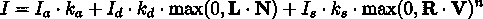

# C++ 高级编程：构建高性能应用指南


## 6.7 内存优化的最佳实践


### 10.3.8 迭代器使用与适配总结
### 10.6 STL 分配器的作用
## 10.7 使用 STL 的最佳实践


我们相信，此书将成为提升你 C++ 编程能力的宝贵资源，并支持你构建不仅高性能而且具有可维护性和可扩展性的应用程序。事实上，精通 C++ 及其高级特性将使你能够自信地应对复杂的软件开发挑战。
C++ 通过其各个标准的版本的演进带来了显著的增强，使其成为软件开发中更强大的工具。被称为 `C++11` 的标准于 2011 年 8 月正式通过，引入了一系列旨在提高性能、安全易用性的新功能。随后的标准包括 `C++14`、`C++17` 和 `C++20`，它们在此基础上的基础上不断发展，进一步完善了语言的能力。本节对从 `C++11` 开始引入的关键特性进行了深入探索，阐明了它们如何增强编程效率并为现代软件开发做出贡献。

    ConcreteIterator(const std::vector<int>& coll) : collection(coll) { }
    bool hasNext() const override {
        return position < collection.size();
    }
    int next() override {
        return collection[position++];
    }
};
// Aggregate to create the ConcreteIterator class
class Aggregate {
private:
    std::vector<int>collection;
public:
    void add(int value) {
        collection.push_back(value);
    }
    std::unique_ptr<Iterator>createIterator() const {
        return std::make_unique<ConcreteIterator>(collection);
    }
};
int main() {
    Aggregate aggregate;
    aggregate.add(1);
    aggregate.add(2);
    aggregate.add(3);
    auto iterator = aggregate.createIterator();
    while (iterator->hasNext()) {
        std::cout << iterator->next() << " ";
    }
    return 0;
}
```

`Iterator` 模式的优势同样在于将系统从繁的依赖中释放出来，支持对现有和新集合类型进行迭代，且都通过一致的接口进行管理。这种设计模式对迭代逻辑的隔离促进了更整洁、更易维护的代码库，其中容器的复杂性被隐藏起来，在列表、数组、树和其他数据结构中起着重要作用，但需要对多个相互关联的迭代进行仔细处理。


`State` 模式允许对象在内部状态改变时修改其行为，看起来就像改变了类类。

```cpp
#include <iostream>
#include <memory>
// State Interface
class State {
public:
    virtual void handleRequest() const = 0;
    virtual ~State() = default;
};
// Context managing state switch
class Context;
// Concrete States implementing behavior
class ConcreteStateA : public State {
public:
    void handleRequest() const override {
        std::cout << "ConcreteStateA is handling request.\n";
    }
    static void changeState(std::shared_ptr<Context>context);
};
class ConcreteStateB : public State {
public:
    void handleRequest() const override {
        std::cout << "ConcreteStateB is handling request.\n";
    }
    static void changeState(std::shared_ptr<Context>context);
};
// Context class holding the State
class Context : public std::enable_shared_from_this<Context>{
private:
    std::shared_ptr<State>currentState;
public:
    Context() : currentState(std::make_shared<ConcreteStateA>()) { }
    void setState(std::shared_ptr<State>state) {
        currentState = state;
    }
    void request() const {
        currentState->handleRequest();
    }
};
void ConcreteStateA::changeState(std::shared_ptr<Context>context) {
    context->setState(std::make_shared<ConcreteStateB>());
}
void ConcreteStateB::changeState(std::shared_ptr<Context>context) {
    context->setState(std::make_shared<ConcreteStateA>());
}
int main() {
    auto context = std::make_shared<Context>();
    context->request(); // Handle with state A
    ConcreteStateA::changeState(context);
    context->request(); // Handle with state B
    ConcreteStateB::changeState(context);
    context->request(); // Back to state A
    return 0;
}
```

`State` 模式允许类根据上下文的变化改变其行为，这在有状态会话（如网络协议、解析器实现或 UI 组件状态转换）中至关重要。通过封装与状态对应的行为，可以提高模块化；然而，状态的过度激增需要健壮的组织以确保系统的扩展性和简单性。


模板方法（Template Method）在方法中创建算法的框架，将某些步骤的定义留给子类，同时允许预定义的结构重用。

```cpp
#include <iostream>
// 带有模板方法的基类
class AbstractClass {
public:
    void templateMethod() const {
        primitiveOperation1();
        primitiveOperation2();
    }
    virtual ~AbstractClass() = default;
protected:
    virtual void primitiveOperation1() const = 0;
    virtual void primitiveOperation2() const = 0;
};
// 重写操作的具体类
class ConcreteClass : public AbstractClass {
protected:
    void primitiveOperation1() const override {
        std::cout << "Primitive Operation 1 executed by ConcreteClass.\n";
    }
    void primitiveOperation2() const override {
        std::cout << "Primitive Operation 2 executed by ConcreteClass.\n";
    }
};
int main() {
    std::unique_ptr <AbstractClass>instance = std::make_unique<ConcreteClass>();
    instance->templateMethod();
    return 0;
}
```

模板方法模式通过允许子类重新定义关键步骤而不改变整体结构，确保了灵活性。这种结构设置适用于记录日志、基础行为初始化或 UI 框架渲染序列的应用，但必须在重写步骤的灵活性与保护的执行常量之间取得平衡。

行为模式在促进分布式对象之间的交互方面提供了深层的通用性，通过统一接口确保内聚性，实现动态程序流程图，并简化对象通信。在系统架构中深度整合这些模式，使开发者能够设计出具有明确职责和可预测行为的日益复杂、功能强大且适应良好的软件。随着集成场景的演进，这些模式提供的解决方案也将不断进化，持续关注职责委托、通信简化和动态适应。

## 3.5

## 在现实应用中实现模式

设计模式不仅仅是理论概念，它们是支撑现实解决方案架构的关键工具。在实际应用中成功实现设计模式涉及识别适用模式、理解它们的集成潜力，并将其应用于解决特定的架构挑战。本节深入了有效应用这些模式的策略，展示了它们的实用价值，并分析了如何利用它们来改进代码结构、可扩展性和维护效率。


在各种软件架构中采用设计模式具有许多优势，可以增强灵活性、促进代码重用并确保系统可扩展性。在实践中，选择合适的模式通常由当前问题的性质驱动。考虑因素必须涵盖问题领域的特定需求、设计需求的复杂性以及软件系统的预期周期。


考虑一个旨在向用户通知软件应用程序各种事件的通知系统。在这种场景下，利用观察者模式（Observer Pattern）是十分重要的。在这里，该模式允许系统的不同组件（观察者）订阅核心事件管理器（主题），从而在特定事件发生时接收通知。

```cpp
#include <iostream>
#include <vector>
#include <memory>
// 观察者接口类
class NotificationObserver {
public:
    virtual void update(const std::string &message) = 0;
    virtual ~NotificationObserver() = default;
};
// 邮件通知的具体观察者
class EmailNotification : public NotificationObserver {
public:
    void update(const std::string &message) override {
        std::cout << "Email notification: " << message << "\n";
    }
};
// 短信通知的具体观察者
class SMSNotification : public NotificationObserver {
public:
    void update(const std::string &message) override {
        std::cout << "SMS notification: " << message << "\n";
    }
};
// 主题接口类
class EventManager {
private:
    std::vector<std::shared_ptr<NotificationObserver>> observers;
public:
    void subscribe(std::shared_ptr <NotificationObserver>observer) {
        observers.push_back(observer);
    }
    void unsubscribe(std::shared_ptr<NotificationObserver>observer) {
        observers.erase(remove(observers.begin(), observers.end(), observer), observers.end());
    }
    void notify(const std::string &message) {
        for (const auto &observer : observers) {
            observer->update(message);
        }
    }
};
// 使用
int main() {
    std::shared_ptr <EventManager>eventManager = std::make_shared<EventManager>();
    std::shared_ptr <NotificationObserver>emailObserver = std::make_shared<EmailNotification>();
    std::shared_ptr <NotificationObserver>smsObserver = std::make_shared<SMSNotification>();
    eventManager->subscribe(emailObserver);
    eventManager->subscribe(smsObserver);
    eventManager->notify("A new event has occurred.");
    return 0;
}
```

这种简单的实现使得通知系统变得健壮且灵活，允许在不改变核心逻辑的情况下动态添加或删除不同的通知类型。在现实应用中，此类系统可以扩展以支持额外的通知通道，或通过优先级处理进行增强。


软件系统通常需要结合使用多种模式来解决多维设计需求。例如，开发 Web 应用程序可能受益于结合工厂方法模式（Factory Method Pattern）来创建请求处理器，以及使用装饰器模式（Decorator Pattern）进行分层中间件处理。这种集成促进了 Web 请求处理的组合方法，允许在对核心逻辑干扰最少的情况下实现可扩展的功能。

```cpp
#include <iostream>
#include <memory>
#include <functional>
// 使用工厂方法的请求处理器处理器
class RequestHandler {
public:
    virtual void handleRequest() const = 0;
    virtual ~RequestHandler() = default;
};
class GetRequestHandler : public RequestHandler {
public:
    void handleRequest() const override {
        std::cout << "Handling GET Request\n";
    }
};
class PostRequestHandler : public RequestHandler {
public:
    void handleRequest() const override {
        std::cout << "Handling POST Request\n";
    }
};
// 用于请求日志的装饰器
class RequestLogger : public RequestHandler {
private:
    std::shared_ptr <RequestHandler>handler;
public:
    RequestLogger(std::shared_ptr <RequestHandler>handler) : handler(handler) {}
    void handleRequest() const override {
        std::cout << "Logging request...\n";
        handler->handleRequest();
    }
};
// 创建处理器的工厂方法
class RequestHandlerFactory {
public:
    std::shared_ptr <RequestHandler>createHandler(const std::string &type) {
        if (type == "GET") {
            return std::make_shared<GetRequestHandler>();
        } else if (type == "POST") {
            return std::make_shared<PostRequestHandler>();
        }
        return nullptr;
    }
};
int main() {
    RequestHandlerFactory factory;
    std::shared_ptr <RequestHandler>handler = factory.createHandler("GET");
    std::shared_ptr <RequestHandler>loggedHandler = std::make_shared<RequestLogger>(handler);
    loggedHandler->handleRequest();
    return 0;
}
```


此示例演示了如何通过组合模式来增强功能，同时保持代码的简单性和扩展性。可以添加或修改中间件而不影响主请求处理机制，从而实现灵活性，这对于不断演进的项目或预期快速推出功能的初创公司特别有益。


电子商务平台经常展示设计模式的力量，它需要从支付处理、动态产品目录到用户行为分析等多样化功能。在这里，我们探索了此类系统中涉及`策略模式`和`状态模式`的一个说明性用用例。

在电子商务背景下，`策略模式`可以通过根据促销活动或客户群体动态选择定价算法，来简化折扣计算机制。

```cpp
#include <iostream>
#include <memory>
// Strategy Interface class
class DiscountStrategy {
public:
    virtual double calculateDiscount(double price) const = 0;
    virtual ~DiscountStrategy() = default;
};
// Concrete Strategy for Christmas discount
class ChristmasDiscount : public DiscountStrategy {
public:
    double calculateDiscount(double price) const override {
        std::cout << "Applying Christmas Discount.\n";
        return price * 0.80; // 20% discount
    }
};
// Concrete Strategy for Black Friday discount
class BlackFridayDiscount : public DiscountStrategy {
public:
    double calculateDiscount(double price) const override {
        std::cout << "Applying Black Friday Discount.\n";
        return price * 0.70; // 30% discount
    }
};
// Context class
class PricingContext {
private:
    std::shared_ptr<DiscountStrategy>strategy;
public:
    void setStrategy(std::shared_ptr<DiscountStrategy> strat) {
        strategy = strat;
    }
    double applyDiscount(double price) const {
        return strategy->calculateDiscount(price);
    }
};
int main() {
    PricingContext context;
    context.setStrategy(std::make_shared<ChristmasDiscount>());
    double discountedPrice1 = context.applyDiscount(100);
    std::cout << "Discounted price for Christmas: " << discountedPrice1 << "\n";
    context.setStrategy(std::make_shared<BlackFridayDiscount>());
    double discountedPrice2 = context.applyDiscount(100);
    std::cout << "Discounted price for Black Friday: " << discountedPrice2 << "\n";
    return 0;
}
```

在这种模型中，可以尝试不同的定价策略，而无需高昂的重构成本，从而有助于根据市场状况的快速适应能力。

`状态模式`支持购物车管理，通过状态驱动的转换动态响应客户操作（如添加商品或结账操作）。

```cpp
#include <iostream>
#include <memory>
// State Interface class
class CartState {
public:
    virtual void addProduct() = 0;
    virtual void checkout() = 0;
    virtual ~CartState() = default;
};
// Context for holding State
class ShoppingCart;
// Concrete State for empty cart
class EmptyState : public CartState {
public:
    void addProduct() override {
        std::cout << "Adding first product to cart.\n";
        // Transition to non-empty state.
    }
    void checkout() override {
        std::cout << "Checkout not possible. Cart is empty.\n";
    }
};
// Concrete State for non-empty cart
class NonEmptyState : public CartState {
public:
    void addProduct() override {
        std::cout << "Adding more products to cart.\n";
    }
    void checkout() override {
        std::cout << "Proceeding to checkout.\n";
        // Transition to checked-out state.
    }
};
class ShoppingCart {
private:
    std::shared_ptr<CartState>currentState;
public:
    ShoppingCart() : currentState(std::make_shared<EmptyState>()) {
    }
    void setState(std::shared_ptr<CartState>state) {
        currentState = state;
    }
    void addProduct() {
        currentState->addProduct();
    }
    void checkout() {
        currentState->checkout();
    }
};
int main() {
    ShoppingCart cart;
    cart.addProduct();
    cart.checkout();
    return 0;
}
```

该模式通过优雅地处理转换来支持购物车场景，例如从空购物车移动到已商品状态，然后准备结账。它简化了跨平台（Web 或移动端）复杂用户体验路径的处理，确保了一致且流畅的交互。


模式并不是盲目应用的单一模板，而是最适用于特定场景的深思熟虑的方法。高级理解来自反思实践：

**过度使用模式**：不应使解决方案复杂化。每个模式都应该自然地受益并简化特定需求，而不是在没有理由的情况下应用。

**过度优化**：使用模式进行过早优化可能会增加复杂性和维护挑战，而没有即时收益。

**可扩展性理解**：应该通过独立模式的关联来正确处理扩展性，促进更丰富、互联的系统，而不是遵循一套僵化的架构规则。

**测试复杂性**：模式的引入通常需要更精细的测试策略，以适应它们引入的额外间接层和逻辑层。

在实际应用中实现设计模式，软件架构师不仅实现了即的功能收益，还通过代码架构实现了长期可持续。通过策略性部署，模式赋予的不仅仅是系统对象，而是系统作为一个能够随行业变化演变的整体有机体。它们对解耦、重用和扩展性的关注，长期以来被认为是形成稳健、面向未来且充满凝聚力和目的的生态系统的基础元素。

## 3.6

## 设计反模式与代码气味

设计模式旨在提供增强软件系统灵活性、效率和维护性的解决方案。然而，不当应用这些模式会导致反模式和代码气味，表明代码结构存在更深层次的问题。在追求整洁、有效且持续的设计时，理解这些陷阱至关重要。本节探讨了反模式和代码气味的概念，提供了识别它们以及发生时重构的策略。


反模式是对反复问题的常见反应，通常是适得其反的，往往会导致糟糕的编程实践和次优解决方案。与设计模式不同，反模式是无效的解决方案，它们并没有解决根本问题，最多推迟问题，最坏会恶化问题。开发者（特别是经验较少的开发者）可能在这些问题对可用性和系统性能产生负面影响之前无法识别出它们。

反模式的示例涉及许多失误，例如过度使用 `Singleton` 进行全局访问，这可能被视为状态共享的捷径，但会导致单元测试和并发编程的困难。其他常见的反模式包括：

**金锤（Golden Hammer）**：始终如一地应用熟悉的工具或模式，无论其是否适用于当前的问题。

**上帝对象（God Object）**：试图在一个对象中集中或容纳过度职责，导致模块化程度显著降低。

**面条代码（Spaghetti Code）**：由于缺乏结构和模块化，代码复杂、纠缠，难以维护和测试。

**船锚（Boat Anchor）**：保留系统不再使用或需要的必要代码、方法或库。


代码异味是代码库中深层问题的表面指示。它们不是错误或缺陷，而是暗示设计存在弱点或效率低下的模式。代码异味需要更仔细的检查，通常指向系统中反模式的出现或潜在的改进区域。常见的代码异味包括：

- **重复代码**：在多处复制的代码，会导致维护性问题并增加错误几率。
- **长方法**：过长的方法会掩盖意图并使代码变得难以理解，通常意味着缺乏适当的模块化。
- **大类**：具有过多职责或功能的类，直接推断出其违反了单一责任原则。
- **长参数列表**：需要过多参数的方法，通常意味着可以更好地采用封装技术。

及早识别这些异味允许我们进行主动的重构工作，从而提高代码库的质量和健壮性。


让我们来看一些代码示例，以说明一些常见的反模式和潜在的重构策略。

当一个对象承担了过度职责时，就会产生“上帝对象（God Object）”反模式：

```cpp
#include <iostream>
#include <vector>
#include <string>
// 反模式：处理多个角色的上帝对象
class GodObject {
public:
    void saveFile(const std::string &filename) {
        std::cout << "Saving file: " << filename << "\n";
    }
    void sendEmail(const std::string &email, const std::string &content) {
        std::cout << "Sending email to: " << email << " with content: " << content << "\n";
    }
    void generateReport(const std::vector <string>&data) {
        std::cout << "Generating report from data.\n";
    }
    // 随着类的演进，添加更多无关的任务...
};
int main() {
    GodObject god;
    god.saveFile("report.txt");
    god.sendEmail("example@example.com", "Hello World");
    god.generateReport({"data1", "data2"});
    // 上帝对象集中了太多互不相关的任务
    return 0;
}
```

这种反模式可以通过遵循单一责任原则，将职责分解为更专门的类来重构：

```cpp
#include <iostream>
#include <vector>
#include <string>
// 重构：具有专注职责的专门类
class FileSaver {
public:
    void save(const std::string &filename) {
        std::cout << "Saving file: " << filename << "\n";
    }
};
class EmailSender {
public:
    void send(const std::string &email, const std::string &content) {
        std::cout << "Sending email to: " << email
                  << " with content: " << content << "\n";
    }
};
class ReportGenerator {
public:
    void generate(const std::vector <string>&data) {
        std::cout << "Generating report from data.\n";
    }
};
int main() {
    FileSaver fileSaver;
    EmailSender emailSender;
    ReportGenerator reportGenerator;
    fileSaver.save("report.txt");
    emailSender.send("example@example.com", "Hello World");
    reportGenerator.generate({"data1", "data2"});
    // 重构后的设计分离了职责
    return 0;
}
```


重构是在不改变现有代码行为的情况下重组现有计算机代码的过程，对于消除反模式和纠正代码异味至关重要。有效的重构涉及几种策略：

- **封装**：隐藏内部状态和代码实现的细节，只暴露必要的内容。
- **分解**：将方法和类分解为更小、更易管理的部分，遵循单一责任原则 (SRP)。
- **模块化**：将相关功能分组到内心的模块或类中，专注于减少依赖。
- **DRY 原则（不要重复自己）**：通过抽象通用功能鼓励代码重用，从而消除重复代码。
- **利用设计模式**：深思应用设计模式以提供稳固的结构并解决特定的设计挑战。

继续关注封装和分解的示例，我们重构一个“面条代码（Spaghetti Code）”反模式场景。

```cpp
#include <iostream>
// 面条代码示例：多个相互交织的职责
void processData(int* data, int size) {
    // 计算总和和平均值
    int sum = 0;
    for (int i = 0; i < size; ++i) {
        sum += data[i];
        if (data[i] > 100) { // 高值告警
            std::cout << "Value over 100: " << data[i] << std::endl;
        }
    }
    std::cout << "Sum: " << sum << ", Average: " << sum / size << std::endl;
}
int main() {
    int data[] = {10, 200, 30};
    processData(data, 3);
    return 0;
}
```

面条代码中经常遇到的初始纠操作被解耦为细粒度的方法，增强了可读性和维护性：

```cpp
#include <iostream>
#include <vector>
class DataProcessor {
public:
    void process(const std::vector<int>& data) {
        printSumAndAverage(data);
        alertHighValues(data);
    }
private:
    void printSumAndAverage(const std::vector<int>& data) {
        int sum = 0;
        for (const int &d : data) {
            sum += d;
        }
        std::cout << "Sum: " << sum << ", Average: " << sum / data.size() << std::endl;
    }
    void alertHighValues(const std::vector<int>& data) {
        for (const int &value : data) {
            if (value > 100) {
                std::cout << "Value over 100: " << value << std::endl;
            }
        }
    }
};
int main() {
    std::vector<int>data = {10, 200, 30};
    DataProcessor processor;
    processor.process(data);
    return 0;
}
```


对抗反模式和消除代码异味需要培养警觉的编码习惯、进行代码审查并利用自动化工具来提高检测准确性。从业人员可以通过持续提倡使用设计模式来确保模块化、可持续性和扩展性，同时保持敏捷——准备好适应并重构代码以应对实际的系统演进。

- **持续集成与测试**：启用彻底验证，以确保所应用的重构不会破坏系统的完整性。
- **代码审查实践**：鼓励同行评审以验证设计决策，重点关注识别和纠正新出现的反模式。
- **强调简单性**：追求优先考虑清晰和简单的优雅解决方案，减少过度工程的风险。
- **培训与意识**：培养促进持续学习以及对反模式和代码异味意识的文化。

通过对反模式保持警惕并主动处理代码异味，开发者可以维护更清洁、更可靠且灵活的代码库。这些努力为系统不仅满足当前需求，还能适应未来需求铺平了道路，而这些基础是于高质量的设计原则。

## 3.7

## 高级模式技术

设计模式是软件架构中的基础工具。随着系统演进变得更加复杂和分布式，引入高级模式技术的需求变得至关重要。高级技术扩展了经典设计模式，处理并发、性能优化以及多个模式的无缝集成，以应对多方面的设计挑战。这种深度探索涵盖了这些高级技术，为创建弹性、可扩展且易于维护的系统提供了见解。


并发模式是用于管理并行进程和数据流的架构蓝图，特别是在多线程环境中。传统的并发问题涉及复杂的挑战，例如竞态条件、死锁和资源竞争。高级并发模式通过提供稳健的抽象和机制，确保跨线程的一致性、同步行为，从而解决了这些挑战。

并发执行的任务需要有效使用模式：

-   **生产者-消费者模式 (Producer-Consumer Pattern)**：管理生产数据任务与消费数据任务之间的数据流，通常使用队列实现。
-   **Future 模式 (Future Pattern)**：代表异步计算的结果，确保非阻塞操作。
-   **线程池模式 (Thread Pool Pattern)**：管理一组可重用的线程，旨在减少与线程创建/销毁相关的开销。
-   **反应器模式 (Reactor Pattern)**：处理在共享通道上多路复用的服务请求，常见于网络事件处理系统。

## 示例：实现生产者-消费者模式

生产者-消费者模式是一个用于线程间通信和同步的经典示例：

```cpp
#include <iostream>
#include <thread>
#include <queue>
#include <mutex>
#include <condition_variable>
std::queue <int>queue; 
std::mutex mtx; 
std::condition_variable cv; 
bool finished = false; 
void producer(int n) { 
    for (int i = 0; i < n; ++i) { 
        std::unique_lock <mutex>lock(mtx); 
        queue.push(i); 
        std::cout << "Produced: " << i << "\n"; 
        cv.notify_all(); // 通知消费者 
    } 
    // 通知生产已完成 
    std::unique_lock <mutex>lock(mtx); 
    finished = true; 
    cv.notify_all(); 
} 
void consumer() { 
    while (true) { 
        std::unique_lock <mutex>lock(mtx); 
        cv.wait(lock, [] { return !queue.empty() || finished; }); 
        while (!queue.empty()) { 
            int value = queue.front(); 
            queue.pop(); 
            std::cout << "Consumed: " << value << "\n"; 
        } 
        if (finished && queue.empty()) break; 
    } 
} 
int main() { 
    std::thread t1(producer, 10); 
    std::thread t2(consumer); 
    t1.join(); 
    t2.join(); 
    return 0; 
}
```

该模式允许创建数据的生产者与需要数据的消费者之间进行分离，并使用由 `mutexes` 和 `condition_variables` 保护的线程队列来实现同步访问。这种方法有助于任务调度、事件处理和服务器请求处理等场景，从而提升了吞吐量和性能。


Future 模式结合 `Promise`，解决了异步计算环境中阻塞操作带来的效率挑战：

```cpp
#include <iostream>
#include <future>
// 异步计算阶乘的函数
int factorial(int n) { 
    int result = 1; 
    for (int i = 2; i <= n; ++i) { 
        result *= i; 
    } 
    return result; 
} 
int main() { 
    std::future <int>futureResult = std::async(std::launch::async, factorial, 5); 
    std::cout << "Doing other tasks while waiting for the async result...\n"; 
    int result = futureResult.get(); // 从 future 获取结果 
    std::cout << "Factorial result is: " << result << "\n"; 
    return 0; 
}
```

使用 `futures` 和 `promises` 可以通过非阻塞调用、资源共享和利用并行计算能力来显著优化应用程序。它们在图形计算、UI 更新和网络通信等许多领域都有用，这些领域延迟或阻塞会严重影响性能。


在采用云原生和分布式架构时，微服务 (`Microservices`) 和 `命令查询职责分离 (CQRS)` 等模式变得日益重要：

-   **微服务架构 (Microservices Architecture)**：一种系统设计的模块化方法，一组小型、独立部署的服务协作工作。每个服务都封装了业务能力，拥有自己的数据库，并利用轻量级通信协议（如 `HTTP/REST` 或消息系统）进行服务间交互。
-   **CQRS 模式 (CQRS Pattern)**：将数据读写职责分离到不同的模型中，增强了灵活性、扩展性并分离了数据管理的逻辑方面。

微服务和 CQRS 架构的同步和异步特性允许系统以更高的效率管理规模：

-   **可扩展性 (Scalability)**：服务可以根据负载独立扩展，优化资源利用并降低成本。
-   **韧性 (Resilience)**：故障隔离有助于在不干扰整个系统的情况下提供一致的服务。
-   **可部署性 (Deployability)**：独立的服务简化了持续部署和集成。

例如，云端电子商务应用程序可能利用 `microservices` 进行用户管理、库存跟踪和订单处理，同时 `CQRS` 帮助将读密集型目录交互与以命令为中心的订单放置分离。


复杂的问题通常需要多种模式的交响融合以创建一个凝聚且平衡的解决方案。`Adapter`、`Proxy` 和 `Observer` 等模式可以相互交织，分别用于动态请求、模块化插件框架和实时通知。

## 示例：构建模块化插件架构

考虑一种需要插件应用程序的场景，其中组件动态加载以扩展系统功能：

```cpp
#include <iostream>
#include <memory>
#include <vector>
#include <functional>
// 插件接口类
class Plugin { 
public: 
    virtual void execute() = 0; 
    virtual ~Plugin() = default; 
}; 
// 具体实现插件 1 类
class Plugin1 : public Plugin { 
public: 
    void execute() override { 
        std::cout << "Executing Plugin1...\n"; 
    } 
}; 
// 具体实现插件 2 类
class Plugin2 : public Plugin { 
public: 
    void execute() override { 
        std::cout << "Executing Plugin2...\n"; 
    } 
}; 
// 插件管理器（使用工厂方法加载插件）
class PluginManager { 
private: 
    std::vector<std::shared_ptr<Plugin>> plugins; 
public: 
    void loadPlugin(std::shared_ptr<Plugin> plugin) { 
        plugins.push_back(plugin); 
    } 
    void activatePlugins() { 
        for (const auto& plugin : plugins) { 
            plugin->execute(); 
        } 
    } 
}; 
int main() { 
    PluginManager manager; 
    manager.loadPlugin(std::make_shared<Plugin1>()); 
    manager.loadPlugin(std::make_shared<Plugin2>()); 
    // 激活所有加载的插件 
    manager.activatePlugins(); 
    return 0; 
}
```

在此示例中，多模式方法利用 `Factory Methods` 进行插件实例化，并使用中心化管理系统来实现无缝的运行时扩展。这种组合允许在不需要进行复杂的代码重构的情况下提供定制解决方案，是现代软件开发的一项重要策略。


实现这些高级技术需要意识到不断演变的软件范式和系统需求的动态性的思维。关键考虑因素包括：

-   **影响分析 (Impact Analysis)**：优先理解引入模式对现有代码库和工作流的影响。
-   **维护开销 (Maintenance Overhead)**：在考虑未来转型和系统演化的同时，平衡模式收益与潜在的维护复杂性。
-   **模式定制 (Pattern Customization)**：根据特定项目的独特需求和语境量定制模式，而不是目照照搬。
-   **可扩展性策略 (Scalability Strategies)**：评估模式如何促进水平和垂直扩展，确保它们与云解决方案稳健集成。


利用高级模式技术要求开发者具备适应性，在结构与灵活性之间取得平衡，并创新地解决复杂的架构挑战。这些方法推向了传统软件工程的边界，构建出既满足当前需求又能预见未来需求的解决方案。这些模式不仅在管理复杂性至关重要，对于培养协作生态系统也同样关键，让不同的组件能够在快速演变的技术版图中相互作用。

# 第 4 章

## 模板与元编程

本章探索了 C++ 中模板和元编程的强大特性。它涵盖了函数模板和类模板的基础，并扩展到模板特化和重载。文中研究了用于处理变参数列表的变长模板，并深入探讨了用于编译时计算的元编程。此外，讨论了使用 `std::tuple` 和 `type traits` 进行高级类型操作的方法，引入了 `SFINAE` 和模板约束来控制模板实例化，为开发者编写泛型且高效的代码提供了复杂的工具。

### 4.1 熟掌握模板基础

在 C++ 编程中，模板是一项强大且复杂的特性，允许程序员编写泛型且可重用的代码。模板引入了抽象层，促进了诸如泛型编程等编程范式。理解模板的基础（包括函数模板和类模板）是优化代码开发和实现的基础技能 set。

模板实现了类型的参数化，允许函数和类与泛型类型操作。这种机制在编写多功能且灵活的程序时，对于减少冗余和消除类型限制至关重要。熟练掌握 C++ 模板需要对其语法和实际应用有全面的理解。

函数模板允许定义可以可以处理任何数据类型的泛型函数。当同一种算法或逻辑需要应用于不同的数据类型（如整数、浮点数或用户定义类型）时，这种方法非常有用。定义函数模板的语法如下：

```cpp
template <typename T>
T max(T a, T b) { return (a > b) ? a : b; }
```

在此示例中，关键字 `template` 启动模板声明，其后的是 `<typename T>`，它指定了模板参数。使用此模板定义的函数 `max` 计算任何数据类型 `T` 的两个值之间的最大值。

当调用 `max` 函数时，编译器会自动从传入的参数中推导出数据类型：

```cpp
int main() {
    int a = 5, b = 10;
    double x = 3.14, y = 2.72;
    std::cout << "Larger between a and b: " << max(a, b) << std::endl;
    std::cout << "Larger between x and y: " << max(x, y) << std::endl;
}
```

`max` 函数会为使用的每个类型进行实例化，提供了在不改变代码核心逻辑的情况下管理多个数据类型所需的灵活性。

函数模板还可以包含非类型模板参数。这允许在类型参数的同时指定字面量（如整数或指针）：

```cpp
template <typename T, int size>
void printArray(const T(&array)[size]) {
    for (int i = 0; i < size; ++i) {
        std::cout << array[i] << " ";
    }
    std::cout << std::endl;
}
```

在这个模板中，`int size` 是一个指定数组大小非类型模板参数。当调用 `printArray` 时，类型和大小都会被推导。

类模板将泛型的概念扩展到类，允许定义可以与任何数据类型操作的模板类。类模板的声明遵循类似于函数模板语法：

```cpp
template <typename T>
class Pair {
private:
    T first, second;
public:
    Pair(T a, T b) : first(a), second(b) {}
    T getFirst() const { return first; }
    T getSecond() const { return second; }
};
```

在名为 `Pair` 的类模板中，模板参数 `T` 允许创建任何数据类型的对。这种灵活性的使用方式如下：

```cpp
int main() {
    Pair<int> intPair(1, 2);
    Pair<double> doublePair(3.14, 2.72);
    std::cout << "Int Pair: [" << intPair.getFirst() << ", " << intPair.getSecond() << "]" << std::endl;
    std::cout << "Double Pair: [" << doublePair.getFirst() << ", " << doublePair.getSecond() << "]" << std::endl;
}
```

`Pair` 的每次实例化随后都会产生一个分别管理整数对或双精度对的类。

类模板可能还涉及多个模板参数。这在涉及跨不同数据类型操作的场景中特别有利：

```cpp
template <typename K, typename V>
class MapEntry {
private:
    K key;
    V value;
public:
    MapEntry(K k, V v) : key(k), value(v) {}
    K getKey() const { return key; }
    V getValue() const { return value; }
};
```

在上述代码中，`MapEntry` 两个模板类型，允许管理键和值可能具有不同数据类型的键值对。这允许程序员在数据类型约束方面花费最少精力即可实现类似 map 的结构。

在模板的语境下，开发者经常忽略了模板提供的类型安全性和并发优势。模板通过提供稳健的编译时类型检查来强制类型安全。在模板实例化期间指定的参数是强类型的，减轻了由于类型不匹配引起的常见运行时错误。

此外，模板没有虚函数表的开销，因为它们在编译时就已经解析。这在并发环境中提供了效率优势，在并发环境中，运行时多态操作的开销可能会阻性能。由于模板减少了运行时检查和分发开销，它们本质上更适合设计高效、类型安全且可扩展的并发系统。

熟掌握模板基础的进一步优势在于它们在元编程中的适用性。模板促进了在编译时而非运行时进行的计算。这减少了运行时计算开销，并在某些情况下可以显著提高性能。

模板元编程是一个专门领域，涉及编译时算术、类型转换以及基于模板特化的条件编译路径进行决策的操作。虽然介绍性的模板函数和类可能不需要这些高级技术，但它们的基本原理为更复杂的元编程构造提供了基础。

随着实现和利用这些基础模板构造的技能增长，程序员可以越来越多地利用元编程的力量来开发出高度高效且优化的代码解决方案，并为特定应用程序和用例量身定制。通过将模板编程流练地集成到开发实践中，高性能应用程序的潜力仅限于程序员的创造力以及对语言复杂性的理解。

虽然模板非常强大，但它们也带来了独特的挑战，特别是关于编译时的复杂性。编译器必须为每个使用场景唯一地实例化模板，这可能导致编译时间增加。因此，在保持高效构建时间的同时，平衡使用模板以实现最大可重用性是非常关重要的。


此外，在模板实例化过程中产生的错误信息通常非常冗长且难以理解。这些错误通常源于错误的模板参数或预期与实际数据类型之间的不匹配。因此，对模板的使用进行尽的测试和验证，对于克服模板编程中经常遇到的晦涩编译错误至关重要。

管理这些挑战的实践实践包括使用清晰且文档良好的代码模式、进行定期测试，以及使用简洁、具说明性的示例在模板编码过程的早期验证假设和预期行为。意识到并遵循这些实践，可以使模板无缝地集成到复杂的真实世界应用中。

## ## 4.2 模板特化与重载

模板特化和重载是 C++ 模板编程的核心组成部分，作为处理特殊情况和扩展模板灵活性的机制。它们提供了针对特定数据类型或条件定制模板函数和类行为的能力，增强了它们在不同场景下的通用性和适用性。理解这些概念对于在高级 C++ 编程中有效利用模板至关重要。

### 模板特化

模板特化允许开发者在保持相同模板接口的同时，为特定数据类型指定不同的行为。C++ 中的模板特化主要有两种形式：完全特化和部分特化。

完全特化涉及为特定类型定义模板的完全特化版本。考虑以下示例，其中一个计算绝对值的通用类模板有一个针对浮点数类型的特化版本：

```cpp
template <typename T>
class AbsoluteValue {
public:
    static T value(T number) {
        return (number < 0) ? -number : number;
    }
}; //  double 的完全特化
template<>
class AbsoluteValue<double> {
public:
    static double value(double number) {
        // 针对浮点精度问题的特殊处理
        return std::fabs(number);
    }
};
```

在此示例中`AbsoluteValue` 模板类针对 `double` 进行了特化以使用 `std::fabs()`，这正确处理了浮点精度问题。实现上的差异确保了浮点数的正确行为，而不会影响其他类型。

部分特化提供了一种在部分模板参数需要区分时对模板进行特化的机制。这对于具有多个参数的类模板特别有用。一个展示指针部分特化对的示例所示：

```cpp
template <typename T1, typename T2>
class Pair {
    T1 first;
    T2 second;
public:
    Pair(T1 f, T2 s) : first(f), second(s) {}
    T1 getFirst() const { return first; }
    T2 getSecond() const { return second; }
}; // 指针类型的部分特化
template <typename T1, typename T2>
class Pair<T1*, T2*> {
    T1* first;
    T2* second;
public:
    Pair(T1* f, T2* s) : first(f), second(s) {}
    T1* getFirst() const { return first; }
    T2* getSecond() const { return second; }
    void displayPointers() const {
        std::cout << "Pointer addresses: " << first << ", " << second << std::endl;
    }
};
```

`Pair` 类模板针对指针类型进行了部分特化。这种定制化纳了独特的操作，例如处理指针算术或显示指针值。

### 模板重载

在模板背景下，重载是指定义具有相同名称但参数类型或模板参数不同的多个模板或非模板函数或方法。这种技术允许开发者通过单一接口来适应各种用例。

考虑以下重载模板函数以执行计算的场景：

```cpp
template <typename T>
T multiply(T a, T b) {
    return a * b;
} // 针对数组的重载
template <typename T>
T multiply(T* a, T* b, int size) {
    T product = 0;
    for (int i = 0; i < size; ++i) {
        product += a[i] * b[i];
    }
    return product;
}
```

`multiply` 函数被重载以同时适应单值和数组。通用模板处理单值乘法，而数组重载则遍历元素以执行逐元素乘法。

此外，模板函数重载可以与普通函数重载无缝集成：

```cpp
int multiply(int a, int b) {
    return a * b;
}
template <typename T>
T multiply(T a, T b) {
    return a * b;
}
```

在这种情况下，编译器根据函数参数选择最匹配的函数。对于整数，选择非模板版本；而对于其他类型，由模板版本处理该操作。

### 实现细节与编译器行为

模板特化和重载的实现本质上涉及关于编译器行为的细微考虑。一个关键方面是理解编译器如何在不同的模板和非模板函数或类之间进行选择。

对于模板重载，编译器检查函数或类签名和类型可推导性以确定最合适的选择。模板参数推导在此决策中起着重要作用，编译器会将提供的参数派出的类型与模板内显式声明的类型进行比较。

在使用完全或部分特化时，这些特化必须在使用之前定义。此外，虽然特化是一种强大的工具，但如果管理不当（由于为每个特化生成代码，可能会导致代码膨胀。

### 效率考虑与高级模式

特化和重载通过允许对特定类型的执行路径进行更精确的控制来提高性能效率。这种粒度确保了操作针对应用程序上下文相关的条件进行了优化，从而节省计算资源。

对于高级使用模式，标签分发（tag dispatching）和 SFINAE（替换失败不是错误）等技术变得至关重要。标签分发利用标签类来引导哪个重载或特化是执行的候选者，简化了类型特定逻辑的处理。标签分发的一个示例可能如下：

```cpp
struct GeneralTag {};
struct SpecialTag {};

template <typename T>
void process(T t, GeneralTag) {
    std::cout << "Processing general type." << std::endl;
}
template <typename T>
void process(T t, SpecialTag) {
    std::cout << "Processing special type." << std::endl;
}
template <typename T>
void execute(T t) {
    // 根据某些条件选择标签
    process(t, GeneralTag());
}
```

SFINAE 利用模板替换失败不是错误的特性来排除无效候选者，进一步有助于管理模板重载：

```cpp
template <typename T>
auto testFunc(T t) -> decltype(t.begin(), void()) {
    std::cout << "This type has begin() method." << std::endl;
}
template <typename T>
void testFunc(...) {
    std::cout << "Fallback for types without begin() method." << std::endl;
}
```

通过这种机制，如果传递给 `testFunc` 的类型没有 `begin` 方法，则将选择备用负载而不会引发编译错误，这体现了 SFINAE 提供的强大和灵活性。


考虑到实际应用场景，模板特化和重载极大简化了真实应用中健壮代码的。示例包括在 `C++` 容器模板中集成自定义分配器，以及设计带有条件逻辑的多态接口，以确保为不同的数据结构提供高效且特化的行为。

这种复杂性提升了代码的可维护性和可扩展性，允许开发者在不改变底层通用设计的情况下，通过更具体的操作来扩展库或框架。

在实践中，管理特化或重载需要细致的设计，既要满足当前需求，又要考虑到未来的扩展。在特化的灵活性与潜在的代码膨胀或维护性挑战之间取得平衡至关重要。使用清晰、文档良好的模式并保持模板参数命名的一致性，有助于构建整洁、易懂的代码库。

开发者应该不断评估语言标准的演和社区驱动的最佳实践，以便将高级模板编程、特化和重载技术无缝集成到生产环境中。凭借专业知识，掌握这些组件构成了高性能、模板化 `C++` 系统的骨干，是现代软件设计范式不可或缺的一部分。

### 4.3

### 变长模板与参数包

`C++` 中的变长模板和参数包引入了处理任意数量模板参数的能力，深刻地扩展了模板编程的灵活性和威力。充分利用这些特性可以创建高度通用且可重用的代码结构，而无需重复重载或特殊处理，从而显著优化了代码库的可维护性和扩展性。

变长模板允许定义接受可变模板参数的函数和类。变长模板通过参数包实现，通过启用能够适应任何数量类型的元编程结构，引入了数新层次的抽象。变长模板的语法涉及在类型名后引入省略号（`...`）来指示参数包：

```cpp
template <typename... args>
void printAll(Args... args) { 
    // Implementation
}
```

在此示例中，`Args...` 表示一个模板参数包，可以用零或多个模板参数进行实例化。

参数包代表传递给变长模板的参数集。解包这些包对于对每个参数执行操作至关重要。这可以通过递归模板展开或折叠表达式（fold expressions）来实现。

递归模板展开通过递归函数调用变变长模板来迭代处理每个参数：

```cpp
template <typename T>
void printLast(const T& last) {
    std::cout << last << std::endl;
} 

template <typename First, typename... Rest>
void printAll(const First& first, const Rest&... rest) {
    std::cout << first << ", ";
    printAll(rest...);  // Recursive unpacking
}
```

在这里，函数 `printAll` 通过递归调用自身来处理参数包 `Rest...` 中的每个元素，直到达到基础情况 `printLast`，该情况负责打印最后一个元素。

`C++17` 引入的折叠表达式为对参数包进行转换和归约操作提供了一种简洁的语法，而无需显式递归。折叠表达式通过语法构型简化了对变长模板参数的处理：

```cpp
template <typename... args>
auto sum(Args... args) {
    return (args + ...);  // Right fold
}
```

此示例计算了包中所有参数的和。表达式 `(args + ...)` 表示右折叠，通过连续应用 `+` 操作隐式地归约参数包。此外，通过语法 `(... + args)` 可以获得左折叠。

变长模板赋予了以往因类型适应性限制而受阻的各种编程构造。示例包括函数封装、日志系统和事件分发器，它们可以无缝处理不同的参数列表。

考虑一个通用的日志工具：

```cpp
enum class LogLevel { INFO, WARN, ERROR }; 

template <typename... args>
void log(LogLevel level, const Args&... args) {
    std::string prefix;
    switch (level) {
        case LogLevel::INFO:  prefix = "[INFO] "; break;
        case LogLevel::WARN:  prefix = "[WARN] "; break;
        case LogLevel::ERROR: prefix = "[ERROR] "; break;
    }
    std::cout << prefix;
    ((std::cout << args << " "), ...) << std::endl;  // Fold expression for unpacking
}
```

该工具利用变长模板和折叠表达式处理任意参数列表，记录具有不同数据类型的消息。

对于模板类，变长模板有助于根据包含的类型定义具有自定义行为的容器结构：

```cpp
template <typename... types>
class Variant {
private:
    std::variant<types...> data;
public:
    template <typename T>
    Variant(T&& value) : data(std::forward<t>(value)) {}
    void visit() const {
        std::visit([](auto&& arg) { std::cout << arg << " "; }, data);
    }
};
```

`Variant` 类持有一个由包 `Types...` 参数化的 `std::variant`，支持广泛的类型安全操作，无需显式的联合定义。

高级变长模板模式包括完美转发和编译时内省。完美转发利用 `std::forward` 结合变长模板在模板实例化过程中维持值类别——左值（lvalues）和右值（rvalues）：

```cpp
template <typename func, typename... args>
decltype(auto) invoke(Func&& func, Args&&... args) {
    return std::forward<func>(func)(std::forward<args>(args)...);
}
```

此 `invoke` 函数通过以传递的方式转发参数来保持特性，优化了涉及函数对象或具有副作用的 lambda 表达式的调用链。

对于编译时内省，变长模板支持基于特性的逻辑，允许从参数包中选择类型，这是元编程中的常用工具：

```cpp
template <typename T, typename... args>
constexpr bool is_integer_in_pack() {
    return std::disjunction_v<is_same<T, args>...>;
} // Usage: static_assert(is_integer_in_pack<int, double, float, int>(), "Int must be in the pack");
```

此示例实现了一种编译时检查，用于验证特定类型是否存在于变长参数列表中，利用了折叠逻辑的析取。


在真实的软件开发中，可变模板（variadic templates）和参数包简化了此前需要运行时多态的动态绑定场景。通过促进编译时多态，编译为特定的代码路径提高了效率，并通常减少了与经典多态接口相关的虚表运行时开销。

常见的用法模式包括：

- 事件系统：处理器可以使用统一的接口处理多种参数类型。
- 配置 API：能够适应许多参数和选项，而无需手动定义每个重载。
- 测试框架：通过参数化的数据驱动方法，动态支持多样化的测试用例和准则。

实际中的实现利用可变展开来简化 API 接口，从而大幅减少了样板代码并增强了代码库的健壮性。包括标准库本身在内的领先 C++ 库广泛利用这些模式，以提供泛化且高性能的工具。

为了满足现代对类型安全、高性能且适应性强的代码解决方案的需求，日益日益依赖于对可变模板和参数包的掌握。对理解这些构造的学习在创建可扩展、高效且易于维护的软件方面将产生丰报，以满足不断变化的行业标准和预期。通过对模板实例化和行为的细粒度控制，可变模板已成为精通 C++ 程序员工具箱中不可或缺的一部分。

### 4.4 使用元编程进行编译时编程

C++ 中的编译时编程和元编程利用模板和常量表达式在编译阶段实现计算和逻辑处理。这种能力通过将通常在运行时执行的计算和推导转移到编译领域，减少了运行时开销并增强了性能。对于旨在编写高效、类型安全和高性能应用程序的开发者来说，掌握这些概念至关重要。

元编程涉及编写生成或转换其他程序，通常利用语言特性在更高的抽象层次上工作。在 C++ 中，模板元编程（TMP）和常量表达式（`constexpr`）促进了这一过程，为泛型编程、程序优化和编译时言提供了强大的工具。

模板元编程使用 C++ 模板系统执行编译时计算。TMP 可以完成静态断言、类型转换和算法配置等任务。其基本概念依赖于模板实例化和特化，编译器在运行之前解析这些内容。

TMP 的一个经典示例是在编译时计算阶乘值：

```cpp
template <int n>
struct Factorial {
    static constexpr int value = n * Factorial<n - 1>::value;
};
// Base 情况的特化
template<>
struct Factorial<0> {
    static constexpr int value = 1;
};
```

在这里，`Factorial` 是一个递归模板，通过对基础情况的模板特化计算数字 `N` 的阶乘。该计算完全在编译时发生，结果存储在 `Factorial<n>::value` 中。

此类技术在必须使用编译时常量的情况下至关重要，减少了运行时计算，并可能避免了不变不变的运行时错误。

替换失败不是错误（SFINAE）是 C++ 模板的一个强大方面，用于元编程中以优雅的方式处理类型替换的失败，而不触发编译错误。SFINAE 允许根据检测到的类型属性或特征选择性地实例化模板。

使用 SFINAE，程序员可以设计作为编译时谓词的类型特质（type traits），以确认或拒绝某些类型特征的存在。例如，检查一个类型是否具有特定的成员函数：

```cpp
template<typename T, typename = std::void_t>
struct has_begin : std::false_type {};

template<typename T>
struct has_begin<T, std::void_t<decltype(std::declval<T>().begin())>> : std::true_type {};

// 使用示例
static_assert(has_begin<std::vector<int>>::value, "Vector should have a begin method");
static_assert(!has_begin<int>::value, "Int should not have a begin method");
```

在此实现中，如果类型 `T` 拥有 `begin()` 方法，则 `has_begin` 求值为 `true_type`；否则默认为 `false_type`。这种特质有助于编译时检查，从而告知后续组件的行为和编译路径。

元编程通常涉及操作类型以适应行为并强制特定类型的逻辑。C++ 标准库在`<type_traits>` 头文件中提供了一系列实用程序，简化了许多元编程操作。示例包括类型转换、特性检测和条件编译路径。

一个修改类型 `const` 或引用限定符的元程序可能像这样：

```cpp
template <typename T>
using remove_const_ref = std::remove_const_t<std::remove_reference_t<T>>;

// 使用示例
static_assert(std::is_same_v<remove_const_ref<int&>, int>, "Type should be int");
```

`remove_const_ref` 类型别名去除了 `const` 和引用限定符，提供了一种管理类型的整洁方式。

利用 C++ 内置工具，开发者可以更多地关注逻辑细节而非样板代码，提高代码的清晰性和维护性。

`constexpr` 饰符在 C++11 中引入并在后续标准中扩展，允许函数和变量在编译时进行求值。此功能通过在编译期间评估不可变表达式提升了性能，减少了对运行时计算的需求。

考虑一个检查数字是否为质数的 `constexpr` 函数：

```cpp
constexpr bool isPrime(int num, int i = 2) {
    if (num <= 2) return num == 2;
    if (num % i == 0) return false;
    if (i * i > num) return true;
    return isPrime(num, i + 1);
}

// 静态断言使用
static_assert(isPrime(7), "7 should be prime");
static_assert(!isPrime(8), "8 should not be prime");
```

使用此函数，质数检查对于指定了 `constexpr` 保证的输入会在编译时执行。

`constexpr` 进一步扩展到数据结构，允许其用于定义常量容器并促进编译时优化：

```cpp
struct Point {
    int x, y;
};
constexpr Point center{5, 5};

// 使用
constexpr int area = center.x * center.y;
static_assert(area == 25, "Area should be 25");
```

`constexpr` 的应用不仅限于平凡的计算。随着标准的演进，现代 C++ 允许在需要复杂逻辑的场景中使用 `constexpr`，包括循环和条件等控制结构，以及 C++20 开始的异常处理。

说明一个高级用用例：

```cpp
constexpr int fibonacci(int n) {
    if (n <= 1) return n;
    return fibonacci(n - 1) + fibonacci(n - 2);
}
static_assert(fibonacci(10) == 55, "10th Fibonacci number should be 55");
```

`fibonacci` 函数通过完全的编译时评估和断言计算斐波那契数，这对于性能关键的部分至关重要，例如涉及由斐波那契数列确定网格的图形渲染算法。

- **优化**：在编译时确定的执行路径根据静态可用信息排冗余或不需要的操作，显著减少了运行期间的计算开销。
- **类型安全**：静态断言和特质确保预期的类型和操作在代码执行之前符合预期行为，有效减少了运行时错误。
- **代码混淆**：在编译时生成复杂或优化的操作，可以控制专有算法或敏感逻辑的暴露。


灵活性：高级抽象有助于复杂设计模式的表达。库通常从这种灵活性中受益。

潜在的局限性和挑战包括：

-   调试的复杂性：元编程可能会产生晦涩的编译器信息和复杂的错误链，给调试过程带来挑战。
-   编译时间过长：某些操作可能会使编译程序变得复杂，导致编译时间增加，可能影响开发生产力。
-   可读性：由于抽象层级过高，过度使用会降低代码的可理解性。

有效使用编译时编程范式需要在灵活性与这些固有陷阱之间取得平衡。

在对高性能系统要求的垂直行业中，结合元编程的`Compile-Time Programming`（编译时编程）已成为设计高效解决方案的基石。高频交易、嵌入式系统和游戏引擎经常利用这些技术来充分利用系统的架构特性。

行业示例包括：

-   高频交易平台：推理延迟要求在编译时完成谓言转换。
-   游戏开发引擎：模板促进了图形渲染流水线的转换和优化，确保了最大的吞吐量和保真度。
-   嵌入式系统：元编程有效地优化了受处理能力或资源可用性限制的系统，缩小了二进制体积并提高了效率。

根于编译时计算的编程范式在性能、功耗和可靠性至关重要的环境中提供了决定性的优势。随着`C++` 语言标准的进步，编译时编程的进一步集成和简化巩固了其在各个领域的卓越地位。

利用编译时编程的卓越技能不仅能带来即时的性能收益，还能在新兴的计算领域锐化战略优势，真正地将`C++` 程序员从单纯的代码员转变为系统设计和优化的精通架构师。

### 4.5

### 使用 `std::tuple` 和模板工具类

`std::tuple` 类模板由 `C++11` 引入，是 `C++` 标准库提供的一种多功能容器，有助于将异构类型分组到单个对象中。这种抽象是 `std::pair` 的自然扩展，并为模板元编程技术增加了额外的灵活性和编程性。通过将 `std::tuple` 与类型特性（type traits）和标准算法等其他工具结合，开发者可以以前所未有的轻松方式构建复杂的数据结构、执行类型操作并管理多个结果处理。

### `std::tuple` 的基础

`std::tuple` 模板类聚合了多个元素，类型可能不同。容器的大小和类型可以通过在模板实例化并将元素列为参数来自定义。`std::tuple` 不对类型是原生的、用户定义的还是混合的进行限制，这使得可以将多个不同的数据类型无缝整合到单一逻辑分组中：

```cpp
#include <tuple>
#include <iostream>
#include <string>
int main() {
    std::tuple <int, double, std::string> myTuple(42, 3.14, "Hello");
    std::cout << "Integer: " << std::get<0>(myTuple) << std::endl;
    std::cout << "Double: " << std::get<1>(myTuple) << std::endl;
    std::cout << "String: " << std::get<2>(myTuple) << std::endl;
    return 0;
}
```

在这个示例中，`myTuple` 使用一个整数、一个双点数和一个字符串初始化。每个元素都可以通过 `std::get` 函数模板进行访问，该模板使用从零开始的索引。

在需要通过函数和算法返回、操作或传递多个相关数据的数据类型的情况下，`std::tuple` 可以极大地简化代码复杂度。这一概念扩展了 `std::pair`，支持任意数量的元素，而无需创建自定义结构。

### 高级 Tuple 操作

`std::tuple` 的灵活性将其能力扩展到简单的聚合之外。各种操作，如解包、访问和转换元素是编程编程范式范设计的设计的工具：

#### Tuple 操作与工具类

`C++14` 引入了 `std::make_tuple`、`std::tie` 和 `std::ignore`，增强了元组创建和元素管理：

```cpp
auto anotherTuple = std::make_tuple(1, "Text", 4.56);
int intVal;
double doubleVal;
std::tie(intVal, std::ignore, doubleVal) = anotherTuple;
std::cout << "Extracted values: " << intVal << ", " << doubleVal << std::endl;
```

在这里，`std::tie` 从 `anotherTuple` 中捕获值，`std::ignore` 指明某个元素不应绑定到任何变量。这些设施允许在保持元组完整性的同时进行高效的数据分解。

#### Tuple 比较与合并

`C++` 中的元组支持字典序比较运算符，如 `<`、`<=`、`>`、`>=` 和 `==`，因此能够用于容器类的语义上下文，例如排序：

```cpp
std::tuple <int, char> t1(1, 'a');
std::tuple <int, char> t2(2, 'z');
bool less = (t1 < t2); // true, 因为 1 < 2
```

此外，合并等高级元组操作可以通过工具函数实现。虽然标准没有直接支持，但这里有一个自定义工具的示例：

```cpp
template <typename... t1, typename... t2>
auto tuple_cat_custom(const std::tuple<t1...>& t1, const std::tuple<t2...>& t2) {
    return std::tuple_cat(t1, t2);
}
auto concatenated = tuple_cat_custom(std::make_tuple(1, 2.0), std::make_tuple('A', "text"));
```

### 使用元组进行模板元编程

在元编程中有效使用 `std::tuple` 为对类型进行编译时转换和分析提供了机会：

#### Tuple 类型与调用

为了提取或操作类型并评估函数一致性，使用了 `C++11` 的 `std::tuple_element`，如下所示：

```cpp
template <size_t n, typename Tuple>
using NthTypeOf = typename std::tuple_element<n, Tuple>::type;
using MyTupleType = std::tuple<int, double, std::string>;
NthTypeOf<2, MyTupleType> stringValue = "Example";
```

`NthTypeOf` 提取所需的类型，允许开发者将类型输入元函数、验证或条件编译。

#### 变长模板与参数包展开

Tuple 元素可以通过完美转发解包到函数调用，以保持其值属性：

```cpp
template <typename Func, typename Tuple, std::size_t... indices>
auto apply_impl(Func&& func, Tuple&& tuple, std::index_sequence<indices...>) {
    return func(std::get<indices>(std::forward<tuple>(tuple))...);
}
template <typename Func, typename Tuple>
auto apply(Func&& func, Tuple&& tuple) {
    constexpr std::size_t size = std::tuple_size<remove_reference_t<Tuple>>::value;
    return apply_impl(std::forward<Func>(func), std::forward<Tuple>(tuple), std::make_index_sequence<size>{});
}
auto sum = [](int a, double b, int c) { return a + b + static_cast<double>(c); };
auto result = apply(sum, std::make_tuple(1, 2.0, 3));
```

`apply` 示例演示了将元组元素作为参数调用函数，减少了代码重复并增加了灵活性。

#### 高级模板工具类

除了 `std::tuple` 之外，`C++` 丰富的标准库还包含了模板工具类，增强了模板能力的表达：

##### 类型特性与属性查询

使用 `<type_traits>`可以在编译时确定或转换类型的关键属性，从而优化代码路径并确保兼容性：


```cpp
#include <type_traits>
template <typename t="">
void process() {
    if constexpr (std::is_integral_v<t>) {
        std::cout << "Type T is integral." << std::endl;
    } else {
        std::cout << "Type T is not integral." << std::endl;
    }
}
process<int>(); // Output: Type T is integral.
process<double>(); // Output: Type T is not integral.
```

在这里，`std::is_integral` 验证类型 `T`，根据其 `constexpr` 求值结果激活相应的路径，这是控制编译时决策的一种高效手段。

### 在容器转换中的应用

将 `std::tuple` 与 `type traits`（类型特征）结合可以催化高级容器转换和操作：

```cpp
#include <vector>
template <typename... args="">
auto appendTypes(std::tuple<std::vector<args>...> vectors) {
    return (..., vectors.push_back(Args{}));
}
auto vectorTuple = std::make_tuple(std::vector<int>{}, std::vector<double>{});
appendTypes(vectorTuple);
std::cout << "Vector-Appended Sizes: " << std::get<0>(vectorTuple).size() << ", " << std::get<1>(vectorTuple).size() << std::endl;
```

此模板为 `tuple` 中包含的每个 `vector` 添加了一个默认构造的元素，展示了使用 `fold expressions`（折叠表达式）结合容器 `variadic templates`（变长模板）实现的强大容器转换。

### 性能影响与最佳实践

虽然 `std::tuple` 最大化了灵活性，但对性能和代码结构的仔细考虑至关重要。自动结构化和编译时检查的优势有时会被编译时间的增加和错误诊断复杂性的提高所抵消。为了缓解这些挑战：

- **高效访问**：直接访问（例如 `std::get<n>(tuple)`）通常比通过存储在 `tuples` 内部运行时索引进行访问更高效。
- **文档与命名**：在转换操作期间，为 `tuple` 元素使用有意义的命名，确保代码库的清晰可维护性。
- **平衡复杂度**：重叠的工具函数以及对复杂元模板构造的依赖，应当与代码的可读性和维护性保持平衡。

理解 `std::tuple` 结合 `template utilities`（模板工具）的基础及高阶用法，可以显著提升开发者在各种情况下产生自适应、可重用且高性能代码的能力。此外，掌握这些工具有助于对 `template programming`（模板编程）产生全面理解，鼓励更符合当前行业最佳实践的丰富创新编程设计。

鉴于 `std::tuple` 在现代 C++ 编程中的无缝集成和无处不在，其正确应用不仅确保了技术熟练，还确保了软件架构原则的战略卓越，推动开发者在动态的数字领域迈向新的解决方案。

### 4.6

### SFINAE 与模板约束

替换失败不是错误（SFINAE）和 `template constraints`（模板约束）是 C++ `template metaprogramming`（模板元编程）不可不可缺的部分，允许开发者引导模板函数和类的实例化与选择。这些构造促进了灵活且稳健的模板创建，能够对特定模板参数中应该或不应该存在的属性进行编译时检查。理解并有效应用 `SFINAE` 和 `constraints` 是编写表达力强、类型安全且高效的 C++ 代码的关键。

`SFINAE` 是一种允许 `template instantiation`（模板实例化）失败失败而不是引起编译错误的原则。

```cpp
template <typename T, typename = void>
struct has_resize : std::false_type {};

template <typename T>
struct has_resize<T, std::enable_t<decltype(std::declval<T&>().resize())>> : std::true_type {};
```

`has_resize` 结构体确定类型 `T` 是否具有 `resize` 成员函数。这利用 `SFINAE` 来选择正确的特化。

在 C++20 中，概念（concepts）引入了一种更具读性的方式来定义这些约束：

```cpp
#include <iostream>
#include <type_traits>
#include <vector>

template <typename t>
concept Printable = requires(T a) {
    std::cout << a;
};

template <class t>
concept Container = requires(T a) {
    { std::begin(a) } -> std::input_iterator;
    { std::end(a) } -> std::input_iterator;
};

template <printable t>
void print(const T& value) {
    std::cout << value << std::endl;
}

template <container t>
void printContainer(const T& container) {
    for (const auto& elem : container) {
        std::cout << elem << " ";
    }
    std::cout << std::endl;
}

// 使用
print(42); // 有效：int 是 Printable
printContainer(std::vector<int>{1, 2, 3}); // 有效：vector 支持迭代
```


健壮性：`template` 选择逻辑确保了模板实例化既经过深虑又是确定性的，在逻辑上防止了无效代码路径，且不会产生运行时开销。

简单性：使用任一方法的抽象元素消除了样板代码并简化了逻辑流，降低了认知负担。

一致性：标准化概念或已有的类型特性（type traits）有助于构建词法整洁的代码库，使其更具可维护性并便于团队增强。

总而言之，随着模板特化的演进，利用 `SFINAE` 和约束作为语言结构和程序化保障，创新的机会也随之增加。

`SFINAE` 与模板工具深度协作，对模板的实例化和使用方式实施精密的控制。与类型特性结合，`SFINAE` 大大增强了灵活性：

```cpp
#include <type_traits>
template <typename T>
constexpr bool is_hashable_v = requires (T a) {
    { std::hash<T>{}(a) } -> std::convertible_to<size_t>;
};
// Possible usage
template <typename T>
std::enable_if_t<is_hashable_v>, std::size_t> hash_value(const T& obj) {
    return std::hash<T>{}(obj);
}
```

在此代码段中，`is_hashable_v` 构建了一个哈希操作可用性的检查，而 `std::enable_if_t` 使用其输出来相应地激活或禁用 `hash_value` 的实例化。

这种元集成解决方案架构的形式展示了对 C++ 模板机制如何在逻辑和谐中统一的深度控制。

尽管功能强大，但 `SFINAE` 和模板约束需要巧妙的应用以避免复杂性并在结构化设计中促进最佳实践：

- **显式可读性**：在可行的情况下利用 `concepts`，实现直接且易懂的约束，并在代码中清晰地记录意图。
- **局部约束**：将 `SFINAE` 活动限制在局部的、基于必要的检查，简化调试过程。
- **静态断言**：用 `static_assert` 补充约束，隔离无法立即通过 `SFINAE` 检测到的组合行为和交叉索引行为。

对这些工具的误解或无结构化使用可能导致编译时间延长和难以调试的模板错误。及早捕捉常见陷阱可确保项目执行得精确，并兼顾持久的扩展性。

在真实的 C++ 项目中分层 `SFINAE` 和约束，可以增强需要严谨类型合规性的系统的健壮工程工作：

- **微控制器固件**：随后的安全关键型操作需要可预测的编译时行为以及取决于硬件配置的可变库。
- **图形系统**：涉及渲染或游戏引擎着色器的系统需要在不影响运行时的情况下进行算法差异。
- **高性能计算**：通过直接分配和托管元数据操作在确保类型安全的同时维持性能。

类型特性、`concepts` 和 `SFINAE` 的结合使这些应用能够更加优化、响应灵敏，并对不断变化的软件范式更具竞争力。

标准化为 `SFINAE` 和模板约束的现代便利性和工具，对结构化和面向对象的 C++ 应用中的可操作编程模式具有重大影响。对其的审慎使用将直接转化为与前沿计算动态一致的高质量、可维护的解决方案。随着这些技术被广泛采用，整合此类复杂用语的熟练程度将提升在不断演变的专家软件工艺标准中的参与水平。

# 4.7 高级模板技术与最佳实践

在 C++ 编程中精通高级模板技术可以使开发者能够编写极其高效、类型安全且可重用的代码，用创新解决方案解决复杂的编程挑战。虽然基础模板提供了基础抽象，但使用模板的高级技术可以扩展它们的灵活性、效率和元编程的潜力。理解这些技术对于复杂的 C++ 开发至关重要，涵盖了模板特化、`CRTP`、基于策略的设计、类型擦除和 `constexpr` 优化等领域。结合最佳实践，这些策略增强了现代 C++ 解决方案的设计和功能。

### 奇特的递归模板模式 (CRTP)

`CRTP` 是一种高级技术，类模板通过模板参数派生自自身。这种句式允许静态多态行为，使得能够在编译时进行方法重写和行为定制，而不会产生运行时开销：

```cpp
template <typename derived>
class Base {
public:
    void interface() {
        static_cast<derived>(this)->implementation();
    }
    static void staticInterface() {
        Derived::staticImplementation();
    }
};
class Derived : public Base<derived> {
public:
    void implementation() {
        std::cout << "Derived implementation\n";
    }
    static void staticImplementation() {
        std::cout << "Derived static implementation\n";
    }
};
int main() {
    Derived d;
    d.interface();
    Derived::staticInterface();
}
```

`CRTP` 促进了基类功能的扩展，并结合了实现方法的轻松内联。这种模式在需要多态行为但不想引入传统 OOP 虚函数分派开销的场景下特别有用。

### 基于策略的设计

基于策略的设计利用模板参数来动态控制类的行为策略。它允许增加定制化和灵活性，通常用于设计根据客户端需求需要特殊行为的库：

```cpp
template <typename SortingPolicy>
class PolicyVector {
public:
    void sort() {
        SortingPolicy::sort(data);
    }
private:
    std::vector<int> data;
};
struct QuickSort {
    static void sort(std::vector<int>& data) {
        std::sort(data.begin(), data.end());
    }
};
struct BubbleSort {
    static void sort(std::vector<int>& data) {
        // Inefficient bubble sort
        for (size_t i = 0; i < data.size(); ++i)
            for (size_t j = i + 1; j < data.size(); ++j)
                if (data[i] > data[j])
                    std::swap(data[i], data[j]);
    }
};
int main() {
    PolicyVector<QuickSort> quickSortedVector;
    quickSortedVector.sort();
    PolicyVector<BubbleSort> bubbleSortedVector;
    bubbleSortedVector.sort();
}
```

在此实例中，`PolicyVector` 通过策略类被自定义用于不同的排序算法，提供了一种无需传统运行时开销的策略模式。用户只需使用所需的策略类型进行实例化，即可在编译时调用定制的行为。

### 类型擦除

类型擦除在多态接口中隐藏特定类型，从而将接口与实现解耦，并在不暴露具体类型的情况下实现运行时多态。它是使用模板以及如 `std::any` 或自定义模式模板等结构实现的：


```cpp
#include <memory>
#include <iostream>
class Drawable {
private:
    struct DrawConcept {
        virtual ~DrawableConcept() = default;
        virtual void draw() const = 0;
    };
    template <typename T>
    struct DrawableModel : DrawableConcept {
        DrawableModel(T x) : object(std::move(x)) {}
        virtual void draw() const override {
            object.draw();
        }
        T object;
    };
    std::shared_ptr<const DrawConcept>drawablePtr;
public:
    template <typename T>
    Drawable(T x) : drawablePtr(std::make_shared<DrawableModel>>(std::move(x))) {}
    void draw() const {
        drawablePtr->draw();
    }
};
class Circle {
public:
    void draw() const {
        std::cout << "Drawing Circle\n";
    }
};
class Square {
public:
    void draw() const {
        std::cout << "Drawing Square\n";
    }
};
int main() {
    Drawable circle = Circle();
    circle.draw();
    Drawable square = Square();
    square.draw();
}
```


红黑树是另一种自平衡二叉搜索树的变体，它们通过强制约束来确保平衡，具有如每个节点为红色或黑色，且不会出现两个相邻红色节点等属性。一个独特的属性是从节点到其后代叶子节点的每条路径必须包含相同数量的黑色节点，从而维持对数高度。

转向图，这些结构对于网络建模至关重要。图由顶点和边组成，能够表示无向和定向关系。图支持许多对于社交网络分析、地理映射和交通网络等应用至关重要的算法。图的表示包括邻接矩阵和邻接列表。由于空间效率高，稀疏图优先使用邻接列表，如下所示：

```python
class Graph:
    def __init__(self):
        self.graph = defaultdict(list)
    def add_edge(self, u, v):
        self.graph[u].append(v)
        self.graph[v].append(u)
    def print_graph(self):
        for node in self.graph:
            print(f"{node} -> {’ '.join(map(str, self.graph[node]))}")
# Example usage
g = Graph()
g.add_edge(0, 1)
g.add_edge(0, 2)
g.add_edge(1, 2)
g.add_edge(2, 3)
g.print_graph()
```

0 -> 1 2
1 -> 0 2
2 -> 0 1 3
3 -> 2

图遍历算法如深度优先搜索（DFS）和广度优先搜索（BFS）是探索图的工具。DFS 使用基于栈的方法，在回溯之前深入节点，产生以以回边和交叉边为特征的路径。相反，BFS 使用队列逐级探索邻居节点，确保无权图中的最短路径。每种算法都适用于特定的应用，例如环检测和路径查找。

哈希表是另一种关键数据结构，利用哈希函数将数据快速映射到类数组结构中。当有效管理冲突时，它们在搜索、插入和删除操作上提供平均常数复杂度 O(1)。冲突解决策略包括链法哈（使用链表存储冲突元素）和开放寻址法（在哈希表内探测并调整位置）。下面提供了链法哈希的基本实现：

```python
class HashTable:
    def __init__(self, size):
        self.size = size
        self.table = [[] for _ in range(size)]
    def hash_function(self, key):
        return key % self.size
    def insert(self, key, value):
        index = self.hash_function(key)
        found = False
        for i, kv in enumerate(self.table[index]):
            if kv[0] == key:
                self.table[index][i] = (key, value)
                found = True
                break
        if not found:
            self.table[index].append((key, value))
    def delete(self, key):
        index = self.hash_function(key)
        self.table[index] = [kv for kv in self.table[index] if kv[0] != key]
    def search(self, key):
        index = self.hash_function(key)
        for kv in self.table[index]:
            if kv[0] == key:
                return kv[1]
        return None
# Example usage
hash_table = HashTable(10)
hash_table.insert(10, ’Ten’)
hash_table.insert(20, ’Twenty’)
assert hash_table.search(10) == ’Ten’
hash_table.delete(10)
assert hash_table.search(10) is None
```

哈希表广泛应用于编程语言中的哈希映射（map）和集合（set），便于数据的快速访问。

理解这些数据结构的操作及其应用对于开发高性能系统至关重要。开发者必须审慎地选择合适的数据结构，平衡时间复杂空间效率，特别是在处理海量且动态的数据时。这些结构涵盖了广泛的使用场景，使程序员能够有效地解决各种计算问题。

## 5.2

## 图算法与应用

图以顶点（或节点）和边为特征，提供了一种灵活的方法来建模具有互连组件的复杂系统。本节深入探讨了基础图算法，包括深度优先搜索（DFS）、广度优先搜索（BFS）和 Dijkstra 算法，涉及它们的核心机制、细微差别以及在解决现实世界问题中的实际应用。

深度优先搜索是用于遍历图结构的经典策略。它在回溯之前沿着每个分支尽可能深地探索，本质上使用栈（通过递归隐式使用或通过实际栈数据结构显式使用）。DFS 算法可以高效地识别连通分、检测环并解决迷宫或数独等谜题。下面是用 Python 表示的 DFS 算法：

```python
def dfs(graph, start, visited=None):
    if visited is None:
        visited = set()
    visited.add(start)
    # Perform desired operation on each visited vertex
    print(start, end=’’)
    for next in graph[start] - visited:
        dfs(graph, next, visited)
# Example usage
graph = {’A’: {’B’, ’C’}, ’B’: {’A’, ’D’, ’E’}, ’C’: {’A’, ’F’}, ’D’: {’B’}, ’E’: {’B’, ’F’}, ’F’: {’C’, ’E’}}
dfs(graph, ’A’)
```

0 -> 1 2
1 -> 0 2
2 -> 0 1 3
3 -> 2

广度优先搜索另一种是使用队列逐级遍历图的理想方法。主要用于在无权图中寻找最短路径。

```python
def bfs(graph, start):
    visited = set()
    queue = [start]
    visited.add(start)
    while queue:
        vertex = queue.pop(0)
        print(vertex, end=’’)
        for neighbor in graph[vertex] - visited:
            visited.add(neighbor)
            queue.append(neighbor)
# Example usage
graph = {’A’: {’B’, ’C’}, ’B’: {’A’, ’D’, ’E’}, ’C’: {’A’, ’F’}, ’D’: {’B’}, ’E’: {’B’, ’F’}, ’F’: {’C’, ’E’}}
bfs(graph, ’A’)
```

Dijkstra 算法是寻找加权节点之间最短路径的关键，适用于具有非负权重的图。它利用优先级队列贪婪地选择并扩展最小代价路径。该算法可以实现为：

```python
import heapq
def dijkstra(graph, start):
    queue, seen, min_dist = [(0, start)], set(), {start: 0}
    while queue:
        (cost, u) = heapq.heappop(queue)
        if u in seen:
            # Skip processed nodes
            continue
        seen.add(u)
        for v, weight in graph[u].items():
            if v in seen:
                continue
            prev_cost = min_dist.get(v, float(’inf’))
            new_cost = cost + weight
            if new_cost < prev_cost:
                min_dist[v] = new_cost
                heapq.heappush(queue, (new_cost, v))
    return min_dist
# Example usage
graph_weighted = {
    ’A’: {’B’: 1, ’C’: 4},
    ’B’: {’A’: 1, ’C’: 2, ’D’: 5},
    ’C’: {’A’: 4, ’B’: 2, ’D’: 1},
    ’D’: {’B’: 5, ’C’: 1}
}
print(dijkstra(graph_weighted, ’A’))
```

{’A’: 0, ’B’: 1, ’C’: 3, ’D’: 4}

图算法的应用超越了技术边界，深远影响着各个领域：

网络设计与分析：图表示通信网络，算法引导高效的数据路由和流量管理。BFS 和 DFS 辅助分析节点的连通性，而 Dijkstra 算法为像 OSPF（开放最短路径优先）等互联网协议中的动态路由提供了支持。

社交网络分析：社交网络利用图来建模关系，实现社区检测、影响传播研究以及反映个人之间隔程度的最短路径计算。


## 路径规划与导航系统
图映射了道路和路径，算法解决方案为车辆和行人提供了最优路线。诸如 `Dijkstra’s` 等高级算法可以寻找最快或最高效的路线，这对 GPS 导航系统至关重要。

## 机器学习
基于图的表示增强了聚类和分类任务，支持诸如`图神经网络` (`GNNs`) 等模型，这些模型利用图结构来实现更细致的学习结果。

## 网络爬虫与页面排名
万维网可以可视化为一个巨大的图，其中节点代表网页，边表示超链接。类似于 `BFS` 的算法被用于高效地爬取网站，而 `PageRank`——概念上类似于特征向量中心性——则用于评估页面重要性。

图算法是强大的工具，能够理解并解决互联系统中固有的复杂问题。随着技术的演进，熟练应用这些算法对于致力于在数据驱动环境中进行优化和创新的工程师和研究人员来说，将是不可或缺的

## 5.3

### 平衡树及其实现
平衡树是计算机科学本质的数据结构，对于高效维护有序数据至关重要，其搜索、插入、删除和遍历等操作可以在对数时间内完成。本节探讨了各种平衡树结构，包括 AVL 树和红黑树，阐明了它们的内部机制并讨论了它们的实现，以通过优化性能管理数据。

AVL 树以发明者 Adelson-Velsky 和 Landis 命名，是一种自平衡二叉搜索树。AVL 树的主要特征是：任何节点的两个子树的高度差不会超过一。这种不变性为树提供了平衡，确保了在数据结构上的操作保持高效。当由于插入或删除导致不平衡时，通过执行旋转（单旋或双旋）来恢复平衡。

### AVL 树
AVL 树的实现涉及插入、删除以及各种维持平衡的旋转（左旋、右旋、左右、右左）：

#### 旋转与平衡
旋转是 AVL 树平衡的核心，分为两种类型：左旋和右旋。此外，当插入产生复杂的不平衡时，会发生双旋（左右和右左）。以下是这些旋转在 Python 中的实现，以及 AVL 树节点类的定义：

```python
class AVLNode:
    def __init__(self, key):
        self.key = key
        self.height = 1
        self.left = None
        self.right = None

def left_rotate(z):
    y = z.right
    T2 = y.left
    y.left = z
    z.right = T2
    z.height = 1 + max(get_height(z.left), get_height(z.right))
    y.height = 1 + max(get_height(y.left), get_height(y.right))
    return y

def right_rotate(z):
    y = z.left
    T3 = y.right
    y.right = z
    z.left = T3
    z.height = 1 + max(get_height(z.left), get_height(z.right))
    y.height = 1 + max(get_height(y.left), get_height(y.right))
    return y

def get_height(node):
    return node.height if node else 0

def get_balance(node):
    return get_height(node.left) - get_height(node.right) if node else 0
```

#### AVL 树中的插入
AVL 树的特征平衡要求在添加新节点后通过旋转进行重新构架。以下是节点插入的详细实现，通过适当的旋转维持平衡：

```python
def insert(node, key):
    if not node:
        return AVLNode(key)
    elif key < node.key:
        node.left = insert(node.left, key)
    else:
        node.right = insert(node.right, key)
    node.height = 1 + max(get_height(node.left), get_height(node.right))
    balance = get_balance(node)
    if balance > 1 and key < node.left.key:
        return right_rotate(node)
    if balance < -1 and key > node.right.key:
        return left_rotate(node)
    if balance > 1 and key > node.left.key:
        node.left = left_rotate(node.left)
        return right_rotate(node)
    if balance < -1 and key < node.right.key:
        node.right = right_rotate(node.right)
        return left_rotate(node)
    return node
```

#### 红黑树
红黑树也维持平衡以确保操作具有对数复杂度，它应用了一组与 AVL 树不同的属性。具体属性包括：每个节点要么是红色要么黑色，根节点和叶子节点（NIL）为黑色，红色节点不能有红色孩子（没有两个连续的红色），以及从一个节点到其后代 NIL 节点的路径上的黑色节点数量必须相同（黑高）。

#### 属性与修复
红黑树在插入和删除期间通过重新染色和旋转进行自平衡。与 AVL 树相比，它们保持的平衡略松，从而导致了更快的插入和删除过程。

#### 红黑树中的插入与平衡
红黑树在插入期间需要额外的平衡逻辑来维护其独特的属性。让我们通过一个典型的 Python 实现探索这一过程：


```python
class RBNode:
    def __init__(self, key, color="RED"):
        self.key = key
        self.color = color
        self.parent = None
        self.left = None
        self.right = None

class RedBlackTree:
    def __init__(self):
        self.TNULL = RBNode(0, color="BLACK")
        self.root = self.TNULL

    def rotate_left(self, x):
        y = x.right
        x.right = y.left
        if y.left != self.TNULL:
            y.left.parent = x
        y.parent = x.parent
        if x.parent is None:
            self.root = y
        elif x == x.parent.left:
            x.parent.left = y
        else:
            x.parent.right = y
        y.left = x
        x.parent = y

    def rotate_right(self, x):
        y = x.left
        x.left = y.right
        if y.right != self.TNULL:
            y.right.parent = x
        y.parent = x.parent
        if x.parent is None:
            self.root = y
        elif x == x.parent.right:
            x.parent.right = y
        else:
            x.parent.left = y
        y.right = x
        x.parent = y

    def __insert_fixup(self, k):
        while k.parent.color == "RED":
            if k.parent == k.parent.parent.right:
                u = k.parent.parent.left
                if u.color == "RED":
                    u.color = "BLACK"
                    k.parent.color = "BLACK"
                    k.parent.parent.color = "RED"
                    k = k.parent.parent
                else:
                    if k == k.parent.left:
                        k = k.parent
                    self.rotate_right(k)
                    k.parent.color = "BLACK"
                    k.parent.parent.color = "RED"
                    self.rotate_left(k.parent.parent)
            else:
                u = k.parent.parent.right
                if u.color == "RED":
                    u.color = "BLACK"
                    k.parent.color = "BLACK"
                    k.parent.parent.color = "RED"
                    k = k.parent.parent
                else:
                    if k == k.parent.right:
                        k = k.parent
                    self.rotate_left(k)
                    k.parent.color = "BLACK"
                    k.parent.parent.color = "RED"
                    self.rotate_right(k.parent.parent)
            if k == self.root:
                break
        self.root.color = "BLACK"

    def insert(self, key):
        node = RBNode(key)
        node.left = self.TNULL
        node.right = self.TNULL
        node.color = "RED"
        parent = None
        current = self.root
        while current != self.TNULL:
            parent = current
            if node.key < current.key:
                current = current.left
            else:
                current = current.right
        node.parent = parent
        if parent is None:
            self.root = node
        elif node.key < parent.key:
            parent.left = node
        else:
            parent.right = node
        if node.parent is None:
            node.color = "BLACK"
            return
        if node.parent.parent is None:
            return
        self.__insert_fixup(node)
```

### 5.4 比较与用例

评估 `AVL` 树和红黑树，`AVL` 树确保了更严格的平衡，因此在搜索操作优先的读密集型负载中具有优势。相反，红黑树倾向于更快的插入和删除，使得它们在运行时库等频繁更新的环境中更为优选。`AVL` 和红黑树等平衡树为有序数据提供了稳健的解决方案，能够在数据库、内存管理和文件系统中进行广泛应用。它们高效的平衡保证了快速访问，这在需要高性能数据处理的场景中至关重要。随着技术的演进，这些数据结构将继续成为高效数据处理的基石。

### 动态规划与优化

动态规划是一种强大的范式，通过将递归问题分解为更简单的子问题来优化问题。它对于表现出重叠子问题和最优子结构的问题特别有效。本节将深入探讨动态规划（`DP`），重点介绍其主要技术、理论基础以及实际实现。

动态规划通过缓存中间结果来避免冗余计算从而优化算法。它与分治策略的区别在于识别并利用了重叠的子问题。主要有两种实现方法：

-   自顶向下备录（Memoization）：该技术利用基于递归的解决方案，并辅以缓存来存储代价函数调用的结果，将指数复杂度转换为多项式复杂度。
-   自底向上填表（Tabulation）：这种迭代方法根据基本情况填充整个表格，并向上高效地解决问题。它消除了递归调用的开销，通常通过数组更新倾向于空间效率。

### 经典问题与解决方案

### 斐波契序列

最简单但具有代表性的例子之一是斐波契序列，其中朴素的递归由于重复计算相同的值会导致指数级时间复杂度。动态规划提供了显著的提升。

自顶向下实现：
```python
def fibonacci_memo(n, memo={}):
    if n in memo:
        return memo[n]
    if n <= 2:
        return 1
    memo[n] = fibonacci_memo(n-1, memo) + fibonacci_memo(n-2, memo)
    return memo[n]

# 使用示例
print(fibonacci_memo(10)) # 输出: 55
```

自底向上实现：
```python
def fibonacci_tab(n):
    if n <= 2:
        return 1
    fib = [0] * (n + 1)
    fib[1], fib[2] = 1, 1
    for i in range(3, n + 1):
        fib[i] = fib[i - 1] + fib[i - 2]
    return fib[n]

# 使用示例
print(fibonacci_tab(10)) # 输出: 55
```

### 背包问题

背包问题体现了许多动态规划问题，这些问题的决策涉及选择物品以在重量限制下实现价值最大化。它体现了各个领域的资源分配场景。

```python
def knapsack(weights, values, W):
    n = len(values)
    dp = [[0 for x in range(W + 1)] for x in range(n + 1)]
    for i in range(n + 1):
        for w in range(W + 1):
            if i == 0 or w == 0:
                dp[i][w] = 0
            elif weights[i-1] <= w:
                dp[i][w] = max(values[i-1] + dp[i-1][w-weights[i-1]], dp[i-1][w])
            else:
                dp[i][w] = dp[i-1][w]
    return dp[n][W]

# 使用示例
weights = [1, 2, 3]
values = [10, 15, 40]
capacity = 6
print(knapsack(weights, values, capacity)) # 输出: 55
```

构建表格 `dp` 以确定在任何物品子集和各种重量容量下可获得的最大价值，从而实现了高效的多项式时间和空间复杂度。

### 最长公共子序列 (LCS)

LCS 问题是在两个序列中找到存在且不重新排列元素的最长子序列，这是一个为 DNA 序列比对和文本比较任务的基础问题。

```python
def lcs(X, Y):
    m = len(X)
    n = len(Y)
    dp = [[None]*(n+1) for i in range(m+1)]
    for i in range(m+1):
        for j in range(n+1):
            if i == 0 or j == 0:
                dp[i][j] = 0
            elif X[i-1] == Y[j-1]:
                dp[i][j] = dp[i-1][j-1] + 1
            else:
                dp[i][j] = max(dp[i-1][j], dp[i][j-1])
    return dp[m][n]

# 使用示例
X = "ABCBDAB"
Y = "BDCAB"
print(lcs(X, Y)) # 输出: 4
```


重叠子问题：递归问题结构导致子问题解的自然重用，动态规划利用了这一点来避免冗余计算。

### 实际考虑

尽管动态规划非常强大，但它也面临挑战，例如在处理大型问题时，由于大量的表格存储，会导致巨大的内存消耗。优化技术可以通过内存高效的策略缓解这一问题，例如仅遍历必要的状态并使用较小的数据结构。

动态规划的通用性有助于解决现实世界中的优化问题，范围涵盖从金融建模、物流到机器学习和 AI 路径规划。其实践使工程师能够将复杂的挑战转化为可管理的计算，确保解决方案的稳健性和可扩展性。

随着计算需求的加剧和数据规模的扩张，掌握动态规划仍然是一项关键技能。通过对问题结构的深刻理解并利用高效的计算内存，动态规划在动态且不断变化的领域中提供了持久的解决方案。

## 5.5

## 字符串处理算法

字符串处理是计算机科学的一个关键组成，涉及文本数据的处理和分析。这一领域对于文本搜索、数据压缩、模式匹配和翻译任务至关重要。本节将深入探讨几种重要的字符串处理算法，例如 `Knuth-Morris-Pratt` (`KMP`) 和 `Boyer-Moore`，详细介绍它们的机制、性能特征和应用。

### 字符串匹配算法

字符串匹配算法旨在在较大的字符串（文本）中找到子字符串（模式）的出现位置。暴力法以 `O(mn)`的时间复杂度实现这一目标，其中 `m` 是模式的长度，`n` 是文本的长度。然而，高效算法可以显著降低这种时间复杂度。

### Knuth-Morris-Pratt (KMP) 算法

`KMP` 算法高效地对模式进行预处理，以避免冗余比较，实现了线性时间复杂度 `O(m + n)`。它构建了一个最长公共缀后缀（LPS）数组，记录同时也是后缀的最长前缀，以便快速移动。

#### KMP LPS 数组构建：

```python
def compute_lps(pattern):
    length = 0
    lps = [0] * len(pattern)
    i = 1
    while i < len(pattern):
        if pattern[i] == pattern[length]:
            length += 1
            lps[i] = length
            i += 1
        else:
            if length != 0:
                length = lps[length - 1]
            else:
                lps[i] = 0
                i += 1
    return lps
# Example usage
pattern = "ABABAC"
print(compute_lps(pattern))  # Output: [0, 0, 1, 2, 3, 0]
```

#### KMP 搜索实现：

```python
def kmp_search(text, pattern):
    lps = compute_lps(pattern)
    i = j = 0
    while i < len(text):
        if pattern[j] == text[i]:
            i += 1
            j += 1
        if j == len(pattern):
            print(f"Pattern found at index {i-j}")
            j = lps[j-1]
        elif i < len(text) and pattern[j] != text[i]:
            j = lps[j-1] if j != 0 else 0
            i = i + 1 if j == 0 else i
    return
# Example usage
text = "ABABDABACDABABCABAB"
pattern = "ABABCABAB"
kmp_search(text, pattern)  # Output: Pattern found at index 10
```

### Boyer-Moore 算法

`Boyer-Moore` 算法是一种因在实际场景中高效而闻先进方法，通常优于其他算法。它根据两个启发式对模式进行预处理：坏字符和好后缀。因此，该算法会跳过文本的部分区域，从而减少比较次数。

#### Boyer-Moore 预处理：

```python
def bad_character_heuristic(pattern):
    bad_char = [-1] * 256
    for i in range(len(pattern)):
        bad_char[ord(pattern[i])] = i
    return bad_char

def good_suffix_heuristic(pattern):
    m = len(pattern)
    good_suffix = [0] * (m + 1)
    border_pos = [0] * (m + 1)
    i = m
    j = m + 1
    border_pos[i] = j
    while i > 0:
        while j <= m and pattern[i-1] != pattern[j-1]:
            if good_suffix[j] == 0:
                good_suffix[j] = j - i
            j = border_pos[j]
        i -= 1
        j -= 1
        border_pos[i] = j
    j = border_pos[0]
    for i in range(m+1):
        if good_suffix[i] == 0:
            good_suffix[i] = j
        if i == j:
            j = border_pos[j]
    return good_suffix

# Example usage
pattern = "ABABC"
print(bad_character_heuristic(pattern))  # Output: Provides the last occurrence of each character in pattern
print(good_suffix_heuristic(pattern))  # Output: Accords suffix shifts
```

#### Boyer-Moore 搜索实现：

```python
def boyer_moore_search(text, pattern):
    m = len(pattern)
    n = len(text)
    bad_char = bad_character_heuristic(pattern)
    good_suffix = good_suffix_heuristic(pattern)
    s = 0
    while s <= n - m:
        j = m - 1
        while j >= 0 and pattern[j] == text[s + j]:
            j -= 1
        if j < 0:
            print(f"Pattern found at index {s}")
            s += good_suffix[0] if s + m < n else 1
        else:
            s += max(1, j - bad_char[ord(text[s + j])], good_suffix[j + 1])

# Example usage
text = "ABABDABACDABABCABAB"
pattern = "ABABCABAB"
boyer_moore_search(text, pattern)  # Output: Pattern found at index 10
```


计算机科学中的排序和搜索是基础操作，支撑着从数据库查询优化到数据分析和机器学习的等众多应用。在本节中，我们将探索高级排序技术，如 `quicksort`（快速排序）、`mergesort`（合并排序）和 `heapsort`（堆排序），并讨论为高效数据检索设计的复杂搜索方法。

### 高级排序算法

排序算法旨在根据特定标准重新排列列表中的项目。这些算法的效率通常通过时间复杂度、空间使用和稳定性来衡量——稳定性是确保相等元素在排序后保持原始相对位置的属性。

### 快速排序

`quicksort` 是一种高效的基于比较的排序算法，基于分治法工作。它利用一个 `pivot`（基准）来划分列表，根据比较结果将元素分为两个子数组，然后递归对这两个子数组进行排序。它的平均时间复杂度为 O(nlog n)，但在最坏情况下，当基准选择不当导致划分不平衡，可能会退化到 O(n²)。

#### 快速排序实现：

```python
def partition(arr, low, high):
    pivot = arr[high]
    i = low - 1
    for j in range(low, high):
        if arr[j] <= pivot:
            i += 1
            arr[i], arr[j] = arr[j], arr[i]
    arr[i + 1], arr[high] = arr[high], arr[i + 1]
    return i + 1

def quicksort(arr, low, high):
    if low < high:
        pi = partition(arr, low, high)
        quicksort(arr, low, pi - 1)
        quicksort(arr, pi + 1, high)

# Example usage
arr = [10, 80, 30, 90, 40, 50, 70]
quicksort(arr, 0, len(arr) - 1)
print(arr)  # Output: [10, 30, 40, 50, 70, 80, 90]
```

`pivot` 的选择显著影响 `quicksort` 的效率。常见策略包括使用第一个、最后一个或中间元素，但更高级的方法（如三数取中）可以进一步降低在有序或近乎有序的数组上出现低性能的风险。

#### 合并排序

`mergesort` 是一种稳定的、基于分治法的排序算法，它递归地将列表分为两部分，排序每个部分，然后合并排序后的部分以生成有序数组。该算法保证了 O(nlog n)的时间复杂度，并在处理各种数据结构时表现出健壮性。

#### 合并排序实现：

```python
def merge(left, right):
    result = []
    i = j = 0
    while i < len(left) and j < len(right):
        if left[i] <= right[j]:
            result.append(left[i])
            i += 1
        else:
            result.append(right[j])
            j += 1
    result.extend(left[i:])
    result.extend(right[j:])
    return result

def mergesort(arr):
    if len(arr) <= 1:
        return arr
    mid = len(arr) // 2
    left = mergesort(arr[:mid])
    right = mergesort(arr[mid:])
    return merge(left, right)

# Example usage
arr = [38, 27, 43, 3, 9, 82, 10]
sorted_arr = mergesort(arr)
print(sorted_arr)  # Output: [3, 9, 10, 27, 38, 43, 82]
```

`mergesort` 在处理大型数据集和链表等链式数据结构方面表现出色。然而，其特有的空间复杂度为内存受限的环境带来了挑战，需要精细的资源管理。

#### 堆排序

`heapsort` 利用堆数据结构（一种具有堆属性的完全二叉树）来高效排序元素。该技术涉及从无序列表构建一个大堆，并反复提取最大元素以构建有序列表。`heapsort` 的时间复杂度为 O(nlog n)，使其适用于减少 `quicksort` 中固有的最坏情况。

#### 堆排序实现：

```python
def heapify(arr, n, i):
    largest = i
    left = 2 * i + 1
    right = 2 * i + 2
    if left < n and arr[left] > arr[largest]:
        largest = left
    if right < n and arr[right] > arr[largest]:
        largest = right
    if largest != i:
        arr[i], arr[largest] = arr[largest], arr[i]
        heapify(arr, n, largest)

def heapsort(arr):
    n = len(arr)
    for i in range(n // 2 - 1, -1, -1):
        heapify(arr, n, i)
    for i in range(n - 1, 0, -1):
        arr[i], arr[0] = arr[0], arr[i]
        heapify(arr, i, 0)

# Example usage
arr = [12, 11, 13, 5, 6, 7]
heapsort(arr)
print(arr)  # Output: [5, 6, 7, 11, 12, 13]
```

`heapsort` 确保了原地排序而不需要额外的存储，这在内存贵的嵌入式系统中是一个可行的方案。

### 高级搜索算法

与排序并行，搜索是数据管理和检索的核心。高效的搜索技术对于确保响应迅速的用户体验和优化计算资源至关重要。

#### 二分查找

`binary search` 通过不断将搜索区间减半，在有序数组中高效地定位元素。该算法提供了对数时间复杂度 O(log n)，便于在大型数据集内进行快速搜索。

#### 二分查找实现：

```python
def binary_search(arr, x):
    low, high = 0, len(arr) - 1
    while low <= high:
        mid = low + (high - low) // 2
        if arr[mid] == x:
            return mid
        elif arr[mid] < x:
            low = mid + 1
        else:
            high = mid - 1
    return -1

# Example usage
arr = [2, 3, 4, 10, 40]
result = binary_search(arr, 10)
print(result)  # Output: 3, meaning arr[3] = 10
```

`binary search` 通常用于需要快速定位元素的应用程序，例如实时查询系统和数据分析平台。

#### 插值查找

`interpolation search` 是 `binary search` 的增强，它假设数据呈均匀分布，并通过利用预测插值公式修改中间点评估。尽管它的平均复杂度为 O(log log n)，但在不利的分布下，它会下降到 O(n)。

#### 插值查找实现：

```python
def interpolation_search(arr, x):
    low, high = 0, len(arr) - 1
    while low <= high and arr[low] <= x <= arr[high]:
        pos = low + ((high - low) * (x - arr[low]) // (arr[high] - arr[low])
        if arr[pos] == x:
            return pos
        if arr[pos] < x:
            low = pos + 1
        else:
            high = pos - 1
    return -1

# Example usage
arr = [10, 12, 13, 16, 18, 19, 24, 27, 30, 35, 42, 47]
result = interpolation_search(arr, 18)
print(result)  # Output: 4, meaning arr[4] = 18
```

`interpolation search` 在数据近似均匀分布的应用程序中受益，例如在索引列表和通讯录中搜索。


### 基础与原理

设计健壮的数据结构涉及理解时间复杂度、空间复杂度和操作易用性之间的平衡。它要求对问题领域有敏锐的感知，包括访问模式、修改频率、并发问题以及内存限制。

### 复杂度考量
插入、删除和检索等操作的时间复杂度应降至最低，以满足应用对速度的需求。

### 内存利用
优化空间复杂度以确保最小的内存占用至关重要，特别是在资源受限的环境中。

### 可扩展性与灵活性
自定义数据结构应该随着数据量高效扩展，并支持灵活的操作以适应不断变化的需求。

### 并发
在多线程环境中，确保安全的并发访问和修改至关重要，必要时采用同步机制。

# 设计自定义数据结构
创建新数据结构或适配现有数据结构的过程涉及概念性的考量，也涉及实践性的考虑。下面，我们将探索几个说明性的自定义数据结构实现。

### 5.7.1 Trie（前缀树）

Trie 是一种树形数据结构，能够高效地存储动态字符串，通常用于自动补全和拼写检查应用。Trie 加快了前缀搜索，并针对最长前缀匹配进行了优化，提供了远于传统方法的快速查找操作。

### Trie Implementation

```python
class TrieNode:
    def __init__(self):
        self.children = {}
        self.is_end_of_word = False

class Trie:
    def __init__(self):
        self.root = TrieNode()
    def insert(self, word):
        node = self.root
        for char in word:
            if char not in node.children:
                node.children[char] = TrieNode()
            node = node.children[char]
        node.is_end_of_word = True
    def search(self, word):
        node = self.root
        for char in word:
            if char not in node.children:
                return False
            node = node.children[char]
        return node.is_end_of_word
    def starts_with(self, prefix):
        node = self.root
        for char in prefix:
            if char not in node.children:
                return False
            node = node.children[char]
        return True

# Example usage
trie = Trie()
trie.insert("hello")
trie.insert("helium")
print(trie.search("hel"))    # Output: False
print(trie.starts_with("hel")) # Output: True
```

Trie 通过压缩公共前缀并根据字符的存在将搜索操作限制在相关节点，提高了搜索效率。

### 5.7.2 Bloom Filter（布隆过滤器）

布隆过滤器是一种概率性数据结构，提供集合成员身份的快速测试，以有限的误报率换取内存效率。它在网络安全和数据库缓存中非常有用，允许在不存储详尽数据的情况下进行快速检查。

### Bloom Filter Implementation

```python
from bitarray import bitarray
import mmh3

class BloomFilter:
    def __init__(self, size, hash_count):
        self.size = size
        self.hash_count = hash_count
        self.bit_array = bitarray(size)
        self.bit_array.setall(0)
    def add(self, item):
        for i in range(self.hash_count):
            digest = mmh3.hash(item, i) % self.size
            self.bit_array[digest] = True
    def check(self, item):
        for i in range(self.hash_count):
            digest = mmh3.hash(item, i) % self.size
            if not self.bit_array[digest]:
                return False
        return True

# Example usage
bloom = BloomFilter(size=1000, hash_count=3)
bloom.add("apple")
print(bloom.check("apple"))  # Output: True
print(bloom.check("banana")) # Output: False
```

在空间节省和快速成员测试大于绝对确定性需求的场景下，布隆过滤器具有极价值，说明了性能与准确性之间的权衡。

### 5.7.3 LRU Cache

最近最少使用（LRU）缓存是一种自定义数据结构，通过仅保留最近使用的项目来高效管理内存，通常使用双向链表和哈希表实现。这种结构在性能敏感的应用中至关重要，例如优化 Web 服务器和数据获取应用的响应时间。

### LRU Cache Implementation

```python
class Node:
    def __init__(self, key, value):
        self.key = key
        self.value = value

class LRUCache:
    def __init__(self, capacity):
        self.capacity = capacity
        self.cache = {}
        self.head = Node(0, 0)
        self.tail = Node(0, 0)
        self.head.next = self.tail
        self.tail.prev = self.head

    def _remove(self, node):
        prev = node.prev
        nxt = node.next
        prev.next = nxt
        nxt.prev = prev

    def _add(self, node):
        node.next = self.head.next
        node.prev = self.head
        self.head.next.prev = node
        self.head.next = node

    def get(self, key):
        if key in self.cache:
            node = self.cache[key]
            self._remove(node)
            self._add(node)
            return node.value
        return -1

    def put(self, key, value):
        if key in self.cache:
            self._remove(self.cache[key])
        node = Node(key, value)
        self.cache[key] = node
        self._add(node)
        if len(self.cache) > self.capacity:
            lru = self.tail.prev
            self._remove(lru)
            del self.cache[lru.key]

# Example usage
lru = LRUCache(2)
lru.put(1, 1)
lru.put(2, 2)
print(lru.get(1)) # Output: 1
lru.put(3, 3)
print(lru.get(2)) # Output: -1; as key 2 is evicted
```


在 C++ 编程中，理解内存布局对于高效的内存管理和程序优化至关重要。本节深入探讨了内存模型的复杂性，特别关注了栈、堆以及各种数据段。它进一步探索了这些组件如何影响内存分配、使用以及 C++ 程序的整体行为。

C++ 应用程序的内存架构被分为若干段，每个段都有其特定的用途并受独特管理规则的约束：

- **栈段（Stack Segment）**：这是存储函数调用信息、局部变量和函数参数的地方。它表现出后进先出（LIFO）的行为，并负责处理自动内存管理。
- **堆段（Heap Segment）**：该区域用于动态内存分配，允许程序在运行时通过 `new` 和 `malloc` 等操作请求内存。
- **数据段（Data Segment）**：它已初始化和未初始化的静态变量。已初始化数据包括用用户定义值初始化的全局和静态变量，而未初始化数据（通常称为 `BSS` 段，即 Block Started by Symbol）包含默认初始化为零的变量。

理解这些区域对于开发者有效预测和管理程序的内存消耗以及优化应用程序的性能至关重要。

### 栈段
栈是一块连续的内存，用于存储自动变量。栈上的内存分配和释放由编译器自动管理，从而实现了高效率。函数调用涉及推入（push）操作，以向栈中添加栈帧，其中包含参数、返回地址和局部变量。函数退出时，通过弹出（pop）操作移除该帧。

每次程序执行都会创建一个调用栈，其中每个活跃的函数调用都会涉及栈帧的创建。栈帧包含函数的局部环境细节，例如局部变量、传递的参数和返回地址，允许在执行后正确返回到调用者函数。

这是一个用于说明栈用法的简单示例：

```cpp
#include <iostream>
void functionA(int x) {
    std::cout << "Function A: " << x << std::endl;
}
void functionB() {
    int y = 10;
    functionA(y);
}
int main() {
    int z = 5;
    functionB();
    std::cout << "Main: " << z << std::endl;
    return 0;
}
```

在上述代码中，当 `main()` 执行时，会形成如下调用栈：
1. `main()` 开始并推入其包含变量 `z` 的栈帧。
2. 调用 `functionB()`，将包含 `y` 的栈帧添加到栈中。
3. 调用 `functionA(y)`，将参数和局部变量推入其栈帧中。
4. 当 `functionA()` 返回时，其栈帧被弹出，随后是 `functionB()` 的栈帧。
5. 最后，`main()` 完成，栈恢复为空空状态。

### 堆段
堆是一个用于动态分配的巨型内存区域。与栈不同，堆内存由程序员手动管理，利用指针根据应用程序的需求来分配和释放内存。C++ 运算符 `new` 和 `delete` 用于管理堆内存。释放对于防止内存泄漏至关重要——即内存仍被分配但变得无法访问的情况。

考虑这个演示堆内存分配和释放的示例：

```cpp
#include <iostream>
int main() {
    // 在堆上为一个整型分配内存
    int* p = new int;
    *p = 100;
    std::cout << "Heap Value: " << *p << std::endl;
    // 释放内存对于防止内存泄漏至关重要
    delete p;
    return 0;
}
```


动态内存分配是 C++ 中的一项强大功能，它允许程序在运行时获取内存，而不是在编译时。对于那些在执行前无法确定内存大小的应用程序来说，这种灵活性至关重要。通过动态分配，C++ 程序可以高效地利用内存，避免浪费并适应不同的数据量需求。

C++ 动态内存管理的主要机制涉及运算符 `new` 和 `delete` 的使用。`new` 操作符向系统请求内存，而 `delete` 则用于在不再需要时返回这些内存。理解这些机制对于防止内存泄漏和悬指针至关重要，以确保程序的优化和无错误。

## 使用 `new` 操作符

C++ 中的 `new` 操作符具有双重作用：它负责分配内存，并在适用时通过调用构造函数初始化分配的内存。使用 `new` 的语法简单，但其正确应用对于高效的内存管理至关重要。

```cpp
int* p = new int; // 为整数分配内存
*p = 42;          // 初始化分配的内存
```

在此段代码中，`new int` 在堆上为一个整数分配内存并返回指向该内存的指针。指针 `p` 存储了分配内存的地址，使其能够在程序中进行管理。如果在使用 `new` 后没有使用 `delete`，会导致内存无法访问但仍被分配——这通常被称为内存泄漏。

对于使用 `new` 初始化数组，语法稍有扩展：

```cpp
int* array = new int[10];
```

此语句为一个包含十个整数的数组分配内存。必须注意的是，当使用 `new` 分配数组时，必须使用 `delete[]` 来释放内存。

## 动态内存与构造函数

在面向对象编程的背景下，动态内存分配需要构造函数，特别是在处理类对象时。`new` 操作符不仅能分配内存，还可以调用构造函数来初始化复杂的数据结构：

```cpp
class Circle { 
public: 
    Circle(double r) : radius(r) {} 
private: 
    double radius; 
};

int main() { 
    Circle* c = new Circle(5.0); // 分配并初始化 Circle 
    // 使用对象 
    delete c; // 适当的释放
    return 0; 
}
```

在上述代码中，`new Circle(5.0)` 分配内存并构造了一个 `Circle` 对象，展示了构造函数在动态初始化复杂对象时的用途。

## `delete` 操作符

有效管理堆内存的责任需要使用 `delete`。必须使用该运算符释放通过 `new` 动态获取的内存，将内存资源返回系统。

```cpp
delete p;       // 释放 p 指向的内存
delete[] array; // 释放为数组分配的内存
```

区分用于单个对象的 `delete` 和用于数组的 `delete[]` 至关重要。未能将 `new[]` 与 `delete[]` 或将 `new` 与 `delete` 匹配会导致未定义行为，包括内存损坏或程序崩溃。

## 内存泄漏：原因与预防

当分配的内存没有被正确释放时就会发生内存泄漏，导致可用内存逐渐减少，可能导致系统资源耗尽。检测泄漏源通常涉及仔细的代码审查和内存分析工具。

常见原因包括：
- 未对每个 `new` 使用对应的 `delete`。
- 未考虑到会跳过正常执行流并跳过释放代码的异常。
- 具有交错对象所有权的复杂对象图导致引用丢失。

为了预防泄漏，改进的实践（如本章稍后介绍的智能指针）可以自动管理动态内存，大幅减少所需的内存操作开销。

## 悬指针

悬指针在内存释放后仍然指向该内存位置。解引用此类指针会导致错误的读取、写入和未定义行为。避免悬指针的方法包括：
- 在删除后将指针设置为 `nullptr` 以防止意外使用。
```cpp
delete p; p = nullptr;
```
- 在解引用之前检查指针是否为空。
```cpp
if (p != nullptr) { 
    // 安全地使用 p 
}
```

通过置空进行适当管理可以确保更安全的内存操作，并规避许多悬指针风险。

## 动态内存分配的最佳实践

动态内存管理虽然灵活，但需要严谨的处理以避免陷阱：
- **封装**：将内存管理封装在类或函数内部，使逻辑局部化。
- **所有权**：清晰地定义所有权语义，特别是在多所有者场景下，使用 RAII（资源获取初始化）等方法。
- **错误处理**：集成错误处理路径，在发生中断时清理部分分配的资源。
- **分析工具**：利用 `Valgrind` 等工具进行剖析，通过运行时分析识别内存泄漏和悬指针。

## 数据结构中的高级用法

动态分配在链表、树和图等数据结构中变得基础化，这些结构需要运行时内存灵活性来适应数据的变性。

例如，一个简单的动态分配链表节点：

```cpp
struct Node { 
    int data; 
    Node* next; 
    Node(int val) : data(val), next(nullptr) {} 
};

void appendNode(Node*& head, int value) { 
    Node* newNode = new Node(value); 
    if (!head) { 
        head = newNode; 
        return; 
    } 
    Node* temp = head; 
    while (temp->next != nullptr) { 
        temp = temp->next; 
    } 
    temp->next = newNode; 
}

void freeList(Node*& head) { 
    while (head) { 
        Node* temp = head; 
        head = head->next; 
        delete temp; // 防止内存泄漏 
    } 
}
```


可以通过 `std::make_unique` 函数创建 `std::unique_ptr`，该函数提供了异常安全性并简化了所有权转移：

```cpp
#include <iostream>
#include <memory>
class Resource { 
public: 
    Resource() { 
        std::cout << "Resource Acquired" << std::endl; 
    } 
    ~Resource() { 
        std::cout << "Resource Destroyed" << std::endl; 
    } 
};
int main() { 
    std::unique_ptr <resource>resourcePtr = std::make_unique<resource>(); 
    return 0; 
}
```

在此示例中，`resourcePtr` 拥有 `Resource` 的独占所有权。离开作用域时，`Resource` 对象会被自动释放。

由于唯一指针禁止拷贝语义，使用 `std::unique_ptr` 的所有权转移是通过 `std::move` 函数完成的：

```cpp
std::unique_ptr <resource>resourcePtr2 = std::move(resourcePtr);
```

在执行移动操作后，`resourcePtr` 变为空，只有 `resourcePtr2` 保留了资源所有权。

`std::shared_ptr` 将所有权扩展到多个指针，采用引用计数机制来跟踪有多少 `std::shared_ptr` 实例共享一个资源的所有权。当最后一个共享指针被销毁或重置时，所拥有的资源会被释放。

以下是 `std::shared_ptr` 的运行示例：

```cpp
#include <iostream>
#include <memory>
class Resource { 
public: 
    Resource() { 
        std::cout << "Resource Acquired" << std::endl; 
    } 
    ~Resource() { 
        std::cout << "Resource Destroyed" << std::endl; 
    } 
};
int main() { 
    std::shared_ptr <resource>sharedPtr1 = std::make_shared<resource>(); 
    { 
        std::shared_ptr <resource>sharedPtr2 = sharedPtr1; 
        std::cout << "Resource count: " << sharedPtr1.use_count() << std::endl; 
    } // sharedPtr2 离开作用域 
    std::cout << "Resource count: " << sharedPtr1.use_count() << std::endl; 
    return 0; 
}
```

这段代码段说明了 `sharedPtr1` 和 `sharedPtr2` 之间所有权的共享。`Resource` 的析构函数只有在所有共享指针离开作用域或重置时才会触发，确保不会过早释放。

`std::weak_ptr` 通过提供对对象的非所有权、安全的引用来补补 `std::shared_ptr`。它不会影响引用计数，从而消除了可能导致内存泄漏的循环引用风险。

使用 `std::weak_ptr`，引用变得仅仅是一个观察者：

```cpp
#include <iostream>
#include <memory>
class Resource { 
public: 
    void sayHello() const { 
        std::cout << "Hello from Resource!" << std::endl; 
    } 
};
int main() { 
    std::shared_ptr <resource>sharedPtr = std::make_shared<resource>(); 
    std::weak_ptr <resource>weakPtr = sharedPtr; 
    if (std::shared_ptr <resource>tempPtr = weakPtr.lock()) { 
        tempPtr->sayHello(); 
    } else { 
        std::cout << "Resource no longer exists." << std::endl; 
    } 
    return 0; 
}
```

在这里，`weakPtr` 引用 `Resource` 但不影响其生命周期。通过调用 `lock()`，可以获得一个临时 `shared_ptr` 以进行安全检查。

智能指针的实现相比原始指针提供了许多优势：

-   **自动释放**：智能指针自动管理资源的释放，最小化了手动维护和内存泄漏的风险。
-   **健壮错误预防**：通过消除大部分手动内存管理错误，智能指针增强了代码的安全性和正确性。
-   **增强代码清晰度**：智能指针操作的可读性提高凸显了所有权模式，有助于维护性。

在现代应用程序中，智能指针通常与标准库容器配合使用，为动态分配的对象提供健壮的存储解决方案。考虑这个使用 `std::vector` 的示例：

```cpp
#include <iostream>
#include <memory>
#include <vector>
class Resource { 
public: 
    Resource(int id) : id_(id) { 
        std::cout << "Resource" << id_ << " Acquired" << std::endl; 
    } 
    ~Resource() { 
        std::cout << "Resource" << id_ << " Destroyed" << std::endl; 
    } 
private: 
    int id_; 
};
int main() { 
    std::vector<shared_ptr<resource>> resourceVec; 
    for (int i = 0; i < 3; ++i) { 
        resourceVec.push_back(std::make_shared<resource>(i)); 
    } 
    // 从容器中安全访问对象 
    for (const auto& resource : resourceVec) { 
        // 使用 resource 
    } 
    return 0; 
}
```

为了最大化智能指针的潜力，应该遵循某些最佳实践：

-   将 `std::unique_ptr` 作为主要的内存管理策略；在需要共享时升级到 `std::shared_ptr`。
-   避免在简单的用例或当所有权语义明确的情况下使用 `std::shared_ptr`；额外的开销可能会适得其反。
-   利用 `std::weak_ptr` 处理依赖于现有 `std::shared_ptr` 所有权的非所有权引用，从而防止循环。

通过遵循这些指南，智能指针能够培养安全、高效且富有表现力的代码，这些代码本质上符合现代软件开发惯用法。它们体现了 C++ 资源管理的一个关键方面，鼓励自然地遵守内存安全和对象生命周期限制，显著减少了与原始指针处理相关的复杂性。

## 6.4

### 内存池与自定义分配器

C++ 中的内存池和自定义分配器提供了高级的内存管理策略，通过优化内存使用和分配速度来提高性能。这些技术在需要高频内存操作的场景至关重要，例如实时系统、高性能计算和资源受限的环境。本节将探索内存池的概念和实现，详细说明自定义分配器的构建方法，并讨论了它们在 C++ 程序中的集成。

### 理解内存池
内存池是指一种内存管理策略，其中预分配一个固定大小的内存块（称为池），用于管理和处理动态内存请求。通过重用池内的内存块，与涉及昂贵系统调用的动态内存管理技术相比，分配和释放时间被缩至最低。

内存池通常由均匀大小的块或单元组成，适用于许多大小相似的对象连续创建和销毁的用例。这是一个简单的内存池的说明示例：

```cpp
#include <iostream>
#include <vector>
class MemoryPool { 
public: 
    MemoryPool(size_t size, size_t chunkSize) 
      : poolSize(size), chunkSize(chunkSize) { 
        pool = new char[poolSize * chunkSize]; 
        freeList.reserve(poolSize); 
        for (size_t i = 0; i < poolSize; ++i) { 
            freeList.push_back(pool + i * chunkSize); 
        } 
    } 
    ~MemoryPool() { 
        delete[] pool; 
    } 
    void* allocate() { 
        if (freeList.empty()) { 
            throw std::bad_alloc(); 
        } 
        void* chunk = freeList.back(); 
        freeList.pop_back(); 
        return chunk; 
    } 
    void deallocate(void* chunk) { 
        freeList.push_back(chunk); 
    } 
private: 
    size_t poolSize; 
    size_t chunkSize; 
    char* pool; 
    std::vector <void>freeList; 
};
int main() { 
    MemoryPool pool(10, sizeof(int)); 
    int* p = static_cast<int*>(pool.allocate()); 
    *p = 42; 
    std::cout << "Value: " << *p << std::endl; 
    pool.deallocate(p); 
    return 0; 
}
```

此示例展示了一个处理整数分配和释放的简单内存池。它初始化了一个包含十个整数的内存块，使得通过访问预分配的单元来实现分配，从而避免了典型的动态分配开销。


# 内存池的优势
内存池提供了若干性能优势，这些优势主要源于其预分配内存块的方法：

- **减少碎片化**：通过在统一的块级别管理内存，内存池缓解了频繁分配和释放内存时常见的碎片化问题。
- **快速的分配与释放**：内存池将请求处理与系统级调用解耦，从预分配的资源中立即获取内存。
- **可预测的性能**：通过固定大小的分配，程序实现了可预测的延迟，对于时间约束至关重要的实时和嵌入式系统非常理想。

# C++ 中的自定义分配器
C++ 通过允许开发者规定标准容器内部内存分配和释放的发生方式，从而实现了自定义分配器的集成。这种灵活性可以被用于增强超出标准库规定的默认行为的性能。

一个 C++ 自定义分配器必须实现以下方法：
- 一个定义类型的分配器类模板：`value_type`、`pointer`、`const_pointer`、`reference`、`const_reference`、`size_type` 和 `difference_type`。
- 方法：`allocate`、`deallocate` 以及可选的 `construct` 和 `destroy`。

这是一个用于 `std::vector` 的自定义分配器的基础示例：

```cpp
#include <iostream>
#include <vector>
template <class T>
struct CustomAllocator {
    using value_type = T;
    CustomAllocator() = default;
    template <class U>
    explicit CustomAllocator(const CustomAllocator&) {}
    T* allocate(std::size_t n) {
        std::cout << "Allocating " << n << " elements" << std::endl;
        return static_cast<T>(::operator new(n * sizeof(T)));
    }
    void deallocate(T* p, std::size_t n) {
        std::cout << "Deallocating " << n << " elements" << std::endl;
        ::operator delete(p);
    }
};
template <class T, class U>
bool operator==(const CustomAllocator<T>&, const CustomAllocator&) {
    return true;
}
template <class T, class U>
bool operator!=(const CustomAllocator<T>&, const CustomAllocator&) {
    return false;
}
int main() {
    std::vector<int, CustomAllocator<int>> vec;
    vec.push_back(10);
    vec.push_back(20);
    return 0;
}
```

在这里，一个简单的自定义分配器记录了分配和释放操作，以演示如何拦截容器交互以进行自定义处理。

# 自定义分配器策略
在创建自定义分配器时，开发者应该考虑针对特定用例定制的各种策略：
- **对象池**：适用于固定大小对象的分配，特别是当结构需要快速且频繁地实例化的场景。
- **内存感知分配**：根据可用的内存配置调整分配策略，可能选择更高效的、局部化的内存使用模式。
- **线程特定分配器**：在多线程应用中，利用线程本地存储来减轻竞争，并由于减少同步而提高速度。

# 多线程环境中的内存池
在多线程应用中实现内存池涉及与竞态条件和竞争相关的障碍。确保高效且线程安全的性能策略包括：
- **互斥锁或无锁实现**：可以使用 `mutexes` 实现对内存池访问的同步；然而，为了获得最高性能，可能会采用无锁算法。
- **池分区**：将内存池划分给不同的线程可以有效消除竞争，赋予每个线程一个其内部运行的私有分区。

考虑以下采用互斥锁在并发环境中保护池化内存访问的示例：

```cpp
#include <iostream>
#include <vector>
#include <thread>
#include <mutex>
class ThreadSafeMemoryPool {
public:
    ThreadSafeMemoryPool(size_t size, size_t chunkSize)
      : poolSize(size), chunkSize(chunkSize) {
        data = new char[poolSize * chunkSize];
        for (size_t i = 0; i < poolSize; ++i) {
            freeChunks.push_back(data + i * chunkSize);
        }
    }
    ~ThreadSafeMemoryPool() {
        delete[] data;
    }
    void* allocate() {
        std::lock_guard<mutex> lock(mtx);
        if (freeChunks.empty()) {
            throw std::bad_alloc();
        }
        void* chunk = freeChunks.back();
        freeChunks.pop_back();
        return chunk;
    }
    void deallocate(void* chunk) {
        std::lock_guard<mutex> lock(mtx);
        freeChunks.push_back(chunk);
    }
private:
    size_t poolSize;
    size_t chunkSize;
    char* data;
    std::vector<void*> freeChunks;
    std::mutex mtx;
};
int main() {
    const size_t POOL_SIZE = 100;
    const size_t THREADS = 4;
    ThreadSafeMemoryPool pool(POOL_SIZE, sizeof(int));
    auto allocateFunc = [&pool]() {
        for (int i = 0; i < 10; ++i) {
            int* p = static_cast<int>(pool.allocate());
            *p = i;
            pool.deallocate(p);
        }
    };
    std::vector<std::thread> threads;
    for (size_t i = 0; i < THREADS; ++i) {
        threads.emplace_back(allocateFunc);
    }
    for (auto& thread : threads) {
        thread.join();
    }
    return 0;
}
```

此示例演示了一个简单的线程安全内存池，它利用互斥锁控制多个线程之间的分配和释放，防止了竞态条件并确保了数据完整性。

# 将自定义分配器集成到 STL
C++ 标准模板库 (`STL`) 优雅地支持自定义分配器，在管理容器内存时提供了灵活性和性能提升。通过将默认分配器替换为定制的自定义分配器，程序可以针对特殊需求微调内存处理，正如之前的 vector 示例所示。

总而言，内存池和自定义分配器提供了复杂的增强，这些增强超越了内置动态内存处理器的范围，解决了性能瓶颈，并为需要高速内存操作的现代应用程序提升了内存效率。

## 6.5

# 减少内存占用的技术
内存占用指的是程序在执行期间所需的内存量。在嵌入式系统或运行在移动设备上的应用程序等资源受限的环境中，最小化内存占用至关重要。高效的内存使用可以提高性能、降低成本并增强应用程序的可移植性。本节探讨了减少内存占用的各种技术，包括数据压缩、高效数据结构的使用以及清理未使用的内存分配的策略。

### 数据压缩技术
数据压缩通过使用比原始表示更少的位来编码信息，是减少内存占用的有效方法。压缩在涉及大型数据集存储或传输的场景中特别适用。数据压缩的两种主要形式涉及无损和有损算法。

- **无损压缩**：确保压缩数据与原始数据相同。常见算法包括哈曼编码、游程编码 (`RLE`) 和 Lempel-Ziv 算法（用于 `ZIP` 和 `PNG` 等流行格式）。
- **有损压缩**：接受数据保真度的损失以换更高的压缩率，适用于音频、视频和图像等媒体文件（`JPEG`、`MP3`）。

下面是一个使用 `zlib` 库在 C++ 中压缩数据的示例：


```cpp
#include <iostream>
#include <string>
#include <vector>
#include <zlib.h>
std::vector <uint8_t> compressData(const std::string& data) {
    std::vector <uint8_t> compressedData(compressBound(data.size()));
    uLongf compressedSize = compressedData.size();
    if (compress(compressedData.data(), &compressedSize,
                reinterpret_cast<const bytef*>(data.c_str()),
                data.size()) != Z_OK) {
        throw std::runtime_error("Compression failed");
    }
    compressedData.resize(compressedSize);
    return compressedData;
}
int main() {
    std::string data = "This is a test string to demonstrate compression.";
    try {
        auto compressedData = compressData(data);
        std::cout << "Original size: " << data.size()
                  << ", Compressed size: " << compressedData.size()
                  << std::endl;
    } catch (const std::exception& e) {
        std::cerr << e.what() << std::endl;
    }
    return 0;
}
```

此示例演示了如何使用 `zlib` 压缩字符串，它利用 `DEFLATE` 算法进行无损数据压缩。

### 高效的数据结构
选择正确的数据结构会影响内存效率。以下是选择高效数据结构的一些考虑因素：

- **紧凑容器**：利用内存开销较小的容器。例如，当大小固定时，优先使用 `arrays` 而不是 `linked lists`，因为 `arrays` 的每个元素开销更低。
- **位域的使用**：对于需要空间优化的结构，使用位域可以将数据类型高效地封装成更紧凑的形式中。

```cpp
#include <iostream>
struct PackedData {
    unsigned int field1 : 3;  // 使用 3 位
    unsigned int field2 : 5;  // 使用 5 位
    unsigned int field3 : 8;  // 使用 8 位
};
int main() {
    std::cout << "Size of PackedData: " << sizeof(PackedData) << std::endl;
    return 0;
}
```

此示例演示了使用位域最小化结构大小，这在内存受限的环境中非常有优势。

- **避免复杂的数据结构**：更简单的数据模型可以最小化指针开销并提高缓存局部性，从而带来内存和性能的双重收益。

### 修剪未使用的内存分配
有效的内存管理涉及识别和消除冗余内存分配。这种做法被称为内存修剪，包含了多种策略：

- **懒性初始化**：直到需要时才延迟分配资源。这种方法通过分配分配运行期间可能永远不会使用的资源来节省内存。

```cpp
class LazyResource {
public:
    LazyResource() : data_(nullptr) {}
    int* getData() {
        if (!data_)
            data_ = new int(42); // 只在需要时分配
        return data_;
    }
    ~LazyResource() {
        delete data_;
    }
private:
    int* data_;
};
```

在代码中，整数资源只有在访问时才被分配，避免了不必要的分配。

- **资源清理**：及时释放不再使用的资源以释放内存，特别是在长时间运行的进程中。
- **资源共享**：在适当的情况下共享常用资源，采用单例模式或共享内存机制来减少重复分配。

### 内存对齐与紧凑
优化内存对齐通过解决由于数据对齐引起的填充问题，有助于减少内存占用：

- **优化结构布局**：重新排列结构内部的字段可以最小化填充，从而实现更紧凑的内存打包。
- **编译器指令和属性**：在适用情况下，使用特定编译指令覆盖结构体的默认对齐行为。

```cpp
#include <iostream>
// 强制执行紧凑属性
#pragma pack(push, 1)
struct PackedStruct {
    char a;
    int b;
    char c;
};
#pragma pack(pop)
int main() {
    std::cout << "Size of PackedStruct: " << sizeof(PackedStruct) << std::endl;
    return 0;
}
```

应用 `pragma` 指令有助于紧凑打包结构体成员，减少内存消耗，对于通信协议和紧凑数据存储尤其是。

### 使用现代 C++ 特性
现代 C++ 提供了有助于内存管理和减少开销的高级功能：

- **移动语义**：通过转移资源来最小化数据的不必要拷贝，这对于减少内存使用和增强性能至关重要。

```cpp
#include <vector>
#include <iostream>
std::vector <int> createLargeVector() {
    std::vector <int> data(10000, 42);
    return data;  // 使用移动而非拷贝返回 vector
}
int main() {
    std::vector <int> largeVector = createLargeVector();
    std::cout << "Large Vector Size: " << largeVector.size() << std::endl;
    return 0;
}
```

在此示例中，返回值优化 (`RVO`) 和移动语义防止了大型向量的不必要拷贝，从而了内存。

- **智能指针**：确保资源自动释放，防止随时间推积的内存泄漏。
- **std::string_view**：在函数参数中传递字符串视图以避免不必要的字符串拷贝，同时提高速度和内存效率。

### 性能分析与内存分析工具
工具对于识别低效性和缓解高内存消耗是不可缺的：

- **Valgrind**：强大的性能分析工具，能够分析内存使用情况、识别泄漏并提供深度见解。
- **Heaptrack 和 Massif**：专注于堆使用情况，提供影响内存占用的分配快照和详细信息。

性能分析有助于识别高频使用模式，概述优化和缩减工作需要努力的领域。

### 结论
减少 C++ 应用程序的内存占用整合了多种策略和方法，范围从核心数据结构优化到使用现代语言特性。通过细致地管理资源并利用紧凑、高效的数据表示，应用程序在不同的部署环境中变得更具响应性、敏捷性和适应性。开发者能够创建出尊重并优化资源使用的解决方案，确保即使在严格限制的环境下也能保持可持续且高性能的应用程序行为。为了实现减少占用的总体目标，持续的性能分析和分析至关重要，它们引导在整个应用程序生命周期内维持资源有效的明决策。

## 6.6

## 内存使用的性能分析与诊断
有效的内存管理对于构建高性能、健壮的 C++ 应用程序至关重要。内存使用的分析和诊断涉及检查应用程序如何分配、使用和释放内存。这些活动对于识别影响性能和资源利用的低效性、内存泄漏、碎片或其他问题至关重要。本节提供了对不同性能分析技术和工具、诊断内存相关问题的方法，以及说明如何处理内存低效问题的实用代码示例。

### 内存性能分析简介
内存性能分析是对应用程序内存利用情况的系统性评估。通过使用性能分析工具，开发者可以了解内存分配模式并确定优化区域。内存分析关注几个关键方面：

- **内存分配**：理解在程序执行期间何时以及如何分配内存。
- **对象生命周期**：分析对象的生命周期和所有权，特别是在动态内存场景下。
- **泄漏检测**：识别保持不必要的分配的内存区域，导致资源耗尽。
- **碎片分析**：诊断内存碎片如何影响分配效率和性能。

### 内存性能分析常用工具
可用大量工具用于辅助 C++ 的内存分析：


# 内存分析工具

`Valgrind`: 一个用于构建动态分析工具的仪器框架。`Valgrind` 中的 `memcheck` 工具可以检测内存泄漏、使用未初始化内存以及不当的内存分配/释放。

`Massif`: 一个 `Valgrind` 工具，用于测量堆内存使用情况，并协助可视化堆增长，以识别峰值和低效的分配。

`Heaptrack`: 捕获关于应用程序内存使用的全面数据，提供详细的图表和时间线以进行更好的诊断。

`Gprof` 和 `Perf`: 虽然它们主要是性能剖析器，但作为更广泛分析的一部分，它们可以提供关于内存使用的一些见解。

`AddressSanitizer (ASan)`: 集成 `GCC` 和 `Clang` 中的快速内存错误检测器，用于识别越界访问和内存泄漏。

## 实用内存剖析：Valgrind 和 Massif

以下示例展示了如何使用 `Valgrind` 对 C++ 应用程序的内存问题进行分析。考虑以下 C++ 程序：

```cpp
#include <iostream>
#include <vector>
void memoryLeakExample() {
    int* leakArray = new int[10];
    // 内存泄漏：没有 delete 操作
}
void memoryUsageExample() {
    std::vector <int>numbers(1000, 42);
    // 对 numbers 进行一些处理
}
int main() {
    memoryUsageExample();
    memoryLeakExample();
    return 0;
}
```

使用 `Valgrind` 的 `memcheck` 评估此程序，执行：

`valgrind --leak-check=yes ./a.out`

`Valgrind` 将提供详细说明内存使用情况的输出。值得注意的是，它将突出显示：

- 已分配但未释放的块，即泄漏。
- 从未初始化内存的读取。
- 分配操作与释放操作之间的不匹配。

使用 `Massif` 进行堆剖析，运行：

`valgrind --tool=massif ./a.out`

通过解释 `Massif` 的堆快照，开发者可以观察峰值分配、累积分配，并识别对内存使用贡献最大的函数。

## 使用 AddressSanitizer (ASan)

`AddressSanitizer` 内置于现代编译器中，是运行时诊断内存问题的不可价值的工具。它可以检测：

- 悬挂指针。
- 栈溢出情况。
- 堆溢出条件。
- 内存泄漏。

要在 C++ 中引入 `ASan`，请使用以下标志编译代码：

`g++ -fsanitize=address -g -o memory_test memory_test.cpp`

运行编译后的程序将呈现实时输出，突出显示内存误用。

## 高级剖析技术

除了工具外，许多高级技术和最佳实践有助于开发者解决内存低效问题：

- **插桩 (Instrumentation)**: 在代码中使用计时和内存日志函数，以细粒度级别跟踪内存操作。
- **自定义分配器**: 实现专门的内存分配器，以监控和剖析特定对象的分配和释放，为优化提供见解。
- **内存跟踪库**: 利用如 `Google` 的 `gperftools` 或 `jemalloc` 等库进行深度内存剖析、碎片分析并查看分配历史。

## 诊断内存泄漏

诊断内存泄漏涉及追踪逃离适当释放路径的内存分配。常见原因包括：

- **循环引用**: 通常出现在复杂数据结构中，循环指针阻止了自动清理，需要使用弱指针或显式处理。
- **异常路径**: 函数由于异常过早退出，跳过了清理逻辑。在这种情况下，智能指针提供了稳健的解决方案。
- **全局或长存结构**: 引用未使用的对象，这些对象在超出需要后仍然存在。

实际的解决策略包括重构代码以确保一致应用 `RAII` 原则，并利用智能指针的自动管理能力。

## 处理内存碎片

当连续的内存分配和释放导致分散的空内存块时，就会发生内存碎片，限制了未来的分配机会。诊断碎片涉及：

- **监控分配模式**: 不同大小的频繁分配和释放会剧碎片。
- **评估块大小使用情况**: 对齐均匀大小块的分配和回收以减少碎片。

缓解技术通常涉及池化机制或增加数据结构中的对齐感知，以确保紧凑打包并减少开销。

## 优化内存使用

内存使用优化不仅局限于泄漏和碎的修复，还关注：

- **数据结构选择**: 选择适合任务需求的空间高效数据结构（例如，当大小固定时，使用数组而非列表）。
- **原地算法**: 通过在原位修改数据的算法来减少临时分配。
- **懒性求值**: 直到绝对必要时才推迟昂贵的内存操作。
- **内存合并**: 尽可能将小分配合并为较大的块，以优化分配开销。

在对内存占用有严格要求的场景下，应用特定编译器的优化并使用现代 `C++` 构造（如移动语义）可以产生显著的效率回报。

### 结论

对 `C++应用程序` 的内存使用进行剖析和诊断是有效资源管理的基石。通过使用复杂的工具和深思熟虑的代码监测，开发者可以发现低效之处，减少开销并增强应用程序性能。通过理解和解决泄漏、碎片和过度使用等内存相关问题，开发者可以实现既可靠高效的系统，满足严苛和受限环境的需求。内存剖析超越了简单的诊断，提供了一条通往深刻见解的途径，驱动明智架构和优化策略，最终带来卓越的应用程序质量和用户满意度。

## 6.7: 内存优化的最佳实践

内存优化是软件开发的一个重要方面，特别是在嵌入式系统和移动设备等资源受限的环境中。优化的内存使用可以提高应用程序的性能稳定性，减少资源消耗并增强系统整体响应。`C++` 提供了一系列工具和方法来有效优化内存。本节探讨了最佳实践，包括创新的数据处理技术、利用现代 `C++` 特性、采用分析工具以及遵循促进优化内存的设计原则。

### 利用现代 C++ 特性

现代 `C++` 引入了显著增强内存管理优化的特性：

- **智能指针**: 使用智能指针（`std::unique_ptr`、`std::shared_ptr` 和 `std::weak_ptr`）自动处理动态内存管理，防止内存泄漏和悬挂指针。
- **移动语义**: 通过移动语义转移所有权来减少不必要的数据拷贝，减少内存占用和处理开销。

```cpp
#include <iostream>
#include <vector>
std::vector <int>createLargeVector() {
    std::vector <int>data(10000, 42);
    return data;  // 通过移动语义优化
}
int main() {
    std::vector <int>largeVector = createLargeVector();
    std::cout << "Vector Size: " << largeVector.size() << std::endl;
    return 0;
}
```

在上述示例中，移动语义防止了 `largeVector` 的不拷贝，优化了内存使用。

- `std::string_view`: 使用 `std::string_view` 进行只读字符串操作以避免必要的字符串拷贝，减少内存分配开销。

### 高效数据结构

选择正确的数据结构对于最小化内存使用至关重要：

- **选择紧凑容器**: 尽可能使用 `std::vector` 或 `std::array` 代替链表等复杂的结构，以减少每个元素的开销。
- **位域的使用**: 在 `struct` 中使用位域对内存布局进行细粒度控制，紧凑数据并减少整体尺寸。


```cpp
#include <iostream>
struct PackedFlags {
    unsigned int isBold : 1;
    unsigned int isItalic : 1;
    unsigned int isUnderline : 1;
    unsigned int reserved : 5;  // Total size of 1 byte
};
int main() {
    std::cout << "Size of PackedFlags: " << sizeof(PackedFlags) << std::endl;
    return 0;
}
</iostream>
```

这种对位域（bit-fields）的有效利用将多个布尔标志压缩到单个字节中，这在内存紧缺的情况下是一种有效的策略。

### 优化的 STL 使用
利用最适合特定用例的 C++ 标准库容器，并理解它们的内存语义和开销。

### 内存池与自定义分配器
内存池和自定义分配器是提高分配效率和减少碎片的高级技术：

-   **内存池**：实现内存池以减少相似大小对象的分配开销，显著提高高频分配场景下的性能。
-   **自定义分配器**：开发针对应用需求定制的分配器，以高效管理容器中的内存，允许批量分配和可控的释放。

### 性能分析与诊断
定期对应用程序内存使用进行分析和诊断至关重要。遵循以下指南：

-   **及且频繁分析**：在开发阶段使用 `Valgrind`、`AddressSanitizer` 和 `Heaptrack` 等分析工具，主动识别并解决内存低效问题。
-   **分析分配模式**：调查代码中的内存分配热点，检测易发生泄漏或过度使用的区域，并相应优化分配模式。
-   **监控生命周期**：确保对象的生命周期和所有权与应用逻辑一致，利用智能指针和 `RAII` 技术自动管理周期。

### 数据压缩与惰性评估
采用数据压缩和延迟评估来减少运行时内存需求：

-   **数据压缩**：对存储在内存中的大型数据集实现压缩算法以节省空间，根据用例平衡压缩率和解压缩速度。
-   **延迟初始化与评估**：延迟资源分配和计算直到绝对需要，以节省内存，这对于可能并非总是需要的计算或数据处理特别有益。

```cpp
class LargeResource {
public:
    LargeResource() : data_(nullptr) {}
    const std::vector<int>& getData() {
        if (!data_) {
            data_ = new std::vector<int>(10000, 1);  // 只在访问时才初始化
        }
        return *data_;
    }
    ~LargeResource() { delete data_; }
private:
    std::vector<int>* data_;
};
int main() {
    LargeResource resource;
    // Data allocation happens here
    const std::vector<int>& data = resource.getData();
    return 0;
}
</int>
```

示例展示了大型资源的延迟初始化，通过推迟分配来优化内存使用。

### 垃圾回收与手动内存管理
虽然 C++ 允许细粒度的手动内存控制，但在垃圾回收和手动管理之间取得平衡至关重要：

-   **强调 RAII**：通过采用 `RAII` 和智能指针确保所有资源自动获取和释放，减轻手动管理的负担。
-   **垃圾回收库**：对于显式控制不关键的应用，考虑集成第三方垃圾回收器以简化内存管理。

### 高效算法设计
内存优化还涉及周全的算法设计：

-   **原地算法**：设计直接在内存数据上运行的算法，减少临时分配需求并空间局部性。
-   **缓存友好型代码**：优化算法以最大化缓存利用率的模式访问内存，最小化缓存缺失和访问延迟。

### 减少静态和全局内存使用
通过确保静态和全局变量最少且必要，来优化静态和全局内存的使用：

-   **最小化初始化足迹**：仅对应用逻辑证明其持久性的对象使用静态初始化。
-   **模块化与懒加载**：按需加载模块和资源，而不是在应用启动时加载，从而改善初始内存占用。

### 结论
C++ 中有效的内存优化涉及策略性编码实践、语言特性的有效利用以及对自定义分配器和内存池等高级技术的利用。通过持续的性能分析和主动管理，开发者可以确保应用程序在各种环境中保持最佳的内存使用。通过遵循本节强调的等最佳实践，优化的应用程序性能、稳定性和响应速度在现代软件开发的复杂格局中将成为可以实现的目标。这种坚持对于构建不仅符合性能预期，而且无论环境限制如何都能保持适应性和效率的应用至关重要。

# 第 7 章

## 并发与多线程
本章探索了 C++ 中并发和多线程的复杂性。它涉及线程的创建和管理，并引入了互斥锁和条件变量等同步原语以确保线程安全操作。章节讨论了使用 `std::async` 基于任务的并发以及用于高效处理资源的线程池实现。它涵盖了避免死锁和竞态条件等并发陷阱的技术，并介绍了无锁编程等高级方法，以优化应用程序的响应和性能。

## 7.1

### 理解并发模型
C++ 的并发模型对于通过允许同时执行多个任务来充分利用现代硬件的计算能力至关重要。理解这一模型需要掌握几个基本概念，包括并行、任务、线程以及有效管理它们的机制。本节旨在提供对 C++ 并发模型的深入理解，以便在软件开发中有效利用并发。

并发的核心涉及多个操作序列以无序或部分顺序执行，而而不影响最终结果。这一概念对于现代计算中提高应用程序的效率和响应能力至关重要。在 C++ 中，并发主要通过线程（执行单元）处理，并有多种同步和通信技术来管理它们。

C++ 中的线程代表程序内的一个独立执行路径。线程可以与其他线程并发运行，允许代码的并行执行。C++ 中的 `std::thread` 类提供了创建和管理线程的简单方法。为了说明，考虑一个简单的 C++ 程序，其中创建了一个线程来与主线程并行执行计算：

```cpp
#include <iostream>
#include <thread>
void compute() {
    for (int i = 0; i < 5; ++i) {
        std::cout << "Computing: " << i << std::endl;
    }
}
int main() {
    std::thread computeThread(compute);
    for (int i = 0; i < 5; ++i) {
        std::cout << "Main thread: " << i << std::endl;
    }
    computeThread.join();
    return 0;
}
</thread></iostream>
```

在此示例中，函数 `compute` 与主函数中的代码并发执行。`computeThread.join()` 调用确保主线程在程序终止之前等待 `computeThread` 完成。

C++ 中的并行性可以通过多种方式实现，包括基于线程的并行（多个线程执行不同任务）和数据并行（多个任务对分离的数据片段执行相同操作）。这通常通过线程池或利用类似 OpenMP 的库进行数据并行操作来实现。


在并发的语文中，任务（task）是一个待执行的工作工作单元。基于任务的并发允许对任务进行动态分配和执行，从而提高资源利用并平衡可用硬件上的工作负载。C++ 标准库提供的一项核心功能是 `std::async`，它促进了基于任务的并发。该函数为可以异步执行的任务提供了模板规范。

考虑一个使用 `std::async` 的示例：

```cpp
#include <iostream>
#include <future>
#include <chrono>
int calculate(int a, int b) { 
    std::this_thread::sleep_for(std::chrono::seconds(1)); 
    return a + b; 
} 
int main() { 
    std::future <int>result = std::async(std::launch::async, calculate, 5, 3); 
    std::cout << "Async task started...\n"; 
    // Proceed with other computations 
    std::this_thread::sleep_for(std::chrono::seconds(1)); 
    std::cout << "Waiting for result...\n"; 
    std::cout << "Result: " << result.get() << std::endl; 
    return 0; 
}
```

在这个示例中，计算通过 `std::async` 异步执行，允许主线程继续执行其他操作。对 `result.get()` 的调用会等待任务完成并获取结果，确保了同步。

理解并发模型的最关键方面之一是学习何时以及如何有效地使用这些构造。对并发的利用不当会导致复杂性增加以及潜在的陷阱，例如竞态条件、死锁和饥饿。审慎地设计并发系统至关重要，要确保线程安全的操作和适当的同步。

C++ 标准库提供了许多同步实用，例如 `std::mutex`，它可以用于保护共享数据不被多个线程并发访问。考虑以下示例，它使用 `mutex` 来确保对共享资源的同步访问：

```cpp
#include <iostream>
#include <thread>
#include <mutex>
class Counter { 
public: 
    void increment() { 
        std::lock_guard <mutex>lock(mtx); 
        ++count; 
    } 
    int getCount() const { 
        return count; 
    } 
private: 
    int count = 0; 
    mutable std::mutex mtx; 
}; 
void increaseCounter(Counter& counter) { 
    for (int i = 0; i < 1000; ++i) { 
        counter.increment(); 
    } 
} 
int main() { 
    Counter counter; 
    std::thread t1(increaseCounter, std::ref(counter)); 
    std::thread t2(increaseCounter, std::ref(counter)); 
    t1.join(); 
    t2.join(); 
    std::cout << "Final counter value: " << counter.getCount() << std::endl; 
    return 0; 
}
```

此示例中使用 `std::lock_guard` 用来锁定 `mutex`，确保一次只有一个线程可以增加计数器。这防止了数据竞态，即多个线程可能会尝试并发修改相同的数据，导致不一致或意外的结果。

此外，C++ 的并发模型还支持通过标准库实现高级的并行算法，其中包括了在并行或并发执行上下文中执行算法的工具。这些包含了如 `std::for_each`、`std::transform` 等算法（当配合 `std::execution::par` 等执行策略使用时）。

C++ 中并行执行的概念是一种扩展，为开发者提供了进一步的抽象和便利。通过通过使用执行策略，开发者可以轻松且高效地指定算法应该如何执行（顺序、并行或并发）。

例如，执行一个并行算法：

```cpp
#include <algorithm>
#include <vector>
#include <execution>
#include <iostream>
int main() { 
    std::vector <int>numbers(1000, 1); 
    std::for_each(std::execution::par, numbers.begin(), numbers.end(), [](int& n) { n++; }); 
    std::cout << "All numbers incremented in parallel.\n"; 
    return 0; 
}
```

此外，确保现代 C++ 并发有效利用所有硬件能力的重要性无论如何都不为过。有效的并发管理可以通过最大化 CPU 利用率和最小化空闲时间来提高应用程序性能。尽管如此，这些收益需要与线程管理、同步以及潜在非确定性带来的复杂性增加等挑战之间进行平衡。

为了充分利用并发，理解底层硬件和操作系统能力至关重要。这包括现代处理器如何处理线程的知识（例如通过超线程和核心倍增），以及操作系统如何调度线程。它还涉及理解内存层次、缓存以及这些元素如何影响并发性能。

在实践中，处理并发系统的开发者应该采用全面的测试策略，包括压力测试，以发现竞态条件和其他并发相关问题。与 `GCC` 和 `Clang` 等现代编译器集成的线程消毒工具为潜在的数据竞态和其他并发问题提供了宝贵的见解。

并发的另一个重要方面是它可以通过保持应用程序的响应性来增强用户体验，特别是在 GUI 中。并发操作允许对耗时任务（如文件 I/O、网络通信或复杂计算）进行后台处理，从而确保用户界面保持响应和交互性。

理解 C++ 的并发模型不仅涉及掌握线程创建和管理的语法与语义——它还要求对并发系统如何设计和实现有一个全局视角。通过采用有效的并发范式，开发者可以利用并行计算的力量来创建高效、快速且可扩展的软件解决方案。C++ 标准的持续演进承诺了管理并发方面的进一步增强和简化，使其成为软件工程师领域永不过不过的领域。

## 7.2

## 创建和管理线程

C++ 标准库提供了创建和管理线程的强大机制，允许开发者相对轻松地进行并发编程。本节将深入探讨使用 C++ `std::thread` 类进行线程创建和管理的细节。通过全面的示例和分析，读者将对线程操作、生命周期管理、同步以及安全多线程实践的注意事项获得实性的理解。

C++ 中的线程是 `std::thread` 类的对象，代表单一的执行线程。当创建一个 `std::thread` 对象时，它定义并启动了一个新线程。该线程独立运行，可能与其他线程同时运行，除非进行了适当的同步。这里有一个基础示例，说明了线程的创建以及在另一个线程中执行函数：

```cpp
#include <iostream>
#include <thread>
void printMessage(const std::string& message) { 
    std::cout << "Message: " << message << std::endl; 
} 
int main() { 
    std::string message = "Hello from the thread!"; 
    std::thread t(printMessage, message); 
    t.join(); 
    return 0; 
}
```

在此代码段中，通过可调用的 `printMessage` 函数启动了一个新线程。线程在构造时立即启动，并调用 `t.join()` 使主线程等待新线程完成。

线程的分离（Thread detachability）展示了一个重要的概念。通过在 `std::thread` 对象上调用 `detach()` 方法，可执行的线程将独立于创建它的线程对象。这允许线程继续执行，而不需要创建线程与其进行 join。


```cpp
#include <iostream>
#include <thread>
#include <chrono>

void runIndependently() {
    std::this_thread::sleep_for(std::chrono::seconds(3));
    std::cout << "Independent execution completed.\n";
}

int main() {
    std::thread independentThread(runIndependently);
    independentThread.detach();
    std::cout << "Main thread finishes execution.\n";
    return 0;
}
```

在这个示例中，`independentThread` 被分离（detached），这允许 `main` 线程继续并独立地完成其执行。

虽然在原始线程不需要等待分离线程的某些场景下分离操作非常有用，但它也带来了一些影响。分离的线程无法被合并（join），且线程之间共享的未管理资源或数据必须仔细同步，以避免访问问题或未定义行为。需要对资源清理进行特别注意，并确保任何共享数据在分离线程的整个生命周期内保持有效。

线程同步确保了对共享资源的安全访问。一种基础同步技术包括使用 `std::mutex` 来保护共享资源免受并发访问。考虑下面的示例，它演示了如何通过 `std::mutex` 同步线程访问来保护共享资源：

```cpp
#include <iostream>
#include <thread>
#include <mutex>
#include <vector>

std::mutex mtx;
std::vector <int>sharedVector;

void addToVector(int value) {
    std::lock_guard<mutex> lock(mtx);
    for (int i = 0; i < 10; ++i) {
        sharedVector.push_back(value + i);
    }
}

int main() {
    std::thread t1(addToVector, 1);
    std::thread t2(addToVector, 2);
    t1.join();
    t2.join();
    for (int num : sharedVector) {
        std::cout << num << " ";
    }
    std::cout << std::endl;
    return 0;
}
```

这里使用 `std::lock_guard` 是为了确保线程向 `sharedVector` 写入数据时的互斥。这防止了两个线程同时尝试修改共享资源时产生的数据竞态。

线程生命周期管理涉及有效处理线程的创建、执行和终止。适当的生命周期管理对于确保资源的分配和释放、避免资源泄漏以及维持应用程序稳定性至关重要。

此外，考虑异常并确保所有线程都被正确地合并（join）或分离（detach）也是必必要的。这样做可能导致程序异常终止，可能引发资源泄漏。通过使用 RAII（资源获取初始化）模式，可以有效管理异常，减少与手动处理资源相关的风险。

为了更好地管理线程，通常建议使用线程池来缓解频繁创建和销毁线程的成本。线程池维护了一数量预先生成的线程，根据需要将作业或任务调度给可用线程。

以下是一个使用线程池管理多个任务的简单示例：

```cpp
#include <iostream>
#include <thread>
#include <vector>
#include <queue>
#include <functional>
#include <condition_variable>

class ThreadPool {
public:
    ThreadPool(size_t numThreads);
    ~ThreadPool();
    void enqueue(std::function <void>task);
private:
    std::vector <thread>workers;
    std::queue<function<void>> tasks;
    std::mutex queueMutex;
    std::condition_variable condition;
    bool stop;
    void workerThread();
};

ThreadPool::ThreadPool(size_t numThreads) : stop(false) {
    for (size_t i = 0; i < numThreads; ++i) {
        workers.emplace_back(&ThreadPool::workerThread, this);
    }
}

ThreadPool::~ThreadPool() {
    {
        std::unique_lock<mutex>lock(queueMutex);
        stop = true;
    }
    condition.notify_all();
    for (std::thread &worker : workers) {
        worker.join();
    }
}

void ThreadPool::enqueue(std::function <void>task) {
    {
        std::unique_lock<mutex>lock(queueMutex);
        tasks.push(std::move(task));
    }
    condition.notify_one();
}

void ThreadPool::workerThread() {
    while (true) {
        std::function <void>task;
        {
            std::unique_lock<mutex>lock(queueMutex);
            condition.wait(lock, [this]{ return stop || !tasks.empty(); });
            if (stop && tasks.empty()) return;
            task = std::move(tasks.front());
            tasks.pop();
        }
        task();
    }
}
```


```cpp
#include <iostream>
#include <thread>
#include <mutex>
std::mutex mtx;
int sharedResource = 0;
void incrementResource() {
    std::lock_guard <mutex>lock(mtx);
    ++sharedResource;
    std::cout << "Resource value: " << sharedResource << std::endl;
}
int main() {
    std::thread t1(incrementResource);
    std::thread t2(incrementResource);
    t1.join();
    t2.join();
    return 0;
}
```

在这个示例中，`std::lock_guard` 被用于自动管理 `mutex` 的加锁和解锁，确保了对 `sharedResource` 的线程安全访问。通过封装 `mutex` 操作，`std::lock_guard` 防止了诸如忘记解锁互斥量常见错误，这些错误可能导致死锁。

虽然 `mutexes` 提供了一种同步线程的简单方法，但它们可能会引入瓶颈，特别是在读密集型场景下，即许多线程读取共享数据但很少修改它。为了解决这个问题，`std::shared_mutex` 提供了一种共享-互斥锁机制，允许多个读取者和一个单一写入者。以下示例展示了如何使用共享互斥量：

```cpp
#include <iostream>
#include <thread>
#include <shared_mutex>
#include <string>
std::shared_mutex shmtx;
std::string sharedData = "Initial";
void readData() {
    std::shared_lock <shared_mutex>lock(shmtx);
    std::cout << "Reading shared data: " << sharedData << std::endl;
}
void writeData(const std::string& newData) {
    std::unique_lock <shared_mutex>lock(shmtx);
    sharedData = newData;
    std::cout << "Data written: " << sharedData << std::endl;
}
int main() {
    std::thread writer(writeData, "Updated");
    std::thread reader1(readData);
    std::thread reader2(readData);
    writer.join();
    reader1.join();
    reader2.join();
    return 0;
}
```

此代码采用 `std::shared_mutex` 来允许并发读取，同时通过用于读取者的 `std::shared_lock` 和用于写入者的 `std::unique_lock` 确保写入操作的互斥访问。

另一个关键的同步原语是条件变量，它允许线程等待直到特定条件。它通常与 `mutex` 结合使用，以允许线程等待共享资源的变化而无需主动轮询，从而支持了高效的资源利用和任务协调。

考虑使用条件变量来协调生产者-消费者场景：

```cpp
#include <iostream>
#include <thread>
#include <mutex>
#include <condition_variable>
#include <queue>
std::queue <int>dataQueue;
std::mutex dqMutex;
std::condition_variable dataCondVar;
void producer() {
    for (int i = 0; i < 5; ++i) {
        std::unique_lock <mutex>lock(dqMutex);
        dataQueue.push(i);
        std::cout << "Produced: " << i << std::endl;
        lock.unlock();
        dataCondVar.notify_one();
    }
}
void consumer() {
    for (int i = 0; i < 5; ++i) {
        std::unique_lock <mutex>lock(dqMutex);
        dataCondVar.wait(lock, []{ return !dataQueue.empty(); });
        int data = dataQueue.front();
        dataQueue.pop();
        std::cout << "Consumed: " << data << std::endl;
    }
}
int main() {
    std::thread prod(producer);
    std::thread cons(consumer);
    prod.join();
    cons.join();
    return 0;
}
```

在这个示例中，`producer` 线程将项添加到队列中，而 `consumer` 线程使用条件变量等待队列中出现项。消费者在生产者产生数据之前会在语境中被阻塞，展示了线程之间有效的通知。

原子操作提供了另一层无需锁的同步机制。原子类型允许对共享变量的操作作为不可分割的动作发生过，从而以比 `mutexes` 更低的性能开销防止竞态条件。`std::atomic` 库提供了对原始数据类型的原子操作。这里是一个使用 `std::atomic` 计数器的示例：

```cpp
#include <iostream>
#include <thread>
#include <atomic>
std::atomic <int>atomicCounter(0);
void incrementAtomic() {
    for (int i = 0; i < 1000; ++i) {
        atomicCounter++;
    }
}
int main() {
    std::thread t1(incrementAtomic);
    std::thread t2(incrementAtomic);
    t1.join();
    t2.join();
    std::cout << "Final atomic counter value: " << atomicCounter << std::endl;
    return 0;
}
```

在这段代码中，`std::atomic` 确保了对 `atomicCounter` 的增加是原子的，消除了两个线程并发增加时固有的竞态条件。

选择合适的同步原语取决于具体的用例和访问模式。在处理复杂的临界区时，`Mutexes` 和 `locks` 是适合的。共享 `mutexes` 是读主型工作负载的理想选择，而原子操作在计算开销极小的简单场景中表现卓越。

使用同步原语需要仔细的设计并考虑潜在的死锁，即两个或多个线程无限阻塞，每个等待另一个持有的资源。避免死锁的策略包括一致的锁顺序、锁分级以及使用超时锁或尝试锁来尝试在不阻塞的情况下获取锁。

此外，在应用同步时，粒度至关重要。细粒度锁提供了更高的并发性但增加了复杂性，而粗粒度锁更容易管理但可能限制并行执行。这种平衡必须根据程序的性能和复杂性进行评估。

最终，同步原语构成了安全多线程的基础，确保了对共享资源的系统化访问。掌握这些元素对于实现高性能的并发应用程序至关重要。考虑到硬件的发展，理解缓存一致性和内存对于充分利用原子操作并最小化同步区域是必须的。

随着 C++ 语言的演进，新出现的同步构造物承诺提供更复杂的范式。持续学习并适应新的并发特性可以确保现代 C++ 应用程序保持安全高效。通过精细地利用同步原语并深入理解其机制，开发者完全有能力应对并发编程的复杂性。

## 7.4

## 使用 std::async 进行任务并发

C++ 中的任务并发为异步计算提供了一种高层抽象，促进了更易于编写和管理的并发代码。C++ 标准库中为此目的提供的工具之一是 `std::async`。与底层的线程管理相比，该构造简化了异步任务的管理，允许开发者将任务执行的细节交给运行时处理。

为了说明 `std::async` 的基本用法，请考虑以下示例：


```cpp
#include <iostream>
#include <future>
#include <chrono>

int longComputation(int x, int y) {
    std::this_thread::sleep_for(std::chrono::seconds(2));
    return x + y;
}

int main() {
    std::future<int>result = std::async(std::launch::async, longComputation, 5, 10);
    std::cout << "Asynchronous computation launched.\n";
    std::cout << "Performing other tasks...\n";
    std::this_thread::sleep_for(std::chrono::seconds(1));
    std::cout << "Computation Result: " << result.get() << std::endl;
    return 0;
}
```

在这个示例中，`std::async` 异步启动了 `longComputation` 函数。当在后台进行计算时，程序继续执行其他任务，展示了非阻塞行为。`result.get()` 调用会阻塞，直到计算完成并获取结果。

`std::async` 的一个关键方面是启动策略的指定。该指定符控制函数应该是异步执行还是推迟到需要结果时执行。启动策略使用 `std::launch` 枚举指定，它提供了以下选项：

- `std::launch::async`：强制可调用对象异步运行，可能在新的线程上运行。
- `std::launch::deferred`：推迟执行，直到 future 的 `get()` 或 `wait()` 方法被调用。
- 两者的结合，允许运行时选择最合适的方法。

在需要立即启动后台任务的场景中，强制异步执行可能非常重要。相反，在惰性评估上下文中，使用推迟执行是有益的，因为执行会被推迟直到真正需要结果。

通过 `std::async` 进行基于任务的并发处理的一个特定优势是任务规范与任务执行的解耦。由于开发者从显式管理线程中解放出来，由语言运行时根据可用资源和任务特性优化任务执行就成了其责任。这种抽象不仅利用了多核处理器提供的潜在并行性，还增强了代码的可读性和维护性。

在检索结果时，`std::future` 作为占位符使用，代表异步操作的最终结果。它提供了各种成员函数，例如 `get()` 和 `wait()`，分别用于获取结果或与任务完成进行同步。它有效地体现了异步任务的结果，将开发者从复杂的并发处理中解放出来。

这里是另一个示例展示了如何使用 `std::async` 处理多个异步任务，演示了任务并行和结果聚合：

```cpp
#include <iostream>
#include <vector>
#include <future>
#include <numeric>

int accumulateRange(int start, int end) {
    return std::accumulate(start, end, 0);
}

int main() {
    std::vector<std::future<int>> futures;
    int range = 1000000;
    int step = range / 4;
    for (int i = 0; i < range; i += step) {
        futures.push_back(std::async(std::launch::async, accumulateRange, i, i + step));
    }
    int totalSum = 0;
    for (auto& fut : futures) {
        totalSum += fut.get();
    }
    std::cout << "Total sum: " << totalSum << std::endl;
    return 0;
}
```

在这个示例中，从 0 到 1,000,000 的数字范围被分成若干部分，每部分异步处理以计算部分和。这些结果被累积形成总和，展示了并行计算的高效聚合。

除了便于执行潜在的并行工作外，`std::async` 还允许对 I/O 密集型操作或长时间运行的计算进行异步处理，否则可能会阻塞主执行流。通过将此类任务卸载到异步执行，主线程可以保持响应，处理其他任务，如响应用户输入或更新 UI 元素。

在使用 `std::async` 开发基于任务的解决方案时，开发者应该注意并发上下文中的异常处理。`std::future` 的 `get()` 函数不仅会检索结果，还会重新抛出任务执行期间遇到的任何异常。这确保了异常能够一致地显现并可以被调用者处理：

```cpp
#include <iostream>
#include <future>
#include <stdexcept>

int faultyComputation() {
    throw std::runtime_error("Computation error");
    return 42;
}

int main() {
    std::future<int>result = std::async(faultyComputation);
    try {
        int value = result.get();
        std::cout << "Result: " << value << std::endl;
    } catch (const std::exception& e) {
        std::cerr << "Caught exception: " << e.what() << std::endl;
    }
    return 0;
}
```

在这里，`faultyComputation` 函数内部抛出的任何异常在调用 `get()` 时被捕获并处理，说明了基于任务的并发中健健异常处理方法。

优化基于任务的并发需要理解任务粒度和工作负载分布等因素。细粒度任务可能会导致过度调度和上下文切换的开销，而粗粒度任务可能会阻碍并行效率。因此，在基于任务的并发语文中，最佳的任务分解和仔细的性能分析是有益的。

此外，`std::async` 任务利用可用系统资源会显著影响可扩展性。虽然将任务执行从线程管理中抽象出来，但必须具备足够的架构知识以防止资源过度订阅，这可能会抵消潜在的并发收益。

将异步 future 与更复杂的结构（如 `std::promise`）相结合，可以获得更大的灵活性并增强通信模式。当需要对未来值进行更显式的控制时，使用 `std::promise`，可能对任务划分和结果合成提供双重洞察，类似于生产者-消费者依赖。

为了高效地使用基于任务的并发和 `std::async`，熟悉现代 C++ 并发模式、合理利用启动策略、使用同步管理共享状态以及仔细的异常处理至关重要。这些技术共同赋予了开发者设计高效、可扩展且响应良好的软件的能力，充分利用了现代硬件性能。

## 7.5

## 线程池与执行器

线程池和执行器是高级并发结构，通过优化线程管理来促进多个任务高效执行。它们解决了频繁创建和销毁线程相关的挑战，并通过重用固定数量的线程执行多个任务来增强资源利用。本节将深入探讨 C++ 中使用线程池和执行器的概念基础、设计模式、实现细节和实践考虑。

以下示例展示了 C++ 线程池的基本实现：


```cpp
#include <iostream>
#include <vector>
#include <thread>
#include <queue>
#include <functional>
#include <condition_variable>
#include <future>

class ThreadPool {
public:
    ThreadPool(size_t threads);
    ~ThreadPool();
    template <class F, class... Args>
    auto enqueue(F&& f, Args&&... args) -> std::future<typename std::result_of<F>::type>;
private:
    std::vector <thread> workers;
    std::queue<std::function<void()>> tasks;
    std::mutex queueMutex;
    std::condition_variable condition;
    bool stop;
    void worker();
};

ThreadPool::ThreadPool(size_t threads) : stop(false) {
    for (size_t i = 0; i < threads; ++i) {
        workers.emplace_back(&ThreadPool::worker, this);
    }
}

template <class F, class... Args>
auto ThreadPool::enqueue(F&& f, Args&&... args) -> std::future<typename std::result_of<F>::type> {
    using returnType = typename std::result_of<F>::type;
    auto task = std::make_shared<std::packaged_task<returnType()>>(
        std::bind(std::forward<F>(f), std::forward<args>(args)...)
    );
    std::future <returnType>res = task->get_future();
    {
        std::unique_lock <std::mutex>lock(queueMutex);
        if (stop) throw std::runtime_error("enqueue on stopped ThreadPool");
        tasks.emplace([task]() { (*task)(); });
    }
    condition.notify_one();
    return res;
}

void ThreadPool::worker() {
    while (true) {
        std::function <void> task;
        {
            std::unique_lock <std::mutex>lock(queueMutex);
            condition.wait(lock, [this]() { return stop || !tasks.empty(); });
            if (stop && tasks.empty()) return;
            task = std::move(tasks.front());
            tasks.pop();
        }
        task();
    }
}

ThreadPool::~ThreadPool() {
    {
        std::unique_lock <std::mutex>lock(queueMutex);
        stop = true;
    }
    condition.notify_all();
    for (std::thread &worker : workers) {
        worker.join();
    }
}
```

在这个线程池实现中，在初始化时会创建固定数量的工作线程。`enqueue` 函数允许将任务添加到队列中，将其封装在 `std::packaged_task` 中，以提供一个用于获取结果的 `std::future`。工作线程不断从队列中提取并执行任务。这种结构平衡了负载分布并促进了资源的高效利用。

执行器（`executor）抽象了任务的调度和执行，通常为线程池提供更高级别的接口。`Executors` 负责动态管理线程池的行为，有时可以对任务提交、优先级和完成情况进行更细粒度的控制。

在实现线程池和执行器时，一个关键的考量是根据硬件能力和应用需求确定适当的线程数量。相对于可用处理单元，过度配置线程会导致过度的上下文切换并降低性能。反之，配置不足可能会导致资源未被充分利用并降低应用的响应速度。

常见的策略包括将池的大小设置为硬件可用的线程线程数（通过 `std::thread::hardware_concurrency()` 获取），或者基于特定工作负载的性能调优指标（这些指标考虑了 I/O 或计算强度）。

此外，线程池还可以通过任务优先级排序和 future 组合（future composition）等功能进行增强。任务优先级允许某些任务优先于其他任务，这在对截止日期至关重要的实时系统中非常关键。另一方面，future 组合涉及根据任务的完成情况来编排任务，能够有效地管理复杂的工作流和依赖关系。

下面的高级用法演示了如何向线程池中添加优先级调度：

```cpp
#include <iostream>
#include <queue>
#include <functional>
#include <vector>
#include <thread>
#include <condition_variable>
#include <future>

struct Task {
    int priority;
    std::function <void> func;
    bool operator<(const Task& other) const {
        return priority < other.priority;
    }
};

class PriorityThreadPool {
public:
    PriorityThreadPool(size_t threads);
    ~PriorityThreadPool();
    template <class F, class... Args>
    auto enqueue(int priority, F&& f, Args&&... args) -> std::future<typename std::result_of<F>::type>;
private:
    std::vector <thread> workers;
    std::priority_queue<Task> tasks;
    std::mutex queueMutex;
    std::condition_variable condition;
    bool stop;
    void worker();
};

PriorityThreadPool::PriorityThreadPool(size_t threads) : stop(false) {
    for (size_t i = 0; i < threads; ++i) {
        workers.emplace_back(&PriorityThreadPool::worker, this);
    }
}

template <class F, class... Args>
auto PriorityThreadPool::enqueue(int priority, F&& f, Args&&... args) -> std::future<typename std::result_of<F>::type> {
    using returnType = typename std::result_of<F>::type;
    auto task = std::make_shared<std::packaged_task<returnType()>>(
        std::bind(std::forward<F>(f), std::forward<args>(args)...)
    );
    std::future <returnType>res = task->get_future();
    {
        std::unique_lock <std::mutex>lock(queueMutex);
        if (stop) throw std::runtime_error("enqueue on stopped PriorityThreadPool");
        tasks.push(Task{priority, [task]() { (*task)(); }});
    }
    condition.notify_one();
    return res;
}

void PriorityThreadPool::worker() {
    while (true) {
        Task task;
        {
            std::unique_lock <std::mutex>lock(queueMutex);
            condition.wait(lock, [this]() { return stop || !tasks.empty(); });
            if (stop && tasks.empty()) return;
            task = std::move(tasks.top());
            tasks.pop();
        }
        task.func();
    }
}

PriorityThreadPool::~PriorityThreadPool() {
    {
        std::unique_lock <std::mutex>lock(queueMutex);
        stop = true;
    }
    condition.notify_all();
    for (std::thread &worker : workers) {
        worker.join();
    }
}
```


随着 C++ 的持续演进，未来标准中执行器（executors）的引入符合更好地支持并发编程框架的发展趋势，为高层并发管理承诺了更丰富的生态系统。通过集成健壮的同步原语并对任务执行进行更细粒度的控制，线程池和执行器提供的功能为构建可扩展、高效且响应良好的多线程应用程序奠定了基础组件。

## 7.6

### 避免死锁和竞态条件

编程中的并发性本质上带来了与确保数据完整性和系统稳定性相关的挑战，特别是关于死锁和竞态条件。理解并避免这些问题对于开发可靠、高效的多线程应用程序至关重要。本节将对死锁和竞态条件进行全面探讨，包括对其原因的详细解释、检测方法以及预防的最佳实践。

死锁发生在两个或多个线程被无限阻塞时，每个线程都在等待另一个持有的资源。这种情况是由于进程或线程之间对资源存在循环依赖导致的，实际上导致系统停滞且无法进展。死锁会严重降低系统性能和终端用户体验，因此避免策略变得至关重要。

一个解释死锁的简单场景涉及两个线程，它们以相反的顺序锁定两个共享资源。考虑以下代码：

```cpp
#include <iostream>
#include <thread>
#include <mutex>
std::mutex mutexA;
std::mutex mutexB;
void thread1() {
    std::lock_guard <mutex>lockA(mutexA);
    std::this_thread::sleep_for(std::chrono::microseconds(1)); // Simulate 工作
    std::lock_guard <mutex>lockB(mutexB);
    std::cout << "Thread 1 acquired both locks." << std::endl;
}
void thread2() {
    std::lock_guard <mutex>lockB(mutexB);
    std::this_thread::sleep_for(std::chrono::microseconds(1)); // Simulate 工作
    std::lock_guard <mutex>lockA(mutexA);
    std::cout << "Thread 2 acquired both locks." << std::endl;
}
int main() {
    std::thread t1(thread1);
    std::thread t2(thread2);
    t1.join();
    t2.join();
    return 0;
}
```

在这个示例中，如果 `thread1` 获取了 `mutexA` 且 `thread2` 获取了 `mutexB`，两个线程最终都会无限地等待另一个互斥锁，导致死锁。

为了防止死锁，软件工程师可以采用几种策略：

- **锁排序（Lock Ordering）**：建立一致的锁获取顺序。如果所有线程都按照固定的顺序获取锁，就可以避免循环依赖。这种方法在锁数量较少的系统中易于实现，但在依赖复杂时可能会变得繁琐。
- **锁超时（Lock Timeout）**：使用 `std::timed_mutex` 或带有超时等待的 `std::unique_lock` 可以帮助检测潜在的死锁。通过为获取锁设置超时，线程可以检测何时未能在合理时间内获取到锁，从而打破潜在的死锁条件。

```cpp
std::timed_mutex timedMutex;
bool tryToLock() {
    if (timedMutex.try_lock_for(std::chrono::seconds(1))) {
        // 执行操作
        timedMutex.unlock();
        return true;
    }
    return false; // 处理锁获取失败
}
```

- **死锁检测算法（Deadlock Detection Algorithms）**：实现监控资源分配图的算法可以帮助检测指示死锁的循环。然而，这些算法在计算开销方面通常更加复杂且昂贵。
- **规避协议（Avoidance Protocols）**：采用如银行家算法等协议，特别是在资源需求已知的系统中，可以帮助先避免死锁。这适用于资源需求是预先定义且可预测的系统。

竞态条件（Race conditions）发生在两个或多个线程并发访问共享数据，且至少有一个线程修改数据时，导致了不可预测的结果。如果对共享变量的操作没有保证原子性或同步，就会发生竞态条件。它们通常是微妙且难以检测的，会导致难以重现的偶发故障。

考虑这个例说明竞态条件的代码片段：

```cpp
#include <iostream>
#include <thread>
int sharedCounter = 0;
void incrementCounter() {
    for (int i = 0; i < 1000; ++i) {
        ++sharedCounter;
    }
}
int main() {
    std::thread t1(incrementCounter);
    std::thread t2(incrementCounter);
    t1.join();
    t2.join();
    std::cout << "Final counter value: " << sharedCounter << std::endl;
    return 0;
}
```

在这里，`sharedCounter` 在没有任何锁的情况下被增加，由于跨线程的非原子性读-修改-写操作，可能会导致不一致的结果。

为了防止竞态条件，开发者可以使用同步机制：

- **互斥锁和锁（Mutexes and Locks）**：使用 `std::mutex` 强制执行互斥，确保时刻只有一个线程修改共享资源。锁定代码的临界区域有效地将访问序列化，防止并发修改。

```cpp
std::mutex counterMutex;
void incrementCounter() {
    for (int i = 0; i < 1000; ++i) {
        std::lock_guard <mutex>lock(counterMutex);
        ++sharedCounter;
    }
}
```

- **原子操作（Atomic Operations）**：对于本质上简单的操作使用 `std::atomic`，如增加计数器或标志位。原子操作确保对共享变量的操作作为一个不可分割的步骤发生，从根本上防止了竞态。

```cpp
#include <atomic>
std::atomic <int> atomicCounter(0);
void incrementAtomicCounter() {
    for (int i = 0; i < 1000; ++i) {
        ++atomicCounter; // 原子增加
    }
}
```

- **线程安全数据结构（Thread-safe Data Structures）**：利用库或构建本质上管理并发的数据结构。现代 C++ 引入了能够充分处理内部锁的并发数据结构，减轻了开发者手动同步的负担。

解决并发问题通常涉及安全与性能之间的平衡。过度的锁定会导致执行序列化，抵消并行带来的益处。因此，需要仔细的设计和性能分析来确定合适的锁的粒度。

竞态条件和死锁不仅在技术上具有挑战性；它们的间歇性使得难以通过传统的测试和调试方法进行检测。如线程清理器（thread sanitizers）之类的工具可以动态分析并发执行以检测竞态和死锁，在开发过程中识别这些问题发挥着无与价值的作用。

此外，采用如 Actor 模型（actor model）的设计模式（将状态封装在单线程代理内部），通过完全消除共享状态，极大地简化了并发性。通过仅使用消息传递管理通信，Actor 顺序处理消息，消除了由于数据交换行为而非共享访问导致的数据竞态和死锁的可能性。


现代计算日益需要高并发解决方案，以便在确保资源利用最大化的同时，保证系统的健壮性和响应能力。C++ 中的高级并发技术提供了实现这些目标的策略，探索了超越基础线程和同步机制的范式。本节将介绍许多高级技术，如无锁编程、原子操作、事务内存以及 C++ 标准库中提供的并行算法。

无锁编程作为一种强大的并发技术脱颖而出，其目标是设计避免传统锁机制的数据结构和算法，以获得更高的性能并避免死锁等问题。无锁算法确保至少有一个线程在有限的步数内进展，从而在高竞争场景下表现出强大的韧性。

无锁编程的核心是原子操作，它可以在不需要锁的情况下对共享变量提交更改提交。这些操作通过 C++ 标准库提供的原子类型和操作来实现，即 `std::atomic` 工具类。无锁数据结构（如队列和栈）依赖于原子原语来保证并发环境下的完整性：

```cpp
#include <atomic>
#include <iostream>
#include <thread>
#include <vector>

template <typename T>
class LockFreeStack {
private:
    struct Node {
        T data;
        Node* next;
    };
    std::atomic<Node*> head;
public:
    LockFreeStack() : head(nullptr) {}
    void push(T value) {
        Node* newNode = new Node{value, nullptr};
        newNode->next = head.load();
        while (!head.compare_exchange_weak(newNode->next, newNode))
            // retry
    }
    bool pop(T& value) {
        Node* oldHead = head.load();
        while (oldHead != nullptr && !head.compare_exchange_weak(oldHead, oldHead->next))
            // retry
        if (oldHead == nullptr)
            return false;
        value = oldHead->data;
        delete oldHead;
        return true;
    }
};
```

在这个无锁栈的实现中，`compare_exchange_weak` 操作原子地更新了 `head` 指针，实现了无锁的并发 `push` 和 `pop` 操作。这一演示强调了开发无锁抽象时涉及的关键协调，重点在于尽可能的减少传统锁常见的性能瓶颈。

尽管如此，无锁编程由于 ABA 问题等问题需要精细的推理。ABA 问题是指变量返回了它的旧值，而某些操作（如比较并交换）完全无法识别出这种变化。实现 ABA 解决方案通常涉及辅助性的版本编号技术。

事务内存提供了另一种高级并发策略，它提供了一种抽象，通过将一组读写操作视为单个原子事务来简化并发编程。尽管它尚未正式纳入 C++ 标准，但各种原型型实现和扩展已经证明了事务内实现在无需大量锁构造结构的情况下使并发变得易于处理的潜力。

事务内存可能允许开发者在不需要显式锁和条件变量的情况下编写并发代码。如果发生事务冲突（例如两个并发操作尝试写入同一个共享变量），系统将回滚并重启操作，从而自动确保一致性。这种模型可能会大幅降低广泛数据更新和并行操作的复杂性。

C++ 标准库还采纳了并行性 TS（技术规范）提供的并行算法，能够简单地利用并行执行范式。通过使用执行策略，算法的并行和并发执行可以高效利用现代多核架构。这些策略简化了顺序算法向可并行等效算法的转换，显著减少了并行化所需的努力：

```cpp
#include <iostream>
#include <vector>
#include <algorithm>
#include <execution>

int main() {
    std::vector<int> data(100000);
    std::iota(std::begin(data), std::end(data), 1);
    std::for_each(std::execution::par, data.begin(), data.end(), [](int& n) {
        n *= 2;
    });
    std::cout << "First element: " << data.front() << ", Last element: " << data.back() << std::endl;
    return 0;
}
```

在这个示例中，执行策略 `std::execution::par` 指导 `std::for_each` 算法并行执行，有效地将计算分散到多个线程中。通过允许库来优化执行，开发者可以在无需手动深入底层并发代码的情况下带来效率。

高效集成并发取决于识别能够从并行执行中获益的工作负载，并进行性能分析和基准测试以确定并发操作带来的潜在加速。需要特别关注数据局部性，以减少缓存一致性问题并提高算法性能，这使得内存层次感知在高级并发应用中至关重要。

高级技术对于要求高吞吐量和实时数据处理的行业尤为相关——例如金融、仿真和图形——在这些领域，最大化并发潜力可以转化为竞争优势，产生更快的数据分析和更流畅的交互系统。

除了技术实现之外，高级并发还需要遵循设计模式，以抽象与并发执行相关的复杂性。如 Actor 模型或数据流编程等模型强调数据操作的解耦，实现了可扩展的并发和确定性行为。

虽然高级技术承诺了吞吐量和应用扩展性的提升，但它们对细节的敏锐关注、严密的测试以及对并发环境的深刻理解。确保无锁算法或事务操作的正确性需要采用针对并发执行路径的稳健测试策略和验证工具。

随着 C++ 的持续演进，新框架的出现和语言的进步有望带来更精炼的抽象和模型，进一步简化并发编程，并在无锁编程和并行算法的基础上进行扩展。掌握高级并发技术的路径涉及对这些创新的持续适应，促进开发能够有效利用全部计算资源的稳定、高效且可扩展的应用程序。

# 第 8 章

## 文件 I/O 与序列化

本章深入探讨 C++ 中的文件 I/O 技术和序列化。它涵盖了读写等基本文件操作，并处理了用于高效访问的错误处理和文件定位。本文探讨了对 CSV 和 JSON 等各种文件格式的处理，并解释了序列化和反序列化概念，以便将对象转换为可存储的形式并反之。它还研究了如何实现自定义序列化方法以及利用 Boost.Serialization 等库来简化应用程序中的数据处理过程。

## 8.1

## 基础文件操作


C++ 中的文件操作

文件操作是编程中的基础方面，允许实现数据的持久化、操纵和检索。C++ 通过其标准库提供了一种健壮的文件处理机制，特别是 `<fstream>` 库中提供的流。本节涵盖了执行基本文件操作任务所需的关键操作，例如对文本文件和二进制文件的打开、读取、写入和关闭。这些操作在需要在程序执行周期之外进行数据处理的应用中起着至关重要的作用。

在 C++ 中，打开和关闭文件根据预期的操作类型使用不同的流类。`ifstream` 类用于从文件中读取数据，`ofstream` 类用于写入文件，而 `fstream` 类则同时用于读取和写入。要使用这些类，必须在程序中包含 `<fstream>` 头文件。文件可以用多种模式（如文本和二进制）打开，这会影响数据读取或写入的方式。

```cpp
#include <iostream>
#include <fstream>
using namespace std;
int main() {
    ifstream inputFile("example.txt");
    ofstream outputFile("example_out.txt");
    if (!inputFile) {
        cerr << "Error opening input file." << endl;
        return 1;
    }
    if (!outputFile) {
        cerr << "Error opening output file." << endl;
        return 1;
    }
    string line;
    while (getline(inputFile, line)) {
        outputFile << line << endl;
    }
    inputFile.close();
    outputFile.close();
    return 0;
}
```

上面的示例展示了打开、读取、写入和关闭文件的基本文件操作。在这种情况下，`inputFile` 是 `ifstream` 的实例，用于从 `example.txt` 逐行读取数据，`outputFile` 是 `ofstream` 实例，用于写入 `example_out.txt`。值得注意的是，错误检查确保了在进行读写操作之前文件已成功打开。`getline()` 函数方便了从文件流中读取一行文本到 `line` 变量中。

操作完成后必须关闭文件，以确保系统资源得到适当释放，并确保所有待处理数据都物理写入磁盘。虽然 C++ 会在文件流对象超出作用域析构时自动关闭文件，但显式调用 `close()` 方法是一种最佳实践，特别是在大型应用程序中。

在文本模式和二进制模式下，数据的解释方式有所不同。文本模式将数据转换为人类可读的格式，解释换行符，并可能更改其他控制序列。而二进制模式则原样传输数据，不进行转换。

要用二进制模式打开文件，请包含 `ios::binary` 标志：

```cpp
ifstream binaryInputFile("example.dat", ios::binary);
ofstream binaryOutputFile("example_out.dat", ios::binary);
```

以二进制模式工作对于非文本数据（如图像和编译后的执行文件）至关重要。二进制文件以计算机处理的高效格式存储数据，与文本表示相比，通常需要的更少的空间。

考虑因素不仅限于简单的打开、写入或读取。全面的文件操作通常需要处理特殊情况，例如文件未找到（`ios::fail()`）、到达文件末尾（`ios::eof()`）或其他 I/O 错误（`ios::bad()`）。这些条件可以使用文件流的状态标志进行检查。

文件流还支持多种模式，例如用于追加数据的 `ios::app`、在打开时将当前位置置于文件末尾的 `ios::ate`、如果文件存在则截断文件的 `ios::trunc` 以及分别用于输入和输出操作的 `ios::in` 和 `ios::out`。

此外，文件定位函数增强了对文件内特定位置读写操作控制。`seekg()`（seek get）和 `seekp()`（seek put）函数将文件指针移动到所需位置。`tellg()` 和 `tellp()` 返回文件指针的当前位置。

下面是一个使用文件定位函数的示例：

```cpp
#include <fstream>
#include <iostream>
using namespace std;
int main() {
    fstream file("position_example.txt", ios::in | ios::out | ios::binary);
    if (!file) {
        cerr << "File could not be opened." << endl;
        return 1;
    }
    file.seekp(5, ios::beg);
    file.write("Hello", 5);
    file.seekg(0, ios::beg);
    char buffer[6];
    file.read(buffer, 5);
    buffer[5] = '\0';
    cout << buffer << endl;
    file.close();
    return 0;
}
```

在这里，`seekp()` 将写入位置设置为文件的第六个字节（从起始位置偏移 5 个字节，即 `ios::beg`）。随后，从该位置开始写入单词 "Hello"。之后，`seekg()` 将读取指针重新置回文件开头以检索数据。

文件操作的一个显著方面包括缓冲区处理。在 C++ 中，文件通常是缓冲的，这意味着向文件写入涉及先将数据写入缓冲区，最后将其保存到磁盘。这一过程通过减少物理 I/O 操作的次数提高了效率。使用 `flush()` 会强制将缓冲区立即写入磁盘，并可防止程序崩溃或意外终止导致的数据丢失。

```cpp
outputFile << "Important data" << flush;
```

此命令将确保 "Important data" 立即从缓冲区刷新到文件，而不是等待缓冲区填充或文件关闭。

此外，程序员必须理解处理标准文本格式和二进制格式之间的区别。不同的操作系统有时处理文本换行符的方式有所不同——Windows 通常使用回车换行符（CRLF），而基于 UNIX 的系统使用换行符（LF）。这可能会影响跨平台的文件兼容性。C++ 抽象了这些许多细节，但意识到底层的差异有助于管理跨平台数据兼容性。

文件处理另一个关键方面是理解文件权限和所有权，这些由操作系统管理。在打开文件时，C++ 不直接管理权限，但程序员必须拥有必要的权限，否则将无法打开。在开发预计在具有不同权限结构的环境中运行的应用时，意识到这些限制至关重要。

文件操作是许多高级 C++ 编程任务的基础。有效管理和操纵文件中的数据可以实现高效的数据驱动应用。通过利用 C++ 文件流的力量，可以构建出高效读取、处理和存储大量数据的应用程序。这为进一步探索更复杂的主题奠基础，例如处理不同的文件格式、序列化、反序列化以及与各种数据存储机制接口。

## 8.2

## 文件输入中的错误处理

文件输入/输出（I/O）操作中的错误处理是健壮可靠的软件开发的关键方面。文件在存储和检索数据方面起着基础作用，这些操作过程中可能出现的错误需要一种健壮的错误检测和处理机制。在 C++ 中，文件 I/O 错误处理涉及检查文件流的状态、利用异常处理机制以及开发错误恢复策略。

打开文件时，可能会发生多种类型的错误，例如文件不存在、权限问题或文件被另一个进程占用。C++ 提供了几种检测和处理此类情况的方法。检测文件流错误的一个主要机制是使用文件流类提供的状态标志。关键状态标志包括 `ios::bad()`、`ios::fail()` 和 `ios::eof()`。


`ios::bad()` 表示流的完整性丢失，例如物理硬件故障。

`ios::fail()` 表示最后一次操作发生了逻辑错误，例如由于文件不存在而无法打开文件。

`ios::eof()` 信号文件结束状态。

为了更好地理解错误检测，请考虑以下示例，它尝试打开文件并读取其内容：

```cpp
#include <iostream>
#include <fstream>
using namespace std;
int main() {
    ifstream file("nonexistent.txt");
    if (!file) {
        cerr << "Error opening file." << endl;
        if (file.fail()) {
            cerr << "File does not exist or cannot be accessed." << endl;
        }
    } else {
        cout << "File opened successfully." << endl;
        file.close();
    }
    return 0;
}
```

在这种情况下，程序使用条件判断 `if (!file)` 检查文件流是否成功打开。如果打开失败，`file.fail()` 将确定失败原因。使用 `cerr` 输出错误是一种标准做法，可以确保错误信息与程序的正常输出分开。

除了检查流状态外，利用异常提供了一种处理错误的结构化方法。C++ 支持通过异常进行现代化的错误处理，提供了 `try`、`catch` 和 `throw` 关键字。`iostream` 库默认不会对 I/O 错误抛出异常，但可以使用成员函数 `exceptions()` 在流上启用异常。

这是一个演示使用异常处理文件错误的示例：

```cpp
#include <iostream>
#include <fstream>
#include <exception>
using namespace std;
int main() {
    ifstream file;
    file.exceptions(ifstream::failbit | ifstream::badbit);
    try {
        file.open("missing.txt");
        cout << "File opened successfully." << endl;
    } catch (const ifstream::failure& e) {
        cerr << "Exception occurred: " << e.what() << endl;
        return 1;
    }
    file.close();
    return 0;
}
```

在此示例中，调用了流的 `exceptions()` 成员函数并将 `ifstream::failbit` 和 `ifstream::badbit` 作为参数。这配置了 `ifstream` 在发生这些错误时抛出异常。在失败情况下，会捕获到 `ifstream::failure` 异常，允许程序相应地处理错误。

异常处理具有多个优点，包括将错误处理代码与常规逻辑清晰分离，以及将错误向上层调用栈传递的能力，使得更容易定位和处理错误上下文。然而，它也引入了开销，并且需要仔细的设计以确保所有异常都得到适当管理，防止资源泄漏和未定义行为。

有效的错误处理不仅限于简单的错误检测——它涉及对用户体验的考虑，特别是对于面向用户的应用程序。描述错误性质并建议纠正措施的用户友好错误消息至关重要。例如，显示“无法访问文件。请检查文件是否存在以及你是否具有所需的权限”这样的信息比简单地说发生了错误要有用得多。

除了检测，错误恢复涉及制定一种策略来纠正或减轻错误。例如，如果文件写入操作因磁盘空间不足而失败，应用程序可以提供释放空间或将输出重定向到备用存储介的选项。这些策略共同提高了应用程序的健性和可靠性。

考虑一个处理各种文件错误的综合应用程序：

```cpp
#include <iostream>
#include <fstream>
#include <string>
using namespace std;
bool retryOperation() {
    char response;
    cout << "Retry operation? (y/n): ";
    cin >> response;
    return response == 'y' || response == 'Y';
}
int main() {
    string fileName = "important_data.txt";
    ofstream file;
    while (true) {
        file.open(fileName);
        if (file) {
            file << "Critical data that needs saving" << endl;
            file.close();
            cout << "File written successfully." << endl;
            break;
        } else {
            cerr << "Error opening file: " << fileName << endl;
            if (errno == ENOSPC) {
                cerr << "No space left on device." << endl;
            } else {
                cerr << "Unknown error." << endl;
            }
            if (!retryOperation()) {
                cerr << "Operation aborted by user." << endl;
                return 1;
            }
        }
    }
    return 0;
}
```

该应用程序尝试将关键数据写入文件，并根据用户输入重试操作。


```cpp
#include <iostream>
#include <fstream>
using namespace std;
int main() {
    // Create and open a binary file
    fstream file("example.bin", ios::in | ios::out | ios::binary | ios::trunc);
    if (!file.is_open()) {
        cerr << "Failed to open the file." << endl;
        return 1;
    }
    // Write data to the file
    char data[] = "FilePositioningTest";
    file.write(data, sizeof(data));
    // Move the write position
    file.seekp(4, ios::beg);
    file.write("XXXX", 4);
    // Read the modified content
    file.seekg(0, ios::beg);
    char buffer[20];
    file.read(buffer, sizeof(buffer) - 1);
    buffer[19] = '\0'; // Null-terminate
    cout << "File Content: " << buffer << endl;
    // Close the file
    file.close();
    return 0;
}
```

在这个示例中，我们演示了随机访问，即同时以输入和输出模式打开文件，写入数据，将输出指针移动到特定偏移量以覆盖文件的部分内容，然后读取整个内容以验证修改。通过 `seekp(4, ios::beg)`，程序会跳过前四个字节，然后写入 `"XXXX"` 来替换这些字节。这种针对性的覆盖能力在对性能和精度有严格要求时至关重要。

除了精确的文件导航，管理缓冲区操作也是文件管理中同等重要的方面。缓冲区在文件 I/O 操作期间临时存储数据，通过尽可能减少硬件层面的读写操作次数来提高程序效率。

C++get 流操作使用缓冲 I/O，这意味着数据首先从文件读取到缓冲区（程序从缓冲区访问数据），或者在输出之前将其写入缓冲区。然后由操作系统负责物理磁盘操作。虽然缓冲区的使用通常会导致更快的 I/O 操作，但错误的使用或假设可能会导致瓶颈或数据一致性问题。

`flush()` 函数在缓冲区管理中至关重要。它强制将缓冲区中任何剩余的数据立即写入文件，而不是等到缓冲区满或文件关闭时隐式地刷新缓冲区数据。在意外崩溃或依赖进程之间的数据一致性至关重要的场景下，这种显式控制是必要的。

例如：

```cpp
ofstream file("buffer_example.txt"); if (file) {
    file << "Important data";
    file.flush(); // 确保数据完全写入磁盘。
} file.close();
```

在这段代码中，使用 `flush()` 确保 `"Important data"` 被提交到磁盘，立即降低了数据丢失的风险。

缓冲策略还取决于文件访问模式和底层存储介的特定性能特性。SSD、HDD 和网络文件系统具有不同的性能特征，这些都会影响缓冲实践。微调缓冲区大小和 `flush` 操作的频率是根据系统限制和需求优化文件 I/O 性能的有效方法。

理解缓冲区大小与访问模式之间的关联允许开发者高效地设计系统。例如，对于顺序访问模式（常见于大文件处理任务），较大的缓冲区可能会带来更高的吞吐量。相比之下，随机访问模式可能受益于更小且刷新频繁的缓冲区，以维持数据一致性。

C++ 允许使用流对象提供的 `setbuf()` 或 `rdbuf()` 函数直接指定缓冲区大小：

```cpp
#include <iostream>
#include <fstream>
using namespace std;
int main() {
    ofstream file("buffer_control.txt");
    char buf[1024]; // 一个 1024 字节的缓冲区
    if (file) {
        file.rdbuf()->pubsetbuf(buf, sizeof(buf));
        file << "Buffered data example." << endl;
        file.flush();
    }
    file.close();
    return 0;
}
```

在这里，`rdbuf()->pubsetbuf(buf, sizeof(buf))` 为 `ofstream` 指定了一个新缓冲区。调整缓冲区大小可以是性能优化的关键调节参数。

此外，选择阻塞模式还是非阻塞模式进行文件输入/输出会影响缓冲区的管理，并可能影响系统性能和应用的复杂度。阻塞模式更容易实现，但如果系统停止等待数据或磁盘 I/O 完成，可能会导致延迟。另一方面，非阻塞 I/O 允许程序在磁盘或网络延迟期间继续执行，从而提供更好的性能和响应能力，但是以增加异步处理需求带来的应用复杂度为代价的。大规模应用程序和系统也受益于在多线程和并发环境下考虑缓冲。线程安全的缓冲区管理对于避免竞态条件和数据损坏至关重要。开发者可能会使用线程安全的数据结构或并发库（如 `std::mutex`、`std::lock_guard` 甚至高级的生产者-消费者模式）在处理 I/O 缓冲区时管理并发问题。

高效的文件定位和缓冲区管理使开发者能够设计针对特定应用需求优化性能特性的系统。这不仅确保了快速的数据检索和存储，还有助于系统的整体可靠性和资源效率，使文件 I/O 操作在单线程和多线程环境中都能无缝且高效。有效实现这些原则将转化为数据密集型应用中显著性能提升，有助于高效可靠地处理和操作海量数据集。

## 8.4

## 处理不同格式的文件

文件有多种格式，每种格式都有特定的数据存储需求和结构。在需要互操作性、数据交换或存储的应用中，处理多种文件格式是基础。本节深入探讨管理包括 CSV（逗号分隔值）、JSON（JavaScript 对象表示）和 XML（可扩展标记语言）在内的格式文件的策略。理解这些格式以及如何在 C++ 中操作它们，对于开发多功能的软件解决方案至关重要。

### CSV 文件

CSV 文件是数据存储最简单、最广泛的格式之一。它们以纯文本形式表示表格数据，值之间用逗号分隔。每行对应一条记录，逗号分隔记录内的字段。由于其简单性且广为人知，CSV 是电子表格或数据库的理想选择。

在 C++ 中处理 CSV 文件时，人们通常使用文件流从文件中读取和写入数据。读取涉及对输入的每行进行标记分词，以分离单个数据值。以下是一个读取 CSV 文件并存储数据的示例：

```cpp
#include <iostream>
#include <fstream>
#include <sstream>
#include <vector>
using namespace std;
int main() {
    ifstream file("data.csv");
    string line, word;
    vector<vector<string>> data;
    if (!file) {
        cerr << "无法打开文件。" << endl;
        return 1;
    }
    while (getline(file, line)) {
        stringstream s(line);
        vector <string>row;
        while (getline(s, word, ',')) {
            row.push_back(word);
        }
        data.push_back(row);
    }
    // 显示加载的数据
    for (auto &row : data) {
        for (auto &col : row) {
            cout << col << " ";
        }
        cout << endl;
    }
    file.close();
    return 0;
}
```

在这个示例中，`getline()` 被使用了两次：第一次是从 CSV 文件中读取行到 `line` 字符串，第二次是在 `stringstream` 内部通过逗号对该行进行分词。处理后的数据存储在二维 vector 中，描绘了类似于表格结构的行列。

写入 CSV 文件涉及相反的过程——使用逗号作为分隔符将字符串组合成行：


` 标签内包含了一个完整的 C++ 代码块，以及后续的关于 CSV、JSON、XML 的详细说明，但最后一段关于“8.5 序列化与反序列化概念”的标题和开头部分似乎是您在提供文本时将目标和源混淆了。根据您的要求，我将对您提供的 `[content]` 内的内容进行了完整的翻译。

以下是针对您提供文本的完整译文：

[content]

```cpp
#include <iostream>
#include <fstream>
#include <vector>
using namespace std;
int main() {
    ofstream file("output.csv");
    vector<vector<string>> data = {{"Name", "Age", "Country"}, {"Alice", "30", "USA"}, {"Bob", "25", "Canada"}};
    if (!file) {
        cerr << "Cannot create file." << endl;
        return 1;
    }
    for (auto &row : data) {
        bool first = true;
        for (auto &col : row) {
            if (!first) file << ",";
            file << col;
            first = false;
        }
        file << endl;
    }
    file.close();
    return 0;
}
```

为 `CSV` 输出格式化数据涉及遍历数据结构并在字段之间插入逗号，需注意避免末尾出现分隔符。对于结构简单的简单数据，`CSV` 操作非常高效，但在需要层级结构或复杂属性关系的场景下，它可能力不从心。

# JSON 文件

JSON 凭借其轻量级、可读的格式以及支持层级和复杂数据结构而脱颖而出。它被广泛用于 Web API 和客户端-服务器通信。`JSON` 将数据管理为键值对，并支持数组和嵌套对象。

在 `C++` 中解析 `JSON` 通常由于其复杂性，需要使用第三方库，如 `RapidJSON` 或 `nlohmann/json`。`nlohmann/json` 库提供了一个现代且灵活的接口：

首先，包含必要的库头文件（假设你已将库集成到项目中）：

```cpp
#include <iostream>
#include <fstream>
#include <nlohmann>
using json = nlohmann::json; using namespace std;
int main() {
    // 读取 JSON 文件
    ifstream file("example.json");
    json jsonObj;
    file >> jsonObj;
    cout << "Name: " << jsonObj["name"] << endl;
    cout << "Age: " << jsonObj["age"] << endl;
    cout << "Hobbies: ";
    for (const auto &hobby : jsonObj["hobbies"]) {
        cout << hobby << " ";
    }
    cout << endl;
    file.close();
    // 写入 JSON 文件
    ofstream outfile("output.json");
    json outputObj;
    outputObj["name"] = "Charlie";
    outputObj["age"] = 28;
    outputObj["hobbies"] = {"Music", "Chess", "Hiking"};
    outfile << outputObj.dump(4); // 带缩进的美化打印
    outfile.close();
    return 0;
}
```

`JSON` 库允许通过下标等熟悉的操作直接操作数据，从而简化了 `JSON` 的处理。这种方法抽象了解析和生成 `JSON` 文本的复杂性，提供了清晰简洁的代码。

`JSON` 的灵活性支持嵌套对象和数组，这可能会增加复杂性，但允许对数据进行丰富的表示。在表示具有可变层级的数据或需要在具有不同数据模型的系统之间传输数据时，它非常有价值。

# XML 文件

`XML` 提供了一种定义复杂数据结构的机制，并支持通过架构（`XSD`）进行验证。虽然比 `JSON` 更冗肿，但丰富的元数据注释、人类和机器可读性以及严格层级结构的能力保留了它的用途，特别是在需要大量元数据验证或遗留系统集成的行业。

在 `C++` 中处理 `XML` 文件，开发者通常使用如 `TinyXML2` 等库，它提供了轻级的 XML 解析能力。这是一个使用 `TinyXML2` 读取和写入 `XML` 的示例：

```cpp
#include <iostream>
#include <tinyxml2.h>
using namespace tinyxml2; using namespace std;
int main() {
    XMLDocument doc;
    if (doc.LoadFile("example.xml") != XML_SUCCESS) {
        cerr << "Failed to load file." << endl;
        return 1;
    }
    XMLElement *root = doc.FirstChildElement("Persons");
    for (XMLElement *person = root->FirstChildElement("Person"); person != nullptr; person = person->NextSiblingElement("Person")) {
        const char *name = person->FirstChildElement("Name")->GetText();
        int age;
        person->FirstChildElement("Age")->QueryIntText(&age);
        cout << "Name: " << name << ", Age: " << age << endl;
    }
    // 创建新 XML
    XMLDocument outputDoc;
    XMLElement *elem = outputDoc.NewElement("Data");
    outputDoc.InsertFirstChild(elem);
    XMLElement *item = outputDoc.NewElement("Item");
    item->SetText("Example");
    elem->InsertEndChild(item);
    outputDoc.SaveFile("output.xml");
    return 0;
}
```

该代码演示了如何通过 `FirstChildElement()` 和 `NextSiblingElement()` 导航元素来解析 `XML` 文件。这种导航镜像了 `XML` 的嵌套结构，支持复杂的文档处理。写入 `XML` 涉及通过添加新元素和属性来构建文档树，对结构和内容提供了显式控制。

不同的格式具有独特的优势和权衡。`CSV` 是简单表格数据和高兼容性的优选；`JSON` 适用于层级和半结构化数据，特别是当与 Web 服务集成至关重要时；而 `XML` 在详细元数据注释和需要验证的系统集成方面仍然适用。

对这些格式的了解使开发者能够根据上下文选择正确的工具，确保软件系统内高效、可扩展的数据处理。理解并熟练地应用这些数据结构不仅增加了系统的兼容性和互操作性，还有助于开发高度适应的软件解决方案，以满足跨平台和行业的多种数据表示需求。

## 8.5

# 序列化与反序列化概念

序列化和反序列化是计算中高效持久化和重建复杂数据结构的基石。这些过程用于数据需要存储或传输为可以随时恢复其原始结构和状态的形式的场景。在实现健壮的数据交换协议、在数据库中持久化对象或网络应用程序开发中，理解这些概念至关重要。

### 序列化

序列化是将对象转换为可以存储或传输并在随后重建的格式的过程。在 `C++` 中，这可能涉及根据需求将对象转换为二进制或文本格式。序列化将对象的复杂内存结构抽象为顺序数据流，从而保留了对象的状态信息。

在序列化过程中必须考虑各种挑战，特别是对于包含指针、动态内存或类层次结构的复杂数据结构。`C++` 的默认序列化并不从本质上理解如何在没有显式引导的情况下将这些转换为线性形式。

为了方便序列化，存在许多方案，包括手动编码方法、特定系统的协议以及利用旨在轻松处理对象序列化的库。这是一个手动将简单类序列化到文本文件的示例：

```cpp
#include <iostream>
#include <fstream>
using namespace std;
class Person {
public:
    string name;
    int age;
    void serialize(ofstream &ofs) const {
        ofs << name << endl;
        ofs << age << endl;
    }
    void deserialize(ifstream &ifs) {
        getline(ifs, name);
        ifs >> age;
        ifs.ignore(std::numeric_limits<streamsize>::max(), '\n');
    }
};
int main() {
    Person person{"John Doe", 30};
    // 序列化到文件
    ofstream ofs("person.txt");
    person.serialize(ofs);
    ofs.close();
    // 从文件反序列化
    Person newPerson;
    ifstream ifs("person.txt");
    newPerson.deserialize(ifs);
    cout << "Name: " << newPerson.name << ", Age: " << newPerson.age << endl;
    ifs.close();
    return 0;
}
```


这段代码演示了一个基础的序列化程序，涉及将 `Person` 类的每个数据成员写入文件。`serialize()` 成员函数按顺序写入对象的状态，而 `deserialize()` 则读取存储的信息以重建对象。需要维护这些函数之间的一致性，以确保对象状态持久化和还原的正确性。

### 二进制序列化

基于文本的序列化支持人类可读的形式，但二进制序列化在存储和性能方面通常更受青睐。它直接处理二进制数据，提供了一种简洁的表示方法，可以极大提高数据处理速度。

C++ 中的二进制序列化可能会使用二进制模式的 `ofstream` 和 `ifstream`，允许使用如 `write()` 和 `read()` 等直接处理内存缓冲区的方法：

```cpp
#include <iostream>
#include <fstream>
using namespace std;
class BinaryPerson {
public:
    char name[50];
    int age;
    void serialize(ofstream &ofs) const {
        ofs.write(reinterpret_cast<const char*>(this), sizeof(BinaryPerson));
    }
    void deserialize(ifstream &ifs) {
        ifs.read(reinterpret_cast<char*>(this), sizeof(BinaryPerson));
    }
};
int main() {
    BinaryPerson person;
    strncpy(person.name, "Alice Smith", sizeof(person.name) - 1);
    person.age = 28;
    // Serialize to binary file
    ofstream ofs("binary_person.dat", ios::binary);
    person.serialize(ofs);
    ofs.close();
    // Deserialize from binary file
    BinaryPerson newPerson;
    ifstream ifs("binary_person.dat", ios::binary);
    newPerson.deserialize(ifs);
    cout << "Name: " << newPerson.name << ", Age: " << newPerson.age << endl;
    ifs.close();
    return 0;
}
```

在这个二进制示例中，使用了直接内存操作。需要格外小心，因为不同的编译器或平台可能由于内存布局的差异产生对齐和填充问题。

### 序列化中的考虑与挑战

虽然序列化提供了持久化对象状态的方法，但可能会出现一些考虑因素和挑战：

- **版本控制**：随着软件的发展，对象模型经常会变化，因此有必要管理多个可序列化对象的版本，处理向后和向前兼容性。
- **平台无关性**：由于字节序（大小端）和结构体填充的差异，二进制格式存在平台依赖。精心设计的序列化协议或使用平台无关的库可以降低这些风险。
- **指针和动态内存**：直接序列化指针通常是行的。指针必须以维护逻辑结构而非物理地址的方式进行解析和序列化。
- **安全性**：除非进行适当管理，否则序列化数据可能会暴露敏感信息。编码、加密或签名数据是保护序列化数据免恶意访问或篡改的常见做法。

### 反序列化

反序列化是相反的过程，涉及从序列化格式重建对象，确保数据流正确映射回对象的内存结构。这需要与序列化方案严格对齐，因为对不齐会导致数据损坏或运行时错误。

考虑一个更复杂的反序列化场景，在读取数据时需要对象完整性检查和初始化：

```cpp
#include <iostream>
#include <fstream>
#include <stdexcept>
using namespace std;
class SecurePerson {
public:
    string name;
    int age;
    void serialize(ofstream &ofs) const {
        ofs << name << endl;
        ofs << age << endl;
    }
    void deserialize(ifstream &ifs) {
        if (!getline(ifs, name) || !(ifs >> age)) {
            throw runtime_error("Error during deserialization");
        }
        ifs.ignore(std::numeric_limits<streamsize>::max(), '\n');
    }
};
int main() {
    SecurePerson person{"Jane Doe", 32};
    // Serialize to file
    ofstream ofs("secure_person.txt");
    person.serialize(ofs);
    ofs.close();
    // Deserialize from file with error handling
    SecurePerson newPerson;
    ifstream ifs("secure_person.txt");
    try {
        newPerson.deserialize(ifs);
        cout << "Name: " << newPerson.name << ", Age: " << newPerson.age << endl;
    } catch (const runtime_error &e) {
        cerr << e.what() << endl;
    }
    ifs.close();
    return 0;
}
```

`SecurePerson` 类在反序列化期间包含了错误检查，以防止失败。

### 用于序列化的库和工具

为了减轻序列化的复杂性并减少工作量，有许多库为序列化 C++ 对象提供了广泛支持。其中，`Boost.Serialization`、`Google Buffers` 和 `Cereal` 是流行的选项。`Boost.Serialization` 了多态和 STL 容器等高级功能。以下是一个示例：

```cpp
#include <iostream>
#include <fstream>
#include <boost/serialization/serialization.hpp>
#include <boost/archive/text_oarchive.hpp>
using namespace std;
class Book {
public:
    string title;
    string author;
    int year;
    Book() {}
    Book(const string& t, const string& a, int y) : title(t), author(a), year(y) {}
private:
    friend class boost::serialization::access;
    template <class Archive>
    void serialize(Archive& ar, const unsigned int version) {
        ar & title & author & year;
    }
};
int main() {
    Book book("The Great Gatsby", "F. Scott Fitzgerald", 1925);
    // Serialize to a file
    {
        ofstream ofs("book.dat");
        boost::archive::text_oarchive oa(ofs);
        oa << book;
    }
    // Deserialize from file
    {
        Book newPerson;
        ifstream ifs("book.dat");
        boost::archive::text_iarchive ia(ifs);
        ia >> newPerson;
        cout << "Title: " << newPerson.title << ", Author: " << newPerson.author << ", Year: " << newPerson.year << endl;
    }
    return 0;
}
```


自定义序列化涉及针对应用程序特定需求设计并实现序列化逻辑。这可能包括自定义数据格式、处理复杂的数据结构，或满足特定的性能或安全限制。在 C++ 中，当内置方法或现有库无法满足应用程序的独特需求时，自定义序列化是无足可贵的。

自定义序列化有助于对数据转换过程进行精确控制和效率优化。自定义序列化协议的设计通常始于理解需要序列化的数据类型和结构、确定目标格式，以及实现内存中状态与序列化形式之间转换的逻辑。

## 理解用于序列化的数据结构

在开始自定义序列化之前，必须分析涉及的数据结构的复杂度。原生类型（`int`、`char`、`float`）可以直接序列化，而复合类型如 `structs`、`classes` 和 `containers` 节点需要更仔细的转换。例如，序列化必须考虑并保留对象之间的关系，例如维护指针或共享资源。

让我们考虑一个包含基础数据类型的简单类：

```cpp
#include <iostream>
#include <fstream>
using namespace std;
class SimpleData {
public:
    int id;
    string name;
    SimpleData(int i, const string &n) : id(i), name(n) {}
    void serialize(ofstream &ofs) const {
        ofs.write(reinterpret_cast<const char="">(&id), sizeof(id));
        size_t length = name.size();
        ofs.write(reinterpret_cast<const char="">(&length), sizeof(length));
        ofs.write(name.c_str(), length);
    }
    void deserialize(ifstream &ifs) {
        ifs.read(reinterpret_cast<char>(&id), sizeof(id));
        size_t length;
        ifs.read(reinterpret_cast<char>(&length), sizeof(length));
        char* buffer = new char[length + 1];
        ifs.read(buffer, length);
        buffer[length] = '\0';
        name.assign(buffer, length);
        delete[] buffer;
    }
};
int main() {
    SimpleData data(42, "Example");
    // Serialize to binary file
    ofstream ofs("simple_data.dat", ios::binary);
    data.serialize(ofs);
    ofs.close();
    // Deserialize from binary file
    SimpleData newData(0, "");
    ifstream ifs("simple_data.dat", ios::binary);
    newData.deserialize(ifs);
    cout << "ID: " << newData.id << ", Name: " << newData.name << endl;
    ifs.close();
    return 0;
}
```

此示例概述了一个基本方法：将字段转换为二进制流，然后进行重构性读取。对字符串的特殊处理涉及先写入其长度，然后是字符序列。在反序列化期间，内存管理至关重要，以便正确分配缓冲区、防止缓冲区溢出并防止内存泄漏。

## 处理复杂数据结构

随着数据结构复杂性的增加，序列化需求也随之增长。考虑带有嵌套类或具有多态元素（如类体系）的数据结构。多态类型的序列需要在反序列化期间知道派生类的类型。

一种策略是在序列化数据中维护类型信息：

```cpp
#include <iostream>
#include <fstream>
using namespace std;
class Base {
public:
    virtual ~Base() = default;
    virtual void serialize(ofstream &ofs) const = 0;
    virtual void deserialize(ifstream &ifs) = 0;
    virtual const char* type() const = 0;
};
class DerivedA : public Base {
public:
    int value;
    DerivedA(int v = 0) : value(v) {}
    void serialize(ofstream &ofs) const override {
        ofs.write(type(), strlen(type()) + 1);
        ofs.write(reinterpret_cast<const char="">(&value), sizeof(value));
    }
    void deserialize(ifstream &ifs) override {
        ifs.read(reinterpret_cast<char>(&value), sizeof(value));
    }
    const char* type() const override { return "DerivedA"; }
};
class DerivedB : public Base {
public:
    float attribute;
    DerivedB(float a = 0.0) : attribute(a) {}
    void serialize(ofstream &ofs) const override {
        ofs.write(type(), strlen(type()) + 1);
        ofs.write(reinterpret_cast<const char="">(&attribute), sizeof(attribute));
    }
    void deserialize(ifstream &ifs) override {
        ifs.read(reinterpret_cast<char>(&attribute), sizeof(attribute));
    }
    const char* type() const override { return "DerivedB"; }
};
void serializeObject(const Base &obj, ofstream &ofs) {
    obj.serialize(ofs);
}
Base* deserializeObject(ifstream &ifs) {
    char type[20];
    ifs.getline(type, 20, '\0');
    Base *obj;
    if (strcmp(type, "DerivedA") == 0) {
        obj = new DerivedA();
    } else if (strcmp(type, "DerivedB") == 0) {
        obj = new DerivedB();
    } else {
        throw runtime_error("Unknown type");
    }
    obj->deserialize(ifs);
    return obj;
}
int main() {
    DerivedA objA(100);
    DerivedB objB(200.5f);
    // Serialize objects
    ofstream ofs("poly_data.dat", ios::binary);
    serializeObject(objA, ofs);
    serializeObject(objB, ofs);
    ofs.close();
    // Deserialize objects
    ifstream ifs("poly_data.dat", ios::binary);
    Base *first = deserializeObject(ifs);
    Base *second = deserializeObject(ifs);
    if (DerivedA *a = dynamic_cast<DerivedA>(first)) {
        cout << "First object type: DerivedA, value: " << a->value << endl;
    }
    if (DerivedB *b = dynamic_cast<DerivedB>(second)) {
        cout << "Second object type: DerivedB, attribute: " << b->attribute << endl;
    }
    delete first;
    delete second;
    ifs.close();
    return 0;
}
```

这种方法通过为序列化流添加类类型标识符，便于多态反序列化。通过转换为已知的派生类型，我们可以检索单个元素，从而保留了多态结构。

## 为性能优化序列化

在实现自定义序列化协议时，效率是一个关键考虑因素，特别是对于大型数据集或实时系统。影响性能的因素包括序列化格式的选择（例如，二进制与文本）、压缩以及序列化数据结构的复杂度。

**二进制优于文本**：二进制序列化通常产生更小的文件和更快的读写操作。选择内存高效的数据表示可以减少开销。

**压缩**：集成压缩算法（如 `zlib`）可以显著减少存储需求。对于对时间敏感的应用程序，开发者需要在压缩速度和压缩率之间取得平衡。

**数据去重**：通过哈希常用引用的大型结构来避免冗余的数据项，通过最小化重复来优化序列化。

**避免过度拷贝**：优先使用原地序列化缓冲区。在序列化影响吞吐量的环境（如网络系统）中，通过利用内存文件或直接缓冲区操作来减少数据拷贝。


```cpp
#include <iostream>
#include <fstream>
#include <vector>
#include <zlib.h>
using namespace std;
vector<unsigned char> compressBuffer(const vector<unsigned char>&input) {
    uLongf compressedSize = compressBound(input.size());
    vector<unsigned char> compressed(compressedSize);
    if (compress(compressed.data(), &compressedSize, input.data(), input.size()) != Z_OK) {
        throw runtime_error("Compression error");
    }
    compressed.resize(compressedSize);
    return compressed;
}
vector<unsigned char> decompressBuffer(const vector<unsigned char>&input, size_t originalSize) {
    vector<unsigned char> decompressed(originalSize);
    uLongf decompressedSize = originalSize;
    if (uncompress(decompressed.data(), &decompressedSize, input.data(), input.size()) != Z_OK) {
        throw runtime_error("Decompression error");
    }
    return decompressed;
}

int main() {
    // Simulating a large data vector
    vector<unsigned char> data(1000000, 'a');
    // Compress data
    vector<unsigned char> compressed = compressBuffer(data);
    cout << "Original size: " << data.size() << ", Compressed size: " << compressed.size() << endl;
    // Decompress data
    vector<unsigned char> decompressed = decompressBuffer(compressed, data.size());
    cout << "Decompressed correctly: " << (decompressed == data) << endl;
    return 0;
}
```

此示例使用了 `zlib` 库的压缩工具，在有效减少数据占用的同时，保留了在存储和传输中的速度优势。

自定义序列化使开发者能够消除低效环节并嵌入特定应用的优化。对格式、速度和简单性的考量必须跟上系统需求，利用对数据类型、内存管理和性能特性的全面知识，以最大化数据处理和持久化的有效性。通过构建定制的序列化协议，可以显著提升应用性能，从而在苛刻的计算条件下实现无缝的数据交换。

## 8.7

## 使用库进行序列化

序列化库在简化将复杂数据结构转换为便于存储或传输的格式的过程中起着至关重要的作用。它们提供的抽象处理了数据表示的复杂性，有助于统一数据格式并简化序列化工作。在 C++ 中，诸如 `Boost.Serialization`、`Protocol Buffers` 和 `Cereal` 等库是实现高效序列化和反序列化的突出工具。

### Boost.Serialization

`Boost.Serialization` 是大型 `Boost` C++ 库中的一个综合库。它以灵活性而闻名，支持复杂结构、Boost 容器和 STL 容器的序列化。`Boost.Serialization` 的突出特性之一是它能够处理具有复杂关系的对象图（包括共享和重复对象），同时保持多态结构。

使用 `Boost.Serialization` 需要包含特定的 `Boost` 头文件并在类中编写序列化函数。该库提供了非侵入式序列化支持（无需修改原始类的定义），尽管侵入式序列化（在类内部嵌入序列化逻辑）通常更加直接。

以下是一个使用 `Boost.Serialization` 的示例：

```cpp
#include <iostream>
#include <fstream>
#include <boost/serialization/vector.hpp>
#include <boost/archive/text_oarchive.hpp>
#include <boost/archive/text_iarchive.hpp>
using namespace std;
class Employee {
    friend class boost::serialization::access;
    template <class Archive>
    void serialize(Archive & ar, const unsigned int version) {
        ar & name;
        ar & id;
        ar & salary;
    }
public:
    string name;
    int id;
    double salary;
    Employee() {}
    Employee(string n, int i, double s) : name(n), id(i), salary(s) {}
};

int main() {
    vector<Employee> employees = {Employee("John", 101, 50000), Employee("Jane", 102, 60000)};
    // 将员工序列化到文件
    {
        ofstream ofs("employees.dat");
        boost::archive::text_oarchive oa(ofs);
        oa << employees;
    }
    // 从文件反序列化员工
    vector<Employee> newEmployees;
    {
        ifstream ifs("employees.dat");
        boost::archive::text_iarchive ia(ifs);
        ia >> newEmployees;
    }
    for (const auto &e : newEmployees) {
        cout << "Name: " << e.name << ", ID: " << e.id << ", Salary: " << e.salary << endl;
    }
    return 0;
}
```

在此示例中，`Employee` 类的序列化涉及定义一个指定每个属性的 `serialize()` 模板。`Boost.Serialization` 自动处理如 `std::vector` 等集合。

### Protocol Buffers

Google 的 Protocol Buffers (`protobuf`) 是一种使用 `.proto` 文件对结构化数据进行序列化的高效方法。这里是一个简单的示例：首先，定义一个 `.proto` 文件（例如 `employee.proto`）：

```proto
syntax = "proto3";

message Employee {
    string name = 1;
    int32 id = 2;
    double salary = 3;
}

message EmployeeList {
    repeated Employee employees = 1;
}
```

使用 Protocol Buffers 编译器编译此文件：
```bash
protoc --cpp_out=. employee.proto
```
这会生成供 C++ 使用的源代码。然后编写代码使用这些类：

```cpp
#include <iostream>
#include <fstream>
#include "employee.pb.h"
using namespace std;

void serializeEmployees(const EmployeeList &employeeList) {
    ofstream output("employees.bin", ios::out | ios::binary);
    if (!employeeList.SerializeToOstream(&output)) {
        cerr << "Failed to write employee list." << endl;
    }
}

EmployeeList deserializeEmployees() {
    EmployeeList employeeList;
    ifstream input("employees.bin", ios::in | ios::binary);
    if (!employeeList.ParseFromIstream(&input)) {
        cerr << "Failed to read employee list." << endl;
    }
    return employeeList;
}

int main() {
    EmployeeList employeeList;
    Employee* employee = employeeList.add_employees();
    employee->set_name("Alice");
    employee->set_id(200);
    employee->set_salary(70000);

    serializeEmployees(employeeList);

    EmployeeList newEmployeeList = deserializeEmployees();
    for (const auto& e : newEmployeeList.employees()) {
        cout << "Name: " << e.name() << ", ID: " << e.id() << ", Salary: " << e.salary() << endl;
    }
    return 0;
}
```

在这里，Protocol Buffers 提供了设置字段和管理数据的方法，强制执行模式一致性并确保高效的二进制序列化。

### Cereal

Cereal 是一个仅头文件的 C++ 序列化库，通过用户友好的 API 简化了序列化任务。它提供了二进制和基于文本（JSON、XML）的序列化格式，并支持许多 C++ STL 类型。该库因其简单于集成而备受推崇。

使用 Cereal 需要在类中定义序列化函数，与 `Boost.Serialization` 类似，但增加了灵活性。


```cpp
#include <iostream>
#include <fstream>
#include <cereal>
#include <cereal>
#include <cereal>
using namespace std;
struct Car {
    string model;
    int year;
    double price;
    template <class archive="">
    void serialize(Archive & ar) {
        ar(CEREAL_NVP(model), CEREAL_NVP(year), CEREAL_NVP(price));
    }
};
int main() {
    vector <car>cars = {{"Model S", 2020, 79999.99}, {"Model X", 2021, 89999.99}};
    // Serialize to JSON
    {
        ofstream os("cars.json");
        cereal::JSONOutputArchive archive(os);
        archive(CEREAL_NVP(cars));
    }
    // Deserialize from JSON
    vector <car>newCars;
    {
        ifstream is("cars.json");
        cereal::JSONInputArchive archive(is);
        archive(cars);
    }
    for (const auto &car : newCars) {
        cout << "Model: " << car.model << ", Year: " << car.year << ", Price: " << car.price << endl;
    }
    return 0;
}
```

Cereal 支持通过成员模板定义序列化，其 `CEREAL_NVP`（键值对）宏通过在 JSON 中保留字段名来增强可读性。

### 使用序列化库时的考虑量因素

在选择序列化库时，开发者必须评估各种因素，包括效率、兼容性和集成易用性：

*   **效率**：Protocol Buffers 提供的性能接近原生二进制序列化，并带有额外的模式验证，但代价是需要一个预编译步骤。相比之下，`Boost.Serialization` 提供了多样的类型支持，但由于其全面的对象关系映射能力，可能会产生开销。
*   **兼容性**：Protocol Buffers 由于支持跨编译选项在多语言生态系统中表现出色，而像 `Boost` 这样的库通常需要 C++ 运行环境。
*   **易用性**：`Cereal` 简单易用并支持快速集成，其对常用格式的支持了调试过程。`Boost` 提供了强大的功能，但通常需要更陡的学习曲线。
*   **功能集**：不同库在功能支持上存在差异，例如 `Cereal` 对 JSON/XML 的内置文档以及 Protocol Buffers 健壮的模式演进处理。
*   **安全性**：序列化应尊重数据安全，通过结构化验证级或引入加密等进一步方案保护字节流免受篡改或意外利用。

序列化库提供了一种在数据持久化操作中维护数据完整性和效率的复杂机制，是现代开发环境的重要组成部分。通过利用序列化库，工程师可以节省大量的计算投入，增强代码一致性并减少序列化 Bug 的概率，从而能够专注于应用程序逻辑开发，并由稳健可靠的序列化范式驱动系统增强。

# 第 9 章

## C++ 网络编程

本章探讨了 C++ 网络编程的基础知识，重点介绍了 TCP/IP 协议和用于创建可靠通信系统的套字编程。涵盖了客户端-服务器架构、用于非阻塞通信的异步 I/O 以及网络应用程序中的有效错误处理。此外，还研究了使用如 `Boost.Asio` 等 C++ 网络库以简化实现。同时也讨论了网络通信中的 SSL/TLS 加密等安全性方面，以确保分布式系统中的数据保护和完整性。

## 9.1 网络编程基础

网络编程是实现互联系统中不同设备间通信的关键基础。其核心是这门学科包含了一套标准、协议和方法论，允许数据在从局域网（LAN）到广阔互联网的各种网络上进行有效交换。`C++` 网络编程中最相关的方面之一是理解 `TCP/IP` 协议族，并掌握套接字（sockets）的实现和使用。

传输控制协议/网络协议 (`TCP/IP`) 是一套健壮且广泛采用的协议族，构成了现代网络编程的骨干。它规定了数据如何在网络环境中分包、寻址、传输、路由和接收。该协议族运行在分层架构上，主要包含四层：链路层、网络层、传输层和应用层。

从传输层开始，`TCP` 和 `UDP` 是 C++ 中广泛使用的典型协议。`TCP`（传输控制协议）建立了一种可靠的、面向连接的服务。它通过序列跟踪和确认机制确保数据完整性，使其成为对准确性要求性应用的理想选择。相比之下，`UDP`（用户数据报协议）提供了一种无连接的、低延迟的服务，适用于流媒体等速度高于错误纠正的应用。

移动到应用层，`HTTP`、`FTP` 和 `SMTP` 等协议明确规定了应用程序如何在网络上进行通信，提供了面向用户的高级功能。

套接字（Sockets）是促进网络通信的一种抽象。它们提供了一个标准接口，用于跨底层网络协议发送和接收数据。在 `C++` 中，套接字编程主要涉及使用 Berkeley 套接字 API，这是一种支持 `TCP` 和 `UDP` 协议的事实标准。

套接字可以被可视化为发送和接收数据的端点。在使用套接字编程时，通常会涉及一系列函数调用，用于建立、绑定、监听、连接、发送和终止。

```cpp
#include <iostream>
#include <cstring>
#include <sys>
#include <netinet>
#include <unistd.h>
int main() {
    int server_fd, new_socket;
    struct sockaddr_in address;
    int opt = 1;
    int addrlen = sizeof(address);
    // 创建 socket 文件描述符
    if ((server_fd = socket(AF_INET, SOCK_STREAM, 0)) == 0) {
        perror("socket failed");
        exit(EXIT_FAILURE);
    }
    // 将套接字附加到端口 8080
    if (setsockopt(server_fd, SOL_SOCKET, SO_READDR | SO_REUSEPORT, &opt, sizeof(opt))) {
        perror("setsockopt");
        exit(EXIT_FAILURE);
    }
    address.sin_family = AF_INET;
    address.sin_addr.s_addr = INADDR_ANY;
    address.sin_port = htons(8080);
    // 绑定套接字到地址
    if (bind(server_fd, (struct sockaddr*)&address, sizeof(address)) < 0) {
        perror("bind failed");
        exit(EXIT_FAILURE);
    }
    if (listen(server_fd, 3) < 0) {
        perror("listen");
        exit(EXIT_FAILURE);
    }
    if ((new_socket = accept(server_fd, (struct sockaddr*)&address, (socklen_t*)&addrlen)) < 0) {
        perror("accept");
        exit(EXIT_FAILURE);
    }
    // 服务器代码剩余部分
    return 0;
}
```

上述是建立基础 TCP 套接字服务器的示例说明。代码片段演示了关键操作，如创建套接字、将其绑定到特定的地址和端口以及进入监听状态。

客户端-服务器模型是一种分布式应用程序结构，它将任务或负载划分在资源或服务的提供者（服务器）和请求者（客户端）之间。在网络编程中，这种架构被广泛用于促进同步和异步的信息交换。


在典型的基于 TCP 的客户端-服务器架构中，服务器通过监听特定的端口号来等待传入的请求，而客户端则通过建立到服务器主机和端口的连接来发起交互。随后，双方根据应用层约定的协议规范进行数据交换。

```cpp
#include <iostream>
#include <string>
#include <sys>
#include <arpa>
#include <unistd.h>
int main() {
    int sock = 0;
    struct sockaddr_in serv_addr;
    std::string hello = "Hello from client";
    if ((sock = socket(AF_INET, SOCK_STREAM, 0)) < 0) {
        std::cout << "\n Socket creation error \n";
        return -1;
    }
    serv_addr.sin_family = AF_INET;
    serv_addr.sin_port = htons(8080);
    // Convert IPv4 and IPv6 addresses from text to binary form
    if(inet_pton(AF_INET, "127.0.0.1", &serv_addr.sin_addr) <= 0) {
        std::cout << "\nInvalid address/ Address not supported \n";
        return -1;
    }
    if (connect(sock, (struct sockaddr *)&serv_addr, sizeof(serv_addr)) < 0) {
        std::cout << "\nConnection Failed \n";
        return -1;
    }
    send(sock, hello.c_str(), hello.size(), 0);
    std::cout << "Hello message sent\n";
    close(sock);
    return 0;
}
```

上述代码示例了与服务器通信的客户端对应部分。它展示了如何创建套接字、建立到运行端口 `8080` 的本地服务器的连接，以及发送简单的问候消息。

网络编程中的高效数据传输要求理解数据包分化的细微差别。TCP/IP 确保数据被适当划分为包，并通过网络层为每个数据包附加路由信息，从而促进跨网络的路由选择。

传输过程中对协议的控制是通过集成在网络栈中的一组标志位和状态管理机制实现的。TCP 严密地使用带有 `SYN`（同步）、`ACK`（确认）和 `FIN`（结束）等标志的头部管理会话建立、数据完整性检查、流控制和终止程序。

在需要即时反馈或低开销的场景下，UDP 提供了精简的数据传输，尽管它牺牲了传统 TCP 保证的可靠性。

开发可靠的网络应用程序需要遵循增强健壮性和性能的原则。这些原则包括实施错误检测和纠正策略、引入超时和重试逻辑，以及利用缓存和缓冲技术来缓解延迟影响。

此外，为了扩展性进行设计（特别是在客户端服务器配置中）需要仔细的状态管理和资源分配策略。负载均衡、使用多线程或进程处理并行客户端请求，以及利用异步 I/O 都是优化网络带宽和处理能力的高级技术。

```cpp
#include <boost>
#include <iostream>
using boost::asio::ip::tcp;
void handle_receive(const boost::system::error_code& error, std::size_t bytes_transferred) {
    if (!error) {
        std::cout << "Received " << bytes_transferred << " bytes" << std::endl;
    }
}
int main() {
    boost::asio::io_context io_context;
    tcp::socket socket(io_context);
    tcp::resolver resolver(io_context);
    auto endpoints = resolver.resolve("127.0.0.1", "8080");
    boost::asio::async_connect(socket, endpoints,
      & {
          if (!error) {
              socket.async_receive(boost::asio::buffer(new char[128], 128), handle_receive);
          }
      });
    io_context.run();
    return 0;
}
```

上面的示例演示了使用 Boost.Asio 库的异步操作，封装了如事件驱动通信结合非阻塞 I/O 能力等复杂概念。这相比传统的阻塞套接字操作是一项重大增强。

本质上，C++ 网络编程的基础强调了彻底理解高层协议和底层套接字管理机制的关键重要性。这些概念与可靠系统设计和扩展性原则交织，构成了高效网络应用程序的骨干，能够处理当今互联数字格局的复杂性。


一旦 socket 被创建并配置，它必须绑定到特定的地址和端口，以便操作系统能够将入站数据重定向到正确的应用程序。`bind` 函数接收 socket 文件描述符、指向 `sockaddr` 结构体的指针（代表地址）以及其大小。

```cpp
struct sockaddr_in server_addr; server_addr.sin_family = AF_INET; server_addr.sin_addr.s_addr = INADDR_ANY; // Bind to any interface server_addr.sin_port = htons(8080); if (bind(sockfd, (struct sockaddr*)&server_addr, sizeof(server_addr)) < 0) {     std::cerr << "Bind failed" << std::endl;     return -1; }
```

绑定 socket 后，服务器应该调用 `listen` 将其标记为被动 socket，用于接受入站的连接。

```cpp
if (listen(sockfd, SOMAXCONN) == -1) {     std::cerr << "Failed to listen on socket" << std::endl;     return -1; }
```

对于配置为 TCP 通信的服务器，通过 `accept` 函数实现从监听到接受连接的转换。此调用会阻塞执行并等待入站的连接，随后返回一个与客户端通信的新 socket 文件描述符。

```cpp
struct sockaddr_in client_addr; socklen_t client_len = sizeof(client_addr); int client_socket = accept(sockfd, (struct sockaddr*)&client_addr, &client_len); if (client_socket < 0) {     std::cerr << "Failed to accept connection" << std::endl;     return -1; }
```

在客户端侧，连接通过 `connect` 函数建立。客户端必须指定服务器的地址和端口，从而建立直接的通信路径。

```cpp
struct sockaddr_in server_addr; server_addr.sin_family = AF_INET; server_addr.sin_port = htons(8080); inet_pton(AF_INET, "127.0.0.1", &server_addr.sin_addr); if (connect(sockfd, (struct sockaddr*)&server_addr, sizeof(server_addr)) < 0) {     std::cerr << "Connection to server failed" << std::endl;     return -1; }
```

socket 连接后，数据传输便成为可能。在 TCP 通信中，使用 `send` 和 `recv` 函数以流的形式发送和接收数据。

```cpp
std::string message = "Hello, Server!"; send(client_socket, message.c_str(), message.size(), 0);
```

接收数据同样简单，通常在循环中进行以确保完整检索数据，特别是当数据量超过缓冲区大时。

```cpp
char buffer[1024] = {0}; int bytes_received = recv(client_socket, buffer, sizeof(buffer), 0); if (bytes_received > 0) {     std::cout << "Data received: " << buffer << std::endl; }
```

与 TCP 不同，使用 `sendto` 和 `recvfrom` 函数在 UDP 上传输数据不会建立连接。因此，每个数据报都必须包含足够发送和接收的信息。

关闭 socket 对于资源管理至关重要，通过 `close` 信号通信会话结束。客户端和服务器在完成数据交换后必须处理此操作以释放关联资源。

```cpp
close(sockfd);
```

深入关注错误管理和边界情况（例如部分发送、连接断开和超时）可以增强 socket 编程的健壮性，确保正确高效的网络通信。

进一步参与 socket 编程可以深入探索不同的场景：实现非阻塞 socket、利用 `select`/`poll`/`epoll` 进行连接复用，以及使用 UDP socket 采用 IP 组播。

使用 `fcntl` 设置的非阻塞 socket 允许应用程序发出立即返回的网络调用，而不是阻塞执行直到完成。这对于性能敏感型应用至关重要，因为等待可能会降低响应速度。

`select` 和 `poll` API 提供了一种监控多个文件描述符的机制，通过检测读/写就绪状态和错误条件，便于管理大量连接。

```cpp
fd_set readfds; FD_ZERO(&readfds); FD_SET(sockfd, &readfds); int activity = select(sockfd + 1, &readfds, NULL, NULL, NULL); if (activity > 0) {     if (FD_ISSET(sockfd, &readfds)) {         // handle incoming connection     } }
```

这些技术解决了复杂的网络需求，为高性能、可扩展的网络应用程序铺平了道路——例如在游戏开发、实时监控系统或互联网服务中。

通过对 C++ socket 编程原理和实践的全面理解，开发者可以设计出复杂的动态网络应用程序，以满足不同行业和基础设施规模的多样化通信需求。

# 9. 实现客户端-服务器通信

实现客户端-服务器通信是网络编程的基础，它使系统能够在网络上提供和消费服务。这种架构构成了从 Web 服务到多人游戏环境等众多应用程序的基础。客户端-服务器模型的作用是系统化地组织异构系统组件之间复杂的通信任务。在 C++ 中，这种实现涉及使用 socket —— 网络通信的主要抽象。

### 理解客户端-服务器模型

客户端-服务器范式围绕两个实体展开：服务器和客户端。服务器是一个专门提供资源或服务的程序，可供各种客户端访问。相反，客户端是上述资源或服务的请求者。这种模型促进了关注点分离，推动了可扩展且易于管理的通信结构。

在这种架构中，通信通常始于空闲服务器等待客户端请求。接收到请求后，服务器对其进行处理，并可能与数据库等其他系统进行交互，最后提供相应的响应。客户端在发起交互后，根据需要发送数据并等待响应（通常是同步的）。

### C++ 实际实现

在 C++ 中实现这种架构时，管理 socket 是至关重要的。为了说明，考虑开发一个使用 TCP 进行可靠数据传输的简单客户端-服务器应用程序。我们将代码分解为服务器的核心函数和客户端相应的实现。

#### 服务端实现

**Socket 创建**：作为第一步，服务器创建一个等待请求的 socket。这利用了 `socket()` 函数，指定地址族、socket 类型和协议。

```cpp
#include <iostream>
#include <sys>
#include <netinet>
#include <unistd.h>
int server_socket = socket(AF_INET, SOCK_STREAM, 0); if (server_socket == -1) {     std::cerr << "Socket creation failed" << std::endl; }
```

**地址绑定**：创建之后，必须使用 `bind()` 函数将 socket 绑定到特定的 IP 地址和端口，以便操作系统正确路由数据包。

```cpp
struct sockaddr_in server_address; server_address.sin_family = AF_INET; server_address.sin_addr.s_addr = INADDR_ANY; // Bind to any available address server_address.sin_port = htons(8080); if (bind(server_socket, (struct sockaddr*)&server_address, sizeof(server_address)) < 0) {     std::cerr << "Socket binding failed" << std::endl; }
```

**监听连接**：服务器将 socket 切换到监听状态，准备接受客户端请求。

```cpp
if (listen(server_socket, SOMAXCONN) == -1) {     std::cerr << "Listening failed" << std::endl; }
```

**接受客户端连接**：当客户端连接时，服务器使用 `accept()` 接受每个新连接，为每个客户端创建一个唯一的 socket。

```cpp
int client_socket; struct sockaddr_in client_address; socklen_t client_len = sizeof(client_address); client_socket = accept(server_socket, (struct sockaddr*)&client_address, &client_len); if (client_socket < 0) {     std::cerr << "Failed to accept client connection" << std::endl; }
```

**处理请求**：服务器随后处理客户端请求，通过 `recv()` 处理接收到的数据并使用 `send()` 响应。


```cpp
char buffer[1024] = {0}; int bytes_received = recv(client_socket, buffer, sizeof(buffer), 0); if (bytes_received > 0) {     std::cout << "Received: " << buffer << std::endl;     send(client_socket, "Message received", 17, 0); }
```

### 关闭连接
在处理请求后，关闭 socket 是释放资源的基础工作。

```cpp
close(client_socket);
```

一旦连接终止，服务器将继续监听新客户端，以确保服务的可用性。

## 客户端实现

### 创建套接字
客户端类似于服务器的方式创建套接字。

```cpp
int client_socket = socket(AF_INET, SOCK_STREAM, 0); if (client_socket < 0) {     std::cerr << "Failed to create socket" << std::endl; }
```

### 连接到服务器
使用 `connect()`，客户端通过服务器的 IP 和端口与服务器建立通信。

```cpp
struct sockaddr_in server_address; server_address.sin_family = AF_INET; server_address.sin_port = htons(8080); if(inet_pton(AF_INET, "127.0.0.1", &server_address.sin_addr)<=0) {     std::cerr << "Invalid address / Address not supported" << std::endl;     return -1; } if (connect(client_socket, (struct sockaddr*)&server_address, sizeof(server_address)) < 0) {     std::cerr << "Connection Failed" << std::endl;     return -1; }
```

### 发送数据
客户端利用 `send()` 将数据传输到服务器。

```cpp
std::string message = "Hello, Server!"; send(client_socket, message.c_str(), message.size(), 0);
```

### 接收响应
客户端使用 `recv()` 接收服务器的响应。

```cpp
char buffer[1024] = {0}; int bytes_received = recv(client_socket, buffer, sizeof(buffer), 0); if (bytes_received > 0) {     std::cout << "Server replied: " << buffer << std::endl; }
```

### 关闭客户端套接字
结束会话涉及类似于服务器的方式关闭客户端套接字。

```cpp
close(client_socket);
```

## 客户端-服务器架构中的并发

对于大多数现实世界的应用程序，并发处理多个客户端是关重要的。这可以通过多种方法实现，包括多线程、多进程或异步 I/O。

### 多线程
为每个客户端连接使用独立的线程可以同时处理请求，提高响应速度。`std::thread` 等库使得这种操作在 C++ 中变得简单。

```cpp
#include <thread>
// 处理单个客户端的函数
void handle_client(int client_socket) {
    char buffer[1024];
    // 处理客户端请求
    close(client_socket);
}
// 在循环中监听新连接
while (true) {
    int client_socket = accept(server_socket, (struct sockaddr*)&client_address, &client_len);
    std::thread client_thread(handle_client, client_socket);
    client_thread.detach(); // 独立运行
}
```

### 异步 I/O
Boost.Asio 是一个非常值得赞的异步操作库，它在 I/O 服务之间平衡了负载。

```cpp
#include <boost>
using boost::asio::ip::tcp;
// Boost.Asio 的异步模型
// 接受连接，然后开始异步操作
boost::asio::io_context io_context;
tcp::acceptor acceptor(io_context, tcp::endpoint(tcp::v4(), 8080));
std::vector<shared_ptr<socket>> sockets;
void accept_connections() {
    auto socket = std::make_shared<socket>(io_context);
    acceptor.async_accept(*socket,
        socket {
            if (!error) {
                sockets.push_back(socket); // 存储活动套接字
                // 处理 socket...
                accept_connections(); // 继续接受
            }
        });
}
accept_connections();
io_context.run();
```

### 多进程
使用 fork 进程可以增强 CPU 密集型任务。每个客户端交互有效地复制了服务器逻辑。

有效利用并发可以为特定的用例指定最佳的资源利用方法，在复杂性和性能之间实现平衡。

## 健壮通信的考虑因素

健壮的通信考虑了各种网络状况和可能的故障：

- **错误处理**：全面的错误管理可以捕获网络故障、超时、部分读/写以及 I/O 异常。优雅地处理这些异常有助于恢复。
- **重试与超时**：客户端应针对瞬性故障实现重试逻辑，并遵守服务器端和网络策略。超时可以防止无限阻塞或延迟峰值。
- **数据完整性**：确保数据被正确分包、传输并验证。
- **安全性**：加密（例如 `TLS`/`SSL`）确保数据的机密性和完整性。
- **可扩展性**：设计应能够适应客户端连接的预期增长。


`Boost.Asio` 中的核心构建模块是 `io_context` 对象。它作为所有异步操作的驱动器，为程序及其 I/O 操作提供必要的上下文。

```cpp
#include <boost>
#include <iostream>
int main() {
    boost::asio::io_context io_context;
    // More configurations here
    return 0;
}
```

# 管理异步套接操作

`Boost.Asio` 中的异步套接始于设置端点和打开套接。

```cpp
using boost::asio::ip::tcp;
tcp::resolver resolver(io_context);
tcp::resolver::results_type endpoints = resolver.resolve("127.0.0.1", "8080");
tcp::socket socket(io_context);
boost::asio::async_connect(socket, endpoints,
    [](const boost::system::error_code& error, const tcp::endpoint&) {
        if (!error) {
            std::cout << "Connected successfully.\n";
        } else {
            std::cerr << "Connection failed: " << error.message() << std::endl;
        }
    });
```

在此示例中，使用 `async_connect` 函数异步连接到服务器，它会立即返回，以便程序在需要时处理其他任务。指定了一个 Lambda 函数在操作完成后执行，用于同时处理成功和失败的情况。

# 异步读写

要执行异步读或写操作，需要句处理器或回调。这些操作不会阻塞主程序。

```cpp
std::string message = "Hello, Asynchronous World!";
boost::asio::async_write(socket, boost::asio::buffer(message),
    [](boost::system::error_code ec, std::size_t length) {
        if (!ec) {
            std::cout << "Successfully sent " << length << " bytes.\n";
        } else {
            std::cerr << "Write failed: " << ec.message() << std::endl;
        }
    });
```

同样，可以实现 `async_read` 来异步获取数据，并采用类似的回调设计来处理传入的数据。

# 运行 I/O Context

为了让异步操作能够处理其回调，`io_context` 需要在循环中运行。这个循环通常称为 `io_context.run()` 函数，它确保事件处理保持活跃，并使应用程序及时响应 I/O 事件。

```cpp
io_context.run(); // Starts processing asynchronous events
```

# 处理并发

在异步框架中使用多线程工作时，以线程安全的方式管理上下文至关重要。`Boost.Asio` 的 `io_context` 可以产生多个线程以适应并发处理，从而提高吞吐量和响应速度。

```cpp
std::vector <thread> threads;
for (std::size_t i = 0; i < std::thread::hardware_concurrency(); ++i) {
    threads.emplace_back([&io_context]() {
        io_context.run();
    });
}
for (auto& thread : threads) {
    thread.join();
}
```

在这里，构建多个线程可以快速处理并发任务，能够在网络应用中产生高性能。

# 设计考虑与挑战

## 高效的资源管理
在设计利用异步 I/O 的系统时，资源管理具有重要意义。确保套接字和缓冲区被充分分配和释放，可以防止内存泄漏和过度订阅资源。

## 错误处理
异步应用程序必须实现健壮的错误处理机制，因为错误可能会并发传播。这种复杂性要求设计适当的回调策略，以充分应对潜在的错误。

## 可扩展性
在构建可扩展系统时，异步 I/O 有助于处理分布在协作事件循环中的大量连接，而不会导致性能大幅下降。

## 复杂度管理
虽然异步 I/O 提高了性能，但它也为应用设计增加了复杂度。利用现代 C++ 特性（如 lambda、`futures` 和 `promises`）可以简化异步逻辑的处理并减少代码复杂度。

# 异步 I/O 的高级特性

## 定器与信号
除了网络套接字，`Boost.Asio` 还可以异步处理定时器，为应用程序添加调度能力。

```cpp
boost::asio::steady_timer timer(io_context, std::chrono::seconds(5));
timer.async_wait([](boost::system::error_code ec) {
    if (!ec) {
        std::cout << "Timer expired.\n";
    }
});
```

## 数据库操作与文件 I/O
`Boost.Asio` 中的异步逻辑扩展到其他 I/O 操作，包括文件操作或数据库访问，确保应用程序的任何部分都不会阻塞或无响应。

## 与网络库的集成
对于高级需求，将异步 I/O 与 `OpenSSL` 等库集成以实现安全通信可以增强应用程序的能力。使用安全上下文封装缓冲区 I/O 操作可以确保跨网络交换的数据机密性。

## Futures 与 Promises
为了同步异步任务，使用 `future` 和 `promise` 对象来调度和同步操作，提供了一种存储和检索长时间运行计算结果的机制，而不会阻塞主线程。

```cpp
std::future <void> f = std::async(std::launch::async, [] {
    // Long computation or task
    std::this_thread::sleep_for(std::chrono::seconds(2));
    std::cout << "Task completed.\n";
});
f.wait(); // Main thread can perform other tasks concurrently
```

异步网络 I/O 是指导设计响应式且高效的网络应用程序的不可或缺的概念。通过引入事件驱动机制来管理连接，它为不受阻塞操作限制的高性能应用铺平了道路。C++ 库（如 `Boost.Asio`）利用了异步编程的力量，为开发者设计复杂的、可扩展的多客户端系统提供了灵活性。采用此类范式需要仔细考虑架构设计、调试复杂性和性能权衡，最终使网络应用程序能够满足各种领域的需求，并随着技术进步和用户预期而扩展。

## 9.5

# 处理网络错误与异常

在网络编程中，健壮的错误处理和异常管理对于开发具有韧性、可靠的应用程序至关重要。由于网络环境固有的复杂性和不确定性，意料之外的错误随处可见。这些错误从临时连接丢失等瞬态问题到地址解析失败等确定性问题不等。理解网络错误的光谱，并实施有效的错误处理策略，可以确保网络应用程序能够优雅地处理故障并在不利条件下维持运行。

### 常见网络错误类型

处理网络错误需要识别并对其分类。这些错误通常属于以下几类：

**连接错误**：当套接字无法建立到远程服务器的连接时发生。这可能是由于主机不可达、端口关闭或服务器端故障引起的。

**地址解析错误**：与域名转换为 IP 地址的失败有关，通常由于 DNS 配置错误或服务断开引起。

**超时**：当在给定时间内没有出现预期响应时发生，表明存在潜在的网络延迟或服务器无响应。

**数据损坏**：涉及在传输过程中变得畸形的数据，主要是由于不可靠的通信通道或基于协议的故障引起的。

**协议不匹配**：当客户端和服务器未遵循相同的通信标准时发生，导致数据交换的误解。

**资源耗尽**：由于系统资源耗尽（如文件描述符和缓冲区空间），影响网络操作的可持续性。


在 C++ 编程中，有效地管理错误涉及利用传统的错误检查技术和异常，具体取决于所使用的库和上下文。在这里，我们将探索适用于系统级库以及如 `Boost.Asio` 等高层抽象的策略。

## 返回值检查

最直接的错误处理形式是检查函数的返回值。`POSIX` API 中的 `Socket` 函数通常返回负值或零来表示失败。全局变量 `errno` 可以存储特定的错误代码，为深入了解失败原因提供详细的洞察。

```cpp
#include <sys>
#include <cerrno>
#include <cstring>
#include <iostream>
int sock_fd = socket(AF_INET, SOCK_STREAM, 0);
if (sock_fd == -1) { // 检测到错误
    std::cerr << "Socket creation failed: " << std::strerror(errno) << std::endl;
}
```

### 使用异常

在现代 C++ 编程中，异常为错误检测和传播提供了一种健壮的机制。`Boost.Asio` 等库利用异常来通信错误。捕获和处理异常有助于编写整洁且易于维护的代码。

```cpp
#include <boost>
#include <iostream>
void connectToServer() {
    using boost::asio::ip::tcp;
    boost::asio::io_context io_context;
    try {
        tcp::resolver resolver(io_context);
        auto endpoints = resolver.resolve("example.com", "http");
        tcp::socket socket(io_context);
        boost::asio::connect(socket, endpoints);
    } catch (const boost::system::system_error& e) {
        std::cerr << "Connection failed: " << e.what() << std::endl;
    }
}
```

### 超时与重试

实现超时和自动重试可以处理临时网络错误，提高应用程序的可靠性。其前提是等待操作完成一段时间，并在失败时重试，直到达到限制。

```cpp
#include <chrono>
#include <thread>
bool attemptConnection(int attempts, int timeout_ms) {
    for (int i = 0; i < attempts; ++i) {
        if (tryConnect()) { // 假设的 tryConnect 函数
            return true;
        }
        std::this_thread::sleep_for(std::chrono::milliseconds(timeout_ms));
    }
    return false;
}
```

## 资源管理

防止资源耗尽（特别是涉及 socket 和 I/O ）涉及监控系统限制并实施自动清理程序。在 C++ 中使用 `RAII`（资源获取即初始化）原则可以确保资源在所有对象离开作用域时被释放。

```cpp
class SocketWrapper {
public:
    explicit SocketWrapper(int fd) : socket_fd(fd) {}
    ~SocketWrapper() { if (socket_fd >= 0) close(socket_fd); }
private:
    int socket_fd;
};
```

## 设计健壮的网络应用程序

设计具有错误韧性的应用程序需要超越代码层面的处理，转向能够适应网络变性的架构考量。

### 优雅降级

应用程序应旨在实现优雅降级，即使在非本质组件的情况下，核心功能仍保持可用。例如，Web 服务在实时数据获取失败时可以提供缓存内容。

### 无状态性与幂等性

客户端-服务器交互中的无状态性可以减轻间歇性故障的影响，因为每个请求都可以被独立理解。同样，设计幂等请求允许安全重复，这对于确保在网络问题期间操作的一致性至关重要。

### 冗余与回退

引入冗余（例如备用服务器或多网络路径）可以显著增强韧性。检测到特定错误时，应用程序可能会将请求重定向到预配置的替代资源。

## 分析与调试网络错误

对网络错误进行广泛分析有助于提供主动解决方案并增强应用程序的可靠性。

### 日志

策略性地记录网络操作和错误可以为潜在问题提供洞察，使发生的情况追溯，解决方案可获取。日志可以包含时间戳、错误代码和上下文数据。

```cpp
void logError(const std::string& message) {
    std::ofstream error_log("network_errors.log", std::ios_base::app);
    error_log << "[" << std::chrono::system_clock::to_time_t(std::chrono::system_clock::now())
              << "] " << message << std::endl;
}
```

### 网络监控工具

利用如 `Wireshark` 等网络监控工具有助于检查流量、验证协议交换的正确性，并发现指示错误的异常。

### 测试策略

实施严谨的测试协议以模拟各种网络条件。场景可能包括延迟激增、丢包和 DNS 失败，从而有效验证错误处理机制。

### 自动化事件响应

当需要快速恢复错误时，自动化事件响应系统会检测并响应网络故障。这些系统可能会启动诊断程序、重定向流量或向人类操作员报警。

## 案例研究：分布式系统中的错误处理

为了使这些概念具体化，请考虑一种设计用于地理分离节点之间同步数据的分布式应用程序。由于延迟、部分连接和规模，此类系统面临独特的错误处理挑战。

### 网络分区影响处理

网络分区会隔离节点，导致数据视图不一致。实施如 `vector clocks` 或无冲突复制数据类型 (`CRDTs`) 等机制来维护一致性。

### 自适应重试策略

开发适应错误率和拥塞反馈的重试策略，避免因过度流量阻碍网络资源导致的拥塞崩溃场景。

### 断路器

使用断路器模式限制网络通信中的级联错误。通过在达到预设错误阈值时触发临时请求拒绝，来保护系统稳定性。

### 分布式日志与集中分析

跨节点扩展日志并结合集中分析系统，以识别趋势和系统性问题，利用机器学习模型进行异常检测和预测性预测。

处理网络错误和异常在 C++ 网络编程中维度维度扩展到了多种方法论和原则。从处理每个函数的返回值和管理异常，到构建先进的错误韧性系统，这些策略共同增强了应用程序的可靠性，确保即使在现代网络参数的复杂情况下也能无缝运行。承载大量网络动态的应用程序通过审慎的设计和主动的管理，能够稳健地应对故障场景，推动向网络系统能够高效满足不断增长预期的未来发展。

## 9.6

## 使用 C++ 网络库

利用专门的库可以显著增强 C++ 网络编程，这些库抽象了复杂的网络操作，简化了通信任务，并提供了超出标准库能力的高级功能。这些库提供了健壮的、跨平台的解决方案，解决了网络编程中的可扩展性、可移植性和安全性等关键挑战。本节将探索几个著名的 C++ 网络库及其特征以及在促进网络通信中的作用。

### 流行 C++ 网络库概述


`Boost.Asio`: 为同步和异步编程模型提供全面支持，涵盖 `TCP/IP`、`UDP`、`SSL` 等。它非常适合高性能的服务器和客户端应用程序。

`POCO` (Portable Components): 提供了广泛的网络编程模块，包括服务器/客户端架构、`HTTP` 和 `WebSocket` 等协议，以及多线程和事件驱动编程的机制。

`gRPC`: 一个开源的 RPC 框架，利用 `HTTP/2` 进行传输，使用 `Protocol Buffers` 作为接口定义语言，并对负载均衡、身份验证和流控提供强有力的支持。

`cpprestsdk` (C++ REST SDK): 主要关注云云的 `RESTful` 服务和通信，提供 `HTTP` 客户端/服务器通信的实用程序，以及 `JSON` 处理工具。

这些库每个都具有独特的特性，能够解决网络应用开发中的特定需求，使开发者能够根据项目选择最合适的工具集。

## Boost.Asio: 卓越的异步编程

`Boost.Asio` 是 `C++` 最多功能且强大的网络库之一。其设计鼓励异步操作，这对于开发需要高并发和高响应的应用程序至关重要。

```cpp
#include <boost>
#include <iostream>
using boost::asio::ip::tcp;
void session(tcp::socket socket) {
    try {
        char data[1024];
        while (true) {
            std::size_t length = socket.read_some(boost::asio::buffer(data));
            boost::asio::write(socket, boost::asio::buffer(data, length));
        }
    } catch (std::exception& e) {
        std::cerr << "Exception in session: " << e.what() << "\n";
    }
}
int main() {
    try {
        boost::asio::io_context io_context;
        tcp::acceptor acceptor(io_context, tcp::endpoint(tcp::v4(), 12345));
        std::cout << "Server is running on port 12345.\n";
        while (true) {
            tcp::socket socket(io_context);
            acceptor.accept(socket);
            std::thread(session, std::move(socket)).detach();
        }
    } catch (std::exception& e) {
        std::cerr << "Exception: " << e.what() << "\n";
    }
    return 0;
}
```

此示例展示了一个异步 `TCP` 服务器。通过使用 `boost::asio::io_context`，代码提供了一个用于处理网络操作的事件循环。每个连接都会在单独的线程运行运行，展示了 `Boost.Asio` 有效管理并发的能力。

## POCO 库: 全面的网络工具

`POCO` 提供了网络之外的广泛组件，强调易用性和跨平台集成。它涵盖了构建 `WebSocket` 服务器、处理 `HTTP` 请求、操作套接字以及使用 `SSL/TLS` 保护数据的模块。

```cpp
#include "Poco/Net/HTTPServer.h"
#include "Poco/Net/HTTPFactory.h"
#include "Poco/Net/HTTPRequestHandler.h"
#include "Poco/Net/HTTPServerRequest.h"
#include "Poco/Net/HTTPServerResponse.h"
#include "Poco/Net/ServerSocket.h"
#include <iostream>
using Poco::Net;
using Poco::Util;
class MyRequestHandler: public HTTPRequestHandler {
public:
    void handleRequest(HTTPServerRequest& req, HTTPServerResponse& resp) {
        resp.setContentType("text/html");
        resp.send() << "<html><title>POCO HTTP Server</title><body>Hello, POCO!</body></html>";
    }
};
class MyRequestHandlerFactory: public HTTPRequestHandlerFactory {
public:
    RequestHandler* createRequestHandler(const HTTPServerRequest&) {
        return new MyRequestHandler;
    }
};
int main(int argc, char** argv) {
    HTTPServer s(new MyRequestHandlerFactory, ServerSocket(8080), new HTTPServerParams);
    s.start();
    std::cout << "Server started on port 8080" << std::endl;
    s.stop();
    return 0;
}
```

这个简单的 `HTTP` 服务器使用 `POCO` 的 `HTTP` 模块来处理传入的请求。请求处理器和工厂的使用简化了请求管理，能够创建可扩展的架构。

## gRPC: 用于 C++ 的现代 RPC 框架

`gRPC` 提供了一个高性能、平台无关的 RPC 系统，其利用 `HTTP/2` 进行传输实现了多路复用通道，并依赖 `Protocol Buffers` 进行数据序列化而表现出色。它是跨不同语言和环境集成服务的理想选择。

```cpp
#include <grpcpp>
#include "helloworld.grpc.h"
#include <iostream>
using grpc::Server;
using grpc::ServerBuilder;
using grpc::ServerContext;
using grpc::Status;
using helloworld::HelloRequest;
using helloworld::HelloReply;
using helloworld::Greeter;
class GreeterServiceImpl final : public Greeter::Service {
    Status SayHello(ServerContext* context, const HelloRequest* request, HelloReply* reply) override {
        std::string prefix("Hello: ");
        reply->set_message(prefix + request->name());
        return Status::OK;
    }
};
int main() {
    std::string server_address("0.0.0.0:50051");
    GreeterServiceImpl service;
    ServerBuilder builder;
    builder.AddListeningPort(server_address, grpc::InsecureServerCredentials());
    builder.RegisterService(&service);
    std::unique_ptr<Server> server(builder.BuildAndStart());
    std::cout << "Server listening on " << server_address << std::endl;
    server->Wait();
    return 0;
}
```

在此示例中，`GreeterServiceImpl` 类实现了 `SayHello` RPC 调用。`gRPC` 使用 `Protocol Buffers` 定义服务的简单性以及为多种语言生成代码的便利性，证明了其在分布式计算中的通用性。

## cpprestsdk: 云端应用

`C++ REST SDK` 针对云应用，简化了需要 `RESTful` 服务的应用程序开发。它支持 `HTTP/1.1`、`HTTPS`、`WebSockets` 以及构建资源型服务所需的其他高级功能。

```cpp
#include <cpprest>
#include <iostream>
using namespace web::http;
using namespace web::http::client;
int main() {
    http_client client(U("http://www.example.com"));
    client.request(methods::GET).then([](http_response response) {
        std::cout << "Received response status code:" << response.status_code() << std::endl;
        return response.extract_string();
    }).then([](std::string body) {
        std::cout << "Response body: " << body << std::endl;
    }).wait();
    return 0;
}
```

这个 `HTTP` 客户端示例展示了 `cpprestsdk` 如何促进发送 `HTTP` 请求并异步处理响应，从而能够开发内置支持现代 Web 技术的的可扩展应用程序。

## 选择合适的网络库

选择合适的网络库涉及评估多个因素，如应用需求、集成易用性、性能考虑以及支持的平台。

**应用需求**：考虑所需的核心功能，例如协议支持（`HTTP/2`、`WebSocket`）、数据序列化（`Protocol Buffers`）或多线程能力。选择与你的协议和性能需求匹配的库。

**集成易用性**：分析与现有架构的兼容性、设置和维护的工作量，以及支持工具和文档的可用性。

**性能与可扩展性**：具有异步能力、高效内存使用和支持非阻塞 I/O 的库通常能满足高性能应用的需求。基准测试和社区评论提供了关于性能指标的见解。

**平台支持**：确保库支持所有目标部署环境。像 `Boost.Asio` 和 `gRPC` 这样的库提供了广泛的平台支持，使其成为跨平台应用的理想选择。

## 集成安全特性


虽然网络库可以简化 I/O 操作，但集成安全性仍然是首要任务。许多网络库如 `Boost.Asio`、`POCO` 和 `gRPC` 均提供了 `TLS/SSL` 支持，能够建立安全的通信通道。

```cpp
// Boost.Asio with SSL Example
boost::asio::ssl::context ctx(boost::asio::ssl::context::sslv23); 
ctx.set_default_verify_paths(); 
boost::asio::ssl::stream <socket>ssl_socket(io_context, ctx); 
ssl_socket.lowest_layer().connect(endpoint); 
ssl_socket.handshake(boost::asio::ssl::stream_base::client);
```

考虑实施访问控制、加密、数据验证和安全编码实践，以保护网络应用不受漏洞影响。

明智地选择和应用 C++ 网络库对网络应用的成功产生深远影响。这些库抽象了复杂性并提供了强大的功能，使开发者能够关注核心应用程序逻辑，而不是底层的网络细节。通过了解 `Boost.Asio`、`POCO`、`gRPC` 和 `C++ REST SDK` 等库的优势和理想使用场景，开发者可以利用这些工具构建安全、高效且可扩展的网络应用，以满足现代软件的需求和技术进步。

## 9.7

## 网络通信中的安全与加密

在当今互联的世界中，确保跨网络传输数据的安全性和完整性至关重要。随着窃听、数据篡改和未经授权访问等威胁的增加，在网络通信中实施稳健的安全机制是必不可少的。加密是保障数据的基础组件，能够保护真实性和机密性，并确保数据交换保持私且未被篡改。本节将探索网络通信中安全与加密的各个方面，重点介绍方法、最佳实践以及 C++ 中的具体实现。

安全的网络通信基于几个概述了其目标的内核原则：

- **机密性 (Confidentiality)**：确保只有授权人员才能访问信息。加密将可读数据转换为未经用户无法阅读的格式，保护敏感信息免受窥视。
- **完整性 (Integrity)**：确保数据在传输过程中不被更改。加密哈希函数和消息认证码 (`MACs`) 有助于验证传输数据的完整性。
- **身份验证 (Authentication)**：验证参与数据交换的实体身份。这防止了未经授权的访问，并确保通信确实是与预期方进行的。
- **不可否认性 (Non-repudiation)**：确保某人无法否认其对文档或信息的数字签名有效性。
- **可用性 (Availability)**：保证尽管存在潜在攻击或系统故障，授权方仍可以在无延迟或中断的情况下访问必要的资源和数据。

加密使用算法和密钥将可读数据转换为密文。主要大类是对称加密和非对称加密。

### 对称加密

使用相同的密钥进行加密和解密。它对于批量数据加密高效，但在密钥密钥方面面临挑战。常用算法包括 `AES`（高级加密标准）和 `DES`（数据加密标准）。

```cpp
#include <cryptlib.h>
#include <aes.h>
#include <filters.h>
#include <osrng.h>
using namespace CryptoPP; 
void encryptDecryptSymmetric() { 
    byte key[AES::DEFAULT_KEYLENGTH], iv[AES::BLOCKSIZE]; 
    AutoSeededRandomPool prng; 
    prng.GenerateBlock(key, sizeof(key)); 
    prng.GenerateBlock(iv, sizeof(iv)); 
    std::string plainText = "Sensitive Data"; 
    std::string cipherText, decryptedText; 
    // Encrypt 
    AES::Encryption aesEncryption(key, AES::DEFAULT_KEYLENGTH); 
    CBC_Mode_ExternalCipher::Encryption cbcEncryption(aesEncryption, iv); 
    StreamTransformationFilter stfEncryptor(cbcEncryption, new StringSink(cipherText)); 
    stfEncryptor.Put(reinterpret_cast<const unsigned char*>(plainText.c_str()), plainText.length()); 
    stfEncryptor.MessageEnd(); 
    // Decrypt 
    AES::Decryption aesDecryption(key, AES::DEFAULT_KEYLENGTH); 
    CBC_Mode_ExternalCipher::Decryption cbcDecryption(aesDecryption, iv); 
    StreamTransformationFilter stfDecryptor(cbcDecryption, new StringSink(decryptedText)); 
    stfDecryptor.Put(reinterpret_cast<const unsigned char*>(cipherText.c_str()), cipherText.size()); 
    stfDecryptor.MessageEnd(); 
    std::cout << "Decrypted Text: " << decryptedText << std::endl; 
}
```

### 非对称加密

使用一对密钥——用于加密的公钥用于解密的私钥。它便于安全的密钥分发和数字签名。常用算法包括 `RSA`（Rivest–Shamir–Adleman）和 `ECC`（椭圆曲线加密）。

```cpp
#include <rsa.h>
#include <base64.h>
#include <filters.h>
#include <osrng.h>
void encryptDecryptAsymmetric() { 
    AutoSeededRandomPool prng; 
    // Generate private and public keys 
    InvertibleRSAFunction privkey; 
    privkey.Initialize(prng, 2048); 
    RSA::PrivateKey privateKey(privkey); 
    RSA::PublicKey publicKey(privkey); 
    std::string plainText = "Sensitive Data"; 
    std::string cipherText, decryptedText; 
    // Encrypt 
    RSAES_OAEP_SHA_Encryptor encryptor(publicKey); 
    StringSource ss1(plainText, true, new PK_EncryptorFilter(prng, encryptor, new StringSink(cipherText))); 
    // Decrypt 
    RSAES_OAEP_SHA_Decryptor decryptor(privateKey); 
    StringSource ss2(cipherText, true, new PK_DecryptorFilter(prng, decryptor, new StringSink(decryptedText))); 
    std::cout << "Decrypted Text: " << decryptedText << std::endl; 
}
```

安全协议在网络栈的不同层级运行，以增强数据保护。

- **传输层安全协议 (TLS)**：运行在传输协议之上，为互联网上的通信双方提供机密性、完整性和身份验证。`TLS` 及其前身 `SSL` 使用非对称加密建立安全会话，随后使用对称加密高效传输数据。
- **IPsec (网协议安全)**：为网络中交换的 IP 包提供安全保障。它运行在网络层，对 IP 包进行加密和验证以实现安全通信。
- **SSH (Secure Shell)**：用于安全远程 shell 服务和命令执行的协议，利用加密保护数据交换。

实现安全的网络套接利用了提供了安全连接抽象的库，例如 `OpenSSL` 或 `Boost.Asio` 的 `SSL` 封装。

```cpp
#include <boost>
#include <boost>
#include <iostream>
using namespace boost::asio; 
void secureConnectionExample() { 
    io_context io; 
    ssl::context ctx(ssl::context::tlsv12); 
    ctx.load_verify_file("ca.pem"); // Load the CA certificate 
    ssl::stream <socket>socket(io, ctx); 
    ip::tcp::resolver resolver(io); 
    auto endpoints = resolver.resolve("example.com", "https"); 
    connect(socket.lowest_layer(), endpoints); 
    socket.handshake(ssl::stream_base::client); 
    // Send and receive data using the secure connection 
    // ... 
} 
int main() { 
    secureConnectionExample(); 
    return 0; 
}
```

在此示例中，使用 `Boost.Asio` 通过设置包含必要证书的 `SSL` 上下文来安全地处理 `SSL/TLS` 连接，促进了信任证书验证。

数据完整性和身份验证机制包括哈希函数和消息认证码 (`MACs`)，提供了防止未经授权的数据更改并验证数据来源的。

- **哈希函数**：加密哈希函数从输入数据生成固定长度的摘要。它们用于完整性检查和数字签名。流行的算法包括 `SHA-256` 和 `SHA-3`。


- 消息认证码 (MACs)：使用密钥对数据进行认证，确保数据来源完整性。一个示例实现可以使用 `HMAC`（基于哈希的消息认证码）。

```cpp
#include <hmac.h>
#include <sha.h>
#include <iostream>
void hmacExample() {
    using namespace CryptoPP;
    std::string key = "mysecretkey";
    std::string message = "Secure Message";
    std::string mac;
    // Calculate HMAC
    HMAC <sha256>hmac((byte*)key.c_str(), key.size());
    StringSource(message, true, new HashFilter(hmac, new StringSink(mac)));
    std::cout << "HMAC: " << mac << std::endl;
}

int main() {
    hmacExample();
    return 0;
}
```

使用强加密：确保加密加密算法和密钥大小符合当前的安全标准。弃用过时的协议，如 `SSL` 和早期版本的 `TLS`。

定期更新安全组件：维护最新的库、证书和协议，以减轻漏洞和攻击的影响。

实现适当的身份验证：尽可能使用多因素身份验证，并保护 API 端以防止未经授权的访问。

使用安全协议：利用 `SSH` 进行远程命令执行，利用 `TLS` 进行传输过程的数据加密，并使用默认安全的协议。

验证证书：始终通过证书授权 (`CA`) 验证证书，并执行严格的安全检查（如证书锁定）。

避免安全后门：不要为了方便访问而硬编码密码或密钥，并保护敏感数据和配置。

考虑需要安全用户消息的多客户端聊天应用程序。实现加密可以确保消息不会被恶意者拦截或篡改。

会话管理：使用安全的 Cookie 和 `TLS` 来加密会话，确保用户真实性并保护初始握手。

消息加密：应用 `AES` 加密聊天消息，使用 `RSA` 进行安全密钥交换。每个会话可以使用唯一的对称密钥进行数据加密。

认证消息的数字签名：使用数字签名验证发送者的真实性，从而建立信任。

入侵检测系统 (IDS)：采用基于网络的 `IDS` 来发现疑流量，有助于检测和防止未经授权的活动。

在网络通信中实现安全和加密是保护数据完整性、认证和机密性的基础。通过在 `C++` 应用程序中使用健壮的加密方法、安全协议和最佳实践，开发者可以信地保护敏感信息免受各种网络威胁，在数字生态系统中建立信任且可靠的通信通道。在数据泄露和网络攻击盛行的时代，健壮的网络安全实现不仅符合合规标准，还增强了技术解决方案在全球市场上的信力和竞争力。

# 第 10 章

## C++ 标准库与 STL

本章涵盖了 C++ 标准库和标准模板库 (`STL`)，重点介绍了它们增强 `C++` 编程的组件和工具。它探索了 `STL` 容器（如 vectors 和 maps）以及如何使用迭代器进行无缝的数据遍历。算法部分节节深入探讨了数据处理能力，而函数对象和仿器扩展了操作的灵活性。文中讨论了用于自定义内存管理的 `STL` 分配器，并提供了高效有效使用 `STL` 的最佳实践，以优化性能和代码的可维护性。

### 10.1 C++ 标准库概览

C++ 标准库在 `C++` 编程语言中起着至关重要的作用，它提供了一系列补充核心语言功能的设施。其组件涵盖了广泛的功能，从数据结构和算法到输入/输出和数值，构成了一个增强 `C++` 开发者生产力和能力的本质工具箱。

C++ 标准库的核心设计目标是让程序员能够高效、精确地处理复杂问题。通过封装常见的功能和数据类型，该库允许程序员专注于解决问题，而无需重复发明已有的解决方案。标准库被分为几个特定领域，每个领域都针对软件开发的各个方面。

C++ 标准库的关键组件之一是标准模板库 (`STL`)，它提供了一组丰富的模板数据结构和算法。`STL` 围绕三个核心概念构建：容器、迭代器和算法。这些元素协同工作，提供了一种灵活且强大的数据操作和处理方法。

### 容器

容器是 `STL` 的骨干，提供了以各种形式存储数据集合的方法。每种容器类型都针对特定的用例进行了优化，提供了独特的特性，使其适用于不同的场景。`STL` 容器可以大类分为顺序容器和关联容器。

顺序容器（如 `std::vector`、`std::deque` 和 `std::list`）为顺序至关重要的场景设计。例如，`std::vector` 提供了高效的基于索引的访问，因此在随机访问必运行时是首选。考虑以下演示 `std::vector` 使用的代码片段：

```cpp
#include <vector>
#include <iostream>
int main() {
    std::vector <int>numbers = {1, 2, 3, 4, 5};
    numbers.push_back(6);
    for (const int& num : numbers) {
        std::cout << num << " ";
    }
    return 0;
}
```

此代码的输出是：

1 2 3 4 5 6

关联容器（如 `std::map` 和 `std::set`）为基于键的快速检索至关重要的场景设计。`std::map` 存储键值对，并在查找操作中表现出色。这里有一个说明 `std::map` 赋值的示例：

```cpp
#include <map>
#include <iostream>
int main() {
    std::map <string, int>age;
    age["Alice"] = 30;
    age["Bob"] = 25;
    std::cout << "Alice is " << age["Alice"] << " years old.\n";
    std::cout << "Bob is " << age["Bob"] << " years old.\n";
    return 0;
}
```

输出展示了关联容器的直观语法和高效检索机制：

Alice is 30 years old.

Bob is 25 years old.

### 迭代器

C++ 标准库中的迭代器提供了一种系统访问容器内元素的方法。它们充当抽象层，允许通过统一接口遍历各种容器类型。与指针类似，迭代器有不同的形式，例如输入、输出、前向、双向和随机访问迭代器，每种提供不同程度的能力。

以下代码演示了迭代器在 `std::vector` 中的基本用法：

```cpp
#include <vector>
#include <iostream>
int main() {
    std::vector <int>numbers = {10, 20, 30, 40};
    std::vector<int>::iterator it;
    for (it = numbers.begin(); it != numbers.end(); ++it) {
        std::cout << *it << " ";
    }
    return 0;
}
```

基于迭代器的方法提供了一种访问容器元素的多用途方法，输出为：

10 20 30 40

迭代器促进了算法的无缝使用，使得排序、搜索和转换等操作无需与特定的容器类型紧密耦合。

### 算法

`STL` 提供的算法在本质上是泛型的，为处理和遍历数据提供了广泛工具箱。这些算法通过迭代器运行，允许它们与任何类型的容器工作。关键算法包括 `std::sort`、`std::find` 和 `std::for_each`。

例如，`std::sort` 可以对元素进行原地排序：


```cpp
#include <vector>
#include <algorithm>
#include <iostream>
int main() {
    std::vector <int>numbers = {10, 3, 6, 7, 2};
    std::sort(numbers.begin(), numbers.end());
    for (const int& n : numbers) {
        std::cout << n << " ";
    }
    return 0;
}
```

运行这段代码将得到一个排序后的序列：

2 3 6 7 10

这些算法的泛型性质凸显了 C++ 标准库的多功能性和扩展性，促进了高层编程范式。

### 数值

C++ 标准库中的数值运算由多种标准头文件支持，例如 `<cmath>` 和 `<numeric>`。这些头文件提供了基础数学函数——例如，`<cmath>` 头文件提供了三角函数、幂函数、对数函数和其他关键操作。

以下是一个说明 `<cmath>` 中一些常用函数的示例：

```cpp
#include <cmath>
#include <iostream>
int main() {
    double x = 9.0;
    std::cout << "Square root of " << x << " is " << std::sqrt(x) << ".\n";
    std::cout << "Natural logarithm of " << x << " is " << std::log(x) << ".\n";
    std::cout << "Sine of " << x << " is " << std::sin(x) << ".\n";
    return 0;
}
```

产生平方根、对数正弦函数的结果：

9 的平方根是 3。

9 的自然对数是 2.19722。

9 的正弦是 0.412118。

`<numeric>` 头文件提供了额外功能，如 `std::accumulate`，它用于对范围进行归归约计算，通常用于需要累加和的场景。

### 输入输出

C++ 标准库提供了全面的输入输出能力，主要通过 `<iostream>` 和相关的头文件实现。这些设施支持格式化是非格式化的输入输出操作。

C++ 中基于流的 I/O 模型由各种类表示，如 `std::cin`、`std::cout`、`std::cerr` 和 `std::ifstream`。这里有一个使用 `std::cin` 从流读取并写入 `std::cout` 的示例：

```cpp
#include <iostream>
#include <string>
int main() {
    std::string name;
    std::cout << "Enter your name: ";
    std::getline(std::cin, name);
    std::cout << "Hello, " << name << "!\n";
    return 0;
}
```

这段代码段收集用户输入并用个性化消息进行响应：

Enter your name: John Doe

Hello, John Doe!

C++ 标准库体现了一个组织良好、多层次的组件集合，用于增强 C++ 语言。通过为开发者提供健壮且可重用的工具，该库促进了高效的编程实践并提高了代码的可靠性。通过其系列容器、算法和实用程序，该库支持新手和资深程序员创建复杂且高性能的应用程序。

# 10.2

# 标准模板库 (STL) 中的容器

C++ 中的标准模板库 (STL) 提供了各种容器，每种容器都为特定的数据存储需求而定制。理解这些容器对于 C++ 程序中高效的数据管理和操作至关重要。STL 中的容器构建在类型参数化和泛型编程原则之上，能够在不同数据类型和结构之间进行无缝操作。

STL 容器大致分为序列容器、关联容器和派生容器。每种类型的容器都有不同的特征并有独特的用途，有助于不同的数据存储和检索策略。

### 顺序容器

顺序容器保持元素的顺序，提供了对数据访问和存储方式的控制。常见的顺序容器包括 `std::vector`、`std::deque`、`std::list` 和 `std::array`。

Vector (`std::vector`) 是动态数组，允许随机访问以及在末尾高效的插入和删除。由于其灵活的内存管理和访问速度，它们是最常用的 STL 容器。以下是 vector 操作的示例：

```cpp
#include <vector>
#include <iostream>
int main() {
    std::vector <int>myVector = {1, 2, 3, 4, 5};
    myVector.push_back(6);
    myVector.pop_back();
    std::cout << "Size: " << myVector.size() << "\n";
    for (int &element : myVector) {
        std::cout << element << " ";
    }
    return 0;
}
```

输出：

Size: 5

1 2 3 4 5

Vector 在容量耗尽时会自动分配额外空间，主要通过几何级增加其大小来优化内存分配。

Deque (`std::deque`)，或双端队列，提供了两端的快速插入和删除。这种双叉的插入/删除能力使得 deque 非常灵活，但在内存管理方面的实现稍微复杂，因为它们维护的是内存块而不是连续数组。

```cpp
#include <deque>
#include <iostream>
int main() {
    std::deque <int>myDeque = {10, 20, 30};
    myDeque.push_front(5);
    myDeque.push_back(35);
    for (int &element : myDeque) {
        std::cout << element << " ";
    }
    return 0;
}
```

输出：

5 10 20 30 35

List (`std::list`) 表示双向链表，提供了对序列中任何位置元素的高效插入和删除。当需要频繁插入和删除时，链表是最优的，尽管由于基于指针的结构导致随机访问较慢。

```cpp
#include <list>
#include <iostream>
int main() {
    std::list <int>myList = {1, 2, 3, 4};
    myList.push_front(0);
    myList.push_back(5);
    for (int &element : myList) {
        std::cout << element << " ";
    }
    return 0;
}
```

输出：

0 1 2 3 4 5

Array (`std::array`) 是固定大小的序列，在元素数量保持不变的场景下非常高效。它们封装了原始 C 风格数组并带有 STL 容器的优势，提供了可预测的内存使用。

```cpp
#include <array>
#include <iostream>
int main() {
    std::array <int>myArray = {10, 20, 30, 40};
    for (const int &element : myArray) {
        std::cout << element << " ";
    }
    return 0;
}
```

输出：

10 20 30 40

### 关联容器

关联容器根据集合顺序或二值关系提供高效的数据管理。它们针对基于键的快速查找进行了优化。这些容器包括 `std::set`、`std::map`、`std::multiset` 和 `std::multimap`。

Set (`std::set`) 存储唯一键并提供快速查找。对于不需要重复记录的情况，`std::set` 组织数据确保所有元素都是唯一的并支持并集、交集和差集操作。

```cpp
#include <set>
#include <iostream>
int main() {
    std::set <int>mySet = {3, 1, 4, 1, 5, 9};
    mySet.insert(2);
    mySet.erase(1);
    for (int &element : mySet) {
        std::cout << element << " ";
    }
    return 0;
}
```

输出：

2 3 4 5 9

Map (`std::map`) 处理具有唯一键的键值对，这使得它们在字典或映射结构中组织数据时非常有价值。查找、插入和删除元素的操作复杂度为对数级。

```cpp
#include <map>
#include <iostream>
int main() {
    std::map <string, int>scores;
    scores["Alice"] = 10;
    scores["Bob"] = 20;
    scores.insert({"Charlie", 30});
    for (const auto &pair : scores) {
        std::cout << pair.first << ": " << pair.second << "\n";
    }
    return 0;
}
```

输出：

Alice: 10

Bob: 20

Charlie: 30

Multiset (`std::multiset`) 允许相同键的多次出现，将 `std::set` 的功能扩展到需要重复项的场景。


```cpp
#include <set>
#include <iostream>
int main() {
    std::multiset <int>myMultiSet = {3, 1, 4, 1, 5, 9, 3, 3};
    for (int &element : myMultiSet) {
        std::cout << element << " ";
    }
    return 0;
}
```
Output:
`1 1 3 3 3 4 5 9`

`std::multimap` 允许具有等键的多个元素，便于重复关联。

```cpp
#include <map>
#include <iostream>
int main() {
    std::multimap <string, int>students;
    students.insert({"Alice", 90});
    students.insert({"Bob", 80});
    students.insert({"Bob", 85});
    for (const auto &entry : students) {
        std::cout << entry.first << ": " << entry.second << "\n";
    }
    return 0;
}
```
Output:
`Alice: 90`
`Bob: 80`
`Bob: 85`

### 衍生容器

衍生容器或容器适配器通过修改现有容器类型来提供受限制的特性集。最常用的 `std::stack`、`std::queue` 和 `std::priority_queue`。

栈（`std::stack`）遵循后进先出（LIFO）方法。栈用于递归算法实现和函数调用。

```cpp
#include <stack>
#include <iostream>
int main() {
    std::stack <int>s;
    s.push(10);
    s.push(20);
    s.push(30);
    while (!s.empty()) {
        std::cout << s.top() << " ";
        s.pop();
    }
    return 0;
}
```
Output:
`30 20 10`

队列（`std::queue`）实现先进先出（FIFO）顺序，是调度系统或任务缓冲的理想选择。

```cpp
#include <queue>
#include <iostream>
int main() {
    std::queue <int>q;
    q.push(1);
    q.push(2);
    q.push(3);
    while (!q.empty()) {
        std::cout << q.front() << " ";
        q.pop();
    }
    return 0;
}
```
Output:
`1 2 3`

优先级队列（`std::priority_queue`）的操作方式与队列类似，但按特定的优先级顺序维护元素。默认情况下最大的元素先出，有助于任务调度和排序操作。

```cpp
#include <queue>
#include <iostream>
int main() {
    std::priority_queue <int>pq;
    pq.push(10);
    pq.push(20);
    pq.push(15);
    while (!pq.empty()) {
        std::cout << pq.top() << " ";
        pq.pop();
    }
    return 0;
}
```
Output:
`20 15 10`

容器的选择对于平衡效率和性能至关重要，它受插入、删除和访问模式等操作的影响。彻底理解容器接口和内部机制，使程序员能够熟练地应对复杂的特定数据挑战。STL 容器促进了安全且重用的代码，鼓励开发者在优化计算资源的同时，遵循高层语言特性和数据抽象原则的最佳实践。

## 10.3

## 迭代器与迭代器适配器

迭代器是 C++ 标准模板库（STL）的基础组件之一，它们提供了一种按顺序访问容器元素的抽象方式，而不暴露其底层表示。它们充当了容器与算法之间的桥梁，允许通过传递合适的迭代器在任何容器上执行算法。迭代器在用法上类似于指针，是实现多态、封装和泛型编程的重要工具。

### 10.3.1 迭代器的概念

迭代器是一个用于遍历和访问容器内元素的对象。与用于数组访问的传统索引不同，迭代器提供了一种不限于特定数据结构或介质（如数组、链表、树或集合）的抽象。这种抽象允许在各种结构化集合上统一地执行操作。

标准库为几乎每种容器引入了迭代器，并允许这些迭代器与 STL 中的算法交互。迭代器与指针操作保持密切相似，例如通过解引用获取当前元素以及通过递增移动到后续元素。

### 10.3.2 迭代器的类型

迭代器根据其提供的功能被分为不同类型：

- **输入迭代器 (Input Iterators)**：适用于顺序读取数据。它们仅支持单向遍历，并实现 `==`、`!=` 和解引用运算符 `*` 等。
- **输出迭代器 (Output Iterators)**：用于顺序写入数据，遵循单向序列。它们只需要支持写操作和单次递增操作。
- **前向迭代器 (Forward Iterators)**：支持读取和写入元素。它们结合了输入和输出迭代器的能力，但遍历只能向前。
- **双向迭代器 (Bidirectional Iterators)**：通过支持双向遍历增强了前向迭代器，实现了递增和递减操作。
- **随机访问迭代器 (Random Access Iterators)**：可以在常时间内完全访问容器内的任何元素，通过加法、减法操作以及比较运算符模拟指针算术。

每种迭代器类型都增强了遍历和元素操作的灵活性，适用于不同的算法和优化。

### 10.3.3 基本迭代器操作

考虑以下示例，它展示了如何使用迭代器遍历 vector：

```cpp
#include <vector>
#include <iostream>
int main() {
    std::vector <int>numbers = {1, 2, 3, 4, 5};
    std::vector<int>::iterator it;
    for (it = numbers.begin(); it != numbers.end(); ++it) {
        std::cout << *it << " ";
    }
    return 0;
}
```
这段代码演示了基本的迭代器操作，`begin()` 和 `end()` 方法分别返回指向 vector 起始位置和末之后位置的迭代器。

**输出：**
`1 2 3 4 5`

### 10.3.4 常量迭代器

常量迭代器由如 `std::vector<int>::const_iterator` 等类型表示，在仅需要读取访问时使用。它们防止修改容器元素，从而在算法中强制常量正确性（const-correctness）。

```cpp
#include <vector>
#include <iostream>
int main() {
    std::vector <int>numbers = {10, 20, 30};
    std::vector<int>::const_iterator c_it;
    for (c_it = numbers.cbegin(); c_it != numbers.cend(); ++c_it) {
        std::cout << *c_it << " ";
    }
    return 0;
}
```
**输出：**
`10 20 30`

**关键观察：**
- 常量迭代器确保只读遍历，保证元素在循环迭代期间不会被更改。
- 在从给定代码段的视角来看容器应该是不可变的情况下，建议使用它们。

### 10.3.5 反向迭代器

反向迭代器允许从 STL 容器进行反向遍历，从末尾到开头。它们通过 `rbegin()` 和 `rend()` 方法实例化。

```cpp
#include <vector>
#include <iostream>
int main() {
    std::vector<int>vec = {5, 6, 7, 8, 9};
    std::vector<int>::reverse_iterator rit;
    for (rit = vec.rbegin(); rit != vec.rend(); ++rit) {
        std::cout << *rit << " ";
    }
    return 0;
}
```
**输出：**
`9 8 7 6 5`

**关键观察：**
- 反向迭代器提供了一个从后到前的集合视图。
- 它们对于需要从末尾检查或处理元素的算法特别有用。

### 10.3.6 步进与距离

两个实用函数 `std::advance` 和 `std::distance` 辅助迭代器操作：

- `std::advance` 将迭代器向前或向后移动指定的位置。
- `std::distance` 计算两个迭代器之间的步数。


```cpp
#include <list>
#include <iostream>
#include <iterator>  // For advance and distance
int main() {
    std::list <int>lst = {1, 2, 3, 4, 5};
    std::list<int>::iterator it = lst.begin();
    std::advance(it, 2); // Moves ’it’ forward by two positions
    std::cout << *it << "\n";
    auto dist = std::distance(lst.begin(), it);
    std::cout << "Distance: " << dist << "\n";
    return 0;
}
```

**输出:**

3
Distance: 2

**关键观察：**

- `std::advance` 简化了在基于范围的循环或序列中移动迭代器的操作。
- `std::distance` 对于评估容器大小或在直接使用索引方法的情况下验证迭代器边界非常有用。

### 10.3.7 迭代器适配器 (Iterator Adaptors)

迭代器适配器通过将现有迭代器封装在一个扩展功能的新接口中，从而扩展了它们的能力。常见的示例包括 `std::istream_iterator`、`std::ostream_iterator`、`std::back_inserter` 和 `std::front_inserter`。

#### 流迭代器 (Stream Iterators)

`std::istream_iterator` 和 `std::ostream_iterator` 与输入/输出流集成，利用它们进行元素访问和插入。

```cpp
#include <iostream>
#include <iterator>
#include <vector>
#include <algorithm>
int main() {
    // 使用 istream_iterator 从标准输入读取
    std::vector <int>vec((std::istream_iterator<int>(std::cin)), std::istream_iterator<int>());
    std::sort(vec.begin(), vec.end());
    // 使用 ostream_iterator 将排序后的数据写入标准输出
    std::copy(vec.begin(), vec.end(), std::ostream_iterator<int>(std::cout, " "));
    return 0;
}
```

**输入/输出：**

这种设置高效地从标准输入中读取整数，对其进行排序，并输出排序后的序列。

#### 插入迭代器 (Insertion Iterators)

`std::back_inserter` 和 `std::front_inserter` 在支持这些操作的容器中方便了追加或前插操作。

```cpp
#include <vector>
#include <algorithm>
#include <iterator>
#include <iostream>
int main() {
    std::vector <int>vec;
    std::back_inserter(vec) = 10;
    std::back_inserter(vec) = 20;
    for (int i : vec) {
        std::cout << i << " ";
    }
    return 0;
}
```

**输出：**

10 20

**关键观察：**

- 后置/前置插入器分别将赋值操作转换为 `push_back` 或 `push_front` 调用，实现了插入过程的自动化和封装。

### 10.3.8 迭代器使用与适配总结

C++ 迭代器及其适配器强化了独立于容器实现而进行遍历和操纵容器的机制，允许操作无缝地应用于多种结构。利用迭代器使抽象具体化，便于在不涉及数据布局细节的情况下实现算法，有效地将算法与容器解耦。

由于迭代器抽象了指针语义，它们通过与 `std::sort` 或 `std::transform` 等 STL 算法结合，释放了性能提升和编码效率。因此，程序员获得了更高级编程范式的便利，这些范式提倡代码重用、减少冗余并提高清晰度。

掌握迭代器技术对于专业的 C++ 开发至关重要，它为程序员提供了熟练管理和处理数据的工具，同时优化了算法实现和数据结构操作中固有的时间和空间复杂度。

## 10.4 STL 中的算法

C++ 标准模板库 (STL) 提供了一组健壮的算法，旨在通过迭代器与各种容器操作。这些算法通过提供可重用的、经过验证的操作（与任何合适的容器类型进行交互），简化了复杂的数据处理任务。这一特性强调了 STL 在促进跨数据结构的一致算法实现方法方面的力量和多功能性。

STL 算法分为几大类：非修改序列操作、修改序列操作、排序操作和集合操作。每个类别都有不同的用途，确保了为从简单元素检查到复杂重组的常见编程任务提供了全面的工具包。

#### 非修改序列操作

非修改操作在不改变元素值或顺序的情况下检查或处理范围内的元素。此类别中的常用函数包括 `std::for_each`、`std::find`、`std::count` 和 `std::equal`。

`std::for_each` 对范围内的每个元素应用指定的函数。该操作对于实现顺序数据的重复处理至关重要。

```cpp
#include <vector>
#include <algorithm>
#include <iostream>
void printElement(int element) {
    std::cout << element << " ";
}
int main() {
    std::vector <int>vec = {1, 2, 3, 4, 5};
    std::for_each(vec.begin(), vec.end(), printElement);
    return 0;
}
```

**输出：**

1 2 3 4 5

**关键观察：**

- 这种方法封装了重复任务，允许通过不同的 lambda 函数或可调用对象轻松重用核心算法逻辑。
- `std::find` 在给定范围内查找特定值的首次出现位置。如果未找到元素，它返回一个对应范围 `end()` 的迭代器。

```cpp
#include <vector>
#include <algorithm>
#include <iostream>
int main() {
    std::vector <int>vec = {1, 2, 3, 4, 5};
    auto it = std::find(vec.begin(), vec.end(), 3);
    if (it != vec.end()) {
        std::cout << "找到元素: " << *it << "\n";
    } else {
        std::cout << "未找到元素。\n";
    }
    return 0;
}
```

**输出：**

Element found: 3

**关键观察：**

- `std::find` 提供了一种适用于未排序序列的理想线性搜索机制，以简单的方式提供了显著的算法实用性。

#### 修改序列操作

修改操作会改变序列的内容或顺序。它们支持分区、去重或填充元素等任务。关键方法包括 `std::transform`、`std::remove` 和 `std::replace`。

`std::transform` 将函数应用于范围内的每个元素，并将结果存储在目标范围中。

```cpp
#include <vector>
#include <algorithm>
#include <iostream>
int square(int x) {
    return x * x;
}
int main() {
    std::vector <int>vec = {1, 2, 3, 4, 5};
    std::vector <int>result(vec.size());
    std::transform(vec.begin(), vec.end(), result.begin(), square);
    for (int x : result) {
        std::cout << x << " ";
    }
    return 0;
}
```

**输出：**

1 4 9 16 25

**关键观察：**

- `std::transform` 管理元素级的转换，有助于在数据集合转换频繁的函数式编程中使用。
- `std::remove` 重新排列元素，以消除范围内所有与指定值相同的值值，同时保留剩余元素的相对顺序。

```cpp
#include <vector>
#include <algorithm>
#include <iostream>
int main() {
    std::vector <int>vec = {1, 2, 3, 4, 2, 5};
    auto last = std::remove(vec.begin(), vec.end(), 2);
    vec.erase(last, vec.end());
    for (int x : vec) {
        std::cout << x << " ";
    }
    return 0;
}
```

**输出：**

1 3 4 5

**关键观察：**

- 删除元素是一个两步过程；在 `remove` 之后调用 `erase` 会释放过时数据，使容器的逻辑大小和物理大小一致。
- `std::replace` 将符合特定标准的元素替换为新值。

```cpp
#include <vector>
#include <algorithm>
#include <iostream>
int main() {
    std::vector <int>vec = {1, 2, 3, 4, 5};
    std::replace(vec.begin(), vec.end(), 3, 99);
    for (int x : vec) {
        std::cout << x << " ";
    }
    return 0;
}
```

**输出：**

1 2 99 4 5

**关键观察：**

- `std::replace` 提供了在不修改结构的情况下更新序列的灵活性。

#### 排序操作


排序对于高效地组织和检索数据至关重要。STL 提供了强大的算法，如 `std::sort`、`std::stable_sort` 和 `std::partial_sort`。

`std::sort` 将范围内的元素重新排列为指定的顺序，通常是升序。

```cpp
#include <vector>
#include <algorithm>
#include <iostream>
int main() {
    std::vector <int>vec = {4, 2, 5, 1, 3};
    std::sort(vec.begin(), vec.end());
    for (int x : vec) {
        std::cout << x << " ";
    }
    return 0;
}
```

输出:
1 2 3 4 5

关键观察结果：

- `std::sort` 使用内省排序（introspective sort），结合了快速排序、堆排序和插入排序，平均复杂度为 `O(n log n)`。
- 通过自定义比较器提供了灵活性，用以定义不同的排序顺序。
- `std::stable_sort` 在排序元素的同时，能够保持相等元素之间的原有顺序。

```cpp
#include <vector>
#include <algorithm>
#include <iostream>
struct Student {
    std::string name;
    int grade;
};
bool compareGrades(const Student &a, const Student &b) {
    return a.grade < b.grade;
}
int main() {
    std::vector <student>students = {{"Alice", 85}, {"Bob", 95}, {"Charlie", 95}, {"David", 75}};
    std::stable_sort(students.begin(), students.end(), compareGrades);
    for (const Student &s : students) {
        std::cout << s.name << " - " << s.grade << "\n";
    }
    return 0;
}
```

输出:
David - 75
Alice - 85
Bob - 95
Charlie - 95

关键观察结果：

- `std::stable_sort` 选择性地保持稳定性，在数据库或多键排序中具有实际意义。
- `std::partial_sort` 对元素的子集进行排序，当只需要前 `n` 个最大或最小元素时非常有用。

```cpp
#include <vector>
#include <algorithm>
#include <iostream>
int main() {
    std::vector <int>vec = {5, 3, 1, 4, 2};
    std::partial_sort(vec.begin(), vec.begin() + 3, vec.end());
    for (int x : vec) {
        std::cout << x << " ";
    }
    return 0;
}
```

输出:
1 2 3 5 4

关键观察结果：

- `std::partial_sort` 平衡了计算效率与所需的范围，非常适用于基于阈值的数据选择。

### 集合操作

集合操作有助于序列上的数学运算。诸如 `std::set_union`、`std::set_intersection` 和 `std::set_difference` 等算法模拟了这些操作。

`std::set_union` 产生一个排序范围，合并来自两个排序范围的元素。

```cpp
#include <vector>
#include <algorithm>
#include <iterator>
#include <iostream>
int main() {
    std::vector <int>a = {1, 2, 5};
    std::vector <int>b = {2, 3, 4};
    std::vector <int>result;
    std::set_union(a.begin(), a.end(), b.begin(), b.end(), std::back_inserter(result));
    for (int x : result) {
        std::cout << x << " ";
    }
    return 0;
}
```

输出:
1 2 3 4 5

关键观察结果：

- `std::set_union` 提供了一个合并函数，保证结果中元素的唯一性，并利用了二分搜索变体。
- `std::set_intersection` 识别两个范围共同拥有的公共元素。

```cpp
#include <vector>
#include <algorithm>
#include <iterator>
#include <iostream>
int main() {
    std::vector <int>a = {1, 2, 5};
    std::vector <int>b = {2, 3, 5};
    std::vector <int>result;
    std::set_intersection(a.begin(), a.end(), b.begin(), b.end(), std::back_inserter(result));
    for (int x : result) {
        std::cout << x << " ";
    }
    return 0;
}
```

输出:
2 5

关键观察结果：

- 交集中保留了元素的顺序，反映了输入数据之间的自然分布一致性。

STL 算法为 C++ 开发者提供了一种标准化的序列和数据处理方法，最大化了代码效率，减少工作量并确保更好的性能。理解并应用这些算法可以增强代码的可读性、维护性和正确性，巩固了它们作为每位开发者必备工具箱的地位。凭借算法效率和健壮的设计，C++ 应用充分了泛型编程的力量，将基础序列转换为强大的数据处理流水线。

## 10.5

## 使用 STL 函数对象和仿函数

C++ 中的标准模板库 (STL) 提供了大量的设施，将操作封装在称为函数对象（function objects）或仿函数（functors）的对象中。这些构造提供了一种定义通用且可重用组件的多用途方法，增强了算法的灵活性表达表达。通过理解和利用函数对象和仿函数，程序员可以创建高度模块化、易于维护的代码。

### 定义函数对象和仿函数

函数对象或仿函数是任何可以被调用的对象。在 C++ 中，这通常通过重载 `operator()` 实现。该运算符在调用时表现类似于普通函数，但作为类或结构体的成员，它可以拥有持久的状态。

这里是仿函数在 C++ 中的一个基本示例：

```cpp
#include <iostream>
class Adder {
public:
    // 重载函数调用
    int operator()(int a, int b) {
        return a + b;
    }
};
int main() {
    Adder add;
    int result = add(3, 4); // 像函数一样使用仿函数
    std::cout << "Sum: " << result << std::endl;
    return 0;
}
```

输出:
Sum: 7

关键观察结果：

- `Adder` 类重载了 `operator()` 提供功能。
- 仿函数 `add` 用于函数调用语法，强调了仿函数作为一等表示的通用性。

### 使用仿函数的优点

与传统函数相比，仿函数具有多个优势：

1. **状态维护**：在调用调用之间，仿函数可以保持状态。
2. **类型灵活性**：仿函数可以模板化以处理各种数据类型，允许跨上下文重用。
3. **自定义**：它们能够在不修改算法逻辑的情况下自定义行为。
4. **封装**：像类一样，仿函数提供了封装，将功能与关联数据相结合。
5. **性能**：编译器对仿函数的内联优化机会通常能提升性能。

### 在 STL 算法中使用仿函数

仿函数与 STL 算法无缝集成，这些算法通常需要函数来进行比较、变换和谓词判断。仿函数的通用性扩展了 STL 算法的使用，允许将复杂操作直接嵌入算法调用中。

#### 示例：使用仿函数自定义排序

仿函数有助于在如 `std::sort` 等 STL 构造中使用自定义排序操作。

```cpp
#include <algorithm>
#include <vector>
#include <iostream>
struct Compare {
    bool operator()(int a, int b) {
        return a > b; // 降序
    }
};
int main() {
    std::vector <int>vec = {1, 4, 2, 8, 5, 7};
    std::sort(vec.begin(), vec.end(), Compare());
    for (int v : vec) {
        std::cout << v << " ";
    }
    return 0;
}
```

输出:
8 7 5 4 2 1

关键观察结果：

- `Compare` 仿函数通过反转比较逻辑将元素重新排列为降序。
- `std::sort` 算法通过第三参数利用了这种排序修改，增强了功能。

#### 示例：变换元素

仿函数提供了在 `std::transform` 等算法中简洁指定变换的方法。


```cpp
#include <vector>
#include <algorithm>
#include <iostream>

class MultiplyBy {
    int factor;
public:
    MultiplyBy(int f) : factor(f) {}
    int operator()(int x) const {
        return x * factor;
    }
};

int main() {
    std::vector <int>nums = {1, 2, 3, 4, 5};
    std::vector <int>result(nums.size());
    std::transform(nums.begin(), nums.end(), result.begin(), MultiplyBy(3));
    for (int n : result) {
        std::cout << n << " ";
    }
    return 0;
}
```

**输出：**

3 6 9 12 15

**关键观察：**

- `MultiplyBy` 函数对象在实例化时绑定了一个乘法因子，通过其状态提供了灵活的乘数器。
- `std::transform` 在每个元素上应用该函数对象，说明了函数对象在增强算法表达能力方面的作用。

### STL 中的预定义函数对象

STL 在 `<functional>` 等头文件中提供了一系列预定义的函数对象，提供了开箱即用的功能原语以满足常见场景，减少了模板代码并促进了重用。

### 比较函数对象

若干预定义的比较函数对象包括 `std::less`、`std::greater`、`std::equal_to` 等。这些函数对象封装了 `<`、`>` 和 `==` 等运算符。

```cpp
#include <vector>
#include <functional>
#include <algorithm>
#include <iostream>

int main() {
    std::vector <int>numbers = {4, 2, 5, 1, 3};
    std::sort(numbers.begin(), numbers.end(), std::greater<>());
    for (int n : numbers) {
        std::cout << n << " ";
    }
    return 0;
}
```

**输出：**

5 4 3 2 1

**关键观察：**

- `std::greater<>` 将比较逻辑嵌入 STL 算法中，简化了自定义。
- 此类函数对象利用符合 `typename T = void` 的模板参数，确保了跨多种数据类型的兼容性。

### 算术函数对象

算术函数对象如 `std::plus`、`std::minus`、`std::multiplies` 执行相应的算术操作。

```cpp
#include <vector>
#include <functional>
#include <algorithm>
#include <iostream>
#include <numeric>

int main() {
    std::vector <int>numbers = {1, 2, 3, 4, 5};
    int sum = std::accumulate(numbers.begin(), numbers.end(), 0, std::plus<>());
    std::cout << "Sum: " << sum << std::endl;
    return 0;
}
```

**输出：**

Sum: 15

**关键观察：**

- 在 `std::accumulate` 中使用 `std::plus<>` 优化了求和过程，突出了算法内部的算术控制。
- 算术函数对象通过消除为简单操作自定义功能实体的需求，使代码更加整洁、易读。

### 创建者与扩展者：Lambda 与绑定

Lambda 和函数绑定进一步扩展了函数对象的作用：

1. Lambda 提供了具有自动类型推导的内联函数对象创建，在不牺牲可读性的情况下增强了代码的紧凑性。作为匿名函数，Lambda 用简洁的语法封装了功能。
2. `std::bind`（在 C++17 中已弃用）通过部分应用函数参数扩展了函数对象的能力，在不重新定义底层逻辑的情况下实现了功能自定义。C++ 标准现在鼓励将 Lambda 用作首选机制以替代 `std::bind`。

**示例：算法中的 Lambda 函数**

```cpp
#include <vector>
#include <algorithm>
#include <iostream>

int main() {
    std::vector <int>numbers = {1, 2, 3, 4, 5};
    std::for_each(numbers.begin(), numbers.end(), [](int &n) {
        n *= 2;
    });
    for (int n : numbers) {
        std::cout << n << " ";
    }
    return 0;
}
```

**输出：**

2 4 6 8 10

**关键观察：**

- Lambda 增加了操作的简洁性，允许在调用处编写内联逻辑。
- 利用 Lambda 执行简单操作避免了定义独立函数对象类的需要。

---

## STL 分配器的角色

在 C++ 中，内存管理是影响性能和效率的关键方面。标准模板库（STL）包含了一种名为分配器（allocators）的特化内存管理机制。分配器抽象了容器内部内存管理的过程。

### 分配器概述

STL 中的分配器为自定义内存管理提供了标准接口。它抽象了容器内对象的内存分配、构造、销毁和释放过程。虽然 STL 提供的默认分配器通常利用动态内存（如使用堆），但自定义分配器允许对内存使用进行精细控制。

### 分配器的关键组件

分配器承担若干关键功能，通常通过分配器接口中的方法定义：

- `allocate`：为指定数量的对象预留内存但不初始化。
- `deallocate`：收回之前分配的内存，确保使用后的清理。
- `construct`：使用放置 new（placement new）在之前分配的内存中初始化对象。
- `destroy`：显式调用对象的析构函数，便于适当拆解。
- `rebind`：将一种类型的分配器转换为另一种类型的分配器，确保容器内的类型灵活性。

### STL 容器中的分配器使用

STL 容器在设计上原生支持分配器工作。默认情况下，每个容器都期望一个分配器作为其最后一个模板参数，并将 `std::allocator` 作为默认类型。以下是分配器如何与容器交互：

```cpp
#include <vector>
#include <iostream>
#include <memory>

int main() {
    // 使用默认 std::allocator 的 Vector
    std::vector<int, std::allocator<int>> vec = {1, 2, 3, 4, 5};
    for (int v : vec) {
        std::cout << v << " ";
    }
    return 0;
}
```

**输出：**

1 2 3 4 5

**关键观察：**

- STL 容器是接受分配器类型作为参数的模板类，证明了跨不同容器内存管理的标准化。
- 自定义分配器非正式地集成到分配生命周期中，与动态结构同化。


开发自定义分配器需要实现针对特定应用程序内存需求的各种功能。自定义分配器通常用于性能密集型应用，用以解决碎片化、缓存局部性或确定性内存管理模式等问题。以下是一个基础自定义分配器的概述：

```cpp
#include <memory>
#include <iostream>
// Custom allocator class template <typename T>
class SimpleAllocator {
public:
    using value_type = T;
    SimpleAllocator() noexcept {}
    template <typename u>
    SimpleAllocator(const SimpleAllocator&) noexcept {}
    T* allocate(std::size_t n) {
        std::cout << "Allocating " << n << " elements.\n";
        return static_cast<T>(::operator new(n * sizeof(T)));
    }
    void deallocate(T* p, std::size_t n) noexcept {
        std::cout << "Deallocating " << n << " elements.\n";
        ::operator delete(p);
    }
};
int main() {
    std::vector<int, SimpleAllocator<int>> vec = {10, 20, 30, 40, 50};
    for (int v : vec) {
        std::cout << v << " ";
    }
    return 0;
}
```

**输出：**
Allocating 5 elements.
10 20 30 40 50
Deallocating 5 elements.

### 关键观察：
- 自定义分配器记录了分配和释放步骤，提供了对分配器操作的洞察。
- 分配器实现了 `allocate` 和 `deallocate` 方法来管理原始内存，阐明了其在内存生命周期控制中的作用。

### 自定义分配器的应用与优势
自定义分配器在特定语境下具有多种优势：

- **性能优化**：自定义分配器可以通过减少开销和碎片化来优化性能，改进缓存局部性或对齐，并最小化运行时内存管理成本。
- **专业化内存管理**：具有独特内存需求的应用程序（例如实时系统、游戏引擎）受益于能够保证确定性行为并最小化延迟的策略。
- **内存融合**：自定义分配器允许使用内存池或在大块内存中分配内存的技术，减少了频繁的动态分配并提高了性能。
- **安全性与调试**：自定义分配器集成了调试能力（例如内存跟踪或使用报告），并在关键应用程序中执行内存安全策略。

### 示例：池分配器
高效内存分配的一种常见模式是池分配器（Pool Allocator），它将内存分为大块，并为对象分配较小的单元。这种模型减少了碎片化并加速了分配/释放。

```cpp
#include <iostream>
#include <vector>
class PoolAllocator {
    char* pool;
    size_t poolSize;
    size_t offset;
public:
    using value_type = int;
    PoolAllocator(size_t size) : poolSize(size), offset(0) {
        pool = new char[poolSize];
    }
    ~PoolAllocator() {
        delete[] pool;
    }
    int* allocate(size_t n) {
        if (offset + n * sizeof(int) > poolSize) {
            throw std::bad_alloc();
        }
        int* ptr = reinterpret_cast<int>(pool + offset);
        offset += n * sizeof(int);
        return ptr;
    }
    void deallocate(int*, size_t) {} // No-op
    void reset() {
        offset = 0; // Reuse entire pool without deallocation
    }
};
int main() {
    PoolAllocator allocator(1024);
    std::vector<int, PoolAllocator<int>> vec(&allocator);
    vec.reserve(4);
    vec.push_back(1);
    vec.push_back(2);
    vec.push_back(3);
    vec.push_back(4);
    for (int v : vec) {
        std::cout << v << " ";
    }
    allocator.reset(); // Reset pool allocator
    return 0;
}
```

**输出：**
1 2 3 4

### 关键观察：
- 池分配器通过重置内存池，展示了高效的内存复用，允许快速的分配/释放循环。
- 这种技术对于资源限制至关重要的嵌入式系统和平台特别有用，确保了资源的优化分配。

### C++23 中的分配器自定义
随着 C++23 的发布，分配器架构的进步强调了适应性和性能。自定义分配器特性和策略的增加赋予了用户对分配逻辑和内存效用的控制，简化了分配器的定义和参数化。

**分配器特性（Allocator Traits）** 提供了适应不同分配器行为的变化。分配器现在可以指定：

- **传播（Propagation）**：确定分配器在赋值时是否传播，允许自定义容器的交换行为。
- **供应（Supply）**：允许将分配外包给二级或嵌套分配器，扩展了分配器的通用性。
- **状态类型（State Type）**：允许在分配器实例化存在大量的非模板状态，优化了环境和性能的适应性。

这些增强说明了向灵活性和功能的刻意转变，为开发者提供了定制化方法，以精调分配精度。

### 结论：分配器范式
STL 中的分配器范式是 C++ 自定义和效率强大实心的证明。通过提供一致的接口并允许精确的内存控制，分配器在交付高性能软件解决方案方面起着关键作用，特别是在复杂且资源关键的领域。

理解并使用分配器加深了对 C++ 应用程序内存格局的掌握，确保了语言强大抽象的最优利用。通过仔细使用分配器，开发者可以微调应用程序性能，维护内存完整性，并快速适应不断变化的内存管理范式。随着新语言增强的出现，分配器持续演进，提供更复杂的工具来应对现代计算挑战日益增长的需求。

## 10.7

## 使用 STL 的最佳实践
C++ 标准模板库（STL）提供了一套全面的组件，使开发者能够构建高效、可靠且高性能的软件。有效利用 STL 需要同时理解其强大之处和陷阱。遵循最佳实践可以确保你的代码保持健壮、可维护且最优。本节深入探讨了最大化 STL 收益的关键策略，涵盖了性能优化、代码可读性、错误处理以及与其他代码组件保持无缝互操作性等领域。

### 理解数据结构及其权衡
使用 STL 的首要最佳实践之一是根据其底层属性和行为对容器做出明智选择。不同的数据结构在内存使用、插入、删除和访问速度方面有不同的权衡。

#### 为动态数组选择 std::vector：
`std::vector` 因其连续内存模型而被青用于动态数组，这有助于缓存局部性和快速的访问时间。
当已知可能的大小时，应使用 `std::vector::reserve()` 方法预分配内存，以减少重新分配的开销。

```cpp
#include <vector>
#include <iostream>
int main() {
    std::vector<int> numbers;
    numbers.reserve(100); // 为 100 个元素预留空间
    for (int i = 0; i < 100; ++i) {
        numbers.push_back(i);
    }
    std::cout << "Vector size: " << numbers.size() << std::endl;
    return 0;
}
```
Vector size: 100
正确的内存预分配将追加操作的时间复杂度从分摊常数时间降低为确定常数时间。

#### 使用 std::deque 进行双端操作：
当需要在两端进行频繁的插入和删除时，应优先选择 `std::deque` 而非 `std::vector`。

#### 优先使用 std::unordered_map 进行哈希表操作：
当键查找性能至关重要时，`std::unordered_map` 通过哈希提供平均常数时间复杂度，与 `std::map` 相比，显著加快了搜索操作。


# 利用迭代器与算法集成

迭代器增强了 `STL` 容器的通用性，为元素遍历提供了统一的机制。有效使用迭代器并与 `STL` 算法集成，可以最大限度地发挥该库的潜力。

## 使用基于范围的循环

利用范围 `for` 循环可以使代码更加简洁和清晰。然而，在迭代过程中修改容器时要保持小心，这可能会导致未定义行为。

```cpp
#include <vector>
#include <iostream>
int main() {
    std::vector <int>numbers = {1, 2, 3, 4, 5};
    for (int& n : numbers) {
        n *= 2;
    }
    for (const int& n : numbers) {
        std::cout << n << " ";
    }
    return 0;
}
int></iostream></vector>
```

2 4 6 8 10

范围范围循环简化了迭代语法，同时保持了相同的底层迭代器语义。

### 避免过早优化

不要不必要地用基于索引的循环替换 `STL` 算法和迭代器。由于抽象以及 `STL` 算法的优化，迭代器通常能产生更好的泛型性能。

## 考虑算法复杂度

理解 `STL` 算法的复杂度。例如，`std::sort` 的平均时间复杂度为 `O(nlogn)`，而 `std::find` 在未排序序列中的结果为 `O(n)`。

根据性能需求和数据规模量身定制算法的选择。

# 理解与管理迭代

理解迭代器类型及其适当的用场景可以防止迭代器的误用和错误。

## 为任务分配特定的迭代器

- 使用 `const_iterator` 进行只读访问，以防止意外修改。
- 在需要反向遍历时使用 `reverse_iterator`。

## 谨慎处理迭代器失效

注意会导致迭代器失效的操作，例如在 `std::vector` 上执行 `insert` 操作，这可能会重新分配内存——从而使所有迭代器引用失效。

## 避免失效的迭代器

确保迭代器保持在容器的有效范围内，避免对越边界的迭代器进行解引用，或使用已移动的容器。

# 强调安全高效的编码实践

编写安全、高效且可维护的 C++ 代码很大程度上取决于对 `STL` 特性的理解以及对易错区域的控制。

## 使用函数对象减少代码重复

使用 lambda 表达式或函数对象封装传递给算法的逻辑，减少代码重复并提高可维护性。

## 拥抱异常安全

确保 `STL` 相关代码正确处理异常，考虑到 `STL` 容器符合基本异常安全保证。

```cpp
#include <vector>
#include <algorithm>
#include <iostream>
bool isNegative(int n) {
    return n < 0;
}
int main() {
    std::vector <int>numbers = {-3, -1, 0, 2, 4};
    try {
        auto negative = std::find_if(numbers.begin(), numbers.end(), isNegative);
        if (negative != numbers.end()) {
            throw std::runtime_error("Negative number found in data.");
        }
    } catch (const std::runtime_error& e) {
        std::cout << "Caught exception: " << e.what() << std::endl;
    }
    return 0;
}
int></iostream></algorithm></vector>
```

Caught exception: Negative number found in data.

`STL` 交互中的异常安全提供了健壮性，确保了不利情况下的确定性行为。

## 验证前提条件和假设

始终对容器操作断言前提条件。例如，在执行 `front` 或 `back` 操作时假设容器不为空。

## 使用跨迭代模式

优先使用直接在迭代器范围上操作的 `STL` 算法而非手动循环，通过利用 `STL` 丰富的生态系统带来性能优势和更高的表达力。

# 提高代码的可读性和可维护性

清晰性和维护性必须是 C++ 应用中 `STL` 集成的核心。`STL` 的力量通过深思的组织和表达式简化增强了可读性。

## 优先考虑清晰的代码而非巧妙的代码

使用 STL 编写清晰、易于理解的代码，避免过度复杂的单行代码或损害可读性的模板复杂性。

## 文档化实质性的算法意图

加入注释来说明 `STL` 用例中不显而易见的算法决策或抽象层。

## 采用 C++11/C++14/C17 趋势

利用 C++11 引入的现代 C++ 标准特性，如 `auto` 关键字、lambda 和智能指针，来简化 `STL` 构造的使用。

## 使用 RAII 进行资源管理

结合 `STL` 容器拥抱资源获取初始化（RAII），确保自动资源管理和简洁的异常安全机制。

```cpp
#include <iostream>
#include <memory>
int main() {
    auto buffer = std::make_unique<int>(5);
    for (int i = 0; i < 5; ++i) {
        buffer[i] = i * i;
    }
    for (int i = 0; i < 5; ++i) {
        std::cout << buffer[i] << " ";
    }
    // 离开作用域时自动清理
    return 0;
}
int></memory></iostream>
```

0 1 4 9 16

利用智能指针 `std::unique_ptr` 和 `std::shared_ptr` 在 `STL` 上下文中进行资源管理，有助于实现确定性清理。

### 结论

采用这些最佳实践可以在 C++ 应用中有效且优化地使用 `STL`。谨慎选择数据结构，结合算法知识以及现代 C++ 惯用法，使开发者能够创建高质量、可持续且高效的 C++ 软件。平衡 `STL` 的力量与简单性促进了解决现实问题的方法。

# 第 单元测试与调试技术

本章关注单元测试和调试技术，以确保 C++ 的可靠性。涵盖了编写有效单元测试的原则、利用 Google Test 等框架进行自动化。探讨了通过 Mock 隔离代码进行全面测试。介绍了使用 `gdb` 等工具进行调试、分析转储以及实现日志以获取程序行为。这些过程对于早期发现问题和维护健壮的代码库至关重要。

## 11.1 单元测试原理

单元测试是软件开发中的一项关键实践，通过测试单个组件或单元来确保每个部分运行正常。单元测试的主要目标是确保应用程序的最小部分（如函数、过程或类）符合预期。通过验证这些独立单元的行为，单元测试显著提升了软件的可靠性。

单元测试通常是开发人员在开发过程中编写并执行的自动化测试。自动化提供了一种系统方法，可以频繁执行测试以尽早检测缺陷，从而降低修复 Bug 的成本。有效的单元测试需要理解引导测试编写和执行的核心原则：

- **原子性**：一个单元测试应该测试单个逻辑“单元”，这通常是应用程序中最小的可测试部分。这提高了清晰度并有助于隔离故障源。原子测试关注一个特定功能，并且通常与其他测试隔离以便执行。原子性确保测试失败可以直接追溯到特定原因，而非多个问题的叠加。


# 单元测试原则

### 可重复性与独立性
单元测试应该是可重复的，并且无论运行顺序如何，都应该产生相同的结果。这意味着每个测试必须是独立的，强调不存在对外部状态或其他测试的依赖。通过确保可重复性和独立性，可以消除由于前一个测试改变了后续测试的预期状态而导致的不可预测性。

### 简单性与可读性
单元测试应该易于理解。编写良好的测试用可以作为文档，说明软件中特定单元的预期工作方式。通过编写最少必要的代码来断言功能可以实现简单性。通过使用具有清晰描述性的测试方法名称，并确保测试具有简洁且不冗余的设置代码，可以提高可读性。

### 彻底性
虽然单元测试追求简单性，但它们要求对组件的功能进行彻底覆盖。这涉及对正常操作路径、边界情况和潜在失败点的测试。实现彻底性通常需要将单元测试与集成测试、系统测试等其他形式的测试结合。这种宽度确保了任何更改都不会破坏现有功能，遵循了详尽测试的原则。

### 及时性
单元测试应该在编写待验证代码的同时编写，而不是作为事后考虑。这一原则也有助于定义被测单元的需求，并确保开发者在编写代码时考虑代码的可测试性。及时的单元测试包含了如测试驱动开发（`TDD`）等实践，在编写实际代码之前编写测试。

## AAA 模式
实用的单元测试通常遵循被称为“安排、执行、断言”（Arrange, Act, Assert）的结构化模式。该模式鼓励测试内部逻辑步骤的清晰分离：

- **安排 (Arrange)**：设置测试所需的条件，例如创建对象、配置对象或准备输入数据。
- **执行 (Act)**：执行被测的单元单元，通常是调用方法或运行函数。
- **断言 (Assert)**：验证执行结果是否符合预期。断言检查结果、状态更改或副作用是否满足预先的预期。

考虑下面的 C++ 示例，展示了对计算数字阶的函数的简单单元测试：

```cpp
#include <gtest>
int factorial(int n) {
    if (n < 0) throw std::invalid_argument("Negative input");
    return (n <= 1) ? 1 : n * factorial(n - 1);
}
TEST(FactorialTest, HandlesPositiveInput) {
    EXPECT_EQ(factorial(5), 120);
    EXPECT_EQ(factorial(4), 24);
    EXPECT_EQ(factorial(1), 1);
}
TEST(FactorialTest, HandlesZeroInput) {
    EXPECT_EQ(factorial(0), 1);
}
TEST(FactorialTest, HandlesNegativeInput) {
    EXPECT_THROW(factorial(-1), std::invalid_argument);
}
```

在这个示例中，我们使用 Google Test 框架为 `factorial` 函数编写单元测试。每个测试都遵循 AAA 模式：设置任何所需的状态、调用函数并断言预期结果。注意使用不同的断言来处理有效和无效输入，这有助于确保彻底的覆盖：

- **动手测试**：`HandlesPositiveInput` 测试检查 `factorial` 是否对正整数返回了正确的值。
- **边界测试**：`HandlesZeroInput` 测试确保 `factorial` 在边界输入（零）时行为正确。
- **异常情况测试**：`HandlesNegativeInput` 测试验证函数在给定无效输入（如负整数）时是否抛出适当异常。

健壮的单元测试框架提供了各种功能来增强测试实践，例如参数化测试、用于通用测试设置的固定件以及一系列旨在促进严格测试的断言机制。

## 依赖管理
此外，单元测试的一个关键方面涉及依赖的有效管理。在实际应用中，单元可能依赖于数据库、文件和网络连接等其他系统组件。然而，由于性能、可靠性和测试环境可控性等因素，在单元测试中使用这些依赖是不现实的。在这里，通过使用 Mock（模拟对象）和测试替体（Test Doubles）强化了测试隔离和独立的原则：

- **Mock (Mocking)**：Mock 是模拟对象，它们以受控的方式复制真实对象的行为，并在测试中替代真实对象。这允许开发者完全关注被测单元的逻辑，而不受外部因素的干扰。
- **测试替体 (Test Doubles)**：这是一个通用术语，指在测试中使用对象的简化版本的任何情况，包括多种类型，如 mock、stub（存桩）、fake（伪造对象）和 spy（间谍对象）。每种类型在测试中都有不同的目的，并有助于有效隔离“单元”。

理解单元测试原则使开发者具备构建测试套件的知识，在更改或改进后对软件可靠性提供信心。这种技能在现代软件开发中是不可或缺的，健壮且彻底的测试是高效维护和演进大型代码库的门径。严格、可重复且独立的单元测试有助于透明的软件开发过程，指明快速识别和解决问题的路径，从而增强软件系统的适应性和生命力。

## 11.2

## 编写有效的单元测试

编写有效的单元测试是一门结合了编码熟练程度和对软件设计原则敏锐理解的艺术。有效的单元测试既是质量保证措施，也是一种活的文档形式，描述了系统部分在各种条件下应如何工作。为了实现单元测试的有效性，必须关注几项技术要求；测试必须是隔离的、可重复的、有意义且可维护的，同时执行要高效且快速。

编写有效单元测试的核心是理解并运用测试用例、测试固定件（test fixtures）以及定义良好测试的特定特性，如隔离性、可重复性和意图清晰清晰：

以下示例说明了在 Google Test 框架中使用测试固定件的 C++ 测试套件：


```cpp
#include <gtest>
#include "Calculator.h"  // Assume this is our class to be tested
class CalculatorTest : public ::testing::Test {
protected:
  // Set up test fixture
  void SetUp() override {
    calc = new Calculator();
  }
  // Tear down test fixture
  void TearDown() override {
    delete calc;
  }
  Calculator* calc;
};
// Test cases using the fixture
TEST_F(CalculatorTest, AdditionTest) {
  EXPECT_EQ(calc->add(2, 3), 5);
}
TEST_F(CalculatorTest, SubtractionTest) {
  EXPECT_EQ(calc->subtract(10, 7), 3);
}
TEST_F(CalculatorTest, MultiplicationTest) {
  EXPECT_EQ(calc->multiply(4, 5), 20);
}
TEST_F(CalculatorTest, DivisionTest) {
  EXPECT_THROW(calc->divide(10, 0), std::invalid_argument);
}
TEST_F(CalculatorTest, DivisionTestNonZero) {
  EXPECT_EQ(calc->divide(10, 2), 5);
}
```

在这个示例中，`CalculatorTest` 固件在每个测试之前都会设置一个 `Calculator` 对象。这消除了冗余的设置代码，并确保每个测试都从一个新的 `Calculator` 实例开始，从而保持隔离性并确保了可重复性。

刻意设计具有以下特征的测试用例可以增强它们的有效性：

- **隔离性 (Isolation)**：将被测单元与其环境隔离，可以确保测试只检查代码的功能，而不是任何相互系统的行为。应该最小化或模拟依赖项，以便测试纯粹关注单元本身的逻辑。
- **可重复性和一致性 (Repeatability and Consistency)**：测试必须是可靠的，在相同条件下每次运行时始终产生相同的结果。通过确保测试在稳定环境中执行，并且不依赖于可能会变化的外部状态或共享资源，增强了这种可靠性。
- **清晰性与简单性 (Clarity and Simplicity)**：测试应该明确描述正在测试什么功能以及在什么条件下测试。清晰的测试易于其他开发者理解，并有助于测试套件作为文档的作用。在测试方法名称中使用诸如 `Given_When_Then` 的命名规范可以简洁地传达待测场景。例如，`Test_Addition_GivenTwoPositiveNumbers_ThenCorrectSumReturned`。
- **边界情况与错误处理 (Edge Case and Error Handling)**：有效的单元测试会预判错误和边界条件——测试极限、意外输入和边界行为。对这些细节的关注通过确保软件能够正确处理所有预期情况，保证了健壮性。
- **性能 (Performance)**：虽然单元测试应该关注功能而非性能，但必须考虑测试套件的运行时间，特别是当集成到持续集成 (CI) 流水线时。测试应该尽可能快，以免中断或减慢开发进程。

此外，使用参数化测试增强了测试的健壮性，允许使用不同的输入数据集执行一组逻辑测试场景，从而能够对单元在不同条件下的行为进行广泛验证：

```cpp
class ParameterizedFactorialTest : public ::testing::TestWithParam<tuple<int, int>> {};
TEST_P(ParameterizedFactorialTest, HandlesMultipleInputs) {
  int input = std::get<0>(GetParam());
  int expected = std::get<1>(GetParam());
  EXPECT_EQ(factorial(input), expected);
}
INSTANTIATE_TEST_SUITE_P(FactorialTests, ParameterizedFactorialTest,
  ::testing::Values(
    std::make_tuple(1, 1),
    std::make_tuple(2, 2),
    std::make_tuple(3, 6),
    std::make_tuple(4, 24)
  ));
```

在上面的示例中，`ParameterizedFactorialTest` 使用参数化方法用多组输入和预期结果来测试 `factorial` 函数，减少了传统上此类测试场景所需的重复代码量。

最后，实现测试套件的可维护性至关重要，这涉及良好的实践，例如一致的代码风格、适当的命名规范以及遵循单一职责原则。该原则建议测试应该只验证一个单元的行为，允许每个失败的测试都能为系统的缺陷提供清晰的见解。这种方法使测试不再那么脆弱，并随着代码库一起演进，增强了在重构和扩展系统功能的能力，而无需担心未被发现的回归。

总之，编写有效的单元测试不仅是为了验证功能的正确性，还涉及提高软件质量保证的刻意设计原则。通过利用详细测试用例的力量、利用测试固件并遵循简单、清晰和健壮的高标准，开发人员为构建面向未来的软件系统奠定了坚实的基础，这些系统能够抵御变化并在任何情况下都是可靠的。

## 11.3

## 使用测试框架

测试框架提供了一种结构化且高效的方式来自动化软件测试，允许开发人员专注于编写测试用例，而不是测试执行过程的复杂细节。在 C++ 中，几个强大的测试框架简化了单元测试套件的创建、执行和维护，增强了软件的整体健壮性和可靠性。其中，Google Test 和 Catch2 因其灵活性、易用性及其集成能力而被广泛使用。

### 1. Google Test (GTest 框架)

Google Test 是由 Google 创建的全面 C++ 测试框架。它健壮、文档齐全且功能多变，支持从简单断言到复杂固件测试的各种测试结构。它能够无缝集成到许多 CI/CD 流水中线，并与多种编译器兼容。

**Google Test 的关键特性：**
- **断言 (Assertions)**：Google Test 提供了多种断言宏，例如 `ASSERT_EQ`、`EXPECT_EQ`、`ASSERT_TRUE` 和 `EXPECT_FALSE` 用于验证测试用例中的条件。`ASSERT_` 宏在失败时会停止测试，而 `EXPECT_` 宏即使断言失败也会继续运行测试。
- **测试固件 (Test Fixtures)**：Google Test 通过测试固件为在多个测试用例之间创建一致的环境提供了设置和清理过程。
- **参数化测试 (Parameterized Tests)**：Google Test 支持编写参数化测试，允许在不同的输入场景下进行代码复用和高效测试。
- **高级特性**：它包括对死亡测试（death tests）的支持，用于验证代码在某些条件下是否会按预期触发程序终止，以及自定义断言。

考虑以下使用 Google Test 设置 Calculator 类的示例：

```cpp
#include <gtest>
#include "Calculator.h"
class CalculatorTest : public ::testing::Test {
protected:
    Calculator calc;
};
TEST_F(CalculatorTest, HandlesAddition) {
  EXPECT_EQ(calc.add(10, 5), 15);
}
TEST_F(CalculatorTest, HandlesDivisionByZero) {
  EXPECT_THROW(calc.divide(10, 0), std::logic_error);
}
```

在这个示例中，Google Test 将测试组织成测试套件（例如 `CalculatorTest`），单个测试（如 `HandlesAddition`）利用测试固件设置。断言通过值比较或异常处理来确定结果是否符合预期。

### 2. Catch2 框架

Catch2 是另一个突出的 C++ 测试框架，因其简单性和现代的测试方法而受到誉。它提供了直观的语法，易于扩展，并提供清晰的输出，有助于在最少配置下理解测试结果。

**Catch2 的关键特性：**
- **单头文件框架 (Single Header Framework)**：Catch2 是单头文件库，简化了包含过程，避免了依赖问题，并方便了集成到项目中。
- **可读性 (Readability)**：它强调清晰且可读的测试用例命名，使测试自自描述。
- **标签与区块 (Tags and Sections)**：Catch2 允许将测试场景分组为标签以便进行选择性执行，并在测试内部使用区块（sections）对测试流进行细粒度控制。


# BDD 风格

`Catch2` 支持在测试中使用行为驱动开发（BDD）方法，允许开发者使用 `Given-When-Then` 结构编写测试，使其能够与用户故事或需求保持一致。

下面展示了一个测试类似 `Calculator` 类的 Catch2 示例：

```cpp
#define CATCH_CONFIG_MAIN
#include <catch2>
#include "Calculator.h"
TEST_CASE("Calculator operations", "[Calculator]") {
    Calculator calc;
    SECTION("Addition of two numbers") {
        REQUIRE(calc.add(2, 3) == 5);
    }
    SECTION("Division by non-zero") {
        CHECK(calc.divide(10, 2) == 5);
    }
    SECTION("Division by zero throws exception") {
        REQUIRE_THROWS_AS(calc.divide(10, 0), std::logic_error);
    }
}
```

此插图强调了 `Catch2` 简单的方法，重点关注测试用例内部的逻辑部分，每个部分测试 `Calculator` 行为的一个不同方面。使用 `REQUIRE` 和 `CHECK` 允许详细的验证，而 `REQUIRE_THROWS_AS` 则验证了异常处理。

## 将测试框架集成到项目中

`Google Test` 和 `Catch2` 都能与 `CMake` 等流行的构建系统无缝集成，使其能够顺畅地包含到 C++ 项目的构建过程中。

对于 `Google Test`，一个典型的 `CMakeLists.txt` 可能如下：

```cmake
cmake_minimum_required(VERSION 3.10)
project(MyProject)
find_package(GTest REQUIRED)
include_directories(${GTEST_INCLUDE_DIRS})
add_executable(runTests test.cpp)
target_link_libraries(runTests ${GTEST_LIBRARIES} pthread)
```

同样，对于 `Catch2`：

```cmake
cmake_minimum_required(VERSION 3.10)
project(MyProject)
add_executable(runTests test.cpp)
target_link_libraries(runTests Catch2::Catch2)
```

将测试集成到 CI/CD 工作流中进一步增强了它们的价值，为代码更改提供即时反馈。自动化测试运行在每次提交后都会确认完整性，确保新代码不会引入回归问题。

## 使用测试框架的优势

- **效率和速度**：测试框架自动化了测试执行、环境搭建和结果报告的处理，提升了开发者的生产力。
- **一致性**：标准框架强制既定的约定，促进了测试之间的一致性，并保持所有团队贡献者都易于理解。
- **可扩展性**：随着项目的增长，单元测试的数量可能会大幅增加。测试框架高效地支持大型测试套件，能够对这种日益增加的复杂性进行系统的组织和跟踪。
- **扩展功能和社区支持**：支持良好的框架带有丰富的文档、社区示例、插件以及频繁的更新，以适应不断演变的开发最佳实践。

在软件工程中，测试框架是一项重要的工具，它将单元测试的理论和实践封装在一个同质包中。它们抽象了测试的复杂性，允许开发者专注于代码的逻辑正确性和稳定性。通过利用 `Google Test` 和 `Catch2` 等工具，测试过程变得全面且持续，从而培养了软件开发从初始构思到长期维护的生命周期。

## 11.4

## 模拟与测试替身

模拟（Mocking）和测试替身（Test Doubles）的概念是有效单元测试的核心，特别是在处理软件系统内部组件之间复杂的依赖关系和交互时。它们允许开发者通过模拟其依赖的行为来隔离测试单元，从而确保测试结果反映单元本身的功能，而不受系统其他部分的影响。

### 理解测试替身

测试替身是一个广义术语，指在软件系统中为了测试目的而替代真实组件的所有类型对象。当由于性能考虑、资源限制，或者真实对象无法对象纳入测试中，或者需要在受控环境下测试行为时，通常会使用它们。

测试替身的主要类型包括：

- **哑对象（Dummy Objects）**：这些是仅传递但从未被实际使用的简单对象。它们通常用于填充方法调用中的参数列表，而这些特定输入对所测试的行为无关。
- **假对象（Fake Objects）**：它们具有工作的实现，但经过了简化，通常不表现出像真实组件的行为特征。一个常见的例子是用于测试的内存数据库，它模拟了真实数据库，而没有实际数据库操作的开销。
- **存根（Stubs）**：存根为方法调用提供预定义的响应，通常不实现任何功能逻辑。当静态响应对于测试足够时使用它们。例如，一个存根服务可能会返回测试用例所需的预定义值。
- **间谍对象（Spies）**：间谍对象跟踪某些程度上对期望的遵循情况，例如对方法进行了多少次调用或使用了什么参数。间谍对象提供了超出存根所提供的行为验证能力。
- **模拟对象（Mocks）**：模拟对象比存根更复杂，它们提供了预程序的行为和期望，允许对交互进行验证。在在测试复杂交互并确保对象之间的“通信”遵循特定的预测模式时，它们特别有用。

### 使用 Google Mock 在 C++ 中实现模拟和测试替身

`Google Mock` 扩展自 `Google Test`，为在 C++ 中创建和管理模拟提供了全面的支持。它提供了一系列工具用于定义方法调用的期望，并确保交互匹配指定的模式。

考虑以下使用 `Google Mock` 模拟的 C++ 示例：

```cpp
#include <gtest>
#include <gmock>
// 为想要模拟的组件定义基础接口
class Database {
public:
    virtual bool connect(const std::string& address) = 0;
    virtual bool isConnected() const = 0;
    virtual std::string fetchData(int id) = 0;
    virtual ~Database() = default;
};
// 为 Database 接口创建模拟类
class MockDatabase : public Database {
public:
    MOCK_METHOD(bool, connect, (const std::string& address), (override));
    MOCK_METHOD(bool, isConnected, (), (const, override));
    MOCK_METHOD(std::string, fetchData, (int id), (override));
};
// 于 Database 接口的类
class DataManager {
public:
    DataManager(Database& db) : database(db) {}
    std::string getData(int id) {
        if (!database.isConnected()) {
            throw std::runtime_error("Not connected to the database");
        }
        return database.fetchData(id);
    }
private:
    Database& database;
};
// 使用模拟定义测试
TEST(DataManagerTest, FetchDataWhenConnected) {
    MockDatabase mockDb;
    DataManager dataManager(mockDb);
    // 设置期望
    EXPECT_CALL(mockDb, isConnected())
        .WillOnce(testing::Return(true));
    EXPECT_CALL(mockDb, fetchData(10))
        .WillOnce(testing::Return("Mocked Data"));
    // 调用被测试的方法
    std::string result = dataManager.getData(10);
    EXPECT_EQ(result, "Mocked Data");
}
```

在这个示例中，`MockDatabase` 类是 `Database` 接口的模拟实现。`Google Mock` 的 `MOCK_METHOD` 宏用于声明模拟方法。`DataManager` 类使用 `Database` 对象来获取数据，我们旨在通过模拟来测试这一点。

### 使用模拟设置期望

使用模拟的关键技术是设置期望。期望明确了与依赖项的预期交互。例如：

- **期望调用（Expecting Calls）**：验证某些方法是否被调用以及使用了什么参数。`Google Mock` 的断言如 `EXPECT_CALL` 建立了这些期望。


# 执行顺序与交互

通过设置期望值来控制交互的序列。Google Mock 提供了如 `InSequence` 等宏来强制执行特定的调用顺序，从而对方法的调用序列进行细粒度的控制。

返回值与后果：通过利用 `WillOnce` 和 `WillRepeatedly`，可以为 mock 方法编写预定义的行为，从而为不同的输入模拟各种响应。

## 测试交互与行为

行为验证是理解代码如何与其依赖项通信的基础。关注行为的测试验证了代码是否按预期执行了正确的方法调用序列或数据交换。行为测试中的一些高级技术包括：

- 使用间探工具（Spy Tools）：间探技术用于需要在交互后进行验证的场景。虽然 Google Mock 没有直接的间探实现，但通常通常可以通过结合期望值设置和状态检查来推断交互情况。
- 多层级交互与高级序列：当系统变得复杂时，为多次交互设置期望值的用处变得至关重要。高级用法模式可以处理多个依赖项协同交互的复合场景。

## Mock 的真实场景应用

Mock 和测试替体（test doubles）在多个真实场景中起着至关重要的作用：

- 外部服务：API 调用通常涉及开发者无法直接控制的元素。Mock 服务请求/响应有助于预先发现集成不匹配问题。
- 硬件依赖：对于频繁进行硬件交互的嵌入式系统，Mock 外围接口提供了安全高效的测试环境。
- 数据库与文件系统：Mock 实践有助于防止对数据库或文件系统进行频繁的读写操作，保护数据完整性和测试性能。

## 挑战与最佳实践

尽管效率很高，但 mock 对象和测试替体也带有内在的挑战：

- 过度 Mock（Over Mocking）：过度使用 mock 会导致测试变得脆弱，过度依赖于实现细节而非接口和预期行为。关注“发生了什么”，而不是“如何发生”。
- 测试气味（Test Smells）：对 mock 的依赖可能导致过度过度规格等测试气味，即测试因为微小的代码更改而失败，而不是因为功能损坏。测试应该具有足够的韧性来适应细微的实现变化。
- 可维护性与可读性：确保复杂的 Mock 场景保持可读易懂，这需要维护整洁的测试代码和丰富的文档。
- 版本一致性：确保 mock 版本和规范紧密反映真实的对应物，特别是在处理外部库或 API 时。

单元测试中的 Mock 和测试替体使开发者能够在隔离、受控的环境中证明应用的逻辑正确性。恰当的应用确保了测试专注于语义功能和行为，而不受外部依赖的干扰。通过掌握这些工具，开发者可以增强测试套件的准确性、可靠性和适应性，满足现代软件工程的实证需求。

## 11.5

## 调试技术与工具

调试是软件开发的一个重要环节，是识别、分析和解决程序中 bug 或缺陷的过程。有效的调试可以将充满错误且不可靠的代码库转换为稳定的应用程序，维护软件质量并确保良好的用户体验。各种技术和工具可以显著协助这一解决问题的过程，提供软件行为的见解，对于快速解决问题至关重要，特别是对于复杂的 C++ 应用。

### 1. 系统化调试方法

#### 1.1 分治法

调试最有效的技术之一是分治策略——将程序拆成更小的部分，以便更高效地识别错误。这种方法通过理解系统的控制流和数据流来实现，有助于缩小特定模块或函数内的潜在问题范围。

通过隔离不同的代码段，你可以对关于哪个部分可能包含错误的每个假设进行测试，逐步关注有问题的段落。这种方法对于无法对整个应用程序进行系统性审查的大型代码库特别有用。

#### 1.2 复现 bug

准确复现 bug 是有效调试的基础；确保问题能够一致复现为可靠的检查奠定了基础。记录测试用例、用户场景以及故障时的应用程序状态可以创建一个受控的环境，在其中可以系统地调试问题。

复现通常与详细的日志文件和细致的输入跟踪相结合，捕捉状态、输入，甚至是内存使用等环境条件，以模拟故障发生的环境。

#### 1.3 代码更改的二分查找 (git bisect)

诸如 `git bisect` 等工具可以显著帮助识别软件项目中引入 bug 的精确代码更改。Git 提供的这种二分查找机制可以定位已知良好状态和错误状态之间的破坏性提交，在可能的数百个版本中隔离出引起问题的更改。

通过利用版本控制工具，开发者受益于历史审计轨迹，通过系统性的缩小范围显著加速对错误引入的追踪。

### 2. C++ 中的调试工具

集成在开发环境内部或外部的各种工具为有效调试 C++ 应用提供了丰富的功能：

#### 2.1 GNU 调试器 (GDB)

GDB 是一种广泛使用的 C++ 开源调试工具，提供了监控和控制程序执行的强大能力。GDB 允许开发者：

- **设置断点**：在指定的代码行停止程序执行以检查状态。
- **检查变量**：实时检查变量值，检查是否存在异常的数据操作。
- **单步执行代码**：执行追踪，逐行或通过函数调用进行，以跟踪逻辑路径。

`GDB` 提供了如下语法：

```
(gdb) break file.cpp:line_number       # 在特定行设置断点
(gdb) run                             # 在 GDB 中启动程序
(gdb) next                             # 执行下一行代码
(gdb) print variable_name              # 显示变量的值
```

GDB 的强大之处不仅在于它对程序执行的控制，还在于它深入底层过程的能力，提供了通常通过高层调试工具无法获取的见解。

#### 2.2 集成化开发环境 (IDE) 调试器

现代 IDE（如 Visual Studio 或 CLion）带有复杂的调试功能，这些功能通常无缝集成到开发工作流中。IDE 通常提供此类功能：

- **图形化断点管理**：直接从代码编辑器中轻松设置断点，有时根据变量状态或表达式设置条件。
- **调用栈可视化**：调用栈的实时视觉化表示提供了上下文，显示函数调用路径。
- **监视变量**：对特定变量进行持续监控，可视化执行过程中的变化，特别是在循环结构或递归下。

健壮的成像与实时数据显示的结合，使得 IDE 调试器在诊断复杂的多线程问题或模板密集 C++ 代码库中的复杂性时变得价值足珍贵。

#### 2.3 Valgrind

Valgrind 是一种用于内存调试、内存泄漏检测和分析的高级工具。C++ 应用经常会遇到复杂的内存管理挑战，Valgrind 提供了：


- **内存泄漏检测**：准确定位动态内存分配未被正确释放的位置，减少浪费的内存消耗。
- **无效内存访问检测**：识别访问未分配或已释放内存块的情况，这些情况会导致未定义行为。
- **性能剖析**：测量代码执行模式以检测瓶颈并优化运行时性能。

考虑按如下方式使用 `Valgrind`：

```
valgrind --leak-check=full ./your_program
```

该命令启用了全面分析，能够输出程序执行过程中出现内存处理异常的详细分段。

## 3. 高级调试技术

### 3.1 事后调试 (Postmortem Debugging)

事后调试涉及在程序崩溃后对其进行分析，通过检查核心转储（core dumps）来诊断导致故障的条件。`GDB` 等工具支持核心转储分析，揭示导致崩溃的调用栈、变量状态和环境特征。

要启动事后调试，请确保核心转储文件可用，然后将其加载到调试器：

```bash
(gdb) core corefile
(gdb) bt                          # 从核心文件获取回溯
```

这种方法可以提供宝贵的见解，特别是在实时调试不切实际的情况下，例如在存在偶发性问题的部署环境中。

### 3.2 调试多线程应用程序

C++ 通常利用多线程来提高性能，这引入了围绕竞态条件、死锁和数据状态不一致的复杂性：

- 如 `ThreadSanitizer` 等工具通过检测多线程 C/C++ 程序中的数据竞态来帮助识别线程问题。
- 锁机制（如 `mutexes` 或条件变量）应在调试会话中进行恰当的测试和验证，以确保线程安全。

### 3.3 远程调试

远程调试涉及测试运行在不同机器上的应用程序，当处理依赖于特定硬件配置的问题时，这种方法可能是必要的。`GDB` 和许多 IDE 支持远程调试，其中应用程序在调试服务器配置下运行，客户端从外部连接进行诊断。

## 有效调试的最佳实践

为了有效利用这些技术和工具，可以通用应用某些最佳实践：

- **代码模块化**：增强可维护性，使代码段在调试期间更容易被隔离和测试。
- **日志记录 (Logging)**：实现日志机制以获取实时系统状态，而无需直接检查，对主动调试和事后分析都有帮助。
- **理解错误模式**：利用经验快速识别重复的错误模式，通过有效的历史解决方案加速解决。
- **工具知识**：开发者应该精通所选调试器的套件，理解其功能和局限性，以便在调试会话中明智地应用它们。

调试既是一门艺术，也是一项技术练习。通过使用正确的工具系统地应用策略，开发者可以破解即使是最晦涩的 bug 和低效问题。对调试技术的持续掌握确保了韧性、高质量的软件，促进了各种 C++ 应用程序的可靠性和性能。

## 11.6 分析核心转储和崩溃报告

分析核心转储和崩溃报告是开发者使用的一种复杂技术，用于诊断和解决复杂软件系统中的关键运行时错误。核心转储是至关重要的诊断工具，能够捕获运行程序在崩溃瞬间的内存状态，允许开发者调查并理解软件应用程序是如何进入不良状态的。崩溃报告补充了核心转储，因为它们通常提供如错误代码和回溯信息等额外细节。

### 理解核心转储

核心转储（有时简称为 `coredump`）是一个记录程序在意外终止时内存状态的文件。它通常包括程序的栈（stack）、堆（heap）和数据段的内容，以及处理器寄存器和其他可能的系统相关信息。通过检查这个快照，开发者可以推断出程序在崩溃时正在做什么。

### 核心转储的生成

当程序因严重错误（如段错误 segmentation fault 或非法操作 illegal operation）而崩溃时，操作系统会自动生成核心转储。然而，核心转储的创建需要某些先决条件：

- **配置**：系统可能需要配置以产生核心转储。对于 Unix/Linux 系统，这涉及设置 `ulimit` 命令以允许核心转储的生成：
  ```bash
  ulimit -c unlimited
  ```
- **权限**：确保设置了适当的权限，使应用程序有权写入核心转储文件。
- **文件位置**：指定核心文件的目录和命名规范。这通常可以在系统设置或环境变量中配置（例如 Linux 中的 `/proc/sys/kernel/core_pattern`）。

### 使用 GDB 核心转储

GNU 调试器 (`GDB`) 是分析 C++ 程序背景下核心转储的强大工具。要利用 `GDB` 进行事后调试：

- **加载核心转储**：从开始加载可执行文件和核心转储：
  ```bash
  gdb ./executable corefile
  ```
  这使得 `GDB` 感知正在调试的二进制文件及其内存快照。
- **回溯分析**：第一个操作之一是使用获取调用栈的回溯：
  ```bash
  (gdb) bt
  ```
  回溯提供了通向崩溃的函数调用历史，揭示了执行的函数序列。
- **检查局部变量**：在每个帧中，检查局部变量的值以验证其预期状态：
  ```bash
  (gdb) frame n
  (gdb) info locals
  ```
- **内存检查**：检查原始内存以确认数据损坏、验证指针或检测缓冲区溢出：
  ```bash
  (gdb) x/x variable
  ```
- **打印寄存器**：检查 CPU 寄存器的状态，这可能提供底层操作的见解：
  ```bash
  (gdb) info registers
  ```

### 分析崩溃报告

崩溃报告通常通过将关于崩溃的关键信息系统地组织成结构化格式来补充核心转储。它们可能包括：

- **错误消息与代码**：这些信息通常暗示了崩溃的症状性原因或性质。
- **堆栈跟踪 (Stack Trace)**：栈跟踪部分记录了最后的活动栈，并引导开发者找到代码中的确切位置。
- **环境上下文**：详细说明运行时环境，包括系统配置、库版本和与程序运行相关的状态。

### 处理常见崩溃原因

- **段错误 (Segmentation Faults)**：当程序尝试访问受限内存区域时发生。通常由于引用空指针或未初始指针引起。
- **栈溢出 (Stack Overflows)**：由于深度或无限递归超过栈内存而引起，可以通过详尽的回溯进行追溯。
- **非法指令 (Illegal Instruction)**：当 CPU 尝试执行代码中损坏或未对齐的指令时引起，通常预示着数据损坏或编译器问题。

### 使用额外工具的高级技术

- **Valgrind**：除了核心转储外，`Valgrind` 等工具有助于检测以前导致崩溃的内存泄漏和无效内存访问模式。
- **AddressSanitizer**：一种检测内存问题的工具，`AddressSanitizer` 在运行时拦截并识别常见问题，如缓冲区溢出、释放后使用（use-after-free）和未定义行为，通常触发终止以便进行详细分析。

### 构建全面的崩溃分析工作流

- **自动崩溃收集**：实施脚本和监控协议，在生产环境中自动捕获核心转储和崩溃日志。
- **集中式报告系统**：利用集中系统汇总崩溃报告，根据严重程度或频率对问题进行排序，并监控复发情况。


-   版本-构建关联性：将崩溃与特定的应用程序版本关联，以简化针对源码的验证，并在连续的发布中识别修复方案。
-   回归测试：在修复后采用模拟崩溃触发的自动化测试，以确保健壮性并防止在类似情境下再次发生。
-   持续学习：培养一种定期检查崩溃指标的文化，从已解决的问题中学习，并预防性地采用最佳实践。

### 结论

分析核心转储文件和崩溃报告对于维护软件的可靠性和完整性至关重要。它为理解关键故障、诊断深度问题以及确保应用程序在各种环境中稳健运行提供了窗口。熟练使用 `GDB` 等工具，结合严谨的生前后分析策略，使开发者能够处理各种复杂的崩溃，驱动软件质量和用户体验的持续提升。

## 11.7

### 实现调试日志记录

日志记录是软件工程师调试和监控工具箱中强大且不可缺的工具。通过系统地记录应用程序执行期间的重大事件，日志记录提供了运行时行为的洞察，有助于明智调试并实现性能优化。在 `C++` 应用程序上下文中，实现有效的日志框架可以极大提高诊断和修复问题的能力，特别是在分布式系统或无法进行实时调试的环境中。

-   **行为洞察**：日志提供了操作和状态更改的按顺序记录，使其更容易理解导致任何异常或错误的事件序列。
-   **错误诊断**：在日志中捕获错误消息和堆栈跟踪，允许开发者迅速定位故障源，而无需完全依赖用户报告或 Bug 重现。
-   **性能监控**：日志有助于跟踪执行时间和资源使用情况，强调可能需要优化的区域。
-   **安全审计**：详细日志反映了身份验证和访问尝试，有助于检测软件内部的未经授权或可疑活动。

在 `C++` 应用程序中实现日志系统涉及结构化日志消息的生成、传播和存储：

-   **日志消息**：封装与记录的事件或状态相关的数据和元数据。
-   **日志级别**：根据严重性或重要性对消息进行分类（例如 `DEBUG`、`INFO`、`WARNING`、`ERROR`、`CRITICAL`）。
-   **日志处理器**：将日志定向到特定目标，如控制台输出、文件存储或远程日志服务。
-   **日志格式化器**：定义日志消息输出的结构和布局，以便于阅读并与分析工具集成。

虽然自定义日志方案是可行的，但利用 `log4cpp` 等现有库可以加速开发并提供开箱即用的高级功能：

### 使用 log4cpp 的示例

`log4cpp` 是流行的库，为 `C++` 应用程序实现日志记录提供了全面的套件。以下是一个演示其用法的示例：

```cpp
#include <log4cpp>
int main() {
    // Basic configuration setup
    log4cpp::Category& root = log4cpp::Category::getRoot();
    log4cpp::Appender *fileAppender = new log4cpp::FileAppender("fileAppender", "logs/debug.log");
    log4cpp::PatternLayout *layout = new log4cpp::PatternLayout();
    layout->setConversionPattern("%d [%p] %c: %m%n");
    fileAppender->setLayout(layout);
    root.setAppender(fileAppender);
    root.setPriority(log4cpp::Priority::DEBUG);

    // Example log messages
    root.debug("Debugging mode enabled");
    root.info("Application is starting up.");
    root.warn("Low disk space detected.");
    root.error("Failed to open configuration file.");
    root.fatal("Unexpected fatal error encountered.");
    return 0;
}
```

在此示例中，`log4cpp` 配置了 `FileAppender` 将日志重定向到文件中。日志使用 `PatternLayout` 进行格式化，显示时间戳、优先级级别、类别和消息。

日志系统的灵活性主要涉及自定义日志输出——目的地和格式——并根据开发或生产环境的需求调整级别：

-   **动态级别**：允许根据运行时条件或环境配置更改日志粒度，例如在调试会话期间增加详细程度。
-   **结构化日志**：使用 `JSON` 或 `XML` 输出格式以便于分析工具进行解析，增强事后检查，并与 `ELK Stack` 或 `Splunk` 等集中式日志解决方案集成。

采用最佳实践可以最大化日志的诊断价值，同时确保性能效率：

#### 策略性日志放置：
-   在初始化代码、主要状态转换、关键操作和失败路径中开始日志记录。
-   避免过度记录：过多的日志会掩盖重要信息并降低性能；专注于重大事件。
-   一致的分类：对类别或标签使用一致的命名格式，简化日志的组织和过滤。

#### 管理日志生命周期和保留：
-   **日志轮转**：实现日志文件轮转机制以防止无限增长，结合历史数据的归档和压缩以优化存储。
-   **保留策略**：根据法规要求或分析需求定义日志的保留时间策略，负责任地清理旧日志以释放资源。

#### 减少开销：
-   使用异步日志：将日志写入卸载到单独的线程或进程中，以减少对应用程序性能的影响。
-   **编译时控制**：使用宏或编译时标志在不更改源代码的情况下启用或禁用详细日志，允许生产版本最小化运行时成本。

有效分析日志需要利用专门设计的基于日志模式的解析、可视化和告警工具及平台：

-   **集中式日志平台**：如带有 `Kibana` 的 `Elasticsearch`、`Splunk` 或 `Graylog` 等系统，汇总来自分布式源的日志，提供仪表板和分析能力以揭示趋势或异常。
-   **告警系统**：配置告警机制以在日志检测到关键问题时实时通知利益相关者，确保快速修复新出现的问题。

实现良好的日志记录为调试提供了坚实的基础，将晦涩或瞬态的问题转化为清晰且可操作的见解。通过系统地记录、组织和分析日志，开发者和运维团队可以维护高水平的软件可靠性和性能。通过仔细的规划、策略性的放置和最佳实践，日志基础设施不仅能揭示出现的潜在问题，还能发现优化路径，引导软件系统的持续改进。

## 第 12 章

## 性能调优与优化

本章介绍了 `C++` 应用程序中的性能调优和优化技术。从识别瓶颈的剖析工具开始，转向提高执行速度的代码优化策略。内存优化侧重于减少内存占用和高效使用缓存。文中探讨了编译器优化策略、并发和算法效率以进一步提高性能。强调了可持续优化的最佳实践，以确保应用程序在不牺牲可读性可维护性的情况下保持高效。

## 12.1

### 剖析与性能分析


性能分析和性能评估在 C++ 程序的开发和优化中起着至关重要的作用。通过系统地测量性能指标、识别瓶颈并理解应用程序的资源使用模式，开发者可以做出明智决策以优化代码性能。本节侧重于用于分析 C++ 应用程序的方法和工具，并重点关注 CPU 和内存使用指标。

性能分析工具旨在衡量应用程序的各个性能方面。它们收集详细数据，允许开发者了解代码哪些部分是资源密集型的，或可能导致性能下降。分析的核心在于能够区分 CPU 密集型操作和内存密集型操作，从而实现针对性的优化。

## 1. 理解性能指标

使用性能分析工具常用监控的三个主要性能指标是执行时间、CPU 利用率和内存使用率。执行时间衡量应用程序中特定函数或部分运行所需的时间。CPU 利用率有助于理解应用程序占用了多少 CPU 容量。内存使用率指标提供了关于分配了多少内存以及是否存在内存泄漏的见解。

在 C++ 应用程序中，CPU 使用率通常与循环和递归相关，在这些情况下 CPU 任务非常繁重。性能分析工具通过显示大部分执行时间花费在哪里来提供帮助，使用户能够关注对性能影响最大的代码段。相反，内存使用问题可能表现为内存泄漏或过度内存分配，通常源于对数据结构的不当使用或未能释放内存。性能分析工具会突出这些部分，有助于内存优化。

## 2. 性能分析工具概述

有多种工具可用于 C++ 应用程序，每种工具都提供不同的功能和集成性。一些流行的性能分析工具包括：

- `gprof` - 一个 GNU 性能分析器，通过生成调用图和扁平分析文件提供执行时间分析。
- `Valgrind` - 一个用于内存分析和调试的强大工具。它跟踪内存分配并识别泄漏和不正确的内存使用。
- `Perf` - 适用于 Linux 的性能分析工具，提供对详细 CPU 性能的见解。
- `Intel VTune` - 为 Intel 处理器上的线程性能、内存访问和 CPU 利用率提供详尽的分析功能。
- `Visual Studio Profiler` - 为在 Visual Studio 环境下开发的应用程序提供 CPU 和内存分析。
- `Callgrind` - 一个缓存和分支预测分析器，是 `Valgrind` 的一部分，通常与 `KCachegrind` 配合使用进行可视化。

## 3. 使用 gprof 进行 CPU 分析

GNU 性能分析器 `gprof` 因其与 `GCC` 的集成以及分析执行时间的便利性而被广泛使用。要使用 `gprof` 对 C++ 程序进行分析，应使用 `-pg` 标志进行编译。以下是一个简单的示例：

```bash
g++ -pg -o myprogram myprogram.cpp ./myprogram gprof myprogram > analysis.txt
```

`gprof` 的输出包含一个显示在每个函数中花费了多少时间的扁平分析，以及一个指示每个函数被调用的次数以及哪些函数在互相调用的调用图。

`gprof` 输出的一个典型片段可能指示：

```
  %  cumulative  self           self    total

time  seconds  seconds    calls ms/call ms/call  name
25.00      0.02    0.02      100    0.20    0.20  myFunction
15.00      0.03    0.01      150    0.07    0.15  anotherFunction
```

`myFunction` 占总执行时间的 25%，表明它可能是优化的候选对象。

## 4. 使用 Valgrind 分析内存使用

`Valgrind` 是调试和分析内存使用的的宝贵工具。通过在 `Valgrind` 下运行应用程序，它会系统地检查所有内存读/写操作，揭示内存泄漏和不当使用。

基本使用场景涉及：

```bash
valgrind --leak-check=full ./myprogram
```

该命令将产生关于内存泄漏和不当内存访问的详细报告。`Valgrind` 的示例输出如下：

```
==12345== HEAP SUMMARY:
==12345==  definitely lost: 1,200 bytes in 5 blocks
==12345==  indirectly lost: 340 bytes in 2 blocks
...
```

输出指示未正确释放的内存。每个“definitely lost”块代表一个内存块，而“indirectly lost”可能是由于复杂数据结构中的进一步泄漏导致的。

## 5. 利用 Perf 性能计数

Linux 工具 `Perf` 提供了对不同硬件性能计数器的见解，例如 CPU 周期、缓存使用等。要使用 `Perf` 对应用程序进行分析，执行：

```bash
perf stat ./myprogram
```

示例输出如下：

```
Performance counter stats for './myprogram':
    1,234.56 msec cpu-clock
      10,567 cache-references
        2,189 cache-misses
...
```

输出识别了缓存缺失（cache misses），这是理解内存访问效率的关键指标。高缓存缺失表明需要优化数据结构对齐或内存访问模式。

## 6. 使用 Intel VTune 进行分析

对于目标为 Intel 架构的开发者，`Intel VTune Amplifier` 提供了详尽的分析能力。`VTune` 分析热点、内存访问模式、线程利用和其他优化至关重要的指标。

运行分析通常涉及 GUI 界面，开发者在其中选择要执行的分析类型。`VTune` 生成指示热点的报告并建议优化技术。

## 7. 分析结果并识别瓶颈

分析分析数据是迈向有效优化的步骤。每份分析都提供不同的见解，从原始的执行时间指标、CPU 指令、内存分配到系统瓶颈。

识别热点函数（即消耗大量 CPU 时间的函数）通常是优化的首选方向。理解执行的关键路径——即增强主要影响性能的路径——至关重要。

内存分析结果应指导开发者制定高效的内存分配策略，重点减少碎片并实现更好的缓存利用。

## 8. 应用优化策略

一旦识别出瓶颈，就可以应用精心规划的优化，例如重构循环结构、引入并发或使用更高效的算法。重要的是要有条地应用更改，并使用相同的性能分析工具迭代地测量性能影响。

性能分析和性能评估的过程是迭代的，应该持续集成到开发生命周期中，以确保整个应用程序开发过程中具有最佳性能。

此类分析实践是性能意识开发的基础，其中时间与空间资源的利用对于维护和增强应用程序性能至关重要。通过分析理解底层指标，使开发者能够编写出高效、高性能的 C++ 应用程序。

## 12.2

## 为了速度优化代码

为了速度优化 C++ 代码需要对语言和底层硬件都有细致的理解。本节探索了可以缩短执行时间的高级技术，从而提高 C++ 应用程序的响应速度和吞吐量。所讨论的关键策略包括循环展开、内联函数和最小化昂贵操作。

C++ 提供了强大的功能和灵活性，如果使用得，可以显著提高性能。然而，为了速度进行优化需要在利用这些功能与保持代码清晰性和可维护性之间取得仔细平衡。

## 1. 循环展开


循环展开（Loop unrolling）是一种用于减少循环控制语句开销的技术，通过在单个循环体中处理多次迭代来减少迭代次数，从而增强 CPU 流线的利用率。

考虑以下简单循环：

```cpp
for (int i = 0; i < n; i++) { array[i] = array[i] * 2; }
```

对此循环进行直接展开可能如下：

```cpp
for (int i = 0; i < n; i += 4) {     array[i] = array[i] * 2;     if (i + 1 < n) array[i + 1] = array[i + 1] * 2;     if (i + 2 < n) array[i + 2] = array[i + 2] * 2;     if (i + 3 < n) array[i + 3] = array[i + 3] * 2; }
```

通过展开循环，循环控制代码（递增、条件检查）带来的开销会减少，可能会提高执行速度。然而，必须权衡代码体积增加和复杂性增加的问题。此外，编译器通常会自动优化循环，但手动展开仍可以产生益处，特别是在性能关键的代码段中。

## 2. 内联函数

内联（Inlining）是一种编译器优化技术，通过在调用处插入函数体来减轻函数调用开销。然而，激进地使用内联会导致二进制文件体积增大（代码膨胀）。

`inline` 关键字建议编译器该函数应该被内联：

```cpp
inline int multiply(int a, int b) { return a * b; } int result = multiply(3, 4);
```

当应用 `inline` 时，函数的代码会在编译期间直接替换到调用处，省略了标准的函数调用机制，从而节省了调用开销。这对于非常小且频繁调用的函数非常有效。

需要注意的是，现代编译器具有先进的启发式算法来决定何时内联函数，这有时可以做出比手动内联更好的决策。

## 3. 最小化高开销操作

高开销操作（例如复杂的算运算、深度函数调用或某些 `STL` 操作）会显著影响性能。识别并最小化这些操作可以带来显著的加速。

例如，考虑避免循环内的冗余计算：

```cpp
float complex_calculation(int x) { // Some complex calculations } // Original for (int i = 0; i < n; ++i) {     y[i] = complex_calculation(a[i]) * complex_calculation(b[i]); } // Optimized for (int i = 0; i < n; ++i) {     float a_calc = complex_calculation(a[i]);     float b_calc = complex_calculation(b[i]);     y[i] = a_calc * b_calc; }
```

通过缓存 `complex_calculation()` 的结果，我们避免了在每次循环迭代中多次调用相同的复杂计算，减轻了计算负担。

## 4. 数据局部性与缓存优化

数据局部性（Data locality）指的是访问内存中接近的数据，由于现代 CPU 缓存层次结构的存在，这会对性能产生巨大影响。针对数据局部性的优化通常涉及组织数据结构和访问模式，以更好地利用缓存。

考虑改进数组访问模式的实例：

```cpp
// Poor locality for (int j = 0; j < m; ++j) {     for (int i = 0; i < n; ++i) {         process(array[i][j]);     } } // Improved locality for (int i = 0; i < n; ++i) {     for (int j = 0; j < m; ++j) {         process(array[i][j]);     } }
```

改进后的版本按行主序访问内存，这与大多数语言的默认内存布局一致，增强了缓存使用效率。

## 5. 利用 SIMD 指令

现代 CPU 通过 Intel `AVX` 或 `SSE` 等扩展支持单指令多数据流（SIMD），这允许单条指令同时处理多个数据点。利用 SIMD 可以提供显著的加速提升。

考虑一个基础向量加法：

```cpp
// Basic loop for (int i = 0; i < n; ++i) {     result[i] = a[i] + b[i]; } // SIMD enabled (pseudo) #pragma vectorize for (int i = 0; i < n; ++i) {     result[i] = a[i] + b[i]; }
```

`#pragma vectorize` 是一个编译编译指令，用于对循环应用 SIMD 优化，可能允许并行处理多个元素。

## 6. 性能分析与持续测量

如果没有可衡量的影响，即使复杂的优化尝试也是无效的。正如上一节过的，性能分析工具（Profiling tools）对于评估所优化的有效性至关重要。

每次更改后进行迭代是关键，利用 `GNU gprof`、`Intel VTune` 或 IDE 内的性能分析功能来验证性能改进。应该考虑真实世界的输入和负载，以确保性能评估的真实。

## 7. 算法优化

除了微优化之外，选择正确的算法和数据结构对速度的影响可能最大。一个渐进意义更好的算法可能比低级优化更有差异：

-   针对你的数据量替换为更高效的排序算法。
-   对于键值数据使用哈希表（hash maps）代替线性搜索。
-   使用动态规划方法避免重复计算结果。

本节增加了提高 C++ 代码速度的策略，侧重于减少开销、增强缓存效率和最小化高开销操作。通过访问代码级和架构级的优化技术，可以对应用程序进行精调，在不牺牲整体软件设计质量的情况下大幅提高执行速度。

## 12.3

## 内存优化策略

在高性能 C++ 应用程序开发中，内存优化是增强速度和效率的基本方面。本节深入探讨了各种内存优化策略，重点减少内存占用、提高缓存利用率并使用高效的数据结构。重点在于实现平衡内存使用和计算速度的策略，同时不损害应用程序的可维护性。

内存利用率的优化需要对软件的抽象设计和内存硬件的具体特性有全面的理解。这些知识允许开发者就数据组织和访问模式做出明智选择，有利于优化性能。

### 1. 减少内存占用

应用程序的内存占用（memory footprint）是指其执行期间占用的 RAM 量。减少这种占用可以防止过度使用系统资源，提高执行速度并允许应用程序运行在资源受限的设备上。

### 使用较小的数据类型：

减少内存占用的一种简单直接的方法是在适用的地方利用较小的数据类型。在 C++ 中选择数据类型至关重要，因为它们决定了分配的内存量：

```cpp
// Using larger types unsigned long long bigArray[n]; // Optimized with smaller types unsigned short smallArray[n]; // where ’n’ and values justify it
```

在可行的情况下，选择 `unsigned short` 代替 `unsigned long long` 可以节省内存，但必须确保数据类型范围没有超出。

### 结构体对齐（Struct Packing）：

结构内部数据成员的排列会因为填充（padding）影响结构的大小。C++ 允许控制内存对齐，从而最小化浪费空间：

```cpp
struct PackedStruct {
    char a;  // 1 byte
    int b;  // 4 bytes, leading to padding
    // 重新排序以减少填充
    int c;
    char d;
};
```

重新排列成员以最小化填充可以实现紧凑的内存布局，但应考虑到数据访问模式来这样做，以确保缓存优化。

### 2. 高效缓存利用

缓存优化涉及确保数据访问的方式有利于现代处理器的缓存层次。内存访问模式显著影响缓存命中率，从而影响整体性能。

#### 结构数组（Array of Structures）与 数组结构体（Structure of Arrays）：


数据布局的转换可以增强缓存性能。例如，将结构数组（array of structures）转换为数组结构（structure of arrays）可以提高数据局部性：

```cpp
// 传统的、对缓存不友好的
struct Particle {
    float x, y, z;
};
Particle particles[N];

// 缓存友好的转换
struct Particles {
    float x[N], y[N], z[N];
};
Particles particles;
```

数组结构通过访问连续的内存段提供了更好的缓存行利用率，从而提高了遍历这些集合的操作性能。

### 针对缓存访问优化循环：

嵌套循环结构通常可以通过重排序来受益，提高缓存局部性，利用行主序与列主序的差异：

```cpp
// 对于行主序系统次优
for (int j = 0; j < cols; ++j)
    for (int i = 0; i < rows; ++i)
        process(matrix[i][j]);

// 对于行主序系统最优
for (int i = 0; i < rows; ++i)
    for (int j = 0; j < cols; ++j)
        process(matrix[i][j]);
```

这种对内存访问模式的定制可以显著提高缓存命中率并减少数据访问时间。

### 3. 高效数据结构

数据结构的选择极大影响了内存效率。根据上下文采用适当的数据结构可以减少内存占用并提高访问速度。

### 紧凑数据结构的使用：

在管理数据集合时，选择紧凑的数据结构有助于保持较低的内存占用。

```cpp
// 在频繁添加/删除元素时使用 deque 代替 vector
std::deque<int> myDeque;
```

`std::deque` 等数据结构提供了连续存储，既紧凑又允许从两端进行高效插入/删除。

### 优化哈希表：

通过调整哈希函数和负载因子（控制空间与速度比例），可以针对内存效率优化哈希表（`std::unordered_map`）。

```cpp
std::unordered_map<int, std::string> myMap;
myMap.max_load_factor(0.7); // 设置更紧凑的负载因子
```

平衡负载因子和哈希表的大小的关键，要记住较小的表可以改善内存使用，但可能会增加访问时间。

### 4. 避免内存泄漏和碎片

内存管理漏洞（如泄漏和碎片）严重影响 C++ 应用程序的内存使用效率。健壮的内存管理模式和工具对于防止这些问题至关重要。

### 智能指针：

利用 C++ 智能指针（`std::shared_ptr`、`std::unique_ptr`）自动化内存资源管理和垃圾回收：

```cpp
std::unique_ptr<myclass> myObj = std::make_unique<myclass>();
```

智能指针通过确保资源在不再使用时释放有助于维护内存效率。

### 内存池模式：

对于重复的分配和释放，内存池模式通过重用预分配的内存块提供帮助：

```cpp
class MemoryPool { /* 伪代码示例 */
MemoryPool pool(1024); // 固定块大小的池
void* obj = pool.allocate(); // 从池中利用
pool.deallocate(obj); // 回到池
```

这些池模式通过控制内存块的重用限制了碎片并更高效地管理分配。

### 5. 使用分析工具进行内存分析

分析工具帮助理解内如何在应用程序中被利用，识别低效模式和泄漏。`Valgrind` 和 `Intel VTune Profiler` 等工具在这方面具有重要作用。

```bash
valgrind --tool=memcheck ./myprogram
```

监控内存分配和释放可以发现低效之处，并为完善内存使用策略提供数据。

对这些策略的了解使开发者能够做出明智选择，平衡内存使用、执行速度和维护的复杂性。采用高效的内存管理模式并利用分析工具可确保 C++ 应用程序保持简洁、响应且可扩展。

## 12.4 编译器优化技术

编译器优化技术是提高 C++ 应用程序的基石。通过利用现代编译器的力量，开发者可以在不更改高层设计的情况下增强代码执行速度、减少二进制大小并提高整体效率。本节深入探讨编译器优化的理论与实践，重点关注优化标志、设置和策略以最大化性能收益。

编译器优化在编译过程的不同阶段利用各种策略。这些策略从基础的代码变换到高级的机器级精炼。理解这些优化如何工作以及如何应用它们，对于任何努力编写高效 C++ 代码的开发者来说都是至关重要的。

### 1. 优化级别

大多数编译器提供一组预定义的优化级别，决定了所应用优化的程度和范围。这些级别通常平衡了编译时间、执行速度和二进制大小之间的权衡。

### GCC 和 Clang 中的优化级别：

- `-O0`：不优化；代码的编译考虑的是调试而非性能。该级别通常用于开发和调试。
- `-O1`：启用基础优化，不会显著增加编译时间或二进制大小。
- `-O2`：一组进一步的优化，包括指令调度和更激进的内联展开。
- `-O3`：启用 `-O2` 中的所有优化，加上额外的内联和循环变换，旨在提高计算密集型应用程序的性能。
- `-Os`：针对二进制大小进行优化，适用于内存受限的环境。

根据应用需求选择合适的优化级别至关重要。通过检查编译器代码变换可以对这些优化的更深探索提供示例。

### 2. 内联与函数优化

内联是一种普遍的优化技术，函数调用被函数代码的副本取代。这减少了函数调用开销，但可能会增加二进制大小。

### 手动与自动内联：

编译器根据启发式算法自动决定内联哪些函数，但开发者可以使用 `inline` 关键字或编译器特定属性如 `__attribute__((always_inline))` 来提供建议。

```cpp
inline int add(int a, int b) {
    return a + b;
}
```

过度应用内联会导致代码膨胀，使二进制大小增大，可能影响缓存。编译器在高优化级别（`O3`）下执行自动内联会智能地找到平衡。

### 3. 循环优化

编译器致力于优化对性能至关重要的循环。这些优化通常涉及减少循环开销和增强内存访问模式。

### 循环展开与向量化：

循环展开意味着多次复制循环体，减少控制开销并通常能提高缓存性能：

```cpp
for (int i = 0; i < n; i += 4) {
    a[i] = b[i] + c[i];
    a[i+1] = b[i+1] + c[i+1];
    a[i+2] = b[i+2] + c[i+2];
    a[i+3] = b[i+3] + c[i+3];
}
```

编译器可以在优化级别 `-O2` 和 `-O3` 下自动应用此操作，确保更好地利用处理器流水线。

循环向量化允许使用 SIMD（单指令多数据）指令执行循环操作，在支持的硬件上产生显著加速。`#pragma vectorize` 指令可以辅助编译器：

```cpp
#pragma vectorize
for (int i = 0; i < n; ++i) {
    result[i] = x[i] + y[i];
}
```

检查编译器的反馈通常有助于确保循环向量化，从而增强性能。

### 4. 配置文件引导的优化 (PGO)

配置文件引导的优化通过使用运行时数据指导编译过程来进一步提升优化。这种方法是循环的：收集运行时执行数据，然后使用这些数据重新编译。

使用 GCC 进行 PGO 通常涉及：

1. 使用 `-fprofile-generate` 编译。
2. 运行应用程序以收集分析数据。


使用 `-fprofile-use` 重新编译。

以下是实现概述：

```bash
g++ -O2 -fprofile-generate -o myapp myapp.cpp ./myapp
g++ -O2 -fprofile-use -o myapp_optimized myapp.cpp
```

PGO 通过重新编排指令来增强频繁访问的代码路径，以提高 CPU 缓存层次结构的利用率，从而为许多应用程序带来巨大的性能提升。

### 5. 链接时优化 (LTO)

链接时优化是另一种在链接后对整个应用程序进行优化的技术，允许跨模块优化。

### 启用链接时优化

在 `GCC` 中启用 `LTO` 使用 `-flto` 标记：

```bash
g++ -O3 -flto -o myapp myapp.cpp
```

LTO 允许优化器分析所有代码并内联或移除未使用的函数或变量，提高执行速度并可能减小二进制文件尺寸。

### 6. 尾调用优化

尾调用优化 (`TCO`）在当前函数的执行上下文不再需要时，重用当前函数的栈帧用于后续的函数调用。这允许尾递归函数在恒数栈空间内执行。

### 示例说明

```cpp
int factorial(int n, int a = 1) {
    if (n == 1) return a;
    return factorial(n - 1, n * a);
}
```

通过 `TCO`，递归调用被转换为类似循环的结构，防止栈溢出并提高深度递归算法的性能。大多数现代编译器在可行的情况下自动应用 `TCO`。

### 7. 寄存器分配与指令调度

有效利用 CPU 寄存器可以通过减少内存访问来大幅加速执行。寄存器分配优化了哪些变量保留在 CPU 寄存器中。指令调度重排汇编指令以隐藏内存延迟并最大化 CPU 吞吐量。

流水线冲突和数据依赖等因素指导了这些优化，它们是 O2` 和 `-O3` 等较高优化级别的标准配置。

### 8. 特定编译器优化与诊断

不同的编译器提供了各种厂商特定的优化能力。例如，Intel 的 `icc` 包含了针对处理器的优化，利用了 Intel 架构上特有的指令集。

利用编译器诊断（例如 `clang` 的 `-Rpass` 选项），可以提供哪些代码部分受益于内联或向量化等特定优化的反馈，允许开发者调整代码以获得更好的优化结果。

提高编译器优化技术的专业知识涉及对编译器内部和应用程序特性的深入理解。通过采用性能分析（Profiling）并对产生的性能影响进行仔细评估，可以确保优化带来有意义且持续的应用程序改进。这些技术的集体力量使开发者能够充分挖掘 `C++` 和现代编译器的全部潜力，产生既高效又高性能的应用程序。

## 12.5 用于性能的并发与并行

并发和并行是现代软件开发中的核心概念，提供了通过高效利用多核架构来增强性能的途径。本节探讨了 `C++` 中的线程和并行算法，重点关注线程管理、同步机制以及利用并行计算资源来优化应用程序性能。

实现并发和并行涉及将程序分为多个可以同时执行的独立任务，充分利用现代多核处理器的潜力。`C++` 提供了强大的库和构建结构，允许开发者有效利用这些能力。

### 1. 理解并发 vs 并行

并发涉及任务或操作的重叠，而并行意味着同时执行多个操作。并发通过管理多个任务来实现资源的高效利用，而并行则利用 CPU 核心的能力同时进行计算。

例如，Web 服务器可能使用异步 I/O 同时处理多个请求，而数据处理应用程序可能使用并行技术在多个核心上对大块数据进行计算。

### 2. C++ 线程模型

`C++` 通过 `<thread>` 库引入了结构化的线程模型，允许开发者轻松创建和管理线程。`C++` 中的线程由 `std::thread` 类表示，实现了多线程执行：

```cpp
#include <iostream>
#include <thread>

void threadFunction() {
    std::cout << "Hello from thread!" << std::endl;
}

int main() {
    std::thread t(threadFunction); // 启动新线程
    t.join(); // 等待线程完成
    return 0;
}
```

使用 `std::thread`，可以创建多个线程、分配负载并同步操作，实现高效的并发控制。

### 3. 线程管理与同步

有效管理线程及其交互对于确保数据完整性以及防止竞态条件、死锁和资源饥饿等问题至关重要。`C++` 提供了几种同步原语：

#### 互斥锁与锁

互斥锁（mutual exclusion）允许对共享资源的独他访问，通过锁定一段代码段来防止数据竞争。

```cpp
#include <iostream>
#include <thread>
#include <mutex>

std::mutex mtx;

void threadSafeFunction(int id) {
    std::lock_guard<mutex> guard(mtx);
    std::cout << "Thread " << id << " is running." << std::endl;
}

int main() {
    std::thread t1(threadSafeFunction, 1);
    std::thread t2(threadSafeFunction, 2);
    t1.join();
    t2.join();
    return 0;
}
```

通过使用 `std::lock_guard`，互斥锁会自动获取和释放，减少了代码中的错误风险。

#### 条件变量

条件变量为线程提供了一种机制，用于等待谓词描述特定条件，通常用于实现生产者-消费者场景。

```cpp
#include <iostream>
#include <thread>
#include <mutex>
#include <condition_variable>
#include <queue>

std::mutex mtx;
std::condition_variable cv;
std::queue<int> dataQueue;
bool ready = false;

void producer() {
    std::unique_lock<mutex> lock(mtx);
    dataQueue.push(42); // 生产数据
    ready = true;
    cv.notify_one(); // 通知消费者
}

void consumer() {
    std::unique_lock<mutex> lock(mtx);
    cv.wait(lock, [] { return ready; }); // 等待就绪
    std::cout << "Consumed: " << dataQueue.front() << std::endl;
    dataQueue.pop();
}

int main() {
    std::thread prod(producer);
    std::thread cons(consumer);
    prod.join();
    cons.join();
    return 0;
}
```

`std::condition_variable` 帮助协调线程之间的动作，高效管理同步。

### 4. 并行算法与 C++ 标准库

`C++17` 在 `<algorithm>` 头文件中引入了并行算法，增强了标准算法以利用并行执行。

#### 并行执行策略的使用

并行执行策略（如 `std::execution::par`）允许开发者指示某个操作应在可用核心上并发执行：

```cpp
#include <vector>
#include <algorithm>
#include <execution>

int main() {
    std::vector<int> data = {1, 2, 3, 4, 5};
    std::for_each(std::execution::par, data.begin(), data.end(),
                  [](int &n) { n *= 2; });
    return 0;
}
```

使用并行执行策略，算法可以透明地分配负载，在计算密集型任务中可能提供显著的性能提升。

### 5. 在复杂系统中利用多线程

复杂系统可以利用并发和并行技术处理各种任务，如数据处理、Web 服务、科学模拟等。

示例 - 并行文件处理：


考虑一个处理大型文本文件的应用程序。通过将文件分成若干段，每个段由独立的线程处理，应用程序可以更高效地利用 I/O 和 CPU 资源：

```cpp
#include <iostream>
#include <fstream>
#include <thread>
#include <vector>
void processFileSegment(std::ifstream &file, std::size_t start, std::size_t end) { 
    // Process 文件段逻辑 
} 
int main() { 
    std::ifstream file("large_file.txt"); 
    std::size_t numThreads = std::thread::hardware_concurrency(); 
    std::size_t fileSize = /* Determine 文件大小 */; 
    std::size_t segmentSize = fileSize / numThreads; 
    std::vector <thread> threads; 
    for (std::size_t i = 0; i < numThreads; ++i) { 
        std::size_t start = i * segmentSize; 
        std::size_t end = (i == numThreads - 1) ? fileSize : start + segmentSize; 
        threads.emplace_back(processFileSegment, std::ref(file), start, end); 
    } 
    for (auto &t : threads) { 
        t.join(); 
    } 
    return 0; 
}
```

通过将文件处理分发到多个线程，应用程序相比单线程顺序执行实现了更高的吞吐量。

### 6. 并发考虑因素

虽然并发和并行显著提升了性能，但它们引入了复杂性和潜在的陷阱，例如：

- **竞态条件**：多个线程以不可预测的方式并发编辑共享数据，导致数据不一致。
- **死锁**：两个或多个线程互相阻塞，在循环中等待锁，导致程序无法无法进展。
- **饥饿**：线程由于调度不当，被推迟或永久拒绝获取所需的资源。

缓解这些风险需要深思的设计和测试，还需要审慎地使用同步结构。

### 7. 并发编程中的新兴趋势

C++ 并发和并行编程的格局正在不断演进，例如 `C++20` 中引入的协程等增强功能。协程为编写看起来像顺序执行的异步代码提供了强大的抽象，简化了多线程工作流的实现。

有效理解并应用并发与并行不仅需要库结构的知识。它要求对工作负载划分进行规划，选择同步策略，并可能为了性能而牺牲计算的纯粹。在并发应用程序的测试和调试上保持自律，确保软件健壮、优化且可扩展，从而充分利用现代硬件架构的威力。

## 12.6 算法效率

算法效率是软件开发中的一个核心问题，直接影响应用程序的性能和可扩展性。它涵盖了在最优时间和空间限制内完成任务的算法的设计与实践。本节深入探讨了算法效率的各个方面，研究如何选择和实现高效算法，并理解其时间和空间复杂度对应用程序性能的影响。

算法效率的核心是复杂度分析概念，它为评估算法性能特性提供了正式方法。时间复杂度描述了算法的运行时间如何随输入规模而扩展，而空间复杂度则涉及算法的内存需求。

### 1. 时间复杂度

时间复杂度是一种衡量指标，根据输入规模的大小估计算法完成任务所需的时间。常见的复杂度类包括常数时间 (`O(1)`)、线性时间 (`O(n)`)、对数时间 (`O(log n)`)、线性对数时间 (`O(nlog n)`)、二次时间 (`O(n²)`) 和指数时间 (`O(2n)`)。

理解时间复杂度允许开发者比较不同算法在不同输入规模下的性能影响。例如，尽管 `O(n²)` 算法对于小型输入是可以接受的，但对于较大的输入它变得不切实际。

#### 示例：线性查找 vs. 二分查找

线性查找 (`O(n)`) 与二分查找 (`O(log n)`) 的经典对比突显了显著的性能差异：

```cpp
// 线性查找
int linearSearch(const std::vector<int>& data, int key) { 
    for (size_t i = 0; i < data.size(); ++i) { 
        if (data[i] == key) return i; 
    } 
    return -1; // 未找到
} 

// 二分查找（需要排序后的数据）
int binarySearch(const std::vector<int>& data, int key) { 
    int low = 0; 
    int high = data.size() - 1; 
    while (low <= high) { 
        int mid = low + (high - low) / 2; 
        if (data[mid] == key) return mid; 
        if (data[mid] < key) low = mid + 1; 
        else high = mid - 1; 
    } 
    return -1; // 未找到
}
```

线性查找检查每个元素，而二分查找每次都排除一半的剩余元素，这证明了对于大型数据集，对数算法相比线性算法具有巨大的效率优势。

### 2. 空间复杂度

空间复杂度涉及算法相对于输入大小使用的内存量。在资源有限的环境中，内存高效的算法尤为关键。

#### 示例：递归 vs. 迭代

递归算法通常具有更高的空间复杂度，因为每次函数调用都会生成额外的栈帧。考虑计算斐波契数列：

```cpp
// 递归斐波那契 - 效率低
int fibonacciRecursive(int n) { 
    if (n <= 1) return n; 
    return fibonacciRecursive(n - 1) + fibonacciRecursive(n - 2); 
} 

// 迭代斐波那契 - 空间高效
int fibonacciIterative(int n) { 
    if (n <= 1) return n; 
    int prev2 = 0, prev1 = 1; 
    int current; 
    for (int i = 2; i <= n; ++i) { 
        current = prev1 + prev2; 
        prev2 = prev1; 
        prev1 = current; 
    } 
    return current; 
}
```

递归解具有指数级时间复杂度 `O(2n)` 和与 `O(n)` 成正的空间复杂度。迭代版本以线性时间 `O(n)` 和常数空间 `O(1)` 运行，展示了考虑空间的重要性。

### 3. 优化数据结构

数据结构的选择影响算法的空间和时间效率。选择合适的数据结构对性能至关重要。

#### 示例：哈希表 vs. 二叉树

哈希表（平均时间复杂度为 `O(1)`）与二叉树 (`O(log n)`) 相比，在查找、插入和删除操作上可以提供显著的性能，但代价是桶化导致的空间利用率较高。

实现一个简单的哈希表：

```cpp
#include <unordered_map>
std::unordered_map<int, std::string> hashTable;
hashTable[1] = "Alice"; 
hashTable[2] = "Bob"; 
auto it = hashTable.find(1); // 平均 O(1) 时间
```

当需要最小空间时，红黑树等平衡二叉搜索树提供了一个极具吸引力的替代方案，以对数复杂度提供有序的数据访问：

```cpp
#include <map>
std::map<int, std::string> treeMap;
treeMap[1] = "Alice"; 
treeMap[2] = "Bob"; 
auto it = treeMap.find(1); // O(log n) 时间
```

### 4. 利用算法设计模式

设计模式为常见的算法问题提供了重用的解决方案，并能驱动更高效的实现。

#### 分治法：

这种范式将问题分解成更小的子问题，独立解决它们并合并结果，通常将复杂度从 `O(n²)` 降低到 `O(nlog n)`。

一个典型的案例包括归排序算法：

```cpp
void mergeSort(std::vector<int>& arr, int left, int right) { 
    if (left >= right) return; 
    int mid = left + (right - left) / 2; 
    mergeSort(arr, left, mid); 
    mergeSort(arr, mid + 1, right); 
    merge(arr, left, mid, right); 
}
```

#### 动态规划：

动态规划通过存储重叠子问题的解决方案来优化问题，相比朴素方法极提高了效率。


# 实现斐波那契数列的动态规划解：

```cpp
int fibonacciDP(int n) {
    std::vector <int>dp(n + 1);
    dp[0] = 0; dp[1] = 1;
    for (int i = 2; i <= n; ++i) {
        dp[i] = dp[i - 1] + dp[i - 2];
    }
    return dp[n];
}
```

## 5. 渐进符号与分析

算法复杂度需要对渐进符号（大 O, Omega, Theta）有稳健的理解，这些符号抽象地描述了性能，而不会陷入特定语言或系统的特异性中。

关注算法的最坏情况、平均情况和最好情况，可以进行全面的性能分析，并帮助识别算法在压力下的表现何时以及如何。

## 6. 实践中的算法效率

在实际场景中有效利用算法效率，通常涉及对代码进行性能分析（Profiling）、识别瓶颈并做出实质性的改进。

### 使用性能分析工具：

使用如 `gprof`、`Valgrind` 或 IDE 提供的集成分析工具（如 `Microsoft Visual Studio Profiling`）来发现低效代码段。

识别消耗不成比例运行时间的函数，并通过重新设计算法或与更高效的算法混合针对这些函数进行优化。

算法效率要求一种严谨的问题解决方法，这种方法基于全面的复杂度分析、对数据结构的深思选择以及对既有算法模式的利用。通过掌握这些元素，开发者可以构建既具有扩展性又高效的解决方案，无缝地适应现代应用程序日益增长的需求。

## 12.7 持续优化的最佳实践

软件开发中持续优化的特点是：在增强性能的同时不损害代码的清晰度、可维护性和适应性。其目标是在创建高性能应用程序的同时确保代码的长期健康。本节讨论了在 C++ 应用中实现持续优化的最佳实践，重点关注代码清晰度、防止回归以及有效平衡权衡。

实现持续优化涉及采用一种统一的方法，将代码库视为一个不断进化的实体。它要求对优化技术进行持续评估和深思应用，使其与整体软件架构和开发目标保持一致。

### 1. 保持代码清晰度

代码清晰度对于确保其他人（甚至是后来的自己）能够高效地理解、维护和优化代码至关重要。牺牲可读性的优化工作会产生技术债并增加维护成本。

### 强调可读性代码：

可读性代码遵循良好的命名规范、一致的代码风格和连贯的文档。例如，有意义的变量名和结构化的注释可以防止误解和错误：

```cpp
// 命名不良
int x, y, z; // 目的不明确的变量
// 命名良好
int numCustomers; // 描述用途
double totalRevenue; // 描述性变量名
```

在上述示例中，改进后的命名在语法之外提供了上下文和实用性，这在长时间后重新审视代码时尤为关键。

### 使用自文档化实践：

自文档化实践包括使用具有表现力的函数/方法名以及编码模式，这些模式本身就能解释逻辑，而无需大量的注释。

```cpp
// 有意义的函数名
double calculateAreaOfCircle(double radius) {
    return 3.14159 * radius * radius;
}
```

函数名 `calculateAreaOfCircle` 充分传达了其目的，减少了对补充文档的需求。

### 2. 防止回归

回归是指在代码修改期间无意引入错误或性能问题。防止回归需要将严谨的测试和验证机制纳入开发和优化生命周期的一部分。

### 自动化测试：

自动化测试框架有助于断言现有代码的功能，验证新更改不会破坏既有行为。单元测试、集成测试和性能测试构成了完整的测试套件。

```cpp
#include <cassert>
// 函数的示例测试
int add(int a, int b) {
    return a + b;
}
void testAdd() {
    assert(add(2, 3) == 5); // 如果条件成立则断言成功
}
```

纳入良好的测试覆盖可以增强代码的可靠性并降低回归风险，促进代码库的自信演进。

### 持续集成流水线：

持续集成（CI）系统在更改合并到主代码库时自动构建并测试，提供回归的早期检测：

- 像 `Jenkins` 或 `GitHub Actions` 等系统允许开发者强制测试和样式检查。
- 开发者接收即时反馈，最大限度地减少停机时间和协调成本。

### 3. 在优化工作中取得平衡

避免过度优化代码，或仅关注性能而不考虑其对可维护性、安全兼容等其他需求的影响。深思的权衡和务实的解决方案必须指导优化决策。

### 针对正确的上下文进行优化：

理解应用程序的上下文和负载特征可以指导优化优先级。例如：

- 实时系统优先考虑降低延迟和确定性行为。
- 高吞吐量系统可能倾向于并发和并行处理。

优化应该符合用户需求和限制，而不是仅仅关注理论收益。

### 在优化前后后进行测量：

量化优化工作的影响可以验证并为更改提供依据。使用性能分析工具衡量优化前后的执行时间和内存使用等性能指标：

```bash
// 使用 gprof 进行性能分析
gprof ./myapp > baseline.txt
./myapp gprof > optimized.txt
```

定量数据可指导未来的工作，并为有关进一步精炼或取消无效优化的决策提供信息。

### 4. 应用增量和迭代方法

优化的增量和迭代方法允许开发者随时间应用并验证微小更改，最大限度地减少系统性干扰：

### 渐进重构：

重构代码以改进设计、促进新功能的实现并适应优化。这种系统化的方法降低了与大规模改组相关的风险：

- 将复杂函数分解为更小、更模块化的单元。
- 通过可重用的抽象合并冗余或重复的代码。

### 迭代性能测试：

迭代地执行测试以避免过早优化——即开发者在过早阶段优化代码的过程，这通常偏离了实际需求。相反，优先考虑证据驱动的精炼，可以确保资源被妥善分配给高影响的领域。

### 5. 利用编译器优化

信任编译器在某些优化方面的能力，可以让开发者专注于逻辑和架构，减少在低级调优上花费的时间：

### 利用编译器标志：

启用编译器优化标志，以在构建周期期间自动对代码进行优化：

- 根据应用需要，设置合适的优化级别（`-O1`、`-O2`、`-O3`、`-Os`）。

### 依赖标准库：

标准库通常由专家针对性能进行了优化，可以替代自定义实现：

```cpp
#include <algorithm>
#include <vector>
std::vector <int>data = {3, 1, 4, 1, 5};
std::sort(data.begin(), data.end()); // 利用优化的标准排序
```

### 6. 在设计中嵌入性能考量

性能考量应是初始设计决策的一部分，确保架构能够在保持性能的同时，处理增长和扩展性问题。

### 采用高效的数据结构：


在设计过程早期选择优化的数据结构有助于高效的数据处理和操作：

- 当顺序不关键时，使用哈希表（hash tables）进行快速访问。
- 对于需要快速遍历的顺序容器，使用向量（vectors）。

### 为可扩展性进行设计

设计能够优雅扩展的系统，以适应数据量或用户负载的增长：

- 部署缓存策略以减少计算开销。
- 分段数据处理任务以有效利用并行性。

可持续的优化实践可以确保在不损害维护长期代码健康的关键原则的前提下实现改进。通过关注代码的清晰度、防止回归以及应用平衡的、数据驱动的方法，开发者可以创建出快速、可靠且易于维护的系统，不仅追求眼前的收益，还促进了项目的持续发展。

# 第 13 章：处理遗留代码

本章探讨了在 `C++ projects` 中有效处理遗留代码的策略。它涵盖了分析和理解现有代码库的技术，并提供了通过重构来改进结构和可维护性的方法论。测试策略确保了修改期间的稳定性，而将现代代码与旧系统集成的方法则保持了功能性。文中重点强调了通过文档弥补理解差距，以及处理依赖关系以更新或替换过时元素，从而促进与当代解决方案的平缝集成。

## 13.1 理解遗留代码的挑战

遗留代码带来了许多挑战，可能会碍软件开发环境中的进展和维护。“遗留代码”（legacy code）一词通常指在之前的技术时代创建、但仍在履行其预期目的的代码。然而，随着技术格局的演变，由于过时的实践、缺乏文档以及积累的技术债，这些代码可能会变得越来越难以处理。

与遗留代码相关的主要挑战之一存在过时的编程语言或框架。随着技术的进步，旧语言的支持和相关性降低，这使得现代开发者更难与此类系统交互。在处理诸如早期版本的 `C++` 甚至汇编语言（assembly language）等语言时，当代开发者可能缺乏有效操作和增强代码所需的技能或理解。

```cpp
// Example of a legacy code snippet in C++
void process_data(int* array, int size) {
    for (int i = 0; i < size; ++i) {
        array[i] *= 2;  // Pretend operation, doubling value
    }
}
```

在上述遗留 `C++` 代码中看到的原始指针（raw pointers），与现代实践中倾向于更安全的替代方案（如智能指针 `smart pointers` 或更有效地管理内存的容器类 `container classes`）形成对比。

遗留代码另一个重大障碍是缺乏足够的文档。遗留系统通常在一个文档不被优先考虑时代开发的，导致理解代码工作原理变得困难。这种文档的缺失不仅涵盖代码本身，还涉及底层的架构决策和预期功能。理解上的鸿沟可能会在尝试修改时导致错误，因为开发者可能会忽略原始系统设计固有的关键依赖关系或约束。

技术债是另一个严峻的挑战。遗留代码库经常积累技术债，因为后期为了加速开发而采取的捷径会变成维护的噩梦。此类代码可能包含通通方案（workarounds）、值的硬编码或逻辑重复。尽管这些措施为了按时交付可能是必要的，但它们往往违反了清洁代码原则，使系统在变更时更容易产生错误。

例如，遗留系统中频繁依赖全局变量，这可能会简化初始开发，但会导致代码脆弱且难以扩展或重构。

```cpp
// Use of global variables
int global_counter = 0;
void increment() {
    ++global_counter;
}
```

图中所示的全局状态可能导致不可预测的行为，特别是在并发或多线程环境中，而这些环境在最初可能没有被考虑到。

在遗留系统中，另一个典型问题是单式代码结构。随着时间的推移，功能可能在没有进行适当架构修订的情况下逐步增加，导致系统在本质上是单式的。这些系统通常包含紧耦合的组件，一个模块的改变可能会无意中影响其他模块增加了引入新 bug 的风险。

测试限制加剧了这一挑战。许多遗留系统构建时没有采用今天常见的严谨测试标准，导致单元测试、集成测试和验证过程中留下了空白。因此，对代码进行更改需要极其谨慎，以避免对现有功能的无意破坏。由于架构障碍以及将现代测试策略适应陈旧代码结构的必要性，在遗留代码库中引入自动化测试框架是一项巨大的挑战。

加剧这些问题的问题还有与现代硬件和软件接口之间潜在的兼容性问题。遗留代码可能与硬件交互，或者根据其创建时有效但现在已过时的假设来运行。确保此类系统在周围生态系统变化时保持功能，需要彻底理解这些交互。

此外，人为因素在遗留代码挑战中起着至关重要的作用。代码的原始开发者可能不再可用，导致曾经指导维护和开发的隐性知识丢失。因此，当前团队在尝试保留或扩展遗留代码库时，有效的沟通和详尽的文档变得至关重要。让现代开发者接触遗留系统意味着最初面临陡峭的学习曲线，需要深入理解编码实践和范式，而这些可能与当前标准有径然不同。

组织还必须考虑维护遗留系统的成本影响。支持过时技术、培训人员以及实施维持操作性的临时解决方案的财务负担增加了与这些系统相关的总费用。因此，这产生了一个悖论：重写或大幅重构代码的成本随着时间推移而增长，但对变化的感知风险阻碍了主动措施的采取。

考虑到这些挑战，组织通常采用几种策略来减轻与遗留代码相关的风险。这包括增量重构代码库、优先进行目标文档工作，以及利用静态分析工具检测潜在的异常。

稳定的重构需要谨慎的、循序渐进的方法。开发者必须识别并隔离相关的代码部分进行增量现代化，这降低了引入缺陷的风险。一种实用的方法是首先关注最关键和问题问题最大的区域，重写这些组件以确保符合当代标准和实践，同时保持向后兼容。


追溯性创建文档也起着至关重要的作用。开发者应该致力于编写准确反映旧系统功能和局限性的文档。反向工程工具可以帮助生成有关系统架构、数据流和依赖关系的见解，有助于创建全面的文档，从而支持当前的理解和未来的开发工作。

静态分析工具通过自动审阅代码、高亮潜在错误、无效构造并提供改进建议，提供了极具价值的支持。在修改旧系统时，这些工具充当了防止引入新错误的额外防线。

它们还有助于架构分析，能够识别出复杂度过高或耦合紧密的代码区域。通过有针对地处理这些区域，开发者可以增强系统的长期维护性和可靠性。

```
// Static analysis tool output example:

Warning: Function process_data is using raw pointers; consider using std::vector instead.
```

处理旧系统是一项复杂的任务，需要结合历史知识、技术能力和耐心。虽然旧代码因其固有的挑战而令人望生畏，但通过策略性规划和对现代实践的深思应用，开发者可以将这些系统转换为更广泛软件版图中更易管理和可持续的组件。

# 13.2 分析旧代码的技巧

分析旧代码是理解和维护早于当前技术标准的系统的关键过程。这项复杂的任务需要应用多种技术，允许开发者破译旧代码、理解其功能并评估改进或现代化的可能区域。本节将深入探讨这些技术，重点关注代码阅读、静态分析工具和反向工程。

## 代码阅读

分析旧代码的一项基础技术是代码阅读。代码阅读涉及手动检查和跟踪代码，以理解其结构、逻辑和行为。当处理缺乏现代集成开发环境（IDE）支持的语言或框架时，这种技术尤为有用。系统化的代码阅读方法通常从自上而下的分析开始，开发者从高层函数或模块开始，逐渐深入实现的复杂细节。

在执行代码阅读时，开发者理想上应该关注以下元素：

- **代码结构**：评估代码的组织情况，以识别主函数、初始化程序和主要的处理循环。
- **变量和数据流**：跟踪变量及其变换，以理解程序内部的状态变化。
- **控制流**：映射条件语句、循环和分支语句，以理解可能的执行路径。

考虑以下用 C++ 编写的旧代码片段：

```cpp
#include <iostream>
#include <vector>
class OldSystem {
    public:
        void process() {
            for (size_t i = 0; i < data.size(); ++i) {
                data[i] = complexCalculation(data[i]);
            }
        }
    private:
        std::vector <int>data = {1, 2, 3, 4, 5};
        int complexCalculation(int x) {
            return x * x + 2 * x + 1;  // Example computation
        }
};
int main() {
    OldSystem system;
    system.process();
    return 0;
}
```

在这段代码中，理解 `OldSystem::process()` 方法至关重要。代码阅读将涉及分析 for 循环内执行情况，以及 `complexCalculation()` 方法如何转换 `data` 向量中的每个元素。

## 静态分析工具

分析旧代码的另一个强大工具是静态分析工具。这些工具提供了在不实际执行代码的情况下自动评估代码的方法，从而对潜在问题（如语法错误、代码气味或对编码标准的遵循情况）提供见解。静态分析工具可以识别未初始化的变量、空指针解引用以及未使用或弃用的函数，有助于对代码库建立更稳健的理解。

```
// Example output from a static analysis tool:

Warning: Complex function detected at line 6. Consider refactoring for simplification.

Note: Variable 'x' in method 'complexCalculation' is used efficiently.
```

如 `clang-tidy`、`cppcheck` 以及配备先进算法的专用工具允许进行指标计算和复杂度分析。这些工具可以生成全面的报告，说明代码质量各个方面，指出需要立即关注或重构的区域。

## 反向工程

反向工程是分析旧代码的另一个关键技术，特别是当文档稀缺或不存在时。反向工程的目标是解构系统以理解其组件及其相互作用。它涉及创建源代码的高级抽象，可以引导开发者理解系统的不同部分是如何结合以提供预期功能的。

反向工程通常包括此类任务：

- **代码分解**：将系统拆分为模块化组件，识别接口和依赖关系的变化。
- **数据流分析**：理解数据如何在不同组件之间被操作和传输。
- **组件和依赖关系映射**：创建系统架构的可视化表示，有助于阐明紧耦合和潜在瓶颈。

`Doxygen` 或 `Enterprise Architect` 等工具有助于将复杂的代码库转换为图表和地图，突出系统架构和依赖关系。这种可视化允许开发者策略性地定位需要重构或与现代组件集成的区域。

## 动态分析

此外，动态分析可以补充静态探索。动态分析涉及在受控环境中执行代码并观察其行为。虽然静态分析提供了理论保证，但动态分析提供了实用的见解。日志记录、跟踪驱动模拟、性能分析和调试等技术被广泛用于观察运行时行为、性能问题或内存泄漏，这些问题在静态分析中无法被发现。

日志记录对于跟踪多个函数之间的应用状态和变换特别有用。通过在代码的关键区域策略性地插入日志语句，开发者可以获得旧系统中复杂交互的可见性。

```cpp
#include <iostream>
#include <vector>
class DebugSystem {
    public:
        void process() {
            std::cout << "Starting data processing" << std::endl;
            for (size_t i = 0; i < data.size(); ++i) {
                std::cout << "Processing data[" << i << "]: " << data[i] << std::endl;
                data[i] = complexCalculation(data[i]);
                std::cout << "Processed data[" << i << "]: " << data[i] << std::endl;
            }
            std::cout << "Completed data processing" << std::endl;
        }
    private:
        std::vector <int>data = {1, 2, 3, 4, 5};
        int complexCalculation(int x) {
            return x * x + 2 * x + 1;
        }
};
int main() {
    DebugSystem system;
    system.process();
    return 0;
}
```

从该程序生成的详细输出允许开发者检查每一步的准确性和完整性。日志防止了对中间值的主观假设，为理解处理过程如何进行提供了清晰度，并可能揭示仅通过处理源代码时被掩盖的隐藏问题。


在分析遗留系统时，保持灵活的心态至关重要。遗留代码可能包含嵌入逻辑，这些逻辑要求我们在代码腐烂或语法复杂性之外进行考虑。理解并尊重最初创建遗留代码的历史背景和约束通常是非常必要的。这不仅决定了代码如何演变，还决定了它如何有效地与新系统建立接口。

代码阅读、静态分析、逆向工程和动态分析的结合，为破解遗留代码提供了一个全面的工具包。这些技术虽然各异，但在协作使用时通常互为补充。例如，静态分析可能会揭示需要集中精力阅读或逆向工程的复杂区域，而动态分析则提供了对完全理解至关重要的运行时行为见解。

最终，分析遗留代码的目标不仅是理解其现有功能，还要为战略性改进奠定基础。通过为开发者提供导航遗留系统所需的工具和洞察，组织可以有效管理技术债，同时为新技术的无缝集成铺平道路。

这里涵盖的过程和技术对于将遗留代码看似不可逾越的混沌转变为可理解、可修改且可持续的代码库至关重要。反，这些努力使得组织能够实现关键目标：维护稳定性、促进增强，并确保在动态技术格局中的长期生命力。

# 13.3

## 重构策略

重构是在不改变外部行为的情况下，对现有计算机代码进行结构调整的纪律技术。重构的主要目标是增强内部代码结构，在保留原始功能的同时使其更高效、易于理解和可维护。本节将探索重构遗留代码的关键策略，专注于开发者可以实现这些改进的实用方法和技术。

要启动重构，识别“代码异味”至关重要，它们是损害代码质量问题的指标。这些包括重复代码、大类或大方法、长参数列表、发散变化（divergent change）和散弹手术（shotgun surgery）。解决这些代码异味是迈向成功重构的第一步；然而，通常需要良好的计划以及对代码和预期结果的清晰理解。

一种系统的重构方法通常涉及几个阶段。首先，开发者必须识别并确定代码库中需要关注的区域的优先级。这种优先级排序通常关注缺陷频发或增强能够显著提高代码可读性和可维护性的高风险区域。

```cpp
// 待重构的重复代码示例
int calculateArea(int width, int height) {
    return width * height;
}
int calculatePerimeter(int width, int height) {
    return 2 * (width + height);
}
```

在这里，执行简单计算的冗余代码可能受益于封装到更通用的类或工具函数中。这增强了重用性并减少了修改过程中因意外代码重复导致的错误。

使用设计模式是重构中的关键策略，特别是对于减少大类或长方法等代码异味。设计模式的应用主张将跨多个部分的代码集中到定义良好的、可重用的组件中，促进抽象和内聚。例如，利用策略模式（Strategy Pattern）可以分离算法，以获得更好的代码灵活性重用性。

```cpp
class Rectangle {
public:
    int calculateArea() {
        return width * height;
    }
    int calculatePerimeter() {
        return 2 * (width + height);
    }
    // 显式定义尺寸设置
    void setDimensions(int w, int h) {
        width = w;
        height = h;
    }
private:
    int width;
    int height;
};
```

在此应用 `Extract Class` 重构将从过程化函数转向更面向对象的方法，其中 `Rectangle` 封装了维度及其内部的操作，改进了代码的清晰比为了未来增强的可扩展性。

类似地，对于逻辑臃肿的方法，使用 `Extract Method` 重构可以将这些复杂方法拆分解为更易于管理的、专门化的方法，每个方法执行逻辑的不同部分。这不仅提高了可读性，还增强了代码重用和测试的潜力，因为每个方法都封装了一个离散的功能单元。

现代重构方法还考虑了模块化，目标是将代码库划分为具有清晰定义接口的合理、独立模块。模块化使代码更容易理解、测试和维护，特别是对于由单体结构组成的遗留系统。将这些区块拆分为可管理的模块可以提高生产力，并降低与新技术集成的复杂性。

例如，在一个将所有数据操作集中在单体层中的遗留代码库中引入 `DAO`（数据访问对象）模式是有益的策略。这种抽象将数据访问逻辑与业务逻辑分离，允许代码的不同部分独立演进，而不会产生意外的预见后果。

重构还涉及对整洁代码原则的严格遵守。这意味着关注命名规范，确保每个类、方法和变量都能清晰地反映其目的。此外，代码必须遵循如 `DRY`（不要重复）、`SOLID` 设计原则，并保持组件之间最小的依赖。

自动化单元测试对于重构策略是不可或缺的。在进行任何代码转换之前，必须将现有代码的功能封装在测试中。这些自动化测试提供了安全网，允许开发者放心地重构代码，因为任何与预期行为的偏差都会被快速标记。

考虑以下使用自动化测试重构方法逻辑的 C++ 示例：

```cpp
// 未测试的原始逻辑
int calculateDiscount(int purchaseAmount) {
    if (purchaseAmount > 1000) {
        return purchaseAmount * 0.10; // 10% 折
    }
    return 0;
}
```

在重构之前，可能会像所示使用 Google Test 等测试框架：

```cpp
#include <gtest>
int calculateDiscount(int purchaseAmount);
TEST(CalculateDiscountTest, ReturnsDiscountForAmountsOver1000) {
    ASSERT_EQ(calculateDiscount(1500), 150);
}
TEST(CalculateDiscountTest, ReturnsZeroForAmountsBelow1000) {
    ASSERT_EQ(calculateDiscount(500), 0);
}
```

编写此类测试确保了在重构后方法继续提供预期的结果。在重构过程中，将折扣百分比移动到系统的可配置部分增加了灵活性和前瞻性。

```cpp
// 重构后的版本
class DiscountCalculator {
public:
    explicit DiscountCalculator(double discountThreshold)
        : threshold(discountThreshold) {}
    int calculate(int purchaseAmount) {
        if (purchaseAmount > threshold) {
            return purchaseAmount * 0.10; // 10% 折
        }
        return 0;
    }
private:
    double threshold;
};
```

这种方法允许在不更改业务计算的情况下调整阈值，支持未来的规则修改，同时确保所有逻辑都受到测试覆盖。


遗留系统可能存在零散的连接和晦的逻辑流，但通过策略方法对其进行重构可以增强其兼容性、可维护性和可扩展性。然而，重构并非一次性事件，而是一个持续的过程。当这一过程被嵌入开发生命周期中时，它会将遗留系统转化为能够随软件创新共同演化的资产，并随时间满足组织的需求。

为了有效实施这些策略，团队采用协作开发文化、定期代码审查以及围绕系统目标和优先事项进行清晰沟通至关重要。这种集体努力有助于确保重构产生的产物与既定的组织准则及更广泛的软件架构无缝对接。通过这些策略，遗留代码中的内在价值得以保留并提升，为可靠地构建新功能提供了稳固的基础。

# 13.4 遗留系统的测试与验证

遗留系统的测试与验证是维护和演进长期运行的软件系统的一个至关重要但极具挑战性的方面。遗留系统通常以技术过时和文档不足为特征，需要彻底的测试和验证，以确保修改不会引入错误并确保系统继续满足其预期需求。

测试遗留系统的主要目标有两个：首先，防止因代码更改或扩展产生漏洞和缺陷；其次，促进向维护更好、文档更全的代码库过渡。实现这一目标的基石是建立一个针对遗留系统的特殊性和限制定制的可靠测试框架。

### 遗留系统中的挑战

遗留系统可能带来多项使测试过程复杂的挑战。这些挑战包括缺乏现有的测试产物、规范不明或未记录、难以理解的代码以及在进行更改时破坏现有功能的风险。

此外，遗留系统可能具有大量的依赖关系，这意味着系统某部分的更改可能会无意中影响多个组件。

开发者通常对指导系统实现的原始设计和原理访问有限。这种缺失使得难以辨别功能是否仍然相关，或是否根据最初的构想得到了正确实现。此外，由于遗留系统可能是使用过时的方法开发的，建立连贯的测试策略具有挑战性，特别是当系统包含单体架构时。

## 遗留系统的测试策略

### 引入单元测试

在遗留系统中引入单元测试是一个策略性的第一步。单元测试针对单个函数或较小的代码段，确保系统的每个部分行为都符合预期。在启动单元测试时，应关注复杂度高或易发生频繁更改的代码区域，因为这些区域是缺陷的易发区。

首先，需要建立系统当前行为的基准。这充当验证现有功能的参考点，并提供了代码行为的文档，这在文档稀缺的系统中至关重要。

```cpp
// 使用 Google Test 在遗留系统中的单元测试示例
#include <gtest>
int calculateTotal(int base, int tax);
TEST(CalculateTotalTest, ComputesCorrectTotal) {
    ASSERT_EQ(calculateTotal(100, 10), 110);
    ASSERT_EQ(calculateTotal(200, 0), 200);
}
```

这些单元测试确认了特定计算或逻辑分支的正确性，自动验证更改不会破坏现有行为。

### 回归测试

在遗留系统背景下，回归测试是不可或缺的，因为它确保了最近的代码更改没有无意中改变系统功能。回归测试套件通常由一组测试组成，用于验证软件的历史功能，并验证新代码是否符合所有遗留操作需求。

回归测试涉及对以前通过手动或半手动执行的测试用例进行自动化。通过自动化，这些测试可以频繁执行，确保在引入更改时都能提供快速反馈。

```cpp
// 模拟计算折扣的回归测试
class DiscountTest : public ::testing::Test {
protected:
    DiscountCalculator calculator;
    void SetUp() override {
        calculator = DiscountCalculator(1000);
    }
};
TEST_F(DiscountTest, ReturnsCorrectDiscount) {
    ASSERT_EQ(calculator.calculate(1500), 150);  // 1500 的 10%
}
TEST_F(DiscountTest, HandlesZeroPerpurchase) {
    ASSERT_EQ(calculator.calculate(500), 0);
}
```

此类测试用例不仅验证了操作的结果，还作为未来开发人员预期系统行为的关键文档。对于遗留系统，这些测试揭示了代码更新引入的潜在不兼容性，帮助开发者主动解决问题。

### 使用测试框架

利用现代测试框架可以显著简化遗留系统的测试过程。针对 C++ 的 `Google Test`、`JUnit` 或 `Catch` 等框架提供了脚手架，简化了测试的编写、组织和执行，增强了整个系统的测试覆盖率。通过确保测试是自动、可重复且广泛的，开发者可以在持续变化中保持对系统的信心。

此外，测试框架通常提供模拟对象（mock objects）、参数化测试和超时功能，这些功能对于模拟遗留系统中常见的复杂场景和外部依赖至关重要。

### 测试驱动开发 (TDD)

虽然测试驱动开发是新软件项目中的成熟实践，但由于各种限制，它在遗留系统中的应用仍然有限。然而，在正在进行重大重构或失败风险极高的区域选择性地引入 TDD 是有利的。

通过在实施更改之前编写测试用例，开发者可以清楚地描述精确的需求，预想与现有代码的潜在交互，并构建无缝集成的功能。虽然在遗留系统中全面采用 TDD 可能并不现实，但其原则指导着开发者创建可维护且健壮的代码。

## 验证技术

验证通过确认软件是否符合其预期目的并满足利益相关者的需求来补充测试。验证遗留系统通常涉及根据显式需求以及多年系统使用积累的隐含预期对功能进行严格分析。

### 用户验收测试 (UAT)

用户验收测试对于验证系统是否满足用户需求和期望至关重要。在遗留系统中，这一过程需要与熟悉系统操作的利益相关者接触，确保增强的功能符合他们的需求且不破坏必要的工作流。

UAT 通常涉及建立密切模拟生产环境的真实场景和测试环境，使用户对修改是否实用且有效提供反馈。

### 代码审查

代码审查是另一层验证，在维护遗留系统方面发挥着不可性的作用。这些审查为开发者提供了协作评估代码更改的机会，通过共享专业知识进行审查，从而防止错误并推动改进。

在代码审查期间，团队应专注于确保任何重构都与现有系统架构保持，遵循编码标准，并且不会引入功能回归。

### 持续集成 (CI)


采用持续集成实践有助于代码更改的集成与测试自动化，进一步加强验证工作。实施 `CI` 流水线能够实现带有自动化测试的频繁集成，确保任何缺陷都能被快速检测和解决。

对于遗留系统，建立 `CI` 流水线可能具有挑战性，但对于提高稳定性和可靠性具有巨大收益。通过持续集成，遗留系统可以向与现代软件项目并行的敏捷状态转变，促进更频繁、更安全的代码部署。

总之，遗留系统的测试和验证需要一种彻底的、多方面的方法，以确保这些宝贵的系统保持健壮和可靠。测试程序必须能够应对遗留限制带来的复杂性，而验证则必须持续评估其与利益者目标的一致性。这些努力的协调为未来系统奠定了基础——韧性、精通且与先进技术和谐统一——证明了遗留软件持久的实力和适应性。

# 13.5 现代代码与遗留系统的集成

在当今快速发展的技术环境中，将现代代码与遗留系统集成是一项具有挑战性但必要的任务。遗留系统通常包含关键业务功能和数据，这些数据对于组织的持续运营是不可或的。然而，利用现代技术、架构和方法对于敏捷性、性能改进以及满足当代业务需求至关重要。成功将现代代码与遗留系统集成，需要对现有技术和新技术都有细致的理解，以及精心规划架构策略。

## 集成的必要性

遗留系统通常是稳定且可靠的，经过了多年的完善。然而，它们往往面临各种局限性，如缺乏活性、可扩展性问题、安全漏洞和过时的技术栈。相反，现代技术带来了诸如性能增强、易用性提高以及与现代集成兼容等优势。

集成工作通常由以下需求驱动：

- **扩展功能**：引入遗留系统无法支持的新功能和技术。
- **提高性能**：利用硬件和软件的进步来优化资源利用。
- **增强安全性**：实施稳健的现代安全实践以保护数据和应用程序。
- **保证兼容性**：确保系统能够与现代设备、平台和应用程序无缝交互。

##集成方法

### 适配器模式

将现代代码与遗留系统集成的一种常用策略是通过`适配器模式`（Adapter Pattern），它能够让不兼容的接口共同工作。通过引入适配器类，可以将现有类的接口转换为用户期望的另一种接口。这在保留遗留系统完整性的同时，提供了与新模块的扩展兼容性。

```cpp
// Legacy interface class 
class LegacyRectangle { public:     
    virtual void oldDraw() {     
        std::cout << "Drawing rectangle (legacy)" << std::endl;     
    } }; // New interface class 
class ModernShape { public:     
    virtual void draw() = 0; }; // Adapter making the two interfaces compatible 
class RectangleAdapter : public ModernShape { private:     
    LegacyRectangle& legacyRectangle; public:     
    RectangleAdapter(LegacyRectangle& rect) : legacyRectangle(rect) {}     
    void draw() override {     
        legacyRectangle.oldDraw();     
    } };
```

使用`适配器模式` 允许在不改变基础代码的情况下，在现代语境中使用旧组件——这是实现无缝集成的一种强大方法。

### 面服务的架构 (SOA)

面向服务的架构（`SOA`）通过将功能抽象为离散的服务，提供了一种更具结构性的系统集成方法。这些服务通过`HTTP/REST`、`SOAP` 或消息队列等标准协议进行交互，无论底层技术如何都能促进互操作。

在 `SOA` 中，新功能被设计为可以与遗留系统交互的服务，允许随着时间的推移用基于服务的模型替代遗留过程来实现增量现代化。

#### 使用 Python Flask 编写简单 RESTful 示例

```python
from flask import Flask, jsonify
app = Flask(__name__)
@app.route('/legacy-data', methods=['GET'])
def get_legacy_data():
    # 这里，我们通常会与遗留系统交互
    legacy_data = {'id': 1234, 'value': 'example'}
    return jsonify(legacy_data)
if __name__ == '__main__':
    app.run(debug=True)
```

`SOA` 是解耦系统功能并支持分布式可扩展架构的稳健方法。然而，过渡到 `SOA` 需要严密的规划，以正确抽象功能并处理新旧系统之间的数据交换。

### 微服务架构

在 `SOA` 的基础上，微服务架构涉及将应用程序分解为小的、独立的服务，这些服务可以独立开发、部署和扩展。每个微服务负责特定的业务能力，并通过定义良好的 `APIs` 进行通信。

当将现代应用程序与遗留系统集成时，微服务可能特别有益，因为它封装了与现有系统数据或行为交互的新特性或功能。

这种结构在本质上更加灵活，可以帮助开发者专注于特定的组件，而不是遗留系统的单体部分。这在与云原生服务集成或增量升级系统层时特别有用。

### API 网关

`API 网关`充当中介角色，协调架构内客户端与服务之间的请求。`API 网关`可以处理请求、将其路由到适当的服务，并管理安全、缓存、速率限制等等。

对于遗留系统，`API 网关`可以充当新旧系统之间的桥梁——监控、适配和记录交互的单点。

```javascript
// 使用在 Node.js 中使用 Express 作为简单 API 网关的示例
const express = require('express');
const app = express();
// 将请求转发到遗留服务
app.get('/api/data', (req, res) => {
    // 假设对遗留系统的调用
    res.json({message: 'Legacy System Data'});
});
const PORT = 8080;
app.listen(PORT, () => {
    console.log(`API Gateway running on port ${PORT}`);
});
```

`API 网关`可以有效管理通信流，并在异构组件之间引入可靠性和安全性层。

### 数据同步

通常，集成的一个关键部分是确保系统之间的数据保持一致。数据同步策略，如 `ETL`（提取、转换、加载）过程、实时数据流水线或分布式数据存储，可以确保遗留系统和现代系统之间的数据完整性。

同步涉及建立数据一致性，允许涉及数据集的平滑交互和准确分析分析。

在构建数据同步策略时，必须密切关注数据延迟、并发以及感知系统中的潜在冲突，特别是当在遗留系统和现代系统中同时发生修改时。

### 风险管理

现代代码与遗留系统的集成并非没有风险。挑战包括确保数据完整性、维护功能、管理性能影响以及处理不可预见的停机时间。

缓解这些层面的风险管理策略包括：

- **增量集成**：以较小、可管理的增量执行集成项目，可最大限地降低风险并减少不可预见问题的影响。


## 13.6

### 综合测试
在不同的负载条件和场景下对集成系统进行严格测试，可以确保这些系统符合设计阶段指定的运行需求。

### 回滚机制
实施回滚策略可以防止在集成失败时出现中断，允许系统在必要时恢复到功能状态。

### 结论
为了有效地将现代代码与遗留系统集成，开发者必须将适当的架构模式与特定的遗留系统相结合，确保系统增强与预期性能连续性之间取得平衡。现代开发方法与传统智慧的密切协同，使团队能够平稳过渡，在保护宝贵历史的同时拥抱创新，高效实现业务目标并满足未来需求。通过这些结构化策略，遗留系统将继续蓬发展，在技术复杂的时代作为动态的信息生态系统存在。

## 遗留代码文档化
编写遗留代码文档是确保长期运行系统持续可用性和维护性的过程。随着时间的推移，如果没有适当的文档，系统可能会变得难以管理，文档是理解架构、逻辑和运行参数的关键资源。良好的文档通过提供功能的清晰见解、促进知识传递以及简化持续的维护和现代化过程，最大限度地减少处理遗留代码的风险。

### 遗留代码文档化的重要性
遗留系统往往缺乏文档或拥有过时且不文档。这种缺失可能会带来重大挑战：

- **知识丢失**：由不再存在的团队或个人编写和维护的系统可能导致运行知识的丢失。
- **复杂的调试与维护**：在没有良好文档的情况下，理解系统的复杂性以及调试问题将变得异常困难。
- **现代化的障碍**：由于缺乏理解，升级这些系统或将其与现代技术集成的努力可能会停滞。
- **入职上手时间增加**：新开发者在掌握系统功能和架构时面临着陡峭的学习曲线。

有效的文档通过充当知识库来解决这些问题，该库记录了系统的演进、过程和架构。

### 遗留代码文档化的策略

#### 代码理解与注释
遗留代码文档化的基础步骤是彻底理解代码库。开发者需要对代码进行系统分析，对不清楚或包含复杂逻辑的区域进行注释。此注释过程旨在使代码具有自描述性，从而直接在代码库中提供见解。

```cpp
// Calculate total price after discount
// Params:
//    - price: original price of item
//    - discountRate: percentage discount on item (0-100)
double computeDiscountedPrice(double price, double discountRate) {
    // Validate discount rate
    if (discountRate < 0 || discountRate > 100) {
        throw std::invalid_argument("discountRate must be between 0 and 100");
    }
    return price - (price * (discountRate / 100));
}
```

此函数中的注释简要地解释了其目的、参数和特定逻辑，使其无需深入研究独立的文档即可理解。

#### 逆向工程文档
在文档缺失或不足的情况下，逆向工程成为一种宝贵的工具。逆向工程涉及解构系统以导出其运行结构和功能。这一过程通常包括使用以下工具：

- 分析代码以将函数和类映射到特定的依赖和调用层次。
- 生成架构图，以说明模块间的依赖关系和控制流。

从此类过程中生成的文档提供了系统结构的见解，同时强调了组件之间的关系和依赖关系，为理解整个系统提供了至关重要的概述。

#### 自动化文档
自动化文档工具对于高效管理遗留系统的文档工作至关重要。如 C++ 的 `Doxygen`、Python 的 `Sphinx` 或 Java 的 `Javadoc` 等工具解析代码库以生成组织且易于访问的文档输出。

```cpp
//! Calculate the price after applying discount
//! @param price    The original price before discount
//! @param discount_rate The rate of discount (0-100)
//!! @return final price applying discount
//! @throws std::invalid_argument if discount rate is out of range
double computeDiscountedPrice(double price, double discountRate) {
    // Implementation...
}
```

通过适当的标记，`Doxygen` 等工具可以创建包含函数描述、参数细节和异常说明的全面文档，从而促进高效的知识传递和访问。

#### 将文档与版本控制关联
版本控制系统存储项目演进细节，使其成为文档的丰富来源。将文档与版本控制关联提供了动态文档，按时间顺序详细说明更改和理由。

这通常涉及在仓库提交中添加注释、说明或 `README` 文件，这些提供了有关代码修改的见解和背景。丰富的提交信息应清晰地表达更改了什么、为什么改，以及对未来维护者的任何考虑。

对于遗留仓库，将文档引入源码控制框架允许开发者维护最新的见解，并快速适应新的更改和更新。

#### 文档一致性的维护
为了使文档发挥作用，它必须保持与活跃的系统状态保持一致。这需要：

- **定期更新**：随着代码的更改定期更新文档，确保代码与其记录的说明之间保持同步。
- **评审流程**：定期的文档评审可以验证准确性和完整性。
- **利益相关者协作**：与利益相关者互动确保文档与业务目标一致，提供清晰、相关的见解。

这种主动的维护使文档工作与运行及业务目标对齐，增加了其运行和战略价值。

### 有效文档的收益
1. **减少对特定人员的依赖**：有效的文档使知识民主化，减少了对个人贡献者的依赖并促进了公平的知识共享。
2. **加速上手**：在提供全面文档的情况下，新团队成员可以快速适应代码库，缩短产生效率的时间。
3. **提高代码质量**：文档阐明了预期和规范，促进了统一性并使开发者能够保持高标准。
4. **促进集成与现代化**：当新系统与旧系统交互时，文档提供了必要的背景，以开发无缝集成并推进现代化。
5. **改进故障排除和调试**：通过详细了解系统行为，开发者可以快速跟踪、定位并修复错误，确保持续可靠的性能。

### 结论
遗留代码文档化超越了仅仅解释代码逻辑的作用；它在于捕捉软件演变的叙述。良好的文档是复杂的遗留代码库与现代开发实践之间的桥梁，保护组织知识并保持运行灵活性。


通过建立稳健的文档方法论，组织可以为旧系统的未来变化做好准备，确保它们在不断演变的技术格局中具有持久性、适应性和相关性。当开发团队努力融合新旧技术时，文档仍然是此类工作的关键要素，对知识留存、创新和业务连续性产生深远影响。

# 13.7 处理依赖关系和库

管理旧系统中的依赖关系和库是软件维护中一个复杂的方面，这主要是由于随着时间推移出现的兼容性问题、过时组件和安全漏洞。旧系统通常依赖于开发时流行的库和依赖，但这些现在可能已经过时或被弃用。因此，处理这些依赖需要一种策略方法，以确保系统的稳健性、安全性以及对现代技术的适应性。

## 理解遗留依赖

遗留依赖通常可以分为两类：

- **内部依赖**：内部开发的并在应用程序的不同部分共享的模块或包。这些可能没有详尽的文档，但它们构成了应用程序逻辑的关键部分。
- **外部依赖**：从外部获取的库或包，可能是开源的或来自第三方供应商。这些依赖可能有更新版本，也可能不再维护，从而带来潜在风险。

## 遗留依赖的挑战

### 版本不兼容

旧依赖项的一个重大挑战是版本不兼容。随着库的演进，它们可能会引入破坏性变更、弃用某些方法或完全重构架构，导致与旧版应用程序出现兼容性问题。在与新组件或第三方软件集成时，这一挑战变得更加明显，因为库版本的不匹配会导致运行时错误或微妙的漏洞。

```cpp
// Hypothetical usage of an outdated library #include "oldGraphicsLib.hpp" void drawOldRectangle() { 
    oldGraphicsLib::rectangle rect(10, 10, 50, 100); 
    rect.draw();  // Assuming legacy interface 
}
```

在尝试将此类用法迁移到现代库版本时，开发者可能会遇到已弃用的类或已更改的方法签名，这需要进行大量的修改。

### 安全漏洞

遗留库可能存在未解决的安全漏洞，对系统完整性构成巨大风险。依赖于未修补库的软件可能因为接口暴露、未处理的异常或不安全的操作而受到攻击。解决此类漏洞至关重要，需要持续监控，并可能需要完全替换库以保护系统和数据安全。

### 许可证限制

在某些情况下，旧应用程序可能依赖具有限制性许可证的库，这会影响代码库的使用、修改或发行。需要关注不断演变的许可证条款，以确保合规并降低法律挑战相关的风险。

## 管理旧系统中的依赖关系

### 依赖审计

管理依赖关系的起点是执行完整的依赖审计。这涉及对系统依赖的所有内部和外部库进行分类，并识别过时或不支持的版本。通过全面的审计，团队可以高效地优先考虑必要的更新和替换。

审计应考虑：
- 当前版本及其发布日期
- 是否有更近、受支持的版本
- 已知漏洞及其修复状态
- 组织使用背景下的许可证条款

### 版本控制现代化

将依赖管理实践与现代标准接轨，通常涉及利用版本控制系统。在版本控制中集中管理依赖关系具有许多优势，包括跟踪更改、管理配置以及防止开发环境与生产环境之间的差异。

受版本控制的依赖文件（例如 Maven 项目的 `pom.xml` 或 Python 的 `requirements.txt`）可确保所有开发者和系统使用一致的库版本，减少环境特定不兼容性的概率。

```text
# Example of a Python requirements file for dependency management 
numpy==1.21.1 
pandas==1.3.0 
oldGraphicsLib==4.2.0 
customPackage==0.2.1  # Internal dependency from source control
```

### 增量升级与重构

复杂的依赖问题很少能通过暴力更改来解决。相反，增量式的更新和重构方法提供了一条条更安全的路径。一次更新一个库（从影响最小的开始），允许对系统行为进行细致监控，并快速隔离由更改引起的问题。

同时重构利用过时 API 或模式的代码部分，可以增强未来的兼容性。例如，从过程化范式迁移到面向对象的范式，鉴于现代库惯例上使用对象和类，这可以简化依赖关系与现代库的对齐。

```cpp
// Refactoring the previous example to use a modern interface #include "modernGraphicsLib.hpp" void drawModernRectangle() { 
    modernGraphicsLib::Rectangle rect(10, 10, 50, 100); 
    rect.draw();  // Updated to align with a new API 
}
```

### 依赖隔离

实施依赖注入（`DI`）和控制反转（`IoC`）等技术可以通过解耦系统组件和促进模块化，显著减轻依赖关系的影响。

通过接口隔离依赖关系，可以用极少的代码调整切换具体实现。此类技术有助于单元测试，因为模拟对象可以替代测试环境中的实际依赖。

```java
// Dependency injection example using interfaces 
public interface GraphicsLib { 
    void drawRectangle(int x, int y, int width, int height); 
} 
public class ModernGraphicsLib implements GraphicsLib { 
    @Override 
    public void drawRectangle(int x, int y, int width, int height) { 
        // Modern drawing implementation 
    } 
} 
// Main application now depends on the interface 
public class Application { 
    private final GraphicsLib graphics; 
    public Application(GraphicsLib graphics) { 
        this.graphics = graphics; 
    } 
    public void directDraw() { 
        graphics.drawRectangle(10, 10, 100, 200); 
    } 
}
```

这种方法允许在不修改代码的情况下切换图形实现，从而增强了灵活性并为应用程序架构提供了未来保障。

### 持续监控与反馈

建立持续监控和反馈机制对于主动管理依赖关系至关重要。这涉及自动化工具，定期扫描库的更新版本和安全漏洞，并通知相关者采取必要的行动。

此外，整合来自系统性能和测试输出的反馈循环，允许开发者检测由于依赖关系更改引起的微妙变化，为预防性的修正或适应铺路。

### 结论

成功管理旧系统中的依赖关系和库需要全面的且主动的策略，包括彻底的审计、计划内的升级、谨慎的重构、架构以及持续的警惕。虽然这些工作需要精心的规划和资源投入，但通过增强安全性、提高兼容性、保持一致性能并最终延长旧应用程序的寿命，将产生巨大的回报。通过将现代实践和技术与经过时间考验的系统相结合，组织能够从容应对技术进步带来的挑战，同时宝地保留植根于旧系统的核心功能。

# 第 14 章


# 使用 C++ 进行高级图形编程

本章探讨了利用 C++ 进行高级图形编程的技术。书中深入研究了用于渲染 2D 和 3D 环境的图形 API（如 `OpenGL` 和 `DirectX），以及使用 `GLSL` 进行着色器编程以自定义视觉效果。文中介绍了 3D 变换、光照模型和材质属性以创建真实的图形。还讨论了阴影和纹理映射等高级渲染技术，并关注优化实时渲染性能。这些元素使开发者能够制作具有视觉吸引力且高效的图形应用程序。

## 14.1 图形编程基础

图形编程是计算机科学中的一个重要领域，涉及视觉数据的处理和渲染。`C++` 是开发图形应用的强大工具，提供了对系统资源和性能优化的充分控制。为了有效地利用 `C++` 进行图形编程，理解几个基础概念至关重要，包括渲染流水线、着色器和坐标系。

渲染流水线是一个概念模型，用于描述图形系统将 3D 场景渲染为屏幕上 2D 图像所经历的步骤序列。该流水线大致分为三个阶段：应用、几何和光栅化。应用阶段涉及准备场景数据，例如将模型变换到世界坐标并管理场景对象。几何阶段处理顶点和图元，执行变换、光照计算和裁剪操作。最后，光栅化阶段将处理后的几何体转换为片段，每个片段与屏幕上的一个像素相关。这些片段经过着色和混合后生成最终图像。

在图形编程中，着色器在实现自定义图形处理方面起着至关重要的作用。着色器运行在 `GPU` 上的小型程序，决定了顶点和像素的处理方式。两种主要的着色器是顶点着色器和片元着色器。顶点着色器作用于每个顶点，应用缩放、旋转和平移等变换，同时计算每个顶点的光照。另一方面，片元着色器计算每个像素的颜色和其他属性。

坐标系为场景内对象的定位和定向提供了框架。在 3D 图形中，使用了多个坐标空间，包括模型空间、世界空间、相机（视图）空间和屏幕（投影）空间。这些空间之间的变换通过矩阵完成。模型矩阵将顶点从模型空间变换到世界空间，而视图矩阵将场景转换到视图空间。最后，投影矩阵将视图空间坐标映射到屏幕空间。

为了说明这些概念，考虑使用广泛使用的图形 API `OpenGL` 渲染三角形的简单示例：

```cpp
#include <gl>
#include <glfw>
// 顶点着色器程序
const char* vertexShaderSource = R"( #version 330 core layout(location = 0) in vec3 aPos; uniform mat4 model; uniform mat4 view; uniform mat4 projection; void main() { 
    gl_Position = projection * view * model * vec4(aPos, 1.0); 
} )";
// 片元着色器程序
const char* fragmentShaderSource = R"( #version 330 core out vec4 FragColor; void main() { 
    FragColor = vec4(1.0, 0.5, 0.2, 1.0); 
} )";
int main() {
    // 初始化 GLFW 
    if (!glfwInit()) 
        return -1;
    // 创建窗口模式窗口及其 OpenGL 上下文 
    GLFWwindow* window = glfwCreateWindow(800, 600, "Triangle", NULL, NULL);
    if (!window)
    {
        glfwTerminate();
        return -1;
    }
    // 将窗口上下文设置为当前 
    glfwMakeContextCurrent(window);
    // 初始化 GLEW 
    if (glewInit() != GLEW_OK) 
    {
        glfwDestroyWindow(window);
        glfwTerminate();
        return -1;
    }
    // 三角形的顶点数据 
    float vertices[] = { 
        0.0f,  0.5f, 0.0f, 
        -0.5f, -0.5f, 0.0f, 
        0.5f, -0.5f, 0.0f 
    };
    unsigned int VBO, VAO;
    glGenVertexArrays(1, &VAO);
    glGenBuffers(1, &VBO);
    glBindVertexArray(VAO);
    glBindBuffer(GL_ARRAY_BUFFER, VBO);
    glBufferData(GL_ARRAY_BUFFER, sizeof(vertices), vertices, GL_STATIC_DRAW);
    glVertexAttribPointer(0, 3, GL_FLOAT, GL_FALSE, 3 * sizeof(float), (void*)0);
    glEnableVertexAttribArray(0);
    // 编译并链接着色器程序 
    unsigned int vertexShader = glCreateShader(GL_VERTEX_SHADER);
    glShaderSource(vertexShader, 1, &vertexShaderSource, NULL);
    glCompileShader(vertexShader);
    unsigned int fragmentShader = glCreateShader(GL_FRAGMENT_SHADER);
    glShaderSource(fragmentShader, 1, &fragmentShaderSource, NULL);
    glCompileShader(fragmentShader);
    unsigned int shaderProgram = glCreateProgram();
    glAttachShader(shaderProgram, vertexShader);
    glAttachShader(shaderProgram, fragmentShader);
    glLinkProgram(shaderProgram);
    glDeleteShader(vertexShader);
    glDeleteShader(fragmentShader);
    // 主渲染循环 
    while (!glfwWindowShouldClose(window))
    {
        // 清除屏幕 
        glClear(GL_COLOR_BUFFER_BIT);
        // 激活着色器程序 
        glUseProgram(shaderProgram);
        // 绑定 VAO 
        glBindVertexArray(VAO);
        // 绘制三角形 
        glDrawArrays(GL_TRIANGLES, 0, 3);
        // 交换前后缓冲区 
        glfwSwapBuffers(window);
        // 轮询并处理事件 
        glfwPollEvents();
    }
    // 释放资源 
    glDeleteVertexArrays(1, &VAO);
    glDeleteBuffers(1, &VBO);
    glfwDestroyWindow(window);
    glfwTerminate();
    return 0;
}
```


```cpp
#include <glm>
#include <glm>
#include <glm>
// 创建变换矩阵的示例
glm::mat4 model = glm::mat4(1.0f); // 单位矩阵
model = glm::rotate(model, glm::radians(45.0f), glm::vec3(0.0f, 1.0f, 0.0f)); // 绕 y 轴旋转 45 度
glm::mat4 view = glm::mat4(1.0f);
view = glm::translate(view, glm::vec3(0.0f, 0.0f, -3.0f)); // 沿 z 轴平移场景
glm::mat4 projection = glm::perspective(glm::radians(45.0f), 4.0f / 3.0f, 0.1f, 100.0f); // 透视投影
```

在这个扩展示例中，`model` 矩阵执行对象绕 y 轴的旋转，展示了三角函数在构建旋转矩阵中的应用。`view` 矩阵沿 z 轴平移整个场景，模拟了摄像头的后移。`projection` 矩阵使用了视角为 45 度且宽高比对应于典型显示器的透视投影。

图形编程还需要对颜色表示和纹理映射有理解。颜色通常表示为对应红、绿、蓝以及有时是 alpha（RGBA）分量的数值向量。纹理提供表面细节，它们通过纹理坐标映射到几何基元上，纹理坐标在 `u`（水平）和 `v`（垂直）方向上的范围均为 0 到 1。将 2D 图像映射到 3D 对象的过程涉及将纹理坐标与对象的每个顶点关联。

处理不同的坐标系、矩阵、着色器和图形流水线，使 C++ 程序员能够构建复杂且具有视觉吸引力的图形应用程序。探索这些基础知识为构建更高级的图形技术奠定了基础，并最终发展出丰富的交互式 2D 和 3D 环境。

# 14.2

## 使用图形 API：OpenGL 和 DirectX

图形 API（如 `OpenGL` 和 `DirectX`）是开发 2D 和 3D 图形应用程序的关键接口，使程序员能够与 GPU 进行有效交互。虽然 `OpenGL` 和 `DirectX` 的目标都是为开发者提供健壮的图形渲染工具，但它们在平台支持、抽象层次和架构方法方面存在差异。如何利用这些 API 对于使用 C++ 编写高效且具有视觉吸引力的图形应用程序至关重要。

`OpenGL`（开放图形库）是一种跨平台图形 API，方便了访问 GPU 的渲染能力。它允许在 Windows、macOS 和 Linux 等多种操作系统上开发图形应用程序。`OpenGL` 的设计基于状态机概念，这意味着它维护一个全局状态，影响其操作直到显式更改。这种以状态为中心的设计需要仔细管理 API 的状态，以确保预期的渲染结果。

相比之下，`DirectX` 是微软应用程序编程接口套件，其中 `Direct3D` 是其对应 `OpenGL` 的部分。`Direct3D` 为 Windows 平台和 Xbox 主机上的 2D 和 3D 图形渲染提供了一全面的功能。与 `OpenGL` 的平台无关不同，`Direct3D` 与微软生态系统深度集成，允许与其他 Windows 技术进行无缝交互。

探索 `OpenGL` 从理解其初始化和设置过程开始，这包括加载必要的库和创建渲染上下文。`OpenGL` 中的渲染上下文封装了渲染操作所需的资源和状态信息，包括着色器、缓冲区和纹理。此上下文允许 `OpenGL` 高效管理 GPU 资源。

为了说明 `OpenGL` 中的基本操作，考虑在 C++ 中使用 `GLFW` 和 `GLEW` 库初始化 `OpenGL` 上下文的过程。GLFW` 简化了窗口和输入管理，而 `GLEW` 提供了访问 `OpenGL` 特性的跨平台方法：

```cpp
#include <gl>
#include <glfw>
int main() {
    // 初始化 GLFW 库
    if (!glfwInit())
        return -1;
    // 创建带有 OpenGL 上下文的 GLFW 窗口
    GLFWwindow* window = glfwCreateWindow(800, 600, "OpenGL Window", NULL, NULL);
    if (!window)
    {
        glfwTerminate();
        return -1;
    }
    // 将窗口上下文设当前
    glfwMakeContextCurrent(window);
    // 初始化 GLEW
    if (glewInit() != GLEW_OK)
    {
        glfwDestroyWindow(window);
        glfwTerminate();
        return -1;
    }
    // 设置 OpenGL 视口
    glViewport(0, 0, 800, 600);
    // 主渲染循环
    while (!glfwWindowShouldClose(window))
    {
        // 清理颜色缓冲区
        glClear(GL_COLOR_BUFFER_BIT);
        // 交换前后缓冲区
        glfwSwapBuffers(window);
        // 轮询并处理事件
        glfwPollEvents();
    }
    // 清理并退出
    glfwDestroyWindow(window);
    glfwTerminate();
    return 0;
}
```

这段初始化代码演示了使用 `GLFW` 和 `GLEW` 设置 `OpenGL` 应用程序的关键步骤。它初始化了 `GLFW` 库，创建了带有 `OpenGL` 上下文的窗口，并配置了 `OpenGL` 的视口。视口将归一设备坐标映射到屏幕上的实际像素坐标。

与 `OpenGL` 不同，`Direct3D` API 作为 `DirectX` 的组件通过一系列特定 Windows 平台的接口和函数调用进行初始化。与 `OpenGL` 的状态机相比，`Direct3D` 采用了更显式的面向对象方法，专注于使用 COM（组件对象模型）对象来管理渲染操作。主接口 `ID3D11Device` 负责创建和管理 `Direct3D` 资源。

设置 `Direct3D` 11 几个关键步骤，包括创建设备和设备上下文，以及设置交换链。交换链管理用于向屏幕显示图像的缓冲区。考虑以下初始化 `Direct3D` 11 应用程序的 C++ 示例：

```cpp
#include <d3d11.h>
#include <dxgi.h>
#include <wrl>
using namespace Microsoft::WRL; // 用于 ComPtr
int main() {
    // 定义交换链描述
    DXGI_SWAP_CHAIN_DESC swapChainDesc = {};
    swapChainDesc.BufferCount = 1;
    swapChainDesc.BufferDesc.Width = 800;
    swapChainDesc.BufferDesc.Height = 600;
    swapChainDesc.BufferDesc.Format = DXGI_FORMAT_R8G8B8A8_UNORM;
    swapChainDesc.BufferUsage = DXGI_USAGE_RENDER_TARGET_OUTPUT;
    swapChainDesc.OutputWindow = hwnd; // 替换为有效窗口句柄
    swapChainDesc.SampleDesc.Count = 1;
    swapChainDesc.Windowed = TRUE;
    // 创建设备、设备上下文和交换链
    ComPtr<id3d11device> device;
    ComPtr<id3d11devicecontext> deviceContext;
    ComPtr<idxgiswapchain> swapChain;
    D3D11CreateDeviceAndSwapChain(
        nullptr,
        D3D_DRIVER_TYPE_HARDWARE,
        nullptr,
        0,
        D3D11_SDK_VERSION,
        &swapChainDesc,
        &swapChain,
        &device,
        nullptr,
        &deviceContext);
    // 主渲染循环（伪代码）
    while (!CloseWindow(hwnd))
    {
        // 清理渲染目标
        float clearColor[] = { 0.0f, 0.0f, 0.0f, 1.0f };
        deviceContext->ClearRenderTargetView(renderTargetView.Get(), clearColor);
        // 呈现交换链
        swapChain->Present(1, 0);
    }
    return 0;
}
```

在这个示例中，交换链的创建涉及指定各种属性，例如缓冲区维度和颜色缓冲区格式。`D3D11CreateDeviceAndSwapChain` 函数同时初始化了 Direct3D 设备、设备上下文和交换链。


初始化这些 API 后，开发者可以继续进行更复杂的渲染任务，涉及着色器（shaders）、缓冲区和纹理的使用。Direct3D 中的着色器使用 `HLSL`（高级着色器语言），这是一种编写 GPU 程序的强大语言。这些 API 提供了编译和部署着色器程序的机制，以动态影响渲染操作。

OpenGL 和 Direct3D 之间的另一个关键区别在于它们的缓冲区管理。OpenGL 采用缓冲区对象，例如顶点缓冲区对象（`VBOs`）和元素缓冲区对象（`EBOs`）来存储顶点和索引数据。这些缓冲区绑定到 OpenGL 上文中以引导渲染操作。相反，Direct3D 利用通过 `ID3D11Device` 接口创建的缓冲区资源。这些缓冲区布局使用输入布局（input layouts）定义，将缓冲区数据与着色器输入对齐。

这两个 API 都支持纹理映射，使图形开发者能够将 2D 图像应用到 3D 表面，从而模拟复杂的细节和材质属性。API 之间纹理的管理和绑定有所不同。在 OpenGL 中，纹理通过纹理对象创建和配置，而 Direct3D 则依赖 `ID3D11Texture2D` 接口创建纹理。

以下是在 OpenGL 中加载和使用纹理的基础示例：

```
// Load a texture using stb_image (third-party library) int width, height, nrChannels; unsigned char* data = stbi_load("texture.jpg", &width, &height, &nrChannels, 0); unsigned int texture; glGenTextures(1, &texture); glBindTexture(GL_TEXTURE_2D, texture); glTexImage2D(GL_TEXTURE_2D, 0, GL_RGB, width, height, 0, GL_RGB, GL_UNSIGNED_BYTE, data); glGenerateMipmap(GL_TEXTURE_2D); stbi_image_free(data);
```

在此示例中，使用了第三方库 `stb_image` 从磁盘加载图像。OpenGL 纹理的创建涉及生成纹理对象、绑定它并通过 `glTexImage2D` 指定图像数据。`glGenerateMipmap` 函数生成多级渐映射（mipmaps），这种技术在缩放纹理时可以减少锯齿并提高性能。

尽管存在差异，OpenGL 和 Direct3D 都表现出高层次的并行性，包括类似的渲染流水线以及使用着色器进行可定制处理。然而，掌握这些 API 需要敏锐地感知各自的设计哲学和复杂性。

在 OpenGL 和 Direct3D 之间进行选择很大取决于项目需求、目标平台和开发者偏好。OpenGL 的跨平台优势和扩展性非常适用于需要广泛兼容性的应用程序。同时，Direct3D 与 Windows 技术的无缝集成以及强大的功能集使其成为 Windows 专用应用程序的极力选择。

总之，理解这些 API 的细微差别不仅涉及掌握它们各自的功能和架构，还需要识别它们对特定平台特性和限制的相互依赖关系。这种知识使开发者能够充分利用 GPU 硬件的潜力，最终创建具有引人视觉动态的复杂图形应用程序。

## 14.3

## 着色器编程与 GLSL

着色器编程是现代计算机图形的关键方面，赋予了开发者灵活的控制权，以操控图形在 GPU 上的渲染方式。OpenGL 着色语言（`GLSL`）是 OpenGL 中编写着色器的首选语言，其语法与 C 相似，但针对图形硬件的执行进行了优化。本节将深入探讨使用 `GLSL` 进行着色器编程的原理和实践，强调顶点着色器和片元着色器的细微差别，并探索用于构建复杂图形的高的高着色技术。

着色器的主要目标是管理渲染流水线内部顶点和像素的处理。着色器允许开发者覆盖旧版图形系统的固定函数流水线，通过可编程阶段实现自定义行为和视觉表面。这些可编程阶段包括顶点着色器、片元着色器以及偶尔使用的几何着色器；它们在图形处理中各扮演着不同的角色。

顶点着色器处理图元的每个顶点，执行光照计算外，还执行缩放、旋转和平移等变换。顶点着色器在计算纹理坐标和法线方面也起作用，这些会影响片元着色器中光和纹理的外观。顶点着色器的基本任务是输出裁剪空间的齐次坐标，这些坐标随后被处理为屏幕空间坐标。

片元着色器为光栅化过程中生成的每个片元执行。它通过结合来自顶点着色器的插值数据以及纹理映射或光照信息等额外输入，确定绘制到屏幕上的所有像素的最终颜色。片元着色器输出一个颜色向量，通常以 RGBA 格式包含透明度。

理解 `GLSL` 的语法和操作结构对于编写高效着色器至关重要。`GLSL` 的独特之处在于提供了适用于图形任务的内置函数，例如线性代数计算、纹理化和数学运算。开发着色器涉及定义输入和输出变量、利用这些函数，并通过共享命名约定和布局修饰符（layout qualifiers）确保数据流的连续性。

考虑以下顶点着色器示例，它实现了基础变换：

```
// Vertex Shader Source Code #version 330 core layout(location = 0) in vec3 aPos;  // Vertex Position layout(location = 1) in vec3 aColor; // Vertex Color out vec3 ourColor; // Output to Fragment Shader uniform mat4 model; uniform mat4 view; uniform mat4 projection; void main() {     gl_Position = projection * view * model * vec4(aPos, 1.0);     ourColor = aColor; // Pass the color along }
```

该顶点着色器从布局修饰符开始，将输入变量与顶点属性关联。它通过 `uniform` 变量获取变换矩阵，这些变量在着色器调用期间保持不变，因为它们在每帧着色器外部设置一次。变换矩阵被应用于顶点位置，以产生裁剪空间中的投影位置。顶点颜色被输出到片元着色器进行插值。

在互补的片元着色器中，插值颜色和任何对视觉输出至关计算在此发生：

```
// Fragment Shader Source Code #version 330 core in vec3 ourColor; // Interpolated color from Vertex Shader out vec4 FragColor; // Output color void main() {     FragColor = vec4(ourColor, 1.0); }
```

该片元着色器接收来自顶点着色器的插值颜色并将其混合为最终的 RGBA 颜色，赋值给输出变量 `FragColor`。

利用 `GLSL` 可以实现高级着色技术，增强渲染场景的真实感和美感。例如，Phong 和 Gouraud 着色等等光照模型经常用于模拟表面与光源之间的相互作用。Phong 着色涉及三个主要组件：环境光、漫反射反射和高光反射。

环境光：模拟场景中存在的通用光水平，对表面颜色贡献恒定量。

漫反射：模拟击中表面并散射的直接光，使用朗伯（Lambertian）反射模型计算。

高光反射：代表从光亮表面反射的光点。它根据视线方向、光方向和表面的光泽系数计算。

以下是一个演示基础 Phong 光照的 GLSL 片元着色器：


```cpp
// GLSL Fragment Shader with Phong Lighting
#version 330 core
in vec3 FragPos; in vec3 Normal; in vec3 LightPos; in vec3 ViewPos; out vec4 FragColor; // Light properties
uniform vec3 lightColor; uniform float shininess; uniform vec3 objectColor;
void main() { 
    vec3 ambient = 0.1 * lightColor; 
    vec3 norm = normalize(Normal);
    vec3 lightDir = normalize(LightPos - FragPos);
    float diff = max(dot(norm, lightDir), 0.0);
    vec3 diffuse = diff * lightColor;
    vec3 viewDir = normalize(ViewPos - FragPos);
    vec3 reflectDir = reflect(-lightDir, norm);
    float spec = pow(max(dot(viewDir, reflectDir), 0.0), shininess);
    vec3 specular = 0.5 * spec * lightColor;
    vec3 result = (ambient + diffuse + specular) * objectColor;
    FragColor = vec4(result, 1.0); 
}
```

该着色器计算环境光、漫反射光和高光光的贡献，以得出每个片段的最终颜色。光照在世界空间中计算，这需要片段位置、法线向量、光照位置和相机位置等输入。该着色器的成功执行将赋予物体真实的受光外观。

`OpenGL` 和 `GLSL` 的混合使用使开发者能够利用 GPU 加速，促进以实时速度实现复杂的着色算法。理解顶点着色器和片元着色器之间复杂的数据流，加之对状态和资源进行战略性管理，使得 `OpenGL` 着色器变得异常强大。

纹理通过用详细图案装饰图元，进一步提高了计算机生成图像的真实性。顶点着色器通常处理纹理坐标计算，片元着色器采样纹理以影响像素的最终颜色。利用 `GLSL` 的无缝纹理函数，开发者可以创造性地操作纹理，实现凹凸映射、多纹理和纹理过滤等效果。

一个用于纹理采样的 `GLSL` 片元着色器可能如下：

```cpp
// Texture Sampling in a GLSL Fragment Shader
#version 330 core
in vec2 TexCoord; out vec4 FragColor; uniform sampler2D ourTexture;
void main() { 
    FragColor = texture(ourTexture, TexCoord); 
}
```

纹理采样的集成允许在图形应用中进行细致的材质定义和变化。纹理丰富了场景，提供了模拟真实世界材料复杂的独特视觉线索。

在现代图形编程的版图中，`GLSL` 是构建动态实时应用的基石。通过精通着色器编程，开发者对渲染流水线的复杂性有了更深层次的理解，通过精确的 GPU 控制释放创造力。这种艺术与计算的合成是在游戏、模拟及其他领域部署复杂视觉体验的基础。对 `GLSL` 着色器的熟练掌握，增强了开发者为虚拟世界注入生命、色彩和活力的能力。

# 14.4

## 3D 图形与变换

在计算机图形学中，建模和渲染三维场景的能力是创建沉浸式和真实感应用的基石。理解 3D 图形涉及掌握几何变换、投影和相机系统的技术，所有这些对于在 2D 屏幕上表示和操纵 3D 对象都至关重要。这些概念构成了现代图形引擎的基石，并实现了从抽象数据到视觉吸引力场景的无缝过渡。

3D 图形的核心概念是变换，它允许开发者操纵场景内物体的位置、朝向和比例。变换通常使用矩阵表示，以紧凑的形式编码了平移、旋转和缩放操作。在渲染流水线中，变换矩阵被应用于顶点数据，以便在将 3D 场景栅格化到 2D 显示器之前实现所需的空间操纵。

### 模型变换 (Model Transformation)
将物体坐标从模型空间转换为世界空间。这涉及将物体放置在场景中，并可能包括平移、旋转和缩放。模型矩阵编码了这种变换，并在物体场景内移动或变化时频繁更新。

### 视图变换 (View Transformation)
将世界坐标变换到相机（或视图）空间。这涉及在场景中定位和对齐相机，有效地从观察者的角度重新配置场景。视图矩阵通常代表相机位置和朝向的逆变换。

### 投影变换 (Projection Transformation)
将相机空间坐标映射到归一化设备坐标 (NDC)，最终映射到屏幕空间。投影可以是正交或透视的，透视投影通过让物体在远离相机时变小来模拟真实的深度感。

让我们看看这些变换在数学上是如何表达的并在典型的图形应用中应用的：

```cpp
// Include GLM for matrix transformations
#include <glm>
// 用于旋转物体的模型矩阵
glm::mat4 model = glm::mat4(1.0f);
model = glm::rotate(model, glm::radians(45.0f), glm::vec3(0.0f, 1.0f, 0.0f)); // 绕 y 轴旋转
// 用于定位相机的视图矩阵
glm::vec3 cameraPos = glm::vec3(0.0f, 0.0f, 3.0f);
glm::vec3 cameraTarget = glm::vec3(0.0f, 0.0f, 0.0f);
glm::vec3 cameraUp = glm::vec3(0.0f, 1.0f, 0.0f);
glm::mat4 view = glm::lookAt(cameraPos, cameraTarget, cameraUp);
// 用于透视视图的投影矩阵
float fov = glm::radians(45.0f);
float aspectRatio = 800.0f / 600.0f;
glm::mat4 projection = glm::perspective(fov, aspectRatio, 0.1f, 100.0f);
```

在这个示例中，使用了 `GLM` 库来构建模型、视图和投影变换的矩阵。模型矩阵对物体应用旋转，视图矩阵定义了相机的位置和朝向，投影矩阵设置了具有特定视野场和宽高比的透视投影。

每种变换都使用特定的矩阵操作应用：

### 平移 (Translation)
沿 x、y、z 轴移动物体。平移矩阵是一个单位矩阵，在其最后一列添加了平移向量。

```cpp
// 创建平移矩阵
glm::mat4 translate = glm::translate(glm::mat4(1.0f), glm::vec3(1.0f, 0.0f, 0.0f));
```

### 旋转 (Rotation)
绕任意轴旋转物体。旋转矩阵使用三角函数构建，这些函数源于绕指定轴旋转的角。

```cpp
// 创建旋转矩阵
glm::mat4 rotate = glm::rotate(glm::mat4(1.0f), glm::radians(90.0f), glm::vec3(0.0f, 0.0f, 1.0f));
```

### 缩放 (Scaling)
改变物体的大小。缩放矩阵是一个对角矩阵，其对角线元素对应于每个轴的缩放因子。

```cpp
// 创建缩放矩阵
glm::mat4 scale = glm::scale(glm::mat4(1.0f), glm::vec3(0.5, 0.5, 0.5));
```

这些变换矩阵通过矩阵乘法组合，设置了物体的最终变换，决定了其相对于观察者的朝向和位置。

理解如何在不同坐标空间之间导航对于成功的 3D 渲染至关重要：

局部空间或模型空间：相对于物体自身原点的坐标。缩放和旋转等变换通常在此应用。

世界空间 (World Space)：全局坐标系，物体在整个场景中被定位。到世界空间的通常发生在模型变换之后。

视图空间或相机空间 (View or Camera Space)：相对于相机定义的坐标；对于视锥体裁剪和深度测试至关重要。

裁剪空间 (Clip Space)：投影矩阵产生的归一化坐标；用于裁剪操作。

屏幕空间 (Screen Space)：栅格化操作的最终坐标系，将坐标映射到显示器上的像素维度。


彻底掌握这些空间和变换，对于计算场景内光线、投影与物体表面之间的准确相互作用至关重要。此类计算是真实渲染技术的基础，并直接影响视觉真实度。

对于高度动态的场景或复杂的动画，四元数提供了欧拉角表示旋转的替代方案。四元数避免了欧拉角可能出现的锁锁问题，并提供了不同方向之间的平滑插值（slerp - 球面线性插值）。

```cpp
// Using quaternions for rotation
glm::quat quaternion = glm::angleAxis(glm::radians(90.0f), glm::vec3(0.0f, 1.0f, 0.0f)); 
glm::mat4 rotationMatrix = glm::toMat4(quaternion); // Convert quaternion to a matrix
```

四元数能够高效处理顺序旋转，无论将其整合到实时游戏物理中，还是模拟复杂的机器人手臂结构中。

3D 图形中的相机系统将用户交互转换为变换，通常通过视图矩阵进行管理。复杂的相机操作（如轨道运行和跟随动画）增强了虚拟环境中的交互体验。

投影是 3D 图形的另一个关键方面，将 3D 点转换为 2D 视觉效果。投影的选择会影响场景的外观：

-   **正交投影**：平行线保持平行，通常用于对尺寸保持至关重要的 CAD 应用。
-   **透视投影**：更接近人类视觉；物体的大小随着与观察者距离增加而减小，增加了对游戏和模拟至关重要的深度幻觉。

```cpp
// Switching to an orthographic projection
glm::mat4 orthoProjection = glm::ortho(-1.0f, 1.0f, -1.0f, 1.0f, 0.1f, 100.0f);
```

根据应用需求采用不同的投影配置是一项影响性能和视觉化质量的细微决策。

将变换矩阵整合到顶点着色器中渲染操作是至关重要的：

```glsl
// Vertex Shader for Transformation
#version 330 core
layout(location = 0) in vec3 aPos;
uniform mat4 model;
uniform mat4 view;
uniform mat4 projection;
void main() {
    gl_Position = projection * view * model * vec4(aPos, 1.0);
}
```

将变换矩阵作为统一变量（uniform）发送到着色器，使 GPU 能够高效地将变换应用于构成 3D 物体的所有顶点。

对 3D 图形和变换的掌握，是创建具有视觉冲击力且渲染真实的环境的基础。对缩放、平移和旋转操作全面理解，结合它们在着色程序中的应用，增强了图形程序员构建丰富交互视觉体验的能力。通过利用四元数旋转、透视和正交投影以及高效的矩阵操作等高级技术，开发者能够在游戏、模拟和虚拟现实等不同领域交付稳健的视觉应用。这些 3D 图形的基础技能对于应对当代图形编程的复杂性和挑战至关重要。

## 14.5

# 图形中的光照与材质

光照和材质表示是 3D 图形中的关键组件，从根本上塑造了渲染场景的视觉真实度和效果。通过模拟光与表面之间的作用，图形应用程序可以产生令人信服且沉浸的视觉体验。光照与材质之间复杂的平衡决定了物体反射、吸收和发射光线的方式，从而影响它们在观察者眼中呈现。

本节将深入探讨计算机图形中的各种光照模型和材质定义。我们将探索流行的着色技术，如 Phong 和 Gouraud 着色，并研究如何参数化材质以实现多种视觉效果。理解这些元素对于任何旨在创建复杂真实场景的图形开发者来说都是关重要的。

在计算机图形中，光照模型（或着色模型）定义了决定光如何与表面相互作用的规则。这些模型模拟了光照射物体时发生的物理相互作用，反射部分光、吸收部分光并可能传输部分。目标是通过近似光在真实环境中的行为来实现视觉真实性。常用的模型包括：：

-   **环境光 (Ambient Light)**：该组件模拟了遍布整个场景的无处不在的光。它代表表面接收到的间接光，创建一个基础照明水平，这种照明是非方向性的，且不受物体位置或方向的影响。
-   **漫反射 (Diffuse Reflection)**：由 Lambertian 反射模型建模，漫反射代表光线击中粗糙表面并向所有方向均匀散射的光。漫反射的强度取决于光源与表面法线之间的角度。
-   **高光反射 (Specular Reflection)**：代表镜面反射，即光线从光亮的表面反射。高光反射是取决于方向的，并在反射大部分光线的表面上产生高光。这些高光取决于观察者相对于光源的角度，并受到表面光泽度（shininess）或光亮度属性的很大影响。

环境光、漫反射和高光反射的组合形成了 Phong 反射模型的基础，该模型因在计算效率和视觉真实性之间的平衡而被广泛使用。

Phong 反射模型由冯景光（Bui Tuong Phong）开发，是计算机图形中用于处理物体光照和高光的经验模型。该模型通过考虑环境光、漫反射和高光反射来近似像素的阴影。

Phong 光照方程可以表述为：



这里：

-   `I` 是像素处计算出的光强度。
-   `Ia`, `Id`, `Is` 分别是光源的环境光、漫反射和高光强度。
-   `ka`, `kd`, `ks` 是材质的环境反射、漫反射和高光反射系数。
-   `L` 是入射光的方向。
-   `N` 是表面点处的法线向量。
-   `R` 是光的完美反射方向。
-   `V` 是指向观察者的方向向量。
-   `n` 是光泽度因子，控制高光点的大小。

下面是在在片元着色器中实现 Phong 光照模型的 GLSL 代码片段：

```glsl
// Fragment Shader with Phong Lighting Model
#version 330 core
in vec3 FragPos;  // 片元位置
in vec3 Normal;    // 片元处的法线
in vec3 LightPos;  // 光源位置
in vec3 ViewPos;   // 相机位置
out vec4 FragColor; // 材质属性
// 材质属性
uniform vec3 ambientRef;  // 环境反射率
uniform vec3 diffuseRef;  // 漫反射率
uniform vec3 specularRef; // 高光反射率
uniform float shininess;  // 光泽度因子
// 光属性
uniform vec3 lightAmbient;
uniform vec3 lightDiffuse;
uniform vec3 lightSpecular;
void main() {
    // Ambient component
    vec3 ambient = lightAmbient * ambientRef;
    // Diffuse component
    vec3 norm = normalize(Normal);
    vec3 lightDir = normalize(LightPos - FragPos);
    float diff = max(dot(norm, lightDir), 0.0);
    vec3 diffuse = lightDiffuse * diff * diffuseRef;
    // Specular component
    vec3 viewDir = normalize(ViewPos - FragPos);
    vec3 reflectDir = reflect(-lightDir, norm);
    float spec = pow(max(dot(viewDir, reflectDir), 0.0), shininess);
    vec3 specular = lightSpecular * spec * specularRef;
    // Combine components
    vec3 result = ambient + diffuse + specular;
    FragColor = vec4(result, 1.0);
}
```


此着色器通过结合环境光、漫反射和高光分量来应用 Phong 反射模型，以确定片段的颜色。所有光照计算都在世界空间中进行，并考虑了光衰减效应和纹理表面。

Phong 光照是对每个像素计算光照，而 Gouraud 光照则在每个顶点处计算光照，并在多形体表面对生成的颜色进行插值。这种方法的计算开销较低，因为它减少了每个像素的工作量并利用了硬件的插值能力。然而，它的缺点是对高光的表示不够准确，因为如果高光没有精确地位于顶点上，它们可能完全不会出现。

实现 Gouraud 光照需要修改顶点着色器以计算每个顶点的颜色：

```cpp
// Vertex Shader with Gouraud Shading
#version 330 core
layout(location = 0) in vec3 aPos;
layout(location = 1) in vec3 aNormal;
out vec3 VertexColor;
uniform mat4 model;
uniform mat4 view;
uniform mat4 projection;
uniform vec3 lightPos;
uniform vec3 viewPos;
uniform vec3 lightColor;

void main() {
    gl_Position = projection * view * vec4(aPos, 1.0);
    // Ambient
    vec3 ambient = lightColor * 0.1;
    // Diffuse
    vec3 norm = normalize(aNormal);
    vec3 lightDir = normalize(lightPos - aPos);
    float diff = max(dot(norm, lightDir), 0.0);
    vec3 diffuse = lightColor * diff;
    // Specular
    vec3 viewDir = normalize(viewPos - aPos);
    vec3 reflectDir = reflect(-lightDir, norm);
    float spec = pow(max(dot(viewDir, reflectDir), 32);
    vec3 specular = lightColor * spec;
    VertexColor = ambient + diffuse + specular;
}
```

在这里，在顶点级别计算了总反射，然后将其传递给片段着色器，在面片上进行插值。材质定义了表面如何与光相互作用，并包含了如颜色、透明度和凹糙度等物理属性。这些属性通常被封装为提供给着色器的参数集。

- **漫反射颜色 (Diffuse Color)**：决定光照下的基础颜色。
- **高光颜色 (Specular Color)**：决定高光点的颜色。
- **光泽度 (Shininess)**：表示表面的光泽程度，影响扩散范围。
- **透明度 (Transparency)**：定义透过材料的光量，允许实现玻璃或水等效果。
- **发射属性 (Emissive Properties)**：模拟自身发射光线的材料，用于灯泡或火等元素。

表示材质的高级技术利用纹理映射来调制这些属性。通过使用纹理贴，开发者可以复制木纹、金属纹理或石材不规则之处等复杂的表面细节。为了增强真实感，还采用了额外的着色技术和算法：

- **法线映射 (Normal Mapping)**：通过根据 `normal map` 扰动法线来增强表面细节。
```cpp
// Perturb normal using normal map (fragment shader)
vec3 perturbedNormal = texture(normalMap, TexCoords).rgb * 2.0 - 1.0;
vec3 actualNormal = normalize(TBN * perturbedNormal);
```
- **视差映射 (Parallax Mapping)**：通过偏移纹理坐标模拟纹理内的表面深度，产生深度幻觉。
- **环境映射 (Environment Mapping)**：通过采样代表周围环境的纹理来提供反射，适用于高反射材料。
- **次表面散射 (Subsurface Scattering)**：模拟光线穿透半透明材料并散射的方式，对于渲染皮肤或蜡蜡等对象至关重要。

对光照和材质相互作用的深入理解，不仅有助于构建视觉上惊艳的场景，还能为优化和性能决策提供支持。利用现代 GPU 的功能，开发者可以在视觉质量和渲染速度之间实现高平衡，在游戏、虚拟现实和模拟中提供新颖的图形体验。通过准确动态的光照模型结合复杂的材质表示，深度、纹理和表面真实感的幻觉将图形推向与现实无异的境界。这种精通构成了高级计算机图形的核心，使开发者能够同样捕捉创造力的本质。

## 14.6 高级渲染技术

随着图形技术的进步，对视觉真实感效率的追求驱动了高级渲染技术的发展。这些技术超越了基础着色和填充，利用 GPU 的力量来实现从 AAA 游戏到沉浸式虚拟现实等尖端应用所需的高质量效果。在各种复杂的方法中，阴影映射、纹理映射和抗锯齿作为增强视觉保真度的基本实践而脱颖而出。

这些技术在应用得当时，会改变渲染过程，允许开发者实现写实的光形、减少伪影并提高性能。探索这些高级渲染策略为理解其在计算机图形背景下的底层机制和最佳用法提供了关键见解。

### 阴影映射 (Shadow Mapping)

阴影通过提供视觉环境中空间关系和光照动态的上下文，对增强场景的真实感深度起着关键作用。阴影映射是生成阴影的一种常用技术。这种多通道算法涉及从光源视角渲染场景以创建深度图，然后使用该图在最终渲染期间从观众视角确定阴影区域。

阴影映射过程可以分解为以下步骤：

- **深度图创建 (Depth Map Creation)**：从光的视角将场景渲染到深度缓冲区中，称为阴影映射。该图记录了距离光源最近的表面深度。
```cpp
// Render scene to depth map
glViewport(0, 0, SHADOW_WIDTH, SHADOW_HEIGHT);
glBindFramebuffer(GL_FRAMEBUFFER, depthMapFBO);
glClear(GL_DEPTH_BUFFER_BIT);
// 设置光空间变换矩阵
glm::mat4 lightProjection, lightView;
glm::mat4 lightSpaceMatrix = lightProjection * lightView;
// 从光源视角渲染场景
RenderScene(lightSpaceShader);
```
- **阴影映射利用 (Shadow Map Utilization)**：在正常渲染通道中，将每个片段的位置转换到光空间，然后将其深度与阴影映射存储的深度进行比较。如果片段深度大于存储深度，则它处于阴影中。
```cpp
// 计算阴影的片段着色器
float ShadowCalculation(vec4 fragPosLightSpace) {
    vec3 projCoords = fragPosLightSpace.xyz / fragPosLightSpace.w;
    projCoords = projCoords * 0.5 + 0.5;
    float closestDepth = texture(shadowMap, projCoords.xy).r;
    float currentDepth = projCoords.z;
    return currentDepth > closestDepth ? 0.5 : 1.0;
}
```

通过这种方法，阴影映射有效地勾勒出阴影区域，产生真实的动态阴影。阴影映射的挑战包括解决锯齿问题和深度精度问题。百分比半近滤波 (`PCF`) 和级联阴影映射等技术经常用于增强阴影的质量和准确性。

### 纹理映射 (Texture Mapping)

纹理映射对于将详细图像应用于 3D 对象至关重要，它将平坦的表面变为丰富且详细的环境。有多种高级技术增强了纹理映射的能力，每种技术都针对特定的视觉效果或性能改进。


多级映射（Mipmapping）：利用一系列预计算的、逐渐缩小的纹理版本来提高渲染速度并减少锯齿等伪影。在渲染过程中，会根据与摄像机的距离选择纹理层级，从而实现高效的内存使用和更平滑的过渡。

```cpp
// Generate mipmaps for a texture glBindTexture(GL_TEXTURE_2D, texture); glTexParameteri(GL_TEXTURE_2D, GL_TEXTURE_MIN_FILTER, GL_LINEAR_MIPMAP_LINEAR); glGenerateMipmap(GL_TEXTURE_2D);
```

凹映射（Bump Mapping）：通过扰动法向量来模拟表面粗糙度，在不增加模型多边形数量的情况下产生复杂纹理细节的错觉。通常使用法线图，其中包含纹空间的法向量。

视差映射（Parallax Mapping）：在凹映射的基础上，通过在纹理表面创建深度印象。它通过在片段着色器中偏移纹理坐标，使平面表面产生深度感。

```cpp
// Fragment shader for parallax mapping vec2 ParallaxMapping(vec2 texCoords, vec3 viewDir) {     float height =  texture(heightMap, texCoords).r;     vec2 p = viewDir.xy * (height * depthScale);     return texCoords - p; }
```

这些技术在合理利用时，能够传达材料属性和表面不规则性，在保持计算效率的同时增强真实感。

# 抗锯齿技术

锯齿（Aliasing）是指信号不连续采样导致的视觉伪影，最常见的表现是渲染图像上的锯齿边缘或摩尔纹纹。抗锯齿技术旨在修正这些问题，产生更平滑、更具视觉力的图像：

多采样抗锯齿（MSAA）：通过对每个像素内不同位置的多个样本进行平均来提高图像质量。这种方法平滑边缘并减少锯齿感，在边缘明显的区域丰富了视觉细节。

```cpp
// Configure OpenGL context for MSAA glEnable(GL_MULTISAMPLE);
```

超采样抗锯齿（SSAA）：以更高的分辨率渲染场景并进行下采样，从而产生极其平滑的图像。尽管输出质量高，但 SSAA 的计算开销很大。

快速近似抗锯齿（FXAA）：一种基于着色器的方法，通过分析图像并相应混合像素来后期处理平滑边缘。FXAA 以极小的性能开销提供了效率和灵活性。

```cpp
// Shader segment for FXAA float edgeThreshold = 0.125; vec4 FXAA(vec2 texCoords) {     vec3 lumaCenter = texture(screenTexture, texCoords).rgb;     float edgeIndicator = dot(lumaCenter, vec3(0.299, 0.587, 0.114));     if (edgeIndicator > edgeThreshold)     {         // Perform additional blending     }     return mix(texture(screenTexture, texCoords), vec3(0.0), edgeBlendFactor); }
```

通过仔细选择和应用这些技术，开发者可以在平衡质量与性能的同时缓解锯齿问题，为最终用户实现优越的图像保真度。

# 高级渲染中的 PBR 技术

基于物理的渲染（PBR）提供了渲染质量的巨大飞跃，它力使光与材料的相互作用符合物理定律。PBR 依赖于准确的光照模型，以及通过反照率（albedo）、金属度（metallic）、粗糙度（roughness）和环境光挡（ambient occlusion）等参数指定的材料属性。

PBR 的主要优势包括：

- **跨光照条件的一致性**：PBR 模型确保材料在各种光照环境下的表现一致，避免过度光泽或暗淡的反射。
- **增强真实感**：通过准确的反射建模和对光物相互作用的稳健处理，PBR 方法提供了高水平的真实感，将图形推向写实级。

PBR 的实现涉及复杂的着色器代码，包含了能量守恒和菲涅尔效应（Fresnel effects）等方面，导致完全真实的渲染结果。该模型的核心是双向反射分布函数（`BRDF`），它描述了光如何在不透明表面上反射。

```cpp
// Fragment shader for PBR vec3 PBR(vec3 lightDir, vec3 viewDir, vec3 normal, vec3 lightColor, vec3 albedo, float metallic, float roughness, float ao) {     vec3 halfway = normalize(lightDir + viewDir);     float NDF = DistributionGGX(normal, halfway, roughness);     float G = GeometrySmith(normal, viewDir, lightDir, roughness);     vec3 F  = FresnelSchlick(max(dot(halfway, viewDir), 0.0), F0);     vec3 numerator = NDF * G * F;     float denominator = 4.0 * max(dot(normal, viewDir), 0.0) * max(dot(normal, lightDir), 0.0) + 0.001;     vec3 specular = numerator / denominator;     vec3 kS = F;     vec3 kD = vec3(1.0) - kS;     kD *= 1.0 - metallic;             float NdotL = max(dot(normal, lightDir), 0.0);     return (kD * albedo / pi + specular) * lightColor * NdotL; }
```

通过利用 PBR 框架，开发者可以获得强大的工具，能够准确模拟现实世界的光现象，在仿真真实性和审美丰富性方面具有决定性优势。

## 14.7

# 实时渲染优化技术

实时渲染优化是实现图形应用中平滑、一致性能的基础，特别是在对帧率有严格要求的背景下（如视频游戏和交互式仿真）。挑战在于平衡图形保真度与计算资源，以维持高帧率。有一系列技术可用于优化渲染流水线，包括资源管理、计算效率和减少视觉负载的技术，同时确保图形质量保持在高水平。

对于希望在不损害视觉完整性的前提下提供高性能图形的开发者来说，理解这些优化策略至关重要。本节探讨了构成实时渲染优化骨干的各种技术。

细节层次（LOD）：图形学中最直接的优化技术之一是细节层次（`LOD`），它根据物体与摄像机的距离减少渲染几何体的复杂度。距离摄像机越远的物体细节越少，越使用越详细的模型。这种细节的减少有助于节省处理能力并提高渲染速度，而不会显著影响感知的视觉质量。


# LOD 实现

LOD 实现通常涉及模型的多个预计算版本（或多个级别），每个版本的几何复杂度逐渐降低。当物体远离相机时，其表现形式会过渡到细节较少的模型。

```cpp
// Example LOD selection pseudo-code
float distance = glm::length(cameraPosition - objectPosition);
int lodLevel = 0;
if (distance > lodDistance1)     lodLevel = 1;
if (distance > lodDistance2)     lodLevel = 2;
// 使用选定的 LOD 模型进行渲染
RenderModel(model[lodLevel]);
```

根据屏幕空间覆盖和资源负载等因素动态调整 LOD，是维持复杂场景渲染效率的基石。

## 视锥裁剪 (Frustum Culling)

视锥裁剪是一种优化技术，用于剔除相机视野范围（视锥体）之外的对象，防止不必要的渲染和计算。该过程通过不处理视野之外的几何体来减少工作量，从而显著提升性能，特别是在物体密集的场景中。

视锥由六个平面定义，分别对应左、右、下、上、近、远裁剪面。为了实现有效的视锥裁剪，需要对场景对象相对于这些平面进行检查以确定其可见性。

```cpp
// Basic frustum culling logic
for (Object obj : sceneObjects) {
    if (IsWithinFrustum(obj, frustum))
    {
        RenderObject(obj);
    }
}
bool IsWithinFrustum(Object obj, Frustum frustum) {
    return (test against frustum planes);
}
```

高级实现可能会采用分层裁剪技术，利用空间数据结构（如包围体层次结构 `BVH` 或八叉树）来增强裁剪效率。

## 遮挡裁剪 (Occlusion Culling)

遮挡裁剪通过从渲染过程中排除被其他几何体遮挡的对象进一步优化渲染效率。与视锥裁剪不同，它消除了渲染理论上可见但被场景中其他结构遮挡的对象。

遮挡裁剪可以使用多种方法实现，例如软件遮挡查询（由 GPU 判断对象是否位于其他已渲染几何体之后）。深度预处理（depth-prepass）技术——在最终渲染之前通过初始渲染记录深度信息——也可以与遮挡裁剪有效配合。

```cpp
// Pseudo-code for occlusion culling
for (Object obj : sceneObjects) {
    if (IsOccluded(obj, depthBuffer))
    {
        // Skip rendering
    }
    else
    {
        RenderObject(obj);
    }
}
```

遮挡裁剪的有效性很大程度上取决于对场景的仔细分析，并可能结合潜在可见性集 (`PVS`) 等技术进行选择性渲染。

## 优化着色器

着色器优化在实时渲染中至关重要，因为着色器由于其像素处理的特性往往是瓶颈。优化着色器的技术包括最小化计算复杂度、减少内存带宽占用以及避免可能对 GPU 造成严重性能影响的分支操作。

### 代码简化
简化着色器中的数学计算可以缩短执行时间，例如合并矩阵乘法或使用快速近似计算倒平方根等近似函数。

### 单次渲染 (Single-pass Rendering)
将渲染所需的次数减少到单次渲染可以显著降低负载。将光照和着色等操作合并到单个着色器执行是有益的。

### 指令重排
重排着色器内的指令以利用硬件并行性并减少停顿。这包括将依赖于相同数据的操作进行分组。

例如：

```cpp
// Shader snippet showing instruction optimization
vec3 lightDir = normalize(lightPosition - fragmentPosition);
float lightIntensity = max(dot(normal, lightDir), 0.0) * lightPower;
```

确保计算在顶点阶段或片元阶段以最高效的计算级别进行，也有利于着色器的性能优化。

## 高效资源管理

图形资源（特别是纹理和网格）的高效管理对于维持实时渲染性能起着重要作用。两个重要方面包括批处理（Batching）和流传输（Streaming）。

### 批处理
将相似的渲染操作分组可以将图形 API 中的状态切换并最大化吞吐量。针对重复对象的实例化渲染（instance rendering）也是批处理的形式之一，能显著降低绘制调用（draw call）开销。

```cpp
// Instanced rendering setup
glBindVertexArray(VAO);
glDrawElementsInstanced(GL_TRIANGLES, count, GL_UNSIGNED_INT, 0, instanceCount);
```

### 流传输
按需加载纹理和网格而非一次性加载，可以减少前期的资源和内存消耗，允许根据性能逐渐缩放质量。这对于开放世界游戏尤为有利，可以使用连续流传输来在广阔的地景中保持高视觉质量。

## 并行渲染

利用多核 CPU 和 GPU 进行并行渲染任务，可以更好地利用现代硬件能力。渲染流水线可以分解为可并行的任务，通过利用并行性来提高吞吐量。

### 命令缓冲区缓存 (Command Buffer Caching)
并行准备图形命令并利用多个 CPU 核可以减少 CPU-GPU 同步开销。

### 延迟渲染 (Deferred Shading)
将渲染分为几何收集和光照计算阶段，允许光照阶段在最少的屏幕数据上运行，适用于并行执行。

并行渲染技术通常涉及健壮的同步机制和工作负载分配策略，确保多个处理单元之间资源访问和操作顺序的一致性。

## 自适应采样与保真技术

另一种优化方法涉及根据性能预算动态调整采样率或场景细节的自适应技术。此类方法根据计算资源或应用上下文的变化调整渲染保真度，维持稳定的帧率。

### 动态分辨率缩放
调整渲染分辨率以平衡质量和性能，采用时间抗抗锯（TAA）上采样等方法来保持图像质量。

### 等级流传输 (Level Streaming)
根据相机移动动态加载和卸载场景段，在需要的地方保留高细节同时保持低性能开销。

## 流水线优化

优化渲染流水线本身对于实现高效率是必要的。这涉及评估图形流水线阶段，确保它们无缝运行且瓶颈最少。这里的某些优化重点包括：

### 状态排序 (State Sorting)
通过按材质或着色器使用情况对绘制调用进行排序，减少渲染中的状态切换。

### 命令缓冲区优化
通过优化准备和提交命令的方式减少 CPU 开销。

```cpp
// Example of command buffer optimization
BeginCommandBuffer();
RecordDrawCommands();
SubmitCommandBuffer();
```

在流水线中平衡计算负载可确保执行流畅并维持高水平的应用性能。

通过采用这些高级优化技术，开发者为复杂的视觉应用注入活力，同时保留了实时交互所需的计算优雅性。目标不仅限于增强性能，还为了提供对交互即时响应的高质量用户体验，为沉浸且无缝的实时图形应用铺平道路。无论是通过精细的资源管理、详细的着色器优化，还是裁剪策略的策略性使用，优化实时渲染都营造了一个稳定且视觉丰富的环境，满足了现代图形开发中的技术和审美目标。

# 第 15 章

# C++与其他语言的集成


本章探索了将 C++ 与其他编程语言集成的技术，以增强应用程序的功能和互操作性。涵盖了通过链接规范实现 C++ 与 C 的接口、使用 `Boost.Python` 进行 C++ 与 Python 的集成，以及利用 `JNI` 实现 Java 互操作。此外还讨论了用于 .NET 交互的 `C++/CLI` 以及通过 `WebAssembly` 利用 C++ 与 Web 技术的方法。强调了高效跨语言开发的最佳实践和工具，以确保在不同的软件环境中实现成功且无缝集成。

## 15.1 语言集成的优势与挑战

将 C++ 与其他编程语言集成既带来了巨大的优势也带来了许多挑战，这对软件开发过程影响很大。对于希望利用多种语言优势来增强软件能力和性能的开发者来说，理解这些方面至关重要。

首先，语言集成允许实现互操作，这是一项关键优势。不同语言编写的软件组件能够无缝协作，允许开发者为应用程序的每个部分选择最佳工具和语言。例如，性能关键型部分可能用 C++ 编写，而高层逻辑可以使用 `Python` 等语言编写以便于开发。这种灵活性增强了应用程序的功能，允许使用可用的最佳技术构建复杂系统。

此外，将 C++ 与其他语言结合可以提高性能。C++ 以其效率和速度著称，允许快速执行计算密集型任务。当集成得当时，这些性能优势可以扩展到主要使用执行速度可能无法匹配 C++ 的语言开发的系统。一个典型的例子在使用 `Boost.Python` 等工具在 `Python` 程序中引入 C++ 库，这使得 `Python` 能够在不牺牲 `Python` 可读性和开发速度的情况下，利用快速的 C++ 函数。

然而，集成也引入了某些维护问题。由于涉及多种语言，开发者必须精通每种语言，这增加了开发过程的复杂性。代码维护可能会变得负担，因为一种语言中的更改可能需要其他语言进行调整。此外，跨语言边界的调试可能具有挑战性，通常需要能够处理多个环境的专用工具。

语言集成中的一个重大挑战是确保兼容性和版本控制。语言在不断演进，更新可能会引入影响互操作的破坏性更改。开发者管理依赖关系并确保使用兼容版本的工具和库至关重要，以尽量减少集成错误的风险。

在集成时，还必须考虑数据类型的差异。不同的语言使用各种数据类型，正确转换这些类型对于维护数据完整性至关重要。例如，C++ 中的 `int` 在与 `Python` 等语言接口时可能需要经过仔细的转换，特别是考虑到 `Python` 的动态类型和不同的整数表示。下面给出了处理此类差异的示例：

```cpp
// C++ Function extern "C" int sum(int a, int b) { return a + b; }
```

```python
# Corresponding Python Call with ctypes
from ctypes import cdll
# Load the C++ shared library
cpp_lib = cdll.LoadLibrary('./libsum.so')
# Set argument and return types
cpp_lib.sum.argtypes = (ctypes.c_int, ctypes.c_int)
cpp_lib.sum.restype = ctypes.c_int
# Call the C++ function
result = cpp_lib.sum(10, 20)
print(f"Result of sum: {result}")
```

另一个重要因素是错误处理。不同的语言有不同的错误处理机制。例如，C++ 使用异常处理，而 C 传统上依赖错误代码。将 C++ 异常与 C 甚至 `Python` 等语言集成可能需要额外的处理策略，将异常翻译成另一种语言可以理解和处理的格式。

安全是另一个需要密切监视的方面。语言间的接口增加了应用程序的潜在攻击面。必须确保在集成涉及的所有语言中都实施稳固的安全实践和输入验证机制，以防止漏洞产生。

在集成语言时，持续的测试和验证循环是不可不可的。应该设计跨语言集成测试，以确保程序所有部分的顺利运行。这些测试验证了接口是否正确处理数据和函数调用，并管理语言边界产生的任何错误或意外行为。

总结，虽然将 C++ 与其他语言集成在系统性能和灵活性方面提供了巨大的回报，但开发者也必须应对一系列挑战。这些包括管理兼容性、确保健壮的错误处理、数据类型之间的转换、应对安全风险以及维护彻底的测试方案。通过承认并解决这些挑战，开发者可以成功利用多编程范式提供的独特优势，构建出性能良好并满足各种应用程序需求的系统。

## 15.2 使用 C++ 与 C

将 C++ 与 C 集成涉及结合两种密切相关但又不同的编程语言的特性和范式。尽管 C++ 最初被设计为 C 的扩展，提供了面向对象的特性和其他增强功能，但在将 C++ 代码与现有的 C 代码库集成时，需要仔细考虑。本节深入探讨了 C++ 与 C 集成的各个方面，强调了语法差异、链接和数据类型处理。

这种集成的一个基本方面是使用 `extern "C"` 关键字。该关键字非常关键，因为 C++ 和 C 有不同的命名修饰（name mangling）方案——编译器将函数和变量名转换为唯一标识符的方法。在 C++ 中，编译器对名称进行修饰以支持函数重载（C 语言缺乏的特性）。`extern "C"` 链接规范指示 C++ 编译器对其作用域内声明的函数禁用命名修饰，从而使其从 C 代码中访问。

考虑以下示例：

```cpp
// C++ code file: mylibrary.cpp
#include <iostream>
extern "C" {
    void printMessage() {
        std::cout << "Hello from C++!" << std::endl;
    }
}
```

```c
// C code file: main.c
#include <stdio.h>
// Function prototype for C linkage
void printMessage();
int main() {
    // Call the C++ function
    printMessage();
    return 0;
}
```

在这个示例中，`extern "C"` 指令确保可以从 C 程序中调用 C++ 函数 `printMessage`。该指令必须在 C++ 代码中使用，但不在 C 代码中使用，因为 C 原生不支持命名修饰。

在集成 C++ 与 C 时，另一个关键任务是处理数据类型差异。C++ 引入了若干 C 中不存在的数据类型，如类、引用和 `bool` 类型。此外，C++ 标准库提供了某些 C 库的增强版本，例如 C++ 标准模板库 (`STL`) 与 C 标准库对比。在 C 和 C++ 组件之间传递数据时，开发者可能需要转换或适配数据结构。应该考虑两种语言的类型安全和对齐需求。

例如，C 结构体可以在 C++ 中直接使用且更改极少，但确保兼容性通常涉及使用 `extern "C"` 并显式管理内存分配：


```cpp
// C++ header file: mylibrary.h
#ifndef MYLIBRARY_H
#define MYLIBRARY_H
#ifdef __cplusplus
extern "C" {
#endif
typedef struct {
    int x;
    int y;
} Point;
Point createPoint(int, int);
int getPointX(Point);
int getPointY(Point);
#ifdef __cplusplus
}
#endif
#endif // MYLIBRARY_H
```

```cpp
// C++ code file: mylibrary.cpp
#include "mylibrary.h"
extern "C" Point createPoint(int x, int y) {
    Point p;
    p.x = x;
    p.y = y;
    return p;
}
extern "C" int getPointX(Point p) {
    return p.x;
}
extern "C" int getPointY(Point p) {
    return p.y;
}
```

```c
// C code file: main.c
#include <stdio.h>
#include "mylibrary.h"
int main() {
    Point p = createPoint(10, 20);
    printf("Point coordinates: (%d, %d)\n", getPointX(p), getPointY(p));
    return 0;
}
```

这些示例演示了定义 C 可以无缝利用的数据类型和函数。C++ 实现在 `extern "C"` 块中使用 C 结构体类型。

此外，开发者必须考虑在同时使用两种语言工作时涉及的内存管理复杂性。C 通常使用如 `malloc` 和 `free` 等动态内存分配函数，而 C++ 优先的分配技术包括 `new` 和 `delete`。跨语言集成可能需要选择一种内存管理策略，以避免冲突和内存泄漏。

跨语言函数调用的效率是另一个关注点。C++ 允许许多优化，例如内联和模板，这些优化在 C 语境中可能无法直接应用。因此，在构建用于跨语言调用的函数时，开发者通常优先考虑简单性和清晰性，而不是此类优化，以保持兼容性。

一个关键的考虑因素是使用 C++ 特性，如命名空间、`classes` 和 `templates`，这些在 C 中是不支持的。将这些元素传递给 C 时，需要做出务实的选择，例如提供与 C++ `classes` 交互的纯 C 函数封装器，或者将 C++ `objects` 封装在与 C 结构兼容的接口中。

在错误处理方面，C 使用整数返回码或 `errno` 进行错误报告，而 C++ 提供了异常处理作为一种更高级的机制。将 C++ 异常处理集成到 C 代码中需要小心，确保异常被正确捕获和管理，通常通过将其转换为 C 可读的错误代码来实现：

```cpp
// C++ function with exception handling
extern "C" int performComputation() {
    try {
        // 可能会抛出异常的代码
        if (some_error_condition()) {
            throw std::runtime_error("Computation error");
        }
        return 0; // Success
    } catch (const std::exception &e) {
        std::cerr << "Error: " << e.what() << std::endl;
        return -1; // 为 C 错误指示器
    }
}
```

这段代码段演示了如何将 C++ `exceptions` 捕获并转换为兼容 `C` 的简单错误 `codes`。

`C++` 和 `C` 的集成需要对语言差异进行仔细处理，范围从语法和数据类型到内存管理和错误处理。成功的集成兼顾了这两种语言的优点，同时也承认了它们的特性。这种更深层次的理解允许利用 `C++` 的能力来增强 `C` 代码库，最终为健壮、高性能的软件系统做出贡献。

## 15.3

## 使用 Boost.Python 进行 C++ 和 Python 接口

使用 `Boost.Python` 将 `C++` 与 `Python` 接口是用高性能 `C++` 能力扩展 `Python` 应用的一种强大方法。`Boost.Python` 是更大的 `Boost C++` 库的一部分，通过提供简洁直观的 API 促进了 `C++` 代码的 `Python` 绑定。这使得 `Python` 脚本可以像调用原生 `Python` 类型一样调用 `C++` 函数并利用 `C++` `classes`。这种方式的 `C++` 和 `Python` 集发挥了两种语言的优势，将 `C++` 的性能效率与 `Python` 的易用性和快速开发结合起来。

为了理解 `Boost.Python` 的能力，理解其主要组件以及创建绑定的工作流至关重要。典型过程包括定义 `C++` 代码、使用 `Boost.Python` 的配置将此代码暴露给 `Python`、将 `C++` 代码编译为共享库，然后在 `Python` 脚本中使用该库。

```cpp
// C++ Code: example.cpp
#include <boost>
double add(double a, double b) {
    return a + b;
}
BOOST_PYTHON_MODULE(example) {
    using namespace boost::python;
    def("add", add);
}
```

在这个示例中，一个执行基本数值加法的简单 `C++` 函数 `add` 通过 `BOOST_PYTHON_MODULE` 宏内部的 `Boost.Python` 的 `def` 函数暴露给 `Python`。该宏帮助声明一个名为 `example` 的模块，其中函数 `add` 可供 `Python` 脚本使用。

写完 `C++` 代码后，需要将其编译为共享库。在编译时，链接到 `Python` 库和 `Boost.Python` 是至关重要的。以下命令完成了任务：

```bash
g++ -shared -fPIC -I/usr/include/python3.x -lboost_python3 example.cpp -o example.so
```

此命令编译了 `C++` 源码 (`example.cpp`) 并生成共享对象文件 (`example.so`)，`Python` 脚本可以加载它。

编译完成后，`Python` 脚本可以导入该模块并调用函数：

```python
# Python Script: test.py
import example
result = example.add(5.0, 3.2)
print(f"Result of addition: {result}")
```

上面的 `Python` 脚本导入了编译后的模块并调用 `add` 函数，执行了加法并打印结果。

与 `classes` 接口遵循类似的模式，但涉及用于处理类成员、构造函数和继承的额外的 `Boost.Python` 结构：

```cpp
// C++ Code: MyClass
#include <boost>
class MyClass {
public:
    MyClass(int value) : value(value) {}
    void setValue(int val) { value = val; }
    int getValue() const { return value; }
private:
    int value;
};
BOOST_PYTHON_MODULE(myclass) {
    using namespace boost::python;
    class_<myclass>("MyClass", init<int>())
        .def("setValue", &MyClass::setValue)
        .def("getValue", &MyClass::getValue);
}
```

这段代码演示了如何将 `C++` `class` 暴露给 `Python`。`class_` 模板用于描述类、其构造函数（通过 `init<>`）和它的方法（`def("method", &Class::method)`），有效地使其在 `Python` 中直接可用。

```python
# Python Script: test_myclass.py
import myclass
obj = myclass.MyClass(10)
print(f"Initial value: {obj.getValue()}")
obj.setValue(20)
print(f"Updated value: {obj.getValue()}")
```

在这个示例中，`Python` 脚本初始化了 `MyClass` 的实例，对其进行操作，并使用 `Python` 直观的语法访问其成员。

`Boost.Python` 的一个显著优势是它能够与 `C++` `exceptions` 无缝工作，通过将它们自动转换为 `Python` `exceptions`。这确保了跨语言边界的健壮错误处理，允许在 `C++` 中抛出的异常在 `Python` 中被捕获和处理：

```cpp
// C++ Code: Exception Handling
#include <boost>
#include <stdexcept>
double divide(double a, double b) {
    if (b == 0) {
        throw std::invalid_argument("Division by zero");
    }
    return a / b;
}
BOOST_PYTHON_MODULE(exceptions) {
    using namespace boost::python;
    def("divide", divide);
}
```

在此设置下，`C++` `divide` 函数在无效操作（特别是除以零）时抛出异常。当从 `Python` 调用时，该 `exception` 将被适当处理：

```python
# Python Script: test_exceptions.py
import exceptions
try:
    result = exceptions.divide(10, 0)
except Exception as e:
    print(f"Caught an exception: {e}")
```

此功能凸显了 `Boost.Python` 设计的健壮性，促进了跨语言处理异常的无缝集成。


Boost.Python 的高级功能还支持处理 C++ 模板、枚举以及标准库构造体（例如 vectors 或 maps）——这使得复杂的数据结构能够在 C++ 和 Python 之间高效地传递。

`Boost.Python` 虽然强大，但它需要大量的编译时依赖，并且要求开发者对 C++ 和 Python 范式都有了解。有效地使用它需要确保 C++ 和 Python 的版本与 `Boost.Python` 版本保持同步，以确保在不同环境下的兼容性。此外，开发者还需要作为开发和部署过程的一部分，一致地管理共享库的构建。

总而言之，通过利用 `Boost.Python`，在 Python 提供的动态环境中利用 C++ 的高性能特性变得可行，从而创建出受益于这两种语言优势的应用程序。这种接口允许优化的性能和扩展的功能，使其成为开发者处理此类混合集成项目的工具箱中不可或缺的工具。

# 15.4

## 使用 JNI 实现 C++ 与 Java 的交互

Java Native Interface（`JNI`）是一个框架，允许运行在 Java 虚拟机（`JVM`）中的 Java 代码与用 C 或 C++ 编写的应用程序和库相互操作。`JNI` 是一个强大的工具，用于在 Java 应用中包含性能密集型函数，或利用 C++ 库，从而将 Java 的平台独立性和易用性与原生 C++ 代码的性能优势相结合。本节将讨论使用 `JNI` 实现 C++ 与 Java 交互的基础概念、典型工作流以及关键考虑因素。

要开始探索 `JNI`，开发者需要理解 Java 环境对原生语言交互的预期。`JNI`充当 Java 托管运行时环境与原生代码非托管世界之间的桥梁。工作流通常包括定义 Java 原生方法、在 C++ 中实现这些方法，并正确管理 Java 与原生代码之间的数据交换。

考虑以下 Java 类示例：

```java
// Java 类：NativeExample.java
public class NativeExample {
    // 加载共享库
    static {
        System.loadLibrary("nativeexample");
    }
    // 声明一个原生方法
    public native double nativeAdd(double a, double b);
    public static void main(String[] args) {
        NativeExample ex = new NativeExample();
        double result = ex.nativeAdd(5.0, 3.0);
        System.out.println("Result from native code: " + result);
    }
}
```

此 Java 类声明了一个原生方法 `nativeAdd`，负责通过原生代码执行加法。`System.loadLibrary()` 方法用于加载从 C++ 编译的相应共享库 `nativeexample`。

要实现原生方法，通常使用 `javac` 和 `javah` 工具生成 C++ 头文件：

```bash
javac NativeExample.java javah -jni NativeExample
```

`javah` 工具会生成一个头文件，概述了需要实现的必要 `JNI` 函数：

```cpp
// 生成的头文件：NativeExample.h
#ifndef _Included_NativeExample
#define _Included_NativeExample
#ifdef __cplusplus
extern "C" {
#endif
JNIEXPORT jdouble JNICALL Java_NativeExample_nativeAdd  (JNIEnv *, jobject, jdouble, jdouble);
#ifdef __cplusplus
#endif
#endif
```

原生方法的 C++ 实现如下：

```cpp
// C++ 实现：NativeExample.cpp
#include "NativeExample.h"
JNIEXPORT jdouble JNICALL Java_NativeExample_nativeAdd  (JNIEnv *env, jobject obj, jdouble a, jdouble b) {
    return a + b;
}
```

在此实现中，`JNI` 函数原型与 Java 原生方法的签名相匹配。它将标准函数名转换为 `JNI` 要求的包含 Java 类名和方法的名称。`JNIEnv` 指针提供了访问 `JNI` 接口函数的权限，而 `jobject` 代表调用原生方法的实例。

将 C++ 源文件编译为共享库涉及指定 Java 和 JDK 头文件的包含路径，并进行适当链接：

```bash
g++ -fPIC -I${JAVA_HOME}/include -I${JAVA_HOME}/include/linux -shared -o libnativeexample.so NativeExample.cpp
```

一旦编译了共享库，就可以被 Java 类加载，原生方法可以像普通 Java 方法一样被调用。

`JNI` 的一个核心方面是管理 Java 和 C++ 之间的数据类型。Java 和 C++ 具有不同的类型系统和内存模型；因此，`JNI` 提供了特定的数据类型，如 `jint`、`jdouble`、`jstring` 等，它们直接映射到 Java 的原始类型。对于处理字符串或对象等引用类型，`JNI` 提供了如 `GetStringUTFChars` 用于字符串转换的函数以及其他从原生代码操作 Java 对象的机制。

```cpp
// 示例：处理字符串
JNIEXPORT jstring JNICALL Java_NativeExample_concatStrings  (JNIEnv *env, jobject obj, jstring str1, jstring str2) {
    const char *s1 = env->GetStringUTFChars(str1, NULL);
    const char *s2 = env->GetStringUTFChars(str2, NULL);
    std::string result = std::string(s1) + std::string(s2);
    env->ReleaseStringUTFChars(str1, s1);
    env->ReleaseStringUTFChars(str2, s2);
    return env->NewStringUTF(result.c_str());
}
```

在这个字符串处理示例中，`JNI` 的 `GetStringUTFChars` 用于字符串转换，并使用其他机制从原生代码操作 Java 对象。


C++/CLI 通过引入旨在便于在 .NET 运行时执行托管代码的特性，扩展了 `C++`。其主要优势之一是，它允许从 `C++` 代码直接操作 .NET 对象、访问 .NET 框架并与 .NET 语言进行交互。这种互操作性通过对 `C++` 的扩展实现，该扩展包含了专门为 .NET 集成而设计的额外关键字和语法。

一个典型的 C++/CLI 应用始于托管上下文和非托管上下文的概念。托管代码由 .NET 运行时执行，并受益于垃圾回收和异常处理等服务，而非托管代码则直接运行在 Windows 操作系统上。请考虑以下 C++/CLI 示例代码：

```cpp
// C++/CLI Example: ManagedString.cpp 
#include <cliext>
using namespace System; 
public ref class ManagedExample { 
public:    void PrintMessage(String^ message) { 
        Console::WriteLine("Received message: {0}", message); 
    } 
}; 
int main(array <string>^args) { 
    ManagedExample^ example = gcnew ManagedExample(); 
    example->PrintMessage("Hello from C++/CLI!"); 
    return 0; 
}
```

在这里，应用程序利用 `ref` 关键字定义了一个 .NET 引用类型，展示了与 .NET `System` 命名空间的交互。

在这一托管代码结构的基础上，C++/CLI 允许集成原生组件和托管组件。这一过程涉及使用 `#pragma managed` 指令，该指令显式标记了应为 .NET 运行时编译或为原生执行编译的代码段。例如，考虑以下混合托管与非托管的示例：

```cpp
// C++/CLI Example: MixedCodeExample.cpp 
#include <iostream>
using namespace System; 
public ref class MixedExample { 
public:    void ShowSum(int a, int b) { 
        int sum = ComputeSum(a, b); 
        Console::WriteLine("Sum in managed code: {0}", sum); 
    } 
private:    int ComputeSum(int a, int b) { 
        return a + b; 
    } 
}; 
int main() { 
    MixedExample^ example = gcnew MixedExample(); 
    // Transition to managed code 
    #pragma managed 
    example->ShowSum(3, 5); 
    // Transition to unmanaged code 
    #pragma unmanaged 
    std::cout << "Managed code executed successfully." << std::endl; 
    return 0; 
}
```

在此段代码中，`#pragma managed` 和 `#pragma unmanaged` 指令的使用为托管和非托管操作划定了清晰的边界，这对于性能优化至关重要。

C++/CLI 的特性之一是创建混合模式应用程序的能力，其中原生和托管组件共存。当用 .NET 特性扩展现有的原生 `C++` 应用或同时使用托管和非托管库时，这种能力至关重要。由于连接这些组件的必要性，开发者经常使用句柄类型（handle type），它是原生指针的对应物，便于操作托管对象。

通过 C++/CLI 连接 `C++` 和 .NET 时，数据类型转换是基础。考虑一个需要在原生字符串和托管字符串之间进行转换的函数：

```cpp
// C++/CLI Example: StringConversionExample.cpp 
#include <msclr>
using namespace System; 
using namespace msclr::interop; 
void DisplayManagedString(String^ managedStr) { 
    std::string nativeString = marshal_as<string>(managedStr); 
    std::cout << "Converted to native string: " << nativeString << std::endl; 
} 
int main() { 
    String^ managedString = "Example managed string"; 
    DisplayManagedString(managedString); 
    return 0; 
}
```

在这里，利用 `marshal_as` 将 `System::String` 转换为 `std::string`，展示了类型转换，这对于维护原生与托管边界之间的数据完整性至关重要。

使用 C++/CLI 的关键考虑因素是理解托管和非托管资源内存管理的责任。在托管代码中，.NET 垃圾回收会自动处理内存释放，而在非托管代码中，开发者必须手动释放资源。C++/CLI 提供了 RAII（资源获取即初始化）模式，通过析构函数和终结器有效管理资源生命周期，但它通过额外的概念（如 `finalize` 方法和 `IDisposable` 接口）进行了扩展，用于管理托管资源。

```cpp
// C++/CLI Example: MemoryManagementExample.cpp 
public ref class ManagedResource : IDisposable { 
public:    void Dispose() { 
        ReleaseUnmanagedResources(); 
        GC::SuppressFinalize(this); 
    } 
    ~ManagedResource() { 
        ReleaseUnmanagedResources(); 
    } 
private:    void ReleaseUnmanagedResources() { 
        // Code to free unmanaged resources 
    } 
};
```

在代码段中，`IDisposable` 的实现和 `Dispose` 方法中的显式清理确保了非托管资源的及时释放，防止内存泄漏。

C++/CLI 为 `C++` 和 .NET 丰富集成还扩展到了 Windows Forms 或 WPF 等 GUI 应用开发领域，在这些领域中，.NET 接口提供了快速的用户界面构建，并配合 `C++` 后端计算效率。这同样适用于服务和服务基于网络的应用程序，在这些应用中，.NET 灵活的网络库与 `C++` 处理性能密集型任务的计算能力完美匹配。

有必要仔细管理异常，因为 C++/CLI 同时支持标准 `C++` 异常和 .NET 异常。`try-catch` 机制可以无缝处理原生和托管异常，并在适用的情况下进行相互转换：

```cpp
// C++/CLI Example: ExceptionHandlingExample.cpp 
#include <stdexcept>
public ref class ExceptionExample { 
public:    void TriggerException() { 
        throw std::runtime_error("Native exception thrown"); 
    } 
}; 
int main() { 
    ExceptionExample^ example = gcnew ExceptionExample(); 
    try { 
        example->TriggerException(); 
    } 
    catch (std::exception& e) { 
        Console::WriteLine("Caught native exception: {0}", gcnew String(e.what())); 
    } 
    catch (Exception^ e) { 
        Console::WriteLine("Caught managed exception: {0}", e->Message); 
    } 
    return 0; 
}
```

此代码强调了对原生异常的处理及其向托管等物的转换，展示了 C++/CLI 中异常管理的健壮性。

总结来说，C++/CLI 是开发者工具箱中的高级工具集，促进了 `C++` 性能导向的原生代码与 .NET 平台托管框架之间的深度集成。通过审慎地处理托管与非托管领域之间的转换、有效管理资源、确保一致的数据类型兼容性并利用 C++/CLI 提供的灵活性，开发者可以构建无缝跨越 .NET 和 C++ 环境的敏捷、高性能应用程序。

## 15.6

## 与 Web 技术交互

`C++` 与 Web 技术的集成代表了性能密集型原生编程与不断演进的 Web 开发世界之间迷人的汇聚。随着 WebAssembly 等技术以及促进跨语言操作的框架的出现，开发者现在可以在 Web 环境直接执行 `C++` 代码，在 Web 应用中实现前所未有的性能水平和能力。本节探索如何将 `C++` 与 Web 技术结合使用，并深入探讨诸如 WebAssembly 等在浏览器中执行 `C++` 以及创建与 JavaScript 绑定的方法论。


WebAssembly (Wasm) 已经成为一项突破性技术，其设计旨在通过为基于栈的虚拟机提供二进制指令格式，实现在 浏览器中运行高性能应用程序。它允许开发者将 C++ 和其他语言编译为低级字节码，并在现代浏览器中无处不在的 JavaScript 环境中高效执行。WebAssembly 的主要优势在于它为应用程序提供了近原生的性能，使得通常为桌面应用程序保留的资源密集型计算能够在浏览器中顺畅运行。

要使用 WebAssembly 使 C++ 与 Web 技术建立接口，标准工作流包括编写 C++ 代码、使用 `Emscripten` 等工具将其编译为 WebAssembly，然后在 Web 环境中运行。考虑以下一个意图编译为 WebAssembly 的简单 C++ 函数示例：

```cpp
// C++ Code: example.cpp 
#include <emscripten>
extern "C" {
    EMSCRIPTEN_KEEPALIVE
    int sum(int a, int b) {
        return a + b;
    }
}
```

这段代码定义了一个简单的加法函数，并显式地标记了 `EMSCRIPTEN_KEEPALIVE` 属性，以防止它在编译过程中被移除。`extern "C"` 链接确保了函数名不会发生混淆（mangled），以便 JavaScript 访问。

将 C++ 代码编译为 WebAssembly 是通过 `Emscripten` 完成的，这是一个专门为将 C 和 C++ 编译为 WebAssembly 的编译器工具链。编译命令可能如下：

```bash
emcc example.cpp -o example.wasm -s EXPORTED_FUNCTIONS='["_sum"]'
```

`-o` 指定输出的 WebAssembly 文件，`-s EXPORTED_FUNCTIONS='["_sum"]'` 指定哪些函数可以从外部访问。

将 C++ 代码编译为 WebAssembly 后，可以在 Web 应用中使用 JavaScript 加载并调用。这是一个简单的 HTML 和 JavaScript 设置演示了这一点：

```html
<title><p>WebAssembly Interface</p></title>

async function loadWasm() {
    const response = await fetch('example.wasm');
    const buffer = await response.arrayBuffer();
    const module = await WebAssembly.instantiate(buffer);
    const sumResult = module.instance.exports.sum(5, 10);
    console.log(`Sum from WebAssembly: ${sumResult}`);
}

window.onload = loadWasm;
```

# WebAssembly 示例

检查控制台输出。

在此设置中，获取了 WebAssembly 模块并实例化，从 JavaScript 调用了其 `sum` 函数，并将结果记录到控制台。此示例展示了 C++ 代码如何使用 WebAssembly 无缝集成到 Web 上下文中，利用 C++ 进行密集计算的能力，同时保持了 Web 平台的灵活性和用户友好性。

除了计算任务外，C++ 还可以与 Web 技术交互以实现更多交互目的，例如游戏开发或多媒体处理。库和引擎通常使用 C++ 处理核心逻辑，然后利用 JavaScript 绑定来实现基于浏览器的交互。使用 WebAssembly 在在处理复杂数据类型的 C++ 函数和 JavaScript 之间创建绑定层，通常需要对两个环境的数据处理机制有深入了解，以确保类型安全和高效内存使用。

在使 C++ 与 Web 技术交互时，另一个需要考虑的方面是 WebAssembly 和 JavaScript 在并发方面的协调。WebAssembly 支持多线程，但与单线程的 JavaScript 交互需要仔细的设计和同步策略。这通常涉及 `Web Workers` 或 `SharedArrayBuffer` 来处理并发任务，允许 C++ 模块在主 JavaScript 线程之外执行密集计算任务，从而保持用户界面的响应。

为了充分利用 C++ 在 Web 技术中的优势，开发者不仅需要考虑性能，还需要考虑安全影响。在浏览器中运行原生代码面临着独特的安全挑战，特别是关于内存安全和沙箱。WebAssembly 在设计上本质安全，它将其执行环境与浏览其余部分隔离，并实施严格的边界检查以防止缓冲区溢出或代码注入攻击等常见漏洞。

此外，衡量和优化编译为 WebAssembly 的 C++ 代码性能仍然是交付高质量 Web 应用的核心。开发者可以利用浏览器开发工具提供的分析工具来评估性能瓶颈，并相应调整他们的 C++ 模块，确保它们在 Web 环境中尽可能高效地运行。

通过 WebAssembly C++ 与 Web 技术之间的相互作用开启了 Web 应用开发的新时代，高性能计算和交互功能在此无缝融合。这种技术的融合为开发者创建 Web 应用开启了巨大的潜力，这些应用不仅视觉丰富且用户友好，还能以近原生的效率执行严苛的计算任务。这种演进强调了跟进 Web 开发范式和原生编程技术的重要性，能够创建稳健、可扩展且高效的 Web 应用，从而最大化每种技术所提供的优势。

## 15.7

## 跨语言开发的最佳实践与工具

跨语言开发是现代软件工程不可缺的一部分，开发者经常在单个项目内利用多种语言来发挥各自的优势。本节探讨了跨语言开发中的最佳实践，详细介绍了确保成功集成的策略和工具。这些实践强调了高效的工作流、稳健的错误处理和最佳性能。

### 最佳实践

定义清晰的接口和约定：

在语言边界之间建立清晰且定义良好的接口是关键的第一步。API 应该精确记录，详细说明预期的输入和输出数据类型以及任何副作用或依赖项。例如，在使用 `Boost.Python` 或 `pybind11` 使 C++ 和 Python 交互时，接口应明确指定哪些 Python 数据结构映射到相应的 C++ 类型。这不仅有助于直接通信，还有助于维护跨语言的强类型检查。

利用语言互操作性功能：

许多编程环境提供了为互操作性设计的丰富功能或框架，例如用于 Java 和 C++ 的 `Java Native Interface (JNI)`，或用于 .NET 和 C 的 `P/Invoke`。利用这些功能可以确保代码对版本更改具有健性，并与未来的语言增强兼容。从托管到非托管的转换必须是无缝的，特别关注跨语言边界的资源管理和错误传播。

自动化构建和集成过程：


像 `CMake`、`Gradle` 或 `Makefiles` 等自动化工具可以高效地管理跨语言的复杂构建。通过编写构建配置和依赖关系，开发者可以减少人为错误，节省构建和部署时间，并确保开发环境的一致性。例如，`CMake` 提供了丰富的配置，使其成为管理 `C` 和 `C++` 项目的理想选择；而 `Gradle` 在 `Java` 项目中表现出色，能够熟练地处理依赖关系和插件以支持跨语言构建。

## 保持一致的编码规范

在项目的所有语言中采用统一的编码规范和风格指南，有助于协作并减少代码审查期间的认知负载。规范可以包括命名方案、文档标准和错误处理范式。一致性增强了代码的可读性和可维护性，使团队的开发过程更加顺畅。

## 优化数据序列化

在语言之间传输复杂数据结构时，高效的数据序列化至关重要。`Protocol Buffers`、`JSON` 或 `MessagePack` 等库提供了跨语言兼容的紧凑快速的序列化格式，在分布式系统中特别有用。对于富含浮点数的数据，开发者可能会选择二进制序列化，因为它相比文本格式具有性能和效率上的优势。

## 跨语言开发工具

### SWIG (简化封装和接口生成器)

SWIG 是一种极其多功能的工具，支持多种语言，包括 `C++`、`Python`、`Java`、`Ruby` 等。它生成必要的绑定代码以便从其他语言调用 `C/C++` 函数。SWIG 抽象了跨语言接口的许多复杂细节，允许开发者专注于应用程序逻辑，而不是互操作的细微差别。

这里是一个简单的 SWIG 示例，展示了如何将 C++ 函数暴露给 Python：

```cpp
// C++ Code: example.cpp
double add(double x, double y) {
    return x + y;
}
```

SWIG 接口文件 (`example.i`):

```cpp
%module example
{
extern double add(double x, double y);
}
extern double add(double x, double y);
```

生成绑定：

```bash
swig -python -c++ example.i
g++ -shared -fPIC example_wrap.cxx -o _example.so -I/usr/include/python3.x
```

在 Python 中使用：

```python
import example
result = example.add(3.4, 6.6)
print("Result from C++:", result)
```

### Pybind11

这是一个易于使用的头文件库，可以在 `Python` 中暴露 `C++` 类型，反之亦然，允许高层和低层操作。与手动生成绑定代码相比，它减少了模板代码，提供了最优的运行时效率。

使用 Pybind11 的 C++ 示例：

```cpp
#include <pybind11>
int add(int i, int j) {
    return i + j;
}
PYBIND11_MODULE(example, m) {
    m.def("add", &add, "A function that adds two numbers");
}
```

编译：

```bash
c++ -O3 -Wall -shared -std=c++11 -fPIC `python3 -m pybind11 --includes` example.cpp -o example`python3-config --extension-suffix`
```

### gRPC

这是一个由 Google 开发的强大远程过程调用框架，可以在微服务架构中高效工作。通过支持多种语言，`gRPC` 允许跨平台项目的无缝通信。它对 `Protocol Buffers`的使用提供了高效的序列化并保证了向后兼容性，使其成为服务架构的理想选择。

### D-Bus

D-Bus 以实现同机器上的进程间通信 (IPC) 而闻名，在 `Linux` 环境下特别有用。它通过绑定（例如 `C++`、`Python` 和 `Java`）支持多种语言，是桌面环境中服务或应用程序之间通信的理想工具。

## 错误处理与调试

### 通过错误传播

跨语言边界的一错误处理至关重要。开发者应确保在原生代码中发生的错误作为异常或错误代码传播到高级语言中，并尽可能保留错误上下文和堆栈跟踪。这可能包括集成日志系统，能够以统一的方式汇总不同语言的错误报告。

### 跨语言调试

现代 IDE 和调试器（如 `Visual Studio`、`JetBrains CLion` 或 `Eclipse`）促进了跨语言调试，提供了跨语言设置断点和查看调用堆栈的能力。这些工具通常提供具有丰富图形界面的集成环境，能够有效地检查运行时状态、监控变量并调试复杂的多语言应用程序。

## 案例研究：混合应用程序开发

让我们考虑一个同时利用 `Java` 和 `C++` 的高性能金融应用案例。该应用涉及使用 `C++` 实现实时交易算法来计算股票走势，因为其计算效率高。选择 `Java` 是为了其健壮的生态系统和广泛的库支持，用于处理用户界面和网络连接。

### 第一步：定义接口

定义的接口允许 `Java` 与 `C++` 函数交互。使用 `JNI` Bridge 连接 `Java` 和 `C++`：

Java 代码：

```java
public class TradingInterface {
    static {
        System.loadLibrary("trading");
    }
    public native double calculateMovement(double[] prices);
}
```

C++ 头文件：

```cpp
extern "C" JNIEXPORT jdouble JNICALL Java_TradingInterface_calculateMovement(JNIEnv*, jobject, jdoubleArray);
```

### 第二步：性能分析

在 C++ 侧使用 `Valgrind` 或 `gperftools` 等工具执行性能分析，以确保算法运行最优，并检查内存使用和执行时间。

### 第三步：测试与集成

使用 `JUnit` 或 `CppUnit` 等测试框架开发全面的集成测试，以涵盖两种语言交互期间可能出现的边界情况，确保集成的健壮性。

有效的跨语言开发依赖于系统化的方法，包括清晰的接口、高效的工具使用和详细的错误处理。通过仔细规划集成并使用适当工具支持持续过程，开发者可以利用各种语言的优点，实现复杂、可靠且高性能应用程序的目标。这些最佳实践和工具使开发者能够应对多语言项目的复杂性和挑战，从而构建协作且易于维护的软件系统。
