# C++ 全合一达人迷（第3版）


## 在 Dummies.com® 获取更多、做得更多


### 从**免费**速查表开始

速查表包括

- 检查清单
- 图表
- 常用说明
- 以及其他优质内容！

**要访问专为本书创建的速查表，请访问 www.dummies.com/cheatsheet/cplusplusaio**

### 在 Dummies.com 变得更聪明

Dummies.com 提供数以千计的解答，涵盖从去除壁纸到使用最新版 Windows 的各种问题，让您的生活更轻松。

查看我们的

- 视频
- 图文文章
- 分步说明

此外，您每月都可以参加我们的 Dummies.com 抽奖活动，赢取丰厚奖品。*

想要每周了解 Dummies 的精彩内容？请订阅以下主题的新闻简报：

- 数码摄影
- Microsoft Windows 与 Office
- 个人理财与投资
- 健康与保健
- 计算机、iPod 与手机
- eBay
- 互联网
- 美食、家居与园艺

### 在 Dummies.com 了解“如何做”

*抽奖活动目前并非在所有国家/地区提供；请访问 Dummies.com 查看官方规则。


## 引言

C++ 是千禧年语言。为什么 C++ 如此流行？

- 它很强大。你几乎可以用它编写任何程序。
- 它很快，而且是完全*编译*的。这是件好事。
- 它易于使用——如果你有这本书。
- 它是面向对象的。如果你不确定那是什么，别担心。你可以通过阅读你手中的这本书来了解它。
- 它是可移植的。几乎每台计算机都有可用版本。
- 它是标准化的。美国国家标准协会（ANSI）和国际标准化组织（ISO）都批准了一个官方版本。
- 它不断更新，以满足计算机界不断变化的挑战。
- 它很流行。越来越多的人使用 C++，因为许多其他人也在使用它。

当然，有些人批评 C++。但这些人大多数并不真正了解 C++，或者只是今天心情不好。或者两者兼有。

### 无需经验

本书不是对 C++ 的长篇抱怨。相反，它是一本动手实践、卷起袖子实干的書，你将真正*学会 C++*。

本版首先帮助你顺利完成 C++ 安装。许多读者写信告诉我们，他们根本无法让 C++ 正常工作，我们听取了意见，在第 I 册第 1 章中添加了配置说明。你可以在整本书中找到适用于 Mac、Linux 和 Windows 的说明。示例也经过测试，可在所有三个平台上运行。

一开始，我们让你从零开始。我们完全不假设你*任何*编程经验。每个人都得从某处开始。你可以从*这里*开始。不是吹牛，但你正得到非常成功的 C++ 用户的指导，他们已向数千人展示如何编程，其中许多人也是从零开始。

### 体例

作为即将去参加大会的人，我们认为与你分享本书的一些体例细节是合适的。不过，这次我们说的是文本格式：

- 当你看到 `monofont` 中的内容时，它是你*输入计算机或在计算机屏幕上阅读*的计算机词汇。如果我们讨论一个计算机术语，但它不是你输入计算机的单词，则使用常规字体。你还会看到用于 URL 和电子邮件地址的 `monofont`。

- 当你看到**粗体**内容时，你可以将其输入计算机。

- 当你看到*斜体*单词时，它是新词，我们会解释其含义。

- 当代码位于单行时，看起来像这样：

    ```
    MyClass.IsCool();
    ```

- 当代码出现在多行时，看起来像这样：

    ```
    MyClass.IsCool();
    AndSo.IsYours();
    ```

- 冗长的程序清单有标题和清单编号。这些是你可以输入的完整程序，它们应能按原样运行。不过，使用出版商网站提供的可下载形式的代码可以节省时间和精力。

### 组织结构

本书分为六个迷你书。每个迷你书涵盖一个独立的广泛主题，各章则致力于单独的子主题。

你可以从头到尾阅读本书，也可以查找主题并将本书作为参考指南——哪种方式最适合你就用哪种。把它放在书架上，需要查找内容时随时取用。以下是六个迷你书及其涵盖的内容：

- **迷你书 I，C++ 入门：** 在这里，我们从最基础开始，向你展示使用 C++ 所需了解的一切。这也是让你开始使用 Code::Blocks 的迷你书。如果你的系统上没有安装 Code::Blocks，你肯定要先查看第 1 章。这第一章还会带你浏览 Code::Blocks 的基本功能。

- **迷你书 II，理解对象和类：** 在这本迷你书中，我们介绍关于面向对象编程的所有最新信息，以及如何使用各种图表来设计程序。高级读者尤其会喜欢这本迷你书，因为我们会涵盖


这些图标可以帮你省去很多麻烦。它们是帮助你避免真正搞砸的建议——就像我们可能已经搞砸的那样。跳过这些内容不会让电脑爆炸，但知道不会意外丢失所有代码或覆盖文件，你会睡得更安稳。


计算机人员经常寻找额外知识，即使可能并不必要。这些技术性内容段落是有趣的信息，主要是为了满足你强烈的好奇心。

### 接下来是什么？

如果你想给我们发电子邮件，请尽管发！请确保将针对本书的请求发送至：

John@JohnMuellerBooks.com

我们俩都会收到大量读者电子邮件，因此我们无法总是回复，也不能保证给出快速简单的答案。如果没有收到回复，请不要介意。位于 http://blog.johnmuellerbooks.com/categories/263/c-all-in-one-for-dummies.aspx 的博客分类包含大量关于本书的附加信息。你可以访问网站 http://www.johnmuellerbooks.com/。

在接下来的页面中，你将看到用 C++ 编程是多么容易。当你读完本书时，你将完全掌握这门语言！

### 书外内容

本书不是你 C++ 编程体验的终点——它实际上只是开始。我们提供在线内容，使本书更灵活，更好地满足你的需求。这样，当我们收到你的电子邮件时，我们可以处理诸如回答问题，并告诉你 Code::Blocks 或 C++ 语言的更新如何影响本书内容等事项。事实上，你可以访问所有这些很酷的附加内容：

- **速查表：** 还记得在学校用夹带小抄来在考试中取得更好成绩吗？你记得？嗯，速查表差不多就是那样。它为你提供一些关于 C++ 能做什么的特殊笔记，而这些并不是其他每个开发者都知道的。你可以在 http://www.dummies.com/cheatsheet/cplusplusaio 找到本书的速查表。它包含非常实用的信息，例如开发人员使用 C++ 时最常犯的十大错误、大多数应用程序中使用的头文件列表，以及让大多数开发人员头疼的一些 C++ 语法。

## 第 1 章：配置你的系统

### 本章内容

- 获取你自己的 C++14 副本
- 获取 Code::Blocks 副本
- 在你的系统上创建 Code::Blocks 工作环境
- 了解 Code::Blocks 如何帮助你执行任务
- 使用其他 IDE

你的机器上可能已经安装了崭新的 C++ 副本。你可以单独获取 C++，也可以将其作为 IDE 的一部分获取。你如何使用 C++ 取决于你的需求，但如果你已经拥有一个副本并且对它满意，那么你不需要本章——只需再给自己倒一杯咖啡，然后继续下一章，并且可以放心，你已经几乎不费吹灰之力完成了本书的一整章。在用 C++ 做任何有趣的事情之前，你需要先在系统上安装一份 C++。当然，这意味着要上网，找到适合你平台的软件位置，然后根据需要下载它。如果你使用集成开发环境（IDE），例如 Code::Blocks（本书通篇使用的 IDE），安装时就会附带一份 C++，因此你不必费心阅读本章第一节。本书假定你拥有 C++14 副本，这是撰写本书时软件的最新版本。不过，如果你选择使用较旧版本的 C++，许多示例仍然可以运行。


尽管本书重点介绍在 Mac、Windows 和 Linux 平台上使用 C++，但实际上你可以在许多其他平台上使用书中提供的技术，例如某些智能手机。考虑到这一点，你将看到在其他 IDE 中使用 C++ 的概述。随着你的平台变得越来越小众，你会发现书中能运行的示例越来越少，因为你的平台可能需要特殊的编程技术。使用本书的最佳选择是在 Linux、Mac 或 Windows 平台上安装支持 C++14 的 Code::Blocks 13.12 副本。

### 获取 C++14 副本

市面上没有名为 C++14 的产品。C++14 标准只是规定了该语言包含哪些内容以及人们应如何实现它。换句话说，你不能直接上网获取一份 C++14；你需要获取的是编译器供应商对 C++14 标准的实现。例如，你可以从 http://gcc.gnu.org/releases.html 下载 GNU 编译器集合（GCC）的 C++14 版本。


每个供应商对该标准的解释都会略有不同，并且可能会提供标准之外的附加内容。简而言之，每个编译器提供的 C++ 版本都是独特的。不过，你也可以选择不使用供应商提供的特殊功能，这意味着你的源代码在使用多个编译器时更不容易出现问题。本书中的示例严格遵循 C++14 标准编写，因此你在任何地方使用它们都不应该有问题。

同样重要的是，你要明白编译器与集成开发环境（IDE）并不相同。在许多情况下，编译器与 IDE 是分开的，并由两个不同的团体维护。例如，Code::Blocks IDE 支持多种编译器，而 GCC 编译器可在多个 IDE 中工作。编译器是重要的软件，它把你的源代码转换为可执行文件，操作系统可以运行该文件以生成你想要的输出。

你选择的编译器必须支持你想要使用的平台。例如，GCC 支持 Mac、Windows 和 Linux 开发，也支持某些 Acorn RISC Machine（ARM）处理器。事实上，到你阅读本章时，它可能已经支持其他平台。由于 GCC 可在如此多的地方工作，本书重点介绍 GCC，尽管通过一些修改来克服编译器差异后，这些示例也可用于其他编译器。

### 获取 Code::Blocks

Code::Blocks IDE 提供了一个环境，你可以在其中编写源代码、编译源代码、测试源代码，并按需调试源代码。IDE 实际上并不编译源代码，但它为执行编译的编译器提供支持。（它恰好以这样一种方式完成工作，使人看起来编译器是 IDE 的一部分。）你可以在 Code::Blocks 中选择多种编译器，但本书重点介绍使用 GCC，以确保示例能在尽可能多的平台上运行。在 Windows 上工作时，GCC 会随 Code::Blocks 副本一起提供，因此除了在安装过程中选择它之外，你无需做任何特殊操作即可使用它。（在 Mac 或 Linux 系统上工作时，你必须单独安装 GCC——编译器并不随 Code::Blocks 一起提供。）


本书使用 Code::Blocks 13.12 版编写。这并不意味着你不能将其与更早或更新的 Code::Blocks 版本一起使用。不过，在使用其他版本的 Code::Blocks 时，你可能会发现需要稍微修改代码。需要进行修改是为了支持该版本 Code::Blocks 附带的编译器。IDE 本身不会影响你使用 C++14 的能力。


Code::Blocks 提供二进制形式和源代码形式两种版本。你可以从 http://www.codeblocks.org/downloads 下载任一形式。如果你使用 Linux、Mac 或 Windows 系统，应从 http://www.codeblocks.org/downloads/26 下载 Code::Blocks 的二进制版本。这是本书使用的版本。本章的“安装 Code::Blocks”一节将更详细地介绍如何在你特定的系统上安装 Code::Blocks。


我们再怎么强调这一点也不为过：请务必从 Code::Blocks 网站下载 codeblocks-13.12mingw-setup.exe 文件。下载并安装 codeblocks-13.12mingw-setup-TDM-GCC-481.exe 文件会创建一个不稳定且漏洞百出的安装环境。至少本书中的一些示例无法在此版本的 Code::Blocks 上运行。供应商已了解这些稳定性问题，并正在努力修复它们。请查看 John 的博客 http://blog.johnmuellerbooks.com/，了解 Code::Blocks 的最新动态。

### 安装 Code::Blocks

在将 Code::Blocks 用作 IDE 之前，你需要安装它。以下各节介绍如何在本书支持的每个主要平台上安装 Code::Blocks。这些章节中的说明假定你已下载 Code::Blocks 的二进制版本，并且没有使用该产品的自定义编译版本。

#### 在 Windows 上操作

Code::Blocks 附带一个 Windows 安装程序，可使安装 IDE 的任务更加轻松。以下步骤可帮助你使用 codeblocks-13.12mingw-setup.exe 或 codeblocks-13.12mingw-setup_user.exe 安装程序：

1. **双击你从 Code::Blocks 网站下载的文件。**

   你会看到 Code::Blocks 安装向导启动。

2. **单击 Next。**

   许可协议出现。请阅读许可协议，以了解 Code::Blocks 的使用条款。

3. **单击 I Agree。**

   向导显示一系列配置选项，如图 1-1 所示。本书假定你执行了默认的完整安装。

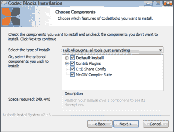

**图 1-1：** 向导要求你选择要使用的配置选项。

4. **单击 Next。**

   安装程序询问要在你的系统上将 Code::Blocks 安装到何处。与许多其他应用程序不同，Code::Blocks 实际上会不时向此文件夹写入数据。除非你对系统上的 Programs 文件夹具有管理访问权限，否则最好使用你有写入权限的文件夹。为确保最大兼容性，本书使用 `C:\CodeBlocks` 文件夹进行安装。

5. **在 Destination Folder 字段中输入 `C:\CodeBlocks`。单击 Install。**

   如果 `C:\CodeBlocks` 文件夹尚不存在，安装程序会自动为你创建它。你会看到所有文件都已安装到系统上的 `C:\CodeBlocks` 文件夹中。

   安装向导可能会显示一个对话框，询问你是否要启动 Code::Blocks。如果看到此对话框，请单击 No。


- 6. 单击“下一步”。

  你会看到一个完成对话框。

- 7. 单击“完成”。

  安装向导结束。

### 在 Mac OS/X 上工作

在 Mac 上安装 Code::Blocks 比在 Windows 上需要多做一些工作。Code::Blocks 需要 Mac OS/X 10.4 或更高版本才能安装。以下步骤说明了如何在 Mac 系统上获得可正常工作的 Code::Blocks 安装。

- 1. 如有必要，从 App Store 下载并安装 Xcode，以获得 GCC 副本。

  你可以打开终端，输入 gcc -v，然后按 Enter，来验证是否已安装 GNU GCC 编译器。如果已安装 GCC，你应该会看到一些版本信息以及一些编译器说明。

  如果你使用的是较旧版本的 Mac OS/X，则下载 Xcode 需要付费。（10.6 及更高版本可免费获取。）这是一个约 1 GB 的大文件下载，因此请留出充足的时间。

- 2. 将 Code::Blocks 文件解压到一个文件夹中。

  你会看到许多文件，包括 Code::Blocks 应用程序、包含最新更新信息的自述文件，以及包含文档的 PDF 文件。

- 3. 打开“应用程序”文件夹。

  你会看到系统中已安装的应用程序。

- 4. 将用于解压的文件夹中的 CodeBlocks.app 文件拖到“应用程序”文件夹中。

  操作系统会将 Code::Blocks 添加到可用应用程序列表中。

- 5. 导航到 https://developer.apple.com/downloads/。

  该网站要求你注册一个免费的开发者 ID。只需按照屏幕上的提示操作即可获取 Apple ID。注册过程是免费的。

- 6. 单击 Xcode 命令行工具链接。

  操作系统会下载该文件，并为你显示一个软件包文件夹。

- 7. 双击“命令行工具”软件包。

  操作系统会为你安装该软件包，从而允许从 Code::Blocks 访问 GCC。

第 I 册  
第 1 章  
配置你的系统

### 使用标准 Linux 安装

在 Linux 上安装 Code::Blocks 没有一套统一的步骤，因为每种 Linux 发行版都有自己的要求。Code::Blocks 直接支持

- Blag
- Debian
- Fedora
- Gentoo
- PCLinuxOS
- 基于 Red Hat Package Manager (RPM) 的发行版（例如 SUSE、Red Hat、Yellow Dog、Fedora Core 和 CentOS）
- Ubuntu

每种发行版都有自己的说明，你可以在 http://wiki.codeblocks.org/index.php?title=Installing_Code::Blocks 找到。确保根据需要，仔细按照（在终端中键入的）说明下载并安装编译器、调试器和 IDE。从 http://www.codeblocks.org/downloads/26 下载的文件包含 Code::Blocks 安装所需的软件包，因此你无需在安装过程中单独下载每个软件包。


某些 Linux 安装在使用 Code::Blocks 时有特殊要求或会遇到限制。影响本书的唯一明显限制是 Red Hat 和 CentOS 缺少 Boost 支持。由于此限制，你无法使用第 VI 册第 4 章和第 5 章中的示例。但是，如果你遇到其他限制，请通过 John@JohnMuellerBooks.com 告知 John，他将在本书的博客文章中予以说明。

### 使用图形化 Linux 安装

所有版本的 Linux 都支持本章“使用标准 Linux 安装”一节中讨论的标准安装。然而，一些基于 Debian 的 Linux 发行版（例如 Ubuntu 12.x 及更高版本）也提供图形化安装方法。使用此过程需要管理员组（sudo）密码，因此手边有密码可以节省时间。以下步骤概述了 Ubuntu 的图形化安装方法，但其他 Linux 安装的方法类似。

- 1. **打开 Ubuntu 软件中心文件夹（在其他平台上该文件夹可能名为 Synaptic）。**

  你会看到一份可供下载和安装的最流行软件列表，如图 1-2 所示。你的列表可能与截图所示不同。


图 1-2：Ubuntu 软件中心在打开时会列出最流行的软件。

- 2. **从“所有软件”下拉列表框中选择“开发者工具”（或“开发”）。**

  你会看到开发者工具列表，其中包括 Code::Blocks，如图 1-3 所示。

- 3. **双击 Code::Blocks 条目。**

  Ubuntu 软件中心会提供关于 Code::Blocks 条目的详细信息，并主动为你安装它，如图 1-4 所示。

- 4. **单击“安装”。**

  Ubuntu 开始安装 Code::Blocks。进度条显示下载和安装状态。安装完成后，“安装”按钮会变为“移除”按钮。

- 5. **关闭 Ubuntu 软件中心文件夹。**

  你会看到桌面上添加了 Code::Blocks 图标。IDE 已准备好使用。


图 1-3：“开发者工具”类别中包含 Code::Blocks 条目。

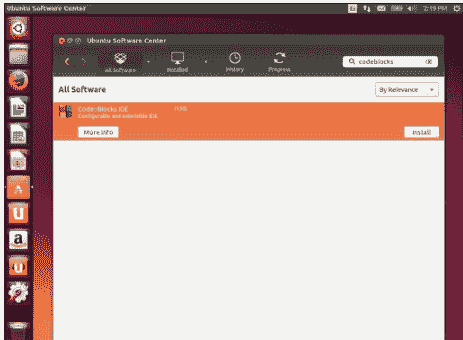

图 1-4：如有必要，可以获取关于 Code::Blocks 的附加信息。

### 浏览 Code::Blocks 的基本功能

无论你如何为你的平台安装 Code::Blocks，最终都会得到一个具有标准化特性的 IDE。这是使用 Code::Blocks 这类 IDE 的最佳理由之一——无论你使用哪个平台，都可以使用相同的 IDE。

你的屏幕截图可能与本书所示不同。尽管本书使用的是 Windows 版 Code::Blocks 的屏幕截图，但其他平台上的 Code::Blocks 安装也提供相同的功能，只是 IDE 在其他平台上的外观可能不完全相同。以下各节介绍使用 Code::Blocks 时需要了解的基本功能。

### 首次启动 Code::Blocks

使用你的平台通常所需的方法打开 Code::Blocks 可执行程序。例如，在 Windows 或 Mac 上操作时，双击 CodeBlocks 图标。首次启动 Code::Blocks 时，你可能会看到“编译器自动检测”对话框。选择 GNU GCC 编译器条目（它可能是唯一可用的条目，并且默认已选中），单击“设为默认值”，然后单击“确定”。

此时，Code::Blocks 会显示一个“文件关联”对话框，类似于图 1-5 所示的对话框。最好将 IDE 与你的 C++ 文件关联起来，这样打开文件时也会打开 IDE——从而更容易编写应用程序并在以后修改它们。

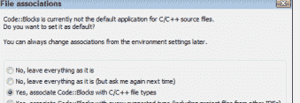

图 1-5：将 Code::Blocks 与你的 C++ 文件关联，以便更轻松地管理它们。

Code::Blocks 启动时总是会打开 IDE，并在其中放置一个提示对话框，如图 1-6 所示。提示是关于更高效地使用 Code::Blocks 的随机信息。你可以单击“下一条提示”查看系列中的下一条提示，或清除“启动时显示提示”来禁用提示显示。阅读提示后，单击“关闭”。

你对安装 Code::Blocks 的文件夹具有写入权限。最佳做法是将 Code::Blocks 安装到系统上的 `C:\CodeBlocks` 文件夹。另一种方法是右键单击 Code::Blocks 图标，然后从上下文菜单中选择“以管理员身份运行”，以使用所需权限运行 Code::Blocks。

### 打开示例项目

你可以从引言中描述的出版商网站获取本书的源代码。下载包含源代码的 .zip 文件后，只需将其解压到硬盘即可。

本书的源代码按册、册内章节和章内示例进行划分。例如，要打开本书第 2 章中的第一个示例，首先找到 `\CPP_AIO\BookI\Chapter02\FirstProject` 文件夹（或你平台上的等效路径）。该文件夹中包含 `SayHello.cpp`。Code::Blocks 项目（.cbp）文件扩展名包含了 Code::Blocks 打开项目并向你呈现项目所需的所有内容。当你找到第一个项目时，双击 `SayHello.cbp`，Code::Blocks 会自动为你打开该项目，如图 1-8 所示。

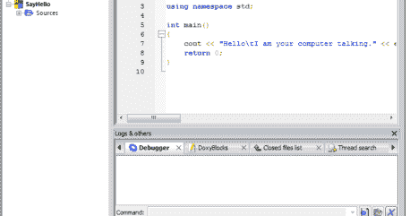

图 1-8：每个示例都有一个关联的 .cbp 文件，可为你打开 Code::Blocks 中的示例。


如果你选择允许显示提示，那么你首先会看到一个“每日提示”对话框，类似于前面图 1-6 所示的那个。阅读完提示后点击“关闭”即可看到项目。暂时不要担心这个示例的内容，你将在第 2 章了解它是如何工作的。目前你只需要知道如何打开一个项目示例，以便跟随书中的示例进行学习。

> **提示**
>
> 在使用除 Code::Blocks 之外的 IDE 时，你可以打开 C++（.cpp）文件而不是 .cbp 文件。打开 .cpp 文件仍会显示代码示例。C++ 将源代码存储在 .cpp 文件中，而不是 .cbp 文件中。

### 查看基本窗口

### 使用 Start Here 窗口

Start Here 窗口，如图 1-9 所示，作用正如其名称所示——让你开始使用 Code::Blocks。当你直接打开 Code::Blocks 而尚未打开项目时，此窗口会自动显示。在关闭“每日提示”对话框后，它会立即出现。

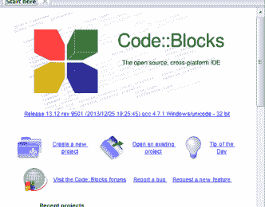

**图 1-9：** 使用 Start Here 窗口开始新的会话。

此窗口非常重要，因为它还让你能够访问 Code::Blocks 的多种功能，并使你能够请求更改。以下是通过此窗口可以访问的选项：

- **创建新项目：** 在有效使用 Code::Blocks 之前，你需要创建一个项目。项目充当容器，用于保存创建应用程序所需的文件。它还存储用于配置开发环境的设置，并以特定方式呈现该环境。
- **打开现有项目：** 每当你想要重新创建上次编码会话期间使用的环境时，可以打开一个现有项目。项目将自动打开你之前打开过的任何源代码文件，并执行其他任务，让你能够轻松地从上次离开的地方继续。
- **每日提示：** 如果你错过了“每日提示”，或者只是想重新激活该功能，请单击此链接。Code::Blocks 将显示“每日提示”对话框，如图 1-2 所示。
- **访问 Code::Blocks 论坛：** 你无法直接与 Code::Blocks 的开发人员沟通。不过，你可以直接与其他用户交流并获得同伴支持。Code::Blocks 的开发人员也会关注论坛，你会看到他们积极解决那些通过同伴支持无法处理的问题。
- **报告 Bug：** 这个世界上每个应用程序都有 Bug（编程错误），Code::Blocks IDE 也不例外。发现问题时报告 Bug 非常重要，这样它们才能得到修复。
- **请求新功能：** 任何长期使用某个应用程序的人，都可能产生一个让它变得更好的绝妙想法。Code::Blocks 的开发人员希望听到你的非凡创意，所以请尽快联系他们。
- **最近的项目：** 随着你使用 Code::Blocks，你会创建不止一个项目。无需在整个硬盘中查找所需项目，你可以使用此功能立即找到它。要打开项目，只需单击“最近的项目”列表中的链接即可。


即使打开项目后看不到 Start Here 窗口，你仍然可以通过选择“视图 → 开始页面”来查看它。将 Start Here 窗口置于手边，可以方便地访问常用的 Code::Blocks 功能。不过，你也可以通过菜单访问这些功能。例如，要创建新项目，请选择“文件 → 新建 → 项目”。

### 使用管理窗口

IDE 的目的是以各种方式帮助你管理编码项目，因此 Code::Blocks 附带一个管理窗口也就不足为奇了，如图 1-10 所示。管理窗口通常位于 IDE 主窗口的左侧，但你可以通过标题栏拖动窗口将其移动到任何位置。

**图 1-10：** 管理窗口帮助你管理 Code::Blocks 项目。

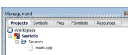

管理窗口包含四个选项卡。以下列表描述了每个选项卡的用途：

- **项目：** 将创建应用程序所需的所有文件集中在一个地方，是一种有用的管理方法。一组应用程序文件称为项目，而帮助你创建和维护项目只是 Code::Blocks 简化应用程序开发的方式之一。
- **符号：** 应用程序包含许多符号，例如函数名。你可以使用“符号”选项卡在应用程序中查找所需的特定符号。现在不必太担心符号问题，但最终你会发现，这个选项卡可以让你更轻松地定位应用程序的特定部分，从而节省时间和精力。
- **文件：** 查找需要添加到当前项目的代码和资源可能非常耗时。“文件”选项卡提供了一种浏览文件系统的方法。然后，你可以右键单击所需的文件，并使用上下文菜单项执行诸如将文件添加到当前项目等任务。
- **资源：** 图形应用程序需要添加对话框和其他视觉元素，C++ 将这些元素视为资源。“资源”选项卡包含这些资源的列表，以便你轻松找到并以各种方式管理它们。

“资源”选项卡是一个供高级开发人员使用的功能，通常你无需担心，除非你决定使用 C++ 和 wxWidgets 插件（Windows 开发人员自动安装，Mac 和 Linux 开发人员则需单独安装）的组合来创建图形应用程序。如何创建此类应用程序的说明超出了本书的范围，但你可以在 http://wiki.codeblocks.org/index.php?title=WxSmith_tutorial:_Hello_world 查看此类项目的简单示例。

### 使用日志及其他窗口

Code::Blocks 帮助你跟踪各种活动。例如，当你从编写的源代码创建新应用程序时（这个过程称为构建），你会看到一些消息告诉你构建过程的进展，如图 1-11 所示。


本书中的示例将帮助你了解何时使用各种日志选项卡和其他选项卡（例如“调试器”选项卡），以更好地判断应用程序的工作方式。

**图 1-11：** 使用日志及其他窗口来了解应用程序的工作方式。

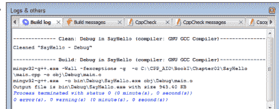

你在此窗口中看到的选项卡取决于你在 Code::Blocks 中启用了哪些选项以及你正在执行的任务。Code::Blocks 通常会自动选择你需要的选项卡。如果要关闭某个特定选项卡，请单击该选项卡条目旁边的 X。如果要显示当前看不到的选项卡，请右键单击列表中的任意选项卡，然后从上下文菜单的“切换”选项中选择一个条目。

### 选择编译器

Code::Blocks 支持多种编译器。本书使用 GCC，因为它适用于所有目标平台，并且提供了出色的 C++ 14 支持。大多数 Code::Blocks 安装也会自动选择这个特定的编译器。因此，使用 GCC 作为编译器有很多很好的理由。但是，你的系统可能没有选择 GCC，这可能会导致运行示例时出现问题。并非每个编译器供应商都提供出色的 C++ 14 支持，或者你的编译器供应商可能在某个特定细节上的实现与 GCC 不同。以下步骤可帮助你确认系统选择的编译器是否为 GCC，如果不是，还可以帮助你更改配置：

1. **打开 Code::Blocks。**

    是否选择项目并不重要。无论是否加载项目，配置编译器的方式都是一样的。

2. **选择 设置 → 编译器。**

    你会看到“编译器设置”对话框，如图 1-12 所示。

3. **单击左侧窗格中的“全局编译器设置”以显示全局编译器设置。**


### 使用其他 IDE

尽管本书将重点介绍 Code::Blocks IDE 与 GCC 编译器的组合，但你学到的知识可用于任何 IDE 与编译器的组合。事实上，你真正需要的只是编译器。大多数开发者使用 IDE，只是因为它让事情变得简单（而我们都喜欢简单的事）。不过，你可能会发现 Code::Blocks 根本没有提供你想要的功能，或者它太难使用。

选择 IDE 是个人化的事情，大多数开发者选择某个特定 IDE 都有具体理由。事实上，我使用几种不同的 IDE，并根据特定项目的需要来做选择。所以甚至不必一直使用同一个 IDE。IDE 提供管理功能，而编译器控制源代码如何被解释并转换为可执行文件。这两个应用程序执行完全不同的任务。


GCC 是编译器的绝佳选择，因为许多 IDE 都支持它。如果你决定使用与本书不同的 IDE，我们完全没问题。事实上，我们祝贺你有走不同路线的意愿！以下是一些你可能想考虑的其他 IDE：

- **CodeLite:** http://codelite.org/
- **Dev-C++:** http://dev-c.soft32.com/free-download/
- **Eclipse:**（http://www.eclipse.org/downloads/）与 C/C++ 开发工具（CDT）（http://www.eclipse.org/cdt/）配合使用时
- **Emacs:**（http://www.gnu.org/software/emacs/）与 Emacs 代码浏览器（ECB）（http://ecb.sourceforge.net/）配合使用时
- **Netbeans:** https://netbeans.org/downloads/
- **Qt Creator:** http://sourceforge.net/projects/qtcreator.mirror/

## 第 2 章：创建第一个 C++ 应用程序

### 本章内容

- 将应用程序组织到项目中
- 在代码编辑器中输入代码
- 编写一个向屏幕输出的应用程序
- 进行基本数学运算
- 运行你的应用程序

今天是你的幸运日。你决定学习这个星球上最流行的编程语言。从容纳大型财富 500 强公司的最高的摩天大楼，一直到车库里那些自学成才、努力打造下一代软件的孩子们，人们都在使用 C++。没错，还有其他语言，但使用 C++ 的程序员比使用任何其他语言的都多。在本章中，你将直接开始编写一个 C++ 应用程序。


如第 1 章所述，本书依赖你将 Code::Blocks 用作 IDE，并将 GCC 用作 C++ 编译器。这些操作步骤是按照撰写本书时 Code::Blocks 的最新版本（12.11 版）编写的，因此如果你使用不同的 Code::Blocks 版本，可能需要做出相应调整；而如果你使用其他 IDE，这些步骤将无法工作。此外，如果你希望使用其他编译器，那么随着示例变得越来越复杂，你可能需要对代码做些小改动。

### 使用 Code::Blocks 创建项目

创建计算机应用程序通常是项大工程，很难只靠脑子来组织。应用程序代码保存在文件中，很像文字处理软件中的文档。但应用程序通常有不止一个源代码文件。在大城市的高楼里，大型公司的一些应用程序确实非常庞大——仅仅一个应用程序就有数百个源代码文件。

### 理解项目

应用程序可能包含大量源代码。为了把所有源代码保持在一起，程序员使用一个管理这一切的文件，称为 *项目*。项目有几个关键元素：

- 一组源代码文件
- （可选）资源信息，如图标和声音文件
- 关于如何编译（构建）应用程序的说明
- 集成开发环境（IDE）设置，用于说明如何设置编写应用程序所用的编辑器
- 关于所构建应用程序的一些一般性描述，例如其名称和应用程序类型

*应用程序类型* 并不是指“文字处理软件”或“真正酷炫、惊天动地的软件”，即使你的应用程序就是那样。本书用 *类型* 来指你的应用程序与其他应用程序的整体关系：

- 此应用程序是否自行运行？
- 此应用程序是否会增加或扩展另一个应用程序（如 Firefox）的功能？
- 此应用程序是否充当 *库*（一组你提供给另一个应用程序使用的代码）？

所有这些信息连同源代码文件一起构成一个项目。

在 Code::Blocks IDE 中，每次开始处理新应用程序时，你都要创建一个新项目。你提供一些关于正在处理的应用程序的信息，然后开始编写代码。应用程序的所有代码都存储在一个地方——项目中。


本书提供了许多示例应用程序，因此你可能想在硬盘上创建一个目录（或 *文件夹*），用来存放你学习本书过程中创建的所有应用程序。可下载的源代码使用名为 CPP_AIO 的文件夹。你可以在“前言”中了解如何获取本书的可下载源代码及其他附加内容。

### 定义第一个项目

要在 Code::Blocks 中创建新项目，请启动 Code::Blocks，然后选择“文件 > 新建 > 项目”，或单击启动应用程序时出现的 *开始页* 上的 *创建新项目*。出现一个对话框，如图 2-1 所示。

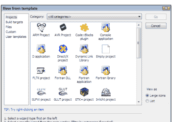

**图 2-1：**“从模板新建”对话框可让你选择新的项目类型。

在 Code::Blocks 中创建项目时，你需要从几种应用程序类型列表中进行选择。它们以图标形式显示在“从模板新建”对话框中。以下列表列出了一些应用程序类型：

- **GTK+ 项目：**这是一个图形应用程序，包含……嗯，一个窗口。你熟悉这种窗口：它通常顶部有一个菜单，内部有可单击或输入内容的东西。它依赖 GIMP 工具包（GTK），该工具包提供了一个极其灵活的界面，可运行在包括 Linux、Mac 和 Windows 系统在内的多个平台上。请阅读“其他那些项目怎么办？”侧栏以了解更多关于 GTK 的信息。
- **控制台应用程序：**这种应用程序得到的是一个不起眼的控制台窗口，而不是图形窗口。*控制台* 指的是带有命令提示符的窗口。（还记得 Windows 之前旧时光的人会称其为 *DOS 框*，而在使用 Mac 或 Linux 等操作系统时，你可能将其称为 *终端窗口*。）
- **静态库：** *静态库* 是一组 C++ 代码，你以后会在另一个项目中使用它。这就像制作一份非常棒的腌料，你今天不会用完。明天你会用一些，之后还会用一些。C++ 库也是如此。
- **动态链接库：**动态链接库（DLL）有点像静态库，不同之处在于它与主应用程序分离，并拥有自己的文件，扩展名为 .DLL。
- **空项目：**这个空白项目就像一张干净的白打字纸，等着你去把它填满。

坦白说，使用空项目有点麻烦，因为你需要调整和设置一大堆东西。所以我们从不使用这个选项。


### 其他那些项目怎么办？

Code::Blocks 支持许多其他应用程序类型。本书不讨论它们，因为它们不会增进你对 C++ 编程的初步理解。不过，这些其他项目在合适的环境中很有价值。例如，GIMP Tool Kit Plus（GTK+）项目依赖为 X 窗口系统设计的图形用户界面（更多信息请见 http://www.gtk.org/）。

你会发现，Code::Blocks 会使用相当多的首字母缩略词和缩写来表示项目和资源名称，却不定义其中任何一个。本书会在首次使用某个缩略词时定义我们所用的所有缩略词。不过，其中一些缩略词和缩写会一直出现。例如，你可能会对 GTK+ 定义中的 GIMP 部分感到疑惑。GIMP 代表 GNU Image Manipulation Program（GNU 图像处理程序）。当然，现在你需要知道 GNU，它代表 GNU's Not Unix。好了，这小小的乐趣到此为止；如果你以后遇到有趣的缩略词或缩写，可以随时在 Acronym Finder 网站（http://www.acronymfinder.com/）上查到它的定义。归根结底，你需要在使用项目和资源之前先研究它们。

对于本章中的示例，请创建一个控制台应用程序。请按以下步骤操作：

- 1. **在“从模板新建”对话框中，单击“项目”选项卡上的“控制台应用程序”图标，然后单击“Go”。**
  你会看到控制台应用程序向导的欢迎页面。
- 2. **单击“下一步”。**
  向导会询问你想使用哪种语言。
- 3. **突出显示 C++，然后单击“下一步”。**
  你会看到一系列与项目相关的问题，如图 2-2 所示。这些问题定义项目的基本信息，例如项目名称。
- 4. **在“项目标题”字段中为项目输入名称。**
  示例使用 SayHello 作为项目标题。请注意，向导会自动在“项目文件名”字段中开始为你创建条目。
- 5. **在“要在其中创建项目的文件夹”字段中为项目输入位置。**
  示例使用 C:\CPP_AIO\BookI\Chapter02 作为文件夹名。你也可以单击“要在其中创建项目的文件夹”字段旁边的省略号按钮，使用“浏览文件夹”对话框来定位要使用的文件夹。请注意，向导会补全“项目文件名”字段中的条目。


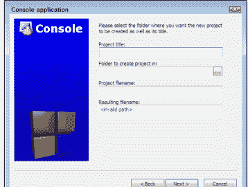

**图 2-2：** 为 Code::Blocks 提供你的项目名称。

如果你创建了一个文件夹来存放本书的所有应用程序（如本章前面“理解项目”一节所建议），请将你的 FirstProject 文件夹放入本书的文件夹中。确保你位于刚刚创建的文件夹内。

- 6.（可选）在“项目文件名”字段中输入项目文件名。
- 7. 单击“下一步”。
  - 你会看到图 2-3 所示的编译器设置。本书中的大多数项目都使用默认编译器设置。但是，如果你查看“编译器”下拉列表，会看到 Code::Blocks 支持多种编译器，而且你可以向其中添加更多编译器。其他设置控制应用程序调试版（用于查找代码中问题的版本）和发布版（发送给客户的版本）的创建和位置。
- 8. 更改任何所需的编译器设置，然后单击“完成”。
  - 向导会为你创建应用程序。然后它会显示已加载项目的 Code::Blocks IDE。但是，源代码文件尚未加载。
- 9. 在“管理”窗口的“项目”选项卡中展开 SayHello 工作区条目，然后双击 main.cpp。
  - 你会看到源代码文件已加载，可供编辑，如图 2-4 所示。

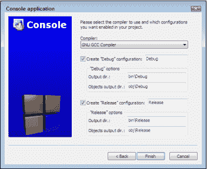

**图 2-3：** 告诉 Code::Blocks 将应用程序的调试版和发布版放在哪里。

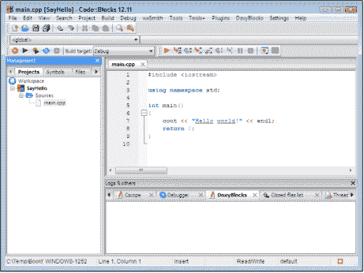

**图 2-4：** 使用 Code::Blocks IDE 与你的项目进行交互。

项目窗口分为左右并排的两部分：

- 左侧是资源管理器视图（称为*树视图*），它表示你的项目。树视图顶部是工作区——项目的基本单元。工作区下方是项目名称。再往下是项目的组件。在本例中，目前只有一个组件：文件名为 `main.cpp` 的源代码文件。请记住，要用 C++ 编程，你需要进入源代码文件；这个名为 `main.cpp` 的文件就是 SayHello 项目的这样一个文件。
- 右侧（实际约占屏幕的四分之三）是源代码文件本身。
  - 这一部分用起来很像文字处理器或电子邮件编辑器，你可以在窗口中输入代码。你会注意到那里已经有一些代码——这是当你选择控制台应用程序并创建项目时生成的一种起始代码。
- 显示区域底部有若干状态窗口。Code::Blocks 窗口会告诉你向导是如何创建应用程序的。现在不用担心这些窗口。随着本书的深入，你会看到它们实际运行。

### 构建并执行你的第一个应用程序

好了，该处理你的第一个应用程序了。按照以下步骤保存文件、构建应用程序（将其变成操作系统可以使用的可执行文件）并执行该应用程序：

- 1. **通过选择“文件→全部保存”来保存代码文件。**
  - 保存文件可确保在出现问题时磁盘上有一份完好的副本。例如，如果你的应用程序做了错误的事情，可能会让 IDE 完全崩溃。
- 2. **选择“构建→构建”或按 Ctrl+F9。**
  - 此操作会创建可执行文件。构建代码会把你能理解的文字转换成操作系统能理解的代码。注意，Code::Blocks 会自动为你选中“构建日志”窗口，你会看到 Code::Blocks 创建应用程序所采取的步骤。在此过程结束时，你应该会看到输出为 `0 errors, 0 warnings (0 minutes, 1 seconds)`。
- 3. **选择“构建→运行”或按 Ctrl+F10。**
  - 会打开一个类似图 2-5 所示的输出窗口，你会看到你的第一个应用程序执行。

**第 1 册**  
**第 2 章**

### 创建你的第一个 C++ 应用程序


- 单击要输入的位置。用鼠标指向要输入的位置，然后单击鼠标按钮。光标会跳到你单击的位置。
- 选择要删除或更改的文本。可以通过以下两种方式之一选择文本：
  - 用鼠标指向要选择的第一个或最后一个字符；然后按住鼠标按钮并拖动鼠标。
  - 将光标移到要选择的第一个或最后一个字符；然后按住 Shift 键并按下方向键。
- 使用滚动条向上和向下（垂直）或向左和向右（水平）滚动文本。只有当文本超出窗口可见范围时，滚动条才起作用，就像 Windows、Linux 和 Mac 世界中的大多数其他地方一样。你可以使用 Ctrl+↑ 和 Ctrl+↓ 组合键向上和向下滚动（如果编辑器中的文本足够多）。
- 滚动只会改变你看到的内容。你必须使用鼠标或方向键来选择你看到的内容。

在稍微试用编辑器之后，你可以使用表 2-1 来完成一些你喜欢的任务。（当然，如果你是编程新手，你可能还不知道这些是否是你喜欢的——但很快就会是了。相信我。）

**表 2-1：** 导航和编辑命令

| 命令 | 按键或操作 |
|---|---|
| 移动光标 | ↑、↓、← 或 →、Home、End |
| 逐词移动 | Ctrl+← 或 Ctrl+→ |
| 用鼠标选择 | 在文本中单击鼠标，并在按住鼠标按钮的同时拖动鼠标 |
| 用光标选择 | Shift+↑、Shift+↓、Shift+← 或 Shift+→ |
| 选择下一个词 | Shift+Ctrl+→ |
| 选择上一个词 | Shift+Ctrl+← |
| 全选 | Ctrl+A |
| 转到顶部 | Ctrl+Home |
| 转到底部 | Ctrl+End |

### 从 main 开始

当计算机运行代码时，它会以逐步、逐行的方式进行。但你的代码被组织成多个部分，其中一个部分就是*主函数*，或简称为 *main()*。*main()* 是*最先*运行的部分。*main()* 告诉计算机你想使用应用程序的哪些*其他*部分。*main()* 是领头人，是最高领导。

计算机如何知道什么是 *main()*？你在*花括号字符* { 和 } 之间输入代码行。以下是 Code::Blocks 在你创建控制台应用程序项目时生成的默认应用程序：

```cpp
int main()
{
    cout << "Hello world!" << endl;
    return 0;
}
```

单词 *main* 是必需的，它告诉计算机 *main()* 在哪里。你可能还会看到 *main()* 显示为

```cpp
int main(int argc, char *argv[])
```

现在不用担心 *main()* 周围的那些词。你会在本章后面发现这些词的含义。目前，你只需知道每个 C++ 应用程序都有一个 *main()* 函数。


计算机逐行执行代码。如果某一行是空行，计算机就直接转到下一行。当你编写代码行时，你是在指示计算机做某事（这就是为什么有些人把代码行称为*指令*）。

### 显示信息

准备好输入一些代码并试一试了吗？我们开始吧！这段代码将打开著名的**控制台窗口**并向其中写入一些文字。

首先，确保你仍然打开着 Code::Blocks IDE 和 **SayHello** 项目，就像本章前面的示例那样。*如果没有，请按照以下步骤操作：*

- 1. 如果 Code::Blocks 尚未运行，**启动 Code::Blocks**。
  - 你会看到 **Code::Blocks IDE** 的起始页。
- 2. 单击 **最近项目** 列表中显示的 **SayHello.cbp** 项目。
  - Code::Blocks 会为你打开该项目。

如果 `main.cpp` 代码没有显示在窗口最右侧 75% 的区域，请单击左侧树视图中的 `main.cpp`。它会立即打开。（如果你没有看到树视图，请单击顶部写着 Projects 的小选项卡；它旁边是写着 Symbols 的选项卡。）

请仔细遵循以下步骤。确保完全按照此处给出的内容输入所有内容：

- 1. **将光标定位到带有左花括号的行。**
  - 在本例中，即第 6 行。你可以在代码编辑器左侧看到行号。
- 2. **按 Enter 键。**
  - 光标应位于第五列。如果不在——如果它仍停留在第一列——那么按四次空格键。
- 3. **完全按照此处显示的内容输入以下代码行。**
  - 两个小于号（`<`）之间不要加空格。务必记住末尾的最后一个分号。代码如下：
  - `cout << "Hello, I am your computer talking." << endl;`
- 4. **删除如下所示的那行代码：**
  - `cout << "Hello world!" << endl;`

最后，你的代码将类似于以下示例（你输入的新行在此处以粗体显示）：

```cpp
#include <iostream>

using namespace std;

int main()
{
    cout << "Hello, I am your computer talking." << endl;
    return 0;
}
```

如果你没有正确输入代码，计算机会告诉你。此步骤会*编译*应用程序：计算机会确保你写的内容没有问题，然后将其转换为*可运行*的应用程序。（不要太担心这意味着什么。现在，只需把它看作确保你的应用程序没有问题。附录 A 会告诉你关于编译的完整说明。）

要了解你的应用程序是否已准备好运行，请选择“构建→构建”。


没错，现在到了和奇怪符号打交道的时间。继续使用你已经有的源代码。在你输入的那一行上单击某个位置——你知道的，就是看起来像这样的那一行：

```cpp
cout << "Hello, I am your computer talking." << endl;
```

按 End 键，让光标移动到该行末尾。然后按 Enter 键，这样你就可以在 cout 行和以单词 return 开头的那一行之间开始一个新行。


每当你想要在其他两行之间插入一行时，最稳妥的做法是转到这两行中的第一行，按 End 键，然后按 Enter 键。这样就会在正确的位置插入一个新的空白行。

按下 Enter 后，你会注意到发生了某件事：光标并不在新插入行的开头；相反，它有四个空格，并与其他行齐平缩进。这不是错误。信不信由你，这简直是个救星。好吧，也许算不上救星，但它几乎和大家都喜欢的小糖果一样好。原因是，你经常会缩进代码（这段特定代码缩进了四个空格）；如果你要输入大量代码，每次开始新行都得键入四个空格（或按 Tab 键），那会很烦人。所以 Code::Blocks 很体贴地（并且自动地）为你完成缩进。


如果由于某种原因，你的代码没有自动缩进，光标停在行首，那么自动缩进功能没有开启。它默认应该是开启的，但如果没有开启，下面介绍如何开启它：

- **1. 选择“设置 > 编辑器选项”。**
  
  出现“配置编辑器”对话框。
- **2. 确保选中“Tab 缩进”复选框，然后单击“确定”。**
- **3. 回到代码中后，按 Backspace 删除新行，然后再次尝试按 Enter。**
  
  看！代码自动缩进了。
- **4. 在新的空白行出现并自动缩进后，输入以下内容：**

```cpp
cout << 5 + 10 << endl;
```

这一行的开头和结尾与你之前输入的那一行一样。区别在中间——你输入的不是字符串，而是一道数学题：5 加 10。注意，我们在 5 两边、+ 两边和 10 两边都放了空格——但不在 1 和 0 之间放空格。如果你在那里放一个空格，计算机会被搞糊涂（它不知道你想写的是一个两位数）。完成后，你的代码应该像下面这个代码片段（这里你输入的新行以粗体显示）：

```cpp
#include <iostream>

using namespace std;

int main()
{
    cout << "Hello, I am your computer talking." << endl;
    cout << 5 + 10 << endl;
    return 0;
}
```

- **5. 选择“文件 > 全部保存”来保存你的工作。**


除了选择“文件 > 全部保存”，你也可以认识到，唯一发生变化的就是你当前正在处理的源代码文件。如果你在代码编辑器中看到闪烁的光标，就知道代码编辑器处于活动状态。如果没有，请在代码中某处单击以激活编辑器。当你看到闪烁的光标时，按 Ctrl+S。这样就会保存你的文件。


在计算机世界里，有一句格言大致是这样说的：“尽早保存，经常保存。”养成时常按 Ctrl+S 的习惯。你不会把硬盘用坏，而且键盘相当耐用。每次我们输入几行代码，都会按 Ctrl+S。编译之前，我们会按 Ctrl+S。当我们疑神疑鬼，觉得上一次 Ctrl+S 没生效时，我们会按 Ctrl+S。当我们堵在红绿灯前时，我们会按 Ctrl+S。

现在你可以让计算机编译你的代码了。如果你还没有保存，现在就按 Ctrl+S 保存。然后选择“构建 > 构建”。如果你输入的一切都正确，你应该会在“构建日志”窗口中看到神奇的消息 0 errors, 0 warnings（0 分钟，0 秒）。但如果没有看到，别担心；你可以轻松修正。查看你的代码，找出我们之前写的那一行与你的代码之间的差异。为稳妥起见，这里再给出一遍：

```cpp
cout << 5 + 10 << endl;
```

cout 后面有一个空格，<< 后面有一个空格，5 后面有一个空格，+ 后面有一个空格，10 后面有一个空格，<< 后面还有一个空格。并且末尾有一个分号。确保这些都正确。

然后，当你成功编译并看到令人愉快的消息 0 errors, 0 warnings 时，你就可以运行应用程序了。选择“构建 > 运行”。

会打开一个控制台窗口，你应该会看到以下内容：

```text
Hello, I am your computer talking.
15

Process returned 0 (0x0)   execution time : 0.015 s
Press any key to continue.
```

注意第二行是数学题 10 + 5 的答案。这意味着计算机懂得如何做数学运算，或多或少是正确的。（好吧，它*最好是正确的*，否则我们就要找老师退钱了。）

### 运算顺序

如果你愿意，可以试着玩一些更复杂的问题。例如，你可以试试像这样的：

```cpp
cout << 5 + 10 / 2 * 3 + 25 << endl;
```

你认为答案会是什么？答案取决于计算机执行数学问题的*顺序*规则。这些规则称为*运算顺序*。乘法和除法优先于加法和减法。因此，计算机会先从左到右完成所有乘法和除法；然后从左到右完成加法和减法。图 2-7 显示了计算机做这道特定数学题的顺序。

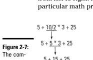

### 过火

计算机实际上有各种限制，包括在数学方面。如果你尝试像这样的东西：

```cpp
cout << 8762547892451 * 10 / 2 * 3 + 25 << endl;
```

```cpp
cout << "Hello, I am your computer talking." << endl;
```

改为以下代码中加粗显示的那一行：

```cpp
#include <iostream>

using namespace std;

int main()
{
    cout << "Hello\tI am your computer talking." << endl;
    return 0;
}
```

在前面的代码中，我们把逗号和空格替换成了反斜杠，然后是一个小写字母 t。（我们还删除了关于数学的额外那一行，以防你尝试了上一节中的数学内容。）但是，当你编译并运行这个应用程序时（记住要*先编译它！*），它不会打印出双引号中的确切内容。你会看到：

```text
Hello   I am your computer talking.
```

显示行中多出来的空格是一个*制表符空格*，就像你在输入这些内容时按了 Tab 键一样。（这算不算巧妙，还是怎样？）

使用反斜杠还有一个复杂之处：你不能只键入一个反斜杠（就此而言，也不能只键入一个双引号）就期望在屏幕上看到它。有几种变通方法可以显示实际字符：

- 真的想显示一个反斜杠，而不是特殊字符？使用一个反斜杠后面再跟一个反斜杠。（是的，这很离奇。）编译器只把第一个反斜杠当作特殊字符。当一个字符串中连续有两个反斜杠时，编译器会把第二个反斜杠当作，嗯，一个反斜杠。

  例如，下面这行代码有*两个*反斜杠：

  ```cpp
  cout << "\\tabc" << endl;
  ```

  以下文本会出现在控制台：

  ```text
  \tabc
  ```

- 如果一个字符串以双引号开头并以双引号结尾，你到底要怎样才*打印*出一个双引号？键入一个反斜杠，然后键入一个双引号，如下面的代码所示：

  ```cpp
  cout << "Backslash and double quote equal \" in C++." << endl;
  ```

  当那段代码在应用程序中运行时，你会看到屏幕上显示：

  ```text
  Backslash and double quote equal " in C++.
  ```

第 1 册  
第 2 章  
创建你的第一个  
C++ 应用程序


C++程序员使用*转义序列*这一术语来指代字符串中以反斜杠开头的任何特殊字符。这是一条过时的词汇——也许不像“methinks”那么古老，但它确实可以追溯到20世纪70年代最初的C语言。那时，你要先按 Esc 键，才能让特殊字符出现在控制台屏幕上。

### 让你的应用程序运行起来

*执行*一词指的是运行你的应用程序，但在运行它之前，你需要编译（或者按 Code::Blocks 的术语来说，*构建*）应用程序。编译过程会将你的应用程序转换为可执行文件。*可执行文件*是一种特殊类型的文件，其中包含可在计算机上运行的应用程序。当你运行文字处理软件应用程序时，你运行的是一个包含该文字处理软件应用程序的可执行文件。


计算机编译（构建）你的应用程序之后，会执行一个称为*链接*的步骤。人们常把这两个步骤合起来简称为*编译*。实际上，在本书中，我们经常用这个术语来表示这两个步骤合在一起。如果你对这里发生的过程感到好奇，可以看看附录A。其中有一节专门介绍编译和链接过程。

每当你想运行应用程序时，都要先编译它，然后再运行。如果你对应用程序做了更多修改，必须在运行它之前再次编译。否则，可执行文件中不会包含你的修改。

因为你几乎总是按顺序使用“构建”和“运行”，所以构建 Code::Blocks 的好心人在“构建”菜单中加入了名为“构建并运行”的特殊菜单项。计算机会先编译你的代码，如果没有错误，就立即运行应用程序。如果有错误，编译器不会运行应用程序，错误会像平常一样报告。

我们几乎总是使用“构建并运行”选项，而不是分别点击“构建”和“运行”。有时，老式的方法更高效：当我们编译和运行应用程序时，我们使用快捷键。抓鼠标、将指针移到菜单上等操作会多花一点时间。相反，我们按 F9 来编译。

**表 2-3** 编译和运行的键盘快捷键

| 操作 | 键盘快捷键 |
|---|---|
| 构建 | Ctrl+F9 |
| 运行 | Ctrl+F10 |
| 构建并运行 | F9 |

## 第3章：在 C++ 中存储数据

### 本章内容

- 使用称为变量的存储箱
- 使用整型变量
- 使用字符变量
- 操作字符串
- 使用布尔变量
- 使用条件运算符
- 从控制台读取

我们都喜欢把东西收起来。壁橱就是一个存放东西的理想例子。我们的壁橱里有多年未打开的箱子。也许我们无意中创造了一个时间胶囊。或者只是一个火灾隐患。当你为计算机编程时，也可以把东西存起来。大多数人都知道计算机有两种内存：芯片内的内存和硬盘中的内存。但大多数人用*内存*一词来指内存芯片；另一种则直接称为硬盘。当你在文字处理软件中输入一封商业信函时，这封信会存储在内存中。在你选择“文件→保存”后，这封信会被存储到硬盘上，但只要这封信仍在文字处理软件中打开，它通常仍会留在内存中。

把内存想象成一组存储箱是最好的方式，很像我们害怕的那些壁橱里的箱子。当你编写计算机应用程序时，你会预留一些存储箱，并给每个存储箱一个名称。你还要说明该存储箱中可以存放什么类型的东西。这种存储箱的技术术语是*变量*。

在本章中，我们将向你展示如何在应用程序中使用这些存储箱。

### 将数据放到合适的位置：变量

当你编写应用程序时，你会指定要使用一个或多个称为*变量*的存储箱。你可以在这些存储箱中放入不同种类的东西。然而，这些计算机存储箱与壁橱里的存储箱之间的区别在于，每个计算机存储箱一次只能存放*一样东西*。

你也可以将许多不同类型的东西放入变量中。例如，你可以把数字放入存储箱，也可以把字符串放入存储箱。（但是，每个存储箱包含一种特定类型的数据——你不能把数字放入为字符串设计的存储箱中。）第I册第2章指出，*字符串*不过是一串连在一起的字母、数字或其他字符。至于数字，它们可以是*整数*（即正整数、负整数和0），也可以是带小数点的数字，例如3.11或10.0，这些数字（由于各种原因）被称为*浮点数*。

*浮点数*一词指的是带有小数点且小数点右侧有内容的数字（即使内容只是0）。当你看到*浮点*一词时，可以通过关注其名称中的*点*字来记住它的含义。想想*小数点*。


如果你已经从其他领域熟悉了*变量*一词，请注意不要套用那些领域的定义。尽管它们相似，但存在一些重要差异。例如，在代数中，变量表示未知量，你可以求解变量。但在编程中，情况更简单：*变量*只是一个带有相关名称的存储箱。


### 创建整型变量

在你的C++应用程序中，你可以轻松地写一行代码来创建变量。尽管你在那时所做的只是编写代码（而且变量实际上要到运行应用程序时才会被创建），人们常把这一过程称为*创建变量*。当我们和喜欢的另一位程序员一起工作时，我们常说：“我们继续来创建一个变量吧。”我们真正做的是编写代码，告诉*计算机*继续创建这个变量。当然，计算机实际上要等到应用程序运行时才会创建这个变量。另一方面，如果我们和不喜欢的一位程序员一起工作，我们可能什么也不会说。

变量有三个方面的内容，如表3-1所示。

**表 3-1** 变量具有三个方面

| 方面 | 含义 |
|---|---|
| 名称 | 你在应用程序中用来指代该变量的名称 |
| 类型 | 该变量可以保存的信息类型 |
| 值 | 存储箱实际保存的内容 |

下面的列表更详细地描述了表3-1中的各项内容。

- **名称：** 每个变量都必须有一个名称。在应用程序中，你通过这个名称来引用该变量。例如，你可能有一个名为 `count` 的变量，也可能有一个名为 `LastName` 的变量。或者你可以有一个名为 `MisterGates` 的变量。
- **类型：** 当你创建变量时，必须指定该变量可以保存的信息类型。例如，一个变量可以保存整数，另一个变量可以保存单个字符。在应用程序中为变量选定类型后，你只能把该类型的内容放入该变量。
- **值：** 在任何给定时刻，变量都保存一个值。例如，一个整型变量可能保存数字10，一个字符变量可能保存字符 a。在应用程序中，你可以把某个内容存入变量，之后还可以把另一个内容存入该变量。当你存入另一个内容时，变量会忘记它之前保存的内容。因此，从这个意义上说，你可以把计算机想象成只有一根筋。

代码清单3-1中展示的 `SimpleVariable` 示例代码演示了如何创建变量。这是一个可以运行的完整应用程序。

### 代码清单 3-1：创建变量

```cpp
#include <iostream>

using namespace std;

int main()
{
  int mynumber;
  mynumber = 10;
  cout << mynumber << endl;
  return 0;
}
```

请仔细看看代码清单3-1。记住，计算机从 `main` 一词后面的花括号内的代码开始，并逐行执行代码。

`main` 内的第一行如下所示：

```cpp
int mynumber;
```

当你声明变量时，你首先指定的是该变量可以保存的东西的类型。这里，我们使用了 `int` 一词。这个词是C++中表示*整数*的单词。因此，我们要声明的变量可以保存整数。接下来是变量的名称。这个变量名为 mynumber。然后，一个分号结束变量声明。


请注意，在这一行中，我们涵盖了变量的三个方面中的两个：我们给变量起了名字，并且告诉计算机我们希望这个变量保存什么类型的内容。这个顺序看起来有点奇怪——在 C++ 中，我们先说类型，再说名字。C++ 就是这么做的，而且这背后有一个充分的理由，你可以在本章后面的“命名多个变量”中读到相关内容。

下一行看起来像这样：

```cpp
mynumber = 10;
```

这一行把一些东西放进了变量。它把数字 10 放了进去。因为我们已经说过这个变量可以保存整数，所以你可以放入 10，因为它是整数。如果你试图把整数以外的其他东西放入这个变量，编译器就会给你一个错误。编译器确保你只把你说过要放的那种类型的东西放入变量。编译器很擅长让你遵守规则。当然，你注意到了这条语句以分号结尾。在 C++ 中，每条语句都以分号结尾。


要把一些东西放入变量，你需要键入变量名、等号（两边可以有空格）和值。然后用分号结束这一行。这行代码是一次赋值。或者你可以说，你正在把变量设置为该值。

下一行是：

```cpp
cout << mynumber << endl;
```

第1册第2章描述了这一行的作用。它是一条 cout 语句，这意味着它会把一些内容写到控制台上。你大概能猜到，这段代码告诉计算机把 mynumber 的值写到控制台上。它不会写出字符串 mynumber。相反，它会写出存储箱中恰好存放的内容。上一行代码把 10 放进了存储箱，因此这一行会在控制台上打印出 10。当你运行这个应用程序时，你会看到：

```
10
```


可以这样理解：当你键入变量名时，你是在访问这个变量。例外情况是变量名出现在等号左边。在这种情况下，你是在设置这个变量。

你可以对变量做两件事：

- **设置变量：** 你可以设置变量，这意味着你可以把一些东西放进存储箱。
- **获取值：** 你可以取回变量内部的值。这样做时，值仍然留在变量内部；可以这么说，你并不是在把它*取出来*。


当你获取变量中的值时，你并没有把它从变量中移除。该值仍然在变量内部。

## 第3章：在 C++ 中存储数据

### 声明多个变量

许多年前，当我们第一次学习最初的 C 编程语言（它是 C++ 的前身）时，我们觉得必须先说变量的类型、再说名字这一点很奇怪。但这实际上效果很好，因为它让声明多个相同类型的变量变得容易。如果你想连续声明三个整数变量，可以一次性完成，就像这样：

```cpp
int tom, dick, harry;
```

这条语句声明了三个独立的变量。第一个叫做 tom；第二个叫做 dick；第三个叫做 harry。这三个变量中的每一个都保存一个整数。你还没有向其中任何一个放入任何东西，因此你可以在后面跟一些代码，把每个变量都塞满一个数字。例如，这段代码把数字 10 放进 tom，把数字 20 放进 dick，把数字 3254 放进 harry。

```cpp
tom = 10;
dick = 20;
harry = 3254;
```


当你运行应用程序时，计算机会按照语句在代码中出现的顺序执行它们。因此，在前面的代码中，计算机首先创建三个存储箱。然后它把 10 放进 tom。（现在这听起来是不是很美味？）接着，dick 得到 20。最后，harry 消耗一个 3254。

### 更改值

尽管一个变量一次只能保存一样东西，但你仍然可以改变这个变量保存的内容。当你把其他东西放入变量后，它就会忘记自己原先保存的内容。所以，当人们指责我们健忘时，我们可以说：“是的，但你应该看看我们整天打交道的那个计算机！”

你向变量中放入新内容的方式，与你最初向其中放入内容的方式相同。

仔细看看清单3-2中 `ChangeVariable` 示例的代码。请注意，这个应用程序的第一部分与清单3-1完全一样。但随后我们添加了两行（以粗体显示），它们看起来和前面两行差不多：第一行把某个东西（20）塞进与之前相同的变量，下一行把这个新值写到控制台。

**清单3-2：更改变量**

```cpp
#include <iostream>

using namespace std;

int main()
{
    int mynumber;
    mynumber = 10;
    cout << mynumber << endl;
    mynumber = 20;
    cout << mynumber << endl;
    return 0;
}
```

和之前一样，你向变量中放入新内容的那一行遵循相同的格式：有一个等号，变量在左边，新值在右边。正如本章前面所述，这条语句是一条*赋值*语句。

当你单独看到一个等号时，左侧的项就是接收右侧信息的变量或项。


### 将一个变量设置为另一个变量

因为你对变量只能直接做两件事——放入一些东西和获取值——所以将一个变量设置为等于另一个变量，就是一个简单的过程：获取一个变量的值，再把它放入另一个变量。这个过程通常被称为将一个变量*复制*到另一个变量。

例如，如果你有两个整数变量——比如 `start` 和 `finish`——并且你想把 `start` 的值复制到 `finish` 中，你会使用类似下面的一行代码：

```cpp
finish = start;
```

不要让这种说法把你弄糊涂了。虽然我们说“把 `start` 的值复制到 `finish` 中”，但请注意，我们键入的第一样东西是 `finish`，然后是等号，再然后是 `start`。等号左侧是*接收*值的那一项；这是一条*赋值*语句。


当你把一个变量的值复制到另一个变量时，这两个变量必须是相同的类型。例如，你不能把一个字符串变量的值复制到一个整数变量中。如果你尝试这样做，编译器会发出错误消息并停止。


计算机运行这条复制语句后，两个变量保存相同的内容。清单3-3中展示的 `CopyVariable` 代码，就是将一个变量复制到另一个变量的示例。

**清单3-3：将一个变量的值复制到另一个变量**

```cpp
#include <iostream>

using namespace std;

int main()
{
    int start = 50;
    int finish;
    finish = start;
    cout << finish << endl;
    return 0;
}
```

### 初始化变量

当你创建一个变量时，它一开始是一个空的存储箱。在它能发挥多大用处之前，你需要往里面放入一些东西。


如果你在实际往变量里放入任何东西之前，就试图获取它的内容，你最终会得到计算机人士亲切地称为“不可预测的结果”的东西。他们真正想说的是：“不要这样做，因为谁知道里面有什么。”这有点像你走进阁楼，发现前房主留下了一个又大又不祥的箱子。你*真的*想看看里面吗？对于变量，你遇到的问题在于：计算机内存中变量现在所在的那个特定位置存储着某些东西，而存储的那个东西很可能只是其他什么东西遗留下来的某个数字。但你无法事先知道它是什么。所以，在试图获取变量的内容之前，一定要确保先往变量里放入一个值，这个过程叫做*初始化变量*。

你可以用两种方式初始化变量。第一种方式是声明变量，然后向其中赋值，这需要两行代码：

```cpp
int mynumber;
mynumber = 153;
```

但另一种方式更快一些。它看起来像这样：

```cpp
int mynumber = 153;
```

这种方法把两种策略结合成一个整洁的小包，你随时都可以使用。在本书中，你会看到我们用两种方式初始化变量，具体取决于我们当时的心情。

### 给自己取个好名字

每个变量都需要有一个名字。但你可以使用哪些名字呢？虽然你可以自由使用诸如 Fred、Zanzibar 或 Supercount1000M 这样的名字，但允许你使用的内容是有限制的。


### MyThis 和 MyThat

在你计算机编程生涯（我们希望，除了你作为百万富翁的生活之外）不断推进的过程中，你可能会注意到，出于某种原因，有些程序员似乎喜欢使用以 *My* 开头的变量名。其他程序员则鄙视这种做法，并完全与之保持距离。我们见过这样的计算机标识符：MyClass、MyNumber、MyHeight、MyName、MyCar、MyWhatASurprise、MyLar、MyStro 和 MyOpic。就个人而言，我们使用以 *My* 开头的名字没有问题，尤其是在训练练习中。


虽然大多数 C++ 代码都是小写的，但你可以自由地在变量名中使用大写字母。然而，C++ 区分大小写。因此，如果你有一个名为 count 的变量，你不能在以后通过用大写 C 调用它来访问它。编译器将这两个名称视为两个不同的变量，这使得 C++ 区分大小写。但另一方面，请不要在同一应用程序中使用两个单独的变量——一个叫 count，另一个叫 Count。虽然编译器不介意，但那些可能必须阅读你的代码或稍后在上面工作的人可能会感到困惑。

以下是创建变量名时需要遵循的规则：

- **字符：** 你可以在变量名中使用任何大写字母、小写字母、数字或下划线。变量名中不允许使用其他符号（例如空格或键盘上数字键上方的符号）。唯一需要注意的是：
  - 第一个字符 *不能* 是数字。
  - 变量名 *不能* 仅由数字组成。
- **长度：** 如今大多数编译器允许你在变量名中使用任意多的字符。为了确保这一点，并证明我们很容易被逗乐，在 Code::Blocks 中，我们成功创建了一个长度超过 1,000 个字符的变量。但是，我们不想一遍又一遍地输入那个东西。相反，我们建议保持变量名足够长以有意义，但又足够短以便于输入。大多数人喜欢大约五到十个字符。

可接受的变量名示例有 Count、current_name、address_1000 和 LookupAmount。表 3-2 列出了一些不允许的变量名。

**表 3-2** **错误变量名示例**

| *错误的变量名* | *不允许的原因* |
|---|---|
| *12345* | 它只有数字（并且以数字开头，这也是错误的）。 |
| *A&B* | 唯一允许的特殊字符是下划线 \_。不允许使用与号 (&)。 |
| *1abc* | 变量名不能以数字开头。 |

### 操作整数变量

就像你的朋友一样，整数变量可以被操作。但在这种情况下，操作仅仅意味着你可以进行算术运算。你可以轻松地进行通常的加法、减法、乘法和除法。

在第一册第 2 章中，我们介绍了用于算术运算的字符。它们是：

- `+` 用于加法
- `−` 用于减法
- `*` 用于乘法
- `/` 用于除法

然而，你还可以对整数执行另一种操作，它与余数和除法有关。这个想法是，如果你除以，例如，16 除以 3，整数答案是 5 *余* 1。另一种说法是 16 不能被 3 整除，但 3 "进入" 16 五次，留下余数 1。这个余数有时被称为 *模数*。计算机人员称其为 *模数* 而不是 *余数* 实际上有一个重要的原因，那是因为计算机领域的人喜欢使用令人困惑的术语。


在处理整数变量时，你可以对变量做两件基本的事情：你可以将某些内容放入变量中，也可以从变量中取出它。因此，在处理整数变量时，想法是你可以取出内容，对其进行一些算术运算，然后打印答案或将其存回同一个变量或另一个变量中。

你也可以将数字本身加到变量上。以下行将 5 加到 start 并打印结果：

```cpp
cout << start + 5 << endl;
```

或者你可以将值保存在另一个变量中，如以下片段所示：

```cpp
total = start + 5;
cout << total << endl;
```

此示例将 5 加到 start 并将新值保存在 total 中。


当你使用诸如 `total = start + 5;` 这样的代码时，虽然你将 5 加到了 start 上，但实际上并没有改变存储在 start 中的值。start 变量本身保持与此语句运行前相同的值。相反，计算机计算出 start + 5 的结果并将该值保存在 total 内。因此，total 是这里唯一改变的变量。

现在，事情在逻辑领域变得有点棘手。起初这可能看起来很奇怪，但你实际上可以做这样的事情：

```cpp
total = total + 5;
```

如果你上过一些数学课程，你可能会觉得这个语句有点奇怪，就像数学课程本身一样。但请记住，*total* 在*计算机编程*中是一个变量，而这个定义在数学世界中略有不同。

这个语句实际上只是意味着你将把 5 加到存储在 *total* 中的值上，然后将你得到的结果存回 *total* 中。换句话说，*total* 现在将比开始时大 5。

AddInteger3 示例展示了这种技术的实际应用：

```cpp
#include <iostream>

using namespace std;

int main()
{
    int total;
    total = 12;
    cout << total << endl;
    total = total + 5;
    cout << total << endl;
    return 0;
}
```

当你运行此应用程序时，你会在控制台上看到以下输出：

```
12
17
```

注意发生了什么。首先，你将值 12 放入 `total` 并将值打印到控制台。然后你将 5 加到 `total`，将其存回 `total`，并将 `total` 的新值打印到控制台。

现在，我们计算机人员懒惰已经不是秘密了。毕竟，如果我们不懒，我们为什么要拥有计算机呢？因此，C++ 语言的伟大创造者给了我们一点捷径，用于将值加到变量上并将其存回变量中。这一行

```cpp
total = total + 5;
```

等同于

```cpp
total += 5;
```

我们计算机人员也有一种特殊的发音方式来表示 +=。我们说 "plus equal"。所以对于这一行，我们会说，"Total plus equal five."


将 `total += 5` 表示法视为 `total = total + 5;` 的简单快捷方式。

你也可以将 += 表示法与其他变量一起使用。例如，如果你想将 `time` 中的值加到 `total` 中的值并将结果存回 `total`，你可以这样做：

```cpp
total = total + time;
```

或者你可以使用这个快捷方式：

```cpp
total += time;
```

如果你只是将 1 加到一个变量上，你可以使用更短的快捷方式。它看起来像这样：

```cpp
total++;
```

这与 `total = total + 1;` 相同。

### 现在是大问题的答案

在 C++ 以及原始的 C 语言（C++ 基于其上）中，运算符 ++ 将 1 加到一个变量上。所以这终于让我们能够回答大问题：C++ 这个名字从何而来？当最初设计 C++ 的人 Bjarne Stroustrup 需要给他的语言命名时，他决定研究其根源以寻找答案。他基于 C 语言；而在 C 中，要将 1 加到某物上，你使用 ++ 运算符。而且因为他觉得他只向语言中添加了 1 个东西，他决定将新语言称为 C++。好吧，这不完全是真的；Bjarne 实际上向语言中添加了很多东西。但那一大堆东西可以被认为是由许多小东西组成的一件事。他添加了什么？那些小东西中的主要东西是进行面向对象编程的能力。这是我们将在下一章中介绍的内容。顺便说一句，C++ 的创始人 Stroustrup 先生仍然健在，并且仍在 AT&T 为该语言工作。你可以在以下网址看到他的网页：

http://www.research.att.com/~bs

表 3-3 总结了你可以执行的涉及加法的不同操作。

**表 3-3** **使用加法进行各种操作**

| *你可以做什么* | *示例语句* |
|---|---|
| 添加两个变量 | `cout << start + time << endl;` |
| 添加一个变量和一个数字 | `cout << start + 5 << endl;` |
| 添加两个变量并将结果保存在一个变量中 | `total = start + time;` |
| 添加一个变量和一个数字并将结果保存在一个变量中 | `total = start + 5;` |
| 向变量中已有的值添加一个数字 | `total = total + 5;` |
| 使用快捷方式向变量中已有的值添加一个数字 | `total += 5;` |
| 向变量中已有的值添加一个变量 | `total = total + time;` |
| 使用快捷方式向变量中已有的值添加一个变量 | `total += time;` |
| 给变量加 1 | `total++;` |


### 整数变量相减

凡是涉及整数变量加法的操作，也都可以用减法完成。例如，可以相减两个变量，如清单 3-4 中的 `SubtractVariable` 示例所示。

**清单 3-4：两个变量相减**

```cpp
#include <iostream>

using namespace std;

int main()
{
    int final;
    int time;
    final = 28;
    time = 18;
    cout << final - time << endl;
    return 0;
}
```

运行此应用程序时，控制台显示数字 10，即 28 − 18。请记住，与加法一样，`final` 和 `time` 的值实际上都没有改变。计算机只是计算出差值并将答案打印到控制台，而没有修改任何一个变量。

还可以从变量中减去一个数字，并且（和之前一样）仍然不会改变该变量的值，如下例所示：

```cpp
cout << final - 5 << endl;
```

可以将一个变量从另一个变量中减去，并将结果保存在第三个变量中：

```cpp
start = final - time;
```

还可以使用减法改变变量中的值，如下面四行示例代码所示。第一行从 `start` 中减去 `time`，并将结果保存回 `start`：

```cpp
final = final - time;
```

或者可以使用快捷写法完成同样的事情：

```cpp
final -= time;
```

或者可以用一个数字完成同样的事情：

```cpp
final = final - 12;
```

并且（和之前一样），也可以改用快捷写法完成同样的事情：

```
final -= 12;
```

最后，与加法一样，还有“快捷写法的快捷写法”。如果只想减去 1，可以简单地使用两个减号，如下所示：

```
final--;
```

这一行读作“减减”。

### 整数变量相乘

在 C++ 中进行乘法，使用星号（*）符号。与加法和减法一样，可以相乘两个变量，也可以将一个变量乘以一个数字。既可以打印结果，也可以将结果保存在变量中。

例如，可以用下面这一行相乘两个变量并将结果打印到控制台：

```
cout << length * width << endl;
```

或者可以将一个变量乘以一个数字，如下行所示：

```
cout << length * 5 << endl;
```

并且与加法和减法一样，可以相乘两个变量并将结果保存在第三个变量中：

```
area = length * width;
```

还可以使用乘法修改变量的值，如下所示：

```
total = total * multiplier;
```

或者使用快捷写法：

```
total *= multiplier;
```

并且（和之前一样），也可以只用一个数字完成同样的事情：

```
total = total * 25;
```

或者这样：

```
total *= 25;
```

### 整数变量相除

虽然整数变量的加法、减法和乘法都很直接，但除法要稍微棘手一些。主要原因在于，对于整数来说，有时就是无法整除。这就像试图把 21 片玉米片平均分给 5 个人。你就是做不到。要么有人会觉得吃亏，要么每个人都分到 4 片，还剩 1 片供大家争抢。当然，你可以把每片玉米片掰成 5 块，这样每个人得到每片玉米片的 ⅕，但这时你处理的就不再是整数了——只是一堆碎屑。

如果你用计算器输入 21 除以 5，会得到 4.2，这不是整数。如果你想坚持使用整数，就必须使用余数的记法。对于 21 除以 5 的情况，余数是 1，正如你用玉米片算出的那样。原因是 21 中 5 的最高倍数是 20（因为 5 乘以 4 等于 20），还剩下 1。那个孤零零的 1 就是余数。

因此，严格按整数来说，21 除以 5 的答案是 4 余 1。计算机对整数进行算术运算时就是这样做的：它会得到两个不同的答案：商和余数。用数学术语来说，主要答案（在我们的例子中是 4）是商。剩下的就是余数。

由于除法问题可能产生两个不同的答案，C++ 使用两个不同的运算符来计算这两个不同的答案。

要求商，使用斜杠（/）。把这个字符当作通常的除法运算符即可，因为当你处理能整除的数字时，这个运算符会给出正确答案。因此，10 / 2 会得到 5，正如你所预期。此外，大多数人干脆就把它称为除法运算符。

要求余数，使用百分号（%）。这通常称为取模运算符。

清单 3-5 中所示的 `DivideInteger` 示例接收两个数字并打印它们的商和余数。然后它对另一对数字再做一次。第一对没有余数，但第二对有。

**清单 3-5：求商和余数**

```cpp
#include <iostream>

using namespace std;

int main()
{
    int first, second;
    cout << "Dividing 28 by 14..." << endl;
    first = 28;
    second = 14;
    cout << "Quotient " << first / second << endl;
    cout << "Remainder " << first % second << endl;
    cout << "Dividing 32 by 6." << endl;
    first = 32;
    second = 6;
    cout << "Quotient " << first / second << endl;
    cout << "Remainder " << first % second << endl;
    return 0;
}
```

运行此应用程序时，会看到以下输出：

```text
Dividing 28 by 14.
2
0
Dividing 32 by 6.
5
2
```


注意，在清单 3-5 中，除了除法技巧之外（还是说除以？），我们还使用了一些新技巧。首先，我们将 `first` 和 `second` 变量的声明合并为一条语句。变量名之间用逗号分隔，并且只写了一次类型（`int`）。接下来，我们将字符串和数字的输出合并为一条语句。我们对其中四个 `cout` 语句这样做了。只要在每个输出之间用 `<<` 符号把它们串起来，这是可以接受的。

除法（`/`）和余数（`%`）运算符都可以使用所有常见的好东西。例如，可以像保存余数一样，将商保存到另一个变量中：

```cpp
myQuotient = first / second;
myRemainder = first % second;
```

并且可以使用快捷写法：

```cpp
int first = 30;
first /= 5;
cout << first << endl;
```

在这种情况下，`first` 变为 6，因为 30 / 5 是 6。

在下面的情况下，`first` 变为 3，因为 33 除以 6 的余数是 3：

```cpp
int first = 33;
first %= 5;
cout << first << endl;
```

### 字符

还可以拥有的另一种变量类型是字符变量。*字符变量*可以容纳单个——仅仅一个——字符。它保存的值介于 –127 和 128 之间，或介于 0 和 255 之间。通常，*字符*是任何可以键入的内容，例如字母表中的一个字母、一个数字，或你在计算机键盘上看到的其他符号，但字符也可以保存不可打印的值。

要使用字符变量，使用类型名 `char`。要初始化字符变量，将字符放在*单*引号内。（如果使用双引号，编译器会发出错误消息。）以下是字符的一个示例：

```
char ch;
ch = 'a';
cout << ch << endl;
```

这里的字符变量称为 `ch`。我们将其初始化为字符 `a`，注意它被单引号包围。然后我们使用 `cout` 打印它。

### 空字符

编程世界中一个重要的字符是*空*字符。在计算机内存深处，计算机使用一个数字存储每个字符，而空字符的数字是 0。空字符实际上没有什么可看的；我们无法在本书中为你画出它的图片挂到墙上。（真遗憾。）我们所能做的只是描述它。是的，计算机人员偶尔也不得不成为哲学家。但空字符很重要，因为它经常用于表示某事物的结束——不是世界末日或类似的大事，而是某些数据的结束。

要在 C++ 中表示空字符，使用 `\0`，如下所示：

```
char mychar = '\0';
```

### 不可打印字符和其他很酷的字符

除了空字符之外，还有几个其他很酷的字符可用——有些有外观且可以打印，有些则没有外观且不能打印。空字符就是*不可打印*字符的一个例子。你可以尝试打印一个，但会得到空白或什么都没有，具体取决于编译器。

但有些字符的特殊之处在于，当你打印它们时，它们会做某些事情，尽管你无法直接键入它们。一个例子是换行字符。


*换行*字符表示文本新一行的开始。在所有情况下，计算机都会把*插入点*（即添加新字符的位置）放到下一行。如果你向控制台打印一些文本，然后打印一个换行字符，那么随后出现的任何文本都会位于下一行。如今大多数编译器会把文本从下一行的最左端（第 1 列）开始，但有些编译器会把文本从下一行的下一列开始，如下面的输出所示。在这种情况下，文本出现在下一行，但它从第 4 列开始，而不是从最左端（第 1 列）开始：

```
abc
    def
```

这里，你先打印 `abc`，然后打印一个换行，再打印 `def`。注意，`def` 会继续处于它若位于第一行时本应所在的位置。然而，对于本书所使用的编译器，先打印 `abc`，再打印一个换行，最后打印 `def`，会得到以下输出：

```
abc
def
```

但是，为了照顾这样一个事实：其他一些编译器有时就把换行当作换行（开始新的一行，但不移到其他任何位置），计算机的创造者又给了你另一个特殊字符：回车。（你能听到人群说“噢——！”吗？）

*回车*会把*插入点*放到行首，但不会放到新的一行（这意味着，如果在一台同时期望回车和换行的计算机上只使用回车，你就会覆盖该行上已有的内容）。几乎每一个 C++ 编译器都是如此。

在第 I 册第 2 章中，我们描述了制表符以及其他以反斜杠开头的字符。这些是单独的字符，你可以把它们放进字符变量中，如下例所示；该示例先打印字母 `a`，然后打印一个制表符，再打印字母 `b`。注意，要让制表符进入字符变量，你必须先使用 `\`，然后再使用 `t`：

```cpp
char ch = '\t';
cout << "a" << ch << "b" << endl;
```

在第 I 册第 2 章中，我们提到，要在字符串中放入一个双引号，你需要在双引号前面加一个反斜杠，这样计算机就不会认为这个双引号是字符串的结尾。但由于字符是用单引号包围的，你不需要这样做：你只需在字符中放入一个双引号即可，如下所示

```cpp
char ch = '"';
```

### 字符串

如果有一个计算机词汇在编程中变得如此常见，以至于大多数计算机从业者都忘了它其实是一个计算机词汇，那就是 **字符串**。第 I 册第 2 章介绍了字符串，描述了字符串是什么，并给出了字符串的示例。简而言之，字符串不过是一组串在一起的字符。编译器根据双引号的位置，知道代码中字符串的开始和结束。

你可以创建一个能保存字符串的变量。你所使用的类型是 string。清单 3-6 中展示的 CreateString 示例演示了如何使用字符串变量。

### 清单 3-6：使用方括号访问字符串中的单个字符

```cpp
#include <iostream>

using namespace std;

int main()
{
    string mystring;
    mystring = "abcdef";
    cout << mystring[2] << endl;
}
```

运行此应用程序时，控制台上会出现字符串 Hello there。main 中的第一行创建了一个名为 mystring 的字符串变量。第二行将它初始化为 "Hello there"。第三行将该字符串打印到控制台。

### 定界符限制标记

当你阅读一个英语句子时，你可以通过看空格和标点来判断一个单词从哪里开始、到哪里结束。在计算机应用程序中也是如此。单词通常由空格分隔，但其他字符也可以表示一个单词的开始和结束。在字符串中，这个字符就是双引号。这类单词分隔符称为定界符（发音为“dee-LIM-it-ers”）。而且，为了确保你一直感到困惑，计算机从业者用标记（token）这个词来表示应用程序中被定界符分隔开的各个单词。不过，在本书中你不会再听到我们使用这个术语，因为我们更喜欢用“单词”这个词。

### 获取字符串的一部分

访问字符串中的单个字符很容易。请看清单 3-7 中展示的 IndividualCharacter 示例。

### 清单 3-7：使用 string 类型创建字符串变量

```cpp
#include <iostream>

using namespace std;

int main()
{
    string mystring;
    mystring = "Hello there";
    cout << mystring << endl;
    return 0;
}
```

注意，第七行也就是 cout 行，包含 mystring，后面跟着方括号中的一个 2。运行此应用程序时，你会看到：

```
c
```

就是这样，只有一个字母 c，孤零零地待在那里。方括号中的 2 表示你想取字符串的第二个字符，而且只取那个字符。但是等等！c 是第二个字符吗？我们的眼睛可能会欺骗我们，但在我看来，那像是第三个字符。这是怎么回事？


原来，C++ 从 0 开始给字符串内的位置编号。所以对于这个字符串，mystring[0] 是第一个字符，恰好是 a。因此，实际上，mystring[2] 取到的是*第三个字符*。是的，当你试图与程序员交谈时，生活会变得令人困惑，因为有时他们用*第三个字符*这个说法来表示第三个位置，但有时又用它来表示实际上是*第四个位置*的东西。但对那些人来说，第四个位置实际上是第五个位置，而第五个位置实际上又是第六个位置。在计算机程序员中间，生活可能令人困惑。一般来说，在本书中，我们用*第四个位置*来表示第四个位置，你可以通过 mystring[3] 访问它。（方括号内的数字称为*索引*。）

字符串由字符组成。因此，字符串中的单个字符具有 char 类型。这意味着你可以做类似这样的事情：

```cpp
string mystring;
mystring = "abcdef";
char mychar = mystring[2];
cout << mychar << endl;
```

```cpp
string mystring;
mystring = "Hi ";
mystring += "there";
cout << mystring << endl;
```

第一行声明了字符串 mystring。第二行将它初始化为 "Hi "。但第三行做了什么？第三行使用了 += 运算符，它会把某些内容追加到字符串中——在这个例子中，追加的是 "there"。因此，这一行运行后，名为 mystring 的字符串包含字符串 "Hi there"，而当 cout 行运行时，控制台上出现的就是这个内容。程序员用来表示向字符串添加内容的专业术语是拼接。

你也可以对字符做类似的事情。下面的代码片段向字符串添加单个字符：

```cpp
string mystring;
mystring = "abcdef";
mystring += 'g';
cout << mystring << endl;
```

这段代码创建一个包含 "abcdef" 的字符串，然后在末尾添加一个 'g' 字符，得到 "abcdefg"。然后它将完整的 "abcdefg" 写入控制台。

### 将两个字符串相加

你可以用 + 号将两个字符串相加，就像对整数所做的那样。最终结果是一个字符串，它不过是两个字符串并排拼在一起。例如，下面的代码将 first 加到 second 上，得到一个名为 third 的字符串：

```cpp
string first = "hello ";
string second = "there";
string third = first + second;
cout << third << endl;
```

这段代码打印 third 的值，它不过是两个字符串拼在一起——换句话说，就是 "hello there"。（注意，名为 first 的字符串末尾有一个空格，它在引号内，因此是字符串的一部分。）

你也可以将一个字符串常量（即应用程序中由引号包围的实际字符串）加到一个已有的字符串变量上，如下所示：

```cpp
string first = "hello ";
string third = first + "there";
cout << third << endl;
```


你可能想尝试像这样把两个字符串常量相加：

```cpp
string bigstring = "hello " + "there";
cout << bigstring << endl;
```


不幸的是，这样行不通。原因在于（在其内心深处）编译器就是愿意相信字符串常量和字符串有着本质区别。但说实话，你并没有充分的理由这样做，因为用下面这段代码也能完成同样的事情：

```cpp
string bigstring = "hello there";
cout << bigstring << endl;
```


使用字符串可以做更多事情。但首先，你需要理解一种叫作函数的东西。如果你对函数感到好奇，请阅读《第I册》第5章，我们在那里介绍了所有细枝末节。

### 在条件运算符之间做选择

计算机最重要的特性之一——除了让你上网冲浪、让电话推销员在你吃饭时自动拨通你的电话之外——就是进行比较的能力。尽管这个话题看起来可能没什么大不了，但计算机技术直到工程师们意识到：如果计算机能够测试一种情况，并根据情况执行一项任务或另一项任务，就会变得强大得多，这时才开始真正起飞。

你可以用很多方式编写能够做出决策的 C++ 应用程序；关于这个主题的讨论见《第I册》第4章。但有一种相当方便的方式，就是使用条件运算符。

思考这个过程：如果两个整数变量相等，就把一个字符串变量设置为字符串 "equal"。否则，就把它设置为字符串 "not equal"。

换句话说，假设你有两个整数变量，分别叫作 first 和 second。first 中的值是 10，second 中的值是 20。你还有一个字符串变量叫作 result。现在，按照我们刚才描述的小流程来做：这两个变量相等吗？不，它们不相等，所以你把 result 设置为字符串 "not equal"。

现在用 C++ 来做这件事。仔细看下面的代码。首先，声明变量 first、second 和 result：

```cpp
int first = 10;
int second = 20;
string result;
```

到目前为止一切顺利。注意，你还没有初始化字符串变量 result。但现在你要写一行代码，执行我们刚才描述的过程。首先，浏览下面的示例，看看你能否弄明白它在做什么。根据我们前面描述的过程，仔细看看这些变量以及它们可能做什么。然后我们会解释这段代码的作用。

```cpp
result = (first == second) ? "equal" : "not equal";
```

### 用布尔变量表达真值

除了整数和字符串之外，C++ 中还有一种类型可能非常有用。这种类型叫作布尔变量。整数变量是一个可以保存任意整数值的存储箱，而布尔变量只能保存两个不同值中的一个：真或假。布尔值的名称来自乔治·布尔，他是布尔逻辑之父。你可以在以下网址了解他：

http://en.wikipedia.org/wiki/George_Boole

布尔变量的类型名是 bool。因此，要声明一个布尔变量，可以使用这样的语句：

```cpp
bool finished;
```

这一行声明了一个名为 finished 的布尔变量。然后你可以在该变量中放入 true 或 false，如下所示：

```cpp
finished = true;
```

或者

```cpp
finished = false;
```

当你使用如下代码打印布尔变量的值时：

```cpp
cout << finished << endl;
```

你会看到 1 表示 true，或者 0 表示 false。原因在于，编译器在内部存储 1 来表示 true，存储 0 来表示 false。

### 从控制台读取

在本章和上一章中，我们给出了许多如何将信息写入控制台的示例。但仅仅写出信息，有点像一个人包揽所有说话、没有倾听的对话。能从应用程序的用户那里获得一些反馈会很好。幸运的是，在 C++ 中获取反馈很容易。

写入控制台需要使用 cout，形式如下：

```cpp
cout << "hi there" << endl;
```

从控制台读取（也就是从应用程序的用户那里获得响应）使用 `cin` 对象。（它的读音是“see-in”，就像“When I see out the door, I’m a-seein’ the mountain from here.”中的发音。）接下来，不要使用那个样子古怪的 `<<` 运算符，而要使用同样古怪但方向相反的 `>>` 运算符。

`<<` 运算符通常被称为*插入运算符*，因为你是在向流中写入（或*插入*）。流不过是一堆字符正发往某个地方。对于 `cout` 来说，这些字符正发往控制台。另一方面，`>>` 运算符通常被称为*提取运算符*。这里的想法是，你正在从流中提取内容。对于 `cin` 来说，你正在从流中拉取字母，而用户可以说正通过控制台把这些字母发送到你的应用程序中。


清单 3-9 中所示的 `ReadString` 示例演示了如何从控制台读取字符串。

### 清单 3-9：使用条件运算符进行比较

```cpp
#include <iostream>

using namespace std;

int main()
{
    string name;
    cout << "Type your name: ";
    cin >> name;
    cout << "Your name is " << name << endl;
    return 0;
}
```

运行这段代码时，你会看到控制台要求你输入名字，然后停下来。这是因为它正在等待你的输入。注意，插入点紧跟在文本 "Type your name: " 之后。这是因为第一条 `cout` 语句缺少通常的 `endl`。把插入点（或光标）留在问题同一行是正常的，这样可以避免让用户困惑。输入一个不带空格的名字，比如 Fred，然后按 Enter。控制台随后看起来像这样：

```
Type your name: Fred
Your name is Fred
```

第一行是你输入的文本（或者你选择使用的任何名字），第二行是你按 Enter 后出现的内容。

注意发生了什么：当你输入一个单词并按 Enter 时，计算机会把这个单词放入 `name` 变量，而这是一个字符串。然后你可以使用 `cout` 把 `name` 打印到控制台。

《第I册》第3章 在 C++ 中处理字符串

## 第4章：控制应用程序流程

### 本章内容

- 比较数字并评估其他条件
- 根据比较结果执行操作
- 将代码重复执行一定次数
- 在某些条件为真时重复执行代码
- 重复执行那些会重复执行代码的代码……好吧，你明白意思了

在用 C++ 编程时，很多时候你需要让计算机面对一个选择，使它能在一种情况下做一件事，在另一种情况下做另一件事。例如，你可能有一个应用程序要求用户输入密码。如果密码正确，应用程序继续；但如果密码不正确，应用程序会要求用户重新输入密码。在若干次之后——通常是三次——如果用户输入了不正确的密码，应用程序会执行另一项任务。这类情况叫作条件。就密码而言，条件就是密码是否正确。

你可能还会遇到希望多行代码反复运行的情况。这些就是循环，你可以指定循环运行的条件。例如，你可能希望只检查密码三次；如果用户第三次仍未正确输入，你可能就会禁止访问系统。这是一个循环，而循环在“计数器未超过 3”这一条件下运行。

在本章中，我们会带你了解在应用程序中评估条件的不同方式，并让不同的代码段根据这些条件运行。我们会讨论如何使用称为 if 语句的 C++ 命令，它们类似于现实生活中的“如果……会怎样”情形。我们还会向你展示如何使用其他 C++ 语句（例如 do-while）来执行循环（将相同的应用程序片段重复执行若干次）。

为了让解释清晰，本章会给出一些现实世界中的例子，你可以随意把它们融入自己的生活。这些例子通常涉及一群朋友，以及你如何从他们那里弄到钱。所以你看，本章的好处是双重的：你既能学会如何使用条件和循环来编程，也能学会如何从毫无戒心的朋友身上赚钱。


如果你在语句中只写一个等号，大多数 C++ 编译器不会给你报错——尽管像 `x = 10` 这样的语句并不是真正的条件！相反，`x = 10` 是赋值，将变量 x 设为 10。当代码包含这样的语句时，无论 x 的值是什么，求值结果始终相同。

- 测试是否不相等的运算符是感叹号后跟等号。对于条件 `x != 10`，只有当 x 不等于 10（x 等于 10 以外的某个值）时，该条件才求值为真。
- 当你测试大于或小于条件时，如果 x 为 10，则条件 `x > 10` 不为真。条件 `x > 10` 仅在 x 确实大于 10 且不等于 10 时为真。若要同时测试 x 等于 10 的情况，有两种选择：
  - 如果处理的是整数，可以测试 `x > 9`。在这种情况下，如果 x 为 10、11、12 等，条件为真。
  - 可以使用大于或等于运算符来判断相等性 `x >= 10`。如果 x 为 10、11 等，该条件也为真。

要测试所有大于或等于 10 的数，条件 `x > 9` 仅在处理整数时有效。如果处理的是浮点数（有关 C++ 中可使用的数字类型的信息，请参阅第 I 册第 3 章），语句 `x > 9` 不会按你希望的方式工作。数字 9.1 大于 9，但它并不大于或等于 10。因此，如果你想表示大于或等于，并且处理的不是整数，请使用 `>=` 运算符。

### 组合多个求值

当你为应用决策进行求值时，可能需要求值多个条件。例如，你可能会说：“如果我得到一百万美元，或者如果我决定债台高筑，那么我就买那辆兰博基尼。”在这种情况下，你会在两种条件下买车，且任一条件为真即可。像这样组合条件称为“或”情形：如果这个为真，或者那个为真，就会发生某事。

要在 C++ 中一起求值两个条件，需将它们写在同一语句中，并用“或”符号（`||`）分隔，该符号看起来像两条竖线。其他编程语言可以使用实际的单词 or，但 C++ 使用的是这个奇怪且无法发音的符号，我们称之为*曾被称为“或”的运算符*。下面的语句展示了它的实际用法：

```cpp
(i < 10 || i > 100)
```

这个条件适用于某些范围检查：你希望排除范围的中间部分，只检查两端。在这种情况下，i 值为 50（范围的中间）会求值为假。如果使用“或”运算符（`||`），很容易意外得到一个始终为真的条件。例如，条件 `(x < 100 || x > 0)` 将始终为真。当 x 为 −50 时，它小于 100，所以条件为真。当 x 为 500 时，它大于 0，所以条件为真。


除了“或”情形之外，还可以有类似这样的情形：“如果我得到一百万美元，并且我觉得自己非常大胆，那么我就买一辆兰博基尼。”注意我们使用了 **与**（and）这个词。在这种情况下，只有两种情况都为真时你才会这么做。（记住，对于 **或**（or），只要任一情况为真你就会这么做。）在 C++ 中，**与**（and）运算符是两个和号：`&&`。这比 **或**（or）运算符更合理，因为和号通常与单词 **与**（and）相关联。C++ 中的 **与**（and）运算符如下所示：

```cpp
(i > 10 && i < 100)
```

这个示例检查一个数是否大于 10 且小于 100。这意味着该数在 11 到 99 的范围内。

通过使用 `&&` 和 `||` 运算符来组合条件，就是使用*逻辑运算符*。

要判断一个数是否在某个范围内，可以使用 *与* 运算符（`&&`），正如本章前面所做的那样。


使用 *与* 运算符时，很容易意外创建一个永远不为真的条件。例如，条件 `(x < 10 && x > 100)` 将永远不为真。没有任何一个数能同时既小于 10 又大于 100。

### 在 C++ 条件语句中加入求值

计算机和人一样，会对条件求值，并将求值结果作为做出决策的输入。对于人来说，决策通常涉及备选行动方案，计算机也是如此。计算机需要知道条件为真时该做什么，以及条件不为真时该做什么。要根据应用程序求值的条件来决定行动方案，需使用 `if` 语句，其形式如下：

```cpp
if (x > 10)
{
    cout << "Yuppers, it’s greater than 10!" << endl;
}
```

这个示例用英语表达就是：如果 x 大于 10，就写出消息

```cpp
"Yuppers, it’s greater than 10!"
```

在 `if` 语句中，括号内的部分要么是 *测试*，要么是 *条件*。我们通常将 *条件* 用于 `if` 语句的这一部分，而把 *测试* 一词用作动词，例如“我将测试 x 是否大于 10。”


在 C++ 中，*if* 语句的条件始终放在括号内。如果忘记括号，就会遇到编译错误。

你也可以有多个行动方案。其想法很简单：如果条件为真，就执行方案 A；否则，执行方案 B。这是一个 *if/else* 块，我们将在下一节讨论。

### 决定 *if* 做什么，以及 *else* 做什么

当你编写比较代码时，通常希望告诉计算机：如果条件为真就做某事，如果条件不为真就做另一件事。例如，你可能会说：“如果我真的饿了，我就多花五分钱，随餐买那份超大号巨无霸饥饿人士薯条；否则，我就要小份的。”在英语中，你经常看到这种逻辑用单词 *otherwise* 表达：*如果某某条件为真，我就这样做；否则，我就那样做。*

在 C++ 中，你使用 *else* 关键字来处理 *否则* 情形。*if/else* 示例演示了如何使用 *else* 关键字，如下代码所示：

```cpp
#include <iostream>

using namespace std;

int main()
{
    int i;

    cout << "Type any number: ";
    cin >> i;

    if (i > 10)
    {
        cout << "It's greater than 10." << endl;
    }
    else
    {
        cout << "It's not greater than 10." << endl;
    }

    return 0;
}
```


处理数字时，要仔细考虑你的 *else* 情形。例如，如果你在测试一个数是否大于 10，而结果发现该数不大于 10，大多数人倾向于因此假定它一定 *小于 10*。但事实并非如此。数字 10 本身不大于 10，但它也不小于 10。所以“大于 10”的反面只是“不大于 10”。如果需要用简单的 if 语句测试完整的数字范围，请创建一个使用 >= 或 <= 的 if 语句（运算符列表见表 4-1）。

### 进一步探讨 else 与 if

当你处理比较时，经常会进行多个比较。例如，你可能会说：“如果我去火星，我会寻找一块很酷的红色岩石；否则，如果我去月球，我会跳得非常高；否则，我就随遇而安，四处看看，但我希望那里有空气。”

下面的代码展示了 IfElse2 示例，它演示了如何组合 if 和 else 关键字来检查多个备选情况：

```cpp
#include <iostream>

using namespace std;

int main()
{
    int i;

    cout << "Type any number: ";
    cin >> i;

    if (i > 10)
    {
        cout << "It's greater than 10." << endl;
    }
    else if (i == 10)
    {
        cout << "It's equal to 10" << endl;
    }
    else
    {
        cout << "It's less than 10." << endl;
    }

    return 0;
}
```

这里你可以看到，有多个不同条件，而只有一个条件能为真。计算机首先检查 i 是否大于 10。如果 i 更大，计算机就打印一条消息，说明 i 大于 10；但如果它不大于 10，计算机就检查 i 是否等于 10。如果相等，计算机就打印一条消息，说明 i 等于 10。最后，计算机假定 i 一定小于 10，并相应地打印一条消息。注意，对于最后的 else 语句，我们没有放置条件（事实上，else 语句不能带条件）。但由于其他条件都失败了，根据你仔细的逻辑，你就知道 i 一定小于 10。


在思考这类 `if` 语句时要小心。你可能遇到多个条件同时成立的情况。例如，你可能会遇到类似 `IfElse3` 中所示示例的情况：

```cpp
#include <iostream>

using namespace std;

int main()
{
    int i;

    cout << "Type any number: ";
    cin >> i;

    if (i > 100)
    {
        cout << "It's greater than 100." << endl;
    }
    else if (i > 10)
    {
        cout << "It's greater than 10" << endl;
    }
    else
    {
        cout <<
            "It's neither greater than 100 nor greater than 10."
            << endl;
    }

    return 0;
}
```

想一想，如果 i 是数字 150，会发生什么。第一个条件 `i > 100` 为真。但第二个条件 `i > 10` 也为真。数字 150 大于 100，而且 150 也大于 10。那么计算机会执行哪个代码块？还是会两个代码块都执行？

计算机只执行第一个满足的条件。因此，当 i 是 150 时，计算机会打印消息“它大于 100。”它不会打印其他消息。事实上，此时计算机甚至不会去检查其他条件。它只是继续执行应用程序。

### 用循环语句重复执行操作

假设你正在编写一个应用程序，要把从 1 到 100 的所有数字相加。例如，你可能想知道，如果你告诉 100 个人“给我比左边那个人多一美元”，你会得到多少钱。只要熟练掌握复制粘贴，你就可以这样做：

```cpp
int x = 1;
x = x + 2;
x = x + 3;
x = x + 4;
```

依此类推，直到 x = x + 100。如你所见，这段代码可能要花很长时间来输入，而且无论你选择“编辑→粘贴”命令（或按 Ctrl-V）有多快，你大概也会觉得有点令人沮丧。幸运的是，计算机世界的伟大奠基者们认识到，并非每个程序员都是手指在琴键上飞舞的钢琴大师，而且应用程序经常需要一遍又一遍地做同样的事情。因此，他们创造了一个有用的工具：for 循环。for 循环会将同一段代码重复执行特定次数。而这正是你在本例中想要做的。

### 循环情形

有多种类型的循环可用，本节将介绍它们如何工作。使用哪种类型的循环取决于具体情况。我们在上一节提到了一种类型：for 循环。for 循环背后的思想是有一个计数器变量，它会递增或递减，并且只要计数器变量满足特定条件，循环就持续运行。例如，计数器变量可能从 0 开始，只要计数器小于 10，循环就运行。每次循环运行时，计数器变量都会递增（给它加一）；当计数器变量不再小于 10 后，循环停止。

另一种循环方式是稍微简化逻辑，说：“我希望只要某个条件为真，这个循环就持续运行。”这就是 while 循环；你只需指定一个条件，只要该条件成立，循环就继续运行。当条件为真时，循环持续运行。当条件不再为真后，循环停止。

最后，while 循环还有一种小改动：do-while 循环。do-while 循环用于处理可能出现的某一种特定情况。使用 while 循环时，如果一开始条件就不为真，计算机会跳过 while 循环中的代码，甚至不会执行它。但有时你可能希望代码至少执行一次。在这种情况下，你可以使用 do-while 循环。

表 4-2 展示了循环的类型。在接下来的各节中，我们将展示如何使用这些类型的循环。

**表 4-2** **选择你的循环**

| 循环类型 | 形式 |
|---|---|
| for | for (x=0; x<10; x++) { } |
| while | while (x < 10) { } |
| do-while | do { } while (x < 10) |

第 I 册 第 4 章 控制应用程序流程

你可能在以下情况下使用这些循环：

- **for 循环：** 当你有一个计数器变量，并且希望它在某个范围内递增或递减时循环，请使用 for 循环。
- **while 循环：** 当你有一个条件，并希望代码在该条件下运行时，请使用 while 循环。
- **do-while 循环：** 当你有一个条件，并希望代码在该条件下运行，而且希望确保循环至少执行一次（即使条件不满足）时，请使用 do-while 循环。

### 用 for 循环

要使用 for 循环，你需要使用 for 关键字，并在它后面跟一组括号，其中包含有关 for 循环执行次数的信息。

例如，将 1 到 100 的数字相加时，你需要一个从数字 1 开始的变量；然后给 x 加 1，把变量增加到 2，再反复把下一个数加到 x 上。这里每次都不变的共同操作是“把它加到 x 上”这部分，而变化的部分是变量，称为计数器变量。

因此，计数器变量从 1 开始，一直到 100。它包含 100 吗？包含。并且每次迭代时，你给计数器变量加 1。for 语句如下所示：

```cpp
for (i = 1; i <= 100; i++)
```

这条语句意味着计数器变量 i 从 1 开始，只要 i 小于或等于 100，循环就反复运行。每次迭代后，由于 i++ 语句，计数器变量递增 1。

下面的列表说明了 for 循环括号内的三个部分：

- *初始化器*：你使用第一部分来设置计数器变量。
- *条件*：它是循环继续运行所依据的条件。
- *收尾器*：在这第三部分中，你指定循环每一轮之后发生什么。

for 循环内部有三项，并且要用分号分隔它们。如果尝试使用逗号，你的代码将无法编译。


现在，前面几段中的那行代码在每次迭代中除了给 i 加 1 之外，什么也不做。要告诉计算机每次迭代要做什么工作，请在 for 语句后面跟一组花括号，其中包含你希望每次迭代执行的语句。因此，要将计数器变量加到 x 上，你可以这样做：

```cpp
for (i = 1; i <= 100; i++)
{
    x += i;
}
```

这个示例会在每次循环中将 i 加到 x 上。当然，我们一开始并没有给 x 指定任何特定的初始值，所以可能也应该把它包括进来。ForLoop 示例展示了 for 循环的最终形式，并完整展示了循环结束后将 x 的最终值写入控制台的方法：

```cpp
#include <iostream>

using namespace std;

int main()
{
    int x = 0;
    int i;

    for (i = 1; i <= 100; i++)
    {
        x += i;
    }

    cout << x << endl;
    return 0;
}
```

运行这个示例时，你会看到输出 5050。请注意这段代码的几个地方。

1. 你声明了要使用的两个变量：x 和 i。
2. `for` 语句初始化计数器变量，指定它继续运行所依据的条件，并说明每次迭代之后要做什么。在这个示例中，`for` 循环从 `i = 1` 开始，只要 `i` 小于或等于 100 就运行。每次迭代时，计算机将计数器的值加到 x 上；将值加到 x 上的过程就是花括号内的代码。
3. 计算机给 i 加 1，这是你在括号内指定的第三项。计算机只有在执行完花括号内的内容之后，才会完成这部分操作，即给 i 加 1。

### 调整中间条件

for 语句的中间部分指定了一个条件，只要满足该条件，就继续执行 for 循环内部的内容。在前面的示例中，条件是 `i <= 100`，这意味着只要 i 小于或等于 100，花括号内的内容就会继续运行。


如果你熟悉其他计算机语言，那么中间的条件指定的是继续循环的条件，而不是终止循环的条件。其他语言会说：“一直做这件事，直到某某条件为真”，但在 C++ 中并非如此。

在我们的示例中，我们希望循环针对 `i` 为 100 的特殊情况执行迭代，而这种情况仍满足条件 `i <= 100`。如果我们改成 `i < 100`，那么当 `i` 等于 100 时循环就不会执行。循环会在最后一次迭代之前停下。换句话说，计算机只会把 1 到 99 这些数相加。而如果我们的朋友正在为我们凑钱，我们就会被骗走最后那 100 美元。而且，老天作证，这可能决定我们这个月能不能付得起房租。


循环何时停止的问题可能会让人有些困惑。如果我们发疯了（可我们本来就疯，还真能再疯到哪去？），并且说想从 1 加到 100 但不包括 100，那我们就会想要类似 `i < 100` 这样的条件。如果我们只说“加到 100”，那到底想做什么就不清楚了——包不包括 100。如果是那样，而你又是在为我们写应用程序，你会想让我们把话说清楚。（除非我们是第 100 个朋友，那样的话我们也许就能免交自己那份钱了。）

在我们一直使用的示例中，条件 `i <= 100` 和条件 `i < 101` 本质上含义相同。如果条件是 `i < 101`，应用程序的运行方式也会一样。但这之所以成立，唯一原因是我们处理的是计数到并包括 100 的整数。如果我们改成相加的是浮点数，并且每次迭代后将计数器递增 0.1，那么这两个条件（`i <= 100` 和 `i < 101`）就不一样了。使用 `i <= 100` 时，我们会一直加到 99.5、99.6、99.7、99.8、99.9，最后加到 100，然后停止。但 `i < 101` 还会包括 100.1、100.2，直到并包括 100.9。

通过摆弄 ForLoop2 示例，你可以看出这两个条件并不相同。当你以 `i <= 100` 为条件运行这个示例时，输出是 50050。然而，当你以 `i < 101` 为条件运行这个示例时，输出是 51055.5。（记住，对应用程序做任何修改后都要重新构建它。）

### 反向计数

如果你需要倒着计数，也可以用 for 循环做到。例如，你可能在倒数距离你辞掉工作还剩多少天，因为你学会了 C++ 编程，正要转向一份很棒的新工作。或者，你可能在编写一个应用程序，用来操作航天飞机发射时展示的那个很酷的倒计时器。向上计数并不总是正确的做法。如果每天醒来都发现距离你辞掉工作、搬到岛上又少了一天，那就太糟了。有时，倒着计数才是最好的。

要倒着计数，你需要设置 for 循环的三个部分。第一部分是初始设置，第二部分是循环继续运行所依据的条件，第三部分是每次迭代后执行的动作。对于第一部分，你把计数器设为起始值，也就是最大的那个数。对于条件，你检查这个数是否仍然大于或等于最终值。对于第三部分，你递减计数器，而不是递增它。因此，你会写成这样：

```cpp
for (i=10; i>=5; i--)
```

这一行把计数器变量 i 初始化为 10。每次迭代后，i 都会减 1，因此它会变成 9，然后是 8、7，依此类推。只要 i 至少为 5，这个过程就会继续。因此，i 的计数是 10、9、8、7、6、5。整个应用程序可能看起来像这里的 ForCountdown 示例：

```cpp
#include <iostream>

using namespace std;

int main()
{
    int i;

    for (i=10; i>=5; i--)
    {
        cout << i << endl;
    }

    return 0;
}
```

运行这段代码时，你会看到以下输出。

```
10
9
8
7
6
5
```

### 每次递增一步

在前面的示例中，我们在 for 循环之前声明计数器变量。不过，你其实可以在循环内部声明计数器变量，例如 for (int i = 0; i <= 100; i++)。最终结果与事先声明计数器变量完全相同。每次在循环中使用变量时都必须声明它，如下例所示：

```cpp
int x = 0;

for (int i = 0; i <= 100; i++)
{
    x += i;
}

for (int i = 200; i <= 300; i++)
{
    x += i;
}
```

在上一节“反向计数”的示例中，你处理的是整数，并且每次迭代后都给计数器变量加 1。但每次迭代也可以做其他事情。我们已经暗示过，你可以处理浮点数，并在每次迭代时加 0.1。要做到这一点，你可以使用类似 ForLoop2 示例的应用程序，如下所示：

```cpp
#include <iostream>

using namespace std;

int main()
{
    double x = 0.0;
    double i;

    for (i = 0.0; i <= 100; i+=0.1)
    {
        x += i;
    }

    cout << x << endl;

    return 0;
}
```

现在请注意 for 语句中的第三项：i += 0.1。记住，这一项等同于 i = i + 0.1。因此，这第三项是一条完整的语句。一个常见错误是只写一条不完整的语句，比如 i + 0.1。不幸的是，有些编译器只给一个警告就放行。C++ 以允许你做不太合理的事情而臭名昭著，不过较新的编译器往往会修正这些错误。

是的，确实如此：整个语句 i = i + 1 被认为有副作用。在医学中，副作用是你服用医生开的药丸时得到的额外小赠品。例如，用药物治好你的头痛，一个副作用可能是你经历严重的腹痛——这不是你想要的。但在计算机中，副作用可能是你想要的。在这种情况下，你希望计数器递增。不完整语句 i + 0.1 只返回一个值，并不把它放到任何地方；也就是说，这条不完整语句不会改变 i 的值——它没有副作用。（如果你在家里尝试，把前面示例中的一个 for 循环替换成仅仅 i + 0.1，你的循环会永远运行，直到你手动停止应用程序。原因在于计数器始终原地不动，就在它开始的地方，从不递增。因此，条件 i <= 100 始终满足。）


for 语句的最后一部分本身必须是一条完整的语句。如果该语句只是求值为某个东西，它就不会在 for 循环中被使用。在这种情况下，你的 for 循环可能会永远运行，除非你停止它。

### 耍点小聪明（以及过于复杂）

如果你需要多个计数器变量，for 循环可以处理。for 语句的每一部分都可以包含多个项，用逗号分隔。例如，下面这行代码使用了两个计数器变量。仔细看，因为它有点令人困惑（事实上，我们稍后会对此简单说几句）：

```cpp
for (i = 0, j = 10; i <= 5, j < 20; i++, j += 2)
{
    cout << i << " " << j << endl;
    x += i + j;
}
```

要理解这个示例，请分别看每一部分。第一部分启动循环。这里，代码创建了两个计数器——`i` 和 `j`；`i` 从 0 开始，`j` 从 10 开始。

到目前为止，还算容易。第二部分说，只要下面两个条件都为真，循环就会运行：`i` 必须小于或等于 5，并且 `j` 必须小于或等于 20。

同样，不算太糟。最后一部分说明每次迭代结束时必须发生什么：`i` 递增 1，`j` 递增 2。

因此，你有两个计数器变量。这也不算太糟，除非你可能想象改用下面这样的写法：

```cpp
for (i = 0, j = 20; i <= 5, j >= 10; i++, j -= 2)
{
    cout << i << " " << j << endl;
    x += i + j;
}
```

如果你仔细看，会注意到除了 `i` 之外，`j` 从 20 开始，并且只要 `j` 至少为 10，循环就会运行；而且每次迭代都会从 `j` 中减去 2。换句话说，`j` 从 20 到 10，每次减 2 地倒数。

但 `i` 从 0 到 5 向上计数。因此，你有两个循环：一个向上计数，一个向下计数。（你是不是觉得，我们可能正开始把这件事弄得有点令人困惑？）

但是等等，还有更多。如果你觉得*这*令人困惑，那就看看下面这个“杰作”，我们可是非常自豪地把它拼凑出来的：

```cpp
for (i = 0, j = 10; i < 5, j < 20; i++, j += 2, cout << i + j, x += i + j)
{ }
```

如果你输入这个示例，你会看到它确实做了些事情。但你能只看一眼就说出它做什么吗？大概不能。（如果你能，那大概也不是什么好事。）事实是，这种代码就是太复杂了——最好坚持用更简单的代码。尽管你可能知道什么

第 I 册  
第 4 章  
控制应用程序流程


这样的代码意味着，你的同事只会因为试图解读它而感到沮丧。如果你只是在家为了好玩写代码，六个月后——当你回头再看这段代码时——你自己可能都很难弄懂它！


很容易在 `for` 语句本身中放入过多内容。事实上，如果你真的很聪明，可以把几乎所有内容都放进 `for` 循环里，只留下一对空花括号，就像我们在前面的示例中展示的那样。但请记住，代码聪明并不代表你的做法就是最佳方式。相反，遵循在 `for` 语句中只使用一个变量的常见做法是个好主意（在每个部分内不使用多条语句也是如此）。


始终保持应用程序清晰，让别人能明白你写代码时想做什么，这总是一个好主意。有些人似乎认为，让应用程序保持复杂就能保证自己的工作保障。奇怪的是，我们认识的所有这类人往往都会离职，而且很难获得好的推荐信。（想想看！）


你可能还记得，使用 `++` 时，既可以有 `i++`，也可以有 `++i`。前者是*后置递增*，后者是*前置递增*。你可能很想尝试这样的写法：`for (int i = 0; i <= 5; ++i)`。虽然它看起来很酷，而且有些人更喜欢这样写，但事实是它不会改变任何东西。`++i` 仍然发生在循环末尾，而不是像你可能希望的那样发生在开头。对我们来说，这种写法只会让代码令人困惑，所以我们在 `for` 循环中使用 `i++`，避免使用 `++i`。

### while 循环

你常常会发现，`for` 循环的适用范围有限。有时，你不需要计数器变量；你只想在某个条件成立时反复运行循环。然后，当这种情况不再成立时，你希望停止循环。

例如，与其说你会让 100 人排好队，每个人比左边的人多给你一美元，不如说只要他们愿意给，你就会继续这样收钱。

在这种情况下，你可以看到，这件事继续进行的条件是“只要他们愿意给”这句话。

在 C++ 中，要做到这一点，你可以使用 `while` 语句。`while` 关键字后面跟着一对括号，其中包含应用程序继续运行循环的条件。而 `for` 语句的括号包含三个部分，说明如何更改计数器变量；`while` 语句的括号只包含一个条件。

WhileLoop 示例演示了一个简单的 while 循环，如下所示：

```cpp
#include <iostream>

using namespace std;

int main()
{
    int i = 0;

    while (i <= 10)
    {
        cout << i << endl;
        i++;
    }

    cout << "All Finished!" << endl;

    return 0;
}
```

这段代码在 i 小于或等于 10 时运行。因此，该应用程序的输出是

```text
0
1
2
3
4
5
6
7
8
9
All Finished!
```

如果你不需要循环运行特定次数，while 循环会很方便。例如，考虑应用程序正在从互联网读取数据的情况。除非你控制互联网数据源，否则你不知道它能提供多少数据。（还有许多其他情况你不知道要读取多少数据，但互联网应用程序经常遇到这个问题。）使用 while 循环，代码可以持续读取数据，直到应用程序全部读完。互联网数据源只需将数据流式传输到你的应用程序，直到数据传输完成。

通常，对于这种情况，我们会创建一个名为 done 的布尔变量，并将其初始值设为 false。while 语句就是

```cpp
while (!done)
```

这一行很容易翻译成英语：“当未完成时，执行以下操作。”然后，在 while 循环内部，当你知道循环必须结束的情况发生时（例如互联网数据源没有更多数据可读），你设置

```cpp
done = true;
```

请注意，这里循环以 do 关键字开始，然后循环内容放在花括号内，最后 while 语句出现在末尾。其含义是，你在告诉计算机“当某某条件为真时执行这个”，其中“这个”是花括号内的内容，“某某条件”是括号内的条件。由于条件是在最后、其他所有内容都执行完之后才求值，因此这个示例的输出与其他 while 循环示例略有不同：

```text
0
1
2
3
4
5
6
7
8
9
10
All Finished!
```


do-while 循环有一个重要的注意事项：与 while 循环不同，do-while 循环至少会运行一次。换句话说，即使第一次运行循环时条件不满足，它仍然会运行。有时这会成为问题；如果你不想要这种行为，可以考虑使用 while 循环而不是 do-while 循环。

### 跳出与继续

有时，你编写的应用程序包含的循环不只是做简单的数字相加。你可能会发现，你希望循环在某个单独的条件下结束。或者你可能希望循环突然跳出当前循环，继续处理循环中的下一项。当你停止循环并继续执行循环之后的代码时，你使用 break 语句。当你退出循环的当前轮次并继续下一轮次时，你使用 continue 语句。接下来的两节将向你展示如何做到这一点。

### 跳出

假设你正在编写一个通过互联网读取数据的应用程序，并且循环会按预期到达的数据量运行。但在过程中途，你可能会遇到一些包含错误的数据，此时你可能想立即跳出 for 循环。

C++ 包含一个方便的小语句，可以在这种情况下拯救你。这个语句叫作 break。其实没有任何东西会真的“断裂”，而且编写一个指示计算机 break 的应用程序似乎有点吓人。但这里 break 一词的用法更像是“越狱”，而不是“弄坏计算机”。不过，它不是让你越狱，而是让你跳出循环。这可以是任何类型的循环——for 循环、while 循环或 do-while 循环。

下面的 ForLoop3 示例演示了这种技术。这个示例实际上只是检查 i 为 5 的特殊情况。你本可以通过简单地更改 for 循环的结束条件来达到相同的结果，但至少它向你展示了 break 语句如何工作。

```cpp
#include <iostream>

using namespace std;

int main()
{
    int i;

    for (i=0; i<10; i++)
    {
        cout << i << " ";
        if (i == 5)
        {
            break;
        }
        cout << i * 2 << endl;
    }

    cout << "All Finished!" << endl;

    return 0;
}
```

在前面的代码中，for 循环内的第一行 `cout << i << " ";` 在 i 为 5 时会运行。但 for 循环中的最后一行 `cout << i * 2 << endl;` 在 i 为 5 时不会运行，因为你在两个 cout 语句之间让它跳出循环。

还要注意，当你跳出循环时，应用程序不会退出。它会继续执行循环之后的语句。在这个例子中，它仍然打印消息 "All Finished!"


你可以简单地在分号之间留空，使 for 语句的第二部分（条件）为空。然后，为了跳出循环，你可以使用 break 语句。然而，这样做会导致代码杂乱。你应该像对待杂乱的房子一样对待杂乱的代码：虽然有时我们个人不介意，但事实是大多数人不喜欢看到杂乱的房子。而且你真的不希望别人看到你杂乱的房子——或者你杂乱的代码。是的，作为一名程序员，有点自我意识有时是件好事。

### 继续

除了在某些特殊情况下可能需要跳出循环之外，你还可以让循环结束当前迭代；但循环不会跳出，而是继续下一次迭代。

例如，你可能再次通过互联网读取数据，并通过循环指定次数来完成。在循环中途，

你可能会遇到一些坏数据。但与其退出循环，你可能更想直接忽略当前这条坏数据，然后继续读取更多数据。

要实现这个技巧，你可以使用一条名为 `continue` 的 C++ 语句。`continue` 语句的意思是：“结束当前迭代，但继续运行循环，进入下一次迭代。”

下面的 ForLoop4 示例展示了“跳出”部分中前一个示例的略微修改版。当循环到 5 时，它不会执行第二行 `cout`。但它不会跳出循环，而是继续处理 6，然后是 7，依此类推，直到循环自行结束：

```cpp
#include <iostream>

using namespace std;

int main()
{
    int i;

    for (i=0; i<10; i++)
    {
        cout << i << " ";
        if (i == 5)
        {
            cout << endl;
            continue;
        }
        cout << i * 2 << endl;
    }

    cout << "All Finished!" << endl;

    return 0;
}
```

### 嵌套循环

很多时候，你需要同时处理不止一个循环。例如，你可能有好几群朋友，而你想把每群朋友中的每个人都榨干。你可能会为第一群朋友举办一场聚会，让他们每个人把身上所有的钱都给你。然后，下一周，你可能会和另一群朋友再办一场聚会。你会对每一群朋友都这么做。哦，等等——我们刚才说了 *for* 这个词，所以这大概就是接下来要讲的内容。

你可以把逻辑画成这样：

```
For each group of friends,
    for each person in that group
        bilk the friend for all he or she is worth
```

这就是嵌套循环。但如果你这么做，朋友们最后一次造访你的“巢”时，你可别感到惊讶。

嵌套循环不过是一个循环里套着另一个循环。由于计算机不擅长交朋友（尽管它们可以被用来骗人），我们用一个稍微友善些的例子。假设你想把 1 到 10 的每个数都乘以 1，并打印每次乘法的结果；然后把 1 到 10 的每个数都乘以 2，并打印每次乘法的结果；依此类推，直到乘数为 10。你的 C++ 代码会像 ForLoop5 示例这样：

```cpp
#include <iostream>

using namespace std;

int main()
{
    int x,y;

    for (x = 1; x <= 10; x++)
    {
        cout << "Products of " << x << endl;
        for (y = 1; y <= 10; y++)
        {
            cout << x * y << endl;
        }
        cout << endl;
    }

    return 0;
}
```

在这个示例中，你只是在一个循环里套了另一个循环。内层循环可以使用外层循环的计数器变量。除此之外，这种东西没有什么神奇或怪异之处。它不过是一个循环里套着另一个循环。而且没错，你可以在一个循环里套一个循环，再套一个循环，再套一个循环。你也可以把任意循环放在任意其他循环里，比如把一个 while 循环放在一个 for 循环里。

注意，在内层循环之外、外层循环之内还有一些事情在进行。也就是说，你在内层循环之前和之后各有一个 cout 调用。你可以这样做；内层循环不必是外层循环里唯一的内容。


尽管你当然可以在一个循环里套一个循环，再套一个循环，再套一个循环，但嵌套得越深，你的代码就越可能变得令人困惑。这就像美国几十个大城市承诺要修建外环线（一条环绕城市外围、帮助车辆更快通行的道路）。最终，那条外环线会不够大，于是城市不得不修一条又一条。这种前景有点吓人，所以尽量不要在嵌套上走火入魔。


如果你把 break 语句或 continue 语句放在嵌套循环里，该语句只作用于它所在的最内层循环。例如，下面的 ForLoop6 示例包含三个循环：一个外层循环、一个中层循环和一个内层循环。break 语句作用于中层循环，如下所示：

```cpp
#include <iostream>

using namespace std;

int main()
{
    int x,y,z;

    for (x = 1; x <= 3; x++)
    {
        for (y = 1; y < 3; y++)
        {
            if (y == 2)
                break;
            for (z = 1; z < 3; z++)
            {
                cout << x << " " << y;
                cout << " " << z << endl;
            }
        }
    }

    return 0;
}
```

你可以看到，当 y 为 2 时，包含 y 的那个 for 循环会中断。但外层循环会继续运行下一次迭代。

## 第5章：用函数划分工作

### 本章内容

- 调用函数
- 传递内容，例如变量
- 编写自己的出色函数
- 字符串的乐趣
- 操作 `main()`

人们普遍认为，一生中的大多数项目，如果拆分成更小、更易管理的任务，就会更容易完成。计算机编程也是如此——如果你把代码拆成更小的片段，它就会变得更易管理。

C++ 提供了许多把代码划分成更小部分的方法。其中一种方法是使用所谓的函数。函数是一组执行特定工作的代码行。

在本章中，我们将向你展示函数是什么，以及如何利用它们让你的编程工作更轻松。

### 划分工作

如果你有一项不涉及计算机的大工作要做，你可以用许多方式划分工作。多年来，人们在研究流程管理的过程中，几乎把工作的划分方式归结为两种：使用名词和使用动词。

是的，没错。回到我们熟悉的老英语课，在那里我们都学过名词和动词。思路是这样的：假设你要去后院造一架飞碟。你可以用两种方式来设计这架飞碟。

第一种，你可以直接制订一份行动计划，列出从开始到完成制造飞碟的所有步骤。当然，那会有很多步骤。但为了简化，你可以改为只列出所有主要任务，而不深入细节。可能就像这样：

- 1. 建造外壳。
- 2. 建造并安装发动机。

就这些。只有两步。但当你雇上几十个人替你干粗活，而你自己专注于日内交易时，这些信息够他们继续干活吗？大概不够。相反，你可以把这两项任务再拆成更小的任务。例如，第 2 步可能看起来像这样：

- 2a. 建造反重力升降器。
- 2b. 建造推进器。
- 2c. 将升降器连接到推进器，组成最终发动机。
- 2d. 将发动机安装到外壳上。

这样好一点；细节更多了。但它仍然需要更多细节。你如何完成“建造反重力升降器”这一部分？这很简单，但需要更多细节，如下所示：

- 2aa. 从地下挖出反重力粒子。
- 2ab. 将它们紧紧压缩成一种超原子化导体。
- 2ac. 用线圈环绕。
- 2ad. 将 9 伏电池夹连接到线圈上。

当然，这些说明中的每一条都需要更多细节。最终，当你把整件事规划完，你会有许许多多步骤，但它们会被组织成某种层级结构，如图 5-1 所示。在这幅图中，三个点表示还有其他步骤的位置，但我们选择省略这些步骤，以便图能放进页面。

这种设计是*自顶向下*的设计。其思路是，从设计的最上层步骤开始（在这个例子中是“建造飞碟”），不断把步骤拆成越来越详细的步骤，直到你得到可管理的内容。许多年来，计算机编程就是这样教的。

尽管这个过程可行，但人们找到了一种稍好的方法。首先，在拆分步骤（也就是动词）之前，你要把正在建造的东西分成各个部分（也就是名词）。在这个例子中，你在前两步里其实已经有点这么做了。但与其把它们称为步骤，你可以把它们称为*对象*。


## 第5章：用函数划分工作

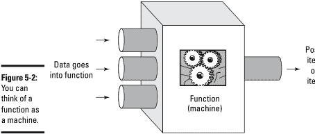

这台机器（或函数）有三个主要部分：

- **输入：** 函数可以通过其输入接收数据。这些数据元素可以是数字、字符串或任何其他类型。创建这样一台机器时，你可以拥有任意多个输入（如有必要，甚至可以为零）。
- **处理器：** 处理器就是函数本身。就 C++ 而言，这实际上是一组代码行。
- **输出：** 函数在完成其工作后可以返回某些内容。在 C++ 中，这种输出以数字、字符串或任何其他类型的形式呈现。

为了把这一切讲清楚，请试试清单 5-1 中的 FirstFunction 代码。（别忘了第二行 `#include <math.h>`，它为你提供了一些数学功能。）

### 清单 5-1：观察函数的实际运行

```cpp
#include <iostream>
#include <math.h>

using namespace std;

int main()
{
    cout << fabs(-10.5) << endl;
    cout << fabs(10.5) << endl;
    return 0;
}
```

运行此应用程序时，你会看到以下输出：

```text
10.5
10.5
```


在这段代码中，你使用了一个名为 `fabs()` 的函数（或机器），它通常读作“ef-abs”，代表浮点绝对值。该函数接收一个数字作为输入，并输出该数字的绝对值。

一个数的绝对值就是这个数的正值形式。例如，-5 的绝对值就是 5。12 的绝对值仍是 12。绝对值始终为正。而 0 的绝对值是 0。（`abs` 名称前面的 `f` 是因为它使用浮点数，而浮点数就是带小数点的数。）

因此，`main()` 中的第一行针对值 -10.5 调用 `fabs()`。随后，`cout` 接收该函数的输出（也就是*结果*），并将其打印到控制台。

然后第二行再次做同样的事，只不过这次取数字 10.5 的绝对值。

那么这个函数的处理器在哪里呢？它不在你的代码中，而在另一个文件里；下面这一行确保你的应用程序能够使用这个函数：

```cpp
#include <math.h>
```

你已经在许多地方见过函数。如果你使用计算器，输入一个数字并按下平方根按钮，计算器就会运行一个计算平方根的函数。

但函数可以比仅仅处理数字更复杂。请仔细思考这句话：当你使用文字处理器，突出显示一个单词并检查该单词的拼写时，应用程序会调用一个处理拼写检查的函数。这个函数会做类似下面的事情：

```text
This is a function to check the spelling of a single word.
Inputs: A single word.
Look up the word
  If the word is not found
    Find some suggestions.
    Open a dialog box through which you (the user)
      can change the word by either typing a new word
      or picking one of the selections, or just leaving
      it the same.
    If you made a change,
      Return the new spelling.
    Otherwise
      Return nothing.
  Otherwise
    Return nothing
```

请注意我们如何用缩进将 if 语句分组。最后的 otherwise 与第一个 if 语句对应，因为它的缩进与那个 if 语句的缩进相匹配。

所以，这就是一个执行拼写检查的函数。但请考虑这一点：当你没有突出显示某个单词，而是运行拼写检查器时，拼写检查器会针对整个文档运行。那是另一个函数。它如下所示。

```text
This is a function to check the spelling of the entire document
For each word in the document
    Check the spelling of the single word
```

计算机如何执行 for 循环中的这一步——“检查单个单词的拼写”？它会调用我们前面描述的函数。这个过程称为*代码复用*。如果你已经在其他地方拥有整个函数，就没有理由再次重写它。而这正是函数的妙处。

### 调用函数

当你运行函数中的代码时，计算机业内人士会说你在*调用*该函数。就像每个好人一样，一个好的函数也有名字。调用函数时，你通过名字来调用它。


通常，当我们在编写应用程序并编写调用函数的代码时，我们会说我们正在调用一个函数。这半是计算机行话，半是一种奇怪的毛病——我们这些计算机程序员开始对计算机产生了一点点过度的共情。

要调用函数，你需要键入它的名称，然后键入一对圆括号。在圆括号内，列出你想发送到函数输入端的各项内容。我们在这里使用的术语是*传递*，就像“你把值传递给函数”中那样。

例如，如果你想调用 `fabs()` 函数，就键入名称 fabs、一个左圆括号、你想传递给它的数字，然后键入一个右圆括号，如下例所示：

```text
fabs(-10.5)
```

但这一行本身不会做任何事。`fabs()` 函数会返回一个值，即 -10.5 的绝对值 10.5，而你可能想对这个值做点什么。例如，你可以将它打印到控制台：

```cpp
cout << fabs(-10.5) << endl;
```

或者你可以把它存到另一个变量中。但这里有个问题。在这样做之前，你需要知道函数返回的*类型*。与变量一样，函数的返回值也有类型。在本例中，类型是一种称为 double 的特殊类型。double 类型是一种浮点类型，可以在单个数字中保存许多位数字。要保存 `fabs()` 的结果，你需要有一个 double 类型的变量。清单 5-2 中的 Fabs2 示例就是这样做的。

### 清单 5-2：观察另一个函数的实际运行

```cpp
#include <iostream>
#include <math.h>

using namespace std;

int main()
{
    double mynumber;
    mynumber = fabs(-23.87);
    cout << mynumber << endl;
    return 0;
}
```

这段代码声明了一个名为 `mynumber` 的 double 变量。然后它调用 `fabs()`，向它传递 -23.87，并将返回值存入 `mynumber`。接下来，它将 `mynumber` 中的值打印到控制台。

运行此应用程序时，你会看到以下内容，即 -23.87 的绝对值：

```text
23.87
```

### 传递变量

你也可以将变量的值传递给函数。清单 5-3 中的 `fabs()` 示例创建了两个变量：一个被传递给函数，另一个接收函数的结果。

### 清单 5-3：观察又一个函数的实际运行

```cpp
#include <iostream>
#include <math.h>

using namespace std;

int main()
{
    double start;
    double finish;

    start = -253.895;
    finish = fabs(start);

    cout << finish << endl;
    return 0;
}
```

（我们用空行将代码的各个部分分开，以便稍微更容易理解。）这段代码首先创建两个变量；第一个名为 `start`，第二个名为 `finish`。然后，它将 `start` 初始化为值 -253.895。

你也可以混合传递变量和数字，或者只传递数字。下面的代码片段同样计算 10 的三次方，但为幂传递一个实际数字 3.0：

```cpp
double number = 10.0;
cout << pow(number, 3.0) << endl;
```

或者你也可以只传递数字：

```cpp
cout << pow(10.0, 3.0) << endl;
```

### 编写你自己的函数

现在，有趣的部分开始了！调用函数很棒，但当你编写自己的专用函数时，你才会获得真正的力量（哦！）。在编写函数之前，请记住这些部分：输入、主代码或处理器，以及单个输出（或者没有输出）。不过，输入被称为*参数*，输出被称为*返回值*。

清单 5-5 中展示的 AddOne 示例既提供了一个自定义函数，也提供了 `main()` 中调用该自定义函数的代码。（该函数放在 `main()` 之外——事实上，是在它之前。）

### 清单 5-5：编写你自己的函数

```cpp
#include <iostream>

using namespace std;

int AddOne(int start)
{
    int newnumber;
    newnumber = start + 1;
    return newnumber;
}

int main()
{
    int testnumber;
    int result;

    testnumber = 20;
    result = AddOne(testnumber);

    cout << result << endl;
    return 0;
}
```


请注意，本示例缺少了之前示例中的 `#include <math.h>` 条目。只有当你在代码中使用到某个包含文件的功能时，才需要在代码的 `include` 部分添加相应条目。在本例中，示例依赖于 C++ 基本语言中的标准数学功能，因此你不需要任何额外的代码。

当你把所有这些代码输入完毕，手指也得到了充分的活动和锻炼之后，那就运行它吧。由于代码量不小，一开始你可能会遇到一些编译错误；请仔细查看报错的行，找出你的代码与本书中的代码之间的差异。

运行后，你会看到

```
21
```

现在，在我们解释函数的代码之前，我们先把最有趣的部分留到最后。看一下 `main()` 中的这三行代码：

```
testnumber = 20;
result = AddOne(testnumber);
cout << result << endl;
```

你可能已经能根据一些事实推断出这个函数的功能了。首先，我们把它命名为 `AddOne()`，这本身就是个相当明显的提示。其次，当你运行这个应用程序时，控制台上显示的数字 21 比 `testnumber` 中的值大 1；也就是说，它执行了加一操作。事实上，这正是该函数所做的事情。如今计算机能做到这些，真是令人惊叹。


当你编写自己的函数时，尽量选择一个有意义且能描述该函数功能的名称。把函数命名为 `process()` 或 `TheFunction()` 之类虽然容易，但这些名称并不能准确地描述函数的作用。

那么现在来看一下函数本身。首先，这里有一些关于它的高层次观察：

- **位置：** 该函数出现在 `main()` 之前。由于编译器的工作方式，它必须在调用某个函数之前先了解该函数。因此，你要把它放在 `main()` 之前。（你也可以用另一种方式实现这一点，我们将在本章后面的“前向引用与函数原型”一节中讨论。）
- **格式：** 函数以一行看似描述函数的代码开头（我们将在本节后面解释），然后是一个左大括号，最后是一个右大括号。
- **代码：** 函数内部包含的代码与你在 `main()` 中编写的代码类型一致。

在了解了这些高层次概念之后，我们再来看一下函数内部的代码。函数的第一部分如下所示：

```c
int newnumber;
newnumber = start + 1;
```

到目前为止，这个示例直截了当。它声明了一个名为 newnumber 的整数变量，然后将其初始化为 start 加 1。但 start 是什么？它是输入之一。

最后，在右大括号之前，函数的末尾有这一行：

```c
return newnumber;
```

这就是函数的输出，即*返回值*。当你想从函数中返回某个内容时，只需输入 `return` 关键字，然后指定要返回的内容。从 `AddOne()` 函数的前两行可以看出，newnumber 比传入函数的数字大 1。因此，这一行返回的就是 newnumber。这样一来，三个部分都齐了：你获取了输入（即参数）；你通过创建一个变量并将参数加 1 来处理它；你返回了输出，即比参数大 1 的值。

但参数是什么呢？它叫做 start。它又从哪里来？以下是函数的第一行：

```c
int AddOne(int start)
```

括号中的内容就是参数列表。注意，它看起来就像变量声明：先是关键字 int（类型，即整数），后面跟着变量名 start。这就是函数的参数——也就是输入——你可以通过在函数体内直接使用名为 start 的变量来访问这个参数。

我们觉得这相当巧妙，虽然这是我们自己说的。好吧，这并不是我们发明的，但无论如何，我们还是觉得它很巧妙：*你可以将函数的输入直接当作变量来使用。*

因此，如果我们在 `main()` 中写下的是

```c
result = AddOne(25);
```

那么在整个函数中，start 的值将是 25。

但如果我们写的是

```c
result = AddOne(152);
```

那么在整个函数中，start 的值将是 152。

### 关于参数的争论

从技术上讲，*形参*一词严格地指函数视角下的函数输入。当你调用函数时，在调用行的括号中放置的内容并不是形参，而是被称为*实参*。因此，在下面的函数头中，变量 **first** 和 **last** 是形参。

但在下面这个函数调用（见清单 5-7）中

`ConnectNames("Bill", "Murray")`

字符串 **"Bill"** 和 **"Murray"** 是该调用的实参。

但函数最出色的一点是（或者至少是众多出色之处中的一点）：你可以多次调用同一个函数。在同一个 `main()` 中，你可以编写以下代码行

```
cout << AddOne(100) << endl;
cout << AddOne(200) << endl;
cout << AddOne(300) << endl;
```

这将产生以下输出：

```
101
201
301
```

在第一次调用 AddOne 时，`start` 的值是 100。在第二次调用期间，值为 200；在第三次调用期间，值为 300。

现在再来看一下这个函数头：

```c
int AddOne(int start)
```

AddOne 这个单词就是函数的名称，你可能已经猜到了。那么剩下的就是开头的 `int`，它是返回值的*类型*。函数中在右大括号之前的最后一行是

```c
return newnumber;
```

函数中的变量 newnumber 是整数类型，返回类型也是整数。这并非偶然：程序员们都听说过，朋友不会让朋友返回与函数头中指定的类型不一致的值。两者的类型必须匹配。进一步地，我们再看 `main()` 中的这一行：

```c
result = AddOne(testnumber);
```

result 变量是什么类型？它也是整数。三者类型一致。同样，这也不是偶然。只有当类型匹配时，你才能将一个值赋给另一个变量（在这里，是将函数的返回值赋给名为 result 的变量）。这里恰好匹配——它们都是整数。

关于函数头，还要注意一点：它后面没有分号。这是不需要加分号的地方之一。如果你加了，编译器就会非常困惑。Code::Blocks 编译器会显示如下错误：`error: expected unqualified-id before '{' token`。


下面回顾一下我们刚才提到的关于函数的一些规则：

- **函数头行：** 函数头行以返回类型、函数名和参数列表开头。
- **参数：** 参数的书写方式与变量声明类似，而且你确实可以在函数体内将它们当作变量使用。
- **返回类型：** 从函数返回的值在类型上必须与你在函数头中指定的类型一致。
- **关于格式的更多内容：** 函数头后面没有分号。
- **关于格式的更多内容：** 在函数头之后，你要使用一个左大括号。函数以右大括号结束。最后的右大括号告诉编译器函数在哪里结束。

最后，思索一下这行代码：

```c
testnumber = AddOne(testnumber);
```

这行代码将存储在 testnumber 中的值取出，传递给 AddOne()，得到一个新数字，然后将这个新数字存储回 testnumber。这样，testnumber 的值就会根据 AddOne() 函数的结果而改变。

### 多个参数或无参数

你编写的函数不必都只带一个参数。你可以有多个参数，也可以一个都没有。想要一个不接受任何输入的函数——这台机器——可能看起来有点奇怪。但你可能会遇到很多情况，这样做是个好主意。以下是一些函数设想：

- **日期：** 确定当前是星期几，并将其以字符串形式返回，例如“Monday”或“Tuesday”
- **用户数：** 计算当前登录到 Web 服务器计算机上的用户数量。


### 代码清单 5-7：接受多个参数

```cpp
#include <iostream>

using namespace std;

string ConnectNames(string first, string last)
{
    return first + " " + last;
}

int main()
{
    cout << ConnectNames("Richard", "Nixon") << endl;
    return 0;
}
```

在代码清单 5-7 的函数头中，我们必须为每个参数写上类型名 string。如果只为第一个参数列出类型，就会得到编译错误。（好吧，我们承认——我们确实忘了写，也正是这样才想起来要告诉你。但这说明，即使是经验丰富的程序员也会犯错。偶尔而已。）

关于这段代码，有以下几点：

- **我们没有在 `main()` 中为这两个名字创建变量。** 相反，我们只是把它们作为字符串常量（也就是用引号括起来的实际字符串）输入。

- **你可以直接在 `return` 语句中进行计算和推导。** 这样可以省去创建变量的额外工作。在这个函数中，我们本可以创建一个 string 类型的返回变量，将它设为 `first + " " + last`，然后返回该变量，如下面的代码所示：

```cpp
string result = first + " " + last;
return result;
```

但我们选择在一行中完成所有操作，就像下面这一行：

```cpp
return first + " " + last;
```

尽管你可以省去创建额外变量的工作，直接把整个表达式放进 return 语句中，但有时这样做并不好。如果表达式真的很长，如下所示：

```cpp
return (mynumber * 100 / somethingelse / 200) +
       (yetanother + 400 / mynumber) / (mynumber + evenmore);
```

## 第5章：用函数划分工作

注意 `SetUserName()` 函数头：它以单词 `void` 开头，这意味着它完全不返回任何内容。这就像外太空：只有一个空无一物的大虚空，什么也不返回，除了来自外星电波的静电噪声，但我们不打算深入那里。还要注意，因为这个函数不返回任何内容，所以没有 `return` 语句。

当然，现在这个函数除了把新用户名打印到控制台之外，确实没做太多事情，但这没关系；它向你展示了如何编写一个不返回任何内容的函数。


返回类型为 `void` 的函数完全不返回任何内容。

不要试图在返回类型为 `void` 的函数中返回某些内容。*Void* 意味着该函数完全不返回任何内容。如果你试图在函数中放入 `return` 语句，就会得到编译错误。

### 让你的变量保持局部

每个人都喜欢拥有自己的东西，函数也不例外。当你在函数的代码中创建变量时，该变量只会被那个特定函数所知。当你创建这样的变量时，它们被称为*局部变量*，人们说它们局部于那个特定函数。（好吧，不管怎样，*计算机* 人员是这么说的。）

要查看局部变量的实际作用，请考虑 `PrintName` 示例中的代码：

```cpp
#include <iostream>

using namespace std;

void PrintName(string first, string last)
{
    string fullname = first + " " + last;
    cout << fullname << endl;
}

int main()
{
    PrintName("Thomas", "Jefferson");
    return 0;
}
```

注意，在 `PrintName()` 函数中，你声明了一个名为 `fullname` 的变量。然后，你在该函数的第二行（以 `cout` 开头的那一行）使用该变量。但你不能在 `main()` 内部使用该变量。如果你试图这样做，如下面的代码所示，就会得到编译错误：

```cpp
int main()
{
    PrintName("Thomas", "Jefferson");
    cout << fullname << endl;
    return 0;
}
```

但是，你可以在 `main()` 内部*声明*一个名为 `fullname` 的变量，如下面的代码所示。不过，如果你这样做，这个 `fullname` 只局部于 `main()`，而另一个同样名为 `fullname` 的变量只局部于 `PrintName()` 函数。换句话说，每个函数都有自己的变量；它们只是恰好同名而已。但它们是*两个独立变量*。

```cpp
int main()
{
    string fullname = "Abraham Lincoln";
    PrintName("Thomas", "Jefferson");
    cout << fullname << endl;
    return 0;
}
```


当两个函数声明同名变量时，它们是两个独立变量。如果你在其中一个变量中存储一个值，另一个函数并不知道它。另一个函数只知道自己那个同名的变量。可以这样想：两个人各自在壁橱里有一个标着 Tools 的储物箱。如果 Sally 把一把锤子放进她标着 Tools 的箱子里，而 Hal 在*他*家里打开另一个同样标着 Tools 的箱子，他不会在 Sally 的箱子里看到同一把锤子，对吧？我们希望不会，否则宇宙就严重出问题了。对于变量，道理也是一样。


如果你在两个不同的函数中使用相同的变量名，很容易忘记自己正在处理两个不同的变量。只有在你确定不会发生混淆时才这样做。


如果你在两个不同的函数中使用相同的变量名（例如在 `for` 循环中使用的名为 `index` 的计数器变量），通常最好保持大小写一致。不要在一个函数中使用 `count`，而在另一个函数中使用 `Count`。尽管你当然可以这样做，但可能会在需要时把名字打错。但这不会让你访问另一个变量。（你做不到，因为它在另一个函数中。）相反，你会得到编译错误，并且不得不回去修复它。保持一致可以节省时间。

### 前向引用和函数原型

在本章的所有示例中，我们都把所编写函数的代码放在 `main()` 的代码之前。原因是编译器会从头到尾扫描代码。如果它还没有遇到某个函数，却看到了对该函数的调用，它就不知道自己在看什么，并会发出一个经典的编译错误。

这种错误可能特别令人沮丧，可能会让你花上几个小时对着电脑大吼（或者，如果你像我们一样，跑到冰箱前找些又甜又容易发胖的东西吃）。没有什么比看着你的应用程序、编译器却告诉你它错了，而你因为知道自己写了这个函数而确信它是对的，更令人沮丧的了。

“好哇，”我们能听到你说，“函数在后面呢。”但现在我们不得不把函数头输入两次，又何必费这个劲呢？

请放心，亲爱的读者，这一步是有用的。假设你有一个包含 20 个函数的源代码文件，而这些函数彼此之间会进行各种调用，那么要仔细安排它们的顺序，使每个函数只调用源代码文件中位于它上面的函数，可能会很困难。相反，大多数程序员会按某种逻辑顺序放置函数（也许并不按逻辑），而且不太担心调用顺序。然后，他们把所有的函数原型放在源代码文件顶部附近，就像我们之前在代码清单 5-9 中所做的那样。


当你输入函数原型时，许多人说你在指定一个*前向引用*。这个说法只是意味着你在提供对稍后发生的事情的引用。这不是什么大事，它主要来自一些较老的编程语言。但有些人会使用这个行话，我们希望当你听到这个说法时，它会唤起你对这本书的快乐回忆。

### 编写同一函数的两个版本

有时你可能想编写同一函数的两个版本，唯一的区别是它们接受不同的参数类型。例如，你可能想要一个名为 Combine() 的函数。一个版本接受两个字符串，并把这两个字符串连接起来，中间加一个空格。然后，它把结果字符串打印到控制台。另一个版本把两个数字相加，并把所有三个数字——前两个数字和它们的和——写到控制台。

第一个版本看起来像这样：

```cpp
void Combine(string first, string second)
{
    cout << first << " " << second << endl;
}
```

这个函数没有什么神奇或特别之处。它名为 Combine()；接受两个字符串作为参数；不返回任何内容。该函数的代码打印这两个字符串，并在它们之间加一个空格。

现在第二个版本看起来像这样：

```cpp
void Combine(int first, int second)
{
    int sum = first + second;
    cout << first << " " << second << " " << sum << endl;
}
```

同样，这里也没有什么特别惊人的地方。函数名是 Combine()，它不返回任何内容。但这个版本接受两个整数，而不是两个字符串，作为参数。代码也与之前的代码不同，它先算出两个数的和，然后打印这些不同的数字。


尽管说吧：“好吧，这一切都挺好，但你能像这样让两个函数同名吗？”没错！清单 5-10 所示的 Combine 示例包含完整代码。两个函数都出现在该清单中。

### 清单 5-10：编写函数的两个版本

```cpp
#include <iostream>

using namespace std;

void Combine(string first, string second)
{
    cout << first << " " << second << endl;
}

void Combine(int first, int second)
{
    int sum = first + second;
    cout << first << " " << second << " " << sum << endl;
}

int main()
{
    Combine("David", "Letterman");
    Combine(15, 20);
    return 0;
}
```

请注意，在`main()`中我们调用了每个函数。我们如何指定想要哪一个？*只需传入正确的类型。* 仔细看看第一次调用：

```cpp
Combine("David", "Letterman");
```

这个调用包含两个字符串，因此编译器知道要使用接受两个字符串的第一个版本。现在看第二次函数调用：

```cpp
Combine(15, 20);
```

这个调用接受两个整数，因此编译器知道要使用该函数的第二个版本。

编写同一函数的两个版本的过程称为函数的*重载*。通常，重载是件坏事，就像我们去一家不错的餐厅把胃撑得过饱一样。但在这里它是件好事——甚至很有用。

重载函数时，参数必须不同。例如，函数可以接受相同类型的信息，但使用不同数量的参数。当然，前面的示例表明参数也可以因类型不同而不同。你也可以使用不同的返回类型，不过它们的不同必须*不只是返回类型*。


### 调用所有字符串函数

要充分利用字符串，你需要使用一些专为字符串服务的特殊函数。不过，使用这些函数与本章到目前为止使用的其他函数略有不同。你不是直接调用函数，而是先输入保存字符串的变量名，然后输入一个句点（或者*点*，网络爱好者更喜欢这么叫），再输入函数名以及任何参数（如果读者中有纯粹主义者，那就是*实参*）。


你编写字符串函数的方式之所以不同，是因为你正在利用一些面向对象编程特性。《第I册》第8章详细介绍了这类函数（称为*成员函数*）的工作方式。

你可以使用的一个函数是`insert()`。如果你想向另一个字符串中插入更多字符，就可以使用这个函数。例如，如果你有字符串 "Something interesting and bizarre"，并从索引 10 开始把字符串 "seriously"（末尾带一个空格）插入其中间，就会得到字符串 "Something seriously interesting and bizarre"。


处理字符串时，第一个字符是第 0 个索引，第二个字符是第 1 个索引，依此类推。

以下代码行使用`insert()`函数执行插入：

```cpp
string words = "Something interesting and bizarre";
words.insert(10, "seriously ");
```

这些行中的第一行只是创建一个名为`words`的字符串，并用短语 "Something interesting and bizarre" 把它填满。第二行执行插入。注意这种奇怪的函数调用方式：你先指定变量名`words`，然后一个点，再是函数名`insert`。接下来，像往常一样，在括号中跟上参数。对于这个函数，第一个参数是你要插入字符串的索引。第二个参数是你要插入的实际字符串。

这两行运行后，名为`words`的字符串变量包含字符串 "Something seriously interesting and bizarre"。

你也可以使用一个类似的函数来删除字符串的一部分，信不信由你，这个函数叫`erase()`。尽管计算机领域的人喜欢用他们的行话把事情搞得晦涩难懂（也就是说，通过措辞把人弄糊涂），但他们偶尔也会放下架子，选一些实际上说得通的名字。

下面这行代码从名为`words`的字符串中删除 16 个字符，从第 20 个索引开始：

```
words.erase(19,16);
```

因此，如果名为`words`的变量包含字符串 "Something seriously interesting and bizarre"，那么这行运行后，它将包含 "Something seriously bizarre"。

另一个有用的函数是`replace()`。这个函数用另一个字符串替换字符串的某个部分。要使用`replace`，你需要指定想从字符串中的哪里开始替换，以及想替换多少个字符。然后指定你用来替换旧有、过时部分的字符串。

例如，如果你的字符串是 "Something seriously bizarre"，并且你想用字符串 "body" 替换单词 "thing"，你就告诉`replace`从索引 4 开始，用单词 "body" 替换 5 个字符。为此，你输入：

```
words.replace(4, 5, "body");
```

注意，你替换的字符数不必与新字符串的长度相同。如果字符串一开始是 "Something seriously bizarre"，那么在这个 replace 语句运行后，字符串将包含 "Somebody seriously bizarre"。但这个字符串实际上并不会包含一个极其古怪的人；它只包含这个字符串。

清单 5-11 所示的`OperatingOnStrings`示例演示了所有这些函数协同工作。

### 清单 5-11：操作字符串

```cpp
#include <iostream>

using namespace std;

int main()
{
    string words = "Something interesting and bizarre";
    cout << words << endl;

    words.insert(10, "seriously ");
    cout << words << endl;

    words.erase(19,16);
    cout << words << endl;

    words.replace(4, 5, "body");
    cout << words << endl;

    return 0;
}
```

《第I册》第5章 用函数划分工作

运行此应用程序时，你会看到以下输出：

```
Something interesting and bizarre
Something seriously interesting and bizarre
Something seriously bizarre
Somebody seriously bizarre
```

第一行是原始字符串。第二行是`insert()`函数的结果。第三行是`erase()`函数的结果。最后一行是`replace()`函数的结果。

### 理解 main()

本章到目前为止的所有应用程序都有一个`main()`。这个`main()`实际上是一个函数。注意它的头部，后面跟着花括号内的代码：

```cpp
int main()
```

你可以看出，这绝对是一个函数头：它以一个返回类型开头，然后是函数名`main()`。这只是`main()`函数的一种形式——Code::Blocks 默认使用的形式。不过，你可能决定让用户在控制台输入应用程序名称时能够提供输入。在这种情况下，你可以使用`main()`函数的另一种形式，它包含两个参数：

```cpp
int main(int argc, char *argv[])
```

### 谁、什么、哪里，以及为什么返回？

`main()`函数头以类型`int`开头。这意味着函数`main()`会返回某些东西。但返回什么？返回给谁？还有为什么、何时，以及诸如此类的问题？

计算机有时会使用`main()`的结果来返回错误消息，如果应用程序由于某种原因没有工作，或者没有做它应该做的事。但这里有个内幕：*输出返回值根本行不通*——至少，在大多数人使用的图形环境中行不通。

这是真的。对于许多计算机，尤其是 Windows 计算机，返回值对任何人都没什么用。返回类型是专门为与批处理文件（扩展名为 BAT 的文件，最初作为 DOS，即磁盘操作系统的一部分出现）配合使用而设计的。因此，除非你计划使用批处理文件（而且很多人仍然这样做），否则只需返回 0。


## 第5章：用函数划分工作

在某些高性能Unix系统上，会使用`main()`的返回值。其中一些运行所谓“关键任务”应用程序的系统（这个花哨说法是指计算机程序员觉得他们做的事情对宇宙安全很重要）确实会使用`main()`的返回值。这些计算机可能运行着数百个应用程序。如果其中一个应用程序返回的不是0，另一个应用程序就会检测到这一点并通知某人（通常是在半夜给这个可怜虫发传呼）。当你还在学习C++时，不太可能需要返回0以外的值；但如果你有幸为一家开发对宇宙福祉至关重要的应用程序的公司工作，你可能需要向队友确认一下，自己是否确实需要返回0以外的值。

那么，代码清单5-12中`main()`里那些看起来极其古怪的参数又是怎么回事呢？第一个参数还算直白：它是一个整数变量，名字叫`argc`，听起来像史酷比会说的话。但第二处古怪之处呢？要理解第二个参数，你需要知道这两个参数被用作命令行参数。当你运行一个应用程序时，尤其是在命令提示符下，你会键入应用程序名称并按Enter。但在按Enter之前，你可以在应用程序名称后面跟上其他单词。你在Unix和Windows命令行工具（也称为DOS）中使用的许多命令，都是先有应用程序名称，然后跟各种参数。例如，在Unix上，你可以键入以下命令，把名为myfile的文件复制到名为yourfile的新文件中：

```text
cp myfile yourfile
```

在Windows上，你可以键入以下命令，把名为myfile的文件复制到名为yourfile的新文件中：

```text
copy myfile yourfile
```

当你运行这样的命令时，实际上运行的是一个名为copy的应用程序。该应用程序接收两个命令行参数——在这里是“myfile”和“yourfile”——并把这两个字符串作为参数传入`main()`函数。

对于`main()`函数，函数头中的第一个参数是`argc`（读作“arg-SEE”），它表示命令行参数的数量。对于copy或cp命令（见前面两行代码），你有两个参数（“myfile”和“yourfile”），所以argc会是2。

`main()`函数中的第二个参数是看起来神秘的`char *argv[]`。变量名是`argv`，读作“arg-VEE”。第I册第9章讨论数组这一主题。一个*数组*是存储在一个名称下的一系列变量。`argv`变量就是这样一个东西。要访问存储在`argv`这个单一总称下的各个变量，你可以这样做：

```cpp
cout << argv[0] << endl;
cout << argv[1] << endl;
```

（在前面的示例中，你使用方括号，类似于访问字符串中的各个字符。）

对于`myfile`和`yourfile`这两个命令行参数，这两行代码会打印出以下行：

```text
myfile
yourfile
```

你可以使用`for`循环访问命令行参数。代码清单5-12所示的`CommandLineParameters`示例演示了这种技术。

### 代码清单5-12：访问命令行参数

```cpp
#include <iostream>
#include <stdlib.h>
int main(int argc, char *argv[])
{
    for (int index=0; index < argc; index++)
    {
        cout << argv[index] << endl;
    }
    return 0;
}
```

**在Code::Blocks中设置命令行参数**

如果你尝试在Code::Blocks中使用默认设置选择“构建→运行”来运行该示例，示例只会输出执行路径和应用程序名称，不会输出其他内容。要添加命令行参数，请选择“项目→设置程序参数”。你会看到“选择目标”对话框，可以在“程序参数”字段中键入命令行参数。在此字段中键入CommandLineParameters并单击“确定”。现在可以运行该示例了。

当你从提示符使用以下命令行参数运行此应用程序时：

```text
CommandLineParameters  Command Line Parameters
```

你会看到以下输出：

```text
C:\CPP_AIO\Book1\Chapter05\CommandLineParameters\bin\Debug\CommandLineParameters.exe
CommandLineParameters
Command
Line
Parameters
```

`argv`列表中的第一项始终是可执行文件路径和应用程序名称。

## 第6章：拆分源代码文件

### 本章内容

- 创建多个源代码文件
- 创建头文件
- 在源文件之间共享变量
- 利用神秘的标头包装器

正如你可以将工作划分到函数中一样，你也可以将工作划分到多个源代码文件中。这样做的主要原因很简单，就是帮助保持项目易于管理。此外，使用多个源代码文件，你可以让多个人同时处理同一个项目，每个人同时处理不同的源代码文件。当然，目标是确保你的同事去做那些更艰难、更折磨人且毫无乐趣的部分，而所有功劳都归你。

使用多个源文件的关键在于知道在哪里把源代码拆成若干部分。和其他事情一样，如果你在错误的地方拆分源代码，它就会——嗯，坏掉。

本章将展示如何把源代码划分到多个文件中（而且都在正确的位置）。我们给出的示例使用Code::Blocks；不过，如果你使用其他工具，我们也会提供一些*Makefile*技巧。（*Makefile*是特殊文件，包含编译器用来将源代码转换为可执行文件的指令。使用Code::Blocks时你不必担心它们；其他工具会告诉你如何为这种特定工具创建Makefile，但如果你仍然对*Makefile*感到好奇，可以查看本书附录了解更多信息。）

### 创建多个源文件

本节讨论如何创建多个源代码文件，先介绍Code::Blocks，再介绍其他编译器。在Code::Blocks中这个过程要简单得多，我们强烈推荐这种做法。

当你创建第二个源代码文件时，这段代码会成为项目的一部分。当你编译时，编译器会编译项目中的所有源代码文件，假设你自上次以来修改过它们。

3. 单击“下一步”跳过初始欢迎页面。

   如果你选择了“空文件”模板，请跳到第5步。使用“C/C++头文件”或“C/C++源文件”模板时，你会看到一个语言选择页面。

4. 突出显示要使用的语言——C或C++——然后单击“下一步”。

   向导会询问你想给文件起什么名字、想把它存储在哪里，以及哪些构建应使用该文件，如图6-2所示。（关于这些选择的更多内容见第5～8步。）

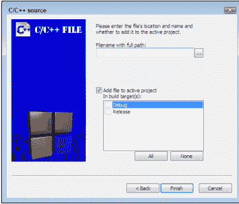

图6-2：提供向导所需的文件信息。

5. 在“带完整路径的文件名”字段中键入文件的路径和文件名。

   必须提供完整路径，即使你希望文件位于当前文件夹中也是如此。单击省略号以显示“选择文件名”对话框，你可以在其中选择文件位置。“选择文件名”对话框中显示的默认路径是当前文件夹。

6. 勾选应使用该文件的各个构建。

   或者，可以单击“全部”将文件添加到所有构建中。

**记住**

应用程序的调试版本会包含特殊信息，可用于查找程序错误。应用程序的发布版本更小、执行更快。每个版本都有其用途，因此开发人员通常需要在某个时候同时创建两者。


- 7. 点击“完成”。

向导会将新文件添加到你的项目中。Code::Blocks 会自动打开该文件，以便你开始编辑。同时，在“管理”窗口中也会看到你添加的文件，如图 6-3 所示。在这种情况下，你会同时看到源文件和一个头文件。注意源文件以深色显示，而头文件以灰色显示。这表明源文件会被编译以生成项目，而头文件不会。本章的“与头文件共享”一节将更详细地讨论编译器如何处理头文件。

图 6-3：“管理”窗口显示用于编译项目的文件。

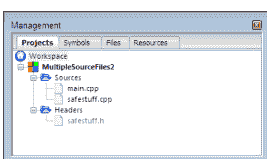

如果你向 Code::Blocks 添加了一个确实不需要的文件，可以在“管理”窗口中右键单击该文件，然后从上下文菜单中选择“从项目中移除文件”。该文件将从项目中消失，但仍会保留在你创建它的目录中。如果之后你确实又想要这个文件，可以右键单击“管理”窗口中的项目条目，从上下文菜单中选择“添加文件”，然后在“添加文件到项目”对话框中使用相应选项选择要重新添加到项目中的文件。

如果 Code::Blocks 没有自动打开你添加的文件，你可以通过在树中双击其名称来打开它。此时，在源代码文件顶部会出现一个额外的选项卡。这些选项卡代表当前打开的不同文件。你可以单击某个选项卡，让该文件的代码显示在源代码窗口中。当你单击另一个选项卡时，窗口会显示该文件的源代码。而且，幸运的是，Code::Blocks 会记住你切换选项卡时所做的任何更改。因此，你可以在屏幕上随意切换，而计算机不会感到混乱。

当项目中有多个文件后，你可以将部分源代码放在一个文件中，另一部分放在另一个文件中。但在这样做之前，你可能需要阅读本章的其他一些小节，因为我们会解释如何正确地划分源代码，以免它最后变成像切蛋糕时被压坏的那种样子。

- 4. 右键单击 `main.cpp`，然后从上下文菜单中选择“删除”。

你可能会看到一个询问是否删除该文件的对话框。如果是，直接单击“是”。此时，起始的 `main.cpp` 文件将被删除。

- 5. 找到并高亮显示要复制到新项目中的文件。

使用 Ctrl-单击方法从列表中选择多个文件。Code::Blocks 让你可以轻松地一次选择多个文件，这样你就不必多次打开“添加文件到项目”对话框。


- 6. 单击“打开”。

Code::Blocks 会显示一个对话框，询问要将文件添加到哪些构建目标中，如图 6-5 所示。该对话框的确切外观会根据你选择的文件数量而有所不同。

- 7. 选择要使用的构建目标，然后单击“确定”。

Code::Blocks 会将所需的文件引用添加到项目中，如图 6-6 所示。

图 6-5：选择使用这些文件的构建目标。

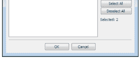

图 6-6：新项目现在包含对所选文件的引用。

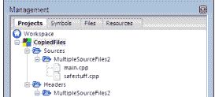


请注意，引用仍然显示文件的原始位置。在本例中，这些文件来自 MultipleSourceFiles2 项目。如果你修改了原始项目中的文件，新项目中的文件也会随之更改。要真正将文件复制到新项目中，你需要创建一个副本并将其粘贴到项目文件夹中——然后像我们在这里所做的那样将其添加到项目中。

### 其他编译器中的多个源文件

如果你使用的是 Code::Blocks，则实际上不需要阅读本节，因为 Code::Blocks 会自动处理 Makefile。生活很美好。如果你想了解 Code::Blocks 是如何完成这项任务的，可以查看项目的 `.depend` 文件，例如 MultipleSourceFiles.depend。`.depend` 文件是简单的 XML，因此你可以使用任何支持 XML 的应用程序（包括 Internet Explorer 或 Firefox）查看它。否则，你需要阅读本节。

要向其他编译器添加源代码文件，你需要修改 Makefile，并且需要了解 Makefile 规则和编译过程。真麻烦。（附录 A 中更详细地描述了 Makefile。）修改 Makefile 的方法有很多。如果你使用隐式规则，可能只需要将文件名添加到源文件列表中。如果你为每个文件使用单独的规则，则需要为这个新文件添加另一条规则。在这种情况下，你可能仍然有一个包含所有源代码文件的列表，或者一个包含所有目标文件（即只是将源代码文件名扩展名改为 `.o` 或 `.obj`）的列表，这时你就需要再添加一个条目。

例如，你可能为每个源文件都有单独的规则，如下所示：

```
main.o: main.cpp
    $(CC) -c main.cpp -o main.o $(CFLAGS)
```

在这种情况下，你需要为你的新文件添加另一行与此类似的规则。如果你的新文件是 `orangegoo.cpp`，你的新规则将如下所示：

```
orangegoo.o: orangegoo.cpp
    $(CC) -c orangegoo.cpp -o orangegoo.o $(CFLAGS)
```

请注意，必须使用制表符缩进第二行。如果使用空格，可能无法正常工作。

你可能还有一个列出目标文件的规则。请记住，这很可能是目标文件而不是源文件，因为目标文件是编译器生成的临时文件。因此，你可能会有这样一个宏：

```
OBJ = main.o orangegoo.o
```

这个宏会被列在最终可执行文件的规则中。这样，当你生成可执行文件时，make 实用程序会首先检查这两个 `.o` 文件是否是最新的。如果不是，make 会先根据你之前提供的规则生成这两个 `.o` 文件。简洁又简单；可惜 Makefile 太丑了。

### 创建多个文件

在两个源文件能够协同工作之前，它们必须以某种方式互相了解。仅仅因为它们都位于计算机上，并不意味着它们知道彼此的存在。计算机在这种事情上有时候有点傻。要让两个源文件最终打开心扉、彼此认识，你需要告诉每个文件另一个文件中有什么内容。

当你编写一个函数时，通常该函数必须出现在同一源文件中所有调用它的代码之前。这是因为编译器解析代码的方式：如果编译器遇到对某个函数的调用，但尚未听说过该函数，就会报错。但解决这个问题的方法是使用函数原型。函数原型只是一个函数的头部行，以分号结尾，如下所示：

```cpp
void BigDog(int KibbleCount);
```

在源文件后面才是实际的函数，并重复这一头部行。但不是用分号，而是用左花括号、函数代码和右花括号，如下所示：

```cpp
void BigDog(int KibbleCount)
{
    cout << "I'm a lucky dog" << endl;
    cout << "I have " << KibbleCount << " pieces of food" << endl;
}
```

因此，在函数原型之后，无论函数代码本身位于调用之前还是之后，你都可以调用该函数。


对于编译器来说，要理解一个函数调用，它只需要在代码进行调用的位置有一个函数原型。至于该函数是否真的存在，则由链接器来决定。

因为函数调用只需要一个函数原型，所以你可以将函数本身放在另一个源代码文件中。因此，你可以有多个独立的源文件，就像 MultipleSourceFiles 示例中那样，如清单 6-1 和 6-2 所示。（第一个源代码文件 `main.cpp` 显示在清单 6-1 中，第二个源代码文件 `mystuff.cpp` 显示在清单 6-2 中。）


### 清单6-1：仅使用原型调用函数

```cpp
#include <iostream>

using namespace std;

void BigDog(int KibblesCount);

int main()
{
    BigDog(3);
    return 0;
}
```

### 清单6-2：从单独的文件中使用函数

```cpp
#include <iostream>

using namespace std;

void BigDog(int KibblesCount)
{
    cout << "I'm a lucky dog" << endl;
    cout << "I have " << KibblesCount << " pieces of food" << endl;
}
```

在清单6-1和6-2中，我们把函数定义与原型分开了。当你将这两个文件编译为一个应用程序时（无论是在Code::Blocks中按F9，还是使用本章前面“其他编译器中的多个源文件”一节中描述的方法），它们会完美地组合在一起。然后你可以运行该应用程序，并看到如下有点有趣的输出：

```text
I'm a lucky dog
I have 3 pieces of food
```

还要注意，我们必须在mystuff.cpp文件的开头放置相同的#include行。这是因为mystuff.cpp使用了cout，而要使用cout，它需要`#include <iostream>`这一行。


### 命名空间快速概述

清单6-1和6-2中的`using namespace std;`行告诉编译器使用一个特定的命名空间std。命名空间是一组类和函数的集合。`std`命名空间（即标准命名空间）包含许多有用的类和函数，例如`string`。如果不包含这条声明，你就需要在使用std中的类或函数时，通过键入`std::<class or function>`来加上前缀。例如，要使用string，你需要键入`std::string`。由于这是一种令人痛苦的编写代码方式，因此你需要添加`using namespace std;`这一行。

### 使用头文件共享

将源代码拆分为多个文件很容易，但很快你可能会遇到一个问题。如果你有一个函数——比如说SafeCracker()——而这个函数非常有用，并且可能会在多个其他源代码文件中被多次调用，那么你需要在每个调用它的文件中为SafeCracker()提供一个原型。该原型可能如下所示：

```cpp
string SafeCracker(int SafeID);
```

但与其在每个使用该函数的文件中都键入这一行，我们知道有一个更简单的方法。（我们计算机人员总是在寻找更简单的方法，这样我们最终就能退休了。）只需将这一行放到自己的文件中，称为头文件，并给该文件一个.h或.hpp扩展名。（使用哪个扩展名由你决定，因为真的无所谓；我们通常用.h。）例如，我们可以将`string SafeCracker(int SafeID);`这一行保存到一个名为`safestuff.h`的文件中。

然后，与其在每个需要该函数的文件开头键入这行头文件行，你只需键入

```cpp
#include "safestuff.h"
```

这样你就有了用于MultipleSourceFiles2示例的三个源代码文件，我们已在清单6-3、6-4和6-5中展示。第一个是main.cpp，它调用函数。第二个是safestuff.h，它包含函数原型。第三个是safestuff.cpp，它包含原型出现在头文件中的函数的实际代码。文件很多，但现在代码被拆分成了易于管理的部分。另外，确保将这三个文件保存在同一目录中。

### 清单6-3：在主文件中包含头文件

```cpp
#include <iostream>
#include "safestuff.h"

using namespace std;

int main()
{
    cout << "Surprise, surprise!" << endl;
    cout << "The combination is (once again)" << endl;
    cout << SafeCracker(12) << endl;
    return 0;
}
```

### 清单6-4：在头文件中包含函数原型

```cpp
using namespace std;

#ifndef SAFESTUFF_H_INCLUDED
#define SAFESTUFF_H_INCLUDED

string SafeCracker(int SafeID);

#endif // SAFESTUFF_H_INCLUDED
```

### 清单6-5：包含实际的函数代码

```cpp
#include <iostream>

using namespace std;

string SafeCracker(int SafeID)
{
    return "11-26-16";
}
```

不过，在编译这个应用程序之前，我们需要给你几点提示。首先，编译器*不会*将头文件编译成单独的`.o`或`.obj`文件。对于清单6-3到6-5中的应用程序，编译器只编译两个文件：`main.cpp`和`safestuff.cpp`。编译器并不会编译头文件，而是在读取`main.cpp`文件并到达头文件的`#include`行时，临时切换去读取该文件，并假装它仍在读取同一个`main.cpp`文件。在继续过程中，它将所有内容都当作`main.cpp`文件的一部分来编译。如果你在其他源代码文件中包含这个头文件，它也会对这些源文件重复同样的操作。

要让这段代码编译通过，请记住以下规则：

- **Makefiles：** 如果你使用的是需要自己处理Makefiles的编译器，不要添加用于编译头文件的规则（头文件通常以`.hpp`或`.h`为扩展名）。只编译源文件（通常以`.cpp`或`.cc`为扩展名）。
- **Visual C++：** 尽管到目前为止我们对Microsoft Visual C++（VC++）谈论得很少，但如果你使用VC++，不要将头文件添加到项目中。只添加源文件。VC++会在一个称为依赖项的树中保留头文件列表，但你不需要自己添加。
- **Code::Blocks：** 还有什么能比这更简单？你只需创建文件，Code::Blocks会为你处理所有文件的关联——无需担心任何事情。头文件和源文件都会显示在项目列表中，Code::Blocks还会处理哪些文件需要被编译的细节。

遵循这些规则后，你就可以编译并运行清单6-3到6-5中的代码了。当你运行该应用程序时，会看到以下输出：

```text
Surprise, surprise!
The combination is (once again)
11-26-16
```


如果你有一个包含某些函数的源文件，创建一个包含相关函数原型的头文件通常是一个好做法。然后你可以将头文件命名为与源文件相同的名称，只是扩展名不同。我们在清单6-4和6-5中就是这么做的：我们将头文件命名为safestuff.h，源文件命名为safestuff.cpp。


有些人喜欢说 include file，而不是 header file（头文件）。我们通常说 header file，因为对我们来说，include 通常是一个动词，说下面这样的话会显得有点别扭：“我们非常确信我们包含了 include file，但如果我们没有包含正确的 include file，你能否把我们包含在你们的会议中；在讨论中，我们一定会包含一些关于如何包含正确的 include file 的问题。然后，你可以包含对我们关于 include file 包含内容的包含问题的回答。”你知道，这话确实很难说出口，所以我们说 header file。

### 只添加一次头文件

Code::Blocks默认会在头文件中包含几行代码。这些行创建一个符号，告诉编译器源文件中是否已经包含过该头文件，这样编译器就不会重复添加它。重复添加头文件是一个错误，因为那样你会为函数定义两次前向引用。以下是你在Code::Blocks中初始创建头文件时看到的内容：

```cpp
#ifndef SAFESTUFF_H_INCLUDED
#define SAFESTUFF_H_INCLUDED

#endif // SAFESTUFF_H_INCLUDED
```

当你在Code::Blocks中输入头文件代码时，要将其输入在`#define SAFESTUFF_H_INCLUDED`行和`#endif // SAFESTUFF_H_INCLUDED`行之间。本章后面的“使用神秘的头文件包装器”一节会详细描述这些自动生成的条目。

### 使用尖括号还是引号

你可能已经注意到清单6-3中的代码有特别之处。当我们包含`safestuff.h`文件时，我们没有像其他`#include`行那样将它放在尖括号内，而是放在引号中：

```cpp
#include "safestuff.h"
```


这是因为多年来程序员们一直在争论头文件到底应该放在硬盘上的哪个位置。是放在与项目相同的目录或文件夹中？还是单独放在一个专属目录里？或者干脆把它们放到后院晾干？


无论你把头文件放在哪里，关于何时使用引号、何时使用尖括号的规则如下：编译器会在几个目录中查找头文件。而且它有可能在源文件所在目录中查找。如果你使用尖括号（即小于号和大于号），如 `#include <string>`，编译器不会在源文件所在目录中查找。但如果你使用双引号，如 `#include "safestuff.h"`，编译器会*首先*在源文件所在目录中查找。如果编译器在那里找不到头文件，就会像使用尖括号时那样，在其余目录中查找。

有些人总是喜欢使用双引号。这样一来，无论头文件是否与源文件在同一目录中，编译器都应该能找到它。


如今大多数专业程序员*总是*使用尖括号。这迫使程序员将头文件放在一个公共区域。对于非常大的项目，程序员喜欢将源文件放在一个专门的目录中，并将头文件放在另一个专门的目录中。这样头文件就不会与源文件在同一目录中。


对于小型项目，有些人喜欢将所有的源文件和头文件堆放在同一个目录中。这些人通常对系统头文件使用尖括号（例如 `#include <string>`），而对自己编写的头文件使用双引号。在本书的项目中，我们大体遵循这条规则。我们编写的头文件与源文件在同一目录中，对我们自己的文件使用双引号的 `#include` 行，对系统头文件使用尖括号的 `#include` 行。

如果你采用与我们相同的方法，你就能立刻知道某条 `#include` 行引用的是你自己的头文件还是其他头文件。如果引用的是你自己的，它就会使用双引号。


如果你开始参与大型 C++ 项目，你可能会发现项目经理们采用始终使用尖括号的规则。对于大型项目，这通常是最佳策略。

如果你尝试编译并在 `#include` 行上遇到*没有这样的文件或目录*错误，那很可能是因为你把头文件放在了源文件目录中，却使用了尖括号而不是双引号。试着将该行改为双引号。

### 在源文件之间共享变量

当你在函数内部声明变量时，它保持为该函数的局部变量。但你可能希望多个函数共享同一个变量：一个函数可以存储某些内容，另一个函数可以读取其内容并输出到控制台。为此，请在函数外部声明该变量。这种办法在尝试跨多个源文件共享变量之前一直有效。如果不小心，每个源文件最终都会得到该变量的一个独立副本。在单个源文件内部，变量可以在函数之间共享，但不能在源文件之间共享。这可能会令人困惑。

有一个技巧可以解决这个问题。在且仅在一个源文件中声明该变量。然后，在且仅在一个头文件内*再次*声明它，但要在前面加上关键字 *extern*，例如 `extern int DoubleCheeseburgers;`。

清单 6-6、6-7 和 6-8 中的 `GlobalVariable` 示例演示了如何在多个源文件之间共享单个变量。

### 清单 6-6：使用全局变量

```cpp
#include <iostream>
#include "sharealike.h"

using namespace std;

int main()
{
    DoubleCheeseburgers = 20;
    EatAtJoes();
    return 0;
}
```

### 清单 6-7：使用头文件声明全局变量

```cpp
#ifndef SHAREALIKE_H_INCLUDED
#define SHAREALIKE_H_INCLUDED

extern int DoubleCheeseburgers;
void EatAtJoes();

#endif // SHAREALIKE_H_INCLUDED
```

### 清单 6-8：为全局变量声明实际存储

```cpp
#include <iostream>
#include "sharealike.h"

using namespace std;

int DoubleCheeseburgers;

void EatAtJoes() {
    cout << "How many cheeseburgers today?" << endl;
    cout << DoubleCheeseburgers << endl;
}
```

这样做时一定要小心；要完全做对非常棘手。你在头文件内声明一次变量，但必须记住 extern 关键字。它告诉各个文件：“这个变量是在别处声明的，但这是它的名称和类型，你可以使用它。”然后，你在其中一个源文件中声明该变量，但不带 extern 关键字；这会为变量创建实际的存储空间。最后，在使用该全局变量的每个源文件中包含这个头文件。


当你在多个源文件之间共享变量时，它就是一个*全局变量*。由单个函数使用的变量是*局部变量*。如果你在单个源文件内的函数之间共享变量，但不是多个源文件之间，人们称之为*局限于源文件的全局变量*。


使用全局变量时，要在头文件中使用 extern 关键字。如果忘记这样做，你会让每个源文件都拥有自己的、恰好同名的变量。

### 使用神秘的头文件包装器

当你包含一个头文件时，通常每个源文件只需要包含它一次。但这会带来一个问题：假设你有一个庞大的软件项目，多个头文件都包含了你的另一个头文件 `superheader.h`。如果你包含了所有这些其他头文件，如何确保 `superheader.h` 只被包含一次呢？

答案看起来奇怪，但确实有效。你需要在每个头文件的开头加上以下几行：

```c
#ifndef SHAREALIKE_H
#define SHAREALIKE_H
#endif
```

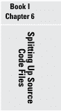


取决于你使用的 C++ IDE，你的编辑器可能会像 Code::Blocks 那样自动添加这些行。在这种情况下，你需要在 `#define SHAREALIKE_H` 和 `#endif` 行之间输入头文件内容。但是，如果你的 IDE 没有自动添加这些行，请务必手动添加，这样你的代码就会看起来像清单 6-7 中的代码。否则，编译器可能会报出你可能无法立即识别的错误。

这些*头文件包装器*（通常这样称呼）可确保头文件中的代码在每次编译时，每个源代码文件只被处理一次。这些包装器使用了被称为*预处理指令*的特殊行。基本上，*第二*行定义了一个有点类似于变量、但仅在编译期间使用的东西；这个东西被称为*符号*。在我们的例子中，这个符号叫做 `SHAREALIKE_H`；我们是通过取文件名、将其全部大写、并将点替换为下划线来得到它的。

第一行检查这个符号是否已经被定义。如果*没有*，就继续处理后面的代码行。下一行接着定义该符号，因此现在它确实已为后续过程定义。然后编译器处理文件中其余的所有行。最后一行 `#endif` 仅仅用来结束最开始的那条指令。

现在考虑一下，如果你两次包含同一个文件会发生什么，例如

```cpp
    #include "sharealike.h"
    #include "sharealike.h"
```

（如果你包含了两个不同的文件，而每个文件都包含了 `sharealike.h`，这种情况就会间接发生。）当编译器*第二次*处理 `sharealike.h` 时，它会看到第一行，检查 `SHAREALIKE_H` 符号是否已定义。但这一次它已被定义了！因此，编译器不再重复处理所有行，而是直接跳到文件末尾的 `#endif` 行。这样，你的头文件在每一个源代码文件中只会被处理一次。很巧妙吧？也有点令人困惑？是的，确实有点。所以请记住以下规则：


当你创建头文件时，一定要用头文件包装器将其包围起来。你可以使用任何你喜欢的符号名，只要它只使用字母、数字和下划线，不以数字开头，并且不是你的源代码中已有的变量名或 C++ 关键字。但大多数人会根据文件名本身的一些变体来选择，例如 `MYFILE_H` 或 `MYFILE_H_`，甚至 `_MYFILE_H_`。


## 第7章：通过指针引用数据

### 本章内容包括

- 使用两种内存：栈和堆
- 通过指针访问变量地址
- 使用`new`关键字在堆上创建变量
- 将指针作为参数并返回指针
- 轻松修改变量

你住在哪里？别大声说出来，因为成千上万的人正在读这本书，你可不想让他们都知道。所以只在心里想想你的地址就好。大多数地方都有某种地址，这样邮政服务就知道把你的包裹送到哪里，有线电视师傅也能在“现在到下周星期四下午5点之间”的某个时间出现。（所以请确保你当时在家。）

其他东西也有地址。例如，办公楼里的一家大公司很可能给所有的小隔间编了号。建筑物里的办公室通常有编号；公寓通常也有编号。

现在假设一个叫山姆的人在第180号办公室工作。然而上周，山姆因为花了太多时间上网而被赶出了门。现在莎莉优先得到了180号办公室，尽管她并不是接替山姆的职位。山姆搬走了；莎莉搬了进来。同一间办公室——住着不同的人。

计算机的内存工作原理与此类似。计算机内存的每一个微小部分都与一个表示其位置或*地址*的数字相关联。在本章中，我们将向你展示，一旦确定了存储在内存中的变量的地址，你就可以用这个地址做很多强大的事情，从而拥有创建强大应用程序的工具。


如果说C++编程中有一个最重要的主题，那就是指针的概念。因此，如果你想成为百万富翁，请阅读本章。好吧，它可能不会让你成为百万富翁，但这样说*或许*能激励你掌握本章内容。然后你就能成为一名顶尖程序员，赚很多钱。

### 变量的堆与栈

C++应用程序使用两种内存：堆和栈。*堆*是应用程序为不同函数*分配*——即留出——的公共内存区域，供应用程序中的不同函数使用。全局变量放在这个堆中。

然而，每当应用程序调用函数时，该函数会在一个称为*栈*的内存区域中获得自己的一块小的私有内存存储空间。它被称为栈，是因为它就像一叠纸：你可以把东西放在栈顶，也可以从栈顶拿走东西，但你不能在中间放任何东西，也不能从中间拿任何东西。计算机用这个栈来跟踪你的所有函数调用。

假设你有一个名为`GoFishing()`的函数。函数`GoFishing()`调用`StopAndBuyBait()`，后者又调用`PayForBait()`，`PayForBait()`调用`GetOutCreditCard()`，`GetOutCreditCard()`调用`UseFakeCreditCard()`。计算机如何跟踪这一团乱麻呢？它使用了*栈*这个比喻。首先保存原始函数`GoFishing()`。然后当该函数调用`StopAndBuyBait()`时，计算机通过把它放在`GoFishing()`*之上*来记住该函数——不是放在同一个存储箱里，而是放在前一项之上的一个存储箱中，这样前一项仍然还在。然后，当该函数调用`PayForBait()`时，计算机再次把该函数放在`StopAndBuyBait()`之上来记住它，依此类推，直到所有项一个叠一个地堆起来，`UseFakeCreditCard()`在最上面，`GoFishing()`在最下面。这个过程*把*项*压*到栈顶。

接下来，当计算机处理完`UseFakeCreditCard()`时，它会从栈顶*弹出*。它取回的是调用`UseFakeCreditCard()`之前暂停的位置，恰好是`GetOutCreditCard()`。当该函数完成后，计算机再次弹出栈顶找到`PayForBait()`。和之前一样，这正是它上次暂停的地方。它一直重复这个过程，直到回到最初的起点，也就是`GoFishing()`。

内存中的每个位置都有一个与之关联的数字。当你的应用程序启动时，计算机留出很大一块内存，然后与微处理器紧密协作，为这些内存分配一系列数字。你的应用程序变量和应用程序代码就存放在这块内存中。请思考这一点：如果你的应用程序位于内存中，那么每个函数也位于内存中的特定位置，这个位置有一个与之关联的数字或地址。换句话说，每个函数都有一个地址。


应用程序中的每个函数和每个变量在内存中都有一个驻留位置。这个位置有一个关联的数字。因此，每个函数和每个变量都有一个*地址*。

### 给C++施以十六进制魔法

在计算机编程中，你迟早会遇到一种在计算机上表示数字的奇怪方式。这种奇怪的方式被称为*十六进制*，有时干脆叫*hex*。在C++中，你可以通过以0x开头的字符来识别十六进制数。这些字符实际上不是数字的一部分；它们只是用来标记数字，就像双引号标记字符串一样。普通的十进制数字由0、1、2、3、4、5、6、7、8和9这十个数字组成，而十六进制数字则由这些数字再加上六个：A、B、C、D、E和F，总共有16个数字。（是的，我们知道，字母A到F不是数字。但在十六进制中，它们被视为数字。）一个很好的理解十进制数计数方式的方法是使用汽车上的里程表，它（如果你诚实的话）只会前进，不会后退。它从00000000开始（假设是八位数，这已经很多了）。最右边的数字一遍又一遍地从0到9循环。当任一数字达到9且其右侧所有数字都是9时，它左边的下一个数字就加1。例如，当达到00000999时，随着每个9变回0，左边的下一个数字加1，得到00001000。

用十六进制数计数的方法与此相同，只不过不是到9就循环回去，而是接着到A，再到B，一直到F，然后再循环回去。因此，用八位数表示的前17个十六进制数是：00000000, 00000001, 00000002, 00000003, 00000004, 00000005, 00000006, 00000007, 00000008, 00000009, 0000000A, 0000000B, 0000000C, 0000000D, 0000000E, 0000000F, 和00000010。注意，当我们在末尾到达F时，再次循环，给左边的下一位加1。处理十六进制数时，你可能会看到像0xAAAA0000和0x0000A3FF这样的数字。（我们为了C++表示法加了0x。）顺便说一下，这两个数分别加1是0xAAAA0001和0x0000A400。

计算机用来跟踪函数调用的栈也只是一块内存。计算机所称的栈*顶*实际上是内存中的下一个位置。计算机把函数放到栈上的方式，是把上一个函数中计算机暂停位置的*地址*放到栈上。

当计算机调用你的某个函数时，它不仅会在栈上保存返回位置的地址，还会在栈上为你的局部变量保留一些空间。

这意味着你的变量可以存在于两个地方：

- **堆：** 堆是内存中的公共区域，你可以在其中存储全局变量。
- **栈：** 栈是计算机存储被调用函数的信息以及这些函数的局部变量的区域。

第1册 第7章 通过指针引用数据


栈是各种被称为*数据结构*的美妙事物中的一个例子。计算机程序员倾向于在计算机上模拟现实生活中的事物。一叠纸显然不能满足计算机专家们的要求；他们希望能够对计算机中的数据进行同样的操作，于是他们称这种数据结构为栈。他们还发明了许多种数据结构，其中包括一种类似的叫做队列的结构：对于队列，你从一端放入数据，从另一端取出数据。这就像你把纸放在一叠纸的上面，但只从底部取纸。当你在商店排队等候时，你就亲身体验了队列。人们排成一队，有些人就把一排人称为队列。


每个十六进制数都有一个对应的十进制数。当你把十进制数和十六进制数并排列表时，你会看到，例如，`0x0000001F` 与十进制数31相邻。因此，这两个数字代表相同数量的物品，比如苹果。记住，当你想买苹果时：“我想买一艾弗（one-ef）个苹果。”


外表可能具有欺骗性。十六进制数10所代表的苹果数量与十进制数16相同。这就是为什么使用0x表示法是个好主意。因此，不写十六进制10，我们会写0x10，以明确我们说的不是十进制数。

### 十六进制与十进制之间的转换

如果你想在十六进制和十进制之间进行转换，可以使用 http://www.binaryhexconverter.com/hex-to-decimal-converter 上的“十六进制转十进制”应用程序，或者 http://www.binaryhexconverter.com/decimal-to-hex-converter 上的“十进制转十六进制”应用程序。这两个应用程序可以让你轻松地在两种数字系统之间转换，并且你可以在任何支持浏览器的设备上使用它们。

要将十六进制数转换为十进制数，请选择“十六进制转十进制”应用程序，并使用数字键和字母A到F（例如BF1263）将十六进制数输入到“在此输入十六进制数”字段中。（你不需要输入开头的零，例如00FB1263——它们不会显示——也不需要输入C++中使用的0x。）输入完成后，点击“转换”。该应用程序会立即将这个漂亮的十六进制数转换成同样漂亮的十进制数！在这种情况下，你会看到16454243。你也可以反过来操作：如果你有一个十进制数，例如16454243，你可以选择“十进制转十六进制”应用程序，将该值输入到“在此输入十进制值”字段中，然后点击“转换”，即可将其转换为十六进制。如果你将16454243转换为十六进制，你会得到BF1263，这正是你最初输入的。

你也可以转换单词（如果你很无聊的话）。迪斯科组合ABBA的十六进制数对应的十进制数是43962。十六进制数FADE对应的十进制数是64222。而约翰的房子，他称之为十六进制数FACADE，对应的十进制数是16435934。玩得开心！


## 第7章：通过指针引用数据

你可以使用大写或小写字母表示十六进制数。但是，不要在单个数字中混用大小写。不要使用 0xABab0000。而应使用 0xabab0000 或 0xABAB0000。

### 获取变量的地址

由于每个变量都存在于内存中的某个位置，因此每个变量都有一个地址。如果你有一个函数声明了一个名为 NumberOfPotholes 的整数变量，那么当你的应用程序调用该函数时，计算机会在内存中的某个位置为 NumberOfPotholes 分配空间。

如果你想获取变量 NumberOfPotholes 的地址（这是计算机行话，意思是*找到……的地址*），只需在它前面加一个 & 符号即可。

清单7-1展示了 VariableAddress 示例，该示例获取一个变量的地址并将其打印出来。

### 清单7-1：使用 & 字符获取变量的地址

```cpp
#include <iostream>

using namespace std;

int main()
{
    int NumberOfPotholes = 532587;
    cout << &NumberOfPotholes << endl;
    return 0;
}
```

运行此应用程序时，控制台上会出现一个十六进制数。这个数字可能与我们看到的一致，也可能不一致；并且每次运行应用程序时，它可能相同，也可能不同。结果取决于计算机究竟如何为你分配变量，以及它执行操作的顺序。不同版本的编译器之间，这可能会有很大差异。运行清单7-1时，你会看到

```
0x22ff74
```


你从该应用程序看到的输出是名为 NumberOfPotholes 的变量的地址。换句话说，那个数字是 NumberOfPotholes 变量在内存中存储位置的十六进制形式。该输出不是变量的*内容*，也不是变量内容转换成的十六进制；而是变量地址转换成的十六进制。

这个输出没什么用，除非你想听起来像个计算机技术高手。你可以到处宣称这个变量位于 0x22ff74，但这在人生中不会让你走得很远。（不过，这可能会让你收获一些好奇的目光，也许还值得。）但是，当你获得那个地址后，可以将其用于其他目的。例如，你可以使用所谓的指针变量，通过该地址来修改变量本身。*指针变量*与其他变量类似，只不过它存储的是另一个变量的*地址*。

要声明指针变量，需要指定它将指向的变量类型。然后，在变量名前面加一个星号，如下所示：

```c
int *ptr;
```

这一行声明了一个*指向*整数的变量。换句话说，它可以包含整数变量的*地址*。那么，如何获取整数变量的地址呢？很简单！使用 & 符号即可！因此，你可以这样做：

```c
ptr = &NumberOfPotholes;
```

这一行将变量 `NumberOfPotholes` 的地址放入 `ptr` 变量中。请记住，`ptr` 保存的不是坑洞的数量；相反，它保存的是名为 `NumberOfPotholes` 的变量的地址。


指针的类型由它所指向的项的类型来指定。如果指针变量指向整数，其类型就是*指向整数的指针*。在 C++ 表示法中，其类型是 `int *`（中间有空格）或 `int*`（无空格）；你可以带空格或不带空格输入。如果指针变量指向字符串，其类型就是*指向字符串的指针*，这种类型的表示法是 `string *`。

`ptr` 变量保存了一个地址，但那个地址处有什么呢？该地址就是名为 `NumberOfPotholes` 的存储单元在内存中的位置。内存中的那个位置正是 `NumberOfPotholes` 中存储的数据。

仔细思考指针这个概念。如有必要，把这一节重读几遍，直到它牢牢印在脑子里。然后好好琢磨它。半夜醒来想着它。打电话给陌生人闲聊它。你对指针理解得越透彻，你的编程生涯就会越顺利——你赚到一百万美元的可能性也越大。

### 指针示例

|  |  |
| --- | --- |
| 假设 `NumberOfPotholes` 包含数字 5000。这意味着计算机将数字 5000 存储在内存中的某个位置。当你获取 `NumberOfPotholes` 的地址时，你取的是可以找到数字 5000 的内存地址。 | 因此，当你设置<br>`ptr = &NumberOfPotholes;`<br>时，`ptr` 指向一个包含数字 5000 的内存位置。 |

### 使用指针更改变量

当你的指针变量保存了另一个变量的地址后，你可以使用该指针访问另一个变量中的信息。这意味着有两种方式可以获取变量中的信息：使用变量名本身（例如 NumberOfPotholes），或者使用指向它的指针变量。

如果你想在 NumberOfPotholes 中存储数字 6087，可以这样做：

```cpp
NumberOfPotholes = 6087;
```

或者，你可以使用指针。要使用指针，首先按如下方式声明它：

```cpp
ptr = &NumberOfPotholes;
```

然后，要更改 NumberOfPotholes，你不能只是给它赋值。相反，要在它前面加一个星号，如下所示：

```cpp
*ptr = 6087;
```

如果 ptr 指向 NumberOfPotholes，这两行代码将具有相同的效果：两者都会将值改为 6087。这种在指针变量前加星号的过程称为对指针解引用。等你读完这本书，你会知道一大堆别人不知道的词汇。（而且你新近丰富的词汇量一开始会让你打电话聊天变得困难。）

看看清单7-2中展示的 DereferencePointer 示例，它演示了所有这些内容。

### 清单7-2：使用指针变量修改原始变量

```cpp
#include <iostream>

using namespace std;

int main()
{
    int NumberOfPotholes;
    int *ptr;
    ptr = &NumberOfPotholes;
    *ptr = 6087;
    cout << NumberOfPotholes << endl;
    return 0;
}
```

在清单7-2中，main() 的第一行声明了一个整数变量，第二行声明了一个指向整数的指针。下一行获取该整数变量的地址并将其存储在指针中。然后，第四行通过对指针解引用来修改原始整数。为了确认这个过程确实有效，下一行打印 `NumberOfPotholes` 的值。运行此应用程序时，你会看到以下输出：

```
6087
```

这是正确的；这就是应用程序通过指针变量存储在原始变量中的值。

你也可以通过指针读取原始变量的值。看看清单7-3中展示的 ReadPointer 示例。这段代码通过指针变量 ptr 访问 NumberOfPotholes 的值。当代码取得该值后，会将其保存在另一个名为 SaveForLater 的变量中。

### 清单7-3：通过指针访问值

```cpp
#include <iostream>

using namespace std;

int main()
{
    int NumberOfPotholes;
    int *ptr = &NumberOfPotholes;
    int SaveForLater;
    *ptr = 6087;
    SaveForLater = *ptr;
    cout << SaveForLater << endl;
    *ptr = 7000;
    cout << *ptr << endl;
    cout << SaveForLater << endl;
    return 0;
}
```

运行此应用程序时，你会看到以下输出：

```
6087
7000
6087
```

还要注意，在这个清单中，我们再次通过 `ptr` 更改了值——这次改为 7000。运行应用程序时，你可以看到该值确实改变了，但 `SaveForLater` 中的值保持不变。这是因为 `SaveForLater` 是一个独立的变量，与其他两个变量没有关联。不过，另外两个变量彼此关联。


## 第一卷

### 第7章

## 通过指针引用数据

### 指向字符串

指针变量喜欢指向。指针变量可以指向任何类型，包括字符串。但是，一旦你说明某个变量指向某种类型，它就只能指向该类型。也就是说，与任何变量一样，你不能在它背后改变它的类型。编译器不会允许你这么做。

要创建指向字符串的指针，只需将变量类型设为 `string *`。然后你可以将其设置为某个字符串变量的地址。StringPointer 示例（如清单7-4所示）演示了这一点。

### 清单7-4：使用指针指向字符串

```cpp
#include <iostream>

using namespace std;

int main()
{
    string GoodMovie;
    string *ptrToString;
    GoodMovie = "Best in Show";
    ptrToString = &GoodMovie;
    cout << *ptrToString << endl;
    return 0;
}
```

在清单7-4中，你可以看到名为 `ptrToString` 的指针变量指向名为 `GoodMovie` 的变量。但当你希望通过指针访问字符串本身时，需要在指针前加上星号（*）来解引用指针。

运行这段代码时，你会看到解引用后的指针的结果，也就是 `GoodMovie` 变量的值：

```
Best in Show
```

你可以通过指针更改字符串的值，同样是先解引用，如以下代码所示：

```cpp
*ptrToString = "Galaxy Quest";
cout << GoodMovie << endl;
```

这里，我们对指针进行解引用，并将其设置为字符串 "Galaxy Quest"（顺便说一句，这是一部不错的电影）。然后，为了证明它确实发生了改变，我们打印了变量本身：`GoodMovie`。如果在清单7-4末尾（但在 `return 0` 之前）添加此代码，结果将是：

```
Galaxy Quest
```

你还可以像 StringPointer2 示例（如清单7-5所示）那样，使用指针访问字符串的各个部分。

### 清单7-5：使用指针指向字符串

```cpp
#include <iostream>

using namespace std;

int main()
{
    string HorribleMovie;
    string *ptrToString;

    HorribleMovie = "L.A. Confidential";
    ptrToString = &HorribleMovie;

    for (unsigned i = 0; i < HorribleMovie.length(); i++)
    {
        cout << (*ptrToString)[i] << " ";
    }

    cout << endl;
    return 0;
}
```

运行此应用程序时，你会看到这部糟糕电影的字母一个个出现，并且彼此之间有空格，如下所示：

```
L . A .  C o n f i d e n t i a l
```

好吧，我们并不喜欢《洛城机密》。但它赢得了两座奥斯卡奖，还获得七项提名，并赢得了其他一大堆奖项，所以我们这样说也不觉得太愧疚。


当你通过指针访问字符串中的字符时，需要将星号和指针变量放在括号中。否则，编译器会感到困惑，它首先用变量名访问方括号中的索引，然后再应用星号。这是反过来的，对计算机没有意义，因此编译器会给出错误信息。但你可以像清单7-5中那样使用括号来解决问题。

该应用程序逐个字符地遍历整个字符串。我们使用了字符串的 length 函数来查找字符串中有多少个字符。在循环内部，我们取出了字符串的各个字符，并在每个字符后打印一个空格。

请注意，i 的类型是 unsigned 而不是 int。length() 函数返回的是 unsigned 值而不是 int 值。如果你试图将 i 用作 int，编译器会显示以下警告：

```
warning: comparison between signed and unsigned integer
```

为循环变量使用正确的数据类型非常重要。否则，当循环值增加到超过循环变量所能支持的范围时，应用程序将会失败。即便对最优秀的开发者来说，试图找出这样的错误也是一件令人沮丧的事。


你还可以通过指针更改字符串中的单个字符。为此，可以使用类似 `(*ptrToString)[5] = 'X';` 的行。请注意，与之前一样，我们必须将变量名连同解引用（即星号）字符一起放在括号中。

字符串的长度也可以通过指针获得。你可以通过解引用指针来调用 `length()` 函数，同样要小心地放置括号，例如：

```cpp
for (unsigned i = 0; i < (*ptrToString).length(); i++)
{
    cout << (*ptrToString)[i] << " ";
}
```

### 指向其他内容

当你创建指针变量时，必须指定它指向的数据类型。之后，你不能更改它指向的数据类型，但可以*更改它所指向的内容*。例如，如果你有一个指向整数的指针，你可以让它指向名为 `ExpensiveComputer` 的整数变量。然后，在同一应用程序中，稍后你可以让它指向名为 `CheapComputer` 的整数变量。我们使用 ChangePointer 示例（如清单7-6所示）演示这一点。

### 清单7-6：使用指针指向其他内容，然后再指回来

```cpp
#include <iostream>

using namespace std;

int main()
{
    int ExpensiveComputer;
    int CheapComputer;
    int *ptrToComp;

    ptrToComp = &ExpensiveComputer;
    *ptrToComp = 2000;
    cout << *ptrToComp << endl;

    ptrToComp = &CheapComputer;
    *ptrToComp = 500;
    cout << *ptrToComp << endl;

    ptrToComp = &ExpensiveComputer;
    cout << *ptrToComp << endl;
    return 0;
}
```

这段代码首先初始化所有涉及的内容——两个整数以及一个指向整数的指针。

接下来，代码将指针指向 `ExpensiveComputer`，并使用指针向 `ExpensiveComputer` 中存入某些内容。然后，它再次使用指针写出 `ExpensiveComputer` 的内容。

然后，代码改变了指针所指向的内容。要做到这一点，你需要将指针设置为另一个变量的地址 `&CheapComputer`。非常简单。下一行将 500 存储到指针所指向的内容中。但那是 `CheapComputer`。然后，你再次将其打印出来。

现在，为了强调这一点，以防计算机没有听明白，你接着将指针指回原来的变量 `ExpensiveComputer`。但你没有在其中存储任何内容。这一次，你只是打印出这台高性能超级计算机内部已有的内容。你再次通过解引用指针来做到这一点。当你运行该应用程序时，你会看到 `ExpensiveComputer` 中仍然是 2000，也就是最初存入的值。这意味着，在将指针指向其他内容并做了一些操作之后，原来的变量保持不变。这是一件好事，因为考虑到当时没有人指向它，它只能独自待在一边，完全被忽视，感到被冷落。


如果你用一个指针在多个不同变量之间来回指向，请务必小心。很容易忘记指针到底指向哪个变量。

### 关于指针变量的一些技巧

以下是一些关于使用指针变量的实用技巧。


你可以像声明普通变量一样，在一条语句中声明两个相同类型的指针变量。但是，必须*每一个*都用星号开头，如下行所示：

```c
int *ptrOne, *ptrTwo;
```


如果你试图在一行中声明多个指针，但只在第一个指针前加星号，那么只有那一个是指针，其余的不是。这可能会在以后引发严重的头痛和肌肉痉挛，因为这行代码可以顺利编译。下面这行就是这样一个例子：

```c
int *ptrOne, confused;
```

在这里，`confused` 不是指向整数的指针，而只是一个整数。当心！


有些人喜欢将星号紧跟在类型后面，如下例所示，以强调该类型是*指向整数的指针*：

```c
int* ptrOne;
```


## 第一册
### 第 7 章
## 通过指针引用数据

不过，我们宁愿不那样做，原因很简单：这样会让像我们这样健忘的人很容易忘记，后面用逗号分隔的任何变量如果也要作为指针，就都需要有自己的星号。


当我们声明一个指针变量时，通常会让它的名字以字母 ptr 开头，这是 pointer（指针）的缩写。这样一来，（在查看代码时）我们立刻就能知道它是一个指针变量。这有时会让生活稍微轻松一点，至少在生活里那些需要保持清醒的领域是如此。

### 使用 new 动态分配

*堆*是一个特殊的地方，你可以在那里声明存储空间。不过，要使用这块存储空间，你采用的方法与简单地声明一个变量不同。


当你创建一个变量时，你要经历这样的过程：实际键入一个变量，并给它一个类型、一个名称，以及（迟早要给的）一个值。当你编写代码时，你就是在那个时候决定自己需要一个变量。不过，你也可以编写这样的代码：让计算机只在程序运行之后才分配空间。计算机在堆上分配这块空间。这个过程称为动态分配。

### 使用 new

要在堆上声明一个存储箱，首先你需要设置一个变量，帮助你跟踪这个存储箱。这个变量必须是一个指针变量。

假设你已经在堆上的某个地方声明了一个整数。（我们将在下一段向你展示如何做到这一点。）你没有给它命名，因为这类变量没有名字。只需把它看作堆上的一个整数。然后，针对这个整数变量，你还可以有第二个变量。这第二个变量不在堆上，它是一个指针，保存着那个整数变量的地址。因此，如果你想访问那个整数变量，就要通过解引用这个指针变量来实现。

要在堆上分配内存，你需要做两件事：第一，声明一个指针变量。第二，调用一个名为 new 的函数。new 函数与其他函数有一点不同：你不需要在它的参数两边加上圆括号。因此，它实际上被认为是一个运算符。其他运算符还有用于整数加法和减法的 + 和 -。这些其他运算符的行为与函数类似，但你不用圆括号。

要使用 new 函数，你需要指定想要创建的变量类型。例如，下面这一行创建了一个新的整数变量：

```cpp
int *somewhere = new int;
```

当你使用 `new` 运算符时，通常的说法是：你正在*在堆上分配内存*。

此时，你可能会问那个至关重要的问题：为什么？如果我只是必须再创建一个变量来指向它，那我为什么要费事在堆上的某个地方创建一个没有名字的整数变量呢？这看起来不是适得其反吗？

答案是这样的：如果你把变量分配在堆上，就可以利用许多特性。你可以把指针与一种叫作数组的东西一起使用。*数组*就是一个大型存储箱，里面有多个槽位，每个槽位存放一个条目。如果你建立一个存放指针的数组，就可以把所有这些指针都存放起来，而不必逐个给它们命名。这些指针可以指向复杂的东西，也就是对象。（我们在第一册第 8 章介绍对象，在第一册第 9 章介绍数组。）然后，举例来说，如果你想把这些变量（如果它们是字符串，可能会相当大）全部传递给一个函数，你只需要传递数组，而不是字符串本身。这一步节省了栈上的内存。

除了对象和数组之外，你还可以让一个函数创建并返回一个变量。然后，当你从函数那里拿回这个变量时，你可以使用它；用完之后，再删除它。最后，你还可以把指针传入函数。这样做时，函数实际上可以替你修改这个指针。参见本章后面的“将指针变量传递给函数”和“从函数返回指针变量”。

### 使用初始化器

当你调用 `new` 时，可以为你正在分配的内存提供一个初始值。例如，如果你正在分配一个新的整数，也可以一下子把数字 10 存进这个整数中。

代码清单 7-8 中所示的 `Initializer` 示例演示了这一点。

### 代码清单 7-8：将值放在括号中以初始化你分配的内存

```cpp
#include <iostream>

using namespace std;

int main()
{
    int *ptr = new int(10);
    cout << *ptr << endl;
    return 0;
}
```

在这段代码中，我们调用了 new，但还在圆括号里放了一个数字。这个数字会一开始就被放进那块内存中。这一行代码等价于下面两行代码：

```cpp
int *ptr = new int;
*ptr = 10;
```


当你在 new 运算符中初始化一个值时，你所做的事情的技术说法是*调用构造函数*。原因是编译器会向你的应用程序添加一堆代码——这些代码在幕后运行。这些代码就是*运行时库*。如果你传入一个初始值，这个库中会包含一个初始化整数变量的函数。执行这一操作的函数称为*构造函数*。当你运行它时，你就是在*调用*它。因此，你是在调用构造函数。有关构造函数的更多信息，参见第一册第 8 章。

### 用 new 创建字符串

你可以使用 new 分配几乎任何类型，包括字符串。你只需键入 new，后面跟上 string。


有一种特殊类型不能用 new 分配。如果一个函数没有返回值，你就把返回类型指定为 void。你不能用 new 分配 void 类型。同样，你也不能创建 void 类型的变量。编译器不会让你这么做。

代码清单 7-9 中所示的 UseNew2 示例，就是一个为字符串调用 new 的例子。像往常一样，记得写上 `<iostream>` 的 include 行。

### 代码清单 7-9：对字符串使用 new 运算符

```
#include <iostream>

using namespace std;

int main()
{
    string *Password = new string;
    *Password = "The egg salad is not fresh.";
    cout << *Password << endl;
    return 0;
}
```

这段代码使用 new 关键字分配了一个新字符串，并把结果保存在 Password 变量中。接下来，它通过解引用指针，把一句有趣的评论存进新分配的字符串中。最后，它再次通过解引用指针打印出这句评论。请记住，字符串变量本身在堆上的某个地方，而且没有名字。如果它要发表那种在高级餐厅里听到的评论，那么它最好还是保持无名。


当你把一串字符存入你用 new 分配的字符串变量时，你是把字符串存入已分配的内存中，而不是存入指针变量中。指针变量仍然保存着已分配内存的地址。指针只不过是这块内存的公关人员，替它处理所有交易和事务，不管是否合乎道德。


处理字符串时，你可以使用一种快捷方式，来替代那种有些笨拙的方法：为了调用各种字符串函数，要在名称两边加上圆括号，并在前面加上星号。（那样连打字都很难！）例如，与其键入 (*Password).length()，你可以使用如下代码行所示的快捷表示法（Password 后面的字符是一个减号，然后是一个大于号，合在一起看起来像箭头）：

```cpp
cout << Password->length() << endl;
```


当你为 string 类型调用 new 时，可以使用圆括号来初始化字符串。要做到这一点，只需把字符串放在引号中，然后放在 string 一词后面的圆括号里，如下面这行代码所示：

```cpp
string *Password = new string("The egg salad is still not fresh.");
```

这一行等价于代码清单 7-9 中 main 内部的前两行代码。


尽管这个指针指向一个字符串，但指针本身仍然保存着一个数字（具体来说，是它所指字符串的地址）。这是一个数字，但不要把它和整数混淆。不过，你可以对指针做一些基本的算术运算，详见第一册第 9 章。

### 释放指针

当你通过调用 new 函数在堆上分配内存，并且用完这块内存之后，你需要让计算机知道这一点，不管这块内存是一点点还是很多。计算机不会预先查看你的代码，来判断你是否还会继续使用这块内存。因此，在你的代码中，当你用完这块内存时，就要释放它。

释放内存的方式是调用 delete 函数，并传入指针的名称：

```cpp
delete MyPointer;
```


这一行会出现在你用完通过 new 分配的指针之后。（与 new 运算符一样，delete 也是运算符，其参数周围不需要括号。）

FreePointer 示例（见代码清单 7-10）完整演示了分配指针、使用指针，然后释放指针的过程。

### 代码清单 7-10：使用 delete 清理指针

```cpp
#include <iostream>

using namespace std;

int main()
{
    string *phrase = new string("All presidents are cool!!!");
    cout << *phrase << endl;

    (*phrase)[20] = 'r';
    phrase->replace(22, 4, "oked");
    cout << *phrase << endl;

    delete phrase;
    return 0;
}
```

运行此应用程序时，你会看到以下输出：

```text
All presidents are cool!!!
All presidents are crooked
```

在这段代码中，我们首先分配了一个新的 string 并初始化它，将其地址保存在名为 phrase 的指针变量中。然后我们输出该短语，对它进行操作（加入了一些编辑内容），然后再次输出它。最后，我们释放了该指针使用的内存。


尽管人们通常说你是在删除指针或释放指针，但实际上你释放的是指针所指向的内存。该指针仍可用于后续的 new 操作。不过，我们会遵循传统，继续使用这些说法。


实际上，不释放指针也能过关，因为计算机在应用程序结束时释放该程序使用的所有内存。这样，你的内存就可以供你想运行的其他所有酷炫应用程序使用。然而，养成在用完指针后释放它们的习惯是一种好做法；否则，在应用程序运行时，你可能会用尽分配给堆的所有内存。而且，大公司的一些大型软件系统会持续运行，可能每周或每两周才关闭一次。如果应用程序的某一部分一直拒绝释放其数据，最终堆很可能会被填满，整个应用程序就会关闭。

### 代码清单 7-11：函数无法更改传入其中的原始变量

```cpp
#include <iostream>

using namespace std;

void ChangesAreGood(int myparam)
{
    myparam += 10;
    cout << "Inside the function:" << endl;
    cout << myparam << endl;
}

int main()
{
    int mynumber = 30;
    cout << "Before the function:" << endl;
    cout << mynumber << endl;

    ChangesAreGood(mynumber);
    cout << "After the function:" << endl;
    cout << mynumber << endl;

    return 0;
}
```

代码清单 7-11 包含一个名为 ChangesAreGood() 的函数，它会修改接收到的参数。（它给名为 *myparam* 的参数加 10。）然后它会打印该参数的新值。

main() 函数将一个整数变量 *mynumber* 初始化为 30，并打印其值。然后它调用 ChangesAreGood() 函数，该函数会更改其参数。从 ChangesAreGood() 函数返回后，main() 再次打印该值。

运行此应用程序时，你会看到以下输出：

```text
Before the function:
30
Inside the function:
40
After the function:
30
```

在函数调用之前，*mynumber* 是 30。而在函数调用之后，它仍然是 30。但函数给它的参数加了 10。这意味着当函数修改其参数时，*原始变量保持不变*。两者是独立的实体。只有值 30 进入了函数。实际变量并没有进入。它留在了 main() 中。

这可以防止刻薄、恶意的函数把外部世界搞得一团糟。但如果你编写了一个*想要*修改原始变量的函数，那该怎么办？

### 随机数与字符串

在代码清单 7-14 中，函数的正中间出现了一些特殊代码，我们需要解释一下。这是我们用来生成随机数并将其放入字符串中间的一个小技巧。首先，我们必须额外添加两行 `include`：

```cpp
#include <stdlib.h>
#include <sstream>
```

第一行提供了对 `rand()` 函数的访问。第二行提供了对我们即将讨论的一些特殊功能的访问——具体来说，是 `ostringstream` 类型。下面是完成这一魔法的三行代码：

```cpp
int randomnumber = rand();
ostringstream converter;
converter << randomnumber;
```

这些代码中的第一行通过调用名为 `rand()` 的函数创建一个随机数。该函数返回一个整数，这个整数是随机的。下一行创建一个名为 `ostringstream` 的类型的变量，这种类型便于将数字转换为字符串。这种类型的变量具有类似控制台的功能。你可以使用插入运算符（`<<`），只不过你写入的任何内容不会进入控制台，而是进入字符串本身。但这并不是普通的字符串——它是 `ostringstream` 类型的特殊字符串（该名称来自 *output*、*string* 和 *stream* 这几个词；通常，允许插入运算符 `<<` 或提取运算符 `>>` 执行输入和输出的东西被称为*流*）。完成这些之后，我们可以把结果字符串添加到名为 `code` 的字符串变量上。为此，我们使用下面这行代码：

```cpp
code->append(converter.str());
```

括号内的部分——`converter.str()`——返回 `converter` 变量的实际字符串版本。而我们可以使用 `append` 函数轻松地将其追加到 `code` 变量中。这有点棘手，但效果相当不错。

运行此应用程序时，你会看到类似以下输出：

```text
CR41NQ
CR18467NQ
CR6334NQ
CR26500NQ
CR19169NQ
CR15724NQ
CR11478NQ
CR2935BNQ
CR26962NQ
CR24464NQ
```


绝不要从函数中返回该函数内局部变量的地址。局部变量位于为该函数分配的栈空间中，而不是堆中。函数执行完毕后，计算机会释放该函数使用的栈空间，为*下一个*函数调用腾出空间。如果你尝试这样做，这些变量在一段时间内可能没问题，但随后经过几次其他函数调用后，变量的数据就会被覆盖。（被抹掉了。去了天上伟大的变量之家！）


正如函数的参数通常是值一样，函数通常也*返回*一个值。在返回指针的情况下，函数仍然只是返回一个值——它返回的是指针的值，即一个表示地址的数字。

### 将指针作为非指针返回

你可能觉得，每次想使用从函数返回的指针时都要对其进行解引用很烦人。上一节中的代码清单 7-14 就是一个例子，说明你每次都需要解引用指针。但是，你可以通过在指针刚从机器中产生出来时立即解引用它来避免这个问题。代码清单 7-15 中的 ReturnPointer2 示例演示了这一点：在函数调用前加上星号，这会立即解引用结果。然后你把结果放入一个局部非指针变量中。之后，变量中就保存了这个值，当你想使用该值时，就不需要再解引用指针了。因此，调用 cout 时，你只需直接使用该变量，而无需使用星号和其他指针相关的繁琐符号。

### 代码清单 7-15：立即解引用返回值，这样就不必将其作为指针使用

```cpp
#include <iostream>

using namespace std;

string *GetNotSoSecretCode()
{
    string *code = new string("ABCDEF");
    return code;
}

int main()
{
    string newcode;
    int index;

    for (index = 0; index < 10; index++)
    {
        newcode = *GetNotSoSecretCode();
        cout << newcode << endl;
    }

    return 0;
}
```


运行此应用程序时，你会看到以下秘密但极具吸引力的输出：

```
ABCDEF
ABCDEF
ABCDEF
ABCDEF
ABCDEF
ABCDEF
ABCDEF
ABCDEF
ABCDEF
ABCDEF
```

### 按引用传递

C++ 基于古老的 C 语言，而 C 语言是一种简单的语言。C++ 有一些特性使它“更舒适”。其中一个特性是引用。引用是函数中指定参数的另一种方式，通过这种方式，函数可以修改原始变量。不是在参数类型后跟一个星号（*）来表示指针，而是在其后跟一个与号（&）。然后，在整个函数中，你可以像平常一样使用该参数，而不是把它当作指针。但你对参数所做的每一次更改都会影响原始变量！这是一个超前于时代的概念（或者说是落后于时代，考虑到其他语言已经拥有这个特性多年了）。

看一下清单7-16中所示的 PassByReference 示例，注意我们没有使用任何指针。

#### 清单7-16：使用引用时，你不需要指针！

```cpp
#include <iostream>

using namespace std;

void MessMeUp(int &myparam)
{
    myparam = myparam * 2 + 10;
}

int main()
{
    int mynumber = 30;
    MessMeUp(mynumber);
    cout << mynumber << endl;
    return 0;
}
```

看看那段代码！不再有指针了！在 `main()` 中，你不需要取任何东西的地址，也不需要那个*解引用*词，拼写检查器坚持认为它是错的。函数本身也没有指针。你只需在函数头部的参数名前放上那个老式的与号就行了。


如果你有 `string` 参数，并使用 `&` 按引用传递它们，那么在调用 `string` 函数时，请跳过快捷的 `->` 表示法。也不要解引用任何东西。这里没有指针。只需输入点（或句点）和函数。不需要星号。


如果你编写了一个使用引用的函数，而其他人在代码中使用你的函数（有关如何做到这一点的信息，请参阅第I册第6章），你最终可能会让那个人生气。另一个人可能没有意识到：“嘿，老兄——这东西刚刚把我的变量搞乱了！”砰！变量被改变了。如何避免这种情况？提醒另一个人。向任何使用你的函数的人明确说明：它使用引用，并且会修改变量，甚至是那些毫无戒心的小变量。

#### 按 const 引用传递

在清单7-13中，你会看到如何通过按引用将 `string` 传递给函数来修改它。假设你仍然想按引用传递 `string`，但不希望允许任何人修改它。也许你打算稍后将该 `string` 用于其他目的。当然，你可以按值传递 `string`，这样调用者就无法修改它。问题在于字符串可能变得相当大，而将所有那些数据移动到函数中确实很耗时——传递引用更简单也更快。使用 `const` 引用可以同时获得使用引用的速度优势，以及按值传递的不可修改特性。清单7-17中所示的 `VariablePointer4` 示例演示了如何完成这项任务。

#### 清单7-17：使用 `const` 引用获得速度与不可更改的数据

```cpp
#include <iostream>

using namespace std;

string Paranoid(const string &realMessage)
{
    string NewString = realMessage;
    NewString[6] = '!';
    NewString.replace(9, 1, "");
    NewString.insert(18, "Ad");
    NewString.replace(15, 2, "in");
    NewString.replace(23, 7, "!");
    NewString.replace(4, 3, "ali");

    return NewString;
}
```

## 第8章：使用类

### 本章内容

-   理解对象与类以及两者之间的区别
-   熟悉类中的成员函数和变量
-   将类的部分成员设为公有、私有和受保护
-   使用构造函数和析构函数
-   构建类的层次结构

早在20世纪90年代初，计算机世界里的热门流行语是*面向对象*。任何东西要想卖得出去，都必须是*面向对象*的，不管那到底是什么意思。编程语言是面向对象的。软件应用是面向对象的。计算机是面向对象的。冰箱也是面向对象的。这一切到底意味着什么？*什么都不是*。它不过是当时很酷的一个流行语。

那些日子已经过去，现在我们可以探究面向对象*真正*意味着什么，以及如何用它来组织你的 C++ 应用程序。在本章中，我们介绍面向对象编程，并展示如何在 C++ 中实现它。尽管人们对面向对象的严格定义存在分歧，但在本书中，它指的是用对象和类进行编程。

### 理解对象与类

考虑一支钢笔，一支普通的老式钢笔。我们中的一个人桌子上实际上就有一支钢笔。下面是我们能对它的描述：

-   **墨水颜色：** 黑色
-   **外壳颜色：** 浅灰色
-   **笔帽颜色：** 黑色
-   **样式：** 圆珠笔
-   **长度：** 六英寸
-   **品牌：** Office Depot
-   **墨水量：** 50% 满
-   **能力 #1：** 在纸上书写
-   **能力 #2：** 断成两半
-   **能力 #3：** 墨水用完

现在，看看周围的其他东西。我们看到一台打印机。让我们描述一下它：

-   **类型：** 激光
-   **品牌：** Lexmark
-   **型号：** X790
-   **墨水颜色：** 黑色
-   **外壳颜色：** 米色
-   **输入纸盒：** 两个
-   **输出纸盒：** 两个
-   **连接方式：** 以太网
-   **能力 #1：** 从计算机读取打印任务请求
-   **能力 #2：** 在纸张上打印
-   **能力 #3：** 打印测试页
-   **能力 #4：** 墨粉盒空了需要更换

我们只是在描述我们看到的东西。我们给出尺寸、颜色、型号、品牌。我们也在描述这些东西能做什么。钢笔能断成两半，也会墨水用完。打印机可以接收打印任务、打印页面，并且可以更换墨粉盒。

当我们描述这些东西能做什么时，我们会仔细地从这些东西本身的角度来写，而不是从使用这些东西的人的角度来写。给能力命名的一个好方法是，在其前面加上“我能”来测试，看看是否说得通。因此，因为从钢笔的角度看，“我能*在纸上书写*”说得通，所以我们选择*在纸上书写*作为钢笔的能力之一。


我们不说*东西*这个词，而说*对象*这个词。两个含义相同：对象就是一个东西。任何东西，真的。一本书。一个脏盘子。一叠可写 CD-ROM。这些都是对象。

但是，看到宇宙中的所有对象是可能的吗，还是其中一些对象是隐藏的？当然，有些对象是物理的，比如原子或月球的暗面，而我们看不到它们。但其他对象是抽象的。例如，我们有一个支票账户。支票账户到底是什么？

你能指向它吗？你能把它放下、把它扔出去吗？你可以把支票簿扔到房间另一头，如果你够勇敢，甚至还能试着进入存放你支票账户的主计算机所在的房间。但支票账户是你能触摸到的物理东西吗？不是。它是抽象的。

### 类名和类文件

在本章附近的清单8-3和8-4中，我们选择了与类名匹配的文件名。这通常是我们喜欢的方式：创建类时，我们把类定义放在与类同名的头文件中，但扩展名为 .h。然后，我们把类的成员函数代码放在与类同名的源代码文件中，但这次扩展名为 .cpp。我们通常喜欢让文件名的大小写与类名相同；因此，我们把文件命名为 Pen.h 和 Pen.cpp。让文件名与类名相同有很多好处，可以在你追求成为百万富翁的道路上助你一臂之力。首先，如果你想使用某个类，你会自动知道需要包含的头文件名。其次，它提供了一种总体一致性，这在生活中总是好事，无论是处理编程还是煎饼糖浆。最后，如果我们看到一个头文件，我们就知道里面大概是什么类。

#### 描述成员函数和数据

如果我们选择一个类，我们可以描述一些特征。然而，因为我们只是在描述类的特征，我们实际上并不指定它们。我们可能会说钢笔有墨水颜色，但我们实际上并不说*是什么颜色*。这是因为我们还没有类 *钢笔* 的实例。我们只有类本身。当我们最终找到一个实例时，它可能是这种颜色，也可能是另一种颜色。因此，如果我们描述一个名为 *钢笔* 的类，我们可能会列出以下特征：

-   墨水颜色
-   外壳颜色
-   笔帽颜色
-   样式
-   长度
-   品牌
-   墨水量

我们不指定墨水颜色、外壳颜色、长度或其中任何一项。我们只列出类 *钢笔* 所有实例的一般特征。也就是说，每支钢笔都有这些特征。但这些特征的实际值可能因实例而异。一支钢笔的墨水颜色可能与另一支不同，但两者可能具有相同的品牌。不过，它们都是类 *钢笔* 的独立实例。

在我们实际拥有类 *钢笔* 的实例之后，我们就可以给出这些特征的具体值。例如，表8-1列出了三支实际钢笔的特征。


**表 8-1　指定 Pen 类实例的特征**

| 特征 | 第一支笔 | 第二支笔 | 第三支笔 |
|---|---|---|---|
| 墨水颜色 | 蓝色 | 红色 | 黑色 |
| 笔壳颜色 | 灰色 | 红色 | 灰色 |
| 笔帽颜色 | 蓝色 | 黑色 | 黑色 |
| 样式 | 圆珠笔 | 钢笔 | 毡头笔 |
| 长度 | 5.5 英寸 | 5 英寸 | 6 英寸 |
| 品牌 | Office Depot | Parker | Paper Mate |
| 墨水余量 | 30% | 60% | 90% |

在表 8-1 中，第一列是各特征的名称。第二列是第一支笔这些特征的值。第三列是第二支笔各特征的值，最后一列是第三支笔的值。

该类中的所有笔都共享特征。但这些特征的值可能因笔而异。当我们制造一支新笔时（假设我们能做到这种事），我们会按照特征列表，为新笔赋予它自己的值。我们可以把笔壳做成带黄色斑点的紫色，也可以把它做成透明的。但我们会给它一个具有某种颜色的笔壳，即使那种颜色是*透明*。

在表 8-1 中，我们没有列出能力。但这些笔都具有相同的能力：

- 能力 #1：在纸上书写
- 能力 #2：折成两半
- 能力 #3：墨水用完

与特征不同，这些能力不会因实例不同而改变。它们对每个类都是相同的。


在计算机编程中，能力是*成员函数*。这是因为你会编写函数来执行这些能力，而它们是类的一部分。特征是*成员变量*，因为它们是类的一部分变量。


当你描述类以使用类构建计算机应用程序时，你就是在建模。在前面的示例中，我们为一个名为 Pen 的类建模。在下一节中，我们通过编写一个模仿笔的应用程序来实现这个模型。


如果你使用枚举（枚举的代码形式），你需要决定给新类型起什么名字。例如，你可以选择 MyColor 或 MyColors。许多人在编写诸如 enum MyColor {blue, red, green, yellow, black, beige} 这样的代码行时，会把名称写成复数（MyColors），因为这是一个颜色列表。我们把它写成单数，如 MyColor。当你声明变量时，这样更合理：MyColor inkcolor; 表示 inkcolor 是一种颜色——而不是一组颜色。

### 实现类

要在 C++ 中实现类，你需要使用关键字 class。我们知道，这很深刻。然后加上类名，例如 Pen。接着加一个左花括号，列出成员变量和成员函数，最后以右花括号结束。


在 C++ 中，大多数人会把类名的首字母大写；如果类名是一个单词，他们不会把其余字母大写。尽管你不必遵循这条规则，但许多人都这样做。你可以为 C++ 类选择任何名称，只要它不是 C++ 关键字；只由字母、数字和下划线组成；并且不以数字开头。

清单 8-1 中所示的 PenClass 示例包含一个 C++ 类描述，我们把它放在名为 Pen.h 的头文件中。（关于如何把代码放入头文件，请参见第 I 册第 6 章。）看看这个头文件，你就能看到我们如何实现不同的特征。头文件中的特征就像变量：它们有一个类型和一个名称。而我们把能力直接实现为函数。但所有这些东西都放在花括号内，前面有一个类头。类头给出类的名称。哦对了，public 这个词也塞在那里，后面还有一个冒号。我们会在本章后面的“访问成员”一节中解释 public 这个词。这段代码本身不太有用，但我们在清单 8-2 中使用它，那是一个你实际可以编译并运行的应用程序。

### 清单 8-1：Pen.h 包含 Pen 的类描述

```cpp
#ifndef PEN_H_INCLUDED
#define PEN_H_INCLUDED

using namespace std;

enum Color
{
    blue,
    red,
    black,
    clear,
    grey
};

enum PenStyle
{
    ballpoint,
    felt_tip,
    fountain_pen
};

class Pen
{
public:
    Color InkColor;
    Color ShellColor;
    Color CapColor;
    PenStyle Style;
    float Length;
    string Brand;
    int InkLevelPercent;

    void write_on_paper(string words)
    {
        if (InkLevelPercent <= 0)
        {
            cout << "Oops! Out of ink!" << endl;
        }
        else
        {
            cout << words << endl;
            InkLevelPercent = InkLevelPercent - words.length();
        }
    }

    void break_in_half()
    {
        InkLevelPercent = InkLevelPercent / 2;
        Length = Length / 2.0;
    }

    void run_out_of_ink()
    {
        InkLevelPercent = 0;
    }
};

#endif // PEN_H_INCLUDED
```

编写类时，一定要以分号结束。把这一点写在便利贴上，贴在冰箱上。这样做所付出的努力非常值得，可以避免因不明白代码为什么无法编译而产生的挫败感。

在类定义中，你描述特征和能力（也就是说，分别提供成员变量和成员函数）。

请注意，在本章前面的清单 8-1 中，成员函数访问了成员变量。然而，我们说过这些变量还没有值，因为这只是类，而不是类的*实例*。这怎么可能呢？当你创建这个类的实例时，你可以为

### string 类

如果你一直在阅读第 I 册的前面几章并尝试那些应用程序，那么你已经见过 string 类型。现在说一个大秘密：string 实际上是一个类。当你创建一个 string 类型的变量时，你是在创建 string 类的一个对象。这就是为什么在使用 string 函数时，你要先输入变量名、一个点，然后输入函数名：你实际上是在为你创建的 string 对象调用成员函数。同样，当你使用指向 string 的指针时，可以使用 -> 表示法代替点来访问成员函数。（更多信息请参见本章后面的“使用类和指针”。）使用较新版本的 C++ 时，string 类属于 std 命名空间，这就是为什么你要在代码开头添加 `using namespace std;`。如果你使用较旧版本的 C++，string 类会作为 string 文件的一部分出现。在这种情况下，你要包含 `<string>`，以提供声明 string 类所需的头文件。

记住，WorstPen 是变量名，而这个变量是一个*对象*。它是 Pen 类的一个对象或实例。这个对象有各种成员变量，包括 InkLevelPercent。

你还可以运行这些对象中的一些成员函数。在代码中，我们调用了

```cpp
FavoritePen.write_on_paper("Hello I am a pen");
```

这会为对象 FavoritePen 调用函数 `write_on_paper()`。看看这个函数的代码，它在头文件清单 8-1 中：

```cpp
void write_on_paper(string words)
{
    if (InkLevelPercent <= 0)
    {
        cout << "Oops! Out of ink!" << endl;
    }
    else
    {
        cout << words << endl;
        InkLevelPercent = InkLevelPercent - words.length();
    }
}
```

这个函数使用了名为 InkLevelPercent 的变量。但 InkLevelPercent 并没有在这个函数中声明。原因是 InkLevelPercent 是对象的一部分，并在类中声明。假设你对两个不同的对象调用这个方法，如下所示：

```cpp
FavoritePen.write_on_paper("Hello I am a pen");
KoratPen.write_on_paper("Hello I am another pen");
```

这些行中的第一行会为 FavoritePen 对象调用 `write_on_paper()`；因此，在 `write_on_paper()` 的代码内部，`InkLevelPercent` 指的是 FavoritePen 对象的 `InkLevelPercent`。它只查看并可能递减该对象的变量。但 WorstPen 有自己的 `InkLevelPercent` 成员变量，与 FavoritePen 的成员变量相互独立。所以在这两行中的第二行，`write_on_paper()` 访问并可能递减位于 WorstPen 内部的 `InkLevelPercent`。

换句话说，每个对象都有自己的 `InkLevelPercent`。当你调用 `write_on_paper()` 时，函数会根据你调用它时所使用的对象来修改成员变量。第一行用 FavoritePen 调用它。第二行用 WorstPen 调用它。运行这个应用程序时，你会看到以下输出：

```text
This is my favorite pen
Color: 0
Brand: Pilot
Ink Level: 90%
Hello I am a pen
Ink Level: 74%
```

现在注意一下颜色那一行。下面是写出它的代码行：

```cpp
cout << "Color: " << FavoritePen.InkColor << endl;
```

我们写出的是 FavoritePen 的 `InkColor` 成员。但 `InkColor` 是什么类型？它是我们创建的名为 `Color` 的新枚举类型。但有些不对劲。它打印出了 `0`。然而下面是我们设置它的代码行：

```cpp
FavoritePen.InkColor = blue;
```

我们把它设为 blue，而不是 0。不幸的是，使用 enum 时就是这样。你可以在代码中使用它，但*在底层*，它只存储数字。当我们打印它时，得到的是一个数字。嗯，这很糟糕。编译器替你选择数字，它把枚举列表中的第一个设为 0，第二个设为 1，然后是 2、3，依此类推。因此，blue 被存储为 0，red 为 1，black 为 2，clear 为 3，grey 为 4。但是，正如我们常说的（因为我们永远是乐观主义者），别担心！人们已经找到了一种方法，可以创建一个新类来替你处理枚举（也就是说，它*包装*了枚举），然后你就能打印真正想要的内容：blue、red、black、clear 和 grey。关于如何完成这一惊人壮举，请参阅第 1 册第 9 章。


请记住，你可以为一个类创建多个*对象*（也称为*实例*）。每个对象都有自己的成员变量，这些变量在类中声明。要访问对象的成员，需要使用句点，也就是点号。

### 分离成员函数代码

使用函数时，你可以确保函数的代码位于对该函数的任何调用之前，也可以使用*前向引用*，也称为*函数原型*。我们在第 1 册第 5 章讨论过这个方便的小特性。

使用类和成员函数时，你也有类似的选择。大多数 C++ 程序员更喜欢把成员函数的代码放在类定义之外。类定义中只包含函数原型，或者至少大部分是函数原型。如果函数只有一两行代码，人们可能会把它留在类定义中。

在类定义中使用函数原型时，编写原型的方式是在通常放置左花括号和代码的位置，用分号结束函数头。如果你的成员函数看起来像

```cpp
void break_in_half()
{
    InkLevelPercent = InkLevelPercent / 2;
    Length = Length / 2.0;
}
```

那么函数原型看起来会像

```cpp
void break_in_half();
```

是的，确实如此：为了输入这个原型，我们只是复制了函数的第一行，把光标放到末尾，按了几次退格键，然后输入一个分号。我们告诉你这些，不是为了炫耀我们写书时使用键盘的本领，而是因为我们实际编写代码时就是这么做的。这样一来，我们就能确保这两行是匹配的。啊，计算机的美妙之处。想象一下，如果没有计算机的帮助，编写一个计算机应用程序会有多难。

现在，在类中有了函数原型之后，你要在类定义*之外*再次编写这个函数。不过，你需要稍微修饰一下。具体来说，你需要加入类名，以便编译器知道这个函数属于哪个类。

下面是我们前面描述过的同一个函数，但加入了类信息：

```cpp
void Pen::break_in_half()
{
    InkLevelPercent = InkLevelPercent / 2;
    Length = Length / 2.0;
}
```

**第 1 册第 8 章：使用类**

- **成员函数：** 成员函数是类的一种能力的 C++ 版本。与成员变量一样，你在类中列出成员函数。当你为某个特定实例调用成员函数时，该函数会访问该实例的成员变量。

当你拆分一个类时，你把一部分放在头文件中，另一部分放在源代码文件中。下面的列表说明了哪些内容放在哪里：

- **头文件：** 将类定义放在头文件中。如果函数很短，你可以把函数代码包含在类定义本身中。大多数人倾向于不在头文件中放入任何超过一两行的函数代码——事实上，许多人在头文件中根本不放入任何函数代码。你可能希望让头文件的名称与类名相同，但使用 `.h` 或 `.hpp` 扩展名。因此，例如 Pen 类可能位于文件 `Pen.h` 中。
- **源文件：** 如果你的类有成员函数，而你没有把代码放在类定义中，就需要把代码放在源文件中。这样做时，在函数名前面加上类名和两个冒号。（两个冒号之间不要加空格，但可以在这对冒号的两侧加空格。）如果你让头文件的名称与类名相同，那么你可能也想让源文件的名称与类名相同，但使用 `.cpp` 或 `.cc` 扩展名。

### 使用类

处理类时有许多方便的技巧可用。在本节中，我们将探讨几种使用类的巧妙方法，首先介绍如何对访问类的其他函数隐藏类的某些部分。

### 访问成员

在现实生活中使用一个对象时，通常会有你与之交互的部分，以及你不与之交互的其他部分。例如，我们使用计算机时，会在键盘上打字，但不会打开机箱，拿一根接在电池上的电线到处乱戳。大多数情况下，里面的东西是禁止触碰的，除非我们在升级它。

在对象术语中，我们用 *public* 和 *private* 这两个词来指代特征和能力。设计类时，你可能希望让类的用户能够自由访问某些成员变量和函数。你可能希望把其他类隐藏起来。

首先，让我们解释一下*类的用户*指的是什么。当应用程序的 `main()` 函数创建某个类的实例并调用它的某个成员函数时，它就是该类的用户。如果你有一个名为 `FlippityFlop()` 的函数，它创建你的类的实例，并对该实例做了一些事情，比如修改它的一些成员变量。那么 `FlippityFlop()` 就是你类的用户。简而言之，用户就是访问你的类的任何函数。

如果你正在设计一个类，可能希望只有这些用户能调用某些成员函数。其他成员函数你可能想隐藏起来，只由类中的其他成员函数调用。假设你正在编写一个名为 Oven 的类。这个类包含一个名为 Bake() 的方法，它接受一个数字作为参数，表示所需的烤箱温度。现在你可能还有名为 TurnOnHeatingElement() 和 TurnOffHeatingElement() 的成员函数。

它的工作方式如下。Bake 方法一开始调用 TurnOnHeatingElement。然后它持续跟踪温度，当温度达到正确值时，调用 TurnOffHeatingElement。

现在，你希望有人走进厨房，不碰任何旋钮就调用 TurnOnHeatingElement() 函数，然后离开房间，让烤箱在无人看管的情况下变得越来越热吗？不希望。你只允许类的用户调用 Bake()。另外两个成员函数 TurnOnHeatingElement() 和 TurnOffHeatingElement() 保留给 Bake() 函数专用。

你通过将特定函数设为 private 来阻止用户调用函数。对于你希望允许访问的函数，则将其设为 public。

设计好这样的类之后，如果你编写一个函数（不是成员函数），它拥有一个对象，而你试图调用该对象的某个 private 成员函数，那么编译时会遇到编译器错误。编译器不允许你调用它。

代码清单 8-5 中展示的 Oven 类示例定义了一个示例 Oven 类以及使用它的 main()。看一下这个类定义。它有两个部分：一个 private 部分和一个 public 部分。在类定义之后，我们放入函数的代码。这两个 private 函数除了打印一条消息之外几乎不做别的事。（不过它们也可以自由调用类中的其他 private 函数。）public 函数 Bake() 会调用每个 private 函数，因为它被允许这样做。

### 代码清单 8-5：使用 Public 和 Private 关键字隐藏类的部分内容

```cpp
#include <iostream>

using namespace std;

class Oven
{
```

*（续）*

### 代码清单 8-5（续）

```cpp
{
private:
    void TurnOnHeatingElement();
    void TurnOffHeatingElement();

public:
    void Bake(int Temperature);
};

void Oven::TurnOnHeatingElement()
{
    cout << "Heating element is now ON! Be careful!" << endl;
}

void Oven::TurnOffHeatingElement()
{
    cout << "Heating element is now off. Relax!" << endl;
}

void Oven::Bake(int Temperature)
{
    TurnOnHeatingElement();
    cout << "Baking!" << endl;
    TurnOffHeatingElement();
}

int main()
{
    Oven fred;
    fred.Bake(875);
    return 0;
}
```

运行这个应用程序时，你会看到一些消息：

```text
Heating element is now ON! Be careful!
Baking!
Heating element is now off. Relax!
```

这里没有什么太花哨的东西。现在，如果你尝试在 main() 中加入下面代码中的一行，用来调用一个私有函数

```cpp
fred.TurnOnHeatingElement();
```

你就会看到一条错误消息，告诉你不能这样做，因为这个函数是私有的。在 Code::Blocks 中，我们会看到这条消息：

```text
error: 'void Oven::TurnOnHeatingElement()' is private
```


设计类时，考虑默认将所有函数设为私有，然后只将你希望用户能够访问的函数设为公有。不过，有些人更喜欢反过来做：把所有函数都设为公有，只把那些你确定不希望用户访问的函数设为私有。两种做法都有充分的理由；不过，我们更倾向于只把必须公有的内容设为公有。这样，我们就能把使用你的类的其他应用程序因调用程序员并未真正理解的内容而搞乱事情的风险降到最低。


你不一定需要先列出私有成员，再列出公有成员。如果你愿意，也可以先列出公有成员。有些人把公有成员放在最上面，这样就能先看到它们。这很合理。另外，你可以有多个私有部分和多个公有部分。例如，你可以先有一个公有部分、一个私有部分，然后再有一个公有部分，如下面的代码所示：

```cpp
class Oven
{
public:
    void Bake(int Temperature);

private:
    void TurnOnHeatingElement();
    void TurnOffHeatingElement();

public:
    void Broil();
};
```

但我们建议只保留一个公有部分和一个私有部分（或者没有私有部分）。这种极简做法能让代码更整洁。

### 使用类和指针

与任何变量一样，你可以有一个指向对象的指针变量。和往常一样，指针变量的类型必须与类的类型匹配。下面这行代码创建了一个指向 Pen 实例的指针变量：

```cpp
Pen *ptrMyPen;
```

变量 ptrMyPen 是一个指针，它可以指向 Pen 类型的对象。该变量自身的类型是指向 Pen 的指针，或者用 C++ 表示法写作 Pen *。


像 Pen *ptrMyPen; 这样的一行代码会创建一个用作对象指针的变量。但这行代码本身实际上并不会创建实例。它本身不指向任何东西。要创建实例，你必须调用 new。这是 C++ 程序员常犯的错误；有时人们忘记调用 new，然后纳闷为什么应用程序会崩溃。

创建变量 ptrMyPen 后，你可以创建 Pen 类的实例，并使用 new 关键字让 ptrMyPen 指向它，如下所示：

```cpp
ptrMyPen = new Pen;
```

或者，你也可以把 Pen *ptrMyPen; 和上一行合并起来：

```cpp
Pen *ptrMyPen = new Pen;
```

现在你有两个变量：一个是实际对象，它没有名字，位于堆上。（关于指针和堆的更多信息，参见《第 I 册》第 7 章。）另一个是指针变量，它指向该对象：两个变量协同工作。

由于对象位于堆上，访问它的唯一方式就是通过指针。要通过指针访问成员，你要使用一种特殊表示法——一个减号后跟一个大于号。它看起来有点像箭头，下面这行代码清楚地说明了这一点：

```cpp
ptrMyPen->InkColor = red;
```

这会通过指针将对象的 InkColor 设置为 red。


要习惯使用指针，并使用指针表示法来访问对象的成员。这不仅仅是一种编程语言；这是一种生活方式！


尽管我们喜欢让指针变量的名字以 ptr 开头，但在处理对象时，我们有时会忘记这一点。大多数对象工作都涉及堆上的对象，因此你总是通过指针访问对象。在我们的脑海中，我们把两者合二为一，感觉指针变量就是对象，所以我们不使用 ptr 前缀。

如果我们决定不让指针变量名以 ptr 开头，那么前面的代码行就会变成这样：

```cpp
Pen *MyPen = new Pen;
MyPen->InkColor = red;
```

与你用 new 创建的其他变量一样，使用完对象后，你应该调用 delete。为此，先写 delete 这个词，然后写对象名，如下所示：

```cpp
delete MyPen;
```


在删除指针所指向的对象后，将 0 存入该指针（删除的实际上是它指向的对象）。当你对指向对象的指针调用 delete 时，你删除的是对象本身，而不是指针。如果你不在指针中存入 0，它仍然指向对象原先所在的位置。

代码清单 8-6 中所示的 PenClass3 示例演示了声明指针、创建对象并让其指向该对象、通过指针访问对象成员、删除对象以及将指针清除回 0 的过程。

### 代码清单 8-6：管理对象的生命周期

```cpp
#include <iostream>
#include "Pen.h"

using namespace std;

int main()
{
    Pen *MyPen;
    MyPen = new Pen;

    MyPen->InkColor = red;
    cout << MyPen->InkColor << endl;

    delete MyPen;
    MyPen = 0;

    return 0;
}
```

表 8-2 以更正式的方式重述了代码清单 8-6 所示的过程（步骤）。我们把表 8-2 称为“使用对象的步骤”，而不是更具体的名称，比如“通过指针使用对象”，因为你处理对象的大部分工作都将通过指针完成。因此，这是使用指针最常见的方式。

**表 8-2 使用对象的步骤**

| 步骤 | 示例代码 | 操作 |
|---|---|---|
| 1 | `Pen *MyPen;` | 声明指针 |
| 2 | `MyPen = new Pen;` | 调用 `new` 创建对象 |
| 3 | `MyPen->InkColor = red;` | 通过指针访问对象的成员 |
| 4 | `delete MyPen;` | 删除对象 |
| 5 | `MyPen = 0;` | 清除指针 |

现在，你已经通过代码清单 8-6 了解了整个过程的概览，并通过表 8-2 理解了基础知识，接下来让我们把这个过程正式化。下面的步骤精确描述了如何使用指针和对象：

1. **声明指针。**
   指针必须与你将要使用的对象类型匹配，只不过在 C++ 中，指针的类型名后面要跟一个星号 `*`。
2. **调用 new，传入类名，并将 new 的结果存储到指针中。**
   你可以将第 1 步和第 2 步合并为一步。
3. **使用简写表示法 -> 通过指针访问对象的成员。**
   你也可以解引用指针并用括号把它括起来，但大家都使用简写表示法。


始终以指针形式传递对象。不要将对象直接传入函数。确实，这会有不良代码更改对象的风险，但谨慎的 C++ 程序员想要的是实际对象，而不是副本。这一点胜过意外更改的风险。本章说明如何通过使用 const 参数来防止意外更改。

所以只需这样做：

```cpp
void FixFlatTire(Car *mycar);
```

如果你喜欢引用，也可以这样做：

```cpp
void FixFlatTire(Car &mycar);
```

但不要直接传递对象。那样很混乱，也不优雅。

由于函数以指针形式接收对象，你会继续使用 -> 表示法访问它们。例如，函数 FixFlatTire 可能会这样做：

```cpp
void FixFlatTire(Car *mycar)
{
    mycar->RemoveTire();
    mycar->AddNewTire();
}
```

或者，如果你更喜欢引用，可以这样做：

```cpp
void FixFlatTire2(Car &mycar)
{
    mycar.RemoveTire();
    mycar.AddNewTire();
}
```

在这段代码中，由于处理的是引用，你使用点号而不是 -> 表示法来访问对象的成员。


只使用指针和引用作为对象参数的另一个原因是，以对象为参数的函数通常想要更改该对象。此类更改需要指针或引用。当你不想让函数修改对象时，请使用 const，下一节将介绍这一点。

### 在函数中使用 const 参数

《第 I 册》第 7 章的“按 const 引用传递”一节说明了如何对标准变量类型使用常量参数。处理对象时，const 关键字很有用，因为你通常不希望直接传递对象。那会涉及复制对象，很麻烦。相反，你通常使用指针或引用来传递，这会允许你更改对象。如果你把 const 这个词放在


## 第1册

### 第8章：使用类

这只是一个没有返回类型的简单函数。它接受一个对象指针作为参数。例如，吃完一块奶酪后，你可以调用：

```
OneMoreCheeseGone(MyBlock);
```

现在考虑这一点：如果你有一个堆上的对象，它没有名字。你通过一个指向它的指针变量来访问它。但如果代码当前正在某个对象的成员函数内部执行呢？你如何引用这个对象本身？

C++ 在每个成员函数内部都有一个隐藏变量：this。它是一个指针变量。this 变量始终指向当前对象。因此，如果代码正在某个成员函数内部执行，而你想调用 OneMoreCheeseGone()，并传入当前对象（或者说那块奶酪），你会传入 this。

代码清单 8-8 中展示的 CheeseClass 示例演示了这一点。该清单包含四个主要部分。首先是名为 Cheese 的类的定义。这个类包含几个成员函数。

接下来是函数 OneMoreCheeseGone() 以及它所修改的一个全局变量。这个函数从全局变量中减 1，并把一个字符串存入传给它的对象的成员变量 status 中。

接下来是类 Cheese 的实际成员函数。（我们把这些函数放在 OneMoreCheeseGone() 函数之后，因为它们会调用它。如果我们使用函数原型作为 OneMoreCheeseGone() 的前向引用，顺序就无关紧要了。）

最后是 main()，它创建两个新的 Cheese 实例。然后它把全局变量设为 2，这个变量跟踪剩余奶酪块的数量。接下来，它对 asiago 奶酪调用 eat 函数，对 limburger 奶酪调用 rot 函数。然后它打印发生的所有事情的结果：显示 Cheese 计数，并显示每个对象的 status 变量。

#### 代码清单 8-8：使用 *this* 变量从成员函数内部传递对象

```cpp
#include <iostream>

using namespace std;

class Cheese
{
public:
    string status;
    void eat();
    void rot();
};

int CheeseCount;

void OneMoreCheeseGone(Cheese *Block)
{
    CheeseCount--;
    Block->status = "Gone";
}

void Cheese::eat()
{
    cout << "Eaten up! Yummy" << endl;
    OneMoreCheeseGone(this);
}

void Cheese::rot()
{
    cout << "Rotted away! Yuck" << endl;
    OneMoreCheeseGone(this);
}

int main()
{
    Cheese *asiago = new Cheese();
    Cheese *limburger = new Cheese();

    CheeseCount = 2;

    asiago->eat();
    limburger->rot();

    cout << endl;
    cout << "Cheese count: " << CheeseCount << endl;
    cout << "asiago: " << asiago->status << endl;
    cout << "limburger: " << limburger->status << endl;

    return 0;
}
```

运行代码清单 8-8 中的应用程序时，你会看到以下输出：

```text
Eaten up! Yummy
Rotted away! Yuck

Cheese count: 0
asiago: Gone
limburger: Gone
```

第一行是调用 asiago->eat() 的结果，它打印一条消息。第二行是调用 limburger->rot() 的结果，它打印另一条消息。

第三行只是变量 CheeseCount 中的值。计算机每次调用 OneMoreCheeseGone() 函数时，这个变量都会减 1。因为这个函数被调用了两次，所以 CheeseCount 从 2 变成 1，再变成 0。

最后两行显示两个对象中 status 变量的内容。（OneMoreCheeseGone() 函数已经把字符串 Gone 存入这些变量中。）

#### 代码清单 8-9（续）

```cpp
class Door
{
private:
    int HowManyInside;

public:
    void Start();
    void GoThrough(Cat *acat);
    void GoThrough(Dog *adog);
    void GoThrough(Human *ahuman);
};

void Door::Start()
{
    HowManyInside = 0;
}

void Door::GoThrough(Cat *somebody)
{
    cout << "Welcome, " << somebody->name << endl;
    cout << "A cat just entered!" << endl;
    HowManyInside++;
}

void Door::GoThrough(Dog *somebody)
{
    cout << "Welcome, " << somebody->name << endl;
    cout << "A dog just entered!" << endl;
    HowManyInside++;
}

void Door::GoThrough(Human *somebody)
{
    cout << "Welcome, " << somebody->name << endl;
    cout << "A human just entered!" << endl;
    HowManyInside++;
}

int main()
{
    Door entrance;
    entrance.Start();

    Cat *SneekyGirl = new Cat;
    SneekyGirl->name = "Sneeky Girl";

    Dog *LittleGeorge = new Dog;
    LittleGeorge->name = "Little George";

    Human *me = new Human;
    me->name = "Jeff";

    entrance.GoThrough(SneekyGirl);
    entrance.GoThrough(LittleGeorge);
    entrance.GoThrough(me);

    delete SneekyGirl;
    delete LittleGeorge;
    delete me;

    return 0;
}
```

这个应用程序让它们像人类一样进入。这个应用程序的开头声明了三个类：Cat、Dog 和 Human，每个类都有一个 name 成员。接下来是 Door 类。私有成员 HowManyInside 跟踪已经进来了多少个对象。然后是一个名为 `Start()` 的公有函数，它用于激活门。最后，这个类包含重载函数。它们都有相同的名称和相同的返回类型。返回类型可以不同，但它们必须通过参数来区分。这些函数确实如此；一个接受 Cat 指针，一个接受 Dog 指针，还有一个接受 Human 指针。

接下来是成员函数的代码。第一个函数 `Start()` 很容易激活。它把 HowManyInside 设为 0。接下来的三个函数是重载的。它们做类似的事情，但写出的消息略有不同。每个函数接受不同的类型。

然后我们有 `main()`，它创建一个 Door 实例。我们没有把它做成指针（只是为了展示在应用程序中可以把指针和栈变量混用）。创建 Door 实例后，我们调用了它的 `Start()` 函数。接下来，我们创建了三个生物实例：一个 Cat、一个 Dog 和一个 Human。我们还为每个实例设置了 name 成员变量。

然后我们调用 `entrance.GoThrough()` 函数。第一次传入一个 Cat，然后传入一个 Dog，再传入一个 Human。（听起来很疼。）因为你能看到 Door 类，所以你知道我们正在调用三个不同的函数，只是它们碰巧名称都相同。但是当我们*使用*这个类时，我们会把它们都看作一个函数，只是碰巧可以接受 Cat、Dog 或 Human。这就是重载的目标：创造出感觉像是同一个函数的多个*版本*。

### 以构造函数开始，以析构函数结束

#### 以构造函数开始

当你创建类的新实例时，可能希望对这个对象做一些基本设置。假设有一个名为 Apartment 的类，它有一个名为 NumberOfOccupants 的私有成员变量和一个名为 ComeOnIn() 的成员函数。ComeOnIn() 的代码会把 NumberOfOccupants 加 1。

当你创建 `Apartment` 的新实例时，可能希望让 `NumberOfOccupants` 从 0 开始。最好的办法是给类添加一个特殊的成员函数，即*构造函数*。这个成员函数有一行类似这样的代码

```cpp
NumberOfOccupants = 0;
```

每当你创建类 `Apartment` 的新实例时，计算机首先会为你的新对象调用这个构造函数，从而把 `NumberOfOccupants` 设为 0。

把构造函数看作一个*初始化函数*：当你创建新对象时，计算机会调用它。

要编写构造函数，就把它作为另一个成员函数添加到类中，并把它设为 public。构造函数的名称与类名相同。对于类 `Apartment`，我们会把构造函数命名为 `Apartment()`。构造函数没有返回类型，连 `void` 也没有。构造函数中可以带有参数；参见本章后面的“向构造函数添加参数”。

本节后面的代码清单 8-10 展示了一个示例构造函数以及一个*析构函数*，我们将在下一节介绍析构函数。

#### 以析构函数结束

当你删除类的实例时，可能希望有一些*清理*代码，在对象前往天上的教室之前把相关事项整理清楚。例如，你的对象可能有一些成员变量是指向其他对象的指针。你可能想删除那些其他对象。

你把清理代码放在一个名为析构函数的特殊函数中。*析构函数*是一个终结函数，计算机会在删除你的对象之前调用它。

析构函数的名称与类名相同，只是名称开头有一个波浪号 `~`。（波浪号通常位于键盘左上角。）对于名为 `Squirrel` 的类，析构函数会是 `~Squirrel()`。析构函数没有返回类型，连 `void` 也没有，因为不能从析构函数返回任何内容（毕竟对象已经不存在了）。你只需以函数名开头，并且不带参数。


下一节“构造函数和析构函数示例”将展示一个同时使用构造函数和析构函数的例子。

构造函数和析构函数是 C++ 程序员的日常。几乎每个类都有构造函数，许多类还有析构函数。


### 构造函数和析构函数示例

清单 8-10 中展示的 WalnutClass 示例使用了构造函数和析构函数。这个应用程序涉及两个类：主类名为 Squirrel，用于演示构造函数和析构函数；另一个类名为 Walnut，由 Squirrel 类使用。

Squirrel 类有一个名为 MyDinner 的成员变量，它是指向 Walnut 实例的指针。Squirrel 构造函数创建一个 Walnut 实例，并将其存储在 MyDinner 变量中。析构函数删除该 Walnut 实例。

在 `main()` 中，我们创建两个 Squirrel 实例。每个实例都获得自己的 Walnut 来吃。每个 Squirrel 在启动时创建自己的 Walnut，并在 Squirrel 被删除时删除该 Walnut。

### 清单 8-10：使用构造函数和析构函数进行初始化和清理

```cpp
#include <iostream>

using namespace std;

class Walnut
{
public:
    int Size;
};

class Squirrel
{
private:
    Walnut *MyDinner;

public:
    Squirrel();
    ~Squirrel();
};

Squirrel::Squirrel()
{
    cout << "Starting!" << endl;
    MyDinner = new Walnut;
    MyDinner->Size = 30;
}

Squirrel::~Squirrel()
{
    cout << "Cleaning up my mess!" << endl;
    delete MyDinner;
}
```

### 清单 8-11（续）

```cpp
void Squirrel::WhatIsMyName()
{
    cout << "My name is " << Name << endl;
}

int main()
{
    Squirrel *Sam = new Squirrel("Sam");
    Squirrel *Sally = new Squirrel("Sally");

    Sam->WhatIsMyName();
    Sally->WhatIsMyName();

    delete Sam;
    delete Sally;

    return 0;
}
```

在 `main()` 中，我们将一个字符串传入构造函数。在构造函数代码中，我们接收名为 `StartName` 的字符串参数，并将其复制到名为 `Name` 的成员变量。在 `WhatIsMyName` 函数中，我们将其写入控制台。


析构函数中不能包含参数。C++ 语言不允许这样做。

### 构建类层次结构

当你开始疯狂地描述类时，通常会接触到*类层次结构*。例如，你可能会说你有一个 `Vehicle` 类。但我们可能会说，我们可以将你的 `Vehicle` 类划分为 `Car`、`Pickup Truck`、`Tractor Trailer` 和 `SUV` 类。

然后你可能会说，你可以将 `Car` 类划分为 `Station Wagon`、`Four-door Sedan` 和 `Two-door Hatchback` 等类。

或者我们可以将 `Vehicle` 划分为汽车品牌，例如 `Ford`、`Honda` 和 `Toyota`。然后我们可以将 `Toyota` 类划分为车型，例如 `Prius`、`Avalon`、`Camry` 和 `Corolla`。

你可以为其他类层次结构创建类似的对象分组；你的决定取决于你如何对事物进行分类以及如何使用该层次结构。

在该层次结构中，`Vehicle` 类位于顶部。这个类具有你在每个汽车品牌或车型中都能找到的特征。例如，所有汽车都有车轮。车轮数量各不相同，但这在此处无关紧要，因为类并不为特征指定具体值。

每个品牌都有某些可能为其独有的特征，但每个品牌都具有 Vehicle 类的所有特征。这称为*继承*。例如，Toyota 类具有 Vehicle 中找到的所有特征。而 Prius 类具有 Toyota 中找到的所有特征，其中包括从 Vehicle 继承的特征。

### 在 C++ 中创建层次结构

在 C++ 中，你可以创建类的层次结构。当你取一个类并在其下创建一个新类时，例如从 Vehicle 创建 Toyota，你就是在*派生*一个新类。

要从现有类派生一个类，你可以像编写任何其他类一样编写新类，但在类名之后的头文件中扩展一个冒号 :、单词 public，然后是你派生自的类，如下面的类头行所示：

```cpp
class Toyota : public Vehicle {
```

这样做时，你创建的类（Toyota）会继承前一个类（Vehicle）的成员变量和函数。例如，如果 Vehicle 有一个名为 NumberOfWheels 的公有成员变量和一个名为 Drive 的公有成员函数，那么 Toyota 类也具有这些成员，尽管你并没有在 Toyota 中编写这些成员。

清单 8-12 中展示的 VehicleClass 示例演示了类继承。我们从一个名为 Vehicle 的类开始，并派生了一个名为 Toyota 的类。在 `main( )` 中，我们创建一个 Toyota 实例，并为该实例调用两个成员函数：`MeAndMyToyota( )` 和 `Drive( )`。Toyota 类的定义中没有显示 `Drive( )` 函数。`Drive( )` 函数继承自 Vehicle 类。你可以像调用 Toyota 类的成员一样调用这个函数，因为在许多方面它确实是。

### 清单 8-12：从一个类派生另一个类

```cpp
#include <iostream>

using namespace std;

class Vehicle
{
public:
    int NumberOfWheels;

    void Drive()
    {
        cout << "Driving, driving, driving..." << endl;
    }
};

class Toyota : public Vehicle
{
public:
    void MeAndMyToyota()
    {
        cout << "Just me and my Toyota!" << endl;
    }
};

int main()
{
    Toyota MyCar;
    MyCar.MeAndMyToyota();
    MyCar.Drive();

    return 0;
}
```

运行此应用程序时，你会看到来自两个函数的输出：

```text
Just me and my Toyota!
Driving, driving, driving...
```


有些人用术语*父*类来表示层次结构中的第一个类，用*子*类表示派生出来的类。然而，这些并不是最佳术语，因为有些人用它们来表示一个类将另一个类的实例作为成员变量。在这种情况下，父类将子类作为成员。更好的术语是*基*类和*派生*类。你从基类派生一个类。结果是一个派生类。

### 理解继承类型

创建类时，成员函数可以访问公有和私有成员变量与函数。类的用户只能访问公有成员变量和函数。但当你派生一个新类时，情况就变了。派生类不能访问其自身类中的私有成员。私有成员保留给类自身，而不保留给任何派生类。

当成员需要能被派生类访问时，你可以使用除公有和私有之外的另一种规范：*受保护*。


受保护成员和私有成员的工作方式相同，但派生类只能访问受保护成员，不能访问私有成员。用户无法访问这两种成员中的任何一种。


我们会避免使用私有成员，除非我们知道自己不会从该类派生类。当我们从其他人带有私有、未受保护成员的类派生类时，我们无法添加所有想要的酷炫功能。我的派生类需要访问那些私有成员，因此我们不得不改动原始代码来修改原始类。如果原始程序员使用了*受保护*成员，我们的派生类就可以访问这些成员，而无需更改原始代码！

### 创建和使用对象别名

别名是某物的另一个名称。如果你的名字是 Robert，别人在叫你时可以使用别名 Bob。Robert 和 Bob 都指向同一个人——你。然而，这两个名字实际上是不同的。一个是你的真实姓名 Robert，另一个是你的别名 Bob。在现实生活中，使用别名可以让事情更容易——说 Bob 肯定比说 Robert 更容易（尽管容易不了多少）。在 C++ 应用程序中使用别名也可以让事情更容易。


在 C++ 中使用别名最常见的原因之一是改变访问对象的方式。移动指向对象的指针总是比移动对象本身更容易，因为指针只是一个指定对象地址的数字。对象可能包含复杂数据以及指向其他对象的指针。移动对象既复杂又麻烦，因此开发人员会不惜一切代价避免这样做。

然而，将指针发送给别人会使他们能够访问原始数据。接收者可能会以你不希望的方式修改数据。因此，你可以创建原始对象的常量别名。没有人能修改常量。清单 8-13 中展示的 `ObjectAlias` 示例演示了如何创建字符串对象的常量别名。同样的技术也适用于你可能想处理的任何其他类型的对象。

### 清单 8-13：创建对象别名

```cpp
#include <iostream>

using namespace std;

int main()
{
    string OriginalString = "Hello";
    const string &StringCopy(OriginalString);

    OriginalString = "Goodbye";

    cout << OriginalString << endl;
    cout << StringCopy << endl;

    return 0;
}
```

代码首先创建一个名为 `OriginalString` 的字符串，其值为 Hello。然后，它创建 `OriginalString` 的一个 `const string` 别名，名为 `StringCopy`。当代码更改 `OriginalString` 的值时，`StringCopy` 的值也会更改，因为 `StringCopy` 指向内存中的同一位置。因此，运行此示例时，你会看到如下输出：

```text
Goodbye
Goodbye
```


## 第9章：使用 C++ 高级特性

### 本章内容包括

- 使用注释
- 处理转换、控制台和预处理器指令
- 操作常量、枚举和随机数
- 使用switch语句组织代码
- 管理数据数组

C++提供了如此多的功能，因此我们想为你介绍一些可以在C++中探索的高级主题。首先，我们会讨论一些C++的基本问题，随着你在编程生涯中的进步，这些问题肯定会变得越来越重要。

### 用注释填充你的代码

我们有一个任务要交给一位朋友。我们想让他把冰箱转过来，修理压缩机。我们不会告诉他任何操作细节，也不想让他看手册。直接拿起工具，开始干，试着把东西修好。这听起来是不是很有趣？

除非他恰好是制冷设备专家，否则他很难有所进展，尤其是很可能弄伤自己。

在计算机编程中，你受伤的风险相当低，除非像是显示器砸到你，或者键盘跳起来攻击你。尽管如此，其他人偶尔还是得修复你的应用程序，因此，为你的应用程序提供充分的说明是一个好主意。

你如何解释你的应用程序？你可以在代码中放入所谓的注释。注释只是代码中的一些文字，编译器会忽略它们，而你的目的是为了方便阅读代码的人理解。

例如，你可能有这样一段代码：

```cpp
total = 10;
for (i = 0; i < 10; i++)
{
    total = (total + i) * 3;
}
```

但这段代码对于你的同事来说可能并不清晰（或者对你自己而言，如果你把代码搁置六个月后回来看）。所以，你可以添加一些注释。在C++中，你通过用两个斜杠开始一行来表示注释，如下所示：

```cpp
// Initialize total to the number
// of items involved.
total = 10;

// Calculate total for the
// first ten sets
for (i = 0; i < 10; i++)
{
    total = (total + i) * 3;
}
```

现在，参与项目的人就能理解代码的功能了。注意代码组之间的空白。使用空白有助于阅读代码的人看出一个“思路”在哪里结束，另一个从哪里开始。你应该始终在代码中包含空白，以便其他开发人员能更容易地阅读代码。

当然，你也可以放这样的注释：

```cpp
// My salary is too low
// I want a raise
total = 10;

// Someday they'll recognize
// my superior talents!
for (i = 0; i < 10; i++)
{
    total = (total + i) * 3;
}
```

然而，这样的注释在代码中没有多大用处；而且，它们可能产生与你期望相反的效果！


编译器会忽略注释（但其他人不一定忽略）。你可以在注释中写任何你想写的内容，编译器会假装它根本不存在。（不过，你的老板可能会注意到，所以请谨慎使用。）


注释以 // 开始，它可以出现在行中的任意位置。事实上，与你可能想的不同，你甚至可以把注释放在包含C++代码的行的末尾，而不是单独占一行。在代码行上使用注释可以让你将注释聚焦于那一行，如下所示：

```cpp
int subtotal = 10;  // Initialize the subtotal value to 10.
```

这个注释对那一行的作用进行了更多一点的解释。当你想要告诉别人变量保存了什么信息或解释一个复杂的任务时，通常会使用这种行注释。通常，你会像本节前面所示的那样解释代码块。


在C++中，你可以使用两种注释。一种是双斜杠（我们已经描述过了）。当编译器看到两个斜杠时，它会将该行的其余部分视为注释。也就是说，注释从两个斜杠开始，一直到行尾。另一种注释以斜杠-星号 /* 开始，以星号-斜杠 */ 结束。注释位于这两个分隔符之间，可以跨越多行，如下例所示：

```cpp
/* This application separates the parts of the
   sandwich into its separate parts. This
   process is often called "separation of
   parts".
   (c) 1964 Sandwich Parts Separators, Inc.
*/
```

这整个是一个注释，并且它跨越多行。你通常使用这种注释来概述一个任务或描述一个函数的目的。这种注释也非常适合一些大型公司应用程序所需的信息性标题。与其他注释一样，你可以将它们放在代码中的任何位置，只要你不通过在字符串或单词中间插入注释来把它们一分为二。没有人喜欢被一分为二，C++的单词也不例外。

本章剩余部分的大部分代码都包含注释，这样你可以看到我们如何使用注释，并且可以获得更多关于代码如何工作的思路。


一些初学程序员错误地认为注释会在应用程序运行时出现在应用程序窗口中。事实并非如此。注释不会向控制台写任何内容。要向控制台写入内容，请使用 `cout`。

### 转换类型

有时候，你就是没有你想要的那种类型的东西。你可能想把你的1999款福特金牛座换成那辆崭新的保时捷。但不用说，除非你有很多钱，否则这可能很难。

但在C++中在不同类型之间转换——现在，*那*就容易多了。例如，你可能有一个名为*digits*的字符串变量，它保存着字符串"123"。进一步，你想以某种方式将该字符串中的数字提取到一个名为*amount*的整数变量中。因此，你想要*amount*保存值123；也就是说，你想*将字符串转换为数字*。

在本章后面的清单9-1中，我们展示了如何在数字和字符串之间转换。第I册第7章展示了一些将数字转换为字符串的示例代码。这里我们使用相同的技术，以及一种类似的将字符串转换回数字的技术。

字符串转换在C++中是一个有趣的概念，因为一个出色的特性允许你像向控制台写入或从控制台读取一样，向字符串*写入*和从字符串*读取*。例如，虽然你可以通过如下代码向控制台写入数字12：

```cpp
cout << 12;
```

但你实际上可以对字符串做同样的事情：你可以向字符串写入数字12，如下所示：

```cpp
mystring << 12;
```

这行代码运行后，字符串中包含值"12"。然而，要做到这一点，你需要使用一种称为`stringstream`的特殊字符串形式。在永无止境的计算机术语世界中，流（stream）是一种你可以以流动方式写入和读取的东西（想象一下比特流过电线——就像溪流沿着河床流动一样）。例如，你可以将单词"hello"写入`stringstream`，然后写入数字87，再写入单词"goodbye"。在这三个操作之后，字符串包含值"hello87goodbye"。

同样，你也可以从流中读取。在本章后面的“从控制台读取”一节中，我们展示了如何使用`>>`表示法从控制台读取。当你从控制台读取时，虽然你的应用程序会停下并等待用户输入一些内容，但真正的流技术在用户输入某些内容*之后*才会发生：在控制台获得一系列字符后，你的应用程序会将这些字符作为流读取，一个接一个地读取不同的数据类型。你可以读取一个字符串，然后是一系列数字，再是另一个字符串，等等。

使用`stringstream`，你可以做类似的事情。你会用一些内容填充字符串，而不是像控制台那样让用户填写。然后，你就可以开始从字符串中读取，将值放入不同类型的变量中。其中一种类型是整数。但由于`stringstream`本质上只是一个字符串，这就是你将数字字符串转换为整数的方法：你把数字字符放入字符串，然后将该字符串作为流读入你的整数。真棒！

使用它们的唯一障碍是，你需要提前知道要进行哪种流操作。如果你想向`stringstream`写入，你创建一个名为`ostringstream`的类的实例。（其中的`o`代表输出。）如果你想从`stringstream`读取，你创建一个名为`istringstream`的类的实例。（其中的`i`代表输入。）


### 清单 9-1：在类型之间转换很容易

```cpp
#include <iostream>
#include <sstream>    // for istringstream, ostringstream

using namespace std;

int StringToNumber(string MyString)
{
    istringstream converter(MyString); // Converts from string to number.
    int result;                         // Contains the operation results.

    // Perform the conversion and return the results.
    converter >> result;
    return result;
}

string NumberToString(int Number)
{
    ostringstream converter; // Converts from number to string.

    // Perform the conversion and return the results.
    converter << Number;
    return converter.str();
}

int main()
{
    float NumberOfKids; // Contains the theoretical number of kids.
    int ActualKids;     // Contains an actual number of kids.

    /* You can theoretically have 2.5 kids, but in the real world,
       you can't. Convert the theoretical number of kids to a real
       number by truncating NumberOfKids and display the results. */
    cout << "Float to Integer" << endl;
    cout << "Truncated" << endl;
    NumberOfKids = 2.5;
    ActualKids = (int)NumberOfKids;
    cout << NumberOfKids << " " << ActualKids << endl;

    // Perform the same task as before, but use a theoretical 2.1
    // kids this time.
    NumberOfKids = 2.1;
    ActualKids = (int)NumberOfKids;
    cout << NumberOfKids << " " << ActualKids << endl;

    // This time we will use 2.9 kids.
    NumberOfKids = 2.9;
    ActualKids = (int)NumberOfKids;
    cout << NumberOfKids << " " << ActualKids << endl;
    cout << "Float to Integer" << endl;

    // This process rounds the number, instead of truncating it.
    // We do it using the same three numbers as before.
    cout << "(Rounded)" << endl;
```

反方向转换甚至更简单：要将整数转换为浮点数，只需复制它。如果 `i` 是整数，`f` 是浮点数，只需按如下方式设置即可完成转换：

```cpp
f = i;
```


无论何时从 float 转换为 int，或从 int 转换为 float，都必须通过在变量前添加 `(int)` 或 `(float)` 来告诉编译器你知道自己在做什么。添加这些关键字称为强制转换或类型转换。将一种类型强制转换为另一种类型的行为称为类型转换（casting）。例如，下面一行告诉编译器，你知道自己正在从 float 转换为 int：

```cpp
ActualKids = (int)NumberOfKids;
```

如果省略 `(int)` 部分，编译器通常会显示类似下面的警告：

```
warning: converting to 'int' from 'float'
```

使用正确的强制转换代码很重要，因为它还告诉其他开发者，你确实打算执行类型转换。否则，其他开发者会指向你代码中的那个区域，并认为它是错误来源，而它可能并不是真正的来源。使用正确的编码技巧可以节省每个人的时间。

运行清单 9-1 中详细说明的应用程序时，你会看到所有这些转换的结果。`main()` 中的第一批代码将不同的浮点值放入 `NumberOfKids`（当然，从常见的 2.5 个孩子开始），然后将这些值转换为整数。在第一批中，我们没有加 0.5，因此它只是截断该值。你可以在此部分的输出中看到，所有数字都被截断了（总是向下舍入）。每对中的第一个数字是原始浮点值，第二个数字是转换为整数后的数字。请注意，应用程序总是向下舍入：

```
Float to Integer
(Truncated)
2.5 2
2.1 2
2.9 2
```

在下一段代码中，我们执行与之前相同的转换，只是这次给每个 float 加上 0.5。结果是真正舍入到最接近的整数。注意，小数部分较大的数字向上舍入，较小的数字向下舍入：

```
Float to Integer
(Rounded)
2.5 3
2.1 2
2.9 3
```

接下来是一个很快的部分。我们只是将整数转换为 float。它打印时没有小数点，但它是 float：

```
Integer to float
3
```

然后我们在数字和字符串之间进行转换。其中第一块将字符串转换为数字。为了证明它确实是数字，我们继续对它进行一些数学运算——这是字符串无法做到的：

```
String to number
617250
```

最后，我们将数字转换为字符串：

```
Number to string
80525123
```

当然，无论我们将这些数字作为字符串还是数字打印，输出看起来都相同，但你可以在代码中看到，我们打印的确实是字符串，而不是数字。

### 让数值转换更精确的技巧

如果你混合使用 float 和 int 进行一些复杂的算术运算，下面列表中的建议将确保你的答案正确：

- 不要害怕使用临时变量：如果你有一个整数，并且需要它的 float 版本，不要害怕创建一个保存该值的 float 临时变量。下面的代码行会为你完成这件事：

```cpp
float MyFloat = MyInt;
```

- 将所有内容转换为浮点数：确保在运算中使用所有整数之前，先将它们转换为浮点数。例如，在下面两行代码中，MyFloat 不会得到 5 除以 2 的答案 2.5。相反，它会得到整数（即舍入后的）值 2。要解决此问题，请先在此操作之前将 MyInt 转换为 float。然后 MyFloat 将得到 2.5：

```cpp
int MyInt = 5;
float MyFloat = MyInt / 2;
```

- 尝试类型转换：如果你想在涉及 float 的算术运算中使用整数，又不想为它创建特殊的 float 变量，只需在运算中整数前加上带括号的 float 一词即可。这称为强制类型转换（cast），C++ 编译器会临时将该变量转换为括号中的类型。下面的代码行就是这样做的，这一次 MyFloat 会如你所愿得到值 2.5。

```cpp
int MyInt = 5;
float MyFloat = (float)MyInt / 2;
```

### 清单 9-2（续）

```cpp
int StringToNumber(string MyString)
{
    istringstream converter(MyString); // Holds the string.
    int result;                         // Holds the integer result.

    // Perform the conversion.
    converter >> result;
    return result;
}

string EnterOnlyNumbers()
{
    string numAsString = ""; // Holds the numeric string.
    char ch = getch();       // Obtains a single character from the user.

    // Keep requesting characters until the user presses Enter.
    while (ch != '\r')  // '\r' is the enter key.
    {
        // Add characters only if they are numbers.
        if (ch >= '0' && ch <= '9')
        {
            cout << ch;
            numAsString += ch;
        }

        // Get the next character from the user.
        ch = getch();
    }
    return numAsString;
}

string EnterPassword()
{
    string numAsString = ""; // Holds the password string.
    char ch = getch();       // Obtains a single character from the user.

    // Keep requesting characters until the user presses Enter.
    while (ch != '\r')  // '\r' is the enter key.
    {
        // Display an asterisk instead of the input character.
        cout << '*';

        // Add the character to the password string.
        numAsString += ch;

        // Get the next character from the user.
        ch = getch();
    }
    return numAsString;
}

int main()
{
    // Just a basic name-entering
    string name;
    cout << "What is your name? ";
    cin >> name;
    cout << "Hello " << name << endl;

    // Now you are asked to enter a number,
    // but the computer allows you to enter anything!
    int x;
    cout << endl;
    cout << "Enter a number, any number! ";
    cin >> x;
    cout << "You chose " << x << endl;

    // This time you can only enter a number.
    cout << endl;
    cout << "This time you'll only be able to enter a number!" << endl;
    cout << "Enter a number, any number! ";
    string entered = EnterOnlyNumbers();
    int num = StringToNumber(entered);
    cout << endl << "You entered " << num << endl;

    // Now enter a password!
    cout << endl;
    cout << "Enter your password! ";
    string password = EnterPassword();
    cout << endl << "Shhhh, it's " << password << endl;
    return 0;
}
```

`main()` 的前几部分很直接。你可以看到，我们调用 `cin >> name;` 从控制台读取一个字符串；然后将其打印出来。接着我们调用 `cin >> x;` 从控制台读取一个整数，并再次打印它。

接下来，我们通过调用 `EnterOnlyNumbers()` 函数确保用户只能输入数字。仔细看看那个函数。它做的第一件事是声明一个名为 `numAsString` 的字符串。当用户输入内容时，它们以字符形式传入，因此我们将它们逐个保存到字符串变量中（因为字符串实际上就是*字符字符串*）。为了查明用户输入了什么，我们调用 `getch()` 函数。该函数返回单个字符。（例如，如果用户按 Shift-A 产生大写 A，`getch()` 函数返回字符 A。）

获取单个字符后，我们启动一个循环，监视 `'\r'` 字符。（记住，字符或字符串中的反斜杠表示该字符是特殊字符。）循环继续处理字符，直到用户按下 Enter 键。此时，我们从 `getch()` 得到的字符是 `\r`，因此退出循环并以字符串形式返回数字。

在循环内部，我们测试字符的*值*，看它是否在 `'0'` 到 `'9'` 的范围内。是的，字符与一个序列相关联，幸运的是，数字都集中在一起。因此，我们可以通过检查字符是否在 `'0'` 到 `'9'` 的范围内来判断它是否为数字字符：

```cpp
if (ch >= '0' && ch <= '9')
```


除了数字之外的任何内容，因为它调用了我们的 EnterOnlyNumbers() 例程。最后，我们输入了一个密码，你可以看到，当我们按下每个键时，计算机显示了星号。然后应用程序保留了秘密密码，并且还是把它写到了屏幕上。

### 理解预处理器指令

编译应用程序时，编译器做的第一件事就是让你的代码经过一个称为预处理器的程序。预处理器只是查找代码中以 # 符号开头的某些语句。你在每个应用程序中已经见过一条这样的语句：#include。这些预处理器语句称为指令，因为它们告诉预处理器去做某事；它们指导预处理器。

把预处理器看作一台机器，它把你的代码转换成临时的、整理好的版本，该版本已经完全准备好进行编译。例如，看看这条预处理器指令：

```cpp
#include <iostream>
```

如果预处理器看到这一行，它会把名为 iostream 的文件中的全部文本（是的，这是一个文件名；它没有扩展名）插入到整理后的源代码版本中。

假设名为 iostream 的文件如下所示：

```cpp
int hello = 10;
int goodbye = 20;
```

里面只有两行。（当然，真正的 iostream 文件要复杂得多。）再假设你自己的源文件 MyProgram.cpp 中有以下内容（如 Preprocessor 示例所示）：

```cpp
#include <iostream>
int main()
{
    cout << "Hello" << endl;
}
```

然后，在预处理器完成预处理后，它会创建一个临时整理后的文件（其中 iostream 文件中的行被插入到 MyProgram.cpp 文件中原来 #include 行的位置），使其看起来像这样：

```cpp
int hello = 10;
int goodbye = 20;
int main()
{
    cout << "Hello" << endl;
}
```

换句话说，预处理器用该文件的内容替换了 `#include` 行。现在，源文件本身也可能有 `#include` 行，而这些行会被它们所引用文件的内容替换。你可能想象得到，原本只是一个只有几行的简单应用程序，在预处理器处理完它之后，实际上可能会有数百行。（事实上，这还是保守估计：我们把默认的 `Code::Blocks` 代码交给预处理器处理，结果它包含 25,613 行！你可以在 `Main.txt` 中看到输出，该文件包含在可下载源代码的 `Preprocessor` 文件夹中。其中许多是空行，原因多种多样，但尽管如此，它仍然是一个非常大的文件！）


别担心：当预处理器处理它时，你的原始源代码文件不会改变。预处理器会创建一个*临时*文件，而编译器编译的正是*那个*文件。另外，你不必手动运行预处理器；编译器会为你运行它。


尽管你不必自己运行预处理器，但如果你好奇它的输出是什么样子，也可以运行。`Code::Blocks` 编译器实际上会调用 `gcc.exe` 来执行编译过程。然而，`gcc` 只是一个启动编译器的小应用程序。但在启动编译器之前，它会运行预处理器。预处理器命令是 `cpp`（代表 C 预处理器）。如果你的路径设置正确，并且想试一试，只需在命令行中输入 `cpp`、源文件名、重定向符号（`>>`）以及输出文件名，例如 `cpp main.cpp >> main.txt`。在大多数情况下，你可以通过在命令行中输入以下行并按 Enter 键来正确设置路径：

```
path=C:\CodeBlocks\MinGW\bin;%path%
```

准备好面对*大量*的行。但看到输出以及代码在准备送入编译器时的样子，是很有意思的。

除了 `#include`，预处理器还为你提供了许多其他指令。其中比较有用的是 `#define` 指令。下面是一个示例 `#define` 行：

```cpp
#define MYSPECIALNUMBER 42
```

预处理器看到这一行后，每次遇到 `MYSPECIALNUMBER` 这个词，就会把它替换为 *42* 这个词（也就是定义后面的任何字母、数字和其他字符序列）。但 `#define` 还允许你创建所谓的*宏*。看看这一行：

```cpp
#define oldmax(x, y) ((x) > (y) ? (x) : (y))
```

预处理器获知这一行后，每次看到 `oldmax` 这个词后面跟着括号中由逗号分隔的两个内容，就会把它替换为 `((x) > (y) ? (x) : (y))` 的形式，用逗号前的内容替换 *x*，用逗号后的内容替换 *y*。例如，如果你随后有这样一行：

无论你使用哪个编译器。（在 Code::Blocks 中，选择“项目>构建选项”。在打开的“项目构建选项”对话框中，单击“编译器设置”选项卡，然后单击“#defines”子选项卡，如图9-1所示。按图中所示输入编译器选项。）要通过命令行选项定义 DEBUG 符号，请将以下行添加到命令中：

```
-D DEBUG
```

无论是在 gcc 命令中，还是在 Code::Blocks 的“项目构建选项”对话框中。然后，当你包含这个编译器选项时，DEBUG 符号就会在整个应用程序中被定义，就好像你在开头包含了 #define DEBUG 行一样。

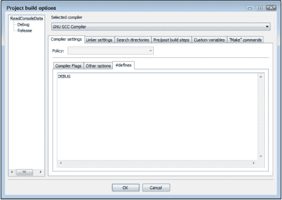

**图9-1：** 提供你想要用来更改应用程序输出的编译器选项。

现在，当预处理器开始遍历你的应用程序并到达 `#ifdef DEBUG` 行时，它会检查 DEBUG 符号是否已定义。如果该符号已定义，它就会把随后的行输出到整理后的文件中，直到 `#else` 行之前。然后它会跳过之后的行，直到 `#endif` 行之前。

但如果 DEBUG 符号*未*定义，预处理器就会跳过直到 `#else` 之前的行，并输出随后的行，直到 `#endif` 之前。

因此，对于本节前面给出的示例，如果 DEBUG 已定义，那么从 `#ifdef DEBUG` 开始到 `#endif` 的代码块会被替换为这个代码块前半部分的内容：

```cpp
cout << "The value of i is " << i << endl;
```

但如果 DEBUG 未定义，它会被替换为 `#else` 行之后的内容：

```cpp
cout << s << endl;
```


当预处理器遍历你的文件时，它只是在创建一个供编译器使用的新源代码文件。这意味着这些 `#ifdef` 行只在编译器启动预处理器时影响你的应用程序。当你的应用程序编译完成并运行时，这些 `#ifdef` 行就完全不存在了。所以请记住，这些 `#ifdef` 行不会影响应用程序的运行方式——只影响它的编译方式。


使用预处理器指令，你可以拥有应用程序的两个不同版本。在我们给出的示例中，我们正在准备两个版本：调试版本和发布版本。为了告诉编译器要构建哪个版本，我们随后通过删除或添加 -D DEBUG 行来修改命令行选项。


-D 选项在 D 后带不带空格都可以。因此，你可以使用 -DDEBUG 或 -D DEBUG。两者作用相同。

代码清单9-3所示的 Preprocessor2 示例演示了本节涵盖的所有主题。

### 代码清单9-3：使用多种不同的预处理器指令

```cpp
#include <iostream>

using namespace std;

#define UNIVAC
const int total = 200;
const string compname = "UNIVAC";
#if defined(HAL2000)
const int total = 300;
const string compname = "HAL2000";
#else
const int total = 400;
const string compname = "My Computer";
#endif
// This is outdated, but you might
// see it on occasion. Don't write
// code yourself that does this!
#define oldmax(x, y) ((x)>(y) ? (x) : (y))
#define MYSPECIALNUMBER 42

int main()
{
    cout << "Welcome to " << compname << endl;
    cout << "Total is: " << endl;
    cout << total << endl;

    // Try out the outdated things.
    cout << "*** max ***" << endl;
    cout << oldmax(5, 10) << endl;
    cout << oldmax(20, 15) << endl;
    cout << MYSPECIALNUMBER << endl;
}
```


使用这个块，预处理器检查符号 `UNIVAC`；如果预处理器找到 `UNIVAC`，它会输出这些行：

```cpp
const int total = 200;
const string compname = "UNIVAC";
```

否则，预处理器查找 `HAL2000`；如果预处理器找到它，它会将这些行添加到修正后的代码中：

```cpp
const int total = 300;
const string compname = "HAL2000";
```

最后，如果 `UNIVAC` 和 `HAL2000` 都未设置，预处理器会添加这些行：

```cpp
const int total = 400;
const string compname = "My Computer";
```

请记住，在每种情况下，这两行都会被发送到修正后的版本中，替代从 `#ifdef UNIVAC` 开始、到 `#endif` 结束的整个块。

因此，如果我们包含命令行选项 `-D UNIVAC`，我们会看到不同的输出（使用 Code::Blocks 的 Build»Rebuild 命令，用新选项重新构建项目）：

```text
Welcome to UNIVAC
Total is:
200

*** max ***
10
20
42

*** Predefined Macros ***
This is file C:\CPP_AIO\Book1\Chapter09\Preprocessor2\main.cpp
This is line 37
Compiled on Dec 18 2013
Compiled at 10:26:21

*** total ***
19900
```


要看到这种不同的输出，请记住这些 `#define` 行只影响应用程序的编译。因此，你需要重新编译应用程序才能看到更改。但有一个陷阱：如果源代码文件的目标文件比源文件新，那么即使你更改了命令行选项，编译器也不会重新构建目标文件。如果你使用的是命令行编译器（如 MinGW 或 Cygwin），你需要先输入 **make clean**。在 Code::Blocks 中，你选择 Build»Rebuild。然后你可以再次编译应用程序并运行它，以查看新的输出。

现在，这里有一组不同的选项：

```text
-D HAL2000 -D DEBUG
```

当你再次清理、编译并运行时，你会看到这个输出。注意，由于你定义了 DEBUG，最后一行现在略有不同。

```text
Welcome to HAL2000
Total is:
300

*** max ***
10
20
42

*** Predefined Macros ***
This is file C:\CPP_AIO\Book1\Chapter09\Preprocessor2\main.cpp
This is line 37
Compiled on Dec 18 2013
Compiled at 10:39:23

*** total ***
The value of j is 44850
```

### 使用常量

在编程时，你有时可能想要一个固定的值，并计划在整个应用程序中使用它。例如，你可能想要一个包含公司名称的字符串，比如 "Bobs Fixit Anywhere Anyhoo"。你不希望参与应用程序工作的其他人将此字符串作为引用传递给函数并误修改它，把它变成你的全球竞争对手的名称 "Jims Fixum Anyhoo Anytime"。那可能会很糟糕。或者，如果你正在编写科学应用程序，你可能想要一个固定的数字，例如 pi = 3.1415926 或 PeachPi=4.1415926。

你可以使用 const 关键字在 C++ 中创建这样的*常量*。创建常量时，它的工作方式与变量一样，只是你*不能在应用程序后续中更改它*。例如，要声明你的公司名称，你可以使用

```cpp
const string CompanyName = "Bobs Fixit Anywhere Anyhoo";
```

当然，你始终可以在代码中修改这个特定的字符串，但在代码的后面，你不能做类似这样的事情：

```cpp
CompanyName = CompanyName + ", Inc.";
```

编译器会针对该行发出错误，抱怨说它是一个常量，你不能更改它。

声明常量后，你就可以在代码中始终使用名为 `CompanyName` 的字符串来指代你的公司。清单 9-4 中的 Constants 示例向你展示了如何做到这一点。注意顶部附近的三个常量，分别名为 `ParkingSpaces`、`StoreName` 和 `pi`。在应用程序的其余部分，我们像使用任何其他变量一样使用它们——只是我们不尝试更改它们。

### 清单 9-4：为不会改变的永久值使用常量

```cpp
#include <iostream>

using namespace std;

const int ParkingSpaces = 80;
const string StoreName = "Joe's Food Haven";
const float pi = 3.1415926;

int main()
{
    cout << "Important Message" << endl;
    cout << "Here at " << StoreName << endl;
    cout << "we believe you should know" << endl;
    cout << "that we have " << ParkingSpaces;
    cout << " full-sized " << endl;
    cout << " parking spaces for your parking" << endl;
    cout << "pleasure." << endl;
    cout << endl;

    cout << "We do realize, however, that parking " << endl;
    cout << "is tight at " << StoreName << endl;
    cout << "and so we are going to double our" << endl;
    cout << "spaces from " << ParkingSpaces << " to " << endl;
    cout << ParkingSpaces * 2;
    cout << ". Thank you again!" << endl << endl;

    float radius = 5;
    float area = radius * pi * pi;

    cout << "And remember, we sell " << radius;
    cout << " inch apple pies" << endl;
    cout << " for a full " << area << " square " << endl;
    cout << " inches of eating pleasure!" << endl;

    return 0;
}
```

运行此应用程序时，你会看到以下内容：

```text
Important Message
Here at Joe's Food Haven
we believe you should know
that we have 80 full-sized
parking spaces for your parking
pleasure.
```

前面括号中的项*不是比较*。它只是一个变量。你也可以在括号内放入更复杂的表达式，但它们必须*求值*为整数或字符。例如，如果 `x` 是整数，你可以测试

```cpp
switch (x + 5) {
```

因为 `x + 5` 仍然是整数。

在 `switch` 语句的标题行之后，你列出要与表达式进行比较的项。它们的格式相当奇怪。它们以单词 `case` 开头，然后是要与表达式比较的值，然后是一个冒号，如下所示：

```cpp
case 1:
```

接下来是当表达式匹配此 case 时要运行的代码（这里是 1）。

```cpp
cout << "It's 1" << endl;
```

最后（这里变得非常奇怪），你有单词 `break`。`switch` 语句中的每个 case 通常都有一行 `break`，意思是*现在退出 switch 语句！* 而极其奇怪的部分是：如果你忘记了 `break` 语句，当计算机运行此 case 时，它会继续运行*下一个* case 的代码！是的，C++ 有时看起来很愚蠢。这是那些罕见且不太美妙的时刻之一。

注意 `switch` 块末尾的某个特殊之处：最后一个 case 是 `default`。它适用于前面所有 case 都不适用的情况。


`default` case 不是必需的；如果你不需要它，可以省略它。但是，如果你确实包含了它，我们建议把它放在 `switch` 块的末尾，因为大多数人期望在那里找到它。

在本节开头我们给出的示例代码中，你可以输入一个数字，该数字会被放入 `x` 变量。然后代码将值 `x` 与 `1` 进行比较；如果匹配，它执行 `case 1:` 行之后的那一行。如果不匹配，它将它与 `2` 进行比较，如果匹配则执行其后的行。但如果这些都不匹配，它执行 `default` 行之后的代码。

当计算机遇到 `break` 行时，它会完全退出 `switch` 语句。因此你可能想知道：为什么那些傻瓜作者在末尾包含了 `break` 行？我们的答案：传统。仅此而已。这与其它代码块保持一致。但你当然不需要它。*然而*，如果你省略它，你必须记住，如果你决定添加任何其他 case，你可能希望把它放回去。另一方面，人们通常将 `default` 放在末尾。（你不必这样做，但大多数人期望在末尾看到它，而不是在中间。）


### 清单 9-5（续）

```cpp
case '4':
    cout << "All I wanna know is WHY?" << endl;
    break;
case '5':
    cout << "Expensive but good taste you have!" << endl;
    break;
}

return 0;
}
```

### 用类增强枚举

使用类时，可以使用一种称为*包装*的技术，它有助于管理资源。在《第 I 册》第 8 章中，我们讨论了 `enum` 关键字以及如何使用它创建自己的类型。但是，打印枚举时，你看到的不是 red 或 blue 这样的单词，而是一个数字。清单 9-6 所示的 `DisplayEnum` 示例是一个简单的类，它*包装*了一个枚举类型——本质上，它帮助你将数字转换为人类可读的形式，这是一种资源管理。你可以将这个类与 `enum ColorEnum` 一起使用，正如 `main()` 所演示的那样。运行此应用程序时，你会在控制台中看到单个单词 red。

### 清单 9-6：为枚举创建类

```cpp
#include <iostream>

using namespace std;

class Colors
{
public:
    enum ColorEnum {blue, red, green, yellow, black};
    Colors(Colors::ColorEnum value);
    string AsString();

protected:
    ColorEnum value;
};

Colors::Colors(Colors::ColorEnum initialValue)
{
    value = initialValue;
}

string Colors::AsString()
{
    switch (value)
    {
        case blue:
            return "blue";
        case red:
            return "red";
        case green:
            return "green";
        case yellow:
            return "yellow";
        case black:
            return "black";
        default:
            return "Not Found";
    }
}

int main()
{
    Colors InkColor = Colors::red;
    cout << InkColor.AsString() << endl;
    return 0;
}
```

在上一节“使用 switch 语句”中，switch 语句没有包含任何 break 语句。相反，你有一个 return 语句。return 会使计算机完全退出函数，因此你无需担心如何跳出 switch 语句。你可能想知道为什么 switch 语句包含 default 子句。毕竟，它永远不会被调用。在这种情况下，如果你不提供 default 子句，编译器会显示以下消息：

```text
warning: control reaches end of non-void function
```

只要有可能，就添加应用程序编译无警告所需的代码。添加 default 子句只是确保无论发生什么，AsString 函数始终返回一个值。

表达式 `Colors::red` 对你来说可能不熟悉。它的意思是使用 ColorEnum 类型的 red 值。但是，由于 ColorEnum 是在 Color 类*内部*声明的，你不能只说 red。你必须先说类名，然后是两个冒号，然后是值。因此，你要输入 `Colors::red`。

在 `main()` 中，我们创建了 InkColor 实例，并将它设置为枚举，而不是 Color 对象。我们刚刚违反了关于将事物设置为相同类型的重要规则。为什么？C++ 有一个巧妙的小技巧：你可以创建一个接受特定类型的构造函数。在本例中，我们有一个接受 ColorEnum 的构造函数。然后，当你创建栈变量（不是指针）时，你可以直接将它设置为该类型的值。计算机会*隐式*调用构造函数，并将该值传递给它。

### 添加 cout 功能

如果 Colors 类允许你直接调用 `cout`，例如 `cout << InkColor << endl;`，而不必调用 `InkColor.AsString()` 来获取字符串版本，那就太好了。C++ 具有一种称为*运算符重载*的能力，这是一种扩展运算符功能的技术。当你输入 `cout <<` 后跟一个变量时，你是在调用一个函数：`<<`。`<<` 函数有多个版本（它们被重载了）；每个版本接受不同的类型。例如，`int` 处理写出整数的情况，如 `int x = 5;`，然后 `cout << x;`。因为 `<<` 函数不使用括号，所以它是一个*运算符*。

要为你的类添加 cout 功能，只需为你的类编写另一个 `<<` 函数。代码如下。这不是类成员函数；它位于你的类*外部*。将它添加到清单 9-6 中类声明之后的任意位置，但在 `main()` 之前。如下所示：

```cpp
ostream& operator << (ostream& out,
                       Colors& inst)
{
    out << inst.AsString();
    return out;
}
```

因为这个函数是一个运算符，所以你必须加上 operator 这个词。顺便说一下，`cout` 的类型是 `ostream`；因此，你接受一个 `ostream` 作为参数，并返回同一个 `ostream`。另一个参数是你要打印的类型：在本例中，它是一个 `Colors` 实例，而且同样是通过引用传递。添加这段代码后，你可以将 `cout << InkColor.AsString() << endl;` 这一行改为简单的

```cpp
cout << InkColor << endl;
```

### 使用随机数

有时，你需要计算机为你生成随机数。但计算机不擅长随机执行任务。我们人类可以掷骰子或抛硬币，但计算机必须按预定方式进行操作。

过去一个世纪的计算机天才们提出了生成*伪随机*数的算法。这些数字几乎是随机的，或者*看似*随机。对于许多用途来说，它们已经足够随机。

这些随机数生成器的唯一问题是你需要为它们*播种*。但一位计算机科学家想到了一个好主意。*当前时间是随机的。* 如果我们运行一个应用程序，而你也运行一个应用程序，我们很可能不会在*完全相同的时间点*开始运行它们。我们的科学家意识到，这将是随机数生成器的一个良好起点。使用清单 9-7 所示的 `RandomNumber` 示例，我们获取当前时间来启动随机数生成器。为此，我们包含 `time.h`。我们创建一个名为 `now` 的变量，其类型为特殊类型 `time_t`（它只是一个数字），然后调用 `time()` 函数，并传入 `now` 的地址。这样我们就得到了自 1970 年 1 月 1 日以来的秒数。然后我们调用 `srand()`，这要求我们包含 `stdlib.h`，并传入该时间。该过程为生成器播种。

然后我们通过调用 `rand()` 打印几个随机数，它返回一个随机数。但运行此应用程序时，我们注意到一些奇怪的现象。每次第一次调用 `rand()` 得到的数都会稍微大一点，而且似乎受到当前时间的影响。每过一秒，这个本应随机的数就会稍微大一点。其余部分看起来没问题，所以我们决定跳过第一个随机数。因此，就在为随机数生成器播种之后，我们调用 `rand()` 并忽略返回值。

然后我们继续打印五个随机数。但我们想将数字限制在 0 到 99 的范围内，因此我们对数字取模 100。（也就是用该数字除以 100 时的余数。）如果你需要不同的范围，可以选择 100 以外的数字。

### 清单 9-7：为随机数生成器播种

```cpp
#include <iostream>
#include <ctime>
#include <stdlib.h>

using namespace std;

int main()
{
    // Re-seed the random-number generator
    time_t now;
    time(&now);
    srand(now);
    rand();

    // Print out a list of random numbers
    for (int i=0; i<5; i++)
    {
        cout << rand() % 100 << endl;
    }

    return 0;
}
```

第一次运行清单 9-7 时，我们看到以下输出：

```text
19
69
85
83
47
```

*第二*次，我们看到以下输出。它与之前非常不同：

```text
79
67
38
72
73
```

### 将数据存储在数组中

大多数编程语言都支持一种称为数组的数据结构。*数组*是变量的*列表*，所有变量都并排存储在一行中。你通过一个名称访问它们。数组中的每个变量都必须具有相同的类型。

创建数组时，你要指定该数组包含多少项。例如，你可以有一个包含 100 个整数的数组。或者你可以有一个包含 35 个字符串的数组，或一个包含 10 个指向 `BrokenBottle` 类的指针的数组。如果你正在处理的代码表示一种类型，你可以用它创建数组。

创建数组时，你要给它一个名称。你可以通过使用该名称后跟方括号中的*索引*编号来访问数组的*元素*（项）。第一个元素始终是 0。因此，如果你有一个名为 `AppendixAttacks` 的包含五个整数的数组，第一个元素是 `AppendixAttacks[0]`。第二个是 `AppendixAttacks[1]`，然后是 `AppendixAttacks[2]`、`AppendixAttacks[3]`，最后是 `AppendixAttacks[4]`。

因为数组从元素编号 0 开始，所以数组的最后一个元素的索引比数组大小小 1。因此，一个包含 89 个元素的数组的索引范围是从 0 到 88。


#### 声明和访问数组

下面是如何声明一个数组：

```cpp
int GrilledShrimp[10];
```

这一行声明了一个名为 `GrilledShrimp` 的包含 10 个整数的数组。你首先要放类型（实际上是数组中每个元素的类型），然后是数组的名称，最后是方括号中的元素数量。由于这声明了 10 个整数，它们的索引范围是从 0 到 9。

要访问数组的第一个元素，你把数字 0 放在方括号中，放在类型名称之后，如下所示：

```cpp
GrilledShrimp[0] = 10;
```

有时，人们将引用数组中单个元素的行为称为*下标访问*。但我们避免使用这个词。我们的大脑更喜欢简单的词。


通常，人们使用循环来填充数组或访问每个成员。人们通常称之为遍历数组。清单9-8中的ArrayLoop示例展示了如何创建和使用基本数组。

### 清单9-8：使用循环遍历数组

```cpp
#include <iostream>

using namespace std;

int main()
{
    int GrilledShrimp[5];

    for (int i=0; i<5; i++)
    {
        GrilledShrimp[i] = i * 2;
        cout << GrilledShrimp[i] << endl;
    }

    return 0;
}
```


如果使用for循环遍历数组中的所有元素，循环应从0开始，到数组大小减1时结束。如果将数组大小存储在变量size中，且循环索引为i，则for循环的中间子句可以是i < size或i <= size - 1。不要使用i <= size，那会多循环一次。


使用数组时，不要超出数组边界。由于早期C语言的一些旧规则，如果编写的循环超出了数组的上边界，编译器不会发出警告。运行应用程序时也可能不会收到错误。

### 指针数组

数组特别适合存储指向对象的指针——指针是一种变量，包含内存中某一项的地址。如果你有许多相同类型的对象，可以将它们存储在数组中。

虽然可以将实际对象存储在数组中，但大多数人不会这样做。大多数人会用指向对象的指针来填充数组。要声明指向对象的指针数组，请记住在类型声明中使用星号，如下所示：

```cpp
CrackedMusicCD *missing[10];
```

清单9-9中的ArrayPointer示例声明了一个指针数组。在此示例中，声明数组后，将数组元素填充为零。记住每个元素都是一个指针；这样，只需将其与0比较，就可以立即知道该元素是否指向某个对象。如果为0，则未被使用。如果不为0，则其中包含一个指针。

### 清单9-10（续）

```
    Crunch(BigArray, MyArraySize);

    return 0;
    }
```

运行此应用程序时，它会打印数组的九个成员。我们在函数头中声明了参数：我们声明了一个数组，但没有指定大小。这意味着可以向函数传递任意大小的数组。我们加入了`size`参数，以便函数知道传入数组的大小。因此，在从`main()`调用此函数时，我们包含了`array_size`。此外，我们使用常量而不是`10`作为数组大小；这样如果以后决定通过更改数组大小来修改应用程序，只需更改应用程序顶部的一个常量即可。否则，我们可能会漏掉其中一个`10`。

如何传递指向数组的指针？`argv`的数据类型中有一个指针符号，它是指向一组字符指针的指针。

*这正是我们在清单9-10中所做的。我们实际上并没有传递数组本身，而是传递了数组的地址。当你以这种方式传递数组时，编译器会编写代码来传递指向数组的指针。你不必担心这一点。*


数组的名称实际上是指向数组中第一个元素的指针。

在清单9-10的`main()`函数中，调用函数时，我们传递了数组名`BigArray`。编译器将此名称视为第一个数组元素的地址。

因此，`BigArray`等同于`&(BigArray[0])`。（我们将`BigArray[0]`部分放在括号中，以便计算机知道`&`应用于`BigArray[0]`的整体，而不只是`BigArray`。）因此，你也可以在调用中使用：

```
    Crunch(&(BigArray[0]), MyArraySize);
```


但没有理由这样做。直接传递`BigArray`即可。这是一样的！

**数组的名称是指向数组的指针。**

### 指针的加法和减法

当你对指向数组元素的指针（该指针作为地址存储在指针变量中）进行数字的加法和减法时，可以做一些有趣的事情。如果取数组中某个元素的地址并将其存储在变量中，例如名为`cur`（表示current）的变量，如下所示：

```
    cur = &(Numbers[5]);
```

其中的Numbers是一个整数数组，你可以通过解引用指针来访问Numbers[5]处的元素，如下所示：

```cpp
cout << *cur << endl;
```

然后你可以对指针进行数字的加法和减法，例如这几行：

```cpp
cur++;
cout << *cur << endl;
```

编译器知道每个数组元素占用多少内存空间。当你对cur加1时，*它会前进到数组中的下一个元素*。因此，紧随其后的cout会打印下一个元素——在本例中为Numbers[6]。

清单9-11中的PointerArithmetic示例展示了如何在数组中移动。注意，我们声明了一个名为cur的变量，它是一个指向整数的指针。该数组保存整数，因此该指针可以指向数组中的元素。

我们开始时让cur指向第一个元素。数组的名称就是第一个元素的地址；为此，我们只需输入：

```cpp
cur = Numbers;
```

### 清单9-11：使用指针算术移动

```cpp
#include <iostream>

using namespace std;

int main()
{
    int Numbers[100];

    for (int i=0; i<100; i++)
    {
        Numbers[i] = i * 10;
    }

    int *cur;
    cur = Numbers;

    cout << *cur << endl;
    cur++;
    cout << *cur << endl;
    cur++;
    cout << *cur << endl;
    cur += 3;
    cout << *cur << endl;
    cur--;
    cout << *cur << endl;

    return 0;
}
```

运行应用程序时，你会看到以下输出：

```
0
10
20
50
40
```

在代码中，++和--运算符分别对指针加1和减1。我们还直接对指针加3，使其在数组中前进三个“位置”。你也可以对指针进行减法运算，如下所示：

```
cur -= 2;
```


不能对指针进行乘法和除法运算。

## 内容一览

- **第1章：规划与构建对象** — 249
  - 识别对象 — 249
  - 封装对象 — 254
  - 构建层次结构 — 260
  - 发现类 — 272
- **第2章：使用UML描述你的程序** — 279
  - 进入UML — 279
  - 使用UML和Rational统一过程进行构建 — 288
  - 使用UML继续前进 — 297
- **第3章：使用UML构建你的类结构** — 299
  - 绘制类 — 300
  - 构建组件 — 307
  - 部署软件 — 310
- **第4章：使用UML展示行为** — 313
  - 绘制对象 — 313
  - 用例分析 — 315
  - 序列图 — 318
  - 协作图 — 325
  - 活动图 — 326
  - 状态图 — 328
- **第5章：使用UML建模你的应用程序** — 331
  - 使用UML的便利功能 — 331
  - 自由运用UML — 336
  - C++和UML — 338
- **第6章：使用设计模式构建** — 343
  - 介绍一个简单模式：单例（Singleton） — 344
  - 使用观察者（Observer）模式教授实例 — 348
  - 使用模式进行调解 — 356

## 第1章：规划与构建对象

### 本章内容包括

- 识别对象，以便创建类
- 将类封装到自包含的胶囊中
- 通过继承构建类的层次结构
- 发现类

暂时走出去，低头看看。你站在什么东西上面？（提示：它巨大无比，由岩石、沙土、石头和熔岩构成，表面覆盖着海洋和陆地。）答案是什么？一个东西！（即使是行星也是一个东西。）现在回到室内。你刚才打开的那个带门把手的东西是什么？它也是一个东西！它是一种略有*不同*的东西，但仍然是一个*东西*。你自己又在什么东西里面呢？好吧，你明白了吧。你能想象到的一切都是一个*东西*——或者用另一个术语来说，就是一个*对象*。记住这个词：*对象*。

多年来，计算机编程领域的研究人员（现在，*这*听起来是不是像一份令人兴奋的工作？）已经发现，为计算机编程的最佳方式是将你想要*建模*的任何东西划分为一组对象。这些对象具有能力和特性。（最终它们还会有关系，但那是在以后了。）

在本章中，我们将向你展示如何利用对象来创建软件应用程序。在此过程中，你将动手掌握C++中与对象相关的一些基本要点，并获得如何充分利用它们的技巧。

### 识别对象

让我们切入正题：将*对象*视为计算机可以描述的任何*事物*。（对象=事物。这个定义够直白吧？）正如物理事物具有大小、重量和颜色等特征一样，应用程序中的对象具有*属性*——例如，一定数量的账户、一个引擎，甚至它所包含的其他对象，就像汽车包含引擎、车门和其他对象一样。

此外，正如现实世界中的事物具有用途——例如，用作容器、车辆或工具——应用程序中的对象具有*能力*。例如，它也许能取款、发送消息或连接到互联网。


下面是一个对象的示例：在房子外面，你可能会看到一个邮箱。那个邮箱就是一个对象。（明白这有多简单了吧？）邮箱是一种有用的设备。你可以接收邮件，而且根据邮件的类型（种类），你还可以寄出邮件。（邮件的类型很重要——你能寄信，因为你知道该贴多少邮资，但你不能寄包裹，因为邮资未知。）这些就是邮箱的能力。那么它的特征呢？不同的邮箱有不同的形状、尺寸和样式。所以这些就是三个特征。现在，有些邮箱，比如常见于公寓楼的那种，是巨大的金属箱子，里面装着许多小箱子，每个小箱子对应一户公寓。前面是每个独立小箱子的门，后面则有一扇大门，供邮递员打开后把那些写着你另一个名字“住户”的美妙广告塞进各个小箱子。

在这种情况下，你可以把公寓邮箱看作一个大邮箱里面装着许多小邮箱，也可以把它看作一个容纳较小邮箱的大容器。从某种意义上说，每个小邮箱都有一扇住户使用的前门，而每个小邮箱的背面都有一个邮递员使用的入口。当大容器的门打开时，背面也随之打开。

所以请这样想：邮递员与容纳邮箱的容器交互。容器有一扇大门，当那扇门打开时，它也会暴露里面小邮箱的内部，这些小邮箱也会打开。与此同时，当住户与这个系统交互时，他只与自己那个特定的箱子交互。

请看图1-1和图1-2。图1-1展示的是邮箱容器背面的整体外观，邮递员可以打开容器，把邮件放进所有不同的箱子里。图1-2展示的是容器的正面，各个箱子打开着，住户可以取出邮件。

到目前为止，这里有两类对象：容器箱和邮箱。但是等等！这里有多个邮箱。所以，实际上，你有一个容器箱和多个邮箱。但每个邮箱都差不多一样，只是锁不同、公寓编号不同，对吧？在图1-2中，每个打开着的箱子都是单个邮箱的一个示例。其他箱子也是名为 *mailbox* 的那类对象的示例。在图1-2中，你可以看到16个被归类为 *mailbox* 的对象示例。换句话说，图1-2展示了16个名为 *Mailbox* 的 *类* 的 *实例*。而所有这些邮箱都在一个你可能称之为 *Mailboxes* 的类的实例里面。


关于如何命名你的类，并没有硬性规定。不过，大多数开发人员使用单数名称来表示对象，使用复数名称来表示集合。单个 Mailbox 对象会作为 Mailboxes 集合的一部分出现。使用这种命名约定可以让其他开发人员更容易理解你的代码是如何工作的。当然，最重要的问题是保持一致性——一旦你决定了命名约定，就要始终使用相同的约定。

通过使用这个列表，你可以发现 `Mailboxes` 集合的一些特征和能力。下面这个列表展示了它的特征：

- 宽度：24 英寸
- 高度：24 英寸
- 深度：18 英寸
- 邮箱：包含 16 个 `Mailbox` 对象

下面是一些 `Mailboxes` 集合的能力列表：

- 打开它的门。（嗯，是某个外部的东西——比如人——打开了门，但我们很快会讲到这个。）
- 让邮递员能够访问这些邮箱。
- 关闭它的门。（是的，再说一次，是某种外力，比如一推，使门关上的，但我们也很快就会讲到……就是现在！）

想一想邮递员打开或关闭门的过程。这里似乎有一件奇怪的事情：*邮递员请求 `Mailboxes` 集合关闭它的门，然后门就关上了。* 这就是你需要看待对象建模的方式：没有人对对象做任何事情。相反，有人请求对象去做某件事，而对象*自己完成它*。

例如，当你伸手把一片披萨塞进嘴里时，你的大脑会向手臂的肌肉发送信号。你的大脑发出信号，你的手臂向上移动，披萨也随之移动。关键在于，是你发出命令，然后手臂执行命令，即使你觉得是你在促使手臂这样做。

对象也是一样的：它们拥有自己的能力，我们告诉它们去做自己的事情。我们不会替它们去做。至少，计算机科学家是这样看待的。我们知道：有时候这有点牵强。但你越是按照这种方式思考，就越能理解面向对象的编程。


`Mailboxes` 集合包含 16 个 `Mailbox` 对象。在 C++ 中，这意味着 `Mailboxes` 集合会拥有 16 个不同的 `Mailbox` 实例作为成员变量。这些 `Mailbox` 实例可以是数组或其他某种集合，而且很可能这个数组会持有指向 `Mailbox` 实例的指针。

### 观察 `Mailbox` 类

考虑一下 `Mailbox` 类的特征和能力。每个 `Mailbox` 都有这些特征：

- 宽度：6 英寸
- 高度：6 英寸
- 深度：18 英寸
- 地址：一个唯一的整数。但具体是哪个数字呢？那取决于你所说的是*哪一个 Mailbox*。

每个 Mailbox 都有这些能力：

- 打开它的门。
- 关闭它的门。

注意，我们是从 Mailbox 的角度来写这些能力的，而不是从打开 Mailbox 的人的角度。

现在想一想关于 Mailbox 上印着的地址的问题。上面该写数字几呢？有 16 个不同的 Mailbox 对象，每个对象都有一个不同的数字。所以我们可以这样说：Mailbox 类包含一个地址，它是一个整数。Mailbox 类的每个实例都有自己的数字。第一个可能获得 1，第二个可能获得 2，依此类推。

因此，在代码中表示邮箱时，你有两个概念：

- **Mailbox 类：** 这是对邮箱的一般描述。它不包含任何具体信息，比如实际的地址。它只是说明每个邮箱都有一个地址。
- **Mailbox 实例：** 这是实际的对象。Mailbox 实例属于 Mailbox 类。Mailbox 类可以有多个实例。

可以把 Mailbox 类想象成一个饼干模具——或者用 C++ 的术语来说，就是*类型*。Mailbox 实例是该类的一个实际示例。在 C++ 中，你可以创建一个 Mailbox 类的变量，并将其 Address 整数设置为 1。然后你可以再创建另一个 Mailbox 类的变量，并将其 Address 整数设置为 2。这样，你就创建了两个不同的 Mailbox 对象，它们都属于 Mailbox 类。

但是所有这些对象的宽度都是 6，高度都是 6，深度都是 18。在整个 Mailboxes 集合中，这些值都是相同的。因此，你可能不会手动设置它们；相反，你可能会在 Mailbox 类的构造函数中设置它们。尽管如此，宽度、高度和深度的值是随每个实例一起存在的，而不是随类；而且可以想象，每个实例都可以有自己的宽度、高度和深度。不过，当你设计这个类时，你可能会在类中加入一些规定，使得这些成员变量不能被更改。（你可以通过将它们设为私有，并为每个成员提供一个获取值的函数来实现这一点。）

在这样的争论（抱歉——讨论）中，通常会出现的一个词是封装。那些捍卫 C++ 是面向对象语言的人会指出，C++ 支持封装。

与其争论，不如让我们都同意：是的，C++ 让你能够用对象和类来编程。既然我们已经平息了这场争论，可以和平共处了，那么封装到底是什么意思呢？

首先，想一想这个词本身。它的一大组成部分是“胶囊”（capsule）。胶囊是一个小容器。在更大的图景中，它是一个自包含的、容纳东西的容器。在计算机编程的世界中，封装指的是创建独立对象的过程，这个对象能够自我照料，在保留信息的同时做它必须做的事情。

例如，要为一个收银机建模，它很可能是一个类。我们会把收银机的所有内容（它的能力和特征）都放进一个单独的类中，从而封装这个收银机。在 C++ 中，能力是成员函数，特征是成员变量。

当我们创建这个类时，我们会让一些成员变量和成员函数是公有的；让另一些是私有的。（有些成员可以被设为受保护的，这样派生类可以访问它们，但它们仍然不是公有的。）那么私有和受保护的成员变量、成员函数具体是哪些呢？就是那些你不希望其他函数修改的部分。例如，收银机内部可能会有一个值，表示收银机中包含的总金额。但使用这个类的函数不会直接修改那个值。相反，它们会调用各种成员函数来执行交易。一笔交易可能是 Sale()。另一笔可能是 Refund()；还有一笔可能是 Void()。这些就是收银机以公有方法形式呈现的能力，它们会修改收银机内部的现金值，确保它与销售和退货保持平衡。如果某个函数可以直接修改现金值，那么账目就会失衡。

## 第1章：规划与构建对象

### 访问只读成员变量

假设你有一个包含成员变量的类，并且你希望允许用户获取该变量的值，但不能更改它。例如，在 Dog 类中，你可以在构造函数中设置 weight，仅此而已——之后，用户可以获取 weight，但不能更改它。要做到这一点，只需要不提供设置该值的方法即可。相反，你提供一个只获取值的方法。因此，Dog 类会有 GetWeight() 方法，但不会有 SetWeight() 方法。这样，用户就只能读取该值，而不能设置它。


因此，现金金额将是一个*私有*或*受保护*的成员变量。它会对其他函数和类隐藏。至于它到底是私有还是受保护，这取决于我们是否期望从收银机类派生出新类，以及是否希望这些新类能够访问这些成员。就收银机而言，如果我们担心安全性，可能不希望应用程序的其他部分访问收银机。但另一方面，如果我们认为会创建派生类，并为其添加涉及现金的额外功能（例如通过电子交易自动将钱汇入银行），我们就会希望这些成员是受保护的。（一般来说，我们选择受保护而不是私有，是因为使用带有大量私有成员的类已经让他们吃过太多次亏。在那些情况下，由于一切都是私有的，我们无法派生出有用的类！）

那么，封装就是这样：你把方法和成员变量组合成一个单一实体，隐藏其中一些，并让另一些可访问。可访问的部分共同构成对象的*接口*。最后（这一点很重要！），当你创建一个对象时，你创建的是一个能够自行完成工作的对象。换句话说，类的用户通过调用其成员函数并提供参数，告诉它要做什么（例如执行一次销售交易），然后由对象完成工作。*调用函数*并不关心对象如何完成工作，只关心它能够完成。例如，收银机类知道如何执行销售交易。作为类的设计者，不要强迫用户先调用 Sale，再调用单独的函数来手动修改收银机中的现金金额并修改累计总额。相反，Sale 函数会完成所有繁重的工作，而类的用户不必担心这项工作是如何进行的。

现在是一个根本问题：你为什么需要知道“封装”这个词？因为这是计算机科学家喜欢随口使用的一个常见术语。不过，如果他们使用它，很可能会把它当作动词来用：“看我！我要把这条信息封装成一个对象！”

但过程比这个词本身更重要。当你设计对象和类时，你要把信息封装到一个个独立的对象中。如果你牢记这个过程，你会做得更好。每次设计类时，你需要做以下事情：

- **封装信息。** 将信息组合成一个单一实体，这个实体就是类。这个单一实体拥有表示其特性的成员变量和表示其能力的成员函数。
- **明确定义类的公共接口。** 提供一组公共函数（也可能包括公共成员变量，不过最好将它们保持为受保护或私有），并把其余成员设为受保护或私有。
- **编写类，使其知道如何完成自己的工作。** 类的用户应当只需要调用公共接口中的函数，而这些公共函数应当易于使用。

注意，Weight 成员是受保护的，而 SetWeight() 是公共的。因此，类的用户不能直接修改 Weight 成员；他们只能调用 SetWeight() 来设置它，这提供了内置检查。现在，这一切都很好，除非类的用户需要查明菲多的体重，以确保它没有迅速变瘦。唯一的问题是 Weight 是受保护的，所以用户无法读取它。因此，你需要添加一个获取 Weight 值的函数，如下所示：

```cpp
int Dog::GetWeight()
{
    return Weight;
}
```

你必须修改类以容纳这个函数：

```cpp
class Dog
{
protected:
    int Weight;

public:
    void SetWeight(int NewWeight);
    int GetWeight();
};
```

现在，当你使用这个类时，不要直接访问 Weight 变量，而要使用访问方法，如下面的示例代码行所示：

```cpp
int main()
{
    Dog fido;
    fido.SetWeight(10);
    cout << fido.GetWeight() << endl;
    fido.SetWeight(-5);
    cout << fido.GetWeight() << endl;
    return 0;
}
```

要设置体重，你调用 SetWeight()。注意，在第一次调用 SetWeight() 时，我们传入的是一个合法值 10。当下一行运行时，我们会看到数字 10 出现在控制台上。但在第二次调用 SetWeight() 时，我们传入的是一个无效体重值 -5。SetWeight() 函数会拒绝这个值，并且不改变体重。因此，当我们第二次通过调用 GetWeight() 写出体重时，我们仍然看到 10。数字没有变化。-5 这个值被拒绝了，体重保持不变。

当你使用访问函数时，你能做的远不止防止无效值并返回当前值。例如，set() 函数可以处理该值，进行计算或修改它。例如，Dog 类可能有一个最大体重。如果用户向 SetWeight() 函数传入一个更大的体重，该函数可以把它改成最大体重。例如，下面的函数将体重限制在上限 100 和下限 1：

```cpp
void Dog::SetWeight(int NewWeight)
{
    if (NewWeight < 0)
    {
        Weight = 0;
    }
    else if (NewWeight > 100)
    {
        Weight = 100;
    }
    else
    {
        Weight = NewWeight;
    }
}
```

你可以使用 Get() 函数返回成员变量的某种修改形式。例如，如果你有一个 SalesTransaction 类，其中包含一个 CreditCardNumber 变量，而该变量是一个包含数字和空格的字符串，你可能只想显示最后四位数字，而不是整个号码。那么，Get() 函数可以获取 CreditCardNumber，只提取最后四位数字，并构造一个形如“XXXX XXXX XXXX 1234”的字符串。然后，它会返回该字符串，而不是实际的 CreditCardNumber 值。


### 访问方法与属性

许多现代语言除了通常的成员方法和成员变量之外，还支持类的第三个方面，称为属性。C++ 不支持名为属性的命名实体，但它支持等效的方法。在你的编程生涯中，你很可能会在大量不同的语言之间切换。因此，我们想花一点时间向你介绍属性，它们出现在 C#、VB.NET 和 Object Pascal 等语言中。属性本质上是成员变量和方法的组合。想想 C++ 中的公共成员变量。任何使用对象的人都可以自由修改成员变量。但有时在创建类时，你想对人们能对成员变量做什么加以限制。例如，你可能想限制为只能读取成员变量而不能修改它。或者你可能想限制该变量可以取哪些值，例如把变量限制为 1 到 100 之间的整数，而不允许它包含任何其他整数。

在 C++ 中，施加此类限制的方法是：把成员变量设为私有，然后编写两个成员方法：一个用于读取该变量的值，一个用于设置该值。设置值的方法会施加限制；例如，如果调用者试图把值设为 101，而这就是你所施加的限制，那么该方法可能会自动把值降到 100。同样，如果你希望人们能够读取该值但不能修改它，你可能只提供一个返回该值的方法，而不提供用于修改变量的方法。

这两个方法——一个用于设置成员变量，一个用于“获取”（也就是读取）成员变量——就是访问器方法。C++ 之外的一些语言允许你将这些成员方法组合成所谓的

第II册 第1章 规划与构建对象


被称为属性。因为 C++ 不支持属性，所以我们无法真正向您展示示例代码，但思路会像这样：

```cpp
mydog.weight = 10;
cout << mydog.weight << endl;
```

尽管第一行看起来只是把 10 存入 weight 变量，但如果这是基于属性的语言，这样的代码反而会导致您的“属性设置器”方法被调用。在该方法中，您会编写代码来测试该值，并确保在存储之前它是有效值。同样，第二行看起来只是读取 weight 变量，却会间接调用获取 weight 值的方法。因此，这段代码的执行效果会像下面这段代码一样：

```cpp
mydog.SetWeight(10);
cout << mydog.GetWeight() << endl;
```

看到我们如何调用两个方法了吗——一个设置 weight，一个获取 weight？这就是属性背后的思想。它们让您编写的代码看起来是在读写成员变量，但实际上代码分别调用“获取器”和“设置器”方法。（在使用其他语言时，您可以编写这样的属性：让用户读取值、写入值，或读取和写入值，因此后台功能仍然依赖于实际上相当于两个方法：一个用于设置值，一个用于获取值。）C++ 没有属性，但许多现代语言都有。现在在学习对象时了解它们，将有助于您在最终使用支持属性的其他语言时理解属性。

### 构建层次结构

C++ 的强大能力之一是能够拿一个类并在其基础上构建新类。当您使用任何可用的 C++ 库（例如标准 C++ 库）时，可能会遇到许多彼此相关的类——有时会有几十个类。有些类派生自其他类，不过也有些类是独立的。这为程序员提供了极大的灵活性。灵活是好事。血液在您的身体系统中流动得更顺畅，您也会更放松。而在编程中，类库具有灵活性也是好事，因为当您使用灵活的库时，在要使用的不同类方面会有很多选择。

### 建立层次结构

设计类时，您可以选择让正在创建的类派生自某个原始基类——创建子/父关系。新类继承基类的能力和特征。通常，在基类中为公有的成员在派生类中仍为公有。在基类中为受保护的成员在派生类中仍为受保护；因此，如果您继续进一步派生，那些最终类也将继承这些受保护成员。然而，私有成员只存在于基类中。


在图 1-3 中，请注意我们以 C++ 形式编写了成员变量和函数的行。通常您不会这样做；而是使用一种称为统一建模语言（UML）的特殊表示法来代替 C++，我们会在本章稍后（简要）介绍它，并在本书其余部分更详细地讨论它。

### 继承时保护成员

在 C++ 中，您可以选择如何派生类。要理解这一点，请记住：当您派生一个类时，派生类会继承基类的成员。通过不同的派生类方式，您可以指定这些继承成员在派生类中是公有、受保护还是私有。选项如下：

- **公有：** 当您以 *公有* 方式派生新类时，基类中所有公有成员在此派生类中仍为公有。
- **受保护：** 当您以 *受保护* 方式派生新类时，基类中所有公有成员现在在此新类中变为受保护。这意味着基类中原本为公有的成员将无法被此新类的使用者访问。
- **私有：** 当您以 *私有* 方式派生新类时，基类中此新类可以访问的所有成员都将变为私有。这意味着这些成员将无法被您以后从此新类派生的任何类访问——毕竟它们是私有的。

可以把它看作一种访问权限递减的顺序：最高访问权限是公有。当成员为公有时，用户可以访问该成员。中间访问权限是受保护。用户不能访问受保护成员，但派生类可以访问受保护成员。最低访问权限是私有。用户不能访问私有成员，派生类也不能。


这里我们讨论的是继承：因此，如果我们有一个名为 FrozenFood 的基类和一个名为 FrozenPizza 的派生类，那么该派生类是 FrozenFood 中成员与额外 FrozenPizza 成员的组合。然而，只有 FrozenPizza 中属于 FrozenFood 部分的方法才能访问 FrozenFood 部分的私有成员。尽管如此，FrozenPizza 自身部分中的方法以及 FrozenFood 的私有成员都是派生类的一部分。

当您以公有方式派生类时，派生类中基类部分保持不变：原本私有的项仍留在基类部分中；因此，派生类无法访问它们。原本受保护的仍为受保护，原本公有的仍为公有。

但当您以受保护方式派生类时，基类部分与原始基类不同：其公有成员现在成为此派生类的受保护成员。（但请记住：实际基类本身并未改变。我们只讨论派生类的基类部分。）因此，那些在基类中为公有、但现在在派生类中为受保护的成员，无法被其他函数和类访问：它们现在是受保护的。

最后，如果您以私有方式派生类，基类部分又不同于原始基类：其所有成员现在都是私有的。由于其成员是私有的，您从此新派生类派生的任何类都无法访问这些成员：它们是私有的。不过，和之前一样，原始基类本身并未改变；我们仍然在讨论派生类的基类部分。

所有这些派生方式可能很复杂。请记住，当您派生类时，您是在指定继承的公有成员和受保护成员在派生类中将具有什么访问级别。

在 C++ 中，您在派生类的头行中指定所需的继承类型。请看清单 1-1 中所示的 InheritedMembers 示例。请注意清单顶部的三个类：FrozenFood、FrozenPizza 和 DeepDishPizza。FrozenFood 是 FrozenPizza 的基类，FrozenPizza 是 DeepDishPizza 的基类。图 1-4 使用称为 UML 的特殊表示法（参见上一节）展示了这一点，其中箭头指向基类。


### 清单 1-1：指定继承成员的访问级别

```cpp
#include <iostream>

using namespace std;

class FrozenFood
{
private:
    int Price;

protected:
    int Weight;

public:
    FrozenFood(int APrice, int AWeight);
    int GetPrice();
    int GetWeight();
};

class FrozenPizza : public FrozenFood
{
protected:
    int Diameter;

public:
    FrozenPizza(int APrice, int AWeight, int ADiameter);
    void DumpInfo();
};

class DeepDishPizza : public FrozenPizza
{
private:
    int Height;

public:
    DeepDishPizza(int APrice, int AWeight, int ADiameter, int AHeight);
    void DumpDensity();
};

FrozenFood::FrozenFood(int APrice, int AWeight)
{
    Price = APrice;
    Weight = AWeight;
}

int FrozenFood::GetPrice()
{
    return Price;
}

int FrozenFood::GetWeight()
{
    return Weight;
}

FrozenPizza::FrozenPizza(int APrice, int AWeight, int ADiameter) :
FrozenFood(APrice, AWeight)
{
    Diameter = ADiameter;
}

void FrozenPizza::DumpInfo()
{
    cout << "\tFrozen pizza info:" << endl;
    cout << "\t\tWeight: " << Weight << " ounces" << endl;
    cout << "\t\tDiameter: " << Diameter << " inches" << endl;
}

DeepDishPizza::DeepDishPizza(int APrice, int AWeight,
int ADiameter, int AHeight) :
FrozenPizza(APrice, AWeight, ADiameter)
{
    Height = AHeight;
}

void DeepDishPizza::DumpDensity()
{
    // Calculate pounds per cubic foot of deep-dish pizza
    cout << "\tDensity: ";
    cout << Weight * 12 * 12 * 12 / (Height * Diameter * 22 * 16);
    cout << " pounds per cubic foot" << endl;
}

int main(int argc, char *argv[])
{
    cout << "Thin crust pepperoni" << endl;
    FrozenPizza pepperoni(450, 12, 14);
    pepperoni.DumpInfo();
    cout << "\tPrice: " << pepperoni.GetPrice() << " cents" << endl;
}
```


```cpp
cout << "Deep dish extra-cheese" << endl;
DeepDishPizza extracheese(650, 21592, 14, 3);
extracheese.DumpInfo();
extracheese.DumpDensity();
cout << "\tPrice: " << extracheese.GetPrice() << " cents" << endl;
return 0;
}
```

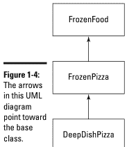

运行清单 1-1 时，你会看到以下输出：

```
Thin crust pepperoni
    Frozen pizza info:
        Weight: 12 ounces
        Diameter: 14 inches
        Price: 450 cents
Deep dish extra-cheese
    Frozen pizza info:
        Weight: 21592 ounces
        Diameter: 14 inches
        Density: 35332 pounds per cubic foot
        Price: 650 cents
```

前五行显示关于 FrozenPizza 类对象的信息。其余各行显示关于 DeepDishPizza 类对象的信息，包括它重 21,592 盎司（恰好是 1349.5 磅），密度为每立方英尺 35,332 磅（每立方英尺 35,332 磅——比每立方英尺 17 吨多一点，但仍远不及中子星的密度，中子星约为每立方英尺 3 万亿吨）。这真是一块不得了的披萨。

这些派生都是公有的。因此，在 FrozenFood 中为公有的成员，在 FrozenPizza 和 DeepDishPizza 中仍然是公有的。注意输出中不同信息来自哪里。Frozen pizza info: 这一行以及随后的两行（Weight: 和 Diameter:）来自公有函数 DumpInfo()，它是 FrozenPizza 的成员。DumpInfo() 在 FrozenPizza 类中是公有的。由于 DeepDishPizza 以公有方式派生自 FrozenPizza，DumpInfo() 也是 DeepDishPizza 的公有成员。

```cpp
public:
    FrozenFood(int APrice, int AWeight);
    int GetPrice();
    int GetWeight();
    virtual void BakeChemistry();
};

class FrozenPizza : public FrozenFood
{
protected:
    int ADiameter;

public:
    FrozenPizza(int APrice, int AWeight, int ADiameter);
    void DumpInfo();
    void BakeChemistry();
};
```

你可以看到，我们在 FrozenFood 类中放了 virtual 一词，然后在 FrozenPizza 类中再次放了函数声明。现在，下面是 BakeChemistry() 函数：

```cpp
void FrozenFood::BakeChemistry()
{
    cout << "Baking, baking, baking!" << endl;
}
```

```cpp
void FrozenPizza::BakeChemistry()
{
    cout << "I'm getting crispy!" << endl;
}
```

注意，我们没有把 virtual 一词放在函数前面；它只出现在类声明中。现在，每当你创建每个类的实例并为每个实例调用 BakeChemistry() 时，你调用的是该给定类对应的那个函数。考虑下面两行代码：

```cpp
FrozenPizza pepperoni(450, 12, 14);
pepperoni.BakeChemistry();
```

因为 pepperoni 是 FrozenPizza 的实例，这段代码调用的是 FrozenPizza 类的 BakeChemistry()，而不是 FrozenFood 类的。

你可能不希望基类中的 BakeChemistry() 函数包含任何代码。如果是这样，你可以这样做：

```cpp
virtual void BakeChemistry() {}
```

等等！为什么你会想要一个没有代码的函数？嗯，我们并不像看起来那么傻。好吧，我们确实傻。但无论如何，你可能不希望这里有任何代码，但你确实希望派生类中有代码，并且希望它们是同一代码的不同版本。那么，这个想法就是提供一组基本的默认代码，如果类不重写该函数，就继承它。有时，这组基本的默认代码干脆什么都没有。因此，你只需放一个左花括号和一个右花括号，而且可以在类内部这样做：

```cpp
class FrozenFood
{
private:
    int Price;

protected:
    int Weight;

public:
    FrozenFood(int APrice, int AWeight);
    int GetPrice();
    int GetWeight();
    virtual void BakeChemistry() {}
};
```


有些人喜欢在派生类中被重写函数的原型中加上 `virtual` 一词。从技术上讲，这一步并不是必需的，尽管许多长期用 C++ 编程的人会这样做。如果你愿意，并且觉得这样看起来很酷，也可以这样做。我们这样做有一个原因（除了看起来酷）：它提醒我们该函数是 `virtual` 的。因此，在 FrozenPizza 类定义中，你的函数原型会像下面这样，就像在 FrozenFood 类中一样：

```cpp
virtual void BakeChemistry();
```

## 第1章：规划与构建对象

### 通过多态进行特化

假设你有一个名为 `Bake()` 的函数，并希望它接受一个 FrozenFood 实例作为参数。如果你从 FrozenFood 派生出 FrozenPizza，再从 FrozenPizza 派生出 DeepDishPizza，那么根据“是一个”规则，FrozenPizza 和 DeepDishPizza 类的对象都是 FrozenFood 对象的例子。一般来说这是成立的：如果你有一个名为 Base 的类，并从它派生出一个名为 Derived 的类，那么 Derived 类的实例也是 Base 类的实例。可以把它想象成姓氏：如果你的姓是 Swaddlebug，你的孩子长大后结婚并改姓 Higglequack，那么尽管孩子姓 Higglequack，她骨子里现在和将来都仍是 Swaddlebug。

冷冻食品和 C++ 也是如此。你可以把任何派生自 FrozenFood 的类的对象当作 FrozenFood 实例来对待。因此，如果你有一个名为 `Bake()` 的函数，并按如下方式声明它，你就可以自由地向该函数传递一个 FrozenFood 实例，或者传递任何派生自 FrozenFood 的类的实例，例如 FrozenPizza 或 DeepDishPizza：

```cpp
void Bake(FrozenFood *)
{
    cout << "Baking" << endl;
}
```

有趣的部分从这里开始：假设在这个 `Bake()` 函数中，你会把烤箱温度设定为固定值，打开烤箱，然后烹饪食物。每种食物在烤箱中的表现都不同。例如，深盘冷冻披萨可能会膨胀并变厚，而普通冷冻披萨会变得更脆，但不会变厚。你并不真的想用无数个 if 语句把所有不同的食物类型都塞进 `Bake()` 函数里：如果它是这种食物，就让它膨胀；如果它是那种食物，就让它变成棕色；如果它是另一种食物，就让它尖叫大喊。相反（事情从这里开始变得*非常*酷），你可以把实际的烘焙化学过程放进食物本身的类中！是的！`FrozenPizza` 会有自己的 `BakeChemistry()` 成员函数，`DeepDishPizza` 也会有自己的 `BakeChemistry()` 函数。然后 `Bake()` 函数只需对它作为参数收到的任何对象调用 `BakeChemistry()`。C++ 怎么知道该怎么做呢？靠虚函数！`Bake()` 函数本身甚至不知道也不关心它收到的是哪种 `FrozenFood`。它只是对收到的任何对象调用 `BakeChemistry()`。多亏了 C++ 的奇妙之美，它会自动调用正确的 `BakeChemistry()` 函数，无论是 `FrozenPizza` 的那个，还是 `DeepDishPizza` 的那个，甚至是你后来修改应用程序时添加的类。而且当你修改应用程序时，如果你编写一个新类，让它派生自 `FrozenFood`，并给它自己的 `BakeChemistry()` 函数，你就可以把这个类的实例传给 `Bake()`，甚至不需要修改 `Bake()`！换句话说，你不需要告诉 `Bake()` 这个类的存在！是不是很棒？！你能看出我们很兴奋吗？

简而言之，这意味着 `Bake()` 函数可以接受 `FrozenFood` 类（或任何派生自 `FrozenFood` 的类）的对象，并调用它的 `BakeChemistry()` 函数。每个类都可以有自己版本的 `BakeChemistry()`，计算机会调用合适的 `BakeChemistry()` 函数。整个过程称为*多态*。


多态是面向对象编程中最强大的方面之一。其思想是，你可以通过简单地添加派生自共同基类的新类来扩展和增强应用程序。这样，你对应用程序其余部分所做的修改就非常少（如果有的话）。因为你使用了虚函数和多态，应用程序的其余部分会自动理解你创建的新类。本质上，你能够把新类 *卡入* 进来，应用程序就会正常运行。

### 关于抽象

当你创建一个带有虚函数的基类，然后派生其他类时，你可能希望在所有派生类中重写该虚函数。此外，你可能希望确保没有人——我们指的是*没有人*——会创建基类的实例。

那么，你为什么要这样做呢？因为基类可能包含所有其他类共有的基本内容，但该类本身作为实例并没有太大意义。例如，我们想让你去商店买一种冷冻食品。我们听说街那头的杂货店正在打折。我们喜欢紫色的那种。看，这并没有多大意义


要创建一个名为 FrozenFood 的类的实例。什么样的冷冻食品？嗯，可能是（你猜对了！）FrozenPizza，甚至更好的是 DeepDishPizza。但 FrozenFood 本身并不现实。

哲学家们有一个词来描述这类事物：抽象。类 FrozenFood 是抽象的；创建它的实例没有意义。在 C++ 中，你可以让一个类成为抽象类，但当你这样做时，编译器将不允许你创建该类的任何实例。

这就是事情变得有点奇怪的地方：在 C++ 中，你实际上并不指定类本身是抽象的。单词 abstract 并不出现在该语言中。相反，你必须，嗯，更抽象地处理它。要指定该类是抽象的，你必须至少有一个没有代码的虚函数。但不是仅仅放置一个空代码块，比如 { }，而是要在类定义中的函数原型后面加上 = 0，如下所示：

```cpp
class FrozenFood
{
private:
    int Price;

protected:
    int Weight;

public:
    FrozenFood(int APrice, int AWeight);
    int GetPrice();
    int GetWeight();
    virtual void BakeChemistry() = 0;
};
```

在这个类定义中，函数 BakeChemistry() 后面有 = 0（但在分号之前——别忘了分号）。= 0 神奇地将虚函数转换为抽象虚函数。如果你的内部有一个抽象虚函数，面对现实吧：你是一个抽象类。没有什么“如果”、“和”或“但是”可言。你就是抽象的。


这是创建抽象类的规则：你的类中必须至少有一个抽象虚函数。如果类不是抽象的，类的用户将能够创建它的实例。但如果你确实至少有一个抽象虚函数，当你和其他用户试图创建该类的实例时，编译器将发出错误消息。

在你穿越 C++ 虚拟世界的广泛旅程中，你很可能会遇到抽象虚函数的稍微不同的术语。这个术语是纯虚函数。虽然这个名字听起来纯洁无暇，但它的意思是相同的。你可以使用任一术语。

那么现在你有了抽象类，并且无法创建它的实例，你就万事大吉了吗？不。现在在你的派生类中，你必须重写抽象虚函数。否则，派生类也将是抽象的。当你的类是抽象的时候，你不能创建它的实例。

要重写抽象虚函数，你可以像重写任何虚函数那样进行重写。这个类包含一个重写 `BakeChemistry()` 函数的函数：

```cpp
class FrozenPizza : public FrozenFood
{
protected:
    int Diameter;

public:
    FrozenPizza(int APrice, int AWeight, int ADiameter);
    void DumpInfo();
    void BakeChemistry();
};
```

然后你为 `BakeChemistry()` 函数提供代码，如下所示：

```cpp
void FrozenPizza::BakeChemistry()
{
    cout << "I'm getting crispy under this heat!" << endl;
}
```

定义重写函数并没有什么神奇之处，但如果想创建这个类的实例，你*必须*重写它。

### 发现类

在你学习面向对象编程的过程中，你可能会花上数周又数周的时间来寻找这个问题的答案：你怎么知道要在应用程序中放入哪些类？奇怪的是，许多关于面向对象编程的书籍甚至没有涉及这个问题。太多人，甚至自封的专家，也根本不知道这个问题的答案。

在本节中，我们将向你展示如何发现项目所需的类，并把这些概念置于软件工程的大背景下。

### 工程化你的软件

准备好编写你的应用程序了吗？好吧，坐下来开始编码。六个月后再给我们打电话。哦，万一我们忘了说，你构建的这个软件必须完全符合我们（你的客户）的需求。还有，拜托，拜托，别让它出问题，好吗？

那么，这难道不是很好吗？你怎么会知道我们需要什么，更不用说，你怎么能第一次就把它做到完美？然而，信不信由你，许多年轻程序员就是这样构建他们的软件的。这种凭感觉行事的方法大致是这样的：

- 1. “嘿！我有一个*真正*很棒的主意！”
- 2. 打开编译器。
- 3. 编写代码。
- 4. 把它卖出去。

人们想知道为什么这么多应用程序会崩溃和出错。你见过应用程序出问题吗？谁没见过？但幸运的是，你的软件不必属于这一群体。你手中握着一本构建软件的指导手册。


当你有一个很棒的想法时，要问自己的第一件事是：谁将使用你的软件？你？你的朋友？商务人士？儿童？家里的人？教师？非营利机构？飞行员？正在手术中的医生？黑客？狗？

问问自己这个问题，并且要诚实。事实是这样的：没有任何软件包会被*所有人*使用。是的，某些应用程序被*很多*人使用。例如，运行电话系统的软件或你有线电视盒中的软件。但即便如此，我们可能也能在某个岛上的某个地方找到几十个永远不会使用你的软件的人。所以当你回答这个问题时，要现实一点，并且尽可能详细。例如，一个答案可能是：“这个软件将被财富 500 强公司的副总裁和首席执行官们使用，他们需要在浏览网页和玩纸牌游戏之间分配时间。”

从前，人们相信，要创建软件，你应该创建一个复制现实世界的完整模型。但设计软件的人们很快意识到这种方法有一个，可以说，*小小的困难*：如果你正在建模的现实世界过程坦白说是混乱的、完全是一团糟怎么办？想确定吗？去问问那些实际*使用*你试图计算机化的过程的工人吧。这催生了一个有趣的职业，许多计算机程序员从事了这一职业：业务流程再造。听起来很酷。“你是做什么的？”“我是业务流程再造师。”“酷。我们打赌你有一栋大房子。”

*业务流程再造*简单地说是帮助公司修复其内部流程，使其正常运行。我们谈论的是实际流程，而不仅仅是他们使用的计算机软件。我们在本书中倡导的软件建模语言（UML）的创建者之一，一位名叫 Ivar Jacobson 的人，甚至写了早期关于业务流程再造的伟大的书籍之一。（而且我们猜想他可能*确实*有一栋大房子，尽管我们从未见过。）

归根结底是这样的：当你对一个过程进行建模时，你可能会发现过程中的低效之处。因此你可能不想完全照搬这个过程。此外，如果过程完全相同，何必费心呢？计算机应该让过程变得更好。所以要想一想，使用你的软件的人会觉得它不仅自动化了他们所做的事情，而且让他们的生活更轻松。那么，下面是工程化你的软件的步骤。

你仍然不会真正编写任何代码。顺便说一句，你很有可能会（甚至很可能）发现你在第 1 步或第 2 步中做的一些事情是错误的，或者至少不完全正确。如果是这样……没错——继续回到那些步骤并修复这些问题。但如果你回到第 1 步，请在返回第 3 步之前重新审视第 2 步。你可能最终也需要在那里修改一些东西。

- 4. 最后，*实现工作流程*到来了！这只是*编码时间*的一个花哨说法。既然你已经走到了这一步，你会意识到你的很多工作已经完成了。前几个步骤完成了大部分艰苦的工作，现在你可以专注于编码这部分，这是有趣的部分。而且，如果你发现一些不太对劲的地方，你可能需要回溯几步。

- 5. 但你还没有完成。没有。有人能猜到接下来是什么吗？没错：*测试工作流程*。在这个工作流程中，你尝试以你打算使用的所有可能方式来使用你的应用程序。你也可以选择一些你信任的其他人来使用它。我们之所以说*信任*，因为这是你软件的关键阶段。你要确保测试它的人真的知道他们在做什么，并且会认真地把应用程序折腾一遍。此外，你希望这些人给你诚实、客观的评论，而不是诸如“你搞砸了！你被解雇了！”之类的话。相反，你希望他们报告在软件中发现的实际问题和困难，以便你（程序员）修复它们。但请记住：让别人帮助你测试你的应用程序对你有好处。就像编辑你自己的论文一样；你很可能会漏掉某些东西，至少多一双眼睛和手来尝试是有好处的。

我们在测试领域的经验告诉我们，你和其他测试者发现的大多数 bug 都会导致你回到第 4 步，通过编码来修复问题。然而，偶尔你会发现必须回溯到第 3 步，甚至有时回到第 2 步。但这没关系：你的目标是构建软件，并且正确构建它。

### 找到那些恼人的类

当你着手确定应用程序中要使用的类，作为*分析工作流程*的一部分时，你首先得到的是一组分析类。这些并不是最终形式的类，你可以直接输入编辑器并编译为 C++ 应用程序。相反，它们更像是一种描述性的风格，描绘了你正在建模的内容。然后，当你有了这些类之后，你就进入开发的设计工作流程：这时你会完善类描述，以便轻松地将它们转换为 C++ 代码。

人们通常使用三种一般方法来确定这些类。这些方法都不是完美的；如果它们是完美的，计算机就能自动编程。（假设有人给计算机编程，让它编程，


但这完全是另一套哲学，我们这里不打算深入讨论。）以下是人们发现类的三种常见方式：

- 查看你在需求工作流期间开发的术语表，找出其中的名词和动词。
- 使用CRC卡，它代表类（Class）、职责（Responsibilities）和协作者（Collaborators）（如本章后面的“使用CRC卡”所述）。
- 查找隐藏或缺失的类。

我们建议三种方式都做；或者做前两种中的任意一种，再加上最后一种。清单上的最后一项很重要，以防你遗漏了什么。

### 查找名词和动词

尽管听起来很烦人，但查找名词和动词实际上是一个有趣的过程。并非所有计算机程序员都以热爱人类语言语法（如英语或西班牙语）而闻名，但你不必成为语法高手也能完成这个阶段。（也有例外，而我们倾向于写书！）

首先，浏览术语表以及你在需求工作流期间积累的任何其他文档，并开始列两份清单：所有重要名词和所有重要动词。

编好清单后，想一想哪些名词特别重要；例如，有些名词可能是应用的主要方面。比如，如果你在编写一个模拟杂货店的应用，*收银机*可能就是一个相当重要的名词。如果你在编写一个控制星际飞船的应用，大家都知道反重力推进器至关重要。那么，这些就是类的良好候选。其余大多数名词将成为你类中的特征。（记住，最终特征和能力会成为成员变量和函数，但此时你不需要考虑编程。）不过，如果你发现某个特征似乎无法与任何类配合，你可能也想把它做成一个类。最后，动词将成为类的能力。你不应有任何没有归属类的能力：要么你不需要该能力，要么你很可能漏掉了一个类。那就把它补上。

### 使用CRC卡

人们喜欢CRC（类、职责和协作者）卡，因为他们发现制作这些卡很有趣。大公司喜欢在团队建设活动中做这类事情，帮助员工融洽相处。除了爬绳之类的活动，他们还会用CRC卡设计软件。

人们常用便利贴做CRC卡，不过我们通常只是把它们画在白板上。（但我们不该承认这一点，因为我们的面向对象同行会生我们的气。）

一张CRC卡由三部分组成。顶部是类的名称。左侧显示类的职责（我们称之为*能力*）。右侧列出协作者，也就是说，你只需列出与该类协同工作的其他类。例如，众所周知，反重力推进器类当然会与高能质子加速器类协作。你把这些类的名称列在卡片的右侧，因为它们属于协作者。


有些人更喜欢把CRC卡做成便利贴直接贴在白板上；这样他们不在卡片右侧写相关类的名称，而只是在卡片之间画线。你可以列出类，也可以画线，随你最喜欢哪种。


通过想清楚协作者，你会发现缺失的类。例如，因为你知道反重力推进器要与高能质子加速器协同工作，所以当你填写反重力推进器类的协作者时，就会知道是否忘记了高能质子加速器类。

### 查找隐藏或缺失的类

在进行类分析时，你有可能遗漏一些类。其中一些缺失的类可能并不明显，要找到它们，你很可能需要回头联系那些帮助提出需求的人。这是让他们审查类的好时机。记住，你现在构建的类并不是可供C++使用的最终类。相反，这些是技术性较弱、不编程的人也能理解的类。因此，提供需求的人以及将使用该应用的人很可能可以查看这些类，并帮助你确定是否遗漏了什么。在你确定有缺失的类之后，就再制作一张CRC卡把它们补上。

### 用设计工作流完成分析

有了类之后，你就可以进入设计工作流，并用UML形式写出这些类。这是一种简单的形式：你会有一个框，顶部是类名，接着是类的特征，最后是类的能力。（这种形式的类示例见图1-3。）这些就是你在编码阶段（*实现工作流*）要使用的类，届时你会真正把它们转化为真实、鲜活的C++类。本书其余章节会向你展示如何完成所有这些工作。

第II篇 第1章 规划与构建对象

## 第2章：用 UML 描述你的程序

### 本章内容

- 转向UML并用它建模
- 用图进行设计
- 经历迭代
- 逐步经历阶段
- 执行工作流

古代人知道一些我们不知道的事情。他们没有把时间浪费在写又大又长的句子和描述上，而是使用象形文字——直击要点的图画。一幅图 = 一句陈述。直到20世纪，计算机世界的人们才开始回归古老的根源，并意识到那些图画和图片也许确有可取之处。有一天，在加班工作时，一小群研究人员意识到，描述软件的一种绝妙方式是通过图画。于是他们提出了统一建模语言，简称UML（发音嘛，就是You-Em-El）。

在本章中，我们讨论UML是什么，以及如何用它来为你的应用建模。我们简要概述它包含的图类型，并讨论方法论与建模语言之间的区别。

### 转向UML

统一建模语言有一段有趣的历史。20世纪80年代末，面向对象编程刚刚起步时，有几个人提出了不同的方式来绘制各种图，以帮助人们设计类。这当然并不新鲜。除了古代人在象形文字中使用图画之外，人们一直倾向于画图来描述事物。例如，人们可能会画一张图表，列出应用的不同部分。或者他们可能会使用一种称为流程图的图，来显示应用所经历的步骤。

流程图就是一种展示过程逐步性质的图，并包含该过程可能涉及的决策。例如，我们可能有一个逐步过程（或*算法*），用来帮助我们决定周一做什么。这可能如图2-1所示。

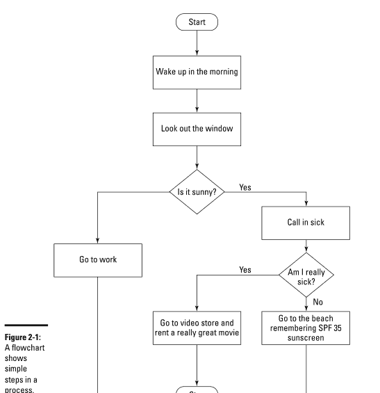

**图2-1：** 流程图展示了一个过程中的简单步骤。

在图2-1中，我们从顶部标有*Start*的位置开始，然后沿箭头向下到第一个框。第一个框是命令或语句——我们*做*的事情。做完之后，我们沿箭头向下到下一个框。之后我们再次沿箭头前进，但这次遇到一个菱形框。菱形框包含一个决策。我们回答这个问题，如果答案是*是*，就走一条路；如果答案是*否*，就走另一条路。在这个例子中，如果是*是*，我们向右走，开始右侧的框，沿箭头前进，回应我们遇到的任何决策。如果第一个决策是*否*，我们沿左侧箭头前进，同样执行框告诉我们的事情，并回答菱形框中看到的问题。

嗯，整套流程图方法对于小型、简单的任务非常有效。但多年来，软件已经变得复杂得多。一方面，人们现在围绕对象和类构建应用，而这些根本不适合流程图的概念。其次，软件变得*庞大*。只要快速看看你日常使用的一些软件，比如文字处理器，就能看出这些应用是由许许多多人编写的，他们似乎想加上所有花哨功能——不管你是否用得上！而流程图更适合软件包中的小部分，比如单个函数或算法。

因此，多年来，人们基本抛弃了流程图，把它留在某个时间胶囊里，等几百年后被人发现。（尽管UML的一部分——称为*活动图*——与流程图类似。）而在程序员开始抛弃流程图的这些年里，计算机科学领域几位受人尊敬的研究者提出了新的方法来绘制漂亮的图，以描述计算机应用。人们做过几种不同的尝试，但程序员似乎终于提出了一个人人都能接受的方案：UML。

UML把流程图的概念提升到了一个全新的层次。是的，这听起来像是出自营销手册，但这是真的。UML*远不止*流程图。UML使用符号来显示所有类和对象如何在你的应用中组合在一起，并显示它们如何交互和*协作*。然后，你在设计和构建整个软件系统时使用UML。图2-2是一个UML图示例。

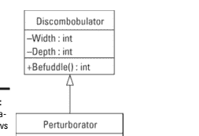


## 第2章：用 UML 描述你的程序

### 三剑客

在探索UML的过程中，迟早会遇到*三剑客*这个术语。虽然那是一部出自“最伟大的十年”（为什么，当然是20世纪80年代）的傻乎乎电影，但在UML语境中，它指的是开发UML的三个人。为什么叫他们这个？因为大约七年后，他们终于成了朋友。这是真的。

多年来，有三个人写面向对象编程的书，各自有做事方式。但更糟的是，有*传言*说他们彼此受不了。（谁知道那是不是真的。）“我的方式更好，而且反正我不喜欢你。”得了吧，伙计们，我们就不能好好相处吗？嗯，事实上，他们最终确实相处融洽。

有一天，他们恍然大悟：“嘿！你知道吗？就像超人、蝙蝠侠和蜘蛛侠一样，我们都可以在一个伟大的正义大厅里联合起来，为所有人创造一个更美好的世界！”还有，“嘿，你知道吗？我们的想法其实并没有那么不同。让我们把它们结合成一种新的、更好的面向对象编程方式。”就像任何时候三位伟人聚在一起集思广益一样，结果非常棒：UML。

顺便说一句，电影界的*《三个朋友》*是切维·切斯、史蒂夫·马丁和马丁·肖特。在UML圈内，三剑客是格雷迪·布奇、伊瓦尔·雅各布森和詹姆斯·朗博。

这展示了两个类，一个叫`Discombobulator`，另一个叫`Perturbator`。每个类都在一个分成三行的框中，类名在顶部，成员变量在中间，成员函数在底部。格式与常规C++格式略有不同；类型放在末尾，冒号之后。（记住在C++中类型放在前面，如`int Height;`。）

第一个类`Discombobulator`有两个成员变量 Width 和 Depth。（大家都知道真正的 discombobulator 没有高度；因此，我们在这个类中没有包含高度。）这两个成员变量是私有的；因此，它们以减号（−）开头，且每个都是整数类型。`Befuddle()`成员函数是公有的，因此以加号 + 开头。在`Perturbator`类中，plethora 成员变量是受保护的，因此以 # 号开头。

注意箭头。箭头表示继承，但方向与许多人可能预期的相反。它指向基类。因此，在此图中，`Perturbator`派生自`Discombobulator`。

统一建模语言已被数百万工程师接受为软件建模的标准方式。对象管理组织（OMG，网址为 www.omg.org）已将UML采纳为其官方建模语言。OMG是由数百家软件公司组成的联盟，这些公司共同监督软件开发标准的浩瀚海洋。


### 为方法论建模

很多人开始读UML书时，起初会有点迷失方向，因为他们很快意识到一个重要问题有时没有得到回答：你如何使用UML从头到尾实际设计一个完整的软件包？你如何使用UML经历确定需要哪些类、构建这些类、编写软件、测试它以及所有那些好东西的过程？一些UML书似乎有充分理由回避这个问题：

UML不是方法论。它不是一套构建软件的规则和步骤。相反，UML只是一组图，你可以在对软件建模时使用。这其实是许多软件工程师没有意识到的一点。“你使用什么方法论？”“我们使用UML。”如果这是他们的回答，就证明他们并不真正知道UML是什么。你将UML与方法论一起使用，然后你就拥有了一套强大的软件构建工具。

### 用UML建模

UML背后的理念是，它几乎可以用于对任何类型的信息建模——不仅是面向对象系统——甚至包括与计算机无关的信息。因此，UML有很多部分。但UML的伟大之处在于，你不需要学习所有部分才能使用它。你只需要学习对项目有用的部分。（事实上，UML已经变得如此复杂，以至于最新的UML 2.5规范侧重于让事情更简单。）

UML涵盖了通常软件开发过程的所有方面。现在我们已经说过，UML本身并不是构建软件的逐步过程或方法论。然而，UML的设计者提供了足够多的图类型和符号，使其可以与软件开发的所有不同步骤一起使用。因此，学习UML时，同时学习一种方法论是个好主意。事实上，设计UML的人——*三剑客*（参见旁边同名侧栏）——也设计了一种方法论。他们的方法论叫Rational统一过程（RUP，读作 rup——就像 up 前面加个 R）。这就是我们使用的方法论。（而且坦白说，大多数方法论或多或少都差不多。）

### 用UML绘图和设计

UML中的图足够简单，可以手绘在一张纸上。当然，现在是计算机时代，使用计算机是有道理的，那为什么还要退回到铅笔和纸的老式方法呢？但除此之外，还有一个轻微的技术性问题，说明纸上的图不适合软件设计。


当你使用UML设计系统时，通常使用一个称为计算机辅助软件工程（CASE）工具的计算机应用程序。当你使用CASE工具时，你指定所有对象；与此同时，你创建描述类及其交互方式的图。然而，模型本身是类的集合——不是图。你可以更改图并创建新图，但在这一切之下是类的集合。类的集合本身称为*模型*。当你绘制图时，你只是提供模型的可视化表示。大多数更好的CASE工具（如Rational Rose或Paradigm Plus）都包含创建和修改模型本身的方法。你通常可以直接这样做，或使用CASE应用程序中包含的绘图工具来做。

当你使用UML构建软件系统时，你通过图来设计类。在此过程中，你同时创建和修改模型与图。但模型本身仍然是独立于图的实体。

好的CASE工具有两种查看系统的方式：第一种是通过模型本身，通常描绘为资源管理器式树形结构，列出类及其成员。第二种是通过图。你可以使用图向模型添加信息；例如，你可以使用类图添加类并修改成员变量和函数。


大多数CASE工具有一个小陷阱：如果你从图中移除一个类，你实际上并没有从模型中移除它。该类仍在模型中，以防你仍想继续处理它并将其添加到更多图中。如果你*真的*想移除一个类，你必须转到模型本身并移除该类。幸运的是，这仅适用于移除类。你可以从图中修改和添加类。

在UML中，你可以使用实际规范中的十六种图，以及八种常用但不属于规范的图。（你可以在 http://www.uml-diagrams.org/uml-25-diagrams.html 查看这些图的列表及其相互关系。）当你处理这些图时，你的模型将演变。你可以更改图，从而更改底层模型。

本书简化处理，只使用可用图类型中的九种。事实上，大多数软件项目永远不会使用超过这九种类型。表2-1和表2-2向你展示了这九种图类型。我们将它们分为两类：*静态*和*动态*。静态图（也称为结构图）表示你正在构建的软件系统的各个部分。动态图（也称为行为图）展示这些部分如何协同工作以及事情如何随时间发生。


在计算机世界里，*静态*和*动态*这两个词一次又一次地出现。*静态*指的是固定不变的事物，而*动态*指的是变化的事物：

- 在应用程序中，类（class）是静态的，因为你在代码中描述它；一旦描述完毕，在应用程序运行时它不会改变。类具有你在代码中指定的一组特定的成员变量和成员函数。尽管应用程序在运行，类的成员不会改变。
- 而对象（object）被认为是动态的，因为它们可以在应用程序运行时诞生；它们的成员变量可以改变，而且它们可以被删除。

### 表2-1 UML的静态图

| 图类型 | 显示内容 |
|---|---|
| 类图 | 不同的类 |
| 组件图 | 系统的不同部分；每个部分包含相互关联的类 |
| 部署图 | 所涉及的不同计算机和硬件 |

下面的列表更详细地描述了表2-1中的各项：

- **类图：** 类图显示不同的类以及它们之间的关系。例如，类图可以显示一个名为*Skiddle*的类派生自*Skaddle*类，并且显示*Skaddle*类包含一个*Ruddle*实例列表作为成员。通常，当你在处理类图时，你同时会在模型本身中添加和修改类。
- **组件图：** 组件图显示软件系统的主要部分。例如，所有处理*Discombobulation*的部分，包括*Discombobulator*类和*Perturburator*类以及其他相关类，都可能被分组到一个名为*SuperSystem*的单一组件中。
- **部署图：** 部署图显示系统的硬件视图。这可能包括特定的计算机（例如一台具有1GB内存的*Compaq Presario*），也可能包括更抽象的硬件组件，例如*互联网连接*。或者它可能显示更通用的硬件组件，例如*网络节点*或*数据库服务器*。不过，这些都是硬件组件。


在Windows中，一个单独的组件通常以动态链接库（Dynamic Link Library，简称DLL）的形式存在。（其他操作系统使用一种类似DLL的组件，称为函数库或简称为库。）你在计算机上找到的大多数DLL都是作为组件构建的。当使用其他人构建的多个DLL时，你就是在使用各种软件组件进行构建。你可以在组件图上显示这些组件。

### 表2-2 UML的动态图

| 图类型 | 显示内容 |
|---|---|
| 用例图 | 软件系统的不同功能 |
| 对象图 | 类的实例以及它们之间的关系 |
| 协作图 | 实例如何与其他实例协同工作 |
| 时序图 | 对象与其他对象协同工作的时间顺序 |
| 状态图 | 单个对象以状态表示的生命周期 |
| 活动图 | 步骤序列；很像流程图 |

下面的列表更详细地描述了动态图：

- **用例图：** 用例图显示软件包可以执行的不同独立功能。这里所说的*功能*是通用意义上的，比如一个过程，而不是像由一组代码组成的C++函数。文字处理器可能有一个名为*Set Italic*的用例。这个用例表示设置高亮文本为斜体样式的功能。Web浏览器可能有一个名为*Go*的用例，它接受一个Web地址并拉取显示相应的Web页面。
- **对象图：** 对象图描述类的实例。这与类图形成对比，类图显示类但不显示实际实例。对象图被认为是动态图而不是静态图的原因是对象本身被认为是动态的。对象在应用程序运行时可以改变。而类在应用程序运行时不会改变。
- **协作图：** 当应用程序运行时，一个对象的成员函数代码可能会调用另一个对象的成员函数。在这个意义上，两个对象在协同工作，或*协作*，就像两个人可能协作抢劫银行一样。协作图显示不同对象如何协作。
- **时序图：** 时序图显示对象随时间的协作。因此，如果你的应用程序是一个关于两个银行劫匪因在从哪扇门离开银行的问题上发生激烈争吵而失败的模型，并且你有两个对象代表这两个银行劫匪，这个图会显示它们随时间的推移调用彼此的成员函数。这些函数可能包括`Insult()`、`Criticize()`和`PolitelyDisagree()`。
- **状态图：** 状态图类似于时序图，但它只显示一个对象。它显示一个对象如何随时间变化，从它被创建到被删除。
- **活动图：** 活动图显示单个成员函数的逐步特性。它实际上是一种状态图：
  - *状态图*显示一个*对象*如何从一个*状态*变化到另一个*状态*。
  - *活动图*显示一个*成员函数*如何从一个*活动*移动到下一个*活动*。在这个意义上，活动图中的每个*状态*都是一个*活动*。


在UML的世界里，当一个对象的成员函数调用第二个对象的成员函数时，这个过程被称为*发送消息*。第一个对象向第二个对象发送一个*消息*。这一术语并非UML首创；最初的面向对象语言Smalltalk使用了同样的术语。在Smalltalk中，对象向其他对象发送消息。你使用协作图来显示一个对象如何向另一个对象*发送消息*。或者你也可以说，协作图显示成员函数调用其他对象的成员函数。这两种说法意思相同。


软件工程师中流行的一个词是*生命周期*。实际上，这个词基本上就是*生命*的意思。软件开发过程有一个*生命周期*：你开始构建软件，一直工作到全部构建完成，根据需要更新软件，然后在使用完毕后淘汰软件；这就是项目的*生命周期*。然而，在许多意义上，它确实会*循环往复*：你收到客户的错误报告，你修复错误，最终发布软件的另一个版本。对象也有*生命周期*：当你创建一个实例时，你就开始了对象的*生命*。然后，在对象的*生命周期*中，你可以对对象做各种操作，比如调用其成员函数和修改其成员变量。然后，当你完成后，删除对象。这就结束了*生命周期*。


软件工程师喜欢从*状态*的角度思考。*状态*就是某物存在的当前状况，比如国家的*状态*或事态的*状态*。这些代表了国家或事务的当前状况。或者某人可能处于完全混乱的*状态*。那代表了这个人当前所处的*状态*。对象也有特定的*状态*：Caboodle类可能有成员变量*PenCount*和*NotebookCount*，它们表示Caboodle类实例中钢笔和笔记本的数量。Caboodle类的一个特定实例可能


## 第二部
### 第2章：使用 UML 描述你的程序

PenCount 的值为 7，NotebookCount 的值为 3。因此，这个特定实例的当前状态是 PenCount=7、NotebookCount=3。Cabboodle 类还可能包含一个名为 AddPen() 的成员函数，它不接受参数，只是将 PenCount 加 1。当你调用 AddPen() 时，你就在改变对象的状态。


当你考虑一个对象的状态时，只需要查看成员变量。成员变量的值共同表示状态。成员函数可能会修改状态，但由于函数本身在应用程序的生命周期内不会改变，因此它们不构成对象状态的一部分。另外，请记住，一个对象可以将另一个对象作为成员包含。外部对象的当前状态会包括它所包含的对象的状态。


在 UML 的世界里，*元描述*的概念会反复出现。*Meta* 是单词的前缀，通常表示*上一层*。例如，对于元描述，我们可以先通过写下关于一棵树的信息来描述一棵树。然后我们可以描述这段描述：“那是一段优美的文字，行文流畅，让这棵树栩栩如生。”现在，上一句本身正是我们在这句话中所指的东西。你看出这里发生了什么吗？我们在描述某物，然后描述这段描述，然后再描述*那个*描述。每次我们都向上移动“一个抽象层级”。因此，*元描述*这个词的意思是“对描述的描述”。

在 UML 中，你会一直遇到元术语。例如，类表示一种对象类型。但*类*这个词是一种分类器。另一种分类器是*类型*。所以考虑这个有点哲学意味的概念：*类*是一种分类器，至少从 UML 图的角度来看是这样。但某个特定的类本身具有某些关于它的属性，例如类名以及成员的名称和类型。那个信息就是*元类*。如果你没有完全糊涂，并且觉得这很吸引人，我们强烈推荐阅读 Douglas R. Hofstadter 的*《哥德尔、艾舍尔、巴赫：一条永恒的金带》*（Basic Books，1999），或者，如果想读稍微轻松一点的，也可读同样由 Hofstadter 所著的*《元魔法主题：探寻心灵与模式的本质》*（Basic Books，1996）。

### 使用 UML 和 Rational 统一过程进行构建

UML 不是一种方法论。这意味着 UML 本身并不是构建软件的一步步流程。相反，你可以把 UML 看作一种在构建软件时用来描述软件的语言。然而，这种语言并不是一群工程师在房间里大喊大叫、争论不休的口头交谈语言。是的，那种情况有时会发生，但幸运的是，它既不是 UML 的一部分，也不是必需的。UML 是一种可视化语言。有句老话说，一张图胜过一大堆文字，或者类似的话，在这里也同样适用。你用图来描述你的软件。这些图提供了对软件的完整描述。

但你是在经历一个过程时创建这些图的。这个过程是你使用的一种方法；我们在本书中使用并描述的方法称为 Rational 统一过程，简称 RUP。有五个主要步骤（对大多数方法论来说往往相同）。这些主要步骤称为*工作流*，如下所示：

- 1. 需求
- 2. 分析
- 3. 设计
- 4. 实现
- 5. 测试

当你想到要完成几乎任何与计算机无关的事情所采取的步骤时，你大概能看出你经常使用这些步骤。

例如，假设你要建造一台时间扭曲装置，好跳过下周的牙医预约。首先，你决定需要建造什么；这称为*需求收集*。在这个例子中，你需要一台能把你带到未来时间的装置，大概是带到指定的时间量。所以你会希望在装置上有一个显示屏和一个键盘，以便输入要向前移动的时间量。而且你大概需要一个按钮来启动时间扭曲。这些就是项目的需求。

然后你思考将如何进行时间扭曲以及需要什么，并分析这个项目。在这个例子中，你需要实际的时间扭曲部分，包括相对论性宇宙弯曲，以及主界面部分，也就是你控制这个装置的地方。这一步称为*分析*。

接下来，你开始仔细设计这项发明，但并不实际建造它。这是你工作的核心部分，你要画出将要建造的东西以及不同部分如何运作的图。你画出你这个特定版本相对论宇宙弯曲器如何工作、其中涉及的部件，以及系统中所有其他主要组件。这就是*设计*步骤。

然后你建造，或者说*实现*，这个装置。这是有趣的部分，你走进工坊，开始敲敲打打、挑战重力来建造这个装置！当然，这一步称为*实现*。

但你还没有完成；最后，你必须*测试*它。为此，你收买隔壁那家伙，让他乘坐你的时间机器，看看它是否有效。如果不行，他可以回来向你报告，让你知道哪里出了问题。（假设他能回来。）

现在这一切都很好，但可能会出现一些这五个基本步骤无法处理的问题。例如，许多尝试构建大型软件系统的人很快就会发现先有鸡还是先有蛋的综合征。问题在于：如果我们正处于分析工作流的中途，本应把粗略的类确定下来，那么在深入代码并开始编写它之前，我们怎么可能知道将来需要的所有类呢？

由于这个原因，许多人抱着这样的态度：*跳过工程，直接把这个破东西写出来！*但请想象一下，如果你不先做规划就试图建造时间扭曲装置，它会是什么样子。在你把这个东西完全建好（差不多吧）之后，你真的*信任它吗？*你会自己坐上去，而不是只付钱让那个毫不知情的邻居去试吗？软件也是一样。如果你直接一头扎进去，开始拼命写代码，冲向终点线，你怎么能确定自己覆盖了所有内容？你漏掉什么了吗？很可能。你写的东西能完美运行吗？值得怀疑。

幸运的是，有一种方法能把所有东西组合起来。它使用称为*迭代*的步骤。

### 以迭代方式表述

假设我们想构建一种新型 Web 浏览器。这种 Web 浏览器将超级智能，能通过接入你的脑电波，自动知道你想到哪个网站去。当你早晨醒来时，你会听到耳边回响着一句微弱而遥远的话：“你想去哪里？”你想：“去参观史密森尼博物馆不是很有趣吗？”然后你走到电脑前坐下，浏览器先打开史密森尼的网站，然后打开一个显示航班、酒店、租车信息以及前往路线图的网站。那岂不是一款酷毙了的 Web 浏览器？

所以，作为一名优秀的工程师，你遵循构建它的正式步骤。你画出需求，甚至采访你的朋友，看看他们对这样一款了不起的软件有什么想法。然后你分析不同部分，提出软件的功能，甚至画一些示例屏幕。接下来，你进入设计工作流，充实你在分析工作流中建立的基本类。最后，你开始编码。你编码了好几个星期，突然——砰！——你发现出了严重问题：你完全忘了需要编写软件中负责连接互联网的繁琐部分，


你可能偶尔已经注意到某些情况会发生。有时，当你做出会大幅影响页数的重大更改时，例如更改页边距，Microsoft Word 会重新分页。而在重新分页时，你可能会发现一些重要段落被拆开了，也许一页末尾只有一行文本，而该段落的其余部分跑到了下一页。这会生成难看的文档，因此，Microsoft Word 在对话框中提供了一个名为*保持段落同页*的选项功能。

现在，如果你正在开发文字处理软件，很可能直到编码进行到很后面才会想到这个细枝末节的段落拆分问题。那么你该怎么办？最可能的是，在前两个阶段之一，当你有了一个基本原型之后，你可能会注意到有时段落会在不方便的位置被拆开。解决办法？加入一个保持段落同页的选项。于是你回到需求阶段，在所需功能中增加一项：一个用于保持段落同页的选项。

现在，如果你正在开发一个专门擅长读心术的超酷 Web 浏览器，那么在初始阶段，你可能会做一个具备所有主要功能的基本原型，即使这些功能运行得并不好。但在那段时间里，你发现漏掉了某样东西：通信系统。但现在你知道你需要它了！于是你回到分析阶段，在那里你实际上可以把它加进去，也许作为一个组件。很酷，对吧？

现在，每当你回溯自己的工作流并更改某些东西时，你就开始了一个新的迭代。因此，你可以看到各个阶段被拆分成迭代，每个迭代都包含五种工作流中的若干种。而且你可能在单个阶段内经历多个迭代。


你不必一直走到最后、进入测试工作流之后才回退。因此，每个迭代可能只包含一两个工作流。

如果这一切听起来有点奇怪，可以这样看：如果你发现自己有某个地方不太对，你会怎么做？你会回去把它修好！但软件工程师喜欢说得更技术化一些，于是他们说他们*开始一个新的迭代*。

### 初始阶段

*初始阶段*是第一个阶段，在这一阶段你开始让事情起步。在这个阶段，你可能还达不到编写原型并发现问题的程度。但如果你在构建一个大项目，你可能正好会达到编写原型的程度。不过，如果确实如此，你很可能只会编写项目各个部分的小型原型。

而在初始阶段，你要尝试做以下事情：

- **确定项目是否可行。** *可行性*这个词会反复出现，它主要源于人们有很棒的想法，但后来却认定，嗯，坦率地说，那些想法并不实际或不合理。但企业更喜欢更温和、更委婉的术语：*可行*。
- **确定主要需求。** 需求收集是一个特别棘手的问题，因为在那段时间里，人们会想把所有东西都包括进去。他们不仅希望软件能浏览 Web，还希望它能把网页重新注入你的大脑，并且让你能够直接从你的大脑下载到你朋友的大脑，还能只需把手指放在打印机上就能打印一份。他们希望软件做*一切*。

  但值得庆幸的是，在这段时间里，你开始规划项目，可能会构建一些原型，并确定它真正*应该*做什么。把页面传回大脑是否可行，还是这项技术还要一两年才会出现？如果不可行，那它很可能就不可行。

这个阶段的目标是固化需求并做一些基础分析。在这段时间里，你会让人们同意你将要构建的东西。（这些人被称为*利益相关者*，因为他们在软件的成功中拥有重大利益——比如他们的*工作*。而当你为他们写完软件、他们成为百万富翁后，他们会犒劳自己一顿美味的大牛排。）你还会让他们就软件将在哪些计算机上运行以及软件的限制等事项达成一致。例如，这个浏览器能一次读取多个人的大脑，还是只能一次读取一个人的大脑？（这就是一项*限制*。）还有，它会在 Windows 上运行，还是会同时在 Macintosh、Unix 和 Linux 上运行？

当然，业务人员也会想在所有这一切中有一点发言权。因此，这个阶段的目标还会包括项目的进度和成本之类的事项：你多快能完成它，它会让企业花费多少？你需要雇佣更多工程师来参与这个项目吗？你需要购买更多计算机和工具，比如编译器吗？

最后，在这个阶段结束时，你会希望得到系统的基本架构，由 UML 图组成。这些图可能粗糙而基础，但它们会提供系统的整体轮廓。

### 细化阶段

在*细化阶段*，你要固化软件的功能。你会使用称为*用例*的工具——即对软件功能各个部分的描述。例如，文字处理软件会有这样的用例：*开启斜体、关闭斜体、打印、设置左对齐、删除一页*。用例就是你可以用该软件做的所有事情。

同样在细化阶段，你还要制定构建该软件的计划。这意味着要基于你在初始阶段创建的基础设计进行细化，经历更多的分析和设计。

细化阶段的一些主要目标是：最终确定软件的范围，并纳入对软件的任何更改（例如，经过进一步检查，你可能已经确定更多事情不可行，而其他部分可行）；最终确定项目计划，包括你需要的人数和它将花费的时间；并确保利益相关者都对项目感到满意、称心如意。

而在细化阶段，你还要创建软件的第一个粗略草案版本。是的，你可能在初始阶段已经编写了一些代码，但那只是为了确定可行性而做的原型。你不会在真正的编码中使用初始阶段那些粗糙的代码。然而在这里，你首次开始编写实际应用程序的代码。为此，你继续进行分析和设计，并进入编码（实现）。当然，软件只是一个粗略草案，但它已经不止是原型；与前一个阶段不同，在细化阶段，你会保存大部分代码，并在下一阶段复用。因此，你再次经历迭代，循环经历分析和设计、实现等工作流。

### 构建阶段

在*构建阶段*，你继续实现。但到现在，你所有的分析和设计应该基本完成了。每个人（包括那些著名的利益相关者）现在都已就软件会做什么、不会做什么、将花费多少、构建需要多长时间以及会有多少人参与达成一致。但更进一步，你已经拟定了将要设计的类组，并决定了这些类如何组合在一起以及如何相互通信。分析和设计已经准备就绪，现在你可以专注于真正让系统工作起来。在这里，你要找出那些不太能拼合在一起的部分，并修复问题使它们拼合起来。你要确保系统没有重大漏洞，以免整个系统在奇怪、意外的情况下彻底崩溃。一言以蔽之，你要让软件*稳定*。

如果你在 20 世纪 90 年代初接触过计算机，那时情况终于稳定下来，我们开始看到实用的真实软件，你可能还看到过别的东西：弹出的小错误消息，称为*一般保护性错误（GPF）*。GPF 会在应用程序*真的搞砸得很严重*时出现，而修复该应用程序的唯一办法是尝试点击*忽略*按钮来*忽略*错误（信不信由你，这个选项从来不管用），或者中止应用程序。我们清楚地记得那些日子，因为它们让我们开始考虑远房表亲提供的工作机会——那些表亲在墨西哥湾出租沙滩伞。


现在，这些错误为什么会发生？因为软件并不*稳定*。你设法把软件置于程序员未曾预料到的情况中，于是程序卡住了，抛出一个一般保护错误。那么，程序员为什么创建出允许这种情况发生的软件？因为他们没有彻底走完构建阶段！

构建阶段包括*实现*和*测试*工作流。你可能会有一些分析和设计缺陷，但它们会很少；你看到这些缺陷的主要时候，是当你发现自己忘了某些东西，或需要更改类中的某些内容时。到这时，你将经历编写代码、测试、测试、测试以及最后更多测试的迭代。当测试人员遇到错误时，你回去修复代码。然后，最终测试人员确定他们再也找不到任何 bug。这一天结束了！你准备好发布了。

因此，如果你正确遵循构建阶段，就能限制应用程序失控时弹出的操作系统错误数量——因为如果你一切都做对了，它就不应该失控。


如果你正在领导一个将使用 RUP 设计大型软件系统的项目，你会希望给予测试人员一定的权力。把测试人员视为质量保证人员。事实上，有些公司称他们为 *Q/A 工程师*，而不是测试人员。你的测试人员在他们说软件*能正常工作*之前，不应该允许公司把名字署在软件上。这有多重好处，因为它让 Q/A 工程师感受到一定的权力，也把沉重的责任压在他们身上，这有助于确保他们做*彻底*的工作。而这将有助于确保你的软件既优秀又稳定。在我们看来，这听起来是个好计划！

### 过渡阶段

*过渡阶段*既是最快乐的时期，也是最可怕的时期。作为软件工程师，我们知道这可能是令人恐惧的时刻，因为最终见分晓的时刻到了：你和团队其他成员构建的产品真的能工作吗？还是它到了客户的计算机上就会崩溃并彻底失败？

最有可能的是，由于你在前三个阶段都做对了，软件将在客户的计算机上运行。然而，仅仅因为你做对了，并不意味着你不会焦虑。但放松点：如果你要向某个特定客户交付一套软件，你和其他工程师那天很可能会在场，参与这次重要的安装。一开始可能不会完美，但根据我们的经验，大多数问题都不会涉及软件缺陷。相反，客户的计算机没有设置得完全正确。幸运的是，这类问题很容易追踪和修复。

但如果你要交付的软件将通过零售连锁店销售给可能数以百万计的人，那么过渡阶段有一个许多公司想不到的重要步骤。在这最后一步中，你选择一个工作日，邀请所有愿意参加的员工来参加一场盛大的“痛打软件”派对。没错！他们都来了，你分发包含你软件的 CD-ROM。这些是你打算交付的 CD-ROM 的副本，前提是今天一切顺利。员工们得到免费的披萨和软饮料（公司场所不允许喝酒；再说，你希望他们保持清醒），然后他们可以狠狠折腾你的软件。他们安装它、玩它、操作它、使用它、摆弄它，对它做一切能做的事；在这个过程中，给它一次永远不会忘记的重击。如果他们遇到问题，会告诉你（当然是礼貌地）。但在这一天，你个人的工作不是加入他们测试软件。你的工作是着手修复他们发现的任何问题。一般来说，这些问题会是些小问题，你很快就能完成修复。


如果你真的举办这样的大型测试日，尽量让它尽可能令人兴奋。免费披萨、免费软饮料，也许还有响亮有趣的音乐播放，也许还有一个休息室，人们可以去那里闲逛几分钟，忘掉项目。相信我们，如果你让他们觉得这一天很兴奋，这些人会享受这个特别的日子。当然，结果就是一个成功的软件包。

### 借助 UML 继续前进

尽管你把大部分时间花在构建阶段，但许多脑力工作是在分析和设计阶段完成的。这正是 UML 发挥作用的地方。你使用 UML 来映射你的类、绘制它们、处理它们并设计它们。因此，在《迷你书 II》的其余部分，你会看到关于 UML 以及通常在分析和设计期间发生的各种过程的讨论。不过，有些过程发生在需求阶段。

接下来的两章重点介绍你在需求收集、分析和设计期间使用的九种图。第一章重点介绍静态图，下一章重点介绍动态图。

## 第 3 章：使用 UML 构建类的结构

### 本章内容

- 在 UML 中绘制类
- 绘制继承及其他关系
- 使用 UML 构建组件
- 部署软件

当你使用统一建模语言（UML）设计软件时，你的图有两个方面：一个是静态的，另一个是动态的。静态图表示应用程序运行期间不会改变的事物。例如，类在应用程序运行期间不会改变。编写代码时，你写出类名、成员变量和成员函数，并注明哪些是私有的、受保护的和公有的。编译应用程序后，这些信息不会改变；它保持静态。这与你在动态图中表示的信息形成对比，动态图中的信息可以改变。动态图包括对象的创建和删除，以及对象协作（对象一起工作，或者协作、密谋、谋划和策划，就像优秀的小类一样）。

在本章中，我们讨论三种静态图：

- **类图：** 类图表示应用程序中的不同类。
- **组件图：** 组件图表示应用程序的主要部分或组件。
- **部署图：** 部署图表示应用程序最终将在其上运行的不同计算机和硬件。


在本章中，我们讨论 UML 图。虽然你很少会听到我们这样说，但我们不太多谈论的一件事（至少在本章中不谈论）是方法论。（我们在第 II 册第 2 章中讨论该主题。）UML 是你用来设计软件的语言。方法论是你用来设计软件的过程。我们推荐的过程是 Rational 统一过程（RUP）。在本章中，我们讨论图，并提到过程中可能使用这些图的部分，这样你就可以画出许多漂亮的图。

### 绘制类

就像我们周围的许多事物一样，对象可以在其内部容纳其他对象。例如，鳄鱼体内可能有……好吧，这大概不是最好的例子。更确切地说，打印机对象内部会有一个碳粉盒。它们可以是独立对象，各自属于自己的类。一个可能是 LaserPrinter 类，另一个可能是 TonerCartridge 类。

在这个意义上，这两个类是相连的。这种连接不是通过继承实现的；不过，它们之间确实存在关系。

你可以把这种关系再推进一步。我们有一个装着空白可写 CD-ROM（或 CD-R）的容器。该容器可以是 CDROMHolder 类的实例。容器内的各项可能分别是 CDR 类的实例。在这种情况下，单个 CDROMHolder 实例可能包含多个 CDR 实例。因此，LaserPrinter 实例包含单个 TonerCartridge 实例，而 CDROMHolder 包含多个 CDR 实例。另一个例子是停在我们车道上的 Porsche 类。它恰好包含四个 GoodyearTire 实例。（是的，我们在做梦。）因此，你可以看到这里有几种可能：

- **恰好一个实例：** 一个类的实例可能恰好包含另一个类的一个实例。
- **固定数量的实例，大于 1：** 类的每个实例可能包含另一个类的确切数量的实例。这个数量在不同实例之间不会改变。
- **数量可变的实例：** 类的每个实例可能拥有不同数量的另一个类的实例。这个数量可能因实例而异，甚至对于单个实例来说也可能随时间变化。

至于最后一项，你可以看到，当我们从 CDROMHolder 实例中取出一个 CDR 实例时，该容器所包含的实例数量减少 1。或者，如果我们放回一个 CDR 实例，容器中的数量就增加 1。如果我们买更多并重新装满容器，它就会增加超过 1。但对于我们坚信停在外面的 Porsche，轮胎数量保持不变。

当你为构建应用程序而分析这些类时，你可能会发现这里存在一些分歧：当我们去购买新轮胎时，汽车会被抬离地面，机械师会一个接一个地拆下旧轮胎，直到车上没有轮胎。然后他们一个接一个地安装新轮胎。因此，轮胎数量在实例的整个生命周期内并不是固定的。但你如何构建你的类


## 第3章：使用 UML 构建类的结构

这取决于使用应用程序的人的需求。你需要考虑这一方面，因此可以把轮胎数量视为固定的。或者你可能需要包含轮胎的替换件，在这种情况下，你就不会把数量视为固定的。

再举一个例子：如果你正在为赛车游戏或模拟器编写应用程序，你可能希望具备发生撞车和轮胎从车上脱落的能力。那么你就需要让轮胎数量可变。


如何设计类取决于具体情况。总是假设不同应用程序中出现的同名类具有相同含义并不实际。有些应用程序可能要求某个类不同于另一个应用程序中的类，即使这两个类恰好同名。

另一种关系是继承。*LaserPrinter* 类可能派生自 *Printer* 类。

继承也可能很复杂。你可能有一个类，并且有两个类派生自它。这两个类中的一个可能又有两个类派生自它，而另一个可能只有一个派生类。再往下，可能就没有更多派生类了。C++ 提供了极大的灵活性。


你可以从另一种方式看待设计问题。类是一种*分类器*。在这方面，你可以想象一种继承关系，用不同的词来表示*种类*。一个会是类，另一个会是*分类器*。然后类派生自*分类器*。另一个分类器是*类型*，因此*类型*也会派生自*分类器*。（例如，请记住整数是类型。）从*元信息*或*元数据*的角度看，你可以把 *int* 看作*分类器*类型的实例。你可以把 *LaserPrinter* 看作*分类器*类的实例。那么，我们桌上的那台具体打印机就是 *LaserPrinter* 的实例。这需要一种抽象地看待事物的方式，但如果你能跟上这个体系，你就已经准备好进行一些严肃的类设计了。这是因为你会理解类在更大的整体中是如何组合在一起的。

### 使用 UML 映射类

你可以创建一个 UML 图，显示若干类及其各种关系。看看图 3-1。该图显示了三个类：*Printer*、*LaserPrinter* 和 *TonerCartridge*。请密切关注连接这三个类的线条。这些线条不同，因为这些类以不同方式相互关联。

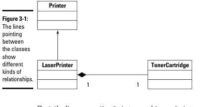

首先，连接 Printer 和 LaserPrinter 的线条表示继承。粗大的空心箭头指向基类。因此，LaserPrinter 派生自 Printer。

> **技术细节**
>
> 虽然你不会经常听到我们使用这个术语，但与术语 *派生自* 相对的是 *泛化*。因此，如果 LaserPrinter 派生自 Printer，另一种说法是 Printer 泛化了 LaserPrinter。其含义是 Printer 是 LaserPrinter 的一般形式，而 LaserPrinter 是 Printer 的具体形式。我们倾向于不使用 *泛化* 这个术语，原因是当你创建类的层次结构时，通常先创建基类，然后派生一个新类。因此对我们来说，*泛化* 这个术语是反直觉的。而我们的大脑不擅长处理反直觉的想法。（不过，公平地说，我们应该补充一点：提出类的一种常见方式是注意到两个类之间的相似性，然后提出一个单一的类来充当基类。所以从这个意义上说，泛化是有道理的。）

现在看看连接 LaserPrinter 与 TonerCartridge 的线条。这称为*组合*，这个词意味着这两个类是*关联*的。（把组合看作两个对象之间的强绑定。）因此，每个 LaserPrinter 实例将恰好包含一个 TonerCartridge 实例。之后如何实现由你选择，但最有可能的是，你会在 LaserPrinter 类中包含一个指向 TonerCartridge 实例的指针。

在这第二条线中，带实心菱形的一端表示*整体*，即*包含部分*的一方。因此，LaserPrinter 是整体，它包含部分 TonerCartridge。还要注意，组合线下方有两个数字。左边的数字表示关联中有一个 LaserPrinter 实例，右边的数字表示关联中有一个 TonerCartridge 实例。

现在看图 3-2。这里有一个菱形和一条线，它们同样表示组合。但这一次，Porsche 类旁边有一个 1，GoodyearTire 类旁边有一个 4。这种组合意味着恰好一个 Porsche 实例将恰好拥有四个 GoodyearTire 实例。换句话说，一辆汽车有四个轮胎。

**图 3-2：** 菱形和线条组合起来表示组合关系。

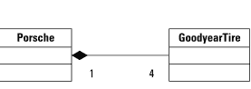

接下来，看图 3-3。你再次看到一种关联，但这次是在 Pasture 类和 Cow 类之间。不过在这种情况下，Pasture 类旁边有一个 1，Cow 类旁边有一个星号（*）。星号表示任意数量的 Cow 实例都可以与任何单个 Pasture 实例关联。换句话说，一个牧场可以有多头牛在其中活动。当你在 UML 图中放入星号时，它表示关联中可以有任意数量的实例，包括 0。因此，一个 Pasture 可能里面没有牛（它们都在谷仓里挤奶），也可能只有 1 头牛在牧场里，或者可能有 100 头牛在牧场上闲逛。

**图 3-3：** 带有 * 的类可以有多个实例与带有 1 的类关联。


还有其他表示关系中项目数量的可能方式。这些可能性称为*多重性*。表 3-1 列出了它们。

**表 3-1：多重性**

| 符号 | 含义 |
| --- | --- |
| 1 | 恰好一个实例 |
| n | 恰好 *n* 个实例（其中 *n* 是任意数字） |
| m..n | 允许 *m* 到 *n* 个实例；例如 0..1 或 1..10 |
| * | 任意数量的实例，包括 0 |
| 0..* | 任意数量的实例，包括 0（与 * 相同） |

例如，如果你有两个类，一个叫 Vacuum，另一个叫 ExtensionTube，并且你看到 Vacuum 一侧有 1，ExtensionTube 一侧有 1..4，那就意味着对于每个（1）Vacuum 实例，你可以有任意一个到四个（1..4）ExtensionTube 实例。


但是等等。我们原以为这些类图应该是静态的，而不是动态的！没错：它们仍然是静态图，尽管静态与动态之间的界线有些模糊。我们可以就类图为何确实是静态的（例如，你编写一个包含单个数组的类，而该数组不会改变）展开一大段哲学解释，但不如这样说：只需把类图视为静态的，并认识到存在一些模糊的区分。这不是什么大问题。

### 属性和方法

在面向对象的世界中，你很可能会多次听到两个词：属性和方法。属性就是成员变量，而方法只是成员函数的另一个名称。这两个术语是 UML 的官方术语。然而，大多数 C++ 人员通常不使用它们，除非在绘制 UML 图时。相反，大多数 C++ 程序员更喜欢成员变量和成员函数这两个术语。你可以使用你喜欢的任何术语，也可以使用你听到别人说的任何术语。在本书中，当我们专门讨论 UML 图而不是指 C++ 代码时，我们使用属性和方法。

### UML 中的继承

如果你想在 UML 中指定继承，只需画一个从派生类指向基类的箭头，并且不要填充箭头。但你也可以用 UML 表示其他类型的继承。


如果你想指明某个基类具有抽象虚函数，就要在类中用斜体来指定这些函数。例如，图 3-4 展示了一个名为 Person 的基类。这是一个抽象类，因为它包含一个抽象虚函数：work()。该函数之所以是抽象虚函数，是因为它使用了斜体。（因此类本身也是抽象的。记住，一个类只要至少有一个抽象虚函数，它本身就是抽象类。）

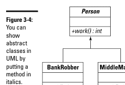

从 Person 派生出的两个类 BankRobber 和 MiddleManager（我们只是觉得这两个名字组合起来挺有趣）分别重写了 work() 函数。因此，它们*不是*抽象的。也正因如此，你可以创建 BankRobber 和 MiddleManager 的实例。


你可能已经注意到，到目前为止，我们还没有提到在 UML 中指定虚函数的方法。你可以把成员函数指定为抽象，但普通的虚函数呢？不行。virtual 关键字是 C++ 独有的，这个词的意思很简单：你可以重写一个函数。那么如何指定 virtual 呢？许多 CASE 工具在模型中包含一个选项，允许你将成员函数指定为 virtual。

### 聚合与组合类

当你关联两个类但不是通过继承时，可以通过两种常见方式实现：组合和聚合。以 LaserPrinter 类及其与 TonerCartridge 类的关联为例。碳粉盒是激光打印机的基本组成部分，但一个碳粉盒不能同时位于多台激光打印机中。这就是组合。

另一方面，聚合指的是连接较为松散的两个对象。在一间办公室里，你可能会发现数百台计算机和十几台激光打印机。激光打印机可以独立工作，并与许多不同的计算机交互。同时，每台计算机也可以与许多不同的激光打印机交互。这是一种松散得多的连接；这就是聚合。

但这*并不*意味着组合只用于一对一关系，而聚合用于多对多关系。相反，组合只是表示一种强得多、紧密得多的关系。碳粉盒是打印机*不可分割的一部分*，因此处于组合关系中。但打印机并不是计算机中如此紧密集成、不可或缺的组成部分。计算机没有打印机也能工作，反之亦然，这表明是聚合关系。

在 UML 中，你可以根据菱形的填充方式区分二者。这听起来不错吧？不过，这里说的是图上的菱形形状，而不是真正的钻石。对于组合，菱形填充为纯黑色。对于聚合，菱形不填充，只是轮廓。图 3-1 至图 3-3 展示组合。图 3-5 展示聚合。

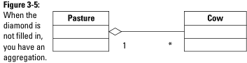

注意，图 3-5 包含的类与我们在图 3-3 中放入的类相同。但这一次菱形没有填充。这意味着我们修改了图，使其成为聚合而不是组合。

### 组合与属性

组合与属性之间存在密切的相似性。当每个 `LaserPrinter` 实例都有自己的 `TonerCartridge` 实例时，你有一个选择：在 `LaserPrinter` 和 `TonerCartridge` 之间画一条组合线，把菱形放在 `TonerCartridge` 一侧，或者直接给 `LaserPrinter` 类一个类型为 `TonerCartridge` 的成员变量（*属性*）。毕竟，当你采用组合并编写该类的代码时，组合会以成员变量的形式体现出来。

那么你该怎么做？实际上，这取决于你（但不要同时采用两者），不过你必须遵循一条规则。（就像我们希望大多数规则和法律那样，这条规则并不严格。）如果你有一个在整个应用程序中通用的类（你可能会把它视为工具类），并且它作为成员变量出现在许多类中，那么你或许应该把它作为*属性*，而不是通过组合线来表示，原因很简单：这样可以防止图变得杂乱。

使用 UML 时，不能有两个图展示相互冲突的关联；因此，在单个 UML 模型中不能同时包含图 3-3 和图 3-5。UML 模型必须为该模型内的所有关联提供一致的表示，即使该关联在另一个模型中会是不同类型。

另一种理解组合的方式是通过所有权。如果一个对象拥有另一个对象是合理的，那就是组合。例如，一个 LaserPrinter 实例会有自己的 TonerCartridge 实例。另一个 LaserPrinter 会有一个*不同的* TonerCartridge 实例。也就是说，这两台 LaserPrinter 不能共享同一个 TonerCartridge。因此，你可以把每个 LaserPrinter 实例看作拥有一个 TonerCartridge 实例。在这种情况下，就可以使用组合。

### 构建组件

在构建软件时，将各种类分组到*组件*中通常很方便。这意味着创建一个类库。大多数操作系统将这些类的集合称为库，但 Windows 称它们为动态链接库，简称 DLL。（这个词没法发音，所以我们干脆说“Dee-El-El”。）库只是一个文件，里面包含大量可供其他程序使用的代码。其他程序加载该库，然后调用其中的函数。但库本身并没有什么特别神奇之处。它只是一堆编译好的类和函数，被塞进一个文件中。（而且它是编译后的，不是源代码。）

或者，组件也可能最终采用一种称为静态库的形式。*静态库*与任何其他库非常相似，因为它包含大量供应用程序使用的代码。但是，当你构建应用程序时，*链接器*（执行链接过程的工具）会将静态库中的代码直接合并到最终的可执行文件中。这意味着，与链接到动态库时相比，你的可执行文件会更大；但链接到动态库时，你需要随应用程序一起提供该动态库，或者确保它已经安装在用户的应用程序中。使用静态库时，你无需担心这一点。（顺便说一句，如果你使用的是 Unix 系统，静态库会获得 `.a` 扩展名，代表*归档*；动态库会获得 `.so` 扩展名，代表*共享对象*。）

如果你正在进行一些复杂的编程，还可以将类分组到一个组件中，并最终将其放入 ActiveX 控件或组件对象模型（COM）对象中。（这些是在 Windows 上运行的特殊类型的库。）

因此，你可以把*组件*看作一种对类进行分组的通用方式。图 3-6 展示了一个组件。它是一个盒子，左侧还有几个附加的小盒子。在这个名为 `MyLibrary` 的组件内部，你可以看到我们放了两个类——一个名为 `Safe`，另一个名为 `Lock`。

**图 3-6：** 组件是一个左侧添加了两个较小盒子的盒子。

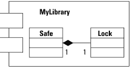

UML 提供了另一种标注组件的方式，如图 3-7 所示。请注意，这里我们将类画在组件外部，而是从组件向它们画了虚线箭头。我们还将 *reside* 一词括在双尖括号中。（法国人使用这些*法式引号*来代替双引号。记下来，以防有人考你。）

**图 3-7：** 另一种表示组件的方式是使用从组件指向类的虚线箭头。

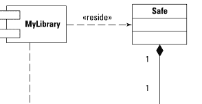

### 构造型

大多数人都认为刻板印象是件坏事，但在 UML 中，构造型实际上是件好事。在 UML 中，你可以取一个现有符号，例如组件符号，对它稍作修改，从而制作出你自己的自定义版本符号。这个修改过程称为*构造型*。这样做时，你要在组件符号顶部内部添加一个词。把这个词放在双尖括号中，像这样：<< 和 >>。（又是法式引号——人人有份！）事实上，在 UML 中，每当你看到用双尖括号括起来的词时，你看到的就是一个构造型。只需把构造型看作符号的一种修改形式，或者看作你自己版本的符号。


创建组件图时，可以在组件中使用构造型。可以这样理解：假设你有几个组件，要把它们构建到一个 Windows DLL 中。（同样的原则也适用于其他平台和组件容器类型。）由于组件符号本身没有地方可以标注它是 DLL，你可以创建自己的 DLL 组件符号。为此，需要在组件符号内放置一个构造型。图3-8显示了三个协同工作的组件。其中两个最终将成为 DLL，另一个将是调用这些 DLL 的最终可执行文件。为了表示这些，我们给它们都加上了构造型。注意，因为我们在创建自己的符号，所以可以重用该符号。在这个例子中，我们使用了两次 DLL 组件符号。如果我们有更多可执行文件，也可以重用可执行文件组件符号。

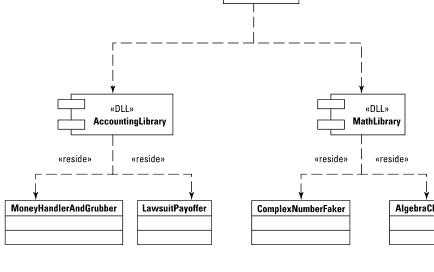

**图3-8：** 你可以使用构造型，并展示不同组件如何协同工作。

**提示**

不同 CASE 工具添加构造型的方式不同。在许多工具中，你使用菜单项；在打开的对话框中，为构造型添加名称。然后选择基类。不要把它与你通常认为的基类混淆。这里讨论的是元信息。这样看：你有一个符号，比如组件。你基于组件制作自己的专用符号，例如称为 DLL 组件。这个 DLL 组件在某种意义上是派生自组件符号。因此，这个层次结构中的基类就是组件符号。所以，当你为组件创建构造型时，基类就是组件。

## 第4章：用 UML 展示行为

### 本章内容

-   在 UML 中绘制对象
-   将用例展开为用例图
-   用序列图排列步骤
-   展示对象如何协作
-   记录活动流
-   说明对象的不同状态

本章将带你了解 UML 中的五种动态图。这些图展示对象如何协同工作以及如何随时间变化。其中一些图你可能觉得比其他图更有用，这没关系——你不必使用本章中看到的所有图。你可以自由使用你觉得最有用的那些。

### 绘制对象

在 UML 中，你可以绘制类图来显示系统中的类，也可以直接深入绘制对象图，对象图包含实际实例或对象。由于绘制的是实例，因此在单个对象图中，同一个类可能有多个对象。


在 UML 图中绘制对象时，它们看起来与类图非常相似，但有一个重要区别：对于对象，矩形顶部的名称带有下划线。对于类，名称不带下划线。务必记住这一区别，以免你的图让其他人困惑。探索对象图的最佳方式是将它与类图进行比较。看看图4-1——你可以看到上半部分是类图，下半部分是对象图。

图中有两个类。名称没有下划线，这两个类通过组合关联。组合关系是一对多——例如，一个 Pasture 实例对应多个 Cow 实例。实际上，Pasture 类的实例包含 0 个或多个 Cow 实例。我们为每个类添加了一些属性。

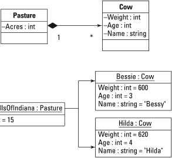

**图4-1：** 类图和对象图相似。

图的下半部分显示了这些类的实例。编程时，有时你会像变量名那样给实例命名。或者你使用的语言允许对象有名称。（C++ 不允许这样做；你必须使用变量名。）在对象图中，我们给实例命名了。每个矩形的顶部是一个带下划线的名称、一个冒号和实例类型。因此，`RollingHillsOfIndiana` 是类型 `Pasture` 的一个实例。`Bessie` 是类型 `Cow` 的一个实例，`Hilda` 也是类型 `Cow` 的一个实例。在对象框内，我们还为成员变量（或属性）给出了值。对于这些值，先写名称，然后冒号，再写类型，就像类符号中那样。但接着你会看到等号和一个值。（因为这些是类的实际实例，所以它们可以有成员变量的值。）

仔细看连接 `RollingHillsOfIndiana` 对象与 `Bessie` 和 `Hilda` 对象的线（以及连接两个类的线）。你会看到箭头指向每个 Cow 实例，但没有指向 Pasture 实例。因此，Pasture 实例包含指向每个 Cow 实例的指针，但反之不然。这意味着 Cow 实例不知道 Pasture 实例。也就是说，Cow 实例不包含指向 Pasture 实例的成员变量。你也可以在类图中看到这种情况，因为箭头指向 Cow 类。


如果你想让两个实例都*知道*彼此，只需移除箭头，只使用线。这种变化称为**双向关联**。当有箭头时，表示关系是单向的。对于 Pasture 和 Cow，箭头表示 Pasture 实例可以调用 Cow 实例中的方法，但反之不然。Cow 实例不知道 Pasture 实例。

有时，人们非常喜欢通过从实例到类绘制虚线箭头，并添加 `<<instantiate>>` 构造型，来表示这些对象是类的实例。当实例很多时，这种技巧会让图变得凌乱，但如果每个类只有一个实例，就可以很容易地在图中展示。我们在图4-2中就是这么做的。注意 `<<instantiate>>` 这个词存在，并且箭头指向类。对我们来说，这种设置似乎有点反了，但在计算机世界里很多东西似乎都反着来，所以我们并不惊讶。

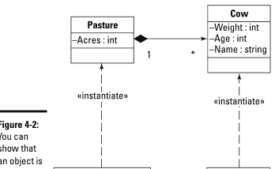

### 梳理用例

说到分歧。多年来，人们一直在为用例争论不休。*用例* 这个术语（发音时 *s* 发软音，就像 *use* 中的发音，因为这里的 *use* 是名词）指的是应用程序中功能的一个单一用例或实例。大多数应用程序都有很多很多事情可做；例如，Web 浏览器允许你单击 Go 按钮，前往你在框中输入的网址；或者允许你单击链接前往某个页面。这两件事中的每一件都是一个单独的用例。

用例已成为软件建模的一个重要方面。那么为什么会有争议？因为用例关注软件包的功能（也就是动词！），而对象关注事物，也就是名词。因此，按这种论点，用例在面向对象分析与设计中似乎没有重要地位。然而，这个论点的缺陷在于：它说 *面向对象* 这个术语意味着你只关注名词。确实，它是以对象为导向的，但这并不意味着你要忽略动词，或蔑视动词。（就个人而言，我们喜欢动词。没有动词的生活很无聊。没有动词说话很困难。我 汽车 杂货店。）

面向对象编程也是如此。尽管我们围绕对象进行构建，但仍然有函数，也就是动词。我们仍然有功能。而且我们可以组织和分组这些功能，例如通过菜单或对话框。

因此，当我们设计软件时，要做的一件事就是审查使用环境，并列出我们能想到的该软件的所有用例。这通常发生在分析阶段。

图4-3展示了一个用例图的示例。实际的用例是椭圆形。你一定也注意到了另一个古怪的符号：火柴人图形！火柴人图形称为 *参与者*，因为它表示与应用程序交互的用户，类似于演员与观众互动的方式。是的，这一次，我们这些世界各地的软件工程师可以回归童年，画漂亮的图画。在这种情况下，我们可以画火柴人。（现在，为了说得非常清楚，请意识到这是一个中性火柴人。它既不是男人也不是女人，也不是*既*是男人又是女人。因此，我们不需要像许多其他领域那样画裙子来表示女人。在这里，我们相信所有人在本质上都是一样的。因此，我们画的火柴人都一样。）

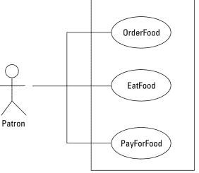

**图4-3：** 用例图展示系统的功能。

现在，如果你看图4-3，可以看到每个用例都有名称。这些是用户可以用系统做的事情。（我们用 *系统* 一词表示你正在构建的软件集合。）这个示例中的系统称为 `Restaurant`。

参与者表示系统的 *用户*。对于文字处理器来说，这可能是坐在那里使用它的你，也可能是另一个人。无论如何，它表示一个用户，一个人。线条指向用户可访问的不同用例。


- 时间自上而下流动。实际上，图中位置越高的事情发生得越早；位置越低的事情发生得越晚。
- 对象从左到右并排绘制。
- 当一个对象向另一个对象发送消息（即调用其成员函数）时，应使用实线箭头，且箭头头部为实心。在箭头上方，写上函数名（如果你更喜欢这种行话，也可以写消息名）。

请看图 4-3，就能明白这种时序机制是如何运作的。我们选取图中所示的用例，并据此构建了一个时序图。不过请注意，我们没有包含关于甜点的补充部分。我们稍后会添加它，因为添加的过程稍微复杂一些。另外请注意，为了构建这个时序图，我们首先需要设计一些类：

- **Server（服务器）：** 这是一个类，其实例接收订单，将订单发送给 Cook 实例进行准备，然后取走订单并将其交付给 Patron（顾客）。
- **Cook（厨师）：** 这是一个可以接收订单并准备食物的类。
- **Food（食物）：** 这是一个表示——嗯——食物的类！

注意，我们没有为 Patron 创建类。这是因为 Patron 位于系统之外，不属于系统的一部分。相反，Patron 是系统的使用者。

图 4-4 是一个时序图示例。请记住，图上方的部分在时间上发生得更早；随着你的目光沿图向下移动，你就在时间中向前推进。而且，即使你可以把目光沿图向上移动，也要小心：你不会想回到过去，把往事再经历一遍吧！

下面解释这个图的工作原理。对象列在顶部，同时列出的还有发起用例的用户。对象下方是虚线，表示对象的生命线。生命线的顶端表示对象被创建的时间。例如，如果你在用例进行到一半时创建一个对象，就应该在用例中该时间位置（即其垂直位置）处开始绘制该对象。在这里，我们的大多数对象在用例开始之前就已经存在（因为它们位于图的顶部），并且它们的生命线一直延伸到图的底部，没有终止。这意味着这些对象在整个用例期间都存在。然而，有一个对象——Food 实例——在用例进行到一半时才产生。

然后是返回：Cook 对象返回一个名为 MyHamburger 的对象（它属于 Food 类）。Server 对象收到该对象后，将其返回给用户。

想一想：用户如何调用函数？用户可以通过用户界面来调用，例如屏幕上带按钮的窗口，或者一个菜单项。也就是说，用户界面就是你在屏幕上看到的部分！这个名字也很有道理：它是面向用户的应用程序接口。因此，这里有一个颇具哲学意味的概念：通过使用屏幕、键盘和鼠标，你就是在与计算机应用程序交互，调用成员函数。很不错吧！

最后，请注意用户删除了该对象。这是怎么回事？记住，这个用例中有一个用户调用的函数。该函数随后调用了 destroy。对象的生命周期随着删除而结束，你会看到一个大的 X，表示生命线到此终止。

在时序图中，当一个对象调用其右侧某个对象的成员函数时，通常将这一过程称为第一个对象向第二个对象发送消息。如果你使用工具来绘制 UML 图，这些箭头可能会被称为消息箭头之类的东西。

## 第4章：用 UML 展示行为

### 标注时序图

创建时序图时，你可以自由地在时序图左侧添加一些注释。左侧的这些注释描述了所发生的事情。图 4-5 展示了这样一个示例。

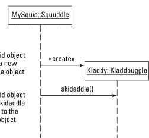

MySquid 对象创建了一个新的 Kladdbubble 对象

MySquid 对象向 Kladdy 对象发送 skiddadle 消息

**图 4-5：** 你可以在左侧添加文本来对时序图进行标注。

### 时序图中的循环与比较

要在时序图中表示循环（如 for 循环或 while 循环），可以将时序图的一部分用矩形框起来，并把循环条件紧挨着放在矩形下方。你可以在图 4-6 中看到这一点，我们在 Server 对象调用 CashRegister 对象的 `payBill()` 方法的位置加上了矩形框。


信不信由你，除了必须以星号开头外，UML 并没有规定循环条件的标准语法。不过，一种常见的做法是使用类似 `i := 1..5` 这样的记号，它表示循环计数器 i 从 1 增加到 5。因此共有五次迭代：第一次 i 为 1，第二次 i 为 2，依此类推，最后一次 i 为 5。所以在图 4-6 中可以看到，Patron 向 Server 发送消息，要求支付餐厅里所有餐点的费用。（显然，这位 Patron 刚刚中了彩票。）然后 Server 走到 CashRegister 对象处，处理所有订单。

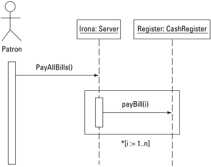

**图 4-6：** 要表示循环，请使用矩形并在其后加上循环表达式。

现在假设在我们这个小餐厅模型中，餐厅供应一种特定的食物，例如炸薯条。在这种情况下，Server 对象可能会回头去问厨师是否还有炸薯条。如果有，Server 就会要求把它们加入订单；然后 Server 将炸薯条订单返回给 Patron；如果没有，Server 就会给 Patron 发回一条消息（用计算机的行话来说，就是返回一个消息），说薯条已经没有了。你可以像我们在图 4-7 中那样来表示这个过程。

看看这是如何运作的。首先，Server 对象向 Cook 对象发送消息 `doHave("French fries")`。（我们简化了图的这一部分，没有展示 Cook 对象是如何做到这一点的。）结果会以 true 或 false 的形式返回，我们将其存储在 `h` 符号中。然后，在下一步中，只有当 `h` 为 true 时，Server 才会调用 `prepareFood("French fries")`。这就是方括号中带有 `h` 的含义。

最后，如果 `h` 为 true，Server 对象会以一个新的 `Food` 对象的形式返回薯条订单。这条返回线以 `[h]` 开头，表示 `h` 为 true。（我们没有展示 Cook 创建 Food 对象的过程；你可以在图 4-3 中看到类似的内容。）但如果 `h` 不为 true，Server 对象将返回一个符号，表示没有更多炸薯条了。（你可能会在 C++ 中将这个符号定义为一个枚举类型，或者也许用 0。）

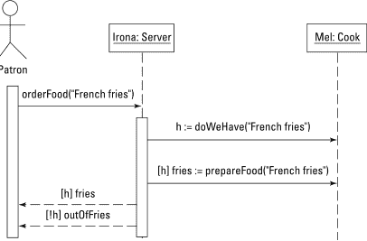

**图 4-7：** 要表示条件和比较，请使用方括号。


到这里，我们实际上已经涉及一些局部变量名了，例如是否有炸薯条的这个值。然而，大多数 CASE 工具还没有强大到能够根据这样的时序图生成可用的 C++ 代码。大多数工具只能生成一些基本代码，有些工具允许你通过 CASE 工具来输入代码。你很有可能会以这个图作为指导来编写自己的代码。通过图来设计比直接用代码要容易得多。而其他人——那些*不会编程*的人——可以通过查看时序图大致了解事件的流程，直接看代码就不太可能看明白。这样一来，*利益相关者*（对应用程序有切身利益的任何人，包括管理层和用户）就可以查看图，并告诉你你所构建的东西是否符合他们的要求。通常，利益相关者参与的程度和类型会影响应用程序的可行性，并决定人们是否真的会使用它，因此获得利益相关者的反馈对于编程工作的成功至关重要。


### 赋值语句中的冒号？

在 UML 中，你经常看到赋值语句中使用冒号而不仅仅是等号。例如，你可能会看到 `index := 10`。为什么要用冒号呢？事实证明，这种语法是从某些语言中借鉴来的，而不是从 C 和 C++ 中来的。我们真幸运。C++ 可能是这个星球上最流行的语言，而 UML 的设计者却在部分语法上使用了另一种语言。在 Pascal（它是名为 Delphi 的编程工具的底层语言）和 Ada（据说军方使用这种语言）这两种语言中，赋值语句中冒号总是在等号之前。而且，更复杂的是，这两种语言也使用单个等号进行比较。当然，C++ 使用两个等号进行比较。也许有一天我们会拥有一种标准的计算机编程语言。在那之前，编程世界的生活就是一团乱麻。但我们会挺过去的。


在完善你的顺序图时，你可能会发现自己没有包含在类中的成员函数，甚至可能会发现新的类。当我们在本节中构建顺序图时，我们发现我们没有用于支付账单的方法。于是我们最终添加了一个 `CashRegister` 对象以及各个对象中用于支付账单的一些方法。我们还发现，我们需要一些方法来查明某个食品项目是否存在。正如你所看到的，我们在处理这些图表的过程中完善了软件系统。而这正是 UML 的目标：对其进行完善，使其完全正确！如果你感兴趣，请查看图 4-8，这是我们在处理这些顺序图时创建的更新后的类图。

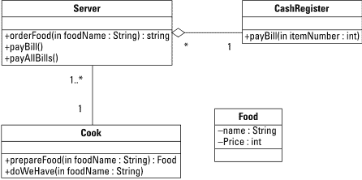

**图 4-8：**你的类图会随着时间推移而演变。

### 协作图

*协作图*与顺序图类似，但它们不显示时间顺序。其理念是，它们提供对图之间交互的概览。坦白说，我们总是选择顺序图，往往会跳过协作图；在许多方面，顺序图是一种协作图，并且具有显示时间顺序的优点。但是，如果你不想显示时间顺序，而是想专注于对象之间的交互，则可以使用协作图。

如果你回顾本章前面的图 4-7，可以看到一个顺序图的示例。现在，在图 4-9 中，我们拥有相同的信息，但以协作图的形式呈现。

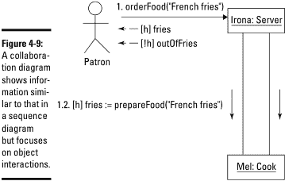

在图 4-9 中，没有给出时间顺序。该图侧重于对象之间以及用户与对象之间的交互。不过，我们确实通过为消息编号（1、1.1 和 1.2）给出了步骤的基本概念。首先，用户向 Server 对象发送消息；其次，Server 询问 Cook 是否还有更多薯条。如果有，Server 就下薯条的订单。

我们不仅仅是把这些东西编号为 1、2、3。我们从 1 开始，然后是 1.1，再然后是 1.2。原因是我们想把第二和第三步想象成第 1 步的*子步骤*。最终，这些都将位于单个函数内部，例如这个*伪代码*（说明基本要点的简化代码）：

```cpp
orderFood() {
    h = doWeHave("French fries")
    if (h) {
        fries = prepareFood("French fries")
        return fries
    }
    else {
        return outOfFries;
    }
}
```

这几乎是 C++ 代码，把它改成真正的 C++ 代码也很容易（比如声明变量，使其成为具有返回类型和参数列表的实际成员函数）。这在一定程度上是我们设想协作图在 C++ 代码中呈现方式的样子；对 *doWeHave()* 和 *prepareFood()* 的调用位于 *orderFood()* 的代码内部。因此它们获得子步骤编号 1.1 和 1.2（就像大纲一样），而不是它们自己的第 2 步和第 3 步。

### 活动图

*活动图*本质上是一个流程图。它显示一系列步骤。是的，*顺序图*也是如此，在某种意义上，*协作图*也是如此。然而，有一个细微的区别：你通常使用*顺序图*来显示用例中的步骤。你可以使用*活动图*来显示*顺序图*的各个部分，例如单个成员函数。

活动图背后的理念是，它显示*尽可能低级别的*步骤。实际上，活动图中的步骤（活动）不能划分为子步骤。计算机从业人员喜欢的说法是，这些活动是*原子性的*，不可分割，就像人们曾经认为原子不可分割一样。（但这次这个理论会站得住脚。）

图 4-10 显示了一个活动图的示例。该图用实心圆表示起点（在此示例中位于图的顶部）。然后一个箭头指向第一个活动（`Eat first bite`），该活动位于椭圆内。接下来是一个决策。与传统流程图不同，你不会在决策中放入任何文本。相反，你显示从菱形延伸出去的箭头；在箭头旁边，你在方括号内放置一个布尔条件。或者你可以对所有其他情况放置 *else* 一词。因此，在此图中，如果食物很好吃，你可以向下移动到右下方的椭圆（`Eat another bite`）。否则，你向下移动到左下方的椭圆（`Throw food away`）。

我们在 `Eat another bite` 活动后面跟了一个决策。如果条件 [more food] 为真，则返回 `Eat another bite`。否则，你移动到最终的菱形。

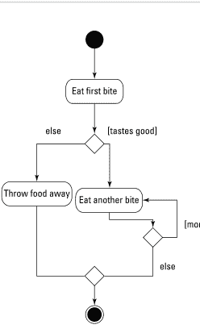

**图 4-10：**活动图类似于流程图。

最终的菱形显示所有步骤汇聚在一起。菱形表示从决策返回，即不同路径重新汇合之处。我们没有在其周围放置任何条件。我们显示两个箭头进入，但只有一个箭头出来。

然后最后是一个带边框的实心圆。这表示*最终状态*，或者更简单地说，活动图的结束。

有时，你可能希望活动图包含一个并非原子性的步骤；你可能想表明接下来要执行一个复杂步骤，但你只给出该步骤的名称而不显示所有步骤。这样的步骤称为*子活动*。子活动不是原子性的，它可以分解为更进一步的子活动。在图 4-11 中，我们创建了一个名为 `Eat Food` 的子活动。我们没有显示吃东西的详细步骤；我们只是指出计算机必须执行名为 `Eat Food` 的函数。为了明确这一点，我们使用了一个稍有不同的图。它是一个椭圆，里面有两个椭圆，其中一个指向另一个。

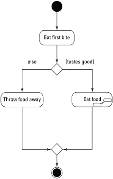

**图 4-11：**子活动可以包含其他子活动。

### 状态图

状态图显示对象可以处于的不同状态。我们不是指内布拉斯加州或加利福尼亚州，而是指诸如以下这样的状态集合：

- 食物名称是 Hamburger。
- 汉堡的顶部面包存在（或为真）。
- 汉堡的肉饼存在（或为真）。
- 汉堡的底部面包存在（或为真）。
- 食物配有番茄酱和芥末酱。
- 还剩十口可以吃。

这些项目一起展示了对象的当前状态。对象的状态由成员变量中的值、对象当前正在运行的函数（如果有）以及它当前与其他对象的关联方式来表示。例如，这个 Hamburger 对象可能在 Server 手中，而不是在 Patron 手中。这是对象当前状态的一部分。

状态图类似于活动图。状态图展示从状态到状态的流动。但它也展示如何从一个状态进入下一个状态。

图上的状态是圆角矩形（具有圆角的矩形）。

我们在图 4-12 中展示了一个基本的状态图。汉堡有两种状态：Hamburger present（意思是它完整无缺）和 Bottom-only Burger（意思是顶部面包已被移除，因为就餐者不想要它）。这两种状态显示在圆角矩形中，并且它们的名称存在。

**图 4-12：**状态图显示对象可以处于的不同状态。


汉堡如何从一种状态转换到下一种状态？在图中，你可以看到一个箭头从一种状态（Hamburger present）指向下一种状态（Bottom-only Burger）。这个箭头是图中唯一的箭头，这意味着它是唯一可能的状态转换。也就是说，汉堡可以处于 Hamburger present 状态，然后它可以转换到 Bottom-only Burger 状态，但不能返回。当箭头上面写的情况发生时，汉堡就会到达那里。以下是其含义：

- 1. 文本的第一部分是 biteTopBun。这是一个发生的过程、活动或步骤。就餐者咬了一口带顶部面包的汉堡。
- 2. 下一部分是 [didn't miss]。这是一个条件。就餐者认为面包太多，真的不会想念顶部面包的存在。
- 3. 要继续进入下一个状态，你需要执行以下操作：removeTopBun。当然，咬和移除实际上是一个步骤。但在计算机中，你可以将其分解。咬是开始移除面包的过程。当就餐者认为面包太多时（换句话说，就餐者不会想念面包的存在），计算机必须执行名为 removeTopBun 的活动。

最后，注意这一切是如何划分的。首先是发生的过程。接下来是方括号中的条件。然后是斜杠，最后是使对象进入下一个状态的活动。因此，状态图展示了两个状态之间的完整转换。


## 第 5 章：使用 UML 为应用程序建模

### 本章内容

-   使用一些 UML 附加内容，例如包、注释和标记
-   利用 UML 赋予你的自由
-   在 UML 中创建 C++ 枚举
-   在 UML 中使用静态成员
-   用 UML 标注模板

在本章中，我们列出一些关于使用 UML 的杂项细节。在你了解如何使用这些图，并对某种方法论或过程有所体会之后，阅读本章以了解有关 UML 的有趣细节。例如，你可以在任何图中使用若干符号，使它们更具描述性；我们在这里讨论它们。我们还会讨论如何在 UML 中表示各种 C++ 特性。

### 使用 UML 的实用功能

UML 规范非常庞大。我们说的是*大*。你可以在 http://www.omg.org/spec/UML/ 查看当前发布的版本，或在 http://www.omg.org/spec/UML/2.5/ 查看 UML 2.5 规范。在本节中，我们提供一些在创建 UML 图时可以使用的附加信息。

### 将符号打包

在计算机编程中，一个常见术语是*命名空间*。当你拥有函数、类和变量时，你可以将它们放入各自的命名空间，而命名空间不过是一种分组。这样做时，函数、类和变量的名称在命名空间内必须唯一。但如果创建另一个命名空间，就可以重用另一个命名空间中的任何名称。用技术术语来说，*标识符*必须在*在命名空间内*唯一。

为了清楚说明这个概念，让我们展示一个 C++ 示例。在 C++ 中，你可以使用 namespace 关键字来创建命名空间。请看看清单 5-1 中所示的 Namespace01 示例——同时也要记住，你在这些应用程序中都会看到 `using namespace std;` 这一行。

**清单 5-1：** 在 C++ 中使用 namespace 关键字创建命名空间

```cpp
#include <iostream>

using namespace std;

namespace Work
{
    int FavoriteNumber;

    class Info
    {
    public:
        string CompanyName;
        string Position;
    };

    void DoStuff()
    {
        cout << "Doing some work!" << endl;
    }
}

namespace Play
{
    int FavoriteNumber;

    class Info
    {
    public:
        string FullName;
        string Hobby;
    };

    void DoStuff()
    {
        cout << "Having fun!" << endl;
    }
}

int main()
{
    // Work stuff
    Work::FavoriteNumber = 7;
    Work::Info WorkInformation;
    WorkInformation.CompanyName = "Spaceley Sprockets";
    WorkInformation.Position = "Worker";
    Work::DoStuff();

    // Play stuff
    Play::FavoriteNumber = 13;
    Play::Info PlayInformation;
    PlayInformation.FullName = "George Jetson";
    PlayInformation.Hobby = "Playing with the dog";
    Play::DoStuff();

    return 0;
}
```

在清单 5-1 中，我们创建了两个不同的命名空间——一个叫 Work，一个叫 Play。为了证明这一点，我们在每个命名空间中创建了一个全局变量、一个类名和一个函数，而且它们的名称都与另一个命名空间中的相同。为了使用这些项，在 main 中我们在它们前面加上命名空间名和两个冒号。所以你可以看到我们有两个独立的全局变量：

```cpp
Work::FavoriteNumber = 7;
Play::FavoriteNumber = 13;
```

并且我们创建了两个独立类的实例：

```cpp
Work::Info WorkInformation;
Play::Info PlayInformation;
```

这些是完全独立的类和变量；它们只是恰好同名。但它们位于各自的命名空间中，因此这完全合法。你还可以看到，我们也调用了每个命名空间中的函数。同样，我们写上命名空间名、两个冒号，然后是函数名。和之前一样，这些是各自独立的函数；它们只是恰好同名。


把命名空间看作一种分组机制。你可以将相关项分组，这样就不必担心你想出的名称是否唯一。


为了保持一切整洁有序，C++ 的设计者将所有自有特性（例如 cout）放入它们自己的命名空间。这个命名空间叫 std，是*标准*的缩写。要使用 cout 和其他标准特性，你需要使用 std 命名空间。这意味着你通常要输入 `std::cout` 来访问 cout。然而，代码中出现大量 cout 条目可能会很麻烦。为了简化对 std 命名空间的访问，你只需在代码开头附近写上 `using namespace std;`。这样，每当编译器遇到它不认识的标识符时，它随后就会检查 std 命名空间。因此，你可以直接使用 cout，而不必在前面加上 `std::cout`。编译器一开始不会识别 cout，但随后会检查 std 命名空间，从而找到 cout。

现在，转到 UML。在 UML 中，你可以使用包在图中表示命名空间。在 UML 中，包相当于 C++ 和其他语言中的命名空间。包看起来像文件夹（不是电脑里的那种文件夹，而是过去 20 世纪末的世代称为*文件柜*的那种奇妙而古老的东西里的文件夹）。

图 5-1 展示了一个包的示例。你可以看到它是一个像文件夹的东西，类就在其中。我们在这张图中放了两个包——一个叫 Work，一个叫 Play——以对应清单 5-1 中的类。

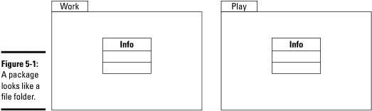


不同的计算机辅助软件工程（CASE）工具和绘图软件处理包的方式不同。例如，如果你使用 Microsoft Visio 创建图，它内置的 UML 工具不允许你在包符号内绘制类。相反，当你创建包符号时，你会得到一个空白的新页面，可以在上面放置符号。

幸运的是，在 `http://sourceforge.net/directory/development/case-tools/freshness:recently-updated/` 列出了许多免费 CASE 工具，你可以试用它们，以找到满足需求的工具。根据你在网上可能看到的情况，截至本文写作时似乎没有 Code::Blocks 的 CASE 插件——如果你找到一个，请写信给我：John@JohnMuellerBooks.com。


在 UML 中，默认情况下已经存在一个命名空间。它叫 topLevel。如果你没有显式地将数据放入某个命名空间，它会自动进入 topLevel 包。

### 为图添加注释

UML 有一个方便的小符号叫作*注释*，其唯一用途是在 UML 图上提供注释。注释很像 C++ 代码中的注释：它与实际图无关，只是为了我们人类以及其他大脑高度进化的生物阅读而存在。

### 自由地使用 UML

UML 的一大优点是它赋予你很大的自由。例如，如果你发现某种图你不想使用，就不必使用它；你仍然可以走完整个软件开发过程或方法论。例如，有些人喜欢使用序列图，而不使用协作图。还有些人不使用状态图和活动图。现在有些纯粹主义者可能会抱怨这一点，但作为软件工程师，你需要做最适合你和你的团队的事。

此外，UML 并非只打算用于软件工程。UML 的创建者将其设计为一种通用的建模语言，可用于各种项目。例如，在一本书中，每一章都以一张 UML 活动图开头，展示书中各节的流程。

当然，大多数人会将 UML 用于软件工程，主要是因为软件领域之外的许多人根本没听说过 UML。

UML 允许自由的另一个领域是你选择的方法论。尽管本书重点介绍统一过程（Rational Unified Process，RUP），但 UML 包含丰富的图和符号，几乎可与任何方法论配合使用。

借助构造型（一种创建新符号的方法），你甚至可以向 UML 添加符号；因此，如果你使用带有自己符号的方法论，也不会被 UML 内置的符号所限制。通常，你取一个现有符号，并从中派生出一个具有相似但更专门特征的新符号。你把名称放在看起来奇怪的双尖括号中，如 <<MyStereotype>>。然而，还有一种替代方法：与其把名称放在那些括号（称为 guillemets）内，你可以使用自己的自定义图标。例如，在图 5-4 中，我们使用了卷轴符号。

**图 5-4：** 你可以为构造型使用自定义图标。

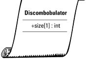


在图5-4中，卷轴符号是基于类图的构造型。因为构造型创建了从另一个符号派生的新符号类型，所以它仍然是类，但是用于特定目的的类。在我们的案例中，我们将其定义为存储为文档的类。从现在起，每当我们创建新类时，都会使用这个符号来表示一种可存储的类。当我们最终实现这个类时，我们可能会从名为Storable之类的基类派生它。这意味着，我们可以不创建构造型，而是认识到当我们最终用C++编码时这个构造型将如何使用，然后直接将图绘制为基类Storable，并派生一个新类Discombobulator，如图5-5所示。两种方式都可以。

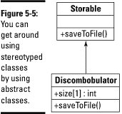

然而，构造型并不仅限于类。请记住，UML中的构造型让你有机会扩展UML。也就是说，构造型允许你添加具有自身新含义的新符号。就我们的卷轴符号而言，我们定义了类符号，最终仍然得到一个类。但是我们也可以对其他符号进行构造型化，这使它们具有与原始符号完全不同的（或略微相关的）含义。

例如，在我们的应用程序中，可能有一个特殊的关联，专门表示一个类（组合类）可以以排序列表的形式持有另一个类（部分类）的实例。我们可以用两种方式之一实现这一点：对其进行构造型化，或者创建带标签的属性。图5-6显示了作为构造型的关系。

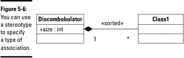

图5-7则显示了带标签的属性关系。注意，对于带标签的属性，标签放在花括号中。

图5-7：你也可以使用带标签的属性来指定关联类型。

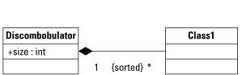


并非所有CASE工具都支持UML的所有特性。（不过，UML 2.5 旨在降低复杂性，并确保CASE工具提供更一致的支持水平，因此如果你想要一致的UML实现，选择符合UML 2.5的产品是最佳选择。）如果你发现某个特性缺失，通常可以使用相关特性来绕过。然而，大多数UML工具都支持构造型和带标签的属性。

### C++ 与 UML

在学习UML时，你可能会遇到一些你明知存在但在UML中却找不到的内容。在这里，我们为你指出UML中一些与C++有直接联系的较小部分。具体而言，我们将讨论枚举类型、静态成员和模板。

### 绘制枚举

如果要在UML中显示枚举，可以使用类似于类符号的符号。请记住，在C++中，枚举是一种类型。在UML中，类型的符号称为分类器。因此，在UML中，你使用特殊的分类器来显示枚举。（但请注意，该分类器实际上是一个已被构造型化的类图。这是如何使用构造型的一个很好的例子。）

图5-8显示了UML中枚举的示例。顶部是构造型名称：`<<enumeration>>`。名称下面是类型——本例中为Color。接下来的栏中是枚举本身。

**图5-8：** UML 为枚举提供了特殊的分类器。

| `<<enumeration>>` |
| :--- |
| **Color** |
| -red |
| -green |
| -yellow |
| -blue |
| -orange |
| -violet |

| `<<enumeration>>` |
| :--- |
| **Color2** |
| -red2 = 10 |
| -green2 = 20 |
| -yellow2 = 30 |
| -blue2 = 40 |
| -orange2 = 50 |
| -violet2 = 60 |

在图5-8中，我们给出了两个枚举。第一个名为Color，仅列出枚举的符号。第二个名为Color2，包含每个枚举的值。在C++中，这两个枚举如下所示：

```cpp
enum Color {red, green, yellow, blue, orange, violet};
enum Color2 {red2 = 10, green2 = 20, yellow2 = 30, blue2 = 40,
             orange2 = 50, violet2 = 60};
```

### 包含静态成员

在C++中，你可以在类中包含静态成员。*静态成员*是类的一部分，但在类的所有实例之间共享。通常，类的所有实例都有自己的成员变量。但如果成员变量是静态的，则该变量只有一个副本供所有实例共享。因此，人们将这类变量视为类本身的一部分，而不是实例的一部分。在UML术语中，这些变量具有*类作用域*。常规成员变量具有*实例作用域*。

成员函数也可以具有类作用域。此类函数不操作单个实例（因此无法访问具有实例作用域的成员变量）。

类作用域成员的一个常见用途是维护实例数量的计数。例如，你可以有一个名为instanceCount的类作用域成员变量。这将是一个整数。在构造函数中，你会递增instanceCount，在析构函数中，你会递减它。因为instanceCount成员只有一个副本，每次创建实例时，你都会递增这个唯一的副本。这样，你就有了实例数量的计数。

图5-9显示了UML中一个具有两个类作用域成员的类示例。类作用域成员带有下划线。本例中，类名为MessedUpWebSite。我们假设这个想法是：每当你访问一个设计糟糕且毫无吸引力的网站时，你就会创建这个类的一个新实例，并将其网址保存在该实例中。该类有两个类作用域成员：siteCount（一个私有整数）和getSiteCount（一个返回siteCount值的公有函数）。（我们将siteCount设为私有，以便其他对象无法更改它。）虽然我们没有显示出来，但你会在构造函数和析构函数中分别递增和递减siteCount。

图5-9：你可以通过类作用域在UML中显示静态成员。

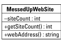

在C++中，图5-9中的类如下列代码所示：

```cpp
class MessedUpWebSite
{
private:
    static int siteCount;

public:
    static int getSiteCount();
    string webAddress();
    MessedUpWebSite() { siteCount++; }
    ~MessedUpWebSite() { siteCount--; }
};

int MessedUpWebSite::getSiteCount()
{
    return siteCount;
}

int MessedUpWebSite::siteCount = 0;
```

### 使用模板参数化类

UML包含一种可以与C++模板一起使用的表示法。（我们在第四册第5章中讨论模板。）在UML术语中，*模板*是*参数化类*。如果你考虑模板在C++中的工作方式，就会明白这是合理的，因为模板接受多个参数，编译器用这些参数来构建类。


当你添加模板参数时，UML标准规定，如果参数类型是类，则可以将参数类型留空。图5-10中我们就是这样做的。注意，名为MyType的参数后面没有类型；因此，它的类型是类。

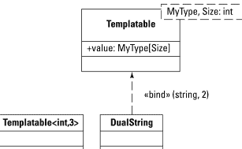

**图5-10：** 要在UML中显示模板，应使用参数化类。

图5-10显示了一个UML参数化类。它看起来就像一个普通的类符号，只是右上角有一个巧妙的小虚线矩形。这个虚线矩形包含模板参数。

注意，在图5-10中，我们声明了两个使用模板类型的类。第一个未命名，只是指定了参数。第二个名为DualString，并显示了回到模板类的关联。一个名为`<<bind>>`的构造型名称出现在关联箭头旁边。构造型名称后面是模板的两个参数。

以下是此UML图对应的C++代码。注意，MyType参数的类型为class：

```cpp
template <class MyType, int Size> class Templatable
{
public:
  MyType value[Size];
};
```

下面是一些使用此模板的示例代码。在这段代码中，我们还使用了基于模板的两个类。注意，要获得命名的模板实例化，我们使用typedef：

```cpp
Templatable<int,3> inst;
inst.value[0] = 10;
inst.value[1] = 20;
inst.value[2] = 10;
cout << inst.value[2] << endl;
typedef Templatable<string,2> DualString;
DualString inst2;
inst2.value[0] = "abc";
inst2.value[1] = "def";
cout << inst2.value[1] << endl;
```


## 第 6 章：使用设计模式构建

### 本章内容

- 理解什么是设计模式以及如何使用它们
- 实现观察者模式
- 构建中介者模式

当你作为软件设计师工作时，最终会开始注意到自己会反复做某些事情。例如，你可能会形成一种生气就关掉电脑的模式。但这与软件设计没有直接关系。

举一个与软件设计相关的例子：每当我们想要跟踪某个类创建了多少个实例时，我们总是创建一个类似 `int InstanceCount` 的静态成员变量；在构造函数中，我们加入一行递增 `InstanceCount` 的代码；在析构函数中，我们加入一行递减 `InstanceCount` 的代码。此外，我们通常把 `InstanceCount` 设为私有，并加入一个用于获取该值的静态方法，例如 `int GetInstanceCount()`。

这个设计我们已经用过很多次，所以知道它有效。第一次使用它时，我们必须思考它，以及如何设计和实现它。现在，我们几乎不用思考；直接做就行，有时甚至在开车沿路行驶时也会这样。好吧，也许不是那时候，但在设计软件时我们确实会用它。因此，这就是我们使用的一种设计模式。

早在 1995 年，一本书在计算机编程界迅速成为畅销书：Erich Gamma、Richard Helm、Ralph Johnson 和 John Vlissides 合著的 Design Patterns: Elements of Reusable Object-Oriented Software（《设计模式：可复用面向对象软件的基础》）。这本开创性著作的四位作者后来在编程领域被称为“四人组”（The Gang of Four）。他们借鉴了建筑领域的一整套知识——不是软件架构，而是那些建造砖混风格高楼、好让超人跃过并看穿的人们所在的领域。那种建筑已经存在至少两个半世纪，因此该领域比软件工程领域要成熟一点点。而且，在建筑设计领域，人们已经想出了设计和建造建筑与城镇的通用方法，不必每次都用一套新设计从头开始。1977 年，一个名叫 Christopher Alexander 的人（显然在该领域很有名）写了一本书，通过使用模式来教授建筑学的主要概念。四人组借鉴了这些知识，并将其应用于软件工程原则。然后他们写出了 *设计模式*。

在书中，他们指出了某种事后看来显而易见的事情（不过话又说回来，伟大的发现往往看似简单）：最优秀的软件工程师会从模式的意义上*重用*技术。我们对用于记录实例计数的类的描述，就是一种可以反复使用的技术示例。

现在，如果你深入探索面向对象编程领域（其实也包括计算机科学总体），你会经常看到*可重用*这个术语。面向对象编程的目标之一，就是通过把代码放进类中使其可重用。然后你从这些类派生出自己的类，从而重用基类中的代码。

这一切都很好，但并不总是奏效。是的，我们或许可以把用于记录实例计数的类放进基类，并总是从中派生。但对于其他一些设计，这并不总是可行。相反，软件工程师只是把同样的设计应用到一组新的类上。是的，他们通过从大脑后方布满灰尘的洞穴中把它拉出来，*重用*了这个设计（这听起来真令人愉快），但他们实际上并没有*重用*任何代码。这没关系！他们借鉴了经验。这就是*设计模式*背后的理念。你不只是把你的*设计模式*写下来，然后把它们塞进一堆基类中。相反，你只需知道这些模式，或者保有一份模式的列表或目录。因此，在本章中，我们将向你介绍一些更常见的*设计模式*。

### 介绍一个简单的模式：单例

在本节中，我们将一步一步带你创建一个*设计模式*，以便你了解它是什么，更重要的是，了解如何使用它。

情况是这样的：你正在设计一款真正出色的软件——出色到从北极到南极的每个人不仅会买一份，还会投资你的公司。在设计软件的过程中，你发现许多情况都需要这样一个类：*在任何给定时间只能存在一个实例。*

你已经遇到过很多次这种情况。例如，你可能有一个表示计算机本身的类。你希望它*只有一个实例*。你可能还有一个表示地球的类。同样，你需要*只有一个实例*。你可能还想要一个对宇宙伟大领袖（也就是你）建模的类。同样，*只有一个实例*。如果人们在代码中尝试创建该类的第二个实例，就会收到编译错误。*你该怎么做？* 你可以花上几个小时想出一种方法。或者，你可以看看某个地方已经存在的模式，比如我们马上要向你展示的这个。

要理解如何创建模式，你需要先理解一个许多 C++ 程序员通常不会考虑的不寻常概念：你可以把类的构造函数设为*私有或受保护*！那么，为什么要这样做呢？事实证明，把构造函数设为私有可以阻止你直接创建类的实例。我们现在都能听到你说了：“哦，天哪！如果一个类不能创建实例，那它听起来还有用吗？这些家伙不是在开玩笑吧！”但你*确实*可以创建该类的实例。有一个窍门：加入一个静态成员函数，由它为你创建实例。


静态成员函数没有与之关联的实例。你可以直接通过给出类名、两个冒号和函数名来调用它们。

但碰巧的是，静态成员函数本身就是类的成员，因此它可以调用构造函数并为你创建实例。

基本模式创建中比较流行的示例之一是*单例类*——一种只允许你实例化一个对象的类。单例类很有用，因为它确保整个应用程序中只有一个对象可用。开发者经常使用单例来协调应用程序其他部分的活动。

下面说明如何创建单例类：首先，把构造函数设为私有。接下来，添加一个公共静态成员函数，它执行以下操作：

- 1. 检查该类的单个实例是否已经存在。如果存在，就返回该实例的指针。
- 2. 如果实例尚不存在，就创建一个新实例并返回其指针。

最后，你把这一单个实例存放在哪里？把它的指针存放在类的静态成员中。因为它是静态的，所以整个类只共享一个成员变量，而不是为每个类实例各有一个独立变量。另外，把这个变量设为私有，这样用户就不能随意修改它。

瞧——你就有了一个单例类！它的工作方式如下：每当你需要该类的单个实例时，不要试图创建它。（否则会得到一个*编译错误*！是的，*编译器本身*不会让你这么做。）相反，你要调用这个静态成员函数。下面来自 `Singleton` 示例的代码行展示了如何创建这样一个类：

```cpp
class Planet
{
private:
    static Planet *inst;
    Planet() { }

public:
    static Planet *GetInstance();
};

Planet *Planet::inst = 0;

Planet *Planet::GetInstance()
{
    if (inst == 0)
    {
        inst = new Planet();
    }
    return inst;
}
```

要使用这个类，你不能直接创建实例。相反，你要调用 `GetInstance()` 成员函数：

```cpp
Planet *MyPlanet = Planet::GetInstance();
```

每当你想要获取这个单个实例的副本时，就调用它。


每次调用 `GetInstance()`，你总是会得到指向同一个实例的指针。

现在看看构造函数。它是私有的。因此，如果你在类外某处（例如在 `main()` 中）尝试这样做：

```cpp
Planet MyPlanet;
```

就会得到编译错误。在 Code::Blocks 中，我们会得到这个错误：

```text
error: 'Planet::Planet()' is private
error: within this context
```

或者，如果你尝试创建指针，在调用 `new` 时也会得到同样的错误：

```cpp
Planet *MyPlanet = new Planet();
```

当你拥有这样一个类时，你可能还希望确保没有人尝试删除这个单个实例。正如你会把构造函数设为私有一样，你也会把析构函数设为私有，如下例所示：

```cpp
class Planet
{
private:
```


```cpp
    static Planet *inst;
    Planet() {}
    ~Planet() {}
public:
    static Planet *GetInstance();
};
```

如果你在获得实例后试图删除它，如下所示：

```cpp
Planet *MyPlanet = Planet::GetInstance();
delete MyPlanet;
```

那么你再次收到一条错误消息——这次是针对析构函数：

```cpp
error: 'Planet::~Planet()' is private
error: within this context
```


你可能会想创建一个带参数的构造函数。你可以将参数传入 GetInstance() 成员函数，该函数又会将它们传给构造函数。第一次这样可行，但有一个问题：记住，GetInstance() 函数创建实例之后，就再也不会创建了。这意味着它不会再调用构造函数。因此，如果你有一个像这样的类：

```cpp
class Planet
{
private:
    static Planet *inst;
    Planet(string name)
    {
        cout << "Welcome to " << name << endl;
    }
    ~Planet() {}
public:
    static Planet *GetInstance(string name);
};
```

并且你的 GetInstance 方法中包含以下代码：

```cpp
Planet *Planet::GetInstance(string name)
{
    if (inst == 0)
    {
        inst = new Planet(name);
    }
    return inst;
}
```

然后你进行两次这样的调用：

```cpp
Planet *MyPlanet = Planet::GetInstance("Earth");
Planet *MyPlanet2 = Planet::GetInstance("Venus");
```

结果可能不如你所愿。你最终只得到一个实例，它是在第一行——传入 "Earth" 的那一行——创建的。在你第二次调用 `GetInstance()` 函数时，`GetInstance()` 看到已经存在一个实例，甚至根本不使用 "Venus" 参数。因此，如果你在构造函数中使用参数，请务必小心。

### 使用观察者监视实例

计算机编程中一个常见的任务是：当一个类（或不同类）的一个或多个实例需要监视某个对象，并在该对象发生变化时执行各种操作时。例如，你可能正在编写一个应用程序，在你外出时监控房子周围的各种活动。你的应用程序可以是可配置的；你可以这样设置，以便用户选择在出现异常时要采取的各种操作。你可能有以下选项：

- 应用程序将一条备注保存到文件中，以便你以后查看。
- 应用程序向你发送一封电子邮件。
- 如果计算机连接到电话安全系统，它可以通知警察。
- 机器狗可以接收到信号，进入高度戒备状态。

……等等。这些不同的操作可以存在于不同的类中，每个类都有自己的处理该情况的代码。保存备注到文件的那个很简单：你会打开一个文件，写入内容，然后关闭文件。电子邮件示例可能涉及获取一个简单邮件传输协议（SMTP）库，用它创建一个消息对象，然后发送该消息。要通知警察，你的计算机必须连接到一个可通过电话线或互联网访问的在线安全系统，而警察那边也需要类似的系统。实现这一功能的类会通过线路向警察发送信号，很像加油站里通知警察发生抢劫的秘密按钮的工作方式。最后，你可能有一个类似的装置连接到你的机器看门狗 Fido 的大脑；在接收到高压电击后，Fido 可以进入高度戒备状态并赶走入侵者。听起来很有趣，对吧？我们把所有这些类称为`Observer`类（也就是说，每个类都将从一个名为`Observer`的基类派生）。

现在，你还会有一个类，其对象检测房子里的问题。这个对象可能连接到一个复杂的安全系统，当变化发生时，计算机调用该对象内部的一个方法。我们把这个类称为`Subject`类。

所以想一想这里发生了什么：

- 1. 当安全事件发生时，计算机调用单个主题实例内部的一个方法。
- 2. 观察者类拥有监视主题实例的对象。主题类中的方法随后调用每个观察者对象中的方法。这些方法采取适当的操作，无论是写入文件、通知警察、电击机器狗，还是其他什么。

问题在于：使用你的计算机应用程序的人可以决定他们希望哪些观察者类响应该事件（可能通过一个选项对话框）。但为了增加难度，并确保我们以极大的灵活性来设计，我们添加以下要求：在接下来的一年里，你可能会随着新情况的出现而添加新的观察者类。其中一个可能会向直升机发信号，让它飞来追逐正在逃跑的劫匪。但你无法确定明年你会想出什么。你只知道你可能会添加观察者子类以及这些子类的实例。所以重点是：你希望让主题类尽可能灵活。

在设计这样一组类时会出现以下问题。首先，你可以只在主题类内部保留一个长长的实例列表，每当事件发生时，事件处理程序调用所有观察者实例中的一个例程。然后观察者实例决定是否要使用该信息。这种情况的问题在于，你必须调用观察者类*内部*的方法（即*进入*该类调用），即使各个实例并不想要该信息。机器狗可能正在睡觉，不想被入室盗窃打扰。或者警察自己可能正在休息。（因为这是一本严肃的书，我们会避免任何关于甜甜圈店的玩笑。）

但另一方面，你可以让每个观察者实例不断检查主题实例，寻找事件。（这个过程称为*轮询*。）这里的问题在于，信不信由你，这个过程可能会将计算机推向极限：如果每一个观察者实例都在不断调用主题类，你可能会连续数小时有大量活动在进行，让 CPU 保持热乎乎的。那也不是一个好主意。

你可以在不过度消耗 CPU 的情况下执行轮询，方法是使用*观察者模式*。在这个模式中，观察者类包含一个名为 Respond() 的方法。同时，主题类包含一个观察者实例的列表。此外，主题类还包含一个名为 Event 的方法，每当有事情发生（例如入室盗窃）时，计算机就调用它。

现在，让这一切奏效的巧妙之处在于：你的应用程序将根据人们在使用你的应用程序时选择的选项，向主题的观察者实例列表中添加观察者实例或从中移除观察者实例。

正如你可以想象的，这是许多应用程序都会使用的一种反复出现的模式。虽然电击机器狗可能并不常见，但其他应用程序使用了这种通用模型。例如，在某些 C++ 编辑器中，我们可以在多个窗口中打开同一个文档，所有这些窗口都在编辑器应用程序的一个实例之下。当我们在一个窗口中更改代码时，我们可以立即在其他窗口中看到更改。每个类可能都有一个窗口，而这些窗口就是观察者类。主题代表底层文档。或者再举一个例子，你可以打开多个浏览器窗口，它们都查看同一个网页。当页面从互联网下载下来时，它会逐渐出现在所有窗口中。同样，这些窗口与观察者类相关联，而实际的 Web 文档与一个主题类相关联。

那么，直接看代码吧！首先，观察者类包含一个名为 Respond() 的成员函数。在观察者类本身中，这是一个纯虚函数——这意味着派生类必须创建它们自己的 Respond 函数版本。由派生类以自己的方式响应事件。

以下来自我们的 AddRemoveItems 示例（参见后面的代码清单 6-1）的代码行展示了如何创建观察者类：

```cpp
class Observer
{
public:
    virtual void Respond() = 0;
};
```

如你所见，这里内容不多，所以我们会添加一些派生类。这里有两个：

```cpp
class Dog : public Observer
{
public:
    void Respond();
};

class Police : public Observer
{
protected:
    string name;

public:
    Police(string myname) { name = myname; }
    void Respond();
};
```


```cpp
{
    found = true;
    List[i] = List[i+1];
}
if (found)
{
    Count--;
}
}
```

`RemoveObserver()` 函数使用了一些小技巧（再次强调，这是一种*模式*！）来移除项。它遍历列表，直到找到该项；之后，它继续遍历列表，将数组中的项逐一前移一个位置。最后，如果找到了该项，它会将 `Count` 减 1。

现在，有趣的部分来了！`Event()` 方法如下所示：

```cpp
void Subject::Event()
{
    int i;
    for (i=0; i < Count; i++)
    {
        List[i]->Respond();
    }
}
```

这段代码只是遍历列表，为列表中的每一项调用 `Respond()`。当你把所有这些组合在一起时，可以得到一个设置这些项的 `main()` 函数。下面是一种可能：

```cpp
Dog Fido;
Police TJHooker("TJ");
Police JoeFriday("Joe");
Subject Alarm;
Alarm.AddObserver(&Fido);
Alarm.AddObserver(&TJHooker);
Alarm.AddObserver(&JoeFriday);
Alarm.RemoveObserver(&TJHooker);
Alarm.Event();
```

我们创建了三个 *Observer* 实例（一只狗和两名警察）和一个名为 Alarm 的 *Subject* 实例。然后我们把这三个实例都添加到列表中，但随后 TJ Hooker 退出了，所以我们把他从列表中移除。

然后我们调用 `Event()`。（如果这是一个实际的系统，我们现在不会调用 `Event()`；而是在真正发生闯入事件时才调用 `Event()`。）当我们运行这段代码时，我们会得到每个*已注册*观察者的响应：

```text
Bark bark
Joe: 'Drop the weapon! Now!'
```

注意 TJ Hooker 没有响应，因为他已经不再关注了。因此他没有收到通知。不过，他仍然是一个实例。

在这个例子中，三个观察者（Fido、TJ Hooker 和 Joe Friday）正在*观察*警报，随时准备响应。他们是观察者，随时准备行动。警报是他们的观察对象。这就是我们使用 Observer 和 Subject 这种隐喻的原因。


### 观察者与标准 C++ 库

如果你对使用模板和标准 C++ 库感兴趣，你可以通过使用列表而不是数组来让 Subject 类更复杂一些。你可以使用标准列表类来实现这一点。唯一的问题在于，列表类似乎不能很好地处理抽象类。因此，你需要“去抽象化”你的 Observer 类，像这样设置它：

```cpp
class Observer
{
public:
    virtual void Respond() {}
};
```

然后，你可以像这样修改 Subject 类及其方法：

```cpp
class Subject
{
protected:
    list<Observer *> OList;

public:
    void AddObserver(Observer *Item);
    void RemoveObserver(Observer *Item);
    void Event();
};

void Subject::AddObserver(Observer *Item)
{
    OList.push_back(Item);
}

void Subject::RemoveObserver(Observer *Item)
{
    OList.remove(Item);
}

void Subject::Event()
{
    list<Observer *>::iterator iter;
    for (iter = OList.begin(); iter != OList.end(); iter++)
    {
        Observer *item = (*iter);
        item->Respond();
    }
}
```

注意，在列表中，我们保存的是指向 Observer 的指针，而不是保存 Observer 实例本身。这是因为默认情况下，`list` 类会对你放入数组中的任何内容进行拷贝。如果你放入一个实际实例，`list` 类会进行拷贝（这会给派生类带来问题，因为列表只会拷贝作为 Observer 实例存储的对象，而不是从 Observer 派生的类）。使用指针时，指针的拷贝仍然指向原始对象，因此列表中的项是原始对象（至少它们的地址在列表中）。

### 自动添加观察者

当你有一个允许用户配置各种观察者的应用程序时，你可能希望根据配置来创建和删除观察者。在这种情况下，可以在创建 Observer 时自动将其添加到 Subject 的列表中，并在删除 Observer 时将其从列表中移除。为此，你可以在构造函数中调用 `AddObserver()` 方法，并在析构函数中调用 `RemoveObserver()` 方法。但要让这生效，你需要告诉该对象谁是 Subject。这很简单：只需将名称作为参数传递给构造函数即可。下面的代码实现了这一点。注意，我们必须将 Subject 类移到 Observer 类之前，因为 Observer 的构造函数和析构函数会调用 Subject。另外，注意我们将 `AddObserver()` 和 `RemoveObserver()` 函数设为 protected。但由于我们希望 Observer 类使用这些函数，我们使用了一个称为 friend 的小技巧：我们在 Subject 类中放置了 friend 关键字，后面跟着 Observer 关键字；现在 Observer 的成员函数可以调用 Subject 的 protected 和 private 成员函数。完整的 AddRemoveItems 应用程序的代码见清单 6-1。

### 清单 6-1：在构造函数和析构函数中使用添加和移除项

```cpp
#include <iostream>

using namespace std;

class Observer;

class Subject
{
    friend class Observer;

protected:
    int Count;
    Observer *List[100];
    void AddObserver(Observer *Item);
    void RemoveObserver(Observer *Item);

public:
    Subject() { Count = 0; }
    void Event();
};

class Observer
{
protected:
    Subject *sub;

public:
    virtual void Respond() = 0;

    Observer(Subject *asub)
    {
        sub = asub;
        sub->AddObserver(this);
    }

    virtual ~Observer() { sub->RemoveObserver(this); }
};

class Dog : public Observer
{
public:
    void Respond();
    Dog(Subject *asub) : Observer(asub) {}
};

class Police : public Observer
{
protected:
    string name;

public:
    Police(Subject *asub, string myname) : Observer(asub) {
        name = myname;
    }
    void Respond();
};

void Dog::Respond()
{
    cout << "Bark bark" << endl;
}

void Police::Respond()
{
    cout << name << ": 'Drop the weapon! Now!'" << endl;
}

void Subject::AddObserver(Observer *Item)
{
    List[Count] = Item;
    Count++;
}
```

在示例中，当遇到山丘时，道路的角度会增大或减小，具体取决于你所在的山坡侧（上坡或下坡）。道路不需要了解所有其他汽车部件。相反，它只需将变化告知中介者。然后中介者再通知必要的汽车部件。

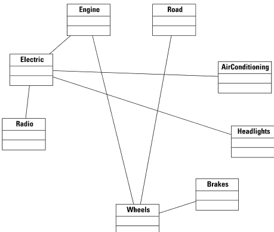

图 6-1：有时候，类之间的交互可能非常混乱！

这看起来可能有些小题大做：为什么道路不能直接与汽车部件通信？原因在于，如果你以后增强这个应用程序，你可能希望添加更多的汽车部件。你不必逐个连接所有必要的汽车部件，只需与中介者对象建立一个连接即可。假设你添加了一个名为自动变速箱的新部件。当汽车开始爬坡时，自动变速箱可能会检测到这一情况并自动换到较低挡位，从而导致发动机转速升高。要添加这个类，你只需定义它的行为以及它如何响应各种事件，然后将其连接到中介者。你还需要修改中介者，让它了解自动变速箱的一些行为。这样，你就不需要将它连接到所有其他实例了。

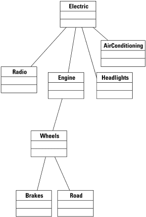

**图 6-2：** 你可以尝试稍微清理一下 UML。

图 6-3 是添加了中介者后的修订版 UML。现在它看起来更清晰了一些！

我们在图 6-3 中没有展示的一件事情（为了避免杂乱）是，我们将从名为 `CarPart` 的基类派生所有各种汽车部件（包括道路！）。这个类将只有一个成员：一个指向 `Mediator` 实例的指针。然后，每个汽车部件都将继承一个指向 `Mediator` 实例的指针。

`Mediator` 类有一个名为 `PartChanged()` 的成员函数。这是关键函数：任何时候任何一个汽车部件发生变化，它都会调用 `PartChanged()`。但请记住，汽车部件只能通过两种方式之一发生变化：通过一个与现有类无关的外部规则（例如驾驶员踩下油门踏板或转动方向盘）或通过 `Mediator` 实例。如果变化来自 `Mediator` 实例，那么它是由其他某个对象触发的。


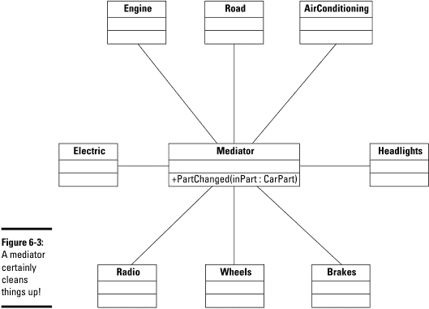

例如，请看以下步骤：

- 1. 驾驶员通过调用 Engine 实例中的方法踩下油门踏板。
- 2. Engine 实例改变其速度，然后通知 Mediator 该变化。
- 3. Mediator 实例知道应将变化通知哪些对象。对于此变化，它通知车轮加快旋转，并通知发电量增加。

下面是另一种可能的顺序：

- 1. 道路有一处山坡。为了告诉汽车这个山坡，主例程调用 Road 实例中的成员函数。该山坡有 10 度倾角。
- 2. Road 实例将变化通知 Mediator。
- 3. Mediator 实例通过计算应减速多少来处理该变化；然后通知车轮减速。

所以你可以看到，大部分智能都在 Mediator 类中。

### 建立门面（模式）

在 CarParts 示例中，我们觉得，如果必须同时分别关注发动机和车轮等所有不同部件来操纵汽车系统，会很不方便。想象一下，如果你开车时必须不断操心每一件小事，生活会是什么样子。相反，我们创建了一个名为 CarControls 的类，通过它可以与系统交互。CarControls 类本身就是一个模式，称为门面模式。（façade 是某物的正面——这是一个法语词。）这个模式也是一个“正面”：它是你与系统交互所通过的接口。这样，你就不必跟踪各个单独的类。当你添加一个用户可通过其与系统交互的类时，你就在使用门面模式。


你可能已经注意到，我们告诉你的内容和其他 OOP（面向对象）人士告诉你的内容似乎存在矛盾。这里，我们说要把智能放在 Mediator 类中。在其他地方，你可能会听说对象必须能够完成自己的工作。但这并不矛盾。实际上，Mediator 类处理的是对象之间协作的所有智能。例如，在 Mediator 实例判断出车轮必须加快旋转之后，它会通知车轮并告诉它们加快旋转。这时车轮接手并做它们该做的事。此时，它们知道如何在没有其他类和对象外部帮助的情况下加快旋转。所以，这终究并不矛盾。

请看清单 6-2 所示的 CarParts 示例。这是一个头文件，包含汽车部件的类声明。

### 清单 6-2：使用 carparts.h 文件

```cpp
#ifndef CARPARTS_H_INCLUDED
#define CARPARTS_H_INCLUDED

#include "mediator.h"

class CarControls; // forward reference

class CarPart
{
protected:
    Mediator *mediator;
    CarPart(Mediator *med) : mediator(med) {}
    void Changed();
};

class Engine : public CarPart
{
protected:
    friend class Mediator; friend class CarControls;
```

```cpp
public:
    Brakes(Mediator *med) : CarPart(med),
        Pressure(0) {}
    void Apply(int amount);
};

class Headlights : public CarPart
{
protected:
    friend class Mediator; friend class CarControls;
    int Brightness;

public:
    Headlights(Mediator *med) : CarPart(med),
        Brightness(0) {}
    void TurnOn() { Brightness = 100; }
    void TurnOff() { Brightness = 0; }
    void Adjust(int amount);
    int GetBrightness() { return Brightness; }
};

class AirConditioner : public CarPart
{
protected:
    friend class Mediator; friend class CarControls;
    int Level;
    int ChangedBy;

public:
    AirConditioner(Mediator *med) : CarPart(med),
        Level(0), ChangedBy(0) {}
    void TurnOn();
    void TurnOff();
    int GetLevel() { return Level; }
    void SetLevel(int level);
};

class Road : public CarPart
{
protected:
    friend class Mediator; friend class CarControls;
    int ClimbAngle;
    int BumpHeight;
    int BumpWhich;

public:
    Road(Mediator *med) : CarPart(med) {}
    void ClimbDescend(int angle);
    void Bump(int height, int which);
};
```

```cpp
#endif
```

这些类彼此了解甚少。这是好事。不过，它们确实完全了解 mediator，这没问题。在此示例中，我们使用了美国国家标准协会（ANSI）版 C++ 的一个重要小特性。注意 Engine 类定义中的构造函数行：

```cpp
Engine(Mediator *med) : CarPart(med),
    RPM(0), Revamount(0) {}
```

在构造函数定义之后，你会看到一个冒号和基类 CarPart 的名称。这会调用基类构造函数。然后是一个逗号、一个成员变量名（RPM）和括号中的一个值，它们一起构成一个初始化器。当你创建 Engine 的实例时，RPM 变量会被设置为值 0。此外，Revamount 变量也会被设置为值 0。使用带初始化器的构造函数会让构造函数的行为就像下面这段代码：

```cpp
Engine(Mediator *med)
{
    RPM = 0;
    Revamount = 0;
}
```

接下来，清单 6-3 是 mediator 的头文件，以及一个名为 CarControls 的特殊类，它提供了一个可用来控制汽车的集中位置。你可能已经注意到，我们在 carparts.h 文件中授予 CarControls 类对汽车部件的友元访问权限。我们还在该文件中包含了几个前向声明。记住：这个类了解各个 CarParts 类。该文件还包含一个派生自 Mediator 的类，它为整个系统提供通用接口。

### 清单 6-3：使用 mediator.h 文件

```cpp
#ifndef MEDIATOR_H_INCLUDED
#define MEDIATOR_H_INCLUDED

// Define all of the required forward references.
class CarPart;
class Engine;
class Electric;
class Radio;
class SteeringWheel;
class Wheels;
class Brakes;
class Headlights;
class AirConditioner;
class Road;

class Mediator
{
public:
    Engine *MyEngine;
    Electric *MyElectric;
    Radio *MyRadio;
    SteeringWheel *MySteeringWheel;
    Wheels *MyWheels;
    Brakes *MyBrakes;
    Headlights *MyHeadlights;
    AirConditioner *MyAirConditioner;
    Road *MyRoad;
    Mediator();
    void PartChanged(CarPart *part);
};

class CarControls : public Mediator {
public:
    void StartCar();
    void StopCar();
    void PushGasPedal(int amount);
    void ReleaseGasPedal(int amount);
    void PressBrake(int amount);
    void Turn(int amount);
    void TurnOnRadio();
    void TurnOffRadio();
    void AdjustRadioVolume(int amount);
    void TurnOnHeadlights();
    void TurnOffHeadlights();
    void ClimbHill(int angle);
    void DescendHill(int angle);
    void TurnOnAC();
    void TurnOffAC();
    void AdjustAC(int amount);
    int GetSpeed();
    CarControls() : Mediator() {}
};

#endif
```


接下来是所有汽车部件成员函数的代码，如清单 6-4 所示。注意，在这些函数中，我们从来不会调用其他汽车部件中的函数。不过，我们确实会调用汽车部件基类 CarPart 中的一个通用 Changed 方法。这会调用 Mediator，让它知道已经发生了更改。

### 清单 6-4：展示 carparts.cpp 文件

```cpp
#include <iostream>
#include "carparts.h"

using namespace std;

void CarPart::Changed()
{
    mediator->PartChanged(this);
}

void Engine::Start()
{
    RPM = 1000;
    Changed();
}

void Engine::PushGasPedal(int amount)
{
    Revamount = amount;
    RPM += Revamount;
    Changed();
}

void Engine::ReleaseGasPedal(int amount)
{
    Revamount = amount;
    RPM -= Revamount;
    Changed();
}

void Engine::Stop()
{
    RPM = 0;
    Revamount = 0;
    Changed();
}

void Electric::ChangeOutputBy(int amount)
{
    Output += amount;
    ChangedBy = amount;
    Changed();
}

void Wheels::Accelerate(int amount)
{
    Speed += amount;
    Changed();
}

void Wheels::Decelerate(int amount)
{
    Speed -= amount;
    Changed();
}

void Brakes::Apply(int amount)
{
    Pressure += amount;
    Changed();
}

void Headlights::Adjust(int Amount)
{
    Brightness += Amount;
}
```


## 第二部

### 第6章：使用设计模式构建

```cpp
void AirConditioner::TurnOn()
{
    ChangedBy = 100 - Level;
    Level = 100;
    Changed();
}

void AirConditioner::TurnOff()
{
    ChangedBy = 0 - Level;
    Level = 0;
    Changed();
}

void AirConditioner::SetLevel(int newLevel)
{
    Level = newLevel;
    ChangedBy = newLevel - Level;
    Changed();
}

void Road::ClimbDescend(int angle)
{
    ClimbAngle = angle;
    Changed();
}

void Road::Bump(int height, int which)
{
    BumpHeight = height;
    BumpWhichTire = which;
    Changed();
}
```

现在，在清单 6-5 中，你可以看到中介者（mediator）源代码以及 CarControls 类的源代码。

### 魔法词：高内聚、低耦合

在软件工程领域，两个流行术语是内聚和耦合。

*内聚*指的是将职责相似的函数组合在一起的过程。如果你创建了良好的类，这应该不成问题。涉及车轮的函数应该放在 Wheels 类中——而不是，例如，Engine 类中。

*耦合*则稍微复杂一些。它指的是将类绑定在一起，使它们无法独立运作的过程。实际上，这些类被耦合了。在良好的面向对象编程中，大量耦合并不好。

你希望你的类尽可能独立；你希望*低耦合*。中介者模式对实现低耦合目标有很大帮助。在 CarParts 示例中，如果我们改为让 Electric 类持有指向 Engine 实例和 Radio 实例等的指针，我们就会迫使所有这些类独立工作。实际上，我们就会把它们耦合起来。但通过使用 Mediator 实例，每个类只与 Mediator 交互。我们实现了低耦合。因此，你应该努力设计*高内聚*和*低耦合*。这是好事！

### 清单 6-5：使用 carparts.cpp 文件

```cpp
#include <iostream>
#include "mediator.h"
#include "carparts.h"

using namespace std;

Mediator::Mediator()
{
    MyEngine = new Engine(this);
    MyElectric = new Electric(this);
    MyRadio = new Radio(this);
    MyWheels = new Wheels(this);
    MyBrakes = new Brakes(this);
    MyHeadlights = new Headlights(this);
    MyAirConditioner = new AirConditioner(this);
    MyRoad = new Road(this);
}

void Mediator::PartChanged(CarPart *part)
{
    if (part == MyEngine)
    {
        if (MyEngine->RPM == 0)
        {
            MyWheels->Speed = 0;
            return;
        }

        if (MyEngine->Revamount == 0)
        {
            return;
        }

        // If engine increases, increase the electric output
        MyElectric->ChangeOutputBy
            (MyEngine->Revamount / 10);

        if (MyEngine->Revamount > 0)
        {
            MyWheels->Accelerate(
                MyEngine->Revamount / 50);
        }
    }
    else if (part == MyElectric)
    {
        // Dim or brighten the headlights
        if (MyHeadlights->Brightness > 0)
            MyHeadlights->Adjust(MyElectric->ChangedBy / 20);

        if (MyRadio->Volume > 0)
            MyRadio->AdjustVolume(MyElectric->ChangedBy / 30);
    }
    else if (part == MyBrakes)
    {
        MyWheels->Decelerate(MyBrakes->Pressure / 5);
    }
}
```

### 清单 6-5（续）

```cpp
void CarControls::TurnOnHeadlights()
{
    MyHeadlights->TurnOn();
}

void CarControls::TurnOffHeadlights()
{
    MyHeadlights->TurnOff();
}

void CarControls::ClimbHill(int angle)
{
    MyRoad->ClimbDescend(angle);
}

void CarControls::DescendHill(int angle)
{
    MyRoad->ClimbDescend( 0 - angle );
}

int CarControls::GetSpeed()
{
    return MyWheels->Speed;
}

void CarControls::TurnOnAC()
{
    MyAirConditioner->TurnOn();
}

void CarControls::TurnOffAC()
{
    MyAirConditioner->TurnOff();
}

void CarControls::AdjustAC(int amount)
{
    MyAirConditioner->SetLevel(amount);
}

int main()
{
    // Create a new car.
    Mediator *MyCar = new Mediator();

    // Start the engine.
    MyCar->MyEngine->Start();
    cout << "Engine Started!" << endl;

    // Accelerate.
    MyCar->MyWheels->Accelerate(20);
    cout << "The car is going: " << MyCar->MyWheels->GetSpeed() << endl;

    // Apply the brakes.
    MyCar->MyBrakes->Apply(20);
    cout << "Applying the brakes." << endl;
    cout << "The car is going: " << MyCar->MyWheels->GetSpeed() << endl;

    // Stop the car.
    MyCar->MyBrakes->Apply(80);
    cout << "Applying the brakes." << endl;
    cout << "The car is going: " << MyCar->MyWheels->GetSpeed() << endl;

    // Shut off the engine.
    MyCar->MyEngine->Stop();
    cout << "Engine Stopped" << endl;

    return 0;
}
```

CarControls 部分运行起来有点长，但它很方便，因为它提供了一个中央接口，通过它你可以操作汽车。不过，这个模式的主力位于 Mediator 类中。它是一组 if 语句，检查发生的更改，然后调用其他类来修改其他类的对象。这就是中介者模式的全部目标：它有一个 Mediator 类，其中包含一个通用函数，该函数查找更改，然后更改其他类。

如果你回看清单 6-4，可以看到在每次更改之后，我们都会调用 Changed() 函数。这个函数位于基类中，它会调用 Mediator 的 PartChanged() 函数，后者完成所有繁重的工作。另请注意，在某些汽车部件类中，Mediator 不会响应它们的更改（例如 Wheel 类）；然而，我们仍然在该类的成员函数中调用 Changed()。原因是我们可能会添加功能，让 Mediator 响应这些更改。这样我们就不必检查是否包含了 Changed() 方法；它已经在那里了。这有助于避免这样的问题：当代码忘记调用 Changed() 时，人们会纳闷为什么 Mediator 没有做它应该做的事。

### 为你的工作编写文档

设想其他人将使用你这套汽车类。你已经将头文件和源文件，以及包含编译后代码的静态库，保存在网络驱动器上。你的同事开始查看你的头文件，看到一大堆类。那个人知道如何使用这些类吗？这位同事知道要使用名为 CarControls 的主外观（Facade）类吗？还是那个人不得不埋头钻研代码，弄清楚该用哪些类、不该用哪些类？

答案是否定的。相反，要清楚地记录你的类。在某个地方整理一份简单的文档（不超过一两页），说明如何使用你的类库。请为其他程序员编写这份文档，并让它可读！并明确说明程序员应通过 CarControls 类与系统交互。然后，你应该描述 CarControls 类的公有成员函数（接口），并提供具体示例。你还可以为想要理解整体运作方式的高级程序员加入一个参考部分。无论你做什么，都不要只是把类交出去，却期望别人在没有足够文档的情况下理解它们！

## 第三部

### 修复问题

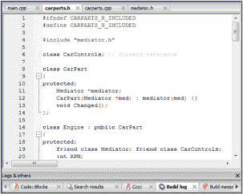


你可以在 http://www.dummies.com/extras/cplusplusa.io 找到一个分步幻灯片，演示如何附加到现有进程。在某些情况下，调试应用程序时你会附加到进程，因为你需要立即查看应用程序在没有调试器介入时如何工作。许多读者写信告诉我们，这类幻灯片让他们的工作轻松了很多。尽管该幻灯片依赖 Windows，但该过程在 Mac 和 Linux 系统上类似。

### 内容速览

-   第1章：处理缺陷 ..............................................................375
    -   这不是缺陷，这是特性！ ...............................................................375
    -   让你的应用程序特性看起来像特性 ........................................377
    -   预见（几乎）一切 ................................................................378
    -   避免错误，简单明了 ..............................................................385
-   第2章：调试应用程序 .......................................................387
    -   使用调试器编程 ................................................................387
    -   使用不同工具调试 .................................................................397
    -   使用命令行参数调试 Code::Blocks 应用程序 ............398
-   第3章：停止并检查你的代码 ...........................................399
    -   设置和禁用断点 .............................................................400
    -   监视、检查和核对变量 ...............................................404
-   第4章：在栈中漫游 ........................................................411
    -   将数据入栈 .................................................................................411
    -   使用高级功能调试 ...............................................................416


word processors。（为什么？我们也不知道。）大多数操作系统的新版本都理解笔记本电脑：当电池即将耗尽时，操作系统会将机器的整个状态保存到硬盘上的一个大文件中，然后关机。这被称为*休眠*。所以，这些毕竟不是 bug。我想我们可以关闭刚刚发给供应商的 bug 报告了。

现在考虑一下：假设你正在使用某个我们这里不便提名字的应用程序，使用过程中，你看到一个消息框，上面写着类似 `Exception Error` 的内容，然后应用程序直接关闭。你所有的工作都丢失了。于是你打电话给技术支持，电话那头的热心朋友说：“你一定输入了它不喜欢的内容。这个应用程序有内置保护机制，如果你输入了不该输入的内容，它就会关闭。”

哦，是的。我们明白了。这时那个人会说：“这是一个*功能*，不是 bug！”再编一个吧。但有时情况在 bug 和功能之间界限模糊。我们不认为应用程序崩溃可以算作功能，但请考虑一下：当你的浏览器出问题时，会有一条消息询问是否要向供应商发送问题报告。*这*就是一个处理 bug 的功能。

但那个未命名的、关闭了的应用程序肯定有 bug。其他应用程序也有 bug。例如，我们一直在快速切换浏览器窗口、输入、调整大小，在窗口之间快速来回操作（也许是咖啡因摄入过多），突然，应用程序崩溃了，我们看到了问题报告消息。*那确实是一个 bug：* 当我们用户*做了程序员没有预料到的事情*时，应用程序卡住了。

那么，为什么应用程序会卡住呢？嗯，除了我们做了程序员没有预料到的事情之外，还有可能是程序员自己搞砸了。要么他们没有包含处理棘手情况（快速切换、调整大小之类的）的代码，要么他们编写的代码做了错误的事情，比如释放了指针，但之后继续使用该内存地址。

这里有一个程序员没有预料到某些情况的例子。假设我们正在编写一个从控制台读取数字的应用程序。你应该为第一个选项输入一个字符，然后为第二个选项输入另一个字符。代码可能如下所示：

```
char x, y;
cout << "Enter your first choice" << endl;
cin >> x;
cout << "Enter your second choice" << endl;
cout << x << endl;
cin >> y;
cout << y << endl;
```

这是一个简单的小代码，但假设你响应第一个请求时输入了一个完整的单词，比如 *Read*，而不是单个字母，比如 *R*。我们的应用程序会取字母 *e*、*a* 和 *d*，并将它们用于后续的 `cin` 调用——这是我们可能没有预料到的。*e* 会进入 `cin >> y` 这一行，并被放入 `y` 中。这就是没有预料到某些情况的 bug：你，作为程序员，必须确保你的应用程序能够处理所有情况。所有情况。每一个情况。幸运的是，有一些方法可以解决这些问题，我们将在本章中与你分享。

你可以将这些情况分为以下几类：

- 真正的功能，根本不是 bug
- 程序员没有预料到的情况
- 一个错误，简单明了

### 让你的应用程序功能看起来像功能

你最不希望遇到的事情就是接到用户的电话，抱怨你的应用程序中存在 *bug*，而实际上那是一个 *功能*。这种情况可能发生，而且确实会发生。但技术支持人员不得不解释时，他们会很尴尬：“不，先生/女士。这确实是它应该工作的方式。”而且此后技术支持人员还要忍受辱骂，这也不好受，尤其是当他们没有编写这个软件时——*你编写的*。

但是，作为程序员，我们希望让每个人的生活更轻松（当然，从我们自己的开始！），因此构建易于使用且*有意义*的软件是最好的。那么，创建功能真正看起来像功能的软件，关键在于让一切合情合理。不要让你的软件自动启动 Zapper，除非用户明确要求打开 Zapper：

面带微笑的技术支持代表：“这是一个功能！Zapper 会在电脑闲置十分钟后启动。”

愤怒的客户：“是的，但我希望在 Zapper 启动时，我至少能离它十英尺远！”

面带微笑的技术支持代表：“但如果你没有离开电脑，为什么要坐在那里十分钟不使用它呢？”

愤怒的客户：“我正在阅读关于如何配置 Zapper 的说明书！”

你知道接下来的事：诉讼接踵而至，有人被解雇。场面可不好看，更不用说那个在 Zapper 全力启动时正好在电脑附近的可怜客户了。

## 第1章：处理 Bug


对于功能，规则很简单：让用户选择他们希望哪些功能发生以及何时发生。例如，如果他们不想要自动保存，就让他们关闭它。让他们配置软件，不要让它做任何令人惊讶的事情。

### 预料（几乎）一切

当你编写应用程序时，请尝试预料用户可能对你的应用程序做的各种不同的事情——其中很多可能与你应用程序的正确使用并不完全相关。你在软件中构建的大部分此类保护——即确保当用户做了你未预料到的事情时，应用程序不会卡住——都围绕着*用户界面*，即用户与应用程序交互的区域。

如果你的应用程序是基于控制台的应用程序，或者用户可以在窗口应用程序的文本框中输入字符，你必须防范无效输入。看看下面这个假设应用程序的输出：

```text
What would you like to do?
    A. Add random information to the system.
    B. Boil information.
    C. Compress information.
    D. Delete the information.
    Your choice:
```

现在假设用户选择 D 表示删除，然后出现以下菜单：

```text
What would you like to delete?
    A. None of the data — forget it!
    B. Some of the data.
    C. Most of the data.
    D. All the data! Get rid of it all!
```

现在想象一下，一个用户启动了这个应用程序，看到了第一个菜单。用户不知道是输入 A 表示第一个选项，还是输入 Add 表示第一个选项。用户输入了 Add 并按下回车。糟糕。A 进入了第一个选项，系统添加了随机信息，并再次打印出同样的第一个菜单。然后，d（用户输入的第二个字符）进入了“删除信息”选项。这导致第二个菜单，即删除菜单出现。用户输入的第三个字符 d，触发了第二个菜单的 D 选项——全部数据！全部删除——一气呵成，而用户完全没有意识到发生了什么。

糟糕！原本应该是 Add 的操作变成了 Add、Delete、Delete all the data（添加、删除、删除全部数据）。这可不好！你如何避免这种情况？

- 限制用户的选择。
- 明确说明用户应该做什么。
- 支持多个选项。
- 预料可能出错的地方。

例如，你可以告诉用户只输入一个字符，并显示类似这样的消息：

```text
Please enter a single character for your choice:
```

但现在，用户之后必须按回车吗？这条消息暗示是这样。但也可能不是。所以你必须更具体。也许下面这些示例之一会更好：

```text
Type a single character and do not press Enter:
```

```text
Type a single character and then press Enter:
```

但即使这些也不够好。首先，你通常应该允许用户按回车。用单次按键自动执行某些操作可能会让用户感到意外。此外，你可能希望支持多个选项。如果用户想在菜单中选择选项 A，你可以支持以下任何输入：

- A
- a
- Add
- ADD
- add

所有这些都可以封装成一些简短的代码，如下所示：

```cpp
string choice;
cin >> choice;
char ch = choice[0];
ch = toupper(ch);
switch (ch)
{
    case 'A':
        cout << "Adding random data..." << endl;
        break;
    case 'B':
        cout << "Boiling it down!" << endl;
        break;
    case 'C':
        cout << "Compressing!" << endl;
        break;
    case 'D':
        cout << "Deleting..." << endl;
        break;
}
```


允许用户一次输入两个姓名，但用户没有意识到应该先输入姓氏，或者也许应该先输入姓氏，然后加逗号，再输入名字。

- 用户可以在姓名的开头或结尾输入一些空格。然后应用程序查找类似“ George Washington ”的条目，却找不到，因为数据库中存储的是“George Washington”（前后没有空格）。
- 当数据库中存储的姓名不包含中间名首字母时，用户可能会输入中间名首字母。

所有这些问题都很容易避免。以下是一些提示：

- 在查找姓名之前，你必须知道姓名在数据库中是如何存储的。如果它们以全大写形式存储，你就不应要求用户以全大写形式输入。相反，应接受任意大小写的单词，并*将它们转换*为全大写。
- 你必须知道姓名在存储时是否将名与姓分开。然后允许任何格式。如果用户输入**乔治·华盛顿**（没有逗号），你可以在空格处拆分字符串，并提取出名和姓。但如果用户输入的姓名在名和姓之间有逗号，你可以在逗号处拆分，先提取姓，再提取名。
- 空格不应成为问题。用户输入字符串后，你可以去掉字符串中的空格。
- 中间名首字母是必需的吗？要把相关事项记录清楚。你的应用程序应明确告诉用户是输入中间名、中间名首字母，还是两者都不输入。如果你使用文本控件，并且不希望有中间名，那就根本不要包含中间名字段。或者，如果你希望有，就在窗口上直接说明用户应输入中间名首字母还是完整的中间名。如果条目只是首字母，你可以移除末尾的句点，或者添加句点，具体取决于数据库中存储的内容。

所有这些步骤都有助于让你的应用程序无懈可击。其理念是鼓励用户按自己喜欢的方式操作，但阻止他们以应用程序不喜欢的方式操作。如果你的应用程序不希望有中间名首字母，就不要给用户输入它们的机会。

清单 1-1 展示了如何去掉空格、去掉中间名首字母末尾可能存在的句点，以及根据空格或逗号拆分字符串。在这个清单中，我们使用了一个名为 vector 的特殊类。vector 类很像数组，只是 vector 类更强大一些：vector 是一个类，你可以使用成员函数轻松地向其中添加内容或从中移除内容。vector 还是一个模板，因此当你声明它时，必须说明希望它保存什么类型的变量。你要把变量类型放在尖括号中。我们要在其中放入字符串，所以将其声明为 `vector<string>`。但为了让代码更简单，我们使用 typedef 为这种类型取了一个更简单的名字：StringList。

### 清单 1-1：处理字符串以减少 Bug

```cpp
#include <iostream>
#include <vector>
#include <string.h>

using namespace std;

typedef vector<string> StringList;

StringList Split(string orig, string delims)
{
    StringList list;
    int pos;

    while((pos = orig.find_first_of(delims)) != -1)
    {
        list.push_back(orig.substr(0, pos));
        orig = orig.substr(pos + 1);
    }

    list.push_back(orig);

    return list;
}

string MyUppercase(string str)
{
    char *buf = new char[str.length() + 1];

    strcpy(buf, str.c_str());
    strupr(buf);

    return string(buf);
}

string stripSpaces(string orig)
{
    int left;
    int right;

    // If string is empty, just return it.
    if (orig.length() == 0)
        return orig;

    // Strip right
    right = orig.find_last_not_of(" \t");
    if (right > -1)
        orig.resize(right + 1);

    // Strip left
    left = orig.find_first_not_of(" \t");
    if (left > -1)
        orig.erase(0, left);

    // If left still has a space, it
    // means the whole string is whitespace.
    // So just remove it all.
    if (orig[0] == ' ' || orig[0] == '\t')
    {
        orig = "";
    }
}
```

### 清单 1-1（续）

```cpp
    cout << "first: " << first << endl;
    cout << "middle: " << middle << endl;
    cout << "last: " << last << endl;
    cout << endl;
}

int main()
{
    string name;

    name = "   Washington, George Zeus   ";
    ProcessName(name);

    name = "Washington, George Z.";
    ProcessName(name);

    name = "George Z. Washington";
    ProcessName(name);

    name = "George Zeus Washington";
    ProcessName(name);

    name = "George Washington";
    ProcessName(name);

    return 0;
}
```

清单 1-1 相当防错，但它仍不能正确处理某些情况。例如，如果有人尝试处理带有中间名的字符串，例如*宙斯*。（注意名字后的句点），应用程序不会移除该句点。但这样正确吗？谁知道呢，但人们通常不会那样格式化姓名。因此，以下是你可能对此应用程序做出的一些改进：

- **消除不恰当字符：** 你可以确保姓名中不出现不恰当字符。我们可能会在找到名、中间名和姓之后再做这件事；这样，我们就不会因为可能存在一个用于指定姓名顺序的逗号而破坏查找数据的尝试。你可以使用各种 if 语句来完成这类事情。
- **处理超过三个姓名的情况：** 我们可能会针对超过三个姓名的情况增加一项特殊预防措施。有些人有很多名字（比如 10 个或 11 个，尤其是英国王室成员）。但是，如果这个应用程序用于，例如换油作业，我们认为你不会看到威尔士亲王查尔斯·菲利普·阿瑟·乔治前来（尽管有可能）。因此，像往常一样，如何处理姓名取决于你的具体情况。
- **执行初始处理：** 我们还会做一些初始处理。在用户输入姓名之后，我们会立即确保姓名不是空字符串——即“ ”（一对引号，中间没有空格）。

### 防弹应用程序的神话

任何花时间阅读行业媒体的人都知道，许多应用程序会反复出现 bug 问题。厂商刚修复一个 bug，另一个 bug 又出现了。有些开发者可能认为这些公司的开发者是白痴，让我们所有人都脸上无光。然而，这些开发者往往和我们一样。因为他们是人，而人会犯错——在应用程序的开发者端和用户端都是如此——所以应用程序永远不会没有 bug。当然，你也许能够创建一个简单、几乎无懈可击的应用程序，但随着应用程序复杂度增加，交互次数和潜在 bug 的数量也会增加。到某个时候，应用程序各部分之间的交互次数会增加到无 bug 应用程序变得不可能的程度。

多年来，我们读过不少文章和书籍，它们声称能提供创建这样一种应用程序所需的神奇方法：不仅没有 bug，还能防止用户做出意料之外的操作。防弹应用程序是一个神话。如果你相信这个神话，你可能会在开发人员找不到更多 bug 的那一刻就想停止查找 bug。不幸的是，这种态度会导致头条宣称你的应用程序是下一个重大的 Windows 安全漏洞。不要相信防弹应用程序的神话——始终警惕潜在错误。

### 避免错误，简单明了

尽管许多程序员采取措施预防 bug，但程序员有时仍会让问题溜过去。然而，如果你小心谨慎，就可以避免很多这类问题。当你创建软件时，应该保持正确的心态，*在编写代码时*留意潜在问题。（进入正确的心态包括确保你有足够的睡眠、避免分心，以及做其他有助于你集中精力工作的事情，但本节还描述了一些你应该考虑的具体事项。）

我们在这里给出的潜在问题清单可能会延续数千页。然而，重点不是要有一份庞大的检查清单，而是让你审阅这份清单，并开始认识到编写好代码需要做的事情。编写代码是有意识和深思熟虑的。这类似于走在人行道上，隐约意识到是否有车驶来，或者是否需要跨过坑洞。当你小心行走时，这些危险始终在你脑海深处。编写代码也是如此：某些*陷阱*也应该始终留在你脑海深处：

- **索引：** 字符串和数组的索引从 0 到长度减 1。使用类似 `for (i=0; i<=size; i++)` 的循环是常见错误。小于等于符号是不正确的，但人们经常犯这个错误。可怕的是，有时代码

仍然可以运行，但你最终只会覆盖其他内容。更糟的是，你可能不会立即发现这个编码错误，因此它之后会表现为应用程序中的一个错误。

- **有 new 就应有 delete：** 每当你使用 new 分配对象时，都要记得释放它。但忘记 delete 通常不会在应用程序中产生明显的错误；请阅读下一项，了解更有可能导致明显错误的情况。
- **记住你删除了什么：** 比忘记删除对象更糟的是，忘记自己已经删除了它并继续使用它。删除指针时，要确保你没有把它传给某个其他对象，而该对象将其保存起来并计划再次使用。
- **别忘了创建对象：** 你可能见过这种情况：弹出一条错误消息，内容如下：

  ```text
  The instruction at 0x00402119 referenced memory at 0x00000000. The memory could not be written.
  ```

  这意味着某人有一个指针变量，却忘了调用 new。我们故意用以下代码轻松生成了这条消息：

  ```cpp
  int *x = 0;
  *x = 10;
  ```

  我们创建了一个指针变量并将其初始化为 0，这意味着它没有被使用。但在调用 new 或将该变量设置为某个对象的地址之前，我们试图往它指向的内存中塞入一些东西（该内存地址是 0，这是操作系统不喜欢的东西）。操作系统便以这条错误消息作为回应。这是我们在商业软件中遇到的、比预期常见得多的错误。

这些只是需要考虑的几项，但你可以看到，它们大多涉及内存问题，例如分配内存以及错误地使用内存。最重要的是，如果你在编程时认真谨慎，就可以避免这些问题。编写代码时，要牢记你所做的事情会带来的后果。听起来可能很疯狂，但请记住你可能会忘记的事情！问问自己，是否忘记删除某些指针，或者其他人是否持有你即将删除的指针的副本。如果你把这些事情记在心里，就应该能避免一些最常见的错误。

## 第 2 章：调试应用程序

### 本章内容

- 使用调试器
- 使用 Code::Blocks 调试器
- 跟踪代码在应用程序中以及进出函数时的执行流程
- 使用其他调试器
- 使用真正高级的调试器
- 向 Code::Blocks 调试添加命令行参数

在本章中，我们讨论如何使用调试器来追踪应用程序中的问题和错误。迟早会有事情不按你计划的方式运行。在这种情况下，你有几种应对方案。其中一种方案要用到锤子和电脑，但我们不推荐那一种。相反，我们建议使用调试器来尝试修复应用程序。

### 用调试器编程

*调试器*是一种特殊工具，用于逐行跟踪你的应用程序。（*跟踪*是指查看应用程序中代码执行流程的行为。）请看清单 2-1 中所示的 BuggyProgram 示例。这只是一个基本应用程序，包含一个 `main()` 和几个函数，我们用它来演示调试器。

**清单 2-1：跟踪一个简单应用程序**

```cpp
#include <iostream>
#include <cstdlib>

using namespace std;

int CountRabbits(int original)
{
    int result = original * 2;
    result = result + 10;
    result = result * 4;
    cout << "Calculating " << result << endl;
    return result * 10;
}

int CountAntelopes(int original)
{
    int result = original + 10;
    result = result - 2;
    cout << "Calculating " << result << endl;
    return result;
}

int main()
{
    int rabbits = 5;
    int antelopes = 5;
    rabbits = CountRabbits(rabbits);
    cout << "Rabbits now at " << rabbits << endl;
    antelopes = CountAntelopes(antelopes);
    cout << "Antelopes now at " << antelopes << endl;
    //system("PAUSE"); // add this for Windows
    return 0;
}
```

当你键入并运行这个应用程序时，会看到以下输出：

```text
Calculating 80
Rabbits now at 800
Calculating 13
Antelopes now at 13
```

现在仔细查看 main()，并逐行跟随它的执行过程。main() 做的第一件事是声明几个整数。然后 main() 调用 CountRabbits() 函数。CountRabbits() 函数声明一个整数，并执行几行计算。接着，CountRabbits() 函数打印一条消息。最后，它返回。回到 main() 后，应用程序打印另一条消息，然后调用 CountAntelopes() 函数。这个函数也声明一个整数，完成一些计算，打印一条消息，然后返回。回到 main() 后，应用程序打印另一条消息，最后应用程序结束。

我们刚才给你的只是这个应用程序整个过程的线性描述。你可以通过使用调试器看到这些相同的步骤。使用调试器时，你会看到计算机逐行执行你的代码。调试器执行应用程序的第一行，然后等待你告诉它执行下一行——接着是下一行、再下一行，依此类推，直到应用程序结束。


在本例中，我们使用 Code::Blocks 应用程序自带的调试器。如果你更喜欢使用其他调试器，我们建议你在本章的大部分内容中至少尝试一下 Code::Blocks 调试器。它是一个不错的工具，我们认为你会对它满意。除此之外，它还能让你跟着完成我们给出的示例。之后，你可以回到你正在使用的任何其他工具。

### 添加调试信息和符号信息

当你使用调试信息进行编译时，就是在向最终可执行文件中添加调试信息和符号信息。这些信息包括关于源代码文件的数据，例如行号和变量名。这是产品的调试版本和发布版本之间的主要区别：人们通常不会在面向公众发布的产品版本中包含调试信息和符号信息。一个原因是，包含这些信息会让竞争对手和黑客太容易对产品进行逆向工程。（另一个原因是，包含调试信息和符号信息会使应用程序运行更慢并消耗更多系统资源。）然而，实际源代码并不在调试信息和符号信息中；它保留在源代码文件里。相反，调试信息只包含行号，这些行号作为对源代码文件的引用（可以这么说，是指针！）。因此，黑客和竞争对手不会得到你应用程序的完整源代码，但他们会获得变量名和其他信息，这些信息可能让他们的工作更容易（而让你的工作更难）。


在使用调试器之前，你必须了解一个重要方面：为了让调试器理解你的代码，你必须使用调试信息编译它。编译器会把额外信息添加到最终可执行文件中，以便调试器能够定位你的源代码和变量信息。以下是开启调试信息的方法：

- **Code::Blocks：** 在 Build Target 下拉列表框中选择 Debug。
- **Dev-C++ 5.0：** 打开项目，选择 Tools➜Compiler Options。在 Linker 选项卡中，确保 Generate Debugging Information 已打开。
- **MinGW 和 Cygwin 下的 gcc：** 向编译器添加 `-g` 选项。你很可能需要在 Makefile 中这样做。


更改编译器选项以生成调试信息后，你必须重新构建项目。原因是编译器和链接器必须重新生成带有调试信息的目标文件和可执行文件。

### 运行调试器

重新构建项目后，你就可以运行调试器了。要启动调试器，请点击 Debug/Continue，选择 Debug➜Start，或按 F8。（如果点击 Run，应用程序会正常运行，不会进入调试模式。）启动调试器时，你应该会看到类似图 2-1 所示的屏幕。（该屏幕后面还会出现一个控制台窗口。这个控制台窗口包含你正在调试的应用程序的输出。）


- 下一条指令
- 步出
- 步入指令
- 步入
- 中断调试器
- 下一行
- 停止调试器
- 运行到光标处
- 调试窗口
- 调试/继续
- 各种信息


**图2-1：** 主 Code::Blocks 窗口显示你的源代码。

图2-1展示了为了（成功）调试应用程序需要了解的两个特殊功能。第一个是红色八边形（像停止标志），第二个是黄色三角形。红色八边形是一个断点——你希望调试器停止的位置。你通过单击希望停止的指令左侧，在编辑窗口中添加断点。再次单击该位置时，红色八边形消失，表示已清除断点。你可以在应用程序中放置任意多个断点，但只能在指令上放置断点。

黄色三角形是指令指针，显示调试器接下来要执行的指令。当你让调试器执行指令时，黄色三角形会移动。每当以调试模式启动应用程序时，黄色指针会自动在每个断点处停止。图2-1显示黄色三角形在断点处停止时调试器的外观。

当你通过单击“调试/继续”再次启动调试器时，执行会像应用程序处于正常运行模式一样开始，直到调试器遇到另一个断点。如果调试器没有遇到断点，对话框会关闭，应用程序返回源代码界面。


如果你没有设置任何断点并尝试调试应用程序，它会在不让你逐行跟踪代码的情况下运行。也就是说，应用程序会像没有在调试器中运行一样运行。

查看图2-1所示的日志及其他窗口的调试器选项卡。此选项卡包含来自应用程序的调试消息。每当你看到“At”消息，就知道调试器已停在特定位置。消息的其余部分告诉你调试器停在哪里。在图2-1中，调试器停在该文件的第26行：

```
C:\CPP_AIO\BookII\Chapter02\BuggyProgram\main.cpp file
```

因此，继续运行应用程序。先在 `int main()` 入口所在的第23行设置断点。单击“调试/继续”，选择 Debug > Start，或按 F8 启动调试器。你会看到调试器选项卡上出现许多消息，然后当调试器停在第23行时，你会看到“At”消息。（如果你的应用程序在排版上与清单2-1略有不同，你可能会看到略有不同的行号。）黄色三角形应出现在第23行，该行包含一个花括号。意思是应用程序停在该行。指令指针停在花括号处，因为它是 `main()` 入口后的第一条指令。

单击“下一行”，它是调试器工具栏上的第三个按钮。你要找的按钮图标上有两个方块，以及一个从第一个方块指向第二个方块的箭头。（也可以按 F7。）黄色三角形（指令指针）移到第25行的第一条赋值语句，即

```
int rabbits = 5;
```

单击“下一行”。单击该按钮时，指令指针前进到下一行。计算机刚执行完 `main()` 中的第一行，接下来计算机将执行 `main()` 中的第二行，即：

```
int antelopes = 5;
```

再次单击“下一行”。现在指令指针位于 `main()` 的第三行，如下所示：

```
rabbits = CountRabbits(rabbits);
```

`main()` 的第三行是一个函数调用，现在你有一个选择。*（不要点击“下一行”！）* 你可以让计算机只执行此函数内部的内容，而不逐行停下让你查看；也可以“步入其中”，查看各行。

单击从左数第四个按钮，即 **步入**，它显示两个方块和一个从左侧进入两者之间的箭头。（或按 **Shift+F7**。）执行后，指令指针会移入 `CountRabbits()` 函数。高亮将位于该函数的第一行：

```
int result = original * 2;
```

当高亮移入该函数时，计算机已*步入*该函数。现在想一想导致这一操作的图标符号：该图标有方块和一个指向它们之间的箭头。两个方块代表当前函数中的代码行，而你在它们之间移动，或者说*步入*被调用的函数。这就是这些奇怪符号背后的含义。你之前一直点击的那个图标——带有一个跨过箭头的“下一行”图标——表示*步过*函数。

现在，在步入此函数之前——因为你之前点击的是并非函数的普通单行——你使用的是“下一行”（也就是步过）按钮。但你本来既可以使用“下一行”按钮，也可以使用“步入”按钮，因为*步入函数*对非函数语句没有太大意义。


通常，我们默认使用“下一行”按钮，只有特别想进入某个函数时才选择“步入”按钮。原因是一些看起来不像函数的代码行实际上就是函数。例如，`cout << "a";` 实际上就是一个函数，而你可能不想步入那段代码，因为其源代码可能不存在，或者你只是不关心该函数的细节。

现在该看看这些调试功能如何工作了。以下过程将带你走一遍调试流程，以便你看到 Code::Blocks 调试器的实际操作：

- 1. **连续点击三次“下一行”，直到指令指针出现在 `cout` 行：**

    ```
    cout << "Calculating " << result << endl;
    ```

    这一行将输出写入控制台。记住，除了主 Code::Blocks 窗口之外，还有一个控制台窗口。这一行的输出就进入那里。

- 9. **再点击一次“下一行”，高亮会位于 `main()` 的右花括号上。**

    现在情况开始有点奇怪。我们不知道的是，实际代码比我们看到的多。编译并链接应用程序时，链接器会包含一些调用 `main()` 函数的特殊启动代码。

- 10. **再点击一次“下一行”，你就会“时空穿越”出源文件，进入一些汇编语言代码。调试器窗口显示以下消息：**

    ```
    In __mingw_CRTStartup () {
    ```

- 11. **点击一个新按钮“下一条指令”（调试器工具栏从左数第六个按钮），前进到下一条指令。调试器窗口再次显示以下消息：**

    ```
    In __mingw_CRTStartup () {
    ```

- 12. **要了解这一切意味着什么，请点击“调试窗口”（调试器工具栏从左数第十个按钮），然后从下拉列表框中选择“反汇编”。**

    Code::Blocks 会显示一个名为“反汇编”的新窗口，如图2-2所示。你图中的编号可能与我们不同，但代码相同。

    

    **图2-2：** 反汇编窗口显示代码的汇编语言版本。

    呃。这是汇编，是计算机所理解语言的一种人类可读形式。你不必知道这一切是什么意思，但大概能看出这一行

    ```
    (hexadecimal number) call (another hexadecimal number) <__main>
    ```

    就是这些代码调用你的 `main()` 的地方。

- 13. **要退出这里，只需点击第一个按钮（名为“调试/继续”）或第五个按钮（名为“步出”），即带有指向方块左侧箭头的按钮。（或分别按 Ctrl+F7 或 Ctrl+Shift+F7。）**

    点击“调试/继续”会使应用程序运行到应用程序的真正结尾（或下一个断点），然后结束。点击“步出”会告诉调试器退出当前函数，在本例中这等同于运行到应用程序结尾。

- 14. **如果你想避免进入疯狂的汇编代码内容，可以在到达应用程序最后的返回行时点击“调试/继续”来避开它。**

这就是逐行单步调试应用程序的方法。但在单步调试应用程序时，你还可以做更多事情。你可以查看变量中的值，可以更改变量的值，还可以获取导致应用程序当前位置的所有函数调用列表。你能做很多事情，我们将在本迷你书的剩余部分解释所有这些内容。


### 识别 Code::Blocks 调试器的各部分

每当你调试应用程序时，Code::Blocks 调试器都会显示调试器工具栏。本章前面几节讨论了调试器工具栏上的许多按钮：调试/继续、下一行、下一条指令、步入和步出。不过，该工具栏还包含许多你应该了解的其他有趣按钮。

有时你在编辑器中检查一段代码，想看看到达该处时变量是什么样。要看看会发生什么，请将文本光标放在你想要停止的位置（仅将鼠标光标悬停在想要停止的位置是不够的），然后单击“运行到光标处”（调试器工具栏上的第二个按钮）。调试器会停在光标所在行。在这种情况下，文本光标充当调试器的一种断点。

在调试应用程序一段时间并定位到想要修复的问题后，你可能想运行应用程序的其余部分。出现这种情况时，只需单击“停止调试器”（看起来像中间有 X 的方框的按钮）。调试器会立即停止。你可以进行任何必要的更改，并照常重新启动调试器。


- **已加载的库：** 包含为运行你的应用程序而加载的所有库的列表。在其他机器上部署（加载）应用程序时，了解它使用了哪些库非常重要。在许多情况下，你甚至可能不知道 C++ 需要某些库才能运行你的应用程序，因此这个窗口特别有用。
- **目标与文件：** 详细展示已加载的库在应用程序中的使用方式。通常无需查看此信息，除非你正在执行底层编程任务。
- **FPU 状态：** 显示处理器中浮点单元（FPU）的寄存器信息。曾经，FPU 是一个独立芯片，但现在它作为主处理器的一部分出现。FPU 特别擅长执行实数（相对于整数）运算。通常无需查看此信息，除非你正在执行底层编程任务。
- **信号处理：** 显示 Code::Blocks 如何处理硬件与应用程序之间的信号，例如算术异常或段错误。通常无需查看此信息，除非你正在执行底层编程任务。

### 使用不同工具进行调试

你可以使用多种工具来调试代码。然而，你使用的编译器也决定了你可以使用哪些调试工具。例如，Microsoft Visual C++ 有一个非常好的调试器。但是，要让它调试用 Dev-C++ 编译的应用程序却很困难，因为不同的编译器使用不同形式的调试和符号信息。各种 gcc 编译器变体所使用的类型与 Microsoft Visual C++ 所使用的类型不同。

### 标准调试器

下面简要介绍一些可用的调试器：

- **Visual C++：** 此调试器的工作方式与 Code::Blocks 调试器类似。它主要用于调试使用 Visual C++ 构建的应用程序。不过，如果你很勇敢，并且需要调试没有代码或符号信息的东西，它对汇编代码调试的支持很好。
- **gdb：** 这是 MinGW 和 Cygwin 附带的标准调试器。它是一个命令行工具，但我们不建议这样使用它。相反，我们建议搭配 Insight 调试器使用它，以便使用图形化*前端*。这会让事情轻松很多。但如果你坚持使用命令行版本，可以在命令提示符下输入 **gdb**，然后输入 **help** 来了解它。
- **Dev-C++ 5：** 从版本 5 开始，Dev-C++ 具有一个集成调试器，其工作方式与 Insight 调试器类似。你可能想试一试。（如果你使用的是 5.0 之前的 Dev-C++ 版本，则必须使用 Insight 调试器。）

### 使用命令行参数调试 Code::Blocks 应用程序

命令行参数是你在命令提示符下随应用程序命令一起输入的内容。例如，当你在命令提示符下输入 Dir（目录列表命令）时，可以包含诸如 *.DOC 之类的附加信息，这会列出所有扩展名为 .DOC 的文件。（如果改用 Dir *.DOC，你还会看到扩展名为 .DOCX 的任何文件。）完整命令 Dir *.DOC 由命令（Dir）和命令行参数（*.DOC）组成。添加命令行参数可以扩展应用程序的功能，让它做更多事情。为了测试这样的应用程序，你需要能够将命令行参数指定为调试器环境的一部分。

与大多数其他功能强大的 IDE 一样，Code::Blocks 提供了指定命令行参数的方法。本书第I册第5章中的“在 Code::Blocks 中设置命令行参数”侧栏为你提供了设置命令行参数的基础知识。不过，本书前几版的许多读者希望获得更多信息。考虑到这一点，我在自己的博客 http://blog.johnmuellerbooks.com/2011/11/01/debugging-a-codeblocks-application-with-command-line-arguments.aspx 上，作为本书文章《使用命令行参数调试 Code::Blocks 应用程序》的一部分，更详细地描述了命令行参数的工作方式。如果你想要更多关于究竟发生了什么的信息，请务必查看这篇博客文章。

## 第3章：停止并检查代码

**本章内容**
- 设置、启用和禁用断点
- 临时设置或禁用断点
- 检查变量
- 监视所有局部变量
- 监视任意变量

有时，东西会坏掉。但这里我们谈论的是代码。现在，这就是单词或短语具有许多不同含义的情形之一。程序员会谈论*破坏代码。* 这个短语通常表示两种意思之一。它可能指程序员犯了错误，代码不再*正常工作。* 但本章使用该术语的另一种定义。调试应用程序时，可以让应用程序一直运行到代码中的某一行。然后调试器停在该行，你可以查看变量值、检查代码，甚至更改变量。应用程序停止时，这称为*中断。* 它停在该特定行的原因是你在该行设置了*断点*。

在本章中，我们讨论如何在代码中设置和操作断点（前提是代码中没有其他损坏之处），以及代码在断点处停止后，如何检查和修改代码的各个方面，例如变量。


本章示例中，我们使用 Code::Blocks IDE 自带的调试器。如果使用其他产品，调试器的工作方式可能大致相同，但不会完全相同。例如，我们在此展示的所有操作都可以在 Microsoft Visual C++ 中完成。按键和鼠标点击可能不同，但功能都存在。请务必查看厂商文档，了解使用调试器的准确细节。


要完成本章示例，请确保在编译时启用调试信息。（在 Code::Blocks 中，可以在 Compiler 工具栏的 Build Target 字段中选择 Debug，以启用调试信息进行编译。如果看不到 Compiler 工具栏，请选择 View；Toolbars；Compiler，在 Compiler 项旁打勾。）

开发软件时，应始终启用调试信息。这样，你始终可以调试代码并修复问题。只有准备正式发布产品时，才应在没有调试信息的情况下重新编译它。（我们确实建议在没有调试信息的情况下再次对软件进行完整测试，以确保它仍能正常运行。）

### 设置和禁用断点

*断点是代码中你告诉调试器停止的位置。*

在接下来的小节中，我们将讨论断点。这些小节请使用代码清单 3-1 中所示的 `Breakpoints` 示例代码。还记得应该做什么吗？确保编译时启用调试信息。

**代码清单 3-1：使用应用程序进行断点和检查**

```cpp
#include <iostream>

using namespace std;

class BrokenMirror
{
private:
    int NumberOfPieces;

public:
    int GetNumberOfPieces();
    void SetNumberOfPieces(int newamount);
    BrokenMirror() : NumberOfPieces(100) {}
};

int BrokenMirror::GetNumberOfPieces()
{
    return NumberOfPieces;
}

void BrokenMirror::SetNumberOfPieces(int newamount)
{
    newamount = newamount * 20;
    NumberOfPieces = newamount;
}

int main()
{
    BrokenMirror mirror;
    mirror.SetNumberOfPieces(10);
    cout << mirror.GetNumberOfPieces() << endl;

    return 0;
}
```


### 在 Code::Blocks 中设置断点

继续编译代码清单3-1中的应用程序（已开启调试信息）。查看窗口左侧边距，即行号右侧的位置。图3-1显示第16行有一个小八边形。在 IDE 中查看时，这个八边形是红色的。红色八边形是我们设置的一个断点。要在你自己的代码中设置这个断点，请单击左侧边距和代码之间的区域（或右键单击该代码行，并从上下文菜单中选择 Toggle Breakpoint），如图中第16行所示。（如果在我们的屏幕上是第16行，但如果你对代码进行了不同的格式设置，你可能会看到它在不同的行号上。）如果你还没有这样做，请继续在 `int BrokenMirror::GetNumberOfPieces()` 行的左侧边距中单击鼠标。你会看到左侧边距中出现一个红色八边形。你刚刚在该行放置了一个断点！太棒了！


图3-1：Code::Blocks 使用红色八边形显示你设置的任何断点。

再次单击同一行的左侧边距。红色八边形会消失。当八边形消失时，断点就被移除了。

最后，再单击第三次，因为现在你确实希望那里有一个断点。

现在，通过单击调试器工具栏上的 Debug/Continue 按钮（带有红色右指箭头的图标）来运行应用程序。如果你没有看到调试器工具栏，请选择 View➪Toolbars➪Debugger，以在 Debugger 条目旁放置复选标记。（不要单击编译器工具栏上的 Run 按钮，即绿色右指三角形，因为选择此选项只会在不调试的情况下运行应用程序。）当你单击 Debug/Continue 时，控制台窗口可能会弹到前面，因此只需单击 Code::Blocks 窗口将其带回前台即可。

应用程序会一直运行，直到到达你为 `int BrokenMirror::GetNumberOfPieces()` 行选择的断点，如图3-2所示。请注意，执行实际上会在左花括号处停止，因为这是该函数执行的起点。黄色右指三角形表示 Code::Blocks 调试器将要执行的当前指令。现在，你可以单击 Next Line 按钮（即带有两个方块，以及一个从上方块指向下方块的箭头的按钮）移动到下一行，也可以单击 Debug/Continue 运行应用程序的其余部分。


图3-2：调试模式使 Code::Blocks 在到达断点时停止执行。

### 启用和禁用断点

有时你可能设置了多个断点，想暂时关闭它们，但不想丢失它们，因为之后可能还想重新启用。你可以通过禁用断点来实现这一点。禁用断点比移除断点后再回来找到它们并重新启用更快。使用以下步骤禁用断点：

1. 右键单击红色圆形，从上下文菜单中选择 **编辑断点**。

   你会看到“编辑断点”对话框，如图3-3所示。

   

   **图3-3：** 使用“编辑断点”对话框启用和禁用断点。

2. **清除 Enabled 选项并单击 OK。**

   Code::Blocks 会禁用该断点，使其不再停止应用程序执行。

许多调试器使用空心红色圆形（有时是八边形）来表示禁用的断点。Code::Blocks 则会把红色八边形变成灰色。不过，你仍然会想看看禁用断点是否真的有效。在内容为 `return NumberOfPieces;` 的那一行设置一个新断点。单击 Debug/Continue，你会看到调试器绕过第一个断点并停在第二个断点处，如图3-4所示。


**图3-4：** 禁用的断点不会停止应用程序执行。

在某些情况下，你可能想启用或禁用多个断点。使用以下步骤执行此任务：

1. **选择 Debug > Debugging Windows > Breakpoints。**

   你会看到“断点”窗口，如图3-5所示。该窗口显示断点类型（用红色或灰色八边形表示其已启用或已禁用）、断点位置、断点在代码文件中出现的行，以及正在使用的调试器名称。

   

   **图3-5：** 使用“断点”窗口一次性访问多个断点。

2. **右键单击断点条目，并从上下文菜单中选择一个管理选项。**

   管理选项可帮助你控制一个或多个断点。你可以使用这些管理选项执行以下任务：

   - 在编辑器中打开断点，以便查看其位置。
   - 编辑断点，这会显示图3-3所示的“编辑断点”对话框。
   - 禁用所选断点。
   - 移除所选断点。
   - 移除你在应用程序中设置的所有断点。

### 监视、检查和更改变量

当应用程序停在断点处时，你能做的不仅仅是查看代码。你还可以玩一玩！你可以查看变量的当前值，也可以更改它们。

代码清单3-2中所示的 Breakpoints2 示例是一个示例应用程序，你可以用它来尝试这些检查、更改和监视变量的示例。请注意，此应用程序与本章前面的代码清单3-1类似，但你应该会看到一些差异。具体来说，我们在 `SetNumberOfPieces()` 成员函数中添加了一行：

```cpp
newamount = newamount * 20;
```

我们添加了一个名为 `SpecialMath()` 的新函数，并在 `main()` 中添加了一个初始化为 10 的 `i` 变量；然后我们将其翻倍，并将它传入 `SetNumberOfPieces()` 函数。

**代码清单3-2：使用应用程序进行断点和检查**

```cpp
#include <iostream>
#include <cstdlib>

using namespace std;

class BrokenMirror
{
private:
    int NumberOfPieces;

public:
    int GetNumberOfPieces();
    void SetNumberOfPieces(int newamount);
    BrokenMirror() : NumberOfPieces(100) {}
};

int BrokenMirror::GetNumberOfPieces()
{
    return NumberOfPieces;
}

void BrokenMirror::SetNumberOfPieces(int newamount)
{
    newamount = newamount * 20;
    NumberOfPieces = newamount;
}

int SpecialMath(int x)
{
    return x * 10 - 5;
}

int main()
{
    int i = 10;
    BrokenMirror mirror;

    i = i + SpecialMath(i);

    mirror.SetNumberOfPieces(i);
    cout << mirror.GetNumberOfPieces() << endl;

    // Clear this comment if you want the application to stop to
    // display the results.
    // system("PAUSE");

    return 0;
}
```

### 监视变量

要监视应用程序中的变量，请按以下步骤操作：

1. 在开启调试信息的情况下编译此应用程序。
2. 在 `main()` 中的 `int i = 10;` 行设置断点。
3. 单击 Debug > Continue。
4. 当调试器停在断点处时，选择 Debug > Debugging Windows > Watches。

   你会看到 Watches 窗口，如图3-6所示。

   

   **图3-6：** Watches 窗口显示变量和对象的值。

5. 在 Watches 窗口的第一列（图3-6中高亮显示的单元格）中输入 `i`，然后按 Enter。

你会看到 `i` 的当前值，它是一个非常奇怪的数字——图3-7中为 `1981092194`——但你看到的值可能不同。第三列显示变量类型，即 `int`。在这种情况下，变量显示为红色，因为 C++ 刚刚创建了它。


**图3-7：** 提供变量名即可显示其值。


当 C++ 创建一个新变量时，它只是创建了变量，并不会为其赋值。变量中包含一个垃圾值——你根本不知道变量可能是什么内容。这就是为什么在给变量赋值之前绝不要使用它的原因。

- 6. **单击调试工具栏上的“下一行”按钮，使你越过下面一行，位于其下一行：**

```cpp
int i = 10;
```

如图 3-8 所示，应用程序将 i 的值改为 10。该变量仍以红色显示，因为它的值刚刚发生了变化。


**图 3-8：** 给 *i* 赋值会改变它在监视窗口中的值。

- 7. **单击调试工具栏上的“下一行”。**

i 的条目恢复为黑色，表示在执行此命令期间它保持不变。使用红色表示已更改的变量、黑色表示未更改的变量，便于确定哪些变量发生了变化。

- 8. **单击“调试/继续”。**

应用程序结束。

### 监视对象

使用监视窗口时，对象比变量要稍微复杂一些。当你在监视窗口中输入对象名称（例如 mirror）时，你会看到对象名称旁边有一个加号。单击加号，视图展开显示对象的内容，例如 NumberOfPieces，如图 3-9 所示。


图 3-9：对象可以包含变量和其他对象。


对象不仅包含变量，还包含其他对象。当一个对象包含子对象时，子对象旁边也会有一个加号。要查看该子对象的内容，只需单击它旁边的加号。你可以继续向下钻取，直到对象列表的末尾。

### 更改值

有时你需要通过模拟代码中可能发生的更改，来验证应用程序是否按预期工作。在许多情况下，这意味着将值从默认值更改为你要测试的值。幸运的是，监视窗口提供了执行此操作的方法。按照以下步骤了解如何更改变量值。（我们假设你已经使用调试信息编译了应用程序。）

- 1. 在 `main()` 中的 `i = i + SpecialMath(i);` 行设置断点。
- 2. 单击“调试/继续”。
- 3. 当调试器在断点处停止时，选择“调试 -> 调试窗口 -> 监视”。
  
  你会看到监视窗口，如图 3-6 所示。
- 4. 在监视窗口的第一列中输入 `i`，然后按 Enter。
  
  你会看到 i 的当前值，即 10。
- 5. 在监视窗口的第二列中选择值 10，输入 100，然后点击监视窗口的下一行。
  
  Code::Blocks 将 i 的值更改为 100。i 变量条目之前是黑色，现在因为你更改了值而变成红色。

- 6. **单击“下一行”三次，使指令指针位于下面这行代码上：**

```cpp
return 0;
```

注意应用程序的输出已变为 21900。正常情况下输出为 2100。出现差异是因为 i 的值被更改了。

- 7. **单击“调试/继续”。**

应用程序结束。

## 第 4 章：遨游堆栈

### 本章内容

- ✓ 在堆栈中移动
- ✓ 局部变量的存储方式
- ✓ 查看线程
- ✓ 跟踪汇编代码
- ✓ 查看内存

调试器可以非常强大。它们能够一跃而过庞大的计算机应用程序，并看穿它们以发现所有缺陷。你对这些小小的调试器了解得越多，就越能发挥它们的用处。在本章中，我们将展示如何在堆栈中移动，以及如何使用高级调试器功能。

### 堆叠数据

堆栈在计算机世界中是很常见的东西。我们有成堆的账单、成堆的工资支票和成堆的数据。数据堆栈之所以有趣，是因为与账单和工资支票不同，它们存在于计算机内存中。但堆栈这个比喻很贴切。当操作系统运行应用程序时，它会为该应用程序提供一个*堆栈*，也就是一大块内存。但数据的存储方式就像一叠卡片：对于一叠真实的卡片，你可以把一张卡片放在顶部，然后放另一张，如此重复六次；然后你可以取走一张卡片，再取走另一张。你可以把卡片放在顶部，也可以从顶部取走。如果遵循这些规则，你就不能把它们插入堆栈的中间或底部。你只能看到顶部的内容。堆栈数据结构的工作原理也是如此：你可以通过将数据*压入*堆栈来存储数据，也可以通过*弹出*将数据从堆栈中取出。而且，没错，由于堆栈只是一堆计算机内存，绕过规则访问堆栈中间的内存是有可能的。但在正常情况下，你不会这样做：你只进行压入和弹出。


堆栈的有趣之处在于它与主 CPU 紧密配合，例如 Intel Pentium 或 AMD Athlon 64，或者你计算机内部的任何处理器。CPU 在芯片本身上就有自己的小存储仓。（它不在系统内存（RAM）中，而是在 CPU 内部。）

你可以自己尝试查看堆栈。看一下清单 4-1 中的 NestedCalls 示例。该清单展示了一个简单的应用程序，它进行了多次嵌套函数调用。

### 清单 4-1：进行嵌套函数调用

```cpp
#include <iostream>
#include <cstdlib>

using namespace std;

int SeatsPerCar()
{
    return 4;
}

int CountCarSeats()
{
    return 10 * SeatsPerCar();
}

int CountStuff()
{
    return CountCarSeats() + 25;
}

int main()
{
    cout << CountStuff() << endl;
    // Remove the following comment to see the code
    // execute in the debugger.
    //system("PAUSE");
    return 0;
}
```

要试用“调用堆栈”窗口，请按照以下步骤操作：

- 1. **编译此应用程序（将“构建目标”字段设置为 Debug）。**
- 2. 在 `int main()` 行设置断点。
- 3. 在 Code::Blocks 调试器中按 F8 运行应用程序。
- 4. **单步进入 CountStuff 函数，然后进入 CountCarSeats 函数，再进入 SeatsPerCar 函数。**
  
  （或者，只需在 SeatsPerCar 函数中设置一个断点，然后运行应用程序，直到它在断点处停止。）
- 5. **选择“调试 -> 调试窗口 -> 调用堆栈”。**
  
  出现如图 4-1 所示的窗口。注意调用堆栈窗口中函数调用的顺序：
  
  ```cpp
  SeatsPerCar()
  CountCarSeats()
  CountStuff()
  main()
  ```

第 III 部分  
第 4 章  
遨游堆栈

调用堆栈窗口中的这些信息表明，你的应用程序是从 main() 开始的，它调用了 CountStuff()。该函数又调用了 CountCarSeats()，而 CountCarSeats() 又调用了 SeatsPerCar()。这就是你现在所处的位置。Code::Blocks 会在当前堆栈位置（应用程序当前正在执行的代码块）上显示红色高亮。

如果你想知道应用程序是通过什么路径到达某个特定例程的，这个窗口就非常方便。例如，你可能看到某个例程被应用程序中的许多位置调用，而你不确定在执行某个任务时是哪个部分调用了该例程。要找出哪个部分调用了该例程，只需在函数中设置断点。当你运行应用程序，调试器停在该行时，调用堆栈窗口会显示计算机到达那里的路径，包括调用该函数的函数名。


在调用堆栈窗口中，你可以双击任意函数名，调试器会将光标移到源代码中该函数的函数体。这个功能让你可以轻松定位调用堆栈中的任何函数，并查明代码为什么会走这条路径。当你切换到调用堆栈中的新位置时，红色高亮条会移到调用堆栈窗口中的该位置，以便你随时掌握自己在调用堆栈中的位置。


堆栈功能几乎在所有调试器中都很常见。我们不会说全部，因为我们确信确实存在一些糟糕的、没有堆栈功能的调试器。但优秀的调试器（包括 Code::Blocks 和 Microsoft Visual C++ 内置的调试器）都提供了在堆栈中移动的功能。


不同的调试器对显示堆栈信息的窗口使用不同的术语。Borland C++ Builder 和 Borland Delphi（一种 Pascal 工具）都使用术语“call stack”（调用堆栈），就像 Code::Blocks 一样。要在 C++ Builder 中打开调用堆栈窗口，请选择“视图 -> 调试窗口 -> 调用堆栈”。Insight 调试器使用术语“Stack”（堆栈）窗口；可以通过选择“视图 -> 堆栈”来访问它。无论某个产品如何称呼包含堆栈信息的窗口，其基本功能都是一样的——显示你是如何到达代码中的某个特定位置的。

### 存储局部变量

当你在调试上深入钻研时，全面理解应用程序的底层机制总是很有帮助的。在这里，我们将从两个层面来说：一个层面是你的 C++ 代码，另一个层面是编译器根据你的 C++ 代码生成的汇编代码。（汇编是机器代码的人类可读形式，是机器上的处理器所理解的。）在本章中，我们会明确说明我们正在讨论的是哪个层面。


假设你用 C++ 编写了一个函数，并在应用程序的其他部分调用该函数。当编译器为这个函数生成汇编代码时，会在函数的开头和结尾插入一些特殊代码。在函数开头，这些特殊代码为局部变量分配空间；在函数结尾，特殊代码释放这些空间。这种为变量预留的空间称为函数的*栈帧*。

局部变量的这块空间位于栈上。存储过程如下：当你调用函数时，计算机将返回地址压入栈中。当计算机进入函数内部执行后，编译器插入的特殊代码会从栈上再预留一些空间——刚好够存放这些变量。这部分额外的空间就成为了变量的本地存储区；而就在函数返回之前，特殊代码会移除这块本地空间。因此，此时栈顶又变成了返回地址。于是返回操作便能正确执行。

栈帧的创建过程是在 CPU 内部寄存器的辅助下完成的。在函数调用之前，汇编代码将函数参数压入栈中，然后使用 CPU 内置的*调用*指令进行函数调用。（这是汇编代码指令。）这个*调用*指令将返回地址压入栈中，然后将指令指针移到函数地址。当执行进入函数后，栈中包含函数参数，接着是返回地址。函数启动时执行的特殊代码（称为*序言*）会将一个值保存到 CPU 的一个寄存器中，这个寄存器称为扩展基址指针（EBP）寄存器。


## 第III部分 第4章

### 漫游栈空间

*序言*代码把值保存在哪里？就在栈上！*序言*代码首先将 EBP 的值压入栈中，然后取得当前栈指针（它指向内存中栈的顶部）并将其保存回 EBP 寄存器以备后用。接着，*序言*代码调整栈指针，为局部变量存储腾出空间。函数内的代码随后通过 EBP 在栈中位置之上的偏移量访问局部变量，并通过 EBP 在栈中位置之下的偏移量访问函数参数。

最后，在函数结尾处，特殊代码（此时称为*尾声*）会撤销之前的工作：*尾声*代码将 EBP 的值复制回栈指针，从而释放局部变量存储空间；然后它*弹出*栈顶（与*吹掉*栈顶相对），并将这个值恢复回 EBP。（毕竟，这个值本来就是函数开始时 EBP 中的原始值。）此时，栈顶包含函数的返回地址，回到了函数开始时的状态。下一条汇编指令是*返回*，它会将栈顶*拉*下来，并回到*尾声*代码从栈中取出的那个地址。想想看：你的计算机中每次发生函数调用时，都会执行这个流程。（是不是顿时让你对那一大堆比特和字节肃然起敬？）

### 追踪汇编代码

如果你有兴致，可以查看实际的汇编代码。我们只在绝对需要深入钻研底层细节的时候才会这样做。Code::Blocks 允许你这样做。选择“调试 → 调试窗口 → 反汇编”即可打开“反汇编”窗口。我们强烈建议勾选“混合模式”选项，这样你可以同时看到 C++ 和汇编代码，如图 4-2 所示。这种方法能让你更容易理解 Code::Blocks 是如何将你的 C++ 代码转换成汇编语言的。请注意，窗口顶部会显示你正在查看的函数名称以及包含该函数的文件，并且 C++ 代码中包含行号，因此你可以精确地知道自己在源代码中的位置。


**图 4-2：** “反汇编”窗口显示了由你编写的 C++ 代码生成的汇编代码。


一些读者提到，Code::Blocks 在显示“反汇编”窗口时有时会卡住。IDE 会报告正在加载反汇编代码，但这个过程永远无法完成。在这种情况下，请关闭示例代码并重新启动 IDE。大多数情况下，第二次尝试时反汇编代码就能正常加载。

图 4-2 中显示的窗口是 SeatsPerCar() 函数的反汇编代码，该函数见清单 4-1。下面再次给出这个函数，以便你与图 4-2 进行对比：

```
int SeatsPerCar()
{
    return 4;
}
```

下面这几行代码创建了栈帧：

```
004013BE  push  %ebp
004013BF  mov   %esp,%ebp
```

代码创建栈帧后，会将一个值 4（对应于代码中的 return 4;）移入 EAX，如下所示：

```
004013F1  mov   $0x4,%eax
```

然后，代码弹出 EBP，并使用以下代码返回到调用方（CountCarSeats() 函数）：

```
004013F6  pop   %ebp
004013F7  ret
```

现在，如果你进入 CountCarSeats() 函数，会看到如图 4-3 所示的汇编代码。

**图 4-3：** 此“反汇编”窗口显示了 CountCarSeats() 函数的代码。


和前面一样，汇编代码首先创建栈帧，然后调用 SeatsPerCar() 函数。当函数返回后，汇编代码执行任务中的乘法部分。最后，代码执行常规任务：将返回值放入 EAX，弹出 EBP，并返回调用方。请注意，对你来说看似简单的乘法，在汇编语言中可能并不那么简单。假设你修改代码为：

```cpp
int CountCarSeats()
{
    return 4 * SeatsPerCar();
}
```

现在的运算更简单了，因为你使用的是 4，它很容易转换成二进制值。图 4-4 显示了这一简单更改所产生的汇编代码。


**图 4-4：** C++ 代码的微小改动可能导致汇编代码的显著变化。

现在，所有代码要做的就是执行一条左移（SHL）指令。将 EAX 中的值左移 2 位与将其乘以 4 的效果相同。汇编器之所以使用 SHL 指令，是因为移位所需的时钟周期远少于乘法，从而让代码运行得更快。即便汇编代码与你的 C++ 代码并不完全对应，结果也是一样的。

如果你想查看寄存器中的值，以便更轻松地跟踪汇编代码，请选择“调试 → 调试窗口 → CPU 寄存器”。你将看到“CPU 寄存器”窗口，如图 4-5 所示。该窗口反映的是代码当前停止点处寄存器的状态。因此，除非你一次一条指令地单步执行代码，否则无法在寄存器中看到“反汇编”窗口中显示的每条汇编代码所对应的状态。


**图 4-5：** 查看 CPU 寄存器可以帮助你深入了解代码与处理器之间的交互方式。

## 第IV部分

### 高级编程


本书的这一部分介绍 C++ 的一些新特性，包括动态数组。你可以在 http://www.dummies.com/extras/cplusplusia 找到将动态数组与结构体结合使用的示例。动态数组使得创建极其灵活的数据容器成为可能，这些容器依赖堆来存储信息。

### 内容一览

- 第1章：使用数组、指针和引用 ........423
  - 构建数组........................................................................423
  - 指针的指向....................................................................439
  - 引用的引用.........................................................................449
- 第2章：创建数据结构 ........................455
  - 处理数据.........................................................................455
  - 组织你的数据......................................................................466
  - 命名你的命名空间............................................................................471
- 第3章：构造函数、析构函数和异常 ............477
  - 构造和析构对象........................................477
  - 编写规则之外的异常....................................498
- 第4章：高级类用法 ..............................505
  - 正确地继承..................................................505
  - 在类中使用类和类型......................................521
- 第5章：使用模板创建类 ....................529
  - 将类模板化........................................................................529
  - 参数化模板.............................................................540
  - 对模板进行 typedef......................................................................547
  - 派生模板............................................................................548
  - 将函数模板化........................................................................554
- 第6章：使用标准库编程 ..............561
  - 构建标准库架构..............................................562
  - 容纳你的类.........................................................................562
  - 容器大比拼.....................................................578
  - 复制容器............................................................................592
  - 创建和使用动态数组................................................594
  - 处理无序数据..........................................................596
- 第7章：使用 Lambda 表达式......................599
  - 创建更具可读性和简洁性的 C++ 代码..........................600
  - 定义基本的 Lambda 表达式..................................601
  - 使用 Lambda 表达式开发应用程序......................607


## 第 1 章：使用数组、指针和引用

### 本章内容

- 使用数组和多维数组
- 理解数组与指针之间的联系
- 处理各种形式的指针
- 使用引用变量

上世纪 70 年代初，C 语言作为 C++ 的前身问世时，它是一项突破，因为它非常小巧。C 语言只有少数几个关键字。像在控制台打印这样的任务并非由内置关键字完成，而是由函数完成。

从技术上讲，C++ 仍然很小。那么是什么让 C++ 变得庞大？

- 语言本身很小，但它的库非常庞大。
- 语言虽小，却极其精妙，因此你能用这门语言做的事情数以百万计。

在本章中，我们将全面介绍为 C++ 奠定基础的主题：数组、指针和引用。在 C++ 中，这些内容会反复出现。

我们假设你对 C++ 有基本的了解——也就是说，你理解第一册和第二册第 1 章中的内容。你已经掌握了指针和数组的基础知识（可能对引用只有一丁点了解），并准备好彻底掌握它们。

### 构建数组

在使用数组时，你似乎可以用它们做无数的事情。本节将提供关于数组的完整细节。你对数组了解得越多，就越不容易错误地使用它们，从而避免产生 bug。

当你将数组传入函数时，也可以省略指定数组大小，如下所示：

```cpp
int AddUp(int Numbers[], int Count) {
    int loop;
    int sum = 0;
    for (loop = 0; loop < Count; loop++) {
        sum += Numbers[loop];
    }
    return sum;
}
```

这种技术特别强大，因为 `AddUp` 函数可以处理任意大小的数组。你可以这样调用该函数：

```cpp
cout << AddUp(MyNumbers, 10) << endl;
```

但这种方式有点烦人，因为每次调用函数时都必须指定大小。不过，你可以绕过这个问题。看看这行代码：

```cpp
cout << AddUp(MyNumbers, sizeof(MyNumbers) / 4) << endl;
```

对于数组，`sizeof` 运算符会告诉你它占用了多少字节。但数组的大小通常是元素的数量，而不是字节数。所以你要用 `sizeof` 的结果除以 4（每个元素的大小）。

但现在这里出现了一个魔法数字 4。（所谓*魔法数字*，我们指的是一个看起来随意、被硬编码到代码中的数字。）因此，稍好一点的做法是输入这行：

```cpp
cout << AddUp(MyNumbers, sizeof(MyNumbers) / sizeof(int)) << endl;
```

现在这行代码可以正常工作，原因如下：数组的 `sizeof` 除以数组中每个元素的 `sizeof`，得到的就是数组中元素的个数。

#### 数组与指针

数组的名称是指向数组本身的指针。*数组*是存储在内存中的一系列变量。*数组名*指向第一个元素。

关于指针，有一个有趣的问题：我们能否写一个如下的函数头，直接使用 `sizeof` 来确定数组中有多少个元素？如果可以的话，这个函数就不需要由调用者指定数组的大小了。

```cpp
int AddUp(int Numbers[]) {
```


如果你真的有这种数据结构，请考虑重新设计它。像这样存储的任何数据都会让人极度困惑。幸运的是，编译器会阻止你完全过度使用。为了好玩，我们尝试了这个巨型怪物：

```c
int GiantMonster[18][16][10][16][15][17][12][14];
```

我们得到的错误是这样的：

```text
error: size of array 'GiantMonster' is too large
```

（那将是 1,974,067,200 字节：超过 1 GB！）

#### 初始化多维数组

就像你可以使用花括号并用逗号分隔元素来初始化一维数组一样，你也可以用花括号、逗号等来初始化多维数组。但要做到这一点，你需要将数组嵌套在数组内部，如下面的代码所示：

```c
int Numbers[5][6] = {
    {1,2,3,4,5,6},
    {7,8,9,10,11,12},
    {13,14,15,16,17,18},
    {19,20,21,22,23,24},
    {25,26,27,28,29,30}
};
```

困难之处在于记住你放的是 5 批每批 6 个，还是 6 批每批 5 个。可以这样想：每增加一个维度，它就嵌套在前一个维度内部。也就是说，你可以这样写一个一维数组：

```c
int MoreNumbers[5] = {
    100,
    200,
    300,
    400,
    500,
};
```

然后，如果你给这个数组增加一个维度，初始化列表中的每个数字就会被替换为一个形如 {1,2,3,4,5,6} 的数组初始化器。这样你就能得到一个格式正确的多维数组。

#### 传递多维数组

如果你必须将多维数组传递给函数，事情可能会变得有点棘手。这是因为在省略数组大小方面，你并没有像一维数组那样自由。假设你有这样一个函数：

```cpp
int AddAll(int MyGrid[5][6]) {
    int x, y;
    int sum = 0;
    for (x = 0; x < 5; x++) {
        for (y = 0; y < 6; y++) {
            sum += MyGrid[x][y];
        }
    }
    return sum;
}
```

到目前为止，这个函数头没有问题，因为我们明确声明了每个维度的大小。但你可能想这样做：

```cpp
int AddAll(int MyGrid[][]) {
```

或者也许同时传入大小：

```cpp
int AddAll(int MyGrid[][], int rows, int columns) {
```

但不幸的是，当我们编译这两行中的任何一行时，都会得到如下错误：

```text
declaration of 'MyGrid' as multidimensional array
must have bounds for all dimensions except the first
```

这很奇怪：编译器告诉我们，必须明确列出所有维度，但第一个维度留空是可以的，就像一维数组那样。

所以这意味着下面这种奇怪的东西是可以编译的：

```cpp
int AddAll(int MyGrid[][6]) {
```

怎么会这样？原因是编译器以特殊方式处理多维数组。例如，多维数组实际上并不是一个二维数组；相反，它是数组的数组。因此，在 C++ 内部深处，编译器将语句 MyGrid[5][6] 视为 MyGrid[5]，其中数组中的每一项本身就是一个大小为 6 的数组。而且你可以不指定一维数组的大小。嗯，第一个方括号代表数组中一维的部分。因此你可以像其他一维数组一样将该位置留空。但之后，你必须给出数组的边界。我们知道这听起来很奇怪，也许还有点牵强。但这就是 C++ 的规则：在函数头中，第一个维度可以留空，但必须指定其余维度的大小。


在使用多维数组时，把它们想象成一个*数组的数组*通常更容易让我们的头脑理解。然后我们使用 `typedef`，这样它就不再是数组的数组，而是某个用户定义类型的数组，比如 `GridRow`。例如，下面这两个函数头都让人困惑：

```cpp
int AddAll(int MyGrid[][6]) {

int AddAll(int MyGrid[][6], int count) {
```

我们的建议是：使用 `typedef`。所以这里有一个更清晰的方式：

```cpp
typedef int GridRow[6];
int AddAll(GridRow MyGrid[], int size) {
    int x,y;
    int sum = 0;
    for (x = 0; x < size; x++) {
        for (y = 0; y < 6; y++) {
            sum += MyGrid[x][y];
        }
    }
    return sum;
}
```

`typedef` 这行定义了一个名为 `GridRow` 的新类型。这个类型是一个包含六个整数的数组。然后，在函数中，你传递的是一个 `GridRow` 数组。

使用这个 `typedef` 与直接使用两个方括号效果相同，只是它强调了你传递的是一个*数组的数组*——也就是说，一个数组中的每个成员本身是一个 `GridRow` 类型的数组。

### 数组与命令行参数

在典型的 C++ 应用程序中，`main()` 函数会接收一个数组和一个计数作为*命令行参数*——这些参数是在命令行中执行该应用程序的命令的一部分。然而，对于初学者程序员来说，这些参数可能看起来很吓人。但它们并不吓人。把这两个参数看作一个字符串数组和该数组的大小。不过，这个字符串数组中的每个字符串实际上是一个字符数组。在早期的 C 语言和更早的 C++ 版本中，没有可用的字符串类。这些字符串总是字符数组，通常表示为 `char *MyString`。（记住，数组和指针在很大程度上可以互换使用。）因此，你可以把这个东西变成一个数组——要么在末尾加上方括号，如 `char *MyString[]`，要么利用数组就是指针这一事实，再加上一个指针符号，如 `char **MyString`。下面来自 `CommandLineParams` 示例的代码展示了如何获取命令行参数：


```cpp
#include <iostream>

using namespace std;

int main(int argc, char *argv[])
{
    int loop;
    for (loop = 0; loop < argc; loop++) {
        cout << argv[loop] << endl;
    }
    return 0;
}
```

编译此应用程序时，将可执行文件命名为 CommandLineParams，然后在命令提示符下使用以下命令运行它：

```
CommandLineParams abc def "abc 123"
```

你会看到以下输出。（注意，应用程序名称作为第一个参数传入，而带引号的项作为单个参数传入。）

```
CommandLineParams
abc
def
abc 123
```


使用 Code::Blocks 编译器时，你也可以使用 IDE 指定命令行参数以便调试。选择“项目➜设置程序参数”。Code::Blocks 会显示“选择目标”对话框，你在第一个字段中选择目标，并在“程序参数”字段中输入参数。单击“确定”，然后单击“运行”。CommandLineParams 会像你在命令提示符下键入命令时那样，在命令窗口中显示命令行参数。

### 在堆上分配数组

数组很有用，但如果使用它们的唯一方式是作为栈变量，那就太遗憾了。如果你能通过使用 new 关键字在堆上分配数组，那将很好。（如果你不太记得栈和堆之间的区别，请查看第I册第7章中的“堆与变量堆叠”一节。）好吧，好消息！你可以做到！但你需要了解几个小技巧才能让它工作。

首先，例如，你可以通过使用 `new int[50]` 轻松地在堆上声明一个数组。但想一想这做了什么：它在堆上声明了 50 个整数，而 `new` 关键字返回一个指向所分配数组的指针。但不幸的是，C++ 的创造者并不是这样看待它的。由于某种原因，他们将数组指针类型建立在数组的第一个元素上（当然，这与数组中的所有元素相同）。

因此，调用

```cpp
new int[50]
```

返回的是 `int *` 类型的指针，而不是显式指向数组的某种东西，就像下面这个调用一样：

```cpp
new int;
```

不错吧？但没关系。我们可以处理它。所以，如果你想将 `new int[50]` 的结果保存在一个变量中，你必须有一个 `int *` 类型的变量，如下所示：

```cpp
int *MyArray = new int[50];
```

但奇怪的地方在于：数组名是指针，反之亦然。所以现在你有了一个指向整数的指针，你可以把它当作数组来对待：

```cpp
MyArray[0] = 25;
```

现在到了 *真正* 奇怪的部分。当你完全用完这个数组后，你可以调用 `delete`。但你不能只调用 `delete MyArray;`。原因是编译器只知道 `MyArray` 是一个指向整数的指针；它不知道这是一个数组！因此 `delete MyArray` 只会删除数组中的第一项，把其余元素留在堆上，纳闷自己的时刻何时到来。所以 C++ 的创造者给了我们一种特殊形式的 `delete` 来处理这种情况。它看起来像这样：

```cpp
delete[] MyArray;
```


每当你使用 `new` 关键字分配数组时，记得使用 `delete[]` 来删除数组，而不是仅仅使用普通的 `delete`。

如果你真的好奇为什么需要 `delete[]` 和 `delete`，首先要知道，在堆上分配数组和分配单个元素之间是有区别的。仔细看看下面两行：

```cpp
int *MyArray = new int[50];
int *someNumber = new int;
```

第一行分配一个包含 50 个整数的数组，而第二行分配单个整数。但看看指针变量的类型：它们完全相同！怎么样？它们都是指针；每个都指向一个整数。因此，如果 something 是一个指向整数的指针，那么语句

```cpp
delete something;
```

就是有歧义的：它是一个数组，还是一个单独的数字？C++ 的设计者知道这是一个问题，所以他们消除了歧义。他们宣布并声明，delete 只应删除单个成员。然后他们发明了一个小小的额外规定，这一定让编译器编写者头疼：他们说，如果你想改为删除数组，只需在 delete 一词后面加上一对左右方括号。这样一切就都好了。

所有关于指针和数组的内容引出了一个有趣的问题：如何声明一个指向数组的指针？好吧，记住，如果你有这样一行


```cpp
int LotsOfNumbers[50];
```

LotsOfNumbers 实际上是一个指向整数的指针——它指向数组中的第一个位置。因此，从这个角度看，你已经有了一个指向数组的指针。事实上，如果你编写一个像这样声明头部的函数

```cpp
int AddUp(int Numbers[], int Count) {
```

并查看生成的汇编代码，你会看到 Numbers 数组确实是以指针形式传入的。要在 Code::Blocks 中查看反汇编，请设置一个断点，按 F8 启动调试器，然后选择“调试→调试窗口→反汇编”。Code::Blocks 会显示“反汇编”窗口，其中包含代码的汇编视图。

所以真正的问题是：当你有一个数组时，如何 *不* 对它使用指针？答案？你做不到！C++ 根本没有基本的数组类型。其他语言有（例如 Pascal），但 C 和 C++ 没有。然而，即使情况如此，编译器确实对方括号有基本的感觉，并且似乎确实理解数组。奇怪但确实如此。

### 存储指针数组和数组的数组

由于数组和指针之间的相似性，你很可能会遇到一些奇怪的表示法。例如，在 main() 本身中，我们在不同时候都见过下面这两种写法：

```cpp
char **argv
char *argv[]
```

如果你处理数组的数组和指针的数组，最好的做法是确保你完全理解这类语句的含义。记住，尽管你可以把数组名当作指针，但你会遇到一些技术上的差异。下面的代码行展示了这些差异。首先，想一想如果你像这样初始化一个二维字符数组会发生什么：

```cpp
char NameArray[][6] = {
    {'T', 'o', 'm', '\0', '\0', '\0'},
    {'S', 'u', 'z', 'y', '\0', '\0'},
    {'H', 'a', 'r', 'r', 'y', '\0'}
};
```

这是一个数组的数组。每个内部数组都是一个包含六个字符的数组。*外层* 数组存储三个内部数组。（数组的单个内容有时称为 *成员*——内部数组有六个成员，外层数组有三个成员。）在内存中，这 18 个字符存储在一个连续的行中，从 T 开始，然后是 o，最后以 y 和 `\0`（空字符）结束。

但现在看看这个：

```cpp
char* NamePointers[] = {
    "Tom",
    "Suzy",
    "Harry"
};
```

这同样是一个字符数组的数组，只不过它和前面的代码并不相同。这实际上是一个保存三个指针的数组：第一个指向内存中包含 Tom 的字符串（后面跟着一个空终止符 `\0`）；第二个指向内存中包含 Suzy 并以空终止符结尾的字符串；依此类推。因此，如果你查看这个数组中的内存，你不会看到一堆字符；相反，你会看到三个数字，每个都是一个指针。


在处理数组时，查看内存内容通常很有帮助。要在 Code::Blocks 中查看内存，请选择“调试→调试窗口→内存转储”。你会看到“内存”窗口。在“地址”字段中输入 `&`（和号）加上要查看的变量名，然后单击“Go”。（你也可以通过输入特定内存地址来查看其内容，例如 **0x28ff08**，或者通过输入 `$` 加寄存器名来查看寄存器所指向的内存，例如 **$sp**。）


那么，当你有一个包含三个指向这些字符串的指针的数组时，Tom、Suzy 和 Harry 这三个字符串到底在哪里（或者说，在内存中的哪里）？当编译器看到这样的字符串常量时，会把它们放在一个存储所有常量的特殊区域。然后，在链接时，这些常量会与源模块的编译代码一起被添加到可执行文件中。（有关链接的信息，请参阅附录 A。）它们就驻留在内存中的那里。因此，这个数组包含指向内存中这三个常量字符串的指针。


下面的列表详细描述了使数组成为常量的规则：


-   如果你想使数组成为常量，可以在其类型前加上 const 一词。这样做时，数组名是常量，数组内的元素也是常量。因此，你不可能拥有元素非常量的常量数组，也不可能拥有元素为常量的非常量数组。
-   非常量数组的概念只存在于 gcc 中，并不是 ANSI 标准。


如果你真的想从技术层面深究，C++ ANSI 标准指出，当你在数组声明前加上 const 一词时，并不是在把数组本身变成常量；你是在说该数组只保存常量。不过，当你这样使用 const 时，大多数编译器也会把数组本身变成常量。但这样没问题；人们不应该取一个数组名并把它复制到别处。这不是良好的编程风格，只会招致 bug——或者至少会在以后造成困惑。

### 用指针指向

要完全理解 C++ 及其所有的怪异与奇妙之处，你需要成为指针专家。最大的 bug 来源之一，是对 C++ 一知半解的程序员使用指针并把它们搞乱的时候。但在这种情况下，糟糕的是，应用程序可能正常运行一段时间，然后突然不工作。这些 bug 是最难捕捉的，因为用户可能看到问题发生，然后报告它；但当程序员试图重现问题时，却无法让这个 bug 发生！（就像你把车送去修理，它却突然不犯毛病了。）修车工和程序员都会说：“我试的时候明明好好的！”这多令人沮丧啊？

在本节中，我们将向你展示如何充分利用指针，并在应用程序中正确使用它们，从而避免这些奇怪的问题。

### 变得极其复杂

这不是我们编的；我们见过这样的函数头：

```c
void MyFunction(char ***) {
```

哎呀！那些星号都是干什么用的？看起来像是指向指针的指针的指针，指向……某个东西！真让人困惑。现在，假设有些人的大脑更像计算机，他们能看着那段代码并完全理解。我们可不行。所以如果你也看不懂，别担心。

| 第 IV 部分 | 第 1 章 |
| --- | --- |
| 使用数组、指针和引用 | |

接下来，我们调用 `MyFunction()`。该函数应该改变指针所指向的内容。然后我们从函数返回并打印两个字符：`ptr` 指向的字符和 `copy` 指向的字符。运行后得到如下结果：

```text
ptr points to B
copy points to A
```

这意味着它成功了！`ptr` 变量现在指向在 `MyFunction` 中分配的字符（一个 B），而 `copy` 变量仍然指向原来的 A。换句话说，它们不再指向同一个东西：`MyFunction()` 成功改变了该变量所指向的内容。

现在考虑同一个函数，但这次不用引用，而是用指针来试。下面是修改后的形式（如 Pointer02 示例所示）：

```cpp
void AnotherFunction(PChar *x)
{
    *x = new char('C');
}
```

现在，因为参数是指针，我们必须解引用它才能修改其值。因此，中间一行开头有一个星号 `*`。

下面是调用该函数的修改后的 `main()`：

```cpp
char *ptr = new char('A');
char *copy = ptr;
AnotherFunction(&ptr);
cout << "ptr points to " << *ptr << endl;
cout << "copy points to " << *copy << endl;
```

因为我们的函数使用指针而不是引用，所以必须传递 `ptr` 变量的地址，而不是直接传递 `ptr` 变量。因此请注意，对 `AnotherFunction()` 的调用在 `ptr` 前面有一个与号 `&`。这段代码按预期工作。运行它时，我们看到以下输出：

```text
ptr points to C
copy points to A
```

这个版本的函数名为 `AnotherFunction()`，它新建了一个名为 C 的字符。确实工作正常：`ptr` 现在指向字符 C，而 `copy` 没有改变。该函数再次让 `ptr` 指向了别的东西。

现在我们可以把这件事理清。我们创建了一个 `typedef`，说实话，我们更愿意把它保留在代码中，因为我们认为使用 `typedef` 能让函数在做什么更容易理解。然而，并不是每个人都那样做；因此，当我们不得不介入并修复别人的代码时，就必须理解其他人在做什么。你可能也不得不这样做。所以下面是同样的两个函数 `MyFunction()` 和 `AnotherFunction()`，但不使用 typedef。它们没有使用新的 PChar 类型，而是直接使用等价的 `char **` 类型：

```c
void MyFunction(char **x)
{
    x = new char ('B');
}
```

```c
void AnotherFunction(char **x)
{
    *x = new char ('C');
}
```

为了去掉对 typedef 的使用，我们所做的只是把两个函数头中的 PChar 替换为等价的 `char **`。你可以看到，这些函数头现在看起来更古怪了。但它们与之前含义完全相同：第一个是指向指针的引用，第二个是指向指针的指针。

但请先想一想 `char ** x`。因为在许多方面，`char *` 也等同于字符数组，所以 `char **x` 是指向字符数组的指针。事实上，有时你可能会看到 `main()` 的头文件写成这样

```c
int main(int argc, char **argv)
```

而不是

```c
int main(int argc, char *argv[])
```

注意，这两者中第一个的 argv 参数与我们一直在谈论的类型相同：指向指针的指针（或者，用更容易理解的方式说，是 PChar 的地址）。但你知道，`main()` 的参数是字符串数组。

所以请耐心跟着这个有点绕的思路走（如果必要就慢慢来）：如果你有一个指向字符串数组的指针，并且有一个函数要让它指向另一个字符串数组，会怎样？

最好给这个也做个 typedef；它会变得很难看。提醒一下，我们仍在使用之前的 typedef，即 PChar（如 Pointer03 示例所示）：

```c
typedef char **StringArray;
typedef char *PChar;
```

前三个是我们传入函数的 `OrigList` 中的元素：但它们不再具有 John、Paul 和 George 这些值。三个最初的披头士名字已被三个新名字取代：Tom、Harry 和 Suzy。然而，`CopyList` 变量仍然指向原来的字符串列表。因此，它又一次成功了。

我们通过引用完成了从 John、Paul 和 George 到 Tom、Harry 和 Suzy 的更改，但也可以用指针做到。下面是该函数的修改版本，这次使用前面所说的指针（如 `Pointer04` 示例所示）：

```cpp
void ChangeAsPointer(StringArray *array)
{
    StringArray NameArray = new PChar[3];
    NameArray[0] = "Tom";
    NameArray[1] = "Harry";
    NameArray[2] = "Suzy";
    *array = NameArray;
}
```

和之前一样，下面是用于测试该函数的稍作修改的示例代码：

```cpp
StringArray OrigList = new PChar[3];
OrigList[0] = "John";
OrigList[1] = "Paul";
OrigList[2] = "George";
StringArray CopyList = OrigList;
ChangeAsPointer(CopyList);
cout << OrigList[0] << endl;
cout << OrigList[1] << endl;
cout << OrigList[2] << endl;
cout << CopyList[1] << endl;
cout << CopyList[2] << endl;
```

你可以看到，当我们调用 `ChangeAsPointer()` 时，传递的是 OrigList 的地址。这个版本的输出与上一个版本相同。

现在，和之前一样，我们把这一切理清。下面是不使用 typedef 的两个函数头：

```c
int ChangeAsReference(char **array) {
```

以及

```c
int ChangeAsPointer(char ***array) {
```

我们不时会看到像这两行这样的代码。这样的代码并不容易理解，但一旦你知道这些行的含义，就能解读它们。


我们倾向于直接使用 typedef，即使它就在相关函数之前。这样，其他人就能更清楚地知道该函数做什么。欢迎你照做。但如果你这样做，请确保你熟悉非 typedef 版本，这样当别人不使用 typedef 编写该版本时，你才能理解它是什么意思——或者当那个人对你说：“这个函数接受一个指向指针的指针的指针。”（是的，我们听人这么说过！）

### 函数指针

当应用程序运行时，应用程序中的函数存在于内存中；因此，就像内存中的其他任何东西一样，它们也有地址。拥有地址是件好事，因为这样人们就能找到你。

你可以通过取函数名并在函数名前加上取地址运算符（&）来获取函数的地址，如下所示：

```cpp
address = &MyFunction;
```

但要让这生效，你需要知道将 address 声明为什么类型。address 变量是一个指向函数的指针，而指定类型最干净的方式是使用 typedef（如 FunctionPointer01 示例所示）。（幸运的是，这是大多数人愿意使用 typedef 的少数情况之一。）

信不信由你，typedef 如下：

```cpp
typedef int (*FunctionPtr)(int);
```

这很难理解，但新类型的名称是 FunctionPtr。这定义了一个名为 FunctionPtr 的类型，它返回一个整数（最左边的 int），并接受一个整数作为参数（最右边的 int，必须放在括号中）。这条语句的中间部分是新类型的名称，你必须在它前面加一个星号，表示它是指向该表达式其余所有部分的指针。此外，你必须把类型名及其前面的星号放在括号内。

*第 IV 册 第 1 章 使用数组、指针和引用*

然后你就可以声明一些变量了！如下所示：

```cpp
FunctionPtr address = &MyFunction;
```

这一行将 `address` 声明为指向函数的指针，并将其初始化为 `MyFunction()`。现在，要让这生效，`MyFunction()` 的代码必须具有与 `typedef` 中声明的相同的原型。在这个例子中，它必须接受一个整数作为参数并返回一个整数。

因此，例如，你可能有一个像这样的函数：

```cpp
int TheSecretNumber(int x) {
    return x + 1;
}
```

然后你可以有一个 `main()`，它将该函数的地址存储在一个变量中——然后通过该变量调用该函数：

```cpp
int main(int argc, char *argv[])
{
    typedef int (*FunctionPtr)(int);
    int MyPasscode = 20;
    FunctionPtr address = &TheSecretNumber;
    cout << address(MyPasscode) << endl;
}
```

现在，为了让你可以说你见过它，下面是*不使用* `typedef` 时地址声明会是什么样子：

```cpp
int (*address)(int) = &TheSecretNumber;
```

判断线索应该是：你有两个并排放在括号中的东西，右边那组括号里只有类型。左边那组括号里有一个变量名。所以这一行不是声明类型；而是声明一个变量。

### 将变量指向成员函数

令人惊讶的是，大多数 C++ 程序员根本不知道存在一个名为 `this` 的指针。所以 `this` 是一个大秘密！尽情享受吧！秘密是什么？秘密就是你可以获取对象成员函数的地址，从而可以直接访问该成员函数实例的数据。哇哦！

现在请记住，类的每个实例都有自己的成员变量副本，除非这些变量是静态的。但函数在整个类中是共享的。是的，你可以区分静态函数和非静态函数。但这只是指它们访问哪些类型的变量：静态函数只能访问静态成员变量，而且你不需要通过实例来引用它们。非静态（也就是*普通*、*常规*）成员函数与特定实例一起工作。然而，在内存中，实际上只存在函数的一个副本。

那么成员函数如何知道要处理哪个实例呢？一个秘密参数会被传入成员函数：`this` 指针。假设你有一个名为 `Gobstopper` 的类，它有一个名为 `Chew()` 的成员函数。接下来，你有一个名为 `MyGum` 的实例，并像这样调用 `Chew()` 函数：

```cpp
MyGum.Chew();
```

当编译器为此生成汇编代码时，它实际上会向函数传入一个参数——`MyGum` 实例的地址，也就是 `this` 指针。因此代码中只有一个 `Chew()` 函数，但要调用它，你必须使用该类的特定实例。

因为内存中只有一个 `Chew()` 函数副本，所以你可以获取它的地址。但这样做需要某种看起来晦涩的代码。下面就是，简明扼要。假设你的类如下所示：

```cpp
class Gobstopper {
public:
    int WhichGobstopper;
    int Chew(string name) {
        cout << WhichGobstopper << endl;
        cout << name << endl;
        return WhichGobstopper;
    }
};
```

`Chew()` 函数接受一个字符串并返回一个整数。下面是指向 `Chew()` 函数的指针的 typedef：

```cpp
typedef int (Gobstopper::*GobMember)(string);
```

下面是一个 `GobMember` 类型的变量：

```cpp
GobMember func = &Gobstopper::Chew;
```

如果你仔细看这个 typedef，它看起来类似于普通函数指针。唯一的区别是类名和两个冒号位于星号之前。除此之外，它就是一个普通的旧式函数指针。

但是，普通函数指针仅限于指向具有特定参数类型集合和返回类型的函数，而这个函数指针共享这些限制，但还有一个进一步的限制：它只能指向 `Gobstopper` 类内的成员函数。

要调用存储在指针中的函数，你需要有一个特定的实例。注意，在前面代码中给 `func` 赋值时没有实例，只有类名和函数 `&Gobstopper::Chew`。所以要调用该函数，取一个实例，加上 func，然后调用！清单 1-2 中展示的 FunctionPointer02 示例包含一个完整示例，其中有类、成员函数地址和两个单独的实例。

### 清单 1-2：获取成员函数的地址

```cpp
#include <iostream>
#include <string>

using namespace std;

class Gobstopper
{
public:
    int WhichGobstopper;
    int Chew(string name) {
        cout << WhichGobstopper << endl;
        cout << name << endl;
        return WhichGobstopper;
    }
};

int main()
{
    typedef int (Gobstopper::*GobMember)(string);
    GobMember func = &Gobstopper::Chew;
    Gobstopper inst;
    inst.WhichGobstopper = 10;
    Gobstopper another;
    another.WhichGobstopper = 20;
    (inst.*func)("Greg W.");
    (another.*func)("Jennifer W.");
    return 0;
}
```

你可以在 main 中看到，首先我们为函数创建类型，称之为 `GobMember`，然后创建该类型的变量 `func`。接着我们创建 Gobstopper 类的两个实例，并给它们各自不同的 WhichGobstopper 值。

最后，我们调用成员函数，先为第一个实例调用，再为第二个实例调用。为了展示你可以获取带参数函数的地址，我们传入一个包含一些名字的字符串。

运行代码时，你可以从输出中看到，它确实为每个实例调用了正确的成员函数：

```text
10
Greg W.
20
Jennifer W.
```

现在，当我们说“为每个实例调用正确的成员函数”时，我们真正的意思是，代码每次调用的是同一个成员函数，但使用的是不同的实例。如果你从面向对象的角度思考，可以把每个实例看作拥有自己的成员函数副本。因此，说“为每个实例调用正确的成员函数”是可以的。

### 指向静态成员函数

在许多意义上，静态成员函数只是一个普通的旧式函数。区别在于，你必须使用类名来调用静态函数。但请记住，静态成员函数不与类的任何特定实例绑定；因此，调用静态函数时不需要指定实例。

下面是一个带有静态函数的示例类（如 FunctionPointer03 示例所示）：

```cpp
class Gobstopper
{
public:
    static string MyClassName() {
        return "Gobstopper!";
    }
    int WhichGobstopper;
    int Chew(string name) {
        cout << WhichGobstopper << endl;
        cout << name << endl;
        return WhichGobstopper;
    }
};
```

下面是一些代码，它获取静态函数的地址，并通过该地址调用它：

```cpp
typedef string (*StaticMember)();
StaticMember staticfunc = &Gobstopper::MyClassName;
cout << staticfunc() << endl;
```

注意，在最后一行中，我们不必引用特定实例来调用 staticfunc()——也不需要引用类。我们只是调用了它。因为事实是，在深处，静态函数只是一个普通的旧式函数。

### 关于引用

在本节中，我们会揭示使用引用的所有来龙去脉、优点和缺点。我们还会告诉你一些关于它们的事情。

本节假设你已经知道在编写函数时如何按引用传递参数。（有关按引用传递参数的更多信息，请参阅第 I 册第 7 章。）但是你可以

引用的用途不仅仅限于参数列表。你可以把变量声明为引用类型。就像工作推荐信一样，这种对引用的使用既可能带来好处，也可能造成灾难性后果。因此，使用引用时要小心。

### 引用变量

声明一个引用变量很容易。指针使用星号 `*`，而引用使用和号 `&`。但这里有个转折。你不能像这样直接声明：

```
int &BestReference; // Nope! This won't work!
```

如果这样做，你会看到一条错误信息：`BestReference declared as reference but not initialized`。这听起来像是一个提示：看来你需要初始化它。

是的，引用需要初始化。顾名思义，*引用*指向另一个变量。因此，你需要初始化引用，让它指向另一个变量，如下所示（如 Reference01 示例所示）：

```
int ImSomebody;
int &BestReference = ImSomebody;
```

现在，从此刻起，直到永远（或者至少在这两行所在的函数运行期间），变量 `BestReference` 都将指向——也就是说，成为 `ImSomebody` 的*别名*。

因此，如果你输入

```
BestReference = 10;
```

那么你*实际上*就是在把 `ImSomebody` 设置为 10。所以看看这段可以放在 `main()` 里的代码。

```
int ImSomebody;
int &BestReference = ImSomebody;
BestReference = 10;
cout << ImSomebody << endl;
```

运行这段代码时，你会看到输出

```
10
```

也就是说，把 `BestReference` 设置为 10 会使 `ImSomebody` 变成 10；打印 `ImSomebody` 的值时就能看到这一点。

这就是引用的作用：它指向另一个变量。


因为引用指向另一个变量，这意味着你不能让引用只指向一个数字，比如 `int &x = 10`。事实上，那行有问题的代码已经被注释掉了。不允许这样做。你只能让引用指向另一个变量。

### 从函数返回引用

可以从函数返回引用。但尝试这样做时要小心：不要返回函数内局部变量的引用——因为函数结束时，局部变量的存储空间就消失了。这可不好！

但你可以返回全局变量的引用。或者，如果函数是成员函数，你可以返回成员变量的引用。

例如，下面这个类来自 Reference02 示例，其中有一个函数返回其某个变量的引用：

```
class DigInto
{
private:
    int secret;
public:
    DigInto() { secret = 150; }
    int &GetSecretVariable() { return secret; }
    void Write() { cout << secret << endl; }
};
```

注意，构造函数把 150 存到私有变量 `secret` 中。`GetSecretVariable()` 函数返回对名为 `secret` 的私有变量的引用。`Write()` 函数输出 `secret` 变量的值。这里有很多秘密！还有一些惊喜，我们很快就会告诉你。你可以这样使用这个类：

```
int main(int argc, char *argv[])
{
    DigInto inst;
    inst.Write();
    int &pry = inst.GetSecretVariable();
    pry = 30;
    inst.Write();
    return 0;
}
```

运行后，你会看到以下输出：

```
150
30
```

成员变量也随之改变。随后，这就导致了一个 bug——而且是个相当棘手的 bug！


因为返回引用的函数可能会让毫无戒心、经验较少的 C++ 程序员手中掌握一点点过多的权力，所以我们建议谨慎使用引用。不，别误会——你并不必完全避免它们；我们只是建议小心为上。只有在你确实觉得必须用时才使用它们。但也要记住，在类中更好的做法是使用能够保护私有变量的成员访问函数。

不过，既然我们已经发出了惯常的警告，那么只要理解引用的作用，它们可以非常强大。使用引用时，你可以轻松修改另一个变量，而不必通过指针——有时这会让生活轻松很多。所以，请小心使用你新获得的力量。

## 第 2 章：创建数据结构

### 本章内容

- 发现所有不同的数据类型
- 强制转换与转换
- 将结构与数据一起使用
- 比较和操作结构

C++ 作为一种计算机语言，为你提供了许多操作数据的方法——数字、字母、字符串、数组——任何可以存储在计算机内存中的东西。要充分利用 C++，你应尽可能多地了解基本数据类型。本章将介绍这些类型以及如何使用它们。

在本章中，我们参照 C++ 的 *ANSI 标准*。ANSI 是美国国家标准学会。本章提供的信息涉及 C++ 的 ANSI 标准（单数形式）。幸运的是，Code::Blocks 自带的 GNU gcc 编译器符合 ANSI 标准。（会出现一些细微差异，但不常见。）

### 处理数据

在接下来的几节中，我们会告诉你如何操作数据，讨论可用的数据类型，并指出如何改变它们。

### 变量大盘点

ANSI C++ 标准规定了这些基本 C++ 类型：

- `char`：这是单个字符。在大多数计算机上，它占 1 个字节。
- `int`：这是整数。在 20 世纪 90 年代末至今的大多数计算机上，一个整数占 4 个字节——取值范围为 −2147483648 到 2147483647。
- `short int`：这是半长整数。只是个 2 字节的小家伙，刚好能容纳 −32768 到 32767。
- **long int：** 你可能会期望 long int 比 int 更长。但在 gcc 编译器中并非如此。该编译器识别两种类型：short int（2 字节）和 long int（4 字节）。如果你省略第一个词，编译器会把它视为 long int。所以 long int 就是 int。
- **bool：** 它的值可以是 true 或 false。在计算机内部，它占一个字节，以数字形式存储。通常 true 存储为 1，false 存储为 0。不过，你不应该把 bool 转换成数字；你只应把它与 true 或 false 值进行比较。
- **float：** 这是带小数点的数字（*浮点数*）。ANSI 标准没有定义这一点，但 gcc 使用 4 个字节。如果你的编译器遵循 IEEE 754-1985 标准（gcc 编译器确实遵循），float 可以存储 ±1.18×10⁻³⁸ 到 ±3.4×10³⁸ 之间的任何值。
- **double：** 这是另一种浮点类型，表示*双精度浮点数*。同样，ANSI 标准没有规定它应该有多长。gcc 编译器为 double 使用 8 个字节。如果你的编译器遵循 IEEE 754-1985 标准（gcc 编译器确实遵循），double 可以存储 ±2.23×10⁻³⁰⁸ 到 ±1.80×10³⁰⁸ 之间的任何值。
- **long double：** 这是巨大的尺寸，真正的空间大户。在 gcc 中（撰写本文时），它占用整整 12 个字节的空间。不过，大多数编译器将 long double 定义为与 double 相同。12 字节版本的 long double 没有 IEEE 标准范围。
- **void：** ANSI 标准将其视为*不完整类型*。你不允许声明 void 类型的变量。但是，你可以声明指向 void 的类型指针。
- **wchar_t：** 如今的许多计算机支持*宽字符*集，主要用于国际字符和非英文字符。这些字符集中的字符通常为 2 个字节。wchar_t 表示这些字符。某些操作系统（如 Windows CE）要求你使用 wchar_t。

你可以使用这些类型的一些变体。你可以拥有其中任何类型的数组。你还可以稍微修改其中一些类型：

- **signed：** 你可以在 char、short int、int 和 long int 前面加上 signed 一词，得到 signed char、signed short int、signed int 和 signed long int。如果在前面加上 signed，数字（以及 char 类型的底层数字）可以包含负数或正数。
- **unsigned：** 你可以在这些类型前面加上 unsigned 一词，得到 unsigned char、unsigned short int、unsigned int 和 unsigned long int。Unsigned 意味着数字（以及 char 类型的底层数字）不能为负数。


请注意，使用有符号和无符号时，变量的大小不会改变：它占用的字节数相同。改变的是取值范围。例如，有符号 short int 的范围是 −32768 到 32767，因此有 65536 种可能。无符号 short int 的范围是 0 到 65535；同样有 65536 种可能。

查看有符号整数存储方式最简单的方法是使用十六进制（hex）编号系统。十六进制数与字节能很好地对应。无符号 short int 可以保存从 0x0000 到 0xffff 的任意十六进制值。这两个数对应十进制数 0 到 65535。现在，如果把这些相同的数放入有符号 short int 中，就能看到它们是如何存储的。方法如下（如 SignedAndUnsigned 示例所示）：

```cpp
short int hoopla;
hoopla = 0x0000;
cout << "0x0000: " << hoopla << endl;
hoopla = 0x0001;
cout << "0x0001: " << hoopla << endl;
hoopla = 0x7fff;
cout << "0x7fff: " << hoopla << endl;
hoopla = 0x8000;
cout << "0x8000: " << hoopla << endl;
hoopla = 0xffff;
cout << "0xffff: " << hoopla << endl;
```

运行这段代码时，会看到：

```text
0x0000: 0
0x0001: 1
0x7fff: 32767
0x8000: -32768
0xffff: -1
```

输出中的这些数字顺序是乱的。下面是按正确顺序排列的：

- 从 −32768 到 −1 的负数存储为 0x8000 到 0xffff。
- 数字 0 如你所料，存储为 0x0000。
- 从 1 到 32767 的正数存储为 0x0001 到 0x7fff。

## 第2章：创建数据结构

更大的整数行为类似。对于有符号 long int，负数存储为 0x80000000 到 0xffffffff。数字 0 是 0x00000000。正数从 0x00000001 到 0x7fffffff。

使用不同的浮点类型时，请记住这条规则：关键不在于范围，而在于精度。double 不只是比 float 类型能表示更大范围的数字；它还能保存更多小数位。


`void *` 只是一个通用类型指针。如果你想要一个指针，又不想指定它指向什么类型，可以把它设为 `void *`。如果你编写的 C++ 应用程序使用了较旧 C 应用程序中的结构体，可能会看到 `void *` 出现。使用 `void *` 指针时，通常必须将其强制转换为另一种指针类型（例如 `MyStruct *`）。

### 从任一侧表示变量

有时，当你查看错误消息（或者阅读 ANSI 标准！）时，会看到 *左值* 和 *右值* 这两个术语。其中的 l 和 r 分别指 *左* 和 *右*。在赋值语句中，*左值* 是可以位于等号左侧的任何表达式，而 *右值* 是可以位于等号右侧的表达式。


*左值* 和 *右值* 这两个术语 *并不* 指赋值语句中恰好位于左侧和右侧的内容。它们指的是赋值语句左侧 *允许* 或 *不允许* 出现的内容。赋值语句的左侧只能有 *左值*，右侧只能有 *右值*。

下面是一些示例，其中 `ploggle` 是 `int` 类型。这是允许的，因为 `ploggle` 是 *左值*：

```cpp
ploggle = 3;
```

在左侧，不能出现严格来说属于 *右值* 的项。下面这样是不允许的，因为 2 严格来说是一个 *右值*：

```cpp
2 = ploggle;
```

那么，我们怎么知道 `ploggle` 是 *左值*？因为它可以出现在赋值语句的左侧。数字 2 不能出现在左侧（把它设为等于其他东西没有意义），因此它不是 *左值*。事实上，*任何可以设为等于其他东西的东西都是左值*。

你需要了解这些术语的主要原因是它们常常出现在错误消息中。如果你尝试编译 `2 = ploggle` 这一行，会出现一些错误消息（三个编译器各一条）：

- Borland C++ Builder：`lvalue required`
- gcc（无论是 Code::Blocks、MinGW 还是 Cygwin）：`non-lvalue in assignment`
- Visual C++：`left operand must be l-value`

如果你不知道 lvalue 这个术语是什么意思，这些消息可能会令人困惑。虽然看出 `2 = ploggle` 的问题很容易，但有时问题并不那么明显。看看下面这个：

```cpp
ChangeMe() = 10;
DontKnow() = 20;
```

这些甚至说得通吗？把函数调用放在左侧？换句话说：表达式 `ChangeMe()` 和 `DontKnow()` 是左值吗？

这要看情况。看看下面这段来自 LValueAndRValue 示例的代码：

```cpp
int uggle;

int &ChangeMe()
{
    return uggle;
}

int DontKnow()
{
    return uggle;
}
```

*函数* ChangeMe 返回一个整数的引用；下面这一行是有效的：

```cpp
ChangeMe() = 10;
```

*表达式* `ChangeMe()` 指向变量 uggle，因此这一行代码把 10 存入 uggle。但第二个函数 `DontKnow` 只返回一个整数 *值*（一个数字，而不是变量）。因此下面这一行无效：

```cpp
DontKnow() = 20;
```

左侧的 `DontKnow()` 不是左值——它是右值——因此不能出现在赋值语句的左侧，所以这一行是错误的。

确实，当我们尝试编译这些行时，编译器对 `ChangeMe() = 10;` 这一行没有问题。但对于 `DontKnow() = 20;` 这一行，它给出了以下错误消息。

```text
error: non-lvalue in assignment
```


lvalue 和 rvalue 这两个词 *并不是* C++ 的单词。你不会把它们输入到应用程序中。（好吧，是的，我们猜想你 *可以* 把它们用作变量名，但我们真的不希望你这么做——而且我们建议你也别这么做。）


回到 C 编程语言的旧时代，强制转换是转换数据的常见方式——*但它实际上有点危险*。在 C 中，你可以取任意数据类型，直接强制转换为任意其他数据类型。其想法是，如果你想深入系统并操作某些东西（几乎任何东西），你就可以做到。但多年来，人们开始认识到，也许，只是 *也许*，这并不是个好主意。（就像在说：“嘿，bug 们，欢迎来到我的电脑！”）所以，尽管我们向你展示如何强制转换，你仍应 *尽量避免强制转换*。相反，应关注转换（有时使用类似强制转换的语法），或使用所谓的 *安全转换*。详情请参阅第 1 册第 9 章，以及本章下一节（“使用 C++ 安全地强制转换”）。

### 使用 C++ 安全地强制转换

随着 C++ 的 ANSI 标准，出现了各种新特性，让生活比过去更轻松。强制转换就是一个例子。最初，你可以随意强制转换，从一种数据类型改为另一种数据类型，这可能会造成混乱，尤其是当你拿现有代码在不同操作系统下编译，甚至在同一操作系统的不同编译器下编译时。一种类型可能有不同的底层表示，然后，当你在一个系统上转换它时，得到一种结果；把它拿到另一个系统上，却得到另一种结果。这很糟糕。它会制造 bug！

因此，C++ 的 ANSI 标准提供了一些更新、更好的数据项之间强制转换的方法。其中包括 `dynamic_cast` 和 `static_cast`。

### 使用 dynamic_cast 进行动态强制转换

当 C++ 的制定者想出这些新的强制转换方式时，他们的动机是这样的：从 *转换* 的角度思考。强制转换只是取一种数据类型，并告诉编译器将其视为另一种数据类型。所以首先问自己，其中一种转换是否适用于你。如果不适用，再考虑这些新的强制转换方式之一。

但请记住，*强制转换* 告诉编译器把某些数据当作另一种数据类型来处理。但新的强制转换方式会阻止你进行没有意义的强制转换。例如，你可能有一个类层次结构，并且有一个指向基类的指针。但由于派生类的实例可以被当作基类的实例处理，所以你正在查看的这个实例实际上可能是派生类的实例。

在旧式 C 和 C++ 编程中，你可以直接强制转换该实例，然后随意操作：

```cpp
DoSomethingCool( (derivedClass *) someptr );
```

在这种情况下，我们假设 someptr 的类型是“指向基类的指针”，但我们 *希望* 它实际上指向一个 derivedClass 实例。它指向了吗？可能指向，这取决于我们如何编写应用程序的其余部分。但也许

不。当 *希望* 一词遇到 *应用* 一词时，*灾难* 一词往往就会出现。人们大发脾气，丢掉工作。这可不是什么好看的景象。

但别担心：ANSI 来了！有了新的类型转换方式，你可以放心。清单 2-1 中显示的 DynamicCast 示例是一个完整的应用程序，演示了正确的 *向下转换*，我们将指向基类的指针向下转换为指向派生类的指针。

### 清单 2-1：动态转换实例以确保安全

```cpp
#include <iostream>
#include <string>

using namespace std;

class King
{
protected:
    string CrownName;
public:
    virtual string &MyName() { return CrownName; }
    virtual ~King(){}
};

class Prince : public King
{
public:
    string School;
};

void KingInfo(King *inst)
{
    cout << "========" << endl;
    cout << inst->MyName() << endl;
    Prince *asPrince = dynamic_cast<Prince *>(inst);
    if (asPrince != 0)
    {
        cout << asPrince->School << endl;
    }
}

int main()
{
    Prince George;
    George.MyName() = "George I";
    George.School = "School of the Kings";
    KingInfo(&George);
    King Henry;
    Henry.MyName() = "Henry II";
    KingInfo(&Henry);
    return 0;
}
```

请运行这段代码。你会看到类似如下的输出：

```
========
George I
School of the Kings
========
Henry II

Process returned 0 (0x0)   execution time : 0.062 s
Press any key to continue.
```

这段代码中发生了一些奇怪的事情。但首先，我们想指出这段代码演示的主要内容：在 main() 中，我们调用 KingInfo() 函数，首先向它传入 George（一个从 King 派生的 Prince 实例）的地址，然后传入 Henry（一个 King 实例）的地址。

KingInfo() 函数首先打印由于继承而两者共有的信息；它调用 MyName() 函数并打印结果名称。然后就是重要的部分，即动态转换。为此，我们调用 dynamic_cast 并将结果保存在名为 asPrince 的指针变量中。注意 dynamic_cast 的语法。它看起来像一个模板，因为你要在尖括号中包含一个类型。然后将要转换的内容放在圆括号中（在本例中，是传入函数的那个实例）。

如果动态转换成功，它会返回一个指针，你可以将其保存为尖括号内的类型。否则，动态转换将返回 0。你可以看到，在调用 dynamic_cast 之后，我们将其与 0 进行了比较。如果结果不为 0，则说明动态转换成功，这意味着我们成功地将数据转换成了所需的类型。然后，在 if 块中，我们获取 School 成员，它是 Prince 的一部分，而不是 King 的。

你可能已经注意到 King 类的独特设计。只看一下 King 类：

```
class King
{
protected:
    string CrownName;
public:
    virtual string &MyName() { return CrownName; }
    virtual ~King(){}
};
```

为了使 dynamic_cast 正常工作，所涉及的基类必须拥有*至少一个*虚拟函数。因此，基类及其每个派生类都有一个虚拟表（dynamic_cast 工作也需要这个表）。此外，当你没有提供虚拟析构函数时，Code::Blocks 编译器会发出警告消息：

```
warning: 'class King' has virtual functions but non-virtual destructor
```

因此，示例中同样包含了虚拟析构函数。

最初，我们希望 CrownName 是公共的。但因为我们需要向 King 类添加一个虚拟函数，我们决定让这个函数派上用场，而不是仅仅添加一个什么都不做的函数。所以我们让它访问 CrownName 成员。为此，我们想给这个函数一个存在的理由，所以我们将 CrownName 设为受保护的。然后让 MyName() 函数返回对它的引用。最终结果是 CrownName 就像是公共的，这正是我们最初想要该类的方式。


你不需要像我们这样在类中使用引用来让 `dynamic_cast` 工作。但你的确需要至少一个虚拟函数。


有些编译器（包括 Microsoft Visual C++）默认情况下不处理 `dynamic_cast`。要在 Visual C++ 中使用动态转换，你必须进入项目设置，并选择 C++ 语言设置中的“启用运行时类型信息 (RTTI)”。然后你需要重新编译应用程序才能使更改生效。请注意，如果你不选择此设置，你会收到一个警告（不是错误），内容为 `dynamic_cast used on polymorphic type 'class King' with /GR-`；并且可能导致不可预测的行为。应用程序仍然可以编译和链接，但当你运行它时，会弹出运行时错误消息。

记住，旧式直接转换和新的 `dynamic_cast` 之间有一个根本区别：编译器会生成代码自动执行旧式转换，无论该转换是否有效。也就是说，转换是硬编码的。而 `dynamic_cast` 则在运行时测试类型。动态转换可能成功也可能失败，具体取决于对象的类型。

使用动态转换时，你可以转换指针或引用。清单 2-1 中的 `KingInfo()` 函数使用的是指针。下面是使用引用的修改版本：

```cpp
void KingInfoAsReference(King &inst)
{
    cout << "Name: " << endl;
    cout << inst.MyName() << endl;
    try
    {
        Prince &asPrince = dynamic_cast<Prince &>(inst);
        cout << asPrince.School << endl;
    }
    catch (...)
    {
    }
}
```

为了使其工作，我们必须使用*异常处理程序*（这是一种处理异常情况的方式；有关异常处理程序的更多信息，请参阅本小册子中的第 3 章）。使用异常处理程序的原因是，对于指针，你可以简单地将结果与 0 进行比较。但对于引用，你没有*空引用*或 0 引用这样的东西。引用*必须*有效，否则就会出现运行时错误。在 C++ 中，你可以通过输入 `try` 一词，后面跟上你尝试执行此操作的代码（放在花括号中）来捕获不工作的情况。接着是 `catch` 一词和一对包含三个句点的圆括号。之后，你放上花括号——可能还有你想要运行的任何代码——以防之前的代码不工作。

在这段代码中，你可以看到我们没有在 catch 块中做任何事情。我们只想在代码工作的情况下做点什么。我们本可以干脆省略 catch 块，因为我们没有让它做任何事，但唉，C++ 不允许这样做！如果我们有 try 块，就必须有 catch 块。这就是规则。

### 使用 static_cast 进行静态转换

ANSI C++ 标准包含一种特殊类型的转换，它不进行类型检查。如果你必须在不借助 `dynamic_cast` 的情况下直接转换，你应该选择 `static_cast` 而不是旧的 C 风格转换。

当你想要进行静态转换时，调用 `static_cast`，后面跟上包含你要转换到的类型的尖括号。然后将要转换的项目放在圆括号内，如下所示：

```
FinalType *f = static_cast<FinalType *>(orig);
```

使用 `static_cast` 的优点是它在编译时进行一些类型检查，而旧的 C 风格转换则不会。编译器只允许你在相关的对象之间进行 `static_cast`。例如，你可以从某个类的实例转换为派生类或基类的实例。但如果两个类不相关，你会得到一个编译错误。

例如，假设你有以下两行代码：

```
class FinalType {};
class AnotherType {};
```

它们是不相关的类。然后，如果你有以下代码行

```
AnotherType *orig = new AnotherType;
FinalType *f = static_cast<FinalType *>(orig);
```

并且你尝试编译这段代码，你会得到一个错误：

```
static_cast from 'AnotherType *' to 'FinalType *'
```


但是，如果你改为让这些类具有关联关系（如 StaticCast 示例所示）

```cpp
class FinalType {};
class AnotherType : public FinalType {};
```

那么下面两行代码就能编译通过：

```cpp
AnotherType *orig = new AnotherType;
FinalType *f = static_cast<FinalType *>(orig);
```

不过，如果你使用的是 Code::Blocks 编译器，你会收到一条警告信息：

```text
warning: unused variable 'f' [-Wunused-variable]
```


很多人认为 `static_cast` 没什么用，本质上和旧的 C 风格强制类型转换一模一样。事实并非如此。告诉他们错了！（不过态度要好一点。毕竟，朋友比软件重要。）这种错误的观念认为 `static_cast` 不做类型检查，而实际上它做了。`static_cast` 和 `dynamic_cast` 的区别在于，`static_cast` 在编译时进行类型检查；编译器会确保转换是合法的。而 `dynamic_cast` 在编译时也会做同样的类型检查，但在运行时，它还会做更多的检查，以确保实例确实是你正在转换的目标类型。旧的 C 风格强制类型转换则完全不做这些类型检查。

如果你只是想在浮点数和整数之间进行转换，你可以使用旧的 C 风格转换。（那是因为旧的 C 风格转换实际上是一种转换，而不是强制类型转换。）当然，你也可以使用 `static_cast` 来完成同样的工作：

```cpp
float f = static_cast<float>(x);
```

### 组织你的数据

在 C++ 诞生之前，C 语言已经有了一种类似于类的东西，叫做*结构体*。区别在于结构体只有成员变量——没有成员函数。下面是一个结构体的例子：

```cpp
struct Dimensions
{
    int height;
    int width;
    int depth;
    int weight;
    int price;
};
```

这段代码类似于一个类；如你所见，它有一些成员变量，但没有成员函数。它也没有任何访问控制（如 `public`、`private` 或 `protected`）。

但 C++ 的设计者不仅把类添加到了 C++ 中，还增强了 C++ 中的结构体。所以现在你可以在 C++ 中使用比 C 语言更强大的结构体。C++ 中结构体的主要变化是它们可以有成员函数和访问控制了。因此，我们可以像这样向 Dimensions 结构体添加内容：

```cpp
struct Dimensions
{
    private:
        int price;
    public:
        int height;
        int width;
        int depth;
        int weight;
        int GetPrice() { return price; }
};
```

然后我们可以像这样在代码中创建 Dimensions 的一个实例：

```cpp
Dimensions FlipItem;
Dimensions *SecondItem = new Dimensions;
```

嗯，这难道不有趣吗？这种 *struct* 的东西看起来可疑地像是一个类，你说呢？嗯。实际上，这个 *struct* 代码就是一个类。它们是*同一个*东西。


当 C++ 语言的伟大创始人（比雅尼·斯特劳斯特鲁普）创造 C++ 时，他将结构体增强到了类和结构体*完全相同*的程度，只有一个例外。结构体的成员默认是 `public` 的。而类的成员默认是 `private` 的。

这很好。但为什么要使用结构体呢？实际上，这并不重要。如今大多数 C++ 程序员甚至从不碰结构体。


不过，一些 C++ 程序员使用一种关于结构体的特殊约定。如果一个类只有公有成员变量而没有成员函数，那么就把它做成结构体。

换句话说，程序员将结构体用于那些本身就是较小数据类型集合的简单数据类型。（也就是说，他们按照 C 语言最初的方式使用结构体。）这实际上是一个相当不错的主意。在接下来的章节中，我们会告诉你一些关于这些数据结构问题的内容。（而且，无论如何，在 C++ 中保留结构体是一个好主意，因为很多人最初是把 C 应用程序用 C++ 编译器重新编译的。C++ 编译器能够处理结构体，这是件好事。）


如果你熟悉 C 语言，正在学习 C++，你可能会想知道：在 C++ 中声明一个结构体类型的变量时，只需要给出结构体的名字。你不再需要在声明中写 `struct` 这个关键字。因此下面这行代码在 C++ 中仍然可以编译：

```cpp
struct Dimensions another;
```

但你真正需要的只是：

```cpp
Dimensions another;
```

### 作为组件数据类型使用的结构体

结构体的一种常见用途是作为由底层数据类型组成的高级数据类型。例如，许多处理图形的操作系统都会包含一些需要 `Point` 结构体的库。通常，`Point` 结构体只是将 X 坐标和 Y 坐标组合在一个包中。

你可以像这样声明这样一个结构体：

```cpp
struct Point
{
    int x;
    int y;
};
```

然后，当你需要调用一个需要这种结构体的函数时——比如我们为这个示例编造的一个叫做 `DrawDot` 的函数——你只需声明一个 `Point` 并调用该函数，如下所示：

```cpp
Point onedot;
onedot.x = 10;
onedot.y = 15;
DrawDot(onedot);
```

`DrawDot` 函数的原型看起来像这样：

```cpp
void DrawDot(Point pt);
```

注意，该函数既不接受指向 `Point` 的指针，也不接受 `Point` 的引用。它直接获取 `Point` 本身。

如果你愿意，你可以像初始化数组一样初始化结构体的成员：

```cpp
Point seconddot = { 30, 50 };
DrawDot(seconddot);
```

### 结构体的赋值

将简单的结构体赋值给另一个结构体很容易。C++ 编译器会自动通过逐个复制成员来处理。清单 2-2 中的 Equatestruct 示例就是这一过程的实际演示。

### 清单 2-2：轻松复制结构体

```cpp
#include <iostream>

using namespace std;

struct Point3D
{
    double x;
    double y;
    double z;
};

int main()
{
    Point3D FirstPoint = { 10.5, 22.25, 30.8 };
    Point3D SecondPoint = FirstPoint;
    cout << SecondPoint.x << endl;
    cout << SecondPoint.y << endl;
    cout << SecondPoint.z << endl;
    return 0;
}
```

因为结构体几乎和类完全一样，你可以把清单 2-2 中的结构体定义改成下面的类定义，应用程序将继续以相同的方式运行：

```cpp
class Point3D
{
public:
    double x;
    double y;
    double z;
};
```

注意，在函数中，我们只是创建了一个 `Point3D` 类型的局部变量。这个变量不是指针，也不是引用。在函数结束时，我们直接返回了它。当我们调用它时，我们将返回的结构体的值复制到我们自己的变量中，先是 `MyPoint`，然后是 `OtherPoint`。


当返回结构体（或类实例，因为它们是相同的东西）时，你可能会开始看到一些麻烦。返回结构体是否有效？是的，它确实有效，但发生的事情很复杂。当你在函数中创建一个结构体实例时，你只是创建了一个局部变量。这肯定*不是*你想要返回的东西；它会作为局部变量留在栈上。但请考虑这个调用：

```cpp
Point3D MyPoint = StartingPoint(5,2);
```

在汇编层面，`StartingPoint()` 函数接收 `MyPoint` 的地址。然后在函数结束时，同样在汇编层面，编译后的代码使用指向 `MyPoint` 的指针，将局部变量（此处称为 `start`）的内容复制到 `MyPoint` 结构体中。所以实际上并没有返回任何东西，而是复制了数据。因此，如果你的结构体包含一个指针变量（例如），你也会得到该指针变量的一个副本——也就是说，你的指针变量将指向与函数中的指针相同的东西。这可能是你想要的，也可能不是，具体取决于你的情况。所以请小心，并确保在从函数返回结构体时完全理解你在做什么！

### 命名你的空间

能够为一个变量或其他项目使用一个通用名称，而不必担心该名称会与已有的标识符冲突，这通常是一件很好的事情。例如，在某个头文件的某处，你可能会有一个名为 `Count` 的全局变量，而其他人可能想要在他或她的某个函数中创建一个名为 `Count` 的变量，该函数使用了你的全局头文件。或者你可能想要命名一个函数为 `GetData()`——但你如何确保使用你的函数的人不会包含其他人编写的、已经有一个 `GetData()` 函数的头文件呢？这会是一场 `GetData()` 函数的激烈大战，最后只有一个能幸存吗？这可不好！你能做什么来避免冲突呢？

你可以使用命名空间。*命名空间* 只是一种对标识符进行分组的方式，比如你所有的类。例如，如果你将这个组命名为 *Menagerie*，那么 *Menagerie* 就是你的命名空间。然后你可以把你的类放在里面，如 SimpleNamespace 示例所示：

```cpp
namespace Menagerie
{
    class Oxen {
    public:
```


```cpp
    int Weight;
    int NumberOfTeeth;
};
class Cattle {
public:
    int Weight;
    int NumberOfChildren;
};
}
```

Oxen 和 Cattle 这两个名称在 Menagerie 命名空间内是唯一的。你可以放心地在其他命名空间中重用这些名称，而不必担心冲突。然后，如果你想在 Menagerie 命名空间内使用这两个类中的任意一个，就需要*完全限定*类名，如下所示（注意 Menagerie 和 Cattle 之间使用了双冒号）：

```cpp
Menagerie::Cattle bessie;
bessie.Weight = 643;
```


与类和结构体声明不同，命名空间声明不必以分号结尾。

如果你计划使用 Menagerie 命名空间中的名称，又不想每次都重新输入命名空间名，只需在命名空间声明之后（但在代码中使用 Cattle 和 Oxen 这些名称之前的某个位置）加一行，如下所示：

```cpp
using namespace Menagerie;
```

然后你就可以像这些名称不在命名空间中一样访问它们：

```cpp
Cattle bessie;
bessie.Weight = 643;
```


当包含带有 using namespace 的行时，编译器知道该命名空间只对 using namespace 声明之后的行有效。请考虑以下代码：

```cpp
void cattleranch()
{
    Cattle x;
}
```

```cpp
using namespace Menagerie;
```

```cpp
void dairy()
{
    Cattle x;
}
```

### 使用变量和命名空间的一部分

你可以把变量放入命名空间，然后在之后通过该命名空间引用它们，如下所示：

```cpp
namespace Menagerie
{
    int CattleCount;
}
```

之后再这样做——例如，在你的 main() 中——如下所示：

```cpp
Menagerie::CattleCount = 10;
```

但请记住：*命名空间不是类！* CattleCount 变量只存在一个实例；它只是恰好拥有 Menagerie::CattleCount 这个完整名称。这并不意味着你可以创建多个 Menagerie 实例：你不能这样做。它是一个命名空间。（可以把它想象成姓氏：可能有多个叫 John 的人，为了在工作会议上区分他们，你可能会加上他们的姓氏：John Squibbledash 和 John Poltzerbuckin。）尽管在 Menagerie::CattleCount 中命名空间名在前面，但它类似于姓氏。两个变量都可以叫 CattleCount：一个在 Menagerie 命名空间中，一个在 Farm 命名空间中。因此它们的完整名称分别是 Menagerie::CattleCount 和 Farm::CattleCount。

如果你只想使用命名空间的一部分，也完全可以这样做。对于本节前面声明的 Menagerie 命名空间，你可以在该命名空间之外这样做：

```cpp
using Menagerie::Oxen;
Oxen ollie;
```

（注意 using 后面没有出现命名空间词。）第一行告诉编译器 Oxen 这个名称，第二行创建了一个 Oxen 实例。当然，如果你已经写了 using namespace Menagerie，那么 using Menagerie::Oxen 就不太有用，因为 Oxen 名称已经可以从 using namespace Menagerie 这一行获得。


可以把 using 声明理解为把某个名称拉入当前命名空间。因此，像 using Menagerie::Oxen 这样的声明会把 Oxen 这个名称拉入当前命名空间。这个单一名称随后同时存在于两个命名空间中。

### 标准命名空间

迟早你会遇到类似这样的代码：

```cpp
std::cout << "Hi" << std::endl;
```

之所以会看到这种写法，是因为通常来自 `#include<iostream>` 的 cout、cin、endl 以及其他所有内容都位于一个名为 std 的命名空间中（std 是 *standard* 的缩写）。但我们觉得那行代码很难看。我们不想每次写 cout 或 endl（或 iostream 中的其他任何内容）时，都要写一个命名空间名和两个冒号。那么如何避免呢？你只需在应用程序开头、include 行之后写上 `using namespace std;`。幸运的是，gcc 编译器会自动识别 std 命名空间，因此你不需要 `using namespace std;` 这一行。但如果你使用其他编译器（尤其是 Borland C++Builder 或 Microsoft Visual C++），就需要在每个 cout、cin 和 endl 单词前加上 `std::`，或者采用更简单的做法，使用 `using namespace std;` 这一行。我们更倾向于使用 `using namespace std;` 这一行。所以如果你查看可下载的代码，会看到每个应用程序开头都有这一行。

```cpp
using namespace std;
```

要理解一个名称如何成为两个命名空间的一部分，请看清单 2-3 中所示的 Namespace 示例。

### 清单 2-3：使用 using 声明将名称拉入其他命名空间

```cpp
#include <iostream>

using namespace std;

namespace A
{
    int x;
}

namespace B
{
    using A::x;
}

int main()
{
    A::x = 2;
    cout << B::x << endl;
    return 0;
}
```

这段代码有两个命名空间：A 和 B。第一个命名空间 A 有一个名为 x 的变量。第二个命名空间 B 有一条 using 语句，把名称 x 拉入该命名空间。原本只存在于 A 中的那个变量，现在同时属于 A 和 B 两个命名空间。main() 验证了这一点：它把一个值保存到 A 的 x 变量中，并打印 B 的 x 变量中的值。你瞧，屏幕上的结果是这样的：

2

没错，多亏了 using 声明，A::x 和 B::x *引用的是同一个变量*！

```cpp
    Clutter(string name)
    {
        ChildName = name;
        Toys = 0;
    };
```

编译器会根据参数判断该使用哪个重载构造函数。因此，重载构造函数的参数列表必须不同——具体来说，是指参数的类型不同；仅仅改变参数名不算数！如果参数列表没有区别，编译器就无法区分它们，并在尝试编译类定义时给出错误。


如果你的构造函数没有其他构造函数所提供的某个参数，就应该在构造函数代码中初始化相关变量。例如，第二个构造函数没有 Toys 参数，因此构造函数代码会把这个变量初始化为 0。作为替代方案，你可以使用本章“初始化成员”一节中描述的初始化器。


拥有多个构造函数会使你的类更加灵活、更易使用。多个构造函数为类的用户提供了更多使用该类的方式，使他们能够根据各自的情况以不同方式配置实例。此外，这些构造函数还会强制用户只能以你的构造函数所允许的方式来配置实例。

### 初始化成员

C++ 最初问世时，每当你想要初始化一个成员变量，都必须把它放在构造函数里。这带来了一些有趣的问题。主要问题与引用有关：你可以把引用变量放进类中，但引用变量通常必须被初始化。你不能让一个引用变量悬在那里、不指向任何东西。可是，如果你把引用变量放进类中并创建该类的实例，应用程序会先创建实例，然后才调用构造函数。即使你在构造函数的第一行初始化这个引用，仍然会有一刻存在未初始化的引用！哦，该怎么办，该怎么办呢？

ANSI 标准采用一种统一的方法来设置成员变量：初始化器。初始化器在类定义中与构造函数写在同一行；或者，如果构造函数不是内联的——即不是在类代码块内定义的——那么初始化器就与类定义之外的构造函数代码放在一起。


Constructor02 示例演示了如何在类定义内部直接添加初始化器，如下所示：

```cpp
class MySharona
{
protected:
    int OneHitWonders;
    int NumberRecordings;
public:
    MySharona() : OneHitWonders(1), NumberRecordings(10) {}
};
```

当你创建这个类的一个实例时，OneHitWonders 成员获得值 1，NumberRecordings 成员获得值 10。注意语法：构造函数名和参数列表（此处为空）后面跟一个冒号。成员变量出现在其后，每个成员变量后面括号中跟一个初始值。成员变量之间用逗号分隔。

在成员变量之后，是左花括号，用于包含你想在构造函数中放入的任何代码。在这个例子中，我们没有代码，所以立即放了一个右花括号。


你可以将类的任何成员变量放入初始化列表中，但不一定要包含全部。如果你不想初始化某些成员，可以不初始化。还要注意，你不能将继承来的成员放入初始化列表；只能包含类自身的成员。

你也可以通过构造函数传入这些初始值。下面是同一个类稍作修改的版本。这次构造函数有一个参数，我们将其保存在 NumberRecordings 成员中：

```cpp
class MySharona
{
protected:
    int OneHitWonders;
    int NumberRecordings;
public:
    MySharona(int Records) : OneHitWonders(1),
        NumberRecordings(Records) {}
};
```

通过将初始化列表与构造函数关联，你可以让不同的构造函数使用不同的初始化器。你不必为所有构造函数以相同方式初始化数据。


你可能已经注意到，成员初始化的格式与初始化继承构造函数的方式类似。看看我们在这段代码中是如何调用基类构造函数的：

```cpp
class MySharona : public MusicInfo
{
protected:
    int OneHitWonders;
    int NumberRecordings;
public:
    MySharona(int Records, int Phone) : OneHitWonders(1),
        NumberRecordings(Records), MusicInfo(Phone) {}
};
```

仔细看区别：MySharona 类现在有两个参数。第二个是整数，我们通过以下部分将其传入基类：

```
MusicInfo(Phone)
```

因此，要使用这个类，你可以这样做：

```cpp
MySharona CD(20, 5551212);
```

这段代码创建了一个 MySharona 实例，其成员初始化为 OneHitWonders = 1、NumberRecordings = 20 和 PhoneNumber = 5551212。

如果你有重载的构造函数，你可以拥有不同的初始化集合。例如，再看一下 Constructor02 示例最终版本的又一次修改：

```cpp
class MusicInfo
{
public:
    int PhoneNumber;
    MusicInfo(int Phone) : PhoneNumber(Phone) {}
};

class MySharona : public MusicInfo
{
protected:
    int OneHitWonders;
    int NumberRecordings;
public:
    MySharona(int Records, int Phone) : MusicInfo(Phone),
        OneHitWonders(1), NumberRecordings(Records) {}

    MySharona(int Records) : MusicInfo(8675309),
        OneHitWonders(1), NumberRecordings(Records) {}
};
```

现在这个类有两个构造函数。我们结合了前两个版本，所以现在你可以使用任一构造函数。例如，你可以定义以下两个变量，每个使用不同的构造函数：

```cpp
MySharona CD(20, 5551212);
MySharona OldCD(30);
cout << CD.PhoneNumber << endl;
cout << OldCD.PhoneNumber << endl;
```

当你运行 cout 行时，它们对 PhoneNumber 成员有不同的值。第一个传入特定值；第二个接受默认值：

```text
5551212
8675309
```

你应该先初始化基类的值。否则，编译器在编译应用程序时可能会显示警告信息。

如果不同构造函数之间唯一的实际区别是用户是否提供一个值（如前一个示例所示），你可以使用一种稍好的方法。构造函数（实际上，C++ 中的任何函数）可以有默认值。Constructor03 示例通过使用默认值缩短了前面的示例。结果是相同的：

```cpp
class MusicInfo
{
public:
    int PhoneNumber;
    MusicInfo(int Phone) : PhoneNumber(Phone) {}
};

class MySharona : public MusicInfo
{
protected:
    int OneHitWonders;
    int NumberRecordings;
public:
    MySharona(int Records, int Phone=8675309) :
        MusicInfo(Phone), OneHitWonders(1),
        NumberRecordings(Records) {}
};
```

在前面的代码中，构造函数的第二个参数后面有一个等号和一个数字。这意味着类的使用者不必指定该参数。如果该参数不存在，它会自动获得值 8675309。

你可以在构造函数或任何其他函数中拥有任意数量的默认参数，但规则是默认参数必须放在末尾。一旦你有了一个默认参数，其后的所有参数都必须有默认值。因此，下面这类代码是不允许的。

```cpp
MySharona(int Records = 6, int Phone) :
    MusicInfo(Phone), OneHitWonders(1),
    NumberRecordings(Records) {}
```


## 第3章：构造函数、析构函数和异常

这种禁止有一个实际原因：当用户调用构造函数时（通过创建类型为 *MySharona* 的变量），没有办法只省略第一个参数而只保留第二个参数。除非 C++ 允许一个空参数后跟逗号，如 *MySharona(,8675309)*，否则这是不可能的。但这是不允许的。

### 添加默认构造函数

*默认构造函数*是不带参数的构造函数。你可以通过两种方式在类中拥有默认构造函数：自己编写一个，或者让编译器为你*隐式*生成一个。所谓*隐式生成*，是指你的代码中实际上没有构造函数，但编译器在编译代码时会为你提供一个。

你可能以前见过默认构造函数。这个类没有构造函数，所以编译器会为你生成一个隐式构造函数。它看起来像这样：

```cpp
class Simple
{
public:
    int x, y;
    void Write()
    {
        cout << x << " " << y << endl;
    }
};
```

当然，前面的类不会做太多事情。它等同于这样：

```cpp
class Simple
{
public:
    int x, y;
    void Write()
    {
        cout << x << " " << y << endl;
    }
    Simple() {}
};
```

然而，认识到默认构造函数的存在是很重要的。你需要意识到编译器在什么时候*不会*自动创建构造函数，因为你可能会遇到一些问题。看看这个类的修改版本（见 Constructor04 示例）：

```cpp
class Simple
{
public:
    int x, y;
    void Write()
    {
        cout << x << " " << y << endl;
    }
    Simple(int startx) { x = startx; }
};
```

我们在这段代码中加入了自己编写的带参数的构造函数。完成这一步后，该类不再获得隐式默认构造函数。如果我们之后有这样一行：

```
Simple inst;
```

编译器会给出类似这样的错误消息：

```
In function 'int main()':
error: no matching function for call to 'Simple::Simple()'
note: candidates are: Simple::Simple(const Simple&)
note:                 Simple::Simple(int)
```

然而，如果我们去掉我们添加的构造函数（回到之前的示例），这个错误就会消失！因此，如果你不提供任何构造函数，编译器会给你一个隐式默认构造函数。


如果你使用 Code::Blocks 编译器，你会获得一些有用的额外信息。在这种情况下，你会看到两行注释，说明可用的构造函数候选。你可以将这些信息作为排查问题的一部分。

现在这里就是你可能遇到麻烦的地方：假设你构建了一个类，但没有为它提供任何构造函数。你把该类交给其他人使用。他们在自己的代码中使用它，都很开心，使用的是默认构造函数。然后有一天，别人（不是你——你不会犯错）决定通过添加一个带有多个参数的特殊构造函数来增强这个类。这个“流氓程序员”添加了构造函数并加以使用。流氓先生认为一切安好，因为他只使用自己的新构造函数。但他不知道：所有其他使用隐式默认构造函数的人会突然开始遇到编译器错误！

信不信由你，我们见过这种情况发生。有一天，你的代码突然无法编译。每当你尝试创建类的实例时，你开始得到错误，说编译器找不到 Simple::Simple()。哎呀，有人改了它。

但你可以通过确保显式包含一个默认构造函数来避免这个问题，即使它什么都不做：

```cpp
class Simple
{
public:
    int x,y;
    void Write()
    {
        cout << x << " " << y << endl;
    }
    Simple() {}
};
```


### 清单 3-1：使用函数式构造函数创建临时实例

```cpp
#include <iostream>
#include <string>

using namespace std;

void WriteMe(string str)
{
    cout << "Here I am: " << str << endl;
}

int main()
{
    WriteMe(string("Sam"));
    return 0;
}
```

编译并运行后，你会看到以下输出：

```text
Here I am: Sam
```

在 main() 中，我们创建了 string 类的一个临时实例。（记住，string 是一个类。）但事实证明，还有更简短的写法。如果我们调用 WriteMe()，本可以只这样做：

```cpp
WriteMe("Sam");
```

这段代码效果很好，因为你甚至感觉不到自己在使用一个名为 string 的类。参数看起来就像基本类型，而你传入的是字符数组 Sam。然而，该参数实际上是类的一个实例。下面是这段代码的工作原理。假设你有一个类似于 Constructor06 示例中的类，以及一个与之配套的函数：

```cpp
class MyNumber
{
public:
    int First;
    MyNumber(int TheFirst) : First(TheFirst) {}
};
```

```cpp
void WriteNumber(MyNumber num)
{
    cout << num.First << endl;
}
```

（WriteNumber() *不是* MyNumber 的成员。）你可以对 WriteNumber() 进行以下任意调用。

```cpp
MyNumber prime = 17;
WriteNumber(prime);
WriteNumber(MyNumber(23));
WriteNumber(29);
```

第一次调用使用之前声明的 `MyNumber` 类型变量。第二次调用创建一个临时实例，并将值 23 传给构造函数。第三次调用也创建一个临时实例，但它是隐式完成的！该示例的输出是

```text
17
23
29
```

你可能想知道临时变量何时被销毁。例如，如果你调用 `WriteNumber(MyNumber(23));`，那么这个临时 `MyNumber` 实例会存活多久？ANSI 标准明确宣称，该实例会在 *完整表达式* 结束时被删除。换句话说，这一行执行完毕后，临时实例也就结束了。


使用隐式临时对象时要小心。考虑 `Constructor07` 示例中的以下类和函数：

```cpp
class MyName
{
public:
    string First;
    MyName(string TheFirst) : First(TheFirst) {}
};

void WriteName(MyName name)
{
    cout << "Hi I am " << name.First << endl;
}
```

看起来很简单。`MyName` 构造函数接受一个 string，因此看起来我们在调用 `WriteName()` 函数时应该能够这样做：

```cpp
WriteName("George");
```

但事实并非如此。编译器会给出错误消息：

```text
In function 'int main()':
error: could not convert '(const char*)"George"' from 'const char*'
    to 'MyName'
```

问题在这里：编译器目光短浅了。编译器把字符串常量的类型视为 `const char *`（也就是说，指向 const 字符的指针，或者实际上是一个常量字符数组）。虽然我们没有任何接受 `const char *` 参数的构造函数，但我们确实有一个接受 string 的构造函数，而 string 有一个接受 `const char *` 参数的构造函数。不幸的是，编译器并不吃这一套，它会报错。所以我们得稍微调整一下函数调用，像这样：

```cpp
WriteName(string("George"));
```

这次它就能工作了。现在我们 *显式地* 创建一个临时 `string` 实例。通过使用它，我们 *隐式地* 创建了自己类 `MyName` 的一个临时实例。如果编译器能够理清这些并为我们 *隐式地* 创建 `string` 实例，那会很好，但它似乎并不想这么做。好吧。调用 `WriteName(string("George"))`；对我们来说已经足够好用了。

### 从一个构造函数调用另一个构造函数

如果你有一些初始化代码，并希望多个构造函数都调用它，你可能会尝试把代码放在一个构造函数中，然后让其他构造函数调用包含初始化代码的那个构造函数。

不幸的是，这样做行不通。生活中有些东西我们就是无法拥有，而这就是其中之一。如果你有一个构造函数，并编写代码去调用另一个构造函数，例如：

```cpp
CallOne::CallOne(int ax)
{
    y = 20;
    CallOne();
}
```

其中 `CallOne` 是你的类，那么这段代码可以编译，但不会按你预期的方式运行。`CallOne();` 这一行并不是在为同一个实例调用构造函数！编译器把这一行当作一个 *函数式* 构造函数。因此，这一行会创建一个 *单独的临时* 实例。然后在这一行 `CallOne()` 结束时，应用程序会删除该实例。

你可以通过以下类看到这种行为：

```cpp
class CallOne
{
public:
    int x,y;
    CallOne();
    CallOne(int ax);
};

CallOne::CallOne()
{
    x = 10;
    y = 10;
}

CallOne::CallOne(int ax)
{
    y = 20;
    CallOne();
}
```

第 IV 册 第 3 章 构造函数、析构函数和异常

当你像这样使用第二个构造函数创建实例时，该实例的 y 成员的值将是 20，而不是 10：

```cpp
CallOne Mine(10);
```

对于不明就里的人来说，可能看起来 y 会先在第二个构造函数中被设为 20，然后对默认构造函数的调用又会让它变成 10。但事实并非如此：第二个构造函数并不是在为同一个对象调用默认构造函数；它是在创建一个单独的临时实例。


如果你有希望用于多个构造函数的公共初始化代码，请把代码放在它自己的私有或受保护函数中（例如称为 `Init()`），并让每个构造函数调用 `Init()` 函数。如果你让一个构造函数调用另一个构造函数，它不会起作用。第二个构造函数将在一个单独的实例上操作。

### 使用复制构造函数复制实例

C++ 的一个好处是它允许你复制类的实例。例如，如果你有一个名为 Copyable 的类，可以编写这样的代码：

```cpp
Copyable first;
Copyable second = first;
```

这会创建两个实例，second 将是 first 的副本。应用程序只需把 first 的所有成员变量复制到 second 即可完成。

这运行得很好，只是有时你想稍微自定义一下行为。例如，你可能有一个成员变量，包含每个实例的唯一 ID。在你的构造函数中，可能有生成唯一 ID 的代码。问题在于，前面的示例不会调用你的构造函数：它只会制作对象的副本。因此，你的两个对象对于它们所谓的“唯一”ID 会有相同的编号。多样性到此为止。

所以，如果你想控制复制过程，可以创建一个复制构造函数。复制构造函数就是一个以同一类的另一个实例的引用作为参数的构造函数，如下例所示：

```cpp
Copyable(const Copyable& source);
```

当你复制一个实例时，应用程序将调用这个构造函数。这个构造函数的参数将是你要复制的实例。因此，在 Copyable second = first; 的情况下，source 参数将是 first。而且由于它是引用（这是复制构造函数所必需的），你可以使用点表示法（.）而不是指针表示法（->）来访问其成员。

清单 3-2 中展示的 Constructor08 示例是一个演示复制构造函数的完整应用程序。

### 清单 3-2：自定义实例的复制

```cpp
#include <iostream>

using namespace std;

class Copyable
{
protected:
    static int NextAvailableID;
    int UniqueID;
public:
    int SomeNumber;
    int GetID() { return UniqueID; }
    Copyable();
    Copyable(int x);
    Copyable(const Copyable& source);
};

Copyable::Copyable()
{
    UniqueID = NextAvailableID;
    NextAvailableID++;
}

Copyable::Copyable(int x)
{
    UniqueID = NextAvailableID;
    NextAvailableID++;
    SomeNumber = x;
}

Copyable::Copyable(const Copyable& source)
{
    UniqueID = NextAvailableID;
    NextAvailableID++;
    SomeNumber = source.SomeNumber;
}

int Copyable::NextAvailableID;

int main()
{
    Copyable take1 = 100;
    Copyable take2;
    take2.SomeNumber = 200;
    Copyable take3 = take1;

    cout << take1.GetID() << " "
         << take1.SomeNumber << endl;
}
```

_（续）_


但如果那段初始化代码可能导致错误呢？例如，假设构造函数无法连接到互联网。那该怎么办？记住：构造函数不返回值。所以你不能让它返回例如一个 `bool` 来表示它是否成功完成了工作。

对此你有很多选择，不同的人似乎对哪种选择最好持有相当强烈的意见。（有强烈意见的程序员？这倒是个不太可能的概念。）以下是我们见过的一些做法：

- **干脆别这么做：** 编写构造函数时，让它创建对象但不做任何实际工作。相反，把工作代码放到一个单独的成员函数中，该函数可以返回一个 `bool`，表示是否成功。
- **让构造函数完成工作：** 如果工作失败（例如无法连接到互联网），让构造函数把错误代码保存到一个成员变量中。创建实例时，你可以检查该成员变量，看看它是否正常工作。
- **让构造函数多做一点工作：** 如果工作失败，就抛出异常。那么在你的代码中，就要用 `try` 块包裹实例的创建，并包含一个异常处理程序。（关于 `try` 块和异常处理程序的更多信息，请参见本章后面的“为规则编写异常处理”。）


我们不喜欢这种选择。如果其他人正在使用我们编写的类，我们不希望他们不得不走个过场，把它包在 `try` 块和异常处理程序里。但除了做个好人之外，避免这种选择还有一个实际原因：如果我们的队友是编程初学者，他们可能干脆跳过那部分。“哦，糟了。它永远不会失败的，”这可能是他们的态度。而当它真的在客户的电脑上失败时——只要有可能，就一定会发生，墨菲先生！——客户会因为其应用程序无法连接到互联网并崩溃而非常不高兴。

### 销毁你的实例

尽管构造函数用途广泛，似乎人们可以围绕它们写出整本书（很适合家庭故事时间阅读），但析构函数很简单，没有太多可说的。不过，你确实需要了解一些信息，才能让它们正常工作。

首先，析构函数不接受参数，而且（和构造函数一样）它们没有返回类型。所以关于这一点也没有太多可说的了。

有时你可能希望一个对象持有另一个类的实例，但又希望在删除包含它的对象之后仍保留该实例。在这种情况下，你就不会在析构函数中删除另一个实例。

下面是对 Container 类（见 Destructor02 示例）的修改，它会删除第二个实例：

```cpp
class Container
{
public:
    LittleInst first;
    LittleInst *second;
    Container();
    ~Container() { delete second; }
};
```

然后，当你再次运行下面这两行代码时

```cpp
Container *inst = new Container;
delete inst;
```

你会看到如下输出，它删除了两个实例：

```
2
1
```

在上面的输出中，你可以看到它先删除了第二个实例。原因是应用程序在销毁直接成员之前会先调用析构函数。在这种情况下，当我们删除 Container 实例时，应用程序先调用我们的析构函数，然后才删除我们的第一个成员。这实际上是个好主意，因为在我们析构函数的代码中，我们可能希望在成员变量被清除之前对它们做一些处理。

### 虚析构函数

你可以（而且应该）让析构函数成为虚函数——与构造函数不同。原因是你可以把派生类的实例传给一个接受基类的函数，就像这样：

```cpp
void ProcessAndDelete(DeleteMe *inst)
{
    cout << inst->Number << endl;
    delete inst;
}
```

这个函数接受 DeleteMe 类的实例，对它做一些处理，然后删除它。现在，假设你有一个从 DeleteMe 派生的类，比如 Derived 类。根据继承规则，你可以把 Derived 的实例传给这个函数。但根据*多态*的规则（如第二册第1章“用多态进行特化”一节所述），如果你希望 ProcessAndDelete() 函数调用 Derived 中重载的成员函数，就需要让该成员函数成为虚函数。所有析构函数也是如此。清单 3-3 中所示的 Destructor03 示例演示了这一点。

**清单 3-3：让析构函数成为虚函数**

```cpp
#include <iostream>

using namespace std;

class DeleteMe
{
public:
    int Number;
    virtual ~DeleteMe();
};

class Derived : public DeleteMe
{
public:
    virtual ~Derived();
};

DeleteMe::~DeleteMe()
{
    cout << "DeleteMe::~DeleteMe()" << endl;
}

Derived::~Derived()
{
    cout << "Derived::~Derived()" << endl;
}

void ProcessAndDelete(DeleteMe *inst)
{
    cout << inst->Number << endl;
    delete inst;
}

int main()
{
    DeleteMe *MyObject = new Derived;
    MyObject->Number = 10;
    ProcessAndDelete(MyObject);
    return 0;
}
```

运行这个应用程序时，由于析构函数中的 cout 调用，delete 会调用 Derived 的析构函数（它又会调用基类的析构函数）。输出如下：

```
10
Derived::~Derived()
DeleteMe::~DeleteMe()
```

### 构造函数和析构函数的顺序

当基类和派生类中都有构造函数和析构函数，并且你创建派生类的实例时，请记住这个顺序：计算机首先创建基类的成员，然后调用基类的构造函数。接下来，计算机创建派生类的成员，然后调用派生类的构造函数。

销毁的顺序相反。当你销毁派生类的实例时，计算机首先调用派生类的析构函数，然后删除派生类的成员。接下来，计算机调用基类的析构函数，然后删除基类的成员。

第一行是 `ProcessAndDelete` 函数的输出。中间一行是 `Derived` 析构函数的输出，第三行是 `DeleteMe` 析构函数的输出。我们传入了一个 `Derived` 实例，应用程序调用了 `Derived` 析构函数。

现在试试这个：从 `DeleteMe` 析构函数中移除 `virtual`：

```cpp
class DeleteMe
{
public:
    int Number;
    ~DeleteMe();
};
```

现在，当你编译并运行该应用程序时，应用程序会调用基类的析构函数。因为 `ProcessAndDelete()` 函数接受的是 `DeleteMe` 实例，所以你会看到如下输出：

```
10

DeleteMe::~DeleteMe()
```

在上面的示例中，析构函数不是虚函数；当你传入 `Derived` 实例时，它无法找到正确的析构函数。所以它只会调用参数中所列类型的析构函数。


养成始终让析构函数成为虚函数的习惯是个好主意。这样一来，如果其他人编写了诸如 `ProcessAndDelete()` 这样的函数，你就可以确信他或她的函数会自动调用正确的析构函数。

### 为规则编写异常处理

*异常*是软件中发生的一种糟糕情况，它会导致应用程序不得不处理这种糟糕情况。例如，如果你尝试写入一个文件，但该文件不知怎么损坏了，你无法写入，操作系统可能会*抛出*一个异常。或者你可能有一个处理某些数据的函数，如果该函数遇到损坏的数据，它可能会抛出异常。

异常对 C++ 来说是新的；它们在 C 中并不存在。当异常刚出现时，人们对其有点怀疑，有些人甚至认为它们是坏的（这里的“坏”要加一个大大的*坏*字）。原因在于：反对异常的人觉得，编写过于依赖异常的代码太容易了。但你应该使用它们，因为它们能帮助你处理那些原本可能无法预料的情况。

清单 3-4 中所示的 Exception01 示例包含我们编写的一个会抛出异常的函数，以及一个使用该函数的完整应用程序。

**清单 3-4：抛出和捕获异常**

```cpp
#include <iostream>
#include <string>

using namespace std;

void ProcessData()
{
    throw new string("Oops, I found some bad data!");
}

int main()
{
    try
    {
        ProcessData();
        cout << "No problems!" << endl;
    }
    catch (string *excep)
    {
        cout << "Found an error. Here's the message:";
        cout << endl;
        cout << *excep;
        cout << endl;
    }
    cout << "All finished." << endl;

    return 0;
}
```

## 第3章：构造函数、析构函数和异常

继续运行这个应用程序。你会看到以下文本输出：

```
Found an error. Here's the message.
Oops, I found some bad data!
All finished.
```

仔细观察这个应用程序做了什么。在`main()`中，有一个对`ProcessData()`的调用，我们将它放在一个`try`块中。因为该调用位于`try`块内，所以计算机会调用该函数；如果该函数抛出异常，应用程序会自动从函数中退出并进入`catch`块。`catch`块接收被抛出的对象作为参数，很像函数的参数。

但是，如果`ProcessData()`函数没有遇到任何问题，因此没有抛出异常，那么该函数将完成其工作，应用程序将继续执行函数调用之后的代码。在这种情况下，`try`块内还有一行代码。如果没有异常，那么在`ProcessData()`函数完成后，计算机会执行`ProcessData()`调用之后的`cout`行。

把异常处理程序看作捕获错误的一种方式：如果抛出了异常，你的应用程序可以通过包含`catch`块来捕获该错误。

`try`/`catch`块完成后，应用程序将运行其后的任何行，无论是否存在异常。因此，在所有情况下，代码清单3-4都会执行以下行

```
cout << "All finished." << endl;
```

现在，在代码清单中，注意我们的`ProcessData()`函数调用了`throw`，这意味着它生成一个异常。通常，你可能不会像这个函数那样无缘无故地让函数抛出异常（除非你想逗用户玩），但我们这样做只是为了演示异常如何工作。而且，这很有趣！

这个特定的`throw`看起来像这样：

```
throw new string("Oops, I found some bad data!");
```

我们创建一个新的string实例，然后抛出它。你可以创建任何类的实例，它可以是指针或直接实例，取决于你更喜欢使用指针还是引用（这是你的选择）。

现在看代码清单3-4中的`catch`块。注意它以下面的内容开始：

```
catch (string *excep)
```

因为我们在函数中抛出了一个指向string实例的指针，所以这里我们捕获一个指向string实例的指针。一切都必须匹配。

你可以有多个catch块。假设可能抛出不同类型的异常。例如，你可能有一个像这样的另一个函数：

```cpp
void ProcessMore()
{
    throw new int(10);
}
```

另一个函数抛出了指向string的指针，但这个函数抛出指向整数的指针。注意！很多东西被抛来抛去！

然后，当你调用这两个函数时，你的try/catch块可以像这样：

```cpp
try
{
    ProcessData();
    ProcessMore();
    cout << "No problems!" << endl;
}
catch (string *excep)
{
    cout << "Found an error. Here's the message.";
    cout << endl;
    cout << *excep;
    cout << endl;
}
catch (int *num)
{
    cout << "Found a numerical error. Here it is.";
    cout << endl;
    cout << *num;
    cout << endl;
}
cout << "All finished." << endl;
```

如果你将此代码和ProcessMore()函数添加到代码清单3-4中，如果你想看到此应用程序处理整数异常，你可能想注释掉ProcessData()函数中的throw行。这是因为一旦throw语句发生，try块中行的执行就会停止，控制权将转移到适当的catch块。哪个catch块获得此殊荣取决于被抛出对象的类型。

### 抛出直接实例

你可以抛出不是指针的直接实例。在你的throw行中，你会这样做：

catch语句捕获的是引用。通常你只能对变量有引用，而不能对值有引用！但这里能工作是因为在计算机内部，应用程序会创建一个临时变量，而你在catch块中引用的就是这个临时变量。所以一切正常。

### 捕获任何异常

如果你想编写一个能捕获任何异常的通用catch处理程序，并且你并不关心实际捕获被抛出的对象，你可以这样编写处理程序：

```cpp
try
{
    ProcessData();
    ProcessMore();
    cout << "No problems!" << endl;
}
catch (...)
{
    cout << "An unknown exception occurred." << endl;
}
```

也就是说，不是在catch头部放入实际上相当于函数参数的内容，而是只放三个点，称为省略号。


有些文字处理软件（Microsoft Word就是其中之一）可以将键入的三个句点转换为单个省略号字符。不要将该字符粘贴到代码编辑器中，因为编译器不知道如何处理它。相反，请键入三个句点。

除了其他处理程序之外，你还可以将省略号用作通用异常捕获器。这是一个例子：

```cpp
try
{
    ProcessData();
    ProcessMore();
    cout << "No problems!" << endl;
}
catch (string excep)
{
    cout << "Found an error. Here's the message:";
    cout << endl;
    cout << excep;
    cout << endl;
}
catch (int num)
{
    cout << "Found a numerical error. Here it is.";
    cout << endl;
    cout << num;
    cout << endl;
}
```

```cpp
void Outer()
{
    try
    {
        Inner();
    }
    catch (string excep)
    {
        cout << "Outer caught an exception: ";
        cout << excep << endl;
        throw;
    }
}

int main()
{
    try
    {
        Outer();
    }
    catch (string excep)
    {
        cout << "Main caught an exception: ";
        cout << excep << endl;
    }

    return 0;
}
```

在前面的代码中，main()调用Outer()。Outer()又调用Inner()。Inner()抛出一个异常，Outer()捕获它。但main()也想捕获该异常。所以我们让Outer()重新抛出该异常。你通过在throw后面不加任何内容来实现，像这样：

```
throw;
```

当你运行此应用程序时，你会看到以下输出。

```
Outer caught an exception: Error!
Main caught an exception: Error!
```

## 第4章：高级类用法

### 本章内容

- 有效地使用多态
- 在派生新类时调整private、protected和public之间的成员访问权限
- 多重继承新类
- 使虚继承正确工作
- 保持你的友元关系清晰，尤其是在类中
- 将一个类或类型放入另一个类或类型中

类非常强大。你可以用它们做很多事情。在本章中，我们讨论你可以在类中使用的许多额外特性。但这些并不是你可能偶尔想使用的小额外功能。如果你遵循本章中的说明，你会发现你对C++中类的理解将大大改善，并且你会在整个编程过程中想要使用这里的许多主题。

我们还讨论在派生新类和继承成员时出现的许多问题。这个讨论包括虚继承和多重继承，这些是人们经常搞砸的话题。我们还描述了将类和类型放入其他类中的方法。

### 正确地继承

没有继承，面向对象编程几乎不可能。是的，你可以将工作划分为对象，但真正的力量来自继承。然而，使用继承时必须小心，否则你可能会把事情搞砸。在接下来的小节中，我们讨论使用继承的不同方式——以及如何保持一切清晰。

#### 多态化你的继承

多态是指将一个对象用作基类的实例。例如，如果你有一个类Creature，并从中派生类Platypus，你可以将类Platypus的实例当作类Creature的实例来对待。如果你有一个函数接受指向Creature的指针作为参数，这个概念就很有用。你可以传递指向Platypus的指针。


不过，你也无法再进一步了。你不能取指向 Creature 的指针的指针。（*记住：* 当你说“指向指针的指针”时，第一个指针实际上是指“第二个指针变量的地址”。我们得这样措辞，否则在某些情况下我们的大脑可能会爆炸。）

所以，如果你有一个这样的函数：

```cpp
void Feed(Creature *c)
{
    cout << "Feed me!" << endl;
}
```

你就可以自由地传入一个 Platypus 对象的地址，如下所示：

```cpp
Platypus *plato = new Platypus;
Feed(plato);
```

对于一个接收指针变量地址的函数（注意参数中的两个星号），如下所示：

```cpp
void Eat(Creature **c)
{
    cout << "Feed me!" << endl;
}
```

你*不能*传入指向 Platypus 实例的指针的地址，如下例所示：

```cpp
Platypus *plato = new Platypus;
Eat(&plato);
```

如果你尝试编译这段代码，就会得到一个编译器错误。

声明变量时，你并不总是使用多态。如果使用多态，你会这样声明变量：

```cpp
Creature *plato = new Platypus;
```

plato 的类型是指向 Creature 的指针。但对象是 Platypus。你可以这样做，因为指向基类的指针可以指向派生类的对象。但现在编译器认为 plato 是指向 Creature 实例的指针，因此你不能用 plato 调用 Platypus 的成员函数——你只能用 plato 调用 Creature 的成员。例如，如果你的两个类像这样：

```cpp
class Creature
{
public:
    void EatFood()
    {
        cout << "I'm eating!" << endl;
    }
};

class Platypus : public Creature
{
public:
    void SingLikeABird()
    {
        cout << "I'm siiiiiinging in the rain!" << endl;
    }
};
```

下面的代码就不能工作：

```cpp
Creature *plato = new Platypus;
plato->SingLikeABird();
```

尽管第一行可以编译，但第二行不行。当编译器处理到第二行时，它认为 `plato` 只是一个类类型为 `Creature` 的对象。而 `Creature` 没有名为 `SingLikeABird()` 的成员，所以编译器会不高兴。你可以像这样进行强制转换来修复这种情况：

```cpp
Creature *plato = new Platypus;
static_cast<Platypus *>(plato)->SingLikeABird();
```

如果你想省点事，可以一开始就把 `plato` 声明为 `Platypus` 类型，如下所示：

```cpp
Platypus *plato = new Platypus;
plato->SingLikeABird();
```

有时你可能需要执行强制转换。例如，你可能有一个变量，它可以保存某个对象的实例或其派生对象的实例。这时你就必须使用多态，如下面的代码所示：

```cpp
Creature *plato;
if (HasABeak == true)
{
    plato = new Platypus;
}
else
{
    plato = new Creature;
}
```

在这段代码中，我们有一个指向 `Creature` 的指针。在这个指针中，我们存储 `Platypus` 实例或 `Creature` 实例的地址，具体取决于 `HasABeak` 变量中的值。

但如果你使用那样的 `if` 语句，就不应该在它后面调用 `SingLikeABird()`，即使你进行了强制转换：

```cpp
static_cast<Platypus *>(plato)->SingLikeABird();
```

现在，当你使用 Revealed 类时，继承来的成员 X 是 public（但 X 在基类 Secret 中仍然是 protected）。


如果你想让派生类中的 protected 成员变为 public，不要只是重新声明该成员。如果这样做，最终类中会出现两个同名的成员变量；不用说，这会让人困惑！看看下面两个类：

```cpp
class Secret
{
protected:
    int X;

public:
    void SetX()
    {
        X = 10;
    }

    void GetX()
    {
        cout << "Secret X is " << X << endl;
    }
};

class Revealed : public Secret
{
public:
    int X;
};
```

Revealed 类有两个 int X 成员！假设你对它尝试这段代码：

```cpp
Revealed me;
me.SetX();
me.X = 30;
me.GetX();
```

第一行声明变量。第二行调用 SetX()，它把 10 存到……哪个变量？继承来的 X，因为 SetX() 是基类的一部分！第三行把 30 存到……哪一个？派生类中声明的那个新 X！那么 GetX() 又属于基类，但它会打印 10 还是 30？它会打印 10！

就个人而言，有两个同名的成员变量简直令人困惑。（幸运的是，我们的大脑没有完全爆炸，因为我们还在这里写东西。）我们认为，如果编译器不允许有两个同名变量，那是最好的。但即使编译器允许，也不意味着你应该这样做；有两个同名变量，正是增加 bug 潜入应用程序几率的完美方式。

现在想想这个：假设你有一个类，它有几个 public 成员，而当你派生一个新类时，你希望所有 public 成员都变为 *受保护*，只有一个除外。你可以用几种方法完成这个任务。你可以调整除你想保持 public 的那个成员之外所有成员的访问权限。或者，如果你有很多成员，可以采取相反的方法。看看这段代码：


```cpp
class Secret
{
public:
    int Code, Number, SkeletonKey, System, Magic;
};

class AddedSecurity : protected Secret
{
public:
    using Secret::Magic;
};
```

注意我们做了什么：我们以 protected 方式派生该类，正如你在 *AddedSecurity* 类的头行中看到的那样。这意味着 *Secret* 所有继承来的 public 成员在派生类中都将变为 protected。但随后我们通过调整成员访问权限，把 *Magic* 重新提升为 public。因此，最终 *Magic* 是 *AddedSecurity* 中唯一的 public 成员。其余成员都是 protected。

如果你有一个 private 成员，并试图在派生类中将其访问权限调整为 protected 或 public，你很快就会发现编译器不允许这样做。原因是派生类*甚至不知道这个成员的存在*，因为该成员是 private。而且由于派生类*不知道这个成员*，你无法调整它的访问权限。


### 从虚函数的角度返回不同的东西

有两个词听起来相似、含义也相似，但尽管如此仍然不同，它们是 *重载* 和 *重写*。虽然这两个词都出现在电影里（“危险，危险！系统过载了，所以我们需要覆盖内置安全设置”），但在计算机编程中它们可没那么光彩。但真正会导致你大脑超载的危险，在于混淆这两个词，让一个含义压过另一个。呼！

首先，让我们澄清一下：*重写* 是指取基类中已有的函数，并在派生类中为该函数提供新代码。派生类中的函数与基类具有相同的原型：它接收相同的参数并返回相同的类型。

*重载* 是指取一个函数，并编写另一个同名函数，但它接收一组不同的参数。重载函数可以选择返回不同的类型，但参数必须不同，无论是数量不同、类型不同，还是两者都不同。重载函数可以位于同一个类中，也可以位于派生类中。这里的思路是创建一种看起来像单个函数、但可以接收多种类型参数的东西。例如，你可能有一个名为 Append() 的函数，用于处理字符串。通过使用 Append()，你可以将一个字符串追加到该实例所表示的字符串末尾，也可以将单个字符追加到该实例所表示的字符串末尾。现在，虽然感觉上只有一个名为 Append() 的函数，但实际上你会把它实现为两个独立的函数：一个接收字符串参数，一个接收字符参数。

在本节中，我们讨论一个与重写函数有关的特定问题（也就是在派生类中替换一个函数）。几段之前我们说过一句很多人都说过的话：我们提到，函数必须具有相同的参数类型，并且必须返回相同的类型。


存在一种情况，你可以违反这条规则，不过只是轻微违反。如果以下三个条件全部成立，你就可以违反“重写函数返回类型与原函数相同”这条规则：

-   重写函数返回一个类的实例，而该类派生自原函数返回的类型。
-   你返回的是指针或引用，而不是对象。
-   如果你返回指针，该指针不能指向另一个指针。


通常，当你有一个容器类，其中保存另一个类的多个实例时，你会想使用这种方法。例如，你可能有一个名为 Peripheral 的类。你还可能有一个名为 PeripheralList 的容器类，它保存 Peripheral 的实例。之后，你可能会从 Peripheral 派生一个新类，名为 Printer，并从 PeripheralList 派生一个新类，名为 PrinterList。如果 PeripheralList 有一个返回 Peripheral 实例的函数，你会在 PrinterList 中重写该函数。但不是让它返回 Peripheral 实例，而是让它返回 Printer 实例。代码清单 4-1 中所示的 OverridingDerived 示例展示了如何完成这个任务。

### 代码清单 4-1：重写并返回派生类

```cpp
#include <iostream>
#include <string>
#include <map>

using namespace std;

class Peripheral {
public:
    string Name;
    int Price;
    int SerialNumber;
```


### 代码清单 4-1（续）

```
Peripheral(string aname, int aprice, int aserial) :
    Name(aname), Price(aprice),
    SerialNumber(aserial) {}
};
class Printer : public Peripheral {
public:
    enum PrinterType {laser, inkJet};
    PrinterType Type;
    Printer(string aname, PrinterType atype, int aprice,
            int aserial) :
        Peripheral(aname, aprice, aserial), Type(atype) {}
};
typedef map<string, Peripheral *> PeripheralMap;
class PeripheralList {
public:
    PeripheralMap list;
    virtual Peripheral *GetPeripheralByName(string name);
    void AddPeripheral(string name, Peripheral *per);
};
class PrinterList : public PeripheralList {
public:
    Printer *GetPeripheralByName(string name);
};
Peripheral *PeripheralList::GetPeripheralByName
        (string name) {
    return list[name];
}
void PeripheralList::AddPeripheral(
        string name, Peripheral *per) {
    list[name] = per;
}
Printer *PrinterList::GetPeripheralByName(string name) {
    return static_cast<Printer *>(
        PeripheralList::GetPeripheralByName(name));
}
int main(int argc, char *argv[])
{
    PrinterList list;
    list.AddPeripheral(string("Koala"),
        new Printer("Koala", Printer::laser,
            150, 105483932)
        );
    list.AddPeripheral(string("Bear"),
        new Printer("Bear", Printer::inkJet,
            80, 5427392)
        );
    Printer *myprinter = list.GetPeripheralByName("Bear");
    if (myprinter != 0) {
        cout << myprinter->Price << endl;
    }
    return 0;
}
```

我们使用了一种称为 map 的特殊类型，它其实就是一个容器或列表，以成对的形式保存项。对中的第一项称为键，第二项称为值。然后你可以根据键从 map 中检索项。在这个例子中，我们根据名称（一个字符串，即键）来存储外设（值）。要创建 map，我们使用 typedef 并指定涉及的两个类型：首先是键，然后是值。键是 string，值是指向 Peripheral 的指针。那么，这个 typedef 看起来像这样：

```
typedef map<string, Peripheral *> PeripheralMap;
```

这一行创建了一种 map 类型，使我们能够存储一组 Peripheral 实例，并且可以根据名称查找它们。要把一项放入 map，我们使用类似于数组的写法，其中 list 是 map，name 是字符串，per 是指向 Peripheral 的指针。键放在方括号内，像这样：

```
list[name] = per;
```

要检索该项，我们只需再次使用方括号引用这个 map，就像清单中的这一行：

```
return list[name];
```

在代码清单 4-1 中，我们有一个 Peripheral 类，并从中派生出一个 Printer 类。然后我们有一个自己创建的容器类，称为 PeripheralList，并从中派生出一个称为 PrinterList 的类。其思路是，PrinterList 只保存名为 Printer 的类的实例。因此，在代码中，我们重写了 GetPeripheralByName() 函数。PrinterList 中的版本会把该项强制转换为 Printer。我们这样做是因为列表中的项是 Peripheral 的实例。但是，如果我们保持这个函数不变，那么每次我们想检索一个 Printer 时，都会得到一个指向 Peripheral 实例的指针，并且必须把它强制转换为 (Printer *) 类型。但那很烦人。我们不想每次都不得不这样做，因为我们很懒。于是，我们重写了 GetPeripheralByName() 函数，并直接在那里完成了强制转换。

即使我们重写了它，也允许从函数返回一个略有不同（但相关）的类型。而且它确实有效！


代码清单 4-1 中的代码有一个小 bug：没有什么能阻止你把一个 Peripheral 实例放入 PrinterList 容器中。或者，同样地，如果还有更多从 Peripheral 派生的类，你也可以把其中任何一个类的实例放进去。但当我们在 GetPeripheralByName() 中检索该实例时，会自动把它强制转换为 Printer。如果有人往里面塞了不是 Printer 实例的其他东西，那就会有问题。为防止这种情况，为 PrinterList 类创建一个特殊的 AddPeripheral() 函数，专门接受一个 Printer。要做到这一点，你可以把 PrinterList 中的 AddPeripheral() 函数设为 virtual，然后重写它，修改参数使其接受 Printer 而不是 Peripheral。这样做时，你会隐藏基类中的这个函数。但这没关系。你不希望人们调用那个函数，因为它可以接受任何 Peripheral，而不只是 Printer 实例。运行此应用程序时，你应该会得到输出值 80（名为 Bear 的打印机的价格）。

### 多重继承

在 C++ 中，通常最好只有一个基类供你的类继承。不过，也可以从多个基类继承，这一过程称为*多重继承*。

一个类可能具有你希望在派生类中拥有的某些特性，而另一个类可能具有你希望在同一派生类中拥有的其他特性。如果是这种情况，你可以通过多重继承从这两个类继承。

多重继承很混乱，而且难以正确实现。但当你谨慎使用时，也可以让它发挥作用。代码清单 4-2 中所示的 DerivingTwoDiff 示例展示了如何完成这项任务。


### 代码清单 4-2：从两个不同的类派生

```cpp
#include <iostream>
using namespace std;

class Mom {
public:
    void Brains() {
        cout << "I'm smart!" << endl;
    }
};
class Dad {
public:
    void Beauty() {
        cout << "I'm beautiful!" << endl;
    }
};
class Derived : public Mom, public Dad {
};
int main(int argc, char *argv[])
{
    Derived child;
    child.Brains();
    child.Beauty();
    return 0;
}
```

运行这段代码时，你会看到以下输出：

```
I'm smart!
I'm beautiful!
```

在前面的代码中，Derived 类继承了 Mom 和 Dad 两个类的函数。正因为如此，编译器允许我们为实例 child 调用这两个函数。还要注意我们是如何做到这一点的：

```
class Derived : public Mom, public Dad
```

与单继承一样，我们把基类放在单个冒号的右侧，并用逗号分隔这些类。我们还在每个类前面加上了继承类型，这里是 public。


与单继承一样，你可以使用 public 之外的继承方式。但你不必对所有类都使用相同的访问权限。例如，下面的写法虽然有点令人困惑，但可以接受：

```
class Derived : public Mom, protected Dad
```

这意味着，从 Dad 派生而来的 public 成员现在在名为 Derived 的类中成为 protected。这意味着用户不能调用从 Dad 继承的成员函数，也不能访问从 Dad 继承的任何成员变量。如果你在代码清单 4-2 中使用了这种继承方式，那么这一行将不再被允许：

```
child.Beauty();
```

如果尝试编译它，你会看到以下错误，因为 Beauty() 成员现在是 protected：

```
'void Dad::Beauty()' is inaccessible
```


使用多重继承时，要注意理解你的代码在做什么。尽管它可能正确编译，但仍可能无法正确运行。这会导致那个著名的、令人毛骨悚然的、叫作 bug 的东西。

多重继承可能会发生奇怪、离奇、诡异的事情。如果两个基类都有一个名为 Bagel 的成员变量，会怎样？如果你从这两个类派生一个类，会发生什么？答案是这样的：编译器会感到困惑。假设你用 Bagel 效果增强这两个基类：

```
class Mom
{
public:
    int Bagel;
    void Brains()
    {
        cout << "I'm smart!" << endl;
    }
};
```


```
class Dad
{
public:
    int Bagel;
    void Beauty()
    {
        cout << "I'm beautiful!" << endl;
    }
};

class Derived : public Mom, public Dad
{
};
```

在前面的代码中，两个基类 Mom 和 Dad 各自都有一个 Bagel 成员。编译器允许你这样做。但如果你像下面的代码那样访问该成员，就会得到错误：

```
Derived child;
child.Bagel = 42;
```

下面是在 Code::Blocks 中看到的错误消息：

```
error: request for member 'Bagel' is ambiguous
```

啊哈！我们遇到了*歧义*！这意味着编译器不确定我们指的是哪个 Bagel：是从 Mom 继承的那个，还是从 Dad 继承的那个。如果你编写这样的代码，请确保你知道自己指的是哪个继承成员。现在这看起来可能很奇怪，但我们保证它是正确的。假设我们指的是从 Mom 继承的 Bagel。那么我们可以把名字 Mom 放在单词 Bagel 前面，并用两个冒号分隔：

```
child.Mom::Bagel = 42;
```

是的，这确实正确，尽管看起来有点奇怪。如果我们想引用由 Dad 继承的那个，就这样做：

```
child.Dad::Bagel = 17;
```

这两行都能正确编译，因为我们消除了任何歧义。

使用多重继承时，通过指定基类的名称来消除任何歧义。但如果你忘记了也不用担心：编译器会给出错误消息，因为它不知道你指的是哪一项。


### 虚拟继承

有时，在派生新类时，你可能会看到加入了 *虚拟* 这个词，如下所示：

```
class Diamond : virtual public Rock
```

我们从 `Diamond` 和 `Jade` 派生了类 `MeltedMess`。我们创建了它的一个实例，并调用了访问 `Weight` 成员的四个成员函数。首先，我们调用了针对 `Diamond` 的那个函数，将 `Weight` 设置为 10。然后，我们调用了针对 `Jade` 的那个函数，将 `Weight` 设置为 20。

在一个每个对象只有一个 `Weight` 的完美世界里，这会先将 `Weight` 设置为 10，然后再设置为 20。当我们打印它时，两次都应该看到 20。但事实并非如此。下面是输出：

```
10
20
```

当我们让 `Diamond` 部分交出它的 `Weight` 时，我们看到的是 10。但当我们让 `Jade` 部分做同样的事时，我们看到的是 20。它们不同！因此我们有两个不同的 `Weight` 成员。这可不是好事。

要修复这个问题，请在继承时添加 `virtual` 这个词。根据 ANSI 标准，你要把 `virtual` 放在两个中间类中。在我们的例子中，这意味着 `Diamond` 和 `Jade`。因此，你需要修改清单 4-3 中的类头，使 `Diamond` 和 `Jade` 看起来像这样：

```
class Diamond : virtual public Rock {

class Jade : virtual public Rock {
```

这样做之后再运行应用程序，你会发现最终类 `MeltedMess` 中只有一个 `Weight` 实例。毕竟没那么乱！下面是我们做出更改后的输出：

```
20
20
```

### 多重继承中的多态

如果你使用多重继承，可以安全地将对象当作任何基类来处理。在菱形示例中，你可以把 `MeltedMess` 的实例当作 `Diamond` 实例或 `Jade` 实例。例如，如果你有一个函数，它接受一个指向 `Diamond` 实例的指针作为参数，那么你可以安全地传入一个指向 `MeltedMess` 实例的指针。

类型转换也可以：你可以把 `MeltedMess` 实例转换为 `Diamond` 实例或 `Jade` 实例。不过，如果这样做，我们建议使用新式的 `static_cast` 关键字，而不是老式的 C 风格强制转换——那种方式只是把类型名放在要转换的变量前面的括号里。

## 第4章：高级类用法

现在这就说得通了：MeltedMess 对象中只有一个 Weight 实例，因此下面这一行会把 Weight 改为 10：

```
mymess.SetDiamondWeight(10);
```

然后下面这一行把同一个 Weight 改为 20：

```
mymess.SetJadeWeight(20);
```

然后下面这一行打印那个唯一 Weight 实例的值，即 20：

```
cout << mymess.GetDiamondWeight() << endl;
```

下面这一行再次打印那个唯一 Weight 实例的值。

```
cout << mymess.GetJadeWeight() << endl;
```


在菱形继承中，在中间类中使用*虚拟继承*来*清理*它们——确保它们指向正确的类型。尽管你*可以*在最终类（在示例中是 MeltedMess）中也加上 *虚拟* 这个词，但并不需要这样做。

### 友元类和友元函数

你可能会遇到这样一种情况：你希望一个类访问另一个类的私有成员和受保护成员。

通常，这是不允许的。但如果让这两个类成为最好的朋友，就可以。好吧，这听起来很老套，但 C++ 给了我们这个词：*友元*。只在确实需要时才使用 *友元*。如果你有一个类，比如 *Square*，它需要访问名为 *DrawingBoard* 的类的私有成员和受保护成员，你可以在 *DrawingBoard* 类内部添加一行，如下所示：

```
friend class Square;
```

| 同一个类的友元 |
|---|
| 一个类的实例能访问*同一个类*的其他实例的私有成员和受保护成员吗？可以，编译器允许你这样做。你应该这样做吗？这取决于你的具体情况。现在想一想你会怎么做：在一个类的成员函数内部，你会有一个指向同一个类的另一个实例的指针，也许作为参数传入。该成员函数可以随意修改自己的任何成员或传入的对象。在你的情况下，你可能需要使用 *友元* 类，但一定要小心。 |

这将允许 Square 中的成员函数访问 DrawingBoard 类型任何实例的私有成员和受保护成员。（记住，这里最终讨论的是实例。）


友元这个词很强大，因为它允许对象二访问对象三提供的功能，这可能违背对象一（创建对象三的对象）的意愿。而这可能会产生缺陷！正如奶奶总是告诫我们的：“选择朋友时要谨慎，尤其是在编写 C++ 面向对象编程代码时。”

有些编译器允许你在声明友元时不写 class 这个词，如下所示：

```
friend Square;
```

不过，Code::Blocks 下的 GNU 编译器不允许这样做。相反，你必须使用 class 关键字：

```
friend class Square;
```

### 在类中使用类和类型

有时，应用程序需要相当复杂的内部结构才能完成工作。能以相对较少麻烦实现这一目标的三种方法是嵌套类、嵌入类和声明类内类型。以下各节讨论两个最常见的目标：嵌套类和声明类内类型。“嵌套类”一节还讨论嵌入类的保护。

#### 嵌套类

有时你会创建一组类，其中一个类作为主类，而所有其他类作为支持类。例如，你可能是一个程序员团队的成员，你的工作是编写一组类，在夜间登录竞争对手的计算机并降低所有产品的价格。你团队的其他成员会在他们的应用程序中使用你的类。你只编写一组类；队友们编写应用程序的其余部分。

在你创建的类中，你希望让同事的任务更轻松。为此，你可以创建一个主类，例如 EthicalCompetition，他们可以实例化这个主类来使用你的一组类。这个主类将包含使用该系统的方法。换句话说，它充当这组类的接口。


除了主要的 `EthicalCompetition` 类之外，你可能还会创建一些辅助类，供 `EthicalCompetition` 类使用，但你的同事不会直接创建它们的实例。其中一个可能是一个名为 `Connection` 的类，负责处理连接到参赛者计算机的任务。

第一个问题是：`Connection` 类可能是你编写的，但某个地方可能有*另一个*类也叫 `Connection`，而你的同事可能需要使用那个类。第二个问题是：如果你有这个 `Connection` 类，你可能不希望同事使用它。你只希望他们使用主接口，也就是 `EthicalCompetition` 类。

要解决名称唯一性的问题，你有几种选择。其一，你可以直接给这个类起一个稍微更独特的名字，例如 `EthicalCompetitionConnection`。但这有点长。而且，如果它除了在 `EthicalCompetition` 的代码内部使用之外根本不会被用到，又何必费这么多周折呢？不过，你也可以缩短类名，把它称为一个很可能唯一的名称，例如 `ECConnection`。

但同时，如果你的类的使用者查看头文件并看到一整组类，他们可能不清楚应该使用哪些类。（当然，你会编写一些文档来说明这一点，但你确实希望代码至少在某种程度上是不言自明的。）

一种解决方案是使用*嵌套*类。使用嵌套类时，你先编写主类 `EthicalCompetition` 的声明，然后在类内部编写支持类，如下所示：

```cpp
class EthicalCompetition
{
private:
    class Connection
    {
    public:
        void Connect();
    };

public:
    void HardWork();
};
```

注意，我们在一个类内部编写了一个类。我们没有提供函数本身的代码，因此如下所示：

```cpp
void EthicalCompetition::HardWork()
{
    Connection c;
    c.Connect();
    cout << "Connected" << endl;
}
```

下面是一系列技巧，专门向你展示如何创建那个内部类定义。第一个技巧是，我们需要向你展示如何用前向声明来声明该类，但把类定义放在外部类之外。（**注意：** 永远不要将内部类定义放在外部类定义的私有或受保护区段内；这样做行不通。）以下代码为你处理了该声明：

```cpp
class EthicalCompetition
{
private:
    class Connection;

public:
    void HardWork();
};

class EthicalCompetition::Connection
{
public:
    void Connect();
};
```

这里，在外部类内部，我们只为内部类写了一个头部和一个分号，而不是写出整个内部类；这就是前向声明。然后，我们在外部类之后编写了内部类的其余部分。为了让这种做法生效，我们必须再次完全限定类的名称，如下所示：

```cpp
class EthicalCompetition::Connection
```


如果我们省略 `EthicalCompetition` 这个词和两个冒号，编译器会把该类当作另一个不同的类来编译。之后，编译器会报错，说找不到 `Connection` 类的其余声明。错误是

```
error: aggregate 'EthicalCompetition::Connection c' has incomplete type and
       cannot be defined
```

记住这条消息，这样当你忘记外部类名时，就知道如何更正它。


通过在外层类之后声明内层类，你现在可以使用另一个技巧。其思路是编写代码，使得只有外层类能够访问这些成员。为此，你可以将内层类的所有成员设为私有或受保护，然后让外层类 `EthicalCompetition` 成为内层类 `Connection` 的友元。

以下是 Connection 类的修改版本：

```cpp
class EthicalCompetition::Connection
{
protected:
    friend class EthicalCompetition;
    void Connect();
};
```

只有外层类可以访问它的大多数成员。但我们说**大多数**，是因为我们遗漏了一些东西。尽管成员是受保护的，但没有任何东西能阻止 `EthicalCompetition` 之外的用户创建该类的实例。为了增加这层安全性，你需要为该类提供一个 *私有* 或 *受保护* 的构造函数。当你为构造函数这样做时，最好也对析构函数照做。把析构函数也设为私有或受保护。即使构造函数和析构函数不做任何事情，通过将它们设为私有或受保护，你也能阻止其他人创建该类的实例——这里说的其他人，是指除该类的任何友元之外的人。

因此，这里是该类的又一个版本：

```cpp
class EthicalCompetition::Connection
{
protected:
    friend class EthicalCompetition;
    void Connect();
    Connection() {}
    ~Connection() {}
};
```

这样就能达到目的。当我们在 `EthicalCompetition` 之外（例如在 `main()` 中）尝试创建该类的实例时，如下所示：

```cpp
EthicalCompetition::Connection myconnect;
```

我们会看到以下消息：

```
'EthicalCompetition::Connection::~Connection()' is protected
```

不过，我们仍然可以在 `EthicalCompetition` 的成员函数内部创建实例。成功了！代码清单 4-4 中所示的 ProtectingEmbedded 示例包含了最终应用程序。

### 代码清单 4-4：保护内嵌类

```cpp
#include <iostream>
using namespace std;

class EthicalCompetition {
private:
    class Connection;
public:
    void HardWork();
};
class EthicalCompetition::Connection {
protected:
    friend class EthicalCompetition;
    void Connect();
    Connection() {}
    ~Connection() {}
};

void EthicalCompetition::HardWork() {
    Connection c;
    c.Connect();
    cout << "Connected" << endl;
}
void EthicalCompetition::Connection::Connect() {
    cout << "Connecting..." << endl;
}
int main(int argc, char *argv[])
{
    // EthicalCompetition::Connection myconnect;
    EthicalCompetition comp;
    comp.HardWork();
    return 0;
}
```

我们特意保留了一行被注释掉的代码，其中我们尝试创建内部类 Connection 的实例。之前，我们把这一行放在那里，但没有注释掉；这样我们就能看到它会打印出哪条错误消息，并告诉你。如果你想看到该错误消息，可以移除两个斜杠，这样编译器就会尝试编译这一行。

### 类中的类型

当你声明一个类型（例如枚举）时，将它和一个类关联起来可能很方便。例如，你可能有一个名为 Cheesecake 的类。在这个类中，你可能有一个成员变量 SelectedFlavor。SelectedFlavor 成员可以是你自己定义的枚举类型，例如 Flavor，如下所示：

```cpp
enum Flavor
{
    ChocolateSuicide,
    SquishyStrawberry,
    BrokenBanana,
    PrettyPlainVanilla,
    CoolLuh,
    BizarrePurple
};
```

要将这些与一个类关联起来，你可以将它们放入一个类中，如下所示：

```cpp
class Cheesecake
{
public:
    enum Flavor
    {
        ChocolateSuicide, SquishyStrawberry, BrokenBanana,
        PrettyPlainVanilla, CoolLuh, BizarrePurple
    };

    Flavor SelectedFlavor;
    int AmountLeft;
};
```


当你在类内部声明一个类型（使用 `typedef` 或 `enum`）时，使用该类型并不需要存在该类的实例。但你必须完全限定名称。因此，你可以创建一个 `Cheesecake::Flavor` 类型的变量，并在应用程序中使用它，而无需创建 `Cheesecake` 的实例。


你有希望仅在类内部使用的类型吗？把它们设为受保护或私有。这样你就无法在类外部使用它们。

与嵌套类不同，你可以将类中的类型设为私有或受保护。如果这样做，你就只能在类的成员函数内部使用该类型。如果你尝试在类外部使用该类型（包括设置成员变量，如 `yum.SelectedFlavor = Cheesecake::SquishyStrawberry;`），就会遇到编译器错误。


你也可以像在类中放置 `enum` 一样，在类中放置 `typedef`，如下例所示：

```cpp
class SpongeCake
{
public:
    typedef int SpongeNumber;
    SpongeNumber weight;
    SpongeNumber diameter;
};

int main(int argc, char *argv[])
{
    SpongeCake::SpongeNumber myweight = 30;
    SpongeCake fluff;
    fluff.weight = myweight;
    return 0;
}
```


## 第5章：使用模板创建类

### 本章内容

- 创建类模板
- 在模板中使用参数
- 使用模板派生
- 创建函数模板

如果 C++ 编程有什么重大秘密，那一定是模板。模板似乎是初学者努力理解的主题，因为他们听说过模板，并且似乎认为模板是他们最终成为 C++ 大师必须翻越的一堵高墙。

我们无法断言理解模板是否会让你成为 C++ 大师（我们愿意认为会！），但我们可以说，它会将你的能力拓展到一个广阔世界，主要因为整个标准 C++ 库都是围绕模板构建的。此外，理解模板可以帮助你理解你在互联网上看到别人发布的所有那些晦涩难懂的代码。（它还会帮助你意识到，那些代码本不必如此晦涩！简化，简化，我们总是这么说！）

所以，在本章中，我们将向你展示如何在 C++ 中使用类模板。


模板有一段有趣的历史。早在人们开始构建 C++ 编译器时，并不存在关于如何实现模板的标准。结果，不同的编译器支持不同的模板实现方式。整个模板相关的事情一团糟，而且非常令人困惑。因此，如果你使用的编译器是大约 1999 年或 2000 年之前的老版本，并且你对使用模板感兴趣，你应该认真考虑升级到更新的编译器（例如 Code::Blocks 附带的 GNU GCC 编译器）。

### 将类模板化

“模板复杂且难以理解。”那是个谎言。我们不知道人们为什么认为模板如此难以创建和使用，但它们真的不是。在本节中，我们将向你展示模板理解起来有多么简单。

例如，下面的代码创建该类的十个实例，调用 sum()，并打印 sum() 的返回值：

```cpp
MyHolder *hold;
int loop;
for (loop = 0; loop < 10; loop++)
{
    hold = new MyHolder;
    hold->first = loop * 100;
    hold->second = loop * 110;
    hold->third = loop * 120;
    cout << hold->sum() << endl;
    delete hold;
}
```

这会在运行时创建一个实例，对它做一些操作，然后删除该实例。然后它一遍又一遍地重复这个过程，总共十次。实例（或变量）被创建、修改和删除——所有这些都在运行时发生。但是类——我们再说一遍——是在编译时创建的。

假设你正在编写代码，并且发现这个 MyHolder 类相当方便，只是如果你有一个存储 float 而不是 int 的版本就更好了。你可以像第一个类那样创建第二个类，只是用 float 一词代替 int，如下所示：

```cpp
class AnotherHolder
{
public:
    float first;
    float second;
    float third;
    float sum()
    {
        return first + second + third;
    }
};
```

它的工作方式与前一个类相同，但它存储三个 float 类型而不是 int 类型。但你可以看出，如果你有一个非常大的类，这种方法本质上需要大量复制粘贴，然后再进行一些搜索替换——换句话说，就是繁琐的重复劳动。但你可以通过使用模板来减少这种繁琐劳动。与其输入两个不同版本的类，不如只输入一个类版本，当你需要不同版本的类时，可以有效地修改它。

看看这段代码：

```cpp
template <typename T>
class CoolHolder
{
public:
    T first;
    T second;
    T third;
    T sum()
    {
        return first + second + third;
    }
};
```

把它看作一个类的规则，它完成的功能与前两个类完全相同。（暂时忽略模板声明 `template <typename T>`，本章稍后会解释它。）这个规则中有一个名为 `T` 的占位符，它是某个类型的占位符。在脑海中想象这组代码；然后删除第一行，并将所有剩余的 `T` 替换为 `int` 一词。如果你这样做，最终会得到：

```cpp
class CoolHolder
{
public:
    int first;
    int second;
    int third;
    int sum()
    {
        return first + second + third;
    }
};
```

当然，这与之前名为 `MyHolder` 的类相同，只是名称不同。现在想象做同样的事情，但将每个 `T` 替换为 `float` 一词。你可能已经看出我们要说什么了。如下所示：

```cpp
class CoolHolder
{
public:
    float first;
    float second;
    float third;
    float sum()
    {
        return first + second + third;
    }
};
```

再一次，当然，这与之前名为 `AnotherHolder` 的类相同，只是名称不同。

这就是模板的作用：它为一个类指定一个占位符。但它并不会*实际创建*一个类……至少现在不会。你还必须再做一件事，告诉编译器采用这个模板并创建一个类。你这样做的方式是编写代码来创建一个变量，或者以某种方式使用这个类。看看这段代码：

```cpp
CoolHolder<int> IntHolder;
IntHolder.first = 10;
IntHolder.second = 20;
IntHolder.third = 30;
```

你看到发生了什么吗？这段代码告诉编译器采用 `CoolHolder` 模板，并生成一个将 `T` 替换为 `int` 一词的版本。换句话说，编译器创建了一个类。这个类叫什么？它叫 `CoolHolder<int>`。然后这四行代码首先创建一个名为 `IntHolder` 的 `CoolHolder<int>` 实例；然后设置 `IntHolder` 的成员。

那么计算机什么时候创建这个类？（也就是说，不是实例，而是类本身？）在编译时。记住，类型是在编译时创建的，这也不例外。


这里有一种看待模板的简单方法。当你看到像 `CoolHolder<int> IntHolder;` 这样的行时，可以把它想象成 `CoolHolderint IntHolder`。尽管模板实际上并不叫这个名字，但你是在告诉编译器创建一个新类。在你的脑海中，你可以认为这个类叫作 `CoolHolderInt`，也就是一个不带尖括号的名称。（但请记住，名称实际上并不是 `CoolHolderInt`。而是 `CoolHolder<int>`。）

清单 5-1 中展示的 CoolHolder 示例包含一个使用 CoolHolder 模板的完整应用程序。

### 清单 5-1：使用模板创建类的多个版本

```cpp
#include <iostream>

using namespace std;

template <typename T>
class CoolHolder
{
public:
    T first;
    T second;
    T third;
    T sum()
    {
        return first + second + third;
    }
};

int main()
{
    CoolHolder<int> IntHolder;
    IntHolder.first = 10;
    IntHolder.second = 20;
    IntHolder.third = 30;

    CoolHolder<int> AnotherIntHolder;
    AnotherIntHolder.first = 100;
    AnotherIntHolder.second = 200;
    AnotherIntHolder.third = 300;

    CoolHolder<float> FloatHolder;
    FloatHolder.first = 3.1415;
    FloatHolder.second = 4.1415;
    FloatHolder.third = 5.1415;

    cout << IntHolder.first << endl;
    cout << AnotherIntHolder.first << endl;
    cout << FloatHolder.first << endl;

    CoolHolder<int> *hold;
    for (int loop = 0; loop < 10; loop++)
    {
        hold = new CoolHolder<int>;
        hold->first = loop * 100;
        hold->second = loop * 110;
        hold->third = loop * 120;
        cout << hold->sum() << endl;
        delete hold;
    }

    return 0;
}
```

运行这个应用程序时，你会看到一系列调用 `sum()` 的结果：

```text
10
100
3.1415
0
110
220
330
660
990
1320
1650
1980
2310
2640
2970
```

仔细观察代码。在开头附近是我们之前向你展示过的同一个模板。记住，编译器不会为这个模板创建类型。相反，编译器把它当作创建其他类型时要遵循的规则。也就是说，这段代码确实充当了其他类型的模板，因此得名。

这是模板的第一行：

```cpp
template <typename T>
```

这仅仅意味着后面将是一个模板类，并且它有一个类型，其中有一个名为 `T` 的占位符。这意味着在类内部，任何出现 `T` 的地方，它都会被替换为那个类型名。（`T` 是独立的；如果它是某个单词的一部分，就不会被替换。）标准做法是人们使用 `T` 作为占位符，但你可以使用任何标识符（以字母或下划线开头，后面可以跟字母、数字或下划线的任意组合）。


## 第四篇
## 第5章：使用模板创建类

在这个类的 `main()` 深处，我们随后基于该模板声明了几个变量。下面是这样一行：

```cpp
CoolHolder<int> IntHolder;
```

这一行声明了一个名为 `IntHolder` 的变量。对于这个变量，编译器会创建一个名为 `CoolHolder<int>` 的类型，这是一个基于 `CoolHolder` 模板的类型，其中 `T` 被替换为 `int`。

下面是另一行，我们在这里声明一个变量：

```cpp
CoolHolder<int> AnotherIntHolder;
```

这一次，编译器不必再创建另一个类型，因为此前它刚刚创建了 `CoolHolder<int>` 类型。但同样，这一行使用的仍是基于该模板的同一个类型，其中 `T` 被替换为 `int`。

这里我们基于该模板创建另一个类，并声明一个这种新类型的变量：

```cpp
CoolHolder<float> FloatHolder;
```

当编译器看到这一行时，它会使用该模板创建另一个类型，并将 `T` 替换为单词 `float`。因此在这种情况下，实例 `FloatHolder` 的三个成员 `first`、`second` 和 `third` 各自保存一个浮点数。而名为 `sum()` 的成员函数返回一个浮点数。

下面这一行使用之前创建的名为 `CoolHolder<int>` 的类型，并声明一个指向 `CoolHolder<int>` 的指针。是的，你可以这样做；指针是允许的：

```cpp
CoolHolder<int> *hold;
```

然后，接下来的代码在一个循环中迭代，我们通过下面这一行调用 `new` 来创建 `CoolHolder<int>` 类型的实例：

```cpp
hold = new CoolHolder<int>;
```

我们使用指针表示法 `->` 访问成员，如下所示：

```cpp
hold->first = loop * 100;
```

这些就是模板的基础知识。它们真的不像人们说的那么糟糕。只需记住，当你看到一个标识符后面跟着包含类型或类的尖括号时，它就是模板。那么，看看你对下面这行代码有什么看法：

```cpp
vector<string> MyList;
```

（我们添加了 & 符号。）尽管这样做可能会让一些人感到不安，但这样做有充分的理由。在清单 5-2 的 `main()` 中，我们基于该模板创建了带整数参数的类。

```cpp
ImFree<int> separate;
```

然而，我们也可以改用其他类来创建这个类：

```cpp
ImFree<SomeOtherClass> separate;
```

如果这样做，我们其实并不想从函数中只返回一个实例，如下所示：

```cpp
T& get()
{
    return x;
}
```

只返回一个实例会复制该实例，而不是仅仅返回实例本身。解决方案可能是使用指针，如下所示：

```cpp
T* get()
{
    return &x;
}
```

事实上，我们最初编写代码时尝试过这种做法。但随后代码就变得烦人，因为在使用该函数时必须对结果进行解引用，即使结果只是一个整数。当我们使用指针时，我们的 `cout` 语句最终看起来像这样：

```cpp
cout << *(separate.get()) << endl;
```

坦率地说，我们觉得那段代码——怎么说呢——很恶心。所以，就像总统选举一样，我们两害相权取其轻，把它改成了引用。我们认为引用之害较小，因为类的用户不必编写任何古怪的代码。相反，`cout` 就相当直接：

```cpp
cout << separate.get() << endl;
```

### 在模板中包含静态成员

你可以在模板中包含静态成员，但这样做时需要小心。记住，一个类的所有实例共享该类的单个静态成员。你可以把静态成员看作类本身的成员，而非静态成员则是实例的成员。

现在，从一个模板中，你可能会创建多个类。这意味着，为了维持静态成员的概念，你要么需要在规则上发挥创意，要么就假设基于该模板的每个类都拥有自己的静态成员，从而让事情简单些。而简单的方式也正是这一过程的工作方式。

当你在模板中包含静态成员时，你基于该模板创建的每个类都会获得自己的静态成员。此外，你需要告诉编译器如何存储这个静态成员，就像处理非由模板创建的类的静态成员时一样。

清单 5-3 中所示的 `StaticMember` 示例包含了一个在模板中使用静态成员的例子。

### 清单 5-3：在模板中使用静态成员

```cpp
#include <iostream>

using namespace std;

template <typename T>
class Electricity
{
public:
    static T charge;
};

template <typename T>
T Electricity<T>::charge;

int main()
{
    Electricity<int>::charge = 10;
    Electricity<float>::charge = 98.6;
    Electricity<int> inst;
    inst.charge = 22;

    cout << Electricity<int>::charge << endl;
    cout << Electricity<float>::charge << endl;
    cout << inst.charge << endl;

    return 0;
}
```

首先，看看我们如何声明静态成员的存储；就是模板和 `main()` 之间的那两行。其语法有点难记：首先，你要提供与类相同的模板头。（也就是说，注意 `template <typename T>` 这一行既出现在类模板之前，也出现在存储定义行之前。）然后，指定静态成员的类型（这里是 `T`，即模板参数）。接下来，使用通常的 `ClassName::memberName` 语法来引用静态成员。但请记住，类名后面要在尖括号中带上模板参数。就这么简单。

在这段代码中，你还可以看到我们基于模板 `Electricity<int>` 和 `Electricity<float>` 创建了两个类。这两个类各自拥有自己的静态成员实例；对于 `<int>` 版本，我们给它放入 10；对于 `<float>` 版本，我们给它放入 98.6。然后，为了表明每个类只有一个静态成员，我们创建了 `Electricity<int>` 的一个实例，并将其静态成员设为 22。接着，我们用 `cout` 语句将它们输出到控制台。果然，`Electricity<int>` 对应的两行相同，而 `Electricity<float>` 对应的那一行与 `Electricity<int>` 对应的两行不同。就这么简单！


### 参数化模板

一个模板由模板名后跟尖括号内的一个或多个*参数*组成。然后是类定义。当你礼貌地请求编译器基于这个模板创建一个新类时，编译器会欣然应允，用你提供的任何内容作为参数进行替换。至少我们认为编译器是乐意的。除了偶尔的错误消息之外，它并不会抱怨太多。

请把目光聚焦到这个模板上：

```cpp
template <typename T>
class SomethingForEveryone
{
public:
    T member;
};
```

没什么复杂的：它只是一个简单模板，带有一个成员，名字很方便地就叫 `member`。有时候生活就是这么简单。

但我们特别想让你注意的是尖括号里面的内容。这就是参数：`typename T`。和函数中的参数一样，首先是参数的类型（`typename`），其次是参数的名称（`T`）。

但是，`typename` 是一个真正的、嗯，类型名吗？不完全是：它是一个 C++ 特殊关键字，保留用于模板中。`typename` 表示后面的内容（这里是 `T`）是一个类型。所以，当你礼貌地告诉编译器基于这个模板创建一个新类时，你要为 `T` 指定一个类型。例如，下面这一行告诉编译器创建新类，并创建一个名为 `JustForMe`、类型为该新类的变量：

```cpp
SomethingForEveryone<int> JustForMe;
```

现在，编译器会查看你在尖括号中提供的内容，并将其用作模板的参数。这里 `int` 与模板中的 `T` 对应。编译器会找到每一处不位于单词内部的 `T`，并用参数（即 `int`）替换它。


编译器确实会创建两个独立的类，一个名为 `PriceController<FredMaxPrice>`，另一个名为 `PriceController<JulieMaxPrice>`。它们彼此分离的程度，就如同你输入了两个独立的类，一个名为 `PriceControllerFredMaxPrice`，另一个名为 `PriceControllerJulieMaxPrice`。它们不是同一个类的不同实例——它们是不同的类。

到目前为止，在本节中，我们已经向你展示了可以把类型用作模板参数，或把某个特定类型的值用作模板参数。你也可以把类用作模板参数。下面的列表描述了每种参数类型：

- **值参数：**（ANSI 标准称这些为*非类型参数*，但我们更喜欢*值*这个叫法。）你可以在参数中为值给出类型和名称，如 `template <int MaxPrice>`。但出于某种原因，ANSI 标准禁止你在这里使用浮点值，如 `template <float MaxPrice>`，或使用类，如 `template <MyClass inst>`，或使用 void 类型，如 `template <void nothing>`。但你可以自由使用*指针*，所以 `template <float *MaxPrice>` 是允许的，`template <MyClass *inst>` 和 `template <void *MaxPrice>` 也是允许的。（不过，一般来说，你应该避免 `void *`，因为它不太有用；尽量让你的指针更具体，如 `int *MaxPrice`。）

- **typename 参数：** 你可以把类型用作类的参数，如 `template <typename T>`。然后，当你要求编译器基于该模板创建类时，你使用一个类型。并且当你使用 typename 时，必须确保你在类内部确实把它当作类型使用；不要只为参数传入一个变量。

- **类参数：** 记住，类本身就是一个类型，所以当你的模板需要一个类型时，你可以传入一个类名。但请记住，我们说的不是把类的实例传给模板；我们说的是通过在模板参数中指定类名来传入类本身。


用于 Code::Blocks 的 GNU GCC 编译器会纠正其他编译器有时在你于模板内使用不允许的东西时给出的奇怪错误消息。问题在于，这些较旧的编译器不会为包含单词*模板*的那一行给出错误消息，例如 `template <float MaxPrice>`；相反，它们会为试图基于该模板创建类的那一行给出两条错误消息，例如 `PriceController<FredMaxPrice> FredsToaster;`。以下是我们看到的两条消息：

```
non-constant 'FredMaxPrice' cannot be used as template argument
ANSI C++ forbids declaration 'FredsToaster' with no type
```

### 清单 5-5：在模板中使用多个参数

```cpp
#include <iostream>

using namespace std;

template<typename K, typename V, int S>
class MyMap
{
protected:
    K key[S];
    V value[S];
    bool used[S];
    int Count;

    int Find(K akey)
    {
        int i;
        for (i=0; i<S; i++)
        {
            if (used[i] == false)
                continue;
            if (key[i] == akey)
            {
                return i;
            }
        }
        return -1;
    }

    int FindNextAvailable()
    {
        int i;
        for (i=0; i<S; i++)
        {
            if (used[i] == false)
                return i;
        }
        return -1;
    }

public:
    MyMap()
    {
        int i;
        for (i=0; i<S; i++)
        {
            used[i] = false;
        }
    }

    void Set(K akey, V avalue)
    {
        int i = Find(akey);
        if (i > -1)
        {
            value[i] = avalue;
        }
        else
        {
            i = FindNextAvailable();
            if (i > -1)
            {
                key[i] = akey;
                value[i] = avalue;
                used[i] = true;
            }
            else
                cout << "Sorry, full!" << endl;
        }
    }

    V Get(K akey)
    {
        int i = Find(akey);
        if (i == -1)
        {
            return 0;
        }
        else
        {
            return value[i];
        }
    }
};

int main()
{
    MyMap<char,int,10> mymap;

    mymap.Set('X',5);
    mymap.Set('O',6);
    mymap.Set('X',10);

    cout << mymap.Get('X') << endl;
    cout << mymap.Get('O') << endl;

    return 0;
}
```

运行此应用程序时，你将看到以下输出：

```
10
6
```

这个清单是一个很好的练习——不仅在你输入它时锻炼你的手指，而且有助于理解模板。注意模板定义的第一行：

```cpp
template<typename K, typename V, int S>
```

这个模板接受的不是一两个，而是（数一数！）三个参数。第一个是类型，我们将它用作 map 的键，所以称它为 K。第二个是类型，我们将它用作 map 的值，所以称它为 V。最后一个是 S，它不是类型。相反，S 是一个整数值；它表示 map 能容纳的键值对的最大数量。

后面的成员函数允许基于这个 `map` 的任何类的用户向 `map` 添加项，并从 `map` 中取回项。我们没有包含任何用于移除项的函数；你可能会思考可以怎样添加这样的功能。你甚至可以查看标准 C++ 库中 `map` 模板的头文件，看看该库的设计者是如何实现移除机制的。

### 对模板进行 typedef

如果你反复使用带有特定参数的某个模板，通常直接为它使用 `typedef` 是最简单的做法。例如，如果你有这样一个模板

```cpp
template <typename T>
class Cluck
{
public:
    T Chicken;
};
```

并且你发现自己反复使用 `Cluck<int>`，你可以对它进行 `typedef`，如下所示：

```cpp
typedef Cluck<int> CluckNum;
```

然后，任何时候你需要使用 `Cluck<int>`，都可以改用 `CluckNum`。这个 `main` 演示了 `CluckNum` 的用法：

```cpp
int main()
{
    CluckNum foghorn;
    foghorn.Chicken = 1;
    return 0;
}
```


我们喜欢对模板使用 `typedef`，因为这样类名看起来就像普通的旧类名，而不是模板名。在前面的示例中，我们可以使用类名 `CluckNum`，而不是有点晦涩的 `Cluck<int>`。有趣的是，如果你作为程序员团队的一员工作，而其他程序员对模板的了解不如你多，那么如果你对模板进行 `typedef`，他们往往就不会那么畏惧。这样你就可以使用一个普通名称，而他们看到你的代码时也不会大脑过载。但别告诉他们这是我们说的。


当编译器基于模板创建类时，人们说编译器正在*实例化*该模板。我们知道，大多数人使用*实例化*这个词来表示基于类创建对象。但如果你展开想象，就能看出模板本身也是一种类型，你可以从它创建其他类型。因此，基于模板的类实际上是*模板的实例*！而基于模板创建类的过程称为*模板实例化*。


当你使用 typedef 为基于模板的特定类赋予更简单的名称时，编译器会基于该模板实例化这个类。或者换句话说，编译器会*实例化模板类*。

### 派生模板

如果仔细想想，你至少可以通过三种方式让类模板参与派生。你可以：

- 从类模板派生类
- 从类派生类模板
- 从类模板派生类模板

或者这三项你一项都不做。但如果你想了解它们，请阅读接下来的几节，我们会在其中展示它们如何工作。

### 从类模板派生类

你可以从模板派生一个类，并在这样做时指定该模板的参数。换句话说，如果这不算太绕弯子，可以这样想：你从一个模板创建一个类，再从那个创建出来的类派生你的最终类。

假设你有一个名为 `MediaHolder` 的模板，它的声明的前两行如下所示：

```cpp
template <typename T>
class MediaHolder
```

然后你可以从这个模板的一个特定情形派生一个类，如下面的类头文件所示：

```cpp
class BookHolder : public MediaHolder<Book>
```

这里我们创建了一个新类（基于 `MediaHolder`），名为 `MediaHolder<Book>`。然后从那个类派生了我们的最终类 `BookHolder`。清单 5-6 中展示的 `ClassFromTemplate` 示例是类 `MediaHolder` 的一个例子，该清单还包含一些好书和杂志，可以加入你的阅读清单。


*第 IV 册，第 5 章：使用模板创建类*

### 清单 5-6：从类模板派生类

```cpp
#include <iostream>

using namespace std;

class Book
{
public:
    string Name;
    string Author;
    string Publisher;
    Book(string aname, string anauthor, string apublisher) :
        Name(aname), Author(anauthor), Publisher(apublisher)
        {}
};

class Magazine
{
public:
    string Name;
    string Issue;
    string Publisher;
    Magazine(string aname, string anissue,
        string apublisher) :
        Name(aname), Issue(anissue), Publisher(apublisher)
        {}
};

template <typename T>
class MediaHolder
{
public:
    T *array[100];
    int Count;

    void Add(T *item)
    {
        array[Count] = item;
        Count++;
    }

    MediaHolder() : Count(0) {}
};

class BookHolder : public MediaHolder<Book> {
public:
    enum GenreEnum
        { childrens, scifi, romance,
          horror, mainstream, hownotto};

    GenreEnum GenreOfAllBooks;
};

class MagazineHolder : public MediaHolder<Magazine>
{
public:
    bool CompleteSet;
};

int main()
{
    MagazineHolder dl;
    dl.Add(new Magazine(
        "Dummies Life", "Vol 1 No 1", "Wile E.");
    dl.Add(new Magazine(
        "Dummies Life", "Vol 1 No 2", "Wile E.");
    dl.Add(new Magazine(
        "Dummies Life", "Vol 1 No 3", "Wile E.");
    dl.CompleteSet = false;
    cout << dl.Count << endl;

    BookHolder bh;
    bh.Add(new Book(
        "CEOing for Dummies", "Gookie Dan", "Wile E.");
    bh.Add(new Book(
        "Crashmaking for Dummies", "Woodie and Buzz",
        "Wile E.");
    bh.Add(new Book(
        "Turning off the Computer for Dummies",
        "Wrath of Andy",
        "Wile E.");
    bh.GenreOfAllBooks = BookHolder::hownotto;
    cout << bh.Count << endl;

    return 0;
}
```

### 从类派生类模板

模板并不一定非得位于你继承体系的最顶层，成为整个层级中的最高王者。不，模板可以从另一个并非模板的类派生而来。这种脑力体操是这样运作的：当你有一个模板，并且编译器基于这个模板创建一个类时，所得到的类将从另一个类派生。

例如，假设你有一个名为 SuperMath 的类，它不是模板。你可以从 SuperMath 派生出一个类模板。清单 5-7 所示的 TemplateFromClass 示例演示了如何做到这一点。

### 清单 5-7：从类派生类模板

```cpp
#include <iostream>

using namespace std;

class SuperMath
{
public:
    int IQ;
};

template <typename T>
class SuperNumber : public SuperMath
{
public:
    T value;

    T AddTo(T another)
    {
        value += another;
        return value;
    }

    T &SubtractFrom(T another)
    {
        value -= another;
        return value;
    }
};

void IncreaseIQ(SuperMath &inst)
{
    inst.IQ++;
}

int main()
{
    SuperNumber<int> First;
    First.value = 10;
    First.IQ = 206;
    cout << First.AddTo(20) << endl;

    SuperNumber<float> Second;
    Second.value = 20.5;
    Second.IQ = 201;
    cout << Second.SubtractFrom(1.3) << endl;

    IncreaseIQ(First);
    IncreaseIQ(Second);
    cout << First.IQ << endl;
    cout << Second.IQ << endl;

    return 0;
}
```

注意我们在这里做的一件非常棒的事！基类名为 SuperMath，它有一个名为 IQ 的成员。我们从 SuperMath 派生了一个名为 SuperNumber 的类模板，它执行一些算术运算。后来，我们在这个函数中使用了一个不可思议的、能提升 IQ 的多态性：

```cpp
void IncreaseIQ(SuperMath &inst)
{
    inst.IQ++;
}
```

注意这个函数接受什么：一个对 SuperMath 的引用。因为 SuperNumber 类模板派生自 SuperMath，这意味着我们基于该模板创建的任何类又都派生自 SuperMath。这也意味着，如果我们有一个基于该模板的类的实例，就可以把这个实例传给 IncreaseIQ() 函数。（记住，当一个函数接受指向某个类的指针或引用时，你可以改为传入派生类的实例。）

### 从类模板派生类模板

如果你有一个类模板，并且想从它派生另一个类模板，首先你需要想清楚自己到底在做什么。不是说“你本可以出去享受阳光，却把所有时间都花在编程上”的那种在做什么；我们的意思是：“当你尝试从一个类模板派生另一个类模板时，会发生什么过程？”

记住，类模板不是类：类模板是编译器用来构建类的饼干模具。如果在一次派生中，基类和派生类都是模板，那么你真正拥有的是以下内容：

- 1. 第一个类是一个模板，编译器根据它构建类。
- 2. 第二个类是一个模板，编译器将根据它构建出派生自“由第一个模板构建的类”的类。

现在想想这一点：你基于基类模板创建一个类。然后你基于第二个模板创建第二个类。这是否自动意味着第二个类派生自第一个类？并非如此！原因如下：从第一个模板中，你可以创建许多类。现在如果你从第二个模板创建一个类，它究竟会派生自那许多类中的哪一个呢？

要理解这里发生了什么，请看清单 5-8 所示的 TemplateFromTemplate 示例。为了让代码简单，我们先把玩笑放在一边，只给标识符起了基本名称。（并注意我们把其中一行注释掉了。如果你正在输入这段代码，也请把那一行连同注释斜杠一起输入，因为我们想让你稍后尝试一些东西。）

### 清单 5-8：从类模板派生类模板

```cpp
#include <iostream>

using namespace std;

template <typename T>
class Base
{
public:
    T a;
};

template <typename T>
class Derived : public Base<T>
{
public:
    T b;
};

void TestInt(Base<int> *inst)
{
    cout << inst->a << endl;
}

void TestDouble(Base<double> *inst)
{
    cout << inst->a << endl;
}

int main()
{
    Base<int> base_int;
    Base<double> base_double;

    Derived<int> derived_int;
    Derived<double> derived_double;

    TestInt(&base_int);
    TestInt(&derived_int);

    TestDouble(&base_double);
    TestDouble(&derived_double);
    //TestDouble(&derived_int);

    return 0;
}
```

现在编译应用程序。前面的示例有两个函数，每个函数接受不同的类——而每个类都基于第一个名为 Base 的模板。第一个函数接受 `Base<int> *` 作为参数，第二个函数接受 `Base<double> *` 作为参数。


如果一个函数接受指向某个类的指针，我们可以合法地传入指向派生类实例的指针。现在注意我们创建了这个变量：

`Derived<int> derived_int;`

然后我们把这个变量传给接受 `Base<int>` 的函数。*而且它能编译。* 这意味着 `Derived<int>` 派生自 `Base<int>`。同样，`Derived<double>` 派生自 `Base<double>`。

现在，为了确认这一点是正确的，如果你查看被注释掉的那行，就应该明白：如果取消注释该行，它就不应该编译。继续尝试取消注释 `TestDouble(&derived_int)` 这一行。当你这样做并尝试编译该清单时，会看到以下消息：

```text
error: cannot convert 'Derived<int>*' to 'Base<double>*' for argument '1'
to 'void TestDouble(Base<double>*)'
```

因此，你不能把指向 `Derived<int>` 的指针传给一个接受指向 `Base<double>` 的指针的函数。这是因为 `Derived<int>` 并非派生自 `Base<double>`。然而从代码来看，似乎这个模板派生自 `Base<double>` 的模板。但事实并非如此。原因如下....


模板并不派生自其他模板。你不能派生模板，因为模板不是类。更准确地说，模板是类的饼干模具，而由某个模板得到的类可以派生自由另一个模板得到的类。

既然我们已经澄清了这一点，请仔细看看我们是如何声明第二个模板类的。它的头部如下所示：

```cpp
template <typename T>
class Derived : public Base<T>
```

这里的线索是，Derived 模板接受一个名为 T 的模板参数。然后，基于该模板的类派生自一个名为 `Base<T>` 的类。但在这种情况下，T 是 Derived 模板的参数。

看看如果我们基于 Derived 创建一个类，例如下面这个，会发生什么：

```cpp
Derived<int> x;
```

我们刚刚创建了一个名为 `Derived<int>` 的类；然后，在这种情况下，参数是 int。因此编译器会替换这些 T，使得这里的 `Base<T>` 变成 `Base<int>`。于是 `Derived<int>` 派生自 `Base<int>`。

这就是模板派生这套机制的工作方式！


当你从另一个模板类派生一个模板类时，你实际上使用了模板参数，而它会作为参数传给基类模板。

### 将函数模板化

函数模板是一种函数，它允许用户按需从根本上修改函数所使用的类型。例如，看看下面这两个函数：

```cpp
int AbsoluteValueInt(int x)
{
    if (x >= 0)
        return x;
    else
        return -x;
}
```


## 第5章：使用模板创建类

```cpp
float AbsoluteValueFloat(float x)
{
    if (x >= 0)
        return x;
    else
        return -x;
}
```

如果这些函数的使用者需要取一个整数的绝对值，他或她会使用 AbsoluteValueInt() 函数。但若要取一个 float 的绝对值，他或她则会改用 AbsoluteValueFloat() 函数。那 double 呢？或者其他某种数值类型呢？

但是，与其为 double 单独写一个函数、再为其他每一种类型各写一个函数，我们建议使用模板，如下所示：

```cpp
template <typename T> T AbsoluteValue(T x)
{
    if (x >= 0)
        return x;
    else
        return -x;
}
```

现在你只需要一个函数版本，就能处理任何数值类型，包括 double。该函数的使用者实际上可以根据需要创建自己的函数版本。例如，要使用这个函数的整数版本，我们只需在调用函数时，把类型名 int 放在函数名后的尖括号内：

```cpp
int n = -3;
cout << AbsoluteValue<int>(n) << endl;
```

如果我们想把这个函数用于 float，只需这样做：

```cpp
float x = -4.5;
cout << AbsoluteValue<float>(x) << endl;
```

注意我们是如何声明函数模板本身的。函数模板与普通函数真正的区别在于头部：

```cpp
template <typename T> T AbsoluteValue(T x)
```

首先，我们写上单词 template。然后跟任意数量的可选空格，再跟一个左尖括号（也就是小于号）。在尖括号之后，我们写上单词 typename、一个右尖括号（也就是大于号），然后是一个标识符名称。大多数人喜欢使用名称 T（因为它是英文单词 *类型*（type）的首字母），所以我们也就这样做了，随大流嘛。然后，我们写上函数头的其余部分，单独来看，它像这样：

```cpp
T AbsoluteValue(T x)
```

记住，T 代表一种类型。因此，函数头的这一部分表示一个名为 AbsoluteValue 的函数，它接受 T 作为参数并返回 T。所以，如果我们用整数基于这个模板创建一个函数，该函数将接受一个整数作为参数并返回一个整数。记住，T 基本上是一个类型名的占位符。因此，当编译器遇到这样一行时：

```cpp
cout << AbsoluteValue<float>(x) << endl;
```

它就会基于模板创建一个函数，并在看到 T 的地方都替换为 float。

然而，如果你有两行使用相同类型，如下所示

```cpp
cout << AbsoluteValue<float>(x) << endl;
cout << AbsoluteValue<float>(10.0) << endl;
```

编译器只会为这两行创建一个函数。（而且这两行不必紧挨着。）

### 重载与函数模板

如果你真的想冒险一试，为你的应用程序创造灵活性，可以将重载与函数模板一起使用。记住，*重载函数* 意味着你为一个函数创建两个不同的版本。实际上，你所做的是创建两个独立的函数，它们具有不同的参数（也就是说，参数数量不同或参数类型不同），但它们共享同一个名称。

看看 `FunctionOverloadingAndTemplates` 示例中的这两个函数：

```cpp
int AbsoluteValue(int x)
{
    if (x >= 0)
        return x;
    else
        return -x;
}

float AbsoluteValue(float x)
{
    if (x >= 0)
        return x;
    else
        return -x;
}
```

这些函数是重载的一个例子。它们接受不同的类型作为参数。（一个接受 int，另一个接受 float。）当然，你可以把这些函数合并成一个模板：

```cpp
template <typename T> T AbsoluteValue(T x)
{
    if (x >= 0)
        return x;
    else
        return -x;
}
```

但这真的有什么不同吗？毕竟，无论是在重载函数之后，还是在函数模板之后，你都可以使用下面两行代码：

```cpp
cout << AbsoluteValue<int>(n) << endl;
cout << AbsoluteValue<float>(x) << endl;
```

（我们假设 n 是整数，x 是 float。）然而，模板是更好的选择。首先，如果你使用重载形式，然后尝试这样做，就会遇到问题：

```cpp
cout << AbsoluteValue(10.5) << endl;
```

我们都知道 10.5 是 float；因此，编译器应该只调用重载函数的 float 版本。然而，Code::Blocks 自带的 GNU GCC 编译器却给了我们这样的错误消息：

```text
error: call of overloaded ‘AbsoluteValue(double)’ is ambiguous
```

有歧义？但看！消息说的是 AbsoluteValue (double)！嗯……显然，GNU GCC 编译器认为我们的 10.5 是 double，而不是 float。而实际上，你可以把 double 传给接受 int 的函数，也可以传给接受 float 的函数。编译器只会把它转换为 int 或 float，需要哪个就转换成哪个。并且因为编译器认为 10.5 是 double，它便认为可以把它传给重载函数的任一版本。于是这就给你留下一个选择：你可以把它强制转换为 float，或者创建该函数的第三个重载版本，一个接受 double 的版本。

真糟糕。至少 Code::Blocks 给了你一些关于问题的线索，因为扩展错误信息是

```text
note: candidates are: int AbsoluteValue(int)
note:                 float AbsoluteValue(float)
```

创建模板更容易。这就引出了模板版本更好的第二个原因：如果你想要该函数处理一种新类型，不需要再写另一个函数版本。

但如果你想重载一个函数模板呢？这听起来有点吓人，但你可以做到。代码清单5-9中展示的 OverloadedFunctionTemplate 示例包含一个重载的函数模板。

### 代码清单5-9：重载函数模板提供更大的灵活性

```cpp
#include <iostream>

using namespace std;

template <typename T> T AbsoluteValue(T x)
{
    cout << "(using first)" << endl;
    if (x >= 0)
        return x;
    else
        return -x;
}

template <typename T> T AbsoluteValue(T *x)
{
    cout << "(using second)" << endl;
    if (*x >= 0)
        return *x;
    else
        return -(*x);
}

int main()
{
    int n = -3;
    cout << AbsoluteValue<int>(n) << endl;

    float *xptr = new float(-4.5);
    cout << AbsoluteValue<float>(xptr) << endl;
    cout << AbsoluteValue<float>(10.5) << endl;

    return 0;
}
```

当我们传入一个指针时（就像 main() 中对 AbsoluteValue() 的第二次调用那样），编译器会判断出它需要使用模板的第二个版本。而为了确认在应用程序执行期间究竟使用了哪个版本、在什么时候使用，我们在每个函数模板的开头加入了一行 cout。运行这段代码时，你会看到：

```text
(using first)
3
(using second)
4.5
(using first)
10.5
```

从中间两行可以看出，计算机确实调用了模板的第二个版本。

你可以使用一个小技巧让事情轻松一点。大多数编译器允许你在函数模板调用本身中省略尖括号里的类型。编译器足够聪明，会根据你传入函数调用的类型，判断出要从模板构建什么类型的函数！相当神奇。下面是一个示例 main()，你可以用它替换代码清单5-9中的 main()：

```cpp
int main()
{
    int n = -3;
    cout << AbsoluteValue(n) << endl;

    float *ptr = new float(-4.5);
    cout << AbsoluteValue(ptr) << endl;
    cout << AbsoluteValue(10.5) << endl;

    return 0;
}
```

在这段代码中，我们把 AbsoluteValue<int>(n) 替换成了 AbsoluteValue(n)。运行修改后的代码清单5-9时，你会看到与运行代码清单5-9相同的输出。

### 将成员函数模板化

当你为一个类编写模板时，可以把函数模板放进类模板中。对于那些熟悉早期某些 C++ 版本（当时对模板的支持极少）的人来说，这似乎有点令人震惊。但当那股电流般的震惊消退后，我们都会明白，把模板函数放进模板类中是可行的。你只需在类中声明一个函数模板，如下所示：

```cpp
class MyMath
{
public:
    string name;

    MyMath(string aname) : name(aname) {}

    template <typename T> void WriteAbsoluteValue(T x)
    {
        cout << "Hello " << name << endl;
        if (x >= 0)
```


```cpp
cout << x << endl;
else
  cout << -x << endl;
}
```

`WriteAbsoluteValue()` 成员函数是一个模板。它前面是单词 `template` 和尖括号中的 `template` 参数。然后它有一个返回类型 `void`、函数名和函数参数。

创建类的实例时，可以调用该成员函数，并按需提供类型，如下所示：

```cpp
int main()
{
  MyMath inst = string("George");
  inst.WriteAbsoluteValue(-50.5);
  inst.WriteAbsoluteValue(-35);
  return 0;
}
```

第一次调用中，函数接收一个 double（因为默认情况下，C++ 编译器将 `-50.5` 视为 double）。第二次调用中，函数接收一个整数。然后编译器生成该函数的两种不同形式，它们都成为类的成员。


尽管可以将函数模板用作类成员，但不能将它们设为虚函数。编译器不允许这样做，ANSI 标准也禁止（我们说“禁止”）你这样做。事实上，我们用 Code::Blocks 试了一下，只是想看看会得到什么友好的消息。如下所示：

> `'virtual' can only be specified for functions`

我们猜想，这里的*函数*指的是实际函数——而不是函数模板。

## 第6章：使用标准库编程

### 本章内容

- **构建标准 C++ 库**
- **在 vector 或 map 中存储数据**
- **用 list 或 set 容纳数据**
- **堆栈和队列**
- **复制容器**
- **使用动态数组**
- **处理无序数据**

当你在 C++ 编程的世界里（确实是个有趣的世界！）四处探索时，会遇到人们用来让生活更轻松的两种不同的*库*。毕竟，计算机的终极目的就在于此——让我们的生活更轻松，对吧？这两种库是：

- 标准 C++ 库
- 标准模板库（STL）

有人说：“我们使用 STL。”另一些人说：“我们使用标准 C++ 库。”这里，*库*是指一组可以在应用程序中使用的类。这些库包含方便的类，例如 `string` 和 `vector`（它类似数组，是一个可以存储对象的列表）。

标准 C++ 库和 STL 的区别在于 STL 先出现。STL 被如此多的开发者使用，以至于美国国家标准学会（ANSI）决定将其标准化。结果是产生了类似的标准 C++ 库，它成为官方 ANSI 标准的一部分，现在是大多数现代 C++ 编译器的一部分（包括 Code::Blocks、Microsoft Visual C++、Borland C++ Builder、MinGW、Cygwin 和 Dev-C++）。本章我们使用标准 C++ 库。因为知道这是 C++，我们就称它为*标准库*。

这里介绍的概念也适用于 STL，因此如果你使用 STL，也可以使用本章内容。

### 构建标准库

当人们开始使用标准库时，常常会问：源代码在哪里？我们看到了头文件，但 .cpp 文件在哪里？这个问题有一个简单的答案：没有 .cpp 文件！ANSI 在构建标准库时考虑了易用性和可靠性。

这些类将函数包含在类定义内部；没有前向声明。你不需要向项目添加源文件，也不需要链接编译好的库。只需为你想要的库添加一行 include。

### 容纳你的类

计算机需要地方存储东西，因此标准库包含容器，你可以在其中放入东西。用于容纳事物的类称为*容器类*。这些类是模板。创建容器类的实例时，需要指定它容纳什么类。

在容器中指定类时，你是在说该容器将包含你所指定类的实例，或从你所指定类派生的类的实例。你必须决定容器是保存类的实例、指向实例的指针，还是指向实例的引用。


### 在 vector 中存储

清单 6-1 中所示的 vectors 示例演示了如何使用容器类。这个特定的容器是一种称为*vector*的数据类型，它的工作方式很像数组。

**清单 6-1：使用 vector 作为容器类示例**

```cpp
#include <iostream>
#include <vector>

using namespace std;

int main()
{
    vector<string> names;

    names.push_back("Tom");
    names.push_back("Dick");
    names.push_back("Harry");
    names.push_back("April");
    names.push_back("May");
    names.push_back("June");
}
```

**清单 6-2：在类中容纳你指定的类型**

```cpp
#include <iostream>
#include <vector>

using namespace std;

class Employee
{
public:
    string Name;
    string FireDate;
    int GoofoffDays;

    Employee(string aname, string afiredate,
        int agoofdays) : Name(aname), FireDate(afiredate),
        GoofoffDays(agoofdays) {}

};

int main()
{
    // A vector that holds strings
    vector<string> MyAliases;
    MyAliases.push_back(string("Bud The Sailor"));
    MyAliases.push_back(string("Rick Fixit"));
    MyAliases.push_back(string("Bobalou Billow"));
    cout << MyAliases[0] << endl;
    cout << MyAliases[1] << endl;
    cout << MyAliases[2] << endl;

    // A vector that holds integers
    vector<int> LuckyNumbers;
    LuckyNumbers.push_back(13);
    LuckyNumbers.push_back(26);
    LuckyNumbers.push_back(52);
    cout << LuckyNumbers[0] << endl;
    cout << LuckyNumbers[1] << endl;
    cout << LuckyNumbers[2] << endl;

    // A vector that holds Employee instances
    vector<Employee> GreatWorkers;
    GreatWorkers.push_back(Employee("George Washington", "123100", 50));
    GreatWorkers.push_back(Employee("Thomas Jefferson", "052002", 40));
    cout << GreatWorkers[0].Name << endl;
    cout << GreatWorkers[1].Name << endl;

    return 0;
}
```

编译并运行此应用程序后，你会从 cout 语句看到以下输出：

```
Bud The Sailor
Rick Fixit
Bobalou Billow
13
26
52
George Washington
Thomas Jefferson
```

### 映射数据

清单 6-3 中所示的 Maps 示例演示了一种称为 map 的容器类型。map 的工作方式很像 vector，但有一个主要区别：在 vector 中查找项时，要在方括号内放入数字，如下所示：

```cpp
cout << names[0] << endl;
```

但使用 map 时，索引可以使用任何你想要的类或类型，而不仅仅是数字。此功能让你可以关联对象。看看清单 6-3，了解我们的意思。

**清单 6-3：使用 map 关联对象**

```cpp
#include <iostream>
#include <map>

using namespace std;

int main()
{
    map<string, string> marriages;

    marriages["Tom"] = "Suzy";
    marriages["Harry"] = "Harriet";

    cout << marriages["Tom"] << endl;
    cout << marriages["Harry"] << endl;

    return 0;
}
```

首先，你可以看到，要使用 map，我们声明一个 map 类的变量，并向模板提供先是键（一种进入 map 的索引）再是值的类型：

```cpp
map<string, string> marriages;
```

然后，我们通过将键放在方括号内并将其设置为等于某个值，来在 map 中存储内容：

```cpp
marriages["Tom"] = "Suzy";
```

而要检索那个特定项，我们根据键来选择并获取它：

```cpp
cout << marriages["Tom"] << endl;
```

瞧！我们取回了为该特定键存储在 `map` 中的项。可以把 `map` 想象成数组，只不过键可以是任何对象，而不仅仅是字符串。运行此示例时，你会看到以下两个字符串作为输出：

```
Suzy
Harriet
```


尽管键可以是任何类型或类，但在设置 `map` 时必须指定你正在使用的类型或类。完成之后，对于该特定 `map`，你只能使用该类型。因此，如果你说键将是字符串，那么就不能再用整数作为键，例如 `marriages[3] = "Suzy";`。

### 容纳实例、指针或引用

当人们开始讨论如何使用容器模板时，你最常遇到的讨论之一就是：在容器中放入实例、指针还是引用。例如，你应该输入以下哪一个：

```
vector<MyClass>
vector<MyClass *>
vector<MyClass &>
```

换句话说，你希望容器存储实际实例（无论那意味着什么）、对实际实例的引用，还是指向实例的指针？

为了探讨这个想法，请看清单 6-4 中的 Maps2 示例。这里我们尝试了在 `map` 中存储内容的不同方式：实例、指针和引用。

**清单 6-4：做决定：哦，要存储什么？**

```cpp
#include <iostream>
#include <map>

using namespace std;

class StoreMe
{
public:
    int Item;
};

bool operator < (const StoreMe & first,
                 const StoreMe & second)
{
    return first.Item < second.Item;
}

int main()
{
```


```cpp
// First try storing the instances
map<StoreMe, StoreMe> instances;

StoreMe key1 = {10};  // braces notation!
StoreMe value1 = {20};
StoreMe key2 = {30};
StoreMe value2 = {40};

instances[key1] = value1;
instances[key2] = value2;
value1.Item = 12345;
cout << instances[key1].Item << endl;

instances[key1].Item = 34567;
cout << instances[key1].Item << endl;

// Next try storing pointers to the instances
map<StoreMe*, StoreMe*> pointers;

StoreMe key10 = {10};
StoreMe value10 = {20};
StoreMe key11 = {30};
StoreMe value11 = {40};

pointers[&key10] = &value10;
pointers[&key11] = &value11;
value10.Item = 12345;
cout << (*pointers[&key10]).Item << endl;

// Finally try storing references to the instances.
// (I commented it out because it will
//  get an error. See the text.)
//  map<StoreMe&, StoreMe&> pointers;
    return 0;
}
```

首先，请注意，为了创建 StoreMe 的实例，我们使用了花括号表示法。当您没有构造函数时，可以这样做。所以这一行：

```cpp
StoreMe key1 = {10};
```

创建了一个 StoreMe 的实例，并将 10 放入 Item 成员变量中。

还要注意，我们注释掉了这一行代码：

```cpp
// map<StoreMe&, StoreMe&> pointers;
```

这是我们尝试声明一个持有引用的 map 的地方。但这一行会产生编译错误。当您输入这段代码清单时，可以尝试取消注释那一行，看看错误消息。由于这一行，我们会得到几条错误消息，主要的两个错误如下：

```
error: conflicting declaration 'std::map<StoreMe&, StoreMe&> pointers'
error: 'pointers' has a previous declaration as 'std::map<StoreMe&,
        StoreMe&>* pointers'
```

显然，引用是不可能的。但为什么会这样呢？原因如下：事实证明，map 会复制您放入其中的一切。我们怎么知道这一点呢？通过输出。以下是您输入这个应用程序时所看到的内容（请注释掉您之前取消注释的那一行，使其重新成为注释行）：

```
20
34567
12345
```

啊哈！真是巧妙。确实巧妙！但现在我们需要确定这个输出的含义。对于第一行，我们在 map 中为 key1 和 value1 存储了一个键值对：

```cpp
instances[key1] = value1;
```

然后我们更改了 value1 中的 Item 成员变量：

```cpp
value1.Item = 12345;
```

接下来，我们从 map 中的键值对中取出了值，并打印了 Item 成员：

```cpp
cout << instances[key1].Item << endl;
```

当我们这样做时，我们看到的是 20，而不是 12345。这意味着存储在 *map* 中的值是一个副本，而不是原始对象。我们将原始对象的 Item 成员更改为 12345，但副本仍然保留着之前的值 20。

但接着我们这样做了：

```cpp
instances[key1].Item = 34567;
```

我们当时的期望是，这个操作会改变存储在 map 中的值的 Item 成员。于是我们再次打印了该值：

```cpp
cout << instances[key1].Item << endl;
```

而这一次，它*确实*改变了。我们看到了 34567。太棒了！有志者，事竟成；有值者，事竟变。（大概是诸如此类的话。）

既然我们已经明白了 *map* 存储的是我们放入其中的内容的副本，那么存储指针的想法就应该很清楚了：如果我们有一个指针变量，然后对它进行复制，虽然现在我们有了一个独立的指针变量，但原始指针和副本都指向同一个东西。这就是清单 6-4 第二部分背后的思想。我们这样创建了 *map*：

```cpp
map<StoreMe*, StoreMe*> pointers;
```

现在，这个 map 存储的是指针变量。请记住，指针变量只是保存一个表示地址的数字。如果两个独立的指针变量持有相同的数字，那就意味着它们指向同一个东西。此外，由于这个 map 持有的是指针，所以它*实际上*持有的是数字，而不是实例——这一点值得思考。

于是我们接下来创建了一些实例，然后建立了一个关联：

```cpp
pointers[&key10] = &value10;
```

注意这里使用了与号（&），我们将其用作引用运算符，以帮助我们将地址存储到`map`中。然后我们更改了其中一个值对象的`Item`成员：

```cpp
value10.Item = 12345;
```

而这一次，当我们使用这个精心添加了括号的代码行进行打印时：

```cpp
cout << (*pointers[&key10]).Item << endl;
```

我们看到：

```cpp
12345
```

又一次……啊哈！这次的更改生效了。这是为什么呢？因为尽管`map`保存的是一个副本，但它保存的是一个指针的副本。而这个指针恰好指向原始的`value10`对象。所以当我们更改`value10`的`Item`成员时，`map`能感知到这个更改。`map`本身没有改变，但`map`指向的是那个值。


从以上关于容器保存副本的讨论中，您可以得出以下结论。因为`map`保存副本，您可以记住关于删除原始对象的这两条规则：

- **当容器保存实例时：** 如果您在`map`中放入实例，那么在实例进入`map`之后，您可以删除原始实例。这是可以的，因为`map`拥有这些实例的副本。
- **当容器保存指针时：** 如果您在`map`中放入指针，您不应该删除原始实例，因为`map`中的指针仍然指向这些实例。

那么哪种方法最好呢？这取决于您。但有几点需要考虑：

- **保留实例：** 如果您不想让实例一直留在周围，您可以将实例放入容器中，容器会制作副本。
- **可复制性：** 您的类是可复制的吗？某些类，例如充满了指向其他类的指针的类，或者非常庞大的类，复制效果并不好。在这种情况下，您可能希望将指针放入容器中。

### 比较实例

当您使用包含其他类（如`vector`）的类时，您需要为该类提供一种比较两个对象的方式。对我们人类来说，凭着我们所拥有的超级大脑，比较起来很容易。但对计算机来说，这并不那么容易。例如，假设您有两个指向 string 对象的指针。第一个指向一个包含`abc`的字符串。第二个指向另一个包含`abc`的字符串。这两个指针相同吗？

嗯，这取决于您如何看待它。如果您是指它们是否指向相同的字符序列，那么是的，它们是相同的。但如果您是指它们是否指向同一个对象，那么也许相同，也许不同。看看这段代码：

```cpp
    string *pointer1 = new string("abc");
    string *pointer2 = new string("abc");
```

`pointer1`和`pointer2`*相等？*同样，这取决于您如何看待它。如果您是指它们指向的字符串是等价的，那么是的，在这个意义上它们是相等的。如果您是指它们指向同一个对象，那么不，在这个意义上它们不相等。现在看看这段代码：

```cpp
    string *pointer3 = new string("abc");
    string *pointer4 = pointer3;
```

这两个指针指向同一个对象。所以在这个意义上，它们是相等的。而且因为它们指向同一个对象，它们也指向相同的字符序列。所以同样地，在这个意义上，它们是相等的。

如您所见，处理对象时，您有两种类型的比较：

- 您在比较两个对象，判断它们是否完全相同，即使它们是各自独立的对象。如果两个对象是独立但完全相同的，您会说它们是相等的。
- 您在比较两个对象，判断它们是否是同一个对象。这种情况可能发生在您有两个指针，并且它们都指向同一个对象时。在这种情况下，您说它们是相等的。

那么，除了有办法把人逼疯之外，您为什么还需要知道这一切呢？（“您说您的车和我们的车是一样的，但事实上它们是不同的：一辆是您的，其余的是我们的！”）您需要知道这种区别，因为当您创建一个保存对象实例的容器类时，该类通常需要知道如何比较对象。`map`的情况尤其如此，它保存的是成对的项目，您需要根据对中的第一个元素——即键元素——来定位项目。当您告诉`map`根据某个键查找项目时，`map`必须在其键值对列表中搜索，直到找到一对，其键与您传入搜索的键相等。


好吧，这一切都很好；但现在，计算机如何知道两个对象是否相同呢？也就是说，假设你进行比较的依据是两个独立对象是否相同。计算机如何比较这两个对象，以确定它们实际上是否相同？

而且因为我们喜欢让人们思考，那么这样如何：如果你有一个对象列表，并且希望让它们保持排序顺序呢？计算机如何确定排序顺序？

下面是一个例子。我们创建一个名为 `Employee` 的类。这是你在很多书里都能看到的标准示例，但这一次，它倒确实是个好例子。现在我们的 `Employee` 类包含这些成员变量：`FirstName`、`LastName` 和 `SocialSecurityNumber`。

接下来，我们有一个 `Salary` 类，包含员工的薪资信息。这个类有成员变量 `MonthlySalary` 和 `Deductions`。（是的，在现实生活中，你可能会拥有更多成员变量，但目前这样已经足够了。）

接下来，我们有一个 `map` 实例，其中每个 `key,value` 对都包含一个作为键的 `Employee` 实例和一个作为值的 `Salary` 实例。所以大问题是：如果我们想查找一名员工，我们会创建一个 `Employee` 实例，并填入 `FirstName`、`LastName` 和 `SocialSecurityNumber` 成员变量。然后我们会根据这个键取回值。但这里可以想到两个问题：

- 我们会创建一个实例，并让 `map` 查找与该实例匹配的键。`map` 是在寻找完全相同的实例，还是与它相同的实例？
- 如果 `map` 是在寻找与我们填入的对象相同的实例，那么如果员工改了名字（比如在婚姻期间）会怎样？如果 `map` 中保存的是一个名字，而搜索对象是另一个名字，你还能让 `map` 仍然找到正确的键吗？很可能，在这种情况下，你会希望值只根据 `SocialSecurityNumber` 来匹配，而不必担心其他项。那么在这种情况下，你能告诉 `map` 把这两个对象视为相同吗？

以下是解决这两个问题的方法：如果你处理的是自己的类，那么除了设置容器类之外，还要提供一个比较你自己类的两个实例的函数。你的比较函数可以确定两个类是否相等、第一个是否*小于*第二个，或第一个是否*大于*第二个。

起初，*小于*和*大于*如何适用于像 `Employee` 类这样的东西，可能看起来并不明显。但*小于*和*大于*背后的想法，是给容器类提供一种确定排序顺序的方法。例如，如果你有一个保存 `Employee` 实例的列表类，并且你告诉这个列表要

```
bool operator < (const Employee& first, const Employee& second)
{
    return first.Nickname < second.Nickname;
}
```

```
int main()
{
    map<Employee, Salary> employees;

    Employee emp1("sparky", "123-22-8572");
    Salary sal1(135000, 18);
    employees[emp1] = sal1;

    Employee emp2("buzz", "234-33-5784");
    Salary sal2(150000, 23);
    employees[emp2] = sal2;

    // Now test it out!
    Employee emptest("sparky", "");
    cout << employees[emptest].AnnualRipoff << endl;

    return 0;
}
```

运行这个应用程序时，你会看到 Salary 值的 AnnualRipoff 成员，其中键是名为 sparky 的 Employee：

135000

现在注意这段代码的几件事。首先，为了定位 Sparky 的薪水，我们并不需要 Sparky 的 Employee 实例。相反，我们创建了一个 Employee 实例，并设置 Nickname 成员，而无需关心 SocialSecurityNumber 成员。然后，我们通过使用 map 的方括号表示法取回了值：

```
cout << employees[emptest].AnnualRipoff << endl;
```

那么，为什么这能工作呢？因为 map 代码使用了我们提供的 less-than 函数。而在那个函数中，我们只比较了 Nickname 成员，没有比较 SocialSecurityNumber 成员。不过，我们可以稍微改变一下。与其比较 Nickname 成员，我们可以比较 SocialSecurityNumber 成员。我们可以像这样修改 less-than 函数：

```
bool operator < (const Employee& first,
const Employee& second)
{
    return first.SocialSecurityNumber <
        second.SocialSecurityNumber;
}
```

### Less\<MyClass\> 更有用

当我们创建一个将在容器中使用的类时，我们更愿意编写自己的重载 less-than 函数。标准库中的容器按如下方式工作：当你基于容器模板创建类时，你提供容器所保存的类型，并且还提供一个包含 less-than 成员函数的类（或结构体）。然而，这个类没有名为 `<` 的函数。相反，它叫 `operator()`，并且接受两个参数，分别对应你正在比较的两个项。然后容器类会调用这个函数来比较实例。

好吧，这一切都很好，但为什么我们还没在实际中看到它呢？原因是容器有默认模板参数。如果你不提供这个神奇的 less-than 类，容器会为你提供一个。它提供什么？它提供一个基于名为 `less` 的模板的类。这个模板很简单；它包含一个返回布尔值的单一成员函数

```
x < y
```

对于大多数基本类型来说，这没问题。例如，如果你处理的是整数，编译器可以轻松使用它。但如果你处理的是自己的某个类呢？除非你提供自己的 `<` 运算符函数（就像我们在本章其他地方所做的那样），否则编译器不理解 `<` 运算符。然而，由于容器在其模板参数中接受一个默认为 `less` 类的类，你可以自己组合一个类并使用它，而不必编写自己的 `<` 运算符函数。下面是一个示例：

```
class MyLess
{
public:
    bool operator()(const MyClass &x,
                    const MyClass &y) const
    {
        return x.Name < y.Name;
    }
};
```

然后，例如，当你创建一个 map 时，你会把这个类作为第三个参数传入，而不是依赖默认值：

```
map<MyClass, MyClass, MyLess> mymap;
```

当然，这样你就不需要自己的 less-than 函数了。

这相当简单。而且你可以通过检查 loop 是否指向容器中的最后一项，来判断是否已经完成。为此，你调用容器的 `end()` 成员函数，并将 loop 与 `end()` 的结果进行比较。如果相等，就完成了。

下面几行代码执行这些步骤：

```
vector<string>::iterator Vectorloop = Words.begin();

while (Vectorloop != Words.end())
{
    cout << *Vectorloop << endl;
    Vectorloop++;
}
```

你可以看到我们用于迭代器的类型，在这里称为 vectorloop。你还可以看到，我们通过调用 `begin()` 初始化了它。我们解引用它以获取数据本身，然后递增 vectorloop 以到达下一项。并且在 while 循环中，我们将 vectorloop 与 `end()` 的结果进行测试，以查看是否全部完成。


很多人似乎忘记了如何使用迭代器。我们建议把清单 6-6 中的 Iterators 示例代码放在手边某个地方。（把它打印出来挂在墙上，或者在硬盘上找一个能快速找到的目录保存一份副本，或者也许把它打印在非常大的纸上，贴到你汽车的前挡风玻璃上。）这样，如果你忘了如何组合一个简单的迭代器，就能轻松找到答案。

### 清单 6-6：迭代

```cpp
#include <iostream>
#include <map>
#include <vector>

using namespace std;

int main()
{
    // Iterating through a map
    map<string, int> NumberWords;

    NumberWords["ten"] = 10;
    NumberWords["twenty"] = 20;
    NumberWords["thirty"] = 30;

    map<string, int>::iterator loop = NumberWords.begin();

    while (loop != NumberWords.end())
    {
        cout << loop->first << " ";
        cout << loop->second << endl;
        loop++;
    }

    // Iterating through a vector
    vector<string> Words;

    Words.push_back("hello");
    Words.push_back("there");
    Words.push_back("ladies");
    Words.push_back("and");
    Words.push_back("aliens");

    vector<string>::iterator vectorloop = Words.begin();

    while (vectorloop != Words.end())
    {
        cout << *vectorloop << endl;
        vectorloop++;
    }

    return 0;
}
```


## 第6章：使用标准库编程

当你编译并运行这个应用程序时，会看到以下输出：

```text
ten 10
thirty 30
twenty 20
hello
there
ladies
and
aliens
```


当你创建一个 `vector` 时，它会为放入其中的数据分配一些空间。但当所有空间都被填满、`vector` 被塞得满满当当之后，`vector` 会调整自身大小，增加更多空间。但在这样做时，它使用的是老一套内存搬移把戏：先分配一块更大的内存；然后把现有数据复制到这块更大内存的开头，最后释放原来的内存块。现在，如果你使用各种迭代器函数来定位 `vector` 中的某一项（从而得到一个指向该项的指针）——并且你保存了那个指针——那么，在 `vector` 重新分配自身之后，那个指针将不再有效！它会指向原始内存块中某个已不再使用的位置。所以要小心。

例如，假设你有以下代码来设置一个 `vector`：

```cpp
vector<int> test;
test.push_back(1);
test.push_back(2);
test.push_back(3);
```

然后你使用迭代器到达开头：从那里转到 `vector` 中的第二项；接着打印第二项的地址：

```cpp
vector<int>::iterator i1 = test.begin();
i1++;
cout << i1 << endl;
```

然后你决定添加一大串项：

```cpp
for (int loop = 0; loop < 5000; loop++)
{
    test.push_back(loop);
}
```

现在，如果你再次使用迭代器到达第二项，然后像这样打印地址：

```cpp
vector<int>::iterator i2 = test.begin();
i2++;
cout << i2 << endl;
```

你很可能会看到一个与之前不同的数字。如果是这样，就说明 `vector` 重新分配了自身——这反过来意味着原来的指针不再有效。

### 手中掌握的成对映射

当你遍历 `map` 时，得到的既不只是每一项的值，也不只是每一项的键。相反，你得到一对东西——键和值一起。它们位于一个名为 `Pair` 的类的实例内部。（不过，实际上它是一个模板。）这个 pair 实例有两个成员变量：`first` 和 `second`。`first` 成员指代 pair 中的键，`second` 成员指代 pair 中的值。当你遍历 `map` 时，迭代器指向一个 `Pair` 实例，因此你可以通过查看 `first` 获取键，通过查看 `second` 获取值。但要小心，因为 `Pair` 是 `map` 内部的存储单元。你看到的不是副本，而是 `map` 中的实际数据。如果你像下面这段代码那样修改数据：

```cpp
while (loopy != NumberWords.end())
{
    loopy->second = loopy->second * 2;
    loopy++;
}
```

你将会修改存储在 `map` 中的值——而不是它的副本。所以请谨慎使用！

### 容器大对决

在接下来的几节中，我们将概述标准库中可用的容器。不同的容器在生活中各有不同的位置。有的高，有的矮——等等，这不对。它们各有不同的用途；在接下来的几节中，我们将展示每种容器分别可以用在什么地方。

### 使用 set 进行关联与存储

首先要说明的是，`set` 并不是数学意义上的集合。如果你有数学背景，你会对集合的概念更熟悉。在数学中，集合没有顺序。它是一组项，存储在，嗯，一个集合里。

在标准库中，`set` 是有顺序的。然而，和数学集合一样，`set` 不允许重复项。如果你试图把一个已经存在的项放入 `set`，`set` 会忽略你的这一尝试。

清单 6-7 中所示的 `Sets` 示例演示了如何使用 `set`。

我们得到迭代器的原因在于，迭代器类型实际上是指向 `set` 内部某个项的指针的 typedef。哦，好吧；那么这就说得通了：当我们调用 `find()` 时，得到的是指向 `set` 中某个项的指针，即使它的类型名是 `iterator`。因此，要访问该项，我们对该指针进行解引用。

在清单 6-7 中，我们做了一件很方便的事：我们创建了一个函数，使我们能够将 `Employee` 实例与 `cout` 一起使用。我们通过重载插入函数做到了这一点。该函数的头部如下所示：

```cpp
ostream& operator << (ostream &out, const Employee &emp) {
```

第一个参数表示 `cout`，第二个是我们要输出到 `cout` 的项。因此，在这个函数内部，我们将 `Employee` 的各个成员写到 `cout`。没问题。

### 集合的并集与交集

每个人对工会化都有自己的看法，但幸运的是，本节讨论的不是工人工会。相反，我们讨论的是集合，以及如何 a) 合并两个集合得到并集，或 b) 找出共同元素得到交集。

当你 `#include <set>` 时，会自动获得几个方便的函数，用于求某些集合的并集和交集。

| **对决：map 与 set** |
| --- |
| 在第一场对决中，我们想就 `map` 与 `set` 之间的区别，为你献上一场哲学性（但也很实用！）的讨论。`map` 让你基于键存储信息，并通过键检索值。在本章其他部分，我们使用了一个例子，其中键是 `Employee` 实例，值是 `Salary` 实例。但使用 `set`，你可以实现类似的事情：在清单 6-7 中，我们本可以有一个同时包含 `Employee` 和 `Salary` 信息的类。你可以在清单 6-7 中看到，我们能够仅凭社会保险号查找 `Employee` 实例。所以从这个意义上说，我们创建了一个 `map`，其中键是社会保险号，值是其余的员工信息。挺巧妙吧？事实上，你经常可以用 `set` 完成关联，就像用 `map` 一样。但 `set` 的优点是每个项只需存储一个实例，而使用 `map` 时，必须有两个实例：键和值。但 `map` 的优点是你可以使用好用的方括号表示法。选择权在你。 |


`set` 不允许重复项。两个集合的并集是一个集合，由两个集合合并后的所有元素组成，但不包含任何重复项。交集本身也是一个集合，因此它也没有重复项。

清单 6-8 中的 `Sets2` 示例演示了如何求两个集合的交集和并集。

### 清单 6-8：求交集和并集很简单！

```cpp
#include <iostream>
#include <set>
#include <algorithm>

using namespace std;

void DumpClass(set<string> *myset)
{
    set<string>::iterator iter = myset->begin();

    while (iter != myset->end())
    {
        cout << *iter << endl;
        iter++;
    }
}

int main()
{
    set<string> EnglishClass;
    set<string> HistoryClass;

    EnglishClass.insert("Zeus");
    EnglishClass.insert("Magellan");
    EnglishClass.insert("Vulcan");
    EnglishClass.insert("Ulysses");
    EnglishClass.insert("Columbus");

    HistoryClass.insert("Vulcan");
    HistoryClass.insert("Ulysses");
    HistoryClass.insert("Ra");
    HistoryClass.insert("Odin");

    set<string> Union;
    set<string> Intersection;

    insert_iterator<set<string> >
        IntersectIterate(Intersection, Intersection.begin());

    insert_iterator<set<string> >
        UnionIterate(Union, Union.begin());

    set_intersection(EnglishClass.begin(),
        EnglishClass.end(),
        HistoryClass.begin(), HistoryClass.end(),
        IntersectIterate);
    cout << "==Intersection==" << endl;
    DumpClass(&Intersection);

    set_union(EnglishClass.begin(),
              EnglishClass.end(),
              HistoryClass.begin(), HistoryClass.end(),
              UnionIterate);
    cout << "==Union==" << endl;
    DumpClass(&Union);

    return 0;
}
```

当你运行清单 6-8 中的代码时，会看到以下输出：

```text
==Intersection==
Ulysses
Vulcan

==Union==
Columbus
Magellan
Odin
Ra
Ulysses
Vulcan
Zeus
```

但如你所见，代码里有一点儿古怪。具体来说，这一部分并不简单：

```cpp
insert_iterator<set<string> >
    IntersectIterate(Intersection, Intersection.begin());
```

它用于调用 `set_intersection`。首先，要认识到这段疯狂的代码是一个变量声明。第一行是变量的类型，一个名为 `insert_iterator` 的模板。模板参数是 `set` 的类型，在这里是 `set<string>`。

下一行是实例名 `IntersectIterate`，其构造函数需要两样东西：将保存交集的集合（名为 `Intersection`），以及一个指向 `Intersection` 集合起始位置的迭代器（即使该集合为空）。

这两行创建的变量是一个迭代器，它基本上是一个辅助对象，某个函数可以用它向列表中插入多个项。在这个例子中，该函数是 `set_intersection()`。现在，`set_intersection()` 函数并不直接把这些集合作为参数；相反，它接收两个集合的起始和结束迭代器，以及前面声明的 `IntersectIterate` 那个玩意儿。你可以在清单 6-8 中看到，这些就是我们传给 `set_intersection()` 函数的五个项。

然后，在调用 `set_intersection()` 函数之后，`Intersection` 对象将包含两个集合的交集。


`set_union()` 函数的工作方式完全相同，只不过它求出的是两个集合的并集，而不是交集。

要使用 `set_intersection()` 和 `set_union()` 函数，需要在程序清单顶部添加 `#include <algorithm>`。这是标准库中的一个头文件。


如果你觉得清单 6-8 中的代码特别难看，那么还有一种稍微更简单的方法来调用 `set_intersection()`，而且你不需要直接创建 `insert_iterator` 的实例。原来有一个函数可以替你完成这件事。要使用这个函数，你可以删除 `IntersectIterate` 和 `UnionIterate` 的声明，然后改为像这样调用 `set_intersection()`：

```cpp
set_intersection(EnglishClass.begin(),
                 EnglishClass.end(),
                 HistoryClass.begin(), HistoryClass.end(),
                 inserter(Intersection, Intersection.begin()));
```

第四行只是调用了一个名为 `inserter()` 的函数，它会为你创建一个 `insert_iterator` 实例。然后对 `set_union()` 也可以这样做：

```cpp
set_union(EnglishClass.begin(),
          EnglishClass.end(),
          HistoryClass.begin(), HistoryClass.end(),
          inserter(Union, Union.begin()));
```

### 使用列表

列表是一种类似于数组的简单容器，只不过你不能像在 vector 中或使用数组那样，通过方括号表示法访问列表成员。如果你只需要访问列表中的一项，就不要使用列表；当你打算逐项遍历列表时，才使用它。

要向列表中添加项，请使用列表的 `push_front()` 成员函数或 `push_back()` 成员函数。`push_front()` 函数会把该项插入列表开头，放在当前列表中所有其他项之前。如果连续多次使用 `push_front()`，各项的顺序将与你放入它们的顺序相反。`push_back()` 函数会把该项添加到列表末尾。因此，如果你使用 `push_back()` 将项放入列表，它们的顺序将与你添加它们的顺序相同。

如果你已经在列表中放置了指向某项的指针，也可以在现有项之前插入一项。


对于需要指向列表中某项的指针的操作，你需要使用迭代器。*迭代器* 只是指向列表中某项的指针的 typedef；不过，它指向的是列表*中*的项，而不是你添加到列表中的原始项。记住，容器保存的是副本。因此，如果你对列表执行 *插入* 并指向原始项，该项不会成为列表的成员，*插入* 也不会成功。


尽管列表模板包含 `insert()` 函数，但这个函数只有非常特殊的用途。要使用 `insert()`，你必须有一个指向列表中某项的指针——也就是说，你需要有一个迭代器。但如何获得这个指针呢？通过遍历列表。它没有 `find()` 函数，因此实际上你唯一会使用 `insert()` 函数的时候，就是当你已经在列表中逐步查找时。但如果你确实需要执行 *插入*，并且愿意使用迭代器在列表中移动，以找到你想放置新项的位置，`insert()` 就能完成这项工作。

清单 6-9 中展示的列表示例通过鸭子隐喻来演示列表。（它们排成一排。）在这个示例中，我们创建一个列表，把鸭子添加进去，然后反转它。接下来，我们创建第二个列表，并将其成员 *拼接* 到第一个列表中。

### 清单 6-9：处理列表模板中的项

```cpp
#include <iostream>
#include <list>

using namespace std;

class Duck
{
public:
    string name;
    int weight;
    int length;
};

ostream& operator << (ostream& out, const Duck &duck)
{
    cout << "(" << duck.name;
    cout << "," << duck.weight;
    cout << "," << duck.length;
    cout << ")";
    return out;
}

void DumpDucks(list<Duck> *mylist)
{
    list<Duck>::iterator iter = mylist->begin();

    while (iter != mylist->end())
    {
        cout << *iter << endl;
        iter++;
    }
}

template <typename T>
typename list<T>::iterator MoveToPosition(list<T> *mylist, int pos)
{
    typename list<T>::iterator res = mylist->begin();

    for (int loop = 1; loop <= pos; loop++)
    {
        res++;
    }
    return res;
}

int main()
{
    list<Duck> InARow;

    // Push some at the beginning
    Duck d1 = {"Jim", 20, 15}; // Braces notation!
    InARow.push_front(d1);

    Duck d2 = {"Sally", 15, 12};
    InARow.push_front(d2);

    // Push some at the end
    Duck d3 = {"Squakie", 18, 25};
    InARow.push_front(d3);

    Duck d4 = {"Trumpeter", 19, 26};
    InARow.push_front(d4);

    Duck d5 = {"Sneeky", 12, 13};
    InARow.push_front(d5);

    // Display the ducks
    cout << "============" << endl;
    DumpDucks(&InARow);

    // Reverse
    InARow.reverse();
    cout << "============" << endl;
    DumpDucks(&InARow);

    // Splice
    // Need another list for this
    list<Duck> extras;

    Duck d6 = {"Grumpy", 8, 8};
    extras.push_back(d6);

    Duck d7 = {"Sleepy", 8, 8};
    extras.push_back(d7);

    Duck d8 = {"Dopey", 8, 8};
    extras.push_back(d8);

    Duck d9 = {"Goofy", 8, 8};
    extras.push_back(d9);

    cout << "**********" << endl;
    cout << "extras:" << endl;
    DumpDucks(&extras);

    list<Duck>::iterator first =
        MoveToPosition(&extras, 1);

    list<Duck>::iterator last =
        MoveToPosition(&extras, 3);

    list<Duck>::iterator into =
        MoveToPosition(&InARow, 2);

    InARow.splice(into, extras, first, last);

    cout << "**********" << endl;
    cout << "extras after splice:" << endl;
    DumpDucks(&extras);

    cout << "**********" << endl;
    cout << "InARow after splice:" << endl;
    DumpDucks(&InARow);

    return 0;
}
```

我们创建了一个函数 `MoveToPosition()`，它移动到列表中的某个位置。这似乎适得其反，因为列表模板不允许随机访问。但我们需要三个迭代器来执行拼接：两个用于定位第二个列表（即我们要从中拼接成员的列表）的起始和结束位置，一个用于定位第一个列表中我们希望放置被拼接成员的位置。对于最后这件事，我们需要第三个迭代器，而 `MoveToPosition()` 会为我们找到它。

我们创建的函数 `MoveToPosition()` 是一个模板函数。但当我们调用该函数时，没有在尖括号中提供类型名。编译器可以判断我们需要哪个类版本；编译器知道它可以查看我们作为参数传入函数的内容，并使用其类型来决定模板参数。（如果函数参数中没有模板类型，编译器就无法判断。）以下是应用程序输出：


```text
============
(Sneeky,12,13)
(Trumpeter,19,26)
(Squakie,18,25)
(Sally,15,12)
(Jim,20,15)
============
(Jim,20,15)
(Sally,15,12)
(Squakie,18,25)
(Trumpeter,19,26)
(Sneeky,12,13)
============
extras:
(Grumpy,8,8)
(Sleepy,8,8)
(Dopey,8,8)
(Goofy,8,8)
============
extras after splice:
(Grumpy,8,8)
(Goofy,8,8)
============
InARow after splice:
(Jim,20,15)
(Sally,15,12)
(Sleepy,8,8)
(Dopey,8,8)
(Squakie,18,25)
(Trumpeter,19,26)
(Sneeky,12,13)
```

你可以看到拼接前后两个列表内部的元素；鸭子从一个列表移动到了另一个列表。


当你指定拼接操作的位置时，拼接包括起始位置，但不包括结束位置。清单 6-9 展示了这一点：我们从第二个列表（`extras`）的位置 1 拼接到了位置 3。但我们得到的是位置 1 和位置 2 的鸭子，因为代码拼接的是从位置 1 开始、到位置 3 之前（不包括 3）——也就是位置 2。

### 对决：列表与向量

| 列表 | 向量 |
| --- | --- |
| 使用列表时，你不能对列表进行 *随机访问*，这是一种花哨的说法，意思是你不能直接跳到列表中间查看存储在那里的任意项（就像使用 vector 那样）。如果你想查看列表中的项，必须从开头或末尾开始，逐项遍历。但列表有明确的优势。列表模板允许你把多个列表拼接在一起，并且很好地支持对列表排序、将一个列表中的成员拼接到另一个列表中，以及合并多个列表。 | 使用 vector 时，你可以用方括号引用任何元素，例如 `MyVector[3]`。这对列表来说似乎是一个缺点，但 ANSI 文档声称“许多算法本来也只需要顺序访问”。我们认为，有时你不需要跳到数组中间，那么列表也许就够用了。 |


### 堆叠 deque

*deque*（读作“deck”）容器是一种像 vector 和 list 一样的有序列表。与 vector 类似、与 list 不同，deque 支持用方括号语法进行*随机访问*。与 vector 不同，*deque* 允许你在开头*推入*（插入）元素，并从开头*弹出*（移除）元素。要创建一个存储整数的 *deque*，可以这样做：

```cpp
deque<int> mydek;
mydek.push_front(10);
mydek.push_front(20);
mydek.push_front(30);
mydek.push_back(40);
mydek.push_back(50);
mydek.push_back(60);
```

然后你可以遍历这个 *deque*，像使用数组一样用方括号访问它的成员：

```cpp
int loop;
for (loop = 0; loop < mydek.size(); loop++)
{
    cout << mydek[loop] << endl;
}
```

你还可以从 *deque* 的前端或后端取出元素。下面是一个从前端取出的示例：

```cpp
while (mydek.size() > 0)
{
    cout << mydek.front() << endl;
    mydek.pop_front();
}
```

这里出现了两个函数：`front()` 和 `pop_front()`。`front()` 函数返回 *deque* 前端元素的引用。`pop_front()` 函数移除 *deque* 前端的元素。

### 使用栈和队列排队

标准库中有两种常见的编程数据结构：

- **栈（Stack）：** 你一个一个地把元素放到栈顶——也只能一个一个地取出，而且只能从栈顶取出。你可以连续添加多个元素，然后再从栈顶取出一个。这个过程有时被称为后进先出（FILO）算法。
- **队列（Queue）：** 队列就像在邮局排队等待（有些人把这样的队伍称为 *queue*）：随着人们到达，队伍越来越长；每个新来的人都排到队伍末尾。但人们只从队伍前面离开。队列数据结构就是这样：你在队尾添加数据，在队首一个一个地取出数据。与栈一样，队列也有另一个名称：先进先出（FIFO）算法。

要使用标准库创建一个栈，你可以用 deque、list 或 vector 作为底层存储容器。然后声明栈，如下例所示：

`stack<int, vector<int> > MyStack;`

或者你可以选择使用默认的 deque：

`stack<int> MyStack;`

对于队列，你不能使用 vector，因为 vector 不包含处理队首的操作。因此，在这种情况下，你可以使用 deque 或 list。例如，下面这行代码使用 list：

`queue<int, list<int> > MyQueue;`

或者下面这行代码默认使用 deque：

`queue<int> MyQueue;`

你通常会对栈和队列执行三种操作：

- **push（推入）：** 当你向栈或队列添加元素时，你就是在 *push* 这个元素。这会将该元素放到栈顶或队尾。
- **peek（查看）：** 当你查看栈顶元素或队首元素时，你就是在 *peek*。不过，peek 操作不会移除该元素。
- **pop（弹出）：** 当你从栈中或队首移除元素时，你就是在将其 pop 出来。在某些库中，这个操作会返回该元素。在标准库中，它只会移除元素。要使用栈顶或队首的元素，你需要先 peek 查看它，然后将其 pop 弹出。

### 对决：deque 与 vector

| vector | deque |
| --- | --- |
| 如果你在网上任何讨论板上搜索类似 *C++ deque vector* 的短语，你会看到大量关于何时使用 deque、何时使用 vector 的讨论、争论和困惑。要知道何时该用哪个，你需要理解两者之间的差异。在底层，vector 通常将数据存储在一个常规的旧数组中，因此可以直接访问成员。但这也意味着，要插入元素，vector 必须将所有元素滑动移位，为插入的元素腾出空间。 | 然而，deque 并不采用 vector 那样的连续存储方式。因此，插入对它来说更容易，因为它不需要移动元素。此外，deque 在空间耗尽时也不必自行扩容（添加新元素），而 vector 则需要。最后，deque 包含一个 `push_front()` 成员函数，使你可以轻松地在开头添加元素。而 vector 模板不包含这个成员。 |

在标准库中，要查看队列的队首，调用 `front()` 成员函数；对于栈，调用 `top()` 成员函数。

对于推入和弹出，标准库使用这些术语。队列和栈各自包含一个 `push()` 函数和一个 `pop()` 函数。清单 6-10 中的 StackAndQueue 示例演示了栈和队列两者的用法。

### 清单 6-10：创建栈和队列

```cpp
#include <iostream>
#include <stack>
#include <queue>

using namespace std;

void StackDemo()
{
    cout << "===Stack Demo===" << endl;
    stack<int, vector<int> > MyStack;

    // Remember the space between the > >
    MyStack.push(5);
    MyStack.push(10);
    MyStack.push(15);
    MyStack.push(20);
    cout << MyStack.top() << endl;

    MyStack.pop();
    cout << MyStack.top() << endl;

    MyStack.pop();
    MyStack.push(40);
    cout << MyStack.top() << endl;

    MyStack.pop();
}

void QueueDemo()
{
    cout << "===Queue Demo===" << endl;
    queue<int> MyQueue;

    // No container specified in the queue, so it
    // uses deque by default. The same goes for stack.
    MyQueue.push(5);
    MyQueue.push(10);
    MyQueue.push(15);
    cout << MyQueue.front() << endl;

    MyQueue.pop();
    cout << MyQueue.front() << endl;

    MyQueue.pop();
    MyQueue.push(40);
    cout << MyQueue.front() << endl;

    MyQueue.pop();
}

int main()
{
    StackDemo();
    QueueDemo();
    return 0;
}
```


当你在栈或队列内部指定要使用的容器时，记得在两个右尖括号之间加一个空格。否则编译器会将其读作单个插入运算符 >>，从而产生困惑。下面是这个示例的输出：

```text
===Stack Demo===
20
15
40
===Queue Demo===
5
10
15
```

### 复制容器

如果类库设计良好，复制结构是很容易的。标准库就是设计得如此完善。每个容器类都包含一个拷贝构造函数和一个赋值运算符。要复制一个容器，你可以将一个容器赋给另一个容器，或者将第一个容器传入第二个容器的构造函数（这会将第一个容器复制到第二个容器中）。清单 6-11 中的 CopyContainer 示例演示了如何执行此任务。

### 清单 6-11：复制容器再简单不过了

```cpp
#include <iostream>
#include <map>

using namespace std;

class Scrumptious
{
public:
    string Dessert;
};

bool operator < (const Scrumptious & first,
const Scrumptious & second)
{
    return first.Dessert < second.Dessert;
}

class Nutrition
{
public:
    int VitaminC;
    int Potassium;
};

int main()
{
    map<Scrumptious, Nutrition> ItsGoodForMe;

    Scrumptious ap = {"Apple Pie"}; // Braces notation!
    Nutrition apn = {7249, 9722};

    Scrumptious ic = {"Ice Cream"};
    Nutrition icn = {2459, 19754};

    Scrumptious cc = {"Chocolate Cake"};
    Nutrition ccn = {9653, 24905};

    Scrumptious ms = {"Milk Shake"};
    Nutrition msn = {46022, 5425};

    ItsGoodForMe[ap] = apn;
    ItsGoodForMe[ic] = icn;
    ItsGoodForMe[cc] = ccn;
    ItsGoodForMe[ms] = msn;

    map<Scrumptious,Nutrition> Duplicate = ItsGoodForMe;
    map<Scrumptious,Nutrition> AnotherDuplicate(ItsGoodForMe);

    ItsGoodForMe[ap].Potassium = 20;
    cout << ItsGoodForMe[ap].Potassium << endl;
    cout << Duplicate[ap].Potassium << endl;
    cout << AnotherDuplicate[ap].Potassium << endl;

    return 0;
}
```

你可以在该清单中看到，我们创建了两个类：Scrumptious 和 Nutrition。然后我们创建了一个名为 ItsGoodForMe 的 map，它将 Scrumptious 实例与 Nutrition 实例关联起来。

我们使用等号和拷贝构造函数各复制了一次这个 map：

```cpp
map<Scrumptious,Nutrition> Duplicate = ItsGoodForMe;
map<Scrumptious,Nutrition> AnotherDuplicate(ItsGoodForMe);
```

就这样！然后我们修改了原始 map 中的一个元素，看看会发生什么。接着我们打印了该元素，以及两个副本中对应的元素。下面是输出：

```text
20
9722
9722
```


**图 6-1：** 配置 Code::Blocks 以允许使用新的语言功能。

### 清单 6-12：创建和使用动态数组

```cpp
#include <iostream>
#include <new>

using namespace std;

int main()
{
    int HowMany;
    int* DynArray;

    cout << "How many numbers would you like?" << endl;
    cin >> HowMany;

    DynArray = new (nothrow) int[HowMany];
    if (DynArray == nullptr)
        cout << "Error: Could not allocate memory!";
    else
    {
        for (int i = 0; i < HowMany; i++)
            DynArray[i] = i;

        cout << "Displaying entries:" << endl;
        for (int i = 0; i < HowMany; i++)
            cout << DynArray[i] << endl;

        delete[] DynArray;
    }
    return 0;
}
```

这个示例首先创建变量，用来保存数组元素的数量以及数组本身，而数组本身是一个指向 `int` 元素数组的指针。应用程序会询问你要创建多少个数组元素。然后它使用 `new` 运算符创建动态数组 `DynArray`。请注意完成此操作所采用的技术。`new` 运算符后面跟着 `(nothrow)`。这告诉应用程序：如果没有足够的内存来创建该数组，就返回一个 `nullptr` 值，而 `nullptr` 只是一个不指向任何内容的指针。


通常，如果没有足够的内存，应用程序会显示一条只有极客才喜欢的、难以理解的错误消息。使用 `(nothrow)` 方式让你有机会以不同方式处理错误。如果 `DynArray == nullptr`，应用程序会通过显示一条人类可读的错误消息来处理该错误。

你可以像使用任何其他数组一样使用动态数组。该示例展示了如何用数据填充数组，以及如何在屏幕上显示数据。该数组具有任何其他数组所具有的相同能力、优点和缺点。不过，当你使用完该数组后，需要使用 `delete[]` 运算符删除动态数组，并释放它所占用的内存，以供其他用途使用。如果你请求四个数组元素，该示例的输出如下所示：

```text
How many numbers would you like?
4
Displaying entries:
0
1
2
3
```

### 处理无序数据

创建具有特定顺序的数据很有吸引力，因为这样 a) 更容易搜索，b) 某些任务（例如删除旧元素）更容易完成。然而，创建有序的信息集合也有问题，因为你需要花时间维持其顺序。较新版本的 C++ 提供了对无序集合的访问，这种集合既可搜索又易于维护。它的优点是，可以按照数据到来的任意顺序添加数据。试图让数据保持特定顺序不会带来额外开销。以下各节概述如何使用无序数据。

#### 使用 `std::unordered_set` 创建无序集合

与本章讨论的其他容器一样，`unordered_set` 提供了一种特定方法来存储数据，使之后易于访问。在这种情况下，你可以使用从容器中 `insert()` 和 `erase()` 元素的函数。一个特殊函数 `emplace()` 使得仅当元素不存在时才能添加新元素。否则，无序集合将允许你添加任意数量的重复项（并且你可以使用 `count()` 轻松统计它们）。也可以使用 `find()` 函数来查找你想要的元素。特殊函数会告诉你何时位于集合的开头或末尾。


`unordered_set` 容器位于标准库中。但是，你需要在 IDE 中启用 C++11 扩展才能使用它们。本章的“配置 IDE”一节介绍了如何配置 Code::Blocks 以提供所需支持。

#### 操作无序集合

了解无序集合如何工作的最简单方法就是创建一个。清单 6-13 中所示的 UnorderedSet 示例演示了如何使用各种 `unordered_set` 特性来维护颜色列表。

### 清单 6-13：创建和使用动态数组

**清单 6-13（续）**

```cpp
#include <iostream>
#include <unordered_set>

using namespace std;

int main()
{
    unordered_set<string> Colors;

    Colors.insert("Red");
    Colors.insert("Green");
    Colors.insert("Blue");

    if(Colors.find("Red") != Colors.end())
        cout << "Found Red!" << endl;
    else
        cout << "Red Missing!" << endl;

    auto ReturnValue = Colors.emplace("Red");
    if(!ReturnValue.second)
        cout << "Red is Already in Set!" << endl;
    else
        cout << "Red Added to Set!" << endl;

    cout << "There are " << Colors.count("Red")
         << " Red entries." << endl;

    ReturnValue = Colors.emplace("Orange");
    if(!ReturnValue.second)
        cout << "Orange is Already in Set!" << endl;
    else
        cout << "Orange Added to Set!" << endl;

    Colors.erase("Red");

    if(Colors.find("Red") != Colors.end())
        cout << "Found Red!" << endl;
    else
        cout << "Red Missing!" << endl;

    return 0;
}
```

*第 IV 册 第 6 章：使用标准库编程*

该示例首先创建一个新的 `unordered_set`，名为 `Colors`。请注意，这是一个模板，因此你需要为集合将保存的信息提供一种类型。它使用 `insert()` 函数向集合中添加三种颜色。

`find()` 函数使得可以在集合中查找特定值。当该值不存在时，`find()` 函数会返回 `end()`，这意味着集合中的当前位置位于末尾。

该示例使用了 `auto` 数据类型。当你不知道为变量分配什么类型时，可以使用这种类型。`ReturnValue` 用于检测你希望使用 `emplace()` 添加到集合中的值是否已经存在。如果该值已经存在，那么当你调用 `emplace()` 时，`unordered_set` 会拒绝添加它。另一方面，如果你调用 `insert()`，`unordered_set` 会添加重复项。

要从集合中删除条目，你可以调用 `erase()` 并传入要删除的值。在本例中，示例删除了颜色 Red。然后它使用 `find()` 搜索 Red。如你所料，这一次找不到 Red。该示例的输出如下：

```text
Found Red!
Red is Already in Set!
There are 1 Red entries.
Orange Added to Set!
Red Missing!
```

## 第 7 章：使用 Lambda 表达式

### 本章内容

- 考虑 Lambda 表达式所解决的问题
- 编写你的第一个 Lambda 表达式
- 在实际编程中使用 Lambda 表达式

本书前面的章节重点介绍统一建模语言（UML），以及如何使用它更好地为应用程序建模。第 6 章继续讨论设计模式，设计模式实际上有助于你实现模型。本章通过研究 Lambda 表达式将这一过程推进一步——Lambda 表达式是一种将模型转换为数学表达式的优雅方法。假设你需要计算一小时内生产的小部件数量，然后才能打印出该值。将方程式直接添加到现有代码中可能看起来臃肿，但将其作为单独函数添加又会使代码难以阅读。Lambda 表达式提供了一种折中方案，你可以用易于阅读的方式定义计算，而无需创建单独的函数。


与你在本书中到目前为止遇到的许多古怪术语不同，我们程序员与“Lambda 表达式”这个术语毫无关系——这一次你可以怪数学家！它实际上是阿隆佐·丘奇在 20 世纪 30 年代引入的一种微积分，被用作复杂方程式的简写。这些方程式是匿名的——也就是说，它们没有被赋予名称。

这一次，数学中某种东西的编程版本实际上比阿隆佐·丘奇创造的东西更容易理解和使用。我们将向你展示如何使用 Lambda 表达式来定义你只需要在一处使用的简单函数。它们不需要名称，因为你不会再次使用它们。它有点像一次性函数，当你需要做简单的事情但又想将其与主函数分开时，它们非常方便。可以把 Lambda 表达式看作一种函数中的函数（嵌套函数）。


Lambda 表达式不能作为早期版本 C++ 的一部分使用。为了使用本章中的大多数示例，你必须将项目配置为使用 C++11。第 IV 册第 6 章的“配置 IDE”一节告诉你如何执行此任务。如果你不执行所需的配置，在尝试编译示例时会看到错误消息。


### 创建更易读且简洁的 C++ 代码

使用 C++ 的优势之一是你可以创建简洁且易于阅读的代码。由于你可以一眼看到更多代码，C++ 通常也更容易理解，因为你无需滚动编辑器页面即可查看某个问题的完整解决方案。然而，在早期版本的 C++ 中，某些类型的问题确实需要相当冗长的解决方案。从 C++ 11 开始，开发者掌握了一种新技术，可以以让 C++ 代码回归简洁本源的方式解决这些问题。

你可以使用 lambda 表达式解决许多 C++ 开发问题，但典型的问题是如何让代码更简洁、更易读。清单 7-1 中展示的 Problem 示例完全没有任何问题——按原样运行良好。

### 清单 7-1：定义由 lambda 表达式解决的问题

```cpp
#include <iostream>
#include <algorithm>
#include <vector>

using namespace std;

class MyFunctor
{
public:
    void operator()(int x)
    {
        cout << x << endl;
    }
};

void ProcessVector(vector<int>& vect)
{
    MyFunctor Func;
    for_each(vect.begin(), vect.end(), Func);
}

int main()
{
    vector<int> MyVector;
    MyVector.push_back(1);
    MyVector.push_back(2);
    MyVector.push_back(3);
    MyVector.push_back(4);

    ProcessVector(MyVector);
}
```

在本例中，示例创建了一个 vector（MyVector）并用数据填充它，然后调用 ProcessVector() 来使用 vector 中的数据执行任务。

对 ProcessVector() 的调用创建了一个名为 Func 的函数对象（functor）——一种行为类似于函数的特殊类。这是一种极其有用的类，你将在第 VI 卷第 1 章的“函数对象”一节中进一步探讨。目前，你只需要知道它是一种行为类似于函数的特殊类。

for_each() 算法（在第 VI 卷第 5 章的“使用 Foreach 创建改进的循环”一节中完整演示）是标准库的一部分。它使用 Func 处理 vect（即传递给 ProcessVector() 的 vector）中的每个元素，从第一个元素（由 vect.begin() 定义）开始，到最后一个元素（由 vect.end() 定义）结束。

查看 MyFunctor 时，你会看到一个 operator 的定义，它要求一个 int 输入 x。代码所做的只是将 x 输出到控制台。因此，你会看到此示例的以下输出。

```
1
2
3
4
```

### 定义基本的 lambda 表达式

lambda 表达式的目的是让代码更短、更易读。它创造了一种呈现代码的新方法。然而，它并没有真正创造新的 C++ 能力。你实际上是使用同样的技术，但方式与之前不同。以下各节将帮助你创建第一个 lambda 表达式，让你更清楚地了解它们的具体工作方式。

### 定义 lambda 表达式的组成部分

上一节中的示例完全可以使用。然而，函数对象在示例中只使用了一次。这种情况相对常见，并且会给需要阅读最终代码的开发者造成困惑。lambda 表达式可以将函数对象合并到 for_each() 算法中，如清单 7-2 中的解决方案示例所示。

第 IV 卷
第 7 章
使用
Lambda 表达式

### 清单 7-2：定义 lambda 表达式解决方案

```cpp
#include <iostream>
#include <algorithm>
#include <vector>

using namespace std;

void ProcessVector(vector<int>& vect)
{
    for_each(vect.begin(), vect.end(), [](int x){cout << x << endl;});
}

int main()
{
    vector<int> MyVector;
    MyVector.push_back(1);
    MyVector.push_back(2);
    MyVector.push_back(3);
    MyVector.push_back(4);

    ProcessVector(MyVector);
}
```

如你所见，使用 lambda 版本的示例更短且更容易理解，因为不再需要单独的类来处理 `for_each()` 算法中的数据。lambda 表达式始终如下所示：

```cpp
[](int x){cout << x << endl;}
```


那对方括号（`[]`），后面跟着括号中的任何输入参数，必须始终位于 lambda 表达式的开头；你要执行的代码——放在一对花括号（`{}`）中——总是位于末尾。与任何函数一样，lambda 表达式可以接受多个输入变量并提供返回值。开头的方括号称为*捕获子句*，你将在本章后面看到它的使用。lambda 表达式可以包含其他功能——包括本章“使用 lambda 表达式开发”一节中演示的功能——但每个 lambda 表达式都包含以下三个要素：

- 方括号中的捕获子句
- 括号中的参数列表
- 花括号中的可执行代码

### 依赖编译器推断返回类型

lambda 表达式可以直接处理信息并呈现，或作为返回类型的一部分提供信息。简单的 lambda 表达式可以在不告知编译器太多信息的情况下返回信息，因为编译器可以自动推断返回类型。清单 7-3 中的 `ReturnType01` 示例演示了如何实现一个返回由编译器自动检测的数据的 lambda 表达式。

### 清单 7-3：使用编译器自动推断返回类型

```cpp
#include <iostream>
#include <algorithm>
#include <vector>

using namespace std;

void ProcessVector(vector<int>& vect)
{
    vector<bool> Result;
    Result.resize(vect.size());

    transform(vect.begin(), vect.end(), Result.begin(),
              [](int x) { return x > 3; });

    cout.setf(ios::boolalpha);
    for_each(Result.begin(), Result.end(),
             [](bool x) { cout << x << endl; });
}

int main()
{
    vector<int> MyVector;
    MyVector.push_back(1);
    MyVector.push_back(2);
    MyVector.push_back(3);
    MyVector.push_back(4);

    ProcessVector(MyVector);
}
```

与前面的示例一样，本例（以及后面的大多数示例）创建了一个名为 `MyVector` 的 `vector<int>`，向其中填充信息，并将其传递给 `ProcessVector()`。`ProcessVector()` 将数据作为 `vect` 接收，并一次处理一个元素。

`ProcessVector()` 首先创建一个名为 `Result` 的 `vector<bool>`，用于接收数据处理的结果。在本例中，处理发生在 `transform()` 函数中，该函数接收 `vect` 的开始和结束位置，以及 `Result` 的开始位置和一个 lambda 表达式。为了使 `transform()` 正常工作，lambda 表达式必须返回一个值，该值精确定义转换过程的工作方式。在本例中，该过程是将输入值 `x` 与数字 3 进行简单比较。

当 transform() 完成时，Result 包含一个 bool 值列表，指示 vect 中的各个数字是否大于 3。要以 true 或 false 文本输出的形式查看这些值，而不是数字，你需要调用 cout.setf(ios::boolalpha)。然后，代码使用 for_each() 循环来显示 Result 中的各个值。运行此示例时，你会看到以下输出。

```
false
false
false
true
```

鉴于 vect 中的输入值为 1、2、3 和 4，vect 的最后一个元素 4 确实大于数字 3。如图所示，将 transform() 与 lambda 表达式结合使用，是减少执行各种批量比较（以及其他特定的转换任务）所需代码的绝佳方式。

### 使用特定的返回类型

有时，lambda 表达式足够复杂，编译器无法确定要使用的返回类型。发生这种情况时，你通常会在编译过程中看到错误消息。幸运的是，只需告诉编译器需要哪种返回类型，就可以轻松解决此问题。清单 7-4 中显示的 `ReturnType02` 示例演示了如何执行此任务。

### 清单 7-4：使用特定的返回类型

```cpp
#include <iostream>
#include <algorithm>
#include <vector>

using namespace std;

void ProcessVector(vector<int>& vect)
{
    vector<bool> Result;
    Result.resize(vect.size());

    transform(vect.begin(), vect.end(), Result.begin(),
              [](int x)->bool{return x > 3;});

    cout.setf(ios::boolalpha);
    for_each(Result.begin(), Result.end(),
             [](bool x){cout << x << endl;});
}
```


```cpp
int main()
{
    vector<int> MyVector;
    MyVector.push_back(1);
    MyVector.push_back(2);
    MyVector.push_back(3);
    MyVector.push_back(4);

    ProcessVector(MyVector);
}
```


核心代码、应用程序流程和输出与 ReturnType01 相同。不过请注意，此示例修改了 lambda 表达式，使其包含返回类型。每当你想为 lambda 表达式定义返回类型时，添加箭头运算符和返回类型，本例中为 bool。


使用特定返回类型还有其他原因。在某些情况下，提供特定返回类型可以让编译器更好地优化代码，从而使应用程序获得更好的性能。当你怀疑 lambda 表达式将处理大量数据时，使用这种方法会非常有帮助。在本例中，由于数据集非常小，你不会看到 ReturnType01 和 ReturnType02 在应用程序速度上有任何差异。

### 使用 auto 关键字

auto 关键字是自 C++11 起新增的一项特性。该关键字的作用是提供一种定义变量类型的快捷方法，无论该变量最终可能包含什么内容。本质上，使用 auto 关键字是为了节省输入时间——你无需每次需要时都输入 lambda 表达式的完整文本，只需输入包含该 lambda 表达式的变量名即可。


当你使用 auto 关键字时，你是在要求编译器根据变量的使用方式来确定变量类型。这意味着必须能够通过检查变量的使用上下文来确定其类型。使用 auto 关键字时，可能出现以下结果：

- 编译器将自动确定类型并将其分配给变量。
- 变量将获得正确的类型，但不是你最初设想的类型（例如，在 int 可能更合适的情况下分配了 long）。
- 存在两种或更多可能的类型，这意味着编译器将显示一条错误消息，表示无法确定有歧义的赋值。
- 根据上下文无法确定变量类型，你必须为变量明确指定类型。

`auto` 关键字用于各种场景，你在本书中会多次看到它。清单 7-5 中所示的 `ReturnType03` 示例演示了如何将 `auto` 关键字与 lambda 表达式结合使用，以存储相关代码并使其在应用程序中更易于访问。

### **清单 7-5：使用 auto 关键字自动确定返回类型**

```cpp
#include <iostream>
#include <algorithm>
#include <vector>

using namespace std;

void ProcessVector(vector<int>& vect)
{
    vector<bool> Result;
    Result.resize(vect.size());

    auto Transformer = [](int x){return x > 3;};
    transform(vect.begin(), vect.end(), Result.begin(),
              Transformer);

    cout.setf(ios::boolalpha);
    auto DoPrint = [](bool x){cout << x << endl;};
    for_each(Result.begin(), Result.end(),
             DoPrint);
}

int main()
{
    vector<int> MyVector;
    MyVector.push_back(1);
    MyVector.push_back(2);
    MyVector.push_back(3);
    MyVector.push_back(4);

    ProcessVector(MyVector);
}
```

此应用程序的整体效果与清单 7-3 中所示的 `ReturnType01` 相同。代码使用 `transform()` 来确定 `vect` 中的值是否大于 3 的真值。输出也完全相同。最大的区别在于，lambda 表达式被放入一个变量中，然后你可以按需使用该变量。因此，`transform()` 代码变得更简单、更易读（尽管并不那么简短）。

### 将 auto 关键字与其他类型一起使用

auto 关键字可用于任何你想定义变量类型的情形。例如，如果你愿意，可以在 for 循环中使用它，如 AutoKeyword 示例所示：

```cpp
for (auto i = 0; i < 8; i++)
    cout << i << endl;
```

取决于你的编译器，当你在调试器中查看 i 时，会发现编译器已将其设为 int——这与你在手动选择类型时会使用的类型相同。当然，你可能不会以这种方式使用 auto 关键字，因为输入 int 实际上比输入 auto 更短。即便如此，只要编译器能根据变量上下文确定变量类型，你都可以使用 auto。甚至像下面这样简单的代码（也是 AutoKeyword 示例的一部分）也能正常工作。

```cpp
auto Greeting = "Hello";
cout << Greeting << endl;
```

在这种情况下，编译器会为你创建一个 const char * 变量。然而，这段特定的代码有一个问题。如果你假设编译器创建的是 string，可能会写出这样的代码：

```cpp
auto Greeting = "Hello";
cout << Greeting.length() << endl;
```

做出错误假设意味着代码无法编译。你会收到一条错误消息，内容为：error: request for member ‘length’ in ‘Greeting’, which is of non-class type ‘const char*’。要获得所需的 string，你必须将该变量显式声明为 string 类型。

有时，在不太明确的情况下，你也会得到错误的类型。例如，以下代码应依赖于 long long 数据类型。

```cpp
auto LargeNumber = 15;
LargeNumber += 2147483647;
cout << LargeNumber << endl;
```

运行代码后得到 -2147483634 的结果，这显然是错误的。这里的问题在于编译器假定你想要一个 int 变量。要获得所需的 long long 变量，你必须将该变量显式声明为 long long 类型。当你使用 long long 变量运行该示例时，会得到正确的输出 2147483662。

### 使用 Lambda 表达式开发应用程序

本章上一节让你熟悉了使用 lambda 表达式的基本要点。你可以通过多种方式扩展 lambda 表达式以满足特定需求。以下各节将展示如何使用一些更常见的方法。

### 创建具有多个输入的 lambda 表达式

有些 lambda 表达式要求你提供多个输入。两个最常见的示例是相等性检查和排序算法。然而，任何需要将一个值与另一个值进行比较以生成所需输出的情形，通常至少需要两个输入。清单 7-6 中的 MultiInput 示例在 vector 的内容与数组之间执行相等性检查。

- 第 IV 部分
- 第 7 章
- 使用 Lambda 表达式

### **清单 7-6：提供多个输入值**

```cpp
#include <iostream>
#include <algorithm>
#include <vector>

using namespace std;

void CompareRanges(vector<int>& vect, int values[])
{
    auto Result =
        equal(vect.begin(), vect.end(), values,
            [](int x, int y){return x==y;});

    cout.setf(ios::boolalpha);
    cout << "The values are equal: " << Result << endl;
}

int main()
{
    vector<int> MyVector;
    MyVector.push_back(1);
    MyVector.push_back(2);
    MyVector.push_back(3);
    MyVector.push_back(4);

    int MyInts[] = {1, 2, 3, 4};

    CompareRanges(MyVector, MyInts);
}
```

该示例首先创建 vector 和数组。然后调用 CompareRanges() 并将这两个对象作为输入提供。

CompareRanges() 函数依赖 equal() 算法来确定两个对象是否包含相同的值。这四个输入分别确定 vector 比较范围的起点和终点、要与之比较的值列表，以及定义比较方法的 lambda 表达式。

请注意，此处的 lambda 表达式接受两个参数 x 和 y，二者均为 int 值。equal() 算法的行为有些类似于 for_each() 算法，因为它会逐个检查值。lambda 表达式必须返回一个布尔值，表示两个输入是否相等。运行此示例时，你会看到以下输出。

```text
The values are equal: true
```


因为 `Exclude` 出现在方括号内，所以 lambda 表达式可以使用它来执行比较。运行此示例时，你会看到以下输出：

```
1
2
4
```


注意，值 3 被排除在输出之外，因为这是作为调用 `ProcessVector()` 的一部分传入的值。当你提供不同的值时，输出中会移除不同的数字。捕获子句的主要目的是提供一种向 lambda 表达式传递附加信息的方法，以帮助处理它接收到的数据。

### 使用 lambda 表达式排序数据

应用程序在向用户呈现数据之前必须执行的最常见任务之一，是将数据按某种排序顺序排列。尽管计算机可以轻松地在长值列表中找到特定值，即使该列表未排序，但用户却完全不同。列表越长，以特定顺序呈现信息就越重要。


曾经，开发人员不得不为每一种需求创建自己的排序算法；排序主题在计算机科学课程中受到了相当多的重视。然而如今，开发人员只有在需要特定类型的排序时才需要操心排序算法。单独使用 `sort()` 算法即可执行大多数通用排序任务。但是，你仍然需要自定义排序方法来执行专门排序，例如在处理结构体或复杂数据时。

为简单起见，使用一个简单 vector 来复习排序是最容易的。清单 7-8 中的 `Sorting` 示例对同一个 vector 执行标准排序和自定义排序。

### 清单 7-8：使用 Lambda 表达式排序数据

```cpp
#include <iostream>
#include <algorithm>
#include <vector>

using namespace std;

void StandardSort(vector<int>& vect)
{
    sort(vect.begin(), vect.end());
    cout << "Using the Standard Sort" << endl;
    for_each(vect.begin(), vect.end(), [](int x){ cout << x << endl;});
}

void ProcessVector(vector<int>& vect)
{
    sort(vect.begin(), vect.end(), [](int S1, int S2){return S1 < S2;});
    cout << "Using a Custom Sort" << endl;
    for_each(vect.begin(), vect.end(), [](int x){cout << x << endl;});
}

int main()
{
    vector<int> MyVector;
    MyVector.push_back(11);
    MyVector.push_back(2);
    MyVector.push_back(33);
    MyVector.push_back(4);

    StandardSort(MyVector);
    ProcessVector(MyVector);
}
```


先看 `StandardSort()` 函数。当应用程序调用 `sort()` 时，它会把结果数据放入接收到的同一对象中。起初，vect 包含未排序的数据。然而，在调用 `sort()` 之后，数据会使用通用排序方法进行排序。注意，执行通用排序不需要 lambda 表达式。

`ProcessVector()` 函数看起来几乎与 `StandardSort()` 相同。区别在于，此函数依赖 lambda 表达式来执行自定义排序。排序是将一个值与另一个值进行比较的过程，因此 lambda 表达式接收两个输入 S1 和 S2。通过知道哪个值更大，`sort()` 可以确定这两个值在列表中的放置位置。

两种情况下的结果相同。以下是按所写示例可以预期看到的内容。

```
Using the Standard Sort
2
4
11
33
Using a Custom Sort
2
4
11
33
```

当然，这可能让你以为 vect 保持有序。作为实验，将 `return S1 < S2` 改为 `return S1 > S2`。再次尝试该示例，你会看到 lambda 表达式方法可以让你以相反顺序呈现数据。

```
Using the Standard Sort
2
4
11
33
Using a Custom Sort
33
11
4
2
```

### 指定 lambda 表达式抛出异常

异常是应用程序内发生意外情况的指示器。该情况可能是由于错误造成的，例如有人向函数发送了不正确的值。然而，该情况也可能很容易是由于网络连接丢失或磁盘驱动器已满造成的。这里的重要考虑因素是，该情况是意外的——应用程序无法自动检查潜在问题并主动补偿。

指示意外情况的过程称为*抛出异常*。Lambda 表达式可以抛出指示错误条件所需的任何类型的异常。但是，有一些方法可以指示 lambda 表达式可能抛出的确切异常类型。通过指示异常类型，你可以让编译器优化 lambda 表达式并使其更快——更高效。


在某些情况下，lambda 表达式从不抛出异常。也许它提供的功能非常简单，从产生异常条件的意义上说，实际上没有任何可能出错的地方。在这种情况下，你可以向 lambda 表达式添加 `throw()` 子句，如下所示。

```cpp
auto myLambda = []() throw() { return true; };
```

更可能的情况是，你的 lambda 表达式会抛出特定异常。例如，输入可能超出 lambda 表达式预期的范围，而且没有任何好方法来补偿此情况。即使在这种情况下，具体告诉编译器 lambda 表达式将抛出哪个异常，也可以让编译器更好地优化代码——使其更快。清单 7-9 中的 Exceptions 示例展示了这样一种情况。

### 清单 7-9：在 Lambda 表达式中抛出异常

```cpp
#include <iostream>
#include <algorithm>
#include <vector>
#include <stdexcept>
```

## 第五部分

## 读写文件


如今，文件更常见的任务之一是为应用程序编写配置信息。大多数应用程序都有某种与之关联的配置。你可以在 http://www.dummies.com/extras/cplusplusai 找到有关如何创建和使用配置文件的简单示例。

## 第 1 章：使用流库处理文件信息

### 本章内容

- 认识流库的必要性
- 使用正确的头文件
- 打开文件
- 处理错误
- 使用标志自定义文件打开方式

先说最重要的。我们都听说过河流、湖泊和溪流，而计算机编程中使用了如此多的常见词汇，这很有趣。这很方便，因为它让我们可以使用已经知道的、含义相似的词，但也很扫兴，因为这样更难让陌生人印象深刻。虽然计算机编程中没有 gluggerbumbles 和 picklershops——大多数人甚至从未听说过的词，主要是因为我们编造了它们——但我们确实有*流*！

大多数程序员认为流与文件是同一回事。你知道——存储在硬盘驱动器上的文件，或者可能存储在通用串行总线（USB）闪存驱动器或安全数字（SD）卡上的文件。但流不止于文件。*流*是任何类型的数据结构，你以字节序列将数据*流式传入和传出*（即流动）其中。

例如，如果我们打开一个到存储所有绝密数据（哦）的绝密计算机的互联网连接，并开始将数据放到远程计算机上，我们可能会使用基于流的数据结构。我们的意思是，我们按顺序写入数据，一个字节接一个字节，数据像水流一样通过互联网到达远程计算机。我们先写入的数据先到达，依此类推。

你可以使用相同的方法将数据存储到文件中。与其只填充一个巨大的 500MB 数据结构然后将其放到硬盘驱动器上，不如一块接一块地写入数据；信息进入文件。

在本章中，我们将讨论可供你——C++ 程序员——使用的不同种类的流。


## 第1章：使用流库处理文件信息

### 认识到流的需求

当你编写处理文件的应用程序时，必须遵循特定顺序：

1. **打开文件。** 在使用文件之前，必须先打开它。打开文件时，你需要指定一个文件名。
2. **访问文件。** 打开文件后，你可以将数据存入其中（这称为*写入*数据到文件），或从中取出数据（这称为*从文件读取*数据）。
3. **关闭文件。** 在完成对文件的读取和写入后，必须关闭文件。

例如，一个跟踪你的股票并在一天结束时将你的投资组合写入文件的应用程序可能会执行以下步骤：

1. **向用户询问文件名。**
2. **打开文件。**
3. **对于每个股票对象，将股票数据写入文件。**
4. **关闭文件。**

第二天早上，应用程序启动时，可能希望将信息读回来。它可能会这样做：

1. **向用户询问文件名。**
2. **打开文件。**
3. **当文件中还有更多数据时，创建一个新的 Stock 对象，从文件读取数据，并将数据放入该 Stock 对象。**
4. **关闭文件。**


以下是使用完文件后关闭文件的几个原因：

- **其他应用程序可能正在等待使用该文件。** 有些操作系统允许应用程序*锁定*文件，这意味着在锁定文件的应用程序使用该文件期间，其他应用程序无法打开它。在这种情况下，另一个应用程序可以在你关闭文件后使用它，但在此之前不行。
- **当你写入文件时，操作系统决定是立即将信息写入硬盘或闪存盘/SD 卡，还是先保留它并收集更多信息，最后将它们作为一个批次一次性写入。** 当你关闭文件时，操作系统会将所有剩余数据写入文件。这称为刷新文件。

有两种写入文件的方式：

- **顺序访问：** 在顺序访问中，你从头到尾地写入文件或读取文件。采用这种方法时，打开文件时，通常要指定你打算从文件读取还是写入文件，但不能同时进行两者。打开文件后，如果你在写入文件，写入的数据会不断添加到文件末尾。或者，如果你在从文件读取，你先读取开头的数据，然后读取接下来的数据，再读取之后的数据，依此类推，直到末尾。
- **随机访问：** 使用随机访问，你可以读取和写入文件中的任意字节，而不管之前读取或写入了哪个字节。换句话说，你可以来回跳转。你可以读取一些字节，然后移动到文件的另一部分并写入一些字节，然后再移到别处并写入更多内容。

在 C 编程语言的时代，有几个库函数可以让你处理文件。然而，它们很糟糕。它们笨重且让生活变得困难。因此，当 C++ 出现时，人们很快创建了一组类，使处理文件的生活轻松得多。这些人使用了一直让我们津津乐道的流隐喻。

在接下来的各节中，我们将向你展示如何打开文件、写入文件、从文件读取以及关闭文件。

### 使用流库编程

在开始讨论流库之前（实际的库包括 `fstream`、`iostream` 和 `sstream`，但现在不必担心——我们稍后会讨论具体细节），我们需要告诉你一些兼容性问题。ANSI C++ 标准文档给出了一个完整的类库，用于处理流和一般输入/输出。（如今有 ANSI/ISO 联合标准，但本书将重点讨论 ANSI 标准，因为它是 GNU GCC 文档中出现的标准。）

幸运的是，标准库中的大多数类在目前几乎所有可用的编译器中都可用。因此，在本书的大部分内容中，我们只限于大多数编译器中都能找到的类。这样，每个人都会满意（甚至包括我们！）。然而，由于你可能拥有使用较新类的编译器，我们有时会在侧栏中讨论它们。

### 获取正确的头文件

流库包含几个能让你的生活轻松得多的类。它也有几个可能让你的生活更复杂的类，主要是因为这些是你可能很少使用的辅助类。下面是你将用到的两个比较常见的类。（记住：无论完整的标准库是否存在，这些类在几乎所有 C++ 实现中都可用。）

- `ifstream`：如果你想从文件读取，就实例化这个流。
- `ofstream`：如果你想写入文件，就实例化这个流。

在使用 `ifstream` 和 `ofstream` 类之前，你需要包含正确的头文件。事情在这里变得棘手。在 C++ 的早期，人们使用头文件 `<fstream.h>`。但在 20 世纪 90 年代中期的某个时候，人们开始使用标准模板库（并在 20 世纪 90 年代末开始使用标准 C++ 库），两者都要求你包含 `<fstream>`（不带 `.h` 扩展名）。

因为我们希望与时俱进，本书使用不带 `.h` 的那些。然而，标准模板库和标准库将所有类和对象都放在 `std` 命名空间内。（标准模板库和标准库都是 C++ 库，但某些功能的实现方式不同——http://en.wikipedia.org/wiki/Standard_Template_Library 上的文章描述了这些差异，但在完成本书的示例时，你不需要担心它们。）因此，当你想使用流库中的某项内容时，你必须要么

- 在其名称前加上 `std`，如下例所示：

  ```
  std::ofstream outfile("MyFile.txt");
  ```

- 在使用流类的代码行之前包含一条 `using` 指令，如下例所示：

  ```
  using namespace std;
  ofstream outfile("MyFile.txt");
  ```

默认情况下，GCC 编译器会自动识别 `std` 命名空间（就好像即使你没有写，也有一行 `using namespace std;` 一样）。我们重点讨论 GCC 编译器；我们不使用前面两种方法中的任何一种——在流类名之前加上 `std::`，或者包含一行 `using namespace std;`。

本着本书其余部分的精神，如果你使用的是 GCC 以外的编译器，我们建议你在 `#include` 行之后加上一行 `using namespace std;`。这样你就可以原样输入本书中的所有示例代码，包括流示例，而无需在每个标准库的类或对象之前加上 `std::`。

### 打开文件

让我们想想……我们把这个文件叫什么名字来着？我们想它是 MyGreatChapter.doc。于是我们打开文字处理软件，选择“文件→打开”，然后输入 **MyGreatChapter.doc**。

哎呀。我们收到一条错误消息。该文件不存在。

哦，对了；我们还没有写它。相反，我们在文字处理软件中新建一个文档，在一个轻松的夜晚输入 800 页精彩内容，然后（当我们全部完成后）保存文件。我们给它命名为 `MyGreatChapter.doc`。然后我们关闭文字处理软件，在泳池边闲逛，向朋友吹嘘我们正在写的新小说，然后上床睡觉。

第二天早上，我们打开该文档。这一次它存在了，因此文字处理软件打开它并读入信息。

如你所见，打开文件时会出现两个问题：

- 创建新文件
- 打开现有文件

这里的情况变得有点奇怪：有些操作系统将这两项视为同一件事。原因是，当你创建新文件时，通常希望立即开始使用它，这意味着你想创建新文件然后打开它。因此，创建文件的过程通常直接嵌入到打开文件的过程中。

而当你打开一个要写入的现有文件时，你有两个选择：

- 清空当前内容；然后写入文件。
- 保留现有内容，并将你的信息写入文件末尾。这称为向文件*追加*信息。


### 分隔路径名

每个人都想与众不同、独一无二。

编写 Microsoft 的 MS-DOS 操作系统的人，没有遵循使用 Unix 的 / 作为路径名分隔符的传统，而是决定使用 \ 字符，从而使“反斜杠”一词进入数百万人的词汇。所以今天，在 Windows 上，你会看到这样的路径名：`C:\MyDataFolder\MyMessyPath\DifficultToType\LetterToEditor.doc`。但在 Unix 上，你会看到正斜杠，如 `/usr/something/letterToEditor.doc`。如果这个差异还不够糟糕，想想反斜杠在 C++ 字符串中的含义。它表示后面跟着一个字母，编译器会把这两个字符一起解释为其他东西。例如，`\t` 表示制表符，`\n` 表示换行符。那么如何把反斜杠放入字符串呢？你要放两个反斜杠。唉！这意味着，如果你在 C++ 应用程序中使用前面那种 MS-DOS 风格的字符串（里面带有 Windows 的那个，比尔·盖茨先生！），它必须看起来像这样：

`C:\\MyDataFolder\\MyMessyPath\\DifficultToType\\LetterToEditor.doc`

是的，如果你想让编译器得到正确的字符串，就必须把每个反斜杠输入两次。但与其这样做，我们想提出一个更好的解决方案！完全不要使用反斜杠，即使你是在为 Windows（或者，我们猜，MS-DOS）编程。是的，没错！停止印刷！打电话给电台脱口秀节目！向全世界宣布！当你在 Windows 上编写 C++ 应用程序时，库足够智能，知道正斜杠可以代替反斜杠！因此你可以使用这个字符串：

`C:/MyDataFolder/MyMessyPath/DifficultToType/LetterToEditor.doc`

在本书中，你会看到我们使用正斜杠路径。这样，我们的示例在 Unix 和 Windows 上都能工作。

清单1-1中的 FileOutput01 示例代码展示了如何打开一个全新文件、向其中写入一些信息，然后关闭它。（但是等等，还有更多：无论你使用的是较新的符合 ANSI 的编译器还是较旧的编译器，这个版本都能工作！）

### 清单1-1：使用打开文件并向其中写入的代码

```cpp
#include <iostream>
#include <fstream>

using namespace std;

int main()
{
    ofstream outfile("../MyFile.txt");
    outfile << "Hi" << endl;
    outfile.close();

    return 0;
}
```

### 查找你的文件

每当你打开一个新文件时，都必须知道文件在哪里，而不仅仅是文件叫什么。换句话说，你需要同时提供路径和文件名，而不只是文件名。你可以根据应用程序的不同，用不同方式获取文件路径。例如，你可能把所有文件都保存在某个特定目录中；那么你就要在文件名前加上该目录（即路径）名。string 类让这变得很容易，如下代码所示：

```cpp
const string MyPath = "c:\\GreatSoftware";
string Filename = MyPath + "\\" + "MyFile.txt";
ofstream outfile(Filename.c_str());
```

我们之所以必须对 string 调用 `c_str`，是因为 `ofstream` 类没有接受 string 实例的构造函数，只有接受 C 风格字符串的构造函数。`c_str` 函数返回一个指针，指向与该 string 等价的 C 风格字符串。另外，使用 `string` 类时记得添加 `#include <string>`！还有，当你像本例中这样使用常量路径时，也可以改为把路径名存储在你用户计算机某处的某个初始化文件中，而不是像本例中这样在应用程序中*硬编码*它。你还可以加入一个选项窗口，让用户更改这个路径的值。

清单1-1中的简短应用程序打开一个名为 `MyFile.txt` 的文件。（文件路径中的“`../`”部分会把文件放到示例的父目录中，也就是 Chapter01 文件夹——详情参见“查找你的文件”侧栏。）它通过创建 `ofstream` 的新实例来完成这一点，`ofstream` 是用于向文件写入的类。下一行代码把字符串 `"Hi"` 写入文件。它使用插入运算符 `<<`，就像 `cout` 那样。事实上，`ofstream` 正是派生自 `cout` 作为实例的那个类，所以这意味着你能对 `cout` 做的所有事情，也都能对你的文件做！哇！我们知道我们很兴奋！

写完文件后，我们通过调用 `close` 成员函数来关闭它。这很重要！

如果你想打开一个已有文件并向其追加内容，可以稍微修改清单1-1。你只需如下更改传递给构造函数的参数：

```cpp
ofstream outfile("../MyFile.txt", ios_base::app);
```

`ios::app` 项是名为 `ios` 的类中的枚举，而 `ios_base::app` 项是名为 `ios_base` 的类中的枚举。

`ios` 类是 `ofstream` 类派生自的基类。`ios` 类也是 `ifstream` 的基类，`ifstream` 用于读取文件。

第 V 卷  
第 1 章  
使用流库归档信息

对于较新的编译器，`ios_base` 类是 `ostream` 和 `ifstream` 的基类。（中间还有几个类。`ofstream` 是一个模板类，派生自名为 `basic_ofstream` 的模板类，后者派生自名为 `basic_ios` 的模板类，后者又派生自 `ios_base` 类。你可以在 `http://www.cplusplus.com/reference/iostream/` 查看这些类的简化图。）

你也可以从已有文件读取。这就像 `cin` 对象一样工作。清单1-2中所示的 FileRead01 示例打开清单1-1创建的文件，并把字符串读回来。这个示例再次使用父目录作为创建、更新和读取文件的常见位置。

### 清单1-2：使用代码打开文件并从中读取

```cpp
#include <iostream>
#include <fstream>
#include <string>

using namespace std;

int main()
{
    string word;
    ifstream infile("../MyFile.txt");
    infile >> word;
    cout << word << endl;
    infile.close();

    return 0;
}
```

运行此应用程序时，之前在第1-1号清单中写入文件的字符串——“Hi,”——会出现在屏幕上。成功了！它从文件中读入了该字符串！

### 打开文件时处理错误

打开文件时，各种事情都可能出错。文件存在于物理设备上——例如固定磁盘，或者可能在闪存盘或 SD 卡上——而在使用物理设备时，你可能会遇到问题。例如，磁盘的一部分可能损坏，导致现有文件损坏。或者，没那么严重，你可能用完磁盘空间。或者，更没那么严重，你可能尝试打开某个不存在目录中的文件。


如果你尝试通过指定完整路径和文件名来打开文件进行写入，但目录不存在，计算机的响应会有所不同，具体取决于你使用的操作系统。如果你不确定自己的操作系统会如何响应，可以尝试编写一个简单的测试应用程序，尝试创建并打开类似 /abc/def/ghi/jkl/abc.txt 的东西。（当然，你要确保使用一个不存在的目录；我们假设你的硬盘上不存在 /abc/def/ghi/jkl。）然后会发生两种情况之一：要么目录和文件会被创建，要么什么也不会发生。

例如，在 Windows 系统上，如果我们尝试在不存在的目录中创建文件，系统不会创建该目录。这是因为在底层，应用程序最终会调用一个操作系统函数来执行创建文件的脏活。而这个特定的操作系统函数（如果你在乎的话，它叫 CreateFile()）有一条规则：它不会为你创建目录。

如果你想判断 ofstream 类是否无法创建文件，可以调用它的 fail() 成员函数。如果对象无法创建文件，该函数会返回 true。目录不存在时就会发生这种情况。清单1-3中所示的 DirectoryCheck01 示例演示了这一点。

### 清单1-3：当 ofstream 无法创建文件时返回 true

```cpp
#include <iostream>
#include <fstream>

using namespace std;

int main()
{
    ofstream outfile("/abc/def/ghi/MyFile.txt");
    if (outfile.fail()) {
        cout << "Couldn't open the file!" << endl;
        return 0;
    }
    outfile << "Hi" << endl;
    outfile.close();

    return 0;
}
```

运行这段代码时，假设你的系统上没有名为 /abc/def/ghi 的目录，你应该会看到消息 Couldn't open the file! 我们还假设你的操作系统在这种情况下不会创建目录；如果它会创建，那么你的计算机会打开文件，向其中写入 Hi，并在收尾关闭后继续过它的快乐生活。


除了调用 `fail()` 成员函数之外，你还可以使用各种流类中提供的一个运算符。这就是 `!`，它被戏称为“bang”运算符；你可以用它来代替调用 `fail()`，如下代码所示：

```cpp
if (!outfile)
{
    cout << "Couldn't open the file!" << endl;
    return 0;
}
```


大多数人更喜欢使用 `!outfile`，而不是 `outfile.fail()`，尽管我们认为 `!outfile` 很糟糕。除了它那“气味难闻”的特点之外，我们还认为它会让代码变得令人困惑。原因在于 `outfile` 是一个对象，而在我们的大脑里，把 `!outfile` 读作“not outfile”这种概念根本说不通。事实上，`!outfile` 让许多初学者栽了跟头。他们知道在这个示例代码中 `outfile` 不是指针，于是他们想知道怎么能把它与 0 进行比较，因为通常只有指针才能这样做。（记住，写成 `!x` 时，其中 x 是某个指针，你是在把 x 与 0 进行比较。）而这根本说不通！因此，为了避免混淆，我们更愿意直接调用 `fail()`。这样更合理。

以下是你的文件创建可能失败的一些原因：

- 目录不存在。
- 磁盘空间不足，运气也不好。
- 你的应用程序没有创建文件所需的正确权限。
- 文件名无效——也就是说，它包含操作系统不允许在文件名中使用的字符，例如 \* 或 ?。


像任何优秀的应用程序一样，你的应用程序应该做两件事：

- 1. 检查文件创建是否成功。
- 2. 如果文件创建失败，请妥善处理。不要只打印一条可怕的消息，比如“糟糕！正在中止！”，让你的可怜用户别无选择，只能把显示器摔到地上。相反，要做些更友好的事——比如显示一条消息，告诉他们存在问题，并建议他们或许可以释放更多磁盘空间。（本书未涵盖其他原因，例如对写入文件所在磁盘区域缺乏权限——你需要进行应用程序测试来找出所有原因，然后为每个潜在问题提供错误处理。）

### 标记 ios 标志

当你通过构造 `ofstream` 或 `ifstream` 实例来打开文件时，可以通过提供所谓的标志来修改文件的打开方式。在计算机术语中，*标志* 只是一个很小的项，它的存在或不存在告诉函数如何做某事。对于 `ofstream` 和 `ifstream` 类，所涉及的函数就是构造函数。

如果你使用的编译器不是完全符合 ANSI 标准，标志看起来像 `ios::app`；如果你使用的编译器完全符合 ANSI 标准，标志看起来像 `ios_base::app`。这个特定的标志表示你想写入文件，但你想追加到文件中可能已经存在的任何数据之后。你把这个标志作为 `ofstream` 构造函数的参数提供，如下面任一示例所示：

```cpp
ofstream outfile("AppendableFile.txt", ios::app);
```

```cpp
ofstream outfile("AppendableFile.txt", ios_base::app);
```

可以看到，我们把该标志作为第二个参数添加到了构造函数中。除了 `app` 之外还存在其他标志，你可以使用或运算符 `|` 将它们组合起来。例如，有一个标志是 `ios::nocreate`（较新的编译器不包含它，但我们会在本节后面展示如何克服这一限制）。这个标志的意思是“仅在文件已经存在时才打开它”。也就是说，如果文件不存在，就不要创建它。（记住，如果文件尚不存在，`ofstream` 会创建一个文件。）如果文件不存在，打开就会失败，而当你调用 `fail` 时，会返回 `true`。

`ios::nocreate` 标志与 `ios::app` 搭配很方便。两者合在一起的意思是*打开一个已存在的文件并向其追加内容*。也就是说，这两个标志一起使用时，只有在文件已经存在时才会生效，并且该调用会打开文件进行追加操作。如果文件尚不存在，就不会创建该文件。下面是一个示例调用：

```cpp
ofstream outfile("../MyFile.txt", ios::app | ios::nocreate);
if (outfile.fail()) {
    cout << "Couldn't open the file!" << endl;
    return 0;
}
outfile << "Hi" << endl;
outfile.close();
```

如果你运行这段代码时 `MyFile.txt` 不存在，就会收到消息 `Couldn't open the file!`。但如果 `MyFile.txt` 确实存在，应用程序就会打开它，把字符串 `Hi` 追加到其中，最后关闭它。


事实证明，新的标准库中不提供 `nocreate` 标志。真糟糕。因此，我们刚才给出的代码只有在你使用较早版本的库时才能工作。使用 Code::Blocks 编译器时，你会看到以下错误消息：

```
error: 'nocreate' is not a member of 'std::ios'
```

不过，你会想测试你的特定编译器是否包含支持 `ios::nocreate` 的库。即使它包含新的标准库，你的编译器也可能仍然支持该标志。作为 `ios::nocreate` 的替代方案，你可以使用以下代码（见 FileOutput02 示例）：

```cpp
ifstream infile("../MyFile.txt");
if (infile.fail()) {
    cout << "Couldn't open the file!" << endl;
    return 0;
}
infile.close();

ofstream outfile("../MyFile.txt", ios::app);
outfile << "Hi" << endl;
outfile.close();
```

在这种情况下，你先尝试以读取方式打开文件。如果文件不存在，你就无法从它读取，代码会以失败消息退出。如果代码能够从文件读取，它就重新以写入方式打开该文件。这是一种笨拙的变通方法，但它确实有效。

下面列出了可用的标志。首先，这里是用于 `ios` 的标志，以防你使用的编译器不是完全符合 ANSI 标准：

- `ios::app`：此标志表示你想打开一个文件并向其追加内容。
- `ios::in`：如果你想从文件读取，请包含此标志。
- `ios::out`：如果你想写入文件，请包含此标志。
- `ios::trunc`：如果你想在写入文件之前清空文件内容，请包含此标志。它与追加相反，而且如果你没有明确包含 `ios::app`，它也是默认行为。
- `ios::nocreate`：如果你想确保文件不存在时不会被创建，从而导致文件不会被打开，请使用此标志。
- `ios::noreplace`：此标志与 `nocreate` 相反。如果你只想创建新文件，请使用此标志。如果你使用此标志且文件已经存在，文件将不会打开，并且该失败会返回 `true`。

符合 ANSI 标准的编译器也不支持 ios::noreplace 标志。在这种情况下，你可以使用针对 ios::nocreate 标志的修复方法的相反做法，如下所示（并可在 FileOutput03 示例中找到）：

```cpp
ifstream infile("../MyFile.txt");
if (!infile.fail())
{
    cout << "The file already exists!" << endl;
    return 0;
}
infile.close();

ofstream outfile("../MyFile.txt");
outfile << "Hi" << endl;
outfile.close();
```

在这种情况下，代码会尝试以读取方式打开文件。如果文件存在，代码会显示错误消息并退出。否则，代码会创建一个新文件并写入其中。

以下标志在完全符合 ANSI 标准的编译器中可用！

- `ios_base::ate`：使用此标志可以在打开文件后转到文件末尾。通常，当你想向文件追加数据时，会使用此标志。
- `ios_base::binary`：使用此标志来指定你打开的文件将保存二进制数据——即不表示字符串的数据。
- `ios_base::in`：当你想从文件读取时，请指定此标志。
- `ios_base::out`：当你想写入文件时，请包含此标志。
- `ios_base::trunc`：如果你想在写入文件之前清空文件内容，请包含此标志。
- `ios_base::app`：如果你想向文件追加内容，请包含此标志。它与 trunc 相反——也就是说，你打开文件时文件中已经存在的信息会保留在那里。

为什么需要 in 标志和 out 标志？计算机似乎应该根据你使用的是 ofstream 还是 ifstream，分别知道你到底是在写入文件还是从文件读取。之所以有 in 标志和 out 标志，答案在于除了 ofstream 和 ifstream 之外还有其他类可用。尚未完全支持 ANSI 标准的编译器在其库中有一个名为 fstream 的通用类。符合 ANSI 标准的编译器在其库中有一个名为 basic_filebuf 的模板类和一个名为 filebuf 的类。如果你使用这些类，就可以使用 in 和 out 标志。

第 V 卷

第 1 章

使用流库归档信息


## 第 2 章：使用输出流写入

### 本章内容

- 使用插入运算符
- 使用操纵器
- 格式化输出
- 使用标志格式化输出
- 指定写入数字的精度
- 设置字段宽度
- 使用锁定流确保数据安全

多年前，我们中的一个人有一台内存只有 3,000 字节的旧电脑。（是的，是 *三千字节*，不是 3MB。）作为选配，这台电脑带有一个外置软盘驱动器。它没有硬盘。因此，如果你没有硬盘，却想使用某个应用程序，就必须 *从软盘加载应用程序，输入其名称，然后按 Enter 键！* 啊，那真是过去的时光。

如今，没有硬盘的电脑这一概念几乎不可想象。你的应用程序不仅以文件形式存放在硬盘上，而且应用程序还会创建文件并存储到硬盘上。

当你使用文字处理软件时，你会将文档保存到文件中。想象一下，如果每次需要同一份文档时，你都必须重新输入一遍。在本章中，我们将向你展示写入文件的各种方式。

### 使用 << 运算符插入

在 C++ 中写入文件很容易。你可能已经熟悉如何使用 cout 对象写入控制台，如下所示：

```cpp
cout << "Hey, I'm on TV!" << endl;
```

### 操作插入运算符

插入运算符 << 是一个重载运算符函数。对于完全符合 ANSI 标准的库，在 `basic_ostream` 类内部（或者，对于不完全符合 ANSI 的库，在 `ostream` 类内部），你可以找到 << 运算符函数的多种重载形式。每一种都为基本类型以及某些标准 C++ 类（如 string 或其某个基类）提供输入。（我们说 *或*，是因为编译器自带的大多数库由编译器供应商编写——它们实现代码的方式可能略有不同，但结果相同。）

那么，你猜怎么着！cout 对象就是一个文件流！太神奇了！因此，如果你想写入文件，可以用与 cout 相同的方式来做：只需使用双小于号，也就是插入运算符，像这样：<<。

如果你使用 `ofstream` 类打开一个文件进行写入，就可以使用插入运算符向其中写入。清单 2-1 中展示的 FileWrite01 示例演示了如何完成这项任务。

### 清单 2-1：使用代码打开文件并向其中写入

```cpp
#include <iostream>
#include <fstream>

using namespace std;

int main()
{
    ofstream outfile("outfile.txt");
    outfile << "Lookit me! I'm in a file!" << endl;
    int x = 200;
    outfile << x << endl;
    outfile.close();
    return 0;
}
```

`main()` 中的第一行创建了一个 `ofstream` 实例，并将名为 `outfile.txt` 的文件名传给它。

然后我们写入文件：先写入字符串 Lookit me! I'm in a file!，接着写入换行符，再写入整数 200，最后写入换行符。之后，我们关闭文件，向世人展示我们是多么优秀的程序员。

### 将数据放入特定文件夹

有时你想把数据放入某个特定的常用文件夹，例如当前工作目录——即应用程序使用的目录。C++ 提供了一种获取此信息的方法：`getcwd()`。该方法出现在 `<direct.h>` 头文件中。使用 `getcwd()` 方法相对简单。你创建一个用于存放信息的位置，称为缓冲区，然后让 C++ 提供该信息。GetWorkingDirectory 示例演示了如何完成这项任务，如下所示：

```cpp
#include <iostream>
#include <direct.h>
#include <stdlib.h>

using namespace std;

int main()
{
    char CurrentPath[_MAX_PATH];
    getcwd(CurrentPath, _MAX_PATH);
    cout << CurrentPath << endl;
    return 0;
}
```

作为输出，你应该会看到包含该应用程序的目录名称，例如 `C:\CPP_AIO\BookV\Chapter02\GetWorkingDirectory`。`_MAX_PATH` 常量是路径可以具有的最大长度。因此，这段代码的意思是创建一个大小为 `_MAX_PATH` 的 char 数组。使用生成的缓冲区保存当前工作目录（方法名 `getcwd()` 正来源于此）。然后你可以在屏幕上显示该目录，或将它用作输出流路径的一部分——太神奇了！

### 格式化输出

如果你和我们一样，要将数字列表保存到文件中，你可能会发现，用各种方式格式化数字会让效果更好。例如，你可能希望它们全部右对齐；或者你可能希望浮点数的小数点后具有特定位数。

设置这些格式涉及三个方面。它们是：

- **格式标志：** 格式标志是你希望输出呈现的总体样式。例如，你可能希望浮点数以科学计数法模式显示，或者你可能希望能够为布尔值打印 *true* 和 *false* 这两个词，而不是它们的底层数字。要完成这些任务，你需要指定格式标志。
- **精度：** 这指的是打印浮点数时小数点右侧的位数。
- **字段宽度：** 这指的是数字占用的空间大小（包括浮点数和整数）。此功能可让你对齐所有数字。

接下来的三节将充分展示并讨论这些内容。

在写入文件时——以及在写入 cout 时——你可以使用格式标志（将在下一节详细介绍），以及精度和宽度说明符。因为 cout 是 iostream 层次结构中的流对象，所以它接受与输出文件相同的说明符。那就开始吧！


### 使用标志格式化

制定 ISO C++ 标准的人给了我们一大堆格式标志。


如果你使用的编译器所包含的库不完全符合 ANSI，你将能够使用这些格式标志中的大部分，但不是全部。因此，在本节中，我们为你列出：

- ios_base（用于符合 ANSI 的库）
- ios（用于不符合 ANSI 的库）

要使用以下格式标志，你需要为文件对象调用 setf 成员函数。（这个文件对象可以是你自己的文件对象，也可以是 cout 对象。）例如，要开启科学计数法，可以这样做：

```cpp
cout.setf(ios_base::scientific);
cout << 987654.321 << endl;
```

或者，如果你使用的是不完全符合 ANSI 的库：

```cpp
cout.setf(ios::scientific);
cout << 987654.321 << endl;
```

要关闭科学计数法模式，可以调用 unsetf 成员函数：

```cpp
cout.unsetf(ios_base::scientific);
cout << 987654.321 << endl;
```

或者，如果你使用的是非 ANSI 库：

```cpp
cout.unsetf(ios::scientific);
cout << 987654.321 << endl;
```

如果你使用的是自己的文件，可以这样做（如 FileWrite02 示例所示）：

```cpp
ofstream myfile("numbers.txt");
myfile.setf(ios_base::scientific);
myfile << 154272.524 << endl;
myfile.close();
```

或者，对于使用非 ANSI 库的人：

```cpp
ofstream myfile("numbers.txt");
myfile.setf(ios::scientific);
myfile << 154272.524 << endl;
myfile.close();
```

- `scientific`：指定此标志后，浮点数将始终以科学计数法显示。
- `dec`：设置此标志后，整数将以十进制数显示。要关闭此标志，可改为开启其他进制，即 hex（十六进制）或 oct（八进制）。
- `hex`：使用此标志后，所有整数都以十六进制格式显示。要关闭此标志，请选择其他进制——dec 或 oct。计算机人士喜欢十六进制，因为数字中出现字母看起来很酷。
- `oct`：开启此标志后，整数将以八进制格式显示。哦，真有趣，真有趣。
- `left`：开启此标志后，所有数字将在宽度字段内左对齐。（有关如何设置宽度的信息，请参阅本章后面的“设置宽度并创建字段”。）
- `right`：使用此标志后，所有数字将在宽度字段内右对齐。
- `showbase`：开启此标志并打印整数时，整数前面会带有一个非常特殊的字符，它表示的正是进制——十进制、十六进制或八进制。这很有用，因为数字 153 可以表示十进制的 153，或十六进制的 153（相当于十进制的 339），或八进制的 153（相当于十进制的 107）。哎呀。
- `showpoint`：使用此标志后，浮点数会带有小数点，即使它们恰好是整数。（也就是说，包含 10.0 的浮点变量会打印为 10.，后面带小数点。不使用此标志时，它只会打印为 10，不带小数点。）
- `showpos`：通常，负数前面会带负号，正数前面不带符号。但开启此标志后，每个正数前面都会带上正号。酷！
- `unitbuf`：这是给进阶用户准备的。开启此标志后，每次输出操作后都会刷新输出。换句话说，库不会先累积一定量的输出再批量写入。相反，每次使用插入运算符 << 时，库都会将输出全部写出。
- `uppercase`：写入十六进制数或科学计数法数字时，数字中的各个字母会以大写形式显示。因此，十六进制数中的字母 A、B、C、D、E 和 F 会以大写出现，科学计数法中表示指数的 E 也会打印为大写 E。未设置此标志时，十六进制数会使用 a、b、c、d、e 和 f，科学计数法中的指数会使用 e。


不要将 *precision* 一词的这种用法与“double 变量比 `float` 变量具有更高精度”这一概念混淆。这里，我们只讨论打印到文件或 `cout` 的位数。变量内部的值不会改变，变量类型的精度也不会改变。

要设置或读取精度，请调用流的 `precision` 函数。如果调用 `precision` 时不带参数，就可以得知当前精度。或者，要设置精度，请传入一个数字，指定希望小数点右侧显示多少位。

例如，下面这行设置输出的精度：

```cpp
cout.precision(4);
```

输出将采用以下形式：

```text
0.3333
```


如果不设置精度，流将有一个默认精度，可能是六位，具体取决于你的编译器。

如果将精度与 `showpoint` 格式标志一起使用，会产生一个有趣的效果。在科学界，下面三个数字具有相同的精度：

```text
3.5672
8432.2259
0.55292
```

尽管上述数字中的前两个在小数点右侧具有相同位数的数字，但科学家认为精度是指总位数相同，而不计入小数点左侧最左边的 0（如三个数中的最后一个）。因此，科学家会认为下面三个数字具有相同的精度，因为它们都有四位数字。（同样，对于最后一个数，你不计入 0，因为它在小数点左侧。）科学界人士称这些为*有效数字*。通过将 `precision` 与 `showpoint` 标志结合使用，你可以在输出流中实现有效数字。清单 2-2 中展示的 `PrecisionFunction` 示例包含一个 `showpoint` 与 `precision` 完美协调工作的例子。

```text
3.567
8432.
0.1853
```

### 清单 2-2：使用 precision 函数配合 `showpoint` 格式标志

```cpp
#include <iostream>

using namespace std;

int main()
{
    int i;
    cout.setf(ios_base::showpoint);
    cout.precision(4);
    for (i=1; i<=10; i++) {
        cout << 1.0 / i << endl;
    }
    cout << 2.0 << endl;
    cout << 12.0 << endl;
    cout << 12.5 << endl;
    cout << 123.5 << endl;
    cout << 1234.9 << endl;
    cout << 12348.8 << endl;
    cout << 123411.5 << endl;
    cout << 1234111.5 << endl;
    return 0;
}
```


如果你使用的是非 ANSI 兼容的编译器，需要将 `main` 中第三行的 `ios_base` 改为 `ios`。另外，由于清单 2-2 面向完全符合 ANSI 的编译器，我们加入了 `using namespace std;` 这一行。（无论你的编译器是否要求，你都可以始终保留这一行。）

运行此应用程序时，你会看到以下输出：

```text
1.000
0.5000
0.3333
0.2500
0.2000
0.1667
0.1429
0.1250
0.1111
0.1000
2.000
12.00
12.50
123.5
1235.
1.235e+004
1.234e+005
1.234e+006
```

## 第 V 部分

## 第 2 章

### 使用输出流进行写入

前面的输出有几个有趣的情况：

- 前面输出的最后三行是科学计数法，以保持四位有效数字。
- 倒数第四行 `1235.` 是由 1234.9 向上舍入得到的，原因在于下面这行：

```cpp
cout << 1234.9 << endl;
```

`precision` 函数有一个关联的操纵符。与其将 `precision` 作为函数调用，不如把它用作操纵符。但操纵符的名称略有不同：它是 `setprecision`。要使用它，需要包含以下头文件：

```cpp
#include <iomanip>
```

下面两行会产生相同的效果：

```cpp
cout.precision(4);
```

```cpp
cout << setprecision(4);
```

而且这两行适用于所有较新的、或多或少符合 ANSI 的编译器，甚至包括那些不完全符合的编译器。耶！只要确保记得添加 `#include <iomanip>`，否则会得到编译器错误。

### 设置宽度和创建字段

在这里，你可以开始通过将数字和数据按列对齐，使它们整齐美观。要对齐数据，请使用流或 `cout` 的 `width` 成员函数，并传入字段宽度，如下所示：

```cpp
cout.width(10);
```

然后，当你打印一个数字时，可以把这个数字想象成位于一个 10 个空格宽的字段中，数字紧靠这 10 个空格的右侧。例如，看看下面这段：

```cpp
cout.width(10);
cout << 20 << endl;
```

这段代码产生以下输出：

```text
        20
```

尽管在打印文本中很难看出来，但这个 20 被推到 10 个字符宽的空格字段的右侧。也就是说，因为 20 占用两个字符位置，所以它左边有八个空格。


如果你愿意，也可以让数字靠字段左侧。为此，请使用 `setf` 设置 `left` 格式标志。（或者，对于完全符合 ANSI 的库，你可以使用 `left` 操纵符。）

对于 `width` 函数，你也可以改为添加 `#include <iomanip>`，然后使用操纵符：

```cpp
cout << setw(10);
```

这对较新的、100% 符合 ANSI 的编译器以及稍旧、兼容性稍差的编译器都有效。


由于库中的一些奇怪特性，当你设置宽度后，它只对下一次输出操作保持该设置。如果你愿意，可以说它很健忘。因此，假设你有如下代码：

```cpp
cout.width(10);
cout << 20 << 30 << endl;
```

只有第一个输出 20 会有 10 的字段宽度。30 只会占用它所需的空间。因此这些代码行产生以下输出，这大概不是大多数人想要的结果：

```text
        2030
```

这就是为什么我们更喜欢使用操纵符形式：在每个输出项前指定宽度。试试下面这样：

```cpp
cout << setw(10) << 20 << setw(10) << 30 << endl;
```

这会将以下内容写入 `cout`：

```text
        20        30
```

看起来好多了！

清单 2-3 中的 `WidthFunction` 示例展示了设置宽度后可以实现的出色效果。该清单面向绝对保证符合 ANSI 的编译器。如果你的编译器稍微不完全符合 ANSI，就必须将下面两行：

```cpp
sals << fixed;
sals << left;
```

改为：

```cpp
sals.setf(ios::fixed);
sals.setf(ios::left);
```

### 清单 2-3：使用 setw 操纵符或 width 函数设置字段宽度

```cpp
#include <iostream>
#include <iomanip>
#include <fstream>

using namespace std;

int main()
{
    ofstream sals("salaries.txt");
    sals << setprecision(2);
    sals << fixed;
    sals << left;

    sals << setw(20) << "Name" << setw(10) << "Salary";
    sals << endl;

    sals << "-------------------";   // 19 hyphens, one space
    sals << "----------" << endl;   // 10 hyphens
    sals << setw(20) << "Hank Williams";
    sals << setw(10) << 28422.82 << endl;

    sals << setw(20) << "Buddy Holly";
    sals << setw(10) << 39292.22 << endl;

    sals << setw(20) << "Otis Redding";
    sals << setw(10) << 43838.55 << endl;
    sals.close();
    return 0;
}
```

运行清单 2-3 时，你会得到一个名为 `salaries.txt` 的文件，如下所示：

| 姓名 | 薪资 |
| --- | --- |
| 汉克·威廉姆斯 | 28422.82 |
| 巴迪·霍利 | 39292.22 |
| 奥蒂斯·雷丁 | 43838.55 |

看到它排列得多整齐了吗？真漂亮！不过，请注意我们做的一件事：第一个字段“姓名”宽 20 个字符。对于连字符，我们只放了 19 个，以在视觉上制造两个字段之间的一个空格。事实上，这两个字段紧挨在一起，彼此之间没有空格。


如果你运行清单 2-3 后，每个薪资都以科学计数法格式打印，例如 `2.8e+04`，则需要使用 `sals.setf(ios::fixed);` 和 `sals.setf(ios::left);`。

我们使用 `left` 格式标志，使每个字段中的数据与字段左端对齐。默认情况下，每个字段右对齐。


尽管你可以指定字段宽度，但实际上你指定的是最小值。如果输出中的字符数少于字段宽度，运行时库会用空格填充它们，使其达到该最小大小。如果字符数大于该宽度，库不会将它们截断以使其适配。如果你在清单 2-3 中汉克·威廉姆斯那一行添加字母（像这样：`sales << setw(20) << "Hank WilliamsABCDEFGHIJ";`），输出反而会像下面这个示例一样。

| 姓名 | 薪水 |
|------|--------|
| 汉克·威廉姆斯ABCDEFGHIJ | 34242.82 |
| 巴迪·霍利 | 39292.22 |
| 奥蒂斯·雷丁 | 43838.55 |

汉克·威廉姆斯那一行超出了 20 个字符，并延伸到了下一个字段。

## 第3章：使用输入流读取

### 本章内容

- ✓ 使用提取运算符读取
- ✓ 处理文件末尾
- ✓ 读取各种数据类型
- ✓ 读取以文本格式编排的数据

好吧，这真不错。你有一个自己写入过的文件，但现在却需要从它里面读取！毕竟，如果一个文件只是躺在硬盘上积灰，那它又有什么用呢？

在本章中，我们将向你展示如何从文件中读取。读取文件之所以棘手，是因为你可能会遇到一些格式问题。例如，文件中可能有一行文本包含一串 50 个数字。这 50 个数字是对应 50 个一位数，还是 25 个两位数，抑或某种其他组合？如果这个文件是你创建的，你大概知道答案；但有趣的部分在于让你的 C++ 应用程序正确地从这些数字中读取。该文件可能包含 25 个两位数，在这种情况下，你要确保 C++ 代码不会只是试图读取一个巨大的 50 位数。在本章中，我们会把所有门道都告诉你，帮你把硬盘上的灰尘拂去，并把文件读入内存。放手去干吧！

### 使用运算符提取

从文件读取时，你可以使用*提取*运算符 >>。这个运算符用起来非常容易，前提是你得认识到，“妈妈你看，没有附加条件！”这句话并不适用于提取运算符。

假设你有一个名为 `Numbers.txt` 的文件，其中一行包含以下文本：

```text
100 50 30 25
```

### 什么是协议？

好，我们给你一组数字：1600 20500 1849 20240。请按照我们希望你使用它们的方式去使用，然后把答案发回给我们，届时我们会给你回复。什么？你不确定我们想让你用它们做什么？啊哈！你需要一个协议。正如本章所定义的，协议就是关于数据如何排序的规则。一般来说，协议定义了计算机之间交换任何类型信息的规则（可以把它想象成一种外交角色）。两个系统基于标准化规则协商数据交换。

碰巧的是，我们提供的这组数字中的第一个数字是华盛顿特区白宫的街道地址，第二个数字是白宫的邮政编码。第三个数字是国家公园管理局总部主办公室的街道地址，第四个是国家公园管理局的邮政编码。当然，你很可能并没有意识到这一点（除非你恰好在美国国家公园管理局工作，并认出了自己地址的一部分！）。

但现在假设你告诉我们：“把白宫的街道地址发给我，然后发它的邮政编码，再发国家公园管理局的街道地址，然后发它的邮政编码。”然后我们就会把这四个数字发给你。到那时，我们就不需要发送一堆额外信息，比如用英文单词描述每个数字是什么。如果我们按照你所要求的精确顺序把它们给你，那就足够了。事实上，如果你正在编写一个接收这些信息的计算机应用程序，而我们又用其他信息（例如描述）来填充它，你的应用程序可能无法处理所有这些信息，那你就麻烦了。换句话说，我们的应用程序和你的应用程序必须就某个协议达成一致。协议规定了信息的顺序及其格式。此外，协议还规定了你将如何响应。你可以回传一个数字 1，表示你已正确接收到数据；而我们可能回传一个数字 0，表示你不会再收到更多信息。这就是协议；在读取数据时，无论数据来自文件还是来自互联网，协议都很有用。

使用以下代码，你可以轻松读入这些数字。首先，确保添加 `#include <fstream>`（但不是 fstream.h，因为那会引入一个古老、过时又恶心的文件）以及 `#include <iostream>`。如果你使用的是较新的编译器和库，可能还需要 `using namespace std;` 这一行。

定义一些变量来保存你想读取的数据很重要。以下变量（见 FileRead01 示例）就可以很好地完成工作：

```cpp
    string weight;
    string height;
    string width;
    string depth;
```

这些变量定义了你想要构建的某种部件的统计数据。变量就位后，以下代码就会完成这项工作：

```cpp
ifstream MyFile("Numbers.txt");
MyFile >> weight;
MyFile >> height;
MyFile >> width;
MyFile >> depth;
```

在前面的代码中，输入文件 Numbers.txt 中的数字是用空格分隔的。你也可以用换行符分隔它们，像这样：

```text
100
50
10
25
```

应用程序并不在意。它会查找*空白字符*，即任意数量的空格、制表符和换行符。你可以把数据格式化成下面示例的样子，应用程序仍然会正确读入它们。

```text
100       50          30
    25
```


当你处理标准输入对象 `cin` 时，关于空白字符的规则同样适用：如果你像下面示例那样读入四个数字，`cin` 对象会像 `ifstream` 对象一样，根据空白字符分隔这些数字。

```cpp
cin >> weight;
cin >> height;
cin >> width;
cin >> depth;
```


如果用户*不小心*插入了一个空格，计算机就会把分隔后的值应用到两个地方——而且两处都会出错。要小心！


当你从文件读取信息时，要确保已经明确定义了信息的顺序。换句话说，要确保你们已经就该信息的协议达成一致。否则，你很可能会遇到错误和失误，而你的同事会想找个人来背锅。毕竟，搞计算机的人就是这样。

当然，你会想验证这个应用程序是否真的能正常工作。添加以下代码即可做到：

```cpp
cout << "Weight = " << weight << "\r\n";
cout << "Height = " << height << "\r\n";
cout << "Width  = " << width  << "\r\n";
cout << "Depth  = " << depth;
```

运行应用程序时，你会看到读取文件的结果。你应该会看到以下内容：

```text
Weight = 100
Height = 50
Width  = 30
Depth  = 25
```

### 遇到文件末尾

当我们读到一本非常精彩的小说的结尾时，常常会因为故事结束而感到失望，希望自己能一直读下去。但唉，我们遇到了 EON（小说结束）状态。

文件也有结尾，称为 EOF，代表文件末尾（End of File）。当你从文件读取时，需要知道何时到达末尾。如果你知道文件会有多大，就可以编写应用程序，让它确切知道何时停止。因此，本节涵盖以下两种情况：第一，如何仅因为知道文件有多大——以及（因此）知道何时停止读取——而一直读到文件末尾；第二，如何在不预先知道文件大小的情况下持续读取，直到到达 EOF。

作为程序员，你知道自己正在读取的文件的格式。（也许你的应用程序甚至写出了这个文件，而现在你正在编写应用程序中读取它的部分。）你的格式可能是以一个大小值开头。例如，你可能正在读入一个文件，并首先从文件中读取一个数字，这个数字表示你要从文件中读取多少条信息。这要求创建该文件的人先写入大小值，再写入其余数据，并且你同意采用这种格式。

下面是一个示例。首先，清单 3-1 中的 FileRead02 示例会写入两个文件，供你之后读入。

**清单 3-1：使用代码打开文件并写入其中**

```cpp
#include <iostream>
#include <fstream>
#include <string>

using namespace std;

void WriteFile(string filename, int count, int start)
{
    ofstream outfile(filename.c_str());
    outfile << count << endl;
    int i;
    for (i=0; i<count; i++)
```


# 第 V 部分
## 第3章：使用输入流读取

```cpp
}
outfile << start + i << endl;
}
outfile.close();
}

int main()
{
    WriteFile("../nums1.txt", 5, 100);
    WriteFile("../nums2.txt", 6, 200);
    return 0;
}
```

可以看到，这个应用程序会写入两个文件。本示例把文件放在你的 /CPP_AIO/BookV/Chapter 03 文件夹中。`..` 路径指的是当前文件夹（/CPP_AIO/BookV/Chapter 03/FileRead02）的父文件夹。我们之所以给出路径，是因为下一个清单要读取这些文件，我们得确保应用程序能找到它们。使用父文件夹还能避免较新的操作系统（如 Windows 7、OS X 和 Linux）不允许访问根目录所带来的问题。

注意，WriteFile() 函数接收一个文件名、一个计数和一个起始值。它利用这些信息向文件写入一系列数字。但在写入这些数字之前，它先写入计数，如下所示：

```cpp
    outfile << count << endl;
```

然后，它用一个循环向文件写入 count 个数字。

当然，当 WriteFile() 函数全部完成后，它会关闭文件。_好应用程序，真不错。_

清单 3-2 中的 FileRead03 示例展示了如何把这些数据读回来。

### 清单 3-2：使用代码打开文件并读回数据

```cpp
#include <iostream>
#include <fstream>
#include <string>

using namespace std;

void ReadFile(string filename)
{
    ifstream infile(filename.c_str());
    int count;
    int i;
    int num;
    cout << "File: " << filename << endl;
    infile >> count;
    cout << "This file has " << count << " items." << endl;
    for (i=0; i<count; i++)
    {
        infile >> num;
        cout << num << endl;
    }
    infile.close();
}

int main()
{
    ReadFile("../nums1.txt");
    ReadFile("../nums2.txt");
    return 0;
}
```

可以看到，在清单 3-2 中，与清单 3-1 一样，`filename` 包含了应用程序正在读取的文件的路径名。

现在来看 `ReadFile()` 函数。这个函数打开文件后立即读入一个数字。这个数字表示要读入的数据项个数，也就是上一个清单（清单 3-1）中 `WriteFile()` 函数写入的第一个数字。

作为写入文件的应用程序和读取文件的应用程序的编写者，我们双方（也就是说，我们两边达成了一致，或者说我们自认为是这样）在文件的读写格式上达成了约定。只要坚持这一格式，我们就能确保可以读回之前写入的文件。运行这个应用程序时，你会看到以下输出。


```text
File: /MyData/nums1.txt
This file has 5 items.
100
101
102
103
104
File: /MyData/nums2.txt
This file has 6 items.
200
201
202
203
204
205

Process returned 0 (0x0)    execution time : 0.000 s
Press any key to continue.
```

读写文件的另一种选择是，持续从文件中读取数据，直到到达文件末尾。这该怎么做呢？你可以测试 `istream` 或 `ifstream` 对象是否处于 EOF 状态。

清单 3-3 和清单 3-4 展示了如何做到这一点。和前面的清单一样，第一个写入几个文件，第二个再把它们读回来。

首先，清单 3-3 展示了 FileRead04 示例。

### 清单 3-3：使用代码写入文件但不记录计数

```cpp
#include <iostream>
#include <fstream>
#include <string>

using namespace std;

void WriteFile(string filename, int count, int start)
{
    ofstream outfile(filename.c_str());
    int i;
    for (i=0; i<count; i++)
    {
        outfile << start + i << endl;
    }
    outfile.close();
}

int main()
{
    WriteFile("../nums1.txt", 5, 100);
    WriteFile("../nums2.txt", 6, 200);
    return 0;
}
```

你可能已经看出，清单 3-3 与清单 3-1 类似，只不过它没有在开始处写出一个计数。

清单 3-4 中的 FileRead05 示例将这些数字读回来。

### 清单 3-4：从文件读取并查找 EOF 条件

```cpp
#include <iostream>
#include <fstream>
#include <string>

using namespace std;

void ReadFile(string filename)
{
    ifstream infile(filename.c_str());
    int num;
    cout << "File: " << filename << endl;
    bool done = false;
    while (!done)
    {
        infile >> num;
        if (infile.eof() == true)
        {
            done = true;
        }
        else
        {
            cout << num << endl;
        }
    }
    infile.close();
}

int main()
{
    ReadFile("../nums1.txt");
    ReadFile("../nums2.txt");
    return 0;
}
```

这个清单与清单 3-2 类似。不过，它不是先读取一个计数，而是直接开始读取。结果，这个示例的输出会略有不同。你得到的输出如下：

```text
File: ../nums1.txt
100
101
102
103
104
File: ../nums2.txt
200
201
202
203
204
205

Process returned 0 (0x0)   execution time : 0.010 s
Press any key to continue.
```


请仔细注意清单 3-4 的做法：它首先*尝试*读入一个数字，*然后*再检查是否遇到了 EOF。如果你熟悉其他读取文件的风格，这种方法可能看起来有点颠倒。但流就是这样工作的：先读取，如果读取不成功，就中止。

因此，你必须在代码中使用一些奇怪的逻辑。下面是通用算法：

```text
set done to false
while not done
    read a number
    if encounter an end of file
        set done to true
    else
        process the number read in
    end-if
end-while
```

这种方式有一点让我们不舒服：我们需要一个很大的 if 语句，而“处理读入的数字”这部分要放进 else 块。我们喜欢使用一个名为 done 的布尔变量，因为这样我们可以写出一个如下所示的 while 循环：

```cpp
while (!done) // pronounced "while not done"
```

如果需要大量处理，这些处理都会堆在 if 块的 else 部分中。那样会因为大量缩进而变得很难看。在这种情况下，可以检查 EOF 然后跳出循环，像这样：

```cpp
if (infile.eof() == true)
    break;
```

但如果你这样做，就没有必要使用 done 变量了。那么 while 循环里放什么呢？很多人会这样做：

```cpp
while (1)
{
    infile >> num;
    if (infile.eof() == true)
        break;
    cout << num << endl;
}
```

是的，他们写的是 `while (1)`。换句话说，while 循环会一直转下去，直到遇到 break 语句。我们并不特别喜欢 `while (1)` 这种结构，因为它对我们的小脑袋来说有点违反直觉，但很多人确实这样做；我们也必须承认，我们喜欢那种简短的 if 语句——只要 EOF 为真就 break。你可以选择自己想用的方法。而且，你甚至还能再想出另外几种方法。

### 读取各种类型

读取文件很有趣，但当你想读取空格时，就会变得复杂起来。假设我们想把下面这两个字符串写入文件：

> “晚餐我要吃那只贵宾犬旁边的那块牛排。”
>
> “晚餐我也要把史密斯一家吃掉。”

这没什么大不了。读入它也很容易；你只需在 ifstream 或 istream 类中使用 getline() 函数即可。麻烦在于 getline() 函数需要的是字符数组，而不是 string 对象。所以，你可以先把它读入字符数组，再转换成 string 对象，如下所示：

```cpp
char buf[1024];
infile.getline(&buf[0], 1024);
string str(buf);
```


你不需要把数组转换成 string 对象；如果你愿意，也可以直接使用字符数组。但我们更喜欢使用 string 对象，因为它们是类的实例，你可以使用各种方便的成员函数来操作字符串。我们总是想让自己的生活更轻松。

清单 3-5 中的 ReadString01 示例展示了如何用分隔符写入这些字符串。你可以看到，这并没有什么特别神奇之处（除了驱动微处理器运行所涉及的量子物理，但我们并不关心这一点）。

### 清单 3-5：用分隔符写入字符串很容易

```cpp
#include <iostream>
#include <string>
#include <fstream>

using namespace std;

void WriteString(ofstream &file, string words)
{
    file << words;
    file << ",";
}

int main()
{
    ofstream delimfile("../delims.txt");

    WriteString(delimfile, "This is a dog");
    WriteString(delimfile, "Some dogs bite");
    WriteString(delimfile, "Some dogs don't bite");
    WriteString(delimfile, "Humans that is");
    WriteString(delimfile, "All dogs bite");
    WriteString(delimfile, "Food that is");
    WriteString(delimfile, "I say, food food food.");

    delimfile.close();
    return 0;
}
```


清单3-6中的Readstring02示例向你展示了如何读取文件中的字符串。我们在这里用了一个小技巧。`ifstream`类从`istream`类继承了`getline()`函数。大多数人用它读取一行文本。然而，一个鲜为人知的事实是，你可以指定你偏好的分隔符，而不是行尾字符。你将分隔符作为第三个参数传入。于是我们传了一个分号作为第三个参数，瞧，它居然成功了！

### 清单3-6：使用getline函数指定分隔符

```cpp
#include <iostream>
#include <string>
#include <fstream>

using namespace std;

string Readstring(ifstream &file)
{
    char buf[1024]; // Make sure this is big enough!
    file.getline(&buf[0], 1024, ';');
    return string(buf);
}

int main()
{
    ifstream delimfile("../delims.txt");

    while (1)
    {
        string words = Readstring(delimfile);
        if (delimfile.eof() == true)
            break;
        cout << words << endl;
    }
    delimfile.close();
    return 0;
}
```

当你运行清单3-6时，会看到如下输出：

```text
This is a dog
Some dogs bite
Some dogs don't bite
Humans that is
All dogs bite
Food that is
I say, food food food.
```

耶！这就是正确的字符串列表！

### 读取格式化输入

迟早，你可能会读取一个包含如下信息的文件：

```text
    Hello there my favorite number is 13. When I go to the
    store I buy 52 items each week, except on dates that
    start with 2, in which case I buy 53 items.

    Hello there my favorite number is 18. When I go to the
    store I buy 72 items each week, except on dates that
    start with 1, in which case I buy 73 items.

    Hello there my favorite number is 10. When I go to the
    store I buy 40 items each week, except on dates that
    start with 2, in which case I buy 41 items.
```

这个文件有一个通用的*格式*（或者说协议！）。文本部分很容易处理，因为它只能以一种方式解释——作为文本。然而，数字既可以解释为文本（例如字符1和3），也可以解释为一个值（数字13）。那么如何读取这些数字呢？一种方法是为每个单词读取字符串，然后跳过它们。下面是一段示例代码，它读取到第一个数字，即最喜欢的数字。

```cpp
    ifstream infile("words.txt");
    string skip;
    for (int i=0; i< 6; i++)
        infile >> skip;
    int favorite;
    infile >> favorite;
```

这段代码读取六个字符串，然后直接忽略它们。你可以看到我们通过一个从0计数到6（不包括6）的循环来完成这一点。（啊，你得爱上计算机。大多数人会数1到6。我们想我们*本来*可以这样做，但我们是计算机人，不多不少。）

然后，在读取了这六个被忽略的字符串之后，我们终于将最喜欢的数字作为数字读取。注意，单个单词使用`string`类型的变量，而数值使用`int`类型的变量。然后你可以重复同样的过程来获取剩余的数字。

### 操作目录

有几个函数可用于创建和删除目录。这些函数位于`io.h`头文件中。

### 创建目录

如果你想创建一个目录，可以调用`mkdir`函数。如果该函数能为你创建目录，它会返回0；否则返回非零值。（我们运行时得到的是-1，但你最好的办法——始终是——用0来测试它。）

```cpp
#include <iostream>
#include <stdio.h>
#include <io.h>

using namespace std;

int main()
{
    if (mkdir("../abc") != 0)
    {
        cout << "I'm so sorry. I was not" << endl;
        cout << "able to create your directory" << endl;
        cout << "as you asked of me. I do hope" << endl;
        cout << "you are still able to achieve" << endl;
        cout << "your goals in life. Now go away." << endl;
    }
    return 0;
}
```


注意（和往常一样）我们在调用`mkdir`时使用了正斜杠（/）。在Windows中，你可以使用正斜杠或反斜杠。但如果使用反斜杠，就必须使用两个（就像通常需要在C++字符串中放入一个反斜杠那样）。为了可移植性，我们建议始终使用正斜杠。运行此示例后，你应该会看到系统上的`/CPB_AUTO/Book/Chapter04`目录中新增了一个名为`abc`的目录。


如果能一举创建整个目录树结构，那该多好——比如调用`mkdir("/abc/def/ghi/jkl")`，而无需事先存在`abc`、`def`或`ghi`目录。但可惜的是，你不能这样做。除非`/abc/def/ghi`目录已存在，否则该函数不会创建`jkl`目录。这意味着你必须将这个调用拆分成多个调用：先创建`/abc`，然后创建`/abc/def`，依此类推。


如果你确实想一次性创建所有目录，可以使用`system()`函数，正如我们在本章后面的“使用快速而粗糙的方法”边栏中描述的那样。如果执行`system("mkdir \\abc\\def\\ghi\\jkl")`，你就能一举创建该目录。

当然，如果标准C++库包含一个用于获取信息的函数，它很可能是一个包含目录内容的模板类。可惜，该库不支持这一点。（Delphi支持，但别让我们展开说。）相反，你必须通过一些函数来摸索。下面是其工作原理。

1. 调用`_findfirst()`，传入一个路径名和一个用于匹配你想查找的文件名的模式。

   例如，传入`*.*`获取目录中的所有文件，或传入`*.txt`获取所有以`.txt`结尾的文件。同时还要传入一个指向`_finddata_t`结构的指针。

2. 检查`_findfirst()`的结果。

   如果`_findfirst()`返回`-1`，说明没有找到任何文件（这意味着你就完成了）。否则，它会用找到的第一个文件填充`_finddata_t`结构，并返回一个数字，供你在后续调用各种`find`函数时使用。

3. 查看`_finddata_t`结构，确定文件名以及其他信息，如创建日期、最后访问日期和大小。

4. 调用`_findnext()`，并传入以下值：`_findfirst()`返回的数字，以及一个`_finddata_t`结构的地址。

   如果`_findnext()`返回`-1`，说明没有更多文件了；你可以转到第5步。否则，查看`_finddata_t`结构以获取所找到的下一个文件的信息。然后重复第4步。

5. 调用`_findclose()`，并传入`_findfirst()`返回的数字。

   你全部完成了。

哎哟！这有点奇怪，但这是过去编程时代的常见做法，在主流语言发展出类和对象这些文明特性之前。我们当时只有结构体；必须手动传递一大堆信息（还要走路上学，上坡来回，在雪地里）。

清单4-1中的GetDirectoryContents示例展示了我们如何实现这个优雅而老式的过程。

### 清单4-1：使用代码读取目录内容

```cpp
#include <iostream>
#include <io.h>
#include <time.h>
#include <string>

using namespace std;

string Chop(string &str)
{
    string res = str;
    int len = str.length();
    if (str[len - 1] == '\\')
    {
        res.replace(len - 1, 1, "");
    }
    len = str.length();
    if (str[len - 1] == '\n')
    {
        res.replace(len - 1, 1, "");
    }
    return res;
}

void DumpEntry(_finddata_t &data)
{
    string createtime(ctime(&data.time_create));
    cout << Chop(createtime) << "\t";
    cout << data.size << "\t";
    if ((data.attrib & _A_SUBDIR) == _A_SUBDIR)
    {
        cout << "[" << data.name << "]" << endl;
    }
    else
    {
        cout << data.name << endl;
    }
}

int main()
{
    _finddata_t data;

    int ff = _findfirst("*.*", &data);

    if (ff != -1)
    {
        int res = 0;
        while (res != -1)
        {
            DumpEntry(data);
            res = _findnext(ff, &data);
        }
        _findclose(ff);
    }
    return 0;
}
```

你可以看到在`main()`中我们是如何遵循刚才概述的步骤的。对于每个数据结构，我们使用了自定义函数`DumpEntry()`。`DumpEntry()`函数打印出有关文件的信息。当你运行该应用程序时，你应该会看到以下内容（当前目录项、父目录项，以及包含本章示例的四个目录）：

```text
Sun Dec 15 19:40:00 2013    0    [.]
Sun Dec 15 19:40:00 2013    0    [..]
Sun Dec 15 19:40:00 2013    0    [DeleteDirectory]
Sun Dec 15 19:40:00 2013    0    [GetDirectoryContents]
Sun Dec 15 19:40:00 2013    0    [MakeDirectory]
Sun Dec 15 19:40:00 2013    0    [RenameFile]
```


### 使用快速而粗糙的方法

好，现在说一个秘密：还有另一种复制文件的方法，而且你还可以用它来移动、删除和重命名文件。然而，我们即将展示的这种方法绝对不可移植：实际上，例如你在 Windows 上这样做，就无法在 Unix 上运行同一个应用程序，反之亦然。也就是说，你必须为所使用的操作系统各做一个版本。现在，如果你熟悉 DOS（还记得吗？）或 Unix shell，就可以使用 `system` 函数执行任何 DOS 或 Unix shell 命令。如果你使用 Dev-C++，就已经多次见过 `system` 函数：

```
system("PAUSE");
```

这会运行 DOS 的 pause 命令，它会打印消息

```
Press any key to continue . . .
```

并等待你按下任意键（其实按其他任何键也行）。因为 `system` 函数可以运行任何 DOS 或 shell 命令，所以你可以用它调用 DOS 的 copy 命令，像这样：

```
system("copy c:\abc.txt c:\def.txt");
```

注意我们必须使用反斜杠，而不是正斜杠：DOS 真的很不喜欢正斜杠。为了让命令对 DOS 友好，我们必须在字符串内部使用两个反斜杠。

被坑了。

使用这种方法时，你可能会遇到一些奇怪的情况。例如，如果你编写一个调用 `system` 的应用程序，并计划在 Windows 中的 Cygwin 环境下运行它，那么你可以使用 Unix 风格的 `cp` 命令，而不是 DOS 的 `copy` 命令。得到的古怪命令如下所示：

```
system("cp c:\abc.txt c:\def.txt");
```

被坑了。

但你只能在 Cygwin 环境下使用这个命令。否则它会给你一条气呼呼的错误消息：

```
'cp' is not recognized as an internal
    or external command, operable
    program or batch file.
```

教训：你必须确保在 `system` 函数中调用的任何命令，确实存在于你发起调用的环境中。

但更糟的是，复制文件意味着你必须确保复制得完全一样，不会意外在文件末尾多贴上一两个 0，也不会在文件末尾多出回车符或换行符（复制文本文件时可能发生这种情况）。一切完成后，两个文件应该完全相同——不仅包含相同的信息，而且大小也相同。（我们现在就能听到那些不随大流的人说：“超级大恶心！”）

除此之外，大多数优秀的复制例程做得甚至更多！它们会给新文件设置一个与原文件匹配的日期，并设置所有属性——比如，如果原文件是只读文件，就把新文件设为只读。（我们故意忽略这一点：如果文件是只读的，那么也许我们一开始就不该能复制它……）

突然间，复制文件听起来终究没那么简单了！

现在，这将违背你见过的每一本计算机书的常规，但我们*不会*给你代码并让你把它用于文件复制操作。这种异端做法的原因？嗯，尽管听起来可能很简单，但我们见过太多人写出*本应*复制文件的代码，却运行得太慢，或者把过程搞砸了，或者两者兼有！

因此，我们在本节中塞入了两个侧栏，向你介绍复制文件的*最佳*方法。祝阅读愉快！

### 移动和重命名文件与目录

想一想：我们有一个名为

```
dog1.txt
```

的文件，我们要把它重命名为

```
temp\dog1.txt
```

这是重命名文件的有效方式吗？如果你注意到了，这个文件一开始叫 `dog1.txt`，之后它又叫 `dog1.txt`。我们是重命名了它，还是只是*移动*了它？确实，我们把它从当前目录移动到了 temp 子目录。为什么我们把这一操作称为重命名？因为这也是我们所做的事情！我们把文件的真正名称看作*整个路径名和文件名合在一起*。

因此，你可以用同一个函数来移动*和*重命名。如果你想移动文件，就用不同的路径重命名它。当然，该路径必须存在（细节，细节）。如果我们试图把 `c:\dog1.txt` 重命名为 `c:\temp\dog1.txt`，而 `c:\temp` 目录不存在，重命名就会失败，我们会收到一条错误消息。

`RenameFile` 示例重命名一个文件：

```
#include <iostream>
#include <stdio.h>

using namespace std;

int main()
{
    if (rename("dog1.txt","dog2.txt") == 0)
    {
        cout << "Renaming dog1.txt to dog2.txt." << endl;
    }

    if (rename("dog2.txt","dog1.txt") == 0)
    {
        cout << "Renaming dog2.txt to dog1.txt." << endl;
    }

    if (rename("dog1.txt","temp/dog1.txt") != 0)
    {
        cout << "Same old story. No respect at all." << endl;
        return 0;
    }
}
```

我们使用了 `rename()` 函数，先传入旧文件名，再传入新文件名。第一次调用把文件从 dog1.txt 重命名为 dog2.txt。第二次调用把它从 dog2.txt 重命名回 dog1.txt。最后，我们试图把 dog1.txt 重命名为 temp\dog1.txt，这实际上会移动该文件。运行这个示例时，你会看到以下输出：

```
Renaming dog1.txt to dog2.txt.
Renaming dog2.txt to dog1.txt.
Same old story. No respect at all.
```

最后的 `rename()` 调用失败，因为示例中 temp 子目录不存在（除非你创建了它）。

移动文件时，你也可以给它一个新的文件名，如下面的代码所示：

```
rename("dog1.txt", "temp/cat.txt")
```

在某些情况下，重命名操作不会起作用：

- 你通过重命名把文件移动到新目录，但该目录不存在。在这种情况下，请在移动文件之前创建该目录。
- 你要重命名一个文件，但当前目录中已经存在另一个同名文件。在这种情况下，要么删除另一个文件，要么（更好的做法是）让你的应用程序询问用户想怎么做：删除旧文件（也就是“覆盖它”）？中止操作？中止！中止！中止！（不，等等，那只是自毁时才用的。算了。）
- 你通过重命名把文件移动到新目录，但该目录中已经有一个同名文件。在这种情况下，和前一个例子一样，让你的应用程序询问用户要怎么做——覆盖还是中止？

现在说点真正令人兴奋的消息！重命名对目录也同样有效！你可以像移动文件一样移动目录名！但有一个限制：如果有任何应用程序打开了该目录中的文件，`rename()` 函数就不会起作用。只有当你没有访问目录内的任何文件时，操作系统才允许你移动或重命名该目录。即使你使用 DOS 窗口并像下面这样停留在 C: 目录中，也仍然如此：

```
C:\>cd dog
C:\dog>
```

如果你打开了一个 DOS 窗口并执行这种操作，那么除非你先移出 dog 目录，或者在移动 dog 目录之前关闭 DOS 窗口，否则你无法移动 dog 目录。（或者，你也可以新建一个目录，并把所有内容从旧目录中移出来。）

## 第 5 章：流式处理自己的类

### 本章内容

- 将类流式输出到文本文件
- 充分利用操纵符
- 编写自己的操纵符

C++ 流类可以读写各种数据，例如整数、字符、字符串、浮点数和布尔变量。但迟早你会希望能对自己的某个类（如下所示）进行流式操作：

```
    MyClass x;
    cout << x << endl;
```

C++ 有充分理由不替你先做这件事：编译器和库无法自行预测你希望如何流式输出你的类。`cout` 应该写什么？类名后跟公有成员变量的值？还是只跟私有成员变量？或者都不是？

因此，你应该让这个类可流式化。本章将展示如何做到这一点。但请记住，你可能想要让一个类可流式化，至少有两个不同原因：

- 提供一种将对象写入文本流的格式。
- 保存对象中的信息，以便日后读回，从而重建该对象。具有此特性的类称为*持久*类。

本章涵盖这两个主题。我们还会展示如何创建自己的操纵符。记住，*操纵符*就是下面这类代码：

```
    cout << endl;
```

也就是说，`endl` 就是操纵符。你可以制作自己的操纵符，以各种方式操纵流，本章后面会展示。


### 为文本格式化流式输出类

处理你的某个类的实例时，能够使用插入和提取运算符 `<<` 和 `>>` 是很方便的。

要使用这些运算符，需要重载它们，使其接受你的类作为参数。听起来很简单，不是吗？当人们第一次了解重载插入和提取运算符时，这个过程往往看起来比实际难得多。

简单来说：如果你有一个类，比如 `MicrowaveOven`，并且有这个类的一个实例，比如 `myoven`，那么要完成运算符重载，你只需编写一个函数，它把流和对象作为参数，并把对象的成员写入流。然后你就能编写下面某一行代码：

```cpp
cout << myoven;
```

```cpp
outfile << myoven;
```

那么，如果你想编写一个从流中读取的运算符，该怎么办？如果你想编写下面某一行代码，那么你要做的就是编写一个从流中读取成员变量的函数：

```cpp
cin >> myoven;
```

```cpp
infile >> myoven;
```

同样，没什么大不了。关键在于*该给这个函数起什么名字。*

记住，`cout << myoven` 实际上调用的是名为 `<<` 的函数。函数头如下：

```cpp
ostream &operator <<(ostream &out, MicrowaveOven &oven)
```

这项技巧并不像你想象的那么难记。第一，始终记住这里每个类型都是引用。（看看 `cout << myoven` 就明白了。第二个参数 `myoven` 不是指针。而且通常不希望直接传递对象，因此只剩下一种可能：按引用传递。）

第二，记住函数必须返回它正在处理的流。返回流使你能够像这样把运算符串联起来：

```cpp
cout << "hi" << myoven << 123 << endl;
```

最后，记住运算符函数接受两个参数。看看 `cout << myoven` 的顺序，就能看出它们的顺序。第一个是流；第二个是你的类。因此，把这些合在一起，就得到我们刚才描述的函数头，即

```cpp
ostream &operator <<(ostream &out, MicrowaveOven &oven)
```

现在，你写的这个函数要做什么？只需向传入它的流写入！写什么？想写什么就写什么！确实如此：因为函数作为参数接收的类是你设计的，所以把对象写入流时，输出长什么样由你决定。因此，假设这是你的 `MicrowaveOven` 类：

```cpp
class MicrowaveOven
{
public:
    int HighVoltageRadiation;
    int RadioactiveFoodCount;
    int LeakLevel;
    string OvenName;
};
```

那么你的插入函数可能像这样：

```cpp
ostream &operator <<(ostream &out, MicrowaveOven &oven)
{
    out << "High Voltage Radiation: ";
    out << oven.HighVoltageRadiation << endl;
    out << "Radioactive Food Count: ";
    out << oven.RadioactiveFoodCount << endl;
    out << "Leak Level: ";
    out << oven.LeakLevel << endl;
    out << "Oven Name: ";
    out << oven.OvenName << endl;
    return out;
}
```

现在说明上述代码的几点：

- 我们完全自由地决定希望对象在流中呈现成什么样。对于每个成员变量，我们写了一段描述、一个冒号、一个空格，然后是一个值。之后又放了一个 `endl`。你希望输出看起来不同吗？那就放手去做！输出外观由你选择。
- 我们返回了作为第一个参数传入的同一个输出流。这一点很重要！
- 向流写入时，我们写入的是 `out`，而不是 `cout`。如果我们搞错了、写到了 `cout`，那么这个函数用于文件时就不能正常工作。如果我们尝试 `myfile << myoven`，信息只会流向 `cout`，而不会进入文件。哎呀！


在这个函数中，我们只访问了 `oven` 实例的公有成员变量。就目前而言，我们无法访问私有成员，因为这个函数不是 `MicrowaveOven` 的成员。（当然，`MicrowaveOven` 实际上没有任何私有成员，但你的大多数类可能都有。）要访问私有成员，可以在 `MicrowaveOven` 类内部添加下面的声明，使这个函数成为 `MicrowaveOven` 的友元：

```cpp
friend ostream &operator <<(ostream &out,
    MicrowaveOven &oven);
```

下面是一个用于从流中读取的类似函数：

```cpp
istream &operator >>(istream &in, MicrowaveOven &oven)
{
    in >> oven.HighVoltageRadiation;
    in >> oven.RadioactiveFoodCount;
    in >> oven.LeakLevel;
    in >> oven.OvenName;
    return in;
}
```

可以看到，这个函数的格式与插入运算符函数类似：函数返回流的引用，参数方面，函数接受一个流的引用和一个 `MicrowaveOven` 对象的引用。

和之前一样，我们完全可以自由决定如何读入。我们选择分别读取每个成员。因此，如果我们像这样使用 `cin` 调用这个函数

```cpp
cin >> myoven;
```

那么——运行这一行时——我们可以在一行中用空格输入成员值，也可以分行输入，或者任意组合：

```
1234 5555
1054 "Buzz"
```

就是这样！使用插入和提取运算符其实一点也不神奇。


要使用插入和提取运算符，记住你只需编写两个函数，每个运算符一个。这些函数向流写入或从流读取。并且始终记住这些函数的两个最重要方面：

- 记住在末尾返回流！
- 记住使用引用！

### 操作流

很多人看到这类代码：

```cpp
cout << "Hello" << endl;
```

会想知道 `endl` 到底是什么。它是变量吗？是关键字吗？它是什么？怎样才能添加自己的类似东西？在本节中，我们将回答这个问题，以及你曾对这些被称为操纵器的奇怪小家伙有过的所有其他问题。

### 什么是操纵器？

`endl` 到底是什么？答案可能会让你吃惊：`endl` 是一个函数。不过，你可能注意到它没有括号。因此，你实际上并没有调用这个函数。

那么你在做什么？（似乎我们把事情弄得更复杂了。）在本节中，我们将向你说明，操纵器实际上是函数的地址。这个想法够奇怪吧？继续读下去。

要准确理解 `endl` 是什么，想想这个：

```cpp
cout << endl;
```

再想想运算符函数 `<<`。通过写 `cout << endl`，你调用了一个重载的插入运算符函数，并传入两个参数：`cout` 和 `endl`。第一个参数 `cout` 是 `ostream` 的实例。第二个参数 `endl` 是一个函数的地址。是的，当你输入函数名但不带括号时，你给出的是该函数的地址，而不是调用该函数。

因此，在某个地方（实际上是在标准头文件中）存在一个重载的插入函数，它同时接受一个 `ostream` 和一个函数的地址。关于函数地址，关键在于函数指针的类型取决于函数的返回类型和参数类型。因此，指向下面两个函数的指针具有相同类型：

```cpp
void WriteMe(int x, char c);
```

```cpp
void AlwaysAndEver(int y, char x);
```

尽管参数名称不同，但参数类型相同。这就是指向这两个函数的指针具有相同类型的原因。但指向下面两个函数的指针不具有相同类型：

```cpp
void SomethingForNothing(int x);
```

```cpp
int LeaveMeAlone(int y, int z);
```

这两个函数类型不同，因为它们的原型不同。第一个接受单个整数作为参数并返回 `void`。第二个接受两个整数作为参数并返回一个整数。

下面是 `endl` 函数的原型：

```cpp
ostream& endl(ostream& outs);
```

这个函数接受一个 `ostream` 的引用，并返回一个 `ostream` 的引用。下面是一个足够用的、指向该函数的指针的 typedef：

```cpp
typedef ostream& (*omanip)(ostream&);
```

这定义了一个名为 `omanip` 的新类型，它是指向函数的指针；该函数接受一个 `ostream` 的引用作为参数，并返回一个 `ostream` 的引用。完美！因此，如果我们有一个 `omanip` 类型的变量，就可以把它设置为 `endl` 函数的地址。

那么现在回到这里：

```cpp
cout << endl;
```

为了让这个操纵器工作，你需要一个重载的插入运算符函数，它接受两个参数：第一个是 `ostream` 的引用（对应 `cout`），然后是 `omanip`。是的，第二个参数必须是对 `omanip` 的引用，因为 `cout << endl` 中的第二项是 `omanip`。

如果你不清楚为什么 `endl` 是 `omanip`，想想这一点：有一个名为 `endl` 的函数，要调用该函数，你会输入它的名称、一个左括号、一些参数，然后是一个右括号。但如果省略括号，你就只是在获取该函数的地址。而我们之前定义的 `omanip` 类型正是如此：一个函数的地址。但除了是一个地址之外，`endl` 函数的原型还与 `omanip` 类型所对应的原型匹配。因此我们可以说，`endl` 的类型是 `omanip`。呼。


下面是重载插入运算符函数头的一种可能写法：

```cpp
ostream& operator<<(ostream& out, omanip func);
```

可以看到这个函数接受的参数：首先是 `ostream` 的引用，然后是 `omanip`。

但记住我们在做什么。我们正在尝试解释下面这个操纵器是如何工作的：

```cpp
cout << endl;
```

涉及两个函数。下面是它们的声明：

```cpp
ostream& endl(ostream& outs);

ostream& operator<<(ostream& out, omanip func);
```

当你输入 `cout << endl` 时，你并不是在调用 `endl` 函数。相反，你调用的是这个 `operator<<` 函数，因为 `endl` 本身——不带括号——只不过是 `endl` 函数的地址。而这个地址的类型是 `omanip`。

因此，当你输入 `cout << endl` 时，你调用的是这个 `operator<<` 函数，并传入 `cout` 和 `endl`。

下面是 `operator<<` 函数的完整形式：

```cpp
ostream& operator<<(ostream& out, omanip func)
{
    return (*func)(out);
}
```

第二个参数名为 `func`。当你调用 `cout << endl` 时，你把 `endl` 作为 `func` 参数传入。那么这个 `operator<<` 函数做了什么？它调用传入其中的函数。因此它调用了 `endl`。嗯？

如果最终我们只是在调用这个神秘的 `endl` 函数，那为什么要费这么多周折？原因如下。信不信由你，使用 `endl` 完全是为了美观。下面这一行简短而清晰：

```cpp
cout << "hello" << endl;
```

要让这一行工作，你需要一个重载的插入运算符。幸运的是，我们一直在讨论的 `operator<<` 函数正好能做到这一点。

最后，计算机最终会调用 `endl` 函数本身，而该函数完成向流中添加换行符的实际工作。哇，这一切只是为了一个换行符！你还觉得自己过得艰难！想象一下当编译器是什么感觉！

现在，这并不是编写操纵器的唯一方法，正如我们在下一节“编写你自己的操纵器”中所解释的那样。在那一节中，我们使用了一种略有不同但同样有效的方法。不过，我们一直在描述的技术也同样可行。

说实话：我们确实对重载插入运算符函数做了一点改动，因为实际上，这个函数是 `ostream` 的成员。但正如本节所述，这个重载插入运算符函数作为独立函数也同样有效。


### 编写你自己的操纵器

你可以通过多种方式编写自己的操纵器。目标是允许这种代码：

```cpp
cout << mymanipulator;
```

并且这一行会导致调用如下函数：

```cpp
ostream& operator << (ostream& out, somespecialtype a);
```

现在，想想这里发生的重载：有多个 `operator<<` 函数可用；最终，它们的区别都在于第二个参数的类型，也就是我们写成 `somespecialtype` 的地方。而无论 `mymanipulator` 是什么，它也必须是 `somespecialtype` 类型。但除此之外，这个类型还必须是唯一的：不能已经存在具有该类型的重载函数！唯一，唯一，唯一！

尽管“什么是操纵器？”一节（本章前面）详细介绍了 `endl` 操纵器如何工作的所有细节，但我们认为那么多细节有点过于复杂。对于自己的操纵器，我们更愿意使用一种略有不同的方法。在下面的示例中，我们这样做：我们要确保自己有一个唯一的类型，并且操纵器是该类型的对象。与其他操纵器一样，函数指针很适用。但为了让函数指针唯一，它的返回类型和参数类型必须唯一。这并不太难；为了保证没有其他函数具有该原型，我们将创建自己的特殊类型——一个结构体——并将其用作函数的参数，像这样：

```cpp
struct FullOvenManip {};
void FullOvenInfo(FullOvenManip x) {}
```

仔细看看这个示例。我们创建了一个名为 `FullOvenManip` 的结构体。这个结构体里面什么都没有；它存在的唯一目的就是提供一种独特的参数体验。耶哈！而函数 `FullOvenInfo()` 将这个结构体作为参数。考虑到这个结构体是我们刚刚发明的，我们可以相当确定，C++ 头文件中没有其他函数匹配这个原型。事实上，比确定还要确定。我们愿意拿我们在好莱坞山的豪宅打赌（反正我们没有，所以也没什么可输的！）。

现在我们可以提供一个重载的 `operator <<` 函数。该函数接受一个指向 `FullOvenInfo()` 函数的指针。但要做到这一点，最好使用 `typedef`：

```cpp
typedef void(*FullPtr)(FullOvenManip);
```

这行代码创建了一个名为 `FullPtr` 的类型，它是指向函数的指针，该函数接受一个 `FullOvenManip` 参数并返回 void。我们只能想到一个这样的函数！就是 `FullOvenInfo()` 函数。呜呼！


在编写自己的操纵器时，不要回避使用 `typedef`。操纵器的概念令人困惑，对我们许多人来说，要把它理清楚可能是一场严峻的挑战。通过使用 `typedef`，你可以让生活稍微简单一些。

下面是重载的 `operator <<` 函数头：

```cpp
ostream &operator << (ostream &out, FullPtr);
```

你可以看到第二个参数：它是一个 `FullPtr`。再看看这段代码：

```cpp
cout << FullOvenInfo;
```

`FullOvenInfo` 这一项也是一个 `FullPtr`，因为它是指向函数的指针，该函数接受一个 `FullOvenManip()` 值。这样就行了。

清单 5-1 中的 `CustomManipulator` 示例就是这一切的一个绝佳示例！

### 清单 5-1：使用操纵器

```cpp
#include <iostream>
#include <string>
#include <fstream>
#include <map>

using namespace std;

class MicrowaveOven
{
    friend ostream &operator << (ostream &out,
        MicrowaveOven &oven);
public:
    typedef map<ostream *, bool> FlagMap;
    int HighVoltageRadiation;
    int RadioactiveFoodCount;
    int LeakLevel;
    string OvenName;
    static FlagMap Flags;
};

MicrowaveOven::FlagMap MicrowaveOven::Flags;
ostream &operator << (ostream &out, MicrowaveOven &oven)
{
    bool full = true;
    MicrowaveOven::FlagMap::iterator iter =
        MicrowaveOven::Flags.find(&out);
    if (iter != MicrowaveOven::Flags.end())
    {
        full = iter->second;
    }
```

### 清单 5-1 *（续）*

```cpp
    if (full)
    {
        out << "High Voltage Radiation: ";
        out << oven.HighVoltageRadiation << endl;
        out << "Radioactive Food Count: ";
        out << oven.RadioactiveFoodCount << endl;
        out << "Leak Level: ";
        out << oven.LeakLevel << endl;
        out << "Oven Name: ";
        out << oven.OvenName;
    }
    else
    {
        out << oven.HighVoltageRadiation << ",";
        out << oven.RadioactiveFoodCount << ",";
        out << oven.LeakLevel << ",";
        out << oven.OvenName;
    }
    return out;
}

istream &operator >>(istream &in, MicrowaveOven &oven)
{
    in >> oven.HighVoltageRadiation;
    in >> oven.RadioactiveFoodCount;
    in >> oven.LeakLevel;
    return in;
}

struct FullOvenManip {};

typedef void (*FullPtr)(FullOvenManip);

void FullOvenInfo(FullOvenManip x) {}

ostream & operator << (ostream &out, FullPtr)
{
    MicrowaveOven::Flags[&out] = true;
    return out;
}

struct MinOvenManip {};

typedef void (*MinPtr)(MinOvenManip);

void MinOvenInfo(MinOvenManip x) {}

ostream & operator << (ostream &out, MinPtr)
{
    MicrowaveOven::Flags[&out] = false;
    return out;
}

int main()
{
    MicrowaveOven myoven;
    myoven.HighVoltageRadiation = 9832;
    myoven.RadioactiveFoodCount = 7624;
    myoven.LeakLevel = 3793;
    myoven.OvenName = "Burnmaster";

    cout << myoven << endl;
    cout << "==========" << endl;
    cout << "FullOvenInfo <<" << myoven << endl;
    cout << "==========" << endl;
    cout << "MinOvenInfo <<" << myoven << endl;

    return 0;
}
```

清单 5-1 中的代码创建了两个操纵器，一个叫 `FullOvenInfo()`，另一个叫 `MinOvenInfo()`。当你像下面这一行那样使用其中一个操纵器时，就可以调用重载的 `operator <<` 函数：

```cpp
cout << FullOvenInfo << myoven << endl;
```

该函数通过一个 map 来跟踪你正在操纵哪个流。这个 map 作为静态成员存在于 `MicrowaveOven` 类中。因此，当你在 `cout` 上使用 `FullOvenInfo()` 操纵器时，map 中对应 `cout` 的项会变成 true。而当你在 `cout` 上使用 `MinOvenInfo()` 操纵器时，map 中对应 `cout` 的项会变成 false。

那么，我们为什么要费心使用 map 呢？我们的想法是，你可能会处理多个流，比如一个用于 `ofstream` 文件，一个用于 `cout`，并且你可能希望某些流通过 `FullOvenInfo()` 操纵器显示完整信息——而另一些流通过 `MinOvenInfo()` 显示最少信息。因此，我们维护一个基于流的 map。真正棒的是，这段代码确实能工作。在打印 `MicrowaveOven` 对象的重载 `operator <<` 函数中，你可以看到我们如何检查 map 中当前流对应的值是 true 还是 false。

运行这个应用程序时，你会看到如下输出：

```text
High Voltage Radiation: 9832
Radioactive Food Count: 7624
Leak Level: 3793
Oven Name: Burnmaster
==========
High Voltage Radiation: 9832
Radioactive Food Count: 7624
Leak Level: 3793
Oven Name: Burnmaster
==========
9832,7624,3793,Burnmaster
```

我们把同一个对象打印了三次。第一次演示了默认行为：如果你不提供任何操纵器，就会得到完整列表。我们在用于打印 `MicrowaveOven` 对象的重载 `operator <<` 中处理了这一点：

```cpp
bool full = true;
MicrowaveOven::FlagMap::iterator iter =
    MicrowaveOven::Flags.find(&out);
if (iter != MicrowaveOven::Flags.end())
{
    full = iter->second;
}
```


请记住，迭代器实际上是指向映射条目的指针。因此我们调用 find 来判断该项是否在映射条目中。如果不在，find 会返回 `Flags.end()`。（find 函数就是这样工作的。如果是我们编写 map 类，我们会采用不同的做法。你能说简化、简化、简化，而不是混淆、混淆、混淆吗？）

如果没有返回 `Flags.end()`，就意味着我们在映射中找到了该项。因此在这种情况下，我们使用 `iterator->second` 来获取值。

但请注意，如果我们确实得到返回的 `Flags.end()`，也就是在映射中未找到该流，会发生什么。这时我们就沿用 `full` 的默认值，即 true：

```
    bool full = true;
```

因此你可以看到，这些输出行将正常工作：

```
    cout << myoven << endl;
    cout << "============" << endl;
    cout << FullOvenInfo << myoven << endl;
    cout << "============" << endl;
    cout << MinOvenInfo << myoven << endl;
```

第一行带 myoven 的输出使用默认设置，即完整列表。第二行带 myoven 的输出明确要求给出完整列表，使用的是 `FullOvenInfo()` 操纵器。第三行带 myoven 的输出给出最小列表，这是我们通过 `MinOvenInfo()` 操纵器选择的。

生活真美好。

## 第六部分

## 高级 C++


C++ 编程涵盖的主题范围极广。事实上，你可以使用 C++ 的方式如此之多，以至于真的无法在一本书（甚至 20 本或 30 本）中全部涵盖。考虑到这一点，本书的这一部分讨论一些高级 C++ 主题，其中之一是以高级方式使用标准模板库（STL）。你可以使用的一种高级编程技术是 multimap——它是第四部分第 6 章讨论的 map 的一个版本，允许使用重复键。你可以在 http://www.dummies.com/extras/cplusplusaio 查看对 multimap 的说明。

## 内容一览

- **第1章：进一步探索标准库**........683
    - 考虑标准库类别................................ 684
    - 使用哈希解析字符串..................................................... 691
    - 使用随机访问迭代器获取信息............... 694
    - 使用 find 算法定位值...................................... 697
    - 使用随机数生成器........................................... 698
    - 使用 min 和 max 进行比较............................... 700
    - 处理临时缓冲区............................................... 701
- **第2章：使用用户定义字面量（UDLs）** .........703
    - 理解 UDL 的必要性.............................................. 703
    - 使用标准库中包含的 UDL ..... 708
    - 创建自己的 UDL............................................................ 714
- **第3章：构建原创模板**.............................717
    - 决定何时创建模板......................................... 718
    - 定义优秀模板的要素................................ 719
    - 创建基本数学模板............................................... 721
    - 构建结构体模板.................................................. 722
    - 开发类模板................................................... 725
    - 考虑模板特化...................................... 728
    - 创建模板库..................................................... 730
    - 使用你的模板库................................................... 735
- **第4章：研究 Boost**.........................................737
    - 理解 Boost............................................................. 738
    - 获取并安装用于 Code::Blocks 的 Boost....................... 740
    - 创建 Boost 工具.......................................................... 749
    - 使用 Boost.Build.................................................................... 752
    - 使用 Regression..................................................................... 754
    - 使用 Inspect.......................................................................... 755
    - 理解 BoostBook....................................................... 757
    - 使用 QuickBook..................................................................... 758
    - 使用 bcp................................................................................ 759
    - 使用 Wave............................................................................ 761
    - 使用日期时间构建你的第一个 Boost 应用程序............. 762
- **第5章：更进一步**...........................................765
    - 使用 RegEx 解析字符串................................................... 766
    - 使用 Tokenizer 将字符串拆分为标记........................... 772
    - 执行数值转换................................................ 773
    - 使用 Foreach 创建改进的循环.................................. 776
    - 使用 Filesystem 访问操作系统..................... 778

## 第1章：进一步探索标准库

### 本章内容

- ✔ 对标准库函数进行分类
- ✔ 使用诸如 hash 的容器函数
- ✔ 使用迭代器函数执行随机访问
- ✔ 使用诸如 find 的算法
- ✔ 使用函子创建随机数
- ✔ 使用诸如 min 和 max 的实用工具
- ✔ 使用分配器创建临时缓冲区

标准库是 C++ 开发者工具包中最重要的部分之一，因为它包含大量有趣的函数，让你能够编写出色的应用程序。标准库最初起源于标准模板库（STL），包括 Silicon Graphics, Inc.（SGI）和 IBM 在内的许多公司都分发它供大家使用。国际标准化组织（ISO）最终接管了 STL，对它做了一些小改动，并将其更名为标准库。因此，当你在网上看到 STL 时，不要困惑；它只是标准库的一个旧版本。


就本书而言，标准库与 STL 之间的差异非常小，你大概可以互换使用这两个术语。只需记住，标准库更新，并且确实包含一些改动，使各个版本的 STL 能够协同工作。此外，STL 不提供对多态分配器和可选输入等特性的支持。

本章概述标准库，并向你展示一些如何使用它的示例。不过，如果你在这里没有看到想要的内容，不用担心；我们会在后续章节讨论更多示例，你也可以随时查阅标准库文档以获取更多示例。然而，在本章进入任何示例之前，了解标准库包含哪些内容很重要，因此本章第一节为你提供标准库函数类别的列表。

### 获取标准库文档副本

标准库极其庞大，因此本书不会完整记录它。Code::Blocks 产品也不附带标准库参考。然而，要真正使用标准库，你确实需要一份文档副本。

你可以花一大笔钱加入 ISO，免费获得他们的文档副本，或从 http://www.iso.org/iso/home/store/catalogue_ics/catalogue_detail_ics.htm?csnumber=50372 购买副本。另一种选择是，你可以从 ISO 成员（例如美国国家标准学会（ANSI））以更合理的价格购买标准库文档副本。请在 http://webstore.ansi.org/FindStandards.aspx 查看（只需在搜索字段中输入 ISO/IEC 14882:2011）。

由于 STL 和标准库相对接近，你还有第三种选择：使用 STL 资源。编写最好、最易使用的资源之一来自 SGI，网址为 http://www.sgi.com/tech/stl/。使用 STL 文档的缺点是，它不包含仅存在于标准库中的较新特性的信息。

除了到目前为止提到的资源外，你还应该查看 Bjarne Stroustrup 的网站 http://www.stroustrup.com/#standard。以防你不知道，他就是设计并最初实现 C++ 的人。

### 考虑标准库类别

标准库文档采用一种正式的方法，你会发现它难以阅读，甚至更难理解；它一定是由律师们编写的，他们更关心词语的精确含义，而不是文档的可用性。这本 1,338 页的巨著（当前版本）需要相当多的时间来审阅。幸运的是，你不必费力阅读那些与计算机术语随意混杂、偶尔夹杂一点英语的法律术语。本章提供你快速入门所需的概述。

最好的开始方式是将标准库拆分成更小的部分。你可以通过多种方式对标准库函数进行分类。最常见的方法之一是使用以下类别。

- 容器
- 迭代器
- 算法
- 函子


### SGI 颜色编码

位于 http://www.sgi.com/tech/stl/stl_index_cat.html 的 SGI 网站使用颜色编码来告知内容类别。以下是你将看到的类别及其关联颜色：

-   概念为红色
-   类型为黄色
-   函数为绿色
-   概述为紫色

-   工具
-   适配器
-   分配器
-   多态分配器

以下各节简要描述上述每个类别，并说明你可以在其中找到什么。了解类别有助于你在使用这些相对标准类别名称的网站上快速定位所需函数。

### 容器

容器的作用就像家中的容器——它们用来存放东西。你在本书其他部分已经见过容器的使用。例如，队列（queue）和双端队列（deque）都是容器。容器类别不包含任何函数，但包含多种类型，包括下表中的这些：

|  |  |  |
|---|---|---|
| basic_string | bit_vector | bitset |
| char_producer | deque | hash |
| list | map | multimap |
| multiset | priority_queue | queue |
| rope | set | slist |
| stack | vector |  |

### 迭代器

迭代器用于枚举某物。当你创建项目列表，然后逐项检查并勾选时，你就是在枚举该列表。使用迭代器有助于创建项目列表并以特定方式操作它们。

你创建的迭代器种类很重要，因为有些迭代器只允许向前，有些可以双向移动，还有些可以随机选择项目。每种迭代器都有其特定用途。

迭代器类别包含多种类型。这些类型决定你在代码中创建的迭代器种类以及该迭代器的能力。以下是迭代器类型列表：

|  |  |  |
|---|---|---|
| back_insert_iterator | bidirectional_iterator | bidirectional_iterator_tag |
| forward_iterator | forward_iterator_tag | front_insert_iterator |
| input_iterator | input_iterator_tag | insert_iterator |
| istream_iterator | iterator_traits | ostream_iterator |
| output_iterator | output_iterator_tag | random_access_iterator |
| random_access_iterator_tag | raw_storage_iterator | reverse_bidirectional_iterator |
| reverse_iterator | sequence_buffer |  |

标准库还包含许多迭代器专用函数。这些函数可帮助你执行诸如将迭代器向前推进（递增）一定位置数之类的任务。你还可以测量迭代器起点与终点之间的距离。以下是迭代器函数列表：

|  |  |  |
|---|---|---|
| advance | distance | distance_type |
| iterator_category | value_type |  |

### 算法

算法执行数据操作，例如替换、定位或排序信息。你在本书中已经见过一些算法的使用，因为不借助算法很难创建实质性的应用程序。算法类别中没有任何类型。以下是算法函数列表：

|  |  |  |
|---|---|---|
| accumulate | adjacent_difference | adjacent_find |
| advance | binary_search | copy |
| copy_backward | copy_n | count |
| count_if | distance | equal |
| equal_range | fill | fill_n |
| find | find_end | find_first_of |
| find_if | for_each | generate |
| generate_n | includes | inner_product |
| inplace_merge | iota | is_heap |
| is_sorted | iter_swap | lexicographical_compare |
| lexicographical_compare_3way | lower_bound | make_heap |
| max | max_element | merge |
| min | min_element | mismatch |
| next_permutation | nth_element | partial_sort |
| partial_sort_copy | partial_sum | partition |
| pop_heap | power | prev_permutation |
| push_heap | random_sample | random_sample_n |
| random_shuffle | remove | remove_copy |
| remove_copy_if | remove_if | replace |
| replace_copy | replace_copy_if | replace_if |
| reverse | reverse_copy | rotate |
| rotate_copy | search | search_n |
| set_difference | set_intersection | set_symmetric_difference |
| set_union | sort | sort_heap |
| stable_partition | stable_sort | swap |
| swap_ranges | transform | uninitialized_copy |
| uninitialized_copy_n | uninitialized_fill | uninitialized_fill_n |
| unique | unique_copy | upper_bound |

### 仿函数

仿函数是一类特殊对象，其行为如同函数。大多数情况下，你使用与调用函数相同的语法来调用仿函数，但仿函数也具备对象的所有优点，例如能够在运行时实例化它们。（有关以这种方式使用仿函数的示例，请参见第 IV 册第 7 章。）仿函数有多种形式。

例如，二元函数仿函数接受两个参数作为输入，并提供一个结果作为输出。仿函数包含多种类型，这些类型决定代码创建的函数种类，如下表所示：

|  |  |  |
|---|---|---|
| binary_compose | binary_function | binary_negate |
| binder1st | binder2nd | divides |
| equal_to | greater | greater_equal |
| hash | identity | less |
| less_equal | logical_and | logical_not |
| logical_or | mem_fun1_ref_t | mem_fun1_t |
| mem_fun_ref_t | mem_fun_t | minus |
| modulus | multiplies | negate |
| not_equal_to | plus | pointer_to_binary_function |
| pointer_to_unary_function | project1st | project2nd |
| select1st | select2nd | subtractive_rng |
| unary_compose | unary_function | unary_negate |

仿函数类别只包含一个函数：`ptr_fun`。该函数接受函数指针作为输入，并输出一个函数指针适配器，这是一种函数对象。当你需要将函数作为输入传递给另一个函数（例如 `transform`）时，可以使用 `ptr_fun`。以下是这样一段代码的示例（见 functor_ptr_fun 示例）：

```cpp
#include <iostream>
#include <math.h>
#include <ext/functional>
#include <algorithm>

using namespace std;
using namespace __gnu_cxx;

int main()
{
    const int N = 10;
    double A[N];
    fill(A, A+N, 100);

    cout << A[0] << endl;
    transform(A, A+N, A, compose1(negate<double>(), ptr_fun(fabs)));
    cout << A[0] << endl;
    return 0;
}
```

这个示例首先创建一个常量，用于确定数组 A 中的元素数量。然后，代码将 A 中的每个元素填充为值 100，并在屏幕上只显示其中一个元素。

接下来是棘手的部分。`transform()` 算法接受输入迭代器的起点、输入迭代器的终点、输出迭代器以及你想要执行的变换。`transform()` 算法会取出输入迭代器中的每个值，执行你请求的变换，并将结果放入输出迭代器。

在本例中，代码使用了非标准的 SGI 仿函数 `compose1()`，它接受两个可适配的一元函数作为输入。由于 `fabs()` 是标准函数，必须先使用 `ptr_fun()` 将其转换为函数指针适配器，然后才能与 `compose1()` 一起使用。结果是，变换完成后，A 中包含 A 中原值绝对值的相反数，也就是 -100。运行此示例时，你会看到以下输出：

```
100
-100
```


GNU GCC 编译器支持许多不属于标准库的 STL 特性。在本例中，`compose1()` 出现在 `ext/functional` 头文件中，因此必须提供 `#include <ext/functional>` 这一行代码。此外，由于 `compose1()` 是非标准的，它属于不同的命名空间。因此，你还必须提供 `using namespace __gnu_cxx;` 这一行代码，才能访问该仿函数而无需在其前面加上命名空间信息。


许多 C++ 示例依赖 STL 的非标准部分来完成任务。如果你希望代码具有最大的兼容性和可移植性，应避免使用这些非标准特性。

### 工具

*工具*是在标准库中执行小型服务任务的函数和类型。这些函数包括 `min()`、`max()` 以及关系运算符。这些类型包括 `char_traits`（其他标准库特性（如 `basic_string`）中使用的字符特征）和 `pair`（两个异构值的配对）。

第 VI 册 · 第 1 章 · 进一步探索标准库


### 适配器

适配器执行某种转换。它们使一种数据能够适配为另一种数据。在某些情况下，适配器执行数据转换，例如对数字取负。适配器类别包含一个函数 `ptr_fun()`，该函数在本章的“仿函数”一节中解释。此外，适配器类别还包含下表所示的类型：

|  |  |  |
|---|---|---|
| `back_insert_iterator` | `binary_compose` | `binary_negate` |
| `binder1st` | `binder2nd` | `front_insert_iterator` |
| `insert_iterator` | `mem_fun1_ref_t` | `mem_fun1_t` |
| `mem_fun_ref_t` | `mem_fun_t` | `pointer_to_binary_function` |
| `pointer_to_unary_function` | `priority_queue` | `queue` |
| `raw_storage_iterator` | `reverse_bidirectional_iterator` | `reverse_iterator` |
| `sequence_buffer` | `stack` | `unary_compose` |
| `unary_negate` |  |  |

### 分配器

*分配器*管理资源，通常是内存。在大多数情况下，你永远不需要使用分配器类别的成员。例如，你通常使用 new 运算符创建新对象。new 运算符为对象分配内存，然后通过调用对象的构造函数来创建它。在少数情况下，例如当你想要实现某种对象池时，你可能希望将内存分配过程与构造过程分开。在这种情况下，你调用 `construct()` 来执行根据对象的类定义构造对象的实际任务。分配器类别具有以下函数：

|  |  |  |
|---|---|---|
| `construct` | `destroy` | `get_temporary_buffer` |
| `return_temporary_buffer` | `uninitialized_copy` | `uninitialized_copy_n` |
| `uninitialized_fill` | `uninitialized_fill_n` |  |

哈希的一个常见用途是将密码从客户端发送到服务器。客户端将用户的密码转换为数字哈希，并将该数字发送到服务器。服务器验证的是数字，而不是密码。即使有人正在监听，他们也无法从数字中确定密码；因此他们无法窃取密码用于目标应用程序。

最新版本的 Code::Blocks 为哈希提供了极好的支持。但是，为了使用它，你必须使用第 IV 册第 6 章“配置 IDE”一节中的技术启用对 C++ 11 扩展的支持。启用所需支持后，你可以创建此处所示的 HashingStrings 示例来演示哈希的用法。

```cpp
#include <iostream>
#include <unordered_map>

using namespace std;

int main()
{
    hash<const char*> MyHash;

    cout << "The hash of \"Hello World\" is:" << endl;
    cout << MyHash("Hello World") << endl;
    cout << "while the hash of \"Goodbye Cruel World\" is:" << endl;
    cout << MyHash("Goodbye Cruel World") << endl;

    return 0;
}
```

该示例首先创建一个哈希函数对象 MyHash。你使用这个函数对象将输入文本转换为哈希值。该函数对象的工作方式与任何其他函数一样，因此你可以将输入文本作为 MyHash("Hello World") 提供。给定特定输入时，哈希总是精确输出相同的值。因此，你应该会看到此示例的以下输出。

```text
The hash of "Hello World" is:
4644931
while the hash of "Goodbye Cruel World" is:
4649988
```


哈希的用途不仅限于安全需求。例如，你可以创建一个依赖哈希的容器，使定位特定值更容易。在这种情况下，你在哈希映射中使用键/值对。STL 使用实际的 hash_map<> 模板。然而，标准库用 unordered_map<> 替换了 hash_map<>，这意味着你必须为此示例启用 C++ 扩展支持。除了模板名称之外，你实际上可以互换使用这两个模板，但在较新版本的 Code::Blocks 中使用 hash_map<> 模板将显示警告消息。

下面所示的 HashMap 示例说明了如何创建哈希映射：

```cpp
#include <iostream>
#include <unordered_map>
#include <string.h>

using namespace std;

struct eqstr
{
    bool operator()(const char* s1, const char* s2) const
    {
        return strcmp(s1, s2) == 0;
    }
};

int main()
{
    unordered_map<const char*, int, hash<const char*>, eqstr> Colors;

    Colors["Blue"] = 1;
    Colors["Green"] = 2;
    Colors["Teal"] = 3;
    Colors["Brick"] = 4;
    Colors["Purple"] = 5;
    Colors["Brown"] = 6;
    Colors["LightGray"] = 7;

    cout << "Brown = " << Colors["Brown"] << endl;
    cout << "Brick = " << Colors["Brick"] << endl;

    // This key isn't in the hash map, so it returns a
    // value of 0.
    cout << "Red = " << Colors["Red"] << endl;
}
```

无序（哈希）映射需要四个输入：

- 键类型
- 数据类型
- 哈希函数
- 相等键

前三个输入很直接。在这种情况下，代码使用字符串作为键类型，使用整数值作为数据类型，并使用 `hash<const char*>` 作为哈希函数。你已从本节前面的示例中了解哈希函数的工作方式。

相等键类稍微复杂一些。你必须为哈希映射提供一种确定相等性的方法。在这种情况下，代码将输入字符串与作为键存储的字符串进行比较。eqstr 结构执行将输入字符串与键进行比较的任务。该结构必须返回布尔值，因此代码将 strcmp 函数与 0 进行比较。当两者相等时，即字符串相等，eqstr 返回 true。

### 标准库与 STL 头文件

你会在互联网上找到大量 STL 示例，因为在标准库出现之前，STL 已经存在了很长时间。事实上，一些开发者继续偏爱 STL，仅仅因为他们熟悉它。这里有一个小秘密：STL 头文件使用 .h 扩展名，而标准库头文件没有扩展名。例如，本书前面每个示例中使用的现在熟悉的 iostream 头文件实际上是标准库形式——STL 形式是 iostream.h。

还有另一个秘密。标准库头文件经常调用 STL 头文件，因此你在整本书中也一直在使用 STL。看到这些事情如何发展，真是令人惊叹。


该示例继续检查三种颜色，其中只有两种出现在哈希映射 *Colors* 中。在前两种情况下，你会看到预期的值。在第三种情况下，你会看到 0，这表明 *Colors* 不包含所需的键。使用哈希映射时，始终保留 0 作为错误指示符，因为哈希映射将始终返回一个值，即使它不包含所需的键。此示例的输出是：

```text
Brown = 6
Brick = 4
Red = 0
```

### 使用随机访问迭代器获取信息

大多数容器允许你对其包含的数据执行随机访问。例如，RandomAccess 示例展示了你可以创建一个迭代器，然后增加或减少当前偏移量，以获取该迭代器所支持容器内的值：

```cpp
#include <iostream>
#include <vector>

using namespace std;

int main()
{
    vector<string> Words;

    Words.push_back("Blue");
    Words.push_back("Green");
    Words.push_back("Teal");
```

```cpp
int main()
{
    vector<float> Numbers;

    Numbers.push_back(1.0);
    Numbers.push_back(2.5);
    Numbers.push_back(3.75);
    Numbers.push_back(1.25);
    Numbers.push_back(9.101);
    Numbers.push_back(11.3);
    Numbers.push_back(1.52);

    // Sum the individual members.
    float Sum;
    Sum = AddIt(Numbers.begin(), Numbers.end());
    cout << Sum << endl;

    Sum = AddIt(Numbers.end(), Numbers.begin());
    cout << Sum << endl;

    // Sum a range.
    vector<float>::iterator Iter = Numbers.begin();
    Iter += 5;
    Sum = AddIt(Iter, Numbers.end());
    cout << Sum << endl;

    return 0;
}
```

此示例基于前一个示例。你仍然创建 vector Numbers，并向其中填充数据。然而，在这种情况下，你创建一个输出变量 Sum，它包含 Numbers 中元素的总和。

AddIt() 是一个特殊函数，接受两个 RandomAccessIterator 值作为输入。这两个输入表示向量中你希望以某种方式操作的范围。该示例只是将它们相加，但你可以执行任何你想要的任务。输出是一个包含总和的 float。

AddIt() 的工作方式如你所料。你可以像调用任何其他函数一样调用它，并提供 vector 内的起点和终点。前两次对 AddIt 的调用对整个 vector 求和，而第三次调用创建一个迭代器，更改其偏移量，然后对 vector 内的一个范围求和。以下是此示例的输出：

```text
30.431
30.431
12.82
```


随机访问迭代器可以向任一方向移动。此外，你可以处理提供给迭代器的容器中的各个成员。因此，你为迭代器创建的函数必须能够以任意顺序处理输入。你如何处理此要求取决于你创建的函数类型。


## 第1章：进一步探索标准库

### 使用查找算法定位值

标准库包含许多函数，用于在容器中查找你需要的内容。尽可能高效地定位所需内容始终是个好主意。与你的衣柜不同，你希望应用程序组织良好且易于管理！四个常见的 `find()` 算法是

- `find()`
- `find_end()`
- `find_first_of()`
- `find_if()`

使用哪种算法取决于你想查找什么以及期望在哪里找到它。你最可能经常使用普通的 `find()` 算法。*FindString* 示例展示了如何在 `vector` 中定位特定字符串——你可以用同样的方法在任何容器类型中定位内容：

```cpp
#include <iostream>
#include <vector>
#include <algorithm>

using namespace std;

int main()
{
    vector<string> Words;

    Words.push_back("Blue");
    Words.push_back("Green");
    Words.push_back("Teal");
    Words.push_back("Brick");
    Words.push_back("Purple");
    Words.push_back("Brown");
    Words.push_back("LightGray");

    vector<string>::iterator Result =
        find(Words.begin(), Words.end(), "LightGray");

    if (Result != Words.end())
        cout << *Result << endl;
    else
        cout << "Value not found!" << endl;

    Result = find(Words.begin(), Words.end(), "Black");

    if (Result != Words.end())
        cout << *Result << endl;
    else
        cout << "Value not found!" << endl;
}
```

该示例以一个包含颜色字符串的 `vector` 开始。在这两种情况下，代码都尝试在该 `vector` 中定位某种特定颜色。第一次


实际上，标准库中没有一个随机数生成器能正常工作——想象一下！它们全都是*伪随机*数生成器：数字的分布方式使得你看起来看到的是随机序列，但只要时间足够长、耐心足够多，最终序列会重复。事实上，如果你不为随机数生成器设置种子值，那么每次都能得到可预测的数字序列。多么无聊。下面是该示例的典型输出：

```text
The random month number is: ?
```


`main()` 中的第一行代码通过使用系统时间设置种子。使用系统时间可确保起始值具有一定程度的随机性——因此也能为整个应用程序带来一定程度的随机性。如果你注释掉这行代码，那么每次运行应用程序时都会看到相同的输出。在我们的例子中，我们的系统每次都输出 6。

示例应用程序使用 `rand()` 创建随机值。当你对该随机数取模时，会得到一个位于特定范围内的输出——这里是 12。示例最后会给随机数加 1，因为日历中不存在 0 月，然后为你输出月份编号。

标准库提供对两类伪随机数生成器的访问。第一类要求你设置种子值。第二类要求你在每次调用时提供一个输入值，且不需要种子值。每种生成器输出的数据类型不同，因此你可以选择所获得的随机数种类。表 1-1 列出了随机数生成器，并说明了它们输出的数据类型。

### 表 1-1 伪随机数生成器函数

| 函数 | 输出类型 | 是否需要种子？ |
|---|---|---|
| rand | 整数 | 是 |
| drand48 | 双精度浮点数 | 是 |
| erand48 | 双精度浮点数 | 否 |
| lrand48 | 长整型 | 是 |
| nrand48 | 长整型 | 否 |
| mrand48 | 有符号长整型 | 是 |
| jrand48 | 有符号长整型 | 否 |

既然你已经了解了伪随机数生成器，接下来看看用于为它们提供初始值的种子函数。表 1-2 列出了种子函数及其关联的伪随机数生成器函数。

### 使用临时缓冲区

临时缓冲区可用于各种任务。通常，当你想保留原始数据，但又需要以某种方式操作数据时，就会使用它们。例如，创建数据的已排序版本就是临时缓冲区的完美用途。TemporaryBuffer 示例展示了如何使用临时缓冲区对若干字符串进行排序。

```cpp
#include <iostream>
#include <vector>
#include <memory>
#include <algorithm>

using namespace std;

int main()
{
    vector<string> Words;

    Words.push_back("Blue");
    Words.push_back("Green");
    Words.push_back("Teal");
    Words.push_back("Brick");
    Words.push_back("Purple");
    Words.push_back("Brown");
    Words.push_back("LightGray");

    int Count = Words.size();
    cout << "Words contains: " << Count << " elements." << endl;

    // Create the buffer and copy the data to it.
    pair<string*, ptrdiff_t> Mem = get_temporary_buffer<string>(Count);

    uninitialized_copy(Words.begin(), Words.end(), Mem.first);

    // Perform a sort and display the results.
    sort(Mem.first, Mem.first+Mem.second);

    for (int i = 0; i < Mem.second; i++)
        cout << Mem.first[i] << endl;

    return 0;
}
```

该示例以现在熟悉的颜色名称列表开始。然后它统计 vector 中的条目数，并在屏幕上显示该计数。

此时，代码使用 `get_temporary_buffer` 创建临时缓冲区。输出是一个 `pair`，第一个值包含指向字符串值的指针，第二个值包含数据元素的数量。`Mem` 中还没有包含任何内容——你只是为它分配了内存。

下一项任务是使用 `uninitialized_copy` 将数据从 vector（`Words`）复制到 pair（`Mem`）。现在 `Mem` 中包含数据的副本，你可以使用 `sort` 函数对其进行组织。最后一步是在屏幕上显示 `Mem` 的内容。你将看到：

```text
Words contains: 7 elements.
Blue
Brick
Brown
Green
LightGray
Purple
Teal
```

## 第2章：使用用户定义字面量（UDL）

### 本章内容

- 考虑 UDL 的需求和用途
- 使用标准库的 UDL 特性
- 开发自定义 UDL

前面的章节已将字面量作为一种常量进行讨论。例如，在表达式 X = 5 中，数字 5 是字面量常量。常量 X 在应用程序代码中代表值 5。使用字面量可以让你编写出清晰表明某个值用途的代码，而不是让代码充满没人能弄明白的神秘值。此外，使用字面量还可以让你在一处修改常量值，而不必在应用程序中每个需要该值的地方分别修改。

到目前为止，除了用户定义字面量（UDL）之外，你已经在各种示例中使用过其他所有类型的字面量常量。与其他类型的字面量常量不同，UDL 并不是作为 C++ 编译器的一部分定义的——你可以根据需要创建 UDL，使代码更具可读性且更易于管理。在某些情况下，UDL 会随你在 C++ 中使用的库一起提供，例如标准库。本章确实会讨论作为标准库一部分提供的 UDL，但也会探讨如何根据需要创建自己的 UDL。


UDL 不属于较旧的 C++ 规范。事实上，它们首次出现在 C++11 中。这意味着你必须使用第 IV 篇第6章“配置 IDE”一节中的方法，将 Code::Blocks 配置为使用 C++11 提供的特性。如果你没有为本章的每个示例执行该配置，就会看到错误消息，提示默认设置不提供所需支持。

### 理解 UDL 的必要性

字面量的全部意义在于使代码更具可读性且更易于维护。然而，内置字面量仅限于少数几种数据类型，总结如下：

- 整数
- 浮点数


- 字符
- 字符串
- 布尔
- 指针
- UDL（用户定义字面量）

有时你需要一种不同于这些内置类型的字面量，这正是 UDL 发挥作用的地方。与变量不同，UDL 的值始终在编译时已知。编译器会用代码中的实际值替换你为 UDL 定义的任何值。UDL 的目的是让人类开发者更容易阅读和理解代码。一旦完成该任务，编译器就可以在编译后的代码中自由使用 UDL 所引用的实际值，因此应用程序无需在运行时转换它。这意味着你的应用程序运行更快、使用资源更少，同时仍然易于阅读。


内置字面量很直接，因为它们基于核心类型。UDL 可以按需要变得很复杂，以表达现实世界的数据类型。例如，如果你从事使用虚数的领域，可以创建一个 UDL 来满足该需求。你还可以执行数据转换以及其他用其他方式会很耗时的任务。甚至可以使用 UDL 产生副作用，例如执行某种输出。

### 前缀和后缀

节省时间和精力是你使用字面量的部分原因。有一种简写方式可以创建字面量，并确保获得正确的常量类型。许多标准字面量都提供了可用于访问它们的前缀或后缀。前缀或后缀的具体解释方式取决于你如何使用它。例如，后缀 U 与 int 值一起使用时可能表示 unsigned int，而前缀 U 与字符串一起使用时可能表示 char32_t 常量指针。表 2-1 列出了大多数编译器支持的前缀和后缀。

**表 2-1 标准前缀和后缀**

| 数据类型 | 前缀 | 后缀 | 结果类型 |
|---|---|---|---|
| int | | U or u | unsigned int |
| int | | L or l | long |
| int | | UL, Ul, uL, ul, LU, Lu, lU, or lu | unsigned long |
| int | | LL or ll | long long |
| int | | ULL, Ull, ull, uLL, LLU, LLu, lLU, or llu | unsigned long long |
| double | | F or f | float |
| double | | L or l | long double |
| char | L | | wchar_t |
| char | U | | char32_t |
| char | u | | char16_t |
| String | L | | wchar_t const* |
| String | U | | char32_t const* |
| String | u | | char16_t const* |

使用前缀和后缀可以节省大量时间。清单 2-1 中的 PrefixesAndSuffixes 示例演示了如何使用它们创建各种类型的变量。

### 清单 2-1：使用前缀和后缀创建字面量

```cpp
#include <typeinfo>
#include <cxxabi.h>

using namespace std;
using namespace abi;

char* Demangle(const char* Object)
{
    int Status;
    char* RealName;

    RealName = __cxa_demangle(Object, 0, 0, &Status);
    return RealName;
}

int main()
{
    auto Int1 = 23;
    auto Int2 = 23l;
    auto Int3 = 23U;
    auto Int4 = 23u;

    auto String1 = "Hello";
    auto String2 = u8"Hello";
    auto String3 = U"Hello";
    auto String4 = u"Hello";

    cout << Int1 << endl << Demangle(typeid(Int1).name()) << endl;
    cout << Int2 << endl << Demangle(typeid(Int2).name()) << endl;
}
```

某些编译器（例如 GCC）包含针对数值数据的非标准扩展，使用时需要小心。鉴于 GCC 的流行以及对这些数字格式的需求，你可能会发现自己有时确实需要使用它们。以下是 GCC 实现提供的一些常见后缀扩展：

- **d**：double（双精度浮点数）
- **df**：_Decimal32
- **dd**：_Decimal64
- **dl**：_Decimal128
- **w**：__float80
- **q**：__float128
- **i**：double complex（双精度复数）
- **fi**：float complex（单精度复数）

### 区分原始字面量和加工字面量

定义字面量的方法有很多。当然，最常见的方法是依据字面量所影响的信息种类来划分。不过，字面量也可以是原始或加工的。*原始*字面量接收来自应用程序源代码的输入，并且不以任何方式解释它。这意味着信息会逐字符解释，完全按照发送者呈现的方式。*加工*字面量解释发送者的输入，并自动执行任何所需的转换，使数据可供接收者使用。

查看这一原则实际效果的最简单方法是通过一个示例。清单 2-2 中所示的 `RawAndCooked` 示例演示了用于创建原始或加工字符串处理的技术。

### 清单 2-2：使用原始和加工字符串处理

```cpp
#include <iostream>

using namespace std;

int main()
{
    auto Cooked = "(Hello\r\nThere)";
    auto Raw = R"(Hello\r\nThere)";

    cout << Cooked << endl;
    cout << Raw << endl;
}
```

大多数时候，当你看到 \r\n 组合时，你知道应用程序将输出回车和换行组合。这就是

### 获取标准库 UDL 支持

向标准库添加 UDL 是 C++ 14 的一项新功能。为了真正看到此功能发挥作用，你的编译器必须支持所有 C++ 14 新增内容。由于其中一些功能需要时间实现，即使你的 C++ 编译器声称提供 C++ 14 支持，也可能不提供所有标准化功能。

本书大部分内容使用的 GCC 4.7.1 编译器不提供所需的 UDL 支持。不过，如果你需要立即使用，有一种方法展示了如何模拟此类支持。目前不稳定的 GCC 4.8.1 编译器提供了一些 C++ 14 支持。然而，要获得完整支持，你必须等待即将推出的 GCC 4.9 编译器。

其他编译器供应商也在创建完全实现 C++ 14 所需的支持。例如，你可以在即将发布的 Clang 3.4 发行版中找到所需支持。Visual C++ 2013 也包含一定程度的 C++ 14 支持，但 Microsoft 目前正在努力完全实现 C++ 14。关键在于，你必须确保编译器确实提供你需要的 C++ 14 语言支持，这些新的 UDL 功能才能工作。

在 C++ 14 中，标准库包含对 basic_string 的内置字面量支持。你只需在字符串后添加后缀 s 即可创建一个。然而，了解这一切在幕后如何工作很重要。清单 2-3 中的 BasicString 示例演示了创建 basic_string 对象的三种技术。

### 清单 2-3：创建 basic_string 的三种技术

```cpp
#include <iostream>
#include <typeinfo>

using namespace std;

string operator""_s(const char * str, unsigned len)
{
    return string(str, len);
}

int main()
{
    basic_string<char> StdString = "This is a standard string.";
    auto AutoString = "This is an auto string."_s;

    // Remove comment when your compiler supports C++ 14.
    //auto UDLString = "This is a UDL string."_s;

    cout << StdString << endl << typeid(StdString).name() << endl;
    cout << AutoString << endl << typeid(AutoString).name() << endl;

    // Remove comment when your compiler supports C++ 14.
    //cout << UDLString << endl << typeid(UDLString).name() << endl;

    return 0;
}
```

此示例执行三个基本层次的转换，以便你可以看到从一个到另一个的进展。在第一种情况下，你会看到创建简单 `basic_string` 对象 `StdString` 的直接方法。如你所见，它的工作方式与其他任何模板一样。第二种情况依赖 C++ 11 类型运算符定义来模拟作为 C++ 14 一部分包含的 UDL。本章的“创建你自己的 UDL”一节详细介绍了创建此类运算符的所有细节。目前你真正需要知道的是，该运算符使得在创建 `basic_string` 对象时可以使用快捷方式。第三种情况展示了相同 `_s` 定义的 C++14 版本，但这个版本直接内置于标准库中，因此你无需做任何特殊操作即可使用它。在所有三种情况下，你创建的是相同的 `basic_string` 对象类型，但每次的技术不同。运行此示例时，你会看到以下输出：

```text
This is a standard string.
Ss
This is an auto string.
Ss
This is a UDL string.
Ss
```

此输出显示了 `name()` 函数输出的经过名称修饰的形式。三个字符串相同这一事实告诉你它们是相同的对象类型。如果你想查看未修饰的名称，可以使用清单 2-1 中提供的 `Demangle()` 函数。


网上似乎对 `basic_string` 的原始版本和加工版本应如何工作存在一些困惑。查看 `_s` 和 `s` 运算符时，代码已经提供了原始和加工两种实现。例如，如果你将以下代码与 `_s` 运算符一起使用：

```cpp
auto RawString = R"(This is a\r\nraw string.)";
auto CookedString = "This is a\r\ncooked string.";

cout << RawString << endl;
cout << CookedString << endl;
```

你会看到以下输出：

```text
This is a\r\nraw string.
This is a
cooked string.
```

`s` 运算符以相同方式工作。因此，你可以将原始或加工字符串与同一运算符一起使用，并获得相应结果。


## 第2章：使用用户定义字面量（UDL）

### std::complex

你可能还记得，也可能已经忘了学校里学过的复数。一个 *复数* 由一个实数和一个虚数配对组成。（以防你完全忘记了复数，可以在 [http://www.mathisfun.com/numbers/complex-numbers.html](http://www.mathisfun.com/numbers/complex-numbers.html) 阅读相关内容。）复数在现实世界中的用途包括：

- 电气工程
- 流体动力学
- 量子力学
- 计算机图形学
- 动态系统

复数还有其他用途，但这份列表应该能给你一些思路。一般来说，如果你不涉及这些学科中的任何一个，可能永远不会遇到复数。不过，标准库为复数提供了完整支持，以防你确实需要它们。

与 BasicString 示例一样，这个示例展示了从标准声明到 C++ 14 后缀的演进过程。清单 2-4 中的 ComplexNumber 示例演示了全部三个阶段，以便你了解 C++ 14 后缀和 C++ 11 UDL 形式分别如何工作。

### 清单 2-4：创建 *复数* 的三种技术

```cpp
#include <iostream>
#include <complex>

using namespace std;

complex<long double> operator"" _l(long double Value)
{
    return complex<double>(0, Value);
}

int main()
{
    complex<double> StdComplex(0, 3.14);
    auto AutoComplex = 3.14_l;

    // Remove comment when your compiler supports C++ 14.
    //auto UDLComplex = 3.14;

    cout << StdComplex.real() << " " << StdComplex.imag() << endl;
    cout << AutoComplex.real() << " " << AutoComplex.imag() << endl;

    // Remove comment when your compiler supports C++ 14.
    //cout << UDLComplex.real() << " " << UDLComplex.imag() << endl;

    return 0;
}
```

该示例声明了全部三种类型的变量，并为它们赋值。然后显示该数的实部和虚部。运行这个示例时，你会看到以下输出：

```text
0 3.14
0 3.14
0 3.14
```


你可以创建三种复数。下面的列表显示了每种类型使用的后缀：

- i：double
- if：float
- il：long double

### std::chrono::duration

chrono::duration 类用于标记时间的流逝。它回答的是两个事件之间经过了多少时间这个问题。开发者将它用于各种与时间相关的目的。


一个 chrono::duration 对象以秒作为 tick 之间的标准时长。一个 tick 是单个时间间隔。使用标准设置时，每个 tick 等于一秒。不过，你可以使用 ratio 对象来定义新的 tick 时长。例如，如果定义 ratio<60>，则每个 tick 持续一分钟。同样，定义 ratio<1, 5> 会将每个 tick 设为持续五分之一秒。

也可以使用 duration_cast 将一个间隔转换为另一个间隔，既可以配合标准间隔（例如 chrono::seconds），也可以配合你想创建的任何间隔 typedef。例如，typedef chrono::duration<double, ratio<1, 5>> fifths; 定义了一个名为 fifths 的间隔。

关于 chrono::duration 类还有很多内容可以讨论，但你现在已经掌握了足够的信息来处理清单 2-5 中所示的 Duration 示例。与之前的示例一样，这个示例展示了从直接定义变量，到使用自定义 UDL，最后到 C++14 提供的内置支持的演进过程。

### 清单 2-5：创建 chrono::duration 的三种技术

```cpp
#include <iostream>
#include <chrono>

using namespace std;

chrono::duration<unsigned long long> operator"" _m(
    unsigned long Value)
{
    return chrono::duration<int, ratio<60>>(Value);
}

int main()
{
    // Define an interval of 20 minutes.
    chrono::duration<int,
        ratio<60>> StdTime(20);
    auto AutoTime(20_m);

    // Remove comment when your compiler supports C++ 14.
    //auto UDLTime(20min);

    // Output the time in seconds.
    cout << chrono::duration_cast<chrono::seconds>(StdTime).count()
         << endl;
    cout << chrono::duration_cast<chrono::seconds>(AutoTime).count()
         << endl;

    // Remove comment when your compiler supports C++ 14.
    //cout << chrono::duration_cast<chrono::seconds>(UDLTime).count()
    //     << endl;

    return 0;
}
```

该示例演示了 `chrono::duration` 类的几个特性。不过，它再次重点展示了从手动定义变量到使用快捷方式完成任务的演进过程。注意，在这个例子中，UDL 依赖的是整数值，而不是浮点类型。20 分钟的值会被转换为秒以便输出。因此，运行应用程序时你会看到以下值：

```text
1200
1200
1200
```


使用 C++ 14 时，标准库为 `chrono::duration` 支持多种后缀。下面的列表显示了各个后缀及其含义：

- **h：** 小时
- **min：** 分钟
- **s：** 秒
- **ms：** 毫秒
- **us：** 微秒
- **ns：** 纳秒

### 使用自定义 UDL 产生副作用

UDL 最有趣的用途之一是产生副作用（即不同于通常或正常操作的操作，目的要么是让应用程序更短、更高效，要么是提供额外的灵活性）。你想定义某种在定义字面量时发生的操作。你得到的仍然是一个字面量，但这个字面量不一定表示你计划稍后使用的值。清单 2-8 中的 CustomUDL03 示例展示了这样一种非传统用法。

### 清单 2-8：使用 UDL 创建有趣的副作用

```cpp
#include <iostream>

using namespace std;

void operator"" _countdown (unsigned long long Value)
{
    for (int i = Value; i >= 0; i--)
        cout << i << endl;
}

int main()
{
    10_countdown;

    return 0;
}
```

注意，_countdown 运算符并没有附加到通常你会与值关联的东西上。事实上，它根本不返回值。你得到的反而是副作用。运行这个示例时，你会看到以下输出。

```text
10
9
8
7
6
5
4
3
2
1
0
```

实际发生的是，编译器将 10_countdown 替换为一个个单独的 cout 语句，循环的每次迭代对应一个语句。最终得到的是 11 条 cout 语句，它们输出 10 到 0 之间的值（按相反顺序）。这种副作用 UDL 为编写代码开辟了各种有趣的可能性，可以以用途显而易见的方式简化某些重复性任务。

## 第3章：构建原创模板

### 本章内容

- 确定何时创建模板
- 理解优秀模板设计的要素
- 开发一个基础数学模板
- 创建一个结构体模板
- 定义一个类模板
- 利用模板特化获得优势
- 构建模板库
- 使用你自定义构建的模板库

C++ 已经存在很多年了。由于它的长寿，C++ 模板比比皆是。事实上，似乎每个实际用途都有对应的模板。然而，开发者社区通过标准化资源和第三方资源获得的模板通常反映的是通用需求。你所在的具体公司（或者作为开发者的你）可能有通用模板无法满足的专门需求。


现存的每一种编程工具都提供一定程度的灵活性。你之所以看到这么多通用工具，是因为有人开发了它们，而整个社区决定采用它们。永远不要认为自己不能创建自己的工具。毕竟，你每天使用的通用工具也是某人创建的——创建自定义工具并不需要什么特别的东西，只需要你投入时间和思考。

创建自定义工具的诀窍在于把整个过程想清楚，就像你创建任何应用程序时那样。你将会用这个自定义工具来创建多个应用程序，这意味着你必须对其设计及其包含的代码采用比一次性应用程序更高的标准。自定义工具中的一个错误可能会给你用它创建的每个应用程序带来错误，因此这段代码必须运行良好。

本章首先讨论模板背后的思考过程，然后展示一些典型的模板示例。这些示例将帮助演示你可以如何使用模板来创建更好的应用程序，并且由于你创建的模板满足你的需求，这些应用程序所需的代码更少。


比任何通用模板所能做到的都更完整。在看到模板示例之后，你会发现用于将若干模板放入库中的技术。最后，你会发现如何使用模板库来创建应用程序。

### 决定何时创建模板

创建模板的第一步是判断你的想法能否生成有用的模板。大多数开发者在职业生涯中会有成千上万个富有创造力的想法，这些想法会转化为创意；然而，其中只有少数想法格外有用。通过一开始就判断你想创建的模板是否是个好主意，你可以在糟糕的想法上浪费更少时间，并有更多时间创造那个真正有用的想法，帮助你登上开发界声名远扬的顶峰（以及这种地位往往带来的天文数字般的收入）。

在开始创建下一个令各地开发者惊叹和深受启发的模板之前，请考虑以下问题：

-   **是否存在一个足够接近、能满足你需求的通用模板？** 好的模板创意是独特的——它不只是完成一项有用的任务；它完成的是一种新的有用任务。未能通过独特性检验的模板创意通常会消耗大量资源，却只带来很小的回报。
-   **你会不止一次使用这个模板吗？** 有些模板创意与某个特定项目契合得如此紧密，以至于开发者最终恰好只用一次，这意味着该模板永远无法收回创建它的投资。
-   **这个模板节省的时间会多于你创建它所花费的时间吗？** 模板可能会变得复杂。事实上，有些模板复杂到不编写它们反而能节省时间。使用模板的理由是节省时间和精力，因此复杂模板往往比简单模板需要更长的回报期。
-   **是否存在一个几乎能满足你需求的第三方模板可以购买（或者更好的是免费获得）？** 别人可能已经有过你的好想法。在投入时间创建模板之前，你应该花时间在网上调研。别人可能已经创建了一个几乎符合你想法的模板。获得一个接近你需求的第三方模板，总是比独自创建自定义模板更省时间。
-   **你想创建的模板有多通用？** 许多好的模板创意只是过于具体，这限制了它们对其他情况的适应性。你想创建一个独特的模板，但这个独特模板要能满足一系列组织需求。
-   **你的模板概念完整吗？** 开发者常常只设想模板的一部分。例如，如果你创建一个数学模板，你实际上应该创建一个包含你计划在应用程序中使用的所有方程的库。设计一个只包含单个方程的模板永远不值得，因为其他开发者将不得不完成你开始的工作。
-   **你具备创建该模板的技能吗？** 并非每个人都是优秀的模板设计者。模板设计者必须定义一个超出最初预期的模板，因为几乎肯定会有人以意想不到的方式使用该模板。最好的模板能适应原创者从未考虑过的新情况。因此，创建模板需要一种与创建应用程序不同的思维方式。


一开始做一点研究，就能节省大量时间、精力，并避免重复开发。C++ 已经存在很长时间了（至少从计算机术语的时间尺度来看），因此你可以从大量现有代码中进行选择。始终提前判断你想创建的模板是否值得付出努力，以及是否会让其他开发者的工作更轻松。

### 定义优秀模板的要素

第IV卷第5章为你提供了一些关于基本模板创建技术的见解。然而，这篇入门章节并未讨论什么造就了优秀模板。毕竟，你不想看起来像那个在车库里自己造东西的人。你创建的模板必须看起来专业，并按预期工作。

你必须做出的第一个决定是创建哪种类型的模板。你可以从以下三种类型中选择：

-   **函数：** 函数是创建模板最简单的方式，并简化了调试要求。你可以将函数分组到库中，使它们更易于访问。然而，函数通常缺乏深度，而且你无法像协调对象各元素之间的活动那样轻松地协调函数之间的活动。
-   **结构：** 在许多情况下，结构能提供最佳速度，并且根据你定义结构的方式，可以减少所需的系统资源量。请记住，C++ 会为整个结构分配内存，但结构也提供了类所不具备的优化机会。
-   **类：** 类提供最大的灵活性，因为你可以使用类所能提供的所有元素——方法、属性和事件——来表达模板。你可以继承类来创建新类。简而言之，如果你有一个复杂的想法要实现，类就是实现它的方式。

你必须做出的第二个决定是，在创建模板时如何权衡设计因素。C++ 提供了无数种方法来完成任何给定任务。例如，你有多种方式创建函数。然而，通常有一种方法优于其他方法，仅仅因为它带来了某些特定好处。在选择要创建的模板类型时，请考虑以下要求：

-   安全性：“简单”通常意味着“更容易保障安全”。一般来说，函数比结构更容易保障安全，而结构又比类更容易保障安全。然而，如果采用错误的方法，你很容易写出不安全的类。安全模板通常需要额外检查，而这些检查可能影响可靠性（当特定操作影响安全性时，模板往往不允许执行这些操作）和速度（额外的代码总会拖慢模板执行）。
-   可靠性：你选择的选项将影响所创建模板的可靠性。可靠的模板会为提供给它的任何数据类型产生一致的结果。在某些情况下，确保可靠性意味着向模板添加检查，这会增加复杂性。额外的代码会影响模板的安全性和速度。
-   速度：模板为开发者节省时间。然而，如果生成的模板产生缓慢的代码，你可以肯定用户会抱怨，开发者最终将重写一些代码以提高应用程序速度。快速的模板通常很小，并精确地执行任务。为确保安全可靠运行所需的额外检查总是会对速度产生负面影响，因此你必须努力取得平衡。
-   使用性：有些模板如此难用，以至于我们非常怀疑连原创者自己是否使用它们。如果开发者无法确定如何使用你的模板，那就永远不会有人使用它，你的努力也就白费了。因此，你必须设计模板，使其在满足安全性、可靠性和速度目标的同时，又不会变得过于难用。
-   时间：每当你设计一个新的软件时，都会涉及时间因素。关键是要判断该模板最终节省的开发时间是否足以抵消创建和测试它的开发成本。一个你只打算使用几次的模板可能不值得付出这些努力。
-   维护：总得有人维护用于创建模板的代码。好的模板，其代码相对直截了当。当然，你需要向代码添加注释，解释代码如何工作——并完整记录模板设计。大多数模板在其生命周期中都会经历某种程度的重设计——它们会随着开发者使用模板并发现将其融入应用程序的新方式而演进。


最好的模板是那种看起来理所当然的模板。我们最近读到一篇关于安全别针发明的文章。安全别针看起来理所当然，但仍然得有人发明它，因为之前没有人想到过。当你创建了一个模板，而有人告诉你这个想法似乎显而易见时，不要生气。要高兴。你已经加入了那些想到某种满足显而易见需求之物的人的行列，只是在你之前没有人想到它。


你必须做出的第三个决定是模板要包含多大范围。在某些情况下，你希望创建一个能够处理一系列情况的模板。然而，模板可能很快变得笨重且难以管理。好的模板是平衡的——它包含你需要的元素，但不会包含除此之外的内容。

### 创建基本数学模板

使用数学模板时，通常需要访问大量计算，但一次可能只使用其中一两个计算。例如，如果有人正在计算你的抵押贷款，他或她不需要了解摊销计算。然而，这个人在处理下一位客户时可能需要摊销计算。简而言之，这些计算都有其用途，你需要它们全部，但不需要同时使用它们全部。由于你使用数学模板的方式，它们最适合作为一系列函数模板。清单 3-1 中的 `MathTemplate` 示例展示了如何创建这一系列函数。

### 清单 3-1：定义一系列函数模板

```cpp
#include <iostream>
#include <cmath>

using namespace std;

template<typename T>
T Area(T height, T length)
{
    return height * length;
}

const double PI = 4.0*atan(1.0);

template<typename T>
T CircleArea(T radius)
{
    double result;

    result = PI * radius * radius;

    // This version truncates the value.
    return (T)result;
}

template<typename T>
T TriangleArea(T base, T height)
{
    double result;

    result = base * height * 0.5;

    return (T)result;
}

int main()
{
    cout << "4 X 4 Areas: " << endl;
    cout << "Square: " << Area<int>(4, 4) << endl;
    cout << "Circle: " << CircleArea<int>(2) << endl;
    cout << "Triangle: " << TriangleArea<int>(4, 4) << endl;
    cout << "Using a value of pi of: " << PI << endl;
    return 0;
}
```

这些计算可以包含任何数学计算——该示例的重点在于，使用函数使每个计算相互独立、易于使用且易于管理。运行此示例时，你会看到以下输出：

```text
4 X 4 Areas:
Square: 16
Circle: 12
Triangle: 8
Using a value of pi of: 3.14159
```

请注意，`CircleArea<int>(2)` 使用其他计算值的一半作为输入。这是因为你使用公式 π × r² 计算圆的面积。如果你想查看其他面积和体积公式，请访问网站 `http://www.aquatec.com/calcs/calculat.htm`。


为保持一致，你可以将圆面积公式改为如下形式：

```cpp
radius = radius / 2;
result = PI * radius * radius;
```

将输入除以 2，本质上就是把直径变为半径，这意味着你可以使用与所有其他面积计算相同的数字来调用该公式：`CircleArea<int>(4)`。无论选择哪种方法，你都需要记录模板的工作方式，以便其他开发者知道如何使用它。

你还应注意，圆和三角形的计算执行了一些类型强制转换，通过将 return 语句修改为 `return (T)result;` 来确保用户得到预期结果。这些类型转换是必要的，可以防止模板生成警告消息。重要的是要注意，示例中使用的方法在模板返回 `int` 时会截断结果。

### 构建结构模板

结构模板有许多有趣的用途，例如创建一个不依赖特定类型的数据存储库。清单 3-2 中的 `StructureTemplate` 示例展示了这样一种用途。

### 清单 3-2：从结构创建模板

```cpp
#include <iostream>

using namespace std;

template<typename T>
struct Volume
{
    T height;
    T width;
    T length;

    Volume()
    {
        height = 0;
        width = 0;
        length = 0;
    }

    T getvolume()
    {
        return height * width * length;
    }

    T getvolume(T H, T W, T L)
    {
        height = H;
        width = W;
        length = L;

        return height * width * length;
    }
};

int main()
{
    Volume<int> first;

    cout << "First volume: " << first.getvolume() << endl;

    first.height = 2;
    first.width = 3;
    first.length = 4;

    cout << "First volume: " << first.getvolume() << endl;

    Volume<double> second;

    cout << "Second volume: " << second.getvolume(2.1, 3.2, 4.3) << endl;
    cout << "Height: " << second.height << endl;
    cout << "Width: " << second.width << endl;
    cout << "Length: " << second.length << endl;

    return 0;
}
```

在此情况下，该结构包含高度、宽度和长度数据值，代码可以使用这些值来确定体积。该结构包含一个构造函数来初始化这些值，因此即使有人未初始化结构就调用 `getvolume()`，也不会发生糟糕的事情。

> **第 VI 册 — 第 3 章 — 构建原创模板**

该结构允许独立访问每个数据值。你可以根据需要设置或获取它们。

`getvolume()` 函数被重载。你可以带输入值或不带输入值调用它。`main()` 中的代码对该结构进行了全面测试。以下是此示例的输出：

```text
First volume: 0
First volume: 24
Second volume: 28.896
Height: 2.1
Width: 3.2
Length: 4.3
```


你还可以将结构用于另一个有趣的用途。C++ 标准规定不能创建 typedef 模板。例如，以下代码在尝试编译时会产生错误：

```cpp
template<typename T>
typedef map<string, T> MyDef;
```

当你在 Code::Blocks 中尝试编译此代码时，你会看到以下错误：

```text
error: template declaration of 'typedef'
```

不过，你可以在结构模板中定义 typedef。清单 3-3 中的 `StructureTemplate2` 示例代码展示了第 IV 册第 6 章清单 6-3 中示例的一种变体。

### 清单 3-3：使用结构定义 typedef

```cpp
#include <iostream>
#include <map>

using namespace std;

template<typename T>
struct MyDef
{
    typedef map<string, T> Type;
};

int main()
{
    MyDef<string>::Type marriages;

    marriages["Tom"] = "Suzy";
    marriages["Harry"] = "Harriet";

    cout << marriages["Tom"] << endl;
    cout << marriages["Harry"] << endl;

    return 0;
}
```

此示例通过将 typedef 放在结构 `MyDef` 中来克服 C++ 的限制。同一结构可以包含任意数量的 typedef 条目。


以这种方式使用 `typedef` 可以更轻松地使用 `map`。你只需关心值类型——键类型已经定义为 `string`。

除了 `marriages` 声明之外，此示例与第 IV 册第 6 章中的示例运行结果完全相同。它仍然输出以下结果：

```text
Suzy
Harriet
```

> **第 VI 册 — 第 3 章 — 构建原创模板**

### 开发类模板

类模板承担了模板类型中的繁重工作。你可以使用类模板定义几乎任意大小的对象。类比本章到目前为止演示的其他技术更大、更复杂。在大多数情况下，你使用类来表示复杂对象，或执行不适合函数模板或结构模板的任务。


通常，你在单独的文件中编写类，并使用类名作为文件名。类定义出现在头文件中，而代码出现在代码文件中。为了更容易理解，本章不采用常规设置，而是使用单个文件展示整个示例。

该示例展示了一个专用队列实现。它包含标准队列的许多功能，然后添加了一些功能以满足特殊开发需求。队列和其他容器往往包含复杂代码，但你也需要将它们与各种数据类型一起使用，因此类模板是完美的实现方式。清单 3-4 中的 `ClassTemplate` 示例展示了此示例的代码。

### 清单 3-4：创建专用队列

```cpp
#include <iostream>
#include <vector>

using namespace std;

template<typename T>
class MyQueue
```

*（续）*


### 清单 3-4（续）

```cpp
{
protected:
    vector<T> data;

public:
    void Add(T const &input);
    void Remove();
    void PrintString();
    void PrintInt();
    bool IsEmpty();
};

template<typename T>
void MyQueue<T>::Add(T const &input)
{
    data.push_back(input);
}

template<typename T>
void MyQueue<T>::Remove()
{
    data.erase(data.begin());
}

template<typename T>
void MyQueue<T>::PrintString()
{
    vector<string>::iterator PrintIt = data.begin();

    while (PrintIt != data.end())
    {
        cout << *PrintIt << endl;
        PrintIt++;
    }
}

template<typename T>
void MyQueue<T>::PrintInt()
{
    vector<int>::iterator PrintIt = data.begin();

    while (PrintIt != data.end())
    {
        cout << *PrintIt << endl;
        PrintIt++;
    }
}

template<typename T>
bool MyQueue<T>::IsEmpty()
{
    return data.begin() == data.end();
}

int main()
{
    MyQueue<string> StringQueue;
}
```


你可以通过为 double 添加特殊处理来解决这个问题。以下是修改后的示例（如 `StringifyDouble` 所示），它兼容了 double 类型。

```cpp
#include <iostream>
#include <sstream>
#include <iomanip>
#include <limits>

using namespace std;

template<typename T> inline string stringify(const T& input)
{
    ostringstream output;
    output << input;
    return output.str();
}

template <> inline string stringify<double>(const double& input)
{
    ostringstream output;
    const int sigdigits = numeric_limits<double>::digits10;
    output << setprecision(sigdigits) << input;
    return output.str();
}

int main()
{
    cout << stringify<int>(42) << endl;
    cout << stringify<double>(45.6789012345) << endl;
    return 0;
}
```

运行此示例时，你会看到预期结果，因为模板的 double 形式使用 `setprecision` 修改了 `ostringstream` 的值。因此，你会看到如下输出：

```text
42
45.6789012345
```


就目前的 C++ 而言，你必须为每个需要特殊处理的数据类型创建专门的模板。从理论上讲，如果 C++ 将来有了 `typeof()` 函数，你就可以检测数据类型并添加 switch 语句，在单个模板内执行专门的处理。在第六册第 2 章的“前缀和后缀”一节中演示的 `typeid()` 函数可以替代 `typeof()`，但它是供应商特定的，并非在每个 C++ 版本中都实现。如果你选择使用 `typeid()` 函数，请确保你所在组织将使用哪个编译器来编译应用程序代码。


你可能还注意到此示例中用于模板的 `inline` 关键字。`inline` 关键字告诉编译器将模板生成的代码与它出现的代码放在一起，而不是作为单独的函数调用放在行外。在某些情况下，例如这个 `stringify()` 函数，结果就是代码执行得更快。编译器没有义务遵循 `inline` 关键字。此外，当模板代码必须执行某种实例化，或者它不代表应用程序可能经常调用的关键路径代码时，你希望将模板代码放在行外。

### 创建模板库

你通常不会创建一个模板并将其放在应用程序项目文件中。本章前面的示例将所有内容放在一起是为了便于解释，但在现实世界中，模板通常驻留在库中。Code::Blocks 提供了几种库项目。本章介绍*静态库*——一种添加到应用程序中的库。模板始终驻留在静态库中。


Code::Blocks 还支持动态链接库（DLL）和共享库，多个应用程序可以同时使用这些库。但是，你不能将模板代码放入 DLL 或共享库中，除非你创建模板的特定实例，因为模板需要预处理器来工作，而 DLL 是预编译的代码。使用 DLL 和共享库比使用静态库更复杂，而且在创建控制台应用程序时，你通常不需要共享库的能力。有关 Code::Blocks 支持的各种项目类型的详细信息，请参阅第 1 册第 2 章的“定义你的第一个项目”一节。

### 定义库项目

创建库项目与控制台应用程序略有不同。以下步骤描述了如何创建库项目：

-   **1. 选择“文件”»“新建”»“项目”。**

    你会看到“从模板新建”对话框，如图 3-1 所示。

    

    **图 3-1：** 为 Code::Blocks 提供项目的描述。

-   **2. 在“项目”选项卡中高亮“静态库”图标，然后点击“开始”。**

    你会看到静态库向导的欢迎页面。

-   **3. 点击“下一步”。**

    你会看到与项目相关的问题列表，如图 3-2 所示。这些问题定义了项目的基本信息，例如项目名称。

    

    **图 3-2：** 为 Code::Blocks 提供静态库的描述。

-   **4. 在“项目标题”字段中为你的项目键入名称。**

    示例使用 `MathLibrary` 作为项目标题。注意，向导会自动开始在“项目文件名”字段中为你创建条目。

-   **5. 在“创建项目的文件夹”字段中键入项目的位置。**

-   **6.（可选）在“项目文件名”字段中键入项目文件名。**

-   **7. 点击“下一步”。**

    你会看到如图 3-3 所示的编译器设置。此示例使用默认的编译器设置。但是，请务必记住，你可以选择不同的编译器，修改项目的调试版和发布版的位置，并根据需要进行其他更改。Code::Blocks 为库提供的定制级别与应用程序相同。

    

    

    **图 3-3：** 更改编译器设置以满足项目需求。

-   **8. 更改任何必需的编译器设置，然后点击“完成”。**

    向导会为你创建应用程序。然后它会显示已加载项目的 Code::Blocks IDE。注意，静态库项目包含一些示例代码，可帮助你入门。你现在就可以编译此库并进行测试。

### 配置库项目

静态库以一个标准的 C 文件开始。为了使此库与模板良好配合，你需要删除 C 文件，添加 C++ 文件，并添加头文件。以下步骤描述了如何执行此过程：

-   **1. 在“管理”窗口的“项目”选项卡中右键单击 `main.c`，然后从出现的上下文菜单中选择“从项目中移除文件”。**

    Code::Blocks 会从项目树中移除该文件。

-   **2. 选择“文件”»“新建”»“文件”。**

    你会看到如图 3-4 所示的“从模板新建”对话框。

-   **3. 高亮“C/C++ 头文件”图标并点击“开始”。**

    你会看到 C/C++ 头文件向导的欢迎页面。

-   **4. 点击“下一步”。**

    向导要求你提供头文件配置信息（见图 3-5）。

    

    **图 3-4：** 使用“从模板新建”对话框添加新文件。

    

    **图 3-5：** 定义头文件需求。

-   **5. 在“带完整路径的文件名”字段中，键入 `MathLibrary.h`，点击省略号按钮，然后点击“保存”。**

    Code::Blocks 会将完整的项目路径添加到你所选的文件名中。注意，Code::Blocks 还会为“头文件保护词”字段提供条目。这个词确保头文件不会多次添加到项目中。


- **6. 单击“全部”，然后单击“完成”。**

C/C++ 源文件向导会将该文件添加到你的项目中。现在可以开始创建模板库了。

### 为库编写代码

此时，你在静态库项目中拥有的文件相当于一个空白头文件。你的静态库可能与其他库冲突，因此为代码添加命名空间很重要。示例使用 MyNamespace，但通常你会使用与个人或公司相关的名称。毕竟，你应该为自己创建的库感到自豪！清单 3-5 中的 MathLibrary 头文件展示了创建本示例所用库所需的内容。

### 清单 3-5：创建静态库

```cpp
#ifndef MATHLIBRARY_H_INCLUDED
#define MATHLIBRARY_H_INCLUDED

#include <iostream>
#include <cmath>

using namespace std;

namespace MyNamespace
{

template<typename T>
T Area(T height, T length)
{
    return height * length;
}

const double PI = 4.0*atan(1.0);

template<typename T>
T CircleArea(T radius)
{
    double result;

    result = PI * radius * radius;

    // This version truncates the value.
    return (T)result;
}

template<typename T>
T TriangleArea(T base, T height)
{
    double result;

    result = base * height * 0.5;

    return (T)result;
}
}

#endif // MATHLIBRARY_H_INCLUDED
```

如你所见，这是本章“创建基本数学模板”一节中讨论的数学库的可移植形式。当然，库形式有所变化。其中有常见的 #define 语句，并使用命名空间封装所有代码。注意，命名空间位于所有声明之后。

### 使用模板库

你有一个崭新的模板库。该测试它了。MathLibrary Test 控制台应用程序使用 MathLibrary 显示一些面积信息。输出与本章“创建基本数学模板”一节相同。清单 3-6 显示了本示例使用的测试代码。

### 清单 3-6：测试静态库

```cpp
#include <iostream>
#include "..\MathLibrary\MathLibrary.h"

using namespace std;
using namespace MyNamespace;

int main()
{
    cout << "4 X 4 Area: " << endl;
    cout << "square: " << Area<int>(4, 4) << endl;
    cout << "Circle: " << CircleArea<int>(2) << endl;
    cout << "Triangle: " << TriangleArea<int>(4, 4) << endl;
    cout << "Using a value of pi of: " << PI << endl;
    return 0;
}
```

使用自己的库时，需要告诉编译器到哪里查找它们。由于你很可能在测试应用程序所在的同一文件夹中创建了示例库，因此可以使用清单 3-6 所示的简单路径。

由于该库依赖命名空间，你还必须在示例代码中包含 `using namespace MyNamespace;`。否则，你会花数小时试图弄清楚为什么编译器找不到你库中的模板。除此之外，你访问和使用模板库的方式与之前大致相同。

第 VI 册，第 3 章：构建原创模板


库只是代码的存储库。因此，任何库都可以帮助你更快、更少错误地生成应用程序。然而，并非所有库的代码质量都相同。许多开发者使用 Boost 库，因为它提供高质量代码——质量高到 Boost 的部分内容正在被标准化并纳入标准库。归根结底，你必须谨慎选择要使用的库，并同时考虑质量和价格（当价格成为问题时）。

## 第4章：了解 Boost

Boost 最好的一点是库本身免费。Boost 网站 http://www.boost.org/ 特别向开发者说明，使用 Boost 无需支付任何费用，即使在商业环境中也是如此。此外，Boost 没有任何费用，因此你可能永远不需要为其付费。在继续本章其余内容之前，你需要从 http://www.boost.org/ 站点下载 Boost，并且可能应该阅读相关的入门指南，以便了解如何为你的平台执行安装。许多个人和组织为 Boost 做出贡献，包括（但不限于）：

- 印第安纳大学开放系统实验室
- SourceForge
- Boost Consulting
- MetaCommunications
- 运行回归测试的个人、公司和其他组织


但是，不要以为 Boost 完全免费。如果你想要商业级支持，就需要付费，就像使用任何其他产品一样。只有库本身是免费的。以下各节介绍 Boost 的一些细节。

### Boost 特性

你可能会想，如果 Boost 可以免费获得，它不可能真的那么完整。实际上，Boost 包含大量特性——远远超过普通开发者在编写典型应用程序时会用到的特性。有趣的是，你的系统上可能就有依赖 Boost 的应用程序。Adobe Acrobat。没错，大型应用程序确实依赖 Boost，因为它是一个功能丰富的应用程序开发库。事实上，你可以在 http://www.boost.org/users/uses.html 查看你所知道和使用的应用程序的完整列表（只需选择其中一个类别，例如 Shrink Wrapped Boost，即可查看该类别中的应用程序）。


Boost 许可证和 GNU 通用公共许可证（GPL）在一些重要方面有所不同。对组织而言最重要的考虑是，Boost 许可证允许你修改库，而无需与任何人分享这些修改。你可以对自己的源代码保密，这对创建商业应用程序的组织来说是一大优势。

### 付费支持

使用 Boost 时，你可以访问源代码并获得社区支持。对某些组织来说，缺少正式支持机制是个问题。幸运的是，你还可以从 BoostPro Computing（https://github.com/boostpro）获得付费支持。最重要的是，BoostPro Computing 提供使用 Boost 的正式培训，这意味着任何组织都能快速上手。你可以在 http://www.boost.org/support/index.html 找到提供 Boost 支持的其他公司。

### 为 Code::Blocks 获取并安装 Boost

在使用 Boost 之前，需要先下载它。本章示例依赖该库的 1.55.0 版，你可以从 http://www.boost.org/users/history/version_1_55_0.html 获取。只需一次 99 MB 的下载即可获得整个 Boost 库（以 .zip 格式获取时）。有适用于 Windows 和 Unix 的下载（Unix 下载可用于 Mac 和 Linux 开发）。

Boost 文档是单独的下载项，可从 http://sourceforge.net/projects/boost/files/boost-docs/1.55.0/ 获取。此外，如果你想要预构建的库，也可以下载适用于 Windows 系统的二进制文件。但是，二进制下载主页上的链接不正确，至少截至本文撰写时如此。你需要前往 http://sourceforge.net/projects/boost/files/boost-binaries/1.55.0-build2/ 下载二进制文件。

### 面向 Visual Studio 开发者的 Boost

Boost 可与多种编程产品配合使用，因此不要因为本章使用 Code::Blocks 就认为不能将 Boost 与其他产品（如 Visual Studio）一起使用。事实上，对其他开发产品有专门支持。

Visual Studio 开发者经常发现他们的开发环境足够复杂，以至于很难顺利完成 Boost 安装。BoostPro Computing 通过提供 BoostPro Installer（https://github.com/boostpro/installer）解决了这个问题。下载此产品并按照网站上的安装说明操作，即可为 Boost 获得更好的 Visual Studio 安装体验。


- **status：** 提供对整个 Boost 测试套件的访问。通常，除非你计划以某种方式扩展 Boost 库，否则不需要此文件夹的内容。

- **tools：** 包含大量在使用 Boost 时需要的工具。本章大部分内容会介绍这些工具。你必须先构建这些工具才能使用它们。每个文件夹都包含完整说明，但在本节后面你也会找到构建工具的示例。

### 使用仅头文件库

无论你使用哪种平台，仅头文件库在解压 Boost 后即可立即使用。这些库出现在 `boost_1_55_0\boost\` 目录中。每个库都包含在单独的子目录中，你通过其头文件访问该库。Boost 1.55.0 支持 97 个不同的仅头文件库，涵盖各种问题，例如增量统计计算。（这一特定领域由 accumulators 库覆盖，该库位于 `accumulators\` 子目录中。）

能够访问库并不意味着你开箱即知如何使用它，但 Boost 开发者确实努力为你提供良好的文档，以便你了解如何使用 Boost。查看 `boost_1_55_0\libs\` 目录，你会看到另一组子目录，其中包含库的名称，例如 `accumulators\`。这些子目录中的每一个都至少包含三个子目录：


- **doc：** 用于理解和使用该库的文档。通过打开其子目录中的 `index.htm` 文件，可以访问单个库的文档。通过打开 `boost_1_55_0\libs\` 目录中的 `libraries.htm` 文件，可以访问整个 Boost 的文档。

- **example：** 一个相对简单的应用程序，演示如何使用该库。（示例旨在展示用法和功能，因此一些复杂库会有更大的示例来演示它们。）某些库包含多个示例，以充分展示该库的功能。

- **test：** 一个测试套件，可用于确保你对 Boost 所做的任何更改不会破坏该库或导致不良副作用。

根据库的需要，你可能会发现包含其他信息或资源（例如工具）的附加子目录。某些库在使用前需要额外处理。本章下一节将描述构建过程，以便你获得完整的 Boost 安装。在继续之前，请务必确保构建这些库。

- 1. 在你的系统上找到 `\CodeBlocks\boost_1_55_0\libs\regex\example\timer` 文件夹。

- 2. 双击 `regex_timer.cpp` 文件。

Code::Blocks 会自动为你打开该文件。如果你此时尝试编译该文件，Code::Blocks 将显示大量错误。这些错误并非源于代码问题，而是配置问题。你需要配置 Code::Blocks 才能使用此示例。

- 3. **选择 Settings ‣ Compiler。**

你会看到如图 4-1 所示的 Compiler Settings 对话框。为使该示例可用，你需要执行三项配置任务：

- 告诉 Code::Blocks 在哪里找到 Boost 包含（头）文件。
- 告诉 Code::Blocks 在哪里找到 Boost 库文件。
- 配置 Code::Blocks，将所需的库添加到应用程序中。


**图 4-1：** 使用 Compiler Settings 对话框配置 Code::Blocks 以使用 Boost。

第 VI 部分 第 4 章 **探究 Boost**

- 4. **选择 Search Directories 选项卡。** 你会看到三个子选项卡：Compiler、Linker 和 Resource Compiler。

- 5. **在 Compiler 子选项卡中单击 Add。** 你会看到如图 4-2 所示的 Add Directory 对话框。

**图 4-2：** 为 Boost 头文件和库文件添加适当的搜索目录。


- 6. **在 Directory 字段中键入 Boost 头文件的位置。** 或者，你可以单击 Browse 按钮，使用 Browse for Folder 对话框找到它们。这些文件通常位于 `\Boost\include\boost-1_55` 文件夹中。

- 7. **单击 OK。** 你会看到搜索文件夹已添加到 Compiler 选项卡，如图 4-3 所示。

- 8. **在 Linker 子选项卡中单击 Add。** 你会看到 Add Directory 对话框（参见图 4-2）。

- 9. **在 Directory 字段中键入 Boost 库文件的位置，然后单击 OK。** Boost 库文件通常位于 `\Boost\lib` 目录中。单击 OK 后，你会看到该目录已添加到 Linker 选项卡。

- 10. **选择 Linker Settings 选项卡。** 此选项卡包含两个列表——一个用于链接库，另一个用于链接器选项。

- 11. **单击 Add。** Code::Blocks 会显示如图 4-4 所示的 Add Library 对话框。此示例需要使用 `libboost_regex-mgw47-mt-1_55.a` 库文件。


**图 4-3：** Search Directories 选项卡将显示任何编译器、链接器或资源编译器搜索位置。


**图 4-4：** 该示例需要使用一个特殊库。

- 12. **在 File 字段中键入库的位置。** `libboost_regex-mgw47-mt-1_55.a` 库通常位于 `\Boost\lib` 目录中。或者，你可以通过单击 File 字段旁边的 Browse 按钮来定位该文件。

- 13. **单击 OK。** 你会看到库文件已添加到 Link Libraries 列表，如图 4-5 所示。


**图 4-5：** 所需的文件出现在 Link Libraries 列表中。

- 14. **单击 OK。** Compiler Settings 对话框关闭。

- 15. **通过选择 Build: Build 构建应用程序。** 该应用程序应能构建且无警告或错误。如果看到警告或错误，请确保已添加头文件和库搜索路径以及所需的库文件。

此时，你有一个全新的应用程序可以试用。这是一个作为 Boost 一部分提供的示例应用程序，展示了如何使用正则表达式。（它用于测试开发环境，以确保一切正常工作。）现在来看看该应用程序的实际运行情况。

- 1. **单击 Run。** 你会看到示例启动。示例要求你键入一个表达式。一个简单的字符串即可。

- 2. **当要求输入表达式时键入 Hi，然后按 Enter。** 示例将要求你提供一个搜索字符串。

- 3. 键入 Hi there! 并按 Enter。

你会看到如图 4-6 所示的结果。时间可能不同，因为它们取决于系统的处理速度以及其他许多因素。

**图 4-6：** 该示例显示搜索结果。

```text
C:\CodeBlocks\boost_1_55_0\libs\regex\example\timer\regex_timer.exe
Enter expression (or "quit" to exit): Hi
Enter string to search for (or "quit" to exit): Hi there!
regex time: 0.078000s
match B1: "Hi" (matched=1)
match B2: "Hi" (matched=1)
match B3: "Hi" (matched=1)

regex time: 1.38957us
match B1: "Hi" (matched=1)
match B2: "Hi" (matched=1)
match B3: "Hi" (matched=1)

regex time: 0.4555us
match B1: "Hi" (matched=1)
match B2: "Hi" (matched=1)
match B3: "Hi" (matched=1)

Enter string to search for (or "quit" to exit): _
```

第 VI 部分 第 4 章 探究 Boost

- 4. 键入 quit 并按 Enter。

- 5. 键入 quit（第二次）并按两次 Enter。

应用程序结束。此时，你知道可以在自己的系统上创建、构建和使用 Boost 应用程序。你可以关闭 Code::Blocks 而不保存任何内容。

### 创建 Boost 工具

当供应商提供工具来简化产品使用过程时，总是令人愉快的，Boost 也不例外。你可以在 `\boost_1_55_0\tools` 目录中找到这些工具。本节之后的几节将详细描述其中许多工具，但这里先快速列出你可获得的工具：

- Boost.Build：通过从命令行自动完成部分过程，帮助你构建使用 Boost 的应用程序。此产品实际上是 Boost.Jam 更新版本的一个附加组件，Boost.Jam 过去作为单独产品出现。（事实上，你仍可以从 http://www.boost.org/doc/libs/1_31_0/tools/build/jam_src/index.html 将其作为单独产品获取，但最好使用 Boost.Build，因为 Boost.Build 更易于使用。）


- **Regression：** 对您的 Boost 配置执行回归测试，并提供报告，告知您所做的任何更改是否正常工作。
- **Release：** 为您使用 Boost 创建的任何应用程序生成 tarball 和 zip 压缩包。此工具有助于确保您创建的包是完整的，以便使用您应用程序的人不会因缺少支持库而遇到问题。
- **Inspect：** 确定 Boost 目录层次结构中是否存在任何错误。目录层次结构中的错误可能导致自动 Boost 功能无法正常工作。
- **BoostBook：** 为开发人员提供一种快速简便的方法来访问 Boost 文档。它部分依赖于 DocBook（http://www.docbook.org/）、可扩展样式表语言（XSL）以及一些 Boost 功能。一些 Boost 库使用此工具。
- **bcp：** 提取 Boost 的子集供您的应用程序使用。为了完成此任务，bcp 还提供了一种方法来确定您的代码依赖于 Boost 的哪些部分，并且还可以打印 Boost 使用情况报告（包括任何所需的许可信息）。
- **QuickBook：** 生成 BoostBook XML 文件。此工具提供面向 C++ 文档要求的 WikiWiki（wiki）风格文档。它依靠简单的规则和标记来提供输出格式。
- **Wave：** 预处理您的 C/C++ 应用程序代码。您可以将其与任何编译器一起使用。Wave 预处理器的主要目的是在调试过程中检查代码中宏的展开情况。如果您不喜欢编译器附带的预处理器的工作方式，也可以将其用作预处理器替代品。
- **AutoIndex：** 为 BoostBook 和 DocBook 文档创建索引。

所有这些工具都以源代码格式作为 Boost 安装的一部分提供。解压 Boost 后，它们并不能直接使用。当然，考虑到 Boost 支持的平台数量，缺少可执行代码是合理的。要使用这些工具，您必须先构建它们。

第一个任务是为您的系统创建 Boost.Build 版本。您使用 Boost.Build 来构建所有其他工具。以下步骤描述如何构建 Boost.Build。


然而，构建这些工具的最简单方法是一次性构建全部工具。一个特殊的 `Jamfile.v2` 文件位于 `\CodeBlocks\boost_1_55_0\tools` 目录中。您可以使用它通过以下步骤一次性创建所有工具。

- 1. 使用适合您平台的方法打开命令提示符或终端窗口。
- 2. 输入 `CD \CodeBlocks\boost_1_55_0\tools` 并按 Enter。命令处理器会将您带到主工具目录。
- 3. （可选）如果您尚未在命令行或终端中创建指向 CodeBlocks 编译器的路径，请创建一个。例如，在 Windows 中工作时，输入 `path=C:\CodeBlocks\MinGW\bin;%path%` 并按 Enter。
- 4. （可选）如果您尚未在命令行或终端中创建指向 Boost.Build 的路径，请创建一个。例如，在 Windows 中工作时，输入 `path=C:\Boost.Build\bin;%path%` 并按 Enter。
- 5. 输入 `b2 toolset=gcc` 并按 Enter。请耐心等待；构建过程将需要几分钟。构建过程完成后，Regression（`library_status.exe` 和 `process_jam_log.exe`）、Inspect（`inspect.exe`）、bcp（`bcp.exe`）、QuickBook（`quickbook.exe`）、Wave（`wave.exe`）和 AutoIndex（`auto_index.exe`）的可执行文件将自动出现在您系统上的 `\CodeBlocks\boost_1_55_0\dist\bin` 目录中。BoostBook 内容出现在 `\CodeBlocks\boost_1_55_0\dist\share\boostbook` 目录中。Release 是唯一实际上不构建的实用程序；它由许多批处理文件组成，您可以在 `\CodeBlocks\boost_1_55_0\tools\release` 目录中找到这些文件。

### 使用 Boost.Build

Boost.Build 是一个复杂的工具，可帮助您使用编译器（例如 GCC）创建依赖于 Boost 的功能完整的应用程序。它提供了一种自动化命令行方法来执行某些开发人员喜欢的任务，尤其是在执行 IDE 只会碍事的重复性任务时。在本章中，您已经多次使用 Boost.Build 来构建 Boost 库、适用于您编译器的特定 Boost.Build 版本以及 Boost 工具。以下各节提供了一些使用 Boost.Build 的有用提示和技巧。

### 获得成功构建

每次在命令提示符或终端窗口中使用 B2 命令时，您都在使用 Boost.Build。使用 Boost.Build 时要记住的几条规则是

- 确保已设置指向编译器的路径。
- 确保已设置指向 Boost.Build 的路径。
- 指定 `toolset` 属性以确保 Boost.Build 使用正确的编译器选项。
- 使用 `--prefix` 选项将输出放到特定目录中。


如果您了解这些规则，就可以避免困扰许多刚接触 Boost.Build 的开发人员的问题。`\CodeBlocks\boost_1_55_0\doc\html` 目录中包含的 `b2v2.html` 文件包含 Boost.Build 的完整文档。您可以在这里找到 Boost.Build 属性和选项的完整列表。此外，文档还告诉您如何执行各种构建类型，例如应用程序和库。

*第 VI 册*
*第 4 章*
*探索 Boost*

### 使用示例

阅读 Boost.Build 文档会让您对该产品了解很多，但完成示例将为您提供实践经验。`\Boost.Build\share\boost-build\example` 目录包含许多示例，您可以通过这些示例来加深对 Boost.Build 的了解。*hello* 示例（位于 *hello* 子目录中）是最佳起点。使用以下方法尝试此示例。

- 1. 使用适合您平台的方法打开命令提示符或终端窗口。
- 2. 将目录切换到您系统上的 `\Boost.Build\share\boost-build\example\hello` 目录。
- 3. （可选）创建指向 CodeBlocks 编译器目录的路径。
- 4. （可选）创建指向 Boost.Build 目录的路径。
- 5. 输入 `b2 toolset=gcc release` 并按 Enter。

您会在命令提示符中看到以下信息，表明 Boost.Build 已使用 GCC 编译器创建了 Hello 示例的发布版本：

```
...found 8 targets...
...updating 5 targets...
common.mkdir bin
common.mkdir bin\gcc-mingw-4.7.1
common.mkdir bin\gcc-mingw-4.7.1\release
gcc.compile.c++ bin\gcc-mingw-4.7.1\release\hello.o
gcc.link bin\gcc-mingw-4.7.1\release\hello.exe
...updated 5 targets...
```

### 使用 Inspect

许多组织希望对 Boost 库进行更改，以确保该库满足其需求，或增强 Boost 库以满足新要求。每当您更改某些内容时，该更改就有可能因为不符合 Boost 库指南而导致兼容性问题。此外，开发人员可能会在 Boost 库中引入其他人难以修复的错误。Inspect 实用工具使您可以在对 Boost 库进行更改后扫描潜在的 Boost 库错误。

从要检查的目录启动 Inspect。为了使此过程更高效，请确保使用适合您平台的方法设置指向您在本章“创建 Boost 工具”一节中构建的 Inspect 副本的路径。例如，在 Windows 中工作时，输入 **path=C:\CodeBlocks\boost_1_55_0\dist\bin;%path%** 并按 Enter。

Inspect 会在当前目录及所有子目录中查找错误。您可以检查本章前面“构建库”一节中构建的库文件来试用它。这些文件通常出现在 `\Boost\lib` 目录中。通常，Inspect 会对库执行完整检查。但是，您可以使用以下命令行开关修改 Inspect 的行为以执行特定测试：

- -license
- -copyright
- -crlf
- -end
- -link
- -path_name
- -tab
- -ascii
- -apple_macro
- -assert_macro
- -deprecated_macro
- -minmax
- -unnamed

您可以使用任意数量的这些命令行开关。如果忘记了 Inspect 命令行开关，请输入 **Inspect -help** 并按 Enter。Inspect 会显示可用于测试的命令行开关列表。


Inspect 还提供了许多命令行开关，这些开关会影响其执行测试的方式。以下列表描述了这些命令行开关：

- **-cvs:** 仅对 `cvs` 目录执行检查，并忽略所有其他文件。
- **-text:** 以纯文本格式输出结果。当你希望将结果保存到文本文件以供日后分析时，此选项尤其有用。否则，Inspect 会将输出格式化为 HTML。图 4-7 显示了一份典型报告。点击链接可查看特定测试的详细信息，例如特定目录中每个文件的许可状态。
  
    Inspect 会将信息输出到默认输出设备，通常就是控制台（你的显示器）。在显示器上以文本形式查看 HTML 并不特别有用。大多数平台都提供了某种重定向功能，以便你可以将输出发送到文件。例如，在 Windows 系统上，你可以键入 `Inspect > MyReport.html` 并按 Enter 键，将结果输出到名为 `MyReport.html` 的文件中。
- **-brief:** 将输出文本量减少到指示各项测试成功或失败所需的最低限度。


Inspect 对命令行开关的顺序十分敏感。你必须将 `-cvs`、`-text` 或 `-brief` 命令行开关放在前面，然后再放置测试开关；否则 Inspect 会显示错误信息。网站 http://www.boost.org/doc/libs/1_55_0/tools/inspect/index.html 提供了有关使用 Inspect 的更多信息。


图 4-7：Inspect 通常以 HTML 格式输出报告。

### 了解 BoostBook


文档似乎是所有开发者的烦恼之源。似乎没有人愿意编写文档，而尝试编写的文档往往给读者带来的问题多于答案。BoostBook 不会让你成为优秀的写作者。虽然它确实能帮助你生成格式统一、高度格式化的文档，但它无法克服写作技巧上的不足。在为项目创建文档时，你团队中最好的写作者仍然是文档任务的不二之选。

**第 VI 卷 / 第 4 章 / 探究 Boost**

如果你按照本章“获取并安装适用于 Code::Blocks 的 Boost”一节的说明安装了 Boost 库，那么你就已经可以使用 BoostBook 了。然而，与其他一些 Boost 工具一样，你需要了解一些 Python 知识才能使用此功能。此外，你还需要搭建 Apache 服务器，并且必须下载若干其他工具。简而言之，即使从 Boost 库的角度来看 BoostBook 是可以访问的，你仍然需要做一些工作才能让此功能发挥作用。<http://www.boost.org/doc/libs/1_55_0/doc/html/boostbook/getting/started.html> 上的说明描述了需要执行的额外步骤。

BoostBook 依赖 XML 来保存你要放到文档中的内容。使用 XML 是你必须安装 DocBook 可扩展样式表语言（XSL）（<http://docbook.sourceforge.net/>）和 DocBook 文档类型定义（DTD）（<http://www.oasis-open.org/docbook/xml/4.5/>）支持的原因。你可以从 <http://www.boost.org/doc/libs/1_55_0/doc/html/boostbook/documenting.html> 查看用于 BoostBook 的 XML。请访问 BoostBook 主页 <http://www.boost.org/doc/libs/1_55_0/doc/html/boostbook.html> 获取更多信息。

如果你按照本章“创建 Boost 工具”一节的步骤操作，那么你已经拥有使用 BoostBook 所需的全部功能。你所需文件位于系统中的 `CodeBlocks\boost_1_55_0\dist\share\boostbook` 目录中。这些文件可帮助你执行所需的格式化。


即使你选择不在项目中使用 BoostBook，你仍然需要创建一种通用的文档格式。对于 Windows 开发者来说，使用 BoostBook 可能较为复杂——这意味着其创始者更多地是为 Unix 和 Linux 开发者设计这种文档格式。不过，它仍然是一种有用的文档格式，你应该考虑使用它。如果你觉得 BoostBook 有所欠缺，那么你需要创建自定义格式，或者忍受文档糟糕的应用程序所带来的后果。

### 使用 QuickBook

QuickBook 是 BoostBook 的一个附加工具。这个工具最初是某人的周末项目。起初，QuickBook 只输出简单的 HTML 文档。但现在，它以 BoostBook 格式输出 XML，以便你可以快速生成与项目其余文档链接的文档。正如作者在 http://www.boost.org/doc/libs/1_55_0/doc/html/quickbook.html 上所描述的，QuickBook 是一种 WikiWiki 风格的文档工具。值得注意的是，有些人干脆将其称为 Wiki（http://en.wikipedia.org/wiki/Wiki）或 WikiWiki，甚至 Wiki Wiki。所有这些术语的含义都是相同的。

在使用 QuickBook 之前，你需要生成一个文档文件。你可以在 http://www.boost.org/doc/libs/1_55_0/tools/quickbook/doc/quickbook.qbk 查看此类文件的示例。关于 QuickBook 的完整语法摘要，请查看 http://www.boost.org/doc/libs/1_55_0/doc/html/quickbook/syntax.html。

此时，你可能会想，既然你无论如何都要为它生成文档文件，为什么还要使用 QuickBook 呢？以下是许多开发者使用 QuickBook 而非直接依赖 BoostBook 的原因：

- QuickBook 语法比编写 XML 更易于阅读和使用。
- 你可以使用 QuickBook 生成非 Boost 文档。
- 将其他文档格式转换为 QuickBook 语法相对容易。

QuickBook 是一个命令行工具。生成 Boost 工具后，你可以在 `\CodeBlocks\boost_1_55_0\dist\bin` 目录中找到它。（有关详细信息，请参阅本章的“创建 Boost 工具”一节。）以下是你在使用 QuickBook 时可以访问的命令行开关：

- **-help:** 显示一条帮助消息，其中包含所有命令行开关以及命令行语法。
- **-version:** 显示 QuickBook 的版本信息。
- **-no-pretty-print:** 禁用 XML 打印，改用纯文本。
- **-indent arg:** 定义用于缩进的空格数（由 arg 指定）。
- **-linewidth arg:** 定义单行中的字符数。
- **-input-file arg:** 指定输入文件的名称。
- **-output-file arg:** 指定输出文件的名称。
- **-debug:** 将 QuickBook 置于调试模式（仅对想要修改可执行文件的开发者有用）。
- **-ms-errors:** 指定 QuickBook 在输出消息格式中使用 Microsoft Visual Studio 样式的错误和警告。此选项可以让 Microsoft Visual Studio 开发者更容易使用和理解 QuickBook。

### 使用 bcp

bcp（Boost copy）工具可帮助你更轻松地管理 Boost。你可以使用它来：

- 将一个或多个 Boost 模块复制到另一个位置，以便在应用程序中使用其中的一部分。
- 列出模块中的所有元素。
- 创建关于模块内容的 HTML 报告，其中包括：
  - 许可证信息
  - 没有许可证信息的文件
  - 没有版权信息的文件
  - 版权信息
  - 单个文件的依赖信息

**第 VI 卷 / 第 4 章 / 探究 Boost**


**图 4-8：** bcp 实用工具可以输出一些关于 Boost 模块的美观报告。

### 使用 Wave

Wave 实用工具是 Boost 库的预处理器。使用预处理器可以显著加快编译过程，因为预处理器会编译应用程序中的库部分。首次编译后，你无需再次编译该库。理论上，你可以将 Wave 与任何 C++ 编译器一起使用；不过，对于 Code::Blocks 和 Microsoft Visual Studio 等编译器，你很可能不需要它，因为这些产品包含自己的预处理器。你可以在 http://www.boost.org/doc/libs/1_55_0/libs/wave/doc/wave_driver.html 找到有关 Wave 实用工具的更多信息。

然而，Wave 实用工具的作用远不止表面所见。Wave 实用工具依赖于 Wave 库。该库作为 Boost 的一部分提供，你可以像使用任何其他库一样在应用程序中使用它。http://www.boost.org/doc/libs/1_55_0/libs/wave/index.html 网站详细介绍了 Wave 库。

第六篇 第 4 章 探究 Boost

### 使用 Date Time 构建你的第一个 Boost 应用程序

关于许可、内容和实用工具的信息已经足够——现在该用 Boost 库做一些有趣的事情了。本节展示一个简单的日期/时间示例，如果不使用 Boost，你很难轻松构建它。你还会发现一些有趣的设置要求，了解这些要求在你使用其他第三方库时会很有帮助。

像往常一样，本示例从控制台应用程序开始。示例使用的名称是 FirstBoost。按照本书中创建所有其他控制台应用程序时所用的步骤创建控制台应用程序后，请执行以下设置步骤：

-   **1. 选择“项目 → 构建选项”**，然后选择 **“搜索目录”** 选项卡。
  
    你会看到“项目构建选项”对话框。
-   **2. 在左窗格中突出显示 FirstBoost。单击“添加”。**
  
    Code::Blocks 会显示如图 4-9 所示的“添加目录”对话框。


-   **3. 单击省略号按钮以显示“浏览文件夹”对话框，并突出显示硬盘上的 `\CodeBlocks\boost_1_55_0` 文件夹。单击“确定”。**
  
    会出现一个对话框，询问你是否要将该条目保留为相对路径。*相对路径*以当前位置为起点来指定位置。另一种方式是*绝对路径*，它基于硬盘的根目录来指定位置。在大多数情况下，绝对路径不太容易失效。
-   **4. 单击“否”。**
  
    Code::Blocks 会将你选择的文件夹添加到“添加目录”对话框中。
-   **5. 单击“确定”。**
  
    你会看到如图 4-10 所示的 Boost 库文件夹。（根据你使用的平台以及 Boost 副本的设置方式，你的路径可能与截图中显示的路径不同。）请确保选择了正确的文件夹；否则编译器将无法找到 Boost 库，或者头文件会因指向硬盘上的错误位置而无法正确编译。
-   **6. 单击“确定”。**
  
    应用程序环境已准备好使用 Boost 库。

现在环境已配置好，你可以开始使用 Boost 了。清单 4-1 展示了一个日期/时间示例，它先显示当前时间，然后显示修改后的日期/时间。


**图 4-10：** 确保将环境设置为使用 Boost。

### 清单 4-1：使用 Boost 创建一个简单的日期/时间示例

```cpp
#include <iostream>
#include "boost/date_time/posix_time/posix_time.hpp"

using namespace std;
using namespace boost::posix_time;
using namespace boost::gregorian;

int main()
{
    // Obtain the current date and time.
    ptime Now = second_clock::local_time();
    cout << Now << endl;

    // Get the date and adjust it for tomorrow.
    date TheDate = Now.date() + days(1);

    // Get the time and adjust for an hour from now.
    time_duration TheHour = Now.time_of_day() + hours(1);

    // Create a new date/time and output it.
    ptime NewDateTime = ptime(TheDate, TheHour);
    cout << NewDateTime << endl;

    return 0;
}
```

与任何其他新增功能一样，你必须包含正确的库文件。请注意，Boost 头文件使用 .hpp 扩展名，这使其更不容易与其他类型的头文件混淆。要定义库的包含路径，只需查看 Windows 资源管理器中的层次结构。找到要使用的 .hpp 文件，然后从地址栏复制该信息。


Boost 为每个库提供了命名空间。在本例中，ptime 和 time_duration 类位于 boost::posix_time 命名空间中，date 类位于 boost::gregorian 命名空间中。如果发现应用程序无法编译，通常意味着你遗漏了某个命名空间，需要考虑应用程序中每个类的来源。

应用程序代码首先创建一个变量 Now，其中包含当前时间，该时间通过 second_clock::local_time() 方法获取。然后显示当前时间。ptime 类包含与每个时间元素交互的方法：年、月、日、小时、分钟、秒等。该示例展示了你能够执行的一些交互操作。运行此应用程序时，你看到的第二个时间比当前时间晚一天零一小时。

## 第5章：更上一层楼

### 本章内容

-   使用 RegEx 解析字符串
-   使用 Tokenizer 将字符串拆分为标记
-   将数字转换为其他数据类型
-   使用 Foreach 创建改进的循环
-   使用 Filesystem 访问操作系统

Boost 库非常庞大。普通开发者不太可能用到 Boost 提供的所有内容。当然，在挑选要使用的内容之前，你需要知道它们的存在。浏览帮助文件可以让你发现需要加入工具包以构建优秀应用程序的类。本章将带你快速浏览 Boost 的主要类别。不要指望本章讨论所有内容——Boost 实在太大了。如果你想查看 Boost 提供内容的列表，请查看

-   **按字母顺序排列的所有类：** http://www.boost.org/doc/libs/1_55_0
-   **分类列表：** http://www.boost.org/doc/libs/1_55_0?view=categorized


除了查看本章中的示例和浏览帮助文件之外，浏览 Boost 目录中的示例也很有帮助。例如，如果你查看 \CodeBlocks\boost_1_55_0\libs\regex\example 目录，会找到三个如何使用 RegEx 的示例，其中一个在第六篇第 4 章的“测试安装”一节中进行了演示。每个示例目录都包含一个 Jamfile.v2，你可以使用 Boost.Build 来构建这些示例。如果仍未找到需要的示例，可以在线查看更多示例——Boost 非常流行。甚至 Microsoft 也参与其中，在 http://msdn.microsoft.com/library/aa288739.aspx 提供了示例。

在开始学习本章示例之前，请确保你知道如何配置开发环境以使用 Boost。第六篇第 4 章的“测试安装”和“使用 Date Time 构建你的第一个 Boost 应用程序”两节说明了如何配置 Code::Blocks 以使用 Boost。“使用 Date Time 构建你的第一个 Boost 应用程序”一节还提供了一个简单示例，帮助你开始使用 Boost。

### 使用 RegEx 解析字符串

正则表达式是当今计算环境的重要组成部分。你使用它们执行*模式匹配*，即应用程序在字符串中查找一系列匹配字符。例如，如果你希望用户只输入 0 到 9 的值而不输入其他内容，可以创建一个模式来阻止用户输入其他内容。以正则表达式形式使用模式有以下几个重要目的：

-   确保你的应用程序准确接收正确类型的输入
-   强制实施特定的数据输入格式（例如输入电话号码的方式）
-   降低安全风险（例如，用户无法输入脚本来替代你期望的数据）


有些开发者会错误地认为正则表达式可以防止所有类型的数据输入错误。然而，正则表达式只是你必须为防范错误输入而构建的工具库中的一种工具。例如，正则表达式无法执行范围检查。如果你希望值介于 101 和 250 之间，正则表达式会确保用户输入三位数字；但是，你必须使用范围检查来防止用户输入值 100。

| 定义模式 | |
| --- | --- |
| RegEx 库提供了多种创建模式的方法。例如，如果你希望用户只输入小写字母，可以使用 [a-z] 创建范围。本章示例展示了如何创建一个简单的三位数字输入。然而，你几乎可以为任何用途创建模式。例如，电话号码模式可能表示为 ([0-9] [0-9] [0-9] [0-9] [0-9] [0-9] [0-9] [0-9] [0-9] [0-9]，其中电话号码 555 555-5555 是可接受的，但电话号码 555-555-5555 则不可接受。RegEx 库参考见 http://www.boost.org/doc/libs/1_55_0/libs/regex/doc/html/index.html。<br><br>本章不会向你完整解释你可以创建的所有模式。 | 开始了解模式基础知识的最佳位置是 http://www.boost.org/doc/libs/1_55_0/libs/regex/doc/html/boost_regex/syntax.html。需要注意的是，旧版 Boost 仅支持 Perl 语法——较新版本还支持 POSIX 基本语法和 POSIX 扩展语法。Boost 提供了丰富的模式类型。<br><br>如何使用模式与如何创建模式同样重要。例如，你可以使用 `regex_match` 获得精确匹配。然而，如果你只想搜索某个值，则应改用 `regex_search`。用法参考见 http://www.boost.org/doc/libs/1_55_0/libs/regex/doc/html/boost_regex/ref.html。 |


- **6. 使用对话框，导航到 `libboost_regex-mgw47-mt-1_55.a` 库（该库的发布版本），选择该库，然后单击“确定”。**
    
    Boost 库文件通常位于 `\Boost\lib` 目录中。单击“确定”后，会看到一个对话框，询问是否要将此保留为相对路径。
    
    *相对路径*使用当前位置作为起点来指定位置。另一种是*绝对路径*，它基于硬盘驱动器的根目录指定位置。大多数情况下，绝对路径不太可能失效。

- **7. 单击“否”。**
    
    你会看到 `libboost_regex-mgw47-mt-1_55.a` 库的绝对路径已添加到“添加库”对话框的“文件”字段中。

- **8. 单击“确定”。**
    
    单击“确定”后，你会看到该库的绝对路径已添加到链接器设置中，如图 5-2 所示。
    
    
    
    **图 5-2：** 将库添加到应用程序。

- **9. 单击“搜索目录”选项卡。**
    
    你会看到三个子选项卡：编译器、链接器和资源编译器。

这个最终测试表明，`regex_search()` 函数在字符串中找到了三位数值。显然，当你需要定位信息时，`regex_search()` 函数非常出色，但当你需要确保其安全时则不太适用。当你需要精确的模式匹配时，请改用 `regex_match()`。

### 使用分词器将字符串分解为标记

作为人类，我们将字符串视为一个句子，或至少是一个短语。词语的组合创造出的意义，我们一眼就能看出来。


另一方面，计算机什么都不理解。计算机可以执行模式匹配和数学运算，但它无法理解吉卜林（要了解更多关于这位迷人作家的信息，请访问 http://en.wikipedia.org/wiki/Rudyard_Kipling）。正是因为这种理解上的缺失，你必须为计算机对文本进行分词。计算机可以对单个标记（通常是单个单词或符号）进行比较，并基于这些比较创建输出。

你使用的编译器依赖于分词器（一种将文本分解为标记的应用程序组件），将你输入的文本转换为计算机可以执行的机器码。然而，分词器出现在各种应用程序中。例如，当你对文档执行拼写检查时，文字处理应用程序会使用分词器将文本分解为单个单词，然后将这些单词与其内部词典中的单词进行比较。

清单 5-2 中的 Tokens 示例展示了一种从字符串创建标记的方法。这种基本技术适用于任何短语、字符串或字符串序列。通常，你在创建完标记后就会处理它们。

### 清单 5-2：从字符串创建标记

```cpp
#include <iostream>
#include "boost/tokenizer.hpp"

using namespace std;
using namespace boost;

int main()
{
    // Define the test string.
    string MyString = "This is a test string!";

    // Obtain tokens from the string.
    tokenizer<> Tokens(MyString);

    // Display each token on screen.
    tokenizer<>::iterator Iterate;
    for (Iterate = Tokens.begin(); Iterate != Tokens.end(); Iterate++)
        cout << *Iterate << endl;

    return 0;
}
```

tokenizer 模板将 MyString 的分词形式放入 Tokens 中。应用程序现在有了一组可供处理的标记。要查看这些标记，你必须通过创建一个 `tokenizer<>::iterator`（即 `Iterate`）来遍历它们。应用程序使用 `Iterate` 输出各个标记。运行此应用程序时，你会看到以下输出：

```
This
is
a
test
string
```


这个示例展示了一个基本例程，你几乎可以将其用于任何需求。然而，你可能需要 tokenizer 类的一些扩展功能。请查看 http://www.boost.org/doc/libs/1_55_0/libs/tokenizer/index.html 上的资料，以获取有关 tokenizer 和 `tokenizer<>::iterator` 的更多信息。

*第 VI 篇 第 5 章 提升一步*

### 执行数值转换

数值转换本身并不难执行——难的是执行准确的数值转换。当你从一种数字类型转换为另一种类型时，获得正确的结果至关重要。当然，如果你的游戏分数差了一两分，你可能不会太在意，但你一定会注意到储蓄账户里少了美元。更糟糕的是，当你终于乘坐火箭进入太空时，一个舍入误差完全可能毁掉你的一天，让你朝着太阳飞去，而不是飞向地球。

Boost 库包含 converter 模板，它使从一种数字类型转换为另一种类型变得相对容易。converter 模板具有各种灵活性。清单 5-3 中展示的 Convert 示例呈现了 converter 模板的两种不同使用层次，但实际上只是触及了一个无限复杂的 Boost 库特性的表面。

### 清单 5-3：从 double 转换为 int

```cpp
#include <iostream>
#include "boost/numeric/conversion/converter.hpp"

using namespace std;
using namespace boost;
using namespace boost::numeric;

int main()
{
    // Create the converter.
    typedef converter<int, double> Double2Int;

    // Define the variables for the example.
    double MyDouble = 2.1;
    int MyInt = Double2Int::convert(MyDouble);

    // Display the results.
    cout << "The double value is: " << MyDouble << endl;
    cout << "The int value is: " << MyInt << endl;

    // See what happens with a larger value.
    MyDouble = 1.8;
    MyInt = Double2Int::convert(MyDouble);
    cout << "The double value is: " << MyDouble << endl;
    cout << "The int value is: " << MyInt << endl;

    // We don't want truncation, so let's round.
    typedef conversion_traits<int, double> Traits;
    typedef converter<int, double, Traits, def_overflow_handler,
        RoundEven<double> > DoubleRounded;
    MyInt = DoubleRounded::convert(MyDouble);
    cout << "The int value is: " << MyInt << endl;

    return 0;
}
```

### 为什么需要数值转换

人类不会区分一种数字和另一种数字——看到 1 和看到 1.0 差不多。然而，计算机在两个层面对数字进行区分：

- 整数与浮点数
- 大小

整数部分之所以重要，是因为早期 PC 中的处理器只能执行整数运算。对于浮点运算，你必须购买单独的数学协处理器。如今，数学协处理器已与处理器集成在一起，但整数运算和浮点运算仍然发生在处理器的不同区域。当处理器执行整数运算时，它使用的寄存器和功能与执行浮点运算时不同。因此，整数数据和浮点数据之间的转换不仅仅是哲学问题——它涉及使用处理器中物理上不同的区域。

大小问题决定了整数或浮点值有多大。同样，这种差异是物理上的。早期处理器一次只能处理 8 位数据，然后是 16 位，再到 32 位，最后是今天的 64 位。在较旧的处理器中使用较大的数字需要在软件中执行许多额外任务，因此使用较大的数字会带来显著的性能损失。

如今，内存和处理器寄存器大小不再是一个问题，大数字也不再是一个问题，只是你必须注意使用特定大小数字的历史原因。此外，从可靠性、安全性或速度的角度来看，使用较小的数字有时也有好处。处理数字时的重要考虑是，当你想要获得正确结果时，必须遵循正确的转换技术。


示例首先创建一个 converter 对象 Double2Int。这个第一个对象显示了你可以提供的最少信息——目标（int）和源（double）值。默认设置会截断浮点值（包括 float 和 double）以获得 int 值。为了执行转换，代码依赖于 convert 方法，该方法需要一个所需源类型的变量作为参数。

converter 模板支持四种舍入方式。你必须使用正确的舍入方式以满足应用程序的要求。想象一下，如果真正需要舍入操作时你使用了截断，计算会发生什么。以下列表描述了 converter 支持的所有四种舍入方式：


- Trunc：移除值的小数部分（向 0 舍入）
- RoundEven：根据需要向上或向下舍入
- Ceil：当小数部分大于 0 时，向正无穷方向向上舍入
- Floor：当小数部分大于 0 时，向负无穷方向向下舍入

第二个 converter 对象 Double2Rounded 展示了选择该对象执行舍入方式的模板要求。在这种情况下，你需要向模板提供五个参数（converter 模板实际上最多接受七个参数，更多信息请访问 http://www.boost.org/doc/libs/1_55_0/libs/numeric/conversion/doc/html/boost_numericconversion/converter___function_object.html）：

- Target
- Source
- conversion_traits，至少包含目标和源类型
- Overflow handler（溢出处理器），决定对象如何处理导致溢出的转换（默认是 def_overflow_handler）
- Rounding template object（舍入模板对象），包含舍入源类型

使用扩展形式的 converter 模板的过程与示例前面展示的简单形式相同。但是，你现在必须创建一个 conversion_traits 对象（本例中为 Traits），并提供所需的输入信息。（更多使用 conversion_traits 的示例，请访问 http://www.boost.org/doc/libs/1_55_0/libs/numeric/conversion/doc/html/boost_numericconversion/conversion_traits___traits_class.html。）和之前一样，你依靠 convert 方法执行转换过程。以下是运行应用程序时看到的输出：

```
The double value is: 2.1
The int value is: 2
The double value is: 3.8
The int value is: 3
The int value is: 4
```

请注意，最后两行显示了舍入值 3.8 的差异。在第一种情况下，你看到默认的 `Trunc`，在第二种情况下，你看到 `RoundEven` 的效果。在 http://www.boost.org/doc/libs/1_55_0/libs/numeric/conversion/doc/html/index.html 了解有关使用 Boost 执行数值转换的更多信息。

### 更进一步

### 使用 Foreach 创建改进的循环

如果你希望应用程序发挥最佳性能，编写高效的循环是一项必要条件。有趣的是，许多循环都会使用一定量的*样板代码*（即每次编写时本质上相同但有细微差别的代码）。


本书中描述的模板和其他方法提供了一种克服编写本质上相同代码的枯燥感的手段。然而，到目前为止，没有一个示例展示过一种经过验证的可靠方法——*宏*。*宏*本质上是一种替换技术，用你通常编写的样板代码替换关键字。宏通常以大写形式出现，例如 `BOOST_FOREACH`，这就是本章这一节中使用的宏。你不需要输入与宏相关的所有代码，只需输入宏名，编译器就会为你完成其余工作。

`BOOST_FOREACH` 宏背后的神奇之处在于，它会创建你通常手工编写的所有迭代代码。换句话说，你并没有向编译器提供更少的代码；你只是让宏替你编写。Boost 库仍然依赖标准库的 `for_each` 算法；你只是避免了使用该算法时过去需要编写的所有代码。你可以在 http://www.boost.org/doc/libs/1_55_0/doc/html/foreach.html 了解更多关于 `BOOST_FOREACH` 宏的信息。

你可能会认出清单 5-4 中的 *ForEach* 示例，部分来自第 IV 册第 6 章的清单 6-1。不过，该示例现在不再选择特定项，而是使用 `BOOST_FOREACH` 循环来遍历向量。

### 清单 5-4：创建 BOOST_FOREACH 循环

```
#include <iostream>
#include <vector>
#include "boost/foreach.hpp"
```


图 5-5：使用 Filesystem 库还需要 System 库。


### Filesystem 库与标准库

Boost 库的开发人员不断扩展其功能。其中一些新增功能非常有用，最终被纳入标准库。Filesystem 库就是这些有用的元素之一。你可以在 http://www.open-std.org/jtc1/sc22/wg21/docs/papers/2006/n1975.html 查看将 Filesystem 库添加到标准库的提案。

当然，标准化库需要多个群体的讨论，而不仅仅是 Boost 开发人员。因此，你今天使用的 Boost 库可能与添加到标准库中的版本不完全相同。随着这些库进入标准库，通过在线查看文档来跟踪 Boost 库的技术变化提案非常重要。

Boost 库文档位于 http://www.boost.org/doc/libs/1_55_0/?view=categorized。

代码从一个环境迁移到另一个环境往往会令开发人员困惑，因为他们突然发现自己钟爱的库似乎消失了。这些开发人员还会质疑是应该继续使用旧库，还是改用新库。在所有情况下，只要有可能，你都应该使用标准库，因为标准库由标准组织完全支持，而且，嗯，是标准的。因此，当 Filesystem 库最终迁移到标准库时，请准备好改变使用它的方式，并根据需要更新代码，以确保与其他人编写的代码完全兼容。


清单 5-5 中的 OS 示例仅展示了 Filesystem 库的一小部分功能。使用此示例时需要记住的重要一点是，它需要同时使用 Filesystem 库和 System 库，因为 System 库提供错误处理支持。该示例首先创建一个目录和一个文件，向文件中添加数据，读回文件并显示，然后删除文件和目录。

### 清单 5-5：使用 Boost 与文件系统交互

```cpp
#include <iostream>
#include "boost/filesystem.hpp"

using namespace std;
using namespace boost::filesystem;

int main()
{
    // Check for the existence of the directory.
    if (!exists("Test"))
    {
        // Create the directory.
        create_directory(path("Test"));
        cout << "Created Directory Test" << endl;
    }
    else
        cout << "Directory Test Exists" << endl;

    // Check for the existence of the file.
    if (!exists("Test/Data.txt"))
    {
        // Create the file.
        ofstream File("Test/Data.txt");
        File << "This is a test!";
        File.close();
        cout << "Created File Data.txt" << endl;
    }
    else
        cout << "File Data.txt Exists" << endl;

    // Read the file.
    if (exists("Test/Data.txt"))
    {
        cout << "Data.txt contains " << file_size("Test/Data.txt")
             << " bytes." << endl;

        ifstream File("Test/Data.txt");
        string Data;

        while (! File.eof())
        {
            File >> Data;
            cout << Data << " ";
        }
        cout << endl;

        File.close();
    }
}
```


```cpp
    else
        cout << "File Data.txt Doesn't Exist!" << endl;

// Delete the file and directory.
if (exists("Test/Data.txt"))
{
    remove(path("Test/Data.txt"));
    cout << "Deleted Data.txt" << endl;
}

if (exists("Test"))
{
    remove(path("Test"));
    cout << "Deleted Test" << endl;
}
```

在这个示例中，你首先应该注意到的特性是，它不断使用 exists() 函数检查并验证文件或目录是否存在。你的应用程序应遵循这种模式，因为即使文件或目录是由你的应用程序创建的，你也无法知道在你需要使用它时它是否仍然存在。在你创建文件或目录之后、到你需要再次使用它之前，用户或外部应用程序很容易将其删除。

要创建目录，你可以使用 create_directory()，它接受一个路径作为输入。你可以使用 path() 创建路径对象。文件系统库的许多其他调用也同样需要路径对象。例如，当你想要删除（移除）文件或目录时，必须向 remove() 提供一个路径对象。有趣的是，remove() 确实可以在不创建路径对象的情况下删除文件，但它不会删除目录。这种不一致的行为会使错误使用 remove() 的应用程序极难调试。

在处理文件系统时，你不需要抛弃标准库中的元素。例如，你仍然像在第五卷第 2 章和第 3 章中那样，使用 ofstream 和 ifstream 来处理文件内容。文件系统库只是增强了你已经可用的功能。运行此应用程序时，你会看到以下内容：

```
Created Directory Test
Created File Data.txt
Data.txt contains 15 bytes.
This is a test!
Deleted Data.txt
Deleted Test
```

这个示例中最后一个要看的元素是 file_size()，它以字节为单位报告文件大小。文件系统库提供了许多有用的统计信息，你可以用它们使应用程序更健壮、更可靠。如前所述，你应该花时间研究这个库，因为它为 C++ 提供的标准能力增加了许多有用的功能。

可以想象，几十个意志坚定的程序员一起工作会是一场相当刺激的冒险，但通过使用像 *make* 这样的工具，这些程序员能够轻松地协同工作，甚至从未发生过一次分歧。好吧，我们撒谎了。但尽管如此，*make* 还是让他们的生活更轻松。

要将这些源代码文件转换为单个应用程序，你需要编译并链接它们。

*编译* 意味着将你的 C++ 代码（或你正在使用的任何语言）转换为一种称为汇编语言（Assembler）的机器可读语言。汇编语言因处理器类型而异。阅读本书的大多数人可能都在使用某种版本的 AMD 或 Intel 处理器，因此你使用的 C++ 编译器通常会将应用程序转换为适合你系统处理器的汇编代码（也称为机器码）。（在许多情况下，你也可以告诉编译器面向其他处理器。）编译器将所有这些汇编代码放入一个称为 *目标文件* 的文件中，通常给该文件起与原始源代码文件相同的名称，但扩展名为 *.obj* 或 *.o*。对于每个源代码文件，编译器都会生成一个目标文件。

编译完所有源代码文件后，你运行链接器。*链接器* 会接收这些目标文件，并将它们合并成一个可以在计算机上运行的单文件。这个单文件通常获得 *.exe* 扩展名，它代表 executable（可执行文件）。这个术语的起源来自 *执行*（execution），它指的是应用程序的运行，并且可能与第一个计算机应用程序的用户在使用该应用程序后想对程序员做的事情有关。不过我们只是猜测。

链接器还可以生成其他类型的输出文件。例如，你可以创建 *.lib*（库）或 *.dll*（动态链接库，Dynamic Link Library，或 DLL）文件。这些文件包含可执行代码，就像 *.exe* 文件一样，但你不能将它们作为独立文件执行——*.exe* 文件通常会加载它们并使用它们包含的可执行代码。

除了汇编代码之外，编译器还会向目标文件中插入大量信息。例如，当你仍在开发应用程序的过程中，你可以指示编译器将调试信息放入文件中。（尽管有时调试信息会进入单独的文件；这取决于编译器。）调试信息包括变量名和源代码的行号。当你使用调试器工具时，该工具通过查看调试信息来了解你的代码。

编译器还会将有关代码的信息（例如出现在其他源代码文件中的项的名称）放入目标文件。例如，如果你编写的代码调用了另一个源代码文件中的代码，编译器会在目标文件中包含该代码的名称。这样，链接器就可以将两者连接起来。


### 理解外部链接

你可能会遇到外部链接的一个例子是：一个源代码文件中的代码调用另一个源代码文件中的函数。当编译器编译第一个源代码文件时，它不知道在编译第二个源代码文件时，该例程会在编译后的汇编代码中的什么位置。而且即使第二个源代码文件已经编译过，编译器也并不是特别有兴趣翻找另一个目标文件来弄清它在哪里。因此，编译器只是创建对该例程的引用，并将这个引用放在第一个目标文件中。

稍后，链接器会用调用的地址替换该引用，而这个地址最终会进入最终的可执行文件。然而，这个地址只是临时的，并作为占位符存在，直到最终应用程序被加载到内存中。当你运行可执行文件并且应用程序被加载到内存时，一个称为加载器（loader）的特殊应用程序会用该例程所在的真实内存地址替换这个地址。呼！

你的代码还可能调用应用程序外部的代码，例如 DLL 中的例程。在这种情况下，编译器仍会将例程的名称放入目标文件。但在链接时，链接器会包含一个占位符，其中记录该项的名称（或者可能是唯一编号）以及 DLL 文件的名称。链接器会把该信息放入可执行文件中。当你运行可执行文件并且应用程序被加载到内存时，计算机会首先确保 DLL 已加载（这里遵循与加载可执行文件相同的步骤！天哪！），然后用 DLL 例程的真实地址替换该信息。再次呼！

最后，编译器还可以向目标文件添加资源，例如应用程序所需的图形和声音。这些资源会以数据的形式出现，供应用程序稍后访问。在文件中，数据与可执行代码出现在不同的区域，但你不需要担心目标文件的组织方式——编译器会为你管理代码和数据。

### 自动化你的工作

当你在开发应用程序并处理比如说十个不同的源代码文件，并且准备编译和链接你的工作时，你可以分别编译每个源代码文件，然后将它们全部链接在一起。然而，如果只需编译自上次编译以来发生更改的源文件，那就太好了。毕竟，如果某个源代码文件之前已经编译成目标文件，并且自上次编译以来没有更改，为什么还要费心再次编译它呢？

解决方案是使用某种特殊应用程序，它会检查哪些源文件发生了更改，并且只编译那些文件。或者，如果没有源文件发生更改，该特殊应用程序只检查是否有任何外部库发生了更改，并在必要时仅执行链接。或者，如果完全没有更改，就什么都不做，并称该应用程序是最新的。

`make` 实用程序正是这样做的。使用 `make`，你可以确保只更新过期的目标文件和可执行文件。`make` 如何做到这一点？它只是比较文件上的日期，仅此而已。它会查看源代码文件及其关联的目标文件。如果源代码没有关联的目标文件，它肯定会编译这些源代码文件。如果有可用的目标文件，并且目标文件比源代码文件新，`make` 就知道该源代码文件自上次编译以来没有更改，因此没有理由重新编译它。但如果源代码文件比目标文件新，那么它自上次编译以来一定发生了更改，因此 `make` 实用程序会编译它。

要使用 `make` 构建应用程序，你只需在控制台（即 Mac 或 Linux 计算机上的终端，或 Windows 计算机上的命令提示符）中输入以下内容：

```
make
```


请注意，不同的 `make` 应用程序有不同的名称。例如，Microsoft 提供了 `nmake` 实用程序，你可以在 `http://msdn.microsoft.com/library/dd9y37ha.aspx` 了解它。使用这些其他类型的 make 实用程序时，只需输入它的名称而不是 `make`。

如果项目中有任何需要构建的内容，`make` 会完成它。否则，它会打印一条简单但可爱的消息：

```
make: 'myprogram' is up to date.
```

好吧，这一切都很好，只是有一个小问题：`make` 实用程序需要一种叫做 Makefile 的东西。Makefile 列出了关于它究竟应该生成什么的信息。不幸的是，Makefile 并不简单。毕竟，`make` 实用程序（及其 Makefile 概念）大约是在 30 年前发明的，那时还是黑暗时代，计算机是石头做的，汽车装的是方轮子。不过没关系。今天的计算机仍然能处理 Makefile，你可以弄清楚如何使用它们。下一节将介绍这些“动物”里面究竟有什么。文件中的这些东西本身也是有趣的小动物，叫做 *推理规则*。


### 用推理规则来暗示

人人都喜欢规则，make 工具也不例外。在 make 知道要构建什么之前，你需要为它提供一组规则。程序员们决定将这些规则称为*推理规则*，因为找不到更好的术语。其实，有大量更简短的好术语可用。但他们选择了*推理*，因为 make 工具会根据 Makefile 所隐含的规则来推断它应该做什么。

一般来说，一条推理规则指定了你想要创建的文件（比如目标文件）以及它所依赖的一个或多个文件（比如与之关联的源代码文件）。接下来，规则说明了如何实际创建该文件。例如，如果你有一个依赖于源代码文件的目标文件，那么创建它的方式就是运行编译器命令。

一条典型的推理规则如下所示。第一行指定你要创建的文件名，然后是冒号，接着列出它所依赖的文件。下一行以制表符开头，然后列出用于创建该新文件的命令，每条命令占一行。下面的示例是创建文本文件的规则：

```make
test.out: test.txt
	cp test.txt test.out
	echo WORKED >> test.out
```

第一行表示我们想要创建一个名为 `test.out` 的文件，它依赖于名为 `test.txt` 的文件。如果 `test.txt` 比 `test.out` 更新（意味着自上次运行该规则以来它已经发生了变化），make 就会执行紧接着的两条命令。在这种情况下，第一条命令将 `test.txt` 复制到 `test.out` 文件中，第二条命令将单词 WORKED 追加到 `test.out` 的末尾。


你可能会注意到上述推理规则中一个有趣的地方。这里我们没有使用常用的复制命令，而是使用了 `cp` 命令，这是 Unix 下的等价命令。市场上许多免费的 make 工具（如 Cygwin）都依赖 Unix 风格的命令。如果你更喜欢使用 MinGW 编译器或 Borland 编译器，可以使用 copy 命令代替。


如果你想尝试一下这个 `Makefile` 的功能，可以创建一个名为 `Makefile` 的文本文件，并在其中写入以下内容：

```make
test.out: test.txt
	cp test.txt test.out
	echo WORKED >> test.out
```

（注意，第二行和第三行以一个制表符开头；不要在最初那行前面加任何制表符。）接下来，在同一个目录下创建一个文本文件，并命名为 `test.txt`。最后，在同一个目录下输入以下命令：

```
make
```

注意，你需要安装 make 命令。例如，你可以在 http://www.cygwin.com/ 获取 Cygwin。第 VI 册第 4 章描述了 Boost.Build 编译器。你也可以从 http://www.embarcadero.com/downloads 获取 Borland 编译器。


如果你稍微探索一下，很可能会发现，你可以选择把你的 Makefile 命名为 Makefile 以外的名字，然后在 make 命令中指定你的文件名。对于大多数版本的 make，你可以通过输入以下命令来实现：

```
make -f filename
```

不过，我们不建议这样做。大多数程序员总是使用 Makefile 这个文件名，如果你起一个不同的名字，可能会让他们不太高兴。搞计算机的人以不灵活著称；如果你这样做，你的同事很可能这周五不会请你吃披萨了。

### 使用依赖于其他规则的规则

在处理推理规则时会出现一些特殊情况。例如，`test.out` 可能根本不存在。在这种情况下，这些命令肯定会执行，因为这条规则的本意就是说明如何创建 `test.out` 文件。

另一种特殊情况与前面示例中的 `test.txt` 本身有关。*它*依赖于什么吗？例如，可能有另一条规则是这样说的：

```
test.txt: originalfile.txt
	cp originalfile.txt test.txt
```

这条规则说明 `test.txt` 依赖于 `originalfile.txt`。如果 `originalfile.txt` 发生了变化，make 会根据这条命令（即 cp 命令）来创建 `test.txt`。

事实证明，对于这样一个古老的计算机工具来说，make 聪明得惊人。在它着手执行创建 `test.txt` 的规则之前，它会先看到 `test.txt` 依赖于 `originalfile.txt`，并检查 `originalfile.txt` 是否有什么规则。如果有，make 会一直向前追溯，直到找到一个没有前置依赖的规则为止。

要列出多个依赖项，你需要编写 Makefile 规则，在冒号右侧列出所有依赖项，用空格分隔，如下例所示（不要使用逗号或分号来分隔它们）：

```make
test.out: test1.txt test2.txt
	echo hello > test.out
```

在这里，`test.out` 同时依赖于 `test1.txt` 和 `test2.txt`。当你运行 `make` 时，如果自上次运行 `make` 以来这两个文件中的任何一个发生了变化，`echo` 这一行就会执行。


如果冒号右侧有很多文件，只要你愿意，可以把它们放在多行上，方法是每行（最后一行除外）的末尾加上反斜杠（\\），如下例所示：

```make
test.out: test1.txt \
 test2.txt
	echo hello > test.out
```

通常，人们会在后续行前面缩进一个空格，就像我们这里做的那样，主要是为了可读性。虽然在这里使用制表符也可以，但我们不推荐这样做。带制表符的行会让像我们这样的普通人更难阅读，因为带制表符的行会与后面的命令对齐。


如果某个头文件发生了变化，而你的源代码文件使用了它，你会希望下次运行 `make` 时重新构建你的源代码文件。因此，把头文件包含在依赖项列表中是个好主意。但要搞清楚你的源文件依赖哪些头文件可能很困难。事实证明，有一个巧妙的小技巧可以帮助你做到这一点。像 Cygwin 和 MinGW 这样的编译器可以为你构建这样的列表。要做到这一点，你可以使用 `-M` 选项，如下例所示：

```
g++ -M main.cpp
```

当我们在我们的一个源代码文件上运行这个命令时，屏幕上出现了如下内容：

```
main.o: main.cpp /usr/include/g++-3/iostream.h \
 /usr/include/g++-3/streambuf.h /usr/include/g++-3/libio.h \
 /usr/include/g++-3/g_config.h \
 /usr/lib/gcc-lib/i686-pc-cygwin/2.95.3-5/include/stddef.h \
 /usr/include/sys/cdefs.h main.h
```

注意冒号左侧是目标文件 `main.o`。右侧是它所依赖的文件，从我们的源代码文件（`main.cpp`）开始，接着是几个头文件，包括它们的路径。要使用这些内容，你需要把它们粘贴到你的 Makefile 中；它们构成了规则的第一行。


如果你想使用 -M 选项来生成依赖项（但只想列出项目中的头文件，而不想列出那些位于主包含目录里的其他乱七八糟的文件），你可以再加上一个*M*：

```
g++ -MM main.cpp
```

当我们运行这个命令时，我们只看到项目中的头文件。下面是我们得到的输出：

```
main.o: main.cpp main.h
```

通常，这更有用，因为系统头文件很少会发生变化。

### 使用 make 进行编译和链接

要在你的项目中真正使用 make，你需要有规则让 make 运行编译器。对于你的每个源代码文件，你都想构建一个目标文件；然后，从那里，你希望将目标文件链接成一个单独的可执行文件。你可以编写一个 `Makefile` 来指定这些规则，例如下面这样：

```make
mystuff.o: mystuff.cpp
	g++ -c mystuff.cpp -o mystuff.o
```

第一行说明我们的目标文件依赖于源文件。第二行是用于创建目标文件而要运行的命令。

链接要稍微复杂一些，因为要成功链接一个应用程序，你需要包含几个库。你包含哪些库取决于你使用哪个编译器。

不过，使用 `Makefile` 的妙处在于，编译和链接的信息一旦就位，你就不需要再做其他事情了。当需要构建你的应用程序时，你只需输入：

```
make
```


当然，你会进行编译和链接。请记住，对于 `Makefile`，最好的使用方式就是理解它们。这样，你就可以拿一个现成的来修改，使它们适用于你自己的特定项目。从头编写一个需要对推理规则的复杂运作机制有深入的了解。在本附录的结尾（在侧栏“了解更多关于 make 的信息”中），我们会告诉你如果你真的想研究这些信息，可以在哪里找到。


### 清理并重新构建

当你有一个 Makefile 和一个庞大的项目时，你可能希望定期从头开始，在构建之前清除所有目标文件和最终可执行文件。例如，你可能正在处理一个项目，但变化太多，你希望在下次构建时重新开始。为此，你可以在 Makefile 中包含一个如下所示的 clean 部分（如果你使用的是 Cygwin）：

```make
clean :
    rm -f *.o
    rm -f *.obj
    rm -f myprogram.exe
```

注意，冒号后面没有列出任何文件。因此，当你输入

```make
make clean
```

rm 命令（用于删除文件）将始终运行。


如果你使用的是 MinGW 或 Borland 编译器，你的 clean 部分应该像这样：

```make
clean :
    del *.o *.obj myprogram.exe
```

### 使用宏

环境变量可以包含宏。宏基本上是一个词，它代表其他可能更复杂的东西。例如，你可能会有这样的内容：

```make
MYFILES = one.cpp two.cpp three.cpp four.cpp
```

然后，在你的 Makefile 中任何你想引用这四个文件 one.cpp、two.cpp、three.cpp 和 four.cpp 的地方，你都可以简单地写成

```make
$(MYFILES)
```

当你访问一个宏时，你需要在它前面加上美元符号（$），并把名字放在括号内。然后 make 工具就会知道这是一个宏，需要展开。


### 进一步了解 make

如果你想要成为一名严肃、执着、熬夜到深夜的超级“make 达人”，你可以阅读它的在线手册。你可以用 make 做数不清的事情，而且你很容易就会熬夜玩上一整晚——或者，至少是拼命想学会它。你可能永远也用不上你学到的所有东西，但谁知道呢。网站是：http://www.gnu.org/manual/。

向下滚动找到关于 make 的条目（make 后面会跟一个连字符和一些表示版本号的数字）。点击它，你会看到一个巨大的页面，充满了 make 的神奇之处。相信我们：它又长又枯燥。

### 充分利用 Makefile

以下是在使用 Makefile 时可以用到的一些其他功能：

- 如果你的行太长，想要在下一行继续而又不想让可怜的 make 感到困惑，你可以在行末加上反斜杠（\\），然后在下一行继续。
- 使用 Makefile 时，最好的办法是从一个你知道能正常工作的 Makefile 开始，然后修改它以适应你当前的项目。事实上，几乎没有程序员会从零开始创建 Makefile。程序员不喜欢在像折腾 Makefile 这样的辅助项目上花太多功夫。他们宁愿直接去写程序。所以如果你需要一个起点，可以在本附录中找到示例。
- 大多数 Makefile 会有一个名为 all 的规则。这个规则的想法是它包含了所有其他规则。当你输入 **make all** 时，就可以构建整个项目。
- 你可以在 Makefile 中加入注释，注释以 # 字符开头。这些注释不会被 Makefile 使用。
- Makefile 可以包含所谓的*隐式规则*，这些规则适用于具有相同文件扩展名（如 .cpp）的整个文件集。这些注释可以帮助你在使用 Makefile 时理解它们。
- 如果你不喜欢 Makefile，也不是非用不可。诸如 Code::Blocks 和 Microsoft Visual C++ 等开发环境让你不需要接触 Makefile 就能创建出色的应用程序。

## 符号和数字

- `-`（减号），40, 261
- `--` 运算符，61
- !（感叹号），66, 626
- !=（不等于）运算符，79
- #（井号），66, 69, 261, 793
- $（美元符号），792
- %（百分号），62
- &（与符号）
  - 获取变量地址，150
  - 按引用传递，171
  - 指向函数的指针，445
  - 符号名，66
  - 模板函数，537–538
  - 在内存窗口中使用，436
- &&（与运算符），81
- ( ) 圆括号
  - 类型转换，218
  - 比较表达式，72
  - if 语句，82
  - 在 Makefile 中，792
  - 数学运算顺序，44
- `*`（星号）
  - 注释，213
  - 声明指针，150
  - 数学运算，40, 61
  - UML 绘图，303, 304
- `*=` 运算符，61
- .（点），66, 122, 184, 491
- . . .（省略号），502
- /（正斜杠）
  - 注释，212–213
  - 数学运算，40, 62
  - 路径名，622, 660
- :（冒号）
  - 访问成员函数，188
  - 赋值语句，324
  - 条件运算，72
  - 完全限定名，523
  - 模板函数，537
- ;（分号）
  - 类定义，181
  - 函数原型，119
  - 函数与，113
  - 循环语句，86
  - 语句语法，37, 40
- ?（问号），72
- @（at 符号），66
- `[ ]` 方括号
  - 访问字符串中的字符，67
  - 声明数组，424
  - 在 lambda 表达式中，602
  - 符号名，66
  - 与 map 类型一起使用，513
- \\（反斜杠）
  - 转义字符，45
  - 在 Makefile 中，790, 793
  - 路径名，622, 660
  - 制表符，65
- ^（脱字符），66
- _（下划线），55
- `{ }` 花括号
  - 在代码编辑器中，34
  - 初始化数组，430
  - 在 lambda 表达式中，602
  - 符号名，66
  - 在 UML 图中，335, 338
- `||`（或运算符），80
- ~（波浪号），66
- +（加号），40, 261
- ++ 运算符，58–59, 92
- += 运算符，58–59, 69–70
- <（小于符号），37, 79, 575
- `<>` 尖括号
  - 包含头文件，140–141
  - 与模板一起使用，535, 537, 540, 555
- `<<`（插入运算符）
  - 定义，75
  - 操纵符与，673–675
  - 在类中重载，670–672
  - 与流一起使用，631–632
- `<< >>`（构造型符号），308
- `<=` 运算符，79
- =（等号），52, 72, 80
- == 运算符，60
- `==`（双等号），66, 72, 79
- >（大于符号），79
- `->`（简写记号），167, 183, 242, 535
- `->*` 运算符，79
- `>>`（提取运算符）
  - 定义，75
  - 在类中重载，670–672
  - 从控制台读取，219
  - 与流一起使用，645–648
- "（双引号），39, 45, 64, 140–141
- '（单引号），64, 66
- ,（逗号），430
- \\0（空字符），64
- `0..*` 符号，304
- 1（作为符号），304

## A

- 绝对路径，762
- 抽象类，270–272
- 抽象函数，350
- 抽象虚函数，271, 305
- 访问方法
  - 定义，257
  - 与属性相比，259–260
- accumulate() 函数，686
- Boost 的 accumulators 目录，741
- Acorn RISC 机器（ARM）处理器，10
- Acronym Finder 网站，30
- 活动对象，320
- 活动图
  - 定义，281
  - 概述，286–287
  - 阅读，326–328
- 参与者，316
- Ada，324
- 适配器，标准库，690
- 加法，40, 56–59
- 内存地址
  - 定义，146
  - 函数的地址，673–675
  - 获取变量的地址，149–150
- 取地址运算符，445
- adjacent_difference() 函数，686
- adjacent_find() 函数，686
- Adobe Acrobat，738
- advance() 函数，686
- 聚合，305–307
- Boost 的 algorithm 目录，741
- 算法，标准库，686–687
- 别名
  - 对象，209–210
  - 作为引用，450
- 对齐标志，637
- all 规则，Makefile，793
- allocate() 函数，691
- 内存分配
  - 定义，146
  - 动态，157
  - 使用初始化器，159–160
  - 使用 new 运算符，157–159
- 分配器
  - 多态，691
  - 标准库，690–691
- 美国国家标准学会。参见 ANSI
- &（与符号）
  - 获取变量地址，150
  - 按引用传递，171
  - 指向函数的指针，445
  - 符号名，66
  - 模板函数，537–538
  - 在内存窗口中使用，436
- 分析工作流，275–277
- 与运算符（&&），81
- 尖括号（< >）
  - 包含头文件，140–141
  - 与模板一起使用，535, 537, 540, 555
- 匿名函数，599
- ANSI（美国国家标准学会）
  - 调整类成员的访问权限，508
  - GCC 与，455
  - 初始化器，363–364
  - 获取文档，684
  - 标准库，561
  - C++ 标准化，1
  - virtual 关键字，519


- 应用标志，627–629
- 附加信息，621
- -apple_macro 开关，755
- 应用程序
  - 将库添加到项目，767–770
  - 中断，399
  - 构建
    - 构建期间的错误，37–38
    - 概述，33–34
    - 使用 Boost 库，762–764
  - 健壮性，385
  - 编译
    - 条件编译，225–226
    - 定义，46
    - 说明，784
    - 包含调试信息，389
    - 键盘快捷键，46
    - make 实用程序，785–786
  - 控制台，29
- 调试版本的位置，32
- 编写文档，371
- 可行性，294
- 流程控制
  - 调用函数，106–107
  - 使用函数划分工作，101–106
  - do-while 循环，94–95
  - else if 语句，83–84
  - else 语句，82–83
  - 评估条件，78–79
  - 评估多个条件，80–81
  - if 语句，81–82
  - for 循环，86–92
  - 循环，95–97
  - 现实世界比较，78
  - while 循环，92–94
- 图形，22
- 生命周期，287
- 关键任务，125
- 规划类，272–275
- Release 版本的位置，32
- 资源，785
- 运行
  - 在 Code::Blocks IDE 中，33–34, 39
  - 键盘快捷键，46
  - 过程概述，46
- 状态，287–288
- 类型，28
- 构建工作流程，274–275
- 实参
  - 命令行，398
  - 函数
    - 命令行，125–127
    - lambda 表达式，602
    - 与形参的比较，112
- argv 变量，437
- ARM（Acorn RISC Machine）处理器，10
- Boost 的 array 目录，741
- 数组
  - 访问元素，240–241
  - 指针的加法和减法，244–246
  - 在堆上分配内存，159, 433–435
  - 数组的数组，432, 435–437
  - 最佳实践，428
  - 边界，431
  - 更改指向的数组，443
  - 命令行参数，432–433
  - 常量，438–439
  - 声明大小与未指定大小，426
  - 声明，240–241, 424–425
  - 定义，126
  - 动态
    - 为动态数组配置 IDE，594
    - 声明，595–596
    - 堆，594
    - 概述，594
  - 数组中的元素，240
  - 索引号，240, 385–386, 424
  - 多维
    - 初始化，430
    - 概述，429–430
    - 传递，430–432
  - 名称，425, 427
  - 传递给函数，243–244
  - 指针数组，435–437
  - 指针与数组，425–428
  - 大小，424, 429–430
  - 在数组中存储指针，241–243
  - 使用 BOOST_FOREACH 宏，778
  - 与 vector 类型的对比，563
- 方向键，35
- -ascii 开关，755
- 汇编语言，784
- 汇编
  - 定义，414
  - 跟踪代码，417–420
- -assert_macro 开关，755
- 变量赋值，50, 80, 458–459
- 类之间的关联，302
- 星号（*）
  - 注释，213
  - 声明指针，150
  - 数学运算，40, 61
  - 在 UML 绘图中，303, 304
- at 符号（@），66
- ate 标志，629
- 原子活动，326
- attrib 成员，664
- 属性
  - 类成员，304
  - 组合，306
  - 对象，249
- auto 关键字
  - 检测 UDL 创建的变量类型，706
  - lambda 表达式，605–606
  - 用途，607
- AutoIndex 工具，750

## B

- B2 命令，753
- back_insert_iterator 类型，686, 690
- 反斜杠（\）
  - 作为转义字符，45
  - 在 Makefile 中，790, 793
  - 路径名，622, 660
  - 制表符，65
- 感叹号运算符（!），66, 626
- 图中的条形，320
- 基类
  - 定义，208
  - 设计，260–261
  - 图表显示，282
  - 首先初始化成员，483
  - 多重继承，514–516
  - 虚继承，516–520
- 格式化进制，637
- basic_filebuf 类，629
- basic_ostream 类，632
- basic_string 类，685, 708–710
- 批处理文件，124
- bcp 工具，750, 759–761
- begin() 函数，574–576, 778
- 双向关联，314
- bidirectional_iterator 类型，686
- bidirectional_iterator_tag 类型，686
- binary_compose 类型，688, 690
- binary_function 类型，688
- binary_negate 类型，688, 690
- binary_search() 函数，686
- binder1st 类型，688, 690
- binder2nd 类型，688, 690
- bit_vector 类型，685
- bitset 类型，685
- 黑盒
  - 类作为黑盒，257
- Blag，14
- 样板代码，776
- Booch，Grady，282
- bool 类型，73–74, 456
- boolalpha 标志，635, 637
- Boole，George，74
- 布尔变量
  - 条件运算符，73
  - 概述，74, 456
- Boost 库，另请参阅标准库
  - 使用 Boost 库的应用程序，738
  - AutoIndex 工具，750
  - bcp 工具，750, 759–761
  - BOOST_FOREACH 宏，776–778
  - BOOST_REVERSE_FOREACH 宏，777–778
  - BoostBook 工具，750, 757–758
  - Build 工具
    - 定义，749
    - 示例，753–754
    - 用途，752
    - 使用，753
  - 使用 Boost 库构建应用程序，762–764
  - 构建库，743–744
  - 构建工具，749–752
  - 类别列表，765
  - 包含的类，765
  - 编译器支持，739
  - 配置 Code::Blocks IDE，744–749
  - converter 类，773–775
  - 目录结构，741–742
  - 文档，740
  - 下载，738, 740
  - 包含的示例，765
  - 特性，738–739
  - Filesystem 库，778–781
  - 仅头文件库，742
  - 包含头文件，764
  - Inspect 工具，750, 755–756
  - 安装，744
  - Jam 工具，749
  - 某些 Linux 发行版上缺乏支持，14
  - 许可，739–740
  - 命名空间，764
  - 数值转换，773–776
  - 概述，738
  - 付费支持，738, 740
  - 先前版本，743
  - QuickBook 工具，750, 758–759
  - Regex 库
    - 将库添加到项目，767–770
    - 定义，743
    - 文档，766
    - 使用，770–772
  - Regression 工具，750, 754
  - Release 工具，750
  - 标准库，779
  - System 库，778
  - 测试安装，744–749
  - tokenizer 类，772–773
  - 解包，741–742
  - 使用其中的类，764
  - Visual Studio 支持，740
  - Wave 工具，750, 761
- --boost 开关，760
- BOOST_FOREACH 循环，776–778
- BOOST_REVERSE_FOREACH 宏，777–778
- BoostBook 工具，750, 757–758
- BoostPro Computing，740
- Borland C++ Builder
  - Boost 支持，739
  - 调用堆栈，414
  - Makefile 的 clean 部分，792
  - 左值和右值表达式，458
  - 标准库，561
  - std 命名空间，475
- Borland Delphi，414
- 数组边界，431
- break 语句
  - 检查 EOF，653
  - 嵌套循环，98–99
  - switch 语句，234
  - 使用，95–96
- 中断应用程序，399
- 断点
  - 更改变量值，408–409
  - 定义，400
  - 禁用，402–404
  - 启用，402–404
  - 概述，390, 399
  - 在 Code::Blocks 中设置，401–402
  - 变量，404
  - 监视对象，407–408
  - 监视变量，406–407
  - Code::Blocks 中的窗口，396
- -brief 开关，756
- 缺陷。另请参阅调试
  - 预见
    - 区分大小写，380–381
    - 数据输入错误，378–379
    - 处理字符串，382–384
    - 拼写错误，380–381
    - 编写代码时，385–386
  - 使用数组，428
  - 与健壮性应用程序，385
  - 与特性的对比，375–377
  - 历史，375
- Build 工具
  - 定义，749
  - 示例，753–754
  - 用途，752
  - 使用，753
- 构建应用程序
  - 在 Code::Blocks IDE 中，33–34
  - 构建期间的错误，37–38
  - 使用 Boost 库，762–764
- 构建 Boost 库，743–744
- 构建 Boost 工具，749–752
- 业务流程重组，272–275

## C

- C#，259
- c_str() 函数，623
- C++
  - 优点，1
  - 注释，211–213
  - 简洁代码，600
  - 名称的历史，59
  - 字符串中的位置编号，68
  - 获取，10
  - 大小，423
  - C++11 特性
    - 动态数组，594
    - lambda 表达式，599
    - 多态分配器，691
    - UDL，703
    - unordered_set 类型，597
  - C++14 支持，709
  - 本书使用的版本，9
- C++ 开发工具集（CDT），25
- 调用栈。另请参阅堆栈
- Code::Blocks IDE 的调用栈窗口，396, 412–414
- 对象功能，249, 252–253
- lambda 表达式的捕获子句，602, 609–610
- 汽车模型类比，356–360
- 插入符（^），66
- 文本光标（caret），34
- 回车字符，65
- CASE（计算机辅助软件工程），284, 334, 338
- case 关键字，234
- 区分大小写，54, 380–381
- 类型转换
  - 定义，217
  - dynamic_cast 关键字，461–465
  - 多重继承，519
  - 数值转换，218
  - 概述，460–461
  - static_cast 关键字，465–466
- catch 块
  - 捕获任何异常，502–503
  - 捕获引用，501–502
  - 与 try 块一同使用是必需的，465
  - 重新抛出同一异常，503–504
  - 使用，499–500
- .cbp 文件扩展名，19
- CDT（C++ 开发工具），25
- 向上取整（Ceil），775
- CentOS，14
- 中央处理器。另请参阅 CPU
- char 类型，64, 455, 708, 778
- char_producer 类型，685
- char16_t 类型，705, 708
- char32_t 类型，705, 708
- 字符
  - 访问字符串中的字符，67
  - BOOST_FOREACH 宏，778
  - 定义，64
  - 消除不当字符，384
  - 不可打印字符，64–66
  - 空字符，64
  - UDL 的使用，708
- char_traits 类型，689
- 子类，208
- Chop() 函数，664
- Chrono 库，743
- chrono::duration 类，712–713
- Church，Alonzo，599
- cin 对象
  - 定义，75
  - 从控制台读取，219
- class 关键字，521, 544
- 类。另请参阅函数；模板
  - 抽象类，270–272
  - 访问方法，257
  - 访问成员，188–191
  - 基类
    - 定义，208
    - 设计，260–261
    - 图表显示，282
    - 首先初始化成员，483
  - 作为黑盒，257
  - Boost 库，764

- 类
  - 能力说明，252–253
  - 构造函数
    - 从一个构造函数调用另一个，489–490
    - 复制构造函数，490–492
    - 默认构造函数，484–486
    - 默认参数，483–484
    - 函数式构造函数，486–489
    - 处理失败，492–493
    - 隐式默认构造函数，485
    - 初始化列表，480
    - 首先初始化基类值，483
    - 初始化成员，479–484
    - 内联构造函数，479
    - 调用构造函数，160
    - 顺序，497
    - 重载，478–479
    - 概述，201–202、477–478
    - 构造函数的参数，205–206
    - 私有构造函数，346
    - 使用构造函数，203–204
  - 创建自定义模板，725–728
  - 在类中声明类型，526–528
  - 类的定义，187
  - 派生
    - 从模板派生类，548–550
    - 从类模板派生类模板，552–554
    - 在派生类中重写函数，511–514
    - 概述，207–208
    - 在派生类中保护成员，262
    - 从类派生模板，550–552
  - 设计类，256–259
  - 析构函数
    - 顺序，497
    - 概述，202、477–478
    - 使用析构函数，203–204、493–495
    - 虚继承，495–497
  - 类的图示，285
  - 为类编写文档，371
  - 封装与类，254–256
  - 类的解释，175–176
  - 类的文件，178
  - friend 关键字，520–521
  - 类的层次结构，206–207
  - 继承
    - 设计基类，260–261
    - 在 UML 中显示，304–305
    - 多重继承，514–516
    - 重写成员函数，267–269
    - 概述，207–208
    - 多态，269–270
    - 保护类成员，262–267
    - 继承的类型，508
    - 虚继承，516–520
  - 实例
    - 类比，250、253
    - 阻止创建实例，525
    - 临时实例，486–487、489
  - 邮箱类比，250–254
  - 成员函数
    - 重载，199–201
    - 重写，267–269、511–514
  - 指向类的指针，446–449
  - 指向静态成员的指针，449
  - 成员
    - 访问成员，188–191、257
    - 活动图与成员，287
    - 调整对成员的访问，508–510
    - 属性与成员，304
    - 设计基类，261
    - 设计封装，256–259
    - 析构函数与成员，493
    - 在 UML 中绘制静态成员，339–340
    - 封装与成员，255
    - 成员的解释，178–180
    - 友元类与成员，520–521
    - 初始化成员，479–484
    - 在构造函数中初始化成员，479–484
    - 概述，187–188
    - 私有成员，189
    - 受保护成员，208
    - 保护成员，262–267
    - 继承类时保护成员，262–267
    - 公有成员，189
    - 只读成员，255
  - 函数模板化，559–560
  - 成员函数模板化，559–560
  - 静态成员
    - 复制实例与静态成员，492
    - 在 UML 中绘制，339–340
    - 指向函数的指针，449
    - 静态成员的作用域，339
    - 在模板中，538–540
  - 建模
    - 将类集合作为模型，284
    - 设计模式，343–344
    - 设计工作流与建模，277
    - 外观模式，361
    - 查找缺失的类，277
    - 观察者模式，348–356
    - 概述，275–276
    - 搜索名词和动词，276
    - 单例模式，344–348
    - 使用 CRC 卡，276–277
    - 使用中介者类，356–371
  - 命名，178、250
  - 嵌套，521–526
  - 对象别名，209–210
  - 使用类组织事物，177
  - 参数化类，340–341
  - 类的组成部分，187–188
  - 将对象传递给函数，194–195
  - 持久化类，669
  - 为应用程序规划类，272–275
  - 指针与类，191–194
  - 多态，269–270、505–508
  - 公有类，180
  - 运行时与类，530–531
  - 分离成员函数代码，185–187
  - 单例，177、345
  - struct 类型与类，467
  - this 指针，196–199
  - 使用类，180–184
  - 与命名空间一起使用类，471–473
  - 包装枚举类型，236–237
- 分类器，338
- Makefile 的 clean 段，792
- 代码复用，106
- Code::Blocks IDE
  - 向项目添加库，767–770
  - 替代方案，25
  - 将 C++ 文件与 Code::Blocks IDE 关联，17
  - 断点
    - 更改变量值，408–409
    - 断点命令，390
    - 禁用断点，402–404
    - 启用断点，402–404
    - 设置断点，401–402
    - 变量与断点，404
    - 监视对象，404–408
    - 监视变量，406–407
  - 构建应用程序，33–34
  - 调用栈窗口，396、412–414
  - CASE 插件与 Code::Blocks IDE，334
  - 其中的代码编辑器，34–35
  - 其中的命令行参数，126、433
  - 选择编译器，23–24
  - 编译器与 Code::Blocks IDE，10
  - 使用调试信息编译，389
  - CPU 寄存器窗口，396、419–420
  - 从多个源代码文件创建项目，133–135
  - 当前栈帧窗口，396
  - 其中的调试器选项卡，391
  - 其中的调试工具，390、395
  - 使用命令行参数调试，398
  - 其中的调试窗口，396–397
  - 反汇编窗口，394、396–397、417–419
  - 下载，10–11
  - 动态数组支持，594
  - 资源管理器视图，33
  - 论坛，21
  - FPU 状态窗口，397
  - 哈希类型支持，692
  - 安装
    - 在 Linux 上，14–16
    - 在 Mac 上，13
    - 在 Windows 上，11–13
  - 指令指针，390
  - 键盘快捷键，35
  - 创建库
    - 添加模板，734–735
    - 创建库，730–732
    - 设置库，732–734
    - 使用库，735
  - 已加载库窗口，397
  - 日志及其他窗口，22–23
  - make 工具与 Code::Blocks IDE，783
  - 管理窗口，21–22
  - 内存转储窗口，396、436
  - 其中已修改的文件，42
  - 打开示例项目，19–20
  - 平台支持，2
  - 项目
    - 向项目添加库，767–770
    - 创建项目，21、28–33
    - 从多个源代码文件创建项目，133–135
    - 打开项目，19–20
    - 概述，28
    - 从项目中移除文件，132
    - 拆分为多个源代码文件，130–132
    - 项目的类型，29–30
  - 运行应用程序，33–34
  - 运行线程窗口，396、416
  - 信号处理窗口，397
  - 标准库与 Code::Blocks IDE，561
  - 起始页窗口，20–21
  - 首次启动，17–19
  - 其中支持较新的 C++ 特性，691
  - 目标和文件窗口，397
  - 模板错误，543–544
  - 测试 Boost 安装，744–749
  - Windows 上的设置疑难解答，18–19
  - 监视窗口，396
  - Wave 工具与 Code::Blocks IDE，761
- CodeLite，25
- 类型强制转换，217
- 内聚，367
- 协作图，286、325–326
- 冒号（:）
  - 访问成员函数，188
  - 在赋值语句中，324
  - 条件运算，72
  - 完全限定名称，523
  - 模板函数，537
- 组件对象模型 (COM)，307
- 逗号（,），430
- 命令行参数
  - 数组与命令行参数，432–433
  - 用于调试，398
  - 概述，125–127
- 注释
  - 在 Makefile 中，793
  - 注释的语法，211–213
- 编译器
  - C++ 的优点，1
  - auto 关键字，605
  - C++14 支持，709
  - 注释与编译器，212
  - 编译过程，46、783–785
  - 条件编译，225–226
  - Demangle() 函数，706
  - 解释差异，10
  - GCC
    - 调整成员访问，508
    - Boost 支持，739
    - 构建工具，753
    - C++14 支持，709
    - 调试信息，389
    - 下载，10
    - 左值和右值表达式，458
    - 非标准后缀扩展，707
    - std 命名空间与 GCC，475、621
    - 流库，619
    - 支持 STL 特性，689
  - 头文件与编译器，139
  - IDE 与编译器的对比，10
  - 包含调试信息，389
  - 键盘快捷键，46
  - 链接器与编译器，784
  - 列出依赖项，790–791
  - make 工具与编译器，785–786
  - 编译器的用途，37
  - lambda 表达式的返回类型，602–604
  - 在 Code::Blocks IDE 中选择编译器，23–24
  - 将函数代码与模板分离，537
  - 模板与编译器，529
  - UDL 与编译器，703
- complex 类，707、711–712
- 组件图，285、307–310
- 组件对象模型 (COM)，307
- compose1() 函数，689
- 组合，302、303、305–307
- 计算机辅助软件工程 (CASE)，284、334、338


- 拼接, 70
- 简洁代码, 600–601
- 并发版本系统（CVS）, 760
- 条件编译, 225–226
- 条件运算符
  - 布尔变量与, 73
  - 数值条件, 79–80
  - 概述, 71–73
- 条件
  - 定义, 77
  - `else if` 语句, 83–84
  - `else` 语句, 82–83
  - 求值, 78–79
  - `if` 语句, 81–82
  - `for` 循环, 86, 87–88
  - 多重求值, 80–81
  - `switch` 语句, 233–236
- conio 库, 219
- 控制台
  - 应用程序, 29
  - `cout`, 39
  - 中的分隔符, 219
  - 输出到, 37–40
  - 从中读取, 74–76, 219–223
  - 输出中的制表符, 44–45
- `const` 关键字
  - 复制实例与, 492
  - 使用其创建常量, 230
  - 按引用传递, 172–173
  - 在函数中使用参数, 195–196
  - 与数组一起使用, 439
- `const_iterator` 类型, 778
- 常量
  - 数组, 438–439
  - 概述, 230–233
- `construct()` 函数, 690
- 构造阶段, 295–296
- 构造函数
  - 从一个调用另一个, 489–490
  - 复制, 490–492
  - 默认, 484–486
  - 默认参数, 483–484
  - 函数式, 486–489
  - 处理失败, 492–493
  - 隐式默认, 485
  - 初始化列表, 480
  - 先初始化基类值, 483
  - 初始化成员, 479–484
  - 内联, 479
  - 调用, 160
  - 顺序, 497
  - 重载, 478–479
  - 概述, 201–202, 477–478
  - 用于其的参数, 205–206
  - 私有, 346
  - 使用, 203–204
- 容器类
  - 定义, 511
  - 对象与, 250
- 标准库
  - 比较实例, 570–574
  - 用于其的复制构造函数, 592–594
  - `deque` 类型, 589
  - 用于其的相等运算符, 592–594
  - 中的实例, 566–569
  - 遍历, 574–577
  - 库架构, 562
  - `list` 类型, 584–588
  - 清单, 685
  - 中的指针, 568–569
  - `queue` 类型, 589–592
  - 引用与, 567–568
  - `set` 类型, 578–584
  - `stack` 类型, 589–592
  - `unordered_set` 类型, 596–598
  - 作为模板参数, 544
  - 与 `BOOST_FOREACH` 宏一起使用, 778
- Context 库, 743
- `continue` 语句
  - 嵌套循环与, 98–99
  - 使用, 96–97
- 控制字符, 708
- 转换 UDL, 714–715
- conversion_traits 对象, 775
- `convert()` 函数, 775
- 转换器类, 773–775
- 转换类型
  - `dynamic_cast` 关键字, 461–465
  - 数值转换, 773–776
  - 概述, 213–218, 460–461
  - `static_cast` 关键字, 465–466
- 已处理字面量, 707–708
- copy 命令, 125, 787
- 复制构造函数, 490–492, 592–594
- `copy( )` 函数, 686
- `copy_backward( )` 函数, 687
- `copy_n( )` 函数, 687
- `CopyFile( )` 函数, 664
- 复制变量, 52–53
- `-copyright switch`, 755
- `count( )` 函数, 587, 687
- `count_if( )` 函数, 687
- 计数器变量, 85, 86, 91–92
- 倒计数
  - 使用 `BOOST_REVERSE_FOREACH` 宏, 777–778
  - 使用 `for` 循环, 88–89
- 耦合, 367
- `cout` 对象
  - 向类添加功能, 238
  - 概述, 39
- cp 命令, 125, 665, 787
- cpp 命令, 224
- .cpp 文件扩展名, 20, 178
- CPU（中央处理器）
  - 局部变量存储, 415
  - 轮询与, 349
  - 栈与, 411–412
- CPU 寄存器窗口, Code::Blocks IDE, 396, 419–420
- `create_directory( )` 函数, 781
- `CreateFile( )` 函数, 625
- `-crlf switch`, 755
- `ctime( )` 函数, 664
- Ctrl 键, 35
- 花括号（{ }）
  - 在代码编辑器中, 34
  - 初始化数组, 430
  - 在 lambda 表达式中, 602
  - 符号名称, 66
  - 在 UML 图中, 335, 338
- 当前栈帧窗口, Code::Blocks IDE, 396
- 光标, 34
- CVS（并发版本系统）, 760
- `-cvs switch`, 756
- `--cvs switch`, 760
- Cygwin, 389, 397, 561, 788, 790

## D

- d 后缀, 707
- 数据结构
  - 数组
    - 访问元素, 240–241
    - 指针加减, 244–246
    - 在堆上分配内存, 159, 433–435
    - 数组的数组, 432, 435–437
    - 最佳实践, 428
    - 边界, 431
    - 更改所指向的数组, 443
    - 命令行参数与, 432–433
    - 常量, 438–439
    - 声明大小与未给出大小, 426
    - 声明, 240–241, 424–425
    - 定义, 126
    - 动态, 594–596
    - 中的元素, 240
    - 索引编号, 240, 385–386, 424
    - 多维, 429–432
    - 名称, 425, 427
    - 传递给函数, 243–244
    - 指针的数组, 435–437
    - 指针与, 425–428
    - 大小, 424, 429–430
    - 存储指针, 241–243
    - 与 `BOOST_FOREACH` 宏一起使用, 778
    - 与 `vector` 类型比较, 563
  - 栈与, 148, 411
  - `struct` 类型
    - 创建自定义模板, 722–725
    - 之间的相等性, 469–470
    - 概述, 466–468
    - 将其他数据类型打包为, 468–469
    - 从函数返回, 470–471
    - 用于其的模板, 719
- 数据类型
  - `auto` 关键字与, 605
  - back_insert_iterator 类型, 686, 690
  - bidirectional_iterator 类型, 686
  - bidirectional_iterator_tag 类型, 686
  - binary_compose 类型, 688, 690
  - binary_function 类型, 688
  - binary_negate 类型, 688, 690
  - binder1st 类型, 688, 690
  - binder2nd 类型, 688, 690
  - bit_vector 类型, 685
  - bitset 类型, 685
  - bool 类型, 73–74, 456
  - 类型转换
    - 定义, 217
    - `dynamic_cast` 关键字, 461–465
    - 多重继承与, 519
    - 数值转换, 218
    - 概述, 460–461
    - `static_cast` 关键字, 465–466
  - char 类型, 64, 455, 708, 778
  - char_producer 类型, 685
  - char16_t 类型, 705, 708
  - char32_t 类型, 705, 708
  - char_traits 类型, 689
  - const_iterator 类型, 778
  - 转换, 460
  - _Decimal32 类型, 707
  - _Decimal64 类型, 707
  - _Decimal128 类型, 707
  - 在类中声明, 526–528
  - deque 类型
    - 概述, 589
    - queue 类型与, 590
    - stack 类型与, 590
    - 标准库容器, 685
    - 与 vector 类型比较, 590
  - divides 类型, 688
  - double 类型
    - 转换为 int, 773–775
    - 创建复数, 712
    - 创建转换 UDL, 714
    - 为数据类型自定义模板, 729
    - 定义, 456
    - 非标准后缀扩展, 707
    - 精度, 637–640
    - 伪随机数, 699
    - UDL 后缀, 705
- dynamic_cast 关键字, 461–465
- enum 类型
  - 在类中声明, 528
  - 在 UML 中绘制, 338–339
  - 命名, 180
  - 概述, 177
  - 用类包装, 236–237
- equal_to 类型, 688
- float 类型, 456, 705, 707, 712
  - __float80 类型, 707
  - __float128 类型, 707
- forward_iterator 类型, 686
- forward_iterator_tag 类型, 686
- front_insert_iterator 类型, 686, 690
- greater 类型, 688
- greater_equal 类型, 688
- hash 类型, 685, 688, 691–694
- hash_map 类型, 692
- identity 类型, 688
- input_iterator 类型, 686
- input_iterator_tag 类型, 686
- insert_iterator 类型, 686, 690
- int 类型, 49, 455, 704–705, 773–775
- 整数
  - 相加, 56–59
  - 强制转换, 466
  - 将 double 类型转换为整数, 773–775
  - 转换为浮点数, 216
  - 使用 Boost 库转换, 741
  - 除法, 62–63
  - 格式标志, 634–637
  - 使用其进行数学运算, 55
  - max( ) 函数, 700
  - min( ) 函数, 700
  - 乘法, 61
  - 作为随机数, 699
  - 减法, 60–61
  - UDL 后缀, 704–705
  - 用于其的变量, 48–50
- istream_iterator 类型, 686
- istringstream 类型, 214
- iterator 类型, 574, 581, 773, 778
- iterator_traits 类型, 686
- less 类型, 688
- less_equal 类型, 688
- list 类型


- deque 类型比较，589
- insert() 函数，585
- 概述，584
- push_back() 函数，584
- push_front() 函数，584
- 与 queue 类型，590
- 与 stack 类型，590
- 标准库容器，685
- 使用，353–354，585–588
- 使用迭代器，585
- 与 vector 类型比较，588
- logical_and 类型，688
- logical_not 类型，688
- logical_or 类型，688
- long double 类型，456，712，714
- long int 类型，456，699，704–705
- map 类型
  - begin() 函数，574–576
  - 比较实例，570–574
  - end() 函数，575
  - 实例与，569
  - 遍历，574–577
  - 概述，512–513
  - 与 Pair 类，578
  - 与指针，569
  - 与 set 比较，581
  - 排序顺序，571–572
  - 标准库容器，685
  - 使用，565–566
  - 与模板一起使用，544
- mem_fun_ref_t 类型，688，690
- mem_fun_t 类型，688，690
- mem_fun1_ref_t 类型，688，690
- mem_fun1_t 类型，688，690
- minus 类型，688
- modulus 类型，688
- multimap 类型，685
- multiplies 类型，688
- multiset 类型，685
- negate 类型，688
- not_equal_to 类型，688
- omanip 类型，674–675
- ostream_iterator 类型，686
- ostringstream 类型，169，214，728
- output_iterator 类型，686
- output_iterator_tag 类型，686
- 封装为 struct 类型，468–469
- pair 类型，689，701
- plus 类型，688
- pointer_to_binary_function 类型，688，690
- pointer_to_unary_function 类型，688，690
- priority_queue 类型，685，690
- project1st 类型，688
- project2nd 类型，688
- queue 类型，589–592，685，690，727
- random_access_iterator 类型，686
- random_access_iterator_tag 类型，686
- ratio 类型，712
- raw_storage_iterator 类型，686，690，691
- reverse_bidirectional_iterator 类型，686，690
- reverse_iterator 类型，686，690
- rope 类型，685
- 与运行时，530–531
- select1st 类型，688
- select2nd 类型，688
- sequence_buffer 类型，686，690
- set
  - find() 函数，580–581
  - 求交集，583–584
  - 与 map 类型比较，581
  - 概述，578
  - 标准库容器，685
  - 使用，579–580
- short int 类型，455
- signed 类型，456–457
- slist 类型，685
- stack 类型，589–592，685，690
- static_cast 关键字，465–466
- string 类型，67
  - 访问其中的字符，67
  - 追加到，69–70
  - basic_string 类，708–710
  - 更改其中一部分，69
  - 用于 string 的类，183
  - 合并，70–71
  - 常量，70
  - 转换，214
  - 使用 Boost 库转换，741
  - 从中创建标记，772–773
  - 定义，39
  - 分隔符，68
  - 用于 string 的函数，122–124
  - 获取其中一部分，68–69
  - 索引号，385–386
  - 使用指针修改，167
  - 为其中位置编号，68
  - 概述，67
  - 指向，153–155
  - 处理以预防缺陷，382–384
  - 随机，169
  - 原始与加工处理，707–708
  - 简写表示法，167
  - 与 BOOST_FOREACH 宏一起使用，778
  - 与 new 运算符一起使用，160–161
  - 用于 string 的变量，48
- struct 类型
  - 创建自定义模板，722–725
  - 之间的相等性，469–470
  - 概述，466–468
  - 将其他数据类型封装为 struct 类型，468–469
  - 从函数返回，470–471
  - 用于 struct 的模板，719
- subtractive_rng 类型，688
  - 作为模板参数，543
- temporary_buffer 类型，691
- typedef 关键字
  - 与指针一起使用的优点，440–445
  - 创建操纵器，677
  - 创建 map 类型，513
  - 与自定义模板，724
  - 在类内声明，528
  - 函数指针，445–446
  - 与数组一起使用，432
  - 与模板一起使用，547–548
- typeinfo 结构，706
- unary_compose 类型，688，690
- unary_function 类型，688
- unary_negate 类型，688，690
- unordered_map 类型，692
- unordered_set 类型
  - C++11 扩展，597
  - 概述，596–597
  - 使用，597–598
- unsigned 类型，154，456–457，704–705
- vector 类型
  - 与数组比较，563
  - begin() 函数，574–576
  - 定义，536
  - 与 deque 类型比较，589，590
  - end() 函数，575
  - 遍历，574–577
  - 与 list 类型比较，588
  - 大小，577
  - 与 stack 类型，590
  - 标准库容器，685
  - 使用，562–564
  - 使用随机访问迭代器，694–696
- void 类型，456，458
- wchar_t 类型，456，705，708，778
- dd 后缀，707
- deallocate() 函数，691
- Debian，14
- --debug 开关，759
- 调试版本
  - #define 语句，225–226
  - 定义，131
  - 位置，32
- 调试
  - 可用于调试的工具，397–398
  - 断点，390
  - 更改变量值，408–409
  - 禁用，402–404
  - 启用，402–404
  - 设置，401–402
  - 与变量，404
  - 监视对象，407–408
  - 监视变量，406–407
  - 用于调试的命令行参数，398
  - 为调试编译，389
  - 与目标文件，784
  - 过程概述，391–392
  - 启动调试器，389
  - 单步进入/越过，392
  - Code::Blocks 中的标签页，391
  - 模板错误，543–544
  - 跟踪汇编代码，417–420
  - 查看堆栈，412–414
  - 查看线程，416
  - Code::Blocks 中的窗口，396–397
- 调试器，387–388
  - 过程示例，392–395
  - 历史，375
- 错误消息中的左值和右值，458–459
- dec 标志，636
- 十进制数
  - 类型转换，466
  - 转换为十六进制，148
  - 转换为整数，216
  - 创建复数，712
  - 定义，48
  - double 类型，456
  - float 类型，456
  - 格式标志，634–637
  - long double 类型，456
  - 指定输出精度，637–640
- 小数点，48
- 十进制到十六进制转换器应用程序，148
- _Decimal32 类型，707
- _Decimal64 类型，707
- _Decimal128 类型，707
- 流程图中的判断，281
- 声明变量，49–51
- 堆栈递减，416
- def 溢出处理程序，775
- 默认构造函数，484–486
- default 关键字，234
- 默认参数
  - 在构造函数中，483–484
  - 用于模板，575
- #define 指令，143–144，224–226
- delete 运算符
  - 与堆上的数组，434–435
  - 与每个 new 运算符对应，386
  - 释放内存，161–162
- delete[] 运算符，434，596
- 分隔符，68，219，654
- Delphi，324
- Demangle() 函数，706，710
- 反操纵器，637
- 依赖项，790
- 部署图，285，310–311
- -deprecated_macro 开关，755
- deque 类型
  - 概述，589
  - 与 queue 类型，590
  - 与 stack 类型，590
  - 标准库容器，685
  - 与 vector 类型比较，590
- 解引用指针，151
- 派生类
  - 从类派生的类模板，550–552
  - 从类模板派生的类模板，552–554
  - 多重继承，514–516
  - 在其中重写函数，511–514
  - 概述，207–208
  - 保护成员，262
  - 从模板派生，548–550
  - 虚继承，516–520
- 设计模式
  - 外观模式，361
  - 观察者模式
    - 自动添加观察者，354–356
    - 概述，348–353
    - 与标准库，353–354
  - 概述，343–344
  - 单例模式，344–348
  - 使用中介者类
    - 代码示例，361–371
    - 对象之间的协作，361
    - 概述，356–360
- 《设计模式：可复用面向对象软件的基础》，343
- 设计类，272–275
- destroy() 函数，321，690
- 析构函数
  - 顺序，497
  - 概述，202，477–478
  - 使用，203–204，493–495
  - 虚继承，495–497
- Dev-C++，25，389，398，561
- df 后缀，707


- 图，UML
  - 活动图
    - 定义，281
    - 概述，286-287
    - 阅读，326-328
  - 协作图，286, 325-326
  - 组件图，285, 307-310
  - 部署图，285, 310-311
  - 菱形，302, 306, 327
  - 动态图，284, 286-287
  - 标注，334-335
  - 对象图，286, 313-315
  - 序列图
    - 比较，323-324
    - 定义，286-287
    - 循环，322-323
    - 标注，321
    - 概述，318-321
    - 状态，328-329
  - 状态图，286-287
  - 静态图，284-285
  - 用例图
    - 创建，315-316
    - 在纸上定义，317-318
    - 事件流示例，317
    - 与需求匹配，318
    - 概述，286
- 菱形继承，520
- Digital Mars，739
- direct.h 头文件，633
- 目录
  - 创建，660
  - 使用 Boost 库创建，781
  - 当前工作目录，633
  - 删除，661
  - 缺乏支持，659
  - 读取内容，661-664
  - 重命名，659, 666-667
  - 根目录访问，649
- 反汇编窗口，Code::Blocks IDE，394, 396, 417-419
- 磁盘操作系统 (DOS)，124
- distance() 函数，686, 687
- distance_type() 函数，686
- divides 类型，688
- 除法，40, 62-63
- dl 后缀，707
- DLL（动态链接库）
  - 组件图，286, 307-310
  - 为其创建项目，29
  - 可执行文件与，785
  - 链接器与，784
  - 模板与，730
- DocBook，750, 757
- 文档类型定义 (DTD)，757
- 文档
  - 预测缺陷，381
  - Boost 库的，740
  - BoostBook 工具，757-758
  - 类的，371
  - make 工具的，793
  - QuickBook 工具，758-759
  - Regex 库的，766
  - 标准库的，684
- 美元符号 ($)，792
- DOS（磁盘操作系统），124
- 点 ( . )，66, 122, 184, 491
- 图中的虚线，308
- 双引号 (")，39, 45, 65, 140-141
- double 类型
  - 转换为 int，773-775
  - 创建复数，712
  - 创建转换 UDL，714
  - 为数据类型自定义模板，729
  - 定义，456
  - 非标准后缀扩展，707
  - 精度，637-640
  - 伪随机数，699
  - UDL 后缀，705
- 双精度浮点数，456
- do-while 循环
  - break 语句，95-96
  - continue 语句，96-97
  - 嵌套，97-99
  - 概述，85-86
  - 使用，94-95
- 向下转型，462
- 下载
  - Boost 库，738, 740
  - GCC，10
- drand48() 函数，699-700
- DTD（文档类型定义），757
- duration_cast，712
- 动态分配，157
- 动态数组
  - C++11 扩展，594
  - 为动态数组配置 IDE，594
  - 声明，594-596
  - 堆与，594
  - 概述，594
- dynamic_cast 关键字，461-465
- 动态图，284, 286-287
- 动态库，307
- 动态链接库。参见 DLL

## E

- EAX（扩展累加器），416, 418, 419
- EBP（扩展基址指针），415, 418
- ECB（Emacs 代码浏览器），25
- Eclipse，25
- 细化阶段，294-295
- 数组元素，240-241
- 省略号 (...)，502
- #else 指令，227
- else if 语句，83-84
- else 语句，82-83
- Emacs，25
- Emacs 代码浏览器 (ECB)，25
- 嵌入式类，521-526
- emplace() 函数，596, 598
- 封装
  - 为类设计，256-259
  - 概述，254-256
- end() 函数，575, 778
- End 键，35, 41
- 文件结束 (EOF)，648-653
- -end 开关，755
- #endif 指令，143-144, 226-227
- endl 函数，39, 673
- enum 类型
  - 在类内声明，528
  - 在 UML 中绘制，338-339
  - 命名，180
  - 概述，177
  - 用类包装，236-237
- EOF（文件结束），648-653
- 收尾，415
- eqstr 结构，693
- equal() 函数，608, 687
- 等号 (=)，52, 72, 80
- equal_range() 函数，687
- equal_to 类型，688
- 相等比较 (==)，66, 72, 79
- 相等性
  - 比较实例，570-574
  - struct 类型，469-470
- erand48() 函数，699
- erase() 函数，122, 596, 598
- 错误处理。参见异常
- 转义字符，45
- 转义序列，46
- ESP（扩展栈指针），412
- Boost 库中的示例，742
- 异常
  - 最佳实践，503
  - 捕获任意异常，502-503
  - 捕获引用，501-502
  - 构造函数错误处理，492-493
  - 定义，498
  - 概述，498-500
  - 重新抛出，503-504
  - 抛出直接实例，500-501
  - 从 lambda 表达式抛出，612-613
- 感叹号 (!)，66, 626
- .exe 文件扩展名，784
- 可执行文件，46
- 执行应用程序。参见运行应用程序
- exists() 函数，781
- 资源管理器视图，Code::Blocks IDE，33
- 扩展累加器 (EAX)，416, 418, 419
- 扩展基址指针 (EBP)，415, 418
- 扩展栈指针 (ESP)，412
- 扩展 UML，336-338
- 可扩展样式表语言 (XSL)，750, 757
- C++ 扩展，594, 597, 599, 691
- extern 关键字，142-143, 428
- 外部链接，785
- ext/functional 头文件，689
- 提取运算符 (>>)
  - 定义，75
  - 在类中重载，670-672
  - 从控制台读取，219
  - 与流一起使用，645-648

## F

- F 后缀，705
- F8 键，389
- F9 键，33, 46
- F10 键，33, 46
- `fabs()` 函数，105, 689
- 外观模式，361
- `fail()` 函数，625-626
- 项目可行性，294
- 功能
  - 与缺陷对比，375-377
  - 用户决策，377-378
- Fedora，14
- fi 后缀，707
- FIFO（先进先出），589
- 文件关联对话框，Code::Blocks，17
  - Blocks，17
- `file_size()` 函数，781
- `filebuf` 类，629
- 文件名与路径名，623
- Files 选项卡，Code::Blocks，22
- 文件系统
  - 复制文件，664-666
  - 当前工作目录，633
  - 目录
    - 创建，660
    - 使用 Boost 库创建，781
    - 删除，661
    - 缺乏支持，659
    - 读取内容，661-664
  - 移动文件，666-667
  - 读写文件
    - 提取运算符 (>>)，645-648
    - 字段，642-643
    - 查找 EOF，648-653
    - 格式标志，634-637
    - 格式化输出，633-634
- 打开时处理错误，624-626
- 插入运算符 (<<)，631-632
- ios 标志，627-629
- 打开文件，621-624
- 数字精度，637-640
- 读取格式化输入，657
- 读取行，653-656
- 设置宽度，640-643
  - 重命名文件/目录，659, 666-667
  - 使用 Boost 库类，778-781
- Filesystem 库，743, 778-781
- `fill()` 函数，687
- `fill_n()` 函数，687
- FILO（先进后出），589
- 最终状态，327
- for 循环的终结器，86
- `find()` 函数，580-581, 597, 598, 687, 697-698
- `find_end()` 函数，687, 697-698
- `find_first_of()` 函数，687, 697-698
- `find_if()` 函数，687, 697-698
- `findclose()` 函数，662
- `_finddata_t` 结构，662
- `_findfirst()` 函数，662
- `_findnext()` 函数，662
- 先进先出 (FIFO)，589
- 先进后出 (FILO)，589
- first 变量，578
- fixed 标志，635, 637
- float 类型，456, 705, 707, 712
  - `__float80` 类型，707
  - `__float128` 类型，707
- 浮点数
  - 类型转换，466
  - 转换为整数，216
  - 创建复数，712
  - 定义，48
  - double 类型，456
  - float 类型，456
  - 格式标志，634-637
  - long double 类型，456
  - 指定输出精度，637-640
- 浮点单元 (FPU)，397
- 向下取整，775


- 流程，应用程序
  - 调用函数，106–107
  - 使用函数划分工作，101–106
  - do-while 循环，94–95
  - else if 语句，83–84
  - else 语句，82–83
  - 计算条件，78–79
  - 计算多个条件，80–81
  - if 语句，81–82
  - for 循环
    - 条件，87–88
    - 倒计数，88–89
    - 每次递增一步，89–90
    - 多个计数器变量，91–92
    - 使用，86–87
- 循环
  - break 语句，95–96
  - continue 语句，96–97
  - 现实世界比较，78
  - while 循环，92–94
- 流程图，280–281
- 刷新文件，619
- for 循环
  - break 语句，95–96
  - 条件，87–88
  - continue 语句，96–97
  - 倒计数，88–89
  - 每次递增一步，89–90
  - 多个计数器变量，91–92
  - 嵌套，97–99
  - 概述，85–86
  - 使用，86–87
  - 使用 auto 关键字，607
  - 与数组一起使用，241
- for_each() 函数
  - 与 BOOST_FOREACH 宏，776
  - 与 lambda 表达式，601–602
  - 标准库算法，687
- 格式标志，634–637
- 前向引用
  - 定义，120
  - 嵌套类，524
  - 分离类成员函数，185–187
- 正斜杠（/）
  - 注释，212–213
  - 数学运算，40, 62
  - 路径名，622, 660
- forward_iterator 类型，686
- forward_iterator_tag 类型，686
- FPU（浮点运算单元），397
- 释放内存，161–163
- friend 关键字，520–521
- front() 函数，589, 591
- front_insert_iterator 类型，686, 690
- fstream 库，619, 629, 646
- 完全限定名，472, 523
- func 关键字，447–448
- 函数模板
  - 重载，556–559
  - 概述，554–556
- 函数式构造函数，486–489
- 函数
  - 抽象虚，271, 305
  - 活动图，287
  - 地址，673
  - 赋值给变量，111
  - 调用，106–107
  - SGI 网站上的颜色编码，685
  - const 参数，195–196
  - 创建，109–110, 113
  - 数据输入，104
  - 调试调用来源，414
  - 定义，101, 103
  - 使用函数划分工作，101–103
  - 封装，256
  - 前向引用，120
  - friend 关键字，520–521
  - 在类中隐藏，513–514
  - 初始化，202
  - 局部变量，117–118
  - main() 函数，36, 124–127
  - 成员，122, 179, 188
  - 内存地址，146
  - 方法，304
  - 多个源代码文件，130, 136–137
  - 重载，120–121, 199–201
  - 覆盖，267–269
  - 概述，104–106
  - 参数，109, 111, 113–116
    - 传递给
      - 数组，243–244
      - 多个变量，108–109
      - 对象，194–195
      - 指针，163–166
      - 变量，107–108
  - 函数指针，445–449
  - 代码中的位置，110
  - 私有，190–191
  - 原型，118–120, 185–187
  - 使用，118–120
    - 使用头文件，138
  - 纯抽象，350
  - 纯虚，271
  - 返回
    - 概述，104, 109, 111, 112
    - 指针，168–170
    - 指针作为非指针，170–171
    - 引用，451–453
    - 结构体类型，470–471
    - void 返回，116–117
  - 重用，112
  - 分号，113
  - 分离类成员函数，185–187
  - 与类模板分离，536–538
  - 栈，412
  - 标准库算法，686–687
  - 单步进入/跳过，392
  - 字符串，122–124
  - 模板，559–560, 719
  - 使用命名空间，472–473
  - 虚
    - 抽象，271, 305
    - dynamic_cast 关键字，463
    - 多态性，270
    - 纯，271
- 仿函数
  - 定义，601
  - 标准库，687–689

## G

- -g 选项，389
- Gamma, Erich，343
- 四人组，343
- GCC（GNU 编译器套件）
  - 调整成员访问，508
  - Boost 支持，739
  - 构建工具，753
  - C++14 支持，709
  - 调试信息，389
  - Demangle() 函数，706
  - 下载，10
  - 左值和右值表达式，458
  - 非标准后缀扩展，707
  - 在 Code::Blocks 中选择，23–24
  - std 命名空间，475, 621
  - 流库，619
  - 支持 STL 特性，689
- gdb，397
- 一般保护错误（GPF），295
- 泛化类，302
- generate() 函数，687
- generate_n() 函数，687
- Gentoo，14
- get_temporary_buffer() 函数，690, 701
- getch() 函数，221–222
- _getch() 函数，222
- getcwd() 函数，633
- getline() 函数，655–656
- GIMP（GNU 图像处理程序），30
- 全局变量，142–143
- GNU（GNU 不是 Unix），30
- GNU 编译器套件。参见 GCC
- GNU 通用公共许可证（GPL），740
- GNU 图像处理程序（GIMP），30
- _gnu_cxx 命名空间，689
- GNU 不是 Unix（GNU），30
- 《哥德尔、艾舍尔、巴赫：集异璧之大成》，288
- GPF（一般保护错误），295
- GPL（GNU 通用公共许可证），740
- GraphParallel 库，743
- greater 类型，688
- greater_equal 类型，688
- 大于号（>），79
- gregorian 命名空间，764
- GTK+ 项目，29, 30
- GUI 应用程序，22
- 尖角引号，336

## H

- .h 文件扩展名，138, 620, 694
- h 后缀，713
- hash 类型，685, 688, 691–694
- hash_map 类型，692
- 头文件
  - 仅添加一次，140
  - 尖括号与引号，140–141
  - 类定义，188
  - 全局变量，142–143
  - 头文件包装器，143–144
  - Boost 中的仅头文件库，742
  - 概述，138–140
  - 使用 Boost 库中的头文件，764
- 函数头行，113
- 堆
  - 在堆上分配数组，433–435
  - 在堆上分配内存，159
  - 动态数组，594
  - 与栈的对比，146–148
- Helm, Richard，343
- --help 开关，759
- hex 标志，636
- 十六进制转十进制转换器应用程序，148
- 十六进制数
  - 转换为十进制，148
  - 概述，147
- 休眠，376
- 类的层次结构
  - 抽象类，270–272
  - 创建继承类，207–208
  - 设计基类，260–261
  - 继承类型，208
  - 覆盖成员函数，267–269
  - 概述，206–207
  - 多态性，269–270
  - 继承时保护成员，262–267
- 高内聚，367
- Home 键，35
- .hpp 文件扩展名，138, 764

## I

- i 后缀，707, 712
- IDE（集成开发环境）
  - 替代方案，25
  - Code::Blocks 作为 IDE，9
  - 与编译器对比，10
- 标识符，331
- identity 类型，688
- if 语句
  - 定义，77, 78
  - else if 语句，83–84
  - else 语句，82–83
  - 满足多个条件，84
  - 概述，81–82
- if 后缀，712
- #ifdef 指令，226–227
- #ifndef 指令，143–144
- ifstream 类，620, 624, 651, 654, 655
- il 后缀，712
- 实现工作流，275, 296
- 隐式默认构造函数，485
- Makefile 隐式规则，793
- in 标志，628–629
- RUP 初始阶段，293–294
- #include 指令
  - 尖括号与引号，140–141
  - 分离源代码文件中的函数，137
  - 头文件，138
  - 概述，69
  - 用途，223–224
- 包含文件。参见头文件
- includes() 函数，687
- 不完整类型，456
- 模板实例，548
- 临时对象，486–487, 489
- 直接抛出，500–501
- 在标准库容器类中使用，566–569
- 实例化模板，547
- 指令指针，390
- 指令，36
- int 类型，49, 455, 704–705, 773–775
- 整数
  - 相加，56–59
  - 强制转换，466
  - 将 double 类型转换，773–775
  - 转换为浮点数，216
  - 使用 Boost 库转换，741
  - 除法，62–63
  - 格式标志，634–637
  - long int 类型，456
  - 数学运算，55
  - max() 函数，700
  - min() 函数，700
  - 乘法，61
  - 作为随机数，699
  - short int 类型，455
  - 减法，60–61
  - UDL 后缀，704–705
  - 整数变量，48–50
- 集成开发环境。参见 IDE
- 接口
  - 为类设计封装，256–259
  - 文档编制工作，371
  - 封装，256
  - 类集合接口，521
- 国际标准化组织（ISO），1, 222, 683, 684
- 求集合类型的交集，583–584
- 调用构造函数，160
- io.h 头文件，659
- iomanip 库，640
- ios 类，623, 634
- ios_base 类，627, 634
- iostream 库，619, 646
- IOStreams 库，743
- iota() 函数，687
- is_equal() 函数，691
- is_heap() 函数，687
- is_sorted() 函数，687
- ISO（国际标准化组织），1, 222, 683, 684
- istream 类，651, 655
- istream_iterator 类型，686
- istringstream 类型，214
- iter_swap() 函数，687
- 迭代。另请参阅循环
  - 遍历标准库容器模板，574–577
  - 使用 list 类型，585
  - 使用 UML，290–292
- iterator 类型，574, 581, 773, 778
- iterator_category() 函数，686
- iterator_traits 类型，686
- 迭代器
  - 随机访问迭代器，694–696
  - 标准库，685–686

## J

- Jacobson, Ivar，282
- Jam 工具，749
- Johnson, Ralph，343
- jrand48() 函数，699

## K

- 键盘快捷键，35, 46
- 键/值对，512–513, 544, 565–566, 578

## L

- L 前缀，705
- L 后缀，704, 705
- lambda 表达式
  - auto 关键字，605–606
  - C++11 扩展，599
  - 捕获子句，609–610
  - 简洁代码，600–601
  - 历史，599
  - 多个输入，607–609
  - 表达式的组成部分，601–602


- lambda 表达式（*续*）
    - 返回类型
        - 指定，604–605
            - 使用编译器检测，602–604
    - 使用其排序数据，610–612
    - 从中抛出异常，612–613
- longjmp() 函数，700
- left 标志，636，641，642
- length() 函数，154
- less 类型，688
- less_equal 类型，688
- 小于号（<），37，79，575
- lexicographical_compare() 函数，687
- lexicographical_compare_3way() 函数，687
- lib 目录，Boost，741
- .lib 文件扩展名，784
- libboost_filesystem-mgw47-mt-1_55.a 库，778
- libboost_regex-mgw47-mt-1_55.a 库，768
- libboost_system-mgw47-mt-1_55.a 库，778
- 库。*另见* Boost 库；标准库、STL
    - 组件图，307–310
    - 为模板创建库
        - 添加模板，734–735
        - 创建项目，730–732
        - 概述，730
        - 设置项目，732–734
        - 使用库，735
    - 定义，28，561
    - 命名空间与库，734
    - 代码质量，738
    - 大小，423
    - 标准 C++ 与 STL 的对比，561
    - 静态库，29
    - 流库，619–620
    - 使用，735
    - 显示已加载库的窗口，397
- libs 目录，Boost，741
- -license 开关，754
- 生命周期，287
- 行号，38
- --linewidth 开关，759
- -link 开关，755
- 链接器，46，307，784，785，791
- Linux
    - 适用于 Linux 的 Boost 库，740
    - 安装 Code::Blocks
        - 图形化安装，14–16
        - 标准方法，14
    - 根目录访问，649
    - 支持，2
- list 类型
    - 与 deque 类型对比，589
    - insert() 函数，585
    - 概述，584
    - push_back() 函数，584
    - push_front() 函数，584
    - 与 queue 类型，590
    - 与 stack 类型，590
    - 标准库容器，685
    - 使用，353–354，585–587
    - 配合迭代器使用，585
    - 与 vector 类型对比，588
- 字面量，原始与加工，707–708
- LL 后缀，704
- LLU 后缀，705
- Loaded Libraries 窗口，Code::Blocks IDE，397
- 加载器，785
- 局部变量
    - 函数中的局部变量，117–118
    - 与全局变量对比，143
- local_time() 函数，764
- Locale 库，743
- 锁定文件，618
- 逻辑运算符，81
- logical_and 类型，688
- logical_not 类型，688
- logical_or 类型，688
- Logs & others 窗口，Code::Blocks IDE，22–23
- long double 类型，456，712，714
- long int 类型，456，699，704–705
- **循环**
    - 数组与循环，241
    - BOOST_FOREACH 宏，776–778
    - BOOST_REVERSE_FOREACH 宏，777–778
    - break 语句，95–96
    - continue 语句，96–97
    - 定义，77
    - do-while 循环，94–95
    - for 循环
        - 条件，87–88
        - 倒计数，88–89
        - 单步递增，89–90
        - 多个计数器变量，91–92
        - 使用，86–87
        - 使用 auto 关键字，607
    - 嵌套，97–99
    - 概述，84–85
    - 时序图中的循环，322–323
    - 循环类型，85–86
    - while 循环，92–94
- 低耦合，367
- lower_bound() 函数，687
- lrand48() 函数，699–700
- LU 后缀，704
- 错误消息中的左值，458–459

## M

- -M 选项，790
- **Mac OS X**
    - 适用于 Mac OS X 的 Boost 库，740
    - 安装 Code::Blocks IDE，13
    - 根目录访问，649
    - 支持，2
- 机器码，784
- **宏**
    - BOOST_FOREACH 宏，776–778
    - BOOST_REVERSE_FOREACH 宏，777–778
    - 定义，224
    - 在 Makefile 中使用，792
- 邮箱类比，250–254
- **main() 函数**
    - 命令行参数，125–127
    - 作为函数，124
    - 概述，36
    - 返回值，124–125
- **make 工具**
    - all 选项，793
    - clean 选项，792
    - 使用其编译和链接，791
    - 编译特定项，789
    - 定义，783
    - 不同名称，786
    - 文档，793
    - 推理规则与 make，787
    - 宏与 make，792
    - Makefile 与 make，786
    - 用途，785–786
    - 运行前检查的规则，788–789
- make_heap() 函数，687
- **Makefile**
    - all 规则，793
    - 反斜杠，793
    - clean 部分，792
    - 注释，793
    - 使用 Makefile 编译和链接，791
    - 编译特定项，789
    - 定义，129
    - 头文件与 Makefile，139
    - 隐式规则，793
    - **推理规则**
        - 多个依赖项，789–791
        - 概述，787–788
        - 运行前检查的规则，788–789
    - 宏，792
    - 针对多个源代码文件修改，135–136
    - 命名，788
    - 概述，786
- Management 窗口，Code::Blocks IDE，21–22，132
- **操纵器**
    - 创建，676–680
    - 定义，669
    - 格式化输出，637
    - 概述，673–675
- 根目录访问，649
- 支持，2
- Code::Blocks 设置故障排除，18–19
- min() 函数，687，689，700
- min 后缀，713
- min_element() 函数，687
- MinGW，389，57，561，790，792
- -minmax 开关，755
- 减号（-），40，261
- minus 类型，688
- mismatch() 函数，687
- 关键任务应用程序，125
- mkdir() 函数，660
- -MM 选项，791
- m..n 符号，304
- 建模类。另见 UML
    - 类集合作为模型，284
    - 设计模式
        - Façade 模式，361
        - Observer 模式，348–356
        - 概述，343–344
        - Singleton 模式，344–348
        - 使用中介者类，356–371
    - 设计工作流与建模类，277
    - 查找缺失的类，277
    - 概述，275–276
    - 搜索名词和动词，276
    - 使用 CRC 卡，276–277
- 取模运算符，55，62
- modulus 类型，688
- MPI 库，743
- mrand48() 函数，699–700
- ms 后缀，713
- MS-DOS，622
- --ms-errors 开关，759
- 多维数组
    - 初始化，430
    - 概述，429–430
    - 传递，430–432
- multimap 类型，685
- 多重继承，514–516，519
- 乘法，40，61
- 多重性，304
- multiplies 类型，688
- multiset 类型，685

## N

- n 符号，304
- name() 函数，706，710
- namespace 关键字，332
- 命名空间
    - 从多个源代码文件创建，473
    - 定义，471
    - 标识符与命名空间，331
    - 库与命名空间，734
    - 概述，137
    - std 命名空间，333，475
    - UML 图中的命名空间，332–334
    - 使用，471–473
    - 从 Boost 库中使用，764
    - 中的变量，474–476
- 命名
    - 类，178，250
    - 枚举类型，180
    - Makefile，788
    - 指针，157
    - 变量，49，53–55，118
- negate 类型，688
- 嵌套
    - 类，521–526
    - 循环，97–99
- Netbeans，25
- new 运算符
    - 使用其分配内存，157–159，690
    - 创建指向对象的指针，191
    - 为每个 new 使用 delete 运算符，386
    - 与字符串一起使用，160–161
- 换行符，64–65
- next_permutation() 函数，687
- nmake 工具，786
- noboolalpha 标志，637
- nocreate 标志，627–628
- 节点，310
- 不可打印字符，64–66
- 非类型参数，模板，543
- --no-pretty-print 开关，759
- noreplace 标志，628–629
- noshowbase 标志，637
- noshowpoint 标志，637
- noshowpos 标志，637
- noskipws 标志，637
- 未声明错误，38
- 不等于（!=）运算符，79
- not_equal_to 类型，688
- 图示标注，334–335
- nothrow 关键字，596
- nouppercase 标志，637
- nrand48() 函数，699
- ns 后缀，713
- nth_element() 函数，687
- 空字符（\0），64
- 空引用，465
- 空值，163
- nullptr，596
- 数字
    - 转换，218
    - 准确转换，773–776
    - 使用数字评估条件，79–80
    - 浮点数
        - 强制转换，466
        - 转换为整数，216
        - 创建复数，712
    - 定义，48
    - double 类型，456
    - float 类型，456
    - 格式标志，634–637
    - long double 类型，456
    - 格式标志，634–637
    - 整数
        - 相加，56–59
        - 强制转换，466
        - 将 double 类型转换为整数，773–775
        - 转换为浮点数，216
        - 使用 Boost 库转换，741
        - 除法，62–63
        - 格式标志，634–637
        - long int 类型，456
        - 使用整数进行数学运算，55
        - max() 函数，700
        - min() 函数，700
        - 乘法，61
        - short int 类型，455
        - 减法，60–61
    - UDL 后缀，704–705
        - 用于数字的变量，48–50
    - 可能的最大值，43–44
    - 输出精度，637–640
    - 随机数，169，238–240，698–700
    - 舍入，775
    - 截断，216

## O

- .o 文件扩展名，135，784
- .obj 文件扩展名，135，784
- 对象图，286，313–315
- 目标文件，784
- 对象管理组（OMG），282
- 面向对象编程。见 OOP
- 对象
    - 别名，209–210
    - 属性与对象，249
    - 能力说明，252–253
    - 比较，570–574
    - 构造函数，201–202
    - 转换类型，213–218
    - 从类创建对象，180–184
    - 定义，103，176，187
    - 为对象设计封装，256–259
    - 析构函数，202
    - 封装与对象，254–256
    - 实例与对象，250，253
    - 邮箱类比，250–254
    - 概述，249–250
    - 传递给函数，194–195
    - 对象指针，191–194
    - 多态与对象，505–508
    - this 指针，196–199
    - 使用断点监视，407–408
- Observer 模式
    - 自动添加观察者，354–356
    - 概述，348–353
    - 标准库与 Observer 模式，353–354
- oct 标志，636
- ofstream 类，620，623，624，632
- omain 类型，674–675
- OMG（对象管理组），282
- OOP（面向对象编程）
    - C++ 历史，59
    - 类与 OOP，175


- 封装与，254–255
- 中介者类与，361
- 运算符
  - `--` 运算符，61
  - `!=` 运算符，79
  - `&&` 运算符，81
  - `*` 运算符，61
  - `||` 运算符，80
  - `++` 运算符，58–59，92
  - `+=` 运算符，58–59，69–70
  - `<=` 运算符，79
  - `-=` 运算符，60
  - `>=` 运算符，79
  - 取地址运算符，445
  - 感叹号（!），66，626
  - 条件运算符
    - 布尔变量与，73
    - 数值条件，79–80
    - 概述，71–73
  - delete
    - 堆上的数组与，434–435
    - 针对每个 new 运算符，386
    - 释放内存，161–162
  - `delete[]`，434，596
  - 提取（>>）
    - 定义，75
    - 在类中重载，670–672
    - 从控制台读取，219
    - 与流一起使用，645–648
  - 插入（<<）
    - 定义，75
    - 操纵器与，673–675
    - 在类中重载，670–672
    - 与流一起使用，631–632
  - 逻辑运算符，81
  - 数学运算符，40
  - 模运算符，55，62
  - new
    - 使用其分配内存，157–159，690
    - 创建对象指针，191
    - 为每个 new 运算符使用 delete 运算符，386
    - 与字符串一起使用，160–161
  - 数值比较，79–80
  - 重载，238
  - `_s`，710
  - `sizeof`，425
- or 运算符（`||`），80
- 数学运算顺序，43
- `ostream` 类，632
- `ostream_iterator` 类型，686
- `ostringstream` 类型，169，214，728
- out 标志，628–629
- 外部数组，436
- 外部类，522–524
- 输出
  - 到控制台，37–40
    - cout 对象，39
  - 当前工作目录，633
  - 字段，642–643
  - 格式化，633–637
  - 设置宽度，640–643
  - 指定数字精度，637–640
- `output_iterator` 类型，686
- `output_iterator_tag` 类型，686
- `--output-file` 开关，759
- 溢出，243
- 重载与重写的对比，510–511
- 重载
  - 构造函数，478–479
  - 函数，120–121，199–201，556–559
  - 运算符，238
- 重写与重载的对比，510–511
- 重写函数，267–269，511–514

## P

- UML 图中的包，334
- `Pair` 类，578
- pair 类型，689，701
- Paradigm Plus，284
- 参数化类，340–341
- 参数
  - 实参与形参的对比，112
  - 命令行，125–127
  - 命令行与数组，432–433
  - 用于构造函数，205–206
  - 构造函数中的默认参数，483–484
  - 定义，109
  - 析构函数与，493
  - 重载函数，121
  - 概述，111，113
  - 栈与，412
  - 模板
    - 作为容器，544
    - 多个，544–547
    - 概述，536，540
    - 作为类型，541–543
    - 作为值，541–543
  - 使用，113–116
- 父类，208
- 圆括号（ ）
  - 类型转换，218
  - 比较表达式，72
  - if 语句，82
  - 在 Makefile 中，792
  - 数学运算顺序，44
- partial_sort() 函数，687
- partial_sort_copy() 函数，687
- partial_sum() 函数，687
- partition() 函数，687
- Pascal，324，414
- 按引用传递，166，171–173，195
- 按值传递，166，194
- 密码，以哈希形式发送，692
- path() 函数，781
- path_name 开关，755
- 路径名，622，623
- 路径，相对路径与绝对路径，762
- 模式匹配，766
- peek 操作，590
- 百分号（%），62
- 持久类，669
- RUP 阶段
  - 构造阶段，295–296
  - 细化阶段，294–295
  - 初始阶段，293–294
  - 概述，292–293
  - 过渡阶段，296–297
- Playpux，14
- 加号（+），40，261
- plus 类型，688
- Point 结构，468
- pointer_to_binary_function_type，688，690
- pointer_to_unary_function_type，688，690
- 指针
  - 使用数组进行加减，244–246
  - 数组与，425–428
  - 指针数组，241–243，435–437
  - 最佳实践，156–157，162，173
  - 使用指针更改变量，151–152
  - 改变所指向的内容，155–156
  - 声明多个指针，156
  - 定义，150
  - 删除，192
  - 解引用，151
  - 析构函数与，494
  - 释放内存，161–163
  - 指向函数的指针，445–446
  - 指向成员函数的指针，446–449
  - 指向对象的指针，191–194
  - 概述，439–445
  - 将对象传递给函数，195
  - 传递给函数，163–166
  - 引用与，452
  - 从函数返回非指针，170–171
  - 从函数返回，168–170
  - 指向静态成员函数的指针，449
  - 使用指针的步骤，193–194
  - 指向字符串的指针，153–155
  - 作为模板参数，543
  - this 指针，196–199，446–447
  - 在标准库容器类中使用，568–569
  - vector 类型与，577
- 轮询，349
- polymorphic_allocator 头文件，691
- 多态
  - 派生类，269–270
  - 析构函数与，495–496
  - 多重继承与，519
  - 概述，505–508
- pop() 函数，591
- pop 操作，590
- pop_front() 函数，589
- pop_heap() 函数，687
- POSIX 语法，766
- posix_time 命名空间，764
- 后置递增，92
- 井号（#），66，69，261，793
- pow() 函数，108
- power() 函数，687
- 精度
  - 数字范围与精度的对比，457
  - 指定数字输出精度，637–640
- UDL 前缀，704–707
- 前置递增，92
- 预处理器，Wave，761
- 预处理器指令
  - 条件编译，225–226
  - `#define` 指令，224–226
  - 定义，144
  - `#else` 指令，227
  - `#endif` 指令，226–227
  - `#ifdef` 指令，226–227
  - `#include` 指令，223–224
  - 概述，223
  - 使用，227–230
- prev_permutation() 函数，687
- priority_queue 类型，685，690
- 私有成员
  - 构造函数，346
  - 派生类与，262，267
  - 封装与，255–256
  - 友元类与，520–521
  - 概述，189–191
  - 阻止创建类实例，525
  - 单例模式，345
  - 类中使用的类型，528
- ProgramOptions 库，743
- project1st 类型，688
- project2nd 类型，688
- Code::Blocks IDE 中的项目
  - 向项目添加库，767–770
  - 创建项目，21，28–33
  - 从多个源代码文件创建项目，133–135
  - 为库创建项目
    - 添加模板，734–735
    - 创建，730–732
    - 设置，732–734
    - 使用，735
  - 打开项目，19–20
  - 概述，28
  - 从项目中移除文件，132
  - 示例项目，19–20
  - 拆分为多个源代码文件，130–132
  - 项目选项卡，22
  - 项目类型，29–30
- 序言，415
- 类的属性
  - 访问方法与属性的对比，259–260
  - 最佳实践，257
- 受保护成员
  - 调整对成员的访问，508–510
  - 派生类与，262
  - 封装与，255–256
  - 友元类与，520–521
  - 继承与，208
  - 阻止创建类实例，525
  - 单例模式，345
  - 类中使用的类型，528
- 协议
  - 定义，646
  - 读取文件，654
- 函数原型
  - 在单独的源代码文件中，136–137
  - 分离类成员函数，185–187
  - 使用，118–120
  - 使用头文件，138
- 伪代码，325
- 伪随机数，238，699
- ptr 前缀，157
- ptr_fun() 函数，688，689，690
- public 类，180
- 公有成员
  - 调整对成员的访问，508–510
  - 最佳实践，257
  - 派生类与，262
  - 封装与，255
  - 概述，189
- 纯抽象函数，350
- 纯虚函数，271
- push() 函数，591
- push 操作，590
- push_back() 函数，584
- replace_copy_if() 函数，687
- replace_if() 函数，687
- 需求收集，289
- 应用程序资源，785
- Code::Blocks IDE 的 Resources 选项卡，22
- 返回类型
  - 函数的返回类型
    - 语句中的计算，115
    - 定义，104
    - `main()` 函数，124–125
    - 重载函数，121
    - 概述，112，113
    - 引用，451–453
    - 结构体类型，470–471
    - 模板的返回类型，722
    - void 返回，116–117
  - lambda 表达式的返回类型
    - 指定，604–605
    - 使用编译器检测，602–604
- return_temporary_buffer() 函数，690
- 可重用代码，344
- reverse() 函数，687
- reverse_bidirectional_iterator 类型，686，690
- reverse_copy() 函数，687
- reverse_iterator 类型，686，690
- 反向汇编，706
- right 标志，636
- rm 命令，792
- rmdir() 函数，661
- 根目录，649，762
- rope 类型，685
- rotate() 函数，687
- rotate_copy() 函数，687
- RoundEven 舍入，775，776
- 数字舍入，775
- RPM（Red Hat Package Manager），14
- RTTI（运行时类型信息），464
- Rumbaugh, James，282
- 运行应用程序
  - 在 Code::Blocks IDE 中，33–34，39
  - 键盘快捷键，46
  - 进程概述，46
- Code::Blocks IDE 的 Running Threads 窗口，396，416
- 运行时
  - dynamic_cast 关键字与，464
  - 库，160
  - 模板与，533
  - 类型与，530–531
- 运行时类型信息（RTTI），464
- RUP（Rational Unified Process）
  - 构造阶段，295–296
  - 细化阶段，294–295
  - 初始阶段，293–294
  - 迭代，290–292
  - 概述，288–290
  - 阶段概述，292–293
  - 过渡阶段，296–297
- 错误消息中的右值，458–459

## S

- _s 运算符，710
- s 后缀，713
- 安全转换，461
- 示例项目，19–20
- 满足条件，79
- SayHello 项目，36–40
- 标量，437
- `--scan` 开关，760
- scientific 标志，636，637
- 科学计数法，635–636
- 作用域，339
- SD（Secure Digital），617
- search() 函数，687
- search_n() 函数，687
- 在 set 类型中搜索，580–581
- second 变量，578
- second_clock 类，764
- Secure Digital（SD），617
- 模板的安全性，720
- seed48() 函数，700
- 为随机数生成器播种，238
- select1st 类型，688
- select2nd 类型，688


- 在代码编辑器中选择文本，35
- 分号 (;)
  - 类定义，181
  - 函数原型，119
  - 函数与，113
  - 循环语句，86
  - 语句语法，37, 40
- 序列图
  - 比较，323–324
  - 定义，286–287
  - 循环，322–323
  - 标注，321
  - 概述，318–321
- sequence_buffer 类型，686, 690
- 顺序访问，619
- Serialization 库，743
- set 类型
  - find() 函数，580–581
  - 查找交集，583–584
  - 与 map 类型对比，581
  - 概述，578
  - 求并集，581–584
  - 使用，579–580
- 标准库容器，685
- set_difference() 函数，687
- set_intersection() 函数，687
- set_symmetric_difference() 函数，687
- set_union() 函数，687
- setf() 函数，635, 641
- setprecision() 函数，640, 729
- setw 标志，643
- SGI（Silicon Graphics, Inc.），683, 684, 685
- Shift 键，35
- SHL（左移），419
- short int 类型，455
- 简写符号 (->)，167, 183, 242, 535
- showbase 标志，636, 637
- showpoint 标志，636, 637
- showpos 标志，636, 637
- 自定义 UDL 的副作用，716
- 信号处理窗口，Code::Blocks IDE，397
- Signals 库，743
- signed 类型，456–457
- 有效数字，638
- Silicon Graphics, Inc.（SGI），683, 684, 685
- 简单邮件传输协议（SMTP），348
- 单引号 (')，64, 66
- 单例类，177, 345
- 单例模式，344–348
- sizeof 运算符，425
- skipws 标志，637
- slist 类型，685
- SMTP（简单邮件传输协议），348
- sort() 函数，611, 687, 702
- 排序顺序
  - map 类型，571–572
  - set 类型，580
- sort_heap() 函数，687
- 使用 lambda 表达式排序，610–612
- 源代码文件
  - 与 Code::Blocks IDE 关联，17
  - 类成员定义，188
  - 从多个源代码文件创建项目，133–135
  - 在单独文件中的函数，136–137
  - 全局变量，142–143
  - 头文件
    - 仅添加一次，140
    - 尖括号与引号，140–141
    - 类定义，188
    - 全局变量，142–143
    - 头文件包装器，143–144
    - Boost 中的仅头文件库，742
    - 概述，138–140
    - 从 Boost 库中使用，764
  - 缩进，41
  - 修改 Makefile，135–136
  - 多个文件中的命名空间，473
  - 语句顺序，51
  - 将 Code::Blocks 项目拆分为多个文件，130–132
  - 使用多个文件，129–130
- SP（栈指针），412
- 去除空格，382–384
- 拼接列表，585, 588
- 方括号 ([ ])
  - 访问字符串中的字符，67
  - 声明数组，424
  - 在 lambda 表达式中，602
  - 符号名称，66
  - 与 map 类型一起使用，513
- srand() 函数，239, 700
- srand48() 函数，700
- sstream 库，619
- stable_partition() 函数，687
- stable_sort() 函数，687
- 栈
  - 与构造函数和析构函数，204
  - 使用栈进行调试，412–414
  - 与堆对比，146–148
  - 局部变量存储说明，414–416
  - 概述，411–412
  - Code::Blocks 中的窗口，396
- 栈帧，396, 415
- 栈指针（SP），412
- stack 类型，589–592, 685, 690
- 利益相关者，294, 323
- 标准库。另请参阅 Boost 库；STL
  - 适配器，690
  - 算法，686–687
  - 分配器，690–691
  - 架构，562
  - 与 Boost Filesystem 库，779
  - 类别，684–685
  - 使用 min() 和 max() 进行比较，700
  - 容器类
    - 比较实例，570–574
    - 复制构造函数，592–594
    - deque 类型，589
    - 相等运算符，592
    - 实例，566–569
    - 迭代，574–577
    - list 类型，584–588
    - 列表，685
    - 概述，562
    - 指针，568–569
    - queue 类型，589–592
    - 与引用，567–568
    - set 类型，578–584
    - stack 类型，589–592
    - unordered_set 类型，596–598
  - 定义，561
  - 文档，684
  - find 算法，697–698
  - 函数对象，687–689
  - 哈希，691–694
  - 历史，683
  - 迭代器，685–686
  - map 类型，565–566
  - 与 nocreate 标志，628
  - 与观察者模式，353–354
  - 多态分配器，691
  - 随机数生成器，698–700
  - 与 STL 头文件对比，694
  - 与 STL 对比，561
  - 流库，620
  - 临时缓冲区，701–702
  - 与第三方库，737
  - UDL
    - basic_string 类，708–710
    - chrono::duration 类，712–713
    - complex 类，711–712
  - 使用随机访问迭代器，694–696
  - 工具，689
  - vector 类型，562–564
- 标准模板库。参见 STL
- Start Here 窗口，Code::Blocks IDE，20–21
- 状态，定义，287–288
- 状态图，328–329
- 状态机图，286–287
- 语句
  - 赋值，52
  - 定义，40
  - 顺序，51
- 静态图，284–285
- 静态库
  - 添加模板，734–735
  - 创建项目，730–732
  - 定义，29, 307
  - 设置项目，732–734
  - 使用，735
- 静态成员
  - 与复制实例，492
  - 在 UML 中绘制，339–340
  - 函数指针，449
  - 在模板中，538–540
- static_cast 关键字，465–466, 519
- status 目录，Boost，742
- std 命名空间，333, 475, 620
- stdio.h 头文件，659
- 步入/步过函数，392
- 构造型，308, 315, 336–338
- 构造型符号 (<< >>)，308
- STL（标准模板库）。另请参阅 Boost 库；标准库
  - 定义，561
  - 文档，684
  - hash_map 类型，692
  - 历史，683
  - 局限性，683
  - 与标准库头文件对比，694
  - 与标准库对比，561
  - 流库，620
  - 使用 GCC 编译器支持的功能，689
  - 与第三方库，737
- 流
  - 与文件访问，618–619
  - 类的输入和输出，670–672
  - 与类，669
  - 常用类，620–621
  - 定义，75, 214, 617
  - 文件
    - 当前工作目录，633
    - 提取运算符 (>>)，645–648
    - 字段，642–643
    - 查找 EOF，648–653
    - 格式标志，634–637
    - 格式化输出，633–634
    - 打开文件时处理错误，624–626
    - 插入运算符 (<<)，631–632
    - ios 标志，627–629
    - 相关库，619–620
    - 操纵器，673–675
    - 打开文件，621–624
    - 数字精度，637–640
    - 读取格式化输入，657
    - 读取行，653–656
    - 设置宽度，640–643
    - 与 while 循环，93
  - string 类型，67
- stringify() 函数，728
- 字符串
  - 访问其中的字符，67
  - 追加，69–70
  - basic_string 类，708–710
  - 更改部分，69
  - 相关类，183
  - 组合，70–71
  - 常量，70
  - 转换，214
  - 使用 Boost 库转换，741
  - 从中创建标记，772–773
  - 定义，39
  - 分隔符，68
  - 相关函数，122–124
  - 获取部分，68–69
  - 索引编号，385–386
  - 使用指针修改，167
  - 位置编号，68
  - 概述，67
  - 指向，153–155
  - 处理以预防 bug，382–384
  - 随机，169
  - 原始与加工处理，707–708
  - 简写符号，167
  - 使用 BOOST_FOREACH 宏，778
  - 使用 new 运算符，160–161
  - 变量，48
- Stroustrup, Bjarne，59, 467, 684
- struct 类型
  - 创建自定义模板，722–725
  - 之间的相等性，469–470
  - 概述，466–468
  - 将其他数据类型打包为，468–469
  - 从函数返回，470–471
  - 模板，719
- 子活动，327
- 下标操作，240
- 减法，40, 60–61
- subtractive_rng 类型，688
- sudo 命令，14
- 后缀，UDL，704–707
- SunPro，739
- SUSE Linux，14
- swap() 函数，687
- swap_ranges() 函数，687
- switch 语句
  - break 语句，234
  - case 关键字，234
  - default 关键字，234
  - 使用，233–236
  - 使用类包装枚举类型，237
- 开关
  - `-apple_macro`, 755
  - `-ascii`, 755
  - `-assert_macro`, 755
  - `-boost`, 760
  - `-brief`, 756
  - `-copyright`, 755
  - `-crlf`, 755
  - `-cvs`, 756
  - `--cvs`, 760
  - `-debug`, 759
  - `-deprecated_macro`, 755
  - `-end`, 755
  - `-help`, 759
  - `-indent`, 759
  - `-input-file`, 759
  - `-license`, 754
  - `-linewidth`, 759
  - `-link`, 755
  - `-minmax`, 755
  - `-ms-errors`, 759
  - `-no-pretty-print`, 759
  - `-output-file`, 759
  - `-path_name`, 755
  - `-scan`, 760
  - `-tab`, 755
  - `-text`, 756
  - `-unix-lines`, 760
  - `-unnamed`, 755
  - `-version`, 759
- 符号，定义，144
- Symbols 选项卡，Code::Blocks IDE，22
- 语法，C++
  - 预防 bug，385–386
  - 大小写敏感性，54
  - 注释，211–213
  - 条件运算符，71–73
  - 常量，230–233
  - `cout` 对象，39
  - `endl` 函数，39
  - 提取运算符 (`>>`)
    - 定义，75
    - 在类中重载，670–672
    - 从控制台读取，219
    - 与流一起使用，645–648
  - 缩进，41
  - 插入运算符 (`<<`)
    - 定义，75
    - 与操纵器，673–675
    - 在类中重载，670–672
    - 与流一起使用，631–632
  - lambda 表达式，601–605, 609–610
  - 命名变量，53–55
  - 字符串中的位置编号，68
  - 简写符号 (`->`)，167, 183, 242, 535
  - 语句
    - 赋值，52
    - 定义，40
    - 顺序，51
  - 字符串，39
  - switch 语句，233–236
  - system() 函数，660, 665
  - System 库，743, 778

## T

- `T placeholder`, 534, 556
- `tab character`, 44–45, 65
- `-tab switch`, 755
- `Targets and Files window`, Code::Blocks IDE, 397
- `template keyword`, 555
- `templates`
  - 可用性，717
  - 最佳实践，719–721
  - 与编译器，529
  - 创建
    - 类模板，725–728
    - 为不同数据类型定制，728–729
    - 数学模板，721–722
    - 结构模板，722–725
  - 调试错误，543–544
  - 默认参数，575
  - 派生
    - 从模板派生类，548–550
    - 从类派生模板，550–552
    - 从类模板派生模板，552–554
  - 与 DLL，730
  - 在 UML 中绘制，340–341


- 模板
  - 函数
    - 成员函数，559–560
    - 重载，556–559
    - 概述，554–556
  - 历史，529
  - 实例，548
  - 实例化，547
  - 库
    - 添加模板代码，734–735
    - 创建项目，730–732
    - 概述，730
    - 设置项目，732–734
    - 使用，735
  - 概述，531–533
  - 参数
    - 容器作为参数，544
    - 多个参数，544–547
    - 概述，536, 540
    - 类型作为参数，541–543
    - 值作为参数，541–543
  - 分离函数代码，536–538
  - 静态成员，538–540
  - T 占位符，534
  - 类型，719
  - 使用，533–535
  - 使用 typedef，547–548
  - 创建时机，718–719
  - 临时缓冲区，701–702
  - 临时文件，659
  - 临时实例，486–487, 489
  - temporary_buffer 类型，691
- 测试
  - Boost 库安装，744–749
  - Boost 测试套件，742
  - QA 工程师作为测试人员，296
  - 回归测试，754
  - 工作流，275, 296
  - -text 开关，756
  - 第三方库，738
  - this 指针，196–199, 446–447
  - Thread 库，743
  - 线程，调试，416
  - throw ( ) 子句，612
  - throw 语句，499, 503–504
- 抛出异常
  - 从 lambda 表达式抛出，612–613
  - 概述，498–499
  - 重新抛出同一异常，503–504
  - 抛出直接实例，500–501
- tick，712
- 波浪号 (~)，66
- time ( ) 函数，239
- time_duration 类，764
- Timer 库，743
- tokenizer 类，772–773
- 记号，68, 772
- tools 目录（Boost），742, 749
- toolset 属性，753
- top ( ) 函数，591
- 自顶向下设计，102
- 跟踪
  - 汇编代码，417–420
  - 概述，387–388
- transform ( ) 函数，687, 689
- 过渡阶段，296–297
- 疑难解答：Windows 上的 Code::Blocks IDE，18–19
- trunc 标志，628–629
- Trunc 舍入，775, 776
- 截断数字，216
- try 块
  - catch 块和，465
  - 在构造函数中，493
  - 使用，499–500
- 类型转换
  - 定义，217
  - `dynamic_cast` 关键字，461–465
  - 与多重继承，519
  - 数值转换，218
  - 概述，460–461
  - `static_cast` 关键字，465–466
- typedef 关键字
  - 与指针一起使用的好处，440–445
  - 创建操纵器，677
  - 创建 map 类型，513
  - 与自定义模板，724
  - 在类内声明，528
  - 函数指针，445–446
  - 与数组一起使用，432
  - 与模板一起使用，547–548
- `typeid()` 函数，706, 729
- `typeinfo` 结构，706
- `typename` 关键字，540, 543, 544
- `typeof()` 函数，729
- 类型
  - `auto` 关键字和类型，605
  - `back_insert_iterator` 类型，686, 690
  - `bidirectional_iterator` 类型，686
  - `bidirectional_iterator_tag` 类型，686
  - `binary_compose` 类型，688, 690
  - `binary_function` 类型，688
  - `binary_negate` 类型，688, 690
  - `binder1st` 类型，688, 690
  - `binder2nd` 类型，688, 690
  - `bit_vector` 类型，685
  - `bitset` 类型，685
  - `bool` 类型，73–74, 456
  - 类型转换
    - 定义，217
    - `dynamic_cast` 关键字，461–465
    - 与多重继承，519
    - 数值转换，218
    - 概述，460–461
    - `static_cast` 关键字，465–466
  - `char` 类型，64, 455, 708, 778
  - `char_producer` 类型，685
  - `char16_t` 类型，705, 708
  - `char32_t` 类型，705, 708
  - `char_traits` 类型，689
  - SGI 网站上的颜色编码，685
  - `const_iterator` 类型，778
  - 转换，213–218, 460–461
  - `_Decimal32` 类型，707
  - `_Decimal64` 类型，707
  - `_Decimal128` 类型，707
  - 在类中声明，526–528
  - `deque` 类型
    - 概述，589
    - 与 `queue` 类型，590
    - 与 `stack` 类型，590
    - 标准库容器，685
    - 与 `vector` 类型对比，590
  - `divides` 类型，688
  - `double` 类型
    - 转换为 int，773–775
    - 创建复数，712
    - 创建转换 UDL，714
    - 针对数据类型定制模板，729
    - 定义，456
    - 非标准后缀扩展，707
    - 精度，637–640
    - 伪随机数，699
    - UDL 后缀，705
  - `dynamic_cast` 关键字，461–465
  - `enum` 类型
    - 在类内声明，528
    - 在 UML 中绘制，338–339
    - 命名，180
    - 概述，177
    - 使用类包装，236–237
  - `equal_to` 类型，688
  - `float` 类型，456, 705, 707, 712
  - `__float80` 类型，707
  - `__float128` 类型，707
  - `forward_iterator` 类型，686
  - `forward_iterator_tag` 类型，686
  - `front_insert_iterator` 类型，686, 690
  - 函数返回值，112
  - `greater` 类型，688
  - `greater_equal` 类型，688
  - `hash` 类型，685, 688, 691–694
  - `hash_map` 类型，692
  - `identity` 类型，688
  - `input_iterator` 类型，686
  - `input_iterator_tag` 类型，686
  - `insert_iterator` 类型，686, 690
  - `int` 类型，49, 455, 704–705, 773–775
  - 整数
    - 相加，56–59
    - 类型转换，466
    - 将 `double` 类型转换为整数，773–775
    - 转换为浮点数，216
    - 使用 Boost 库转换，741
    - 除法，62–63
    - 格式标志，634–637
    - 使用整数的数学运算，55
    - max( ) 函数，700
    - min( ) 函数，700
    - 乘法，61
    - 作为随机数，699
    - 减法，60–61
    - UDL 后缀，704–705
    - 变量，48–50
  - istream_iterator 类型，686
  - istringstream 类型，214
  - iterator 类型，574, 581, 773, 778
  - iterator_traits 类型，686
  - less 类型，688
  - less_equal 类型，688
  - list 类型
    - 与 deque 类型对比，589
    - insert( ) 函数，585
    - 概述，584
    - push_back( ) 函数，584
    - push_front( ) 函数，584
    - 与 queue 类型，590
    - 与 stack 类型，590
    - 标准库容器，685
    - 使用，353–354, 585–587
    - 使用 iterator，585
    - 与 vector 类型对比，588
  - logical_and 类型，688
  - logical_not 类型，688
  - logical_or 类型，688
  - long double 类型，456, 712, 714
  - long int 类型，456, 699, 704–705
  - map 类型
    - begin( ) 函数，574–576
    - 比较实例，570–574
    - end( ) 函数，575
    - 与实例，569
    - 遍历，574–577
    - 概述，512–513
    - 与 Pair 类，578
    - 与指针，569
    - 与 set 类型对比，581
    - 排序顺序，571–572
    - 标准库容器，685
    - 使用，565–566
    - 用作模板参数，544
  - mem_fun_ref_t 类型，688, 690
  - mem_fun_t 类型，688, 690
  - mem_fun1_ref_t 类型，688, 690
  - mem_fun1_t 类型，688, 690
  - minus 类型，688
  - modulus 类型，688
  - multimap 类型，685
  - multiples 类型，688
  - multiset 类型，685
  - negate 类型，688
  - not_equal_to 类型，688
  - omanip 类型，674–675
  - ostream_iterator 类型，686
  - ostringstream 类型，169, 214, 728
  - output_iterator 类型，686
  - output_iterator_tag 类型，686
  - pair 类型，689, 701
  - plus 类型，688
  - pointer_to_binary_function 类型，688, 690
  - pointer_to_unary_function 类型，688, 690
  - priority_queue 类型，685, 690
  - project1st 类型，688
  - project2nd 类型，688
  - queue 类型，589–592, 685, 690, 727
  - random_access_iterator 类型，686
  - random_access_iterator_tag 类型，686
  - ratio 类型，712
  - raw_storage_iterator 类型，686, 690, 691
  - reverse_bidirectional_iterator 类型，686, 690
  - reverse_iterator 类型，686, 690
  - rope 类型，685
  - 与运行时，530–531
  - select1st 类型，688
  - select2nd 类型，688
  - sequence_buffer 类型，686, 690
  - set 类型
    - find( ) 函数，580–581
    - 查找交集，583–584
    - 与 map 类型对比，581
    - 概述，578
    - 标准库容器，685


- 联合化, 581–584
  - 使用, 579–580
- short int 类型, 455
- signed 类型, 456–457
- slist 类型, 685
- stack 类型, 589–592, 685, 690
- static_cast 关键字, 465–466
- string 类型, 67
- 字符串
  - 访问字符，67
  - 追加，69–70
  - basic_string 类，708–710
  - 更改部分，69
  - 类，183
  - 组合，70–71
  - 常量，70
  - 转换，214
  - 使用 Boost 库转换，741
  - 从其中创建令牌，772–773
  - 定义，39
  - 分隔符，68
  - 函数，122–124
  - 获取部分，68–69
  - 索引号，385–386
  - 使用指针修改，167
  - 位置编号，68
  - 概述，67
  - 指向，153–155
  - 处理以预防错误，382–384
  - 随机，169
  - 原始与已处理，707–708
  - 快捷表示法，167
  - 结合 BOOST_FOREACH 宏使用，778
  - 使用 new 运算符，160–161
  - 变量，48
- struct 类型
  - 创建自定义模板，722–725
  - 之间的相等性，469–470
  - 概述，466–468
  - 打包其他数据类型，468–469
  - 从函数返回，470–471
  - 模板，719
- subtractive_rng 类型，688
  - 作为模板参数，543
- temporary_buffer 类型，691
- type_info 结构，706

- unary_compose 类型，688, 690
- unary_function 类型，688
- unary_negate 类型，688, 690
- unordered_map 类型，692
- unordered_set 类型
  - C++11 扩展，597
  - 概述，596–597
  - 使用，597–598
- unsigned 类型，154, 456–457, 704–705
- 变量，49
- vector 类型
  - 与 array 对比，563
  - begin() 函数，574–576
  - 定义，536
  - 与 deque 类型对比，589, 590
  - end() 函数，575
  - 遍历，574–577
  - 与 list 类型对比，588
  - 大小，577
  - 与 stack 类型，590
  - 标准库容器，685
  - 使用，562–564
  - 使用随机访问迭代器，694–696
- void 类型，456, 458
- wchar_t 类型，456, 705, 708, 778

## U

- u 前缀，705
- u 后缀，704
- Ubuntu，14
- UDL（用户定义字面量）
  - basic_string 类，708–710
  - C++11 扩展，703
  - C++14 支持，709
  - chrono::duration 类，712–713
  - complex 类，711–712
  - 自定义
    - 转换，714–715
    - 副作用，716
    - 类型，715
  - 概述，703
  - 前缀，704–707
  - 原始与已处理字面量，707–708
  - 后缀，704–707
  - 用途，703–704

- UL 后缀，704
- ULL 后缀，705
- UML（统一建模语言）
  - 活动图，326–328
  - 能力，283
  - CASE 工具，284
  - 类图
    - 聚合，305–307
    - 组合，303, 305–307
    - 显示继承，302, 304–305
    - 枚举，338–339
    - 概述，300–301
    - 静态成员，339–340
    - 模板，340–341
  - 协作图，325–326
  - 冒号，324
  - 组件图，307–310
  - 定义，279
  - 部署图，310–311
  - 设计工作流，274–275
  - 可用图，284
  - 动态图，284, 286–287
  - 扩展，336–338
  - 流程图，280–281
  - 历史，279
  - 重要性，297
  - 迭代，290–292
  - 生命周期，287
  - 元描述，288
  - 与方法论对比，283, 299
  - 多重性，304
  - 图中的命名空间，331–334
  - 图标注，334–335
  - 对象图，313–315
  - 包，334
  - 关系，300
  - RUP 使用，288–290
  - 时序图
    - 比较，323–324
    - 循环，322–323
    - 标注，321
    - 概述，318–321
  - 简写表示法，261–262
  - 规范，331
  - 状态，287–288
  - 状态图，328–329

- 静态图，284–285
- 构造型，308
- 标记，335
- 用例图
  - 创建，315–316
  - 在纸上定义，317–318
  - 事件流示例，317
  - 与需求匹配，318
- 使用工作流，288–290
- unary_compose 类型，688, 690
- unary_function 类型，688
- unary_negate 类型，688, 690
- 图中下划线文本，313
- 下划线（_），55
- 统一建模语言。参见 UML
- uninitialized_copy_n() 函数，687
- 联合化集合类型，581–584
- unique() 函数，687
- unique_copy() 函数，687
- unitbuf 标志，636
- uninitialized_copy() 函数，687, 690, 702
- uninitialized_copy_n() 函数，690
- uninitialized_fill() 函数，687, 690
- uninitialized_fill_n() 函数，687, 690
- 通用串行总线（USB），617
- --unix-lines 开关，760
- -unnamed 开关，755
- unordered_map 类型，692
- unordered_set 类型
  - C++11 扩展，597
  - 概述，596–597
  - 使用，597–598
- unset 引用，452
- unsetf() 函数，634
- unsigned 类型，154, 456–457, 704–705
- upper_bound() 函数，687
- uppercase 标志，636, 637
- us 后缀，713
- USB（通用串行总线），617
- 用例图
  - 创建，315–316
  - 在纸上定义，317–318
  - 事件流示例，317

- Visual C++（续）
  - 头文件，139
  - 左值和右值表达式，458
  - make 工具，783
  - 标准库，561
  - std 命名空间，475
  - 14 版支持，709
  - Visual Studio，740, 759, 761
- Vlissides, John, 343
- 函数的 void 返回值，116–117
- void 类型，456, 458

## W

- windows.h 头文件，664
- 工作流
  - 构建应用程序，274–275
  - 使用 UML，288–290
- 包装 enum 类型，236–237
- WriteFile() 函数，649
- 写文件
  - 当前工作目录，633
  - 字段，642–643
  - 格式标志，634–637
  - 格式化输出，633–634
  - 插入运算符（<<），631–632
  - 设置宽度，640–643
  - 指定数字精度，637–640
- wxWidgets 插件，22
- w 后缀，707
- Watches 窗口，Code::Blocks IDE，396
- Wave 库，743, 750, 760
- wchar_t 类型，456, 705, 708, 778
- while 循环
  - break 语句，95–96
  - 检查 EOF，653
  - continue 语句，96–97
  - 嵌套，97–99
  - 概述，85–86
  - 使用，92–94
- 空白，647
- 宽字符集，456
- wiki 风格文档，750, 758

## X

- X 窗口系统，30
- Xcode，13
- XSL（可扩展样式表语言），750, 757

## Y

- Yellow Dog Linux，14

## 关于作者

**John Mueller** 是一名自由作者和技术编辑。他热衷于写作，迄今已创作了 94 本书和 300 多篇文章。主题涵盖从网络到人工智能、从数据库管理到埋头编程。他目前的一些书包括 Windows 命令行参考、VBA 和 Visio 2007 相关书籍、C# 设计与开发手册，以及 IronPython 程序员指南。他的技术编辑技能帮助了超过 63 位作者完善其手稿内容。John 曾为 *Data Based Advisor* 和 *Coast Compute* 杂志提供技术编辑服务。他还为 *Software Quality Connection、DevSource、InformIT、SQL Server Professional、Visual C++ Developer、Hard Core Visual Basic、asp.netPRO、Software Test and Performance* 和 *Visual Basic Developer* 等杂志撰写过文章。请务必阅读 John 的博客：`http://blog.johnmuellerbooks.com/`。

当 John 不在电脑前工作时，你可以在户外找到他——在花园里、砍木头，或者一般地享受大自然。John 还喜欢酿酒和编织。当没有其他事情可做时，他会制作甘油肥皂和蜡烛，这些也方便用来装礼品篮。你可以通过 John@JohnMuellerBooks.com 在互联网上联系 John。John 还在建立一个网站：`http://www.johnmuellerbooks.com/`。欢迎去看看，并就如何改进提出建议。

**Jeff Cogswell** 是一位经验丰富的教师、作家和软件工程师。在离开该领域全身心投入写作和编辑之前，他担任了 15 年的专业程序员和软件工程师。他目前是 Ziff Davis Enterprise 的高级编辑，为 DevSource.com 和 eWEEK.com 撰写和编辑内容。他的技能包括 C++ 以及多种其他语言和平台，如 C# 和 ASP.NET。在业余时间，他喜欢旅游、弹吉他和摄影。


## 献词

> 有些人注定会在我们的生命中短暂停留，然后离去——却留下永恒的印记。谨以此书献给我妻子 Rebecca 那永不消逝的精神，她将永远陪伴在我身边。
>
> —— John Paul Mueller

献给我的妻子 Angie 和我的儿子 Dylan，满怀爱意。

—— Jeff Cogsell

## 作者致谢

感谢我的妻子 Rebecca 与我共同努力完成这本书。如果没有她的帮助，我真不知道该如何研究和整理本书中出现的部分信息。她还出色地校对了我的初稿。当我埋头工作时，Rebecca 让家里的一切照常运转。

感谢 Russ Mullen 对本书进行了技术编辑。他大大提高了这里所呈现材料的准确性和深度。Russ 总是为我提供有关新产品和新想法的优质网址。不过，最有帮助的是 Russ 所做的测试。他是我工作的可靠性检查。Russ 使用的计算机设备也与我的不同，因此他能指出我可能原本注意不到的缺陷。

我的代理人 Matt Wagner 值得称赞，他最初帮助我拿到了合同，并处理了大多数作者其实不会考虑的所有细节。我一直感激他的帮助。知道有人愿意帮忙，真是太好了。

许多人阅读了本书的全部或部分内容，帮助我改进方法、测试编码示例，并总体上提供了所有读者都希望得到的意见。这些无偿志愿者以太多无法在此一一列举的方式提供了帮助。我特别感谢 Eva Beattie、Glenn A. Russell、Austin Jonas、Osvaldo Téllez Almirall、Dave Taylor、Emanuel Jonas 和 Michael Sasseen 的努力，他们提供了总体意见，阅读了整本书，并无私地投入到这个项目中。

最后，我要感谢 Connie Santisteban、Paul Levesque、Becky Whitney、Barry Childs-Helton，以及 Wiley 编辑和生产团队的其他成员。

—— John Paul Mueller

我首先要感谢 John Mueller 继续为本书第三版所做的出色工作。又一本新书也让我再次衷心感谢我的代理人和朋友 Margot Hutchison，感谢她一如既往的出色工作。特别感谢 Connie Santisteban 以及编辑 Paul Levesque、Becky Whitney 和 Barry Childs-Helton，感谢他们为使这个项目成为现实所做的细致工作。最后，感谢我的妻子 Angie 和我的儿子 Dylan 对我所有项目的支持。

—— Jeff Cogsell

### Apple 与 Mac

- 《iPad 达人迷（第6版）》—— 978-1-118-72306-7
- 《iPhone 达人迷（第7版）》—— 978-1-118-69083-3
- 《Mac 达人迷大全（第4版）》—— 978-1-118-82210-4
- 《OS X Mavericks 达人迷》—— 978-1-118-69188-5

### 博客与社交媒体

- 《Facebook 达人迷（第5版）》—— 978-1-118-63312-0
- 《社交媒体互动达人迷》—— 978-1-118-53019-1
- 《WordPress 达人迷（第6版）》—— 978-1-118-79161-5

### 商业

- 《股票投资达人迷（第4版）》—— 978-1-118-37678-2
- 《投资达人迷（第6版）》—— 978-0-470-90545-6

### 个人理财

- 《个人理财达人迷（第7版）》—— 978-1-118-11785-9
- 《QuickBooks 2014 达人迷》—— 978-1-118-72005-9
- 《小企业营销工具包达人迷（第3版）》—— 978-1-118-31183-7

### 职业

- 《求职面试达人迷（第4版）》—— 978-1-118-11290-8
- 《利用社交媒体求职达人迷（第2版）》—— 978-1-118-67856-5
- 《个人品牌达人迷》—— 978-1-118-11792-7
- 《简历达人迷（第6版）》—— 978-0-470-87361-8
- 《创办 Etsy 业务达人迷（第2版）》—— 978-1-118-59024-9

### 饮食与营养

- 《腹部脂肪饮食达人迷》—— 978-1-118-34358-5

### 地中海饮食

- 《地中海饮食达人迷》—— 978-1-118-71525-3
- 《营养达人迷（第5版）》—— 978-0-470-93231-5

### 数字摄影

- 《数码单反摄影达人迷大全（第2版）》—— 978-1-118-59082-9
- 《数码单反视频与电影制作达人迷》—— 978-1-118-36598-9
- 《Photoshop Elements 12 达人迷》—— 978-1-118-72714-0

### 园艺

- 《香草园艺达人迷（第2版）》—— 978-0-470-61778-6
- 《与散养鸡一起园艺达人迷》—— 978-1-118-54754-0

### 健康

- 《增强免疫力达人迷》—— 978-1-118-40200-9

### 糖尿病达人迷

- 《糖尿病达人迷（第4版）》—— 978-1-118-29447-5
- 《原始饮食生活达人迷》—— 978-1-118-29405-5

### 大数据

- 《大数据达人迷》—— 978-1-118-50422-2
- 《数据可视化达人迷》—— 978-1-118-50289-1
- 《Hadoop 达人迷》—— 978-1-118-60755-8

### 语言与外语

- 《500 个西班牙语动词达人迷》—— 978-1-118-02382-2
- 《英语语法达人迷（第2版）》—— 978-1-118-04664-2
- 《法语达人迷大全》—— 978-1-118-22815-9
- 《德语基础达人迷》—— 978-1-118-18422-6
- 《意大利语达人迷（第2版）》—— 978-1-118-00465-4

## 随身携带达人迷，走到哪里都方便！

无论你是对电子书感到兴奋，希望从网络上获得更多内容，必须使用移动应用，还是被社交媒体席卷，达人迷都能让一切变得更简单。


- **访问我们**：bit.ly/jeGQ
- **点赞我们**：on.fb.me/1fT1hNu
- **关注我们**：bit.ly/ZDytKR
- **观看我们**：bit.ly/iqbQGhN
- **加入我们**：linked.in/1gurKMm
- **收藏我们**：bit.ly/1c6aOLd
- **加入我们的圈子**：bit.ly/1aQTuDQ
- **选购我们**：bit.ly/4dEp9

## 发挥力量

达人迷是参考书类别的全球领导者，也是世界上最受信任和推崇的品牌之一。如今，客户不再只关注图书，而是可以以自己想要的格式获取所需的达人迷内容。让我们帮助您开发适合您品牌的解决方案，并帮助您与客户建立联系。

### 广告与赞助

在强大的多媒体网站上与积极参与的受众建立联系，并将您的信息与专家操作指南内容并列展示。

- 定向广告
- 视频
- 电子邮件营销
- 微型网站
- 抽奖赞助


## 达人迷

### 定制出版

通过创建能够使您从竞争对手中脱颖而出、放大您的信息并鼓励客户做出购买决定的解决方案，以任何语言触达全球受众。

- 应用
- 图书
- 电子书
- 视频
- 音频
- 网络研讨会


### 品牌授权与内容

借助世界上最受欢迎的参考书品牌的力量，触达新的受众和分销渠道。


欲了解更多信息，请访问 www.Dummies.com/biz

## 达人迷产品让生活更轻松！

- 自己动手
- 消费电子
- 手工艺
- 软件
- 厨具
- 爱好
- 视频
- 音乐
- 游戏
- 以及更多！


欲了解更多信息，请访问 **Dummies.com**，并按类别搜索商店。

## WILEY 最终用户许可协议

请访问 www.wiley.com/go/eula 获取 Wiley 的电子书最终用户许可协议。

