# C++ 傻瓜大全（第4版）

## 引言

如今有许多通用编程语言，但很少有语言能自称是千禧年语言。C++ 可以这样声称，而且理由充分：

- 它很强大。你几乎可以用它编写任何程序。
- 它速度快，而且完全编译。这是件好事。
- 它易于使用——如果你有这本书。
- 它是面向对象的。如果你不确定那是什么，别担心。你可以通过阅读你正拿着的这本书来了解它。
- 它支持函数式编程技术，这使数学问题建模容易得多，也使并行处理更容易。本书也涵盖函数式编程技术。
- 它可移植。几乎每台计算机都有可用版本。
- 它已标准化。美国国家标准协会（ANSI）和国际标准化组织（ISO）都批准了官方版本。
- 它不断更新，以应对计算机界不断变化的挑战。
- 它很流行。更多人在使用 C++，因为许多其他人也在使用它。

当然，有些人批评 C++。但这些人大多数并不真正了解 C++，或者只是今天心情不好。或者两者兼有。

### 关于本书

本书是一种动手实践、卷起袖子实干的体验，让你有机会真正学习 C++。本版首先帮助你完成一个出色的 C++ 安装。许多读者写信告诉我，他们就是无法让 C++ 正常工作；我听取了意见，在第1册第1章增加了配置说明。你可以在全书中找到适用于 Mac、Linux 和 Windows 的说明。示例也已测试可在所有三个平台上运行。

*C++ 全能傻瓜书*，第4版，致力于让你在任何想使用 C++ 的地方都能使用 C++。第1册第2章甚至包含在移动设备上编写 C++ 代码的技巧，不过由于设备尺寸小，在智能手机上编写复杂应用程序会困难重重，这也可以理解。

一开始，我会让你从零开始。我完全不假设你有任何编程经验。每个人都得从某处开始。你可以从这里开始。不是自夸，但你正由一位非常成功的 C++ 开发者指导，他已经向数千人展示了如何编程，其中许多人也是从零开始。

你已经了解 C++？这本书同样很适合你，因为虽然我从头开始讨论 C++，但我会深入涵盖该语言的重要方面。即使你过去用过 C++，本书也能让你快速掌握 C++14 及更高版本的最新创新，包括 C++20 新增内容。此外，本版聚焦所有最新编程策略，同时删除了过去一些较少使用的功能。

如果你有兴趣使用 C++ 开发者多年来一直使用的久经考验的面向对象编程（OOP）技术，那么第2册就是你要看的地方。你从类的视角开始，但最终会进入更高级的主题，包括第2册第4章中编程模式的使用。

本版最令人兴奋的新增内容之一是函数式编程技术的使用，你可以在第3册中找到。函数式编程已变得极其流行，因为它使数学问题建模显著更容易，而且许多人使用函数式编程技术来解决现代数据科学问题。更重要的是，函数式编程可能比早期编程范式容易得多。

每个应用程序都有一两个缺陷。如果你怀疑这句话，就试着找一个没有缺陷的程序——你找不到。第4册包含各种技术，你可以用这些技术在应用程序离开你的机器之前尽可能使其无缺陷，然后帮助你找出其他人后来善意指出的缺陷。

第5册全部内容就是让你从通用编程策略转向现代开发者使用的高级策略。它首先介绍以安全方式处理类的标准化结构。这本迷你书将带你了解：

- 简单结构，例如数组
- 更高级的数据管理
- 构造函数、析构函数和异常的使用


- 模板编程
- 使用标准库（最初称为标准模板库或 STL）。

每个人在某个时候都需要处理文件。如今，你会经常使用本地文件、网络文件和 Internet 文件。*第6册* 全部内容都是关于以各种方式处理文件。本册还包含处理数据流的主题。

标准库非常庞大，甚至有整本的书专门介绍它的使用。*《C++ All-in-One For Dummies, 第4版》* 侧重于为你提供一个真正全面的概览，以便你以后可以深入更详细的主题。除了更详细地介绍标准库之外，你还会了解如何使用用户定义字面量（UDL），以及如何创建自己的模板。本册还会深入介绍 Boost 库，这个库为标准库增加的内容比几乎任何其他来源都多。请查看第7册第4章和第5章，了解 Boost。如果你使用 C++ 却不使用 Boost，那你真的错过太多了！

C++ 已经标准化，你可以在许多不同的平台上使用本书中的信息。我使用 Mac OS X、SUSE Linux（一些测试版读者使用了其他 Linux 发行版）和 Windows 系统（还在我的华硕平板电脑上做了一些测试）编写了示例。为了实现这一点，我使用了一个几乎可以在所有计算机（Windows、Linux 和 Macintosh）上运行的编译器 `Code::Blocks`，以及用于平板电脑的 `CppDroid`。你使用哪种设备并不重要！

为了让你轻松吸收这些概念，本书使用以下约定：

- 需要你按书中原样键入的文本以**粗体**表示。例外情况是当你按步骤列表操作时：因为每个步骤都是**粗体**，所以要键入的文本不是**粗体**。
- 网址和编程代码以`monofont`显示。如果你在联网设备上阅读本书的数字版，可以单击或轻点网址访问该网站，例如：`https://www.dummies.com`。
- 当你需要键入命令序列时，会看到它们由特殊箭头分隔，例如：`File⇒New File`。在这个示例中，你先转到 `File` 菜单，然后选择该菜单上的 `New File` 菜单项。
- 当你看到键入序列中出现*斜体*文字时，需要将该值替换为适合你的内容。例如，如果你看到“输入*你的姓名*并按 Enter”，就需要将*你的姓名*替换为你的实际姓名。

### 愚蠢的假设

本书既面向新手，也面向专业人士。你可以从头到尾阅读本书，也可以查找主题并把本书当作参考指南——哪种方式最适合你，就采用哪种。把它放在书架上，需要查找内容时随手可取。不过，在编写本书时，我对你的知识水平做了一些假设。其中最重要的假设是：你已经知道如何使用自己的设备，并知道如何使用支持该设备的操作系统。你还需要知道如何执行下载文件和安装应用程序等任务。此外还需要熟悉 Internet，并且需要知道如何较好地与之交互，以找到使用本书所需的资源。最后，你必须知道如何处理归档文件，例如 ZIP 文件格式。

### 本书使用的图标

阅读本书时，你会看到页边空白处的图标，用于指示值得关注（或可能不值得关注）的内容。本节简要介绍本书中的每个图标。


提示很好，因为它们能帮你节省时间，或以较少的额外工作完成某些任务。本书中的提示是节省时间的技术或资源指引，你应该尝试这些提示，以便从 C++ 中获得最大收益。最重要的是，其中许多提示将帮助你理解 C++ 开发者多年来创建的浩如烟海的库和工具。


我不想听起来像愤怒的家长或某种疯子，但你应该避免做任何标有警告图标的事情。否则，你可能会发现应用程序无法按预期工作，从看似无懈可击的代码中得到错误答案，或者（在最坏情况下）丢失数据。考虑到 C++ 的应用场景，你可能还会让下一枚火箭过早飞向火星、让某人的恒温器出故障，或造成全国性停电。真的，警告对每个人都适用！


每当看到这个图标，就想到高级提示或技巧。你可能觉得这些有用的小信息无聊得难以言表，或者它们可能包含让程序运行起来所需的解决方案。你可以随时跳过这些信息。

如果你从某一章或某一节中没学到其他内容，也要记住这个图标标记的材料。这段文字通常包含使用 C++ 或成功执行开发任务所必须了解的关键流程或信息。

### 本书之外

如果你想给我发电子邮件，请尽管发！请确保将针对本书的请求发送至：

John@JohnMuellerBooks.com

我会收到大量读者邮件，所以有时需要一段时间才能回复。不过，我非常努力地回答收到的每一个与本书相关的问题，因此强烈建议你带着问题联系我。我希望确保你的本书体验尽可能最佳。博客分类 http://blog.johnmuellerbooks.com/categories/263/c-all-in-one-for-dummies.aspx 包含关于本书的大量补充信息。你可以访问网站 http://www.johnmuellerbooks.com/。

本书并不是你 C++ 编程经验的终点——实际上只是起点。我提供在线内容，使本书更灵活，更能满足你的需求。这样，当我收到你的电子邮件时，我可以解答问题，并告诉你 Code::Blocks 或 C++ 语言的更新如何影响本书内容。你还可以访问其他很酷的材料：

- **速查表：** 你还记得在学校用作弊小抄来在考试中取得更好成绩吗？你记得？嗯，速查表有点像那种东西。它为你提供一些关于 C++ 可以做什么的特殊说明，而这些并非每个其他开发者都知道。你可以在 www.dummies.com 找到本书的速查表，并在搜索字段中输入 **《C++ All-in-One For Dummies, 第4版》**。它包含非常实用的信息，例如开发者使用 C++ 时最常犯的十大错误、大多数应用程序中使用的头文件列表，以及让大多数开发者头疼的一些 C++ 语法。
- **更新：** 有时变化会发生。例如，我在编写本书时查看水晶球，可能没有看到即将发生的变化。过去，这种情况只意味着本书会过时、变得不那么有用，但现在你可以在 www.dummies.com 找到本书的更新。除了这些更新，还可以查看以下博客文章：


## 获取 Code::Blocks

Code::Blocks IDE 提供了一个环境，你可以在其中编写源代码、编译、测试并根据需要调试。该 IDE 实际上并不编译源代码，但它确实为执行编译的编译器提供支持。（碰巧它的工作方式使编译器看起来像是 IDE 的一部分。）你可以从 Code::Blocks 中选择多种编译器，但本书重点介绍使用 GCC，以确保示例能在尽可能多的平台上运行。在 Windows 下使用时，GCC 随 Code::Blocks 副本一起提供，因此除了在安装过程中选择它之外，你无需做任何特殊操作。（在 Mac 或 Linux 系统上工作时，你必须单独安装 GCC——该编译器不随 Code::Blocks 提供。）

本书使用 Code::Blocks 17.12 版编写。这并不意味着你不能将其与更早或更新版本的 Code::Blocks 一起使用。但是，在使用其他版本的 Code::Blocks 时，你可能会发现需要稍微修改代码。需要修改是为了支持该版本 Code::Blocks 自带的编译器。IDE 本身不会影响你使用 C++20 的能力。

Code::Blocks 有二进制形式和源代码形式。你可以从 http://www.codeblocks.org/downloads/5/ 下载 17.12 版的任一形式。该链接会引导你到 SourceForge，在那里选择要使用的平台：Mac、Linux 或 Windows。单击文件夹链接，你会看到该平台可下载的归档文件列表。（Linux 用户还必须选择其特定的 Linux 版本。）选择正确的归档文件很重要，因为不同的归档文件具有不同的功能。

在 Windows 安装中工作时，请确保使用 codeblocks-17.12mingw-setup.exe 安装程序来获取随 Code::Blocks 一起提供的 GCC 副本。务必确保不要将其安装到系统上的 Program Files 文件夹，因为应用程序在那里无法工作。Code::Blocks 会将数据写入其宿主目录，而 Windows 不允许应用程序在 Program Files 文件夹中执行此任务。创建一个你有写入权限的文件夹，并在其中安装 Code::Blocks。

现在你有了合适的归档文件可用，是时候在你的机器上安装 Code::Blocks 了。本章的“安装 Code::Blocks”一节将详细介绍如何在你特定的系统上安装 Code::Blocks。

### 安装 Code::Blocks

在你可以将 Code::Blocks 用作 IDE 之前，需要先安装它。以下各节介绍如何在本书支持的各主要平台上安装 Code::Blocks。这些小节中的说明假设你已经下载了 Code::Blocks 的二进制版本，并且没有使用该产品的自定义编译版本。


如果你的系统上安装了较旧版本的 Code::Blocks，请务必在安装新版本之前将其卸载。还要确保让卸载程序删除文件夹中的任何旧自定义文件，以便你从全新的文件夹开始。旧文件可能会导致启动 Code::Blocks 或执行常见任务时出现错误。

#### 在 Windows 上操作

Code::Blocks 附带一个 Windows 安装程序，这将使安装该 IDE 的任务更容易。以下步骤可帮助你使用 codeblocks-17.12mingw-setup.exe 安装程序：

1. **双击你从 Code::Blocks 站点下载的文件**

   你会看到 Code::Blocks 安装向导启动。如果看到“用户帐户控制”对话框，请单击“是”授予应用程序继续操作的权限。

2. **单击“下一步”。**

   许可协议出现。阅读许可协议，以便了解 Code::Blocks 的使用条款。

3. **单击“我同意”。**

   向导显示一系列配置选项，如图 1-1 所示。本书假设你执行了默认的完整安装。

4. **单击“下一步”。**

   安装程序询问在系统上的何处安装 Code::Blocks。与许多其他应用程序不同，Code::Blocks 实际上会不时将数据写入此文件夹。最好的做法是使用你有写入权限的文件夹。为确保最大兼容性，本书使用 `C:\CodeBlocks` 文件夹进行安装。为避免看到任何错误消息，请确保路径中没有任何空格（详情请参阅 http://blog.johnmuellerbooks.com/2016/04/20/spaces-in-paths/ 上的博客文章）。

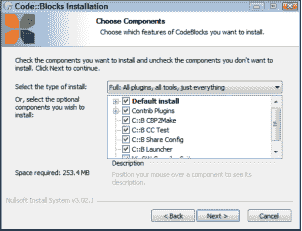

**图 1-1：** 向导要求你选择要使用的配置选项。

5. **在“目标文件夹”字段中键入 `C:\CodeBlocks`。单击“安装”。**

   当 `C:\CodeBlocks` 文件夹尚不存在时，安装程序会自动为你创建它。如果该文件夹因你之前安装过较旧版本的 Code::Blocks 而存在，你会看到一个对话框出现。单击“是”以允许安装继续。你会看到所有文件安装到系统上的 `C:\CodeBlocks` 文件夹中。

   安装向导可能会显示一个对话框，询问你是否要启动 Code::Blocks。如果看到此对话框，请单击“否”。

6. **单击“下一步”。**

   你会看到一个完成对话框。

7. **单击“完成”。**

   安装向导结束。


> 如果你发现向导不知何故没有为你选择编译器和/或调试器，你可以手动执行此任务。“选择编译器”一节将在这方面提供帮助。此外，`http://blog.johnmuellerbooks.com/2011/04/06/checking-your-compiler-in-codeblocks/` 和 `http://blog.johnmuellerbooks.com/2013/04/12/resetting-your-codeblocks-configuration/` 上的博客文章介绍了如何执行额外设置。然而，在大多数情况下，向导会为你执行所需的设置。

#### 在 Mac OS X 上操作

在 Mac 上安装 Code::Blocks 比在 Windows 上需要多做一些工作。Code::Blocks 需要 Mac OS X 10.6 或更高版本才能安装。你可以从 https://sourceforge.net/projects/codeblocks/files/Binaries/17.12/Mac/ 获取 17.12 版文件 codeblocks-17.12_OSX64.dmg。如果你在安装过程中遇到 Mac Gatekeeper 错误，请查看 http://blog.johnmuellerbooks.com/2016/03/21/mac-gatekeeper-error/ 上的博客文章。

以下步骤告诉你如何在 Mac 系统上获得可用的 Code::Blocks 安装。

1. **如有必要，从 App Store 下载并安装 Xcode，以获取 GCC 副本。**

   你可以通过打开终端、键入 `gcc -v` 并按 Enter 来验证是否安装了 GNU GCC 编译器。如果安装了 GCC，你应该会看到一些版本信息以及一些编译器说明。

2. **将 Code::Blocks 文件解压到一个文件夹中。**

   你会看到许多文件，包括 Code::Blocks 应用程序、包含最新更新信息的 readme 文件，以及包含文档的 PDF 文件。

3. **打开“应用程序”文件夹。**

   你会看到系统上已安装的应用程序。

4. **将 `CodeBlocks.app` 文件从用于解压的文件夹拖到“应用程序”文件夹中。**

   操作系统会将 Code::Blocks 添加到可用应用程序列表中。

5. **导航到 `https://developer.apple.com/downloads/`。**

   该站点要求你注册一个免费的开发者 ID。只需按照屏幕上的提示获取你的 Apple ID。注册过程是免费的。

6. **单击“Xcode 命令行工具”链接。**

   操作系统会下载该文件，并为你显示一个包文件夹。

7. **双击“命令行工具”包。**

   操作系统会为你安装该包，从而允许从 Code::Blocks 访问 GCC。

#### 使用标准 Linux 安装

在 Linux 上安装 Code::Blocks 没有一套统一的步骤，因为每种 Linux 发行版都有自己的要求。Code::Blocks 直接支持：

- Ubuntu
- Debian


- Fedora
- Gentoo
- Platypus
- 基于 Red Hat Package Manager (RPM) 的发行版（如 SUSE、Red Hat、Yellow Dog、Fedora Core 和 CentOS）
- Ubuntu

每种发行版都有自己的一套说明，可在 http://wiki.codeblocks.org/index.php?title=Installing_Code::Blocks 找到。确保按照说明（在终端中输入）仔细下载并安装所需的编译器、调试器和 IDE。你从 http://www.codeblocks.org/downloads/26 下载的文件包含 Code::Blocks 安装所需的软件包，因此无需在安装过程中单独下载每个软件包。


某些 Linux 安装在使用 Code::Blocks 时具有特殊要求或存在限制。影响本书的唯一明显限制是 Red Hat 和 CentOS 缺少 Boost 支持。由于这一限制，你无法使用 Book 7 第4章和第5章中的示例。但是，如果你遇到其他限制，请通过 John@JohnMuellerBooks.com 告知我，我会在本书的博客文章中说明。

### 使用图形化 Linux 安装

所有版本的 Linux 都支持本章“使用标准 Linux 安装”一节中讨论的标准安装。然而，少数基于 Debian 的 Linux 发行版（如 Ubuntu 12.x 及更高版本）也提供图形化安装方法。你需要管理员组（sudo）密码才能使用此过程，因此手边备好密码可以节省时间。以下步骤概述了 Ubuntu 的图形化安装方法，但其他 Linux 安装的方法类似。

1. **打开 Ubuntu Software Center 文件夹（在其他平台上，该文件夹可能名为 Synaptic）。**

   你会看到可供下载和安装的最流行软件的列表，如图 1-2 所示。你的列表可能与截图中显示的有所不同。

2. **从“所有软件”下拉列表框中选择“开发者工具”（或“开发”）。**

   你会看到包括 Code::Blocks 在内的开发者工具列表，如图 1-3 所示。

3. **双击 Code::Blocks 条目。**

   Ubuntu 软件中心会提供有关 Code::Blocks 条目的详细信息，并提示为你安装它，如图 1-4 所示。

   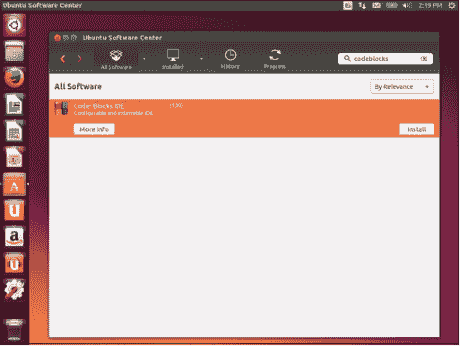

   **图 1-4：** 如有必要，可以获取有关 Code::Blocks 的附加信息。

4. **单击“安装”。**

   Ubuntu 开始安装 Code::Blocks。进度条显示下载和安装状态。安装完成后，“安装”按钮变为“移除”按钮。

5. **关闭 Ubuntu 软件中心文件夹。**

   你会看到桌面上添加了 Code::Blocks 图标。IDE 已可供使用。

### 浏览 Code::Blocks 的核心功能

无论你如何为平台安装 Code::Blocks，最终都会得到一个具有标准化特征的 IDE。这是使用 Code::Blocks 这类 IDE 的最佳理由之一——无论使用哪个平台，你都可以使用同一个 IDE。

**记住** 你的屏幕截图可能看起来与本书中显示的截图不同。尽管本书使用 Windows 版 Code::Blocks 的截图，但其他平台上安装的 Code::Blocks 也提供相同的功能，不过 IDE 在其他平台上的外观可能并不完全相同。以下各节介绍使用 Code::Blocks 时需要了解的基本功能。

#### 首次启动 Code::Blocks

使用平台通常要求的方法打开 Code::Blocks 可执行程序。例如，在 Windows 或 Mac 上工作时，双击 CodeBlocks 图标。首次启动 Code::Blocks 时，你可能会看到“编译器自动检测”对话框。选择 GNU GCC Compiler 条目（它可能是唯一可用的条目，并默认被选中），单击“设为默认”，然后单击“确定”。

此时，Code::Blocks 会显示“文件关联”对话框，类似于图 1-5 所示。最好将 IDE 与你的 C++ 文件关联起来，这样打开文件时也会打开 IDE——从而使编写应用程序以及后续修改它们容易得多。

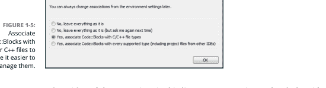

在此列表中选择任意一个“是”选项。你还可以将 Code::Blocks 与其他源代码类型关联，但就本书而言，你只需将其与 C++ 文件关联。单击“确定”完成操作。此时，你会看到 IDE。

设置文件关联后，Code::Blocks 通常会打开 IDE，并在其中放置一个提示对话框，如图 1-6 所示。你可以清除“启动时显示提示”复选框来关闭这些提示。“从这里开始”页面（可通过选择“视图”→“起始页”显示）上的“每日提示”链接在单击时也会显示一条提示。该提示是一条关于如何更高效地使用 Code::Blocks 的随机信息。你可以单击“下一条提示”查看系列中的下一条提示，或清除“启动时显示提示”来禁用提示显示。阅读提示后，单击“关闭”。


**图 1-6：** Code::Blocks 提供了一个包含有用信息的提示对话框。

在某些情况下，IDE 会显示类似于图 1-7 所示的消息。该消息表示你已对 Code::Blocks 配置进行了更改。单击“是”保存更改。


**图 1-7：** 将更改保存到磁盘。


Windows 用户此时可能会遇到问题。如果你将 Code::Blocks 安装在 `C:\Program Files` 文件夹中，并且没有管理员权限（或者你只是以普通用户身份打开了应用程序），你可能会发现无法保存任何 Code::Blocks 设置，这会使使用 Code::Blocks 成为令人烦恼的体验。要顺利使用 Code::Blocks，请确保你对其安装所在的文件夹具有写入权限。最佳策略是将 Code::Blocks 安装到系统中的 `C:\CodeBlocks` 文件夹。另一种方法是，右键单击 Code::Blocks 图标，然后从上下文菜单中选择“以管理员身份运行”，以所需权限运行 Code::Blocks。

#### 打开示例项目

你可以从引言中所述的出版商网站获取本书的源代码。下载包含源代码的 `.zip` 文件后，只需将其解压到硬盘即可。不要尝试运行 `.zip` 文件内的源代码；这样做会在 Code::Blocks 中显示令人困惑的消息，并且不允许你运行代码。

本书的源代码按书、书中的章以及章中的示例进行划分。例如，要打开本书第3章中的第一个示例，请先找到 `\CPP_AIO\BookI\Chapter03\SayHello` 文件夹（或你的平台上的等效文件夹）。此文件夹中包含 SayHello.cbp。Code::Blocks 项目（.cbp）文件扩展名包含 Code::Blocks 打开项目并向你呈现该项目所需的一切。当你到达这第一个项目时，双击 SayHello.cbp，Code::Blocks 会自动为你打开该项目，如图 1-8 所示。

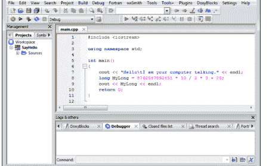

**图 1-8：** 每个示例都有一个关联的 .cbp 文件，可在 Code::Blocks 中为你打开该示例。

如果你选择允许显示提示，你实际上会先看到“每日提示”对话框，就像前面图 1-6 所示的那样。阅读提示后单击“关闭”以查看项目。现在不必担心此示例的内容。你将在第3章中了解它的工作方式。现在你只需要知道如何打开项目示例，以便能够跟随书中的示例操作。

**提示** 使用 Code::Blocks 以外的 IDE 时，你可以打开 C++（.cpp）文件，而不是 .cbp 文件。打开 .cpp 文件仍会为你显示代码示例。C++ 将源代码存储在 .cpp 文件中，而不是作为 .cbp 文件的一部分。

#### 查看基本窗口

有些窗口会在本书的每个示例中用到。随着本书的深入，你会接触到其他窗口，但本节涵盖的

以下各节介绍的是开始使用 Code::Blocks 时需要了解的各种窗口。

### 使用 Start Here 窗口

如图 1-9 所示的 Start Here 窗口，正如其名称所示——它帮助你开始使用 Code::Blocks。当你直接打开 Code::Blocks 而未先打开项目时，此窗口会自动显示。它会在你关闭 Tip of the Day 对话框后立即出现。

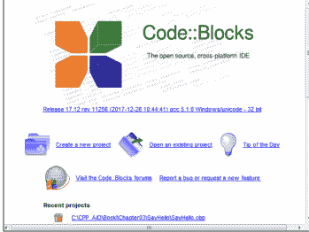

图 1-9：使用 Start Here 窗口开始新会话。

此窗口很重要，因为它还让你可以访问 Code::Blocks 的各种功能，并使你能够提出更改请求。你可以通过此窗口访问以下选项：

- **创建新项目：** 在有效使用 Code::Blocks 之前，你需要创建一个项目。项目充当容器，用于存放创建应用程序所用的文件。它还存储用于配置开发环境的设置，并以特定方式向你呈现该环境。
- **打开现有项目：** 每当你想重新创建先前编码会话中使用的环境时，就打开一个现有项目。项目会自动打开你之前打开过的所有源代码文件，并执行其他任务，让你轻松从一天前中断的地方直接继续。

Management 窗口包含四个选项卡。（本书中从不使用 Fortran Symbols 选项卡。）下面的列表说明了每个选项卡的用途：

- **项目（Projects）：** 将创建应用程序所需的所有文件集中在一个地方，是管理应用程序的一种有用方法。一组应用程序文件称为*项目*，而帮助你创建和维护项目只是 Code::Blocks 让应用程序开发更轻松的一种方式。
- **符号（Symbols）：** 应用程序包含许多符号，例如函数名（具名代码块）。你可以使用 Symbols 选项卡查找应用程序中需要的特定符号。现在不必过于担心符号，但最终你会发现，此选项卡通过让你更容易定位应用程序的特定部分，帮助节省时间和精力。
- **文件（Files）：** 定位需要添加到当前项目的代码和资源可能很耗时。Files 选项卡提供了一种浏览文件系统的方法。然后，你可以右键单击所需的文件，并使用上下文菜单项执行任务，例如将文件添加到当前项目。
- **资源（Resources）：** 图形应用程序需要添加对话框和其他视觉元素，C++ 将其视为资源。Resources 选项卡包含这些资源的列表，以便你轻松找到它们并以各种方式管理它们。

Resources 选项卡是一项供高级开发者使用的功能，通常你无需担心它，除非你决定结合 C++ 和 wxWidgets 插件来创建图形应用程序（Windows 开发者会自动安装该插件，而 Mac 和 Linux 开发者需要单独安装）。关于如何创建此类应用程序的说明超出了本书范围，但你可以在 `http://wiki.codeblocks.org/index.php?title=WxSmith_tutorial:_Hello_world` 查看此类项目的一个简单示例。


### 使用 Logs & Others 窗口

Code::Blocks 可帮助你跟踪各种活动。例如，当你根据自己编写的源代码创建新应用程序时（这一过程称为构建），你会看到说明该过程进展的消息，如图 1-11 所示（你看到的消息可能略有不同）。本书中的示例将帮助你了解何时使用各种日志选项卡和其他选项卡（例如 Debugger 选项卡），以更好地判断应用程序的工作方式。

此窗口中显示的选项卡取决于你在 Code::Blocks 中启用了哪些选项以及你正在执行什么任务。Code::Blocks 通常会自行选择你需要的选项卡。如果你想关闭某个特定选项卡，请单击该选项卡条目旁的 X。要显示你看不到的选项卡，请右键单击列表中的任意选项卡，然后从上下文菜单的 Toggle 选项中选择一个条目。

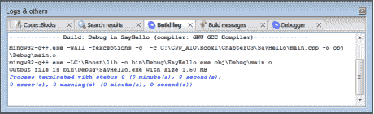

图 1-11：使用 Logs & Others 窗口了解应用程序的工作方式。

### 选择编译器

Code::Blocks 支持许多编译器。本书使用 GCC，因为它可在所有目标平台上运行，并且提供对 C++20 的良好支持。大多数 Code::Blocks 安装还会自动选择这个特定编译器。因此，使用 GCC 作为编译器有各种充分理由。然而，你的系统可能未选择 GCC，这可能会在运行示例时导致问题。并非每个编译器供应商都提供良好的 C++20 支持，或者你的编译器供应商对某个特定细节的实现可能与 GCC 不同。以下步骤可帮助你验证 GCC 是否为你系统所选定的编译器；如果不是，它们还可帮助你更改配置：

1. **打开 Code::Blocks。**

   无论是否选择项目都没有关系。无论是否加载项目，配置编译器的方式都相同。

2. **选择 Settings>Compiler。**

   你会看到 Compiler Settings 对话框，如图 1-12 所示。

3. **在左窗格中单击 Global Compiler Settings，以显示全局编译器设置。**

4. **验证 Selected Compiler 列表中实际选中的是 GNU GCC 编译器（或适用于你平台的等效项）。**

   该列表可能包含多个 GCC 编译器条目。最佳选项是 GNU GCC Compiler 设置，因为它与本书示例的兼容性最高。如果已选中 GNU GCC Compiler 选项（或适用于你特定平台的等效项），请继续执行第 7 步。

5. **在 Select Compiler 列表中选择 GNU GCC Compiler 选项（或适用于你平台的等效项）。**

   做出选择后，Set As Default 按钮将变为可用。

6. **单击 Set As Default。**

   此步骤确保所有项目都使用 GNU GCC 编译器，即使你只想打开下载的源代码。

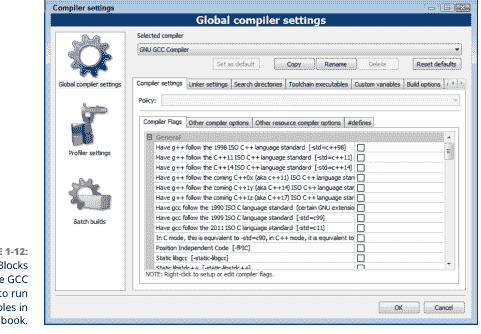

图 1-12：将 Code::Blocks 设置为使用 GCC 编译器来运行本书中的示例。

7. **单击 OK。**

8. **关闭 Code::Blocks。**

   你会看到 Layout Changed 对话框。

9. **单击 Yes。**

   你的更改将永久生效，Code::Blocks 随之关闭。

### 使用其他 IDE

尽管本书将重点介绍 Code::Blocks IDE 与 GCC 编译器的组合，但你学到的知识可用于任何 IDE 与编译器的组合。事实上，你真正需要的只是编译器。大多数开发者使用 IDE，只是因为它让事情变得简单（而我们都喜欢简单的事情）。不过，你可能会发现 Code::Blocks 根本不提供你想要的功能，或者它太难使用。

选择 IDE 是一件个人化的事情，大多数开发者选择特定 IDE 都有具体理由。事实上，我使用多种不同的 IDE，并根据特定项目的需求做出选择。因此，甚至不必始终使用同一个 IDE。IDE 提供管理功能，而编译器控制源代码如何被解释并转换为可执行文件。这两类应用程序执行完全不同的任务。

GCC 是编译器的绝佳选择，因为许多 IDE 都支持它。如果你决定使用与本书不同的 IDE，我们完全没问题。事实上，我们祝贺你有走不同道路的愿望！以下是一些你可能想考虑的备选 IDE：

- **CodeLite:** https://codelite.org/
- **Dev-C++:** https://dev-c.soft32.com/free-download/?dm=2
- **Eclipse:** https://www.eclipse.org/downloads/ 与 C/C++ Development Tooling (CDT) (https://www.eclipse.org/cdt/) 配合使用时
- **Emacs:** https://www.gnu.org/software/emacs/ 与 Emacs Code Browser (ECB) (http://ecb.sourceforge.net/) 配合使用时
- **NetBeans:** https://netbeans.apache.org/download/index.html
- **Qt Creator:** https://www.qt.io/developers/


**本章内容**
- 获取并使用 CppDroid
- 使用其他移动 IDE
- 使用 CppDroid 编写代码
- 获取 CppDroid 帮助

## 第2章 配置你的移动系统

曾经，开发者完全依赖桌面系统来执行有用的任务，因为桌面系统提供了所需的计算能力。接下来是笔记本电脑，但本质上笔记本电脑只是桌面系统的一种较小形式。然而如今，开发者依赖各种移动设备来编写代码。尽管可以想象有人会用智能手机来完成这项任务，但这类活动大多发生在高性能平板电脑上。其原因与其说与性能有关，不如说与外形尺寸有关。平板电脑提供了更多屏幕空间，可用于查看代码并观察其运行方式。牢记这两个目标并考察可用的集成开发环境（IDE），本章将借助 Google CppDroid，实现从桌面系统到搭载 Android 的平板系统（例如 ASUS ZenPad 3S 10）的跨越。

不过，你不应认为 CppDroid 是唯一选择。本章还会介绍另外几款产品，你当然可以尝试它们。不过，所有这些产品都有一个共同问题：它们目前都缺乏对 C++ 20 的支持，因此书中一些示例根本无法在你的平板上运行。如果你希望最大程度兼容本书的代码、操作步骤和截图，仍然需要依赖运行 GCC 的 Code::Blocks。

安装 CppDroid 后，你需要知道如何使用它执行一些基本任务。本章并未提供使用 CppDroid 的完整教程，因此也讨论了如何获取帮助。不过，你会在本章中发现如何与书中的代码交互，这是学习体验的重要部分。

### 获取 CppDroid

有许多 IDE 可供你用来处理 C/C++ 代码。然而，大多数 IDE 依赖 Windows、Linux、Mac OS X 和 Solaris 平台（其中 Solaris 作为选项出现的频率远低于其他平台）。此外，大多数 IDE 都是付费选项，Code::Blocks（http://www.codeblocks.org/）和 Visual Studio Code（https://code.visualstudio.com/）是显著例外。然而，要在 Android 设备上编程，你需要一个可与 Android 配合使用、并且大多提供某种基于云存储的 IDE（基于 PC 的 IDE 使用本地存储）。CppDroid 提供了一个良好的基于 Android 的解决方案，你可以在在线和离线模式下顺利使用。另外，免费选项确实可用（但有局限；详情见“免费软件与付费软件”侧栏）。以下各节将深入介绍如何使用 CppDroid。

### 免费软件与付费软件

在移动设备上，你通常可以使用免费软件应付需求。有时你实际上没有付费选择，但在其他情况下，付费选项可能提供你根本不会使用的功能。游戏软件属于这一类，某些类型的生产力软件也是如此。应用的付费版通常没有广告、提供额外存储空间，并解锁一些新功能。你还可能直接获得厂商某种程度的支持，而不是依赖社区支持。付费版是否值得你花时间，取决于你使用哪些功能。

当你开始使用 IDE 时，免费与付费的问题更倾向于付费。本章讨论的许多 CppDroid 功能仅随付费版提供，而且本书假定你在处理代码时使用的是付费版。不过，如果你愿意忍受失去某些功能（如实时诊断和静态分析），你很可能可以使用免费版完成大多数示例。

### 表 2-1：CppDroid 功能

| 功能 | 仅付费版 | 描述 |
|---|---|---|
| 附加组件管理器 |  | 尽管 CppDroid 自带你需要的所有基础功能，但有时你会想要超越基础功能，这时附加组件就派上用场了。附加组件管理器让你更容易知道需要添加什么。此外，你还可以轻松移除不再需要的项目。 |
| 自动缩进 |  | 为了让代码保持可读性，需要使用缩进来查看 if 语句或其他代码块的开始和结束位置。可配置的自动缩进意味着你可以选择代码的缩进方式，而不必手动缩进。 |
| 自动配对 |  | 找出缺失的圆括号或花括号会慢慢把你逼疯。可配置的自动配对意味着你决定元素如何配对，但 IDE 会帮助你确保编译代码所需的内容没有缺失。 |
| 自动更新 |  | 获取最新软件更新有助于你编写符合 C/C++ 开发最新趋势的代码。你还能获得错误修复，这对你创建的代码的可靠性和安全性至关重要。 |
| 包含 C/C++ 代码示例 | X | 由于使用基于平板的 IDE 有时会遇到一些特殊问题，因此拥有一整套 C/C++ 代码示例至关重要。这些示例展示了如何绕过这些特殊问题，以便你在必要时只需做少量小修改就能执行 C/C++ 代码。 |
| 包含 C++ 教程和学习指南 | X | 如果你计划离线工作，那么在你几乎快要忘记、但还没完全忘记如何执行某项特定任务时，有一份教程和学习指南至关重要。当然，你也会希望把本书放在手边。 |
| 代码补全 | X | 根据先前内容自动建议如何补全你输入的语句。此功能可减少潜在拼写错误，并显著提高效率，尤其是在平板电脑的小键盘上工作时。 |
| 编译 C/C++ 代码 |  | 在某些情况下，例如使用基于 Web 的 IDE 时，你创建的 C++ 代码由 ROOT 解释执行（有关 ROOT 的更多信息，请参阅 https://en.wikiversity.org/ROOT_for_beginners）。一些平板 IDE 也需要 ROOT，但使用 CppDroid 时，你会得到完全编译的 C/C++ 代码输出。 |
| 支持 Dropbox | X | 当你支持 Dropbox 时，与他人共享代码会容易得多。 |
| 文件和教程导航器 |  | 此功能提供文档索引，向你介绍 C/C++ 代码结构，包括变量和方法。 |


**图 2-1：** 在 Google Play 商店中找到 CppDroid。

### 确保安装顺利

CppDroid 应用在平板上安装完成后，你会像往常一样看到“打开”按钮。不过，你看到的不是应用打开后的界面，而是类似图 2-2 的视图。为了离线工作，CppDroid 需要在你的系统上安装许多库。这个过程可能需要一段时间，所以只需等待完成。


**图 2-2：** 为离线使用加载 CppDroid 库。

### 考虑其他替代方案

你并不局限于使用 CppDroid，尽管它是本书使用的平板 IDE。大多数平板 IDE 允许你执行一组基本任务，这些任务适用于本书大多数示例。你唯一会遇到困难的情况，是处理那些使用新 C++ 特性、依赖图形的示例时。


AIDE 的 C/C++ 语言支持来自 Android Java C++ APK 3.2，这意味着你可以预期其支持情况与本书桌面应用中 Code::Blocks 所使用的 GNU 编译器集合（GCC）存在差异。你可能会发现，由于这些差异，某些示例无法正常运行，但所有简单的（较早的）示例都能正常工作。

### 使用基于 Web 的 IDE

你可以在任何设备（包括桌面电脑）上使用基于 Web 的 IDE，因此在某些情况下，它们在设备兼容性方面表现最佳。在大多数情况下，基于 Web 的 IDE 还通过 ROOT 提供解释执行环境。因此，在学习用 C/C++ 开发应用时，你可以获得即时反馈，这能节省大量时间。如图 2-3 所示，基于 Web 的产品往往还提供简单的界面，让你可以直接开始工作。

图 2-3 中的示例是 JDoodle（https://www.jdoodle.com/online-compiler-c++17/），它是最好的 C/C++ 在线产品之一。这个特定的在线 IDE 支持 72 种编程语言。它对所有这些语言的支持程度取决于所使用的解释器。在大多数情况下，你会发现 JDoodle IDE 提供了一种可接受的方式来处理书中的代码。由于它还支持 C++ 17，你还可以运行比使用 C/C++ 应用更多的示例。

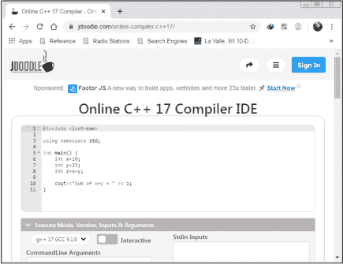

**图 2-3：** 基于 Web 的 IDE 往往提供非常简单的界面。


每一个基于 Web 的 IDE 的问题在于你必须在线使用它们。此外，很有可能你无法保存代码，所以它们主要用于实验，而非长期学习。然而，即使存在这些问题，除了 JDoodle 之外，你还可以考虑以下一些基于 Web 的 IDE 作为 CppDroid 的替代品：

- **C++ Shell（C++ 14）：** http://cpp.sh/
- **CodeChef（C++ 14）：** https://www.codechef.com/ide
- **Ideone（C++ 14）：** https://ideone.com/SXNFc0
- **OnlineGDB（C++ 17）：** https://www.onlinegdb.com/online_c_compiler
- **Rextester.com（根据所选 C 编译器不同而不同）：** https://rextester.com/l/c_online_compiler_gcc
- **Repl.it（C++ 11）：** https://repl.it/languages/cpp11
- **TutorialsPoint（C++ 11）：** https://www.tutorialspoint.com/compile_cpp11_online.php

### 探索 CppDroid 的基本功能

下载 CppDroid 后，你就可以开始使用它了。以下各节将引导你入门使用本书示例所需的基本功能。然而，该 IDE 提供的功能远不止这些，因此花时间研究各种示例和教程也是个好主意。

#### 开始使用 CppDroid

当库最终加载完成后，你会看到一个类似于图 2-4 所示的屏幕。该屏幕的左上角显示文件名（如果你愿意，可以更改）。右上角包含保存、编译和运行应用程序的按钮。

在屏幕底部，你会看到处理代码的当前阶段：

- **诊断：** 显示输入时出现的错误。
- **分析：** 输出编译结果。
- **输出：** 显示应用程序的输出。

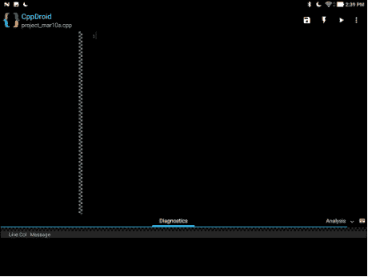

**图 2-4：访问 CppDroid 的基本用户界面功能。**


提示

点击右上角的省略号按钮，你会看到图 2-5 所示的菜单。要获得 CppDroid 的全部功能，你需要点击“购买”条目，并选择你想购买的可选功能（详情参见表 2-1）。选择高级版将允许你以较低的成本访问所有额外功能。

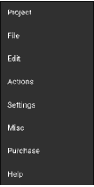

**图 2-5：使用菜单找到 CppDroid 的功能和选项。**

#### 访问示例

CppDroid 附带了示例和教程，你可以用它们来了解 IDE 和 C/C++ 的更多信息。教程的工作方式与示例非常相似——只是内容更多。要访问 Hello World 示例，请依次选择 ...➜项目➜示例➜C++➜初学者➜HelloWorld。此时显示器将包含图 2-6 所示的代码。

**图 2-6：加载示例提供了一种快速查看代码运行效果的方法。**

```cpp
#include <iostream>

int main()
{
    std::cout << "Hello world!";
}
```

要编译此代码，请点击闪电图标。编译完成后，你可以通过点击右箭头来运行它。显示将更改为输出内容。要清除输出，请点击显示界面左上角的左箭头。

#### 使用一个简单的在线项目

你可以将本书的源代码放在 Google Drive 或 Dropbox 上。当然，你仍然需要某种访问方法。以下步骤假设你使用 Google Drive，但它们也适用于 Dropbox。（使用 Dropbox 时，请将代码放在 Dropbox\Apps\CppDroid 文件夹中。）

1. **选择 ...➜项目➜打开➜从 Google Drive。**  
   此时你可能需要登录。登录后，你可能会看到一个类似图 2-7 的对话框，在其中授予 CppDroid 访问 Google Drive 的权限。点击“允许”以允许访问。（这是一次性步骤。）

2. **找到包含你要访问代码的文件夹。**  
   你会看到一个或多个 .cpp 文件。例如，使用本书的源代码时，你可以选择 Book 1\Chapter03\SayHello 文件夹。

3. **突出显示要打开的文件，然后点击“选择”。**  
   CppDroid 会为你打开该文件。图 2-8 显示了第 1 册第 3 章的 HelloWorld.cpp 文件的示例。

此时，你可以像使用 Code::Blocks 一样编译和运行你的应用程序。唯一的区别是你在平板电脑上操作。


**图 2-7：授予访问你的 Google Drive 的权限。**

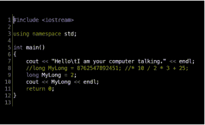

**图 2-8：该文件可用于你本地 CppDroid 副本。**

#### 访问源代码

要开始创建新的源代码文件，请选择 **...→文件→新建**。创建新文件时，CppDroid 会自动给它一个默认名称。你可以通过选择 **...→文件→重命名** 来更改名称。单个文件可以是项目的一部分，但也可以将单个文件作为整个项目。例如，Hello World 应用程序就由一个文件组成。

你可以将源代码存储在本地、Google Drive 或 Dropbox 上。在线工作时，其过程与本章“使用一个简单的在线项目”一节中描述的在线源代码处理方式相同。以下列表说明了如何在本地存储源代码，以便随时可用。

- **创建新项目：** 选择 ... ▸ 项目 ▸ 新建。当你看到图 2-9 所示的“新建项目”对话框时，输入项目名称，然后点击“创建 C 项目”或“创建 C++ 项目”。
- **打开现有项目：** 选择 ... ▸ 项目 ▸ 打开，选择项目来源之一：最近、从设备、从 Dropbox 或从 Google Drive，然后选择要打开的项目。
- **保存现有项目：** 选择 ... ▸ 项目 ▸ 保存或 ... ▸ 项目 ▸ 另存为。使用“另存为”时，你可以选择其他位置（例如 Dropbox 或 Google Drive）以及新的项目名称。
- **关闭现有项目：** 选择 ... ▸ 项目 ▸ 关闭。如果你尚未保存，CppDroid 会自动将项目以当前名称保存到默认位置。
- **删除现有项目：** 在项目打开进行编辑时，选择 ... ▸ 项目 ▸ 删除。


#### 考虑与桌面环境的差异

目前使用 CppDroid 的人数，以及作者正在考虑的其他项目。即便如此，当你遇到产品问题并希望开发人员正在解决它时，你可以去这里。图 2-12 展示了你会看到的那种博客帖子的示例。

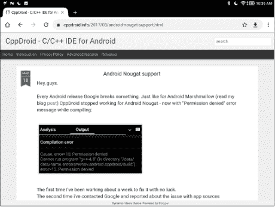

**图 2-12：开发人员使用博客帖子帮助你查找错误修复。**


当你找不到针对特定问题的明显帮助时，你可以选择“帮助”菜单上的“发布反馈”选项，向开发人员发送电子邮件。奇怪的是，你可能会发现，除了 Gmail 之外，你很难用其他方式取得联系。

#### 获取社区支持

你可以在各种网站上找到很多关于 CppDroid 的文章。这些文章提供了有关如何使用 CppDroid 的见解，并经常回答用户对其的疑问。此外，你还可以在以下网站找到有关使用 CppDroid 的帮助：

- **Reddit：** https://www.reddit.com/r/cpp/search?q=cppdroid
- **SourceForge：** https://sourceforge.net/ （搜索 CppDroid）


- StackOverflow：https://stackoverflow.com/search?q=CppDroid
- AndroidForums：https://androidforums.com/apps/cppdroid-c-c-ide.5356/

你可能会在网上找到更多获取 CppDroid 信息的站点。如果你发现其中某个站点似乎提供了优质且一致的信息，请通过 John@JohnMuellerBooks.com 告诉我，以便我将这些信息分享给其他读者。

#### 使用免费示例

免费示例通常能让你深入了解 CppDroid 的工作方式。例如，你可能想知道静态分析功能如何工作。要查看静态分析的演示，请选择……项目 ▸ 示例 ▸ C++ ▸ 面向开发者 ▸ 静态分析。文件加载后，选择……操作 ▸ 分析。图 2-13 显示了结果。

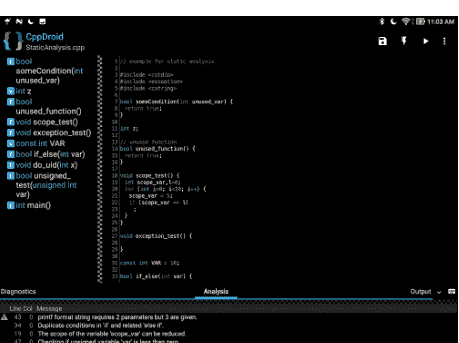

图 2-13：使用示例了解静态分析功能如何工作。

请注意，输出显示了代码中的各种问题，例如 printf 格式字符串需要 2 个参数，但在屏幕底部附近第 43 行第 0 列却给出了 3 个参数。输出可帮助你定位代码中的问题，并在编译前修复它们。

#### 访问教程

这些教程提供了一个在 CppDroid 中使用 C++ 的多步骤流程。当你选择……：项目 ▸ 教程 ▸ C++ ▸ 面向初学者时，会看到两个教程选项：

- CPlusPlus.com C++ 教程
- LearnCpp.com C++ 教程

这两个教程都能帮助你在 CppDroid 环境中克服 C++ 学习曲线。IDE 会切换为左侧窗格显示教程大纲、右侧显示相关文本，如图 2-14 所示。你直接在 CppDroid 环境中操作，这意味着完成后你能更好地理解 CppDroid 的工作方式。

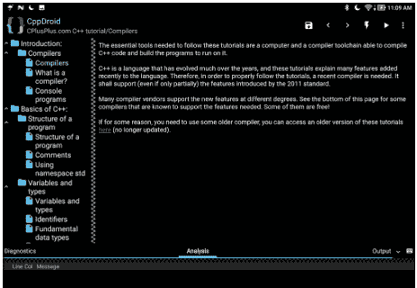

图 2-14：这些教程会带你了解 CppDroid 中的基本流程。

你不必手动输入本章的源代码。事实上，使用可下载的源代码要容易得多。你可以在可下载源代码的 \CPP_AIO4\Book1\Chapter03 文件夹中找到本章的源代码。有关如何找到这些源文件的详细信息，请参阅引言。

## Code::Blocks 创建项目

### 理解项目

应用程序可能包含大量源代码。为了将所有源代码集中在一起，程序员使用一个名为“项目”的文件来管理全部内容。项目有几个关键要素：

- 一组源代码文件
- （可选）资源信息，例如图标和声音文件
- 关于如何编译（构建）应用程序的说明
- 集成开发环境（IDE）设置，用于说明如何设置编写应用程序所用的编辑器
- 关于正在构建的应用程序的一些一般性描述，例如其名称和应用程序类型

应用程序的*类型*并不是指“文字处理器”或“真正酷炫、惊天动地的软件”，即使你的应用程序正是如此。本书用*类型*来表示应用程序与其他应用程序的整体关系：

- 此应用程序是否独立运行？
- 此应用程序是否会为另一个应用程序（例如 Firefox）增加或扩展功能？
- 此应用程序是否充当*库*（一组你提供给另一个应用程序使用的代码）？

所有这些信息连同你的源代码文件共同表示一个项目。

在 Code::Blocks IDE 中，每当你开始开发一个新应用程序时，都要创建一个新项目。你提供一些关于正在开发的应用程序的信息，然后开始编写代码。应用程序的所有代码都存储在一个地方——项目中。

### 定义你的第一个项目

要在 Code::Blocks 中创建新项目，请启动 Code::Blocks 并选择“文件 > 新建 > 项目”，或在启动应用程序时出现的“起始页”上单击“创建新项目”。此时会出现一个对话框，如图 3-1 所示。

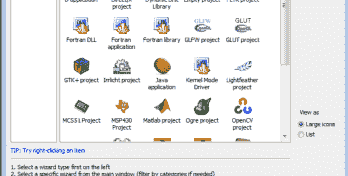

图 3-1：“从模板新建”对话框让你选择新项目类型。


**提示：** 你会看到似乎过多的项目类型，其中包括一些与 C++ 无关的类型，例如 Fortran 应用程序和 Matlab 项目。你可以在“类别”字段中选择一个类别来减少选项数量。本书中的项目最佳选项是控制台。

- **动态链接库：** 动态链接库（DLL）有点像静态库，只是它与主应用程序分离，并拥有自己的文件，扩展名为 .DLL。
- **空项目：** 这个空白项目就像一张干净的白纸，等待你填写内容。
  
  坦白说，使用空项目有点麻烦，因为你必须调整和设置许多东西。因此我们从不使用这个选项。


对于本章的示例，请创建一个控制台应用程序。请按以下步骤操作：

- 1. **在“从模板新建”对话框中，单击“项目”选项卡上的控制台应用程序图标，然后单击“执行”。**
  
  向导会询问你要使用哪种语言。
- 2. **选中 C++，然后单击“下一步”。**
  
  你会看到一系列与项目相关的问题，如图 3-2 所示。这些问题定义项目基本信息，例如项目名称。

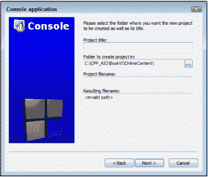

**图 3-2：** 为 Code::Blocks 项目提供名称。

- 3. **在“项目标题”字段中键入项目名称。**
  
  示例使用 SayHello 作为项目标题。请注意，向导会自动在“项目文件名”字段中为你开始创建一个条目。
- 4. **在“创建项目所在文件夹”字段中键入项目位置。**
  
  示例使用 C:\CPP_AIO4\Book1\Chapter-03 作为文件夹名称。你也可以单击“创建项目所在文件夹”字段旁边的省略号按钮，使用“浏览文件夹”对话框定位要使用的文件夹。请注意，向导会补全“项目文件名”字段中的条目。

## 创建你的第一个 C++ 应用程序

- 5. **（可选）在“项目文件名”字段中键入项目文件名。**
  
  Code::Blocks 会根据“项目标题”字段中的条目自动为你填写此字段，在大多数情况下没有充分理由更改它；不过，在特殊情况下，你可以选择更改。例如，如果你的项目包含多个元素，你可能希望项目文件与整体项目的名称匹配，而不是与项目中某个特定实体的名称匹配。
- 6. **单击“下一步”。**
  
  你会看到如图 3-3 所示的编译器设置。本书中的大多数项目使用默认编译器设置，其中包括图中显示的 GNU GCC Compiler。不过，如果你查看“编译器”下拉列表，会看到 Code::Blocks 支持多种编译器，而且你还可以添加更多编译器。其他设置控制应用程序调试版本（用于查找代码问题的版本）和发布版本（发送给客户的版本）的创建和位置。

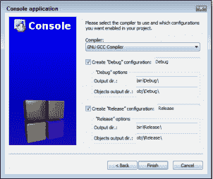

**图 3-3：** 告诉 Code::Blocks 将应用程序的调试版本和发布版本放在哪里。

- 7. **（可选）更改任何所需的编译器设置。**
  
  通常没有充分理由更改编译器设置，除非你的项目有特定需求，例如将输出文件和目标文件放在同一文件夹中。


8. **单击“完成”。**

向导将为你创建应用程序。然后它会显示已加载项目的 Code::Blocks IDE。不过，源代码文件尚未加载。

9. **在“管理”窗口的“项目”选项卡中展开 SayHello 工作区条目，然后双击 main.cpp。**

你会看到源代码文件已加载，以便你进行编辑，如图 3-4 所示。

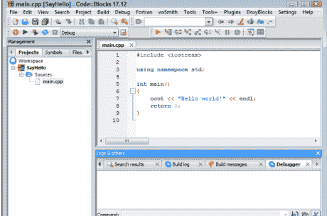

**图 3-4：** 使用 Code::Blocks IDE 与项目进行交互。

项目窗口以并排方式组织：

- 左侧是资源管理器视图（称为树状视图），它代表你的项目。树状视图的顶部是一个工作区——项目的基本单元。工作区下方是项目名称。再往下是项目的组件。在本例中，目前只存在一个组件：文件名称为 main.cpp 的源代码文件。请记住，要用 C++ 编程，你需要将代码输入到源代码文件中；这个名为 main.cpp 的文件就是你 SayHello 项目的源代码文件。

- 右侧（实际上约占屏幕的四分之三）是源代码文件本身。

这部分的工作原理与文字处理器或电子邮件编辑器非常相似，你可以在窗口中输入代码。你会注意到里面已经有一些代码——一种起始代码，是在你选择“控制台应用程序”并创建项目时生成的。

显示界面底部有一些状态窗口。Code::Blocks 窗口会告诉你向导是如何创建你的应用程序的。现在先不要担心这些窗口。随着本书的深入，你会看到它们发挥作用。


注意，图 3-4 还显示了一些附加元素：菜单、几个工具栏和状态栏。你可以右键单击工具栏区域，根据需要显示或隐藏工具栏。图 3-4 显示的是你首次创建项目时的默认工具栏。状态栏显示当前使用的语言高亮、一些配置设置以及你在源文件中的当前位置。你可以通过状态栏左侧目前显示为 C/C++ 的下拉菜单选择新的语言选项，来更改编辑器窗口中使用的语言高亮。

## 构建并执行第一个应用程序

好的，是时候处理你的第一个应用程序了。使用以下步骤保存文件、构建应用程序（使其成为你的操作系统可以使用的可执行文件）并执行该应用程序：

1. **通过选择“文件”→“全部保存”或按 Ctrl+Shift+S 保存代码文件。**

    保存文件可确保如果出现问题，磁盘上有一份良好的副本。例如，如果你的应用程序执行了错误操作，可能会导致 IDE 完全崩溃。

2. **选择“构建”→“构建”或按 Ctrl+F9。**

    此操作会创建可执行文件。构建代码会将你能理解的文字转换为操作系统能理解的代码。注意，Code::Blocks 会自动为你选择“构建日志”窗口，你会看到 Code::Blocks 创建应用程序所采取的步骤。在此过程结束时，你应该会看到类似 `0 errors, 0 warnings` (`0 minutes, 1 seconds`) 的输出（具体时间可能会有所不同，但应该很短）。

3. **选择“构建”→“运行”或按 Ctrl+F10。**

    将打开一个如图 3-5 所示的输出窗口，你会看到你的第一个应用程序正在执行。

4. 按 Enter 键停止应用程序执行。

应用程序窗口消失，你再次看到 Code::Blocks IDE。

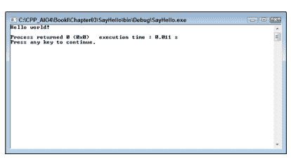

**图 3-5：** 执行你的第一个应用程序。

好吧，这并不有趣，不是吗？但这没关系！应用程序从一种基本状态开始：你有一个控制台窗口，然后当应用程序完成它必须做的任何事后，它会显示消息“按任意键继续。”——当你按键后，应用程序结束。

## 输入代码

Code::Blocks 窗口最右侧约 75% 的区域是代码编辑器；你可以在其中输入和修改代码。在本章第一部分提到的所有任务中，与使用 Code::Blocks 代码编辑器最接近的等效操作是撰写电子邮件。

**警告**

单词移动和选择操作在屏幕上看起来有点奇怪。它们会忽略某些字符，例如大括号——花括号 { 和 }。

代码编辑器的工作原理与电子邮件编辑器类似。你可以

- 输入代码。
- 使用箭头键（上、下、左、右）将光标移动到要输入的位置。光标是一个闪烁的垂直小条，它显示你输入时文本将出现的位置。有些人称之为插入符号（caret）或插入点。

创建你的第一个 C++ 应用程序

单击要输入的位置。使用鼠标指向要输入的位置，然后点击鼠标按钮。光标会跳到单击的位置。

选择要删除或更改的文本。可以通过两种方式选择文本：

- 用鼠标指向要选择的第一个或最后一个字符；然后按住鼠标按钮并拖动鼠标。
- 将光标移动到要选择的第一个或最后一个字符；然后按住 Shift 键并按箭头键。

使用滚动条上下（垂直）或左右（水平）滚动文本。滚动条仅在窗口中的文本超出可见范围时起作用，就像 Windows、Linux 和 Mac 系统的大多数其他地方一样。你可以使用 Ctrl+↑ 和 Ctrl+↓ 组合键或鼠标滚轮（如果你有的话）上下滚动（如果编辑器中的文本足够多）。

滚动只改变你所看到的内容。你必须使用鼠标或箭头键来选择你所看到的内容。


当你稍微尝试一下编辑器后，可以使用表 3-1 来完成一些你最喜欢的任务。（当然，如果你刚接触编程，你可能还不知道这些是否会成为你的最爱——但很快会的。相信我。）

**导航和编辑命令**

| 命令 | 按键或操作 |
|---|---|
| 移动光标 | ↑、↓、← 或 →、Home、End |
| 逐词移动 | Ctrl+← 或 Ctrl+→ |
| 使用鼠标选择 | 在文本中单击鼠标，并在按住鼠标按钮的同时拖动鼠标 |
| 使用光标选择 | Shift+↑、Shift+↓、Shift+← 或 Shift+→ |
| 选择下一个单词 | Shift+Ctrl+→ |
| 选择上一个单词 | Shift+Ctrl+← |
| 全选 | Ctrl+A |
| 转到顶部 | Ctrl+Home |
| 转到底部 | Ctrl+End |

## 从 main 开始

计算机运行代码时，会一步一步、一行一行地执行。但是你的代码被组织成多个部分，其中一部分是 *main 函数*，简称为 `main()`，它是最先运行的部分。`main()` 告诉计算机你希望使用应用程序的哪些其他部分。`main()` 是头头，是大老板。

计算机如何知道 `main()` 是什么？你需要在花括号 `{` 和 `}` 之间输入代码行。以下是当你创建“控制台应用程序”项目时 Code::Blocks 生成的默认应用程序：

```cpp
#include <iostream>

using namespace std;

int main()
{
    cout << "Hello world!" << endl;
    return 0;
}
```

main 这个词是必需的，它告诉计算机 `main()` 在哪里。你也可能会看到 `main()` 写成这样：

```cpp
int main(int argc, char *argv[])
```

现在先不要担心 `main()` 周围的词。你会在本章后面发现这些词的含义。目前，你只需要知道每个 C++ 应用程序都有一个 `main()` 函数。


计算机逐行执行代码。如果某行为空，计算机会直接转到下一行。当你编写代码行时，你是在指示计算机做某事（这就是为什么有些人将代码行称为 *指令*）。

## 显示信息

准备好输入一些代码并试一下了吗？来吧！这段代码将打开著名的控制台窗口并向其中写入一些文字。


首先，请确保你仍然打开着 Code::Blocks IDE 和 `SayHello` 项目，就像本章前面的示例那样。如果没有，请按照以下步骤操作：

- 1. **如果 Code::Blocks 尚未运行，请启动它。**
  
  你会看到 Code::Blocks IDE 的起始页。

- 2. **单击“最近项目”列表中的 `SayHello.cbp` 项目。**
  
  Code::Blocks 会为你打开该项目。

如果 `main.cpp` 代码没有显示在窗口最右侧 75% 的区域，请双击左侧树状视图中的 `main.cpp`。它会立即打开。（如果你看不到树状视图，请单击顶部标有 Projects 的小选项卡；它旁边是标有 Symbols 的选项卡。）

请仔细按照以下步骤操作。确保完全按照此处给出的内容输入所有内容：

- 1. **将光标定位到带有左大括号的那一行。**
  
  在本例中，那是第 6 行。你可以在代码编辑器左侧看到行号。

- 2. **按 Enter 键。**
  
  光标应位于第五列。如果不是——如果它仍停留在第一列——请按四次空格键。

- 3. **完全按照此处显示的样子输入下面这行代码。**
  
  两个小于号（`<`）之间不要有空格。确保记住末尾最后的分号。代码如下：
  
  ```cpp
  cout << "Hello, I am your computer talking." << endl;
  ```

- 4. **删除如下所示的那行代码：**
  
  ```cpp
  cout << "Hello world!" << endl;
  ```


最后，你的代码将如下例所示（你输入的新行在此处以粗体显示）：

```cpp
#include <iostream>

using namespace std;

int main()
{
    cout << "Hello, I am your computer talking." << endl;
    return 0;
}
```

如果你没有正确输入代码，计算机会告诉你。这一步会*编译*应用程序：计算机会确保你写的内容没有问题，然后将其转换为*可运行*的应用程序。（不必太担心这意味着什么。现在，只需把它理解为确保你的应用程序没有问题。）

要了解你的应用程序是否已经可以运行，请选择 Build ➜ Build。

如果一切顺利，你会在 Code::Blocks 主窗口的左下角看到一个窗口，里面显示着令人非常高兴的消息：**0 个错误，0 个警告**（0 分钟，1 秒）（你看到的确切时间可能会有所不同）。像“你太棒了！”这样的消息也许更好，但 **0 个错误，0 个警告**（0 分钟，1 秒）也不算太差。

如果你没有正确输入这一行，也不是全无办法，因为计算机会告诉你哪里做错了。例如，你可能输入了 couts，而不是 cout。在这种情况下，你会看到类似图 3-6 所示的内容。屏幕底部会出现一个带列的列表。

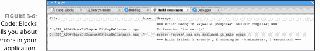

- 最左侧一列显示发生错误的文件名。在本例中，错误发生在 `main.cpp` 中，这是你唯一在处理的文件。
- 中间一列显示问题的*行号*（在本例中为 7）。
- 列表最右侧一列会尝试基本告诉你哪里做错了，如下所示：

```text
error: 'couts' was not declared in this scope
```

当编译器无法识别某个词时，它会说该词未声明。换句话说，编译器不知道 couts 是什么。（这个词应该是 cout。）


如果你想查看问题所在，可以将鼠标指向错误报告行并双击。有问题的代码行会出现在代码编辑器中，该行旁边有一个小红框。该行也会正常高亮显示。你一按方向键，高亮就会消失。

因此，如果你按几次 → 键，移动到单词 couts，然后删除字母 s，就可以再试一次。如果你选择 Build ➜ Build，这次你会看到令人高兴的消息：**0 个错误，0 个警告（0 分钟，1 秒）。** 太棒了！

没有错误意味着应用程序已经足够好，可以运行了。那就运行它吧！

选择 Build ➜ Run。会出现一个控制台，其中的文本如下所示：

```text
Hello, I am your computer talking.

Process returned 0 (0x0)    execution time : 0.030 s
Press any key to continue.
```

看到发生什么了吗？现在有一条消息显示：`Hello, I am your computer talking.` 显然，你输入的内容使这条消息出现了。（继续按 Enter 关闭控制台。）

事实上，情况正是如此。这就是让消息显示在控制台屏幕上的方法。步骤如下：

- 1. **输入 cout。**
  
  尽管 cout 看起来像读作“cowt”，但大多数程序员会说“see-out”。可以把它看作*控制台输出*的简写。（但不要用*控制台输出*来代替它，因为编译器不会接受。）

- 2. **在单词 cout 后面输入一个空格，然后输入两个小于号（确保它们前面保留那一个空格）。**
  
  这些小于号只是表示后面的数据将发送给 cout，以显示在控制台上。后面的数据是一些文本，放在双引号中。计算机就是这样知道文本从哪里开始、到哪里结束的。这些双引号内的单词和内容称为*字符串*，因为它是一串连在一起的字母。计算机知道字符串从哪里开始，因为有双引号；也知道字符串到哪里结束，因为有双引号。应用程序运行时，计算机不会显示这两组双引号。
  
  然后后面还有一些看起来奇怪的东西。又有一组小于号，表示你想向控制台写入更多内容。但后面是什么呢？是 endl。注意它不在引号中。因此，你并不是说想让那个奇怪、几乎读不出来的词“endl”出现在屏幕上。相反，你使用了一种特殊表示法，告诉计算机你想结束当前行，并在下一行重新开始。如果你查看输出，会注意到后面的文字（关于按任意键的消息）确实在下一行。注意，endl 读作“end-el”。

所以这毕竟没那么糟。下面回顾一下：

- 单词 `cout` 表示你想写入控制台。
- `<<` 符号连在一起（它们之间没有空格）表示后面的内容就是你想写入的内容。
- 在 `<<` 符号之后，你告诉计算机你想写入什么。它可以是一串字母、符号和其他字符（全部放在引号内），也可以是单词 `endl`。
- 你可以把多个项依次放在一行，让它们以这种方式显示在控制台上，前提是该行以 `cout` 开头，并且每个项前面都有 `<<` 符号。

哦，如果你眼尖，可能还会注意到一件尚未提到的事：行末有一个分号。在 C++ 中，每一行都必须以分号结尾。事情就是这样。


C++ 中的语句以分号结尾。


说每一行都必须以分号结尾并不完全准确。你可以把任意一行代码拆成多行。计算机并不介意。你完全可以像下面两行这样编写代码：

```cpp
cout << "Hello, I am your computer talking."
<< endl;
```

这样做没问题，前提是不要拆分任何单独的单词（例如 `cout` 和 `endl`）、`<<` 符号或字符串。实际上，在代码中任何“自然”出现空格的地方，如果你愿意，都可以开始新的一行。


字符串（本例中的文本）必须如所示那样，在双引号之间保持在同一行内，除非你把它拆成两个字符串，每个字符串都有自己的双引号，如下所示：

```cpp
cout << "Hello, I am your" <<
    " computer talking."
<< endl;
```

注意，你还必须在每个字符串段之间添加 `<<`。然后，当整个语句完成时，以分号结束。把分号看作向计算机发出旧语句已结束的信号。

## 做一些数学运算

你可以让计算机为你做一些数学运算；可以使用上一节介绍的相同 cout 方法；还可以加入一些数字和算术符号。


虽然加法使用熟悉的加号（+），减法使用熟悉的减号（−），但乘法和除法使用你可能不熟悉的符号。乘法使用星号（*）；除法使用正斜杠（/）。

表 3-2 展示了四种常见的数学符号。

**表 3-2 — 数学符号**

| 符号 | 功能 |
|---|---|
| + | 加法（加） |
| − | 减法（减） |
| * | 乘法（乘） |
| / | 除法（除以） |

是的，现在是使用奇怪符号做数学运算的时候了。继续使用你已经有的源代码。在你输入的那一行上单击某个位置——你知道的，就是看起来像这样的那一行：

```cpp
cout << "Hello, I am your computer talking." << endl;
```

按 End 键，让光标移动到该行末尾。然后按 Enter 键，这样你就可以在 cout 行和以单词 return 开头的那一行之间开始一个新行。


每当你想在其他两行之间插入一行时，最简单且正确的方法是转到这两行中的第一行，按 End 键，然后按 Enter 键。这样做会在正确的位置插入一个新的空行。

按 Enter 后，你会注意到发生了某些变化：光标不在新插入行的开头；相反，它有四个空格，并与其他行整齐缩进。这不是错误。信不信由你，这真是一个救星。好吧，也许不是救星，但它几乎和人人喜爱的小糖果一样好。原因是，你经常会对代码进行缩进（这个特定代码缩进四个空格）；如果你要输入大量代码，每次开始新行时都必须输入四个空格（或按 Tab 键），那会很烦人。因此，Code::Blocks 会体贴地（并自动地）为你完成缩进。


如果由于某种原因，你的代码没有自动缩进，光标停留在行首，说明自动缩进功能没有开启。它默认应该是开启的，但如果没有开启，以下是开启方法：

- 1. **选择 Settings➤Editor。**

  出现如图 3-7 所示的“Configure Editor”对话框。它应自动显示 General Settings/Editor Settings 选项卡，但如有需要，你可以选择该选项卡。

  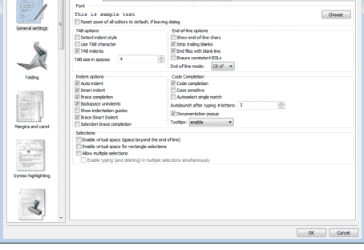

  **图 3-7：** 配置编辑器以使用自动缩进。

- 2. **确保选中 Tab Indents 复选框，然后单击 OK。**

- 3. **当你回到代码中时，按 Backspace 删除新行，然后再次尝试按 Enter。**

  看！代码自动缩进了。

- 4. **在新的空行出现并自动缩进后，输入以下内容：**

    ```cpp
    cout << 5 + 10 << endl;
    ```

  这一行的开头和结尾与你之前输入的那一行完全一样。区别在中间——你输入的不是字符串，而是一个数学题：5 加 10。注意，在 5 周围、+ 周围和 10 周围都放了空格——但不要在 1 和 0 之间放空格。如果你在那里放了空格，计算机就会困惑（它不知道你想写一个两位数）。完成后，你的代码应如下代码片段所示（这里，你输入的新行以粗体显示，第一个 cout 为适应书中版面而换行）：

    ```cpp
    #include <iostream>

    using namespace std;

    int main()
    {
        cout << "Hello, I am your computer talking." <<
            endl;
        cout << 5 + 10 << endl;
        return 0;
    }
    ```

- 5. **通过选择 File➜Save Everything 保存你的工作。**

  

除了选择 File➜Save Everything，你也可以认识到，唯一改变的是你当前正在处理的源代码文件。如果你在代码编辑器中看到闪烁的光标，就知道代码编辑器处于活动状态。如果没有，请在代码中单击某处以激活编辑器。当你看到闪烁的光标时，按 Ctrl+S。这会保存你的文件。


计算机界有一句格言，大致是这样的：“尽早保存，经常保存。”养成时常按 Ctrl+S 的习惯。你不会把硬盘用坏，而且键盘相当耐用。每当你输入几行代码时，按 Ctrl+S。编译之前，按 Ctrl+S。当你偏执地觉得上一次 Ctrl+S 没有生效时，可以按 Ctrl+S。当你堵在红绿灯前时，也可以按 Ctrl+S。

现在你可以让计算机编译你的代码。如果你还没有保存，现在就按 Ctrl+S 保存。然后选择 Build▸Build。如果你输入的一切都正确，你应该会在 Build Log 窗口中看到神奇的消息 0 errors, 0 warnings (0 minutes, 1 seconds)。但如果没有，别担心；你可以轻松修复。查看你的代码，找出我们之前写的那一行与你的代码之间的差异。为了保险起见，这里再给出一次：

```cpp
cout << 5 + 10 << endl;
```

cout 后有一个空格，<< 后有一个空格，5 后有一个空格，+ 后有一个空格，10 后有一个空格，<< 后还有一个空格。末尾有一个分号。确保这些都正确。

然后，当你成功编译并看到令人愉快的消息 0 errors, 0 warnings 时，就可以运行你的应用程序了。选择 Build▸Run。

会打开一个控制台窗口，你应该看到以下内容：

```
Hello I am your computer talking.
15

Process returned 0 (0x0)   execution time : 0.015 s
Press any key to continue.
```

注意，第二行是数学题 10 + 5 的答案。这意味着计算机知道如何做数学运算，或多或少是正确的。

### 运算顺序

如果你愿意，可以尝试一些更复杂的问题。例如，你可以试试像这样：

```cpp
cout << 5 + 10 / 2 * 3 + 25 << endl;
```

你认为答案会是多少？答案取决于计算机执行数学问题的顺序规则。这些规则称为运算顺序。乘法和除法优先于加法和减法。因此，计算机先从左到右执行所有乘法和除法；然后从左到右执行加法和减法。图 3-8 展示了计算机解决这个特定数学问题的顺序。

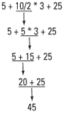

**图 3-8** 计算机喜欢使用运算顺序。

先处理乘法和除法，从左到右。所以它计算 10 / 2 得到 5，然后将其乘以（3 + 25），即 28，得到 140。然后开始从左到右处理加法和减法。所以它再加上 5，得到最终数字 145。

### 过犹不及

计算机实际上有各种限制，包括在数学运算方面。如果你尝试类似这样：

```cpp
cout << 12345678 * 100 / 2 * 3 * 3 << endl;
```

当你尝试编译时，错误窗口中会出现一条警告消息：

```
warning: integer overflow in expression [-Woverflow]
```

这条消息很糟糕。它意味着你不能依赖这个答案；本例中答案是 1,260,587,804，而它本应是 5,555,555,100。你可以使用程序员计算器来了解为什么会出现这个问题。当你输入 12345678 时，得到的值会占用 32 位整数的第 23 位，如图 3-9 所示。

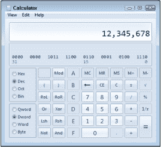

**图 3-9** 处理数字时，程序员计算器会派上用场。

### 输出中的制表符

正如你可以向控制台写入一串字母和数字一样，你也可以写入制表符。例如，将应用程序中的以下行

```cpp
cout << "Hello, I am your computer talking." << endl;
```

改为：

```cpp
cout << "Hello\tI am your computer talking." << endl;
```

在前面的代码中，你用反斜杠加小写字母 t 替换了逗号和空格。但当你编译并运行此应用程序时（记住要*先编译它！*），它打印的内容不会完全与双引号中的内容一致。你会看到：

```
Hello    I am your computer talking.
```

显示行中的额外空格是一个*制表符*空格，就像你在输入时按了 Tab 键一样。（很巧妙，对吧？）

使用*反斜杠*有一个复杂之处：你不能只输入一个*反斜杠*（或就此而言，一个*双引号*）就期望在屏幕上看到它。有几种变通方法可以显示实际字符：

> 真的想显示一个*反斜杠*，而不是特殊字符？使用一个*反斜杠*后面再跟一个*反斜杠*。（是的，这很奇怪。）编译器只把第一个*反斜杠*视为特殊字符。当一个字符串中有两个连续*反斜杠*时，编译器会把第二个*反斜杠*也当作一个*反斜杠*。
>
> 例如，以下代码行中有两个*反斜杠*：
>
>     cout << "\\tabc" << endl;
>
> 控制台中会显示以下文本：
>
>     \tabc


由于你几乎总是按顺序使用“构建”和“运行”，Code::Blocks 的开发者在“构建”菜单中内置了一个特殊的菜单项，名为“构建并运行”。计算机首先编译你的代码，如果没有错误，它会立即运行应用程序。如果有错误，编译器不会运行应用程序，并且会像往常一样报告错误。（你也可以按 F9 执行构建并运行。）

表 3-3 列出了编译的键盘快捷键。

**表 3-3 — 编译和运行的键盘快捷键**

| 操作 | 键盘快捷键 |
| --- | --- |
| 构建 | Ctrl+F9 |
| 运行 | Ctrl+F10 |
| 构建并运行 | F9 |

**表 4-1 — 变量具有三个属性**

| 属性 | 含义 |
| --- | --- |
| 名称 | 你在应用程序中用来引用该变量的名称 |
| 类型 | 变量可以保存的信息类型 |
| 值 | 存储箱实际保存的内容 |

下面的列表更详细地描述了表 4-1 中的各项。

- **名称：** 每个变量都必须有一个名称。在应用程序中，你通过该名称来引用变量。例如，你可能有一个名为 count 的变量，也可能有一个名为 LastName 的变量。或者你可以有一个名为 MisterGate 的变量。
- **类型：** 创建变量时，你必须指定变量可以保存的信息类型。例如，一个变量可以保存整数，另一个变量可以保存单个字符。在应用程序中为变量选择类型后，你只能将属于该类型的内容放入变量。
- **值：** 在任意给定时刻，变量都保存一个单一的值。例如，整数变量可能保存数字 10，字符变量可能保存字符 a。在应用程序中，你可以先在变量中存储一些内容，之后可以再存储其他内容。当你存储其他内容时，变量会忘记之前的内容。因此，从这个意义上说，你可以认为计算机的头脑是“一根筋”的。

清单 4-1 中所示的 SimpleVariable 示例代码演示了如何创建变量。这是一个可以运行的完整应用程序。

**清单 4-1 — 创建一个变量**

```cpp
#include <iostream>

using namespace std;

int main()
{
    int mynumber;
    mynumber = 10;
    cout << mynumber << endl;
    return 0;
}
```

仔细看一下清单 4-1。记住，计算机会从 **main** 一词后面花括号内的代码开始，并逐行执行代码。

main 内部的第一行如下所示：

```cpp
int mynumber;
```

声明变量时，你指定的第一件事是变量可以保存的内容类型。这里，你使用了单词 **int**。这个词在 C++ 中表示 *整数*。因此，你声明的变量可以保存整数。接下来是变量的名称。这个变量被命名为 *mynumber*。然后用一个分号结束变量声明。

注意，在这一行中，你已经涉及了变量的三个属性中的两个：你给了变量一个名称，并告诉计算机你希望变量保存什么类型的内容。顺序看起来有点奇怪——在 C++ 中，你先说类型，然后说名称。这就是 C++ 的做法，背后有充分的理由，你可以稍后在“声明多个变量”一节中了解。

下一行如下所示：

```cpp
mynumber = 10;
```

这一行向变量中放入了某些内容。它将数字 10 放入其中。因为你已经知道变量可以保存整数，所以允许放入 10，因为它是整数。如果你试图将整数以外的内容放入变量，编译器会给出错误。编译器确保你只向变量中放入你所说的类型的内容。编译器很擅长让你循规蹈矩。当然，你也注意到语句以分号结束。在 C++ 中，每条语句都以分号结束。


要向变量中放入内容，你需要输入变量名、等号（两侧可以有空格），以及值。然后用分号结束该行。这行代码是一个 *赋值语句*。或者可以说你正在将变量 *设置为* 该值。下一行如下：

```cpp
cout << mynumber << endl;
```

第 1 册第 3 章描述了这一行的作用。这是一个 cout 语句，意味着它会在控制台上写入一些内容。你可能已经猜到，这段代码告诉计算机将 mynumber 的值写入控制台。它不会写出字符串 mynumber，而是写出变量中实际存储的内容。

## 更改变量的值

尽管一个变量一次只能保存一个内容，但你仍然可以更改变量保存的内容。当你向变量中放入其他内容后，它就会忘记原先的内容。所以当有人指责你健忘时，你可以说：“是的，但你真该看看我整天与之打交道的计算机！”

向变量中放入新内容的方式与最初放入内容的方式相同。仔细看一下清单 4-2 中 ChangeVariable 示例的代码。注意，应用程序的第一部分与清单 4-1 完全相同。但随后你又添加了两行（以粗体显示），它们看起来与前两行几乎一样：第一行将 20 存入同一个变量（与之前相同），下一行将这个新值写入控制台。

**清单 4-2 — 更改变量**

```cpp
#include <iostream>

using namespace std;

int main()
{
    int mynumber;
    mynumber = 10;
    cout << mynumber << endl;

    mynumber = 20;
    cout << mynumber << endl;
    return 0;
}
```

和之前一样，向变量中放入新内容的行遵循相同的格式：有一个等号，变量在左侧，新值在右侧。正如本章前面所述，这条语句是一个赋值语句。


当你单独看到一个等号时，左侧的项是接收右侧信息的变量或项。

## 将一个变量设置为等于另一个变量

由于你只能对变量做两件直接的事情——放入内容和取出值——将一个变量设置为等于另一个变量，就是从另一个变量取出值并放入当前变量的简单过程。这个过程通常被称为将一个变量 *复制* 到另一个变量。例如，如果你有两个整数变量——比如 `start` 和 `finish`——并且你想将 `start` 的值复制到 `finish` 中，你可以使用如下代码行：

```cpp
finish = start;
```


不要被这些措辞弄糊涂。虽然你想将 `start` 的值复制到 `finish`，但注意你首先输入的是 `finish`，然后是等号，再然后是 `start`。等号左侧是接收值的部分；这是一个赋值语句。


当你将一个变量的值复制到另一个变量时，这两个变量必须是相同的类型。例如，你不能将字符串变量的值复制到整数变量中。如果你尝试这样做，编译器会发出错误消息并停止。

计算机运行完这条复制语句后，两个变量保存了相同的内容。清单 4-3 中所示的 `CopyVariable` 代码就是一个将一个变量复制到另一个变量的示例。

**清单 4-3 — 将一个变量的值复制到另一个变量**

```cpp
#include <iostream>

using namespace std;

int main()
{
    int start = 50;
    int finish;
    finish = start;
    cout << finish << endl;
    return 0;
}
```

## 初始化变量

当你创建一个变量时，它一开始就像一个空的存储箱。在它能够发挥很大作用之前，你需要向其中放入一些内容。


如果你在真正向变量中存入任何内容之前就试图检索变量内容，最终会得到计算机人亲切地称为“不可预知结果”的东西。他们真正想说的是，“不要这样做，因为谁知道里面是什么。”这有点像你走进阁楼，发现前房主留下了一个大而瘆人的箱子。你真的想打开看看里面吗？对于变量，你遇到的问题在于，计算机内存中在当前变量所在的特定位置已经存储了某种内容，而这个存储项很可能只是其他操作留下的某个数字。但你无法提前知道它是什么。所以请始终确保在尝试检索变量内容之前，先将一个值放入变量中，这个过程称为初始化变量。

你可以用两种方式初始化变量。第一种方式是先声明变量，然后向其中赋值，这需要两行代码：

```cpp
int mynumber;
mynumber = 153;
```

但另一种方式要快一些。它看起来像这样：

```cpp
int mynumber = 153;
```

这种方法将两种策略组合成一个简洁的小包，你可以随时使用。在本书中，你会看到变量以这两种方式初始化，具体取决于当时哪种方式更清晰或更方便。

## 为自己起一个好名字

每个变量都需要有一个名字。但你可以使用哪些名字呢？虽然你可以自由使用诸如 Fred、Zanzibar 或 Supercount1000M 这样的名字，但 C++ 允许你使用的名称是有限的。

### MyThis 与 MyThat

在你计算机编程生涯（以及你所预期的百万富翁生涯）的进程中，你可能会注意到，出于某种原因，一些计算机程序员似乎偏爱以单词 My 开头的变量名。而另一些程序员则鄙视这种做法并与之彻底划清界限。你可能见过这样的计算机标识符：MyClass、MyNumber、MyHeight、MyName、MyCar、MyWhatASurprise、MyLar、MyStro 和 MyOpic。使用以 My 开头的名称实际上没有任何问题，尤其是在训练练习中。


虽然大多数 C++ 代码使用小写字母，但你可以在变量名中自由使用大写字母。然而，C++ 会区分这两者。因此，如果你有一个名为 `count` 的变量，就不能在应用程序后面用大写 C 的 `Count` 来访问它。编译器会将这两个名字视为两个不同的变量，这使得 C++ 区分大小写。但另一方面，请不要在同一个应用程序中使用两个单独的变量——一个叫 `count`，另一个叫 `Count`。尽管编译器不在意，但之后可能需要阅读或维护你代码的普通人可能会感到困惑。

以下是创建变量名时需要遵循的规则：

- **字符：** 你可以在变量名中使用任何大写字母、小写字母、数字或下划线。其他符号（如空格或键盘上数字键上方的符号）不允许出现在变量名中。唯一的限制是：
  - 第一个字符不能是数字。
  - 变量名不能全部由数字组成。
- **长度：** 如今大多数编译器允许你使用任意长度的变量名。为了确认这一点并证明我很容易被逗乐，我成功地在 Code::Blocks 中创建了一个长度超过 1,000 个字符的变量。但是，我可不想反复输入那个名称。相反，我建议变量名既要足够长以表达意义，又要足够短以便于轻松输入。大多数人偏好五到十个左右的字符。

可接受的变量名示例有 `Count`、`current_name`、`address_1000` 和 `LookupAmount`。有些变量名虽然合法，但不易理解，例如 `__`、`___` 和 `_12`——它们都不能告诉你变量包含什么。表 4-2 列出了一些不允许使用的变量名。

### 无效变量名示例

| 无效变量名 | 不允许的原因 |
|---|---|
| 12345 | 它只包含数字（并且以数字开头，这也是错误的）。 |
| A&B | 唯一允许的特殊字符是下划线 `_`。与号（`&`）是不允许的。 |
| 1abc | 变量名不能以数字开头。 |


## 操作整型变量

据说，制作精美花瓶的陶艺家会揉捏陶土。同样，你也可以操作变量来创造一种抽象美。但在这种情况下，操作仅仅意味着你可以进行算术运算。你可以轻松进行通常的加法、减法、乘法和除法。第 I 册第 3 章介绍了用于算术运算的符号。它们是：

- `+` 用于加法
- `-` 用于减法
- `*` 用于乘法
- `/` 用于除法

不过，你还可以对整数执行另一种运算，它与余数和除法有关。其思想是，例如，如果用 3 除 16，整数结果为商 5 余 1。另一种说法是，16 不能被 3 整除，但 3 可“进入”16 五次，余数为 1。这个余数有时被称为模数。计算机人实际上有一个重要理由称它为模数而不是余数，那就是计算机领域的人喜欢使用令人困惑的术语。


在处理整型变量时，请记住你可以对变量做的两件基本事情：你可以将内容放入变量中，也可以从变量中取回内容。因此，处理整型变量时思路是：取出内容，进行一些算术运算，然后打印答案，或者将其存回同一个变量或另一个变量中。

### 整型变量相加

如果你想将两个整型变量相加，请使用 + 符号。你可以打印结果，也可以将其放回变量中。

AddInteger 示例将两个变量（start 和 time）相加，然后将结果打印到控制台。加法运算以粗体显示。

```cpp
#include <iostream>

using namespace std;

int main()
{
    int start;
    int time;

    start = 37;
    time = 22;

    cout << start + time << endl;
    return 0;
}
```


这段代码从两个名为 start 和 time 的整型变量开始。然后将 start 设为 37，time 设为 22。最后，将两个变量相加（得到 59）并打印结果。当你看到 start + time 时，+ 是告诉要执行何种操作的运算符，而 start 和 time 是该运算符作用的操作数。

然而，在这个示例中，计算机对最终总和 59 除了打印之外实际上没有做任何事。如果你以后想使用这个值，可以将其保存在单独的变量中。AddInteger2 示例演示了如何将结果保存到变量中；存储操作以粗体显示：

```cpp
#include <iostream>

using namespace std;

int main()
{
    int start;
    int time;
    int total;
    start = 37;
    time = 22;
    total = start + time;
    cout << total << endl;
    return 0;
}
```

在这段代码中，你声明了整型变量 total 以及其他变量。然后，在 start 中存储 37、在 time 中存储 22 之后，你将两者相加，并将结果保存在名为 total 的变量中。最后打印存储在 total 中的值。

你还可以将数字本身加到变量上。下面一行将 5 加到 start 并打印结果：

```cpp
cout << start + 5 << endl;
```

```
12
17
```

请注意发生了什么。首先，你将值 12 放入 `total` 并打印到控制台。然后将 5 加到 `total`，将结果存回 `total`，并将新的 `total` 值打印到控制台。

现在，我们计算机人很懒，这已不是什么秘密。毕竟，如果我们不懒，为什么还要拥有计算机呢？因此，C++ 语言伟大的创造者们给我们提供了一种快捷方式，用于将值加到变量上并存回该变量。这一行

```
total = total + 5;
```

等同于

```
total += 5;
```

我们计算机人对 += 还有一种特殊的读法。我们说“加等于”。所以对于这一行，我们会说：“Total 加等于 5。”


将 `total += 5` 表示法简单视为 `total = total + 5;` 的快捷方式。

你也可以将 += 表示法用于其他变量。例如，如果你想将 `time` 的值加到 `total` 的值中，并将结果存回 `total`，你可以这样做

```
total = total + time;
```

或者可以使用这个快捷方式：

```
total += time;
```

如果你只是给变量加 1，这被称为*递增变量*，你可以使用更短的快捷方式。它看起来像这样：

```
total++;
```

这与 `total = total + 1;` 或 `total += 1;` 相同。

表 4-3 总结了你可以进行的涉及变量加法的不同操作。请注意，当你看到 ++（即*递增运算符*）时，它读作 *加加*，而不是 *双加*。


## 清单 4-4：两个变量的减法

```cpp
#include <iostream>

using namespace std;

int main()
{
    int final;
    int time;

    final = 28;
    time = 18;

    cout << final - time << endl;
    return 0;
}
```

当这个应用程序运行时，控制台显示数字10，也就是28 − 18。请记住，与加法一样，`final`和`time`的值实际上都没有改变。计算机只是计算出差值并在控制台上打印答案，而不会修改任何一个变量。

你还可以让一个变量减去一个数字，而且（如前所述）你仍然没有改变该变量的值，如下例所示：

```cpp
cout << final - 5 << endl;
```

你可以用一个变量减去另一个变量，并将结果保存到第三个变量中：

```cpp
start = final - time;
```

你也可以通过减法来改变变量中的值，如下面四行示例代码所示。第一行先将`time`从`final`中减去，并将结果保存回`final`：

```cpp
final = final - time;
```

或者你可以使用简写形式来做同样的事情：

```cpp
final -= time;
```

或者你可以用一个数字来做同样的事情：

`final = final - 12;`

而且（如前所述）你也可以用简写形式来做同样的事情：

`final -= 12;`

最后，与加法一样，你还有一个简写中的简写。如果你只想减去1，你可以直接使用两个减号，如下所示：

`final--;`

这一行读作*减减*。`--`就是*递减运算符*，当它作用于一个变量时，被称为*递减变量*。

### 整数变量的乘法

在C++中进行乘法运算，你需要使用星号（*）符号。与加法和减法一样，你可以将两个变量相乘，也可以将一个变量与一个数字相乘。你可以打印结果，也可以将其保存到一个变量中。例如，你可以用下面这一行将两个变量相乘并将结果打印到控制台：

`cout << length * width << endl;`

或者你可以将一个变量与一个数字相乘，如下面的行：

`cout << length * 5 << endl;`

与加法和减法一样，你也可以将两个变量相乘并将结果保存到第三个变量中：

`area = length * width;`

此外，你可以使用乘法来修改变量的值，例如：

`total = total * multiplier;`

或者，使用简写形式：

`total *= multiplier;`

### 前缀与后缀

`++`和`--`运算符可以以*前缀*（在变量名前）或*后缀*（在变量名后）运算符的形式出现。然而，它们的行为会根据出现位置的不同而有所区别。前缀运算符在任何其他操作发生之前应用，而后缀运算符则在之后应用。考虑以下代码：

```cpp
int final = 10;
cout << final++ << endl;
cout << final << endl;
```

这段代码的输出是

```text
10
11
```

因为后缀`++`运算符是在`cout`执行之后才加上去的。然而，对于下面的代码：

```cpp
int final = 10;
cout << ++final << endl;
cout << final << endl;
```

这种情况下输出是

```text
11
11
```

因为前缀`++`运算符是在`cout`执行之前加上去的。`--`运算符也是如此。使用前缀运算符的代码，比如：

```cpp
int final = 10;
cout << --final << endl;
cout << final << endl;
```

产生的输出是

```text
9
9
```

因为该运算符是在`cout`执行之前应用的。合理使用前缀或后缀运算符可以减少你编写的代码量，并可能使你的代码更易于阅读。

而且（如前所述）你也可以只用一个数字来做同样的事情：

```cpp
total = total * 25;
```

或者这样：

```cpp
total *= 25;
```


注意，没有`**`运算符用于将一个值乘以1或乘以自身。因此，如果你输入`total**;`，编译器会报错。

### 整数变量的除法

虽然整数变量的加法、减法和乘法都很直接，但除法就有点棘手了。主要原因是，对于整数，有时你根本无法整除。这就像试图把21片玉米片平均分给五个人一样。你就是做不到。要么有人会觉得不公平，要么每个人分到四片，还剩一片让大家争抢。当然，你可以把每片玉米片都掰成五份，然后每个人得到每片玉米片的⅕，但那样你就不再是在处理整数了——只是一堆碎屑而已。

如果你用计算器输入21除以5，你会得到4.2，这不是一个整数。如果你想坚持用整数，你就必须使用余数的概念。在21除以5的情况下，余数是1，就像你在玉米片的例子中得出的那样。原因在于21中5的最高倍数是20（因为5乘以4等于20），而1是剩下的。那个孤独的1就是余数。

所以，从严格的整数意义上讲，21除以5的答案是*4余1*。而计算机也正是这样对整数进行算术运算的：它会得到两个不同的答案：*商*和*余数*。在数学术语中，主要的答案（在这个例子中是*4*）就是*商*。剩下的是*余数*。

由于一个除法问题可能出现两个不同的答案，C++使用两个不同的运算符来求得这两个不同的答案。

要求商，使用斜杠（/）。你可以把这个字符看作通常的除法运算符，因为当你处理能够整除的数字时，这个运算符会给出正确的答案。因此，10 / 2的答案是5，正如你所期望的那样。此外，大多数人干脆就称它为除法运算符。

要求余数，使用百分号（%）。它通常被称为*取模运算符*。

你可以像使用除法（/）一样使用取模（%）运算符来访问所有常用的功能。例如，你可以将商存储到另一个变量中，余数也可以这样：

```cpp
myQuotient = first / second;
myRemainder = first % second;
```

而且你还有简写形式可用：

```cpp
int first = 30;
first /= 5;
cout << first << endl;
```

在这种情况下，`first`的值变为6，因为30 / 5等于6。而在下面的情况下，`first`的值变为3，因为33除以5的余数是3：

```cpp
int first = 33;
first %= 5;
cout << first << endl;
```

### 字符

你可以拥有的另一种变量类型是字符变量。一个*字符变量*可以保存一个——仅仅一个——C++以数字形式存储的字符。它可以保存介于−127到128之间（`char`或`signed char`）或0到255之间（`unsigned char`）的值。通常，字符指的是任何可以键入的内容，例如字母表中的字母、数字或你在计算机键盘上看到的其他符号，但字符也可以保存ASCII表中可找到的不可打印值（参见 https://en.cppreference.com/w/cpp/language/ascii）。其中一些不可打印字符被称为*控制字符*（之所以这样称呼，是因为它们控制屏幕上文本的外观），例如制表符、回车符和换行符。

要使用字符变量，你需要使用类型名`char`。要初始化一个字符变量，你需要将字符放在单引号内。（如果使用双引号，编译器会给出错误信息，因为双引号创建的是字符串，它可以包含多个字符而不是单个字符。）下面是一个字符的示例：

```cpp
char ch;
ch = 'a';
```

这里，你打印`abc`，然后换行，再打印`def`。注意，`def`会继续留在如果它是在第一行时本应占据的位置。然而，对于本书使用的编译器，打印`abc`，然后换行，最后打印`def`会产生如下输出：

```text
abc
def
```

但为了适应某些其他编译器有时将换行符仅仅视为换行（开始新的一行但不会移动到其他位置）这一事实，计算机制造商还为你提供了另一个特殊字符：回车符。（你能听到人群在喊“哦——！”吗？）

*回车符*（`\r`）会将插入点放到行的开头，但不会到新的一行（这意味着如果你在一台期望同时有回车符和换行符的计算机上只使用回车符，你会覆盖该行上已有的内容）。对于几乎所有的C++编译器来说都是如此。

《第1册，第3章》中的“输出制表”一节描述了制表符（`\t`）和其他以反斜杠开头的字符。这些都是单个字符，你可以将它们放入字符变量中，如下例所示，它会打印字母*a*，然后是一个制表符，再然后是字母*b*。注意，要让制表符进入字符变量，你必须先使用`\`，然后再加上`t`：

```cpp
char ch = '\t';
cout << "a" << ch << "b" << endl;
```

《第1册，第3章》提到，要在字符串中放入双引号，你需要在双引号前面加上反斜杠，这样计算机才不会认为双引号是字符串的结尾。但因为字符是由单引号包围的，所以你不需要这样做。你可以直接把双引号放在字符中，如下所示：

```cpp
char ch = '"';
```

当然，这引出了一个重要的问题：单引号怎么办？这次，你确实需要使用反斜杠：

```cpp
char ch = '\'';
```


最后，要在字符中放入反斜杠，需要使用两个反斜杠：

```cpp
char ch = '\\';
```


当编译器在字符串或字符中看到反斜杠时，会把反斜杠当作特殊字符，并查看它后面的内容。如果你写的是类似 `'\'` 这样的内容，单引号内反斜杠后面没有其他字符，编译器会认为最后的引号要与反斜杠结合。然后它继续向前，期望后面出现一个单引号来表示结束。由于没有出现单引号，编译器就糊涂了并报错。编译器很容易犯糊涂——这多少会让你更敬佩人脑。

## 回车、换行，还是两者都要？

取决于你使用的平台（如 Windows、Linux 或 Mac）以及使用的应用程序，回车、换行或两者组合的效果会有所不同。有些情况下，这真的足以把你逼疯。在所有情况下似乎都最有效的形式是回车加换行的组合（`\r\n`）。有时你也可以使用换行加回车的组合（`\n\r`），但奇怪的是，它并不总是产生与 `\r\n` 相同的结果。下面按平台快速举例：

- **Windows：** `\r\n`
- **Linux：** `\n`
- **较旧的 Mac：** `\r`
- **Acorn BBC 和 RISC：** `\n\r`

这个列表甚至还没有涉及大型机和其他计算机，它们可能使用非常奇怪的组合，比如 `\025`。有时单个字符根本不产生任何结果。例如，使用 Windows 记事本时，必须提供 `\r\n` 组合，因为单独使用 `\n` 不会起任何作用。然而，使用某些 C++ 库导入文件时，你只想要 `\n`，因为该库会把 `\r` 看成第二行。这就是许多开发者只使用 `\n` 的原因，而如前所述，`\n` 在某些编辑器中不会显示出来。

因此，对于该使用哪个字符这个问题并没有现成的答案，你需要进行试验，以确保在你所处理的情境中，使用 `\r`、`\n`、`\r\n` 或 `\n\r` 确实能按你想要的方式工作。拿不准时，就依赖 `\r\n`，直到你确定这种组合行不通为止。

## 那是什么符号？

计算机人士从不放过发明新词的机会，他们为字符想出的名称可能并不总是与你熟知的名称一致。在上网时，你已经听过用 *dot* 这个词来表示句点。而对于一些本来就有多个名称的字符，计算机人士可能使用其中一个名称而不用另一个。有时，为了把你弄糊涂，他们又会使用某个东西的常用名称。下面是计算机人士喜欢使用的一些符号名称：

| 符号 | 名称 |
|---|---|
| `.` | 点（*但不是* 句点或小数点） |
| `@` | At（艾特） |
| `&` | 和号（*但不是*“和”） |
| `#` | 磅号（*但不是* 数字符号） |
| `!` | Bang（*尽管大多数人仍说* 感叹号） |
| `~` | 波浪号 |
| `%` | 百分号 |
| `*` | 星号（*不是* 星形符号） |
| `(` | 左圆括号或左括号 |
| `)` | 右圆括号或右括号 |
| `[` | 左方括号或左括号 |
| `]` | 右方括号或右括号 |
| `==` | 等号等号（*不是* 双等号） |
| `++` | 加号加号（*不是* 双加号） |
| `--` | 减号减号（*不是* 双减号） |
| `/` | 正斜杠 |
| `\` | 反斜杠 |
| `{` | 左花括号或左大括号或开括号 |
| `}` | 右花括号或右大括号或闭括号 |
| `^` | 脱字符（尽管有少数人说 hat，真的——这里不是开玩笑！） |
| `"` | 双引号 |

如果你想拿这些符号找点乐子，可以看看 https://spot.colorado.edu/~sniderc/poetry/wakawaka.html 上的那首诗。尤其是在你无聊到极点、真的需要一些喜剧调剂的日子里，它会特别有用。

## 字符串

如果有哪个计算机单词在编程中变得如此常见，以至于大多数计算机人士都忘了它是个计算机单词，那就是 *字符串*。第 1 册第 3 章介绍了字符串，描述了它们是什么，并给出了示例。简而言之，*字符串* 就是一组串在一起的字符。编译器根据双引号的位置知道代码中字符串的开始和结束。

你可以创建一个能保存字符串的变量。使用的类型是 `string`。清单 4-6 所示的 CreateString 示例演示了如何使用字符串变量。

### 清单 4-6：使用方括号访问字符串中的单个字符

```cpp
#include <iostream>

using namespace std;

int main()
{
    string mystring;
    mystring = "Hello there";
    cout << mystring << endl;
    return 0;
}
```

运行此应用程序时，字符串 `Hello there` 会出现在控制台上。`main()` 内的第一行创建了一个名为 `mystring` 的字符串变量。第二行将其初始化为 "Hello there"。第三行将字符串打印到控制台。

## 分隔符限定词元

阅读英文句子时，你可以通过空格和标点看出一个单词从哪里开始、到哪里结束。计算机应用程序中也是如此。单词通常由空格分隔，但其他字符也可以表示单词的开始和结束。在字符串中，这个字符就是双引号（"）。这类单词分隔符称为 *分隔符*（发音为“dee-LIM-it-ers”）。为了确保你继续困惑，计算机人士使用 *词元* 一词来表示应用程序中由分隔符分隔开的各个单词。不过，本书后面不会再提到词元，因为使用 *单词* 这个说法更不容易让人困惑。

## 获取字符串的一部分

访问字符串中的单个字符很容易。看看清单 4-7 所示的 `IndividualCharacter` 示例。

### 清单 4-7：使用 string 类型创建字符串变量

```cpp
#include <iostream>

using namespace std;

int main()
{
    string mystring;
    mystring = "abcdef";
    cout << mystring[2] << endl;
    return 0;
}
```

注意，第九行即 `cout` 那一行中，单词 `mystring` 后面跟着方括号（`[]`）里的 2。运行此应用程序时，你会看到：

```text
c
```

就是这样，只有一个字母 c，孤零零地待在那里。方括号里的 2 表示你想取字符串的*第二个*字符，而且只取那个字符。但是等等！c 是第二个字符吗？你的眼睛可能骗了你，但看起来它是第三个字符。这是怎么回事？

## 那些奇怪的 # 行

现在来看看那些以 # 符号开头的奇怪行。在第 1 册第 7 章中，你会了解如何将代码分成多个部分，每个部分放在自己的源文件中。这是创建大型软件应用程序的强大方法，因为不同的人可以同时处理不同的部分。但要做到这一点，每个文件必须以某种方式知道其他文件能做什么。而告诉文件有关其他文件信息的方式，就是在文件顶部附近放一行类似这样的内容：

```cpp
#include <string>
```

这一行意味着你的应用程序正在使用某处的另一个文件，而那个文件的名称为 string。那个文件里有一堆 C++ 代码，本质上让你的应用程序能够理解字符串。要在 Code::Blocks 中查看这个文件，请右键单击文件名，然后从上下文菜单中选择 `Open #include File: <filename>`。下面这一行

```cpp
#include <iostream>
```

让你的应用程序能够写入控制台，以及做其他事情。

随着你深入学习 C++，你会发现更多可以包含在应用程序顶部的行，每一行都以 #include 开头，每一行都会为你的应用程序增加更多特性和能力。本书中会用到许多 #include 文件。（怎么样，这算不算一个吊胃口的预告？）

## 向字符串追加内容

任何优秀的作家都能不断往页面上添加越来越多的字母。`string` 类型也是如此：你可以轻松地向它添加内容。下面的代码行使用了 `+=` 运算符，这个运算符也曾用于数字相加。你认为这段代码会做什么？

```cpp
string mystring;
mystring = "Hi ";
mystring += "there";
cout << mystring << endl;
```

第一行声明了字符串 `mystring`。第二行将其初始化为 "Hi "。但第三行做什么呢？第三行使用 `+=` 运算符，把某个内容追加到字符串后面——在这个例子中是 "there"。因此，这一行运行后，名为 `mystring` 的字符串包含 "Hi there"，而当 `cout` 行运行时，控制台上显示的就是这个内容。程序员用来表示向字符串添加内容的时髦术语是拼接。


你也可以对字符做类似的操作。下面的代码片段向字符串中添加单个字符：

```cpp
string mystring;
mystring = "abcdef";
mystring += 'g';
cout << mystring << endl;
```

这段代码创建一个内容为 "abcdef" 的字符串，然后在末尾添加字符 'g'，得到 "abcdefg"。接着，它将完整的 "abcdefg" 输出到控制台。

## 连接两个字符串

你可以像处理整数那样，使用加号将两个字符串相加。最终结果就是把这两个字符串并排放置后拼接成的字符串。例如，下面的代码将 first 与 second 相加，得到一个名为 third 的字符串：

```cpp
string first = "hello ";
string second = "there";
string third = first + second;
cout << third << endl;
```

这段代码打印 third 的值，也就是把两个字符串拼接起来的结果——换句话说，就是 "hello there"。（注意，名为 first 的字符串末尾有一个空格，它在引号内，因此是字符串的一部分。）你也可以将一个字符串常量（即应用程序中由引号包围的实际字符串）加到一个已有的字符串变量上，如下所示：

```cpp
string first = "hello ";
string third = first + "there";
cout << third << endl;
```


你可能想尝试像下面这样把两个字符串常量相加：

```cpp
string bigstring = "hello " + "there";
cout << bigstring << endl;
```

不幸的是，这样行不通。原因是（在编译器内心深处）它就是认为字符串常量和字符串有本质区别。但你真的没有充分理由这样做，因为用下面的代码也能完成同样的事：

```cpp
string bigstring = "hello there";
cout << bigstring << endl;
```


字符串还能做更多事情。但首先，你需要理解所谓的函数。如果你对函数感到好奇，请阅读第 1 册第 6 章，那里涵盖了所有具体细节。

## 使用条件运算符进行决策

计算机最重要的功能之一，除了让你上网冲浪，以及让电话推销员在你吃饭时自动拨打你的电话之外，就是进行比较的能力。虽然这个话题看起来没什么大不了，但计算机技术直到工程师们意识到：如果计算机能够测试某种情况，并根据情况执行一项任务或另一项任务，就会变得强大得多，这时它才开始腾飞。

你可以用许多方式编写能进行决策的 C++ 应用程序；关于这个主题的讨论见第 1 册第 5 章。但一种非常方便的方式是使用*条件运算符*。

想一想这个过程：如果两个整数变量相等，就把一个字符串变量设置为字符串 "equal"。否则，将它设置为字符串 "not equal"。换句话说，假设你有两个整数变量，分别叫 first 和 second。first 的值是 10，second 的值是 20。你还有一个名为 result 的字符串变量。现在，按照刚才描述的小过程来做：这两个变量相等吗？不，它们不相等，所以你把 result 设置为字符串 "not equal"。

现在用 C++ 来做这件事。仔细看下面的代码。首先，声明变量 first、second 和 result：

```cpp
int first = 10;
int second = 20;
string result;
```

到目前为止一切顺利。注意，你还没有初始化字符串变量 result。但现在你要写一行代码来执行刚才描述的过程。首先，浏览下面的示例，看看能否弄明白它在做什么。仔细查看这些变量，并根据前面描述的过程，思考它们可能会做什么。然后，正文会解释这段代码的作用。

```cpp
result = (first == second) ? "equal" : "not equal";
```

上一行可能是你在这本书中会看到的看起来最奇怪的 C++ 代码行之一。首先，你要弄清楚它的含义。然后把它拆成几部分，理解它为什么是这个意思。

用英语来说，这表示：如果 first 等于 second，result 就得到 "equal"；否则，它得到 "not equal"。

现在把它拆成两部分。单个等号表示左侧的 result 接收右侧的内容。所以你需要弄清楚右侧那串奇怪的内容：

```cpp
(first == second) ? "equal" : "not equal"
```

当你看到这个奇怪的组合时，可以把问号看作分隔符。问号左侧的内容通常放在括号中，如下所示：

```cpp
(first == second)
```

这一行实际上比较 first 和 second，并判断它们是否相等。是的，代码中出现了两个等号。在 C++ 中，这就是测试两个东西是否相等的方式。现在移到问号右侧的部分：

```cpp
"equal" : "not equal"
```

这部分本身又是由冒号分隔的两部分，因此，如果 first 确实等于 second，result 就得到字符串 "equal"。否则，它得到字符串 "not equal"。再完整看一遍：

```cpp
result = (first == second) ? "equal" : "not equal";
```

再一次思考它的含义：如果 first 等于 second，result 得到 "equal"；否则，它得到 "not equal"。

记住，单个等号左侧的存储容器接收右侧的内容。右侧是一个表达式，其结果为字符串 "equal" 或 "not equal"。完整的 EqualityCheck 示例见清单 4-8。

## 布尔变量与条件运算符

你可以将布尔变量与条件运算符一起使用。在如下条件运算符中

```cpp
result = (first == second) ? "equal" : "not equal";
```

`(first == second)` 这一项实际上会计算出一个布尔值——要么是 true，要么是 false。因此，你可以把这段代码拆成几行。尽管把某个东西拆成几行看起来有点倒退，但开发者一直这么做。把代码拆成多行的原因是，有时在编程时，你可能会遇到一个极其复杂的表达式——比 `first == second` 复杂得多。随着你的 C++ 编程能力不断提高，你会开始构建更复杂的表达式，然后开始意识到它们会变得多么复杂。通常，把表达式拆成多个更小的部分会更易于管理。要把这个示例拆成多行，可以这样做（如 `EqualityCheck2` 示例所示）：

```cpp
string result;
bool isequal;
isequal = (first == second);
result = isequal ? "equal" : "not equal";
```

第二行声明了一个名为 `isequal` 的布尔变量。第三行将它设置为 `first == second` 的值。换句话说，如果 `first` 等于 `second`，那么 `isequal` 得到值 true。否则，`isequal` 得到值 false。在第四行中，如果 `isequal` 为 true，`result` 就得到值 `"equal"`；如果 `isequal` 为 false，`result` 就得到值 `"not equal"`。

这段代码之所以有效，是因为问号左侧的项是一个*布尔表达式*，这只是用一种更花哨的方式说明：这里的代码需要一个布尔值。因此，如果你愿意，也可以放入一个布尔变量，因为*布尔变量*保存的是*布尔值*。

当你使用如下代码打印布尔变量的值时：

```cpp
cout << finished << endl;
```

你会看到 `1` 表示 true，或 `0` 表示 false。原因是，在计算机内部深处，它存储 `1` 来表示 true，存储 `0` 来表示 false。

## 从控制台读取

在本章和上一章中，你会看到许多如何将信息写入控制台的示例。但只写入信息有点像进行一场只有一个人说话、没有人在听的对话。能从应用程序的用户那里获得一些反馈会很好。幸运的是，在 C++ 中获取反馈很容易。写入控制台涉及以下面这种形式使用 `cout`：

```cpp
cout << "hi there" << endl;
```

从控制台读取（也就是说，从应用程序的用户那里获得响应）使用 `cin` 对象。（它读作“see-in”。）接下来，你不再使用看起来古怪的 `<<` 运算符，而是使用同样古怪但方向相反的 `>>` 运算符。


`<<` 运算符通常被称为*插入运算符*，因为你是在向流中写入（或*插入*）。*流*不过是一串字符流向某个地方。对于 `cout` 来说，这些字符流向控制台。另一方面，`>>` 运算符通常被称为*提取运算符*。这里的思路是，你正在从流中提取内容。对于 `cin` 来说，你正在从用户通过控制台发送到你的应用程序的流中提取字符。

清单 4-9 中的 ReadString 示例演示了如何从控制台读取字符串。

### 清单 4-9：使用条件运算符进行比较

```cpp
#include <iostream>

using namespace std;

int main()
{
    string name;
    cout << "Type your name: ";
    cin >> name;
    cout << "Your name is " << name << endl;
    return 0;
}
```


当你运行这段代码时，控制台会提示你输入姓名，然后程序停止。这是因为程序正在等待你的输入。注意，插入点会紧跟在“Type your name: ”这一文本后面。这是因为第一个 `cout` 语句没有像往常一样包含 `endl`。将插入点（或光标）停留在提问所在的行是很常见的做法，这样可以避免让用户感到困惑。输入一个不含空格的姓名，例如 `Fred`，然后按回车键。控制台随后会显示如下内容：

```text
Type your name: Fred
Your name is Fred
```

第一行包含你输入的姓名，第二行则显示按回车键之后出现的内容。注意观察发生了什么：当你输入一个单词并按回车键时，计算机会将这个单词放入 `name` 变量中，该变量是一个字符串。然后你可以通过 `cout` 将 `name` 打印到控制台。

你也可以读取整数，如下面的代码所示（来自 ReadInt 示例）：

```cpp
#include <iostream>

using namespace std;

int main()
{
    int x;
    cout << "Type your favorite number: ";
    cin >> x;
    cout << "Your favorite number is " << x << endl;
    return 0;
}
```

这段示例代码将一个整数读入变量 `x`，然后将其打印到控制台。


默认情况下，`cin` 会按空格从控制台读取字符。如果你在输入中带有空格，只会读取第一个单词。当下次应用遇到 `cin >>` 时，`cin` 会读取第二个单词。

平衡存款金额。如果用户选择取款，你的应用则会从账户余额中减去取款金额。

在 C++ 中，决策通常采用 `if` 语句的形式，这是一种以 `if` 关键字开头的代码，后跟一个条件。条件通常是数值条件，其中会比较两个数字，然后出现两个代码块：一个在条件满足时执行，另一个在条件不满足时执行。

## 在 C++ 中评估条件

计算机所做的大多数决策都基于条件的评估，这些条件通过比较两个数字或两个字符来确定。对于数值比较，你可以将变量与数字进行比较，如下面的语句所示：

```
x > 10
```

该比较用于评估变量 `x` 中保存的值是否大于数字 10。如果 `x` 确实大于 10，计算机认为此条件为真。如果 `x` 不大于 10，计算机则认为该条件不为真（即为假）。

开发者通常用“满足”来描述条件。对于条件 `x > 10`，如果 `x` 大于 10，开发者会说条件满足。这有点像“如果我们的 IRS 退税是五位数，我们就满意了。”对于这个例子，如果条件是 `x > 9999`，而你收到了 10,000 美元的退税，那么条件就满足了。

对于字符比较，你可以比较两个字符是否相等，如下面的语句所示：

```
mychar == 'A'
```

该比较评估 `mychar` 是否包含字母 A。注意这里用了两个等号，而不是一个。如果只用一个等号，那是把值 A 赋给 `mychar`。

要测试字符是否不等于某值，你可以使用有点难以理解的 `!=` 运算符。可以把 `!` 理解为“非”，例如：

```
mychar != 'X'
```

## 找到正确的 C++ 运算符

前面每一节中的语句都使用*运算符*来指定数字或字符串之间的比较方式。表 5-1 展示了 C++ 中可用的运算符类型以及它们在你的应用中帮助执行的比较。

**表 5-1 —— 评估数值条件**

| 运算符 | 含义 |
|---|---|
| `<` | 小于 |
| `<=` | 小于或等于 |
| `>` | 大于 |
| `>=` | 大于或等于 |
| `==` | 等于 |
| `!=` | 不等于 |

这个表中的一些运算符——以及你如何使用它们——可能会让人有点烦，甚至相当令人害怕。下面列出了一些例子：

- 测试相等的运算符是*两个*等号，如下所示：

  `x == 10`

  当计算机遇到这条语句时，它会检查 `x` 是否等于 10。

  如果你在语句中只放一个等号，大多数 C++ 编译器不会给你报错——尽管像 `x = 10` 这样的语句实际上并不是一个条件！相反，`x = 10` 是一个*赋值*，将变量 `x` 设置为 10。当代码包含这种语句时，无论 `x` 原先的值是什么，评估的结果总是相同的。

- 测试不相等的运算符是一个感叹号后跟一个等号。对于条件 `x != 10`，只有当 `x` 不等于 10（即 `x` 等于除 10 以外的某个值）时，该条件才评估为真。

- 当测试大于或小于条件时，如果 `x` 的值等于 10，则条件 `x > 10` 不为真。条件 `x > 10` 只有在 `x` 实际上大于但不等于 10 时才为真。如果还要测试 `x` 是否等于 10，你有两种选择：
  - 如果你处理的是整数，可以测试 `x > 9`。在这种情况下，如果 `x` 等于 10、11、12 等，条件就为真。
  - 你可以使用大于或等于运算符来判断相等性：`x >= 10`。如果 `x` 等于 10、11 等，这个条件也为真。


要测试所有大于或等于 10 的整数，条件 `x > 9` 只在你处理整数时有效。如果你处理的是浮点数（关于可以在 C++ 中处理的数字类型，请参阅本书第 1 册第 4 章），语句 `x > 9` 就不会按你想要的方式工作。数字 9.1 大于 9，但并大于或等于 10。所以如果你需要“大于或等于”且处理的不是整数，请使用 `>=` 运算符。


### 关于新的太空船运算符

C++20 带来一个新运算符，最终会让你的生活更轻松。它被称为太空船运算符，看起来像这样：`<=>`。太空船运算符执行*三路比较*，这意味着它可以一次性告诉你 `a < b`、`a == b` 还是 `a > b`。在这种情况下，你可能会想跳过这个边栏，等读完本书后面的内容（例如第 5 册第 2 章）后再回来阅读，但本章是包含太空船运算符信息最合适的地方。

太空船运算符作为 `std::strong_ordering` 类的一部分出现，因此在很多情况下你会看到它以这种方式被引用。这个运算符不会输出 true 或 false，而是在 `a < b` 时输出 −1（`std::strong_ordering::less`），在 `a == b` 时输出 0（`std::strong_ordering::equal`），在 `a > b` 时输出 1（`std::strong_ordering::greater`）。使用这种不同的输出形式意味着你需要以不同于平常的方式编写条件语句。

如果你在不支持太空船运算符的 C++ 版本中尝试使用它，你会收到错误消息，因为编译器无法理解 `<=>` 的含义。截至撰写本文时，Code::Blocks 尚未实现太空船运算符，因此你需要到其他地方测试太空船运算符。为数不多的在线

*（续）*

```
(i < 10 || i > 100)
```

这个条件对于某些范围检查很有用，你可以用它在范围中排除中间部分，只检查极端值。在这种情况下，`i` 的值为 50（范围的中间值）时评估为 false。如果使用或运算符（`||`），很容易不小心得到一个始终为真的条件。例如，条件 `(x < 100 || x > 0)` 总是为真。当 `x` 为 −50 时，它小于 100，所以条件为真。当 `x` 为 500 时，它大于 0，所以也为真。


除了或条件，你还可以有类似这样的说法：“如果我得到一百万美元，而且我觉得自己真的很胆大，我就会买一辆兰博基尼。”注意这里使用了“而且”这个词。在这种情况下，只有当两种情况都为真时你才会去做。（请记住，使用或时，只要任何一种情况为真你就会去做。）在 C++ 中，与运算符是两个与符号：`&&`。这比或运算符更容易理解，因为 `&` 符号常常与“与”（and）这个词相关联。C++ 中的与比较如下所示：

```
(i > 10 && i < 100)
```

这个示例检查一个数字是否大于 10 且小于 100。这意味着该数字在 11 到 99 的范围内。

使用 `&&` 和 `||` 运算符组合条件是*逻辑运算符*的一种用法。


要确定一个数字是否在某个范围内，你可以使用*与*运算符（`&&`），正如你在本章前面所见。


使用与运算符时，很容易不小心创建一个永远不为真的条件。例如，条件 `(x < 10 && x > 100)` 永远不会为真。没有任何一个数字能同时小于 10 又大于 100。

## 在 C++ 条件语句中包含评估

计算机和人类一样，会评估条件，并将评估结果作为做出决策的输入。对人类而言，决策通常涉及不同的行动计划，对计算机来说也是如此。计算机需要知道当条件为真时该做什么，以及当条件不为真时该做什么。要根据你的应用所评估的条件来决定行动计划，需要使用 `if` 语句，如下所示：


if (i > 10)
{
    cout << "It's greater than 10." << endl;
}
else
{
    cout << "It's not greater than 10." << endl;
}

return 0;
```

在这段代码中，你会测试一个数字是否大于 10。如果是，就打印一条消息；如果不是，就打印另一条不同的消息。注意这两个代码块各不相同。第一个代码块紧跟在 if 语句之后；如果条件为真，就会运行这段代码。下一个代码块前面是 else 关键字；如果条件为假，就会运行这段代码。

⚠ **警告**

处理数字时，要仔细考虑 else 代码块。如果你要测试一个数字是否大于 10，而结果发现这个数字并不大于 10，大多数人往往会认为它必定小于 10。但事实并非如此。数字 10 本身并不大于 10，但也不小于 10。因此，*大于 10*的反面只是*不大于 10*。如果你需要通过一个简单的 if 语句测试数字的完整范围，请创建一个使用 >= 或 <= 的 if 语句（运算符列表请参见表 5-1）。

### 深入了解 else 和 if

在进行比较时，通常需要进行多个比较。例如，你可能会说：“如果我去火星，就找一块酷酷的红色岩石；否则，如果我去月球，就高高地跳起来；否则，我就看看自己最终到达的地方有什么，不过希望那里有空气。”

下面代码所示的 IfElse2 示例演示了如何结合 if 和 else 关键字来检查多个可能的情况：

```cpp
#include <iostream>

using namespace std;

int main()
{
    int i;
    cout << "Type any number: ";
    cin >> i;

    if (i > 10)
    {
        cout << "It's greater than 10." << endl;
    }
    else if (i == 10)
    {
        cout << "It's equal to 10" << endl;
    }
    else
    {
        cout << "It's less than 10." << endl;
    }

    return 0;
}
```

你可以看到，这里有几个不同的条件，但只有一个条件可能为真。计算机会先检查 i 是否大于 10。如果 i 大于 10，计算机就会打印一条消息，说明 i 大于 10；但如果它不大于 10，计算机就会检查 i 是否等于 10。如果是，计算机就会打印一条消息，说明 i 等于 10。最后，计算机会假定 i 必定小于 10，并据此打印一条消息。请注意，最后的 else 语句没有条件（else 语句不能带条件）。但由于其他条件都不成立，根据严谨的逻辑，你可以知道 i 必定小于 10。

仔细思考这类 if 语句。如果出现多个条件都成立的情况，就要格外小心。例如，你可能会遇到类似 IfElse3 示例所示的情况：

```cpp
#include <iostream>

using namespace std;

int main()
{
    int i;
    cout << "Type any number: ";
    cin >> i;

    if (i > 100)
    {
        cout << "It's greater than 100." << endl;
    }
    else if (i > 10)
    {
        cout << "It's greater than 10" << endl;
    }
    else
    {
        cout <<
            "It's neither greater than 100 nor greater than 10."
            << endl;
    }

    return 0;
}
```

想一想，如果 i 的值是 150，会发生什么。第一个条件 i > 100 为真。但第二个条件 i > 10 也为真。数字 150 大于 100，也大于 10。那么计算机会运行哪个代码块？还是两个代码块都会运行？

计算机只会执行第一个满足条件的代码块。因此，当 i 为 150 时，计算机会打印消息“It's greater than 100.”，而不会打印其他消息。事实上，计算机此时甚至不会检查其他条件，而是直接继续执行应用程序。

## 使用循环语句重复执行操作

你随处可见循环。孩子会绕着圈跑，直到头晕目眩、摔倒在地（很可能还会笑出声）。开车时，你会遇到环岛，并顺利通过；或者再绕一圈试试。锻炼时，你会按照指定次数重复某个动作，以达到理想的健身效果。所有这些例子都体现了现实生活中的循环。计算机也会使用循环，以下各节将介绍相关内容。

### 了解计算机如何使用循环

假设你要编写一个应用程序，将从 1 到 100 的所有数字相加。例如，你可能想知道，如果你告诉 100 个人：“给我比你左边那个人多一美元的钱”，最终能拿到多少钱。掌握复制粘贴技巧后，你可以像下面这样操作（第一个人给你 1 美元，第二个人给你 2 美元，第三个人给你 3 美元，依此类推）：

```cpp
int x = 1;   // 第一个人。
x = x + 2;   // 第二个人给你 2 美元，总额为 3 美元
x = x + 3;   // 第三个人给你 3 美元，总额为 6 美元
x = x + 4;   // 第四个人给你 4 美元，总额为 10 美元
```

如此一直到 x = x + 100。显然，这段代码需要花很长时间才能输入，而且无论你选择“编辑➜粘贴”命令（或按 Ctrl+V）有多快，都可能会觉得有点烦。幸运的是，计算机领域的先驱们意识到，并不是每个程序员都能像钢琴家一样手指飞快，而且应用程序经常需要反复执行相同的操作。因此，他们创造了一种实用工具：for 循环。for 循环会在指定次数内重复执行同一段代码。而这正是本例所需要的。

### 循环的情形

有几种类型的循环，本节将介绍它们的工作方式。使用哪种循环取决于具体情形。上一节提到了一种循环类型：for 循环。for 循环的原理是使用一个递增或递减的计数器变量，只要计数器变量满足特定条件，循环就会继续运行。例如，计数器变量可以从 0 开始，只要计数器小于 10，循环就会继续运行。每次运行循环时，计数器变量都会递增（加 1）；当计数器变量不再小于 10 时，循环就会停止。

另一种循环方式是简化一些逻辑，规定“只要某个条件为真，就让这个循环继续运行”。这就是 while 循环，你只需指定循环继续运行的条件。条件为真时，循环会持续运行；条件不再为真时，循环就会停止。

最后，还有一种对 while 循环稍作修改的形式：do-while 循环。do-while 循环用于处理一种特殊情况。在 while 循环中，如果程序开始运行时条件不成立，计算机就会跳过 while 循环中的代码，根本不会执行。但有时，你可能希望代码至少执行一次。这种情况下，就可以使用 do-while 循环。

表 5-2 展示了循环的类型。随着本章内容的展开，你会看到这三种循环的使用示例。

**表 5-2 — 选择循环**

| 循环类型 | 形式 |
|---|---|
| `for` | `for (x=0; x<10; x++) { }` |
| `while` | `while (x < 10) { }` |
| `do-while` | `do { } while (x < 10)` |

在以下情形中，你可能会使用这些循环：

- **for 循环：**当你有一个计数器变量，并希望它在某个范围内递增或递减时，使用 for 循环。如果你知道循环需要执行多少次，这是个不错的选择。
- **while 循环：**当你希望代码在某个条件成立时运行，就使用 while 循环。如果你希望在循环开始时进行条件测试，这是个不错的选择。测试可能会立即失败，因此循环一次也可能不会执行。
- **do-while 循环：**当你希望代码在某个条件成立时运行，并确保循环至少执行一次，即使条件不成立也是如此，就使用 do-while 循环。如果循环中的代码会准备测试所需的变量，因此循环必须至少执行一次，这是个不错的选择。

### for 循环

使用 for 循环可以精确控制代码执行任务的次数。此外，它也极为灵活，因为你还可以控制计数器变量的更新方式。虽然你也可以在不知道需要执行多少次任务时使用 for 循环（例如从互联网流式传输内容），但它仍然为更不容易出错的代码奠定了基础，因为你始终能准确知道循环会持续多久。基于这一点，以下各节将进一步介绍 for 循环。


请注意，如果 `for` 循环只执行一条语句，就不必包含花括号。这个示例会在每次循环时把 `i` 加到 `x` 上。当然，你必须创建 `x` 并为其赋一个初始值，循环才能正常工作。ForLoop 示例展示了 `for` 循环的最终形式，并完整说明了循环结束后将 `x` 的最终值写入控制台的方法：

```cpp
#include <iostream>

using namespace std;

int main()
{
    int x = 0;
    int i;

    for (i = 1; i <= 100; i++)
    {
        x += i;
    }

    cout << x << endl;
    return 0;
}
```

运行此示例时，你会看到输出为 5050。请注意这段代码的几处细节。

- 1. 你声明了要使用的两个变量：`x` 和 `i`。
- 2. `for` 语句初始化计数器变量，指定它继续运行的条件，并说明每次迭代之后要做什么。在这个示例中，`for` 循环从 `i = 1` 开始，只要 `i` 小于或等于 100 就持续运行。每次迭代时，计算机会把 `i` 的值加到 `x` 上；将值加到 `x` 上的过程就是花括号内的代码。
- 3. 计算机会给 `i` 加 1，这是你在括号内指定的第三项。计算机只有在执行完花括号内的内容之后，才会执行给 `i` 加 1 这一部分。

## 调整中间条件

`for` 语句的中间部分指定了继续执行 `for` 循环内部内容的条件。它最终必须求值为假，否则循环将永远持续下去。在前面的示例中，条件是 `i <= 100`，这意味着只要 `i` 小于或等于 100，花括号内的内容就会继续运行。

在你一直使用的示例中，条件 `i <= 100` 和条件 `i < 101` 的含义基本相同。如果条件是 `i < 101`，应用程序的运行方式也相同。但这只是因为该示例使用整数计数到并包括 100。如果你改为累加浮点数，并在每次迭代后将计数器递增 0.1，那么这两个条件（`i <= 100` 和 `i < 101`）就不一样了。使用 `i <= 100` 时，`i` 会达到 99.5、99.6、99.7、99.8、99.9，最后达到 100，随后循环停止。但 `i < 101` 还会包括 100.1、100.2，直到并包括 100.9。

通过试用 ForLoop2 示例，你可以看到这两个条件并不相同。当你以条件 `i <= 100` 运行此示例时，输出为 5050。然而，当你以条件 `i < 101` 运行此示例时，输出为 5105.5。（请记住，在对应用程序做出任何更改后都要重新构建它。）

```cpp
#include <iostream>

using namespace std;

int main()
{
    double x = 0.0;

    for (double i = 0.1; i <= 100; i += 0.1)
    {
        x += i;
    }

    cout << x << endl;
    return 0;
}
```

现在注意 `for` 语句中的第三项：`i += 0.1`。请记住，这一项等同于 `i = i + 0.1`。因此，这个第三项是一条完整的语句。一个常见错误是只包含一条不完整的语句，例如 `i + 0.1`。不幸的是，有些编译器只给出警告就允许这种不完整的语句通过。C++ 以允许你做一些没有太大意义的事情而臭名昭著，不过较新的编译器往往会修正这些错误。

是的，确实如此：整条语句 `i = i + 1` 被认为具有副作用。在医学中，副作用是你服用医生开的药丸时获得的额外小赠品。例如，用药物治愈头痛时，一个副作用可能是你经历严重的腹痛——这不是你想要的。但在计算机中，副作用可能是你想要的东西。在这种情况下，你希望计数器递增。不完整的语句 `i + 0.1` 只返回一个值，并不把它放到任何地方；也就是说，这条不完整的语句不会改变 `i` 的值——它没有副作用。

如果你在家里尝试，把前面示例中的某个 `for` 循环替换成只有 `i + 0.1`，你的循环将永远运行，直到你手动停止应用程序。发生这种情况的原因是计数器始终停在原处，也就是它开始的位置，并且从不递增。因此，条件 `i <= 100` 始终得到满足。


`for` 语句的最后一部分本身必须是一条完整的语句。如果该语句只是求值为某个值，它就不会在你的 `for` 循环中被使用。在这种情况下，除非你停止它，否则你的 `for` 循环可能会永远运行。

## 倒计数

如果你需要倒计数，也可以用 `for` 循环做到。例如，你可能在倒数距离你能够辞掉工作还剩多少天，因为你学会了 C++ 编程，并且要转去一份很棒的新工作。或者你可能在编写一个应用程序，用来操作航天飞机发射时展示的那个很酷的倒计时器。向上计数并不总是正确的操作。如果每天距离你辞掉工作、搬到一座岛上又多一天，那就太扫兴了。有时候，倒计数才是最好的。

要进行倒计数，你需要设置 `for` 循环的三个部分。第一部分是初始设置，第二部分是它继续运行的条件，第三部分是每次迭代后的操作。对于第一部分，你把计数器设置为起始值，也就是最大的数字。对于条件，你检查该数字是否继续大于或等于最终数字。对于第三部分，你递减计数器（将其值减 1），而不是递增它。因此，你会得到这样的写法：

```cpp
for (i=10; i>=5; i--)
```

这一行将计数器变量 `i` 的起始值设为 10。（注意 `i`、`=` 和 `10` 之间没有空格——编译器不在乎你是否使用空格；空格有或没有，都是为你自己看的。）`for` 循环在每次迭代后将 `i` 递减 1，因此 `i` 依次变为 9、8、7，依此类推。只要 `i` 至少为 5，这个过程就会继续。因此，`i` 会依次计数 10、9、8、7、6、5。整个应用程序可能如 ForCountdown 示例所示：

```cpp
#include <iostream>

using namespace std;

int main()
{
    for (int i=10; i>=5; i--)
    {
        cout << i << endl;
    }

    return 0;
}
```

运行这段代码时，你会看到以下输出：

```text
10
9
8
7
6
5
```

## 使用多个初始化变量

如果你需要多个计数器变量，`for` 循环可以处理。`for` 语句的每个部分都可以包含多个项，各项之间用逗号分隔。例如，以下代码使用了两个计数器变量，如 ForLoopMultiVariable 示例所示：

```cpp
#include <iostream>

using namespace std;

int main()
{
    string A = "Hello";
    string B = "1122334455";

    for (int i = 0, j = 0; i < 5; i++, j += 2)
    {
        cout << A[i] << B[j] << endl;
    }

    return 0;
}
```

在这种情况下，你要处理两个字符串：A 和 B。字符串 B 的长度是字符串 A 的两倍，但你想要把两者组合起来。因此，你需要使用 `j` 来访问 B 的字符串索引，并让 `j` 的递增量是 `i` 的两倍。这种处理在 C++ 中可以实现，所以最好记住：在 `for` 循环中使用多个变量并不总是坏事。你从这个示例中看到的输出如下：

```text
H1
e2
l3
l4
o5
```

使用多个变量的问题出现在你开始编写真正复杂且绕来绕去的代码时。下面是一个示例，说明 `for` 循环中发生的事情会变得更难理解：

```cpp
for (int i = 0, j=10; i <= 5, j <=20; i++, j+=2)
{
    cout << i << " " << j << endl;
    x += i + j;
}
```

仔细看它，因为它有点令人困惑（事实上，你很快就会对这种复杂性有所了解）。要理解这个示例，请分别查看每个部分。第一部分启动循环。这里，代码创建了两个计数器——`i` 和 `j`；`i` 从 0 开始，`j` 从 10 开始。

到目前为止，还算容易。第二部分表示，只要以下两个条件都为真，循环就会运行：`i` 必须小于或等于 5，并且 `j` 必须小于或等于 20。

同样，也不算太糟。最后一部分说明了每次迭代结束时必须发生什么：`i` 递增 1，`j` 递增 2。

因此，你有两个计数器变量。这也不算太糟，只是你可能会设想改为做类似下面这样的事情：

```cpp
for (int i = 0, j=20; i <= 5, j >= 10; i++, j-=2)
{
    cout << i << " " << j << endl;
    x += i + j;
}
```


关于这个特定示例需要注意的一点是，`for` 条件位于两行。至少这一行不至于太长，以至于需要在编辑器中滚动它。使用较短的代码行通常很有帮助。


在 `for` 语句本身中放入太多内容很容易。事实上，如果你真的很聪明，几乎可以把所有内容都放进 `for` 循环中，只留下一对空花括号，如上一个示例所示。但请记住，代码聪明并不意味着你所做的是最佳做法。相反，坚持在 `for` 语句中只使用一个变量的常见做法是个好主意（同样，不在每个部分中使用多条语句也是个好主意）。


让你的应用程序保持清晰，以便其他人在你编写代码时能够理解你想做什么，这始终是个好主意。有些人似乎认为，如果让应用程序保持复杂，就能保证自己的工作保障。奇怪的是，我认识的这样的人往往都会离职，并且难以获得好的推荐。（想象一下吧！）


你可能记得，使用 `++` 时，既可以有 `i++`，也可以有 `++i`。前者是*后置递增*，后者是*前置递增*。你可能会忍不住尝试类似这样的写法：`for (int i = 0; i < 5; ++i)`。尽管它看起来很酷，而且有些人更喜欢这样写，但事实是它不会改变任何东西。`++i` 仍然发生在循环末尾，而不是像你可能希望的那样发生在开头。使用前置递增只会让代码令人困惑；在 `for` 循环中使用 `i++`，并避免使用 `++i`。

## 使用范围

*范围*是从一个值到另一个值并包含其间值的一系列值。例如，从 a 到 d 的范围是 a、b、c 和 d。从 1 到 5 的整数范围是 1、2、3、4 和 5。你在本书中会多次看到范围的实际运用，但主要讨论出现在第5册第6章。现在，本章使用一个极其简单的范围。

要让这个示例工作，你必须配置 GCC 使用至少 C++17。选择“设置 ▸ 编译器”以显示图5-1所示的“编译器设置”对话框。选择“Have G++ Follow the Coming C++1z (aka C++17)”设置选项，然后单击“确定”。如果不选择此选项，示例将无法正确构建。请记住，如果你使用错误的选项构建项目，必须在设置正确选项后通过选择“生成 ▸ 重新生成”来重新构建它。

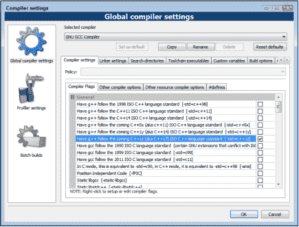

图5-1：配置 GCC 以使用 C++17 标准。

## 控制应用程序流程

现在编译器已配置好，你可以使用下面的代码（它也出现在 ForLoopRange 示例中）来测试使用范围的 for 循环。在本例中，范围从 1 到 5：

```cpp
#include <iostream>

using namespace std;

int main()
{
    int range[] = {1, 2, 3, 4, 5};

    for (int i : range)
    {
        cout << i << endl;
    }

    return 0;
}
```

不要太担心那些看起来令人困惑的代码；随着你的学习，一切都会变得合理。int range[] = {1, 2, 3, 4, 5}; 这一行代码创建了一个数组——一个变量中的一系列值。可以把它想象成一个带有隔间的盒子，你可以在每个隔间中放入一个值。第5册第1章会告诉你更多关于使用数组的内容。


for 循环条件看起来真的很奇怪。条件看起来像这样：`int i : range`。代码创建了一个 `int` 值 `i`，它在循环的每次迭代中从范围中接收一个值。范围（`:`）运算符出现在范围声明（`i`）和范围表达式（`range`）之间。这是 C++ 中一个相对较新的特性，你会发现它对于处理数组之类的存储容器非常有用。

在 `i` 接收到值之后，代码使用 `cout` 将其输出到屏幕。你看到的输出是值 1 到 5——每个值占一行。当然，你可能认为这全是障眼法。那么，试着更改数组中的一个值，你会看到输出会随之改变，以匹配数组内容。

## 在声明中放置条件

有时你需要在 for 循环中执行数据操作，而这种方式比试图在代码块中操作数据更方便。你实际上可以在 for 循环声明中创建一种特殊条件，让该条件执行诸如访问字符串或数组某部分之类的操作。ForLoopCondition 示例演示了如何执行此任务，如下所示：

```cpp
#include <iostream>

using namespace std;

int main()
{
    string hello = "Hello";
    for (int i = 0; char c = hello[i]; i++)
    {
        cout << c << endl;
    }
    return 0;
}
```

请注意，中间的条件通常用于检查特定值或执行其他逻辑功能，但它实际上创建了一个新的 char 变量 c，并根据 `i` 的值将 `hello` 字符串中的一个字母放入其中。在挠头思考了一会儿如何结束循环之后，你会确定：当循环到达字符串末尾时，它会自动结束。


当你一开始不知道数据有多大时，这是处理各种数据的一种简便方法。for 循环会继续处理字符串，直到字母用完，因此你不必担心字符串大小。

## 让 C++ 确定类型

上一节介绍了如何在 `for` 循环中放置条件，以操作大小不确定的数据。该示例假设数据属于特定类型，但你可能不知道类型是什么。从 C++11 开始（这意味着你必须按照本章前面“使用范围”一节所述，使用 Have G++ Follow the Coming C++1z (aka C++17) 设置来配置 GCC），你可以让 C++ 自动确定要使用的类型。你可以使用 `auto` 关键字来完成此操作，如下面的 `ForLoopCondition2` 代码所示：

```cpp
#include <iostream>

using namespace std;

int main()
{
    string hello = "Hello";
    int values[] = {1, 2, 3, 4, 5, 0};

    for (int i = 0; auto c = hello[i]; i++)
    {
        cout << c << endl;
    }

    return 0;
}
```

如所示，`for` 循环将处理 `hello` 中的值，就像上一节示例中那样。但是，这一次你没有指定 `c` 是 `char`；而是使用 `auto`。现在，试着在 `for` 循环中将 `hello` 替换为 `values`，使其看起来像这样：

```cpp
for (int i = 0; auto c = values[i]; i++)
{
    cout << c << endl;
}
```

现在，你不再一次输出一个字母来显示 `Hello`，而是看到数字 1 到 5，每行一个。因此，同一个 `for` 循环现在可以处理两种不同类型的数据：`string` 和 `int`。使用这种方法为你提供了额外的灵活性，代价是代码可读性略有降低。


请注意，`for` 循环不会输出 `values` 数组中的 `0`；相反，它使用 `0` 来确定数组的结束点。如果你不包含这个 `0`，`for` 循环将继续运行，直到找到一个 `0`，这意味着你可能会在屏幕上看到相当多的垃圾数据。

## 使用 while 循环

通常，你会发现 `for` 循环的作用有限。有时，你不想要计数器变量；你只想在某个条件为真时反复运行循环。然后，当该条件不再成立时，你希望停止循环。

例如，与其说你会让 100 个人排队，并且每个人都会比前一个人多给你一美元，你可能会说，只要人们愿意给钱，你就会继续这样收钱。

在这种情况下，你可以看到，给予继续进行的条件是“只要他们愿意给钱”这句话。

要在 C++ 中做到这一点，你可以使用 `while` 语句。`while` 关键字后面是一组括号，其中包含应用程序继续运行循环所依据的条件。一般的 `for` 语句的括号包含三个部分，说明如何更改计数器变量；而 `while` 语句的括号只包含一个条件。`WhileLoop` 示例演示了一个简单的 `while` 循环，如下所示：

```cpp
#include <iostream>

using namespace std;

int main()
{
    int i = 0;
    while (i <= 5)
    {
        cout << i << endl;
        i++;
    }
}
```


```
cout << "All Finished!" << endl;
return 0;
}
```

这段代码在 i 小于或等于 5 时运行。因此，此应用程序的输出为

```
0
1
2
3
4
5
All Finished!
```

请注意，必须使用 `int i = 0;` 在 while 循环外部声明 i。如果尝试使用 `while (int i <= 5)` 来声明 while 循环，编译器会报错。

当你并不确定循环需要运行多少次时，while 循环会很方便。例如，设想你的应用程序正在从互联网读取数据。除非你控制互联网数据源，否则你不知道它能提供多少数据。（还有许多其他情况会让你不知道要读取多少数据，但互联网应用程序常常会遇到这个问题。）使用 while 循环，代码可以继续读取数据，直到应用程序读取完所有数据。互联网数据源只需将数据流式传输到你的应用程序，直到数据传输完成。

通常，对于这种情况，你会创建一个名为 done 的布尔变量，并将其初始值设为 false。while 语句很简单：

```
while (!done)
```

这一行很容易翻译成英文：“当尚未完成时，执行以下操作。”然后，在 while 循环内部，当出现你知道循环必须结束的情况时（例如互联网数据源没有更多数据可读），你设置

```
done = true;
```

WhileLoop2 示例演示了如何执行这类过程，如下所示：

```cpp
#include <iostream>

using namespace std;

int main()
{
    int i = 0;
    bool done = false;
    while (!done)
    {
        cout << i << endl;
        i++;
        if (i > 5)
            done = true;
    }
    cout << "All Finished!" << endl;
    return 0;
}
```

在互联网数据示例中，遇到没有更多数据后，你会将 done 设为 true。用于控制循环条件的变量必须发生变化，否则循环将永远运行下去。在朋友给你钱的例子中，其中一人拒绝后，你会将 done 设为 true。

## do-while 循环

while 语句在家族中有一个表亲：do-while 语句。这种形式的循环与 while 循环类似，但有一个有趣的小特点：while 语句放在末尾，这意味着循环至少会执行一次。DoWhileLoop 示例演示了如何使用这种循环，如下所示：

```cpp
#include <iostream>

using namespace std;

int main()
{
    int i = 15;
    do
    {
        cout << i << endl;
        i++;
    }
    while (i <= 5);
    cout << "All Finished!" << endl;
    return 0;
}
```

请注意，这里的循环以 do 关键字开始，然后循环内容位于花括号内，最后 while 语句出现在末尾。其含义是，你在告诉计算机“当某某条件为真时执行这个”，其中“这个”是花括号内的内容，“某某条件”是括号内的条件。由于条件是在最后、其他所有内容都执行完之后才求值，因此此示例的输出与其他 while 循环示例略有不同：

```text
15
All Finished!
```


如果这里使用 while 循环，那么循环根本不会执行，因为 i 被设为 15。然而，由于这是 do-while 循环，你会看到输出 15。让循环至少执行一次有时会带来问题，如果你不想要这种行为，可以考虑使用 while 循环而不是 do-while 循环。

## break 与 continue

有时，你编写的应用程序可能包含一个循环，而它要做的不只是简单地累加数字。你可能会发现，你希望循环在与循环声明中的条件不同的另一个条件下结束。或者，当正在处理的项在某种程度上不正确时，你可能希望循环突然跳过当前项，继续处理循环中的下一项。当你停止循环并继续执行循环之后的代码时，使用 break 语句。当你退出循环的当前轮次并继续下一轮次时，使用 continue 语句。接下来两节将向你展示如何做到这一点。


尽管下面各节中的示例依赖于 for 循环，但 break 和 continue 语句也适用于 while 和 do-while 循环。

### 使用 break 跳出

假设你正在编写一个通过互联网读取数据的应用程序，并且循环会按预期要到达的数据量运行。但在处理过程中途，你可能会遇到一些包含错误的数据，这时你可能希望立即退出 for 循环。

C++ 包含一个方便的小语句，可以在这种情况下拯救你。该语句称为 break。其实，没有任何东西真的“断裂”，而且编写一个指示计算机“break”的应用程序似乎有点吓人。但这里 break 一词的用法更接近“越狱”，而不是“弄坏计算机”。不过，它并不是让你越狱，而是让你跳出循环。

下面的 ForLoop3 示例演示了这种技巧。此示例检查 i 等于 5 的特殊情况。你也可以通过更改 for 循环的结束条件来实现相同结果，但至少它向你展示了 break 语句如何工作。

```cpp
#include <iostream>

using namespace std;

int main()
{
    for (int i=0; i<10; i++)
    {
        cout << i << " ";
        if (i == 5)
        {
            break;
        }
        cout << i * 2 << endl;
    }
    cout << "All Finished!" << endl;
    return 0;
}
```


另请注意，当你跳出循环时，应用程序不会退出。它会继续执行循环之后的语句。在此例中，它仍会打印消息 **"All Finished!"**


你可以将 for 语句的第二部分（条件）留空，只需在分号之间放一个空白即可。然后，要退出循环，可以使用 break 语句。然而，这样做会让代码变得凌乱。你应该像对待凌乱的房子一样对待凌乱的代码：虽然有时每个人都会介意它，但事实是，大多数人并不喜欢看到凌乱的房子。而且你真的不想让别人看到你凌乱的房子——或者你凌乱的代码。是的，作为一名程序员，有点自我意识有时是件好事。

### 使用 continue 继续

除了可能因特殊情况需要跳出循环之外，你还可以让循环结束当前迭代；但不是跳出循环，而是让循环继续下一轮迭代。

例如，你可能再次通过互联网读取数据，并通过循环指定次数来完成这件事。在循环中途，你可能会遇到一些坏数据。但你不想退出循环，而是可能只想忽略当前这条坏数据，然后继续读取更多数据。

要实现这个技巧，你可以使用一个名为 `continue` 的 C++ 语句。continue 语句表示：“结束当前迭代，但继续运行循环的下一轮迭代。”

下面的 ForLoop4 示例展示了上一示例（位于“使用 break 跳出”一节）稍作修改后的版本。当循环到 5 时，它不会执行第二行 cout。但它不会跳出循环，而是继续处理 6，然后 7，依此类推，直到循环自行结束：

```cpp
#include <iostream>

using namespace std;

int main()
{
    int i;
    for (i=0; i<10; i++)
    {
        cout << i << " ";
        if (i == 5)
        {
            continue;
        }
        cout << i * 2 << endl;
    }
    cout << "All Finished!" << endl;
    return 0;
}
```

```cpp
{
    cout << endl;
    continue;
}
    cout << i * 2 << endl;
}
cout << "All Finished!" << endl;
return 0;
}
```

## 嵌套循环

很多时候，你需要处理不止一个循环。例如，你可能有几群朋友，而你想从每群朋友中的每个人身上尽可能榨取钱财。你可能会为第一群朋友举办聚会，让他们每人把身上所有的钱都给你。然后下一周，你可能又会和另一群朋友举办聚会。你会对每一群朋友都这么做。你可以画出这样的逻辑：

```
For each group of friends,
    for each person in that group
        bilk the friend for all he or she is worth
```

这就是嵌套循环。但如果你这么做，如果这是你的朋友最后一次造访你的巢穴，别感到惊讶。

嵌套循环不过就是循环里套循环。假设你想把 1 到 10 的每个数都乘以 1，并打印每次乘法的结果；然后你想把 1 到 10 的每个数都乘以 2，并打印每次乘法的结果；依此类推，直到乘数为 10。你的 C++ 代码会像 ForLoop5 示例那样：

```cpp
#include <iostream>

using namespace std;

int main()
{
    for (int x = 1; x <= 10; x++)
    {
        cout << "Products of " << x << endl;
        for (int y = 1; y <= 10; y++)
        {
            cout << x * y << endl;
        }
        cout << endl;
    }
    return 0;
}
```

在这个示例中，循环里套着一个循环。内层循环可以使用外层循环的 x。除此之外，这段代码没有什么神奇或古怪的地方。它只是循环里套循环。是的，你可以循环套循环，再套循环，再套循环。你也可以把任何循环放进任何其他循环中，比如把 while 循环放进 for 循环中。

注意在内层循环前后各有一个 `cout` 调用。你可以这样做；内层循环不必是外层循环中唯一的内容。


尽管你当然可以循环套循环、再套循环、再套循环，但嵌套得越深，代码就越可能变得令人困惑。这就像美国几十个大城市承诺修建外环路（一条环绕城市外围、帮助交通更快的道路）。最终，那条外环路会不够大，于是城市不得不建一条又一条。这有点可怕，所以尽量不要在嵌套上走火入魔。


如果你在嵌套循环中放入 `break` 语句或 `continue` 语句，该语句作用于它所在的最内层循环。例如，下面的 *ForLoop6* 示例包含三个循环：外层循环、中间循环和内层循环。`break` 语句作用于中间循环，如下所示：

```cpp
#include <iostream>

using namespace std;

int main()
{
    for (int x = 1; x <= 3; x++)
    {
        for (int y = 1; y < 3; y++)
        {
            if (y == 2)
                break;
            for (int z = 1; z < 3; z++)
            {
                cout << x << " " << y;
                cout << " " << z << endl;
            }
        }
    }
    return 0;
}
```

你可以看到，当 y 为 2 时，包含 y 的那个 for 循环会中断。但外层循环会继续运行下一次迭代。

是的，没错。回到美好的英语课上，每个人都学过名词和动词。思路是这样的：假设你要到后院建造一架飞碟。你可以用两种方式着手设计这架飞碟。

第一种，你可以直接制定一份行动计划，列出从头到尾建造飞碟的所有步骤。那当然会有很多步骤。但为了简化，你可以改为列出所有主要任务，而不涉及细节。可能像这样：

- 1. 建造外壳。
- 2. 建造并安装发动机。

就这样，只有两步。但是，当你雇来几十个人替你干粗活，而你自己专注于日内交易时，这些信息够他们继续干下去吗？不，大概不够。相反，你可以把这两项任务分成更小的任务。例如，第2步可能像这样：

- 2a. 建造反重力升降器。
- 2b. 建造推进器。
- 2c. 将升降器连接到推进器，组成最终发动机。
- 2d. 将发动机安装到外壳上。

这稍微好一些；细节更多了。但它仍然需要更多细节。你怎么完成“建造反重力升降器”这部分？这很简单，但需要更多细节，如下面的步骤：

- 2aa. 从地下挖出反重力粒子。
- 2ab. 将它们紧密压缩成一种超原子化导体。
- 2ac. 用线圈包裹。
- 2ad. 将9伏电池夹连接到线圈。

当然，这些指令中的每一条都需要更多细节。最终，在你规划完整个事情后，你会有许多许多步骤，但它们会组织成某种层级结构，如图6-1所示。在这幅图中，三个点表示放置其他步骤的位置——为了图能放在页面上，这些步骤被省略了。

这种设计是*自顶向下*设计。其思路是，从设计的最上层步骤（在这个例子中是“建造飞碟”）开始，不断把步骤拆成越来越详细的步骤，直到你得到可管理的东西。许多年来，计算机编程就是这样教的。

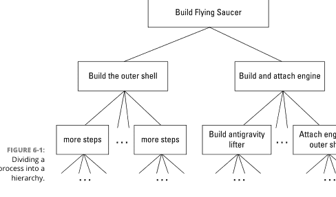

尽管这个过程可行，但人们找到了一种稍好的方法。首先，在拆分步骤（即动词）之前，你把要建造的东西分成若干部分（即名词）。在这个例子中，你其实在前两步已经这样做了。但与其称它们为步骤，不如称它们为对象。一个对象是外壳，另一个对象是发动机。这样，两家不同的工厂可以以某种分工方式分别处理它们。当然，工厂必须协调活动；否则，两个部件准备好后可能装不到一起。在弄清楚如何建造每个对象之前，最好先描述每个对象：它做什么、有哪些特征、尺寸等。然后，当这一切都完成后，你可以列出确切的特征及其细节。最后，你可以把工作分开，让每个人设计或建造不同的部分。

如你所见，第二种方法更有道理。程序员划分计算机应用程序时就是这样做的。但每种方法的底层都有共同点：这些方法由若干小过程组成。这些过程称为函数。编写计算机应用程序时，在把工作分成称为对象的更小部分后，你最终会开始为这些对象赋予行为。为了编写这些行为的代码，你就像在第一种方法中那样：把它们拆成可管理的部分，这些部分同样称为函数。用计算机编程术语来说，函数就是执行特定任务的一小段代码。但不止如此：把函数看作一台机器。你可以把一样或多样的东西放进机器；它处理这些东西，然后吐出一个答案（如果有答案的话）。你能拥有的最有价值的图之一，就是以这种方式把函数画成一台机器，如图6-2所示。

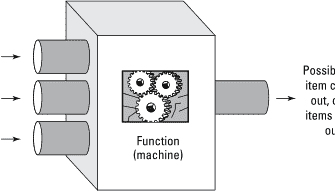

图 6-2：你可以把函数看作一台机器。

这台机器（或函数）有三个主要部分：

- **输入：** 函数可以通过其输入接收数据。这些数据元素可以是数字、字符串或任何其他类型。创建这样一台机器时，你可以想要多少输入就有多少输入（如有必要，甚至可以是零）。
- **处理器：** 处理器就是函数本身。就 C++ 而言，它实际上是一组代码行。
- **输出：** 函数在完成它的工作后可以*返回*某些东西。在 C++ 中，这个输出以数字、字符串或任何其他类型的形式出现。

为了把这一切讲清楚，请尝试清单6-1中的 `FirstFunction` 代码。（别忘了第二行 `#include<math.h>`，它为你提供一些数学功能。）

## 清单 6-1：查看函数的实际运行

```cpp
#include <iostream>
#include <math.h>

using namespace std;

int main()
{
    cout << fabs(-10.5) << endl;
    cout << fabs(10.5) << endl;
    return 0;
}
```


运行此应用程序时，你会看到以下输出：

```
10.5
10.5
```

在这段代码中，你使用了一个名为 `fabs()` 的函数或机器（通常读作“ef-abs”，表示浮点绝对值）。此函数以数字作为输入，并返回该数字的绝对值作为输出。


一个数的绝对值就是该数的正值形式。例如，-5 的绝对值就是 5。12 的绝对值仍是 12。绝对值几乎总是正数，因为 0 的绝对值是 0，但 0 是原点，既不是正数也不是负数（详情见 http://www.math.com/school/subject1/lessons/S1U1L10DP.html）。名称 abs 前面的 f 是因为它使用浮点数，而浮点数就是带小数点的数。

因此，`main()` 中的第一行针对值 -10.5 调用 `fabs()`。然后 cout 获取此函数的输出（即结果），并将其打印到控制台。

接着，第二行再次执行相同的操作，只是它取数字 10.5 的绝对值。

那么这个函数的处理程序在哪里？它不在你的代码中；它在另一个文件里，而下面这一行确保你的应用程序可以使用此函数：

```
#include <math.h>
```

你在许多地方见过函数。如果你使用计算器，输入一个数字并按平方根按钮，计算器就会运行一个计算平方根的函数。

但函数可以比仅处理数字更复杂。仔细考虑这句话：当你使用文字处理器，高亮一个单词并检查该单词的拼写时，应用程序会调用一个处理拼写检查的函数。此函数执行类似以下操作：

```
This is a function to check the spelling of a single word.
Inputs: A single word.
Look up the word
If the word is not found
    Find some suggestions.
    Open a dialog box through which you (the user)
        can change the word by either typing a new word
or picking one of the selections, or just leaving
it the same.
If you made a change,
    Return the new spelling.
Otherwise
    Return nothing.
Otherwise
    Return nothing
```

## 用函数分工

注意 `if` 语句是如何通过缩进分组。最后的 `otherwise` 与第一个 `if` 语句配对，因为它的缩进与 `if` 语句的缩进相匹配。

所以那是一个执行拼写检查的函数。但请考虑这一点：当你不高亮任何单词而运行拼写检查器时，拼写检查器会针对整个文档运行。那是另一个函数。如下所示。

```
This function checks the spelling of the entire document
For each word in the document
    Check the spelling of the single word
```

计算机如何执行 `for` 循环中的步骤“检查单个单词的拼写？”它会调用前面描述的函数。此过程称为*代码复用*。如果整个函数已经在别处存在，你完全没有理由再重写一遍。这就是函数的妙处。

### 调用函数

当你运行函数中的代码时，计算机人士会说你在*调用*该函数。就像每个好人一样，好的函数也有名字。调用函数时，你通过名字来调用。


通常，在编写应用程序和开发调用函数的代码时，开发者会说他们在调用函数。这在一定程度上是计算机行话，也在一定程度上是一种奇怪的毛病，即开发者开始对计算机产生了一点过多的共鸣。

要调用函数，你需要键入它的名称，然后键入一对圆括号。在圆括号内，列出你想发送到函数输入中的项。这里使用的术语是*传递*，就像“你把值传递给函数”。

### 对函数使用 auto

一般来说，明确指定用于接收函数输出的变量类型会使代码更易读。然而，有些情况下你可能不知道精确的输出类型，或者函数的不同版本会输出不同的类型（这非常令人困惑）。在这种情况下，你首先按照第 1 册第 5 章“使用范围”一节所述，将 GCC 设置为使用 C++17。然后，你可以编写清单 6-2 中所示的 Fabs2 示例，如下面的 UsingAuto 示例所示：

```cpp
#include <iostream>
#include <math.h>

using namespace std;

int main()
{
    auto mynumber = fabs(-23.87);
    cout << mynumber << endl;
    return 0;
}
```

结果与 Fabs2 示例相同。区别在于，mynumber 现在的类型是 auto，C++ 会自动为你检测数据类型，而不是 double，后者需要你显式定义数据类型。

### 传递变量

你还可以将变量的值传递给函数。清单 6-3 中的 Fabs3 示例创建两个变量：一个传递给函数，另一个接收函数的结果。

- **清单 6-3：** 使用 fabs() 的另一种方式

```cpp
#include <iostream>
#include <math.h>

using namespace std;

int main()
{
    double start = -253.895;
    double finish = fabs(start);
    cout << finish << endl;
    return 0;
}
```

这段代码创建两个变量；第一个名为 `start`，第二个名为 `finish`。它将 `start` 初始化为值 -253.895。接下来，它调用 `fabs()`，并将 `start` 的值传递给它。它将返回值保存到 `finish`，并打印 `finish` 中的值。当 `fabs()` 运行时，你会看到控制台上出现以下内容：

```text
253.895
```


如果你需要多次使用函数结果，将函数结果保存到变量中会很有用。例如，如果你出于某种原因需要 −253.895 的绝对值，然后几行之后又需要它，你有一个选择：你可以每次调用 `fabs(-253.895)`，也可以只调用一次，将结果保存到变量中，然后在每次需要时使用该变量。将其保存到变量中的好处是，你之后可能会说，例如：“哦，等等！我想要的不是绝对值！我想要绝对值的负值！”那么你只需修改一行代码——即调用 `fabs()` 的那一行。相反，如果你已经多次调用 `fabs()`，那么每次调用时都必须修改它。顺便说一句，如果你好奇如何取绝对值的负值并将其存储到变量中，只需在它前面加一个负号，如下所示：

```cpp
finish = -fabs(start);
```

### 传递多个变量

有些函数喜欢接收各种各样的好东西，例如多个参数。与接收单个值的函数一样，你把值放在一对圆括号内。由于有多个值，你用逗号分隔它们。清单 6-4 中所示的 `pow()` 示例使用一个名为 `pow()` 的函数计算 10 的三次幂。（也就是说，它计算 10 乘以 10 乘以 10。是的，就是 `pow()`。）请确保在 `#include` 部分包含 math.h 行，以便可以使用 `pow()` 函数。

### 定义 AddOne() 函数

清单 6-5 中所示的 AddOne 示例既提供了一个自定义函数，也提供了 main() 中调用该自定义函数的代码。（该函数放在 main() 外部——事实上，放在它前面。）

- **清单 6-5：** 编写你自己的函数

```cpp
#include <iostream>

using namespace std;

int AddOne(int start)
{
    int newnumber = start + 1;
    return newnumber;
}

int main()
{
    int testnumber = 20;
    int result = AddOne(testnumber);
    cout << result << endl;
    return 0;
}
```


注意，此示例缺少前面示例中出现的 `#include <math.h>` 条目。只有当你使用某个包含文件的特性时，才需要向代码的 include 部分添加条目。在此情况下，该示例依赖的是基本 C++ 语言组成部分的标准数学特性，因此不需要任何额外代码。

使用可下载的源代码会节省时间，并确保示例在你第一次尝试时就能运行。不过，你也可以选择手动键入它。由于代码量不少，你一开始可能会遇到一些编译器错误；仔细查看出错的代码行，找出你的代码与本书中此处代码之间的差异。运行该示例后，你会看到：

```
21
```


## 看看 AddOne() 是如何被调用的

你可以先看看如何调用 `AddOne()`，以此开始审查这段代码。看看 `main()` 中的这几行：

```cpp
int testnumber = 20;
int result = AddOne(testnumber);
cout << result << endl;
```

你大概可以综合一些事实，判断这个函数是做什么的。首先，这个示例叫 `AddOne()`，这本身就是一个很好的提示。其次，运行应用程序时，控制台上会出现数字 21，它比 `testnumber` 中的值大 1；它加了一。事实上，这个函数做的就是这件事。如今的计算机能做到这些，真令人惊叹。


编写自己的函数时，尽量选择一个有意义且能描述函数功能的名称。写一个函数并把它命名为 `process()` 或 `TheFunction()` 之类很容易，但这些名称并不能准确描述该函数。

## 拆解 AddOne() 函数

现在，看看 AddOne 函数。以下是关于它的一些高层次观察：

- **位置：** 该函数出现在 `main()` *之前*。由于编译器的工作方式，它必须在你调用函数之前知道该函数。因此，你把它放在 `main()` 之前。（你也可以用另一种方式做到这一点，本章后面的“前向引用和函数原型”一节会讨论。）

- **格式：** 函数以一行看起来是在描述函数的内容开头（本节后面会解释），然后是一个左花括号，之后是一个右花括号。

- **代码：** 函数中包含的代码，和你可以放进 `main()` 里的代码类型一样。代码由以下元素组成：

  - **执行任务：** 代码首先执行一项任务，如下所示：

  - 代码声明一个名为 `newnumber` 的整数变量。然后把它初始化为 start 加 1。但 `start` 是什么？它是输入之一。

  - **返回结果：** 这一行出现在函数的末尾：

```cpp
int newnumber = start + 1;
```

```cpp
return newnumber;
```

## 关于参数的争论

严格来说，术语*参数*（parameter）指的是从函数的角度来看函数的输入。当你调用函数时，你在调用行括号中放置的东西不是参数；它们被称为*实参*（arguments）。因此，在下面的函数头中：

```
string ConnectNames(string first, string last)
```

变量 first 和 last 是参数。但在下面这个函数调用中（见清单 6-7）：

```
ConnectNames("Bill", "Murray")
```

字符串 "Bill" 和 "Murray" 是这次调用的实参。

## 理解 AddOne() 的名称和类型

再看看 AddOne() 的函数头：

```cpp
int AddOne(int start)
```

AddOne 这个词是函数的名称，你大概已经明白了。这样就剩下开头的东西——int。那是返回值的类型。函数中右花括号之前的最后一行是

```cpp
return newnumber;
```

函数内部的变量 newnumber 是整数。而返回类型是 int。这并非偶然：正如程序员们都听说过的那样，朋友不会让朋友返回函数头中指定类型之外的东西。二者在类型上必须匹配。此外，检查 `main()` 中的这一行：

```cpp
int result = AddOne(testnumber);
```

result 的类型也是整数。三者都匹配。同样，这并非偶然。只有当两个东西类型匹配时，你才能把一个东西复制到另一个东西（在这个例子中，是把函数的返回值复制到名为 result 的变量）。而在这里，它们确实匹配——二者都是整数。

- **编辑时间：** 返回你一直在使用文字处理器应用程序的时长。

- **用户名：** 如果你已登录到计算机，则以字符串形式返回你的用户名，例如 `"Elisha"`。

这个列表中的所有函数都有一个共同点：它们查找信息。因为代码中没有参数，这些函数要处理某些信息，就必须自己出去获取。这就像把人派到树林里找食物，却不给他们任何工具：完全由他们自己完成所需任务，而你能做的只是坐下来看着，等着你那美味的惊喜。

如果一个函数不接受参数，你就像写带参数的函数头那样写函数头，并保留括号；只是不要在括号*里*放任何东西，如清单 6-6 中的 UserName 示例所示。所以，即使没有好东西输入，也确实可能有好的东西返回，至少对于没有参数的函数来说是这样。

## 清单 6-6：不接受参数

```cpp
#include <iostream>

using namespace std;

string Username()
{
    return "Elisha";
}

int main()
{
    cout << Username() << endl;
    return 0;
}
```

运行清单 6-6 时，你会看到以下输出：

```text
Elisha
```

你的函数也可以接受多个参数。清单 6-7 所示的 ConnectNames 示例演示了多个参数的用法。注意，函数 ConnectNames() 接受两个字符串作为参数，并将它们组合起来，中间加一个空格。还要注意，该函数把这两个字符串用作变量。

## 清单 6-7：接受多个参数

```cpp
#include <iostream>

using namespace std;

string ConnectNames(string first, string last)
{
    return first + " " + last;
}

int main()
{
    cout << ConnectNames("Richard", "Nixon") << endl;
    return 0;
}
```

在清单 6-7 的函数头中，你会看到每个参数都有类型名 `string`。每个参数都需要有自己的类型条目，否则编译器会显示错误。关于这段代码，有以下几点：

- **你没有在 `main()` 中为这两个名字创建变量。** 相反，你只是把它们作为字符串常量键入（也就是用引号括起来的实际字符串）。

- **你可以直接在 `return` 语句中进行计算和推导。** 这样可以省去创建变量的额外工作。在函数中，你可以创建一个类型为 `string` 的返回变量，把它设为 `first + " " + last`，然后返回该变量，如下所示：

```cpp
string result = first + " " + last;
return result;
```

但示例改为展示如何在一行中完成所有这些，如下面这一行：

```cpp
return first + " " + last;
```

虽然你可以省去创建额外变量的工作，把整个表达式直接放进 `return` 语句，但有时这样做并不好。如果表达式真的很长，如下所示：

```cpp
return (mynumber * 100 + somethingelse / 200) *
    (yetanother + 400 / mynumber) / (mynumber + evenmore);
```

它就会变得有点复杂。像这个例子那样把它拆成变量，是最好的做法：

```cpp
double a = mynumber * 100 + somethingelse / 200;
double b = yetanother + 400 / mynumber;
double c = mynumber + evenmore;
return a * b / c;
```

## 不返回任何内容

在前面“使用多个参数或不使用参数”一节中，你会看到一个不接受参数的函数列表；这些函数会出去并带回一些东西，无论是数字、字符串，还是其他某种“食物”。

其中一个例子会获取你登录的计算机的用户名。但如果你是一位伟大的计算机大师，正在编写实际让某人登录的应用程序呢？在那种情况下，你的应用程序不会问计算机用户名是什么——天哪，你的应用程序会告诉计算机用户名是什么！

在那种情况下，你的应用程序会调用一个函数，比如 `SetUsername()`，并传入新的用户名。结果函数可以针对返回值执行以下任意一种操作：

- 它可以返回名称。
- 它可以返回一条消息，说明用户名无效或类似内容。
- 它可能根本不返回任何内容。

看看函数不返回任何内容的情况。在 C++ 中，表明函数不返回任何内容的方式，是在函数头中使用关键字 `void` 作为返回类型。清单 6-8 所示的 `SetUsername` 示例演示了这种方法。

## 清单 6-8：完全不返回任何内容

```cpp
#include <iostream>

using namespace std;

void SetUsername(string newname)
{
```

## 用函数划分工作

```cpp
cout << "New user is " << newname << endl;
}

int main()
{
    SetUsername("Harold");
    return 0;
}
```

运行该应用程序时，你会看到

```text
New user is Harold
```

注意 `SetUsername()` 函数头：它以单词 `void` 开头，这意味着它完全不返回任何内容。这就像外太空：只有一个巨大的虚空，里面什么都没有，也没有任何返回，除了外星空气波传来的静电噪声，不过我们就不往那儿扯了。还要注意，因为这个函数不返回任何内容，所以没有 return 语句。

现在，当然，这个函数除了把新用户名打印到控制台之外，其实并没有做多少事情，但这没关系；它向你展示了如何编写一个不返回任何内容的函数。


**记住** 返回类型为 `void` 的函数完全不返回任何内容。不要试图在返回类型为 `void` 的函数中返回某个值。`Void` 表示该函数完全不返回任何内容。如果你试图在函数中放入 return 语句，就会遇到编译错误。

### 让变量保持局部

每个人都喜欢拥有自己的东西，函数也不例外。当你在某个函数的代码中创建变量时，该变量只有这个特定函数知道。创建这类变量时，它们被称为*局部变量*，人们说它们局部于那个特定函数。（好吧，反正*计算机*领域的人是这么说的。）

要看看局部变量如何工作，请考虑 `PrintName` 示例中的代码：

```cpp
#include <iostream>

using namespace std;

void PrintName(string first, string last)
{
  string fullname = first + " " + last;
  cout << fullname << endl;
}

int main()
{
  PrintName("Thomas", "Jefferson");
  return 0;
}
```

注意，在 `PrintName()` 函数中，你声明了一个名为 `fullname` 的变量。然后你在该函数的第二行中使用这个变量，也就是以 `cout` 开头的那一行。但你不能在 `main()` 中使用这个变量。如果你试图这样做，如下面的代码所示，就会遇到编译错误：

```cpp
int main()
{
  PrintName("Thomas", "Jefferson");
  cout << fullname << endl;
  return 0;
}
```

不过，你可以在 `main()` 中声明一个名为 `fullname` 的变量，就像 `PrintName2` 示例那样。但是，如果你这样做，这个 `fullname` 只局部于 `main()`，而另一个同样名为 `fullname` 的变量只局部于 `PrintName()` 函数。换句话说，每个函数都有自己的变量；它们只是恰好同名而已。但它们是*两个独立的变量*：

```cpp
#include <iostream>

using namespace std;

void PrintName(string first, string last)
{
  string fullname = first + " " + last;
  cout << fullname << endl;
}

int main()
{
  string fullname = "Abraham Lincoln";
  PrintName("Thomas", "Jefferson");
  cout << fullname << endl;
  return 0;
}
```

**记住** 当两个函数声明同名变量时，它们是两个独立的变量。如果你把值存入其中一个变量，另一个函数并不知道。另一个函数只知道它自己那个同名变量。可以这样想：两个人各自的壁橱里都可以有一个标着 Tools 的储物箱。如果 Sally 把她家的标着 Tools 的箱子里放了一把锤子，而 Hal 打开他家的另一个同样标着 Tools 的箱子，他就不会看到 Sally 的锤子。因此，这个示例的输出是：

```text
Thomas Jefferson
Abraham Lincoln
```

**警告** 如果你在两个不同的函数中使用相同的变量名，很容易忘记你正在处理两个不同的变量。只有在你确信不会发生混淆时才这样做。

**提示** 如果你在两个不同的函数中使用相同的变量名（比如在 `for` 循环中使用的名为 `index` 的计数器变量），通常最好保持大小写一致。不要在一个函数中使用 `count`，而在另一个函数中使用 `Count`。虽然你当然可以这样做，但当你需要用到它时，可能会发现自己把名字打错了。不过，这不会让你访问到另一个变量。（你做不到，因为它在另一个函数中。）相反，你会遇到编译错误，不得不回头修正。保持一致能节省时间。

### 前向引用与函数原型

本章所有示例都把函数代码放在 `main()` 的代码上面。原因是编译器会从头到尾扫描代码。如果它还没有遇到某个函数，却看到了对该函数的调用，它就不知道自己在看什么，于是会报出一个老掉牙的编译错误。

这种错误可能特别令人沮丧，可能让你花上几个小时对着电脑大吼。没有什么比这更令人沮丧：你看着自己的应用程序，编译器却说它错了，而你知道它是对的，因为你知道这个函数是你写的。

不过，你也可以把函数放在 `main()` 后面；甚至可以使用函数原型把函数放到其他源代码文件中（这是第 1 册第 7 章的主题）。

你可以做的是包含一个函数原型。*函数原型*不过就是函数头的副本。但你不是在它后面跟一个左花括号，然后写函数代码，而是在函数头后面跟一个分号，就完成了。例如，一个函数原型看起来像这样：

```cpp
void PrintName(string first, string last);
```

然后你再实际编写完整函数（包括函数头、代码等所有内容），可以放在后面。完整函数甚至可以放在 `main()` 之后，或放在任何调用它的位置之后。

注意，这个示例看起来就像函数的第一行。事实上，可以偷个懒！要写它，你只需复制你编写的原始函数的第一行，再加上一个分号。清单 6-9 中所示的 PrintName3 示例展示了如何使用这种技巧。

**清单 6-9：使用函数原型**

```cpp
#include <iostream>

using namespace std;

void PrintName(string first, string last);

int main()
{
    PrintName("Thomas", "Jefferson");
    return 0;
}

void PrintName(string first, string last)
{
    string fullname = first + " " + last;
    cout << fullname << endl;
}
```

注意，函数头出现在 `main()` 上方，并以分号结尾。接下来是 `main()`。最后，你看到 PrintName() 函数本身（同样有函数头，但这次没有分号）。因此，该函数位于 `main()` 之后。

“好棒哦，”你说，“函数放到后面了。”可既然现在你得把函数头输入两遍，又何必费这个劲呢？

这一步确实很有用。假设你有一个源代码文件，里面有比如 20 个函数，而这些函数彼此之间会进行各种调用，那么要仔细安排它们的顺序，使每个函数只调用源代码文件中位于它上方的函数，可能会很困难。相反，大多数程序员会按某种逻辑顺序（也许没有逻辑）放置函数，并不太担心调用顺序。然后他们把所有的函数原型都放在源代码文件靠顶部的位置，就像前面的清单 6-9 所示。

当你输入函数原型时，很多人说你在指定一个*前向引用*。这个说法只是表示你正在提供对稍后才出现的内容的引用。这没什么大不了的，而且它主要来自一些较老的编程语言。

### 编写同一函数的两个版本

有时你可能想编写同一函数的两个版本，唯一区别在于它们接受不同的参数类型。例如，你可能想要一个名为 `Combine()` 的函数。一个版本接受两个字符串，并把这两个字符串拼在一起，但中间加一个空格。然后它把结果字符串打印到控制台。另一个版本把两个数字相加，并把所有三个数字——前两个数字与和——写到控制台。第一个版本看起来会是这样：

```cpp
void Combine(string first, string second)
{
    cout << first << " " << second << endl;
}
```

这个函数没有什么神奇或特别之处。它叫 `Combine()`；它接受两个字符串作为参数；它不返回任何内容。该函数的代码打印这两个字符串，中间带一个空格。现在第二个版本看起来像这样：

```cpp
void Combine(int first, int second)
{
    int sum = first + second;
    cout << first << " " << second << " " << sum << endl;
}
```

同样，这里也没什么惊人的地方。函数名是 `Combine()`，它不返回任何内容。但这个版本接受两个整数，而不是两个字符串，作为参数。这段代码也与前一个代码不同：它先计算输入之和，然后打印这几个不同的数字。

*重载*，也就是用一个名字对应多个函数，在 C++ 中相当常见。清单 6-10 中所示的 `Combine` 示例包含完整代码。清单中两个函数都出现了。


### 清单 6-10：编写一个函数的两个版本

```cpp
#include <iostream>

using namespace std;

void Combine(string first, string second)
{
    cout << first << " " << second << endl;
}

void Combine(int first, int second)
{
    int sum = first + second;
    cout << first << " " << second << " " << sum << endl;
}

int main()
{
    Combine("David","Letterman");
    Combine(15,20);
    return 0;
}
```

你会看到每个函数都在 `main()` 中被调用。编译器根据你提供的参数来决定调用哪个函数。例如，看到这个调用时：

```cpp
Combine("David","Letterman");
```

你会看到两个字符串。因此，编译器知道要使用第一个版本，它接受两个字符串。现在看看第二个函数调用：

```cpp
Combine(15,20);
```

这个调用接受两个整数，因此编译器知道要使用函数的第二个版本。


> **记住**
>
> 重载函数时，参数必须不同（或者必须按不同顺序出现）。例如，函数可以接受相同类型的信息，但使用不同数量的参数。当然，前面的例子表明，参数也可以因类型不同而不同。你也可以使用不同的返回类型，但函数之间的差异不能仅限于返回类型，而且改变参数名也不算数。编译器会将 `Combine(string A, string B)` 和 `Combine(string First, string Second)` 视为同一个函数。

## 调用所有字符串函数

要想充分发挥字符串的作用，你需要使用一些专门针对字符串的特殊函数。不过，使用这些函数与本章目前使用的其他函数略有不同。你不能直接调用函数，而是先输入保存字符串的变量名，然后输入一个句点（或*点号*），再输入函数名以及任何参数。


你之所以用不同的方式编写字符串函数，是因为你利用了某些面向对象的编程特性。第2册第1章详细描述了这些类型的函数（称为*方法*）是如何工作的。接下来的几节将介绍一些常见的函数，并告诉你如何使用它们。

### 在字符串中插入字符串

你可以使用的一个函数是 `insert()`。如果你想向另一个字符串中插入更多字符，就可以使用这个函数。例如，如果你有字符串 "Something interesting and bizarre"，并且将字符串 "seriously "（末尾带一个空格）从索引10开始插入其中间，你会得到字符串 "Something seriously interesting and bizarre"。


处理字符串时，第一个字符是第0个索引，第二个字符是第1个索引，依此类推。下面几行代码使用 `insert()` 函数在索引10处执行插入，尽管你实际上是在第11个字符处进行插入：

```cpp
string words = "Something interesting and bizarre";
words.insert(10, "seriously ");
```

第一行代码只是创建了一个名为 words 的字符串，并用短语 "Something interesting and bizarre" 将其填满。第二行执行插入操作。注意调用函数的奇怪方式：你先指定变量名 words，然后是一个点，然后是函数名 insert。接下来，像往常一样在括号中加上参数。对于这个函数，第一个参数是要插入字符串的索引，第二个参数是你要插入的实际字符串。当这两行代码运行后，名为 words 的字符串变量将包含 "Something seriously interesting and bizarre"。

### 删除字符串的一部分

你还可以使用一个类似的函数 `erase()` 来删除字符串的一部分。下面这行代码从索引19开始删除 words 字符串中的16个字符：

```cpp
words.erase(19,16);
```

因此，如果名为 words 的变量包含字符串 "Something seriously interesting and bizarre"，那么在这一行运行之后，它将包含 "Something seriously bizarre"。

### 替换字符串的一部分

另一个有用的函数是 `replace()`。这个函数用另一个字符串替换字符串的某一部分。使用 replace 时，你要指定在字符串中开始替换的位置以及要替换的字符数，然后指定要用哪个字符串来替换旧的、磨损的部分。

例如，如果你的字符串是 "Something seriously bizarre"，你想用字符串 "body" 替换单词 "thing"，你可以告诉 `replace()` 从索引4开始，用 "body" 替换5个字符。为此，你输入：

```cpp
words.replace(4, 5, "body");
```


请注意，你要替换的字符数不必与新字符串的长度相同。如果字符串最初是 "Something seriously bizarre"，在这次 `replace()` 调用之后，字符串将包含 "Somebody seriously bizarre"。

### 结合使用字符串函数

清单6-11中的 OperatingOnStrings 示例演示了所有这些函数协同工作的情况。

### 清单 6-11：对字符串进行操作

```cpp
#include <iostream>

using namespace std;

int main()
{
    string words = "Something interesting and bizarre";
    cout << words << endl;
    words.insert(10, "seriously ");
    cout << words << endl;
    words.erase(19,16);
    cout << words << endl;
    words.replace(4, 5, "body");
    cout << words << endl;
    return 0;
}
```

当你运行这个应用程序时，会看到以下输出：

```text
Something interesting and bizarre
Something seriously interesting and bizarre
Something seriously bizarre
Somebody seriously bizarre
```

第一行是原始字符串。第二行是 `insert()` 函数的结果。第三行是 `erase()` 函数的结果。最后一行是 `replace()` 函数的结果。

### 理解 main()

到目前为止，本章中的所有应用程序都有一个 `main()`，它是一个函数。注意它的头部，后面是花括号内的代码：

```cpp
int main()
```

你可以看到这绝对是一个函数头部：它以返回类型开头，然后是函数名 `main()`。这只是 `main()` 函数的一种形式——Code::Blocks 默认使用的形式。然而，你可能决定让用户在控制台输入应用程序名称时能够提供输入。在这种情况下，你可以使用包含两个参数的 `main()` 函数的这种替代形式：

```cpp
int main(int argc, char *argv[])
```

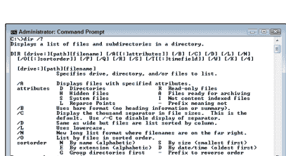

图6-3：命令行应用程序通常带有开关和参数。

要使这些开关及其关联的参数正常工作，`main()` 函数必须处理输入。你可以使用 `argc` 确定用户提供了多少个命令行参数，然后使用 `argv` 访问这些参数。第2册第2章讨论数组这一主题。数组是按一个名称存储的变量序列。`argv` 变量就是其中之一。要访问存储在名为 `argv` 的统一名称下的各个变量，你可以这样做：

```cpp
cout << argv[0] << endl;
```

在这个例子中，你使用的方括号与你访问字符串中各个字符时使用的一样。当使用 `/?` 开关时，你会看到 `/?` 作为输出。你可以使用for循环访问命令行参数。清单6-12中的 CommandLineParameters 示例演示了这一技术。

### 清单 6-12：访问命令行参数

```cpp
#include <iostream>
#include <stdlib.h>

using namespace std;

int main(int argc, char *argv[])
{
    for (int index=1; index < argc; index++)
    {
        cout << argv[index] << endl;
    }

    return 0;
}
```

## 用函数划分你的工作


## 在 Code::Blocks 中设置命令行参数

如果你尝试在 Code::Blocks 中通过选择“构建 ▸ 运行”并使用默认设置来运行该示例，该示例不会输出任何内容。要添加命令行参数，请选择“项目 ▸ 设置程序参数”。你将看到“选择目标”对话框，你可以在其中的“程序参数”字段中键入命令行参数。在此字段中键入 **Hello World I Love You!**，每行一个参数，如图所示，然后单击“确定”。现在你就可以运行该示例了，它将输出：

```
    Hello
    World
    I
    Love
    You!
```

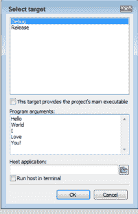

> **请记住** 请注意，`for` 循环从 `index = 1` 而不是 `index = 0` 开始。`argv` 列表中的第一项始终是可执行路径和应用程序名称。这些信息有时会派上用场，但通常你希望其余参数改变应用程序的工作方式。

## 第7章：拆分源代码文件

### 本章内容

- 创建多个源代码文件
- 创建头文件
- 在源代码文件之间共享变量
- 利用神秘的头文件包装器

正如你可以将工作划分为函数一样，你也可以将工作划分为多个源代码文件。这样做的主要原因是帮助保持项目易于管理。此外，使用多个源代码文件，你可以让几个人同时处理同一个项目，每个人同时处理不同的源代码文件。

多个源文件的关键在于知道在哪里将源代码分成若干部分。与其他任何事情一样，如果你在错误的地方拆分源代码，它就会——嗯，出问题。

在本章中，你将了解如何将源代码划分为多个文件（并且是在所有正确的地方）。示例使用 Code::Blocks，但大多数现代 IDE 的工作方式大致相同。你创建多个文件并将它们导入一个*项目*（对你想完成的工作的描述），该项目随后为你管理这些文件，并确保在正确的时间编译正确的文件。

你不必手动键入本章的源代码。事实上，使用可下载的源代码要容易得多。你可以在可下载源代码的 \CPP_AIO4\Book1\Chapter07 文件夹中找到本章的源代码。有关如何找到这些源文件的详细信息，请参阅引言。

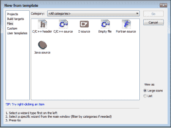

**图 7-1：**“从模板新建”对话框允许你选择新的文件类型。

### 创建新的源代码文件

- **4. 高亮你想要使用的语言——C 或 C++——然后单击“下一步”。**

向导会询问你想如何命名文件、希望将其存储在何处，以及哪些构建应使用该文件，如图 7-2 所示。（关于这些选择的更多内容见步骤 5–8。）

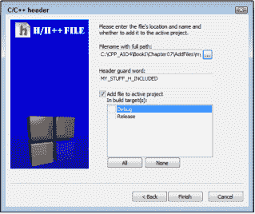

**图 7-2：**提供向导所需的文件信息。

- **5. 在“文件名（含完整路径）”字段中键入文件的路径和文件名。**

即使你希望文件位于当前文件夹中，也必须提供完整路径。单击省略号以显示“选择文件名”对话框，你可以在其中选择文件的位置。“选择文件名”对话框中显示的默认路径是当前文件夹。

- **6.（可选）创建头文件时提供一个头文件保护字。**

你现在不必担心如何使用头文件保护，但你会用它们来执行诸如生成像 `#include` 语句这样的声明等任务。将一个头文件多次添加到应用程序中可能会引发各种问题，并且应用程序可能无法编译，尽管在没有多个头文件副本的情况下它通常可以正常编译。头文件保护字会将应用程序中头文件的副本数量保持为一。


- **7. 勾选应使用该文件的各个构建。**

或者，你可以单击“全部”以将该文件添加到所有构建。

应用程序的*调试版本*将包含可用于查找程序错误的特殊信息。应用程序的*发布版本*更小且执行更快。每个版本都有其用途，因此开发人员通常需要在某个时候创建两者。

- **8. 单击“完成”。**

向导会将新文件添加到你的项目中。Code::Blocks 会自动打开该文件，以便你可以开始编辑它。你还会在“管理”窗口中看到添加的文件，如图 7-3 所示。在这种情况下，你会同时看到源文件和头文件。请注意，源文件以深色字体显示，而头文件以灰色字体显示。这表明源文件会被编译以创建项目，而头文件不会。本章后面的“与头文件共享”一节将更详细地讨论编译器如何处理头文件。


如果 Code::Blocks 没有自动打开你添加的文件，你可以通过双击“管理窗口”树中的文件名来打开它（见图 7-3）。这样做时，源代码文件顶部会出现一个额外的选项卡。这些选项卡代表当前打开的不同文件。你可以单击某个选项卡，使该文件的代码出现在源代码窗口中。当你单击另一个选项卡时，窗口会改为显示该文件的源代码。而且，值得庆幸的是，如果你切换到另一个选项卡，Code::Blocks 会记住你所做的任何更改。因此，你可以随意在屏幕上到处切换，计算机不应混乱。

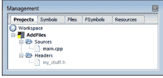

**图 7-3：**“管理”窗口显示用于编译项目的文件。

项目中有多个文件后，你可以将一部分源代码放在一个文件中，另一部分放在另一个文件中。但在这样做之前，你可能想阅读本章的其他一些小节，因为它们解释了如何正确划分源代码，而不至于让它变得像你想切蛋糕时却把蛋糕压扁了一样。

### 删除现有的源代码文件

如果你向 Code::Blocks 添加了一个确实不需要的文件，请在“管理”窗口中右键单击该文件，然后从上下文菜单中选择“从项目中移除文件”。该文件将从项目中消失，但仍会出现在你创建它时所在的目录中。

如果你后来决定确实需要该文件，请在“管理”窗口中右键单击项目条目，从上下文菜单中选择“添加文件”，然后使用“将文件添加到项目”对话框中的选项选择要添加回项目的文件。

### 使用多个现有文件创建项目

有时你有许多现有文件，但没有项目来容纳它们。例如，你可能正从另一个 IDE 迁移到 Code::Blocks。这意味着你会有来自另一个 IDE 的源文件，但没有 Code::Blocks 能够识别的项目文件。别担心：你可以将现有文件放入 Code::Blocks 项目中。以下步骤告诉你如何执行此过程（你可以通过打开 CopiedFiles 项目来查看结果）：

- 1. 在 Code::Blocks 起始页上选择“创建新项目”。

你将看到本书到目前为止用于创建所有示例的“从模板新建”对话框。

- **2. 选择“空项目”模板，然后单击“开始”。**

你将看到一个“空项目”欢迎对话框。下次可以通过选择“下次跳过此页”来跳过此对话框。“空项目”模板允许你创建一个不含任何文件的项目外壳。

- **3. 单击“下一步”。**

你将看到“空项目”配置对话框，如图 7-4 所示。在这里，你提供的是项目名称，而不是项目中使用的文件。

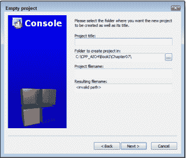

**图 7-4：**为你的新应用程序提供项目名称。

- **4. 在“项目标题”字段中键入项目名称。**

该示例使用 CopiedFiles。请注意，向导会自动为你填写“项目文件名”字段。

- **5. 单击“下一步”。**

向导要求你提供编译器、调试配置和发布配置的常规信息。在大多数情况下，默认设置即可正常工作。

- **6. 单击“完成”。**

Code::Blocks 会为你创建一个空项目，你可以根据需要添加文件。

- **7. 在“管理”窗口中右键单击 CopiedFiles 项目条目，然后从上下文菜单中选择“添加文件”。**


你会看到如图 7-5 所示的“Add Files to Project”（添加文件到项目）窗口。由于这是一个空项目，所以只有项目（.cbp）文件出现。

当然，你需要向项目添加文件才能使其有用。对于本例，你可以使用本章上一节创建的 AddFiles 示例中的文件。在实际使用中，你需要知道要用哪些文件来创建新项目，以及它们的位置。

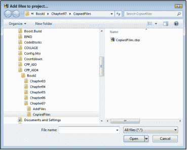

**图 7-5：** 当前目录不包含任何代码文件。

- 8. **导航到 AddFiles 文件夹，如图 7-5 所示。**
  
  注意，你会在该文件夹中看到 `main.cpp` 和 `my_stuff.h` 文件。（你可能还会看到其他文件，目前可以安全地忽略它们。）

- 9. **找到并突出显示你要复制到新项目的文件，在本例中是 `main.cpp` 和 `my_stuff.h`。**
  
  使用 Ctrl+单击方法从列表中选择多个文件。Code::Blocks 可以轻松地一次选择多个文件，这样你就不必多次打开“Add Files to Project”（添加文件到项目）对话框。
  
  

- 10. **单击“Open”（打开）。**
  
  Code::Blocks 会显示一个对话框，询问要将文件添加到哪些构建目标，如图 7-6 所示。对话框的具体外观会因所选文件的数量而异。
  
  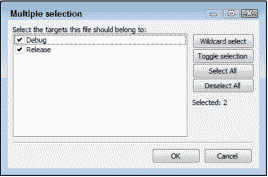
  
  **图 7-6：** 选择使用这些文件的构建目标。

- 11. **选择你要使用的构建目标，并单击“OK”（确定）。**
  
  Code::Blocks 会将所需的文件引用添加到项目中，如图 7-7 所示。
  
  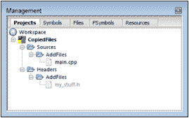
  
  **图 7-7：** 新项目现在包含对所选文件的引用。


**警告**

注意，图 7-7 中的引用仍然显示文件的原始位置。在本例中，这些文件来自 AddFiles 项目。如果你在原始项目中更改了文件，新项目中的文件也会随之更改。

你还会注意到“File → Save”（文件→保存）命令处于禁用状态。这是因为你无法在引用这些文件的项目中保存对文件引用的更改；你必须先在原始项目中进行更改。不过，既然你已经有了对文件的引用，你就可以对其进行修改，然后使用“File → Save As”（文件→另存为）命令创建包含你所做更改的文件本地副本。不要使用“File → Save”（文件→保存）命令；请改用“File → Save As”（文件→另存为）创建本地副本。

遗憾的是，仅仅创建本地副本并不会改变你的项目。要从原始项目中移除引用，请在“Management”（管理）窗口右键单击项目条目（在本例中为 CopiedFiles），然后从上下文菜单中选择“Remove Files”（移除文件）。你会看到如图 7-8 所示的“Multiple Selection”（多选）对话框，可以在其中选择要移除哪些引用、保留哪些引用。

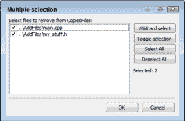

**图 7-8：** 移除你不再需要的引用。

移除不再需要的引用后，你可以使用前面列表中的步骤 7 到 11，将文件的本地副本添加到当前项目。“Management”（管理）窗口将发生变化，显示你正在使用文件的本地副本，而不是另一个项目中的副本。

## 让多个文件相互交互

两个源文件要协同工作，它们必须以某种方式了解彼此。仅仅因为它们都位于计算机上，并不意味着它们知道彼此的存在。计算机在这方面有点笨拙。要让两个源文件最终打开心扉、彼此了解，你需要让每个文件都知晓另一个文件中的内容。

当你编写一个函数时，通常该函数必须出现在同一源文件中对它的任何调用之前。这是因为编译器解析代码的方式：如果编译器遇到对某个函数的调用，但尚未见过该函数，就会报错。解决这个问题的方法是使用函数原型。*函数原型*就是函数的首行，以分号结尾，如下所示：

```cpp
void BigDog(int KibblesCount);
```

在源文件后面才是实际的函数，它重复了这一首行。但不用分号，函数会有一个左花括号、函数代码和一个右花括号，如下所示：

```cpp
void BigDog(int KibblesCount)
{
    cout << "I'm a lucky dog" << endl;
    cout << "I have " << KibblesCount << " pieces of food"
         << endl;
}
```

## 拆分源代码文件

因此，有了函数原型之后，无论函数代码本身在调用之前还是之后，你都可以调用该函数。


对于编译器来说，要理解一次函数调用，它只需在代码发出调用时看到一个函数原型即可。至于该函数是否真的存在，则由链接器（一种特殊的应用程序，它接收编译器创建的目标文件，并通过将所有内容链接在一起来生成可执行文件）负责。

因为函数调用只需要函数原型，所以你可以把函数本身放在另一个源代码文件中。因此，你可以像 MultipleSourceFiles 示例那样，拥有两个独立的源代码文件，如清单 7-1 和清单 7-2 所示。（第一个源代码文件 main.cpp 见清单 7-1，第二个源代码文件 mystuff.cpp 见清单 7-2。）

### 清单 7-1：仅使用原型调用函数

```cpp
void BigDog(int KibblesCount);

int main() {
    BigDog(3);
    return 0;
}
```

### 清单 7-2：从单独的文件中使用函数

```cpp
#include <iostream>

using namespace std;

void BigDog(int KibblesCount) {
    cout << "I'm a lucky dog" << endl;
    cout << "I have " << KibblesCount << " pieces of food"
         << endl;
}
```

清单 7-1 和 7-2 将函数与原型分开了。当你把这两个文件作为一个应用程序一起编译时（可以按 F9，也可以选择“Build → Build and Run”（构建→构建并运行）），它们就能很好地组合在一起。然后你可以运行该应用程序，会看到如下稍微有点意思的输出：

```text
I'm a lucky dog
I have 3 pieces of food
```

### 命名空间快速概览

清单 7-2 中的 `using namespace std;` 一行告诉编译器使用一个特定的命名空间 `std`。`namespace`（命名空间）是类和函数的分组。`std`（标准）命名空间包含许多有用的类和函数，例如 `string`。如果你不包含这条声明，就需要在使用 `std` 中的类或函数时，在每个类或函数前面加上 `std::`。例如，要使用 `string`，你需要输入 `std::string`。由于这样写代码很痛苦，所以要加上 `using namespace std;` 这一行。

注意，`main.cpp` 既没有包含 `#include <iostream>`，也没有包含 `using namespace std;`，因为它没有对 `cout` 的任何调用，只有对 `BigDog()` 的调用。你确实需要在 `mystuff.cpp` 文件开头加上 `#include <iostream>` 和 `using namespace std;`，因为 `mystuff.cpp` 使用了 `cout`。

### 使用头文件共享

将源代码拆分成多个文件很容易，但很快你可能会遇到一个问题。如果你有一个函数——比如 `SafeCracker()`——而且这个函数非常有用，可能会被多个其他源代码文件多次调用，你就需要在每个调用它的文件中都有一个 `SafeCracker()` 的原型。该原型可能如下所示：

```c++
string SafeCracker(int SafeID);
```

但有一种更简单的方法来添加原型，而不必把它加到每个使用该函数的文件中。只需将这一行放到一个独立文件中，这个文件称为头文件，并给文件名加上 `.h` 或 `.hpp` 扩展名即可。（使用哪种扩展名由你决定，因为真的无所谓；大多数开发者使用 `.h`。）在本例中，你将 `string SafeCracker(int SafeID);` 这一行放在名为 `safestuff.h` 的文件中。

然后，你不必在每个需要该函数的文件开头输入函数首行，只需输入

```c++
#include "safestuff.h"
```


然后你将拥有用于 `MultipleSourceFiles2` 示例的三个源代码文件，如清单 7-3、7-4 和 7-5 所示：

- `main.cpp`：调用该函数
- `safestuff.h`：包含函数原型
- `safestuff.cpp`：包含函数原型出现在头文件中的函数的实际代码

文件很多，但现在代码已被拆分成可管理的片段。另外，请确保将这三个文件都保存在同一个目录中。

### 清单 7-3：在主文件中包含头文件

```cpp
#include <iostream>
#include "safestuff.h"

using namespace std;

int main()
{
    cout << "Surprise, surprise!" << endl;
    cout << "The combination for Safe 12 is: " << endl;
    cout << SafeCracker(12) << endl;
    cout << "Let's check on Safe 11 too: " << endl;
    cout << SafeCracker(11) << endl;
    return 0;
}
```

### 清单 7-4：在头文件中包含函数原型

```cpp
#ifndef SAFESTUFF_H_INCLUDED
#define SAFESTUFF_H_INCLUDED

using namespace std;

string SafeCracker(int SafeID);

#endif // SAFESTUFF_H_INCLUDED
```

### 清单 7-5：包含实际函数代码

```cpp
#include <iostream>
using namespace std;

string SafeCracker(int SafeID)
{
  if (SafeID == 12)
    return "13-26-16";
  else
    return "Safe Combination Unknown";
}
```

在编译此应用程序之前，你需要了解一些关于编译过程如何工作的知识：

- 当你编译一个 .cpp 文件时，编译器会输出一个 .o（代表 object）文件，然后链接器会将该文件与所有其他 .o 文件链接起来，以创建 .exe（可执行）文件。除了来自你的项目的 .o 文件之外，链接器还会链接你的应用程序访问的任何库文件或外部代码。
- 编译器不会将头文件编译成单独的 .o 文件。对于清单 7-3 到 7-5 中的应用程序，编译器只创建两个输出文件：`main.o` 和 `safestuff.o`（你可以在 `CPP_A104\Book1\Chapter07\MultipleSourceFiles2\obj\Debug` 文件夹中看到它们）。
- 当编译器读取 `main.cpp` 文件并到达头文件的 `#include "safestuff.h"` 行时，它会验证之前是否尚未读取 `safestuff.h` 文件并将其包含在 .o 文件中。
- 如果之前尚未读取 `safestuff.h` 文件，编译器会暂时切换过去并读取该头文件，假装它仍在读取同一个 `main.cpp` 文件。随着它继续，它会编译所有内容，就像它们都是 `main.cpp` 文件的一部分一样。


如果你在其他源代码文件中包含 `safestuff.h` 头文件，编译器也会将该内容添加到那些源文件中。编译并运行清单 7-3 到 7-5 中的代码。运行该应用程序时，你会看到以下输出：

```text
Surprise, surprise!
The combination for Safe 12 is:
13-26-16
Let's check on Safe 11 too:
Safe Combination Unknown
```


如果你有一个包含一些函数的源文件，创建一个包含相关函数原型的头文件通常是一种好做法。然后你可以将头文件命名为与源文件相同，但使用不同的扩展名。在此示例中，你使用 `safestuff.h` 文件来保存 `safestuff.cpp` 文件的函数原型。

## 仅添加一次头文件

Code::Blocks 默认会在头文件中包含几行代码。这些行会创建一个符号，告诉编译器某个头文件是否已经包含在源文件中，以便编译器不会再次添加它。将头文件添加两次是错误的，因为这样你会两次定义函数的前向引用。以下是使用 Code::Blocks 初始创建头文件时看到的内容：

```cpp
#ifndef SAFESTUFF_H_INCLUDED
#define SAFESTUFF_H_INCLUDED
#endif // SAFESTUFF_H_INCLUDED
```

在 Code::Blocks 中输入头文件代码时，请将其输入在 `#define SAFESTUFF_H_INCLUDED` 和 `#endif // SAFESTUFF_H_INCLUDED` 行之间。本章后面的“使用神秘的头文件包装器”一节详细描述了这些自动条目。

## 使用尖括号或引号

你可能已经注意到清单 7-3 中代码的一些特点。包含 `safestuff.h` 文件时，你没有像 `#include <iostream>` 行那样将它放在尖括号内，而是将它放在引号内：

```cpp
#include "safestuff.h"
```

这是因为多年来程序员一直在争论头文件究竟应该放在硬盘上的哪个位置。问题是要将它们放在与项目相同的目录或文件夹中，还是将它们单独放在一个目录中。


无论你将头文件放在哪里，以下是何时使用引号以及何时使用尖括号的规则：编译器会在多个目录中查找头文件，并且可能会在与源文件相同的目录中查找。如果你使用尖括号（即小于号和大于号），如 `#include <string>`，编译器不会在与源文件相同的目录中查找。但如果你使用双引号，如 `#include "safestuff.h"`，编译器会首先在与源文件相同的目录中查找。如果编译器在那里找不到头文件，它会像使用尖括号时那样，在其余目录中查找。

有些人总是使用双引号。这样，无论头文件是否与源文件位于同一目录中，编译器都应该能找到它。如今，大多数专业程序员总是使用尖括号。这迫使程序员将头文件放在公共区域中。对于真正的大型项目，程序员喜欢有一个专门用于源文件的目录，以及另一个专门用于头文件的目录。头文件永远不会与源文件位于同一目录中。


对于小型项目，有些人喜欢将所有源文件和头文件都放在一个目录中。这些人通常对系统头文件使用尖括号（如 `#include <string>`），并对自己编写的头文件使用双引号。本书中的项目通常遵循此规则。示例头文件与源文件位于同一目录中，并且 `#include` 行使用双引号。系统头文件的 `#include` 行使用尖括号。


如果你遵循此处使用的相同方法，你可以立即知道 `#include` 行指的是你自己的某个头文件还是另一个头文件。如果它指的是你自己的头文件，则使用双引号。

如果你开始处理一个大型 C++ 项目，你可能会发现项目经理使用始终使用尖括号的规则。对于大型项目，这通常是最佳策略。


如果你尝试编译并在 `#include` 行上收到 `No such file or directory` 错误，很可能是因为你将头文件放在源文件目录中，但使用了尖括号而不是双引号。尝试将该行改为双引号。

## 在源文件之间共享变量

当你在函数内声明变量时，它会保持为该函数的局部变量。但你可能希望函数共享一个 *全局* 变量：一个函数可能存储某些内容，另一个函数可能读取其内容并将其写入控制台。为此，请在函数外部声明该全局变量。在单个源文件内声明全局变量可以起作用，直到你尝试在多个源文件之间共享它。如果不小心，源文件最终会得到该全局变量的单独副本。在单个源文件内，全局变量可以在函数之间共享，但不能在源文件之间共享。这可能会令人困惑。

有一个技巧可以让这起作用。在一个且仅一个源文件中声明该变量。然后在一个（且仅一个）头文件中 *再次* 声明它，但在它前面加上 `extern` 一词，如 `extern int DoubleCheeseburgers;`。


清单 7-6、7-7 和 7-8 中展示的 GlobalVariable 示例，演示了如何使用一个在多个源文件之间共享的单一全局变量。

### 清单 7-6：使用全局变量

```cpp
#include <iostream>
#include "sharealike.h"

using namespace std;

int main()
{
    DoubleCheeseburgers = 20;
    EatAtJoes();
    return 0;
}
```

### 清单 7-7：使用 sharealike.h 头文件声明全局变量

```cpp
#ifndef SHAREALIKE_H_INCLUDED
#define SHAREALIKE_H_INCLUDED

extern int DoubleCheeseburgers;
void EatAtJoes();

#endif // SHAREALIKE_H_INCLUDED
```

### 清单 7-8：在 sharealike.cpp 文件中声明全局变量存储

```cpp
#include <iostream>
#include "sharealike.h"

using namespace std;

int DoubleCheeseburgers = 0;

void EatAtJoes() {
    cout << "How many cheeseburgers today?" << endl;
    cout << DoubleCheeseburgers << endl;
}
```

这样做时要小心；要完全做对非常棘手。你在头文件中声明变量一次，但必须记住单词 extern。它告诉各个文件：“这个变量在别处声明，但这里给出了它的名称和类型，以便你可以使用它。”（定义该变量的文件同时包含含有 extern 声明的头文件也没问题。在这种情况下，extern 表示该变量在某个地方声明，而不是说它是在此文件之外外部声明的。）然后，你在某个源文件中声明该变量，但不加单词 extern；这会为变量创建实际的存储单元。最后，在每个使用该全局变量的源文件中包含该头文件。


声明任何变量却不初始化它，都是个坏主意。如果不初始化变量，你就不知道它包含什么。不初始化变量可能导致难以发现的错误。在这方面，全局变量甚至更糟，因为现在你甚至不太清楚该到哪里去查找。幸运的是，Code::Blocks 在这方面能帮助你。你可以右键单击全局变量的任意出现位置，然后从上下文菜单中选择 `Find Occurrences Of: <Variable Name>`。

### 使用神秘的头文件包装器

包含头文件时，你通常希望每个源文件只包含它一次。但这可能产生问题：假设你有一个大型软件项目，并且有几个头文件包含了你的另一个头文件 superheader.h。如果你包含了所有这些其他头文件，如何确保只拾取 superheader.h 文件一次？

答案看起来奇怪，但确实有效。你以这些行开始每个头文件：

```c
#ifndef SHAREALIKE_H_INCLUDED
#define SHAREALIKE_H_INCLUDED
#endif
```


取决于你使用哪个 C++ IDE，你的编辑器可能会自动添加这些行，就像 Code::Blocks 那样。在这种情况下，你把头文件内容输入到 #define SHAREALIKE_H_INCLUDED 和 #endif 行之间。但是，如果你的 IDE 不会自动添加这些行，请务必自行添加，使你的代码看起来像清单 7-7 中的代码。否则，编译器可能会喷出一堆你可能无法立即识别的错误。

这些通常被称为*头文件包装器*的东西，确保每次编译时，头文件中的代码对每个源代码文件只处理一次。包装器使用称为*预处理器指令*的特殊行。基本上，*第二行*定义了某种类似于变量但仅在编译期间使用的东西；这个东西称为*符号*。在本例中，该符号称为 `SHAREALIKE_H_INCLUDED`。

第一行检查这个*符号*是否已被定义。如果没有，编译器继续执行后面的代码行。下一行定义该*符号*，所以现在它实际上已为后续使用而定义。然后编译器处理文件中其余所有行。最后，最后一行 `#endif` 只是结束最开始的那一行。

现在考虑一下，如果你两次包含同一个文件，就像下面这样，会发生什么：

```cpp
#include "sharealike.h"
#include "sharealike.h"
```

（如果你包含两个不同的文件，而它们各自又包含 `sharealike.h`，这种情况就可能间接发生。）编译器第二次遍历 `sharealike.h` 时，会看到第一行，该行检查 `SHAREALIKE_H` 符号是否已定义。但这一次它已定义！因此，编译器不会再次遍历所有行，而是跳到通常出现在文件末尾的 `#endif` 行。这样，你的头文件对每个源代码文件只处理一次。使用以下规则可以让使用头文件更容易：


创建头文件时，务必在其周围放置*头文件包装器*。你可以使用任何喜欢的*符号名*，只要它仅包含字母、数字和下划线，不以数字开头，并且不是源代码中已有的变量名或 C++ 单词。但大多数人的选择基于文件名本身的某种变体，例如 `MYFILE_H`、`MYFILE_H_`，甚至 `_MYFILE_H_`。按照惯例，Code::Blocks 会给每个符号名添加 `_INCLUDED`，但除非你愿意，否则不必照做。

### 本章内容

- 使用两种内存：栈和堆
- 通过指针访问变量地址
- 使用 `new` 关键字在堆上创建变量
- 将指针作为参数并返回指针

## 第 8 章：通过指针引用数据

你住在哪里？不要大声说出来，因为成千上万的人正在读这本书，你不想让他们全都知道。所以只需想想你的地址。大多数地方都有某种地址，以便邮件服务知道把你的包裹送到哪里，有线电视安装员也能在现在到下周四 5:00 之间的某个时间出现。（所以一定要确保你在那里。）

其他东西也有地址。例如，办公楼里的一家大公司很可能给所有格子间都编了号。建筑物中的办公室通常有编号，公寓通常也有编号。

现在假设有个叫 Sam 的人在 180 号办公室工作。然而上周，Sam 因为花太多时间上网而被赶出门。现在 Sally 获得了 180 号办公室的优先使用权，尽管她并不是接替 Sam 的职位。Sam 搬走了；Sally 搬进来了。同一间办公室——待在那里的人不同。

计算机内存的工作原理类似。计算机内存的每一小部分都关联着一个表示其位置或地址的数字。在本章中，你会发现，在确定存储在内存中的变量的地址之后，你可以用它做强大的事情，这会为你提供创建强大应用程序的工具。


如果 C++ 编程中有哪个单一主题最重要，那就是指针的概念。因此，如果你想成为百万富翁，就读这一章吧。好吧，它可能不会让你成为百万富翁，但这样建议*也许*能给你掌握这一章的动力。然后你就能成为一流程序员，赚很多钱。


你不必手动输入本章的源代码。事实上，使用可下载的源代码要容易得多。你可以在可下载源代码的 `\CPP_AIO4\Book1\Chapter08` 文件夹中找到本章的源代码。有关如何找到这些源文件的详细信息，请参阅引言。

### 了解 C++ 20 中指针的变化

如果你完全不理解指针，不妨先阅读本章其余部分，从“堆与栈变量”开始，然后再回到这第一节。

当然，C++ 将始终需要指针，但长期使用 C++ 的用户一直把指针视为负担，而新 C++ 用户则把指针视为某种英雄式的噩梦般的成人礼。那么，目标就是随着 C++ 不断成长和成熟，让指针更易于使用、更一致地使用。以下各节讨论 C++ 指针在 C++ 20 中如何变化。

#### 避免代码出错

*原始指针*，即你使用 `new` 运算符分配的指针，在代码中起着重要作用。你经常看到它被用于以下目的：

- **动态分配：** 允许应用程序按需分配更多内存
- **运行时多态：** 允许应用程序传递在不同时间可能指向不同种类数据的指针


- **可空引用：** 处理指针不指向任何对象的实例
- **避免复制：** 使用对象的单一副本而不是创建多个副本，从而降低出错风险

随着你对 C++ 知识的增长，你很快会发现这些是关键的应用程序需求，因此替换原始指针将相当困难。幸运的是，即使你使用的是 C++ 编译器，也不必立即使用新的 C++20 特性。你可以通过编译指令控制应用程序是否使用新方法：

```cpp
#feature <no_pointers> //opt-in to no pointers
#feature <cpp20>       //opt-in to all C++20 features
```

因此，你不必担心现有代码会突然崩溃。其理念是让从原始指针到更好方案的过渡尽可能平滑和透明。鉴于 C++ 开发的现实情况，你很可能会在很长一段时间内看到某种形式的遗留支持。然而，为了向前发展，你必须适应 C++ 中指针的新现实。

## 考虑这些问题

此时，你可能会想，为什么原始指针会是一个如此大的问题。毕竟，指针只是内存中的一个地址，看起来类似于 0x9caef0。它包含的值就是地址，通过解引用指针，查看它指向的地址，你就能看到该指针所引用的值。这就像你房子的地址。你把邮件寄到该地址，但地址并不是你的房子——它只是指向你房子的指针。

此时，这听起来似乎使用指针并不会成为问题，尽管它有点绕。一开始使用指针的原因是为了避免在代码中携带大型对象。你可以让对象（比如房子）留在原地，只在需要时指向它。想象一下，你不得不把房子带在身边。除了会腰酸背痛之外，这样做既不方便，也会让你的房子更难找到。相反，你把地址交给想要给你寄信或拜访你家的人。早期应用程序必须高效利用每一丁点内存和 CPU 处理周期，否则就会面临性能问题。指针让早期应用程序能够通过简单地指向内存中的大型对象而不是传递它们来获得良好性能。

## 给 C++ 施个十六进制魔咒

在计算机编程中，你迟早会遇到一种在计算机上表示数字的奇怪方式。这种奇怪的方式称为*十六进制*，有时简称为*hex*。在 C++ 中，你可以通过以字符 0x 开头来识别十六进制数。这些字符实际上并不是数字的一部分；它们只是像双引号表示字符串那样来表示它。通常的十进制数由数字 0、1、2、3、4、5、6、7、8 和 9 组成，而十六进制数由这些数字再加上六个数字组成：A、B、C、D、E 和 F。这样总共就是 16 个数字。想象用常规十进制数计数的一个好方法是使用汽车里的里程表，它（如果你诚实的话）只向前走，不向后走。它从 00000000 开始（假设有八位数字，这很多）。最右边的数字从 0 到 9 反复运行。当任何数字达到 9，且该数字右侧的所有数字都是 9 时，左边下一位数字就加 1。例如，当你到达 00000999 时，随着每个 9 回到 0，左边下一位数字加 1，得到 00001000。

使用十六进制数时，你以同样的方式计数，只是不在 9 处停止并循环回绕，而是接着到 A，然后 B，一直到 F。然后再循环回绕。因此，前 17 个十六进制数（使用八位数字）是 00000000、00000001、00000002、00000003、00000004、00000005、00000006、00000007、00000008、00000009、0000000A、0000000B、0000000C、0000000D、0000000E、0000000F、00000010。注意，当你在末尾到达 F 时，数字再次回绕，并向左边下一位数字加 1。处理十六进制数时，你可能会看到像 0xAAAA0000 和 0x0000A3FF 这样的数字。顺便说一句，每个数字加 1 分别是 0xAAAA0001 和 0x0000A400。

指针最大的问题与房屋地址带来的问题相同。你需要想想你收到过多少次邻居的邮件（反之亦然）。同样，应用程序可能拥有无效指针，当代码试图处理这个无效地址时，往往会导致应用程序崩溃。当然，最糟糕的问题就是空指针 `0x00000000`，你期望它指向某个东西。空指针却什么也不指向。

指针的另一个问题是，你要花大量时间管理它们，而谁能记住所有那些代码呢！每次使用指针时，你都有风险：

- **造成内存泄漏：** 由于没有释放指针以便复用内存，该内存对应用程序变得不可访问。即使还有可用内存，你也可能真的耗尽内存。应用程序终止后，操作系统释放内存，该内存才会再次可用。
- **使用未初始化的内存：** 内存位置可能包含任何内容，如果你对该内存位置中的数据执行操作，应用程序会表现异常或直接崩溃。
- **获取错误数据：** 应用程序可能指向错误的位置，而你也许并不知道。这意味着应用程序正在使用错误的数据，可能导致意外输出或数据损坏。

## 编写更整洁、更少出错的代码

要编写更整洁、错误更少的代码，你需要找到一种方法，既能获得指针的效果，又没有任何指针的缺点。C++ 委员会一直在研究这个问题。例如，`std::auto_ptr` 在 C++11 中已弃用（计划删除，但仍允许使用），并在 C++17 中移除。以下是一些绕过指针的现代方法：

- **使用智能指针：** Boost（在第 7 本书第 4 章中说明）长期以来一直提供对智能指针的访问，许多开发者使用它们，因为它们使动态分配和运行时多态更容易处理。使用智能指针，例如 `std::unique_ptr` 或 `std::shared_ptr`，可以消除你手动管理内存的需要。相反，智能指针会为你处理内存管理需求，这样你就可以专注于编写业务逻辑，而不是执行底层编程任务。
- **依赖可选指针：** C++17 引入了 `std::optional`，作为处理可空引用的手段。当可选指针为空时，它的值为 `std::nullopt`，这在处理它们时实际上是一个需要了解的重要事项。唯一的问题是，该实现存在缺陷，因为它缺少对引用（指向指针的指针）的支持，并且没有一元（实体运算符）接口（参见 http://www.open-std.org/jtc1/sc22/wg21/docs/papers/2017/p0798r0.html ，其中讨论了这个本书未涵盖的极其高级的概念）。简而言之，它无法做到原始指针能做到的事情，但这些问题在 C++20 中已得到修复。
- **传递对象：** 现代计算机的资源限制远不如过去的计算机那样严重，因此现代语言通常传递对象，而不是创建指向它们的指针。该解决方案解决了消除不必要副本的需求。C++20 为这项任务提供了两种解决方案，二者都依赖于使用函数外部的对象 `obj`，直接构造函数内部初始化并从函数返回的对象的理念。

你可以将此优化视为：`T obj = f();`，其中 `f()` 是一个函数，用于初始化类型为 `T` 的 `obj`。以下是这些优化的不同之处：

- **返回值优化（RVO）：** 在这种情况下，你可能有一个如下所示的函数：

```
T f() {
    ... // Do something here.
    return T(constructor arguments);
}
```

在这种情况下，你可能创建三个类型为 T 的对象：由 return 语句创建的未命名临时对象；由 `f()` 返回给调用者的临时对象；以及从 `f()` 的返回值复制而来的命名对象 `obj`。使用 RVO 会通过 `f()` 函数体内传入的参数直接初始化 `obj`，从而消除这两个临时对象。这实际上是一个复杂的话题，超出了本书的范围，但你可以通过 `https://shahmike.com/cpp/rvo/` 阅读关于该主题细节的讨论。


- **具名返回值优化（NRVO）：** 当 return 语句使用具名值时，这种优化形式比 RVO 更进一步，如下所示：

```
T f() {
    ... // Do something here.
    T result(constructor arguments);
    return result;
}
```

这种技术有效地用用于保存结果的对象替换了函数内部的隐藏对象和具名对象。唯一需要注意的是，result 必须是唯一的，以便编译器知道应使用 `f()` 内的哪个对象来构造 `obj` 中的内存。NRVO 是一种特殊的复制省略（将对象连接或合并的过程），在 `https://en.cppreference.com/w/cpp/language/copy_elision` 中有详细讨论。

## 通过指针引用数据


### 堆与栈中的变量

C++ 应用程序使用两种内存：

- **堆：** 内存中的一个公共区域，你可以在其中存储全局变量。这里也是你存储从内存中分配的对象和变量的地方。


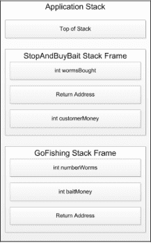

**图 8-1：** 示例代码使用的两个栈帧。


从栈的角度看，代码首先为 `GoFishing()` 创建一个栈帧。在这个栈帧上，它创建一个变量，该变量保存一个指针，其中包含调用者的返回地址（在本例中该地址未知）。向栈中添加值称为*压入*。`GoFishing()` 创建两个变量：`baitMoney` 和 `numberWorms`。从栈的角度看，因为 `GoFishing()` 先创建 `baitMoney`，所以它也先出现在栈上。

当 `GoFishing()` 调用 `StopAndBuyBait()` 时，它传递一个实参，`GoFishing()` 将其视为 `baitMoney`。然而，`StopAndBuyBait()` 将该形参视为 `customerMoney`。`GoFishing()` 传递给 `StopAndBuyBait()` 的实参首先作为形参出现在应用程序为 `StopAndBuyBait()` 创建的栈帧中，随后是 `GoFishing()` 的返回地址。因此，在 `StopAndBuyBait()` 执行哪怕一行代码之前，它的栈帧上就已经有两个变量了。

此时，`StopAndBuyBait()` 可以选择创建一个局部变量 `wormsBought`。注意，在栈帧中，形参首先出现，然后是调用者的返回地址，最后是局部变量。当 `StopAndBuyBait()` 决定要返回给 `GoFishing()` 什么时，它将该值放入 `numberWorms`，因为 `numberWorms` 被设置为接收这个返回值。

## 十六进制与十进制之间的转换

每个十六进制数都有一个十进制等值。当你列出十进制数与十六进制数并排的清单时，例如你会看到 0x0000001F 与十进制数 31 相邻。因此，这两个数表示相同数量的物品，比如苹果。

你可以使用大写或小写字母来表示十六进制数。但是，不要在同一个数中混用大小写，因为这会使数字极其难以阅读，其他开发者也会犯错。不要使用 0xABab0000。相反，应使用 0xabab0000 或 0xABAB0000。

如果你想在十六进制和十进制之间转换，可以使用位于 https://www.binaryhexconverter.com/hex-to-decimal-converter 的十六进制转十进制转换器应用程序，或位于 https://www.binaryhexconverter.com/decimal-to-hex-converter 的十进制转十六进制转换器应用程序。这两个应用程序使两种数制之间的转换变得容易，而且你可以在任何支持浏览器的设备上使用它们。

要将十六进制数转换为十进制，请选择十六进制转十进制转换器应用程序，并使用数字键和字母 A 到 F 将十六进制数输入到 Hex Value 字段中，例如 FB1263。（你不需要输入开头的零，例如 00FB1263——它们不会显示出来——也不需要输入 C++ 中使用的 0x。）完成全部输入后，单击 Convert。应用程序会立即将十六进制数转换为十进制数！在本例中，你会看到 16454243。你也可以反过来操作：如果你有一个十进制数，例如 16454243，你可以选择十进制转十六进制转换器应用程序，将其值输入到 Decimal Value 字段中，然后单击 Convert 将其转换为十六进制。如果将 16454243 转换为十六进制，你会得到 FB1263，也就是你一开始的数。

当 Windows 计算器处于程序员视图时，它也能轻松地在十六进制和十进制之间转换，如下图所示。该计算器还支持二进制（基数为 2）和八进制（基数为 8）数。只需选择你想使用的基数，计算器就会自动执行转换。（你可用于执行此任务的具体计算器功能取决于你的 Windows 版本。http://blog.johnmuellerbooks.com/2012/01/30/examining-the-calculator-in-windows-7/ 上的博客文章抱怨了 Windows 7 带来的变化。Windows 10 提供了更多同类功能。）

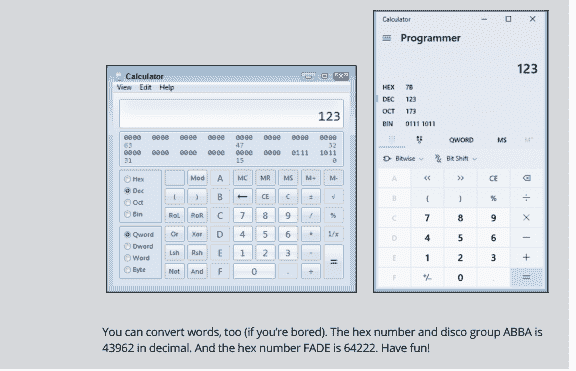

你也可以转换单词（如果你无聊的话）。十六进制数，也是迪斯科组合名，ABBA 的十进制值是 43962。十六进制数 FADE 的十进制值是 64222。玩得开心！

然后，应用程序开始通过弹出（移除）栈上的值来拆除 `StopAndBuyBait()` 栈帧。它会丢弃 `wormsBought`（如果 `StopAndBuyBait()` 创建了它），因为应用程序已经将该值放入了 `numberWorms`。应用程序会保存 `GoFishing()` 的返回地址以供后续使用。然后它会丢弃 `customerMoney` 并移除该栈帧。

返回地址是一个指向内存中特定位置的指针，该位置标记了 `GoFishing()` 代码中的继续执行点。因此，下一步是读取 `GoFishing()` 在从 `StopAndBuyBait()` 返回之后的下一条处理指令。

## 获取变量的地址

因为每个变量都存在于内存中的某个位置，所以每个变量都有一个地址。如果你有一个函数声明了一个名为 `NumberOfPotholes` 的整数变量，那么当你的应用程序调用这个函数时，计算机将在内存中的某个位置为 `NumberOfPotholes` 分配空间。


如果你想找到变量 `NumberOfPotholes` 的地址，只需在它前面加上一个与号（&）。清单 8-1 展示了 `VariableAddress` 示例，它获取一个变量的地址并打印出来。

### 清单 8-1：使用 & 字符获取变量的地址

```cpp
#include <iostream>

using namespace std;

int main() {
    int NumberOfPotholes = 532587;
    cout << &NumberOfPotholes << endl;
    return 0;
}
```

当你运行这个应用程序时，控制台上会出现一个十六进制数。这个数可能与我们的不同，而且每次运行应用程序时它也可能相同或不同。结果取决于计算机究竟如何为你分配变量以及它执行操作的顺序。不同编译器版本之间可能差异很大。当你运行清单 8-1 时，会看到类似以下的内容（每次运行都会变化）：

```text
0x22ff74
```


你从这个应用程序看到的输出是名为 `NumberOfPotholes` 的变量的地址。换句话说，那个数字是 `NumberOfPotholes` 变量在内存中存储位置的十六进制形式。输出不是变量的内容，也不是变量内容转换成的十六进制；相反，它是变量的十六进制地址。

知道变量的地址并不能告诉你变量的内容，但 C++ 程序员会以其他方式使用地址：

- 使用所谓的指针变量直接修改变量内容。*指针变量与其他变量一样，只不过它存储另一个变量的地址。*
- 执行本章“避免损坏代码”一节中提到的任何任务。
- 使用多种数学技巧间接修改地址所指向的值。
- 基于指针比较对象等实体。

要声明一个指针变量，你需要指定它将指向的变量类型。然后，在变量名前面加上一个星号，如下所示：

```cpp
int *ptr;
```

这一行声明了一个*指向*整数的变量。换句话说，它可以包含一个整数变量的*地址*。那么如何获取一个整数变量的地址呢？很简单！使用 `&` 表示法！因此，你可以这样做：

```cpp
ptr = &NumberOfPotholes;
```

这一行将变量 `NumberOfPotholes` 的地址放入 `ptr` 变量中。记住，`ptr` 保存的不是坑洞的数量；相反，它保存的是名为 `NumberOfPotholes` 的变量的地址。


你通过指针所指向项的类型来指定指针的类型。如果一个指针变量指向整数，它的类型就是*指向整数的指针*。在 C++ 表示法中，其类型是 `int *`（中间有空格）或 `int*`（无空格）；输入时带不带空格都可以。如果一个指针变量指向字符串，它的类型就是*指向字符串的指针*，这种类型的表示法是 `string *`。


`ptr` 变量保存的是一个地址，但那个地址上有什么？那个地址就是被称为 `NumberOfPotholes` 的存储单元在内存中的位置。就在内存中的那个位置，存储着 `NumberOfPotholes` 中的数据。


请仔细思考这个指针概念。如果有必要，把这一节重读几遍，直到它牢牢记在你的脑中。然后冥想它。夜里醒来想着它。打电话给陌生人闲聊它。你对指针理解得越多，你的编程生涯就会越好——你也就越有可能赚到一百万美元。

## 使用指针更改变量

当你有一个保存另一个变量地址的指针变量后，就可以使用该指针访问另一个变量中的信息。这意味着你有两种方式访问变量中的信息：使用变量名本身（例如 `NumberOfPotholes`），或使用指向它的指针变量。

如果你想将数字 6087 存入 `NumberOfPotholes`，可以这样做：

```cpp
NumberOfPotholes = 6087;
```


或者，你可以使用指针。要使用指针，首先按如下方式声明它：

```
ptr = &NumberOfPotholes;
```

然后，要修改 NumberOfPotholes，你不能只是给它赋值。相反，要在它前面加一个星号，如下所示：

```
*ptr = 6087;
```

如果 ptr 指向 NumberOfPotholes，那么这两行代码将具有相同的效果：两者都会把值改为 6087。在指针变量前加星号的这个过程称为对指针解引用。请看清单 8-2 中所示的 DereferencePointer 示例，它演示了这一切。

## 清单 8-2：使用指针变量修改原始变量

```cpp
#include <iostream>

using namespace std;

int main() {
    int NumberOfPotholes;
    int *ptr;

    ptr = &NumberOfPotholes;
    *ptr = 6087;

    cout << NumberOfPotholes << endl;
    return 0;
}
```

在清单 8-2 中，main() 的第一行声明了一个整数变量，第二行声明了一个指向整数的指针。下一行获取该整数变量的地址，并将其存入指针。然后第四行通过解引用指针修改原始整数。为了确认指针确实生效，下一行打印 NumberOfPotholes 的值。运行该应用程序时，你会看到以下输出：

```
6087
```

你也可以通过指针读取原始变量的值。请看清单 8-3 中所示的 ReadPointer 示例。这段代码通过指针变量 ptr 访问 NumberOfPotholes 的值。代码取得该值后，会将其保存到另一个名为 SaveForLater 的变量中。

## 清单 8-3：通过指针访问值

```cpp
#include <iostream>

using namespace std;

int main() {
    int NumberOfPotholes;
    int *ptr = &NumberOfPotholes;
    int SaveForLater;

    *ptr = 6087;
    SaveForLater = *ptr;
    cout << SaveForLater << endl;

    *ptr = 7000;
    cout << *ptr << endl;
    cout << SaveForLater << endl;
    return 0;
}
```

运行该应用程序时，你会看到以下输出：

```text
6087
7000
6087
```

注意，代码再次通过 ptr 修改了值——这次改为 7000。运行该应用程序时，你可以看到该值确实改变了，但 SaveForLater 中的值保持不变。这是因为 SaveForLater 是一个独立的变量，与另外两个变量没有关联。然而，另外两个变量彼此关联。

## 指向字符串

指针变量可以指向任何类型，包括字符串。然而，一旦你声明某个变量指向某种类型，它就只能指向该类型。也就是说，与任何变量一样，你不能改变它的类型。编译器不会允许你这样做。

你也可以使用指针访问字符串的各个部分，如清单 8-5 中的 `StringPointer2` 示例所示。

## 清单 8-5：使用指针指向字符串

```cpp
#include <iostream>

using namespace std;

int main() {
    string AMovie;
    string *ptrToString;

    AMovie = "L.A. Confidential";
    ptrToString = &AMovie;

    for (unsigned i = 0; i < AMovie.length(); i++) {
        cout << ((*ptrToString)[i]) << " ";
    }
    cout << endl;

    return 0;
}
```

运行该应用程序时，你会看到电影名称的字母之间带有空格，如下所示：

```
L . A . C o n f i d e n t i a l
```


当你通过指针访问字符串的字符时，需要在星号和指针变量两边加上括号。否则，编译器会混淆：它会先尝试用变量名访问方括号中的索引，然后再应用星号。这个顺序是反的，对计算机来说不合理，因此编译器会给出错误消息。不过，如清单 8-5 所示，使用括号就可以解决这个问题。

该应用程序逐字符遍历整个字符串。字符串的 `length()` 函数会告诉你有多少个字符。循环内部的代码获取各个字符，并在每个字符后打印一个空格。

## 清单 8-6（续）

```cpp
int CheapComputer;
int *ptrToComp;

ptrToComp = &ExpensiveComputer;
*ptrToComp = 2000;
cout << *ptrToComp << endl;

ptrToComp = &CheapComputer;
*ptrToComp = 500;
cout << *ptrToComp << endl;

ptrToComp = &ExpensiveComputer;
cout << *ptrToComp << endl;
return 0;
}
```

这段代码首先初始化所涉及的所有对象——两个整数和一个指向整数的指针。

接下来，代码让指针指向 ExpensiveComputer，并使用该指针把 2000 存入 ExpensiveComputer。然后，它再次通过指针输出 ExpensiveComputer 的内容。

接着，代码改变指针所指向的对象。为此，你将指针设置为另一个变量 &CheapComputer 的地址。下一行把 500 存入 CheapComputer。然后，你再次打印它。

现在，为了强调这一点——以防计算机没在听——你随后让指针重新指向原始变量 ExpensiveComputer。但你没有向其中存储任何内容。这一次，你只是打印这台高性能超级机器的成本。你再次通过解引用指针来完成这件事。运行该应用程序时，你会看到 ExpensiveComputer 中仍然是 2000，也就是最初存入的值。这意味着，在你让指针指向别处并进行一番操作之后，原始变量保持不变。


如果你用一个指针在几个不同变量之间来回切换，要小心。很容易弄不清指针当前指向哪个变量。

## 指针变量使用提示

本节包含使用指针变量的提示。你可以像声明普通变量那样，在单条语句中把两个同类型的指针变量一起声明。但是，你必须给*每一个*变量前面都加上星号，如下行所示：

```
int *ptrOne, *ptrTwo;
```


如果你试图在一行中声明多个指针，但只在第一个指针前加了星号，那么只有那一个是指针。其余都不是。这可能会在之后带来严重麻烦，因为下面这一行可以正常编译：

```
int *ptrOne, Confused;
```

在这里，Confused 不是指向整数的指针；它只是一个整数。小心！


有些人喜欢把星号紧跟在类型后面，如下例所示，以强调该类型是*指向整数的指针*：

```
int* ptrOne;
```

然而，这种做法很容易让后续的任何指针变量漏掉星号。

## 创建新的裸指针

在应用程序中，有些类型的内存使用无法预测，因为在编写代码时并不知道这些需求。例如，从互联网流式传输数据或在数据库中创建新记录，都是不可预测内存使用的例子。处理不可预测的内存需求时，你会根据需要*分配*（请求内存）和*释放*（释放你请求的内存），这一过程称为*动态内存管理*。你使用*堆*——一块未分配的内存区域——来执行动态内存管理。

大多数现代编程语言都提供了替你管理内存的方法。采用这种策略的原因是，较旧的内存管理技术容易出错。使用旧方法时，你经常会看到以下常见内存错误：

- 代码在未先分配内存的情况下尝试使用内存。
- 使用后内存仍保持分配状态，造成内存泄漏。
- 未初始化的内存包含随机数据。

因此，大多数现代语言只允许你用一种简单的方法创建和删除变量，并在后台进行称为*垃圾回收*（释放未使用内存）的过程。C++ 正在朝这个方向发展。不过，这一转变需要一些时间。

到目前为止，你使用包括 new 关键字在内的各种方法分配内存。使用 new 只是表示你需要内存用于某个特定目的。new 关键字在 C++ 20 中已被弃用，并将在 C++ 23 中完全消失。以下各节首先给出两个使用 new 的示例，因为目前所有具有一定复杂度的现有代码中都能看到 new 的使用。其余三节将介绍 C++ 20 更新后的内存管理方法。

## 使用 new

要使用现有方法在堆上声明一个存储槽，首先需要设置一个变量来帮助你跟踪这个存储槽。这个变量必须是一个指针变量。

假设你已经在一个堆上的某处声明了一个整数。（你将在下一段看到如何做到这一点。）奇怪的是，这类变量没有名称。就把它看作堆上的一个整数。然后，对于这个整数变量，你还可以有一个*第二个*变量。这第二个变量不在堆上，它是一个保存该整数变量地址的指针。因此，如果你想访问这个整数变量，就要通过*解引用*指针变量（即查看指针变量所保存的地址）来完成。

要在堆上分配内存，你需要做两件事：第一，声明一个指针变量。第二，调用一个名为 new 的函数。new 函数与其他函数略有不同，因为不需要在它的参数两边加括号。因此，它实际上是一个*运算符*。其他运算符如 + 和 - 用于对整数进行加法和减法。这些其他运算符的行为类似函数，但你不使用括号。

要使用 new 运算符，你需要指定要创建的变量类型。例如，下面这一行会创建一个新的整数变量：

```
int *somewhere = new int;
```

计算机在堆上创建新的整数变量后，会把该整数变量的地址存入 somewhere。这很合理：somewhere 是一个指向整数的指针，因此前面带有 \*（指针）运算符。于是，somewhere 保存了一个整数变量的地址。清单 8-7 中所示的 UseNew 示例演示了使用 new 时指针如何工作。


这段代码调用了 `new`，但同时在括号中提供了一个数字。这个数字一开始就被放入内存中，而不是稍后再赋给它。这一行代码等价于下面两行代码：

```cpp
int *ptr = new int;
*ptr = 10;
```


当你在 `new` 运算符中初始化一个值时，你所做操作的技术术语是*调用构造函数*。原因在于，编译器会向你的应用程序添加大量代码——这些代码在后台运行。这些代码就是*运行时库*。如果你传入一个初始值，该库会包含一个用于初始化整数变量的函数。执行此操作的函数称为*构造函数*。当你运行它时，你就是在*调用*它。因此，你是在调用构造函数。有关构造函数的更多信息，请参见第 2 册第 1 章。

## 释放原始指针

当你通过调用 `new` 运算符在堆上分配内存，并且用完该内存后，你需要让计算机知道这一点，无论这只是很少一点内存还是大量内存。计算机不会提前查看你的代码来判断你是否还会使用该内存。因此，在你的代码中，当你用完该内存时，你要*释放*该内存。

释放内存的方式是调用 `delete` 运算符并传入指针的名称：

```cpp
delete MyPointer;
```

这一行会出现在你用 `new` 分配的指针使用完毕之后。（与 `new` 运算符一样，`delete` 也是一个运算符，并且其参数不需要放在括号中。）

清单 8-9 中所示的 FreePointer 示例完整演示了分配指针、使用指针，然后释放指针的过程。注意 `replace()` 方法的用法，该方法首次出现在第 1 册第 6 章的“替换字符串的部分内容”一节中。你使用箭头运算符（`->`）通过 phrase 访问这个字符串方法。第 2 册第 1 章的“使用类和原始指针”一节更详细地描述了箭头运算符。

**清单 8-9：使用 delete 清理指针**

```cpp
#include <iostream>

using namespace std;

int main() {
    string *phrase =
        new string("All presidents are cool!!!");
    cout << *phrase << endl;

    (*phrase)[20] = 'r';
    phrase->replace(22, 4, "oked");
    cout << *phrase << endl;

    delete phrase;
    return 0;
}
```

运行此应用程序时，你会看到以下输出：

```text
All presidents are cool!!!
All presidents are crooked
```

这段代码分配一个新的字符串并初始化它，将其地址保存在名为 phrase 的指针变量中。代码输出该字符串，对其进行操作，然后再次输出它。最后，代码释放 phrase 所使用的内存。


**TIP** 尽管人们通常说你在*删除指针*或释放指针，但实际上你释放的是指针所指向的*内存*。该指针仍可用于后续的 `new` 操作。


**WARNING** 当你释放内存时，该内存可供其他任务使用。然而，在调用 `delete` 之后，指针仍然指向那个特定的内存位置，即使该内存已经空闲。如果使用该指针却不让它指向其他内容，就会导致错误。因此，在释放指针所指向的内存后，不要试图使用该指针，除非你通过调用 `new` 让它指向其他内容，或将其设置为指向另一个变量。

每当你释放一个指针时，一个好习惯是将该指针设置为值 `0` 或 `nullptr`（在使用 C++11 或更高版本时）。然后，每当你使用指针时，首先检查它是否等于 `0`（或 `nullptr`），并且仅当它不为 `0` 时才使用它。这种策略始终有效，因为计算机永远不会在地址 `0` 处为你分配内存。因此，数字 `0` 可以保留用来表示*我完全不指向任何内容。*

下面的代码示例展示了如何使用这种策略。首先，这段代码释放指针，然后通过将其设置为 `0` 来清除它：

```cpp
delete ptrToSomething;
ptrToSomething = 0;
```

在可以这样做时，使用 `nullptr` 代替 `0` 的原因是 `nullptr` 更清晰——它准确地表明你对指针做了什么。这段代码在使用指针之前检查它是否不为 `0`：

```cpp
ptrToComp = new int;
*ptrToComp = 10;
if (ptrToComp != 0) {
    cout << *ptrToComp << endl;
}
```


只对通过使用 `new` 分配的内存调用 `delete`。尽管当你删除一个指向普通变量的指针时，Code::Blocks 编译器似乎不会报错，但这样做没有任何意义。你只能释放堆上的内存，而不能释放栈上的局部变量。此外，你应避免多次释放同一个指针，因为这样做可能会产生难以发现的错误；应用程序可能已经将该内存重新分配用于其他目的。


一种较旧的释放指针的方法是将指针设置为 `NULL`。当你尝试正常使用 `NULL` 时，Code::Blocks 会报错，因为 `NULL` 不属于标准的一部分，并且被认为已经过时。然而，你可能有很多使用 `NULL` 的旧代码。在这种情况下，你必须在代码中添加 `#include <cstddef>` 才能让其编译。不过，最好更新代码以使用 `0` 或 `nullptr`。

## 使用智能指针

正如本章前面提到的，智能指针是 C++ 的发展方向，因此你需要在所有新的应用程序开发中使用它们。原因很简单：使用智能指针可以减少你必须编写的代码量、减少错误、提高应用程序效率，并且几乎可以消除许多常见的应用程序问题，例如内存泄漏。下一节将概述智能指针。大部分代码可在 C++17 下运行，但其中一些内容特定于 C++20。

### 为智能指针配置 Code::Blocks

要使用本章智能指针部分中的示例，你必须将 Code::Blocks 配置为使用 C++17 约定。为此，请选择 Settings➜Compiler。你会看到全局编译器设置对话框。选择“Have G++ Follow the C++17 (aka C++17) ISO C++ Language Standard”选项；然后单击 OK。如果你不选择此设置，在构建过程中会看到错误消息。即使你在代码中添加了所需的 `#include <memory>` 行，编译器也会表现得好像完全不了解智能指针一样。

### 使用 `std::unique_ptr` 和 `std::shared_ptr` 创建智能指针

在内存管理方面，智能指针为你做了大量工作，因此你应该在新项目中以及转换旧项目时使用它们。智能指针的最大优势是它们会自动为你释放资源，因此你的应用程序不会遇到内存泄漏之类的问题。然而，它们还能通过编译器强制执行良好的编程实践，从而为你做更多事情。你再也不能创建那种因为试图使用一个不指向任何地方的指针而很容易崩溃的代码了。你还可以使用一些独特的函数和运算符，帮助你更好地理解内存是如何使用的。


本节从概述角度讨论两个智能指针类：`unique_ptr` 和 `shared_ptr`。它们之间的主要区别在于，`unique_ptr` 是唯一可以指向某个资源的指针。如果你试图将一个 `unique_ptr` 复制到另一个指针，编译器会报错。使用 `unique_ptr` 可以防止你进行可能在释放资源时导致问题的复制。然而，有时你确实需要复制指针，例如处理多线程环境时。在这种情况下，你使用 `shared_ptr`，因为你可以将 `shared_ptr` 复制到另一个指针。事实上，它甚至包含一个函数，可以告诉你当前存在多少个对该资源的引用。无论你使用 `unique_ptr` 还是 `shared_ptr`，这两种对象类型都会将原始指针封装在一个对象中，由该对象为你执行所有管理任务。

通常，当你处于不需要复制指针的环境中时，你会使用 `unique_ptr`。使用 `unique_ptr` 会让你的代码显著更安全、更可靠。清单 8-10 中所示的 UniquePtr 示例将帮助你开始使用 `unique_ptr`。


## 解决智能指针实验中的问题

使用新的指针类型时，如果你不断看到错误而不是结果，可能会令人沮丧。当你使用 Code::Blocks 处理新指针类型遇到问题时，请确保安装了正确的版本并配置了正确的设置。如果仍有问题，可以考虑尝试 https://wandbox.org/ 上的技术，由于指针方法较新，它有时能提供更好的结果。在某些情况下，你可能会发现旧习惯妨碍了新流程，因此还必须确认你的代码是按使用新指针类型编写的。

### 清单 8-10：使用 unique_ptr 执行常见任务

```cpp
#include <iostream>
#include <memory>

using namespace std;

int main() {
    unique_ptr<int> ptr1(new int());
    *ptr1 = 100;
    cout << "ptr1 value: " << *ptr1 << endl;

    int myValue = 42;
    unique_ptr<int> ptr2(&myValue);
    cout << "ptr2 value: " << *ptr2 << endl;

    unique_ptr<int> ptr3 = make_unique<int>(99);
    cout << "ptr3 value: " << *ptr3 << endl;
    cout << "ptr3 address: " << ptr3.get() << endl;

    unique_ptr<int> ptr4;
    ptr4 = move(ptr3);
    if (ptr3 == nullptr) {
        cout << "ptr3 is nullptr." << endl;
    }
    cout << "ptr4 value: " << *ptr4 << endl;
    cout << "ptr4 address: " << ptr4.get() << endl;

    return 0;
}
```

该示例展示了创建 unique_ptr 的三种方式：

- 使用 new 运算符。
- 创建一个变量并指向它。
- 使用 `make_unique()` 函数。

在这三种情况下，你都会得到一个包含你所指定值的 `unique_ptr`。注意，必须使用 `<int>` 指定指针类型（用于 int 值）。与其他指针一样，你实际上不能创建一个可以指向任何内容的通用指针。


`unique_ptr` 为你提供了许多函数。与大多数指针不同，你不能简单地指定指针名称并获取其地址，因为 `unique_ptr` 对访问地址信息实施更严格的控制。你必须改用 `get()` 函数，如代码所示。

如前所述，你不能让一个 `unique_ptr` 等于另一个 `unique_ptr`。但是，你可以使用 `move()` 函数将一个 `unique_ptr` 的地址移动到另一个 `unique_ptr`。`swap()` 函数只是交换两个指针之间的地址。

该示例还展示了 `nullptr` 的用法。如你所见，在代码中使用 `nullptr` 比使用 0 更清晰。以下是该示例的输出：

```
ptr1 value: 100
ptr2 value: 42
ptr3 value: 99
ptr3 address: 0x5daf28
ptr3 is nullptr.
ptr4 value: 99
ptr4 address: 0x5daf28
```

要真正理解 `unique_ptr` 与 `shared_ptr` 的区别，需要并排比较它们的用法。清单 8-11 所示的 SharedPtr 示例演示了在两个指针对象之间进行选择时需要考虑的一些差异。

### 清单 8-11：使用 shared_ptr 进行复制

```cpp
#include <iostream>
#include <memory>

using namespace std;

int main() {
    int myValue = 42;
    shared_ptr<int> ptr1(new int(myValue));
    cout << "ptr1 value: " << *ptr1 << endl;
    cout << "ptr1 use count: " << ptr1.use_count()
         << endl;

    shared_ptr<int> ptr2 = ptr1;
    cout << "ptr2 value: " << *ptr2 << endl;
    cout << "ptr1 address: " << ptr1 << endl;
    cout << "ptr2 address: " << ptr2 << endl;
    cout << "ptr1 use count: " << ptr1.use_count()
         << endl;

    ptr2.reset();
    cout << "ptr1 use count: " << ptr1.use_count()
         << endl;

    ptr1.reset();
    cout << "ptr1 use count: " << ptr1.use_count()
         << endl;

    return 0;
}
```

使用 shared_ptr 时，可以让一个指针等于另一个指针，如本示例所示。代码表明 ptr1 和 ptr2 都指向同一内存位置，并具有相同的值。因此，资源（而不是指针）在两个指针之间共享。

为了更容易确定资源有多少个引用，可以使用 use_count() 函数。每增加一个引用，计数就会递增，这样你就不会不知道资源有多少个引用。

当然，现在你需要某种方法在不再需要引用时移除它们。要完成此任务，可以使用 reset()。代码使用 ptr2.reset() 移除对 myValue 的第二个引用。如下面的输出所示，每次对指针调用 reset() 时，使用计数都会减少。

```
ptr1 value: 42
ptr1 use count: 1
ptr2 value: 42
ptr1 address: 0x6caf08
ptr2 address: 0x6caf08
ptr1 use count: 2
ptr1 use count: 1
ptr1 use count: 0
```

### 通过指针引用数据


关于复制指针，要记住的重要一点是：复制指针只复制指针地址，而不是底层引用。因此，如果你复制一个指向数组的指针，仍然只有一个数组，但现在你有了对该数组的两个引用。要创建数组的副本，你需要创建第二个大小相同的数组，并将数据从第一个数组逐个索引复制到第二个数组。


智能指针类的 C++17 版本和 C++20 版本之间存在一些显著差异。从编码角度看，最重要的变化之一是 C++20 依赖宇宙飞船运算符（详情参见第 1 册第 5 章的“考虑新的宇宙飞船运算符”侧栏）取代 !=、<、<=、> 和 >= 运算符。如果你尝试在 C++20 应用程序中使用这些运算符，就会看到错误消息。有关更新代码时可能导致错误的其他版本差异，请参见 https://en.cppreference.com/w/cpp/memory/unique_ptr 和 https://en.cppreference.com/w/cpp/memory/shared_ptr。

### 使用 std::optional 和 std::nullopt 定义可空值

可选值是一种可能存在也可能不存在的值。例如，调用者在调用你的函数时可以提供 int 值，也可以完全不发送任何内容。在某些情况下，发生错误时，该值可能根本不存在。C++ 开发者曾尝试针对未提供值的问题提出各种解决方案，但都不如使用 optional。如果某个值没有出现在 optional 对象中，使用 nullopt 很容易检查。

你可能会疑惑，为什么 optional 会出现在本章。毕竟，它可能应该出现在第 1 册第 6 章处理函数时。在许多方面，optional 表现得像指针，因为它支持许多与 unique_ptr 和 shared_ptr 相同的特性。例如，你可以访问 reset() 和 swap() 函数，如 https://en.cppreference.com/w/cpp/utility/optional 所述。实际上，在学到本书此处之后再理解 optional 会更容易，这就是它出现在这里的原因。

清单 8-12 所示的 Optional 示例演示了如何创建一个可以接收字符串、但也可能不接收字符串的函数。（请注意，由于 GCC 中的问题，此示例可能无法在 Code::Blocks 中运行。目前，你必须将 `#include <optional>` 改为 `#include <experimental/optional>`，因为该支持是实验性的。还有其他必要的更改，你可以在可下载源代码中的 OptionalExperimental 项目里看到。）

### 清单 8-12：使用 optional 避免出现空值情况

```cpp
#include <iostream>
#include <optional>

using namespace std;

void myFunction(optional<string> name = nullopt) {
    if (name == nullopt) {
        cout << "I wish I knew your name!" << endl;
    } else {
        cout << "Hello " << name.value() << "!" << endl;
    }
}

int main() {
    myFunction();
    myFunction("Sarah");
    return 0;
}
```

在本例中，你会看到 `myFunction()`，它不接受任何内容或接受一个字符串。如果调用者不发送任何内容，则 name 等于 `nullopt`。另一方面，如果调用者发送一个字符串，代码会使用 `name.value()` 获取该字符串并打印到屏幕上。请注意，你不能直接访问该字符串，而必须调用 `value()`。以下是该示例的输出：

```
I wish I knew your name!
Hello Sarah!
```


**警告**

你可能会忍不住认为 `nullopt` 在某种程度上等于 `nullptr`。然而，事实并非如此。如果你尝试将清单 8-12 中的 `nullopt` 检查替换为 `(ptr == nullptr)`，编译器会报错，指出你使用了错误的数据类型。


## 将指针变量传递给函数

指针最重要的用途之一：如果指针指向一个变量，你可以将该指针传递给函数，函数就能修改原始变量。这项功能让你能够编写出真正修改所传变量的函数。尽管本节讨论的是原始指针，但同样的技巧也适用于智能指针。

通常，当你调用一个函数并向它传递几个变量时，计算机只是从这些变量中取出值并传递这些值。请仔细查看清单8-13中的VariablePointer示例。

### 清单 8-13：函数无法修改传入的原始变量

```cpp
#include <iostream>

using namespace std;

void ChangesAreGood(int myparam) {
    myparam += 10;
    cout << "Inside the function:" << endl;
    cout << myparam << endl;
}

int main() {
    int mynumber = 30;
    cout << "Before the function:" << endl;
    cout << mynumber << endl;

    ChangesAreGood(mynumber);
    cout << "After the function:" << endl;
    cout << mynumber << endl;

    return 0;
}
```

清单8-13包含一个名为ChangesAreGood()的函数，它修改收到的参数。（它给名为myparam的参数加上10。）然后打印参数的新值。

main()函数将整型变量mynumber初始化为30并打印其值。然后调用ChangesAreGood()函数，该函数会修改其参数。

### 清单 8-14：（续）

```cpp
    cout << *myparam << endl;
    }

    int main() {
        int mynumber = 30;
        cout << "Before the function:" << endl;
        cout << mynumber << endl;

        ChangesAreGood(&mynumber);
        cout << "After the function:" << endl;
        cout << mynumber << endl;

        return 0;
    }
```

运行此应用程序时，你会看到以下输出：

```text
Before the function:
30
Inside the function:
40
After the function:
40
```

请注意这与清单8-13输出的重要区别：最后一行输出是40，而不是30。变量已被函数修改！

要理解发生了什么，首先看`main()`。`main()`中唯一的区别是，在调用`ChangesAreGood()`时，`mynumber`参数前有一个与符号（&）。`ChangesAreGood()`接收的是`mynumber`的地址。

现在函数有了重大变化。函数头接收的是指针而不是数字。你通过添加星号（`*`）来实现这一点，这样参数就是一个指针变量。这个指针接收传入的地址。因此，它指向变量mynumber。因此，任何通过解引用指针所做的修改都会改变原始变量。下面这一行改变了原始变量。

```cpp
(*myparam) += 10;
```

### 按值传递与按引用传递

如果你使用其他语言，你会遇到*按值传递*和*按引用传递*这两个术语。第一个术语*按值传递*是指在调用函数时发送变量的实际值。在使用C++时，你可以像清单8-13那样通过变量调用函数来完成此任务。第二个术语*按引用传递*是指将变量的地址发送给函数，以便函数可以修改该变量的原始内容。在使用C++时，你可以像清单8-14那样通过指针调用函数来完成此任务。C++之所以使用这种术语，是因为C++可以直接使用指针，而不是通过特殊技术或关键字隐藏底层的机制。


清单8-14中的`ChangesAreGood()`函数不再修改自己的参数。参数保存的是原始mynumber变量的地址，并且这个地址从未改变。在整个函数中，指针变量myparam一直保存着mynumber的地址。函数所做的任何修改都是针对解引用后的变量，也就是mynumber。

## 从函数返回指针变量

函数可以返回值，包括指针。要设置一个返回指针的函数，请在函数头开头指定类型后跟星号。清单8-15中的ReturnPointer示例演示了这种技术。该函数返回一个指针，它是new操作的结果。

### 清单 8-15：从字符串返回指针需要在返回类型中使用星号

```cpp
#include <iostream>
#include <sstream>
#include <stdlib.h>

using namespace std;

string *GetSecretCode() {
    string *code = new string;
    code->append("CR");

    int randomnumber = rand();
    ostringstream converter;
    converter << randomnumber;
    code->append(converter.str());

    code->append("NQ");
    return code;
}

int main() {
    string *newcode;

    for (int index = 0; index < 5; index++) {
        newcode = GetSecretCode();
        cout << *newcode << endl;
    }

    return 0;
}
```

`main()`函数创建了一个名为`newcode`的字符串指针。`GetSecretCode()`返回一个字符串指针，因此`newcode`与函数返回值匹配。当你使用`newcode`时，必须对其解引用。

运行此应用程序时，你会看到类似如下的输出：

```text
CR41NQ
CR18467NQ
CR6334NQ
CR26500NQ
CR19169NQ
```


**警告** — 切勿从函数返回函数中局部变量的地址。局部变量存在于为函数分配的栈空间，而不是堆中。函数结束后，计算机释放函数使用的栈空间，为下一次函数调用腾出空间。如果你尝试这样做，变量在一段时间内可能没问题，但随着后续足够多的函数调用，该变量的数据将被覆盖。

### 随机数与字符串

GetSecretCode()中有一些特殊代码需要解释。调用 int randomnumber = rand(); 会生成一个随机数。要获取随机数并将其转换为字符串，你需要再添加两行include：

```cpp
#include <stdlib.h>
#include <sstream>
```

第一行提供对rand()函数的访问。第二行提供对ostringstream类型的访问。以下是执行魔法的三行代码：

```cpp
int randomnumber = rand();
ostringstream converter;
converter << randomnumber;
```

第一行通过调用rand()创建一个随机数，它返回一个int。下一行创建一个ostringstream类型的变量，这种类型便于将数字转换为字符串。这种类型的变量具有与控制台类似的功能。你可以使用插入运算符（<<），但不同于输出到控制台，你写入的任何内容都会进入一个ostringstream类型的字符串（ostringstream来源于output、string和stream这几个词；通常，允许使用插入运算符<<或提取运算符>>进行输入和输出的东西都称为流）。你可以使用以下代码将结果字符串添加到code字符串变量：

```cpp
code->append(converter.str());
```

括号内的部分——converter.str()——返回converter变量的实际字符串版本。你使用append()函数将字符串添加到code。


正如函数的参数通常是值一样，函数通常也返回值。在返回指针的情况下，函数仍然只是返回一个值——它返回的是指针的值，也就是表示地址的数字。

## 通过指针引用你的数据


# 第2部分：理解对象和类

## 理解对象和类

## 内容一览

- **第 1 章：使用类** ........................................ 227
  - 理解对象和类 ........................................ 227
  - 使用类 ........................................................ 241
  - 以构造函数和析构函数开始与结束 ............ 259
  - 构建类的层次结构 ............................................ 264
  - 创建和使用对象别名 .......................................... 267
- **第 2 章：使用高级 C++ 特性** ............................ 269
  - 用注释填充代码 ............................................ 270
  - 转换类型 ................................................................ 272
  - 从控制台读取 ........................................................ 277
  - 理解预处理器指令 .................................... 282
  - 使用常量 .................................................................... 292
  - 使用 switch 语句 .......................................................... 295
  - 用类增强枚举 ............................................ 298
  - 使用随机数 .................................................. 300
  - 将数据存储在数组中 ............................................................... 302
- **第 3 章：规划和构建对象** ............................. 309
  - 识别对象 ................................................................. 310
  - 封装对象 ............................................................... 316
  - 构建层次结构 ................................................................. 322
- **第 4 章：使用设计模式构建** ............................ 335
  - 深入探究模式历史 ...................................................... 336
  - 介绍一个简单模式：单例 ............................... 337
  - 用观察者监视实例 ...................................... 341
  - 用模式进行调解 ............................................................ 349

### 本章内容

- 理解对象和类
- 熟悉方法和属性
- 将类的部分成员设为公有、私有和受保护
- 使用构造函数和析构函数
- 构建类的层次结构

## 第 1 章：使用类

早在 20 世纪 90 年代初，计算机世界里的热门词就是*面向对象*。任何东西要想卖得出去，就必须是*面向对象*的。编程语言是面向对象的。软件应用是面向对象的。计算机是面向对象的。不幸的是，当时“面向对象”只是一个很酷的流行语，实际上并没有多少实际含义。通常，想法在最初形成时并不完善，随着人们在现实世界中努力实现这个想法，它才逐渐清晰起来。

现在，可以探索面向对象*真正*意味着什么，以及如何用它来组织你的 C++ 应用程序。在本章中，你将了解面向对象编程，并看看如何在 C++ 中实现它。尽管人们对面向对象的严格定义存在分歧，但在本书中，它指的是用对象和类进行编程。

### 理解对象和类

想象一支笔，一支普通的老式笔。关于它，你可以这样说：

- **墨水颜色：** 黑色
- **外壳颜色：** 浅灰色
- **笔帽颜色：** 黑色
- **样式：** 圆珠笔
- **长度：** 六英寸
- **品牌：** Paper Mate
- **墨水量：** 充满 50%
- **能力 #1：** 在纸上书写
- **能力 #2：** 断成两半
- **能力 #3：** 墨水用完

现在，环顾四周寻找其他东西，比如打印机。下面是一台打印机的描述：

- **类型：** 激光
- **品牌：** HP
- **型号：** MFP M479fdw
- **墨水颜色：** 彩色
- **外壳颜色：** 米色
- **输入纸盒：** 一个
- **输出纸盒：** 一个
- **连接方式：** 以太网/Wi-Fi/Wi-Fi Direct
- **能力 #1：** 从设备读取打印作业请求
- **能力 #2：** 在纸张上打印
- **能力 #3：** 打印测试页
- **能力 #4：** 墨粉盒空了时需要更换

这些列表描述了你可能看到的各种对象。它们提供了尺寸、颜色、型号、品牌和其他细节。这些列表还描述了这些对象能做什么。笔可以断成两半，也会墨水用完。打印机可以接收打印作业、打印页面，还可以更换墨粉盒。

在描述对象能做什么时，你要仔细地从对象本身的角度来写，而不是从使用对象的人的角度来写。给能力命名的一个好方法是，在它前面加上“我能”来测试它是否说得通。因此，因为从笔的角度看“我能在纸上书写”说得通，所以列表中包含笔的一项能力：*在纸上书写*。但是，是否可能看到宇宙中的所有对象，还是有些对象是隐藏的？当然，有些对象是物理的，比如原子或月球的暗面，你无法看到它们。但其他对象是抽象的。例如，你可能有一个信用卡账户。信用卡账户到底是什么？信用卡账户是抽象的，因为你无法触摸它——它没有物理存在。本章接下来的几节将考察各种对象：具有物理表示的对象和抽象的对象。

### 使用枚举

有人可能认为数字 12 是蓝色的一种好表示，数字 86 是红色的一种好表示。紫色？那是 182。米色？那就更高了——是 1047。是的，这听起来有点傻。但假设你想创建一个保存蓝色的变量。使用整数、浮点数、字符和字母这些标准类型，你没有太多选择。在过去，人们会直接选一个数字来表示每种颜色，并将该数字存储在变量中。或者，你也可以保存一个字符串，比如 blue。但 C++ 提供了一个更好的选择。它称为枚举，它将像 blue 这样人类可理解的术语映射为像 12 这样计算机友好的值。请记住，每种类型都有一个可能值的完整列表。例如，整数可以是某个特定范围内的整数值。（这个范围因计算机而异，但通常相当大。）字符串可以是任意字符，全部串在一起。但如果你想要一个名为 blue 的值呢？或者 red？甚至 beige？那么你需要枚举。下面这行代码创建了一个枚举类型：

```cpp
enum MyColor {blue, red, green, yellow, black, beige};
```

现在你有了一个名为 MyColor 的新类型，你可以像使用其他类型（例如 int、double 或 string）一样使用它。例如，你可以创建一个 MyColor 类型的变量，并将其值设置为花括号中的一个值：

```cpp
MyColor inkcolor = blue;
MyColor shellcolor = black;
```

变量 inkcolor 的类型是 MyColor，其值是 blue。变量 shellcolor 的类型也是 MyColor，其值是 black。

### 对类和对象进行分类

当你拿起一支笔时，你可以问别人：“这个对象是哪种类型的实例？”大多数人可能会说：“一支笔。”在计算机编程中，不要用*对象类型*，而要用*类*。你手里的这个东西属于笔类。现在，如果你指着停在车道上的那个物体问：“它属于哪个类？”答案是：“Car 类。”当然，你可以更具体一些。你可以说该对象属于 2020 Ford Taurus 类。

当你看到一支笔时，你可能会问这个对象属于哪个类。如果你接着拿起另一支笔，你会看到同一个类的另一个例子。一个类；多个例子。如果你站在一条繁忙的街道旁，你会看到许多称为 car 的类的例子。或者你可能会看到许多 Ford Explorer 类的例子、几个 Toyota Corolla 类的实例，等等。这取决于你如何*分类*那些在道路上飞驰的对象。无论如何，你很可能看到任何给定类的多个例子。

因此，当你组织事物时，你要指定一个*类*，也就是对象的类型。当你准备好时，你可以开始挑选该类的例子（或*实例*）。每个类可能有多个实例。有些类只有一个实例。那是*单例类*。例如，在任何给定时间，美国总统类都会有一个实例。

### 类名和类文件

在本章附近的清单 1-3 和 1-5 中，你会看到文件名与类名相匹配。创建类时，常见做法是将类定义放在一个与类同名的头文件中，但使用 .h 扩展名。然后，将类方法代码放在一个与类同名的源代码文件中，但这次使用 .cpp 扩展名。文件名也要像类名一样大写；因此，文件称为 Pen.h 和 Pen.cpp。用与类相同的名称来命名文件有很多优点：

- 如果你想使用某个类，你会自动知道需要包含的头文件名。
- 它提供了一种总体的一致性，这始终有利于降低编程的复杂性。
- 当你看到一个头文件时，你就知道里面可能是什么类。


在表 1-1 中，你没有看到 *方法* 的列表（与 Pen 类交互以发挥其能力的方式）。但所有这些笔都有相同的方法：

- **方法 #1：** 在纸上写字
- **方法 #2：** 折成两半
- **方法 #3：** 墨水用完

与属性不同，方法不会因实例不同而变化。它们对每个类都是相同的。


当你使用类来描述类以构建计算机应用程序时，你就是在建模。在前面的示例中，你对一个名为 Pen 的类进行了建模。在下一节中，你将通过编写一个使用 Pen 类来模拟笔的应用程序，来实现这个模型。


如果你使用枚举（enumeration 的代码形式），你需要决定如何命名新类型。例如，你可以选择 MyColor 或 MyColors。许多人在编写诸如 `enum MyColor {blue, red, green, yellow, black, beige};` 这样的代码行时，会把名称写成复数（MyColors），因为这是一个颜色列表。最好将术语写成单数，如 MyColor，因为你一次只使用一种颜色。当你声明变量时，这样更合理：`MyColor inkColor;` 表示 inkColor 是一种颜色——而不是一组颜色。

## 实现一个类

要在 C++ 中实现一个类，你使用关键字 class。然后添加类的名称，例如 Pen。接着添加一个左花括号，列出你的属性和方法，并以右花括号结束。


在 C++ 中，大多数人会将类名的首字母大写，如果类名是一个单词，则其余字母不大写。虽然你不必遵循这条规则，但许多人会这样做。你可以为 C++ 类选择任意名称，只要它不是 C++ 关键字；仅由字母、数字和下划线组成；并且不以数字开头。

清单 1-1 中所示的 Pen 类示例包含一个出现在 Pen.h 头文件内的 C++ 类描述。（有关如何将代码放入头文件的信息，请参见第 1 册第 7 章。）查看该头文件，你会看到它如何实现不同的特征。头文件中的属性就像变量：它们有一个类型和一个名称。方法使用函数实现。所有这些代码都放在花括号内，并在前面有一个类头。类头给出了类的名称。哦，对了，单词 *public* 也放在那里，后面还有一个冒号。本章后面的“访问成员”一节会解释 `public` 这个词。这段代码本身并不是很有用，但你可以在清单 1-2 中使用它，那是一个你实际可以编译并运行的应用程序。

### 清单 1-1：Pen.h 包含 Pen 的类描述

```cpp
#ifndef PEN_H_INCLUDED
#define PEN_H_INCLUDED
using namespace std;
enum Color {
    blue,
    red,
    black,
    clear,
    grey
};

enum PenStyle {
    ballpoint,
    felt_tip,
    fountain_pen
};

class Pen {
public:
    Color InkColor;
    Color ShellColor;
    Color CapColor;
    PenStyle Style;
    float Length;
    string Brand;
    int InkLevelPercent;

    void write_on_paper(string words) {
        if (InkLevelPercent <= 0) {
            cout << "Oops! Out of ink!" << endl;
        }
        else {
            cout << words << endl;
            InkLevelPercent = InkLevelPercent - words.length();
        }
    }

    void break_in_half() {
        InkLevelPercent = InkLevelPercent / 2;
        Length = Length / 2.0;
    }

    void run_out_of_ink() {
        InkLevelPercent = 0;
    }
};
#endif // PEN_H_INCLUDED
```


当你编写一个类时，始终要以分号结束。把这一点写在便利贴上，并贴在冰箱上。这样做所付出的努力非常值得，可以避免因想知道代码为什么无法编译而感到沮丧。


在类定义中，你描述特征和能力（也就是分别提供属性和方法）。

注意本章前面的清单 1-1 中，这些方法会访问属性。然而，我们说过这些变量还没有值，因为这只是类，而不是类的实例。这怎么可能呢？当你创建这个类的实例时，你可以为这些属性赋值。然后你就可以调用这些方法。真正精彩的部分在这里：你可以创建这个类的第二个实例，并为其属性赋予自己的值。是的，两个实例将各自拥有自己的一组属性。而且当你运行第二个实例的方法时，这些函数会作用于第二个实例的属性。C++ 是不是很聪明？现在看看清单 1-2。这是一个使用清单 1-1 中头文件的源文件。在这段代码中，你会看到 Pen 类投入使用。

### 清单 1-2：main.cpp 包含使用 Pen 类的代码

```cpp
#include <iostream>
#include "Pen.h"

using namespace std;

int main() {
  Pen FavoritePen;
  FavoritePen.InkColor = blue;
  FavoritePen.ShellColor = grey;
  FavoritePen.CapColor = blue;
  FavoritePen.Style = ballpoint;
  FavoritePen.Length = 5.5;
  FavoritePen.Brand = "Office Depot";
  FavoritePen.InkLevelPercent = 30;

  Pen WorstPen;
  WorstPen.InkColor = red;
  WorstPen.ShellColor = red;
  WorstPen.CapColor = black;
  WorstPen.Style = fountain_pen;
  WorstPen.Length = 5.0;
  WorstPen.Brand = "Parker";
  WorstPen.InkLevelPercent = 60;

  cout << "This is my favorite pen" << endl;
  cout << "Color: " << FavoritePen.InkColor << endl;
  cout << "Brand: " << FavoritePen.Brand << endl;
  cout << "Ink Level: " << FavoritePen.InkLevelPercent
       << "%" << endl;
  FavoritePen.write_on_paper("Hello I am a pen");
  cout << "Ink Level: " << FavoritePen.InkLevelPercent
       << "%" << endl;

  return 0;
}
```

有两个 Pen 类的变量：FavoritePen 和 WorstPen。要访问这些对象的属性，你需要输入保存该对象的变量名、一个点（或句点），然后是属性名。例如，要访问 WorstPen 的 InkLevelPercent 成员，你输入：

```cpp
WorstPen.InkLevelPercent = 60;
```

记住，WorstPen 是变量名，而这个变量是一个对象。它是 Pen 类的一个对象或实例。这个对象有各种属性，包括 InkLevelPercent。

你还可以运行这些对象中的一些方法。这段代码调用：

```cpp
FavoritePen.write_on_paper("Hello I am a pen");
```

这会为对象 FavoritePen 调用函数 write_on_paper()。查看该函数的代码，它位于头文件清单 1-1 中：

```cpp
void write_on_paper(string words) {
    if (InkLevelPercent <= 0) {
        cout << "Oops! Out of ink!" << endl;
    }
    else {
        cout << words << endl;
        InkLevelPercent = InkLevelPercent - words.length();
    }
}
```

这个函数使用了名为 InkLevelPercent 的变量。但 InkLevelPercent 并未在该函数中声明。原因是 InkLevelPercent 是对象的一部分，并且在类中声明。假设你对两个不同的对象调用此方法，如下所示：

```cpp
FavoritePen.write_on_paper("Hello I am a pen");
WorstPen.write_on_paper("Hello I am another pen");
```

这些行中的第一行会为 FavoritePen 对象调用 write_on_paper()；因此，在 write_on_paper() 的代码内部，InkLevelPercent 指的是 FavoritePen 对象的 InkLevelPercent。它只查看并可能减少该对象的变量。但 WorstPen 有自己的 InkLevelPercent 属性，与 FavoritePen 的分开。因此，在这两行中的第二行中，write_on_paper() 会访问并可能减少 WorstPen 内部的 InkLevelPercent。换句话说，每个对象都有自己的 InkLevelPercent。当你调用 write_on_paper() 时，函数会根据你调用它时所用的对象来修改属性。第一行用 FavoritePen 调用它。第二行用 WorstPen 调用它。当你运行这个应用程序时，你会看到以下输出：

```text
This is my favorite pen
Color: 0
Brand: Office Depot
Ink Level: 30%
Hello I am a pen
Ink Level: 14%
```

你应该注意到颜色那一行有些特别。下面是写出它的代码行：

```cpp
cout << "Color: " << FavoritePen.InkColor << endl;
```


## 字符串类

如果你一直在阅读第 1 册的前几章（以及现在第 2 册的这一章），并尝试运行其中的应用程序，那么你已经见过 string 类型。现在揭开一个大秘密：string 实际上是一个类。当你创建一个 string 类型的变量时，你就是在创建一个 string 类的对象。这就是为什么在使用字符串函数时，你要先输入变量名、一个点，然后输入函数名：你实际上是在为你创建的 string 对象调用方法。同样，当你使用指向字符串的指针时，可以用 -> 表示法代替点来访问方法。（更多信息请参阅本章后面的“使用类和原始指针”。）在使用较新版本的 C++ 时，string 类属于 std 命名空间，这就是你要在代码开头添加 `using namespace std;` 的原因。如果你使用较旧版本的 C++，string 类会作为 string 文件的一部分出现。在这种情况下，你要包含 `<string>`，以提供声明 string 类所需的头文件。

这一行会输出 FavoritePen 的 InkColor 成员。但 InkColor 是什么类型？它是新的 Color 枚举类型。可是有点不对劲。尽管按如下方式进行了设置，它却打印出 0：

```cpp
FavoritePen.InkColor = blue;
```

这段代码将它设置为 blue，而不是 0。不幸的是，使用 enum 时就会出现这种问题。你可以在代码中使用它，但在底层，它只存储数字。打印时，你得到的是一个数字。编译器会替你选择这些数字，并把枚举列表中的第一项设为 0，第二项设为 1，然后是 2、3，依此类推。因此，blue 存储为 0，red 为 1，black 为 2，clear 为 3，grey 为 4。幸运的是，人们已经找到一种方法，可以创建一个新类来替你处理 enum（也就是说，对 enum 进行包装），然后你就可以打印真正想要的内容：blue、red、black、clear 和 grey。第 2 册第 2 章介绍了如何完成这一惊人壮举的技巧。


请记住，你可以为一个类创建多个对象（也称为实例）。每个对象都有自己在类中声明的属性。要访问对象的成员，你使用句点，也就是点。

### 分离方法代码

使用函数时，你可以确保函数代码位于对该函数的任何调用之前，也可以使用*前向引用*，也称为*函数原型*。第 1 册第 6 章讨论了这个特性。

使用类和方法时，你也有类似的选择。大多数 C++ 程序员更愿意把方法代码放在类定义之外。将它们放在外面的原因是让代码更易读；这样你就不会得到一大块极难理解的代码。此外，使用该类的人可能并不关心方法如何工作，所以保持简单是最好的选择。类定义中只包含方法原型，或者至少大部分是方法原型。如果方法只有一两行代码，人们可能会把它留在类定义中。

在类定义中使用方法原型时，编写原型的方法是在通常放置左大括号和代码的位置，用分号结束方法头。如果你的方法如下所示：

```cpp
void break_in_half() {
    InkLevelPercent = InkLevelPercent / 2;
    Length = Length / 2.0;
}
```

那么方法原型看起来会是这样：

```cpp
void break_in_half();
```

在类中写好方法原型后，你要在类定义之外再次编写方法代码。不过，你需要稍微修饰一下。具体来说，你需要加入类名，这样编译器才知道这个方法属于哪个类。下面还是前面描述过的同一个方法，但包含了类信息。你用作用域解析运算符（::）分隔类名和方法名，从而将该方法与类关联起来：

```cpp
void Pen::break_in_half() {
    InkLevelPercent = InkLevelPercent / 2;
    Length = Length / 2.0;
}
```

你要把该方法放在类定义之后。如果你的类定义位于头文件中，那么你会希望把方法代码放在某个源代码文件中。


你可以在不同的类中使用相同的方法名。就像不同函数中的变量一样，方法名通过作用域解析运算符与特定的类关联。尽管你不必过度重复使用方法名，但如果你觉得有必要，当然可以毫无问题地这样做。

例如，`toString()` 是一个常见的方法名，你经常会在应用程序中的各种类里看到它。

`PenClass2` 示例展示在代码清单 1-3 和 1-4 中，其中包含本章前面代码清单 1-1 中出现的 Pen 类的修改版本。你可以将这两个文件与未更改的代码清单 1-2 一起使用。

#### 代码清单 1-3：在修改后的 Pen.h 文件中使用方法原型

```cpp
#ifndef PEN_H_INCLUDED
#define PEN_H_INCLUDED

using namespace std;
enum Color {
  blue,
  red,
  black,
  clear,
  grey
};

enum PenStyle {
  ballpoint,
  felt_tip,
  fountain_pen
};

class Pen {
public:
  Color InkColor;
  Color ShellColor;
  Color CapColor;
  PenStyle Style;
  float Length;
  string Brand;
  int InkLevelPercent;
  void write_on_paper(string words);
  void break_in_half();
  void run_out_of_ink();
};

#endif // PEN_H_INCLUDED
```

- **类定义：** 类定义描述类。它以 *class* 一词开头，然后是类名，接着是左大括号和右大括号。大括号内是类的成员。
- **属性：** *属性*是类中的一项特征，例如颜色、样式或其他描述性元素。你在类中列出属性（通常放在任何方法之前，但没有规则说必须这样做）。类的每个实例都有自己的每项属性副本。
- **方法：** *方法*是类的一项能力——类可以执行的某种任务。与属性一样，你在类中列出方法。当你为某个特定实例调用方法时，该方法会访问该实例的属性。

当你拆分类时，会把一部分放在头文件中，一部分放在源代码文件中。下面的列表说明了哪些内容放在哪里：

- **头文件：** 将类定义放在头文件中。属性作为头文件中类定义的一部分出现。如果方法很短，你可以把方法代码包含在类定义中。大多数人倾向于不在头文件中放入超过一两行的方法代码——事实上，许多人在头文件中根本不放任何方法代码。你可能希望让头文件的名称与类名相同，但使用 .h 或 .hpp 扩展名。因此，例如 Pen 类可能位于 Pen.h 文件中。
- **源代码文件：** 如果你的类有方法，而你没有把代码放在类定义中，就需要把代码放在源代码文件中。这样做时，要在函数名前面加上类名和作用域解析运算符（::）。如果你让头文件的名称与类名相同，那么你可能也希望让源代码文件的名称与类名相同，但使用 .cpp 扩展名。

### 使用类

使用类时有许多便捷技巧。在本节中，你将探索几种使用类的巧妙方法，首先从如何对访问类的其他函数隐藏类的某些部分开始。

#### 访问成员

在现实生活中使用对象时，对象通常有一些部分你会与之交互，而另一些部分你不会接触。例如，使用电脑时，你在键盘上打字，但不会打开机箱并到处拨弄


一根连接到电池的导线。大多数情况下，内部的东西是不允许随意触碰的，除非你正在升级它。

在面向对象术语中，*公有*（public）和*私有*（private）这两个词指的是属性和方法。设计类时，你可能希望让某些属性和方法可供类用户自由访问。你可能希望把其他成员隐藏起来。类用户是应用程序中创建类实例并调用其某个方法的部分。在本章前面的清单 1-2 中，`main()` 就是一个类用户。如果你有一个名为 `FlippyFlop()` 的函数，它创建你的类的一个实例并对该实例做一些事情，例如更改它的某些属性，那么 `FlippyFlop()` 就是类用户。简而言之，用户就是任何访问你的类的函数。

设计类时，你可能只希望特定用户调用某些方法。你可能希望把其他方法隐藏起来，只由类内部的其他方法调用。假设你正在编写一个名为 `Oven` 的类。这个类包含一个名为 `Bake()` 的方法，它接受一个数字作为参数，表示所需的烤箱温度。现在你可能还有一个名为 `TurnOnHeatingElement()` 的方法和一个名为 `TurnOffHeatingElement()` 的方法。

它的工作方式如下。`Bake()` 方法一开始调用 `TurnOnHeatingElement()`。然后它持续跟踪温度，当温度合适时，调用 `TurnOffHeatingElement()`。你不会希望有人走进厨房，什么旋钮都不碰就调用 `TurnOnHeatingElement()` 方法，然后离开房间，任由烤箱在无人看管下越来越热。你只允许类的用户调用 `Bake()`。另外两个方法 `TurnOnHeatingElement()` 和 `TurnOffHeatingElement()` 保留为仅供 `Bake()` 函数使用。


你通过把特定函数设为*私有*，来阻止用户调用这些函数。你希望允许访问的函数，就把它设为*公有*。设计好类之后，如果你编写一个函数，基于该类实例化一个对象，并试图调用该对象的某个*私有*方法，那么编译时就会遇到编译器错误。编译器不允许你调用它。

清单 1-15 所示的 `Oven` 类示例定义了一个示例 `Oven` 类以及使用它的 `main()`。看一下类定义。它有两个部分：一个是*私有*，另一个是*公有*。函数的代码出现在类定义之后。这两个*私有*函数除了打印一条消息之外没有做太多事情。（不过它们也可以自由调用类中的其他*私有*函数。）*公有*函数 `Bake()` 调用每个*私有*函数，因为它被允许这样做。

### 清单 1-15：使用 public 和 private 关键字隐藏类的部分内容

```cpp
#include <iostream>

using namespace std;

class Oven {
private:
  void TurnOnHeatingElement();
  void TurnOffHeatingElement();
public:
  void Bake(int Temperature);
};

void Oven::TurnOnHeatingElement() {
  cout << "Heating element is now ON! Be careful!" << endl;
}

void Oven::TurnOffHeatingElement() {
  cout << "Heating element is now off. Relax!" << endl;
}

void Oven::Bake(int Temperature) {
  TurnOnHeatingElement();
  cout << "Baking!" << endl;
  TurnOffHeatingElement();
}

int main() {
  Oven fred;
  fred.Bake(875);
  return 0;
}
```

运行此应用程序时，你会看到一些消息：

```text
Heating element is now ON! Be careful!
Baking!
Heating element is now off. Relax!
```

这里没有什么特别复杂的东西。现在，如果你尝试在 `main()` 中加入下面代码中的一行，调用一个私有函数：

```cpp
fred.TurnOnHeatingElement();
```

你会看到一条错误消息，告诉你不能这样做，因为该函数是私有的。在 Code::Blocks 中，你会看到以下消息：

```text
error: 'void Oven::TurnOnHeatingElement()' is private
```


设计类时，考虑默认把所有函数设为私有，然后只把你希望用户访问的那些函数设为公有。然而，有些人更喜欢反过来：把它们全部设为公有，然后只把你确定不希望用户访问的那些设为私有。两种方法都有充分的理由；不过，本书倾向于只把必须公有的内容设为公有。这种方法可以最大限度地降低风险：使用该类的其他操作因调用程序员并不真正理解的内容而出错。


你不一定需要先列出私有成员，再列出公有成员。如果你愿意，也可以先列出公有成员。有些人把公有成员放在顶部，这样他们能先看到它们。这很合理。另外，你可以有多个私有部分和多个公有部分。例如，你可以先有一个公有部分、一个私有部分，然后再有一个公有部分，如下面的代码所示：

```cpp
class Oven {
public:
    void Bake(int Temperature);
private:
    void TurnOnHeatingElement();
    void TurnOffHeatingElement();
public:
    void Broil();
};
```

## 使用类和原始指针

本节以及本章其他小节讨论原始指针与对象的使用。在本书第 1 册第 8 章的“理解 C++ 20 中指针的变化”一节中，你会了解到还有其他指针类型，包括智能指针和可选指针。由于大多数代码仍然依赖原始指针来处理对象，本章大部分内容聚焦于它们的使用。

与任何变量一样，你可以有一个指向对象的指针变量。和通常一样，指针变量的类型必须与类的类型匹配。下面的代码创建了一个指向 `Pen` 实例的指针变量：

```cpp
Pen *MyPen;
```

变量 MyPen 是一个指针，它可以指向 `Pen` 类型的对象。变量本身的类型是“指向 `Pen` 的指针”，用 C++ 记法就是 `Pen *`。由于与对象交互时你总是在使用指针，所以变量名中省略了 `ptr`，以节省打字时间，并把注意力集中在变量的用途上——它充当你的个人钢笔。


像 `Pen *MyPen;` 这样的一行代码会创建一个变量，它充当指向对象的指针。但这一行本身实际上并不会创建实例。它本身不指向任何东西。要创建实例，必须调用 `new`。这是 C++ 程序员常犯的错误；有时人们忘记调用 `new`，然后纳闷为什么应用程序会崩溃。

创建变量 MyPen 之后，你可以创建 `Pen` 类的实例，并使用 `new` 关键字让 MyPen 指向它，如下所示：

```cpp
MyPen = new Pen;
```

或者你可以把 `Pen *MyPen;` 和前面那一行合并起来：

```cpp
Pen *MyPen = new Pen;
```

现在你有两个变量：一个是实际对象，它没有名字，位于堆上。（有关指针和堆的更多信息，请参见本书第 1 册第 8 章的“变量在堆和栈上的分配”一节。）另一个是指针变量，它指向该对象：两个变量协同工作。由于对象位于堆上，访问它的唯一方式就是通过指针。要通过指针访问成员，需要使用一种特殊记法——一个减号后跟一个大于号。它看起来有点像箭头（因此被称为箭头运算符），下面这行代码清楚地说明了这一点：

```cpp
MyPen->InkColor = red;
```

这行代码通过 MyPen 指针把对象的 InkColor 属性设置为 red。

与使用 `new` 创建的其他变量一样，使用完对象后，你应该调用 `delete` 来释放 MyPen 所指向对象占用的内存。为此，先写 `delete`，再写对象指针的名称 MyPen，如下所示：

```cpp
delete MyPen;
```


```cpp
cout << MyPen->InkColor << endl;
delete MyPen;
MyPen = 0;
return 0;
}
```


表 1-2 以更正式的方式重述了代码清单 1-6 中展示的过程（步骤）。该表名为“使用对象的步骤”，而不是更具体的名称，如“使用指针操作对象”，因为你与对象打交道的大部分工作都将通过指针完成。因此，这是使用指针最常见的方式。

**表 1-2 — 使用对象的步骤**

| 步骤 | 示例代码 | 操作 |
|---|---|---|
| 1 | `Pen *MyPen;` | 声明指针 |
| 2 | `MyPen = new Pen;` | 调用 new 创建对象 |
| 3 | `MyPen->InkColor = red;` | 通过指针访问对象的成员 |
| 4 | `delete MyPen;` | 删除对象 |
| 5 | `MyPen = 0;` | 清除指针 |

既然你已经通过代码清单 1-6 了解了整个过程，并通过表 1-2 理解了基础知识，现在可以看看如何将该流程形式化。以下步骤精确描述如何使用原始指针和对象：

- 1. **声明指针。** 指针必须与你打算使用的对象类型相匹配，只不过在 C++ 中，指针的类型名后要跟一个星号 `*`。

- 2. **调用 `new`，传入类名，并将 `new` 的结果存储到指针中。** 你可以将步骤 1 和步骤 2 合并为一个步骤。

- 3. **使用箭头运算符 `->` 通过指针访问对象的成员。** 你可以解引用指针并用括号将它括起来，但大家都使用这种简写形式。


- 4. **使用完指针后，调用 `delete`。**

  此步骤从堆中释放对象。请记住，这不会删除指针本身，而是释放对象内存。

- 5. **通过将指针设为 `0` 来清除指针。**

  如果你的 `delete` 语句位于应用程序末尾，则不需要将指针清除为 `0`，因为指针即将离开作用域。指针将不再存在，所以将其设为 `0` 并非必需，但这是良好实践，因为你会养成在将指针清除为 `0` 很重要的地方这样做的习惯。

## 使用类和智能指针

如果你使用的是 C++17 或更高版本，你可能希望将智能指针与对象一起使用，而不是使用费时费力且容易出错的原始指针。代码清单 1-7 所示的 `SmartPtr` 示例展示了与代码清单 1-6 相同的过程，但改用智能指针。你仍然需要添加来自 PenClass2 的 `Pen.cpp` 和 `Pen.h`。

**代码清单 1-7：使用智能指针管理对象生命周期**

```cpp
#include <iostream>
#include <memory>
#include "../PenClass2/Pen.h"

using namespace std;

int main() {
    unique_ptr<Pen> MyPen;
    MyPen.reset(new Pen());
    MyPen->InkColor = red;
    cout << MyPen->InkColor << endl;
    MyPen.reset();
    return 0;
}
```


通常你不会把对象赋值给 `unique_ptr` 作为单独步骤，但此示例通过使用 `reset()` 向你展示如何做到。在此情况下，你实际上将 MyPen 重置为指向一个新对象 `new Pen()`，其中必须包含左括号和右括号。如果在应用程序中这样做，`reset()` 会在将 MyPen 指向任何新对象之前释放所有旧对象。第 1 册第 8 章的“使用 std::unique_ptr 和 std::shared_ptr 创建智能指针”一节展示了创建智能指针的标准方法。

注意，你仍然使用箭头运算符将 red 颜色赋给 MyPen->InkColor，并在之后检索该值。这部分代码看起来与使用原始指针时相同。最后一步是使用 reset() 释放对象内存。指针会自动删除自身，从而在此示例中为你省下一行代码。

## 将对象传递给函数

编写函数时，通常你会根据是否想更改传入函数的原始变量来决定是否使用指针。假设你有一个名为 AddOne() 的函数，它接受一个整数作为参数。如果你想修改原始变量，可以使用指针（也可以使用引用）。如果你不想修改变量，只需按值传递变量。

以下原型表示一个可以修改传入变量的函数：

```cpp
void AddOne(int *number);
```

而这个原型表示一个不能修改传入变量的函数：

```cpp
void AddOne(int number);
```

对于对象，你可以做类似的事情。例如，下面这个函数接受指向对象的指针，因此可以修改该对象：

```cpp
void FixFlatTire(Car *mycar);
```

这个版本不允许修改原始对象：

```cpp
void FixFlatTire(Car mycar);
```

然而，与基本类型不同，该函数会获得自己的实例。换句话说，每次调用此函数时，它都会创建一个全新的 Car 类实例。此实例将是 myCar 对象（一个 Car 类的实例）的副本——它不会是同一个实例。

处理对象时，完整复制并不总是可靠的。原始对象可能有一些属性是指向其他对象的指针，但对象副本可能不会获得这些指针的副本。包含指针的属性最终可能为空（由于缺少适当的复制技术）、指向同一个对象，或者引发其他问题。处理引用时，你使用点运算符（ . ）而不是箭头运算符（ -> ）访问对象的成员。

**提示**

仅使用指针和引用作为对象参数的另一个原因是，接受对象作为参数的函数通常希望更改该对象。此类更改需要指针或引用。

### 在函数中使用 const 参数

*const* 是一种变量或对象，即使你将其引用传递给另一个函数，另一个函数也不能更改它。要将变量或对象定义为常量、不可更改，需使用 *const* 关键字。例如，要将变量定义为常量，可以使用：

```cpp
const int MyInt = 3;
```

如果有人尝试使用这段代码：

```cpp
MyInt = 4;
```

编译器会显示错误消息：`error: assignment of read-only variable 'MyInt'`。对于使用 const 基本类型的函数也是如此，例如：

```cpp
void DisplayInt(const int Value) {
    cout << Value << endl;
}
```

可以显示 Value 或以其他方式与它交互，但尝试更改 Value 会引发错误。下面这个版本会引发错误，因为 Value 被更改了：

```cpp
void DisplayInt(const int Value) {
    Value += 1;
    cout << Value << endl;
}
```

const 关键字在处理对象时很有用，因为你通常不想直接传递对象。那会涉及复制对象，很麻烦。相反，你通常通过使用指针或引用来传递，这允许你更改对象。如果你在参数前加上 const 一词，编译器就不允许你更改该参数。代码清单 1-8 中出现的 PenClass4 示例在参数前插入了 const。该函数可以查看对象，但不能更改它。

**代码清单 1-8：Inspect 函数不允许修改其参数**

```cpp
#include <iostream>
#include "../PenClass2/Pen.h"

using namespace std;

void Inspect(const Pen *Checkout) {
    cout << Checkout->Brand << endl;
}

int main() {
    Pen *MyPen = new Pen();
    MyPen->Brand = "Spy Plus Camera";
    Inspect(MyPen);
    return 0;
}
```

现在假设你尝试在 Inspect 函数中更改对象。你可能在该函数中加入了这样一行：

```cpp
Checkout->Length = 10.0;
```

如果尝试这样做，编译器会报错。在 Code::Blocks 中，你会得到：error: assignment of member 'Pen::Length' in read-only object.


如果你有多个参数，可以混用 const 和非 const。如果做得过头，可能会令人困惑。下面一行展示了两个 const 参数和另一个非 const 参数。该函数只能修改名为 one 的对象的成员。

```cpp
void Inspect(const Pen *Checkout, Spy *one,
             const Spy *two);
```

### 使用 this 指针

考虑一个名为 OneMoreCheeseGone() 的函数。它不是方法，但接受一个 Cheese 实例对象作为参数。它的原型如下：

```cpp
void OneMoreCheeseGone(Cheese *Block);
```


## 定义标准的 this 指针用法

本节介绍在当今大多数应用程序中，this 如何用于应用程序开发。清单 1-9 中展示的 CheeseClass 示例演示了这一点。

**清单 1-9：** 在其方法内部使用 this 变量传递对象

```
#include <iostream>

using namespace std;

class Cheese {
public:
    string status;
    void eat();
    void rot();
};

int CheeseCount;

void OneMoreCheeseGone(Cheese *Block) {
    CheeseCount--;
    Block->status = "Gone";
};

void Cheese::eat() {
    cout << "Eaten up! Yummy" << endl;
    OneMoreCheeseGone(this);
}

void Cheese::rot() {
    cout << "Rotted away! Yuck" << endl;
    OneMoreCheeseGone(this);
}

int main() {
    Cheese *asiago = new Cheese();
    Cheese *limburger = new Cheese();

    CheeseCount = 2;
    asiago->eat();
    limburger->rot();

    cout << endl;
    cout << "Cheese count: " << CheeseCount << endl;
    cout << "asiago: " << asiago->status << endl;
    cout << "limburger: " << limburger->status << endl;
    return 0;
}
```

这个清单包含四个主要部分。首先是名为 Cheese 的类的定义。该类包含几个方法。

接下来是函数 `OneMoreCheeseGone()` 以及它所修改的全局变量。该函数从全局变量中减去 1，并将一个字符串存储到传入对象的属性 status 中。

接下来是 Cheese 类的实际方法。（你必须将这些函数放在 `OneMoreCheeseGone()` 之后，因为它们会调用它。如果你使用函数原型作为 `OneMoreCheeseGone()` 的前向引用，那么顺序就无关紧要。）

最后，`main()` 创建两个新的 Cheese 实例。然后它将全局变量设置为 2，该变量跟踪剩余的块数。接下来，它为 `asiago` 奶酪调用 `eat()` 函数，为 `limburger` 奶酪调用 `rot()` 函数。然后它打印所发生一切的结果：显示 Cheese 计数，并显示每个对象的状态。

运行清单 1-9 中的应用程序时，你会看到以下输出：

```
Eaten up! Yummy
Rotted away! Yuck

Cheese count: 0
asiago: Gone
limburger: Gone
```

第一行是调用 `asiago->eat()` 的结果，它会打印一条消息。第二行是调用 `limburger->rot()` 的结果，它会打印另一条消息。第三行只是变量 CheeseCount 中的值。每次计算机调用 OneMoreCheeseGone() 时，这个变量都会*递减*一次。由于该函数被调用了两次，CheeseCount 从 2 变为 1 再变为 0。最后两行显示两个对象中 status 变量的内容。（OneMoreCheeseGone() 将 "Gone" 存储在这些变量中。）

仔细看看 OneMoreCheeseGone() 函数。它通过将传入的当前对象的 status 变量设置为字符串 Gone 来操作该对象。`eat()` 方法调用它，并使用 `this` 传入当前对象。`rot()` 方法也调用它，同样通过 `this` 传入当前对象。

## C++ 20 中对 this 指针的更改

除非你实际上要在相当详细的层面上使用 C++ 20，否则你很可能可以跳过本节，而不会真正错过太多。当然，你可能只是好奇，而学习新东西总是一件好事。

C++ 20 随之对 `this` 指针带来了一些更改。尽管直到第 3 册你才会看到有关函数式编程的内容，但重要的是要知道，就像本章中的示例一样，你可以在 lambda 表达式中使用 `this` 指针。一个 *lambda 表达式* 是一种基于数学的方法，用于处理某些类型的编程问题，它简洁且比某些标准 C++ 方法更容易理解。你也可以像传递任何其他参数一样，将 lambda 表达式（本质上是一种函数）传递给其他函数。lambda 表达式中 `this` 指针用法的变化只是一种澄清——你现在必须实际声明使用 `this` 指针，然后才被允许使用它。你可以在以下内容中大致了解 lambda 表达式：

**清单 1-10：** *(续)*

```
    HowManyInside++;
}

void Door::GoThrough(Human *somebody) {
    cout << "Welcome, " << somebody->name << endl;
    cout << "A human just entered!" << endl;
    HowManyInside++;
}

int main() {
    Door entrance;
    entrance.Start();

    Cat *SneakyGirl = new Cat;
    SneakyGirl->name = "Sneaky Girl";
    Dog *LittleGeorge = new Dog;
    LittleGeorge->name = "Little George";
    Human *me = new Human;
    me->name = "John";

    entrance.GoThrough(SneakyGirl);
    entrance.GoThrough(LittleGeorge);
    entrance.GoThrough(me);

    delete SneakyGirl;
    delete LittleGeorge;
    delete me;
    return 0;
}
```

该应用程序允许狗和猫像人一样进入。这个应用程序的开头声明了三个类：Cat、Dog 和 Human，每个类都有一个 name 成员。接下来是 Door 类。私有成员 HowManyInside 跟踪已经有多少个生物进入。Start() 函数激活门。最后，该类包含重载函数。它们都具有相同的名称和相同的返回类型。你可以有不同的返回类型，但为了让编译器将这些函数识别为不同的函数，它们必须通过参数来区分。这些函数确实如此；一个接受 Cat 指针；一个接受 Dog 指针；一个接受 Human 指针。

接下来是这些方法的代码。第一个函数 Start() 将 HowManyInside 设置为 0。接下来的三个函数是重载的。它们做类似的事情，但写出略有不同的消息。每个函数接受不同的类型。

`main()` 中的第一步是创建一个 Door 实例。代码没有使用指针，以表明在应用程序中可以将指针与栈变量混用。创建 Door 实例后，代码调用 `Start()`。接下来，代码创建三个生物实例：Cat、Dog 和 Human，并为每个实例设置 name 属性。

对 `entrance.GoThrough()` 方法的调用分别传入 Cat、Dog 和 Human（按此顺序）。由于你可以看到 Door 类，你知道代码调用了三个名称都相同的不同方法。但在使用该类时，你会把它们看作一个接受 Cat、Dog 或 Human 的方法。这就是重载的目标：创建出感觉像是同一个函数的多个版本。运行此应用程序时，你会看到以下内容：

```
Welcome, Sneaky Girl
A cat just entered!
Welcome, Little George
A dog just entered!
Welcome, John
A human just entered!
```

## 以构造函数和析构函数开始和结束

你可以向类中添加两个特殊方法，让你提供特殊的启动和关闭功能：*构造函数*和*析构函数*。以下各节将详细介绍这些方法。

### 从构造函数开始

创建类的新实例时，你可能想进行一些基本的对象设置。假设你有一个名为 Apartment 的类，它有一个名为 `NumberOfOccupants` 的私有属性，以及一个名为 `ComeOnIn()` 的方法。`ComeOnIn()` 的代码会将 `NumberOfOccupants` 加 1。

创建 Apartment 的新实例时，你可能希望将 `NumberOfOccupants` 初始化为 0。做到这一点的最佳方法是向类中添加一个特殊方法，即 *构造函数*。该方法包含一行类似下面的代码：

```
NumberOfOccupants = 0;
```

每当你创建类 `Apartment` 的新实例时，计算机首先为你的新对象调用这个构造函数，从而将 `NumberOfOccupants` 设置为 `0`。可以把构造函数看作一个*初始化函数*：当你创建新对象时，计算机会调用它。

要编写构造函数，可以把它作为类中的另一个方法添加进去，并将其设为 public。构造函数的名称与类名相同。对于类 `Apartment`，构造函数命名为 `Apartment()`。构造函数没有返回类型，连 `void` 都没有。构造函数中可以带有参数；参见本章后面的“向构造函数添加参数”。本节后面的清单 1-11 展示了一个示例构造函数以及一个*析构函数*，析构函数将在下一节介绍。

### 以析构函数收尾

删除类的实例时，你可能希望有一些*清理*代码，在对象内存被释放之前把相关事项处理妥当。例如，你的对象可能有一些指向其他对象的指针属性。删除那些其他对象至关重要。你可以把清理代码放在一个称为析构函数的特殊函数中。*析构函数*是一个收尾函数，计算机会在删除你的对象之前调用它。

析构函数的名称与类名相同，只是在开头多一个波浪号 `~`。（波浪号通常位于键盘左上角。）对于名为 `Squirrel` 的类，析构函数就是 `~Squirrel()`。析构函数没有返回类型，连 `void` 都没有，因为不能从析构函数返回任何内容（毕竟对象已经不存在了）。只需以函数名开头，并且不带参数。下一节“示例构造函数和析构函数”将展示一个同时使用构造函数和析构函数的示例。


构造函数和析构函数是 C++ 程序员习以为常的组成部分。几乎每个类都有构造函数，许多类还有析构函数。

### 示例构造函数和析构函数

清单 1-11 所示的 `WalnutClass` 示例使用了构造函数和析构函数。这个应用程序涉及两个类：主类 `Squirrel` 用于演示构造函数和析构函数，另一个类 `Walnut` 由 `Squirrel` 类使用。

### 清单 1-11：使用构造函数和析构函数进行初始化和收尾

```cpp
#include <iostream>

using namespace std;

class Walnut {
public:
    int Size;
};

class Squirrel {
private:
    Walnut *MyDinner;
public:
    Squirrel();
    ~Squirrel();
};

Squirrel::Squirrel() {
    cout << "Starting!" << endl;
    MyDinner = new Walnut;
    MyDinner->Size = 30;
}

Squirrel::~Squirrel() {
    cout << "Cleaning up my mess!" << endl;
    delete MyDinner;
}

int main() {
    Squirrel *Sam = new Squirrel;
    Squirrel *Sally = new Squirrel;

    delete Sam;
    delete Sally;
    return 0;
}
```

Squirrel 类有一个名为 MyDinner 的属性，它是指向 Walnut 实例的指针。Squirrel 构造函数创建一个 Walnut 实例，并将其存储在 MyDinner 中。析构函数删除这个 Walnut 实例。在 main() 中，代码创建了两个 Squirrel 实例。每个实例都会得到自己的 Walnut 来吃。

### 清单 1-12：（续）

```cpp
void WhatIsMyName();
};

Squirrel::Squirrel(string StartName) {
    cout << "Starting!" << endl;
    Name = StartName;
}

void Squirrel::WhatIsMyName() {
    cout << "My name is " << Name << endl;
}

int main()
{
    Squirrel *Sam = new Squirrel("Sam");
    Squirrel *Sally = new Squirrel("Sally");

    Sam->WhatIsMyName();
    Sally->WhatIsMyName();

    delete Sam;
    delete Sally;
    return 0;
}
```

在 `main()` 中，你向构造函数传入一个字符串。构造函数代码接收 `StartName` 参数，并将其复制到 `Name` 属性。`WhatIsMyName()` 方法将 `Name` 写入控制台。

### 构建类层次结构

当你开始疯狂地描述类时，通常会发现自己需要类的*层次结构*。例如，你有一个 `Vehicle` 类，想把它划分为以下类：`Car`、`PickupTruck`、`TractorTrailer` 和 `SUV`。`Car` 类又进一步划分为 `StationWagon`、`FourDoorSedan` 和 `TwoDoorHatchback` 类。

### 清单 1-13：从一个类派生出另一个类

```cpp
#include <iostream>

using namespace std;

class Vehicle {
public:
  int NumberOfWheels;

  void Drive() {
    cout << "Driving, driving, driving..." << endl;
  }
};

class Toyota : public Vehicle {
public:
  void MeAndMyToyota() {
    cout << "Just me and my Toyota!" << endl;
  }
};

int main() {
  Toyota MyCar;
  MyCar.MeAndMyToyota();
  MyCar.Drive();
  return 0;
}
```

运行这个应用程序时，你会看到两个函数的输出：

```text
Just me and my Toyota!
Driving, driving, driving...
```

### 理解继承类型

创建类时，它的方法可以访问 public 和 private 的属性和方法。类的使用者只能访问 public 属性和方法。当你派生一个新类时，它不能访问父类中的 private 成员。private 成员是留给类自身的，不留给任何派生类。当成员需要能被派生类访问时，可以使用 public 和 private 之外的另一种访问说明符：protected。


从使用者的角度看，protected 成员和 private 成员的工作方式相同，但派生类可以访问 protected 和 public 成员。private 成员对使用者和派生类都隐藏。当你计划从父类派生类时，应尽可能使用 protected 成员。

### 创建和使用对象别名

别名是某个事物的另一个名称。如果你的名字是 Robert，别人在叫你时可以使用别名 Bob。Robert 和 Bob 都指向同一个人——你。不过，这两个名字实际上并不相同。一个是你的真实名字 Robert，另一个是你的别名 Bob。在现实生活中，使用别名可以让事情更方便：说 Bob 肯定比说 Robert 更容易（虽然差别不大）。在 C++ 应用程序中使用别名也能让事情更方便。


在 C++ 中使用别名最常见的原因之一，是改变访问对象的方式。移动指向对象的指针总是比移动对象本身更容易，因为指针只是一个指定对象地址的数字。对象可能包含复杂数据以及指向其他对象的指针。移动对象既复杂又麻烦，因此开发者会不惜一切代价避免这样做。

然而，把指针发送给别人，会让接收者能够访问原始数据。接收者可能会以你不希望的方式修改数据。因此，你可以为原始对象创建一个常量别名。没有人能修改常量。清单 1-14 所示的 ObjectAlias 示例演示了如何为字符串对象创建一个常量别名。同样的技术也适用于你可能想处理的其他任何类型的对象。

### 清单 1-14：创建对象别名

```cpp
#include <iostream>

using namespace std;

int main() {
    string OriginalString = "Hello";
    const string &StringCopy(OriginalString);
    OriginalString = "Goodbye";
    cout << OriginalString << endl;
    cout << StringCopy << endl;
    return 0;
}
```

### 本章内容

- 使用注释
- 使用转换、控制台和预处理器指令
- 操作常量、枚举和随机数
- 使用 switch 和数组组织代码与数据

## 第 2 章：使用高级 C++ 特性

本章会让你惊叹，因为 C++ 拥有令人惊叹的高级特性。本章首先帮助你理解如何给自己留下备注，这样当你忘记代码如何工作时，就不会在老板面前出丑。注释能做的远不止这些，但大多数情况下，它们的作用是帮助你记住。

接下来的几节都是关于帮助你的代码完成新的挑战。你会发现可以把 int 转换成 string，在命令行与用户交互，并通过预处理器指令告诉编译器对你的代码做一些新的事情。如果这还不够，你还会了解使用常量、枚举和随机数创建变量的新方法。

最后几节介绍如何使用 switch 处理代码，这样你就不必不断创建庞大的 if…else if 语句链。你还会学到不起眼的数组知识，它会在很多方面让你的生活轻松得多，多到篇幅不允许全部展开。可以说，以方便的形式存储数据元素列表只是一个开始。


## 为代码添加注释

你的老板很恼火，因为你那次赶工做得有点太仓促了，现在应用程序不断崩溃。于是，老板就站在你身后，想让你解释你的代码，可你就是做不到。紧张让你觉得所有代码都像一堆杂乱的外星文字，你发誓这不是自己写的，尽管你知道确实是你写的。为什么你记不起来了？此时此刻，你只想找个地方躲一会儿，但老板已经怒不可遏，你根本逃不掉。

你可以避免这种情况，以及许多其他你容易记不清代码的情况。为了记住代码的功能，你可以把注释加进代码里。注释不过是代码中的一些文字，编译器会忽略它们，而你加入它们是为了方便阅读代码的人。注释对前来帮你摆脱困境的同事也很有用，也能让某人在周末帮你修代码——而你更愿意把时间花在海滩上。注释对良好的编码至关重要。例如，你可能有一些像这样的代码：

```cpp
total = 10;
for (i = 0; i < 10; i++)
{
    total = (total + i) * 3;
}
```

但是，如果你把这段代码搁置六个月后再回来看，它可能就不那么清晰了。所以，你可以改为添加一些注释。在 C++ 中，用一行开头的两个斜杠来表示注释，像这样：

```cpp
// Initialize total to the number
// of items involved.
total = 10;

// Calculate total for the
// first ten sets.
for (i = 0; i < 10; i++)
{
    total = (total + i) * 3;
}
```

现在，参与这个项目的任何人都能理解这段代码做什么。注意各组代码之间的空白。使用空白有助于查看代码的人看出一个思路在哪里结束、另一个思路在哪里开始。你应始终在代码中包含空白，以便每个人都能更轻松地阅读代码。

当然，你可以把像这样的注释放在代码中的任何位置，只要不把注释插在中间而把字符串或单词截成两半即可。本章余下的大部分代码都带有注释，以便你能看到如何使用注释，也能对代码的工作方式获得更多思路。


**警告**

一些初学者程序员会误以为注释会在应用程序运行时出现在应用程序窗口中。事实并非如此。注释不会向控制台写入任何内容。要向控制台写入内容，请使用 `cout`。

## 转换类型

有时，你就是没有自己想要的那种东西。你可能想用你的 2014 款福特 Taurus 换那辆崭新的保时捷。但不用说，除非你有很多钱，否则这可能很难。

但在 C++ 中，在不同类型之间转换——现在，*那*可容易多了。例如，你可能有一个名为 `digits` 的字符串变量，它保存字符串 "123"。此外，你想以某种方式把该字符串中的数字放入一个名为 `amount` 的整数变量中。因此，你希望 `amount` 保存值 123；也就是说，你想把字符串转换为数字。

### 理解 int 和 string 转换如何工作

在本章后面的清单 2-1 中，你会看到如何在数字和字符串之间转换。第 1 册第 8 章展示了一些将数字转换为字符串的示例代码。这个示例采用同样的技术，以及一种将字符串转换回数字的类似技术。

在 C++ 中，转换字符串是一个有趣的概念，因为有一项出色的特性让你可以像对控制台那样*写入*和*读取*字符串。例如，尽管你可以使用像这样的代码把数字 12 写到控制台：

```cpp
cout << 12;
```

你实际上也可以对字符串做同样的事情：你可以把数字 12 写入字符串，如下所示

```cpp
mystring << 12;
```

这一行运行后，`mystring` 包含值 "12"。然而，要做到这一点，你需要使用一种称为 `stringstream` 的特殊字符串形式。在永无止境的计算机术语世界里，*流*是一种可以以流动的方式写入和读取的东西（想想比特在导线中流动——就像溪流沿着水床流动一样）。例如，你可以把单词 "hello" 写入一个 `stringstream`，然后写入数字 87，再写入单词 "goodbye"。完成这三步操作后，字符串包含值 "hello87goodbye"。

同样，你也可以从流中读取。在本章后面的“从控制台读取”一节中，你会了解如何使用 `>>` 表示法从控制台读取。当你从控制台读取时，虽然应用程序会停下来等待用户输入内容，但真正的流技术发生在用户输入内容并按下 Enter *之后*：控制台拥有一系列字符后，应用程序会将这些字符作为流逐个读入。你可以读取一个字符串，然后读取一系列数字，再读取另一个字符串，依此类推。

使用 `stringstream`，你可以做类似的事情。你会用某些内容填充字符串，而不是像控制台那样让用户来填充。然后，你就可以开始从字符串中读取，把值放入不同类型的变量中。其中一种类型是 `int`。但由于 `stringstream` 本质上只是一个字符串，这就是你如何把一串数字字符转换为整数：你把数字字符放入字符串，再把该字符串作为流读入你的整数。

使用这些技术的唯一难点是，你需要事先知道自己想做哪种流操作。如果你想写入 `stringstream`，就创建一个名为 `ostringstream` 的类的实例。（`o` 代表*输出*。）如果你想从 `stringstream` 读取，就创建一个名为 `istringstream` 的类的实例。（`i` 代表*输入*。）

### 查看 int 和 string 转换的实际应用

清单 2-1 中所示的 TypeConvert 示例演示了几种 `int` 和 string 转换，包括*截断*（去掉小数部分）和*舍入*（把数值向上或向下取到最接近的整数）。该清单还包含两个方便的函数，你或许可以留待以后的编程经历中使用。一个叫 `StringToNumber()`（把字符串转换为数字），另一个叫 `NumberToString()`（把数字转换为字符串）。这个示例包含大量注释，还演示了使用制表符（`\t`）转义字符进行的一些极其简单的屏幕格式化（详见第 1 册第 3 章的“为输出添加制表符”一节）。

**清单 2-1：在类型之间转换很容易**

```cpp
#include <iostream>
#include <sstream>   // for istringstream, ostringstream

using namespace std;

int StringToNumber(string MyString) {
    // Converts from string to number.
    istringstream converter(MyString);
    // Contains the operation results.
    int result;

    // Perform the conversion and return the results.
    converter >> result;
    return result;
}

string NumberToString(int Number) {
    // Converts from number to string.
    ostringstream converter;

    // Perform the conversion and return the results.
    converter << Number;
    return converter.str();
}

int main() {
    // Contains the theoretical number of kids.
    float NumberOfKids;
    // Contains an actual number of kids.
    int ActualKids;

    /* You can theoretically have 2.5 kids, but in the
       real world, you can't. Convert the theoretical number
       of kids to a real number by truncating NumberOfKids
       and display the results. */
    NumberOfKids = 2.5;
    ActualKids = (int)NumberOfKids;
    cout << "Float to Integer" << "\tTruncated" << endl;
    cout << NumberOfKids << "\t\t" << ActualKids << endl;

    // Perform the same task as before, but use a
    // theoretical 2.1 kids this time.
```


清单 2-1 中的注释完整地说明了代码的工作过程，因此这里无需赘述。当然，你肯定想看看输出结果，如图 2-1 所示。要记住的关键点是，四舍五入和截断产生的结果不同，每种方法的使用时机取决于你采用的规则。例如，在以整数美元为单位计算别人欠你多少钱时，你不会希望依赖截断，否则最终到手的钱会少。

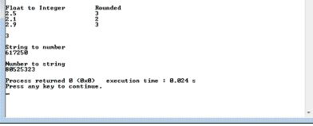

图 2-1：格式化输出展示了截断与四舍五入之间的区别。

## 其他转换问题

另一种有用的转换是浮点数（即带小数点的数字）与整数之间的相互转换。在 C++ 中，这种转换很容易：你只需将一个赋值给另一个，剩下的交给 C++ 处理。

唯一需要注意的是，当 C++ 从浮点数转换为整数时，它总是截断。也就是说，它不会四舍五入：当它将 5.99 转换为整数时，不会变成 6，而是变成 5。但有一个简单的变通技巧：在转换前给该数字加上 0.5。如果数字处于上半部分（即从 0.5 到 0.9999 等），那么先加 0.5 会使数字达到或超过较大的整数。然后，当函数对该数字进行取整时，它会向下取整到这个较大的整数。例如，如果你从 4.6 开始，直接转换会输出 4。但如果你加上 0.5，4.6 变成 5.1，然后转换时，你得到 5。这样是有效的！

反方向转换更容易：要将整数转换为浮点数，只需复制它。如果 i 是整数，f 是浮点数，只需按如下方式赋值即可完成转换：

```cpp
f = i;
```

只是数字。然后计算机经历一个奇怪的过程，将任何字母转换为无意义的数字。这并不好。

清单 2-2 中的 ReadConsoleData 示例演示了如何从控制台读取一个字符串，然后再读取一个数字。接下来，它展示了如何强制用户只输入数字。最后，它展示了如何在用户输入密码时只显示星号。

为了正确完成最后这两个任务，你需要使用 conio 库。这个库绕过了 cin，让你能更好地访问控制台。该示例还使用了 StringToNumber() 函数，该函数在本章前面的“查看 int 和字符串转换的实际应用”一节中介绍过。

### 清单 2-2：让用户输入内容

```cpp
#include <iostream>
#include <sstream>
#include <conio.h>

using namespace std;

int StringToNumber(string MyString) {
    // Holds the string.
    istringstream converter(MyString);
    // Holds the integer result.
    int result;

    // Perform the conversion.
    converter >> result;
    return result;
}

string EnterOnlyNumbers() {
    string numAsString = "";  // Holds the numeric string.
    char ch = getch();        // Obtains a single character.

    // Keep requesting characters until the user presses
    // Enter.
    while (ch != '\r') {  // \r is the enter key
        // Add characters only if they are numbers.
        if (ch >= '0' && ch <= '9') {
            cout << ch;
            numAsString += ch;
        }

        // Get the next character from the user.
        ch = getch();
    }

    return numAsString;
}

string EnterPassword() {
    // Holds the password string.
    string numAsString = "";
    // Obtains a single character from the user.
    char ch = getch();

    // Keep requesting characters until the user presses
    // Enter.
    while (ch != '\r') { // \r is the enter key
        // Display an asterisk instead of the input character.
        cout << '*';
        // Add the character to the password string.
        numAsString += ch;
        // Get the next character from the user.
        ch = getch();
    }

    return numAsString;
}

int main() {
    // Just a basic name-entering
    string name;
    cout << "What is your name? ";
    cin >> name;
    cout << "Hello " << name << endl;

    // Now you are asked to enter a number,
    // but the computer allows you to enter anything!
    int x;
    cout << endl;
    cout << "Enter a number, any number! ";
    cin >> x;
    cout << "You chose " << x << endl;

    // This time you can only enter a number.
    cout << endl;
    cout << "This time enter a number!" << endl;
    cout << "Enter a number, any number! ";
    string entered = EnterOnlyNumbers();
    int num = StringToNumber(entered);
    cout << endl << "You entered " << num << endl;

    // Now enter a password!
    cout << endl;
    cout << "Enter your password! ";
    string password = EnterPassword();
    cout << endl << "Shhhh, it's " << password << endl;
    return 0;
}
```

`main()` 的前几部分很直接。它调用 `cin >> name;` 从控制台读取一个字符串 name；然后 `main()` 向控制台打印 Hello 和 name。接下来，`main()` 调用 `cin >> x;` 从控制台读取并打印一个整数。

调用 `EnterOnlyNumbers()` 可确保用户只能输入数字。`EnterOnlyNumbers()` 做的第一件事是声明一个名为 `numAsString` 的字符串。当用户输入一个字母或数字时，它以字符形式进入，因此代码将它们逐个保存在字符串变量中（因为字符串本质上是一个字符序列）。为了获知用户输入的内容，`EnterOnlyNumbers()` 调用 `getch()`，该函数返回单个字符。（例如，如果用户按下 Shift+A 输入大写字母 A，`getch()` 返回字符 A。）


### 避免 GETCH() 函数问题

如果你使用 `getch()` 函数，某些编译器会报错。如果你想使用它，可以改用 `_getch()` 函数。这两个函数执行相同的任务。一些供应商声称 `_getch()` 符合国际标准组织（ISO）的要求，但事实并非如此。`getch()` 和 `_getch()` 是有用的底层库函数，你可以放心使用，但它们不属于任何标准的一部分。Code::Blocks 附带的 GNU GCC 编译器可以使用这两种函数形式。

第一行运行良好；由于没有空格，名字 Hank 成功进入了输出。但随后当要求输入数字时，用户输入了 abc123。输出为 0 表示 cin 无法将输入转换为 int。如果你改为输入 123abc，会看到输出为 123。下一部分不允许用户输入除数字以外的任何内容，因为它调用了 EnterOnlyNumbers()。在最后两行中，用户输入密码，你可以看到计算机在每次按键后显示星号。这是因为 EnterPassword() 包含一行 `cout << '*';`。你会看到实际密码作为屏幕上的最后一行输出。

## 理解预处理器指令

编译应用程序时，编译器要做的第一件事是让代码通过一个称为预处理器的组件。预处理器只是在代码中查找以 # 符号开头的特定语句。你在每个应用程序中都已经见过这样一条语句：#include。这些预处理器语句被称为指令，因为它们告诉预处理器要做什么；它们引导预处理器。接下来的章节将详细介绍预处理器并描述其工作原理。

### 理解预处理的基础知识

可以把预处理器看作一台机器，它把你的代码转换成一个临时的、修整好的版本，这个版本已经准备好进行编译。例如，看下面这条预处理器指令：

```cpp
#include <iostream>
```

如果预处理器看到这一行，它会把名为 iostream 的文件（是的，这是一个文件名；没有扩展名）的完整文本插入到修整好的源代码版本中。假设 iostream 文件的内容如下：

```cpp
int hello = 10;
int goodbye = 20;
```

里面只有两行。（当然，真正的 iostream 文件要复杂得多。）再假设你自己的源文件 MyProgram.cpp 中包含以下内容（参见 Preprocessor 示例）：

```cpp
#include <iostream>

int main()
```


```cpp
{
    std::cout << "Hello world!" << std::endl;
    return 0;
}
```

然后，在预处理器完成预处理之后，它会创建一个临时的修正文件（该文件已将 `iostream` 文件中的行插入到 `MyProgram.cpp` 文件中原先 `#include` 行所在的位置），使其看起来像这样：

```cpp
int hello = 10;
int goodbye = 20;

int main()
{
    std::cout << "Hello world!" << std::endl;
    return 0;
}
```

换句话说，预处理器用该文件的内容替换了 `#include` 行。现在，`iostream` 文件本身也可能包含 `#include` 行，而这些行又会被它们所引用文件的内容替换。可以想象，一个最初只有几行的简单应用程序，在经过预处理器处理后，实际上可能会有数百行。

## 使用 #define 创建常量和宏

预处理器还为你提供了除 `#include` 之外的许多其他指令。其中更有用的一个是 `#define` 指令。下面是一行示例 `#define`：

```cpp
#define MYSPECIALNUMBER 42
```

预处理器看到这一行后，每次遇到单词 `MYSPECIALNUMBER`，都会把它替换为单词 `42`（也就是定义后面跟随的任意字母、数字和其他字符序列）。在这个例子中，`#define` 创建了一种常量，其中单词比与它关联的值更容易理解。但 `#define` 也允许你创建所谓的*宏*，宏是一种脚本。下面这一行定义了 `oldmax()` 宏：

```cpp
#define oldmax(x, y) ((x)>(y)?(x):(y))
```

## 实际查看预处理器运行

你可能想看看预处理器实际如何工作。要查看它的运行情况，你必须打开 Windows 命令提示符或终端窗口，并切换到源代码所在位置，例如 `C:\CPP_AIO\Book1\Chapter02\Preprocessor`。接下来需要知道 Code::Blocks 在系统上的安装位置，例如 `C:\CodeBlocks\MinGW\bin`。此时，你可以输入一条特殊的 GCC 编译器命令，带上要检查的 .CPP 文件名（例如 Main.cpp）以及一个特殊的命令行开关 `-E`。在 Windows 系统上，你大概可以输入 `\CodeBlocks\MinGW\bin\GCC -E main.cpp >> Preprocessed.cpp` 并按 Enter。

`-E` 命令行开关告诉通常与 Code::Blocks 一起使用的 GCC 编译器只输出预处理后的代码。`>>` 运算符告诉 Windows 将输出放入 Preprocessed.cpp，而不是显示在屏幕上。当你把默认的 Code::Blocks 代码交给预处理器处理时，它包含大约 16,497 行！你可以在 Preprocessed.cpp 中看到输出，该文件包含在可下载源代码的 Preprocessor 文件夹中。由于各种原因，其中许多是空行，但尽管如此，它仍然是一个非常大的文件！

实际上你还可以访问第二个预处理器。要访问第二个预处理器，请在源代码所在的同一文件夹中（就像前一个使用 GCC 的示例那样）输入 `\CodeBlocks\MinGW\bin\CPP main.cpp >> Preprocessed2.cpp` 并按 Enter。CPP 代表 C 预处理器，查看它的输出很有意思，其结果与使用带 `-E` 命令行开关的 GCC 完全相同。

查看预处理器输出时，你会看到实际代码和所谓行标记的组合。行标记是一种预处理器注释，告诉你某些内容来自哪里。下面是预处理 Preprocessor 示例的 main.cpp 文件时看到的一个小样本。有些行已被故意缩短，缺失的内容用省略号（. . .）代替：

```text
# 1 "main.cpp"
# 1 "<built-in>"
# 1 "<command-line>"
# 1 "main.cpp"
# 1 "C:/CodeBlocks/MinGW/lib/.../include/c++/iostream" 1 3
# 36 "C:/CodeBlocks/MinGW/lib/.../include/c++/iostream" 3
```

这些注释都采用相同形式：目标文件中的行号；目标文件的名称；以及与该目标文件一起使用的处理标志。因此，该示例从 main.cpp 第 1 行开始，查找内置条目和命令行条目，但没有找到

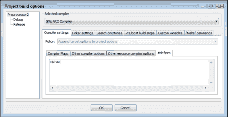

**图 2-2：** 提供要用于更改应用程序输出的编译器选项。


Code::Blocks 提供了一种特殊方法来设置 Debug 或 Release 构建。你可以选择 Build➜Select Target，然后从菜单中选择所需的构建。注意图 2-2 的左窗格中有三个条目。选择 Preprocessor2 可以添加影响 Debug 和 Release 两种构建的定义，例如 HAL2000。选择 Debug 可以添加只影响 Debug 构建的定义，例如 DEBUG。请注意，选择某个特定构建目标并不会自动为你创建诸如 DEBUG 之类的符号。

现在，当预处理器开始遍历你的应用程序并到达 `#ifdef DEBUG` 行时，它会检查 DEBUG 符号是否已定义。如果该符号已定义，它就会把后续行输出到修正文件中，直到 `#else` 行。然后跳过其后的任何行，直到 `#endif` 行。对于本节前面的示例，如果定义了 DEBUG，则从 `#ifdef DEBUG` 开始到 `#endif` 行的代码块会被该代码块前半部分的代码替换：

```cpp
cout << "The value of j is " << j << endl;
```

但如果 DEBUG 符号*没有*定义，预处理器会跳过直到 `#else` 的行，并输出其后的行，直到 `#endif`。在这种情况下，它会被 `#else` 行后面的代码替换：

```cpp
cout << j << endl;
```


当预处理器遍历你的文件时，它只是在创建一个新的源代码文件，供编译器用来创建可执行文件。这意味着这些 `#ifdef` 行只在编译器运行预处理器时影响你的应用程序。当你编译并运行应用程序时，这些 `#ifdef` 行就不存在了。所以请记住，`#ifdef` 行不会影响应用程序如何运行——只影响它如何编译。

## 演练基本预处理器指令

现在该看看各种预处理器指令的实际运行情况了。清单 2-3 中展示的 Preprocessor2 示例演示了本章到目前为止讨论的所有预处理器指令。此外，你还会看到预定义宏的演示，例如 `__FILE__`。C++ 标准和编译器提供预定义宏，让你无需自己开发这些宏，就能输出当前文件名等信息。你可以在 https://riptutorial.com/cplusplus/example/4867/predefined-macros 查看预定义宏列表。

### 清单 2-3：使用多种不同的预处理器指令

```cpp
#include <iostream>

using namespace std;

#ifdef UNIVAC
const int total = 200;
const string compname = "UNIVAC";
#elif defined(HAL2000)
const int total = 300;
const string compname = "HAL2000";
#else
const int total = 400;
const string compname = "My Computer";
#endif

// This is outdated, but you might see it on
// occasion. Don't write code that does this!
#define oldmax(x, y) ((x)>(y)?(x):(y))
#define MYSPECIALNUMBER 42

int main() {
    cout << "Welcome to " << compname << endl;
    cout << "Total is: " << total;
    cout << total << endl << endl;

        // Try out the outdated things.
        cout << "*** max ***" << endl;
        cout << oldmax(5,10) << endl;
        cout << oldmax(20,15) << endl;
        cout << MYSPECIALNUMBER << endl << endl;

// Here are some standard redefined macros.
cout << "*** Predefined Macros ***" << endl;
cout << "This is file " << __FILE__ << endl;
cout << "This is line " << __LINE__ << endl;
cout << "Compiled on " << __DATE__ << endl;
cout << "Compiled at " << __TIME__ << endl << endl;

// Here's how some people use #define, to
// specify a "debug" version or "release" version.
cout << "*** total ***" << endl;
int i;
int j = 0;
for (i = 0; i<total; i++)
{
    j = j + i;
}

#ifdef DEBUG
    cout << "The value of j is " << j << endl;
#else
    cout << j << endl;
#endif

    return 0;
}
```

当你使用 Release 目标（选择 Build⇨Select Target⇨Release）运行不带任何符号的清单 2-3 时，会看到以下输出：

```text
Welcome to My Computer
Total is:
400

*** max ***
10
20
42

*** Predefined Macros ***
This is file C:\CPP_AIO\Book1\Chapter09
    \Preprocessor2\main.cpp
This is line 35
Compiled on Apr 23 2020
```


```
Compiled at 15:19:38

*** total ***
79800
```

请注意，开头处的代码测试符号 UNIVAC。但那个 if 块稍微复杂一些，因为它还有一个 `#elif`（else if）结构。预处理器的语言没有 elseif 或类似的东西。相反，你必须这样写：

```cpp
#elif defined(HAL2000)
```

使用这个块时，预处理器会检查符号 UNIVAC；如果预处理器找到 UNIVAC，就会输出以下行：

```cpp
const int total = 200;
const string comname = "UNIVAC";
```

否则，预处理器会查找 HAL2000；如果预处理器找到它，就会将这些行添加到修正后的代码中：

```cpp
const int total = 300;
const string comname = "HAL2000";
```

最后，如果 UNIVAC 和 HAL2000 都未设置，预处理器会添加以下行：

```cpp
const int total = 400;
const string comname = "My Computer";
```

请记住，在每种情况下，这两行都会输出到修正后的版本中，替换从 `#ifdef UNIVAC` 开始、到 `#endif` 结束的整个块。如果你在前面图 2-2 所示的 Project Build Options 对话框的 `#defines` 选项卡中添加 UNIVAC，就会改变预处理器配置其输出的方式。要看到以下输出，必须选择 Build > Rebuild，然后选择 Build > Run，而不是像平常那样使用 Build > Build and Run 命令。

```
Welcome to UNIVAC
Total is:
200

*** max ***
10
20
42

*** Predefined Macros ***
This is file C:\CPP_AIO\Book1\Chapter09\Preprocessor2\main.cpp
This is line 35
Compiled on Apr 23 2020
Compiled at 15:26:56

*** total ***
19900
```

要查看不同的输出版本，请在前面图 2-2 所示的 Project Build Options 对话框的 `#defines` 选项卡中，将 UNIVAC 替换为 HAL2000。选择 Build > Select Target > Debug 以更改可执行文件类型。最后，选择 Build > Rebuild 重新构建应用程序。选择 Build > Run 时，你会看到以下内容。

```
Welcome to HAL2000
Total is:
300

*** max ***
10
20
42

*** Predefined Macros ***
This is file C:\CPP_AIO\Book1\Chapter09\Preprocessor2\main.cpp
This is line 37
Compiled on Dec 18 2013
Compiled at 10:30:23

*** total ***
The value of j is 44850
```


可下载的源代码包含一个项目文件，其中已包含所有必需的定义。如果你自己输入这些源代码，也必须创建相应的定义，否则输出将无法与书中看到的内容一致。例如，仅选择调试版本并不会为你提供 DEBUG 定义。

## 使用常量

编程时，有时你可能需要一个固定的值，并计划在整个应用程序中一直使用它。例如，你可能需要一个包含公司名称的字符串，比如 "Bob's Fixit Anywhere Anyhoo"。你也不希望参与应用程序开发的其他人在把这个字符串作为引用传入函数时，误修改它，把它变成你的全球竞争对手的名称 "Jim's Fixum Anyhoo Anytime"。那可能会很糟糕。或者，如果你在编写科学应用程序，你可能需要一个固定数字，例如 `pi = 3.1415926` 或 `root2 = 1.4142135`。

在 C++ 中，你可以使用 `const` 关键字创建这样的常量。创建常量后，它的工作方式与变量类似，只是之后不能在应用程序中更改它。例如，要声明公司名称，你可能会使用

```cpp
const string CompanyName = "Bob's Fixit Anywhere Anyhoo";
```

当然，你始终可以在代码中修改这个特定的字符串，但在后面的代码中，你不能做类似这样的事情：

```cpp
CompanyName = CompanyName + ", Inc.";
```

编译器会针对该行报错，指出它是常量，你不能修改它。

声明 `CompanyName` 常量后，你可以在整个代码中用它来指代你的公司。清单 2-4 中的 Constants 示例展示了如何做到这一点。注意顶部附近的三个常量：`ParkingSpaces`、`StoreName` 和 `pi`。在应用程序的其余部分，你可以像使用其他任何变量一样使用它们——只是不要尝试更改它们。

**清单 2-4：** 使用常量表示不会改变的永久值

```cpp
#include <iostream>

using namespace std;

const int ParkingSpaces = 80;
const string StoreName = "Joe's Food Haven";
const float pi = 3.1415926;

int main() {
    cout << "Important Message" << endl;
    cout << "Here at " << StoreName << endl;
    cout << "we believe you should know" << endl;
    cout << "that we have " << ParkingSpaces;
    cout << " full-sized" << endl;
    cout << "parking spaces for your parking" << endl;
    cout << "pleasure." << endl;
    cout << endl;
    cout << "We do realize that parking" << endl;
    cout << "is tight at " << StoreName << endl;
    cout << "and so we are going to double our" << endl;
    cout << "spaces from " << ParkingSpaces << " to ";
    cout << (ParkingSpaces * 2);
    cout << ". Thank you again!" << endl << endl;
    float radius = 5;
    float area = radius * radius * pi;
    cout << "And remember, we sell " << radius;
    cout << " inch radius apple pies" << endl;
    cout << "for a full " << area << " square" << endl;
    cout << "inches of eating pleasure!" << endl;
    return 0;
}
```

运行此应用程序时，你会看到以下内容：

```
Important Message
Here at Joe's Food Haven
we believe you should know
that we have 80 full-sized
parking spaces for your parking
pleasure.

We do realize that parking
is tight at Joe's Food Haven
and so we are going to double our
spaces from 80 to 160. Thank you again!

And remember, we sell 5 radius inch apple pies
for a full 78.5398 square
inches of eating pleasure!
```


**提示**

使用常量的最大优势在于：如果你需要在整个应用程序中更改某个字符串或数字，只需更改一次。例如，如果你在应用程序中无数次粘贴了字符串 "Bob's Fixit Anywhere Anyhoo"，而突然你成立了一家公司，需要将应用程序中的该字符串改为 "Bob's Fixit Anywhere Anyhoo, LLC"，你就需要做大量繁琐的搜索替换工作。但如果头文件中有一个供所有源代码文件使用的常量，你只需更改一次。用新的常量定义修改头文件并重新编译应用程序，然后就大功告成了。


**提示**

编程界有一句常言：“不要使用任何魔法数字。”其含义是：如果代码中某处需要计算已经过桥的奶牛数量，以判断桥梁能否承受，而你知道一头奶牛的平均体重是 632 磅，就不要直接在代码中写 632 这个数字。其他阅读代码的人可能会纳闷这个数字从何而来。相反，应创建一个 `AverageCowWeight` 常量，并将其设为 632。然后在需要该数字的任何地方使用 `AverageCowWeight`。此外，如果奶牛进化成更高级的物种且体重发生变化，你只需在代码中做一处更改——修改包含该 `const` 声明的头文件。下面是一行声明 `AverageCowWeight` 的示例代码：

```cpp
const int AverageCowWeight = 632;
```

你不必在代码中创建大多数常见数学常量。相反，你在代码顶部添加 `#include <math.h>`，然后使用 https://www.gnu.org/software/libc/manual/html_node/Mathematical-Constants.html 中定义的常量。例如，如果你想在代码中使用 `pi` 的值，就使用 `M_PI` 常量。

遗憾的是，数学头文件不属于 ANSI 标准，因此有时你不得不费一番周折才能使用它。较旧的编译器可能要求你在源文件顶部的任何 `#include` 语句之前添加 `#define _USE_MATH_DEFINES`。


**警告**

如果你将 Code::Blocks 编译器设置为使用 C++11 或更高标准，那么默认添加的 `__STRICT_ANSI__` 定义会阻止你在代码中使用诸如 `M_PI` 这样的常量。要解决此问题，请在代码开头添加行 `#undef __STRICT_ANSI__`。下面是一个简短示例，说明你需要做什么：


```cpp
#undef STRICT_ANSI

#include <iostream>
#include <math.h>

using namespace std;

int main()
{
    cout << M_PI << endl;
    return 0;
}
```


C++20 及更高版本的开发者可以通过 `std::numbers::pi` 稍微缓解这个问题，你可以使用 `#include <numbers>` 访问它（参见 https://en.cppreference.com/w/cpp/numeric）。

## 使用 switch 语句

在编程中，很多时候你可能想将一个变量与一个对象比较，如果它不匹配，就将它与另一个、再另一个、再另一个比较。要用 if 语句做到这一点，你需要使用一大堆 `else if` 行。使用 if 语句效果相当不错，但你可以用另一种方式来做：使用 `switch` 语句。


本节展示的方法并不适用于所有类型的变量。事实上，它只适用于各种类型的整数和字符。它甚至不能用于字符串。然而，当你需要为整数和字符进行多次比较时，使用这种方法非常有用。

下面是一个完整的 `switch` 语句，你可以在阅读后续段落中各个部分时参考它。这个 `switch` 将 x 与 1 比较，然后与 2 比较，最后，如果 x 既不是 1 也不是 2，还包含一个称为 `default` 的兜底部分：

```cpp
int x;
cin >> x;
switch (x)
{
```


**提示：** 注意示例 switch 块的末尾有一个最终的 `default` 分支。它适用于前面所有分支都不适用的情况。`default` 分支不是必需的；如果不需要，你可以省略它。然而，如果你确实包含它，就要把它放在 `switch` 块的末尾，因为它是兜底分支。

清单 2-5 中的 `SwitchStatement` 示例是一个完整应用程序，演示了 `switch` 语句。它还向你展示如何在控制台上制作一个简单、外观老派的*菜单*应用程序。选择菜单项后，你不需要按 Enter；只需按对应菜单选择的键即可。这要归功于使用了 `getch()` 而不是 `cin`。

### 清单 2-5：在一个大块中进行多次比较

```cpp
#include <iostream>
#include <conio.h>

using namespace std;

int main() {
    // Display a list of options.
    cout << "Choose your favorite:" << endl;
    cout << "1. Apples " << endl;
    cout << "2. Bananas " << endl;
    cout << "3. Lobster " << endl;

    // Obtain the user’s selection.
    char ch = getch();

    // Continue getting user selections until the user
    // enters a valid number.
    while (ch < '1' || ch > '3') {
        ch = getch();
    }

    // Use a switch to display the user’s selection.
    cout << "You chose " << ch << endl;
    switch (ch) {
    case '1':
        cout << "Apples are good for you!" << endl;
        break;
    case '2':
        cout << "Bananas have plenty of potassium!" << endl;
        break;
    case '3':
        cout << "Expensive, but you have good taste!" << endl;
        break;
    }

    return 0;
}
```

## 用类增强枚举

当你使用类时，可以使用一种称为包装的技术，它有助于你管理资源。第 2 册第 1 章讨论了 enum 关键字，并展示了如何使用它创建自己的类型。然而，当你打印枚举时，你看到的不是 red 或 blue 这样的单词，而是一个数字。清单 2-6 中展示的 DisplayEnum 示例是一个简单类，它通过将数字转换为人类可读的形式来包装枚举类型，这属于一种资源管理。你可以将这个类与枚举 ColorEnum 一起使用，正如 main() 所演示的那样。运行此应用程序时，你会在控制台中看到单个词 red。

### 清单 2-6：为枚举创建类

```cpp
#include <iostream>

using namespace std;

class Colors {
public:
    enum ColorEnum {blue, red, green};
    Colors(Colors::ColorEnum value);
    string AsString();
protected:
    ColorEnum value;
};

Colors::Colors(Colors::ColorEnum init) {
    value = init;
}

string Colors::AsString() {
    switch (value) {
    case blue:
        return "blue";
    case red:
        return "red";
    case green:
        return "green";
    default:
        return "Not Found";
    }
}

int main() {
    Colors InkColor = Colors::red;
    cout << InkColor.AsString() << endl;
    return 0;
}
```

在这个示例中，`switch` 语句不包含任何 `break` 语句。相反，它使用 `return` 语句。`return` 会使计算机完全退出函数，因此你无需担心如何跳出 `switch` 语句。你可能想知道为什么 `switch` 语句包含 `default` 分支。毕竟它永远不会被调用。在这种情况下，如果你不提供 `default` 分支，编译器会显示以下消息：

```
warning: control reaches end of non-void function
```

只要有可能，就添加你的应用程序编译时无警告所需的代码。添加 `default` 分支只是确保无论发生什么，`AsString()` 函数始终返回一个值。此外，拥有 `default` 分支会让人明显看出，某个颜色已被添加到枚举中，但 `switch` 语句没有处理它。

表达式 `Colors::red` 可能对你不熟悉。它的意思是你在使用 `ColorEnum` 类型的 red 值。然而，因为 `ColorEnum` 声明在类 `Colors` 内部，你不能只写 `red`。你必须先写类名，然后两个冒号，再写值。因此，你输入 `Colors::red`。

`main()` 中的代码创建 `InkColor` 实例，并将它设置为一个枚举值，而不是一个 `Colors` 对象。这能行得通，是因为 C++ 有一个巧妙的小技巧：你可以创建一个接受某种类型的构造函数。在这种情况下，`Colors` 有一个接受 `ColorEnum` 的构造函数。然后，当你创建一个栈变量（而不是指针）时，你可以直接将它设置为该类型的一个值。计算机会隐式调用构造函数，并将该值传递给它。

## 添加 cout 能力

如果 Colors 类允许你直接调用 `cout`，例如 `cout << InkColor << endl`，而不必调用 `InkColor.AsString()` 来获取字符串版本，那就太好了。C++ 有一项称为*运算符重载*的能力，它是一种扩展运算符功能的技术。当你输入类似 `cout <<` 后跟一个变量时，你是在调用一个函数：`<<`。`<<` 函数有多个版本（它们被重载了）可用；每个版本接受不同的类型。例如，int 处理输出整数的情况，如 `int x = 5;`，然后 `cout << x;`。因为 `<<` 函数不使用括号，所以它是一个*运算符*。

要为你的类添加 cout 能力，只需为你的类再写一个 `<<` 函数。代码如下。这不是类方法；它位于你的类*外部*。将它添加到清单 2-6 中类声明之后、`main()` 之前的任意位置。如下所示：

```cpp
ostream& operator << (ostream& out, Colors& inst)
{
    out << inst.AsString();
    return out;
}
```

因为这个函数是一个运算符，所以你必须加上 operator 这个词。顺便说一下，cout 的类型是 ostream；因此，你接受一个 ostream 作为参数，并返回同一个 ostream。另一个参数是你要打印的类型：在这种情况下，它是一个 Colors 实例，而且同样是通过引用传递。添加这段代码后，你可以将行 `cout << InkColor.AsString() << endl;` 改为简单的

```cpp
cout << InkColor << endl;
```

## 使用随机数

有时，你需要计算机为你生成随机数。但计算机不擅长随机完成任务。人类可以掷骰子或抛硬币，但计算机必须以预先确定的方式做事。过去一个世纪的计算机天才们提出了生成*伪随机数*的算法。这些数字几乎是随机的，或者看似随机。对于许多目的来说，它们已经足够随机。

这些随机数生成器唯一需要注意的是，你需要为它们*设置种子*，也就是说，为它们提供一个输入值，作为计算的起点。如果你每次都提供相同的种子，那么起始输出数字

也是相同的，额外输出数字的序列同样如此。因此，伪随机数生成器需要某种看起来以随机方式变化的种子。幸运的是，当前时间的秒分量是一个可变的输入，正确使用时它看起来是随机的。运行应用程序时，你很可能不会在完全相同的那一秒启动它。清单 2-7 中所示的 RandomNumber 示例展示了如何生成随机数。

### 清单 2-7：为随机数生成器设置种子

```cpp
#include <iostream>
#include <time.h>
#include <stdlib.h>

using namespace std;

int main()
{
    // Seed the random-number generator
    time_t now;
    time(&now);
    srand(now);

    // Print out a list of random numbers
    for (int i=0; i<5; i++)
    {
        cout << rand() % 100 << endl;
    }

    return 0;
}
```

该示例遵循处理随机数时经常见到的一个过程。要获取时间，必须包含 `time.h`。初始化并使用随机数生成器需要包含 `stdlib.h`。

- 通过创建一个名为 `now`、类型为 `time_t`（它只是一个数字）的特殊变量，获取当前时间以启动随机数生成器。
- 调用 `time()` 函数，传入 `now` 的地址，从而获得自 1970 年 1 月 1 日以来的秒数。
- 通过调用 `srand()`，使用时间种子初始化随机数。
- 通过调用 `rand()`，基于该种子创建一个随机数。

每次调用 `rand()`，都会得到一个新的随机 int。然而，这个数字可能不在你想要的范围内。为了将数字限制在 0 到 99 的范围内，代码使用了该数字的 *100 的模*。（也就是用该数字除以 100 后的余数。）第一次运行清单 2-7 时，你可能会看到以下输出：

```
19
69
85
83
47
```

第二次，你可能会看到以下输出。它与之前不同：

```
79
67
38
72
73
```

## 在数组中存储数据

大多数编程语言都支持一种称为数组的数据结构。*数组*是一组变量列表，所有变量并排存储在一行中。你可以通过一个名称访问它们。数组中的每个变量都必须具有相同的类型。本节以简单的方式告诉你如何为数据存储目的使用数组。关于以高级方式创建和使用数组的更详细讨论，见第 5 册第 1 章的“构建数组”一节。

创建数组时，需要指定该数组包含多少项。例如，你可以有一个包含 100 个整数的数组。或者你可以有一个包含 35 个字符串的数组，或一个包含 10 个指向 `BrokenBottle` 类的指针的数组。如果你正在处理的代码表示一种类型，就可以用它创建数组。

创建数组时，需要给它一个名称。你可以使用该名称后跟方括号中的*索引*编号来访问数组的*元素*（项）。第一个元素始终是 0。因此，如果你有一个名为 `AppendixAttacks`、包含五个整数的数组，第一个元素是 `AppendixAttacks[0]`。第二个是 `AppendixAttacks[1]`，然后是 `AppendixAttacks[2]`、`AppendixAttacks[3]`，最后是 `AppendixAttacks[4]`。


由于数组从元素编号 0 开始，因此数组中最后一个元素的索引比数组大小小 1。因此，一个包含 89 个元素的数组，其索引范围为 0 到 88。

### 声明和访问数组

下面是如何声明数组：

```cpp
int GrilledShrimp[10];
```

这一行声明了一个名为 `GrilledShrimp`、包含 10 个整数的数组。首先放类型（实际上是数组中每个元素的类型），然后是数组名称，最后是方括号中的元素数量。由于这声明了 10 个整数，它们的索引范围为 0 到 9。

要访问数组的第一个元素，请在数组名后的方括号中放入数字 0，如下所示：

```cpp
GrilledShrimp[0] = 10;
```

人们经常使用循环来填充数组或访问每个成员。人们通常称之为*遍历数组*。清单 2-8 中的 ArrayLoop 示例展示了如何创建和使用基本数组。

### 清单 2-8：使用循环遍历数组

```cpp
#include <iostream>

using namespace std;

int main() {
    int Values[5];
    int VSize = sizeof(Values)/sizeof(*Values);
    cout << "Array count: " << VSize << endl;

    for (int i=0; i < VSize; i++) {
        Values[i] = i * 2;
        cout << Values[i] << endl;
    }

    return 0;
}
```

**记住：** 在代码中任何地方硬编码数组长度绝不是一个好主意，因为数组长度可能会变化。相反，应使用 `sizeof()` 函数计算数组的大小。该示例展示了如何完成此任务：获取 Values 的实际字节长度，并将其除以单个数组元素的大小，这需要使用 `*Values`。结果 VSize 是数组元素的数量。当你使用 for 循环遍历数组时，设置计数器变量 i，使其在等于或超过 VSize 的值时结束循环。

**警告：** 使用数组时，不要超出数组边界。由于早期 C 语言的一些旧规则，如果你编写的循环超出了数组的上边界，编译器不会警告你。运行应用程序时，你也可能不会遇到错误。

### 指针数组

数组特别适合存储指向对象的指针——指针是包含内存中某项地址的变量。如果你有许多相同类型的对象，可以将它们存储在数组中。

尽管可以将实际对象存储在数组中，但大多数人不会这样做，因为它们占用太多空间。大多数人会用指向这些对象的指针填充数组。要声明一个指向对象的指针数组，请记住在类型声明中使用星号，如下所示：

```cpp
CrackedMusicCD *missing[10];
```

清单 2–9 中所示的 ArrayPointer 示例声明了一个指针数组。在这个示例中，声明数组之后，将数组元素填充为零。记住，每个元素都是一个指针；这样，只需将其与 0 比较，就能立即知道该元素是否指向某个对象。如果它为 0，则表示未被使用。如果它不为 0，则其中有一个指针。

### 清单 2-9：使用数组存储指向对象的指针列表

```cpp
#include <iostream>

using namespace std;

class CrackedMusicCD {
public:
  string FormerName;
  int FormerLength;
  int FormerProductionYear;
};

int main() {
    CrackedMusicCD *Missing[10];
    int SMissing = sizeof(Missing)/sizeof(*Missing);

    for (int i=0; i < SMissing; i++) {
        Missing[i] = 0;
    }
    return 0;
}
```

如果你想创建一整组对象，并用指向这些对象的指针填充数组，可以这样做：

```cpp
for (int i=0; i < SMissing; i++) {
    Missing[i] = new CrackedMusicCD;
}
```

由于数组中的每个元素都是指针，如果你想访问数组所指向的某个对象的属性或方法，就需要使用 **->** 表示法来*解引用*该指针——即获取该指针所指向的值：

```cpp
Missing[0]->FormerName = "Shadow Dancing by Andy Gibb";
```

这个示例行访问地址位于数组第一个位置的对象 FormerName 属性。当你用完数组中的对象指针后，可以通过为数组的每个成员调用 `delete` 来删除这些对象，如下例所示：

```cpp
for (int i=0; i < SMissing; i++) {
    delete Missing[i];
    Missing[i] = 0;
}
```


前面的代码将每个数组元素清除为 0。这样，指针会被重置为 0，并且在其对象消失后不再指向任何内容。

### 将数组传递给函数

有时你需要将整个数组传递给函数。尽管将整个对象传递给函数可能很笨拙，但传递整个数组可能很危险。数组可能非常庞大，包含数千个元素。如果每个元素都是指针，那么每个元素可能包含多个字节，这对较小的数组可行，但对于包含数千个元素的数组可能会引发问题。当你在栈上传递一个巨大的数组时，可能会*溢出*应用程序的栈——这意味着应用程序崩溃。幸运的是，编译器会自动为你将数组当作指针处理，但你仍然需要理解底层发生了什么。

与传递对象一样，最好的做法是传递数组的地址。你向函数传递一个指向该数组的指针。但将数组的地址传递给函数在编码时容易令人困惑。清单 2-10 中所示的 ArrayPassing 示例是一个传递数组的示例，它没有直接编写任何指针和地址。

### 清单 2-10：通过在函数头中声明数组来将数组传递给函数

```cpp
#include <iostream>

using namespace std;

const int MyArraySize = 10;

void Crunch(int myarray[], int size) {
    for (int i=0; i<size; i++) {
        cout << myarray[i] << endl;
    }
}

int main() {
    int BigArray[MyArraySize];

    for (int i=0; i<MyArraySize; i++)
    {
        BigArray[i] = i * 2;
    }

    Crunch(BigArray, MyArraySize);
    return 0;
}
```


运行此应用程序时，它会打印数组的九个成员。该数组出现在函数头中，但没有指定大小。这意味着你可以将任意大小的数组传递给该函数。size 参数定义了该函数所使用的数组大小。此示例使用常量，而不是计算数组大小；这样，如果你以后决定通过更改数组大小来修改应用程序，只需更改应用程序顶部的那一个常量。否则，你可能会漏掉某个 10。


该示例实际上并没有把 BigArray 传递给 Crunch。相反，它传递的是数组的地址。当你以这种方式传递数组时，编译器会编写代码来传递指向该数组的指针。你无需担心这一点。数组名实际上是指向数组中第一个元素的指针。

因此，BigArray（作为参数）等同于 &(BigArray[0])。（你在 BigArray[0] 部分加上括号，以便计算机知道 & 指的是 BigArray[0] 这一整体，而不只是 BigArray。）因此，你本可以在调用中使用：

```cpp
Crunch(&(BigArray[0]), MyArraySize);
```

### 指针的加法与减法

当指向数组元素的指针以地址形式存储在指针变量中时，你可以对该指针加上或减去数字，从而完成一些有趣的操作。如果你取数组中某个元素的地址并将其存入变量，例如名为 cur（表示 current）的变量，如下所示：

```cpp
cur = &(Numbers[5]);
```

其中 Numbers 是一个整数数组，你可以通过解引用指针来访问 Numbers[5] 处的元素，如下所示：

```cpp
cout << *cur << endl;
```

然后，你可以对该指针加上和减去数字，如下面这些代码行所示：

```cpp
cur++;
cout << *cur << endl;
```

编译器知道每个数组元素占用多少内存空间。当你给 cur 加 1 时，它会前进到数组中的下一个元素。因此，随后的 cout 会打印下一个元素——在本例中为 Numbers[6]。


清单 2-11 中展示的 PointerArithmetic 示例演示了如何在数组中移动。代码声明了一个名为 `cur` 的变量，它是指向整数的指针。该数组保存整数，因此这个指针可以指向数组中的元素。

**清单 2-11：使用指针算术进行移动**

```cpp
#include <iostream>

using namespace std;

int main() {
    int Numbers[10];
    int SNumbers = sizeof(Numbers) / sizeof(*Numbers);

    for (int i=0; i<SNumbers; i++)
    {
        Numbers[i] = i * 10;
    }

    int *cur = Numbers;
    cout << *cur << endl;
    cur++;
    cout << *cur << endl;
    cur += 3;
    cout << *cur << endl;
    cur--;
    cout << *cur << endl;
    return 0;
}
```

代码开始时，`cur` 指向第一个元素。数组名就是第一个元素的地址。然后，代码对 `cur` 的值进行加法和减法，使其指向其他数组元素。运行该应用程序时，你会看到以下输出：

```text
0
10
40
30
```


你不能对指针进行乘法和除法运算。

**记住**

### 本章内容

- 识别对象，以便创建类
- 将类封装成自包含的胶囊
- 通过继承构建类的层次结构

## 第 3 章：规划与构建对象

暂时走到外面，低头看看。你正站在什么东西上？（提示：它很巨大，由岩石、沙土、石头和熔岩构成，表面覆盖着海洋和陆地。）答案是什么？一个“东西”！（甚至一颗行星也是一个“东西”。）现在回到室内。你打开的那个东西——那个带有门把手的东西——是什么？它也是一个“东西”！它是一种稍有不同的事物，但仍然是一个“东西”。你在室内正站在什么里面？好了，你明白这个意思了。你能想象的一切都是一个“东西”——或者，用另一个术语来说，是一个对象。

多年来，计算机编程领域的研究人员已经发现，更好的编程方式之一，是将你试图建模的任何事物划分成一组对象。这些对象具有*方法*（能力）和*属性*（特征）。（最终它们还会有关系，但那是后面的事。）

在本章中，你将了解如何利用对象来创建软件应用程序。在此过程中，你将接触到 C++ 中与对象相关的一些基础细节，并获得如何充分利用它们的提示。


你不必手动输入本章的源代码。事实上，使用可下载的源代码要容易得多。你可以在可下载源代码的 `\CPP_AIO4\Book11\Chapter03` 文件夹中找到本章的源代码。有关如何找到这些源文件的详细信息，请参阅引言。

**图 3-1：** 这张图片中的外部对象是一个邮箱容器。


**图 3-2：** 这张图片中较小的内部对象是各个邮箱。

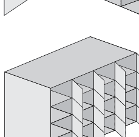

到目前为止，这里有两种对象：容器箱和邮箱。但是等等！这里有多个邮箱。所以，实际上你有一个容器箱和多个邮箱。但每个邮箱几乎都一样，只是锁不同、公寓号码不同，对吧？在图 3-2 中，每个打开的箱子都是一个单独邮箱的示例。其他箱子也是名为 mailbox 的对象类型的示例。在图 3-2 中，你可以看到 16 个归类为 mailbox 的对象示例。换句话说，图 3-2 展示了名为 Mailbox 的类的 16 个实例。所有这些邮箱都位于一个你可能称为 Mailboxes 的类的实例中。


关于类的命名，没有一成不变的规则。不过，大多数开发者对对象使用单数名称，对集合使用复数名称。单个 Mailbox 对象会作为 Mailboxes 集合的一部分出现。使用这种命名约定，可以让其他开发者更容易理解你的代码如何工作。当然，最重要的问题是保持一致。一旦决定了命名约定，就要始终使用同一约定。

### 其他建模方法

计算机科学家使用多种建模方法来创建能够反映代码预期功能的程序。面向对象编程（OOP）技术在对现实世界对象进行建模时效果最好。对象不必是你一定能触摸到的东西，例如银行账户，但它确实存在于现实世界中，而使用对象可以让对此类项目建模变得更容易。这就是本章如此关注现实世界对象的原因。

不过，还存在其他类型的建模方式，你将在第 3 册中体验到其中一种模型，即函数式编程。与 OOP 不同，函数式编程擅长对抽象概念建模。尝试使用 OOP 对统计分析之类的抽象概念建模可能会很困难。在执行某些需要大量内存和高速处理器的任务时，函数式编程还具有其他优势。

在本书前面的示例中，你也体验过过程式编程，其中的代码按照一系列步骤来完成任务。事实上，第 1 册中的大多数示例都属于这一类。

尽管本书没有涵盖这些内容，但 C++ 也可以适应其他几种模型。事件驱动编程允许你对用户与应用程序的交互作出反应，并且无论用户如何发出请求，你都可以执行用户需要的任何任务（参见 http://www.husseinsplace.com/teaching/udw/1996/cnotes/chap5ix.html 上的文章）。响应式编程尤其擅长处理数据流（参见 http://reactivex.io/RxCPP/ 上的库）。自动机编程用于各种自动化场景，包括机器人和工厂自动化（参见 https://www.tutorialspoint.com/cplusplus-program-to-perform-finite-state-automaton-based-search 上的文章）。重点在于，你可能会遇到只使用一种建模方法的开发者，但通常最好了解多种技术，这样你就能采用最适合特定需求的方法。

### 观察 Mailboxes 类

关于 Mailboxes 集合对象，你能说些什么？

- Mailboxes 集合包含 16 个 mailbox 实例。
- Mailboxes 集合对象正反面均为 24 英寸乘 24 英寸，深度为 18 英寸。
- 当邮递员解锁邮箱并拉动时，它的大柜门会打开。


- 当邮箱组的大门打开时，会露出其中包含的每个邮箱的内部。
- 当邮递员推门时，门会关上并重新锁好。

通过使用这个列表，你可以发现 Mailboxes 集合的一些属性和方法。以下列表显示其属性：

- 宽度：24 英寸
- 高度：24 英寸
- 深度：18 英寸
- Mailboxes：内部有 16 个 Mailbox 对象

以下是 Mailboxes 集合的一些方法：

- 打开其门。
- 让邮递员可以使用邮箱。
- 关闭其门。

考虑邮递员打开或关闭门的过程。这里似乎有一件奇怪的事：邮递员要求 Mailboxes 集合关闭其门，门就关闭了。这就是你建模对象时需要采用的方式。没有人对对象做什么。相反，某人要求对象做某事，对象自己完成。

例如，当你伸手把一片披萨塞进嘴里时，你的大脑向手臂肌肉发送信号。大脑发出信号，手臂抬起，披萨也随之抬起。要点是，你发出命令；然后手臂执行命令，尽管你感觉像是你在让手臂这样做。

对象也是如此：它们有自己的方法，你告诉它们去做自己的工作。你不是替它们做。至少，计算机科学家是这样看的。你越以这种方式思考，就越能理解面向对象编程。


Mailboxes 集合包含 16 个 Mailbox 对象。在 C++ 中，这意味着 Mailboxes 集合把 16 个不同的 Mailbox 实例作为属性。这些 Mailbox 实例可能包含一个数组或其他某种集合，并且该数组很可能保存指向 Mailbox 对象内 Mail 实例的指针。

## 规划和构建对象

### 观察 Mailbox 类

考虑 `Mailbox` 类的特征和能力。每个 `Mailbox` 都有以下属性：

- 宽度：6 英寸
- 高度：6 英寸
- 深度：18 英寸
- 地址：一个唯一整数

每个 `Mailbox` 都有以下方法：

- 打开其门。
- 关闭其门。

注意，这些方法是从 `Mailbox` 的角度出发的，而不是从打开 `Mailbox` 的人的角度出发。

现在思考关于印在 `Mailbox` 上的地址的问题。有 16 个不同的 `Mailbox` 对象，每个对象获得不同的编号。因此可以这样说：`Mailbox` 类包含一个地址，它是一个整数。`Mailbox` 类的每个实例都有自己的编号。第一个可能得到 1，第二个可能得到 2，依此类推。因此，在代码中表示邮箱有两个概念：

- **Mailbox 类：** 这是对邮箱的一般描述。它不包含具体信息，例如实际地址。它只说明每个邮箱都有一个地址。
- **Mailbox 实例：** 这是实际对象。`Mailbox` 实例属于 `Mailbox` 类。`Mailbox` 类的实例数量可以任意多。

把 `Mailbox` 类想象成饼干模具——或者用 C++ 术语来说，就是*类型*。`Mailbox` 实例是该类的一个实际示例。在 C++ 中，你可以创建一个 `Mailbox` 类的变量，并将其 Address 整数设为 1。然后，你可以创建另一个 `Mailbox` 类的变量，并将其 Address 整数设为 2。这样，你就创建了两个不同的 `Mailbox` 对象，它们都属于 `Mailbox` 类。

但是所有这些 `Mailbox` 实例的宽度都是 6 英寸、高度都是 6 英寸、深度都是 18 英寸。这些属性在整个 `Mailboxes` 集合中都是相同的。因此，你可能不会手动设置它们；相反，你可能会在 `Mailbox` 类的构造函数中设置它们。尽管如此，宽度、高度和深度的值随每个实例而定，而不随类而定；并且可以想象，每个实例都可以有自己的宽度、高度和深度。然而，在设计类时，你会在类中规定这些属性不能更改。

#### 寻找其他对象

如果你正在处理一个 `Mailboxes` 实例和一个 `Mailbox` 实例，你大概还能想到其他一些类。当你开始考虑所涉及的*部分*时，可以想到以下对象：

- 锁：每个 `Mailbox` 实例都会有一个 `Lock`，`Mailboxes` 实例也会有一个 `Lock`。
- 钥匙：每个 `Lock` 实例都需要一个或多个 `Key` 实例。
- 邮件：每个 `Mailbox` 实例可以容纳若干 `Mail` 实例。邮递员把这些 `Mail` 实例放入 `Mailbox` 实例，居民再把它们取出。
- 拆信刀：一些居民会使用它们来打开 `Mail`。

所以你现在又有了四种对象类型（`Lock`、`Key`、`Mail` 和 `LetterOpener`）。但这些类是必要的吗？它们的必要性取决于你正在构建的应用程序。在本例中，你只是把邮箱系统建模当作练习。因此，可以选择所需的类。但是，例如，如果这是邮局的实际应用程序，你就必须确定这些类对使用软件的人是否必要。如果该应用程序是面向学习成为邮递员的人的培训练习，那么应用程序可能需要更多细节，例如 `Key` 对象。如果该应用程序是一个视频游戏，它可能需要提到的所有类，甚至更多。


提示

在决定是否需要某些类时，你可以遵循一些通用规则。首先，有些类过于琐碎或简单，包含它们没有意义。例如，拆信刀除了打开邮件之外几乎没有什么用途。如果你正在设计一个 `Mail` 类，你可能会有一个方法 `OpenEnvelope`。因为有些人会使用拆信刀，而有些人不会，所以几乎没有理由向该方法传入一个 `LetterOpener` 实例。因此，你可能不会包含像 `LetterOpener` 这样琐碎的类。不过，在编写涉及 `Mail` 实例的游戏时，你可能会允许使用 `LetterOpener` 实例（而不是 `Scissors` 实例）来打开信件。

### 封装对象

人们已经提出了各种定义，来说明“面向对象”到底意味着什么。上一句中的*各种定义*这个说法意味着，关于该术语的含义，并不存在在咖啡馆围桌而坐的简单讨论。相反，存在激烈的争论！其中一个争论焦点是 C++ 是否面向对象。在此类讨论中，通常会出现的一个词是*封装*，它把数据值隐藏在类中，并防止未经授权访问这些数据值。为 C++ 是面向对象而辩护的人指出，它支持封装。

#### 考虑应用程序编程接口

封装是一个重要概念，因为它有助于你创建更易使用、更安全、更可靠的应用程序。在计算机编程领域，封装指的是创建一个独立对象的过程：该对象能够照顾自己，并在保存信息的同时完成它必须完成的工作。例如，要为收银机建模，应用程序会通过把关于收银机的一切（其方法和属性）放入单个类来封装收银机。


为了保证类内数据的安全，你会把一些方法和属性设为公有（可通过应用程序编程接口，API 访问），把另一些设为私有（只能通过该类访问）。有些方法和属性可以是 *受保护的*，这样派生类可以访问它们，但它们仍然不是公有的。其他开发者用来访问该类的公有方法和属性的组合，就是该类的 API。

#### 理解属性

在本小册子的第 1 章中，你会看到如何构建类并从类中实例化对象。那一章的例子很直接，你真正处理的只是属性和方法。第 1 章中的属性本质上是一个变量，例如 `Color InkColor;`。然而，现实世界中的类工作方式略有不同。你创建一个类成员（它实际上就是第 1 章中的属性），并通过由以下内容组成的方法来访问它：

- **Setter（设置器）：** 一种用于设置（修改）属性值的特殊方法。
- **Getter（获取器）：** 一种用于获取（读取）属性值的特殊方法。


从这个角度看，属性可以由设置器（只写）、获取器（只读）或两者兼有（读/写）组成。作为 API 的一部分，属性实际上永远不会被直接触碰。以下是你想使用这种方法的原因：

- 使用设置器，可以确保调用方提供的值类型正确、长度正确，并且处于特定范围内。你还可以验证数据不包含病毒和其他有害内容。
- 使用获取器或设置器（取决于访问方式），你可以将数据的格式从其内部表示更改为外部表示。例如，你可以在外部将货币表示为字符串，而在内部表示为浮点值。
- 使用属性可以让你执行安全检查和其他措施来保护数据安全。
- 使用获取器和设置器还使得为调试设置断点更容易（在第4册第2章中讨论）。
- 增加属性功能可以让你以多种方式管理资源，例如仅允许在特定时间访问（可由管理员配置）。

方法也会访问属性，但方式与属性不同。在设计收银机类时，你可能会有一个属性表示收银机中包含的总美元金额——使用该类的方法不会直接修改该值。相反，它们会调用各种方法来执行交易。一种交易可能是 `Sale()`。另一种交易可能是 `Refund()`；还有一种可能是 `Void()`。这些将是收银机以公共方法形式提供的能力，它们会修改收银机内的现金值，确保其与销售和退货保持平衡。如果一个方法可以直接修改现金值，余额就会失衡。那么，封装就是这样的：

- 你结合使用方法和属性来访问类成员，隐藏其中一些成员，并让另一些成员可访问。
- 一些方法执行特定任务，这些任务可能访问多个属性。
- 可访问的方法和属性共同构成对象的 API。
- 当你创建一个对象时，你创建的是一个能够自行执行操作的对象。换句话说，类的用户通过调用其方法或属性并提供参数来告诉它要做什么（例如执行销售交易），然后由该对象完成工作。

## 在私有和受保护之间选择

现金金额将是一个私有或受保护的属性。它将对调用方隐藏。至于它是私有还是受保护，这取决于你是否期望从收银机类派生新类，以及你是否希望这些新类能够访问这些成员。

在收银机的情况下，如果你担心安全性，可能不希望应用程序的其他部分访问收银机总额，因此你可能会选择私有。另一方面，如果你认为你将创建派生类，这些派生类具有涉及现金的附加功能（例如通过电子交易自动将钱发送到银行），你会希望这些成员受到保护。一般来说，开发者经常选择受保护而不是私有，因为他们已经太多次被使用具有过多私有成员的类所困扰。在那些情况下，你无法派生有用的类，因为一切都是私有的！

## 定义过程

封装过程比简单地将代码封闭在易于访问的形式中更重要。当你设计对象和类时，你将信息封装到单个对象中。如果你牢记这个过程，你会做得更好。以下是你每次设计类时需要做的事情：

- **封装信息。** 将信息组合成一个成为该类的单一实体。这个单一实体具有表示其特征的属性和表示其能力的方法。
- **清晰地定义类的公共接口。** 提供一组公共的属性和方法，并使类成员成为受保护或私有。
- **编写类，使其知道如何完成自己的工作。** 类的用户应该只需要调用公共接口中的方法，而这些公共方法应该易于使用。
- **把你的类看作一个黑盒。** 对象有一个接口，提供了一种手段，以便其他人可以使用它。类包含其如何完成工作的细节；用户只关心它完成了工作。换句话说，用户看不到类的内部。

基类中公共的成员在派生类中仍将是公共的。基类中受保护的成员在派生类中仍将受保护；因此，如果你进一步派生，那些最终类也将继承受保护的成员。然而，私有成员只存在于基类中。

假设你有一个名为 FrozenFood 的基类，并从中派生出一个名为 FrozenPizza 的类。然后从 FrozenPizza 派生出一个名为 DeepDishPizza 的类。FrozenFood 位于层次结构的顶部。它包含所有类共有的各种成员。现在假设 FrozenFood 类具有以下属性：

- int Price（私有）：这是一个表示产品价格的私有变量。
- int Weight（受保护）：这是一个表示产品重量的受保护变量。

FrozenFood 类还具有以下方法：

- constructor：构造函数是公共的，接受价格和重量作为参数。它将它们分别保存在 Price 和 Weight 属性中。
- GetPrice()：这是一个公共访问方法，返回私有 Price 属性中的值。
- GetWeight()：这是一个公共访问方法，返回受保护 Weight 属性中的值。

为了使这个概念更清晰，将这些项列在一个框中会有所帮助，将类名（FrozenFood）放在框的顶部。然后框有一条水平线穿过，在其下方列出属性。在属性下方，还有另一条线，然后是方法列表，如图3-3所示。

**图3-3：** 你可以使用一个分为三个水平部分的框来绘制类。

| FrozenFood |
| :---: |
| -int Price<br>#int Weight |
| +FrozenFood(int APrice, int AWeight);<br>+int GetPrice();<br>+int GetWeight(); |

请注意，在此图中，你可以描述每个属性和方法的可见性：

- `+`：公共
- `-`：私有
- `#`：受保护


尽管图3-3有助于帮助任何人可视化一个类并最终可视化类关系，但它是称为统一建模语言（UML）的技术的一部分——这是一个与软件工程相关的主题，本书不再进一步讨论。如果你有兴趣了解更多关于 UML 的知识，可以在 https://www.tutorialspoint.com/uml/index.htm 和 https://www.visual-paradigm.com/guide/uml-unified-modeling-language/uml-class-diagram-tutorial/ 找到教程。你可以不使用 UML 编写出色的代码，如今，大多数开发者只在处理大型项目且否则难以管理时才依赖它。

## 继承时保护成员

在 C++ 中，你可以选择如何派生类。要理解这一点，请记住，当你派生一个类时，派生类会从基类继承成员。通过不同的派生类方式，你可以指定这些继承的成员在派生类中是公共、受保护还是私有。以下是这些选项：

- **公共：** 当你以公共方式派生新类时，基类中所有公共成员在此派生类中仍将是公共的。
- **受保护：** 当你以受保护方式派生新类时，基类中所有公共成员现在将在此新类中成为受保护成员。这意味着基类中公共成员将无法被此新类的用户访问。
- **私有：** 当你以私有方式派生新类时，此新类可以访问的基类中的所有成员都将成为私有成员。这意味着这些成员将无法被你之后从此新类派生的任何类访问，也无法被该类的用户访问。

可以将其视为可访问性递减的顺序：最高访问级别是公共。当成员是公共时，用户可以访问该成员。中间访问级别是

受保护的。用户不能访问受保护的成员，但派生类可以访问受保护成员。访问级别最低的是 private。用户不能访问私有成员，派生类也不能。


为了正确理解继承过程中的保护机制，可以考虑 FrozenFood 类及其子类。使用 FrozenPizza 派生类时，你会看到 FrozenFood 中的成员与额外的 FrozenPizza 成员的组合。然而，只有 FrozenPizza 中属于 FrozenFood 部分的方法才能访问 FrozenFood 部分的私有成员。尽管如此，FrozenPizza 中属于 FrozenFood 部分的方法以及 FrozenFood 的私有成员都是派生类的一部分。

以公有方式派生一个类时，派生类的基类部分保持不变：那些原本私有的项仍留在基类部分中；因此，派生类不能访问它们。原本受保护的项仍然受保护，原本公有的项仍然公有。

但是，以受保护方式派生一个类时，基类部分与原来的基类不同：它的公有成员现在成为这个派生类的受保护成员。实际基类本身并没有改变；只是派生类的基类部分变为受保护。因此，基类中原本为公有、现在在派生类中为受保护的成员，不能被其他方法和类访问。

最后，如果以私有方式派生一个类，基类部分同样与原来的基类不同：它的所有成员现在都是私有的。由于这些成员是私有的，你从这个新派生类继续派生的任何类都不能访问这些成员：它们是私有的。不过，和之前一样，原始基类本身并没有改变。

在 C++ 中，要在派生类的类头中指定所需的继承类型。请看代码清单 3-2 中展示的 InheritedMembers 示例。注意清单顶部的三个类：FrozenFood、FrozenPizza 和 DeepDishPizza。FrozenFood 是 FrozenPizza 的基类，而 FrozenPizza 是 DeepDishPizza 的基类。图 3-4 用箭头指向基类来表示这种关系。

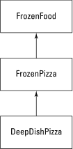

**图 3-4：** 此 UML 图中的箭头指向基类。

## 代码清单 3-2：指定继承成员的访问级别

```cpp
#include <iostream>

using namespace std;

class FrozenFood {
private:
    int Price;
protected:
    int Weight;
public:
    FrozenFood(int APrice, int AWeight);
    int GetPrice();
    int GetWeight();
};

class FrozenPizza : public FrozenFood {
protected:
    int Diameter;
public:
    FrozenPizza(int APrice, int AWeight, int ADiameter);
    void DumpInfo();
};

class DeepDishPizza : public FrozenPizza {
private:
    int Height;
public:
    DeepDishPizza(int APrice, int AWeight, int ADiameter,
                  int AHeight);
    void DumpDensity();
};

FrozenFood::FrozenFood(int APrice, int AWeight) {
    Price = APrice;
    Weight = AWeight;
}

int FrozenFood::GetPrice() {
    return Price;
}

int FrozenFood::GetWeight() {
    return Weight;
}

FrozenPizza::FrozenPizza(int APrice, int AWeight,
                         int ADiameter) :
                         FrozenFood(APrice, AWeight) {
    Diameter = ADiameter;
}

void FrozenPizza::DumpInfo() {
    cout << "\tFrozen pizza info:" << endl;
    cout << "\t\tWeight: " << Weight << " ounces" << endl;
    cout << "\t\tDiameter: " << Diameter << " inches"
         << endl;
}

DeepDishPizza::DeepDishPizza(int APrice, int AWeight,
                             int ADiameter, int AHeight) :
                             FrozenPizza(APrice, AWeight,
                                         ADiameter) {
    Height = AHeight;
}

void DeepDishPizza::DumpDensity() {
    // Calculate pounds per cubic foot of deep-dish pizza
    cout << "\tDensity: ";
    cout << Weight * 12 * 12 * 12 * 14 /
         (Height * Diameter * 22 * 16);
    cout << " pounds per cubic foot" << endl;
}
```

## 代码清单 3-2：（续）

```cpp
int main() {
    cout << "Thin crust pepperoni" << endl;
    FrozenPizza pepperoni(450, 12, 14);
    pepperoni.DumpInfo();
    cout << "\tPrice: " << pepperoni.GetPrice()
         << " cents" << endl;

    cout << "Deep dish extra-cheese" << endl;
    DeepDishPizza extracheese(650, 21592, 14, 3);
    extracheese.DumpInfo();
    extracheese.DumpDensity();
    cout << "\tPrice: " << extracheese.GetPrice()
         << " cents" << endl;
    return 0;
}
```

运行代码清单 3-2 时，会看到以下输出：

```text
Thin crust pepperoni
              Frozen pizza info:
                    Weight: 12 ounces
                  Diameter: 14 inches
             Price: 450 cents
Deep dish extra-cheese
              Frozen pizza info:
                    Weight: 21592 ounces
                  Diameter: 14 inches
                 Density: 35332 pounds per cubic foot
             Price: 650 cents
```

前五行显示的是 FrozenPizza 类对象的信息。其余行显示的是 DeepDishPizza 类对象的信息，包括它重 21,592 盎司（恰好是 1349.5 磅）这一事实。它的密度为 35,332 磅/立方英尺。

这些派生都是公有的。因此，在 FrozenFood 中为公有的项，在 FrozenPizza 和 DeepDishPizza 中仍然为公有。请注意输出中不同信息的来源。Frozen pizza info: 这一行以及随后的两行（Weight: 和 Diameter:）来自公有方法 DumpInfo()，它是 FrozenPizza 的成员。DumpInfo() 在 FrozenPizza 类中是公有的。由于 DeepDishPizza 以公有方式从 FrozenPizza 派生，因此 DumpInfo() 也是 DeepDishPizza 的公有成员。

尝试将 `DeepDishPizza` 的类头从

```cpp
class DeepDishPizza : public FrozenPizza
```

改为

```cpp
class DeepDishPizza : protected FrozenPizza
```

你要把 `public` 一词改为 `protected`。请确保修改的是正确的行。编译并运行应用程序。你会看到类似下面的错误：

```text
In function 'int main()':
error: 'void FrozenPizza::DumpInfo()' is inaccessible
error: within this context
error: 'FrozenPizza' is not an accessible base of
  'DeepDishPizza'
error: 'int FrozenFood::GetPrice()' is inaccessible
error: within this context
error: 'FrozenFood' is not an accessible base of 'DeepDishPizza'
```

这条消息指的是 `main()` 中的 `extracheese.DumpInfo();` 行。由于类头中的 `protected` 一词，`DumpInfo()` 现在是 `DeepDishPizza` 的受保护成员。通过在类定义中写入 `protected` 一词，你表示当前为公有的继承成员将改为受保护。由于 `DumpInfo()` 成员是受保护的，因此不能从 `main()` 中调用它。不过，`DumpInfo()` 在 `FrozenPizza` 类中仍然是公有的，所以下面这个调用没有问题：

```cpp
pepperoni.DumpInfo();
```


请注意，你可以双击 `error: within this context` 行，直接跳转到试图访问隐藏成员的代码，而不必查看最初的错误。使用这种技巧可以节省查找出错代码的时间。

将该行改回公有继承，就像代码清单 3-2 中那样：`class DeepDishPizza : public FrozenPizza`。

现在将 `FrozenPizza` 的类头改成这样：

```cpp
class FrozenPizza : private FrozenFood
```

同样，请确保修改正确的行。编译并运行应用程序，会看到以下错误：

```text
In function 'int main()':
error: 'void FrozenPizza::DumpInfo()' is inaccessible
error: within this context
error: 'FrozenPizza' is not an accessible base of
    'DeepDishPizza'
error: 'int FrozenFood::GetPrice()' is inaccessible
error: within this context
error: 'FrozenFood' is not an accessible base of 'DeepDishPizza'
```

这个错误指的是 DeepDishPizza::DumpDensity() 中的一行，其中代码试图访问 Weight 成员。编译器现在不允许访问，因为该成员原本在 FrozenFood 类中是公有的，当它成为 FrozenPizza 的一部分时变成了私有。又因为它在 FrozenPizza 中是私有的，派生类 DeepDishPizza 不能在自己的方法中访问它。请确保将 FrozenPizza 的类头改回这样：`class FrozenPizza : public FrozenFood`。

## 重写方法

类的一个很酷的特性是，你可以在一个类中声明一个方法，然后在派生新类时，为该类提供同一方法的不同版本。这称为重写方法。例如，如果你有一个 FrozenFood 类和一个派生类 FrozenPizza，你可能希望在 FrozenFood 中包含一个名为 BakeChemistry() 的方法，该方法在食物被烘焙时改变食物。由于所有食物都不同，对于从 FrozenFood 派生的每个类，BakeChemistry() 方法都会有所不同。

在 C++ 中，可以通过在基类声明中于方法名之前添加 virtual 一词，为不同的派生类提供该方法的不同版本，如下行代码所示：

```cpp
virtual void BakeChemistry();
```

这一行是类定义内部的原型。稍后，你会提供该方法的代码。在派生类的类中，你只需放入方法原型，不写 virtual 一词：

```cpp
void BakeChemistry();
```

和之前一样，你稍后会在代码中包含该方法的代码。例如，你可能会有类似下面示例的内容。首先，下面是这些类：

```cpp
class FrozenFood {
private:
    int Price;
protected:
    int Weight;
public:
    FrozenFood(int APrice, int AWeight);
    int GetPrice();
    int GetWeight();
    virtual void BakeChemistry();
};

class FrozenPizza : public FrozenFood {
protected:
    int Diameter;
public:
    FrozenPizza(int APrice, int AWeight, int ADiameter);
    void DumpInfo();
    void BakeChemistry();
};
```

你可以在 FrozenFood 类中看到 virtual 这个词，然后在 FrozenPizza 类中再次看到该方法的声明。现在，下面是 BakeChemistry() 方法：

```cpp
void FrozenFood::BakeChemistry() {
    cout << "Baking, baking, baking!" << endl;
}

void FrozenPizza::BakeChemistry() {
    cout << "I'm getting crispy!" << endl;
}
```

请注意，virtual 这个词不会出现在方法前面；它只出现在类声明中。现在，每当你创建每个类的实例并为每个实例调用 BakeChemistry() 时，你调用的都是该实例所属类对应的方法。考虑下面两行代码：

```cpp
FrozenPizza pepperoni(450, 12, 14);
pepperoni.BakeChemistry();
```

因为 pepperoni 是 FrozenPizza 的实例，所以这段代码调用的是 FrozenPizza 类的 `BakeChemistry()`，而不是 FrozenFood 类的。你可能不希望在基类中为 `BakeChemistry()` 方法编写任何代码。如果是这样，可以这样做：

```cpp
virtual void BakeChemistry() {}
```


采用这种做法的原因是：你不需要在基类中编写代码，但确实希望在派生类中编写代码，并且希望它们是同一代码的不同版本。于是，思路就是提供一组基本的默认代码，如果这些类不重写该方法，就会继承这组代码。而有时，这组基本的默认代码就是什么都没有。因此，你只需放一个左花括号和一个右花括号，而且可以直接在类内部这样做：

```cpp
class FrozenFood
{
private:
  int Price;
protected:
  int Weight;
public:
  FrozenFood(int APrice, int AWeight);
  int GetPrice();
  int GetWeight();
  virtual void BakeChemistry() {}
};
```

### 用多态进行特化

假设你有一个名为 `Bake()` 的方法，并且希望它接收一个 FrozenFood 实例作为参数。如果你从 FrozenFood 派生出 FrozenPizza，然后从 FrozenPizza 派生出 DeepDishPizza，那么按照“是一个”规则，FrozenPizza 和 DeepDishPizza 类的对象都是 FrozenFood 对象的示例。一般来说这是成立的：如果你有一个名为 Base 的类，并从中派生出一个名为 Derived 的类，那么 Derived 类的实例也是 Base 类的实例。因此，如果你有一个名为 `Bake()` 的方法，并按如下方式声明它，你就可以自由地向该方法传递一个 FrozenFood 实例，或者传递任何从 FrozenFood 派生的类的实例，例如 FrozenPizza 或 DeepDishPizza：

```cpp
void Bake(FrozenFood *)
{
  cout << "Baking" << endl;
}
```

假设在这个 `Bake()` 方法中，你把烤箱温度设定为固定值，打开烤箱，然后烹饪食物。每种食物在烤箱中的表现都不同。例如，深盘冷冻披萨可能会膨胀并变厚，而普通冷冻披萨会变得更脆，但不会变厚。

你并不真的想把所有不同的食物类型都放进 `Bake()` 方法中，并为每种食物类型编写 `if` 语句。相反，你可以把实际的烘焙化学过程放进食物自身的类中。`FrozenPizza` 会有自己的 `BakeChemistry()` 方法，`DeepDishPizza` 也会有自己的 `BakeChemistry()` 方法。然后，`Bake()` 方法会为它作为参数接收到的任何对象调用 `BakeChemistry()`。C++ 由于虚方法而知道如何做到这一点。`Bake()` 方法不知道也不关心它接收的是什么类型的 `FrozenFood`。它只是为接收到的任何对象调用 `BakeChemistry()`。而当你通过编写一个从 `FrozenFood` 派生的新类并给它自己的 `BakeChemistry()` 方法来修改应用程序时，你可以将该类的实例传递给 `Bake()`，甚至无需修改 `Bake()`。整个过程称为*多态*。


多态是面向对象编程最强大的方面之一。其思想是，你可以通过添加从共同基类派生的新类来扩展和增强应用程序。然后，你对应用程序其余部分只需做很少（如果有的话）的修改。因为你使用了虚方法和多态，应用程序的其余部分会自动理解你创建的新类。从本质上说，你能够即插即用地接入新类，而应用程序会正常运行。

### 抽象地看待事物

当你创建一个带有虚方法的基类，然后派生其他类时，你可能希望在所有的派生类中重写该虚方法。此外，你可能希望确保没有人创建基类的实例。你这样做是因为基类可能包含所有其他类共有的基本内容，但该类本身作为实例并没有太大意义。例如，没有人会希望你去商店买一份冷冻食品却不说明要买哪种冷冻食品。因此，拥有一个名为 `FrozenFood` 的类的实例并没有太大意义。


哲学家有一个词来描述这类事物：*抽象*。`FrozenFood` 类就是抽象的；创建它的实例没有意义。在 C++ 中，你可以让一个类成为抽象类，但这样做之后，编译器就不允许你创建该类的任何实例。

在 C++ 中，你实际上并不需要显式指定该类是抽象的。*抽象*这个词并不出现在该语言中。要指定该类是抽象的，你需要添加至少一个没有代码的虚方法。但与其只是放一个像 `{ }` 这样的空代码块，不如在类定义中的方法原型后面加上 `= 0`（称为*纯说明符*，它使该方法成为*纯虚方法*或*抽象虚方法*，取决于你更喜欢哪种说法），如下所示：


```cpp
class FrozenFood
{
private:
    int Price;
protected:
    int Weight;
public:
    FrozenFood(int APrice, int AWeight);
    int GetPrice();
    int GetWeight();
    virtual void BakeChemistry() = 0;
};
```

在这个类定义中，方法 BakeChemistry() 后面有 `= 0`（但在分号之前）。`= 0` 将虚方法转换为抽象虚方法，从而将该类转换为抽象类。

创建抽象类之后，还必须通过重写抽象虚方法来修改派生类。否则，派生类也会变成抽象类。当你的类是抽象类时，你不能创建它的实例。要重写抽象虚方法，就像重写任何虚方法一样进行重写。下面这个类包含一个重写 BakeChemistry() 方法的方法：

```cpp
class FrozenPizza : public FrozenFood
{
protected:
    int Diameter;
public:
    FrozenPizza(int APrice, int AWeight, int ADiameter);
    void DumpInfo();
    void BakeChemistry();
};
```

然后你为 BakeChemistry() 方法提供代码，如下所示：

```cpp
void FrozenPizza::BakeChemistry()
{
    cout << "I'm getting crispy under this heat!" << endl;
}
```

定义重写方法并没有什么神奇之处，但如果你想创建这个类的实例，就必须重写它。

### 本章内容

- 理解什么是设计模式以及如何使用它们
- 实现观察者模式
- 构建中介者模式

## 第 4 章：使用设计模式构建

当你作为开发者工作时，最终会开始注意到自己会反复做某些事情。例如，当你需要跟踪某个类创建了多少个实例时，你会定义一个名为 `InstanceCount` 之类的静态属性，在构造函数中包含一行递增 `InstanceCount` 的代码，并在析构函数中包含一行递减 `InstanceCount` 的代码。你会把 `InstanceCount` 设为私有，并包含一个检索该值的静态方法，例如 `getInstanceCount()`。

因为你经常使用它，它就成了一个模式。第一次使用它时，你必须思考——如何设计和实现它。现在，你几乎不用思考；直接做就行。因此，这就是你所使用的一种*设计模式*。

本章将从实践角度审视你在创建应用程序时使用的设计模式。它帮助你理解为什么使用设计模式可以减少开发时间、降低代码出错概率并提高应用程序效率。本章只稍微深入介绍历史和用法，其中用法讨论以单例模式作为起点。

你还会看到如何创建和使用两种常见的设计模式：观察者模式和中介者模式。你在应用程序中可能实际用到也可能用不到这些模式，但通过了解它们是如何组合起来的，你可以找到或创建其他能让开发过程更轻松的模式。


## 深入探究模式历史

早在1995年，一本名为《设计模式：可复用面向对象软件的基础》的书迅速成为编程界的畅销书，作者是埃里希·伽玛、理查德·海尔姆、拉尔夫·约翰逊和约翰·弗利西德斯。这本开创性著作的四位作者在编程领域后来被称为“四人组”（Gang of Four）。

四人组借鉴了建筑学领域的知识体系——不是软件架构，而是那些建造高楼大厦、砖石结构的人们所在的领域。这种建筑学已经存在了至少两个半世纪，因此该领域比软件开发领域更加成熟。而且，在建筑设计领域，人们已经总结出了设计和建造建筑物及城镇的通用方法，无需每次都从零开始重新设计。克里斯托弗·亚历山大在1977年写了一本名为《模式语言》的书（详情参见 http://www.patternlanguage.com/ca/ca.html ），该书通过模式来传授建筑架构的主要概念。四人组借鉴了这一知识，并将其应用到软件开发原则中。

在他们的书中，四人组指出了一件事后看来显而易见的事情（但话说回来，伟大的发现往往看似简单）：最优秀的软件开发人员会以模式的形式复用技术。维护实例计数的类描述就是一个可以反复使用的技术示例。

现在，如果你深入研究面向对象编程（实际上包括整个计算机科学领域），你会经常看到*可复用*这个术语。面向对象编程的目标之一就是通过将代码放入类中来实现代码复用。然后你可以从这些类派生出自己的类，从而复用基类中的代码。

你也许可以把一个实例计数类放在基类中，并始终从它派生。但对于其他一些设计，使用基类并不总是有效。相反，软件开发人员会将相同的设计应用于一组新的类。设计被复用，但代码并没有被复用。这就是设计模式背后的思想。你不会只是把设计模式写出来，然后塞进一堆基类中。相反，你了解这些模式，或者保留一份它们的列表或目录。你可以在 https://medium.com/educative/the-7-most-important-software-design-patterns-d60e546afb0e 找到七种最重要设计模式的列表。

然后，瞧——你就有了一个单例类！它的工作方式如下：每当你需要该类的唯一实例时，你不需要尝试创建它。（你会得到一个编译错误！是的，编译器本身不会让你这么做。）相反，你调用静态方法。


单例模式不会阻止同一台机器上的不同程序创建该类的多个实例（每个应用程序一个）。该模式只在单个应用程序内有效。因此，如果你需要确保一个类在整个机器上不会被实例化多次，你需要在操作系统层面使用某种全局唯一标识符，而这个话题超出了本书的范围。

### 创建单例模式类

现在是时候看看单例模式的实际应用了。Singleton示例中的清单4-1展示了如何创建这样的类：

### 清单4-1 — 创建单例类

```cpp
class Planet {
private:
    static Planet *inst;
    Planet() {}
    ~Planet() {}
public:
    static Planet *GetInstance();
};

Planet *Planet::inst = 0;

Planet *Planet::GetInstance() {
    if (inst == 0) {
        inst = new Planet();
    }
    return inst;
}

int main() {
    Planet *MyPlanet = Planet::GetInstance();
    cout << "MyPlanet address: " << MyPlanet << endl;

    Planet *MyPlanet2 = Planet::GetInstance();
    cout << "MyPlanet2 address: " << MyPlanet2 << endl;
    return 0;
}
```

要使用这个类，你不能直接创建实例。相反，你需要调用 GetInstance() 方法：

```cpp
Planet *MyPlanet = Planet::GetInstance();
```

无论何时你想获得该唯一实例的副本，都可以调用此方法，这可能会在实例不存在时创建一个实例。每次调用 GetInstance()，你总是会得到指向同一实例的指针。当你运行这段代码时，你会看到类似下面的输出，这证实了 MyPlanet 和 MyPlanet2 都指向同一个实例：


```
MyPlanet address: 0x3faf08
MyPlanet2 address: 0x3faf08
```

看看构造函数：它是私有的。因此，如果你在类外部（比如在 main() 中）尝试类似这样的操作：

```cpp
Planet MyPlanet;
```

你会得到一个编译错误。在 Code::Blocks 中，你会看到这个错误：

```
error: 'Planet::Planet()' is private
error: within this context
```

或者如果你尝试创建一个指针，当你调用 new 时也会得到同样的错误：

```cpp
Planet *MyPlanet = new Planet();
```

单例模式是关于按需创建和销毁单个实例的，因此你不希望任何东西删除应用程序创建的实例。就像将构造函数设为私有一样，你也应该将析构函数设为私有，如清单4-1所示。如果你在获得实例后尝试删除它，例如：

```cpp
Planet *MyPlanet = Planet::GetInstance();
delete MyPlanet;
```

那么你会再次收到错误消息——这次是针对析构函数的：

```
error: 'Planet::~Planet()' is private
error: within this context
```

## 使用观察者监视实例

在计算机编程中，一个常见任务是：一个类（或不同类）的一个或多个实例需要监视某个对象，并在该对象发生变化时执行各种操作。换句话说，监视其他对象的类就是一个观察者，模式也因此得名。以下各节将向你介绍观察者模式并描述其用途。

### 理解观察者模式

你可能会编写一个应用程序，在你离家时监控家中的各种活动。你的应用程序可以是可配置的；你可以将它设置为允许用户在某些异常情况发生时选择要执行的各种操作。你可能有以下选项：

- 应用程序在文件中保存一条记录，以便你之后查阅。
- 应用程序向你发送电子邮件（或短信）。
- 如果计算机连接了电话安全系统，它可以通知警察。
- 机器狗可以接收信号进入高度戒备状态。

这些操作中的每一个都可以存在于不同的类中，每个类都有自己的代码来处理相应情况。将记录保存到文件的操作很简单：打开文件、写入内容、然后关闭文件。电子邮件的例子可能涉及获取一个简单邮件传输协议（SMTP）库，使用它创建消息对象，然后发送消息。要通知警察，你的计算机必须连接到可通过电话线或互联网访问的在线安全系统，而警察那边也需要类似的系统。这个类会通过线路向警察发送信号，就像加油站里那种通知警察发生抢劫的隐秘按钮一样。最后，你可能会有一个类似的装置连接到你的小机器看门狗Fido的大脑上；在收到高压电击后，Fido可以进入高度戒备状态并击退入侵者。这些情况都使用了观察者类（每个类都派生自一个名为 Observer 的基类）。

现在，你还会有一个类，它的对象用于检测房屋中的问题。这个对象可能连接到一个精密的安全系统，当变化发生时，计算机调用该对象内部的一个方法。我们将这个类称为 Subject 类。那么想想这里发生了什么：

- 1. 当安全事件发生时，计算机调用单个 Subject 实例中的一个方法。
- 2. Observer 类的对象监视 Subject 实例。Subject 类中的方法随后调用每个 Observer 对象中的方法。这些方法会采取适当的行动，无论是写入文件、通知警察、电击机器狗，还是其他什么。

关键在于：使用你的计算机应用程序的人们可以决定他们希望哪些 Observer 类来响应事件（可能通过“选项”对话框）。用户能够决定使用哪些 Observer 类，这意味着设计必须是灵活的。为了获得这种灵活性，你需要添加以下要求：你可能会随着新需求的出现而添加新的 Observer 类，因此 Subject 类必须能够容纳所有它们。某个 Observer 可能会发出信号让直升机飞过来追逐正在逃跑的强盗。但你无法确定接下来会想出什么新点子。你只知道你可能会添加 Observer 子类以及这些子类的实例。以下是设计这样一组类时出现的问题：

- 你可以在 Subject 类中维护一个长长的实例列表，每当事件发生时，事件处理器会调用所有 Observer 实例中的一个例程。然后由 Observer 实例决定它们是否要使用这些信息。这种情况的问题在于，即使某些实例不需要该信息，你也必须调用 Observer 类中的方法（进入类内部）。
- 你可以让每个 Observer 实例不断轮询 Subject 实例，寻找事件。（这个过程称为轮询。）这里的问题是，信不信由你，这个过程可能会将计算机推向极限：如果每个 Observer 实例都不断调用 Subject 类，你会有大量的活动持续数小时，让CPU保持相当热度。这也不是一个好主意。
- 你可以使用观察者模式来执行轮询，而不会过度消耗CPU。在这种模式中，Observer 类包含一个名为 Respond() 的方法。同时，Subject 类包含一个 Observer 实例列表。此外，Subject 类包含一个名为 Event 的方法，当有事情发生时（例如有人闯入），计算机就会调用它。应用程序会根据人们在使用你的应用程序时选择的选项，将 Observer 实例添加到 Subject 的观察者列表中，或从中移除。


正如你所想象的，这是许多应用程序反复采用的一种模式。虽然电击机器狗可能并不常见，但其他应用程序也会使用这种通用模型。例如，在某些 C++ 编辑器中，你可以在同一个编辑器应用程序实例中，用多个窗口打开同一份文档。在一个窗口中修改代码后，你会立即在其他窗口中看到相同的改动。每个类可能都对应一个窗口，而这些窗口就是观察者类。主题表示底层文档。

## 定义观察者模式类

本节将介绍如何创建观察者类。观察者类包含一个名为 Respond() 的方法。在类声明中，它是一个纯抽象函数——也就是说，派生类必须创建自己的 Respond() 函数实现。派生类可以自行决定如何响应事件。下面是 AddRemoveItems 示例中的部分代码（见本章后面的清单 4-2），展示了如何创建观察者类：

```cpp
class Observer {
public:
    virtual void Respond() = 0;
};
```

如你所见，这里没有多少内容，因此示例还添加了一些派生类。以下是其中两个：

```cpp
class Dog : public Observer {
public:
    void Respond();
};

class Police : public Observer {
protected:
    string name;
public:
    Police(string myname) { name = myname; }
    void Respond();
};
```

以下是这两个类的 Respond() 方法。为了简单起见，它们目前只向控制台输出一些内容：

```cpp
void Dog::Respond() {
    cout << "Bark bark" << endl;
}

void Police::Respond() {
  cout << name << ": 'Drop the weapon! Now!'" << endl;
}
```

到目前为止，这些代码仍没有什么特别之处。它们实际上只定义了几个各自完成任务的方法。不过，接下来的步骤就有意思了。下面是 Subject 类：

```cpp
class Subject {
protected:
  int Count;
  Observer *List[100];
public:
  Subject() { Count = 0; }
  void AddObserver(Observer *Item);
  void RemoveObserver(Observer *Item);
  void Event();
};
```

这个类在其 List 成员中保存了一个观察者实例列表。Count 成员表示列表中的项目数。类中提供了两个用于添加和移除观察者实例的方法：AddObserver() 和 RemoveObserver()。构造函数只需将计数设为 0，即可初始化列表；此外还定义了 Event() 方法。下面是 AddObserver() 和 RemoveObserver() 方法的代码。这两个函数只负责操作数组：

```cpp
void Subject::AddObserver(Observer *Item) {
  List[Count] = Item;
  Count++;
}

void Subject::RemoveObserver(Observer *Item) {
  int i;
  bool found = false;
  for (i=0; i < Count; i++) {
    if (!found && List[i] == Item) {
      found = true;
      List[i] = List[i+1];
    }
  }
  if (found) {
    Count--;
  }
}
```

## 观察者与标准 C++ 库


如果你有兴趣使用模板和标准 C++ 库，可以使用列表而非数组，让 `Subject` 类更加完善。（使用列表可以轻松添加和移除项目，而无需像使用数组那样不断重建列表。）你可以使用标准的 `list` 类来实现这一点。唯一的问题是，`list` 类似乎无法很好地处理抽象类。因此，你需要让 `Observer` 类不再是抽象类，方法是按如下方式设置：

```cpp
class Observer {
public:
  virtual void Respond() {}
};
```

然后，你可以像下面这样修改 `Subject` 类及其方法：

```cpp
class Subject {
protected:
  list<Observer *> OList;
public:
  void AddObserver(Observer *Item);
  void RemoveObserver(Observer *Item);
  void Event();
};

void Subject::AddObserver(Observer *Item) {
  OList.push_back(Item);
}

void Subject::RemoveObserver(Observer *Item) {
  OList.remove(Item);
}

void Subject::Event() {
  list<Observer *>::iterator iter;
  for (iter=OList.begin(); iter!=OList.end(); iter++) {
    Observer *item = (*iter);
    item->Respond();
  }
}
```

请注意，列表中保存的是指向观察者的指针，而不是观察者实例本身。这是因为默认情况下，`list` 类会复制放入其中的内容。如果放入实际实例，`list` 类就会复制它。（这会给派生类带来问题，因为列表只会复制作为观察者实例存储的对象，而不会复制从观察者派生的类。）而使用指针时，复制指针后它仍然指向原对象，因此列表中的项目仍是原对象（至少，列表中保存的是它们的地址）。使用 `list` 还可以添加和移除项目，无需像使用数组时那样让程序遍历所有项目。

## 自动添加观察者

如果应用程序允许用户配置各种观察者，你可能需要根据配置创建和删除观察者。在这种情况下，可以在创建观察者时自动将其添加到主题的列表中，并在删除观察者时将其从列表中移除。为此，你可以在构造函数中调用 AddObserver() 方法，并在析构函数中调用 RemoveObserver() 方法。

要使这一技巧生效，需要通过将主题的名称作为参数传递给构造函数，告知对象其所属的主题。下面的代码展示了如何实现。请注意，由于观察者的构造函数和析构函数会调用 Subject 的方法，因此必须将 Subject 类移到 Observer 类之前。此外，AddObserver() 和 RemoveObserver() 函数是受保护的。不过，要让 Observer 类能够使用这些函数，需要在 Subject 类中添加关键字 friend，后面跟上 Observer。完整的 AddRemoveItems 应用程序代码见清单 4-2。

### 清单 4-2：在构造函数和析构函数中添加和移除项目

```cpp
#include <iostream>

using namespace std;

class Observer;

class Subject {
    friend class Observer;
protected:
    int Count;
    Observer *List[100];
    void AddObserver(Observer *Item);
    void RemoveObserver(Observer *Item);
public:
    Subject() { Count = 0; }
    void Event();
};

class Observer {
protected:
    Subject *subj;
public:
    virtual void Respond() = 0;
    Observer(Subject *asubj) {
        subj = asubj;
        subj->AddObserver(this);
    }
    virtual ~Observer() { subj->RemoveObserver(this); }
};

class Dog : public Observer {
public:
    void Respond();
    Dog(Subject *asubj) : Observer(asubj) {}
};

class Police : public Observer {
protected:
    string name;
public:
    Police(Subject *asubj, string myname) :
        Observer(asubj) {
        name = myname; }
    void Respond();
};

void Dog::Respond() {
    cout << "Bark bark" << endl;
}

void Police::Respond() {
    cout << name << ": 'Drop the weapon! Now!'" << endl;
}
void Subject::AddObserver(Observer *Item) {
    List[Count] = Item;
    Count++;
}
void Subject::RemoveObserver(Observer *Item) {
    int i;
    bool found = false;
    for (i=0; i < Count; i++) {
      if (!found && List[i] == Item) {
        found = true;
        List[i] = List[i+1];
      }
    }
    if (found) {
      Count--;
    }
}

void Subject::Event() {
  int i;
  for (i=0; i < Count; i++) {
    List[i]->Respond();
  }
}

int main() {
  Subject Alarm;
  Police *TJHooker = new Police(&Alarm, "TJ");
  cout << "TJ on the beat" << endl;
  Alarm.Event();
  cout << endl;
  cout << "TJ off for the day" << endl;
  delete TJHooker;
  Alarm.Event();
  return 0;
}
```

请注意清单中的 `Dog(Subject *asubj) : Observer(asubj) {}` 这行代码。它告诉应用程序先调用基类构造函数，并将主题传给它。这样可以确保在实例化 Dog 之前，基类对象 Observer 已正确实例化。如果不这样做，Dog 的实例化就会失败，因为 Dog 无法访问所需的基类资源。

## 用模式进行协调

*中介者*模式的核心思想是：当多个类以复杂方式交互时，由中介者负责组织类之间的通信。这样，只有底层的中介者类需要了解所有实例。


实例本身只与中介者通信。以下各节描述该模式的基础，并演示其工作方式。

## 定义中介者模式场景

假设你正在设计一个复杂而精细的汽车模型。你将包含以下部件，每个部件都将有自己的类：

- 发动机
- 供电系统（对于懂技术的人来说，就是电池和发电机的组合）
- 收音机
- 车轮
- 刹车
- 前灯
- 空调
- 道路

你的部分任务是对这些类提供的行为进行建模：

- 当发电量变化时，前灯会变亮或变暗。
- 当发电量增大或减小时，收音机音量会增大或减小。
- 当发动机转速增大或减小时，发电量会增大或减小。
- 当发动机加速时，车轮会加速。
- 当空调打开时，可用电量会减少。
- 当空调关闭时，可用电量会增加。
- 当由于上坡导致道路角度增大时，车轮速度会降低。
- 当由于汽车下坡导致道路角度减小时，车轮速度会增大。
- 当刹车启动时，车轮速度会降低。

这个列表表示九个对象以不同方式相互交互。你可以尝试让所有对象直接相互通信。在代码中，让它们通信意味着大多数类都必须包含对其他类对象的引用。这种技术可能会变得相当混乱。

图 4-1 显示了类之间交互的层次结构，说明你不必让每个类都直接与其他每个类通信。

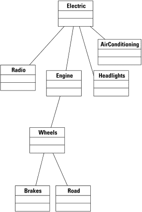

**图 4-1：** 类之间层次结构的模型。

## 概述汽车示例

在该示例中，当有山丘时，道路角度会根据你位于山丘的哪一侧（上坡或下坡）而增大或减小。道路不需要了解所有其他汽车部件。相反，它只通知中介者发生了变化。然后中介者再通知必要的汽车部件。

这看起来可能有些多余，因为汽车部件应该能够直接相互通信。其想法是，如果你以后增强此应用程序，可能会想添加更多汽车部件。与其将新汽车部件连接到所有必要的现有汽车部件，你只需与中介者对象建立连接。假设你添加一个名为自动变速器的新部件。当汽车开始爬坡时，自动变速器可能会检测到坡度变化并自动切换到低速挡，从而导致发动机转速提高。要添加这个类，你只需定义其行为，并指定它如何响应各种事件，然后将其连接到中介者。你还要修改中介者，使其了解自动变速器行为的一些信息。因此，你不需要将它连接到所有其他实例。图 4-2 显示了在中介者就位后应用程序类的情况。

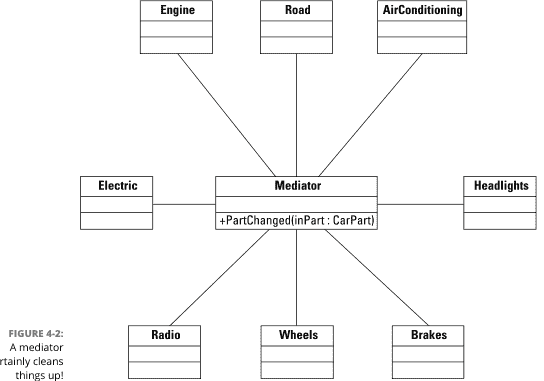

图 4-2 中未显示的一点（为了避免杂乱）是，所有各种汽车部件（包括道路！）都派生自一个名为 CarPart 的基类。这个类将有一个成员：一个指向 Mediator 实例的指针。然后，每个汽车部件都会继承一个指向 Mediator 实例的指针。

### 设置外观（模式）

在 CarParts 示例中，如果必须同时分别关注所有不同部件（例如发动机和车轮）来操纵汽车系统，那会很麻烦。想象一下，如果你必须一边开车一边不断担心每一个小细节，生活会是什么样。相反，该示例使用了一个 CarControls 类，你可以通过它与系统交互。CarControls 类本身就是一个模式，称为外观模式（Façade pattern）。（façade 是某物的正面——这是一个法语词。）这个模式也是一个“正面”：它是你与系统交互所经过的接口。这样，你就不必跟踪各个单独的类。当你添加一个可供用户与系统交互的类时，你就在使用外观模式。

Mediator 类有一个 PartChanged() 方法。这是关键函数：任何时候任何汽车部件发生变化，它都会调用 PartChanged()。请记住，汽车部件发生变化只有两种方式：通过与该部件现有类无关的外部力量（例如驾驶员踩油门或转动方向盘），或者通过 Mediator 实例本身。如果变化来自 Mediator 实例，那么它是由其他对象之一触发的。考虑以下步骤：

- 1. 驾驶员通过调用 Engine 实例中的一个方法来踩油门。
- 2. Engine 实例改变其转速，然后告诉 Mediator 发生了变化。
- 3. Mediator 实例知道应将变化通知哪些对象。对于这一变化，它通知车轮转得更快，并通知发电量增加。

下面是另一种可能的顺序：

- 1. 道路有一座山丘。为了告诉汽车有关山丘的信息，主例程调用 Road 实例中的一个方法。山丘有 10 度的倾斜。
- 2. Road 实例通知 Mediator 发生了变化。
- 3. Mediator 实例通过计算出需要减速多少来处理这一变化；然后它通知车轮减速。

因此可以看到，应用程序的大部分智能逻辑都在 Mediator 类中。


使用中介者模式似乎可能违反使用面向对象编程技术的规则。该示例将智能逻辑放在 Mediator 类中。在其他地方，你可能会听说对象必须能够完成自己的工作。但这并不真的矛盾。事实上，Mediator 类处理的是对象之间协作的所有智能逻辑。例如，在 Mediator 实例判断出车轮必须转得更快之后，它会通知车轮并告诉它们转得更快。这时车轮接手并完成自己的事情。此时，它们知道如何在没有其他类和对象外部帮助的情况下转得更快。所以，这终究并不矛盾。

## 创建汽车示例

现在是把发现的所有内容转化为代码形式的时候了。以下各节将汽车示例拆分成易于处理的部分，但在运行示例之前，你需要所有部分。

### 处理汽车部件头文件

CarParts 示例从代码清单 4-3 开始。这是一个头文件，包含汽车部件的类声明。每个类都提供适合该部件的行为，例如启动和停止发动机。

**代码清单 4-3 — 使用 carparts.h 文件**

```cpp
#ifndef CARPARTS_H_INCLUDED
#define CARPARTS_H_INCLUDED

#include "mediator.h"

class CarControls; // forward reference

class CarPart {
protected:
    Mediator *mediator;
    CarPart(Mediator *med) : mediator(med) {}
    void Changed();
};

class Engine : public CarPart {
protected:
    friend class Mediator; friend class CarControls;
    int RPM;
    int Revamount;
```

```cpp
public:
    Road(Mediator *med) : CarPart(med) {}
    void ClimbDescend(int angle);
    void Bump(int height, int which);
};

#endif // CARPARTS_H_INCLUDED
```

这些类彼此知之甚少。这是好事。不过，它们确实完全了解中介者，这也没问题。本示例使用了美国国家标准学会（ANSI）C++ 版本中一个重要的特性。注意 Engine 类定义中的构造函数行：

```cpp
Engine(Mediator *med) : CarPart(med),
    RPM(0), Revamount(0) {}
```

在构造函数定义之后，你会看到一个冒号和基类 CarPart 的名称。这会调用基类构造函数。然后有一个逗号、一个属性名（RPM）以及括号中的一个值，它们共同构成初始化器。当你创建 Engine 的实例时，RPM 变量会被设为 0。此外，Revamount 变量也会被设为 0。使用带初始化器的构造函数会使构造函数的行为与以下代码完全相同：

```cpp
Engine(Mediator *med) {
    RPM = 0;
    Revamount = 0;
}
```

### 处理中介者和汽车控制头文件

在代码清单 4-4 中，你会看到中介者的头文件，以及一个名为 CarControls 的特殊类，它提供了一个可以控制汽车的集中位置。你可能已经注意到，CarControls 友元类访问 carparts.h 中的汽车部件。该文件包含若干前向声明，并且了解各种 CarParts 类。该文件还包含一个 Mediator 派生类，它为整个系统提供通用接口。


## 清单 4-4：使用 mediator.h 文件

```cpp
#ifndef MEDIATOR_H_INCLUDED
#define MEDIATOR_H_INCLUDED

// Define all of the required forward references.
class CarPart;
class Engine;
class Electric;
class Radio;
class SteeringWheel;
class Wheels;
class Brakes;
class Headlights;
class AirConditioner;
class Road;

class Mediator {
public:
  Engine *MyEngine;
  Electric *MyElectric;
  Radio *MyRadio;
  SteeringWheel *MySteeringWheel;
  Wheels *MyWheels;
  Brakes *MyBrakes;
  Headlights *MyHeadlights;
  AirConditioner *MyAirConditioner;
  Road *MyRoad;
  Mediator();
  void PartChanged(CarPart *part);
};

class CarControls : public Mediator {
public:
  void StartCar();
  void StopCar();
  void PushGasPedal(int amount);
  void ReleaseGasPedal(int amount);
  void PressBrake(int amount);
  void Turn(int amount);
  void TurnOnRadio();
  void TurnOffRadio();
  void AdjustRadioVolume(int amount);
  void TurnOnHeadlights();
  void TurnOffHeadlights();
  void ClimbHill(int angle);
  void DescendHill(int angle);
  void TurnOnAC();
  void TurnOffAC();
  void AdjustAC(int amount);
  int GetSpeed();
  CarControls() : Mediator() {}
};

#endif // MEDIATOR_H_INCLUDED
```

## 创建汽车部件方法

所有汽车部件的方法都出现在清单 4-5 中。请注意，这些函数从不调用其他汽车部件中的函数。

## 清单 4-5：展示 carparts.cpp 文件

```cpp
#include <iostream>
#include "carparts.h"

using namespace std;

void CarPart::Changed() {
    mediator->PartChanged(this);
}

void Engine::Start() {
    RPM = 1000;
    Changed();
}

void Engine::PushGasPedal(int amount) {
    Revamount = amount;
    RPM += Revamount;
    Changed();
}

void Engine::ReleaseGasPedal(int amount) {
    Revamount = amount;
    RPM -= Revamount;
    Changed();
}

void Engine::Stop() {
    RPM = 0;
    Revamount = 0;
    Changed();
}

void Electric::ChangeOutputBy(int amount) {
    Output += amount;
    ChangedBy = amount;
    Changed();
}

void Wheels::Accelerate(int amount) {
    Speed += amount;
    Changed();
}

void Wheels::Decelerate(int amount) {
    Speed -= amount;
    Changed();
}

void Brakes::Apply(int amount) {
    Pressure = amount;
    Changed();
}

void Headlights::Adjust(int Amount) {
    Brightness += Amount;
}

void AirConditioner::TurnOn() {
    ChangedBy = 100 - Level;
    Level = 100;
    Changed();
}

void AirConditioner::TurnOff() {
    ChangedBy = 0 - Level;
    Level = 0;
    Changed();
}

void AirConditioner::SetLevel(int newlevel) {
    ChangedBy = newlevel - Level;
    Level = newlevel;
    Changed();
}

void Road::ClimbDescend(int angle) {
    ClimbAngle = angle;
    Changed();
}

void Road::Bump(int height, int which) {
    BumpHeight = height;
    BumpWhichTire = which;
    Changed();
}
```


可以看到，每个方法在每次更改后都会调用 Changed()。这个函数位于基类中，它会调用 Mediator 的 PartChanged() 方法，而后者负责完成所有繁重的工作。另请注意，在某些汽车部件类中，Mediator 不会响应它们的更改（例如 Wheels 类），但这些方法仍然会调用 Changed()。原因在于，你可能会添加一些功能，让 Mediator 响应这些更改。这样你就不必检查是否包含了 Changed() 调用；它已经在那里了。这种方法有助于避免这样的问题：当代码忘记调用 Changed() 时，你会纳闷为什么 Mediator 没有按预期工作。

## 创建中介者和汽车控制方法

清单 4-6 包含中介者的源代码以及 CarControls 类的源代码。这段代码位于 mediator.cpp 中。

## 清单 4-6：展示 mediator.cpp 文件

```cpp
#include <iostream>
#include "carparts.h"
#include "mediator.h"

using namespace std;

Mediator::Mediator() {
    MyEngine = new Engine(this);
    MyElectric = new Electric(this);
    MyRadio = new Radio(this);
    MyWheels = new Wheels(this);
    MyBrakes = new Brakes(this);
    MyHeadlights = new Headlights(this);
    MyAirConditioner = new AirConditioner(this);
    MyRoad = new Road(this);
}

void Mediator::PartChanged(CarPart *part) {
    if (part == MyEngine) {
        if (MyEngine->RPM == 0) {
            MyWheels->Speed = 0;
            return;
        }
        if (MyEngine->Revamount == 0) {
            return;
        }
        // If engine increases, increase the electric output
        MyElectric->ChangeOutputBy(MyEngine->Revamount / 10);
        if (MyEngine->Revamount > 0)
            MyWheels->Accelerate(MyEngine->Revamount / 50);
    }
    else if (part == MyElectric) {
        // Dim or brighten the headlights
        if (MyHeadlights->Brightness > 0)
            MyHeadlights->Adjust(MyElectric->ChangedBy / 20);
        if (MyRadio->Volume > 0)
            MyRadio->AdjustVolume(MyElectric->ChangedBy / 30);
    }
    else if (part == MyBrakes)
        MyWheels->Decelerate(MyBrakes->Pressure / 5);
    else if (part == MyAirConditioner)
        MyElectric->ChangeOutputBy(
            0 - MyAirConditioner->ChangedBy * 2);
    else if (part == MyRoad) {
        if (MyRoad->ClimbAngle > 0) {
            MyWheels->Decelerate(MyRoad->ClimbAngle * 2);
            MyRoad->ClimbAngle = 0;
        }
        else if (MyRoad->ClimbAngle < 0) {
            MyWheels->Accelerate(MyRoad->ClimbAngle * -4);
            MyRoad->ClimbAngle = 0;
        }
    }
}

void CarControls::StartCar() {
    MyEngine->Start();
}

void CarControls::StopCar() {
    MyEngine->Stop();
}

void CarControls::PushGasPedal(int amount) {
    MyEngine->PushGasPedal(amount);
}

void CarControls::ReleaseGasPedal(int amount) {
    MyEngine->ReleaseGasPedal(amount);
}

void CarControls::PressBrake(int amount) {
    MyBrakes->Apply(amount);
}

void CarControls::TurnOnRadio() {
    MyRadio->SetVolume(100);
}

void CarControls::TurnOffRadio() {
    MyRadio->SetVolume(0);
}

void CarControls::AdjustRadioVolume(int amount) {
    MyRadio->AdjustVolume(amount);
}

void CarControls::TurnOnHeadlights() {
    MyHeadlights->TurnOn();
}

void CarControls::TurnOffHeadlights() {
    MyHeadlights->TurnOff();
}

void CarControls::ClimbHill(int angle) {
    MyRoad->ClimbDescend(angle);
}

void CarControls::DescendHill(int angle) {
    MyRoad->ClimbDescend( 0 - angle );
}

int CarControls::GetSpeed() {
    return MyWheels->Speed;
}

void CarControls::TurnOnAC() {
    MyAirConditioner->TurnOn();
}

void CarControls::TurnOffAC() {
    MyAirConditioner->TurnOff();
}

void CarControls::AdjustAC(int amount) {
    MyAirConditioner->SetLevel(amount);
}
```

CarControls 部分有点长，但它很方便，因为它提供了一个中心接口，你可以通过该接口操作汽车。


然而，该模式的主力在于 Mediator 类。这段代码由一堆 if 语句组成，这些语句会查看发生的更改，然后调用其他类来修改其他类的对象。这就是中介者模式的全部目标：它有一个 Mediator 类，其中包含一个通用函数，该函数查找更改，然后更改其他类。

### 驾驶汽车

现在终于可以通过让汽车经受各种操作来尝试中介者模式了。清单 4-7 展示了各个类在实际运行中的表现。

示例代码使用各个类执行了一些简单任务。你总是可以向测试代码中添加更多内容。需要注意的是，一切都通过 Mediator 类 MyCar 进行。以下是该示例的输出：

```
Engine Started!
The car is going: 20
Applying the brakes.
The car is going: 16
Applying the brakes.
The car is going: 0
Engine Stopped
```


## 内容一览

- **第 1 章：考虑函数式编程** — 369
  - 理解函数式编程有何不同 — 370
  - 定义非纯语言 — 373
  - 将数据视为不可变 — 375
  - 考虑状态的影响 — 381
  - 消除副作用 — 382
  - 理解 `auto` 的作用 — 388
  - 将函数传递给函数 — 390
  - 使用 Lambda 表达式实现 — 394
- **第 2 章：使用 Lambda 表达式** — 397
  - 创建更易读、更简洁的 C++ 代码 — 398
  - 定义基本 Lambda 表达式 — 399
  - 使用 Lambda 表达式进行开发 — 406
- **第 3 章：高级 Lambda 表达式** — 415
  - 考虑 C++20 Lambda 扩展 — 416
  - 在未求值上下文中工作 — 418
  - 使用可赋值的无状态 Lambda 表达式 — 420
  - 处理包展开 — 422

## 本章内容

- 理解函数式编程如何工作
- 定义函数式编程的差异
- 使用 Lambda 表达式实现函数式编程

## 第 1 章

### 考虑函数式编程

本分册以函数式编程范式的形式介绍一种不同类型的 C++ 编程。范式是一种框架，它表达一组特定的假设，依赖特定的问题思考方式，并使用特定的方法来解决问题。你仍然会使用 C++，但使用方式与此前分册中使用的面向对象编程（OOP）范式不同。由于许多人现在才刚刚开始了解函数式编程技术，本章将讨论函数式范式与面向对象范式之间的区别。

本章还探讨了如何改变编程风格以使用函数式编程范式的一些方法。当应用于某些严重依赖数学、执行各种分析或使用机器学习等技术的开发时，这些风格上的改变具有显著优势。你可能不知道，C++ 被推荐为机器学习和深度学习的语言，例如 https://towardsdatascience.com/top-10-in-demand-programming-languages-to-learn-in-2020-4462eb7d8d3e 上的文章。然而，要使其在这些环境中工作，需要使用函数式编程技术。

最后，在本章中你将了解如何使用 Lambda 表达式实现函数式编程策略。这是最简单的方法之一

你必须创建一个新变量。同样，这使得函数式程序比其他方法更可预测，并且使函数式程序更容易在多处理器上运行。


在多处理器上工作的能力是 C++ 擅长的一个领域。如今大多数（可能全部）机器的 CPU 都有多个内核，这允许多处理。每个内核本质上是一个单独的处理器。与许多语言不同，C++ 处于独特的位置，可以充分利用硬件，无论该硬件是图形处理单元（GPU）、张量处理单元（TPU）、容器、云、移动设备还是微控制器。正是这种对硬件的底层亲和力和显著的速度优势，使 C++ 成为 Java 虚拟机（JVM）和 Chrome V8 引擎的首选。

命令式编程是迄今为止大多数开发人员所做的那种编程，类似于装配线，数据以特定顺序经过一系列步骤以产生特定结果。这个过程是固定且僵化的，实现该过程的人必须在应用程序每次需要新结果时构建一条新的装配线。面向对象编程（OOP）只是将步骤模块化并隐藏起来，但底层范式是相同的。即使进行了模块化，由于代码的底层相互依赖关系，OOP 通常也不允许以不可预见的方式重新排列对象代码。


函数式编程通过用纯函数替换过程来消除相互依赖关系，这要求使用不可变状态。因此，装配线不再存在；应用程序可以使用与纯数学相同的方法来操作数据。不可变状态这一看似限制的条件，为任何理解某个情境数学的人提供了创建应用程序来执行该数学运算的方法。

使用纯函数创造了一个灵活的环境，其中代码顺序取决于底层数学。该数学对现实世界环境进行建模，随着我们对环境的理解不断变化和发展，数学模型和函数式代码也可以随之变化——而不会出现通常导致命令式代码失败的脆弱性问题。修改函数式代码比其他编程范式更快、更不容易出错，因为实施修改的人只需要理解数学，而无需了解底层代码如何工作。此外，只要理解数学模型及其与现实世界的关系，学习如何创建函数式代码也可以更快。

函数式编程还包含许多独特的编码方法，例如将函数作为输入传递给另一个函数的能力。这种能力使你能够以其他编程范式无法实现的可预测方式改变应用程序行为。

### 考虑其他编程范式

你可能认为除了本分册探讨的函数式编程范式之外，只有少数几种编程范式存在，但开发世界实际上充满了它们。那是因为没有两个人真正想法完全相同。

存在如此多范式的原因是，每种范式都代表了使用特定方法论将解决方案传达给问题的一种不同方法，同时对开发人员专业知识和执行环境等做出假设。事实上，你可以找到整个网站来讨论这个问题，例如 https://cs.lmu.edu/~ray/notes/paradigms/。奇怪的是，有些语言（如 C++）会混合搭配兼容的范式，基于过去的经验创造出一种全新的任务执行方式。这里仅举出其他范式中的四种。当今世界上的许多语言仅使用这四种范式，因此你遇到它们的可能性相当高。

- **命令式：** 命令式编程采用逐步方法执行任务。开发人员提供命令，精确描述如何从头到尾执行任务。在执行命令的过程中，代码还会修改应用程序状态，其中包括应用程序数据。代码从头到尾运行。命令式应用程序与执行机器代码的计算机硬件非常相似。机器代码是你可以创建的最低级指令集，早期语言（如汇编器）对其进行了模仿。
- **过程式：** 过程式编程实现了命令式编程，但增加了诸如代码块和过程之类的功能来分解代码。编译器或解释器最终仍会产生逐步运行的机器代码，但过程的使用使开发人员更容易跟踪代码并理解其工作原理。许多过程式语言提供反汇编模式，你可以在其中看到高级语言与底层汇编器之间的对应关系。实现过程式范式的语言示例包括 C 和 Pascal。
- **面向对象：** 过程式范式确实使阅读代码更容易。然而，代码与底层硬件之间的关系仍然难以将代码所做的事情与现实世界联系起来。面向对象范式使用对象的概念来隐藏代码，更重要的是，使建模现实世界更容易。开发人员创建模仿其模拟的现实世界对象的代码对象。这些对象包括属性、方法和事件，以允许对象以特定方式行为。实现面向对象范式的语言示例包括 C++ 和 Java。（OOP 范式在第 2 册中讨论。）


- **声明式：** 函数式编程实际上实现了声明式编程范式，但这两种范式是相互独立的。其他范式，例如由 Prolog 语言实现的逻辑编程，也支持声明式编程范式。对声明式编程的简要理解是：它描述代码应该做什么，而不是如何做；定义引用透明（无副作用）的函数；并提供与数学逻辑的清晰对应关系。

## 定义非纯函数式语言

许多开发者已经认识到函数式编程的好处。然而，他们也不想放弃现有语言的优势，因此他们使用一种将函数式特性与其他编程范式（如“考虑其他编程范式”侧边栏中所述）混合在一起的语言。例如，你可以在 C++、C# 和 Java 等语言中找到函数式编程特性。使用非纯函数式语言时，你需要小心谨慎，因为你无法以纯粹的函数式方式工作，而且那些你认为应该以某种方式工作的特性实际上可能以另一种方式工作。例如，在某些语言中，你不能将函数传递给另一个函数。以下各节将帮助你理解为什么 C++ 是一种非纯函数式语言。

### 考量需求

函数式编程的基础是 lambda 演算（https://brilliant.org/wiki/lambda-calculus/），它实际上是一种数学抽象。每当你创建并使用 lambda 函数时，你很可能就在使用函数式编程技术（至少是以非纯函数式的方式）。C++ 通过本章后续部分将探讨的 lambda 表达式来支持 lambda 函数。

除了使用 lambda 函数之外，实现函数式编程范式的语言还有一些共同特性。以下是这些特性的快速概述：

- **一等函数和高阶函数：** 一等函数和高阶函数都允许你将函数作为输入提供，就像在微积分中使用高阶函数时那样。
- **纯函数：** 纯函数没有副作用。使用纯函数时，你可以：
  - 如果没有其他函数依赖其输出，则删除该函数
  - 每次以给定的输入集调用该函数时，获得相同的结果
  - 颠倒对不同函数的调用顺序，而不改变应用程序的功能
  - 并行处理函数调用，而不产生任何后果
  - 以任意顺序评估函数调用，前提是整个语言不允许副作用
- **递归：** 函数式语言的实现依赖递归来实现循环。通常，递归在函数式语言中的工作方式不同，因为应用程序状态不会发生变化。
- **引用透明：** 在函数式语言实现中，变量的值（这个说法有点用词不当，因为你无法改变该值）永远不会改变，因为函数式语言缺少赋值运算符。

### 理解 C++ 的函数式局限性

C++ 实际上是 C 语言的扩展。C++ 最初的名字是“带类的 C”。因此，从理论上讲，纯 C++ 是一种面向对象（OOP）语言。然而，随着标准库（更多关于标准库的内容，请参阅第 5 册第 6 章以及第 7 册）的引入，向语言添加功能并使其更加通用成为可能。标准库的使用使你能够在 C++ 中使用函数式编程范式。然而，即使有了标准库，你也不可能将一种最初是过程式语言、后来变成面向对象语言的语言转变为函数式编程语言。你最多能期望实现的是一种支持多种范式的语言——其中某些范式是以通用方式支持的。

在 C++ 中，大多数情况下，你依赖标准库来隐藏非函数式编程组件。例如，你可以在 C++ 代码中使用常量来创建不可变环境。你使用模板来创建不依赖变量因此没有状态的函数。将常量与方法结合使用也有助于消除副作用问题。随着本章的推进，你会看到所有这些原理的演示。然而，与 Haskell 这样的纯函数式语言不同，这些约定在 C++ 中并不强制，而且人们在编程需求要求时，通常会想方设法绕过它们。

除非依赖标准库，否则将函数传递给 C++ 函数也可能很困难。例如，你可以通过传递 transform 函数来与一个值范围进行交互。作为将函数传递给其他函数策略的一部分，对于简单的需求，你可以依赖 lambda 表达式。然而，传递复杂函数也是可能的。在处理复杂函数时，许多开发者会将它们封装在 typedef 中，以使代码更易读。

要在 C++ 中创建纯函数，你必须消除状态和副作用，这可能相当困难。在处理外部数据（如文件或数据流）时，这一过程尤其困难。显然，处理外部数据的函数每次调用时不会产生相同的输出，但你仍然可以减少状态和副作用带来的问题。

即使在 C++ 中用递归代替常用的 for 或其他循环机制也可能很困难。在许多情况下，递归依赖可变变量来跟踪递归何时结束。仔细使用各种递归策略可以使可变变量变得不必要，但这样做容易出错且很困难（有时会使代码难以阅读）。


本节的要点是，你可以以函数式的方式使用 C++，但这样做需要额外的工作。这种方法的好处是：多进程应用程序更容易创建，代码更简洁，而且代码通常也更容易理解。在某些情况下，你无法使用函数式编程风格，尤其是在与第三方库交互时。然而，如果你使用标准库和一些 C++ 内置功能来解决编码问题，你会发现自己在创建大部分函数式代码，并从中获得期望的好处。

## 将数据视为不可变

在 C++ 中，能够更改变量的内容是有问题的。变量使用的内存位置很重要。如果某个特定内存位置的数据发生变化，指向该内存位置的变量的值也会随之改变。不可变数据的概念要求特定的内存位置保持不变。要在 C++ 中创建不可变数据，你必须使用常量变量，例如：

```cpp
const double pi = 3.1415926;
```

你需要不可变变量的原因是：在多进程场景中，无论哪个处理器处理该变量，其值都必须相同。如果 x = 5 对一个处理器成立，那么它对所有处理器都必须等于 5，并且该值永远不能改变。更重要的是，改变变量值的能力意味着顺序，而函数式编程技术不能依赖特定顺序来实现其目标。最后，不可变变量是可靠的。你不必担心某些代码片段（尤其是来自黑客的代码）会修改你代码中的值，因为它可能看起来是个好主意。以下各节描述了 C++ 中各种形式的不可变性。

### 使用不可变变量

不可变示例（如清单 1-1 所示）演示了创建不可变变量的三种技术。在所有三种情况下，你都可以依赖变量的值保持一致性，并依赖编译器对任何更改发出警告。

**清单 1-1：使用常量数据**

```cpp
#include <iostream>

using namespace std;

struct Immutable{
    int val{};
};

int main() {
    const int *test1 = new int(5);
    *test1 = 10;

    const int test2[6];
    test2 = 11;

    const Immutable test3;
    test3.val = 12;

    cout << *test1 << test2 << test3.val << endl;
    return 0;
}
```


运行此示例时，你会在 Code::Blocks 编译器的“构建消息”选项卡中看到以下输出：

```text
error: assignment of read-only location '* test1'
error: assignment of read-only variable 'test2'
error: assignment of member 'Immutable::val' in read-only object
```

你可以通过其他方式扩展这里看到的内容，使变量及其关联数据不可变。当然，现在你还有另一个问题——执行基本任务，例如将两个数相加。要执行这些任务，你必须开始像这样使用额外变量作为容器：

```cpp
const int sum = *test1 + test2;
```

## 在类和结构体中使用不可变性

必须理解，在使用 C++ 类和结构体时，不可变性分为几个层级。清单 1-2 中所示的 Immutable2 示例展示了两个层级的不可变性。第一个层级发生在 Immutable 结构体中，第二个层级发生在 `main()` 中尝试进行更改时。

**清单 1-2：** 创建不可变结构体成员

```cpp
#include <iostream>

using namespace std;

struct Immutable {
    int val{1};

    void SayHi(string Name) const {
        Name = "Smith";
        val = 2;
        cout << Name << val << endl;
    }

    void ChangeVal() {
        val = 3;
        cout << val << endl;
    }
};

int main() {
    const Immutable Test;
    Test.ChangeVal();
    Test.SayHi("Sam");
    return 0;
}
```

图 1-1 显示了尝试编译此应用程序时收到的错误消息。第一个错误发生是因为 `SayHi()` 方法试图在内部更改 `val`。注意，`ChangeVal()` 进行了类似更改却没有错误，因为它不是 const 方法（就像在 `SayHi()` 的方法名和参数之后添加 const 所创建的那样）。第二个错误发生是因为 `main()` 中的 `ChangeVal()` 调用试图通过外部调用更改 `val`。

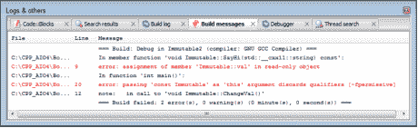

**图 1-1：** 查看因结构体中的不可变性而生成的错误。

然而，假设你想允许对 `val` 的内部更改，同时继续拒绝外部更改以强制实现函数式编程。在 `val` 声明中添加 `mutable`：`mutable int val{1};` 允许内部更改。因此，新的构建只会生成 `main()` 中 `ChangeVal()` 调用的错误。如果注释掉这个调用，你可以看到该示例将构建并生成以下输出：`Smith2`。（可下载的源代码提供了这些被注释掉的更改。）

现在的问题是，如果不应有任何更改，为什么可以在 `SayHi()` 中更改 `Name` 值。要使 `Name` 不可更改，必须这样声明：`void SayHi(const string Name) const`。因此，现在你知道了如何在结构体和类中添加不同级别的不可变性（在本例中，类的工作方式与结构体相同）。

## 创建常量表达式

常量表达式，即 `constexpr`，是一种特殊函数，可以在编译时而非运行时计算。你像编写任何代码一样编写代码，但编译器会在……之前将代码转换为输出

## 考虑状态的影响

应用程序状态是应用程序执行修改全局数据的任务时出现的一种状况。使用函数式编程时，应用程序没有状态。没有状态有一个积极效果：确保对函数的任何调用对于给定输入每次都会产生相同结果，无论应用程序何时调用该函数。然而，没有状态也有一个负面效果：应用程序现在没有记忆。考虑状态时，要考虑记住过去发生了什么的能力；就应用程序而言，过去发生的事会作为全局数据存储。

在任何 C++ 应用程序中避免状态几乎是不可能的。一个问题领域是任何类型的文件或流数据，其本质上会变化。`FileLineCount` 示例（如清单 1-4 所示）演示了两种确定名为 `Temp.txt` 的文件中行数的方法。第一种方法 `LineCount1()` 依赖状态来跟踪当前行数和当前字符。第二种方法 `LineCount2()` 不直接包含任何类型的跟踪；理论上，它没有状态。

**清单 1-4：** 避免直接使用状态

```cpp
#include <iostream>
#include <fstream>
#include <algorithm>

using namespace std;

int LineCount1(string filename) {
    int lineCount = 0;
    char c = ' ';

    ifstream thisFile(filename);

    while (thisFile.get(c)) {
        if (c == '\n')
            lineCount++;
    }

    thisFile.close();

    return lineCount;
}

int LineCount2(string filename) {
    ifstream thisFile(filename);

    return count(
        istreambuf_iterator<char>(thisFile),
        istreambuf_iterator<char>(), '\n');
}

int main() {
    const string filename = "Temp.txt";

    cout << LineCount1(filename) << endl;
    cout << LineCount2(filename) << endl;
}
```


在 `main()` 中调用这两个函数时，你会得到相同的输出。`LineCount2()` 实际上确实看起来没有状态。然而，与清单 1-3 中的常量表达式示例不同，`count()` 不会在编译时执行计算。这样做是不可能的，因为 `Temp.txt` 中换行符的数量在应用程序运行之前可能会发生变化。因此，`LineCount2()` 中展示的方法隐藏了状态的使用，但状态信息仍然存在于应用程序的较低层级中。不幸的是，在消除状态方面，这差不多就是你能从 C++ 中获得的最好结果了。


注意，`istreambuf_iterator<char>()` 是一个 *迭代器*，一种在某种数据结构中遍历一系列条目的函数。在这种情况下，你让 `istreambuf_iterator<char>()` 一次一个字符地查看 `thisFile` 中的字符。每当 `count()` 看到换行字符 `'\n'` 时，它就会将计数加一。通常，你可能会向 `count()` 提供起点和终点。对 `istreambuf_iterator<char>()` 的第二次调用表示继续检查字符，直到 `count()` 到达文件末尾。

## 消除副作用

*声明* 一词在计算机科学中有多种含义，不同的人在不同的时间以不同的方式使用该术语。例如，在 C++ 这样的语言语境中，声明是一种语言构造，用于定义与标识符关联的属性。你会看到声明被用于定义各种语言构造，例如类型和枚举。然而，在函数式编程意义上，你并不是这样使用 *声明* 一词的。以下各节将按照 *声明* 一词在函数式编程中的含义，从声明和函数的角度描述副作用。

### 对比声明与函数

在函数式编程中做出声明时，你是在告诉底层语言做某事。例如，考虑以下语句：

- 1. 给我泡杯茶！

该语句只说明要做什么，而不说明如何做。声明将任务的执行留给接收方，并推断接收方知道如何在无需额外帮助的情况下完成任务。最重要的是，声明使某人能够以多种方式执行所需任务，而无需更改声明。然而，当使用名为 MakeMeTea 的函数（或方法）（与该函数关联的标识符）时，你可能会改用以下步骤：

- 1. 去厨房。
- 2. 拿出茶壶。
- 3. 往茶壶里加水。
- 4. 把茶壶烧开。
- 5. 拿出一个茶杯。
- 6. 把茶包放入茶杯。
- 7. 将热水倒在茶包上，浸泡五分钟。
- 8. 从杯中取出茶包。
- 9. 把茶给我。


*函数详细说明做什么、何时做以及如何做。* 不留下任何偶然性，也不假定接收方具备任何知识。这些步骤以特定顺序出现，不按顺序执行步骤会导致问题。例如，想象一下在把茶包放入杯子之前就把热水倒在茶包上。函数通常容易出错且不灵活，但它们确实允许精确控制任务的执行；在 C++ 中，你使用函数的频率远高于使用声明。

然而，声明确实受制于另一种不灵活性，即它们不允许解释。当做出声明式陈述（“给我泡杯茶！”）时，你可以确信接收方会端来一杯茶，而不是一杯咖啡。然而，创建函数时，你可以添加依赖状态来影响输出的条件。例如，你可能会向……添加一个步骤


## 消除副作用

由于这种语言的性质，你没有什么灵丹妙药可以消除 C++ 中的副作用。不过，通过有纪律的编码，你可以遵循一些基本规则来消除副作用：

-   绝不修改传入的数据。
-   绝不依赖外部数据，也不修改函数外部的任何数据。
-   确保每次提供特定输入时，函数都产生完全相同的结果。
-   让函数目标明确，做好一件事，而不是勉强做好多件事。
-   让函数保持小巧。
-   绝不重复代码或使用样板代码。
-   使用 switch 语句而不是 if...then 语句。
-   只使用不可变数据。

清单 1-5 中展示的 NoSideEffects 示例演示了这些原则。无论你在函数外部做什么，对于特定输入，结果都不会改变。

### 清单 1-5：生成无副作用的代码

```cpp
#include <iostream>
#include <vector>
#include <algorithm>

using namespace std;

int AddIt(const vector<int> Input,
          const int Start, const int End) {

    int Accumulate = 0;

    // Copy the full vector to a vector of the
    // correct size.
    vector<int> Process(End - Start);
    copy(&Input[Start], &Input[End], Process.begin());

    // Create a sum using a foreach loop.
    for (int Element : Process)
        Accumulate += Element;
    return Accumulate;
}

int main() {
    const vector<int> ThisVector = {12, 2, 4, 18, 7, 2};

    cout << "Sum of All Elements: " <<
        AddIt(ThisVector, 0, ThisVector.size()) << endl;
    cout << "Sum of Elements 1 through 4: " <<
        AddIt(ThisVector, 1, 5) << endl;
    return 0;
}
```

在这个示例中，除了 `AddIt()` 函数内部的 `Accumulate` 和 `Process` 变量之外，所有内容都按常量处理。因此，不存在副作用。任何变化都只发生在 `AddIt()` 内部，并且对于给定输入，`AddIt()` 将始终产生相同的输出。

为了只处理求和所需的 `ThisVector` 元素，`AddIt()` 使用 `copy()` 函数创建 `Input` 向量的副本。（现在不必担心向量的使用；你会在第5册第6章看到它们的详细解释。）请注意，通过使用标准库功能，你可以在很大程度上避免在这个函数中出现状态。甚至 `foreach` 循环（作为 `for` 循环的一种特殊情况实现）：

```cpp
for (int Element : Process)
    Accumulate += Element;
```

也避免了驱动循环通常所需的状态信息。理论上，你可以为这个问题创建一个完全不使用状态的递归解决方案。以下是该示例的输出：

```
Sum of All Elements: 45
Sum of Elements 1 through 4: 31
```


你可能会想，为什么这个示例不使用数组而不是向量。`std::array` 的问题在于，你必须提供数组大小，例如 `array<int, 6> ThisVector = {12, 2, 4, 18, 7, 2};`，以便数组大小在编译时已知。然而，你在编译时并不知道 `Process` 数组的大小，因为对 `AddIt()` 的调用提供了可变的起始点和结束点。绕过这个问题的一种方法是使用 `constexpr` 设置，如前面清单 1-3 所示。

## 创建声明式 C++ 示例

尽管清单 1-5 在让 C++ 代码易于理解方面已经做了很多，并且比你原本可能预想的要可靠得多，但你还可以在不采用任何奇怪编码方式的情况下更进一步。清单 1-6 中展示的 Declarative 示例进一步依赖标准库，从而消除了对单独函数的需要。

### 清单 1-6：使用声明式编程技术

```cpp
#include <iostream>
#include <array>
#include <numeric>

using namespace std;

int main() {
  array<int, 6> ThisArray = {12, 2, 4, 18, 7, 2};
  cout << "Sum of All Elements: " <<
    accumulate(ThisArray.begin(), ThisArray.end(), 0)
    << endl;
  cout << "Sum of Elements 1 through 4: " <<
    accumulate(&ThisArray[1], &ThisArray[5], 0) << endl;
  return 0;
}
```

这个示例使用 `std::accumulate()` 函数来完成所需的工作。numeric 头文件中还有许多这类有趣的函数，你可以在 https://en.cppreference.com/w/cpp/header/numeric 查看。请注意，这些函数中的大多数需要 C++11、C++17 甚至 C++20 才能使用，因此它们更适合新开发。这个示例的输出与清单 1-5 的输出完全相同；只是技术发生了变化。


这个示例更有趣的方面之一是，你使用数组并让底层代码处理如何创建求和结果。这段代码完全不关心任何过程；它只是告诉标准库将这些值累加（求和）在一起。

还要注意用于提供计算起始点和结束点的两种方法。你需要的是一个地址。第一次调用使用 begin() 和 end() 函数来提供地址，第二次调用则依赖 [] 运算符提供的地址。

## 理解 auto 的作用

从 C++11 开始，你可以使用 auto 关键字来代替具体类型声明。当你事先不知道期望什么数据类型时，使用 auto 关键字会很方便。运行应用程序时，运行时会推断变量的类型，以便你可以正确地使用它。使用这种技术有助于你创建灵活的代码，即使它确实会稍微降低代码的清晰度。清单 1-7 中展示的 Auto 示例展示了如何使用这个关键字来执行各种任务。

### 清单 1-7：使用 auto 关键字

```cpp
#include <iostream>
#include <typeinfo>

using namespace std;

void DisplayIt(auto Value) {
    cout << Value << " is of the " <<
        typeid(Value).name() << " type." << endl;
}

int main() {
    auto Hello1 = "Hello There!";
    string Hello2 = "Hello Again!";
    auto Number1 = 1234;
    int Number2 = 5678;
    auto Float1 = 12.34;
    float Float2 = 56.78;
    auto Boolean1 = true;
    bool Boolean2 = false;

    DisplayIt(Hello1);
    DisplayIt(Hello2);
    DisplayIt(Number1);
    DisplayIt(Number2);
    DisplayIt(Float1);
    DisplayIt(Float2);
    DisplayIt(Boolean1);
    DisplayIt(Boolean2);

    return 0;
}
```

代码首先创建若干变量——一半使用标准声明，一半使用 auto 关键字。然后它调用 `DisplayIt()` 来显示变量值和类型。通过使用 auto 关键字，`DisplayIt()` 可以接受所有这些输入并适当地与它们交互。

尽管这段代码可以工作，但它有一个问题。`typeid()` 函数通常会根据你使用的编译器返回经过修饰的结果。下面是一个示例：


```
Hello There! is of the PKc type.
Hello Again! is of the NSt7__cxx1112basic_stringIcSt11char_traitsIcESaIcEEE type.
1234 is of the i type.
5678 is of the i type.
12.34 is of the d type.
56.78 is of the f type.
1 is of the b type.
0 is of the b type.
```

尽管你大概能弄明白 i、d、f 和 b 这些条目，但 PKc 条目却是个谜，更别提尝试确定以 NSt7 开头的下一行的类型了。你很可能希望输出采用人类可读的形式，这需要几个额外步骤，首先添加两个新的 `#include` 条目。

```cpp
#include <memory>
#include <cxxabi.h>
```

`DemangleIt()` 函数接收来自 `DisplayIt()` 的经过修饰的输入，并将其转换为人类可读的字符串，如下所示：

```cpp
string DemangleIt(const char* Mangled) {
    int Status;
    unique_ptr<char[], void(*)(void*)> Result(
        abi::__cxa_demangle(Mangled, 0, 0, &Status), free);
    return Result.get() ? string(Result.get()) : "Error";
}
```


对 `abi::__cxa_demangle()` 的调用会执行实际的名称还原。你收到的是一个 `unique_ptr`，即 `Result`，其中包含指向该类型人类可读形式的指针。如果 `abi::__cxa_demangle()` 调用不成功，`Result` 将包含一个空指针，你可以返回 "Error" 作为结果，而不是实际的类型字符串。要使这段代码正常工作，需要修改 `DisplayIt()`，如下所示：

```cpp
void DisplayIt(auto Value) {
    cout << Value << " is of the " <<
        DemangleIt(typeid(Value).name()) << " type." << endl;
}
```

现在运行该示例时，你会看到人类可读形式的输出，这会让使用它变得容易得多。

```text
Hello There! is of the char const* type.
Hello Again! is of the std::__cxx11::basic_string<char, std::char_traits<char>, std::allocator<char> > type.
1234 is of the int type.
5678 is of the int type.
12.34 is of the double type.
56.78 is of the float type.
1 is of the bool type.
0 is of the bool type.
```


此时，你应该会注意到使用 `auto` 的一些情况：你并不总能得到预期的类型。在这个例子中，使用 `auto` 声明的字符串与使用 `string` 声明的字符串类型不同。类型推导过程也常常依赖默认类型。例如，如果你想使用 `float`，却把变量声明为 `auto`，结果会是 `double`，因为那是默认类型。

## 将函数传递给函数

有时你需要对一组数字应用某个处理过程，或者需要对单个数字应用多个处理过程。事实上，有时你需要同时做这两件事。遇到这种情况时，最简单的处理方法是把函数（也就是你想执行的处理过程）传递给另一个负责处理该情况的函数。在接下来的几节中，你会先看到一个简单示例，它使用多个处理过程对单个数字执行这项任务。你还会看到如何通过一种称为*变换*的技术，将单个处理过程应用到一组数字上，因为你是在把一系列数字转换成另一系列数字。

## 查看函数输入的简单示例

有时，单个数字表示一个基准值，但你必须用各种方式处理它才能得到结果。例如，你可能需要找到正确的处理过程，以某个基准值作为起点来优化一组特定的值。清单 1-8 所示的 FunctionFunction 示例演示了如何使用这种技术。

### 清单 1-8：将函数传递给函数

```cpp
#include <iostream>
#include <vector>

using namespace std;

int AddSome(int Value) {
    return Value + 10;
}

int DelSome(int Value) {
    return Value - 10;
}

int MulSome(int Value) {
    return Value * 10;
}

int DivSome(int Value) {
    return Value / 10;
}

typedef int(*FuncPtr)(int);

void ModIt(int Value, vector<FuncPtr> FuncArray) {
    int NumFunc = FuncArray.size();
    cout << "Processing " << NumFunc << " functions."
      << endl;

    for(int i = 0; i < NumFunc; i++)
        cout << FuncArray[i](Value) << endl;
}

int main() {
    vector<FuncPtr> FuncArray =
        {*AddSome, *DelSome, *MulSome, *DivSome};
    ModIt(10, FuncArray);
    return 0;
}
```

在大多数使用这种技术的情况下，你会创建一个函数指针数组或向量。使用向量更灵活，因为你不必预先确定要传递的函数数量——它可以是任意数量，最多达到该向量的最大大小。不过，要让这种技术生效，你必须先创建一个 typedef，用它定义每个函数指针条目的形式，该形式由以下部分组成：

- 返回值，类型为 `int`
- 括号中的函数指针，即 `(*FuncPtr)`
- 括号中的输入参数，即 `(int)`


typedef（为某种对象类型创建新名称）在本书中出现了不少地方。例如，在第 4 册第 1 章中，你会看到它用于配合向量处理字符串。第 5 册第 1 章演示了如何将 typedef 与多维数组一起使用。事实上，如果你想全面理解 typedef 的所有用途，第 5 册就是该去的地方。

你将向量定义为 `vector<FuncPtr>`，并给它一个向量名，例如 `FuncArray`。接下来创建该向量，就是提供指向本例中用于测试的四个函数的指针：`AddSome()`、`DelSome()`、`MulSome()` 和 `DivSome()`。这四个函数做的事情不多，但它们确实有助于测试。

代码调用 `ModIt()`，传入你想处理的值（这里是 10）以及函数指针向量 `FuncArray`。在 `ModIt()` 内部，代码依次用提供的值调用每个函数，并将结果输出到屏幕上。下面是这个示例的输出：

```text
Processing 4 functions.
20
0
100
1
```

## 使用变换

变换允许你使用单个函数处理一系列值。组合一系列变换，使你能够按特定顺序使用一系列函数处理一系列值。你会看到变换以各种方式被使用，包括对数据做条件处理和处理视频。清单 1-9 所示的 Transform 示例通过 C++ 范围功能概述了这种技术的工作方式。

### 清单 1-9：对一系列数据点使用变换

```cpp
#include <iostream>
#include <vector>
#include <algorithm>

using namespace std;

struct EvenPair {
    int Value;
    bool Even;
};

EvenPair IsEven(int Value){
    if (Value % 2 == 0)
        return EvenPair{Value, true};

    return EvenPair{Value, false};
}

int main(){
    vector<int> Values{1, 2, 3, 4};
    vector<EvenPair> Evens(Values.size());

    transform(Values.begin(), Values.end(),
              Evens.begin(), IsEven);

    for(auto isEven : Evens)
        if (isEven.Even)
            cout << isEven.Value << " is even." << endl;
        else
            cout << isEven.Value << " is odd." << endl;

    return 0;
}
```

这个示例使用 `EvenPair` 结构保存两个变量，其中包含你想检查的原始值，以及该值是否为偶数的显示结果。在 `main()` 中，你先创建两个向量：一个输入向量 `Values`，一个输出向量 `Evens`。`Evens` 向量将包含原始值列表，以及表示每个值是否为偶数的布尔值。


对 `transform()` 的调用接收指向 `Values` 开头和结尾的指针、指向 `Evens` 开头的指针，以及用于执行变换的函数名。在这个例子中，`IsEven()` 接收单个 `Value`，使用取模运算符 `Value % 2` 判断它是否为偶数，然后输出一个 `Value` 和 `Even` 对。

变换完成后，一个 foreach 循环会检查 `Evens` 中的每个值，并输出相应的字符串。结果如下：

```text
1 is odd.
2 is even.
3 is odd.
4 is even.
```

## 使用 Lambda 表达式实现

lambda 表达式是一种无名函数，可以用来代替常规函数引用。通过将函数内联，使用 lambda 表达式可以让代码更具可读性。本小册的第 2 章和第 3 章会详细介绍 lambda 表达式，但清单 1-10 所示的 Lambda 示例展示了一种替代方式，可以用更短的方式创建清单 1-9 中展示的代码。

### 清单 1-10：使用 Lambda 表达式执行变换

```cpp
#include <iostream>
#include <vector>
#include <algorithm>

using namespace std;

struct EvenPair {
    int Value;
    bool Even;
};

int main(){
  vector<int> Values{1, 2, 3, 4};
  vector<EvenPair> Evens(Values.size());

  transform(Values.begin(), Values.end(),
            Evens.begin(), [](int Value) {
              return (Value % 2 == 0)
                     ? EvenPair{Value, true}
                     : EvenPair{Value, false};});

  for(auto isEven : Evens)
    if (isEven.Even)
      cout << isEven.Value << " is even." << endl;
    else
      cout << isEven.Value << " is odd." << endl;

  return 0;
}
```

这个示例的基本思路与本章前面“使用变换”一节中的示例相同，只是它使用 lambda 表达式代替对 `IsEven()` 的调用。lambda 表达式以捕获子句 `[]` 开头，该子句定义如何捕获任何所需的外部变量。空捕获子句表示该 lambda 表达式只能使用其局部变量，在这里就是 `Value`。

与 `IsEven()` 一样，该 lambda 表达式需要一个 `int` 输入 `Value`。编译器会根据 lambda 表达式代码推导输出类型。不过，在需要时，你可以使用 `-> output_type` 直接指定输出类型。在这种情况下，你会用 `[](int Value) -> EvenPair` 代替所示的代码。

输出是两个值之一，由三目运算符决定。当 `(Value % 2 == 0)` 为真时，输出为 `EvenPair{Value, true}`；否则，输出为 `EvenPair{Value, false}`。重点在于，这个版本比清单 1-9 中的版本更短，因此当你想要使用的函数很小时，lambda 表达式可以让代码更短、更易理解。


你不必手动输入本章的源代码。事实上，使用可下载的源代码要容易得多。你可以在可下载源代码的 `\CPP_AI04\Book11\C++\Chapter02` 文件夹中找到本章的源代码。有关如何找到本书源文件的详细信息，请参阅引言。

## 创建更具可读性和简洁性的 C++ 代码

lambda 表达式始于匿名函数，而匿名函数在电子计算机出现之前就已经存在。Alonzo Church（https://history-computer.com/ModernComputer/thinkers/Church.html）于 1936 年提出了匿名函数的概念，这是 lambda 演算的一部分。最早使用匿名函数的计算机语言之一是 1958 年的 LISP。以下是你经常在计算机科学中遇到的匿名函数种类：

- 函数字面量
- Lambda 抽象
- Lambda 表达式

当然，本章的重点是 lambda 表达式，但了解其他形式的匿名函数也很有好处。所有形式的匿名函数都有一个共同特点：它们不与任何标识符关联。换句话说，你通常将它们用于应用程序可能只需执行一次的简短、简洁的计算。从人的角度来看，使用 lambda 表达式通过将函数内联而不是放在单独的代码块中，使得代码更容易理解。如果使用不当，这种技术可能会导致最糟糕的意大利面条式代码，因此开发者需要有所节制。


从计算机语言的角度来看，匿名函数通常能让你清除代码中大量一两行的函数声明。有些语言甚至要求使用匿名函数来完成诸如将事件绑定到回调或为特定值实例化函数之类的任务。然而，C++ 并非如此；你可以用 lambda 表达式做的任何事情，也可以用命名函数来完成。在考虑 C++ 中的 lambda 表达式时，你会获得以下优势：

- **更高的效率：** 编译器不必为 lambda 表达式创建栈帧，因此生成的底层机器代码更少。
- **更好的可读性：** 查找一个一两行的命名函数会消耗开发者的时间，并且由于脱离上下文，代码可读性也会降低。
- **更少的错误：** 通过使函数简洁且有针对性，可以减少编码错误，因为函数也更容易理解。
- **减少“科学怪人函数”（Frankenfunctions）：** 使用 lambda 表达式可以帮助你的代码摆脱那些试图用过多不同风格做太多事情，除了让查看它的开发者感到困惑之外并没有取得多大成就的命名函数。谈到科学怪人函数时，可以想想那些由一两行函数的零碎部分拼凑而成，并通过 `if...then` 或 `switch` 语句来区分其行为的命名函数。


本节最重要的概念是：lambda 表达式并不会取代命名函数；它们只是提供了一种可用来改进代码的替代风格。鉴于它们代表一种风格而非编码规定，你需要花一些时间使用它们，才能在你编写的应用程序中找到合适的舒适度。

### 定义基本的 lambda 表达式

由于 lambda 表达式依赖于数学而非编码技术，它们具有跨计算机语言通用的形式。你不能把用一种语言编写的 lambda 表达式直接替换为另一种语言，但由于它们形式相似，理解两种语言中的 lambda 表达式会更加容易。以下各节将讨论 C++ 特有的 lambda 表达式形式。

### 定义 lambda 表达式的各个部分

lambda 表达式可以采用多种形式。你已经在本书第 1 章的“使用 lambda 表达式进行实现”一节中看到了其中一种形式。不过，现在是时候来看看 lambda 表达式的完整定义了：

```cpp
[ captures ] <tparams> ( params ) specifiers exception
attr -> ret requires { body }
```

并非所有这些元素在每个情况下都需要，有些元素仅在 C++ 的某些版本中可用。考虑到这些限制，表 2-1 提供了各元素的描述（版本列为空白表示该元素在所有当前版本中均可用）。

**表 2-1：lambda 表达式的元素**

| 元素 | 最低 C++ 版本 | 描述 |
|---|---|---|
| 捕获（captures） | 多种 | 指定外部变量如何被捕获以供 lambda 表达式使用。默认是按引用捕获变量。不过，你也可以创建变量的副本。你可以为所有变量定义单一策略，也可以为个别变量提供策略。从 C++14 开始，你还可以在变量尚未初始化时提供变量初始化器。关于更多细节，请参阅 https://en.cppreference.com/w/cpp/language/lambda#Lambda_capture 上的参考。 |
| 模板参数（tparams） | 20 | 提供一种定义变量类型的模板化方式。你可以用它为给定 lambda 的参数提供类型名。此条目与 https://en.cppreference.com/w/cpp/language/templates 中描述的模板非常相似。你可以提供可选的 `requires` 子句来对模板功能施加约束。 |
| 参数（params） | 多种 | 定义传入 lambda 表达式以供处理的参数。从 C++14 开始，你可以使用默认参数和 `auto` 关键字。 |
| 说明符（specifiers） | 多种 | 修改代码与所捕获的外部变量交互的方式。可用的关键字如下：<br><br>`mutable`：允许修改变量和对象，并允许调用对象的非 const 成员。<br><br>`constexpr`（C++17 及以上）：指定函数调用运算符为 constexpr（详见本书第 1 章的“创建常量表达式”一节）。<br><br>`consteval`（C++20 及以上）：指定函数调用运算符为立即函数（详见本书第 3 章的“定义立即函数”一节）。 |
| 异常（exception） | 多种 | 创建动态异常规范（参见本章后面的“指定 lambda 表达式抛出异常”一节），或定义 noexcept 说明符（C++11 及以上）。 |
| 属性（attr） | 11 | 为函数添加特定于实现的属性，例如在 GNU 或 IBM 平台上工作时。https://en.cppreference.com/w/cpp/language/attributes 上的讨论提供了关于使用属性的更多细节。 |
| 返回类型（ret） |  | 指示 lambda 表达式的返回类型。如果你不包含此元素，编译器将根据你提供的代码推导返回类型。 |
| 约束（requires） | 20 | 定义模板参数的要求，以便更容易选择正确的函数重载和模板参数。你可以将此元素用作 `params` 的可选补充。https://en.cppreference.com/w/cpp/language/constraints 上的讨论提供了更多细节。 |
| 函数体（body） |  | 包含函数体——即实际执行的代码。 |

一些常用模式可用于创建 lambda 表达式，这样你就不必依赖本节前面展示的完整版本。以下是最常见的形式：

- `[ captures ] ( params ) -> ret { body }`：定义 const lambda，这是最常见的形式。在这种情况下，所有被捕获的变量都是 const，你不能修改它们。
- `[ captures ] ( params ) { body }`：指定一个 const lambda，其返回类型由编译器推导。编译器以函数的 return 语句作为推导依据。
- `[ captures ] { body }`：创建一个不需要输入的 lambda 表达式。如果 lambda 表达式使用了 `constexpr`、`mutable`、异常规范、属性或尾随返回类型功能，则不能使用此形式。

### 依赖编译器推导返回类型

lambda 表达式的自动检测功能与用于其他类型声明的 `auto` 关键字非常相似。在大多数情况下，自动检测功能都能正常工作，因为它依赖于最常见的或默认的输出类型。


不幸的是，正如本书第 1 章“理解 auto 的作用”一节所述，编译器的自动检测（推导）并不总能完全按预期工作。此外，根据你如何定义函数的输入，你可能会得到一些奇怪的结果。因此，在使用此功能时，你始终需要小心谨慎。清单 2-1 中所示的 ReturnDeduction 示例演示了如何根据你是指定返回类型还是允许


让计算机为你推导出来。（本示例使用了与本迷你书第 1 章“理解 auto 的作用”一节中所述的同一个 `DemangleIt()` 函数。）

### 清单 2-1：在推导返回类型与具体返回类型之间做决定

```cpp
#include <iostream>
#include <typeinfo>
#include <memory>
#include <cxxabi.h>

using namespace std;

string DemangleIt(const char* Mangled) {
    int Status;
    unique_ptr<char[], void(*)(void*)> Result(
        abi::__cxa_demangle(Mangled, 0, 0, &Status), free);
    return Result.get() ? string(Result.get()) : "Error";
}

void ShowType(function<float(double)> lambda) {
    cout << "Input has a value of: " << lambda(2.6) << endl;
    cout << "Input has type of: " <<
        DemangleIt(typeid(lambda(2.6)).name()) << endl;
}

void ShowChar(function<char(int)> lambda){
    cout << "Input has a value of: " << lambda(7) << endl;
}

int main() {
    ShowType([](int x) -> int {return int(x * x);});
    ShowType([](double x) -> int {return int(x * x);});
    ShowType([](double x) -> double {return x * x;});
    ShowType([](double x) {return float(x * x);});
    ShowType([](double x) {return x > 2 ? true : false;});
    ShowType([](int x) -> char {return char(x * 10);});
    ShowChar([](int x) -> char {return char(x * 10);});
    return 0;
}
```


本示例中函数的输入参数是 `function<>`。使用 `function<>` 时，需要指定返回类型（即使返回类型是 `void`），以及任意输入类型；当函数不需要输入时，则使用空括号 `()`。`ShowType()` 和 `ShowChar()` 的部分问题在于，`function<>` 声明不允许使用 `auto`，因此你得到的就是你所定义的类型，正如你将在本示例后面看到的那样。

`ShowType()` 和 `ShowChar()` 函数都会在你向 lambda 表达式提供特定输入值时显示 `lambda()` 的值。`ShowType()` 函数还会输出该函数所输出值的类型，稍后你就会看到这一输出的重要性。

这些 lambda 函数属于本章前面“定义 lambda 表达式的各个部分”一节中描述的两种 const 类型。有些指定了返回类型；有些则没有。注意，前两个 lambda 表达式都提供 int 输出，但一个以 int 作为输入，另一个以 double 作为输入。像这样尝试不同的输入和输出类型，可以帮助你理解使用 lambda 表达式时所做决定的影响。注意，最后三个 lambda 表达式实际上并不返回数值类型。其中第一个返回 bool，最后两个返回 char。


你可能会认为这些 lambda 表达式中会有一个或多个失败，尤其是考虑到 `ShowType()` 和 `ShowChar()` 中使用的输入值。然而，它们全都正常工作，如下面这些多少有些令人惊讶的输出所示：

```
Input has a value of: 4
Input has type of: float
Input has a value of: 6
Input has type of: float
Input has a value of: 6.76
Input has type of: float
Input has a value of: 6.76
Input has type of: float
Input has a value of: 1
Input has type of: float
Input has a value of: 20
Input has type of: float
Input has a value of: F
```

编译器似乎很擅长让这些 lambda 表达式正常工作，即使它们本不该如此。例如，第一个 lambda 表达式接受 int 作为输入并产生 int 作为输出，因此输入被截断，结果为输出 4。第二个 lambda 表达式将输出截断为 int，所以现在你看到的 6 来自本应相同的计算，而该计算实际上应产生 6.76，如下面两个输出所示。bool 输出的值为 1，char 输出的值为 20，二者都没有反映其真实类型。然而，真正奇怪的是，所有这些输出的类型都是 float（这是下一节中解释的默认类型）；lambda 表达式实际提供什么作为输出并不重要。关键在于，为了获得期望的结果，你需要在构造 lambda 表达式和接收它的函数时都格外小心。

## 在 lambda 表达式中使用 auto 关键字

在处理 lambda 表达式时，auto 关键字可以让你省去很多麻烦，而且它还能帮助你避免一些在获得期望结果时遇到的常见问题。清单 2-2 所示的 UseAuto 示例是对前面清单 2-1 中示例的重写。然而，尽管该示例以类似方式工作，但由于使用了 auto，输出有所不同。

### 清单 2-2：使用 auto 执行任务

```cpp
#include <iostream>
#include <typeinfo>
#include <memory>
#include <cxxabi.h>

using namespace std;

string DemangleIt(const char* Mangled) {
    int Status;
    unique_ptr<char[], void(*)(void*)> Result(
        abi::__cxa_demangle(Mangled, 0, 0, &Status), free);
    return Result.get() ? string(Result.get()) : "Error";
}

void ShowData(auto lambda) {
    cout << "Input has a value of: " << lambda(3.6) << endl;
    cout << "Input has type of: " <<
        DemangleIt(typeid(lambda(3.6)).name()) << endl;
}

int main() {
    ShowData([](int x) -> int {return int(x * x);});
    ShowData([](double x) -> int {return int(x * x);});
    ShowData([](double x) -> double {return x * x;});
    ShowData([](double x) {return float(x * x);});
    ShowData([](double x) {return x > 2 ? true : false;});
    ShowData([](double x) -> char {return char(x * 10);});

    return 0;
}
```

运行此示例时，你会看到 auto 关键字使你能够获得特定于输入的结果。在这种情况下，你会看到以下内容（可以将其与上一节的输出进行比较）：

```
Input has a value of: 9
Input has type of: int
Input has a value of: 12
Input has type of: int
Input has a value of: 12.96
Input has type of: double
Input has a value of: 12.96
Input has type of: float
Input has a value of: 1
Input has type of: bool
Input has a value of: $
Input has type of: char
```


通过放弃对 ShowData() 输入形式的控制，你也保留了各种输入的类型。现在每个输出都是正确的类型，而 char 输出（最后一个）实际上显示为字符而不是数字。然而，并不存在最佳解决方案——只有能够满足你特定需求的解决方案。因此，你需要记住上一节所述的 `function<>` 方法。

免得你以为任何人都可以向 ShowData() 传递任何内容；你可以试试，但不会成功。如果你传递类似 ShowData(14) 的内容，编译器会输出错误消息：“'lambda' cannot be used as a function”。即使你使用了 auto，auto 仍然期望输入是一个函数。

## 将 lambda 表达式用作宏

你可以将一个 lambda 表达式赋给一个变量，然后将该变量用作一种宏。这种技巧可以让你更轻松地执行一些重复性任务，这些任务似乎随处可见，但只需要很少的代码。清单 2-3 所示的 CreateMacro 示例演示了这种方法。

### 清单 2-3：创建宏

```cpp
#include <iostream>

using namespace std;

int main(){
    auto f = [](auto Input) { cout << Input << endl;};

    f("Hello");
    f(221);
    f(true);
    f(99 / 3);
    f(char(65));
    f(int(15/4));
    return 0;
}
```

本示例中的代码创建了一个简单的 lambda 表达式，它将输入表达式（无论它是什么）输出到屏幕上。为了让这个宏工作，你在两个上下文中使用了 auto：既作为保存该宏的变量的类型，也作为输入。下面是你看到的输出：

```
Hello
221
1
33
A
3
```

## 使用 lambda 表达式进行开发

本章前面的各节让你了解了 lambda 表达式如何工作。在本章接下来的各节中，你将看到如何以更高级的方式实现某些 lambda 表达式技术，这些技术可能会在应用程序代码中使用。


## 将 Lambda 表达式与类和结构体结合使用

你可以将 Lambda 表达式用于类和结构体的各种任务。在大多数情况下，这些任务与数据操作有关，例如查找数据元素或对项目排序，但 Lambda 表达式也可用于各种分析。清单 2-4 中所示的 LambdaForClass 示例将一组 AnimalEntry 条目存储在 StoreAnimals 类中的 Animals 列表里。定义 FindAnimals() 的 Lambda 表达式有助于定位特定动物类型，并显示动物园中饲养这些动物的展区。

### 清单 2-4：与类和结构体交互

```cpp
#include <iostream>
#include <list>
#include <algorithm>

using namespace std;

struct AnimalEntry {
    string Name;
    int CageLocation;
};

class StoreAnimals {
public:
    void FindAnimals(string Name);
    list<AnimalEntry> Animals;
};

void StoreAnimals::FindAnimals(string FindName) {
    for_each(Animals.begin(), Animals.end(),
        [FindName](AnimalEntry ThisEntry) {
            if (FindName == ThisEntry.Name)
                cout << ThisEntry.CageLocation << endl;
        }
    );
}

int main() {
    StoreAnimals Zoo;
    Zoo.Animals.push_back (AnimalEntry{"Hippo", 300});
    Zoo.Animals.push_back (AnimalEntry{"Tiger", 301});
    Zoo.Animals.push_back (AnimalEntry{"Lion", 302});
    Zoo.Animals.push_back (AnimalEntry{"Zebra", 303});

    cout << "Finding hippo cages." << endl;
    Zoo.FindAnimals("Hippo");

    cout << "Finding tiger cages." << endl;
    Zoo.FindAnimals("Tiger");
    return 0;
}
```

这个示例的一个有趣之处是使用 `for_each()` 遍历 `Animals` 列表中的条目。尽管此示例遍历整个列表，你也可以通过在列表中提供不同的起始点和结束点，将搜索范围限制到特定记录。

此示例还使用一个简单的捕获 `FindName` 来获取要定位的动物名称。本章下一节将提供有关捕获如何工作的更多细节，但它使用的方法与此示例不同。该 Lambda 表达式还必须接受来自 `for_each()` 的、类型为 `AnimalEntry` 的单个条目 `ThisEntry`。

`main()` 代码包括创建一个 `StoreAnimals` 对象 `Zoo`，并用 `AnimalEntry` 对象填充它包含的 `Animals` 列表。然后代码可以调用 `Zoo.FindAnimals()` 来定位列表中的特定动物。以下是此示例的输出：

```text
Finding hippo cages.
300
Finding tiger cages.
301
302
```

### 使用捕获子句

使用捕获子句的方法有很多，但其中更有趣的一种是让你的 Lambda 表达式稍微更灵活。你可以使用捕获子句，通过单个 Lambda 表达式帮助实现多种行为，如清单 2-5 中的 `MultiTask` 示例所示。

### 清单 2-5：通过使用捕获子句执行多个任务

```cpp
#include <iostream>
#include <type_traits>

using namespace std;

struct AddVal_t {};
typedef AddVal_t AddVal;

struct SubVal_t {};
typedef SubVal_t SubVal;

int main() {
    int Total = 0;

    auto ChangeNum = [Total](auto Type, int Value) mutable {
        if (is_same<decltype(Type), AddVal>::value) {
            Total += Value;
            return Total;
        } else if (is_same<decltype(Type), SubVal>::value) {
            Total -= Value;
            return Total;
        } else {
            throw -1;
        }
    };

    AddVal DoAdd;
    SubVal DoSub;

    cout << ChangeNum(DoAdd, 5) << endl;
    cout << ChangeNum(DoAdd, 6) << endl;
    cout << ChangeNum(DoSub, 4) << endl;
    try {
        cout << ChangeNum(5, 5) << endl;
    } catch (int e) {
        cout << "Error in Input!" << endl;
    }
    cout << Total << endl;
    return 0;
}
```

这个示例实际上能够做很多事情，你应该尝试一下。首先，你从两个结构体 `AddVal_t` 和 `SubVal_t` 开始，它们目前是空的，但可以扩展以提供额外功能。代码基于这些结构体定义了两个类型：`AddVal` 和 `SubVal`。

该 Lambda 表达式依赖一个外部变量 `Total`，它被初始化为 0。`ChangeNum()` 声明使用 `Total` 作为捕获，你将在本节后面看到为什么这很重要。两个输入参数 `Type`（定义要执行的操作）和 `Value`（定义变化量）的工作方式与任何其他参数集一样。mutable 元素指定代码可以更改 `Total`。

对于此示例，你可以使用短语、数字或其他方法来确定操作，但该示例改用类型。如果 `ChangeNum()` 接收到适当类型的输入，它将执行相应的操作。由于此代码的结构方式，操作可以是特定于类型的。对 `is_same()` 的调用确定输入类型 `Type` 是否与基类型（如 `AddVal` 或 `SubVal`）相同。验证类型后，代码执行特定于类型的任务。如果类型不存在，`ChangeNum()` 会抛出异常。

要使用该 Lambda 表达式，代码必须创建正确类型的变量。通常，你会初始化变量 `DoAdd` 和 `DoSub`，但由于该示例使用空结构体，在这种情况下你不需要这样做。然后代码使用各种操作和值调用 `ChangeNum()`，其中包括一次错误调用。请注意，代码最后还检查了 `Total` 的值。以下是你应该看到的输出：

```text
5
11
7
Error in Input!
0
```

尽管该 Lambda 表达式在内部跟踪了 `Total`，但它根本没有更改外部值。因此，你会看到每次调用的预期输出，但 `Total` 的实际值没有改变。当然，你也会看到错误输入的报错输出。

捕获方式很重要。例如，如果你愿意，可以初始化捕获。将 `[Total]` 改为 `[Total = 5]`，然后重新运行代码。现在的输出如下所示：

```text
10
16
12
Error in Input!
0
```


Total 的内部值已经改变，但 Total 的外部值仍为 0。你也可以通过将 `[Total = 5]` 改为 `[&Total]` 来更改此行为。请注意，如果你还计划通过引用访问 Total，就不能初始化它，因此 `[&Total = 5]` 行不通。以下是新的输出：

```text
5
11
7
Error in Input!
7
```

现在 Total 的外部值反映了该 Lambda 表达式的操作。尽管可以编写比这里所示更复杂的 Lambda 表达式，但你需要考虑何时已经达到应该使用标准函数而不是 Lambda 表达式的程度。理想情况下，此示例展示了 Lambda 表达式复杂度的上限。

### 使用 Lambda 表达式对数据排序

尽管计算机可以按任意顺序处理数据，但人类需要顺序来理解数据。C++ 提供的标准排序函数可以很好地处理标准格式的数据，例如单列列表。然而，当你开始添加结构体或类后，如果没有帮助，数据会难排序得多。清单 2-6 中所示的 SortList 示例展示了如何对使用结构体 Collect 格式化到 Collectables 列表（此处为 vector）中的数据进行单列排序和双列排序。

### 清单 2-6：执行排序任务

```cpp
#include <iostream>
#include <vector>
#include <algorithm>

using namespace std;

struct Collect {
    string Name;
    int Height;
    string Location;
};

int main() {
  vector<Collect> Collectables;
  Collectables.push_back ({"Statue", 40, "Basement"});
  Collectables.push_back ({"Statue", 30, "Basement"});
  Collectables.push_back ({"Mirror", 54, "1st Floor"});
  Collectables.push_back ({"Statue", 33, "1st Floor"});
  Collectables.push_back ({"Mirror", 33, "2nd Floor"});
  Collectables.push_back ({"Chair", 44, "1st Floor"});
  Collectables.push_back ({"Chair", 36, "2nd Floor"});

  auto SortRule1 = [](Collect S1, Collect S2) {
    return S1.Location < S2.Location;
  };

  auto SortRule2 = [](Collect S1, Collect S2) {
    if (S1.Location != S2.Location)
      return S1.Location < S2.Location;
    return S1.Name < S2.Name;
  };

  sort(Collectables.begin(), Collectables.end(),
       SortRule1);

  cout << "One Column Sort" << endl;
  for (auto s: Collectables)
    cout << s.Name << "\t" << s.Height << "\t"
         << s.Location << endl;

  sort(Collectables.begin(), Collectables.end(),
       SortRule2);

  cout << endl << "Two Column Sort" << endl;
  for (auto s: Collectables)
    cout << s.Name << "\t" << s.Height << "\t"
         << s.Location << endl;

  return 0;
}
```


该示例首先创建一个待排序项的 vector。然后创建两条排序规则。SortRule1 和 SortRule2 都会执行比较，并返回一个 bool 值，表示该比较（第一项小于第二项）是否为 true。区别在于，SortRule2 针对列表的两列执行任务，因此需要两级比较。随后代码调用 sort() 执行列表排序，并依靠 foreach 循环显示结果，结果如下：

```
One Column Sort
Mirror 54   1st Floor
Statue 33   1st Floor
Chair 44    1st Floor
Mirror 33   2nd Floor
Chair 36    2nd Floor
Statue 40   Basement
Statue 30   Basement

Two Column Sort
Chair 44    1st Floor
Mirror 54   1st Floor
Statue 33   1st Floor
Chair 36    2nd Floor
Mirror 33   2nd Floor
Statue 40   Basement
Statue 30   Basement
```

### 指定 lambda 表达式抛出异常

异常可能是代码中很难正确实现的一部分，因为异常表示发生了意外情况，调用方需要采取行动。早期版本的 lambda 表达式在声明中包含 throw() 说明，作为声明的一部分，但该说明被证明难以实现，许多程序员认为它是一种笨拙的编程方式。因此，尽管 throw() 仍是规范中的可选部分，但通常看不到它被使用。事实上，在 C++20 中不能使用它，因为它已被弃用并移除。


MultiTask 示例（参见清单 2-5）在调用方未提供可接受的正确类型输入时抛出异常。抛出异常仍然完全可以接受，而且当从 lambda 表达式调用外部函数时，这些函数也可能抛出异常。然而，有时你确实不希望异常发生，因为这种意外情况是预期内的。为解决这个问题，可以使用 `noexcept()` 忽略异常，如下所示：

```cpp
cout << noexcept(ChangeNum(5,5)) << endl;
```

代码不会输出异常，而是输出捕获的 `Total` 值，即 0。这是 `noexcept()` 的运算符形式。你还可以使用 `noexcept()` 的说明符形式，但它不保证能在较旧版本的 C++ 中工作。它看起来像这样：

```cpp
auto ChangeNum = [Total](auto Type, int Value) mutable
    noexcept { ... }
```

在这种情况下，无法抛出异常会影响整个 lambda 表达式，以及它调用的任何函数。当然，现在你不知道异常条件何时真的发生——当出现未预见的情况时，代码只是尽可能输出某个答案，而这个答案很可能是错误的。

**本章内容**

-   理解 C++ lambda 表达式
-   在新的位置放置 lambda 表达式
-   创建可赋值的 lambda 表达式
-   展开参数包

## 第 3 章：高级 lambda 表达式

上一章演示了在大多数 C++11 及更高版本中可以使用 lambda 表达式执行的任务。本章进一步讨论使用更新版本 C++ 可以执行的高级任务。事实上，第一节是 C++20 特有的。其余部分章节中也有一些适用于 C++17。重点在于，如果你使用的是较旧版本的 C++，本章看到的大部分内容都无法工作。请记住，如果你的 C++ 编译器不提供所需的 C++20 功能，你可以使用 Wandbox（https://wandbox.org/）测试本章示例。

本章还会介绍在 C++20 中使用 lambda 表达式的新方式。在 C++20 之前，不能在需要未求值表达式的上下文中使用 lambda 表达式，包括 `decltype()` 运算符，而这是本章的具体主题。不过，你学到的技术可以应用于其他未求值上下文。如果你现在还不理解这些术语，不用担心；本章后文会介绍它们。

较旧版本的 C++ 不允许你赋值 lambda 表达式，也不允许使其可构造。因此，当源 map 对象包含 lambda 表达式时，你无法做类似让两个 map 对象相等的事情（有关 map 的详细信息，参见第 5 册第 6 章的“映射你的数据”一节）。此外，很难让 lambda 表达式成为 map 声明中可构造的一部分，因此最终每次都要重新创建它。本章将探讨 C++20 如何修复这两个问题。

上一章探讨了各种类型的捕获。不过，可以将其概括为按副本、按引用或按 `std::tuple` 捕获。要发送任意打包的数据列表，且参数数量可变，需要使用可变参数模板。本章最后一节讨论包的使用，并演示 C++ 如何展开包以允许访问。你会在此类功能中使用参数数量直到运行时才已知的场合。例如，你可能需要处理带有可变数量约束的数据。


你不必手动输入本章的源代码。事实上，使用可下载的源代码要容易得多。你可以在可下载源代码的 `\CPP_AIO4\BookIII\Chapter03` 文件夹中找到本章的源代码。有关如何找到这些源文件的详细信息，请参见引言。

### 考虑 C++20 lambda 扩展

C++20 增加了许多 lambda 扩展。其中一些扩展会在本章后续内容中出现。其余扩展将在以下各节中介绍。

### 定义立即函数

立即函数与 `consteval` 相关联，它通常如下所示：

```cpp
#include <iostream>

using namespace std;

consteval double sqr(float x) {
  return x * x;
}

int main()
{
    constexpr double MySquare = sqr(4.2);
    cout << MySquare << endl;
    return 0;
}
```

MySquare 的值在编译时而非运行时计算。MySquare 从应用程序开始到结束时占用静态内存空间，并且其值从不改变。

lambda 表达式的 consteval 说明符具有相同效果，但通常更灵活、更简洁。下面是同一代码的 lambda 表达式版本：

```cpp
#include <iostream>

using namespace std;

int main()
{
    auto sqr = [](auto x) consteval {return x*x;};
    constexpr double MySquare = sqr(4.2);
    constexpr auto MySquare2 = sqr(20);

    cout << MySquare << endl;
    cout << MySquare2 << endl;
    return 0;
}
```


与函数版本一样，MySquare 和 MySquare2 的值都在编译时计算。因此，如果你尝试使用编译时未知的值，编译器会生成错误消息。

### 在捕获中使用 = 和 this

本迷你书第 2 章的“在类和结构中使用 lambda 表达式”和“使用捕获子句”两节中展示的示例演示了如何使用捕获。有些捕获目前不太易读。例如，下面两个捕获都隐含 this，即指向当前对象的指针，但只有一个捕获显式写出了 this：

```cpp
[=]
[=, *this]
```

`=` 运算符表示按副本捕获所有变量。`this` 运算符也按副本捕获当前对象。使用 `*this` 按引用捕获当前对象，这意味着你可以对其进行更改。在 C++20 中，现在可以使用 `[=, this]` 明确表示你按副本捕获变量和当前对象，而不是按引用捕获。你还可以使用 `[&, this]`，它表示按引用捕获所有变量，但按副本捕获对象。

### 查找其他更改

有时，尽管你对 lambda 表达式有尽可能最好的理解，但在编写代码时事情就是不工作，而看起来它们本应工作。通常，你会发现规范中的细微变化，这些变化告诉你某些东西为什么不再工作。例如，你可以在论文“P1091R2 Extending structured bindings to be more like variable declarations”（将结构化绑定扩展得更像变量声明）中看到其中一些变化，网址为 http://www.open-std.org/jtc1/sc22/wg21/docs/papers/2018/p1091r2.html。

### 在未求值上下文中工作

未求值表达式是一种完整表达式；它不需要在运行时求值。例如，`typeof`、`sizeof`、`noexcept` 和 `decltype` 运算符不会被求值。此外，C++20 的 requires 表达式（参见 https://en.cppreference.com/w/cpp/language/constraints）也不会被求值。未求值上下文是 C++ 在其中寻找某种类型的未求值表达式的上下文。C++20 允许在未求值表达式、模板实参、别名声明和 `typedef` 声明中使用 lambda 表达式。

要了解未求值上下文如何工作，清单 3-1 中所示的 `PriorityQueue` 示例演示了如何在 `decltype()` 中添加 lambda 表达式比较器，以自动对优先队列排序。

**清单 3-1：** 定义优先队列比较器

```cpp
#include <iostream>
#include <queue>

using namespace std;

int main() {
```

```cpp
priority_queue<
    int,
    vector<int>,
    decltype( [](int a, int b)->bool{return a>b;})> PQ;

PQ.push(10);
PQ.push(5);
PQ.push(8);
PQ.push(1);
PQ.push(11);

while (!PQ.empty()) {
    cout << PQ.top() << endl;
    PQ.pop();
}
}
```

priority_queue 是一种容器适配器（用于修改标准容器（如 vector）行为的东西），它使以一致的方式执行查找成为可能。其代价是插入和提取时间。然而，如果你主要执行查找，使用 priority_queue 可以显著改善应用程序的执行时间。

此示例创建一个 priority_queue，它接受 int 值作为输入，修改 vector 的行为，并在 `decltype()` 中使用 lambda 表达式作为比较器。此处的 lambda 表达式很简单——它只比较两个值，并在第一个值大于第二个值时返回 true。这个 priority_queue 的目的是创建一个条目始终按排序顺序排列的 vector，从而使查找更快。

创建 priority_queue 后，示例以随机顺序推入值。然而，priority_queue 会自动为你排序。然后代码使用 while 循环显示值的存储顺序，如下所示：

```text
1
5
8
10
11
```

## 使用可赋值的无状态 Lambda 表达式

在 C++20 之前，lambda 表达式不可构造也不可赋值。如果你使用 lambda 表达式来替换类似下面这样的结构，那么它就是可构造的：

```cpp
struct {
    template <typename X, typename Y>
    auto operator()(X x, Y y) const { return x > y; }
} greater;
```

类似这样的结构可用于执行诸如充当 map 比较器之类的任务。如果你可以将源 lambda 赋值给目标 lambda，那么 lambda 表达式就是可赋值的，如下所示：

```cpp
MyMap2 = MyMap1;
```

其理念是让 lambda 表达式与函数对象可以互换。使用 lambda 表达式会更简洁，也可能更容易理解。清单 3-2 中所示的 AssignLambda 示例演示了如何使用 map 执行此任务。

### 清单 3-2 — 创建可构造的 Lambda 并为其赋值

```cpp
#include <iostream>
#include <map>

using namespace std;

int main()
{
    auto greater = [](auto x, auto y) { return x > y; };
    map<string, int, decltype(greater)> MyMap1;

    MyMap1.insert(pair<string, int>("D", 12));
    MyMap1.insert(pair<string, int>("B", 4));
    MyMap1.insert(pair<string, int>("C", 8));
    MyMap1.insert(pair<string, int>("A", 1));

    cout << "MyMap1 Content" << endl;
    for (auto element : MyMap1)
        cout << element.first << "\t" << element.second
             << endl;

    map<string, int, decltype(greater)> MyMap2;
    MyMap2 = MyMap1;
    MyMap1.insert(pair<string, int>("E", 23));
    MyMap2.insert(pair<string, int>("F", 35));

    cout << endl << "MyMap2 Content" << endl;
    for (auto element : MyMap2)
        cout << element.first << "\t" << element.second
             << endl;
}
```

```text
MyMap1 Content
D   12
C   8
B   4
A   1

MyMap2 Content
F   35
D   12
C   8
B   4
A   1
```

特别有趣的是，你可以将 `MyMap1` 赋值给 `MyMap2`。然而，`MyMap2` 现在是从 `MyMap1` 复制而来的。不过，复制过程之后，`MyMap1` 和 `MyMap2` 的内容相互独立，因此此后对 `MyMap1` 和 `MyMap2` 所做的更改会有所不同。

## 处理包展开

数据包是一组发送给模板化函数的变量，其中变量数量在运行时之前未知。包展开是处理可变数量参数的重要组成部分。以下各节使用多个示例描述包展开，以便你了解基本概念如何运作。

### 考虑模板

从 C++11 开始，你可以使用可变参数模板发送可变数量的参数。为了让你基本了解其工作方式，请考虑 `VariadicTemplate` 示例中的代码，如清单 3-3 所示。

### 清单 3-3：使用可变参数模板

```cpp
#include <iostream>

using namespace std;

template<typename... Types>
size_t nargs(Types... args) {
  return sizeof...(args);
}

int main()
{
  cout << nargs(1, "3.5", true) << endl;
  cout << nargs(2, 4, "Hello", 1.1) << endl;
  cout << nargs() << endl;
  return 0;
}
```

```text
3
4
0
```

如果你查看第一次调用 `nargs(1, "3.5", true)`，函数头的展开将如下所示：

```cpp
template<int, const char*, bool>
size_t nargs(int param1, const char* param2, bool param3)
```

使用可变参数模板并不妨碍使用已知变量。例如，如果你有一个函数，其中有一个已知变量和一组未知变量，则声明可能如下所示：

```cpp
template<typename T, typename... Types>
size_t nargs(T Parm, Types... args) {
```

### 使用递归处理变量

可变参数模板需要一种特殊的递归来处理。与标准递归不同，可变参数递归的函数头会在每次调用时变化，因为变量数量每次都会减少一个。因此，你需要创建一个作为单独函数调用的基准情况。清单 3-4 中所示的 VariadicTemplate2 示例演示了这种方法。

### 清单 3-4：处理可变参数模板中的变量

```cpp
#include <iostream>

using namespace std;

template<typename T>
void ProcessArgs(T arg) {
    cout << arg << endl;
}

template<typename T, typename... Args>
void ProcessArgs(T ThisArg, Args... args) {
    cout << ThisArg << endl;
    ProcessArgs(args...);
}

int main()
{
    ProcessArgs(1, "Hello", true, 3.5);
    return 0;
}
```

在这种情况下，每次调用 `ProcessArgs()` 都会展开 `args`，分离出一个变量作为 `ThisArg` 显示，直到只剩下一个变量（基准情况），最后一个变量 arg 会显示在屏幕上。该示例将接受几乎任何 cout 可以显示的类型、任意数量的参数。以下是此示例的输出：

```text
1
Hello
1
3.5
```

### 使用 Lambda 表达式处理变量

将 lambda 表达式与可变参数模板一起使用可以显著简化某些任务。例如，你可能想知道某一组数字是否全部大于 7。因此，你构造一个 lambda 表达式，如下所示：

```cpp
auto constraint = [](int x) {return x > 7;};
```


该 lambda 表达式可以执行任意级别的约束检查，但在此例中，它只是查找大于 7 的 int 输入。请注意，此 lambda 表达式专门查找 int 值，这意味着提供不包含 int 值的值列表会让编译器产生错误消息。

与上一节中的示例一样，清单 3-5 中所示的 `VariadicTemplate3` 示例依赖递归。然而，这次递归稍微复杂一些。

### 清单 3-5：检查约束

```cpp
#include <iostream>
#include <typeinfo>

using namespace std;

auto constraint = [](int x) {return x > 7;};

template<typename T>
bool ProcessArgs(T arg) {
```


```cpp
cout << "Value is: " << arg << endl;
return constraint(arg);
}

template<typename T, typename... Args>
bool ProcessArgs(T arg, Args... args) {
  cout << "Value is: " << arg << endl;
  return constraint(arg) && ProcessArgs(args...);
}

int main()
{
  cout << "List contains only numbers above 7: "
       << (ProcessArgs(10, 11, 14, 8) ? "True" : "False")
       << endl << endl;

  cout << "List contains only numbers above 7: "
       << (ProcessArgs(10, 3, 6) ? "True" : "False")
       << endl;
  return 0;
}
```

该示例仍然会输出它处理的每个值。不过，它还会检查约束条件，并在数字大于 7 时返回 true。这种额外的处理层级在某些科学领域很常见，尤其是在统计分析、机器学习或深度学习任务中。这种方法的一个优点是：如果有一个值超出范围，代码不会检查每个值。一旦代码检测到不正确的值，它就会结束递归。以下是该示例的输出：

```text
Value is: 10
Value is: 11
Value is: 14
Value is: 8
List contains only numbers above 7: True

Value is: 10
Value is: 3
List contains only numbers above 7: False
```

### 高级 Lambda 表达式


# 第3部分：修复问题

### 内容一览

- **第 1 章：处理 Bug** ... 429
  - 这不是 Bug，这是特性！ ... 430
  - 让你的应用程序特性看起来像特性 ... 431
  - 预见（几乎）一切 ... 432
  - 简单明了地避免错误 ... 441
- **第 2 章：调试应用程序** ... 443
  - 使用调试器编程 ... 444
  - 使用不同工具调试 ... 455
  - 使用命令行参数调试 Code::Blocks 应用程序 ... 456
- **第 3 章：停止并检查代码** ... 457
  - 设置和禁用断点 ... 458
  - 监视、检查和更改变量 ... 463
- **第 4 章：在堆栈中穿行** ... 469
  - 堆叠数据 ... 470
  - 使用高级功能调试 ... 475

### 本章内容

- 区分 Bug 与特性
- 预见用户可能做出的每一个操作
- 以简单方式避免错误
- 处理错误

## 第 1 章：处理 Bug

谁也不知道这是否属实，但故事是这样的：半个多世纪前，当第一台计算机被建造出来时，它用电路填满了整整一个房间（但它的功能大约只相当于一个廉价计算器——那种只能做基本数学运算的计算器）。有一天，这台机器出了故障，一些勇敢的工程师爬进了机器深处。（在我们想象的版本中，他们当然穿着白色防辐射服。）在机器的肠胃深处（听起来像电影片名），他们发现了一只……昆虫！一个 Bug！那是一只很大的臭虫，卡在了电路里，导致计算机 malfunction。反正故事就是这样讲的。今天，我们用“*bug*”这个词来表示应用程序中出了问题的地方。在本迷你书中，你将了解如何在软件中追踪并修复 Bug。在本章中，你会看到 Bug 到底是什么（以及不是什么！）、Bug 是如何产生的，以及你如何尽量避免它们。


**记住**

你不必手动输入本章的源代码。事实上，使用可下载的源代码要容易得多。你可以在可下载源代码的 `\\CPP_A04\\BookIV\\Chapter01` 文件夹中找到本章的源代码。有关如何找到这些源文件的详细信息，请参阅引言。

### 这不是 Bug，这是特性！

假设你正在使用一个文字处理器，突然应用程序异常了，自动保存了你的文件。你并没有让它这样做。然后你使用同一份文字处理器，尝试执行复制粘贴操作（顺便说一下，这被称为用例）。突然，字体对话框弹了出来。再后来，你带着笔记本电脑坐在星巴克，它自动开始了关机程序。你并没有让它这样做。

Bug！Bug！这些都是 Bug！或者它们是 Bug 吗？看起来，这些烦人的小事件可能被某些程序员视为“*特性*”。

一些文字处理器有一个可选的“*自动保存*”功能，它会导致应用程序在计算机死机时自动保存恢复信息。而弹出的字体对话框是用户的错误：你本意是按 Ctrl-V，但手指滑了一下，按到了 D 键。碰巧的是，在某些文字处理器中，默认情况下 Ctrl-D 会打开字体对话框。而大多数操作系统的新版本都理解笔记本电脑：当电池即将完全耗尽时，操作系统会将机器的整个状态保存到硬盘上的一个巨型文件中，然后关机。这被称为“*休眠*”。所以，这些并不是 Bug。现在你可以关闭刚刚发送给供应商的 Bug 报告了。

现在考虑这个：假设你正在使用一个应用程序，在操作过程中，你收到一个消息框，上面写着类似 ExceptionError 的内容。然后应用程序就直接关闭了。你所有的成果都丢失了。于是你打电话给技术支持，电话那头的热心朋友说：“你一定输入了它不喜欢的某个内容。这个应用程序有内置的保护机制，如果你输入了不该输入的内容，它就会关闭。”这时候，那人会说：“这是特性，不是 Bug！”不幸的是，有时候情况在 Bug 和特性之间只有一线之隔。没有人会认为应用程序崩溃可以算作特性，但考虑一下这个：当你的浏览器出错时，会有一个消息询问你是否要向供应商发送问题报告。这就是一个处理 Bug 的特性。

但是，那个直接关闭的未命名应用程序绝对有一个 Bug。其他应用程序也有 Bug。例如，你可能正在快速切换浏览器窗口、输入、调整大小，在窗口之间快速来回操作，突然浏览器崩溃了，你看到了问题报告消息。这确实是一个 Bug：当你——用户——做了程序员没有预料到的事情时，应用程序“噎住”了。

当然，你会想知道为什么应用程序会“噎住”。除了没有为某些特定输入做规划之外，程序员可能只是犯了错。他们没有包含处理棘手情况（快速切换、

```
C. 压缩信息。
D. 删除信息。
你的选择：
```

现在假设用户选择了 D（删除），然后出现以下菜单：

```
你想删除什么？
    A. 不删除任何数据；算了！
    B. 删除部分数据。
    C. 删除大部分数据。
    D. 删除所有数据！全部删掉！
```

现在想象一下，一个用户启动了这个应用程序，看到了第一个菜单。用户不知道第一个选择是输入 A 还是输入 Add。用户输入了 Add 并按下回车。糟糕。A 到了第一个选择，系统添加了随机信息，并再次打印了同样的第一个菜单。然后用户输入的第二个字符 d 落到了“删除信息”这一选择上。这导致第二个菜单，即“删除”菜单出现。用户输入的第三个字符 d 触发了第二个菜单中的 D 选项——删除所有数据！全部删掉！——所有操作一次完成，而用户完全没有意识到发生了什么。

糟糕！本应是“添加”的操作变成了一次添加、一次删除、一次删除所有数据。这不好！你如何避免这种事情发生？

- 限制用户的选择。
- 明确说明用户应该做什么。
- 支持多种选项。
- 预见可能出错的地方。

例如，你可以告诉用户只输入单个字符，并给出这样的消息：

```
请输入单个字符作为你的选择：
```

但现在，用户之后是否必须按回车键？这条消息暗示是这样。但也许不是。所以你必须更具体一点。也许下面这些例子之一会更好：

```
输入单个字符，不要按回车：
```

或

```
输入单个字符，然后按回车：
```


但即使这些也不够好。首先，通常应允许用户按 Enter 键。只按一次键就自动执行某些操作可能会让用户感到意外。此外，你可能还希望支持多个选项。如果用户想在菜单中选择选项 A，你可能需要支持以下任意一种输入：

- A
- a
- Add
- ADD
- add

这可以全部封装成类似下面这样的简短代码：

```cpp
string choice;
cin >> choice;
char ch = choice[0];
ch = toupper(ch);
switch (ch)
{
    case 'A':
        cout << "Adding random data..." << endl;
        break;
    case 'B':
        cout << "Boiling it down!" << endl;
        break;
    case 'C':
        cout << "Compressing!" << endl;
        break;
    case 'D':
        cout << "Deleting..." << endl;
        break;
}
```

现在用户可以输入任意单词，而应用程序只检查第一个字母。但如果你不喜欢把 aompress 当作 add 而不是 compress 的想法，可以这样做：

```cpp
string choice;
cin >> choice;
choice = MyUppercase(choice);
if (choice == "A" || choice == "ADD")
{
    cout << "Adding random data..." << endl;
}
else if (choice == "B" || choice == "BOIL")
{
    cout << "Boiling it down!" << endl;
}
else if (choice == "C" || choice == "COMPRESS")
{
    cout << "Compressing!" << endl;
}
else if (choice == "D" || choice == "DELETE")
{
    cout << "Deleting..." << endl;
}
else
{
    cout << "I don't know that word" << endl;
}
```

这段代码只查找第一个字母或完全匹配的单词，字母可以是大写或小写，而单词可以是大写、小写或混合大小写。这种选择可能是最好的。不过，你可能会注意到示例使用了一个名为 MyUppercase() 的函数，它依赖 lambda 表达式（有关使用 lambda 表达式的详细信息，请参见第 3 册第 1 章）来执行处理（使用此版本需要 C++ 20 或更高版本，但你也可以使用简单的 for 循环来完成该任务）。

```cpp
string MyUppercase(string str) {
    for_each(str.begin(), str.end(), [](char & c) {
        c = ::toupper(c);
    });
    return str;
}
```

## 处理文本输入

如果你要处理复杂的应用程序，请务必小心。假设你正在编写一个应用程序，要在数据库中查找特定客户姓名的信息。你可能会遇到以下情况：

- 数据库中的姓名全部为大写字母（例如，GEORGE WASHINGTON），而用户可以输入大小写混合的姓名（例如，George Washington）。
- 名和姓是分开存储的，因此你的应用程序必须在数据库中查找姓为 Washington、名为 George 的情况。用户不知道只需输入姓，可能会将名和姓都输入到同一个文本框中。或者你可能允许用户一次输入两个名字，但用户没有意识到应该先输入姓，或者可能是先输入姓，然后输入逗号，再输入名。
- 用户可能会在姓名开头或结尾输入一些空格。应用程序随后会查找类似 " George Washington " 的条目，却找不到，因为它存储为 "George Washington"（前后没有空格）。
- 用户可能会在数据库未存储中间名首字母的情况下输入中间名首字母。

所有这些问题都很容易避免。以下是一些提示：

- 在查找姓名之前，你必须了解姓名在数据库中是如何存储的。如果它们以全大写形式存储，你不应要求用户以全大写形式输入。相反，应接受任意大小写的单词，并将其转换为大写。
- 你必须了解姓名在存储时是否将名与姓分开。然后允许任何格式。如果用户输入 **George Washington**（没有逗号），你可以在空格处拆分字符串，提取出名和姓。但如果用户输入的姓名在名和姓之间带有逗号，你可以在逗号处拆分，先提取姓，再提取名。
- 空格不应成为问题。用户输入字符串后，你可以去掉字符串中的空格。
- 你的应用程序应清楚告诉用户是输入中间名、中间名首字母，还是两者都不输入。如果你使用文本控件，在不需要中间名时，甚至不要包含中间名字段。或者如果需要，请在窗口上明确说明用户应输入中间名首字母还是完整的中间名。如果输入项只是首字母，你可以删除末尾的句点，或添加句点，具体取决于数据库中存储的内容。

所有这些步骤都有助于让你的应用程序万无一失。其理念是鼓励用户按照自己喜欢的方式操作，但防止他们以应用程序不喜欢的方式操作。如果你的应用程序不需要中间名首字母，就不要给用户输入它们的机会。

## 执行字符串处理

清单 1-1 中的 `StringProcess` 示例展示了如何去掉空格、去掉中间名首字母末尾可能存在的句点，以及根据空格或逗号拆分字符串。此示例使用了一个名为 vector 的特殊类。vector 类很像数组，但 vector 类更强大一些：因为 vector 是一个类，所以你可以使用方法轻松地向其中添加和删除内容。不过，vector 也是一个 *模板*，因此声明它时，必须说明希望它保存什么类型的变量。变量类型放在尖括号中。示例使用字符串声明它，如下所示：`vector<string>`。为了让代码更简单，代码使用 typedef 为该类型起了一个更简单的名称：`StringList`。

**清单 1-1：处理字符串以减少错误**

```cpp
#include <iostream>
#include <vector>
#include <string.h>
#include <algorithm>

using namespace std;

typedef vector<string> StringList;
StringList Split(string orig, string delims) {
    StringList list;
    int pos;
    while((pos = orig.find_first_of(delims)) != -1) {
        list.push_back(orig.substr(0, pos));
        orig = orig.substr(pos + 1);
    }
    list.push_back(orig);
    return list;
}

string MyUppercase(string str) {
    for_each(str.begin(), str.end(), [](char & c) {
        c = ::toupper(c);
    });
    return str;
}

string stripspaces(string orig) {
    int left;
    int right;
```

```cpp
// Name has no comma, so start with first name.
list = Split(name, ",");
size = list.size();
if (size > 0)
    first = list[0];
if (size > 2) {
    middle = list[1];
    last = list[2];
}
if (size == 2)
    last = list[1];
}
// If middle name is just initial and period,
// then remove the initial.
if (middle.length() == 2)
    if (middle[1] == '.')
        middle.erase(1,1);

// Convert all to uppercase
first = MyUppercase(first);
middle = MyUppercase(middle);
last = MyUppercase(last);

cout << "first: " << first << endl;
cout << "middle: " << middle << endl;
cout << "last: " << last << endl;
cout << endl;
}

int main() {
    string name;
    name = "   Washington, George Zeus   ";
    ProcessName(name);
    name = "Washington, George Z.";
    ProcessName(name);
    name = "George Z. Washington";
    ProcessName(name);
    name = "George Zeus Washington";
    ProcessName(name);
    name = "George Washington";
    ProcessName(name);
    return 0;
}
```

清单 1-1 几乎可以防止错误，但它仍然不能正确处理某些情况。例如，如果有人尝试处理带有中间名（如 Zeus.，注意名字后面的句点）的字符串，应用程序不会删除该句点。以下是你可能对此应用程序做出的其他一些改进：

- **消除不合适的字符：** 你可以确保姓名中不出现不合适的字符。在找到名、中间名和姓之后再进行此处理；这样，你就不会因为需要根据可能用于指定姓名顺序的单个逗号来查找数据而破坏查找尝试。你可以使用各种 if 语句来完成这类操作。
- **处理超过三个名字的情况：** 针对超过三个名字的情况添加特殊预防措施。有些人的名字很多（比如 10 个或 11 个，尤其是英国皇室成员）。但是，如果此应用程序用于例如换油操作，你大概不会遇到查尔斯·菲利普·阿瑟·乔治，威尔士亲王这样的名字。如何处理姓名取决于你的具体情况。
- **执行初始处理：** 进行一些初始处理。用户输入姓名后，立即确保姓名不是空字符串——即 ""（一对引号，中间没有空格）。

### 万无一失应用程序的神话

任何花时间阅读行业媒体的人都知道，许多应用程序都存在反复出现的缺陷问题。供应商刚修复一个缺陷，另一个缺陷又出现了。一些开发者可能认为这些公司的开发者是傻瓜，让我们所有人都蒙羞。然而，这些开发者往往和我们一样。因为他们是人，而人都会犯错——无论是在应用程序的开发者端还是用户端——所以应用程序永远不会没有缺陷。当然，你或许能够创建一个简单、几乎万无一失的应用程序，但随着应用程序复杂性的增加，交互数量和潜在缺陷的数量也会增加。到某个时候，应用程序各部分之间的交互数量会增加到无缺陷应用程序变得不可能的程度。

万无一失的应用程序是一个神话。如果你相信这个神话，你可能会在开发人员再也找不到缺陷的那一刻就想停止寻找缺陷。不幸的是，这种态度会导致头条新闻宣称你的应用程序是下一个重大安全漏洞。不要相信万无一失应用程序的神话——始终警惕潜在错误。


## 避免错误，简单明了

尽管许多程序员会采取措施来防止缺陷，但有时仍会让问题溜过去。不过，如果你足够小心，就可以避免其中许多问题。在创建软件时，你应当以正确的心态在编写代码的过程中留意潜在问题。（进入正确的心态包括确保睡眠充足、避免分心，以及做其他有助于你集中精力工作的事情。）

潜在问题的清单大概可以写上数千页。然而，重点并不是要拥有一份庞大的检查清单，而是让你审视这份清单，并开始认识到编写优秀代码需要做哪些事情。编写代码是有意识且深思熟虑的。这类似于走在人行道上，隐约留意是否有汽车驶来，或者是否需要跨过坑洞。当你小心前行时，这些危险始终留在你的脑海深处。编写代码也是如此：某些陷阱应当始终留在你的脑海深处：

- **索引：** 字符串和数组的索引从 0 到比长度小 1 的位置。使用诸如 `for (i=0; i<=size; i++)` 这样的循环是一个常见错误。小于或等于符号是不正确的，但人们经常犯这个错误。可怕的是，有时代码仍然会运行，而你最终覆盖了其他内容。更糟的是，你可能没有发现这个编码错误，因此它稍后会在应用程序中表现为一个缺陷。
- **每个 new 都要有对应的 delete：** 每当你使用 `new` 分配一个对象时，记得释放它。但忘记 `delete` 通常不会在你的应用程序中造成明显的缺陷（至少不会在它们发生时）。阅读下一项，了解更有可能导致明显缺陷的情况。
- **记住你删除了什么：** 比忘记删除一个对象更糟的是，忘记自己已经删除了它并继续使用它。当你删除一个指针时，要确保不要把它传递给某个其他对象，而该对象会把它保存起来并计划再次使用它。
- **不要忘记创建对象：** 你可能见过这种情况。会弹出一条错误消息，内容为：

  > 位于 0x00402119 的指令引用了位于 0x00000000 的内存。该内存无法写入。

  这意味着有人有一个指针变量，却忘记调用 `new`。你可以用以下代码生成这条消息：

  ```cpp
  int *x = 0;
  *x = 10;
  ```

## 薪酬管理

### 薪酬设计流程与内容

**本章内容**

- 使用调试器
- 跟踪代码在应用程序中的流程以及进出函数的过程
- 认真使用高级调试器
- 向 Code::Blocks 调试添加命令行参数

## 第 2 章

## 调试应用程序

在本章中，你将了解如何使用调试器来追踪应用程序中的问题和缺陷。事情迟早会不按你计划的方式运行。在这种情况下，你有几种应对方案。一种是使用调试器尝试修复应用程序，这也是本章采用的方法。你也可以使用因果分析、概率分析或记录应用程序输出。你可以在网上找到描述各种技巧的文章，例如这篇：https://dev.to/nikpoltoratsky/debugging-you-re-doing-it-wrong-10-techniques-to-find-a-bug-in-your-code-4f4i。不过，本章依赖调试这一传统备用方法，并重点介绍 Code::Blocks 调试器。

**记住** 你不必手动输入本章的源代码。事实上，使用可下载的源代码是更简单的方法。你可以在可下载源代码的 `__CPP_A104\BookIV\Chapter02` 文件夹中找到本章的源代码。有关如何找到这些源文件的详细信息，请参阅引言。

### 使用调试器编程

*调试器*是一种特殊工具，你可以用各种方式分析代码，包括逐行跟踪代码。（*跟踪*是指查看应用程序中的代码执行流程。）请看清单 2-1 中展示的 BuggyProgram 示例。这只是一个包含 `main()` 和几个函数的基本应用程序，用于演示调试器。

### 清单 2-1：跟踪一个简单应用程序

```cpp
#include <iostream>
#include <cstdlib>

using namespace std;

int CountRabbits(int original) {
    int result = original * 2;
    result = result + 10;
    result = result * 4;
    cout << "Calculating " << result << endl;
    return result * 10;
}

int CountAntelopes(int original) {
    int result = original + 10;
    result = result - 2;
    cout << "Calculating " << result << endl;
    return result;
}

int main() {
    int rabbits = 5;
    int antelopes = 5;
    rabbits = CountRabbits(rabbits);
    cout << "Rabbits now at " << rabbits << endl;
    antelopes = CountAntelopes(antelopes);
    cout << "Antelopes now at " << antelopes << endl;
    //system("PAUSE"); // add this for Windows
    return 0;
}
```


本示例使用 Code::Blocks 应用程序自带的调试器。即使你更喜欢使用其他调试器，也至少试试 Code::Blocks 调试器。它是一个好用的工具，而且了解如何使用多个调试器会很有帮助，因为它们各有不同的功能集。此外，使用 Code::Blocks 调试器可以让你跟随本章的示例进行操作。之后，你可以回到你正在使用的任何其他工具。


在使用调试器之前，你必须了解一个重要方面：为了让调试器理解你的代码，你必须使用调试信息编译代码。编译器会把额外信息添加到最终可执行文件中，以便调试器能够定位你的源代码和变量信息。以下是开启调试信息的方法：

- **Code::Blocks：** 选择 Build ▸ Select Target ▸ Debug。
- **Dev-C++：** 打开项目，选择 Tools ▸ Compiler Options。在 Settings 选项卡中，在左侧面板选择 Linker。确保将 Generate Debugging Information 项设置为 Yes。
- **MinGW 和 Cygwin 下的 gcc：** 向编译器添加 `-g` 选项。你可能会在 Makefile 中这样做。


更改编译器选项以生成调试信息后，你必须重新构建项目，因为编译器和链接器必须重新生成带有调试信息的对象文件和可执行文件。

### 运行调试器

重新构建项目后，你就可以运行调试器了。然而，在做任何事之前，你需要告诉调试器在哪里停止。在源代码编辑器中，紧挨着数字 22 的右侧单击，也就是内容为 `int rabbits = 5;` 的那一行。你会看到一个红色八边形出现；它看起来类似于停车标志，但没有 *停止* 字样。完成所需配置后，请参阅以下各节，详细了解初始调试过程。

**执行初始运行**

要启动调试器，请单击调试器工具栏上的 Debug/Continue（向右的红色箭头），选择 Debug ▸ Start / Continue，或按 F8。（如果单击 Run，应用程序会正常运行，而不会进入调试模式。）启动调试器时，你应该会看到类似图 2-1 所示的屏幕。（该屏幕后面还会出现一个控制台窗口。此控制台窗口包含你正在调试的应用程序的输出。）

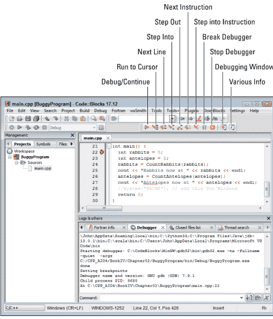

**图 2-1：** Code::Blocks 主窗口显示你的源代码。

*图 2-1* 展示了成功调试应用程序所需的两个特殊功能。第一个是红色八边形，第二个是黄色三角形。红色八边形是一个*断点*——你希望调试器停止的位置。你可以通过单击想要停止的指令左侧，将断点添加到编辑窗口中。当你再次单击该位置时，红色八边形会消失，表示你已经清除了断点。你可以在应用程序中放置任意数量的断点，但只能在指令上放置断点。

黄色三角形是指令指针，它显示调试器接下来将执行的指令。当你让调试器执行指令时，黄色三角形会移动。每当你以调试模式启动应用程序时，黄色指针都会自动在每个断点处停止。*图 2-1* 展示了当黄色三角形停在断点处时调试器的外观。


当你再次单击“调试/继续”启动调试器时，执行会像应用程序处于正常运行模式一样开始，直到调试器遇到另一个断点。如果调试器没有遇到断点，对话框会关闭，应用程序返回到源代码屏幕。调试器不会像在运行模式下那样暂停以显示应用程序输出。对话框只会关闭。


如果你没有设置任何断点就尝试调试应用程序，它会在不让你逐行跟踪代码的情况下运行。也就是说，应用程序会像你没有在调试器中运行它一样运行。

请看“日志和其他”窗口的“调试器”选项卡，如图 2–1 所示。此选项卡包含来自应用程序的调试消息。每当你看到 At 消息时，就知道调试器已停在某个特定位置。消息的其余部分会告诉你调试器停在哪里。在图 2–1 中，调试器停在此文件的第 22 行：

```
At C:\CPP_AIO4\BookIV\Chapter02\BuggyProgram\main.cpp:22
```

当你再次单击“调试”工具栏上的“调试/继续”时，你会看到一条 Continuing... 消息。由于第一次运行没有设置其他断点，应用程序会继续运行直到结束，此时你会看到如图 2–2 所示的其他消息，这些消息会告诉你完成状态等信息；在本例中，由于代码中的 return 0; 行，完成状态为 0。

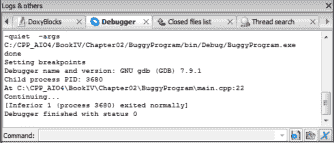

**图 2–2：** 完成运行会显示应用程序结果。


请注意，“调试器”窗口为你提供了各种附加信息。如果向上滚动，你可以看到构建过程，以及它与发布构建有何不同。构建过程完成后，你会看到 done 消息、Setting breakpoints 消息、调试器信息消息，以及应用程序进程的进程标识符（PID）。

## 逐行审查代码

再次单击“调试/继续”以重新启动应用程序和调试器。你之前设置的断点会再次让应用程序停在第 22 行。单击“下一行”，它是“调试器”工具栏上的第三个按钮。你要找的按钮图标上有两个方块，以及一个从第一个方块指向第二个方块的箭头。（你也可以按 F7。）黄色三角形（指令指针）会越过第 22 行的第一条赋值语句，即 `int rabbits = 5;`，移动到第 23 行的第二条赋值语句。请注意，“调试器”窗口现在包含第二条 At 条目：At `C:\CPP_AIO4\BookIV\Chapter02\BuggyProgram\main.cpp:23`。


你可以使用“调试”菜单中的选项来代替“调试”工具栏上的按钮。“调试”菜单还会显示每个支持快捷键的调试命令的快捷键。

单击“下一行”。当你单击该按钮时，指令指针会前进到下一行。计算机会执行 `main()` 中的第二行，即：

```
int antelopes = 5;
```

再次单击“下一行”。现在指令指针位于 `main()` 的第三行，如下所示：

```
rabbits = CountRabbits(rabbits);
```

`main()` 的第三行是一个函数调用，现在你有一个选择。*（不要单击“下一行”。）* 你可以告诉计算机只执行此函数内部的内容，而不在每一行停下来让你查看；也可以“单步进入”它并查看各个行。

单击左起第四个按钮，即名为“单步进入”的按钮，其图标显示两个方块以及一个指向两者之间的箭头。（或按 Shift+F7。）执行此操作后，指令指针会移动到 `CountRabbits()` 函数内。高亮将位于该函数的第一行：

```
int result = original * 2;
```

当高亮移动到函数内时，计算机就单步进入了该函数。现在想一想导致这一操作的图标符号：该图标有方块和一个指向两者之间的箭头。两个方块表示当前函数中的代码行，你在它们之间移动，或者单步进入被调用的函数。这就是这些奇怪符号背后的含义。另请注意，调试器会显示一条相应的 At 消息：At `C:\CPP_AIO4\BookIV\Chapter02\BuggyProgram\main.cpp:7`。

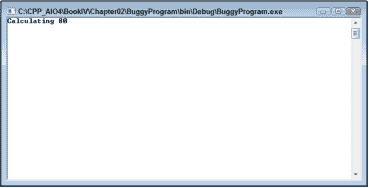

**图 2-3：** 务必检查输出，确保它符合你的预期。

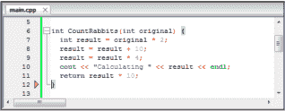

**图 2-4：** 调试器显示代码块的开头和结尾。

- 4. 再次单击“下一行”。

指令指针返回到 `main()` 中调用 `CountRabbits()` 函数之后的那一行：

```
cout << "Rabbits now at " << rabbits << endl;
```

- 5. 再次单击“下一行”。

指令指针位于第二个函数调用上：

```
antelopes = CountAntelopes(antelopes);
```

- 6. 但这一次，不要单步进入该函数，只需按“下一行”单步跳过它。

指令指针前进到下一行，即：

```
cout << "Antelopes now at " << antelopes << endl;
```

查看控制台。`CountAntelopes()` 函数包含一个对 `cout` 的调用。你可以在控制台上看到这行代码发挥了作用：

```
Calculating 13
```

你看到了 `CountAntelopes()` 函数的输出，因为尽管你单步跳过了该函数，但实际上并没有跳过它。调试器只是没有逐行执行该函数。

- 7. **单击“下一行”来执行最后的 `cout` 行。**

你的完整输出现在如下所示：

```
Calculating 80
Rabbits now at 800
Calculating 13
Antelopes now at 13
```

并且指令指针停在最后的 return 语句上：

```
return 0;
```

- 8. **再单击一次“下一行”，高亮将位于 `main()` 的右花括号上。**

现在情况会变得有点奇怪。实际上，代码比你看到的要多。当你编译并链接应用程序时，链接器会包含一些调用 `main()` 函数的特殊启动代码。

- 9. **再单击一次“下一行”。**

调试器会移出你的源文件，进入一些汇编语言代码。“调试器”窗口显示以下消息：

```
In __mingw_CRTStartup () ()
```

- 10. **单击一个新按钮“下一条指令”（“调试器”工具栏上左起第六个按钮），以前进到下一条指令。**

“调试器”窗口再次显示以下消息：

```
In __mingw_CRTStartup () ()
```

- 11. **要了解这一切的含义，请单击“调试窗口”（“调试器”工具栏上左起第十个按钮），然后从下拉列表框中选择“反汇编”。**

Code::Blocks 会显示一个名为“反汇编”的新窗口，如图 2-5 所示。你的图中的数字可能与截图不同，但代码是相同的。

这是汇编语言，是计算机所理解语言的一种人类可读形式。你不必知道这一切意味着什么，但你可能可以判断出下面这一行

```
0x4010ff call 0x430c40 <__cexit>
```

就是这段代码退出应用程序的位置。

- 12. **要结束应用程序，请单击第一个按钮（“调试/继续”）。**

单击“调试/继续”会使应用程序运行到你应用程序的真正结尾（或下一个断点），然后结束。

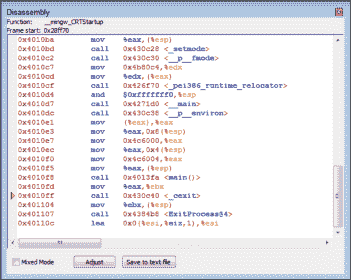

**图 2-5：** “反汇编”窗口显示代码的汇编语言版本。

这就是逐行单步执行应用程序的方法。但在单步执行应用程序时，你可以做的事情比本节介绍的要多得多。你可以查看变量中的值，可以更改变量的值，还可以获取导致应用程序中当前位置的所有函数调用的列表。你可以做很多事情，本迷你书的其余部分会对此进行说明。

## 认识 Code::Blocks 调试器的组成部分

每当你调试应用程序时，Code::Blocks 调试器都会显示“调试器”工具栏。本章前面的几节讨论了“调试器”工具栏上的许多按钮：“调试/继续”、“下一行”、“下一条指令”、“单步进入”和“单步跳出”。不过，该工具栏还包含许多其他你应当了解的有趣按钮。

有时你在编辑器中检查一段代码，并想看看当执行到该位置时变量是什么样子。要查看会发生什么，请将文本光标放在你希望停止的位置（仅仅将鼠标光标悬停在你希望停止的位置是不够的），然后单击“运行到光标处”（“调试器”工具栏上的第二个按钮）。调试器会停在光标所在的行。在这种情况下，文本光标相当于调试器的一种断点。

在你调试应用程序一段时间并找到想要修复的问题后，你可能不想运行应用程序的其余部分。当这种情况发生时，

只需单击“停止调试器”（Stop Debugger，即中间带 X 的方框按钮）。调试器会立即停止。你可以进行任何必要的更改，然后像平常一样重新启动调试器。

Code::Blocks 提供了对多个调试窗口的访问。事实上，你在本章前面已经见过其中一个窗口——反汇编窗口（Disassembly）（参见图 2-5）。你可以单击调试窗口（Debugging Windows）按钮（即停止调试器按钮右侧、看起来像窗口的那个按钮），或选择 Debug ➪ Debugging Windows 来访问这些窗口。本迷你书的后续章节将详细描述这些窗口。下面先快速概述这些窗口：

- **断点：** 显示你在应用程序中设置的所有断点。双击某个断点条目会带你到编辑器中的该断点处。你也可以使用此窗口删除一个或多个断点。
- **CPU 寄存器：** 显示处理器中硬件寄存器的内容。通常不需要查看这些寄存器，除非你要执行低层编程任务（例如编写设备驱动程序）。
- **调用栈：** 显示到达代码中当前点所经过的函数调用。
- **反汇编：** 让你查看底层的汇编语言代码。通常不需要查看此信息，除非你要执行低层编程任务。
- **内存转储：** 显示应用程序在内存中存储数据的确切方式，它看起来可能与 C++ 视图不太一样。此窗口很有用，因为它能帮助你理解内存如何工作以及应用程序如何使用内存。在某些情况下，了解变量在内存中的存储方式可以帮助你定位代码中的问题。
- **运行中的线程：** 显示与当前应用程序关联的线程列表（主线程除外）。你可以使用此窗口调试多线程应用程序。
- **监视：** 显示局部变量和函数参数列表。你还可以添加其他变量到监视列表进行监视。此外，你可以创建新语句，例如 rabbits + antelopes，以便查看这两个变量的总和。监视窗口可能是最有用的调试器窗口，因为它展示了数据的 C++ 视图，并显示应用程序代码如何操作这些数据。

调试器还提供了对多个信息窗口的访问。你可以单击各种信息（Various Info）按钮（即左侧靠下、带有斜体 *i* 的那个按钮），或选择 Debug ➪ Information 来访问这些窗口。以下是信息窗口的概述：

- **当前栈帧：** 显示当前栈帧信息。当发生某些事件（例如调用函数）时，C++ 会创建一种称为 *栈帧* 的东西。此栈帧包含当前函数的数据和数据引用。通常不需要查看此信息，除非你要执行低层编程任务。
- **已加载的库：** 列出为运行应用程序而加载的所有库。将应用程序部署到其他机器时，了解应用程序使用了哪些库很重要。许多情况下，你甚至可能不知道 C++ 需要某些库才能运行应用程序，因此此窗口特别有用。
- **目标与文件：** 详细展示已加载的库在应用程序中的使用方式。通常不需要查看此信息，除非你要执行低层编程任务。
- **FPU 状态：** 显示处理器中浮点单元（FPU）的寄存器信息。FPU 曾经是独立芯片，但现在已成为主处理器的一部分。FPU 非常擅长执行实数（而非整数）运算。通常不需要查看此信息，除非你要执行低层编程任务。
- **信号处理：** 显示 Code::Blocks 如何处理硬件与应用程序之间的信号，例如算术异常或段错误。通常不需要查看此信息，除非你要执行低层编程任务。

## 使用不同工具进行调试

你可以使用多种工具调试代码。不过，你通常使用哪种编译器，就决定了你可以使用哪些调试工具。例如，Microsoft Visual C++ 有一个非常好的调试器。但是，例如让它调试用 Dev-C++ 编译的应用程序就很困难，因为不同编译器使用不同形式的调试信息和符号信息。各种 gcc 编译器使用的类型与 Microsoft Visual C++ 使用的类型不同。以下是一些可用的调试器：

- **Visual C++：** 此调试器的工作方式与 Code::Blocks 调试器类似。它主要用于调试使用 Visual C++ 构建的应用程序。不过，如果你有胆量，并且需要调试没有代码或符号信息的内容，它对汇编代码调试的支持很好。
- **gdb：** 这是 MinGW 和 Cygwin 自带的标准调试器。它是一个命令行工具，但你可以配合 Insight 调试器使用，从而获得图形前端。这会让事情轻松许多。但如果你坚持使用命令行版本，可以在命令提示符中输入 `gdb`，然后输入 `help` 来了解它。
- **Dev-C++：** 从版本 5 开始，Dev-C++ 内置了一个与 Insight 调试器工作方式类似的集成调试器。你也许可以试一试。（如果你使用的是 5.0 之前的 Dev-C++ 版本，则必须使用 Insight 调试器。）

## 使用命令行参数调试 Code::Blocks 应用程序

命令行参数是你在命令提示符中随应用程序命令一起输入的内容。例如，当你在命令提示符中输入 `Dir`（目录列表命令）时，可以包含诸如 `*.DOC` 的附加信息，它会列出所有扩展名为 `.DOC` 的文件。（如果改用 `Dir *.DOC?`，你还会看到扩展名为 `.DOCX` 的文件。）完整命令 `Dir *.DOC` 由命令（`Dir`）和命令行参数（`*.DOC`）组成。添加命令行参数可以扩展应用程序的功能，让它做更多事情。要测试这样的应用程序，你需要能够在调试器环境中指定命令行参数。

与大多数功能强大的 IDE 一样，Code::Blocks 提供了指定命令行参数的方法。第 1 册第 6 章中的“在 Code::Blocks 中设置命令行参数”边栏介绍了设置命令行参数的基础知识。不过，本书先前版本的许多读者希望获得更多信息。考虑到这一点，我在博客 http://blog.johnmullersbooks.com/2011/11/01/debugging-a-codeblocks-application-with-command-line-arguments/ 上为本书先前版本撰写了文章《使用命令行参数调试 CodeBlocks 应用程序》，其中更详细地说明了命令行参数的工作方式。如果你想进一步了解具体发生了什么，请务必查看这篇博文。

这些功能都已具备。请务必查阅供应商文档，了解使用调试器的准确细节。


要完成本章的示例，你必须在开启调试信息的情况下进行编译。（在 Code::Blocks 中，你可以在编译器工具栏的 Build Target 字段中选择 Debug，以在开启调试信息的情况下编译。如果看不到编译器工具栏，请选择 View ➪ Toolbars ➪ Compiler，勾选 Compiler 项。）开发软件时，你应该始终开启调试信息。这样，你就能随时调试代码并修复问题。只有当你准备正式发布产品时，才应关闭调试信息重新编译。（你仍应在关闭调试信息后再次对软件进行完整测试，以确保其功能正常。）


你不必手动输入本章的源代码。事实上，使用可下载的源代码要容易得多。你可以在可下载源代码的 `\\CPP_AI04\\BookIV\\Chapter03` 文件夹中找到本章的源代码。有关如何找到这些源文件的详细信息，请参阅引言。

## 设置和禁用断点

断点是代码中你告诉调试器停止的位置。接下来的几节将讨论断点。这些小节使用代码清单 3-1 中所示的 Breakpoints 示例代码。请确保在开启调试信息的情况下编译它。

### 代码清单 3-1 — 使用应用程序进行断点和检查

```cpp
#include <iostream>

using namespace std;

class BrokenMirror {
private:
    int NumberOfPieces;
public:
    int GetNumberOfPieces();
    void SetNumberOfPieces(int newamount);
    BrokenMirror() : NumberOfPieces(100) {}
};
```


```cpp
int BrokenMirror::GetNumberOfPieces() {
    return NumberOfPieces;
}

void BrokenMirror::SetNumberOfPieces(int newamount) {
    newamount = newamount * 20;
    NumberOfPieces = newamount;
}

int main() {
    BrokenMirror mirror;
    mirror.SetNumberOfPieces(10);
    cout << mirror.GetNumberOfPieces() << endl;
    return 0;
}
```

## 在 Code::Blocks 中设置断点

在开启调试信息的情况下编译清单 3-1 中的应用程序。查看窗口左边距，即行号右侧。图 3-1 显示第 14 行有一个小八边形。在 IDE 中查看时，这个八边形是红色的。红色八边形就是断点。要在你自己的代码中设置这个断点，请点击左边距与代码之间的区域（或右键单击该行代码，然后从上下文菜单中选择“切换断点”），如图中第 14 行所示。如果你还没有这样做，请用鼠标点击 `int BrokenMirror::GetNumberOfPieces()` 这一行的左边距。你会看到左边距出现一个红色八边形。你刚刚在该行放置了一个断点。

再次点击同一行的左边距。红色八边形消失。当八边形消失时，断点就没有了。

最后，第三次点击，因为目前你确实希望那里有一个断点。

通过单击调试器工具栏上的“调试/继续”按钮（带有红色右指箭头的图标）来运行应用程序。如果你没有看到调试器工具栏，请选择“视图 ➤ 工具栏 ➤ 调试器”，以在“调试器”条目旁放置勾选标记。（不要单击“运行”按钮，即编译器工具栏上的绿色右指三角形，因为选择此选项只运行应用程序而不会调试它。）当你单击“调试/继续”时，控制台窗口可能会弹到前面，因此只需单击 Code::Blocks 窗口将其带回前面即可。


图 3-1：Code::Blocks 使用红色八边形显示你设置的任何断点。

应用程序会一直运行，直到到达你为 `int BrokenMirror::GetNumberOfPieces()` 行选择的断点，如图 3-2 所示。请注意，执行实际上在左花括号处结束，因为这是该函数执行的开始。黄色右指三角形告诉你 Code::Blocks 调试器将要执行的当前指令。现在你可以单击“下一行”按钮（带有两个方块以及从上方块指向下方块的箭头的按钮）移动到下一行，也可以单击“调试/继续”来运行应用程序的其余部分。

### 启用和禁用断点

有时你可能设置了多个断点，想暂时关闭它们，但又不想丢失它们，因为之后可能还想重新启用。你可以通过*禁用*断点来做到这一点。禁用断点比删除断点然后再找到它们重新启用更快。使用以下步骤禁用断点：

1. **右键单击编辑器左侧的红色八边形，然后从上下文菜单中选择“编辑断点”。**

   你会看到“编辑断点”对话框，如图 3-3 所示。


图 3-2：调试模式告诉 Code::Blocks 在到达断点时停止执行。


图 3-3：使用“编辑断点”对话框启用和禁用断点。

2. 清除“启用”选项，然后单击“确定”。

   Code::Blocks 会禁用该断点，使其不再停止应用程序执行。

许多调试器使用空心红圈（有时是八边形）显示已禁用的断点。Code::Blocks 则会把红色八边形变成灰色。不过，你仍然会想看到禁用断点确实生效。在 `return NumberOfPieces;` 这一行之后（在花括号上）设置一个新断点。单击“调试/继续”，你会看到调试器绕过第一个断点并停在第二个断点，如图 3-4 所示。

## 停止和检查你的代码

2. **右键单击断点条目，然后从上下文菜单中选择一个管理选项。**

管理选项可帮助你控制一个或多个断点。你可以使用管理选项执行以下任务。

- 在编辑器中打开断点，以便你可以看到它的位置。
- 编辑断点，这会显示“编辑断点”对话框，如图 3-3 所示。
- 删除所选断点。
- 禁用所选断点。
- 添加书签，以便你可以更轻松地在代码中找到此位置。选择此选项后，你会看到行号和代码之间出现一个右指蓝色箭头。使用“编辑→书签”菜单选项来管理书签。
- 删除你在应用程序中设置的所有断点。

## 观察、检查和更改变量

当你在应用程序中的断点处停下时，你能做的不仅仅是查看代码。你还可以玩转它！你可以查看变量的当前值，也可以更改它们。

清单 3-2 中显示的 Breakpoints2 示例是一个示例应用程序，你可以用它来尝试这些检查、更改和观察变量的示例。请注意，此应用程序与本章前面的清单 3-1 类似，但你应该会看到一些差异。具体来说，它向 SetNumberOfPieces() 方法添加了一行：

```cpp
newamount = newamount * 20;
```

该示例添加了一个名为 SpecialMath() 的新函数，并在 main() 中添加了一个初始化为 10 的 i 变量。然后代码操作 i 并将其传入 SetNumberOfPieces() 函数。

### 清单 3-2：使用应用程序进行断点和检查

```cpp
#include <iostream>

using namespace std;

class BrokenMirror {
private:
  int NumberOfPieces;
public:
  int GetNumberOfPieces();
  void SetNumberOfPieces(int newamount);
  BrokenMirror() : NumberOfPieces(100) {}
};

int BrokenMirror::GetNumberOfPieces() {
  return NumberOfPieces;
}

void BrokenMirror::SetNumberOfPieces(int newamount) {
  newamount = newamount * 20;
  NumberOfPieces = newamount;
}

int SpecialMath(int x)
{
    return x * 10 - 5;
}

int main() {
  int i = 10;
  BrokenMirror mirror;

  i = i + SpecialMath(i);
  mirror.SetNumberOfPieces(i);
  cout << mirror.GetNumberOfPieces() << endl;

  // Clear this comment if you want the application to
  // stop to display the results.
  // system("PAUSE");
  return 0;
}
```

当你单击“运行”运行此应用程序时，你应该会看到输出值为 2100。

### 观察变量

要观察应用程序中的变量，请按照以下步骤操作：

1. 使用调试版本（生成 > 选择目标 > 调试）而不是发布版本来编译此应用程序。
2. 在 `main()` 中的 `int i = 10;` 行设置断点。
3. 单击“调试/继续”。
4. 当调试器停在断点处时，选择“调试 > 调试窗口 > 监视”。

你会看到“监视”窗口，如图 3-6 所示。请注意，“监视”窗口自动包含 i 和 mirror。如果你单击 mirror 旁边的 +，可以深入查看 NumberOfPieces。

**图 3-6：**“监视”窗口显示变量和对象的值。


请注意，i 和 NumberOfPieces 中的值是随机的，因为代码尚未给它们赋值。你看到的值将与图 3-6 中显示的值不同。这就是为什么在给变量赋值之前永远不要使用变量的原因。在这种情况下，变量显示为红色，因为 C++ 刚刚创建了它们。


**记住**

像 mirror 这样的对象不仅包含变量，还包含其他对象。当一个对象包含子对象时，该子对象旁边也会有一个加号。要查看此子对象的内容，只需单击它旁边的加号。你可以一直深入查看，直到到达对象列表的末尾。


- 5. 单击调试器工具栏上的“下一行”按钮，使您越过以下行一行：

```cpp
int i = 10;
```

应用程序将 i 的值改为 10，如图 3-7 所示。该变量仍显示为红色，因为它的值刚刚改变。不过请注意，NumberOfPieces 现在显示为黑色，因为自上次指令以来它的值没有改变。

**图 3-7：** 给 i 赋值会改变其在“监视”窗口中的值。


- 6. 单击调试器工具栏上的“下一行”。
- 7. 单击“调试/继续”。
- 8. 移除您在示例应用程序中设置的所有断点。

## 更改变量值

有时您需要通过模拟代码中可能发生的更改来验证应用程序是否按预期工作。在许多情况下，这意味着将值从默认值更改为您要测试的值。幸运的是，“监视”窗口提供了执行此任务的方法。按照以下步骤了解如何更改变量值：

- 1. 在 `main()` 中的 `i = i + SpecialMath(i);` 行设置断点。
- 2. 单击“调试/继续”。
- 3. **当调试器停在断点时，选择“调试 ▸ 调试窗口 ▸ 监视”。**

您会看到“监视”窗口（参见图 3-6 和图 3-7）。`i` 和 `NumberOfPieces` 的值与之前一样。但是，您不能更改这些值；只能查看它们。

- 4. **在“监视”窗口最后一行的第一列中键入 `i`，然后按 Enter。**

您会看到 `i` 的当前值为 10。还要注意，第三列中会显示变量类型 `int`，如图 3-8 所示。该条目也显示为红色，因为您刚刚将其添加到“监视”窗口中。


- 5. **在您添加的 `i` 对应的“监视”窗口第二列中选择值 10，键入 100，然后单击“监视”窗口的下一行。**

Code::Blocks 将 `i` 的值更改为 100。原本为黑色的 `i` 变量条目已变为红色，因为您更改了该值。请注意，“局部变量”区域中的 `i` 副本的值和颜色也都发生了变化。

- 6. **单击“下一行”三次，使指令指针位于以下行：**

```cpp
return 0;
```

请注意，应用程序的输出（以及“监视”窗口中 `NumberOfPieces` 的值）已更改为 21900。通常输出为 2100。出现差异是因为 `i` 的值被更改了。

- 7. **单击“调试/继续”。**

应用程序结束。

## 在堆栈中移动

Code::Blocks 调试器与大多数调试器一样，允许您查看堆栈。但实际上，您并不是直接查看硬件堆栈。当调试器向您显示*应用程序堆栈*时，它显示的是导致应用程序到达应用程序代码中当前位置的函数调用列表。不过，应用程序堆栈是硬件堆栈的人类可读形式，调试器使用硬件堆栈来获取该信息。因此，程序员总是将函数调用列表称为*堆栈*，即使您实际上并不是在查看硬件堆栈。

图 4-1 显示了 Code::Blocks 中“调用堆栈”窗口的示例。要查看“调用堆栈”窗口，只需选择“调试→调试窗口→调用堆栈”。您会看到“调用堆栈”窗口位于 Code::Blocks 主窗口前面。在开始运行应用程序之前，“调用堆栈”窗口中不会显示任何信息。

**图 4-1：** “调用堆栈”窗口显示导致当前位置的函数调用。


您可以自己尝试查看堆栈。查看清单 4-1 中所示的 NestedCalls 示例。该清单展示了一个进行多次嵌套函数调用的简单应用程序。

### 清单 4-1：进行嵌套函数调用

```cpp
#include <iostream>

using namespace std;

int SeatsPerCar() {
    return 4;
}

int CountCarSeats() {
    return 10 * SeatsPerCar();
}
```

*(续)*

### 清单 4-1：（续）

```cpp
int CountStuff() {
    return CountCarSeats() + 25;
}

int main() {
    cout << CountStuff() << endl;
    // Remove the following comment to see the code
    // execute in the debugger.
    //system("PAUSE");
    return 0;
}
```

要尝试使用“调用堆栈”窗口，请按照以下步骤操作：

- 1. **编译此应用程序（将“构建目标”字段设置为 Debug）。**
- 2. **在 `cout << CountStuff() << endl;` 行设置断点。**
- 3. **按 F8 在 Code::Blocks 调试器中运行应用程序。**
- 4. **单步进入 `CountStuff()` 函数，然后进入 `CountCarSeats()` 函数，再进入 `SeatsPerCar()` 函数。**  
  （或者，只需在 `SeatsPerCar()` 函数中设置断点，然后运行应用程序，直到它停在断点处。）
- 5. **选择 `Debug` > `Debugging Windows` > `Call Stack`。**  
  会出现类似图 4-1 的窗口。请注意“调用堆栈”窗口中函数调用的顺序：

  ```
  SeatsPerCar()
  CountCarSeats()
  CountStuff()
  main()
  ```

此“调用堆栈”窗口中的信息表示，您的应用程序从 `main()` 开始，它调用了 `CountStuff()`。该函数随后调用了 `CountCarSeats()`，而后者又调用了 `SeatsPerCar()`。这就是您当前所在的位置。Code::Blocks 会在当前堆栈位置——应用程序当前正在执行的代码块——放置红色高亮。


提示：如果您想知道应用程序经过什么路径到达某个特定例程，此窗口会很有用。例如，您可能会看到一个从应用程序中许多位置调用的例程，并且不确定在执行某项任务时是哪一部分在调用该例程。要找出是哪一部分调用了该例程，请在该函数中设置断点。当您运行应用程序并且调试器停在该行时，“调用堆栈”窗口会显示计算机到达该处所经过的路径，包括调用该函数的函数名称。

在“调用堆栈”窗口中，您可以双击任何函数名，调试器会将光标移动到源代码中的函数体。此功能使您可以轻松定位调用堆栈中的任何函数，并了解代码为何沿该路径执行。双击只会将您的视图移动到调用堆栈中的相应行；程序仍停在堆栈顶部的行上。当您切换到调用堆栈中的新位置时，红色条会移动到“调用堆栈”窗口中的该位置，以便您始终可以跟踪自己在调用堆栈中的位置。

> **记住**
>
> 堆栈功能几乎对所有调试器都很常见。不能说是*所有*，因为有些确实很糟糕的调试器并没有堆栈功能。但优秀的调试器，包括 Code::Blocks 和 Microsoft Visual C++ 内置的调试器，都包含在堆栈中移动的功能。

### 存储局部变量

当您深入调试时，充分理解应用程序底层发生的事情总是有帮助的。此时，本文从两个层面进行说明：

- 您的 C++ 代码
- 编译器根据您的 C++ 代码生成的结果汇编代码。（*汇编*是机器代码的人类可读形式，您机器上的处理器能够理解它。）

本章会清楚说明您正在阅读的是哪个层面。假设您用 C++ 编写了一个函数，并在应用程序的另一部分调用该函数。当编译器为该函数生成汇编代码时，它会在函数的开头和结尾插入一些特殊代码。在函数开头，这些特殊代码为局部变量分配空间。在函数结尾，特殊代码会释放该空间。这个用于变量的空间称为函数的*堆栈帧*。

这个用于局部变量的空间位于堆栈上。存储过程如下：当您调用函数时，计算机会将调用者的返回地址压入堆栈。在计算机进入函数内部运行后，编译器插入的特殊代码会再保留一些堆栈空间——刚好足够容纳这些变量。这个额外空间成为变量的局部存储；就在函数返回之前，特殊代码会移除这个

局部空间。因此，栈顶现在是返回地址。随后返回操作就能正确执行。


这个涉及栈帧的过程是在 CPU 内部寄存器的帮助下完成的。在函数调用之前，汇编代码会把传给函数的参数压入栈中。然后，它使用 CPU 内置的 `call` 语句调用该函数。（这是一个汇编代码语句。）这个 `call` 语句会把返回地址压入栈中，然后把指令指针移动到函数地址处。进入函数执行后，栈中包含函数参数，然后是返回地址。特殊的函数启动代码（称为 *prolog*，序言）会把栈帧起始地址保存到 CPU 的一个寄存器中，该寄存器称为基址指针（Base Pointer，BP）寄存器。（与 SP 一样，BP 的名称可以是 EBP 或 RBP，具体取决于寄存器大小。）

序言会把该值保存在栈上。序言代码首先把 BP 的值压入栈中。然后，序言代码取得当前栈指针（它指向内存中的栈顶），并将其保存回 BP 寄存器以供后续使用。接着，序言代码调整栈指针，为局部变量存储腾出空间。随后，函数内部的代码会把局部变量作为 BP 在栈上位置之上的偏移量来访问，而把参数作为 BP 在栈上位置之下的偏移量来访问。

最后，在函数结束时，特殊代码（现在称为 *epilog*，尾声）会撤销这些工作：尾声把 BP 中的值复制回 SP；这会释放局部变量存储空间。然后它从栈顶*弹出*值，并把该值恢复回 BP。现在栈顶包含函数返回地址，这恢复到了函数开始时的状态。下一条汇编语句是 `return`，它从栈顶弹出一个值，并返回到尾声代码从栈中弹出的地址。想一想：每当你的计算机中发生一次函数调用，这个过程都会发生。


在计算机内部，栈实际上是倒着运行的。当你把某个值压入栈时，栈指针在内存中会向*下*移动——它会被*递减*。当你从栈中弹出某个值时，栈指针会被*递增*。因此，在栈帧中，局部变量实际上位于内存中 BP 的*下方*，你要通过从 BP 寄存器中存储的值里减去偏移量来访问它们的地址。反过来，函数参数位于内存中 BP 的*上方*，你要通过在 BP 中存储的值上加上偏移量来获得它们的地址。


上一段没有讨论的一个主题是函数的返回值。在 C++ 中，从函数返回值的一种标准做法是让函数的汇编代码把该值移入累加器（Accumulator，AX）寄存器（其名称也随寄存器大小而变化）。调用代码可以在函数结束后检查 AX 寄存器。然而，如果你返回的是复杂内容，例如类实例，情况就会稍微复杂一些。假设你有一个返回对象的函数，但不是以指针方式返回，如函数头 `MyClass MyFunction();` 所示。不同的编译器对此处理方式不同，但当作为 Code::Blocks、Dev-C++、MinGW 或 Cygwin 一部分的 gcc 编译器遇到诸如 `MyClass inst = MyFunction();` 这样的语句时，它会取得 `inst` 的地址并将其放入 AX。然后，在函数中为局部变量分配空间，并在 return 行中把局部变量中的对象复制到地址位于 AX 中的那个对象里。因此，当你返回一个非指针对象时，从某种意义上说，你是在把对象作为指针传入函数。

## 使用高级功能调试

大多数调试器（包括 Code::Blocks）都具备一些高级功能，在你跟踪应用程序时非常方便。这些功能包括查看 *线程*（独立的程序指令序列）和汇编代码的能力。

### 查看线程

如果你正在编写使用多线程的应用程序，并在断点处停下来，那么你可以使用“运行中的线程”（Running Threads）窗口获取所有当前线程的列表。要打开“运行中的线程”窗口，请在 Code::Blocks 主窗口中选择“调试” → “调试窗口” → “运行中的线程”。随后会打开一个显示当前正在运行的线程的窗口。每一行大致如下所示：

```
2 thread 2340.0x6cc  test() at main.cpp:7
```

第一个数字表示这是应用程序中的哪个线程；例如，这是第二个线程。“thread”一词后面的两个数字是十六进制的进程 ID 和线程 ID，二者用点分隔。然后你会看到线程停止处所在函数的名称，以及线程停止处的行号。

### 跟踪汇编代码

如果你有兴致，可以查看实际的汇编代码。在某些情况下，你会使用汇编代码视图来查找特别难以发现的错误，或者可能想确定两种编程技术中哪一种生成的代码更少。事实上，你可能只是好奇编译器如何转换你的代码。要查看汇编代码，请选择“调试” → “调试窗口” → “反汇编”，然后你会看到


现在代码所做的只是执行一条左移（SHL）指令。将 EAX 中的值左移 2 位等同于将其乘以 4。汇编器使用 SHL 指令是因为移位所需的时钟周期远少于乘法，从而使代码运行得更快。即使汇编代码与你的 C++ 代码并不完全对应，结果也是相同的。

如果你想查看寄存器中的值，以便更容易地跟踪汇编代码，请选择“调试” → “调试窗口” → “CPU 寄存器”。你会看到 CPU 寄存器窗口，如图 4-5 所示。该窗口反映代码当前停止点处寄存器的状态。因此，除非你逐条指令地步进执行代码，否则无法在反汇编窗口中看到汇编代码的每一步都反映在这些寄存器中。


# 第5部分：高级编程

### 内容速览

- **第 1 章 使用数组、指针和引用** — 481
  - 构建数组 — 482
  - 用指针指向 — 498
  - 引用引用 — 510
- **第 2 章 创建数据结构** — 515
  - 使用数据 — 515
  - 组织数据 — 529
  - 命名空间 — 534
- **第 3 章 构造函数、析构函数和异常** — 541
  - 构造和析构对象 — 542
  - 为规则编写异常 — 563
- **第 4 章 高级类用法** — 571
  - 正确地继承 — 572
  - 在类中使用类和类型 — 591
- **第 5 章 创建带模板的类** — 601
  - 将类模板化 — 602
  - 超越基础 — 609
  - 参数化模板 — 612
  - 为模板定义类型别名 — 622
  - 派生模板 — 623
  - 将函数模板化 — 630
- **第 6 章 使用标准库编程** — 637
  - 构建标准库 — 638
  - 容纳你的类 — 638
  - 容器大对决 — 658
  - 复制容器 — 673
  - 创建和使用动态数组 — 675
  - 使用无序数据 — 677
  - 使用范围 — 679

## 第 1 章：使用数组、指针和引用

**本章内容**

- 使用数组和多维数组
- 理解数组与指针之间的联系
- 处理各种形式的指针
- 使用引用变量

当 C++ 的前身 C 编程语言在 20 世纪 70 年代初问世时，它之所以是一项突破，是因为它很小。C 只有少量关键字。像打印到控制台这样的任务不是由内置关键字处理，而是由函数处理。从技术上讲，C++ 仍然只有少量关键字，所以它仍然很小。那么，是什么让 C++ 变得庞大？

- 它的库非常庞大。
- 它极其复杂精妙，因此你能用这门语言做无数的事情。

在本章中，你会看到为 C++ 奠定基础的主题的完整概述：数组、指针和引用。在 C++ 中，这些内容会反复出现。

本章假设你对 C++ 有基本了解——即你理解第 1 册和第 2 册中的内容。你了解指针和数组的基础知识（也许还稍微了解一点引用），并且准备好彻底掌握它们。当你完成本章时，你的知识将得到充分扩展，足以相对轻松地执行一些中级和高级任务。


编译器很智能，能数出你在花括号内放入了多少个元素，然后把这个数量作为数组大小。

指定数组大小有助于降低出现 bug 的几率。此外，它还有一个额外好处：在实际声明中，如果方括号内的数字与花括号内元素的数量不匹配，编译器就会报错。如下所示：

```
int MyNumbers[5] = {1,2,3,4,5,6,7,8,9,10};
```

会产生以下编译器错误：

```
error: too many initializers for 'int [5]'
```

但如果方括号内的数字大于元素数量，如下面的代码所示，你就不会得到错误。相反，其余数组元素未被定义，因此你无法访问它们。所以要小心！

```
int MyNumbers[15] = {1,2,3,4,5,6,7,8,9,10};
```

当你把数组传给函数时，也可以省略指定数组大小，如下所示：

```
int AddUp(int Numbers[], int Count) {
    int loop;
    int sum = 0;
    for (loop = 0; loop < Count; loop++) {
        sum += Numbers[loop];
    }
    return sum;
}
```

这种技巧特别强大，因为 `AddUp()` 函数可以处理任意大小的数组。你可以像这样调用该函数：

```
cout << AddUp(MyNumbers, 10) << endl;
```

但这种做法有点烦人，因为每次调用该函数时都必须指定大小。不过，你可以绕开这个问题。看看下面这行代码：

```
cout << AddUp(MyNumbers, sizeof(MyNumbers) / 4) << endl;
```

对于数组，`sizeof` 运算符会告诉你它使用了多少字节。但数组的大小通常指的是元素数量，而不是字节数。因此，你用 `sizeof` 的结果除以 4（每个 `int` 元素的大小）。

但现在那个魔法数字 4 就摆在那里。（所谓*魔法数字*，我们指的是看似随意、被塞进代码某处的数字。）因此，稍微好一点的做法是输入下面这行代码：

```
cout << AddUp(MyNumbers, sizeof(MyNumbers) / sizeof(int))
  << endl;
```

现在这行代码可以工作了，原因如下：数组的 `sizeof` 除以数组中每个元素的 `sizeof`，就得到数组中元素的数量。（你也会在第2册第2章的“声明和访问数组”一节中看到这种技巧的演示。）

## 数组和指针

数组名是指向数组本身的指针。*数组*是存储在内存中的一串变量。*数组名*指向第一个元素。下面的小节讨论数组和指针。

### 把数组看作数组和指针

关于数组和指针的一个有趣问题是：是否可以使用像下面这行这样的函数头，并依靠 `sizeof` 来确定数组中有多少个元素。如果可以，这个函数就不需要让调用者指定数组大小。

```
int AddUp(int Numbers[]) {
```

看看 Array01 示例中的这个函数，以及调用它的 `main()`：

```
#include <iostream>

using namespace std;

void ProcessArray(int Numbers[]) {
  cout << "Inside function: Size in bytes is "
    << sizeof(Numbers) << endl;
}

int main(int argc, char *argv[]) {
  int MyNumbers[] = {1,2,3,4,5,6,7,8,9,10};
  cout << "Outside function: Size in bytes is ";
  cout << sizeof(MyNumbers) << endl;
  ProcessArray(MyNumbers);
  return 0;
}
```

运行这个应用程序时，你会看到：

```
Outside function: Size in bytes is 40
Inside function: Size in bytes is 4
```

在函数外部，代码知道数组的大小是 40 字节。然而，在函数内部，报告的大小是 4 字节。原因在于，尽管看起来你传递的是数组，实际上传递的是指向数组的*指针*。指针的大小只有 4，所以最后那行 `cout` 打印出来的就是这个值。

### 理解外部声明

声明数组有一个小小的特殊之处。当你通过给出确定的元素数量来声明数组时，例如

```
int MyNumbers[5];
```

编译器知道你有一个数组，并且 sizeof 运算符会给出整个数组的大小。那么，数组名*既*是指针也是数组！但如果你声明函数头时不写数组大小，例如

```
void ProcessArray(int Numbers[]) {
```

编译器只把它当作一个*指针*，仅此而已。事实上，最后这行等价于下面这行：

```
void ProcessArray(int *Numbers) {
```

因此，在由任一行声明的函数内部，下面两行代码是*等价的*：

```
Numbers[3] = 10;
*(Numbers + 3) = 10;
```

这种等价性意味着，如果你对数组使用 extern 声明，例如

```
extern int MyNumbers[];
```

然后取这个数组的大小，编译器就会糊涂。举个例子：如果你有两个文件 `numbers.cpp` 和 `main.cpp`，其中 `numbers.cpp` 声明了一个数组，而 `main.cpp` 对它进行外部声明（如 Array02 示例所示），那么调用 `sizeof` 时就会得到编译器错误：

```
#include <iostream>

using namespace std;

extern int MyNumbers[];

int main(int argc, char *argv[]) {
  cout << sizeof(MyNumbers) << endl;
  return 0;
}
```

在 Code::Blocks 中，gcc 编译器会给出这个错误：

```
error: invalid application of 'sizeof' to incomplete type
  'int []'
```

解决办法是把数组大小放进方括号内，例如 `extern int MyNumbers[10];`。只需确保这个大小与其他源代码文件中的大小相同！你可以通过改数字来骗过编译器，这样不会报错。但这是不良编程风格，简直是在自找错误。


虽然数组只是内存中彼此相邻的一串变量，但数组名实际上只是指向数组中第一个元素的指针。你可以把数组名当作指针使用。不过，只有在你确实需要处理指针时才这样做。毕竟，你真的没有理由写出像 `*(Numbers + 3) = 10;` 这样晦涩的代码。

反之亦然。看看这个函数：

```
void ProcessArray(int *Numbers) {
  cout << Numbers[1] << endl;
}
```

这个函数把指针作为参数，但你却像访问数组一样访问它。再说一次，不要写这样的代码；相反，你应该试着理解这样的代码为什么能工作。这样，你就能更深入地了解数组以及它们在计算机内部是如何存在的，而这些知识反过来又能帮助你写出正常工作的代码。

### 区分指针类型

尽管本章告诉你数组名只是指针，但整数数组的名字与指向整数的指针并不完全相同。看看下面这几行代码（见 Array03 示例）：

```
#include <iostream>

using namespace std;

int main() {
    int LotsOfNumbers[50];
    int x;
    LotsOfNumbers = &x;
}
```

这段代码试图让 LotsOfNumbers 指针指向另一个不同的东西：一个声明为整数的对象。编译器不允许这样做；你会得到一个错误。如果 LotsOfNumbers 被声明为 int *LotsOfNumbers;，情况就不会如此；那样这段代码就能工作。但按现在这样写，这段代码会给出类似下面的编译器错误：

```
error: incompatible types in assignment of 'int*' to 'int [50]'
```

这个错误意味着编译器确实看到了两种类型 `int*` 和 `int[50]` 之间的明确区别。尽管如此，数组名确实是指针，你可以把它当作指针使用；你只是不能对它做普通指针能做的所有事情，比如重新赋值。以下提示有助于让你的数组不出 bug：

- 保持代码一致。例如，如果你声明了一个指向整数的指针，就不要把它当作数组来对待。
- 保持代码清晰易懂。如果你传递指针，那么取第一个元素的地址是可以的，例如 `&(myNumbers[0])`，前提是这能让代码更清晰——尽管它等价于只写 `myNumbers`。
- 当你声明数组时，尽量总是在方括号内写一个数字，除非你正在编写一个接收数组的函数。


当你使用 `extern` 关键字声明数组时，也要把数组大小放在方括号内。但一定要保持一致！不要一次用这个数字，另一次又用不同的数字。保持一致的最简单方法是使用一个常量，例如在公共头文件中使用 `const int ArraySize = 10;`，然后在数组声明中使用它：`int MyArray[ArraySize];`。

## 使用多维数组

数组不必只是一维的。维度可以让你更真实地建模数据。例如，三维数组可以让你更好地为三维空间中的某个特定位置建模。以下各节讨论如何使用多维数组。

### 声明多维数组

你可以使用与一维数组类似的技术来声明多维数组，如清单 1-1 中的 Array04 示例所示。不同之处在于，你必须分别声明每个维度。

#### 清单 1-1：使用多维数组

```cpp
#include <iostream>

using namespace std;

int MemorizeThis[10][20];

int main() {
    for (int x = 0; x < 10; x++) {
        for (int y = 0; y < 20; y++) {
            MemorizeThis[x][y] = x * y;
        }
    }

    cout << MemorizeThis[9][13] << endl;
    cout << sizeof(MemorizeThis) / sizeof(int) << endl;
    return 0;
}
```

运行这段代码时，`MemorizeThis` 会被填入乘法表。下面是该应用程序的输出，先是 `MemorizeThis[9][13]` 的内容，然后是整个二维数组的大小：

```
117
200
```

确实，9 乘以 13 等于 117。该数组的大小为 200 个元素。因为每个元素都是整数，占 4 字节，所以该数组的字节大小为 800。


你可以拥有非常非常多的维度，但要小心。每增加一个维度，大小就会乘以该维度的大小。因此，像下面这样声明的数组有 48,600 个元素，总计 194,400 字节：

```
int BigStuff[4][3][5][3][5][6][9];
```

而下面的数组有 4,838,400 个元素，总计 19,353,600 字节。这大约有 19 兆字节！

```
int ReallyBigStuff[8][6][10][6][5][7][12][4];
```


如果你确实有这样的数据结构，请考虑重新设计它。任何以这种方式存储的数据都会让人完全摸不着头脑。幸运的是，编译器会阻止你彻底做得太过火。为了好玩，试试这个巨型怪物：

```
int GiantMonster[18][16][10][16][15][17][12][14];
```

你会得到如下错误：

```
error: size of array 'GiantMonster' is too large
```

### 考虑数据类型

数组的数据类型也会产生影响。下面是大小相同但使用不同类型的数组的一些字节值：

```
char CharArray[20][20];     // 400 bytes
short ShortArray[20][20];   // 800 bytes
long LongArray[20][20];     // 1,600 bytes
float FloatArray[20][20];   // 1,600 bytes
double DoubleArray[20][20]; // 3,200 bytes
```

### 初始化多维数组

正如你可以使用花括号并用逗号分隔元素来初始化一维数组一样，你也可以使用花括号、逗号以及诸如此类的东西来初始化多维数组。但要做到这一点，你需要把数组组合在数组内部，如下面的代码所示：

```cpp
int Numbers[5][6] = {
    {1,2,3,4,5,6},
    {7,8,9,10,11,12},
    {13,14,15,16,17,18},
    {19,20,21,22,23,24},
    {25,26,27,28,29,30}
};
```

难办的地方在于要记住：你放入的是五个包含六个子数组的数组，还是六个包含五个子数组的数组。可以这样想：每增加一个维度，它都会进入前一个维度内部。也就是说，你可以这样写一个一维数组：

```cpp
int MoreNumbers[5] = {
    100,
    200,
    300,
    400,
    500,
};
```

然后，如果你给这个数组增加一个维度，初始化中的每个数字都会被替换为形如 {1,2,3,4,5,6} 的数组初始化器。这样你就得到了一个格式正确的多维数组。

### 传递多维数组

如果你必须把多维数组传递给函数，事情可能会稍微有点麻烦。这是因为在省略数组大小方面，你不像使用一维数组时那样有那么多自由。假设你有这样一个函数：

```cpp
int AddAll(int MyGrid[5][6]) {
    int x,y;
    int sum = 0;
    for (x = 0; x < 5; x++) {
        for (y = 0; y < 6; y++) {
            sum += MyGrid[x][y];
        }
    }
    return sum;
}
```

到目前为止，函数头没有问题，因为它明确指出了每个维度的大小。但你可能想这样做：

```cpp
int AddAll(int MyGrid[][]) {
```

或者也许还想同时传递大小：

```cpp
int AddAll(int MyGrid[][], int rows, int columns) {
```

但不幸的是，编译器会为这两行都显示如下错误：

```
declaration of 'MyGrid' as multidimensional array
must have bounds for all dimensions except the first
```

编译器是在告诉你，必须明确列出所有维度，但把第一个维度留空是可以的，就像一维数组那样。

所以下面这段看似奇怪的代码将能编译：

```cpp
int AddAll(int MyGrid[][6]) {
```

原因是编译器会以特殊方式处理多维数组。例如，多维数组并不是真正的二维数组；更确切地说，它是数组的数组。因此，在 C++ 内部深处，编译器会把语句 `MyGrid[5][6]` 当作 `MyGrid[5]` 来处理，其中数组中的每一项本身都是一个大小为 6 的数组。而你可以自由地不指定一维数组的大小。嗯，第一对方括号表示数组的一维部分。所以你可以把那个位置留空，就像其他一维数组一样。但在那之后，你必须给出子数组的*边界*，即具体的条目数量。


使用多维数组时，通常更容易把它们看作数组的数组。例如，下面任意一个函数头都会让人困惑：

```
int AddAll(int MyGrid[][6]) {
int AddAll(int MyGrid[][6], int count) {
```

解决这个问题的一种方法是：使用 typedef，这样更清晰：

```cpp
typedef int GridRow[6];
int AddAll(GridRow MyGrid[], int Size) {
    int x,y;
    int sum = 0;
    for (x = 0; x < Size; x++) {
        for (y = 0; y < 6; y++) {
            sum += MyGrid[x][y];
        }
    }
    return sum;
}
```

typedef 这一行定义了一个名为 GridRow 的新类型。这个类型是一个包含六个整数的数组。然后，在函数中，你传递的是一个由 GridRow 组成的数组。

使用这个 typedef 与简单地使用两对方括号相同，只不过它强调了你传递的是数组的数组——也就是说，这个数组中的每个成员本身都是一个 GridRow 类型的数组。

## 数组与命令行参数

在典型的 C++ 应用程序中，main() 函数会接收一个数组和一个计数作为命令行参数——这些参数是在命令行执行该应用程序的命令的一部分。然而，对于初学者来说，这些参数可能看起来很吓人。但其实并不可怕。把这两个参数看作一个字符串数组和该数组的大小即可。不过，这个字符串数组中的每个字符串实际上都是一个字符数组。在 C 的旧时代以及更早期的 C++ 变体中，还没有可用的字符串类。因此，字符串始终是字符数组，通常表示为 char *MyString。（记住，数组和指针在大多数情况下可以互换使用。）因此，你可以把这种东西变成一个数组——要么在末尾加上方括号，如 char *MyString[]，要么利用数组就是指针这一点，再加上一个指针符号，如 char **MyString。下面来自 CommandLineParams 示例的代码展示了如何获取命令行参数：

```cpp
#include <iostream>

using namespace std;

int main(int argc, char *argv[]) {
    int loop;
```

```cpp
for (loop = 0; loop < argc; loop++) {
    cout << argv[loop] << endl;
}
return 0;
}
```

在构建应用程序之前，通过选择 Project➜Set Program’s Arguments 打开“Select Target”对话框（如图1-1所示），为应用程序添加一些命令行参数。在“Program Arguments”字段中键入这些参数（每行一个），然后点击“OK”。


图1-1：使用“Select Target”对话框添加程序参数。

运行应用程序时，您将看到以下输出。（请注意，应用程序名称作为第一个参数传入，带引号的项作为单个参数传入。）

```text
C:\CPP_AIO4\BookV\Chapter01\CommandLineParams\bin\Debug\CommandLineParams.exe
abc
def
abc 123
```

第一个参数始终是可执行文件的名称。可执行文件名可能附带 `.exe` 扩展名、可执行文件路径以及可执行文件所在的驱动器。您看到的内容取决于您的IDE和编译器。

## 在堆上分配数组

数组很有用，但如果只能将它们用作栈变量，那就太遗憾了。本节讲述如何使用 new 关键字在堆上分配数组，以此说明不使用数组作为指针的一个例外。（如果您不太记得栈和堆之间的区别，请参阅第1册第8章中的“堆与栈中的变量”一节。）但首先，您需要了解一些让这一机制运作起来的小技巧。

例如，您可以使用 `new int[50]` 在堆上轻松声明一个数组。但请想想这样做意味着什么：它在堆上声明了50个整数，new 关键字返回一个指向所分配数组的指针。但不幸的是，C++ 的开发者们并不这样认为。出于某种原因，他们将数组指针类型基于数组的第一个元素（当然，这与数组中的所有元素类型相同）。因此，调用：

```cpp
new int[50]
```

返回一个类型为 `int *` 的指针，而不是显式指向数组的某种指针，正如这个调用一样：

```cpp
new int;
```

如果要将 `new int[50]` 的结果保存在变量中，则必须有一个 `int *` 类型的变量，如下所示：

```cpp
int *MyArray = new int[50];
```

在这种情况下，数组名就是指针，反之亦然。因此，既然您有了一个指向整数的指针，就可以将其当作数组来对待：

```cpp
MyArray[0] = 25;
```

## 从堆中删除数组

使用完数组后，可以调用 `delete`。但不能只调用 `delete MyArray;`。原因是编译器只知道 `MyArray` 是一个指向整数的指针，并不知道它是一个数组！因此，`delete MyArray` 只会删除数组中的第一项，剩下的元素会留在堆上，不知道何时才会轮到它们。于是，C++ 的开发者们为我们提供了一种特殊的 delete 形式来处理这种情况。如下所示：

```cpp
delete[] MyArray;
```

如果您真的对 delete[] 和 delete 的必要性感到好奇，请考虑在堆上分配数组与分配单个元素之间是有区别的。仔细看看这两行：

```cpp
int *MyArray = new int[50];
int *somenumber = new int;
```

第一行分配了一个包含50个整数的数组，而第二行分配了单个整数。但请看指针变量的类型：它们完全相同！它们都是指针；每个都指向一个整数。因此，语句

```cpp
delete something;
```

如果 `something` 是一个指向整数的指针，那么这里就存在歧义：它到底是一个数组，还是一个单独的数字？C++ 的设计者们知道这是一个问题，于是他们消除了歧义。他们明确声明，delete 只删除单个成员。然后，他们又发明了一个可能让编译器编写者头疼的小附加功能：他们说，如果你想删除数组，只需在 delete 后面加上一对方括号即可。这样一切就都好了。

## 存储指针数组和数组的数组

由于数组和指针之间的相似性，您可能会遇到一些奇怪的表示法。例如，在 `main()` 本身中，您可能在不同时候见过这两种写法：

```cpp
char **argv
char *argv[]
```

如果您处理数组的数组和指针数组，最好的办法是确保您完全理解这些语句的含义。请记住，虽然您可以将数组名当作指针来对待，但会面临一些技术上的差异。以下几行代码展示了这些差异。

首先，思考一下如果将字符的二维数组初始化如下会发生什么：

```c
char NameArray[][6] = {
    { 'T', 'o', 'm', '\0', '\0', '\0'},
    { 'S', 'u', 'z', 'y', '\0', '\0'},
    { 'H', 'a', 'r', 'r', 'y', '\0'}
};
```

这是一个数组的数组。每个*内部*数组是一个包含6个字符的数组。*外部*数组存储了这三个内部数组。（数组的各个元素有时被称为*成员*——内部数组有6个成员，外部数组有3个成员。）在内存中，这18个字符按一行连续存储，从T开始，接着是o，最后是m，以及三个\0（空字符）。但现在请看这个：

```c
char* NamePointers[] = {
    "Tom",
    "Suzy",
    "Harry"
};
```

这也是一个字符数组的数组，但它与前面的代码并不相同。这实际上是一个包含三个指针的数组：第一个指针指向内存中包含Tom的字符串（其后跟一个空终止符\0）；第二个指针指向内存中包含Suzy且以空终止符结尾的字符串；以此类推。因此，如果您查看数组中的内存，不会看到一串字符，而是会看到三个数字，每个都是指针。


在使用数组时，查看内存内容通常很有帮助。要在 Code::Blocks 中查看内存，请选择 Debug▹Debugging Windows▹Memory Dump。您会看到“Memory”窗口。在“Address”字段中键入 &（与号）加上要查看的变量名，然后点击“Go”。（您也可以通过键入地址（如 0x28ff08）来查看特定内存地址的内容，或者通过键入 $ 加寄存器名称（如 $sp）来查看寄存器指向的内存。）


那么，当您有一个包含三个指向这些字符串的指针的数组时，Tom、Suzy 和 Harry 这三个字符串到底在哪里（或者说在内存中的哪里）？当编译器看到这样的字符串常量时，会将其放入一个存储所有常量的特殊区域。然后，这些常量在链接时与源模块的编译代码一起被添加到可执行文件中。它们就驻留在内存中的这个位置。因此，该数组包含指向内存中这三个常量字符串的指针。现在，如果您尝试执行以下操作（注意 PointerToPointer 的类型）：

```c
char **PointerToPointer = {
    "Tom",
    "Suzy",
    "Harry"
};
```

您将得到一个错误：

```text
error: initializer for scalar variable requires one element
```

标量只是非数组的常规变量的另一个名称。换句话说，PointerToPointer 变量是一个常规变量（即标量），而不是数组。

然而，在 `main()` 的函数头中，您可以使用 `char **`，并可以将其作为数组访问。像往常一样，数组和指针之间有着细微但明确的差异。您不能总是将指针当作数组来对待；例如，不能像初始化数组那样初始化指针。但您可以反过来：大多数情况下，您可以将数组当作指针来对待。因此，您可以这样做：

```c
char* NamePointers[] = {
    "Tom",
    "Harry",
    "Suzy"
};
char **AnotherArray = NamePointers;
```

这段代码可以编译，例如，您可以通过 AnotherArray[0] 访问这些字符串。但您不能跳过一步，直接像下面这样初始化 AnotherArray 变量：

```c
char** AnotherArray = {
    "Tom",
    "Harry",
    "Suzy"
};
```

如果您这样编写代码，它与前面示例中展示的代码相同——并且会导致编译器错误！这是一个（可能比较隐晦的）例子，其中数组和指针之间的细微差异变得很明显，但它确实有助于解释为什么您会看到这样的代码：

```c
int main(int argc, char **argv)
```


并且你可以自由地使用 argv 变量来访问一个指针数组——具体来说，在这里是一个字符指针数组，也称为*字符串*。

## 构建常量数组

如果你有一个数组，并且不希望其内容发生变化，可以把它做成常量数组。下面这些代码行（见 Array05 示例）演示了这种方法：

```cpp
const int Permanent[5] = { 1, 2, 3, 4, 5 };
cout << Permanent[1] << endl;
```

这个数组的用法与其他任何数组一样，只是你不能更改其中的数字。如果添加下面这样一行代码，就会遇到编译器错误，因为编译器知道它是常量：

```cpp
Permanent[2] = 5;
```

在 Code::Blocks 中工作时，你会得到如下错误：

```
error: assignment of read-only location 'Permanent[2]'
```

数组本身具有某种固定性。例如，你不能把一个数组赋值给另一个数组。如果你尝试这样做（如 Array06 示例所示），Code::Blocks 编译器会向你显示一条错误：无效数组赋值的错误消息。

```cpp
int NonConstant[5] = { 1, 2, 3, 4, 5 };
int OtherList[5] = { 10, 11, 12, 13, 14 };
OtherList = NonConstant;
```

换句话说，第三行是在说：“忘掉 OtherList 指向什么；相反，让它指向 NonConstant 数组 {1,2,3,4,5}！”要点在于，数组始终是常量。如果你想让数组元素成为常量，可以在其类型前加上 const 一词。这样做之后，数组名是常量，数组内部的元素也是常量。

## 用指针指向

要完全理解 C++ 及其所有的怪异与奇妙之处，你需要成为指针专家。（幸运的是，C++ 中的许多现代创新正在降低了解指针的必要性——正如第1册第8章所讨论的，你还有其他可用的手段。）缺陷的最大来源之一，就是对 C++ 一知半解的程序员使用指针并把它们弄乱的时候。但在这种情况下糟糕的是，应用程序可能正常运行一段时间，然后突然不工作。这类缺陷是最难捕捉的缺陷，因为用户可能看到问题发生然后报告它，但程序员无法重现问题。在本节中，你将了解如何最大限度地利用指针，并在应用程序中正确使用它们，从而避免这些奇怪的问题。

### 变得极其复杂

你可能会看到这样的函数头：

```cpp
void MyFunction(char ***) {
```

哎呀！那些星号都是干什么用的？看起来像是指向指针的指针，再指向……某个东西！真让人困惑。有些人的大脑更像计算机，他们看到那段代码就能轻松理解，但大多数人做不到。接下来的几节将帮助你理解把指针传递给函数是如何工作的。

### 使用 typedef

要理解这段代码，请这样想：假设你有一个指针变量，并且你希望某个函数改变该指针变量所指向的对象。这里的意思是，函数想让指针指向其他东西，而不是改变它所指向对象的内容。这两者之间有很大区别。每当你想让函数改变一个变量时，都必须按引用传递它，或者传递它的地址。对于指针来说，这个过程可能会变得令人困惑。减少困惑的一种方法是定义一个新类型——使用 typedef 这个词。写法如下（如 Pointer01 示例所示）：

```cpp
typedef char *PChar;
```

这是一个名为 PChar 的新类型，等价于 char *。也就是说，PChar 是一个指向字符的指针。

现在看看这个函数：

```cpp
void MyFunction(PChar &x) {
    x = new char('B');
}
```

这个函数接收一个指针变量，并让它指向 new char('B') 的结果。也就是说，它让该指针指向一个新分配的、包含字母 B 的字符变量。现在仔细想一想：PChar 其实只是包含一个内存地址——真的。你按引用把它传入函数，函数修改这个 PChar，使 PChar 包含不同的地址。也就是说，PChar 现在指向与之前不同的东西。

要试用这个函数，可以把下面一些代码放进 main() 来测试 MyFunction()：

```cpp
PChar ptr = new char('A');
PChar copy = ptr;
MyFunction(ptr);
cout << "ptr points to " << *ptr << endl;
cout << "copy points to " << *copy << endl;
```

这段代码创建了两个 PChar 类型的变量：ptr 和 copy。它把一个新字符 'A' 赋给 ptr，然后把 ptr 的地址复制给 copy，使它们都指向内存中的同一位置。此时，ptr 和 copy 中都保存着相同的内存地址。

接下来，代码调用 MyFunction()，这会改变 ptr 在内存中的指向。从函数返回后，代码打印两个字符：ptr 指向的字符和 copy 指向的字符。运行时会看到如下内容：

```
ptr points to B
copy points to A
```

这意味着 MyFunction() 起作用了！ptr 变量现在指向在 MyFunction 中分配的字符（一个 B），而 copy 变量仍然指向原来的 A。换句话说，它们不再指向同一个东西：MyFunction() 成功改变了该变量所指向的对象。

### 使用指向指针的指针

现在考虑同一个函数，但这次不用引用，而是改用指针试试。下面是修改后的形式（见 Pointer02 示例）：

```cpp
typedef char *PChar;
void AnotherFunction(PChar *x) {
    *x = new char('C');
}
```

在这种情况下，参数实际上是 `char **`。你可以再创建一个 typedef 来处理它，例如 `typedef char **PPChar;`。因为参数是一个指针，所以必须解引用它才能修改其值。因此，你会看到中间一行开头有一个星号 `*`。下面是调用这个函数的修改版 `main()`：

```cpp
PChar ptr = new char('A');
PChar copy = ptr;
AnotherFunction(&ptr);
cout << "ptr points to " << *ptr << endl;
cout << "copy points to " << *copy << endl;
```

因为函数使用的是指针而不是引用，所以必须传递 `ptr` 变量的地址，而不是直接传递 `ptr` 变量。因此请注意，对 `AnotherFunction()` 的调用中，`ptr` 前面有一个与号 `&`。这段代码按预期工作。运行时会看到如下输出：

```
ptr points to C
copy points to A
```

这个版本的函数名为 `AnotherFunction()`，它新建了一个名为 C 的字符。确实，它工作正常：`ptr` 现在指向字符 C，而 `copy` 没有变化。同样，函数让 `ptr` 指向了其他东西。

### 避免使用 typedef

前面的示例创建了一个 typedef，使人们更容易理解这些函数在做什么。然而，并不是每个人都这样做；因此，当你尝试修复别人的代码时，必须理解他们在做什么。所以，下面是前几节中的同样两个函数 `MyFunction()` 和 `AnotherFunction()`，但去掉了 typedef。它们没有使用新的 `PChar` 类型，而是直接使用等价的 `char *` 类型：

```cpp
void MyFunction(char *&x) {
    x = new char('B');
}

void AnotherFunction(char **x) {
    *x = new char('C');
}
```

要去掉 typedef 的使用，你只需把两个函数头和变量声明中的 `PChar` 替换为等价的 `char *`。可以看到，这些函数头现在看起来更古怪了。但它们的意思与之前完全相同：第一个是指针的引用，第二个是指向指针的指针。

但请稍加思考 `char **x`。由于 `char *` 在许多方面也等同于字符数组，所以 `char ***` 是指向字符数组的指针。事实上，有时你可能会看到 `main()` 的函数头写成这样

```c
int main(int argc, char **argv)
```

而不是

```c
int main(int argc, char *argv[])
```

注意，这两者中第一个的 `argv` 参数与我们一直在讨论的类型相同：指向指针的指针（或者，用更容易理解的方式说，是一个 `PChar` 的地址）。但你知道，`main()` 的参数是一个字符串数组。

### 使用多个 typedef

现在该考虑这种情况：你有一个指向字符串数组的指针，以及一个函数，该函数将让它指向另一个字符串数组。Pointer03 示例首先创建所需的 typedef：

```c
typedef char **StringArray;
typedef char *PChar;
```

`StringArray` 是一个等价于字符串数组的类型。事实上，如果你把这两行代码放在 `main()` 之前，你实际上可以把 `main()` 的函数头改成下面这样，而且它能编译：

```c
int main(int argc, StringArray argv)
```

现在有一个函数，它将接收一个字符串数组作为参数，创建一个新的字符串数组，并让原来的字符串数组指向这个新的字符串数组：

```c
void ChangeAsReference(StringArray &array) {
    StringArray NameArray = new PChar[3];
    NameArray[0] = "Tom";
    NameArray[1] = "Suzy";
    NameArray[2] = "Harry";
    array = NameArray;
}
```


为了确保它能正常工作，以下内容可以放入 `main()` 中：

```cpp
StringArray OrigList = new PChar[3];
OrigList[0] = "John";
OrigList[1] = "Paul";
OrigList[2] = "George";

StringArray CopyList = OrigList;
ChangeAsReference(OrigList);

cout << OrigList[0] << endl;
cout << OrigList[1] << endl;
cout << OrigList[2] << endl;
cout << CopyList[0] << endl;
cout << CopyList[1] << endl;
cout << CopyList[2] << endl;
```

这段代码创建一个指向包含三个字符串的数组的指针。然后在该数组中存储三个字符串。接下来，代码将指针的副本保存到名为 `CopyList` 的变量中，通过调用 `ChangeAsReference()` 修改 `OrigList` 指针，并打印所有值。输出如下：

```
Tom
Suzy
Harry

John
Paul
George
```

前三个输出是 `OrigList` 中的元素，它们被传入了 `ChangeAsReference()`。它们不再具有 John、Paul 和 George 这些值。三个原始名称已被三个新名称取代：Tom、Harry 和 Suzy。然而，`CopyList` 变量仍然指向原始字符串列表。因此，修改指针引用再次奏效。

## 使用指针处理字符串数组

上一节使用 typedef 来处理字符串数组，但也可以使用指针来实现。下面是该函数的修改版本，这次使用上述指针（如 Pointer04 示例所示）：

```cpp
void ChangeAsPointer(StringArray *array) {
    StringArray NameArray = new PChar[3];
```

## 函数指针

当应用程序运行时，应用程序中的函数存在于内存中；因此，就像内存中的其他任何内容一样，它们也有地址。

你可以通过取得函数名并在函数名前放置取地址运算符（&）来访问函数的地址，如下所示：

```
address = &MyFunction;
```

但要做到这一点，你需要知道将 address 声明为什么类型。address 变量是指向函数的指针，而指定类型最干净的方法是使用 auto，如下所示：

```
auto address = &MyFunction;
```

传统方法是使用 typedef（如 FunctionPointer01 示例所示）。下面是你需要的 typedef：

```
typedef int(*FunctionPtr)(int);
```

这很难理解，这也是使用 auto 更好的原因，但新类型的名称是 FunctionPtr。这定义了一个名为 FunctionPtr 的类型，它返回一个整数（最左侧的 int），并接受一个整数作为参数（最右侧的 int，必须放在括号中）。该语句中间部分是新类型的名称，并且必须在其前面加一个星号，表示它是指向表达式其余所有内容的指针。此外，必须将类型名及其前面的星号放在括号内。现在可以声明一些变量了！如下所示：

```
FunctionPtr address = &MyFunction;
```

这一行将 address 声明为指向函数的指针，并将其初始化为 MyFunction()。要使其工作，MyFunction() 的代码必须具有 typedef 中声明的相同原型：在这种情况下，它必须接受一个整数作为参数并返回一个整数。因此，例如，你可能有一个这样的函数：

```
int TheSecretNumber(int x) {
  return x + 1;
}
```

然后可以有一个 `main()`，它将该函数的地址存入一个变量，然后通过该变量调用函数：

```cpp
int main() {
  typedef int (*FunctionPtr)(int);
  int MyPasscode = 20;
  FunctionPtr address = &TheSecretNumber;
  cout << address(MyPasscode) << endl;
}
```

使用 `typedef` 方法的优点是能精确指定你希望的输入形式，但 auto 形式更短、更易理解。下面是使用 auto 形式的 `main()`（必须使用 C++ 11 或以上版本才能使用这种形式）：

```cpp
int main() {
  int MyPasscode = 20;
  auto address = &TheSecretNumber;
  cout << address(MyPasscode) << endl;
}
```

为了让你可以说自己见过这种写法，下面是不使用 `typedef` 时地址声明会是什么样子：

```cpp
int (*address)(int) = &TheSecretNumber;
```

关键特征是：括号内并排有两样东西，右边那组里面只有类型。左边那组有一个变量名。因此这一行不是在声明类型，而是在声明变量。

## 将变量指向方法

使用面向对象编程（OOP）时，需要一种访问对象内方法的方式。在对象的代码中，使用 `this` 指针获取对象方法的地址，以便可以直接访问方法的实例数据。

请记住，类的每个实例都有自己的属性副本，除非属性是静态的。但方法在整个类中共享。是的，你可以区分静态方法和非静态方法。但这样做只是指它们所访问的变量类型不同：静态方法只能访问静态属性，而且不需要通过实例来引用它们。非静态（即普通、常规）方法则与特定实例一起工作。然而，在内存中，实际上只存在方法的一份副本。

那么方法如何知道要处理哪个实例呢？`this` 参数会被传入方法，以区分不同实例。假设有一个名为 Gobstopper 的类，其中有一个名为 `Chew()` 的方法。接着有一个名为 MyGum 的实例，你像这样调用 `Chew()` 方法：

```cpp
MyGum.Chew();
```

当编译器为此生成汇编代码时，它实际上会向函数传入一个参数——MyGum 实例的地址，也称为 `this` 指针。因此代码中只有一个 `Chew()` 函数，但要调用它，必须使用该类的特定实例。

因为内存中只有 `Chew()` 方法的一份副本，所以可以获取它的地址。但这样做需要一些看起来晦涩的代码。下面直接给出。假设你的类如下所示：

```cpp
class Gobstopper {
public:
    int WhichGobstopper;
    int Chew(string name) {
        cout << WhichGobstopper << endl;
        cout << name << endl;
        return WhichGobstopper;
    }
};
```

`Chew()` 方法接受一个字符串并返回一个整数。下面是指向 `Chew()` 函数的指针的 typedef：

```cpp
typedef int (Gobstopper::*GobMember)(string);
```

下面是一个 `GobMember` 类型的变量：

```cpp
GobMember func = &Gobstopper::Chew;
```

与其他函数一样，在使用 C++11 或更高版本时，可以使用 `auto` 来简化操作。下面是使用 `auto` 形式、指向 `Chew()` 方法的变量：

```cpp
auto func = &Gobstopper::Chew;
```

如果仔细看这个 typedef，它看起来与常规函数指针相似。唯一区别是类名和两个冒号位于星号之前。除此之外，它就是一个普通的旧式函数指针。


但是，常规函数指针仅限于指向具有特定参数类型集合和返回类型的函数，而这个函数指针同样受这些限制，并且还有进一步限制：它只能指向 `Gobstopper` 类内的方法。

要调用存储在指针中的函数，需要有一个特定实例。注意，在前面代码中对 `func` 的赋值里没有实例，只有类名和函数 `&Gobstopper::Chew`。因此要调用该函数，先取得一个实例，加上 `func`，然后调用即可！FunctionPointer02 示例（如清单 1–2 所示）包含一个完整示例，其中有该类、方法地址和两个独立实例。

### 清单 1-2：获取方法的地址

```cpp
#include <iostream>

using namespace std;

class Gobstopper {
public:
    int WhichGobstopper;
    int Chew(string name) {
        cout << WhichGobstopper << endl;
        cout << name << endl;
        return WhichGobstopper;
    }
};

int main() {
    typedef int (Gobstopper::*GobMember)(string);
    GobMember func = &Gobstopper::Chew;

    Gobstopper inst;
    inst.WhichGobstopper = 10;

    Gobstopper another;
    another.WhichGobstopper = 20;

    (inst.*func)("Greg W.");
    (another.*func)("Jennifer W.");
    return 0;
}
```


代码首先创建一个名为 `GobMember` 的 `typedef`，正如本节前面所讨论的那样。然后它创建一个方法指针 `func` 来访问该方法。使用 C++11 或更高版本时，你可以用下面这行更容易理解的单行代码替换这两行：

```cpp
auto func = &Gobstopper::Chew;
```

当然，当你使用这种替代写法时，编译器必须推断出正确的类型，而它并不总能正确做到这一点。使用 `typedef` 可以让你获得额外的控制力，代价是复杂性。

代码随后创建两个 `Gobstopper` 实例，`inst` 和另一个实例。在这两种情况下，它都直接给 `WhichGobstopper` 赋值，该值会因实例而异，并通过 this 访问。最后一部分使用每个实例中的 `func` 间接调用 `Chew()` 方法，并将一个名字作为输入字符串传入。

运行代码时，你可以从输出中看到，它确实为每个实例调用了正确的方法：

```text
10
Greg W.
20
Jennifer W.
```

现在，当你听到“为每个实例调用正确的方法”时，这句话的真正含义是：代码每次调用的都是同一个方法，但使用的是不同的实例。如果你从面向对象的角度来思考，可以把每个实例看作拥有该方法自己的副本。因此，说“为每个实例调用正确的方法”是没有问题的。

## 指向静态方法

*静态方法*在许多意义上只是一个普通的老式函数。不同之处在于，你必须使用类名来调用静态函数。但请记住，静态方法并不属于类的任何特定实例；因此，调用静态函数时不需要指定实例。

下面是一个带有静态函数的示例类（如 `FunctionPointer03` 示例所示）：

```cpp
class Gobstopper {
public:
  static string MyClassName() {
    return "Gobstopper!";
  }
  int WhichGobstopper;
  int Chew(string name) {
    cout << WhichGobstopper << endl;
    cout << name << endl;
    return WhichGobstopper;
  }
};
```

下面是一些代码，它获取静态函数的地址，并通过该地址调用它：

```cpp
int main() {
  typedef string (*StaticMember)();
  StaticMember staticfunc = &Gobstopper::MyClassName;
  cout << staticfunc() << endl;
  return 0;
}
```

注意，调用 `staticfunc()` 并不引用特定实例，也不引用类。应用程序只是调用了它。因为事实是，在深处，静态函数只是一个普通的老式函数。

## 关于引用

本节讨论如何使用引用，并假定你已经知道在编写函数时如何按引用传递参数。（有关按引用传递参数的更多信息，请参见第 1 册第 8 章。）但引用的用途不仅限于参数列表。你可以将变量声明为引用类型。而且就像工作推荐信一样，这种引用的使用既可能有益，也可能带来破坏性后果。因此，使用引用时要小心。

### 引用变量

声明一个引用变量很容易。指针使用星号 *，而引用使用与号 &。但这里有个转折。你不能只声明它，像这样：

```cpp
int &BestReference; // Nope! This won't work!
```

如果你尝试这样做，就会看到一条错误信息：`BestReference declared as reference but not initialized`。这听起来像是一个提示：看来你需要初始化它。

是的，引用需要初始化。顾名思义，*引用*指向另一个变量。因此，你需要初始化引用，使其指向其他某个变量，如下所示（如 `Reference01` 示例所示）：

```cpp
int ImSomebody;
int &BestReference = ImSomebody;
```

从这里开始，变量 `BestReference` 指向——也就是说，是 `ImSomebody` 的*别名*。因此，如果你改变 `BestReference` 的值，如下所示：

```cpp
BestReference = 10;
```

你实际上会把 `ImSomebody` 设置为 10。看看下面这段可以放在 `main()` 中的代码：

```cpp
int ImSomebody;
int &BestReference = ImSomebody;
BestReference = 10;
cout << ImSomebody << endl;
```

运行这段代码时，你会看到输出

```text
10
```

也就是说，将 `BestReference` 设置为 10 会使 `ImSomebody` 变为 10，这一点在你打印 `ImSomebody` 的值时可以看到。引用做的就是这件事：它指向另一个变量。


因为引用指向另一个变量，这意味着你不能让引用只指向一个数字，比如 `int &x=10`。事实上，这行有问题的代码已经说明了这一点：不允许这样做。你只能拥有指向另一个变量的引用。

### 从函数返回引用

可以从函数返回引用。但如果你尝试这样做，就要小心：你不应该返回对函数内局部变量的引用，因为函数结束时，局部变量的存储空间就会消失。

但你可以返回对全局变量的引用。或者，如果该函数是一个方法，你可以返回对属性的引用。

例如，下面是在 `Reference02` 示例中找到的一个类，它有一个返回对其某个变量引用的函数：

```cpp
class DigInto {
private:
    int secret;
public:
    DigInto() { secret = 150; }
    int &GetSecretVariable() { return secret; }
    void Write() { cout << secret << endl; }
};
```

注意，构造函数将 150 存入私有变量 secret。GetSecretVariable() 函数返回对名为 secret 的私有变量的引用。Write() 函数写出 secret 变量的值。这里有很多秘密！还有一些惊喜，你很快就会发现了。你可以像这样使用这个类：

```cpp
int main()
{
    DigInto inst;
    inst.Write();

    int &pry = inst.GetSecretVariable();
    pry = 30;
    inst.Write();

    auto &pry2 = inst.GetSecretVariable();
    pry2 = 40;
    inst.Write();
    return 0;
}
```

该示例使用了两种引用，一种 int 类型，一种 auto 类型（你必须安装 C++ 11 或更高版本才能使用第二种类型）。注意，使用 auto 并不能消除创建引用时对 & 的需要。如果你改为编写 auto pry2 = inst.GetSecretVariable();，你会收到一条警告消息：warning: variable 'pry2' set but not used。但是，代码仍然可以编译，而且如果你使用 Build➔Build and Run 选项，甚至可能不会注意到这条警告。

运行这个示例时，你会看到以下输出：

```text
150
30
40
```

下面更详细地看一下这段代码。第一行输出是应用程序创建实例后 secret 变量中的值。但请仔细看代码：名为 pry 的变量是一个整数的引用，它接收 GetSecretVariable() 的结果。那个结果是什么？它是对名为 secret 的私有变量的引用——这意味着 pry 本身现在是对该变量的引用。是的，类外部的变量现在直接引用了实例中的私有成员！之后，代码将 pry 设置为 30。当代码再次调用 Write() 时，私有变量确实会改变。（当你使用 auto 变量 pry2 时，也会发生同样的过程。）

创建这样的代码是个坏主意，因为它提供了对私有变量的访问。GetSecretVariable() 函数几乎抹掉了该变量仍然保持私有的任何意义。main() 函数能够获取对它的引用，随意摆弄并随意更改它，就好像它不是私有的一样！

这就是引用的一个问题：它们可能让你的代码完全敞开。因此，在返回对变量的引用之前要三思。最大的风险之一是：其他人可能正在使用这段代码，可能不理解引用，也可能没有意识到名为 pry 和 pry2 的变量与私有 secret 变量有直接联系。这样一个缺乏经验的程序员随后可能会编写使用并更改 pry 或 pry2 的代码——却没有意识到该属性也随之改变。再往后，就会产生一个 bug——而且还是一个相当棘手的 bug！


提示

因为返回引用的函数可能会让毫无戒心且经验较少的 C++ 程序员手中拥有过多权力，所以谨慎使用引用是一种最佳实践。不，你不必完全避免它们；小心一点只是个不错的主意。只有当你真的觉得必须使用时才使用它们。但也要记住，在类中更好的方法是使用能够保护私有变量的成员访问函数。

不过，既然你已经收到了通常的警告，也要知道：只要你理解引用的作用，它们可以非常强大。当你使用引用时，可以轻松修改另一个变量，而不必通过指针——这有时能让生活轻松得多。所以，请小心使用你新获得的能力。

## 使用数组、指针和引用


### 本章内容

- 了解所有不同的数据类型
- 强制转换与类型转换
- 使用数据结构处理你的数据
- 比较和操作数据结构

## 第2章：创建数据结构

C++ 作为一种计算机语言，提供了许多操作数据的方法——数字、字母、字符串、数组——你能存储在计算机内存中的任何东西。为了充分利用 C++，你应该尽可能多地了解基本数据类型。本章将介绍这些类型以及如何使用它们。

本章涉及 C++ 的 ANSI 标准。ANSI 是美国国家标准学会（American National Standards Institute）。本章提供的信息适用于 C++ 的 ANSI 标准（单一标准）。幸运的是，Code::Blocks 自带的 GNU gcc 编译器符合 ANSI 标准。

**记住**

你不必手动输入本章的源代码。事实上，使用可下载的源代码要容易得多。你可以在可下载源代码的 \CPP_A104\Book\Chapter02 文件夹中找到本章的源代码。有关如何找到这些源文件的详细信息，请参阅前言。

### 处理数据

在接下来的章节中，你将了解如何操作数据、了解可用的数据类型，并发现如何将一种数据类型转换为另一种数据类型。

### 变量大汇总

ANSI C++ 标准规定了表2-1中所示的基本 C++ 类型。


C++ 包含一个关键字 signed，但你没有理由使用它，因为如果你不特别使用 unsigned，默认就是 signed。请注意，当你使用 unsigned 时，变量的大小不会改变：它仍然占用相同的字节数，但范围会发生变化。例如，short 的范围是 −32,768 到 32,767，因此有 65,536 种可能。unsigned short 的范围是 0 到 65,535；同样，有 65,536 种可能。

其中一些类型的精确值（如 long double）可能因编译器而不同。确保你了解编译器限制的最好方法是运行一个简单的测试。清单2-1中的 VarTypes 示例演示了表2-1中每种数据类型的最大值。

**表2-1：ANSI C++ 字符类型**

| 名称 | 大小（字节） | 范围 |
|---|---:|---|
| char | 1 | −128 到 127 |
| unsigned char | 1 | 0 到 255 |
| short | 2 | −32,768 到 32,767 |
| unsigned short | 2 | 0 到 65,535 |
| int 和 long | 4 | −2,147,483,648 到 2,147,483,647 |
| unsigned int 和 unsigned long | 4 | 0 到 4,294,967,295 |
| long long | 8 | −9,223,372,036,854,775,808 到 9,223,372,036,854,775,807 |
| unsigned long long | 8 | 0 到 18,446,744,073,709,551,615 |
| bool | 1 | true/false |
| float | 4 | 1.17549e-038 到 3.40282e+038 |
| double | 8 | 2.22507e-308 到 1.79769e+308 |
| long double | 12 | 3.3621e-4932 到 1.18973e+4932 |

### 清单2-1：测试最大类型值

```cpp
#include <iostream>
#include <climits>
#include <cfloat>

using namespace std;

int main() {
    char Char = CHAR_MAX;
    unsigned char UChar = UCHAR_MAX;
    short Short = SHRT_MAX;
    unsigned short UShort = USHRT_MAX;
    int Int = INT_MAX;
    unsigned int UInt = UINT_MAX;
    long Long = LONG_MAX;
    unsigned long ULong = ULONG_MAX;
    long long LongLong = LLONG_MAX;
    unsigned long long ULongLong = ULLONG_MAX;
    bool Bool = true;
    float Float = FLT_MIN;
    double Double = DBL_MIN;
    long double LDouble = LDBL_MIN;

    cout << "Char\t\t\t" << Char << "\t\t\t" << sizeof(Char) << endl;
    cout << "Unsigned Char\t\t" << UChar << "\t\t" << sizeof(UChar) << endl;
    cout << "Short\t\t\t" << Short << "\t\t" << sizeof(Short) << endl;
    cout << "Unsigned Short\t\t" << UShort << "\t\t" << sizeof(UShort) << endl;
    cout << "Int\t\t\t" << Int << "\t\t" << sizeof(Int) << endl;
    cout << "Unsigned Int\t\t" << UInt << "\t\t" << sizeof(UInt) << endl;
    cout << "Long\t\t\t" << Long << "\t\t" << sizeof(Long) << endl;
    cout << "Unsigned Long\t\t" << ULong << "\t\t" << sizeof(ULong) << endl;
    cout << "Long Long\t\t" << LongLong << "\t\t" << sizeof(LongLong) << endl;
    cout << "Unsigned Long Long\t" << ULongLong << "\t" << sizeof(ULongLong) << endl;
    cout << "Bool\t\t" << (Bool ? "True" : "False") <<
        "\t\t\t" << sizeof(Bool) << endl;
    cout << "Float\t\t" << Float << "\t\t" <<
        sizeof(Float) << endl;
    cout << "Double\t\t" << Double << "\t\t" <<
        sizeof(Double) << endl;
    cout << "Long Double\t" << LDouble << "\t\t" <<
        sizeof(LDouble) << endl;
    return 0;
}
```


注意使用 CHAR_MAX 等常量来设置最大值。在处理整数时，你使用语句 `#include <climits>`，它读作“包含文件 climits”。你可能会看到其他头文件，但它们可能不包含 ULLONG_MAX 常量。在处理浮点数时，你需要包含 `<cfloat>`。该示例提供以下输出：

|  |  |  |
|---|---|---|
| Char | 127 | 1 |
| Unsigned Char | 255 | 1 |
| Short | 32767 | 2 |
| Unsigned Short | 65535 | 2 |
| Int | 2147483647 | 4 |
| Unsigned Int | 4294967295 | 4 |
| Long | 2147483647 | 4 |
| Unsigned Long | 4294967295 | 4 |
| Long Long | 9223372036854775807 | 8 |
| Unsigned Long Long | 18446744073709551615 | 8 |
| Bool | True | 1 |
| Float | 1.17549e-038 | 4 |
| Double | 2.22507e-308 | 8 |


在所有情况下，char 输出显示的是字符而不是数字。因此，你的显示器上可能会看到不同的字符输出。还要注意，使用 `(Bool ? "True" : "False")` 来为 Bool 显示文本值，而不是数值。

### 变量的左值与右值

偶尔，当你查看错误消息（或阅读 ANSI 标准）时，会看到左值（lvalue）和右值（rvalue）这两个术语。l 和 r 分别代表 left（左）和 right（右）。在赋值语句中，左值是可以放在等号左侧的任何表达式，右值是可以放在等号右侧的表达式。


左值和右值这两个术语并不是指赋值语句左侧和右侧碰巧是什么，而是指赋值语句左侧或右侧允许或不允许什么。赋值语句的左侧只能有左值，右侧只能有右值。下面是一些例子，其中 ploggle 是 int 类型。这是允许的，因为 ploggle 是左值：

```cpp
ploggle = 3;
```

在左侧，你不能放置严格属于右值的项目。下面是不允许的，因为 2 严格属于右值：

```cpp
2 = ploggle;
```

数字 2 不能出现在左侧（将它设置为其他值没有意义），因此它不是左值。事实上，任何可以设置为其他值的东西都是左值。

你需要了解这些术语的主要原因是它们经常出现在错误消息中。如果你尝试编译 2 = ploggle 这一行，你会看到类似这样的错误消息：

```text
non-lvalue in assignment
```

如果你不知道左值是什么意思，这些消息可能会让你困惑。虽然看出 2 = ploggle 的问题很容易，但有时问题并不那么明显。看看这个：

```cpp
ChangeMe() = 10;
```

在大多数情况下，将函数调用放在左侧没有意义，所以你不会这样做。换句话说，你必须考虑表达式 ChangeMe() 是否被视为左值。看看 LValueAndRValue 示例中的这段代码：

```cpp
#include <iostream>

using namespace std;

int uggle;

int &ChangeMe() {
    return uggle;
}

int main() {
    ChangeMe() = 10;
    cout << ChangeMe() << endl;
    return 0;
}
```

函数 ChangeMe() 返回一个整数引用；下面这行是有效的：

```cpp
ChangeMe() = 10;
```

表达式 ChangeMe() 引用变量 uggle，因此这行代码将 10 存储到 uggle 中。你仍然可以像下一行 cout 所示那样将 ChangeMe() 用作函数，因此它仍然可以独立使用。

左值和右值这两个词不是 C++ 关键字。你不会在应用程序中输入它们。

### 对数据施展类型转换魔法

尽管 C++ 拥有所有这些出色的数据类型，如 int 和 char，但事实上 CPU 只是将它们存储为数字。有时你可能有一个字符，需要使用它底层的数字。要做到这一点，你可以将数据强制转换为另一种类型。

强制转换的方法是，取一个某种类型的变量，然后在变量名前面写上你想转换成的类型，并将该类型放在括号中，如下面的 SimpleCast 示例所示。

```cpp
#include <iostream>

using namespace std;

int main() {
    char buddy = 'A';
    int underneath = (int)buddy;
    cout << underneath << endl;
    return 0;
}
```


运行此代码时，会得到输出值 65。如果换成小写 a，输出会是 97，因为大写和小写字母具有不同的数值。

### 比较强制转换与转换

强制转换背后的思想是取一些数据，并在不改变它的情况下以另一种方式使用它。例如，你可以有一个包含字符 Apple 的数组。但在内存中，每个字母都以数字形式存储。例如，A 存储为 65，p 存储为 112，l 存储为 108，e 存储为 101。因此，当你想把每个字符强制转换为整数时，可以使用下面 CastOrConvert 示例中的代码：

```cpp
char str[] = {'A','p','p','l','e','\0'};
cout << str << endl;

for (int x: str)
    cout << x << endl;
```

其中 str 是字符串 Apple（注意结束字符串所需的空值）。for each 循环将 str 中的每个字符逐一强制转换为 int，然后将其打印到屏幕上。这样会打印出每个字母对应的数值，如下所示：

```
Apple
65
112
112
108
101
0
```

换句话说，代码将字符强制转换为整数——但并未真正改变任何数据。

然而，转换是不同的。如果你想处理数字 123，将其强制转换为字符串并不会创建字符串 123。字符串 123 由三个底层字符组成。字符串 123 对应的数字分别是 49、50 和 51。将数字 123 强制转换为 char 不会产生字符串 "123"。相反，你需要使用如下代码将数字转换为字符串，如 CastOrConvert 所示。

```cpp
int value = 123;
char strValue[4];
strValue[3] = '\0';
for (int counter = 2; counter >= 0; counter--) {
    strValue[counter] = (char)(value % 10 + 48);
    value = value / 10;
}
cout << strValue << endl;
```

在这种情况下，代码通过结合整数除法和取模，从数字反向创建字符串。在此过程中 value 中的内容会被破坏，但最终 strValue 包含正确的字符串。为了理解其工作原理，123 % 10 = 3，而 123 / 10 = 12。值 3 + 48 = 51 在强制转换后得到字符值 '3'。当然，有一种更简单的方法来完成此任务（必须 `#include <string>`）：

```cpp
string EasyValue = to_string(123);
cout << EasyValue << endl;
```

与大多数技术一样，有时强制转换不会按预期工作。其中一种情况出现在浮点数与整数之间转换时。C++ 编译器不会使用转换函数，而是会在你尝试将一种类型强制转换为另一种类型时自动从 float 转换为 integer，反之亦然。呃。这与其他规则相悖，所以要小心。下面是将 float 转换为 integer 的示例：

```cpp
float f = 6.3;
int i = (int)f;
```

但疯狂的是，你甚至不使用强制转换也能做同样的事：

```cpp
float f = 6.3;
int i = f;
```


强制转换和转换都可能引发问题。例如，在 float 和 int 之间强制转换时，可能会丢失数据。float 值 0.123 会显示为 int 值 0。尽可能使用内置转换（即可以简单地将一种数据类型赋给另一种数据类型的转换），例如让 int 变量等于 char 变量，以确保获得的输出真正表示一种类型与另一种类型之间的正确转换。本章后面还会介绍如何结合 `dynamic_cast` 和 `static_cast` 使用安全的强制转换技术。与大多数语言不同，C++ 不会保护你免受自己的错误影响。例如，你可以将指针强制转换为其他类型，即使这种强制转换毫无意义。如果需要，你甚至可以将地址转换为字符串。C++ 假定你想要它所能提供的底层访问能力，因此也赋予你额外的灵活性来错误地执行任务。

## 理解并避免窄化强制转换

窄化强制转换是指可能丢失数据的强制转换，例如将 float 强制转换为 int（可能丢失数据的小数部分），或将 double 强制转换为 float（double 可容纳更大的数字）。不幸的是，大多数编译器的标准实现不一定会对窄化强制转换发出警告，CastOrConvert 示例就是如此。但是，可以通过使用 https://www.modernescpp.com/index.php/c-core-guidelines-the-guidelines-support-library 所述的指南支持库（GSL）来克服此问题。它包括 narrow cast，当你编写的某些代码会导致窄化强制转换时，它会抛出异常，如下所示。

```cpp
double d = 9.9;
int i = narrow<int>(d);
```

此代码将抛出异常，因为该强制转换会导致数据窄化。`narrow_cast` 是一种替代方案，允许进行窄化强制转换，因为已经表明你知道会发生窄化，如下所示：

```cpp
double d = 9.9;
int i = narrow_cast<int>(d);
```

这一次不会看到异常，因为已经表明你知道该强制转换会导致数据窄化。https://docs.microsoft.com/en-us/cpp/code-quality/c26472?view=vs-2019 的 Microsoft 文档提供了有关 GSL 的一些额外见解。

### 使用 C++ 安全地强制转换

C++ 的 ANSI 标准带来了各种好处，使生活比以前更轻松。强制转换就是一个例子。最初，你可以随意强制转换，从一种数据类型更改为另一种数据类型，这可能会造成混乱，尤其是当你拿现有代码在不同的操作系统下编译，甚至可能在同一操作系统下使用不同编译器编译时。一种类型可能有不同的底层表示，然后，当你在一个系统上转换它时，得到一种结果；把它拿到另一个系统上，却得到另一种结果。这很糟糕。它会产生缺陷！

因此，C++ 的 ANSI 标准提供了一些更新、更好的数据项之间强制转换的方法。这些包括 `dynamic_cast`、`static_cast` 和 `const_cast`。（还有 `reinterpret_cast`，但它使用起来极其不安全，因此不予演示。）

### 使用 dynamic_cast 动态强制转换

当 C++ 的创造者提出这些新的强制转换方式时，他们的动机是：从转换的角度思考。强制转换只是取一种数据类型，并告诉编译器将其视为另一种数据类型。因此，首先要问自己，其中一种转换是否适用于你。如果不行，你可以考虑使用其中一种新的强制转换方式。

但请记住，强制转换告诉编译器将某些数据视为另一种数据类型。但新的强制转换方式会防止你执行毫无意义的强制转换。例如，你可能有一个类层次结构，并且有一个指向基类的指针。但是，由于派生类的实例可以被视为基类的实例，你正在查看的这个实例实际上可能是派生类的实例。

在旧式 C 和 C++ 编程中，你可以直接强制转换该实例并随意处理：

```cpp
DoSomethingCool( (derivedclass *) someptr);
```

此代码假定 someptr 的类型是指向基类的指针，而实际上指向 derivedclass 实例。它可能指向 derivedclass，但这取决于你如何编写应用程序。但是，依赖假设而非实际了解，是创建有缺陷应用程序的好方法。

然而，使用 ANSI 的新强制转换方式，你可以确定 someptr 指向 derivedclass 实例。Listing 2-2 中所示的 DynamicCast 示例是一个完整应用程序，演示了正确的向下强制转换：使用指向基类的指针，并将其向下转换为指向派生类的指针。

### 清单 2-2：为安全而动态强制转换实例

```cpp
#include <iostream>

using namespace std;

class King {
protected:
    string CrownName;
public:
    virtual string &MyName() { return CrownName; }
    virtual ~King(){}
};
```

```cpp
class Prince : public King {
public:
    string School;
};

void KingInfo(King *inst) {
    cout << "=========" << endl;
    cout << inst->MyName() << endl;
    Prince *asPrince = dynamic_cast<Prince *>(inst);
    if (asPrince != 0)
    {
        cout << asPrince->School << endl;
    }
}

int main() {
    Prince George;
    George.MyName() = "George I";
    George.School = "School of the Kings";
    KingInfo(&George);
    King Henry;
    Henry.MyName() = "Henry II";
    KingInfo(&Henry);
    return 0;
}
```

运行这段代码时，看到的输出如下：

```
=========
George I
School of the Kings
=========
Henry II
```

这段代码中有一些奇怪之处。从 `main()` 开始，代码调用 `KingInfo()`，先向它传递 George（一个 Prince 实例，派生自 King）的地址，然后传递 Henry（一个 King 实例）的地址。

`KingInfo()` 函数首先使用 `MyName()` 函数打印由于继承而两者共有的信息，并打印得到的名称。然后就是重要部分：动态转换。为了执行动态转换，代码调用 `dynamic_cast`，并将 `inst`（其类型可以是 `King` 或 `Prince`）保存到一个名为 `asPrince` 的指针变量中。注意 `dynamic_cast` 的语法。它看起来像模板，因为你在尖括号中包含一个类型。然后，把要转换的变量放在圆括号中（本例中是 inst）。

如果动态转换成功，它会返回一个指针，你可以将其保存为尖括号内的类型。否则，动态转换返回 0。调用 `dynamic_cast` 后，代码将结果与 0 进行比较。如果结果不为 0，说明动态转换成功，这意味着 inst 是 Prince 类型。然后，在 if 块中，代码获取并打印 School 成员，该成员属于 Prince，而不是 King。

注意清单 2-2 中 King 类的独特设计。为了让 dynamic_cast 正常工作，涉及的基类必须至少有一个虚函数。因此，基类——以及它的每个派生类——都有一个虚表（这也是 dynamic_cast 正常工作所需要的）。此外，当你没有提供虚析构函数时，Code::Blocks 编译器会给出警告消息：

```
warning: 'class King' has virtual functions but non-virtual
destructor
```

因此，示例中也包含了一个虚析构函数。还要注意，这个类采用了良好的设计：将 CrownName 保持为私有，并为它提供一个访问器函数 MyName()。


你不需要像这里展示的那样在类中使用引用，才能让 dynamic_cast 正常工作。但你确实需要至少一个虚函数。

老式直接转换和 dynamic_cast 的根本区别在于：编译器会在编译期生成自动执行老式转换的代码，而不管该转换是否有效。也就是说，这种转换是硬编码的。但 dynamic_cast 会在运行时测试类型。动态转换是否成功取决于对象的类型。

使用动态转换时，你可以转换指针或引用。前面清单 2-2 中展示的 KingInfo() 函数使用的是指针。下面是一个使用引用的修改版本：

```
void KingInfoAsReference(King &inst) {
    cout << "===========" << endl;
    cout << inst.MyName() << endl;
    try {
        Prince &asPrince = dynamic_cast<Prince &>(inst);
        cout << asPrince.School << endl;
    } catch (...) { }
}
```

要让这个版本正常工作，你必须使用异常处理程序（这是一种处理异常情况的方式；有关异常处理程序的更多信息，请参阅本迷你书第 3 章）。使用异常处理程序的原因是：对于指针，你可以简单地将结果与 0 比较。但对于引用，不存在空引用或 0 引用这样的东西。引用必须有效，否则会得到运行时错误。在 C++ 中，捕获失败情况的方法是输入单词 try，后面跟上放在花括号中、尝试完成工作的代码。接着是单词 catch 和一组包含三个句点的圆括号。再之后，放入花括号——以及可能想要运行的任何代码——以防前面的代码没有成功。

这段代码在 catch 块中不做任何事情，因为即使调用失败，应用程序也会继续工作——只是输出中缺少学校名称。C++ 要求所有 try 块都与 catch 块匹配，因此即使 catch 块不做任何事情，也必须包含它。

### 使用 static_cast 进行静态转换

ANSI C++ 标准包含一种不进行类型检查的特殊转换。如果你必须在没有 dynamic_cast 帮助的情况下直接转换，应选择 static_cast，而不是老式 C 风格转换。

当你想进行静态转换时，调用 static_cast，后面跟上包含目标类型的尖括号。然后，将要转换的项放在圆括号中，如下所示：

```
FinalType *f = static_cast<FinalType *>(orig);
```

使用 static_cast 的优点是它会在编译期进行一些类型检查，而老式 C 风格转换不会。编译器只允许你在相关对象之间进行 static_cast。你可以从一个类的实例 static_cast 到派生类或基类的实例。但如果两个类不相关，就会得到编译器错误。例如，假设你有下面两行代码：

```
class FinalType {};
class AnotherType {};
```

它们是不相关的类。然后，如果你有下面这些代码行：

```
AnotherType *orig = new AnotherType;
FinalType *f = static_cast<FinalType *>(orig);
```

```cpp
#include <iostream>

using namespace std;

void PrintIt(int *out) {
    cout << "The value is: " << *out << endl;
}

int main() {
    volatile int X = 20;
    const int Y = 30;

    PrintIt(const_cast<int*>(&X));
    PrintIt(const_cast<int*>(&Y));
    return 0;
}
```

在第一种情况下，如果你尝试 PrintIt(&X)，编译时会看到错误：invalid conversion from 'volatile int*' to 'int*'。同样，在第二种情况下，PrintIt(&Y) 会产生错误消息：invalid conversion from 'const int*' to 'int*'。当然，X 和 Y 的属性都没有被移除；你只是去掉了 volatile 或 const 属性，以便将值发送给 PrintIt()。

## 组织你的数据

在 C++ 诞生之前，C 有一种类似于类的东西，称为结构体。区别在于结构体只有属性——没有方法。下面是一个结构体的示例：

```cpp
struct Dimensions {
    int height;
    int width;
    int depth;
    int weight;
    int price;
};
```

这段代码类似于一个类；如你所见，它有一些属性，但没有方法。它也没有任何访问控制（例如 public、private 或 protected）。

但 C++ 的设计者不仅为 C++ 添加了类，还增强了 C++ 中的结构体。因此，现在你在 C++ 中可以比在 C 中更强大地使用结构体。C++ 中结构体的主要变化是它们可以有方法和访问控制。因此，你可以像下面这样扩展 `Dimensions` 结构体（使 `struct` 和 `class` 等价）：

```cpp
struct Dimensions {
private:
    int price;
public:
    int height;
    int width;
    int depth;
    int weight;
    int GetPrice() { return price; }
};
```

然后在代码中像这样创建 `Dimensions` 的实例：

```cpp
Dimensions FirstItem;
Dimensions *SecondItem = new Dimensions;
```

> **记住**
> 
> 当 C++ 语言的伟大创始人（Bjarne Stroustrup）创建 C++ 时，他对结构体进行了增强，以至于类和结构体变得*完全相同*，只有一个例外。结构体的成员默认是 public。然而，类的成员默认是 private。由于差异如此之小，如今大多数 C++ 程序员甚至从不接触结构体，除非是为了创建一个只包含公有属性的对象。

换句话说，程序员使用 `struct` 来表示简单数据类型，这些类型是较小数据类型的集合。（也就是说，他们使用 `struct` 的方式与 C 最初使用它们的方式相同。）接下来的小节将介绍其中一些数据结构问题。

> **技术细节**
> 
> 如果你熟悉 C 并且刚开始学习 C++，你可能有兴趣知道：当声明一个结构体类型的变量时，在 C++ 中只需要给出结构体的名称。声明中不再需要单词 `struct`。因此，下面这一行在 C++ 中仍然可以编译：

```cpp
struct Dimensions another;
```

但你真正需要的只是：

```cpp
Dimensions another;
```


## 结构作为组件数据类型

结构的一种常见用途是作为由底层数据类型组成的高级数据类型。例如，许多处理图形的操作系统都包含需要 Point 结构的库。通常，Point 结构只是将 X 坐标和 Y 坐标组合在同一个包中，如下所示：

```c
struct Point {
    int x;
    int y;
};
```

然后，当你需要调用一个需要这种结构的函数时——例如为本示例创建的名为 DrawDot() 的函数——你只需声明一个 Point 并调用该函数，如下所示：

```c
Point onedot;
onedot.x = 10;
onedot.y = 15;
DrawDot(onedot);
```

DrawDot 函数会有一个如下所示的原型：

```c
void DrawDot(Point pt);
```

注意，该函数既不接收指向 Point 的指针，也不接收对 Point 的引用。它直接获取 Point 本身。


如果需要，你可以像初始化数组一样初始化结构的成员：

```c
Point seconddot = { 30, 50 };
DrawDot(seconddot);
```

### 结构赋值

将简单结构设置为等于另一个结构很容易。C++ 编译器通过逐个复制成员自动处理这一点。清单 2-3 所示的 EquateStruct 示例展示了这一过程的实际应用。

### 清单 2-3：轻松复制结构

```cpp
#include <iostream>

using namespace std;

struct Point3D {
    double x;
    double y;
    double z;
};

int main() {
    Point3D FirstPoint = { 10.5, 22.25, 30.8 };
    Point3D SecondPoint = FirstPoint;

    cout << SecondPoint.x << endl;
    cout << SecondPoint.y << endl;
    cout << SecondPoint.z << endl;
    return 0;
}
```


由于结构与类几乎相同，你可以采用清单 2-3，并将结构定义改为以下类定义，而应用程序将继续以相同方式运行：

```cpp
class Point3D {
  public:
    double x;
    double y;
    double z;
};
```

无论使用应用程序的哪种形式，输出都很简单。运行此应用程序时，你会看到类似以下的输出：

```
10.5
22.25
30.8
```

### 返回复合数据类型

因为简单结构只是一组较小数据项的集合，所以你可以将它们视为一块数据。因此，你可以轻松地从函数中返回它们，而不必使用指针。以下函数（见 CompoundData 示例）展示了如何返回结构：

```cpp
Point3D StartingPoint(float x) {
    Point3D start;
    start.x = x;
    start.y = x * 2;
    start.z = x * 3;
    return start;
}
```

该函数依赖于上一节“结构赋值”中定义的 Point3D 结构。以下代码展示了如何使用该函数：

```cpp
int main() {
    Point3D MyPoint = StartingPoint(5.2);
    Point3D OtherPoint = StartingPoint(6.5);

    cout << MyPoint.x << endl;
    cout << MyPoint.y << endl;
    cout << MyPoint.z << endl;
    cout << endl;
    cout << OtherPoint.x << endl;
    cout << OtherPoint.y << endl;
    cout << OtherPoint.z << endl;
}
```

这些 cout 语句产生以下输出：

```
5.2
10.4
15.6

6.5
13
19.5
```

注意，StartingPoint() 会创建一个 Point3D 类型的局部变量 start。该变量不是指针或引用。返回的是未经修改的 start。调用 StartingPoint() 会将返回结构的值复制到 main() 中的变量中，先复制到 MyPoint，再复制到 OtherPoint。


在从函数返回结构（或类实例，因为它们是一回事）时，你可能会开始发现看似美好之中隐藏的麻烦。返回结构是可行的，但其背后发生的事情很复杂。当你在函数中创建结构的实例时，你只是创建了一个局部变量。这绝对不是你想返回的东西；它会作为局部变量留在栈上。但请考虑以下调用：

```cpp
Point3D MyPoint = StartingPoint(5.2);
```

在汇编层面，StartingPoint() 接收 MyPoint 的地址。然后在函数结束时，同样在汇编层面，编译后的代码通过使用指向 MyPoint 的指针，将 start 的内容复制到 MyPoint 结构中。因此，StartingPoint() 实际上并不返回任何内容；相反，数据被复制了。于是，如果你的结构包含指针变量（例如），你也会得到该指针变量的副本——也就是说，你的指针变量将指向与函数中的指针相同的东西。这可能是你想要的，也可能不是，取决于你的具体情况。因此，从函数返回结构时要小心，并确保你完全理解自己在做什么！

## 命名你的空间

通常，能够为变量或其他项目使用一个常见名称，而不必担心该名称与已有标识符冲突，是件好事。例如，在某个头文件的某处，你可能有一个名为 Count 的全局变量，而其他人可能想在使用你的头文件的应用程序中创建一个名为 Count 的变量。或者你可能想将一个函数命名为 GetData()——但你需要确保它不会与另一个已经包含 GetData() 函数的头文件冲突。这些都是潜在命名冲突（有时称为名称冲突）的例子。以下各节介绍如何创建和使用命名空间以使其对你有利。

### 创建命名空间

你可以使用命名空间将标识符（例如所有类）归组到一个单一名称下。例如，如果你将这个组称为 Menagerie，那么 Menagerie 就是你的命名空间。然后你可以将类放入其中，如 SimpleNamespace 示例所示：

```cpp
namespace Menagerie {
    class Oxen {
    public:
        int Weight;
        int NumberOfTeeth;
    };

    class Cattle {
    public:
        int Weight;
        int NumberOfChildren;
    };
}
```

Oxen 和 Cattle 这两个名称在 Menagerie 命名空间内是唯一的。你可以在其他命名空间中自由重用这些名称，而不必担心冲突。然后，如果你想在 Menagerie 命名空间之外使用这两个类中的任意一个，就需要完全限定类名，如下所示（注意 Menagerie 和 Cattle 之间使用了双冒号）：

```cpp
Menagerie::Cattle bessie;
bessie.Weight = 643;
```


与类和结构声明不同，命名空间声明不必以分号结尾。

### 使用 using namespace

如果你计划使用 Menagerie 命名空间中的名称，而不必每次都重新输入命名空间名，只需在另一个命名空间中、命名空间声明之后（但在代码中使用 Cattle 和 Oxen 名称之前的某个位置）放入一行，如下所示：

```cpp
using namespace Menagerie;
```

然后你就可以像这些名称不在命名空间中一样访问它们：

```cpp
Cattle bessie;
bessie.Weight = 643;
```


当你包含一行带有 using namespace 的代码时，编译器知道该命名空间仅对 using namespace 声明之后的行有效。请考虑以下代码：

```cpp
void cattleranch() {
    Cattle x;
}
```

```cpp
using namespace Menagerie;
void dairy() {
    Cattle x;
}
```

这里第一个函数无法编译，因为编译器不认识名称 `Cattle`。要使其工作，必须将 `Cattle` 替换为 `Menagerie::Cattle`。但第二个函数可以编译，因为你包含了 `using namespace Menagerie;`。

`using namespace` 这一行仅对其后面的行有效。如果你将 `using namespace` 放入代码块中——放入花括号 `{` 和 `}` 内，就像在函数中那样——该行仅适用于同一代码块中它后面的行。因此，在这种情况下：

```cpp
void cattleranch() {
    using namespace Menagerie;
    Cattle x;
}

void dairy() {
    Cattle x;
}
```

编译器会接受第一个函数 `cattleranch()`，但不会接受第二个函数 `dairy()`。`using namespace` 这一行仅在 `cattleranch()` 函数的范围内有效；它位于该函数的代码块内。


当你有 `using namespace` 这一行时，在该行之后创建的任何变量或标识符都不会成为你正在使用的命名空间的一部分。`using namespace` 这一行只是告诉编译器：如果它遇到不认识的标识符，接下来应检查你正在使用的命名空间内部。


当你有 `using namespace` 这一行时，可以在其后继续添加针对其他命名空间的更多 `using namespace` 行——这样做不会让编译器忘记前一个 `using namespace` 行。因此，如果你有

```cpp
using namespace Menagerie;
using namespace Ocean;
```

你就可以成功引用 Menagerie 和 Ocean 两个命名空间中的标识符。


## 在多个地方创建同一个命名空间

创建命名空间之后，如有必要，你可以在代码后面继续向其中添加内容。你只需用（例如）`namespace Menagerie {` 开始第一段代码，然后用一个右花括号结束它。然后，在代码后面再次写同一行——再次以 `namespace Menagerie {` 开始该代码块，并用一个右花括号结束它。两个代码块中的标识符都会成为命名空间 Menagerie 的一部分。


但是，现在如果同一个名称出现多次，你会收到一条错误消息，指出对该名称的引用有歧义。然后编译器会列出包含该名称的命名空间列表，以便你决定使用哪一个。你通过完全限定名称来解决名称冲突。

### 使用变量

你可以把变量放入命名空间，然后在后面通过该命名空间引用它们，如下所示：

```cpp
namespace Menagerie {
    int CattleCount;
}
```

然后在后面再次这样做——例如在 `main()` 中——像这样：

```cpp
Menagerie::CattleCount = 10;
```

但请记住：命名空间不是类！CattleCount 变量只存在一个实例；它只是恰好拥有 Menagerie::CattleCount 这个完整名称。你不能因为 Menagerie 是命名空间，就创建它的多个实例。（把它想象成姓氏：可能有多个叫 John 的人，为了在工作会议上区分他们，你可能会加上他们的姓氏：John Squibbledash 和 John Poltzerbuckin。）尽管在 Menagerie::CattleCount 中命名空间名称在前，但它类似于姓氏。两个变量都可以叫 CattleCount：一个在 Menagerie 命名空间中，一个在 Farm 命名空间中。它们的完整名称分别是 Menagerie::CattleCount 和 Farm::CattleCount。

### 使用命名空间的一部分

如有需要，你可以只使用命名空间的一部分。使用本节前面声明的 Menagerie 命名空间，你可以在该命名空间外这样做：

```cpp
using Menagerie::Oxen;
Oxen ollie;
```

（注意 `using` 后面没有出现 namespace 这个词。）第一行告诉编译器有关名称 Oxen 的信息，第二行创建 Oxen 的一个实例。当然，如果你已经写了 `using namespace Menagerie`，那么 `using Menagerie::Oxen` 就不太有用，因为 Oxen 这个名称已经可以从 `using namespace Menagerie` 这一行获得。


把 using 声明看作是将一个名称拉入当前命名空间。因此，像 `using Menagerie::Oxen` 这样的声明会把名称 Oxen 拉入当前命名空间。这个单一名称随后同时存在于两个命名空间中。

要理解一个名称如何成为两个命名空间的一部分，请考虑代码清单 2-4 中所示的 Namespace 示例。

**代码清单 2-4：使用 using 声明将名称拉入其他命名空间**

```cpp
#include <iostream>

using namespace std;

namespace A {
    int X;
}

namespace B {
    using A::X;
}

int main() {
    A::X = 2;
    cout << B::X << endl;
    return 0;
}
```

这段代码有两个命名空间：A 和 B。第一个命名空间 A 有一个名为 X 的变量。第二个命名空间 B 有一条 using 语句，把名称 X 拉入该命名空间。原本位于 A 中的那个单一变量现在同时属于命名空间 A 和 B。`main()` 验证了这一点：它在 A 的 X 变量中保存一个值，并打印 B 的 X 变量中的值，输出为：

```
2
```

多亏了 `using` 声明，`A::X` 和 `B::X` 引用的是同一个变量！

### 标准命名空间

迟早你会遇到类似这样的代码：

```cpp
std::cout << "Hi" << std::endl;
```

你会看到这种写法，是因为通常 cout、cin、endl 以及来自 `#include <iostream>` 的其他所有内容都位于一个名为 std 的命名空间中（std 是 standard 的缩写）。大多数开发者不想每次出现 cout 或 endl 时都写出命名空间名称和两个冒号。为避免这个问题，你只需把

```cpp
using namespace std;
```

放在应用程序开头、include 行之后。因此，如果你查看可下载的代码，就会看到每个应用程序开头都有这一行。

### 本章内容

- 编写并使用不同种类的构造函数
- 编写析构函数
- 理解构造函数和析构函数的顺序
- 抛出和捕获异常

## 第3章：构造函数、析构函数和异常

在本章中，你会遇到三个重要主题：构造函数、析构函数和异常。充分理解构造函数（创建对象）和析构函数（销毁对象）的过程非常重要。你对构造函数和析构函数的工作方式理解得越透彻，就越不可能写出无法按你预期方式运行的类和结构体代码，也越有可能避免缺陷。

*异常也很重要，因为它们让你能够处理意外情况——也就是说，当问题确实出现时，你可以处理它们。异常可以表示程序错误、资源缺失、用户输入问题，或应用程序代码未曾预料到的任意多种其他情况。这就是它被称为异常（exception）的原因——它是对预期情况的一种例外。*

许多开发者觉得构造函数、析构函数和异常极其简单。事实上，许多开发者会怀疑这三个主题能否填满一整章，但它们确实可以。读完本章后，你应该能很好地掌握构造函数、析构函数和异常。

> **记住**
>
> 你不必手动输入本章的源代码。事实上，使用可下载的源代码要容易得多。你可以在可下载源代码的 `\CPP_AIO4\BookV\Chapter03` 文件夹中找到本章的源代码。有关如何找到这些源文件的详细信息，请参阅引言。

## 构造和析构对象

如第2册第3章所述，类描述了如何构建对象。*构造函数*是应用程序在创建实例时调用的方法。这个话题早在第1册第8章的“使用初始化器”一节中就出现过，所以你已经听过它几次了。另一方面，*析构函数*是应用程序在删除实例时调用的方法。第2册第1章的“以构造函数和析构函数开始和结束”一节为你提供了它们的概述。两者都至关重要，因为它们说明了如何创建和删除该类所描述的对象，从而使类完整。

单个类可以有多个构造函数。事实上，有几种构造函数可用。析构函数的种类没有那么多。（事实上，真正的析构函数只有一种。）在接下来的几节中，你将获得创建构造函数和析构函数所需的全部信息。

### 重载构造函数

你可以在类中放入多个构造函数。类的用户选择构造函数的方式是在变量声明中设置参数。假设你有一个名为 Clutter 的类，并假设你看到下面两行代码：

```cpp
Clutter inst1("Jim");
Clutter inst2(123, "Sally");
```

这两行代码的参数列表中有不同类型的参数。每一行都在为同一个类使用不同的构造函数。

你可以在类中放入多个构造函数。将多个构造函数放入类中的过程称为构造函数的*重载*。Constructor01 示例演示了如何创建一个有两个构造函数的 Clutter 类，如下所示：

```cpp
class Clutter {
protected:
    string ChildName;
    int Toys;

public:
    Clutter(int count, string name) {
        ChildName = name;
        Toys = count;
    }

    Clutter(string name) {
        ChildName = name;
        Toys = 0;
    }
};
```

编译器根据参数决定使用哪个重载构造函数。因此，重载构造函数必须在参数列表上有所不同，这意味着参数的数量或类型（或两者）不同；仅仅改变名称不算数！如果参数列表没有不同，编译器就无法区分它们，并且在尝试编译类定义时会报错。

> **记住**
>
> 如果你的构造函数没有其他构造函数所提供的某个参数，你就应该在构造函数代码中初始化相关变量。例如，第二个构造函数没有为 Toys 提供参数，因此构造函数代码把这个变量初始化为 0。作为替代方案，你可以使用初始化器，如本章“初始化成员”一节所述。

> **提示**
>
> 拥有多个构造函数会让你的类更灵活、更易于使用。多个构造函数为类的用户提供了更多使用该类的方式，使他们能够根据情况以不同方式配置实例。此外，构造函数迫使用户只能以你的构造函数所允许的方式配置实例。

### 初始化成员

当 C++ 最初问世时，每当你想初始化一个属性，都必须把它放在构造函数内。这带来了一些有趣的问题。主要问题与引用有关：你可以把引用变量放入类中，但通常引用变量必须被初始化。你不能让一个不指向任何东西的引用变量四处游离。但是，如果你把引用变量放入类中并创建该类的实例，应用程序会先创建实例，然后调用构造函数。即使你在构造函数的第一行初始化该引用，仍然会有一个时刻存在未初始化的引用。接下来的几节将帮助你构建一个带初始化器的类，你会在 Constructor2 示例中看到这些努力的结果。


**提示**

通过将初始化列表与构造函数关联，你可以让不同的构造函数使用不同的初始化器。你不必以相同方式为所有构造函数初始化数据。

## 访问基类构造函数

你可能已经注意到，成员初始化采用的格式类似于初始化继承构造函数的方式。看看下面的代码如何调用基类构造函数：

```cpp
class MusicInfo {
public:
  int PhoneNumber;
  MusicInfo(int Phone) : PhoneNumber(Phone) {}
};

class MySharona : public MusicInfo {
protected:
  int OneHitWonders;
  int NumberRecordings;
public:
  MySharona(int Records) : OneHitWonders(1),
    NumberRecordings(Records),
    MusicInfo(8675309) {}
};
```

在 MySharona 类中，属性被初始化，基类构造函数被调用，所有这些都在初始化过程中完成。对基类构造函数的调用是这一部分：

```cpp
MusicInfo(8675309)
```

但请注意，代码向构造函数传入了一个数字。MusicInfo 构造函数接受单个数字作为参数，并使用接收到的数字初始化 PhoneNumber 成员：

```cpp
MusicInfo(int Phone) : PhoneNumber(Phone) {}
```

因此，每当有人创建 MySharona 类的实例时，继承的 PhoneNumber 成员都会自动初始化为 8675309。因此，你可以像这样创建 MySharona 的实例：

```cpp
MySharona CD(20);
```

这个实例一开始的成员值为 OneHitWonders = 1、NumberRecordings = 20 和 PhoneNumber = 8675309。用户唯一能指定的是 NumberRecordings 成员。另外两个成员由类自动设置。

但是，你不必这样做。也许你希望这个类的用户在创建实例时能够指定 PhoneNumber。下面是一个为你实现这一点的修改形式：

```cpp
class MusicInfo {
public:
    int PhoneNumber;
    MusicInfo(int Phone) : PhoneNumber(Phone) {}
};

class MySharona : public MusicInfo {
protected:
    int OneHitWonders;
    int NumberRecordings;
public:
    MySharona(int Records, int Phone) : OneHitWonders(1),
        NumberRecordings(Records), MusicInfo(Phone) {}
};
```

仔细看看区别：MySharona 类现在有两个参数。第二个是一个整数，通过这一部分传入基类：

```cpp
MusicInfo(Phone)
```

因此，要使用这个类，你可能会这样做：

```cpp
MySharona CD(20, 5551212);
```

这段代码创建了一个 MySharona 实例，成员初始化为 OneHitWonders = 1、NumberRecordings = 20 和 PhoneNumber = 5551212。

## 重载构造函数

如果你有重载的构造函数，就可以使用不同的初始化集合。再看看对 Constructor02 示例最终版本的又一处修改：

```cpp
class MySharona : public MusicInfo {
protected:
    int OneHitWonders;
    int NumberRecordings;
public:
    MySharona(int Records, int Phone) : MusicInfo(Phone),
        OneHitWonders(1), NumberRecordings(Records) {}

    MySharona(int Records) : MusicInfo(8675309),
        OneHitWonders(1), NumberRecordings(Records) {}
};
```

这个类结合前两个版本，拥有两个构造函数，所以现在你可以使用其中任意一个构造函数。例如，你可以创建两个变量，各自使用不同的构造函数：

```cpp
MySharona CD(20, 5551212);
MySharona OldCD(30);
cout << CD.PhoneNumber << endl;
cout << OldCD.PhoneNumber << endl;
```

运行这些 `cout` 行时，它们的 `PhoneNumber` 成员具有不同的值。第一个传入一个特定值；第二个接受一个默认值：

```text
5551212
8675309
```

你应该先初始化基类的值。否则，编译器在编译应用程序时很可能会显示警告消息。

### 使用默认值

如果不同构造函数之间唯一真正的区别在于用户是否提供一个值（如上一个示例中的情况），你可以使用稍微更好的方法。构造函数（实际上 C++ 中的任何函数）都可以有默认值。`Constructor03` 示例通过使用默认值缩短了前面的示例。结果相同：

```cpp
class MySharona : public MusicInfo {
protected:
    int OneHitWonders;
    int NumberRecordings;
public:
    MySharona(int Records, int Phone=8675309) :
        MusicInfo(Phone), OneHitWonders(1),
        NumberRecordings(Records) {}
};
```


在上面的代码中，构造函数的第二个参数后面有一个等号和一个数字，这意味着该类的用户不必指定这个参数。如果未提供该参数，它会自动获得值 8675309。


在构造函数或任何其他函数中，你可以拥有任意多个默认参数，但规则是默认参数必须放在末尾。一旦有了一个默认参数，后面所有参数都必须有默认值。因此，下面这种代码是不允许的：

```cpp
MySharona(int Records = 6, int Phone) {
    MusicInfo(Phone), OneHitWonders(1),
    NumberRecordings(Records) {}
}
```

这一禁止规定有一个实际原因：当用户调用构造函数（通过创建 MySharona 类型的变量）时，无法只省略第一个参数而只提供第二个参数。这是不可能的，除非 C++ 允许空参数后跟逗号，例如 MySharona(,8675309)。重载的构造函数（以及其他函数）还必须通过非可选参数来区分。否则，编译器无法判断你是想使用某个函数，还是想在省略某些参数的情况下使用另一个函数。

## 添加默认构造函数

默认构造函数是不接受任何参数的构造函数——当你没有创建任何构造函数时，编译器通常会创建它。你可以通过以下两种方式之一让类拥有默认构造函数：编写它，或者让编译器隐式地为你构建一个。每个缺少构造函数的类都会有一个由编译器创建的默认构造函数。

你以前可能见过默认构造函数。这个类没有构造函数，因此编译器会为你生成一个隐式构造函数。它的工作方式如下：

```cpp
class Simple {
public:
    int x,y;
    void Write() {
        cout << x << " " << y << endl;
    }
};
```

当然，前面的类做不了多少事情。它等同于下面这个：

```cpp
class Simple {
public:
    int x,y;
    void Write() {
        cout << x << " " << y << endl;
    }

    Simple() {}
};
```

然而，认识到默认构造函数的存在很重要。而且你需要意识到编译器何时不会自动创建构造函数，因为你可能会遇到一些问题。看看这个类的修改版本（见 Constructor04 示例）：

```cpp
class Simple {
public:
    int x,y;
    void Write() {
        cout << x << " " << y << endl;
    }

    Simple(int startx) { x = startx; }
};
```

这个类包含一个带参数的构造函数。添加这个构造函数后，该类就不再从编译器获得隐式默认构造函数。向 main() 中添加这样一行：

```cpp
Simple inst;
```

会导致编译器生成类似这样的错误消息：

```text
In function 'int main()'
  error: no matching function for call to 'Simple::Simple()'
  note: candidate: Simple::Simple(int)
  note:   candidate expects 1 argument, 0 provided
  note: candidate: constexpr Simple::Simple(const Simple&)
  note:   candidate expects 1 argument, 0 provided
  note: candidate: constexpr Simple::Simple(Simple&&)
  note:   candidate expects 1 argument, 0 provided
```

如果你移除添加的构造函数，这个错误就会消失！因此，当你没有提供任何构造函数时，编译器会为你提供一个隐式默认构造函数。


现在，你可能会遇到麻烦的地方在这里：假设你构建了一个类，并且没有为它提供任何构造函数。你把这个类交给其他人使用。他们在自己的代码里用得很开心，用的是默认构造函数。然后有一天，另一个人决定通过添加一个带多个参数的特殊构造函数来增强这个类。这个不守规矩的程序员添加了构造函数并使用它。不幸的是，这也意味着所有其他一直在使用隐式默认构造函数的人突然开始遇到编译错误！你可以通过显式包含一个默认构造函数来避免这个问题，即使它什么都不做：

```cpp
class Simple {
public:
  int x,y;
  void Write() {
    cout << x << " " << y << endl;
  }

  Simple() {}
};
```

这样一来，当有人添加带参数的构造函数时，默认构造函数仍然会存在。添加的构造函数将重载默认构造函数：

```cpp
class Simple {
public:
  int x,y;
  void Write() {
    cout << x << " " << y << endl;
  }

  Simple() {}
  Simple(int startx) { x = startx; }
};
```

注意，现在这个类有两个构造函数！而且所有人都会很开心，因为每个人的代码仍然能编译。

## 函数式构造函数

偶尔，你可能会遇到像这样的代码：

```cpp
Simple inst = Simple(5);
```

它看起来像函数调用，或者像声明指针变量的方式，只是没有星号，也没有 `new` 关键字。它实际上是调用构造函数的一种函数式语法。右侧创建了一个新的 `Simple` 实例，并将 5 传入构造函数。这个新实例会被复制到 `inst` 变量中。


当你创建对象数组时，这种方法会很方便，其中数组包含的是实际对象，而不是指向对象的指针：

```cpp
Simple MyList[] = { Simple(1), Simple(50), Simple(80),
    Simple(100), Simple(150) };
```

这种方法看起来有点奇怪，因为变量 `MyList` 不是指针，但你却把它设置为右侧的某个东西。不过这种方法很方便，因为你可能需要一个临时变量。`Constructor05` 示例（如清单 3-1 所示）演示了如何使用函数式语法创建 `string` 类的临时实例。

### 清单 3-1：使用函数式构造函数创建临时实例

```cpp
#include <iostream>

using namespace std;

void WriteMe(string str) {
    cout << "Here I am: " << str << endl;
}

int main() {
    WriteMe(string("Sam"));
    return 0;
}
```

当你编译并运行它时，会看到以下输出：

```text
Here I am: Sam
```

这段代码在 `main()` 中创建了 `string` 类的一个临时实例。但事实证明，通过像这样调用 `WriteMe()`，还可以使用这段代码的更短版本：

```cpp
WriteMe("Sam");
```

这段代码效果很好，因为你甚至感觉不到自己在使用一个名为 `string` 的类。这个参数看起来就像基本类型，而你传入的是一个字符数组 Sam。然而，这个参数实际上是一个类的实例。下面是代码的工作原理。假设你有一个类似 Constructor06 示例中的类，以及一个与之配套的函数：

```cpp
class MyNumber {
 public:
   int First;
   MyNumber(int TheFirst) : First(TheFirst) {}
};

void WriteNumber(MyNumber num) {
  cout << num.First << endl;
}
```

`WriteNumber()` 并不是 `MyNumber` 的成员。你可以对 `WriteNumber()` 进行以下任意调用。

- 使用先前声明的 `MyNumber` 类型变量：
  ```cpp
  MyNumber prime = 17;
  WriteNumber(prime);
  ```
- 创建一个临时实例，将值 23 传入构造函数：
  ```cpp
  WriteNumber(MyNumber(23));
  ```
- 创建一个临时实例，但以隐式方式完成：
  ```cpp
  WriteNumber(29);
  ```

该示例的输出为

```text
17
23
29
```


你可能想知道临时变量什么时候会被销毁。例如，如果你调用 `WriteNumber(MyNumber(23));`，这个临时的 `MyNumber` 实例会存活多久？ANSI 标准规定，该实例会在完整表达式结束时被删除。


使用隐式临时对象时要小心。考虑 Constructor07 示例中的以下类和函数：

```cpp
class MyName {
public:
    string First;
    MyName(string TheFirst) : First(TheFirst) {}
};

void WriteName(MyName name) {
    cout << "Hi I am " << name.First << endl;
}
```

看起来很简单。`MyName` 构造函数接受一个 `string`，所以下面的代码似乎应该可以工作：

```cpp
WriteName("George");
```

不幸的是，编译器给出了以下错误消息：

```text
In function 'int main()':
error: could not convert '"George"' from
       'const char*' to 'MyName'
```

问题在这里：编译器变得目光短浅了。编译器认为字符串常量的类型是 `const char *`（也就是说，指向 const 字符的指针，或者更准确地说，是一个常量字符数组）。没有任何构造函数接受 `const char *` 参数，但有一个构造函数接受 `string`，而 `string` 类有一个接受 `const char *` 参数的构造函数。不幸的是，编译器并不买账，并且报错了。要让这个调用工作，你必须调整代码：

```cpp
WriteName(string("George"));
```

这次它可以工作了。现在编译器显式创建了一个临时的 `string` 实例。使用临时的 `string` 会隐式创建 `MyName` 类的一个临时实例。

## 从一个构造函数调用另一个构造函数

如果你有一些初始化代码，并且希望多个构造函数都调用它，你可能会尝试把代码放在一个构造函数中，然后让其他构造函数调用那个包含初始化代码的构造函数。不幸的是，这种方案行不通。当你有一个构造函数，并在其中编写代码调用另一个构造函数时，比如这样：

```cpp
CallOne::CallOne(int ax)
{
    y = 20;
    CallOne();
}
```

其中 `CallOne` 是你的类，这段代码会编译，但不会按你预期的方式运行。`CallOne();` 这一行并不是在为同一个实例调用构造函数！编译器会把这一行当作函数式构造函数，它会创建一个单独的临时实例。当 `CallOne()` 结束时，应用程序会删除这个实例。你可以通过下面的类看到这种行为：

```cpp
class CallOne {
public:
    int x,y;
    CallOne();
    CallOne(int ax);
};

CallOne::CallOne() {
    x = 10;
    y = 10;
}

CallOne::CallOne(int ax) {
    y = 20;
    CallOne();
}
```

当你像这样使用第二个构造函数创建实例时，该实例的 `y` 成员的值将是 20，而不是 10：

```cpp
CallOne Mine(10);
```

对于不明就里的人来说，可能看起来 `y` 会先在第二个构造函数中被设置为 20，然后对默认构造函数的调用又会让它变成 10。但事实并非如此：第二个构造函数并不是在为同一个对象调用默认构造函数；它创建的是一个单独的临时实例。


如果你有希望多个构造函数共用的初始化代码，请把代码放在它自己的私有或受保护函数中（例如称为 `Init()`），并让每个构造函数调用 `Init()` 函数。如果你让一个构造函数调用另一个构造函数，它不会工作。第二个构造函数将操作一个单独的实例。

## 使用拷贝构造函数复制实例

C++ 的一个好处是，它允许你复制类的实例。例如，如果你有一个名为 `Copyable` 的类，你可以编写这样的代码：

```cpp
Copyable first;
Copyable second = first;
```

这段代码创建了两个实例，并且 `second` 是 `first` 的副本。应用程序通过简单地把所有属性从 `first` 复制到 `second` 来完成这件事，这通常没问题，除非你想自定义这种行为。例如，你可能有一个属性，其中包含每个实例的唯一 ID。在你的构造函数中，你可能有一些生成唯一 ID 的代码。问题在于，前面的示例并没有调用你的构造函数：它只是复制了对象。因此，你的两个对象对于本应唯一的 ID 会拥有相同的编号。

如果你想控制复制过程，可以创建拷贝构造函数。拷贝构造函数就是一个构造函数，它接受对同一个类的另一个实例的引用作为参数，就像下面这个例子：

```cpp
Copyable(const Copyable& source);
```

当你复制一个实例时，应用程序会调用这个构造函数。这个构造函数的参数就是你正在复制的实例。因此，在 `Copyable second = first;` 这种情况下，`source` 参数就是 `first`。而且由于它是引用（这是拷贝构造函数所要求的），你可以使用点表示法（`.`）而不是指针表示法（`->`）来访问它的成员。

清单 3-2 中所示的 `Constructor08` 示例是一个完整的应用程序，演示了拷贝构造函数。


## 清单 3-2：自定义实例的复制

```cpp
#include <iostream>

using namespace std;

class Copyable {
protected:
    static int NextAvailableID;
    int UniqueID;
public:
    int SomeNumber;
    int GetID() { return UniqueID; }
    Copyable();
    Copyable(int x);
    Copyable(const Copyable& source);
};

Copyable::Copyable() {
    UniqueID = NextAvailableID;
    NextAvailableID++;
}

Copyable::Copyable(int x) {
    UniqueID = NextAvailableID;
    NextAvailableID++;
    SomeNumber = x;
}

Copyable::Copyable(const Copyable& source) {
    UniqueID = NextAvailableID;
    NextAvailableID++;
    SomeNumber = source.SomeNumber;
}

int Copyable::NextAvailableID;

int main() {
    Copyable take1 = 100;
    Copyable take2;
    take2.SomeNumber = 200;
    Copyable take3 = take1;
    cout << take1.GetID() << " "
         << take1.SomeNumber << endl;
    cout << take2.GetID() << " "
         << take2.SomeNumber << endl;
    cout << take3.GetID() << " "
         << take3.SomeNumber << endl;
    return 0;
}
```

运行此应用程序时，你会看到以下输出：

```text
0 100
1 200
2 100
```

关于这段代码，你需要了解两件事：

- **带 const 实例的复制构造函数。** C++ 有一条规则：必须使用 const 实例来创建副本。如果省略 const，这一行将无法正确编译。
- **手动从一个实例复制属性到另一个实例。** 既然该类有了自己的复制构造函数，计算机就不会像代码缺少复制构造函数时那样复制成员。

清单 3-2 使用一个静态成员来跟踪下一个可用的 UniqueID。记住，一个类在其所有实例之间共享单个静态成员。因此，只有一个 NextAvailableID 实例，并且它由 Copyable 类的所有实例共享。

## 当构造函数出错时

假设你正在编写一个类，它将连接到互联网并自动下载 Upper Zamboni 国的最新天气报告。问题在于：你是否把连接互联网的代码放进构造函数中？

人们经常面临这个常见的设计问题。把初始化代码放在构造函数中有许多优点。其一，你可以生成一个可用的实例，而不必先创建它，再调用一个单独的初始化方法。一般来说，这种方法效果很好。

然而，有时初始化过程可能产生错误。例如，假设构造函数无法连接互联网。记住：构造函数不返回值。因此，你不能让它返回例如一个 bool 来表示它是否成功完成了工作。

```cpp
class Container {
public:
  LittleInst first;
  LittleInst *second;
  Container();
};

Container::Container() {
  first.MyNumber = 1;
  second = new LittleInst;
  second->MyNumber = 2;
}
```

你看到了两个类：LittleInst 和 Container。Container 类持有一个 LittleInst 实例（名为 first 的属性）和一个指向 LittleInst 的指针。构造函数设置两个 LittleInst 实例。对于 first，它已经存在，你只需配置 first 的 MyNumber 成员。但 second 只是一个指针，因此代码会先创建实例，然后才能配置 second 的 MyNumber 成员。于是我们有了两个实例：一个是指针，一个是常规实例。

现在假设你这样使用这些类：

```cpp
Container *inst = new Container;
delete inst;
```

Container 没有析构函数，因此问题在于 first 和 second 是否会被销毁。你会看到以下输出：

```text
1
```

这是 LittleInst 析构函数的输出。数字 1 对应 first 成员。所以你可以看到 first 被销毁了，而 second 没有。


规则如下：删除类的实例时，直接成员（即不是指针的成员）也会被删除。但是，如果有任何指针，你必须在析构函数中（或其他地方）手动删除它们。

有时你可能希望一个对象持有另一个类的实例，但希望在删除包含它的对象后仍保留该实例。在这种情况下，你就不会在析构函数中删除另一个实例。

## 构造函数、析构函数和异常

下面是对 `Container` 类的修改（见于 `Destructor02` 示例），它会删除第二个实例：

```cpp
class Container {
public:
  LittleInst first;
  LittleInst *second;
  Container();
  ~Container() { delete second; }
};
```

然后，当你再次运行这两行代码时：

```cpp
Container *inst = new Container;
delete inst;
```

你会看到以下输出，它删除了两个实例：

```text
2
1
```

在前面的输出中，你可以看到它先删除了第二个实例。原因是应用程序在销毁直接成员之前先调用析构函数。在这种情况下，当代码删除 `Container` 实例时，应用程序会先调用析构函数，再删除 first 成员。这实际上是个好主意，因为在析构函数代码中，你可能希望在属性被清除之前对它们做一些处理。

### 将析构函数设为虚函数

你可以（也应该）将析构函数设为虚函数——与构造函数不同（构造函数不能是虚函数，因为执行类的构造函数时，内存中还没有虚表，这意味着尚未定义虚指针）。原因在于，你可以将派生类的实例传递给接受基类的函数，如下所示：

```cpp
void ProcessAndDelete(DeleteMe *inst) {
  cout << inst->Number << endl;
  delete inst;
}
```

这个函数接受 `DeleteMe` 类的实例，对它做一些处理，然后删除它。现在，假设你有一个派生自 `DeleteMe` 的类——比如类 `Derived`。根据继承规则，你允许将 Derived 的实例传递给这个函数。但根据多态规则（如第 2 册第 3 章“用多态进行特化”一节所述），如果你希望 ProcessAndDelete() 函数调用 Derived 的重载方法，就需要将该方法设为虚函数。所有析构函数也是如此。清单 3-3 所示的 Destructor03 示例演示了如何将析构函数设为虚函数。

### 清单 3-3：将析构函数设为虚函数

```cpp
#include <iostream>

using namespace std;

class DeleteMe {
public:
  int Number;
  virtual ~DeleteMe();
};

class Derived : public DeleteMe {
public:
  virtual ~Derived();
};

DeleteMe::~DeleteMe() {
  cout << "DeleteMe::~DeleteMe()" << endl;
}

Derived::~Derived() {
  cout << "Derived::~Derived()" << endl;
}

void ProcessAndDelete(DeleteMe *inst) {
  cout << inst->Number << endl;
  delete inst;
}

int main() {
  DeleteMe *MyObject = new(Derived);
  MyObject->Number = 10;
  ProcessAndDelete(MyObject);
  return 0;
}
```

运行此应用程序时，delete 会调用 `Derived` 的析构函数，而后者又会调用基类的析构函数。得益于析构函数中的 cout 调用，你可以看到这一切是如何工作的。输出如下：

```text
10
Derived::~Derived()
DeleteMe::~DeleteMe()
```

第一行是 ProcessAndDelete() 的输出。中间一行是 Derived() 析构函数的输出，第三行是 DeleteMe() 析构函数的输出。代码传入一个 Derived 实例，应用程序调用 Derived 析构函数。

现在试试这个：从 DeleteMe 析构函数中移除 virtual：

```cpp
class DeleteMe {
public:
    int Number;
    ~DeleteMe();
};
```

编译并运行应用程序时，应用程序会调用基类析构函数。由于 ProcessAndDelete() 接受 DeleteMe 实例，你会看到以下输出：

```text
10
DeleteMe::~DeleteMe()
```

### 构造函数与析构函数的顺序

当基类和派生类中都有构造函数和析构函数，并且你创建派生类的实例时，请记住顺序：计算机首先创建基类的成员，然后调用基类的构造函数。接下来，计算机创建派生类的成员，然后调用派生类的构造函数。

销毁顺序相反。当销毁一个基类实例时，计算机首先调用派生类的析构函数，然后删除派生类的成员。接下来，计算机调用基类的析构函数，然后删除基类的成员。


在前面的示例中，析构函数不是虚函数；当你传入一个 Derived 实例时，它无法找到正确的析构函数。因此，它会调用参数中所列类型的析构函数。


**提示** 养成始终将析构函数设为虚函数的习惯是个好主意。这样，如果其他人编写了诸如 `ProcessAndDelete()` 这样的函数，你就可以确信该函数会自动调用正确的析构函数。

## 编写规则的例外情况

异常是软件中发生的意外情况。例如，如果你尝试写入文件，但该文件不知何故已损坏而无法写入，操作系统可能会抛出异常。或者，你可能有一个处理某些数据的函数，如果该函数遇到损坏的数据，它可能会抛出异常。以下各节将帮助你开始使用异常。

### 创建基本的 try...catch 块

`Exception01` 示例（如代码清单 3-4 所示）是一个会抛出异常的函数示例。

**代码清单 3-4：抛出和捕获异常**

```cpp
#include <iostream>

using namespace std;

void ProcessData() {
    throw new string("Oops, I found some bad data!");
}

int main() {
    try {
        ProcessData();
        cout << "No problems!" << endl;
    } catch (string *excep) {
        cout << "Found an error. Here's the message.";
        cout << endl;
        cout << *excep;
        cout << endl;
    }
    cout << "All finished." << endl;
    return 0;
}
```

运行此应用程序时，你会看到以下文本输出：

```
Found an error. Here's the message.
Oops, I found some bad data!
All finished.
```

仔细观察这个应用程序做了什么。在 main() 中，有一个对 ProcessData() 的调用位于 try...catch 块内。由于该调用位于 try...catch 块内，计算机会调用该函数；如果该函数抛出异常，应用程序会自动从该函数中退出并进入 catch 块。catch 块接收被抛出的对象作为参数，很像函数的参数。

但是，如果 ProcessData() 没有遇到任何问题，因此没有抛出异常，该函数将完成其工作，应用程序将继续执行函数调用之后的代码。如果没有异常，那么在 ProcessData() 完成后，计算机会执行 ProcessData() 调用之后的 cout 行。


将异常处理程序看作检测意外事件的一种方式。当意外事件发生时，即使代码或你做出的假设中没有错误，catch 块也可以处理该情况，或至少提醒你注意。try...catch 块完成后，应用程序会运行其后的任何代码行，无论是否发生了异常。因此，在所有情况下，代码清单 3-4 都会执行以下行

```cpp
cout << "All finished." << endl;
```

在代码清单中，请注意 ProcessData() 调用了 throw，这意味着它生成一个异常。通常，你可能不会像这个函数那样无缘无故地让函数抛出异常——这里这样包含它只是为了示例。这个特定的 throw 如下所示：

```cpp
throw new string("Oops, I found some bad data!");
```

该异常是使用一个新的 `string` 实例抛出的。你可以创建任何你想要的类的实例，它既可以是指针，也可以是直接实例，这取决于你更喜欢使用指针还是引用（由你选择）。

现在查看代码清单 3-4 中的 catch 块。注意它以以下内容开头：

```
catch (string *excep)
```


因为该函数抛出的是指向 `string` 实例的指针，所以 catch 块必须接受指向 `string` 实例的指针。所有内容都必须匹配。

通常你不会抛出 `string` 类型的异常。相反，你会使用 https://en.cppreference.com/w/cpp/error 中描述的异常类别之一，例如 `invalid_argument`，来使异常标准化。你还可以使用一个结构体或一个扩展 `std::exception` 的类来创建自定义异常类别，如 http://petergofacs.github.io/2017/06/25/Custom-C-Exceptions-For-Beginners/ 所述。请注意，有些异常类别仅对 C++11、C++17 或更高版本的用户可用。C++17 和 C++20 都移除了一些异常类别，因此验证你在应用程序中使用的类别非常重要。

在使用 C++11 或更高版本时，catch 块参数还可能具有控制你如何与其交互的属性，例如将参数设为 `const`。按引用捕获异常可以避免按值捕获异常时可能出现的一些重大问题，如 https://riptutorial.com/cplusplus/example/9212/best-practice---throw-by-value---catch-by-const-reference 中的文章所述。


永远不要在析构函数中抛出异常。如果对象的方法抛出异常，应用程序会在退出 try . . . catch 块之前调用该对象的析构函数。当析构函数遇到意外事件并且也抛出异常时，应用程序会看到同时有两个异常处于活动状态，并调用 `terminate()` 函数，这会导致应用程序停止运行。

### 构造函数、析构函数和异常

### 使用多个 catch 块

你可以有多个 catch 块。假设可能抛出不同类型的异常。例如，你可能有一个像下面这样的函数，用来与上一节中的 `ProcessData()` 配合使用：

```cpp
void ProcessMore() {
    throw new int(10);
}
```

ProcessData() 抛出的是指向字符串的指针，而这个函数抛出的是指向整数的指针。当你调用这两个函数时，你的 try...catch 块可以像这样：

```cpp
try {
    ProcessData();
    ProcessMore();
    cout << "No problems!" << endl;
} catch (string *excep) {
    cout << "Found an error. Here's the message.";
    cout << endl;
    cout << *excep;
    cout << endl;
} catch (int *num) {
    cout << "Found a numerical error. Here it is.";
    cout << endl;
    cout << *num;
    cout << endl;
}
cout << "All finished." << endl;
```

如果你将此代码和 ProcessMore() 函数添加到代码清单 3-6 中，那么如果你想看到此应用程序处理整数异常，就需要注释掉 ProcessData() 中的 throw 行。这是因为一旦发生 throw 语句，try 块中各行的执行就会停止，控制权会转移到相应的 catch 块。哪个 catch 块获得执行权取决于所抛出对象的类型。

### 抛出直接实例

你可以抛出一个不是指针的直接实例。这称为按值抛出异常。然而，你应该避免这种做法，原因有两个（这也是这里没有演示该技术的原因）：

- **资源占用和时间：** 按值抛出异常意味着应用程序必须创建对象的第二个副本，因为原始对象会离开作用域。现在栈上就有了异常对象的两个副本。
- **切片问题：** 如果创建 catch 子句是为了捕获超类对象（父类），而异常抛出方改用派生类，则 catch 块只会收到超类对象的副本，且没有任何属性保持完整。catch 块中的超类对象不具备派生类定义的值，因此如果抛出的对象包含这些值中的任何一个，它们都会丢失。

在较新版本的 C++ 中，抛出异常的首选方法是在 catch 块中使用引用。（throw 行不会改变。）如下所示：

```cpp
try {
    ProcessData();
    ProcessMore();
} catch (string &excep) {
    cout << excep;
} catch (int &num) {
    cout << num;
}
```

你可能会注意到有一点奇怪。对于整数版本，throw 语句如下所示：


```cpp
throw 10;
```

也就是说，这行代码抛出的是值，而不是对象。但 catch 行看起来像这样：

```cpp
catch (int &num) {
```

catch 语句捕获的是引用。通常，你只能有对变量的引用，而不能有对值的引用！但这里可以工作，因为在计算机内部，应用程序会创建一个临时变量，而你在 catch 块中引用的正是它。

### 捕获任何异常

如果你想编写一个通用 catch 处理程序来捕获任何异常，并且你并不关心实际捕获被抛出的对象，那么你可以这样编写处理程序：

```cpp
try {
    ProcessData();
    ProcessMore();
    cout << "No problems!" << endl;
} catch (...) {
    cout << "An unknown exception occurred." << endl;
}
```

也就是说，你不是在 catch 头部放入实际上相当于参数的内容，而只是放入三个点，称为省略号。除了其他处理程序之外，你还可以将省略号用作通用异常捕获器。然而，因为通用的

异常处理程序是通用的，必须把它放在列表的最后。创建 catch 块列表时，始终按从最具体到最不具体的顺序排列。下面是一个示例：

```cpp
try {
    ProcessData();
    ProcessMore();
    cout << "No problems!" << endl;
} catch (string excep) {
    cout << "Found an error. Here's the message.";
    cout << endl;
    cout << excep;
    cout << endl;
} catch (int num) {
    cout << "Found a numerical error. Here it is.";
    cout << endl;
    cout << num;
    cout << endl;
} catch (...) {
    cout << "An unknown exception occurred." << endl;
}
```


如果函数调用抛出了异常，而你没有针对它的异常处理程序（因为 catch 块不处理所抛出的异常类型，或者你没有任何 try...catch 块），应用程序就会停止。应用程序会在控制台打印以下消息，然后立即终止：

```cpp
abnormal program termination
```


以下编程规则能让你的用户愉快地无需了解异常：

- 知道何时调用了可能抛出异常的函数。
- 当调用可能抛出异常的函数时，要包含异常处理程序。
- 异常抛出时有多*深*并不重要；总得在某个地方由*某人*捕获它。一个函数可能调用另一个函数，后者又调用另一个函数，后者再调用一个会抛出异常的函数。如果中间函数都没有异常处理程序，就在外层函数中放一个。

### 重新抛出异常

在 catch 块内，后面不带任何内容的 throw 语句只会重新抛出同一个异常。尽管这种做法可能显得有点复杂（确实可能如此），但你可能有一个函数，其中包含一个在低层处理对象的 try...catch 块。然而，该函数可能没有处理异常所需的资源或信息，因此它把异常重新抛给上层函数，上层函数可能具备所需的访问权限。调用函数可能有一个实际能够处理该异常的 `try...catch` 块。换句话说，你的代码可能类似于 `Exception02` 示例中的代码：

```cpp
#include <iostream>

using namespace std;

void Inner() {
    throw string("Error!");
}

void Outer() {
    try {
        Inner();
    } catch (string excep) {
        cout << "Outer caught an exception: ";
        cout << excep << endl;
        throw;
    }
}

int main()
{
    try {
        Outer();
    } catch (string excep) {
        cout << "main caught an exception: ";
        cout << excep << endl;
    }
    return 0;
}
```

在前面的代码中，`main()` 调用 `Outer()`。`Outer()` 又调用 `Inner()`。`Inner()` 抛出一个异常，`Outer()` 捕获了它。但 `main()` 也想捕获该异常。因此，`Outer()` 重新抛出该异常。为此，调用后面不带任何内容的 `throw`，如下所示：

```cpp
throw;
```

运行此应用程序时，你会看到以下输出。

```
Outer caught an exception: Error!
main caught an exception: Error!
```

### 使用标准类别

通常应尽可能使用标准异常类别。前面的示例展示了一种处理异常的方法，但使用标准类别意味着你可以获得额外功能，并且知道接收方会如何解释该异常。此外，使用类别有助于创建异常层次结构，以便先处理最详细的异常。基于这些思路，Exception03 示例展示了如何使用 invalid_argument 异常类别。必须使用 C++11 或更高版本才能使用此示例。

```cpp
#include <iostream>

using namespace std;

bool CheckInt(int value) {
    if (value > 5) {
        return true;
    } else {
        throw invalid_argument("Input too small!");
    }
    return false;
}

int main() {
    try {
        cout << (CheckInt(6) ? "OK" : "Not Right") << endl;
        cout << (CheckInt(5) ? "OK" : "Not Right") << endl;
    } catch(const invalid_argument& ex) {
        cerr << "Invalid Argument: " << ex.what() << endl;
    }
    return 0;
}
```

注意，你使用了与平常相同的技术，例如调用 throw 来抛出异常。不过，在这种情况下，你创建的是类型为 invalid_argument 的异常对象，它需要一个详细说明错误的输入字符串。

catch 块依赖 const invalid_argument 引用，这是传递异常信息最有效且最不易出错的方法。注意，你可以调用 what() 方法来获取错误信息。此示例还展示了如何使用 cerr 将异常信息输出到标准错误流。

**本章内容**

- 有效地使用多态
- 派生新类时调整成员访问权限
- 多重继承新类
- 使虚继承正确工作
- 将一个类或类型放入另一个类或类型中

## 第4章：高级类用法

类具有惊人的强大能力。你可以用类做很多事情。在本章中，你将了解可在类中使用的许多额外特性。但这些并不只是你可能偶尔想用的小附加功能。如果你遵循本章的说明，你会发现你对 C++ 中类的理解会大大提升，并且你会在整个编程过程中希望使用其中的许多主题。

本章还讨论派生新类和继承成员时出现的许多问题。讨论内容包括虚继承和多重继承，这些是人们经常搞错的主题。作为讨论的一部分，你将了解将一个类或类型放入其他类中的各种方式。


你不必手动输入本章的源代码。事实上，使用可下载的源代码要容易得多。你可以在可下载源代码的 `\CPP_AIO4\Book\Chapter04` 文件夹中找到本章的源代码。有关如何找到这些源文件的详细信息，请参阅引言。

### 正确地继承

没有继承，面向对象编程（OOP）几乎不可能实现。是的，你可以将工作划分为对象，但真正的威力来自继承。然而，使用继承时必须小心，否则真的会给自己带来麻烦。在接下来的几节中，你将了解使用继承的不同方式——以及如何把这一切理清楚。

### 多态化继承

*多态*是指将一个对象用作基类的实例。例如，如果你有一个类 `Creature`，并从中派生类 `Platypus`，就可以把类 `Platypus` 的实例当作类 `Creature` 的实例来对待。如果你有一个以指向 `Creature` 的指针为参数的函数，这个概念就很有用。你可以传入指向 `Platypus` 的指针。

然而，你不能更进一步。你不能使用指向 `Creature` 的指针的指针。（请记住，创建指向指针的指针时，第一个指针是第二个指针变量的地址。）因此，如果你有如下函数：

```cpp
void Feed1(Creature *c) {
    cout << "Feed me!" << endl;
}
```

你可以自由地传入 `Platypus` 对象的地址，如下所示：

```cpp
Platypus *plato = new Platypus;
Feed1(plato);
```

然而，对于接受指针变量地址的函数（注意参数中的两个星号），如下所示：

```cpp
void Feed2(Creature **c) {
    cout << "Feed me!" << endl;
}
```

你不能传入指向 `Platypus` 实例的指针的地址，如下例所示：

```cpp
Platypus *plato = new Platypus;
Feed2(&plato);
```

如果尝试编译这段代码，就会遇到编译器错误。


## 避免多态

正如上一节所示，声明变量时并不总是要使用多态。如果使用多态，你可能会这样声明变量：

```cpp
Creature *plato = new Platypus;
```

`plato` 的类型是指向 `Creature` 的指针，但它指向的对象是 `Platypus`。你可以通过 `Creature` 来创建 `Platypus`，因为基类指针可以指向派生类对象。但此时编译器认为 `plato` 是指向 `Creature` 实例的指针，因此不能用 `plato` 调用 `Platypus` 的方法——只能用 `plato` 调用 `Creature` 的方法。例如，如果这两个类如下所示：

```cpp
class Creature {
public:
    void EatFood() {
        cout << "I'm eating!" << endl;
    }
};

class Platypus : public Creature {
public:
    void SingLikeABird() {
        cout << "I'm siiiinging in the rain!" << endl;
    }
};
```

以下代码无法工作：

```cpp
Creature *plato = new Platypus;
plato->SingLikeABird();
```

尽管第一行可以编译，但第二行不行。当编译器处理到第二行时，它认为 `plato` 是 `Creature` 类类型的对象，而 `Creature` 没有名为 `SingLikeABird()` 的方法，因此编译器会报错。可以通过强制转换来解决这个问题，如下所示：

```cpp
Creature *plato = new Platypus;
static_cast<Platypus *>(plato)->SingLikeABird();
```

如果想省点事，可以一开始就把 `plato` 声明为 `Platypus` 类型，如下所示：

```cpp
Platypus *plato = new Platypus;
plato->SingLikeABird();
```

有时可能需要执行强制转换。例如，你可能有一个变量，它既可以保存某个对象的实例，也可以保存其派生对象的实例。这时就必须使用多态，如下代码所示：

```cpp
Creature *plato;
if (HasABeak == true) {
    plato = new Platypus;
} else {
    plato = new Creature;
}
```

这段代码定义了一个指向 `Creature` 的指针。该指针存储 `Platypus` 实例或 `Creature` 实例的地址，具体取决于 `HasABeak` 变量中的值。

但是，如果使用这样的 `if` 语句，就不应该在其后调用 `SingLikeABird()`，即使进行了强制转换：

```cpp
static_cast<Platypus *>(plato)->SingLikeABird();
```

原因在于，如果执行的是 `else` 子句，并且 `plato` 持有的是 `Creature` 实例而非 `Platypus` 实例，那么 `plato` 对象就没有 `SingLikeABird()` 方法。运行应用程序时，你可能会收到某种错误消息，也可能不会，但应用程序之后会出错。而这些之后才出问题的错误是最难修复的一类错误。

## 调整访问权限

你可能有一个包含受保护成员的类；而在派生类中，你可能想把这些成员变为公有。你可以通过调整访问权限将成员转为公有。有两种方法：一种是较旧的方法，另一种是较新的美国国家标准学会（ANSI）方法，后者是当前版本 GNU 编译器集合（GCC）支持的方法。如果你的编译器支持较新的方法，ANSI 标准的制定者要求你使用 ANSI 方法。

在下面的类中，`Secret` 有一个受保护成员 `X`。派生类 `Revealed` 将成员 `X` 变为公有。以下是较旧的方法：

```cpp
class Secret {
protected:
    int X;
};

class Revealed : public Secret {
public:
    Secret::X;
};
```

这段代码通过提供基类名、两个冒号，然后提供成员名，将成员 `X` 声明为公有。它没有包含任何类型信息；类型是隐含的。因此在 `Secret` 类中，成员 `X` 是受保护的。但在 `Revealed` 中，它是公有的。

以下是 ANSI 方法，它需要使用 `using` 关键字。除此之外，其他都一样：

```cpp
class Secret {
protected:
    int X;
};

class Revealed : public Secret {
public:
    using Secret::X;
};
```

现在，当你使用 `Revealed` 类时，继承来的成员 `X` 是公有的，但 `X` 在基类 `Secret` 中仍然是受保护的。

### 避免变量命名冲突

如果要在派生类中把受保护成员变为公有，不要只是重新声明该成员。如果这样做，类中最终会出现两个同名属性；不用说，这会令人困惑！看看下面两个类：

```cpp
class Secret {
protected:
    int X;
public:
    void SetX() {
        X = 10;
    }
    void GetX() {
        cout << "Secret X is " << X << endl;
    }
};

class Revealed : public Secret {
public:
    int X;
};
```

`Revealed` 类有两个 `int` 类型的 `X` 成员！假设用它尝试以下代码：

```cpp
Revealed me;
me.SetX();
me.X = 30;
me.GetX();
```

第一行声明变量。第二行调用 `SetX()`，它把 10 存入继承来的 `X`，因为 `SetX()` 是基类的一部分。第三行把 30 存入派生类中新声明的 `X`。`GetX()` 是基类的一部分，因此它打印 10。

拥有两个同名属性会令人困惑。如果编译器不允许有两个同名变量，那是最好的。但编译器允许，并不意味着你就应该这样做。拥有两个同名变量，恰恰会增加缺陷悄悄进入应用程序的机会。

### 使用基于类的访问权限调整

假设你有一个包含若干公有成员的类，而在派生新类时，你希望除一个成员外，所有公有成员都变为受保护。可以通过几种方式完成这项任务。你可以调整除想保留为公有的那个成员之外的所有成员的访问权限。或者，如果成员很多，你可以采用相反的方法。看看这段代码：

```cpp
class Secret {
public:
    int Code, Number, SkeletonKey, System, Magic;
};

class AddedSecurity : protected Secret {
public:
    using Secret::Magic;
};
```

正如在 `AddedSecurity` 的头部行中所见，派生类以 `protected` 方式继承基类。这意味着 `Secret` 所有继承来的公有成员在派生类中都变为受保护。但随后代码通过调整成员访问权限，把 `Magic` 重新提升为公有。因此，`Magic` 是 `AddedSecurity` 中唯一的公有成员。其余所有成员都是受保护的。


如果你有一个私有成员，并试图在派生类中将其访问权限调整为受保护或公有，你很快会发现编译器不允许这样做。原因在于，该成员是私有的，派生类甚至不知道它的存在。而由于派生类不知道该成员，你无法调整其访问权限。

## 返回不同的内容——从虚函数角度说

在计算机编程中，`overload` 和 `override` 是两个听起来相似、含义也相似的词。*重载*是指取一个函数，并编写另一个同名函数，该函数接受不同的参数集。*重写*是指取基类中已有的函数，并在派生类中为该函数提供新代码。派生类中的函数与基类具有相同的原型：它接受相同的参数，并返回相同的类型。

重载函数可以选择返回不同的类型，但参数必须与原函数不同，无论是参数数量、类型还是两者都不同。重载函数可以位于同一个类中，也可以位于派生类中。这里的想法是创建看起来像单个函数、但可以接受多种类型参数的东西。例如，你可能有一个名为 `Append()` 的函数，用于处理字符串。通过使用 `Append()`，你可以将一个字符串追加到该实例所表示字符串的末尾，也可以将单个字符追加到该实例所表示字符串的末尾。现在，虽然感觉像是只有一个名为 `Append()` 的函数，但实际上你会把它实现为两个独立的函数：一个接受字符串参数，另一个接受字符参数。

本节讨论与重写函数（即在派生类中替换函数）有关的一个特定问题。通常，重写函数必须具有相同的参数类型，并且必须返回与原函数相同的类型。存在一种可以违反此规则的情况，不过只是轻微违反。如果以下*三项*条件全部为真，就可以违反重写函数返回与原函数相同类型的规则：

- 重写函数返回一个类实例，该类派生自原函数返回的类型。
- 你返回的是指针或引用，而不是对象。
- 如果返回的是指针，该指针不能指向另一个指针。


通常，当你有一个容器类，其中保存着另一个类的多个实例时，你会想使用这种方法。例如，你可能有一个名为 `Peripheral` 的类。你也可能有一个名为 `PeripheralList` 的容器类，它保存 `Peripheral` 的实例。之后你可能会从 `Peripheral` 派生出一个新类，名为 `Printer`，并从 `PeripheralList` 派生出一个新类，名为 `PrinterList`。如果 `PeripheralList` 有一个返回 `Peripheral` 实例的函数，你会在 `PrinterList` 中重写该函数。但不是让它返回 `Peripheral` 的实例，而是让它返回 `Printer` 的实例。清单 4-1 中所示的 OverridingDerived 示例展示了如何完成这项任务。

### 代码清单 4-1：重写并返回派生类

```cpp
#include <iostream>
#include <map>

using namespace std;

class Peripheral {
public:
  string Name;
  int Price;
  int SerialNumber;
  Peripheral(string aname, int aprice, int aserial) :
    Name(aname), Price(aprice),
    SerialNumber(aserial) {}
};

class Printer : public Peripheral {
public:
  enum PrinterType {laser, inkjet};
  PrinterType Type;
  Printer(string aname, PrinterType atype, int aprice,
    int aserial) :
    Peripheral(aname, aprice, aserial), Type(atype) {}
};

typedef map<string, Peripheral *> PeripheralMap;

class PeripheralList {
public:
  PeripheralMap list;
  virtual Peripheral *GetPeripheralByName(string name);
  void AddPeripheral(string name, Peripheral *per);
};

class PrinterList : public PeripheralList {
public:
  Printer *GetPeripheralByName(string name);
};

Peripheral *PeripheralList::GetPeripheralByName(string name) {
  return list[name];
}

void PeripheralList::AddPeripheral(string name, Peripheral *per) {
  list[name] = per;
}

Printer *PrinterList::GetPeripheralByName(string name) {
  return static_cast<Printer *>(
    PeripheralList::GetPeripheralByName(name));
}

int main(int argc, char *argv[]) {
  PrinterList list;
  list.AddPeripheral(string("Koala"),
    new Printer("Koala", Printer::laser,
    150, 105483932)
  );
  list.AddPeripheral(string("Bear"),
    new Printer("Bear", Printer::inkjet,
    80, 5427892)
  );

  Printer *myprinter = list.GetPeripheralByName("Bear");
  if (myprinter != 0) {
    cout << myprinter->Price << endl;
  }
  return 0;
}
```

这个示例使用了一种称为 `map` 的特殊类型，它只是一个容器或列表，以成对的形式保存项。对中的第一项称为*键*，第二项称为*值*。你可以根据键从 map 中检索值。这个示例根据名称（字符串，即键）存储 Peripheral（值）。

## 多重继承

在 C++ 中，通常最好只有一个基类供你的类继承。然而，也可以从多个基类继承，这一过程称为*多重继承*。

### 使用多重继承

一个类可能具有你希望在派生类中拥有的某些特性，而另一个类可能具有你希望在同一派生类中拥有的其他特性。如果是这种情况，你可以通过多重继承从两者继承。

多重继承很混乱，并且很难正确实现。但如果你谨慎使用它，就能让它发挥作用。清单 4-2 中所示的 `DerivingTwoDiff` 示例展示了如何完成这项任务。


**记住**

### 代码清单 4-2：从两个不同的类派生

```cpp
#include <iostream>

using namespace std;

class Mom {
public:
    void Brains() {
        cout << "I'm smart!" << endl;
    }
};

class Dad {
public:
    void Beauty() {
        cout << "I'm beautiful!" << endl;
    }
};

class Derived : public Mom, public Dad {
};

int main(int argc, char *argv[]) {
    Derived child;
    child.Brains();
    child.Beauty();
    return 0;
}
```

运行这段代码时，你会看到以下输出：

```text
I'm smart!
I'm beautiful!
```

在前面的代码中，Derived 类继承了 Mom 和 Dad 两个类的函数。正因如此，编译器允许 Derived 的实例 child 调用这两个函数。你可以使用这种方法从多个类派生：

```cpp
class Derived : public Mom, public Dad
```

与单继承一样，你从单个冒号右侧的基类开始，并用逗号分隔各个类。你还要在每个类前加上继承类型 public。

### 在多重继承中设置访问权限

与单继承一样，你可以使用 public 之外的继承方式。但你不必对所有类使用相同的访问权限。例如，下面的写法虽然有点令人困惑，但可以接受：

```cpp
class Derived : public Mom, protected Dad
```

这意味着从 Dad 派生的 public 成员现在在 Derived 类中变为 protected，这也意味着用户不能调用从 Dad 继承的方法，也不能访问从 Dad 继承的任何属性。如果你在清单 4-2 中使用了这种继承方式，下面这行代码将不再有效：

```cpp
child.Beauty();
```

如果你尝试编译它，就会看到以下错误，因为 Beauty() 成员现在是 protected：

```text
'void Dad::Beauty()' is inaccessible
```


使用多重继承时，请注意理解你的代码在做什么。尽管它可能正确编译，但仍可能无法正确运行，从而导致那种著名的令人毛骨悚然的东西——bug。

### 观察多重继承出错

多重继承可能会发生奇怪、离奇、诡异的事情。如果两个基类都有一个名为 Bagel 的属性，编译器就会混淆。假设你用 Bagel 效果增强这两个基类（如 DerivingTwoDiff2 示例所示）：

```cpp
class Mom {
public:
    int Bagel;
    void Brains() {
        cout << "I'm smart!" << endl;
    }
};

class Dad {
public:
    int Bagel;
    void Beauty() {
        cout << "I'm beautiful!" << endl;
    }
};

class Derived : public Mom, public Dad {
};
```

在前面的代码中，Mom 和 Dad 这两个基类各自都有一个 Bagel 成员。编译器会允许你这样做。但如果你尝试访问该成员，如下面的代码所示，就会出错：

```cpp
Derived child;
child.Bagel = 42;
```

以下是我们在 Code::Blocks 中看到的错误消息：

```text
error: request for member 'Bagel' is ambiguous
```

该消息意味着编译器不确定代码指的是哪个 Bagel：是从 Mom 继承的那个，还是从 Dad 继承的那个。如果你编写这样的代码，请确保你知道自己指的是哪个继承成员，以便修复问题。


现在这看起来会很奇怪，但它是正确的。假设你指的是从 Mom 继承的 Bagel。你可以把名称 Mom 放在单词 Bagel 前面，并用两个冒号分隔：

```cpp
child.Mom::Bagel = 42;
```

是的，这确实正确，尽管看起来有点奇怪。如果你想引用来自 Dad 的那个，可以这样做：

```cpp
child.Dad::Bagel = 17;
```

这两行都能正确编译，因为你消除了所有歧义。此外，你可以使用同样的技巧分别访问它们：

```cpp
cout << child.Mom::Bagel << endl;
cout << child.Dad::Bagel << endl;
```

### 虚继承

有时，在派生新类时，你可能会看到加入 `virtual` 这个词，如下所示：

```cpp
class Diamond : virtual public Rock
```

加入 `virtual` 是为了修复可能出现的一个奇怪问题。当你使用多重继承时，可能会遇到一种疯狂的情况：出现菱形继承，如图 4-1 所示。

在图 4-1 中，你可以看到基类是 Rock。Diamond 和 Jade 类派生自 Rock。此时，代码使用多重继承从 Diamond 和 Jade 派生出 MeltedMess 类。是的，你可以这样做。但你必须小心。


## 理解菱形继承问题

想一想：假设 Rock 有一个名为 Weight 的公有成员。然后 Diamond 和 Jade 都继承该成员。现在，当你派生 MeltedMess 并试图访问其 Weight 成员时，编译器声称它不知道你指的是哪个 Weight——是从 Diamond 继承的那个，还是从 Jade 继承的那个。你知道 Weight 应该只有一个实例，因为它来自单一的基类 Rock。但编译器只看到上一层，而不是上两层。

要理解如何修复这个问题，需要认识创建派生自另一个类的类的实例时会发生什么：在计算机内部深处，该实例有一部分本身就是基类的一个实例。当你从多个基类派生一个类时，派生类的实例会为每个基类包含一个部分。因此，MeltedMess 的实例有一个部分是 Diamond，有一个部分是 Jade，还有一个部分并非直接继承自 Rock。

深入来看，MeltedMess 中既有一个 Diamond，又有一个 Jade，而它们各自又都包含一个 Rock，这意味着编译器在 MeltedMess 中看到了两个 Rock。每个 Rock 都带有一个单独的 Weight 实例。代码清单 4-3 中展示的 Cracking Diamonds 示例演示了这个问题。该清单声明了 Rock、Diamond、Jade 和 MeltedMess 这几个类。

**代码清单 4-3：Cracking Diamonds**

```cpp
#include <iostream>

using namespace std;

class Rock {
public:
    int Weight;
};

class Diamond : public Rock {
public:
    void SetDiamondWeight(int newweight) {
        Weight = newweight;
    }

    int GetDiamondWeight() {
        return Weight;
    }
};

class Jade : public Rock {
public:
    void SetJadeWeight(int newweight) {
        Weight = newweight;
    }

    int GetJadeWeight() {
        return Weight;
    }
};

class MeltedMess : public Diamond, public Jade {
};

int main(int argc, char *argv[])
{
    MeltedMess mymess;
    mymess.SetDiamondWeight(10);
    mymess.SetJadeWeight(20);

    cout << mymess.GetDiamondWeight() << endl;
    cout << mymess.GetJadeWeight() << endl;
    return 0;
}
```

有一个成员名为 Weight，它是 Rock 的一部分。Jade 和 Diamond 类各包含两个访问器方法，一个用于设置 Weight 的值，一个用于获取它。

MeltedMess 类同时派生自 Diamond 和 Jade。代码创建了 MeltedMess 的一个实例，并调用四个方法访问 Rock 中本应是单个的 Weight 成员。代码先调用 Diamond 的访问器，将 Weight 设置为 10。然后调用 Jade 的访问器，将 Weight 设置为 20。

在一个每个对象只有一个 Weight 的完美世界里，这会先将 Weight 设置为 10，然后再设置为 20。打印时，你应该两次都看到 20。但实际并非如此：

```
10
20
```

## 修复菱形继承问题

打印前面代码清单 4-3 中 MeltedMess 实例的 Diamond 部分的 weight 时，你会看到 10。而 Jade 部分显示的却是 20。因此，mymess 有两个不同的 Weight 成员。这不是一件好事。

要修复它，在继承 Rock 时添加 virtual 一词。根据 ANSI 标准，你要把 virtual 放在两个中间类中（如随可下载源代码提供的 CrackingDiamonds2 示例所示，并在本节中解释）。在这个例子中，就是 Diamond 和 Jade。因此，你需要将代码清单 4-3 中的类头修改为如下所示：

```cpp
class Diamond : virtual public Rock {
```

以及如下所示：

```cpp
class Jade : virtual public Rock {
```

进行这些修改后运行应用程序，你会发现最终的 MeltedMess 类实例 mymess 中只有一个 Weight 实例。毕竟它也没那么乱！修改后的输出如下：

```
20
20
```

现在这就说得通了：mymess 对象中只有一个 Weight 实例，所以下面这行代码将 Weight 改为 10：

```cpp
mymess.SetDiamondWeight(10);
```

然后下面这行代码将同一个 Weight 改为 20：

```cpp
mymess.SetJadeWeight(20);
```

现在你也可以直接访问 Weight 而不会出错，所以这些访问器方法并非严格必需：

```cpp
mymess.Weight = 30;
```

## 多重继承下的多态

如果你使用多重继承，可以安全地将对象当作任意基类来对待。在菱形示例中，你可以把 MeltedMess 的实例当作 Diamond 实例或 Jade 实例。例如，如果你有一个函数，它接受指向 Diamond 实例的指针作为参数，你可以安全地传入指向 MeltedMess 实例的指针。类型转换也有效：你可以将 MeltedMess 实例转换为 Diamond、Jade 或 Rock 实例。不过，如果这样做，请像下面这样使用 `static_cast` 方法，以确保最佳结果：

```cpp
Rock casted = static_cast<Rock>(mymess);
cout << casted.Weight << endl;
```

然后下面几行代码会打印那唯一一个 weight 实例的值 30：

```cpp
cout << mymess.GetDiamondWeight() << endl;
cout << mymess.GetJadeWeight() << endl;
cout << mymess.Weight << endl;
```


对于菱形继承，在中间类中使用虚继承，以确保它们指向正确的类型。尽管你也可以在最终类（在本例中是 `MeltedMess`）中添加 virtual 一词，但你不必这样做。

## 友元类和友元函数

你可能会遇到这样的情况：你希望一个类访问另一个类的私有成员和受保护成员。通常，这样做是不允许的。但如果让这两个类成为友元，就可以做到。C++ 提供了 `friend` 关键字来覆盖常规的类保护。

只在确实需要时才使用 `friend`。如果你有一个类，比如 Square，它需要访问名为 DrawingBoard 的类的私有成员和受保护成员，你可以在 DrawingBoard 类内部添加一行类似下面的代码：

```cpp
friend class Square;
```

这行代码允许 Square 中的代码访问任何 DrawingBoard 类型实例的私有成员和受保护成员。


在许多情况下，允许一个类完全访问另一个类会为错误和安全问题（以及其他问题）带来许多可能性。友元函数是 `friend` 关键字的一种更受限的形式，因为它们将访问权限限制为全局函数或类中的单个方法。如果出于某种原因需要提供友元访问，使用友元函数更好。代码清单 4-4 展示了 BestFriends 示例，它同时演示了友元类和友元函数。

**代码清单 4-4：使用友元**

```cpp
#include <iostream>

using namespace std;

class PAndP;

class Limited {
public:
    void ShowProtected(PAndP &);
};

class PAndP {
public:
    friend class Peeks;
    friend void Limited::ShowProtected(PAndP &X);
    friend void FriendFunction(PAndP &X);
protected:
    void IsProtected() {cout << "Protected" << endl;}
private:
    string var = "Var";
    void IsPrivate() {cout << "Private " << var << endl;}
};

class Peeks {
public:
    void ShowProtected(PAndP &X) {X.IsProtected();}
    void ShowPrivate(PAndP &X) {
        X.var = "From Peeks";
        X.IsPrivate();
    }
};

void Limited::ShowProtected(PAndP &X){
    X.IsProtected();
}

void FriendFunction(PAndP &X) {
    X.IsProtected();
    X.var = "From FriendFunction";
    X.IsPrivate();
}

int main() {
    PAndP Hidden;
    Peeks ShowMe;
    Limited ShowMeAgain;

    ShowMe.ShowProtected(Hidden);
    ShowMe.ShowPrivate(Hidden);

    ShowMeAgain.ShowProtected(Hidden);

    FriendFunction(Hidden);
    return 0;
}
```

私有和受保护（PAndP）类包含受保护和私有成员，`Peeks`、`Limited::ShowProtected()` 和 `FriendFunction()` 会访问这些成员。这些实体各自走不同的路径，而这条路径并不总是像看上去那么明显。

使用 `Limited` 类时，编码顺序很重要。你首先要创建对类 `PAndP` 的前向引用，然后定义 `Limited` 类。但是，你此时还不能定义 `Limited::ShowProtected()`，因为编译器尚不知道 `PAndP` 的成员，而且没有办法为这些成员创建前向声明。因此，`Limited::ShowProtected()` 的实际代码要放到后面，它是 `Limited` 中唯一有权访问 `PAndP` 的方法。如果你试图从任何其他成员访问 `PAndP`，编译器就会报错。


为 `Peeks` 和 `FriendFunction()` 创建友元条目更容易，因为你不只是处理元素的一部分。你需要的只是 `PAndP` 类中的友元条目。请注意，每个与 `PAndP` 交互的方法或函数都会接收一个指向 `PAndP` 实例的指针来完成交互。`main()` 中的代码创建所需对象并访问 `PAndP` 的受保护成员和私有成员。运行此应用程序时，你会看到如下输出：


## 同一个类的朋友

一个类的实例可以访问同一个类的其他实例的私有成员和保护成员。编译器允许你这样做。然而，出于各种原因，你通常希望对象彼此保持隔离，包括防止缺陷和降低安全风险。把这种活动实际上唯一有用的情况设想为“宿主—客户端”关系会有所帮助：一个实例充当另一个客户端实例的宿主，例如为同类型对象创建容器。为了实现这种访问，你在宿主类内部提供一个指向同一个类的另一个实例（客户端）的指针，也许作为参数传入。宿主类可以自由修改传入类的任何成员。

```
  Protected
  Private From Peeks
  Protected
  Protected
  Private From FriendFunction
```

## 在类中使用类和类型

有时应用程序需要相当复杂的内部结构来完成工作。能以相对较少麻烦实现这一目标的三种方法是嵌套类、嵌入类和类内声明类型。以下各节讨论两个最常见的目标：嵌套类和类内声明类型。“嵌套类”一节还讨论对嵌入类的保护。

### 嵌套类

有时你创建一组类，其中一个类充当主类，而所有其他类充当支持类。例如，你可能是一个程序员团队的成员，你的工作是编写一组类，在夜间登录竞争对手的计算机并降低所有产品价格。团队其他成员将在他们的应用程序中使用你的类。你只编写一组类；队友编写应用程序的其余部分。以下各节考虑执行此任务涉及的问题，以及以嵌套类形式提供的一种潜在解决方案。

### 考虑嵌套场景的问题

在你正在创建的类中，你希望让同事的任务变得轻松。为此，你可以创建一个主类，例如 `EthicalCompetition`，他们将来实例化它以便使用你的一组类。这个主类将包含使用该系统的方法。换句话说，它充当这组类的*接口*。

除了主 `EthicalCompetition` 类之外，你可能还会创建 `EthicalCompetition` 类将使用的额外辅助类，但你的同事不会直接与它们交互。其中一个可能是一个名为 `Connection` 的类，它处理连接到竞争对手计算机的任务。然而，`Connection` 类可能会带来以下问题：

- **潜在冲突：** `Connection` 类可能是你编写的，但你的组织可能支持另一个 `Connection` 类，而你的同事可能需要使用那个类。
- **隐私：** 你可能不希望同事使用这个特殊的 `Connection` 类。也许它具有会泄露太多组织机密的特殊功能，或者你只是希望他们使用主接口，即 `EthicalCompetition` 类。

要解决唯一名称问题，你有几种选择。其一，你可以直接把类重命名为不同的名称，例如 `EthicalCompetitionConnection`。但对于一个专供内部需求使用的类来说，这有点长。不过，你可以缩短类名，并把它叫作一个很可能唯一的名称，例如 `ECConnection`。

但同时，如果你这些类的用户查看头文件并看到一整组类，他们可能不清楚应该使用哪些类。（当然，你会编写一些文档来说明这一点，但你确实希望代码至少有一定的自解释性。）

### 理解嵌套类解决方案

处理支持类的命名冲突和隐私问题的一种解决方案是使用*嵌套类*。使用嵌套类时，你编写主类 `EthicalCompetition` 的声明，然后在类内部编写支持类，如下所示：

```cpp
class EthicalCompetition {
private:
    class Connection {
    public:
        void Connect();
    };
public:
    void HardWork();
};
```

注意，这展示了一个类位于另一个类内部。以下是这些函数的代码：

```cpp
void EthicalCompetition::HardWork() {
    Connection c;
    c.Connect();
    cout << "Connected" << endl;
}

void EthicalCompetition::Connection::Connect() {
    cout << "Connecting..." << endl;
}
```

Connection 类中 Connect 函数的头部首先需要外层类名，然后是两个冒号，接着是内层类名，然后又是两个冒号，最后是函数名。这遵循你通常使用的模式：先放类名，然后两个冒号，再放函数名。但在这个例子中，你有两个类名，它们之间用两个冒号分隔。

当你想声明 Connection 类的实例时，做法会有所不同，取决于你在代码中声明它的位置：

- **在外层 `EthicalCompetition` 类的方法内部：** 你只需用类名 `Connection` 来引用它。看看 `HardWork` 方法中的这一行：

    ```cpp
    Connection c;
    ```
- **在方法外部：** 你可以声明内层类 `Connection` 的实例，而不需要外层类 `EthicalCompetition` 的实例。为此，你要完全限定类名，像这样：

    ```cpp
    EthicalCompetition::Connection myconnection;
    ```

例如，如果你想创建内层类 `Connection` 的实例，这一行可以放在应用程序的 `main()` 函数中。

然而，你可能还记得，把类放在另一个类内部的原因之一是为了将它屏蔽于外部世界，防止爱管闲事的同事创建它的实例。但到目前为止，你所做的并不能真正阻止他们。通过在外层类之后声明内层类，你现在可以采用第二个技巧。思路是编写内层类，使得只有外层类可以访问其成员。要完成这项任务，你把内层类的所有成员设为私有或受保护，然后让外层类 `EthicalCompetition` 成为内层类 `Connection` 的友元。以下是 `Connection` 类的修改版本：

```cpp
class EthicalCompetition::Connection {
protected:
    friend class EthicalCompetition;
    void Connect();
};
```

现在只有外层类可以访问 `Connection` 的大多数成员。然而，即使这些成员是受保护的，也没有什么能阻止 `EthicalCompetition` 外部的用户创建 `Connection` 类的实例。为了增加这种安全性，你采用第三个技巧，即为该类创建一个私有或受保护的构造函数。当你更改构造函数的访问权限时，同样处理析构函数是个好主意。也把析构函数设为私有或受保护。即使构造函数和析构函数什么都不做，将它们设为私有或受保护也能阻止其他人创建该类的实例——这里的其他人，也就是除了该类的任何友元之外的人。因此，下面是该类的又一个版本：

```cpp
class EthicalCompetition::Connection {
protected:
    friend class EthicalCompetition;
    void Connect();
    Connection() { }
    ~Connection() { }
};
```

第三个技巧完成了这个过程。当有人在 `EthicalCompetition` 外部（例如在 `main()` 中）尝试创建该类的实例时，如下所示：

```cpp
EthicalCompetition::Connection myconnect;
```

你会看到以下消息：

```text
'EthicalCompetition::Connection::~Connection()' is protected
```

你仍然可以从 `EthicalCompetition` 的方法内部创建实例。清单 4-5 中所示的 ProtectingEmbedded 示例包含最终应用程序。


### 代码清单 4-5：保护嵌套类

```cpp
#include <iostream>

using namespace std;

class EthicalCompetition {
private:
    class Connection;
public:
    void HardWork();
};

class EthicalCompetition::Connection {
protected:
    friend class EthicalCompetition;
    void Connect();
    Connection() {}
    ~Connection() {}
};

void EthicalCompetition::HardWork() {
    Connection c;
    c.Connect();
    cout << "Connected" << endl;
}

void EthicalCompetition::Connection::Connect() {
    cout << "Connecting..." << endl;
}

int main(int argc, char *argv[]) {
    // Uncomment this line to see the access error.
    // EthicalCompetition::Connection myconnect;
    EthicalCompetition comp;
    comp.HardWork();
    return 0;
}
```

以下是该示例的输出：

```
Connecting...
Connected
```

## 高级类用法

### 类中的类型

当你声明一个类型（例如 enum）时，将它和某个类关联起来会很方便。例如，你可能有一个名为 Cheesecake 的类。在这个类中，你可能有一个 SelectedFlavor 属性，它可以是一个枚举类型，例如 Flavor：

```cpp
enum Flavor {
    ChocolateSuicide,
    SquishyStrawberry,
    BrokenBanana,
    PrettyPlainVanilla,
    CoolLuan,
    BizarrePurple
};
```

使用以下代码将 Flavor 与一个类关联起来：

```cpp
class Cheesecake {
public:
    enum Flavor
    {
        ChocolateSuicide, SquishyStrawberry, BrokenBanana,
        PrettyPlainVanilla, CoolLuan, BizarrePurple
    };
    Flavor SelectedFlavor;

    int AmountLeft;
    void Eat() {
        AmountLeft = 0;
    }
};
```

你可以在应用程序中的任何地方使用 Flavor 类型，但要在 Cheesecake 类之外使用它，必须依次写出类名、两个冒号和类型名，以完全限定其名称，如下所示：

```cpp
Cheesecake::Flavor myflavor = Cheesecake::CoolLuan;
```

枚举还要求你也完全限定枚举名。只在等号右侧使用 CoolLuan 会导致编译器报错，并指出 CoolLuan 未声明。代码清单 4-6 中展示的 Cheesecake 示例演示了如何使用 Cheesecake 类。

### 代码清单 4-6：在类中使用类型

```cpp
#include <iostream>

using namespace std;

class Cheesecake {
public:
    enum Flavor {
        ChocolateSuicide, SquishyStrawberry, BrokenBanana,
        PrettyPlainVanilla, CoolLuan, BizarrePurple
    };
    Flavor SelectedFlavor;

    int AmountLeft;
    void Eat() {
        AmountLeft = 0;
    }
};

int main() {
    Cheesecake yum;
    yum.SelectedFlavor = Cheesecake::SquishyStrawberry;
    yum.AmountLeft = 100;
    yum.Eat();
    cout << yum.AmountLeft << endl;
    return 0;
}
```


当你在类中声明一个类型（使用 `typedef` 或 `enum`）时，使用该类型不需要存在该类的实例。但是，当你从类外部使用它时，必须完全限定其名称。因此，你可以创建一个 `Cheesecake::Flavor` 类型的变量，并在应用程序中使用它，而不需要创建 `Cheesecake` 的实例。


与嵌套类不同，你可以将类中的类型设为 private 或 protected。如果这样做，你就只能在类成员内部使用该类型。如果你尝试在类外部使用该类型（包括设置属性，例如 `yum.SelectedFlavor = Cheesecake::SquishyStrawberry;`），就会遇到编译器错误。

你也可以像在类中放入 `enum` 一样，在类中放入 `typedef`，如下例所示：

```cpp
class Spongecake {
public:
  typedef int SpongeNumber;
  SpongeNumber weight;
  SpongeNumber diameter;
};

int main() {
  Spongecake::SpongeNumber myweight = 30;
  Spongecake fluff;
  fluff.weight = myweight;
  return 0;
}
```

## 将类模板化

本节首先向你展示模板理解起来有多么简单。它从讨论类型开始；如果你已经完全理解这个概念，可以跳过这部分。下一节将讨论基于类型创建模板的必要性。

### 考虑类型

本节从 OldGasStation 类开始。请记住，类是一种*类型*。你可以声明该类型的变量。因此，你可以声明一个 OldGasStation 类型的变量，例如将其命名为 HanksGetGas。你还可以创建另一个 OldGasStation 类型的变量；也许这个变量会命名为 FillerUp。当然，你还可以创建第三个变量；这个变量可能命名为 GotGasWeCanFillIt。这些变量 HanksGetGas、FillerUp 和 GotGasWeCanFillIt 中的每一个都是类型（或类）OldGasStation 的实例。

同样，你可以创建现有类型的一些实例，比如 int。你可以将一个实例命名为 CheckingAccountBalance，将另一个命名为 BudgetTreasuresFound。它们中的每一个都是 int 类型的实例。虽然 int 不是类，但它是一种类型。

先思考一下到目前为止的内容：你有两种不同的类型可用。一种名为 OldGasStation，另一种名为 int。其中一种是你创建的类型；另一种是 C++ 内置的类型。

重点关注你创建的那个类型 OldGasStation。这是你在编写代码时通过在应用程序中声明它而创建的类型。编译器会接收你的声明，并在生成的应用程序中构建一些表示该类型的数据。应用程序启动后，该类型就已经创建好了，并且在整个应用程序运行期间都不会改变。


应用程序中的变量可能会在运行时改变；你可以创建类型的新实例、删除它们并更改其内容。但类型本身是在编译时创建的，并且在运行时不会改变。请记住，这是类型的一般属性之一。在处理模板时，你需要牢记这一点。

### 定义模板的必要性

假设你有一个名为 MyHolder 的类。这个类将保存一些整数。没什么特别的，它看起来像这样：

```cpp
class MyHolder {
public:
    int first;
    int second;
    int third;
    int sum() {
        return first + second + third;
    }
};
```

这个类很容易使用；你只需创建它的一个实例，并设置其成员的值。但请记住：应用程序运行后，这个类就已经定型了。但在运行时，你可以自由地创建这个类的新实例。例如，以下代码创建该类的十个实例，调用 sum()，并打印 sum() 的返回值：

```cpp
MyHolder *hold;
int loop;
for (loop = 0; loop < 10; loop++) {
    hold = new MyHolder;
    hold->first = loop * 100;
    hold->second = loop * 110;
    hold->third = loop * 120;
    cout << hold->sum() << endl;
    delete hold;
}
```

这段代码在运行时创建一个实例，用它完成一些工作，然后删除该实例。接着它重复这个过程，总共重复十次。实例（或变量）的创建、更改和删除——全部发生在运行时。但类是在编译时创建的。

假设你正在编写代码，并发现 MyHolder 这个类很好用，只是如果有一个保存 float 而不是 int 的版本就更好了。你可以创建第二个类，就像第一个类一样，只是用 float 代替 int，如下所示：

```cpp
class AnotherHolder {
public:
    float first;
    float second;
    float third;
    float sum() {
        return first + second + third;
    }
};
```

这个类的工作方式与前一个类相同，但它存储三个 float 类型而不是 int 类型。但你可以看出，如果你有一个非常大的类，这种方法本质上需要大量复制粘贴，然后再进行一些查找替换——换句话说，就是繁琐的重复工作。但你可以通过使用模板来尽量减少这种繁琐工作。你不必编写两个不同版本的类，只需编写一个版本的类，并在需要不同版本的类时，实际上对它进行修改。看看以下代码：

```cpp
template <typename T>
class CoolHolder {
public:
  T first;
  T second;
  T third;
  T sum() {
    return first + second + third;
  }
};
```

将这个模板化的类视为针对单个类的规则，它完成的工作与前两个类完全相同。（暂时忽略模板声明 `template <typename T>`；本章的“理解 template 关键字”一节会对此进行解释。）在这个规则中有一个名为 T 的占位符，它是某个类型的占位符。设想这段代码；然后删除第一行，并将剩余所有的 T 替换为 int 一词。如果这样做，你最终会得到以下代码：

```cpp
class CoolHolder {
public:
  int first;
  int second;
  int third;
  int sum() {
    return first + second + third;
  }
};
```


当然，这与前面名为 `MyHolder` 的类相同，只是名称不同。现在想象做同样的事情，但把每个 T 都替换成单词 `float`。你大概能看出我们要做什么了。如下所示：

```cpp
class CoolHolder {
public:
  float first;
  float second;
  float third;
  float sum() {
    return first + second + third;
  }
};
```

同样，这与前面名为 `AnotherHolder` 的类相同，只是名称不同。这就是模板的作用：它为类指定一个占位符。但它实际上并不会创建一个类……至少现在还没有。你还必须再做一件事，告诉编译器使用这个模板来创建一个类。你可以通过编写创建变量的代码，或以某种方式使用该类来完成这项任务。看看下面这段代码：

```cpp
CoolHolder<int> IntHolder;
IntHolder.first = 10;
IntHolder.second = 20;
IntHolder.third = 30;
```

这段代码告诉编译器，在 `CoolHolder` 模板中把每一处 T 都替换为 `int`，从而创建一个类。换句话说，编译器创建了一个名为 `CoolHolder<int>` 的类。这四行代码创建了一个名为 `IntHolder` 的 `CoolHolder<int>` 实例，并设置其属性。计算机在编译时创建这个类。记住，类型是在编译时创建的，这段示例代码也不例外。


有一种简单的方法来看待模板。当你看到像 `CoolHolder<int> IntHolder;` 这样的代码行时，可以把它想成类似 `CoolHolderint IntHolder`。尽管模板实际上并不叫这个名字，但你是在告诉编译器创建一个新类。在脑海中，你可以把这个类想成名为 `CoolHolder-int`，也就是一个不带尖括号的名称。（但请记住，名称实际上并不是 `CoolHolderint`，而是 `CoolHolder<int>`。）

## 创建和使用模板

上一节说明了如何根据需求组合出一个模板，所以现在该让这个模板发挥作用了。清单 5-1 中展示的 `CoolHolder` 示例包含一个使用 `CoolHolder` 模板的完整应用程序。

### 清单 5-1：使用模板创建类的多个版本

```cpp
#include <iostream>

using namespace std;

template <typename T>
class CoolHolder {
public:
    T first;
    T second;
    T third;
    T sum() {
        return first + second + third;
    }
};

int main() {
    CoolHolder<int> IntHolder;
    IntHolder.first = 10;
    IntHolder.second = 20;
    IntHolder.third = 30;

    CoolHolder<int> AnotherIntHolder;
    AnotherIntHolder.first = 100;
    AnotherIntHolder.second = 200;
    AnotherIntHolder.third = 300;

    CoolHolder<float> FloatHolder;
    FloatHolder.first = 3.1415;
    FloatHolder.second = 4.1415;
    FloatHolder.third = 5.1415;

    cout << IntHolder.first << endl;
    cout << AnotherIntHolder.first << endl;
    cout << FloatHolder.first << endl;

    CoolHolder<int> *hold;
    for (int loop = 0; loop < 10; loop++) {
        hold = new CoolHolder<int>;
        hold->first = loop * 100;
        hold->second = loop * 110;
        hold->third = loop * 120;

        cout << hold->sum() << endl;
        delete hold;
    }
    return 0;
}
```

运行这个应用程序时，你会看到一系列调用 `sum()` 得到的结果：

```text
10
100
3.1415
0
330
660
990
1320
1650
1980
2310
2640
2970
```

仔细看看代码。靠近开头的地方是前面展示过的同一个模板。记住，编译器不会为这个模板创建一个类型。相反，编译器把它当作一条规则，用来创建其他类型。也就是说，这段代码确实充当了其他类型的模板，这正是它名字的由来。

## 理解 template 关键字

现在该考虑模板定义中的 template 关键字了。下面是清单 5-1 中所示模板的第一行：

```cpp
template <typename T>
```

这仅仅意味着后面跟着一个模板类，它有一个类型，其占位符称为 T。在类内部，凡是出现 T 的地方，编译器都会用 T 所定义的类型名替换它，例如 `int` 或 `float`。

T 是独立存在的；如果它只是单词的一部分，就不会被替换。通常的做法是用 T 作为占位符，但你可以使用任何标识符（以字母或下划线开头，后面可以跟字母、数字或下划线的任意组合）。在某些情况下，模板会有多个可替换的占位符，每个占位符都是唯一的。


要使用这个模板，你需要声明几个基于该模板的类型的变量。下面就是这样一行代码：

```cpp
    CoolHolder<int> IntHolder;
```

这一行声明了一个名为 IntHolder 的变量。对于这个变量，编译器创建了一个名为 CoolHolder<int> 的类型，这是一个基于 CoolHolder 模板的类型，其中 T 被替换为 int。下面是另一行声明变量的代码：

```cpp
    CoolHolder<int> AnotherIntHolder;
```

这一次，编译器不必再创建另一个类型，因为它刚刚在前面已经创建了 CoolHolder<int> 类型。但同样，这一行使用的是基于该模板的同一个类型，其中 T 被替换为 int。

清单 5-1 中的示例基于 CoolHolder 模板创建了另一个类。它在 FloatHolder 处被实例化：

```cpp
    CoolHolder<float> FloatHolder;
```

当编译器看到这一行时，它会使用该模板创建另一个类型，并把 T 替换为单词 float。因此在这种情况下，FloatHolder 的 first、second 和 third 属性各自保存一个浮点数。此外，sum() 方法返回一个浮点数。

下面这一行使用前面创建的 CoolHolder<int> 类型声明一个指向 CoolHolder<int> 的指针 hold。是的，你可以这样做；指针是允许的：

```cpp
    CoolHolder<int> *hold;
```

随后，代码通过循环，使用下面这一行创建 CoolHolder<int> 类型的新实例

```cpp
    hold = new CoolHolder<int>;
```

代码使用指针符号 -> 访问成员，如下所示：

```cpp
    hold->first = loop * 100;
```

这些就是模板的基础知识。它们真的没有人们说的那么糟糕。只需记住，当你看到某个标识符后面跟着包含类型或类的尖括号时，它就是模板。


### 清单 5-2：（续）

```cpp
int main() {
    ImFree<int> separate;
    separate.setx(10);
    cout << separate.getx() << endl;
    return 0;
}
```

仔细看看其中一个方法：

```cpp
template <typename T>
T &ImFree<T>::getx() {
    return x;
}
```

第一行与模板定义的第一行相同。它只是单词 `template`，后面跟着尖括号中的参数。

下一行看起来几乎和你想的一样。对于类，你会写出函数原型，在返回类型之后、函数名本身之前加上类名和两个冒号。这里你也这样做；棘手的地方在于如何写模板名。你不是只给出名称；而是在名称后面跟两个尖括号，里面放参数，像这样：
`T &ImFree<T>::getx()`。注意其中的 `<T>` 部分。


注意，`getx()` 方法返回的是引用，而不是类型 T 的变量。这样做有充分的理由。在清单 5-2 的 `main()` 函数中，你使用整数参数基于该模板创建类：

```cpp
ImFree<int> separate;
```

不过，你也可以用其他类来创建这个类：

```cpp
ImFree<SomeOtherClass> separate;
```

当你这样做时，你并不真的想只从函数返回一个实例，就像这样

```cpp
T getx() {
    return x;
}
```

返回实例会复制现有实例，而不是返回现有实例。使用引用意味着类的使用者不必编写任何奇怪的代码。例如，使用 cout 显示输出就相当直接：

```cpp
cout << separate.getx() << endl;
```

## 在模板中包含静态成员

你可以在模板中包含静态成员，但这样做时需要小心。记住，一个类的所有实例共享该类的单个静态成员。你可以把静态成员看作类本身的成员，而非静态成员是实例的成员。

现在，从一个模板出发，你可能会创建多个类。这意味着，为了维持静态成员的概念，你要么需要在规则上发挥创意，要么让事情简单化，直接假设基于该模板的每个类都拥有自己的静态成员。简单的做法正是这个过程的工作方式。

当你在模板中包含静态成员时，你基于该模板创建的每个类都会获得自己的静态成员。此外，你需要告诉编译器如何存储这个静态成员，就像处理不是由模板创建的类的静态成员一样。清单 5-3 中展示的 `StaticMembers` 示例包含一个在模板中使用静态成员的例子。


### 清单 5-3：在模板中使用静态成员

```cpp
#include <iostream>

using namespace std;

template <typename T>
class Electricity {
public:
    static T charge;
};

template <typename T>
T Electricity<T>::charge;

int main() {
    Electricity<int>::charge = 10;
    Electricity<float>::charge = 98.6;
```

*（续）*


**清单 5-3：（续）**

```cpp
Electricity<int> inst;
inst.charge = 22;

cout << Electricity<int>::charge << endl;
cout << Electricity<float>::charge << endl;
cout << inst.charge << endl;

return 0;
```

注意你是如何为静态成员声明存储的；就是模板和 `main()` 之间的那两行。你提供与类相同的模板头，然后指定静态成员类型（此处为 `T`，即模板参数）。接着，使用通常的 `classname::member` 名称语法引用静态成员。但请记住，类名后面的尖括号中要带上模板参数。

这段代码基于模板 `Electricity<int>` 和 `Electricity<float>` 创建两个类。这些类各自拥有自己的静态成员实例；`<int>` 版本包含 10，`<float>` 版本包含 98.6。然后，为了说明每个类只有一个静态成员，代码创建 `Electricity<int>` 的一个实例，并将其静态成员设置为 22。使用 `cout` 语句可以看到，两个 `Electricity<int>` 行的输出相同，而 `Electricity<float>` 的输出不同。

## 参数化模板

模板由模板名后跟一个或多个尖括号内的参数组成。然后是类定义。当你基于此模板创建新类时，编译器会对你提供的参数进行替换。请看这个模板：

```cpp
template <typename T>
class SomethingForEveryone {
public:
    T member;
};
```

没什么复杂的：它只是一个简单模板，其中有一个成员，名字很方便地就叫 `member`。不过，请特别注意尖括号内的内容。这就是参数：`typename T`。与函数参数一样，第一个是参数的类型（`typename`），第二个是参数的名称（`T`）。前面几节已经说明了这一切如何工作。但是，你并不总是使用 `typename`；还可以使用其他类型，如下文各节所述。

### 在参数中放入不同类型

事实证明，使用参数并不像电脑屏幕上看到的那么简单。除了无聊的 `typename` 这个词之外，你还可以在参数中放入更多关键字。例如，假设你有一个类，它进行一些比较，以确保产品对某人的预算来说不会太贵。每个人都会有这个类的几个实例，每个产品一个。这个类中会有一个常量，表示此人愿意支付的最高价格。

但有个转折：尽管你会有这个类的多个实例，每个人想买的每个产品对应一个实例，但每个人的最高价格会不同。无论是否使用模板，都可以创建这种情况。下面是用模板实现的一种方式：

```cpp
template <int MaxPrice>
class PriceController {
public:
    int Price;
    void TestPrice()
    {
        if (Price > MaxPrice)
        {
            cout << "Too expensive" << endl;
        }
    }
};
```

在这种情况下，模板参数根本不是类型——它是一个整数值，一个实际数字。然后，在类内部，将该数字用作常量。如你在 `TestPrice` 函数中所见，代码将 `Price` 与 `MaxPrice` 常量进行比较。所以这次，代码没有使用 `T` 作为模板参数的名称，而是将其视为值，而不是类型。清单 5-4 中展示的 `PriceController` 示例包含一个使用此模板的完整示例。

**清单 5-4 — 为模板参数使用不同类型**

```cpp
#include <iostream>

using namespace std;

template <typename T>
class SomethingForEveryone {
public:
  T member;
};

template <int MaxPrice>
class PriceController {
public:
  int Price;
  void TestPrice(string Name)
  {
    if (Price > MaxPrice)
    {
      cout << Name << " too expensive!" << endl;
    }
  }
};

int main() {
  SomethingForEveryone<int> JustForMe;
  JustForMe.member = 2;
  cout << JustForMe.member << endl;

  const int FredMaxPrice = 30;
  PriceController<FredMaxPrice> FredsToaster;
  FredsToaster.Price = 15;
  FredsToaster.TestPrice("Toaster");
  PriceController<FredMaxPrice> FredsDrawingSet;
  FredsDrawingSet.Price = 45;
  FredsDrawingSet.TestPrice("Drawing set");

  const int JulieMaxPrice = 60;
  PriceController<JulieMaxPrice> JuliesCar;
  JuliesCar.Price = 80;
  JuliesCar.TestPrice("Car");
  return 0;
}
```

每个人都会得到一个不同的类，反映他们愿意支付的最高价格。你可以看到 Fred 得到一个名为 `PriceController<FredMaxPrice>` 的类。而 Julie 得到一个名为 `PriceController<JulieMaxPrice>` 的类。记住，这些确实是不同的类。编译器创建了两个不同的类，每个作为模板参数传入的项对应一个。还要注意，参数是常量整数值。`FredMaxPrice` 是保存 30 的常量整数。`JulieMaxPrice` 是保存 60 的常量整数。

对于第一个 `PriceController<FredMaxPrice>`，代码创建了两个实例。对于第二个 `PriceController<JulieMaxPrice>`，代码创建了一个实例。在所有实例中，代码设置物品价格，然后用物品名称调用 `TestPrice()`。如果物品太贵，`PriceController` 会输出一条特殊消息。下面是此示例的输出：

```
    2
    Drawing set too expensive!
    Car too expensive!
```


在使用某些较旧版本的 C++ 时，不能为模板使用某些类型，例如 `float`。这样做可能导致构建过程失败，并出现各种奇怪的错误消息。不过，你还会看到以下消息，它会准确告诉你问题所在：

```
    'error': 'float' is not a valid type for a template non-type
        parameter
```


从 C++11 开始，可以使用 `std::nullptr_t` 作为参数类型，例如 `template <std::nullptr_t N>`。在使用 C++20 时，还可以使用以下类型：

- 浮点类型
- 具有以下属性的字面量类类型：
  - 所有基类和非静态数据成员都是 public 且非 mutable。
  - 所有基类和非静态数据成员的类型都是结构类型。根据编译器的不同，你可能还可以使用该结构类型的多维数组。


空指针表示一种特殊情况，它区分 `0` 和实际的空（缺失）值。它的实际表示是 `(void *)0`，这使其不同于 C/C++ 的 `NULL` 值。你可以在 https://hackernoon.com/what-exactly-is-nullptr-in-c-c94d636t 和 https://stackoverflow.com/questions/1365349/what-is-a-proper-use-case-of-std::nullptr_t-template-parameters 查看关于空指针的讨论。

## 使用模板创建类

### 用类进行参数化

当模板期望其参数是类时（记住，是类，而不是类的实例），你可以在模板参数中使用 `typename` 这个词。然后，通过将类名传入模板来指示编译器基于该模板创建类，例如 `MyContainer<MyClass> inst;`。通常，如果你有一个打算保存类实例的模板，就会使用容器类作为模板参数。但是，这里不使用 `typename`，而是使用 `class`，如下所示：

```cpp
template <class T>
class MyContainer {
public:
    T member;
};
```

### 包含多个参数

创建模板时并不限于只有一个参数。例如，标准 C++ 库有一个名为 `map` 的模板。`map` 模板的工作方式类似于数组，但不是像在数组中那样基于索引存储内容，而是基于键值对存储。要从 `map` 中检索项，需指定键，然后取回值。当基于 `map` 模板创建类时，需要指定 `map` 将保存的两种类型，一种用于键，一种用于值。这些是类型，而不是对象或实例。指定类型后，编译器会创建一个类，你可以在该类中放入实例。

为了说明其工作方式，下面的示例没有使用实际的 `map` 模板，而是创建了一个与 `map` 类似的模板。基于此模板的类实例只保存你在创建类时指定数量的项，而真正的 `map` 除了计算机内存大小外没有任何限制。清单 5-5 中展示的 `MultipleParameters` 示例演示了一个替代的 `map` 模板。

**清单 5-5：在模板中使用多个参数**

```cpp
#include <iostream>

using namespace std;

template<typename K, typename V, int S>
class MyMap {
```


### 代码清单 5-5：（续）

```cpp
protected:
    K key[S];
    V value[S];
    bool used[S];
    int Count;

    int Find(K akey) {
        int i;
        for (i=0; i<S; i++) {
            if (used[i] == false)
                continue;
            if (key[i] == akey) {
                return i;
            }
        }
        return -1;
    }

    int FindNextAvailable() {
        int i;
        for (i=0; i<S; i++) {
            if (used[i] == false)
                return i;
        }
        return -1;
    }

public:
    MyMap() {
        int i;
        for (i=0; i<S; i++) {
            used[i] = false;
        }
    }

    void Set(K akey, V avalue) {
        int i = Find(akey);

        if (i > -1) {
            value[i] = avalue;
        }
        else {
            i = FindNextAvailable();
            if (i > -1) {
                key[i] = akey;
                value[i] = avalue;
                used[i] = true;
            }
            else
                cout << "Sorry, full!" << endl;
        }
    }

    V Get(K akey) {
        int i = Find(akey);

        if (i == -1)
            return 0;
        else
            return value[i];
    }
};

int main() {
    MyMap<char, int, 10> mymap;

    mymap.Set('X',5);
    mymap.Set('Q',6);
    mymap.Set('X',10);

    cout << mymap.Get('X') << endl;
    cout << mymap.Get('Q') << endl;
    return 0;
}
```

运行此应用程序时，你会看到以下输出：

```text
10
6
```

这份代码清单是一个很好的练习——不仅在你键入它时锻炼手指，而且有助于理解模板。注意模板定义的第一行：

`template<typename K, typename V, int S>`

```cpp
template <StoreType K, typename V>
string StoreIt<K, V>::KindToString(){
    switch (Kind) {
        case Blue: return "Blue";
        case Green: return "Green";
        case Red: return "Red";
    }
    return "Not Found";
}

int main() {
    StoreIt<StoreType::Blue, int> Test1;
    Test1.setx(StoreType::Red, 5);

    StoreIt<StoreType::Red, int> Test2(6);

    cout << Test1.KindToString() << "\t" <<
        Test1.getx().Value << endl;
    if (Test1.KindToString() != "Blue")
        cout << "Test1 storage type changed." << endl;
    if (Test1.KindToString() == Test2.KindToString())
        cout << "Test1 and Test2 are of equal types." << endl;
    return 0;
}
```

此示例存储两个值：一个存储类型和一个值。StoreType 枚举包含可用作输入的唯一值：Red、Blue 和 Green。你在创建初始对象时提供这些值之一，并在使用 setx() 设置值时再次提供这些值之一。使用这种方法会将调用者可创建的对象类型限制为你预期的那些类型。


该类型可以是任何类型。例如，如果你创建一个汽车对象，而你的公司只支持某些喷漆颜色，那么你可以通过编程方式将选择限制为这些颜色。此示例简化了枚举选择，以便你更容易看出其工作方式。

因为该示例存储两个值，所以它需要一个返回两个值的方法，这正是 StoreOut 结构的用途。getx() 方法使用它向调用者返回数据。

实际的 StoreIt 类声明保护两个变量：Value，它可以是任意类型；以及 Kind，它必须是 StoreType 枚举值。它还提供三个方法：getx()，返回一个 StoreOut 结构；setx()，接受用于设置对象值的 StoreType 和值；

## 使用模板创建类

```cpp
MediaHolder() : Count(0) {}
};

class BookHolder : public MediaHolder<Book> {
public:
  enum GenreEnum
    {childrens, scifi, romance,
     horror, mainstream, ownnotto};
  GenreEnum GenreOfAllBooks;
};

class MagazineHolder : public MediaHolder<Magazine> {
public:
  bool CompleteSet;
};

int main() {
  MagazineHolder dl;
  dl.Add(new Magazine(
      "Dummies Life", "Vol 1 No 1", "Wile E."));
  dl.Add(new Magazine(
      "Dummies Life", "Vol 1 No 2", "Wile E."));
  dl.Add(new Magazine(
      "Dummies Life", "Vol 1 No 3", "Wile E."));
  dl.CompleteSet = false;
  cout << dl.Count << endl;

  BookHolder bh;
  bh.Add(new Book(
      "Yellow Rose", "Sandy Shore", "Wile E."));
  bh.Add(new Book(
      "Bluebells", "Sandy Shore", "Wile E."));
  bh.Add(new Book(
      "Red Tulip", "Sandy Shore", "Wile E."));
  bh.GenreOfAllBooks = BookHolder::childrens;
  cout << bh.Count << endl;
  return 0;
}
```

运行此示例时，你会先看到杂志数量 3，然后看到书籍数量 3。

## 从类派生类模板

模板不必位于层级结构的最顶层；模板可以从另一个非模板类派生。当你有一个模板，并且编译器基于此模板创建一个类时，生成的类将派生自另一个类。例如，假设你有一个名为 SuperMath 的类，它不是模板。你可以从 SuperMath 派生一个类模板。代码清单 5-8 所示的 TemplateFromClass 示例演示了如何做到这一点。

### 代码清单 5-8：从类派生类模板

```cpp
#include <iostream>

using namespace std;

class SuperMath {
public:
    int IQ;
};

template <typename T>
class SuperNumber : public SuperMath {
public:
    T value;

    T &AddTo(T another) {
        value += another;
        return value;
    }

    T &SubtractFrom(T another) {
        value -= another;
        return value;
    }
};

void IncreaseIQ(SuperMath &inst) {
    inst.IQ++;
}

int main() {
    SuperNumber<int> First;
    First.value = 10;
    First.IQ = 206;
    cout << First.AddTo(20) << endl;

    SuperNumber<float> Second;
    Second.value = 20.5;
    Second.IQ = 201;
    cout << Second.SubtractFrom(1.3) << endl;

    IncreaseIQ(First);
    IncreaseIQ(Second);
    cout << First.IQ << endl;
    cout << Second.IQ << endl;
    return 0;
}
```

基类名为 SuperMath，它有一个名为 IQ 的成员。此示例从 SuperMath 派生出一个名为 SuperNumber 的类模板，它执行一些算术运算。之后，示例添加了一个令人难以置信的、能让 IQ 膨胀的多态，用于此函数：

```cpp
void IncreaseIQ(SuperMath &inst) {
    inst.IQ++;
}
```

注意此函数接受什么作为参数：一个对 SuperMath 的引用。因为 SuperNumber 类模板派生自 SuperMath，所以你基于该模板创建的任何类反过来也派生自 SuperMath。这意味着，如果你创建基于该模板的类的实例，就可以将该实例传入 IncreaseIQ() 函数。（记住，当函数接受指向类的指针或引用时，你可以改为传入派生类的实例。）

## 从类模板派生类模板

如果你有一个类模板，并且想从中派生另一个类模板，首先需要仔细考虑你究竟在做什么；该过程发生在你尝试从一个类模板派生另一个类模板时。记住，类模板不是类：类模板是编译器用来构建类的饼干模具。如果在派生中，基类和派生类都是模板，那么你真正拥有的是以下内容：

1. 第一个类是模板，编译器从中构建类。
2. 第二个类是模板，编译器将从中构建类，而这些类派生自基于第一个模板构建的类。

现在想一想：你基于基类模板创建一个类。然后你基于第二个模板创建第二个类。此过程并不自动意味着第二个类派生自第一个类。原因如下：从第一个模板中，你可以创建许多类。当你从第二个模板创建类时，它将派生自这些类中的哪一个？

要理解这里发生了什么，请看代码清单 5-9 所示的 TemplateFromTemplate 示例。为保持代码简单，该示例为标识符使用了基本名称。（注意，我们注释掉了其中一行。如果你要键入此代码，也请连同注释斜杠一起键入该行，因为稍后你会尝试一些东西。）

### 代码清单 5-9：从类模板派生类模板

```cpp
#include <iostream>

using namespace std;

template <typename T>
class Base {
public:
    T a;
};

template <typename T>
class Derived : public Base<T> {
public:
    T b;
};

void TestInt(Base<int> *inst) {
    cout << inst->a << endl;
}

void TestDouble(Base<double> *inst) {
    cout << inst->a << endl;
}
```

## 使用模板创建类

```cpp
int main() {
  Base<int> base_int;
  Base<double> base_double;

  Derived<int> derived_int;
  Derived<double> derived_double;

  TestInt(&base_int);
  TestInt(&derived_int);
  TestDouble(&base_double);
  TestDouble(&derived_double);

  //TestDouble(&derived_int);
  return 0;
}
```


该示例有两个函数，每个函数接受不同的类——而每个类都基于第一个模板，称为 Base。第一个函数接受 Base<int> * 作为参数，第二个函数接受 Base<double> * 作为参数。当一个函数（例如 TestInt() 或 TestDouble()）接受指向某个类的指针时，它可以合法地传入指向派生类实例的指针，这意味着你可以创建这个变量：

```cpp
Derived<int> derived_int;
```

你将这个变量传递给接受 Base<int> 的函数，它就能编译通过。这意味着 Derived<int> 派生自 Base<int>。同样，Derived<double> 派生自 Base<double>。运行这段代码时，它会输出四个数字：两个 int 值和两个 double 值。

要了解 Derived<int> 如何依赖 Base<int>，请取消注释 TestDouble(&derived_int) 这一行。这样做之后，当你尝试编译该清单时，会看到以下消息：

```text
error: cannot convert 'Derived<int>*' to 'Base<double>*' for
argument '1' to 'void TestDouble(Base<double>*)'
```

该错误消息说明，你不能将指向 Derived<int> 的指针传递给接受指向 Base<double> 的指针的函数。这是因为 Derived<int> 并非派生自 Base<double>。

或其他类型。与其为 double 单独写一个函数、再为其他每种类型分别写一个函数，不如使用这样的模板：

```cpp
template <typename T> T AbsoluteValue(T x) {
    if (x >= 0)
        return x;
    else
        return -x;
}
```

现在你只需要该函数的一个版本，它就能处理任何数值类型，包括 double。该函数的使用者实际上可以根据需要创建自己的函数版本。例如，要使用这个函数的整数版本，你在调用函数时，将类型名 int 放在函数名后的尖括号中：

```cpp
int n = -3;
cout << AbsoluteValue<int>(n) << endl;
```

如果你想将该函数用于 float，可以这样做：

```cpp
float x = -4.5;
cout << AbsoluteValue<float>(x) << endl;
```

注意函数模板声明。函数模板与标准函数的真正区别在于其头部：

```cpp
template <typename T> T AbsoluteValue(T x)
```

以单词 template、一个空格和一个左尖括号（即小于号）开头。这些字符后面是单词 typename、一个右尖括号（即大于号），然后是一个标识符名称。大多数人喜欢使用名称 T（因为它是 type 的首字母）。此时，你添加函数头部的其余部分，单独来看如下所示：

```cpp
T AbsoluteValue(T x)
```

T 表示一种类型。因此，函数头部的这一部分显示了一个名为 AbsoluteValue 的函数，它接受 T 作为参数并返回 T。使用整数基于此模板创建函数，意味着该函数接受整数参数并返回整数。当编译器遇到这样的行时：

```cpp
cout << AbsoluteValue<float>(x) << endl;
```

它会基于该模板创建一个函数，并在看到 T 的任何地方替换为 float。然而，如果你有两行使用相同类型，如下所示：

```cpp
cout << AbsoluteValue<float>(x) << endl;
cout << AbsoluteValue<float>(10.0) << endl;
```

编译器只会为这两行创建一个函数。


### 重载与函数模板

如果你真的想大胆尝试，并为应用程序创造灵活性，可以将重载与函数模板结合使用。记住，重载函数意味着你为一个函数创建两个不同的版本。你所做的是创建两个具有不同参数（即参数数量不同或参数类型不同）但共享同一名称的独立函数。看看 FunctionOverloadingAndTemplates 示例中的这两个函数：

```cpp
int AbsoluteValue(int x) {
    if (x >= 0)
        return x;
    else
        return -x;
}

float AbsoluteValue(float x) {
    if (x >= 0)
        return x;
    else
        return -x;
}
```

这些函数就是重载的一个示例。它们接受不同的类型作为参数。（一个接受 int；另一个接受 float。）当然，你可以将这些函数合并为一个模板：

```cpp
template <typename T> T AbsoluteValue(T x) {
    if (x >= 0)
        return x;
    else
        return -x;
}
```

这两个示例之间其实没有任何区别。毕竟，你可以在重载函数之后（不带类型参数）或函数模板之后使用下面两行代码：

```cpp
cout << AbsoluteValue<int>(n) << endl;
cout << AbsoluteValue<float>(x) << endl;
```

在这种情况下，n 是 int，x 是 float。然而，模板是更好的选择。如果你使用重载形式并尝试这段代码，就会看到错误：

```cpp
cout << AbsoluteValue(10.5) << endl;
```

即使 10.5 是 float，你也会看到类似这样的错误消息：

```text
error: call of overloaded 'AbsoluteValue(double)' is ambiguous
```

消息中包含 AbsoluteValue(double)，这意味着编译器认为 10.5 是 double，而不是 float。你可以将 double 传递给接受 int 的函数，或传递给接受 float 的函数。编译器只会根据需要将其转换为 int 或 float。由于编译器认为 10.5 是 double，因此它可以将该值传递给任一重载函数版本。这样你就有了一个选择：可以使用 (float)10.5 将其强制转换为 float；使用 10.5f 将其声明为 float；或者创建该函数的第三个重载版本，即接受 double 的版本。

创建模板比克服这类错误更容易。模板版本更好的第二个原因：如果你想要该函数支持一种新类型，不需要再编写该函数的另一个版本。

不过，你也可以重载函数模板。清单 5-10 中展示的 OverloadedFunctionTemplate 示例包含一个重载的函数模板。

### 清单 5-10：重载函数模板

```cpp
#include <iostream>

using namespace std;

template <typename T> T AbsoluteValue(T x) {
    cout << "(using first)" << endl;
```


你可以使用一个小技巧让事情稍微轻松一些。大多数编译器允许你在函数模板调用本身中省略尖括号里的类型。编译器会根据你传入函数调用的类型，推断要基于模板构建什么类型的函数。下面是一个 main() 示例，你可以用它替换清单 5-10 中的 main()：

```cpp
int main() {
    int n = -3;
    cout << AbsoluteValue(n) << endl;
    float x = -4.5;
    cout << AbsoluteValue(x) << endl;
    cout << AbsoluteValue(10.5) << endl;
    return 0;
}
```

这段代码将 AbsoluteValue<int>(n) 替换为 AbsoluteValue(n)。运行修改后的代码时，你会看到与运行清单 5-10 时相同的输出。

### 将方法模板化

为类编写模板时，你可以将函数模板放入类模板中。你只需在类中声明一个函数模板，如下面 MemberFunctionTemplate 示例中的代码所示：

```cpp
class MyMath {
public:
    string name;
    MyMath(string aname) : name(aname) {}

    template <typename T> void WriteAbsoluteValue(T x) {
        cout << "Hello " << name << endl;
        if (x >= 0)
            cout << x << endl;
        else
            cout << -x << endl;
    }
};
```

WriteAbsoluteValue() 方法是一个模板。它的前面是单词 template 和尖括号中的模板参数。然后它有一个返回类型 void、函数名和函数参数。


创建该类的实例后，你可以调用该方法，并根据需要提供类型，如下所示：

```cpp
int main() {
    MyMath inst = string("George");
    inst.WriteAbsoluteValue(-50.5);
    inst.WriteAbsoluteValue(-35);
    return 0;
}
```


尽管可以将函数模板用作类成员，但不能将它们设为虚函数。编译器不允许这样做，ANSI 标准也禁止这样做。如果试图将函数模板设为虚函数，就会收到类似下面的错误消息：

```text
'virtual' can only be specified for functions
```

### 本章内容

- 构建标准 C++ 库
- 管理 vector、map、list 或 set 中的数据
- 堆栈和队列
- 与动态数组和无序数据交互

## 第 6 章

## 使用标准库编程

在 C++ 编程领域中，你会遇到人们用来让工作更轻松的两种不同库。这两种库是：

- 标准 C++ 库
- 标准模板库（STL）

在这里，*库* 指的是可以在应用程序中使用的一组类。这些库包含方便的类，例如 `string` 和 `vector`（它类似数组——是用来存储对象的列表）。

标准 C++ 库与 STL 的区别在于 STL 出现得更早。使用 STL 的开发者如此之多，以至于美国国家标准学会（ANSI）决定将其标准化。其结果就是类似的标准 C++ 库，它成为官方 ANSI 标准的一部分，如今也是大多数现代 C++ 编译器的一部分。本章使用标准 C++ 库，或简称为 *标准库*。这里介绍的概念也适用于 STL，因此如果你使用的是 STL，也可以使用本章。

**记住** 你不必手动输入本章的源代码。事实上，使用可下载的源代码要容易得多。你可以在可下载源代码的 `\CPP_AIO4\BookV\Chapter06` 文件夹中找到本章的源代码。有关如何找到这些源文件的详细信息，请参阅引言。

### 构建标准库

人们开始使用标准库时，常常会问及源代码。他们看到头文件，却看不到 `.cpp` 文件。确实没有 `.cpp` 文件。ANSI 为使标准库易于使用且可靠而对其进行了架构设计。

这些类将函数包含在类定义内部；没有前向声明。你不需要向项目中添加源文件，也不需要链接编译后的库。只需为你想要的库添加一行 include 即可。

要亲自了解其工作方式，请打开你迄今为止处理过的任何项目文件，其中包含 `#include <iostream>` 并依赖 `cout/endl` 组合来输出文本。右键单击 `endl`，然后从上下文菜单中选择“查找 'endl' 的实现”。Code::Blocks 将打开 `ostream` 文件，并带你转到 `endl` 的实现，它基本上是将 `'\n'` 输出到输出流，其间还有一些其他令人费解的代码。当你滚动到该文件的开头时，会看到：

```cpp
/** @file include/ostream
 *  This is a Standard C++ Library header.
 */
```

其中不涉及 `.cpp` 文件。所有代码都出现在头文件中。

### 用容器容纳类

计算机需要地方存储对象，因此标准库包含可以在其中放置对象的容器。这些特殊容器称为 *容器类*，标准库将它们实现为模板。创建容器类的实例时，需要指定它持有哪个类。

**记住** 在容器中指定类时，你是在说该容器将包含你所指定类的实例，或从你所指定类派生的类的实例。你必须决定容器是持有该类的实例、指向实例的指针，还是实例的引用。

### 存储在 vector 中

清单 6-1 所示的 Vectors 示例演示了如何使用容器类。这个特定容器是一种称为 vector 的数据类型，其工作方式与数组非常相似。

**清单 6-1：使用 Vectors 作为容器类示例**

```cpp
#include <iostream>
#include <vector>

using namespace std;

int main() {
    vector<string> names;

    names.push_back("Tom");
    names.push_back("Dick");
    names.push_back("Harry");
    names.push_back("April");
    names.push_back("May");
    names.push_back("June");

    cout << names[0] << endl;
    cout << names[5] << endl;
    return 0;
}
```

你将 vector 用作模板。这意味着它会有模板参数，在本例中是 string。另请注意所包含的头文件。其中包括 <vector>（文件名后没有 .h）。通常，你会包含与所使用容器名称匹配的头文件。因此，如果真有一种名为 rimbucklebock 的容器，你就会输入 #include <rimbucklebock>。或者，如果你使用名为 set 的容器，就输入 #include <set>。运行此示例时，你会看到输出两个名称：

```text
Tom
June
```

使用 vector 代替普通、老式、无附加功能的数组有许多优势：


- 你不需要预先知道其中将放入多少项。使用数组时，需要在声明时知道其大小。

```text
52
5
4
3
2
1
George
Tom
```


请注意，此示例对每个 vector 都依赖迭代式 for 循环。使用迭代式 for 循环可大大减少你要编写的代码量。此外，你不必担心正在处理的 vector 的大小。你只需关注各个条目。

示例中的 Default 部分也很有意思，因为它声明了一个特定大小的 vector，并从末尾到开头反向填充该 vector。因此，Default[0] 包含值 5，而不是你可能期望的 1。要反向操作，必须使用标准 for 循环。

### 使用 std::array

有时你需要固定大小的数组，但又不想受内置数组的限制。在这种情况下，std::array 可能正合你意。它提供内置功能，例如知道自身大小、支持赋值以及提供随机访问迭代器。清单 6-3 所示的 StdArray 示例演示了使用 std::array 的两种有趣方式。使用此示例需要 C++17 或更高版本。

**清单 6-3：使用 std::array 克服 array 的限制**

```cpp
#include <iostream>
#include <array>
#include <algorithm>
#include <iterator>

using namespace std;

int main() {
    array<char, 5> Letters = {'a', 'b', 'c', 'd', 'e'};

    for (auto entry : Letters)
        cout << entry << endl;

    reverse_copy(Letters.begin(), Letters.end(),
                 ostream_iterator<char>(cout, " "));
    return 0;
}
```

请注意，声明开头将数组类型 char 和数组元素数量 5 作为模板参数提供。Letters 包含从 'a' 到 'e' 的五个 char 值。

如示例所示，你可以使用标准的迭代式 for 循环显示各个条目。不过，你也可以用其他方式输出 Letters 的内容，例如使用 ostream_iterator<char>() 通过 reverse_copy() 输出到控制台。关键是要避免局限于一种编码风格，而另一种风格能以更少的代码行更好地完成工作。以下是该示例的输出：

```text
a
b
c
d
e
e d c b a
```

### 映射数据

清单 6-4 所示的 Maps 示例演示了一种称为 map 的容器类型。map 的工作方式与 vector 大致相同，但有一个主要区别：在 vector 中查找项时，需要将数字放在方括号内，如下所示：

```cpp
cout << names[0] << endl;
```

但使用 map 时，你可以使用任何想要的类或类型作为索引（称为键），而不仅仅是数字。要创建条目，需要将键（索引）和值（数据）作为一对使用。

**清单 6-4：将对象与 map 关联**

```cpp
#include <iostream>
#include <map>

using namespace std;
```

*（续）*

```cpp
LISTING 6-4: (continued)

int main() {
    map<string, string> marriages;
    marriages["Tom"] = "Suzy";
    marriages["Harry"] = "Harriet";

    cout << marriages["Tom"] << endl;
    cout << marriages["Harry"] << endl;
    return 0;
}
```

要使用 map，你需要声明一个 map 类的变量，并提供两个模板参数：键类和值类，在示例中二者都是 string。要存储 map 值，你把键放在方括号内，并将其设置为一个值：

```
marriages["Tom"] = "Suzy";
```

要获取特定项，你在方括号中提供键：

```cpp
cout << marriages["Tom"] << endl;
```

运行此示例时，你会看到以下两个字符串作为输出：

```
Suzy
Harriet
```


**记住**

即使键可以是任何类型或类，你在设置 map 时也必须指定所使用的类型或类。完成设置后，该特定 map 就只能使用该类型。因此，如果你说键将是 string，那么之后就不能使用整数作为键，例如 `marriages[3] = "Suzy";`。

### 包含实例、指针或引用

当人们开始讨论如何使用容器模板时，你遇到的最常见讨论之一就是：应该把实例、指针还是引用放入容器。例如，下面哪一种应该由你来写？

```cpp
vector<MyClass>
vector<MyClass *>
vector<MyClass &>
```

换句话说，你是希望容器存储实际实例（无论那可能意味着什么）、对实际实例的引用，还是指向实例的指针？为了探讨这个想法，请看清单 6-5 中的 Maps2 示例。在这里，你将尝试用不同方式把内容存储到 map 中：实例、指针和引用。

### 清单 6-5：做出决定：哦，该存储什么？

```cpp
#include <iostream>
#include <map>

using namespace std;

class StoreMe {
    public:
        int Item;
};

bool operator < (const StoreMe & first,
const StoreMe & second) {
    return first.Item < second.Item;
}

int main() {
    // First try storing the instances
    map<StoreMe, StoreMe> instances;
    StoreMe key1 = {10}; // braces notation!
    StoreMe value1 = {20};
    StoreMe key2 = {30};
    StoreMe value2 = {40};
    instances[key1] = value1;
    instances[key2] = value2;

    value1.Item = 12345;
    cout << instances[key1].Item << endl;
    instances[key1].Item = 34567;
    cout << instances[key1].Item << endl;

    // Next try storing pointers to the instances
    map<StoreMe*, StoreMe*> pointers;
    StoreMe key10 = {10};
    StoreMe value10 = {20};
    StoreMe key11 = {30};
    StoreMe value11 = {40};
```

*（续）*

```cpp
pointers[&key10] = &value10;
pointers[&key1] = &value11;

value10.Item = 12345;
cout << (*pointers[&key10]).Item << endl;

// Finally try storing references to the instances.
// Commented out because it causes an error.)
// map<StoreMe&, StoreMe&> pointers;
return 0;
}
```

要创建 StoreMe 的实例，你使用花括号记法。在没有构造函数时，你可以这样做。因此，下面这一行

```cpp
StoreMe key1 = {10};
```

会创建一个 StoreMe 实例，并将 10 放入 Item 属性中。要创建单个 instances 条目，你需要一个键实例和一个值实例，二者都是 StoreMe。然后，你使用键为存储在 map 中的值提供一个名称。因此，instances 包含两个条目，每个条目由两个 StoreMe 对象组成。运行应用程序时，你会看到：

```text
20
34567
12345
```

这个输出与预期并不完全一致，因为代码更改了 value1 中的 Item 属性：

```cpp
value1.Item = 12345;
```

当代码输出 instances[key1].Item 的值时，你会看到输出为 20，而不是 12345。这意味着存储在 map 中的值是副本，而不是原始值。然而，当代码像这样更改 instances 中的值时：

```cpp
instances[key1].Item = 34567;
```


instances 条目的值部分确实会改变。你会看到输出 34567。因此，在使用 map 实例时，你必须直接修改 map 条目。

它试图声明一个持有引用的 map，但代码反而产生编译器错误。试着取消注释被注释掉的那一行，看看错误消息。以下是你可能看到的示例（完成后请务必把注释加回去）：

```
error: conflicting declaration 'std::map<StoreMe&, StoreMe&> pointers'
error: 'pointers' has a previous declaration as
  std::map<StoreMe*, StoreMe*> pointers
```


**记住**

引用完全不可行，因为 map 会复制你放入其中的所有内容。

### 处理副本

所有 C++ 容器（不仅仅是 map）通常都会复制你放入其中的任何内容，如上一节所示。清单 6-6 中展示的 Vectors3 示例复制了清单 6-5 中展示的 Maps2 示例的基本功能。

### 清单 6-6：Maps2 示例的 vector 版本

```cpp
#include <iostream>
#include <vector>

using namespace std;

class StoreMe {
public:
  int Item;
};

int main() {
  vector<StoreMe> instances;
  StoreMe value1 = {20};
  StoreMe value2 = {40};
  instances.push_back(value1);
  instances.push_back(value2);

  value1.Item = 12345;
  cout << instances[0].Item << endl;
  instances[0].Item = 34567;
  cout << instances[0].Item << endl;
```

```cpp
vector<StoreMe*> pointers;
StoreMe value10 = {20};
StoreMe value11 = {40};
pointers.push_back(&value10);
pointers.push_back(&value11);

value10.Item = 12345;
cout << (*pointers[0]).Item << endl;
return 0;
}
```

奇怪的是，这个示例的输出与 Maps2 示例完全相同，原因也相同。容器是 vector 还是 map 并不重要；二者都会保存你所提供对象或指针的副本。因此，你可以记住以下两条关于删除原始对象的规则：

- **当容器保存实例时：** 如果你把实例放入容器，可以在添加之后删除原始实例。这没问题，因为容器拥有这些实例自己的副本。
- **当容器保存指针时：** 如果你把指针放入容器，就不应删除原始实例，因为容器中的指针仍然指向这些实例。

哪种方法更好由你决定。但有几件事需要考虑：

- **保留实例：** 如果你不想让实例闲置在手边，可以把实例放入容器，容器会制作副本。
- **可复制性：** 有些类，例如充满指向其他类的指针的类，或者体积巨大的类，复制效果不好。在这种情况下，你可能希望把指针放入容器。

### 比较实例

当你使用包含其他类的类（例如 vector）时，你需要为该类提供一种比较两个对象的方法。以下各节描述在使用容器时如何提供比较能力。

### 执行比较

上一节详细说明了比较对象时必须解决的两个问题。以下是解决这两个问题的方法：如果你处理的是自己的类，那么除了设置容器类之外，还要提供一个比较你自己类的两个实例的函数。你的比较函数可以判断两个实例是否相等、第一个是否小于第二个，或者第一个是否大于第二个。


起初，小于和大于如何适用于 Employee 类之类的事物可能并不明显。但小于和大于背后的想法是，为容器类提供一种确定排序顺序的方法。例如，你可能会选择以下方式之一对 Employee 类进行排序：

- 社会安全号码
- 姓，名
- 名，姓
- 员工 ID
- 地址
- 组织部门


关键在于，计算机无法做出这个决定；你需要选择希望数据以何种方式呈现。在你决定了排序方式之后，就可以创建一个函数，用于判断一条记录何时小于、等于或大于另一条记录。如果你希望列表按姓名排序，就应该让函数只关注姓名。但如果你希望列表按社会保险号排序，就应该编写一个比较社会保险号的函数。

清单6-7中展示的 Maps3 示例包含一个 map 类，其中带有一个用于判断两个键是否相等的比较函数。

### 清单6-7：包含实例并需要比较它们的函数

```cpp
#include <iostream>
#include <map>

using namespace std;

class Emp {
public:
    string Nickname;
    string SSN;

    Emp(string anickname, string asocial) :
        Nickname(anickname),
        SSN(asocial) {}

    Emp() : Nickname(""), SSN("") {}
};

class Salary {
public:
    int YearlyInc;
    int Taxes;

    Salary(int annual, int adeductions) :
        YearlyInc(annual),
        Taxes(adeductions) {}

    Salary() : YearlyInc(0), Taxes(0) {}
};

bool operator < (const Emp& first, const Emp& second) {
    return first.Nickname < second.Nickname;
}

int main() {
    map<Emp, Salary> employees;

    Emp emp1("sparky", "123-22-8572");
    Salary sal1(135000, 18);
    employees[emp1] = sal1;

    Emp emp2("buzz", "234-33-5784");
    Salary sal2(150000, 23);
    employees[emp2] = sal2;

    // Now test it out!
    Emp emptest("sparky", "");
    cout << employees[emptest].YearlyInc << endl;
    return 0;
}
```

运行这个应用程序时，你会看到 Salary 值中的 YearlyInc 成员，该值的键是名为 sparky 的 Employee 对象：

```text
135000
```

现在请注意这段代码中的几点。首先，要查找 Sparky 的薪水，你并不需要 Sparky 的 Employee 实例。相反，你创建一个 Employee 实例并设置 Nickname 成员，而无需关心 SSN 成员。然后使用 map 的方括号表示法来获取值：

```cpp
cout << employees[emptest].YearlyInc << endl;
```

map 代码使用小于函数来完成这个任务。该 < 函数只比较 Nickname 成员，而不比较 SSN 成员。注意，这个函数必须返回布尔值，并且你需要在 < 前面加上 operator 关键字，从而将其定义为运算符函数——一个定义操作数之间运算的函数。你也可以稍微改变一下做法，像这样比较 SSN 成员：

```cpp
bool operator < (const Emp& first, const Emp& second) {
    return first.SSN < second.SSN;
}
```

然后你就可以根据 SSN 查找 Sparky 的薪水：

```cpp
Emp emptest("", "123-22-8572");
cout << employees[emptest].YearlyInc << endl;
```


单独一个 `<` 函数似乎不足以执行所有必要的比较，比如相等性比较。然而，代码会调用两次小于函数，第二次会交换参数的顺序；如果两次都返回 false，计算机就会判定它们相等。使用这种方法会让事情变得更简单，因为你只需要提供一个比较函数。

### 理解默认的 `<` 函数

标准库中的容器有一个默认的 `<` 函数。如果你没有提供自己的 `<` 函数，容器就会为你提供这个默认的 `<` 函数。这个默认函数依赖于一个名为 less 的模板类。这个模板很简单：它只包含一个返回布尔值的方法：

```text
x < y
```

对于大多数基本类型，默认函数都能正常工作。例如，当你使用整数时，编译器可以轻松地使用默认函数。然而，在处理自定义类时，编译器无法理解 `<` 运算符，除非你提供自己的 `<` 运算符函数，正如你在本章其他地方看到的那样。但是，由于容器在其参数中接受一个类，且默认为 less 类，你可以编写自己的类并加以使用，而不必编写自己的 `<` 运算符函数。下面是一个示例：

```cpp
class MyLess {
public:
  bool operator()(const MyClass &x, const MyClass &y) const {
    return x.Name < y.Name;
  }
};
```

然后，例如当你创建一个 map 时，可以将这个类作为第三个参数传入，而不是依赖默认参数：

`map<MyClass, MyClass, MyLess> mymap;`

这样你就不需要自己编写小于函数了。这种方法的好处是，你现在拥有一个标准化的 `<` 函数实现，可以在任何地方使用，而且在团队环境中工作时尤其有用。

## 遍历容器

标准库中的容器提供了对容器内容的概览。如果你的容器中装满了对象，你通常只能大致了解里面有什么，但如果能够深入查看细节就更好了。你可以使用*迭代器*来深入容器内部。迭代器与容器配合使用，让你可以逐个对象地遍历容器。接下来的小节将介绍迭代器以及如何使用它们。

### 使用迭代器

每个容器类都包含一个名为 `iterator` 的内嵌类型。你需要使用完全限定名来创建迭代器实例。例如，如果你有一个保存整数和字符串的 map，如 `map<int, string>`，你可以这样创建迭代器实例：

```cpp
map<string, int>::iterator loopy
```

虽然 `loopy` 是 `iterator` 的一个实例，但其中涉及不少类型定义，实际上 `loopy` 是指向容器中存储的某个元素的指针。要将 `loopy` 初始化为指向容器中的第一个元素，需要调用容器的 `begin()` 方法，并将结果存储在 `loopy` 中。然后 `loopy` 就会指向容器中的第一个元素。你可以通过解引用 `loopy` 来访问该元素；处理完后，你可以像这样递增 `loopy` 来移动到下一个元素：

```cpp
loopy++;
```

你可以通过多种方式使用这种技术，例如前面清单6-3中展示的对 `reverse_copy()` 的调用。你可以通过检查 `loopy` 是否指向容器中的最后一个元素来判断是否处理完毕。为此，需要调用容器的 `end()` 方法，并将 `loopy` 与 `end()` 的返回值进行比较。如果相等，就说明处理完了。下面几行代码演示了这些步骤：

```cpp
vector<string>::iterator vectorloop = Words.begin();
while (vectorloop != Words.end())
{
    cout << *vectorloop << endl;
    vectorloop++;
}
```

你可以看到迭代器所使用的类型，这里名为 `vectorloop`，它通过调用 `begin()` 来初始化。对 `vectorloop` 进行解引用以访问数据，然后递增以获取下一个元素。while 循环将 `vectorloop` 与 `end()` 的返回值进行比较，以确定处理何时完成。清单6-8中展示的 Iterators 示例代码给出了一个更完整的迭代器使用示例。

### 清单6-8：迭代

```cpp
#include <iostream>
#include <map>
#include <vector>

using namespace std;

int main() {
    // Iterating through a map
    map<string, int> NumberWords;
    NumberWords["ten"] = 10;
    NumberWords["twenty"] = 20;
    NumberWords["thirty"] = 30;

    map<string, int>::iterator loopy = NumberWords.begin();
    while (loopy != NumberWords.end()) {
        cout << loopy->first << " ";
        cout << loopy->second << endl;
        loopy++;
    }

    // Iterating through a vector
    vector<string> Words;
    Words.push_back("hello");
    Words.push_back("there");
    Words.push_back("ladies");
    Words.push_back("and");
    Words.push_back("aliens");

    vector<string>::iterator vectorloop = Words.begin();
    while (vectorloop != Words.end()) {
        cout << *vectorloop << endl;
        vectorloop++;
    }
    return 0;
}
```

编译并运行这个应用程序后，你会看到以下输出：


```text
ten 10
thirty 30
twenty 20
hello
there
ladies
and
aliens
```

## 避免指针问题

创建 vector 时，它会为放入其中的数据分配一些空间。当内存被数据填满时，vector 会自行调整大小，增加更多空间。为完成此任务，vector 使用旧式的内存搬移技巧：首先分配一块更大的内存；然后将现有数据复制到这块更大内存的开头；最后释放原来的内存块。


使用各种迭代器函数访问某个 vector 项时，你会收到一个指针（指向该项的指针）；保存这个指针不是好主意，因为 vector 分配更多内存后，该指针将不再有效。它将指向原始内存块中某个不再使用的位置。清单 6-9 所示的 IteratorPointer 示例有助于理解这个问题的后果。

### 清单 6-9：亲眼看到指针问题

```cpp
#include <iostream>
#include <vector>

using namespace std;

int main() {
    vector<int> test{1, 2, 3};

    vector<int>::iterator i1 = test.begin();
    i1++;
    cout << &*i1 << endl;

    test.push_back(4);

    vector<int>::iterator i2 = test.begin();
    i2++;
    cout << &*i2 << endl;
}
```

### 清单 6-10：（续）

```cpp
Emp emp4("sputz", "199-19-0000");
employees.insert(emp4);

// List the items
set<Emp>::iterator iter = employees.begin();
while (iter != employees.end())
{
    cout << *iter << endl;
    iter++;
}

// Find an item
cout << "Finding..." << endl;
Emp findemp("", "123-22-8572");
iter = employees.find(findemp);
cout << *iter << endl;
return 0;
}
```

编译并运行此示例时，你会看到以下输出：

```text
(sparky,123-22-8572)
(sputz,199-19-0000)
(buzz,234-33-5784)
Finding...
(sparky,123-22-8572)
```

清单 6-10 包含一个 `Employee` 类以及一个 `<` 运算符，该运算符比较两个 `Employee` 实例的 `SSN` 成员。这种比较会带来两件事：

- **排序：** set 中的项按社会安全号顺序排列。并非所有容器都如此，但 set 就是这样工作的。
- **重复项：** set 会忽略任何添加两个 SSN 值匹配的员工的尝试（即使其他属性不同）。

你可以在此清单中看到，代码尝试添加两个 SSN 值相同的员工：

```cpp
Employee emp1("sparky", "123-22-8572");
employees.insert(emp1);
```

以及

```cpp
Employee emp3("albert", "123-22-8572");
employees.insert(emp3);
```

随后，当代码打印 `set` 中的所有项时，你只会看到 "sparky" 那一项，而不会看到 "albert" 那一项。`set` 忽略了第二个员工。

在 `set` 中查找项很有意思。你创建一个 `Employee` 实例，只填入 SSN 值，因为这是 `<` 函数唯一查看的属性。调用 `find()` 执行搜索。`find()` 函数返回一个迭代器，因为迭代器类型实际上是指向 `set` 内部某个项的指针的 typedef。要访问该项，需要解引用该指针。


清单 6-7 展示了一个方便的函数，它通过重载插入（`<<`）运算符函数，让你可以将 `Employee` 实例与 `cout` 一起使用。该函数的头部如下所示：

```cpp
ostream& operator << (ostream &out, const Employee &emp) {
```

第一个参数表示 `cout`，第二个参数是输出值。在此函数内部，你将 `Employee` 的各个成员写入 `cout`。了解这一点也有帮助：你可以使用“理解默认 < 函数”侧栏中的相同技术，按需执行 map 比较。同样的技术也适用于类，但实现起来需要更多编码。

### 对决：map 与 set

重要的是要认识到 map 与 set 的区别。map 让你基于键存储信息，并通过键检索值。前面在“执行比较”一节中给出的清单 6-7 展示了一个示例，其中键是 Emp 实例，值是 Salary 实例。但使用 set，你可以实现类似的功能：清单 6-10 可以使用一个同时包含 Emp 和 Salary 信息的类。此外，在清单 6-10 中可以看到，可以仅凭社会安全号查找 Emp 实例。因此从这个意义上说，清单 6-10 的示例展示了一个 map，其中键是社会安全号，值是其余员工信息。事实上，你经常可以用 set 完成关联，就像用 map 一样。set 的优点是每个项只需存储一个实例，而使用 map 时，必须有两个实例：键和值。map 的优点是你可以使用好用的方括号表示法。如何选择由你决定。

## 集合的并集与交集

使用 set 时，你通常做以下事情：

- 合并两个 set 以得到并集（两个 set 中的所有元素，不含任何重复项）。
- 找出共同元素以得到交集（同时出现在两个 set 中的那些唯一元素）。

当你 `#include <set>` 时，会自动获得几个方便的函数，用于求某些 set 的并集和交集。清单 6-11 所示的 Sets2 示例演示了如何求两个 set 的交集和并集。

### 清单 6-11：求交集和并集很容易！

```cpp
#include <iostream>
#include <set>
#include <algorithm>

using namespace std;

void DumpClass(set<string> *myset) {
    set<string>::iterator iter = myset->begin();
    while (iter != myset->end())
    {
        cout << *iter << endl;
        iter++;
    }
}

int main() {
    set<string> English;
    English.insert("Zeus");
    English.insert("Magellan");
    English.insert("Vulcan");
    English.insert("Ulysses");
    English.insert("Columbus");

    set<string> History;
    History.insert("Vulcan");
    History.insert("Ulysses");
    History.insert("Ra");
    History.insert("Odin");

    set<string> Intersect;
    insert_iterator<set<string> >
      IntersectIterate(Intersect, Intersect.begin());
    set_intersection(English.begin(), English.end(),
      History.begin(), History.end(), IntersectIterate);
    cout << "===Intersection===" << endl;
    DumpClass(&Intersect);

    set<string> Union;
    insert_iterator<set<string> >
      UnionIterate(Union, Union.begin());
    set_union(English.begin(), English.end(),
      History.begin(), History.end(), UnionIterate);
    cout << endl << "===Union===" << endl;
    DumpClass(&Union);
    return 0;
}
```

运行清单 6-11 中的代码时，你会看到以下输出：

```text
===Intersection===
Ulysses
Vulcan

===Union===
Columbus
Magellan
Odin
Ra
Ulysses
Vulcan
Zeus
```

但如你所见，代码中有那么一点奇怪。具体来说，这一部分并不算简单：

```cpp
insert_iterator<set<string> >
  IntersectIterate(Intersect, Intersect.begin());
```

这段代码用于调用 `set_intersection()`。它是一个变量声明。第一行是变量的类型，即一个名为 `insert_iterator` 的模板。模板参数是 set 的类型，这里是 `set<string>`。

下一行是实例名 `IntersectIterate`，其构造函数需要两样东西：将保存交集的 set（名为 `Intersect`）以及指向该 set 开头的迭代器，即 `Intersect.begin()`。

这两行创建的变量是一个迭代器，它是一个辅助对象，另一个函数可以用它向列表中插入多个项。在这里，函数是 `set_intersection()`。`set_intersection()` 函数不把 set 作为输入；相反，它接收两个 set 的起始和结束迭代器，以及前面声明的 `IntersectIterate` 迭代器。你可以在清单 6-11 中看到，这些就是传递给 `set_intersection()` 函数的五个项。调用 `set_intersection()` 后，`Intersect` 对象包含两个 set 的交集。`set_union()` 的工作方式与 `set_intersection()` 完全相同，只不过它计算的是两个 set 的并集，而不是交集。


**记住**

要使用 `set_intersection()` 和 `set_union()`，需要在清单顶部添加 `#include <algorithm>`。这是标准库中的头文件之一。


**提示**

如果你觉得清单 6-11 中的代码特别难看，还有一种稍微简单的方法来调用 `set_intersection()`，它不需要你直接创建 `insert_iterator` 的实例。原来有一个函数可以替你完成这件事。要使用这个函数，你可以删除 `IntersectIterate` 和 `UnionIterate` 的声明，然后改为这样调用 `set_intersection()`：

```cpp
set_intersection(English.begin(), English.end(),
  History.begin(), History.end(),
  inserter(Intersect, Intersect.begin()));
```

然后对 `set_union()` 做同样的事情：

```cpp
set_union(English.begin(), English.end(),
  History.begin(), History.end(),
  inserter(Union, Union.begin()));
```

## 使用 list 列举

list 是一种类似于数组的简单容器，不同之处在于你不能像在 vector 中或使用数组那样，通过方括号表示法访问 list 的成员。当你只需要访问 list 中的某一项时，不要使用 list；当你计划逐项遍历整个 list 时，才使用它。


要向列表中添加项，请使用该列表的 `push_front()` 方法或 `push_back()` 方法。`push_front()` 函数会将项插入列表开头，位于当前列表中所有其他项之前。如果连续多次使用 `push_front()`，项的顺序将与你放入它们的顺序相反。`push_back()` 函数会将项添加到列表末尾。因此，如果使用 `push_back()` 将项放入列表，它们的顺序将与你添加它们的顺序相同。使用 `insert()` 和 `splice()` 可以将项放到列表中的其他位置。你使用迭代器找到想要的位置，然后在该位置拼接新项。


对于需要指向列表中某项的指针的操作，你需要使用迭代器。*迭代器* 只是指向列表中某项的指针的 typedef；不过，它指向的是列表中的项，而不是你添加到列表中的原始项。记住，容器保存的是副本。因此，如果你对列表执行 `insert()` 并指向一个原始项，该项不会成为列表的成员，`insert()` 也不会起作用。


尽管 list 模板包含 `insert()` 函数，但这个函数只有非常特殊的用途。要使用 `insert()`，你必须有一个指向列表中某项的指针——也就是说，你需要有一个通过遍历列表获得的迭代器。它没有 `find()` 函数，因此实际上你唯一会使用 `insert()` 函数的时候，是你已经在沿着列表逐步操作的时候。但如果你确实需要执行插入，并且愿意使用迭代器在列表中移动以找到想要放置新项的位置，`insert()` 就能完成这项工作。

Lists 示例（如代码清单 6–12 所示）使用鸭子比喻（即让你的所有鸭子排好队）来演示列表。这个示例创建一个列表，添加鸭子，然后将其反转。接下来，代码创建第二个列表，并将其成员拼接到第一个列表中。

### 代码清单 6-12：处理列表模板中的项

```cpp
#include <iostream>
#include <list>

using namespace std;

class Duck {
public:
  string name;
  int weight;
  int length;
};

ostream& operator << (ostream &out, const Duck &duck) {
    out << "(" << duck.name;
    out << ", " << duck.weight;
    out << ", " << duck.length;
    out << ")";
    return out;
}

void Dump(list<Duck> *mylist) {
    list<Duck>::iterator iter = mylist->begin();
    while (iter != mylist->end())
    {
        cout << *iter << endl;
        iter++;
    }
}

list<Duck>::iterator Move(list<Duck> *mylist, int pos) {
    list<Duck>::iterator res = mylist->begin();
    for (int loop = 1; loop <= pos; loop++)
    {
        res++;
    }
    return res;
}

bool operator < (const Duck& first, const Duck& second) {
    return first.name < second.name;
}

int main() {
    list<Duck> Inarow;

    // Push some at the beginning
    Duck d1 = {"Jim", 20, 15}; // Braces notation!
    Inarow.push_front(d1);
    Duck d2 = {"Sally", 15, 12};
    Inarow.push_front(d2);

    // Push some at the end
    Duck d3 = {"Betty", 18, 25};
    Inarow.push_front(d3);
    Duck d4 = {"Arnold", 19, 26};
    Inarow.push_front(d4);

    // Display the ducks
    cout << "===Ducks===" << endl;
    Dump(&Inarow);

    // Reverse
    Inarow.reverse();
    cout << "\n===Reversed===" << endl;
    Dump(&Inarow);

    // Create the second list.
    list<Duck> extras;
    Duck d5 = {"Grumpy", 8, 8};
    extras.push_back(d5);
    Duck d6 = {"Sleepy", 8, 8};
    extras.push_back(d6);

    // Display the extras list.
    cout << "\n===Extras===" << endl;
    Dump(&extras);

    // Determine the positions.
    list<Duck>::iterator first = Move(&extras, 0);
    list<Duck>::iterator last = Move(&extras, 2);
    list<Duck>::iterator into = Move(&Inarow, 2);

    // Perform the splicing.
    Inarow.splice(into, extras, first, last);
    cout << "\n===Extras After Splice===" << endl;
    Dump(&extras);
    cout << "\n===Inarow After Splice===" << endl;
    Dump(&Inarow);

    // Sort the list.
    Inarow.sort();
    cout << "\n===Sorted===" << endl;
    Dump(&Inarow);
    return 0;
}
```

Move() 会移动到列表中的某个位置。这个函数可能看起来多此一举，因为 list 模板不允许随机访问。但你需要三个迭代器来执行拼接：两个用于定位第二个列表（源列表）的起始和结束位置，一个用于定位第一个列表中用来保存被拼接成员的位置。Move() 负责定位目标位置。


Move() 是一个模板函数。不过，调用该函数时，你不需要在尖括号中提供类型名；编译器会根据作为参数传入函数的对象类型，决定使用哪个类版本。

要使用 sort()，你必须提供一个 < 运算符函数，如前面示例所述。下面是应用程序输出：

```
===Ducks===
(Arnold,19,26)
(Betty,18,25)
(Sally,15,12)
(Jim,20,15)

===Reversed===
(Jim,20,15)
(Sally,15,12)
(Betty,18,25)
(Arnold,19,26)

===Extras===
(Grumpy,8,8)
(Sleepy,8,8)

===Extras After Splice===

===Inarow After Splice===
(Jim,20,15)
(Sally,15,12)
(Grumpy,8,8)
(Sleepy,8,8)
(Betty,18,25)
(Arnold,19,26)

===Sorted===
(Arnold,19,26)
(Betty,18,25)
(Grumpy,8,8)
(Jim,20,15)
(Sally,15,12)
(Sleepy,8,8)
```

你可以看到拼接前后两个列表内部的元素；鸭子从一个列表移动到了另一个列表。

## 对决：列表与向量

列表提供顺序访问，这意味着你不能直接进入列表中间并查看那里存储的任何项（就像使用 vector 那样）。如果你想查看列表中的项，必须从开头或末尾开始，一次一项地逐步遍历。vector 允许使用方括号进行随机访问，例如 MyVector[3]。这个要求对 list 来说似乎是一个缺点，但 ANSI 文档说“许多算法反正只需要顺序访问”。列表有明确的优势。list 模板允许你将多个列表拼接在一起，并且很好地支持对列表排序、将成员从一个列表拼接到另一个列表，以及合并多个列表。

## 堆叠 deque

双端队列 deque（发音为“deck”）容器是像 vector 和 list 一样的顺序项列表。与 vector 一样，但与 list 不同，deque 允许使用方括号表示法进行随机访问。与 vector 不同，deque 允许你在开头或末尾压入（插入）项，并从开头或末尾弹出（移除）项。要创建一个保存整数的 deque，可以这样做：

```cpp
deque<int> mydek;
mydek.push_front(10);
mydek.push_front(20);
mydek.push_back(30);
mydek.push_back(40);
```

然后你可以遍历 deque，使用方括号访问其成员，就像它是一个数组一样：

```cpp
int loop;
for (loop = 0; loop < mydek.size(); loop++) {
    cout << mydek[loop] << endl;
}
```

你也可以从 deque 的前端或后端取出项。下面是从前端取出的示例：

```cpp
while (mydek.size() > 0) {
    cout << mydek.front() << endl;
    mydek.pop_front();
}
```

## 对决：deque 与 vector

如果你上网到任何讨论板，使用类似 C++ deque vector 的搜索短语，你会看到很多关于何时使用 deque、何时使用 vector 的讨论、争论和困惑。要知道何时使用哪一个，你需要理解两者之间的差异。在底层，vector 通常将所有数据存储在一个常规数组中，这使得直接访问成员很容易。但这也意味着，要插入项，vector 必须将所有内容滑动到一边，为插入的项腾出空间。deque 不使用 vector 那样的连续存储方式。对 deque 来说插入更容易，因为它不需要来回搬移元素。此外，deque 在调整大小时不必添加新元素，而 vector 在空间不足时则需要这样做。最后，deque 包含一个 push_front() 方法，允许在开头添加项。

这里出现了两个函数：front() 和 pop_front()。front() 函数返回对 deque 前端项的引用。pop_front() 函数移除位于 deque 前端的项。

## 用栈和队列排队

标准库中有两种常见的编程数据结构：

- **栈：** 你一项一项地将项放到栈顶——并且你一项一项地从栈顶取出项。你可以在从栈顶取出项之前，连续添加若干项。这个过程有时称为后进先出（LIFO）算法。
- **队列：** 队列就像在邮局排队——随着人们到来，队伍会变长。每个新来的人走到队尾。人们从队首离开。与栈一样，队列也有另一个名称：它是先进先出（FIFO）算法。

要使用标准库创建栈，你可以使用 deque、list 或 vector 作为底层存储容器。然后声明栈，如下例所示：

```cpp
stack<int, vector<int> > MyStack;
```

或者，你也可以选择使用默认的 deque：

```cpp
stack<int> MyStack;
```


对于队列，不能使用 vector，因为 vector 不包含处理项列表前端的操作。因此，可以使用 deque 或 list。下面是一行使用 list 的代码：

```cpp
queue<int, list<int> > MyQueue;
```

或者，下面是一行默认使用 deque 的代码：

```cpp
queue<int> MyQueue;
```

通常，对栈和队列执行三种操作：

- **压入：** 当向栈或队列添加项时，你*压入*该项。此操作会将项放到栈顶或队列尾部。
- **窥视：** 当查看栈顶或队列前端时，你进行*窥视*。窥视操作不会移除该项。
- **弹出：** 当从栈顶或队列前端移除项时，你将其*弹出*。

要查看队列前端，可以调用 `front()` 方法。对于栈，则调用 `top()` 方法。对于压入和弹出，队列和栈都包含 `push()` 函数和 `pop()` 函数。代码清单 6-13 中展示的 StackAndQueue 示例演示了栈和队列。

### 代码清单 6-13：创建栈和队列

```cpp
#include <iostream>
#include <stack>
#include <queue>

using namespace std;

void StackDemo() {
    cout << "===Stack Demo===" << endl;
    stack<int, vector<int> > MyStack;
    MyStack.push(5);
    MyStack.push(10);
    MyStack.push(15);

    cout << MyStack.top() << endl;
    MyStack.pop();

    cout << MyStack.top() << endl;
    MyStack.pop();

    MyStack.push(40);
    cout << MyStack.top() << endl;
    MyStack.pop();
}

void QueueDemo() {
    cout << "===Queue Demo===" << endl;
    queue<int> MyQueue;
    MyQueue.push(5);
    MyQueue.push(10);
    MyQueue.push(15);

    cout << MyQueue.front() << endl;
    MyQueue.pop();
    cout << MyQueue.front() << endl;
    MyQueue.pop();

    MyQueue.push(40);
    cout << MyQueue.front() << endl;
    MyQueue.pop();
}

int main() {
    StackDemo();
    QueueDemo();
    return 0;
}
```


当指定要在栈或队列内部使用的容器时，请记住在右尖括号之间留一个空格。否则，编译器会将其读作单个插入运算符 `>>`，从而产生混淆。以下是此示例的输出：

```text
===Stack Demo===
15
10
40
===Queue Demo===
5
10
15
```

## 复制容器

使用设计良好的类库时，结构很容易复制——也就是说，每个容器类都包含复制构造函数和等号运算符。要复制容器，可以将一个容器设为等于另一个容器，或者将第一个容器传入第二个容器的构造函数。代码清单 6-14 中展示的 CopyContainer 示例演示了如何执行此任务。

### 代码清单 6-14：复制容器再简单不过

```cpp
#include <iostream>
#include <map>

using namespace std;

class Tasty {
public:
  string Dessert;
};

bool operator < (const Tasty & One, const Tasty & Two) {
  return One.Dessert < Two.Dessert;
}

class Nutrition {
public:
  int VitaminC;
  int Potassium;
};

int main() {
  map<Tasty, Nutrition> ItsGoodForMe;
  Tasty ap = {"Apple Pie"}; // Braces notation!
  Nutrition apn = {7249, 9722};
  Tasty ic = {"Ice Cream"};
  Nutrition icn = {2459, 19754};
  Tasty cc = {"Chocolate Cake"};
  Nutrition ccn = {9653, 24905};
  Tasty ms = {"Milk Shake"};
  Nutrition msn = {46022, 5425};

  ItsGoodForMe[ap] = apn;
  ItsGoodForMe[ic] = icn;
  ItsGoodForMe[cc] = ccn;
  ItsGoodForMe[ms] = msn;

  map<Tasty, Nutrition> Duplicate1 = ItsGoodForMe;
  map<Tasty, Nutrition> Duplicate2(ItsGoodForMe);
  ItsGoodForMe[ap].Potassium = 20;
  Duplicate1[ap].Potassium = 40;

  cout << ItsGoodForMe[ap].Potassium << endl;
  cout << Duplicate1[ap].Potassium << endl;
  cout << Duplicate2[ap].Potassium << endl;
  return 0;
}
```

可以看到，代码清单 6-14 包含两个类：`Tasty` 和 `Nutrition`。一个名为 `ItsGoodForMe` 的 `map` 将 `Tasty` 实例与 `Nutrition` 实例关联起来。代码使用等号和复制构造函数将映射复制了两次：

```cpp
map<Tasty, Nutrition> Duplicate1 = ItsGoodForMe;
map<Tasty, Nutrition> Duplicate2(ItsGoodForMe);
```

代码更改原始 `map` 中的一个元素以查看会发生什么，并打印该元素以及两个副本中的对应元素（其中一个副本也被更改）。以下是输出：

```text
20
40
9722
```

输出表明，每个映射都有各自的实例副本——映射之间没有共享实例。


**记住**

容器保存的是副本，而不是原始对象。复制容器时也是如此。如果将结构放入容器并复制该容器，后一个容器拥有该结构自己的副本。要更改该结构，必须更改它的所有副本。解决方法是把指针放入容器中。这样每个容器都有自己的指针副本，但所有这些指针都指向同一个唯一的对象。

## 创建和使用动态数组

有时直到运行时你才知道需要多大的数组。C++ 提供的默认数组依赖静态大小。换句话说，在编写代码时就需要知道需要多大的数组。不幸的是，现实世界是动态的——它会变化。本章前面的小节讨论了许多数组替代方案，例如栈、队列和双端队列。然而，这些解决方案都要求使用库。它们还往往会增加应用程序的内存需求，并拖慢应用程序。你还有另一种选择，即动态数组。以下小节描述动态数组并展示如何使用它们。使用这些示例至少需要 C++11。

动态数组依赖堆，这是应用程序分配供其函数使用的公共内存区域。（更多细节请参见第 1 册第 8 章的“堆叠变量和栈变量”一节。）你创建一个指向正确类型变量的指针，然后为生成的数组分配内存。执行此任务的功能位于 `new` 头文件中，因此需要将其包含在应用程序中。代码清单 6-15 中展示的 DynamicArray 示例演示了动态数组的使用。

### 代码清单 6-15：创建和使用动态数组

```cpp
#include <iostream>
#include <new>

using namespace std;

int main() {
    int HowMany;
    int* DynArray;
    cout << "How many numbers would you like?" << endl;
    cin >> HowMany;
    DynArray = new (nothrow) int[HowMany];

    if (DynArray == nullptr)
        cout << "Error: Could not allocate memory!";
    else {
        for(int i = 0; i < HowMany; i++)
            DynArray[i] = i;
    }
}
```

要删除动态数组并释放其占用的内存以供其他用途。如果你请求四个数组元素，此示例的输出如下：

```text
How many numbers would you like?
4
Displaying entries:
0
1
2
3
```

## 处理无序数据

创建具有特定顺序的数据很有吸引力，因为 a) 它更易于搜索，b) 它使某些任务（例如删除旧元素）更容易。然而，创建有序的信息集也有问题，因为需要花时间维持其顺序。较新版本的 C++ 提供了对无序集合的访问，这种集合既可搜索又易于维护。它的优势在于可以按数据到来的任意顺序添加数据。尝试让数据保持特定顺序所产生的开销极小。以下小节概述如何使用无序数据。使用这些示例至少需要 C++11。

### 使用 std::unordered_set 创建无序集合

与本 chapter 中讨论的其他容器一样，unordered_set 提供了一种特定的数据存储方法，使以后访问数据变得容易。在这种情况下，你可以使用 `insert()` 和 `erase()` 函数来从容器中插入和删除元素。特殊函数 `emplace()` 仅在元素不存在时才允许添加新元素。否则，无序集合将允许任意数量的重复项（并且你可以使用 `count()` 轻松统计它们）。还可以使用 `find()` 函数查找所需元素。特殊函数会告诉你何时位于集合的开头或结尾。

### 操作无序集合

了解无序集合工作方式的最简单方法就是创建一个。代码清单 6-16 中展示的 UnorderedSet 示例演示了如何使用各种 unordered_set 特性来维护颜色列表。


### 清单 6-16：创建和使用动态数组

```cpp
#include <iostream>
#include <unordered_set>

using namespace std;

int main() {
    unordered_set<string> Colors;
    Colors.insert("Red");
    Colors.insert("Green");
    Colors.insert("Blue");

    if(Colors.find("Red")!= Colors.end())
        cout << "Found Red!" << endl;

    auto ReturnValue = Colors.emplace("Red");
    if(!ReturnValue.second)
        cout << "Red is Already in Set!" << endl;

    cout << "There are " << Colors.count("Red")
        << " Red entries." << endl;

    ReturnValue = Colors.emplace("Orange");
    if(!ReturnValue.second)
        cout << "Orange is Already in Set!" << endl;
    else
        cout << "Orange Added to Set!" << endl;

    Colors.erase("Red");
    if(Colors.find("Red")!= Colors.end())
        cout << "Found Red!" << endl;
    else
        cout << "Red Missing!" << endl;
    return 0;
}
```

示例首先创建了一个新的 unordered_set，名为 Colors。请注意，这是一个模板，因此你需要为集合将要保存的信息提供类型。代码使用 insert() 函数向集合中添加了三种颜色。

find() 函数使你能在集合中查找特定值。当值不存在时，find() 函数返回 end()，这意味着当前在集合中的位置位于末尾。

本例使用了 auto 数据类型。ReturnValue 用于检测使用 emplace() 添加到集合中的值是否已存在。如果值已存在，unordered_set 会在你调用 emplace() 时拒绝添加它。另一方面，如果你调用 insert()，unordered_set 将添加重复项。

要从集合中删除条目，你可以使用 erase() 并传入要删除的值。在本例中，示例删除了颜色 Red。然后用 find() 搜索 Red。正如你可能预期的，这次找不到 Red。此示例的输出如下：

```text
Found Red!
Red is Already in Set!
There are 1 Red entries.
Orange Added to Set!
Red Missing!
```

### 使用范围（Ranges）

C++ 现在支持范围（ranges），你可以在 https://en.cppreference.com/w/cpp/ranges 阅读相关内容。范围是起点和终点之间的一组对象。范围的概念依赖于迭代器。视图（view）是以某种方式管理数据的迭代，而范围作用于这种迭代。本节示例需要 C++ 20。如本书其他地方（例如第1部分第5章）所述，如果你的编译器不支持 C++ 20，可以使用 Wandbox (https://wandbox.org/)。

清单 6-17 中所示的范围示例为你提供了在 C++ 20 中使用范围和视图的起点。在此示例中，代码创建一个向量 MyList，用数据填充它，然后使用 ranges::size() 方法确定 MyList 的大小。接着，代码创建一个对 MyList 进行过滤的视图，并将结果放入 Filtered。for 循环打印结果。

### 清单 6-17：使用范围和视图

```cpp
#include <iostream>
#include <vector>
#include <ranges>

using namespace std;

int main() {
    vector<int> MyList {9, 2, 1, 6, 3, 8, 4};
    cout << "There are " << ranges::size(MyList) <<
        " items in MyList" << endl;

    auto Filtered = MyList | views::filter([](int n){
        return n % 3 == 0; });
    cout << "Items divisible by 3: " << endl;
    for (int i : Filtered)
        cout << i << endl;
    return 0;
}
```

Filtered 是一个*范围适配器（range adapter）*，它是一个可迭代的范围。要创建这个变量，你需要指定要使用的列表（如 MyList）、管道符（|）以及要创建的一个或多个视图。本例使用 views::filter()。当你想创建多个视图时，可以用额外的管道符将它们分开。你还可以找到能转换数据、丢弃某些元素、拆分范围、连接范围等的视图。无论范围适配器创建了什么，都会出现在 Filtered 中。如代码所示，你可以使用标准 for 循环遍历该视图。

# 第VI部分：读写文件

### 内容一览

- **第1章：使用流库存储信息** — 683
  - 认识流的需求 — 684
  - 使用流库编程 — 686
  - 处理打开文件时的错误 — 693
  - 设置 ios 标志 — 695
- **第2章：使用输出流写入** — 697
  - 使用 << 运算符插入 — 698
  - 格式化输出 — 699
- **第3章：使用输入流读取** — 711
  - 使用运算符提取 — 712
  - 遇到文件末尾 — 715
  - 读取各种类型 — 720
- **第4章：构建目录和内容** — 727
  - 操作目录 — 728
  - 获取目录内容 — 731
  - 复制文件 — 733
  - 移动和重命名文件与目录 — 735
- **第5章：自定义类的流操作** — 737
  - 为文本格式化流式处理类 — 738
  - 操作流 — 742

## 第1章：使用流库存储信息

本章讨论 C++ 程序员可用的各种流。此外，你将了解如何处理错误，以及如何使用标志（flags）修改打开文件的方式。


你不必手动输入本章的源代码。事实上，使用可下载的源代码要容易得多。你可以在可下载源代码的 `\CPP_A104\BookVI\Chapter01` 文件夹中找到本章的源代码。有关如何找到这些源文件的详细信息，请参阅引言。

### 认识流的需求

在编写处理文件的应用程序时，必须按照特定顺序操作：

1. **打开文件。**

   在使用文件之前，必须先打开它。打开时需要指定文件名。

2. **访问文件。**

   打开文件后，你可以将数据存入其中（这称为*写入*数据到文件），或者从中取出数据（这称为*读取*文件中的数据）。

3. **关闭文件。**

   在完成对文件的读取和写入后，必须关闭文件。

例如，一个跟踪你的股票并在一天结束时将投资组合写入文件的应用程序，可能会执行以下步骤：

1. 要求用户输入文件名。
2. 打开文件。
3. 对于每个股票对象，将股票数据写入文件。
4. 关闭文件。

第二天早上，当应用程序启动时，它可能希望读回这些信息。它可能会这样做：

1. 要求用户输入文件名。
2. 打开文件。
3. 当文件中还有数据时，创建一个新的 Stock 对象。
4. 从文件中读取单个股票条目。
5. 将数据放入 Stock 对象。
6. 关闭文件。

使用完文件后关闭文件的原因有以下几个：

- **其他应用程序可能正在等待使用该文件。** 某些操作系统允许应用程序*锁定*文件，这意味着在锁定文件的应用程序使用文件期间，其他应用程序无法打开该文件。在这种情况下，其他应用程序只能在关闭文件后使用它，在此之前则无法使用。
- **当你向文件写入数据时，操作系统会决定是立即将信息写入硬盘、闪存驱动器/SD 卡，还是先暂存并收集更多信息，最后一次性全部写入。** 当你关闭文件时，操作系统会将所有剩余数据放入文件中。这称为*刷新（flushing）*文件。

访问文件有两种方式：

- **顺序访问：** 在顺序访问中，你从头到尾写入或读取文件。使用这种方法时，打开文件时通常需要指定是计划读取文件还是写入文件，但不会同时进行两者。打开文件后，如果你正在写入文件，写入的数据会不断追加到文件末尾。如果你正在读取文件，则从开头读取数据，然后依次读取后续数据，直到文件末尾。
- **随机访问：** 使用随机访问，你可以读取或写入文件中的任意字节，而不论之前读取或写入的是哪个字节。换句话说，你可以随意跳转。你可以读取一些字节，然后移动到文件的其他部分写入一些字节，再移动到其他地方写入更多字节。

在 C 编程语言时代，有几个库函数可以用于处理文件。然而，这些函数很糟糕。它们既笨拙又让生活变得困难。因此，当 C++ 出现时，人们迅速创建了一组类，使得处理文件变得容易得多。这些人使用了我们一直赞不绝口的流（stream）隐喻。在接下来的小节中，你将了解如何打开文件、写入文件、读取文件以及关闭文件。


## 使用流库编程

用于处理流的库分为多个组，每组都需要自己的头文件。这些库将输入和输出划分为不同的类，如图1-1所示。此外，输入和输出的类型决定你使用哪个头文件。这些库还支持特定命令，包括`cin`和`cout`——到目前为止，你已出于许多目的使用过这些命令。


**图1-1：**
使用流需要适当的头文件和命令。

既然你已经基本了解这些不同的头文件和命令如何与流库配合提供流输出，现在该了解细节了。以下各节将帮助你理解如何使用代码创建数据流，这些数据流可以发送到文件、Internet连接或其他位置，例如智能音箱。

### 获取正确的头文件

流库包含若干能让你的工作轻松得多的类。它也包含若干可能让你的工作更复杂的类，主要是一些你很少使用的辅助类。以下是你常用的三个类：

- **`ifstream`**：如果你想从文件读取，就实例化这个流。名称中的*if*部分代表输入文件。
- **`ofstream`**：如果你想写入文件，就实例化这个流。名称中的*of*部分代表输出文件。
- **`fstream`**：如果你想同时读写文件，就实例化这个流。名称中的*f*部分代表文件（一般意义上的文件，而不是特指输入或输出）。

在使用`ifstream`、`ofstream`或`fstream`类之前，需要`#include <fstream>`。与许多C++类和对象一样，这些类位于`std`命名空间中。因此，当你想使用流库中的某项内容时，必须采用以下任一方式：

- 在其名称前加上`std`，如下例所示：

    ```cpp
    std::ofstream outfile("MyFile.txt");
    ```

- 在使用流类的代码行之前包含using指令，如下例所示：

    ```cpp
    using namespace std;
    ofstream outfile("MyFile.txt");
    ```

### 打开文件

打开文件意味着获得对磁盘上某个文件的访问权限。打开文件的过程会返回一个变量，让你能对该文件执行操作，例如读取或写入它。打开文件有两种选择：

- **创建新文件**：该文件当前不存在，因此必须创建一个新文件。
- **打开现有文件**：该文件确实存在，因此打开磁盘上的现有文件。

有些操作系统将这两种方法视为同一件事。原因是，当你创建新文件时，通常希望立即开始使用它，这意味着你想创建新文件然后打开它。因此，创建文件的过程通常直接嵌入到打开文件的过程中。

### 分隔路径名

每个人都想与众不同、独一无二。编写Microsoft MS-DOS操作系统的人没有遵循使用Unix的`/`作为路径名分隔符的传统，而是决定使用`\`，从而把*反斜杠*一词加入了数百万人的词汇表。所以今天在Windows上，你会看到这样的路径名：`C:\MyDataFolder\MyMessyPath\DifficultToType\LetterToEditor.doc`。但在Unix上，你会看到正斜杠，如`/usr/something/LetterToEditor.doc`。如果你觉得这种差异还不够糟，那就想想反斜杠在C++字符串中的含义。它表示后面跟着另一个字符，编译器会把这两个字符一起解释为其他内容——这一过程称为对字符进行*转义*。例如，`\t`表示制表符，`\n`表示换行符。要创建一个反斜杠，需要写两个反斜杠，这意味着如果要在C++应用程序中使用前面那种MS-DOS风格的字符串，它必须像这样：

```cpp
"C:\\MyDataFolder\\MyMessyPath\\DifficultToType\\LetterToEditor.doc"
```

是的，如果想让编译器得到正确的字符串，每个反斜杠都必须输入两次。但与其这样做，你有一个更好的解决方案。完全不要使用反斜杠，即使你是在为Windows编程。在Windows上编写C++应用程序时，库足够智能，知道正斜杠可以代替反斜杠。因此，你可以使用这个字符串：

```cpp
"C:/MyDataFolder/MyMessyPath/DifficultToType/LetterToEditor.doc"
```

在本书中，示例使用正斜杠，以便它们既能在Unix上运行，也能在Windows上运行。

当你打开一个想要写入的现有文件时，有几种选择：

- 删除当前内容；然后写入文件。
- 保留现有内容：
  - 将你的信息写入文件末尾。这称为将信息*追加*到文件。
  - 将你的信息写入文件开头。这称为将信息*前置添加*到文件。
  - 搜索文件中的特定位置，然后在该位置添加数据。
- 通过用新信息替换现有信息，覆盖全部或部分现有内容。

清单1-1中的`FileOutput01`示例代码展示了如何打开一个全新的文件、向其中写入一些信息，然后关闭它。（但等等，还有更多：这个版本无论你使用的是较新的符合ANSI标准的编译器还是较旧的编译器都能工作！）

### 清单1-1：使用打开文件并写入其中的代码

```cpp
#include <iostream>
#include <fstream>

using namespace std;

int main() {
  ofstream outfile("../MyFile.txt");
  outfile << "Hi" << endl;
  outfile.close();
  cout << "File Written!" << endl;
  return 0;
}
```

清单1-1中的简短应用程序打开一个名为`MyFile.txt`的文件。（文件路径中的`../`部分将该文件放在示例的父目录中，即`Chapter01`文件夹；详情参见本章的“找到你的文件”侧边栏。）该应用程序通过创建`ofstream`的新实例来打开`MyFile.txt`文件，`ofstream`是用于写入文件的类。下一行代码将字符串“Hi”写入文件。它使用插入运算符`<<`，就像`cout`一样。事实上，如图1-1所示，`ofstream`与`cout`派生自同一个类，因此你能对`cout`做的任何事情，也能对你的文件做。完成文件写入后，通过调用`close()`方法关闭它。

如果你想打开一个现有文件并向其追加内容，可以稍微修改清单1-1。你只需更改传递给构造函数的参数，如下所示：

```cpp
ofstream outfile("MyFile.txt", ios_base::app);
```

`ios::app`项是名为`ios`的类中的一个枚举，而`ios_base::app`项是名为`ios_base`的类中的一个枚举。`ios`类是`ofstream`类派生的基类。`ios`类还充当`ifstream`的基类，`ifstream`用于读取文件。

### 找到你的文件

每当你打开一个新文件时，必须知道该文件在哪里，而不仅仅是文件叫什么。换句话说，你需要同时提供*路径*和*文件名*，而不只是文件名。你可以根据应用程序以不同方式获取文件路径。例如，你可能将所有文件保存在某个特定目录中；如果是这样，你就要在文件名前加上该目录（即*路径*）名。`string`类使这变得容易，如下代码所示：

```cpp
const string MyPath = "c:\\GreatSoftwareInc";
string Filename = MyPath + "\\" + "MyFile.txt";
ofstream outfile(Filename);
```

此外，当你像本例这样使用常量路径时，也可以改为将路径名存储在你用户计算机上的初始化文件中，而不是像本例这样在应用程序中*硬编码*它。你还可以包含一个“选项”窗口，让用户更改此路径的值。

路径还可以采用其他形式。你不需要为文件创建*完整路径*，完整路径从硬盘根目录开始，并提供访问文件所需的每个文件夹的完整描述。也可以为文件创建*相对路径*，这意味着以当前位置为起点，使用一个或两个句点作为起点。使用一个句点（.）指当前目录，使用两个句点（..）指父目录。你还可以组合使用句点。

- 如果你使用`.\MyData\MyFile.txt`（一个句点）作为路径，而当前目录是`C:\GreatSoftwareInc\MyApp`，操作系统会在`C:\GreatSoftwareInc\MyApp\MyData`文件夹中查找`MyFile.txt`。
- 如果你使用`..\MyData\MyFile.txt`（两个句点）作为路径，而当前目录是`C:\GreatSoftwareInc\MyApp`，操作系统会在`C:\GreatSoftwareInc\MyData`文件夹中查找`MyFile.txt`。
- 如果你使用`..\..\MyData\MyFile.txt`（两组两个句点）作为路径，而当前目录是`C:\GreatSoftwareInc\MyApp`，操作系统会在`C:\MyData`文件夹中查找`MyFile.txt`，因为现在你在目录层次结构中向上移动了两个父级位置。

### 从文件读取

你可以从现有文件读取。执行此任务的方式类似于使用`cin`对象从键盘读取。清单1-2中所示的*FileRead01*示例打开由清单1-1创建的文件，并将字符串读回来。


本示例再次使用父目录作为创建、更新和读取文件的常用位置。

### 代码清单 1-2：使用代码打开文件并从中读取

```cpp
#include <iostream>
#include <fstream>

using namespace std;

int main() {
  string word;
  ifstream infile("../MyFile.txt");
  infile >> word;
  cout << word << endl;
  infile.close();
  return 0;
}
```

运行此应用程序时，之前在代码清单 1-1 中写入文件的字符串——Hi——会显示在屏幕上。

## 读取和写入文件

你可能在图 1-1 中注意到有一个 fstream 类，它派生自 iostream，而 iostream 本身又派生自 istream 和 ostream。当你需要同时读写文件时，使用 fstream 类可以省去很多功夫。FileReadWrite01 示例（如代码清单 1-3 所示）演示了如何在不先关闭文件句柄的情况下读写同一个文件。

### 代码清单 1-3：使用单个句柄读写文件

```cpp
#include <iostream>
#include <fstream>

using namespace std;

int main() {
  fstream outfile("../MyFile.txt",
                  ios::in | ios::out | ios::trunc);
  outfile << "Hi" << endl;
  outfile.flush();

  string Data;
  outfile.seekg(0, ios::beg);
  outfile >> Data;
  outfile.close();

  cout << "File Written!" << endl;
  cout << Data << endl;
  return 0;
}
```

这个示例的第一部分与代码清单 1-1 中的示例工作方式相同。你添加打开模式以确保句柄按预期工作：`ios::in` 表示文件以输入方式打开，`ios::out` 表示文件以输出方式打开，`ios::trunc` 表示在添加新数据之前截断文件（删除旧数据）。你不关闭文件，而是调用 `flush()`，以确保数据实际写入磁盘。

然后，示例创建一个输入字符串 Data，用于接收来自文件的信息。不过，在查看文件数据之前，你必须使用 `seekg()` 将文件指针重新定位到文件开头。文件指针告诉你将在文件中读取或写入的位置。初次写入文件时，文件指针位于文件末尾，因此要读取文件，你必须将其重新定位到文件开头。注意，现在你像代码清单 1-2 中那样读取数据。

## 使用容器

大多数情况下，你不太可能只向文件写入单个数据位。你通常想处理更复杂的内容，比如容器（第 5 册第 6 章介绍了各种容器）。基本思路是将本章的文件技术与第 5 册第 6 章展示的容器技术结合起来，创建一个使用容器的应用程序。代码清单 1-4 展示了 OutputVector 示例，演示如何完成此任务。

### 代码清单 1-4：将向量保存到磁盘

```cpp
#include <iostream>
#include <fstream>
#include <vector>

using namespace std;

int main() {
    vector<string> MyData;
    MyData.push_back("One");
    MyData.push_back("Two");

    ofstream outfile("../MyData.txt");
    for (auto Element : MyData)
        outfile << Element << endl;
    outfile.close();
    cout << "File Written!" << endl;
    return 0;
}
```

示例首先创建一个存储两个字符串的向量 MyData。然后打开一个用于输出的文件，并使用 for 循环一次处理一个 MyData 元素。每个元素出现在单独一行，这使你能够一次读取一行输入文件，从磁盘文件重新创建原始向量。

## 打开文件时处理错误

打开文件时，各种情况都可能出错。文件位于物理设备上——例如固定磁盘，或者可能是闪存驱动器或 SD 卡——处理物理设备时可能会遇到问题。例如：

- 磁盘的一部分可能损坏，导致现有文件损坏。
- 磁盘空间可能耗尽。
- 目录不存在。
- 你的应用程序没有创建文件的正确权限。
- 可移动介质缺失。
- 网络连接断开。
- 文件被锁定。
- 文件名无效——也就是说，它包含操作系统不允许用于文件名的字符，例如 * 或 ?。


如果尝试通过指定完整路径和文件名来打开文件进行写入，但目录不存在，那么计算机的响应会因你使用的操作系统而异。如果不确定你的特定操作系统会如何响应，请尝试编写一个简单的测试应用程序，尝试创建并打开一个不存在的路径，例如 /abc/def/ghi/jkl/abc.txt。然后会发生以下情况之一：

- 操作系统将生成错误（Windows 的默认行为）。
- 操作系统将创建所需的路径和文件。

如果你想确定 ostream 类是否无法创建文件，可以调用其 `fail()` 方法。如果对象无法创建文件，该方法返回 true。当目录不存在时就会发生这种情况。DirectoryCheck01 示例（如代码清单 1-5 所示）演示了如何使用 `fail()` 方法。

### 代码清单 1-5：当 ostream 无法创建文件时返回 true

```cpp
#include <iostream>
#include <fstream>
using namespace std;
int main()
{
    ofstream outfile("/abc/def/ghi/MyFile.txt");
    if (outfile.fail()) {
        cout << "Couldn't open the file!" << endl;
        return 0;
    }
    outfile << "Hi" << endl;
    outfile.close();
    return 0;
}
```

运行此代码时，如果你的特定操作系统不创建目录，你应该会看到消息“Couldn't open the file!”。如果它会创建目录，计算机将打开文件并向其中写入 Hi。

作为调用 `fail()` 方法的替代方案，你可以使用各种流类中可用的运算符。这就是 `!`，常被亲切地称为 bang 运算符，你会用它代替调用 `fail()`，如下代码所示：

```cpp
if (!outfile)
{
    cout << "Couldn't open the file!" << endl;
    return 0;
}
```

**记住**

像任何优秀的应用程序一样，你的应用程序应做两件事：
1. 检查文件创建是否成功。
2. 如果文件创建失败，请妥善处理。不要只打印像 `Oops! Aborting!` 这样糟糕的消息。相反，要做一些更友好的事情——例如向用户显示一条消息，说明存在问题，并建议他们释放更多磁盘空间。（本书未涵盖其他原因，例如缺少对文件写入所在磁盘区域的权限——你需要执行应用程序测试，找出文件创建可能失败的所有原因，然后为每个潜在问题提供错误处理。）

## 标记 ios 标志

通过构造流实例来打开文件时，你可以通过提供标志来修改文件的打开方式。用计算机术语来说，标志只是一个指示器，它的存在与否告诉函数如何执行某项操作。使用流时，标志出现在构造函数中。

标志看起来像 `ios_base::app`。这个特定标志表示你想写入文件，但想追加到文件中可能已经存在的任何数据之后。你将此标志作为 `ofstream` 构造函数的参数提供，如下所示：

```cpp
ofstream outfile("AppendableFile.txt", ios_base::app);
```

可以看到该标志是构造函数的第二个参数。除 `app` 外还有其他标志，你可以使用或运算符 `|` 组合它们。以下是可用标志列表：

- `ios_base::ate`：使用此标志在打开文件后转到文件末尾。通常，当你想将数据追加到文件末尾时使用此标志。
- `ios_base::binary`：使用此标志指定你要打开的文件将保存二进制数据——即不表示字符串的数据。
- `ios_base::in`：当你想从文件读取时指定此标志。
- `ios_base::out`：当你想写入文件时包含此标志。


- `ios_base::trunc`：如果要在写入文件之前清除文件内容，请包含此标志。
- `ios_base::app`：如果要在文件的当前文件指针位置追加内容（首次打开文件时该位置在开头），请包含此标志。它与 `trunc` 相反——也就是说，你打开文件时文件中已有的信息会保留在那里。

清单 1-6 中所示的 FileOutput02 示例展示了如何使用标志将信息追加到清单 1-1 的输出中。

### 清单 1-6：追加到现有文件

```cpp
#include <iostream>
#include <fstream>

using namespace std;

int main() {
    string filename = "../MyFile.txt";
    ifstream check(filename);
    if (!check) {
        cout << "File doesn't exist.";
        return -1;
    } else {
        check.close();
    }

    fstream datafile(filename, ios_base::app);
    datafile << " There" << endl;
    datafile.close();
    cout << "File Written!" << endl;
    return 0;
}
```


此示例首先检查文件是否存在。如果文件不存在（或者你没有访问权限，导致该文件对应用程序不可见），应用程序不会创建它来写入。每当你想在尝试向文件添加数据之前确保文件存在时，都可以使用此技术。

如果文件存在，你需要在写入之前通过调用 `check.close()` 关闭其文件句柄。然后，你可以通过添加 `ios_base::app` 标志以追加方式重新打开文件。该示例输出一些额外文本并关闭文件。

**本章内容**

- 使用插入运算符
- 一般性地格式化输出以及使用标志格式化输出
- 指定精度并设置字段宽度
- 使用锁定流确保数据安全

## 第 2 章

## 使用输出流写入

多年前，个人计算机有可能只有 3,000 字节内存。（是的，是三千字节，不是 3MB。）作为可选配置，这台计算机附带一个位于机箱外部的软盘驱动器。它没有硬盘驱动器。因此，如果你没有硬盘驱动器，却想使用某个应用程序，就必须从软盘加载该应用程序，输入其名称，然后按 Enter 键！

如今，没有永久存储的计算机概念是不可想象的。你的应用程序不仅以文件形式出现在永久存储中，而且应用程序还会创建文件以存储在永久存储中。在本章中，你将了解在任意永久存储位置（硬盘驱动器、可移动设备、网络、在线位置或其他任何能找到永久存储的地方）写入文件的不同方式。


你不必手动输入本章的源代码。事实上，使用可下载的源代码要容易得多。你可以在可下载源代码的 `\CPP_AIO4\BookVI\Chapter02` 文件夹中找到本章的源代码。有关如何找到这些源文件的详细信息，请参阅引言。

### 使用 << 运算符插入

在 C++ 中写入文件很容易。你可能已经熟悉如何使用 cout 对象写入控制台，如下所示。

```cpp
cout << "Hey, I'm on TV!" << endl;
```

cout 对象是一个文件流。因此，如果你想写入文件，可以用与 cout 相同的方式来完成：只需使用双小于号符号（称为插入运算符），如下所示：<<。

如果你使用 ofstream 类打开文件进行写入，就可以使用插入运算符向其写入。清单 2-1 中所示的 FileWrite01 示例演示了如何执行此任务。

### 清单 2-1：使用代码打开文件并写入其中

```cpp
#include <iostream>
#include <fstream>

using namespace std;

int main() {
    ofstream outfile("../outfile.txt");
    outfile << "Look at me! I'm in a file!" << endl;

    int x = 200;
    outfile << x << endl;

    outfile.close();
    cout << "File Written" << endl;
    return 0;
}
```

### 插入运算符的工作原理

插入运算符 << 是一个重载的运算符函数。在 basic_ostream 类中，你可以找到 << 运算符函数的多种重载形式。每一种都为基本类型以及一些标准 C++ 类（例如 string 或其某个基类）提供输入。（大多数随编译器一起提供的库由编译器供应商编写——他们实现代码的方式可能略有不同，但会得到相同的结果。）

### 将数据放入特定文件夹

有时，你可能想将数据放入某个特定的常见文件夹，例如当前工作目录——应用程序使用的目录。C++ 提供了一种获取此信息的方法：`getcwd()`。此方法出现在 `<direct.h>` 头文件中。使用 `getcwd()` 方法相对简单。你创建一个用于放置信息的位置，称为缓冲区，然后让 C++ 提供该信息。`GetWorkingDirectory` 示例演示了如何执行此任务，如下所示：

```cpp
#include <iostream>
#include <direct.h>

using namespace std;

int main() {
    char CurrentPath[PATH_MAX];
    getcwd(CurrentPath, PATH_MAX);
    cout << CurrentPath << endl;
    return 0;
}
```

作为输出，你应该会看到包含应用程序的目录名称，例如 `C:\CPP_AIO4\BookVI\Chapter02\GetWorkingDirectory`。MAX_PATH 常量是路径可以达到的最大大小。因此，这段代码的意思是创建一个大小为 MAX_PATH 的字符数组。使用生成的缓冲区保存当前工作目录（这就是方法名 `getcwd()` 的由来）。然后，你可以将该目录显示在屏幕上，或将其用作输出流路径的一部分。

`main()` 中的第一行创建 `ofstream` 的一个实例，并向其传递名为 `outfile.txt` 的文件名。然后代码写入该文件，首先给它字符串 `Look at me! I'm in a file!`，接着一个换行符，然后整数 200，最后再一个换行符。之后，代码关闭文件。

### 格式化输出

如果你要将数字列表保存到文件中，你可能会发现，以各种方式格式化这些数字会使过程效果更好。例如，你可能希望它们全部右对齐；或者你可能希望浮点数的小数点右侧具有特定数量的数字。设置这些格式涉及三个要素：

- **格式标志：** 格式标志是你希望输出呈现的一般样式。例如，你可能希望浮点数以科学计数模式显示，或者你可能希望能够为布尔值打印 true 和 false 字样，而不是其底层数字。要完成这些任务，你需要指定格式标志。
- **精度：** 这指的是打印浮点数时小数点右侧有多少位数字。
- **字段宽度：** 这指的是数字占用的空间大小（包括浮点数和整数）。此功能允许你对所有数字进行对齐。


以下各节将讨论这些要素中的每一个。在写入文件或使用 cout 输出到屏幕时，你可以使用格式标志以及精度和宽度说明符。由于 cout 是 iostream 层次结构中的流对象，因此它接受与输出文件相同的说明符。

### 使用标志格式化

格式标志使你能够告诉编译器如何输出你提供的数据。要使用格式标志，你需要对流对象调用 setf() 方法。（这可以是你自己的文件对象，也可以是 cout 对象。）例如，要打开科学计数法，你可以这样做：

```cpp
cout.setf(ios_base::scientific);
cout << 987654.321 << endl;
```

要关闭科学计数模式，你需要调用 unsetf() 方法：

```cpp
cout.unsetf(ios_base::scientific);
cout << 987654.321 << endl;
```

如果你使用自己的文件，则使用与清单 2-2 中所示类似的代码，如 FileWrite02 示例中所见。

### 清单 2-2：写入格式化输出

```cpp
#include <iostream>
#include <fstream>
```


```cpp
using namespace std;

int main() {
    ofstream myfile("../numbers.txt");
    myfile.setf(ios_base::scientific);
    myfile << 154272.0 << endl;

    myfile << hex << showbase << 154272 << endl;

    myfile.unsetf(ios_base::hex);
    myfile << 154272 << endl;
    myfile.close();

    cout << "File Written" << endl;
    return 0;
}
```

当你运行这段用于向文件写入数据的代码时，numbers.txt 文件将包含以下输出：

```text
1.542720e+005
0x25aa0
154272
```

每个 ios_base 标志既可作为格式说明符，也可作为操纵器。（现在不必担心它们之间的精确差异；第 6 册第 5 章会详细解释操纵器。）

该示例首先打开文件，使用 setf() 设置 ios_base::scientific 标志，然后输出一个浮点值。下一行没有使用 setf()，而是使用 hex 标志的操纵器形式来输出一个整数值。为了以所需的 0x 基数查看十六进制值，你需要包含 showbase 标志。最后，示例使用 unsetf() 移除 ios_base::hex 标志，并输出与之前相同的整数值。无论使用标志的格式说明符形式还是操纵器形式，该标志都将保持设置状态，直到你取消设置它。

表 2-1 介绍了你可以使用的每个标志。请注意，某些标志仅影响文本，某些仅影响整数，某些仅影响浮点值。如果设置的标志不影响你要输出的特定值类型，那么该值将以默认形式显示。不过，你可以使用 | 符号将多个标志进行按位或运算，从而为多种类型配置输出。

## 表 2-1 — ios_base 格式标志

| 标志 | 类型 | 描述 |
| --- | --- | --- |
| `boolalpha` | 独立 | 设置此标志会使布尔变量以单词 true 或 false（或特定区域设置中的等效词语）写入。清除此标志会使布尔变量以 0 表示 false 或以 1 表示 true。（默认情况下，此标志处于清除状态。） |
| `dec` | 数值基数 | 设置此标志后，整数将以十进制数字显示。要关闭它，请启用其他基数，如 hex（十六进制）或 oct（八进制）。 |
| `fixed` | 浮点格式 | 此标志指定在可能的情况下，浮点数的输出不会以科学计数法显示。（无论指定 `scientific` 还是 `fixed`，大数始终以科学计数法显示。） |
| `hex` | 数值基数 | 使用此标志后，所有整数都以十六进制格式显示。要关闭它，请选择其他基数——`dec` 或 `oct`。 |
| `internal` | 对齐方式 | 使用特定的填充字符填充文本，以填满输出字段。 |
| `left` | 对齐方式 | 启用此标志后，所有数字将在宽度字段内左对齐。（有关如何设置宽度的信息，请参阅本章后面的“设置宽度和创建字段”。） |
| `oct` | 数值基数 | 启用此标志后，整数将以八进制格式显示。 |
| `right` | 对齐方式 | 使用此标志后，所有数字将在宽度字段内右对齐。 |
| `scientific` | 浮点格式 | 指定此标志后，浮点数将始终以科学计数法显示。 |
| `showbase` | 独立 | 启用此标志并打印整数时，整数前面会带有一个表示基数的字符——十进制、十六进制或八进制。这可能很有用，因为数字 153 可以表示十进制的 153、十六进制的 153（相当于十进制的 339）或八进制的 153（相当于十进制的 107）。 |
| `showpoint` | 独立 | 使用此标志后，浮点数将带有小数点，即使它们恰好是整数。（也就是说，包含 10.0 的浮点变量将打印为 10.，后面带一个小数点。如果没有此标志，它只会打印为 10，不带小数点。） |
| `showpos` | 独立 | 通常，负数前面有减号，正数前面没有任何符号。但启用此标志后，每个正数前面都会带有加号。 |
| `skipws` | 独立 | 在某些输出操作中跳过前导空白，使左对齐的文本真正实现左对齐。 |
| `unitbuf` | 独立 | 启用此标志后，每次输出操作后都会刷新输出。换句话说，库不会先累积一定量的输出再批量写入。相反，每次使用插入运算符 `<<` 时，库都会写入全部输出。 |
| `uppercase` | 独立 | 写入十六进制或科学计数法数字时，数字中的各个字母将以大写形式显示。因此，十六进制数字中的字母 A、B、C、D、E 和 F 将以大写形式出现，科学计数法中表示指数的 E 将打印为大写 E。未设置此标志时，十六进制数字将使用小写字母，科学计数法中的指数将使用小写 e。 |

表 2-2 显示了某些标志的操纵器形式。该表包含三列：标志、用于启用该标志的操纵器以及用于关闭该标志的操纵器。

## 表 2-2

### 使用 ANSI 标准操纵器和反操纵器

| 标志 | 操纵器 | 反操纵器 |
| --- | --- | --- |
| `boolalpha` | `boolalpha` | `noboolalpha` |
| `showbase` | `showbase` | `noshowbase` |
| `showpoint` | `showpoint` | `noshowpoint` |
| `showpos` | `showpos` | `noshowpos` |
| `skipws` | `skipws` | `noskipws` |
| `uppercase` | `uppercase` | `nouppercase` |
| `fixed` | `fixed` | `scientific` |
| `scientific` | `scientific` | `fixed` |

scientific 标志和 fixed 标志是互斥的：fixed 会关闭 scientific，scientific 会关闭 fixed。如果两者都不指定，默认是 fixed。不应同时使用这些标志，例如 `cout.setf(ios_base::scientific | ios_base::fixed);`，因为这样做可能会产生一些异常且不可用的结果。

有六个操纵器未在表 2-2 中列出，因为它们没有对应的反操纵器。相反，它们是三选一的：

- **基数：** `dec`、`hex` 和 `oct`。一次只能激活一个基数。激活一个基数会自动关闭其他基数。
- **对齐方式：** `internal`、`left` 和 `right`。一次只能激活一种对齐方式。激活一种对齐方式会自动关闭其他对齐方式。

它也不计算用作占位符的最右侧的零。例如，123,000 通常只有三位有效数字：1、2 和 3。这三个零是占位符，不提供任何有意义的信息。然而，123,000.0 有七位有效数字，因为 .0 说明了该数字的某些精度信息。

科学领域的人士称这些为有效数字。你可以将精度（precision）与 showpoint 标志结合使用，在输出流中实现有效数字。清单 2-3 中显示的 PrecisionFunction 示例包含了一个 showpoint 与 precision() 完美配合工作的例子。

## 清单 2-3：使用 precision() 函数配合 showpoint 格式标志

```cpp
#include <iostream>

using namespace std;

int main() {
    cout.setf(ios_base::showpoint);
    cout.precision(4);

    for (int i=1; i<=10; i++) {
        cout << 1.0 / i << endl;
    }

    cout << "\n" << 2.0 << endl;
    cout << 12.0 << endl;
    cout << 12.5 << endl;
    cout << 123.5 << endl;
    cout << 1234.9 << endl;
    cout << 12348.8 << endl;
    cout << 123411.5 << endl;
    cout << 1234111.5 << endl;

    // Precision with zeros on the right.
    cout << "\n" << 123000 << endl;
    cout << 123000.0 << endl;
    cout << 123.0e3 << endl;

    // Only available C++ 17 and above
    // Use the -fext-numeric-literals switch.
    cout << 0x1E078p0 << endl;
    return 0;
}
```

运行此应用程序时，你将看到以下输出：

```text
1.000
0.5000
0.3333
0.2500
0.2000
0.1667
0.1429
0.1250
0.1111
0.1000

2.000
12.00
12.50
123.5
1235.
1.235e+004
1.234e+005
1.234e+006

123000
1.230e+005
1.230e+005
1.230e+005
```

上述输出中有几个值得注意的情况：

> 上述输出中内容如下的几行：
>
> ```text
> 1.235e+004
> 1.234e+005
> 1.234e+006
> ```
>
> 是用于保持四位有效数字的科学计数法。

> 最后四行展示了 C++ 如何处理 int 与 float 值。浮点值有三种形式：默认形式、科学计数法和带指数（p0）的十六进制表示法。最后一种形式仅在 C++17 及以上版本中可用，并且必须在“全局编译器设置”对话框的“其他编译器选项”选项卡中加入 `-fext-numeric-literals` 开关才能使用它。如果想把 int 转换为 float，则需要将 123000 替换为 `(float)123000`。


## 使用输出流写入

对于宽度操纵器 `setw()`，你也可以添加 `#include <iomanip>`，然后使用该操纵器：

```cpp
cout << setw(10);
```


由于库中的一些古怪行为，当你设置宽度后，它只在下一次输出操作中保持该设置。你可以说它健忘。因此，假设你有如下代码：

```cpp
cout.width(10);
cout << 20 << 30 << endl;
```

只有第一个输出 20 具有 10 的字段宽度。30 只占用它所需的空间。因此，这些代码行产生如下输出，这很可能不是大多数人想要的结果：

```text
        2030
```

这就是为什么更推荐使用操纵器形式：你在每个输出项之前指定宽度。改为试试这个：

```cpp
cout << setw(10) << 20 << setw(10) << 30 << endl;
```

这会将以下内容写入 cout：

```text
        20        30
```

清单 2-4 中的 `WidthFunction` 示例展示了设置宽度后可以实现的出色效果。

**清单 2-4：使用 setw 操纵器或 Width 函数设置字段宽度**

```cpp
#include <iostream>
#include <iomanip>
#include <fstream>

using namespace std;

int main() {
    ofstream sals("..\\salaries.txt");

    sals << setprecision(2) << fixed << left;
    sals << setw(20) << "Name" << setw(10) << "Salary";
    sals << endl;

    // 19 hyphens, one space
    sals << "------------------- ";

    // 10 hyphens
    sals << "----------" << endl;

    sals << setw(20) << "Hank Williams";
    sals << setw(10) << 28422.82 << endl;
    sals << setw(20) << "Buddy Holly";
    sals << setw(10) << 39292.22 << endl;
    sals << setw(20) << "Otis Redding";
    sals << setw(10) << 43838.55 << endl;
    sals.close();

    cout << "File Written" << endl;
    return 0;
}
```

运行清单 2-4 时，你会得到一个名为 salaries.txt 的文件，如下所示：

| 名称 | 薪资 |
| --- | --- |
| Hank Williams | 28422.82 |
| Buddy Holly | 39292.22 |
| Otis Redding | 43838.55 |

第一个字段“名称”宽 20 个字符。你只使用 19 个连字符，以在两个字之间呈现出空格的外观。实际上，这两个字段紧挨在一起，中间没有空格。


如果你想运行清单 2-4，但以科学计数法格式显示每个薪资，例如 2.8e+04，则需要在移除 `fixed` 修饰符后使用 `sals.setf(ios::scientific);` 和 `sals.setf(ios::left);`。

**提示**


该示例使用 `left` 格式标志，使每个字段中的数据对齐到字段左端。默认情况下，每个字段右对齐。


尽管你可以指定字段宽度，但实际上指定的是最小值。如果输出中的字符少于字段宽度，运行时库会用空格填充，使其达到该最小大小。如果字符多于该宽度，库不会将其截断以使其适应。如果你在清单 2-4 的 Hank Williams 行中添加字母（像这样：`sals << setw(20) << "Hank WilliamsABCDEFGHIJ";`），输出反而会像下面这个示例。Hank Williams 行会超出 20 个字符并进入下一个字段。

| 名称 | 薪资 |
| --- | --- |
| Hank WilliamsABCDEFGHIJ | 28422.82 |
| Buddy Holly | 39292.22 |
| Otis Redding | 43838.55 |

## 使用运算符提取

从文件读取时，可以使用提取运算符 `>>`。这个运算符很容易使用，只要你明白使用提取运算符确实有一些注意事项。例如，假设你有一个名为 `Numbers.txt` 的文件，其中一行包含以下文本（你需要 `Numbers.txt` 文件来运行本章的示例代码）：

```
100 50 30 25
```

你可以使用清单 3-1 中所示的 `FileRead01` 示例代码，轻松将这些数字读入内存。

**清单 3-1：使用提取运算符将文件读入内存**

```cpp
#include <iostream>
#include <fstream>
#include <string.h>

using namespace std;

int main() {
    string weight;
    string height;
    string width;
    string depth;

    ifstream MyFile("../Numbers.txt");
    if (!MyFile) {
        cerr << "File couldn't be opened!" << endl;
        cerr << "Error Code: " << strerror(errno) << endl;
        return -1;
    }

    MyFile >> weight;
    MyFile >> height;
    MyFile >> width;
    MyFile >> depth;

    cout << "Weight = " << weight << "\r\n";
    cout << "Height = " << height << "\r\n";
    cout << "Width = " << width << "\r\n";
    cout << "Depth = " << depth;

    MyFile.close();
    return 0;
}
```

每个变量只保存一个字符串元素。要读取全部四个数字，需要提取数据四次。输入文件 Numbers.txt 中的数字用空格分隔。你也可以用换行符分隔它们，像这样：

```
100
50
30
25
```

应用程序不在乎。它会查找空白字符，即任意数量的空格、制表符和换行符。你可以将数据格式化成如下示例的样子，应用程序仍能正确读取它们。

```
100    50
       30
   25
```


处理标准输入对象 `cin` 时，同样的空白字符规则也适用：如果你像下面示例那样读取四个数字，`cin` 对象会像 `ifstream` 对象一样，根据空白字符分隔数字。


用户常犯的错误可能导致应用程序失败，或可能显示不正确信息：

- 如果用户意外地在输入流中插入空格，无论来自控制台还是文件，计算机都会将该空格视为新字符串的开头。
- 有时用户忘记添加空白字符，这意味着两个值会挤在一起，计算机将它们视为一个整体。
- 用户可能尝试使用逗号、分号或其他非空白字符来分隔值。
- 缺少值，即用户直接遗漏数据，也是一个问题。

因此，当输入数据出现问题时，检查多余的空白字符、缺失的空白字符或缺失的值是一个很好的起点。


从文件读取信息时，请确保清楚定义信息顺序。换句话说，确保你们已就信息的协议达成一致。否则，你很可能会最终遇到错误和失误。

这个示例包含打开文件时的错误捕获。此错误捕获需要添加 `#include <string.h>`（注意包含了 `.h`）。在创建 `MyFile` 并用构造函数打开文件后，代码会检查 `MyFile` 中是否有文件句柄。如果 `MyFile` 为空，代码会向标准错误输出 `cerr` 输出错误信息，并提供一个人类可读的输出错误，例如 `No such file or directory`。

如果文件打开过程成功，代码会使用提取运算符读取每个数据值。然后以格式良好的形式输出这些值，并关闭文件。运行应用程序时，你会看到读取文件的结果：

```
Weight = 100
Height = 50
Width = 30
Depth = 25
```

### 什么是协议？

你有一个数字列表：1600 20500 1849 20240。无论你怎么看这些数字，它们都没有任何意义。你需要一个协议。如本章所定义，*协议* 只是一条关于如何格式化和排序数据的规则。它描述数据流所需的内容。一般来说，协议定义了计算机之间交换任何类型信息的规则（可以把它想象成一种外交角色）。两个系统基于标准化规则协商数据交换。

碰巧的是，这组数字中的第一个数字是华盛顿特区白宫的街道地址，第二个数字是白宫的邮政编码。第三个数字是国家公园管理局总部主办公室的街道地址，第四个是国家公园管理局的邮政编码。

此外，协议还规定了接收数据后如何响应。你可以回传单个数字 1，表示你已正确接收数据；另一方可以回传单个 0，表示你不会再接收更多信息。这就是协议，协议在读取数据时很有用，无论数据来自文件还是来自互联网。


## 遇到文件结束

文件会结束。这种结束会创建一种称为 EOF 的条件，EOF 代表文件结束（End of File）。当你从文件读取时，需要知道何时到达末尾。如果知道文件大小，就可以编写应用程序，使其确切知道何时停止。因此，本节涵盖以下情况：

-   通过知道文件大小读取到文件末尾。
-   在不知道文件大小的情况下读取直到 EOF 标记。

你作为程序员，知道自己正在读取的文件的格式。（也许你的应用程序甚至写入了该文件，而现在你正在编写应用程序中读取它的部分。）你的格式可能以大小条目开头。应用程序首先读取这个数字，并配置自身读取指定数量的条目。这种方法要求文件创建者先在其余数据之前写入大小，并同意这种格式。

### 使用记录计数方法

记录计数方法的优势在于让你从一开始就知道要读取多少条记录。FileRead02 示例由三个源代码文件组成（第 1 册第 7 章告诉你如何在单个项目中使用多个文件）。你会在清单 3-2 中看到 main.cpp。它提供了协调功能，先写入两个文件，再将它们读回内存。清单 3-3 显示了用于将数据写入磁盘的 writedata.cpp 代码。清单 3-4 显示了用于从磁盘读取数据的 readdata.cpp 代码。

**清单 3-2：协调写入和读取过程**

```cpp
#include <iostream>

using namespace std;

int WriteFile(string filename, int count, int start);
int ReadFile(string filename);

int main() {
    cout << "Writing the files." << endl;
    if (WriteFile("../nums.txt", 5, 100) == -1)
        return -1;
    cout << "Files written successfully." << endl;

    cout << "\nReading the files.\n" << endl;
    if (ReadFile("../nums.txt") == -1)
        return -1;
    cout << "\nFiles read successfully." << endl;

    return 0;
}
```

**清单 3-3：使用记录数将数据写入磁盘**

```cpp
#include <iostream>
#include <fstream>
#include <string.h>

using namespace std;

int WriteFile(string filename, int count, int start) {
    ofstream outfile(filename);
    if (!outfile) {
        cerr << "File couldn't be opened!" << endl;
        cerr << "Error Code: " << strerror(errno) << endl;
        return -1;
    }

    outfile << count << endl;

    for (int i=0; i<count; i++) {
        outfile << start + i << endl;
    }

    outfile.close();
    return 0;
}
```

**清单 3-4：使用记录数从磁盘读取数据**

```cpp
#include <iostream>
#include <fstream>
#include <string.h>

using namespace std;

int ReadFile(string filename) {
    ifstream infile(filename);
    if (!infile) {
        cerr << "File couldn't be opened!" << endl;
        cerr << "Error Code: " << strerror(errno) << endl;
        return -1;
    }

    int count = 0;
    infile >> count;
    cout << "File: " << filename << endl;
    cout << "This file has " << count << " items." << endl;

    int num = 0;
    for (int i=0; i<count; i++) {
        infile >> num;
        cout << num << endl;
    }

    infile.close();
    return 0;
}
```

所有三个代码文件都包含基本的错误处理。重要的是考虑可能发生哪些错误（甚至是那些看似不可能的错误），然后添加代码来处理它们。这个应用程序的编写方式确保数据文件至少是可访问的，但仅此而已。生产应用程序还会确保数据具有正确的格式、顺序和范围（以及其他特定于应用程序的检查）。

数据写入过程首先将记录数作为 nums.txt 中的第一个条目写入。然后使用 for 循环将指定数量的值写入磁盘。这些值从 start 指定的点开始，并在达到 count 后结束。

数据读取过程首先打开文件并读取第一条记录，该记录应该是文件中的条目数。代码会为你输出文件名和记录数。示例的这一部分使用 for 循环读取各个值并将它们显示在屏幕上。运行此应用程序时，你将看到以下输出。

```text
Writing the files.
Files written successfully.

Reading the files.

File: ../nums.txt
This file has 5 items.
100
101
102
103
104

Files read successfully.
```

### 使用 EOF 检查方法

读写文件的另一种可能是，你持续从文件读取数据，直到到达文件末尾。为此，你通过测试 istream 或 ifstream 对象的 EOF 来实现。FileRead03 示例使用与上一节相同的方法，将代码分成三部分。清单 3-2 包含 main.cpp（是的，这个示例使用的 main() 与之前完全相同），清单 3-5 包含 writedata.cpp，清单 3-6 包含 readdata.cpp。

**清单 3-5：不使用记录数将数据写入磁盘**

```cpp
#include <iostream>
#include <fstream>
#include <string.h>

using namespace std;

int WriteFile(string filename, int count, int start) {
    ofstream outfile(filename);
    if (!outfile) {
        cerr << "File couldn't be opened!" << endl;
        cerr << "Error Code: " << strerror(errno) << endl;
        return -1;
    }

    for (int i=0; i<count; i++) {
        outfile << start + i << endl;
    }

    outfile.close();
    return 0;
}
```


通过比较清单 3-3 与清单 3-5，以及清单 3-4 与清单 3-6，你可以看到这种方法使用的代码行更少，阅读起来也稍微简单一些。当然，你也不会立即得到记录数作为输出。为容纳记录数而需要的额外编码是否值得，取决于你如何使用数据。例如，你可能需要记录数来创建数组以存储数据。

**清单 3-6：使用 EOF 从磁盘读取数据**

```cpp
#include <iostream>
#include <fstream>
#include <string.h>

using namespace std;

int ReadFile(string filename) {
    ifstream infile(filename);
    if (!infile) {
        cerr << "File couldn't be opened!" << endl;
        cerr << "Error Code: " << strerror(errno) << endl;
        return -1;
    }

    int num;
    cout << "File: " << filename << endl;

do {
    infile >> num;
    cout << num << endl;
} while (!infile.eof());

infile.close();
return 0;
}
```

两种情况下，数据写入过程大致相同。清单 3-5 唯一缺少的是记录数输出，这相当于两行代码。

然而，数据读取过程不同。当处理包含记录数的文件时，你可以依靠 for 循环并精确提取数据指定次数。清单 3-6 显示，当不知道记录数时，你使用 do...while 循环来完成同样的事情。使用 do...while 循环的原因是先处理一条记录，然后立即使用 eof() 检查 EOF 标记，再尝试处理下一条记录。


你经常看到使用 while 循环处理文件。这种方法的问题在于，你现在必须跟踪一个逻辑变量来指定处理何时完成。使用 do...while 循环更简单，也更不容易出错。

## 读取各种类型

对计算机来说，读取文件可能并不总是像对人类那样直接。计算机需要特定规则来读取文件。以下各节讨论这个问题，并提供一个演示供你参考。

### 理解数据读取问题

当你想要读取空格时，读取文件可能会变得复杂。假设你有两个字符串想要写入文件：

```text
"I'll have a steak for dinner."
"I will have the Smiths for dinner, too."
```

现在假设你将它们作为一个又大又长的行写入文件，得到“我晚餐要吃牛排。史密斯一家也要来吃晚餐。”之后，你想读回这两个字符串，但不能采用以下过程：

```cpp
string first, second;
infile >> first;
infile >> second;
```

如果这样做，变量 first 将保存 I'll，变量 second 将保存 have，因为当你读取字符串时，ifstream 和 istream 类使用空格来分隔（或定界）字符串。


即使你能以某种方式使用 `ifstream` 类越过空格，它也不知道何时到达第一个字符串的末尾，因为它并不把句号视为特殊字符。你必须让应用程序遵循这样的协议：字符串以句号结尾。该协议没问题，因为这两个字符串都以句号结尾。但是，你可能需要只处理单词序列，如下所示：

```text
"poodle steak eat puddle"
"dinner Smiths yummy"
```

然后，当你将这两个字符串写入文件时，文件内最终会得到这样的文本：

```text
poodle steak eat puddle dinner Smiths yummy
```

或者更糟的是，你可能会得到下面这样的文本，其中两个字符串之间没有空格：

```text
poodle steak eat puddledinner Smiths yummy
```


处理不构成句子的数据时，你可能并不局限于字符串。你可能要处理数字、向量、特殊类等。因此，即使你在这里看到的是串在一起的单词，也需要跳出固有思维。要解决以各种形式读取复杂数据的问题，你需要做以下事情：

- 1. 创建协议。以下是你的协议的一些选择：
  - 你可以将每个字符串写在单独的一行上，这样读取文件时，你就知道每一行都是一个单独的字符串。
  - 你可以用特定字符分隔每个数据元素。然后根据这些分隔符拆分字符串。
- 2. 编写代码，为读取和写入实现相同的协议。

## 写入和读取字符串类型数据

处理构成句子的字符串，或处理可以分成组的字符串时，最好的办法是将它们视为由换行符分隔的字符串。WriteReadString 示例（见清单 3-7（main.cpp）、3-8（WriteString.cpp）和 3-9（ReadString.cpp））将数据（不仅是句子）作为以换行符分隔的元素写入和读取，并以相同方式读回。这是将复杂数据写入磁盘的最简单方法。


### 清单 3-7：协调复杂数据的写入和读取

```cpp
#include <iostream>

using namespace std;

void ClearFile(string Filename);
int WriteData(string Filename, string Text);
int ReadData(string Filename);

int main() {
    string const file = "../strings.txt";

    ClearFile(file);
    cout << "Data file cleared." << endl;

    int Result = WriteData(file, "Some data to write.");
    Result = WriteData(file, "Some more data to write.");
    Result = WriteData(file, "Third time's a charm.");
    if (Result == 0)
        cout << "Data written successfully!\n" << endl;

    if (ReadData(file) == 0)
        cout << "\nData read successfully!" << endl;

    return 0;
}
```

### 清单 3-8：清空数据文件并向其中写入复杂数据

```cpp
#include <iostream>
#include <fstream>

using namespace std;

void ClearFile(string Filename) {
    ofstream DataFile;
    DataFile.open(Filename, ios_base::trunc);
    DataFile.close();
}

int WriteData(string Filename, string Text) {
    ofstream DataFile(Filename, ios_base::app);
    if (DataFile.is_open()) {
        DataFile << Text << endl;
    } else {
        cerr << "Unable to open file." << endl;
        return -1;
    }

    DataFile.close();
    return 0;
}
```

### 清单 3-9：读取复杂数据

```cpp
#include <iostream>
#include <fstream>
#include <string.h>

using namespace std;

int ReadData(string Filename) {
    ifstream DataFile(Filename);
    if (!DataFile) {
        cerr << "File couldn't be opened!" << endl;
        cerr << "Error Code: " << strerror(errno) << endl;
        return -1;
    }

    string Data = "";
    while (getline(DataFile, Data)) {
        cout << Data << endl;
    }

    DataFile.close();
    return 0;
}
```

这些代码清单中的许多技术也出现在本章前面的示例中。然而，本示例不把数据视为独立元素，而是按字符串处理。数据复杂度的这种差异需要进行一些更改。

使用输入流读取

由于 WriteData() 函数每次写入数据后都会关闭文件，并将新数据追加到文件末尾（使用 `ios_base::app`），因此你需要一种按需清空数据文件的方法。ClearFile() 函数通过打开文件、使用 `ios_base::trunc` 将其截断，并在不写入任何内容的情况下关闭文件来完成此任务。

ReadData() 函数不能像前面示例那样依赖 EOF 检查来判断文件末尾。本示例使用 while 循环检查 getline() 函数的返回值。当 getline() 到达 EOF 时，会设置 eof 位（这意味着 getline() 返回 false），while 循环随之结束。请将此方法与清单 3-6 中使用的 do...while 循环进行比较。

### 写入和读取结构化数据

结构化数据可以有多种形式，但大多数结构化形式都需要使用分隔符。一种常见的分隔数据文件类型是逗号分隔值（CSV）。它有许多协议需要考虑，但就本示例而言，数据文件在字段之间使用逗号，在行之间使用换行符。WriteReadStructure 示例（见清单 3-10）向你展示了处理此类数据的简单方法。

### 清单 3-10：写入和读取结构化数据

```cpp
#include <iostream>
#include <fstream>
#include <sstream>

using namespace std;

struct Box {
    string Name;
    int Height;
    int Width;
    int Depth;
    double Weight;

    friend ostream& operator << (ostream& Out, Box Data);
};

ostream& operator << (ostream& Out, Box Data) {
    Out << Data.Name << ",";
    Out << Data.Height << ",";
    Out << Data.Width << ",";
    Out << Data.Depth << ",";
    Out << Data.Weight << "\n";
}
```

### 清单 3-10：（续）

```cpp
cout << "Height: " << InData.Height << endl;
cout << "Width:  " << InData.Width << endl;
cout << "Depth:  " << InData.Depth << endl;
cout << "Weight: " << InData.Weight << endl;

return 0;
```

本示例首先创建一个包含多种数据类型的 Box 结构体（这使其更难处理）。然后定义一个 << 运算符函数，以便轻松将数据输出到文件。你可能会看到为结构化数据创建输出的其他方法，但在大多数情况下这是最简单的方法。main() 代码首先打开文件，并使用 << 运算符将数据输出到其中。

将数据读回新的 Box 结构体 InData 会稍微困难一些。本示例利用 stringstream（ISS）来轻松实现从字符串形式到数值形式的转换。


本示例所用方法的巧妙之处在于，它依赖 getline() 以分隔方式读取文件。每次读取都会在逗号或换行符处停止。因此，每次读取都代表数据文件中的一个字段，无论该字段是否属于新行。

当字段是 Name 时，你可以将数据直接输入 InData 结构体。然而，对于其他字段，InString 输入数据实际上被放入 ISS 中。条目之间的空格使 ISS 能够将各个数据值分开。Field 跟踪当前字段编号，以便 switch 正确处理每个字段。

处理完成后（本例中只有一条记录），代码使用另一种流操作形式，将数值从 ISS 以正确的类型发送到 InData 的各个数值字段。现在 InData 包含原始信息，代码产生如下输出：

```text
Name: Sam's Box
Height: 4
Width: 5
Depth: 6
Weight: 7.8
```


### 本章内容

- 创建和删除目录
- 获取目录内容
- 复制和移动，以及它们为何相关
- 移动和重命名文件，以及它们为何相似

## 第4章：构建目录和内容

C++17 之前的原生 C++ 版本没有提供用于创建目录和获取目录内容的函数。（C++17 及更高版本提供了对 `filesystem` 库的访问，但大多数编译器尚未实现它。）关于这种情况，你需要知道两点：

- 这种缺失确实有充分理由。C++ 是一门通用语言。处理目录的问题因操作系统而异。因此，在 C++ 中包含此类特性没有意义。
- 一些勇敢的“反叛者”添加了一些函数——这些函数存在于大多数 C++ 实现中。这些新增功能很重要；否则，你就得调用操作系统来创建或修改目录。

C++ 从 C 编程语言沿袭了头文件 `stdio.h`，其中包含用于重命名和删除文件及目录的函数。此外，它还支持一个用于创建临时文件的函数。


本章向你介绍操作目录和文件的方法。（我只在 `Code::Blocks` 产品自带的 GNU GCC 编译器上测试了这些例程，该产品适用于 OS X、Linux 和 Windows。如果你使用其他编译器或操作系统，可以试试这些示例。它们很可能也能正常工作。）


对于本章的示例，你需要在源代码文件开头同时添加 `#include <stdio.h>` 和 `#include <io.h>`。（请不要把这个文件与 `ios.h` 混淆。现在要用的不是那个文件。）如果你使用的编译器不是 Code::Blocks，不能保证在包含目录中找到 `io.h`，但你应该找一找。


你不必手动输入本章的源代码。事实上，使用可下载的源代码会容易得多。你可以在可下载源代码的 `\CPP_AIO4\BookVI\Chapter04` 文件夹中找到本章的源代码。有关如何找到这些源文件的详细信息，请参阅引言。

### 操作目录

你可以使用几个函数来创建和删除目录。这些函数位于 `io.h` 头文件中。

#### 创建目录

如果要创建目录，可以调用 `mkdir()` 函数。如果该函数能为你创建目录，则返回 0。否则，返回非零值，例如 1。下面是一些使用该函数的示例代码（见 `MakeDirectory` 示例）：

```cpp
#include <iostream>
#include <stdio.h>
#include <io.h>

using namespace std;

int main() {
  if (mkdir("./abc") != 0)
    cout << "Directory not created." << endl;
  else
    cout << "Directory created." << endl;

  return 0;
}
```

### 使用文件系统库

如今大多数编译器都不支持文件系统库，即使你安装了 C++17 或更高版本。不过，Wandbox（https://wandbox.org/）确实对文件系统库提供了有限支持，因此你可以使用 https://en.cppreference.com/w/cpp/filesystem 上的文档开始试用它。filesystem::path（https://en.cppreference.com/w/cpp/filesystem/path）支持对于让该库正常工作至关重要。在 Wandbox 上操作的问题在于，你无法访问实际的目录。因此，你最终会尝试类似下面这样的代码（见 FileSystem 示例）：

```cpp
#include <iostream>
#include <filesystem>

using namespace std;
namespace fs = std::filesystem;

int main() {
    fs::path APath(".");
    cout << "Exists: " << fs::exists(APath) << endl
         << "Root Name: " << APath.root_name() << endl
         << "Root Path: " << APath.root_path() << endl
         << "Relative Path: " << APath.relative_path() << endl;
    return 0;
}
```

请注意，这段代码通过创建一个命名空间变量 fs 来访问文件系统库，从而简化了信息的输入。代码首先创建一个路径（该示例使用当前路径以避免出现问题）。然后，它开始查询该路径的信息，例如该路径是否存在以及相对路径。遗憾的是，输出有点令人失望（但至少当前路径是存在的）：

```
Exists: 1
Root Name: ""
Root Path: ""
Relative Path: "."
```

为了兼容性，本示例在调用 `mkdir()` 时使用了正斜杠（/）。在 Windows 中，你可以使用正斜杠或反斜杠。第一次运行这个示例后，你应该会看到系统上的 /CPP_AIO4/BookVI/Chapter04 目录中新增了一个名为 abc 的目录。如果第二次运行该示例，你会收到“目录未创建。”消息，因为该目录已经存在。


如果能够一下子创建整个目录树结构，那会很好——比如调用 `mkdir("/abc/def/ghi/jkl")`，而无需事先存在任何 `abc`、`def` 或 `ghi` 目录——但是，在尝试创建子目录之前，每个父目录都必须存在。除非 `/abc/def/ghi` 目录存在，否则该函数不会创建 `jkl` 目录。这意味着你必须把这个调用拆成多个调用：首先创建 `/abc`。然后创建 `/abc/def`，依此类推。


如果你确实想同时创建所有目录，可以使用 `system()` 函数，如本章后面“使用快速而粗糙的方法”一节所述。如果执行 `system("mkdir \\abc\\def\\ghi\\jkl")`，就可以一下子创建该目录。

#### 删除目录

要删除目录，可以调用 `rmdir()` 函数，并传入目录名。如果想判断操作是否成功，可以将它的返回值与 0 进行比较。下面是一些示例代码（见 DeleteDirectory 示例）：

```cpp
#include <iostream>
#include <stdio.h>
#include <io.h>

using namespace std;

int main() {
  if (rmdir("./abc") != 0)
    cout << "Directory not deleted." << endl;
  else
    cout << "Directory deleted." << endl;

  return 0;
}
```

运行这个示例后，你在上一节创建的 `/CPP_AIO4/BookVI/Chapter04/abc` 目录就会消失。请务必验证该目录是否按预期添加和删除。如果第二次运行这个示例，你会看到“目录未删除。”消息，因为无法删除不存在的目录。


这种方法仅在目录为空时有效。如果目录中至少有一个文件或目录，该函数就无法删除该目录——并会返回非零结果。

### 清单 4-1：*（续）*

```cpp
string Chop(string &str) {
    string res = str;

    int len = str.length();
    if (str[len - 1] == '\r')
        res.replace(len - 1, 1, "");

    len = str.length();
    if (str[len - 1] == '\n')
        res.replace(len - 1, 1, "");

    return res;
}

void DumpEntry(_finddata_t &data) {
    string createtime(ctime(&data.time_create));
    cout << Chop(createtime) << "\t";
    cout << data.size << "\t";

    if ((data.attrib & _A_SUBDIR) == _A_SUBDIR)
        cout << "[" << data.name << "]" << endl;
    else
        cout << data.name << endl;
}

int main() {
    _finddata_t data;
    int ff = _findfirst("../*.*", &data);

    if (ff != -1) {
        int res = 0;

        while (res != -1) {
            DumpEntry(data);
            res = _findnext(ff, &data);
        }

        _findclose(ff);
    }
    return 0;
}
```


你可以看到 main() 函数是如何遵循先前概述的步骤的。每个数据结构都使用自己的名为 DumpEntry() 的函数。DumpEntry() 函数打印文件信息。当你运行该应用程序时，你应该会看到以下内容（当前目录项、父目录项以及包含本章示例的目录；你的列表可能略有不同）：

```text
Sun Jul 26 15:04:54 2020   0    [.]
Sun Jul 26 15:04:54 2020   0    [..]
Sun Jul 26 16:12:09 2020   0    [DeleteDirectory]
Sun Jul 26 15:04:51 2020   0    [FileSystem]
Sun Jul 26 16:24:47 2020   0    [GetDirectoryContents]
Sun Jul 26 16:03:32 2020   0    [MakeDirectory]
```

DumpEntry() 函数测试该项是否为目录。这是另一种古老（但可靠）的编程方式：你检查结构体的 attrib 成员中间是否存在某个特定的位，如下所示：

```cpp
if ((data.attrib & _A_SUBDIR) == _A_SUBDIR)
    cout << "[" << data.name << "]" << endl;
else
    cout << data.name << endl;
```

Chop() 函数会移除 ctime() 函数在它创建的字符串末尾添加的多余回车符。否则，日期之后的信息就必须从下一行文本开始，而这并不是该示例所需要的。

## 复制文件

当你将文件从一个位置复制到另一个位置时，实际上你是创建了一个新文件，并用与原始文件相同的内容填充它。要完成此任务，你必须从第一个文件中读取每个字节，并将其写入第二个文件。更糟糕的是，复制文件意味着你必须确保复制得完全一致，不能不小心在文件末尾多添加一两个 0，或者在文件末尾多添加一个回车符或换行符（这在复制文本文件时可能会发生）。这两个文件应该完全相同——不仅包含相同的信息，而且大小也要相同。

这些是基本要求，但大多数优秀的复制例程做得更多。它们会给新文件一个与原始文件日期匹配的日期，并设置所有属性（例如只读）相同。执行复制任务的方法有好几种，但以下章节介绍了其中的两种。

### 使用 Windows 复制

如果你在 Windows 中进行编程，可以使用一种简单的方法来执行复制任务：CopyFile 函数。要使用它，你需要在应用程序中包含 `#include <windows.h>` 这一行。然后只需执行以下操作：

```cpp
CopyFile("c:/dog.txt", "c:/dog2.txt", TRUE);
```

这段代码将文件从 `c:/dog.txt` 复制到 `c:/dog2.txt`。最后一个参数是大写的 TRUE，它是一个在 Windows 头文件内部某处定义的预处理器宏。在调用任何 Windows 函数时，你必须使用 TRUE 或 FALSE。在早期版本的 Windows 时代，不存在 bool 类型，因此足智多谋的开发者将 TRUE 和 FALSE 定义为整数。CopyFile() 中的最后一个参数告诉函数，如果你要复制到的目标文件已经存在时该怎么做：TRUE 表示不覆盖现有文件，直接中止；FALSE 表示覆盖它。

### 使用快速而粗糙的方法

还有另一种复制文件的方法，你也可以用这种方法来移动、删除和重命名文件。但是，这种方法不具备可移植性：代码与操作系统相关，这意味着 Windows 应用程序无法在 Linux 上运行，反之亦然。你可以通过使用 system() 函数来执行任何 DOS 或 Unix-shell 命令。例如，以下代码会暂停显示：

```cpp
system("PAUSE");
```

这段代码运行 pause 命令，该命令会打印消息

```text
Press any key to continue . . .
```

并等待你按键。由于 `system()` 函数可以运行任何 shell 命令，你可以使用它来调用 copy 命令，如下所示：

```cpp
system("copy c:\\abc.txt c:\\def.txt");
```

请注意，由于 Windows 命令处理器的限制，该命令使用的是反斜杠，而不是正斜杠。如果你使用的是其他平台，则在格式化命令时需要考虑该平台的需求。

## 移动和重命名文件与目录

你可能有一个名为

```text
dog1.txt
```

的文件，需要将它重命名为

```text
temp\dog1.txt
```

这看起来并不是一种有效的重命名文件的方式。注意，文件最初名为 dog1.txt，之后仍然名为 dog1.txt。与其说是被重命名，不如说文件似乎被移动到了一个新位置——temp 子目录。之所以称之为重命名，是因为文件的真实名称是完整路径名和文件名的组合。因此，你可以使用同一个函数来移动和重命名文件和目录。当然，路径必须存在。如果你尝试将 `c:\dog1.txt` 重命名为 `c:\temp\dog1.txt`，但不存在 `c:\temp` 目录，那么重命名就会失败，并且你会收到错误消息。

RenameFile 示例重命名了一个文件。请注意，你必须先在 `\CPP_AIO4\BookVI\Chapter04\RenameFile` 文件夹中创建一个 dog1.txt 文件和一个 temp 目录，该示例才能运行。

```cpp
#include <iostream>
#include <stdio.h>

using namespace std;

int main() {
    if (rename("dog1.txt", "dog2.txt") == 0)
        cout << "Renaming dog1.txt to dog2.txt." << endl;

    if (rename("dog2.txt", "dog1.txt") == 0)
        cout << "Renaming dog2.txt to dog1.txt." << endl;

    if (rename("dog1.txt", "temp/dog2.txt") == 0)
        cout << "Renaming dog1.txt to temp/dog2.txt." << endl;

    if (rename("temp/dog2.txt", "dog1.txt") == 0)
        cout << "Getting back to start with dog1.txt."
             << endl;

    return 0;
}
```

该示例使用了 `rename()` 函数，首先传递旧文件名，然后传递新文件名。第一次调用将文件从 dog1.txt 重命名为 dog2.txt。第二次调用将其从 dog2.txt 重命名为 dog1.txt。最后，代码将文件移动到 temp 目录，但前提是你已创建该目录。当你运行此示例时，会看到以下输出：

```text
Renaming dog1.txt to dog2.txt.
Renaming dog2.txt to dog1.txt.
Renaming dog1.txt to temp/dog2.txt.
Getting back to start with dog1.txt.
```


你也可以在移动文件时给它一个新文件名，如下面的代码所示：

```cpp
rename("dog1.txt", "temp/cat.txt");
```


在以下情况下，重命名操作将无法工作：

-   你要将文件重命名以移动到新目录，但该目录不存在。在这种情况下，在移动文件之前先创建该目录。
-   你要重命名文件，但当前目录中已有其他文件使用该名称。在这种情况下，要么删除其他文件，要么（更好的是）让你的应用程序询问用户希望它怎么做：删除旧文件（即“覆盖它”）？还是中止操作？
-   你要将文件重命名以移动到新目录，但该目录中已有一个同名文件。在这种情况下，与前面的例子一样，让你的应用程序询问用户该怎么做——覆盖还是中止？
-   该文件被另一个应用程序锁定，例如当你打开该文件进行编辑时。


重命名同样适用于目录。你可以像处理文件一样移动目录名。但有一个问题：如果有任何应用程序在该目录中打开了文件，`rename()` 函数将无法工作。操作系统仅在你没有访问目录内任何文件时，才允许你移动或重命名目录。

## 第5章：流式输出你自己的类

C++ 流类可以读写各种内容，例如整数、字符、字符串、浮点数和布尔变量。但迟早，能够流式输出你自己的某个类（如下所示）会很不错：

```cpp
MyClass x;
cout << x << endl;
```

C++ 之所以尚未做到这一点，是有充分理由的：编译器和库无法自行预测你希望如何使用 cout 来流式输出你的类。（本迷你书第 3 章中“写入和读取结构化数据”一节的示例展示了通过重载 `<<` 运算符来完成此任务的一种技术。）以下是一些示例：

-   类的名称，后跟公共属性的值。
-   私有属性。
-   派生值或与该类相关的其他信息。


因此，你应该让类变得可流式化。本章将展示如何实现。但请记住，你（至少）有两个不同的理由可能希望让类可流式化：

- 为将对象写入文本流提供一种格式。
- 将对象中的信息保存下来，以便日后重新读回，从而重建对象。具有此功能的类称为*持久化*（persistent）类。

本章将涵盖这两种情况。你还会了解如何创建自己的操纵器（manipulator）。记住，操纵器就是这类代码：

```cpp
cout << endl;
```

也就是说，`endl` 是个操纵器，它向流的末尾添加一个换行符。你可以创建自己的操纵器，以各种方式操作流，本章后面会讲到。


你无需手动输入本章的源代码。事实上，使用可下载的源代码要容易得多。你可以在可下载源代码的 `\CPP-AIO4\BookV\Chapter05` 文件夹中找到本章的源代码。有关如何找到这些源文件的详细信息，请参阅前言。

## 流式处理类以实现文本格式化

当处理你自己某个类的实例时，能够使用插入运算符（`<<`）和提取运算符（`>>`）是很好的。要使用这些运算符，你需要重载它们以适用于你的类属性。然而，当人们第一次了解重载插入和提取运算符时，这个过程往往看起来比实际要难得多。

在处理流时，你可能会听说将数据或对象转换为流称为*序列化*（serialization），而将流转换回数据或对象称为*反序列化*（deserialization）。（请注意，以下各节中的信息与清单 5-1 中的 CustomManipulator 示例相结合，以提供更完整的示例。）

### 理解该过程

如果你有一个类，比如 `Microwave`，并且有这个类的一个实例，比如 `myoven`，要实现运算符重载，你只需编写一个函数，该函数接受一个流参数和一个你的类的实例，并将对象的属性值写入流中。然后你就可以编写如下行之一：

```cpp
cout << myoven;
outfile << myoven;
```

你还可以编写一个从流中读取的运算符。如果你想编写如下行之一，你只需编写一个从流中读取属性值的函数：

```cpp
cin >> myoven;
infile >> myoven;
```

记住，`cout << myoven` 实际上调用了一个名为 `<<` 的函数。这是函数头：

```cpp
ostream &operator <<(ostream &out, Microwave &oven)
```

当你考虑以下问题时，重载插入和提取运算符并不像你想象的那么难记：

- 你用于运算符重载的每个类型都是引用，这在你看到 `cout << myoven` 时是合理的。第二个参数 `myoven` 不是指针。此外，你通常不想直接传递对象，因此只剩下一种可能：按引用传递。
- 该函数必须返回它正在操作的流。返回流允许你将运算符链接在一起，如下所示：

    ```cpp
    cout << "hi" << myoven << 123 << endl;
    ```

- 运算符函数接受两个参数。当你看到 `cout << myoven` 的顺序时，就能明白它们的顺序。第一个是流；第二个是你的类。因此，当你把这些放到一起时，就得到了前面描述的函数头。

### 考虑插入的实现

要创建新的插入函数，你要写入传递给它的流。通常，你将类属性写入流。然而，你可以添加格式化，或者

## 操纵流

很多人看到这样的代码：

```cpp
cout << "Hello" << endl;
```

会想 `endl` 到底是什么。毕竟，它不是像 `cout` 那样的目的地——它是别的东西。接下来的几节将讨论 `endl` 和其他类型的操纵器，这些操纵器是特殊函数，它们使用插入和提取运算符以特定方式与流交互。

### 什么是操纵器？

操纵器实际上是一个函数的地址。为了准确澄清 `endl` 是什么，请思考以下代码：

```cpp
cout << endl;
```

这里的 `<<` 运算符函数是一个重载的插入运算符函数，它接收两个参数：`cout` 和 `endl`。第一个参数 `cout` 是 `ostream` 的一个实例。第二个参数 `endl` 是一个函数的地址。当你输入一个函数名但不带括号时，你给出的是该函数的地址，而不是调用该函数。

因此，在标准头文件中有一个重载的插入函数，它同时接受一个 `ostream` 和一个函数地址。关于函数地址的关键在于，函数指针的类型基于函数的返回类型和参数类型。因此，指向以下两个函数的指针具有相同的类型：

```cpp
void WriteMe(int x, char c);
void AlwaysAndForever(int y, char x);
```

尽管参数名称不同，但参数类型相同。这就是为什么指向这两个函数的指针具有相同类型的原因。但指向以下两个函数的指针类型不同：

```cpp
void SomethingForNothing(int x);
int LeaveMeAlone(int y, int z);
```

这两个函数的类型不同，因为它们的原型不同。第一个函数接受一个整数作为参数并返回 void。第二个函数接受两个整数作为参数并返回一个整数。以下是 `endl` 函数的原型：

```cpp
ostream& endl(ostream& outs);
```

这个函数接受一个对 `ostream` 的引用，并返回一个对 `ostream` 的引用。下面是一个指向此函数的指针的 typedef：

```cpp
typedef ostream& (*omanip)(ostream&);
```

这个 typedef 定义了一个名为 `omanip` 的新类型，它是一个指向函数的指针，该函数接受一个对 `ostream` 的引用作为参数，并返回一个对 `ostream` 的引用。因此，如果你有一个 `omanip` 类型的变量，你可以将它设置为 `endl` 函数的地址。

为了让 `endl` 操纵器正常工作，你需要一个重载的插入运算符函数，它接受两个参数：第一个是对 `ostream` 的引用（用于 `cout`），第二个是 `omanip`。第二个参数必须是 `omanip` 的引用，因为 `cout << endl` 中的第二项的类型是 `omanip`。


如果你不清楚为什么 `endl` 是 `omanip` 类型，请这样想：有一个名为 `endl` 的函数，要调用该函数，你需要输入它的名字、一个左括号、一些参数，然后一个右括号。但如果你去掉括号，你只是在取函数的地址。而前面定义的 `omanip` 类型正是如此：一个函数的地址。但除了是一个地址之外，`endl` 函数的原型与 `omanip` 类型的原型匹配。

以下是重载插入运算符函数头的一种可能写法：

```cpp
ostream& operator<<(ostream& out, omanip func);
```

你可以看到这个函数接受的参数：首先，它接受一个对 `ostream` 的引用，然后是一个 `omanip`。因此，要实现 `endl`，涉及两个函数。以下是它们的函数头：

```cpp
ostream& endl(ostream& outs);
ostream& operator<<(ostream& out, omanip func);
```

当你输入 `cout << endl` 时，你并不是在调用 `endl` 函数。相反，你是在调用 `operator<<` 函数，因为单独的 `endl`——不带括号——只不过是对 `endl` 函数的地址。而这个地址的类型是 `omanip`。以下是 `operator<<` 函数的完整实现：

```cpp
ostream& operator<<(ostream &out, omanip func) {
    return (*func)(out);
}
```

`func` 参数包含 `endl` 的地址。所示的代码最终调用 `endl`，并将 `out` 传递给它。你可以将这种方法用于任何匹配 `omanip` 类型的函数。使用这种方法依赖于函数指针语法。只要你知道涉及的内容，通常不需要深入细节。然而，如果你想要更多细节，请查看 https://www.cprogramming.com/tutorial/function-pointers.html 上的文章。

这并不是编写操纵器的唯一方法，如下一节“编写你自己的操纵器”所述。那一节使用了一种略有不同但同样有效的办法。但本节描述的技术非常常见，你需要了解它是如何工作的。

## 流式处理你自己的类

### 编写你自己的操纵器

你可以用几种方式编写自己的操纵器。目标是允许这样的代码：

```cpp
cout << mymanipulator;
```

并且这一行会导致类似下面的函数被调用：

```cpp
ostream &operator << (ostream &out, somespecialtype a);
```

有几个 `operator<<` 函数是原生可用的；最终，它们的不同之处在于第二个参数类型 `somespecialtype`。无论 `mymanipulator` 是什么，它也必须属于 `somespecialtype` 类型。这个类型必须是唯一的，否则编译器会报错。

本章前面的“什么是操纵器？”一节给出了关于 `endl` 操纵器如何工作的细节，但那种详细程度有点过于复杂。本节中的示例创建了一个唯一类型，而操纵器是该类型的一个对象。与其他操纵器一样，函数指针也适用。但为了使函数指针唯一，其参数类型必须是唯一的。该示例将其用作函数的参数，如下所示：

```cpp
struct FullOverManip {};
void FullOverInfo(FullOverManip x) {}
```


仔细检查这个示例。代码使用了一个名为 `FullOvenManip` 的结构。这个结构里没有任何内容；它存在的唯一目的就是提供一组唯一的参数。`FullOvenInfo()` 函数把这个结构作为参数。关键在于创建一个唯一的原型。

现在你可以提供一个重载的 `operator <<` 函数。该函数接受一个指向 `FullOvenInfo()` 函数的指针。但要做到这一点，你需要使用 `typedef`：

```cpp
typedef void(*FullPtr)(FullOvenManip);
```


这行代码创建了一个名为 `FullPtr` 的类型，它是指向函数的指针，该函数接受一个 `FullOvenManip` 参数并返回 `void`。在编写自己的操纵器时，不要回避使用 `typedef`。操纵器这个概念容易让人困惑，许多开发者很难把它理清楚。通过使用 `typedef`，你可以让生活稍微简单一些。下面是重载的 `operator <<` 函数头：

```cpp
ostream &operator << (ostream &out, FullPtr);
```

你可以看到第二个参数：它是一个 `FullPtr`。再看看这段代码：

```cpp
cout << FullOvenInfo;
```

`FullOvenInfo` 项也是一个 `FullPtr`，因为它是指向函数的指针，该函数接受一个 `FullOvenManip()`。清单 5-1 中的 CustomManipulator 示例展示了这些元素如何协同工作。

### 清单 5-1：使用操纵器

```cpp
#include <iostream>
#include <fstream>
#include <map>

using namespace std;

class Microwave {
  friend ostream &operator <<(ostream &out,
                             Microwave &oven);
public:
  int HighVoltageRadiation;
  int RadioactiveFoodCount;
  int LeakLevel;
  string OvenName;
  typedef map<ostream *, bool> FlagMap;
  static FlagMap Flags;
};

Microwave::FlagMap Microwave::Flags;

ostream &operator <<(ostream &out, Microwave &oven) {
  bool full = true;
  Microwave::FlagMap::iterator iter =
    Microwave::Flags.find(&out);

  if (iter != Microwave::Flags.end()) {
    full = iter->second;
  }

  if (full) {
    out << "High Voltage Radiation: ";
    out << oven.HighVoltageRadiation << endl;
    out << "Radioactive Food Count: ";
    out << oven.RadioactiveFoodCount << endl;
    out << "Leak Level: ";
    out << oven.LeakLevel << endl;
    out << "Oven Name: ";
    out << oven.OvenName;
  } else {
    out << oven.HighVoltageRadiation << ",";
    out << oven.RadioactiveFoodCount << ",";
    out << oven.LeakLevel << ",";
    out << oven.OvenName;
  }
  return out;
}

istream &operator >>(istream &in, Microwave &oven) {
  in >> oven.HighVoltageRadiation;
  in >> oven.RadioactiveFoodCount;
  in >> oven.LeakLevel;
  in >> oven.OvenName;
  return in;
}

struct FullOvenManip {};
void FullOvenInfo(FullOvenManip x) {}

typedef void(*FullPtr)(FullOvenManip);

ostream &operator << (ostream &out, FullPtr) {
    Microwave::Flags[&out] = true;
    return out;
}

struct MinOvenManip {};

void MinOvenInfo(MinOvenManip x) {}

typedef void(*MinPtr)(MinOvenManip);

ostream &operator << (ostream &out, MinPtr) {
    Microwave::Flags[&out] = false;
    return out;
}

int main() {
    Microwave myoven;
    myoven.HighVoltageRadiation = 9832;
    myoven.RadioactiveFoodCount = 7624;
    myoven.LeakLevel = 3793;
    myoven.OvenName = "Burnmaster";

    cout << myoven << endl;
    cout << "==============" << endl;
    cout << FullOvenInfo << myoven << endl;
    cout << "==============" << endl;
    cout << MinOvenInfo << myoven << endl;

    return 0;
}
```

清单 5-1 中的代码创建了两个操纵器，一个叫 `FullOvenInfo()`，另一个叫 `MinOvenInfo()`。当你像下面这行一样使用其中一个操纵器时，你调用了重载的 `operator <<` 函数：

```cpp
cout << FullOvenInfo << myoven << endl;
```

### 流式输出你自己的类

`FullOvenInfo()` 函数借助一个映射来跟踪你正在操纵哪个流。这个映射作为静态成员存在于 Microwave 类中。因此，当你在 `cout` 上使用 `FullOvenInfo()` 操纵器时，`cout` 对应的映射项会从 `operator<<()` 中得到 true 值，即 `Microwave::Flags[&out] = true;`。而当你在 `cout` 上使用 `MinOvenInfo()` 操纵器时，`cout` 对应的映射项会从该操纵器的 `operator<<()` 函数中得到 false 值。

一开始使用映射可能不太容易理解。其思路是，你可能要处理多个流，例如一个用于 `ofstream` 文件，另一个用于 `cout`，并且你可能希望某些流通过 `FullOvenInfo()` 操纵器显示完整信息——而另一些流通过 `MinOvenInfo()` 显示最少信息。这个映射基于流。在打印 Microwave 对象的重载 `operator <<` 函数中，你会看到代码如何检查映射中当前流对应的值是 true 还是 false。


注意，`cout << FullOvenInfo` 实际上不会向 `cout` 发送任何输出；它只是修改 `cout`，使之后输出 Microwave 对象时使用完整格式。然后该语句的下一部分 `<< myoven` 把 Microwave 对象发送到 `cout`。运行这个应用程序时，你会看到如下输出：

```text
High Voltage Radiation: 9832
Radioactive Food Count: 7624
Leak Level: 3793
Oven Name: Burnmaster
============
High Voltage Radiation: 9832
Radioactive Food Count: 7624
Leak Level: 3793
Oven Name: Burnmaster
============
9832,7624,3793,Burnmaster
```

输出展示了同一个对象三次。第一个演示了默认情况：如果你不提供任何操纵器，就会得到完整列表。这一需求由打印 Microwave 对象的重载 `operator <<()` 处理：

```cpp
bool full = true;
Microwave::FlagMap::iterator iter =
    Microwave::Flags.find(&cout);

if (iter != Microwave::Flags.end()) {
    full = iter->second;
}
```

请记住，`iterator` 实际上是指向映射条目的指针。代码调用 `find()` 来判断该项是否在映射条目中。如果不在，`find` 会返回 `Flags.end()`。而如果代码没有返回 `Flags.end()`，就意味着它在映射中找到了该项。因此在这种情况下，代码使用 `iter->second` 来获取值。

但请注意，如果代码确实返回了 `Flags.end()`，也就是在映射中没有找到该流，会发生什么。此时应用程序会沿用 `full` 的默认值，即 `true`：

```cpp
bool full = true;
```

因此你可以看到，这些输出行会正常工作：

```cpp
cout << myoven << endl;
cout << "===========" << endl;
cout << FullOvenInfo << myoven << endl;
cout << "===========" << endl;
cout << MinOvenInfo << myoven << endl;
```

第一行带有 `myoven` 的代码使用默认值，即完整列表。第二行带有 `myoven` 的代码通过 `FullOvenInfo()` 操纵器明确输出完整列表。第三行带有 `myoven` 的代码使用 `MinOvenInfo()` 操纵器输出最少列表。


# 第7部分：高级标准库用法

### 本章内容

- 使用容器函数
- 使用迭代器函数进行随机访问
- 使用算法和工具
- 使用函数创建随机数
- 使用分配器创建临时缓冲区

## 第1章：进一步探索标准库

标准库是 C++ 开发者工具包中最重要的部分之一，因为它包含大量有趣的函数，可以让你编写出色的应用程序。标准库最初是作为标准模板库（STL）开始的，包括 Silicon Graphics, Inc.（SGI）和 IBM 在内的许多公司都分发它供所有人使用。国际标准化组织（ISO）最终接管了 STL，对它做了一些小改动，添加了一些额外特性，并将其更名为标准库。


**记住**

STL 和标准库是两个独立的实体。随着标准库的发展，它与 STL 的差异也越来越大。因此，今天你使用 C++ 时，很可能使用的是标准库；为了避免混淆，不应该把它称为 STL。事实上，标准库和 STL 使用不同的头文件——同样是为了避免混淆（你可以在 https://en.cppreference.com/w/cpp/header 查看头文件列表）。https://www.tutorialspoint.com/What-s-the-difference-between-STL-and-Cplusplus-Standard-Library 这个网站简要讨论了标准库与 STL 之间的差异，并包含更多细节。


## 了解标准库类别

标准库文档采用了一种正式的方法，你会发现它难以阅读，甚至更难理解；它一定是由律师们编写的，他们更关心词语的精确含义，而不是文档的可用性。这部巨著（1300 多页）需要花费相当多的时间来审阅。幸运的是，你不必费力地读完所有那些法律术语，它们与计算机术语以及偶尔出现的少量英语混杂在一起，毫无区分。本章提供了你快速入门所需的概述。

开始的最佳方式是将标准库拆分成更小的部分。你可以用多种方式对标准库函数进行分类。最常见的方法之一是使用以下类别：

| 算法 | 原子操作（C++ 11 及以上） | C 兼容性 |
| --- | --- | --- |
| 概念（C++ 20 及以上） | 容器 | 协程（C++ 20 及以上） |
| 文件系统（C++ 17 及以上） | 输入/输出 | 迭代器 |
| 本地化 | 数值 | 范围（C++ 20 及以上） |
| 正则表达式（C++ 11 及以上） | 字符串 | 线程支持（C++ 11 及以上） |
| 实用工具 |  |  |

请注意，此表未包含*标准库扩展*，这些扩展添加了专用（非通用）功能，它们出现在 https://en.cppreference.com/w/cpp/experimental/lib_extensions_2。以下各节简要描述这些类别中的每一个，并说明你可以在其中找到什么。了解类别可以帮助你在使用这些相对标准类别名称的网站上快速找到所需的函数。

### 算法

*算法*执行数据操作，例如替换、定位或排序信息。你已经在本书中看到了一些算法的使用，因为不使用算法很难创建一个实质性的应用程序。算法类别中没有任何类型。以下是常见算法函数的列表（自 C++ 11 及以上版本中移除的函数不会出现在列表中，即使你可以在旧版 C++ 中使用它们）：

|  |  |  |
| --- | --- | --- |
| adjacent_find | all_of（C++ 11 及以上） | any_of（C++ 11 及以上） |
| binary_search | clamp（C++ 17 及以上） | copy |
| copy_backward | copy_if（C++ 11 及以上） | copy_n（C++11 更新） |
| count | count_if | equal |
| equal_range | fill | fill_n |
| find | find_end | find_first_of |
| find_if | find_if_not（C++ 11 及以上） | for_each |
| for_each_n（C++17 及以上） | generate | generate_n |
| includes | inplace_merge | is_heap（C++11 更新） |
| is_heap_until（C++ 11 及以上） | is_partitioned（C++ 11 及以上） | is_permutation（C++ 11 及以上） |
| is_sorted（C++11 更新） | is_sorted_until（C++ 11 及以上） | iter_swap |
| lexicographical_compare | lexicographical_compare_three_way（C++ 20 及以上） | lower_bound |
| make_heap | max | max_element |
| merge | min | min_element |
| minmax（C++ 11 及以上） | minmax_element（C++ 11 及以上） | mismatch |
| move（C++ 11 及以上） | move_backward（C++ 11 及以上） | next_permutation |
| none_of（C++ 11 及以上） | nth_element | partial_sort |
| partial_sort_copy | partition | partition_copy（C++ 11 及以上） |
| partition_point（C++ 11 及以上） | pop_heap | prev_permutation |
| push_heap | remove | remove_copy |
| remove_copy_if | remove_if | replace |
| replace_copy | replace_copy_if | replace_if |
| reverse | reverse_copy | rotate |
| rotate_copy | sample（C++17 及以上） | search |
| search_n | set_difference | set_intersection |
| set_symmetric_difference | set_union | shift_left（C++20 及以上） |
| shift_right（C++20 及以上） | shuffle（C++11 及以上） | sort |
| sort_heap | stable_partition | stable_sort |
| swap | swap_ranges | transform |
| unique | unique_copy | upper_bound |

除了上一个表中找到的 `<algorithm>` 头文件条目外，C++17 及以上的用户还可以访问下表中的 `<execution>` 头文件条目。此功能仍属于算法类别，但出现在不同的头文件中。*执行策略*决定你的代码是按顺序执行（常规方法）还是并行执行。只要有可能，并行执行代码会使你的应用程序运行得快得多。

| is_execution_policy | parallel_policy | parallel_unsequenced_policy |
| --- | --- | --- |
| sequenced_policy | unsequenced_policy（C++20 及以上） |  |

### 原子操作

*原子操作*是一个代码块，它作为单个并发实体执行，而不使用锁定机制。使用原子操作有几个好处：

> 因为原子操作不可分割，所以它没有*数据竞争*，其中：
> 
> - 单个进程中的两个或多个线程并发访问同一内存位置
> - 至少有一个线程访问是用于写入
> - 线程不使用任何排他锁来控制它们对该内存的访问，这会导致非确定性行为。线程所做的更改每次运行都会有所不同。

- 应用程序开发显著更容易，因为你不必管理锁。
- 与数据相关的错误风险更小。

你必须拥有 C++ 11 或以上版本才能使用此功能。下表包含原子操作类别函数。

|  |  |  |
| --- | --- | --- |
| `atomic_compare_exchange_strong` | `atomic_compare_exchange_strong_explicit` | `atomic_compare_exchange_weak` |
| `atomic_compare_exchange_weak_explicit` | `atomic_exchange` | `atomic_exchange_explicit` |
| `atomic_fetch_add` | `atomic_fetch_add_explicit` | `atomic_fetch_and` |
| `atomic_fetch_and_explicit` | `atomic_fetch_or` | `atomic_fetch_or_explicit` |
| `atomic_fetch_sub` | `atomic_fetch_sub_explicit` | `atomic_fetch_xor` |
| `atomic_fetch_xor_explicit` | `atomic_flag_clear` | `atomic_flag_clear_explicit` |
| `atomic_flag_notify_all`（C++ 20 及以上） | `atomic_flag_notify_one`（C++ 20 及以上） | `atomic_flag_test`（C++ 20 及以上） |
| `atomic_flag_test_and_set` | `atomic_flag_test_and_set_explicit` | `atomic_flag_test_explicit`（C++ 20 及以上） |
| `atomic_flag_wait`（C++ 20 及以上） | `atomic_flag_wait_explicit`（C++ 20 及以上） | `atomic_init`（在 C++ 20 中已弃用） |
| `atomic_is_lock_free` | `atomic_load` | `atomic_load_explicit` |
| `atomic_notify_all`（C++ 20 及以上） | `atomic_notify_one`（C++ 20 及以上） | `atomic_signal_fence` |
| `atomic_store` | `atomic_store_explicit` | `atomic_thread_fence` |
| `atomic_wait`（C++ 20 及以上） | `atomic_wait_explicit`（C++ 20 及以上） | `kill_dependency` |

### C 兼容性

C 兼容性头文件让你可以访问原始 C 语言自带的功能。例如，你可以在 `<math.h>` 头文件中找到像 `pow()` 这样的特殊数学函数（将数字提升到给定幂次）。


目前所有 C 兼容性头文件都已弃用，这意味着你仍然可以使用它们，但不会持续太久。你应该改用实用工具类别中的等效项。例如，`<ctime>` 头文件取代了 `<time.h>` 头文件（注意，`<ctime>` 头文件缺少 `.h` 文件扩展名）。

### 概念

C++ 20 增加了通过概念提供谓词来表达泛型算法期望的能力。你使用概念来正式记录模板上的约束，以强制实施某些行为。此外，由于编译器从一开始就知道约束，它通常可以更快地编译你的应用程序。https://isocpp.org/blog/2016/02/a-bit-of-background-for-concepts-and-cpp17-bjarne-stroustrup 上的文章提供了有关概念潜力的更多细节。你也可以阅读 https://www.stroustrup.com/good_concepts.pdf 上更完整的讨论。下表列出了概念类别函数。

| assignable_from | common_reference_with | common_with |
| --- | --- | --- |
| constructible_from | convertible_to | copy_constructible |
| copyable | default_initializable | derived_from |
| destructible | equality_comparable | equality_comparable_with |
| equivalence_relation | floating_point | integral |
| invocable | movable | move_constructible |


| predicate | regular | regular_invocable |
| --- | --- | --- |
| relation | same_as | semiregular |
| signed_integral | strict_weak_order | swappable |
| swappable_with | totally_ordered | totally_ordered_with |
| unsigned_integral |  |  |

## 容器

容器的工作方式就像你家中的容器——它们用来盛放东西。你在本书其他部分已经见过容器发挥作用。例如，队列和双端队列都是容器。Containers 类别不包含任何函数，但确实包含若干类型，包括下表中列出的类型（已移除一些类型，因为 C++11 及更高版本不出现在列表中，即使你可以在较旧版本的 C++ 中使用它们）。

| array（C++11 及以上） | deque | forward_list（C++11 及以上） |
| --- | --- | --- |
| list | map | queue |
| set | span（C++20 及以上） | stack |
| unordered_map（C++11 及以上） | unordered_set（C++11 及以上） | vector |

## 协程

协程是 C++20 中的一项新特性，它允许函数暂停执行并在稍后恢复任务。该函数将恢复任务所需的数据单独存储，而不是存储在栈上。此特性有助于支持异步执行的顺序代码，例如非阻塞 I/O，而无需使用回调。你可以在 https://blog.panicsoftware.com/your-first-coroutine/ 找到协程示例。下表包含 Coroutines 类别的类。

| coroutine_handle | coroutine_traits | noop_coroutine_handle |
| --- | --- | --- |
| noop_coroutine_promise | std::hash<std::coroutine_handle> | suspend_always |
| suspend_never |  |  |

Iterators 类别包含许多类。这些类决定你在代码中创建的迭代器种类以及该迭代器的能力。以下是迭代器类的列表（自 C++11 及更高版本起已移除的类不会出现在列表中，即使你可以在较旧版本的 C++ 中使用它们）：

|  |  |  |
| --- | --- | --- |
| `back_insert_iterator` | `bidirectional_iterator`（在 C++20 及更高版本中作为概念处理） | `bidirectional_iterator_tag` |
| `common_iterator`（C++20 及以上） | `contiguous_iterator_tag`（C++20 及以上） | `counted_iterator`（C++20 及以上） |
| `default_sentinel`（C++20 及以上） | `forward_iterator`（在 C++20 及更高版本中作为概念处理） | `forward_iterator_tag` |
| `front_insert_iterator` | `incrementable_traits`（C++20 及以上） | `indirect_result_t`（C++20 及以上） |
| `indirectly_readable_traits`（C++20 及以上） | `input_iterator`（在 C++20 及更高版本中作为概念处理） | `input_iterator_tag` |
| `insert_iterator` | `istream_iterator` | `istreambuf_iterator` |
| `iter_common_reference_t`（C++20 及以上） | `iter_difference_t`（C++20 及以上） | `iter_move`（C++20 及以上） |
| `iter_reference_t`（C++20 及以上） | `iter_rvalue_reference_t`（C++20 及以上） | `iter_swap`（C++20 及以上） |
| `iter_value_t`（C++20 及以上） | `iterator`（C++17 中已弃用） | `iterator_traits` |
| `move_iterator`（C++11 及以上） | `move_sentinel`（C++20 及以上） | `ostream_iterator` |
| `ostreambuf_iterator` | `output_iterator`（在 C++20 及更高版本中作为概念处理） | `output_iterator_tag` |
| `projected`（C++20 及以上） | `random_access_iterator`（在 C++20 及更高版本中作为概念处理） | `random_access_iterator_tag` |
| `reverse_iterator` | `unreachable_sentinel_t`（C++20 及以上） |  |

使用 abs 函数求一个数的绝对值。下表列出 Numerics 类别的头文件。

| 头文件 | C++ 版本 | 简短说明 |
| --- | --- | --- |
| `<bit>` | C++20 及以上 | 位操作 |
| `<cfenv>` | C++11 及以上 | 浮点环境访问 |
| `<cmath>` |  | 常见数学函数 |
| `<complex>` |  | 复数运算 |
| `<numbers>` | C++20 及以上 | 数学常量 |
| `<numeric>` |  | 对范围内值的操作 |
| `<random>` | C++11 及以上 | 随机数生成 |
| `<ratio>` | C++11 及以上 | 编译时有理数数学 |
| `<valarray>` |  | 与值数组交互 |

## 范围

能够高效地处理值范围，对于减少你编写的代码量并确保你编写的代码易于理解很重要。大多数现代语言都提供处理值范围的快捷方式，而 C++20 标准将这一功能添加到 C++ 中。


不幸的是，截至撰写本文时，还没有主流编译器或库真正实现此功能，因此你需要下载并安装 range-v3 库（https://github.com/ericniebler/range-v3/）才能实际使用它。该库是 C++20 中范围支持的基础。（使用该库超出本书范围；但是，你可以在 https://ericniebler.github.io/range-v3/ 找到其文档。）

这个特定类别旨在与视图一起工作，视图描述你希望作为输出看到的内容。例如，如果你想按相反顺序对范围排序，你可以提供一个描述此需求的视图，例如 `views::reverse(v)`，其中 v 是包含你想与之交互的范围的 vector。排序可能看起来像 `ranges::sort(views::reverse(v));`。

范围也与概念一起工作，本章“概念”一节对此进行了描述。概念定义你处理的范围的种类。下表列出范围概念。

|  |  |  |
| --- | --- | --- |
| `bidirectional_range` | `common_range` | `contiguous_range` |
| `forward_range` | `input_range` | `output_range` |
| `random_access_range` | `range` | `sized_range` |
| `view` | `viewable_range` |  |

在你有了一个范围、一个关于希望如何查看它的想法以及一个目标任务之后，你可以使用 `<ranges>` 头文件中的各种类来执行工作。下表显示与该头文件标准相关的类。

|  |  |  |
| --- | --- | --- |
| `borrowed_iterator_t` | `borrowed_subrange_t` | `dangling` |
| `iterator_t` | `range_difference_t` | `range_reference_t` |
| `range_value_t`<br>`reference_t` | `range_size_t` | `range_value_t` |
| `ref_view` | `sentinel_t` | `subrange` |
| `view_interface` | `views::all` | `views::all_t` |
| `views::common`<br>`(common_view)` | `views::counted` | `views::empty`<br>`(empty_view)` |
| `views::filter`<br>`(filter_view)` | `views::iota(iota_view)` | `views::join`<br>`(join_view)` |
| `views::reverse`<br>`(reverse_view)` | `views::single`<br>`(single_view)` | `views::split`<br>`(split_view)` |
| `views::take`<br>`(take_view)` | `views::transform`<br>`(transform_view)` |  |

你还可以使用定制点对象来自定义范围的工作方式。下表列出在 `std::ranges` 命名空间中找到的这些对象。

|  |  |  |
| --- | --- | --- |
| `ranges::begin` | `ranges::data` | `ranges::empty` |
| `ranges::end` | `ranges::rbegin` | `ranges::rend` |
| `ranges::size` |  |  |


## 正则表达式

正则表达式支持出现在 C++11 及更高版本中。它帮助你在字符串中查找模式。例如，你可以在某人将电子邮件地址和电话号码输入数据库之前，确保它们格式正确，从而在此过程中减少一些数据错误。你还可以使用正则表达式执行搜索和替换操作。下表包含 Regular Expression 类别的类。

|  |  |  |
| --- | --- | --- |
| basic_regex | match_results | regex_error |
| regex_iterator | regex_token_iterator | regex_traits |
| sub_match |  |  |

## 字符串

Strings 类别为 C++ 中的字符串提供广泛支持。你在本书中已经见过许多使用 `<string>` 头文件（最常用的头文件）的示例。人类很容易理解字符串，但计算机把字符——因而也把字符串——当作数字来处理。为了让字符串更易于使用，你需要库支持。下表列出 String 类别的头文件及其用途。

| 头文件 | C++ 版本 | 简短说明 |
| --- | --- | --- |
| `<cctype>` |  | 判断窄字符（char）的类别。 |
| `<charconv>` | C++17 及以上 | 与字符相互转换。 |
| `<cstring>` |  | 窄字符串处理函数。 |
| `<cuchar>` | C++11 及以上 | C 风格 Unicode 字符转换函数。 |
| `<cwchar>` |  | 宽字符和多字节字符字符串处理函数。 |
| `<cwctype>` |  | 判断宽字符（wchar_t）的类别。 |
| `<format>` | C++20 及以上 | 字符串格式化功能。 |
| `<string_view>` | C++17 及以上 | 基本字符串视图处理类。 |
| `<string>` |  | 基本字符串处理类。 |


| 头文件 | C++ 版本 | 简短说明 |
|---|---|---|
| `<functional>` |  | 提供函数对象、函数调用、绑定操作和引用包装器。 |
| `<initializer_list>` | C++ 11 及以上 | 提供初始化除数组以外的容器（如 vector、list 和 map）的方法。 |
| `<optional>` | C++ 17 及以上 | 一个可能包含也可能不包含对象的变量的包装器。 |
| `<source_location>` | C++ 20 及以上 | 标识源代码的位置。 |
| `<tuple>` | C++ 11 及以上 | 允许创建元组。 |
| `<type_traits>` | C++ 11 及以上 | 获取编译时类型信息。 |
| `<typeindex>` | C++ 11 及以上 | 提供 type_info 对象的包装器，以便在关联和无序关联容器中用作索引。 |
| `<typeinfo>` |  | 获取运行时信息。 |
| `<utility>` |  | 基本实用函数。 |
| `<variant>` | C++ 17 及以上 | 提供对变体类型变量的支持。 |
| `<version>` | C++ 20 及以上 | 提供依赖于实现的库信息。 |

## 使用哈希解析字符串

哈希是当今应用程序的一项重要安全要求。哈希会为传入的任何字符串创建一个唯一的数值等价物。理论上，您无法通过使用另一个字符串来复制哈希所创建的数字。哈希不可逆——它与加密和解密不同。

哈希的一个常见用途是将密码从客户端发送到服务器。客户端将用户的密码转换为数字哈希，并将该数字发送到服务器。该数字每天都会根据客户端和服务器都知道的某种公式而变化。服务器验证的是数字，而不是密码。即使有人正在监听，他们也无法从数字中确定密码；因此，他们无法窃取密码用于目标应用程序。哈希的其他使用示例包括：

-   将文件的哈希与之前保存的哈希值进行校验，以确保无人修改过该文件。
-   比较两个文件，以确保它们极有可能相同。
-   使字典搜索变得快速。

Code::Blocks 对哈希提供了出色的支持。但是，要使用它，必须使用第 1 册第 5 章“使用范围”一节中的方法启用对 C++11 扩展的支持。启用所需支持后，您可以创建此处所示的 HashingStrings 示例来演示哈希的用法。

```cpp
#include <iostream>
#include <unordered_map>

using namespace std;

int main() {
  hash<const char*> MyHash;
  cout << "The hash of \"Hello World\" is:" << endl;
  cout << MyHash("Hello World") << endl;
  cout << "while the hash of \"Goodbye Cruel World\" is:"
       << endl;
  cout << MyHash("Goodbye Cruel World") << endl;
  return 0;
}
```

该示例首先创建一个哈希函数对象 MyHash。您可以使用此函数对象将输入文本转换为哈希值。该函数对象的工作方式与任何其他函数一样，因此您可以将输入文本作为 MyHash("Hello World") 提供。对于特定输入，哈希始终输出完全相同的值。因此，您应该会从此示例中看到以下输出。

```text
The hash of "Hello World" is:
4952133
while the hash of "Goodbye Cruel World" is:
4952192
```


哈希除了满足安全要求之外还有其他用途。例如，您可以创建一个依赖哈希来更容易定位特定值的容器。在这种情况下，您使用 `unordered_map<>` 在哈希映射中使用键值对。接下来展示的 HashMap 示例演示了如何创建哈希映射：

```cpp
#include <iostream>
#include <unordered_map>
#include <string.h>

using namespace std;

struct eqstr {
    bool operator()(const char* s1, const char* s2) const
    {
        return strcmp(s1, s2) == 0;
    }
};

int main() {
    unordered_map<const char*, int,
    hash<const char*>, eqstr> Colors;
    Colors["Blue"] = 1;
    Colors["Green"] = 2;
    Colors["Teal"] = 3;
    Colors["Brick"] = 4;
    Colors["Purple"] = 5;
    Colors["Brown"] = 6;
    Colors["LightGray"] = 7;
    cout << "Brown = " << Colors["Brown"] << endl;
    cout << "Brick = " << Colors["Brick"] << endl;
    // This key isn't in the hash map, so it returns a
    // value of 0.
    cout << "Red = " << Colors["Red"] << endl;
}
```

无序（哈希）映射需要四个输入：

-   键类型
-   数据类型
-   哈希函数
-   相等性键

前三个输入很直接。在本例中，代码使用字符串作为键类型，使用整数值作为数据类型，并使用 `hash<const char*>` 作为哈希函数。您已经从本节前面的示例中了解了哈希函数的工作方式。

相等性键类要稍微复杂一些。您必须为哈希映射提供一种确定相等性的方法。在本例中，代码将输入字符串与作为键存储的字符串进行比较。`eqstr` 结构执行将输入字符串与键进行比较的任务。该结构必须返回布尔值，因此代码将 `strcmp` 函数与 0 进行比较。当两者相等时，即字符串相等时，`eqstr` 返回 true。

该示例接着检查三种颜色，其中只有两种出现在哈希映射 Colors 中。在前两种情况下，您会看到预期的值。在第三种情况下，您会看到 0，这表明 Colors 不包含所需的键。使用哈希映射时，请始终保留 0 作为错误指示符，因为即使哈希映射不包含所需的键，它也总会返回一个值。此示例的输出为


```text
Brown = 6
Brick = 4
Red = 0
```

## 使用随机访问迭代器获取信息

大多数容器允许您对其包含的数据执行随机访问。例如，RandomAccess 示例表明，您可以创建一个迭代器，然后对当前偏移量进行增加或减少，以获取该迭代器所支持容器内的值：

```cpp
#include <iostream>
#include <vector>

using namespace std;

int main() {
  vector<string> Words;
  Words.push_back("Blue");
  Words.push_back("Green");
  Words.push_back("Teal");
  Words.push_back("Brick");
  Words.push_back("Purple");
  Words.push_back("Brown");
  Words.push_back("LightGray");
  // Define a random iterator.
  vector<string>::iterator Iter = Words.begin();
  // Access random points.
  Iter += 5;
  cout << *Iter << endl;
  Iter -= 2;
  cout << *Iter << endl;
  return 0;
}
```

在本例中，vector（即 Words）包含一个由七个项组成的列表。代码为 Words 创建了一个名为 Iter 的迭代器。然后对迭代器偏移量进行增加或减少，并将输出显示在屏幕上。运行此示例时，您将看到以下内容：

```text
Brown
Brick
```

有时您需要使用随机访问迭代器执行特殊任务。例如，您可能想创建一个特殊函数来对 vector 的成员或 vector 内某个范围内的成员求和。在这种情况下，必须创建一个专用函数来执行如下任务，因为标准库并未包含任何可为您完成此任务的函数，如 RandomAccess2 示例所示：

```cpp
#include <iostream>
#include <vector>

using namespace std;

template <class RandomAccessIterator>
float AddIt(RandomAccessIterator begin,
            RandomAccessIterator end) {
  float Sum = 0;
  RandomAccessIterator Index;
  // Make sure that the values are in the correct order.
  if (begin > end)
  {
    RandomAccessIterator temp;
    temp = begin;
    begin = end;
    end = temp;
  }
  for (Index = begin; Index != end; Index++)
    Sum += *Index;
  return Sum;
}

int main() {
  vector<float> Numbers;
  Numbers.push_back(1.0);
  Numbers.push_back(2.5);
  Numbers.push_back(3.75);
  Numbers.push_back(1.26);
  Numbers.push_back(9.101);
  Numbers.push_back(11.3);
  Numbers.push_back(1.52);

  // Sum the individual members.
  float Sum;
  Sum = AddIt(Numbers.begin(), Numbers.end());
  cout << Sum << endl;
  Sum = AddIt(Numbers.end(), Numbers.begin());
  cout << Sum << endl;

  // Sum a range.
  vector<float>::iterator Iter = Numbers.begin();
  Iter += 5;
  Sum = AddIt(Iter, Numbers.end());
  cout << Sum << endl;
  return 0;
}
```

该示例建立在前一个示例的基础上。您仍然创建一个 vector（即 Numbers），并用数据填充它。但是，在本例中，您创建一个输出变量 Sum，它包含 Numbers 中所含元素的求和结果。

AddIt() 是一个特殊函数，接受两个 RandomAccessIterator 值作为输入。这两个输入表示 vector 内您希望以某种方式操作的一个范围。该示例只是将它们相加，但您可以执行任何想要的任务。输出是一个包含求和结果的 float。


AddIt() 的工作方式与你预期的一致。你可以像调用任何其他函数一样调用它，并在 vector 内提供起点和终点。前两次调用 AddIt 对整个 vector 求和，第三次调用创建一个迭代器，改变其偏移量，然后对 vector 内的一个范围求和。以下是此示例的输出：

```text
30.431
30.431
12.82
```


随机访问迭代器可以沿任一方向移动。此外，你可以使用提供给迭代器的容器内的各个成员。因此，你为迭代器创建的函数必须能够以任意顺序处理输入。如何处理这一要求取决于你创建的函数类型。

## 使用 Find 算法定位值

标准库包含许多函数，用于在容器中查找你所需的内容。尽可能高效地定位所需内容始终是一个好主意。四种常见的 `find()` 算法是

- `find()`
- `find_end()`
- `find_first_of()`
- `find_if()`

你使用的算法取决于你想查找什么以及你期望在哪里找到它。你可能会最常使用普通的 `find()` 算法。FindString 示例展示了如何定位 vector 中的特定字符串。你可以使用相同的方法在任何容器类型中定位内容：

```cpp
#include <iostream>
#include <vector>
#include <algorithm>

using namespace std;

int main() {
    vector<string> Words;
    Words.push_back("Blue");
    Words.push_back("Green");
    Words.push_back("Teal");
    Words.push_back("Brick");
    Words.push_back("Purple");
    Words.push_back("Brown");
    Words.push_back("LightGray");

    vector<string>::iterator Result =
        find(Words.begin(), Words.end(), "LightGray");
    if (Result != Words.end())
        cout << *Result << endl;
    else
        cout << "Value not found!" << endl;

    Result = find(Words.begin(), Words.end(), "Black");
    if (Result != Words.end())
        cout << *Result << endl;
    else
        cout << "Value not found!" << endl;
}
```

该示例从一个包含颜色字符串的 vector 开始。在两种情况下，代码都尝试定位 vector 中的特定颜色。第一次代码成功，因为 LightGray 是 Words 中列出的颜色之一。然而，第二次尝试失败了，因为 Black 不是 Words 中的颜色。以下是此示例的输出：

```text
LightGray
Value not found!
```


切勿假设代码一定会找到特定值。始终假设有人会提供一个不存在的值，然后确保你提供处理不存在值的方法。在此示例中，你只是看到一条消息，说明未找到该值。然而，在真实世界的代码中，你通常必须对未找到值的情况做出反应，方法是：

- 指示错误条件
- 将值添加到容器
- 替换为标准值
- 根据无效输入定义替代操作

使用前缀和后缀可以节省大量时间。清单 2-1 中的 PrefixesAndSuffixes 示例演示了如何使用它们创建各种变量。

## 清单 2-1：使用前缀和后缀创建字面量

```cpp
#include <iostream>
#include <typeinfo>
#include <cxxabi.h>

using namespace std;
using namespace abi;

char* Demangle(const char* Object) {
    int Status;
    char* RealName;
    RealName = __cxa_demangle(Object, 0, 0, &Status);
    return RealName;
}

int main() {
    auto Int1 = 23;
    auto Int2 = 23L;
    auto Int3 = 23U;
    auto Int4 = 23u;

    auto String1 = "Hello";
    auto String2 = L"Hello";
    auto String3 = U"Hello";
    auto String4 = u"Hello";

    cout << Int1 << endl;
    cout << Demangle(typeid(Int1).name()) << endl;
    cout << Int2 << endl;
    cout << Demangle(typeid(Int2).name()) << endl;
    cout << Int3 << endl;
    cout << Demangle(typeid(Int3).name()) << endl;
    cout << Int4 << endl;
    cout << Demangle(typeid(Int4).name()) << endl;

    cout << String1 << endl;
    cout << Demangle(typeid(String1).name()) << endl;
    cout << String2 << endl;
    cout << Demangle(typeid(String2).name()) << endl;
}
```


请注意，熟形式确实输出了括号，但生形式没有。括号是生形式输入的必要组成部分。正如你可能想象的，熟形式将 `\r\n` 组合输出为控制字符，而生形式输出实际字符。

## 使用标准库中的 UDL

尽管你目前可以为本章前面“理解 UDL 的必要性”一节中描述的基本类型创建 UDL，但许多情况下开发者也需要为类创建 UDL。在某些情况下，这些类是标准库的一部分。为了避免这些 UDL 出现大量非标准实现，标准委员会决定将 UDL 直接添加到标准库中。你可以在 http://www.open-std.org/jtc1/sc22/wg21/docs/papers/2013/n3531.pdf 阅读“标准库类型的用户自定义字面量”的详细信息。一致且标准化的 UDL 现在已附加到某些类上。以下各节描述了更重要的类并展示了如何使用它们。

### std::basic_string

`std::basic_string` 类使你能够处理类似 char 的对象序列。该类目前定义了以下模板：

- `char`
- `wchar_t`
- `char16_t`
- `char32_t`

### 获取标准库 UDL 支持

将 UDL 添加到标准库是 C++14 的新功能。要真正看到此功能的效果，你的编译器必须支持所有 C++14 新增内容。由于其中一些功能需要时间来实现，你的 C++ 编译器可能不会提供所有标准化功能，即使它声称支持 C++14。

此示例执行三个基本的转换级别，以便你可以看到从一个级别到另一个级别的进展。在第一种情况下，你看到创建简单 basic_string 对象 std::string 的直接方法。如你所见，它的工作方式与任何其他模板一样。第二种情况依赖于 C++11 类型运算符定义来模拟包含在 C++14 中的 UDL。本章的“创建你自己的 UDL”一节将告诉你有关创建此类运算符的所有详细信息。你现在真正需要知道的是，该运算符使得在创建 basic_string 对象时可以使用快捷方式。第三种情况显示了相同 _s 定义的 C++14 版本，但这个版本直接内置于标准库中，因此你不必做任何特殊事情即可使用它。在所有三种情况下，你都会创建相同的 basic_string 对象类型，但每次的技术都不同。运行此示例时，你会看到以下输出：

```text
A standard string.
std::__cxx11::basic_string<char, std::char_traits<char>,
    std::allocator<char> >
This is an auto string.
std::__cxx11::basic_string<char, std::char_traits<char>,
    std::allocator<char> >
This is a UDL string.
std::__cxx11::basic_string<char, std::char_traits<char>,
    std::allocator<char> >
```


关于 basic_string 的生形式和熟形式应该如何工作，网上似乎存在一些困惑。查看 _s 和 s 运算符时，代码已经提供了生形式和熟形式两种实现。例如，如果你将以下代码与 _s 运算符一起使用：

```cpp
auto RawString = R"(This is a\\r\\nraw string.)";
auto CookedString = "This is a \\r\\ncooked string.";
cout << RawString << endl;
cout << CookedString << endl;
```

你会看到以下输出：

```text
This is a \r\nraw string.
This is a
cooked string.
```

s 运算符以相同的方式工作。因此，你可以对同一个运算符使用生字符串或熟字符串，并获得相应的结果。


## std::complex

复数由一个实数和一个虚数成对组合而成。（以防你完全忘记了复数，可以在 http://www.mathsisfun.com/numbers/complex-numbers.html 阅读相关内容。）复数在现实世界中的用途包括：

-   电气工程
-   流体动力学
-   量子力学
-   计算机图形学
-   动态系统

复数还有其他用途，但这份列表应该能给你一些启发。一般来说，如果你不涉及这些学科中的任何一个，你可能永远不会遇到复数。不过，标准库为复数提供了完整支持，以防你确实需要它们。

与 BasicString 示例一样，本示例展示了从标准声明到 C++ 14 后缀的演进过程。清单 2-4 中展示的 ComplexNumber 示例演示了全部三个阶段，以便你了解 C++ 14 后缀和 C++ 11 UDL 形式各自如何工作。

### 清单 2-4：创建复数的三种技术

```cpp
#include <iostream>
#include <complex>

using namespace std;

complex<long double> operator"" _i(long double Value) {
  return complex<long double>(0, Value);
}
int main() {
  complex<double> StdComplex(0, 3.14);
  auto AutoComplex = 3.14_i;
  auto UDLComplex = 3.14i;
  auto NonZeroRealPart = 2.01 + 3.14i;

  cout << StdComplex.real() << "\t"
       << StdComplex.imag() << endl;
  cout << AutoComplex.real() << "\t"
       << AutoComplex.imag() << endl;
  cout << UDLComplex.real() << "\t"
       << UDLComplex.imag() << endl;
  cout << NonZeroRealPart.real() << "\t"
       << NonZeroRealPart.imag() << endl;
  return 0;
}
```

该示例声明了全部三种类型的变量并为其赋值。它还创建了一个实部非零的变量版本，以便你了解如何完成这项任务。你需要将实部和虚部作为两个值提供。随后，它会显示该数的实部和虚部。运行此示例时，你会看到以下输出：

```text
0        3.14
0        3.14
0        3.14
2.01     3.14
```


你可以创建三种复数。下面的列表显示了每种类型使用的后缀：

- `i: double`
- `if: float`
- `il: long double`


当将 `-fext-numeric-literals` 开关与 GNU GCC 编译器一起使用时，`auto UDLComplex = 3.14i;` 这种声明形式会产生错误。你会在第 6 册第 2 章的“指定精度”一节中看到该开关的演示。在执行诸如使用带指数的十六进制表示法之类的任务时，你需要改用其他复数声明类型之一。

## std::chrono::duration

`chrono::duration` 类用于标记时间的流逝。它回答两个事件之间经过了多少时间的问题。开发者将其用于各种与时间相关的目的。

你必须做的第一个决定是创建哪种模板。你可以从以下三种类型中选择：

- **函数：** 函数是创建模板最简单的方式，并能降低调试要求。你可以将函数分组到库中，以便更容易访问。然而，函数通常缺乏深度，而且你无法像协调对象各元素之间的活动那样轻松地协调函数之间的活动。
- **结构：** 在许多情况下，结构能提供最佳速度，并且根据你定义结构的方式，它可以减少所需的系统资源量。请记住，C++ 会为整个结构分配内存，但结构也提供了类所没有的优化机会。
- **类：** 类提供最大的灵活性，因为你可以使用类所能提供的所有元素——方法、属性和事件——来表达模板。你可以继承类来创建新类。简而言之，如果你要实现一个复杂的想法，类就是实现它的方式。

你必须做的第二个决定是，在创建模板时如何权衡设计因素。C++ 提供了无数种方式来完成任何给定任务。例如，创建函数有多种方式。然而，通常有一种方法优于其他方法，只是因为它提供了某种特定优势。在选择要创建的模板类型时，请考虑以下要求：

- **安全性：** “简单”通常意味着“更容易保证安全”。一般来说，函数比结构更容易保证安全，而结构又比类更容易保证安全。不过，如果采用错误的方法，你也可能轻松写出不安全的类。安全模板通常需要额外检查，这可能会影响可靠性（当特定操作影响安全性时，模板往往不允许这些操作）和速度（额外代码总会拖慢模板执行）。
- **可靠性：** 你选择的选项会影响所创建模板的可靠性。可靠的模板对提供给它的任何数据类型都会产生一致的结果。在某些情况下，确保可靠性意味着向模板添加检查，这会增加复杂性。额外代码会影响模板的安全性和速度。
- **速度：** 模板为开发者节省时间。然而，如果生成的模板产生缓慢的代码，你可以肯定用户会抱怨，开发者最终将重写部分代码以提高应用程序速度。快速的模板通常较小，并能精确执行任务。确保安全可靠运行所需的额外检查总会对速度产生负面影响，因此你必须努力取得平衡。
- **易用性：** 有些模板非常难用，以至于很难想象连原创者也会使用它们。如果开发者无法确定如何使用你的模板，那就永远不会有人使用它，你的努力也就白费了。因此，你必须设计模板，使其在满足安全性、可靠性和速度目标的同时，不至于变得过于难以使用。
- **时间：** 每当你设计一个新软件时，都会涉及时间因素。关键是要判断该模板最终节省的开发时间是否足以抵消创建和测试它的开发成本。一个你打算只使用几次的模板可能不值得投入这些精力。
- **维护性：** 总得有人维护用于创建模板的代码。好的模板是代码相对直接的模板。当然，你需要向代码添加注释来解释代码如何工作——并完整记录模板设计。大多数模板在其生命周期中都会经历某种程度的重设计。随着开发者使用模板并发现将其纳入应用程序的新方式，它们会不断演进。


最好的模板是那种看起来理所当然的模板。不妨看看 https://lemelson.mit.edu/resources/walter-hunt 上关于安全别针发明的文章。安全别针似乎理所当然，但仍然必须有人发明它，因为之前没有人想到过。当你创建了一个模板，而有人告诉你这似乎是个显而易见的想法时，不要生气。应该高兴。你已经加入了那些想到某种满足明显需求之物的人的行列，而在你之前没有人想到过你的想法。

你必须做的第三个决定是模板要具有多大的包容性。在某些情况下，你希望创建一个能处理一系列情况的模板。然而，模板可能很快变得笨重且难以管理。好的模板是平衡的；它包含你需要的元素，但不多不少。

## 创建基础数学模板

对于数学模板，你通常需要访问大量计算，但一次可能只会使用其中一两个计算。例如，在计算抵押贷款时，你不需要知道摊销计算。然而，下周在考虑退休计划时，你可能就需要摊销计算。简而言之，这些计算都有其用途，你全都需要，但并不需要同时使用。由于你使用数学模板的方式，它们最适合作为一系列函数模板。清单 3-1 中的 *MathTemplate* 示例展示了如何创建这一系列函数。


```cpp
int main() {
    MyDef<string>::Type marriages;
    marriages["Tom"] = "Suzy";
    marriages["Harry"] = "Harriet";
    cout << marriages["Tom"] << endl;
    cout << marriages["Harry"] << endl;
    return 0;
}
```

这个示例通过将 `typedef` 放入 `struct MyDef` 中，克服了 C++ 的这些限制。同一个结构体可以容纳任意数量的 `typedef` 条目。


> 以这种方式使用 `typedef` 可以更轻松地处理 `map`。你只需关心值类型；键类型已经定义为 `string`。除了 `marriages` 的声明之外，此示例与第5册第6章中的示例运行方式完全相同。它仍然输出以下结果：

```text
Suzy
Harriet
```

## 开发类模板

类模板承担了模板类型中最繁重的工作。你可以使用类模板来定义几乎任意大小的对象。类比本章目前展示的其他技术更大、更复杂。在大多数情况下，你使用类来表示复杂的对象，或执行那些不适合函数模板或结构模板的任务。


> 通常，你会将类代码放在单独的文件中，并使用类名作为文件名。类定义出现在头文件中，而代码出现在代码文件中。为了让内容更容易理解，本章没有采用常规的项目结构，而是用单个文件展示整个示例。

该示例展示了一个专门化的队列实现。它包含了标准队列的许多特性，并添加了一些功能以满足特殊的开发需求。队列和其他容器往往包含复杂的代码，但你也需要将它们与各种数据类型一起使用，这使得类模板成为完美的实现方式。清单 3-4 所示的 `ClassTemplate` 示例展示了这个示例的代码。

## 清单 3-4：创建专用队列

```cpp
#include <iostream>
#include <vector>

using namespace std;

template<typename T> class MyQueue {
protected:
    vector<T> data;
public:
    void Add(T const &input);
    void Remove();
    void PrintString();
    void PrintInt();
    bool IsEmpty();
};

template<typename T> void MyQueue<T>::Add(T const &input) {
    data.push_back(input);
}

template<typename T> void MyQueue<T>::Remove() {
    data.erase(data.begin());
}

template<typename T> void MyQueue<T>::PrintString() {
    vector<string>::iterator PrintIt = data.begin();
    while (PrintIt != data.end()) {
        cout << *PrintIt << endl;
        PrintIt++;
    }
}

template<typename T> void MyQueue<T>::PrintInt() {
    vector<int>::iterator PrintIt = data.begin();
    while (PrintIt != data.end()) {
        cout << *PrintIt << endl;
        PrintIt++;
    }
}

template<typename T> bool MyQueue<T>::IsEmpty() {
    return data.begin() == data.end();
}
```

```cpp
int main() {
    // 这个调用按预期工作。
    cout << stringify<int>(42) << endl;
    // 这个调用会截断。
    cout << stringify<double>(45.6789012345) << endl;
    return 0;
}
```

`stringify()` 函数接受任何数据类型，并简单地使用 `ostringstream` 将输入转换为字符串。这种方法对 `main()` 中的第一次调用（即 `int` 类型）效果很好。然而，当代码将其用于 `double` 类型时，结果会被截断，如下所示：

```text
42
45.6789
```


你可以通过为 `double` 类型添加特殊处理来解决这个问题。下面是该示例的修改形式（如 StringifyDouble 所示），它可以处理 `double` 类型：

```cpp
#include <iostream>
#include <sstream>
#include <iomanip>
#include <limits>

using namespace std;

template<typename T>
inline string stringify(const T& input) {
    ostringstream output;
    output << input;
    return output.str();
}

template <>
inline string stringify<double>(const double& input) {
    ostringstream output;
    const int sigdigits = numeric_limits<double>::digits10;
    output << setprecision(sigdigits) << input;
    return output.str();
}
```


Code::Blocks 还支持动态链接库（DLL）和可供多个应用程序同时使用的共享库。但是，你不能将模板代码放入 DLL 或共享库中，除非你创建模板的特定实例，因为模板需要预处理器工作，而 DLL 是预编译的代码。使用 DLL 和共享库比使用静态库更复杂，而且在创建控制台应用程序时，通常不需要共享库的能力。有关 Code::Blocks 支持的各种项目类型的详细信息，请参阅第1册第3章中的“定义你的第一个项目”一节。

## 定义库项目

创建库项目与控制台应用程序略有不同。以下步骤描述了如何创建库项目：

1. **选择“文件 → 新建 → 项目”。**

   你会看到“从模板新建”对话框，如图 3-1 所示。


**图 3-1：** 在 Code::Blocks 中提供项目的描述。

2. **在“项目”选项卡中突出显示“静态库”图标，然后点击“开始”。**

   你会看到“静态库向导”的欢迎页面。

3. **点击“下一步”。**

   你会看到一个与项目相关的信息字段列表，如图 3-2 所示。这些问题定义了项目的基本信息，例如项目名称。


**图 3-2：** 为 Code::Blocks 提供静态库的描述。

4. 在“项目标题”字段中为你的项目键入名称。
5. 在“项目创建文件夹”字段中为你的项目键入位置。
6. （可选）在“项目文件名”字段中键入项目文件名。
7. 点击“下一步”。

该示例使用 MathLibrary 作为项目标题。请注意，向导会自动开始在“项目文件名”字段中为你创建条目。

你会看到编译器设置，如图 3-3 所示。此示例使用默认编译器设置。但是，请务必记住，你可以选择不同的编译器，修改项目的调试版和发布版的位置，并根据需要进行其他更改。Code::Blocks 为库提供的自定义级别与应用相同。

8. 更改任何所需的编译器设置，然后点击“完成”。

向导会为你创建应用程序。然后显示已加载项目的 Code::Blocks IDE。此模板会创建一个 `main.c` 文件，而不是 `main.cpp` 文件。请注意，静态库项目中的 `main.c` 文件包含一些示例代码，可帮助你入门。你现在就可以编译此库并进行测试。


**图 3-3：** 更改编译器设置以满足你的项目需求。

## 配置库项目

静态库以一个标准的 C 语言文件开始。为了使这个库能与模板很好地配合，你需要删除 C 文件、添加 C++ 文件并添加头文件。以下步骤描述了如何执行此过程：

1. **在“管理”窗口的“项目”选项卡中右键单击 `main.c`，然后从出现的上下文菜单中选择“从项目中移除文件”。**

   Code::Blocks 会从项目树中移除该文件。

2. **选择“文件 > 新建 > 文件”。**

   你会看到“从模板新建”对话框，如图 3-4 所示。

3. **突出显示“C/C++ 头文件”图标并点击“开始”。**

   你会看到“C/C++ 头文件向导”的欢迎页面。

4. **点击“下一步”。**

   向导会要求你提供头文件配置信息（见图 3-5）。

5. **在“带完整路径的文件名”字段中，键入 `MathLibrary.h`，点击省略号（...）按钮，然后点击“保存”。**

   Code::Blocks 会将完整的项目路径添加到你所选的文件名中。请注意，Code::Blocks 还会为“头文件防护字”字段提供一个条目。该字可确保头文件不会多次添加到项目中。

6. **点击“全部”，然后点击“完成”。**

   C/C++ 源文件向导会将文件添加到你的项目中。你现在就可以开始创建模板库了。


**图 3-4：** 使用“从模板新建”对话框添加新文件。


**图 3-5：** 定义头文件要求。

## 编写库代码

此时，你已经在静态库项目中拥有一个相当于空白头文件的文件。你的静态库可能与其他库冲突，因此为代码添加命名空间很重要。示例使用 `MyNamespace`，但通常你会使用与个人或公司相关的名称，例如 `MyCompanyInc`。清单 3-5 中的 MathLibrary 头文件展示了创建本示例所用库需要完成的工作。

**清单 3-5：创建静态库**

```cpp
#ifndef MATHLIBRARY_H_INCLUDED
#define MATHLIBRARY_H_INCLUDED

#include <iostream>
#include <cmath>

using namespace std;

namespace MyNamespace {
    template<typename T> T Area(T height, T length) {
        return height * length;
    }

    const double PI = 4.0*atan(1.0);
    template<typename T> T CircleArea(T radius) {
        double result;
        result = PI * radius * radius;
        // This version truncates the value.
        return (T)result;
    }

    template<typename T> T TriangleArea(T base, T height) {
        double result;
        result = base * height * 0.5;
        return (T)result;
    }
}

#endif // MATHLIBRARY_H_INCLUDED
```

如你所见，这是本章前面“创建基本数学模板”一节中讨论的数学库的可移植形式。当然，库的形式有所变化。你有常见的 `#define` 语句，并使用命名空间来封装所有代码。注意，命名空间位于所有声明之后。

**本章内容**

- 考虑 Boost 能为你做什么
- 获取、安装和构建 Boost
- 使用各种 Boost 工具
- 集成并使用 Boost 文档
- 使用 Boost 创建你的第一个应用程序

## 第4章：探究 Boost

随着你的 C++ 技能提高，你会发现需要标准库未提供的额外功能。例如，检查字符串中是否包含特定字符序列（例如电话号码模式）这样简单的操作也可能很困难。你可以做到，但大多数开发者会认为肯定已经有人解决过这个问题。到哪里寻找所需额外代码这个问题的答案是第三方库。最流行的 C++ 库之一是 Boost，这也是本章和下一章的主题。

两章书的篇幅无法成为整个库的完整参考——尤其是像 Boost 这样规模的一组库。本章（第 4 章）的目标更为有限。它向你介绍 Boost，并帮助你理解 Boost 为何可能对你的开发工作有帮助。它还向你展示如何获取和安装 Boost，演示一些 Boost 工具，最后帮助你使用 Boost 创建第一个应用程序。第 5 章接着本章内容继续，帮助你使用 Boost 构建一些有趣的应用程序。简而言之，这两章合起来为你提供了一个库的概览，你应该考虑花更多时间探索它。

标准库（而不是反过来）。也请查看 https://caiorss.github.io/C-Cpp-Notes/boost-libraries.html 这个网站，因为它比大多数来源都更完整。在考虑这些迁移时，C++11 使用了以下 Boost 特性（以及其他许多特性）：

- `std::regex`
- `std::tuple`
- `std::function`
- 线程
- 智能指针

每个 C++ 版本及其关联的标准库都会带来新增内容。迁移到 C++17 时，你会看到以下来自 Boost 的新增内容（以及许多其他内容）：

- 词汇类型：`std::variant`、`std::any` 和 `std::optional`
- `string_view`
- 搜索器：Boyer-Moore 和 Boyer-Moore-Horspool
- `std::filesystem`
- 特殊数学函数
- 模板增强

这里的要点是，Boost 是一个试验场，而标准库往往充当经过测试的功能的仓库。如果你的目标是构建使用经过测试的技术的稳定应用程序，Boost 可能不是你想要的解决方案。然而，当你需要实现最新的 C++ 特性时，你确实需要使用 Boost。

### 界定使用标准库的取舍

如前所述，标准库倾向于使用稳定的技术。因此，如果 C++ 在某个领域一开始就存在不足，你并不一定能在标准库中找到问题的最佳解决方案。然而，你需要考虑应用程序的过渡阶段，即它可以从使用 Boost 过渡到使用标准库。考虑以下这些网站：它们提供


并且说明使用 Boost 无需支付任何费用，即使在商业环境中也是如此。此外，Boost 没有任何费用，因此你很可能永远不需要为其付费。在继续本章其余内容之前，你需要从 https://www.boost.org/users/history/version_1_73_0.html 站点下载 Boost 1.73（本书使用的版本）；本章稍后在解释 Boost 特性之后会给出安装说明。你或许应该阅读相关的《入门指南》（索引页位于 https://www.boost.org/doc/libs/1_73_0/more/getting_started/index.html），以便了解如何在你的平台上执行安装。许多人和组织为 Boost 做出贡献。你可以在 https://www.boost.org/users/people.html 查看他们的照片。


然而，不要以为 Boost 是完全免费的。如果你想要商业级支持，就需要付费，就像使用任何其他产品一样。只有库本身是免费的。以下各节介绍 Boost 的一些细节。

### Boost 特性

你可能会想，如果 Boost 可以免费获得，它不可能真的那么完整。实际上，Boost 包含大量特性——远远超过普通开发者在编写典型应用程序时会用到的特性。有趣的是，你的系统上可能有一个依赖 Boost 的应用程序：Adobe Acrobat。没错；大型应用程序确实依赖 Boost，因为它是一个功能丰富的应用程序开发库。事实上，你可以在 https://www.boost.org/users.html 看到你熟悉和使用的应用程序的完整列表（只需选择一个类别，例如 Shrink-Wrapped Boost，即可查看该类别中的应用程序）。

Boost 的当前版本包含超过一百个库，这些库所属的类别能满足数量惊人的需求（新库一直在增加）。你可以在 https://www.boost.org/doc/libs/1_73_0/ 查看这些库的列表。在某些情况下，你只需要 Boost 就能满足所有开发需求。由于这些库满足特定的符合性要求，你不会出现使用一个库时以某种方式调用函数、而使用另一个库时又以另一种方式调用的情况。


除了库之外，Boost 还提供了许多工具，让你的开发体验更愉快。本章大部分内容讨论这些专用工具。由于你可以获得所有工具的源代码，因此可以为组织中的每个平台构建一个工具版本，这意味着每个开发者都可以使用相同的工具集。使用通用工具集可以减少培训时间，并往往能提高开发输出的一致性。


## 确保你的编译器受支持

Boost 会不断添加新的库和功能。为了提供这些新特性，开发 Boost 的人员必须做出一些艰难的决定。最难的决定之一，就是是否继续支持较旧的编译器（这可能会阻碍 Boost 的开发），还是放弃对某些编译器的支持，以便让 Boost 变得更好。

撰写本文时，Boost 的当前版本是 1.73.0，示例也使用了这个版本（使用其他版本可能会导致某些示例无法运行）。你可以在 https://www.boost.org/doc/libs/1_73_0/libs/log/doc/html/log/installation.html 查看编译器支持的详细信息，其中包括一些注意事项，例如在某些情况下使用编译器优化。因此，如果你使用本书搭配较旧的编译器，本迷你书本章和第 5 章中的示例可能无法运行。（事实上，很可能无法运行。）如果你计划大量使用 Boost，订阅它的 RSS 源以获取更多信息会很有帮助。

除了 Boost 相关信息外，请务必查看我博客上与本书相关的信息，网址为 http://blog.johnmuellerbooks.com/categories/263/c-all-in-one-for-dummies.aspx。读者向我反馈问题时，我会提供更新。此外，我的博客还会发布有关 Boost 更新对书中示例等内容产生何种影响的信息。如对书中的示例有任何疑问或顾虑，请务必通过 John@JohnMuellerBooks.com 联系我。

### 许可

Boost 许可证对个人用户、顾问和组织都很友好。即使你在企业环境中工作，也可以免费使用 Boost。Boost 的开发人员非常重视法律问题，因此一直在完善许可证，让使用要求更容易理解。你可以在 https://www.boost.org/users/license.html 找到当前许可证的副本。


Boost 许可证与 GNU 通用公共许可证（GPL）在一些重要方面有所不同。对组织而言，最重要的一点是，Boost 许可证允许你修改库，而无需与任何人分享这些修改。你可以对源代码保密，这对于开发商业应用程序的组织来说是一大优势。

解压 Zip 文件后，你会看到以下文件夹（其中一些文件夹，例如 lib\\，可能为空）：

- **boost\\：**包含所有 Boost 头文件。
- **doc\\：**提供部分 Boost 文档。如果需要完整文档，你必须下载单独的 Boost Docs 文件，或者直接使用网站。
- **lib\\：**在构建后，包含所有 Boost 预编译库。解压 Boost 库时，此文件夹中不会包含任何文件（甚至可能根本不存在）。
- **libs\\：**所有 Boost 库头文件的根文件夹。下面列举其中几个：
    - **libs\\accumulators\\：**包含用于增量统计计算的函数库。此外，你也可以使用此库执行常规的增量计算。
    - **libs\\algorithm\\：**包含基于标准库字符串功能构建的算法。这些算法提供修剪、大小写转换、谓词以及查找/替换等功能。此外，你还可以找到一个 min/max 库，它允许你通过一次调用确定表达式的最小值和最大值（以及其他功能）。
    - **libs\\any\\：**包含一个帮助你以类似脚本语言的方式与变量交互的库。你并非总是需要此功能，但在需要通过简单的 `lexical_cast` 在 `int` 和 `string` 之间进行转换时，它会很方便。
    - **libs\\array\\：**扩展了基本数组功能，让你获得使用 `vector` 的一些优点，同时避免使用 `vector` 可能带来的性能损失。
    - **libs\\more libraries\\：**Boost 包含一百多个库。你应该逐一了解它们。
- **more\\：**存放策略及其他重要文档。刚开始时最重要的文档是 `getting_started.html`，其中提供了开始使用 Boost 所需的基本信息。`index.htm` 文件则提供 Boost 的基本信息，例如许可策略。
- **status\\：**提供整个 Boost 的测试套件。通常，除非你打算以某种方式扩展 Boost 库，否则不需要使用此文件夹的内容。
- **tools\\：**包含大量供你使用的 Boost 工具。本章会介绍其中许多工具。使用这些工具之前，必须先构建它们。每个文件夹都包含完整说明，你也可以在本节稍后找到构建工具的示例。

## 使用仅含头文件的库

无论使用哪个平台，解压 Boost 后即可立即使用仅含头文件的库。这些库位于 boost_1_73_0\\boost\\ 目录中。每个库都包含在单独的子目录中，你可以通过其头文件访问该库。Boost 1.73.0 支持 146 个不同的仅含头文件的库，用于解决各种问题，例如增量统计计算。（这类功能由 accumulators 库提供，该库位于 accumulators\\ 子目录中。）

能够访问库并不意味着你一开始就知道如何使用它，不过 Boost 团队确实努力提供了完善的文档，帮助你了解如何使用 Boost。查看 boost_1_73_0\\libs\\ 目录，你会看到另一组子目录，其中包含各个库的名称，例如 accumulators\\。每个子目录至少包含以下三个子目录：


- **doc**：用于了解和使用该库的文档。打开相应子目录中的 index.html 文件，即可查看某个库的文档。打开 boost_1_73_0\\libs\\ 目录中的 libraries.htm（或 index.html）文件，即可查看整个 Boost 的文档。
- **example**：用于演示如何使用该库的简单应用程序。（示例旨在展示用法和功能，因此某些复杂库会提供较大的示例来演示其特性。）有些库包含多个示例，以便充分展示其功能。
- **test**：测试套件，可用于确保你对 Boost 所做的更改不会破坏库，也不会造成不良副作用。

根据库的需要，你可能会发现其中还有其他子目录，包含工具等其他信息或资源。有些库在使用之前需要进行额外处理。本章下一节将介绍构建过程，帮助你完成 Boost 的安装。继续操作之前，务必先构建这些库。

## 构建库

Boost 库依赖头文件中的代码。采用这种方式意味着，只要在代码中包含相应头文件，就已经具备使用 Boost 库所需的一切条件。不过，以下这些常用的 Boost 库需要单独编译：

- Boost.Chrono
- Boost.Context
- Boost.Filesystem
- Boost.GraphParallel
- Boost.IOStreams
- Boost.Locale
- Boost.MPI
- Boost.ProgramOptions
- Boost.Python（构建并安装之前，请先查看 Boost.Python 构建文档。）
- Boost.Regex
- Boost.Serialization
- Boost.Signals
- Boost.System
- Boost.Thread
- Boost.Timer
- Boost.Wave


如果你使用过之前版本的 Boost，请忘掉之前掌握的一切，因为最新版本采用了完全不同（也容易得多）的库构建流程，而且在所有平台上的操作方式都相同。遗憾的是，这个过程并没有更快，不过话说回来，Boost 是一个庞大的库。

以下步骤将帮助你构建库，并为应用程序创建一个集中的 Boost 信息存储。这些步骤假设你使用 Code::Blocks 作为 IDE，并按照第 1 本书第 1 章中的说明安装了它。如果你采用了其他安装流程、使用不同的 IDE，或者在某些 64 位系统上工作，则可能需要修改这些步骤。

- **1. 使用适合你平台的方法打开命令提示符或终端窗口。**

    例如，在 Windows 中，可以选择“开始➜程序➜附件➜命令提示符”。（根据 Windows 版本，你


- 1. 在您的系统上找到 `C:\CodeBlocks\boost_1_73_0\libs\regex\example\timer` 文件夹。
- 2. 双击 `regex_timer.cpp` 文件。

Code::Blocks 会自动为您打开该文件。如果此时尝试编译该文件，Code::Blocks 会显示大量错误。这些错误并非由代码问题引起，而是配置问题。您需要配置 Code::Blocks 以便使用此示例。

- 3. 选择 **设置 → 编译器**。

您会看到“编译器设置”对话框，如图 4-1 所示。您需要执行三项配置任务才能使示例可用：

- 告诉 Code::Blocks 在哪里可以找到 Boost 包含（头）文件。
- 告诉 Code::Blocks 在哪里可以找到 Boost 库文件。
- 配置 Code::Blocks 将所需库添加到应用程序中。


**图 4-1：** 使用“编译器设置”对话框配置 Code::Blocks 以使用 Boost。

- 4. 选择“搜索目录”选项卡。

您会看到三个子选项卡：“编译器”、“链接器”和“资源编译器”。

- 5. **在“编译器”子选项卡中单击“添加”。**

您会看到“添加目录”对话框，如图 4-2 所示。

**图 4-2：** 为 Boost 头文件和库文件添加适当的搜索目录。


- 6. **在“目录”字段中键入 Boost 头文件的位置。**

或者，您可以单击“浏览”按钮，使用“浏览文件夹”对话框找到它们。这些文件通常位于 `C:\CodeBlocks\boost_1_73_0\boost` 文件夹中。

- 7. **单击“确定”。**

您会看到搜索文件夹添加到“编译器”选项卡中，如图 4-3 所示。

**图 4-3：** “搜索目录”选项卡将显示任何编译器、链接器或资源编译器的搜索位置。


- 8. **在“链接器”子选项卡中单击“添加”。**

您会看到“添加目录”对话框（参见图 4-2）。

- 9. **在“目录”字段中键入 Boost 库文件的位置，然后单击“确定”。**

Boost 库文件通常位于 `C:\CodeBlocks\boost_1_73_0\libs` 目录中。单击“确定”后，您会看到该目录添加到“链接器”选项卡中。

- 10. **选择“链接器设置”选项卡。**

此选项卡包含两个列表——一个用于链接库，另一个用于链接器选项。

- 11. **单击“添加”。**

Code::Blocks 会显示“添加库”对话框，如图 4-4 所示。此示例需要使用 `libboost_regex-mgw6-mt-d-x32-1_73.a` 库文件。


- 12. **单击“浏览”按钮，找到您需要使用的库，然后单击“打开”。**

`libboost_regex-mgw6-mt-d-x32-1_73.a` 库通常位于 `C:\CodeBlocks\boost_1_73_0\bin.v2\libs\regex\build\gcc-6.2.0\debug\address-model-32\link-static\threading-multi\visibility-hidden` 目录中。

- 13. **单击“确定”。**

您会看到库文件添加到“链接库”列表中，如图 4-5 所示。

- 14. **单击“确定”。**

“编译器设置”对话框关闭。

- 15. **通过选择 构建 > 构建 来构建应用程序。**

应用程序应该编译，且没有警告或错误。如果看到警告或错误，请确保您已添加头文件和库搜索路径，以及所需的库文件。


**图 4-6：** 该示例显示搜索结果。

## 创建 Boost 工具

当供应商提供工具来简化产品使用时总是令人愉悦的，Boost 也不例外。您可以在 `\boost_1_73_0\` 的 tools 目录中找到这些工具。接下来的几个小节将详细介绍其中的一些工具，但这里先快速列出您获得的工具：

- **Boost.Build：** 通过从命令行自动化部分流程，帮助您构建使用 Boost 的应用程序。此产品实际上是 Boost.Jam 更新版本的附加组件，Boost.Jam 以前曾作为独立产品出现。
- **Inspect：** 确定 Boost 目录层次结构中是否存在任何错误。目录层次结构中的错误可能导致自动 Boost 功能无法正常工作。
- **BoostBook：** 为开发者提供快速简便的方法来访问 Boost 文档。它部分依赖于 DocBook（`https://docbook.org/`）、可扩展样式表语言（XSL）以及一些 Boost 功能。此工具被某些 Boost 库使用。
- **bcp：** 提取 Boost 的子集以供您的应用程序使用。为执行此任务，bcp 还提供了一种方法来确定您的代码依赖 Boost 的哪些部分，并且还可以打印 Boost 使用情况的报告（包括任何所需的许可信息）。
- **QuickBook：** 生成 BoostBook XML 文件。此工具提供了一种 WikiWiki（wiki）风格的文档，面向 C++ 文档需求。Wiki 是超文本文档的集合。Wiki 页面是协作式的，允许所有用户或注册用户更改这些集合中的内容，这使其不同于静态超文本文档的集合。它依赖简单的规则和标记来提供输出格式。
- **Wave：** 预处理您的 C/C++ 应用程序代码。您可以将其与任何编译器一起使用。Wave 预处理器的主要目的是在调试过程中检查代码中宏的展开。如果您不喜欢编译器附带的预处理器的工作方式，也可以将其用作预处理器的替代品。
- **AutoIndex：** 为 BoostBook 和 DocBook 文档创建索引。

所有这些工具都以源代码格式作为 Boost 安装的一部分提供。当您解压 Boost 时，它们还不能直接使用。当然，考虑到 Boost 支持的平台数量，缺少可执行代码是合理的。为了使用这些工具，您必须先构建它们。

第一个任务是为您的系统创建一个 Boost.Build 版本。您使用 Boost.Build 来构建所有其他工具。以下步骤描述了如何构建 Boost.Build：

- 1. **使用适合您平台的方式打开命令提示符或终端窗口。**

例如，在使用 Windows 时，选择 开始➜程序➜附件➜命令提示符。在使用 Mac 时，导航到 /Applications/Utilities 窗口并双击“终端”。在 Linux 中打开终端窗口的方法因您使用的发行版而异。

- 2. **键入** `CD \CodeBlocks\boost_1_73_0\tools\build` **并按 Enter 键。**

这是该命令的 Windows 版本。对于其他平台，您需要将目录更改为包含 Boost 1.73 工具的目录。命令处理器会将您带到 Boost.Build 目录。

- 3. **（可选）如果您尚未在命令行或终端中创建到 CodeBlocks 编译器的路径，请创建一个路径。**

例如，在使用 Windows 时，键入 `path = C:\CodeBlocks\MinGW\bin;%path%` 并按 Enter 键。

- 4. **键入** `bootstrap gcc` **并按 Enter 键。**

您会在命令提示符或终端窗口中看到一条消息 `Building the B2 engine`（以及许多其他文本），持续几秒钟。当 Boost.Build 编译完成时，您会看到额外的文本，告诉您如何使用生成的 B2 命令。

- 5. **键入** `b2 --prefix=DIR install` **并按 Enter 键。**

您必须将前面显示的占位符文本 DIR 替换为您想要用于安装 Boost.Build 的位置。例如，如果您有 Windows 系统并且想要将 Boost.Build 安装在 C:\Boost.Build 中，请键入 **b2 --prefix=C:\Boost.Build install** 并按 Enter 键。


- **6. 使用适用于你所在平台的命令将 Boost.Build 添加到路径中。**
  
  例如，在 Windows 上操作时，输入 `path=C:\Boost.Build\bin;%path%` 并按 Enter。

既然你已经有了用于构建 Boost 工具的应用程序，就可以构建这些工具本身了。许多工具在其主目录中带有构建目录或构建文件。这些目录中包含创建工具所需的说明。例如，查看 `\CodeBlocks\boost_1_73_0\tools\auto_index\build` 目录，你会看到一个 `Jamfile.v2` 文件。这个文件包含构建 AutoIndex 工具的说明。同样，你会在 `\CodeBlocks\boost_1_73_0\tools\bcp` 文件夹中找到一个 `Jamfile.v2` 文件。（在这种情况下，该文件位于主目录中，而不是构建目录中。）无论 `Jamfile.v2` 文件位于何处，你都可以用它来构建关联的工具。

不过，构建这些工具的最简单方法是一次性全部构建。一个特殊的 `Jamfile.v2` 文件位于 `\CodeBlocks\boost_1_73_0` 目录中。你可以使用它按照以下步骤同时创建所有工具。


- **1. 使用适用于你所在平台的方法打开命令提示符或终端窗口。**

- **2. 输入** `CD \CodeBlocks\boost_1_73_0\tools` **并按 Enter。**
  
  命令处理器会带你进入主工具目录。

- **3.（可选）如果你尚未在命令行或终端中创建指向 CodeBlocks 编译器的路径，请创建一个。**
  
  例如，在 Windows 上操作时，输入 `path=C:\CodeBlocks\MinGW\bin;%path%` 并按 Enter。

- **4.（可选）如果你尚未在命令行或终端中创建指向 Boost.Build 的路径，请创建一个。**
  
  例如，在 Windows 上操作时，输入 `path=C:\Boost.Build\bin;%path%` 并按 Enter。

- **5. 输入** `b2` **并按 Enter。**
  
  请耐心等待；构建过程需要几分钟。构建过程完成后，Inspect（`inspect.exe`）、bcp（`bcp.exe`）和 QuickBook（`quickbook.exe`）的可执行文件将自动出现在你系统上的 `\CodeBlocks\boost_1_73_0\dist\bin` 目录中。BoostBook 内容会出现在 `\CodeBlocks\boost_1_73_0\dist\share\boostbook` 目录中。

```cpp
{
    cout << "Hello, I am your computer talking." << endl;
    return 0;
}
```


你甚至不需要使用 Code::Blocks 来完成这项任务。任何能生成纯文本输出的编辑器都可以正常工作。例如，在 Windows 中，你可以使用记事本来生成代码。

要使用 Boost.Build，你还需要创建一个 `Jamfile.v2` 文件，它只是另一个纯文本文件，你可以使用记事本或其他文本编辑器创建。https://www.boost.org/doc/libs/1_33_1/doc/html/bbv2/advanced/jamfiles.html 上的资源让事情看起来有点复杂，但就本示例而言，它归结为一行文本：

```text
exe Hello : hello.cpp ;
```

注意 cpp 和 ; 之间的空格。你必须包含这个空格，否则构建过程会失败。错误消息也帮不上什么忙。它会告诉你遇到了一个奇怪的转义字符，然后是文件末尾。这个文件所说的全部内容就是根据 hello.cpp 创建一个名为 Hello 的可执行文件。

要执行构建，请在你选择的文件夹中打开命令提示符，输入 **b2 --toolset=gcc**，然后按 Enter。输出会告诉你 Boost.Build 做了什么：

```text
...found 8 targets...
...updating 5 targets...
gcc.compile.c++ bin\gcc-6.2.0\debug\hello.o
gcc.link bin\gcc-6.2.0\debug\Hello.exe
...updated 5 targets...
```

第四行告诉你文件的位置：`bin\gcc-6.2.0\debug\`。当你进入这个目录时，可以输入 Hello，按 Enter，然后看到预期的输出。你可以做比本节所述多得多的事情，但它为你提供了 Boost.Build 工作原理的基本概念。

许多组织希望对 Boost 库进行更改，以确保该库满足他们的需求，或扩展 Boost 库以满足新需求。每当你更改某些内容时，该更改都有可能因为不符合 Boost 库指南而导致兼容性问题。此外，开发者可能会向 Boost 库引入其他人难以修复的错误。Inspect 实用工具使你在对 Boost 库进行更改后，能够扫描潜在的 Boost 库错误。

## 使用 Inspect

从你要检查的目录启动 Inspect。为了提高此过程的效率，请确保使用适用于你所在平台的方法，设置指向你在本章“创建 Boost 工具”一节中构建的 Inspect 副本的路径。例如，在 Windows 上操作时，输入 `path=C:\CodeBlocks\boost_1_73_0\dist\bin;%path%` 并按 Enter。

Inspect 会在当前目录及所有子目录中查找错误。你可以通过检查在本章前面“构建库”一节中了解如何构建的库文件来试用它。这些文件通常出现在 `\CodeBlocks\boost_1_73_0\boost` 目录中。通常，Inspect 会对库执行完整检查。不过，你可以使用以下命令行开关修改 Inspect 的行为，以执行特定测试：

- `-license`
- `-copyright`
- `-crlf`
- `-end`
- `-link`
- `-path_name`
- `-tab`
- `-ascii`
- `-apple_macro`
- `-assert_macro`
- `-deprecated_macro`
- `-minmax`
- `-unnamed`
- `-version-string version_message`


你可以使用任意数量的这些命令行开关。如果忘记了 Inspect 命令行开关，输入 `Inspect -help` 并按 Enter。Inspect 会向你显示可用于测试的命令行开关列表。

**-version-string** *version_message*：通过定位具有特定版本字符串（由 *version_message* 定义）的条目来减少输出文本量。你通常要查找的是随库提供的版本字符串，例如 1.73.0 版本对应的 1_73_0。


Inspect 对命令行开关的顺序很敏感。你必须将 `-cvs`、`-text` 或 `-brief` 命令行开关放在最前面，然后是测试开关；否则，Inspect 会显示错误消息。https://www.boost.org/doc/libs/1_73_0/tools/inspect/index.html 网站介绍了更多关于使用 Inspect 的信息。

## 了解 BoostBook

世界上有各种各样的文档格式——从 Word 生成的 .docx 文件到似乎无处不在的 .pdf 文件。在所有文档格式中，最通用、最兼容的是不起眼的 .txt 文件。然而，.txt 文件缺乏格式（除了制表符、回车符和换行符等控制字符），这意味着它们只让你使用文字，而文字可能不足以描述你的文档。由于你可以选择如此多不同的文件格式，而且格式化代码可能特别困难，Boost 库依赖一种称为 BoostBook 的特殊文档格式。


文档似乎成了各地开发者的祸害。似乎没有人愿意编写文档，而编写文档的尝试往往让读者产生的问题多于答案。BoostBook 不会让你成为优秀的写作者。尽管它确实能帮助你生成具有标准化格式的高度格式化文档，但它无法克服写作技巧上的不足。在为你的项目创建文档时，你团队中最优秀的写作者仍然是文档任务中无可超越的选择。

如果你已按照本章“为 Code::Blocks 获取并安装 Boost”一节的说明安装了 Boost 库，那么你已经可以使用 BoostBook。不过，与一些其他 Boost 实用工具一样，你需要了解一点 Python 才能使用此功能。此外，你还需要设置 Apache 服务器，并且必须下载许多其他实用工具。简而言之，尽管从 Boost 库的角度来看 BoostBook 是可访问的，但你仍然需要做一些工作才能让此功能变得有用。https://www.boost.org/doc/libs/1_73_0/doc/html/boostbook/getting/started.html 上的说明描述了你需要执行的额外步骤。


BoostBook 依赖 XML 来保存你希望放入文档的内容。正是由于使用了 XML，你必须安装 DocBook 可扩展样式表语言（XSL）(http://docbook.sourceforge.net/) 和 DocBook 文档类型定义（DTD）(http://www.oasis-open.org/docbook/xml/4.5/) 的支持。你可以在 https://www.boost.org/doc/libs/1_73_0/doc/html/boostbook/documenting.html 查看 BoostBook 使用的 XML。请访问 BoostBook 主页 https://www.boost.org/doc/libs/1_73_0/doc/html/boostbook.html 获取更多信息。

如果你已经按照本章“创建 Boost 工具”一节中的步骤操作，那么你就已经具备了使用 BoostBook 所需的全部功能。所需的文件位于系统中的 CodeBlocks\boost_1_73_0\dist\share\boostbook 目录下。这些文件帮助你完成所需的格式设置。


即使你选择不使用 BoostBook 来编写项目文档，你仍然需要创建一种通用的文档格式。对于 Windows 开发者来说，使用 BoostBook 可能比较复杂；其创立者似乎更多地是为 Unix 和 Linux 开发者设计这种文档格式。不过，它仍然是一种有用的文档格式，你应该考虑使用它。如果你觉得 BoostBook 有所不足，就需要创建自定义格式，否则就要承受应用程序文档不完善的后果。

## 使用 QuickBook

QuickBook 是 BoostBook 的一个附加工具。这个实用程序最初是某人的周末项目。一开始，QuickBook 输出简单的 HTML 文档。然而，现在它输出 BoostBook 格式的 XML，以便你能够快速生成文档，并与项目中的其他文档链接起来。正如作者在 https://www.boost.org/doc/libs/1_73_0/doc/html/quickbook.html 上所述，QuickBook 是一种 WikiWiki 风格的文档工具。需要注意的是，有些人干脆称之为 Wiki (https://en.wikipedia.org/wiki/Wiki) 或 Wiki-Wiki，甚至 Wiki Wiki。所有这些术语的含义都一样。

在使用 QuickBook 之前，你需要生成一个文档文件。你可以在 https://www.boost.org/doc/libs/1_73_0/tools/quickbook/doc/quickbook.qbk 上看到这种文件的示例。关于 QuickBook 的完整语法摘要，请参阅 https://www.boost.org/doc/libs/1_73_0/doc/html/quickbook/syntax.html。

到这里，你可能会想，为什么还要使用 QuickBook 呢？反正你也得为它生成一个文档文件。以下是许多开发者选择使用 QuickBook 而不是直接依赖 BoostBook 的原因：

- QuickBook 语法比编写 XML 更容易阅读和使用。
- 你可以使用 QuickBook 生成非 Boost 文档。
- 将其他文档格式转换为 QuickBook 语法相对容易。

QuickBook 是一个命令行实用程序。生成 Boost 工具后，你可以在 `\CodeBlocks\boost_1_73_0\dist\bin` 目录中找到它。（详情请参阅本章前面的“创建 Boost 工具”一节。）以下是使用 QuickBook 时可以访问的命令行选项：

- **--help**：显示帮助消息，展示所有命令行选项以及命令行语法。
- **--version**：显示 QuickBook 的版本信息。
- **--no-pretty-print**：禁用 XML 打印，改用纯文本。
- **--strict**：执行额外检查，如未关闭的节和与任何标签或模板都不匹配的方括号等问题。
- **--no-self-linked-headers**：生成普通标题，这样更容易创建文件，但也会阻止用户右键单击标题并复制链接。
- **--indent arg**：定义缩进使用的空格数（由 arg 指定）。
- **--linewidth arg**：定义单行中的字符数。
- **--input-file arg**：指定输入文件的名称。
- **--output-format arg**：允许生成 boostbook、html 或 onehtml 输出。默认值为 boostbook。
- **--output-file arg**：指定输出文件的名称。
- **--output-dir arg**：指定 html 文件的输出目录路径。
- **--no-output**：允许在不输出 boostbook 的情况下检查文档语法，从而在调试时节省时间。
- **--output-deps arg**：指定输出依赖文件的名称。

## 清单 4-1：（续）

```cpp
ptime Now = second_clock::local_time();
cout << Now << endl;

// Get the date and adjust it for tomorrow.
date TheDate = Now.date() + days(1);

// Get the time and adjust for an hour from now.
time_duration TheHour = Now.time_of_day() + hours(1);

// Create a new date/time and output it.
ptime NewDateTime = ptime(TheDate, TheHour);
cout << NewDateTime << endl;
return 0;
}
```

与任何其他新增功能一样，你必须包含相应的库文件。请注意，Boost 头文件使用 .hpp 扩展名，这样就不太容易与其他头文件类型混淆。要确定需要将哪个库文件路径包含进来，只需在 Windows 资源管理器中查看目录结构。找到你想使用的 .hpp 文件，然后从地址栏复制该路径信息。


Boost 为每个库提供了命名空间。在本例中，ptime 和 time_duration 类位于 boost::posix_time 命名空间中，date 类位于 boost::gregorian 命名空间中。如果你发现应用程序无法编译，通常意味着你遗漏了某个命名空间，需要检查应用程序中每个类来自哪里。

应用程序代码首先创建一个变量 Now，其中包含当前时间，你可以使用 second_clock::local_time() 方法获取该时间。然后它会显示当前时间。ptime 类包含用于处理每个时间元素（年、月、日、时、分、秒等）的方法。该示例展示了你可以执行的一些操作。运行此应用程序时，你看到的第二个时间比当前时间晚一天零一小时。

这些示例使用了 Boost.Build。如果你仍然没有找到所需的示例，可以在网上查找更多示例——Boost 非常受欢迎。就连微软也积极提供示例，例如 `https://devblogs.microsoft.com/cppblog/using-c-coroutines-with-boost-c-libraries/`、`https://marketplace.visualstudio.com/items?itemName=AdamMulliez.GraphicalDebugging` 和 `https://docs.microsoft.com/en-us/visualstudio/test/how-to-use-boost-test-for-cpp?view=vs-2019`。

在开始学习本章示例之前，请确保你知道如何配置开发环境以使用 Boost。第 7 册第 4 章中的“测试安装”和“使用 Date Time 构建你的第一个 Boost 应用程序”两节说明了如何配置 Code::Blocks 以使用 Boost。“使用 Date Time 构建你的第一个 Boost 应用程序”一节还提供了一个简单的示例，帮助你开始使用 Boost。


你不必手动输入本章的源代码。事实上，使用可下载的源代码要容易得多。你可以在可下载源代码的 `\CPP_AIO4\BookVII\Chapter05` 文件夹中找到本章的源代码。有关如何找到这些源文件的详细信息，请参阅引言。

## 使用正则表达式解析字符串

正则表达式是当今计算环境的重要组成部分。你可以使用它们执行*模式匹配*，即应用程序在字符串中查找一系列匹配的字符。例如，如果你希望用户输入 0 到 9 之间的值而不能输入其他内容，就可以创建一个模式来阻止用户输入任何其他内容。使用正则表达式形式的模式有几个重要目的：

- 确保你的应用程序接收到完全正确的输入类型
- 强制特定的数据输入格式（例如输入电话号码的方式）
- 降低安全风险（例如，用户无法在你希望输入数据的地方输入脚本）


有些开发者错误地认为正则表达式可以防止所有类型的数据输入错误。然而，正则表达式只是你必须构建的防止错误输入的工具库中的一个工具。例如，正则表达式不能执行范围检查。如果你想要 101 到 250 之间的值，正则表达式可以确保用户输入三位数字；但是，你必须使用范围检查来防止用户输入 100 这样的值。


## 定义模式

RegEx 库提供了许多创建模式的方法。例如，如果你希望用户只输入小写字母，可以使用 [a-z] 创建一个范围。本章示例展示了如何创建简单的三位数字输入。不过，几乎可为任何用途创建模式。例如，电话号码模式可能写作 ([0-9][0-9][0-9]) [0-9][0-9][0-9]-[0-9][0-9][0-9][0-9]，其中电话号码 (555) 555-5555 是可接受的，但电话号码 555-555-5555 则不可接受。RegEx 库参考文档见 https://www.boost.org/doc/libs/1_73_0/libs/regex/doc/html/index.html。

本章不会完整解释你可以创建的所有模式。事实上，正则表达式模式有不同流派，因此要确保你在网上看到的模式确实适用于应用程序所用的库。开始了解 Boost 兼容模式基础知识的最佳位置是 https://www.boost.org/doc/libs/1_73_0/libs/regex/doc/html/boost_regex/syntax.html。需要注意，旧版 Boost 仅支持 Perl 语法；较新版本还支持 POSIX 基本语法和 POSIX 扩展语法。Boost 提供了丰富的模式类型。

如何使用模式与如何创建模式同样重要。例如，可以使用 `regex_match` 获得精确匹配。然而，如果只想搜索某个值，则应改用 `regex_search`。用法参考见 https://www.boost.org/doc/libs/1_73_0/libs/regex/doc/html/boost_regex/ref.html。

为正则表达式定义模式可能很耗时。但是，创建模式后，每次需要检查特定输入模式时都可以使用它。以下各节介绍如何使用 RegEx（正则表达式）库。

### 添加 RegEx 库

Boost 库的大部分只需向应用程序代码添加头文件即可正常工作。然而，少数组件（如 RegEx）需要库。使用库之前，必须先构建它。执行此任务的说明见第 7 册第 4 章的“构建库”一节。构建库后，必须将其添加到应用程序中。

### 在某些 64 位系统上使用 Boost 库

如果你使用第 7 册第 4 章“在某些 64 位系统上安装 Boost”侧栏中的方法为系统执行了 Boost 安装，那么可能没有任何可用的库文件，因为它们无法构建。不过，这意味着跳过本节中的说明。在这种情况下，可以尝试使用本章下一节中的代码做一个仅头文件示例，看看 RegEx 是否能在你的系统上工作。至少在某些情况下它会工作，但可能会失去该库提供的功能。出现问题时，你会看到一条错误消息，指出存在配置（有时是其他）错误，并且缺少 Boost RegEx 库。“使用 Filesystem 访问操作系统”一节中的示例在使用替代配置的 64 位系统上无法运行。

有两种方法可将所需头文件和库添加到应用程序。第一种方法是将其添加到编译器设置中，就像第 7 册第 4 章“测试安装”一节所做的那样。第二种方法是将设置添加到特定项目。当在大量项目中使用 Boost 并且需要访问所有库时，使用第一种方法。当仅在特定项目中使用 Boost 并且只需要访问特定库时，第二种方法最合适。以下步骤展示如何为任何库（而不仅是 RegEx 库）执行特定于项目的设置：

- **1. 使用项目向导创建新项目。**

  从本书开头到现在没有任何变化：每个应用程序都从新项目开始。下一节讨论 RegEx 示例，你可以将该项目的名称作为这里的起点。

- **2. 选择 Project > Build Options。**

  Code::Blocks 会显示“项目构建选项”对话框。

- **3. 在左窗格中选择项目名称，例如 RegEx。**

- **4. 选择“链接器设置”选项卡。**

  你会看到许多链接器设置，其中包括“链接库”列表，该列表将为空。

- **5. 单击“添加”。**

  Code::Blocks 会显示“添加库”对话框，如图 5-1 所示。

- **6. 单击“浏览”按钮——带有打开文件夹图标的按钮。**

  你会看到“选择要链接的库”对话框。

  

  **图 5-1：** 选择要添加的库。

- **7.** 使用该对话框导航到所选的库，例如 `libboost_regex-mgw6-mt-x64-1_73.a`（库的发布版本），选择该库，然后单击“确定”。

  Boost 库文件通常位于 `\CodeBlocks\boost_1_73_0\bin.v2\libs\` 目录中。单击“确定”后，你会看到一个对话框，询问是否将其保留为相对路径。

  *相对路径*以当前位置为起点指定位置。另一种是*绝对路径*，它基于硬盘根目录指定位置。大多数情况下，绝对路径不太容易失效。

  

- **8. 单击“否”。**

  你会看到所选库的绝对路径（例如 `libboost_regex-mgw6-mt-x64-1_73.a`）被添加到“添加库”对话框的“文件”字段中。

- **9. 单击“确定”。**

  单击“确定”后，你会看到该库的绝对路径已添加到“链接器设置”中，如图 5-2 所示。

  

  **图 5-2：** 将库添加到应用程序。

- **10. 单击“搜索目录”选项卡。**

  你会看到三个子选项卡：“编译器”、“链接器”和“资源编译器”。

- **11. 在“编译器”子选项卡中单击“添加”。**

  你会看到一个“添加目录”对话框，如图 5-3 所示。

  **图 5-3：** 为 Boost 头文件和库文件添加适当的搜索目录。

  

- **12. 在“目录”字段中键入 Boost 头文件的位置。**

  或者，可以单击“浏览”按钮，使用“浏览文件夹”对话框找到它们。这些文件通常位于 `\CodeBlocks\boost_1_73_0\boost` 文件夹中。

- **13. 单击“确定”。**

  你会看到搜索文件夹已添加到“编译器”选项卡中，如图 5-4 所示。

  **图 5-4：** 任何编译器、链接器或资源编译器的搜索位置。

  

- **14. 在“链接器”子选项卡中单击“添加”。**

  你会看到另一个“添加目录”对话框（参见图 5-3）。

- **15. 在“目录”字段中键入 Boost 库文件的位置，然后单击“确定”。**

  Boost 库文件通常位于 `\CodeBlocks\boost_1_73_0\bin.v2\libs` 目录中。单击“确定”后，你会看到该目录已添加到“链接器”选项卡中。

- **16. 单击“确定”。**

  所选库即可包含到你的应用程序中。

### 创建 RegEx 代码

使用正则表达式相对简单。你只需创建表达式，然后将其与函数一起使用，以执行特定类型的模式匹配。选择的函数很重要，因为每个函数执行模式匹配的方式不同。清单 5-1 中所示的 RegEx 示例代码演示如何创建正则表达式，然后以两种不同方式使用它来确定用户输入是否正确。

### 清单 5-1：使用 RegEx 执行匹配和搜索

```cpp
#include <iostream>
#include "boost/regex.hpp"

using namespace std;
using namespace boost;

int main() {
    char MyNumber[80];
    cout << "Type a three-digit number: ";
    cin >> MyNumber;

    regex Expression("[0-9][0-9][0-9]");
    cmatch Matches;

    // Perform a matching check.
    if (regex_match(MyNumber, Matches, Expression)) {
        cout << "You typed: " << Matches << endl;
    } else {
        cout << "Not a three-digit number!" << endl;
    }
}
```

*（续）*


最后这项测试表明，`RegEx_search()` 函数能在字符串中找到三位数值。显然，当你需要定位信息时，`RegEx_search()` 函数很好用，但当你需要确保信息准确时就不适用了。当你需要精确的模式匹配时，请改用 `RegEx_match()`。

## 使用 Tokenizer 将字符串拆分为标记

人类将字符串视为一个句子，或至少是一个短语。词语的组合创造出我们一眼就能理解的含义。


另一方面，计算机什么都不理解。计算机可以执行模式匹配和数学运算，但它无法理解吉卜林（想进一步了解这位迷人的作家，请访问 https://www.poetryfoundation.org/poets/rudyard-kipling）。正是因为计算机缺乏理解能力，你必须为计算机对文本进行分词。计算机可以对单个标记（通常是单个词或符号）进行比较，并基于这些比较生成输出。

你使用的编译器依赖分词器（一种将文本拆分为标记的应用程序组件），把你输入的文本转换成计算机可以执行的机器码。然而，分词器出现在各种应用程序中。例如，当你对文档执行拼写检查时，文字处理应用程序会使用分词器将文本拆分为单个词，然后将这些词与其内部词典中的词进行比较。

清单 5-2 所示的 Tokens 示例展示了一种从字符串创建标记的方法。这种基本技术适用于任何短语、字符串或一系列字符串。通常，你会在创建完标记之后处理它们。

### 清单 5-2：从字符串创建标记

```cpp
#include <iostream>
#include "boost/tokenizer.hpp"

using namespace std;
using namespace boost;

int main() {
    string MyString = "This is a test string!";
    tokenizer<> Tokens(MyString);

    // Display each token on screen.
    tokenizer<>::iterator Iterate;
    for (Iterate = Tokens.begin(); Iterate != Tokens.end();
        Iterate++)
        cout << *Iterate << endl;
    return 0;
}
```

tokenizer 模板将 MyString 的分词形式放入 Tokens。应用程序现在有了一组可供处理的标记。要查看这些标记，必须通过创建 tokenizer<>::iterator（即 Iterate）来遍历它们。应用程序使用 Iterate 输出各个标记。运行此应用程序时，你会看到以下输出：

```text
This
is
a
test
string
```


此示例展示了一个基本例程，几乎可以用于任何需求。不过，你可能需要 tokenizer 类的一些扩展功能。请查看 https://www.boost.org/doc/libs/1_73_0/libs/tokenizer/doc/index.html 上的材料，以获取有关 tokenizer 和 tokenizer<>::iterator 的更多信息。

## 执行数值转换

执行数值转换并不难——难的是执行*准确*的数值转换。在从一种数字类型转换为另一种数字类型时，得到正确结果至关重要。当然，如果你的游戏分数差了一两分，你可能不会太在意；但你肯定会注意到储蓄账户里少了的美元。更糟的是，在太空旅行时，一个舍入误差完全可能毁掉你的一天，让你朝着太阳而不是地球飞去。

Boost 库包含 converter 模板，它使从一种数字类型转换为另一种数字类型相对容易。converter 模板具有各种灵活性。清单 5-3 所示的 Convert 示例展示了 converter 模板的两种不同使用层次。

### 清单 5-3：*（续）*

```cpp
int main() {
    typedef converter<int, double> Double2Int;
    double MyDouble = 2.1;
    int MyInt = Double2Int::convert(MyDouble);

    cout << "The double value is: " << MyDouble << endl;
    cout << "The int value is: " << MyInt << endl;

    // See what happens with a larger value.
    MyDouble = 3.8;
    MyInt = Double2Int::convert(MyDouble);
    cout << "The double value is: " << MyDouble << endl;
    cout << "The int value is: " << MyInt << endl;

    // Round instead of truncate.
    typedef conversion_traits<int, double> Traits;
    typedef converter<int, double, Traits,
        def_overflow_handler, RoundEven<double> >
        Double2Rounded;
    MyInt = Double2Rounded::convert(MyDouble);
    cout << "The int value is: " << MyInt << endl;
    return 0;
}
```

该示例首先创建一个 converter 对象 Double2Int。这个第一个对象展示了你可以提供的最少信息——目标类型（int）和源类型（double）的值。默认设置会截断浮点值（其中包括 float 和 double）以获得 int 值。要执行转换，代码依赖 convert 方法，该方法需要一个所需源类型的变量作为参数。


converter 模板支持四种舍入方式。你必须使用正确的舍入方式来满足应用程序的要求。想象一下，如果真正需要的是舍入操作，而你却使用了截断，计算会发生什么。下面的列表描述了 converter 支持的全部四种舍入方式：

- Trunc：移除值的小数部分（向 0 舍入）
- RoundEven：根据需要向上或向下舍入值，使最终值为偶数（也称为银行家舍入法）。因此，1.5 向上舍入为 2，而 2.5 向下舍入为 2。

## 使用 Foreach 创建改进的循环

如果你希望应用程序以最佳性能运行，编写高效的循环是一项要求。有趣的是，许多循环都会使用一定量的*样板*代码（即每次编写时本质上相同、但带有细微差别的代码）。


记住

本书中描述的模板和其他方法提供了一种手段，可以克服编写本质上相同代码的枯燥感。然而，迄今为止的示例都没有展示一种久经考验的方法：宏。*宏*本质上是一种替换技术，它用一个关键字替换你通常编写的样板代码。宏通常以大写形式出现，例如 BOOST_FOREACH，它就是本章这一节使用的宏。你不必键入与某个宏相关的所有代码，只需键入宏名称，编译器就会为你完成其余工作。


技术内容

BOOST_FOREACH 宏背后的魔力在于，它会创建你通常手工编写的所有迭代代码。换句话说，你并没有向编译器提供更少的代码；你只是让宏替你编写这些代码。Boost 库仍然依赖标准库的 for_each 算法；你避免了在使用该算法时原本要编写的所有代码。有关 BOOST_FOREACH 宏的更多信息，请参见 https://www.boost.org/doc/libs/1_73_0/doc/html/foreach.html。清单 5-4 中的 ForEach 示例展示了如何使用 BOOST_FOREACH 循环遍历一个 vector。

### 清单 5-4 — 创建 BOOST_FOREACH 循环

```cpp
#include <iostream>
#include <vector>
#include "boost/foreach.hpp"

using namespace std;
using namespace boost;

int main() {
    vector<string> names;
    names.push_back("Tom");
    names.push_back("Dick");
    names.push_back("Harry");
    names.push_back("April");
    names.push_back("May");
    names.push_back("June");

    BOOST_FOREACH(string Name, names)
        cout << Name << endl;

    cout << endl << "Backward:" << endl;
    BOOST_REVERSE_FOREACH(string Name, names)
        cout << Name << endl;
    return 0;
}
```

此示例首先创建一个 vector。事实上，它与第 5 册第 6 章清单 6-1 中 Vectors 示例所使用的 vector 相同。在本例中，示例随后创建一个 `BOOST_FOREACH` 循环来遍历 `names`。每次迭代都会将 `names` 中的一个值放入 `Name`。然后代码打印该单个名称。

Boost 库的一个有趣特性是，你可以反转迭代顺序。在本例中，代码使用 `BOOST_REVERSE_FOREACH` 循环按相反方向——从末尾到开头——进行迭代。该技术与正向迭代完全相同。以下是应用程序的输出：

```text
Tom
Dick
Harry
April
May
June

Backward:
June
May
April
Harry
Dick
Tom
```

如你所见，正向和反向迭代完全按预期工作。`BOOST_FOREACH` 和 `BOOST_REVERSE_FOREACH` 宏支持多种容器类型：

- 任何标准模板库（STL）容器
- 数组
- 以 null 结尾的字符串（char 和 wchar_t）

## 提升一步


- STL 迭代器对（本质上是一个范围）
- `boost::iterator_range<>` 和 `boost::sub_range<>`

STL 容器支持的宏已泛化。任何支持以下两个要求的对象类型都可以使用：

- 嵌套的迭代器类型和 `const_iterator` 类型
- `begin()` 和 `end()` 方法


## 使用 Filesystem 访问操作系统

处理文件和目录是创建任何应用程序的重要部分。第 6 册展示了一些用于处理文件和目录的标准技术。然而，这些方法可能变得繁琐，而且有一定局限性。Boost 使用 Filesystem 库增强了你处理文件系统的能力。创建和删除文件及目录都变成了单次调用过程。你还可以执行移动和重命名文件及目录等任务。

Boost 所做的最重要补充是定义了一种从操作系统获取错误信息的方法。该功能位于 System 库中，你必须将其作为应用程序的一部分包含进来。除其他能力外，System 库使你能够将操作系统返回的数字错误转换为人类可读的形式。遗憾的是，System 库仍在开发中，因此本章无法非常详细地演示如何使用它。

为使示例正常工作，你必须使用本章前面“添加 RegEx 库”一节中的方法，添加对 `libboost_filesystem-mgw6-mt-x32-1_73.a` 和 `libboost_system-mgw6-mt-x32-1_73.a` 文件的引用。项目文件可能要求你更改库设置以匹配你的系统。当你正确设置此应用程序后，应在“项目构建选项”对话框的“链接器设置”选项卡上看到两个库，如图 5-5 所示。


**图 5-5：** 使用 Filesystem 库还需要 System 库。

### FILESYSTEM 库与标准库

Boost 库的开发者不断扩展其能力。开发者所做的某些补充非常有用，以至于最终进入标准库。Filesystem 库就是这些有用元素之一。事实上，它作为 C++ 17 的一部分出现，如 https://www.fluentcpp.com/2019/11/22/how-c17-benefits-from-boost-libraries-part-two/ 一文所述。

当然，标准化库需要多个团体讨论，而不仅仅是 Boost 开发者。因此，你今天使用的 Boost 库可能并不完全等同于你看到被加入标准库的那个库。重要的是，随着 Boost 库迁移到标准库，要通过查阅在线文档来跟进其拟议的技术变更。

代码从一个环境迁移到另一个环境往往会让开发者困惑，因为他们突然发现某个喜爱的库似乎消失了。这些开发者还会疑问，是应继续使用旧库，还是迁移到新库。无论如何，只要可以，你就应使用标准库，因为标准库由标准团体完全支持，而且，嗯，它是标准的。因此，当你开始创建基于 C++ 17 或更高版本的新应用程序时，对于 Filesystem 库需求，你可能要考虑从 Boost 迁移到标准库。（确保你的编译器也提供所需支持。）

```cpp
    File.close();
} else
    cout << "File Data.txt Doesn't Exist!" << endl;

if (exists("Test/Data.txt")) {
    remove(path("Test/Data.txt"));
    cout << "Deleted Data.txt" << endl;
}

if (exists("Test")) {
    remove(path("Test"));
    cout << "Deleted Test" << endl;
}

return 0;
}
```

关于此示例，你首先应注意的特性是，它不断使用 exists() 函数检查以验证文件或目录是否存在。你的应用程序应遵循这种模式，因为即使文件或目录是你的应用程序创建的，你也不知道在你需要处理它时它是否仍然存在。在你创建文件或目录之后、到你需要再次处理它之前，用户或外部应用程序很容易将其删除。

### Boost 进阶一步

要创建目录，你使用 create_directory()，它接受一个路径作为输入。你使用 path() 创建路径对象。Filesystem 库的许多其他调用也需要路径对象。例如，当你想要移除（删除）文件或目录时，必须向 remove() 提供一个路径对象。有趣的是，remove() 确实可以在不创建路径对象的情况下删除文件，但它不会删除目录。这种不一致的行为会使错误使用 remove() 的应用程序极难调试。

注意，该示例使用了 boost::filesystem::ofstream 和 boost::filesystem::ifstream 类。如果你尝试在不使用类完全限定名的情况下编译该应用程序，Code::Blocks 会给出二义性引用错误。使用这些类的 Boost 版本可确保最大兼容性并减少错误。运行此应用程序时，你会看到如下内容：

```text
Created Directory Test
Created File Data.txt
Data.txt contains 15 bytes.
This is a test!
Deleted Data.txt
Deleted Test
```

此示例中最后一个要看的元素是 `file_size()`，它以字节为单位报告文件大小。Filesystem 库提供了许多有用的统计信息，你可以用它们使应用程序健壮可靠。如前所述，你应花时间使用这个库，因为它为 C++ 提供的标准能力增添了许多有用的补充。

## 索引

### 符号

- –（减法符号），60
- --（减减）
  - 递减运算符，84、92
  - 前缀/后缀运算符，85
  - switch 前缀，166
- !（感叹号），92
- !=（不等于）运算符，107–108
- #（井号），92、96
- %（百分号）取模运算符，86
- &（和号），92
  - 引用运算符，197、220、496、501、505、510、647
  - 与（&&）运算符，110–111
- &&（与）运算符，110–111
- ( )（圆括号），65–66、92、202
- *（星号；asterisk），92、501
  - 解引用运算符，201
  - 乘法符号，60、84
  - 指针变量，205、220
- .（点）运算符，92、250、555
- ...（省略号）
  - 通用异常捕获器，567
  - 可变参数运算符，422
- /（正斜杠），92
  - 除法符号，60、86
  - 路径名中，688、729
  - switch 前缀，166
- /* */（分隔符），271
- //（双斜杠），270–271
- :（冒号）
  - 条件运算符与比较，99
  - 范围运算符，128
- ::（两个冒号）
  - 类与函数，337、575、583、593
  - 作用域解析运算符，238
- ;（分号），59、153、234
- ?（问号），99
- @（at 符号），92
- [ ]（方括号），92、388
- \（反斜杠），66、90–92、688、734
- ^（脱字符），93
- { }（花括号），53、55、92–93
- ||（或）运算符，110–111
- ~（波浪号），92
- +（加法符号），60、78、97
- ++（加加）
  - 递增运算符，81、92
  - 前缀/后缀运算符，85
- ++i（前递增）
  - 运算符，126
- +=（加等于）表示法，81、96
- <（小于）
  - 小于运算符，108–109
  - 运算符函数，653–654、668
- <>（尖括号），93、181–182
- <<（插入）运算符，59–60、102、223、300、661、672、698–699、726、738–741
- <=（小于或等于）
  - 运算符，108
- =（等号），75、417–418
- = 0（纯虚说明符），333–334
- ==（等于等于），92
  - 等于运算符，108–109
- <=>（三路比较/spaceship）运算符，109–110、216
- >（大于）运算符，108–109
- ->（箭头）运算符，245、247、250、555、608
- >=（大于或等于）
  - 运算符，108
- >>（提取）运算符，102、223、277、284、712–714、738、741
- "（双引号），59、67、90、93、181–182
- '（单引号），88、90
- \0（空）字符，89

### A

- 绝对路径，846、853
- 抽象类，333–334
- 抽象虚方法，334
- Acronym Finder，48
- AddFiles 示例，170
- AddInteger 示例，78–79
- AddInteger2 示例，79–81
- 加法符号（+），60、78、97
- AddOne 示例，149
- AddOne() 函数，149–153
- AIDE（Android IDE），33–34
- Alexander, Christopher，336
- 标准库算法，755–757
- 分配/释放内存
  - 定义，205
  - 使用 new 运算符，208
- 美国国家标准学会（ANSI），515–516
- 和号（&），92
  - 引用运算符，197、220、496、501、505、510、647
  - 与（&&）运算符，110–111
- Android IDE（AIDE），33–34
- AndroidForums，42
- 尖括号（< >），93、181–182
- 匿名函数，398


- ANSI（美国国家标准学会），515–516
- API（应用程序编程接口），316
- 应用流程，105–138
  - 条件，107–115
    - 定义，105
    - 求值，107–111
    - 多个求值，110–111
    - 使用 `if` 语句求值，111–115
  - 在 `for` 循环中，118–122
  - 运算符，108–110
  - 满足，107
  - 决策，106–107
    - `if` 语句，111–115
      - 定义，105
      - 使用 `else` 关键字，112–115
      - 示例，111–112
  - 循环，115–138
    - 跳出，133–135
    - 继续，133、135–136
    - 定义，105–106
    - do–while 循环，116–117、132–133
    - for 循环，116–130
      - 嵌套，136–138
    - while 循环，116–117、130–132
- 应用程序编程接口（API），316
- 实参。参见形参
- Array01 示例，484–485
- Array02 示例，486
- Array03 示例，487
- Array04 示例，488
- Array05 示例，498
- Array06 示例，498
- ArrayLoop 示例，303
- ArrayPassing 示例，306–307
- ArrayPointer 示例，304–305

- 数组，302–308、482–498
  - 访问，302–304
  - 指针加减，307–308
  - 在堆上分配，494
  - 数组名，484、486
  - 数组的数组，495–498
  - 指针数组，304–305、495–498
  - 命令行参数与数组，492–494
  - 常量，498
  - 声明，303–304、482–484
  - 定义，167、208、302
  - 从堆中删除，494–495
  - 外部声明，485–487
  - 内层和外层，496
  - 成员，496
  - 多维数组，488–492
  - 克服数组的限制，642–643
  - 传递指向数组的指针，484–485
  - 传递给函数，306–307
  - 指针类型，487–488
  - 排序，494–495
  - 使用指针的字符串数组，503–504
- 箭头（→）运算符，245、247、250、555、608
- ASCII 表，88
- 汇编代码，452–454
  - 定义，473
  - 跟踪，475
- AssignLambda 示例，420–421
- 赋值，108
- 星号（*），92、501
  - 解引用运算符，201
  - 乘号，60、84
  - 指针变量，205、220
- at 符号（@），92
- 原子操作，757–759
- `attr` 元素，400

- Auto 示例，388–389
- auto 关键字，388–390
  - lambda 表达式，404–405
  - 指向函数，506
- 自动机编程，312
- 自动类型确定函数，146
  - lambda 表达式，401–404
  - for 循环，129–130

## B

- 反斜杠（`\`），66、90–92、688、734
- 感叹号（!），92
- `BasicString` 示例，786
- `begin()` 函数，388、655
- BestFriends 示例，589–590
- 比特币，820
- body 元素，401
- `boolalpha` 标志，702–703
- 乔治·布尔，100
- 布尔表达式，101
- 布尔变量，100–101
  - 定义，100
  - 大小和范围，516
  - 与条件运算符一起使用，101
- Boost，817–868
  - AutoIndex 工具，834
  - bcp（Boost 复制）工具，833、843–845
  - `BOOST_FOREACH` 宏，862–864
  - `BOOST_REVERSE_FOREACH` 宏，863
  - BoostBook 格式，833、840
  - Boost.Build，833–837
    - 构建日期/时间应用程序，846–848
    - 构建库，825–827
    - 编译器支持，822
  - 下载，821、823
  - 向后移植到标准库的特性，818–819
  - 特性，821
  - 文件系统库，864–868
  - 文件夹，824
  - 仅头文件库，825
  - Inspect 工具，833、840
  - 安装，823–824
  - 在 64 位系统上安装，828、852
  - 许可，822
  - 数值转换，858–861
  - 付费支持，823
  - QuickBook 附加组件，833、841–843
  - RegEx 库，850–857
  - 智能指针，191
  - 与标准库对比，819–820
  - 测试，827、829–833
  - 分词器，857–858
  - 工具，833–835
  - Wave 工具，834、845
- BoostPro Computing，823
- break 语句，133–135、137、269、299
- 断点，454、457–467
  - 定义，457–458
  - 启用/禁用，460–463
  - 检查变量，463–467
  - 在 Code::Blocks 中设置，459–460
- Breakpoints 示例，458–460
- Breakpoints2 示例，463–464
- BuggyProgram 示例，444
- 缺陷，429–442
  - 预测并避免，432–442
    - 创建对象，441–442
    - 忘记已删除对象，441
    - 索引，441
    - 菜单，432–435
    - new 和 delete，441
    - 字符串处理，437–440
    - 文本输入，435–436
  - 调试，443–456
    - Code::Blocks 调试器，444–455
    - 命令行参数，456
    - Dev-C++ 调试器，456
    - gdb 调试器，456
    - 使用调试器编程，444–453
    - 栈，469–478
    - Visual C++ 调试器，455
  - 类似缺陷的特性，430–432
  - 万无一失应用程序的神话，440
  - 术语起源，429
- 内置字面量，780–781

## C

- C 兼容头文件，759
- C++20，269–308
- 应用流程，105–138
- 数组，302–308、482–498
- 缺陷，429–442
- 特性，1
- cin 对象，277–281
- 类，227–268、571–599
- 代码编辑，53–55
- 注释，270–272
- 编译（构建），57、67–68
- 条件运算符，98–101
- 常量，292–295
- 构造函数，542–563
- 设计模式，335–366
- 桌面配置，9–26
- 析构函数，548–550、558–563
- 目录，727–736
- 异常，563–569
- 执行（运行），52–53、67–68
- 函数式编程，312、369–395
- 函数，139–168
- 链接，67
- 移动端配置，27–43
- 命名空间，534–539
- 对象，309–334
- 指针，187–223、498–510
- 流行度，45
- 预处理指令，282–291
- 随机数，300–302
- 引用，510–513
- 保存代码，62
- 源代码文件，169–186
- 标准库，637–680、753–778
- 流，683–726
- 字符串，93–98
- 结构体，515–539
- switch 语句，295–298
- 模板，795–815
- 类型转换，272–277
- 用户定义字面量，779–794
- 变量，69–91
- 包装枚举类型，298–299
- C++ Shell IDE，35
- C4Droid IDE，29、33
- captures 元素，400
- 脱字符（^），93
- CarParts 示例，354–357
- 回车（`\r`）字符，90–91、281
- 转换数据，520–529
  - const_cast，528–529
  - 与转换数据对比，521–522
  - dynamic_cast，524–527
  - 窄化转换，523
  - static_cast，527
- CastOrConvert 示例，521

- catch 块
  - 捕获任意异常，567–568
  - 多个，565–566
  - `try...catch` 块，558、563–565
- `.cbp` 文件，20
- ChangePointer 示例，203–204
- ChangeVariable 示例，74
- 字符变量，88–91
  - 回车字符，90
  - 定义，88
  - 初始化，88
  - 换行字符，89–90
  - 不可打印字符，89
  - 空字符，89
  - 大小和范围，516
  - 制表符，90
  - 值，88
- Cheesecake 示例，597–598
- CheeseClass 示例，253–254
- 阿隆佐·丘奇，398
- `cin`（控制台输入）对象，102–103、277–281
- 类定义，230
  - 定义，234、241
  - 分离方法代码，238
- `class` 关键字，232
- 类，227–268、571–599
  - 访问成员，241–244
  - 类定义，230
    - 定义，234、241
    - 分离方法代码，238
  - const 参数，251–252
- 构造函数
  - 向其添加参数，263–264
  - 概述，259–261
  - 与栈变量一起使用，262
- 使用模板创建，601–636
- 创建模板，605–607
- 派生模板，623–630
- 函数模板，630–636
- 在模板中包含静态成员，611–612
- 对模板的需要，602–605
- 参数化模板，612–622
- 将模板与函数代码分离，609–611
- `template` 关键字，607–608
- 用于模板的 `typedef`s，622–623
- 类型，602
  - 定义，230、240
- 析构函数，260–262
- 友元类，588–591
- 头文件
  - 类名与头文件，230
  - 定义，241
  - 属性，232
- 类的层次结构，264–267
- 实现，232–237
- 继承，571–591
  - 访问调整，574–575
  - 避免多态，573–574
  - 避免变量命名冲突，575–576
- 基于类的访问调整，575–576
- 友元类和友元函数，588–591
- 多重继承，581–584
- 重写函数，577–580
- 多态，572
- 虚继承，584–588
- 实例
  - 类的实例，创建，234–237
  - 定义，230
  - 对象的实例，创建，237
- 与 lambda 表达式一起使用，407–408
- 使类可流式化，737–749
- 方法，232
  - 定义，241
  - 命名，238–239
  - 重载，256–259
  - 运行，235–236
  - 分离方法代码，237–240
- 建模，232
- 名称和文件名，230
- 嵌套，591–596
- 对象别名，267–268
- 对象
  - 能力，228–229
  - 定义，240
  - 概述，227–229
  - 传递给函数，249–251
  - 组成部分，240–241
  - 持久类，738
  - 属性，231
    - 访问，235
    - 定义，241
  - 原始指针与对象，244–248
  - 单例，230
  - 智能指针与对象，248–249
  - 源文件，240
    - 定义，241
    - 方法代码，230
- 与结构体对比，530
- `this` 指针，252–256
- 其中的类型，597–599
- ClassFromTemplate 示例，624–625
- ClassTemplate 示例，804–806
- `close()` 方法，689
- Code::Blocks IDE，9–25
  - 自动缩进，60–61
  - Boost
    - 构建库，825–827
    - 测试，827、829–833
  - 断点，454
    - 启用/禁用，460–463
    - 设置，459–460


- 条件，107–115
- 定义，105
- 求值，107–111
- 求值多个，110–111
- 使用 `if` 语句求值，111–115
- 在 `for` 循环中，118–122
- 运算符，108–110
- 满足，107
- ConnectNames 示例，154–155
- 控制台应用程序，48
- 控制台输入（`cin`）对象，102–103，277–281
- 控制台输出（`cout`）对象，58，72–73，300
- const 参数，251–252，292
- 常量转换（`const_cast`），527
- 常量表达式（`constexpr`），378–380
- ConstantExpression 示例，379
- 常量，251–252，292–295
- 访问数学常量的快捷方式，294–295
- 创建，292–293
- 使用 `#define` 指令创建，283，285–286
- Constants 示例，292–293
- ConstCast 示例，528–529
- consteval 说明符，416–417
- constexpr（常量表达式），378–380
- Constructor01 示例，542–543
- Constructor02 示例，546–547
- Constructor03 示例，547
- Constructor04 示例，549
- Constructor05 示例，551
- Constructor06 示例，552
- Constructor07 示例，552–553
- Constructor08 示例，555–556

- 构造函数，542–563
- 在其中添加和移除项，347–349
- 向其添加参数，263–264
- 从一个构造函数调用另一个构造函数，553–554
- 拷贝构造函数，555–557
- 定义，542
- 函数式构造函数，550–553
- 作为初始化函数，260
- 初始化成员，542–548
- 访问基类构造函数，545–546
- 向类添加初始化器，544
- 默认值，547–548
- 重载构造函数，546–547
- 传递变量，544–545
- 顺序，562
- 重载，542–543，546–547
- 概述，259–261
- 使用栈变量，262

- 容器适配器，419
- 容器类，638–674
- 比较实例，649–654
- 复制，648–649，673–674
- 定义，638
- 双端队列，669–670
- 固定大小数组，642–643
- 交集，662–664
- 迭代器，655–658
- 列表，664–669
- 映射数据，643–644
- `Pair` 模板类，658
- 指针，644–649
- 队列，670–672
- 引用，644–648
- 集合，658–664
- 栈，670–672

- 标准库，760
- 存储实例，644–649
- 流与，692–693
- 联合体，662–664
- 向量，639–642
- continue 语句，133，135–137
- 控制字符，88，784
- 转换 UDL，792
- Convert 示例，858–860
- 转换数据
- 内置转换，522
- 强制转换数据与转换数据对比，521–522
- 熟字面量，784–785
- CoolHolder 示例，605–607
- CopiedFiles 示例，173–174
- copy 命令，734
- 拷贝构造函数，555–557
- CopyContainer 示例，673–674
- CopyVariable 示例，75
- 协程，760
- cout（控制台输出）对象，58，72–73，300
- .cpp 文件，20，638
- CppDroid IDE，27–32，35–43
- 其优点，29
- 其替代方案，29，32–35
- 与 Code::Blocks 对比，39–40
- 下载和安装，31–32
- 示例和教程，37，42–43
- 其功能，30–31
- 免费版与付费版，28，30–31
- 帮助资源，40–42
- 项目，37–39
- 访问示例，37–38
- 关闭，39
- 创建，39
- 创建源代码，38–39
- 删除，39

- 打开现有项目，39
- 保存，39
- 用户界面，35–36
- CrackIngDiamonds 示例，584–585
- CrackIngDiamonds2 示例，587
- CreateMacro 示例，405–406
- CreateString 示例，93
- 花括号（{ }），53，55，92–93
- 光标，53–54
- 自定义类型 UDL，793
- CustomManipulator 示例，745–747
- CustomUDL01 示例，792
- CustomUDL02 示例，793
- CxxDroid IDE，29

## D

- 数据包，422
- 调试版本，286–287
- 调试，443–456
- Code::Blocks 调试器，444–455
- 应用程序栈，471
- 基本功能，450–453
- 调试和符号信息，445
- 初始运行，446–448
- 逐行代码审查，449–450
- 其组成部分，453–455
- 命令行参数，456
- 调试器，定义，444
- Dev-C++ 调试器，446，456
- gdb 调试器，446，456
- 在安装 Code::Blocks 时选择，13
- 栈，469–478
- 应用程序栈，470
- 定义，470
- 从中弹出数据，470

- 将数据压入，470
- 寄存器，470
- 栈帧，473，476–477
- 栈指针，470
- 存储局部变量，473–475
- 跟踪汇编代码，475–478
- 查看线程，475
- Visual C++ 调试器，455
- dec 标志，702–703
- 声明
- 定义，382
- 与函数对比，383–384
- 移除副作用，385–387
- 其副作用，383–384
- Declarative 示例，387
- 声明式编程，370，373，387–388
- decltype() 运算符，415，418
- 深拷贝，250
- 默认构造函数，548–550
- #define 指令，283，285–286，294
- delete 运算符，209，441，676–677
- 分隔符，94，271
- deque（双端队列）类，669–670
- DereferencePointer 示例，199
- DerivingTwoDiff 示例，581
- DerivingTwoDiff2 示例，583
- 反序列化，738
- 设计模式，335–366
- 定义，335
- 外观模式，353
- 中介者模式，349–366
- 创建示例，354–366
- 示例概要，351–354
- 概述，350–351

- 观察者模式，341–349
- 自动添加观察者，347–349
- 创建观察者模式类，343–345
- 概述，341–343
- 标准库与，346–347
- 其起源，336
- 可重用性与，336
- 单例模式，337–340
- Design Patterns（Gamma、Helm、Johnson 和 Vlissides），336
- C++ 的桌面配置，9–26
- 编译器，9–11
- IDE，9–26
- Code::Blocks 的替代方案，25–26
- 下载 Code::Blocks，11
- Code::Blocks 的功能，17–25
- 安装 Code::Blocks，12–17
- 安装 C++，9–10
- Destructor01 示例，558–559
- Destructor02 示例，560
- Destructor03 示例，561
- 析构函数，558–563
- 在其中添加和移除项，347–349
- 添加默认析构函数，548–550
- 定义，542
- 销毁实例，558–560
- 作为终结函数，260
- 顺序，562
- 概述，260–261
- 使用栈变量，262
- 虚继承，560–563
- Dev-C++ 调试器，446，456
- Dev-C++ IDE，26
- 菱形继承问题，584–588

- `factorial()` 函数，379–380
- `fail()` 方法，694
- `__FILE__` 宏，288
- FileLineCount 示例，381–382
- FileOutput01 示例，689
- FileOutput02 示例，696
- FileRead01 示例，690–691，712–713
- FileRead02 示例，715–717
- FileRead03 示例，718–719
- FileReadWrite01 示例，691
- filesystem 库，729
- `<filesystem>` 头文件，761
- FileWrite01 示例，698
- FileWrite02 示例，700–701
- `find()` 函数，678，749，774–776
- `_findclose()` 函数，731
- `_findfirst()` 函数，731
- `_findnext()` 函数，731
- FindString 示例，774
- FirstFunction 示例，142
- fixed 标志，702–703
- 浮点数，70
- `fabs()` 函数，143–147
- 大小和范围，516
- 类型转换，276–277
- `flush()` 函数，692
- for 循环
- 自动类型确定，129–130
- 更改条件，119–122
- 其中的条件，118–122
- 倒计数，122–123
- 在其中声明计数器变量，120
- 定义，116–117
- 终结器，118
- 初始化器，118
- 多个初始化变量，123–126

- 在声明中放置条件，128–129
- 范围，126–128
- 简单形式，118–119
- 何时使用，117
- `for_each()` 循环，408
- ForCountDown 示例，122–123
- ForLoop 示例，119
- ForLoop2 示例，121
- ForLoop3 示例，134
- ForLoop4 示例，135–136
- ForLoop5 示例，136–137
- ForLoop6 示例，137–138
- ForLoopComplex 示例，125
- ForLoopCondition 示例，128
- ForLoopCondition2 示例，129
- ForLoopMultiVariable 示例，123–126
- ForLoopRange 示例，127
- 前向引用（函数原型），159–161，177–178，237
- 正斜杠（/），92
- 除号，60，86
- 在括号中，688，729
- switch 前缀，166
- 弗兰肯斯坦函数，399
- 免费软件与付费软件，28
- FreePointer 示例，209–210
- 友元类和友元函数，588–591
- `friend` 关键字，588
- `front()` 函数，670
- `fstream` 类，687，691
- func 参数，508–509，744
- 函数字面量，398
- 函数指针（前向引用），159–161，177–178，237

- 函数模板，630–636
- 定义，630
- 重载，632–635
- 模板化方法，635–636
- 函数式构造函数，550–553
- 函数式编程，312，369–395
- auto 关键字，388–390
- 声明和函数，382–388
- 一等函数和高阶函数，373
- 不可变数据，370–371，375–380
- 常量表达式，378–380
- 类和结构中的不可变性，377–378
- 不可变变量，375–377
- lambda 演算，373
- lambda 表达式，394–425
- 其优点，398–399
- 可赋值的无状态，420–421
- 自动类型确定，401–404
- 捕获子句，408–411
- 使用 = 和 `this` 的捕获，417–418
- 容器适配器，419
- `decltype()` 运算符，415，418
- 定义，394
- 其要素，399–401
- 完整版本，399
- 立即函数，416–417
- 其起源，398
- 包展开，422–425
- 创建模式，401
- 使用其执行转换，394–395


- 函数模板（续）
  - 排序数据，411-413
  - 指定抛出异常，413-414
  - 未求值上下文，418-419
  - 用作宏，405-406
  - 与 auto 关键字一起使用，404-405
  - 与类和结构体一起使用，407-408
  - 可变参数模板，416, 422-425
- C++ 的局限性，374-375
- 多处理，371, 375-376
- 与其他范式对比，370-373
- 将函数传递给函数，390-394
- 纯函数，371, 374
- 递归，374-375, 379
- 引用透明性，374
- 状态，370-371, 381-382
- FunctionFunction 示例，391-392
- FunctionOverloadingAndTemplates 示例，632
- FunctionPointer01 示例，505
- FunctionPointer02 示例，508
- FunctionPointer03 示例，509-510
- 函数，139-168
  - 匿名函数，398
  - 自动类型确定，146
  - 调用，144-145
  - 与声明对比，383-384
  - 定义，139, 141
  - 定义自定义函数，148-153
  - 工作划分，139-145
  - 前向引用，159-161
  - frankenfunctions，399
  - 友元函数，588-591
  - 内部工作机制，150-151
  - 局部变量，157-159
  - 作为机器，141-142
  - main() 函数，165-168
  - 命名，150, 152
  - 嵌套调用，471-472
  - 运算符，653-654
  - 重写，577-580
  - 参数，148, 151-156
  - 向函数传递数组，306-307
  - 将函数传递给函数，390-394
  - 传递多个变量，147-148
  - 向函数传递对象，249-251
  - 向函数传递指针变量，218-221
  - 按引用传递，221
  - 按值传递，221
  - 向函数传递变量的值，146-147
  - 向函数传递值，144-145
  - 指向函数，505-506
  - 公有和私有，242-244
  - 返回值，150-152
  - 不返回任何内容，156-157
  - 从函数返回指针变量，221-223
  - 从函数返回引用，511-513
  - 使用函数进行拼写检查，143-144
  - 字符串函数，163-165
  - 自顶向下设计，140-141
  - 同一函数的两个版本，161-162

## G

- Gamma, Erich, 336
- Gang of Four, 336
- 垃圾回收，206
- GCC。参见 GNU 编译器套件
- gdb 调试器，446, 456
- getch() 函数和 _getch() 函数，280-281, 296-297
- getcwd() 方法，699
- GetDirectoryContents 示例，731-732
- getline() 函数，724, 726
- getter 方法，316-317
  - 定义，316
  - 属性 vs. 方法方式，319
  - 使用原因，317
- getVolume() 函数，803
- GetWorkingDirectory 示例，700-703
- getx() 方法，610, 621-622
- GIMP（GNU 图像处理程序）工具包增强版（GTK+）项目，48
- 全局变量，183-185
- GlobalVariable 示例，184
- GNU 编译器套件（GCC）
  - 8.3 版本编译器，9-11
  - 配置以使用 C++17 标准，126-127
  - 下载，11
  - 平台支持，10
  - 选择并设置为默认，24-25
  - 验证安装，14
- GNU 图像处理程序（GIMP）工具包增强版（GTK+）项目，48
- GoogleCodeExporter，820
- 大于（>）运算符，108-109
- 大于或等于（>=）运算符，108
- 指南支持库（GSL），523

## H

- 哈希映射，770
- 哈希，768-771
- HashingStrings 示例，769
- HashMap 示例，770
- 头文件，240
  - 仅添加一次头文件，182
  - 类名与头文件，230

## I

- 内部标志，702-703
- 国际标准化组织（ISO），753-754
- 互联网连接，558
- 调用构造函数，208
- ios 类和标志，689, 695-696, 702-703
- is_same() 函数，410
- ISO（国际标准化组织），753-754
- istream 类，691, 718, 720, 741
- IteratorPointer 示例，657
- 迭代器
  - 分类与迭代器，761-762
  - 容器与迭代器，655-658
  - 定义，382
  - 随机访问迭代器，771-774
  - 标准库，761-762
- Iterators 示例，656

## J

- JDoodle IDE，34
- Johnson, Ralph, 336

## L

- lambda 抽象，398
- lambda 演算，373, 398
- Lambda 示例，394-395
- lambda 表达式，255-256, 394-425
  - 优点，398-399
  - 可赋值的无状态 lambda，420-421
  - 捕获子句，408-411
  - 使用 = 和 this 捕获，417-418
  - 容器适配器，419
  - decltype() 运算符，415, 418
  - 定义，255, 394
  - 构成元素，399-401
  - 完整版本，399
  - 立即函数，416-417
  - 起源，398
  - 包展开，422-425
  - 创建模式，401
  - 使用 lambda 执行转换，394
  - 排序数据，411-413
  - 指定抛出异常，413-414
  - 未求值上下文，418-419
  - 用作宏，405-406
  - 与 auto 关键字一起使用，404-405
  - 在 lambda 中使用 this 指针，255-256
  - 与类和结构体一起使用，407-408
  - 可变参数模板，416, 422-425
- LambdaForClass 示例，407-408
- 左对齐标志，702-703
- length() 函数，202-203
- 小于（<）
  - 小于运算符，108-109
  - 运算符函数，653-654, 668
- 小于或等于（<=）
  - 运算符，108
- 库
  - Boost，817-868
  - 定义，818
  - 标准库，3, 374-375, 386-387, 637-680, 753-778
  - 静态库，809, 813-814
  - 模板库，809-815
- 行标记，283
- Linux，安装 Code::Blocks IDE
  - 发行版支持，14-15
  - 图形化安装，15-17
  - 缺乏 Boost 支持，15
  - 标准安装，14-15
- LISP，398
- list 类，664-668
  - 添加项目，665
  - 定义，664
  - 与 vector 类对比，669
- Lists 示例，665-667
- 字面量。参见用户定义字面量
- 本地化，标准库，763
- 日志和其他窗口，位于 Code::Blocks IDE 中，23-24
- long 关键字，516
- 循环，115-138
  - for_each() 循环，408
  - BOOST_FOREACH 宏，862-864
  - BOOST_REVERSE_FOREACH 宏，863
  - 跳出循环，133-135
  - 继续循环，133, 135-136
  - 声明和访问数组，302-303
  - 定义，105-106
  - do-while 循环，132-133, 720
    - 定义，116-117
    - 何时使用，117
  - for 循环
    - 自动类型确定，129-130
    - 更改条件，119-122
    - 反向计数，122-123
    - 在 for 循环内声明计数器变量，120
    - 定义，116-117
    - 多个初始化变量，123-126
    - 在声明中放置条件，128-129
    - 范围，126-128
    - 简单 for 循环，118-119
    - 何时使用，117
  - 嵌套，136-138
  - while 循环，130-132, 655, 724
    - 条件，130-131
    - 定义，116-117
    - done 变量，131-132
    - 何时使用，117
- 左值术语，517-519
- LValueAndRValue 示例，518-519

## M

- M_PI 常量，294-295
- Mac OS/X
  - Xcode 的命令行工具，14
  - Gatekeeper 错误，14
  - 安装 Code::Blocks IDE，13-14
- 宏
  - 使用 #define 指令创建，283, 285-286
  - 预定义宏，288
  - 使用 lambda 表达式作为宏，405-406
- main() 函数，165-168
  - 命令行参数，166-167
  - 定义，55
- 管理窗口，位于 Code::Blocks IDE 中，22-23
  - 文件选项卡，23
  - FSymbols 选项卡，23
  - 项目选项卡，23
  - 资源选项卡，23
  - 符号选项卡，23
- 操纵器，738
  - 定义，742-744
  - 编写，744-749
- map 类，579-580
  - 关联对象，643-644
  - 键和值，658
  - 存储在其中，645-648
- Maps 示例，643-644
- Maps2 示例，645-646
- 数学，60-66, 77
  - 指针加减法，308
  - 常见符号，60
  - 整数溢出，64-65
  - 整数
    - 加法，78-82
    - 除法，86-88
    - 乘法，84, 86
    - 余数（模），78
    - 减法，82-84
  - lambda 演算，373, 398
  - 数学常量，294-295
  - 运算顺序，63-64
  - 括号，65-66
- MathTemplate 示例，799-800
- MATLAB，370
- 中介者模式，349-366
  - 创建示例，354-366
  - 示例大纲，351-354
  - 概述，350-351
- MemberFunctionTemplate 示例，635-636
- 内存泄漏与指针，190
- 菜单，预测和避免 bug，432-435
- 方法
  - 访问属性，317
  - 定义，241, 309-310
  - 命名，238-239
  - 重载，256-259
  - 重写，330-332
  - 将变量指向方法，506-509
  - 分离代码，237-240
  - 模板化，635-636
- 减减（--）递减运算符，84, 92
  - 前缀/后缀运算符，85
  - switch 前缀，166
- mkdir() 函数，728-730
- C++ 移动配置，27-43
  - AIDE，33-34
  - C4Droid，33
  - CppDroid，27-32, 35-43
    - 优点，29
    - 下载和安装，31-32
    - 示例和教程，37, 42-43
    - 特性，30-31
    - 免费版与付费版，28, 30-31
    - 帮助资源，40-42
    - 项目，37-39
    - 用户界面，35-36
    - 基于 Web 的 IDE，34-35
- 模（余数），78, 86
- 单子操作，191
- move() 函数，214
- Move() 模板函数，668
- 多维数组，488-492
  - 边界，491
  - 数据类型，489
  - 声明，488-489
  - 初始化，490
  - 传递，490-492
- 多重继承，581-584
  - 访问调整，582
  - 使用，581-582
  - 问题，582-584
  - 与多态，588
- MultipleParameters 示例，616-618
- MultipleSourceFiles 示例，178
- MultipleSourceFiles2 示例，180
- 多处理，371, 375-376
- MultiTask 示例，408-409


## N

- `\n`（换行）字符，89–91
- 命名返回值优化（NRVO），192
- Namespace 示例，538
- 命名空间，534–539
  - 创建，534–535
  - 在多个位置创建，537
  - 定义，179
  - 将变量放入其中，537
  - using namespace 行，535–537
  - 使用其中一部分，538–539
- nargs() 函数，422
- 窄化转换，523
- 嵌套循环，136–138
  - 其中的 break 和 continue 语句，137
  - 定义，136
- NestedCallExample，471–472
- 嵌套类，591–596
  - 内部类定义，594–596
  - 相关问题，592–594
- NetBeans IDE，26
- new 运算符，188，206–211，245，441，494，676
- 换行（`\n`）字符，89–91
- noexcept() 函数，414
- NonTypeParam 示例，619–621
- NoSideEffects 示例，385–386
- 不等于（!=）运算符，107–108
- (nothrow)，676
- NRVO（命名返回值优化），192
- 空（`\0`）字符，89
- NULL，将指针设置为 NULL，211
- 空指针，190，615
- 可空引用
  - 为其使用可选指针，191
  - 为其使用原始指针，189
- nullopt 对象，216–217
- 数值转换，858–861

## O

- 对象别名，267–268
  - 创建，266–267
  - 定义，266
- ObjectAlias 示例，266–267
- 面向对象编程（OOP），227–268，312，316
  - 数组，302–308
  - 对象中的 C，277–281
  - 类，227–268
    - 访问成员，241–244
    - 类定义，230，234，238，241
    - const 参数，251–252
    - 构造函数，259–264
    - 定义，230，240
    - 析构函数，260–262
    - 头文件，230，232，240–241
    - 类层次结构，264–268
    - 实现，232–237
    - 实例，230，234–237
    - 方法，232，235–241，256–259
    - 建模，232
    - 名称与文件名，230
  - 对象别名，267–268
  - 对象，227–229，240，249–251
  - 组成部分，240–241
  - 属性，231，235，241
  - 原始指针与对象，244–248
  - 单例，230
  - 智能指针与对象，248–249
  - 源文件，230，240–241
  - this 指针，252–256
  - 注释，270–272
  - 常量，292–295
  - 定义，372
- 设计模式，335–366
  - 中介者模式，349–366
  - 观察者模式，341–349
  - 起源，336
  - 单例模式，337–340
- 与函数式编程的比较，371
- 对象，309–334
  - 集合对象，311–313
  - 定义，309–310
  - 封装，316–322
  - 层次结构，322–334
  - 邮箱系统示例，310–315
  - 命名，311
  - 将函数传递给函数，371
- 预处理器指令，282–291
- 随机数，300–302
- switch 语句，295–298
- 类型转换，272–277
- 对象，309–334
  - 集合对象，311–313
  - 定义，141，240，309–310
  - 封装，316–322
    - API，316
    - 定义，316
    - 过程，318–319
    - 属性，316–322
  - 层次结构，322–334
    - 抽象类，333–334
    - 建立，322–324
    - 重写方法，330–332
    - 多态，332–333
    - 继承时保护成员，324–330
  - 邮箱系统示例，310–315
    - 类与实例，314
    - Mailbox 对象，314–315
    - Mailboxes 集合对象，311–313

- ROOT，30
- 浅拷贝与深拷贝，250
- Simple DirectMedia Layer，29
- 路径中的空格，12
- 标准库，752–753，785
- 标准库扩展，755
- `std::array` 类，482
- 模板，796
- TIOBE 指数，45
- 分词器，858
- Tronic，820
- 统一建模语言，324
- `unique_ptr` 指针，216
- Unity，29
- Unreal，29
- 本书更新，5
- 用户定义字面量，780，785
- Visual Studio Code，28
- `volatile` 关键字，528
- Waka Waka Bang Splat 诗，93
- Wandbox，415，679，729
- Wave 工具，845
- Windows 计算器，195
- Wine，29
- wxSmith 教程，23
- XSL，841
- OnlineGDB IDE，35
- OOP。参见面向对象编程
- OpenGL，29
- 操作数，79
- OperatingOnStrings 示例，164–165
- 运算符函数，653
- 运算符重载，300
- 运算符，79
- Optional 示例，216–217
- optional 对象，216–217
- 或（`||`）运算符，110–111
- 运算顺序，63–64
- ostream 类，691，694
- 输出流，697–710
  - 创建字段，707–710
  - 标志，700–703
  - 插入运算符，698–699
  - 设置宽度，700，707–710
  - 指定精度，700，704–707
- OutputVector 示例，692–693
- OvenClass 示例，242–243
- OverloadedFunctionTemplate 示例，633–634
- 重载
  - 构造函数，542–543，546–547
  - 函数，632–635
  - 方法，256–259
  - 运算符，300
- 重写方法，330–332
- OverridingDerived 示例，578–579

## P

- 参数（实参），148，151–152
  - 添加到构造函数，263–264
  - 定义，151
  - 带多个参数的函数，153–156
  - 不带参数的函数，153–154
- params 元素，400
- 圆括号（`( )`），65–66，92，202
- *模式语言*（Alexander），336
- pause 命令，734
- PenClass 示例，232–234
- PenClass2 示例，239–240，246
- PenClass3 示例，246
- PenClass4 示例，252
- 百分号（%）取模运算符，86
- 持久类，738
- 加等于（+=）表示法，81，96
- plus plus（++）
  - 递增运算符，81，92
  - 前缀/后缀运算符，85
- 指针变量
  - 通过其访问值，199–200
  - 使用其更改变量，198–199
  - 声明，198
  - 声明两个同类型变量，204–205
  - 定义，197
  - 传递给函数，218–221
  - 指向字符串的部分，202
  - 指向其他对象再指回，203–204
  - 指向字符串，200–203
  - 从函数返回，221–223
  - 类型，198
- Pointer01 示例，499
- Pointer02 示例，500
- Pointer03 示例，502
- Pointer04 示例，503–504
- PointerArithmetic 示例，308
- 指针，187–223，498–510
  - 加与减，307–308
  - 指针数组，304–305，495–498
  - C++20 中的变化，188–192
  - 解引用，189，199，206
  - 外部声明，485–487
  - 查找变量地址，196–198
  - 将变量放入堆，192–194
  - 空，190，615
  - 传递给数组，484–485
  - 指针变量
    - 通过其访问值，199–200
    - 使用其更改变量，198–199
    - 声明，198
    - 声明两个同类型变量，204–205
    - 定义，197
    - 传递给函数，218–221
    - 指向字符串的部分，202
    - 指向其他对象再指回，203–204
    - 指向字符串，200–203
    - 从函数返回，221–223
    - 类型，198
  - 指向函数，505–506
  - 指向指针，500–501
  - 指向静态方法，509–510
  - 将变量指向方法，506–509
  - 问题，190–191
  - 原始指针
    - 使用初始化器创建，206–208
    - 使用 new 关键字创建，206–208
    - 定义，188
    - 释放（删除），209–211
    - 问题，189–191
    - 用途，188–189
  - 智能指针，191，211–217
    - 创建，212–216
    - 使用其定义可空值，216–217
  - 将变量放入栈，192–194，196
  - 字符串数组，503–504
  - 类型区分，487–488
  - typedef
    - 避免，501–502
    - 使用，499–500
    - 使用多个，502–503
- 轮询，342
- 多态，332–333，572
  - 避免，573–574
  - 多重继承，588
- `pop_front()` 函数，670
- 后置递增（`i++`）运算符，126
- `pound (#)`，92，96
- `pow()` 函数，147–148
- Pow1 示例，148
- 10 的幂，147–148
- 精度，700，704–707
- `precision()` 函数，704–707
- `PrecisionFunction` 示例，705
- 前缀
  - 前缀运算符，85
- 用户定义字面量，781–784
- `PrefixesAndSuffixes` 示例，782–783
- 前置递增（`++i`）运算符，126
- 预处理器指令，186，282–291
  - 基本，288–291
  - 条件编译，286–287
  - `#define` 指令，283，285–286
  - 内部工作原理，283–284
  - 概述，282–283
- `Preprocessor` 示例，284
- `Preprocessor2` 示例，288–289
- `PriceController` 示例，613–614
- `PrintName()` 函数，157–160
- `PrintName` 示例，157–158
- `PrintName2` 示例，158–159
- `PrintName3` 示例，160
- `PriorityQueue` 示例，418–419
- 私有构造函数，337，339
- 私有派生类，324–325，329–330
- 私有析构函数，339
- `private` 关键字，242
- 私有成员，316，318，590–591
- 过程式编程，312，372
- 编程范式，369，372–373。另见*特定范式名称*
- 项目，定义，169
- 属性
  - 定义，241，309–310
  - 实现，319–322
  - 私有与受保护，318
  - 只读、读写和只写属性，317，319–321
- 受保护构造函数，337
- 受保护派生类，324–325，329，574，576–577
- 受保护成员，266–267，316，318，590–591
- `ProtectingEmbedded` 示例，595–596
- 协议，定义，714
- 伪随机数，300
- 公有派生类，324–325，328，574–577，582
- `public` 关键字，233，242
- 公有成员，316
- 纯函数，371，374
  - 创建，375
  - 定义，374
- 纯虚说明符（`= 0`），333–334

## Q

- Qt，29
- Qt Creator IDE，26
- 问号（`?`），99
- 队列，670–672
  - 定义，670
  - 操作，671
  - 特化，804–806
- 商，86

- 轮询，342
- 多态，332–333，572
  - 避免，573–574
  - 多重继承，588
- `pop_front()` 函数，670
- 后置递增（`i++`）运算符，126
- `pound (#)`，92，96
- `pow()` 函数，147–148
- Pow1 示例，148
- 10 的幂，147–148
- 精度，700，704–707
- `precision()` 函数，704–707
- `PrecisionFunction` 示例，705
- 前缀
  - 前缀运算符，85
- 用户定义字面量，781–784
- `PrefixesAndSuffixes` 示例，782–783
- 前置递增（`++i`）运算符，126
- 预处理器指令，186，282–291
  - 基本，288–291
  - 条件编译，286–287
  - `#define` 指令，283，285–286
  - 内部工作原理，283–284
  - 概述，282–283
- `Preprocessor` 示例，284
- `Preprocessor2` 示例，288–289
- `PriceController` 示例，613–614
- `PrintName()` 函数，157–160
- `PrintName` 示例，157–158
- `PrintName2` 示例，158–159
- `PrintName3` 示例，160
- `PriorityQueue` 示例，418–419
- 私有构造函数，337，339
- 私有派生类，324–325，329–330
- 私有析构函数，339
- `private` 关键字，242
- 私有成员，316，318，590–591
- 过程式编程，312，372
- 编程范式，369，372–373。另见*特定范式名称*
- 项目，定义，169
- 属性
  - 定义，241，309–310
  - 实现，319–322
  - 私有与受保护，318
  - 只读、读写和只写属性，317，319–321
- 受保护构造函数，337
- 受保护派生类，324–325，329，574，576–577
- 受保护成员，266–267，316，318，590–591
- `ProtectingEmbedded` 示例，595–596
- 协议，定义，714
- 伪随机数，300
- 公有派生类，324–325，328，574–577，582
- `public` 关键字，233，242
- 公有成员，316
- 纯函数，371，374
  - 创建，375
  - 定义，374
- 纯虚说明符（`= 0`），333–334

## Q

- Qt，29
- Qt Creator IDE，26
- 问号（`?`），99
- 队列，670–672
  - 定义，670
  - 操作，671
  - 特化，804–806
- 商，86


## R

- \r（回车）字符，90-91，281
- rand() 函数，223，301-302
- 随机访问迭代器，771-774
- 随机数生成器，776-777
- 随机数，223，300-302
- RandomAccess 示例，771-772
- RandomNumber 示例，301
- RandomNumberGenerator 示例，776
- 范围，679-680
  - 定义，679
  - 范围适配器，680
  - 标准库，764-765
- Ranges 示例，679-680
- ranges::size() 方法，679-680
- 原始字面量，784-785
- 原始指针
  - 类与原始指针，244-248
  - 使用初始化器创建，206-208
  - 使用 new 关键字创建，206-208
  - 定义，188
  - 释放（删除），209-211
  - 存在的问题，189-191
  - 用途，188-189
- RawAndDocked 示例，784
- 响应式编程，312
- ReadConsoleData 示例，278-280
- ReadPointer 示例，200
- ReadString 示例，102-103
- 递归，374-375，379，423-424
- Reddit，41
- Reference01 示例，511
- Reference02 示例，512
- 引用，510-513
  - 定义，512
  - 前向引用，159-161，237
  - 可空引用
    - 用于可空引用的可选指针，191
  - 用于可空引用的原始指针，189
  - 引用变量，510-511
  - 相对引用，246
  - 从函数返回，511-513
- 引用透明性，374
- RegEx 示例，855-856
- 正则表达式
  - 使用正则表达式解析字符串，850
  - 添加正则表达式库，851-855
  - 创建代码，855-857
  - 模式匹配，850-851
  - 标准库，766
- reinterpret_cast，523
- 相对路径，846，853
- 相对引用，246
- 余数（模），78，86
- rename() 函数，736
- RenameFile 示例，735-736
- replace() 函数，164-165
- Replit IDE，35
- requires 元素，401
- reset() 函数，215-216，248-249
- ret 元素，400
- 返回值优化（RVO），192
- 返回值
  - 定义，150-151
  - 类型，152
- ReturnDeduction 示例，401-402
- ReturnPointer 示例，221-222
- reverse_copy() 函数，642-643，655
- 反向汇编，783
- Rextester.com IDE，35
- right 标志，702-703
- rmdir() 函数，730
- ROOT，30
- 运行时库，208
- 运行时多态，使用原始指针实现，189
- 右值术语，517-519
- RVO（返回值优化），192

## S

- SayHello 项目，55-60
- 标量，497
- scientific 标志，702-703
- SDL（Simple DirectMedia Layer），29
- seekg() 函数，692
- 分号（;），59，153，234
- 序列化，738
- set 类，658-661
- set_intersection() 函数，663-664
- set_union() 函数，664
- setf() 方法，700-701，707，709
- 集合，658-661
  - 求交集，662-664
  - 查找项，659-661
  - 与映射相比，661
  - 求并集，662-664
  - 无序集合，677-679
    - 创建，677
    - 操作，677-679
- Sets 示例，658-661
- Sets2 示例，662-663
- 设置器，316-317
  - 定义，316
  - 属性与方法的对比方案，319
  - 使用原因，317
- SetUserName 示例，156–157
- SetUserName() 函数，156–157
- setw() 方法，708，710
- setx() 方法，621–622
- SGI（Silicon Graphics, Inc.），753
- 浅拷贝，250
- shared_ptr 指针，212，214–215
- SharedPtr 示例，214–215
- 左移（SHL）指令，478
- short 关键字，516
- showbase 标志，702–703
- showpoint 标志，702–703
- showpos 标志，702–703
- signed 关键字，516
- Silicon Graphics, Inc.（SGI），753
- Simple DirectMedia Layer（SDL），29
- SimpleCast 示例，520
- SimpleNamespace 示例，534–535
- SimpleVariable 示例，71–73
- 单引号（' '），88，90
- Singleton 示例，338
- 单例模式，337–340
  - 创建单例模式类，338–340
  - 现有模式，337–338
- sizeof() 函数，304
- sizeof 运算符，484
- skipws 标志，702
- 切片问题，566
- 智能指针，191，211–217
  - 类与智能指针，248–249
  - 创建，212–216
  - 使用智能指针定义可空值，216–217
- SmartPtr 示例，248
- sort() 函数，413，668
- SortList 示例，411–412
- 源代码文件，19–20，169–186
  - .cbp 和 .cpp 文件，20
  - 创建多个文件，170–179
    - 添加新文件，170–173
    - 使用多个现有文件创建项目，173–177
    - 多个文件的交互，177–179
    - 删除现有文件，173
  - 下载，19
  - 头文件包装器，185–186
  - 打开项目，19–20
  - 在源代码文件之间共享变量，183–185
  - 与头文件共享，179–183
  - 源文件，240
    - 定义，241
    - 方法代码，230
- SourceForge，11，13，41
- 飞船（<=>）运算符，109–110，216
- specifiers 元素，400
- SQL（Structured Query Language），370
- 方括号（[ ]），92，388
- SquirrelClass 示例，263–264
- srand() 函数，301
- StackAndQueue 示例，671–672
- StackOverflow，42
- 栈，192–194，196，469–478，670–672
  - 应用程序栈，470
  - 定义，192–193，470，670
  - 操作，671
  - 溢出，306
  - 从栈中弹出数据，196，470
  - 将数据压入栈，194，470
  - 寄存器，470
  - 栈帧，193–194，473，476–477
  - 栈指针，470
  - 存储局部变量，473–475
  - 跟踪汇编代码，475–478
  - 查看线程，475
- 标准库，3，374–375，386–387，637–680，753–778（续）
  - 架构，638
  - 与 Boost 相比，818–819
  - 类别，755–768
    - 算法，755–757
    - 原子操作，757–759
    - C 兼容头文件，759
    - 概念，759–760
    - 容器，760
    - 协程，760
    - `<filesystem>` 头文件，761
    - 输入/输出，761
    - 迭代器，761–762
    - 本地化，763
    - 数值计算，763–764
    - 范围，764–765
    - 正则表达式，766
    - 字符串，766
    - 线程支持，767
    - 实用工具，767–768
  - 容器类，638–674
    - 比较实例，649–654
    - 副本，648–649
    - 复制，673–674
    - 定义，638
    - 双端队列，669–670
    - 固定大小数组，642–643
    - 交集，662–664
    - 迭代器，655–658
    - 列表，664–668
    - 映射数据，643–644
    - Pair 模板类，658
    - 指针，644–648
    - 队列，670–672
    - 引用，644–648
    - 栈，670–672
    - 存储在集合中，658–661
    - 存储实例，644–648
    - 并集，662–664
    - 向量，639–642
  - 文档，754
  - 动态数组，675–677
  - 从 Boost 回移的特性，818–819
  - `find()` 算法，774–776
  - 哈希，768–771
  - 起源，753
  - 随机访问迭代器，771–774
  - 随机数生成器，776–777
  - 范围，679–680
  - 与标准模板库相比，637
  - 临时缓冲区，777–778
  - 无序集合，677–679
    - 创建，677
    - 操作，677–679
  - 用户定义字面量，785–791
    - `std::basic_string` 类，785–787
    - `std::chrono::duration` 类，789–791
    - `std::complex` 类，788–789
- 标准库扩展，755
- 标准模板库（STL），637，753
- 星号（*）。参见 asterisk
- Start Here 窗口，在 Code::Blocks IDE 中，21–22
  - Create a New Project 选项，21
  - Open an Existing Project 选项，21
  - Recent Projects 选项，22
  - Report a Bug or Request a New Feature 选项，22
  - Tip of the Day 选项，22
  - Visit the Code::Blocks forums 选项，22
- 状态，370–371，381–382
  - 避免直接使用状态，381–382
  - 定义，381
  - 缺少状态的影响，381
- 静态转换（`static_cast`），527
- 静态库，48，809，813–814
- 静态方法，506
  - 定义，509
  - 指向静态方法，509–510
- 单例模式，337–338
- `static_cast`（静态转换），527
- StaticCast 示例，528
- StaticMembers 示例，611–612
- `std` 命名空间，179，539
- `std::array` 类，482，642–643
- StdArray 示例，642–643
- `std::basic_string` 类，785–787
- `std::chrono::duration` 类，789–791
- `std::complex` 类，788–789
- STL（标准模板库），637，753
- 流，102，273，683–726
  - 关闭文件，685
  - 容器，692–693
  - 定义，683
  - 文件结束（EOF）条件，715–720
    - EOF 检查方法，718–720
    - 记录计数方法，715–718
  - 错误处理，693–695
  - 头文件，686–687
  - 输入，711–726
    - EOF 条件，720–721
    - 提取运算符，712–714
    - 类型，721–726
  - ios 标志，695–696
  - 使类可流式处理，737–749
  - 操作，742–749
  - 需要流的原因，684–685
  - 打开文件，687–690
  - 输出，697–710
    - 创建字段，707–710
    - 标志，700–703
    - 插入运算符，698–699
    - 设置宽度，700，707–710
    - 指定精度，700，704–707
  - 路径和文件名，690
  - 从文件读取，690–692
    - 提取运算符，712–714
    - 存在的问题，720–721
    - 字符串，721–724
    - 结构化数据，724–726
  - 文本格式化，738–741
  - 写入文件
    - 插入运算符，698–699
    - 将数据放入特定文件夹，699
    - 随机写入，685
    - 顺序写入，685
    - 字符串，721–724
    - 结构化数据，724–726
    - 不先关闭文件，691–692
- `string` 类，237
- 字符串函数，163–165
  - 将字符串插入，163
  - 删除字符串的部分内容，164
  - 替换字符串的部分内容，164
  - 组合使用多个函数，164–165
- `stringify()` 函数，807–809
- `StringifyInt` 示例，807–808
- `StringPointer` 示例，201
- `StringPointer2` 示例，202
- `StringProcess` 示例，437–439
- 字符串，93–98


- VariadicTemplate3 示例，424-425
- VarTypes 示例，516-517
- vector 类，437，639-642
  - 与 deque 类对比，669-670
  - 与 list 类对比，669
- vector
  - 函数式编程，386，391-392
  - 存储于其中，639-642
- Vectors 示例，639
- Vectors2 示例，640-641
- Vectors3 示例，648-649
- VehicleClass 示例，265-266
- views::filter() 方法，680
- 虚继承，584-588
- virtual 关键字，330-331，584
- 虚方法，330-334
- Visual C++ 调试器，455
- Visual Studio Code，28
- Vlissides, John，336
- volatile 关键字，528

## W

- WalnutClass 示例，260-261
- Wandbox，415，679，729
- while 循环，130-132，655，724
  - 其中的条件，130-131
  - 定义，116-117
  - done 变量，131-132
  - 何时使用，117
- WhileLoop 示例，130-131
- WhileLoop2 示例，132
- width() 方法，707
- WidthFunction 示例，708-709
- Windows，安装 Code::Blocks IDE，12-13
- Windows 计算器，195-196
- Wine，29
- WriteReadString 示例，721-723
- WriteReadStructure 示例，724-726
- wxWidgets 插件，23

## X

- XML，841
- XSL（DocBook 可扩展样式表语言），841

## 关于作者

**Luca Massaron** 是一名数据科学家和营销研究总监，专长于多变量统计分析、机器学习和客户洞察，拥有十多年经验，通过运用推理、统计、数据挖掘和算法解决现实世界问题并为利益相关者创造价值。从成为意大利网络受众分析的先驱，到在 kaggle.com 上跻身前十名 Kaggler，他一直热衷于一切与数据和分析相关的事物，并热衷于向专家和非专家展示数据驱动知识发现的潜力。他偏爱简洁而非不必要的复杂，认为通过理解并实践数据科学的要点，可以在该领域取得很大成就。Luca 还是机器学习领域的 Google Developer Expert（GDE）。

**John Mueller** 是一名自由撰稿人和技术编辑。他天生擅长写作，迄今已创作 114 本书和 600 多篇文章。主题涵盖从网络到人工智能，从数据库管理到埋头编程。他目前的一些书包括对数据科学、机器学习和算法的讨论。他的技术编辑技能已帮助 70 多位作者完善手稿内容。John 为多家杂志提供技术编辑服务，从事过各种咨询工作，并编写认证考试。请务必阅读 John 的博客：http://blog.johnmuellerbooks.com/。您可以通过 John@JohnMuellerBooks.com 在网上联系 John。John 还有一个网站：http://www.johnmuellerbooks.com/。请务必在 Amazon 上关注 John：https://www.amazon.com/John-Mueller/。

## Luca 的献词

我想把这本书献给我的家人 Yukiko 和 Amelia，我的父母 Renzo 和 Licia，以及 Yukiko 的家人 Yoshiki、Takayo 和 Makiko。

## John 的献词

多年来，很多人一直善待我并相信我的工作。否则，我不会取得今天的成就。这本书献给他们，以感谢他们所做的一切。

## Luca 的致谢

我最感谢我的家人 Yukiko 和 Amelia，感谢他们的支持和充满爱的耐心。我还要感谢罗马 Sapienza 大学的助理教授、Google Developer Expert 同行 Simone Scardapane，他在本书写作期间提供了宝贵的反馈。

## John 的致谢

感谢我的妻子 Rebecca。尽管她现在已经不在了，但她的精神存在于我写的每一本书中，存在于书页上的每一个字里。当其他人都不相信我时，她相信我。

感谢 Russ Mullen 对本书进行技术编辑。他极大地提升了您在这里看到的材料的准确性和深度。Russ 工作异常努力，通过查找难以找到的 URL 为本书的研究提供帮助，还提出了许多建议。本书中的代码也异常难以检查，我觉得他做得非常出色。

我的经纪人 Matt Wagner 值得称赞，他首先帮助我拿到合同，并处理了大多数作者并不会真正考虑的所有细节。我一直感激他的协助。知道有人愿意帮忙真好。

许多人阅读了本书的全部或部分内容，帮助我改进方法、测试应用代码、核实大量文本，并总体上提供所有读者都希望获得的意见。这些无偿志愿者以不胜枚举的方式提供了帮助。我特别感谢 Eva Beattie 的努力，她提供了总体意见，通读了整本书，并无私地投入到这个项目中。

最后，我要感谢 Katie Mohr、Susan Christophersen，以及编辑和制作团队的其他成员。

## 出版方致谢

|  |  |
|---|---|
| **副出版人：** Katie Mohr | **编辑助理：** Matthew Lowe |
| **项目编辑兼文字编辑：** Susan Christophersen | **制作编辑：** Tamilmani Varadharaj |
| **技术编辑：** Russ Mullen | **封面图片：** © Terminator3D / Getty Images |

