# 完全初学者的 C++ 与算法思维：学会像程序员一样思考 1


本书献给我的表亲雷米（Remi）以作纪念。

## 前言

## 关于作者

### 阿里斯蒂德斯·S·布拉斯

阿里斯蒂德斯¹·S·布拉斯出生于 1973 年。在童年早期，他就发现了对计算机编程的热爱。他 12 岁时得到了第一台计算机——一台 Commodore 64，它集成了基于 ROM 的 BASIC 编程语言版本和 64 KB 的 RAM！！！

他拥有比雷埃夫斯技术教育学院计算机工程学位，以及色雷斯德谟克利特理工大学电气与计算机工程学位。

他曾在一家专门从事工业数据流和产品标签的公司担任软件开发人员。他的主要工作是开发数据终端软件应用（最初使用 TALL，后来使用 VB.NET 语言），以及用于在 Microsoft SQL Server 上收集和存储数据的 PC 软件应用。

他开发了许多应用，例如仓库管理系统以及面向公司和其他组织的网站。如今，他是一名高中教师。他主要教授计算机网络、互联网/内联网编程工具以及数据库课程。

他与卢基娅·V·艾纳罗齐杜结婚，育有两个孩子。

### 卢基娅·V·艾纳罗齐杜

卢基娅·V·艾纳罗齐杜出生于 1975 年。她 13 岁时得到了第一台计算机——一台 Amstrad CPC6128，配有 128 KB 的 RAM 和内置 3 英寸软盘驱动器！！！

她拥有比雷埃夫斯技术教育学院计算机工程学位，以及色雷斯德谟克利特理工大学电气与计算机工程学位。

她曾在一家从事水果和蔬菜包装的公司担任数据物流部门的主管。如今，她是一名高中教师。她主要教授计算机网络、计算机编程和数字设计课程。

她与阿里斯蒂德斯·S·布拉斯结婚，育有两个孩子。

¹ 阿里斯蒂德斯（公元前 530 年—公元前 468 年）是古雅典政治家和将军。古代历史学家希罗多德称他为“雅典最优秀、最可敬的人”。他行事如此公正，以致常被称为“公正的阿里斯蒂德斯”。他活跃于雅典古典时期的早期阶段，并帮助雅典人在萨拉米斯和普拉蒂亚战役中击败波斯人。

## 在哪里查找复习题和练习的答案

所有复习题的答案以及所有复习练习的解答均可在互联网上免费获取。你可以从以下地址下载：

http://www.bouraspage.com

## 如何报告勘误

尽管我们已非常谨慎地确保内容的准确性，但错误仍会发生。如果你在本书中发现错误，无论是正文还是代码中的错误，我们都鼓励你向我们报告。这样做可以帮助其他读者免于困扰，当然也能帮助我们改进本书的下一版。如果你发现任何勘误，请随时通过访问以下地址进行报告：

http://www.bouraspage.com

一旦你的勘误得到核实，你的提交将被接受，勘误将上传到我们的网站，并添加到任何现有的勘误列表中。

## 本书使用的约定

以下是对本书所用约定的一些说明。“约定”是指文本某些部分的标准化显示方式。

### C++ 语句

本书使用大量用 C++ 语言编写的示例。C++ 语句使用如下所示的字体显示。

```
This is a C++ statement
```

### 段落正文中的关键字、变量、函数和参数

关键字、变量、函数和参数有时会显示在段落正文中。此时，特殊文本会使用与段落其余部分不同的字体显示。例如，`first_name = 5` 就是段落正文中的一个 C++ 语句示例。

### 斜体字

你可能注意到，某些特殊文本还以斜体显示。在本书中，斜体词是一般类型，必须替换为适合你的数据的具体名称。例如，C++ 语句的一般形式可以表示为

```
void name ( type1 arg1, type2 arg2 )
```

为了完成该语句，关键字 *名称*、*类型1*、*参数1*、*类型2* 和 *参数2* 必须替换为有意义的内容。当你在程序中使用该语句时，可能会采用以下形式。

```
void display_rectangle ( int width, int height )
```

### 三个点（...）：省略号

在语句的一般形式中，你可能还会注意到示例列表后面的三个点（ ... ），也称为“省略号”。它们不是语句的一部分。省略号表示列表中的项目数量可以任意多。例如，语句一般形式中的省略号

```
display_messages ( arg1, arg2, ... )
```

表示该列表可以包含两个以上的参数。当你在程序中使用该语句时，你的语句可能类似这样。

```
display_messages ( message1, "Hello", message2, "Hi!" )
```

### 方括号

某些语句或函数的一般形式可能包含“方括号” [ ]，表示括起来的部分是可选的。例如，语句的一般形式

```
str.substr ( beginIndex [, endIndex ] )
```

表示 [, endIndex] 部分可以省略。


## 第1部分：入门知识

## 第1章：计算机如何工作

### 1.1 引言

在当今社会，几乎每项任务都需要使用计算机。在学校，学生使用计算机上网搜索和发送电子邮件。在工作中，人们使用计算机制作演示文稿、分析数据以及与客户沟通。在家里，人们使用计算机玩游戏，并与世界各地的人聊天。当然，别忘了 iPhone 等智能手机。它们也是计算机！

计算机能执行如此多不同任务，是因为它们具有可编程能力。换句话说，计算机可以执行程序告诉它执行的任何工作。程序是一组语句（通常称为指令或“命令”），计算机遵循这些语句来执行特定任务。

程序（通常称为“应用软件”）对计算机至关重要，因为如果没有它们，计算机就是一台什么也做不了的哑机器。程序实际上告诉计算机做什么以及何时做。程序员或软件开发人员是设计、创建和测试计算机程序的人。

本书使用 C++ 语言向你介绍计算机编程的基本概念。

### 1.2 什么是硬件？

术语“硬件”指构成计算机的所有设备或组件。如果你曾经打开过计算机或笔记本电脑的机箱，你可能已经见过它的许多组件，例如微处理器（CPU）、内存和硬盘。计算机不是单个设备，而是协同工作的设备系统。这里讨论典型计算机系统的基本组件。

- **中央处理器（CPU）**  
  这是计算机中实际执行程序中定义的所有任务的部分。
- **主存储器（RAM——随机存取存储器）**  
  这是计算机保存程序（在程序被执行/运行时）以及程序正在处理的数据的区域。当你关闭计算机或将其从墙壁插座上拔下时，存储在这种内存中的所有程序和数据都会丢失。
- **辅助存储设备**  
  这通常是硬盘，有时（但较少见）是 CD/DVD 驱动器。与主存储器相比，这种存储器可以在计算机断电时仍将数据保存更长时间。然而，存储在这种存储器中的程序不能直接执行。它们必须被传输到快得多的存储器，即主存储器。
- **输入设备**  
  输入设备是所有从外部世界收集数据并将其输入计算机以进行进一步处理的设备。键盘、鼠标和麦克风都是输入设备。
- **输出设备**  
  输出设备是所有将数据输出到外部世界的设备。显示器（屏幕）和打印机是输出设备。

### 1.3 什么是软件？

计算机所做的一切都受软件控制。软件分为两类：系统软件和应用软件。

系统软件是控制和管理基本操作的一类软件。例如，它控制计算机的内部操作，管理连接到计算机的所有设备，保存数据，加载数据，并允许其他程序被执行。Windows、Linux、Mac OS X、Android 和 iOS 都是系统软件的例子。这类程序的另一个术语是“操作系统”。

应用软件指你用于日常任务的所有其他程序，例如浏览器、文字处理器、记事本、游戏等。

### 1.4 计算机如何执行（运行）程序

当你打开计算机时，主存储器（RAM）完全是空的。计算机需要做的第一件事是将操作系统从硬盘传输到主存储器。

操作系统加载到主存储器后，你可以执行（运行）任何你喜欢的程序（应用软件）。这通常通过单击、双击或点击程序对应的图标来完成。例如，假设你单击最喜欢的文字处理器的图标。此操作命令计算机将文字处理程序从硬盘加载（或复制）到主存储器，以便 CPU 可以执行它。

> **记住！** 程序存储在硬盘等辅助存储设备上。当你在计算机上安装程序时，程序实际上会被复制到硬盘上。但是当你执行程序时，程序会从硬盘复制（加载）到主存储器中，并执行该程序的副本。
>
> **注意：**“运行”和“执行”这两个术语是同义词。

### 1.5 编译器和解释器

计算机可以执行用严格定义的计算机语言编写的程序。你不能使用英语或希腊语等自然语言编写程序，因为计算机听不懂你！

但是计算机实际上能理解什么？计算机可以理解一种称为“机器语言”的特定低级语言。在机器语言中，所有语句（或命令）都由 0 和 1 组成。以下是用机器语言编写的程序示例，它计算两个数之和。

```
0010 0001 0000 0100
0001 0001 0000 0101
0011 0001 0000 0110
0111 0000 0000 0001
```

震惊了吗？别担心，你不会用这种方式编写程序。希望现在没有人再这样编写计算机程序了。如今，所有程序员都用高级语言编写程序，然后使用一种特殊程序将其翻译成机器语言。程序员用来执行翻译的程序有两种：编译器和解释器。

编译器是一种程序，它将用高级语言编写的语句翻译成一个单独的机器语言程序。然后，你可以随时执行该机器语言程序。翻译完成后，就不再需要编译器了。

解释器是一种程序，它同时翻译并执行用高级语言编写的语句。当解释器读取程序中的每条单独语句时，它会将其翻译成机器语言代码，然后直接执行它。程序中的每条语句都会重复此过程。

### 1.6 什么是源代码？

程序员用高级语言编写的语句（通常称为指令或命令）称为“源代码”，或简称为“代码”。程序员首先将源代码输入到称为代码编辑器的程序中，然后使用编译器将其翻译成机器语言程序，或使用解释器同时翻译并执行它。NetBeans IDE 是一个集成开发环境（IDE）的示例，它使程序员既能编写又能执行其源代码。你将在第3章中进一步了解 NetBeans IDE。

### 1.7 复习题：判断题（正确/错误）

对以下每个陈述选择**正确**或**错误**。

- 1. 现代计算机之所以能执行如此多不同任务，是因为它们拥有许多 GB 的 RAM。
- 2. 计算机可以在没有程序的情况下运行。
- 3. 硬盘是硬件的一个例子。
- 4. 即使计算机断电，数据也可以在主存储器（RAM）中存储很长时间。
- 5. 数据存储在主存储器（RAM）中，但程序不存储在其中。
- 6. 扬声器是输出设备的一个例子。
- 7. Windows 和 Linux 是软件的例子。
- 8. 媒体播放器是系统软件的一个例子。
- 9. 当你打开计算机时，主存储器（RAM）中已经包含操作系统。
- 10. 当你打开文字处理应用程序时，它实际上会从辅助存储设备复制到主存储器（RAM）。
- 11. 在机器语言中，所有语句（命令）都是 0 和 1 的序列。
- 12. 如今，计算机无法理解 0 和 1。
- 13. 如今，软件是用由 1 和 0 组成的语言编写的。
- 14. 软件指计算机的物理组件。
- 15. 在高级计算机编程语言中，计算机并不理解 0 和 1。
- 16. 编译器和解释器都是软件。
- 17. 编译器将源代码翻译成可执行文件。
- 18. 解释器创建机器语言程序。
- 19. 翻译完成后，就不再需要解释器了。
- 20. 可以使用简单的文本编辑器编写源代码。
- 21. 源代码无需编译或解释即可由计算机执行。
- 22. 用机器语言编写的程序需要编译（翻译）。
- 23. 编译器翻译用高级语言编写的程序。

### 1.8 复习题：多项选择题

为以下每个陈述选择正确答案。

- 1. 下列哪一项**不是**计算机硬件？
  - a. 硬盘
  - b. DVD 光盘
  - c. 声卡
  - d. 主存储器（RAM）
- 2. 下列哪一项**不是**辅助存储设备？
  - a. DVD 读写器设备
  - b. 硬盘
  - c. USB 闪存盘
  - d. RAM
- 3. 下列哪一项操作**不能**由 CPU 执行？
  - a. 将数据传输到主存储器（RAM）。
  - b. 向用户显示数据。
  - c. 从主存储器（RAM）传输数据。
  - d. 执行算术运算。


4. 触摸屏是
   - a. 一种输入设备。
   - b. 一种输出设备。
   - c. 以上两者都是。

5. 以下哪一项**不是**软件？
   - a. Windows
   - b. Linux
   - c. iOS
   - d. 一款电子游戏
   - e. 一个网页浏览器
   - f. 以上全部都是软件。

6. 以下哪项陈述是正确的？
   - a. 程序存储在硬盘上。
   - b. 程序存储在 DVD 光盘上。
   - c. 程序存储在主存（RAM）中。
   - d. 以上全部正确。

7. 以下哪项陈述是正确的？
   - a. 程序可以直接从硬盘执行。
   - b. 程序可以直接从 DVD 光盘执行。
   - c. 程序可以直接从主存（RAM）执行。
   - d. 以上全部正确。
   - e. 以上均不正确。

8. 程序员不能用以下哪种语言编写计算机程序
   - a. C++。
   - b. 自然语言，例如英语、希腊语等。
   - c. 机器语言。

9. 编译器将
   - a. 用机器语言编写的程序转换为高级语言程序。
   - b. 用自然语言（英语、希腊语等）编写的程序转换为机器语言程序。
   - c. 用高级语言编写的程序转换为机器语言程序。
   - d. 以上均不是。
   - e. 以上全部都是。

10. 机器语言是
    - a. 机器之间用来相互通信的语言。
    - b. 一种由数字指令组成、由计算机直接使用的语言。
    - c. 一种使用英语单词表示操作的语言。

11. 如果两条完全相同的语句一前一后出现，解释器会
    - a. 翻译第一条并执行它，然后翻译第二条并执行它。
    - b. 翻译第一条，然后翻译第二条，然后执行这两条语句。
    - c. 只翻译第一条（因为它们完全相同），然后执行它两次。

## 第2章：C++

### 2.1 什么是 C++？

C++ 是一种广泛使用的通用计算机编程语言，允许程序员创建大型应用程序、嵌入式系统、操作系统内核、驱动程序、客户端-服务器应用程序以及许多其他类型的软件。C++ 是其前身 C 编程语言的扩展。C++ 与 C 的主要区别在于，C++ 包含现代编程技术，例如面向对象编程（OOP）。此外，在 C++ 中，可以用“C 风格”或“面向对象风格”编写代码——甚至两者兼用！

### 2.2 脚本与程序之间有什么区别？

从技术上讲，脚本是*解释执行*的，而程序是*编译*的，但这实际上并不是它们的主要区别。它们之间还有另一个虽小却更重要的区别！

用脚本语言（如 JavaScript 或 VBA（Visual Basic for Applications））编写的脚本，其主要目的是控制另一个应用程序。因此可以说，在某种程度上，JavaScript 控制网页浏览器，而 VBA 控制 Microsoft Office 应用程序，例如 MS Word 或 MS Excel。

另一方面，用编程语言（如 C++、C# 或 Visual Basic）编写的程序独立于任何其他应用程序执行。程序被编译成一组单独的机器语言指令，这些指令随后可以在用户希望的任何时候作为独立程序执行。

> **注意：** Microsoft Office 的宏是用 VBA 编写的脚本。其目的是自动化 Microsoft Office 中的某些功能。
>
> **记住！** 脚本需要宿主应用程序才能执行。脚本不能独立执行。

### 2.3 为什么你应该学习 C++

C++ 是一种所谓的“高级”计算机语言。C++ 编码风格相当容易理解，并且在 Windows、Linux 和 Unix 等多个平台上非常高效。C++ 是一种非常灵活而强大的语言，非常适合开发大型应用程序、嵌入式系统、操作系统内核、驱动程序、客户端-服务器应用程序、艺术应用程序、音乐播放器，甚至电子游戏。

C++ 无处不在！它被用于台式计算机、笔记本电脑，甚至价值数百万美元的数据中心。凭借全球数百万开发者，C++ 能够高效开发令人兴奋的应用程序和服务。已经有数十亿——甚至可能数万亿——行代码是用 C++ 编写的，以及你的

## 第3章：需要安装的软件包

### 3.1 Boost C++ 库

Boost 是 C++ 编程语言的一个库集合，为事件处理、字符串处理、内存处理、异步输入/输出（I/O）等任务和结构提供支持，以及更多。它包含 140 多个库，可帮助你提高 C++ 的生产力，而无需等待 C++ 标准的下一次修订。

本书中，一些练习和示例使用了非常小的一组 Boost 库。不过，如果你需要更多信息，可以访问：

http://www.boost.org/doc/libs/

### 3.2 如何设置 Boost C++ 库

要安装 Boost C++ 库，你必须从以下地址免费下载它们：

http://www.boost.org

单击下载链接并选择相应的文件。通常，此下载的文件名如下所示：

boost_X_XX_X.zip

其中 X_XX_X 是 Boost 的版本。下载完成后，将文件解压缩到你的 C: 盘。这将在你的 C: 盘上创建一个名为 C:\boost_X_XX_X 的文件夹。将其重命名为 C:\boost。

### 3.3 为 Windows 安装 C++ 编译器和调试器

此步骤仅适用于 Windows 用户，描述如何安装：

- g++，GNU C++ 编译器，
- gdb，GNU 调试器，以及
- Make，一个用于编译和链接项目的实用工具。

为了安装这些工具，你必须首先下载 Cygwin。Cygwin 是一个大型的 GNU 和开源工具集合，为运行 Windows 的计算机提供类似于 Linux 发行版的功能。从以下地址免费下载：

https://cygwin.com/install.html

根据你的操作系统版本，选择 32 位或 64 位版本，并下载相应的安装文件。下载完成后，运行安装程序。

单击“Next”按钮，逐步完成安装界面。当系统提示你选择下载源时，选择“Install from Internet”，如**图3-1**所示。

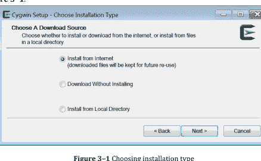

**图3-1** 选择安装类型

下一个屏幕提示你选择安装文件夹。保留建议的文件夹，如**图3-2**所示。

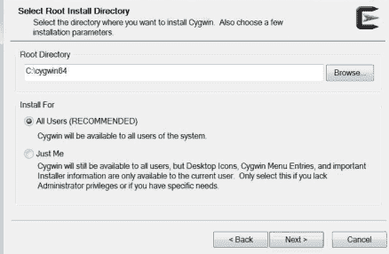

**图3-2** 选择安装文件夹

下一个屏幕提示你选择本地包文件夹。保留建议的文件夹，如**图3-3**所示。

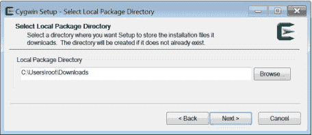

**图3-3** 选择本地包文件夹

下一个屏幕提示你选择连接类型。确保选中“Direct connection”选项，如**图3-4**所示。

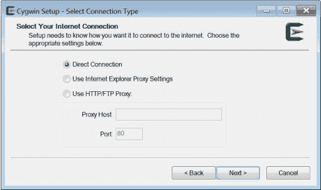

**图3-4** 选择连接类型

在下一个屏幕中，选择地理位置上离你最近的下载站点，如**图3-5**所示。


**图3-5** 选择下载站点

经过短暂延迟后，下一个屏幕出现，要求你指定要安装的软件包。

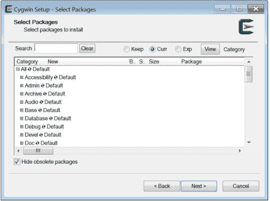

**图3-6** 选择要安装的软件包

单击 Devel 旁边的 +，展开开发者软件包，并执行以下操作。向下滚动，直到看到“gcc-g++: GNU Compiler Collection (C++)”，然后单击此软件包的“Skip”设置以选中它。你可能需要单击“Skip”设置两到三次，直到选择最新版本。向下滚动，并单击另外两个软件包的“Skip”设置：一个是“gdb: The GNU debugger”，另一个是“make: The GNU version of the ‘make’ utility”，如图3-7所示。

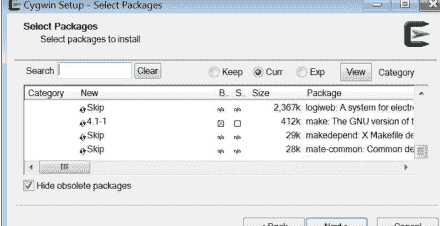

**图3-7** 选择要安装的软件包

已选择所有必需的软件包，你终于准备好了。单击“Next”按钮。下一个屏幕会解析依赖关系。它建议你再安装一些必需的软件包以满足依赖关系。保持“Select required packages”字段处于勾选状态，如图3-8所示。


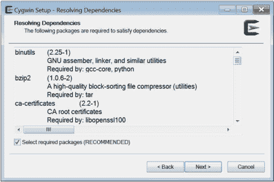

**图3-8** 解析依赖关系

单击“下一步”按钮开始安装。安装完成后，单击“完成”按钮，会出现“安装完成”对话框；单击“确定”按钮。

### 3.4 NetBeans IDE

NetBeans是一个集成开发环境（IDE），它为C++提供了一套强大的工具，让你轻松编写C++程序。NetBeans远不止是一个文本编辑器。它可以缩进行、匹配单词和括号，并高亮显示编写错误的源代码。它还提供自动代码补全，这意味着当你输入时，它会显示一系列可能的补全项。

该IDE还提供提示，帮助你分析代码并发现任何潜在问题。它甚至会建议一些简单的解决方案来修复这些问题。

你不仅可以使用NetBeans IDE编写程序，还可以直接在IDE中执行程序。

NetBeans IDE可以安装在所有支持Java的操作系统上，从Windows到Linux再到Mac OS X系统。NetBeans免费且开源，在全球拥有庞大的用户和开发者社区。

### 3.5 如何安装NetBeans IDE

为了安装NetBeans IDE，你必须从以下地址免费下载：

https://netbeans.org/downloads/index.html

在NetBeans网页上，有一个下拉列表，让你选择所需平台（Windows、Linux或Mac OS X）。选择与你系统匹配的平台。本书展示的是在Windows平台上安装NetBeans IDE的过程。

在netbeans.org上提供的所有“下载包”中，选择并下载名为“All”的那个。下载完成后，运行相应的安装程序。

如果你收到**图3-9**中所示的消息，说明你的系统上未找到Java SE开发工具包（JDK）。请访问显示的地址下载并安装JDK，然后再继续安装NetBeans IDE。

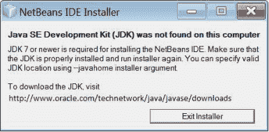

**图3-9** 当你的系统上未找到JDK时，会显示此消息。

在NetBeans IDE安装程序的第一个屏幕上，你可以保留并安装所有建议的包和运行时，也可以单击“自定义”按钮，只勾选**图3-10**中建议的那些项目。


**图3-10** 在NetBeans IDE安装程序中选择要安装的包和运行时

单击“下一步”按钮浏览安装屏幕。当许可协议出现时，你必须阅读并接受条款。下一个屏幕提示你选择安装文件夹和Java环境。保留建议的文件夹，如**图3-11**所示。

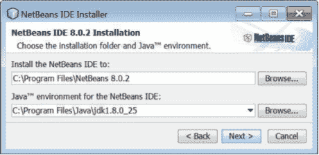

**图3-11** 在NetBeans IDE安装程序中选择安装文件夹

> **注意：** 根据你所拥有的NetBeans IDE或JDK版本，你计算机上建议的安装文件夹和Java环境可能与**图3-11**中的不同。

在下一个屏幕上，保持“检查更新”复选框处于选中状态，如**图3-12**所示。此选项将自动检查已安装插件的更新。

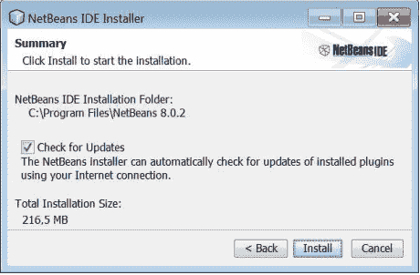

**图3-12** 勾选检查更新的复选框

单击“安装”按钮。

安装过程完成后，你可以打开NetBeans IDE。你将看到的第一个屏幕如**图3-13**所示。


**图3-13** NetBeans IDE起始页

现在你需要配置NetBeans IDE。从主菜单中选择“工具”→“选项”，在弹出的窗口中，单击“C/C++”图标，打开C/C++的“选项”对话框，如**图3-14**所示。

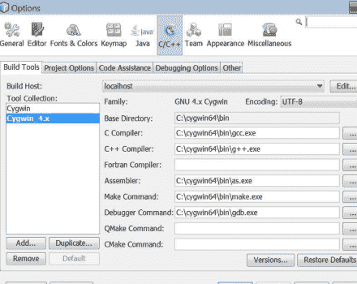

**图3-14** C/C++的“选项”对话框

在“代码辅助”选项卡中，选择“C++编译器”选项卡，单击“添加”按钮，然后选择Boost C++库的文件夹，如**图3-15**所示。

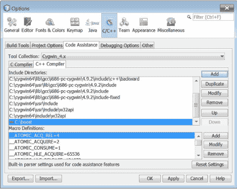

图3-15 添加Boost C++库

为了节省纸张，本书还做了另一件事：将每次缩进所用的空格数减少为两个。你也可以更改此设置，方法是先单击“编辑器”图标，打开编辑器的“选项”对话框，如图3-16所示。

## “入门知识”复习题

回答以下问题。

- 1. 什么是硬件？
- 2. 列出典型计算机系统的五个基本组件。
- 3. 计算机的哪个部分实际执行程序？
- 4. 程序运行时，计算机的哪个部分保存程序及其数据？
- 5. 即使计算机断电，计算机的哪个部分也能长时间保存数据？
- 6. 你将收集外部世界数据并将其输入计算机的设备称为什么？
- 7. 列出一些输入设备的示例。
- 8. 你将数据从计算机输出到外部世界的设备称为什么？
- 9. 列出一些输出设备的示例。
- 10. 什么是软件？
- 11. 软件有多少类？它们的名称是什么？
- 12. 文字处理程序属于哪类软件？
- 13. 什么是编译器？
- 14. 什么是解释器？
- 15. 术语“机器语言”是什么意思？
- 16. 什么是源代码？
- 17. 什么是C++？
- 18. 脚本和程序之间有什么区别？
- 19. C++有哪些可能的用途？
- 20. 什么是Boost？
- 21. 什么是NetBeans IDE？

## 第2部分：C++入门

## 第4章：基本算法概念简介

### 4.1 什么是算法？

算法是由定义明确的语句（通常称为指令或命令）组成的严格定义的有限序列，对于任何可接受的输入值集合（如果有输入），它都能为某个问题或特定类别的问题提供解决方案。换句话说，算法是解决给定问题的一种逐步执行的过程。术语“有限”意味着算法应当达到一个终点，而不能永远运行下去。

在你的现实生活中，到处都能找到算法，而不仅仅是在计算机科学中。例如，制作吐司或一杯茶的过程就可以表示为算法。为了达到目标，必须按照一定的顺序执行某些步骤。

### 4.2 制作一杯茶的算法

以下是制作一杯茶的算法。

- 1. 把茶包放入杯子中。
- 2. 用水壶装满水。
- 3. 烧开壶中的水。
- 4. 将一些开水倒入杯中。
- 5. 往杯中加入牛奶。
- 6. 往杯中加入糖。
- 7. 搅拌茶。
- 8. 喝茶。

正如你所看到的，有些步骤必须遵守。这些步骤按特定顺序排列，尽管其中一些步骤可以重新排列。例如，步骤5和步骤6可以互换。你可以先加糖，然后再加牛奶。请记住，某些步骤的顺序可能会改变，但不能将它们挪到离应有位置太远的地方。例如，你不能把步骤3（“烧开壶中的水。”）移到算法的末尾，因为最终你会喝到一杯冰茶（而不是热茶），这与你的初始目标完全不同！

### 4.3 算法的性质

算法必须满足以下性质：

- **输入：** 算法必须具有来自指定集合的输入值。
- **输出：** 算法必须根据指定的输入值集合产生输出值。输出值就是问题的解。


- **有限性：** 对于任何输入，算法必须在有限步数后终止。
- **确定性：** 算法的所有步骤都必须精确定义。
- **有效性：** 必须能够正确且在有限时间内执行算法的每一步。也就是说，其步骤必须足够基本，以至于例如一个人用铅笔和纸就能准确地在有限时间内完成它们。每一步是确定的（或精确定义的）还不够，还必须可行。

### 4.4 关于算法没问题。但计算机程序到底是什么？

计算机程序不过是用计算机能理解的语言（如 C++、Java、C# 或 Visual Basic）编写的算法。

计算机程序实际上不能*替*你泡一杯茶或做晚饭，尽管算法可以指导你按步骤自己完成这些事。然而，程序可以（例如）用于计算一组数的平均值，或找出其中的最大值。人工智能程序甚至能下棋或解逻辑谜题。

### 4.5 三方参与！

算法中始终涉及三方——编写算法的一方、执行算法的一方，以及使用或享受算法的一方。

以准备一顿饭的算法为例。有人编写算法（食谱书的作者），有人执行它（可能是你的母亲，她按照食谱书中的步骤准备了这顿饭），还有人使用它（可能是你，享受这顿饭）。

现在考虑一个真正的计算机程序。以电子游戏为例。有人用计算机语言编写算法（程序员），有人或某个东西执行它（通常是笔记本电脑或计算机），而另一个人使用它或玩它（用户）。

注意，因为有时“程序员”和“用户”这两个术语可能会令人混淆。当你*编写*计算机程序时，在那段时间里你就是“程序员”。然而，当你*使用*自己的程序时，你就是“用户”。

### 4.6 创建算法涉及的三个主要阶段

创建算法涉及三个主要阶段：数据输入、数据处理和结果输出。顺序是特定的，不能改变。

考虑一个求三个数平均值的计算机程序。首先，程序必须提示用户输入这些数（数据输入）。接着，程序计算这些数的平均值（数据处理）。最后，程序在计算机屏幕上显示结果（结果输出）。

让我们更详细地看看这些阶段。

1. 提示用户输入一个数。
2. 提示用户输入第二个数。
3. 提示用户输入第三个数。
4. 计算三个数之和。
5. 将和除以3。
6. 在屏幕上显示结果。

输入

处理

输出

在某些罕见情况下，输入阶段可能不存在，计算机程序可能只由两个阶段组成。例如，考虑一个为计算以下和而编写的计算机程序。

1 + 2 + 3 + 4 + 5 + 6 + 7 + 8 + 9 + 10

在这个例子中，用户完全不输入任何值，因为计算机确切知道该做什么。它必须计算1到10的和。

现在让我们看看同一个例子稍作修改后的版本。考虑一个为计算以下和而编写的计算机程序。

1 + 2 + 3 + ⋯ + N

当然，这个和与上一个不同。在这个例子中，用户需要输入一些数据。计算机无法自行确定数 N 的确切值。这个值必须由用户输入。一旦用户输入 N 的值，计算机就可以继续计算结果。例如，如果用户输入数字5，计算机就可以求出1 + 2 + 3 + 4 + 5的结果。

### 4.7 流程图

流程图是一种以图形方式呈现算法的方法，通常画在纸上。它是算法执行流程的可视化表示。换言之，它直观地表示执行流程如何从一个语句进行到下一个语句，直到到达算法末尾。流程图不能按原样直接输入计算机。必须先将其转换为 C++ 等编程语言。

流程图使用的基本符号如表4-1所示。

表4-1 流程图符号及其功能

| 符号 | 功能 |
|---|---|
| [开始/结束符号] | 开始/结束：表示算法的开始或结束。开始符号有一个出口，结束符号有一个入口。 |
| [箭头符号] | 箭头：显示执行流程。从一个符号发出并终止于另一个符号的箭头表示控制权传递到箭头所指的符号。箭头始终绘制为上下或左右方向的直线（绝不倾斜）。 |
| 处理（流程图符号：标注为“处理”的矩形） | **处理：** 表示一个过程或数学（公式）计算。处理符号有一个入口和一个出口。 |
| 数据输入/数据输出（流程图符号：标注为“数据输入”和“数据输出”的平行四边形） | **数据输入/输出：** 表示数据输入或结果输出。大多数情况下，数据来自键盘，结果显示在屏幕上。数据输入/输出符号有一个入口和一个出口。 |
| 判断（流程图符号：标注为“判断”并带有“假”和“真”分支的菱形） | **判断：** 表示做出决定的点。根据给定条件（可为真或假），算法将沿右路径或左路径执行。判断符号有一个入口和两个（且始终只有两个）出口。 |
| 跨页连接符（流程图符号：两个标注为“A”的符号） | **跨页连接符：** 表示流程图延续到另一页。当流程图过大而无法放在一张纸上时，用于连接多页上的各段。向外的跨页连接符符号有一个入口，向内的跨页连接符符号有一个出口。 |
| 预定义处理（流程图符号：标注为“预定义处理”的矩形） | **子程序（预定义处理）：** 描述在别处正式定义的子程序，例如在单独的流程图中。预定义处理符号有一个入口和一个出口。 |

流程图示例见**图4–1**。该算法提示用户输入三个数，然后计算它们的平均值并显示在计算机屏幕上。

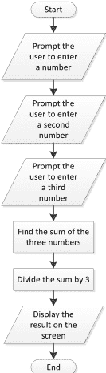

**图4–1** 计算并显示三个数平均值的算法流程图

> **记住！** 流程图始终以开始/结束符号开始和结束！

#### 练习4.7-1 *求三个数的平均值*

设计一个算法计算三个数的平均值。每当平均值低于10时，应显示消息“不及格！”。否则，如果平均值为10或以上，应显示消息“及格！”。

#### 解答

在这个问题中，必须显示两条不同的消息，但算法每次执行时只能出现其中一条；消息的措辞取决于平均值。该算法的流程图如下所示。

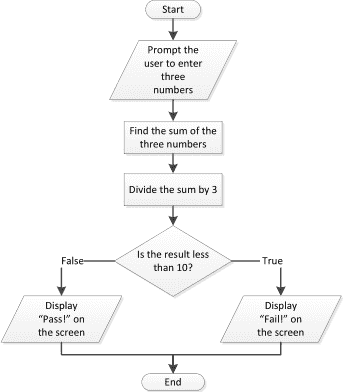

> **注意：** 为节省纸张，可以提示用户使用一个斜平行四边形输入全部三个数。
> 
> **记住！** 判断符号始终有一个入口和两条出口路径！

当然，对你来说，现在开始创建自己的算法还太早。这个特定练习相当简单，本章将其作为例外呈现，仅用于演示目的。在开始编写自己的算法甚至 C++ 程序之前，你还需要学习更多内容。请耐心一点！再过几章，重要时刻就会到来！

### 4.8 什么是“保留字”？

在计算机语言中，“保留字”是所有这些具有严格预定义含义的词——它们保留用于特殊用途，不能用于任何其他目的。例如，流程图中的 Start、End、Read 和 Write 等词具有预定义含义。它们分别用于表示开始、结束、数据输入和结果输出。

所有高级计算机语言中也都有保留字。在 C++ 中，有许多保留字，如 if、while、else 和 for。它们的含义是预定义的，因此这些词不能用于任何其他目的。

> **注意：** 计算机语言中的保留字通常称为关键字。


### 4.9 语句和命令有什么区别？

互联网上有很多讨论，争论语句和命令之间到底有没有区别。有些人喜欢使用“语句”这个术语，另一些人则喜欢使用“命令”这个术语。对于新手程序员来说，两者没有区别；它们都是给计算机的指令！

### 4.10 什么是结构化编程？

结构化编程是一种使用模块化和结构化设计的软件开发方法。这意味着大型程序被分解成较小的模块，而每个单独的模块都使用结构化代码，也就是说，语句以特定方式组织，从而最大限度地减少错误和误解。顾名思义，结构化编程是使用结构化编程语言完成的，而 C++ 就是这样一种语言。

结构化编程概念由 Corrado Böhm¹ 和 Giuseppe Jacopini² 于 1966 年正式提出。他们使用顺序、决策和迭代展示了理论计算机程序设计。

### 4.11 三种基本控制结构

结构化编程中有三种基本控制结构。

- **顺序控制结构：** 这指的是逐行执行，其中语句按它们在程序中出现的相同顺序依次执行。例如，它们可能执行一系列读或写操作、算术运算或变量赋值。
- **决策控制结构：** 根据条件为真还是为假，决策控制结构可以跳过整个语句块的执行，甚至执行一个语句块而不是另一个语句块。
- **循环控制结构：** 这是一种允许一个语句块多次执行，直到满足指定条件的控制结构。

如果你还不太理解这三种控制结构的深层含义，不用担心，因为接下来的章节会对它们进行非常透彻的分析。耐心是一种美德。现在你只需要等待！

¹ Corrado Böhm（1923— ）是一位计算机科学家，尤其以其对结构化编程理论的贡献以及对函数式编程语言的实现而闻名。

² Giuseppe Jacopini（1936—2001）是一位计算机科学家。他最具影响力的贡献是关于结构化编程的定理，该定理于 1966 年与 Corrado Böhm 共同发表，标题为“流图、图灵机以及仅含两条形成规则的语言”。

(Böhm, C., 和 Jacopini, G., “流图、图灵机以及仅含两条形成规则的语言，” Communications of the ACM 9(5), (1966年5月), 366–371.)

#### 练习 4.1-1 — *使用流程图理解控制结构*

*使用流程图，为每种控制结构给出一个示例。*

#### 解决方案

#### 顺序控制结构示例

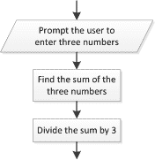

#### 决策控制结构示例

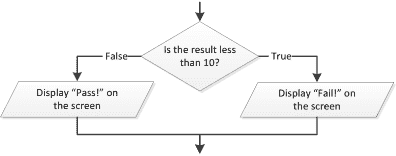

#### 循环控制结构示例

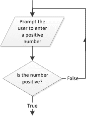

### 4.12 你的第一个 C++ 程序

将流程图转换为 C++ 之类的计算机语言，就会得到一个 C++ 程序。C++ 程序不过是一个包含 C++ 语句的文本文件。C++ 程序甚至可以在你的文本编辑器应用程序中编写！不过请记住，使用 NetBeans IDE 编写 C++ 程序是更好的解决方案，因为它包含的所有功能可以让你的工作更轻松。

C++ 程序必须始终包含一个 `main` 函数，如下所示。

```cpp
#include <iostream>
using namespace std;

int main() {

  // C++ code goes here

  return 0;
}
```

C++ 源代码以默认的 .cpp 文件扩展名保存在硬盘上。

下面是一个非常简单的 C++ 程序，它只在屏幕上显示三条消息。

```cpp
#include <iostream>
using namespace std;

int main() {

  cout << "Hello World!" << endl;
  cout << "Hallo Welt!" << endl;
  cout << "The End";
  return 0;
}
```

> **注意：** *请注意，C++ 要求所有语句都以分号结尾。*

### 4.13 语法错误和逻辑错误有什么区别？

当程序员用高级语言编写代码时，他们可能会犯两类错误：语法错误和逻辑错误。

语法错误是诸如关键字拼写错误、缺少标点字符、缺少括号或缺少右圆括号之类的错误。幸运的是，NetBeans IDE 会在你键入时检测这些错误，并在出错行前面显示一个红色感叹号。如果你尝试执行包含语法错误的 C++ 程序，屏幕上会出现错误消息，程序不会被执行。你必须更正所有错误，然后再次尝试执行该程序。

逻辑错误是那些阻止程序执行你期望它执行的操作的错误。对于逻辑错误，你根本不会收到任何警告。你的代码可能可以编译并运行，但结果不是预期的结果。逻辑错误是最难检测的错误。你必须彻底重新检查程序，以确定错误所在。例如，考虑一个 C++ 程序，它提示用户输入三个数字，然后计算并显示它们的平均值。然而，程序员犯了一个排版错误；他或她的某条语句将三个数字的和除以 5，而不是按应该的那样除以 3。当然，这个 C++ 程序照常执行，没有任何错误消息，提示用户输入三个数字并显示一个结果，但显然不是正确的结果！必须由程序员来找出并更正写错的 C++ 语句，而不是计算机或编译器！

### 4.14 为代码添加注释

当你编写一个小而简单的程序时，任何人都可以通过逐行阅读来理解它的工作方式。然而，长程序很难理解，有时甚至编写它们的人自己也不容易理解。注释是可以包含在程序中的额外信息，使程序更易于阅读和理解。你可以添加解释和其他信息，包括：

- 谁编写了程序
- 程序何时创建或最后修改
- 程序做什么
- 程序如何工作

但是，你不应该过度注释。没有必要解释程序的每一行。仅当程序的某个特定部分难以理解时才添加注释。

在 C++ 中，你可以使用以下方法之一添加注释：

- 双斜杠 `//......`
- 斜杠-星号、星号-斜杠分隔符 `/* ...... */`

下面的程序演示了如何使用这两种注释方式。通常，双斜杠（ `//` ）用于注释单行，而斜杠-星号、星号-斜杠分隔符（ `/* ...... */` ）用于一次注释多行。

```cpp
#include <iostream>
using namespace std;
/*
   Created By Bouras Aristides
   Date created: 12/25/2003
   Date modified: 04/03/2008
   Description: This program displays some messages on the screen
*/

int main() {

    cout << "Hello Zeus!" << endl;    //display a message on the screen

    //display a second message on the screen
    cout << "Hello Hera!" << endl;

    /* display a third message on screen */  cout << "Γεια σας" << endl;

    //This is a comment      cout << "The End";

    return 0;
}
```

正如你在前面的程序中看到的，你可以在语句上方或语句末尾添加注释，但不能在语句前面添加注释。看看最后一条语句，它本应显示消息“The End”。这条语句永远不会执行，因为它被视为注释的一部分。

> **注意：** 如果你使用分隔符 `/* ...... */` 在语句前面添加注释，该语句仍然会执行。在前面的示例中，希腊语消息“Γεια σας”尽管写在一些注释旁边，仍然会执行。不过，建议不要采用这种写法，因为它会使你的代码难以阅读。

### 4.15 用户友好的程序

什么是“用户友好”的程序？它是用户视为朋友而不是敌人的程序，是新手用户可以轻松使用的程序。

如果你想编写用户友好的程序，就必须设身处地为用户着想。用户希望计算机按照他们的方式完成工作，以最少的

努力。隐藏菜单、不精确的标签和指示以及误导性的错误消息，都会使程序对用户不友好！

最能定义用户友好设计的法则是“最小惊讶法则”：“程序应以最不令用户惊讶的方式运行。”该法则通常也称为最小惊讶原则（POLA）。

### 4.16 复习题：判断题

为下列每个陈述选择**正确**或**错误**。

- 1. 准备一顿饭的过程实际上是一个算法。
- 2. 算法仅用于计算机科学。
- 3. 算法可以永远运行。
- 4. 在算法中，你可以将某个步骤重新放到任意位置。
- 5. 算法应只针对一组输入值产生正确的输出值。
- 6. 计算机可以下棋。
- 7. 算法总是可以成为计算机程序。
- 8. 编程是创建计算机程序的过程。
- 9. 计算机程序总是涉及三方：程序员、计算机和用户。
- 10. 程序员和用户有时可以是同一个人。
- 11. 计算机程序有可能不输出任何结果。
- 12. 流程图是计算机程序。
- 13. 流程图由一组几何图形组成。
- 14. 流程图是用于表示算法的一种方法。
- 15. 你可以设计不使用任何开始/结束符号的流程图。
- 16. 你可以设计不使用任何处理符号的流程图。
- 17. 你可以设计不使用任何数据输入/输出符号的流程图。
- 18. 流程图应始终至少包含一个判断符号。
- 19. 在流程图中，判断符号可以有一条、两条或三条退出路径，具体取决于所给问题。
- 20. 保留字是那些具有严格预定义含义的词。
- 21. 结构化编程包括结构化设计。
- 22. C++ 是一种结构化计算机语言。
- 23. 结构化编程的基本原则是它只包括四种基本控制结构。
- 24. 一条语句写十次，被认为是循环控制结构。
- 25. 判断控制结构指的是逐行执行。
- 26. 拼写错误的关键字被认为是逻辑错误。
- 27. 即使 C++ 程序包含逻辑错误，也可以执行。
- 28. 语句末尾缺少分号被认为是语法错误。
- 29. 语句末尾的感叹号不能阻止整个 C++ 程序执行。
- 30. 结构化编程的优点之一是编写计算机程序时不会犯错误。
- 31. 逻辑错误在编译期间被捕获。
- 32. 语法错误是最难检测的错误。
- 33. 一个计算三角形面积但输出错误结果的程序包含逻辑错误。
- 34. 当程序不包含输出语句时，它包含语法错误。
- 35. 程序应始终包含注释。
- 36. 如果你向程序添加注释，计算机就能更容易地理解它。
- 37. 你可以在程序中的任何位置添加注释。
- 38. 程序用户看不到注释。
- 39. 如果新手用户能够轻松使用一个程序，该程序就被称为用户友好。
- 40. 缩写 PSEAL 代表“最小娱乐原则”。

### 4.17 复习题：多项选择题

为下列每个陈述选择正确答案。

- 1. 算法是一个严格定义的有限序列，由定义明确的语句组成，为以下哪项提供解决方案：
    - a. 一个问题。
    - b. 一类特定问题。
    - c. 以上两者。

- 2. 以下哪项**不**是算法应满足的性质？
    - a. 有效性
    - b. 适合性
    - c. 确定性
    - d. 输入

- 3. 计算机程序是
    - a. 一个算法。
    - b. 一系列指令。
    - c. 以上两者。
    - d. 以上都不是。

- 4. 当某人准备一顿饭时，他或她是
    - a. “程序员”。
    - b. “用户”。
    - c. 以上都不是。

- 5. 以下哪项**不**属于创建算法所涉及的三个主要阶段？
    - a. 数据生成
    - b. 数据输入
    - c. 数据输出
    - d. 数据处理

- 6. 流程图可以
    - a. 呈现在一张纸上。
    - b. 按原样直接输入计算机。
    - c. 以上两者。

- 7. 流程图中的矩形表示
    - a. 输入/输出。
    - b. 处理操作。
    - c. 判断。
    - d. 以上都不是。

- 8. 以下哪项是/属于控制结构？
    - a. 判断
    - b. 顺序
    - c. 循环
    - d. 以上全部都是控制结构。

- 9. 以下哪条 C++ 语句包含语法错误？
    - a. `cout << "Hello Poseidon"`
    - b. `cout << "It's me! I contain a syntax error!!" << endl;`
    - c. `cout << "Hello Athena" << endl;`
    - d. 以上都不是。

- 10. 以下哪条 cout 语句实际会被执行？
    - a. `//cout << "Hello Apollo" << endl;`
    - b. `/* cout << "Hello Artemis" << endl; */`
    - c. `// This is executed // cout << "Hello Ares" << endl;`
    - d. `/* This is executed */ cout << "Hello Aphrodite" << endl;`
    - e. 以上都不是。

## 第5章

## 变量与常量

### 5.1 什么是变量？

在计算机科学中，变量是计算机主存储器（RAM）中的一个位置，你可以在其中存储一个值，并随着程序执行而改变它。把变量想象成一个透明盒子，你一次可以放入并保存一样东西。因为盒子是透明的，你还可以查看它里面装的是什么。此外，如果你有两个或更多盒子，你可以给每个盒子一个唯一的名称。例如，你可以有三个盒子，每个盒子装有不同的数字，并且你可以将这些盒子命名为 `numberA`、`numberB` 和 `numberC`。

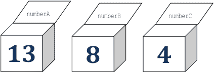

示例中名为 `numberA`、`numberB` 和 `numberC` 的盒子分别包含数字 13、8 和 4。当然，你随时可以查看甚至更改这些盒子中任意一个所包含的值。

现在，假设有人要求你求出前两个盒子中值的和，然后将结果存入最后一个盒子。你必须遵循的步骤如下：

- 1. 查看前两个盒子，检查其中包含的值。
- 2. 用你的 CPU（也就是你的大脑）计算和（结果）。
- 3. 将结果插入最后一个盒子。然而，由于每个盒子一次只能包含一个值，值 4 实际上被数字 21 替换了。

这些盒子现在看起来如下。

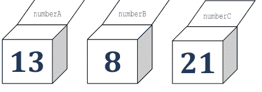

在流程图中，将值存入变量的操作由左箭头表示

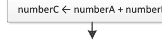

该操作通常表述为“将一个值或表达式的结果赋给一个变量。”左箭头称为“赋值运算符。”

> *注意：* 请注意，此箭头始终指向左侧。不允许使用右箭头。此外，箭头左侧只能存在一个变量。

在实际的计算机科学中，这三个盒子实际上是主存储器（RAM）中的三个独立区域，分别命名为 `numberA`、`numberB` 和 `numberC`。

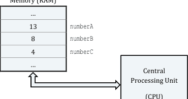

当程序指示 CPU 执行语句

`numberC ← numberA + numberB`

时，它遵循与上一个示例相同的三步过程。

- 1. 数字 13 从名为 `numberA` 的 RAM 区域传输到 CPU。数字 8 从名为 `numberB` 的 RAM 区域传输到 CPU。（这是第一步，即你查看前两个盒子中包含的值。）
- 2. CPU 计算 13 + 8 的和。（这是第二步，即你用大脑计算和或结果。）
- 3. 结果 21 从 CPU 传输到名为 `numberC` 的 RAM 区域，替换现有的数字 4。（这是第三步，即你将结果插入最后一个盒子。）

执行后，RAM 如下所示：

| RAM |  |
| --- | --- |
| ... |  |
| 13 | numberA |
| 8 | numberB |
| 21 | numberC |
| ... |  |

> **记住！** C++ 程序运行时，变量可以保存各种值，但一次只能保存一个值。当你给变量赋值时，该值会一直存储，直到你赋新值。旧值会丢失。

变量是计算机科学中最重要的元素之一，因为它帮助你与存储在主存储器（RAM）中的数据进行交互。很快，你将学习如何在 C++ 中声明和使用变量的全部知识。

### 5.2 什么是常量？

有时你可能需要使用一个在程序运行期间不能改变的值。这样的值称为“常量”。简单来说，你可以说常量是一个被锁定的变量。这意味着当程序开始运行并为常量分配一个值后，程序运行期间任何东西都不能改变该常量的值。例如，在财务程序中，利率可以声明为常量。


一个更好的解决方案是使用变量，如**图 5–2**所示。这减少了除法和乘法运算的次数，也降低了出现打字错误的可能性。

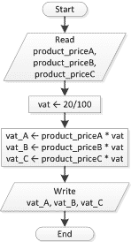

**图 5–2** 使用变量 vat 计算三种产品的 20% 增值税

这一次，除法(20/100)只计算一次，然后用其结果计算每种产品的增值税。

但即使现在，该算法（之后可能会成为计算机程序）仍不完美：vat 是一个变量，任何程序员都可能意外改变它的值。

理想的解决方案是将变量 vat 改为常量 VAT，如**图 5–3**所示。

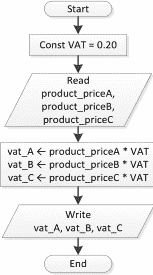

**图 5–3** 使用常量 VAT 计算三种产品的 20% 增值税

> *注意：请注意，声明常量时使用等号（ = ）而不是左箭头。*

由于多种原因，最后这个解决方案是最佳选择。

- 任何人，包括程序员，都不能仅仅因为在程序的任何位置意外写下诸如 `VAT < 0.60` 这样的语句就改变 VAT 的值。
- 出现打字错误的可能性被降到最低。
- 乘法和除法运算的次数尽可能少。
- 如果有一天财政部长决定将增值税从 20% 提高到 22%，程序员只需修改一行代码！

### 5.3 C++ 中存在多少种变量和常量？

所有计算机语言中都存在许多不同类型的变量和常量。造成这种多样性的原因是每个变量或常量可以保存的数据类型不同。大多数情况下，变量和常量保存以下类型的数据。

- **整数：** 整数值是不含任何小数部分的正数或负数，例如 5、100、135、-25 和 -5123。
- **实数：** 实数值是包含小数部分的正数或负数，例如 5.14、7.23、5.0、3.14 和 -23.78796。实数值也称为“浮点数”。
- **布尔值：** 布尔变量或常量只能保存两个值之一：`true` 或 `false`。
- **字符：** 字符是字母数字值（始终用单引号或双引号括起来），例如 ‘a’、‘c’、“Hello Zeus”、“I am 25 years old”或“Peter Loves Jane For Ever”。字符序列也称为“字符串”！！！（“string”这个词可能会让你联想到某种可穿戴的东西，但不幸的是它并不是。请把你那有点不纯洁却又宝贵的注意力放在自己的良心上吧！）。

### 5.4 C++ 中变量命名规则

为变量命名时必须遵循某些规则。

- 变量名只能包含拉丁字符（英文字母大写或小写）、数字和下划线字符（`_`）。变量名示例包括 `firstName`、`last_name1` 和 `age`。
- 变量名区分大小写，这意味着大写字符和小写字符有明确区别。例如，`myVAR`、`myvar`、`MYVAR` 和 `MyVar` 实际上是四个不同的变量名。

以下示例展示了变量在不同高级计算机语言中是如何声明的。

| 声明语句 | 高级计算机语言 |
|---|---|
| Dim sum as Integer | Visual Basic |
| int sum; | C++、C#、Java 以及许多其他语言 |
| sum: Integer; | Pascal、Delphi |
| var sum; | JavaScript |

### 5.7 如何在 C++ 中声明变量

C++ 是一种强类型编程语言。这意味着每个变量都必须关联一个特定的数据类型。例如，变量可以保存整数、实数或字符。在 C++ 中，一些基本数据类型包括：bool、int、float、double 和 char。使用哪一种取决于具体问题！此外，有几种基本类型可以使用以下一个或多个类型修饰符进行修改：

- unsigned
- short
- long

更具体地说：

- **bool** 类型只能保存两个可能的值：即 `true` 或 `false`
- **int** 类型可以保存 −2³¹ 到 +2³¹ − 1 之间的整数
- **unsigned int** 类型可以保存 0 到 +2³² − 1 之间的整数
- **short int** 类型可以保存 −2¹⁵ 到 +2¹⁵ − 1 之间的整数
- **unsigned short int** 类型可以保存 0 到 +2¹⁶ − 1 之间的整数
- **float** 类型可以保存单精度实数
- **double** 类型可以保存双精度实数
- **char** 类型可以保存单个字符。

在许多计算机语言中，还有一种称为“字符串”的变量类型，它可以保存字符序列。这些字符序列（即“字符串”）通常用双引号或单引号括起来，例如“Hello Zeus”、“I am 25 years old”等。C++ 也支持字符串，但请记住，C++ 中的字符串不是基本数据类型。不深入细节地说，C++ 中字符串的声明方式与声明 int、byte 或 double 等基本数据类型相同，但 C++ 在内部存储和处理它们的方式却大不相同。

声明变量时，C++ 语句的一般形式是

```cpp
type name [ = value];
```

其中

- `type` 可以是 bool、int、short int、unsigned short int、string 等
- `name` 是有效的变量名
- `value` 可以是任何有效的初始值

以下是一些如何声明变量的示例。

```cpp
int number1;
bool found;
string first_name;
string student_name;
```

在 C++ 中，你可以声明变量并直接为其赋初始值。下面的代码片段

```cpp
int num = 5;
string name = "Hera";
char favorite_character = 'w';
```

等价于

```cpp
int num;
string name;
char favorite_character;

num = 5;
name = "Hera";
favorite_character = 'w';
```

> **注意：** 在 C++ 中，你可以使用等号（=）来表示给变量赋值的操作。这相当于流程图中的左箭头。

> **注意：** 请注意，在 C++ 中，你使用双引号（" "）给 string 类型的变量赋值，但使用单引号（' '）给 char 类型的变量赋值。

最后但同样重要的是，你可以在同一行中声明多个相同类型的变量，并用逗号分隔它们。

```cpp
double x, y, z;
long int w = 3, u = 2;
```

### 5.8 如何在 C++ 中声明常量

在 C++ 中，你可以使用关键字 `const` 声明常量。

```cpp
const type name = value;
```

以下示例展示了如何在 C++ 中声明常量。

```cpp
const double VAT = 0.22;
const int NUMBER_OF_PLAYERS = 25;
const string FAVORITE_SONG = "We are the world";
const char FAVORITE_CHARACTER = 'W';
```

> *注意：请注意，C++ 要求所有语句都以分号（;）结尾。*

一旦定义了常量，其值在程序运行期间就不能更改。

### 5.9 复习题：判断题

判断以下每个陈述为真或假。

1. 变量是计算机二级存储设备中的一个位置。
2. 对于流程图中的赋值运算符，你可以使用左箭头或右箭头。
3. 变量在程序执行期间可以改变其内容。
4. 常量在程序执行期间可以改变其内容。
5. 值 10.0 是整数。
6. 布尔变量只能保存两个值之一。
7. 用双引号括起来的值“10.0”是实数值。
8. 在计算机科学中，字符串是你可以穿戴的东西。
9. 变量名可以包含数字。
10. 变量在程序执行期间可以改变其名称。
11. 变量名不能是数字。
12. 常量的名称必须始终是描述性的。
13. 名称 `student name` 不是有效的变量名。
14. 名称 `student_name` 是有效的常量名。
15. 在 C++ 中，常量名可以包含大写和小写字母。
16. 在 C++ 中，不需要声明变量。
17. 在 C++ 中，必须始终至少声明一个常量。

### 5.10 复习题：多项选择题

为以下每个陈述选择正确答案。

1. 变量是以下哪一项中的位置
   a. 硬盘。
   b. DVD 光盘。
   c. USB 闪存盘。
   d. 以上全部
   e. 以上都不是
2. 变量可以保存
   a. 一次一个值。
   b. 一次多个值。


- c. 以上全部
- d. 以上都不是

- 3. 在 C++ 程序中使用常量
  - a. 帮助程序员完全避免打字错误。
  - b. 帮助程序员避免使用除法和乘法。
  - c. 以上全部
  - d. 以上都不是

- 4. 以下哪一项是整数？
  - a. 5.0
  - b. -5
  - c. `"5"`
  - d. 以上都不是整数。

- 5. 布尔变量可以保存值
  - a. 1。
  - b. 0。
  - c. `true`。
  - d. `"true"`。
  - e. 以上都不是

- 6. 在 C++ 中，字符串
  - a. 用单引号括起来。
  - b. 用双引号括起来。
  - c. 以上两者都是

- 7. 以下哪一项**不是**有效的 C++ 变量？
  - a. `city name`
  - b. `cityName`
  - c. `city-name`

- 8. 你可以使用关键字 `const` 定义常量。一旦常量被定义，
  - a. 它就永远不能更改。
  - b. 可以使用关键字 `const` 再次更改它。
  - c. 以上两者都正确。

### 5.11 复习练习

完成以下练习。

- 1. 将第一列中的每个元素与第二列中的一个元素匹配。

| 值 | 数据类型 |
|---|---|
| 1. “True” | a. 布尔型 |
| 2. 123 | b. 实数 |
| 3. False | c. 字符串 |
| 4. 10.0 | d. 整型 |

- 2. 将第一列中的每个元素与第二列中的一个元素匹配。

| 数据 | 数据类型 |
|---|---|
| 1. 一个人的姓名 | a. 布尔型 |
| 2. 一个人的年龄 | b. 实数 |
| 3. 5/2 的除法结果 | c. 整型 |
| 4. 它是黑色还是白色？ | d. 字符串 |

## 第6章：处理输入和输出

### 6.1 哪个语句在用户屏幕上输出消息和结果？

流程图使用斜平行四边形和保留字“Write”将消息或最终结果显示到用户屏幕上。

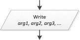

其中 *arg1*、*arg2* 和 *arg3* 可以是变量、表达式，甚至是用双引号括起来的字符串。

你刚才看到的斜平行四边形等价于

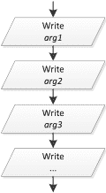

在 C++ 中，你可以使用以下语句达到相同的结果

```cpp
cout << arg1 << arg2 << arg3 << … ;
```

或等价的语句序列。

```cpp
cout << arg1;
cout << arg2;
cout << arg3;
…
```

> **记住！** 如果要在屏幕上显示字符串，该字符串必须用双引号括起来。

以下 C++ 程序：

```cpp
#include <iostream>
using namespace std;
int main() {
    int a;

    a = 5 + 6;
    cout << "The sum of 5 and 6 is " << a;
    return 0;
}
```

显示如**图 6–1.** 所示的消息。

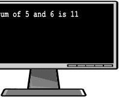

**图 6–1** 屏幕上显示的字符串

> **注意：** 请注意 C++ 中第一个字符串末尾、单词“is”之后插入的空格。如果删除它，数字 11 将离最后一个单词太近，屏幕上的输出将是
> 
> *5 和 6 的和是11*

你也可以直接在 `cout` 语句中计算数学表达式的结果。以下语句：

```cpp
#include <iostream>
using namespace std;
int main() {
    cout << "The sum of 5 and 6 is " << 5 + 6;
    return 0;
}
```

显示与**图 6–1.** 中的语句完全相同的消息。

> **注意：** 请注意 C++ 要求所有语句都必须以分号结束。

### 6.2 如何输出特殊字符

仔细看下面的示例：

```cpp
#include <iostream>
using namespace std;
int main() {
  cout << "Good Morning";
  cout << "Good Evening";
  cout << "Good Night";
  return 0;
}
```

尽管你可能认为这三条消息会一条接一条地显示，但实际输出结果如**图 6–2.** 所示。


**图 6–2** 输出结果显示在一行上

为了输出一个“换行”，你必须在每个句子后面放置特殊字符序列 `\n`。

```cpp
#include <iostream>
using namespace std;
int main() {
  cout << "Good Morning\n";
  cout << "Good Evening\n";
  cout << "Good Night\n";
  return 0;
}
```

或者按如下方式使用 endl 操纵符

```cpp
#include <iostream>
using namespace std;
int main() {
  cout << "Good Morning" << endl;
  cout << "Good Evening" << endl;
  cout << "Good Night" << endl;
  return 0;
}
```

现在输出结果如**图 6–3.** 所示。

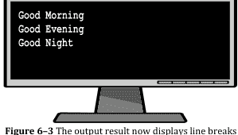

**图 6–3** 输出结果现在显示换行

请记住，也可以用一条语句完成相同的结果。

```cpp
cout << "Good Morning\nGood Evening\nGood Night\n";
```

另一个有趣的字符序列是 `\t`，它可用于输出“制表位”。制表符（`\t`）对对齐输出很有用。

```cpp
#include <iostream>
using namespace std;
int main() {
    cout << "Good Morning\t";
    cout << "Good Evening\n";
    cout << "Good Afternoon\t";
    cout << "Good Night";
    return 0;
}
```

现在输出结果如**图 6–4** 所示。


**图 6–4** 输出结果现在显示制表符

当然，也可以用一条语句完成相同的结果。

```cpp
cout << "Good Morning\tGood Evening\nGood Afternoon\tGood Night";
```

### 6.3 哪个语句让用户输入数据？

你还记得创建算法或计算机程序涉及的三个主要阶段吗？第一个阶段是“数据输入”阶段，在该阶段中，计算机让用户输入数据，例如数字、姓名、地址或出生年份。

流程图使用斜平行四边形和保留字“Read”让用户输入他或她的数据。

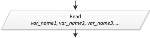

其中 *var_name1*、*var_name2* 和 *var_name3* 必须只能是变量。

你刚才看到的斜平行四边形等价于

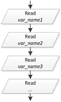

> **注意：** 当执行 Read 语句时，执行流会中断，直到用户输入完所有数据。数据输入完成后，执行流继续执行下一条语句。通常数据从键盘输入。

在 C++ 中，数据输入通过以下 C++ 语句完成

```cpp
//Read a number or a string (without spaces or tabs) from the keyboard
cin >> var_name;

//Read a string that includes spaces and tabs from the keyboard
getline(cin, var_name_str);
```

其中

- *var_name* 可以是任意类型的变量。
- *var_name_str* 可以是 `string` 类型的任意变量。

> **注意：** 请注意，当从键盘读取字符串时，`cin` 会将空格字符视为终止字符。因此，用 `cin` 读取字符串意味着总是读取单个单词，而不是短语或整句。要读取整行，可以使用 `getline()` 函数。

`cin` 语句还可用于请求多个值。以下代码片段让用户输入他或她的姓名和年龄。

```cpp
string name;
int age;

cin >> name >> age;

cout << "Wow, you are already " << age << " years old," << name << "!";
```

不过，如果在每次数据输入之前显示一条“提示”消息，可能会更好。这会使程序对用户更友好。例如，看看以下程序。

```cpp
string name;
int age;

cout << "What is your name? ";
cin >> name;

cout << "What is your age? ";
cin >> age;

cout << "Wow, you are already " << age << " years old," << name << "!";
```

相应的流程图片段如下所示。

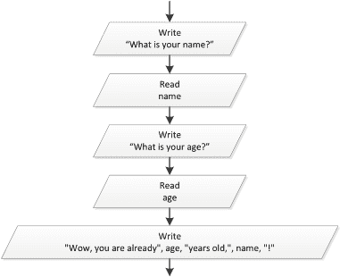

现在，当用户执行你的程序时，他或她就能确切知道要输入什么。

> **注意：** 在本书中，“提示”和“让”这两个词有细微区别。当习题措辞为“编写一个 C++ 程序，**提示用户输入……**”时，这意味着你必须在每次数据输入前包含一条提示消息。另一方面，当习题措辞为“编写一个 C++ 程序，**让用户输入……**”时，这意味着实际上不要求你包含提示消息；也就是说，包含提示消息没有错，但你不必这么做！

### 6.4 复习题：判断题

对以下每个陈述选择**正确**或**错误**。

- 1. 在 C++ 中，单词 `cin` 是保留字。
- 2. `cout` 语句可用于显示消息或变量的内容。
- 3. 当执行 `cin` 语句时，执行流会中断，直到用户输入一个值。
- 4. 单条语句 `cin` 可用于输入多个数据值。
- 5. 在数据输入之前，必须始终显示一条提示消息。

### 6.5 复习题：多项选择题

为以下每个陈述选择正确答案。

- 1. 语句 `cout << "Hello"` 显示
  - a. 单词 Hello（不带双引号）。


- b. 单词 "Hello"（包括双引号）。
- c. 变量 `Hello` 的内容。
- d. 以上都不是

- 2. 语句 `cout << "Hello\nHermes";` 会显示
  - a. 消息 `Hello Hermes`。
  - b. 在一行中显示单词 `Hello`，在下一行显示单词 `Hermes`。
  - c. 消息 `HelloHermes`。
  - d. 消息 `Hello\nHermes`。
  - e. 以上都不是

- 3. 语句 `cin >> data1 >> data2`
  - a. 让用户输入一个值并将其赋给变量 `data1`。变量 `data2` 保持为空。
  - b. 让用户输入一个值并将其赋给变量 `data1 data2`。
  - c. 让用户输入两个值并将它们分别赋给变量 `data1` 和 `data2`。
  - d. 以上都不是

## 第7章

## 运算符

### 7.1 赋值运算符

C++ 中最常用的运算符是赋值运算符（=）。例如，下面的 C++ 语句

```cpp
x = 5;
```

将值 5 赋给变量 x。

正如你在第 5 章读到的，这相当于流程图中使用的左箭头。

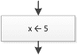

流程图中使用的左箭头可能比赋值运算符（=）符号更方便、更清晰，因为它以更图形化的方式表明右侧的值或表达式的结果被赋给左侧的变量。

注意！(=) 符号并不等同于数学中使用的符号。在数学中，表达式 x = 5 读作“x 等于 5”。然而，在 C++ 中，表达式 x = 5 读作“将值 5 赋给 x”或“令 x 等于 5”。它们看起来相同，但作用不同！

在数学中，下面两行是等价的：

```
x = y + z
y + z = x
```

第一行可以读作“x 等于 y 与 z 的和”，第二行读作“y 与 z 的和等于 x”。

另一方面，在 C++ 中，下面两条语句绝对**不**等价。事实上，第二条被认为是错误的！

```
x = y + z;
y + z = x;
```

第一条语句似乎相当正确。它可以读作“令 x 等于 y 与 z 的和”或“将 y 与 z 的和赋给 x”。

但第二条呢？想一想！是否可能将 x 的值赋给 y + z？答案显然是一个大大的“不！”

> **_记住！_** 在 C++ 中，(=) 符号左侧的变量表示主存（RAM）中一个可以存储值的区域。因此，左侧必须只存在一个变量！然而，右侧可以是一个数字、一个变量、一个字符串，甚至是一个复杂的数学表达式。

在表 7-1 中，你可以找到一些赋值示例。

**表 7-1** 赋值示例

| 赋值 | 描述 |
|---|---|
| `a = 9` | 将值 9 赋给变量 `a`。 |
| `b = c` | 将变量 `c` 的内容赋给变量 `b`。 |
| `d = "Hello Zeus"` | 将字符串 Hello Zeus 赋给变量 `d`。 |
| `d = a + b` | 计算变量 `a` 和 `b` 的内容之和，并将结果赋给变量 `d`。 |
| `b = a + 1` | 计算变量 `a` 的内容与 1 之和，并将结果赋给变量 `b`。请注意，变量 `a` 的内容不会改变。 |
| `a = a + 1` | 计算变量 `a` 的内容与 1 之和，并将结果赋回变量 `a`。换句话说，将变量 `a` 增加一。 |

对最后一项感到困惑吗？你现在是不是在想你的数学老师？如果你在黑板上写下 `a = a + 1`，他/她会说什么？你自己能想出一个等于自身加一的数吗？你疯了吗？这意味着 5 等于 6，10 等于 11！

显然，在计算机科学中情况不同。语句 `a = a + 1` 是完全可以接受的！它指示 CPU 从主存（RAM）中取出变量 `a` 的值，将该值加一，并将结果赋回变量 `a`。变量 `a` 的旧值被新值替换。

还是不明白？让我们看看 CPU 和主存（RAM）如何相互配合以执行语句 `A ← A + 1`（这与 C++ 中的语句 `a = a + 1` 相同）。

假设内存中有一个名为 **A** 的区域，其中包含数字 **13**。

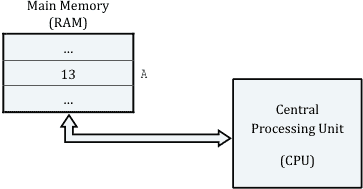

当程序指示 CPU 执行语句

```
A ← A + 1
```

会执行以下过程：

- 数字 13 从 RAM 中名为 **A** 的区域传输到 CPU；
- CPU 计算 13 与 1 的和；并且
- 结果 14 从 CPU 传输到 RAM 中名为 **A** 的区域，替换现有的数字 13。

执行后，RAM 看起来像这样。

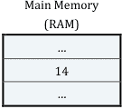

### 7.2 算术运算符

与每一种高级编程语言一样，C++ 支持几乎所有类型的算术运算符。

| 算术运算符 | 描述 |
|---|---|
| + | 加法 |
| - | 减法 |
| * | 乘法 |
| / | 除法 |
| % | 取模（整数除法后的余数） |

前四个运算符很直接，无需进一步解释。

取模运算符（%）返回整数除法的余数，这意味着

```cpp
a = 13 % 3
```

将值 1 赋给变量 a。

> **注意：** 在 C++ 中，取模运算符（%）不能用于浮点数。例如，无法执行 13.4 % 4 这一运算。

> **注意：** 请记住，流程图是表示算法的一种宽松方法。尽管流程图中允许使用取模（%）运算符，但本书改用普遍接受的 MOD 运算符！例如，C++ 语句 `b = 13 % 3` 在流程图中表示为


在数学中，如你所知，可以使用圆括号以及花括号和方括号。

$$
y = \frac{5}{2}\left\{3 + 2\left[4 + 7\left(7 - \frac{4}{3}\right)\right]\right\}
$$

然而，在 C++ 中没有花括号和方括号这种东西。我们只有圆括号；因此，同一个表达式应使用圆括号而不是花括号或方括号来书写。

```cpp
y = 5 / 2 * (3 + 2 * (4 + 7 * (7 - 4 / 3)));
```

另一件在数学中合法但在 C++ 中不合法的事情是：你可以省略乘号并写成 3x，意思是“3 乘以 x”。然而，在 C++ 中，只要存在乘法运算，就必须始终使用星号。这是新手程序员在用 C++ 编写数学表达式时最常犯的错误之一。

### 7.3 算术运算符的优先级是什么？

算术运算符遵循与数学中相同的优先级规则，即：先执行乘法和除法，后执行加法和减法。

| 优先级 | 算术运算符 |
|---|---|
| 高优先级 ↑ 低优先级 | *, /, %（较高）；+, -（较低） |

当同一个表达式中同时存在乘法和除法时，由于两者优先级相同，它们从左到右执行（与你阅读的方式相同），这意味着表达式

```cpp
y = 6 / 3 * 2
```

等价于 $y = \frac{6}{3} \cdot 2$，并将值 4 赋给变量 $y$（除法先于乘法执行）。

然而，如果你希望乘法先于除法执行，可以使用圆括号改变优先级，即：

```cpp
y = 6 / (3 * 2)
```

这等价于 $y = \frac{6}{3 \cdot 2}$

> **注意：** C++ 程序可以使用计算机的文本编辑器应用程序编写，但请记住，不可能以 $\frac{6}{3}$ 或 $\frac{4x+5}{6}$ 的形式书写分数。别想了！文本编辑器中没有公式编辑器！所有分数都必须写在一行中。例如，$\frac{6}{3}$ 应写成 6/3，$\frac{4x+5}{6}$ 应写成 (4*x+5)/6。

运算顺序可以总结如下：

- 1. 首先执行任何括在圆括号中的运算。
- 2. 接下来，从左到右执行任何乘法和除法运算。
- 3. 最后，从左到右执行任何加法和减法运算。

因此，在语句 $y = (20 + 3) + 12 + 8 / 4 * 3$; 中

运算按如下方式执行：

- 1. 20 与 3 相加，得到结果 23。
- 2. 8 除以 4，得到结果 2。然后这个结果乘以 3，得到结果 6。
- 3. 23 与 12 相加，得到结果 35。然后这个结果与 6 相加，得到最终结果 41。

接下来以更图形化的方式展示同一运算顺序。


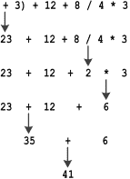

### 7.4 复合赋值运算符

C++ 提供了一组特殊运算符，称为复合赋值运算符，它们可以帮助你更快地编写代码。

| 运算符 | 描述 | 示例 | 等价于 |
|---|---|---|---|
| `+=` | 加法赋值 | `a += b` | `a = a + b` |
| `-=` | 减法赋值 | `a -= b` | `a = a - b` |
| `*=` | 乘法赋值 | `a *= b` | `a = a * b` |
| `/=` | 除法赋值 | `a /= b` | `a = a / b` |
| `%=` | 取模赋值 | `a %= b` | `a = a % b` |

查看“等价于”列，就会清楚：仅使用经典赋值运算符（`=`）也能取得相同结果。那么这里出现的问题是：*为什么存在这些运算符？*

答案很简单：这是为了方便。一旦你开始使用它们，你的生活就会找到不同的意义！

> **注意：** *请记住，流程图是一种表示算法的宽松方法。尽管在流程图中允许使用复合赋值运算符，但本书仅使用“等价于”列中所示的普遍接受的运算符。例如，C++ 语句 `a += b` 在流程图中表示为*

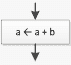

### 7.5 自增/自减运算符

在计算机程序中，给一个数加 1 或减 1 都非常常见，因此 C++ 引入了一组特殊运算符来完成这一操作。C++ 支持两种类型的自增和自减运算符：

- 前置自增/自减运算符
- 后置自增/自减运算符

前置自增/自减运算符放在变量名之前。后置自增/自减运算符放在变量名之后。这四种运算符如下所示。

| 运算符 | 描述 | 示例 | 等价于 |
|---|---|---|---|
| 前置自增 | 将变量增加 1 | `++a;` | `a = a + 1` |
| 前置自减 | 将变量减少 1 | `--a;` | `a = a - 1` |
| 后置自增 | 将变量增加 1 | `a++;` | `a = a + 1` |
| 后置自减 | 将变量减少 1 | `a--;` | `a = a - 1` |

再次查看“等价于”列，就会清楚：仅使用经典赋值运算符（=）也能取得相同结果。然而，使用这些新运算符要精巧且高效得多。开始时你可能会讨厌它们，但随着岁月流逝，你肯定会爱上它们！

让我们看一个使用前置自增运算符的例子，

```cpp
a = 5;
++a;            //This is equivalent to a = a + 1
b = a;

cout << a << endl;
cout << b << endl;
```

再看一个使用后置自增运算符的例子，

```cpp
a = 5;
a++;            //This is equivalent to a = a + 1
b = a;

cout << a << endl;
cout << b << endl;
```

在这两个例子中，值 6 都会被赋给变量 b！那么问题在哪里？这两个例子等价吗？答案是“是”，但仅在这两个例子中如此。在其他情况下，答案很可能是“否”。它们之间有一个细微差别。

让我们找出这个差别！规则是：前置自增/自减运算符先执行自增/自减运算，然后给出新值。

#### 练习 7.6-1 *连接姓名*

*编写一个 C++ 程序，提示用户输入其名字和姓氏（分别赋给两个不同的变量），然后将它们连接成一个字符串（拼接）。*

#### 解答

C++ 程序如下所示。

```cpp
#include <iostream>
using namespace std;
int main() {
    string first_name, last_name, full_name;

    cout << "Enter first name: ";
    cin >> first_name;
    cout << "Enter last name: ";
    cin >> last_name;

    full_name = first_name + " " + last_name;
    cout << full_name;
    return 0;
}
```

> **注意：** 请注意，名字和姓氏之间添加了一个额外的空格字符

### 7.7 复习题：判断题

**判断正误**：以下每个陈述。

- 1. 语句 `x = 5` 可以读作“变量 x 等于 5。”
- 2. 值赋值运算符将表达式的结果赋给变量。
- 3. 只能使用 `cin` 语句将字符串赋给变量。
- 4. 语句 `5 = x` 将值 5 赋给变量 `y`。
- 5. 在值赋值运算符的右侧，必须始终存在一个算术运算符。
- 6. 在值赋值运算符的左侧，可以存在多个变量。
- 7. 不能在值赋值运算符的两侧使用同一个变量。
- 8. 语句 `a = a + i` 将变量 `a` 递减 1。
- 9. 在 C++ 中，单词 `MOD` 是保留字。
- 10. 语句 `x = 0 % 5` 将值 5 赋给变量 `x`。
- 11. 运算 `5 % 0` 无法进行。
- 12. 除法和乘法在算术运算符中具有较高的优先级。
- 13. 当除法和乘法运算符共存于一个表达式中时，乘法运算先于除法执行。
- 14. 表达式 `8 / 4 * 2` 等于 1。
- 15. 表达式 `4 + 6 / 6 + 4` 等于 9。
- 16. 表达式 `a + b + c / 3` 计算三个数的平均值。
- 17. 语句 `a += 1` 等价于 `a++`。
- 18. 语句 `a = "true"` 将布尔值赋给变量 a。
- 19. 语句 `a = 2 * a` 使变量 a 的内容加倍。
- 20. 语句 `a++` 和 `++a` 完全等价。
- 21. 语句 `a = a++ + --a;` 总是将值 -1 赋给变量 a。
- 22. 语句 `a = "George" + "Malovich"` 将值 GeorgeMalovich 赋给变量 a。
- 23. 以下代码片段满足确定性性质。

        int a, b;
        double x;
        cin >> a;
        cin >> b;
        x = a / (b - 7);
        cout << x << endl;

### 7.8 复习题：多项选择题

为以下每个陈述选择正确答案。

- 1. 以下哪条 C++ 语句将值 10 赋给变量 a？
  - a. `10 = a;`
  - b. `a <- 10;`
  - c. `a = 100 / 10;`
  - d. 以上都不是

- 2. 语句 `a = b` 可以读作
  - a. 将变量 a 的内容赋给变量 b。
  - b. 变量 b 等于变量 a。
  - c. 将变量 b 的内容赋给变量 a。
  - d. 以上都不是

- 3. 表达式 `0 % 10 + 2` 等于
  - a. 7。
  - b. 2。
  - c. 12。
  - d. 以上都不是

- 4. 以下哪条 C++ 语句在语法上是正确的？
  - a. `a = 4 * 2 * y - 8 / (4 * q);`
  - b. `a = 4 * 2 * y - 8 / (4 * q);`
  - c. `a = 4 * 2 * y - 8 / (4 * q);`
  - d. 以上都不是

- 5. 以下哪条 C++ 语句将变量 a 增加 1，然后将其值赋给变量 b？
  - a. `b = a + 1;`
  - b. `b = a++;`
  - c. `b = ++a;`
  - d. 以上所有

- 6. 以下哪条 C++ 语句将值 George Malkovich 赋给变量 a？
  - a. `a = "George" + " " + "Malkovich";`
  - b. `a = "George" + " Malkovich";`
  - c. `a = "George " + "Malkovich";`
  - d. 以上所有

- 7. 以下代码片段

        x = 2;
        x++;

  不满足哪一性质
  - a. 有限性。
  - b. 确定性。
  - c. 有效性。
  - d. 以上都不是

- 8. 以下代码片段

        int a;
        double x;

        cin >> a;
        x = 1 / a;

  不满足哪一性质
  - a. 有限性。
  - b. 输入。
  - c. 有效性。
  - d. 以上都不是

### 7.9 复习练习

完成以下练习。

- 1. 以下哪些 C++ 赋值语句在语法上是正确的？
  - i. `a ← a + 1;`
  - ii. `a += b;`
  - iii. `a = b = a + b + 1;`
  - iv. `a = a++;`
  - v. `a = hello;`
  - vi. `a = 40*;`
  - vii. `a = b * 5;`
  - viii. `a =+ "true";`
  - ix. `fdadtwstdgfqw = 1;`
  - x. `**a;`

- 2. 以下每个变量的类型是什么？
  - i. `a = "false";`
  - ii. `w = false;`
  - iii. `b = "15 meters";`
  - iv. `weight = "40";`
  - v. `b = 13.0;`
  - vi. `b = 13;`

- 3. 将第一列中的每个元素与第二列中的一个元素匹配。

| 运算 | 结果 |
|---|---|
| i. 1 / 2 | a. 100 |
| ii. 1 / 2 * 2 | b. 0.25 |
| iii. 0 % 10 * 10 | c. 0 |
| iv. 10 % 2 + 7 | d. 0.5 |
|  | e. 7 |
|  | f. 1 |

- 4. 执行以下每个代码片段后，屏幕上显示什么？
  - i.

        a = 5;
        b = a * a + 1;
        cout << b++ << endl;
  - ii.

        a = 9;
        b = a / 3 * a;
        cout << ++b << endl;

- 5. 执行以下每个代码片段后，屏幕上显示什么？
  - i.

        a = 5;
        a = a++;
        cout << a << endl;
  - ii.

        a = 5;
        a = ++a;
        cout << a << endl;

- 6. 以下每个运算的结果是什么？
  - i. `21 % 5`
  - ii. `10 % 2`
  - iii. `11 % 2`
  - iv. `10 % 6 % 3`
  - v. `0 % 3`
  - vi. `100 / 10 % 3`


7. 执行以下每个代码片段后，屏幕上显示什么？

   i.
   ```cpp
   a = 5;
   b = 2;
   c = a * ++b;
   d = b % (a + b);
   cout << c;
   cout << " " << d << endl;
   ```

   ii.
   ```cpp
   a = 0.4;
   b = 8;
   a += 0.1;
   c = a * b % b;
   cout << c << endl;
   ```

8. 针对以下情况，计算表达式 `a % b` 的结果。

   i. `a = 20, b = 3`    iv. `a = 0, b = 3`
   ii. `a = 15, b = 3`    v. `a = 3, b = 0`
   iii. `a = 22, b = 3`   vi. `a = 2, b = 2`

9. 针对以下每种情况，计算表达式

   `b * (a % b) + a / b`

   的结果。

   i. `a = 10, b = 5`    ii. `a = 10, b = 4`

10. 执行以下代码片段后，屏幕上显示什么？

```cpp
a = "My name is";
a += " ";
a = a + "George Malkovich";
cout << a << endl;
```

11. 填写以下每个代码片段中的空白，使其显示值为 5。

    i.
    ```cpp
    a = 2;
    a = a _____ ;
    cout << a << endl;
    ```

    ii.
    ```cpp
    a = 4;
    b = a * 0.5;
    b += a;
    a = b - _____ ;
    cout << a << endl;
    ```

12. 执行以下代码片段后，屏幕上显示什么？

```cpp
city = "California";
California = city;
cout << city << " " << California << endl;
```

| 步骤 | 语句 | 说明 |  |  |  |
|---|---|---|---|---|---|
|  |  | 赋给 z。 |  |  |  |
| 4 | `z++` | 变量 z 增加 1。 | 10 | 15 | **151** |
| 5 | `cout << z` | 显示值 151。 |  |  |  |

#### 练习 8.1-1 — 创建跟踪表

执行以下程序时显示什么结果？

```cpp
#include <iostream>
using namespace std;
int main() {
  string Ugly, Beautiful, Handsome;

  Ugly = "Beautiful";
  Beautiful = "Ugly";
  Handsome = Ugly;
  cout << "Beautiful";
  cout << Ugly;
  cout << Handsome;
  return 0;
}
```

#### 解答

我们创建一个跟踪表来找出输出结果。

| 步骤 | 语句 | 说明 | Ugly | Beautiful | Handsome |
|---|---|---|---|---|---|
| 1 | `Ugly = "Beautiful"` | 字符串“Beautiful”被赋给变量 Ugly。 | **Beautiful** | ? | ? |
| 2 | `Beautiful = "Ugly"` | 字符串“Ugly”被赋给变量 Beautiful。 | Beautiful | **Ugly** | ? |
| 3 | `Handsome = Ugly` | 变量 Ugly 的值被赋给变量 Handsome。 | Beautiful | Ugly | **Beautiful** |
| 4 | `cout << "Beautiful"` | 显示字符串“Beautiful”。 |  |  |  |
| 5 | `cout << Ugly` | 显示字符串“Beautiful”。 |  |  |  |
| 6 | `cout << Handsome` | 显示字符串“Beautiful”。 |  |  |  |

#### 练习 8.1-2 — 交换变量的值

编写一个 C++ 程序，让用户输入两个值，分别存入变量 *a* 和 *b*。在程序结束时，这两个变量应交换它们的值。例如，如果变量 *a* 和 *b* 分别包含值 5 和 7，交换它们的值后，变量 *a* 应包含值 7，变量 *b* 应包含值 5！

#### 解答

以下程序虽然看起来正确，但它是错误的，并没有真正交换变量 *a* 和 *b* 的值！

```cpp
#include <iostream>
using namespace std;
int main() {
  int a, b;

  cin >> a;
  cin >> b;

  a = b;
  b = a;

  cout << a << endl;
  cout << b << endl;
  return 0;
}
```

我们来看看为什么！假设用户输入两个值 5 和 7。跟踪表如下所示。

| 步骤 | 语句 | 说明 | a | b |
|---|---|---|---|---|
| 1 | `cin >> a` | 用户输入值 5 | 5 | ? |
| 2 | `cin >> b` | 用户输入值 7 | 5 | 7 |
| 3 | `a = b` | 变量 b 的值被赋给变量 a。值 5 丢失了！ | 7 | 7 |
| 4 | `b = a` | 变量 a 的值被赋给变量 b | 7 | 7 |
| 5 | `cout << a << endl` | 显示值 7 |  |  |
| 6 | `cout << b << endl` | 显示值 7 |  |  |

哎呀！值 5 在哪里？

这个解决方案终究没那么显而易见！那么，到底如何真正交换值呢？

考虑两个杯子：一杯橙汁（称为杯子 A）和一杯柠檬汁（称为杯子 B）。如果你想交换它们的内容，你只需要找到并使用一个额外的空杯子（称为杯子 C）。

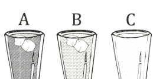

必须遵循的步骤如下：

1. 将杯子 A 的内容物（橙汁）倒入杯子 C。

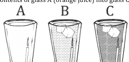

2. 将杯子 B 的内容物（柠檬汁）倒入杯子 A。

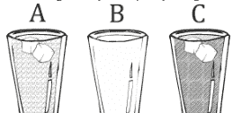

3. 将杯子 C 的内容物（橙汁）倒入杯子 B。

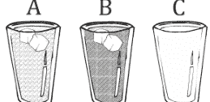

交换成功完成！

你可以遵循相同的步骤在 C++ 中交换两个变量的内容。

```cpp
#include <iostream>
using namespace std;
int main() {
  int a, b, c;

  cin >> a;
  cin >> b;

  c = a;  //Empty the contents of glass A (orange juice) into glass C
  a = b;  //Empty the contents of glass B (lemon juice) into glass A
  b = c;  //Empty the contents of glass C (orange juice) into glass B

  cout << a << endl;
  cout << b << endl;
  return 0;
}
```

> **注意：** 请注意三个赋值语句中每个语句后面的双斜杠。双斜杠后面的内容被视为注释，永远不会执行。

#### 练习 8.1-3 — 交换变量的值 – 第二种方法

编写一个 C++ 程序，让用户输入两个数值，分别存入变量 a 和 b。最后，这两个变量应交换它们的值。

#### 解答

由于这些变量只包含数值，你可以使用以下 C++ 程序。

```cpp
#include <iostream>
using namespace std;
int main() {
  int a, b;

  cin >> a;
  cin >> b;

  a = a + b;
  b = a - b;
  a = a - b;

  cout << a << endl;
  cout << b << endl;
  return 0;
}
```

> **注意：** 与上一练习相比，这种方法唯一的主要缺点是无法交换字母数字变量（字符串）的内容。

| 步骤 | 语句 | 说明 | a | b | c |
|---|---|---|---|---|---|
| 2 | `c = 3` |  | ? | 10 | 3 |
| 3 | `c = c * b` |  | ? | 10 | 30 |
| 4 | `a = 10 * c % 10` |  | 0 | 10 | 30 |
| 5 | `cout << a` | 显示值 0 |  |  |  |

#### 练习 8.1-5 — 创建跟踪表

创建一个跟踪表，以确定输入值为 3 时每一步中变量的值。

```cpp
#include <iostream>
using namespace std;
int main() {
  double a, b, c, d;

  cin >> a;

  b = a + 10;
  a = b * (a - 3);
  c = 3 * b / 6;
  d = c * c;
  d--;

  cout << d;
  return 0;
}
```

#### 解答

对于输入值 3，跟踪表如下所示。

| 步骤 | 语句 | 说明 | a | b | c | d |
|---|---|---|---|---|---|---|
| 1 | `cin >> a` | 用户输入值 3 | 3 | ? | ? | ? |
| 2 | `b = a + 10` |  | 3 | 13 | ? | ? |
| 3 | `a = b * (a - 3)` |  | 0 | 13 | ? | ? |
| 4 | `c = 3 * b / 6` |  | 0 | 13 | 6.5 | ? |
| 5 | `d = c * c` |  | 0 | 13 | 6.5 | 42.25 |
| 6 | `d--` |  | 0 | 13 | 6.5 | 41.25 |
| 7 | `cout << d` | 显示值 41.25 |  |  |  |  |

### 8.2 复习题：判断题

为以下每个陈述选择**正确或错误**。

1. 跟踪表是一种测试计算机的技术。
2. 跟踪表帮助程序员发现计算机程序中的错误。
3. 如果不先创建相应的跟踪表，就无法编写计算机程序。
4. 为了交换两个整型变量的值，你总是需要一个额外变量。

### 8.3 复习练习

完成以下练习。

1. 创建一个跟踪表，以确定该 C++ 程序在三次不同执行中每一步的变量值。
   三次执行的输入值分别为：(i) 3、(ii) 4 和 (iii) 1。

   ```cpp
   #include <iostream>
   using namespace std;
   int main() {
       int a, b, c, d;

       cin >> a;

       a = (a + 1) * (a + 1) + 6 / 3 * 2 + 20;
       b = a % 13;
       c = b % 7;
       d = a * b * c;
       cout << a << ", " << b << ", " << c << ", " << d;
       return 0;
   }
   ```

2. 创建一个跟踪表，以确定该 C++ 程序在两次不同执行中每一步的变量值。
   两次执行的输入值分别为：(i) 3、4；和 (ii) 4、4

   ```cpp
   #include <iostream>
   using namespace std;
   int main() {
       double a, b, c, d, e;

       cin >> a;
       cin >> b;

       c = a + b;
       d = 1 + a / b * c + 2;
       e = c + d;
       c += d + e;
   }
   ```


## 第9章

### 9.1 创建新的 C++ 项目

到目前为止，你已经学习了关于 C++ 程序的一些非常好的基础知识。现在该学习如何将程序输入计算机、执行它们、查看它们如何运行，以及查看它们如何显示结果了。

你必须做的第一件事是创建一个新的 C++ 项目。NetBeans IDE 提供了一个向导来帮助你完成这件事。启动 NetBeans IDE，然后从其主菜单中选择“文件 > 新建项目...”，如图 9–1 所示。

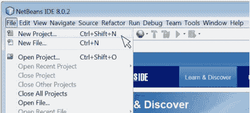

**图 9–1** 从 NetBeans IDE 启动新的 C++ 项目

“新建项目”向导将出现，并引导你完成后续步骤。

- 1. 在向导的“新建项目”屏幕中，在“选择项目”下，选择“C++ 应用程序”，如图 9–2 所示。然后，单击“下一步”按钮。

  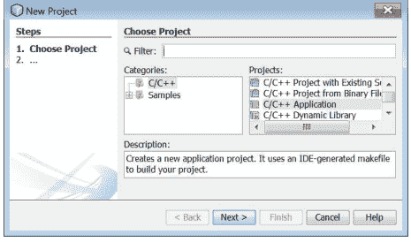

  **图 9–2** 在 Projects 下选择 C++ 应用程序

- 2. 你将看到向导的“新建 C++ 应用程序”屏幕。在“名称和位置”下，在“项目名称”字段中，输入“testingProject”，如图 9–3 所示。保持所有其他字段不变。然后，单击“下一步”按钮。

  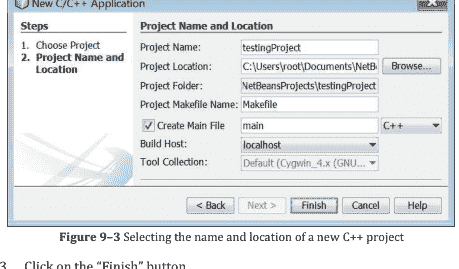

  **图 9–3** 选择新 C++ 项目的名称和位置

- 3. 单击“完成”按钮。

项目即被创建并在你的 NetBeans IDE 中打开。你应该会看到以下组件（见图 9–4）：

- Projects 窗口，其中包含项目组件的树视图，包括源文件、你的代码可能依赖的库等。找到并双击 testingProject > Source Files > main.cpp 文件。
- 带有你刚打开的名为“main.cpp”的文件的 Source Editor 窗口。在此文件中，你可以编写 C++ 代码。当然，单个源文件可以包含许多这样的 C++ 代码。

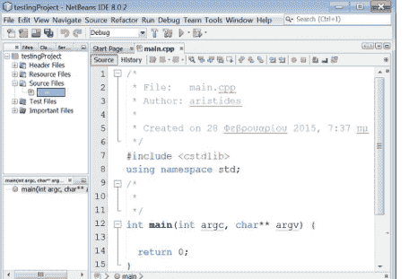

**图 9–4** 在 NetBeans IDE 中查看“Projects”和“Source Editor”窗口

### 9.2 编写并执行 C++ 程序

你刚刚看到了如何创建新的 C++ 项目。现在让我们编写下面这个（令人恐惧、相当吓人的！）C++ 程序，并尝试执行它。

```cpp
#include <iostream>
using namespace std;
int main() {
    cout << "Hello World";
    return 0;
}
```

在“main.cpp”窗口中，删除所有内容，然后通过按键盘上的“#”键，只输入 `#include` 语句的第一个字符。会出现一个弹出窗口，如图 9–5 所示。此窗口包含所有可用的 C++ 语句，以及其他以字符“#”开头的项。

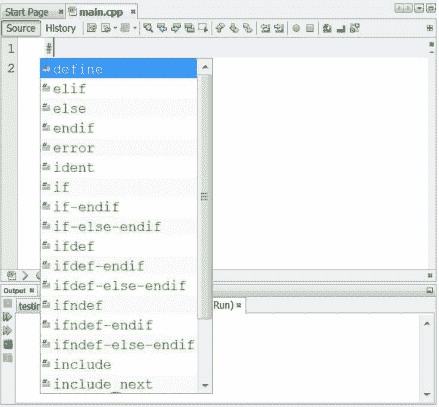

**图 9–5** Source Editor 窗口中的弹出屏幕

你可以使用键盘上的上下方向键高亮选中一项。

输入 `#include` 语句的第二个字符“i”。现在选项变少了，如**图 9–6**所示。

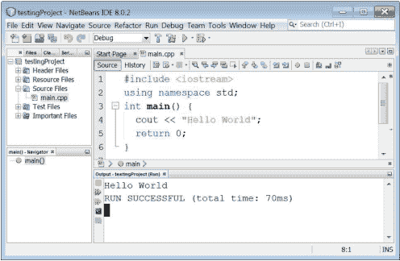

**图 9–8** 在 Output 窗口中查看所执行程序的结果

恭喜！你刚刚编写并执行了你的第一个 C++ 程序！现在让我们编写另一个 C++ 程序，它会提示用户输入他或她的名字。在 NetBeans IDE 中输入以下 C++ 语句，然后按 F6 执行该项目。

```cpp
#include <iostream>
using namespace std;

int main() {
    string name;

    cout << "Enter your name: ";
    cin >> name;
    cout << "Hello " << name << endl;
    cout << "How do you do?" << endl;

    return 0;
}
```

> **记住！** 你可以从主菜单中选择“运行 > 运行项目”来执行项目，或者按 F6 键。

执行程序后，消息“Enter your name”会显示在“Output”窗口中。程序会等待你输入名字，如图 9–9 所示。

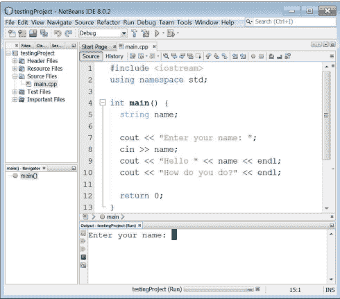

**图 9–9** 在 Output 窗口中查看提示

输入你的名字并按“Enter ↵”键。完成后，你的计算机会继续执行其余语句。执行结束后，最终输出如**图 9–10**所示。

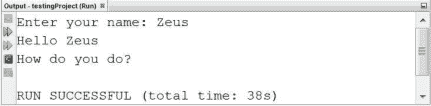

**图 9–10** 在 Output 窗口中响应提示

### 9.3 “调试”是什么意思

调试是查找并减少计算机程序中的缺陷（bug）数量，以使其按预期运行的过程。

关于“调试”一词的起源有一个传说。1940 年，当 Grace Hopper¹ 在哈佛大学一台 Mark II 计算机上工作时，她的同事发现一只虫子（飞蛾）卡在一个继电器（一种电动开关）中。这只虫子阻碍了 Mark II 计算机的正常运行。因此，当她的同事试图移除这只虫子时，Grace Hopper 说他们正在“调试”系统！

¹ Grace Murray Hopper（1906–1992）是美国计算机科学家和美国海军少将。她是哈佛 Mark I 计算机最早的程序员之一，并为一种称为 A-0 的计算机编程语言开发了第一个编译器，后来又开发了第二个编译器，称为 B-0 或 FLOW-MATIC。

### 9.4 使用 NetBeans IDE 调试 C++ 程序

如你所知，当有人用高级语言编写代码时，他或她可能犯两类错误——语法错误和逻辑错误。NetBeans IDE 提供了所有必要的工具来帮助你调试程序并找出错误。

#### 调试语法错误

幸运的是，NetBeans IDE 会在你输入时（或当你尝试运行项目时）检测语法错误，并用红色波浪线在其下划线，如图 9–11 所示。

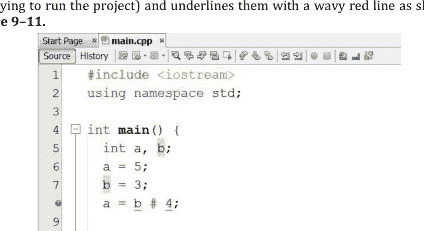

**图 9–11** 在 NetBeans IDE 中，语法错误用红色波浪线加下划线

你只需更正相应错误，红线就会立即消失。但是，如果你不确定代码哪里有问题，只需将鼠标光标放在红色感叹号上。NetBeans IDE 会通过显示一个弹出窗口来尝试帮助你，其中包含对该错误的简要说明，如图 9–12 所示。

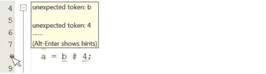

**图 9–12** NetBeans IDE 显示语法错误的说明

#### 通过逐步执行程序来调试逻辑错误

与语法错误相比，逻辑错误更难发现。由于 NetBeans IDE 无法发现并给逻辑错误加下划线，你只能靠自己了！例如，让我们看看下面的 C++ 程序。它会提示用户输入两个数字，并计算和显示它们的和。然而，它包含一个逻辑错误！

```cpp
// project_9_4a
#include <iostream>
using namespace std;
int main() {
  double s, a, b, S;

  s = 0;
  cout << "Enter 1st value: ";
  cin >> a;
  cout << "Enter 2nd value: ";
  cin >> b;
  S = a + b;
  cout << "The sum is: " << s;
  return 0;
}
```

如果你将此程序输入 NetBeans IDE，你会注意到甚至没有一个感叹号指示任何错误。然而，如果你运行程序并输入两个值 5 和 2，你可以亲眼看到，尽管 5 和 2 的和是 7，NetBeans IDE 却坚持认为是零，如**图 9–13**所示。

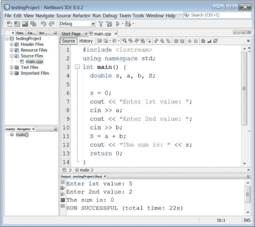

**图 9–13** 在 Output 窗口中查看逻辑错误的结果

到底怎么回事？当然，对于专家程序员来说，更正这个错误是小菜一碟。但对你这个新手来说，即使你很努力，也找不到任何问题。那么，错误在哪里？

有时人眼会疲劳到看不见显而易见的东西。所以，让我们试试用点魔法！让我们尝试使用调试器逐步执行程序。这让你有机会观察执行流程，并更仔细地查看每一步中变量的当前值。

将光标放在语句 `s = 0` 所在的行，并按 CTRL+F8 组合键。灰色边距中会出现一个粉色矩形，相应行会以粉色背景高亮显示，如图 9–14 所示。


**图 9–14** 在 NetBeans IDE 中使用调试器

现在，从主菜单中选择“调试➜调试项目”，或按 CTRL+F5 组合键，启动调试器。这样做会启用调试器，工具栏上会显示更多图标。


程序计数器（灰色边距中的绿色箭头 ➜ 图标）停在程序的第一行，如**图 9–15**所示。


**图 9–15** 在 NetBeans IDE 中使用调试器

> **注意：** 程序计数器会随时显示下一条将要执行的语句。

单击工具栏上的“单步跳过”图标。此操作执行语句 `s = 0;`，程序计数器移到第二条 C++ 语句，即下一条要执行的语句。

从主菜单中选择“窗口➜调试➜变量”。在出现的窗口中，可以查看主内存（RAM）中声明的所有变量以及执行每一步时它们包含的值，如**图 9–16**所示。


**图 9–16** 所有已声明变量显示在调试器的“变量”窗口中

> **注意：** 请注意，目前只有变量 `s` 包含有意义的值。

再次单击工具栏上的“单步跳过”图标。第二条语句被执行。你可以回到“输出”窗口查看输出结果（见**图 9–17**）。


**图 9–17** 在“输出”窗口中查看提示

再次单击工具栏上的“单步跳过”图标。第三条 C++ 语句被执行，程序等待你输入一个值。将光标放在“输出”窗口内，输入值 5，然后按“Enter ↵”键。

程序计数器移到第四条 C++ 语句。单击工具栏上的“单步跳过”图标两次。此操作执行第四条和第五条 C++ 语句。将光标放在“输出”窗口内，输入值 2，然后按“Enter ↵”键。

程序计数器移到第六条 C++ 语句。再次单击工具栏上的“单步跳过”图标一次。语句 `S = a + b` 被执行。你原本期望这里将 5.0 与 2.0 的和，即 7.0，赋给变量 `s`。然而，值 7.0 却被赋给了变量 `S`（大写 S），如**图 9–18**所示。


**图 9–18** 变量及其值显示在调试器的“变量”窗口中

现在你更清楚了！你在主内存（RAM）中错误地声明了两个变量：变量 `s` 和带大写 S 的变量 `S`。因此，当执行流到达最后一条语句 `cout << "The sum is: " << s;` 时，显示的是值 0 而不是值 7。

你刚刚找到了错误！单击工具栏上的“结束调试器会话”图标以取消执行，通过将变量 `S` 改为 `s` 来纠正错误，然后就准备好了！你刚刚完成了第一次调试！重新执行程序，现在你会看到它正确计算并显示总和。

#### 通过添加断点调试逻辑错误

逐步调试有一个很大的缺点。你必须一次又一次地单击工具栏上的“单步跳过”图标，直到到达可能出错的位置。你能想象在大型程序中这样做吗？

对于大型程序，还有另一种方法。如果你怀疑错误在程序末尾某处，就不必从一开始就调试整个程序。你可以在认为可能出错的位置添加一个标记（称为“断点”），执行程序；当执行流到达该断点时，执行流会自动暂停。然后你可以更仔细地查看程序暂停位置处变量的当前值。

> **注意：** 程序暂停时，有两种恢复执行的选项：可以在程序下方某处添加第二个断点，单击工具栏上的“继续”图标，让程序继续执行到那个新断点；或者，你也可以直接使用“单步跳过”工具栏图标，此后逐步执行程序。

接下来的 C++ 程序提示用户输入两个值并计算它们的平均值。

然而，程序包含一个逻辑错误。当用户输入值 10 和 12 时，显示的是值 16，而不是 11。

```cpp
// project_9_4b
#include <iostream>
using namespace std;
int main() {
    double a, b, average;

    cout << "Enter 1st value: ";
    cin >> a;
    cout << "Enter 2nd value: ";
    cin >> b;
    average = a + b / 2;
    cout << "The average value is: " << average;
    return 0;
}
```

你怀疑问题在程序末尾某处。但是，你不想调试整个程序，只想调试可能出错的部分。因此，让我们尝试在 `average = a + b / 2` 语句处添加断点（见**图 9–19**）。有两种方法可以做到这一点：你可以单击左侧灰色边距中相应的行号，或者将光标放在感兴趣的行上并按 CTRL+F8 组合键。


**图 9–19** 向程序添加断点

> **注意：** 当灰色边距中出现粉色矩形，并且相应行以粉色背景高亮显示时，你就知道已经设置了断点。

按 CTRL+F5 启动调试器。当输出窗口要求输入时，输入值 10 和 12。你会注意到，在你输入第二个数字并按“Enter ↵”键后，执行流立即在断点处暂停。（你会看到粉色断点高亮被程序计数器的绿色高亮取代。）

> **记住！** 你可以从主菜单中选择“调试→调试项目”，或按 CTRL+F5 组合键来调试项目。

现在你可以更仔细地查看变量的当前值。变量 `a` 和 `b` 分别包含值 10.0 和 12.0，这符合预期，因此数据输入没有问题，如**图 9–20**所示。


**图 9–20** 在“变量”窗口中查看变量的当前值

单击工具栏上的“单步跳过”图标一次。语句 `average = a + b / 2` 执行，主内存（RAM）现在包含以下值（见**图 9–21**）。


**图 9–21** 在“变量”窗口中查看变量的当前值

找到了！你刚刚找到了错误地将值 16.0 而不是 11.0 赋给变量 `average` 的语句！现在到了困难的部分；你应该思考为什么会发生这种情况！

经过两天的思考，真相变得明显！你只是忘记将 `a + b` 括在括号内；因此，只有变量 `b` 被除以 2。单击工具栏上的“结束调试器会话”图标，移除所有断点，通过将 `a + b` 括在括号内来纠正错误，然后就准备好了！重新执行程序，现在看看它是否正确计算并显示平均值。

> **注意：** 你可以用添加断点相同的方式移除断点：单击左侧灰色边距中相应的行号，或者将光标放在包含断点的行上并按 CTRL+F8 组合键。

### 9.5 复习练习

完成以下练习。

- 1. 将以下 C++ 程序输入 NetBeans IDE，并逐步执行它。确定为什么它不能正确计算 1 + 3 + 5 的和。

```cpp
#include <iostream>
using namespace std;
int main() {
    int SS, S1, S3, S5, S;

    SS = 0;
    S1 = 1;
    S3 = 3;
    S5 = 5;

    S = S1 + S3 + SS;

    cout << S;
    return 0;
}
```

- 2. 创建一个跟踪表，以确定该 C++ 程序在两次不同执行中每一步的变量值。然后，将该程序输入 NetBeans IDE，逐步执行它，并确认结果。

两次执行的输入值为：(i) 5, 5；以及 (ii) 4, 8。

```cpp
#include <iostream>
using namespace std;
int main() {
    double a, b, c, d, e;

    cin >> a;
    cin >> b;

    c = a + b;
    d = 5 + a / b * c + 2;
    e = c - d;
    c -= d + c;
```


```cpp
    e--;
    d = c + a % c;

    cout << c << ", " << d << ", " << e;
    return 0;
}
```

- 3. 创建一个跟踪表，以确定该 C++ 程序在三次不同执行中每一步的变量值。然后，在 NetBeans IDE 中输入该程序，逐步执行，并确认结果。

  三次执行的输入值为：(i) 0.50，(ii) 3，以及 (iii) 15。

```cpp
#include <iostream>
using namespace std;
int main() {
    int a;
    double b, c;

    cin >> b;

    c = 5;
    c = c * b;
    a = 10 * c % 10;

    cout << a;
    return 0;
}
```

## “C++ 入门”中的复习题

回答以下问题。

- 1. 什么是算法？
- 2. 给出制作一杯咖啡的算法。
- 3. 算法的五个特性是什么？
- 4. 算法可以永远执行吗？
- 5. 什么是计算机程序？
- 6. 算法涉及哪三方？
- 7. 构成计算机程序的三个阶段是什么？
- 8. 计算机程序可以由两个阶段组成吗？
- 9. 什么是流程图？
- 10. 流程图可以原样输入计算机吗？
- 11. 流程图使用的基本符号有哪些？
- 12. “保留字”一词是什么意思？
- 13. 什么是结构化编程？
- 14. 结构化编程的三种基本控制结构是什么？
- 15. 使用流程图给出每种控制结构的示例。
- 16. 程序员可以在文本编辑器中编写 C++ 程序吗？
- 17. 什么是语法错误？给出一个示例。
- 18. 什么是逻辑错误？给出一个示例。
- 19. 拼错关键字、缺少标点字符或运算符使用不当会导致哪种类型的错误？
- 20. 程序员为什么应在代码中添加注释？
- 21. 程序员为什么应编写用户友好的程序？
- 22. 缩写 POLA 代表什么？
- 23. 什么是变量？
- 24. 在流程图中，左箭头的左侧可以存在多少个变量？
- 25. 变量的值存储在计算机的哪个部分？
- 26. 什么是常量？
- 27. 常量如何帮助程序员？
- 28. 计算机程序为什么应尽可能避免除法和乘法运算？
- 29. C++ 中变量和常量的四种基本类型是什么？
- 30. “声明变量”这个说法是什么意思？
- 31. 如何在 C++ 中声明变量？给出一个示例。
- 32. 如何在 C++ 中声明常量？给出一个示例。
- 33. 流程图中使用什么符号显示消息？
- 34. C++ 中使用什么特殊字符序列输出“换行”？
- 35. 流程图中使用什么符号让用户输入数据？
- 36. C++ 中使用哪个符号作为赋值运算符，它在流程图中如何表示？
- 37. C++ 支持哪些算术运算符？
- 38. 什么是取模运算符，它在流程图中通常如何表示？
- 39. 总结算术运算符的优先级规则。
- 40. C++ 支持哪些复合赋值运算符？
- 41. C++ 支持哪些自增/自减运算符？
- 42. C++ 支持哪些字符串运算符？
- 43. 什么是跟踪表？
- 44. 使用跟踪表有哪些好处？
- 45. 描述交换两个变量内容（数值或字母数字）所涉及的步骤。
- 46. 本书提出了两种交换两个变量值的方法。哪一种更好，为什么？
- 47. “调试”一词是什么意思？
- 48. 描述 NetBeans IDE 如何帮助你发现语法错误。
- 49. 描述 NetBeans IDE 如何帮助你发现逻辑错误。

## 第 3 部分：顺序控制结构

## 第10章：顺序控制结构简介

### 10.1 什么是顺序控制结构？

“顺序控制结构”是指逐行执行，即语句按照它们在程序中出现的相同顺序依次执行。例如，它们可能执行一系列读或写操作、算术运算，或对变量赋值。

顺序控制结构是你在第 4 章学到的三种基本控制结构中最简单的一种。下面的程序展示了按顺序执行的 C++ 语句示例。

```cpp
#include <iostream>
using namespace std;
int main() {
  double a, b;

  cout << "Enter a number: ";
  cin >> a;

  b = a * a;

  cout << "The square of " << a << " is " << b;
  return 0;
}
```

#### 练习 10.1-1 *计算平行四边形的面积*

*编写一个 C++ 程序，计算并显示平行四边形的面积。*

#### 解答

平行四边形的面积可以使用以下公式计算：

*面积 = 底 × 高*

在本练习中，用户输入*底*和*高*的值，程序计算并显示平行四边形的面积。该问题的解答如下所示。

```cpp
#include <iostream>
using namespace std;
int main() {
    double area, base, height;

    cout << "Enter the length of Base: ";
    cin >> base;
    cout << "Enter the length of Height: ";
    cin >> height;

    area = base * height;

    cout << "The area of the parallelogram is " << area;
    return 0;
}
```

#### 练习 10.1-2 *计算圆的面积*

编写一个 C++ 程序，计算并显示圆的面积。

#### 解答

圆的面积可以使用以下公式计算：

*面积 = π · 半径²*

π 的值是已知量，为 3.14159。因此，用户唯一需要输入的值是半径。该问题的解答如下所示。

**project_10_1_2a**

```cpp
#include <iostream>
using namespace std;
int main() {
    double area, radius;

    cout << "Enter the length of Radius: ";
    cin >> radius;

    area = 3.14159 * radius * radius;

    cout << "The area of the circle is " << area;
    return 0;
}
```

更好的方法是使用常量 PI。

**project_10_1_2b**

```cpp
#include <iostream>
using namespace std;
const double PI = 3.14159;

int main() {
    double area, radius;

    cout << "Enter the length of Radius: ";
    cin >> radius;
    area = PI * radius * radius;
    cout << "The area of the circle is " << area;
    return 0;
}
```

> **注意：** 请注意，常量 PI 声明在函数 main 之外。

#### 练习 10.1-3 *计算燃油经济性*

在美国，汽车的燃油经济性以英里每加仑（MPG）来衡量。汽车的 MPG 可以使用以下公式计算：

$$\mathrm{MPG}=\frac{\text{miles driven}}{\text{gallons of gas used}}$$

编写一个 C++ 程序，提示用户输入其行驶的总英里数和使用的汽油加仑数。然后程序应计算并显示汽车的 MPG。

#### 解答

这是一个相当简单的情况。用户输入其行驶的总英里数和使用的汽油加仑数，然后程序应计算并显示汽车的 MPG。

```cpp
#include <iostream>
using namespace std;
int main() {
    double gallons, miles_driven, mpg;

    cout << "Enter miles driven: ";
    cin >> miles_driven;
    cout << "Enter gallons of gas used: ";
    cin >> gallons;

    mpg = miles_driven / gallons;

    cout << "Your car's MPG is: " << mpg;
    return 0;
}
```

#### 练习 10.1-4 *汽车在哪里？计算行驶距离*

一辆汽车从静止开始，在一条笔直的水平道路上以恒定加速度运动给定时间。编写一个 C++ 程序，提示用户输入

#### 练习 10.1-5 *开尔文转华氏度*

编写一个 C++ 程序，将华氏度¹的温度值转换为其等效的开尔文度²。所需公式为

$1.8 \times Kelvin = Fahrenheit + 459.67$

#### 解答

给出的公式不能原样用于程序中。在 C++ 这样的计算机语言中，不允许这样写

```cpp
1.8 * kelvin = fahrenheit + 459.67
```

> **记住！** 在 (=) 号左侧的位置上，只能存在一个变量。这个变量实际上是 RAM 中可存储值的区域。

该程序将华氏度转换为开尔文度。华氏度的值是由用户给出的已知值，而开尔文度的值是 C++ 程序应计算的值。因此，你需要求解开尔文。稍作推导后，公式变为

$Kelvin = \dfrac{Fahrenheit + 459.67}{1.8}$

对应的 C++ 程序如下所示。

**project_10_1_5**

```cpp
#include <iostream>
using namespace std;
int main(){
  double fahrenheit, kelvin;

  cout << "Enter a temperature in Fahrenheit: ";
  cin >> fahrenheit;

  kelvin = (fahrenheit + 459.67) / 1.8;

  cout << "The temperature in Kelvin is " << kelvin;
  return 0;
}
```

¹ 丹尼尔·加布里埃尔·华伦海特（Daniel Gabriel Fahrenheit，1686–1736）是一位德国物理学家、工程师和玻璃吹制工，最著名的是发明了酒精温度计和水银温度计，并制定了如今以他命名的温标。

² 威廉·汤姆森，第一代开尔文男爵（William Thomson, 1st Baron Kelvin，1824–1907），是一位出生于爱尔兰的英国数学物理学家和工程师。他因奠定绝对零度（开尔文温标）的基础而广为人知，因此一种温度计量单位以他的名字命名。他发现了热电中的汤姆孙效应，并帮助发展了热力学第二定律。


#### 练习 10.1-6 *计算销售税*

员工需要一个程序来输入产品的税前价格并计算其最终价格。假设增值税（VAT）为 19%。

#### 解答

销售税很容易计算。你必须将产品的税前价格乘以销售税税率。注意——销售税不是最终价格，而只是税额。

税后价格可以通过将初始税前价格与你之前计算出的销售税相加来计算。

在这个程序中，你可以使用一个名为 VAT 的常量来表示销售税税率。

```cpp
#include <iostream>
using namespace std;
const double VAT = 0.19;

int main() {
  double price_after_tax, price_before_tax, sales_tax;

  cout << "Enter the before-tax price of a product: ";
  cin >> price_before_tax;

  sales_tax = price_before_tax * VAT;
  price_after_tax = price_before_tax + sales_tax;

  cout << "The after-tax price is: " << price_after_tax;
  return 0;
}
```

> **注意：** 请注意，常量 VAT 是在函数 `main` 外部声明的。

#### 练习 10.1-7 *计算销售折扣*

编写一个 C++ 程序，提示用户输入商品价格以及以百分比表示的折扣（范围为 0 到 100）。然后程序应计算并显示新价格。

#### 解答

折扣金额很容易计算。你必须将产品的折扣前价格乘以折扣值，然后除以 100。由于用户输入的折扣值范围为 0 到 100，因此除法是必要的。注意——结果不是最终价格，而只是折扣金额。

最终的折扣后价格可以通过从初始折扣前价格中减去你之前计算出的折扣金额来计算。

**project_10_1_7**

```cpp
#include <iostream>
using namespace std;
int main() {
    int discount;
    double discount_amount, price_after_discount, price_before_discount;

    cout << "Enter the price of a product: ";
    cin >> price_before_discount;

    cout << "Enter the discount offered (0 - 100): ";
    cin >> discount;

    discount_amount = price_before_discount * discount / 100;
    price_after_discount = price_before_discount - discount_amount;

    cout << "The price after discount is: " << price_after_discount;
    return 0;
}
```

#### 练习 10.1-8 *计算销售税税率和折扣*

编写一个 C++ 程序，提示用户输入商品的税前价格以及以百分比表示的折扣（范围为 0 到 100）。然后程序应计算并显示新价格。假设销售税税率为 19%。

#### 解答

这个练习只是前两个练习的组合！

**project_10_1_8**

```cpp
#include <iostream>
using namespace std;
const double VAT = 0.19;

int main() {
    int discount;
    double discount_amount, price_after_discount, price_after_tax;
    double price_before_discount, sales_tax;

    cout << "Enter the price of a product: ";
    cin >> price_before_discount;

    cout << "Enter the discount offered (0 - 100): ";
    cin >> discount;
```

- 8. 身体质量指数（BMI）常用于判断一个人相对于其身高是否超重或体重不足。用于计算 BMI 的公式是：

  $$BMI = \frac{weight \cdot 703}{height^2}$$

  编写一个 C++ 程序，提示用户输入其体重（以磅为单位）和身高（以英寸为单位），然后计算并显示用户的 BMI。

- 9. 编写一个 C++ 程序，提示用户输入小计和小费率（范围为 0 到 100），然后计算小费和总额。例如，如果用户输入 30 和 10，C++ 程序应显示“小费为 $3.00，总额为 $33.00”。

- 10. 员工需要一个程序来输入三件产品的税前价格，然后计算每件产品的最终税后价格及其平均值。假设增值税（VAT）为 20%。

- 11. 员工需要一个程序来输入产品的税后价格，然后计算其税前价格。假设增值税（VAT）为 20%。

- 12. 编写一个 C++ 程序，提示用户输入商品的初始价格以及以百分比表示的折扣（范围为 0 到 100），然后计算并显示最终价格和节省的金额。

- 13. 编写一个 C++ 程序，提示用户输入月初和月末的电表读数（以千瓦时，kWh 为单位）。程序应计算并显示消耗的 kWh 数量，以及在每 kWh 费用为 $0.06 且增值税（VAT）为 20% 的情况下必须支付的金额。

- 14. 编写一个 C++ 程序，提示用户输入两个数字，分别对应当前月份和当前日期，然后计算距离年底还有多少天。假设每月有 30 天。

## 第11章

## 处理数字

### 11.1 简介

就像每一种高级编程语言一样，C++ 提供了许多函数（方法），你可以在任何需要的地方使用它们。函数无非是打包成一个单元的语句块，它有一个名称并执行特定任务。

为了更好地理解函数，让我们以海伦¹迭代公式为例，该公式用于计算正数的平方根。

$$x_{n+1}=\frac{1}{2}\left(x_n+\frac{y}{x_n}\right)$$

其中

- $y$ 是你要计算平方根的数
- $x_n$ 是 $y$ 的平方根的第 *n* 次迭代值

请不要失望！现在没有人用这种方法计算一个数的平方根。幸运的是，C++ 包含一个用于此目的的函数！这个函数实际上是一个小型子程序，被命名为 `sqrt`，你唯一要做的就是通过名称调用它，它就会为你完成工作。`sqrt` 函数可能使用海伦迭代公式，也可能是另一位古代或现代数学家的公式。事实是你并不真的关心！真正重要的是 `sqrt` 给了你正确的结果！下面展示一个示例。

```cpp
#include <iostream>
#include <cmath>
using namespace std;

int main() {
    double x, y;

    cin >> x;
    y = sqrt(x);
    cout << y;
    return 0;
}
```

> **注意：** 请注意，函数 `sqrt()` 定义在库 `cmath` 中。因此，为了使用函数 `sqrt`，你必须在程序开头使用语句 `#include <cmath>` 包含库 `cmath`。

尽管 C++ 支持许多数学函数，本章只涵盖本书目的绝对必要的那些函数。但是，如果你需要更多信息，可以访问

http://www.cplusplus.com/reference/cmath/

> **注意：** 当你需要计算平方根、正弦、余弦、绝对值等时，就会使用 C++ 数学函数。

### 11.2 常用数学函数

#### 绝对值

```cpp
abs( number )
```

返回 *number* 的绝对值。它定义在 `cmath` 库中。

##### 示例

```cpp
#include <iostream>
#include <cmath>
using namespace std;
int main() {
  int a, b;

  a = -5;
  b = abs(a);

  cout << abs(a) << endl;       //outputs: 5
  cout << b << endl;            //outputs: 5
  cout << abs(-5.2) << endl;    //outputs: 5.2
  cout << abs(5.2) << endl;     //outputs: 5.2
  return 0;
}
```

#### 余弦

```cpp
cos( number )
```

返回 *number* 的余弦。*number* 的值必须以弧度表示。它定义在 `cmath` 库中。

##### 示例

```cpp
// project_11_2b
#include <iostream>
#include <cmath>
using namespace std;
int main() {
  double a, p;

  p = 3.14159265;
  a = cos(2 * p);
  cout << a << endl;             //outputs: 1
  return 0;
}
```

#### 整数值

`(int)number`

返回 `number` 的整数值。

##### 示例

```cpp
// project_11_2c
#include <iostream>
using namespace std;
int main() {
  double a = 5.4;

  cout << (int)a << endl;        //outputs: 5
  cout << (int)34 << endl;       //outputs: 34
  cout << (int)34.9 << endl;     //outputs: 34
  cout << (int)-34.99 << endl;   //outputs: -34
  return 0;
}
```

> **注意：** 在计算机科学中，类型转换是将一种数据类型的变量转换为另一种数据类型的方法。请注意，`(int)` 不是函数。它只是 C++ 中将实数转换为整数的一种方式。还要注意，如果实数包含小数部分，该部分在转换过程中会丢失。

#### 实数值

`(double)number`

这会将 `number` 作为实数返回。

##### 示例

```cpp
// project_11_2d
#include <iostream>
using namespace std;
int main() {
```


```cpp
int a = 5;

cout << (double) a << endl;        //outputs: 5.0
cout << (double) 34 << endl;       //outputs: 34.0
cout << (double)-34 << endl;       //outputs: -34.0
cout << a / 2 << endl;             //outputs: 2
cout << (double) a / 2 << endl;    //outputs: 2.5
return 0;
}
```

> **注意：** 在计算机科学中，类型转换是将一种数据类型的变量转换为另一种数据类型的方法。请注意，`(double)` 不是函数。它只是 C++ 中将整数转换为实数的一种方式。

> **注意：** 在 C++ 中，两个整数相除的结果总是整数。因此，在表达式 `a / 2` 中，由于变量 `a` 和数字 `2` 都是整数，结果总是整数。如最后一条语句所示，如果你希望得到实数类型的结果，需要在除法的至少一个操作数前加上 `(double)` 转换运算符。

此外，语句

```cpp
cout << (double) a / 2 << endl;
```

等价于

```cpp
cout << a / (double) 2 << endl;
```

也等价于

```cpp
cout << (double) a / (double) 2 << endl;
```

当然也等价于

```cpp
cout << a / 2.0 << endl;
```

它们都输出值 2.5。

#### Pi

```cpp
M_PI
```

它返回 π 的值。它定义在 cmath 库中。

##### 示例

```cpp
project_11_2e

#include <iostream>
#include <cmath>
using namespace std;
int main(){
  cout << M_PI << endl;    //outputs: 3.14159
  cout.precision(20);      //Set the maximum number of digits to display
  cout << M_PI << endl;    //outputs: 3.141592653589793116
  return 0;
}
```

> **注意：** 请注意，`M_PI` 是一个常量，而不是函数。这就是为什么不使用括号。
> 
> **注意：** 语句 `cout.precision(20)` 设置语句 `cout` 显示的最大位数。

#### 乘方

```cpp
pow( number, exp )
```

它返回 `number` 的 `exp` 次幂的结果。它定义在 `cmath` 库中。

##### 示例

```cpp
#include <iostream>
#include <cmath>
using namespace std;
int main() {
  double a, b, c;

  a = 2;
  b = 3;
  cout << pow(a, b) << endl;      //outputs: 8.0

  c = pow(3, 2);
  cout << c << endl;              //outputs: 9.0
  return 0;
}
```

> **注意：** 函数 `pow()` 也可用于计算一个数的平方根。数学中已知 `√x = x^(1/2)`。因此，你可以写 `y = pow(x, 1/2)` 来计算 `x` 的平方根，甚至可以写 `y = pow(x, 1/3)` 来计算 `x` 的立方根，依此类推！

#### 随机数

```cpp
rand()
```

它返回一个范围在 0 到 RAND_MAX 之间的伪随机整数，其中 RAND_MAX 是一个至少为 32767 的常量。函数 `rand()` 定义在 `cstdlib` 库中。

##### 示例

```cpp
#include <iostream>
#include <cstdlib>
using namespace std;
```

```cpp
cout << sqrt(2) << endl;       //outputs: 1.41421
cout.precision(15);
cout << sqrt(2) << endl;       //outputs: 1.4142135623731
return 0;
}
```

> **记住！** 语句 `cout.precision(15)` 设置语句 `cout` 显示的**最大位数**。

#### 正切

```cpp
tan(number)
```

它返回 *数字* 的正切值。*数字* 的值必须以弧度表示。函数 `tan()` 定义在 `cmath` 库中。

##### 示例

```cpp
// project_11_2m
#include <iostream>
#include <cmath>
using namespace std;
int main() {
  double a;

  a = tan(10);
  cout << a << endl;       //outputs: 0.648361
  return 0;
}
```

#### 练习 11.2-1 *计算两点之间的距离*

编写一个 C++ 程序，提示用户输入两个点的坐标 *(x, y)*，然后计算它们之间的直线距离。所需公式为

\[d = \sqrt{(x_1 - x_2)^2 + (y_1 - y_2)^2}\]

#### 解答

在本练习中，你需要使用两个函数：`pow()` 函数，它返回一个数的乘方结果；以及 `sqrt()` 函数，它返回一个数的平方根。

为简化问题，分别计算 \((x_1 - x_2)^2\) 和 \((y_1 - y_2)^2\) 这两项，并将结果赋给两个临时变量。

C++ 程序如下所示。

```cpp
// project_11_2_1a
#include <iostream>
#include <cmath>
using namespace std;

int main() {
    double d, x1, x2, x_temp, y1, y2, y_temp;

    cout << "Enter coordinates for point A: ";
    cin >> x1;
    cin >> y1;

    cout << "Enter coordinates for point B: ";
    cin >> x2;
    cin >> y2;

    x_temp = pow(x1 - x2, 2);
    y_temp = pow(y1 - y2, 2);

    d = sqrt(x_temp + y_temp);

    cout << "Distance between points: " << d;
    return 0;
}
```

现在来看另一种方法。你应该意识到，实际上可以将一个函数嵌套在另一个函数中。这样做时，嵌套函数的结果被用作外层函数的参数。这是大多数程序员喜欢遵循的编写风格，因为它可以节省大量代码行。当然，如果嵌套太多函数，就没有人能理解你的代码。最多嵌套四层是完全可以接受的。使用嵌套函数的 C++ 程序如下所示。

##### project_11_2_1b

```cpp
#include <iostream>
#include <cmath>
using namespace std;
int main() {
    double d, x1, x2, y1, y2;

    cout << "Enter coordinates for point A: ";
    cin >> x1;
    cin >> y1;

    cout << "Enter coordinates for point B: ";
    cin >> x2;
    cin >> y2;

    d = sqrt(pow(x1 - x2, 2) + pow(y1 - y2, 2));

    cout << "Distance between points: " << d;
    return 0;
}
```

#### 练习 11.2-2 *汽车行驶了多远？*

*一辆汽车从静止开始，沿直线水平道路以恒定加速度行驶一段给定距离。编写一个 C++ 程序，提示用户输入加速度和汽车行驶的距离，然后计算行驶时间。所需公式为*

$S = u_0 + \frac{1}{2}at^2$

其中

- **S** 是汽车行驶的距离，单位为米 (m)
- **u₀** 是汽车的初速度，单位为米每秒 (m/sec)
- **t** 是汽车行驶的时间，单位为秒 (sec)
- **a** 是加速度，单位为米每二次方秒 (m/sec²)

#### 解答

由于汽车从静止开始，初速度 u₀ 为零。因此，公式变为

$S = \frac{1}{2}at^2$

现在，如果解出时间，最终公式变为

$t = \sqrt{\frac{2S}{a}}$

在 C++ 中，你可以使用 sqrt() 函数，它返回一个数的平方根。

```cpp
// project_11_2_2
#include <iostream>
#include <cmath>
using namespace std;
int main() {
    double S, a, t;

    cout << "Enter acceleration: ";
    cin >> a;
    cout << "Enter distance traveled: ";
    cin >> S;

    t = sqrt(2 * S / a);

    cout << "Your car traveled for " << t << " seconds";
    return 0;
}
```

### 11.3 复习题：判断题

对以下每个陈述选择**正确**或**错误**。

- 1. 一般来说，函数是解决小问题的小型子程序。
- 2. 每个程序都必须使用海伦迭代公式来计算正数的平方根。
- 3. `abs()` 函数返回一个项的绝对位置。
- 4. 语句 `int(3.59)` 返回结果 3.6。
- 5. `M_PI` 常量等于 3.14。
- 6. 语句 `pow(2, 3)` 返回结果 9。
- 7. `rand()` 函数也可以返回负的随机数。
- 8. 语句 `y = rand() % 2` 有 50% 的可能性将值 1 赋给变量 `y`。
- 9. 语句 `round(3.59)` 返回结果 4。
- 10. 要计算 90 度的正弦，你必须写 `y = sin (M_PI / 2)`。
- 11. 语句 `y = sqrt(-2)` 是有效的。
- 12. 以下代码片段满足确定性属性。

    ```cpp
    double a, b, x;

    cin >> a;
    cin >> b;
    x = a * sqrt(b);
    cout << x << endl;
    ```

### 11.4 复习题：多项选择题

为以下每个陈述选择正确答案。

- 1. 以下哪一项计算变量 `a` 的 2 次幂结果？
  - a. `y = a * a;`
  - b. `y = pow(a, 2);`
  - c. `y = a * a / a * a;`
  - d. 以上所有
- 2. 当执行语句 `y = abs(+5.2)` 时，变量 `y` 的值是什么？
  - a. -5.2
  - b. -5
  - c. 0.2
  - d. 5.2
  - e. 5


- f. 以上都不是

- 3. 以下哪一项计算 180 度的正弦值？
  - a. `sin(180)`
  - b. `sin(M_PI)`
  - c. 以上全部
  - d. 以上都不是

- 4. 当执行语句 `y = (int)(5/2)` 时，变量 `y` 的值是多少？
  - a. 2.5
  - b. 3
  - c. 2
  - d. 0.5

- 5. 当执行语句 `y = pow(sqrt(4), 2)` 时，变量 `y` 的值是多少？
  - a. 4
  - b. 2
  - c. 8
  - d. 16

- 6. 当执行语句 `y = round(5.2)/2.0` 时，变量 `y` 的值是多少？
  - a. 2
  - b. 2.5
  - c. 2.6
  - d. 以上都不是

### 11.5 复习练习

完成以下练习。

- 1. 创建跟踪表，以确定该 C++ 程序在两次不同执行中每一步变量的值。

  两次执行的输入值为：(i) 9 和 (ii) 4。

  ```cpp
  #include <iostream>
  #include <cmath>
  using namespace std;
  int main() {
      double a;
      int b, c;

      cin >> a;

      a += 6 / sqrt(a) * 2 + 20;
      b = (int)round(a) % 4;
      c = b % 3;

      cout << a << ", " << b << ", " << c;
      return 0;
  }
  ```

- 2. 创建跟踪表，以确定该 C++ 程序在两次不同执行中每一步变量的值。

  两次执行的输入值为：(i) -2 和 (ii) -3

  ```cpp
  #include <iostream>
  #include <cmath>
  using namespace std;
  int main() {
      int a, b, c;

      cin >> a;

      b = (int)abs(a) % 4 + (int)pow(a, 4);
      c = b % 5;

      cout << b << ", " << c;
      return 0;
  }
  ```

- 3. 编写一个 C++ 程序，提示用户输入以弧度表示的角 θ，然后计算并以度为单位显示该角度。已知 2π = 360°。

- 4. 编写一个 C++ 程序，计算直角三角形的斜边，已知其两条直角边 A 和 B。由毕达哥拉斯²定理可知

  \[
  hypotenuse = \sqrt{A^2 + B^2}
  \]

- 5. 编写一个 C++ 程序，提示用户输入直角三角形的角 θ（以度为单位）及其邻边长度，然后计算对边长度。已知 2π = 360°，且

  \[
  \tan(\theta) = \frac{\text{Opposite}}{\text{Adjacent}}
  \]

  > ² 萨摩斯的毕达哥拉斯（约公元前571—约公元前497）是著名的希腊数学家、哲学家和天文学家。他以证明重要的毕达哥拉斯定理而最为著名。他对柏拉图产生了影响。他的理论至今仍用于数学。

## 第12章：复杂数学表达式

### 12.1 编写复杂数学表达式

在第7章中，你学习了所有算术运算符，但很少学习如何使用它们以及如何编写自己的复杂数学表达式。在本章中，你将了解将数学表达式转换为 C++ 语句是多么容易。

> **记住！** 算术运算符遵循与数学中相同的优先级规则，这意味着乘法和除法在加法和减法之前执行。此外，当乘法和除法共存于同一表达式中时，由于二者优先级相同，这些运算从左到右执行。

#### 练习 12.1-1 — 在 C++ 中表示数学表达式

以下哪些 C++ 语句正确表示了以下数学表达式？

\[
x = \frac{1}{10+z}\,27
\]

- i. `x = 1 * 27 / 10 + z`
- ii. `x = 1 * 27 / (10 + z)`
- iii. `x = 27 / 10 + z`
- iv. `x = 27 / (10 + z)`
- v. `x = (1 / 10 + z) * 27`
- vi. `x = 1 / ((10 + z) * 27)`
- vii. `x = 1 / (10 + z) * 27`
- viii. `x = 1 / (10 + z) / 27`

#### 解答

- i. **错误。** 由于乘法和除法在加法之前执行，这等价于 \(x = \frac{1}{10} \times 27 + z\)。
- ii. **错误。** 乘法本应使用星号。
- iii. **错误。** 由于除法在加法之前执行，这等价于 \(x = \frac{27}{10} + z\)。
- iv. **正确。** 这等价于 \(x = \frac{27}{10+z}\)。
- v. **错误。** 在括号内，除法先于加法执行。这等价于 \(x = \left(\frac{1}{10} + z\right)27\)。
- vi. **错误。** 先执行括号，这等价于 \(x = \frac{1}{(10+z)\times 27}\)。
- vii. **正确。** 除法先于乘法执行（从左到右）。先计算 \(\frac{1}{10+z}\) 这一项，然后将结果乘以 27。
- viii. **错误。** 这等价于 \(\frac{\frac{1}{10+z}}{27}\)。

#### 练习 12.1-2 *在 C++ 中编写数学表达式*

编写一个 C++ 程序，计算数学表达式

\[
y = 10x - \frac{10-z}{4}
\]

#### 解答

首先，必须区分数据输入和输出结果。显然，输出结果被赋值给 \(y\)，用户必须输入 \(x\) 和 \(z\) 的值。本练习的解答如下所示。

**project_12_1_2**

```cpp
#include <iostream>
using namespace std;
int main() {
    double x, y, z;

    cout << "Enter value for x: ";
    cin >> x;
    cout << "Enter value for z: ";
    cin >> z;

    y = 10 * x - (10 - z) / 4;

    cout << "The result is: " << y;
    return 0;
}
```

#### 练习 12.1-3 *在 C++ 中编写复杂数学表达式*

编写一个 C++ 程序，计算数学表达式

\[
y = \frac{\frac{3x^2 + 5x + 2}{7w - \frac{1}{z}}}{4^{\frac{3+z}{7}}}
\]

#### 解答

哎呀！现在表达式更复杂了！事实上，它复杂得多！所以，让我们看看一种相当不同的方法。

主要思想是将复杂表达式分解为更小、更简单的表达式，并将每个子结果赋给临时变量。最后，你可以用所有这些临时变量构建原表达式！这里展示了这种方法。

**project_12_1_3a**

```cpp
// project_12_1_3a
#include <iostream>
using namespace std;
int main() {
  double denominator, nominator, temp1, temp2, temp3, w, x, y, z;

  cout << "Enter value for x: ";
  cin >> x;
  cout << "Enter value for w: ";
  cin >> w;
  cout << "Enter value for z: ";
  cin >> z;

  temp1 = 3 * x * x + 5 * x + 2;
  temp2 = 7 * w - 1 / z;
  temp3 = (3 + x) / 7;
  nominator = 5 * temp1 / temp2 - z;
  denominator = 4 * temp3;

  y = nominator / denominator;

  cout << "The result is: " << y;
  return 0;
}
```

你可能会说：“好吧，但我浪费了这么多变量，而且众所周知，每个变量都占用主内存的一部分。我怎样才能将原表达式写在一行中，并减少内存浪费？”

对于高级程序员来说，这项工作可能小菜一碟，但你呢？对于新手程序员呢？

下一种方法将帮助你编写即使最复杂的数学表达式，而不会出现任何语法或逻辑错误！规则非常简单。“将复杂表达式分解为更小、更简单的表达式，并将每个子结果赋给临时变量后，从后往前开始，用其被赋值的表达式替换每个变量。不过要小心！当你用表达式替换变量时，必须始终将表达式括在括号中！”

困惑吗？别这样！实际操作起来更容易。让我们尝试重写之前的 C++ 程序。从后往前，用赋给变量 nominator 和 denominator 的表达式替换它们。结果如下：

```cpp
y = (5 * temp1 / temp2 - z) / (4 * temp3);
```

分子        分母

> **注意：** 请注意添加了额外的括号。

现在必须用赋给变量 **temp1**、**temp2** 和 **temp3** 的表达式替换它们，单行表达式就完成了！

```cpp
y = (5 * (3 * x * x + 5 * x + 2) / (7 * w - 1 / z) - z) / (4 * ((3 + x) / 7));
```

temp1        temp2        temp3

最后看起来可能吓人，但并没有那么难，对吧？

现在可以将该 C++ 程序重写为

project_12_1_3b

```cpp
#include <iostream>
using namespace std;
int main() {
    double w, x, y, z;

    cout << "Enter value for x: ";
    cin >> x;
    cout << "Enter value for w: ";
    cin >> w;
    cout << "Enter value for z: ";
    cin >> z;

    y = (5 * (3 * x * x + 5 * x + 2) / (7 * w - 1 / z) - z) / (4 * ((3 + x) / 7));

    cout << "The result is: " << y;
    return 0;
}
```

### 12.2 复习练习

完成以下练习。

- 1. 将第一个表中的每个元素与第二个表中的**一个或多个**元素匹配。

|  | 表达式 |
|---|---|
| i. | `5 / pow(x, 2) * y + pow(x, 3)` |
| ii. | `5 / (pow(x, 3) * y) + pow(x, 2)` |


|  | 表达式 |
|---|---|
| a. | `5 * y / pow(x, 2) + pow(x, 3)` |
| b. | `5 * y / x * x + pow(x, 3)` |
| c. | `5 / (x * x * x * y) + x * x` |
| d. | `5 / (x * x * x) * y + x * x` |
| e. | `5 * y / (x * x) + x * x * x` |
| f. | `1 / (x * x * x * y) * 5 + x * x` |
| g. | `y / (x * x) * 5 + pow(x, 3)` |
| h. | `1 / (x * x) * 5 * y + x / x * x * x` |

- **2.** 用 C++ 编写下列数学表达式，每个表达式用一行代码表示。
  - **i.** $y=\frac{(x+3)^{5w}}{7(x-4)}$
  - **ii.** $y=\sqrt[5]{\left(3x^2-\frac{1}{4}x^3\right)}$
  - **iii.** $y=\frac{\sqrt{x^4-2x^3-7x^2+x}}{\sqrt[3]{4(7x^4-\frac{4}{3}x^3)(7x^2+x)}}$
  - **iv.** $y=\frac{x}{x-3(x-1)}+\left(x\sqrt[5]{x-1}\right)\frac{1}{(x^3-2)(x-1)^3}$
  - **v.** $y=\left(\sin\left(\frac{\pi}{3}\right)-\cos\left(\frac{\pi}{2}w\right)\right)^2$
  - **vi.** $y=\frac{\left(\sin\left(\frac{\pi}{2}x\right)+\cos\left(\frac{3\pi}{2}w\right)\right)^3}{\left(\tan\left(\frac{2\pi}{3}w\right)-\sin\left(\frac{\pi}{2}x\right)\right)^{1/2}}+6$

- **3.** 编写一个 C++ 程序，提示用户输入 $x$ 的值，然后计算并显示下列数学表达式的结果。

$y=\sqrt{x(x^3+x^2)}$

- **4.** 编写一个 C++ 程序，提示用户输入 $x$ 的值，然后计算并显示下列数学表达式的结果。

$y=\frac{7x}{2x+4(x^2+4)}$

建议：尝试用一行代码写出该表达式。

- **5.** 编写一个 C++ 程序，提示用户输入 $x$ 和 $w$ 的值，然后计算并显示下列数学表达式的结果。

## 第13章

## 使用商和余数的练习

### 13.1 简介

哪些类型的问题可能需要使用整数除法的商和余数？这个问题没有简单的答案！然而，商和余数可用于：

- 将一个数拆分成单个数字
- 检查一个数是奇数还是偶数
- 将以秒为单位经过的时间转换为小时、分钟和秒
- 将以美元计的金额转换为 100 美元纸币、50 美元纸币、20 美元纸币等的张数
- 判断一个数是否为回文数
- 统计一个数中包含的数字位数
- 确定某个特定数字在一个数中出现的次数

当然，这些只是部分用途，你肯定还能找到许多其他用途。接下来你将看到一些利用整数除法的商和余数的练习。

#### 练习 13.1-1 计算整数除法的商和余数

编写一个 C++ 程序，提示用户输入两个整数，然后计算整数除法的商和余数。

**解答**

由于 C++ 实际上并没有一个专门计算整数商的算术运算符，你可以使用 `(int)` 强制类型转换运算符来达到同样的效果。

```cpp
// project_13_1_1
#include <iostream>
using namespace std;

int main() {
    int number1, number2, q, r;

    cout << "Enter first number: ";
    cin >> number1;
    cout << "Enter second number: ";
    cin >> number2;

    q = (int)(number1 / number2);
    r = number1 % number2;
    cout << "Integer Quotient: " << q << "\nInteger Remainder: " << r;
    return 0;
}
```

> **注意：** 在流程图中，要计算整数除法的商，可以使用常用的 DIV 运算符。下面显示了一个示例。
>
> 

> **注意：** 在 C++ 中，两个整数相除的结果始终是整数。因此，在语句 `q = (int)(number1 / number2);` 中，由于变量 `number1` 和 `number2` 是整数，`(int)` 强制类型转换运算符是多余的。不过，为了增强可读性，保留它也是一种良好的实践。

#### 练习 13.1-2 求数字之和

编写一个 C++ 程序，提示用户输入一个四位整数，然后计算其各位数字之和。

**解答**

这里需要记住的是，程序开头的语句

```cpp
cin >> number;
```

将给定的四位整数赋给一个单独的变量 `number`，而不是赋给四个单独的变量。

因此，你首先必须将该整数拆分为四个数字，并将每个数字赋给一个单独的变量。然后计算这四个变量之和，即可得到所需结果。这里有两种方法可用。

##### 第一种方法

让我们通过一个算术示例来理解第一种方法。以数字 6753 为例。

|  | 说明 |
|---|---|
| **第 1 位数字 = 6** | 将给定数字除以 1000 取整数商，即可分离出第 1 位数字<br>`digit1 = (int)(6753 / 1000)` |
| **剩下的数字 = 753** | 将给定数字除以 1000 取整数余数，即可分离出剩下的数字<br>`r = 6753 % 1000` |
| **第 2 位数字 = 7** | 将剩下的数字除以 100 取整数商，即可分离出第 2 位数字<br>`digit2 = (int)(753 / 100)` |
| **剩下的数字 = 53** | 此时剩下的数字为<br>`r = 753 % 100` |
| **第 3 位数字 = 5** | 将剩下的数字除以 10 取整数商，即可分离出第 3 位数字<br>`digit3 = (int)(53 / 10)` |
| **第 4 位数字 = 3** | 最后剩下的数字恰好是第 4 位数字，即<br>`digit4 = 53 % 10` |

解决该算法的 C++ 程序如下所示。

```cpp
#include <iostream>
using namespace std;

int main() {
    int digit1, digit2, digit3, digit4, number, r, sum;

    cout << "Enter a four-digit integer: ";
    cin >> number;

    digit1 = (int)(number / 1000);
    r = number % 1000;

    digit2 = (int)(r / 100);
    r = r % 100;

    digit3 = (int)(r / 10);
    digit4 = r % 10;

    sum = digit1 + digit2 + digit3 + digit4;
    cout << sum;
    return 0;
}
```

下面是你刚刚看到的程序的跟踪表。

| 步骤 | 语句 | 说明 | number | digit1 | digit2 | digit3 | digit4 | r | sum |
|---|---|---|---|---|---|---|---|---|---|
| 1 | `cout << "Enter a ..."` | 显示消息“Enter a ...” |  |  |  |  |  |  |  |
| 2 | `cin >> number` | 用户输入 **6753** | `6753` | `?` | `?` | `?` | `?` | `?` | `?` |
| 3 | `digit1 = (int)(number / 1000)` |  | `6753` | `6` | `?` | `?` | `?` | `?` | `?` |
| 4 | `r = number % 1000` |  | `6753` | `6` | `?` | `?` | `?` | `753` | `?` |
| 5 | `digit2 = (int)(r / 100)` |  | `6753` | `6` | `7` | `?` | `?` | `753` | `?` |
| 6 | `r = r % 100` |  | `6753` | `6` | `7` | `?` | `?` | `53` | `?` |
| 7 | `digit3 = (int)(r / 10)` |  | `6753` | `6` | `7` | `5` | `?` | `53` | `?` |
| 8 | `digit4 = r % 10` |  | `6753` | `6` | `7` | `5` | `3` | `53` | `?` |
| 9 | `sum = digit1+digit2+...` |  | `6753` | `6` | `7` | `5` | `3` | `53` | `18` |
| 10 | `cout << sum` | 显示值 18 | `6753` | `6` | `7` | `5` | `3` | `53` | `18` |

为了进一步帮助你，这里还有一个通用的 C++ 程序，可用于拆分任意给定的整数。由于程序长度取决于数字的位数 N，你只需编写 N-1 对语句即可。


```cpp
cin >> number;

digit1 = (int)(number / 10^(N-1));
r = number % 10^(N-1);

...

digit2 = (int)(r / 10^(N-2));
r = r % 10^(N-2);

...

digit(N-2) = (int)(r / 100);
r = r % 100;

digit(N-1) = (int)(r / 10);
digitN = r % 10;
```

例如，如果你想拆分一个六位整数，你需要写五对语句。

```cpp
#include <iostream>
using namespace std;

int main() {
    int digit1, digit2, digit3, digit4, digit5, digit6, number, r;

    cout << "Enter a six-digit integer: ";
    cin >> number;

    digit1 = (int) (number / 100000);
    r = number % 100000;

    digit2 = (int) (r / 10000);
    r = r % 10000;

    digit3 = (int) (r / 1000);
    r = r % 1000;

    digit4 = (int) (r / 100);
    r = r % 100;

    digit5 = (int) (r / 10);
    digit6 = r % 10;

    cout << digit1 << ", " << digit2 << ", " << digit3 << ", " << endl;
    cout << digit4 << ", " << digit5 << ", " << digit6 << endl;
    return 0;
}
```

- 第 1 对语句
- 第 2 对语句
- 第 3 对语句
- 第 4 对语句
- 第 5 对语句

##### 第二种方法

同样，我们再用一个算术示例来理解第二种方法。以同一个数字 6753 为例。

|  |  |
|---|---|
| **第 4 位数字 = 3** | 将给定数字除以 10 取整数余数，即可分离出第 4 位数字<br>`digit4 = 6753 % 10` |
| **剩下的数字 = 675** | 将给定数字除以 10 取整数商，即可分离出剩下的数字<br>`r = (int) (6753 / 10)` |
| **第 3 位数字 = 5** | 将剩下的数字除以 10 取整数余数，即可分离出第 3 位数字<br>`digit3 = 675 % 10` |
| **剩下的数字 = 67** | 此时剩下的数字为<br>`r = (int) (675 / 10)` |
| **第 2 位数字 = 7** | 将剩下的数字除以 10 取整数余数，即可分离出第 2 位数字<br>`digit2 = 67 % 10` |


###### 第一位数字 = 6

最后剩下的数字，恰好是第一位数字，是

```cpp
digit1 = (int)(67 / 10);
```

该算法的 C++ 程序如下所示。

##### project_13_1_2c

```cpp
#include <iostream>
using namespace std;

int main() {
    int digit1, digit2, digit3, digit4, number, r, sum;

    cout << "Enter a four-digit integer: ";
    cin >> number;

    digit4 = number % 10;
    r = (int)(number / 10);

    digit3 = r % 10;
    r = (int)(r / 10);

    digit2 = r % 10;
    digit1 = (int)(r / 10);

    sum = digit1 + digit2 + digit3 + digit4;
    cout << sum;
    return 0;
}
```

为了进一步帮助你，还有一个通用 C++ 程序，可用于拆分任何给定的整数。该程序使用第二种方法。再一次说明，由于程序的长度取决于数字的位数 N，你只需编写 N-1 对语句。

```cpp
cout << "Enter a N-digit integer: ";
cin >> number;
```


```cpp
digit2 = r % 10;
digit1 = (int)(r / 10);
```


例如，如果要拆分一个五位数整数，必须使用四对语句。

##### project_13_1_2d

```cpp
#include <iostream>
using namespace std;

int main() {
    int digit1, digit2, digit3, digit4, digit5, number, r;

    cout << "Enter a five-digit integer: ";
    cin >> number;

    digit5 = number % 10;
    r = (int)(number / 10);

    digit4 = r % 10;
    r = (int)(r / 10);

    digit3 = r % 10;
    r = (int)(r / 10);

    digit2 = r % 10;
    digit1 = (int)(r / 10);

    cout << digit1 << ", " << digit2 << ", " << digit3 << endl;
    cout << digit4 << ", " << digit5 << endl;
    return 0;
}
```


#### 练习 13.1-3 *显示经过的时间*

*编写一个 C++ 程序，提示用户输入一个表示经过时间（以秒为单位）的整数，然后按“DD 天 HH 小时 MM 分钟和 SS 秒”的格式显示。例如，如果用户输入 700005，则必须显示消息“8 天 2 小时 26 分钟和 45 秒”。*

#### 解法

你可能已经知道，一分钟有 60 秒，一小时有 3600 秒，一天有 86400 秒。

让我们尝试用第一种方法分析数字 700005。

| 结果 | 解释 |
|---|---|
| **天数 = 8** | 如果将给定整数除以 86400 得到整数商，就可以分离出天数<br>`days = (int)(700005 / 86400);` |
| **剩余秒数 = 8805** | 如果将给定整数除以 86400 得到整数余数，就可以分离出剩余秒数<br>`r = 700005 % 86400;` |
| **小时 = 2** | 如果将剩余秒数除以 3600 得到整数商，就可以分离出小时数<br>`hours = (int)(8805 / 3600);` |
| **剩余秒数 = 1605** | 现在的剩余秒数为<br>`r = 8805 % 3600;` |
| **分钟 = 26** | 如果将剩余秒数除以 60 得到整数商，就可以分离出分钟数<br>`minutes = (int)(1605 / 60);` |
| **秒 = 45** | 最后一个余数，也就是剩余的秒数，为<br>`seconds = 1605 % 60;` |

该算法的 C++ 程序如下。

```cpp
// project_13_1_3
#include <iostream>
using namespace std;

int main() {
    int days, hours, minutes, number, r, seconds;

    cout << "Enter a period of time in seconds: ";
    cin >> number;

    days = (int)(number / 86400);   // 60 * 60 * 24 = 86400
    r = number % 86400;

    hours = (int)(r / 3600);        // 60 * 60 = 3600
    r = r % 3600;

    minutes = (int)(r / 60);
    seconds = r % 60;

    cout << days << " days " << hours << " hours " << endl;
    cout << minutes << " minutes and " << seconds << " seconds";
    return 0;
}
```

#### 练习 13.1-4 — 反转一个数

编写一个 C++ 程序，提示用户输入一个三位数整数，然后将其反转。例如，如果用户输入数字 375，则应显示数字 573。

#### 解法

要分离出给定数字的三位数字，可以使用第一种或第二种方法。之后，本练习唯一的难点是构造反转后的数字。以数字 375 为例。分离后的三个数字是

```cpp
digit1 = 3;
digit2 = 7;
digit3 = 5;
```

你可以通过简单地计算乘积之和来构造反转后的数字：

digit3 × 100 + digit2 × 10 + digit1 × 1

换个方式，你可以使用第二种方法拆分给定的数字。该 C++ 程序如下所示。

##### project_13_1_4

```cpp
#include <iostream>
using namespace std;

int main() {
    int digit1, digit2, digit3, number, r, reversed;

    cout << "Enter a three-digit integer: " << endl;
    cin >> number;

    digit3 = number % 10;        // This is the rightmost digit
    r = (int)(number / 10);

    digit2 = r % 10;             // This is the digit in the middle
    digit1 = (int)(r / 10);      // This is the leftmost digit

    reversed = digit3 * 100 + digit2 * 10 + digit1;
    cout << reversed;
    return 0;
}
```

### 13.2 复习练习

完成以下练习。

- 1. 编写一个 C++ 程序，提示用户输入任意整数，然后将其最后一位数字乘以 8 并显示结果。
  提示：可以使用对 10 取模运算分离出任意整数的最后一位数字。
- 2. 编写一个 C++ 程序，提示用户输入一个五位数整数，然后将其反转。例如，如果用户输入数字 32675，则必须显示数字 57623。
- 3. 编写一个 C++ 程序，提示用户输入一个整数，然后当该数为奇数时显示 1；否则显示 0。尽量不要使用任何决策控制结构，因为你还没有学过它们！
- 4. 编写一个 C++ 程序，提示用户输入一个整数，然后当该数为偶数时显示 1；否则显示 0。尽量不要使用任何决策控制结构，因为你还没有学过它们！
- 5. 编写一个 C++ 程序，提示用户输入一个表示经过时间（以秒为单位）的整数，然后按“WW 周 DD 天 HH 小时 MM 分钟和 SS 秒”的格式显示。例如，如果用户输入数字 2000000，则应显示消息“3 周 23 天 3 小时 33 分钟和 20 秒”。
- 6. 一台 ATM 银行机内有 $20、$10、$5 和 $1 的纸币。编写一个 C++ 程序，提示用户输入其想要取出的金额（使用整数值），然后显示 ATM 应给出的最少纸币张数。例如，如果用户输入金额 $76，程序应显示消息“3 张 $20、1 张 $10、1 张 $5 和 1 张 $1”。
- 7. 一个机器人抵达月球以执行一些实验。机器人每一步长 25 英寸。编写一个 C++ 程序，提示用户输入机器人行走的步数，然后计算并显示以英里、英尺、码和英寸表示的行进距离。例如，如果行进距离为 100000 英寸，程序应显示消息“1 英里、1017 码、2 英尺和 4 英寸”。

已知：

- 1 英里 = 63360 英寸
- 1 码 = 36 英寸
- 1 英尺 = 12 英寸

## 第14章：操作字符串

### 14.1 引言

一般来说，字符串是你可以使用键盘输入的任何内容，包括字母、符号（例如 &、* 和 @）以及数字。有时程序会处理以字符串（文本）形式出现的数据。在 C++ 中，字符串总是像这样用双引号括起来：“ ”。

下一个示例中的每条语句都会输出一个字符串。

```cpp
#include <iostream>
using namespace std;

int main() {
  cout << "Everything enclosed in double quotes is a ";
  cout << "string, even the numbers below" << endl;
  cout << "3, 4, 7" << endl;
  cout << "You can even mix letters, symbols and ";
  cout << "numbers like this:" << endl;
  cout << "The result of 3 + 4 equals to 7";
  return 0;
}
```

字符串无处不在——从文字处理软件到网页浏览器，再到短信程序。本书中的许多练习实际上大量使用了字符串。尽管 C++ 支持许多用于操作字符串的有用函数，但本章只涵盖对本书目的绝对必要的那些函数。不过，如果你需要更多信息，可以访问

http://www.cplusplus.com/reference/string/string/

> **注意：** 当有需要时，可以使用 C++ 字符串函数，例如从字符串中分离出若干字符、删除字符串开头可能存在的空格，或将字符串中的所有字符转换为大写。
>
> **记住！** 函数只不过是解决小问题的小型子程序。子程序可以定义为一个语句块，它被打包为一个单元，具有名称并执行特定任务。

此外，尽管 C++ 支持许多有用的字符串函数，但本书使用的一些函数并不属于标准 C++；相反，它们定义在 Boost C++ 库中。在这种情况下，每个使用这些函数中任意一个的 C++ 项目都必须包含这些库。如果从主菜单中选择“文件→项目属性”，并在“C++ 编译器”类别中包含 Boost C++ 库的目录（文件夹），如 **图 14-1** 所示，即可完成此操作。


图 14–1 在 C++ 项目中包含 Boost C++ 库

### 14.2 字符串中字符的位置

让我们在下面的示例中使用文本«Hello World»。该字符串由 11 个字符组成（包括两个单词之间的空格字符）。每个字符的位置如下所示。

| 0 | 1 | 2 | 3 | 4 | 5 | 6 | 7 | 8 | 9 | 10 |
|---|---|---|---|---|---|---|---|---|---|---|
| H | e | l | l | o | &nbsp; | W | o | r | l | d |

C++ 假定第一个字符位于位置 0，第二个字符位于位置 1，依此类推来枚举字符。请注意，两个单词之间的空格也被视为一个字符。

> **记住！** 空格和其他任何字符一样都是字符。仅仅因为没人能看到它，并不意味着它不存在！

### 14.3 从字符串中检索单个字符

C++ 允许你使用子串表示法检索字符串中的单个字符。你可以使用索引 0 访问第一个字符，使用索引 1 访问第二个字符，依此类推。最后一个字符的索引比字符串长度小 1。下面的 C++ 程序展示了一个示例。

```cpp
#include <iostream>
using namespace std;

int main() {
    string a;

    a = "Hello World";
```

假设用户的输入被赋值给变量 `str`。你可以使用 `str.at(3)` 访问第四个字母，使用 `str.at(2)` 访问第三个字母，依此类推。

C++ 程序如下所示。

**project_14_3_1**

```cpp
#include <iostream>
using namespace std;
int main() {
    string str;

    cout << "Enter a word with four letters: ";
    cin >> str;

    cout << str.at(3) << str.at(2) << str.at(1) << str.at(0);
    return 0;
}
```

### 14.4 有用的字符串函数

#### 修剪

修剪是从字符串开头或末尾移除空白字符的过程。

修剪过程中会移除的一些空白字符包括：

- `" "` 普通空格
- `"\t"` 制表符
- `"\n"` 新行（换行）
- `"\r"` 回车

例如，你可以修剪用户在字符串末尾误输入的任何空格。

可用于修剪字符串的函数是

```cpp
trim_copy(subject)
```

这会从 `subject` 的开头和末尾移除任何空白字符。它定义在 boost 库中。

**示例**

**project_14_4a**

```cpp
#include <iostream>
#include <boost/algorithm/string.hpp>
using namespace boost::algorithm;
using namespace std;
int main() {
    string a, b;

    a = "        Hello        ";
    b = trim_copy(a);
    cout << b << " Poseidon!" << endl;       //Outputs: Hello Poseidon!
    return 0;
}
```

#### 字符串替换

```cpp
replace_all_copy( subject, search, replace )
```

这会在 `subject` 中搜索，并将所有出现的 `search` 字符串替换为 `replace` 字符串。它定义在 boost 库中。

**示例**

```cpp
// project_14_4b
#include <iostream>
#include <boost/algorithm/string.hpp>
using namespace boost::algorithm;
using namespace std;
int main() {
  string a, b;

  a = "I am newbie in Java. Java rocks!";
  b = replace_all_copy(a, "Java", "C++");

  cout << b << endl;       //Outputs: I am newbie in C++. C++ rocks!
  return 0;
}
```

#### 统计字符数

```cpp
subject.length()
```

这会返回 `subject` 的长度，换句话说，即 `subject` 包含的字符数（包括空格字符、符号、数字等）。

**示例**

```cpp
// project_14_4c
#include <iostream>
using namespace std;
int main() {
  string a, b;

  a = "Hello Olympians!";
  cout << a.length() << endl;       //Outputs: 16

  b = "I am newbie in C++";
  cout << b.length() << endl;       //Outputs: 18
  return 0;
}
```

#### 查找字符串位置

```cpp
subject.find( search )
```

这会查找 `search` 在 `subject` 中首次出现的数字位置。

**示例**

```cpp
#include <iostream>
using namespace std;
int main() {
  int i;
  string a;

  a = "I am newbie in C++, C++ rocks!";
  i = a.find("newbie");

  cout << i << endl;    //Outputs: 5
  return 0;
}
```

> **记住！** 第一个字符位于位置 0。

#### 转换为小写或大写

有两个函数可以让你将字符串中的所有字母转换为小写或大写。

**转换为小写**

```cpp
to_lower_copy( subject )
```

这会返回转换为小写的 `subject`。它定义在 `boost` 库中。

**示例**

```cpp
#include <iostream>
#include <boost/algorithm/string.hpp>
using namespace boost::algorithm;
using namespace std;
int main() {
  string a, b;

  a = "My Name is JoHN";
  b = to_lower_copy(a);

  cout << b << endl;    //Outputs: my name is john
  return 0;
}
```

**转换为大写**

```cpp
to_upper_copy( subject )
```

这会返回转换为大写的 *subject*。它定义在 `boost` 库中。

**示例**

**project_14_4f**

```cpp
#include <iostream>
#include <boost/algorithm/string.hpp>
using namespace boost::algorithm;
using namespace std;
int main() {
  string a, b;

  a = "My Name is John";
  b = to_upper_copy(a);

  cout << b << endl;      //Outputs: MY NAME IS JOHN
  return 0;
}
```

#### 获取字符串的一部分

```cpp
subject.substr( beginIndex [, length] )
```

这会返回 *subject* 的一部分。具体来说，它从位置 *beginIndex* 开始，返回 *length* 个字符的子串，或者直到 *subject* 末尾，以先到者为准。参数 *length* 是可选的。如果省略该参数，则返回从位置 *beginIndex* 开始直到 *subject* 末尾的子串。

**示例**

**project_14_4g**

```cpp
#include <iostream>
using namespace std;
int main() {
  string a;

  a = "Hello Athena";

  cout << a.substr(6, 3) << endl;       //Outputs: Ath
  cout << a.substr(6, 300) << endl;     //Outputs: Athena
  cout << a.substr(7) << endl;         //Outputs: thena
  return 0;
}
```

#### 检查字符串是否为数字

```cpp
cin.fail()
```

如果最后一条 `cin` 语句失败，则返回真，否则返回假。此外，如果你尝试使用 `cin` 语句读取某些内容并且出现问题，则需要清除 `cin` 的错误状态。这就是为什么 `cin.fail()` 函数总是与 `cin.clear()` 和 `cin.ignore()` 函数结合使用。

**示例**

```cpp
// project_14_4h
#include <iostream>
#include <boost/algorithm/string.hpp>
using namespace boost::algorithm;
using namespace std;

int main() {
    int a;

    cin >> a;                   //Assume that user enters the word "Hello".
    cout << cin.fail() << endl; //Since cin fails, this displays 1 (true)

    //Clear the error state of cin
    cin.clear();
    cin.ignore(100, '\n');

    cin >> a;                   //Assume that user enters an integer.
    cout << cin.fail() << endl; //If cin succeeds, display 0 (false)

    //If the last cin statement succeeds,
    //there is no need to clear its error state

    return 0;
}
```

#### 检索单个字符

```cpp
subject.at( index )
```

这会返回位于 *subject* 的指定 *index* 处的字符。如前所述，字符串索引从零开始。最后一个字符的 *index* 比字符串长度小 1。

**示例**

```cpp
// project_14_4i
#include <iostream>
using namespace std;
int main() {
    string a = "Hello Hermes";

    cout << a.at(0) << endl;    //outputs: H
    cout << a.at(1) << endl;    //outputs: e
    cout << a.at(5) << endl;    //outputs: a space character
    return 0;
}
```

#### 练习 14.4-1 *交换名字顺序*

*编写一个 C++ 程序，提示用户在一个字符串中输入名和姓。最后，程序应交换这两个名字的顺序。*

**解答**

这个练习与你在第 8 章学到的交换两个变量数值的练习不同。在这个练习中，你必须拆分字符串，并将每个名字赋值给不同的变量。如果你能做到这一点，那么你就可以按不同的顺序重新连接它们。

让我们通过一个示例来理解这个练习。你必须拆分的字符串及其各个字符的位置如下所示。

| 0 | 1 | 2 | 3 | 4 | 5 | 6 | 7 | 8 |
|---|---|---|---|---|---|---|---|---|
| T | o | m | &nbsp; | S | m | i | t | h |

在视觉上将名与姓分隔开的字符是它们之间的空格字符。问题在于这个字符并不总是在位置 3。有的人的名可能很短，比如 "Tom"，而另一些人的名可能较长，比如 "Robert"。因此，你需要一种无论字符串内容如何都能实际找到空格字符位置的方法。

函数 `find()` 正是你要找的！如果你用它查找字符串 "Tom Smith" 中空格字符的位置，它会返回值 3。但如果你用它查找另一个字符串（例如 "Angelina Brown"）中的空格字符，它则返回值 8。

> **注意：** 值 3 不仅仅是空格字符存在的位置。它还表示单词 "Tom" 包含的字符数！对于字符串 "Angelina Brown" 返回的值 8 也是如此。它既表示空格字符存在的位置，也表示单词 "Angelina" 包含的字符数！

该算法的 C++ 程序如下所示。

```cpp
#include <iostream>
using namespace std;
int main()
{
    string full_name, name1, name2;
    int space_pos;

    cout << "Enter your full name: ";
    getline(cin, full_name);

    //find the position of space character. This is also the number
    //of characters first name contains
```


```cpp
space_pos = full_name.find(" ");

//get space pos number of characters starting from position 0
name1 = full_name.substr(0, space_pos);

//get the rest of the characters starting from position space_pos + 1
name2 = full_name.substr(space_pos + 1);

full_name = name2 + " " + name1;

cout << full_name;
return 0;
}
```

> **记住！** 语句 `cin` 从键盘读取字符串时，会把空格字符视为终止字符。因此，用 `cin` 读取字符串意味着始终只读取一个单词，而不是短语或整句话。要读取整行，可以使用 `getline()` 函数。

> **注意：** 请注意，该程序不能应用于像“Maria Teresa Garcia Ramirez de Arroyo”这样的西班牙语姓名。原因显而易见！

#### 练习 14.4-2 创建登录 ID

编写一个 C++ 程序，提示用户输入其姓氏，然后根据姓氏的前四个字母（小写）和一个三位随机整数创建登录 ID。

#### 解决方案

要创建随机整数，可以使用 `rand()` 函数。由于需要三位随机整数，范围必须在 100 到 999 之间。该算法的 C++ 程序如下所示。

```cpp
project_14_4_2

#include <iostream>
#include <boost/algorithm/string.hpp>
#include <ctime>
#include <cstdlib>
using namespace boost::algorithm;
using namespace std;
int main() {
  int random_int;
  string last_name;

  srand(time(NULL));

  cout << "Enter last name: ";
  cin >> last_name;

  //Get Random integer between 100 and 999
  random_int = 100 + rand() % 900;

  cout << to_lower_copy(last_name.substr(0, 4)) << random_int;
  return 0;
}
```

> **注意：** 请注意 `substr()` 函数是如何嵌套在 `to_lower_copy()` 函数中的。内层（嵌套）函数的结果被用作外层函数的参数。大多数程序员喜欢遵循这种写法，因为它有助于节省大量代码行。当然，如果嵌套太多函数，就没有人能理解你的代码了。最多四层的嵌套是完全可以接受的。

#### 练习 14.4-3 *创建随机单词*

编写一个 C++ 程序，显示一个由五个字母组成的随机单词。

#### 解决方案

要创建随机单词，需要一个包含英文字母表全部 26 个字母的字符串。然后可以使用 `rand()` 函数在位置 0 到 25 之间随机选择一个字母。

该算法的 C++ 程序如下所示。

```cpp
project_14_4_3

#include <iostream>
#include <ctime>
#include <cstdlib>
using namespace std;
int main() {
    string alphabet;

    srand(time(NULL));

    alphabet = "abcdefghijklmnopqrstuvwxyz";

    cout << alphabet.at(rand() % 26) <<
            alphabet.at(rand() % 26) <<
            alphabet.at(rand() % 26) <<
            alphabet.at(rand() % 26) <<
            alphabet.at(rand() % 26);

    return 0;
}
```

### 14.5 复习题：判断题

对以下每个陈述选择正确或错误。

- 1. 字符串是你可以使用键盘输入的任何内容。
- 2. 字符串必须括在圆括号中。
- 3. 短语“Hi there!”包含 8 个字符。
- 4. 在短语“Hi there!”中，字母“t”位于位置 3。
- 5. 语句 `y = a.at(1)` 将变量 a 中所含字符串的第二个字母赋给变量 y。
- 6. 语句 `y = a.at(-1);` 是有效语句。
- 7. 修剪是从字符串开头或末尾移除空白字符的过程。
- 8. 语句 `y = trim_copy("Hello             Aphrodite")` 将值 `"HelloAphrodite"` 赋给变量 y。
- 9. 语句 `cout << replace_all_copy("Hi there!", "Hi", "Hello")` 显示消息 `"Hello there!"`。
- 10. 以下代码片段 `a = "Hi there!"; index = a.find("the");` 将值 4 赋给变量 index。
- 11. 语句 `cout << to_upper_copy("hello there!")` 显示消息 `"Hello There!"`。
- 12. 以下代码片段 `a = "Hello there!"; cout << a.substr(0);` 显示消息 `"Hello there!"`。
- 13. 语句 `cout << a.substr(0, a.length())` 显示变量 a 的某些字母。
- 14. 语句 `cout << a.substr(a.length() - 1, 1)` 等价于语句 `cout << a.at(a.length() - 1)`。
- 15. 以下代码片段 `y = "hello there!"; cout << to_upper_copy(y).substr(0, 5);` 显示单词 `"HELLO"`。
- 16. 以下代码片段 `y = "HELLO THERE!"; cout << to_lower_copy(y);` 显示消息“Hello there!”。
- 17. 语句 `a.substr(0, 1)` 等价于语句 `a.at(0)`。

### 14.6 复习题：多项选择题

为以下每个陈述选择正确答案。

- 1. 以下哪一项**不是**字符串？
  - a. “Hello there!”
  - b. “13”
  - c. “13.5”
  - d. 以上所有都是字符串。

- 2. 字符串“Hello Zeus!”中的空格字符位于哪个位置？
  - a. 6
  - b. 5
  - c. 空格不是字符。
  - d. 以上都不是

- 3. 语句 `cout << a.substr(a.length() - 1, 1)` 显示
  - a. 变量 a 的最后一个字符。
  - b. 变量 a 的倒数第二个字符。
  - c. 该语句无效。

- 4. 语句 `trim_copy(replace_all_copy(replace_all_copy(a,"a","b"),"w","y"))` 等价于语句
  - a. `replace_all_copy(replace_all_copy(trim_copy(a),"a","b"),"w","y")`
  - b. `replace_all_copy(trim_copy(replace_all_copy(a,"w","y")),"a","b")`
  - c. `replace_all_copy(replace_all_copy(trim_copy(a),"w","y"),"a","b")`
  - d. 以上所有

- 5. 语句 `replace_all_copy(a, " ", "")`
  - a. 在变量 a 中的每个字母之间添加一个空格。
  - b. 从变量 a 中移除所有空格字符。
  - c. 清空变量 a。

- 6. 语句 `replace_all_copy("  Hello  ", " ", "")` 等价于语句
  - a. `replace_all_copy("  Hello  ", "", " ")`.
  - b. `trim_copy("  Hello  ")`.

### 14.7 复习练习

完成以下练习。

- 1. 编写一个 C++ 程序，提示用户输入其名字、中间名、姓氏以及偏好的称谓（先生、夫人、女士、博士等），并按以下所有格式显示这些信息。

   *称谓 名字 中间名 姓氏*

   *名字 中间名 姓氏*

   *姓氏，名字*

   *姓氏，名字 中间名*

   *姓氏，名字 中间名，称谓*

   *名字 姓氏*

   例如，假设用户输入以下内容：

   名字：Aphrodite

   中间名：Maria

   姓氏：Boura

   称谓：Ms.

   程序应按以下所有格式显示用户姓名：

   Ms. Aphrodite Maria Boura

   Aphrodite Maria Boura

   Boura, Aphrodite

   Boura, Aphrodite Maria

   Boura, Aphrodite Maria, Ms.

   Aphrodite Boura

- 2. 编写一个 C++ 程序，创建并显示一个由五个字母组成的随机单词。第一个字母必须是大写字母。

- 3. 编写一个 C++ 程序，提示用户输入其姓名，然后创建一个秘密密码，该密码由从其姓名中随机选取的三个字母（小写）和一个随机四位数组成。例如，如果用户输入“Vassilis Bouras”，秘密密码可能是“sar1359”、“vbs7281”或“bor1459”之一。

## “顺序控制结构”中的复习题

回答以下问题。

- 1. 什么是顺序控制结构？
- 2. 顺序控制结构可以执行哪些操作？
- 3. 在计算机科学中，“类型转换”这个术语是什么意思？
- 4. 举例说明如何使用整数除法的商和余数。
- 5. 什么是函数？
- 6. “嵌套函数”这个术语是什么意思？


## 索引

### A

- abs(), 123
- 添加断点, 106
- 算法, 37
- 字母数字, 56
- 应用软件, 15, 16
- Aristides, 9
- 算术运算符, 73
- 箭头, 39
- 赋值, 52
- 已赋值, 71
- 星号-斜杠, 47
- at(), 159

### B

- BMI, 121
- 身体质量指数, 121
- bool, 58
- 布尔, 56
- 断点, 106
- bug, 100

### C

- C++, 15
- C++ 项目, 94
- 摄氏度, 120
- 中央处理器, 15
- char, 58
- 字符, 56
- 代码, 17
- 命令, 15, 17, 37, 43
- 注释, 46
- 编译的, 21
- 编译器, 17
- 复杂数学表达式, 136
- 复合赋值运算符, 76
- 计算机语言, 16
- 计算机程序, 38
- 拼接, 79
- 拼接赋值, 79
- Const, 54
- 常量, 53
- 控制结构, 43
- Corrado Böhm, 43
- cos(), 123
- 余弦, 123
- CPU, 15

### D

- 数据输入, 38, 40, 67
- 数据处理, 38
- 调试器, 104
- 调试, 100
- 逐步调试, 102
- 决策控制结构, 43
- 小数点符号, 40
- 声明, 57
- 声明常量, 59
- 递减运算符, 78
- 定义, 38
- DIV, 143
- double, 58, 124, 125
- 双斜杠, 47, 79

### E

- 有效性, 38
- 结束符号, 39
- 执行, 16, 99

### F

- 华氏度, 117
- fail(), 158
- find(), 157, 160
- 结束调试器会话, 105
- 有限的, 37
- 有限序列, 37
- 有穷性, 38
- float, 58
- 执行流程, 39, 103
- 流程图, 39
- 函数, 122, 152

### G

- Giuseppe Jacopini, 43
- Grace Hopper, 101
- 图形化方法, 39
- 绿色箭头, 104

### H

- 硬件, 15
- Heron, 122
- 海伦公式, 141
- 高级的, 21
- 高级语言, 17
- 宿主应用程序, 21

### I

- IDE, 17, 28
- 入站离页连接符号, 40
- 递增运算符, 78
- 索引, 153
- 输入, 37
- 输入设备, 16
- 输入值, 37
- 指令, 15, 17, 37
- int, 58, 124
- 整数, 56
- 整数除法, 74
- 整数值, 124
- 集成开发环境, 17, 28
- 解释的, 21
- 解释器, 17

### J

- JDK, 29

### K

- 开尔文, 117
- 关键字, 42

### L

- 最小惊奇原则, 48
- 左箭头, 52, 71
- 左侧灰色边距, 106
- length(), 156
- 换行, 65
- 逻辑错误, 46, 101
- 循环控制结构, 43
- 低级语言, 16

### M

- M_PI, 125
- 机器语言, 16, 22
- 主存, 15, 16
- 数学表达式, 136
- 数学函数, 123
- 方法, 122
- MOD, 74
- 模块化, 43
- 模块, 43
- 取模运算符, 74

### N

- NetBeans, 28
- 字符数量, 156
- 每次缩进的空格数, 34

## 我的书

可在 Amazon 购买


PCode: 160216

