# C# 与 游戏编程：初学者指南，第二版 (书与光盘)

## 献给我未出生的儿子

尽管我已感受到你的精神，尽管我已爱上你的灵魂，我仍满怀期待地等待，等待你的到来让我变得完整。

Matthew Salvatore Buono，出生于 2003 年 9 月 28 日


## 前言

这是一本入门教材，通过传统源代码编写与游戏编程技巧的独特结合，同时涵盖 Microsoft 的 C# 和游戏编程。本书依照 ECMA（欧洲计算机制造商协会）认证标准编写，旨在让学生学到传统第一学期课堂上教授的所有内容，同时避免传统第一学期的枯燥。本书也非常适合作为第二学期面向对象编程和 .NET 基类库的教程。无论你是只想学习 C# 语言的初学者，还是试图进入 .NET 编程环境（更不用说 Microsoft Visual Studio 系列）的经验丰富的程序员，*C# 与游戏编程*都是适合你的书。

### 如何使用本书

当我设计本书时，我知道它必须服务于两个目的：第一是在有趣而实用的情境中教授 C# 语言，第二是向新手程序员介绍面向对象编程和 .NET 设计的更高级概念。我通过先设计一本传统编程教材，然后加入若干模拟 20 世纪 70 年代末和 80 年代初旧式街机风格游戏的编程示例，完成了这两项任务。这些游戏虽然有趣并能激发学习动力，但其真正目的体现在它们与面向对象原则的整体关系上。与游戏编程部分一样，传统源代码部分的顺序旨在强调流畅性和简单的编程方法。不过，不要因此以为本书不会是个难题。学完本书内容可能需要几个月，而其中的基类库可作为进一步学习的宝贵资源。

### 你需要准备什么

本书的图形和声音部分基于 Windows XP（家庭版或专业版）以及 2000/ME 操作系统。整体而言，C# 有可能可用于任意数量的操作系统，包括 UNIX、Linux、IBM 的 OS/2、BeOS、Apple Macintosh X 和 Alpha 的 OpenVMS。¹ 学习 C# 语言的基本要求包括一台计算机和一个 .NET 级别的编译器。然而，由于当前限制，你还需要在 Windows XP、2000/NT 或 ME 下运行编译器。运行 Microsoft .NET 1.1/2.0 beta 所列出的硬件要求包括：一台至少 233 MHz 的 Pentium II 级 PC、64 MB 内存、1.5 GB 可用硬盘空间、4 倍速 CD-ROM 和一台 SVGA 显示器。本书所需和/或提到的其他组件包括鼠标、声卡（带扬声器）以及（可选）调制解调器——有关额外限制和/或要求，请参阅编译器手册。

### 我使用了什么

为本书编写的程序是在这样一种认识下开发的：并非每个人都负担得起最顶尖的技术。所参考的编译器包括学生版、beta 版和试用版，较高级的编码则逐渐使用标准版和专业版。同样，这些编译器安装在多种 Windows 环境中，包括从 Windows XP 到 NT。我还使用了许多硬件配置，从 AMD 和 Intel 的最新配置到几台老得多的 AMD 和 Cyrix 类型机器。

### 关于 CD-ROM

本书附带的配套 CD-ROM 包含源代码（编程文本）和若干之前编译过的程序，全部按正文讨论的顺序标注和列出。每组程序都放在以对应章节命名的文件夹中（如第 1 章、第 2 章等）。此外，我还收录了各种游戏，均旨在帮助你的学习和提高效率。要从 CD-ROM 加载源代码，只需按照下一页所列的说明操作。


要加载并使用本书附带的源代码：

- 1. 创建一个新目录和/或子目录。它将用于存储来自 CD-ROM 的程序以及你自己创建的程序。为文件夹命名，并记下你将其放在哪里（C 盘、D 盘等），包括你选择将其置于哪个子目录和/或哪些子目录下。如果使用默认设置，你很可能会在以下位置找到你丢失的文件：`C:\\Documents and settings\\YourUserName\\My Documents\\Visual Studio Projects\\ProjectsNameHere`。
- 2. 确保编译器已安装并正常工作。
- 3. 加载并激活 C# 编译器。关闭所有非必要窗口（包括 C# 导览框）。关闭不必要的后台程序也有助于加快系统速度。
- 4. 将 CD-ROM 插入相应驱动器。
- 5. 从 C# 编译器的文件菜单中选择“打开”（见屏幕截图 1）。

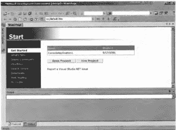

- 6. 在“打开”Windows 菜单中，选择名为“Source”的文件夹，然后选择相应的子文件夹。名为“MSNET”的子文件夹包含 Microsoft .Net 编译器²的所有源代码（见屏幕截图 2 和 3）。

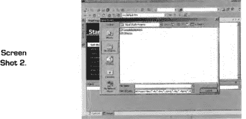

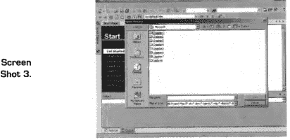

- 7. 从该文件的菜单中选择“另存为”，并将其保存到第 1 步中创建的目录（见屏幕截图 4）。

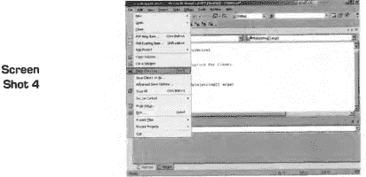

你的程序现在已链接到该目录。你可以从驱动器中取出 CD-ROM（记得根据需要为每个程序重复这些步骤）。要编辑源代码和/或继续编译，请参阅第 1 章中列出的说明。

### 如何阅读本书

本书面向所有想要在有趣而又实用的情境中学习 C# 语言的人。本书分为三个技能层级，以适应不同读者。

**第 1 部分：编程基础**涵盖最基础的部分，包括编程历史、如何设置编译器以及算法。它还介绍了关于 .Net 框架、数据类型、输入和输出命令、遗留编码、基类库、比较和循环、switch 语句、类型转换、装箱和拆箱，以及方法操作（参数、多态和递归）的重要材料。

**第 2 部分：游戏编程基础**也涵盖非常基础的概念——即一维和多维数组、指针（在 unsafe 模式下）、字符串函数和流——但最终会将读者带出新手阶段。其他关键主题包括面向对象编程简介、使用 Windows 应用程序处理图形和声音，以及实时游戏编程技术。经验丰富的 C/C++ 程序员通常可以从这一层级开始，把前面的部分作为方便的参考点。

**第 3 部分：面向对象编程**从结构体开始，但很快转入类以及面向对象编程背后的原理。前面讨论了字段、方法和运算符重载，随后继承、虚函数、委托和异常处理扩展了我们的能力。在这里，我们还将扩展 .Net 环境的原则，包括反射、线程、同步、CLS（公共语言规范）合规性、语言规范，以及对基类库的进一步研究。

本书也可供任何在标准大学课程中学习 C# 的人使用。因此，本书涵盖冒泡排序、搜索算法以及大多数老师最喜欢的默认设置等主题（尽管我个人更喜欢使用括号表达式）。

除了逐章阅读本书之外，你还可以调整学习路线，采用其他路径或方法。一个例子是从第 2 章直接进入第 4 章，因为游戏部分可能不吸引你。或者，你可以跳过第 3–5 章中列出的一些较难的游戏概念，在完成传统学习后再回到那些材料。不过，建议你最终完成这些游戏，以便应用面向对象编程和 .Net 设计中一些更高级的概念。

### 从作者处获取帮助

由于本书旨在教授一种庞大且不断扩展的 C 语言，我觉得有必要加入一个持续更新的电子邮件论坛和互联网通讯，也就是一个将包含任何新增或改进功能的论坛，包括编程错误以及修复问题的方法。我还想通过生成网站列表、源代码（包括街机风格克隆游戏）以及任何其他新进展来鼓励所有初学者程序员。要注册获取免费的互联网通讯，或写信提出问题或请求，请将电子邮件发送至 Plague@iwon.com。

### 学生视角

本书是从学生的视角编写的。我们尽一切努力让读者以合乎逻辑且循序渐进的方式前进。几乎每个关键字和命令都有一个可运行的（实时代码）示例，并且在必要时，会向读者提供通常由讲师讲授或从以前某种编程语言中获得的背景信息和故障排除部分。

有几节内容涉及编程的次要步骤，例如 C# 到 Windows 的设置、编译器设置以及游戏编码主题。游戏编码虽然被许多讲师认为微不足道，却是展示 C# 面向对象潜力的最有效方式之一。每个新游戏在构建时都力求最大限度地利用该章所学的编码。这些游戏虽然有趣，也迫使读者超越简单逻辑，回答并非预先设计或局限于简单文本输出的问题。

各章遵循一种近乎演进的模式，从 C# 基础开始，逐步介绍结构化、模块化和面向对象编程（OOP）的技术，最后一节显然以 Microsoft .Net 架构的最新进展作结。我们的文本概念和开发的游戏都是这一演进的一部分，而这一演进主要决定了哪些游戏能够并将会使用可用的关键字和命令来开发。

## 前言

请记住：为了获得最佳效果，我建议使用与我相同的编译器和操作系统；Microsoft Visual C# .Net 2003/2005 beta，在 Windows XP 家庭版或专业版下。


书评：*《华盛顿邮报》* 说，“我不知道该说些什么。” *《纽约时报》* 盛赞道，“它是邮寄来的。” 而 Ebert & Roeper 说：“我们不评论书籍，请别再打电话了！”

## 关于作者

当我还是个男孩时，我有一台“TRS Color Computer”。它连接到电视机上，并带有一个盒式磁带驱动器。我用它编写简单的文字风格游戏和 AI 驱动的国际象棋程序。几年后，我母亲给我买了一台 Amiga 500（一台高性能游戏电脑）。我用它编写像 Tennis、Space Fighter 和 Rat Racer 这样的简单游戏（我发誓，都是以教育之名）。收到那台电脑后不久，我进入了大学。在那里，我获得了两个学位，第一个是数学，第二个是工程。最终我不得不卖掉那台旧 Amiga，并购买/组装一台更新的 IBM/Intel 兼容电脑。升级那台电脑实际上变成了一种职业，先是从事在线技术支持，最终转向游戏编程。毕业后，我把才能转向写作，或者更具体地说，转向技术写作，但你应该已经猜到了。我还设法结了婚、买了一栋小房子、赢了几场柔术锦标赛，嗯，还有那整套获得超能力的事情。至于我的 TRS Color Computer，我拔掉它的插头，把它当作玩具打字机送给了我的侄子——想象一下 Pentium IV 变得如此过时的那一天。


桌子上有一只鼠标，桌子上有一只鼠标……
我确定这里出了个错，有谁知道为什么我的桌子上有一只鼠标？


## 编程基础 I


Taylor & Francis  
Taylor & Francis Group  
http://taylorandfrancis.com

## C# 从入门开始 1

> "一切应尽可能简单，但不能更简单。"
> —阿尔伯特·爱因斯坦

本章涵盖了 C# 语言的基础方面，包括其历史、编译器、算法、变量以及基类库的使用。每个部分都旨在促进快速、轻松的入门，并确保在编程和问题解决方面建立坚实的基础。特别关注新程序员需要了解和/或可能感到困惑的内容；不过这些部分可以快速完成。设有几个部分专门介绍历史和理论，但本章的核心是编程。两个部分促进良好的编程习惯，还有一个部分介绍运行时、编程和编译器错误（即使你没有遇到麻烦也建议阅读）。如果你浏览了课程，你会知道这一章不包含任何游戏，但不要被它迷惑。这里涵盖的所有概念对于游戏来说与商业和/或数学相关主题一样重要。

### C# 语言概述

C# 是一种高级或中级编程语言（顺便说一下，编程语言是用于与计算机通信的单词、短语和语法规则的集合）。虽然存在许多高级编程语言（BASIC、JAVA、FORTRAN、Pascal、Lisp、ADA、Modula-2 和 Logo），但很少有语言达到原始 C 和 C++ 语言的流行程度。C 和 C++ 已被用于创建从操作系统和文字处理软件包到其他高级语言编译器的所有内容。C 和 C++ 已成为超过 50% 所有编程应用的首选编程语言，并且随着面向对象编程和互联网应用的进步，Managed C++ 和 C# 无疑将推动 C 语言的流行延续到本千禧年。

### 关于 C# 的一点历史

C 语言由 Dennis Ritchie 在 1970 年代于 AT&T Bell 实验室工作期间开发。在 C 之前，有一种名为 B 的语言由 Ken Thompson 开发。虽然存在 A 语言，但 B 实际上是从 Basic Combined Programming Language（BCPL）开发而来，而 BCPL 是由另外两种语言 CPL 和 Algol 60 组合而成。C++ 的面向对象部分归功于另一种名为 Simula 67 的语言。CPL 催生了 BCPL；BCPL 催生了 B；B 催生了 C；C 催生了 C++；C++ 催生了 C#。1979 年，Bjarne Stroustrup（也在 AT&T Bell 实验室）开发了 C++ 的第一个版本，使其成为 C 语言的增强版本（最初称为带类的 C）。C++ 在添加了由 Alexander Stepanov 和 Meng Lee 在 Hewlett-Packard 开发的标准模板库（STL）后得到了显著增强。STL 大量基于 Rensselaer 理工学院的 Stepanov 和 Musser 之前的工作。

C 和 C++ 都迅速在能力和使用上传播，但最终所有新增功能和扩展导致了不兼容和挫败感。创建了两个标准，首先是 1983 年的美国国家标准学会（ANSI）C 标准，然后是 1998 年的美国国家系统信息标准和国际标准化组织（ISO）C/C++ 标准（注：C 在第二个标准中也被更新）。1998 年的 ANSI/ISO 标准通常被称为 Native C++，而 Microsoft 的 .Net 扩展被称为 Managed C++。C# 在其首次发布时也根据 2001/2002 年 ECMA 认证标准进行了标准化。

C# 由以首席架构师 Anders Hejlsberg 领导的 Microsoft 程序员团队开发。它旨在补充为流用户和内联网/互联网程序员所需的应用开发。C# 无疑是有史以来最复杂的语言之一，与整个 .Net 架构类似，它将改变程序员未来多年的编程思维方式。

Hejlsberg 还负责 Microsoft 的 Visual J++、Turbo Pascal 和 Delphi 的开发，他因此于 2001 年初获得了 Dr. Dobb's Journal 卓越编程奖。有关 Turbo Pascal、Visual J++ 和 Dr. Dobb's Journal 奖的历史的进一步信息，你应查阅当地图书馆…现在让我们回到正题。


正如你所见，C# 源自更简单的语言。  
嘿，我以为它是程序员创造的。

### 什么是 .NET 框架？

.Net 框架是一个多任务、基于类的编程库和接口，允许数据的互操作交换和执行。作为一个库，.Net 基类与传统的 Windows API 函数集一样强大，但具有完全面向对象的额外优势。面向对象编程（本书中已解释）是一种用于开发程序的实用方法，促进代码的可重用性和可靠性。.Net 运行时（也称为通用语言运行时或 CLR）充当外壳或中间环境，帮助操作系统执行程序。

.Net 框架还允许程序互操作，需要通过通常称为 Microsoft 中间语言（MSIL）和/或通用中间语言（CIL）的中间语言管理的通用类型系统（CTS）。中间语言不应与 Java 的解释型字节码混淆，后者无法被编译。Microsoft 还开发了一种称为 JIT（即时）编译的次要编译类型。在 JIT 下，程序不仅安装到我们的系统中，而且代码会针对处理器进行优化。此外，JIT 编译通过将编译限制在所需部分来缩短基本启动时间，这也提高了整体性能。

.Net 架构还提供一些有趣的优势，包括内存管理（也称为垃圾回收）和零影响安装。垃圾回收（源自 Java）是一种系统性地消除不再被引用的已分配内存的方法。虽然垃圾回收降低了程序员控制内存释放的能力，但它有助于防止危险的内存泄漏，并为程序员节省本应用于实现析构函数的时间。同样，零影响安装的开发是为了通过消除因版本错误引起的错误，为程序员和消费者节省许多小时的挫败感。在正常的 Windows 操作下，典型的 `*.dll` 类型文件将作为集中引用的一部分包含在内，这反过来又使其在安装新版本时可能被删除。如果该新版本不是完全向后兼容，则替换文件可能导致程序失败。通过零影响安装，相同文件的不同版本可以并排存在，从而消除此问题。

此外，.Net 提供增强的代码安全性、应用程序域限制、强类型和命名空间。安全性的提高允许消费者控制授予任何单个程序的访问级别，MSIL 还在程序执行前确定程序请求的访问级别（这可能有助于防止一些不诚实的程序员损坏我们的文件）。*应用程序域限制*通过使用*虚拟内存屏障*来防止相互关联的应用程序之间的内存冲突，这些屏障限制访问，但不会造成处理器延迟。（此过程通过 MSIL 控制。）*强类型*也由 MSIL 管理，要求我们明确说明数据类型，从而防止模糊的运行时错误；不幸的是，这也阻止我们使用模板（C# 编程语言中排除）。最后，*命名空间*最初设计用于防止 Native C++ 命名冲突，现在是 .Net 架构的要求，其中所有类型必须使用显式或全局命名空间定义。

### 受管代码和程序集

*受管代码*是用于定义在 .Net 框架下实现的编码的术语，而术语*native*和*unmanaged code*用于表示绕过此新架构并直接通过 Windows API 实现的编码。*程序集*是存储受管代码的单元。程序集还包含称为*元数据*的信息包：元数据包跟踪程序集的内容，包括其对象、方法和类型。共享程序集存储在称为程序集*缓存*的中央区域。元数据包存储在这些程序集内部的称为*清单*的区域中。


### 算法

在我们开始编写程序之前，我们必须先学习一点关于如何设计它们的知识。设计程序的第一步是编写其算法。编写算法与编写程序不同；它不需要使用计算机语言，甚至不需要计算机。算法可以应用于任何任务或任务集。写下指示可能是算法最常见的例子之一；食谱、饮食和数学解法也是如此。一些初学者程序员不理解算法的必要性，反而认为他们可以在编写过程中或在完成编码的介绍部分后规划程序。然而，这种编程风格通常会导致危害，例如花费额外的时间进行问题解决和/或花费更多时间重写代码以纳入每个新想法或功能。因此，最好始终从算法开始。因此，我包含了用于编写第 3 章教授的第一款街机风格游戏的 C++ 版本的算法大纲——乒乓球（参见示例 3.5）。

### 示例 1.1. 乒乓球的简略算法。

- 1. 创建一个可通过 Windows 控制台设置访问的有效 Windows 句柄。
- 2. 编写一个用于绘制玩家角色的函数。
- 3. 包含一个绘制/清除屏幕的函数。
- 4. 将大多数变量定义为单个类的成员，最显著的例外是颜色设置。
- 5. 设置变量/成员，将球设置为随机方向。
- 6. 创建一个在游戏结束时结束的 while 循环。

在 while 循环内部

- 7. 编写一个函数，使用空白字符调用和/或完整的清屏函数的组合来移除我们的残留图像。
- 8. 设置颜色：由于这些颜色永远不会改变，这可以从 do-while 或内部 while 循环中完成。
- 9. 显示玩家、球和分数（开始时为 0 到 0）。
- 10. 编写一个从键盘读取玩家输入的函数。
- 11. 编写一个推动球的函数。
- 12. 编写一个函数来限制玩家可以移动的区域。
- 13. 球反弹时加入声音。
- 14. 检查球和玩家是否发生碰撞（参见 碰撞检测：运动中的球）。球应从玩家处反弹。
- 15. 如果球到达屏幕末端而玩家不在那里，则给另一名玩家加分。现在，重置球。
- 16. 重复循环直到任一玩家得分达到指定数量。
- 17. 询问玩家是否想再次游戏。记住一个好的游戏循环应始终允许玩家选择再次游戏。
- 18. 结束或重复游戏。

如果这看起来有点长，请记住，实际的乒乓球子程序是超过 100 页长的程序的一部分，甚至最简单的专业设计的程序往往会超过 1000 页。算法不必包含完整的句子，具有正确的语法，甚至也不必完全使用英语。然而，有一个可以实际阅读并列出解决方案步骤的东西是很重要的。此外，在编写供他人共享的算法时，切勿假设他们可以阅读用 C# 编写的内容；毕竟，他们可能计划用另一种语言编写程序，例如 VISUAL BASIC、托管 C++ 或只是老式的 C。

### .NET 编译器

传统的编译器将高级语言翻译成机器自己的语言，恰当地命名为机器语言。程序员开发了 C 和 C++ 等高级语言，以弥合人类语言与计算机由零和一组成的二进制代码之间的差距。C# 和其他高级语言看似困难，但其难度与试图理解机器语言中发现的无尽的零和一序列，例如 01010011 00010100 00011101，相比之下微不足道。除了机器语言之外，还有一种称为汇编语言的低级语言，它充当 C 与该二进制代码之间的中介。然而，C# 和 .NET 框架的出现取代了这一概念。

关于编译的新思维方式是将其分为两个步骤：第一步是转换为 MSIL，这允许在编译器的模拟环境内构建和测试我们的产品。第二步 JIT 编译，直到执行时刻才实现，因此得名即时编译。借助这种新的编译形式，微软能够实现多个新功能，包括基于角色类型和代码类型的 security、内存类型安全和互操作性。基于角色类型和代码类型的 security 与程序的身份基础以及授予该代码的访问级别相关。如果未经授权的程序试图在未经 MSIL 明确许可的情况下访问/修改任何其他应用程序，则不允许执行该程序。类型安全也是如此；如果 MSIL 环境检测到任何新执行的程序将导致内存地址冲突，则该程序也将被拒绝系统访问。此外，这种新方法使我们的编码达到了全新的代码互操作性水平；借助它，我们可以在不同语言编写的对象之间混合，跨引用步骤，甚至可以将这些对象用作继承类。对于可互操作和内部文件也存在反射比较的潜力（详见后续章节。）

> **通用语言规范：** 虽然 .NET 框架旨在促进语言互操作性，但使用 C# 语言并不保证那种程度的交互。然而，我们可以通过通常只是对整体编程方法进行少量调整，使 C# 符合 CLS。例如，我们必须调整程序以避免使用不安全编码（具体来说是指针表示法）。此外，我们必须避免使用某些数据类型，即 `sbyte`、`ushort`、`uint` 和 `ulong`。最后，我们必须限制命名实践，以避免与 Visual Basic 无法区分大小写设置冲突（例如，`Class1` 和 `class1`）。

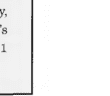

### 编译和执行

虽然在前面的章节中概述了适当的编译和执行的理论，但我们仍然没有建立应用程序实现的实用方法。在我们的程序能够在有或没有外部 .NET 环境的情况下执行之前，它们必须首先经过一个称为编译的过程。因此，首先，你需要一个称为编译器的计算机程序。我推荐微软的 C# .NET，无论其包装标准如何（试用版、标准版、专业版或企业版）。我还包含了有关如何设置这些编译器的简单分步说明。

### Microsoft Visual C# .NET 快速设置：

- 1. 确保编译器已正确安装并正常工作。
- 2. 加载并激活 C# 编译器。关闭任何非必要的窗口。
- 3. 从“文件”菜单中选择“新建”，然后选择“项目”（参见屏幕截图 1.1）。

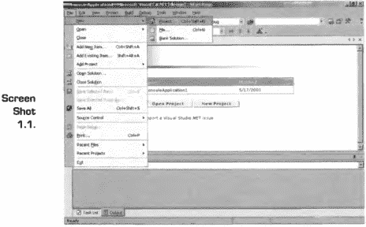

- 4. 在这一点上，应该会打开第二个窗口。选择标记为“控制台应用程序”的图标（参见屏幕截图 1.2）。

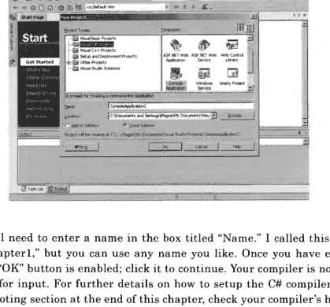

屏幕截图 1.2。

您需要在标题为“名称”的框中输入名称。我将此第一个示例称为“Chapter1”，但您可以使用任何喜欢的名称。输入名称后，“确定”按钮将被启用；点击它继续。您的编译器现在已设置完成并准备好输入。有关如何设置 C# 编译器的更多详细信息，请参阅本章末尾的故障排除部分，查看编译器的帮助文件，或查看微软的在线指南：http://msdn.microsoft.com/vcsharp/。

现在，不考虑任何特定编译器或系列，我们希望测试以确保一切设置正确并正常运行。我们将通过输入所谓的“无操作”程序来做到这一点，即一个不产生显著输出的程序，但通过编译，传达我们的编译器已准备就绪的消息。此程序中实际使用的命令此时并不重要。

- 5. 输入 C# 源代码与在文字处理器中输入文本一样简单。只需确保右侧较大的窗口处于活动状态。请注意，活动窗口通常由闪烁的光标标记。


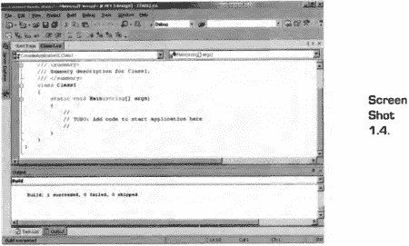

如果你在此步骤遇到错误，说明项目未正确设置。请重复所有步骤，或参阅本章末尾的“故障排除”部分。

- 7. 最后，要执行程序，只需点击“调试”菜单并选择“开始执行（不调试）”。你的“什么都不做”程序现在将产生一个大窗口，要求你“按任意键继续”。这样做将结束程序（见屏幕截图 1.5 和 1.6）。

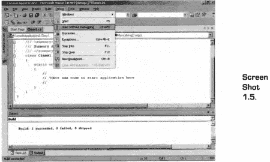

屏幕截图 1.6

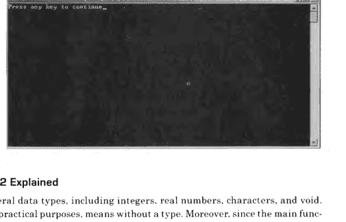

## 示例 1.2. 详解

C# 使用多种数据类型，包括整数、实数、字符和 void。就所有实际用途而言，void 意味着没有类型。此外，由于 main 函数通常不需要数据类型，因此 void 是最简单的选择。诸如 int、float、double、char 和 void 等数据类型将在本章后面详细解释。

在指示 main 方法时，最常提到的是 static void Main (string [] args) 和 static void Main () 命令。main 方法充当程序其余部分的控制器。在这些初始阶段，我们将把所有命令写在 main 方法内部，但稍后随着程序的发展，我们将迁移到执行特定任务的其他子程序。届时 main 方法将充当这些子程序的控制器。以这种方式编写程序类似于一种较旧的编程方法，称为结构化编程，它是 C 和 Native C++ 中非常重要的一部分，而面向对象的方法最终将超越它。

开始和结束花括号（也称为块）只是标记程序环境的开始和结束。计算机将这些符号识别为标记，告诉它从哪里开始以及在哪里结束。没有这些标记，程序将不知道哪些代码属于哪个方法。因此，每个块表示一个子环境，而命名空间的外部块表示全局环境（注意：注释将在下一节解释）。

## 注释

注释不过是系统注释，通常由程序员编写，用于标记或解释某段日后可能对我们来说不那么明显的文字。例如，我们可能会提到 main 方法以某个特定的花括号结束，或者我们需要修改或修复一两行以提高系统性能。示例 1.3 和 1.4 演示了单行注释和多行注释的一般用法，而示例 1.5 演示了第三种伪注释，它是 C# 操作互联网资源能力的一部分。

## 示例 1.3. 单行注释。

```csharp
using System;
namespace Chapter1 {
    class Class1 {
        static void Main () { // Main method
            // Begin executable statements
        } // End main method
    }
}
```

## 示例 1.4. 多行注释。

```csharp
/* Longer comments (comments spanning two lines or more) are
 * often set aside with these special markers.
 * Comments are ignored by the compiler and thus
 * do not affect the program's speed. */
using System;
namespace Chapter1 {
    class Class1 {
        static void Main () { /* Main method */
            /* Put something here please! */
        } /* End main method */
    }
}
```

添加额外的前斜杠不会使我们的注释失效，但它们会开启我们的 C# 代码以接受可扩展标记语言（XML）命令。XML 命令作为集体 .Net 框架的一部分包含在内，以使网页设计更快、更方便（见示例 1.5）。

## 示例 1.5. XML 命令。

```csharp
using System;

namespace Chapter1 {
    /// Place your XML tags here
    /// ...
    class Class1 {
        static void Main () {
            /* this is still a do nothing program */
        }
    }
}
```

## 屏幕输出

现在我们已经掌握了编写“什么都不做”程序的基础知识，让我们看看是否能在其中添加除注释以外的内容。传统上，第一个程序会显示消息“Hello, world!”然而，由于本书强调游戏编程，还有什么比“Game Over?”更合适的呢？（见示例 1.6）。

## 示例 1.6. 屏幕输出 1。

```csharp
using System;

namespace Chapter1 {
    class Class1 {
        static void Main () {
            Console.Write ("Game Over!\n");
        }
    }
}
```

现在，我们的“什么都不做”程序中添加了两个命令，实际上使它做了一些事情。使“Game Over”字样出现的实际命令可以简化为：

```csharp
Console.Write ("Game Over!");
```

将光标移动到下一行的命令是：

```csharp
Console.Write ("\n");
```

我们在示例 1.6 中合并了这两个命令。将 Console.Write("Game Over!"); 替换为 Console.Write(""); 将得到一个似乎什么都不做的程序，因为内引号和外引号之间没有写入任何内容（将“Game Over!”改为“Hello, World!”会产生经典结果——见示例 1.7）。

## 示例 1.7. 屏幕输出 2。

```csharp
using System;

namespace Chapter1 {
    // Purpose: Displays the words "Hello, world!"
    class Class1 {
        static void Main () {
            Console.WriteLine ("Hello World!");
        }
    }
}
```

你可以将“Hello, World”这些词替换为几乎任何其他句子，或者你可以通过重复 Write 命令向程序添加更多句子。示例 1.8 显示了一个具有两行输出的程序。请随意输入几行你自己的内容。

## 示例 1.8. 屏幕输出 3。

```csharp
using System;

namespace Chapter1 {
    class Class1 {
        static void Main () {
            Console.Write ("Hello, Programmer,\n");
            Console.WriteLine ("How are you today?");
        }
    }
}
```

| 符号 | 用途 |
|---|---|
| `\a` | 警报（铃） |
| `\b` | 退格 |
| `\f` | 换页 |
| `\n` | 换行 |
| `\r` | 回车 |
| `\t` | 水平制表符 |
| `\v` | 垂直制表符 |
| `\?` | 字面引号 |
| `\'` | 单引号 |
| `\"` | 双引号 |
| `\\` | 反斜杠 |

表 1.1. 转义序列。

## 换行字符

上一节中，反斜杠和 n 符号（\n）被用在一对引号内，但它们并没有与“Game Over”或“Hello, World!”这些词一起显示到屏幕上。这个组合称为换行字符，它充当一个标记，告诉程序何时移动到下一行。换行字符是众多称为转义序列的特殊字符之一（见示例 1.9）。有关转义序列的完整列表，请参见表 1.1。

## 示例 1.9. 换行字符。

```csharp
using System;

namespace Chapter1 {
    class Class1 {
        static void Main ( ) {
            Console.Write ("Hello, Programmer. ");
            Console.Write ("How are you today? \n");
        }
    }
}
```

> 在这个程序中，换行字符没有放在短语“Hello, Programmer.”之后。结果，程序没有移动到新行，因此“How are you today”没有转移到第二行，而是产生了单行“Hello, programmer. How are you today?”示例 1.10 显示了类似的结果。


## 示例 1.10. 换行字符的更多练习。

```csharp
/* more practice with the newline character */
using System;

namespace Chapter1 {
    class Class1 {
        static void Main() { //Begin main
            Console.Write ("This is line 1\n");

            Console.Write ("This is line 2\n");
            Console.Write ("This is line 3");
            Console.Write ("This is still line 3\n");
            Console.Write ("This is line 4\n");
        }
    }
}
```

> 我们还可以禁用换行字符（或任何其他转义序列）的自动格式化，从而将代码作为实际文本重现。这通过使用 @ 符号完成，如示例 1.11 所示。

## 示例 1.11. 使用 @ 符号禁用转义序列。

```csharp
using System;

namespace Chapter1 {
    class Class1 {
        static void Main() {
            Console.Write(@"\n This is line 1");
            Console.Write("\n This is line 2");
            Console.Write("\n This is line 3");
            Console.Write(@"\n This is still line 3");
            Console.Write("\n This is line 4\n");
            Console.Write(@"\n This is line 5\n");
        }
    }
}
```

### WriteLine 命令

用换行字符返回光标位置的另一种替代方法是将其替换为 `WriteLine` 命令。

```csharp
Console.WriteLine ("");
```

`WriteLine` 命令的编写方式与 `Console.Write` 命令类似，但它不需要换行字符。它也可以用作输出流或语句，并且（如上所示）可以在没有任何其他注释或信息的情况下引用。为了演示，我们将修改上一个示例，将其 `Write` 命令替换为 `WriteLine` 语句（见示例 1.12）。

## 示例 1.12. WriteLine 命令。

```csharp
using System;

namespace Chapter1 {
```


```csharp
class Class1 {
    static void Main() { // Begin main
        Console.WriteLine("This is line 1");
        Console.Write("This is line 2\n");
        Console.Write("This is line 3");
        Console.Write(" This is still line 3\n");
        Console.Write("This is line 4\n");
    }
}
```

我们还可以通过连接语句并用换行命令分隔，将独立的句子组合到单个命令中，这可以使用 Write 或 WriteLine 命令完成（见示例 1.13）。

### 示例 1.13. WriteLine 命令（续）。

```csharp
using System;

namespace Chapter1 {
    class Class1 {
        static void Main() { // Begin main
            Console.WriteLine("This is line 1\nThis is line 2");
            Console.Write("This is line 3" + " This is still line 3\n"
                + "This is line 4\n");
        }
    }
}
```

从用户的角度看不会有任何区别，但对程序员来说，编码方式却有相当大的变化。示例 1.14 通过用 WriteLine 命令替换每个换行字符来结束本节；重新执行最后这几个程序应得到相同的结果。

### 示例 1.14. 用 WriteLine 替换换行字符。

```csharp
using System;

namespace Chapter1 {
    class Class1 {
        static void Main() { // Begin main
            Console.WriteLine("This is line 1");
            Console.WriteLine("This is line 2");
            Console.Write("This is line 3");
            Console.WriteLine("This is still line 3");
            Console.WriteLine("This is line 4");
        }
    }
}
```

## 分号

当编译器检测到分号（;）时，它就知道命令行已经结束，应该转向下一组指令。在处理经常以不同长度编写或跨越多行延伸的命令时，这一点尤其重要。有这样的要求也会限制或约束编译期间发现重叠错误的可能性。分号始终放在完整语句的末尾，并且始终用于表示该语句的结束。不需要分号的命令通常直到特定区段或命令集结束才终止。有些编程命令直到程序本身结束才终止，因此不需要分号。

## 空白字符

*空白字符* 就是用于分隔编码术语的空白空格。变量名和关键字需要这些分隔，但在许多其他情况下，这些空白字符会被直接忽略。然而，重要的是要记住，这些空格并不表示行尾、任何编码的终止或任何其他此类控制。你应该注意不要滥用这种分隔命令和行的能力（滥用是指任何此类间距导致程序员视觉混淆的情况）。

## 预处理器指令

如果你曾经使用过 C 或 C++，你可能会想知道我们什么时候讨论预处理器指令，因为正是通过使用这些指令，我们才能访问大部分所谓的运行时库。如果你从未听说过预处理器指令，或 include 和/或头文件这些术语，那么这里简要介绍一点历史。

包含文件（列为 `#include <filename>`）是一种简单的通知信息，允许将专用文件添加到程序中。实际上，它们的意思是“包含这个”，其中“这个”是后面跟随的任意头文件。井号始终放在 include 语句前面，以便编译器能够识别它。所访问的文件本质上是一些小型附属程序，通常执行一些有用的操作，比如将文字打印到屏幕，甚至打印到打印机。include 语句以及它们链接到我们程序中的函数，对于 C 和 C++ 编程至关重要。然而，情况不再如此，因为 C# 已经消除了对此类引用的需求，转而使用面向对象的方法。这种方法实际上定义了 .NET 架构，也定义了基类库（Base Class Libraries）的含义（不必担心，所有这些主题将在本文后面更详细地解释）。

> **C++ 程序员注意：**
>
> 虽然 `using` 和 `#include` 语句看起来设计相似，但这种假设是不正确的。事实上，`using` 特性的主要目的仅仅是允许使用缩写的类名引用。

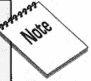

## 缩进

缩进是一种让程序看起来整洁有序的简单方法。所有示例中都展示了缩进，它只是指将命令从段落的第 1 行向内缩进几个空格，以表示它们是该段落的一部分。当一行没有缩进时，可能意味着它不属于该段落。缩进虽然更易于阅读，但对源代码只有装饰性效果，不会影响计算机/编译器看待代码的方式。

## 变量命名

无论使用哪种语言，存储和/或操作通用数据的最简单方法始终是使用变量。程序使用变量来存储和检索字符数据和数值数据。虽然我们会把技术/编码部分留到接下来几节，但在继续之前，至少需要理解命名过程。命名变量有三条基本规则：

- 变量只能由字母、数字和下划线符号组成。
- 变量必须始终以字母或下划线符号开头。（注意：下划线和编码前缀通常由大型项目和公司保留。）
- 变量不能与保留字或关键字同名（完整关键字列表见表 1.2）。可以使用特殊的 @ 符号来覆盖此限制，如 @char，但这通常没有必要。

除了这些变量规则外，还应遵循一些良好的命名实践。

### 命名建议

- 为变量取一个描述性名称，例如 player_1、ball 或 joystick2；描述性名称可以降低混淆的可能性。
- 编写变量时使用一致的风格，例如 alien_1 和 alien_2，或 Alien_1 和 Alien_2。不要像 AliEN_1、AliEn_1 那样随意混用大小写字母。与 C 和 C++ 一样，C# 是区分大小写的语言——它将大写和小写字母视为不同的符号，因此这些随意命名的变量不会被读取为相同的值。
- 为了保持一致，你可以采用两种风格之一：Humpback，将每个单词的首字母大写（PlayerOne）；以及 Camel（也称为 Pascal），将内部单词的首字母大写，但首字母不大写（playerOne）。这些表示法是大多数公司（包括 Microsoft）的标准。
- C 和 C++ 还遵循一种称为匈牙利命名法（Hungarian Notation）的特殊命名过程。这种命名法会给数据类型加上标识其声明类型的首字母。由于 C# 使用基于对象的方法，使用匈牙利命名法的实用性有限。然而，为了向后兼容和历史目的，了解这种命名法是有帮助的（参见本章后面的匈牙利命名法部分）。

|  |  |  |  |  |  |
|---|---|---|---|---|---|
| abstract | decimal | float | namespace | return | try |
| as | default | for | new | sbyte | typeof |
| base | delegate | foreach | null | sealed | uint |
| bool | do | goto | object | short | ulong |
| break | double | if | operator | sizeof | unchecked |
| byte | else | implicit | out | stackalloc | unsafe |
| case | enum | in | override | static | ushort |
| catch | event | int | params | string | using |
| char | explicit | interface | private | struct | virtual |
| checked | extern | internal | protected | switch | void |
| class | false | is | public | this | volatile |
| const | finally | lock | readonly | throw | while |
| continue | fixed | long | ref | true | |

表 1.2. 关键字。

示例 1.15 演示了如何使用名为 `OurVariable` 的变量，并使用了本节尚未完全解释的若干命令。因此，我们只需要关注突出显示的行。你应该多次编辑并重新编译此程序，测试不同的变量名。记住，只要遵循上述规则，你可以使用任何你想要的名称。


### 示例 1.15. 命名变量。

```csharp
using System;

namespace Chapter1 {
    class Class1 {
        static void Main() {
            int OurVariable; // an integer data type.
            OurVariable = 1; // we can assign the value 1 to the variable
            Console.WriteLine("The number is " + OurVariable);
        }
    }
}
```

请记住，如果更改了声明行中的名称，那么也必须更改赋值行和引用行中的名称。

| 其他可能的变量名包括： |  |  |  |  |
|---|---|---|---|---|
|  | Number | integer | whole_number | computer_data |
| - | Lives | game_lives | deaths | bombs_on_ship |

## 声明变量和整数数据类型

共有五种基本数据类型：整数（int）、浮点数（float）、双精度浮点数（double）、字符（char）和空类型（void）。每种类型都有特定用途，但要正确应用这些变量，我们必须先学习如何声明它们。整数是任意正整数或负整数（见示例 1.16）。要声明整数，请使用关键字 int，后跟变量名和分号（请记住，分号用于结束命令行）。我们可以使用常见方法或显式声明其 CTS 类型来声明数据类型。我们还可以通过重复 int 关键字，或按照逗号运算符的用法在一行中添加其他变量，在一个程序中声明多个变量（见示例 1.17 和 1.18）。

### 示例 1.16. 整数的数轴。

-10, -9, -8, -7, -6, -5, -4, -3, -2, -1, 0, 1, 2, 3, 4, 5, 6, 7, 8, 9, 10...

### 示例 1.17. 使用常见方法声明变量。

```csharp
using System;

namespace Chapter1 {
    class Class1 {
        static void Main() {
            // these variables were declared using the data type integer
            int Number1, Number2;

            Number1 = 1; // Their assignment values both equal one.
            Number2 = 1;

            // And, they’re both displayed using the WriteLine function.
            Console.WriteLine("The first number is " + Number1
                + "\nThe second number is " + Number2 + "\n");
        }
    }
}
```

### 示例 1.18. 使用 CTS 类型声明变量。

```csharp
using System;

namespace Chapter1 {
    class Class1 {
        static void Main() {
            System.Int32 Number1, Number2;

            Number1 = 1;
            Number2 = 1;

            Console.WriteLine("The first number is " + Number1
                + "\nThe second number is " + Number2 + "\n");
        }
    }
}
```

整数数据类型占用的内存少于其他基本数值数据类型；因此，对于不需要浮点（实数）变量的编程任务，它是首选格式。你也可以通过将该关键字替换为其他七种预定义整数数据类型中的任意一种来增大或减小整数的存储大小：byte、sbyte、ushort、short、uint、ulong 和 long。byte 和 sbyte 需要的系统 RAM 最少，分别分配 8 位无符号和有符号空间，范围分别为 0 到 255 和 -128 到 127。ushort/short 也会减少变量所需的存储空间，而 ulong/long 则会增加该空间。增大存储大小可以输入更大的整数，而减小存储大小则能节省系统内存（见示例 1.19）。

### 示例 1.19. 使用数据类型 ulong/long 和 ushort/short。

```csharp
using System;

namespace Chapter1 {
    class Class1 {
        static void Main() {
            ushort Number1; // unsigned short
            long Number2;   // long integer

            Number1 = 1;
            Number2 = 1;
            Console.WriteLine("The first number is " + Number1
                + "\nThe second number is " + Number2 + "\n");
        }
    }
}
```

无符号数据类型（byte、ushort、uint 和 ulong；所有其他变量默认都是有符号的）实际上并不会修改变量的内存容量，而只是改变这些变量的范围。例如，无符号短整型（ushort）通过将总范围从 -32,768–32,767 调整为 0–65,535，使上限翻倍（完整范围列表见表 1.3）。

## 数据类型 float 和 double

float 和 double 这两种数据类型都是浮点数据类型，因此可以放在一起讲解。浮点运算可以在计算中提供更高的精度。示例 1.20 展示了一些浮点值。

### 示例 1.20. 浮点值。

|  |  |  |
|---|---|---|
| 1.0 | 2.5 | 5.15 |
| 7.146 | 18.001 | 178.01 |

C# 使用关键字 float 和 double 的方式几乎相同，但 double 的精度是 float 的两倍。double 的准确度是 float 的两倍，并且在赋值给常量时不会遭受同样的数据丢失风险。float 的精度范围是七位数字（±1.5 × 10^-45 到 ±3.4 × 10^38），而 double 的范围是 15–16 位数字（±5.0 × 10^-324 到 ±1.7 × 10^308）。示例 1.21 和 1.22 演示了这些关键字。

### 示例 1.21. 使用数据类型 float。

```csharp
using System;

namespace Chapter1 {
    class Class1 {
        static void Main() {
            float Number1, Number2; // float is short for floating point
            Number1 = 1.0f; // using the f converter
            Number2 = 1.1f; // to convert to float

            Console.WriteLine("The first number is " + Number1
                + "\nThe second number is " + Number2 + "\n");
        }
    }
}
```

### 示例 1.22. 使用数据类型 double。

```csharp
using System;

namespace Chapter1 {
    class Class1 {
        static void Main() {
            double Number1, Number2;

            Number1 = 1.0;
            Number2 = 1.1;

            Console.WriteLine("The first number is " + Number1
                + "\nThe second number is " + Number2 + "\r\n");
        }
    }
}
```

## 数据类型 decimal

除了基本数据类型之外，还有几种扩展数据类型（包括前面列出的预定义整数类型，以及几种我们稍后再介绍的高级类型）。本节介绍浮点值中最明显的一种，即 decimal。

当然，decimal 用于计算货币等式，可为美元金额提供最高级别的精度（见示例 1.23）。注意：从字面常量转换为 decimal 数据类型时，需要使用 M 符号来表示十进制金额，例如 1.50M。

### 示例 1.23. 使用数据类型 decimal。

```csharp
using System;

namespace Chapter1 {
    class Class1 {
        static void Main() {
            decimal Number1, Number2;
            Number1 = 1.0M;
            Number2 = 1.1m;

            Console.WriteLine("The first number is " + Number1
                + "\nThe second number is " + Number2 + "\n");
        }
    }
}
```

## 数据类型 character 和 string

字符（char）和字符串数据类型的声明和赋值方式与数值变量相同，主要区别在于它们存储的是字符而不是数值信息。严格来说，数字也包含在字符列表中，但它们的值并不等同于其数值对应值。字符变量使用关键字 char 声明，可以通过用户输入和/或作为声明/赋值的一部分来赋值。它们只能保存单个字符值，并使用单引号赋值。

相比之下，字符串允许存储多个字符。大量单词或句子可以放入单个字符串变量中。字符串还可以从外部来源接收输入，包括直接输入、存储的文件等。它们使用双引号赋值（见示例 1.24）。传统上，字符数据类型消耗的系统 RAM 最少（8 位）；然而，随着新的 Unicode 标准（16 位）的引入，这种情况发生了变化。这一变化代表着向通用字符集迈进，该字符集包含世界上大多数语言，而这当然是国际商务的重要组成部分（第 3 章将更详细地解释 Unicode）。

### 示例 1.24. character 和 string 数据类型。

```csharp
using System;

namespace Chapter1 {
    class Class1 {
        static void Main() {
            char Symbol;
            string Sentence;
            Symbol = 'A';
            Sentence = "This is a string.";

            Console.WriteLine("The first letter in the alphabet is "
                + Symbol + ".");
            Console.WriteLine(Sentence);
        }
    }
}
```


## 关键字 `sizeof` 与不安全代码

与 C++ 一样，C# 可以使用 `sizeof` 关键字来获取数据类型的大小信息。不幸的是，这还需要使用另一个命令 `unsafe`，用于标记该代码的不安全性。使用此类代码的实用性有限，因为它会让我们脱离 .Net 环境，回到 Windows API 的古老世界。然而，回归该标准也有合理的理由；一个是向后兼容性，另一个是性能问题。启用不安全模式的步骤以及一个简单的 `sizeof` 程序，如示例 1.25 所示。

### 示例 1.25：Sizeof 与不安全模式。
```csharp
using System;

namespace Chapter1 {
    class Class1 {
        static unsafe void Main() {
            Console.WriteLine("Byte = " + sizeof(byte));
            Console.WriteLine("Sbyte = " + sizeof(sbyte));
            Console.WriteLine("Ushort = " + sizeof(ushort));
            Console.WriteLine("Short = " + sizeof(short));
            Console.WriteLine("Uint = " + sizeof(uint));
            Console.WriteLine("Int = " + sizeof(int));
            Console.WriteLine("Ulong = " + sizeof(ulong));
            Console.WriteLine("Long = " + sizeof(long));
            Console.WriteLine("Float = " + sizeof(float));
            Console.WriteLine("Double = " + sizeof(double));
            Console.WriteLine("Decimal = " + sizeof(decimal));
        }
    }
}
```

## 在 C# 中启用不安全模式

项目加载到 .Net 编译器后，只需修改该项目的生成配置即可启用不安全模式。

- 1. 从标记为“视图”的菜单中，选择“解决方案资源管理器”选项（见屏幕截图 1.7）。

## C# 与游戏编程
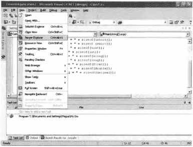
屏幕截图 1.7

- 2. 将打开另一个侧边窗口——请确保突出显示的是项目，而不是文件名。选择“属性”，即该小窗口中显示的第三个图标（见屏幕截图 1.8）。

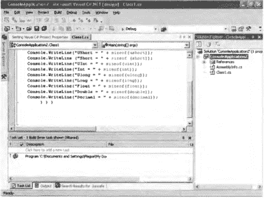
屏幕截图 1.8

- 3. 现在转到标记为“配置属性”的列表。从该子列表中选择“生成”，并单击“允许不安全代码块”下的“False”值。此时会出现一个箭头——使用它选择“True”设置，按“应用”，然后按“确定”完成（见屏幕截图 1.9）。

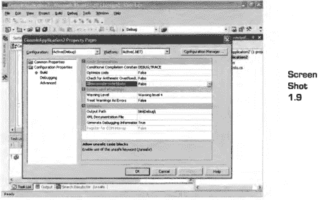

## `void` 数据类型

如前所述，void 是一种不包含任何数据的数据类型。因此，它用于告诉编译器某个变量或返回函数不需要数据，这是合理的，因为 main 函数的结束也是程序的结束，此时不会有程序来接收信息。void 数据类型也最常与引用变量的用户自定义函数（详见第 2 章）以及泛型指针变量（详见第 4 章）相关联。与其他数据类型不同，void 在内存中不占用位置。因此，我们无需以字节为单位来度量其大小。

## 赋值语句

上面示例中还有一个方面需要解释，即等号（也称为 *赋值运算符*）。显然，使用等号意味着使变量等于我们赋值的任何数字，因此这被称为 *赋值语句*。无论将变量赋值给字面常量还是引用变量，这种方法同样有效（如示例 1.26 所示）。

### 示例 1.26：使用等号赋值运算符。
```
number_shown = x + 1;
// Arithmetic will be explained later in this chapter
```

与数学表达式不同，赋值语句总是将接收变量放在左侧。示例 1.26 虽然类似于代数表达式，但不涉及任何数据推断。事实上，使用未引用或未定义的变量来赋值，至少会导致编译器警告（见示例 1.27）。

### 示例 1.27：未定义变量导致的编译器警告。
```
int n, x = 2, y;
// Any variable assigned to another
// variable must by requirement be
// assigned a value itself, before
// that secondary assignment can occur.
n = y + 1;
// variable referenced without being assigned a value.
```

## 类型兼容性：隐式转换

在开始以等式的形式组合数字之前，我们必须确保它们的数据类型是兼容的。回想一下，数值数据类型包括 byte、short、int、long、float、double 和 decimal。计算和赋值这些数据类型的最佳方式是使用匹配的数据类型（例如，*short* 赋给 *short*，*float* 赋给 *float*，double 赋给 double），但如果无法做到，则可以在数据类型之间进行转换。最安全的数据转换总是涉及从较小类型转换为较大类型，例如 short 转 int、int 转 long、long 转 float、float 转 double，或任何从小到大类型的转换（数据类型大小见表 1.3）。任何其他类型的转换都可能导致数据丢失和/或计算错误。由于 float、double 和 decimal 都是浮点值，你在准备算法时可能不会注意到问题（这并不是说不会有问题，只是你可能注意不到）。最糟糕的类型混用是从浮点型到整数型，这在原生 C/C++ 中是允许的，但 C# 要求我们数据类型之间的任何整合都受到严格管制。话虽如此，许多程序员仍然编写涉及这些较大到较小数据类型混用的程序，并依赖编译器默认设置来以有利于他们的方式计算结果。

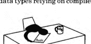

亲爱的美国国税局，关于我最近七次纳税申报：我的程序在数据类型转换方面有一个小错误，虽然这个错误相当有趣……

## 格式化字符串

除了使用 `Write` 和 `WriteLine` 命令显示简单的文本布局外，我们还可以设置文本格式，使程序输出更受控制。这在处理变量时尤其有效。单个数字值表示对相应变量的引用：`{0}`、`{1}` 和 `{2}` 分别引用第一、第二和第三个变量。此外，我们还可以通过插入第二个控制序列来实现右对齐和左对齐，例如插入一个正数，如 `{0, 6}`，表示向右移动，这里即 6 个空格；而插入负控制序列则会导致向左移动：`{0, -3}` 会将光标向左移动三个空格。

我们还可以施加第三层控制，这涉及字符串格式化，例如 `{0, -3:C2}`，其中 `C` 代表本地货币，2 表示要显示的小数位数（完整的格式化字符串列表见表 1.4）。最后，我们可以使用数字符号（#）作为占位符，如 `Console.WriteLine("{0.00}", variable);`（更多示例请参阅“算术”部分）。

表 1.4：用于格式化字符串的命令。

| 字符串格式 | 描述 |
|---|---|
| C | 货币（本地） |
| D | 十进制（小数点） |
| E | 指数（科学记数法） |
| F | 定点数 |
| G | 常规（E 或 F，以节省空间） |
| N | 数字（插入逗号，例如 1,313.02） |
| P | 百分比 |
| X | 十六进制 |

## 算术

在 C# 中使用算术运算符很像使用手持计算器或在纸上做算术。没有任何需要记住的公式或花哨代码，只是加、减、乘、除和求余数（是的，余数，就像你在学习长除法之前需要找出的那种）。由于我们已经看过了加法示例，那就从此处开始。要将两个或更多数字相加，我们必须使用加号（+）。然而，你不能只写“1 + 1 =”然后指望计算机完成其余部分——你必须将其编写成程序，如示例 1.28 所示。

### 示例 1.28：整数加法。
```
using System;

namespace Chapter1 {
    class Class1 {
        static void Main() {
```


```csharp
int number1, number2, total; // these are my variables
number1 = 5;
number2 = 2; // did you notice they're both integers?
total = number1 + number2;

Console.WriteLine("{0} + {1} == {2} ",
    number1, number2, total);
}
}
}
```

> **程序演练**
> 
> 本程序以常见的引言注释开始——using 和 namespace 引用（请记住，在使用基类库时，这些引用是必需的）。接下来，是与 Main 关联的 void 数据类型。然后当我们开始主方法时，我们声明了三个变量，全部为整数类型。我们使用赋值运算符（`=`）将前两个变量的值分别设为 5 和 2。然后，新内容出现了：我们告诉计算机让第三个变量等于前两个变量之和。最后，我们显示了等式“5 + 2 = 7.”。

尝试编译并运行此程序，你会看到 WriteLine 命令显示我们的等式。你还可以将变量改为任意正整数或负整数。重新编译并观察显示的变化。

毫不奇怪，减法、乘法和除法的使用方式完全相同（参见示例 1.29–1.31）。你可以重新输入每个示例，或者只重新编辑第一个示例以匹配这些变化；你可能还想尝试其他数据类型、注释和变量名。

### 示例 1.29. 整数减法。

```csharp
using System;

namespace Chapter1 {
    class Class1 {
        static void Main() {
            int number1, number2, total;
            number1 = 5;
            number2 = 2;
            total = number1 - number2;  /* 5 - 2 */

            Console.WriteLine(" {0,3}\n{1,3}\n ---\n {2,3}",
                number1, number2, total);
            Console.WriteLine("\n {0,3:D}\n{1,3:D}\n ---\n {2,3:D}",
                number1, number2, total);
            Console.WriteLine("\n {0,3:X}\n{1,3:X}\n ---\n {2,3:X}",
                number1, number2, total);
        }
    }
}
```

要执行乘法和除法，请分别使用星号（*）和正斜杠（/）。

### 示例 1.30. 使用 float 数据类型的乘法。

```csharp
using System;

namespace Chapter1 {
    class Class1 {
        static void Main() {
            float number1, number2, total;
            number1 = 5.0F;    // When using float include an F
            number2 = 2.0F;
            total = number1 * number2;  /* 5 Multiplied by 2 */

            Console.WriteLine("  {0,3:C2}\nx  {1,3:F}\n ---\n  {2,3:C2}",
                number1, number2, total);
        }
    }
}
```

### 示例 1.31. 使用 double 数据类型的除法。

```csharp
using System;

namespace Chapter1 {
    class Class1 {
        static void Main() {
            double number1, number2, total;
            number1 = 5.0;
            number2 = 2.0;
            total = number1 / number2; /* 5 divided by 2 */

            Console.WriteLine(" {0,3:E}\n {1,3:E}\n ---\n {2,3:E}",
                number1, number2, total);
            Console.WriteLine("\n {0,3:F}\n {1,3:F}\n ---\n {2,3:F}",
                number1, number2, total);
            Console.WriteLine("\n {0,3:G}\n {1,3:G}\n ---\n {2,3:G}",
                number1, number2, total);
        }
    }
}
```

我们还可以使用符号的组合，如示例 1.32 所示。此示例保持前面引入的 number1 和 number2 的值；它将它们相乘（5 x 2 等于 10），然后将 number1 的值加到该乘积上（10 + 5 = 15）。

### 示例 1.32. 运算顺序 1。

```
Total = number1 * number2 + number1;
    15 = 5 * 2 + 5
```

要改变计算顺序，请使用括号，如示例 1.33 所示。这个等式现在先将最后两个数相加，然后将它们的和与第一个值相乘。按默认从左到右的规则，乘法和除法优先于加法和减法，因此总数为 35，这显示了定义运算顺序的重要性。

### 示例 1.33. 运算顺序 2。

```
Total = number1 * (number2 + number1);
    35 = 5 * (2 + 5)
```

在某些情况下，计算的顺序可以保留默认设置，但大多数时候我们希望借助括号表达式来保证执行顺序。示例 1.34 展示了一个不加区分的表达式可能有多么令人困惑，而示例 1.35 只需稍加努力就能消除大部分困惑。

### 示例 1.34. 运算顺序 3。

```
Total = number1 * number2 / number1 + number2 - number1;
By order of operations: 5 * 2 / 5 + 2 - 5 = -1
```

### 示例 1.35. 运算顺序 4。

```
Total = ((number1 * number2)/number1) + number2 - number1;
By order of parentheses: ((5 * 2) /5) + 2 - 5 = -1
```

还有最后一个算术符号，但它的含义不那么明显。它就是取余运算符，用于求一个数除以另一个数后的余数。示例 1.36 给出了如何在程序中编写它的示例。

### 示例 1.36. 取余符号。

```
Total = number1 % number2;
// the remainder of 5 divided by 2 is 1.
```

由于我们一直使用整数数据类型，5 除以 2 的结果不是 2.5，而是 2，因为结果是被截断的整数（根据定义是整数），因此是一个整数；所以，我们使用取余符号（%）来求余数（参见示例 1.37）。

### 示例 1.37. 使用整数数据类型的取余符号。

```csharp
using System;
namespace Chapter1 {
    class Class1 {
        static void Main() {
            int number1, number2, total, remainder;
            number1 = 5;
            number2 = 2;

            total = number1 / number2;
            remainder = number1 % number2;
            Console.WriteLine("\n {0,7:N}\n/ {1,7:N}\n ---\n  {2,7:N}",
                number1, number2, total);
            Console.WriteLine("And the remainder is {0,7:N}", remainder);
            Console.WriteLine("\nAnd the remainder is {0:#.00}",
                remainder);

            double percent, num1 = 5.0, num2 = 2.0;
            percent = num2 / num1;
            Console.WriteLine("{0} is {1,0:P} of {2}",
                num2, percent, num1);
        }
    }
}
```

如果你觉得任何等式令人困惑，请尝试在纸上重写它们，选择一些新数字，看看你是否能预测结果；然后当你准备好时，进入下一部分，顺便说一下，下一部分终于解释了如何从键盘输入数据。

| 功能 | 符号 | 写法 |
|---|---|---|
| 1. 加法 | + | total = number1 + number2; |
| 2. 减法 | - | total = number1 - number2; |
| 3. 乘法 | * | total = number1 * number2; |
| 4. 除法 | / | total = number1 / number2; |
| 5. 取余 | % | total = number1 % number2; |

### 表 1.5. 算术运算符。

## 键盘输入

Read 和 ReadLine 命令，顾名思义，允许我们从键盘输入信息。这两个语句都写成控制台方法，类似于 Write 命令，不同之处在于它们用于获取信息而不是输出信息。基本的 Read 命令只能存储单个字符输入（参见示例 1.38）。相比之下，ReadLine 方法几乎可以输入所有数据类型。但是，这样做需要引用与相应数据类型关联的 parse 转换方法，默认设置为字符串。Parse 与 ReadLine 和 WriteLine 一样，实际上并不是关键字，而是通过 .Net 架构中的“system”引用提供的一种引用方法。

### 示例 1.38. Read 命令。

```csharp
using System;

namespace Chapter1 {
    class Class1 {
        static void Main() {
            char character;
            int integer;

            Console.WriteLine("Enter a number here: ");
            integer = Console.Read();
            character = (char) integer;
            Console.WriteLine("And the number you entered is "
                + character);
        }
    }
}
```

> 程序演练
> 
> 与之前的所有程序一样，本程序以描述其用途的注释开头。引用 .Net 系统，并且 void 数据类型声明了主函数。第一条语句打印文本行“Enter a number here.”。现在 ReadLine 函数等待用户输入一个数字。当输入一个数字后，程序会将该信息存储到变量 my_number 中。然后，程序会在文字“The number you entered is.”之后重新打印其值。这个过程可以针对任何实数数据类型以及字符数据类型重复——参见示例 1.39。


### 示例 1.39. 使用各种数据类型的 ReadLine 命令。

```
using System;

namespace Chapter1 {
    class Class1 {
        static void Main() {
            string Name, convert;
            float RealNumber;

            Console.WriteLine("Enter a number here: ");
            convert = Console.ReadLine();

            Console.WriteLine("Enter your name here: ");
            Name = Console.ReadLine();

            RealNumber = float.Parse(convert);
            Console.WriteLine("Your name is " + Name);
            Console.WriteLine("And the number you entered is "
                + RealNumber);
        }
    }
}
```

## 未初始化的变量

C# 语言和 .Net 2003 编译器的另一个关键组件是未声明变量的不可访问性。这一新标准在任何尝试访问该未分配内存位置时都会产生错误而不是警告。做出此更改的决定主要基于需要抵消在那些未分配值由随机数据访问表示时发现的众多小错误。可以理解的是，如果我们不过滤掉那些随机值，我们的结果就会变得不可预测，并在任何重要事项上变得毫无用处。请记住，我们在整篇文章中一直正确地声明和初始化变量。而且，在我们最近几个示例中，我们甚至扩展了用于为这些变量赋值的[content]
### 示例 1.39. 使用各种数据类型的 ReadLine 命令。

```
using System;

namespace Chapter1 {
    class Class1 {
        static void Main() {
            string Name, convert;
            float RealNumber;

            Console.WriteLine("Enter a number here: ");
            convert = Console.ReadLine();

            Console.WriteLine("Enter your name here: ");
            Name = Console.ReadLine();

            RealNumber = float.Parse(convert);
            Console.WriteLine("Your name is " + Name);
            Console.WriteLine("And the number you entered is "
                + RealNumber);
        }
    }
}
```

## 未初始化的变量

C# 语言和 .Net 2003 编译器的另一个关键组件是未声明变量的不可访问性。这一新标准在任何尝试访问该未分配内存位置时都会产生错误而不是警告。做出此更改的决定主要基于需要抵消在那些未分配值由随机数据访问表示时发现的众多小错误。可以理解的是，如果我们不过滤掉那些随机值，我们的结果就会变得不可预测，并在任何重要事项上变得毫无用处。请记住，我们在整篇文章中一直正确地声明和初始化变量。而且，在我们最近几个示例中，我们甚至扩展了用于为这些变量赋值的[content]
### 示例 1.39. 使用各种数据类型的 ReadLine 命令。

```
using System;

namespace Chapter1 {
    class Class1 {
        static void Main() {
            string Name, convert;
            float RealNumber;

            Console.WriteLine("Enter a number here: ");
            convert = Console.ReadLine();

            Console.WriteLine("Enter your name here: ");
            Name = Console.ReadLine();

            RealNumber = float.Parse(convert);
            Console.WriteLine("Your name is " + Name);
            Console.WriteLine("And the number you entered is "
                + RealNumber);
        }
    }
}
```

## 未初始化的变量

C# 语言和 .Net 2003 编译器的另一个关键组件是未声明变量的不可访问性。这一新标准在任何尝试访问该未分配内存位置时都会产生错误而不是警告。做出此更改的决定主要基于需要抵消在那些未分配值由随机数据访问表示时发现的众多小错误。可以理解的是，如果我们不过滤掉那些随机值，我们的结果就会变得不可预测，并在任何重要事项上变得毫无用处。请记住，我们在整篇文章中一直正确地声明和初始化变量。而且，在我们最近几个示例中，我们甚至扩展了用于为这些变量赋值的[content]
### 示例 1.39. 使用各种数据类型的 ReadLine 命令。

```
using System;

namespace Chapter1 {
    class Class1 {
        static void Main() {
            string Name, convert;
            float RealNumber;

            Console.WriteLine("Enter a number here: ");
            convert = Console.ReadLine();

            Console.WriteLine("Enter your name here: ");
            Name = Console.ReadLine();

            RealNumber = float.Parse(convert);
            Console.WriteLine("Your name is " + Name);
            Console.WriteLine("And the number you entered is "
                + RealNumber);
        }
    }
}
```

## 未初始化的变量

C# 语言和 .Net 2003 编译器的另一个关键组件是未声明变量的不可访问性。这一新标准在任何尝试访问该未分配内存位置时都会产生错误而不是警告。做出此更改的决定主要基于需要抵消在那些未分配值由随机数据访问表示时发现的众多小错误。可以理解的是，如果我们不过滤掉那些随机值，我们的结果就会变得不可预测，并在任何重要事项上变得毫无用处。请记住，我们在整篇文章中一直正确地声明和初始化变量。而且，在我们最近几个示例中，我们甚至扩展了用于为这些变量赋值的[content]
### 示例 1.39. 使用各种数据类型的 ReadLine 命令。

```
using System;

namespace Chapter1 {
    class Class1 {
        static void Main() {
            string Name, convert;
            float RealNumber;

            Console.WriteLine("Enter a number here: ");
            convert = Console.ReadLine();

            Console.WriteLine("Enter your name here: ");
            Name = Console.ReadLine();

            RealNumber = float.Parse(convert);
            Console.WriteLine("Your name is " + Name);
            Console.WriteLine("And the number you entered is "
                + RealNumber);
        }
    }
}
```

## 未初始化的变量

C# 语言和 .Net 2003 编译器的另一个关键组件是未声明变量的不可访问性。这一新标准在任何尝试访问该未分配内存位置时都会产生错误而不是警告。做出此更改的决定主要基于需要抵消在那些未分配值由随机数据访问表示时发现的众多小错误。可以理解的是，如果我们不过滤掉那些随机值，我们的结果就会变得不可预测，并在任何重要事项上变得毫无用处。请记住，我们在整篇文章中一直正确地声明和初始化变量。而且，在我们最近几个示例中，我们甚至扩展了用于为这些变量赋值的[content]
### 示例 1.39. 使用各种数据类型的 ReadLine 命令。

```
using System;

namespace Chapter1 {
    class Class1 {
        static void Main() {
            string Name, convert;
            float RealNumber;

            Console.WriteLine("Enter a number here: ");
            convert = Console.ReadLine();

            Console.WriteLine("Enter your name here: ");
            Name = Console.ReadLine();

            RealNumber = float.Parse(convert);
            Console.WriteLine("Your name is " + Name);
            Console.WriteLine("And the number you entered is "
                + RealNumber);
        }
    }
}
```

## 未初始化的变量

C# 语言和 .Net 2003 编译器的另一个关键组件是未声明变量的不可访问性。这一新标准在任何尝试访问该未分配内存位置时都会产生错误而不是警告。做出此更改的决定主要基于需要抵消在那些未分配值由随机数据访问表示时发现的众多小错误。可以理解的是，如果我们不过滤掉那些随机值，我们的结果就会变得不可预测，并在任何重要事项上变得毫无用处。请记住，我们在整篇文章中一直正确地声明和初始化变量。而且，在我们最近几个示例中，我们甚至扩展了用于为这些变量赋值的办法。然而，所有方法中最实用的就是在声明时包含赋值语句，从而消除任何出错的可能（参见示例 1.40）。

### 示例 1.40. 声明并初始化变量。

```csharp
using System;

namespace Chapter1 {
    class Class1 {
        static void Main(string[] args) {
            int OurVariable = 1;
            Console.WriteLine("Our variable was assigned as "
                + OurVariable);
        }
    }
}
```

## 访问修饰符：constant、Readonly 和 volatile

我们也可以同时使用变量类型 constant 来声明并初始化变量。常量变量在指定后其值不能更改（这对 readonly 修饰符也是如此）。声明常量变量与我们上一个示例类似，只是增加了关键字 const，它当然代表 constant。添加关键字 const 会通知编译器其不变的特性，并允许其为该值优化存储空间（参见示例 1.41）。

### 示例 1.41. 声明常量变量。

```csharp
using System;

namespace Chapter1 {
    class Class1 {
        static void Main() {
            const int OurVariable = 1;
            Console.WriteLine("Our variable was assigned as "
                + OurVariable);
        }
    }
}
```

将关键字 const 添加到数据类型为 float、double 或 char 的变量也会使它们成为常量。请记住，它们的数值也必须在声明时赋值（参见示例 1.42）。

### 示例 1.42. 各种数据类型的常量变量。

```
using System;

namespace ConsoleApplication1 {
  class Class1 {
    static void Main() {
      const int number1 = 1;
      const float number2 = 2.5F;
      const double number3 = 3.14159; // PI
      const char symbol = 'A';
      const string sentence = "This is a constant string!";

      Console.WriteLine("This is a constant of type integer "
        + number1);
      Console.WriteLine("This is a constant of type float "
        + number2);
      Console.WriteLine("This is a constant of type double "
        + number3);
      Console.WriteLine("This is a constant of type char "
        + symbol);
      Console.WriteLine(sentence);
    }
  }
}
```

Readonly 也是一种常量数据类型，用作类引用的一部分（声明为字段——参见第 5 章中的 Methods 部分）；它在程序中只能在一点被赋值，然后就作为常量起作用。相比之下，关键字 volatile（也在第 5 章中讨论）表示其前面的变量会发生剧烈变化。例如，该值可能被系统时钟更改，或用于向硬件组件传递数据。在任何情况下，省略 volatile 命令都会导致编译器自动限制该变量（这是为了优化程序性能）。因此，为了使变量的访问保持开放以应对多种可能性，我们需要在此类变量前插入 volatile 命令（参见示例 1.43）。

### 示例 1.43. Readonly 和 volatile。

```
namespace Chapter1 {
  class Class1 {
    public readonly double variable2 = 3.14159;
    public volatile char variable3 = 'A';

    static void Main() {
        /* This is a do nothing program */
    }
  }
}
```

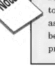

> #define：与 C 和 C++ 不同，C# 不能使用预处理器指令 #define 来声明常量变量。它确实允许布尔类型赋值，这向编译器发出信号，表明某个定义已被定义（解释为 true）或未被定义（解释为 false）——有关详细信息，请参阅第 5 章中的预处理器指令。

## 自增和自减运算符

自增（++）和自减（--）运算符分别使它们的变量按一个数值增加和减少。这对所有数值数据类型都成立，包括标准整数、浮点或十进制引用（字符信息处理方式不同）。运算符可以在后缀模式（x++）或前缀模式（++x）中使用。前缀模式是指必须在变量被第二个等式访问之前进行的计算，而后缀模式允许在等式完成后先读取该变量、求值，然后再更改它。当然，每种类型都有其优点，后者解释了 C++ 的双关语。使用示例 1.44 来测试这些运算符。你应该使用其他几种数值数据类型以及后缀和前缀模式来修改示例。

### 示例 1.44. 自增运算符 I。

```
using System;

namespace Chapter1 {
    class Class1 {
        static void Main(string[] args) {
            int number = 1;
```
### 示例 1.46. C++。

```cpp
#include <iostream>
using namespace std;

void main (void) {
    typedef int cat; // cat becomes a metonym for int
    cat number = 1;
}
```

### 示例 1.47. C#。

```csharp
using System;

namespace Chapter1 {
    class Class1 {
        static void Main() {
            int number = 1;
        }
    }
} // no ambiguity here
```

## 关键字默认值

C/C++ 语言包含几个关键字，即 auto 和 signed，用于声明与系统默认设置等效的操作。这些关键字不是 C# 语言的一部分，但在升级时仍然很重要。其中第一个 auto 是一个存储类说明符，用于表达在该标题下声明的每个变量都需要作为单个函数进行本地化，其中本地化意味着在块打开时创建，并在块关闭时销毁。此操作是用于描述局部变量的定义的一部分，因此在声明 C# 变量时不需要 auto。关键字 auto 可以追溯到 B 语言的时代，现在仅存在于为了与某些旧 C 程序保持向后兼容。

Signed 允许变量保存正值和负值；再次，这是在声明变量时我们假设的。使用其反面 unsigned 在 C++ 中很常见，通常是为了在增加整数正范围的同时节省内存，但唉，它也没有实际价值，即你不会经常看到它，但当你看到时，你需要理解其背后的概念。

## Using、System 和 Namespace

从 C++ 到 C# 的一个非常明显的改变是 *iostream* 类的改变使用方式，因此关键字 using 和 namespace。这些重新定义的命令是 Base Class Libraries 中发现的更大面向对象更改的结果。最显著的更改包括对命名空间 System 的引用（如 using System），以及外部用户定义的命名空间（如 Chapter 1 等）。System 是为 Base Class Library 开发的较大命名空间之一，我们自己的 Chapter1 代表一个更小的分组。我们也可以嵌套和/或扩展¹这些命名空间以包含层次结构。虽然我们已经处理了许多简化的示例，但熟悉扩展形式也很重要（如示例 1.48）。

> 当我们将代码放在命名空间内时，我们实际上是在声明一个作用域或全局唯一的分区。该命名空间中包含的类型然后可以通过直接访问（来自该主体内部）和 using namespace 指令访问，后者允许我们在不加限定符的情况下使用其值。


### 示例 1.48. 不使用 using。

```
namespace Chapter1 {
    class Class1 {
        static void Main() {
            System.Console.WriteLine("Hello, World!");
        }
    }
}
```

此外，如果我们遇到提供相同从而冲突引用的次要命名空间，那么除了写出对正式定义的别名或正式定义之外，几乎没有其他选择（参见示例 1.49）。

¹ 即包含在次要或多个文件集合中。


## 示例 1.49. 使用和命名空间。

```
using sys = System;

namespace Chapter1 {
    class Class1 {
        static void Main() {
            sys.Console.WriteLine("Hello, world!");
        }
    }
}
```

## 匈牙利命名法

匈牙利命名法以其开发者 Charles Simonyi 的族裔命名，是微软根据变量的数据类型来标识变量的正式方式。许多程序员都使用这种命名法，尤其是那些为微软工作的程序员，而且它并不限于 C++ 语言。该命名法使用附加在变量上的前缀，这些前缀始终以小写字母书写。例如，标识字符的前缀就是字母 c，因此，声明一个字符可以简单到（char cVariable;）。整数数据类型用字母 i 标识，字母 n 标识短整数，l 表示长整数（例如，int ipassword；short nID；以及 lAccount）。（注：虽然对这种命名法的需求已经减少，但我们仍将 Pascal/Camel 命名法作为 C# 参考资料的一部分——见表 1.6）。

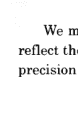

> 匈牙利命名法不包括 float、double 或 decimal 数据类型的前缀。这是合理的，因为它们都是浮点变量，而缺少表示法本质上也是一种表示法。

我们或许还可以考虑这样的理由：浮点变量应始终反映其数据需求，并且只应使用更高精度的数据类型进行转换或声明，以避免数据丢失。

| 数据类型： | 前缀 |
|---|---|
| 布尔型 | b |
| BYTE（无符号字符） | by |
| 字符（用于 char、WCHAR 和 TCHAR 类型） | c |
| 用作 x、y 长度的整数（c 代表计数）。 | cx, cy |
| 双字（无符号长整型） | dw |
| 函数 | Fn |
| 句柄 | H |
| 整数 | i |
| 用作 x、y 坐标的整数 | x, y |
| f 代表“标志” | f |
| 长整数 | l |
| 字符串 | S |
| 以 0 字符结尾的字符串 | Sz |
| 指针 | p |
| 短整数 | n |
| WORD（无符号短整型） | w |

表 1.6. 各种数据类型的前缀。

## 故障排除

在逐步了解故障排除过程涉及的步骤之前，我们先要确保理解四种基本错误类型。第一种类型称为*语法错误*，可以描述为语法错误。编译器就像拼写检查器一样，会检查我们的程序，试图找出所有拼写错误的命令和/或遗漏的标点符号。如果发现任何错误，编译器会立即发出通知并引导我们找到问题所在。存在此类错误的程序无法“生成”，因此不会产生可链接的对象。

第二种错误类型称为*运行时错误*。*运行时错误*通常涉及让计算机做它做不到的事情，例如除以零或将字符存储为数字。这种错误不会被编译器检测到，并且几乎总是会产生一个容易出问题和崩溃的程序，或者一个根本无法运行的程序。

第三种错误类型是逻辑错误，也可以称为规划不当错误。这类错误的例子包括：你本意是让计算机相加，却让它相减；或者你想让它打印，却让它跳过一行。没有想清楚问题和/或没有写出算法通常会导致这类错误。逻辑错误和运行时错误一样，编译时通常不会出现，但迟早会出现。检测这类问题的最佳方法是在多种情况下重新运行程序，并尽可能用另一个来源核对结果。

第四种错误类型被描述为链接错误，发生在编译时数据缺失、有误或不可用的情况下。如果你的程序编译时没有错误，但在生成/重新生成时出现错误，那么你很可能在设置程序时犯了错误。如果本章没有提到你的编译器，你必须查阅用户手册以找出问题。如果你使用的是 Microsoft Visual Studio .Net 2004 或任何更早版本，重复上述步骤应该可以解决你的问题。

## 常见错误、问题和陷阱

- 1. 与 C 和 C++ 一样，C# 是区分大小写的语言；因此，大小写设置上的任何差异都会导致错误。例如，将 void 错误地写成 VOID 或 Void 会导致语法错误。（提示：大多数编译器会通过颜色变化来标识关键字）。
- 2. main 方法应包含单词 Main，后跟左括号和右括号。
- 3. 程序应以左花括号开始，例如 {（并以右花括号结束）。
- 4. 注释需要两个正斜杠，如 //，而不是反斜杠 \\。此外，跨两行或更多行的注释需要左正斜杠和星号，以及星号和右正斜杠，如 /* comments here */。
- 5. 如果找不到错误，尝试删除所有注释和任何其他不必要的代码，将文件以另一个名称保存，以便在隔离出错误后可以恢复到原始文件
- 6. 放在注释后的花括号（如 // this is a note））会被包含为注释的一部分，编译器不会读取。
- 7. 换行符必须写成反斜杠加 n（\n）；使用正斜杠会导致语法错误。
- 8. Write 和 WriteLine 命令都需要用括号括起来。
- 9. 如果你使用的是较旧的 C++ 编译器，则需要使用 #include <iostream> 和 namespace std，或者使用 <iostream.h> 头文件而不使用 namespace 命令。
- 10. 你是否遵循了本章给出的变量命名规则？违反这些规则通常会导致语法错误。
- 11. 一个错误可能导致编译器抛出一堆编译错误；因此，如果没有其他错误看起来可能，你应该始终尝试重新编译程序。
- 12. 你是否拼错了变量名？未定义语句错误通常由这类拼写错误引起。
- 13. 将多个变量添加到同一行时，你是否忘记写逗号？
- 14. 你是否忘记写分号，或者把分号放在了不该放的位置？
- 15. 给字符变量赋值时，你是否忘记使用单引号，或者误用了双引号？
- 16. 计算余数时必须使用整数值。
- 17. 在字母之间加空格来列出任何关键字或变量始终是错误的。

如果你的程序编译时没有错误，但在生成/重新生成时出现错误，那么你很可能在设置程序时犯了错误。如果你的编——

- 18. 你应该花时间研究你的操作系统和编译器；可以随意试验关键字和命令——试着体会它们的作用以及它们在屏幕上执行的位置。
- 19. 避免使用以单下划线或双下划线开头的变量名，因为它们可能与高级赋值语句发生冲突。
- 20. 使用算术运算符时，应使用括号，而不是依赖运算顺序。使用多余的括号不会损害程序，但省略必要的括号则会。关键是通过使用空格和适量的括号让表达清晰。
- 21. 最后，不要急于看到最后，也不要试图直接跳到高级代码。你需要的一切都在这本书中；你只需要有耐心。

## 问题

1. 定义 .Net 和 C# 这两个术语。
2. C# 的首席架构师是谁？
3. 本书作者是谁？
4. 什么是 ECMA 认证？
5. 定义托管代码。
6. 编写一个算法，解释如何玩五十二张捡牌纸牌游戏。
7. 编写并编译一个“什么都不做”的程序。
8. 定义 C# 中使用的注释类型。
9. 编写一个“什么都不做”的程序，其中包含一条描述程序用途的初始注释，然后再包含两条注释，分别标记 main 方法的开始和结束。
10. 编写一个显示“Hey, look at me! I've written a program!”这些文字的程序。
11. 继续第 10 题，使用换行符将“Hey, look at me!”与“I've written a program!”分隔开。
12. 继续第 10 题，使用 WriteLine 命令替换换行符，同时不改变程序的输出。


- 13. 编写一个程序，使用数据类型 `int`、`float`、`double` 和 `char` 声明四个独立变量。
- 14. 承接第 13 题，再添加四行代码，为所列的每个变量赋予适当的值。
- 15. 承接第 13 题，仅使用已声明的语句，为每个变量赋予适当的值。
- 16. 仅使用整数，编写一个先相加再相减两个数的程序。
- 17. 使用单精度或双精度值，编写一个先相乘再相除两个数的程序。
- 18. 编写一个程序，找出任意无理数小数点后的数字。
- 19. 编写一个程序，读入一个字符，并使用 `Write` 和 `WriteLine` 将其回显。
- 20. 编写一个程序，同时使用递增和递减运算符。

## 示例 2.1. 一个无响应的程序。

```csharp
using System;

namespace Chapter2 {
    class Class1 {
        static void Main() {
            // Begin main
            int cResponse;

            // Step 1 - try typing N for NO
            Console.WriteLine ("Input <Y> for YES: ");

            // Step 2
            cResponse = Console.Read ();

            // Step 3
            Console.WriteLine ("\n You typed \n");
        }
    }
}
```

现在，为了让这个程序正确响应（即在按下正确键时作出响应），我们必须让程序具备比较数据的能力。这通过关键字 if 和比较运算符（例如 ==，参见表 2.1）来完成。那么，第一步就是用 if 语句重写上一个程序（参见示例 2.2）。


> > 记住，C# 语言区分大小写，因此字母 Y 和 y 不被视为等效输入。要获得正确响应，需要输入大写 Y。

### 示例 2.2. 使用 if 语句。

```csharp
using System;
namespace Chapter2 {
    class Class1 {
        static void Main() {
            int cResponse;

            // Step 1
            Console.Write("Input <Y> for YES:  ");

            // Step 2
            cResponse = Console.Read();

            // Step 3 - if response equals 'Y'
            if ((char) cResponse == 'Y')
                Console.WriteLine("\n You typed Y\n");
        }
    }
}
```

这个程序仍然会显示消息“You typed Y”，但现在只有在实际输入字母 Y 时才会显示。如果输入任何其他字符，程序会直接结束，屏幕上不会写入任何内容。对于任何字母或字符数据，只要它等于该变量，都是如此。尝试重新编写这个程序，使其同时响应大写和小写字母（“Y” || “y”）。如果更改了所需的输入，请记得同时更改相应的提示语。下一项任务中，我们将修改程序，使其使用数值数据（参见示例 2.3）。

### 示例 2.3. 对数值数据使用 if 语句。

```csharp
using System;

namespace Chapter2 {
    class Class1 {
        static void Main() {
            int iAnswer;

            // Step 1
            Console.Write("1 + 1 = ");

            // Step 2
            iAnswer = int.Parse(Console.ReadLine());

            // Step 3 - numbers do not require quotes
            if (iAnswer == 2)
                Console.WriteLine("\n That is correct!\n");

            // Step 4
            if (iAnswer != 2)
                Console.WriteLine("\n Wrong!!\n");
        }
    }
}
```

在这些比较中，float 和 double 同样适用。你也可以尝试多种不同的类型，例如 byte、ushort 和 ulong（请记住 u 表示无符号）。下一节实际上会继续讨论 **if** 语句，将 **if** 与关键字 **else** 结合使用。我们在这里学到的所有内容仍然适用，但 else 为 if 增加了一些控制能力。

| # | 比较运算符及示例 |
|---|---|
| 1. | 两个等号 `==`，表示“等于”，例如：<br>– if (variable1 == variable2)<br>– // 5 等于 5 |
| 2. | 小于号 `<`，表示“小于”，例如：<br>– if (variable1 < variable2)<br>– // 5 小于 10 |
| 3. | 小于或等于 `<=`，表示“小于或等于”，例如：<br>– if (variable1 <= variable2)<br>– // 5 小于或等于 10 |
| 4. | 大于号 `>`，表示“大于”，例如：<br>– if (variable1 > variable2)<br>– // 20 大于 10 |
| 5. | 大于或等于 `>=`，表示“大于或等于”，例如：<br>– if (variable1 >= variable2)<br>– // 20 大于或等于 10 |
| 6. | 不等于 `!=`，表示“不等于”，例如：<br>– if (variable1 != variable2)<br>– // 20 不等于 10 |

## 表 2.1. 比较运算符。

现在，你的编程能力应使你能够更改程序的数据类型、添加注释、重命名变量，并编辑输出消息以供进一步说明。不过，如果出现使用数据类型 `byte`、`ushort` 和 `ulong` 的机会，我仍会提及。


## else 语句

else 是对 `if` 语句的第一个逻辑扩展。它增加了一条额外的推理路径，也为程序增加了一条可遵循的路径。else 不能单独使用；它可以轻松地连接到 `if` 结构的末尾。示例 2.4 使用 if-else 语句重新定义上一个程序。添加 else 后就不再需要第二个 if 语句，而且它的简洁性为我们的代码增添了更优雅的感觉。

### 示例 2.4. if-else 语句。

```csharp
using System;

namespace Chapter2 {
    class Class1 {
        static void Main() {
            string input;
            double Answer;

            Console.Write("1 + 1.5 =  ");
            input = Console.ReadLine();
            Answer = double.Parse(input);

            if (Answer == 2.5)
                Console.WriteLine("\n That is correct!\n");
            else
                Console.WriteLine("\n Wrong!!!\n");
        }
    }
}
```

if-else 语句的工作方式与 if 语句基本相同。
术语 else 意味着“在所有其他情况下”，或“此处其余所有情况”这类情形。
这种改变程序方向的能力实际上被定义为一种编程技术。然而，if-else 仍然局限于两个方向，其中第二个方向并不具体。要指定第二个方向或多条路径，我们就必须使用第三种 if 语句，即 else-if 语句。

## else-if 语句

else-if 与 else 一样，是对原始 if 语句的依赖性或次级扩展。不过，else-if 确实为讨论增添了新内容。由于 else-if 必须添加在 if 语句之后，我们将再次修改上一个程序，这次除了“错误”这个词之外，还会给用户提供更多可依据的信息——参见示例 2.5。

### 示例 2.5. else-if 语句。

```csharp
using System;

namespace Chapter2 {
    class Class1 {
        static void Main() {
            string input;
            double Answer;

            Console.Write("1 + 1.5 =  ");
            input = Console.ReadLine();
            Answer = double.Parse(input);

            if (Answer == 2.5)
                Console.WriteLine("\n That is correct!");
            else if (Answer > 2.5)
                Console.WriteLine("\n Wrong, too high!!!");
            else if (Answer < 2.5)
                Console.WriteLine("\n Wrong, too low!!!");
        }
    }
}
```

else-if 包含相对于 if 的第二个条件响应。由于 else-if 语句是依赖性的，只有当第一个 if 语句为假时，计算机才会读取它们（参见示例 2.6）。

### 示例 2.6. 作为依赖语句的 else-if 语句。

```csharp
using System;

namespace Chapter2 {
    class Class1 {
        static void Main() {
            string input;
            double Answer;

            Console.Write ("1 + 1.5 = ");
            input = Console.ReadLine ();
            Answer = double.Parse (input);

            if (Answer == 2.5)
                Console.WriteLine ("\n That is correct!");
            else if (Answer > 2.5)
                Console.WriteLine ("\n Wrong, too high!!");
            else
                Console.WriteLine ("\n Wrong, too low!!");

            Console.WriteLine ("I hate the if statement!");
        }
    }
}
```

> > **程序逐步讲解**
> >
> > 最后两个程序基本相同，只是结尾的 else 语句有所改动，这一点在示例 2.6 的结尾体现出来。这强调了 if、else-if 和 else 语句如何关联的关键点。按照 if 语句的逻辑，如果我们的数字不是 2.5，程序会继续执行下一个 else-if。如果我们随后发现该数字不大于 2.5，就会再次转到下一个 else。要到达 else 语句，我们的数字必须小于 2.5。因此，我们不需要再测试该值是否确实更小。


## 复合 if 语句

复合语句是由一对花括号括起来、组合成一个整体的一组语句。复合 if 语句是一种将这一整体当作单个操作来执行的 if 语句。编写复合语句的正确方式如示例 2.7 所示。（注意：只需将 else 或 else-if 这些关键字放在复合语句末尾，仍然可以使用它们。）

### 示例 2.7. 复合 if 语句。

```csharp
using System;

namespace Chapter2 {
    class Class1 {
        static void Main() {
            string input;
            float MyNumber;

            Console.WriteLine("How old are you? ");
            input = Console.ReadLine();
            MyNumber = float.Parse(input);

            if (MyNumber >= 18) {  // compound statement
                Console.WriteLine("\n You're an adult");
                Console.WriteLine("You can vote\n");
            } else
                Console.WriteLine("\n Your turn will come");
        }
    }
}
```

指导复合 if 语句执行的规则很简单。当 if 语句为真时，复合语句内部的所有语句都会执行；当 if 语句为假时，所有语句都会被忽略。在讨论仅由两行组成的复合语句时，这似乎没什么大不了，但想象一下处理超过两百行的复合语句。许多 C# 命令都可以放在这些复合语句内部，包括其他 if 语句，但我们会把这类问题留到后面的章节。else 和 else-if 语句也可以使用复合语句，如示例 2.8 所示。请注意，当程序变得更长、更复杂时，注释会变得多么重要。

## 与、或、非

有三种判断运算符：与（写作 &&）、或（写作 ||）、非（写作 !）。其中，与（&&）和或（||）用于组合 if 和 else-if 语句，而第三个运算符非（!）用于反转比较结果；&& 和 || 运算符位于 if 语句的括号结构内部（见表 2.2）。通过添加 && 或 ||，我们可以减少浪费且重复的 if 语句。示例 2.9 展示了 || 运算符如何将两个 if 和六条命令变成一个 if 和三条命令。

| 序号 | 描述 |
|---|---|
| 1. | 与（&&）表示“两个都为真时语句才为真”<br>if (variable1 > variable2 && variable2 == variable3)<br>// 20 > 10 and 10 = 10 |
| 2. | 或（\|\|）表示“只需一个为真时语句就为真”<br>if (variable1 == variable2 \|\| variable2 < variable3)<br>// 20 = 20 or 20 < 10 |
| 3. | 非（!）表示“把真语句变为假，把假语句变为真”<br>if (!(1 == 1))   // if 1 = 1 then not (true) or false<br>if (!(1 == 2))   // if 1 = 2 then not (false) or true |

**表 2.2. 与、或、非运算符**

### 示例 2.9. 使用或运算符减少 if 语句。

```csharp
using System;

namespace Chapter2 {
    class Class1 {
        static void Main() {
            string input;
            double Age, Weight;
            int cQuickAnswer;
            Console.Write("How old are you? ");
            input = Console.ReadLine();
            Age = double.Parse(input);
```

### 示例 2.10. 嵌套 if 和 else-if 语句。

```csharp
using System;

namespace Chapter2 {
    class Class1 {
        static void Main() {
            string Input;
            float Age, Weight;
            int iQuickAnswer;

            // Note: you'll want to hit return before entering the second
            // answer
            Console.Write("How old are you and how much do you weigh? ");
            Input = Console.ReadLine();
            Age = float.Parse(Input);
            Input = Console.ReadLine();
            Weight = float.Parse(Input);

            if (Age < 3 || Weight < 35) { // start compound if statement
                Console.Write("\nThe law requires you to sit in a car seat\n"
                    + "\n Do you have a car seat? ");
                iQuickAnswer = Console.Read();

                if (iQuickAnswer == 'y') // nested if statement
                    Console.Write("\n Good, but using it would be better.\n");
                else { // nested else compounded
                    Console.Write("\n No, do you care about your baby?\n");
                    if (iQuickAnswer == 'y') // nested if in nested else
                        Console.Write("\n Well then get a car seat!\n");
                    else if (iQuickAnswer == 'n') // nested else-if in nested else
                        Console.Write("\n You sicken me!\n"
                            + "\n Your baby is worth it!\n");
                    else // nested else in nested else
                        Console.Write("\n Your baby is worth it!\n");
                }
            } // end compound if statement
            else if (Age > 85 || Weight > 500)
                Console.WriteLine("\n Sorry I asked!\n");
        }
    }
}
```

### 数学缩写

有时，随着程序变得更大、更复杂，它们也会变得冗长而拖沓。为缓解这个问题，程序员经常使用缩写。我们这里的讲解模仿了算术部分已经学习过的内容。表 2.3 定义了这些快捷方式，示例 2.11 演示了它们的写法。我同时列出了算术语句的长写形式和简写形式，以便更容易比较。我还加入了几个 if 语句，这些已经在本章中介绍过。你至少需要重新运行此程序五次，并为每个快捷方式输入一次相应的字符。你可能还想尝试删除长写语句，或使用 while 循环（在下一节中解释）重写它。

#### 示例 2.11. 简写表示法。

```csharp
using System;

namespace Chapter2 {
    class Class1 {
        static void Main() {
            string Input;
            int iVariable1, iVariable2, iVariable3, iCharacter;
            // Note: later we'll learn techniques that will allow us
            // to read partial bits of info, but until then we'll still
            // want to enter each number with a return statement
            Console.Write("\n Enter two numbers: ");
            Input = Console.ReadLine();
            iVariable1 = int.Parse(Input);
            Input = Console.ReadLine();
            iVariable2 = int.Parse(Input);
            iVariable3 = iVariable1;

            Console.WriteLine("\n Enter one symbol: \n addition (+) "
                + "\n subtraction (-) \n multiplication (*)"
                + "\n division (/), or \n remainder (%): ");
            iCharacter = Console.Read();

            if (iCharacter == '+') {
                iVariable1 = iVariable1 + iVariable2;
                Console.WriteLine("\n Your longhand sum is  "
                    + iVariable1);
```

| 算术运算 | (int iNumber = 5;) | 缩写为 | 返回 |
| --- | --- | --- | --- |
| 加法： | iNumber = iNumber + 1; | iNumber += 1; | 6 |
| 减法： | iNumber = iNumber - 1; | iNumber -= 1; | 4 |
| 乘法： | iNumber = iNumber * 2; | iNumber *= 2; | 10 |
| 除法： | iNumber = iNumber / 2; | iNumber /= 2; | 2 |
| 求余： | iNumber = iNumber % 2; | iNumber %= 2; | 1 |

```
// Assume Variable1 = 5 and Variable2 = 2 and that they're a numeric data type.
1. Addition:
Variable1 = Variable1 + Variable2
Variable1 += Variable2
// variable1 now equals 7 since - 7 = 5 + 2
2. Subtraction:
Variable1 = Variable1 - Variable2
Variable1 -= Variable2
// Variable1 now equals 3 since - 3 = 5 - 2
3. Multiplication:
Variable1 = Variable1 * Variable2
Variable1 *= Variable2
// Variable1 now equals 10 since - 10 = 5 * 2
4. Division:
Variable1 = Variable1 / Variable2
Variable1 /= Variable2
// Variable1 now equals 2.5 since - 2.5 = 5 / 2 (When Variable1 is either float or double)
// Variable1 now equals 2 since - 2 = 5 / 2 (when variable1 is of type integer)
5. Remainders:
Variable1 = Variable1 % Variable2
Variable1 %= Variable2
// Variable1 now equals 1 since - 1 = 5 % 2 (Variable1 should only be used with integers)
// Remember % stands for the remainder of 1 as in 5 / 2
```

**表 2.3. 数值缩写**

## while 循环

在上一节中，为了测试五个字符的结果，我们不得不将程序重新启动五次。虽然这在编程教学书中或许可以接受，但这样并不

对于真正的程序来说是可以接受的。因此，本节将向我们展示如何以重复循环或循环的方式重复程序或程序的一部分。我们将研究的第一种循环使用关键字`while`；在C#中，它被称为while循环。while循环可以通过几种不同的方式设置来重复和/或终止：最常见的方式包括使用预定计数（例如重复迭代五次然后结束）；使用用户输入（按请求）；以及终止命令（一种使循环短路或中断的命令——我们稍后会学习这些）。

while循环与复合if语句最直接相似。while与if一样，先写while，后跟比较运算符，然后是一组复合语句。当while为真时，其括号内的所有语句都将执行；当为假时，其所有语句都将被跳过。与if不同，while在执行完最后一条语句后不会终止。相反，如果需要，它会再次执行复合语句。这个过程无限重复，只有当某些东西被改变导致比较变为假，或采取其他特殊步骤来改变计算机的执行路径时才会结束。因此，终止while循环的技术在概念上与while关键字同样重要。示例2.12演示了一个有限或预定类型的while循环；该示例在变量test的值大于4时终止。

### 示例2.12. 限制为五次通过的while循环。

```csharp
using System;

namespace Chapter2
{
    class Class1
    {
        static void Main()  {
            int iCounter_1 = 0;

            while (iCounter_1 < 5)  {   // while loop
                Console.WriteLine(iCounter_1++);
            }

            Console.WriteLine("Program complete!\n");
        }
    }
}
```

## 程序逐步讲解

我们要做的第一件事是声明变量Quit并初始化它。我们将其初始值设为“no”（注意：“no”对程序没有实际意义）。接下来，我们设置一个while循环，将Quit的值与“yes”进行比较，并且仅在Quit的值不等于“yes”时使循环比较为真。然后我们在复合语句中询问用户是否希望结束循环。用户的输入随后存储在变量Quit中；循环将继续重复，直到用户输入“yes”。然后，最后一条语句“Program complete!”将被执行，程序将终止。

与计数循环一样，如果你忘记告诉用户如何结束循环，用户输入循环可能几乎无限进行（这当然应该避免）。对于第三种终止方式，我们必须引入关键字break。break，顾名思义，终止任何封闭的循环或条件语句。示例2.14演示了这最后一种while终止技术。

### 示例2.14. 嘿，你破坏了我的while循环！

```csharp
using System;

namespace Chapter2 {
    class Class1 {
        static void Main() {
            string Quit = "no";

            while (Quit != "yes") {    // breaks loop
                break;
                Console.Write ("\n Would you like to end this loop? ");
                Quit = Console.ReadLine ();
            }

            Console.WriteLine ("Program complete!\n");
        }
    }
}
```

当break执行时，它只是中断循环并向下移动到下一条语句，跳过剩余的循环语句，此时while循环被视为完成。

程序执行最后一条命令“Program complete!\n”然后终止。break可以作为一种即时结束原本结构化循环的方式。

另一个有趣的关键字是continue，与break一样，它会使迭代短路；但并不是结束循环，而是愉快地将循环带回顶部。循环从顶部开始新的迭代，其他一切相应地继续（参见示例2.15）。

### 示例2.15. 关键字continue。

```csharp
using System;

namespace Chapter2 {
    class Class1 {
        static void Main() {
            int iVariable1 = 10, iVariable2 = 0;

            while (iVariable1 == 10) {    // while loop
                iVariable2 = iVariable2 + 1;
                if (iVariable2/iVariable1 < 1)
                    continue;
                iVariable1 = iVariable1 - 1;
            }

            Console.WriteLine (iVariable2);
        }
    }
}
```

## 战斗片段

终于，在经历了无数痛苦的不眠之夜、灼烧的双眼、疯狂的尖叫和顽强的决心之后，你已经达到了游戏知识的巅峰，现在可以创建动态动画、图形惊艳、硬件加速的三维视频冒险游戏，且能够在所有平台和计算机系统上运行。嘿，醒醒！这是第2章。真正的游戏编程要到第3章才开始，而那一章里也没有任何关于硬件加速或三维编程的内容。至于你到目前为止的能力，嗯，也许，只是也许，你或许可以尝试一个简单的文本风格程序，至少在一定程度上，它会让你轻松

```csharp
+ "(The captain's gun points oddly at your head.) "
+ "Got it? Yes sir!\n");

// location of ship - this just makes it harder to find the
// ship
iAlienShip = ((iAlienShip * iAmmo) / (iTarget + 1)) + 3;

while (iAmmo > 0) { // when ammo runs out the loop ends
Console.WriteLine("\n\n Enter targeting information?");
input = Console.ReadLine();
iTarget = int.Parse(input);

if (iTarget == iAlienShip) {
// if your input equals the ship's location
Console.WriteLine("Alien ship hit, the ship's been destroyed, sir.");
break; // break ends loop
} else if (iTarget > iAlienShip) {
// when input is too high
Console.WriteLine("You missed, try aiming a little lower");
iAmmo--; // ammo - reduces the total ammo by 1
} else {
// when input is too low
Console.WriteLine("You missed, try aiming higher");
iAmmo--; // also reduces ammo by 1
}

// The location of the ship moves with each shot
if (iTarget == 0) {
iTarget = 1;
}
iAlienShip = (iAlienShip * iAmmo) / iTarget;
}

if (iAmmo > 0) // if you have ammo you must have hit the alien
Console.WriteLine("\n Good work soldier, remind me to promote you.");
else // if you're out of ammo you can't protect the hall
Console.WriteLine("\n BOOM!!! You're dead.\n");

Console.WriteLine ("\n Game Over\n");

}
}
```

## do-while循环

第二种while循环称为do-while循环，本质上是将while循环颠倒过来。这里我们将while循环比较放在循环的末尾，这也允许在第一次比较发生之前完整执行一次。

### 示例2.17. do-while循环 I。

```csharp
using System;

namespace Chapter2 {
    class Class1 {
        static void Main() {
            string Quit = "no";
            do {
                // this is an endless loop
            } while (Quit != "yes"); // notice the semicolon?
        }
    }
}
```

关键字*do*放在循环顶部，关键字*while*放在末尾。复合语句直接写在关键字*do*之后，就像在*while*和*if*中一样。while循环和do-while循环的一个明显区别是，比较直到循环已经开始运行才会进行。这再次保证我们在测试代码之前至少执行一次。示例2.18演示了do-while循环的实际运行。

### 示例2.18. do-while循环 II。

```csharp
using System;

namespace Chapter2 {
    class Class1 {
        static void Main() {
            string Quit;

            do { // do-while loop
                Console.WriteLine("\n Would you like to end this loop? ");
                Quit = Console.ReadLine(); // user's input
            } while (Quit != "yes");

            Console.WriteLine("Program complete!\n");
        }
    }
}
```

不用说，while和do-while循环也可以利用与（&&）、或（||）和非（!）运算符。它们可以不用复合语句重写为单行while和do-while语句（尽管这会被认为是糟糕的编程风格）。此外，你可以在彼此内部嵌套while/do-while循环。示例2.19给出了嵌套技术和&&运算符的示例。你可能还想使用||或!运算符测试该程序，但我会把这两个运算符的具体写法留给你。

### 示例2.19. 嵌套的while和do-while循环。

```csharp
using System;

namespace Chapter2 {
    class Class1 {
        static void Main() {
            // Begin main
            int iNumber = 0;
            string Quit;

            do { // begin do-while loop
                Console.Write("\n Would you like to end this loop? ");
                Quit = Console.ReadLine(); // user's input

                while (Quit == "yes" && iNumber < 10) { // nested while
                    // loop
                    Console.WriteLine("We're sorry the exit you have chosen "
                        + "is not available "
                        + "at this time\n please try again");
                    Quit = Console.ReadLine();
                    iNumber++;
                }
            } while (Quit != "yes");   // end do-while
        }
    }
}
```


## 示例 2.20：for 循环。

```
using System;

namespace Chapter2 {
    class Class1 {
        static void Main() {
            int iCounter_1;

            for (iCounter_1 = 0; iCounter_1 < 5; iCounter_1++) {
                Console.WriteLine(iCounter_1);
            }

            Console.WriteLine("Program complete!\n");
        }
    }
}
```

> **程序演练**
> 
> > for 语句首先将变量赋值为 0。然后该值被与 5 比较，由于 0 小于 5，结果为真。递增运算符随后将变量的值加 1，使其值变为 1。接着执行循环体，显示变量 iCounter_1。循环再次检查变量仍小于 5，于是变量第二次递增。第三次循环时，值增加到 3，仍然小于 5，因此循环再次执行。第四次迭代将值增加到 4，循环再次执行。最后，值等于 5，循环终止。程序继续执行下一行“Program complete!”，程序结束。

嵌套在 for 循环中与其他先前介绍的循环一样合法且有用，但当你陷入无限循环时也同样危险（或令人烦恼）。因此，除了跟踪该 for 循环之外，应避免将 for 循环的跟踪变量用于其他任何用途。如果你觉得自己能够胜任，可以回过头去只使用 for 循环重写 while 和 do-while 程序。

即使是最细微的错误，for 循环也可能变成无限循环或无底洞。例如：

```
for (iCounter_1 = 0; iCounter_1 < 5; iCounter_1++) {
    iCounter_1 = 1;
    Console.WriteLine (iCounter_1);
}
```

循环过程到此为止，但还有另外两种比较过程——switch 语句和 foreach 语句。它们与 if 和 else-if 语句非常相似，但能够处理更长的比较列表，而不会重复自身或变得杂乱。就游戏编程技术而言，这些比较也使长比较列表更平滑、更易于修改。

## switch 语句

switch 语句与 if 和 else-if 语句一样，用于根据某个值执行一条或一组语句。然而，与 if 和 else-if 语句不同，switch 语句不使用比较运算符；而是读取变量的值并尝试将程序引导到适当的分支。这一过程还使用了第二个关键字 case。在 switch 语句内部会多次书写和使用关键字 case；每个 switch 语句都持有一个数字或字符值用于比较。如果某个 case 语句持有的值与 switch 语句读取的值匹配，则执行该 case 语句后面的所有内容。

另一个与 switch 语句一起使用的有用关键字是 **默认**（default），意思是在没有其他 case 匹配时执行。**默认** 通常放在 *switch 语句*的末尾，这样我们就可以根据语句不匹配任何先前值这一事实来执行选定的语句（参见示例 2.21）。

### 示例 2.21：switch 语句。

```
using System;

namespace Chapter2 {
    class Class1 {
        static void Main() {
            int Grades;

// Begin main
        Console.Write ("How would you grade yourself so far A, B, or
                      C? ");
        Grades = Console.Read ();

        switch (Grades) // switch statement
                case 'A':
                case 'a':
                        Console.WriteLine ("You'll make a great programmer");
                        break;

                case 'B':
                case 'b':
                        Console.WriteLine ("You're sure of yourself");
                        break;

                case 'C':
                case 'c':
                        Console.WriteLine ("You don't let hard work keep you
                                      down");
                        break;

                default:
                        Console.WriteLine ("A, B, and C inputs only!");
                        break;
        } // end switch statement
}
}
```

请注意，这个终止序列实际上只是关键字 break，它只是将我们移出一个代码块并进入下一个段。break 和 case 一样，每个比较分支中都要重复出现。

C# 还要求使用 break 语句，以防止 case 值穿透。不过，你可以包含多个 case 语句，只要它们不包含可执行语句就行。这种新方法虽然只是语法上的微小变化，但应该会标记出几个旧式 C/C++ 转换。对于那些不喜欢只使用单独控制的 case 语句来编写 switch 语句的程序员，我深表歉意（参见示例 2.22）。

### 示例 2.22：switch 语句续。

```
using System;

namespace Chapter2 {
    class Class1 {
        static void Main() {
            string input;
            int byNumber;

            Console.Write("Enter a number greater than one: ");
            input = Console.ReadLine();
            byNumber = int.Parse(input);

            switch (byNumber) {
                default:
                    Console.WriteLine("\n Good job now take a lap!");
                    break;

                case 0:
                    Console.WriteLine("\n Zero is not greater than one!\n");
                    break;

                case 1:
                    Console.WriteLine("\n I said a number greater than one!");
                    break;
            }

            Console.WriteLine("\n Program complete\n");
        }
    }
}
```

switch 语句可以使用字符或整数数据类型，但所设置的 case 类型必须是字面常量或变量常量。即使写成变量，也不能将两个 case 设置为相同的值，而且在任何一个 switch 语句中只能有一个 default。switch 语句的 case 中可以包含 if 语句，if 语句的复合语句中也可以包含 switch。此外，你可以将 switch 语句放在 while 和 do-while 循环中，或者将这些循环写进 case 语句，但应谨慎使用嵌套在其他 switch 语句中的 switch 语句，以免造成混乱。

> **定义代码块：**
> 
> 一个块（左右花括号 {}），虽然在技术上等同于复合语句，但实际上可以指程序中任何位置的任意花括号对。例如，主程序由左右花括号括起来，但不被视为复合语句。代码块允许程序员分离特殊的代码段，开辟了使用局部变量的新途径，或者包含某些代码，包括将子程序局限在其中（本章稍后讨论）。当一个代码块嵌套在另一个代码块中时，外层代码块相对于内层代码块被视为全局的，就像主程序外部编写的代码相对于程序被视为全局的一样。在使用 C# 时，全局和局部概念非常重要，将在本书中更详细地讨论。

## 从 C++ 转换为 C#

虽然我们许多人可能还记得旧的 C 和 C++ 的 I/O 表示法，但可以安全地假设，并非每个阅读本书的人都能在没有任何参考的情况下记住它们。本节定义了被我们的 Write 和 WriteLine 扩展所替代的 C/C++ 命令。当遇到旧命令时，技巧是用适当的扩展名和格式化字符串组合来替换它们。

`printf` 和 `cout` 函数是 Write 和 WriteLine 命令的替代品，而 `scanf` 和 `cin` 函数是 Read 和 ReadLine 命令的替代品。与我们的 Read 和 Write 一样，这些函数不是关键字，而是由旧式包含文件结构链接的附加命令（参见第 1 章）。控制这些命令的包含文件是 `<stdio>`（写作 `#include <cstdio>` 和 `#include <stdio.h>`）和 `iostream`（写作 `#include <iostream>` 和 `#include <iostream.h>`）；`<stdio.h>` 实际上可以追溯到最初的 C 语言。printf，同理还有 scanf，与 C# 的表示法有最多共同之处，直接比较时这一点很明显。有关 `printf` / `scanf` 表示法的扩展列表，请参见表 2.4。


### 表 2.4. 在 printf() 和 scanf() 中使用转换说明符。

| 说明符 | 定义 | 示例 |
|---|---|---|
| 1. %d | 保存正数或负整数<br>- int variable1（有符号 int variable1） | `scanf("%d", &variable1);`<br>`printf("Your number is %d", variable1);` |
| 2. %u | 仅保存正整数<br>- unsigned int variable1 | `scanf("%u", &variable1);`<br>`printf("Your number is %u", variable1);` |
| 3. %f | 保存浮点数（实数）<br>- float variable1 | `scanf("%f", &variable1);`<br>`printf("Your number is %f", variable1);` |
| 4. %c | 保存单个字符数据类型<br>- char variable1 | `scanf("%c", &variable1);`<br>`printf("Your symbol is %c", variable1);` |
| 5. %s | 保存字符串或字符数组<br>- char variable1[7]（或任意正数） | `scanf("%s", &variable1);`<br>`printf("Your word is %s", variable1);` |

在 C 语言中不断演变的两个有趣的命令函数是旧式函数和成员函数 puts 和 gets。最初的 puts 访问方式与 printf 基本相同，但限制是它只能显示字符数据（如 puts("this is a test 1, 2, 3.")。gets 与 scanf 一样也用于读取数据，但读取的所有内容都被解释为字符串。这也可以看作一个数组（我们将在第 4 章讨论）。这两个类型的扩展成员函数版本不幸仅限于单字符引用，如 cout.put('A') 和 cin.get(character)，因此其实用性有限。这两个旧式函数的两个替代品是 cin.getline(characters, sizeofline) 和 cout.write(characters, sizeofline)。这些也将在第 4 章中说明（见示例 2.23）。注意，puts 函数会自动将数据移到下一行，而 cout.write 不会。

### 示例 2.23. C/C++ 与 C# 对比。

```csharp
using System;

namespace Chapter2 {
    class Class1 {
        static void Main() {
            int Number;   // char name [10];
            string Answer; // char Answer; or char Answer [];

            Console.Write ("\n Hello, please enter a number: ");
            // printf ("\n Hello, please enter a number: ");
            // cout << "\n Hello, please enter a number: ";
            // std::cout.write("Please enter a name: ", 24);
            // puts("Please enter your name:");

            Number = int.Parse(Answer = Console.ReadLine ());
            // scanf("%d", &Number);
            // cin >> Number;
            // std::cin.getline(name, sizeof(name));
            // gets(Number);

            Console.WriteLine("You entered {0} is that correct?", Number);
            // printf ("\n You entered %d is that correct?", Number);
            // cout << "\n You entered " << Number << " is that correct?";

            Answer = Console.ReadLine();
            // scanf ("%s", &Answer);
            // cin >> Answer;

        }
    }
}
```

我们还可以转换多个引用，包括格式字符串，以表示记法的变化（见示例 2.24）。

### 示例 2.24. 转换多个引用。

```csharp
Console.WriteLine("\n You entered the number {0:D} and also the letter {1}", iNumber, cAnswer);
printf("\n You entered the number %d and also the letter %c\n", iNumber, cAnswer);
```

## 布尔表达式

*布尔表达式*是真和假概念的数学表示。也就是说，虽然它们的实际求值基于数学数据，但结果实际上由概念理解决定。这种判定在 C# 中表示为数据类型 *bool*，其变量被赋值为布尔常量 *true* 或 *false*。过去，与 C 和 C++ 一样，这个过程也可以包括数字替代，即数字常量 1 和 0，其中 0 等于假，值 1 或任何非零正数或负数等于真。然而，在 C# 中不允许这种数字替代。示例 2.25 演示了 while 循环的这一顺序，但在继续下一节之前，你应该尝试将该程序重写为 do-while 循环。

### 示例 2.25. 布尔表达式——真或假。

```csharp
using System;

namespace Chapter2 {
    class Class1 {
        static void Main() {
            bool Variable1 = true;
            string Test;

            while (Variable1) {
                Console.Write("\n Would you like to end this loop? ");
                Test = Console.ReadLine();  // yes will break the loop

                if (Test == "yes" || Test == "YES")
                    Variable1 = false;
            } // end while loop

            Console.WriteLine ("Program complete!");
        }
    }
}
```

## 短路求值

*短路或部分比较*是无需测试整个语句即可推断出的比较。这种推断可用于逻辑类型 && 或 ||，但结果相反，如表 2.5 所示。

### 表 2.5. 真和假的判定。

| 非特定等式 | 求值过程 | 推理 |
|---|---|---|
| 1. (真 && 真) | 完整求值 | 真 + 真 = 真 |
| 2. (真 && 假) | 完整求值 | 真 + 假 = 假 |
| 3. (假 && 真) | 短路求值 | 假 + 跳过测试 = 假 |
| 4. (假 && 假) | 短路求值 | 假 + 跳过测试 = 假 |
| 5. (真 \|\| 真) | 短路求值 | 真 + 跳过测试 = 真 |
| 6. (真 \|\| 假) | 短路求值 | 真 + 跳过测试 = 真 |
| 7. (假 \|\| 真) | 完整求值 | 假 + 真 = 真 |
| 8. (假 \|\| 假) | 完整求值 | 假 + 假 = 假 |

如你所见，测试 1 和 2 需要完整求值，因为如果没有第二次求值，就无法确定任一结果。使用短路或部分比较推理时情况并非如此（如测试 3-8 所示）。在这种情况下，将比较标记为真或假的决定无需第二次测试即可完成，从而节省我们进行第二次比较的时间和麻烦。此外，我们可以使用这种部分比较来防止运行时错误，例如除以零——见示例 2.26。

### 示例 2.26. 用于防止运行时错误的部分比较。

```csharp
Console.WriteLine("Enter any number other than zero: ");
variable1 = Console.Read();

// Some smart user enters zero, the system crashes.
// while (5/variable1 < 1);
// Later that day... you're fired!

// Alternatively, you could have used short
// circuit evaluation. And later that same day,
// while (variable1 != 0 && 5/variable1 < 1);
// you could have been surfing the web as RedHotPartyPants.
```

## 条件运算符

条件运算符也称为三元运算符（因为它有三个操作数），本质上是一个缩写的 if-else 表达式，使用两个符号：问号（?）和冒号（:）。该语句需要三个表达式：if-else 比较、真计算和假计算，如下所示。

首先进行比较：

```csharp
x = y ? 41 : 72

if(x == y)
// followed by an assignment
    x = 41;
else
// and then an else
// statement
    x = 72;
```

当 *x* 等于 *y* 时，比较为真，*x* 被重新赋值为 41。当 *x* 不等于 *y* 时，*x* 被重新赋值为 72。

```csharp
Comparison ? Equation1 : Equation2
```

> **注意：** 条件运算符也可以放在其他命令和语句中（包括 while、do-while 和 Write 命令）。

## 预定义函数

C# 中使用两种类型的函数（也称为方法）：由我们编写并像小程序一样使用的函数，以及为我们编写并用于节省我们自己编写时间的函数。第一种类型称为用户定义函数，稍微复杂一些，直到本章末尾才会完全解释。第二种类型通常称为预定义函数，我实际上从第 1 章就开始介绍了。本节花一点时间正式介绍预定义函数的概念。

好消息是，随着 .Net 架构的出现，我们不再需要为了使用几个简单命令而记住几十个包含文件引用。坏消息是，我们大多数人已经记住了太多这类引用，以至于可能觉得有点不公平，对此我想说不用担心——……的基础

新结构与旧结构并没有太大区别，包括新手在内的所有人都应该能很快掌握。同样，在这个新架构下引用的所有预定义函数都涉及一个对象（类）；因此，引用这些函数的过程与引用标准 C/C++ 方法（或成员函数）时你所预期的方式非常相似。现在，并非我们所有的用户自定义函数都以相同方式访问（随着时间推移这一点应该会变得明显）。此外，即使是我们中最优秀的人也不能真正声称自己全都了解，但现在访问它们要容易得多，尤其是在使用可视化编译器时。接下来几段将解释一些最常见的扩展。

## 字符

我们要定义的第一个函数是 Char.ToUpper，它的字面意思是将小写字母变成大写字母。这个函数还有一个名为 Char.ToLower 的反义函数，它将大写字母变成对应的小写字母。当你无法控制用户输入时，ToUpper 函数很有用，就像我们在示例 2.2 中无法控制那样。在那个示例中，我不得不要求你把回答限制为大写 Y。当时这是必要的，但现在不再如此，因为我们可以轻松重写这个程序来使用 ToUpper 函数（见示例 2.27）。

### 示例 2.27. 使用 ToUpper。

```csharp
using System;

namespace Chapter2 {
    class Class1 {
        static void Main() {
            int Response;

            Console.Write("Input <Y> for YES: ");
            Response = Console.Read();
            Response = char.ToUpper((char) Response);

            if (Response == 'Y')
                Console.WriteLine ("\n You typed {0}!\n", (char) Response);
        }
    }
}
```

## 数学

接下来我们要介绍的几个函数来自预定义方法 Math。当需要进行计算时，这些函数可能非常有用。我们的第一个函数是 Math.Sqrt( )，它表示一个数的平方根。这个函数返回放在其括号内的任何值的平方根（见示例 2.28）。

与 Math 关联的第二个函数是 Math.Pow( )，它表示一个数的指数幂（记住，我们总是可以用变量替代字面常量）。这可以用来抵消平方根，或者用于其他幂运算，例如立方。

我们的第三个和第四个函数是 Math.Ceiling 和 Math.Floor，它们分别用于将实数舍入到最高或最低的整数值。使用这些函数时要记住的最重要一点是，无论它们读取的小数值大小如何，Ceiling 总是向上舍入，Floor 总是向下舍入。也就是说，Math.Ceiling 会将 3.2 舍入为 4，而 Math.Floor 会将 3.9 舍入为 3.0。因此，在使用其中任何一个之前，你必须决定想采用哪种方式。

### 三角函数 [其中 x 是以弧度读取的双精度/浮点值]：

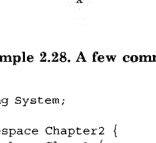

|  |  |
|---|---|
| sin θ = y/r | csc θ = r/y |
| cos θ = x/r | sec θ = r/x |
| tan θ = y/x | cot θ = x/y |

csc θ = 1/sin θ, sec θ = 1/cos θ, cot θ = 1/tan θ, tan θ = sin θ / cos θ, cot θ = cos θ / sin θ, sin²θ + cos²θ = 1, θ = s/r（其中 s 是带符号弧长）

### 示例 2.28. 几个常见的数学函数。

```csharp
using System;

namespace Chapter2 {
    class Class1 {
        static void Main() {
            string input;
            double number1, number2, number3 = 2.0;

            Console.Write("Enter a number and I'll give you its square
            root: ");
            input = Console.ReadLine();
            number1 = double.Parse(input);

            number2 = Math.Sqrt(number1);
            Console.WriteLine("\nThe square root of {0} is {1}",
                number1, number2);

            number2 = Math.Pow(number2, number3);
            Console.WriteLine("Do these numbers match {0} and {1}?",
                number1, number2);

            number1 = Math.Ceiling(3.2);
            number2 = Math.Floor(3.9);

            Console.WriteLine("Math.Ceiling(3.2) = {0}", number1);
            Console.WriteLine("Math.Floor(3.9) = {0}", number2);

        }
    }
}
```

其他扩展包括一些用于确定绝对值的实用函数，以及将字符数据转换为整数和双精度浮点数的引用，但与游戏编程相关的最重要扩展是随机数生成器。基于内部时钟生成的伪随机数在游戏编程中对我们尤其重要，因为它们有助于引导用户所看到的自发事件和不可预测的对手。这也是简单人工智能的基础，但我会到下一章才深入讨论。现在，让我们通过《Battle Bit》游戏的续作《Battle Bit II——这就是战争！》来看看我们能把上述这些函数以及前两章学到的其他一切推进到什么程度（见示例 2.29）。

## 示例 2.29. Battle Bit II：这就是战争！

```csharp
/* Battle Bit II - THIS IS WAR! Some mad dog soldier shot down the
 * alien Ambassador's convoy and it sparked an intergalactic war.
 * Earth's defenses were weak from warring with several hundred other
 * worlds. So now, it's all up to you. */
using System;

namespace Chapter2 {
    class Class1 {
        static void Main() {
            string input;
            char cYesNo;

            Random rnd = new Random();

            do { // do-while loop
                double iAlienShip1 = Math.Round (rnd.NextDouble() * 100) + 1,
                    iAlienShip2 = Math.Round (rnd.NextDouble() * 100) + 1,
                    iTarget = 0,
                    iAlienMissiles = 0;
                const double iYourLocation = 50;

                Console.WriteLine("Captain, are you in there? Captain?\n"
                    + "(Crying is heard from his quarters)\n"
                    + "This is ground control to lieutenant Bob.\n"
                    + "Your brother Major Tom has been shot down,\n"
                    + "Repeat he has been shot down.\n"
                    + "The aliens have destroyed our space outpost and \n"
                    + "are now on route to Earth.\n"
                    + "I know it's a long shot Lieutenant,\n"
                    + "but I promised my wife and kids you'd stop them.\n"
                    + "I'll do my best...\n");

                while ((iAlienShip1 > 0) || (iAlienShip2 > 0)) {
                    Console.Write("\nEnter targeting information: ");
                    input = Console.ReadLine();
                    iTarget = byte.Parse(input);

                    Console.WriteLine("{0},{1}", iAlienShip1, iAlienShip2);

                    if (Math.Ceiling(iTarget) == Math.Ceiling(iAlienShip1)
                        || Math.Ceiling(iTarget) == Math.Floor(iAlienShip1)
                        || Math.Floor(iTarget) == Math.Ceiling(iAlienShip1)
                        || Math.Floor(iTarget) == Math.Floor(iAlienShip1)) {
                            Console.WriteLine ("Alien ship hit, you got him!");
                            iAlienShip1 = -1;
                    }

                    if (Math.Ceiling(iTarget) == Math.Ceiling(iAlienShip2)
                        || Math.Ceiling(iTarget) == Math.Floor(iAlienShip2)
                        || Math.Floor(iTarget) == Math.Ceiling(iAlienShip2)
                        || Math.Floor(iTarget) == Math.Floor(iAlienShip2)) {
                            Console.WriteLine ("\nAlien ship hit, you took him
                            down!\n");
                            iAlienShip2 = -1;
                    }
                }

                if ((Math.Round (iTarget) > Math.Round (iAlienShip1))
                    && (Math.Round (iTarget) > Math.Round (iAlienShip2)))
                    Console.WriteLine("\n You missed, try aiming a
                        little lower\n");
                else if ((iTarget < iAlienShip1) && (iTarget <
                    iAlienShip2))
                    Console.WriteLine("\n You missed, try aiming
                        higher\n");
                else
                    Console.WriteLine("\n I can't get a lock on
                        them\n");

                if (Math.Ceiling(iAliensMissiles) ==
                    Math.Ceiling(iYourLocation)
                    || Math.Ceiling(iAliensMissiles) ==
                        Math.Floor(iYourLocation)
                    || Math.Floor(iAliensMissiles) ==
                        Math.Ceiling(iYourLocation)
                    || Math.Floor(iAliensMissiles) ==
                        Math.Ceiling(iYourLocation))
                    break;
                else
                    iAliensMissiles = rnd.NextDouble();
            } // end loop

            if ((iAlienShip1 + iAlienShip2) < 0)
                Console.WriteLine("\n Good work lieutenant, "
                    + "or should I say captain.\n");
            else
                Console.WriteLine("\n BOOM!!! You're dead.\n");

            Console.WriteLine("\n Game Over\n"
                + "\n Would you like to play again? (Y/N)");
            input = Console.ReadLine();
            cYesNo = char.Parse(input);
            cYesNo = char.ToUpper(cYesNo);
        } while (cYesNo == 'Y');
    }
}
```


## 类型转换：显式转换

在我们进入用户自定义函数之前，让我们先介绍一个额外的主题，该主题实际上允许将数值数据转换为其他各种大小的数据类型，而不会出现有关截断和不当数据丢失的烦人警告。请记住，在第 1 章中我们介绍了隐式转换，这通常属于从小到大传输数据的范畴。*类型转换*是一种显式转换，用于从小到大转换以防止计算错误，或从大到小转换以重新定义那些参数，当某个值的精度超过其需求时（参见文本示例 1 和 2）。在任何一种情况下，声明显式转换的操作都会通知编译器我们的意图并自动重新分配这些变量。

### 文本示例 1：

当某个值大于实际所需时，该值可以被截断以节省空间或优化最终显示的语句，例如，$10.012 变为 $10.01，即所欠金额。

### 文本示例 2：

当无理数是进行整数运算的结果时，该值始终会被截断为整数值。这将发生在无论分配变量的数据类型如何，并且不考虑被截断变量的真实值。例如，在方程 9 除以 2 中，真实商应为 4.5，但在截断后，使用整数除法的规则，我们剩下的值是 4。尽管不正确，但这就是传递给变量的值，即使该变量是浮点数据类型。纠正此问题的最简单方法是使至少一个值成为实数，例如 9.0/2 等于 4.5。然而，这里的问题是这种类型的更改仅适用于字面常量，而不适用于保存整数数据的变量（如 x = 9，y = 2，x/y 得到 4）。一个更具创造性的解决方案是使用类型转换。类型转换，如上所述，允许我们通过使用数据类型转换来转换字面常量和变量，例如，*(double)*9 或 *double*(9)（参见示例 2.30）。

### 示例 2.30. 类型转换。

```csharp
using System;
namespace Chapter2 {
class Class1 {
    static void Main() {
        double number1 = 9/2; // Warning - returning 4
        Console.WriteLine(number1);

        double number2 = (double)9 / (double)2; // returning 4.5
        Console.WriteLine(number2);

        int integer1 = (int)(4.7); // 4
        Console.WriteLine(integer1);

        if ( 9/2 >= (double)9 / 2 ) // always false
            Console.WriteLine("4 >= 4.5"); //Unreachable code detected

        int integer2 = 9;
        double number3 = (double)integer2 / 2; // 4.5
        Console.WriteLine(number3);

        int integer3 = (int)((double)9 / (double)2 + .5); // 5.0
        Console.WriteLine(integer3);
    }
}
}
```

> **注意**
> 无符号值按定义具有有符号值两倍的范围，因此在尝试转换为受限数据类型时，数据丢失的可能性会增加。

## 引用、值和装箱技术

除了能够在标准类型之间转换之外，我们还可以将这些技术应用于包括值到引用和引用到值转换。这类过程最常被称为 *装箱*，而术语 *拆箱* 表示将这些值返回到其原始状态。该过程遵循用于基本类型转换的相同步骤，但在尝试返回或拆箱我们的值时需注意：它们可以返回到新变量，但这些变量必须与原始装箱数据的类型相同。转换使用关键字 `object` 进行，如示例 2.31 所示。

### 示例 2.31. 装箱和拆箱。

```csharp
using System;

namespace Chapter2 {
    class Class1 {
        static void Main() {
            double Happy = 4.0;

            object MrBox = Happy;

            // This line should work well
            double StillHappy = (double)MrBox;

            // This line may compile, but it will surely fail on execution
            int NotHappy = (int)MrBox;
        }
    }
}
```

## 用户自定义函数简介

什么是 *用户自定义函数？* 简单来说，它们是与主方法或次要方法链接的子程序（子例程或次要方法），随后在该方法请求时用于执行一系列任务。它们可以从其他函数（包括主方法）接收信息，也可以将信息发送回引用它们的函数。它们既是命令（如预定义函数），也是我们作为程序员创建的用于实现这些命令的代码行。从技术上讲，用户自定义函数内部放置的所有内容本可以同样留在其主方法中，但在专业程序中，这会导致混淆和非常庞大且杂乱的主方法。此外，可以将许多技术应用于用户自定义函数（包括 *按引用调用、重载* 和 *递归*），所有这些都可以反复应用，而不是要求程序员在单个线性方法中一遍又一遍地重复该编码。为了开始，我们将从更简单的函数开始，然后逐节扩展这些主题。

## 编写我们的第一个用户自定义函数

编写用户自定义函数与编写主函数并没有什么不同。事实上，如果你将两者进行比较，你会发现其底层规则基本上是相同的。声明用户自定义函数时的一大关键优势在于其描述性命名的灵活性，这为程序员提供了即时、如果不完整的话，对函数将做什么的描述。微软的匈牙利命名法和驼峰命名法，以及变量命名的简单规则（都在第 1 章中讨论过）是我们声明用户自定义函数时将使用的规则。我们的第一个示例演示了如何编写一个简单的函数。你应该使用此示例来比较两种函数，例如，Main () 与 OurFunction ()（参见示例 2.32）。

### 示例 2.32. 我们的第一次函数调用。

```csharp
using System;

namespace Chapter2 {
    class Class1 {
        static void OurFunction() {
            /* This is a do nothing function */
        }

        static void Main () {
            OurFunction();
        }
    }
}
```

> 引用用户自定义函数与引用预定义函数并无不同。

尽管此程序与第 1 章中的无操作程序相似，但它仍然代表一个真正的用户自定义函数。从这里开始，我们本可以插入大量信息，包括声明变量、预定义函数、循环和 switch 语句。尽管如此，最好还是等到我们完全定义了用户自定义函数后再加入其中一些。接下来的几节包括原型、全局和局部变量、数据结构以及 *返回* 语句的描述，所有这些对于该定义都至关重要，所以请耐心等待。

编写一个简单的无操作函数的第二种方法是将其放在主函数下方，如示例 2.33 所示。如果你花点时间检查此示例，你会发现其内容和目的相对没有变化（即无所作为）。微小的修改只是将完成的函数移开，以便我们在返回主方法工作时将其放在一边。

### 示例 2.33. 我们的第二次函数调用。

```csharp
using System;

namespace Chapter2 {
    class Class1 {
        static void Main() {
            OurFunction();
        }

        static void OurFunction() {
            /* This is a do nothing function */
        }
    }
}
```

## 变量作用域

*局部变量* 是在主方法或后续方法内部声明的变量。它们的取值不会超出其块的限制。希望从一个块向另一个块传输数据的程序员必须使用引用函数来完成此操作。一般来说，传递变量有两种类型：*按机制调用*，其中信息仅传递给新变量，以及 *按引用调用*，允许程序员更改原始内存位置。局部变量及其次要对应物可以无休止地传递和重新传递，因此限制最小。此外，用户自定义函数具有将数据返回给主函数或其他调用函数的能力。

C# 实际上并不允许真正的全局变量，但单词 global 可用于区分单个方法或类内的局部变量和包含性变量。*全局变量* 允许数据交换，但不需要传递变量（参见示例 2.34）。


### 示例 2.34. 局部变量和全局变量。

```csharp
using System;

namespace Chapter2 {
    class Class1 {
        static int NumberOne, NumberTwo, GlobalTotal = 0;

        static void Main() {
            string input;

            int LocalTotal = 0;
            Console.Write("\n How many apples did Johnny shoplift? ");
            input = Console.ReadLine();
            NumberOne = int.Parse(input);

            Console.Write("\n How many apples did Bobby shoplift? ");
            input = Console.ReadLine();
            NumberTwo = int.Parse(input);

            LocalTotal = NumberOne + NumberTwo;
            OurFunction(LocalTotal);
        }

        static void OurFunction(int Total) {
            GlobalTotal = NumberOne + NumberTwo;
            Console.WriteLine("\n Good news, Johnny and Bobby were "
                + "arrested for shoplifting.\n"
                + "By the way would you like an apple? "
                + "I have {0} of them, {1} apples is a lot.", Total,
                GlobalTotal);
        }
    }
}
```

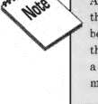

当访问这些块时，所有与局部变量冲突的全局引用通常会被编译器隐藏，因此局部引用总是优先于全局值。当处理需要双重引用的局部变量和全局变量时，必须做出两个重要区分。首先，必须声明新的函数引用；其次，必须使用类的定义完整定义全局变量（见示例 2.35）。

### 示例 2.35. 变量作用域。

```
using System;

namespace Chapter2 {
    class Class1 {
        // global variable (also the value of a gold bar on earth).
        const double GoldBar = 1000.00;

        static void Main() {
            // local variable (also the value of a gold bar in hell).
            double GoldBar = 0;

            Class1 GlobalCA2 = new Class1();
            Console.WriteLine("The value of gold on earth is "
                + "${0} per ounce", Class1.GoldBar);
            Console.WriteLine("The value of gold in hell is "
                + "${0} per pound", GoldBar);
        }
    }
}
```

## 返回值的函数

我们的下一步将是重新装备用户定义函数，使其具有需要某种返回计算的非 void 数据类型。关键字 return 将单个值传回调用函数。该值必须是限定类型，在返回类型为 void 的情况下可以省略。所有非 void 的用户定义函数和方法都需要 return 语句。我们将首先开发一个简单但有效的函数，它求两个值之和并将该值返回给 main 方法（我们也可以修改此示例来计算它们的差、积、商——见示例 2.36）。

### 示例 2.36. 返回值。

```
using System;

namespace Chapter2 {
    class Class1 {
        static void Main() {
            string input;
            int iNumberOne = 0, iNumberTwo = 0; // Local variables

            iNumberTwo = RandomNumber();

            while (iNumberOne != 99) { // 99 ends loop
                Console.Write ("\n Guess the number, hint: "
                    + "it's between ten and three.\n"
                    + "Can you guess it he, he, he? ");
                input = Console.ReadLine();
                iNumberOne = int.Parse(input);

                if (iNumberOne == iNumberTwo) {
                    Console.WriteLine("\n Hey you win, with a smile "
                        + "with a grin!!!");
                    iNumberTwo = RandomNumber();
                } else if (iNumberOne > iNumberTwo) {
                    Console.WriteLine("\n Too high smart guy!");
                    iNumberTwo++;
                } else {
                    Console.WriteLine("\n Too low slow Joe");
                    iNumberTwo--;
                }
            }

            static int RandomNumber() {
                Random rnd = new Random();
                int n2 = (int)Math.Round(rnd.NextDouble() * 9) + 1;
                return (n2);
            }
        }
    }
}
```

下一次比较稍微拓宽了范围，使我们的随机函数能够返回字符数据。这里我们还加入了一个 while 循环，保护函数不会返回字母以外的任何内容（见示例 2.37）。

### 示例 2.37. 字母生成器。

```csharp
using System;

namespace Chapter2 {
    class Class1 {
        static void Main() {
            char Letter = ' ', Response;
            string input;

            Console.WriteLine ("This program attempts to guess "
                + "the first letter\n"
                + "of your first name by randomly generated letters.\n"
                + "All you have to do is reply with a \"y\"\n"
                + "or a \"n\" after each guess\n"
                + "You can also enter \"q\" to quit "
                + "the game at any time.\n"
                + "My first guess is...\n");

            do {
                Letter = LetterGenerator(Letter);
                Console.WriteLine ("{0} is this correct?\n", Letter);
                input = Console.ReadLine();
                Response = char.Parse(input);

                if (char.ToUpper(Response) == 'Y')
                    Console.WriteLine("Great let's play again");
                else
                    Console.WriteLine("How about...");

            } while (char.ToUpper(Response) != 'Q');
        }

        static char LetterGenerator(int Letter) {
            Random rnd = new Random();
            Letter = ((int)Math.Round(rnd.NextDouble() * 100));
            while (!(Letter >= 65 & Letter <= 90) )
                Letter = ((int)Math.Round(rnd.NextDouble() * 100));
            return ((char)Letter);
        }
    }
}
```

main 方法也很容易调整，以同时包含存储数据类型和 return 语句（见示例 2.38 和 2.39）。请注意，在 main 方法内部引用 return 语句会导致该程序立即终止。

### 示例 2.38. 带数据类型的 main 函数。

```
using System;

namespace Chapter2 {
    class Class1 {
        static int Main() {
            return 0;
        }
    }
}
```

### 示例 2.39. 空 return 语句。

```
using System;

namespace Chapter2 {
    class Class1 {
        static void Main() {
            return;
        }
    }
}
```

## 传递变量：按值调用

按值调用类型机制是一种用于在方法之间传输数据的机制，它不允许继续访问原始字段。此时数据被视为值类型，它适当地存储在“栈”——计算机的临时内存——中，并在该方法终止时被移除或“弹出”。同样，这些次级变量中的更改不会影响原始字段，也不会发生删除。按值调用的形参指的是用户定义函数内部所引用的变量，如示例 2.40 所示（一个求数字平方根的简单示例）。

### 示例 2.40. 传递我们的第一个变量。

```csharp
using System;

namespace Chapter2 {
    class Class1 {
        static void Main() {
            string input;
            float number = 0, root = 0;

            Console.WriteLine("This program will find the "
                + "square root of any number\n"
                + "To continue just enter a number when prompted\n"
                + "Your results will appear after you press enter\n"
                + "To quit just enter the number \"1\"\n"
                + "Enter your first value now: ");
            input = Console.ReadLine();
            number = float.Parse(input);

            while (number > 1) {
                root = SquareRoot(number);
                Console.WriteLine(root);

                Console.Write("Enter your next value now: ");
                input = Console.ReadLine();
                number = float.Parse(input);
            }
        }

        // This function generates square roots using Newton's method

        static float SquareRoot(float n) {
            float test1, test2;
            test1 = n - (float).01 - ((n - (float).01) * (n - (float).01) - n)
                / (n * (n - (float).01));
            test2 = test1 - ((test1 * test1) - n) / ((n) * test1);

            while (test1 != test2) {
                test1 = test2;
                test2 = test1 - ((test1 * test1) - n) / ((n) * test1);
            }
            return (test2);
        }
    }
}
```


> **注意**
>
> 我们也可以将那个用户定义函数替换为预定义函数 `Math.Sqrt()`。

## 将函数编写为黑盒

*黑盒理论* 只是一个概念，它强调这样一种观点：大多数（即使不是全部）函数都应被视为独立或自包含的子程序。它还认为，只想调用某个函数的程序员无需研究或了解用于构造该函数的代码。因此，访问一个函数所需的唯一信息就是正确传入的变量，以及知道该函数将返回什么。这类似于会开车，但不知道如何修理发动机。这在 C# 中实际上是常态，因为所有预定义函数对大多数程序员来说都是黑盒，而增强它们的想法实际上会迫使我们打开它们，并按照某种新标准重新设计它们（不幸的是，这在游戏编程中通常是必要的）。当然，如果你编写自己的用户定义函数，你肯定知道每个函数是如何工作的。

创建黑盒风格的函数要求或限制我们使用封装控制。当然，这意味着你必须避免使用全局变量，并且必须为每个原型添加注释，以提醒任何其他程序员注意变量设置及其结果。此外，你应该记住，在后面的章节中，我们将从单独的文件中读取和写入用户定义函数，因此确实需要详细注释来解释这些不同的函数调用各自做什么。

> **将黑盒方法应用于示例 2.40**
>
> 假设你并没有真正理解上一个示例的第二部分，但你还是使用了平方根函数。虽然这让我内心中的数学家有点沮丧，但这不会影响程序执行该数据的方式，事实上，这恰好说明了我的观点。不过，如果那段代码引起了你的兴趣，那么下面是对其数学原理的简要概述（见示例 2.41）。

### 示例 2.41. 平方根函数详解。

```
static float SquareRoot (float n){    // Newton's Method (Basic Calculus)
float test1, test2;                    // Xₙ₊₁ = Xₙ - f(Xₙ)/f'(Xₙ)  n = 1, 2, 3,
... 
test1 = n-(float).01 -                 // X₀ = Guess-Estimate
    ((n-(float).01)*(n-(float).01) - n)/(n*(n-(float).01));
test2 = test1 - ((test1*test1)-n)/((n)*test1);

while (test1 != test2){                // X₁ = X₀ - (X₀² - Number)/(Number*X₀)
    test1 = test2;                     // X₁ = X₀ - (X₀² - Number)/(Number*X₀)
    test2 = test1 -                    // X₂ = X₁ - (X₁² - Number)/(Number*X₁)
        (test1*test1 - n) /            // X4 = X₃ - (X₃² - Number)/(Number*X₃)
        ((n)*test1);                   // X₆ = X₅ - (X₅² - Number)/(Number*X₅)
}
return (test2);                        // until Xₙ = Xₙ₊₁
}
```

同样，我们也可以使用预定义函数 Math.Sqrt() 重建上一个程序（见示例 2.42）。

### 示例 2.42. 用户定义函数与预定义函数对比。

```
using System;

namespace Chapter2 {
    class Class1 {
        static void Main() {
            string input;
            float number = 0, root = 0;

            Console.WriteLine("This program will find the "
                + "square root of any number\n"
                + "To continue just enter a number when prompted\n"
                + "Your results will appear after you press enter\n"
                + "To quit just enter the number \"1\"^n"
                + "Enter your first value now: ");
            input = Console.ReadLine();
            number = float.Parse(input);
```

```csharp
class Class1 {
    static void Main() {
        string input = "Y", Horse;
        int iNumber1 = 0, iNumber2 = 0, iNumber3 = 0;

        Console.WriteLine("Let's have a horse race.\n"
            + "To play select one of the horses below");

        while (char.ToUpper(char.Parse(input)) != 'N') {
            Console.WriteLine("(1) for Whitefire\n"
                + "(2) for The Train and, \n"
                + "(3) for Noisy Glue\n");
            Horse = Console.ReadLine();

            TheRace(ref iNumber1);
            TheRace(ref iNumber2);
            TheRace(ref iNumber3);

            TieBreaker(iNumber1, ref iNumber2);
            TieBreaker(iNumber2, ref iNumber3);
            TieBreaker(iNumber1, ref iNumber3);

            Console.Write("And the winner is ");
            if (iNumber1 > iNumber2 && iNumber1 > iNumber3)
                Console.WriteLine("Noisy Glue"); // 3
            else if (iNumber2 > iNumber1 && iNumber2 > iNumber3)
                Console.WriteLine("The Train"); // 2
            else
                Console.WriteLine("Whitefire"); // 1

            Console.WriteLine("Would you like to play again (Y/N)?");
            input = Console.ReadLine();
        }
    }

    static void TheRace(ref int Num) {
        Random rnd = new Random();

        Num = (int)Math.Round(rnd.NextDouble() * 1000);
    }

    static void TieBreaker(int Num1, ref int Num2) {
        if (Num1 == Num2) {
TheRace(ref Num2);
TieBreaker(Num1, ref Num2);
} 
} 
}
```

## 关键字 out

关键字 out 是一种特殊的异常标记，它通知编译器：所检查的变量在被作为引用变量传递之前不需要赋值。这通常适用于这样的情况：在适当的函数执行之前，这些变量本来不会有有意义的值。由于 out 值也是引用值，此关键字消除了对第二个引用（ref）的需要（见示例 2.44）。

### 示例 2.44. 关键字 out。

```
using System;

namespace Chapter7 {
    class Class1 {
        static void Main() {
            string input = "Y", Horse;
            int iNumber1, iNumber2, iNumber3;

            Console.WriteLine("Let's have a horse race.\n"
                + "To play select one of the horses below");

            while (char.ToUpper(char.Parse(input)) != 'N') {
                Console.WriteLine("(1) for Whitefire\n"
                    + "(2) for The Train and, \n"
                    + "(3) for Noisy Glue\n");
                Horse = Console.ReadLine();

                TheRace (out iNumber1);
                TheRace (out iNumber2);
                TheRace (out iNumber3);

                TieBreaker (iNumber1, ref iNumber2);
                TieBreaker (iNumber2, ref iNumber3);
                TieBreaker (iNumber1, ref iNumber3);
Console.Write ("And the winner is");

if (iNumber1 > iNumber2 && iNumber1 > iNumber3)
    Console.WriteLine("Noisy Glue"); // 3
else if (iNumber2 > iNumber1 && iNumber2 > iNumber3)
    Console.WriteLine("The Train"); // 2
else
    Console.WriteLine("Whitefire"); // 1

Console.WriteLine("Would you like to play again (Y/N)?");
input = Console.ReadLine(); }

static void TheRace(out int Num) {
Random rnd = new Random();
Num = (int)Math.Round(rnd.NextDouble() * 1000);
}

static void TieBreaker(int Num1, ref int Num2) {
if (Num1 == Num2) {
    TheRace(out Num2);
    TieBreaker(Num1, ref Num2);
}
}
}
```

## 多态简介

多态（也称为重载）发生在任何引用具有密切匹配但不完全相同的定义时。这些辅助函数或替代函数虽然在技术上并非必需，但通常倾向于保持在第一个函数用途的范围内。如果将一个重载函数修改到足以促成一个全新定义的程度，那么重载就没有必要了。虽然重载函数确实共享相同的引用名称，但它们的定义必须在排列上至少有一个传递数据类型不同。使用这些不同的访问点会引导编译器找到正确的（重载）函数。由于存在多个可能的引用点，错误调用该函数的可能性也会增加，从而产生运行时错误。示例 2.45 和 2.46 给出了可以产生相同结果的替代函数，但只有一个实际上执行正确。


### 示例 2.45. 重载函数。

```
using System;

namespace Chapter2 {
    class Class1 {
        static void Main() {
            string input;
            int iNumber1 = 0, iNumber2 = 0, iNumber3 = 0, iTotal;

            Console.WriteLine("Please enter two to three "
                + "numbers to be added\n"
                + "If you only have two numbers make "
                + "the third number equal to zero:\n");

            input = Console.ReadLine();
            iNumber1 = int.Parse(input);
            input = Console.ReadLine();
            iNumber2 = int.Parse(input);
            input = Console.ReadLine();
            iNumber3 = int.Parse(input);

            if (iNumber3 == 0)
                iTotal = Sum(iNumber1, iNumber2);
            else
                iTotal = Sum(iNumber1, iNumber2, iNumber3);

            Console.WriteLine("The Sum of these numbers was {0}", iTotal);
        }
        static int Sum(int iNumber1, int iNumber2) {
            int iSum;
            iSum = iNumber1 + iNumber2;
            return (iSum);
        }

        static int Sum(int iNumber1, int iNumber2, int iNumber3) {
            int iSum;
            iSum = iNumber1 + iNumber2 + iNumber3;
            return (iSum);
        }
    }
}
```

如果你不确定这个程序是否正常工作，请尝试使用两个零和一个负数重新测试这三个变量。

### 示例 2.46. 此程序没有重载该函数。

```
using System;

namespace Chapter2 {
    class Class1 {
        static void Main() {
            string input;
            int iNumber1 = 0, iNumber2 = 0,
                iNumber3 = 0, iTotal;

            Console.WriteLine("Please enter two to three numbers"
                + " to be added\n"
                + "If you only have two numbers "
                + "make the third number equal to zero: \n");

            input = Console.ReadLine();
            iNumber1 = int.Parse(input);
            input = Console.ReadLine();
            iNumber2 = int.Parse(input);
            input = Console.ReadLine();
            iNumber3 = int.Parse(input);

            iTotal = Sum(iNumber1, iNumber2, iNumber3);

            Console.WriteLine("The Sum of these numbers was {0}", iTotal);
        }

        static int Sum(int iNumber1, int iNumber2, int iNumber3) {
            int iSum;
            iSum = iNumber1 + iNumber2 + iNumber3;
            return (iSum);
        }
    }
}
```

## 递归简介

*递归函数*是一种用户定义函数，它包含一个或多个由对该函数的二次调用的不寻常放置所引起的异常迭代。这种二次函数调用的位置或放置被认为不寻常，或者至少是一个特殊主题，因为它从该函数内部调用该函数。也就是说，当程序员创建该函数时，他们将其包含在对自身的调用中，从而使该函数反复循环，或至少多次循环。（注意：这也意味着它在返回主函数或调用函数之前，必须多次返回到自身）。以这种方式操作函数的原因多种多样，有时令人困惑，但最终，此类示例的编码相当简单，如示例 2.47 所示。注意本章前面用于测试我们的赛马程序的递归函数。

### 示例 2.47. 递归。

```csharp
using System;

namespace Chapter2 {
    class Class1 {
        static void Main() {
            Password();
        }

        static void Password() {
            string input;
            int password;

            Console.WriteLine("\n Enter Your Access Code Now: ");
            input = Console.ReadLine();
            password = int.Parse(input);
            if (password == 1024) {
                Console.WriteLine("\n Access Granted");
                return;
            } else
                Password();
        }
    }
}
```

## 内联函数

C# 另一个有趣之处是它会自动使用 `inline functions`，这些函数会被插入到需要引用它的每一行中。也就是说，函数引用不是在运行时搜索该函数，而是将该函数编译到那行代码中。这会加快程序速度，但也会增加代码大小。C/C++ 中“内联”的最大问题是它只是一个请求而不是命令，因此编译器可以拒绝执行。大多数编译器（包括 Microsoft 的 Visual C++ 系列）不会内联递归函数，也不允许通过指针引用的函数（关于指针的信息见第 4 章）。C# 中不需要 C/C++ 关键字 `inline`，因此它被归入过时代码之列。注意：Microsoft 版本的 C 和 C++ 也都包含内联命令的两种变体（`__inline` 和 `__forceinline`）；这些关键字在 C# 中也没有用武之地。

## 疑难解答

又该深呼吸一下，解决一点问题了。记住，如果你在这里找不到答案，它们可能已在上一个疑难解答部分解释过（见第 1 章）。首先，让我们从逻辑角度看待问题；假设你已经成功运行了上一章列出的所有程序。如果是这样，那么任何问题都必然与语法有关。问题：错误是在编译时发生的吗？尝试将警告级别重置为较低设置；那些错误是否变成了警告？也许你遇到了语法错误；查找因在比较中使用错误符号而导致的错误。如果没有编译错误，但程序的数据仍然产生不正确的输出，请尝试查找颠倒的符号、排版错误或不完整的编码错误。

## 常见错误、问题和陷阱

- 1. 诸如 `==`、`!=` 和 `>=` 之类的符号组合不能在其间写入空格（`= =`、`! =`）。这是不正确的，即使程序似乎可以运行，也应始终避免。
- 2. 不要将 `=` 与 `==` 混淆。记住，`=` 用于赋值，`==` 用于比较两个值。
- 3. 尝试在 `if` 语句中使用单个等号会导致错误。
- 4. while 循环不需要分号，但 do-while 循环需要（如 `do...while (something);`）。
- 5. 大多数编译器无法识别前三十个字符之后的名称，因此要小心过长且过于相似的名称。
- 6. 遗漏右括号通常会导致多个错误。此外，忘记删除多余的括号通常会导致意外错误。
- 7. 忘记终止 while 循环是逻辑/运行时错误的典型例子。程序会执行它被要求执行的所有操作，但这会导致它卡住。解决方法很简单：要么用 Ctrl-C 取消程序，要么用鼠标关闭可执行窗口，然后重写循环，使其包含一个能在正确时间结束循环的事件。这类错误通常称为*无限循环错误*。
- 8. 在从任何值中获取信息之前，都应先初始化所有值；不这样做会导致*数据损坏错误*。
- 9. 当然，你仍然不能除以零，所以连试都不要试。但是，如果你担心数据偶尔可能等于零，就需要测试该结果并设法绕过它。这可以通过多种方式完成，但最简单的是使用 `if` 语句（考虑短路）。
- 10. 不能对复杂变量进行递增或递减。例如，你不能递增两个数之和，例如 `[(x+5)++]`。
- 11. 最常见的错误之一是在循环的终止序列中错误地颠倒小于或大于符号，导致比较永远找不到匹配项：这是一种造成运行时错误（无限循环）的排版错误。
- 12. 你是否在 `if` 语句、`for` 语句或 `switch` 语句的第一行末尾放置了分号？这样做会向编译器表明这些行是空白或空的，而你的块或单条语句将不会被视为该序列的一部分。
- 13. 记住，在函数定义内部，必须像 `int one, int two` 那样分别声明每种数据类型；试图仅用逗号将它们包含在一起会导致编译错误。


- 14. 记住，C# 要求所有 case 语句都以 break 语句结尾。
- 15. 记住，在定义按引用调用时，`out` 语句替代了 `ref` 语句。

### 要记住的要点

- 1. *if* 语句用于有限次比较，而 *switch* 语句用于多种情况。
- 2. 复合语句是包含在花括号之间的一组语句。
- 3. 数学简写只应在能使代码更易读时使用。（注意：某些编译器会将这类简写转换成运行更快的代码。）
- 4. `System.Console.Write` 和使用 `System;` 再加 `Console.Write` 的效果完全相同。
- 5. *while* 循环先测试再运行第一个循环周期，而 *do-while* 循环先运行，然后在运行第一个循环周期之后进行测试。
- 6. 你必须记住关于预定义函数和用户自定义函数的一切。记住它们的最好方法就是练习，所以我会尽可能多地包含这些内容——剩下的你就得自己练习了。
- 7. 记住，C# 不需要函数原型或包含文件。
- 8. 按引用调用可以完全取代全局变量。
- 9. 重载函数不能包含相同的变量传递排列方式。
- 10. 递归不过是从函数内部重复调用同一个函数而已。
- 11. 当编写一条跨越多行的语句时，试着将其拆分。在逗号或其他标记处断开，使拆分后的内容更易读。
- 12. 尽可能始终使用标准的预定义函数；它们能加快编程任务并提高程序的可移植性。
- 13. 任何优秀程序员的目标都是编写可被多个项目重用的代码。不要浪费时间重写相同的代码。
- 14. 使用 `if-else` 语句时，尽量把最常见的情况放在最前面；这会让你更快地定位到正确信息，从而加快程序运行速度。
- 15. 将多个 `if` 语句转换为更少的 `if-else` 语句也能加快程序运行，因为某些比较可以被跳过，从而节省时间。
- 16. 有些程序员用花括号将每条 `if-else` 语句括起来。我有时也会这么做，但通常我会让单条语句保持原样。
- 17. 值得注意的是，并非每个 `switch` 语句都需要一个结尾的 default 语句，而且这些 default 可以列在 switch 语句的顶部或其中任何位置。不过，坚持标准还是有好处的——在这种情况下，它会使你的程序更易读。
- 18. 你还应该注意，基于计数器的循环（如 `for` 和 `while` 循环）如果其标记计数方向错误，或在标记之后才开始计数，就会变成无限循环。这些也被视为无限循环，但要难找得多。
- 19. 始终记住，当向用户请求输入（如姓名、社会安全号码……）时，你可以回显这些信息以允许修改。
- 20. 比较实数时要小心：记住，4.001 不等于 4.00005，而且两者都不等于整数值 4。
- 21. 避免使用浮点变量（float 和 double）来计数循环。
- 22. C# 与 C/C++ 一样，在使用 && 符号编写比较时总是试图对比较进行短路求值：这将节省时间... 因此，为了加快程序运行，你应该尽量把更常见的为假测试放在前面。
- 23. 有些程序员认为 `break` 和 `continue` 等关键字违背了结构化编程的理想。然而，这些关键字能够加快编程任务，被许多程序员视为有价值。
- 24. 在值类型与引用类型的使用上，记住引用值更快，但值类型更安全。
- 25. 记住，在 C# 中内联限定符是自动的。
- 26. 尽量让每个函数只完成单一任务。如果一个函数需要一长串变量，或者它做了许多函数的工作，那么它可能过于庞大了。记住，程序员的最终目标是同时为可重用性和可移植性而编写代码。

## 问题

- 1. 使用三个 if 语句编写一个程序，测试两个变量，如果发现第一个变量等于、小于或大于第二个变量，则显示相应的消息。
- 2. 使用关键字 else-if 简化上一个程序（提示：使用一个 if 语句和两个 else-if 语句）。
- 3. 使用关键字 else 将第一个程序简化为使用一个 if 语句、一个 else-if 语句和一个 else 语句。
- 4. 从问题 3 出发，修改每个比较，使其包含复合的 if、else-if 和 else 语句。
- 5. 编写一个使用嵌套 if 语句的程序，首先询问用户是否有两个数字需要比较，然后重复问题 4。
- 6. 使用 or 运算符原样（'Y' || 'y'）修改问题 5 中的程序。
- 7. 使用“and”和“not”运算符修改问题 5 中的程序。
- 8. 使用缩写形式 += 求两个数的和。
- 9. 针对减法、乘法、除法和取余重复问题 8。
- 10. 编写一个程序，允许用户从五种基本数学类型中选择任何一种。使用 while 循环在每次计算后重复显示选项。
- 11. 修改问题 10 中的程序，使用 continue 语句强制 while 循环跳过实际计算。
- 12. 使用 do-while 循环修改问题 10 中的程序。
- 13. 使用 for 循环修改问题 10 中的程序。
- 14. 修改问题 10 中的程序，将所有 if 语句替换为 switch 语句。
- 15. 修改问题 14 中的程序，将 cout 替换为 printf，将 cin 替换为 scanf。
- 16. 修改问题 14 中的程序，将 cout 替换为 puts，将 cin 替换为 gets。
- 17. 编写一个使用布尔数据类型（bool test）测试 if 语句的程序。
- 18. 编写一个使用短路求值来防止除以零的程序。
- 19. 编写一个使用类型转换将 double 常量（如 1.3）转换为 float 数据类型的程序。
- 20. 修改问题 5 中的程序，将（'Y' || 'y'）替换为 ToUpper 函数。
- 21. 编写一个什么都不做的程序，调用用户自定义函数 Hello()。Hello 应显示“Hello world!”这几个字。
- 22. 修改问题 21 中的程序，使用 Hello() 的原型。
- 23. 使用全局变量编写一个程序，在用户自定义函数内部比较两个变量。
- 24. 使用局部变量修改上一个程序；使用 Hello(int iVal1, int iVal2)。
- 25. 修改上一个程序，使两个变量在用户自定义函数内部声明和赋值，并且只将最终值返回给主函数（提示：使用 static int Hello()）。
- 26. 编写一个程序，使用两个用户自定义函数，一个求两个数之和，另一个求三个数之和，使用重载的用户自定义函数。
- 27. 编写一个使用递归从零数到十的用户自定义函数。


## 游戏编程基础 II


## DirectX 简介

> 尚未雕琢的大理石，能够承载最伟大的艺术家的一切思想形态。
> ——米开朗基罗

托管 DirectX 是微软开发的一种替代性应用程序编程接口 (API)，用于应对当今应用程序中对图形和声音编程的更高要求。托管 DirectX 允许直接访问视频、声音和输入设备，包括显卡、声卡、键盘、鼠标和操纵杆。构成托管 DirectX 的组件有多个，包括 Direct3D、Draw、Input、Play、Sound、AudioVideoPlayback、Diagnostics 和 Security，但在这一介绍性章节中，我们将只讨论与 DirectDraw、Sound 和 Input 相关的概念和技术。我们还会在这一章介绍几种游戏算法，以及角色开发、动画、碰撞检测和人工智能等概念，还有显示手绘图形和渲染图形的技术。使用托管 DirectX 的好处包括消除组件对象模型 (COM) 互操作层，从而在提高性能的同时减小代码体积。

### DirectX 内部

DirectX 通过绕过标准的 Windows API 来获得高速。与 DirectX 交互的有两个底层：HAL (硬件抽象层)，它直接与我们的硬件交互，以及 HEL (Hardware

> 仿真层），它充当二级接口。当我们的硬件不支持某项特性或功能时，特定的设备支持会以全局唯一标识符（GUID）的形式给出。使用由制造商编写的设备驱动程序的优点包括硬件无关性、更高的性能以及对特殊特性和功能的完全访问（见图 3.1）。

图 3.1. DirectX

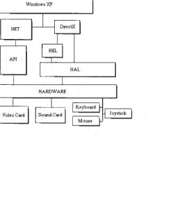

## 引用 DirectX

要安装 DirectX，只需下载 Microsoft 的 SDK（软件开发工具包），可从 Microsoft 免费获取。你可以在本书附带的 CD 上找到详细说明。系统会提示你选择两项：Debug 和 Release；两者都足以满足我们的需要。DirectX 通过以下两种方法之一链接到我们的文件：第一种是创建标准 Windows 应用程序，从“添加引用”菜单加载 DirectX 组件（见附录 I）。第二种是使用 DirectX 9 Visual C# 向导创建项目，选择“DirectDraw”“Audio”和“DirectInput”。请注意，Windows 会插入一定层级的基础代码；虽然这些代码可以是有用的起点，但出于学习目的，我们将删除所有预生成的代码并从头开始（见屏幕截图 3.0）。

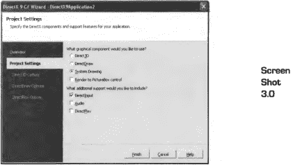


> 如果你被留在荒岛上，只能带一样东西，你会带什么？
> 我会带 scratch，因为一切都是由它构成的。

## 编写游戏

在我们编写程序、游戏或其他内容之前，首先必须清楚我们的程序要做什么。接下来，我们需要用一份想法清单来发展我们的构思，这份清单通常分阶段扩展，并不断增加细节。随着进展，我们还会希望把这份清单转成正式文档或算法。然后可以通过数学和图形设计，在逻辑和图示两方面增强这个算法。对初学者来说，这通常意味着窥探 C# 语言，但眼下我们不会真正开始写代码。用游戏术语来说，这通常还要求具备绘画能力或聘请图形美术师，但在这些示例中，我们将主要依赖简单的鼠标和手绘图形。此外，当我们真正开始转换为代码时，我们也会希望用尽可能最简单的编码来开发任务，但附加标准是它本质上具有通用性。记住，抽象层次越高，可复用性越高。

### 游戏 1——板式网球

对于第一个游戏，我们会刻意保持简单：三个对象、一张背景图像和一个单屏区域。我们还会限制运动并将物理效果降到最低，这就让我们自然选择两名网球选手和一个简单的网球。我们可以用简单图形创建球网，当然还会加入球拍、球和观众欢呼的基本音效，但同样，所有这些步骤都应按正确顺序完成，首先从创建大纲开始……

### 头脑风暴

头脑风暴是第一个创意步骤。它不过是抛出想法，但也是后续一切的基础。示例 3.1 展示了如果我们计划创建一个像板式网球这样的体育游戏，可能会写下什么。

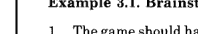

**示例 3.1. 板式网球头脑风暴。**

- 1. 游戏应有两名玩家。一名位于右侧，另一名位于左侧。
- 2. 应有一张球网将屏幕垂直分开。
- 3. 玩家应能自由地上下左右移动，但不应被允许离开屏幕或越到另一名玩家的一侧。
- 4. 有一个会四处弹跳的球，玩家可以来回击球，并用上下边界模拟地面。
- 5. 当球靠近球网时，其尺寸可以增大，从而模拟 3D 环境。
- 6. 当一名玩家未接到球时，另一名玩家应得分和/或获得发球权。
- 7. 游戏应从一个简单菜单开始，允许玩家选择游戏类型，例如双人、单人或者演示模式。（注意：单人和演示模式意味着我们必须编写一些简单的人工智能代码。）
- 8. 游戏还应允许玩家随时通过 ESC 键退出。在真正结束程序前询问玩家是否确定要退出也可以作为一个选项。
- 9. 游戏应色彩丰富，具有蓝色背景、黄色球网和两个穿着鲜艳的角色（最好网球看起来真的像网球）。
- 10. 游戏还应在球击中地面（屏幕边缘）和/或玩家时发出声音。当玩家得分时，还应有来自看不见的观众的欢呼声。
- 11. 你可能还想加入一个计时器，如果比如两分钟内没有任何操作，就自动启动演示模式。最后，游戏应重置自身以允许重复游玩。

### 绘制角色

现在我们已经大致知道在图形上需要什么，接下来必须把这些想法转换为实际插图，然后还有一项有趣的任务：弄清这些图像将如何被操作。实际设计并不那么重要，但用于访问和完成这些设计的步骤很重要。那么第一步是熟悉图形工具在这个新环境中如何工作。注意：如果你不是美术师，也不用担心，CD-ROM 中包含与所列所有游戏相关的完整预绘图像列表。

首先，我假设你正坐在电脑前，.NET 编译器已完全加载，并且你已经选择了“新建项目”列表和“Windows 应用程序”图标。注意不要把这个应用程序与前面章节使用的控制台版本混淆。现在将项目名称改为“Chapter3”，然后按“确定”（见屏幕截图 3.1–3.3）。

屏幕截图 3.1.

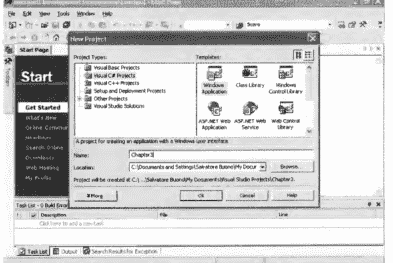

屏幕截图 3.2.

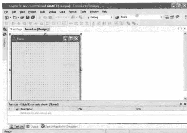

屏幕截图 3.3.

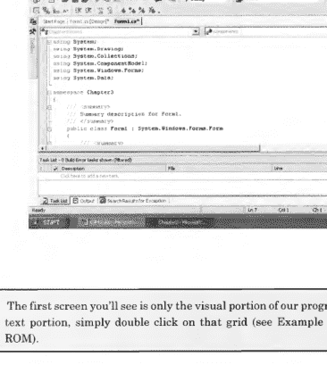

> 你将看到的第一个屏幕只是程序的可视化部分；要打开文本部分，只需双击该网格（见 CD-ROM 中的示例 3.2）。

接下来，我们要打开一个新的图形文件。要创建这样的文件，只需单击“文件”菜单并选择“新建”，然后选择次级“文件”列表。应会出现一个标有“新建文件”的第二个窗口，其中有许多选项；选择标题为“位图文件”的图标，然后按“打开”（见屏幕截图 3.4 和 3.5）。

屏幕截图 3.4.

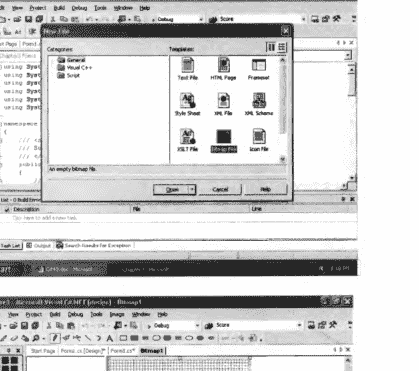

屏幕截图 3.5.

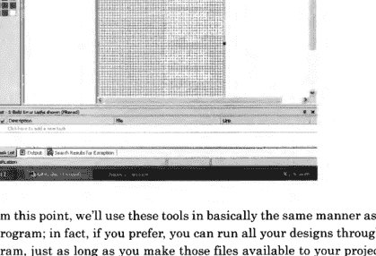

从这里开始，我们将以与任何其他图形程序基本相同的方式使用这些工具；事实上，如果你愿意，也可以通过其他程序运行所有设计，只要让这些文件可供你的项目使用即可。

我们将关注的三个角色是两名玩家和他们的网球。为进一步简化，我们假设两名玩家只是彼此的镜像（见屏幕截图 3.6–3.8）。

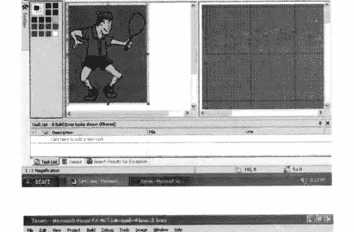

屏幕截图 3.6.

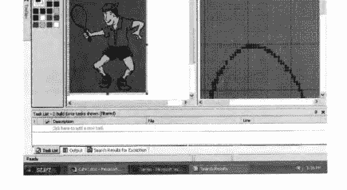

屏幕截图 3.7.

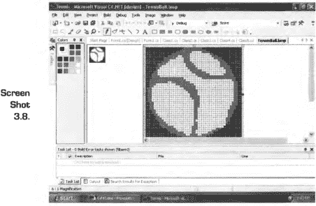

### 绘制运动轨迹

下一步是绘制玩家和球的运动轨迹。玩家的运动更容易定义一些，所以我们会先讨论这些。玩家拥有自由轻松的二维运动。他们的活动范围限制在屏幕尺寸内，并且不允许越入另一名玩家的区域（见示例 3.3）。

**示例 3.3. 二维运动。**

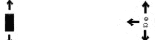

一维运动

二维运动

与玩家不同，球需要我们加入斜向运动，这在技术上仍然只是二维运动；这种额外的视觉效果对于传达自由运动的感觉很重要。不过，这仍然总共只有六个方向，因为我们不会允许球直接向上或直接向下运动（见示例 3.4）。


## 示例 3.4. 球的运动。

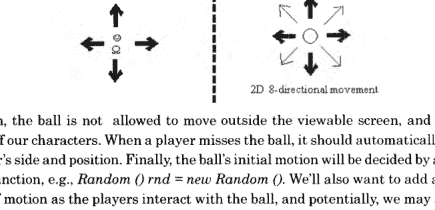

再次，球不允许移出可见屏幕，并且应该从我们的角色处反弹。当一名玩家漏接球时，它应自动重置到得分方的一侧和位置。最后，球的初始运动将由随机运动函数决定，例如，Random() rnd = new Random()。我们还希望在玩家与球互动时增加运动的随机变化，并且可能允许玩家通过不同角度击球来改变球的路径。

## 编写算法

在头脑风暴、选择角色并绘制其运动之后，下一个合乎逻辑的步骤是将这些图像编织成程序文档或算法。算法，正如在第 1 章中介绍的那样，是一份抽象但详细的清单，列出程序内部需要发生的一切。由于这只是对算法的快速浏览，并且仍有几个编程方面尚未解释，我们再次不会太担心完全定义构成此程序的所有细节。然而，最终，当我们的程序确实需要算法分解时，我们将包含所有此类细节（参见示例 3.5）。

## 示例 3.5. 桨板网球算法。

- 1. 创建一个新的 Windows 应用程序项目（注意：不要将 Windows 应用程序设置与控制台 Windows 应用程序设置混淆）。这里我们还希望使用 "using System.Drawing;" 和 "using System.Windows.Forms;" Drawing 命名空间将允许我们访问 Graphics 和 Bitmaps，而 Forms 命名空间将允许我们使用键盘、鼠标和绘图函数。我们还希望为项目取一个显著的名称，如 "Tennis."

- 7. 玩家输入
  - a. 键控：分配玩家键盘控制，退出键
  - b. 鼠标操作：分配玩家鼠标控制

- 8. 玩家控制：设置球的随机方向：将方向转换为代码时，我经常以小键盘布局作为基础（4 等于左，6 为右，8 为上，2 为下，等等）。如果我们将此技术应用于诸如 rnd () 的函数以及从 1 到 9 的随机数字计数，我们的游戏球看起来就会具有随机运动。编写一个函数来推动球。如前一节所述，球将在六个方向之一移动。此函数随后根据所选路径持续在这些方向之一中修改球的位置。（注意：该函数的调用应受该球激活的限制）。

- 9. 球反弹时我们应包含音效：音效很简单，但很重要——这是一种真正能在游戏编程中带来很大差异的增强。所有游戏都有自己的预录音效，但你也可以用自己的音效替换它们。

- 10. 检查球和玩家是否发生碰撞（碰撞检测 ID）。球会从玩家处反弹：如果没有 srand 的额外模式和增加的随机性，球对游戏角色的作用将与球和墙壁的作用相同。我们也考虑过允许游戏角色通过角度击球来改变球的轨迹，但我们不会在编程阶段之前讨论如何实现此类细节。

- 11. 如果球到达屏幕末端而玩家不在那里，则给另一名玩家加分。现在，重置球：要添加得分点，我们只需递增玩家的分数，但在重新启动或重绘球之前，我们必须将球的位置重置/重新分配到另一名玩家的侧面。为了简单起见，我们只需使用得分玩家的最后位置和空格键作为共享发球键。

- 12. 重复循环直到任一玩家得分五分：我们将在请求时或达到一定分数时终止循环。在这里，我们还将使用两分规则（在编码中解释）。

- 13. 询问玩家是否想再次游戏。记住，一个好的游戏循环应始终允许玩家选择再次游戏。

- 14. 网球 AI：左侧玩家：仅限垂直移动（一维），右侧玩家：完整的二维移动。（注意：记住要使计算机的选择有些错误）。

- 15. 事件处理器：定时事件、单人游戏、双人游戏和演示，这些都应与开始菜单绑定，并且在开始新游戏时不应被更改。

- 16. 编写一个函数来限制玩家可以穿越的区域。这是我们第一次碰撞检测，因此我们会保持简单。我们基于预设位置将角色放置在屏幕上。当玩家输入移动时，程序通过从该玩家位置加减一个距离单位来处理该移动。此距离基于这样一种普遍理解：第一行的第一个空格是坐标 (0, 0)。由于玩家现在被限制在数学网格中，我们可以通过不允许这些值增加或减少超过某一点来“锁定”他。球的工作方式类似，其偏转基于路径的变化而不是重置其位置。

- 17. 游戏结束：在我们的情况下，结束游戏循环意味着结束游戏并返回菜单部分，这随后允许用户退出程序或继续进入另一游戏。

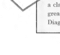

> 当思考如何使用 C# 模型实现这些函数时，很明显最直接的解决方案是将这些工具转换为方法（方法是从类的角度调用的函数）。扩展我们的类以包含多个任务也赋予它们更大的控制权，以及更实用的可重用性。（参见图 3.2）

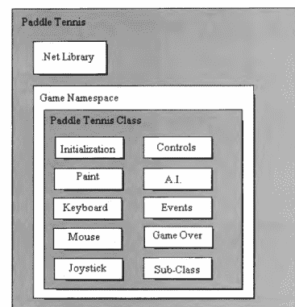

图 3.2

## 使用原生 C++ 显示图形

一旦我们完成了绘图并对运动有了基本概念，我们希望包含适当的编码，例如视觉参数、设置、系统调用等。这些游戏的原始编码是用老式的控制台版 C++ 编写的，其中动画意味着使用 COORD 命令（代表坐标，如 x,y 或笛卡尔坐标系中的坐标）重新定位块字符，然后使用“SetConsoleCursorPosition”函数将窗口设置到该位置。这也意味着我们必须反复删除之前的图像并重新显示新字符才能实际看到动画，但那是过去，现在是现在。

## 使用 C# 显示图形

尽管有所进步，我们仍然需要了解基本的笛卡尔坐标系，至少就其与我们屏幕有关的部分而言。这里 x 和 y 坐标值从左上角的零开始，并在向右移动时分别增加，向下移动时增加，如示例 3.6 所示。

## 示例 3.6. 笛卡尔坐标。

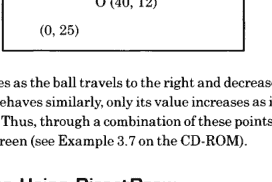

x 的值随着球向右移动而增加，随着球向左移动而减少。y 的值行为类似，只是其值在向下移动时增加，在向上移动时减少。因此，通过这些点的组合，我们的角色可以在屏幕上的任何位置移动（参见 CD-ROM 上的示例 3.7）。

## 使用 DirectDraw 显示图形

硬件加速层（HAL）由大量子 HAL 组件组成，这些组件反映了 DirectX 的不同方面，例如，DDHAL（DirectDraw 硬件加速层）、DIHAL（DirectInput 加速层）、DSHAL（DirectSound 加速层）等。DirectDraw 顾名思义允许直接或近直接访问我们的视频硬件。DDHAL 可以内置于显示驱动程序中或作为动态链接库（DLL）包含。我们作为程序员不直接与 DDHAL 接口；相反，我们的请求通过 DirectDraw 组件委派（参见图 3.3）。

图 3.3.
DirectDraw.

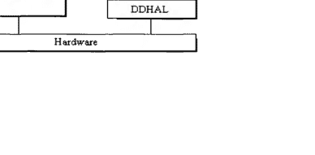

托管 DirectDraw 是托管 DirectX 中使用的两个图形组件中较简单的一个；另一个是 Direct3D，它也包含二维应用程序，并提供对纹理、速度提升和 Alpha 混合等的支持（详见第 5 章）。

要包含 DirectDraw，我们需要遵循几个步骤。第一步是添加声明 `private Microsoft.DirectX.DirectDraw.Device draw = null;`。这里，单词 draw 可以替换为任何变量名；示例包括 Draw、ScreenDisplay 和 device。该变量以 null 值开始，但稍后会被赋值为 `draw = new Microsoft.DirectX.DirectDraw.Device();`。接下来，我们将声明主表面和辅助表面；主表面是程序使用的屏幕区域，辅助表面是缓冲表面，在所有角色表面都包含之后，它会与主表面交换。变量名 primary 通常用于表示主表面，例如 `private Surface primary = null;`。辅助表面通常被称为离屏表面或后台缓冲区；角色表面通常包含描述性名称，如 `private Surface PlayerLDraw = null;`。创建主表面和辅助表面的另一个关键部分是裁剪的概念。裁剪简单来说就是删除任何超出定义区域的图形。例如，通过裁剪，我们的小网球选手将不被允许溜出屏幕并闯入雅达利的 Pong。使用变量名 clip 非常常见，如 `private Clipper clip = null;`。这里，我们还将把区域定义为一个简单矩形；同样，名称 destination 在 DirectX 程序员中很常见，例如 `private Rectangle destination = new Rectangle();`。现在我们的准备工作已经就绪，我们将要构建一个 CreateSurface 函数。这个函数用于设置我们的描述、主表面和裁剪器值，同时也是位图引用的关键。一旦所有组件就位，设置表面坐标并引用位图就变成一件简单的事情（见 CD-ROM 中的示例 3.8）。

示例 3.8 实现了一个简单的 try 块异常处理程序（异常处理在第 5 章中解释）；这样做是为了避免 WasStillDrawException，该异常可能在缓冲图形和主图形之间切换时发生，以及避免 DirectXException，该异常可能在角色移出屏幕时发生。这两种异常都被认为无关紧要，并且不存在于 Direct3D 中。或者，我们本可以使用 Microsoft.DirectX.DirectXException.IgnoreExceptions();


## 面向对象编程简介

为了理解面向对象编程发展背后的概念，我们必须首先讨论其前身背后的原则，例如自顶向下设计、结构化编程和模块化编程。自顶向下设计是一种线性编程方法，你从顶部开始并逐步向下进行，而结构化编程更像是一种系统化的问题解决方法，主要基于分而治之（divide et vinco，即 divide and conquer）的思想。这一过程使程序员能够开发更大、更复杂的程序，但最初不允许不经修改地重用。结构化编程补充了自顶向下设计，并引出了被称为通用编码的概念。结构化编程和通用编码的结合能力还允许重构函数以解决其他问题。模块化编程作为结构化编程的扩展而发展，允许文件与通用编码子程序进行链接，但这也未能满足当今程序员的需求。

面向对象编程既是上述技术的集合，也是从基于对象的程序向对象驱动的程序的演进。通常编写的结构以及随后的类成为重点，而对象成为大多数程序员使用的指导工具。类采用了一种新方法，包括友元函数和成员函数（以及现在所称的方法），以创建一个可应用于大量任务的通用框架。继承与一系列新方法和概念一起发展。在这个新框架中，变量常由类成员替代，函数由方法替代。虽然定义这些对象的编码实际上要到第 5 章才讨论，但允许使用它们的实际应用将在这里实现。这可以通过对成员和方法应用黑盒方法来实现（同样，详见第 5 章）。

## 向我们的项目添加文件

为了正确实现前面的程序，我们必须首先将其补充文件传输到合适的主目录或子目录。这可以通过下面解释的简单复制粘贴过程来完成。

- 1. 找到我们的项目所需的文件（前面各节引用的本书 CD-ROM 源代码文件）。（注意：必要文件作为第 3 章“AnimationTest1”的一部分捆绑提供。）
- 2. 选择并复制所需文件，如截图 3.9 所示（这将包括 AnimatedImage.cs 到 Walls.cs、Player1.bmp、Player2.bmp、TennisBall.bmp……）。
- 3. 打开相应目录，并将这些文件粘贴到该目录中（该目录通常是编译器作为当前项目的一部分创建的目录——见截图 3.10）。

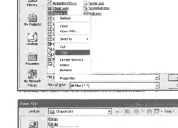

截图 3.9。

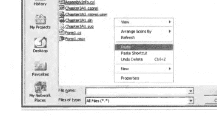

截图 3.10。

接下来，我们需要将这些文件链接到当前项目。请注意，像“头文件”这样的包含文件在 C# 中不存在。

- 4. 从 C# 编译器菜单中选择“File”（文件），然后选择标记为“Add existing item(s)”（添加现有项）的选项。选择该选项将弹出相应菜单，即“Add existing item YourProjectsNameHere”。再次说明，请确保为每个添加的项重复这些步骤（见截图 3.11）。

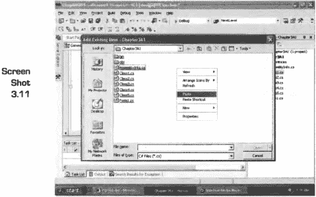

## 角色编程


### 实时游戏编程基础

在较旧的 C++ 模型中，我们使用像 kbhit() 和 getch() 这样的简单命令，它们是 cin >> 和 scanf() 的实时等效命令。由于 C# 也允许快速轻松地访问控制台和 Windows 类型应用程序，我们可以相当容易地进入 OnKeyDown 和 OnKeyPress 类型的示例。这些 Windows 命令允许多任务处理，或者初学者游戏程序员可能称之为基本实时编程。术语实时指的是在特定时间范围内继续执行动作，而不考虑用户的响应。

我们的第二步是让第一个角色动起来。这是通过 OnPaint 和 OnKeyDown 命令的组合完成的。再一次，我们将使用递增运算符来改变角色的位置，但这一次我们还需要包含用于反转该运动的递减运算符（请记住，这两个示例都包含在我们的第一个类 AnimatedImage.cs 中——详见第 5 章）。我们将使用方向键控制角色（见 CD-ROM 中的示例 3.9）。

玩家的输入是由 OnKeyDown 命令收集的数据。这由计算机转换为移动，并允许我们改变角色的方向。玩家的 x 和 y 分量表示玩家的当前位置。初始设置将我们的第一个角色放在大约视线高度，但在屏幕右侧（如附图所示）。

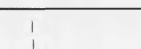

## DirectInput：键盘

在上一节中，我们介绍了通过键盘输入数据的概念。我们的第一个游戏模型（CD-ROM 中的示例 3.8）包含了 GDI+ 函数 OnKeyDown (KeyEventArgs e)，当检测到用户输入时，Windows 会定期引用该函数。我们的 OnKeyDown 函数还包含对 e.KeyCode（按键事件参数键码）的引用，这允许我们读取并响应用户提供的输入。因此，GDI+ 模型为我们提供了推导用户意图的最简单方法，同时仍将我们限制在单个函数中。相比之下，DirectInput 迫使我们采用更全局的方法。


作为创建 DirectInput 键盘引用的一部分，我们需要包含一个设备分配。设备分配通常列为私有类成员。我们还希望包含一个计时器引用，例如：

```
using Microsoft.DirectX.DirectInput;

private Microsoft.DirectX.DirectInput.Device keyboard = null;
private System.Windows.Forms.Timer Keyboard;
```

接下来我们需要包含对该计时器的引用，以及一个事件处理程序：

```
this.Keyboard = new System.Windows.Forms.Timer (this.components);
this.Keyboard.Tick += new System.EventHandler (this.Keyboard_Tick);
```

记住包含我们的实际 Keyboard_Tick 函数和引用，我们使用：

```
Keyboard.Start ();
```

最后，我们需要测试此序列（参见 CD-ROM 上的示例 3.10）。


> 虽然用于创建网球位图背景色为蓝色，但是 `ColorKey colorkey = new ColorKey ();` 和 `BallDraw.SetColorKey (ColorKeyFlags.SourceDraw, colorKey);` 命令以及 `buffer.ColorFill (Color.Blue);` 实际上允许我们使用该绘图并使用替代背景颜色。

## 擦除残留图像

擦除残留图像是创建动画幻觉的重要步骤；每个角色必须在显示其时间对应物之前被擦除。此过程通常通过矩形或定义区域的失效来处理。实际的工作或过程由 Windows 处理，但对该系统的引用是在我们的程序内部完成的。令人惊讶的是，我们已经包含了失效引用，它几乎是不经思考就插入的。然而，与此引用一起也应该有一组警告，因为过度使用失效命令会导致不必要的闪烁，甚至可能使我们的游戏无法玩。对于中间引用，我们还希望*本地化*我们的矩形，这将减少整体闪烁（在处理更复杂的游戏时这一点变得尤为重要）。

我们的第三步，虽然与我们的算法略有不同步，将是演示这些技术。此任务可以通过多种方式完成，但为了获得最佳结果（尽可能减少闪烁），我们必须谨慎使用失效命令，因此我们只会在图像发生变化绝对必要时才调用该命令。例如，如果球处于活动状态，我们必须调用它，如果玩家移动到新位置，我们必须调用它，但如果球在运动且玩家移动，只有占主导地位的球运动需要使屏幕失效，因为整个屏幕仍将被更新。

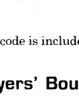

请记住，源代码包含在 CD-ROM 上。

## 碰撞检测：玩家的边界

现在我们有一个可以在屏幕上漫游的玩家，我们希望给他一些限制。毕竟，我们不能让他现在就走开，对吧？用于停止角色过度运动的代码实际上相当简单，只是一个 switch 语句，以及一些递增和递减运算符。这些语句可能会显得有点复杂且可能令人困惑，但那是因为我们也在将其用作用户定义和基于类的两种方法的一部分（只需记住原则基本上是相同的）。如果你觉得需要更多解释，请查看下一个示例。这里，我们正在查看包含在我们第一个基于字符的类中的方法。当我们声明 Player1、Player2 或甚至球等对象时，我们将获得对该方法的访问。现在，当我们想要测试这些参数时，我们只需通过将其写为以下形式来调用该方法：OurObject.DeflectPlayers ()，OurObject.DeflectBall。或者，我们可能想要读取一个值，例如 OurObject.Vector.ReadValue ()，或使用关键字 *this*，如 this.OurObject.Vector.ReadValue ()，这取决于引用的类型（参见示例 3.11）。

### 示例 3.11. 来自 Player.cs : AnimatedImage.cs 的玩家边界

```csharp
using System;
using System.Drawing;
using System.Windows.Forms;

using GameClasses; // Our common utility classes
namespace Games {
    public class PaddleTennis : System.Windows.Forms.Form {
        Player playerL; // Object representing the left player
        Player playerR; // Object representing the right player

        // Default Constructor
        public PaddleTennis() {
            // Initialize the players
            playerL = new Player(5, 225);
            playerR = new Player(580, 225);

            playerL.isActive = true;
            playerR.isActive = true;
            // Draw a box (x, y, width, height) that constrains each player
            playerL.constraintBox = new Rectangle(0, 0,
                (this.ClientSize.Width >> 1) - 10, this.ClientSize.Height);
            playerR.constraintBox = new Rectangle(
                (this.ClientSize.Width >> 1) + 10, 0,
                this.ClientSize.Width - ((this.ClientSize.Width >> 1) + 10),
                this.ClientSize.Height);
        }
    }
}
```

## 碰撞检测：运动中的球

接下来的几个步骤暂时放弃玩家并将重点放在球上。球使用与玩家相同的基于字符的类和方法，但有一些小的更改。球也应被墙壁偏转，但这次我们希望使用这些墙壁来实现该对象方向的变化，这当然应该至少类似于粗略的物理模型（不用担心，这一切都应该是常识性的东西）。我们使用的模型基于数字键盘/10键系统，数字处于默认位置（4 为左，6 为右，7 为左上，9 为右上，1 为左下，3 为右下——8、5 和 2 未使用）。如果我们的数字顺序似乎没有意义，请尝试再次从示例 3.12 所示的键盘角度来看它们。

### 示例 3.12. 数字键盘方向

| 方向 | 键盘 | 方向 |
|---|---:|---|
| 左上 | 7 8 9 | 右上 |
| 左 | 4 5 6 | 右 |
| 左下 | 1 2 3 | 右下 |

这也可以很容易地使用 *switch* 语句转换为代码，将 case 设置为这些值（例如，*case* 1:、*case* 2:、*case* 3: 等），但我们将把该编码留到以后。下一步将是重新定义或更改球与墙壁碰撞时的路径。请记住，球由固有力引导，当球被偏转时，其路径不会被反转或变得随机。相反，我们将使用从右上到右下和左下到左上的简单转换。这可以数值表示为 9 到 3、3 到 9、7 到 1 和 1 到 7（参见示例 3.13）。

### 示例 3.13. 球偏转的数字表示

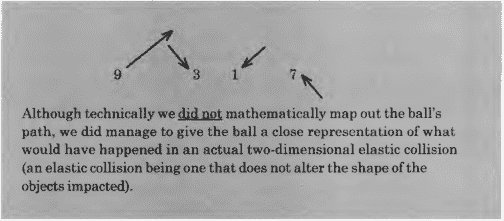

文字和图片并不能教授编码，所以这里有一个独立的弹跳球示例（参见 CD-ROM 上的示例 3.14）。我的建议是研究它，改变球的速度、大小和边界，然后尝试将玩家重新添加到游戏中。如果你无法弄清楚最后一步，不要担心，我肯定会为你完成。接下来，我们将回到我们的玩家并赋予他们偏转球的能力。

注意
当多渲染场景同时存在时，不良影响是称为撕裂的显示错误。为了避免这种效果，图形输出通常会被缓冲并在单个引用中翻转。

## 碰撞检测：偏转球

我们接下来希望对玩家做的就是赋予他们偏转球的能力。一旦我们涵盖了如何将两者结合起来，这将变得更加有用。在第一种方法中，我们将讨论使用上一节中介绍的相同原理更改球的方向，但偏转顺序不同。新的偏转顺序是必要的，以通过提供更多样化的模式来保持玩家的兴趣。此外，正如前面提到的，我们还希望插入一些随机路径，这将允许其他更少条件的模式，但我们稍后再讨论。

我们的第一步将是绘制玩家偏转的模式。这些，正如你应该记得的，是球与物体碰撞后所采取的模式。再次，我们将使用数字键盘/10键系统作为参考点（参见示例 3.15）。

### 示例 3.15. 数字绘制玩家偏转模式


本例的编号方案将数字按水平方向而非垂直方向拆分，即 7 到 9、9 到 7、1 到 3 和 3 到 1。此外，还引入了两条备用路径，即路径 4（左）和路径 6（右）。由于它们完全不属于我们的基本变化模式，因此必须用随机函数来处理。将它们作为对角线路径回收也将通过随机化来处理（见示例 3.16）。

### 示例 3.16. 玩家使球偏转。

```csharp
public void HitTheBall() {
 if (!theBall.isActive)
  return;

 // There are three possible directions, so pick a random number
 // from 0-2.
 Random rnd = new Random();
 int seed = rnd.Next(3);

 // If the player serving is on the right the possible directions
 // are 1, 4, and 7 (seed * 3 + 1)
 if (theBall.imagePosX > this.ClientSize.Width >> 1) {
  if (theBall.direction == AnimatedImage.WEST ||
   theBall.direction == AnimatedImage.NORTHWEST ||
   theBall.direction == AnimatedImage.SOUTHWEST) {
   return; // We've already hit it! Can't hit it again
  }
  theBall.direction = seed * 3 + 1;
 } else {
  if (theBall.direction == AnimatedImage.EAST ||
   theBall.direction == AnimatedImage.NORTHEAST ||
   theBall.direction == AnimatedImage.SOUTHEAST) {
   return; // We've already hit it! Can't hit it again
  }

  // possible directions are 3, 6, 9 (seed * 3 + 3)
  theBall.direction = seed * 3 + 3;
 }
 theBall.Animate();
 Utils.PlaySound(Utils.Config["Sound.Racket"]);
}
```

## 一些次要细节：得分、速度设置和其他图形

既然我们已经绘制了角色的运动，包括边界和偏转模式，并且已经为玩家及其球组合出一个可工作的示例，似乎除了把所有这些部分拼在一起并称之为游戏之外，几乎没什么可做的了。不幸的是，情况并非如此，因为仍有几个问题需要解决。例如，我们需要一种实现玩家得分的方法，以及一种在玩家达到某个分数时终止游戏的方法。此外，我们还需要讨论调整球速、加入球网以及控制发球。别担心，这些都是相对简单的问题，我们马上就会回到有趣的部分。

### 记录得分

理想情况下，为了最大化程序代码的复用，我们必须将大多数变量声明为类的成员。这些成员通常存储为私有成员，因此，我们还必须创建成员函数（也称为方法）来访问这些值。方法通常成对引用：一个用于存储数据，另一个用于检索数据。不过，在这个层次上，我们不会过多担心创建这些类的细节，而是专注于如何使用它们。控制玩家得分的两个关键引用是赋值和增量（见示例 3.17）。

### 示例 3.17. 记录得分——第一步。

```csharp
playerL.score = 0;
playerR.score = 0;
int score1 = playerL.score;
int score2 = playerR.score;
```

我们还希望创建递增和递减运算符的重载版本，当然，这些版本将用于更改玩家的得分（见示例 3.18）。

### 示例 3.18. 记录得分——第二步。

```csharp
playerL.score++;
playerL.score--;
playerR.score++;
playerR.score--;
```

显示得分只需以正确的方式引用数据。这一次，除了检索该数据之外，我们还需要在尝试显示它之前将其转换为字符串值（见示例 3.19）。

### 示例 3.19. 记录得分——第三步。

```csharp
public void DoPaint(Graphics g) {
    ...
    // Draw the scores
    Font Normal = new Font("Times New Roman", 14, FontStyle.Bold);
    g.DrawString((playerL.score).ToString(), Normal, myBrush,
        new Rectangle(new Point(4 * SCALE, SCALE),
        new Size(24 * SCALE, 12 * SCALE)));

    g.DrawString((playerR.score).ToString(), Normal, myBrush,
        new Rectangle(new Point(16 * SCALE, SCALE),
        new Size(24 * SCALE, 12 * SCALE)));
    ...
}
```

> 要了解有关绘图工具、形状和颜色的更多信息，请参阅附录 F-H。

### 游戏控制

下一步是创建一个实时循环，它与控制台 while 循环类似，但这一次我们将让 Windows 处理大部分工作。在这里，我们将依赖第二个类 GameControls（列在 GameState.cs 下），我们会持续测试它，以查看我们的值 GameActive 是否为 true。如果该值不为 true，则游戏的可玩部分将终止。我们还将使用这个类来定义游戏速度，即球的速度（见示例 3.20–3.23）。

### 示例 3.20.

```csharp
GameState gameState = new GameState();
```

### 示例 3.21.

```csharp
// Start the game
gameState.currentState = GameState.State.Started;
// Stop the game
gameState.currentState = GameState.State.Stopped;
```

### 示例 3.22.

```csharp
// End the game if either side has scored MAX_POINTS.
if (gameState.currentState == GameState.State.Started &&
(playerR.score == MAX_POINTS || playerL.score == MAX_POINTS)) {
    gameState.currentState = GameState.State.Stopped;
}
```

我们还可以通过对游戏速度引用 `gameState.currentSpeed` 的简单调用来提高或降低可玩速度。请记住，增大该值会加快循环过程，进而提高球的速度。值越大，球移动得越快（对于熟悉旧式 C++ sleep 函数的程序员来说，这似乎有些奇怪，因为增大该值会产生相反的效果）。

### 示例 3.23. 设置游戏速度。

```csharp
GameState gameState = new GameState();

gameState.currentSpeed = SPEED_DEFAULT;
int speed = gameState.currentSpeed;
```

### 球网

我们可以使用几条简单命令绘制并加载球网，例如 `Image DisplayNet; DisplayNet = Image.FromFile (@"c:\Games.Net\Tennis\Net.bmp"); this.AutoScrollMinSize = DisplayNet.Size;`，随后使用图形引用，例如 `dc.DrawImage (DisplayNet, 350, 0, 10, 550)`。或者，我们可以使用下一节所列函数中的一个（见示例 3.24）。

### 示例 3.24. 绘制球网。

```csharp
// Draw the "net." 5x5 square spaced 15 apart
Brush myBrush = Brushes.Yellow;
for (int Y = 0; Y <= this.ClientSize.Height; Y += 15) {
    g.FillRectangle(myBrush, 12 * SCALE, Y, 5, 5);
}
```

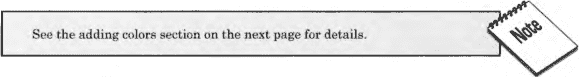

### 控制发球

首先，我们需要开发一个随机数生成器，用来设置抛射物（球）的初始路径。其次，我们需要跟踪抛射物的位置，并设置允许球换边的场景。为了方便起见，我们还希望将这些过程打包成一个简单函数（见示例 3.25）。

### 示例 3.25. 控制发球。

```csharp
public void Serve() {
    if (!theBall.isActive) {
        theBall.isActive = true;
        HitTheBall();

        if (theBall.direction == AnimatedImage.EAST ||
            theBall.direction == AnimatedImage.NORTHEAST ||
            theBall.direction == AnimatedImage.SOUTHEAST) {
            theBall.imagePosX = playerL.imagePosX + playerL.imageWidth + 1;
            theBall.imagePosY = playerL.imagePosY;
        } else {
            theBall.imagePosX = playerR.imagePosX - theBall.imageWidth;
            theBall.imagePosY = playerR.imagePosY;
        }
    }
}
```

### 添加颜色

有两个非常基本的颜色引用——背景色和前景色。我们已经引用了背景色 `this.BackColor = Color.Blue;`，当然，它可以更改为整个范围的引用（140 种），不包括任何用户定义的引用（如屏幕截图 3.12 所示）。前景色同样显而易见，我是说漂亮，而且同样有大量选择可用。我们还可以使用画笔选项 `Brush YellowBrush = Brushes.Yellow;` 和/或钢笔选项 `Pen YellowPen = new Pen(Color.Yellow, 3);` 来设置颜色，其中“3”表示钢笔的粗细。一旦声明了颜色，我们可能还会考虑使用该颜色来指定基本形状——正方形、矩形、圆形和/或椭圆形（见示例 3.26）。

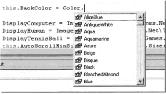

### 示例 3.26. 使用颜色指定形状。

```csharp
protected override void OnPaint(PaintEventArgs e) {
    Graphics g = e.Graphics;

    Brush yellowBrush = Brushes.Yellow;
    g.FillRectangle(yellowBrush, 390, 100, 25, 25);

    Pen yellowPen = Pens.Yellow;
    g.DrawEllipse(yellowPen, 390, 200, 25, 25);
}
```


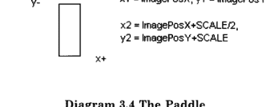

## 图 3.4 球拍

**桨网球 GDI+：** 桨网球（Paddle Tennis）的 GDI+ 版本使用两个基本形状：`FillRectangle` 和 `FillEllipse`。矩形用于创建球网和球员（球网的编码与 Windows Forms 版本相同）。球员使用一种简单格式构造：画刷颜色、x 坐标、y 坐标、宽度和高度。所有颜色在被引用前都需要声明，如 `Brush WhiteBrush = new SolidBrush(Color.White);` 等。x 和 y 坐标由对象引用控制，如 `this.X` 和 `this.Y`，具体取决于它们声明在哪个实例中。`Scale` 组件是一个用于控制大小的常量；在此例中，值为 25，因此宽度为 12、高度为 25，使球拍呈矩形。

用于表示球的椭圆，其写法与矩形相同：先输入颜色，然后是 x 和 y 坐标、宽度，再是高度。

## 使用 Windows 多媒体添加声音

游戏编程的另一个重要方面是声音的使用。声音可用于提升游戏的整体质量，也可用于其他小任务，例如系统通知、弹出广告和病毒警报。虽然声音的录制不会通过 .NET 编译器处理，但这些声音的存储应成为任何当前项目的一部分，或至少成为中央媒体库的一部分。声明声音涉及两个因素：Windows 引用和执行语句（见示例 3.27）。

### 示例 3.27. Windows 多媒体声音。

```csharp
public class AnyClass : System.Windows.Forms.Form {
    [DllImport("winmm.dll")]

    public static extern long PlaySound(String lpszName, long hModule, long dwFlags);

    public void AnyMethod () {
        PlaySound(@"C:\SourceCode\Wall.wav", 0, 0);
    }
}
```


> 声音也可以从 CD-ROM 复制到本地目录。声音按其项目引用列出（见第3章\project1、project2……）。

除了插入声音编码外，我们可能还需要修改编译器设置，以包含访问这些声音的能力。这里你可能需要添加额外的库引用或更改项目中的其他设置（详情请参阅编译器文档）。


> 请记住，你可以重新放置这些命令，以便在程序中的任何位置创建声音，但要注意不要过度使用。过多的声音引用会扰乱游戏流程并导致其他小错误。

## 使用 DirectSound 添加声音

DirectSound 是 DirectX 中用于替代 Windows 多媒体产生声音的方案。这里我们将模仿包含 DirectDraw 和 Input 时使用的初始步骤，例如添加命名空间、包含变量、设置协作级别等。然而，与创建单个 DirectSound 函数（相较于 `OnPaint`、`Keyboard_Tick` 等）不同，我们将把相关技术作为游戏模型的一部分来应用。DirectSound 有两种用于保存音频数据的缓冲区：自带的 `Buffer` 对象及其派生对象 `SecondaryBuffer`（见示例 3.28/完整代码列于 CD-ROM 示例 3.28）。

### 示例 3.28. 声音测试 I。

```csharp
using Microsoft.DirectX.DirectSound;
using Buffer = Microsoft.DirectX.DirectSound.SecondaryBuffer;
using Microsoft.DirectX.DirectInput;
```

我们将从包含 DirectSound 命名空间开始；还必须记得添加相应的 DLL。声音还需要一个辅助缓冲区以及一个设备变量；我们将使用 `sound = null;`

```csharp
private Microsoft.DirectX.DirectInput.Device keyboard = null;
private Microsoft.DirectX.DirectSound.Device sound = null;
private SecondaryBuffer SoundBuffer = null;
```

限定设备引用很重要，因为 DirectX 命名空间的组合会导致冲突。协作级别可以设置为 Normal、Priority 或 Write Primary（我已将此示例设置为 Priority，以包含最高性能级别）。

```csharp
// DirectSound
sound = new Microsoft.DirectX.DirectSound.Device();
sound.SetCooperativeLevel (this, CooperativeLevel.Priority);
```

最后，我们需要引用声音。注意，文件引用可以是音频数据流或文件名类型。将协作级别设置为默认值（默认提供最高级别的多任务处理），并将其优先级设置为零（完整设置列表见表 3.0）。

```csharp
for (Key k = Key.Escape; k <= Key.MediaSelect; k++){
    if (state[k] && k == Key.Space){
        try {
            SoundBuffer = new SecondaryBuffer ("..\\..\\Racket.wav", sound);
            SoundBuffer.Play (0, BufferPlayFlags.Default);
        }
    }
}
```

| 方法、属性： | 描述： |
|---|---|
| `BufferPlayFlags.Default` | 默认值；方法 public enum BufferPlayFlags 的第一个属性会分配到硬件和软件。 |
| `BufferPlayFlags.LocateInHardware` | 布尔类型；声音通过硬件支持。 |
| `BufferPlayFlags.LocateInSoftware` | 布尔类型；声音通过软件支持。 |
| `BufferPlayFlags.Looping` | 循环。无限重复声音。 |
| `BufferPlayFlags.TerminateByDistance` | 按 3D 距离选择缓冲区（最远）。 |
| `BufferPlayFlags.TerminateByPriority` | 按优先级选择缓冲区（最低优先级）。 |
| `BufferPlayFlags.TerminateByTime` | 按时间选择缓冲区（运行时间最长）。 |

**表 3.0. 声音方法与属性。**

## 加入鼠标

另一个要加入游戏的有趣特性是键盘旁边的小物件（是的，我指的是鼠标）。鼠标由斯坦福研究所（SRI）的道格拉斯·C·恩格尔巴特于20世纪60年代发明，后来在施乐帕洛阿尔托研究中心（称为 PARC）作为首个图形用户界面（GUI）的一部分投入使用。史蒂夫·乔布斯也通过发布一种历史上称为 Macintosh 的原始计算机类型而使鼠标流行起来……我们想要使用的基本控件包括 OnMouseUp、OnMouseDown、OnMouseMove 和 OnMouseWheel（注意：OnMouseWheel 还需要 IntelliMouse，这是微软制造的一种专门设计的三键鼠标）。我们将使用的两个关键函数是 OnMouseMove 和 OnMouseDown 事件，但另外两个也可以基本以相同方式应用。

注意：我们还想使用 x、y 坐标来标记图形位置。常量 341 用于限制角色水平移动；不需要垂直限制，因为它们不会影响游戏规则所隐含的限制。还应注意，除非球也被发现处于运动状态，否则这些移动不会更新；这样做是为了减少屏幕静态干扰，或减少由过度更新引起的闪烁（见示例 3.29）。

### 示例 3.29. 加入鼠标

### 步骤 1. 标记鼠标的位置。

```csharp
// The player on the right "follows" the mouse
protected override void OnMouseMove(MouseEventArgs e) {
    Cursor.Current = Cursors.UpArrow;
    // Demo mode can't allow interaction from user
    if (gameState.currentMode == GameState.Mode.Demo)
        return;

    if (gameState.currentState == GameState.State.Started) {
        playerR.imagePosX = e.X;
        playerR.imagePosY = e.Y;
    }
}
```

接下来，我们要添加一些按钮控件，比如球员发球能力。同样，这可以通过 OnMouseDown 或 OnMouseUp 命令完成（见示例 3.30）。

### 步骤 2. 让球员能够发球。

```csharp
protected override void OnMouseDown(MouseEventArgs e) {
    // Demo mode can't allow interaction from user
    if (gameState.currentMode == GameState.Mode.Demo)
        return;

    if (gameState.currentState == GameState.State.Started) {
        Serve ();
    }
}
```

此外，我们还想用显示和/或隐藏函数引用光标。重要的是在这两个特性之间保持平衡，每个周期只调用一次隐藏和一次显示。如果程序员未能跟踪这些过程，隐藏和/或显示最终会重叠，光标将永久丢失。


## 第 3 步：显示和隐藏光标。

```
Cursor.Hide ();
Cursor.Show ();
```

最后，你可能希望更改用于表示鼠标的图标，例如箭头/手形，这可以通过简单的重新赋值来完成，例如，Cursor.Current = Cursors.Hand;（见表 3.1）。

| 代码 | 光标文件 |
|---|---|
| `Cursor.Current = Cursors.AppStarting;` | Appstart.ani |
| `Cursor.Current = Cursors.Arrow;` | Arrow_m.cur |
| `Cursor.Current = Cursors.Cross;` | Cross.cur |
| `Cursor.Current = Cursors.Default;` | 当前系统默认。 |
| `Cursor.Current = Cursors.Hand;` | Hand.cur |
| `Cursor.Current = Cursors.Help;` | Help_1.cur |
| `Cursor.Current = Cursors.HSplit;` | Hsplit.cur |
| `Cursor.Current = Cursors.IBeam;` | Beam_1.cur |
| `Cursor.Current = Cursors.No;` | No_1.cur |
| `Cursor.Current = Cursors.NoMove2D;` | lm_panhw.cur |
| `Cursor.Current = Cursors.NoMoveHoriz;` | lm_panh.cur |
| `Cursor.Current = Cursors.NoMoveVert;` | lm_orgv.cur |
| `Cursor.Current = Cursors.PanEast;` | lm_pane.cur |
| `Cursor.Current = Cursors.PanNE;` | lm_panne.cur |
| `Cursor.Current = Cursors.PanNorth;` | lm_pann.cur |
| `Cursor.Current = Cursors.PanNW;` | lm_pannw.cur |
| `Cursor.Current = Cursors.PanSE;` | lm_panse.cur |
| `Cursor.Current = Cursors.PanSouth;` | lm_pans.cur |
| `Cursor.Current = Cursors.PanSW;` | lm_pansw.cur |
| `Cursor.Current = Cursors.PanWest;` | lm_panw.cur |
| `Cursor.Current = Cursors.SizeAll;` | lrcksize.cur |
| `Cursor.Current = Cursors.SizeNESW;` | lrcknesw.cur |
| `Cursor.Current = Cursors.SizeNS;` | lrckns.cur |
| `Cursor.Current = Cursors.SizeNWSE;` | lrcknwse.cur |
| `Cursor.Current = Cursors.SizeWE;` | lrckwe.cur |
| `Cursor.Current = Cursors.UpArrow;` | up_m.cur |
| `Cursor.Current = Cursors.VSplit;` | splitv.cur |
| `Cursor.Current = Cursors.WaitCursor;` | Wait1.cur |

## DirectInput：鼠标

在这里，我们将要把 GDI+ 鼠标模型替换为 DirectInput 版本。与 DirectX 键盘一样，DirectX 鼠标在实际鼠标功能可用之前需要若干初始化步骤。设置包括设备分配和计时器引用，以及两个布尔引用，即 MouseInquire 和 MouseOverride。

```csharp
// DirectInput
private Microsoft.DirectX.DirectInput.Device mouse = null;
...
private System.Windows.Forms.Timer Mouse;
bool MouseOverride = false;
bool MouseInquire = false;
```

MouseInquire 和 MouseOverride 是用户定义的变量；它们的作用是测试用户侧鼠标的可访问性，用户可以选择在希望使用游戏杆甚至键盘游玩时禁用鼠标。我们使用 MouseInquire 来进行询问，并使用 MouseOverride 来保留玩家所做的选择，例如：

```
if (!MouseInquire) {
    DialogResult result = MessageBox.Show (this,
        "Do you want to enable the mouse?",
        "Mouse Detected", MessageBoxButtons.YesNo,
        MessageBoxIcon.Question, MessageBoxDefaultButton.Button1,
        MessageBoxOptions.RightAlign);

    MouseInquire = true;
    if (result == DialogResult.Yes) {
        MouseOverride = true;
    }
}
```

鼠标还需要一个计时器和事件处理引用，以及一个启动调用：

```
this.Mouse = new System.Windows.Forms.Timer (this.components);
this.Mouse.Tick += new System.EventHandler (this.Mouse_Tick);

Mouse.Start ();
```

对于我们的 DirectX 版游戏，示例 3.30 取代示例 3.29。

### 示例 3.30. DirectInput：鼠标。

```
private void Mouse_Tick(object sender, System.EventArgs e) {
mouse = new Microsoft.DirectX.DirectInput.Device(SystemGuid.Mouse);
MouseState mouseData = new MouseState ();

mouse.SetDataFormat (DeviceDataFormat.Mouse);
mouse.Acquire ();
mouse.Poll ();

// Get the current state of the mouse device.
mouseData = mouse.CurrentMouseState;

if (MouseOverride) {
...
byte [] buttons = mouseData.GetMouseButtons ();
if (0 != buttons[0] && !theBall.isActive) {
    Serve ();
}
}
```

## DirectInput：游戏杆

Stephen D. Bristow 和 Steven T. Mayer 于 1975 年在 Atari Gaming Systems 工作时发明了游戏杆（1977 年获得专利）；当时他们几乎不知道，他们的发明不仅会改变游戏的游玩方式，还会改变人们对游戏的认知。能够离开桌面——随着角色漫步、跳跃甚至跌倒而移动身体并左右倾斜——简直与游戏玩法的概念不可分割。如今，游戏杆包括可编程功能、旋转手柄、板载处理器、力反馈以及可下载的游戏专用控制器配置文件等功能。设计包括油门杆、游戏手柄、手套和飞行操纵杆；但基本概念仍然相同。在这里，我们将要加入一个非常简单的游戏杆设计：带单个按钮引用的基本二维移动。接下来的步骤与设置键盘所用的步骤类似。设备分配通常列为私有类成员，包括一个计时器引用，例如：

```
public class AnimationTest : System.Windows.Forms.Form {
// DirectInput
private Microsoft.DirectX.DirectInput.Device joystick = null;
...
public JoystickState JState = new JoystickState();
private System.Windows.Forms.Timer Joystick;
```

接下来，我们需要引用计时器以及一个事件处理程序：

```
this.Joystick = new System.Windows.Forms.Timer (this.components);
this.Joystick.Tick += new System.EventHandler (this.Joystick_Tick);
```

```
Joystick.Start ();
```

最后，我们需要包含启动游戏杆的调用，以及游戏所使用的函数（见示例 3.31）。

### 示例 3.31. DirectInput：游戏杆。

```
private void Joystick_Tick(object sender, System.EventArgs e) {
    foreach (DeviceInstance instance in Manager.GetDevices(DeviceClass.GameControl,
        EnumDevicesFlags.AttachedOnly)) {
        joystick = new Microsoft.DirectX.DirectInput.Device(instance.InstanceGuid);
        break;
    }

    if (joystick == null) {
        return;
    }

    joystick.SetDataFormat (DeviceDataFormat.Joystick);
    foreach (DeviceObjectInstance d in joystick.Objects) {
        if ((0 != (d.ObjectId & (int)DeviceObjectTypeFlags.Axis))) {
            joystick.Properties.SetRange (ParameterHow.ById,
                d.ObjectId, new InputRange (-1000, 1000));
        ...

        joystick.Acquire ();
        joystick.Poll ();
        JState = joystick.CurrentJoystickState;
        playerR.direction = 0;
        bool Joystick = false;
```

```
if(-400 < JState.X) {
    playerR.direction = AnimatedImage.WEST;
    Joystick = true;
}
else if(-500 > JState.X) {
    playerR.direction = AnimatedImage.EAST;
    Joystick = true;
}

if(-600 > JState.Y) {
    playerR.direction = AnimatedImage.SOUTH;
    Joystick = true;
}
else if(-500 < JState.Y) {
    playerR.direction = AnimatedImage.NORTH;
    Joystick = true;
}
. . . .

if(theBall.isActive == false && gameState.currentState !=
    GameState.State.Stopped) {
    byte[] buttons = JState.GetButtons();
    foreach (byte b in buttons) {
        if (0 != (b & 0x80)) {
            Serve ();
        }
    }
}
. . . .
```

## 菜单简介

作为 Visual C# 程序员，我们可用的另一个有趣功能是能够以可视化方式和通过基本文本引用来创建大量菜单。可视化方法虽然直接，但并不总是像基于文本的方法那样完整，因此需要理解这两种技术。我们首先来看如何创建基本的可视化菜单（此技术也适用于标签、按钮、框、图片等）。首先，我们需要引用设计窗口（Forms.cs [Design]）。接下来，我们需要引用工具箱菜单（位于屏幕左侧），并选择合适的界面（在本例中为主菜单）。然后，我们只需将该选择拖放到网格上。（见屏幕截图 3.13 和 3.14）。


## C# 与游戏编程

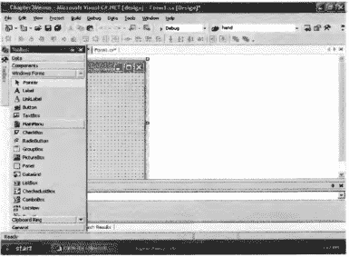

截图 3.13.

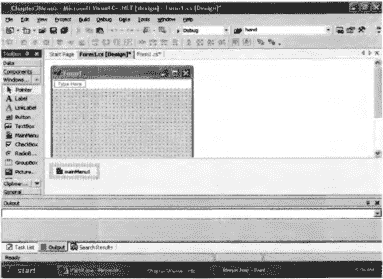

截图 3.14.

要添加适当的菜单项，只需双击该菜单（或子菜单）并键入相应的标题（见截图 3.15）。为便于参考，我将这些项标记为 1、2 和 3。你还应注意右侧可用的次要列表；单击此选项允许我们创建额外的子菜单（见截图 3.16）。

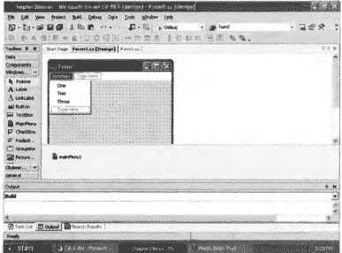

截图 3.15.

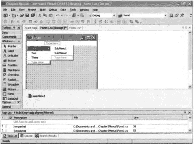

截图 3.16.

现在，只需切换回我们项目的文本部分（Forms.cs）并注意其中的变化。这里我们会发现从基本引用到我们作为菜单项插入的名称的所有内容（见示例 3.32）。当然，如果我们想手动创建这些文件，只需手动输入这些引用即可。重要的是要记住列出每一项及其附带的索引点。

### 示例 3.32. 创建文本菜单。

```csharp
using System;
using System.Windows.Forms;

namespace Example32 {
    public class Form1 : System.Windows.Forms.Form {
        private System.Windows.Forms.MainMenu mainMenu1;
        private System.Windows.Forms.MenuItem menuItem1;
        private System.Windows.Forms.MenuItem menuItem2;
        private System.Windows.Forms.MenuItem menuItem3;
        private System.Windows.Forms.MenuItem menuItem4;

        public Form1() {
            InitializeComponent ();
        }

        #region Windows Form Designer generated code
        private void InitializeComponent() {
            this.mainMenu1 = new System.Windows.Forms.MainMenu ();
            this.menuItem1 = new System.Windows.Forms.MenuItem ();
            this.menuItem2 = new System.Windows.Forms.MenuItem ();
            this.menuItem3 = new System.Windows.Forms.MenuItem ();
            this.menuItem4 = new System.Windows.Forms.MenuItem ();

            this.mainMenu1.MenuItems.AddRange (
                new System.Windows.Forms.MenuItem [] {this.menuItem1});
            this.menuItem1.Index = 0;

            this.menuItem1.MenuItems.AddRange (
                new System.Windows.Forms.MenuItem [] {
                    this.menuItem2,
                    this.menuItem3,
                    this.menuItem4});
            this.menuItem1.Text = "Menu";

            this.menuItem2.Index = 0;
            this.menuItem2.Text = "One";
            this.menuItem3.Index = 1;
            this.menuItem3.Text = "Two";
            this.menuItem4.Index = 2;
            this.menuItem4.Text = "Three";

            this.ClientSize = new System.Drawing.Size (292, 266);
            this.Menu = this.mainMenu1;
            this.Name = "Form1";
            this.Text = "Form1";

        }
        #endregion

        [STAThread] static void Main() {
            Application.Run (new Form1());
        }
    }
}
```

从这里开始，我们需要将这些项链接到特定函数和/或一组函数，具体取决于我们使用这些项引用什么。在我们的关键示例——Paddle Tennis 游戏中，我们将使用这些点来引用游戏的起始点、双人、单人和演示版本选项（见示例 3.33–3.36）。

### 示例 3.33. 双人菜单选项。

```csharp
// Menu event handler
private void TwoPlayer_Click(object sender, System.EventArgs e) {
    gameState.currentMode = GameState.Mode.TwoPlayer;
    SetUp();
}
```

### 示例 3.34. 单人菜单选项。

```csharp
// Menu event handler
private void SinglePlayer_Click(object sender, System.EventArgs e) {
    gameState.currentMode = GameState.Mode.SinglePlayer;
    SetUp();
}
```

### 示例 3.35. 演示版本菜单选项。

```csharp
// Menu event handler
private void DemoVersion_Click(object sender, System.EventArgs e) {
    gameState.currentMode = GameState.Mode.DemoMode;
    SetUp();
}
```

### 示例 3.36. 由菜单选项调用的子函数。

```csharp
public void SetUp() {
    // (Re) set member variables.
    gameState.currentState = GameState.State.Started;
    gameState.currentSpeed = GameState.SPEED_DEFAULT;

    playerR.imagePosX = 595;
    playerR.imagePosY = 200;
    playerR.score = 0;
    playerL.imagePosX = 5;
    playerL.imagePosY = 200;
    playerL.score = 0;
    theBall.isActive = false;
    theBall.imagePosX = playerR.imagePosX;
    theBall.imagePosY = playerR.imagePosY;

    Cursor.Hide();

    Invalidate();
}
```

## 人工智能导论

人工智能（AI）最简单的形式，本质上是针对特定情境或条件集的人类反应的建模或模拟。这些反应可能基于模式或数学方程，例如追踪或规避，但初始反应通常是随机的基线运动。人工驱动的程序必须既包含人类局限性的现实表现，如犯错和/或偶尔的幸运一击的能力，同时也必须表现为一个非人格化的、始终如一的对手，能够一遍又一遍地重复相同的技能水平（至少直到我们厌倦并关闭它为止）。当然，我们这里讨论的 AI 只是对该主题的一个简要介绍，但不要被这些参考的简单性所迷惑——人工智能编程可能出人意料地引人深思、策略上棘手，并且值得花时间去掌握。首先，我们将关注完成此游戏所需的关键点：追踪和随机运动的模型。

### 追踪

追踪，顾名思义，是跟踪或跟随一个移动角色在预定区域内移动的能力。这由程序的独立部分（子例程）完成，它既可以实现位置变化，也可以将该信息发送给另一个子例程。用于追踪对象的代码类似于用于实现角色移动的代码。唯一区别在于它是由计算机的判断执行的，例如，当比较“说”被追踪对象更高或更低时，它能够调整自身位置。不幸的是，这种技术有一个缺点，即计算机不会犯错，这打破了人文现实主义的主要规则。幸运的是，我们可以通过添加随机事件来克服这种对完美的需求，因此有必要将这些技术协同应用。

### 随机运动

在最后两章中，我们多次使用随机数来创建新信息，并动态改变原本可预测行为的结果。在试图打破预期动作的单调性时，这个过程也非常有用，并且是我们人工角色使用的新输入的主要来源。使这个过程略有不同的一个关键转折是，我们将使用该随机输入来降低人工玩家追踪投射物的能力。这一策略背后的想法是增加错误水平，从而提高游戏的可玩性（见示例 3.37 和 3.38）。

### 示例 3.37. 网球 AI 左玩家。

```csharp
// Left player artificial intelligence
public void TennisAIPlayerL() {
    // if ball active move left player
    if(theBall.isActive == true) {
        switch(theBall.direction) {
            case 1:  // if ball is moving SW move south to meet
                if(theBall.imagePosY > playerL.imagePosY) {
                    playerL.direction = AnimatedImage.SOUTH;
                }
                break;

            case 4: // if ball is moving W playerL will line up to meet
            case 8:
                if(theBall.imagePosY < playerL.imagePosY) {
                    playerL.direction = AnimatedImage.NORTH; // move north
                } else if(theBall.imagePosY > playerL.imagePosY) {
                    playerL.direction = AnimatedImage.SOUTH; // move south
                }
                break;

            case 7: // if ball is moving NW move north to meet
                if(theBall.imagePosY < playerL.imagePosY) {
                    playerL.direction = AnimatedImage.NORTH;
                }
```

### 示例 3.38. 网球 AI 右玩家。

```csharp
// Right player artificial intelligence
public void TennisAIPlayerR() {
    // stops playerR from trying to hit the ball after it passes
    if(theBall.imagePosX > playerR.imagePosX+25){
        return;
    }
    
    switch(theBall.direction) {
        case 3: // ball moving southwest
            if(theBall.imagePosY > playerR.imagePosY) {
                if(theBall.imagePosY < this.Width/2)
                    // move SW to spike
                    playerR.direction = AnimatedImage.SOUTHWEST;
                else
                    // move south to line up with ball
                    playerR.direction = AnimatedImage.SOUTH;
            } else
                // move back to give playerR more time
                playerR.direction = AnimatedImage.EAST;
            break;
```


## 桨球网球：整合全部

我们的最终构造使用命名空间 Games 构建，并将包含对本教材中教授的类和技术的引用。本版本的 Paddle Tennis 需要 DirectX 9 或更高版本；第 3 章包含该游戏的四个版本（Forms、GDI+、DirectX 和带 GDI+ 的 DirectX）。（详见 CD-ROM）。GameClasses 是一个通用实用工具，用于定义我们角色移动的所有方面，包括边界、声音和寿命（参见 CD-ROM 上的 Example 3.39/Tennis.C#）。

> **Note**
>
> `MEDIA_ROOT` 是用于查找我们图形和声音文件位置的简写引用。`\media\` 指的是与每个游戏一起列出的子文件夹。硬编码版本读取 `@"C:\C# and Game Programming DirectX Edition\Chapter3\Tennis.C#\TennisDX9.C#\Media\";`。

## 奖励游戏

在回到 C# 的核心之前，我想让你试试再做几个游戏。这将提供一个机会来介绍更多主题，并有时间改进我们最初的技术。对于这个第二个游戏，我假设你已经掌握了前面介绍的技术，并且更喜欢更简短的回顾。不过，我仍然会花时间模仿游戏的创建过程，并给出一个关于如何实际开发它的真实视图（当然一切都在实时进行）。

### Game 2—Space Fighters

我们的第二个游戏 Space Fighters 虽然简单，但确实包含了一些你会觉得有用的技术。我们将通过列出一些想法，即头脑风暴，来开始，并花几分钟来开发我们的角色。

### 示例 3.40. 头脑风暴 Space Fighters。

- 1. 游戏应有两个玩家，将以太空船的形式出现。
- 2. 再次，一个玩家放在右侧，另一个放在左侧。游戏在加载的瞬间开始。
- 3. 玩家的移动相对于屏幕是二维的，但也应包括对角线移动。
- 4. 飞船应具有推力，但没有刹车或倒车，让动量将它们向前携带。
- 5. 两个飞船将有武器，或至少一种武器，即可以发射到对手的导弹。但为了保持简单，导弹不会伤害自己的飞船。
- 6. 再次，我们将为一或两名玩家设置菜单选项，并为单人选项添加一些 AI。
- 7. 我们将使用黑色背景，并在其上随机放置星星。星星将是我们太阳的缩小版。
- 8. 飞船应具有对比色——这些颜色也将代表其武器的颜色。
- 9. 飞船应发出声音，包括推力、武器发射声，以及被击中时的爆炸声。
- 10. 飞船在死亡时不应能够发射，也不应能够被击中。
- 11. 将游戏设置为一旦玩家获得例如五次击杀即结束。此外，如果玩家因撞到太阳而死亡，他将失去一分。
- 12. 玩家在死亡后必须重新开始。
- 13. 我们将包含一个允许玩家复活受损飞船的命令；这些控制也可以作为超空间模式，让活跃的飞船随机穿越未知的维度，在屏幕的另一部分重新出现（包括出现在太阳内部和/或在另一艘飞船顶部）。
- 14. 我们还将在屏幕中央放置一颗太阳，并使用固定数量的周期来模拟重力将飞船拉向太阳的力量。重力在拉入飞船时也会发出声音。

### 选择角色与规划运动

我们的第二步是绘制一些基本图像，如太空船、其排气尾迹，以及一个将明显放置在屏幕中央的大太阳。飞船基本上是相同的，但颜色对比鲜明，而排气尾迹将在引擎激活时叠加到这些飞船上（参见屏幕截图 3.17–3.19）。

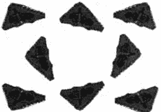


### 屏幕截图 3.20. 太阳。


这些角色的移动将很简单，其中一个键被指定为推力，另外两个键用于将飞行器转向两侧（参见示例 3.41）。我们将继续使用箭头键和数字键盘进行移动。左右箭头将调整船只的方向，向上箭头键将是推力。向下箭头键将复活角色并将飞船送入超空间，零键将发射武器。对于玩家二，`<Q>` 向左转；`<A>` 向右转；`<X>` 推力；`<S>` 将飞船送入超空间，空格键发射武器。运动角度显示在示例 3.41 中。

### 示例 3.41. 运动角度。


我们还需要两个角色来代表它们的导弹，以及另一个图像来代表爆炸（参见屏幕截图 3.21）。


### 屏幕截图 3.21.

最后，我们希望给我们的飞行器一些动量（动量是即使我们将其转向另一方向后仍保持飞船滑行在一个方向上的力）。动量将在几个程序周期内减弱，但当推力键以更频繁的间隔应用时，其效果会结合起来（参见示例 3.42）。

### 示例 3.42. 飞船的动量。


### 编写算法

这里列出的注释是对 Paddle Tennis 算法的补充。在这里，我们将扩展描述以包含这些次级子程序的细节。再次，这些说明参考的是该程序的旧版本，但两种语言之间仍然有很多相似之处。

### 示例 3.43. Space Fighters 算法。

- 1. 将我们的程序链接到之前的游戏，使用 menu.cpp、games.cpp 等。
- 2. 参考我们主函数屏幕大小并访问适当的子程序。
- 3. 编写一个函数来处理该游戏所需的独特转向运动（参见示例 3.37）。
- 4. 包含一个函数来绘制星星并将屏幕涂黑。
- 5. 再次，我们希望将变量作为类成员访问，这些成员列在额外的子程序中。
- 6. 设置变量/成员包括路径。

在 while 循环内部：

- 7. 编写一个函数，使用对空白角色和绘制星星函数的组合调用来删除所有残留图像。
- 8. 设置颜色，记住为每个船只更改颜色。每次颜色更改都需要自己的声明。
- 9. 显示所有角色。
- 10. 我们仍然需要为武器制作动画——这次我们将使用全部八个方向（参见示例 3.44）。
- 11. 我们的限制将不再停止角色；相反，我们将使它们的移动在屏幕上环绕。将角色投影到另一侧意味着我们不必改变它们的路径。
- 12. 该游戏有四个声音——Hit.wav（玩家死亡时使用）、Fire.wav（用于表示武器发射）、Gravity.wav（用于强调重力的拉力）以及 thrust.wav（用于表示飞船引擎）。
- 13. 碰撞检测（通常导致飞船被摧毁）。每当武器激活时激活碰撞检测例程。
- 14. 设置武器的移动。使其等于武器发射时每艘飞船所面向的路径。如果导弹到达屏幕末端，它们也将被重新路由（在终止前总共行驶 100 个周期）。
- 15. 添加动量力，使飞船即使转向也保持在一个方向移动。
- 16. 仅在角色活跃时显示角色。如果它们不活跃，则在其位置显示爆炸的飞船。
- 17. 重复循环，直到任一玩家得分五次击杀；循环将在请求时终止或在达到目标时终止。


- 18. 询问玩家是否想再玩一次：记住，良好的游戏循环应始终允许玩家选择再玩一次。
- 19. 结束或重复游戏：在我们的情况下，结束游戏循环意味着结束游戏并返回菜单部分。这允许用户退出程序，或继续进入另一个游戏。

### 示例 3.44. 八个移动方向。


## 设置编译器

此时，我们需要让编译器启动并运行起来；重复用于链接类基类及其所有对应部分的步骤。如果你更愿意使用 chapter3\project2，可以直接加载它；但如果你要从头构建，就必须记得将每个文件添加到项目中，并且在某些情况下，还必须记得加载 Windows 多媒体库。同样，我们需要构建几个用户定义函数，最后用一个 main 函数来控制这个游戏（根据需要参考前面的章节）。

## 角色动画：飞船动画

为飞船制作动画的关键是跟踪飞船朝向的方向，然后为该方向绘制相应的图像。由于每个玩家都可以转动飞船，我们需要更新飞船的方向（见示例 3.45）。既然我们能够跟踪方向，就需要一个函数来显示该方向对应的合适图像（见示例 3.46）。在示例 3.47 中，你可以看到如何为玩家 1 调用此函数。玩家 2 的代码类似。注意，此函数使用了数组，第 4 章将介绍相关内容。

### 示例 3.45. 飞船角色的方向（AnimatedImage.cs）。

```csharp
// Rotate the direction by the specified amount
// increment is in 45 degree steps
virtual public void RotateDirection(int increment) {
    int result = increment + direction;

    if (result > 8) {
        result %= 8;
        if (result == 0)
            result = 8;
    } else if (result < 1) {
        result = (result % 8) + 8;
    }
    direction = result;
}
```

### 示例 3.46. 显示图形（PlayerImageArray.cs）。

```csharp
// overridden member which displays the image with an index ==
// to the heading associated with the image.
override public void Display(Graphics g) {
    if (direction >= 0 && direction <= aImages.GetLength(0))
    g.DrawImage(aImages[direction], imagePosX, imagePosY,
        imageWidth, imageHeight);
}
```

### 示例 3.47. 绘制玩家 1 的飞船和尾焰的代码

```csharp
player1.Display(g);
if (plEvent.IsActive) {
    exhaustImages[player1.direction].imagePosX =
    player1.imagePosX;
    exhaustImages[player1.direction].imagePosY =
    player1.imagePosY;
    exhaustImages[player1.direction].Display(g);
}
```


> 与飞船图像一样，显示尾焰轨迹只需读取飞船的坐标并显示相应的图像。

## 角色动画：投射物与爆炸

与角色对应部分一样，我们的投射物必须依赖函数和事件的组合，包括激活、动画、碰撞检测和停用。虽然这些属性大多集成在其他函数中，但我们仍然可以基于几行代码定义投射物的行为（见示例 3.48）。

### 示例 3.48. 碰撞检测。

```csharp
public bool CheckShipCollision(Player player) {
    Player opponent = (player == player1) ? player2 : player1;

    // Collided with another ship?
    if (player.Intersects(opponent)) {
        // Successful ramming action!!
        ShipCollided (opponent, player);
        return true;
    }

    // Collided with the sun?
    if (player.Intersects(theSun)) {
        ShipCollided (player, null);
        return true;
    }

    // Asteroid collision?
    if (useAsteroids) {
        for (int i = 0; i < MAX_ASTEROIDS; i++) {
            if (asteroids[i].isActive) {
                if (asteroids[i].Intersects(player)) {
                    ShipCollided (player, null);
                    return true;
                }
            }
        }
    }
}
```

## 添加 DirectInput：键盘和操纵杆

太空中的飞船移动方式与网球场中的人截然不同。因此，可以合理地认为，我们为键盘和操纵杆构建的结构会大不相同。同样重要的是要注意，Space Fighter 不需要使用鼠标；因此，不会包含鼠标应用程序。Space Fighter 确实需要一个推力和两个移动角度，即正 45 度和负 45 度，从而有效地让飞船向左和向右转向。考虑到两艘飞船起始位置不同，并且我们的算法需要通用解决方案，我们得出结论：需要一个抽象的旋转模型（见示例 3.49）。

### 示例 3.49. 键盘和操纵杆控制。

```csharp
private void Keyboard_Tick(object sender, System.EventArgs e) {

    keyboard = new Microsoft.DirectX.DirectInput.Device(SystemGuid.Keyboard);
    keyboard.Properties.BufferSize = 8;
    keyboard.Acquire();

    KeyboardState state = keyboard.GetCurrentKeyboardState();

    for (Key k = Key.Escape; k <= Key.MediaSelect; k++) {
        if (state[k] && k == Key.W) {
            ...
        }

private void Joystick_Tick(object sender, System.EventArgs e) {
    foreach (DeviceInstance instance in
        Manager.GetDevices(DeviceClass.GameControl,
            EnumDevicesFlags.AttachedOnly)) {
        joystick = new Microsoft.DirectX.DirectInput.Device(instance.InstanceGuid);
        break;
    }

    if (joystick == null) {
        return;
    }

    joystick.SetDataFormat (DeviceDataFormat.Joystick);
    foreach (DeviceObjectInstance d in joystick.Objects)
        if ((0 != (d.ObjectId & (int)DeviceObjectTypeFlags.Axis))) {
            d.Properties.SetRange (ParameterHow.ById,
                d.ObjectId, new InputRange(-1000, 1000));
            ...
        }
    joystick.Acquire();
    joystick.Poll();
    State = joystick.CurrentJoystickState;

    if (-600 > State.Y) {
        if (!player2.isActive)
            player2.isActive = true;
            player2.RandomizePosition();
        }

        if (player2.isActive == true) {
            if (-400 < State.X && -600 > State.Y) {
                player2.RotateDirection(1);
            }
            ...
        }

    byte[] buttons = State.GetButtons();
    foreach (byte b in buttons) {
        if (0 != (b & 0x80)) {
            for (int i = 0; i < MAX_MISSILES; i++) {
                if (player2Missiles[i].isActive == false) {
                    FireMissile (player2, player2Missiles);
                    break;
                }
            }
            ...
        }
    }
}
```

当然，我们也可以使用太阳的较小版本来表示飞船燃烧起来的样子（请记住：已被摧毁的飞船不会受到额外武器火力的影响，也不应受到太阳引力的影响）。同样，会结合使用 if 和 switch 语句来减少杂乱。

### OnPaint

我们将重写 Windows 的 OnPaint 方法，以创建一个简单但综合的显示命令列表，这些命令生成游戏的视觉部分。重要的是包含条件命令，以限制/控制飞船和尾焰（它们将是独立实体）的方向，并根据需要显示和/或隐藏小行星。我们将使用 OnPaint 方法显示介绍性文字以及一些背景星星和太阳。（见示例 3.50。）小行星将在本章后面定义。

### 示例 3.50. Space Fighter 图形。

```csharp
// Draw the scores
buffer.ColorFill(Color.Black);
buffer.ForeColor = Color.Red;
buffer.DrawText(4 * SCALE, 2 * SCALE, player1.score.ToString(), false);
buffer.ForeColor = Color.Blue;
buffer.DrawText(16 * SCALE, 2 * SCALE, player2.score.ToString(), false);

// Draw player 1 & its appropriate exhaust
try {
    destination = new Rectangle(player1.imagePosX, player1.imagePosY,
        SCALE, SCALE);
    buffer.Draw(destination, Player1Draw [player1.direction],
        DrawFlags.Wait);
} catch (SurfaceLostException) {
    CreateSurfaces();
    ...
    if (plEvent.IsActive) {
        try {
            int X = player1.imagePosX
                + exhaustImages[player1.direction].imageOffsetX;
            int Y = player1.imagePosY
                + exhaustImages[player1.direction].imageOffsetY;
            destination = new Rectangle(X, Y, SCALE / 2, SCALE / 2);
            buffer.Draw(destination, ExhaustDraw [player1.direction],
                DrawFlags.Wait);
        } catch (SurfaceLostException) {
            CreateSurfaces();
            ....
        }
    }
}
```

## 定义超空间

我们大多数人将世界视为一个四维平台，即 x、y、z 和时间，这在日常生活中对我们很有用。然而，在处理太空旅行的概念时，我们必须考虑穿越第五维（又称超空间）移动的可能性。在

超空间、时间、距离和物质都不相关，因为它们与我们没有交集。若要直观地理解超空间，不妨想象自己在看电视：把面前的电视盒看作拥有全部四个维度。演员们在自己的世界里和我们一样行动、成长、生活和死亡，但他们的维度（包括时间）并不影响我们。因此，如果我们能把手伸进电视盒里取出一件物品，哪怕只是立刻放回去，这件物品在演员们的世界里看起来就像是瞬时移动的。同理，如果我们身处《太空战斗机》游戏中，而我们的飞船正在超空间中移动，那么我们就会看到飞船从一个位置瞬间跳到另一个位置。当然，作为程序员（这会把我们置于第六维度），我们可以轻松构建一个函数来模拟这种移动，例如用一个函数来随机化飞船的位置（参见示例3.51）。

**示例3.51 随机定位（AnimatedImage.cs）。**

```csharp
// reposition the object in a random place within its constraintBox
public void RandomizePosition() {
    Random rnd = new Random();
    imagePosX = rnd.Next(constraintBox.Width - imageWidth);
    imagePosY = rnd.Next(constraintBox.Height - imageHeight);
    direction = rnd.Next(1, 8);
}
```

### 边界与投射物限制

接下来两个关键组件是飞船的边界和飞船投射物的限制。由于这款游戏并非基于固定的屏幕限制区域，我们之前的限制条件并不适用。相反，我们将利用这些边界来表示循环或重新定位的机会，以x、y从零到x、y最大作为我们的坐标。玩家的路径不会改变，飞船的向量也不会改变（参见示例3.52）。

**示例3.52 循环屏幕边界（AnimatedImage.cs）。**

```csharp
virtual public bool WrapInBox() {
    bool retVal = false;

    if (!isActive)
        return false;

    if (imagePosX < constraintBox.X) {
        imagePosX = constraintBox.X + constraintBox.Width - imageWidth;
        retVal = true;
    } else if ((imagePosX + imageWidth) >
        (constraintBox.X + constraintBox.Width)) {
        imagePosX = constraintBox.X;
        retVal = true;
    }

    if (imagePosY < constraintBox.Y) {
        imagePosY = constraintBox.Y + constraintBox.Height -
            imageHeight;
        retVal = true;
    } else if ((imagePosY + imageHeight) >
        (constraintBox.Y + constraintBox.Height)) {
        imagePosY = constraintBox.Y;
        retVal = true;
    }

    return retVal;
}
```

此外，WeaponLimits函数将用于访问那个重定向子程序。不过，这个函数的次要目的是：如果武器在经过设定的100个周期后仍未与物体接触，则终止其开火。这种组合将有助于营造一个真正开放环境的错觉（参见示例3.53–3.54）。

**示例3.53 发射武器。**

```csharp
// Fire a missile (if any available) from the given player
public void FireMissile(Player player, AnimatedImage[] missiles) {
    if (!player.isActive)
        return;

    for (int i = 0; i < MAX_MISSILES; i++) {
        // shoot the first missile that's not already out there!
        if (!missiles[i].isActive) {
            // set missiles properties so that it will get
            // properly animated
            missiles[i].isActive = true;
            missiles[i].direction = player.direction;
            missiles[i].imagePosX = player.imagePosX;
            missiles[i].imagePosY = player.imagePosY;

            TimedEvent missileEvent = timer.getEvent("playerMissile" + i);
            missileEvent.Reset();

            try {
                SoundBuffer = new SecondaryBuffer(MEDIA_ROOT + "Fire.wav",
                    sound);
                SoundBuffer.Play(0, BufferPlayFlags.Default);
            } catch {
                Utils.PlaySound(MEDIA_ROOT + "Fire.WAV");
            }
            break;
        }
    }
}
```

**示例3.54 动画化武器。**

```csharp
public void MoveMissile(TimedEvent e, Object obj) {
    if (gameState.currentState == GameState.State.Stopped) {
        e.isActive = false;
        return;
    }

    AnimatedImage missile = (AnimatedImage) obj;
    if (!missile.isActive) {
        e.isActive = false;
    }

    for (int i = 0; i < gameState.currentSpeed; i++) {
        missile.Animate();
        missile.WrapInBox();
        CheckMissileCollision(missile);
    }

    if (e.tickCounter <= 1)
        missile.isActive = false;
}
```

## 使用DirectDraw绘图

在第5章中，我们将深入研究与Direct3D和GDI+绘图工具相关的属性。本节旨在介绍一组有限的DirectDraw方法，用于创建字体、线条、曲线和形状，这将有助于为我们第一批游戏创建渲染版本。


DirectDraw为我们提供了多种方法，从基本形状到一些精细设计都可以实现。在这里，我将介绍一些其他绘图工具以及与渲染图形相关的许多技术。（有关使用Direct3D进行渲染图形的信息，请参阅第5章。）

### DirectDraw：文本

在开始绘制之前，我们首先要学会书写。这可以通过三个简单的引用来完成，即ColorFill、ForeColor和DrawText。ColorFill用于绘制背景，而ForeColor和DrawText分别用于绘制和显示文本。如果没有给ForeColor赋值，或者给ForeColor和ColorFill赋了相同的颜色，文本将无法被察觉。DrawText方法包含四个参数：int X、int Y、String以及“是否在末尾位置绘制”（布尔类型）。其中X和Y是笛卡尔坐标，String是要显示的内容，最后一个参数“是否在末尾位置绘制”被设置为false，因为它是多余的（参见光盘中的示例3.55和示例3.56）。

**示例3.55 文本显示。**


### DirectDraw：线条

最简单的绘图无疑是直线。这里只需要两个点：P₁（x₁，y₁）和P₂（x₂，y₂）（按笛卡尔坐标系定义）。连接这两个点即可创建一条直线。直线既可以是水平的，也可以是垂直的；它们需要ColorFill和ForeColor引用，以及一个对DrawLine(int x1, int y1, int x2, int y2)的调用。使用DrawLine也可以创建对角线，但如果线条不对称，它看起来会粗糙或呈锯齿状。在这种情况下，可以使用一种称为“抗锯齿”的解决方案。抗锯齿是一种基于阴影的平滑技术，用于降低锐度。对美术人员来说，这意味着应用更柔和的阴影、让阴影沿着线条延伸；对程序员来说，这包括实现新技术（GDI+提供了SmoothingMode和PixelOffsetMode）。至于DirectDraw，则需要更手动的方法（参见光盘中的示例3.57和示例3.58）。

**示例3.57 线条显示。**


### DirectDraw：形状

DirectDraw只有两种基本形状：矩形和椭圆。矩形被称为DrawBox，而椭圆有三种引用：DrawCircle、DrawEllipse和DrawRoundedBox。在这里，ColorFill可以与DrawBox一起使用来创建实心矩形（参见光盘中的示例3.59和示例3.60）。

C#与游戏编程

**示例3.59 矩形和椭圆显示。**


除了DrawBox，我们还可以使用DrawFast选项创建矩形。DrawFast虽然不会提高硬件绘制时间，但可以将软件绘制时间提高约10%。DrawFast使用*x*坐标和*y*坐标、源表面、源矩形以及一个标志设置来编写。

```csharp
// DrawBox
destination = new Rectangle(100, 100, 150, 150);
buffer.ColorFill(destination, Color.Green);
buffer.DrawBox(100, 100, 150, 150);
```

### 人工智能：躲避

前一节关于人工智能的内容解释了跟踪和随机运动的基本概念，但遗漏了另一个常见概念——躲避。在编码术语中，躲避就是跟踪的逆过程。在这里，对手的角色不是靠近某个物体，而是被指示避开它，从而创造出智能战术的错觉。我们需要加入第四个允许武器开火的函数；这些函数列在示例3.61–3.64中。


## 示例 3.61. AI 管理子程序。

```csharp
public void SpaceFighterAI() {
    if (!player1.isActive) {
        player1.isActive = true;
        player1.RandomizePosition();
    }
    Random rnd = new Random();
    int rndNum = rnd.Next(10);

    if (rndNum < 5) // 50% of the time do nothing
        return;

    if (rndNum < 8) { // 80% of the time check for imminent crash
        if (player1.imagePosX > theSun.imagePosX - 70 &&
            player1.imagePosX < theSun.imagePosX + 70 &&
            player1.imagePosY > theSun.imagePosY - 70 &&
            player1.imagePosY < theSun.imagePosY + 70)
            player1.RandomizePosition();
    }

    if (rndNum < 8) { // 20% (only if 6 & 7)
        for (int i = 0; i < MAX_MISSILES; i++) {
            if (player2Missiles[i].isActive) {
                Evade(player2Missiles[i]);
                p1LastDirection = player1.direction;
                EngageThrusters(player1);
                return;
            }
        }
        ...
        if (!player2.isActive)
            return;
    }

    // Seek him out!
    Track();
    p1LastDirection = player1.direction;
    if (rndNum >= 9) // 1/10 of the time
        EngageThrusters(player1);
    else if (player1.imagePosX > player2.imagePosX &&
             player1.imagePosY < player2.imagePosY &&
             player2.imagePosX - player1.imagePosX ==
             -1 * (player2.imagePosY - player1.imagePosY)) {
        FireMissile(player1, player1Missiles);
    }

    (int)Math.Round(rnd.NextDouble() * 10);
}
```

## 示例 3.62. 追踪。

```csharp
public void Track() {
    int tempDir = 0;

    if (player1.imagePosX > player2.imagePosX &&
        player1.imagePosY > player2.imagePosY)
        tempDir = AnimatedImage.NORTHWEST;
    else if (player1.imagePosX > player2.imagePosX &&
             player1.imagePosY < player2.imagePosY)
        tempDir = AnimatedImage.SOUTHWEST;
    ...
    Random rnd = new Random();
    if (rnd.Next(10) > 5) {
        player1.direction = tempDir;
        player1.Animate();
    }
}
```

## 示例 3.63. 规避。

```csharp
public void Evade(AnimatedImage inbound) {
    int tempDir = 0;

    switch(inbound.direction) {
        case AnimatedImage.SOUTH:
            if (player1.imagePosY > inbound.imagePosY) {
                if (player1.imagePosX > inbound.imagePosX)
                    tempDir = AnimatedImage.EAST;
                else
                    tempDir = AnimatedImage.WEST;
            }
            break;
        case AnimatedImage.WEST:
            if (player1.imagePosX < inbound.imagePosX) {
                if (player1.imagePosY <= inbound.imagePosY)
                    tempDir = AnimatedImage.NORTH;
                else
                    tempDir = AnimatedImage.SOUTH;
            }
            break;
        ...
    }

    if (tempDir > 0) {
        Random rnd = new Random();
        if (rnd.Next(10) > 5) {
            player1.direction = tempDir;
        }
        player1.Animate();
    }
}
```

## 示例 3.64. AI 管理计时器。

```csharp
public void AlienAI_Timer_Click(object sender, System.EventArgs e) {
    if (gameState.currentMode == GameState.Mode.SinglePlayer)
        SpaceFighterAI();
}
```

## 加入障碍物：太阳

增加游戏乐趣的另一种绝佳方式是插入场地障碍物。我们要创建的第一个障碍物是屏幕中央的一颗小太阳，它就像一个小小的引力井，缓慢地把猎物拉进去，直到砰的一声！飞船与它的中心相撞。我们将设置引力每 20 个周期拉动一次，并以递增的幅度使飞船产生位移（见示例 3.65 和 3.66）。

### 示例 3.65. 太阳。

```csharp
// Initialize the sun
theSun = new Shapes(this.ClientSize.Width/2,this.ClientSize.Height/2);
theSun.RescaleImage(2 * SCALE, 2 * SCALE);
theSun.isActive = true;
theSun.imagePosX = this.ClientSize.Width/2;
theSun.imagePosY = this.ClientSize.Height/2;

newEvent = new TimedEvent(new TickHandler(Gravity));
newEvent.isActive = true;
timer.addEvent(newEvent, GRAVITY_SPEED, "");
```

### 示例 3.66. 太阳的引力。

```csharp
public void ExertGravitationalPull(Player player) {
    if (player.imagePosX != ClientSize.Width >> 1)
        player.imagePosX += (player.imagePosX >
            (ClientSize.Width >> 1)) ? -GRAVITY_EFFECT : GRAVITY_EFFECT;
    if (player.imagePosY != ClientSize.Height >> 1)
        player.imagePosY += (player.imagePosY >
            (ClientSize.Height >> 1)) ? -GRAVITY_EFFECT : GRAVITY_EFFECT;
}
```

## 获得动量

与我们的网球游戏不同，我们还需要考虑飞船如何体验运动。例如，推进器应该把我们的角色推动多远？如果玩家在施加推力后改变航向，会发生什么？这个问题可以通过一个专门处理动量概念的可靠函数来相当简单地回答。我们其实不必纠结于任何物理细节；相反，我们只关注运动的外观。这可以通过使用一些简单的计时器和动画调用来实现，如示例 3.67 所示。

### 示例 3.67. 为游戏添加动量。

```csharp
// Start up the player's thrusters
public void EngageThrusters(Player player) {
    if (player.isActive) {
        if (player == player1)
            p1Event.Reset(); // reset the timer from now
        else
            p2Event.Reset(); // reset the timer from now
        try {
            SoundBuffer = new SecondaryBuffer(MEDIA_ROOT + "Thrust.wav", sound);
            SoundBuffer.Play(0, BufferPlayFlags.Default);
        } catch {
            Utils.PlaySound(MEDIA_ROOT + "Thrust.WAV");
        }
    }
    . . .
}
```

## 加入更多障碍物：小行星作为额外加分项

这里我们将开发第二组角色，用于提高我们第二个游戏的难度；这些角色将拥有一组属性，从而允许独立交互。这些属性应包括角色定位、对象动画，以及多次击中后从部分到完全的摧毁。小行星的主体应使用 ASCII 码字符 219（作为块）和 32（作为空白）来构建。这些字符的组合（包括不同大小）如示例 3.68 所示。

### 示例 3.68. 开发一颗小行星。


与之前的角色一样，小行星应具有独特的移动模式。在这里，小行星既会横穿屏幕，也会在被玩家火力击中时改变方向。每当到达这些屏幕边界时，需要让小行星改道到屏幕的另一侧。由于我们将为四颗小行星编写代码，我们会方便地使用四个基本方向（右上(9)；右下(3)；左上(7)；左下(1)）——见示例 3.69。

### 示例 3.69. 向游戏中添加小行星。

```csharp
// Initialize the asteroids
Random rnd = new Random();
asteroids = new Shapes[MAX_ASTEROIDS];
for (int i = 0; i < MAX_ASTEROIDS; i++) {
    // Note, there are only 4 image positions so strange
    // things happen when MAX_ASTEROIDS > 4
    asteroids[i] = new Shapes((i % 2 == 1) ? 3 * SCALE :
    20 * SCALE, (i < 2 ? 3 * SCALE : 12 * SCALE));
    asteroids[i].direction = rnd.Next(1, 8);
    if (asteroids[i].direction == 0) {
        asteroids[i].direction = 1; // default
    }
    asteroids[i].constraintBox = this.ClientRectangle;
    asteroids[i].RescaleImage(2 * SCALE, 2 * SCALE);

    newEvent = new TimedEvent(new TickHandler(MoveAsteroids));
    newEvent.payload = asteroids[i];
    newEvent.isActive = true;
    timer.addEvent(newEvent, ASTEROID_SPEED, "asteroid" + i);
}
```

> 这些方法扩展还引用了用于辨别飞船与小行星接触的辅助方法，也就是碰撞检测。隐藏/底层类虽然可以通过这些方法访问，但直到第 5 章才会正式解释。

## 菜单

与 Paddle Tennis 一样，我们将添加合适的菜单选项，但这一次不会包含任何额外的鼠标控制（见示例 3.70–3.73）。

### 示例 3.70. 双人选项。

```csharp
private void TwoPlayer_Click(object sender, System.EventArgs e) {
    gameState.currentMode = GameState.Mode.TwoPlayer;
    Setup();
}
```

### 示例 3.71. 单人选项。

```csharp
private void SinglePlayer_Click(object sender, System.EventArgs e){
    gameState.currentMode = GameState.Mode.SinglePlayer;
    Setup();
}
```


### 示例 3.72. 添加小行星。

```
private void UseAsteroids_Click(object sender, System.EventArgs e) {
    this.menuItem5.Checked = !this.menuItem5.Checked;
    useAsteroids = this.menuItem5.Checked;

    for (int i = 0; i < MAX_ASTEROIDS; i++) {
        asteroids[i].isActive = useAsteroids;
        timer.getEvent("asteroid" + i).isActive = useAsteroids;
    }
}
```

### 示例 3.73. 设置与初始化

```
// (re) Sets positional data, scores, and other game data
public void Setup() {
    gameState.currentState = GameState.GameState.Started;
    gameState.currentSpeed = DEFAULT_SPEED;

    player1.imagePosX = SCALE;
    player1.imagePosY = this.ClientSize.Height/2;
    player1.score = 0;
    player1.isActive = true;
    player1.direction = AnimatedImage.EAST;

    player2.imagePosX = this.ClientSize.Width - 2*SCALE;
    player2.imagePosY = this.ClientSize.Height/2;
    player2.score = 0;
    player2.isActive = true;
    player2.direction = AnimatedImage.WEST;

    for (int i = 0; i < MAX_MISSILES; i++) {
        player1Missiles[i].isActive = false;
        player2Missiles[i].isActive = false;
    }

    for (int i = 0; i < MAX_ASTEROIDS; i++) {
        asteroids[i].RescaleImage(2 * SCALE, 2 * SCALE);
    }

    timer.Start();
}
```

## 太空战机：整合全部

再次，需要一个管理子程序将这些组件编织到游戏中。
这里，我已将最终产品移植到本书的 CD-ROM 上。（注意，第 3 章包含该游戏的四个版本，例如 Forms、GDI+、GDI+ with DirectX、和纯 DirectX。有关详细信息，请参阅 CD-ROM 上的 Example 3.74/SpaceFighter。）

## 游戏 3—小行星矿工

我们还可以构建一个主要依赖于我们已开发内容的第三个游戏。
Asteroid Miner 的目标是摧毁小行星而不是敌方舰船。
在这里，我们还想回顾用于创建游戏渲染版本的技巧（参见示例 3.75）。


### 示例 3.75. 头脑风暴小行星矿工。

- 1. 游戏应有一个玩家（一艘宇宙飞船），它从屏幕中央开始。
- 2. 游戏在加载的瞬间开始。
- 3. 玩家的移动应相对于屏幕是二维的，但应包括斜向移动。
- 4. 飞船应具有推力，但没有刹车或倒车，让动量将其向前携带。
- 5. 飞船将配备武器，至少一种武器，即可以发射到小行星上的导弹。为了保持简单，导弹不会对其他玩家造成伤害。
- 6. 我们将使用黑色背景，并在其上随机放置星星。
- 7. 飞船应发出声音，包括推力、武器的发射以及被击中时的爆炸声。小行星在被击中时也应发出声音。
- 8. 飞船在死亡时不应能够发射，而小行星可以穿过爆炸的船体而不造成伤害。
- 9. 玩家摧毁小行星时会获得分数，坠毁时会失去分数。
- 10. 玩家应拥有标准的三个生命，并自动结束游戏。
- 11. 我们将包含一个允许玩家复活受损飞船的命令；此控制还将兼作超空间模式。游戏将跟踪玩家的分数，允许保存最高分。（注意：保存分数所使用的技术将在第 4 章中解释。）

## GDI+ 绘图

对于我们的第三个游戏，我们希望用一些渲染示例替换手绘图像。屏幕截图 3.17 中表示的飞船可以用简单的 GDI+ DrawPie 命令替换。这里，变化的角度 player.startAngle() 调整我们的飞船，因此只需要一个引用（参见示例 3.76 和 3.77）。

### 示例 3.76. DrawPie 显示。


### 示例 3.77. DrawPie 编码。

```csharp
if (player.isActive == true) {
    g.DrawPie(Pens.Blue, player.imagePosX, player.imagePosY,
        SCALE, SCALE, player.startAngle(), 50);
    if (p1Event.isActive) {
        player.Exhaust(g, Brushes.Aqua);
    }
}
```

The Vortex 是太阳的替代版本，例如：

x1 = ImagePosX, y1 = ImagePosY+10
x2 = X+10, y2 = Y+10
x3 = X-10, y3 = Y-10
x4 = X+10, y4 = Y-10
x5 = X-10, y5 = Y+10


图 3.5. 漩涡/太阳。

我们的飞船排气也基于玩家的位置，但在这里我们将大部分数学运算转移到作为子程序 Shapes.cs 列表的一部分的 Exhaust 方法中（参见示例 3.78）。

### 示例 3.78. Exhaust (Shapes.cs)。

```csharp
// game specific - draws an ellipse as connected to a FillPie ship
public int Exhaust(Graphics g, Brush bExhaustColor) {
    switch (this.direction) {
        case 1:
            g.FillEllipse (bExhaustColor, this.imagePosX+21,
                this.imagePosY-1, 5, 5);
            break;
        ...
    }
}
```

鉴于小行星同时被 Space Fighter 和 Asteroid Miner 共享，将其多边形构造函数放在类（Shapes.cs）中而不是实际程序（SpaceFighter.cs 和 AsteroidMiner.cs）中似乎是唯一合乎逻辑的做法。（参见示例 3.79–3.81。）

### 示例 3.79. 小行星。


### 示例 3.80. Do Paint。

```csharp
public void DoPaint(Graphics g) {
    // Draw asteroids
    asteroids[0].Asteroid(g, Brushes.Red);
    asteroids[1].Asteroid(g, Brushes.Blue);
    asteroids[2].Asteroid(g, Brushes.Orange);
    asteroids[3].Asteroid(g, Brushes.Yellow);
}
```

### 示例 3.81. 小行星 (Shapes.cs)。

```csharp
// complex shape - reusable as a single item
public void Asteroid(Graphics g, Brush bAsteroidColor) {
    Point[] PolyRoi = {
        new Point(this.imagePosX-this.imageWidth/5,
            this.imagePosY-2*this.imageHeight/5),
        new Point(this.imagePosX+this.imageWidth/5,
            this.imagePosY-2*this.imageHeight/5),
        new Point(this.imagePosX+this.imageWidth/5,
            this.imagePosY-this.imageHeight/5),
        new Point(this.imagePosX+2*this.imageWidth/5,
            this.imagePosY-this.imageHeight/5),
        new Point(this.imagePosX+2*this.imageWidth/5,
            this.imagePosY+this.imageHeight/5),
        new Point(this.imagePosX+this.imageWidth/5,
            this.imagePosY+this.imageHeight/5),
        new Point(this.imagePosX+this.imageWidth/5,
            this.imagePosY+2*this.imageHeight/5),
        new Point(this.imagePosX-this.imageWidth/5,
            this.imagePosY+2*this.imageHeight/5),
        new Point(this.imagePosX-this.imageWidth/5,
            this.imagePosY+this.imageHeight/5),
        new Point(this.imagePosX-2*this.imageWidth/5,
            this.imagePosY+this.imageHeight/5),
        new Point(this.imagePosX-2*this.imageWidth/5,
            this.imagePosY-this.imageHeight/5),
        new Point(this.imagePosX-this.imageWidth/5,
            this.imagePosY-this.imageHeight/5),};

    g.FillPolygon (bAsteroidColor, PolyRoi);
}
```

相比之下，导弹是该组中最简单的，只需一次 FillEllipse 调用，再配合一个简单的 for 循环即可实现多图像（参见示例 3.81 和 3.82）。

### 示例 3.81. 导弹。


### 示例 3.82. 导弹编码。

```csharp
// Draw missiles
for (int i = 0; i < MAX_MISSILES; i++) {
    if (playerMissiles [i].isActive)
        g.FillEllipse (Brushes.Black, playerMissiles [i].imagePosX,
            playerMissiles [i].imagePosY, 5, 5);
}
```

## 小行星矿工：整合全部

第 3 章包含该游戏的四个版本（Forms、GDI+、GDI+ with DirectX、和纯 DirectX；有关详细信息，请参阅 CD-ROM 上的 AsteroidMiner.cs。）

## 故障排除

我们又回到了故障排除。这里，不过，我们更像是经验丰富的老手，正在处理几周前对我们来说似乎陌生的游戏的细节。我们已经构建了标准游戏，我们修改过一次、两次，也许第三次，现在我们只是试图弄清楚最后的碎片。当然，显然有些东西出了问题，但试着换个角度看——看看我们走得多远。而且，如果需要再花几天时间达到下一个水平，那么这就是需要的时间。

> > 然而，如果你碰巧是一个浏览者，一个对 C# 还不熟悉的人，那么我建议你停下来，回去做达到这里所需的工作。真的没有必要在 DirectX 问题上挣扎，如果你还没有掌握 GDI+ 下呈现的更安全、但同样丰富的编码。记住，很多游戏结构是相同的，所以你不妨在更简单的格式下学习它们。


本节中发现的问题和解决方案专门针对 DirectX 9.0，列在 Installing、DirectDraw、DirectInput 和 DirectSound 类别下。如果你有其他编译或故障排除问题，请参阅最后两章中的故障排除部分。

安装 DirectX 时，重要的是要记住在安装新编译器或新 SDK 之前先卸载之前的或甚至同一版本的 DirectX。如果不先删除旧版本就安装 SDK，将导致安装失败。

DirectDraw 的错误似乎集中在位图上。首先，如果你尝试加载除位图之外的任何文件类型，你会遇到错误。其次，如果程序找不到指定的位图，你会遇到错误。第三，如果程序尝试在指定区域之外显示位图，你会遇到错误。第四，如果你的程序尝试在上一个位图绘制之前显示位图，你会遇到错误。当然，前两个错误在物理上是固有的（文件被移动、格式输入错误）；实际上只有后两个可以通过代码操作来补救。在这里，我们有两个选择：1）包含 try-catch 块以绕过异常或 2）使用忽略异常（参见示例 3.83 和 3.84）。


## 示例 3.83. try-catch 块。

```
    try {
        // code
    } catch () {
        // some more code
    }
```

## 示例 3.84. 忽略异常。

```
`Microsoft.DirectX.DirectXException.IgnoreExceptions();`
```

## DirectInput

DirectInput 中造成的最严重错误是在计算机找不到你的摇杆时发生崩溃。如果你已包含 if (joystick == null) {return;} 语句，则此错误本应被避免。因此，如果你仍然遇到问题，问题可能更在于无法让我们的输入设备正常工作。让我们从摇杆开始。

### 摇杆

请记住我曾警告过你关于 State 设置的问题，如 State.X 和 State.Y。这里的范围可能不准确；你应该尝试操作输入范围本身，也许将其设置为 0、1。在这里你需要寻找任一方向的响应；同样，如果你得到一个响应，你就能找到其他响应。

另一种可能是你错误地设置了位图；它能随键盘移动吗？如果不能，你能否将其设置为在 for-loop 上移动？检查是否有变化的变量或使无效的语句。摇杆的输入是否包含使无效的语句？预组装的程序能与摇杆一起工作吗？第三方游戏呢？如果你使用的是特殊类型的摇杆，比如方向盘或多个摇杆，请尝试用一个简单的双按钮手柄替换它们。（有关更多可能性，请阅读本节中关于键盘的部分。）

### 键盘

在这里你更可能遗漏了某些东西。一个缺失的命令：你是否忘记包含 Keyboard.Start ();？你是否包含了计时器代码？请记住，键状态从最低设置开始，逐步向上；你是否从不同的点开始搜索？另外，检查显而易见的问题；你是否忘记包含一个使无效的引用？（有关更多可能性，请阅读本节中关于摇杆的部分。）

## 鼠标

再次，对于鼠标，你更可能遗漏了某些东西。忘记包含 Mouse.Start () 和/或 Mouse.Tick 是最常见的错误。DirectInput 鼠标的另一个问题是它倾向于覆盖其他输入设备，因此需要进行鼠标查询（有关详细信息，请参阅 DirectInput: the Mouse）。

## DirectSound

DirectSound 无法播放压缩音频数据。问题在于 DirectSound 不会检测有缺陷的音频数据。最好通过测试游戏中使用到的波形文件来解决此问题。用已知良好的文件替换可疑文件通常有助于识别问题。也可以使用 try-catch 块，但这往往只是掩盖了问题。其他问题包括损坏或丢失的波形文件。

## 常见错误、问题和陷阱

- 1. 如果游戏能够编译，但你收到运行时错误和/或你只能检测到默认声音，你的引用可能不是指向适当的目录。例如，如果你已将游戏复制到 D:\ 驱动器，那么 C:\ 的列表就会全部出错。确保所有位图、wav 文件和类不仅包含在项目中，而且在适当的位置被引用。
- 2. 检查确保你的文件列在适当的目录下。例如，文本中列出的游戏明确标记为来自 C:\ 驱动器下的子文件夹 Games.Net，而 CD-ROM 版本标记为 SourceCode\。
- 3. 你是否使用 Microsoft Visual C# 版本 7？
  - 如果你的答案是“是”，请参阅问题 2。
  - 如果你的答案是“否”，请尝试在编译器的帮助菜单中查找任何错误或警告。
- 4. 你能让任何动画测试程序正常工作吗？
  - 如果你的答案是“是”，请参阅问题 3。
  - 如果你的答案是“否”，很可能存在人为错误。尝试从一个简单的程序开始。确保它能运行，然后慢慢添加代码。
- 5. 你在链接器或编译器上遇到问题了吗？
  - 如果你回答的是链接器，你的问题在于设置或子程序。
  - 如果你回答的是编译器，你很可能遇到第一、二章中解释的三个基本错误之一。
- 6. 你是否忘记添加子程序？
- 7. 你是否打开了两个文件并尝试编译？（解决方案：关闭所有内容并使用正确的 *.CS 文件开始一个新的工作区。）
- 8. 如果所有程序都给出相同的错误，问题可能出在你的设置上。
- 9. 如果你已让 Paddle Tennis 程序正常工作（project1），但在 Space Fighter（project2）或 Asteroid Miner（project3）上遇到问题，那么只需重新开始并慢慢重建。这两个程序之间的真正区别仅在于感知，不会影响编译器或计算机。
- 10. 如果你无法在系统上运行游戏程序，请继续阅读章节，并在获得更多经验后尝试重新编译这些文件。

## 需要记住的事情

- 1. 游戏编程始于一个想法；首先头脑风暴，然后再细化。根据需要使用图表和算法。
- 2. 始终用英语列出算法，而不是代码——你并不总是知道程序需要使用哪种语言。
- 3. 使用自顶向下设计来简化任务，并将代码写成模块以便重复使用。
- 4. 不要使用与背景相同的颜色为角色上色。
- 5. 对你创建的任何游戏都进行备份。你不想失去辛苦的工作。
- 6. 编写所有内容以便可重用；尽量限制主函数中使用的变量数量。

## 问题

- 1. 利用我们在最近三个游戏中讨论的内容，重写 Paddle Tennis，使其在每一侧包含三个角色。这些玩家应同步移动，即三个角色应作为一个整体进行游戏。为这个修改后的游戏取一个新文件名和标题（足球会是一个不错的选择）。你也可以用球门限制得分区域，重新设计球等。
- 2. 使用 Space Fighter，添加一艘第二艘由计算机控制的宇宙飞船，仅在用户选择豪华版时出现。
- 3. 使用 Asteroid Miner，将计算机重新作为对手插入。使用数据类型 bool 来包含该选择。每次该飞船被摧毁时给自己 25 分；另外，使用时间延迟来减慢该飞船的返回。


## Taylor & Francis

Taylor & Francis Group
http://taylorandfrancis.com

## 数组、指针和字符串

4

> 我发现罗马是一座砖城，留下一座大理石城。
> 
> -奥古斯都·凯撒

本章介绍一个概念，它允许我们将变量组合成一个集合或聚合集合，前提是它们共享相同的基数据类型和某些共同目的。本章的第一部分从单维和多维的角度解释了这一概念——正确地称为数组。本章的第二部分介绍了另一个强大的概念，即指针，以及其他几个关键字和处理命令（包括预定义的数组/字符串函数和数据流操作）。我还包含了两个结束本章的游戏，它们允许从游戏程序员的角度应用这些技术。游戏将使用我们基本的面向对象模型开发，包括前几章中列出的许多通用编写的子程序。本章还混合了几个传统概念，包括冒泡排序、数组搜索，以及均值、中位数、众数和范围的计算。（注：第 5 章还提供了一些涉及对类有更深入了解的中间数组和字符串示例。）

### 数组

数组是与集合堆关联的引用值。它们是基类库的实例，因此被视为对象，这也使它们受自动垃圾回收器的管理。在最简单的形式中，它们可以被视为一个集合

在单一数据类型下使用具有相似值和身份的变量。这些变量通常共享相同的编程任务，具有冗余计算以及相似或冗余的数据。生成的信息被集体存储，但也具有独立的可重用性，可减少或防止重复编码的需要。[1] 演示从多个变量转换为数组的最简单方法是以视觉方式表达该过程，如示例 4.1 所示。

### 示例 4.1. 实现数组。

```csharp
int number0, number1, number2, number3, number4;
// Is approximately equivalent to
int[] number = new int[5];
// number[0], number[1], number[2], number[3], number[4].
```

正如你所见，第一行代码表示五个变量的声明，第三行代码表示等价于五个变量的值。数组的组件在示例 4.2 中被分解。

### 示例 4.2. 数组的组件。

```csharp
number[0] // is the first component (or the replacement for number0),
Console.Write(number0); // can be converted to Console.Write(number[0]);

number[1] // is the second component (or the replacement for number1),
Console.Write(number1); // can be converted to Console.Write(number[1]);

number[2] // is the third component (or the replacement for number2),
for (int index = 0; index < number2; index++) // ...
for (int index = 0; index < number[2]; index++)

number[3] // is the fourth component (or the replacement for number3),
if (number3 == 27)   // may be rewritten as if (number[3] == 27)

number[4] // is the fifth component (or the replacement for number4),
while (number4) // ... while (number[4])
```

[1] 将几个结构相似的变量转换为单个或多功能的数组的想法早于 C++ 和 C 的起源。数组也可以被视为结构和类的父亲和祖父，分别。

组件 number[5] 不是可用的变量，而是保存终止该行的空字符。额外的索引变量（例如，number[6]、number[7]）也会超出数组声明的空间，这可能不会被标记为编译错误。

> **注意**
>
> 在示例 4.2 中，第一个值是零（不是一）。² 此外，你可能会得出结论认为该数组应保存六个值，因为 number[5] 未被使用。这一结论是错误的，因为 C# 与之前的 C/C++ 一样，会保留最后一个空间作为终止标记。然而，C# 并不会使用零空字符即 "\0" 来分配该值。那么我们的首要任务就是将一个简单的单一变量程序转换为能够利用新的数组格式的程序（数组的潜力很快就会变得显而易见）。

## 声明和引用数组

数组的声明与标准变量或常量变量的声明没有太大差异。它们通常使用小写字母书写，并且所有变量命名规则仍然适用。唯一显著的区别在于方括号的插入（在上一个示例中演示），它既定义了数组，也允许我们引用其组件。数组的容量由放在这些初始化括号内的值的大小决定。这种值的正式名称是 *indexed variable*，但它也被称为 *subscripted variable*，或不太精确地称为 *element*（即数组的元素）。索引变量的数量（保留的总空间）称为 *declared size*，或简称为大小，而用于声明该数组的数据类型称为 *base type*（参见示例 4.3 和 4.4）。

### 示例 4.3. 从单一变量转换为数组——第 1 部分。

```csharp
using System;

namespace Chapter4 {
    class Class1 {
        static void Main() {
            string input;

            char student0, student1, student2, student3, student4;

            Console.WriteLine("Enter student 1's grade :");
            input = Console.ReadLine();
            student0 = char.Parse(input);
            Console.WriteLine("Enter student 2's grade :");
            input = Console.ReadLine();
            student1 = char.Parse(input);

            Console.WriteLine("Enter student 3's grade :");
            input = Console.ReadLine();
            student2 = char.Parse(input);

            Console.WriteLine("Enter student 4's grade :");
            input = Console.ReadLine();
            student3 = char.Parse(input);

            Console.WriteLine("Enter student 5's grade :");
            input = Console.ReadLine();
            student4 = char.Parse(input);

            Console.WriteLine("\nYour input was {0}, {1}, {2}, {3}, {4}",
                student0, student1, student2, student3, student4);
        }
```

² 在 C# 中，与 C/C++ 和汇编语言一样，数组的数字表示法可以被视为数组中一个空间到另一个空间的距离的度量。由于第一个空间与自身之间没有空间或距离，因此实际上会被记为零。虽然高级语言有可能改变这个 vr...

### 示例 4.4. 从多个变量转换为数组——第 2 部分。

```csharp
using System;

namespace Chapter4 {
    class Class1 {
        static void Main() {
            string input;
            char[] student = new char[5];
            for (int index = 0; index < 5; index++) {
                Console.WriteLine("Enter student 1's grade :");
                input = Console.ReadLine();
                student[index] = char.Parse(input);
            }
            Console.WriteLine("\nYour input was {0}, {1}, {2}, {3}, {4}",
                student[0], student[1], student[2], student[3],
                student[4]);
        }
    }
}
```

除显示值作为片段外，我们还可以将它们作为整体显示（参见示例 4.5）。

### 示例 4.5. 从多个变量转换为数组——第 3 部分。

```csharp
using System;

namespace Chapter4 {
    class Class1 {
        static void Main() {
            string input;
            char[] students_grades = new char[5];

            for (int index = 0; index < 5; index++) {
                Console.WriteLine("Enter student {0}'s grade:",
                    (index+1));
                input = Console.ReadLine();
                students_grades[index] = char.Parse(input);
            }

            Console.Write("Your input was ");
            for (int index = 0; index < students_grades.Length; index++)
                Console.Write(students_grades[index]);

            Console.WriteLine();
        }
    }
}
```

> **使用变量名作为索引变量：**
>
> 你也可以在声明和引用不确定大小的数组时使用变量名。这里的唯一限制是这些数组随后会被该声明所限制。即使用于声明该数组范围的变量不是常量，这一点也成立（参见动态数组部分）。有关变量声明的简单示例，请参见示例 4.6。


### 示例 4.6. 数组的变量声明。

```csharp
int total_students = 35;
// this is equivalent to students_grades[35]
char[] students_grades = new char[total_students];
```

## 为数组赋值

除了声明数组外，我们还需要为其赋值，这可以在数组声明后进行，也可以在声明的一部分中进行。有三种标准格式；所有格式都包括对数据类型的引用，后跟数组符号 [ ]，以及数组的定义。在每种情况下，我们都将在一对大括号中包含许多值，如示例 4.7 所示。

### 示例 4.7. 为数组赋值。

```csharp
// all in one
int[] array1 = new int[7] {16, 15, 12, 99, 31, 2, 34};
// split
int[] array1;
array1 = new int[7] {16, 15, 12, 99, 31, 2, 34};
// shorthand
int[] array1 = {16, 15, 12, 99, 31, 2, 34};

// all in one
double[] array2 = new double[4] {16.5, 54.95, 3.14159, 34.0};
// split
double[] array2;
array2 = new double[4] {16.5, 54.95, 3.14159, 34.0};
// shorthand
double[] array2 = {16.5, 54.95, 3.14159, 34.0};

// all in one
char[] array3 = new char[13] {'a', 'b', 'c', 'd', 'e', 'f', 'g',
                             'h', 'i', 'j', 'k', 'l', 'm'};
// split
char[] array3;
array3 = new char[13] {'a', 'b', 'c', 'd', 'e', 'f', 'g',
                       'h', 'i', 'j', 'k', 'l', 'm'};
// shorthand
char[] array3 = new char[13] {'a', 'b', 'c', 'd', 'e', 'f', 'g',
```


```text
'h', 'i', 'j', 'k', 'l', 'm'};

// all in one
int[] array4 = new int[] { 1, 2, 3};
// split
int[] array4;
array4 = new int[] { 1, 2, 3};
// shorthand
int[] array4 = {1, 2, 3};
```

> > 这里，方括号用于表示某个值是数组。赋值语句总是由两个花括号括起来，同时需要用逗号分隔这些值。单引号也用于存储单个字符值，赋值本身也可以用来替代形式参数。


另一个有用的工具是引入*字符串值引用*，用动态值取代旧的值类型字符数组。这种新格式无需再对字符串大小进行任意估算，因此我们为了处理任何异常变化而修改代码的可能性也会大大降低（参见示例4.8）。

## 示例4.8 字符串值引用

```text
string String1 = "Damn it boy, it's three o'clock in the morning."
string String2 = "What the hell are you doing up so late? \n";
string String3 = "I'm just doing my homework Dad.\n";
string String4 = "Oh, I know what you're doing, turn those games off and
                  go to bed! \n";
string String5 = "That's it! I'm quitting school and joining a software
                  company! \n";
string String6 = "Oh no you're not mister! We didn't raise you to develop
                  software! \n";
```

## 将数组传递给函数

除了在用户自定义函数内部使用数组外，我们还可以将数组的值作为元素或整体传递。这样做的方法与传递标准参数类似，但需注意几个细微差别。我们先来看元素本身，因为它们需要的改动最少（参见示例4.9）。

### 示例4.9 传递数组元素

```csharp
using System;

namespace Chapter4 {
    class Class1 {
        static void Main() {
            string input;
            int[] children_ages = new int[20];

            for (int counter = 0; counter < children_ages.Length; counter++) {
                Console.WriteLine("Enter student {0}'s age:", (counter+1));
                input = Console.ReadLine();
                children_ages[counter] = int.Parse(input);
                Ageism(children_ages[counter]);
            }
        }

        static void Ageism(int tester) {
            if (tester > 6)
                Console.WriteLine("Your child is too old.\n");
        }
    }
}
```

> 我们也可以传递包含字面常量的数组，例如 ages [0]、ages [1]、ages [2] 等。

我们还可以通过按引用调用标记重新应用这个程序，如示例4.10所示。

### 示例4.10 数组中的按引用调用

```csharp
using System;

namespace Chapter4 {
    class Class1 {
        static void Main() {
            string input;
            int[] childrens_ages = new int[20];

            for (int counter = 0; counter < childrens_ages.Length;
                 counter++) {
                Console.WriteLine("Enter student {0}'s age:",
                    (counter + 1));
                input = Console.ReadLine();
                childrens_ages[counter] = int.Parse(input);

                Ageism(ref childrens_ages[counter]);

                if (childrens_ages[counter] > 6)
                    Console.WriteLine("Your child is too old.\n");
            }
        }

        static void Ageism (ref int tester) {
            Console.WriteLine(tester); // we're all too old
            tester = 7;
        }
    }
}
```

传递整个实参的过程与传递单个元素的方法略有不同。例如，在发送这些值时，开头的标识方括号不是必需的，但对接收语句来说却是必不可少的（参见示例4.11）。在C++中，还必须附带一个包含数组大小的辅助参数；然而，现在不再需要如此，因为始终可以通过 *length* 扩展来获取数组长度（该扩展作为一个方法，所有正确声明的数组都可以访问）。

### 示例4.11 传递整个数组

```csharp
using System;

namespace Chapter4 {
    class Class1 {
        static void Main() {
            string input;
            const int array_size = 20;
            int[] children_ages = new int[array_size];

            for (int counter = 0; counter < array_size; counter++) {
                Console.WriteLine("Enter student {0}'s age:",
                (counter+1));
                input = Console.ReadLine();
                children_ages[counter] = int.Parse(input);
                Ageism(children_ages, counter);
            }
        }

        static void Ageism(int[] tester, int index) {
            if (tester[index] > 6)
                Console.WriteLine("Your child is too old.\n");
            else
                Console.WriteLine("Okay.\n") ;
        }
    }
}
```


> > 虽然不必要，但完全可以将数组的声明大小作为按引用变量传递。这种危险的操作可能导致数组大小被意外修改，从而引发运行时错误，甚至可能导致系统崩溃。
> >
> > 防止此类错误最有效的三种方法是：
> > - 在涉及数组大小时使用数组的 length；
> > - 使用常量变量声明数组；
> > - 在传递变量时使用调用机制变量（call-by-mechanism）。

这些步骤看起来可能有些多余，但在处理多维数组时几乎都是必须的（参见下一节）。

## 多维数组

*多维数组*（也称为*多下标数组*）是专门声明用于保存多组值的数组。这些值通常以某种方式关联起来，使得查看它们比将它们写成独立变量或单一数组更简单。它们的初始化方式与标准数组相同，只是需要多添加几个方括号。使用多维数组的实际效果因项目而异，但通常它们会消耗系统资源，而且计算速度通常比标准数组慢；因此，应避免使用超过四维的数组（参见示例4.12）。

### 示例4.12 多维数组

```csharp
using System;

namespace Chapter4 {
    class Class1 {
        static void Main() {
            string input;
            char[,] students_grades = new char[5, 5];

            for (int i = 0; i < 5; i++) {
                Console.WriteLine("Enter student {0}'s grades "
                    + "from first to last:", (i+1));
                for (int j = 0; j < 5; j++) {
                    input = Console.ReadLine();
                    students_grades[i, j] = char.Parse(input);
                }
            }

            Console.Write ("Your input was");
            for (int i = 0; i < 5; i++) {
                for (int j = 0; j < 5; j++)
                    Console.Write (" {0} ", students_grades[i, j]);
            }
            Console.WriteLine();
        }
    }
}
```

> 注意
> C# 对在 for 循环中声明的变量采用局部作用域引用。因此，任何使用相同变量名的次级 for 循环都必须重新声明。这与 C++ 不同，在 C++ 中只有当变量超出作用域时才需要再次声明。

您还应该注意到，我们的第一个数组没有任何单独的值，也就是说，第一维的元素实际上只是每个二级数组的第一个元素。这通常被称为数组的数组，但这往往让人困惑。最好的理解方式是将其看作一组单个数组，排列在单个列中，如示例4.13所示。

| a[0][0] | a[0][1] | a[0][2] | a[0][3] | a[0][4] |
|---|---|---|---|---|
| a[1][0] | a[1][1] | a[1][2] | a[1][3] | a[1][4] |
| a[2][0] | a[2][1] | a[2][2] | a[2][3] | a[2][4] |
| a[3][0] | a[3][1] | a[3][2] | a[3][3] | a[3][4] |
| a[4][0] | a[4][1] | a[4][2] | a[4][3] | a[4][4] |
| a[5][0] | a[5][1] | a[5][2] | a[5][3] | a[5][4] |
| a[6][0] | a[6][1] | a[6][2] | a[6][3] | a[6][4] |
| a[7][0] | a[7][1] | a[7][2] | a[7][3] | a[7][4] |
| a[8][0] | a[8][1] | a[8][2] | a[8][3] | a[8][4] |
| a[9][0] | a[9][1] | a[9][2] | a[9][3] | a[9][4] |

其中，a[10][0]–a[10][4] 为 Null（\0）。

### 示例4.13 数组值


就像标准数组可以初始化、传递并作为整个数组包含在函数内部一样，多维数组也可以。虽然外观略有不同，但它们遵循相同的规则并具有相同的基本限制。接下来的几个示例展示了这种类型的编码是如何实现的（参见示例 4.14）。

程序在示例 4.14 中接受一个包含六个名字且每个名字为五个字母的列表。这些值存储在多维数组（6x5）中。


### 示例 4.14. 二维数组。

```csharp
using System;

namespace Chapter4 {
    class Class1 {
        static void Main() {
            string[,] names = new string[6, 5];

            for (int i = 0; i < 6; i++) {
                Console.WriteLine("Enter student's name "
                    + "(all names must include 5 letters): ");
                for (int j = 0; j < 5; j++) {
                    names[i, j] = Console.ReadLine();
                }
            }

            file(names);
        }

        static void file(string[,] tester) {
            for (int i = 0; i < 6; i++) {
                for (int j = 0; j < 5; j++)
                    Console.WriteLine(tester[i, j]);
            }
        }
    }
}
```

## 三维数组

代数使用笛卡尔坐标来绘制维度，例如 *x*、*y* 和 *z*。物理学使用字母 *i*、*j* 和 *k*，其含义完全相同（参见示例 4.15 和 4.16）。

### 示例 4.15. 绘制坐标 *x*、*y*、*z*。


### 示例 4.16. 绘制坐标 *i*、*j* 和 *k*。


大多数程序员使用 *i*、*j* 和 *k* 来引用数组的内存位置，以及表示嵌套循环、三维空间等。三维数组的值在编码术语上基本上相同，但数据的参考点却大不相同，如示例 4.17 所示。

### 示例 4.17. 三维数组值。


这个立方体向我们展示了值是如何从 0, 0, 0 布局到 3, 3, 2。我们可以分配参考点，使得 i 等于数组列表，j 是每个数组的第一个值，k 是为每个列表存储的最后一个值。

### 示例 4.18. 声明、初始化和传递三维数组。

```csharp
using System;

namespace Chapter4 {
    class Class1 {
        static void Main() {
            char[,,] names = new char[4, 5, 6] {
                {
                    {'T', 'h', 'i', 's', ' ', 'i'},
                    {'s', ' ', 'a', ' ', 't', 'e'},
                    {'s', 't', ' ', ' ', 't', 'h'},
                    {'i', 's', ' ', 'i', 's', ' '},
                    {'o', 'n', 'l', 'y', ' ', 'a'},
                },
                {
                    {' ', 't', 'e', 's', 't', ' '},
                    {'\n', 'f', 'o', 'r', ' ', 't'},
                    {'h', 'e', ' ', '\n', 'e', 'x'},
                    {'t', ' ', 'm', 'i', 'n', 'u'},
                    {'t', 'e', ' ', 'y', 'o', 'u'},
                },
                {
                    {'r', ' ', 'c', 'o', 'm', 'p'},
                    {'u', 't', 'e', 'r', ' ', 'w'},
                    {'i', 'l', 'l', ' ', 'b', 'e'},
                    {' ', 'c', 'o', 'n', 'd', 'u'},
                    {'c', 't', 'i', 'n', 'g', '\n'},
                },
                {
                    {'a', ' ', 't', 'e', 's', 't'},
                    {' ', 'o', 'f', ' ', 't', 'h'},
                    {'e', ' ', 'm', 'u', 'l', 't'},
                    {'i', 'd', 'i', 'm', 'e', 'n'},
                    {'s', 'i', 'o', 'n', 'a', 'l'},
                },
            };
        }
    }
}

{
    {
        { ' ', 'a', 'b', 'c', 'd', 'e' },
        { 'f', 'g', 'h', 'i', 'j', 'k' },
        { 'l', 'm', 'n', 'o', 'p', 'q' },
        { 'r', 's', 't', 'u', 'v', 'w' },
        { 'x', 'y', 'z', ' ', ' ', ' ' }
    },
    {
        { 'A', ' ', 'T', 'E', 'S', 'T' },
        { '!', '\n', 'A', 'B', 'C', 'D' },
        { 'E', 'F', 'G', 'H', 'I', 'J' },
        { 'K', 'L', 'M', 'N', 'O', 'P' },
        { 'Q', 'R', 'S', 'T', 'U', 'V' }
    },
    {
        { 'W', 'X', 'Y', 'Z', 'a', 'b' },
        { 'c', 'd', 'e', 'f', 'g', 'h' },
        { 'i', 'j', 'k', 'l', 'm', 'n' },
        { 'o', 'p', 'q', 'r', 's', 't' },
        { 'u', 'v', 'w', 'x', 'y', 'z' }
    }
};

Display(names);
}

static void Display(char[,,] print) {
    const short sets = 3, rows = 5, columns = 6;
    for (int i = 0; i < sets; i++)
        for (int j = 0; j < rows; j++)
            for (int k = 0; k < columns; k++)
                Console.Write("{0}\\", print[i, j, k]);

    Console.WriteLine();
}
```

多维数组也认为是有锯齿的（没有恒定形状）或矩形/正方形（具有两个或更多边长相同的）。

## 排序数组

*排序*，与数组相关，是重新排列或重新组织元素的顺序以使特定任务更容易遵循的动作。这通常涉及某种逻辑参考点，例如字母按字母顺序排列，数字按数字顺序列出。用于置换这些值的主要方法涉及对该数据的比较和重新分配。用于排序这些值的技术范围从非常简单到复杂，但它们都做得差不多；因此，对替代技术的需求更多地与过程的速度有关，而非结果。其中最简单的一种被称为 *冒泡排序*（也称为 *下沉排序*）；值列在一个数组中，相互比较并根据需要交换，直到所有值都按正确顺序排列。单词 bubble 用于帮助可视化较小的（较轻的）值上升到顶部，而单词 sinking 用于可视化较大的（较重）值下沉到底部。该排序也非常直接——参见示例 4.19。

### 示例 4.19. 冒泡排序。

```csharp
using System;

namespace Chapter4 {
    class Class1 {
        static void Main() {
            const short array_size = 12;
            int[] simple_array = new int[array_size] {
                31, 31, 54, 0, 60, 35, 34, 29, 18, 17, 13, 10};

            BubbleSort (simple_array, array_size);
        }

        static void BubbleSort (int[] my_array, short size) {
            int temp = 0;
            Console.WriteLine("\nRandom numbers inputted in this order");

            for (int i = 0; i < size; i++)
                Console.WriteLine("{0}  ", my_array[i]);
            for (int i = 0; i < size; i++)
                for (int j = 0; j < size-1; j++)
                    if (my_array[j] > my_array[j+1]) {
                        temp = my_array[j];
                        my_array[j] = my_array[j+1];
                        my_array[j+1] = temp;
                    }

            Console.WriteLine("\nsorting...\n" +
                "\nIn ascending order");
            for (int i = 0; i < size; i++)
                Console.WriteLine("  {0}", my_array[i]);

            Console.WriteLine("\nand in descending order");
            for (int i = size-1; i > -1; i--)
                Console.WriteLine("  {0}", my_array[i]);
        }
    }
}
```

## 搜索数组

有两种基本类型的搜索是有用的并且直接与存储在数组中的数据相关。第一种是 *线性搜索*，顾名思义，它是对每个元素进行连续比较，直到找到正确的信息为止。这是一种非常常见且特别有用的搜索算法，尤其是在处理随机或不相关的、无法排序的数据时。第二种，也被认为更高效的搜索，是 *二分搜索*。这种搜索将两个标准进行划分和比较，其中总值被分为两组，不相关的组被丢弃。该过程在回退到基本的线性搜索之前会重复尽可能多次。两种搜索都被认为有效，但在处理需要重复搜索的较长、可排序的数据流时，二分搜索更受青睐（参见示例 4.20 和 4.21）。二分搜索还要求数据预先排序；预先排序的数据也可以存储为二级文件，从而消除了持续重新排序的需求。

### 示例 4.20. 线性搜索（在数组中查找一个数字）。

```csharp
using System;

namespace Chapter4 {
    class Class1 {
        static void Main() {
            string input;
            const int array_size = 100;


```
int[] our_array = new int[array_size];
int number, total;

CreateArray(our_array, array_size);

Console.WriteLine("Enter a number between 1-100:");
input = Console.ReadLine();
number = int.Parse(input);

total = Comparison (our_array, number, array_size);
Console.WriteLine("That number occurred {0} times", total);
}

// creates a random array with values between 1 and 100
static void CreateArray (int[] random_array, int size) {
Random rnd = new Random();

for (int index = 0; index < size; index++)
    random_array[index] = (int)Math.Round (rnd.NextDouble () *
100);
}

// searches that array with a linear search
static int Comparison (int[] array, int input, int size) {
int count = 0;
for (int index = 0; index < size; index++)
    if (array[index] == input) count++;
return count;
}
}
```

### 示例 4.21. 冒泡排序和二分查找（在数组中查找一个数字）。

```
using System;

namespace Chapter4 {
    class Class1 {
        static void Main() {
            string ScreenInput;
            const long array_size = 100;
            long[] our_array = new long[array_size];
            long input;
```

## C# 与游戏编程

```
bool found = false;

CreateArray (our_array);
BubbleSort (our_array);

while (true) {
    Console.WriteLine("Enter a number between 1-100:");
    ScreenInput = Console.ReadLine();
    input = long.Parse(ScreenInput);

    BinarySearch(our_array, array_size, input, array_size - 1,
                 0, ref found);

    if (found)
        Console.WriteLine("Value found!");
    else
        Console.WriteLine("Value not found!");

    found = false;
}

// This function creates a random array of numbers
// with values between 1 and 100
static void CreateArray (long[] random_array) {
    Random rnd = new Random ();

    for (int index = 0; index < random_array.Length; index++)
        random_array[index] = (long)(rnd.NextDouble() * 100+1);
}

static void BubbleSort (long[] my_array) {
    long temp = 0;
    Console.WriteLine("\nRandom numbers inputted in this order");

    for (int i = 0; i < my_array.Length; i++) {
        Console.WriteLine(my_array[i]);}
    // sort
    for (int i = 0; i < my_array.Length; i++) {
        for (int j = 0; j < my_array.Length-1; j++) {
            if (my_array[j] > my_array[j+1]) {
                temp = my_array[j];
                my_array[j] = my_array[j+1];
                my_array[j+1] = temp;
            }
        }
    }
}
```

```
}
}
Console.WriteLine("\nSorting...\n"
    + "\nIn ascending order");

for (int index = 0; index < my_array.Length; index++) {
    Console.WriteLine(my_array[index]);
}

Console.WriteLine();
}

// this function searches and compares
// data using a binary search pattern.
static void BinarySearch(long[] array, long size, long input,
    long high, long low, ref bool found) {
    if (input < array[(size / 2) - 1]) {
        if (low == array[high - 1])
            found = true;
        else if (input < array[(high / 2) - 1])
            BinarySearch(array, size, input, high / 2, low,
                ref found);
        else if (high > low)
            BinarySearch(array, size, input, (high - 1), low,
                ref found);
    }
    else if (input > array[(size / 2) - 1]) {
        if (low < 0 && input == array[low])
            found = true;
        else if (input > array[((high + low) / 2) - 1] &&
                (high - low) >= 2)
            BinarySearch(array, size, input, high,
                (high + low) / 2, ref found);
        else if (low < high)
            BinarySearch(array, size, input, high, (low + 1),
                ref found);
    }
}
}
}
}
```

## C# 中的动态数组

动态一词被定义为适应或更改原本受限的一组编码的能力。最突出的例子是动态变量（我们所认为的标准变量）。与“常量”不同，这个变量在编译时和执行期间几乎可以调整为任何值。虽然 C# 数组的定义比 C++ 或 C 版本的定义要动态得多，但它仍然是一个常量参数，在程序运行过程中不能更改。不过，我们可以使用非常量整数变量类型，让数组包含在运行时进行的动态计算评估。同样，这与在原生 C++ 下创建动态数组所使用的方法相当相似，其编码实际上与基本 C# 引用相匹配。

声明数组最不方便的方面在于它需要一个常量变量或字面常量，这总是迫使程序员进行猜测，从而可能导致数组要么太小（使其无法完成任务），要么过大（不必要地占用大量急需的系统资源）。这两个问题的解决方案都在于使用动态数组。顾名思义，动态数组是在声明时不需要预定常量的数组，但一旦分配了该值，它们确实需要固定的大小，这几乎是同一回事，但它确实提供了一些新的选择。

由于 C# 总是使用 new 关键字来声明数组，我们实际上不必改变引用这些值的方式就能使其动态化。此外，由于 .Net 结构提供了托管堆，我们不需要引用释放方法（就像在 C++ 中使用 delete 一词所做的那样）。不过，我们至少应该正式定义 new 这个词。该关键字允许我们使用标准变量声明动态数组，然后从堆内部引用这些变量。堆是保留给动态数组、引用变量等的特殊内存区域。要分配数组的参数，只需遵循示例 4.22 中列出的格式（char my_array = new char [array_size];）。

### 示例 4.22. 动态数组。

```
using System;

namespace Chapter4 {
    class Class1 {
        static void Main() {
            string input;
            int array_size;

            Console.Write("How many students in the classroom? ");
            input = Console.ReadLine();
            array_size = int.Parse(input);
```

```
```
```csharp
foreach (char find in integer) {
    if (find == 'I')
        Console.WriteLine("I found {0}", find);
}
}
}
}
}
```
```
```

## 枚举常量整数

另一类有限的集体值版本是称为枚举器的整数数据类型。这种常量整数类型（如带符号和无符号的 short、integer 和 long 值）是一种基本的聚合类型，便于简单的引用操作。它还允许一些独特的引用，例如用户定义的数据结构和对这些声明的赋值列表。初始结构使用关键字 enum 声明，这些值的实例像类引用一样被声明和赋值。如果没有为这些引用分配值，则初始点将为零，并且每个新组件将自动递增一。但是，我们也可以通过从某个任意点（例如 2000）开始来缩短这一过程，或者可以单独声明每个值（参见示例 4.24）。

### 示例 4.24. 枚举整数。

```
```csharp
using System;

namespace Chapter4 {
    class Class1 {
        public enum Months {
            Jan = 1, Feb, Mar, Apr,
                    May, Jun, Jul, Aug, Sep, Oct, Nov, Dec}
        public enum Day {
            AprilFools = 1, Birthday = 16,
            XMas = 25, Feb29 = 29, NYeve = 31}

        public enum Year {Year2 = 2002, Year3, LeapYear}

        static void Main() {
            string input;
            int TheMonth, TheDay, TheYear;
```

```
while (true) {
    Console.Write("Enter the current Month (Example: \"Jan\" = 1): ");
    input = Console.ReadLine();
    TheMonth = int.Parse(input);

    Console.Write("What day of the Month is it? ");
    input = Console.ReadLine();
    TheDay = int.Parse(input);

    Console.Write("What year is it 2002, 2003... ");
    input = Console.ReadLine();
    TheYear = int.Parse(input);

    if (TheMonth == (int)Months.Feb &&
        TheDay == (int)Day.Feb29 &&
        TheYear == (int)Year.LeapYear)
        Console.WriteLine("Happy Leap Year!");

    if (TheMonth == (int)Months.Apr &&
        TheDay == (int)Day.AprilFools)
        Console.WriteLine("April Fool's");

    if (TheMonth == (int)Months.Sep &&
        TheDay == (int)Day.Birthday)
        Console.WriteLine("Happy Birthday!");

    if (TheMonth == (int)Months.Dec) {
        if (TheDay == (int)Day.XMas)
            Console.WriteLine("Merry Christmas!");
        if (TheDay == (int)Day.NYEve)
            Console.WriteLine("Happy New Year!");
    }
}
}
```

## 指针

指针是一种特殊类型的变量，用于访问传统变量所占用的内存空间。它们指向这些位置中保存的值，尽管它们能够评估甚至更改该信息，但它们仍然


仅链接到地址。这应让你想起第 2 章中的按引用调用。大多数情况下，它们是受限指针，正如你所回忆的那样，它们使我们能够从子程序内部同时访问和修改传递的变量。这赋予我们将这些值用作全局变量的能力，但同时具有局部变量增加的即插即用能力，这使得指针非常有用，但也可能很危险。因此，C# 允许指针操作，但仅在新定义的不安全模式下。

## 启用不安全模式

一旦项目加载到 .Net 编译器中，只需简单地更改该项目的构建配置即可启用不安全模式。从标记为“视图”的文件夹中，选择标题为“解决方案资源管理器”的文件（见屏幕截图 4.1）。


将打开第二个侧窗口；确保突出显示项目而不是文件名。选择“属性”，即该较小的窗口中显示的第三个图标（见屏幕截图 4.2）。


现在转到标记为“配置属性”的列表。从该子列表中选择“生成”，并点击“允许不安全代码块”下的“False”值。从那里，将出现一个箭头——使用它选择“True”设置并按下“应用”（见屏幕截图 4.3）。


## 指针变量

指针变量与所有其他类型的变量一样需要声明，但由于它们需要指向的位置，因此在被引用之前也需要被赋值。指针也像标准变量一样受其数据类型和命名规则的限制。因此，可以推断出，声明为整数的指针只能指向也声明为整数的标准变量，双精度与双精度，浮点与浮点，字符与字符。声明指针时唯一的视觉区别是插入星号符号（*），它放在数据类型的引用前面。这个星号告诉编译器该数据类型实际上 intended 用于声明指针变量。在这种情况下，星号被称为解引用运算符，变量被称为解引用变量。第二步是为指针赋值；这是通过使指针等于标准变量来完成的。必须在标准变量前加上与号符号（&）（与号被称为地址运算符）。记住，未赋值的指针没有指向的对象，不能使用（见示例 4.25）。注意：还有一种 void 数据类型指针，这是一种通用指针，可以链接到其他任何数据类型。Void 指针数据类型将在本章后面讨论。

### 示例 4.25. 指针。

```
using System;

namespace Chapter4 {
    class Class1 {
        static unsafe void Main() {
            int* pointer1;
            int variable1 = 1;
            float* pointer2;
            float variable2 = 2.0f;
            double *pointer3;
            double variable3 = 3.01;
            char *pointer4;
            char variable4 = 'A';

            pointer1 = &variable1;
            pointer2 = &variable2;
            pointer3 = &variable3;
            pointer4 = &variable4;
            Console.WriteLine ("{0}    {1}", variable1, *pointer1);
            Console.WriteLine ("{0}    {1}", variable2, *pointer2);
            Console.WriteLine ("{0}    {1}", variable3, *pointer3);
            Console.WriteLine ("{0}    {1}", variable4, *pointer4);
        }
    }
}
```

我们也可以为指针分配数值，但只有在它们已被分配内存位置之后。同样，我们将使用等号来分配值并使用星号符号来引用指针。你应该注意，由于指针将其新值放在标准变量使用的内存位置中，任何先前的信息都会被覆盖。


> "我刚拿到这张新的指针 VISA——上面有我的名字，但费用却关联到别人的账户。"
> "你确定这合法吗？"
> "嗯，并不总是，我必须在不安全县使用它。"

指针也可以为其他指针分配位置——见示例 4.26 中的代码。

### 示例 4.26. 为指针分配值和内存位置。

```
using System;

namespace Chapter4 {
    class Class1 {
        static unsafe void Main() {
            int* pointer1, pointer2;
            // Warning, pointer3 is not an actual pointer!
            int variable1 = 1, pointer3;
            // Assigning a pointer to a value
            pointer1 = &variable1;
            // Pointer to pointer assignments DO NOT require the asterisk.
            pointer2 = pointer1;
            // Pointers can also pass values to variables.
            pointer3 = *pointer2;
            Console.WriteLine("{0}  {1}  {2}  {3}",
                variable1, *pointer1, *pointer2, pointer3);

            *pointer1 = 20;  // the value inside that address is now 20.

            Console.WriteLine("{0}  {1}  {2}  {3}",
                variable1, *pointer1, *pointer2, pointer3);
        }
    }
}
```


### 关键字 null

关键字 null 是唯一可以分配给未分配指针而不会导致错误的值。null 语句在向通用函数传递无意义值时也很方便，如 MyFunction (SomeNumber, null); 当第一个值代表短路事件时，第二值不是必需的。null 值的工作方式基本上与 C++ 中的 NULL 值相同，只是现在它实际上是一个关键字。

## 使用指针参数的按引用调用值

正如你从第 2 章中回忆的那样，我们能够将函数调用写成按值调用和按引用调用，但按引用调用也让我们能够更改原始变量的值。你还应该回忆起（从我们对指针的介绍中）按引用调用实际上是指针的受限形式。这使得我们可以重写这些程序，使其使用实际的指针表示法，而不会显著改变这些程序（见示例 4.27）

### 示例 4.27. 使用指针参数的按引用调用。

```
using System;

namespace Chapter4 {
    class Class1 {
        static unsafe void Main() {
            string input;
            char race = 'y';
            int winner, number1 = 0, number2 = 0, number3 = 0;

            Console.WriteLine("Let's have a horse race.\n"
                + "To play select one of the horses below");

            while (char.ToUpper (race) != 'N') {
                Console.WriteLine("(1) for Whitefire\n"
                    + "(2) for The Train and, \n"
                    + "(3) for Noisy Glue");

                input = Console.ReadLine();

                the_race(&number1, &number2, &number3);
                tie_breaker(&number1, &number2);
                tie_breaker(&number2, &number3);
                tie_breaker(&number1, &number3);

                winner = the_winner(&number1, &number2, &number3);
                Console.Write("And the winner is ");

                if (winner == '1')
                    Console.WriteLine("Whitefire");
                else if (winner == '2')
                    Console.WriteLine("The Train");
                else
                    Console.WriteLine("Noisy Glue");

                Console.Write("Would you like to play again (Y/N)?");
                input = Console.ReadLine();
                race = char.Parse(input);
            }
        }

        static unsafe void the_race(int *number1, int *number2,
            int *number3) {
            Random rnd = new Random();

            *number1 = (int)(rnd.NextDouble() * 100);
            *number2 = (int)(rnd.NextDouble() * 100);
            *number3 = (int)(rnd.NextDouble() * 100);
            Console.Write(".");
        }

        static unsafe void tie_breaker(int *num1, int *num2) {
            if (*num1 == *num2)
                *num2 = *num2 - 1;
            Console.Write(",");
        }

        static unsafe char the_winner(int *num1, int *num2, int *num3) {
            char winner;
            if (*num1 > *num2 && *num1 > *num3)
                winner = '1';
            else if (*num2 > *num1 && *num2 > *num3)
                winner = '2';
            else winner = '3';
            Console.Write(".");

            return(winner);
        }
    }
}
```

## 指针算术

指针算术只是应用于指针的变量算术（注意：需要星号）。在指针算术中，指针像变量一样用于对存储的值进行加、减、乘、除和求余运算。指针也可以与简写表示法以及递增和递减运算符一起使用（递增和递减运算符也需要插入括号——见示例 4.28 和 4.29）。

### 示例 4.28. 指针的算术运算。

```
using System;

namespace Chapter4 {
    class Class1 {
        static unsafe void Main() {
            int number1 = 0, number2 = 0;
            int* pointer1 = &number2;

            number1 = number1 + 10;       // Addition
            *pointer1 = *pointer1 + 10;
            Console.WriteLine("{0}    {1}", number1, number2);

            number1 = number1 - 1;       // Subtraction
```


```csharp
*pointer1 = *pointer1 - 1;
Console.WriteLine ("{0}    {1}", number1, number2);

number1 = number1*2;     // Multiplication
*pointer1 = *pointer1*2;
Console.WriteLine ("{0}    {1}", number1, number2);

number1 = number1/2;     // Division
*pointer1 = *pointer1/2;
Console.WriteLine ("{0}    {1}", number1, number2);

number1 = number1%3;     // Remainders
*pointer1 = *pointer1%3;
Console.WriteLine ("{0}    {1}", number1, number2);
}
}
}
```

### 示例 4.29. 简写记法以及递增和递减运算符。

```csharp
using System;

namespace Chapter4 {
    class Class1 {
        static unsafe void Main() {
            int number1 = 0, number2 = 0;
            int* pointer1 = &number2;

            for (int index = 0; index < 10; index++) {
                number1 = number1++;
                *pointer1 = (*pointer1)++;
            }
            Console.WriteLine ("{0}    {1}", number1, number2);
            number1 = number1 - 1;
            *pointer1 = (*pointer1)--;
            Console.WriteLine ("{0}    {1}", number1, number2);

            // number1 = number1 + number1
            number1 = number1 += number1;
            // *pointer1 = *pointer1 + *pointer1
            *pointer1 = *pointer1 += *pointer1;
            Console.WriteLine ("{0}    {1}", number1, number2);
            // number1 = number1 - number1
            number1 = number1 -= number1;
            // *pointer1 = *pointer1 - *pointer1
            *pointer1 = *pointer1 -= *pointer1;
            Console.WriteLine ("{0}    {1}", number1, number2);

            number1 = 5;
            *pointer1 = 5;
            number1 = number1*=2;
            *pointer1 = *pointer1*=2;
            Console.WriteLine ("{0}    {1}", number1, number2);
            number1 = number1/=2;
            *pointer1 = *pointer1/=2;
            Console.WriteLine ("{0}    {1}", number1, number2);
            number1 = number1/=2;
            *pointer1 = *pointer1/=2;
            Console.WriteLine ("{0}    {1}", number1, number2);
            number1 = 5;
            *pointer1 = 5;
            number1 = number1%=2;
            *pointer1 = *pointer1%=2;
            Console.WriteLine ("{0}    {1}", number1, number2);
        }
    }
}
```

## 字符串与地址算术

字符串算术也相当简单，但它不涉及更改数值。相反，我们将使用算术命令将数组的索引从一个地址移动到另一个地址。这是可行的，因为字符串按顺序存储在内存位置中。由于我们无法知道任意两个字符串之间的空间差异，这种内存操作必须限于属于同一字符串的按序排列变量（更多细节参见内存映射）。

### 示例 4.30. 内存映射。

计算机为程序中声明的每个变量分配一定量的随机存取存储器（RAM）。该内存实际上是计算机硬件的一部分，并且每次我们运行新程序时都会被重用和/或覆盖。用于存储变量的方法以及这些变量在内存中的确切位置，对我们程序员来说无关紧要，将留给与计算机操作系统和硬件相关的书籍。我们对数据如何以及在哪里放置的理解必须处于抽象层面。因此，这包括一个假想的参考点，我们可以以此为基础来访问和更改程序中声明的任何数据数组或字符串。

首先，假设我们刚刚声明并初始化了一个字符数组或字符串，其值为 A、B、C、D 和 E。我们知道字符串的位置将反映我们的点（例如零等于 A，一等于 B，二等于 C，等等），但我们不知道这与计算机对该数据的放置有何关系。如果我们进而推断计算机将第一个分量 A 放在某个任意位置（比如内存位置 1000），并使用每个字符 1 字节的基本形式，那么我们可以推断位置 1001 将保存值 B，位置 1002 将保存 C，依此类推。由此，我们还可以绘制位置映射图：

| 内存位置 | 引用数组 | 内存中的值 |
|---|---|---|
| [1000] = | array[0] = | A |
| [1001] = | array[1] = | B |
| [1002] = | array[2] = | C |
| [1003] = | array[3] = | D |
| [1004] = | array[4] = | E |
| [1005] = | array[5] = | \0 |

如果每个字符元素占用 2 字节，则其内存位置将列出如下：

| 内存位置 | 引用数组 | 内存中的值 |
|---|---|---|
| [1000 – 1001] = | array[0] = | 1 |
| [1002 – 1003] = | array[1] = | 2 |
| [1004 – 1005] = | array[2] = | 3 |
| [1006 – 1007] = | array[3] = | 4 |
| [1008 – 1009] = | array[4] = | 5 |

此外，如果某个数据类型每个元素占用 4 字节，则会产生更大的跨度或数据簇。

| 内存位置 | 引用数组 | 内存中的值 |
|---|---|---|
| [1000 – 1003] = | array[0] = | 1 |
| [1004 – 1007] = | array[1] = | 2 |
| [1008 – 1011] = | array[2] = | 3 |
| [1012 – 1015] = | array[3] = | 4 |
| [1016 – 1019] = | array[4] = | 5 |

此外，这种情况可以一直继续下去，至少达到 64 位（128 位机器尚未完全准备好）。占用 8 字节的数据相当于：

| 内存位置 | 引用数组 | 内存中的值 |
|---|---|---|
| [1000 – 1007] = | array[0] = | 1 |
| [1008 – 1015] = | array[1] = | 2 |
| [1016 – 1023] = | array[2] = | 3 |
| [1024 – 1031] = | array[3] = | 4 |
| [1032 – 1039] = | array[4] = | 5 |

使用算术操作字符串相当直接，但我们仍然需要做一些细微调整（见示例 4.31）。

> 只要两个指针位置引用同一个字符串，你也可以用一个指针位置减去另一个指针位置。这种特殊情况会给出一个等于两者之间距离的整数值。
> 
> 示例 4.31 中的程序使用字符串（地址）算术而不是 ToUpper 和 ToLower 函数，将字母从大写转换为小写，再从小写转换回大写。


### 示例 4.31. 字符串算术。

```csharp
using System;

namespace Chapter4 {
    class Class1 {
        static void Main() {
            char input;

            do {
                input = char.Parse(Console.ReadLine());
                input = MyToUpper(input);
                Console.WriteLine("{0}", input);
                input = MyToLower(input);
                Console.WriteLine(input);
            } while (input != 'z');
        }

        static char MyToUpper(char input) {
            string alpha =
                "abcdefghijklmnopqrstuvwxyzABCDEFGHIJKLMNOPQRSTUVWXYZ";

            for (int index = 0; index < 26; index++)
                if (input == (alpha[index]))
                    input = (alpha[index + 26]);

            return (input);
        }

        static char MyToLower(char input) {
            string alpha =
                "abcdefghijklmnopqrstuvwxyzABCDEFGHIJKLMNOPQRSTUVWXYZ";

            for (int index = 26; index < 52; index++)
                if (input == (alpha[index]))
                    input = (alpha[index - 26]);

            return (input);
        }
    }
}
}
```

## void 指针

*void* 数据类型可用于声明通用指针，即尚未具有固定数据类型的指针。这些通用指针可以在每次函数调用时或作为抽象子程序的一部分重新分配给不同的数据类型。void 指针可以转换为任何其他数据类型，并可用作一种模板，始终变化以适应程序的需要（见示例 4.32）。

### 示例 4.32. void 指针。

```csharp
using System;

namespace Chapter4 {
    class Class1 {
        static unsafe void Main() {
            short variable1 = 20;
            int variable2 = 20;
            long variable3 = 100000;
            float variable4 = 6.0F;
            double variable5 = 123.456789;
            decimal variable6 = 321.123456M;

            Console.WriteLine("{0}\n{1}\n{2}\n{3}\n{4}\n{5}\n",
                variable1, variable2, variable3, variable4, variable5,
                variable6);

            MyFunction (&variable1,'s');   // s for short
            MyFunction (&variable2,'i');   // i for integer
            MyFunction (&variable3,'l');   // l for long
            MyFunction (&variable4,'f');   // f for float
            MyFunction (&variable5,'d');   // d for double
            MyFunction (&variable6,'e');   // e for decimal

            Console.WriteLine ("{0}\n {1}\n {2}\n {3}\n {4}\n {5}\n",
                variable1, variable2, variable3, variable4, variable5,
                variable6);
        }

        static unsafe void MyFunction (void *values, char data_type) {
            switch (data_type) {
                case 's': {
                    *((short *)values) += 1;
                    break;
                }

                case 'i': {
                    *((int *)values) -= 1;
                    break;
                }

                case 'l': {
                    *((long *)values) *= 2;
                    break;
                }

                case 'f': {
                    *((float *)values) /= 2;
                    break;
                }

                case 'd': {
                    *((double *)values) = *((double *)values) + 2;
                    break;
                }

                case 'e': {
                    *((decimal *)values) = *((decimal *)values) - 2;
                    break;
                }
            }
        }
    }
}
```


```csharp
default: {
    Console.WriteLine ("ERROR");
    break;
}
}
}
}
```

## 求均值、中位数、众数和极差

我们可以用指针和/或数组演示的另一项重要练习，是利用它们求数据的均值、中位数、众数和极差。当有需要时，这些可能是非常重要的任务，但现在我们只把它们看作提高技能的练习。四项任务将合并到一个大程序中，代码留给你按需阅读（见示例 4.33）。注意：多个众数意味着在计算出现最频繁的变量时出现了并列。

### 示例 4.33. 使用指针和数组求均值、中位数、众数和极差。

```csharp
using System;

namespace Chapter4 {
    class Class1 {
        static void Main() {
            Random rnd = new Random();
            const short aSize = 25;
            short[] random_array = new short[aSize];

            for (int i = 0; i < aSize; i++)
                random_array[i] = (short) (rnd.NextDouble() * 100);

            Display(random_array);
            Mean(random_array);
            Median(random_array);
            Mode(random_array);
            Range(random_array);
        }

        // The mean is the average of the sum of the
        // values placed inside the array.
        static void Mean(short[] array) {
            short average = 0, array_sum = 0;
            for (int index = 0; index < array.Length; index++)
                array_sum += array[index];

            average = (short)(array_sum/array.Length);
            Console.WriteLine("\nThe mean is " + average);
        }

        // The median is the number that sits in the middle of the list
        // take the middle two numbers, add them and divide by two.
        static void Median(short[] array) {
            if (array.Length%2 > 0)
                Console.WriteLine("The median is "
                    + array[(array.Length/2)]);
            else
                Console.WriteLine("The median value is "
                    + (array[array.Length/2 - 1]
                    + array[array.Length/2])/2 );
        }

        // The mode is the most frequent number in the list.
        // Note: If there's a tie multiple modes will appear
        static void Mode(short[] array) {
            short[] counter = new short[25], temp = new short[25];

            for (int index = 0; index < array.Length; index++) {
                for (int index2 = 0; index2 < array.Length; index2++) {
                    if (array[index] == array[index2])
                        counter[index] += 1;
                }
            }

            for (int index = 0; index < array.Length; index++)
                temp[index] = counter[index];

            Array.Sort(array);

            for (int index = 0; index < array.Length; index++) {
                if (counter[index] == temp[array.Length-1]) {
                    if (index != 0 && array[index] != array[index-1])
                        Console.WriteLine("The mode is {0}",
                            array[index]);
                }
            }
        }

        // Range - the difference between the
        // highest number and the lowest number.
        static void Range (short[] array) {
            Console.WriteLine("The range spans from {0} to {1}",
                array[0], array[array.Length-1]);
        }

        static void Display (short[] my_array) {
            Console.WriteLine("\nRandom numbers inputted in this "
                + "order\n");
            for (int i = 0; i < my_array.Length; i++)
                Console.WriteLine(my_array[i]);

            Array.Sort(my_array);

            Console.WriteLine("\nsorting..\n"
                + "\nIn ascending order\n");

            for (int i = 0; i < my_array.Length; i++)
                Console.WriteLine("    {0}", my_array[i]);

            Console.WriteLine("\nand in descending order\n");

            Array.Reverse(my_array);

            for (int i = 0; i < my_array.Length; i++)
                Console.WriteLine("    {0}", my_array[i]);
        }
    }
}
```

## 指针作为数组：关键字 stackalloc

我们可以操作指针来包含基本值类型数组（这等价于标准 C++ 的可栈分配数组）。为此，我们还需要调用栈分配命令 `stackalloc`。栈分配的数组仅限于一维，通常写作用指针引用替代数组方括号的引用：例如，`int* our_pointer = stackalloc int [array_size];`（见示例 4.34）。

### 示例 4.34. 指针作为数组。

```csharp
using System;

namespace Chapter4 {
    class Class1 {
        static unsafe void Main() {
            const int array_size = 5;
            int[] kids = new int[array_size];
            int* our_pointer = stackalloc int[array_size];

            for (int counter = 0; counter < array_size; counter++) {
                Console.WriteLine ("Enter student {0}'s age", (counter+1));
                kids[counter] = int.Parse(Console.ReadLine());
                our_pointer[counter] = kids[counter];
            }

            Ageism (our_pointer, array_size);
        }

        static unsafe void Ageism (int* tester, int size) {
            for (int counter = 0; counter < size; counter++) {
                if (((int)*(tester + counter)) > 6)
                    Console.WriteLine("Your child is too old.");
                else
                    Console.WriteLine("{0}'s age is Okay", (counter+1));
            }
        }
    }
}
```

**指针下标表示法：**

| 指针表示法 | 等价/注释 |
|---|---|
| `*(array + n₀) == array[n₀]` | `// *(array + 0) == array[0];` |
| `*(array + n₁) == array[n₁]` | `// *(array + 1) == array[1];` |
| `...` | `// ...` |
| `*(array + nₙ) == array[nₙ]` | `// *(array + n) == array[n];` |

## 双星号指针

除了能将指针值传递给其他指针外，你还可以设置特殊的*双星号指针*（指向指针的指针）。这些二级指针与普通指针一样通用，只是需要一些额外的表示法（见示例 4.35 和 4.36）。

### 示例 4.35. 指向指针的指针。

```csharp
using System;

namespace Chapter4 {
    class Class1 {
        static unsafe void Main() {
            int* pointer1, pointer2;
            int** pointer3;
            int variable1 = 1;

            pointer1 = &variable1;  // variable to pointer
            pointer2 = pointer1;    // pointer to pointer
            pointer3 = &pointer1;   // pointer to double-pointer.

            Console.WriteLine ("{0}\n {1}\n {2}\n {3}\n",
                variable1, *pointer1, *pointer2, **pointer3);

            **pointer3 = 20; // the value inside that variable1 is now 20.

            Console.WriteLine ("{0}\n {1}\n {2}\n {3}\n",
                variable1, *pointer1, *pointer2, **pointer3);
        }
    }
}
```


> 通常，指针可以赋给其他指针，而无需这种特殊表示法（如 pointer1 = pointer2）。

### 示例 4.36. 传递双星号指针。

```csharp
using System;

namespace Chapter4 {
    class Class1 {
        static unsafe void Main() {
            int variable1 = 1;
            int* pointer1 = &variable1, pointer2 = pointer1;
            int** pointer3 = &pointer1;

            Console.WriteLine ("{0}\n {1}\n {2}\n {3}\n",
                variable1, *pointer1, *pointer2, **pointer3);

            **pointer3 = pointers (*pointer3);

            Console.WriteLine ("{0}\n {1}\n {2}\n {3}\n",
                variable1, *pointer1, *pointer2, **pointer3 );
        }

        static int pointers (int local_number) {
            return (local_number = local_number + 20);
        }
    }
}
```

## 返回指针的函数

标准的非 void 用户定义函数通常返回一个值，该值是四种基本数据类型之一的变量。然后这个值被重新赋给匹配/接收变量，程序继续执行。当处理返回指针的函数时，这个过程只略有改变。关键变化在于返回值和接收值，二者都被转换为指针。在声明这些函数时，我们还需要改变表示法，但这只需在函数名后附加一个星号即可。注意不要将此表示法与用于声明指针函数的表示法混淆（见示例 4.37）。


## 示例 4.37. 返回指针的函数。

```csharp
using System;

namespace Chapter4 {
    class Class1 {
        static unsafe void Main() {
            int variable;
            int* pointer = &variable;

            Console.WriteLine("Enter a number: ");
            variable = int.Parse(Console.ReadLine());
            pointer = function1(variable, pointer);

            Console.WriteLine("\n {0}", variable);
            pointer = function2(variable, *pointer);

            Console.WriteLine("\n {0}", variable);
            Console.WriteLine("\n {0}", function3(pointer));
        }

        // These first two functions return pointers.
        static unsafe int *function1(int variable, int *pointer) {
            *pointer = variable*(*pointer);
            return (pointer);
        }

        // This function returns a variable.
        static unsafe int *function2(int *pointer, int variable) {
            *pointer = variable / (*pointer);
            return (pointer);
        }

        static unsafe int function3(int *point) {
            return (*point = 20);
        }
    }
}
```

## 存储类说明符：extern 和 static

C# 提供了两个存储类说明符——extern 和 static。第一个存储类说明符 extern，是 external 的缩写，主要用于跨越文件之间移动所造成的限制。该关键字主要用于传递全局引用，并且通常是对象数据类型（结构和类也是如此）。

静态变量是特殊的局部变量，在其函数终止时不会被物理丢弃，而是被存储并在被重新调用时再次应用于这些函数。在许多实际情况下，这种额外的灵活性变得很重要，并且有助于我们消除对全局变量的进一步需求。

## 字符串基础

数组和指针背后的原理应该表明，字符可以组合起来，其总和远不止各部分之和。这种集合的一个简单用途就是简单地组成一个句子，例如：

```c
char array[] = {'T', 'h', 'i', 's', ' ', 'i', 's', ' ', 'a', ' ',
                't', 'h', 'e', ' ', 's', 'i', 'm', 'p', 'l', 'e', 's', 't',
                'a', 'r', 'r', 'a', 'y', ' ', 'o', 'f', ' ', 'd', 'a', 't', 'a',
                's', ' ', 'a', 'n', 'd', ' ', 'a', 'r', 'r', 'a', 'y', 's'};
```


一个稍微不那么明显的选择是将该字符串作为字符数组包含，即“ This is a string of data.” 当然，我们已经看到这两种情况都可以用作输出（Console.Write (String1) 和 Console.Write (Array1[index]);）。然而，想到修改这些过程以包含参数传递和/或存储数据的能力可能就不那么明显了。

字面字符集合，或字符串，可以使用与标准数组相同的方式传递给函数。此字符串参数需要一个已定义的形参（正式称为字符串参数），其等同于数组的参数。字符串将用引号列出，例如，MyString（“This is a string of data”）。字面字符串将作为字符串值存储：static void MyString (string String1) {/* our string function */}。此外，由于字符串与数组处理字面常量不同，我们在尝试添加包含空白字符的字符时不会遭受自动截断的影响。这也应提醒我们 C++ 中使用的 getline 函数，如 cin.getline (array, array_size)，其中我们能够避免此类截断。

### 操作字符串数据

操作字符串数据的另一个重要方面来自 *string extensions* 的使用。这些是包含在基类库中的方法，使许多旧的字符串操作过时。一些基本引用包括测试、更改并应用于字符串及其字面对应物的命令。这些字符串操作符的使用已通过 C（"string.h"）和 C++（"cstring"）传播，这些新定义的方法提供了迄今为止最清晰的表示（见表 4.1）。

**表 4.1.** C#、C++ 和 C 中的字符串数据操作。

| C# | C++ | C |
| :--- | :--- | :--- |
| **复制原始字符串的值到新字符串** | | |
| using System;<br>namespace Chapter4<br>{class Class1<br>{static void Main()<br>{string S = "This is a string\n",<br>S1, S2;<br>S1 = S;<br>S2 = string.Copy(S);<br>Console.WriteLine("{0}\n{1}",<br>S1, S2); } } | #include &lt;iostream&gt;<br>#include &lt;string&gt;<br>using namespace std;<br>void main(void)<br>{string S("This is a<br>string\n"), S1, S2;<br>S1 = S;<br>S2.assign(S);<br>std::cout << S1 <<<br>std::endl<br><< S2 << std::endl; } | #include &lt;iostream&gt;<br>#include &lt;string&gt;<br>using namespace std;<br>void main(void)<br>{char S[] = "This is a string\n",<br>*S1;<br>S1 =<br>(char*)malloc(strlen(S)+1);<br>strcpy(S1, S);<br>std::cout << S1; } |
| **将较长字符串的有限部分复制到较短字符串** | | |
| using System;<br>namespace Chapter4<br>{class Class1<br>{static void Main()<br>{string S = "This is a string\n", S1;<br>S1 = S.Substring(0, 4);<br>Console.WriteLine("{0}", S1); } } | #include &lt;iostream&gt;<br>#include &lt;string&gt;<br>using namespace std;<br>void main(void)<br>{string S("This is a<br>string\n"), S1;<br>S1.assign(S, 0, 4);<br>std::cout << S1 <<<br>std::endl; } | #include &lt;iostream&gt;<br>#include &lt;cstring&gt;<br>using namespace std;<br>void main(void)<br>{char S[] = "This is a string of<br>data\n", S1[] = " ";<br>strncpy(S1, S, 3);<br>std::cout << S1 << std::endl; } |
| **将原始字符串附加额外字符串** | | |
| using System;<br>namespace Chapter4<br>{class Class1<br>{static void Main()<br>{string S = "This is a string\n",<br>Extra = "Good bye";<br>S = S.Insert(17, Extra);<br>Console.WriteLine("{0}", S); } } | #include &lt;iostream&gt;<br>#include &lt;string&gt;<br>using namespace std;<br>void main(void)<br>{string<br>S("This is a string\n"),<br>Extra("Good Bye\n");<br>S.append(Extra); | #include &lt;iostream&gt;<br>#include &lt;cstring&gt;<br>using namespace std;<br>void main(void)<br>{char S[50] = "This is a string<br>of data\n", Extra[] = "Good Bye\n";<br>strcat(S, Extra); |
| **将原始字符串附加额外字符串的有限部分** | | |
| using System;<br>namespace Chapter4<br>{<br>class Class1<br>{static void Main()<br>{string S = "This is a string\n";<br>Extra = "Good bye";<br>S = S.Insert(17, Extra.Substring(0,4));<br>Console.WriteLine("{0}", S); } } | #include &lt;iostream&gt;<br>#include &lt;string&gt;<br>using namespace std;<br>void main(void)<br>{string S("This is a string\n");<br>Extra("Good Bye\n");<br>S.append(Extra, 0, 4);<br>std::cout << S <<<br>std::endl; }<br>其中 0 是起始点，4 是附加的长度。 | #include &lt;iostream&gt;<br>#include &lt;cstring&gt;<br>using namespace std;<br>void main(void)<br>{char OurArray[50] = "This is a string of data\n";<br>Extra[] = "Good Bye\n This string is too long and would cause an error.";<br>strncat(OurArray, Extra, 10);<br>std::cout << OurArray <<<br>std::endl; } |
| **比较两个字符串** | | |
| using System;<br>namespace Chapter4<br>{class Class1<br>{static void Main()<br>{string S = "This is a string\n";<br>Extra = "Good bye";<br>if(Extra.CompareTo(S) == 0)<br>Console.WriteLine("They match!");<br>else<br>Console.WriteLine("They don't match!");<br>if(string.Equals(S, S))<br>Console.WriteLine("Found!");<br>if(string.ReferenceEquals(S, S))<br>Console.WriteLine("Found!"); } } } | #include &lt;iostream&gt;<br>#include &lt;string&gt;<br>using namespace std;<br>void main(void)<br>{string S("This is a string\n");<br>S1("This is a string\n");<br>S2("Is this string larger?\n");<br>if(S == S1)<br>std::cout <<<br>"I can't tell them a part\n";<br>int test =<br>S1.compare(S2);<br>if(test == 0) std::cout <<<br>"There equal";<br>else if(test > 0) std::cout<br><< "S2 is greater";<br>else if(test < 0) std::cout<br><< "S1 is greater";<br>std::cout << std::endl; } | #include &lt;iostream&gt;<br>#include &lt;cstring&gt;<br>using namespace std;<br>void main(void)<br>{char S[] = "This is a string\n";<br>char S1[] = "This is a string\n";<br>char S2[] = "Is this string larger?\n";<br>if(!(strcmp(S, S1)))<br>std::cout <<<br>"I can't tell them a part\n";<br>if(strcmp(S, S2) > 0) // T > S<br>std::cout <<<br>"I think I was cheated \n"; } |
| **比较字符串1的有限部分与字符串2** | | |
| using System;<br>namespace Chapter4<br>{class Class1<br>{static void Main()<br>{string S = "This is a string\n"; | #include &lt;iostream&gt;<br>#include &lt;string&gt;<br>using namespace std;<br>void main(void)<br>{int T; | #include &lt;iostream&gt;<br>#include &lt;cstring&gt;<br>using namespace std;<br>void main(void)<br>{char S1[] = "This is a string\n", |


|  |  |  |
|---|---|---|
| Extra = "This is good bye";<br>if(Extra.Substring(0,<br>4).CompareTo(S.Substring(0, 4)) ==<br>0)<br>Console.WriteLine("They match!");<br>else<br>Console.WriteLine<br>("They don't match!"); } } | string S("This is a<br>string\n"),<br>S1("This is a string\n"),<br>S2("Is this string larger?<br>\n");<br>T = S1.compare(0,<br>S1.size(), S2, 0,<br>S2.size());<br>if(T &gt; 0)<br>cout &lt;&lt; "S2 is greater"<br>&lt;&lt; endl; }<br>其中 0 到 S1.size()<br>等于 S1 的长度，<br>而 0 到 S2 等于<br>比较的长度。 | S1[ ] = "This is a string\n";<br>S2[ ] = "This is a string of<br>data\n";<br>if(strcmp(S1, S2) &lt; 0)<br>std::cout &lt;&lt; "Super array is<br>better \n";<br>if(strcmp(S1, SuperArray, 4)<br>== 0)<br>std::cout &lt;&lt; "Are first 4 letter<br>are equal \n"; } |
| 确定字符串的长度<br>using System;<br>namespace Chapter4<br>{ class Class1<br>{ static void Main()<br>{ string S = "This is a string\n";<br>int ArrayLength = S.Length;<br>Console.WriteLine(S.Length);<br>} } } | #include &lt;iostream&gt;<br>#include &lt;string&gt;<br>using namespace std;<br>void main(void)<br>{ string String1;<br>std::cout &lt;&lt; "Enter a<br>string: \n";<br>std::getline(cin,<br>String1);<br>int Length = | #include &lt;iostream&gt;<br>#include &lt;cstring&gt;<br>using namespace std;<br>void main(void)<br>{ const int array_size = 100;<br>int length;<br>char Array[array_size];<br>std::cout &lt;&lt;<br>"Enter a test sentence. \n";<br>std::cin.getline(Array, |

> 还有几十个，都可以从可视化编译器的弹出菜单中快速访问。

### 转换与保护数据

除了输入和操作数据之外，我们还可以转换数据并防范数据输入错误。例如，当用户需要输入数值数据时，我们可以使用范围更广的字符串数据类型，然后根据需要测试并转换该数据。数据比较函数相当多，如表 4.2 所示。

| 命令/示例 | 描述 |
|---|---|
| `char.IsLetterOrDigit` | 当找到字母数字字符（A-Z、a-z、0-9）时返回 true。 |
| `char.IsLetter` | 当找到字母字符（A-Z 或 a-z）时返回 true。 |
| `char.IsSymbol` | 当发现字符为符号时返回 true。 |
| `char.IsControl` | 当找到控制字符（0x00-0x1F 或 0x7F）时返回 true。 |
| `char.IsSeparator` | 当找到分隔符字符时返回 true。 |
| `char.IsSurrogate` | 当找到代理项字符时返回 true。 |
| `char.IsDigit, char.IsNumber` | 当找到十进制数字（0-9）时返回非零值。 |
| `char.IsLower` | 当找到小写字母字符时返回 true。 |
| `char.IsPunctuation` | 当找到标点符号时返回 true。 |
| `char.IsWhiteSpace` | 当找到空白字符时返回 true。 |
| `char.IsUpper` | 当找到大写字母字符时返回 true。 |

表4.2. 数据比较函数。


在古代，许多原始 C 程序员都沦为一种不可言说的邪恶之物的受害者，这种邪恶之物被称为 Malloc。

## 从字符串到流：System.IO

除了存储和检索简单字符串之外，我们还可以拓宽视野，开始通过软盘和硬盘访问并写入文件。文件操作的使用还包括增加第二个引用 System.IO，它允许使用两个关键的与文件相关的方法：StreamReader 和 StreamWriter。顾名思义，这些方法允许我们读取和写入那些文件。所涉及的文件需要分别打开和关闭，也就是说，一个引用用于将文件标识为存储设备，另一个引用用于检索该数据。与许多基于对象的函数一样，我们的数据流还提供许多可访问的成员函数，随着我们逐步了解基类库，将会探索这些函数。访问这些方法的正确过程始终包括打开语句、读取或写入语句以及关闭方法（参见表 4.3）。请注意，忘记关闭这些文件将产生运行时错误。

| C# | C++ |
|---|---|
| using System;<br>using System.IO;<br><br>namespace Chapter4<br>{ class Class1<br>{ static void Main ()<br>{ StreamWriter SaveFile = new<br>StreamWriter(@"C:\MyFile.txt");<br>SaveFile.WriteLine("This is a test");<br>SaveFile.Close();<br><br>StreamReader ReadFile = new<br>StreamReader(@"C:\MyFile.txt");<br>string MyFile = ReadFile.ReadLine();<br>Console.WriteLine(MyFile);<br>ReadFile.Close(); } } | #include &lt;fstream.h&gt;<br>void main(void)<br>{ char output[80];<br>ofstream save;<br>save.open("File.dat");<br>save &lt;&lt; "This is a test";<br>save.close();<br>ifstream read;<br>read.open("File.dat");<br>if(read.fail())<br>{ cout &lt;&lt; "File not found!"<br>&lt;&lt; endl;<br>return; }<br>while(read.eof())<br>{ read &gt;&gt; output;<br>cout &lt;&lt; output &lt;&lt; " ";<br>cout &lt;&lt; endl;<br>read.close(); } |

**表4.3. StreamReader 和 StreamWriter。**

### 检查对象类型

处理对象类型时的另一个重要点涉及扩展方法的使用，这些方法允许我们操作对象，包括 Equals ( )、GetHashCode ( )、GetType ( ) 和 ToString ( )。使用扩展方法可以确定大量信息，从而简化我们的任务（参见表 4.4）。

| C# 类型 | 描述 |
|---|---|
| Boolean bool<br>Object.Equals(object obj) | 确定指定的 Object 是否等于当前 Object。 |
| Boolean bool<br>Object.GetHashCode(object obj) | 用作特定类型的哈希函数，适用于哈希算法和诸如哈希表之类的数据结构。 |
| Boolean bool<br>Object.GetType(object obj) | 获取当前实例的类型。 |
| Boolean bool<br>Object.ToString(object obj) | 返回表示当前对象的字符串。 |

**表4.4. 扩展方法。**

### checked 和 unchecked 关键字

使用其他计算机语言编程时的另一个弱点是无法防止算术溢出。当数值数据类型的变量超出其预设范围时，就会发生算术溢出。一旦某个值超出该范围，其变量引用就不再产生预期的响应，因此该程序被视为已损坏，其所有数据都被视为无效。为了防止此类错误，C# 的设计者实现了两种选择：第一，我们可以加入诸如 checked 和 unchecked 关键字这样的编码引用；第二，我们可以加入一个通用编译器引用，由它为我们测试代码。要实现这些引用，请参见示例 4.38–4.40 和屏幕截图 4.5。

**示例 4.38. checked 关键字。**

```csharp
using System;

namespace Chapter4 {
    class Class1 {
        static void Main() {
            byte Max255 = 255;

            Max255++; // this error will go undetected

            checked { // this error will call an exception at run-time
                Max255++;
            }
        }
    }
}
```


从“解决方案资源管理器”中，修改程序的“生成”属性以包含自动检查，然后执行这段代码。

**示例 4.39. 启用 checked 的编译器。**

```csharp
using System;

namespace Chapter4 {
    class Class1 {
        static void Main() {
            byte Max255 = 255;
            Max255 += 1; // this error will call an exception at run time
        }
    }
}
```

接着上一个程序，用关键字 *unchecked* 包裹最后一个代码块，以覆盖系统的自动检查（参见示例 4.40）。

**示例 4.40. 启用 unchecked 的编译器。**

```csharp
using System;

namespace Chapter4 {
    class Class1 {
        static void Main() {
            byte Max255 = 255;
            unchecked {
                Max255 += 1; // this error will go undetected
            }
        }
    }
}
```

### goto 语句

goto 语句可能是所有关键字中最受诟病的一个。使用它被认为是一种不良的编程习惯，但它不知何故仍得以延续。它的过错在于它能够打破顺序——C# 帮助文件甚至将其标记为跳出嵌套语句的有用方法，但当然，那会破坏规则。不过，至少还有


在C#中使用goto语句的一个实际原因是为了在处理switch语句时允许人为的贯穿（fall-through）。请记住，C#不再允许我们在包含可执行语句的switch分支之间贯穿，因此goto是一个很好的解决方案。C#的goto也有其局限性，包括不能跳入局部作用域块、不能跨越类，并且不能（也不应该）用于改变try-catch块，如第5章所述（参见示例4.41）。

### 示例4.41：goto语句。

```csharp
using System;

namespace Chapter4 {
    class Class1 {
        static void Main() {
            char Character = '1';

            switch (Character) {
                case '1':
                    Console.WriteLine ("1 and a");
                    goto case2;

                case '2':
                    case2:
                        Console.WriteLine ("2");
                        goto case3;

                case '3':
                    case3:
                        Console.WriteLine ("and a 3");
                        break;
            }

            Console.WriteLine ("Program Terminated");
        }
    }
}
```

## 游戏4——战斗波

我们现在进一步深入游戏的演变过程。结合数组和指针的知识，我们终于可以自由地同时使用多个对象实例以及决定这些实例的信息数组。我们还能够简化这些流程

- 8. 如果所有外星人都被摧毁，一批新的飞船将出现在顶部。
- 9. 摧毁外星飞船将获得分数，并且分数将保存到记录高分的文件中。
- 10. 外星人的分值将从较低（前排飞船）到较高（后排飞船）排列。
- 11. 随着外星人数量的减少，它们将移动得更快。
- 12. 外星人还会偶尔随机开火。

## 绘制角色与定义动作

我们将再次使用编译器的图形功能来创建角色。外星飞船将集体移动，沿着x轴行进，当最外侧的外星人到达任一侧时，还会沿y轴附加移动。相比之下，我们玩家控制的角色只能使用数字键盘上的左、右箭头沿x轴移动，并使用空格键启用武器（参见示例4.42b）。

### 示例4.42b：设计角色。


> > **注意：** 外星人遵循简单的预设运动模式，而玩家则可以使用键盘。控制键将设置为4（b）和6（a），空格键用于发射角色武器。

### 示例4.43：战斗波的算法。

BattleWave.cpp:

- 1. 设置Windows环境。这包括我们的操作系统和编译器所需的一切。
- 2. 编写一组用于动画化我们角色的函数（包括外星/人类飞船和武器射击）。
- 3. 编写一个定义屏幕边界的函数。
- 4. 设置一个键盘函数，包含左右移动以及武器键。
- 5. 编写一组函数来控制玩家的武器以及人工智能外星人的武器控制系统。
- 6. 编写一个函数，在关卡完成后重置外星人。
- 7. 调用用于保存和读取玩家最高分的两个函数。

**游戏循环内部：**

- 8. 重置外星人以开始新的关卡。
- 9. 恢复/测试并显示最高分。
- 10. 显示角色。
- 11. 读取键盘输入。
- 12. 跟踪武器。
- 13. 检测碰撞。
- 14. 游戏运行时播放三种声音：武器射击、飞船移动和爆炸……
- 15. 测试边界（墙壁）。
- 16. 移动角色。
- 17. 清除屏幕。

外部循环：

- 18. 重复循环，直到外星人到达我们玩家的y轴位置。
- 19. 询问玩家是否想再玩一次。结束或重复游戏。

在继续之前，请确保一切设置正确（创建新项目、新源文件、添加声音文件、测试编译，并使用之前所有的游戏文件进行链接——所有这些都在project4中完成）。

## 绘制角色

请务必记住，DirectX要求我们的图形文件以位图（bitmap）格式存储，而且虽然Forms也可以使用位图，但大多数Windows Forms程序员更喜欢使用JPEG等低分辨率图形文件格式以节省资源。同样重要的是，这些区别仅仅是存储类型的不同，并不影响我们绘制图像所采用的步骤。例如，本书附带的CD-ROM中同时包含.JPG和.BMP格式的图像，它们最初是以位图创建的，然后以JPEG格式重新保存。

我们最初的设计只包含七幅独特的图画：四张目标图像（每张用多种颜色复制五次）、目标武器/炸弹（同样用多种颜色复制），以及一张人类图像和他的两枚火箭/导弹。四张外星人图像分别是灯泡怪（Bulb）、青蛙怪（Frog）、机器人怪（Robot）和眼睛怪（Eye），而人类角色则被戏称为Gus（参见游戏4设计）。

## 游戏4设计


草图设计4.1：灯泡怪。


草图设计4.2：青蛙怪。


**草图设计4.3：机器人怪。**


**草图设计4.4：眼睛怪。**


**草图设计4.5：炸弹。**


**草图设计4.6：Gus（英雄）。**


- p1 (x-10, y-10)
- p2 (x-5, y-10)
- p3 (x-5, y-5)
- p4 (x+5, y-5)
- p5 (x+5, y-10)
- p6 (x+10, y-10)
- p7 (x+10, y-5)
- p8 (x+5, y-5)
- p9 (x+5, y+5)
- p10 (x+10, y+5)
- p11 (x+10, y+10)
- p12 (x+5, y+10)
- p13 (x+5, y+5)
- p14 (x-5, y+5)
- p15 (x-5, y+10)
- p16 (x-10, y+10)
- p17 (x-10, y+5)
- p18 (x-5, y+5)
- p19 (x-5, y-5)
- p20 (x-10, y-5)
- p21 (x-10, y-10)

渲染设计4.2：外星人2。


- p1 (x-5, y-10)
- p2 (x+5, y-10)
- p3 (x+5, y-5)
- p4 (x+10, y-5)
- p5 (x+10, y+10)
- p6 (x+5, y+10)
- p7 (x+5, y)
- p8 (x-5, y)
- p9 (x-5, y+10)
- p10 (x-5, y-5)
- p11 (x-10, y-5)
- p12 (x-5, y-5)
- p13 (x-5, y-10)

渲染设计4.3：外星人3。


- p1 (x-10, y-10)
- p2 (x+10, y-10)
- p3 (x+10, y-5)
- p4 (x+5, y-5)
- p5 (x+5, y+5)
- p6 (x+10, y+5)
- p7 (x+10, y+10)
- p8 (x+5, y+10)
- p9 (x+5, y+5)
- p10 (x-5, y+5)
- p11 (x-5, y+10)
- p12 (x-10, y+10)
- p13 (x-10, y+5)
- p14 (x-5, y+5)
- p15 (x-5, y-5)
- p16 (x-10, y-5)
- p17 (x-10, y-10)

渲染设计4.4：外星人4。

我们的英雄用一个简单的饼形表示，例如 `g.FillPie ( Brushes.Blue, player.imagePosX, player.imagePosY, player.imageWidth, player.imageHeight, 65, 50);`。


渲染设计4.5：英雄。

## 动画角色：显示角色

我们将使用一个简单的OnPaint函数来绘制我们的角色，包括飞船、武器以及所有外星飞行器。请注意我如何改变了绘图中的颜色，使它们具有独特的外观；你还应该注意到那些色彩缤纷的图案（参见示例4.44）。

### 示例4.44：绘制战斗波角色。

```csharp
// Draw the scores
buffer.ColorFill(Color.Black);
buffer.ForeColor = Color.Blue;
if(player.score < HighScore) {
    buffer.DrawText(4 * SCALE, 2*SCALE, HighScore.ToString(), false);
} else {
    buffer.DrawText(4 * SCALE, 2*SCALE, player.score.ToString(), false);
}

buffer.DrawText(16 * SCALE, 2*SCALE, player.score.ToString(), false);

if (player.isActive) {
    try {
        destination = new Rectangle(player.imagePosX, player.imagePosY,
            player.imageWidth, player.imageHeight);
        buffer.Draw(destination, PlayerDraw, DrawFlags.Wait);
        ...
for (int i = 0; i < NUM_MISSILES; i ++) {
```


```csharp
if (playerMissiles[i].isActive)
    try {
        destination = new Rectangle(playerMissiles[i].imagePosX,
            playerMissiles[i].imagePosY, playerMissiles[i].imageWidth,
            playerMissiles[i].imageHeight);
        buffer.Draw(destination, PlayerMissilesDraw[i],
            DrawFlags.Wait);
        ...
    }

for (int i = 0; i < NUM_TARGETS; i++) {
    if (targets[i].isActive){
        try {
            destination = new Rectangle(targets[i].imagePosX,
                targets[i].imagePosY, targets[i].imageWidth,
                targets[i].imageHeight);
            buffer.Draw(destination, TargetDraw[i], DrawFlags.Wait);
            ...
        }
        if (targetMissiles[i].isActive) {
            try {
                destination = new Rectangle(targetMissiles[i].imagePosX,
                    targetMissiles[i].imagePosY, targetMissiles[i].imageWidth,
                    targetMissiles[i].imageHeight);
                buffer.Draw(destination, TargetMissilesDraw[i],
                    DrawFlags.Wait);
                ...
            }
        }
    }
    primary.Flip(buffer, FlipFlags.DoNotWait);
    buffer.Dispose();
```

## 为角色制作动画：运动模式

外星人的动画基于一种运动模式，该模式并非由我们的操作决定，而是由一组预先确定的数字决定。这使我们脱离了人工智能的范畴，并将它们的移动重新定义为简单的运动。为此，Alien_Click 函数代表一组简单控制（见示例 4.45）。


> 需要使用 Alien_Click 函数来测试并比较队伍中第一个和最后一个角色的位置。if 和 if-else 语句用于检测循环，而 for 语句用于便于实现移动。

### 示例 4.45. Battle Wave 的运动模式。

```java
public void MoveTargets(TimedEvent e, Object obj) {
    ...

    int newDirection = 0;
    Random rnd = new Random();

    if (targets[0].direction == AnimatedImage.SOUTH) {
        newDirection =
            (targets[0].imagePosX < targets[0].constraintBox.Width / 2) ?
                AnimatedImage.EAST : AnimatedImage.WEST;
    } else {
        for (int i = 0; i < NUM_TARGETS; i++) {
            if (!targets[i].isActive)
                continue;
            if (targets[i].imagePosX <= targets[0].constraintBox.X ||
                targets[i].imagePosX + targets[i].imageWidth >=
                    targets[0].constraintBox.X +
                    targets[0].constraintBox.Width) {
                newDirection = AnimatedImage.SOUTH;
                break;
            }
        }
    }

    for (int i = 0; i < NUM_TARGETS; i++) {
        if (newDirection != 0)
            targets[i].direction = newDirection;

        if (newDirection == AnimatedImage.SOUTH) {
            for (int j = 0; j < 5; j++)
                targets[i].Animate();
            if (targets[i].isActive && targets[i].imagePosY +
                targets[i].imageHeight >= player.imagePosY) {
                EndGame();
            }
        } else {
            targets[i].Animate();
            if (rnd.Next(100) > 85)
                if ((targets[i].direction == AnimatedImage.EAST &&
                     targets[i].imagePosX < player.imagePosX + 50 &&
                     targets[i].imagePosX > player.imagePosX) ||
                    (targets[i].direction == AnimatedImage.WEST &&
                     targets[i].imagePosX < player.imagePosX &&
                     targets[i].imagePosX > player.imagePosX - 50) {
                    FireBomb(i);
                    . . .
```

## 定义角色限制

防止角色移出屏幕只是出于实用性的考虑。理论上，游戏可以在屏幕外进行，但这没有太大意义。此外，由于角色数值的范围存在限制，可以预见，如果放任角色乱跑，它可能会超出这些数值并导致错误（见示例 4.46 和 4.47）。

### 示例 4.46. 角色限制（来自 AnimatedImage.cs）。

```csharp
// Moves the image to be within the specified boundary.
// Returns whether any position changes were made.
virtual public bool ConstrainToBox() {
    bool retVal = false;

    if (!isActive)
        return false;

    if (imagePosX < constraintBox.X) {
        imagePosX = constraintBox.X;
        retVal = true;
    } else if ((imagePosX + imageWidth) >
        (constraintBox.X + constraintBox.Width)) {
        imagePosX = constraintBox.X +
            constraintBox.Width - imageWidth;
        retVal = true;
    }

    if (imagePosY < constraintBox.Y) {
        imagePosY = constraintBox.Y;
        retVal = true;
    } else if ((imagePosY + imageHeight) >
        (constraintBox.Y + constraintBox.Height)) {
        imagePosY = constraintBox.Y +
            constraintBox.Height - imageHeight;
        retVal = true;
    }

    return retVal;
}
```

### 示例 4.47. 角色与投射物限制。

```csharp
// Initialize player's objects
player = new Player(0, 0);
player.constraintBox = new Rectangle(0, 15 * SCALE,
    ClientSize.Width, ClientSize.Height);
player.RescaleImage(SCALE, SCALE);
player.direction = AnimatedImage.EAST;

// Initialize player's missiles
playerMissiles = new AnimatedImage[NUM_MISSILES];
for (int i = 0; i < NUM_MISSILES; i++) {
    playerMissiles[i] = new AnimatedImage(0, 0);
    playerMissiles[i].owner = player;
    playerMissiles[i].constraintBox = ClientRectangle;
    playerMissiles[i].RescaleImage(SCALE / 2, SCALE / 2);
```

## 键盘控制

我们还会希望给玩家提供一些简单的键盘控制；这些控制应将玩家的移动限制在一个维度上（见示例 4.48a）。

### 示例 4.48a. Battle Wave 的键盘控制。

```csharp
private void Keyboard_Tick(object sender, System.EventArgs e) {
    Microsoft.DirectX.DirectXException.IgnoreExceptions();
    ...
    keyboard = new
        Microsoft.DirectX.DirectInput.Device(SystemGuid.Keyboard);
    keyboard.Properties.BufferSize = 8;
    keyboard.Acquire();

    KeyboardState state = keyboard.GetCurrentKeyboardState();

    for (Key k = Key.Escape; k <= Key.MediaSelect; k++) {
        if (state[k])
            player.isActive = true; // revive player when any key pressed
        if (state[k] && (k == Key.Left || k == Key.LeftArrow)) {
            ...
```

## 力反馈控制

Battle Wave 的基本摇杆控制实际上比用于控制 Space Fighter 和 Asteroid Miner 的代码简单得多。这是因为 Battle Wave 只需要横向移动。不过，这也让我们有机会测试力反馈所包含的更高级功能。在这里，我们将设想每次爆炸都会在空间中产生涟漪，造成类似地震的效果，从而影响角色的移动能力。关于力反馈，最重要的一点是要记住它需要独占设备访问权限（见示例 4.48b）。

### 示例 4.48b. 力反馈的关键组件。

```csharp
private void Joystick_Tick(object sender, System.EventArgs e) {
    Microsoft.DirectX.DirectXException.IgnoreExceptions();
    if (gameState.currentState == GameState.State.Stopped)
        return;

    foreach (DeviceInstance instance in Manager.GetDevices(DeviceClass.GameControl, EnumDevicesFlags.AttachedOnly)) {
        joystick = new Microsoft.DirectX.DirectInput.Device(instance.InstanceGuid);
        break;
    }

    if (joystick == null) {return;}

    joystick.SetDataFormat(DeviceDataFormat.Joystick);

    foreach (DeviceObjectInstance d in joystick.Objects) {
        if ((0 != (d.ObjectId & (int)DeviceObjectTypeFlags.Axis))) {
            joystick.Properties.SetRange(ParameterHow.ById,
                d.ObjectId, new InputRange(-1000, 1000));
        }
    }

    joystick.Acquire();
    joystick.Poll();
    JState = joystick.CurrentJoystickState;

    player.direction = 0;

    bool Joystick = false;

    if (JState.X < -400) {
        player.direction = AnimatedImage.WEST;
        Joystick = true;
    } else if (JState.X > 500) {
        player.direction = AnimatedImage.EAST;
        Joystick = true;
    }

    if (Joystick) {
        for(int i = 0; i < 3; i++) {
            player.Animate();
            player.ConstrainToBox();
        }
        Invalidate();
    }

    byte[] buttons = JState.GetButtons();
    foreach (byte b in buttons) {
        if (0 != (b & 0x80)) {
            for (int i = 0; i < NUM_MISSILES; i++) {
                if (playerMissiles[i].isActive == false &&
                    player.isActive) {
                    FireMissile();
                    break;
                } else if (!player.isActive)
                    player.isActive = true;
            }
        }
    }
}
```

## 人工智能

强制性的移动模式往往与一个善于观察的、由电脑控制的对手（也就是我所定义的人工智能）的适用性/必要性相冲突。然而，由于这些限制并不适用于外星飞船开火的能力，我们仍然需要为电脑编写一套在战斗中可依赖的策略。最好也将电脑的武器射击整合到电脑和玩家共用的更通用的武器控制中。三个关键功能包括检测并定位玩家飞船、激活我们的武器（供玩家和电脑使用），以及检测双方任何及所有碰撞（见示例4.49）。

**示例4.49. 外星人武器射击。**

```csharp
private void FireBomb(int index) {
    // don't shoot at a dead player
    if (!targets[index].isActive || !player.isActive)
        return; // Dead guys can't fire

    if (!targetMissiles[index].isActive) {
        targetMissiles[index].isActive = true;
        targetMissiles[index].direction = AnimatedImage.SOUTH;
        targetMissiles[index].imagePosX =
            targets[index].imagePosX;
        targetMissiles[index].imagePosY =
            targets[index].imagePosY;

        TimedEvent missileEvent =
            timer.getEvent("targetMissile" + index);
        missileEvent.isActive = true;
        ...

public void MoveBomb(TimedEvent e, Object obj) {
    if (gameState.currentState == GameState.State.Stopped) {
        e.isActive = false;
        return;
    }

    AnimatedImage bomb = (AnimatedImage) obj;
    if (!bomb.isActive) {
        e.isActive = false;
    }
    ...
```

### 重置关卡

一旦所有外星人都被消灭，与其结束游戏，我们可以直接重置所有外星人并重新开始。这本质上就是把所有变量重置回初始位置，但你可能还想加快游戏速度，或者让外星人每回合开始时位置更低一些。这些选择我留给你决定（见示例4.50）。

**示例4.50. 重置战斗波次。**

```csharp
private void NextLevel() {
    if (gameState.currentState != GameState.State.Started)
        return;

    gameState.currentSpeed++;
    timer.ChangeStep("targets", gameState.currentSpeed < 10 ?
        10 - gameState.currentSpeed : 1);

    for (int i = 0; i < NUM_MISSILES; i++)
        playerMissiles[i].isActive = false;

    for (int i = 0; i < NUM_TARGETS; i++) {
        targets[i].isActive = true;
        targetMissiles[i].isActive = false;

        targets[i].imagePosX = ((i % 5) + 1) * 2 * SCALE;
        targets[i].imagePosY = ((int)(i/5) + 1) * 2 * SCALE + 10;
    }
}
```

### 保存和读取数据

和之前一样，我们将给玩家一个挑战：尝试打破高分。同样，这可以通过使用加载和保存函数来实现，这些函数在上一章中没有列出。这里你会注意到，我们使用一个数组来存储文件名（包括扩展名）（见示例4.51和4.52）。注意，此函数需要包含文件 <fstream.h>；另外，如果没有可用文件，高分将读为零。这些值也使用我们基本显示函数的修改版本来显示。这里的关键变化包括一个字符串值和一个十进制输出（见示例4.51）。

**示例4.51. 显示高分。**

```csharp
public void SaveHighScore(int score) {
    StreamWriter file = null;

    try {
        file = new StreamWriter(@".\HighScore.txt");
        file.WriteLine("Battle Wave High Scores");
        file.WriteLine("--------------------------------");
        file.WriteLine();
        file.WriteLine(score + "\t" + DateTime.Now);
        file.Flush();
    } catch (Exception e) {Console.WriteLine(e);}
    finally {if (file != null) file.Close();}
}
```

### 扩充武器库

如果我们加入副武器也会很有用，当然要是多色的。这些导弹/火箭可以编程为发出不同声音、以不同速度运行，并具有不同的打击能力，但这些任务由你决定。但是，请记住处理器的限制：记住，屏幕上的对象越多，游戏运行就越卡顿（见示例4.52）。

**示例4.52. 武器选项。**

```csharp
private void FireMissile() {
    if (!player.isActive)
        return;

    TimedEvent missileEvent;
    // shoot the first missile that's not already out there!
    for (int i = 0; i < NUM_MISSILES; i++) {
        if (!playerMissiles[i].isActive) {
            // set missile's properties so that it will get
            // properly animated
            playerMissiles[i].isActive = true;
            playerMissiles[i].direction = AnimatedImage.NORTH;
            playerMissiles[i].imagePosX = player.imagePosX;
            playerMissiles[i].imagePosY = player.imagePosY;

            missileEvent = timer.getEvent("playerMissile" + i);
            missileEvent.isActive = true;
```

### 战斗波次：游戏的核心

我们再一次需要组合出一个管理子程序，它既从属于主菜单，又能控制前两章中列出的大量功能。记得包含所有正确的包含文件和子程序，并链接到我们在第3章开始开发的面向对象模型（你也可以使用 project4 来快速完成这些步骤——见光盘中的示例4.53/BattleWave）。

## 游戏5——对战网球

我们还可以修改上一个游戏，以呈现另一款街机经典，我们称之为《对战网球》。这一次我们将跳过大部分基本步骤，只包含必要内容。我们想要做的是把所有角色都换成易碎的家居物品，比如台灯、窗户、电视和盆栽。我们还要移除它们移动和攻击的能力，因为家居物品实际上不会做这些事。最后，我们要用第一个游戏中开发的网球替换导弹。


### 头脑风暴

**示例4.54. 头脑风暴《对战网球》。**

- 1. 首先，我们要选择几件家居物品；在这个示例中，我选择了电视机、窗户、盆栽和台灯。
- 2. 现在，我们要给它们相同的彩虹配色方案。
- 3. 接下来，我们要把这些角色插入上一个游戏的引擎中，记得删除该游戏中的人工智能部分。
- 4. 让我们用第一个游戏中的网球运动替换基本的导弹设计。记住，我们必须改变网球的运动模式，使其以垂直方向为参考点来工作。
- 5. 让我们加入一些声音变化……
- 6. 最后，我们要反转死亡循环，使挡住球成为正确动作，而躲开球则受到惩罚。

### 添加图形

到现在，你应该已经相当熟悉使用 .Net 包中包含的图形工具了。这里我建议保存并修改 Windows Forms 图像，并编写代码以包含 *.gif、*.jpg 和 *.dib 格式。不同的格式将决定图像的大小和质量。

屏幕截图4.6. 窗口。


```csharp
// from Shapes.cs
public void Window(Graphics g, Brush bWindowColor) {
    Brush GrayBrush = new SolidBrush(Color.Gray);
    g.FillRectangle(GrayBrush, this.imagePosX,
    this.imagePosY, 24, 24); // frame
    g.FillRectangle(this.bWindowColor, this.imagePosX+2,
    this.imagePosY+2, 20, 20); // glass
    g.FillRectangle(GrayBrush, this.imagePosX+11,
    this.imagePosY, 3, 24); // brace
    g.FillRectangle(GrayBrush, this.imagePosX+11,
    this.imagePosY+11, 5, 3); // lock
}
```


屏幕截图4.7. 盆栽。

```csharp
// from Shapes.cs
public void Flower(Graphics g, Brush bFlowerColor, Pen pFlowerColor) {
    // petals
    g.DrawArc(pFlowerColor, this.imagePosX, // down
    this.imagePosY+8, 5, 15, 0, 180);
    g.DrawArc(pFlowerColor, this.imagePosX-10, // left
    this.imagePosY+8, 15, 5, 90, 180);
    g.DrawArc(pFlowerColor, this.imagePosX, // up
    this.imagePosY-17, 5, 15, 180, 180);
    g.DrawArc(pFlowerColor, this.imagePosX+1, // right
    this.imagePosY+8, 15, 5, 270, 180);
    // center
    g.FillEllipse(bFlowerColor, this.imagePosX-2,
    this.imagePosY-10, 10, 10);
}
```


// base
Point[] Vase = this.sharpTriangle();
g.FillPolygon(bFlowerColor, Vase);
}
```


屏幕截图 4.8. 电视机。

```
public void TV(Graphics g, Brush bTVColor, Pen pTVColor) {
    Brush GrayBrush = new SolidBrush(Color.Gray);

    g.FillRectangle(GrayBrush, this.imagePosX, // console
        this.imagePosY, 25, 15);
    g.FillEllipse(bTVColor, this.imagePosX+1, // tube
        this.imagePosY+1, 15, 13);
    g.FillEllipse(bTVColor, this.imagePosX+18, // 1st dial
        this.imagePosY+2, 5, 5);
    g.FillEllipse(bTVColor, this.imagePosX+18, // 2nd dial
        this.imagePosY+7, 5, 5);
    g.DrawLine(pTVColor, this.imagePosX+12, this.imagePosY, // ant. left
        this.imagePosX+5, this.imagePosY-5);
    g.DrawLine(pTVColor, this.imagePosX+14, this.imagePosY, // ant. right
        this.imagePosX+19, this.imagePosY-5);
}
```


屏幕截图 4.9. 台灯。

```
public void Lamp(Graphics g, Brush LampColor, Brush LampshadeColor) {
    Point[] DrawLamp = this.sharpTriangle();
    Point[] DrawLampshade = this.Trapezoid();
    g.FillPolygon(LampColor, DrawLamp);
    g.FillPolygon(LampshadeColor, DrawLampshade);
}
```

我们将在简单的 OnPaint 函数中把这些图像组合起来（参见示例 4.55）。

## 示例 4.55. Battle Tennis 对象的 OnPaint 函数。

```
protected override void OnPaint(PaintEventArgs e) {
    // Write start-up text if game is stopped
    if (gameState.currentState == GameState.Stopped) {
        ...
        if (!MouseInquire) {
            DialogResult result = MessageBox.Show(this,
                "Do you want to enable the mouse?",
                "Mouse Detect?", MessageBoxButtons.YesNo,
                MessageBoxIcon.Question, MessageBoxDefaultButton.Button1,
                MessageBoxOptions.RightAlign);
        }
        MouseInquire = true;
        if (result == DialogResult.Yes) {
            MouseOverride = true;
        }
    }
} else {
    // draw background color
    buffer.ColorFill(Color.Black);
    buffer.ForeColor = Color.Blue;
    // Draw the scores
    if (player.score < HighScore) {
        buffer.DrawText(4*SCALE, 2*SCALE, HighScore.ToString(),
            false);
    } else {
        buffer.DrawText(4*SCALE, 2*SCALE, player.score.ToString(),
            false);
    }

    buffer.DrawText(16 * SCALE, 2*SCALE, player.score.ToString(),
        false);

    // Draw the player
    try {
        destination = new Rectangle(player.imagePosX,
            player.imagePosY, player.imageWidth, player.imageHeight);
        buffer.Draw(destination, PlayerDraw, DrawFlags.Wait);
        ...
        // Draw the ball
        if (theBall.isActive) {
            try {
                destination = new Rectangle(theBall.imagePosX,
                    theBall.imagePosY,
                    theBall.imageWidth, theBall.imageHeight);
                buffer.Draw(destination, TheBallDraw, DrawFlags.Wait);
                ...
                // Draw the targets
                for (int i = 0; i < NUM_TARGETS; i++) {
                    if (targets[i].isActive) {
                        try {
                            destination = new Rectangle(targets[i].imagePosX,
                                targets[i].imagePosY, targets[i].imageWidth,
                                targets[i].imageHeight);
                            buffer.Draw(destination, TargetDraw[i],
                                DrawFlags.Wait);
                            primary.Flip(buffer, FlipFlags.DoNotWait);
                            buffer.Dispose();
                        }
                    }
                }
            }
        }
    }
}
```

## 输入设备：键盘、操纵杆和鼠标

我们再次希望让玩家能够移动。Keyboard 将包含标准的方向、动画和约束方法，Joystick 也是如此。这里再次使用 Mouse，因为 Battle Tennis 提供了类似的网球式移动，主要区别在于横向校准。

## 示例 4.56. Battle Tennis 的键盘控制。

```
private void Keyboard_Tick(object sender, System.EventArgs e) {
    Microsoft.DirectX.DirectXException.IgnoreExceptions();
    ...
    keyboard = new
        Microsoft.DirectX.DirectInput.Device(SystemGuid.Keyboard);
    keyboard.Properties.BufferSize = 8;
    keyboard.Acquire();

    KeyboardState state = keyboard.GetCurrentKeyboardState();

    for (Key k = Key.Escape; k <= Key.MediaSelect; k++) {
        if (state[k] && k == Key.Left) {
            player.direction = AnimatedImage.WEST;
            player.Animate();
            player.ConstrainToBox();
            if (theBall.IsActive == false)
                Invalidate();
            break;
        ...
    }
}
```

## 示例 4.57. Battle Tennis 的操纵杆控制。

```
private void Joystick_Tick(object sender, System.EventArgs e) {
    Microsoft.DirectX.DirectXException.IgnoreExceptions();
    if (gameState.currentState == GameState.State.Stopped)
        return;

    foreach (DeviceInstance instance in
        Manager.GetDevices(DeviceClass.GameControl,
        EnumDevicesFlags.AttachedOnly)) {
        joystick = new
            Microsoft.DirectX.DirectInput.Device(instance.InstanceGuid);
        break;
    }

    if (joystick == null) {return;}

    joystick.SetDataFormat(DeviceDataFormat.Joystick);

    foreach (DeviceObjectInstance d in joystick.Objects) {
        if ((0 != (d.ObjectId & (int)DeviceObjectTypeFlags.Axis))) {
            joystick.Properties.SetRange(ParameterHow.ById,
                d.ObjectId, new InputRange(-1000, 1000));
        }
    }
    joystick.SetCooperativeLevel(this,
        Microsoft.DirectX.DirectInput.CooperativeLevelFlags.Background |
        Microsoft.DirectX.DirectInput.CooperativeLevelFlags.NonExclusive);
    joystick.Properties.AxisModeAbsolute = true;
    joystick.Acquire();
    joystick.Poll();
    JState = joystick.CurrentJoystickState;

    player.direction = 0;

    if (-400 < JState.X) {
        player.direction = AnimatedImage.WEST;
    } else if (-500 > JState.X) {
        player.direction = AnimatedImage.EAST;
    }
    ...

    byte[] buttons = JState.GetButtons();
    if (theBall.isActive == false &&
        gameState.currentState != GameState.State.Stopped) {
        foreach (byte b in buttons) {
            if (0 != (b & 0x80)) {
                FireBall();
                ...
            }
        }
    }
}
```

## 示例 4.58. Battle Tennis 的鼠标控制。

```
private void Mouse_Tick(object sender, System.EventArgs e) {
    Microsoft.DirectX.DirectXException.IgnoreExceptions();
    mouse = new Microsoft.DirectX.DirectInput.Device(SystemGuid.Mouse);
    MouseState mouseData = new MouseState();

    mouse.SetDataFormat(DeviceDataFormat.Mouse);
    mouse.Acquire();
    mouse.Poll();

    // Get the current state of the mouse device.
    mouseData = mouse.CurrentMouseState;

    if (MouseOverride) {
        player.imagePosX = Cursor.Position.X;
        player.imagePosY = Cursor.Position.Y;
        player.ConstrainToBox();

        byte[] buttons = mouseData.GetMouseButtons();
        if (0 != buttons[0] && !theBall.isActive) {
            FireBall();
        }
    }
}
```

## 声音的属性

在第 3 章中，我们研究了 DirectSound 的基础知识。在那里，我们学习了创建声音设备并设置其协作级别的基础知识，以及执行的基础知识。在本节中，我们将研究用于修改声音的 BufferDescription 属性。BufferDescription 方法用于初始化对象的新实例（参见表 4.5）。

| 属性 | 描述 |
|---|---|
| BufferBytes | 一个读/写整数属性；当创建 PrimaryBuffer 设置为 true 的缓冲区时，BufferBytes 必须设置为零。 |
| CanGetCurrentPosition | 一个读/写布尔属性，用于模拟声音。 |
| Control3D | 一个读/写布尔属性，不要与 BufferCaps.Control3D 混淆，用于指示在 3D 空间中生成声音的类型兼容性。Control3D 不能与 ControlPan 一起使用。 |
| ControlEffects | 一个读/写布尔属性，用于确定缓冲区是否可以使用效果处理；条件包括 8/16 位 PCM 格式且不超过两个立体声声道。 |
| ControlFrequency | 一个读/写布尔属性，用于确定缓冲区的频率是否可以被更改。 |
| ControlPan | 一个读/写布尔属性，用于确定缓冲区是否支持声像平移；ControlPan 不能与 Control3D 一起使用。 |
| ControlPositionNotify | 一个读/写布尔属性，用于确定缓冲区是否支持位置通知。 |
| ControlVolume | 一个读/写布尔属性，用于确定缓冲区是否支持音量。 |
| DeferLocation | 一个读/写布尔属性，用于确定是否应在播放时将缓冲区分配给硬件或软件资源。对于使用语音管理的缓冲区，必须设置此标志。 |
| Flags | 一个读/写枚举属性，用于分配与其他 BufferDescriptions 相关的布尔引用。 |
| GlobalFocus | 一个读/写布尔属性，用于确定缓冲区是否为全局。 |
| Guid3DAlgorithm | 一个读/写 GUID 属性，指定用于 3D 虚拟化的算法。 |
| LocateInHardware | 一个读/写布尔属性，用于确定缓冲区是否需要硬件。 |
| LocateInSoftware | 一个读/写布尔属性，用于确定缓冲区是否需要软件（注意，此设置会忽略任何可用硬件）。 |

表 4.5


| 属性 | 描述 |
|---|---|
| Mute3DAtMaximumDistance | 一个可读写的布尔属性，用于确定声音是否已超出其最大距离（仅与软件一起使用）。 |
| PrimaryBuffer | 一个可读写的布尔属性，用于确定缓冲区是否为主要缓冲区。 |
| StaticBuffer | 一个可读写的布尔属性，用于确定硬件可用性（如果可用缓冲区放置在硬件中，如果没有则缓冲区放置在软件中）。ControlEffects 必须等于 false。 |
| StickyFocus | 一个可读写的布尔属性，用于确定缓冲区是否使用粘性焦点。StickyFocus 允许在 DirectSound 未参与时播放声音。 |
| WaveFormat | 一个可读写的 WaveFormat 属性，指定我们存储的音频数据的波形格式。 |

表 4.5（续）

## 三维声音

大多数人天生熟悉单声道或单声道声音（通过单一传输路径重现声音），以及立体声或立体声（使用多个通道录制和传输声音）。许多人也正在熟悉三维声音和环绕声系统。因此，DirectX 或 DirectSound API 已配备用于模拟三维空间的方法。两个关键方法是 Buffer3D 和 Control3D，分别用于操作源以及位置和方向。重要的是要记住，虽然 Buffer3D 控制 3D 设置，但我们仍将依赖原始缓冲区来控制我们的播放设置（见表 4.6）。

| 属性 | 描述 |
|---|---|
| ConeAngles | 一个可读写结构化属性，用于记录和检索圆锥体的内部和外部角度。 |
| ConeOrientation | 一个可读写结构化属性，用于操作声音的方向。 |
| ConeOutsideVolume | 一个可读写整数属性，用于操作外部圆锥的音量。 |
| Deferred | 一个可读写的布尔属性，用于确定属性更改应立即更新（false）还是延迟（true）。设置在应用程序（true）调用 Listener3D.CommitDeferredSettings() 之前不会应用。 |
| MaxDistance | 一个可读写的浮点属性，用于确定与听者的最大距离。 |
| MinDistance | 一个可读写的浮点属性，用于确定与听者的最小距离。 |
| Mode | 一个可读写的枚举属性，用于确定声音处理的 3D 模式。 |
| Position | 一个可读写结构化属性，用于确定声音的当前位置。 |
| Velocity | 一个可读写结构化属性，用于确定声音的速度（以米每秒为单位）。 |

表 4.6

Listener3D 必须与主缓冲区一起使用；每个设备只有一个听者（见表 4.7）。

| 属性 | 描述 |
|---|---|
| CommitDeferredSettings | 一个 void 属性，用于确定是否已延迟任何新设置，如果已延迟则提交这些设置。 |
| DistanceFactor | 一个可读写的浮点属性，用于操作向量中的米数。 |
| DopplerFactor | 一个可读写的浮点属性，用于操作多普勒效应的乘数。 |
| Deferred | 一个可读写的布尔属性，用于确定属性更改应立即更新还是延迟。 |
| Orientation | 一个可读写结构化属性，用于操作听者的方向。 |
| RolloffFactor | 一个可读写的浮点属性，用于确定随距离衰减的速率。 |
| Position | 一个可读写结构化属性，用于确定听者的当前位置。 |
| Velocity | 一个可读写结构化属性，用于确定听者的速度（以米每秒为单位）。 |

表 4.7。

## 使用音效

DirectSound 的 API 还附带了几种简单的音效；这些可以与基本声音（包含在第 3 章中）以及本章前面讨论的三维方面结合使用。使用音效的实用性通常与程序员创建的环境有关。例如，如果我们想创造大厅或峡谷的错觉，我们可以加入回声效果。其他操作可能包括失真、压缩或混响（见表 4.8）。

### 示例 4.59. 3D 和音效。

```csharp
// DirectSound3D
private Microsoft.DirectX.DirectSound.Device sound = null;
private SecondaryBuffer SoundBuffer = null;
private Buffer3D SoundBuffer3D = null;
...
sound = new Microsoft.DirectX.DirectSound.Device();
sound.SetCooperativeLevel(this, CooperativeLevel.Priority);
BufferDescription desc = new BufferDescription();
desc.Control3D = true;
desc.GlobalFocus = true;
...
SoundBuffer = new SecondaryBuffer(MEDIA_ROOT + "NextLevel.wav", sound);
SoundBuffer3D = new Buffer3D(SoundBuffer);
SoundBuffer.Play(0, BufferPlayFlags.Default);
SoundBuffer3D.Position = new Vector3(-0.2f, 0.0f, 1.0f);
...
SoundBuffer = new SecondaryBuffer(MEDIA_ROOT + "Racket.wav", sound);
EffectDescription[] effects = new EffectDescription[1];
effects[0].GuidEffectClass = DSoundHelper.StandardGargleGuid;
SoundBuffer.SetEffects(effects);
SoundBuffer.Play(0, BufferPlayFlags.Default);
...
```

| 效果 | 描述 |
|---|---|
| Chorus | 一种人声加倍效果，原声音在短暂延迟后重复。声音也略有改变，创造出多重人声的错觉。 |
| Compression | 相对于信号平均值测量的振幅波动的减少。 |
| Distortion | 通过在电平增加时向信号添加谐波而产生的波形顶部突然切除。 |
| Echo | 声音在固定延迟后重复，通常音量减小。此过程重复数个周期。 |
| Environment Reverberation | 听者属性的实现；到达听者的声音具有三个时间分量：直达路径、早期反射和后期混响。早期反射和后期混响的组合也称为房间效果。 |
| Flange | 也称为 flanger，是一种回声/扫频效果，包括较短的延迟和一些变化。 |
| Gargle | 信号振幅的音调/调制，旨在产生独特的声音。 |
| Parametric Equalizer | 用于放大或衰减信号，允许并行应用不同的音高。 |
| Waves Reverberation | 用于音乐，Waves 混响 DirectX Media Object（DMO）基于 Waves 的 MaxxVerb 技术。 |

表 4.8

## 更改级别

创建多级游戏的另一个关键方面是包含级别更改或重置方法。在这种情况下，我们还希望使用此方法来演示上一几节中解释的 DirectSound 的 3D 和特殊效果功能。NextLevel 方法使用 for 循环重新激活所有目标创建者。NextLevel 方法作为基于时间的比较的一部分被引用（见示例 4.60 和 4.61）。

### 示例 4.60. 下一级别。

```csharp
private void NextLevel() {
    try {
        // DirectSound3D
        SoundBuffer = new SecondaryBuffer(MEDIA_ROOT + "NextLevel.wav",
            sound);
        SoundBuffer3D = new Buffer3D(SoundBuffer);
        SoundBuffer.Play(0, BufferPlayFlags.Default);
        SoundBuffer3D.Position = new Vector3(-0.2f, 0.0f, 1.0f);
    } catch {
        Utils.PlaySound(MEDIA_ROOT + "NextLevel.WAV");
    }
    for (int i = 0; i < NUM_TARGETS; i++) {
        targets[i].IsActive = true;
        . . .
    }
}
```

### 示例 4.61. 投射物动画。

```csharp
public void MoveBall(TimedEvent e, Object obj) {
    if (gameState.currentState != GameState.State.Started)
        return;

    if (theBall.isActive) {
        theBall.Animate();
    }

    if (theBall.Intersects(player)) {
        HitTheBall();
        return;
    }

    if (theBall.ConstrainToBox()) {
```


```
    if (theBall.imagePosY + theBall.imageHeight >=
        ClientSize.Height) {
        player.deaths++;
        theBall.isActive = false;

        if (player.deaths >= NUM_LIVES) {
            gameState.currentState = GameState.State.Stopped;
            if (player.score > HighScore)
                SaveHighScore(player.score);
            Cursor.Show();
            Application.Exit();
        }

        theBall.Deflect();
        return;
    }
    ...
```

### 完成游戏

最后，我们需要构建管理程序或主程序。记得包含 DirectX 和游戏类（参见光盘中的 Example 4.62/BattleTennis.cs）。

### 排错

在本排错部分，我们将开始学习如何使用编译器来隔离、识别并解释错误。这通过三个步骤完成；首先，使用“任务列表”作为超链接，它可以将错误定位到几行之内。其次，使用错误“描述”来识别错误。第三，使用“帮助菜单”来解释错误。让我们通过给上一个游戏《小行星矿工》添加一点破坏来测试这三个方面。这里我已将游戏类注释掉。

### 常见错误、问题与陷阱

- 1. 如果游戏能编译，但出现运行时错误和/或只能检测到默认声音，这说明你的引用没有指向适当的目录。例如，如果你把游戏复制到 D:\ 驱动器，那么 C:\ 中的列表都会出错。确保所有位图、wav 文件和类不仅作为项目的一部分被包含，而且在适当位置被引用。
- 2. 尝试访问超出数组大小的元素将导致系统错误。
- 3. 尝试在用户定义函数内部更改数组大小将导致系统错误。
- 4. 尝试将负浮点数或负整数用作数组元素将导致系统错误。
- 5. 尝试将指针赋给变量和/或将指针赋给不同数据类型的其他指针将导致系统错误。
- 6. 你*不能*分配超过系统可用内存的系统内存。（注意：如果你不测试该内存是否成功分配，系统可能行为异常或崩溃）。
- 7. 尝试访问尚未分配地址的指针将导致程序错误。
- 8. 尝试将较大的数组复制到较小的数组中将导致程序错误。

### 要记住的事项

- 1. 数组是相同数据类型的变量的聚合集合。它们通过内存中的位置相互关联，可以单独访问（通过其下标）或作为整体访问（当分配终止值 "\0" 时）。
- 2. 数组下标可以是字面常量或声明为常量的变量。动态数组允许使用标准变量，但一旦声明，数组大小不得更改。
- 3. 数组可以作为元素传递（如 array[x]），也可以作为整个数组传递（如 array）。
- 4. 多维数组先列出其行，再列出其列。
- 5. 线性搜索按连续顺序比较数据，从一个元素开始并移到下一个元素，而二分搜索通过反复将总数除以二，然后搜索最后不可分割的部分来简化该过程。
- 6. 处理较长数据列表时，二分搜索往往更快，并且当需要重复搜索较长列表时，它们是首选方法。（注意：二分搜索在测试前必须排序）。
- 7. 指针通常赋给变量，但也可以赋值为零和 null。
- 8. 将指针赋给变量时需要与号符号，但将指针赋给指针或传递数组时不需要。
- 9. 数组是等同于指针地址的常量。

### 问题

- 1. 描述数组。
- 2. 使用值 3.5、2.34、25.4、2.002、1.0 声明并赋值一个包含 5 个实数的数组。
- 3. 编写一个使用数组打印单词 "hello" 的程序。（提示：array[4] = "hello."）
- 4. 修改上一个程序，使单词 "hello" 在显示之前被传递给一个辅助函数。
- 5. 编写一个显示值 1、2、3、4、5、6、7、8、9 的程序。
- 6. 修改上一个程序，以使用多维数组。
- 7. 编写一个使用字母而不是数字的简单冒泡排序程序。
- 8. 编写一个简单的线性搜索程序，统计小写字母的总数。
- 9. 编写一个简单的二分搜索程序，尝试在 1 到 100 之间找到一个数字。允许用户输入一个可搜索的数字。
- 10. 编写一个程序来查找众数、均值、中位数和极差。
- 11. 声明并赋值一个动态数组。
- 12. 描述指针。
- 13. 声明并赋值一个指针变量。
- 14. 编写一个使用指针字符串显示单词 "world" 的程序。
- 15. 修改上一个程序，允许在显示单词之前传递指针。
- 16. 编写一个程序，允许用户对两个整数进行加、减、乘、除和求余。
- 17. 使用指针算术从数组中的一个点移动到另一个点。
- 18. 编写一个程序，以 void 指针开始，然后将该指针赋给四种基本数据类型。
- 19. 编写一个返回值为指针的函数。


## Taylor & Francis

Taylor & Francis Group
http://taylorandfrancis.com

## 面向对象设计

> *如果我看得比别人更远，那是因为我站在巨人的肩膀上。*
> 
> -艾萨克·牛顿

本章首先用几节定义并详述称为结构的集合数据类型的许多属性。这种聚合数据类型包含若干选项，有助于消除字面限制，从而帮助我们进一步迈向面向对象编程。一旦记住这些较简单概念的基础知识，我们就会想继续学习使用类的扩展主题。类虽然并非意在完全取代结构，但确实允许更高程度的控制，包括使用引用类型。本章第二部分还将介绍几个新关键字和运算符，其潜力只能通过类操作才能发挥。最后，我们将以用于驱动所有游戏的基础类作结，并且我还加入了两个额外游戏，增添一些最后的润色。

### 结构

*结构*是用户定义的数据类型，允许对没有单一基数据类型的相似或相关数据进行分组。这些组可以包括所有基本值数据类型，以及用于操作这些值的方法列表。在结构内部声明的数据类型称为结构的*成员*（或*字段*），而它们的声明称为其*实例*。这些内部值与结构之间的关联通常由某个共同主题或目的引导。结构由关键字 `struct`、结构的标记（或名称）、字段列表（写为已声明的成员）以及用于操作该数据的可能方法列表组成。结构通常包含在置于引用命名空间内的单个块中，但如下所示，它们也可用于调用我们的 main 方法（见示例 5.1）。


> 虽然允许使用 C++ 风格的终止分号，但在使用 C# 时并不要求。

**示例 5.1. 一个简单的结构。**

```
    using System;

    namespace Chapter5 {
        struct BankAccount {
            string first_name;
            string last_name;
            long account_number;
            decimal Checking;
            decimal Savings;
            short pin_number;

            static void Main() {
                BankAccount Balance;
                Balance.account_number = 1234;

                Console.WriteLine(Balance.account_number);
            }
        }
    }
```

### 声明和赋值字段

*字段*不是直接声明并赋值的；相反，它们通过使用实例被声明为对象，并作为这些实例及其引用点的组合进行赋值。术语的组合由作为成员选择运算符的连接点（.）标记，这是必要的，因为字段本质上是可用于多种目的的泛化变量。因此，赋值状态的使用——


对成员的访问也在这些结构内部受到限制。一旦结构被列出，正确的声明和赋值包括声明结构的实例以及对该字段的赋值（参见示例 5.2 和 5.3。）

### 示例 5.2. 声明和赋值结构。

```
using System;

namespace Chapter5 {
    struct BankAccount {
        public string first_name;
        public string last_name;
        public long account_number;
        public decimal checking;
        public decimal savings;
        public short pin_number;

        public static void Main() {
            BankAccount account;
            Console.Write("Enter your pin number here (2001): ");
            account.pin_number = short.Parse(Console.ReadLine());

            if (account.pin_number == 2001) {
                account.account_number = 43297;
                account.first_name = "John";
                account.last_name = "Doe";
                account.checking = 0;
                account.savings = 112.53M;
                Console.WriteLine("Account Number: {0}",
                    account.account_number);
                Console.WriteLine("Identity: {0} {1}",
                    account.first_name, account.last_name);
                Console.WriteLine("Savings Account Balance: {0}",
                    account.savings);
                Console.WriteLine("Checking Account Balance: {0}",
                    account.checking);
            }
        }
    }
}
```

### 屏幕截图 5.1.


在插入点运算符时，使用可视化编译器的用户可能会遇到类似于屏幕截图 5.1 的弹出窗口。该窗口通常用作提醒，提示程序员某些字段可用。如果某项不存在，这可能表明它被错误编码，或者某个引用缺失或不完整。挂锁符号表示受保护或私有的成员/字段。

### 示例 5.3. 声明和赋值多个实例。

```
using System;

namespace Chapter5 {
    struct BankAccount {
        public string first_name;
        public string last_name;
        public long account_number;
        public decimal checking;
        public decimal savings;
        public short pin_number;
    }

    class Class1 {
        static void Main () {
            BankAccount account1, account2;

            account1.pin_number = 2001;
            account1.account_number = 43297;
            account1.first_name = "John";
            account1.last_name = "Doe";
            account1.savings = 0;
            account1.checking = 112.53M;
        }
    }
}
```

```
account2.pin_number = 2002;
account2.account_number = 78978;
account2.first_name = "Jane";
account2.last_name = "Happy";
account2.savings = 312.43M;
account2.checking = 2134.65M;

Console.Write("\nEnter your pin number here: ");
short input = short.Parse(Console.ReadLine());

if (input == account1.pin_number) {
    Console.WriteLine("Account Number: {0}",
        account1.account_number);
    Console.WriteLine("Identity: {0} {1}",
        account1.first_name, account1.last_name);
    Console.WriteLine("Savings Account Balance: {0}",
        account1.savings);
    Console.WriteLine("Checking Account Balance: {0}",
        account1.checking);
} else if (input == account2.pin_number) {
    Console.WriteLine("Account Number: {0}",
        account2.account_number);
    Console.WriteLine("Identity: {0} {1}",
        account2.first_name,
        account2.last_name);
    Console.WriteLine("Savings Account Balance: {0}",
        account2.savings);
    Console.WriteLine("Checking Account Balance: {0}",
        account2.checking);
}
}
}
```

## 多个结构

处理结构时另一个有用的技术是使用结构数组。当处理大量实例且这些实例共享一组共同的比较时，这很快就会成为必需。请注意结构名称如何被用作基本数据类型的位置，以及其格式如何模仿基本数组样式引用的格式。该数组也受大小限制，但它也固有地具有多维数组的一些功能（参见示例 5.4）。虽然允许结构数组，但内部结构数组不允许。这是因为结构按定义是基于值的，而数组依赖于基于引用的结构（在 C# 中定义为类）。


> 关键字 new 同时用作运算符和修饰符。作为运算符，它用于声明实例和创建对象。作为修饰符，它用于隐藏从基类继承的成员。new 运算符不能被重载或与 override 语句一起使用。

### 示例 5.4. 结构数组。

```
using System;

namespace Chapter5 {
    struct BankAccount {
        public string first_name;
        public string last_name;
        public long account_number;
        public decimal checking;
        public decimal savings;
        public short pin_number;
    }

    class Class1 {
        public static void Main() {
            BankAccount[] account = new BankAccount[3];

            account[0].pin_number = 2000;
            account[0].account_number = 78434;
            account[0].first_name = "Bad";
            account[0].last_name = "Dog";
            account[0].savings = 1000.15M;
            account[0].checking = 43.12M;
            account[1].pin_number = 2001;
            account[1].account_number = 43297;
            account[1].first_name = "John";
            account[1].last_name = "Doe";
            account[1].savings = 0;
```

```csharp
account[1].checking = 112.53M;
account[2].pin_number = 2002;
account[2].account_number = 78978;
account[2].first_name = "Jane";
account[2].last_name = "Happy";
account[2].savings = 2134.65M;
account[2].checking = 312.43M;

while (true) {
    Console.Write("Enter your pin number here: ");
    short input = short.Parse(Console.ReadLine());
    for (int index = 0; index < 3; index++) {
        if (input == account[index].pin_number) {
            Console.WriteLine("Account Number: {0}",
                account[index].account_number);
            Console.WriteLine("Identity: {0} {1}",
                account[index].first_name,
                account[index].last_name);
            Console.WriteLine("Savings Account Balance: {0}",
                account[index].savings);
            Console.WriteLine("Checking Account Balance: {0}",
                account[index].checking);
        }
    }
}
```

## 复杂结构

*复杂结构* 只是包含对其他结构引用的结构。这些次级结构与标准结构以基本相同的方式访问，只是增加了第二个点运算符和额外的成员名称。将一个结构包含在另一个结构中也称为 *组合和/或嵌套*。请注意，与 C++ 不同，对外层结构的引用不会固有地引用内部值，因此；这两个结构必须分别声明（参见示例 5.5）。

### 示例 5.5. 嵌套结构。

```csharp
using System;

namespace Chapter5 {
    struct BankAccount {
        public string first_name;

        public struct NestedStruct {
            public decimal swiss_account;
        }
    }

    class Class1 {
        static void Main() {
            BankAccount Account;
            BankAccount.NestedStruct HiddenAccount;

            Account.first_name = "MR.RICH";
            HiddenAccount.swiss_account = 5000000.00M;
        }
    }
}
```

## 结构作为函数参数：按值调用

除了能够将标准变量作为按值调用和按引用调用的值传递外，我们还可以使用这两种技术中的任何一种传递字段。在本节中，我们将应用其中更简单的一种，即按值调用过程，我们已经定义了这些值的自包含性质。请记住，按值调用用于传递数据，该数据可在引用方法内部进行更改，但最终不会影响源值（参见示例 5.6）。

### 示例 5.6. 使用结构的按值调用。

```csharp
using System;

namespace Chapter5 {
    class Class1 {
        struct BankAccount {
            public string first_name;
```


```
public string last_name;
public long account_number;
public decimal checking;
public decimal savings;
public short pin_number;
}

static void Main() {
    BankAccount account;

    short input;
    account.pin_number = 2001;
    account.savings = 0M;
    account.checking = 112.53M;

    Console.Write("Enter your pin number now: ");
    input = short.Parse(Console.ReadLine());

    if (account.pin_number == 2001) {
        Console.WriteLine("savings");
        account.savings = function(account.savings);
        Console.WriteLine("checking");
        account.checking = function(account.checking);
        Console.WriteLine("Updating account...");
        Console.WriteLine("savings {0}", account.savings);
        Console.WriteLine("checking {0}", account.checking);
    }

    static decimal function(decimal balance) {
        decimal input;
        Console.WriteLine("Your current balance: {0}", balance);
        Console.Write("\nAmount to deposit: ");
        input = decimal.Parse(Console.ReadLine());
        balance = balance + input;
        return (balance);
    }
}
```

## 结构作为函数参数：按引用调用

接下来，我们将使用按引用调用的过程来传递字段。简而言之，按引用调用的过程就是受限的指针值。对传入变量值所做的任何更改，现在都会更改成员存储的值。与对应的变量一样，这些过程也使用关键字 `ref` 和 `out` 来引用，如下所示（参见示例 5.7）。

### 示例 5.7. 对结构使用按引用调用。

```csharp
using System;

namespace Chapter5 {
    class Class1 {
        struct BankAccount {
            public string first_name;
            public string last_name;
            public long account_number;
            public decimal checking;
            public decimal savings;
            public short pin_number;
        }

        static void Main () {
            BankAccount account;

            account.pin_number = 2001;
            account.savings = 10M;
            account.checking = 112.53M;
            Console.Write("Enter your pin number now: ");
            short input = short.Parse(Console.ReadLine());

            if (account.pin_number == 2001) {
                Console.WriteLine("savings");
                function (ref account.savings);
                Console.WriteLine("checking\n");
                function (ref account.checking);

                Console.WriteLine("Updating account...");
                Console.WriteLine("savings {0}", account.savings);
                Console.WriteLine("checking {0}", account.checking);
            }
        }
    }
}
```

```
static void function(ref decimal balance) {
    decimal input;
    Console.WriteLine("Your current balance: {0}", balance);
    Console.WriteLine("Amount to deposit: ");
    input = decimal.Parse(Console.ReadLine());
    balance = balance + input;
}
```

## 传递整个结构

除了能够传递单个结构成员之外，我们还可以使用按值调用或按引用调用的过程来传递整个结构。在两种情况下，这样做的理由都在于此类通用用户定义函数的可移植性和可重用性得到增强（参见示例 5.8 和 5.9）。

### 示例 5.8. 按值传递整个结构。

```
using System;

namespace Chapter5 {
    struct BankAccount {
        public string first_name;
        public string last_name;
        public long account_number;
        public decimal checking;
        public decimal savings;
        public short pin_number;
    }

    class Class1 {
        static void Main() {
            BankAccount account;

            account.pin_number = 2001;
            account.account_number = 43297;
            account.first_name = "John";
            account.last_name = "Doe";
            account.savings = 100.00M;
            account.checking = 112.53M;
            function(account);
            function(account);
        }
    }
}
```

```
static void function(BankAccount acc) {
    Console.Write("Enter your pin number here: ");
    short input = short.Parse(Console.ReadLine());

    if (input == acc.pin_number) {
        Console.WriteLine("Account Number: {0}",
            acc.account_number);
        Console.WriteLine("Identity: {0} {1}",
            acc.first_name, acc.last_name);
        Console.WriteLine("savings Account Balance: {0}",
            acc.savings);
        Console.WriteLine("checking Account Balance: {0}",
            acc.checking);

        Console.Write("Enter a new pin number here: ");
        acc.pin_number = short.Parse(Console.ReadLine());
        Console.WriteLine("Deposit into savings account: ");
        input = short.Parse(Console.ReadLine());
        acc.savings = acc.savings + input;
    }
}
}
}
```

### 示例 5.9. 按引用传递整个结构。

```
using System;

namespace Chapter5 {
    struct BankAccount {
        public string first_name;
        public string last_name;
        public long account_number;
        public decimal Checking;
        public decimal Savings;
        public short pin_number;
    }

    class Class1 {
        static void Main() {
            BankAccount account;

            account.pin_number = 2001;
            account.account_number = 43297;
```

ReadLine 和 WriteLine 引用（参见示例 5.10）。请注意，必须先创建文件，然后才能查看它。

### 示例 5.10. 存储和检索数据。

```
using System;
using System.IO;

namespace Chapter5 {
    struct BankAccount {
        public string first_name;
        public string last_name;
        public long account_number;
        public decimal checking;
        public decimal savings;
        public short pin_number;
    }

    class Class1 {
        static void Main() {
            BankAccount account1;

            account1.pin_number = 0;
            account1.first_name = "";
            account1.last_name = "";
            account1.account_number = 0;
            account1.checking = 0;
            account1.savings = 0;

            char input;

            while (true) {
                Console.WriteLine("Enter <C> to create new file or <V> " +
                    "to view account");
                input = char.Parse(Console.ReadLine());

                if(Char.ToUpper(input) == 'C') {
                    CreateFile(out account1);
                } else if (Char.ToUpper(input) == 'V') {
                    ReadFile(ref account1);
                } else {
                    break;
                }
            }
        }
    }
}
```

```
file.WriteLine(acc.first_name);
file.WriteLine(acc.last_name);
file.Close();
}

static void ReadFile(ref BankAccount acc) {
    StreamReader file = new StreamReader(@"C:\MyFile.txt");
    acc.pin_number = short.Parse(file.ReadLine());
    acc.account_number = long.Parse(file.ReadLine());
    acc.savings = decimal.Parse(file.ReadLine());
    acc.checking = decimal.Parse(file.ReadLine());
    acc.first_name = file.ReadLine();
    acc.last_name = file.ReadLine();
    file.Close();
}
}
```

> 回到类的话题，我应该提到，现在我们将为类讲述的许多方面，在之前讨论的结构类型中同样适用。当然，这些方面包括 `private`、`protected` 和 `public` 引用，以及基本的成员引用和方法引用。

## 类简介

正如我们在本文中所见，类的应用对于 C# 语言的操作至关重要。可以立即对类和结构进行比较，并且之前的所有信息都可以重新应用于类引用。请注意，类既能够使用引用数据类型，也支持单继承，但不支持 C++ 中可用的多重继承。类模仿结构所使用的命名引用，包括标签、字段、方法和数据块，以及其他关键引用点，包括 `public`、`private` 和 `protected` 访问（这些概念将在稍后解释）。基本的类引用也可以用来实现一个简单的什么都不做的风格的程序，但这一次我们还需要包含一个动态链接的实例（参见示例 5.11）。


## 示例 5.11. 一个简单的类。

```csharp
using System;

namespace Chapter5 {
    class BankAccount {
        string first_name;
        string last_name;
        long account_number;
        decimal checking;
        decimal savings;
        short pin_number;

        static void Main() {
            BankAccount Info = new BankAccount();
            Info.account_number = 4353;
            Console.WriteLine(Info.account_number);
        }
    }
}
```

> **注意：** 关键字 *static* 用于修饰构造函数、字段、方法、运算符和属性。例如，*静态构造函数*会被自动调用，并在引用任何成员之前用于初始化类的其余部分。而*静态字段*不属于特定实例，而是作为单个内存地址被引用。

## 用类替换结构

由于类的声明和赋值方式与结构基本相同，并且我们尚未定义其他访问级别，因此我们理应从一个简单的 public 引用开始。此外，为了避免重复之前所有示例的单调乏味，我想直接跳到关于结构的最后一个示例，并对其进行恰好足够的修改，以表示一个可工作的类模型（参见示例 5.12）。请记住，必须先创建文件，然后才能查看它。

> **注意**
>
> 当我们检查这个程序时，会发现最重要的修改与动态实例有关。这一更改是必要的，因为类实际上是引用数据类型。你还应注意到，关键方法，即 SaveFile、CreateFile 和 ReadFile，无需为配合这个修改后的程序而编辑。这遵循了结构化编程背后的原则，即我们的函数被编写为可供多个应用程序复用的通用代码；这也是面向对象编程的基本原理，我们将在下一节中看到。

## 示例 5.12. 使用类存储和检索数据。

```csharp
using System;
using System.IO;

namespace Chapter5 {
    class BankAccount {
        public string first_name;
        public string last_name;
        public long account_number;
        public decimal checking;
        public decimal savings;
        public short pin_number;
    }

    class Class1 {
        static void Main() {
            BankAccount account1 = new BankAccount();

            char input;

            while (true) {
                Console.WriteLine("Enter <C> to create new file or " +
                    "<V> to view account");
                input = char.Parse(Console.ReadLine());

                if (Char.ToUpper(input) == 'C') {
                    CreateFile(ref account1);
                } else if (Char.ToUpper(input) == 'V') {
                    ReadFile(ref account1);
                } else {
                    break;
                }
            }

            Console.WriteLine("Pin Number: {0}",
                account1.pin_number);
            Console.WriteLine("Account Number: {0}",
                account1.account_number);
            Console.WriteLine("Name: {0} {1}",
                account1.first_name, account1.last_name);
            Console.WriteLine("Savings Balance: {0}",
                account1.savings);
            Console.WriteLine("Checking Balance: {0}",
                account1.checking);

            SaveFile(account1, 0, 0);
        }

        static void CreateFile(ref BankAccount acc) {
            Console.WriteLine("Enter Your New Pin Number: ");
            acc.pin_number = short.Parse(Console.ReadLine());

            Random rnd = new Random();
            acc.account_number = rnd.Next(1, 100);

            Console.WriteLine("\nYour New Account Number is: {0}",
                acc.account_number);
            Console.Write("\nEnter your first name: ");
            acc.first_name = Console.ReadLine();
            Console.Write("\nEnter your last name: ");
            acc.last_name = Console.ReadLine();
            Console.WriteLine("\nEnter Your Savings Balance: ");
            acc.savings = decimal.Parse(Console.ReadLine());
            Console.WriteLine("\nEnter Your Checking Balance: ");
            acc.checking = decimal.Parse(Console.ReadLine());

            SaveFile(acc, 0, 0);
        }

        static void SaveFile(BankAccount acc, short input1,
            short input2) {
            StreamWriter file = new StreamWriter(@"C:\MyFile.txt");
            file.WriteLine(acc.pin_number);
            file.WriteLine(acc.account_number);
            file.WriteLine(acc.savings + input1);
            file.WriteLine(acc.checking + input2);
            file.WriteLine(acc.first_name);
            file.WriteLine(acc.last_name);
            file.Close();
        }

        static void ReadFile(ref BankAccount acc) {
            StreamReader file = new StreamReader(@"C:\MyFile.txt");
            acc.pin_number = short.Parse(file.ReadLine());
            acc.account_number = long.Parse(file.ReadLine());
            acc.savings = decimal.Parse(file.ReadLine());
            acc.checking = decimal.Parse(file.ReadLine());
            acc.first_name = file.ReadLine();
            acc.last_name = file.ReadLine();
            file.Close();
        }
    }
}
```

### private 和 protected 字段

另一种可以提高程序可移植性的编程技术是使用**私有和/或受保护的成员字段**。这些是类或结构的成员，它们基于专门为这些值编写的用户定义方法，允许受限或有限的访问。这些用户定义的方法被声明为该类内部结构的一部分，并可选地声明为 public、protected 或 private 成员函数。

*方法*是在类内部声明的用户定义函数。这些函数既被赋予对我们主程序的标准访问权限，也被赋予对我们现在私有成员变量的特殊访问权限。public 成员函数可以通过任何知道该已定义类的用户定义函数来访问。对该函数的调用需要包含一个类标识语句和一个点成员选择运算符，而这些用户定义函数则包含类标识、类型限定符（函数名）以及连接二元作用域解析运算符。出于显而易见的原因，成员函数也被称为*访问器函数*（参见示例 5.13 和 5.14）。

## 示例 5.13. 私有成员。

```csharp
using System;
using System.IO;

namespace Chapter5 {
    class BankAccount {
        private string first_name;
        private string last_name;
        private long account_number;
        private decimal checking;
        private decimal savings;
        private short pin_number;

        public void CreateFile(ref BankAccount acc) {
            Console.WriteLine("Enter Your New Pin Number: ");
            acc.pin_number = short.Parse(Console.ReadLine());

            Random rnd = new Random();
            acc.account_number = rnd.Next(1, 100);

            Console.WriteLine("\nYour New Account Number is: {0}",
                acc.account_number);
            Console.Write("\nEnter your first name: ");
            acc.first_name = Console.ReadLine();
            Console.Write("\nEnter your last name: ");
            acc.last_name = Console.ReadLine();
            Console.WriteLine("\nEnter Your Savings Balance: ");
            acc.savings = decimal.Parse(Console.ReadLine());
            Console.WriteLine("\nEnter Your Checking Balance: ");
            acc.checking = decimal.Parse(Console.ReadLine());

            SaveFile(acc, 0, 0);
        }

        public void SaveFile(BankAccount acc, short input1,
            short input2) {

            StreamWriter file = new StreamWriter(@"C:\MyFile.txt");
            file.WriteLine(acc.pin_number);
            file.WriteLine(acc.account_number);
            file.WriteLine((acc.savings + input1));
            file.WriteLine((acc.checking + input2));
            file.WriteLine(acc.first_name);
            file.WriteLine(acc.last_name);
            file.Close();
        }

        public void ReadFile(ref BankAccount acc) {
            StreamReader file = new StreamReader(@"C:\MyFile.txt");
```


```csharp
acc.pin_number = short.Parse(file.ReadLine());
acc.account_number = long.Parse(file.ReadLine());
acc.savings = decimal.Parse(file.ReadLine());
acc.checking = decimal.Parse(file.ReadLine());
acc.first_name = file.ReadLine();
acc.last_name = file.ReadLine();
file.Close();
}

public void ViewFile(BankAccount acc) {
Console.WriteLine("Pin Number: {0}", acc.pin_number);
Console.WriteLine("Account Number: {0}", acc.account_number);
Console.WriteLine("Name: {0} {1}", acc.first_name,
acc.last_name);
Console.WriteLine("Savings Balance: {0}", acc.savings);
Console.WriteLine("Checking Balance: {0}", acc.checking);
}

class Class1 {
static void Main() {
BankAccount account = new BankAccount ();

char input;
while (true) {
Console.WriteLine("Enter <C> to create new file or " +
"<V> to view account");
input = char.Parse(Console.ReadLine());

if (Char.ToUpper(input) == 'C') {
account.CreateFile (ref account);
} else if (Char.ToUpper (input) == 'V') {
account.ReadFile (ref account);
} else {
break;
}

account.ViewFile(account);
account.SaveFile(account, 0, 0);
}
}
}
```

虽然 private 是默认设置，但许多程序员选择显式重述该命令，以消除任何歧义。

示例 5.13 和 5.14 中的程序在处理从标准结构化编程模型到现代面向对象编程原则的思维迁移时尤为重要。请注意，前几节中的用户定义函数是如何被修改为公共方法的。

## 示例 5.14. 受保护成员。

```csharp
using System;
using System.IO;

namespace Chapter5 {
    class BankAccount {
        protected string first_name;
        protected string last_name;
        protected long account_number;
        protected decimal checking;
        protected decimal savings;
        protected short pin_number;

        public void CreateFile(ref BankAccount acc) {
            Console.WriteLine("Enter Your New Pin Number: ");
            acc.pin_number = short.Parse(Console.ReadLine());

            Random rnd = new Random();
            acc.account_number = rnd.Next(1, 100);

            Console.WriteLine("\nYour New Account Number is: {0}", acc.account_number);
            Console.Write("\nEnter your first name: ");
            acc.first_name = Console.ReadLine();
            Console.Write("\nEnter your last name: ");
            acc.last_name = Console.ReadLine();
            Console.WriteLine("\nEnter Your Savings Balance: ");
            acc.savings = decimal.Parse(Console.ReadLine());
            Console.WriteLine("\nEnter Your Checking Balance: ");
            acc.checking = decimal.Parse(Console.ReadLine());
        }
    }
}
```

## C# 与游戏编程

```
SaveFile(acc, 0, 0);
}
public void SaveFile(BankAccount acc, short input1,
    short input2) {
    StreamWriter file = new StreamWriter(@"C:\MyFile.txt");
    file.WriteLine(acc.pin_number);
    file.WriteLine(acc.account_number);
    file.WriteLine((acc.savings + input1));
    file.WriteLine((acc.checking + input2));
    file.WriteLine(acc.first_name);
    file.WriteLine(acc.last_name);
    file.Close();
}
public void ReadFile(ref BankAccount acc) {
    StreamReader file = new StreamReader(@"C:\MyFile.txt");
    acc.pin_number = short.Parse(file.ReadLine());
    acc.account_number = long.Parse(file.ReadLine());
    acc.savings = decimal.Parse(file.ReadLine());
    acc.checking = decimal.Parse(file.ReadLine());
    acc.first_name = file.ReadLine();
    acc.last_name = file.ReadLine();
    file.Close();
}
public void ViewFile(BankAccount acc) {
    Console.WriteLine("Pin Number: {0}", acc.pin_number);
    Console.WriteLine("Account Number: {0}", acc.account_number);
    Console.WriteLine("Name: {0} {1}", acc.first_name,
        acc.last_name);
    Console.WriteLine("Savings Balance: {0}", acc.savings);
    Console.WriteLine("Checking Balance: {0}", acc.checking);
}
}
class Class1 {
    static void Main() {
        BankAccount account = new BankAccount();
        char input;
        while (true) {
            Console.WriteLine("Enter <C> to create new file or " +
```
"<V> to view account");
input = char.Parse(Console.ReadLine());
if(Char.ToUpper(input) == 'C') {
    account.CreateFile(ref account);
} else if (Char.ToUpper (input) == 'V') {
    account.ReadFile(ref account);
} else {
    break;
}

account.ViewFile(account);
account.SaveFile(account, 0, 0);
}
}
}
```

## 内部访问修饰符

内部访问修饰符是一种用于访问类组件的类型成员。internal 修饰符的优点是它允许在单个程序集内进行有限访问。一个主要缺点是它只能从该程序集内部访问。除了基本的 internal 修饰符之外，我们还可以将关键字 internal 与 protected 结合使用，以创建 internal protected 修饰符（参见示例 5.15）。

## 示例 5.15. 内部成员。

```
```csharp
using System;
using System.IO;

namespace Chapter5 {
    internal class BankAccount {
        internal protected string first_name;
        internal protected string last_name;
        internal protected long account_number;
        internal protected decimal Checking;
        internal protected decimal Savings;
        internal protected short pin_number;

        internal void ReadFiles (ref BankAccount acc) {
            StreamReader ReadFile = new StreamReader(@"C:\MyFile.txt");
```
acc.pin_number = short.Parse(ReadFile.ReadLine());
acc.account_number = long.Parse(ReadFile.ReadLine());
acc.Savings = decimal.Parse(ReadFile.ReadLine());
acc.Checking = decimal.Parse(ReadFile.ReadLine());
acc.first_name = ReadFile.ReadLine();
acc.last_name = ReadFile.ReadLine();
ReadFile.Close();
}

internal void CreateFiles (ref BankAccount acc) {
    Console.WriteLine("Enter Your New Pin Number: ");
    acc.pin_number = short.Parse(Console.ReadLine());
    Random rnd = new Random();
    acc.account_number = (long)Math.Round(rnd.NextDouble() *
        100) + 1;
    Console.WriteLine("\nYour New Account Number is: {0}",
        acc.account_number);
    Console.Write("\nEnter your first name: ");
    acc.first_name = Console.ReadLine();
    Console.Write("\nEnter your last name: ");
    acc.last_name = Console.ReadLine();
    Console.WriteLine("\nEnter Your Savings Balance: ");
    acc.Savings = decimal.Parse(Console.ReadLine());
    Console.WriteLine("\nEnter Your Checking Balance: ");
    acc.Checking = decimal.Parse(Console.ReadLine());
    SaveFiles(acc, 0, 0);
}

internal void SaveFiles (BankAccount acc, short input1,
    short input2) {
    StreamWriter SaveFile = new StreamWriter(@"C:\MyFile.txt");
    SaveFile.WriteLine(acc.pin_number);
    SaveFile.WriteLine(acc.account_number);
    SaveFile.WriteLine((acc.Savings+input1));
    SaveFile.WriteLine((acc.Checking+input2));
    SaveFile.WriteLine(acc.first_name);
    SaveFile.WriteLine(acc.last_name);
    SaveFile.Close();
}

internal void ViewFiles(BankAccount acc) {
    Console.WriteLine("Pin Number: {0}",
        acc.pin_number);
    Console.WriteLine("Account Number: {0}",
        acc.account_number);
}
```

```csharp
Console.WriteLine("Name: {0} {1}",
    acc.first_name, acc.last_name);
Console.WriteLine("Savings Balance: {0}",
    acc.Savings);
Console.WriteLine("Checking Balance: {0}",
    acc.Checking);
}
}
}

class Class1 {
    static void Main() {
        BankAccount account = new BankAccount();

        char input;
        while (true) {
            Console.WriteLine("Enter <C> to create new file or " +
                "<V> to view account");
            input = Char.Parse(Console.ReadLine());

            if(Char.ToUpper(input) == 'C') {
                account.CreateFiles(ref account);
            } else if (Char.ToUpper(input) == 'V') {
                account.ReadFiles(ref account);
            } else
                break;

            account.ViewFiles(account);
            account.SaveFiles(account, 0, 0);
        }
    }
}
```
```

## 数组作为成员字段

在处理类列表时，另一个需要实现的关键组件是*数组引用类型*。这种强大但略显补充性的字符串类型仍然是非常有用的数据块，尤其是在处理整型数据类型时。在这里，我们将要考察数组既作为类的一部分、又作为其方法组成部分时使用的正确形式。还要注意，虽然我们示例中的数组被声明为 private 值，但其长度仍保留为公共引用，因此不会导致错误（参见示例 5.16）。


## 示例 5.16. 数组作为成员字段。

```
using System;

namespace Chapter5 {
    class DynamicVariables {
        private short[] array = new short[10];

        public DynamicVariables (int n) {
            array = new short[n];
        }

        public void SetElement(short i) {
            array[i] = i;
        }

        public short ReadElement(short i) {
            return(array[i]);
        }

        static void Main() {
            DynamicVariables instance = new DynamicVariables(10);
            for (short i = 0; i < instance.array.Length; i++) {
                instance.SetElement(i);
                Console.Write("{0} ", instance.ReadElement(i));
            }
            Console.WriteLine();
        }
    }
}
```

## 重载成员函数

*重载* 发生在两个或多个用户定义函数使用单一定义进行引用时。然而，为了避免冲突，定义必须至少在传递的一个参数上有所不同。逻辑上，如果两个函数相似到足以使用相同的名称，并且如果它们的 arguments 相同，那么应该努力将这些函数统一起来。这里我列出了两个示例，一个演示如何实现两个相似但重载的函数，另一个演示如何避免不必要的重载（参见示例 5.17 和 5.18）。

### 示例 5.17 合并两个相似的重载函数。

```
/* This function just saves the account. */
public void SaveFiles(BankAccount acc) {
    StreamWriter SaveFile = new StreamWriter(@"C:\MyFile.txt");
    SaveFile.WriteLine(acc.pin_number);
    SaveFile.WriteLine(acc.account_number);
    SaveFile.WriteLine((acc.Savings));
    SaveFile.WriteLine((acc.Checking));
    SaveFile.WriteLine(acc.first_name);
    SaveFile.WriteLine(acc.last_name);
    SaveFile.Close();
}

// This function alters our account balances and then saves those
// values to a designated file
public void SaveFiles(BankAccount acc, short input1, short input2) {
    StreamWriter SaveFile = new StreamWriter(@"C:\MyFile.txt");
    SaveFile.WriteLine(acc.pin_number);
    SaveFile.WriteLine(acc.account_number);
    SaveFile.WriteLine((acc.Savings + input1));
    SaveFile.WriteLine((acc.Checking + input2));
    SaveFile.WriteLine(acc.first_name);
    SaveFile.WriteLine(acc.last_name);
    SaveFile.Close();
}
```

### 示例 5.18. 避免重载。

```
public void SaveFiles(BankAccount acc, short input1, short input2) {
    StreamWriter SaveFile = new StreamWriter(@"C:\MyFile.txt");
    SaveFile.WriteLine(acc.pin_number);
    SaveFile.WriteLine(acc.account_number);
    SaveFile.WriteLine((acc.Savings + input1));
    SaveFile.WriteLine((acc.Checking + input2));
    SaveFile.WriteLine(acc.first_name);
    SaveFile.WriteLine(acc.last_name);
    SaveFile.Close();
}
```

正如你所见，示例 5.18 中的函数本可以拆分为包含两个重载函数，但通过使用零输入的简单调整，我们的两个函数合并为一个。

## *私有和受保护的成员函数*

私有和受保护的成员函数（也称为谓词或实用函数）是专门用于该类内部引用的成员函数。这些函数可用于读取或显示数据，通常用于支持该类公共成员函数的操作。私有/受保护成员函数并非 intended for use by outside references，但通常不带任何特定标记编写。要将我们之前的程序转换为使用私有成员函数的程序，我们只需修改类的内部定义即可（参见示例 5.19 和 5.20）。

### 示例 5.19. 私有成员函数（方法）。

```csharp
using System;
using System.IO;

namespace Chapter5 {
    class BankAccount {
        protected string first_name;
        protected string last_name;
        protected long account_number;
        protected decimal checking;
        protected decimal savings;
        protected short pin_number;

        private void ReadFile(ref BankAccount acc) {
            StreamReader file = new StreamReader(@"C:\MyFile.txt");
            acc.pin_number = short.Parse(file.ReadLine());
            acc.account_number = long.Parse(file.ReadLine());
            acc.savings = decimal.Parse(file.ReadLine());
            acc.checking = decimal.Parse(file.ReadLine());
            acc.first_name = file.ReadLine();
            acc.last_name = file.ReadLine();
            file.Close();
        }

        private void SaveFile(BankAccount acc, short input1,
            short input2) {
            StreamWriter file = new StreamWriter(@"C:\MyFile.txt");
            file.WriteLine(acc.pin_number);
            file.WriteLine(acc.account_number);
            file.WriteLine((acc.savings + input1));
            file.WriteLine((acc.checking + input2));
            file.WriteLine(acc.first_name);
            file.WriteLine(acc.last_name);
            file.Close();
        }

        public void CreateFile(ref BankAccount acc) {
            Console.WriteLine("Enter Your New Pin Number: ");
            acc.pin_number = short.Parse(Console.ReadLine());
            
            Random rnd = new Random();
            acc.account_number = rnd.Next(1, 100);
            
            Console.WriteLine("\nYour New Account Number is: {0}",
                acc.account_number);
            Console.WriteLine("\nEnter your first name: ");
            acc.first_name = Console.ReadLine();
            Console.WriteLine("\nEnter your last name: ");
            acc.last_name = Console.ReadLine();
            Console.WriteLine("\nEnter Your Savings Balance: ");
            acc.savings = decimal.Parse(Console.ReadLine());
            Console.WriteLine("\nEnter Your Checking Balance: ");
            acc.checking = decimal.Parse(Console.ReadLine());
            
            SaveFile(acc, 0, 0);
        }

        public void ViewFile(BankAccount acc) {
            Console.WriteLine("Pin Number: {0}", acc.pin_number);
            Console.WriteLine("Account Number: {0}", acc.account_number);
            Console.WriteLine("Name: {0} {1}", acc.first_name,
                acc.last_name);
            Console.WriteLine("Savings Balance: {0}", acc.savings);
            Console.WriteLine("Checking Balance: {0}", acc.checking);
        }

    }

    class Class1 {
        static void Main() {
            BankAccount account = new BankAccount();
            
            char input;
            while (true) {
                Console.WriteLine("Enter <C> to create new file or " +
                    "<V> to view account");
                input = char.Parse(Console.ReadLine());

                if(Char.ToUpper(input) == 'C') {
                    account.CreateFile(ref account);
                } else if (Char.ToUpper(input) == 'V') {
                    account.ViewFile(account);
                } else {
                    break;
                }
                account.ViewFile(account);
            }
        }
    }
}
```

### 示例 5.20. 受保护的成员函数（方法）。

```csharp
protected void ReadFiles(ref BankAccount acc) {
    StreamReader ReadFile = new StreamReader(@"C:\MyFile.txt");
    acc.pin_number = short.Parse(ReadFile.ReadLine());
    acc.account_number = long.Parse(ReadFile.ReadLine());
    acc.Savings = decimal.Parse(ReadFile.ReadLine());
    acc.Checking = decimal.Parse(ReadFile.ReadLine());
    acc.first_name = ReadFile.ReadLine();
    acc.last_name = ReadFile.ReadLine();
    ReadFile.Close();
}

protected void SaveFiles(BankAccount acc, short input1, short input2) {
    StreamWriter SaveFile = new StreamWriter(@"C:\MyFile.txt");
    SaveFile.WriteLine(acc.pin_number);
    SaveFile.WriteLine(acc.account_number);
    SaveFile.WriteLine((acc.Savings + input1));
    SaveFile.WriteLine((acc.Checking + input2));
    SaveFile.WriteLine(acc.first_name);
    SaveFile.WriteLine(acc.last_name);
    SaveFile.Close();
}
```

## 构造函数

构造函数是成员函数，会随着该类实例的声明而自动实现。每个新实例都会触发此执行，并且通常，
这些值会针对该实例的引用而具体化。构造函数与标准成员函数类似，是在这些类内部声明的，但构造函数不需要基本数据类型。构造函数使用与其声明类相同的定义进行定义，而其实际功能则表示为定义组合和连接的二进制作用域解析运算符的组合。由于构造函数不声明数据类型，因此它们也无法返回值（参见示例 5.21）。

> 每个声明的实例都会分配系统内存的一部分（通常称为堆）。在原生 C++ 中，定义该内存的恢复也很重要（通常由该类的析构函数引用——请参阅本章关于析构函数的部分）。


### 示例 5.21. 构造函数。

```csharp
using System;
using System.IO;

namespace Chapter5 {
    class BankAccount {
        public decimal InterestRate;
        public decimal LoanRate;

        // Default Constructor
        public BankAccount() {
            InterestRate = .03M; LoanRate = .13M;
        }
    }

    class Class1 {
        static void Main() {
            BankAccount account = new BankAccount();
        }
    }
}
```

1 虽然析构函数是原生 C++ 的重要组成部分，但在 C# 中其重要性已降低，其中对象析构的过程已成为编译器的主要关注点，通常在对象不再被引用时发生。


## 构造函数重载

构造函数可以通过多种方式重载。同样，当声明相应实例时，这些函数将被自动引用，并且它们的参数将决定可访问的函数。这样的类修订可能包含一个次级构造函数，为某些存款人提供特殊利率，以及第三个构造函数，为他们的储蓄和贷款确定一个替代利率（参见示例5.22）。

### 示例5.22 构造函数重载。

```csharp
using System;
using System.IO;

namespace Chapter5 {
    class BankAccount {
        public decimal InterestRate;
        public decimal LoanRate;

        // Default Constructor
        public BankAccount() {
            InterestRate = .03M; LoanRate = .13M;
        }

        // Overloaded Constructor
        public BankAccount(decimal IRate) {
            InterestRate = .03M;
            LoanRate = .13M;
        }

        // Overloaded Constructor
        public BankAccount(decimal IRate, decimal LoanRate) {
            InterestRate = .03M;
            LoanRate = .13M;
        }
    }

    class Class1 {
        static void Main() {
            BankAccount account = new BankAccount();
        }
    }
}
```

## 分配实例

当同一个类声明两个或多个实例时，这些实例的值可以通过赋值语句传递；例如，account1 = account2; // where BankAccount account1, account2; 在示例5.23中，来自 account2 的值被传递给 account1（这个过程通常称为逐成员复制）。值得注意的是，在处理动态分配存储时，系统实现中的限制可能会导致错误。

### 示例5.23 逐成员复制——分配实例。

```csharp
using System;
using System.IO;

namespace Chapter5 {
    class BankAccount {
        public decimal InterestRate;
        public decimal LoanRate;

        public BankAccount() {
            InterestRate = .03M;
            LoanRate = .13M;
        }

        public BankAccount(decimal IRate) {
            InterestRate = .03M;
            LoanRate = .13M;
        }

        public BankAccount(decimal IRate, decimal LoanRate) {
            InterestRate = .03M;
            LoanRate = .13M;
        }
    }

    class Class1 {
        static void Main() {
            BankAccount account = new BankAccount();
            BankAccount account1 = new BankAccount();
            BankAccount account2 = new BankAccount(23);

            account = account1;
            account = account2;
        }
    }
}
```

## 读写私有成员

封装是处理私有成员时的一个关键点，但出于各种原因，我们常常发现需要获得至少有限的访问权限以便在程序中实现更改。这些更改可以通过使用专用成员函数来简化。实际上，这些函数通常分为两种形式：第一种用于读取（比较、获取）这些值，第二种用于设置（放置、写入）或更改这些值。通常，设置函数是 void 类型，而读取函数旨在返回隐含值。两者通常只用于访问一个类成员，但可以编写多个等效的成员函数以包含所需数量的成员（参见示例5.24）。

### 示例5.24 读写私有成员。

```csharp
public decimal ReadInterestRate() {
    return(InterestRate);
}

public void SetInterestRate(decimal IRate) {
    InterestRate = IRate;
}
```

## this 关键字

关键字 this 是一种特殊的引用签名，用于指示当前类的引用对象，因此，this 是原本缩写成员的完整写法。虽然 this 引用是隐式的，但其定义可能变得不明确，因此应包含它以防止这种错误（参见示例5.25和5.26）。

与 C++ 不同，C# 的单点引用可以同时用于引用和非引用。this 指针的正确表示法取决于其引用类的用途，例如 `this->variable` 与 `(*this).variable`。

### 示例5.25 this 引用。

```csharp
/* Written with the this reference. */
using System;
using System.IO;

namespace Chapter5 {
    class BankAccount {
        protected string first_name;
        protected string last_name;
        protected long account_number;
        protected decimal checking;
        protected decimal savings;
        protected short pin_number;

        private void ReadFile() {
            StreamReader file = new StreamReader(@"C:\MyFile.txt");
            this.pin_number = short.Parse(file.ReadLine());
            this.account_number = long.Parse(file.ReadLine());
            this.savings = decimal.Parse(file.ReadLine());
            this.checking = decimal.Parse(file.ReadLine());
            this.first_name = file.ReadLine();
            this.last_name = file.ReadLine();
            file.Close();
        }

        public void CreateFile() {
            Console.WriteLine("Enter Your New Pin Number: ");
            this.pin_number = short.Parse(Console.ReadLine());

            Random rnd = new Random();
            this.account_number = rnd.Next(1, 100);
            Console.WriteLine("\nYour New Account Number is: {0}",
                this.account_number);
            Console.Write("\nEnter your first name: ");
            this.first_name = Console.ReadLine();
            Console.Write("\nEnter your last name: ");
            this.last_name = Console.ReadLine();
            Console.WriteLine("\nEnter Your Savings Balance: ");
            this.savings = decimal.Parse(Console.ReadLine());
            Console.WriteLine("\nEnter Your Checking Balance: ");
            this.checking = decimal.Parse(Console.ReadLine());
            this.SaveFile(0, 0);
        }

        private void SaveFile(short input1, short input2) {
            StreamWriter file = new StreamWriter(@"C:\MyFile.txt");
            file.WriteLine(this.pin_number);
            file.WriteLine(this.account_number);
            file.WriteLine(this.savings + input1);
            file.WriteLine(this.checking + input2);
            file.WriteLine(this.first_name);
            file.WriteLine(this.last_name);
            file.Close();
        }

        public void ViewFile() {
            this.ReadFile();
            Console.WriteLine("Pin Number: {0}",
                this.pin_number);
            Console.WriteLine("Account Number: {0}",
                this.account_number);
            Console.WriteLine("Name: {0} {1}",
                this.first_name, this.last_name);
            Console.WriteLine("Savings Balance: {0}",
                this.savings);
            Console.WriteLine("Checking Balance: {0}",
                this.checking);
        }
    }

    class Class1 {
        static void Main() {
            BankAccount account = new BankAccount();

            char input;
            while (true) {
                Console.WriteLine("Enter <C> to create new file or " +
                    "<V> to view account");
                input = char.Parse(Console.ReadLine());

                if (Char.ToUpper(input) == 'C') {
                    account.CreateFile();
```

```csharp
Console.WriteLine("\nYour New Account Number is: {0}",
    account_number);
Console.Write("\nEnter your first name: ");
first_name = Console.ReadLine();
Console.Write("\nEnter your last name: ");
last_name = Console.ReadLine();
Console.WriteLine("\nEnter Your Savings Balance: ");
savings = decimal.Parse(Console.ReadLine());
Console.WriteLine("\nEnter Your Checking Balance: ");
checking = decimal.Parse(Console.ReadLine());
SaveFile(0, 0);
}

private void SaveFile(short input1, short input2) {
    StreamWriter file = new StreamWriter(@"C:\MyFile.txt");
    file.WriteLine(pin_number);
    file.WriteLine(account_number);
    file.WriteLine((savings + input1));
    file.WriteLine((checking + input2));
    file.WriteLine(first_name);
    file.WriteLine(last_name);
    file.Close();
}

public void ViewFile() {
    ReadFile();
    Console.WriteLine("Pin Number: {0}",
        pin_number);
    Console.WriteLine("Account Number: {0}",
        account_number);
    Console.WriteLine("Name: {0} {1}",
        first_name, last_name);
    Console.WriteLine("Savings Balance: {0}",
        savings);
    Console.WriteLine("Checking Balance: {0}",
        checking);
}

class Class1 {
    static void Main() {
        BankAccount account = new BankAccount();
```


```
char input;
while (true) {
    Console.WriteLine("Enter <C> to create new file or " +
                      "<V> to view account");
    input = char.Parse(Console.ReadLine());

    if (Char.ToUpper(input) == 'C') {
        account.CreateFile();
    } else if (Char.ToUpper(input) == 'V') {
        account.ViewFile();
    } else {
        break;
    }

    account.ViewFile();
}
}
}
}
```

### 析构函数

除了构造函数之外，我们还可以使用*析构函数*将对象内存中已分配的部分归还给堆。这种对系统资源的销毁，或*释放*，是一种极其重要的系统节约技术，尤其是在处理成千上万个类对象时，这些对象在不再被引用后仍继续存在。同样，尽管托管 C++ 和 C# 确实会自动处理这些实例，但理解创建析构函数的概念仍然很重要。析构函数也会在一段代码终止时被自动调用，但确切的内部结构将取决于构造函数的应用，因此由用户定义。定义析构函数的正确方法是重现类的定义（如同为构造函数所做的那样），但需要加上波浪号运算符（~）。析构函数不包含参数，也不需要数据类型。类应编写为只包含一个析构函数。析构函数不返回值，也不能被重载（见示例 5.27）。

示例 5.27. 重载构造函数和析构函数。

```csharp
using System;
using System.IO;

namespace Chapter5 {
    class BankAccount {
        public decimal InterestRate;
        public decimal LoanRate;

        // Default Constructor
        public BankAccount() {
            InterestRate = .03M;
            LoanRate = .13M;
        }

        // Overloaded Constructor
        public BankAccount(decimal IRate) {
            InterestRate = .03M;
            LoanRate = .13M;
        }

        // Overloaded Constructor
        public BankAccount(decimal IRate, decimal LoanRate) {
            InterestRate = .03M;
            LoanRate = .13M;
        }

        // Destructor
        ~BankAccount() {}
    }

    class Class1 {
        static void Main() {
            BankAccount account = new BankAccount();
        }
    }
}
```

### 引入运算符重载

通过类操作，我们还可以使用另一项功能：重载运算符的能力。*运算符重载*是重新应用运算符，使其包含类操作。标准的类运算符重载包括*对象到对象*和*对象到数值*的值（包括变量）。传统上，C++ 重载运算符包括*流插入*（`<<`）、*流提取*（`>>`）和*数组表示法*（`[]`），但 C# 限制了可重载运算符的数量（见表 5.1）。处理运算符重载时最重要的一点是理解：所有缩写形式都应当被隐式化，也就是说，任何引用它的人都应自然知道重载运算符所隐含的任何操作。要做到这一点，我们只需注意运算符展开之前的隐含含义。例如，在进行简单加法时，我们可能会认为等式 x = 4 + 2 返回值为 6。这种判断基于对“+”符号的隐含理解。如果我们滥用重载过程，将 x = 4/2（等于 6）也包含进来，这并非固有隐含的，因此可能会让程序员感到困惑。

要理解应用重载运算符背后的理由，只需重新定义任务以满足需求。例如，通过将第一个值 4 转换为公共类成员（Class.number = 4; 和 X = Class.number + 2;），数值计算不会改变，也不需要运算符重载。此外，通过使用 get 或 read 函数将该值转换为私有类成员以检索该值（short Class.ReadValue() {return(this.number); } "X = Class.ReadValue() + 2;"），重载仍然没有必要。此外，如果我们让对象 Class 隐含 Class.number，但用嵌套类组件替换通过 get 或 read 函数传递该值的繁琐操作，同样的隐式推理仍然适用（"X = Class.ComponentNumber + 2;"）。然而，尽管这在数学上是合理的，但计算机并不会固有地理解它。因此，为了定义将隐含类成员与数值相加的操作，有必要为“+”运算符构建一个辅助应用，当然，这就是该运算符的重载版本，因此称为运算符重载。

| + | - | * | / | % | ^ |
|---|---|---|---|---|---|
| > | < | >= | <= | == | != |
| >> | << | ! | ++ | -- | ~ |
| true | false |  |  | & |  |

表 5.1. C# 可重载运算符。

同样，尽管 C# 并不正式允许重载赋值运算符（`=`），但可以使用内置函数复制类。还应注意，每当重载任何数学运算符（`+`、`-`、`*`、`/`）时，配套的快捷运算符也会被隐含（`+=`、`-=`、`*=`、`/=`）；见示例 5.28。

示例 5.28. 引入运算符重载。

```csharp
using System;

namespace ConsoleApplication1 {
    public class Objects {
        int Number;

        public Objects(int value) {
            this.Number = value;
        }

        public static Objects operator +(Objects Ob, int value) {
            Ob.Number += value;
            return(Ob);
        }

        public static Objects operator +(Objects Ob, Objects Ob2) {
            Ob.Number += Ob2.Number;
            return(Ob);
        }

        public static Objects operator -(Objects Ob, int value) {
            Ob.Number -= value;
            return(Ob);
        }

        public static Objects operator -(Objects Ob, Objects Ob2) {
            Ob.Number -= Ob2.Number;
            return(Ob);
        }

        public static Objects operator *(Objects Ob, int value) {
            Ob.Number *= value;
            return(Ob);
        }

        public static Objects operator *(Objects Ob, Objects Ob2) {
            Ob.Number *= Ob2.Number;
            return(Ob);
        }

        public static Objects operator /(Objects Ob, int value) {
            Ob.Number /= value;
            return(Ob);
        }

        public static Objects operator /(Objects Ob, Objects Ob2) {
            Ob.Number /= Ob2.Number;
            return(Ob);
        }

        static void Main() {
            Objects Class1 = new Objects(4);
            Objects Class2 = new Objects(2);
            // Standard arithmetic
            Class1.Number += 2;
            Console.WriteLine(Class1.Number);

            Class1.Number -= 2;
            Console.WriteLine(Class1.Number);

            Class1.Number *= 2;
            Console.WriteLine(Class1.Number);

            Class1.Number /= 2;
            Console.WriteLine(Class1.Number);

            // Object-to-numeric value (or variable)
            Class1 += 2;
            Console.WriteLine(Class1.Number);

            Class1 -= 2;
            Console.WriteLine(Class1.Number);

            Class1 *= 2;
            Console.WriteLine(Class1.Number);

            Class1 /= 2;
            Console.WriteLine(Class1.Number);

            // Object-to-Object
            Class1 += Class2;
            Console.WriteLine(Class1.Number);

            Class1 -= Class2;
            Console.WriteLine(Class1.Number);

            Class1 *= Class2;
            Console.WriteLine(Class1.Number);

            Class1 /= Class2;
            Console.WriteLine(Class1.Number);
        }
    }
}
```

### 重载比较运算符

另一种重要的重载类型涉及比较运算符的使用。在这里，我们希望将布尔数据类型与我们选择的常量、变量和对象引用一起使用。我们还需要为每个重载包含匹配的比较，例如大于和小于符号（见示例 5.29）。

示例 5.29. 重载比较运算符。

```csharp
using System;

namespace Chapter5 {
    class Objects {
        int Number;

        // Constructor
        public Objects(int Value) {
            this.Number = Value;
        }

        public static bool operator>(Objects One, Objects Two) {
            return(One.Number > Two.Number);
        }

        public static bool operator<(Objects One, Objects Two) {
            return(One.Number < Two.Number);
        }
```


```csharp
public static bool operator<(Objects One, int Value) {
    return(One.Number < Value);
}

public static bool operator>(Objects One, int Value) {
    return(One.Number > Value);
}

public static bool operator<=(Objects One, Objects Two) {
    return(One.Number <= Two.Number);
}

public static bool operator>=(Objects One, Objects Two) {
    return(One.Number >= Two.Number);
}

public static bool operator<=(Objects One, int Value) {
    return(One.Number <= Value);
}

public static bool operator>=(Objects One, int Value) {
    return(One.Number >= Value);
}

static void Main() {
    Objects Class1 = new Objects(4);
    Objects Class2 = new Objects(2);

    // Object-to-numeric value (or variable)
    if (Class1 > 2)
        Console.WriteLine(true);
    if (Class1 < 2)
        Console.WriteLine(true);  // false
    if (Class1 >= 2)
        Console.WriteLine(true);

    // Object-to-Object
    if (Class1 > Class2)
        Console.WriteLine(true);
    if (Class1 < Class2)
        Console.WriteLine(true);  // false
    if (Class1 >= Class2)
        Console.WriteLine(true);
}
}
}
```

## 嵌套重载运算符

我们想要利用的另一个有趣特性是，能够将重载运算符作为子类或嵌套类的一部分包含进来。这允许进行若干不同的操作，其中包括能够从主类内部引用特定函数和/或特定对象引用。例如，如果我们编写示例 5.30 中的程序时包含两个独立的类，就无法相互依赖地引用这两个类的对象集合，这将迫使我们把大部分计算放到外部进行。这还要求我们修改嵌套类的私有成员，将其作为公共引用包含进来，而这会违背我们实现完全封装（见示例 5.30）的最终目标。

### 示例 5.30. 嵌套重载运算符。

```csharp
using System;

namespace Chapter5 {
    public class PeriodicTable {
        public class Atoms {
            public string Symbol;
            public int Number;
            public decimal Weight;

            public Atoms() {}

            public Atoms(string Symbol, int Number, decimal Weight) {
                this.Symbol = Symbol;
                this.Number = Number;
                this.Weight = Weight;
            }

            public static bool operator == (PeriodicTable.Atoms NE,
                Atoms At) {
                return (NE.Weight == At.Weight);
            }

            public static bool operator != (PeriodicTable.Atoms NE,
                Atoms At) {
                return (NE.Weight != At.Weight);
            }

            public override int GetHashCode() {
                return this.GetHashCode();
            }

            public override bool Equals(object Ob) {
                return(this.Equals(Ob));
            }
        }

        public PeriodicTable.Atoms Hydrogen =
            new PeriodicTable.Atoms("H", 1, 1.0079M);
        public PeriodicTable.Atoms Helium =
            new PeriodicTable.Atoms("He", 2, 4.00260M);
        public PeriodicTable.Atoms Lithium =
            new PeriodicTable.Atoms("Li", 3, 6.941M);
        public PeriodicTable.Atoms Beryllium =
            new PeriodicTable.Atoms("Be", 4, 9.01218M);
        public PeriodicTable.Atoms Boron =
            new PeriodicTable.Atoms("B", 5, 10.81M);
        // ...
        public PeriodicTable.Atoms Unnilhexium =
            new PeriodicTable.Atoms("Unh", 106, 263M);

        static void Main() {
            PeriodicTable AllElements = new PeriodicTable();
            PeriodicTable.Atoms NewElement =
                new PeriodicTable.Atoms("XXX", 10, 1.0079M);

            if (NewElement.Weight == AllElements.Hydrogen.Weight)
                Console.WriteLine("Hydrogen Match!");
            else if (NewElement.Weight == AllElements.Helium.Weight)
                Console.WriteLine("Helium Match!");
            else if (NewElement.Weight == AllElements.Unnilhexium.Weight)
                Console.WriteLine("Unnilhexium Match!");
            else
                Console.WriteLine("You've discovered a new element! \n");
        }
    }
}
```

## 重载一元运算符

有若干相当实用的操作涉及重载一元运算符。其中一个例子包括使用非运算符。这个一元运算符可用于在访问布尔组件的同时反转其存储值。其他有用的修饰符是递增和递减运算符，以及负号表示法；当插入到类组件的值前面时，它们通常用于表示方向反转和/或隐含的数学引用（示例 5.31 探讨了这些概念的实现）。

### 示例 5.31. 重载一元运算符。

```csharp
using System;

namespace Chapter5 {
    public class Television {
        public bool Power;
        public short Channel;

        public Television() {
            this.Channel = 2;
            this.Power = false;
        }

        public static bool operator !(Television TV) {
            return(!TV.Power);
        }

        public static Television operator ++(Television TV) {
            TV.Channel++;
            return(TV);
        }

        public static Television operator --(Television TV) {
            TV.Channel--;
            return(TV);
        }

        static void Main() {
            Television TV = new Television();
            if (!TV)
                Console.Write("The TV is not turned on. \n");

            TV++;
            TV--;
        }
    }
}
```

## 引入继承

正是通过使用*继承类*、它们的虚函数，以及用于构造这些类的方法和字段，才将这一概念从抽象转变为切实可行的编码方法。面向对象编程背后的理论包含三项关键原则：封装、继承和多态。因此，自然应当在这些原则中纳入通用的可复用性和层次结构。

*继承*是专门化类（或*派生*类）挪用抽象类或基类中所含编码的能力。这种挪用允许重新管理基类的属性，而不必承担通常在对先前开发的组件进行扩展时所需的重新开发和测试成本。因此，派生类是其独特编码与所链接编码的组合。一旦建立派生类，它也会成为其他派生类的基类，或者可以将其视为一串继承类。这不应与术语*多重继承*混淆，后者表示将两个或更多截然不同的类联合起来以创建一个通用类。使用单继承时，每一层都会继承所有先前层次的属性，从而创建一个基于抽象而非区分的层次结构，因此是首选方法。继承类也受三种访问级别的约束：`public`、`protected` 和 `private`。我们的前两个示例定义了一个简单的公有继承类，并涉及一组公有和受保护的可访问成员变量与函数（见示例 5.32 和 5.33）。

> 尽管 C++ 仍向后兼容多重继承结构，但 C# 并不兼容，因此不讨论此类技术。

### 示例 5.32. 使用公有成员的公有继承。

```csharp
using System;

namespace Chapter5 {
    public class BaseClass {
        public short Width, Length;

        public BaseClass() {}
        public BaseClass(short w, short l) {
            Width = w;
            Length = l;
        }

        public static void ReadWidth(BaseClass X) {
            Console.WriteLine(X.Width);
        }

        public static void ReadLength(BaseClass X) {
            Console.WriteLine(X.Length);
        }
    }

    public class DerivedClass : BaseClass {
        DerivedClass(short w, short l) {
            Width = w;
            Length = l;
        }

        public static void DisplayArea(DerivedClass Y) {
            Console.WriteLine("Area = " + Y.Width*Y.Length);
        }

        static void Main() {
            DerivedClass Instance = new DerivedClass(5, 6);
            ReadWidth(Instance);
            ReadLength(Instance);
            DisplayArea(Instance);
        }
    }
}
```

### 示例 5.33. 使用受保护成员的公有继承。

```csharp
using System;

namespace Chapter5 {
    public class BaseClass {
        protected short Width, Length;

        public BaseClass() {}
        public BaseClass(short w, short l) {
            Width = w;
```


```csharp
Length = l;
}
public static void ReadWidth(BaseClass X) {
    Console.WriteLine(X.Width);
}
public static void ReadLength(BaseClass X) {
    Console.WriteLine(X.Length);
}
public class DerivedClass : BaseClass {
    DerivedClass(short w, short l) {
        Width = w;
        Length = l;
    }
    public static void DisplayArea(DerivedClass Y) {
        Console.WriteLine("Area = " + Y.Width * Y.Length);
    }
    static void Main() {
        DerivedClass Instance = new DerivedClass(5, 6);
        ReadWidth(Instance);
        ReadLength(Instance);
        DisplayArea(Instance);
    }
}
```

## 继承与组合

继承和组合描述两种相似但不同的引用类型。组合是在“has a”（有一个）标准下形成的。换言之，共享类与链接类之间是“has a”关系。相比之下，继承类的基类组件与派生类之间并不仅仅是“has a”关系，而是派生类“is an”（是一个）基类对象。这种关系超越了所讨论的对象，并涉及组件的本质。例如，如果我们说我们有一匹马和一辆马车，那就意味着需要这匹马来拉那辆马车。于是，马车与其用途和马的连接之间是“has a”关系。然而，如果我们说马车是用木头制成的，那么就可以理解为木头“is a”马车的一部分，正如基类成为继承类的一部分。

## 继承构造函数和析构函数

如前几节所述，构造函数是一种成员函数，常用于根据声明中提供的值来初始化对象，或根据该类中计算出的值来初始化对象。初始化会自动完成（在声明时），并引用可能存在的多个重载构造函数之一。一旦引入继承类，这种初始化就会与基类初始化和继承类初始化的需求叠加。然而，基类构造函数不会被派生类继承，因此不需要重载或重写。对于继承类的构造函数，派生顺序始终是从基类到派生类，而析构函数的顺序相反（从派生类到基类）。

## 私有继承与受保护继承

在本章前面，私有成员和受保护成员似乎几乎可以互换。也就是说，二者都防止未经授权的引用，只允许正确标记的成员函数访问；二者都允许谓词/实用成员函数；而且二者似乎都能与嵌套类和继承类良好配合。当尝试从继承类内部访问私有成员变量时，受保护类的独特性就变得明显（回顾示例 5.33 和 5.34）。在这些不同的情形中，我们发现 protected 修饰符的行为比 private 修饰符更像 public 修饰符，因为它既允许对继承类的公共访问，又仍然对伴随程序强制执行其私有规则。同样，受保护继承类允许基类和派生类之间共享数据，而私有字段和方法则不允许，因此它们需要方法检索这些数据（参见示例 5.34 和 5.35）。

### 示例 5.34. 具有受保护方法和字段的公有继承。

```csharp
using System;

namespace Chapter3 {
    public class BaseClass {
        protected short Width, Length;

        protected BaseClass() {}
        protected BaseClass(short w, short l) {
            Width = w;
            Length = l;
        }

        protected static short ReadWidth(BaseClass X) {
            return (X.Width);
        }

        protected static short ReadLength(BaseClass X) {
            return (X.Length);
        }
    }

    public class DerivedClass : BaseClass {
        DerivedClass(short w, short l) {
            Width = w; Length = l;
        }

        protected static void DisplayArea(DerivedClass Y) {
            Console.WriteLine("Area = " + Y.Width * Y.Length);
        }

        static void Main() {
            DerivedClass Instance = new DerivedClass(5, 6);
            Console.WriteLine(ReadWidth(Instance));
            Console.WriteLine(ReadLength(Instance));
            DisplayArea(Instance);
        }
    }
}
```

### 示例 5.35. 具有私有方法和字段的公有继承。

```csharp
using System;

namespace Chapter5 {
    public class BaseClass {
        private short Width;
        private short Length;

        protected BaseClass() {}
        protected BaseClass(short w, short l) {
            Width = w;
            Length = l;
        }

        protected static short ReadWidth(BaseClass X) {
            return (X.Width);
        }

        public static void SetWidth(BaseClass X, short w) {
            X.Width = w;
        }

        protected static short ReadLength(BaseClass X) {
            return (X.Length);
        }

        public static void SetLength(BaseClass X, short l) {
            X.Length = l;
        }
    }

    public class DerivedClass : BaseClass {
        DerivedClass(short w, short l) {
            SetWidth(this, w);
            SetLength(this, l);
        }

        protected static void DisplayArea(DerivedClass Y) {
            Console.WriteLine("Area = " + ReadWidth(Y) * ReadLength(Y));
        }

        static void Main() {
            DerivedClass Instance = new DerivedClass(5, 6);
            Console.WriteLine(ReadWidth(Instance));
            Console.WriteLine(ReadLength(Instance));
            DisplayArea(Instance);
        }
    }
}
```

## 使用多重链接的单继承

一旦开发出继承类，它就会受到先前继承类的所有表现形式的影响。组合后的属性会成为第三个对象的一部分，但构造函数和赋值语句除外，因为二者都不会传递给继承类。同样，授予继承类的访问级别主要基于指定成员所建立的安全性。一旦建立二级继承类，它也会受到其他潜在继承类的约束，并且所有安全级别同样会强制执行（参见示例 5.36）。

### 示例 5.36. 链接类。

```csharp
using System;

namespace Chapter5 {
    public class BaseClass {
        protected short Width, Length;

        protected BaseClass() {}
        protected BaseClass(short w, short l) {
            Width = w;
            Length = l;
        }

        protected static short ReadWidth(BaseClass X) {
            return (X.Width);
        }

        protected static short ReadLength(BaseClass X) {
            return (X.Length);
        }
    }

    public class DerivedClass : BaseClass {
        protected DerivedClass() {}
        protected DerivedClass(short w, short l) {
            Width = w;
            Length = l;
        }

        protected static void DisplayArea(DerivedClass Y) {
            Console.WriteLine("Area = " + Y.Width * Y.Length);
        }
    }

    public class DerivedX : DerivedClass {
        protected DerivedX(short w, short l) {
            Width = w;
            Length = l;
        }

        protected static void DisplayArea(DerivedX Z) {
            Console.WriteLine("Area = " + Z.Width * Z.Length);
        }

        protected static void Triangle(DerivedX Z) {
            Console.WriteLine("The Area of the Triangle is " + .5 *
                Z.Width * Z.Length);
        }

        static void Main() {
            DerivedX Instance = new DerivedX(5, 6);
            Console.WriteLine(ReadWidth(Instance));
            Console.WriteLine(ReadLength(Instance));
            DisplayArea(Instance);
            Triangle(Instance);
        }
    }
}
```

## 重写与虚方法

除了重载函数（即更改该函数的签名或参数）之外，我们还可以重写函数，以强制编译器接受该函数的第二个版本。顾名思义，关键字 override 用于重写从基类继承的成员。这些继承方法必须具有匹配的签名，并且必须是虚方法、抽象方法或先前已被重写的方法。重写还允许我们操作程序的数据，以制造一致性的假象，或省去修改新方法参数的麻烦。函数的第二个版本是显而易见的选择，因为我们的实例被声明为该继承类的一部分。需要提醒的是，还应提到，如果任何重写函数也引用其基类版本（私有继承类中常见这种做法），该函数的引用将被转回被继承的函数（我们也可以通过 base 命令恢复对原始方法的访问）。


按照同样的推理思路，我们可能会错误地得出结论：私有继承的类只能像谓词和/或其他实用类型函数那样通过内部使用来访问。然而，事实并非如此，因为用于访问一个标准但受私有控制的类的所有技术，在派生类内部也同样可用。一旦确定了私有继承类的需求，正确的做法是创建一组依赖于间接访问的成员函数，从而在继承函数与基函数之间建立中继，因此就有了这些 Set 方法。

关键字 virtual 是一个修饰符，它设置基类的方法，使其可以在派生类中被重写。当引用一个虚函数时，它会搜索重写方法。如上所述，重写会强制编译器接受该函数的一个次级版本，并将其与次级/继承类关联。多态效果是在运行时（称为后期绑定）而不是在编译时（称为早期绑定）实现的，而运算符和成员风格重载则属于后者。虚函数使用标准成员声明并在前面加上关键字 virtual 来声明。构造函数和友元函数都不能通过这种方法访问，但允许虚析构函数（见示例 5.37）。与重载函数的定义相反，被重写的函数必须包含相同的参数列表。

> 不包含正确重写的虚函数的继承类，将受其基类中包含的默认虚函数约束。如果多级继承类找不到正确声明的虚函数，它可能会错误地逐级回退经过每个继承类，直到找到合适的函数。


### 示例 5.37. 使用关键字 override 和 virtual 链接类。

```csharp
using System;

namespace Chapter5 {
    public class Area {
        public short Base, Height;
        public double Radius;
        public short Base2;

        public Area() {}
        public Area(short w, short h) {
            Base = w;
            Height = h;
        }

        public Area(double r) {
            Radius = r;
        }

        public Area(short a, short b, short h) {
            Base = a;
            Base2 = b;
            Height = h;
        }

        public static short ReadBase(Area X) {
            return(X.Base);
        }

        public static void SetBase(Area X, short a) {
            X.Base = a;
        }

        public static void SetBase2(Area X, short b) {
            X.Base2 = b;
        }

        public static short ReadHeight(Area X) {
            return(X.Height);
        }

        public static void SetHeight(Area X, short h) {
            X.Height = h;
        }

        public static double ReadRadius(Area X) {
            return(X.Radius);
        }

        public static void SetRadius(Area X, double r) {
            X.Radius = r;
        }

        public static double SumOfBases(Area X) {
            return(X.Base+X.Base2);
        }

        public virtual void CalculateArea() {
            Console.WriteLine("No Shape Found\n");
        }

        public class Parallelogram: Area {
            public Parallelogram(short w, short l) {
                SetBase(this, w);
                SetHeight(this, l);
            }

            override public void CalculateArea() {
                Console.WriteLine("Area = " + ReadBase(this) *
                    ReadHeight(this));
            }
        }

        public class Triangle : Area {
            public Triangle(short w, short l) {
                SetBase(this, w); SetHeight(this, l);
            }
            override public void CalculateArea() {
                Console.WriteLine("\n Area = " + (ReadBase(this) *
                    ReadHeight(this)) / 2);
            }
        }

        public class Circle : Area {
            public double PI = 3.1415926535897932384626433832795;
            public Circle(double r) {
                SetRadius(this, r);
            }

            override public void CalculateArea() {
                Console.WriteLine("\n Area = " + (PI * ReadRadius(this) *
                    ReadRadius(this)));
            }
        }

        public class Trapezoid : Area {
            public Trapezoid(short a, short b, short h) {
                SetBase(this, a);
                SetBase2(this, b);
                SetHeight(this, h);
            }

            override public void CalculateArea() {
                Console.WriteLine("\n Area = " + ReadHeight(this) *
                    (SumOfBases(this) / 2));
            }
        }

        public static void CalculateArea(Area Relay) {
            Relay.CalculateArea();
        }

        static void Main() {
            Area Shape = new Area();

            Parallelogram Shape1 = new Parallelogram(5, 5);
            CalculateArea(Shape1);

            Parallelogram Shape2 = new Parallelogram(5, 6);
            CalculateArea(Shape2);

            Triangle Shape3 = new Triangle(5, 6);
            CalculateArea(Shape3);

            Circle Shape4 = new Circle(3);
            CalculateArea(Shape4);

            Trapezoid Shape5 = new Trapezoid(4, 5, 6);
            CalculateArea(Shape5);
        }
```

继承的虚函数默认被视为虚函数，因此关键字 virtual 的使用被认为是可选的，通常只是为了程序清晰而重申。因此，应用虚函数时应包含某种广义检索表示法。

> 正如本章中反复所述，我们的主要目标是开发抽象的面向对象类，将其同时用作基础和可重用基类，从而将我们带入更高层次的编程。因此，我们对类的开发必须包括成员函数及其变量的完全抽象版本，以便基类能够适应许多场景，例如计算整数或浮点值、定义布尔类型以及引用字符，而无需修改我们的代码。作为 C# 学习者以及在你未来作为程序员的整个过程中，这都应是一个持续的目标。


## 抽象

在处理继承时，另一个有用的特性是能够使用 *抽象* 修饰符声明类，该修饰符会改变类的应用方式，使其只能由其他继承类作为引用来使用。当我们限制基类引用来生成大量泛型类时，抽象修饰符的实际应用就变得显而易见。抽象类不能被实例化，也不能用 sealed 修饰符修改（sealed 修饰符将在本章后面定义）。只有抽象类可以使用抽象方法和抽象访问器，但从此类派生的所有非抽象类都必须包含抽象引用的实现，以保证这些方法会从派生类中被引用。抽象方法也是隐式虚方法，因此无需声明该区别。希望复制抽象基类中引用的静态方法的继承类，还必须包含一个 *重写* 修饰符。

> 使用抽象修饰符引用声明的单个属性不能同时包含 static 修饰符（见示例 5.38）。


### 示例 5.38. 抽象基类。

```csharp
using System;

namespace Chapter5 {
    public abstract class Area {
        public short Base, Height;
        public double Radius;
        public short Base2;

        public Area() {}

        public Area(short w, short h) {
            Base = w;
            Height = h;
        }

        public Area(double r) {
            Radius = r;
        }

        public Area(short a, short b, short h) {
            Base = a;
            Base2 = b;
            Height = h;
        }

        public static short ReadBase(Area X) {
            return(X.Base);
        }

        public static void SetBase(Area X, short a) {
            X.Base = a;
        }

        public static void SetBase2(Area X, short b) {
            X.Base2 = b;
        }

        public static short ReadHeight(Area X) {
            return(X.Height);
        }

        public static void SetHeight(Area X, short h) {
            X.Height = h;
        }

        public static double ReadRadius(Area X) {
            return(X.Radius);
        }

        public static void SetRadius(Area X, double r) {
            X.Radius = r;
        }

        public static double SumOfBases(Area X) {
            return(X.Base + X.Base2);
        }

        public virtual void CalculateArea() {
            Console.WriteLine("No Shape Found\n");
        }

        public static void CalculateArea(Area Relay) {
            Relay.CalculateArea();
        }

        static void Main() {
            Parallelogram Shape1 = new Parallelogram(5, 5);
            CalculateArea(Shape1);

            Parallelogram Shape2 = new Parallelogram(5, 6);
            CalculateArea(Shape2);

            Triangle Shape3 = new Triangle(5, 6);
            CalculateArea(Shape3);

            Circle Shape4 = new Circle(3);
            CalculateArea(Shape4);

            Trapezoid Shape5 = new Trapezoid(4, 5, 6);
            CalculateArea(Shape5);
        }

        public class Parallelogram : Area {
            public Parallelogram(short w, short l) {
                SetBase(this, w);
                SetHeight(this, l);
            }
        }
```

```csharp
override public void CalculateArea() {
    Console.WriteLine("Area = " + ReadBase(this) *
        ReadHeight(this));
}

public class Triangle : Area {
    public Triangle(short w, short l) {
        SetBase(this, w);
        SetHeight(this, l);
    }

    override public void CalculateArea() {
        Console.WriteLine("\n Area = " + (ReadBase(this) *
            ReadHeight(this)) / 2);
    }
}

public class Circle : Area {
    public double PI = 3.1415926535897932384626433832795;
    public Circle(double r) {
        SetRadius(this, r);
    }

    override public void CalculateArea() {
        Console.WriteLine("\n Area = " + (PI * ReadRadius(this) *
            ReadRadius(this)));
    }
}

public class Trapezoid : Area {
    public Trapezoid(short a, short b, short h) {
        SetBase(this, a);
        SetBase2(this, b);
        SetHeight(this, h);
    }

    override public void CalculateArea() {
        Console.WriteLine("\n Area = " + ReadHeight(this) *
            (SumOfBases(this)) / 2);
    }
}
```

## 关键字 *base*

随着我们继续使用继承类，我们会遇到冗余成员引用或重复使用名称的问题。这通常不会造成问题，除非我们还遇到一种特殊情况：需要在继承类内部引用原始的基类成员。解决方案相当简单，通过应用 *基类引用指示符*（或称限定的成员标识符）即可实现，如示例 5.39 所示。

> 基类引用可用于继承类的各个方面，但其引用方法不能包含 static 修饰符。


### 示例 5.39. 关键字 base。

```csharp
using System;

namespace Chapter5 {
    public class BaseClass {
        protected short Width, Length;

        public BaseClass() { }

        public BaseClass(short w, short l) {
            Width = w;
            Length = l;
        }

        public static void ReadWidth(BaseClass X) {
            Console.WriteLine(X.Width);
        }
        public static void ReadLength(BaseClass X) {
            Console.WriteLine(X.Length);
        }

public virtual void DisplayArea(DerivedClass Y) {
    Console.WriteLine("Area = " + Y.Width * Y.Length);
}

public class DerivedClass : BaseClass {
    DerivedClass(short w, short l) {
        Width = w;
        Length = l;
    }

    public override void DisplayArea(DerivedClass Y) {
        base.DisplayArea(Y);
    }

    static void Main() {
        DerivedClass Instance = new DerivedClass(5, 6);
        ReadWidth(Instance);
        ReadLength(Instance);
        Instance.DisplayArea(Instance);
    }
}
}
```

## 异常处理

另一个让程序更精巧的功能是捕获异常错误的能力。异常错误是程序/Windows 在执行期间抛出的错误，范围从简单的输入错误到文件缺失、除以零等问题。所有可能出问题的代码都放在所谓的 try 块中，这是一段可能成功也可能失败的代码。如果这段代码确实失败，程序会立即转向 catch 块（或一组 catch 块），这些块可以是通用的或特定的。在 try 块或 catch 块完成后，会执行一个第三级块，称为 final 或 finally 块，它总是在 try 和 catch 块终止时执行（参见示例 5.40 和 5.41）。

### 示例 5.40. 通用 catch。

```csharp
using System;

namespace Chapter5 {
    public class Errors {
        static void Main() {
            int eight = 8, zero = 0;

            try {
                Console.WriteLine(eight / zero);
            } catch {
                Console.WriteLine("Error Detected");
            } finally {
                Console.WriteLine("Program Complete!");
            }
        }
    }
}
```

### 示例 5.41. 特定 catch。

```csharp
using System;

namespace Chapter5 {
    public class Errors {
        static void Main() {
            int eight = 8, zero = 0;

            try {
                Console.WriteLine(eight / zero);
            } catch (DivideByZeroException) {
                Console.WriteLine("Error: Attempting to Divide by Zero");
            } catch {
                Console.WriteLine("Error Detected");
            } finally {
                Console.WriteLine("Program Complete!");
            }
        }
    }
}
```

## 嵌套 try 块

try 块结构可以嵌套，以防止大量错误和/或故意有缺陷的用户输入（参见示例 5.42）。

> null 引用指的是尚未分配的对象；它基本上充当空白或非值，可在以后替换。它也是任何未分配引用类型的默认值，并且可用于标记不需要实际引用的位置。

### 示例 5.42. 嵌套 try 块。

```csharp
/* Nested try-blocks */
using System;

namespace Chapter5 {
    public class Errors {
        static void Main() {
            int X, Y;

            Console.WriteLine("Let's divide some numbers...");

            while(true) {
                Console.Write("Enter your numerator now: ");
                X = int.Parse(Console.ReadLine());
                Console.Write("Enter your denominator now: ");
                Y = int.Parse(Console.ReadLine());

                try {
                    Console.WriteLine(X / Y);
                } catch (DivideByZeroException) {
                    Console.WriteLine("Division by Zero Attempted!\n");
                    Console.Write("Please enter a new denominator now: ");
                    Y = int.Parse(Console.ReadLine());
                    try {
                        Console.WriteLine(X / Y);
                    } catch {
                        Console.WriteLine("Error!");
                        break;
                    }
                }
            }
        }
    }
}
```

```csharp
        }
      } catch {
          Console.WriteLine("Error Detected");
        }
      }
    }
}
```

## 关键字 throw

除了能够使用 try-catch 处理通用异常和特定异常之外，我们还可以学习抛出异常，并随后重新捕获这些异常。然后，这些新异常可用于通过特定的纠错技术重新处理我们最初的响应，和/或允许捕获其他异常。但是，如果找不到关联的 catch，处理流程会被送回 .Net 框架，最终导致程序停止。

特定响应需要主类内部的静态方法，或作为辅助类一部分的非静态方法。随后，新异常将被第二个 catch 子句重新捕获。注意，第二个子句专门设置为重复该方法异常中包含的任何引述；如果需要，我们可以包含许多异常类，它们都使用相同类型的消息反映（参见示例 5.43）。

### 示例 5.43. 澄清异常——关键字 throw。

```csharp
using System;

namespace Chapter5 {
    public class Errors {
        static void Main() {
            string Input;
            int X, Y;

            Console.WriteLine("Let's divide some numbers...");

            while(true) {
                Console.Write("Enter your numerator now: ");
                Input = Console.ReadLine();

                if (char.IsNumber(Input, 0)) {
                    X = int.Parse(Input);
                } else {
                    throw new DivideByZeroException("\nProgram Error!");
                }

                Console.Write("Enter your denominator now: ");
                Input = Console.ReadLine();

                if (char.IsNumber(Input, 0)) {
                    Y = int.Parse(Input);
                } else {
                    throw new DivideByZeroException("\nProgram Error!");
                }

                try {Console.WriteLine(X / Y);
                } catch(DivideByZeroException) {
                    Console.WriteLine("Division by Zero attempted!\n");
                    Console.Write("Please enter a new denominator now: ");
                    Y = char.Parse(Console.ReadLine());
                    try {
                        Console.WriteLine(X / Y);
                    } catch {Console.WriteLine("Error!");
                        break;
                    }
                } catch {
                    Console.WriteLine("Error Detected");
                }
            }
        }
    }
}
```

## 用户定义的异常类

有时，我们会想定义自己的异常类。这些是特殊情况异常，可能需要附加信息和/或输入。异常类是一个继承类，它直接或间接派生自一个关键基类（即 System.ApplicationException）。在所有其他方面，异常类模仿标准继承类的规则（参见示例 5.44）。


### 示例5.44：用户定义的异常

```csharp
using System;

namespace Chapter5 {
    public class MyException : System.ApplicationException {
        public MyException(string Comment) : base(Comment) {}
    }

    public class Errors {
        static void Main() {
            Errors Er = new Errors();
            Er.TryMethod();
        }

        public void TryMethod() {
            string Input;
            int X, Y;

            Console.WriteLine("Let's divide some numbers...");

            while(true) {
                Console.Write("Enter your numerator now: ");
                Input = Console.ReadLine();

                if (char.IsNumber(Input, 0)) {
                    X = int.Parse(Input);
                } else {
                    throw new IndexOutOfRangeException("\nCharacter " +
                        "Detected where Integer Value was Expected!");
                }

                Console.Write("Enter your denominator now: ");
                Input = Console.ReadLine();

                if (char.IsNumber(Input, 0)) {
                    Y = int.Parse(Input);
                } else {
                    throw new IndexOutOfRangeException("\nCharacter " +
                        "Detected where Integer Value was Expected!");
                }

                try {
                    Console.WriteLine(X / Y);
                } catch (DivideByZeroException) {
                    Console.WriteLine("Division by Zero attempted!\n");
                }
            }
        }
    }
}
```

```csharp
Console.Write("Please enter a new denominator now: ");
Y = char.Parse(Console.ReadLine());

try {
    Console.WriteLine(X / Y);
} catch {
    Console.WriteLine("Error!");
    break;
}
} catch {
    Console.WriteLine("Error Detected");
}
}
}
}
}
```

## 嵌套异常

除了创建简单的 try 块结构、catch 块和基于类的异常外，我们还可以嵌套这些异常以提供更高层次的保护。在二级 catch 异常中放置第二个 try-catch 块，可以让我们添加第三个 catch-all 块，如果错误仍未包含，该块将执行（参见示例5.45a和5.45b）。

### 示例5.45a：嵌套异常

```csharp
namespace Chapter5 {
    class Mathematics {
        public static void Division(ref int X, ref int Y) {
            if (X == 0 && Y == 0) {
                X = Y = 1;
                throw new Exception("ZeroByZeroException");
            } else
                Console.WriteLine(X/Y);
        }

        public static void Main() {
            string Input;
            int X, Y;

            Console.WriteLine("Let's divide some numbers...");

            while (true) {
                Console.Write("Enter your numerator now: ");
                Input = Console.ReadLine();
                X = int.Parse(Input);

                Console.Write("Enter your denominator now: ");
                Input = Console.ReadLine();
                Y = int.Parse(Input);

                try {
                    Division(ref X, ref Y);
                } catch (DivideByZeroException) {
                    Console.WriteLine("Attempting to divide by zero!");
                } catch (System.Exception e) {
                    Console.WriteLine(e.Message);
                    try {
                        Division(ref X, ref Y);
                    } catch {
                        Console.WriteLine("Error Detected");
                    }
                }
            }
        }
    }
}
```

### 示例5.45b：应用异常

```csharp
namespace Chapter5 {
    class Mathematics {
        public static void Division(ref int X, ref int Y) {
            if (X == 0 && Y == 0) {
                X = Y = 1;
                throw new Exception("ZeroByZeroException");
            } else
                Console.WriteLine(X/Y);
        }

        public static void Main() {
            string Input;
            int X, Y;

            Console.WriteLine("Let's divide some numbers...");

            while (true) {
                Console.Write("Enter your numerator now: ");
                Input = Console.ReadLine();

                try {
                    X = int.Parse(Input);
                } catch (System.FormatException) {
                    Console.WriteLine("\nInvalid Input Detected!");
                    continue;
                }

                Console.WriteLine("Enter your denominator now: ");
                Input = Console.ReadLine();

                try {
                    Y = int.Parse(Input);
                } catch (System.FormatException) {
                    Console.WriteLine("Invalid Input Detected - " +
                        "Calculation Terminated!\n");
                    continue;
                }

                try {
                    Division(ref X, ref Y);
                } catch (DivideByZeroException) {
                    Console.WriteLine("Attempting to divide by zero!");
                } catch (System.Exception e) {
                    Console.WriteLine(e.Message);
                    try {
                        Division(ref X, ref Y);
                    } catch {
                        Console.WriteLine("Unrecoverable Error Detected");
                    }
                }
            }
        }
    }
}
```

## 二元运算符 as

as 二元运算符允许将表达式转换为数据类型。该运算符被认为是一种更优雅的数据类型转换方式，因为它的表达式可以返回 null 数据，而不会引发异常。as 表达式还要求使用引用类型，并用于表示引用类型或对象，比如公式“expression is type”，这也等价于单独调用“expression is type? (type) expression: (type) null”（参见示例5.46）。

> null 引用指的是尚未赋值的对象；它基本上充当空白或非值，可以在以后替换。它也是任何未赋值的引用类型的默认值，并且可以用来标记不需要实际引用的位置。

### 示例5.46：as 二元运算符

```csharp
using System;
namespace Chapter5 {
    public class TestAS {
        public static void Main() {
            object MyString = new object();
            MyString = 123;

            string s = MyString as string;

            if (s != null)
                Console.WriteLine(MyString);
            else
                Console.WriteLine("Test Failed!");
        }
    }
}
```

## 委托

委托是用于封装特定方法的引用对象，这些方法包含签名和形式返回类型。委托虽然类似于 C++ 函数指针，但实际上是类型安全的，并且被认为符合 OOP（面向对象编程）规范。委托还允许使用六个关键修饰符：new、public、protected、internal、private 和 unsafe（unsafe 仅用于处理同时也是指针的参数时）。委托最常用于将方法作为参数传递。类型安全性基于签名匹配，作为其声明的一部分—委托需要在调用之前声明（参见示例5.47）。

### 示例5.47：一个简单的委托

```csharp
using System;

namespace Chapter5 {
    // Prototype
    public delegate void TryDelegate();

    public class Delegates {
        static void Main() {
            TryDelegate();
        }

        public static void TryDelegate() {
            Console.WriteLine("Hello World!");
        }
    }
}
```

## 事件

事件用于在委托之间传递信息；事件在被引用之前为 null，其属性必须同时包含 add 和 remove 访问器。事件用于指定委托并在运行时被引用；它们可以包含多个方法，并且适用于其他程序。定义事件时，我们必须确保包含一个委托。如果事件被重新定义，那么我们只需要引用该委托（参见示例5.48）。

### 示例5.48：事件

```csharp
using System.Collections;

namespace Chapter5 {
    public delegate void TryDelegate(int i);

    public class EventSetup {
        private Hashtable Test = new Hashtable();

        public event TryDelegate Event {
            add {
                Test["Event"] = (TryDelegate)Test["Event"] + value;
            }
            remove {
                Test["Event"] = (TryDelegate)Test["Event"] - value;
            }
        }
    }

    public class Events {
        public static void Main() {
        }
    }
}
```

## 预处理器指令

预处理器指令用于重定向和/或跳过不同的代码部分。由于许多复杂的原因，这变得必要，但这些指令的实际应用却相当简单。例如，我们可以定义一个代码区域，插入用于执行的子句，并包含错误警告和/或数据过滤器，从而测试特定方面和/或排查其他无法测试的子句。最常用的预处理器指令是 #region 和 #endregion 标记，它们是一组特殊的指令，可以隐藏已经测试过或过于繁琐的代码，使程序员能够更舒适地查看手头的应用程序。有关预处理器定义的完整列表，请参见表5.2（另请参见示例5.49）。

### 示例5.49：实现预处理器指令

```csharp
#define DebugTest
#define ReleaseTest

#if DebugTest
#undef DebugTest
#elif ReleaseTest
#warning "This is a warning!"
#else
#error "Error Detected"
#endif

using System;
namespace Chapter5 {
    class Class1 {
        static void Main() {}
    }
}
```


Table 5.2. Definitions of preprocessor directives.
表 5.2. 预处理器指令的定义。

| Directive | Definition |
|---|---|
| #define and #undef | The defined value is used like a variable and can be tested and even undefined. |
| #define 和 #undef | 定义的值像变量一样使用，可以被测试甚至取消定义。 |
| #error and #warning | Error and warning work in basically the same way; both allow for a statement always placed in quotes. |
| #error 和 #warning | 错误和警告基本以相同的方式工作；两者都允许放置在引号中的语句。 |
| #if, #elif, #else, and #endif | #if works in basically the same manner as the if statement, including the else-if (#elif) and the (#else) statement. The only addition would be the #endif which works like the standard } block. |
| #if、#elif、#else 和 #endif | #if 基本上与 if 语句的工作方式相同，包括 else-if（#elif）和（#else）语句。唯一的补充是 #endif，它的工作方式类似于标准的 } 块。 |
| #line | The line directive is used to alter output that is caught by warning and error messages. You'll need to include the line number and file name as in #line 12 "chapter5.cs." |
| #line | 行指令用于更改被警告和错误消息捕获的输出。你需要包含行号和文件名，如 #line 12 "chapter5.cs." 中所示。 |
| #region and #endregion | The region and end region markers are used to mark a certain block of coding. That block can then be collapsed and even given a name. |
| #region 和 #endregion | 区域和结束区域标记用于标记某段代码块。然后该块可以被折叠甚至命名。 |

## The external Modifier
## 外部修饰符

The external modifier (extern), as its name implies, indicates that the method will be implemented externally, such as with the DllImport attribute. The external method will contain all appropriate declarations, but because it is executed outside of our programs, its declaration does not require a function body. External references do require a terminating semicolon, and they cannot be used to modify abstract classes. We can also declare our methods using external modifiers, but these methods will not include implementation, thus, their definitions will contain no bodies (these methods will also require a terminating semicolon). C++ users will find this version of extern a bit more constrictive (see Example 5.50).
外部修饰符（extern），顾名思义，表示方法将在外部实现，例如使用 DllImport 属性。外部方法将包含所有适当的声明，但由于它在程序外部执行，其声明不需要函数体。外部引用需要以分号结尾，并且不能用于修改抽象类。我们也可以使用外部修饰符声明方法，但这些方法不包含实现，因此它们的定义不包含主体（这些方法也需要以分号结尾）。C++ 用户会发现这个版本的 extern 有点更受限制（参见示例 5.50）。

### Example 5.50. The extern modifier.
### 示例 5.50. extern 修饰符。

```
using System;
using System.Runtime.InteropServices;
namespace Chapter5 {
public class Class1 {
    [DllImport("winmm.dll")]
    public static extern long PlaySound(String lpszName, long hModule,
        long dwFlags);

    static void Main() {
        PlaySound(@"media\Mouse.wav", 0, 0);
    }
}
}
```

## The explicit Operator
## 显式运算符

The keyword explicit is used to define an explicit type conversion, which is a conversion that would not normally be allowed by basic implicit reasoning. The standard implicit types convert only from lower to higher accuracy, which prevents data loss. Occasionally, however, the programmer will want to reverse that process and formally reduce the accuracy of the data type, anticipating no relevant loss in computations. In such cases, an explicit modifier can be applied (they are used with a standard class in Example 5.51).
关键字 explicit 用于定义显式类型转换，即基本隐式推理通常不允许的转换。标准隐式类型仅从较低精度转换为较高精度，从而防止数据丢失。然而，有时程序员希望反转该过程并正式降低数据类型的精度，预计计算中不会有相关损失。在这种情况下，可以应用显式修饰符（它们在示例 5.51 中与标准类一起使用）。

### Example 5.51. The explicit operator.
### 示例 5.51. 显式运算符。

```
using System;
namespace Chapter5 {
    class IsByte {
        byte value;

        public IsByte(int value) {
            if (value < 0 || value > 255)
                throw new ArgumentException();
            this.value = (byte)value;
        }

        public static explicit operator IsByte(byte Byte) {
            return new IsByte(Byte);
        }

        public static void Main() {
            int Integer = 3;
            IsByte Byte = (IsByte)Integer;
        }
    }
}
```

## The implicit Operator
## 隐式运算符

The keyword implicit is used when declaring a user-defined conversion operator. Implicit conversions are called implicitly, thus they do not need to be referenced using explicit casts, increasing source code readability as well as safety. However, since implicit conversion can occur without the programmer's knowledge, care must be taken: Implicit conversions should never be allowed to throw exceptions, nor should they be allowed to truncate relevant data. Implicit classes can be defined using static modifiers and are referenced using instances (see Example 5.52).
关键字 implicit 用于声明用户定义的转换运算符。隐式转换会被隐式调用，因此不需要使用显式转换来引用，从而提高源代码的可读性和安全性。然而，由于隐式转换可能在程序员不知情的情况下发生，必须谨慎：隐式转换绝不允许抛出异常，也不允许截断相关数据。隐式类可以使用静态修饰符定义，并使用实例引用（参见示例 5.52）。

### Example 5.52. The implicit operator.
### 示例 5.52. 隐式运算符。

```
using System;

namespace Chapter5 {
    class IsByte {
        byte value;

        public IsByte(byte value) {
            this.value = value;
        }

        public static implicit operator byte(IsByte Byte) {
            return Byte.value;
        }

        public static void Main() {
            IsByte Byte = new IsByte(3);

            byte Byte2 = Byte;
        }
    }
}
```

## Fixed Pointers
## 固定指针

The keyword fixed, used only in unsafe mode, is a modifier that sets unmanaged pointers to managed variable locations. These positions are then fixed, which means that they won't be subject to automatic garbage collection (or random relocation); the term pinned is also commonly associated with this process. Pointers initialized in fixed statements cannot be modified; however, once the statement is executed, the variables are no longer pinned, hence any references to those variables should be done in the appropriate fixed reference (see Example 5.53).
关键字 fixed，仅在不安全模式下使用，是一个修饰符，它将非托管指针设置为托管变量位置。这些位置随后被固定，这意味着它们不会受到自动垃圾回收（或随机重新定位）的影响；术语 pinned 也常与此过程相关联。在 fixed 语句中初始化的指针不能被修改；然而，一旦语句执行，变量不再被固定，因此对这些变量的任何引用都应在适当的 fixed 引用中进行（参见示例 5.53）。

### Example 5.53. Fixed pointers.
### 示例 5.53. 固定指针。

```csharp
using System;

namespace Chapter5 {
    class ClassFixed {
        public int variable;
    }

    class Class1 {
        static unsafe void Main () {
            ClassFixed TestFixed = new ClassFixed();

            Console.Write("Enter a number: ");
            TestFixed.variable = int.Parse(Console.ReadLine());

            fixed (int* pointer = &TestFixed.variable) {
                Console.WriteLine("{0}", TestFixed.variable);
                Console.WriteLine("{0}", *pointer);
            }
        }
    }
}
```

## The get and set Accessors
## get 和 set 访问器

The get and set accessors aren't officially keywords, rather, they are parameterless methods named to match certain fields, and are used in classes and interfaces that hold a body of executable data pertaining to the storage and retrieval of those fields. Their executable statements may include calculations, conversions, and a large host of other tasks, but their underlying purpose must include reading or recording those properties. The body of an accessor is considered equivalent to a method, although they do not include identity signatures. The get accessor returns a value and may be set to throw a value when needed; in contrast, the set accessor is always set to void. The keyword value is also used as an implicit parameter when setting our fields. Thus, value takes on the value of any passed variables. The get and the set accessors always share the same user-defined name, thus they cannot exist in the same base class. It is therefore considered natural to place the set accessor in the base class, and the get accessor in the nested derived class. It is also important to remember that the value retrieved by the get property is for reference only, while the value recorded in the set property is write only (see Example 5.54).
get 和 set 访问器并不是正式的关键字，而是无参数的方法，其名称与某些字段匹配，并用于包含与存储和检索这些字段相关的可执行数据体的类和接口。它们的可执行语句可能包括计算、转换以及大量其他任务，但其基本目的必须包括读取或记录这些属性。访问器的主体被视为等同于方法，尽管它们不包含标识签名。get 访问器返回一个值，并且在需要时可以设置为抛出值；相比之下，set 访问器始终设置为 void。关键字 value 也用作设置字段时的隐式参数。因此，value 采用任何传递变量的值。get 和 set 访问器始终共享相同的用户定义名称，因此它们不能存在于同一个基类中。因此，将 set 访问器放在基类中，而将 get 访问器放在嵌套派生类中被认为是自然的。还必须记住，get 属性检索的值仅供参考，而 set 属性记录的值仅供写入（参见示例 5.54）。

### Example 5.54. The get and set accessors—linking classes.
### 示例 5.54. get 和 set 访问器——链接类。

```csharp
using System;

namespace Chapter5 {
    public class BaseClass {
        public short width, length;

        protected BaseClass() {}

        protected BaseClass(short w, short l) {
            Width = w;
            Length = l;
        }

        public short Width {
            set {
                width = value;
            }
        }

        public short Length {
            set {
                length = value;
            }
        }
    }

    public class DerivedClass : BaseClass {
        protected DerivedClass() {}

        protected DerivedClass(short w, short l) {
            width = w;
            length = l;
        }

        public new short Width {
            get {
                return(width);
            }
        }
    }
}
```

```csharp
}

public new short Length {
    get {
        return(length);
    }
}

protected static void DisplayArea(DerivedClass Y) {
    Console.WriteLine("Area = " + Y.Width * Y.Length);
}
}

public class DerivedX : DerivedClass {
    protected DerivedX(short w, short l) {
        width = w;
        length = l;
    }

    protected static void DisplayArea(DerivedX Z) {
        Console.WriteLine("Area = " + Z.Width * Z.Length);
    }

    protected static void Triangle(DerivedX Z) {
        Console.WriteLine("The Area of the Triangle is " + .5 *
            Z.Width * Z.Length);
    }

    static void Main() {
        DerivedX Instance = new DerivedX(5, 6);
        Console.WriteLine(Instance.Width);
        Console.WriteLine(Instance.Length);
        DisplayArea(Instance);
        Triangle(Instance);
    }
}
}
```

## Linking Interfaces
## 链接接口

An *interface* is a structured set of coding used to guarantee a basic level of execution. An interface’s definition includes an attribute, an access modifier, the keyword *interface*, its identifying value, and a base list. All five of the class modifiers are also compatible with
一个 *接口* 是用于保证基本执行水平的结构化代码集。接口的定义包括一个属性、一个访问修饰符、关键字 *接口*、其标识值和一个基列表。所有五个类修饰符也与

接口，包括 protected internal 修饰符。接口也遵循类、方法和简单变量所使用的相同命名规则。接口一旦就位，也可以被继承，包括多重继承，而 C# 类在形式上是不允许多重继承的。


> 接口-类引用还要求先引用基类（见示例 5.55）。

### 示例 5.55. 引入接口。

```csharp
using System;

namespace Chapter5 {
    interface BaseInterface {
        short Width {get; set;}
        short Length {get; set;}
    }

    public class BaseClass : BaseInterface {
        private short BIWidth;
        private short BILength;

        protected BaseClass() {}

        protected BaseClass(short Width, short y) {
            BIWidth = Width;
            BILength = y;
        }

        public short Width {
            get {return(BIWidth);}
            set {BIWidth = value;}
        }

        public short Length {
            get {return(BILength);}
            set {BILength = value;}
        }

        protected static short ReadWidth(BaseClass X) {
            return (X.Width);
        }
    }
}
    protected static short ReadLength(BaseClass X) {
        return(X.Length);
    }
}

public class DerivedClass : BaseClass {
    protected DerivedClass() {}
    protected DerivedClass(short w, short l) {
        Width = w;
        Length = l;
    }

    protected static void DisplayArea(DerivedClass Y) {
        Console.WriteLine("Area = " + Y.Width * Y.Length);
    }
}

public class DerivedX : DerivedClass {
    protected DerivedX(short w, short l) {
        Width = w;
        Length = l;
    }

    protected static void DisplayArea(DerivedX Z) {
        Console.WriteLine("Area = " + Z.Width * Z.Length);
    }

    protected static void Triangle(DerivedX Z) {
        Console.WriteLine("The Area of the Triangle is " + .5 *
            Z.Width * Z.Length);
    }

public static void Main() {
    DerivedX Instance = new DerivedX(5, 6);
    Console.WriteLine(ReadWidth(Instance));
    Console.WriteLine(ReadLength(Instance));
    DisplayArea(Instance);
    Triangle(Instance);
}
}
}
```

## is 运算符

当我们进入接口的使用时，需要测试对象是否存在兼容性错误。这些测试使用 is 运算符最为高效。因此，关键字 is 是一个实用表达式，用于确定运行时包含的对象是否与给定类型兼容。如果满足以下两个条件，is 运算符将计算为 true：表达式不得返回 null 值，并且表达式可以强制转换为该类型（这意味着表达式不会引发异常）。


> > 如果表达式始终显示为 true 或 false，还会发出编译时警告，并且 is 运算符不能重载（见示例 5.56）。

### 示例 5.56. is 运算符。

```csharp
using System;

namespace Chapter5 {
    class TestClass {
        /* Empty */
    }

    public class Class1 {
        public static void Test(object ob) {
            TestClass test;

            if (ob is TestClass) {
                test = (TestClass)ob;
                Console.WriteLine("True");
            }
            else {
                Console.WriteLine("false");
            }
        }

        public static void Main() {
            TestClass TC = new TestClass();
            Test(TC);
        }
    }
}
```

## 关键字 lock

锁是一种临时的互斥机制，用于确保多个线程不会无意中访问同一段代码。当然，指定的对象必须是引用类型。如果对象是静态变量，或者临界区出现在静态方法中，则给定类的表达式通常与变量或类类型的受保护实例相关。表达式写作：lock (expression)，可执行块，其中表达式表示引用类型，语句块表示要保护的临界区（见示例 5.57）

### 示例 5.57. 关键字 lock。

```csharp
using System;
using System.Threading;

namespace Chapter5 {
    class MyName {
        private string name;
        protected MyName(string fn) {this.name = fn;}
        protected string TestName(string fn) {
            if (fn == "Sal") {
                throw new Exception("Welcome Home!");
            }
        }

        lock (this) {
            if (fn != null) {
                return ("nice to meet you" + this.name);
            }
        }
        return "The End";
    }

    protected void YourName() {
        Console.WriteLine("What is your name?");
        string input = Console.ReadLine();
        TestName(input);
    }

    static protected Thread[] test = new Thread[2];

    public static void Main() {
        MyName FirstName = new MyName("Salvatore");
    }
}
MyName LastName = new MyName("Buono");
Thread first = new Thread(new ThreadStart(FirstName.YourName));
test[0] = first;
test[0].Start();

Thread last = new Thread(new ThreadStart(LastName.YourName));
test[1] = last;
test[1].Start();
}
```

## 关键字 params

关键字 params 是 parameters 的缩写，是一种有用的方式，可以传递任意对象类型的数组，而无需显式声明该数据类型为数组。定义之后不能跟随其他参数，并且每次声明只能将一个对象作为 params 传递。当声明参数数量未知的参数时，此方法很有用。同样重要的是要记住包含 read 和/或 out 命令，以避免丢失数据更改（见示例 5.58）。

### 示例 5.58. 关键字 params。

```csharp
using System;

namespace Chapter5 {
    public class Class1 {
        public static void Params(params string[] list) {
            foreach(string i in list)
                Console.Write("{0}", i);
        }

        public static void Main() {
            Params("Salvatore ", "A.", "Buono\n");
        }
    }
}
```

## 关键字 sealed

有时，我们希望阻止其他程序员重写我们关键任务的方法。这可以通过使用 sealed 修饰符来完成。类一旦被密封，就不能再被继承，因此不能以任何其他方式重写或更改；因此，不能将 sealed 与 abstract 修饰符一起使用。回顾本章开头学到的结构，并注意它们也是隐式密封的，因此不能被继承（见示例 5.59）。

### 示例 5.59. 关键字 sealed。

```csharp
using System;
using System.IO;

namespace Chapter5 {
    sealed class BankAccount {
        public decimal InterestRate;
        public decimal LoanRate;

        // Default Constructor
        public BankAccount() {
            InterestRate = .03M;
            LoanRate = .13M;
        }

        // Overloaded Constructor
        public BankAccount(decimal IRate, decimal LoanRate) {
            InterestRate = .03M;
            LoanRate = .13M;
        }
    }

    class Class1 {
        static void Main() {
            BankAccount account = new BankAccount ();
        }
    }
}
```

## 关键字 stackalloc

关键字 stackalloc 是 stack allocating 的缩写，用于分配从栈引用的内存块（不应与前面解释的堆混淆）。这些块的地址是固定/钉住的，因此不受随机垃圾回收的影响，它们的终止仅与这些方法的完成相关联。栈分配引用包含三个关键术语：*非托管类型*、*指针名称*和*整型表达式*（见示例 5.60）。

### 示例 5.60. 关键字 stackalloc。

```csharp
using System;

namespace Chapter5 {
    class Class1 {
        public static unsafe void Main() {
            int* pointer1 = stackalloc int[3];
            pointer1[0] = 1;
            pointer1[1] = 2;
            pointer1[2] = 3;

            for (int i = 0; i < 3; i++)
                Console.WriteLine(pointer1[i]);
        }
    }
}
```

## 元文件定义

元文件定义为以二进制记录形式编写的图形函数集合。图形函数包括直线、曲线和区域，以及文本。元文件包括坐标、画笔、钢笔和嵌入位图的规范。元文件具有可缩放而不降级的优点，需要较少内存，并具有更高程度的设备独立性。元文件也可以转换为位图，这可以大大减少渲染时间，但这会导致分辨率损失。保存为元文件的文件称为 DrawStrings，并使用文件扩展名 .emf（增强型元文件）和 .wmf（Windows 元文件）引用。使用标准格式访问元文件，例如，Image PlayerL = Image.FromFile ("..\\..\\Player1.emf"); 和 Image PlayerR = Image.FromFile ("..\\..\\Player2.wmf");。


## 构建游戏类

与之前的游戏一样，我们接下来的两个游戏也依赖于一组类、它们的实例以及大量操作数据以产生我们所看到的网络创作的方法。这些实例及其组件是利用本章收集的知识库构建的，因此在此讨论这些技术是明智的。我们将讨论的第一个类是所有游戏中的关键组件；它用于创建角色、他们的武器以及屏幕上几乎所有出现的对象。

### 游戏类—AnimatedImage.cs

名为 AnimatedImage 的类将用于控制我们的角色，包括它们的外观、移动和限制。在此类的前面我们将包含一组 System 引用；这些引用由接下来的几节中包含的多个方法所必需。始终有必要将我们的类包装在明确标记的命名空间内，在本例中为命名空间 Games。然后，我们将声明一些字段并创建我们的构造函数（注意构造函数重载对于多种设置而言是多么重要——请参阅 CD-ROM 上 Game Classes 文件夹中的 AnimatedImage.cs）。

### 示例 5.61. AnimatedImage.cs

```
/*AnimatedImage.cs: Contains the AnimatedImage class, which is a
* generic class capable of holding and doing animation logic for
* an image. You can sub-class this object to customize its behavior.
*/

using System;
using System.Drawing;

namespace GameClasses {
    public class AnimatedImage {
        // Constants
        public const int DEFAULTSTEP = 3;
        public const int SOUTHWEST = 1;
        public const int SOUTH = 2;
        public const int SOUTHEAST = 3;
        public const int EAST = 4;
        public const int NORTHEAST = 5;
        public const int NORTH = 6;
```

```csharp
public const int NORTHWEST = 7;
public const int WEST = 8;

// Member data
public int imageWidth; // Width of the image
public int imageHeight; // Height of the image
public int imagePosX; // X Position in containing object
public int imagePosY; // Y Position in containing object
public Image imageData; // The image itself

public int imageOffsetX; // facilitates "relative" positioning
public int imageOffsetY; // by placing image at a specified
// offset to PosX, PosY.

public int animationStep; // How much the image should move/step

public Rectangle constraintBox; // Our sandbox to play in
public int direction; // current direction the image is heading
public bool isActive; // whether the image should be animated
public AnimatedImage owner; // if it's controlled by another image

#region Constructors
public AnimatedImage() : this(0,0) {} // default constructor

public AnimatedImage(int posX, int posY) {
imagePosX = posX;
imagePosY = posY;
isActive = false;
animationStep = DEFAULTSTEP;
}
#endregion
...
```


> 记住，C# 类引用不是主程序的一部分，因此不需要 main 方法。此外，值得注意的是，该类被留为开放式，以便包含我们的方法，这些方法将在接下来的几节中讨论。

## 动画

动画是基于若干要素的运动幻觉，其中包括背景变化、角色外观变化以及物体的实际物理位移。因此，本节旨在从笛卡尔坐标的角度以及通用方法的角度回顾动画。方法 `Animate()` 将作为 AnimatedImage 类的一部分包含在内。作为通用类/方法，AnimatedImage 及其组件 Animate 将可被我们所有的游戏检索/已检索。表达式 using GameClasses 使这些组件可用。

`Animate` 是一个不返回类型的虚公共方法。该方法包含一个 switch 语句，使用 North、South、East 和 West 来表示 Up、Down、Left 和 Right。Southeast、Southwest、Northeast 和 Northwest 允许对角线移动。

### 示例 5.62. 动画对象

在这里，我们将想要创建我们的第一个方法——注意名称 `Animate()` 如何传达其含义。当然，它实际上只是一个由 switch 语句控制的简单值操作集合，但将其放在类内部，我们极大地提高了其潜力。

```java
// Animate() performs all position movements on the object.
virtual public void Animate() {
    switch(direction) {
        case SOUTHWEST:
            this.imagePosX -= animationStep;
            this.imagePosY += animationStep;
            break;
        case SOUTH:
            this.imagePosY += animationStep;
            break;
        case SOUTHEAST:
            this.imagePosX += animationStep;
            this.imagePosY += animationStep;
            break;
```

```csharp
case WEST:
    this.imagePosX -= animationStep;
    break;
case EAST:
    this.imagePosX += animationStep;
    break;
case NORTHWEST:
    this.imagePosX -= animationStep;
    this.imagePosY -= animationStep;
    break;
case NORTH:
    this.imagePosY -= animationStep;
    break;
case NORTHEAST:
    this.imagePosX += animationStep;
    this.imagePosY -= animationStep;
    break;
}
```

## 显示

标准图像显示很简单，只有三个步骤：1) Graphics 声明，我们将使用字母 g；2) 方法 DrawImage，它包含在通过 g 访问的 drawing 类中，如 g.DrawImage；以及 3) DrawImage 引用的签名，例如，角色的实际图像、x 坐标、y 坐标、其宽度和高度。请注意，列出的变量实际上是在类顶部部分声明的字段（请参阅 CD-ROM 上的 AnimatedImage.cs 和第 3 章中的示例 3.46）。

## 图像缩放

如上一节所示，我们图像的高度和宽度在显示中起着重要作用。然后，高度和宽度可以根据需要使用方法 Rescale 进行重置、增加或减小，该方法也位于文件 AnimatedImage.cs 中（请参阅 CD-ROM 上的 AnimatedImage.cs 和第 3 章中的示例 3.47）。

## 为角色添加实质

在大多数情况下，角色只是幻觉——它们的图像没有任何真正的实质。因此，自然限制、偏转甚至碰撞都不会被计算机注意到，除非，当然，我们编写大量定义这些响应的方法。所有这些都相对简单，通常只涉及记录几个关键点，并在角色绊倒这些点时反转或禁用角色（请参阅示例 5.65–5.69）。

### 示例 5.63. ContainsPoint.

// Determines if the point is within the confines of this image
virtual public bool ContainsPoint(int x, int y) {
    return (x >= imagePosX && x <= imagePosX + imageWidth &&
            y >= imagePosY && y <= imagePosY + imageHeight);
}

在这里我们需要确定矩形（或墙）是否与我们的角色相交。这是通过仔细比较每个坐标包括图像的高度和宽度来完成的。应注意，该方法被重载，其中一个比较使用实际点，另一个使用图像。

### 示例 5.64. Intersects.

碰撞检测是游戏中另一个非常常见的关键点，因此将其放在我们的类中是合乎逻辑的。

// Determines if the given rectangle intersects this image
virtual public bool Intersects(int x, int y,
    int width, int height) {
    // simple variable renaming
    int x2 = x + width, y2 = y + height, _x = imagePosX;
    int _y = imagePosY, _x2 = imagePosX + imageWidth;
    int _y2 = imagePosY + imageHeight;

    return ((x >= _x && x <= _x2) || (x2 >= _x && x2 <= _x2) ||
(_x >= x && _x <= x2) || (_x2 >= x && _x2 <= x2)) &&
(y >= _y && y <= _y2) || (y2 >= _y && y2 <= _y2) ||
(_y >= y && _y <= y2) || (_y2 >= y && _y2 <= y2));
}
virtual public bool Intersects(AnimatedImage img) {
return Intersects(img.imagePosX, img.imagePosY,
img.imageWidth, img.imageHeight);
}


> 现在我们对宇宙有了把握，我们将想要关注导弹和/或球体使用的运动。在这里我们需要根据潜在的游戏将方法分开。记住，我们不一定知道我们的方法将如何被使用和/或在本书出版后可能会创建什么新游戏。物体的运动可分为两种可能类型：标准武器发射和球体的反弹效果。

ConstrainToBox 命令将图像保持在屏幕内——Box 为窗口，图像为我们的动画角色。如果角色试图超出限制，X 和 Y 坐标将被调整以将其移回。

### 示例 5.65. ConstrainToBox.

// Moves the image to be within the specified boundary.
// Returns whether any position changes were made.
virtual public bool ConstrainToBox() {
bool retVal = false;

if (!isActive)
return false;

if (imagePosX < constraintBox.X) {
imagePosX = constraintBox.X;
retVal = true;
} else if ((imagePosX + imageWidth) >
(constraintBox.X + constraintBox.Width)) {


```
imagePosX = constraintBox.X +
    constraintBox.Width - imageWidth;
    retVal = true;
}

if (imagePosY < constraintBox.Y) {
    imagePosY = constraintBox.Y;
    retVal = true;
} else if (((imagePosY + imageHeight) >
(constraintBox.Y + constraintBox.Height)) {
    imagePosY = constraintBox.Y +
        constraintBox.Height - imageHeight;
    retVal = true;
}

return retVal;
}
```

与 ConstrainToBox 一样，Deflect 限制了角色的移动。然而，在这种情况下，角色的方向被反转，迫使玩家向相反方向移动。当玩家继续朝期望的方向操作控制时，会感觉自己被弹回。

### 示例 5.66. Deflect.

// Basic deflection
// Returns whether any position changes were made.
virtual public bool Deflect(int x, int y, int width, int height) {
    if (!isActive)
        return false;

    switch(direction) {
    case SOUTHWEST:
        if (imagePosX <= x) {
            direction = SOUTHEAST;
        } else {
            direction = NORTHWEST;
        }
        break;
    case SOUTH:
        direction = NORTH;
        break;
```
case SOUTHEAST:
    if ((imagePosX + imageWidth) >= (x + width)) {
        direction = SOUTHWEST;
    } else {
        direction = NORTHEAST;
    }
    break;
case WEST:
    direction = EAST;
    break;
case EAST:
    direction = WEST;
    break;
case NORTHWEST:
    if (imagePosY <= y) {
        direction = SOUTHWEST;
    } else {
        direction = NORTHEAST;
    }
    break;
case NORTH:
    direction = SOUTH;
    break;
case NORTHEAST:
    if (imagePosY <= y) {
        direction = SOUTHEAST;
    } else {
        direction = NORTHWEST;
    }
    break;
}
return true;

// Deflect override -- deflects off of a given AnimatedImage
virtual public bool Deflect(AnimatedImage img) {
    return Deflect(img.imagePosX, img.imagePosY,
        img.imageWidth, img.imageHeight);
}

// Deflect override -- deflects off of default constraint box
virtual public bool Deflect() {
    return Deflect(constraintBox.X, constraintBox.Y,
        constraintBox.Width, constraintBox.Height);
}
```

## 创建无限空间

另一种由 AnimatedImage 类处理的视觉错觉或运动类型可以认为是重复空间或无限空间。使用 WrapInBox 方法，我们可以让计算机将角色从屏幕一端传送到另一端。由于角色没有被偏转，因此会产生一种连续运动的感觉。WrapInBox 仍然依赖于 constraintBox.X 和 constraintBox.Y 所包含的参数。角色的高度和宽度对这些计算也很重要，因为角色的最终位置基于 constraintBox 的位置、constraintBox 的度量以及图像的大小（参见第 3 章的示例 3.52）。

## 其他类型的偏转

除了障碍和限制之外，我们还可以创建仅改变角色方向的方法。ReverseDirection 方法正如其名，将北改为南，等等（参见示例 5.67）。RotateDirection（列于第 3 章）允许我们读取角色的当前方向，并使用从 1 到 8 的编号系统对其进行调整。数字 1 到 8 反映了其他方法中的基本方向：北、东北、东、东南等。

### 示例 5.67. ReverseDirection.

// Take whatever direction you are going and go the
// opposite direction
virtual public void ReverseDirection() {
    switch (direction) {
        case SOUTHWEST:
            direction = NORTHEAST;
            break;
        case SOUTH:
            direction = NORTH;
            break;
        case SOUTHEAST:
            direction = NORTHWEST;
            break;
```
case WEST:
    direction = EAST;
    break;
case EAST:
    direction = WEST;
    break;
case NORTHWEST:
    direction = SOUTHEAST;
    break;
case NORTH:
    direction = SOUTH;
    break;
case NORTHEAST:
    direction = SOUTHWEST;
    break;
}
```


在接下来的几节中，我们将基于子类列表进行构建，每个子类控制每个方法的一个选项。我们将使用描述性名称来节省定义时间；例如，实例 score 指角色的分数，等等。虽然并非每个方法都适用于每个游戏，但这些子类的整体潜力应该会变得显而易见。

## 继承自 AnimatedImage.cs——Player.cs

现在我们已经定义了角色，是时候开始考虑玩家的独特性了。例如，玩家将需要一个生与死的引用。还有一个超我转换的选项，并且每个玩家都应该有一个分数来表示他或她在整个游戏中的表现（参见示例 5.68 和 CD-ROM 上的 Player.cs）。

### 示例 5.68. Player.cs

```
```csharp
/* Player.cs: Sub-class of AnimatedImage. Responsible for managing all
 * things player-related.
 */
using System;

namespace GameClasses {
    public class Player : AnimatedImage {

        public int score;
        public int deaths;

        public Player() : base() {}
        public Player(int posX, int posY) : base(posX, posY) {
        }
    }
}
```
```

## 继承自 Player.cs——PlayerImageArray.cs

请记住，虽然 C# 不允许多重继承，但它允许在子类链中进行单继承。因此，PlayerImageArray.cs 可以从 Player.cs 继承 Player.cs 和 AnimatedImage.cs 的属性。PlayerImageArray 设计用于图像数组。需要一种加载图像的方法，以及指示图像位置的表示法（参见示例 5.69 和 CD-ROM 上的 PlayerImageArray.cs）。

### 示例 5.69. PlayerImageArray.cs

```
```csharp
using System;
using System.Drawing;

namespace GameClasses {
    public class PlayerImageArray : Player {
        protected Image[] aImages;

        public PlayerImageArray(int nImages) : base(0,0) {
```
```
```csharp
aImages = new Image[nImages];
}

public void LoadImage(string fileName, int position)
{
    if (position >= 0 && aImages.GetLength(0) < position)
        return;

    aImages[position] = Utils.LoadImage(fileName);
}

// Loads a series of consecutively named images into the array.
// Use "%" to specify where the index in the filename is.
public void LoadImages(string filePattern, int lowerBound,
    int upperBound)
{
    if (lowerBound >= 0 && lowerBound < upperBound &&
        aImages.GetLength(0) < (upperBound - lowerBound))
        return;

    for (int i = lowerBound; i <= upperBound; i++)
        aImages[i] = Utils.LoadImage
            (filePattern.Replace("%", i.ToString()));
}
```
```

同样，我们会希望包含一些新的位图，但像往常一样，我们会希望保持编码尽可能通用；因此，我们将使用一些标准化方法来引用这些图像。这里的区别在于，我们的方法分为预设图像和不断更新的图像；如果你还记得，我们最初的游戏只包含一个静止的玩家，因此需要这两套编码。

```
```csharp
// overridden member which displays the image with an index ==
// to the heading associated with the image.
override public void Display(Graphics g)
{
    if (direction >= 0 && direction <= aImages.GetLength(0))
        g.DrawImage(aImages[direction], imagePosX, imagePosY,
                    imageWidth, imageHeight);
}
}
```
```

## 继承自 PlayerImageArray.cs——MultiImagePlayer.cs

MultiImagePlayer.cs 是从 PlayerImageArray 继承的两个类中的第一个；第二个 Shapes.cs 将在下一节中定义。在这里，我们实际上是在重新定义 PlayerImageArray。这个类的一个独特之处在于它不属于 Game Class 集合——相反，它包含在 Rat Racer 程序中（Rat Racer 是本章列出的最后一个游戏）。（参见示例 5.70。）

### 示例 5.70. MultiImagePlayer.cs

```
// Inherits from PlayerImageArray because that has most of
// the functionality we need. We need to override its
// Display() method so we can implement the chomping action.
using System;
using System.Drawing;

using GameClasses;

namespace Games {
    public class MultiImagePlayer : PlayerImageArray {
        public bool isChomping;

        public MultiImagePlayer(int nImages) : base(nImages) {
            isChomping = false;
        }

        new public void Display(Graphics g) {
            int index;

            switch (direction) {
                case AnimatedImage.NORTH:
                    index = isChomping ? 7 : 6;
                    break;
                case AnimatedImage.SOUTH:
                    index = isChomping ? 1 : 0;
                    break;
                ...
                if (index >= 0 && index < aImages.GetLength(0))
                    g.DrawImage(aImages[index], imagePosX, imagePosY,


```
imageWidth, imageHeight);
}

public int Display() {
    int index;

    switch (direction) {
        case AnimatedImage.NORTH:
            index = isChomping ? 7 : 6;
            break;
        case AnimatedImage.SOUTH:
            index = isChomping ? 1 : 0;
            break;
        ...
```

## 从 PlayerImageArray.cs 继承——Shapes.cs

从一开始我们就在尝试的一个方案是渲染图形的想法。在这里，我们使用 GDI+ 工具创建角色的替代版本。此外，虽然可以从我们的基础代码构建这些角色，但我们选择开发一个继承类以便复用。这个类中列出的代码实际上在第 3 章和第 4 章中都有讨论；其余部分列在下面（参见示例 5.71 和 CD-ROM 上的 Shapes.cs）。

### 示例 5.71. PlayerImageArray。

```
using System;
using System.Drawing;
using System.Drawing.Drawing2D;

namespace GameClasses {
    public class Shapes : PlayerImageArray {
        public Shapes(int n) : base(0) {}

        public Shapes(int posX, int posY) : base(0) {
            imagePosX = posX;
            imagePosY = posY;
            isActive = false;
            animationStep = DEFAULTSTEP;
        }
    ...
```

起始 Angle 定义了第 3 章中我们飞船的位置。在第 4 章中，我们使用固定角度。

// defines the starting angle of a Pie for any given vector
public int startAngle() {
    switch(this.direction) {
        case 1: return(290); // southwest
        case 2: return(250); // south
        case 3: return(200); // southeast
        case 4: return(155); // east
        case 5: return(105); // northeast
        case 6: return(65); // north
        case 7: return(25); // northwest
        case 8: return(-25); // west
    }
    return(0); // default northwest
}

这里的外星人在第 4 章的 Battle Wave 以及 Ground Assault 中都有呈现，而 Ground Assault 列在本章后面。

// complex shape - reusable as a single item
public void Alien0(Graphics g, Brush bAlienColor) {
    Point[] Alien = {
        new Point(this.imagePosX-10, this.imagePosY-10),
        new Point(this.imagePosX-5, this.imagePosY-10),
        new Point(this.imagePosX-5, this.imagePosY-5),
        new Point(this.imagePosX+5, this.imagePosY-5),
        new Point(this.imagePosX+5, this.imagePosY-10),
        new Point(this.imagePosX+10, this.imagePosY-10),
        new Point(this.imagePosX+10, this.imagePosY-5),
        new Point(this.imagePosX+5, this.imagePosY-5),
        new Point(this.imagePosX+5, this.imagePosY+5),
        new Point(this.imagePosX+10, this.imagePosY+5),
        new Point(this.imagePosX+10, this.imagePosY+10),
        new Point(this.imagePosX+5, this.imagePosY+5),
        new Point(this.imagePosX-5, this.imagePosY+5),
        new Point(this.imagePosX-5, this.imagePosY+5),
        new Point(this.imagePosX-10, this.imagePosY-5),
        new Point(this.imagePosX-10, this.imagePosY-10)
    };
    g.FillPolygon(bAlienColor, Alien);
}

// complex shape - reusable as a single item
public void Alien1(Graphics g, Brush bAlienColor) {
    Point[] Alien = {
        new Point(this.imagePosX-10, this.imagePosY-10),
        new Point(this.imagePosX-5, this.imagePosY-10),
        new Point(this.imagePosX-5, this.imagePosY-5),
        new Point(this.imagePosX+5, this.imagePosY-5),
        new Point(this.imagePosX+5, this.imagePosY-10),
        new Point(this.imagePosX+10, this.imagePosY-10),
        new Point(this.imagePosX+5, this.imagePosY-5),
        new Point(this.imagePosX+5, this.imagePosY-5),
        new Point(this.imagePosX+5, this.imagePosY+5),
        new Point(this.imagePosX+10, this.imagePosY+5),
        new Point(this.imagePosX+5, this.imagePosY+10),
        new Point(this.imagePosX+5, this.imagePosY+5),
        new Point(this.imagePosX-5, this.imagePosY+5),
        new Point(this.imagePosX-5, this.imagePosY+10),
        new Point(this.imagePosX-10, this.imagePosY+10),
        new Point(this.imagePosX-10, this.imagePosY+5),
        new Point(this.imagePosX-5, this.imagePosY+5),
        new Point(this.imagePosX-5, this.imagePosY-5),
        new Point(this.imagePosX-10, this.imagePosY-5),
        new Point(this.imagePosX-10, this.imagePosY-10)
    };
    g.FillPolygon(bAlienColor, Alien);
}

// complex shape - reusable as a single item
public void Alien2(Graphics g, Brush bAlienColor) {
    Point[] Alien = {
        new Point(this.imagePosX-5, this.imagePosY-10),
        new Point(this.imagePosX+5, this.imagePosY-10),
        new Point(this.imagePosX+5, this.imagePosY-5),
        new Point(this.imagePosX+10, this.imagePosY-5),
        new Point(this.imagePosX+10, this.imagePosY+10),
        new Point(this.imagePosX+5, this.imagePosY+10),
        new Point(this.imagePosX+5, this.imagePosY),
        new Point(this.imagePosX-5, this.imagePosY),
        new Point(this.imagePosX-5, this.imagePosY+10),
        new Point(this.imagePosX-10, this.imagePosY+10),
        new Point(this.imagePosX-10, this.imagePosY-5),
        new Point(this.imagePosX-5, this.imagePosY-5),
        new Point(this.imagePosX-5, this.imagePosY-10)
    };
    g.FillPolygon(bAlienColor, Alien);
}

// complex shape - reusable as a single item
public void Alien3(Graphics g, Brush bAlienColor) {
    Point[] Alien = {
        new Point(this.imagePosX-10, this.imagePosY-10),
        new Point(this.imagePosX+10, this.imagePosY-10),
        new Point(this.imagePosX+10, this.imagePosY-5),
        new Point(this.imagePosX+5, this.imagePosY-5),
        new Point(this.imagePosX+5, this.imagePosY+5),
        new Point(this.imagePosX+10, this.imagePosY+5),
        new Point(this.imagePosX+10, this.imagePosY+10),
        new Point(this.imagePosX+5, this.imagePosY+10),
        new Point(this.imagePosX+5, this.imagePosY+5),
        new Point(this.imagePosX-5, this.imagePosY+5),
        new Point(this.imagePosX-5, this.imagePosY+10),
        new Point(this.imagePosX-10, this.imagePosY+10),
        new Point(this.imagePosX-10, this.imagePosY+5),
        new Point(this.imagePosX-5, this.imagePosY-5),
        new Point(this.imagePosX-10, this.imagePosY-5),
        new Point(this.imagePosX-10, this.imagePosY-10)
    };
    g.FillPolygon(bAlienColor, Alien);
}

// complex shape - reusable as a single item
public void Tank(Graphics g, Brush bTankColor, Brush bCannonColor) {
    Point[] tank = {
        new Point(this.imagePosX-10, this.imagePosY-10),
        new Point(this.imagePosX+10, this.imagePosY-10),
        new Point(this.imagePosX+10, this.imagePosY-5),
        new Point(this.imagePosX+5, this.imagePosY-5),
        new Point(this.imagePosX+5, this.imagePosY+5),
        new Point(this.imagePosX+10, this.imagePosY+5),
        new Point(this.imagePosX+10, this.imagePosY+10),
        new Point(this.imagePosX-10, this.imagePosY+10),
        new Point(this.imagePosX-10, this.imagePosY+5),
        new Point(this.imagePosX-5, this.imagePosY+5),
        new Point(this.imagePosX-5, this.imagePosY-5),
        new Point(this.imagePosX-10, this.imagePosY-5),
        new Point(this.imagePosX-10, this.imagePosY-10)
    };
    g.FillPolygon(bTankColor, tank);
    g.FillPie(bCannonColor, this.imagePosX-12,
        this.imagePosY-12, this.imageWidth, this.imageHeight,
        this.imagePosX, this.imageHeight);
}

第 4 章提到的梯形用于创建许多对象，包括盆栽植物（Battle Tennis）。

// basic shape - reusable in many formats
public Point[] Trapezoid() {
    Point[] Trapezoid = {
        new Point(this.imagePosX-5, this.imagePosY-10),
        new Point(this.imagePosX+5, this.imagePosY-10),
        new Point(this.imagePosX+10, this.imagePosY),
        new Point(this.imagePosX-10, this.imagePosY)};
    return(Trapezoid);
}

Sharp Triangle 也用于表示许多对象，包括第 4 章的扇子（Battle Tennis）。

// basic shape - reusable in many formats
public Point[] sharpTriangle() {
    Point[] sharpTriangle = {
        new Point(this.imagePosX, this.imagePosY-5),
        new Point(this.imagePosX+3, this.imagePosY+10),
        new Point(this.imagePosX-3, this.imagePosY+10)};
    return(sharpTriangle);
}

## 从 Shapes.cs 继承——Patterns.cs

另一个专为第 4 章所列游戏开发的类是继承类 Patterns。我们正在构建一个相当长的链，例如，AnimatedImage.cs 到 Player.cs 到 PlayerImageArray.cs 到 Shapes.cs 到 Patterns.cs。这个类的目标是构造一组协同移动的图像。这些图案都进行了编号，但随着新图案添加到类中，也可以采用命名方案。方法如 Flower、TV 等。


从继承的类中引用，因为原始字段用于协调这些点（参见示例 5.72 和 CD-ROM 示例 Patterns.cs）。

### 示例 5.72. Patterns.cs

```
using System;
using System.Drawing;
using System.Drawing.Drawing2D;

namespace GameClasses {
    public class Patterns : Shapes {
        public Patterns(int n) : base(0) {}

        public Patterns(int posX, int posY) : base(0) {
            imagePosX = posX;
            imagePosY = posY;
            isActive = false;
            animationStep = DEFAULTSTEP;
        }

        public void ItemPattern28(Graphics g, Brush bItemColor,
            Pen pItemColor, int current) {
            if(current >= 0 && current <= 6) {
                this.Window(g, bItemColor);
            }
            else if(current >= 7 && current <= 13) {
                this.Flower(g, bItemColor, pItemColor);
            }
            else if(current >= 14 && current <= 20) {
                this.TV(g, bItemColor, pItemColor);
            }
            else if(current >= 21 && current <= 28) {
                this.Lamp(g, bItemColor, bItemColor);
            }
        }

        public void AlienPattern20(Graphics g, Brush bAlienColor,
            int current) {
            if(current >= 0 && current <= 4) {
                this.Alien0(g, bAlienColor);
            }
            else if(current >= 5 && current <= 9) {
                this.Alien1(g, bAlienColor);
            }
            else if(current >= 10 && current <= 14) {
                this.Alien2(g, bAlienColor);
            }
            else if(current >= 15 && current <= 19) {
                this.Alien3(g, bAlienColor);
            }
        }
}
}
public void ItemPattern1(Graphics g, Brush bAlienColor,
    int current) {
    if(current >= 0 && current <= 4) {
        this.Alien0(g, bAlienColor);
    else if(current >= 5 && current <= 9) {
        this.Alien1(g, bAlienColor);
    else if(current >= 10 && current <= 14) {
        this.Alien2(g, bAlienColor);
    else if(current >= 15 && current <= 19) {
        this.Alien3(g, bAlienColor);
    }
}
}
}
```

## GameState.cs

GameState.cs 包含 GameState 类，该类负责维护有关游戏的简单状态信息，例如速度、状态（已启动、已停止等）和模式（演示、单人游戏等）。GameState 类是一个独立的类，但它是本教材中构建的所有游戏的重要组成部分（参见示例 5.73 和 CD-ROM 上的 GameState.cs）。

### 示例 5.73. GameState.cs

```
using System;

namespace GameClasses {
    public class GameState {
        // Different speeds the game can be run in.
        public const int SPEED_MINIMUM = 1;
        public const int SPEED_DEFAULT = 3;
        public const int SPEED_MAXIMUM = 10;
// Different "states" the game can be in.
public enum State : int {
    Unknown = 0,
    Started = 1,
    Stopped = 2,
}

// Different "modes" the game can be run in.
[Flags]
public enum Mode : int {
    Normal = 0,
    SinglePlayer = 0,
    TwoPlayer = 1,
    Demo = 2,
}

// Member variables
public int currentSpeed;
public State currentState;
public Mode currentMode;

// Constructors
public GameState() {
    currentSpeed = SPEED_DEFAULT;
    currentState = State.Stopped;
    currentMode = Mode.Normal;
}

public GameState(int initialSpeed, State gameState) {
    currentSpeed = initialSpeed;
    currentState = gameState;
    currentMode = Mode.Normal;
}

public GameState(int initialSpeed, State gameState,
    Mode gameMode) {
    currentSpeed = initialSpeed;
    currentState = gameState;
    currentMode = gameMode;
}
}
```

## GameTimer.cs

GameTimer 类用作游戏事件的衡量标准；例如，可以添加、计时或移除事件——addEvent、TimedEvent 和 removeEvent。游戏依赖于定时事件，以便允许玩家无法控制的操作（参见示例 5.74 和 CD-ROM 上的 GameTimer.cs）。

### 示例 5.74. GameTimer.cs

```csharp
using System;
using System.Windows.Forms;
using System.Collections;

namespace GameClasses {
    public class GameTimer {
        // Member fields
        Timer gameTimer;  // main timer object
        int baseInterval; // base interval in ms
        Hashtable events; // list of TimedEvent objects

        // Default constructor
        public GameTimer(int interval) {
            events = new Hashtable();
            gameTimer = new Timer();
            gameTimer.Interval = interval;
            gameTimer.Tick += new EventHandler(Tick);
            baseInterval = interval;
        }

        // Simple start and stop functionality.
        public void Start() {gameTimer.Start();}
        public void Stop() {gameTimer.Stop();}

        // Add an event to our game timer. Use stepFactor to control the
        // frequency the given TimedEvent's Tick() will be called.
        // Use the given "key" for future reference to this TimedEvent.
        public void addEvent(TimedEvent timedEvent, int stepFactor,
            string key) {
            TimedEventNode node = new TimedEventNode();
            node.data = timedEvent;
            node.timeStep = stepFactor;
            node.stepCount = 0;
            events.Add(key, node);
        }

        // Returns the event marked with the given key
        public TimedEvent getEvent(String key) {
            return ((TimedEventNode) events[key]).data;
        }

        // Removes an event from the list
        public void removeEvent(String key) {
            events.Remove(key);
        }

        // Changes the step associated with the event indexed by key
        public void changeStep(String key, int stepFactor) {
            ((TimedEventNode) events[key]).timeStep = stepFactor;
        }

        // Tick() -- passes on tick event to proper TimedEvent objects
        public void Tick(object sender, EventArgs e) {
            IDictionaryEnumerator itemEnumerator = events.GetEnumerator();
            TimedEventNode node;

            while (itemEnumerator.MoveNext()) {
                node = (TimedEventNode) itemEnumerator.Value;
                if (node.stepCount >= node.timeStep) {
                    node.stepCount = 0;
                    node.data.Tick();
                } else {
                    node.stepCount++;
                }
            }
        }

        // Helper class to hold a extra information relevant to
        // timer event processing.
        class TimedEventNode {
            public int timeStep;  // how many baseInterval ticks to wait
            public int stepCount; // counter to compare with timeStep
            public TimedEvent data; // the TimedEvent object
        }
    }
}
```

## TimedEvent.cs

TimedEvent.cs 是一个表示计时器的类；它用于基于固定数量的处理周期来监控事件。它可以监控事件发生固定次数等。从此类派生并重写 Tick() 方法可以实现自定义行为（参见示例 5.75）。

### 示例 5.75. TimedEvent.cs

```csharp
using System;

namespace GameClasses {
    public delegate void TickHandler(TimedEvent e, Object payload);

    public class TimedEvent {
        // Member fields
        public int ticks;
        public int tickCounter;
        public bool isCountdown;
        public bool isActive;
        public TickHandler remoteHandler;
        public object payload;

        public TimedEvent() {
            ticks = 0;
            isCountdown = false;
            SetTickHandler(new TickHandler(DoNothing));
        }

        public TimedEvent(TickHandler handler) {
            SetTickHandler(handler);
        }

        public TimedEvent(int numTicks, TickHandler handler) {
            SetCountdown(numTicks);
            SetTickHandler(handler);
        }

        public void SetTickHandler(TickHandler handler) {
            remoteHandler = handler;
        }
    }
```


```csharp
public void SetCountdown(int numTicks) {
    isCountdown = numTicks > 0;
    ticks = numTicks;
    tickCounter = ticks;
}

public void Tick() {
    if (!isActive)
        return;

    // Call any custom function
    remoteHandler(this, payload);

    // decrement the counter
    if (isCountdown)
        if (tickCounter > 0)
            tickCounter--;
        else
            isActive = false;
}

public void Reset() {
    tickCounter = ticks;
    isActive = true;
}

// Dummy for default tick-handler
public void DoNothing(TimedEvent e, Object o) {}
}
```

## Utils.cs

Utils.cs 文件中的 Utils 类是基础实用工具的集合，重点在于使用 Windows 多媒体功能生成声音。它旨在简化我们的 Windows Forms 和 GDI+ 游戏中对声音的引用，并作为 DirectSound 的备份/替代方案（参见示例 5.76）。

### 示例 5.76. Utils.cs

```csharp
using System;
using System.Drawing;
using System.IO;
using System.Windows.Forms;
using System.Runtime.InteropServices;
using System.Threading;

namespace GameClasses {
    public class Utils {
        // External function to play sounds
        [DllImport("winmm.dll")]
        public static extern long PlaySound(String lpszName, long hModule,
            long dwFlags);

        // Static Variable .config file's contents
        public static System.Collections.Specialized.NameValueCollection
            Config =
            System.Configuration.ConfigurationSettings.AppSettings;

        // Error-handling LoadImage function
        public static Image LoadImage(String strFileName) {
            Image imgLoad = null;
            try {
                imgLoad = Image.FromFile(strFileName);
            } catch (FileNotFoundException ex) {
                MessageBox.Show("Please check that the following file " +
                    "exists:\n\n" + ex.Message + "\n\nCorrect the file " +
                    "referenced in the config file.", "File Not Found!");
                Application.Exit();
            }

            return imgLoad;
        }

        // PlaySound simple pass-through function. Removes dependency for
        // other classes to reference winmm.dll.
        public static void PlaySound(String strFileName) {
            ThreadedSound snd = new ThreadedSound(strFileName);
            Thread worker = new Thread(new ThreadStart(snd.Play));
            worker.Start();
        }
    }
}
```

```csharp
class ThreadedSound {
    public string strFileName;

    public ThreadedSound(string file) {
        strFileName = file;
    }

    public void Play() {
        //Console.WriteLine("Playing: " + strFileName);
        PlaySound(strFileName, 0, 0);
    }
}
```

## Wall.cs

Wall 是一个基本概念，用于限制我们角色（包括友方和敌方）的路径。墙的构造基于其宽度、长度和厚度。墙使用标准笛卡尔坐标定位。画笔用于绘制 GDI+ 模型，而 DirectX 仅检索坐标并在游戏内部处理绘制（参见示例 5.77-5.79）。

### 示例 5.77. Wall.cs

```csharp
using System;
using System.Drawing;

namespace GameClasses {
    public class Wall {
        public const int HORIZONTAL = 1;
        public const int VERTICAL = 2;
        public const int DEF_THICKNESS = 8;

        public int orientation;
        public Point start;
        public int length;
        public int thickness;

        private Brush brush;
        private Color color;
        private Rectangle rect;

        public Wall(int orientation, Point start, int length,
            Color color) :
            this(orientation, start, length, DEF_THICKNESS, color) {}

        public Wall(int orientation, Point start, int length,
            int thickness, Color color) {
            this.orientation = orientation;
            this.start = start;
            this.length = length;
            this.thickness = thickness;
            this.color = color;

            rect = new Rectangle(start, (orientation == HORIZONTAL) ?
                new Size(length, thickness) : new Size(thickness,
                length));
            this.brush = new SolidBrush(this.color);
        }
    }
}
```

### 示例 5.78. Intersects.

```csharp
public bool Intersects(AnimatedImage obj) {
    int x = obj.imagePosX, y = obj.imagePosY;
    int x2 = obj.imagePosX + obj.imageWidth;
    int y2 = obj.imagePosY + obj.imageHeight;
    int _x = rect.X, _y = rect.Y;
    int _x2 = rect.X + rect.Width, _y2 = rect.Y + rect.Height;

    return ((x >= _x && x <= _x2) || (x2 >= _x && x2 <= _x2)) ||
        (_x >= x && _x <= x2) || (_x2 >= x && _x2 <= x2) &&
        ((y >= _y && y <= _y2) || (y2 >= _y && y2 <= _y2) ||
        (_y >= y && _y <= y2) || (_y2 >= y && _y2 <= y2));
}
```

### 示例 5.79. 显示与矩形

```csharp
public void Display(Graphics g) {
    g.FillRectangle(brush, rect);
}
```

```csharp
public Rectangle getRectangle() {
    return(rect);
}
```

## Direct3D 简介

Managed Direct3D 是一种低级图形应用程序/编程接口，用于为静态和动画项目渲染二维和三维图像，这些项目既涉及基础程序，也涉及图形密集型程序。Managed Direct3D 利用硬件加速来生成高质量实时图形，同时与之前版本的 DirectX 相比，学习曲线仅需极少的时间成本。Managed Direct3D 的命名空间包含近 300 个类、结构、枚举和委托，其中每个都包含大量成员、属性和字段。幸运的是，大多数应用程序只需要少量常见引用，通常从设备类开始（详见 Direct3D 的设备类）。

### Direct3D 的设备类

设备类包含三个构造函数，其中在 Managed DirectX 中只使用一个：`public Device(int adapter, DeviceType deviceType, Control renderWindow, CreateFlags behaviorFlags, PresentParameters [] presentationParameters);` 第一个参数 *adapter* 指计算机引用的物理设备，它具有唯一的适配器标识符（注意，零表示默认值）。*deviceType* 包括 *Hardware*、*Reference* 和 *Software*。*Hardware* 指直接访问，而 *Reference* 指仿真。（当硬件不支持所请求的功能时，需要仿真。）*Reference* 光栅化器要慢得多，并且要求所有用户都安装 SDK；因此，它只应用于调试。还有一种自定义的 *Software* 光栅化器，其可用性有限。*behaviorFlags*（behaviorFlags.SoftwareVertexProcessing）控制设备的行为，指定我们的处理单元，例如 CPU 和 GPU。（GPU 提供最佳性能；同样，这取决于硬件可用性）。构造函数 *presentationParameters* 用于控制呈现，它包括两个关键成员：*Windowed* 和 *SwapEffect*。Windowed 成员（布尔类型）用于确定窗口状态（true 表示窗口模式，false 表示全屏模式），而 SwapEffect 用于控制缓冲区行为。SwapEffect.Copy、SwapEffect.Discard 和 SwapEffect.Flip 分别用于复制、丢弃和翻转。Flip 会创建一个额外的后台缓冲区，而 Copy 要求我们将后台缓冲区设置为一个；Discard 只是丢弃缓冲区的内容。

Device 还包括 Clear 和 Present 方法。Present 是两者中较简单的一个，没有参数，用于将图形呈现到屏幕。Clear 至少包含四个参数：ClearFlags、Color、float zdepth 和 int stencil。目前，我们将把这些设置限制在最基本的级别：(ClearFlags.Target, Color.Empty, 0.0f, 0)。我们还需要构建一个 Windows 应用程序，添加对 DirectX、DirectX.Direct3D 和 Direct3DX 的引用。（注意，我们不包含 using Microsoft.DirectX.Direct3D; 这一语句；参见 CD-ROM 上的示例 5.80。）

## 使用 Direct3D 显示 2D 图像

与 DirectDraw 一样，Direct3D 使用简单的 Draw 命令来显示图像，不过 Direct3D 的 Draw 命令版本需要七个参数，即 spriteTexture、sprite、textureSize、scaling、rotation、transition 和 color。前三个参数与位图主体有关：spriteTexture 引用实际加载的图像或位图文件（*.bmp），sprite 用于将我们的位图链接到 Device 类，textureSize 用于设置该纹理的大小。随后，scaling 决定渲染图像的大小；rotationCenter、rotation 和 translation 与角色位置有关（translation 使用笛卡尔坐标放置图像）；color 显然决定图像的颜色。

这里我们还想介绍用于包含绘制函数的方法，它们被恰当地命名为 BeginScene ( ); EndScene ( ); 这些方法可以构建到用户定义的图形调用中，或作为 OnPaint 引用的一部分（参见 CD-ROM 上的示例 5.81）。

## Direct3D 的 2D 动画——基础

图像位置由平移坐标 x、y 以及可能的 z 控制。对这些值进行加减，本质上就产生了移动。然而，这种移动不应被视为真正的动画，而只是一种简单的位移形式。要


要营造真正动画的效果，程序员必须包含一些视觉变化，例如向左转、向右迈一步等。为此，我们需要包含若干替代图像；这些图像将存储到 `spriteTexture` 中，而它现在将作为数组引用。这里，我还加入了一个简单的 try-catch 块来监控新图像。请注意，使用 Direct3D 时，缺少文件并不会中止编译（参见 CD-ROM 上的示例 5.82）。

## 游戏 6——地面突击

《地面突击》是之前所有游戏以及我们刚刚讨论的几个类的结合。我们再次需要制定一个简单的计划，开发一些角色和武器，并加入一条移动路线——这一次，我想我们甚至要开发几堵墙。

### 头脑风暴

由于《地面突击》的前提是上一款游戏中的外星人确实已经着陆，我们应该从那里开始。首先，我们将重新设计外星人，使其拥有完整身体（亲爱的，这样更便于徒步攻击）。其次，我们要重新设计我们的英雄，使他不再总是向上看。正如我刚才所说，我们还将开发一些墙，用来阻挡导弹，并迫使我们的角色为击杀付出一点努力。


### 示例 5.83. 地面突击的头脑风暴

- 1. 重新设计角色以包含身体，同时每个颜色组只使用一个角色。
- 2. 重新设计英雄，使他不再向上看，并赋予他朝四个方向转身的能力。
- 3. 重新设计导弹以包含全部八个方向。
- 4. 添加四堵墙，每进入新关卡后重新定位（设置第一种模式，使其在你完成第四关后重复）。
- 5. 给墙一种独特的颜色。
- 6. 给英雄三条命。
- 7. 让他在杀死每个外星人时获得固定分数。

### 图形

我们还需要想出一些色彩丰富的设计。在这种情况下，我使用了我们外星攻击者的扩展版本。我们将再次希望使用平滑的颜色变化。编码也与上一款游戏非常相似，它使用一个简单的重写 OnPaint 方法（如 CD-ROM 上的 GroundAssault.cs 所示）。

## 游戏 7——老鼠赛车

对于我们的第七款游戏，我们将构建一个带有一些障碍和一个目标的简单迷宫。步骤相当常规：头脑风暴、绘制角色并应用关键函数。下面是这些步骤的迷你版本。


### 示例 5.84. 老鼠赛车的头脑风暴。

- 1. 两只老鼠比赛看谁吃到的奶酪最多。
- 2. 有一个它们必须穿过的迷宫。
- 3. 会有四只猫坐在迷宫的每个角落。
- 4. 如果你移动得离其中任何一只猫太近，就会被吃掉。
- 5. 如果一名玩家死亡，另一名玩家仍然必须吃掉所有奶酪。
- 6. 走进墙壁会杀死老鼠。
- 7. 奶酪会随机放置在棋盘上。
- 8. 如果所有奶酪都被吃掉，奶酪会重置。

### 添加动画

老鼠会有脸和身体，当它们在棋盘上走动时会轻微变化。它们会张开和闭上嘴巴，卷曲和展开尾巴，并旋转手臂。此外，它们应该能够向上、向下、向左和向右移动（见示例 5.85）。

### 示例 5.85. 《老鼠赛车》中角色的动画：a) 猫；b) 老鼠；c) 奶酪


a) 猫。


b) 老鼠


c) 奶酪


### 疑难解答

如果你已经让之前的程序运行起来，但在这些新程序上遇到问题，那么问题一定出在设置上。尝试回顾这些步骤，并重复之前游戏中的步骤。你可能还想尝试将所有类都包含在同一个文件中。如果合并后的文件能正确运行，那么你设置辅助文件的方式一定有问题。

### 问题

- 1. 构建一个简单结构，并从 main 方法中引用它。然后，使用公共字段，将该结构重建为一个类。
- 2. 基于问题 1，将该类的公共字段转换为受保护字段（根据需要构建任意数量的辅助方法来完成工作）。
- 3. 基于问题 2，将这些字段转换为私有成员。（提示：你可能需要添加额外的方法。）
- 4. 编写一个允许重载算术运算符和比较运算符的类。
- 5. 编写一个简单的公共嵌套类，然后用一个继承类替换该嵌套类。

### 作业

既然你已经掌握了 C# 语言的工作知识，并对游戏编程有了基本了解，现在该尝试开发自己的游戏了。首先，尝试开发第八款游戏，使其与已经开发好的类相结合（注意：不应添加新类）。接下来，尝试开发你自己的一套类，可能伴随两款新游戏，然后再开发一款游戏，其中你再次不允许修改那些类（不过，在第二次测试中，你可以选择构建额外的继承类）。

### 结论

那么，你已经掌握了这些游戏，并且在此过程中掌握了 C# 和面向对象编程的概念。你现在可能会想：“接下来是什么——我从这里该往哪里走？”或者更重要的是：“我如何把这些新获得的技能变成一份有报酬的职业？”这些问题的答案是：“通过持续学习。”你会想要认真审视与商业和游戏编程相关的专业方向，以及数学、电子学和工程学。对一些人来说，下一步是大学学位；对另一些人来说，MCAD/MCSD 似乎是最好的道路。最终，这些选择留给你自己。

本书的 CD-ROM 包含特别挑选的文本参考资料，可能有助于你的这一旅程。我还包含了所有游戏的可玩版本和项目版本，以及原始美术、声音片段和源代码，使你能够开发新的和/或扩展版本。要访问目录和/或替代文件，只需使用 Windows 资源管理器搜索 CD-ROM 并访问相应文件。

游戏的发布版本也按章节列出（Chapter\Game Title\Bin\Release\Game Title.exe），也可以通过 Windows 资源管理器访问；不过，为了获得最佳游戏体验，建议将这些游戏存储在硬盘上。

> 注意
>
> 如果你使用的是较旧版本的 Windows，并且希望在不购买 .NET 编译器的情况下访问这些游戏，可以通过下载 .NET Framework 来实现，该框架目前位于 http://msdn.microsoft.com/netframework/downloads/default.asp。

感谢你，祝你好运。

## 附录 A：关键字/保留标识符

| abstract | decimal | float | namespace | return | try |
|---|---|---|---|---|---|
| as | default | for | new | sbyte | typeof |
| base | delegate | foreach | null | sealed | uint |
| bool | do | goto | object | short | ulong |
| break | double | if | operator | sizeof | unchecked |
| byte | else | implicit | out | stackalloc | unsafe |
| case | enum | in | override | static | ushort |
| catch | event | int | params | string | using |
| char | explicit | interface | private | struct | virtual |
| checked | extern | internal | protected | switch | void |
| class | false | is | public | this | volatile |
| const | finally | lock | readonly | throw | while |
| continue | fixed | long | ref | true |  |

重要的是，不要将保留标识符与程序员生成的引用混用。然而，如果出现无法避免这种命名冲突的情况，可以使用 @ 符号将该标识符与编译器分离（参见示例 A.1）。

### 示例 A.1.

```csharp
using System;
namespace Appendix_A {
    class Class1 {
        [STAThread]
        static void Main(string[] args) {
            int @true = 325;
            string @while = "Salvatore A. Buono";
            Console.WriteLine(@true);
            Console.WriteLine(@while);
        }
    }
}
```


Taylor & Francis
Taylor & Francis Group
http://taylorandfrancis.com

## 附录 B：保留标识符定义

### abstract

abstract 是一个用于声明泛型类的修饰符。抽象类不能被实例化，也不能使用 sealed 或 static 修饰符进行修改。只有抽象类可以使用抽象方法和访问器，但从这些类派生的所有非抽象类必须包含这些引用的实现。抽象方法也是隐式虚拟的，其继承的属性可以被重写（参见示例 B.1）。

### 示例 B.1.

```
public abstract class Area {}
class Appendix_B {
    static void Main() {}
}
```

### as

as 是一个用于将表达式转换为数据类型的二进制运算符。它也是在尝试避免异常时非常有用的工具，因为如果转换失败，它会返回 null（参见示例 B.2）。

### 示例 B.2.

```
public class Appendix_B {
    public static void Main() {
        object MyString = new object();
        string s = MyString as string;
    }
}
```

### base

base 是在继承类引用中用于访问基类成员的关键字。它使用关键字 base 后跟该特定成员的定义来区分。一个基类可以作为构造函数、实例和/或使用覆盖修饰符进行访问，但它们不能与 static 修饰符一起使用（参见示例 B.3）。

### byte

byte 是一种无符号 8 位整数数据类型，用于存储范围从 0 到 255 的整数（参见示例 B.6）。

### 示例 B.6.

```
class Appendix_B {
    static void Main() {
        byte Number = 100;
    }
}
```

### case

关键字 case 在 switch 语句内部被多次编写和使用。每个 case 语句保存一个用于比较的数值或字符值。如果 case 语句保存的值与 switch 语句读取的值匹配，则该 case 语句之后的所有内容都将被执行（参见示例 B.7）。

### 示例 B.7.

```
class Appendix_B {
    static void Main() {
        char test = 'A';
        switch (test) {
            case 'A':
                break;
        }
    }
}
```

### catch

catch 语句是 try 块的一部分，用于字面意义上捕获程序在抛出异常时然后可能修复程序。其子句可以包括系统异常、用户定义材料和/或空白或通用 catch。请注意，try 块通常包含多个 catch 语句，其中最具体的语句列在最前面，而空白或通用语句放在最远的位置。如果未按该顺序列出 catch，可能会导致执行较不具体的 catch。也可以在 catch 语句内部重新抛出异常（参见示例 B.8）。

### 示例 B.8.

```
public class Appendix_B {
    static void Main() {
        try {}
        catch {}
    }
}
```

### char

字符引用（char）用于声明 16 位 unicode 字符，其范围从 U+0000 到 U+ffff。Unicode 字符是 16 位字符，用于表示几乎所有已知语言以及大多数，如果不是全部，传统数学和文学符号。char 也用于表示组合值，例如十六进制代码和转义序列（参见示例 B.9）。

### 示例 B.9.

```
class Appendix_B {
    static void Main() {
        char Symbol = 'A';
    }
}
```

### checked

checked 用于监控运算符和语句在整数类型算术运算和转换中发生的数值溢出错误（参见示例 B.10）。

### 示例 B.10.

```
class Appendix_B {
    static void Main() {
        byte Max255 = 254;
        checked{Max255++;}
    }
}
```

### class

类是一种高级数据类型，比简单的字节高出几个层次，但并不太不同。它们类似于数组，但能够保存任务和多种数据类型（更正式地称为标签、字段、方法等）。它们被调用为实例（也可以被视为变量），保存多个信息位。类受修饰符限制和/或增强，并且可以被继承（参见示例 B.11）。

### 示例 B.11.

```
class Appendix_B {
    static void Main() {}
}
```

### const

关键字 constant（const）通知编译器其不变的性质并允许其优化适当的值（参见示例 B.12）。

### 示例 B.12.

```
class Appendix_B {
    static void Main() {
        const int OurVariable = 1;
    }
}
```

### continue

continue 与 break 类似，会缩短其迭代，但而不是结束循环，它只是将循环带回顶部。循环继续进行新的迭代，其他一切也相应继续（参见示例 B.13）。

### 示例 B.13.

```
class Appendix_B {
    static void Main() {
        while (true) {
            continue;
        }
    }
}
```

### decimal

decimal 是一种 128 位数据类型，用于存储有理数和无理数，其范围列为 1.0 × 10<sup>-28</sup> 到 7.9 × 10<sup>28</sup>。其精度水平在 28–29 位有效数字之间，这使其适用于几乎所有货币计算（参见示例 B.14）。

### 示例 B.14.

~~~csharp
class Appendix_B {
    static void Main() {
        decimal Number1, Number2;
        Number1 = 1.0M;
        Number2 = 1.1m;
    }
}
~~~

### default

default 通常放在 switch 语句的末尾，从而允许基于它们与之前任何值都不匹配这一事实来执行所选语句（参见示例 B.15）。

### 示例 B.15.

~~~csharp
using System;
class Appendix_B {
    static void Main() {
        int byNumber = Console.Read();
        switch (byNumber) {
            default:
                break;
        }
    }
}
~~~

### delegate

委托的定义包括公共访问引用、关键字 delegate、委托的标识（也遵循标准命名规则）、数据类型引用及其参数集。委托最常用于处理事件（参见示例 B.16）。

### 示例 B.16.

```
public delegate void TryDelegate();
public class Appendix_B {
    static void Main() {
        TryDelegate();
    }
    public static void TryDelegate() {}
}
```

### do

do 作为 do-while 组合的一部分，允许执行一组语句或块。该块将无限执行，仅在找到 false 表达式时终止。do-while 循环首先执行其块，然后测试并重复，保证在过程终止前至少执行一次（参见示例 B.17）。

### 示例 B.17.

```
class Appendix_B {
    static void Main() {
        do {}
        while (true);
    }
}
```

### double

double 是一种 64 位数据类型，用于存储范围从 ±5.0 × 10³²⁴ 到 ±1.7 × 10³⁰⁸ 的浮点值，其精度水平为 15–16 位数字（参见示例 B.18）。

### 示例 B.18.

```
class Appendix_B {
    static void Main() {
        double Number1, Number2;
        Number1 = 1.0;
        Number2 = 1.1;
    }
}
```

### else

else 是对提问 if 语句的第一个逻辑扩展：它增加了额外的推理行和程序可以遵循的额外路径。else 不能独立使用，但它很容易链接到 if 语句的尾部（参见示例 B.19）。

### 示例 B.19.

```
using System;
class Appendix_B {
    static void Main() {
        double Answer = double.Parse(Console.ReadLine());
        if (Answer == 5)
            Console.WriteLine ("\n That is correct!\n");
        else
            Console.WriteLine("\n Wrong!!!\n");
    }
}
```

### enum

枚举器（enum）是一种基本聚合类型，促进简单的引用操作。它还允许一些独特的引用，例如用户定义的数据结构和对这些声明的赋值列表。初始结构使用关键字 enum 声明，其值实例被声明和分配，就像它们是类引用一样。如果未为这些引用分配值，则初始点为零，每个新组件将自动递增一。然而，我们也可以通过从任意点开始或单独声明每个值来缩短此过程（参见示例 B.20）。

### 示例 B.20.

```
class Appendix_B {
    public enum Months {Jan = 1, Feb, Mar, Apr,
        May, Jun, Jul, Aug, Sep, Oct, Nov, Dec}
    public enum Day {AprilFools = 1, Birthday = 16,
        XMas = 25, Feb29 = 29, NYeve = 31}
    public enum Year {Year2 = 2002, Year3, LeapYear}
    static void Main() {}
}
```


## event
事件用于指定在运行时引用的委托；它们可以包含多个方法，并且其编码适用于其他程序。这些事件随后还依赖于包含要引用的委托的程序。事件还与访问器函数 add 和 remove 一起使用，这些访问器需要一起声明（参见示例 B.21）。

### Example B.21.
```
using System.Collections;
namespace Appendix_B {
    public delegate void Del();
    public class EventSetup {
        private Hashtable Test = new Hashtable();
        public event Del Event {
            add {Test["Event"] = (Del)Test["Event"] + value;
            }
            remove {Test["Event"] = (Del)Test["Event"] - value;
            }
        }
        public class Events {
            public static void Main() {}
        }
    }
}
```

## explicit
显式声明是一种用于表示从较大值到较小值转换的声明。由于可能丢失数据，因此需要显式权限。使用此声明的程序员还必须手动防范错误（参见示例 B.22）。

### Example B.22.
```
namespace Appendix_B {
    class IsByte {
        byte value;
        public IsByte(int value) {this.value = (byte)value;}
        public static explicit operator IsByte(byte Byte) {
            return new IsByte(Byte);
        }
        public static void Main() {}
    }
}
```

## extern
extern 修饰符，顾名思义，指示该方法将在外部实现，例如使用 DllImport 特性。外部方法将包含所有适当的声明；它不需要函数体，但需要以分号结尾（参见示例 B.23）。

### Example B.23.
```csharp
using System;
using System.Windows.Forms;
using System.Runtime.InteropServices;
namespace Appendix_B {
    public class Form1 : System.Windows.Forms.Form {
        [DllImport("winmm.dll")]
        public static extern long PlaySound(String lpszName,
            long hModule, long dwFlags);
        public Form1() {
            PlaySound(@"C:\SourceCode\Mouse.wav", 0, 0);
        }
        static void Main() {
            Application.Run(new Form1());
        }
    }
}
```

## false
false 是用户定义的布尔类型运算符，返回 false 值（参见示例 B.24）。

### Example B.24.
```csharp
class Appendix_B {
    static void Main() {
        bool Variable1 = false;
    }
}
```

## finally
finally 块是 try-catch-finally 集合中列出的最后一个块；其语句在该集合完成时始终执行（参见示例 B.25）。

### Example B.25.
```
public class Appendix_B {
    static void Main() {
        try {}
        finally {}
    }
}
```

## fixed
关键字 fixed 仅在 unsafe 模式下使用，是一种将非托管指针设置为托管变量位置的修饰符。然后固定这些位置，以防止它们被自动删除，这通常是 C# 垃圾回收所做的（参见示例 B.26）。

### Example B.26.
```
namespace Appendix_B {
    class ClassFixed {
        public int variable;
    }
    class Class1 {
        static unsafe void Main() {
            ClassFixed TestFixed = new ClassFixed();
            TestFixed.variable = 7;
            fixed (int* pointer = &TestFixed.variable) {}
        }
    }
}
```

## float
float 是一种 32 位数据类型，用于存储范围从 ±1.5 × 10⁻⁴⁵ 到 ±3.4 × 10³⁸ 的浮点值，精度为 7 位数字。请注意，由于 double 是默认类型，因此在尝试分配非整数数值时包含后缀也很重要；否则将导致编译错误（参见示例 B.27）。

### Example B.27.
```
namespace Appendix_B {
    class Class1 {
        static void Main() {
            float Number1, Number2;
            Number1 = 1.0f;
            Number2 = 1.1f;
        }
    }
}
```

## for
for 循环，也称为 for 语句，是一种重复过程，它在特定条件下设置以运行特定次数。这个终止因素有助于将其与其他两个循环过程区分开来，因为它不依赖于未知变量。因此，for 循环在其初始语句中预定义其变量。比较运算符仍用于确定是继续还是终止，但这总是发生在循环中的预定位置，即当我们的变量等于 10、100 或 X 个周期时。for 语句的构造与 while 循环非常相似，但其初始化变量和递增运算符都与声明合为一体（参见示例 B.28）。

### Example B.28.
```
class Appendix_B {
    static void Main() {
        for (int i = 0; i < 5; i++) {/* */}
    }
}
```

## foreach
foreach 循环是一种专门的过程，用于快速浏览或扫描元素数组，而无需通常与列出该数组组件相关的繁琐工作。它通常编写为同时包含关键字 foreach 和 in，并且在大多数情况下，其形式上类似于描述 for 循环过程时使用的表示法。然而，一个关键区别是，不允许更改索引或搜索值；这甚至包括细微的操作，例如递增或递减运算符（参见示例 B.29）。

### Example B.29.
```
class Appendix_B {
    static void Main() {
        char[] integer = {'a', 'g', 'n', 'u'};
        foreach (char find in integer) {/* */}
    }
}
```

## goto
goto 语句可能是所有关键字中最受指责的。它的使用被认为是不良编程习惯，但不知何故它仍然存在。它的缺点在于能够违反顺序；C# 帮助文件甚至将其标记为跳出嵌套语句的有用方式，但当然，那会破坏规则。尽管如此，在 C# 中使用 goto 语句至少有一个实际原因，即允许在处理 switch 语句时进行人为的贯穿（drop）。请记住，C# 不再允许我们在包含可执行语句的 switch 语句之间贯穿，因此 goto 是一个很好的解决办法。C# 的 goto 也有一些限制，包括不能跳入局部块或在类之间跳转，也不应使用它来更改我们的 try-catch 块（参见示例 B.30）。

### Example B.30.
```
class Appendix_B {
    static void Main() {
        char Character = '1';
        switch (Character) {
            case '1':
                goto case2;
                break;
            case '2':
                case2:
                goto case3;
                break;
            case '3':
                case3:
                break;
        }
    }
}
```

## if
if 语句是一种条件语句，它测试一个表达式或一组表达式，并在发现该表达式为 true 时执行一个语句或语句块（参见示例 B.31）。

### Example B.31.
```csharp
class Appendix_B {
    static void Main() {
        int Number = 7;
        if (Number == 7)
            Number++;
    }
}
```

## implicit
关键字 implicit 用于尝试声明用户定义的转换运算符。隐式转换可以提高源代码的可读性和安全性，并且通常在程序员没有意识到的情况下发生。（注意：隐式运算符不应抛出异常——参见示例 B.32）。

### Example B.32.
```csharp
namespace Appendix_B {
    class IsByte {
        byte value;
        public IsByte(byte value) { this.value = value; }
        public static implicit operator byte(IsByte Byte) {
            return Byte.value;
        }
        public static void Main() {}
    }
}
```

## in
关键字 in 在读取数组内容时与 In 语句一起使用（参见示例 B.33）。

### Example B.33.
```csharp
using System;
class Appendix_B {
    static void Main() {
        char[] integer = {'a', 'g', 'n', 'u'};
        foreach (char find in integer){/* */}
    }
}
```


## int

整数（int）是一种 32 位整型数据类型，用于存储从 -2,147,483,648 到 2,147,483,647 的值（参见示例 B.34）。

### 示例 B.34.

```
class Appendix_1 {
    static void Main() {
        int OurVariable = 1;
    }
}
```

## interface

创建接口就是声明一种引用类型，其特点是仅包含抽象成员。创建后，它既可以作为独立主体存在，也可以作为类引用的一部分。接口还能够继承其他接口，包括多重继承（C# 类不允许这样做）。注意：使用组合接口创建继承类时，记得先包含基类（参见示例 B.35）。

### 示例 B.35.

```
using System;
namespace Appendix_B {
    interface BaseInterface {
        short Width {get; set;}
        short Length {get; set;}
    }
    public class BaseClass : BaseInterface {
        private short BIWidth;
        private short BILength;
        protected BaseClass() {}
        protected BaseClass(short Width, short y) {
            BIWidth = Width;
            BILength = y;
        }
        public short Width {
            get{return BIWidth;}
            set{BIWidth = value;}
        }
public short Length {
    get{return(BILength);}
    set{BILength = value;}
}
public static void Main() {}
}
```

## internal

内部访问修饰符是一种用于访问类组件的类型成员。internal 修饰符的优点在于它允许在单个程序集内进行有限访问。那么一个关键缺点就是它只能从该程序集内部访问。除了基本的 internal 修饰符外，我们还可以将关键字 internal 与 protected 组合使用，以创建 internal protected 修饰符（参见示例 B.36）。

### 示例 B.36.

```
namespace Appendix_B {
    internal class BankAccount {
        internal protected string first_name;
        internal void ViewFiles(BankAccount acc) {}
    }
    class Class1 {
        static void Main() {}
    }
}
```

## is

is 运算符用作布尔表达式的一部分，用于测试特定对象类型的兼容性。例如，如果某个对象是一个 is 表达式，那么当该表达式不为 null 且该表达式可以在不引发异常的情况下进行强制转换时，它将计算为 true（参见示例 B.37）。

### 示例 B.37.

```
using System;
namespace Appendix_B {
    class TestClass {}
    public class Class1 {
public static void Test(object ob) {
    TestClass test;
    if (ob is TestClass) {
        test = (TestClass)ob;
    }
}
public static void Main() {}
}
```

## lock

锁是一种临时的互斥机制，用于确保多个线程不会无意中访问同一段代码。锁与 this 语句和 typeof 命令一起使用，写法为：lock (expression) 可执行块。注意：lock 语句还要求其表达式为引用类型（参见示例 B.38）。

### 示例 B.38.

```
namespace Appendix_B {
    class MyName {
        private string name;
        protected MyName(string fn) {this.name = fn;}
        protected string TestName(string fn) {
            lock (this) {
                if (fn != null) {
                    return (this.name);
                }
            }
            return(null);
        }
        public static void Main() {}
    }
}
```

## long

long 是一种 64 位数据类型，用于存储从 -9,223,372,036,854,775,808 到 9,223,372,036,854,775,807 的值（参见示例 B.39）。

### 示例 B.39.

```
class Appendix_B {
    static void Main() {
        long Number;
    }
}
```

## namespace

当我们将代码包含在命名空间中时，实际上是在声明一个作用域或全局唯一分区。该命名空间中包含的类型可以通过直接访问（从该主体内部）以及通过 using-namespace-directive 访问，后者允许我们无需限定即可使用其值（参见示例 B.40）。

### 示例 B.40.

```
namespace Appendix_B {
    class Class1 {
        static void Main() {}
    }
}
```

## new

关键字 new 既用作运算符，也用作修饰符。作为运算符，它用于声明实例和创建对象。作为修饰符，它用于隐藏从基类继承的成员。注意，new 运算符不能重载，也不能与 override 语句一起使用（参见示例 B.41）。

### 示例 B.41.

```
namespace Appendix_B {
    public class BaseClass {
        public short x;
        protected BaseClass() {}
        public short X {set{x = value;}}
    }

    public class DerivedClass : BaseClass {
        protected DerivedClass() {}
public new short X {get{return(x);}}
static void Main(){}
}
```

## null

null 引用指尚未被赋值的对象。它基本上充当空白或非值，之后可以将其替换（参见示例 B.42）。

### 示例 B.42.

```
namespace Appendix_B {
    public class TestAS {
        public static void Main() {
            object MyString = new object();
            MyString = 123;
            string s = MyString as string;
            if (s != null)
                MyString = "X";
        }
    }
}
```

## object

关键字 object 用于为对象赋值。我们可以应用这些技术来同时包含值到引用以及引用到值的转换。此过程通常称为装箱，而术语“拆箱”表示将这些值返回到其原始状态。该过程遵循与基本类型转换相同的步骤，但在尝试返回或拆箱值时需额外注意，因为这些值可以返回到新变量，但这些变量必须是原先装箱的数据类型。转换使用关键字 object 完成，如下所示。

### 示例 B.43.

```
public class Appendix_B {
    public static void Main() {
        object MyString = new object();
    }
}
```

## operator

运算符重载是重新应用运算符以包含类操作。标准类运算符重载包括对象到对象以及对象到数值（包括变量）的值。处理运算符重载时最重要的一点是理解所有缩写形式都应当做成隐式的。

### 示例 B.44.

```
namespace Appendix_B {
    public class Objects {
        int Number;
        public Objects(int Value) {this.Number = Value;}
        public static Objects operator +(Objects Ob, int Value) {
            Ob.Number += Value; return(Ob);
        }
        static void Main() {}
    }
}
```

## out

关键字 out 是一种特殊异常标记，用于通知编译器，使被检查的变量在作为引用变量传递之前无需赋值。这通常适用于在适当函数执行之前原本不会有有意义值的那些值。由于 out 值也是引用值，此关键字消除了对第二个引用（ref）的需要（参见示例 B.45）。

### 示例 B.45.

```
using System;
class Appendix_B {
    static void Main() {
        int iNumber1;
        TheRace (out iNumber1);
    }

    static void TheRace(out int Num) {
        Num = 1;
    }
}
```

## override

除了能够重载函数（例如更改该函数的签名或参数）之外，我们还可以重写函数，从而强制编译器接受该函数的第二个版本。顾名思义，关键字 `override` 用于重写从基类继承的成员。这些继承的方法必须具有匹配的签名，并且必须是 virtual、abstract 或先前已被重写的。此技术还允许我们操纵该程序的数据，以赋予其一致性的假象，或省去修改先前类的麻烦。于是，第二个版本成为显而易见的选择，因为我们的实例被声明为该继承类的一部分（参见示例 B.46）。需要提醒的是，如果重写函数还引用了其基版本（私有继承类通常如此），那么该函数的引用将被转回继承的函数。注意，我们也可以通过 base 命令返回对原始方法的访问。

### 示例 B.46.

```
namespace Appendix_B {
    public class Area {
        public Area() { }
        public virtual void CalculateArea() { }
    }
    public class Parallelogram: Area {
        override public void CalculateArea() { }
        static void Main() { }
    }
}
```

## params

关键字 params 用于传递任意对象类型的数组，而无需将该数据显式声明为数组。每次声明只能将一个对象作为 params 传递，并且任何其他声明都必须位于该语句之前（参见示例 B.47）。


### 示例 B.47.

```csharp
public class Appendix_B {
    public static void Params(params string[] list) {
    }
    public static void Main() {
    }
}
```

## private、protected 和 public

Private、protected 和 public 是类或结构成员，它们允许根据专门为这些值编写的用户定义方法，对访问进行限制或限定。这些用户定义方法被声明为该类内部结构的一部分（见示例 B.48–B.50）。

### 示例 B.48.

```csharp
namespace Appendix_B {
    class BankAccount {
        private string first_name;
        private void ReadFiles(ref BankAccount acc) {}
        static void Main() {}
    }
}
```


> 注意：虽然 private 是默认设置，但许多程序员选择显式重申该命令以消除任何歧义。

### 示例 B.49.

```csharp
namespace Appendix_B {
    class BankAccount {
        protected string first_name;
        protected void ReadFiles(ref BankAccount acc) {}
        static void Main() {}
    }
}
```

### 示例 B.50.

```
namespace Appendix_B {
    class BankAccount {
        public string first_name;
        public void ReadFiles(ref BankAccount acc) {}
        static void Main() {}
    }
}
```

## readonly

readonly 是一种常量数据类型，用作声明为字段的类引用的一部分。它在程序中只能在一个位置赋值，之后便充当常量（见示例 B.51）。

### 示例 B.51.

```
class Appendix_B {
    public readonly double variable2 = 3.14159;
    static void Main() {}
}
```

## ref

关键字 ref 用于将变量的控制权反射回原始参数，从而使主调体或调用体能够知道方法（或函数）所做的更改（见示例 B.52）。

### 示例 B.52.

```
class Appendix_B {
    static void Main() {
        int iNumber1 = 0;
        TheRace(ref iNumber1);
    }
    static void TheRace(ref int Num) {}
}
```

## return

关键字 return 用于将单个值传回调用函数。所涉及的值必须是相应类型；在返回类型为 void 的情况下，可以省略。所有非 void 的用户定义函数和方法都需要 return 语句（见示例 B.53）。

### 示例 B.53.

```csharp
using System;
class Appendix_B {
    static void Main() {
        RandomNumber();
    }

    static int RandomNumber() {
        return(0);
    }
}
```

## sbyte

关键字 sbyte 是 8 位整数，用于存储 -128 到 127 范围内的值（见示例 B.54）。

### 示例 B.54.

```csharp
class Appendix_B {
    static void Main() {
        sbyte Number1 = 1;
    }
}
```

## sealed

类一旦被密封，就不能再被继承，因此不能以任何其他方式重写或更改。同理，我们不能将 sealed 与 abstract 修饰符一起使用（见示例 B.55）。

### 示例 B.55.

```csharp
sealed class Appendix_B {
    static void Main() { }
}
```

## short

关键字 short 是 16 位整数数据类型，用于存储 -32,768 到 32,767 范围内的值（见示例 B.56）。

### 示例 B.56.

```csharp
class Appendix_B {
    static void Main() {
        short Number1 = 1;
    }
}
```

## sizeof

sizeof 关键字用于收集与数据类型大小有关的信息。遗憾的是，这还需要使用辅助命令 unsafe，该命令用于标记该代码的不安全性质（见示例 B.57）。

### 示例 B.57.

```csharp
using System;
class Appendix_B {
    static unsafe void Main() {
        Console.WriteLine ("Byte = " + sizeof(byte));
    }
}
```

## stackalloc

关键字 stackalloc（堆栈分配）用于分配从堆栈引用的内存块。这些块的地址存储为指针，并且受到保护而不会被垃圾回收，因此它们不必被固定/钉住。注意：当方法终止时，所有块都会丢失（见示例 B.58）。

### 示例 B.58.

```csharp
class Appendix_B {
    public static unsafe void Main() {
        int* pointer1 = stackalloc int[3];
        pointer1[0] = 1;
    }
}
```

## static

关键字 static 用于修饰构造函数、字段、方法、运算符和属性。例如，静态构造函数会被自动调用，并用于在引用任何成员之前初始化类的其余部分。因此，静态字段不属于特定实例，而是作为单个内存地址被引用。

### 示例 B.59.

```
class Appendix_B {
    static void Main() {}
}
```

## string

字符串（string）是一种引用数据类型，包含较新开发的 Unicode 字符。这些字符可以使用简单的引号赋给字符串引用；这些表达式也可以通过先用 @ 符号标注而成为字面量（见示例 B.60）。

### 示例 B.60.

```
class Appendix_B {
    static void Main() {
        string MyDog = "Brownie";
    }
}
```

## struct

结构（struct）是用户定义的数据类型，允许将相似或相关但没有单一基础数据类型的数据分组。这些组可以包括所有基本值数据类型，以及用于操作这些值的方法列表。结构内声明的数据类型称为结构的成员（或字段），而它们的声明称为结构的实例。这些内部值与结构之间的关联通常由某种共同主题或目的引导。结构由关键字 struct、结构的标记（或名称）、字段列表（写成已声明的成员）以及可能用于操作该数据的方法列表组成。结构通常包含在置于引用命名空间内的单个块中，但如示例 B.61 所示，它们也可以用来调用 main 方法。

请注意，虽然允许使用 C++ 风格的终止分号，但在使用 C# 时并不要求这样做。

### 示例 B.61.

```
struct Appendix_B {
    static void Main() {}
}
```

## switch

switch 语句与 if 和 else-if 语句一样，用于执行与变量值相匹配的语句或语句组。然而，与 if 和 else-if 语句不同，switch 语句不使用比较运算符；相反，它只读取变量的值，并尝试将程序引导到正确的通道。此过程中还会使用第二个关键字 case。关键字 case 在 switch 语句中会被多次编写和使用。每个 case 语句都包含一个用于比较的数值或字符值。如果某个 case 语句持有的值与 switch 语句读取的值匹配，则将执行该 case 语句之后的所有内容。

### 示例 B.62.

```
class Appendix_B {
    static void Main() {
        int Grades = 1;
        switch (Grades) {
            case 1:
                break;
            default:
                break;
        }
    }
}
```

## this

关键字 this 是一种专用引用签名，用于指示所传递类的引用对象；换句话说，它是原本缩写的成员的长写版本。虽然 this 引用是隐含的，但其定义可能会变得含糊，因此应显式包含它以防止此错误（见示例 B.63）。

### 示例 B.63.

```csharp
class Appendix_B {
    protected short pin_number;
    private void ReadFiles() {
        this.pin_number = 1;
    }
    static void Main() {}
}
```

## throw

除了能够捕获一般异常和特定异常之外，我们还可以学习抛出一些自己的异常。对于本书的上下文来说，这通常不是必需的，但该技术有助于澄清一些原本令人困惑的错误的定义（见示例 B.64）。

### 示例 B.64.

```csharp
using System;
public class Appendix_B {
    static void Main() {
        int Y = 0;
        if (Y == 0) {
            throw new DivideByZeroException("\nProgram Error!");
        }
    }
}
```

## true

一种返回 true 值的用户定义布尔类型运算符（见示例 B.65）。

### 示例 B.65.

```csharp
class Appendix_B {
    static void Main() {
        bool Variable1 = true;
    }
}
```

## try

就用户输入而言，我们永远无法保证结果，因此需要提前考虑并规划可能的错误。try 块场景是一种测试应用程序，用于

结合多个 catch 响应。所讨论的信息置于 try 块的参数之间，并且只有一次成功的机会（参见示例 B.66）。

## 示例 B.66.
```csharp
public class Appendix_B {
    static void Main() {
        try{}
        catch{}
        finally{}
    }
}
```

## typeof
typeof 运算符用于确定对象的类型、字段、方法、属性（参见示例 B.67）。

### 示例 B.67.
```csharp
using System;
namespace Appendix_B {
    public class Class1 {
        public static void Main() {
            Type Ob = typeof(Class1);
            Console.WriteLine(Ob.GetFields());
            Console.WriteLine(Ob.GetMethods());
        }
    }
}
```

## uint
关键字 uint 是一个无符号 32 位整型，用于存储从 0 到 4,294,967,295 的值（参见示例 B.68）。

### 示例 B.68.
```csharp
class Appendix_B {
    static void Main() {
        uint Number1 = 1;
    }
}
```

## ulong
关键字 ulong 表示无符号 64 位整型，用于存储从 0 到 18,446,744,073,709,551,615 的值（参见示例 B.69）。

### 示例 B.69.
```csharp
class Appendix_B {
    static void Main() {
        ulong Number1 = 1;
    }
}
```

## unchecked
关键字 unchecked 用于阻止“解决方案资源管理器\配置属性\生成\检查算术溢出/下溢”为 true 的语句。该语句默认情况下为 false，但如果我们更改此默认值并试图突破指定类型的界限，则可以使用 unchecked 语句阻止错误（参见示例 B.70）。

### 示例 B.70.
```csharp
class Appendix_B {
    static void Main () {
        byte Max255 = 255;
        unchecked {Max255 += 1 ;}
    }
}
```

## unsafe
关键字 unsafe 表示将设置更改为不安全模式。开发 unsafe 功能是为了帮助弥合 C++ 和 C# 编程之间的差距，允许我们使用在 C# 安全模式下未正式允许的久经考验的技术（参见示例 B.72）。除了在编码中包含关键字 unsafe 之外，我们还必须在配置管理器中更改编译器的设置（详细信息请参见第 1 章——Sizeof 和不安全编码）。

### 示例 B.71.
```csharp
class Class1 {
    static unsafe void Main() {}
}
```

## ushort
关键字 ushort 表示 16 位整型数据类型，用于存储从 0 到 65,535 的值（参见示例 B.72）。

### 示例 B.72.
```csharp
class Appendix_B {
    static void Main() {
        ushort Number1 = 1;
    }
}
```

## using
using 指令允许我们包含大量系统命名空间和用户定义命名空间；包含命名空间并不等同于包含文件（如 C++ 中所做的那样）。在这里，我们只是通知编译器在哪里找到以简写形式编写的引用。访问用户定义命名空间的方式与系统类型完全相同（参见示例 B.73）。

### 示例 B.73.
```csharp
using System;
class Appendix_B {
    static void Main() {}
}
```

## virtual
关键字 virtual 表示一个修饰符，它设置基类的方法，以便可以在派生类中重写该方法。当引用虚函数时，它会搜索重写方法。

### 示例 B.74.
```csharp
namespace Appendix_B {
    public class Area {
        public Area() {}
        public virtual void CalculateArea() {}
    }
    public class Parallelogram : Area {
        public Parallelogram() {}
        override public void CalculateArea() {}
    }
    static void Main() {}
}
```

## void
void 是一种不保存数据的数据类型，因此其目的是告诉编译器此变量或返回函数不需要任何数据。这是合乎逻辑的，因为 main 函数的结束也是程序的结束，不会有程序可以接收信息。void 也最常与使用引用变量（第 2 章解释）和泛化指针变量（第 4 章解释）的用户定义函数相关联。与其他数据类型不同，void 不占用内存中的位置，因此我们不需要以字节为单位测量其大小。

### 示例 B.75.
```csharp
class Appendix_B {
    static void Main(){}
}
```

## volatile
关键字 volatile 用于表示无法优化的变量，这通常是由于对其进行了某些不可预测的更改或引用，频繁来自外部源，例如操作系统或硬件设备（参见示例 B.76）。

### 示例 B.76.
```csharp
class Appendix_B {
    public volatile char variable3 = 'A';
    static void Main(){}
}
```

## while
while 循环可以通过多种不同方式设置为重复和/或终止。最常见的方式包括使用预定计数（例如重复迭代五次然后结束）、根据用户输入（按请求结束）以及终止命令（使循环短路或中断的命令——参见示例 B.77）。

### 示例 B.77.
```csharp
class Appendix_B {
    static void Main() {
        while(true){}
    }
}
```

## 附录 C：访问器

### get 和 set
get 和 set 访问器并非正式的关键字，而是无参数方法，其名称与某些字段匹配，用于包含与这些字段的存储和检索相关的可执行数据体的类和接口中。它们的可执行语句可以包括计算、转换以及大量其他任务，但其基本目的必须包括读取或记录这些属性。访问器的主体被视为等效于方法，尽管它们不包含标识签名。get 访问器返回一个值，并可在需要时设置为抛出值；相反，set 访问器始终设置为 void。关键字 value 也用作设置字段的隐式参数，因此它接受任何传递变量的值。get 和 set 访问器始终共享相同的用户定义名称，因此它们不能存在于同一个基类中。因此，将 set 访问器放在基类中，而将 get 访问器列在下一个派生类中，被认为是自然的。同样重要的是要记住，get 属性检索的值仅供参考，而 set 属性中记录的值只写（参见示例 C.1）。

### 示例 C.1.
```csharp
namespace Appendix_C {
    public class BaseClass {
        public short width;
        protected BaseClass() {}
        public short Width {set{width = value;}}
    }
    public class DerivedClass : BaseClass {
        protected DerivedClass() {}
        public new short Width {get{return(width);}}
        static void Main() {}
    }
}
```

### value
value 类型是作为方法签名的一部分声明的隐式字段，并且像实际字段一样被引用。它们具有与其声明类型的字段相关的相同限制和能力，并应如此对待（参见示例 C.2）。

### 示例 C.2.
```csharp
namespace Appendix_C {
    public class Objects {
        int Number;
        public Objects(int value) {
            this.Number = value;
        }
        static void Main() {}
    }
}
```

## 附录 D：优先级顺序

| 符号 | 描述 |
|---|---|
| `.` | 点运算符 |
| `[]` | 数组索引 |
| `()` | 函数调用 |
| `++` | 后缀递增运算符（置于变量之后） |
| `--` | 后缀递减运算符（置于变量之后） |
| `new, typeof` |  |
| `checked, unchecked` |  |
| `++` | 前缀递增运算符（置于变量之前） |
| `--` | 前缀递减运算符（置于变量之前） |
| `!` | 逻辑非 |
| `-` | 一元减 |
| `+` | 一元加 |
| `~` | 一元 |
| `(T)x` |  |
| `*` | 乘法 |
| `/` | 除法 |
| `%` | 取余 |
| `+` | 加法 |
| `-` | 减法 |
| `<<` | 左移 |
| `>>` | 右移 |
| `<` | 小于 |
| `>` | 大于 |
| `<=` | 小于或等于 |
| `>=` | 大于或等于 |
| `as, is` |  |
| `==` | 等于 |
| `!=` | 不等于 |
| `&` | 逻辑与 |
| `^` | 逻辑异或 |
| `|` | 逻辑或 |
| `&&` | 与 |
| `||` | 或 |
| `?:` | 条件 |
| `= += -= *= /= %=` | 赋值、加、减、乘、除、取余... |
| `/= %= <<= >>= ` |  |
| `|= &= ^=` |  |


## Taylor & Francis

Taylor & Francis Group
http://taylorandfrancis.com

## 附录 E：显示消息框

消息框是预定义对话框，用于在用户和程序之间发送和接收简单的数据流。这些消息可以包含标题、注释和按钮，按钮允许提供简短的一组响应，例如“是”、“否”、“确定”和“取消”（见示例 E.1–E.17）。

### 示例 E.1. 消息框。

```csharp
using System;
using System.Drawing;
using System.Collections;
using System.ComponentModel;
using System.Windows.Forms;
using System.Data;
using System.IO;
using System.Runtime.InteropServices;

namespace Appendix_E {
    public class Form1 : System.Windows.Forms.Form {
        [DllImport("winmm.dll")]
        public static extern long PlaySound(String lpszName,
            long hModule, long dwFlags);

        public Form1() {
            MessageBox.Show("Place message here");
        }

        [STAThread]
        static void Main() {
            Application.Run(new Form1());
        }

        private void Form1_Load(object sender, System.EventArgs e) {}
    }
}
```

我们还可以复用此程序来测试其余消息框参考示例——请根据需要插入这些更改。

### 示例 E.2.

```
MessageBox.Show("Place message Here", "Place caption here");
```

### 示例 E.3.

```
MessageBox.Show("Place message Here", "Place caption here",
    MessageBoxButtons.OK);
```

### 示例 E.4.

```
MessageBox.Show("Place message here", "Place caption here",
    MessageBoxButtons.AbortRetryIgnore);
```

### 示例 E.5.

```
MessageBox.Show("Place message here", "Place caption here",
    MessageBoxButtons.OKCancel);
```

### 示例 E.6.

```
MessageBox.Show("Place message here", "Place caption here",
    MessageBoxButtons.RetryCancel);
```

### 示例 E.7.

```
MessageBox.Show("Place message here", "Place caption here",
    MessageBoxButtons.YesNo);
```

### 示例 E.8.

```
MessageBox.Show("Place message here", "Place Caption here",
    MessageBoxButtons.YesNoCancel);
```

### 示例 E.9.

```
MessageBox.Show("Place message here", "Place caption here",
    MessageBoxButtons.OK, MessageBoxIcon.Asterisk);
```

### 示例 E.10.

```
MessageBox.Show("Place message here", "Place caption here",
    MessageBoxButtons.OK, MessageBoxIcon.Error);
```

### 示例 E.11.

```
MessageBox.Show("Place message here", "Place caption here",
    MessageBoxButtons.OK, MessageBoxIcon.Exclamation);
```

### 示例 E.12.

```
MessageBox.Show("Place message here", "Place caption here",
    MessageBoxButtons.OK, MessageBoxIcon.Hand);
```

### 示例 E.13.

```
MessageBox.Show("Place message here", "Place caption here",
    MessageBoxButtons.OK, MessageBoxIcon.Information);
```

### 示例 E.14.

```
MessageBox.Show("Place message here", "Place caption here",
    MessageBoxButtons.OK, MessageBoxIcon.None);
```

### 示例 E.15.

```
MessageBox.Show("Place message here", "Place caption here",
    MessageBoxButtons.OK, MessageBoxIcon.Question);
```

### 示例 E.16.

```
MessageBox.Show("Place message here", "place caption here",
    MessageBoxButtons.OK, MessageBoxIcon.Stop);
```

### 示例 E.17.

```
MessageBox.Show("Place message here", "Place caption here",
    MessageBoxButtons.OK, MessageBoxIcon.Warning);
```

我们还可以基于消息框收到的响应测试并构建新操作（见示例 E.18–E.26）。

### 示例 E.18.

```
DialogResult result = MessageBox.Show("Place message here",
    "Place caption here", MessageBoxButtons.OK);

if (result == DialogResult.OK) {
    PlaySound(@"C:\SourceCode\Fire.wav", 0, 0);
}
```

### 示例 E.19.

```
DialogResult result = MessageBox.Show("Place message here",
    "Place caption here", MessageBoxButtons.OKCancel);

if (result == DialogResult.Cancel) {
    PlaySound(@"C:\SourceCode\Fire.wav", 0, 0);
}
```

### 示例 E.20.

```
DialogResult result = MessageBox.Show("Place message here",
    "Place caption here", MessageBoxButtons.YesNo);

if (result == DialogResult.Yes) {
    PlaySound(@"C:\SourceCode\Fire.wav", 0, 0);
}
```

### 示例 E.21.

```
DialogResult result = MessageBox.Show("Place message Here",
    "Place caption here", MessageBoxButtons.YesNo);

if (result == DialogResult.No) {
    PlaySound(@"C:\SourceCode\Fire.wav", 0, 0);
}
```

### 示例 E.22.

```
DialogResult result = MessageBox.Show("Place message here",
    "Place caption here", MessageBoxButtons.YesNoCancel);

if (result == DialogResult.Cancel) {
    PlaySound(@"C:\SourceCode\Fire.wav", 0, 0);
}
```

### 示例 E.23.

```csharp
DialogResult result = MessageBox.Show("Place message here",
    "Place caption here", MessageBoxButtons.AbortRetryIgnore);

if (result == DialogResult.Abort) {
    PlaySound(@"C:\SourceCode\Fire.wav", 0, 0);
}
```

### 示例 E.24.

```csharp
DialogResult result = MessageBox.Show("Place message here",
    "Place caption here", MessageBoxButtons.AbortRetryIgnore);
if (result == DialogResult.Retry) {
    PlaySound(@"C:\SourceCode\Fire.wav", 0, 0);
}
```

### 示例 E.25.

```csharp
DialogResult result = MessageBox.Show("Place message here",
    "Place caption here", MessageBoxButtons.AbortRetryIgnore);

if (result == DialogResult.Ignore) {
    PlaySound(@"C:\SourceCode\Fire.wav", 0, 0);
}
```

### 示例 E.26.

```csharp
DialogResult result = MessageBox.Show(this, "Place message here",
    "Place title here", MessageBoxButtons.YesNoCancel);

if (result != DialogResult.None) {
    PlaySound(@"C:\SourceCode\Fire.wav", 0, 0);
}
```

> 我们也可以将 MessageBoxIcon 功能插入到这些示例中的任意一个中。

我们还想利用两个有用的 MessageBoxOptions：RightAlign 和 RtlReading。它们本质上是消息对齐工具，其中 RightAlign 将消息文本移到最右侧（从用户视角），而 RtlReading 将消息移到左侧（将图标放在右侧）。我们还可以设置默认或预选按钮；这不会影响用户选择的能力，但通常作为推荐选项（见示例 E.27-E.29）。

### 示例 E.27.

```
DialogResult result = MessageBox.Show(this, "Place message here",
    "Place caption here", MessageBoxButtons.YesNoCancel,
    MessageBoxIcon.Question, MessageBoxDefaultButton.Button1,
    MessageBoxOptions.RightAlign);

if (result == DialogResult.Yes) {
    PlaySound(@"C:\SourceCode\Fire.wav", 0, 0);
}
```

### 示例 E.28.

```
DialogResult result = MessageBox.Show(this, "Place message here",
    "Place caption here", MessageBoxButtons.YesNoCancel,
    MessageBoxIcon.Question, MessageBoxDefaultButton.Button2,
    MessageBoxOptions.RtlReading);

if (result == DialogResult.No) {
    PlaySound(@"C:\SourceCode\Fire.wav", 0, 0);
}
```

### 示例 E.29.

```
DialogResult result = MessageBox.Show(this, "Place message here",
    "Place caption here", MessageBoxButtons.YesNoCancel,
    MessageBoxIcon.Question, MessageBoxDefaultButton.Button3,
    MessageBoxOptions.RtlReading);

if (result == DialogResult.Cancel) {
    PlaySound(@"C:\SourceCode\Fire.wav", 0, 0);
}
```


同样重要的是，记住不要将此类消息框放在 OnPaint 或其他图形处理方法中，否则可能导致失效循环。

## 附录 F：图形

Windows Forms 为我们提供了多种方法，用于生成从基本形状到一些复杂设计的所有内容。这里，我将介绍一些替代绘图工具以及与颜色引用相关的许多技术。

### 点与大小

绘图的首要方面是点引用，它描述用于勾勒形状的位置。点是使用笛卡尔坐标系（x、y 坐标系）声明的，其中 x 是水平位置，y 是垂直位置，如 Point(int x, int y)。一旦定义了点，我们还需要包含大小引用，它也依赖于 x、y 方案——Size(int x, int y)。点和 Size 都可以作为单独对象引用，也可以作为特定形状的一部分引用（见示例 F.1）。

### 示例 F.1.

```
using System;
using System.Drawing;
using System.Windows.Forms;
namespace Appendix_F {
    public class Form1 : System.Windows.Forms.Form {
        public Form1() {}
        protected override void OnPaint(PaintEventArgs e) {
            Point point = new Point(10, 15);
            Size size = new Size(15, 200);
            Brush GreenBrush = new SolidBrush (Color.Green);
            Graphics MyText = e.Graphics;
            Font Normal = new Font ("Times New Roman", 14, FontStyle.Bold);
            MyText.DrawString("TEST", Normal, GreenBrush,
                new Rectangle(point, size));
            MyText.DrawString("TEST", Normal, GreenBrush,
                new Rectangle(new Point(50, 15), new Size(15, 200));
        }
        static void Main() {
            Application.Run(new Form1());
        }
    }
}
```


> PointF 和 SizeF 用于表示浮点值，在使用像素绘制时是必要的。

## Brushes & Pens

我们还可以使用被称为画刷和画笔的东西来增强图形和支持文本的显示。画刷和画笔的声明和访问方式基本相同，画刷用于文本和填充，而非绘制形状。画刷按定义也是抽象的，因此无法实例化。然而，有五个派生类用于创建不同类型的画刷：HatchBrush、LinearGradientBrush、PathGradientBrush、SolidBrush 和 TextureBrush。Pen 也是从抽象的画刷类派生的；它可以编写以利用全部五个派生类，但它具有恒定颜色而非渐变。就我们的目的而言，我们需要了解如何声明和引用基本的 SolidBrush 和画笔（参见示例 F.2）。

### Example F.2.

```
using System;
using System.Drawing;
using System.Windows.Forms;
namespace Appendix_F {
    public class Form1 : System.Windows.Forms.Form {
        public Form1() {}
        protected override void OnPaint(PaintEventArgs e) {
            Graphics Figures = this.CreateGraphics();
            Brush RedBrush = new SolidBrush(Color.Red);
            Pen BluePen = new Pen(Color.Blue, 3);
            Figures.FillRectangle(RedBrush, 10, 10, 25, 25);
            Figures.DrawRectangle(BluePen, 20, 20, 25, 25);
        }
        static void Main() {
            Application.Run(new Form1());
        }
    }
}
```

> 与画笔语句关联的第二个值 Pen(Color, int) 用于引用其宽度。

## Lines

现在我们有了一些基本的参考点并且手握画笔，下一步逻辑就是学习如何连接这些点来创建线条，当然还有曲线。线条足够简单，有四个基本引用：DrawLine(Color, Point1, Point2)、DrawLine(Color, int x, int y, int x2, int y2)、DrawLine(Color, PointF1, PointF2) 和 DrawLine(Color, float x, float y, float x2, float y2)—参见示例 F.3。

### Example F.3.

```
~~~csharp
using System;
using System.Drawing;
using System.Windows.Forms;
namespace Appendix_F {
    public class Form1 : System.Windows.Forms.Form {
        public Form1() {}
        protected override void OnPaint(PaintEventArgs e) {
            Point point1 = new Point(10, 10);
            Point point2 = new Point(250, 250);
            PointF pointF1 = new PointF(125F, 10F);
            PointF pointF2 = new PointF(125F, 250F);

            Graphics Figures = this.CreateGraphics();
            Pen RedPen = new Pen(Color.Red);
            Pen GreenPen = new Pen(Color.Green);
            Pen BluePen = new Pen(Color.Blue);
            Pen YellowPen = new Pen(Color.Yellow);

            Figures.DrawLine(RedPen, point1, point2);
            Figures.DrawLine(GreenPen, 250, 10, 10, 250);
            Figures.DrawLine(BluePen, pointF1, pointF2);
            Figures.DrawLine(YellowPen, 10F, 125F, 250F, 125F);
        }
        static void Main() {
            Application.Run(new Form1());
        }
    }
}
~~~
```

## Curves

曲线稍微复杂一些，有七个潜在引用：DrawCurve(Color, ArrayOfPoints, Offset, Segment, Tension)；DrawCurve(Color, ArrayOfPoints, Tension)；DrawCurve(Color, ArrayOfPoints)；DrawCurve(Color, ArrayOfPoints, Offset, Segment, Tension)；DrawCurve(Color, ArrayOfPoints, Offset, Segment)；DrawCurve(Color, ArrayOfPoints, Tension)；和 DrawCurve(Color, ArrayOfPoints)—参见示例 F.4。

### Example F.4.

```
using System;
using System.Drawing;
using System.Windows.Forms;
namespace Appendix_F {
    public class Form1 : System.Windows.Forms.Form {
        public Form1() {}
        protected override void OnPaint(PaintEventArgs e) {
            PointF pointF1 = new PointF(125F, 10F);
            PointF pointF2 = new PointF(125F, 125F);
            PointF pointF3 = new PointF(250F, 250F);
            PointF pointF4 = new PointF(250F, 150F);
            PointF pointF5 = new PointF(150F, 100F);
            PointF pointF6 = new PointF(250F, 200F);
            PointF pointF7 = new PointF(125F, 125F);

            PointF[] ArrayOfPoints = {pointF1, pointF2, pointF3, pointF4, pointF5, pointF6, pointF7};

            Graphics Figures = this.CreateGraphics();
            Pen RedPen = new Pen(Color.Red);

            Figures.DrawCurve(RedPen, ArrayOfPoints, 2, 4, 1.0F);
            Figures.DrawCurve(RedPen, ArrayOfPoints, 0);
            Figures.DrawCurve(RedPen, ArrayOfPoints);
        }
        static void Main() {
            Application.Run(new Form1());
        }
    }
}
```

## Drawing Shapes

我们肯定希望利用 Windows Forms 中存储的所有潜在形状。我们将查看基本的椭圆、多边形和矩形。我们也想看看 FillPolygon 和 FillPie（参见示例 F.5）。

### Example F.5.

```
using System;
using System.Drawing;
using System.Windows.Forms;
namespace Appendix_F {
    public class Form1 : System.Windows.Forms.Form {
        public Form1() {}
        protected override void OnPaint(PaintEventArgs e) {
            Point point1 = new Point(10, 10);
            Point point2 = new Point(250, 250);
            PointF pointF1 = new PointF(125F, 10F);
            PointF pointF2 = new PointF(125F, 125F);
            PointF pointF3 = new PointF(250F, 250F);
            PointF pointF4 = new PointF(250.0F, 150.0F);
            PointF pointF5 = new PointF(150F, 100F);
            PointF pointF6 = new PointF(250F, 200F);
            PointF pointF7 = new PointF(125F, 125F);
            PointF[] ArrayOfPoints = {pointF1, pointF2, pointF3, pointF4, pointF5, pointF6, pointF7};
            Graphics Figures = this.CreateGraphics();
            Pen RedPen = new Pen(Color.Red);
            Pen GreenPen = new Pen(Color.Green);
            Pen BluePen = new Pen(Color.Blue);
            Brush YellowBrush = Brushes.Yellow;
            Brush OrangeBrush = Brushes.Orange;
            Figures.DrawRectangle(RedPen, 10, 10, 100, 100);
            Figures.DrawEllipse(GreenPen, 25, 25, 50, 50);
            Figures.DrawPolygon(BluePen, ArrayOfPoints);
            Figures.FillPolygon(YellowBrush, ArrayOfPoints);
            Figures.FillPie(OrangeBrush, 40, 150, 70, 70, 40, 50);
        }
        static void Main() {
            Application.Run(new Form1());
        }
    }
}
```

也可以使用 DrawLine 创建对角线，但如果线条不对称，它会显得粗糙或锯齿状。在 GDI+ 中，使用了一种称为抗锯齿的解决方案。抗锯齿是一种基于着色的平滑技术，用于减少锐度。对艺术家而言，这意味着包含围绕线条的线条颜色的更柔和的阴影；因此，对程序员而言，这意味着添加额外的线条。

一旦有了基本形状，创建复杂设计就只是一个创造力的问题。在这里，我们将结合一个三角形、三个矩形和一些区域填充来创建一个小房子和花园（参见示例 F.6）。

### Example F.6.

```csharp
using System;
using System.Drawing;
using System.Windows.Forms;
namespace Chapter3 {
    public class Form1 : System.Windows.Forms.Form {
        public Form1() {}
        protected override void OnPaint(PaintEventArgs e) {
            //Triangle
            PointF pointf1 = new PointF(125F, 50F);
            PointF pointf2 = new PointF(50F, 110F);
            PointF pointf3 = new PointF(200F, 110F);
            PointF[] ArrayOfPoints = {pointf1, pointf2, pointf3};

            Graphics Figures = this.CreateGraphics();
            Brush GreenBrush = Brushes.Green;
            Brush BlueBrush = Brushes.Aqua;
            Brush BrownBrush = Brushes.Brown;
            Brush BurlyWoodBrush = Brushes.BurlyWood;
            Figures.FillRectangle(BlueBrush, 0, 0, 300, 175);
            Figures.FillRectangle(BurlyWoodBrush, 75, 90, 100, 85);
            Figures.FillRectangle(BrownBrush, 90, 140, 20, 35);
            Figures.FillRectangle(BrownBrush, 130, 130, 30, 30);
            Figures.FillRectangle(GreenBrush, 0, 175, 300, 175);
            Figures.FillPolygon(BrownBrush, ArrayOfPoints);
        }
        static void Main() {
            Application.Run(new Form1());
        }
    }
}
```


## 附录 G：颜色

Windows 窗体颜色基于 Alpha 混合红绿蓝（ARGB）模型。共有 140 种预定义颜色和一种用户定义颜色。要使用颜色，必须先将其定义为实例，然后将其分配给特定的画笔/钢笔（见示例 G.1）。颜色完整列表见表 G.1。

### 示例 G.1。

```csharp
using System;
using System.Drawing;
using System.Windows.Forms;
namespace Appendix_G {
    public class Form1 : System.Windows.Forms.Form {
        public Form1() {InitializeComponent();}
        private void InitializeComponent() {}
        protected override void OnPaint(PaintEventArgs e) {
            Graphics test = e.Graphics;
            Font AlgerianFont = new Font("Algerian", 10);
            SolidBrush MyBrush = new SolidBrush(Color.Red);
            test.DrawString("Salvatore A. Buono", AlgerianFont,
                MyBrush, 60, 25);
        }
        static void Main() {
            Application.Run(new Form1());
        }
    }
}
```

我们还可以使用静态方法 Color.FromArgb(int ARGB)；Color.FromArgb(int alpha, Color color)；Color.FromArgb(int red, int green, int blue)；以及 Color.FromArgb(int alpha, int red, int green, int blue) 定义自己的颜色（见示例 G.2）。

### 示例 G.2。

```csharp
using System;
using System.Drawing;
using System.Windows.Forms;
namespace Appendix_F {
    public class Form1 : System.Windows.Forms.Form {
        public Form1() {InitializeComponent();}
        private void InitializeComponent() {}
        protected override void OnPaint(PaintEventArgs e) {
            Graphics test = e.Graphics;
            Font AlgerianFont = new Font("Algerian", 10);
            SolidBrush MyBrush = new SolidBrush(Color.FromArgb(255, 0, 0));
            test.DrawString("Salvatore A. Buono",
                AlgerianFont, MyBrush, 60, 25);
        }
        static void Main() {
            Application.Run(new Form1());
        }
    }
}
```

|  |  |  |  |  |
|---|---|---|---|---|
| 爱丽丝蓝 | 深橄榄绿 | 靛蓝 | 中紫色 | 紫色 |
| 古董白 | 深橙色 | 象牙色 | 中海绿色 | 红色 |
| 水绿色 | 深兰花紫 | 卡其色 | 中石板蓝 | 玫瑰棕 |
| 碧绿色 | 深红色 | 薰衣草色 | 中春绿色 | 皇家蓝 |
| 天蓝色 | 深鲑鱼色 | 薰衣草腮红 | 中绿松石色 | 马鞍棕 |
| 米色 | 深海绿色 | 草坪绿 | 中紫红色 | 鲑鱼色 |
| 橘黄色 | 深石板蓝 | 柠檬绸色 | 中蓝色 | 沙棕色 |
| 黑色 | 深石板灰 | 浅蓝色 | 雾玫瑰色 | 海绿色 |
| 杏仁白 | 深绿松石色 | 浅珊瑚色 | 鹿皮色 | 海贝壳色 |
| 蓝色 | 深紫罗兰色 | 浅青色 | 纳瓦霍白 | 赭色 |
| 蓝紫色 | 深粉色 | 浅黄色 | 海军蓝 | 银色 |
| 棕色 | 深天蓝色 | 浅灰色 | 旧蕾丝色 | 天蓝色 |
| 硬木色 | 暗灰色 | 浅绿色 | 橄榄色 | 石板蓝 |
| 军校蓝 | 道奇蓝 | 浅粉色 | 橄榄褐 | 雪白色 |
| 黄绿色 | 砖红色 | 浅鲑鱼色 | 橙色 | 春绿色 |
| 巧克力色 | 花卉白 | 浅海绿色 | 橙红色 | 钢蓝色 |
| 珊瑚色 | 森林绿 | 浅天蓝色 | 兰花紫 | 棕褐色 |
| 矢车菊蓝 | 紫红色 | 浅石板灰 | 淡金菊色 | 蓝绿色 |
| 玉米丝色 | 庚斯博罗灰 | 浅钢蓝色 | 淡绿色 | 蓟色 |
| 猩红色 | 幽灵白 | 浅黄色 | 淡绿松石色 | 番茄红 |
| 青色 | 金色 | 酸橙绿 | 淡紫红色 | 绿松石色 |
| 深蓝色 | 金菊色 | 亚麻色 | 木瓜鞭色 | 紫罗兰色 |
| 深青色 | 灰色 | 洋红色 | 桃色 | 小麦色 |
| 深金菊色 | 绿色 | 栗色 | 粉色 | 白色 |
| 深灰色 | 绿黄色 | 中碧绿色 | 李子色 | 烟白色 |
| 深绿色 | 亮粉色 | 印度红 | 粉蓝色 | 黄色 |
| 深卡其色 | 亮粉色 | 印度红 | 中蓝色 | 粉蓝色 | 黄绿色 |

表 G.1. ARGB 颜色完整列表。

## 附录 H：算法

我想花一点时间演示一个更明确的算法版本。在这里，每个细节都必须记录下来，并尽可能生动，不能对程序员做任何假设。应制定合理的时间线，并为可选材料和研究设置额外的退出策略。此模型可以包含文本大纲、绘图，甚至一些提示性代码，但它应仅作为一个模型。

### 引言

Pawns 是我在 20 世纪 80 年代末开发的一款游戏，作为传统国际象棋游戏的替代品。它在每一个细节上都与国际象棋相似，但有一个关键区别：在我的版本中，玩家不再被视为国王，而是被迫选择替代身份。他们可以选择自己的王后、车、象、马或自己的任何兵，但如果他们所代表的棋子被吃掉，他们就被吃掉，这意味着游戏结束，另一名玩家获胜。因此，游戏的真正目的不是吃掉国王，而是试图吃掉另一名玩家的棋子。双方都应尽力避免暴露自己的身份，但同时必须保护国王并进行传统对局。

### 基本规则

游戏在 8×8 的方格棋盘上进行，全部 64 个格子均可用于对局（见图 H.1）。两名玩家，一方为浅色，另一方为深色，轮流走棋，浅色玩家先开始游戏。


图 H.1.

每名玩家开始时拥有十六个棋子：一个国王、一个王后、两个车、两个象、两个马和八个兵。玩家排列在棋盘两侧，浅色方将其右侧或王翼车放在浅色格上。关键棋子的排列从左到右如下：后翼车、后翼马、后翼象、王后、国王、王翼象、王翼马和王翼车。然后，兵被放置在它们正前方的格子里，其位置决定它们的身份，即后翼车兵、后翼马兵、后翼象兵、后兵、王兵、王翼象兵、王翼马兵、王翼车兵。深色方镜像这些位置（见图 H.2）。注意：双方的王后应纵向对齐，浅色王后放在浅色格上，深色王后放在深色格上。

图 H.2.


每名玩家每回合只能走一步；任何时候都不能有两个棋子占据同一个格子；玩家只能吃掉对方一方的棋子。一旦一个棋子被吃掉，攻击棋子占据该格子，该回合结束。游戏开始时，每名玩家须从自己的棋子中秘密选择一个代表自己的棋子。国王不被视为有效选择，对方的任何棋子也不是；如果玩家未能选择有效棋子，则自动弃权。

游戏开始后，只能由以下六种情况之一终止：
- 玩家选择的棋子被吃掉，游戏立即结束，吃掉该棋子的玩家获胜；
- 国王被将死，这也立即终止游戏，但此时视为平局；
- 玩家无法在不使自己的国王被将军的情况下移动任何棋子，这算作平局；
- 玩家认输，放弃游戏，胜利归剩余玩家。
- 双方同意退出（在这种情况下，领先的玩家获胜）。
- 除国王和玩家选择的棋子外，任一方所有棋子均被吃掉——此时棋子最少的一方玩家获胜。

### 国王

每个棋子都有自己的一套移动方式。从国王开始，我们发现他受到若干限制和一个关键例外：国王只能移动一格距离，但可以向任何方向移动（见图 H.3）。他不能走到敌方控制的格子，也不能停留在敌方已控制的格子上；第二种情况称为将军国王。


图 H.3.

如果国王被将军，有三种可能的应对方法：
- 他可以移动到另一个格子，前提是存在一个可用且不违反上述规则的格子；
- 他或另一枚同方棋子可以吃掉对方棋子，前提是此步不会使国王处于任何额外被将军状态；
- 也可以通过将一枚较小的棋子放在国王与其对手之间来阻挡对方的攻击线路。

如果移动自己的棋子会无意中暴露将军，则这样做是违规的。但是，如果对手可以通过移除自己的一个障碍来打开通路，则被视为合法，即所谓的闪将。如果两个或更多棋子正在威胁国王（双将），则第二种选择将


被抵消。此外，如果王无法解除任何和/或所有将军，则被视为被将死，对局终止。

王一步规则的一个关键例外是王行使易位权时。易位是一种特殊走法，其中实际上有两个棋子被移动。首先，允许王向任一侧跳两格，并将相应的车放在他的另一侧。这意味着车实际上会跳过王（见图 H.4 和图 H.5）。有几项限制可能会妨碍该走法：

- 1. 这必须是王的第一步；
- 2. 车与王之间的所有格子都必须没有棋子；
- 3. 王不能处于被将军状态，也不能经过或移动到对方控制的格子。

图 H.4.


图 H.5.


## 后

后被认为是棋盘上最强的棋子，因为她活动范围很广。她能够一步走遍整个棋盘，并且可以沿垂直、水平和斜线方向移动（每次走棋只能选择一个方向）。后唯一的障碍是其他棋子，因为她不能跃过或跳过被占据的格子（见图 H.6）。


图 H.6.

## 车

车是仅次于后的次强棋子。它能够一步走遍整个棋盘，并且可以沿垂直和水平方向移动（每次走棋只能选择一个方向）。车不能跃过或跳过被占据的格子（见图 H.7）。


图 H.7.

## 象

象能够一步走遍整个棋盘，但只能沿斜线移动（每次走棋只能选择一个方向）。象不能跃过或跳过被占据的格子（见图 H.8）。

图 H.8.


## 马

马的力量被认为与象相当。然而，它是唯一一种可以在行棋过程中改变方向并跳过其他棋子的棋子。它的走法可以描述为“L”形，即先沿任意方向走一到两格，然后向左或向右转直角再走一到两格（总共三格——见图 H.9）。

图 H.9.


## 兵

兵只能向前直走，并沿斜线吃对方的棋子。兵每次走棋只允许走一步，但第一步除外，他可以选择最多走两步（见图 H.10 和图 H.11）。


图 H.10.


图 H.11.

兵还拥有吃掉其他兵的特殊权利。这种特殊情况称为“吃过路兵”，但必须满足两个条件：1）吃子的兵必须位于第五横线（横线从各自玩家一侧计数）；2）对方的兵必须行使了初始走两步的选择。然后，相邻的兵可以沿斜线走到空着的格子并吃掉对方的兵。这一特殊权利只能在对方兵前进两步后立即执行。此外，如果兵到达棋盘另一端，就会被升变；可以升变为其他任何高级棋子——后、车、象或马（见图 H.12 和图 H.13）。


## 屏幕截图 1.2


步骤 3。现在，为了使用这些链接，你必须包含一组“using”语句，例如 "using Microsoft.DirectX," "using Microsoft.DirectX.DirectDraw," "using Microsoft.DirectX.DirectSound," "using Buffer = Microsoft.DirectX.DirectSound.SecondaryBuffer," 和 "using Microsoft.DirectX.DirectInput."

## 索引

## 符号

.net 设计 xviii
.net 框架 5

## A

abstract 25, 371-374, 399, 437, 439
访问修饰符 46-48, 333-335, 393-395, 454
加法 3B
Algol 60 4
算法 xxi, 7-8, 139-142, 183, 491
AMD xiii, xxiii
美国国家标准学会 [ANSI] 4 和 68-69
动画 403-404
Apple-Macintosh xiii
算术 38-43, 71-73
数组 216, 217-237
赋值 220-221
按引用调用 222-225
声明和引用 217-220
动态 235-237
多维 225-227, 228-232
传递 222, 223-225
搜索 232-235
人工智能 xix, 96, 176-178, 196-199, 280, 286

## B

base 25, 375-376, 386, 437, 439
BASIC 3, 8
Battle Bit 77-80
Battle Tennis 289-304
添加图形 290-295
头脑风暴 289-290
更改关卡 303-304
输入设备 295-297
Battle Wave 269-289
算法 272-273
动画 280-282
人工智能 286
头脑风暴 270
角色限制 282-283
角色与动作 271
绘制角色 273-274
操纵杆 284-285
键盘 283-284
渲染设计 277
as 25, 384-386, 437, 439, 475
汇编语言 9
Asteroid Miner 204-205, 208
头脑风暴 204-205
GDI+ 图形 205
AT&T 贝尔实验室 4
保存和检索数据 287-288
设置关卡 287
武器 288-289
二元作用域解析运算符 328-333
bool 25, 90-91, 437, 440
装箱 100-101, 457
break 25, 76-77, 86-88, 437, 440
byte 25, 28, 437, 441

## C

C/C++ 历史 4
奥古斯都·凯撒 215
按机制调用 224, 319-321
按引用调用 103, 112-114, 240, 244-246, 316-321
按值调用 103, 108-110, 112-114
驼峰命名法 102
case 25, 85-88, 437, 441
catch 25, 376-377, 437, 441-442
CD-ROM xix, xxiii, 307
char 25, 31-32, 94-98, 437, 442
checked 25, 266-268, 437, 442, 475
cin 88-90, 261
class 25, 437, 443

类 324-344, 352-354
数组 335-336
分配实例 343-344
构造函数 340
析构函数 349-350
internal 访问修饰符 333-335
重载 336-337
重载构造函数 342
private 324
private 和 protected 328-333, 338-340
protected 324
public 324, 325-328
碰撞检测 405-408
颜色 160, 489
注释 15-16
公共语言运行时 5
复合 if 66-67
条件运算符 92-93
cons 46-48
Console.Write 16
Console.WriteLine 20
const 25, 437, 443
continue 25, 77, 437, 443
cout 88-90
Cyrix xviii

## D

decimal 25, 30, 437, 444
声明变量 26-28, 50
递减运算符 48-49, 75, 149, 247-248

default, 25, 85-88, 437, 444
delegate 25, 385-387, 437, 444-445
Delphi 5
Direct3D 429-431
DirectDraw 144-145, 194, 430, 499
DirectInput 149-150, 169-171
操纵杆 169-171, 210
键盘 188-189, 210
DirectSound 162-164, 211, 297, 299-304
除法 40-41
do 25, 81-83, 437, 445
double 25, 28-30, 437, 445
Dr. Dobb's Journal 5

## E

阿尔伯特·爱因斯坦 3
else 25, 63-64, 437, 446
else-if 64-65
enum 25, 238-239, 437, 446
欧洲计算机制造商协会 xviii, 4
event 25, 386-387, 437, 447
异常处理 376-377
异常
类 380-384
explicit 25, 389, 437, 447
显式转换 99-100
扩展标记语言 [XML] 16

extern 25, 260-261, 388-389, 437, 448

## F

false 25, 91, 437, 448
字段
private 328-333
protected 328-333
finally 25, 376-377, 437, 448-449
fixed 25, 390-391, 437, 449
float 25, 26-30, 437, 449-450
for 25, 83-85, 437, 450
力反馈 284-285
foreach 25, 237-238, 242, 437, 450-451
格式化字符串 37-38
FORTRAN 3

## G

垃圾回收 5, 390, 400, 463
get 391-393, 473
goto 25, 268-269, 437, 451-452
Ground Assault 431
头脑风暴 431
图形 432

## H

堆 112, 215, 236, 341, 353, 400
安德斯·海尔斯伯格 4
惠普 4
匈牙利命名法 24-25, 52, 102

## I

if 25, 59-67, 437, 451-452
if else 63-64
implicit 25, 390, 437, 452
隐式转换 36
in 25, 437, 452
递增运算符 48-49
缩进 23
继承 324, 359-366
内联函数 119
int 25, 26-28, 437, 453
Intel xiii
interface 25, 393-395, 437, 453-454
internal 25, 333-335, 454
国际标准化组织 [ISO] 4
相交 405
is 25, 396, 437, 454-455, 475

## J

Java 5
JIT 5, 9

## K

海伦·凯勒 59
关键字默认值 50-51

## L

李孟 4
Linux xviii
Lisp 3
lock 25, 397-398, 437, 455
Logo 3

long 25, 28, 437, 455-456
循环
嵌套 87-88

## M

机器语言 8
Malloc 265
托管 C++ 4, 353
均值 254-256
中位数 254-256
成员选择运算符 310-313, 328
按成员复制 343-344
菜单 171-176
图元文件 400
方法 328
代称数据类型 50-51
米开朗基罗 129
微软中间语言 (MSIL) 5
众数 254-256
Modula-2 3
动量
180, 183, 184, 200
乘法 40

## N

namespace 25, 51-52, 437, 456
变量命名 23-26
原生 C++
6, 14, 143, 237, 242
原生 C++ 341
嵌套 70
类 351, 356, 392-393, 435
类 362
异常 382-384
循环 82-83, 228, 269

语句 70
结构 316
try 块 378-379
new 25, 236, 437, 456-457, 475
new, 475
换行 18-20
not 68-69
null 25, 244, 437, 457

## O

object 25, 437, 457
面向对象编程
xii, xxi, 146, 324, 359, 385, 435
运算符 25, 354-355, 437, 458
嵌套 356-357
重载 350-355
一元 358-359
or 68-69
优先级顺序 475
out 25, 114-115, 437, 458
重载 115-117
比较运算符 354-355
构造函数 342
成员函数 336-337
override 25, 366-371, 437, 459

## P

Paddle Tennis 132-179
添加文件 146-148
算法 139-142
人工智能 176-178
头脑风暴 132-133


## C# 与游戏编程
- 碰撞检测 151-152, 152-154, 154-155
- 颜色 160
- 细节 156-159
- DirectDraw 144-145
- 绘制字符 133-138
- 游戏控制 157-159
- 操纵杆 169-171
- 键盘 149-150
- 菜单 171-176
- 鼠标 164-167, 168-169
- 多媒体 161-162
- 绘制运动 138-139
- 残留图像 150-151
- 声音 161-162, 162-164
- 参数 25, 398, 437, 459-460, 460
- Pascal 3, 5
- Pascal 记法 24, 52
- 传递变量 103, 108, 112-114
- 指针 239-240, 240-241, 242-244, 244-246, 246-248, 248-252, 252-254, 254-256, 256-256, 256-257, 258-259, 259-260
- 指针算术 246-248
- 多态 59, 115-117, 359
- 预定义函数 93-98
- 预处理器指令 22, 387-388
- printf 88-90
- 私有 25, 437, 460, 460-461
  - 成员 338-340
  - 私有和受保护 338-340
  - 读写 344
- 受保护 25, 437, 460-461
  - 成员 338-340
- 公共 25, 325-328, 437, 460-461

### Q
- 问题 57-58, 123-124, 213, 306-307, 435

### R
- 范围 254-256
- Rat Racer 432, 432-433
  - 添加动画 432-433
  - 头脑风暴 432
- 只读 25, 437, 461
- 递归 118
- 引用 25, 112-114, 437, 461
- 保留标识符 437, 439
- 返回 25, 105-108, 437, 462

### S
- sbyte 25, 28, 437, 462
- scanf 88-90, 148
- 密封 25, 399, 437, 462
- 分号 22, 26, 123, 310, 388, 465
- 设置 391-393, 473
- 短整型 25, 28, 437, 463
- 短路求值 91-92
- Simula67 4
- sizeof 25, 33, 437, 463
- 软件开发工具包 (SDK) 130, 209, 429
- 排序 231-232
- 声音 161-162, 299-300
  - 属性 297
  - 三维 299-300
- 音效 300-302
- Space Fighters 181-204
  - 算法 183-185
  - 人工智能 196-199
  - 头脑风暴 180-181
  - 角色和运动 181-183
  - 编译器 185
  - DirectDraw 194
  - 超空间 190-191
  - 限制 191-193
  - 菜单 202-203
  - 动量 200
  - 障碍物 199-200, 201-202
  - OnPaint 189-190
- stackalloc 25, 256-257, 400, 437, 463
- 标准模板库 4
- 静态 25, 260-261, 325, 437, 464
- Stepanov, Alexander 4
- 存储类说明符 260-261
- 字符串 25, 31-32, 437, 464
- Stroustrup, Bjarne 4
- 结构体 25, 310, 437, 464-465
- 结构体
  - 数组 309-324
  - 复杂 315-316
  - 字段 310-313
  - 实例 309-313
  - 机制 316-317
  - 方法 328
  - 传递 319-321
  - 私有 328
  - 受保护 328
  - 公共 325, 328
  - 引用 318-319
  - 引用机制 319-321
  - 存储和检索 321-324
  - 标签 310
- 减法 39
- switch 25, 85-88, 437, 465
- 系统要求 xxiii
- system.IO 265-266

### T
- this 25, 344-349, 437, 465-466
- throw 25, 379-380, 437, 466
- 故障排除 53-56, 119-121, 209-212, 304-305, 435
- true 25, 91, 437, 466
- try 25, 378-379, 437, 466-467
- Turbo Pascal 5
- 类型
  - 转换 99-100, 457
  - 兼容性 298
  - 可计算性 36-37
  - 安全 9, 49, 385
  - typedef 50-51
- 类型 25, 437, 467, 475

### U
- uint 28, 437, 467
- ulong 25, 28, 437, 468
- 解箱 100-101, 457
- 未检查 25, 266-268, 437, 468-469, 475
- 单元 25
- UNIX xviii
- 不安全 25, 33, 240-241, 437, 468-469
- 用户定义函数 101
- ushort 25, 28, 437, 469
- using 25, 51-52, 437, 469-470
- utils.cs 425-427

### V
- 值 473
- 变量作用域 103-105
- 虚拟 25, 366-371, 437, 469-470
- Visual Basic 237
- void 25, 35, 437, 470
- void 指针 242, 252-254
- volatile 25, 46-48, 437, 470

### W
- while 25, 73-77, 437, 471
- Windows API 5, 33
- WriteLine 20-22

### X
- XML 16

### Z
- 零影响安装 5
