# C# 与 .NET 编程

## 前言

**C# 与 .NET 编程**的重要性在各工程领域广为人知。我编写的各学科教材所获得的巨大反响激励我撰写本书。本书的结构旨在涵盖**C# 与 .NET 编程**这一学科的关键方面。

本书使用通俗易懂的语言解释本学科的基础知识。本书以逻辑方法解释各种复杂概念，并以分步方法讲解重要主题。每章均配有必要的插图、实用示例和已解答问题作为支撑。书中所有章节均按适当顺序编排，使每个主题都能在先前学习的基础上展开。已尽一切努力使学生轻松理解本学科的基本概念。

每章末尾均添加了代表性习题，以帮助学生把握该章的重点。

本书不仅涵盖本学科的全部范围，还阐释本学科的思想理念。这使对本学科的理解更加清晰，也使其更加有趣。本书不仅对学生非常有用，对任课教师也同样有用。学生无需遗漏任何内容，也无需额外补充内容。

我谨向所有帮助本书得以问世的人表示深切感谢。我的全家在许多场合给予我急需的精神支持和鼓励。我要感谢**出版社**以及 **Technical Publications** 的全体团队，他们付出巨大辛劳，使本书按时以高质量印刷出版。

任何改进本书的建议都将得到确认并深表感谢。

**作者**  
***Anamitra Deshmukh-Nimbalkar***

## 献给我的心上人，
**我的儿子，Adhiraj Nimbolkar 小少爷，**

在他11岁生日之际，

他活力洋溢地来到我的生命，使我比以往更加关爱，  
并赐予我一生神圣的称呼，  
“Aai”！！

## 教学大纲

## C# 与 .NET 编程（CS8073）

### 第一单元   C# 语言基础

.NET 体系结构——核心 C#——变量——数据类型——流程控制——对象与类型——类与结构——继承——泛型——数组与元组——运算符与强制转换——索引器。
（第 1、2、3、4、5、6、7、8、9 章）

### 第二单元   C# 高级特性

委托——Lambda——Lambda 表达式——事件——事件发布者——事件侦听器——字符串与正则表达式——泛型——集合——内存管理与指针——错误与异常——反射。（第 10、11、12、13 章）

### 第三单元   基类库与数据操作

诊断——任务、线程与同步——.NET 安全性——本地化——操作 XML——SAX 与 DOM——操作文件与注册表——事务——ADO.NET——对等网络——PNRP——构建 P2P 应用程序——Windows Presentation Foundation（WPF）。
（第 14、15、16、17、18、19 章）

### 第四单元   基于窗口的应用程序、WCF 与 WWF

基于窗口的应用程序——核心 ASP.NET——ASP.NET Web 窗体——Windows Communication Foundation（WCF）——Web 服务简介——.NET Remoting——Windows 服务——Windows Workflow Foundation（WWF）——活动——工作流。（第 20、21、22、23、24、25 章）

### 第五单元   .NET Framework 与 Compact Framework

程序集——共享程序集——使用 CLR 对象的自定义宿主——应用程序域——核心 XAML——冒泡与隧道事件——读写 XAML——.NET Compact Framework——Compact Edition 数据存储——错误、测试与调试——优化性能——打包与部署——网络与移动设备。（第 26、27、28 章）

## 第一单元

### 第1章 .NET 框架

**教学大纲：** .NET 体系结构。

| 节号 | 主题名称 | 页码 |
|---|---|---|
| 1.1 | .NET 框架及其体系结构简介 | 1 - 2 |
| 1.2 | C# 语言 | 1 - 10 |
| 1.3 | 面向对象概念 | 1 - 13 |
|  | 两分题及答案 | 1 - 19 |
|  | 长答题 | 1 - 22 |


#### 1.1 .NET Framework 及其架构简介

### Concept
- 1. 它是一个广泛使用的软件开发环境。

### Explanation
- 2. Microsoft 提供了 .NET framework，它是一个用于使用不同编程语言进行应用程序开发的单一平台，包括 Visual Basic、Visual C# 和 Visual C++。
- 3. Microsoft 推出了名为 Visual Studio 的开发和执行软件，用于利用 .NET framework 提供的功能和服务。
- 4. Visual Studio 是一个帮助应用程序开发人员开发从简单到复杂的各种应用程序软件的工具。Visual Studio 提供了环境，可用于开发诸如控制台应用程序、Windows Form 应用程序、WPF [Windows Presentation Foundation] 应用程序、Web 应用程序和 Web 服务等应用程序。
- 5. .NET framework 的优点
- i) .NET framework 提供了使用符合 .NET 的不同编程语言开发、执行、调试和测试应用程序的环境。
- ii) .NET 在不同语言之间提供基于面向对象技术的统一编程模型。
- iii) 可以使用 .NET 环境开发具有广泛任务的应用程序，.NET 环境中的通用语言运行时组件通过管理未使用的资源来处理垃圾回收任务。这也涉及数据库和文件操作。
- iv) 在 .NET 环境中，文件、内存、数据库连接、媒体等资源由系统自动管理，开发人员无需承担释放未使用资源的负担。
- v) 在 .NET framework 中，应用程序部署以程序集的形式进行，因此无需在注册表中存储有关组件和应用程序的信息。在 .NET framework 中，部署时的版本问题已不存在，因为 .NET 程序集存储了应用程序使用的组件的不同版本信息，这使得 .NET framework 中的部署非常容易。
- vi) .NET framework 支持独特的语言互操作性功能，该功能使用一种语言编写的代码能够在另一种语言编写的组件中使用。**语言互操作性**功能提高了开发过程的效率，从而促进了**代码重用**。

## 6. .NET Framework 架构
- i) .NET 是分层、模块化和层次化的。.NET Framework 的每一层都是抽象层。
- ii) .NET 语言是最高层，也是最抽象的层。通用语言运行时是最低层，是抽象程度最低且最接近原生环境的层。通用语言运行时与操作系统环境紧密协作以管理 .NET 应用程序。
- iii) .NET Framework 被划分为模块。每个模块都有其独特职责。由于高层仅从低层请求服务，因此 .NET 是层次化的。
- iv) .NET Framework 的架构布局如图 1.1.1 所示。

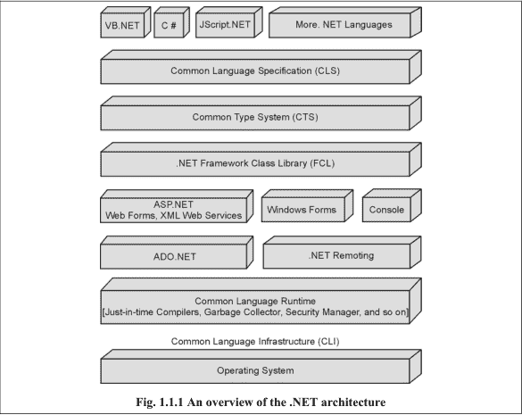

- v) .NET Framework 是一个受管环境。通用语言运行时监控 .NET 应用程序的执行并提供基本服务。它管理内存、处理异常，确保应用程序正常工作。
- vi) 语言互操作性是 .NET 的一个目标。.NET 语言共享一个公共运行时（通用语言运行时、一个公共类库）、框架类库（FCL）、公共组件模型和公共类型。

### vii) 通用语言运行时 (CLR)
- .Net Framework 提供了名为 Common Language Runtime (CLR) 的运行时环境。它提供了运行所有 .Net 程序的环境。在 CLR 下运行的代码称为托管代码。如果程序在 CLR 下运行，程序员无需担心内存管理，因为它提供了内存管理和线程管理。
- 在编程上，当程序需要内存时，CLR 为作用域分配内存，并在作用域完成后释放内存。
- 语言编译器（例如 C#、VB.Net、J#）会将代码/程序转换为 Microsoft Intermediate Language (MSIL)，然后 CLR 会将其转换为本机代码，如下图 1.1.2 所示。

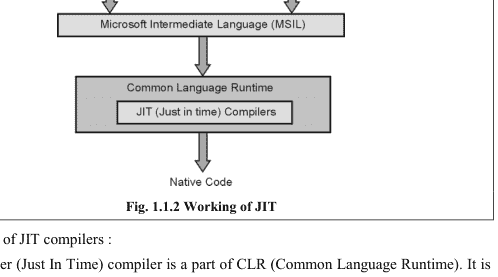

- Types of JIT compilers :
JIT 编译器（即时编译）是 CLR（通用语言运行时）的一部分。它负责将 MSIL（二进制格式）转换为本机代码。它在执行前立即完成此操作。如果已存在先前编译的代码，则在需要时在此处使用。

有三种类型的 JIT 编译器。
- **Pre-JIT:** 又称为 NGEN.exe（Native Generator），由 Microsoft 提供，它一次性将完整的 MSIL 代码编译为本机格式（甚至在执行前），因此代码首次执行时的性能不受影响。在此，编译输出保存在 GAC（全局程序集缓存）中。
- **Econo-JIT:** Econo-Jit 仅编译在运行时调用的方法，并在不需要时删除这些方法。它专门用于 PDA；在此，Econo-JIT 不进行缓存。
- **Normal-JIT:** 它编译在运行时调用的方法。这些方法在首次编译时被调用，结果存储在缓存内存中。

### viii) 托管语言和通用语言规范 (CLS)
- .NET 支持托管和非托管编程语言。由托管语言（如 C# 和 VB.NET）创建的应用程序在名为通用语言运行时（CLR）的公共运行时管理下执行。
- CLS 使语言符合 .Net 标准。Microsoft 已定义了一些规范，每个 .Net 语言都必须遵循。例如，无指针、无多重继承等。通用语言规范（CLS）是一组规范或指南，用于定义 .NET 语言。共享规范促进语言互操作性。例如，CLS 定义了托管语言的公共类型，这是通用类型系统（CTS）的一个子集。这消除了封送处理的问题，而封送处理是在两种语言之间工作时的主要障碍。
- 编译的托管应用程序与非托管程序之间存在若干差异。

### 1. MSIL :
- a) 托管应用程序编译为 Microsoft Intermediate Language (MSIL)（即中间语言 - IL）和元数据。MSIL 是一种低级语言，所有托管语言都编译为它而不是本机二进制文件。
- b) 当 .NET 代码被编译时，它不会直接转换为本机/二进制代码；它首先被转换为称为 MSIL 代码的中间代码，然后由 CLR 解释。MSIL 与硬件和操作系统无关。

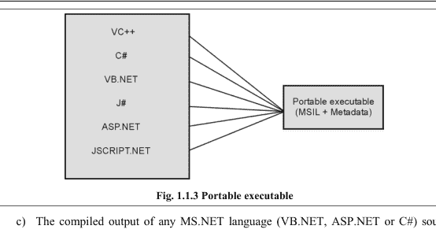

### Fig. 1.1.3 可移植可执行文件
- c) 任何 MS.NET 语言（VB.NET、ASP.NET 或 C#）源代码的编译输出是 PE（可移植可执行文件，无论是 .exe 文件还是 .dll 文件），它包含 MSIL（Microsoft Intermediate Language）指令和二进制格式的元数据。
- d) 使用即时编译，在代码执行时，MSIL 被转换为针对环境和硬件优化的二进制文件。由于所有托管语言最终都成为 MSIL，因此 .NET 中具有高度的语言互操作性。由于 MSIL 对所有 .Net 语言都相同，因此跨语言关系是可能的。

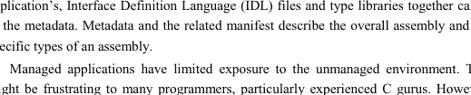

### Fig. 1.1.4 编译过程
- 2. 元数据是描述数据的数据。在托管应用程序（也称为程序集）中，元数据定义了程序使用的类型。托管应用程序的接口定义语言（IDL）文件和类型库统称为元数据。元数据和相关的清单描述了整个程序集以及程序集的特定类型。
- 3. 托管应用程序对非托管环境的可访问性有限。这可能会让许多程序员感到沮丧，尤其是经验丰富的 C 专家。然而，.NET 具有相当大的灵活性。对于决心使用非托管代码的人来说，有互操作性服务。
- 4. 在 .NET 中，托管应用程序称为程序集。程序集遵循传统的可移植可执行文件（PE）格式，但包含额外的头和节

特定于 .NET。MSIL 和元数据是 .NET PE 中最重要的新增内容。安装 .NET Framework 后，新的程序加载器会识别并解释 .NET PE 格式。在未来的 Windows 操作系统中（第一个是 .NET Server），.NET 加载器将自动提供。

### ix) 公共类型系统

- 公共类型系统（CTS）是 .NET 类型的目录，包括 System.Int32、System.Decimal、System.Boolean 等。开发人员不需要直接使用这些类型。这些类型是每种托管语言提供的特定数据类型的基础对象。下面是用 C# 和 Visual Basic .NET 声明一个整数的代码。两种语法都会映射到 System.Int32 对象。最好使用语言本身的语法而不是底层对象类型，让 .NET 可以灵活地为运行环境选择最合适的类型和大小。

- 公共类型系统是一个以 System.Object 为顶端的金字塔。.NET 类型分为值类型和引用类型。值类型主要是基元类型，继承自 System.ValueType，进而继承自 System.Object。引用类型是除值类型以外的任何类型，直接或间接派生自 System.Object。值类型是短期对象，分配在栈上。引用类型本质上是指针，分配在托管堆上。引用类型的生存期由垃圾回收器控制。值类型可以转换为引用类型，反之亦然，这两个过程分别称为装箱（boxing）和拆箱（unboxing）。

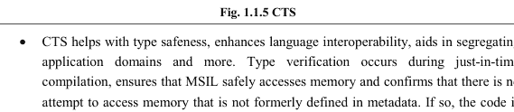

图 1.1.5 CTS

- CTS 有助于类型安全、增强语言互操作性、帮助隔离应用程序域等。类型验证在即时编译期间执行，确保 MSIL 安全地访问内存，并确认不存在对未在元数据中正式定义的内存的访问尝试。如果发生这种情况，该代码将被视为恶意应用程序。CTS 为 .NET 提供了共享的类型基础，增强了语言互操作性。

- .NET 引入了称为应用程序域的轻量级进程。应用程序域是进程中的进程。应用程序域比传统 Win32 进程更具可扩展性且成本更低。.NET 必须监管应用程序域，并保证它们是“好邻居”。代码验证、类型安全和 CTS 在保证应用程序域安全方面发挥着作用。

### x) .NET Framework 类库

- .NET Framework 类库（FCL）是一组托管类，提供对系统服务的访问。文件输入/输出、套接字、数据库访问、远程处理和 XML 只是 FCL 中可用服务的一部分。所有 .NET 语言都依赖相同的托管类来获得相同的服务。因此，一旦学会任何一种 .NET 语言，就相当于学会了任何其他托管语言的 40%。无论使用哪种语言，系统服务都使用相同的类、方法、参数和类型。这是 FCL 最重要的贡献之一。

- FCL 包含大约 600 个托管类。由数百个类组成的层次结构将难以导航。Microsoft 根据功能将 FCL 的托管类划分到不同的命名空间中。例如，与本地输入/输出相关的类可以在 System.IO 命名空间中找到。为了进一步细化层次结构，FCL 命名空间通常是嵌套的；命名空间的层级用点分隔。System.Runtime.InteropServices、System.Security.Permissions 和 System.Windows.Forms 是嵌套命名空间的示例。根命名空间是 System，它提供用于控制台输入/输出、应用程序域管理、委托、垃圾回收等的类。

- 以下是可使用 .NET 类库的不同类型的应用程序。
  - 1. Windows 应用程序。
  - 2. 控制台应用程序。
  - 3. Web 应用程序。
  - 4. XML Web 服务。
  - 5. Windows 服务。

简言之，开发人员只需在其语言代码中导入类库，并使用其预定义的方法和属性来实现常见和复杂的功能，如文件读写、图形渲染、数据库交互和 XML 文档操作。

### xi) 垃圾回收

- 垃圾回收器是 .NET 的内存管理组件。这是一个用于清理内存的程序。所有动态请求的内存都分配在堆上。该堆由 CLR 管理。当 .NET 检测到给定进程的托管堆即将满时，它会调用垃圾回收器。垃圾回收器遍历当前在代码作用域内的变量，检查对存储在堆上的对象的引用，以确定它们是否可以从代码中访问。没有任何引用的对象将被移除。

- .NET 中的垃圾回收之所以有效，是因为 MSIL 的设计促进了这一过程。如果存在对某个对象的任何引用，则该引用中就有足够的信息来准确确定该对象的类型。垃圾回收不是确定性的，这意味着不保证垃圾回收器何时被调用；它将在 CLR 决定需要时被调用。也可以通过代码显式调用 GC。

### xii) .NET Framework 的其他组件

- 1) WinRT：WinRT 或 Windows Runtime API 为构建 Windows 应用商店应用提供用户界面元素，并提供对 Windows 8 或 Windows RT 操作系统功能的访问。WinRT 支持使用 C++ 和其他托管语言 C#、VB.NET 以及 JavaScript 和 TypeScript 进行开发。

- 2) ASP.NET：用于构建基于 Internet 的丰富 Web 应用程序。

- 3) 桌面应用（Windows 窗体）：Windows 桌面应用是传统 Windows 窗体应用的新名称。为 Windows XP、Windows Vista 和 Windows 7 开发的软件在 Windows 8 中运行时将归类为 Windows 桌面应用。Windows 桌面应用的示例包括 Microsoft Office 系列产品、记事本等。

- 4) Windows Presentation Foundation：WPF 用于创建具有丰富用户体验的应用程序。它包括应用程序 UI、2D 图形、3D 图形和多媒体。它利用了现代显卡的硬件加速功能。WPF 使 UI 更快、可缩放且与分辨率无关。

- 5) Silverlight：这是一种跨浏览器的基于 Web 的技术，允许设计人员和开发人员交付嵌入 Web 页面的富 Internet 应用程序（RIA）。

- 6) ADO.NET：用于创建数据访问层，以查询和操作来自 SQL Server、Oracle、DB2 等底层数据源的数据。

- 7) LINQ：允许使用类似 SQL 查询的语法，通过 .NET Framework 语言（如 C# 和 VB）从各种数据源（如 SQL 数据库、XML 文档、ADO.NET 数据集、各种 Web 服务以及任何其他对象，如集合、泛型等）查询数据。

- 8) ADO.NET Entity Framework：用于以 ORM 方式查询数据并将数据存储到关系数据库（如 SQL Server、Oracle、DB2 等）中。

- 9) Parallel Extensions：允许将工作代码分布到多个处理器上，以充分利用硬件。

- 10) Windows Communication Foundation：用于基于 WS-* 标准构建和开发服务。

- 11) ASP.NET Web API：ASP.NET Web API 是一个用于构建 HTTP 服务的框架，可被包括浏览器、移动设备、iPhone 和平板电脑在内的广泛客户端使用。

- 12) SignalR：ASP.NET SignalR 是一个库，可简化向应用程序添加实时 Web 功能的过程。实时 Web 功能是指服务器代码可以在内容可用时立即将其推送到已连接的客户端，而不是让服务器等待客户端请求新数据。

- 13) Windows Workflow Foundation：用于构建面向流程的业务工作流和规则引擎。

#### 1.2 C# 语言

### 概念

**C# 家族**

- 1. C#（发音为“C-sharp”）是 Microsoft 在其 .NET Framework 中推出的一种简单、现代、通用、完整的面向对象编程语言。

- 2. C# 由 Microsoft 开发，旨在促进 Web 上信息和服务的交换，并使开发人员能够构建高度可移植的应用程序。

- 3. 该计划由 Microsoft 的 Anders Hejlsberg 领导。

- 4. 自 7.0 版本起，它是 Microsoft Visual Studio 的一部分。

### 说明

**C# 的目标**

- 5. C# 的目标是将 C++ 的原始计算能力与 Visual Basic 的生产力和编程简便性结合起来。

- 6. C# 基于 C++，并包含与 Java 相似的功能。


## C# 平台

- 7. Visual Studio 支持 VB、VC++、C++、VBScript、JScript 和 C#。所有这些语言都提供对 Microsoft .NET 平台的访问。
- 8. .NET 平台包括公共执行引擎和丰富的类库。
- 9. Microsoft 的公共语言运行时（CLR）支持多种语言，例如 C#、VB.NET、JScript、ASP.NET、C++。
- 10. 代码执行遵循的步骤是：源代码 --> 中间语言代码（IL） --> （JIT 编译器）本机代码。
- 11. 内置类和数据类型是所有 .NET 语言共有的。

## C# 能做什么

- 12. 使用 C# 可以开发控制台应用程序、Windows 应用程序、Web 应用程序。
- 13. C# 通过使用可扩展标记语言（XML）和简单对象访问协议（SOAP）简化编程。这样无需程序员为每个步骤编写额外代码，即可访问编程对象或方法。

## C# 的简单性

- 14. C# 中没有指针。
- 15. 不支持直接内存操作，因为就存储访问而言它们通常是不安全的。
- 16. C# 中不使用 “::” 或 “->” 运算符。

## C# 内存管理

- 17. .NET Framework 支持自动内存管理和垃圾回收。C# 默认继承其平台的这些特性。
- 18. 基元数据类型（如 Integer、Floats 等）具有各种必需的范围。
- 19. 在 C# 中，布尔值是纯粹的 true 或 false 值。数值 0 和 1 不用于表示 true 和 false。因此，不会遇到 “=” 运算符和 “==” 运算符的错误。
- 20. 运算符 “==” 用于比较操作，运算符 “=” 用于赋值操作。

## C# 是最新的

- 21. C# 紧跟当前趋势，在互操作性、可扩展性、健壮性和 Web 开发方面非常强大。
- 22. 它包含内置支持，可将任何应用程序组件转换为 Web 服务，该服务可由任何平台上运行的任何应用程序通过互联网调用。

## C# 遵循面向对象范式

- 23. C# 支持数据抽象、数据封装、继承、多态等所有特性，使其成为完整的面向对象语言。
- 24. C# 引入了结构（struct），使基元类型（int、float、double）能够成为对象。

## C# 是类型安全的

- 25. C# 不支持像将 Double 转换为 Boolean 这样的不安全强制转换。
- 26. C# 支持编译器自动初始化，例如，值类型（基元类型）初始化为零，引用类型（对象和类）初始化为 null。
- 27. 在 C# 中，数组的索引从零开始。会检查数组边界。
- 28. C# 允许检查类型溢出。

## C# 具有互操作性

- 29. C# 对 COM 和基于 Windows 的应用程序提供完整的本机支持。
- 30. C# 确实允许受限地使用本机指针，以支持正在使用指针的应用程序。C# 允许用户将指针用作不安全代码块来操作旧代码。
- 31. C# 内置支持实现 IUnknown 和其他 COM 接口。
- 32. 来自 VB.NET 和其他托管代码语言的组件可以直接在 C# 中使用。

## C# 可扩展

- 33. .NET 平台引入了程序集，这些程序集通过其清单文件进行自我描述。这些清单文件确立程序集标识、版本、区域性和数字签名。此外，程序集无需在任何地方注册。
- 34. 如果需要扩展任何应用程序，只需删除旧文件并用新文件更新它们即可。无需注册动态链接库。

## C# 可更新

- 35. 应用程序生命周期中一项容易出错的重要任务是维护。更新软件组件是一项关键且时间紧迫的任务。对代码所做的修订可能会影响现有程序。C# 将版本控制概念作为语言特性予以支持。
- 36. 该语言本身对接口和方法重写提供本机支持，这使得复杂框架能够随时间推移得到开发和演进。

#### 1.3 面向对象概念

### 概念

- 1. 面向对象编程（*OOP*）是一种设计哲学。*面向对象编程（OOP）*使用的编程语言集与旧的过程式编程语言（*C、Pascal 等*）不同。可复用性通过一组自持的事物（“对象”）得以实现。由于“对象”概念，衍生出四个主要的面向对象编程概念。
- 2. 设“手”为一个类。人体有两个*“手”*类型的对象，分别命名为“左手”和“右手”。它们的主要功能由通过肩部（充当身体与手之间的接口）发送的一组电信号控制。手是一个架构良好的类。通过更改少量属性，手被复用来创建左手和右手。
- 3. 面向对象编程（OOP）是一种编程范式（一种编程思维过程），其中程序围绕对象和数据组织，而不是围绕操作和逻辑组织。
- 4. OOP 允许将问题分解为若干称为对象的实体，然后围绕这些对象构建数据和函数。
- 5. OOP 特性

### 1. 类

- 1. 类是任何现代面向对象编程语言（如 C#）的核心。在 OOP 语言中，必须创建类来表示数据。
- 2. 类充当对象的蓝图，包含用于存储数据的变量和对数据执行操作的函数。
- 3. 类不占用任何内存空间，因为它只是数据的逻辑表示。
- 4. 创建类——要创建类，使用关键字 “class”，后跟类名，如下所示：

### 示例

```csharp
class Book
{
}
```

### 2. 对象

- 1. 对象是类的实例。对象是面向对象系统的基本运行时实体。它表示程序正在处理的实际地点、人员、书籍或任何项目。
- 2. 对象是由相关变量和方法组成的软件捆绑。
- 3. 对象是现实世界中的实体，它将属性状态和行为保持在一起。
- 4. 要使用类，必须为该类创建一个变量，该变量称为对象。
- 5. 对象称为类的实例，并且当对象被实例化时，其起始地址存储在对象中。在 C# 语言中，对象可以按如下方式实例化：

### 示例

```csharp
Book objBook = new Book();
```

### 3. 抽象

- 1. 抽象是“表示本质特征而不表示背景细节”。
- 2. 抽象试图关注对象做什么，而不是它如何做。
- 3. 抽象通过提供类或对象的相关信息，提供了一种概括其视图的方法。
- 4. 抽象是仅向外部现实世界提供必要信息，并隐藏整体背景细节以呈现对象的过程。
- 5. 它依赖于接口与实现的分离。
- 6. 抽象在设计层面解决问题。
- 7. 抽象是一种外部布局，用于设计层面。
- 8. 例如：微波炉的外部有一个带键盘按钮的显示屏，用于设置温度、定时器等。

### 抽象示例

```csharp
public class Car
{
    public int mileage = 65;
    public string color = "Red";
    private string engineformula = "m*n";

    // It's public – so accessible outside class
    public int GetMileage()
    {
    }

    // It's public – so accessible outside class
    public string GetColor()
    {
    }

    // It's private – so not accessible outside class
    private string GetEngineMakeFormula()
    {
    }

    // It's public – so accessible outside class
    public string DisplayMakeFormula()
    {
        // "GetEngineMakeFormula()" is private but accessible to this class only
        return GetEngineMakeFormula();
    }
}
```

从上述示例可以看出，必要的方法和属性使用 *public* 访问修饰符公开，其余方法和属性使用 *private* 访问修饰符隐藏。通过这种方式，在应用程序中实现了抽象。

### 4. 信息隐藏

- 1. 信息隐藏概念限制数据的直接暴露。
- 2. 数据通过安全机制间接访问，以避免对数据进行不必要的处理。
- 3. 对象及其方法用于实现数据隐藏。

### 5. 封装

- 1. 将数据成员和方法一起包装到单个单元（换句话说，类）中称为封装。
- 2. 封装就像将材料装入胶囊中。也就是说，将与对象相关的操作和数据装入该对象中。
- 3. 例如，袋子可以封装瓶子、饭盒、文件、笔记本电脑等。在对象中，封装数据成员以及围绕数据成员工作的函数。

### 示例

```csharp
class Sack
{
    tiffin;
    Bottle;
    files;
    laptop;
    ReadFile();
}
```


- 4. 封装意味着隐藏对象的内部细节，即对象如何做某事。
- 5. 封装防止窥探对象的内部视图，在那里抽象的行为被实现。
- 6. 封装是一种用于保护对象中的信息不被另一个对象访问的技术。
- 7. 通过封装，数据为了安全目的被隐藏，通过将变量设为私有并公开属性来访问私有数据，该数据将公开访问。
- 8. 封装解决了实现层面的问题。

## 6. 继承

- 1. 继承是通过使用现有类来创建一个新类，即从另一个类扩展一个类。
- 2. 当一个类包含并使用另一个类的属性时，这被称为继承。
- 3. 扩展类的主要优点是它提供了一种方便的方式在不同上下文中重用现有且经过充分测试的代码，从而节省了大量现有编码及其模型风格的时间。
- 4. 通过有效使用继承，可以节省大量编程时间并减少错误，这反过来会提高工作质量和生产力。
- 5. 例如，击球手包含球员的属性。

### 示例

```csharp
public class Player
{
    public Player()
    {
        Console.WriteLine("Player Constructor.");
    }

    public void print()
    {
        Console.WriteLine("I am a Player.");
    }
}

public class Batsman : Player
{
    public Batsman()
    {
        Console.WriteLine("Batsman Constructor.");
    }

    public static void Main()
    {
        Batsman bat = new Batsman();

        bat.print();
    }
}
```

### 输出

```text
Player Constructor.
Batsman Constructor.
I am a Player.
```

## 7. 多态

- 1. 多态意味着一个名字，多种形式。单词 *多态* 意味着具有多种形式。单个对象的多种形式称为多态。
- 2. 通常，当存在类层次结构并且它们通过继承相关时，可以实现多态。
- 3. 一个函数根据调用它的对象及其参数以不同的形式表现。
- 4. 多态有两种类型 -

### 编译时多态

- i) 在这种多态中，编译器识别它必须采用哪种多态形式并仅在编译时评估，因此称为 *编译时多态* 或 *早期绑定*。
- ii) 早期绑定通过 *方法重载* 和 *运算符重载* 实现。*方法重载* 意味着在同一类或不同类中具有相同名称但签名（或参数）不同的方法多于一个。
- iii) 早期绑定的优点是执行变得更快，因为在编译过程中编译器已知道有关方法的一切。
- iv) 主要缺点是它缺乏运行时决策的灵活性。

### 运行时多态

- i) 在这种多态中，编译器识别它必须采用哪种多态形式并在运行时评估称为 *运行时多态* 或 *晚期绑定*。

## 两分题问答

### Q.1 .NET 目前支持多少种语言？

**答：** 当 .NET 第一次推出时，它支持许多语言，如 VB.NET、C#、COBOL 和 Perl 等。目前它支持几乎 44 种语言。

### Q.2 什么是 CTS？

**答：** CTS 代表 Common Type System。 它有一组规则，规定数据类型在程序中应如何声明、定义和使用。它描述了在应用程序中要使用的数据类型。

我们可以通过遵循 CTS 中存在的规则来设计自己的类和值。这些规则的制定是为了使使用一种编程语言声明的数据类型可以被使用不同语言开发的应用程序调用。

### Q.3 什么是 MSIL？

**答：** MSIL 代表 Microsoft Intermediate Language。

MSIL 提供调用方法、初始化和存储值、内存处理、异常处理等操作的指令。所有 .NET 代码首先编译为 IL。

### Q.4 如何执行托管代码？

**答：** 执行托管代码时遵循以下步骤：

- 根据代码编写的语言选择语言编译器。
- 通过其自己的编译器将上述代码转换为中间语言。
- 然后 IL 针对 CLR，该 CLR 在 JIT 的帮助下将代码转换为本地代码。
- 执行本地代码。

### Q.5 托管代码和非托管代码有什么区别？

**答：**

| 托管代码 | 非托管代码 |
| --- | --- |
| 托管代码由 CLR 管理 | 任何不由 CLR 管理的代码 |
| 执行托管代码需要 .NET 框架 | 独立于 .NET 框架 |
| CLR 通过垃圾回收管理内存管理 | 拥有自己的编译和执行运行时环境 |

### Q.6 什么是 .NET Framework？ AU: Dec.-17, May-19

**答：** .NET 框架是由 Microsoft 开发的软件开发平台。

该框架旨在创建将在 Windows 平台上运行的应用程序。.NET 框架的第一个版本于 2002 年发布。

该版本称为 .NET 框架 1.0。自那以后，.NET 框架已经走得很远，目前的版本是 4.7.1。

.NET 框架可用于创建基于窗体和基于 Web 的应用程序。也可以使用 .NET 框架开发 Web 服务。

### Q.7 列出 C# 的特性。 AU: Dec.-18

**答：** C# 的特性

- **简单**: 它不支持多重继承和指针。C# 将 int 和 Boolean 视为两种不同的数据类型。
- **一致**: C# 只支持一种整数类型，没有范围限制。
- **互操作性**: C# 提供了程序调用任何本机 API 的设施。
- **现代**: C# 包含现代编程语言中的特性，如自动垃圾回收、健全的安全模型和丰富的内在错误处理模型。
- **面向对象**: C# 是一种现代面向对象编程语言，支持封装、继承和多态。
- **类型安全**: C# 包含类型安全措施，如动态分配的对象和数组初始化为零，不允许不安全转换，并在算术运算期间进行溢出检查。
- **可版本化**: C# 支持使用它开发的应用程序的版本控制，以便同一应用程序的不同版本可供使用。
- 与其他语言兼容
- C# 强制执行 .NET 通用语言规范 (CLS)，因此允许与其他 .NET 语言互操作。

### Q.8 列出可在 .NET 上创建的不同类型的应用程序。 AU: May-19

**答：** 以下是可在 .NET 上开发的各种类型的应用程序列表。

- 1. **ASP.NET Web 应用程序** 是用于在某些 Web 服务器内运行以通过 HTTP 满足用户请求的程序。ASP.NET Web 应用程序可以从仅由 HTML 页面组成的简单网站到在本地和远程网络上运行的高级企业应用程序不等。这些企业应用程序还提供使用 XML 交换数据的组件。此类型包括动态和数据驱动的基于浏览器的应用程序。（例如：Hotmail 和 Google）。
- 2. **Web 服务** 是通过 HTTP、XML 和 SOAP 等行业标准可用的“可通过 Web 调用”的功能。
- 3. **Windows 应用程序** 是用于日常常见任务的基于窗体的标准 Windows 桌面应用程序。（例如：Microsoft Word）。仅在 Windows 环境下运行。这些应用程序消耗 Windows 操作系统提供的服务。
- 4. **Windows 服务** 是在系统上作为后台进程运行的长期运行的可执行应用程序。这些应用程序不会干扰在同一台计算机上运行的其他进程的工作。Windows 服务在为每个 Windows 服务专门创建的单独 Windows 会话内执行。这些服务没有图形用户界面，非常适合在服务器上运行。Windows 服务以前称为 NT 服务。
- 5. **控制台应用程序** 是在命令提示符（DOS）窗口内运行的轻量级程序。它们通常用于测试应用程序。
- 6. **移动应用程序** 可以在多种移动设备上运行，例如 Pocket PC、手机或个人数字助理。这些应用程序提供从移动设备访问数据的无处不在访问。.NET Framework 会自动更改这些应用程序以使其能够根据移动设备在多个浏览器上运行。
- 7. **类库** 是创建一次并在多个应用程序中多次重用的组件。类库允许在一个文件中定义多个类以及其方法和接口。这些库编译为 .dll 文件，并且由于代码可重用性而促进了新应用程序的快速开发。要从应用程序访问类库中类的功能，需要在程序中包含对该库的引用。
- 8. **Windows Presentation Foundation (WPF) 应用** - Windows Presentation Foundation (WPF) 为开发人员提供统一的编程模型，用于在 Windows 上构建面向业务的桌面应用程序。
- 9. **使用 Windows Communication Foundation (WCF) 的面向服务应用** - Windows Communication Foundation (WCF) 是构建面向服务应用程序的统一编程模型。它使开发人员能够构建跨平台集成并与现有投资互操作的、安全的、可靠的、事务性的解决方案。


## 10. 使用 Windows Workflow Foundation (WWF) 的工作流启用应用程序 - WWF 是一种编程模型，提供了一种建模流程、活动和工作流的方式。

所有类型的 .NET 应用程序在设计和开发中使用一种或多种符合 .NET 的语言。 .NET Framework 包含各种技术，例如 ASP.NET、VB.NET、VC++.NET 和 ADO.NET。 ASP.NET 用于构建 Web 应用程序和服务，VB.NET 和 VC++.NET 用于创建 Windows 应用程序，而 ADO.NET 用于灵活访问数据库。

## Q.9 定义 Marshaling。

答. : .NET 代码被称为“托管”，因为它受 CLR 控制（托管）。 未受 CLR 控制的其他代码称为非托管。

- 在 C# 编程的上下文中，marshaling 是在托管代码和非托管代码之间创建桥梁的过程；它是承载消息从托管环境到非托管环境以及反向的层。它是 CLR（通用语言运行时）提供的核心服务之一。因为非托管环境中的许多类型在托管环境中没有对应项，所以需要创建转换例程将托管类型转换为非托管类型，反之亦然；这就是 marshaling 过程。
- 在 ASP .NET 上下文中，marshaling 是将数据从一个应用程序域转换或序列化并导出到另一个应用程序域的过程。
- 有两种类型的 marshalling，
  - Marshal by value : 服务器创建对象的副本并将其传递给客户端使用。
  - Marshal by reference : 客户端创建代理以访问对象。

## 长问答题

- Q.1 解释 .NET 架构。 (参见第 1.1 节)
- Q.2 .NET 的功能是什么？ (参见第 1.1 节)
- Q.3 什么是 JIT 以及 .NET 环境中的各种类型？ (参见第 1.1 节)
- Q.4 写一篇关于 C# 编程语言的说明。 (参见第 1.12 节)
- Q.5 什么是 OOP 功能？ (参见第 1.3 节)

## 单元 - I

## 第 2 章

## 核心 C# - 第 I 部分 - 变量、数据类型、类型、转换、装箱-拆箱

**教学大纲：** 核心 C#、变量、数据类型。

| 节号 | 主题名称 | 页码 |
|---|---|---|
| 2.1 | C# 字符集 | 2 - 2 |
| 2.2 | 令牌 | 2 - 3 |
| 2.3 | 关键字 | 2 - 5 |
| 2.4 | 字面量和常量 | 2 - 6 |
| 2.5 | 标识符 | 2 - 15 |
| 2.6 | 命名约定 | 2 - 16 |
| 2.7 | 数据类型 | 2 - 22 |
| 2.8 | 变量 | 2 - 25 |
| 2.9 | 类型转换和强制转换 | 2 - 29 |
| 2.10 | 装箱和拆箱 | 2 - 32 |
| 2.11 | 第一个 C# 程序 | 2 - 35 |
| 2.12 | C# 中的注释 | 2 - 38 |
| 2.13 | C# 中的错误 | 2 - 39 |
|  | 两分题问答 | 2 - 41 |
|  | 长问答题 | 2 - 43 |

#### 2.1 C# 字符集

##### 2.1.1 基础

### 概念

- 1. .NET Framework 因此 C# 使用 UTF-16 编码（由 UnicodeEncoding 类表示）来表示字符和字符串。

### 说明

- 2. C# 字符集符合 Unicode 3.0，Unicode 是一种 16 位字符格式，旨在表示来自世界各地语言的众多字符集。
- 3. 任何 Unicode 字符都可以用 Unicode 转义序列 \u 或 \U 指定，后跟四个十六进制数字。
- 4. 语言中最广泛使用的字符集一直是美国信息交换标准代码（ASCII）。 ASCII 的基本限制是其 8 位字符大小。这不能容纳各种国际语言的多字节字符集。随着信息技术使世界各地的人们更加接近，使世界变得更小，国际考虑必须变得更大。
- 5. Unicode 的字符集包括所有人类语言的书写符号。它包括数万个汉字、数学符号以及死语言的字符，例如埃及象形文字。
- 6. Unicode 的前 128 个字符（与 ASCII 一一对应）使用与 ASCII 相同的二进制值的单个八位字节编码，使有效的 ASCII 文本也成为有效的 UTF-8 编码 Unicode。

### 2.1.2 字符集和编码系统

### 概念

- 1. 字符集是一组标准化的字符。
- 2. 编码系统是将一组字符（给定字符集）的序列转换为 0 和 1 的序列的标准方法。

### 说明

- 3. Unicode 定义了几种编码系统。 UTF-8 和 UTF-16 是两种最流行的 Unicode 编码系统。
- 4. UTF-8 适用于主要是拉丁字母的文本。例如，英语、西班牙语、法语，以及大多数网络技术，如 HTML、CSS、JavaScript。大多数 Linux 文件默认使用 UTF-8。 UTF-8 编码系统与 ASCII 向后兼容。（含义：如果文件仅包含 ASCII 字符，则使用 UTF-8 编码文件得到的字节序列与使用 ASCII 作为编码方案相同。）
- 5. 使用 UTF-16，每个字符至少编码为 2 个字节，并且 Unicode 中常用的字符正好是 2 个字节。对于包含大量汉字的亚洲语言，如中文和日文，UTF-16 可创建更小的文件大小。
- 6. 还有 UTF-32，它始终每个字符使用 4 个字节。它会创建更大的文件大小，但解析更简单。目前，UTF-32 并未被广泛使用。

## 2.2 令牌

### 概念

- 1. 令牌是由 C# 中有效字符组成的最小独立单元。
- 2. 令牌是有效的单词，是 C# 编程的基本构建块。

### 说明

- 3. 令牌是使用 C# 语法形成和定义的。
- 4. 令牌通常是任何不是空白或注释的单元。
- 5. 每个 C# 程序基本上都是令牌的集合。
- 6. 有 5 种令牌，即标识符、关键字、字面量、运算符和标点符号。
- 7. 空白和注释不是令牌，尽管它们充当令牌的分隔符或定界符。

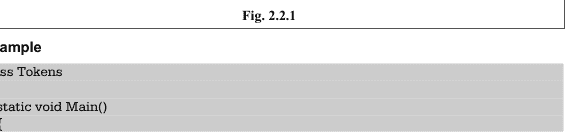

### 示例

```
class Tokens
{
    static void Main()
    {
int num = 8;
float rate = 50.5f;
char item_type = 'P';
string Name = "Doll";
}
```

上述程序中以下是各种令牌（及其分类），

| 令牌 | 分类 |
|---|---|
| Class | 关键字 |
| Tokens | 标识符 |
| { | 运算符 |
| Static | 关键字 |
| void | 关键字 |
| Main | 标识符 |
| ( | 运算符 |
| ) | 运算符 |
| { | 运算符 |
| Int | 关键字 |
| num | 标识符 |
| = | 运算符 |
| 8 | 常量 |
| ; | 运算符 |
| Float | 关键字 |
| rate | 标识符 |
| = | 运算符 |
| 50.5f | 常量 |
| ; | 运算符 |
| char | 关键字 |
| item_type | 标识符 |
| = | 运算符 |
| 'P' | 常量 |
| ; | 运算符 |
| string | 标识符 |
| Name | 标识符 |
| = | 运算符 |
| "Doll" | 标识符 |
| ; | 运算符 |
| } | 运算符 |
| } | 运算符 |

## 2.3 关键字

### 概念

- 1. 关键字是语言特定的、保留的和预定义的单词，不能用作标识符。

### 说明

- 2. 每个 C# 单词都被分类为关键字或标识符。
- 3. 所有关键字都有固定的含义，这些含义不能更改。
- 4. 所有关键字都是小写。
- 5. for、do、while、break、case、if、else、int、char、public、class、union、try 是关键字的一些示例。
- 6. 关键字是语言定义的基本要素。
- 7. 如果任何人想将关键字用作标识符，则必须使用 "@" 作为该关键字的前缀。例如，'for' 是一个关键字，如果任何人想将其用作标识符，则可以通过添加前缀 @ 来实现，如 "@for"。
- 8. C# 已定义了许多关键字，列在下表中：

| abstract | event | new | struct |
| As | explicit | null | switch |
| Base | extern | object | this |
| Bool | false | operator | throw |
| Break | finally | out | true |
| Byte | fixed | override | try |
| Case | float | params | typeof |
| Catch | for | private | uint |
| Char | foreach | protected | ulong |
| checked | goto | public | unchecked |
| Class | if | readonly | unsafe |
| Const | implicit | ref | ushort |
| continue | in | return | using |


| decimal | int | sbyte | virtual |
|---|---|---|---|
| Default | interface | sealed | volatile |
| delegate | internal | short | void |
| Do | is | sizeof | while |
| Double | lock | stackalloc |  |
| Else | long | static |  |
| Enum | namespace | string |  |

- 9. **上下文关键字** — 上下文关键字仅在有限的程序上下文中具有特殊含义，并且在该上下文之外可用作标识符。

| Add | alias | ascending |
|---|---|---|
| Async | await | descending |
| Dynamic | from | get |
| Global | group | into |
| Join | let | orderby |
| partial(type) | partial(method) | remove |
| Select | set | value |
| Var | Where (generic type constraint) | Where (query clause) |
| Yield |  |  |

表 2.3.1 上下文关键字

## 2.4 字面量和常量

### 2.4.1 字面量

### 概念

- 1. 字面量是表示存储在变量中的值的方式。
- 2. 字面量是程序中使用的常量值。

### 解释

- 3. 常量是固定值。常量指的是程序在执行期间不可更改的固定值。
- 4. 常量可以是任何基本数据类型，例如整数常量、浮点常量、字符常量或字符串字面量。此外还有枚举常量。
- 5. 此外，变量可以声明为常量，其值在程序执行期间不能更改。字面量分类如下，

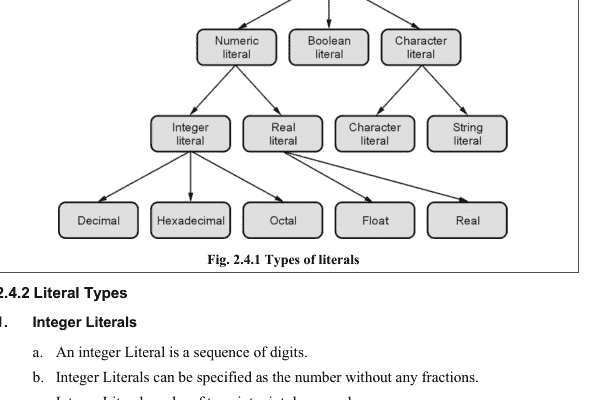

### 2.4.2 字面量类型

### 1. 整数字面量

- a. 整数字面量是数字序列。
- b. 整数字面量可以指定为不带任何小数部分的数字。
- c. 整数字面量可以是 int、uint、long 或 ulong 类型。
- d. 要指定 uint、long 和 ulong，分别使用后缀 u/U、l/L 和 ul/UL。int 不使用后缀。
- e. 整数字面量可以是十六进制、八进制或十进制。
- f. 要指定十六进制和八进制整数字面量，分别使用前缀 0x/0X 和 o/O。十进制不使用前缀。

### 示例

```csharp
261079 // decimal
0xAD10 // hexadecimal
0576 // octal
67u // unsigned int
12ul // unsigned long
98L // long
25 // int
```

- g. 后缀类型整数字面量

| 后缀类型 | 字符 | 示例 |
|---|---|---|
| unsigned int | U | uint x = 100U; |
| long | L | long x = 100L; |
| unsigned long | UL | ulong x = 100UL; |
| float | F | float x = 100F; |
| double | D | double x = 100D; |
| decimal | M | decimal x = 100M; |

- h. 小写后缀：可以指定小写后缀，例如 u、l、ul、f、d 和 m。但这些后缀更容易与数字混淆。字母 'l' 有时会被看作数字 1。

### 小写后缀示例

小写后缀：`long x = 10000l;` // 这是 100001 还是 10000l？
大写后缀：`long x = 10000L;` // 这是 10000L。

```csharp
// C# program that uses literal number suffixes

using System;

class Program
{
    static void Main()
    {
        // Use long suffix.
        long l1 = 10000L;

        // Use double suffix.
        double d1 = 123.764D;

        // Use float suffix.
        float f1 = 100.50F;

        // Use unsigned suffix.
        uint u1 = 1000U;

        // Use decimal suffix.
        decimal m2 = 4000.1234M;

        // Use unsigned suffix and long suffix.
        ulong u2 = 100020003000400050000UL;
    }
}
```

### 2. 实数字面量

- a. 包含小数点的数字称为实数字面量，或者说，一个整数后跟小数点和分数部分称为实数字面量。
- b. 浮点字面量可以是 float 和 double 类型。
- c. 要指定 float 字面量，使用后缀 f/F；要指定 double 字面量，使用后缀 d/D。
- d. 浮点字面量可以指定为四种类型。
  - 整数
  - 小数部分
  - 指数
  - 十进制部分
- e. C# 还允许对浮点数使用科学计数法，其中指数部分也会添加到浮点数中。

### 示例

```csharp
3.14f // float value
3.123456d // double value
314.e54 // exponent floating value
```

### 3. 布尔字面量

C# 中有两种布尔字面量值。

- true
- false

### 4. 字符字面量

- a. C# 中的字符字面量用单引号括起来。例如 'a' 或 'B'。
- b. 字符字面量是不可变的，不能更改，但存储这些值的变量仅仅表示存储位置。
- c. 字符字面量可以是简单的单个字符或转义序列。
- d. **单字符字面量**：单字符字面量包含用单引号（' '）括起来的单个字符。

### 示例

```csharp
'a',
'8',
';',
' ',
'' etc
```

- e. **反斜杠字符字面量**：转义序列是具有某些预定义含义并以反斜杠字符开头的特殊字符。下表包含各种字符转义序列及其含义：

| 常量 | 含义（名称） |
| --- | --- |
| '\n' | 换行 |
| '\r' | 回车 |
| '\f' | 换页 |
| '\t' | 水平制表符 |
| '\a' | 警报 |
| '\b' | 退格 |
| '\0' | 空 |
| '\v' | 垂直制表符 |
| '\\' | 反斜杠 |
| '\'' | 单引号 |
| '\"' | 双引号 |

表 2.4.1 反斜杠字符字面量

### 示例

```csharp
// C# program that uses character literals

using System;

class Program
{
    static char _literal5 = 'e'; // Static character literal.
    const char _literal6 = '#'; // Constant character literal.

    static void Main()
    {
        //
        // Shows some example character literals.
        // ... Also shows a local constant character literal.
        // ... Then prints them.
        //
        char literal1 = 'A';
        char literal2 = 'b';
        char literal3 = '\\';
        const char literal4 = '_';

        Console.WriteLine(literal1);
        Console.WriteLine(literal2);
        Console.WriteLine(literal3);
        Console.WriteLine(literal4);
        Console.WriteLine(_literal5);
        Console.WriteLine(_literal6);
    }
}
```

### 输出

```text
A
b
\
_
e
#
```

### 5. 字符串字面量

- a. 字符串字面量是用双引号（"）括起来的字符序列。
- b. **字符串字面量**是常量字符串数据。
- c. 字符可以是字母、数字、空格和特殊字符。
- d. 字符串字面量还有一种类似 `@"..."` 的格式。

### 示例

```csharp
"Welcome to India"
"APJ Abdul Kalam"
@"Welcome to India"
"HELLO"
"23"
"4"
"a"
```

```csharp
// C# program showing use of string literals
using System;

class Program
{
    static string  _s1 = "String literal";
    const string  _s2 = "String literal 2";
    const string  _s3 = "String literal 3\r\nAnother line";
    const string  _s4 = @"String literal 4 Another line";
    const string  _s5 = "String literal\t tab";
    const string  _s6 = @"String literal\t tab";

    static void Main()
    {
        // Execution starts here
        string s1 = "String literal \"1\"";
        const string s2 = "String literal 2";
        string s3 = @"String literal ""3""";
        const string s4 = @"String literal 4";
        // Print the string literals.
        Console.WriteLine(
            "{0}\n{1}\n{2}\n{3}\n{4}\n{5}\n{6}\n{7}\n{8}\n{9}",
            _s1, _s2, _s3, _s4, _s5, _s6,
            s1, s2, s3, s4);
    }
}
```

### 输出

```text
String literal
String literal 2
String literal 3
Another line
String literal 4
Another line
```

|  |  |
|---|---|
| 字符串字面量 tab |  |
| 字符串字面量\ttab | （未识别制表符转义序列） |
| 字符串字面量 "1" | （使用引号转义 \"） |
| 字符串字面量 2 |  |
| 字符串字面量 "3" | （使用双引号转义 ""） |
| 字符串字面量 4 |  |

/* 上述程序在 Program 类类型上定义了六个类级字符串。第一个字符串字面量引用是静态变量，这意味着它将在使用它的方法体中的中间语言中被引用。 */

/* 注意：使用静态字符串将要求执行引擎解析元数据中的 _s1 标记。**然而，可以**在程序中任何可访问 _s2 变量的位置重新分配该变量，例如在 Main 方法中。 */

/* 字符串上的 @ 符号。程序中显示的四个字符串字面量在引号前带有 @ 符号前缀。此符号表示使用逐字字符串字面量语法。 */

/* 注意：使用 @ 时，反斜杠被视为字符而不是转义序列。C# 编译器允许在逐字字面量中使用真实换行符。引号应使用双引号进行编码。 */

**该程序写入**屏幕的是整个 Program 类中声明的字符串字面量的内容。请注意引号在 s1 和 s3 变量中如何显示。双引号会作为引号打印。`Console.WriteLine`

**Concat.** 在 C# 程序中，字符串变量的串联是在运行时完成的。另一方面，如果字符串变量是常量并且在编译时已知，编译器将生成移除了串联的中间语言。

**下一步：**此程序似乎串联了三个字符串。编译后，IL 显示只使用了一个字符串。

```csharp
string.Concat
```

### 示例

```csharp
// C# program that concatenates string literals
using System;

class Program
{
    static void Main()
    {
        const string a = "C#";
        const string b = "is ";
```


```csharp
const string c = "wonderful";
Console.WriteLine(a + b + c);
}
}
```

## 输出

C# 很棒。

## 6. 空字面量

- a. 空字面量包含空值。
- b. 空字面量的类型为空类型。

## 2.4.3 常量的声明

- a. 应在程序中使用常量之前声明常量。
- b. 它可以用特定数据类型的有意义的名称声明，并且具有在执行时无法更改的固定值。
- c. 必须同时声明和初始化常量，否则会发生错误。
- d. 这是常量的声明语法，

```csharp
const datatype constantname = value;
```

- e. 常量的示例

```csharp
const float pi = 3.14f;
const int length= 10;


// illustration of a constant

using System;
namespace VariableExample
{
    class First
    {
        static void Main()
        {
            /* Constant Declaration*/
            const float pi = 3.14f;
            Console.WriteLine("The value of pi is {0}",pi);
            Console.ReadLine();
        }
    }
}
```

## 输出

pi 的值是 3.14。

## 2.5 标识符

### 概念

- 标识符是 C# 程序中的任意名称。标识符是用于标识代码元素的名称。
- 标识符一词通常用于变量名、数组、类名、方法名、标签、命名空间和接口等。

### 解释

3. 以下是定义标识符的一些规则 -

- 标识符可以包含字母、下划线和数字字符，前提是第一个字符必须是字母或下划线。它不能超过 511 个字符。
- 它必须在被引用之前声明。
- 它不得包含任何嵌入的空格或符号，例如？ - + ! @ # % ^ & * ( ) [] { } ; : . " / 和 \。然而，下划线（ _ ）可以使用。
- 名称中不能有两个连续的下划线，因为此类标识符用于实现
- 标识符中不允许有空格。
- 标识符不能以数字开头。
- 对于标识符，大写字母和小写字母是不同的。也就是说，good、GOOD 和 Good 是彼此不同的标识符。这表明 C# 是区分大小写的。
- 不能使用关键字作为标识符名称。如果标识符是关键字，则必须以 '@' 为前缀。以 "@" 为前缀的标识符称为逐字标识符。虽然前缀 "@" 允许使用关键字，有助于与其他编程语言接口，但这不是推荐的做法。
- 在单个作用域内不能声明多个同名标识符

### 示例

以下名称是 C# 中的有效标识符

- INDIA
- salary
- I_ndia
- HelloWorld
- M
- m
- \u098India
- @private
- _India

**以及一些无效的**标识符

- 2India //错误因为第一个字母是数字
- private //错误因为它是关键字
- \u0027format //错误因为 Unicode 格式字符
- Birth Date //错误空格不允许。

## 2.6 命名约定

### 概念

命名约定是用于决定如何命名标识符（例如类、包、变量、方法等）的规则。

### 解释

### 为什么需要命名约定

通过使用标准命名约定，可以使自己编写的代码对自己和其他程序员更易于阅读。代码的可读性很重要，因为这意味着花费更少的时间来弄清楚代码的作用，留下更多时间来修复或修改它。

为了说明这一点，值得一提的是，大多数软件公司都会有一份文件，概述他们希望程序员遵循的命名约定。熟悉这些规则的新程序员将能够理解由可能在多年前就已离开公司的程序员编写的代码。

### 为标识符选择名称

选择标识符名称时，请确保它有意义。

### 单词选择

- **应该做的**
- 1. 选择易于阅读的标识符名称。
例如，名为 BackGroundColor 的属性比 ColorBackGround 更易于英文阅读。
- 2. 优先考虑可读性而非简洁性。属性名 CanAlignRight 比 AlignRightX（对 X 轴的晦涩引用）更好。
- 3. 对于类型名称，使用语义（意义上）有趣的名称，而不是特定于语言的关键字。
- 4. 对类名和方法名使用 PascalCasing。

```csharp
public class BookProcess
{
    public void BookIssue()
    {
        //...
    }
    public void CalculatePenalty()
    {
        //...
    }
}
```

- 5. 对方法参数和局部变量使用 camelCasing。

```csharp
public class BookLog
{
    public void Issue(LogEntry logEntry)
    {
        int bookCount = logEntry.bookCount;
        // ...
    }
}
```

- 6. 对 3 个字符或以上的缩写使用 PascalCasing（2 个字符都大写），因为它与 Microsoft 的 .NET Framework 一致。大写字母会过度吸引视觉注意力。

```csharp
HtmlHelper htmlHelper;
FtpTransfer ftpTransfer;
DSNControl dsnControl;
```

- 7. 对数据类型使用预定义的类型名称，而不是像 Int16、Single、UInt64 等系统类型名称。这使代码更自然地阅读。

```csharp
// Correct
string bookName;
int nextIndex;
bool isIssued;

// Avoid
String bookName;
Int32 nextIndex;
Boolean isIssued;
```

- 8. 对局部变量声明使用隐式类型 var，除原始类型（int、string、double 等）外，可为其使用预定义名称。它避免了混乱，特别是对于复杂的泛型类型。类型可通过 Visual Studio 工具提示轻松检测。

```csharp
var stream = File.Create(path);
var customers = new Dictionary();

// Exceptional case
int fileId = 250;
string timeLog;
bool isIssued;
```

- 9. 使用名词或名词短语命名类，因为它易于记忆。

```csharp
public class Book
{
}

public class BookPublisher
{
}

public class BookAuthor
{
}
```

- 10. 接口名前缀为字母 I。接口名称是名词（短语）或形容词。

这与 .NET 框架一致。

```csharp
public interface IDimension
{
}

public interface IDimensionGroup
{
}

public interface ICollection
{
}
```

- 11. 根据主类命名源文件。这是有意义的，因为文件按字母顺序排序，部分类保持相邻，这与 Microsoft 的做法一致。例外情况是，部分类的文件名反映其来源或目的，例如 designer、generated 等。

```csharp
// Located in Log.cs
public partial class Log
{
    //...
}
// Located in Log.processed.cs
public partial class Log
{
//...
}
```

- 12. 使用明确定义的结构组织命名空间，这有助于保持代码库良好的组织。

```csharp
// Examples
namespace Company.Product.Module.SubModule
namespace Product.Module.Component
namespace Product.Layer.Module.Group
```

- 13. 垂直对齐大括号。这不是 Microsoft 标准，但开发人员压倒性地偏好垂直对齐的大括号。

```csharp
// Correct
class Program
{
    static void Main(string[] args)
    {
    }
}
```

- 14. 在类的顶部声明所有成员变量，静态变量放在最顶部，这是公认的做法，可避免搜索变量声明的需要。

```csharp
// Correct
public class Account
{
    public static string BankName;
    public static decimal Reserves;

    public string Number {get; set;}
    public DateTime DateOpened {get; set;}
    public DateTime DateClosed {get; set;}
    public decimal Balance {get; set;}

    // Constructor
    public Account()
    {
        // ...
    }
}
```

- 15. 对枚举使用单数名称。位域枚举是例外情况。这与 Microsoft 的 .NET Framework 一致，使代码更自然地阅读。对于标志可以使用复数，因为枚举可以保存多个值（使用按位 'OR'）。


```csharp
// Correct
public enum Quadrilateral
{
    Rectangle,
    Square,
    Trapezium,
    Parallelogram,
    Rhombus
}

// Exceptional case
[Flags]
public enum Alignment
{
    None = 0,
    Top = 1,
    Right = 2,
    Bottom = 3,
    Left = 5
}
```

## 禁止事项

- 1. 不要使用下划线、连字符或任何其他非字母数字字符。
- 2. 不要使用匈牙利命名法。
- 3. 避免使用与广泛使用的编程语言的关键字冲突的标识符。
- 4. 不要将缩写或缩略形式用作标识符名称的一部分。例如，使用 GetName 而不是 GetNm。
- 5. 不要使用任何未被广泛接受的首字母缩略词；即使它们被广泛接受，也仅在必要时使用。
- 6. 不要在标识符中使用匈牙利命名法或任何其他类型标识。其他命名法与 Microsoft 的 .NET Framework 和 Visual Studio IDE 不一致。兼容的命名法使类型判断非常容易（通过工具提示）。一般来说，应避免在任何标识符中使用类型指示符。

```csharp
// Correct
int counter;
string name;
// Avoid Hungarian notation
int iCounter;
// string strName;
```

- 7. 不要对常量或只读变量使用全大写字母。与 Microsoft 的 .NET Framework 保持一致。全大写太引人注意。

```csharp
// Correct
public static const string ShippingType = "DropShip";
// Avoid
public static const string SHIPPINGTYPE = "DropShip";
```

- 8. 不要使用缩写。某些缩写存在例外，例如常用作名称的缩写，如 Id、Xml、Ftp、Uri。这与 Microsoft 的 .NET Framework 保持一致，并防止缩写不一致。

```csharp
// Correct
UserGroup userGroup;
Assignment employeeAssignment;

// Avoid
UserGroup usrGrp;
Assignment empAssignment;

// Exceptional case
CustomerId customerId;
XmlDocument xmlDocument;
FtpHelper ftpHelper;
UriPart uriPart;
```

- 9. 不要在标识符中使用下划线。例外情况是可能需要为私有静态变量加下划线前缀。这与 Microsoft 的 .NET Framework 保持一致，并使代码更自然易读。同时避免因无法直观看到下划线而带来的困扰。

```csharp
// Correct
public DateTime patientAppointment;
public TimeSpan timeElapsed;

// Avoid
public DateTime patient_Appointment;
public TimeSpan time_Elapsed;
// Exceptional case
private DateTime _appointmentDate;
```

- 10. 不要显式指定枚举的类型或枚举值（位字段除外）。这有助于在依赖实际类型和值时避免混淆。

```csharp
// Don'ts
public enum Alignment : long
{
    North = 10,
    East = 20,
    South = 30,
    West = 40
}
```

```csharp
// Correct
public enum Alignment
{
    North,
    East,
    South,
    West
}
```

- 11. 不要在枚举名称后添加 Enum 后缀，这与前面关于标识符中不得包含类型指示符的规则一致。

```csharp
// Don't
public enum DirectionEnum
{
    Northwest,
    Northeast,
    Southeast,
    Southwest,
}
```

```csharp
// Correct
public enum Direction
{
    Northwest,
    Northeast,
    Southeast,
    Southwest,
}
```

## 2.7 数据类型

### 概念

- 1. 变量所包含的数据的类型称为数据类型（type）。数据类型是对具有相似性质、特征或行为的事物的一种分类。

### 解释

- 2. C# 是一种强类型语言，在声明变量或对象时必须告知编译器所使用的数据类型。
- 3. C# 中有两种数据类型
  - 3.1) 基元类型（或）预定义类型，包括 byte、short、int、float、double、long、char、bool、DateTime、string、object 等。
  - 3.2) 非基元类型（或）用户定义类型，包括 class、struct、enum、interface、delegate、array。

### 4. C# 数据类型

| 类别 | 数据类型名称 | .NET 类型（类/结构名称） | 表示 | 大小（位） | 范围（值） | 默认值 |
|---|---|---|---|---|---|---|
| 整数 | | | | | | |
| | byte | Byte | 8 位无符号整数 | 8 | 0 到 255 | 0 |
| | sbyte | SByte | 8 位有符号整数 | 8 | -128 到 127 | 0 |
| | int | Int32 | 32 位有符号整数 | 32 | -2,147,483,648 到 2,147,483,647 | 0 |
| | uint | UInt32 | 32 位无符号整数 | 32 | 0 到 4294967295 | 0 |
| | short | Int16 | 16 位有符号整数 | 16 | -32,768 到 32,767 | 0 |
| | ushort | UInt16 | 16 位无符号整数 | 16 | 0 到 65,535 | 0 |
| | long | Int64 | 64 位有符号整数 | 64 | -9,223,372,036,854,775,808 到 9,223,372,036,854,775,807 | 0L |
| | ulong | UInt64 | 64 位无符号整数 | 64 | 0 到 18,446,744,073,709,551,615 | 0L |
| 浮点 | | | | | | |
| | float | Single | 32 位单精度浮点类型 | 32 | -3.402823e38 到 3.402823e38 | 0.0F |
| | double | Double | 64 位双精度浮点类型 | 64 | -1.79769313486232e308 到 1.79769313486232e308 | 0.0D |
| | decimal | Decimal | 128 位精确的小数或整数类型，可表示具有 29 位有效数字的十进制数 | 128 | （+ 或 -）1.0 x 10e-28 到 7.9 x 10e28，即 (-7.9 x 1028 到 7.9 x 1028) / 100 到 28 | 0.0M |
| 字符 | | | | | | |
| | char | Char | 16 位单个 Unicode 字符。 | 16 | 文本中使用的 Unicode 符号 U+0000 到 U+FFFF | '\0' |
| | string | String | 字符序列 | 实例特定，大小可变 | | |
| 其他 | | | | | | |
| | bool | Boolean | 逻辑布尔类型 | 8 | True 或 False | FALSE |
| | object | Object | 所有其他类型的基类型 | 因实例而异 | | |
| | DateTime | DateTime | 表示日期和时间 | | 0:00:00am 1/1/01 到 11:59:59pm 12/31/9999 | |
| | System.IntPtr | | | 取决于平台 | | |

**表 2.7.1 C# 数据类型**

## 2.8 变量

### 概念

- 1. 变量是实际存储数据的存储空间。

### 解释

- 2. 定义变量
  - 2.1) 在 C# 中，变量按如下方式声明：

```text
<data_type> <variable_list>;
```

这里，data_type 必须是有效的 C# 数据类型，包括 char、int、float、double 或任何用户定义的数据类型，而 variable_list 可以由一个或多个以逗号分隔的标识符名称组成。

### 示例

```text
Some valid variable declarations are,
int no, id, serial;
char tag, flag;
float da, salary;
double value;
```

- 2.2) 可以在声明变量时对其进行初始化，如下所示：

```csharp
char tag = 'f';
```

- 3. 初始化变量
  - 3.1) 变量通过等号后跟常量表达式进行初始化（赋值）。初始化的一般形式为：

```text
variable_name = value;
```

  - 3.2) 变量可以在其声明中初始化。初始化器由等号后跟常量表达式组成，如下所示：

```text
<data_type> <variable_name> = value;
```

### 示例

```csharp
int no = 3, id = 5;  /* initializing no and id. */
byte b = 17;         /* initializes b. */
double pi = 3.14159; /* declares an approximation of pi. */
char tag = 't';      /* the variable tag has the value 't'. */
```

  - 3.3) 正确初始化变量是一种良好的编程实践，否则程序有时可能会产生意外结果。
- 4. 在声明时，可以为变量分配可见性，也许还可以同时为其赋值。可以按如下方式完成：

```text
<visibility> <data type> <name> = <value>;
```

### 示例

```csharp
private string name = "Anil Kumle";
```

- 5. C# 中的左值和右值表达式：
  - 5.1) C# 中有两种表达式
    - 5.1.1) **左值** - 作为左值的表达式可以出现在赋值的左侧或右侧。
    - 5.1.2) **右值** - 作为右值的表达式可以出现在赋值的右侧，但不能出现在左侧。
  - 5.2) 变量是左值，因此它们可以出现在赋值的左侧。
  - 5.3) 数值字面量是右值，因此它们不能被赋值，也不能出现在左侧。
  - 5.4) 以下是有效的 C# 语句：

```csharp
int no = 28;
```

但以下不是有效语句，会产生编译时错误：

```csharp
10 = 20;
```

- 6. 变量的大小
  - 6.1) 要获取特定平台上某个类型或变量的确切大小，可以使用 **sizeof** 方法。
  - 6.2) 表达式 *sizeof(type)* 给出对象或类型的存储大小（以字节为单位）。以下示例用于获取任意机器上 *int* 类型的大小：

```csharp
sizeof(int)
```

### 7. 变量的类型

### 概念

在 C# 中，根据变量包含的内容，变量有以下类型，即：

- 1. 值类型
- 2. 引用类型
- 3. 指针类型

### 解释

### 7.1 值类型

- 7.1.1) 变量保存实际值，那么这类变量就是值类型。
- 7.1.2) 值类型变量可以直接赋值。它们派生自 **System.ValueType** 类。


- 7.1.3) 这些值类型存储在“栈”内存中，并且这些值类型的大小固定。如果将分配给一个变量的值重新分配给另一个变量，则会创建两个副本。
- 7.1.4) 值类型变量包括 byte、short、int、float、double、long、char、bool、DateTime。
- 7.1.5) 除 string、object 外，基元数据类型都是值类型。
- 7.1.6) 对象类型优于所有类型。它可以存储任意类型或任意大小的数据。它有助于继承过程。
- 7.1.7) 结构体、枚举是值类型。

## 7.2 引用类型

- 7.2.1) 引用类型是指变量持有对值的引用的一种类型。引用类型不包含存储在变量中的实际数据，而是包含对变量的引用。
- 7.2.2) 换句话说，它们指向一个内存位置。使用多个变量时，引用类型可以指向一个内存位置。
- 7.2.3) 如果其中一个变量更改了该内存位置中的数据，另一个变量会自动反映这一值的变化。
- 7.2.4) 这些引用类型存储在“堆”内存中，并且这些类型的大小不固定。它们由系统管理的堆维护，但它也使用栈来存储堆的引用。
- 7.2.5) 内置引用类型的示例包括：object、dynamic 和 string。

### 7.2.5.1) 对象类型

- i) 对象类型是 C# 公共类型系统（CTS）中所有数据类型的最终基类。
- ii) Object 是 System.Object 类的别名。
- iii) 对象类型可以分配任何其他类型的值，包括值类型、引用类型、预定义类型或用户定义类型。但是，在赋值之前，需要进行类型转换。
- iv) 当值类型转换为对象类型时，称为装箱；另一方面，当对象类型转换为值类型时，称为拆箱。
- v) 示例

```
object obj;
obj = 874; // this is boxing
```

### 7.2.5.2) 动态类型

- i) 可以在动态数据类型变量中存储任何类型的值。
- ii) 这些类型变量的类型检查在运行时进行。
- iii) 声明动态类型的语法为：

```
dynamic <variable_name> = value;
```

示例：

```
dynamic id = 35;
```

- iv) 动态类型与对象类型相似，不同之处在于对象类型变量的类型检查在编译时进行，而动态类型变量的类型检查在运行时进行。

### 7.2.5.3) 字符串类型

- i) 字符串类型允许向变量分配任意字符串值。
- ii) string 类型是 System.String 类的别名。它派生自 object 类型。可以使用两种形式的字符串字面量来为 string 类型赋值：带引号和 @ 引号。
- iii) 示例

```
String name = "Anil Kumble";
```

- @ 引号字符串字面量如下所示：

```
@"Anil Kumble";
```

- 7.2.6) 用户定义的引用类型即类、接口或委托。

## 7.3 指针类型

- 7.3.1) 指针类型变量存储另一种类型的内存地址。C# 中的指针具有与 C 或 C++ 中的指针相同的能力。
- 7.3.2) 声明指针类型的语法为：

```
type * identifier;
```

示例：

```
float* fptr;
int* iptr;
```

### 示例

```csharp
using System;
using System.Collections.Generic;
using System.Linq;
using System.Text;

namespace Variables_Examples
{
class Program
{
    static void Main(string[] args)
    {
        string name;
        string city;
        sbyte age;
        int pin;
        // \n is used for line-break
        Console.WriteLine("Enter Voter's name\n");
        name = Console.ReadLine();

        Console.WriteLine("Enter City\n");
        city = Console.ReadLine();

        Console.WriteLine("Enter age\n");
        age = sbyte.Parse(Console.ReadLine());

        Console.WriteLine("Enter pin\n");
        pin = Int32.Parse(Console.ReadLine());

        // Printing message to console
        //formatting output
        Console.WriteLine("=================");
        Console.WriteLine("Voter's Complete Information");
        Console.WriteLine("=================\n");

        Console.WriteLine("Name = {0}", name);
        Console.WriteLine("City = {0}", city);
        Console.WriteLine("Age = {0}", age);
        Console.WriteLine("Pin = {0}", pin);
        Console.WriteLine("=================");

        Console.ReadLine();
    }
}
}
```

## 2.9 类型转换与强制转换

### 概念

- 1. 类型转换是将一种数据类型转换为另一种数据类型的方式或方法。

### 解释

- 2. 在 C# 中，类型转换可以通过以下两种方式完成：
  - i. 隐式类型转换
  - ii. 显式类型转换

### 2.1) 隐式类型转换

### 概念

- 1. 在隐式类型转换方法中，一种数据类型会自动转换为另一种数据类型。

### 解释

- 2. 隐式类型转换中不会发生数据丢失，因此它是一种类型安全的转换。
- 3. 当较小的数据类型转换为较大的数据类型时，通常推荐并使用隐式类型转换。

### 示例

```csharp
//Implicit Type Conversion

using System;
namespace DemoTypeConversion
{
    class ImplicitConversion
    {
        static void Main()
        {
            float f = 4.5f;
            double d1 = f; // Implicit Conversion
            Console.WriteLine("f is float = {0}\n d1 is double = {1}",f,d1);
            Console.ReadLine();
        }
    }
}
```

输入 - 无

### 输出

```
f is float=4.5f
d1 is double=4.5
```

### 2.2) 显式类型转换

### 概念

- 1. 在显式数据类型转换方法中，一种数据类型借助一些预定义函数转换为另一种数据类型。

### 解释

- 2. 显式类型转换借助强制转换来完成。
- 3. 在显式类型转换中，由于转换是强制进行的，因此会发生数据丢失。因此，它不是类型安全的转换。

### 示例

```csharp
//Explicit Type Conversion
using System;
namespace DemoTypeConversion
{
    class ExplicitConversion
    {
        static void Main()
        {
            //Explicit Conversion
            float f = 4.5f;
            //Explicit type conversion of float to integer.
            int d1 = (int)f;

            //Explicit type conversion of float to string by ToString Method.

            string str = f.ToString();
            Console.WriteLine("f is float = {0}\n d1 is integer = {1}\n str is string = {2}",f,d1,str);
            Console.ReadLine();
        }
    }
}
```

输入 - 无

### 输出

```
f is float =4.5
d1 is integer=4
str is string=4.5
```

在此示例中，使用 ToString 方法将 float 值转换为 string。它是一种内置类型转换方法。

### 3. C# 中类型转换的内置方法

下面列出了 C# 中广泛使用的各种类型转换方法。

| 方法 | 描述 |
| :--- | :--- |
| ToBoolean | 此方法将数据类型转换为布尔数据类型。 |
| ToByte | 此方法将数据类型转换为字节数据类型。 |
| ToChar | 此方法将数据类型转换为字符数据类型。 |
| ToDateTime | 此方法将数据类型（整数或字符串）转换为日期时间格式。 |
| ToDecimal | 此方法将数据类型（整数或浮点数）转换为十进制类型。 |
| ToDouble | 此方法将数据类型转换为双精度浮点类型。 |
| ToInt16 | 此方法将数据类型转换为 16 位整数。 |
| ToInt32 | 此方法将数据类型转换为 32 位整数。 |
| ToInt64 | 此方法将数据类型转换为 64 位整数。 |
| ToSByte | 此方法将数据类型转换为有符号字节类型。 |
| ToSingle | 此方法将数据类型转换为小浮点数。 |
| ToString | 此方法将数据类型转换为字符串类型。 |
| ToType | 此方法将数据类型转换为特定类型。 |
| ToUInt16 | 此方法将数据类型转换为无符号 16 位整数。 |
| ToUInt32 | 此方法将数据类型转换为无符号 32 位整数。 |
| ToUInt64 | 此方法将数据类型转换为无符号 64 位整数。 |

**表 2.9.1 C# 中类型转换的内置方法**

### 2.10 装箱和拆箱

- 1. 装箱和拆箱是 C# 中特定类型的类型转换。
- 2. 装箱

### 概念

2.1 装箱是将值类型转换为 object 类型或转换为该值类型所实现的任何接口类型的过程。


2.2 装箱是将值类型隐式转换为 object 类型或该值类型所实现的任何接口类型的过程。

### 解释

2.3 装箱用于将值类型存储在垃圾回收的堆中。装箱值类型会在堆上分配一个对象实例并将值复制到新对象中。

2.4 当 CLR 对值类型进行装箱时，它将值包装在 System.Object 内部并将其存储在托管堆上。

### 示例

整数变量 n 是值类型变量，被装箱并赋给对象 obj。

```
int n = 784;
// The following statement boxes n.
object obj = n; //boxing
```

装箱语句的结果是在栈上创建对象引用 obj，该引用指向堆上类型为 int 的值。

该值是分配给变量 n 的值类型值的副本。两个变量 n 和 obj 之间的差异在以下程序中进行了说明。

2.5 装箱也可以显式执行。这在以下示例中有所说明，但通常显式装箱永远不需要。

```
int n = 784;
object obj = (object)n; // explicit boxing
```

### 示例

```
//Illustration of Boxing
class TestBoxing
{
    static void Main()
    {
        int n = 784;

        // Boxing copies the value of n into object obj.
        object obj = n;

        // value of n is changed.
        n = 879;

        // The change in value of n does not affect the value stored in obj.
        System.Console.WriteLine("The value-type value = {0}", n);
        System.Console.WriteLine("The object-type value = {0}", obj);
    }
}
```

输入 空

### 输出

| 输出 |
|---|
| 值类型的值 = 879 |
| 对象类型的值 = 784 |

上述示例使用装箱将整数变量 n 转换为对象 obj。然后，变量 n 中存储的值从 784 改为 879。示例说明原始值类型和装箱后的对象使用不同的内存位置，因此可以存储不同的值。

## 3. 拆箱

### 概念

3.1 拆箱是从 object 类型到值类型的显式转换，或从接口类型到实现该接口的值类型的显式转换。

### 解释

3.2 拆箱操作包括：

- 检查对象实例以确保它是给定值类型的装箱值。
- 将值从实例复制到值类型变量中。

3.3 拆箱从对象中提取值类型。装箱是隐式的；拆箱是显式的。

### 示例

对象 obj 然后可以被拆箱并按如下方式赋给整数变量 n，

```
n = (int)obj; // unboxing
```

3.4 要使值类型的拆箱在运行时成功，被拆箱的项必须是先前通过装箱该值类型的实例而创建的对象的引用。

3.5 引发的异常 - 尝试拆箱 null 会导致 NullReferenceException。尝试拆箱对不兼容值类型的引用会导致 InvalidCastException。

### 示例

```
//The example illustrates a case of invalid unboxing that results in InvalidCastException.
//Using try and catch, an error message is displayed when the exception is raised.
class UnboxingException
{
    static void Main()
    {
        int n = 214;
        object obj = n; // implicit boxing
try
{
    int m = (short)obj; // attempt to unbox
    System.Console.WriteLine("Unboxing Done.");
}
catch (System.InvalidCastException e)
{
    System.Console.WriteLine("{0} Type mismatch, unboxing NOT Done", e.Message);
}
}
}
```
输入 空

**输出**
指定转换无效。类型不匹配，拆箱未完成。

此外，如果语句更改为，
int j = (short) o;  to,  int j = (int) o;
转换将被执行，输出将为，
**拆箱完成。**

- 4. 装箱和拆箱的概念构成了 C# 类型系统的统一视图的基础，其中任何类型的值都可以被视为对象。

- 5. 性能 - 相对于简单赋值，装箱和拆箱是计算成本很高的过程。当值类型被装箱时，必须分配并构造一个新对象。在较小程度上，拆箱所需的转换在计算上也比较昂贵。

## 2.11 第一个 C# 程序

- * C# 程序的组成部分

- 1. 命名空间声明
- 2. 一个类
- 3. 类方法
- 4. 类属性
- 5. Main 方法
- 6. 语句和表达式
- 7. 注释

## 编程示例

```csharp
using System;
using System.Collections.Generic;
using System.Linq;
using System.Text;

namespace First_c_sharp_program
{
    class FirstProgram
    {
        static void Main(string[] args)
        {
            //Variable for storing string value
            string name;
            /*message for
            entering value*/
            Console.WriteLine("Enter Your Name");

            //Accepting and storing values in name variable
            name = Console.ReadLine();

            //Displaying Output message
            Console.WriteLine("Hello {0} , this was your first Csharp program", name);
        }
    }
}
```

### 输出

```
Enter Your Name
Bharat Deshpremee
Hello Bharat Deshpremee, this was your first Csharp program
```

### 解释

- 语句 1 到 4
  - using System;
  - using System.Collections.Generic;
  - using System.Linq;
  - using System.Text;

上述语句用于包含 C# 类库。C# 拥有庞大的类和对象集合。如果想使用这些类，就必须在程序中包含其库名称。一个程序通常有多个 using 语句。

## 编译和执行程序

- **输入代码**

使用 Visual Studio.Net 编译和执行 C# 程序，请按以下步骤操作。

1. 启动 Visual Studio 2010。
2. 在菜单栏中，选择 File -> New -> Project。
3. 从模板中选择 Visual C#，然后选择 Windows。
4. 选择控制台应用程序。
5. 为项目指定名称并单击 OK 按钮。
6. 这将在解决方案资源管理器中创建一个新项目。
7. 在代码编辑器中编写代码。
8. 单击运行按钮或按 F5 键执行项目。会出现一个命令提示符窗口，其中包含行 Hello World。

- **使用命令行编译代码**

可以使用命令行而不是 Visual Studio IDE 来编译 C# 程序。

1. 打开文本编辑器并添加上述代码。
2. 将文件另存为 FirstProgram.cs
3. 打开命令提示符工具并进入文件保存的目录。
4. 输入 `csc FirstProgram.cs` 并按回车编译代码。
5. 如果代码中没有错误，命令提示符将进入下一行并生成 FirstProgram.exe 可执行文件。
6. 输入 FirstProgram 以执行程序。
7. 输出可以在屏幕上看到。

## 2.12 C# 中的注释

### 概念

1. 注释是放置在某处供人类阅读而编译器忽略的文本。

### 解释

2. 注释是为其他开发人员、非开发人员（和自己）添加文本的方式，计算机忽略这些文本。双正斜杠后的代码将被编译器简单忽略。

### 3. 注释的类型 -

C# 中有以下类型的注释

- 单行注释
  `// for single line comments`
- 多行注释
  `/* for multi line comments */`
- XML 标签注释
  `/// XML tags displayed in a code comment`

### 4. 注释代码的一般提示

- 1. 始终保持注释简单直接。
- 2. 仅对难以理解的代码部分使用注释
- 3. 注释用于帮助记录程序的作用以及代码的作用。避免使用 ASCII 艺术、笑话、诗歌和过度冗长。
- 4. 应确保注释正确且为最新。
- 5. 应有一致的注释风格，并且应在编写代码时进行注释。在编写代码时添加注释，这样它仍在记忆中。
- 6. 最后，重要的一点是，代码应以每个人都能轻松理解的方式编写。

## 2.13 C# 中的错误

### 概念

错误是指在程序开发或执行期间发生的错误或故障。

C# 程序员主要需要面对和修复三种类型的错误。

### 解释

以下是在 C# 程序中预期的错误，

- 1. 设计时错误   2. 运行时错误   3. 逻辑错误

### 1. 设计时错误（语法错误）

- 1. 设计时错误是由于编写不当的编程语句造成的，即未正确遵循语言语法。存在设计时错误时，程序根本无法运行。
- 2. 设计时错误很容易找到，因为 C# 编辑器会用波浪线标出这些错误。有三种不同的颜色标记由 C# 编辑器完成，即蓝色、红色和绿色。蓝色波浪线

被称为**“编辑并继续”**问题，意思是可以在不停止程序的情况下对程序进行更改。红色波浪线显然是**语法**错误，例如一行末尾缺少分号，或将关键字“while”误拼为“wile”之类的拼写错误。绿色波浪线是**编译器警告**。警告表示某些可能潜在引发问题的内容，例如声明了一个从未使用的变量，这是对内存的误用。

## 2. 逻辑错误

- 1. 当程序（代码）编写正确但产生的结果不可靠时，就会发生逻辑错误。逻辑错误称为 bug。存在逻辑错误时，代码编辑器在程序代码中看不到任何错误，因此无法标记它。最糟糕的逻辑错误类型是那种会使计算机有时、经常或不可预测地崩溃的错误。
- 2. 逻辑错误难以发现，也难以纠正。这些错误难以发现，因为人们必须确切了解程序的结果。可用于跟踪逻辑错误的技术之一是调试。
- 3. 调试是检查代码以查找 bug 或识别问题的过程。调试是一种在整个程序中监视变量、类或其成员行为的能力。Microsoft Visual C# 提供了许多功能来执行调试操作。正在被调试的代码或应用程序称为被调试对象（debuggee）。
- 4. 代码越长，跟踪就越困难。因此，将代码模块化是良好的编程实践。

## 3. 运行时错误

- 1. 运行时错误是导致程序在执行过程中崩溃的错误。这些也称为异常。这可能由用户输入不当、设计逻辑不当或系统错误引起。
- 2. 程序本身通常可以正常启动。当人们尝试做某事时，错误才会被引发，导致执行突然停止。例如，将一个数除以零。一个常见的运行时错误是试图除以零。
- 3. 异常处理是一种检测和处理运行时错误的机制。C# 广泛支持异常处理，这是通过使用 Try-Catch-Finally 块和 throw 关键字实现的。

## 两分题及答案

**Q.1 命名空间和程序集有什么区别？**

**答：** 程序集是逻辑单元的物理分组，而命名空间对类进行分组。此外，一个命名空间也可以跨越多个程序集。

**Q.2 解释值类型和引用类型之间的区别。**

**答：** 以下是值类型和引用类型之间的主要区别：

- 值类型包含变量，而引用类型不在其内存中直接包含值。
- 在引用类型中，内存分配在托管堆中；在值类型中，内存分配在栈中。
- 引用类型例如类；值类型例如结构、枚举。

**Q.3 .NET 编程语言中的变量和常量是什么？**

**答：** 变量：变量是计算机内存中一个数据存储位置，它包含一个值并具有有意义的名称。每个变量都关联一种数据类型，该类型决定可以存储在变量中的值类型。

变量可使用以下语法声明：

```
<data_type> <variable_name>;
```

常量：常量也与变量类似，区别在于值。值一旦赋给常量就不能更改。常量必须在声明时初始化。

常量可使用以下语法声明：

```
const int interestRate = 10;
```

**Q.4 什么是转义序列？列举 C# 中一些字符串转义序列。**

**答：** 转义序列由反斜杠（\）表示。反斜杠表示其后的字符应按字面解释，或者该字符是特殊字符。转义序列被视为单个字符。

字符串转义序列如下：

- `\n` - 换行符
- `\b` - 退格
- `\\` - 反斜杠
- `\'` - 单引号
- `\"` - 双引号

**Q.5 C# 中的可空类型是什么？**

**答：** C# 提供一种特殊数据类型，即可空类型，你可以向其分配正常范围的值以及 null 值。例如，可以在 Nullable <Int32> 变量中存储从 −2,147,483,648 到 2,147,483,647 的任意值或 null。同样，可以在 Nullable <bool> 变量中分配 true、false 或 null。

**Q.6 C# 为什么叫 C sharp？**

**答：** 术语“sharp”的灵感来自音乐记谱法，表示音符的音高应更高。这一点已应用于 C++ 语言，其中“++”表示其性能理想上将提高或增加 1。升号符号类似四个“+”符号（呈 2×2 网格），对某些人来说可能暗示 C# 是 C++ 的高级或改进版本。我们拥有最丰富的题库，可帮助你回答 C# 面试问题。

**Q.7 列举 C# 中值类型的不同类型。**

**答：** 以下是 C# 中不同值类型：

- float
- long
- int
- decimal
- double
- byte
- enum

**Q.8 为什么数据类型很重要？ AU : Dec.-17, May-19**

**答：**

- 数据类型指定有效的 C# 变量可以保存的数据类型。C# 是一种强类型编程语言，因为在 C# 中，每种数据类型（如整数、字符、浮点数等）都作为编程语言的一部分预定义，并且为给定程序定义的所有常量或变量都必须用其中一种数据类型来描述。这意味着必须声明变量的类型，以指示它将存储的值的种类，例如整数、浮点数、小数、文本等。
- 数据类型在 C# 中尤为重要，因为它是强类型语言。这意味着所有操作都会由编译器进行类型兼容性检查。非法操作将不会被编译。因此，强类型检查有助于防止错误并提高可靠性。

**Q.9 对象是通用数据类型吗？证明你的答案。 AU : Dec.-17**

**答：**

- Object 类支持 .NET 类层次结构中的所有类，并为派生类提供低级别服务。这是所有 .NET 类的最终基类；它是类型层次结构的根。所有基元数据类型都可转换为 Object 类实例，反之亦然。因此，Object 是通用数据类型这一说法是正确的。

**Q.10 关联装箱和拆箱。** **AU: May-18, Dec.-19**

**答：**

| 比较基础 | 装箱 | 拆箱 |
|---|---|---|
| 基本含义 | 它将值类型转换为对象类型。 | 它将对象类型转换为值类型。 |
| 存储 | 存储在栈上的值被复制到存储在堆内存中的对象。 | 存储在堆内存中的对象值被复制到存储在栈上的值类型。 |
| 转换 | 它是隐式转换过程。 | 它是显式转换过程。 |
| 示例 | int num = 100;<br>object obj = num; | int num = (int) obj; |

## 长答题

- **Q.1** C# 标识符是什么？（参见第 2.5 节）
- **Q.2** 什么是装箱和拆箱？（参见第 2.10 节）
- **Q.3** 写一段关于类型转换和强制转换的说明。（参见第 2.9 节）
- **Q.4** C# 中遵循哪些命名约定？（参见第 2.6 节）
- **Q.5** C# 程序中如何添加注释？（参见第 2.12 节）
- **Q.6** 用示例简述装箱和拆箱过程。（参见第 2.10 节）
- **Q.7** 解释类型转换和强制转换。（参见第 2.9 节） **AU: Dec.-18, Marks 10**
- **Q.8** 解释装箱和拆箱。（参见第 2.10 节） **AU: Dec.-17, May-19, Marks 16**
- **Q.9** 举例说明 C# 中的各种数据类型。（参见第 2.7 节） **AU: Dec.-19, Marks 16**

*C# 核心——第 I 部分——变量、数据类型、类型转换、装箱-拆箱结束……*

## 注释


## 第一单元
## 第3章
## 核心C#——第二部分——运算符、标点符号、表达式

**教学大纲：** 核心C#。

| 节号 | 主题名称 | 页码 |
|---|---|---|
| 3.1 | 运算符 | 3 - 2 |
| 3.2 | 运算符的分类 | 3 - 2 |
| 3.3 | 标点符号和特殊符号 | 3 - 13 |
| 3.4 | 运算符优先级和结合性 | 3 - 13 |
| 3.5 | 表达式 | 3 - 16 |
| 3.6 | 检查和未检查运算符 | 3 - 20 |
| | 两分题及答案 | 3 - 22 |
| | 长答题 | 3 - 23 |

## 3.1 运算符

### 概念
- 1. 运算符是一种符号，它指示计算机执行特定的数学或逻辑操作。

### 解释
- 2. 运算符在程序中被用于操作数据和变量。
- 3. 运算符允许对基元数据类型和对象进行处理。
- 4. 运算符接受一个或多个操作数作为输入，并在对它们应用运算后给出结果。例如在'num1 + num2'中，'num1'和'num2'是操作数，'+'是运算符，它对'num1'和'num2'操作数执行加法运算。
- 5. C#语言支持丰富的内置运算符。以下是一些运算符：+ - = > < * /

## 3.2 运算符的分类

### 概念
- 1. 根据所涉及的操作数、操作方式、运算结果，运算符被分为各种类别。

### 解释
- 2. 在C#中，运算符分为以下类别。

| 运算符 | 描述 |
|---|---|
| 算术运算符 | 用于执行简单的数学运算。 |
| 赋值运算符 | 用于将值赋给变量。 |
| 按位运算符 | 用于对数值数据的二进制表示执行运算。 |
| 逻辑运算符 | 对布尔数据类型或布尔表达式执行运算。 |
| 关系运算符 | 用于两个变量或常量之间的比较。 |
| 其他杂项运算符 | 各种其他运算，如new、sizeof、?等。 |

### 3.2.1 算术运算符

#### 概念
- 1. 算术运算符是最简单的运算符，用于加法、减法等数学运算。

#### 解释
- 2. 以下是C#中所有算术运算符的列表。

| 算术运算符 | 含义 | 示例 | 结合性 |
|---|---|---|---|
| `+` | “加法运算符”，用于将两个操作数相加。 | `num1 + num2 = 30` | 从左到右 |
| `-` | “减法运算符”，用于从第一个操作数中减去第二个操作数。 | `num1 - num2 = -10` | 从左到右 |
| `*` | “乘法运算符”，用于将两个操作数相乘。 | `num1 * num2 = 200` | 从左到右 |
| `/` | “除法运算符”，用于将分子除以分母。 | `num2 / num1 = 2` | 从左到右 |
| `%` | “取模运算符”，用于求除法后的余数。 | `num1 % num2 = 0` | 从左到右 |
| `++` | “递增运算符”，用于将操作数加一。 | `num1++ = 11` | 从右到左 |
| `--` | “递减运算符”，用于将操作数减一 | `num1-- = 9` | 从右到左 |

#### 示例

```csharp
//Illustration of use of mathematical operators
using System;
namespace CSharpOperators
{
    class Arithmetic
```

```csharp
{
    static void Main()
    {
        int num1 = 25;
        int num2 = 10;
        int num3;
        num3 = num1 + num2; //Addition Operation
        Console.WriteLine("\nAddition of num1 and num2 is num3 ={0}", num3);

        num3 = num1 - num2; //Subtraction Operation
        Console.WriteLine("\nSubtraction of num1 and num2 is num3 ={0}", num3);

        num3 = num1 * num2; //Multiplication Operation
        Console.WriteLine("\nMultiplication of num1 and num2 is num3 ={0}", num3);

        num3 = num1 / num2; //Division Operation
        Console.WriteLine("\nDivision of num1 and num2 is num3 ={0}", num3);

        num3 = num1 % num2; //Modulus Operation
        Console.WriteLine("\nModulus of num1 and num2 is num3 ={0}", num3);

        num1++; //Increment Operation
        num2++; //Increment Operation
        Console.WriteLine("\nAfter Increment value of num1={0} and num2={1}", num1, num2);
        num1--; //Decrement Operation
        num2--; //Decrement Operation
        Console.WriteLine("\nAfter Decrement value of num1={0} and num2={1}", num1, num2);
        Console.ReadLine();
    }
}
```

**输入**

**无**

## 输出

|  |
| --- |
| num1和num2相加的结果是num3=35 |
| num1和num2相减的结果是num3=15 |
| num1和num2相乘的结果是num3=250 |
| num1和num2相除的结果是num3=2 |
| num1和num2取模的结果是num3=5 |
| 递增后num1=26，num2=11 |
| 递减后num1=25，num2=10 |

## 3.2.2 关系运算符

### 概念
- 1. 关系运算符用于两个值之间的相对比较。
- 2. 以下是包含各种关系运算符的表格列表。

### 解释

| 关系运算符 | 描述 | 示例 |
|---|---|---|
| < | 小于 | 10<20 为真 |
| <= | 小于或等于 | 10<=5 为假 |
| > | 大于 | 5>2 为真。 |
| >= | 大于或等于 | 2>=2 为真。 |
| == | 等于 | 5==12 为假。 |
| != | 不等于 | 5!=12 为真。 |

### 示例

```csharp
//Illustration of use of relational operators.
using System;
namespace CSharpOperators
{
class Relational
{
static void Main()
{
int num1 = 20;
int num2 = 25;
int num3 = 5;
Console.WriteLine("\n num1 < num2 is {0}",(num1 < num2));
Console.WriteLine("\n num1 <= num2 is {0}",(num1 <= num2));
Console.WriteLine("\n num1 > num3 is {0}",(num1 > num3));
Console.WriteLine("\n num1 >= num3 is {0}",(num1 >= num3));
Console.WriteLine("\n num1 == num2 is {0}",(num1 == num2));
Console.WriteLine("\n num1 != num2 is {0}",(num1 != num2));
Console.ReadLine();
}
}
}
```

输入
无

## 输出

```
num1 < num2 is True
num1 <= num2 is True
num1 > num3 is True
num1 >= num3 is False
num1 == num2 is False
num1 != num2 is True
```

## 3.2.3 逻辑运算符

### 概念
- 1. 逻辑运算符对布尔表达式或布尔数据类型的值执行运算。

### 解释
- 2. 以下是C#中所有逻辑运算符的列表。

| 逻辑运算符 | 描述 |
|---|---|
| && | 逻辑与运算符，在两个布尔表达式之间执行与运算。 |
| \|\| | 逻辑或运算符，在两个布尔表达式之间执行或运算。 |
| ! | 逻辑非运算符，求出补值或任意布尔表达式的补值。 |

- 3. 以下是每个逻辑运算符的真值表集合。

| 操作数1 | 操作数2 | 操作数1&&操作数2 |
|---|---|---|
| 真 | 真 | 真 |
| 真 | 假 | 假 |
| 假 | 真 | 假 |
| 假 | 假 | 假 |

表3.2.1 逻辑与运算符（&&）

| 操作数1 | 操作数2 | 操作数1 \|\| 操作数2 |
|---|---|---|
| 真 | 真 | 真 |
| 真 | 假 | 真 |
| 假 | 真 | 真 |
| 假 | 假 | 假 |

表3.2.2 逻辑或运算符（||）

| 操作数 | !操作数 |
|---|---|
| 真 | 假 |
| 假 | 真 |

表3.2.3 逻辑非运算符（!）

### 示例

```csharp
// Illustration of logical operators.

using System;
namespace CSharpOperators
{
    class Logical
    {
        static void Main()
        {
            bool bln1 = true;
            bool bln2 = false;
            bool bln3;

            bln3 = bln1 && bln2;//Logical And Operation
            Console.WriteLine("\nResult of bln1 && bln2: bln3={0}", bln3);
            bln3 = bln1 || bln2;//Logical Or Operation
            Console.WriteLine("\nResult of bln1 || bln2: bln3={0}", bln3);
            bln3 = !bln1;//Logical Not Operator
            Console.WriteLine("\nResult of !bln1: bln3={0}", bln3);

            Console.ReadLine();
        }
    }
}
Input Nil
```

## 输出

bln1&&bln2的结果：bln3=False
bln1 || bln2的结果：bln3=True
!bln1的结果：bln3=False

## 3.2.4 按位运算符

### 概念
- 1. 按位运算符对数值的二进制表示执行运算。

### 解释
- 2. 下表列出了按位运算符。

| 按位运算符 | 描述 |
|---|---|
| &（按位与运算符） | 如果某一位在两个操作数中都存在，则该运算符会将该位复制到结果中。 |
| \|（按位或运算符） | 如果某一位在任一操作数中存在，则该运算符会将该位复制到结果中。 |
| ~（按位非运算符） | 该运算符对应用它的位值取反。 |
| ^（按位异或运算符） | 如果某一位在一个操作数中设置但不在两个操作数中同时设置，则该运算符会复制该位。 |
| <<（按位左移运算符） | 左操作数的值向左移动右操作数指定的位数。 |
| >>（按位右移运算符） | 左操作数的值向右移动右操作数指定的位数。 |

### 示例

```csharp
// Illustration of bitwise operators.
using System;
namespace CSharpOperators
{
class Bitwise
{
static void Main()
{
int num1 = 10; // binary value of 10=1010
int num2 = 5; // binary value of 5=0101
int num3;
```


```csharp
num3 = num1 & num2; //bitwise And operation
Console.WriteLine("\nResult of num1&num2:num3={0}",num3);
num3 = num1 | num2; //bitwise Or operation
Console.WriteLine("\nResult of num1| num2:num3={0}", num3);
num3 = ~num1; //bitwise Not operation
Console.WriteLine("\nResult of ~ num1:num3={0}", num3);
num3 = num1 ^ num2; //bitwise Xor operation
Console.WriteLine("\nResult of num1 ^ num2:num3={0}", num3);
num3 = num1 << 1;//bitwise Left shift operation
Console.WriteLine("\nResult of num1 <<1:num3={0}", num3);
num3 = num1 >> 1;//bitwise right shift operation
Console.WriteLine("\nResult of num1 >>1:num3={0}", num3);
Console.ReadLine();
}
}
```

输入：无

### 输出

```csharp
Result of num1&num2:num3=0
Result of num1| num2: num3=15
Result of ~ num1: num3=11
Result of num1 ^ num2: num3=15
Result of num1<<1: num3=20
Result of num1>>1: num3=5
```

## 3.2.5 赋值运算符

### 概念

- 1. 赋值运算符用于在程序中为变量赋值。

### 说明

- 2. 以下是赋值运算符列表。

| 赋值运算符 | 描述 | 示例 |
|---|---|---|
| =（简单赋值运算符） | 将右操作数的值赋给左操作数。 | x=y；将变量 x 的值赋给 y。 |
| +=（加法和赋值运算符） | 将右操作数和左操作数的值相加，然后将结果赋给左操作数。 | x+=y；将变量 x 和 y 的值相加，并将结果赋给变量 x。 |
| -=（减法和赋值运算符） | 从左操作数中减去右操作数的值，然后将结果赋给左操作数。 | x -= y；从变量 x 的值中减去变量 y 的值，并将结果赋给变量 x。 |
| /=（除法和赋值运算符） | 它执行除法，将左操作数作为分子，右操作数作为分母，并将结果赋给左操作数。 | x /= y；将变量 y 的值除以变量 x 的值，并将结果赋给变量 x。 |
| *=（乘法和赋值运算符） | 它执行左操作数与右操作数之间的乘法，然后将结果赋给左操作数。 | x *= y；将变量 y 和变量 x 的值相乘，并将结果赋给变量 x。 |
| %=（取模和赋值运算符） | 它求出两个操作数的模，然后将结果赋给左操作数。 | x %= y；求变量 x 和 y 的值的模，然后将结果赋给变量 x。 |

### 示例

```csharp
// Illustration of assignment operators.

using System;
namespace CSharpOperators
{
class Assignment
{
static void Main()
{
int num1 = 10;
int num2 = 5;
num1 = num2; //simple assignment
Console.WriteLine("\nResult of num1 = num2: num1={0}", num1);
num1 += num2; //addition and assignment
Console.WriteLine("\nResult of num1 += num2: num1={0}", num1);
num1 -= num2; //subtraction and assignment
Console.WriteLine("\nResult of num1 -= num2: num1={0}", num1);
num1*= num2;//multiplication and assignment
Console.WriteLine("\nResult of num1 *= num2: num1={0}", num1);
num1 /= num2;//division and assignment
Console.WriteLine("\nResult of num1/= num2: num1={0}", num1);
num1 %= num2;//modulus and assignment
Console.WriteLine("\nResult of num1%= num2: num1={0}", num1);
Console.ReadLine();
}
}
```

输入：无

### 输出

```
Result of num1= num2: num1=5
Result of num1+= num2: num1=10
Result of num1-= num2: num1=5
Result of num1*= num2: num1=25
Result of num1/= num2: num1=5
Result of num1%= num2: num1=0
```

## 3.2.6 其他杂项运算符

### 概念

- 1. 在 C# 中，还有若干其他运算符，用于执行特定于语言的操作，例如类型检查（运算符 type 或运算符 'is'）、三元条件检查（运算符 ?）、求变量大小（运算符 sizeof）、成员访问运算符等。

### 说明

- 2. 这些运算符列在下表中。

| 运算符 | 描述 |
|---|---|
| ?:（条件运算符） | Condition? x:y，如果条件为真，则返回 x，否则返回 y。 |
| .（访问运算符） | “.”（点）用于访问类或对象的方法的成员字段。 |
| (type)（类型转换运算符） | 此运算符用于将一种数据类型转换为另一种数据类型。 |
| 'sizeof' 运算符 | 返回数据类型的大小。 |
| '??' 运算符 | 运算符 '??' 类似于条件运算符 ?:。不同之处在于，它位于两个操作数之间，并且仅当其值不为 null 时返回左操作数，否则返回右操作数。 |
| 'is' 运算符 | 判断对象是否为特定类型 |

### 示例

```csharp
//Illustration of
// 1. Ternary Conditional operator (?)
// 2. Sizeof operator (sizeof)
// 3. Member access operator (.)
// 4. Binary conditional operator (??)

using System;
namespace CSharpOperators
{
    class MiscellaneousOperators
    {
        static void Main()
        {
            int num1 = 110;
            int num2 = 112;
            int num3 = 16;

            // 1. Ternary Conditional operator (?)
            Console.WriteLine(num1 >  num2? "num1>  num2": "num1<  num2");//Conditional operator

            // 2. Sizeof operator (sizeof) giving size of int data type in terms of bytes
            Console.WriteLine("Size of int data type is {0} bytes",sizeof(int));//sizeof operator

            //3. Member access operator accessing DateTime class member Now
            Console.WriteLine(DateTime.Now);

            // 4. Binary conditional operator (??)
            Console.WriteLine(num3 ?? -1); // '??' operator

            Console.ReadLine();
        }
    }
}
```

输入：无

### 输出

|  |
| --- |
| num1<num2 |
| Size of int data type is 4 bytes |
| 1/19/2014 4:53:49 PM |
| 16 |

## 3.3 标点符号和特殊符号

### 概念

- 1. 符号是除字母、数字和空白字符之外的字符。

### 说明

- 2. 标点符号是用于对代码进行分组和分隔的符号。它们定义程序的结构。
- 3. 标点符号也称为分隔符。
- 4. 以下是标点符号列表，
  - 1. 分号（;）
  - 2. 冒号（:）
  - 3. 逗号（,）
  - 4. 句点（.）
  - 5. 圆括号（ ）
  - 6. 方括号 [ ]
  - 7. 花括号 { }

## 3.4 运算符优先级和结合性

### 概念

- 1. 在计算 C# 表达式时，有一些规则可确保计算得到正确结果。
- 2. 这些规则由优先级和结合性决定，并保留所有 C# 表达式的语义/含义。

### 说明

- 3. 优先级是指运算应被计算的顺序。
- 4. 运算符优先级根据运算符的优先次序定义运算符的顺序。
- 5. 具有较高运算符优先级的子表达式会先被计算。
- 6. 每个运算符根据其运算具有不同的优先级。
- 7. 例如，在表达式 n3 = n1 +n2 /n4; 中，运算符 '/' 的优先级最高，运算符 '=' 的优先级最低。因此，先运算 '/'，再运算 '+'，最后运算 '='。
- 8. 数学运算按照 BODMAS 规则优先级进行计算。
- 9. 有些运算符的优先级相同。
- 10. 如果这类运算符出现在同一表达式中，则将根据其结合性进行计算。
- 11. 结合性有两种类型，即左结合性和右结合性。
- 12. 具有左结合性的运算符从左到右计算。当运算符具有右结合性时，其表达式从右到左计算。
- 13. 例如，赋值运算符是右结合的。因此，在调用赋值操作之前，会先计算其右侧的表达式。此外，在表达式 n3 = n1 +n2 - n4; 中，运算符 '+' 和 '-' 具有相同的优先级，因此将根据其结合性进行计算；对于加法类结合性，其结合性为从左到右，所以先运算运算符 '+'，再运算 '-'。
- 14. C 运算符的优先级和结合性会影响表达式中操作数的分组和计算。
- 15. 仅当存在具有更高或更低优先级的其他运算符时，运算符的优先级才有意义。
- 16. 优先级也可以用“绑定”一词来描述。具有较高优先级的运算符被称为具有更紧的绑定。
- 17. 某些运算符优先于其他运算符，以保证计算的确定性和完整性。使用大多数运算符时，一个有效的经验法则是记住它们的代数优先级。
- 18. 下面列出了按优先级（从最高优先级到最低优先级）及其结合性排列的运算符。

- 1. 主要运算符
- 2. 一元运算符
- 3. 乘法运算符
- 4. 加法运算符
- 5. 移位运算符
- 6. 关系运算符和类型运算符
- 7. 相等运算符
- 8. 按位运算符
- 9. 逻辑运算符
- 10. 条件运算符
- 11. 赋值运算符


## 19. 运算符优先级表

| 优先级 | 运算符 |
|---|---|
| 最高 | +- ! ~ ++x --x (T)x |
|  | * / % |
|  | + - |
|  | << >> |
|  | <> <= >= is as |
|  | == != |
|  | & |
|  | ^ |
|  | \| |
|  | && |
|  | || |
|  | :? |
| 最低 | = *= /= %= += -= <<= >>= &= ^= |= |

## 20. 运算符结合性表

| 运算符 | 结合性 |
|---|---|
| 主运算符
, . > < ( ), [ ], ++（作为后缀）, --（作为后缀）, new, typeof, default, delegate, checked, unchecked | 从左到右 |
| 一元运算符
+（一元）, -（一元）, !, ~, ++（前缀）, --（前缀） | 从右到左 |
| 乘法运算符
*, / 和 % | 从左到右 |

| 运算符 | 结合性 |
|---|---|
| **加法运算符**
+ 和 - | 从左到右 |
| **移位运算符**
<<, >> | 从左到右 |
| **关系和类型运算符**
<, <=, >, >=, is 和 as | 从左到右 |
| **相等运算符**
== 和 != | 从左到右 |
| **按位与运算符**
& | 从左到右 |
| **按位异或运算符**
^ | 从左到右 |
| **按位或运算符**
\| | 从左到右 |
| **逻辑与运算符**
&& | 从左到右 |
| **逻辑或运算符**
|| | 从左到右 |
| **条件运算符**
?: | 从右到左 |
| **赋值运算符**
= 以及任何复合赋值（+=, -=, /=, *=,......） | 从右到左 |

## 3.5 表达式

### 概念

- 1. 一个 *expression* 是由一个或多个操作数和零个或多个运算符组成的序列，可以求值为单个值、对象、方法或命名空间。

### 解释

2. 最基本的表达式由一个 *operator*、两个 *operands* 和一个 *assignment* 组成。以下是一个表达式的示例。

```
int sum = 10 + 20;
```
在上面的示例中，(+) 运算符用于将两个操作数（10 和 20，它们是常量）相加。*assignment operator*（=）然后将加法结果赋给名为 sum 的整数变量。操作数同样可以很容易地是变量或常量（或两者的混合），而不是实际的数值。

3. 表达式可以由字面值、方法调用、运算符及其操作数，或 *simple name* 组成。简单名称可以是变量、类型成员、方法参数、命名空间或类型的名称。

4. 表达式可以使用运算符，而这些运算符又使用其他表达式作为参数，或者方法调用，其参数又是其他方法调用，因此表达式可以从简单到非常复杂。

### 示例

- 1. `((x < 20) && (x > 15)) || ((x > 10) && (x < 50))`
- 2. `System.Convert.ToInt32("456")`

5. 在表达式被使用的上下文中，大多数情况下期望表达式求值为某个值。

6. 如果 num1 和 num2 是整数，表达式 `num1 * num2` 求值为一个数值。

7. 表达式 `new NumberClass()` 求值为对 NumberClass 对象的新实例的引用。

8. 表达式 `numberclass.ToString()` 求值为一个字符串，因为这是该方法的返回类型。

9. 需要注意的是，虽然 *namespace* 名称被归类为表达式，但它不求值为值，因此永远不能成为任何表达式的最终结果。不能将命名空间名称传递给方法参数，也不能在 new 表达式中使用它，或将其分配给变量。只能将其作为较大表达式中的子表达式使用。*types*（不同于 *System.Type* 对象）、方法组名称（不同于特定方法）以及甚至 *add and remove accessors* 也是如此。

10. 每个求值的值都有一个关联的类型。例如，如果 num1 和 num2 都是类型为 int 的变量，表达式 `num1 + num2` 的值也类型为 `int`。如果将此值分配给不同类型的变量，或 num1 和 num2 类型不同，则应用 Casting 和 Type Conversions 的规则。

## 11. 溢出 – 评估数值表达式可能会导致溢出，如果值大于该值类型的最大值。

## 12. 表达式的类型

### 12.1 字面量和简单名称

### 概念

最简单的两种表达式类型是字面量和简单名称。字面量是一个没有名称的常量值。

### 示例

```
// Expression statements.
int num = 5;
string msg = "Hello World";
```

在上面的示例中，num 和 msg 都是简单名称，标识局部变量。当这些变量在表达式中使用时，变量名求值为当前存储在变量内存位置中的值。这如下所示。

### 示例

```
int num = 150;
System.Console.WriteLine(num); // Output: 150
num = 160;
System.Console.WriteLine(num); // Output: 160
```

### 12.2 调用表达式

### 概念

在以下代码示例中，对方法 ReadFile 的调用是一个调用表达式。

```
ReadFile();
```

### 解释

方法调用需要方法名，要么像前面的示例那样作为名称，要么作为另一个表达式的结果，后跟括号和任何方法参数。

委托调用使用委托的名称和括号中的方法参数。

方法调用和委托调用求值为方法返回的值，如果方法返回了值。

返回 void 的方法不能在表达式中用作值。

### 12.3 查询表达式

### 概念

Language-Integrated Query（LINQ）是为一组基于将查询功能直接集成到 C# 语言中的技术分配的名称

### 解释

LINQ 是 .NET 的最大改进之一。由于 LINQ 的引入，查询现在成为一流的语言构造，就像类、方法、事件等一样。对于在数据库中处理数据，查询表达式以与其它声明性语句类似的声明性查询语法编写。

通过使用查询语法，可以使用最少的代码对数据源执行复杂的过滤、排序和分组操作。这些基本查询表达式模式也可以用于查询和转换 SQL 数据库、ADO.NET Datasets、XML 文档和流以及 .NET 集合中的数据。

### 示例

```
// Join on the EmpID properties.
var query = from e in employees
join p in projects on e.EmpID equals p.EmpID
select new { e.Name, p.Title };

// Display joined groups.
foreach (var group in query)
{
Console.WriteLine("{0} Works on {1}", group.Name, group.Title);
}
```

### 12.4 Lambda 表达式

### 概念

Lambda 表达式表示“内联方法”，它们没有名称但可以有输入参数和多个语句。

### 解释

它们主要用于 LINQ 来向方法传递参数。Lambda 表达式根据使用它们的上下文编译为委托或表达式树。其语法为，

```
(Input Parameters) => Method Expression
```

它是一个没有名称的函数。但它有参数和返回值，但它们是动态的，这意味着它可以有任何参数。

### 示例

```
num => num >10
```

在 ‘=>’ 符号之前的那部分被称为输入参数。它不需要事先定义。它是动态的。‘num’ 变量的类型是根据对其执行的操作决定的。

### 12.5 表达式树

### 概念

表达式树使表达式能够表示为数据结构。

### 解释

表达式树中的每个节点都是一个表达式。例如，表达式树可用于表示数学公式 x < y，其中 x、< 和 y 将作为表达式表示并以树状结构排列。

它们被 LINQ 提供程序广泛用于将查询表达式转换为在某些其他上下文中有意义的代码，例如 SQL 数据库。

表达式树是 lambda 表达式的内存中表示。它保存查询的实际元素，而不是查询的结果。

表达式树使 lambda 表达式的结构变得透明和明确。可以像处理任何其他数据结构一样与表达式树中的数据交互。

### 示例

### 考虑 C# 中的表达式，

```
Expression<Func<Customer, bool>> isNonSeniorCitizenExpr = s =>
s.age > 19 && s.age < 65;
```

### 上述表达式在 C# 中的表达式树如下，

```
Expression.Lambda<Func<Customer, bool>>(Expression.AndAlso
(Expression.GreaterThan(Expression.Property(pe, "Age"), Expression.Constant(19, typeof(int))),
Expression.LessThan(Expression.Property(pe, "Age"), Expression.Constant(65, typeof(int)))),
new[] { pe });
```

## 3.6 Checked 和 Unchecked 运算符

### 概念

C# 提供了 checked 和 Unchecked 运算符，它们是 C# 中为开发人员提供的两个新功能。这两个运算符强制 CLR（Common Language Runtime）处理


堆栈溢出情况。如果发生溢出，checked 运算符会通过异常强制执行溢出处理。如果在代码中使用 checked 运算符，CLR 将强制执行溢出检查，并在发生溢出时引发异常。如果发生溢出，unchecked 运算符不会引发异常。

## 说明

## checked 运算符

当由于数据类型（例如 int）的限制而导致数据丢失或接收到不可预测的值时，为了跳过这个垃圾值并生成“StackOverflow 异常”，会使用 checked 运算符。checked 关键字用于控制整型算术运算和转换的溢出检查上下文。根据以下形式，它可以用作运算符或语句。

checked 语句，

- 1. checked 块
- 2. 包含要在 checked 上下文中计算的表达式的语句块。
- 3. checked 运算符。
- 4. checked (expression)。
- 5. 要在 checked 上下文中计算的表达式。注意，表达式必须放在括号 () 中。

以下操作受溢出检查影响：

- 对整型使用以下预定义运算符的表达式：++ -- -（一元） + * /
- 整型之间的显式数值转换。

## unchecked 运算符

它与 checked 运算符相反，在实际场景中会得到垃圾值。它在 C# 中默认使用。如果要抑制溢出检查，可以使用 unchecked 运算符。在这种情况下，不会引发异常，但数据会丢失。

例如，byte 类型不能保存大于 255 的值。因此溢出位将被丢弃，byte 变量将保存零值。

unchecked 语句可以采用以下形式，

- 1. unchecked 块
- 2. 包含要在 unchecked 上下文中计算的表达式的语句块。
- 3. unchecked 运算符。
- 4. unchecked (expression)
- 5. 要在 unchecked 上下文中计算的表达式。注意，表达式必须放在括号 ( ) 中。

## 示例

```csharp
//Illustration of checked and unchecked

try{
checked
{
no1 += 15;
}
unchecked
{
n += 20;
}
}
catch(Exception ex)
{
Console.WriteLine(ex.Message.ToString());
}
```

## 两分题及答案

**Q.1** C# 中波浪号（~）是什么意思？

**答案：** ~ 运算符对其操作数执行按位求补运算，其效果是反转每一位。按位求补运算符已为 int、uint、long 和 ulong 预定义。此外，~ 符号还用于声明析构函数。

- **Q.2** 根据操作数数量，运算符有哪些类型？
  
  **答案：**
  - **一元运算符**：接受一个操作数来执行运算的运算符。
  - **二元运算符**：接受两个操作数来执行运算的运算符。
  - **三元运算符**：接受三个操作数来执行运算的运算符。

- **Q.3** C# 中的逻辑运算符有哪些？
  
  **答案：** 它们用于组合两个或多个条件/约束，或补充对所考虑的原始条件的求值。它们描述如下：
  
  - **逻辑与**：当所考虑的两个条件都满足时，'&&' 运算符返回 true。否则返回 false。例如，当 a 和 b 都为 true（即非零）时，a && b 返回 true。
  - **逻辑或**：当所考虑的条件中有一个（或两个）满足时，'||' 运算符返回 true。否则返回 false。例如，如果 a 或 b 中有一个为 true（即非零），a || b 返回 true。当然，当 a 和 b 都为 true 时，它也返回 true。
  - **逻辑非：** 如果所考虑的条件不满足，'!' 运算符返回 true。否则返回 false。例如，如果 a 为 false，即 a=0，则 !a 返回 true。

## Q.4 C# 中的按位“与”和“或”运算符是什么？

答案：

- 1. &（按位与）接受两个数作为操作数，并对两个数的每一位执行与运算。只有当两个位都为 1 时，与运算的结果才为 1。
- 2. |（按位或）接受两个数作为操作数，并对两个数的每一位执行或运算。只要两个位中任意一个为 1，或运算的结果就为 1。

## Q.5 C# 中的 sizeof 和 typeof 运算符是什么？

答案：

| sizeof() | 运算符返回数据类型的大小。 | 例如，sizeof(int) 返回 4。 |
| typeof() | 运算符返回类的类型。 | 例如，typeof(StreamReader); |

## Q.6 列出可重载的运算符。AU：2019 年 5 月

答案：C# 中可重载的运算符

| 运算符 | 重载可能性 |
| +, -, !, ~, ++, --, true, false | 这些一元运算符可以重载。 |
| +, -, *, /, %, &, \|, <<, >> | 这些二元运算符可以重载。 |
| ==, !=, >, <, <=, >= | 比较运算符可以重载。 |
| &&, \|\| | 条件逻辑运算符不能重载，但它们通过 & 和 \| 计算，而 & 和 \| 可以重载。 |

## 长答题

- Q.1 讨论 C# 中的各种运算符。（参见 3.1 节）
- Q.2 什么是优先级和结合性？（参见 3.4 节）
- Q.3 什么是 checked 和 unchecked 运算符？（参见 3.6 节）
- Q.4 C# 中的表达式是什么？（参见 3.5 节）
- Q.5 讨论 C# 中使用的各种标点符号。（参见 3.3 节）

## Q.6 详细说明运算符的类型。（参见 3.2 节）

AU：2017 年 12 月，16 分

## Q.7 描述 checked 和 unchecked 运算符的用途。（参见 3.6 节）

AU：2018 年 12 月，13 分

## Q.8 给定一个数组，编写一个 C# 程序将其向右旋转 k 个元素。设元素为 1、2、3、4、5、6、7、8、9、10。如果 k = 3，则向右旋转后变为 8、9、10、1、2、3、4、5、6、7。

AU：2019 年 12 月，13 分

答案：

```csharp
/* C# program to right rotate it by k elements where k is pivot*/
using System;
using System.Collections.Generic;
using System.Linq;
using System.Text;
using System.Threading.Tasks;

namespace CodingAlgorithm
{
    public static class RotateArrayRight
    {
        //Rotate array to the right of a given pivot
        public static int[] Rotate(int[] x, int pivot)
        {
            if (pivot < 0 || x == null)
                throw new Exception("Invalid argument");

            pivot = pivot % x.Length;

            //Rotate first half
            x = RotateSub(x, 0, pivot - 1);

            //Rotate second half
            x = RotateSub(x, pivot, x.Length - 1);

            //Rotate all
            x = RotateSub(x, 0, x.Length - 1);
            return x;
        }

        private static int[] RotateSub(int[] x, int start, int end)
        {
            while (start < end)
            {
                int temp = x[start];
                x[start] = x[end];
                x[end] = temp;
                start++;
                end--;
            }
            return x;
        }
    }
}
```

## Q.9 举例说明 C# 中的各种算术运算符。

（参见 3.2 节）

AU：2019 年 12 月，7 分

## 笔记

## 第一单元

## 第 4 章

## 核心 C# —— 第三部分 —— 流控制与各种控制语句

教学大纲：流控制。

| 节号 | 主题名称 | 页码 |
|---|---|---|
| 4.1 | 流控制 | 4 - 2 |
| 4.2 | 选择语句 | 4 - 2 |
| 4.3 | 迭代语句 | 4 - 15 |
| 4.4 | 跳转语句 | 4 - 24 |
| 4.5 | 其他语句 | 4 - 30 |
|  | 两分题及答案 | 4 - 33 |
|  | 长答题 | 4 - 34 |

## 4.1 流控制

**概念**

控制语句用作控制已开发应用程序内处理过程的附加手段。

**说明**

| 控制语句 | 描述 |
|---|---|
| 选择语句 | 选择语句是一种控制语句，允许基于某种条件在程序中的两条或多条执行路径之间进行选择。这些语句包括 if、else、switch、case。 |
| 迭代语句 | 迭代语句使用户能够重复执行同一组语句，直到满足特定条件。这些语句包括 for、while、do-while 和 for each 循环。 |
| 跳转语句 | 跳转语句使用户能够基于任何条件或无任何条件跳转到代码的另一部分。这些语句包括 break、continue、goto、return 和 throw 语句。 |
| 其他语句 | 其他语句指用于特殊目的的特定语句。这些包括块语句、空语句、using 语句。 |

## 4.2 选择语句

**概念**

- 1. 选择语句是一种控制语句，允许基于某种条件在程序中的两条或多条执行路径之间进行选择。

**说明**

- 2. C# 包括单向、双向和 n 向（多重）选择器。
  - 2.1) 不带 else 的 if 语句是单向选择器。
  - 2.2) if..else 语句是双向选择器。
  - 2.3) if..elseif..else、嵌套 if 和 switch 语句是 n 向选择器。


## 3. C# 包含以下选择语句
- 1) If 语句
- 2) If..else 语句
- 3) If..elseif..else 语句
- 4) Nested if 语句
- 5) switch-case 语句
- 6) nested switch-case 语句

## 3.1. The if statement
### 概念
- 1. 它允许用户基于给定的条件执行不同的逻辑路径。

### 说明
- 2. If 语句是最强大的决策语句之一。
- 3. 一个 if 语句由一个布尔表达式后跟一个或多个语句组成。
- 4. 如果条件为真，则 if 语句体中存在的语句块将被执行；如果条件为假，则 if 结构之后的其他语句集将被执行。
- 5. if 语句流程图


### 6. if 语句语法
```
if(Boolean expression)
{
Body of if statement
}
```

### 示例
```
// Illustration of if statement
using System;
namespace CSharpSelection
{
class ifStatement
{
static void Main()
{
int num1 = 10;
int num2 = 12;
if (num1 < num2)
{
Console.WriteLine("Inside the if structure");
Console.WriteLine("\n Value of num1 is less than num2.");
}
Console.WriteLine("\nOutside the if structure");
Console.ReadLine();
}
}
}
```

Input Nil

### 输出
Inside the if structure
Value of num1 is less than num2
Outside the if structure

/*在上面的程序中 num1 的值小于 num2，因此 if 语句的条件为真，这就是为什么 if 语句体内的语句会被执行，然后是 if 块外部的语句。*/

## 3.2 The if.. else statement
### 概念
- 1. If..else 语句包含两个块：if 块和 else 块。

### 说明
- 2. 一个 **if 语句** 可以跟随一个可选的 **else 语句**，当布尔表达式为假时执行。
- 3. 当 if 语句括号中的条件为真时，if 块的语句将被执行；如果条件为假，则 else 块的语句将被执行。
- 4. if..else 语句流程图

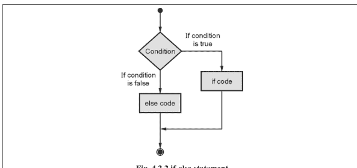

- 5. if..else 语句语法
```csharp
if(Boolean expression)
{
    Body of if
}
else
{
    Body of else
}
```

### 示例
```csharp
// Illustration of if-else statement

using System;
namespace CSharpSelection
{
    class ifelseStatement
    {
        static void Main()
        {
int num1 = 101;
int num2 = 121;
if (num1 > num2)
{
    Console.WriteLine("Inside the if block");
    Console.WriteLine("\nValue of num1 is greater than num2");
}
else
{
    Console.WriteLine("Inside the else block");
    Console.WriteLine("\nValue of num2 is greater than num1");
}

Console.WriteLine("\nOutside the if...else structure");
Console.ReadLine();
}
}
}
```

Input Nil

### 输出
Inside the else block
Value of num2 is greater than num1
Outside the if...else structure

> /* 在上面的程序中 num1 不大于 num2，因此条件为假，因此在这种情况下 else 块将被执行，然后是 if-else 块外部的语句 */

## 3.3. The if...elseif...else statement
### 概念
- 1. 在 C# 中嵌套 if-else 语句始终是合法的，这意味着可以在另一个 if 或 else if 语句内部使用 if 或 else if 语句。

### 说明
- 2. if...elseif...else 语句在用户想要从多个选项中选择一个选项时非常有用。在这种类型的语句中，'if' 后跟一个或多个 elseif 语句，最后以 else 语句结束。
- 3. if...elseif...else 语句语法
```
if(Boolean Expression)
{
Statements
..........
}
else if(Boolean Expression)
{
    Statements
    ........
}
else if(Boolean Expression)
{
    Statements
    ..........
}
.
.
else
{
    Statements
    ..........
}
```

### 示例
```
// Illustration of ifelse-elseif statement
using System;
namespace CSharpSelection
{
    class ifelseifelseStatement
    {
        static void Main()
        {
            int num1 = 15;
            int num2 = 20;
            if (num1 == num2)
            {
                Console.WriteLine("num1 is equal to num2");
            }
            else if (num1 < num2)
            {
                Console.WriteLine("\nnum1  is less than num2");
            }
            else
            {
                Console.WriteLine("\nnum2 is greater than num1");
            }
            Console.ReadLine();
        }
    }
}
```

Input Nil

### 输出
num1 is less than num2

/* 在上面的程序中 num1 的值小于 num2，因此 'else if' 语句括号中的条件为真，这就是为什么 'else if' 的块将被执行。 */

## 3.4 The Nested if statement
### 概念
- 1. 嵌套 if 是一个 'if' 语句，它是另一个 if 或 else 语句的目标。

### 说明
- 2. 当使用 ‘if’ 语句在其他 ‘if’ 或 ‘else if’ 或 ‘else’ 语句内部嵌套 ‘if..else if..else’ 或 ‘if..else’ 或语句时，这被称为嵌套 if 语句。
- 3. 嵌套 if 语句流程图

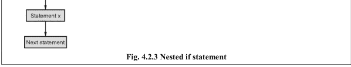

Fig. 4.2.3 嵌套 if 语句

### 4. 嵌套 if 语句语法

### 语法
```
if(Boolean expression)
{
........
if(Boolean expression)
{
..........
}
else
{
.....
}
}
else
{
..........
if(Boolean expression)
{
..........
}
else
{
..........
}
}
```

一个嵌套 if 语句包含各种结构，如 if 内部的 if.else 语句，else 内部的 if 语句等。

### 示例
```
// Illustration of nested if-else statement

using System;
namespace CSharpSelection
{
class nestedifStatement
{
static void Main()
{
int num1 = 110;
int num2 = 112;
int num3 = 115;
if (num3>num1)
{
Console.WriteLine("num3 is greater than num1");
if(num3>num2)
{
    Console.WriteLine("\nnum3 is also greater than num2");
}
Console.ReadLine();
}
```

Input Nil

### 输出
num3 is greater than num1
num3 is also greater than num2

/* 在上面的程序中 num3 的值大于 num1 和 num2。 因此外部 if 语句中的条件即 (num3>num1) 为真，因此外部 if 语句的块将被执行，并且内部 if 语句的条件也为真，因此内部 if 语句的块也将被执行。 */

## 3.5. The switch-case Statement
### 概念
- 1. switch case 语句用于像 if..elseif..else 语句一样从多个表达式中进行选择，但它比 if...elseif..if 语句更好的方法。

### 说明
- 2. Switch 语句在其括号中包含一个表达式，可以是数字、字符或字符串。
- 3. 一个 switch 语句后面跟随多个 case 语句。
- 4. switch 操作符将表达式与 switch 结构体中 case 标签列出的每个值进行比较。如果在 case 标签中找到匹配项，则执行相应的结构（简单或复杂）。如果未找到匹配项，则执行 default 语句（如果存在）。
- 5. Switch-Case 语句流程图

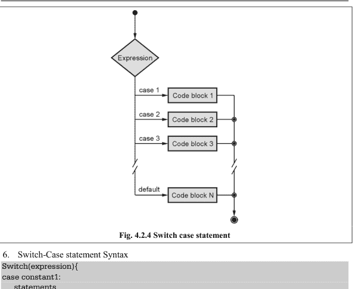

Fig. 4.2.4 Switch case 语句

### 6. Switch-Case 语句语法
```
switch(expression){
case constant1:
    statements
    .......
break;
case constant2:
    statements
    .......
break;
.
.
case constantN:
    statements
    .......
break;
default:
    statements
    .......
break;
}
```

- 7. switch-case 语句的规则
- 7.1. switch 语句括号中的表达式必须是 char、byte、short、int、enum 或 String。浮点值不能作为表达式。
- 7.2. Case 常量必须与 switch 语句的表达式兼容。
- 7.3. 一个 switch 中的 case 常量不能具有相同的值。
- 7.4. 当表达式等于 case 标签时，跟随该 case 的语句将执行直到遇到 break 语句。
- 7.5. Default 是一个可选语句，当表达式与任何 case 标签都不匹配时执行。

### 示例
```csharp
// Illustration of Switch-case statement

using System;
namespace CSharpSelection
{
    class switchcaseStatement
    {
        static void Main()
        {
            int num1 = 2;
            switch (num1)
            {
                case 1:
                    Console.WriteLine("Value of num1 is 1");
                    break;
                case 2:
                    Console.WriteLine("Value of num1 is 2");
                    break;
                case 3:
                    Console.WriteLine("Value of num1 is 3");
                    break;
                case 4:
                    Console.WriteLine("Value of num1 is 4");
                    break;
                default:
                    Console.WriteLine("No match found");
                    break;
            }
            Console.ReadLine();
        }
    }
}
```


输入：无

输出

num1 的值为 2

/* 在上面的程序中，switch case 会将变量的值与不同的 case 进行匹配。它与第二个 case 匹配，因此 case 2 中的语句被执行。 */

## 3.6. 嵌套 switch-case 语句

### 概念
- 1. 当 switch-case 语句用在另一个 switch-case 语句内部时，这被称为嵌套 switch-case 语句。

### 说明
- 2. 嵌套 switch-case 语句的语法

```
switch(expression)//outer switch
{
case constant1:
switch(expression)//inner switch
{
case constant a:
statements
........
break;
case constant b:
statements
........
break;
.
.
case constant z:
statements
........
break;
}
case constant2:
statements
........
break;
.
.
case constant n:
statements
......
break;
}
```

### 示例
```
// Illustration of nested switch-case statement
using System;
namespace CSharpSelection
{
class nestedswitchcaseStatement
{
static void Main()
{
char char1 = 'A';
char char2 = 'C';
switch (char1)
{
case 'A':
Console.WriteLine("It is a outer part of switch with character A");
switch (char2)
{
case 'C':
Console.WriteLine("It is a inner part of switch with character C");
break;
case 'D':
Console.WriteLine("It is a inner part of switch with character D");
break;
}
break;
case 'B':
Console.WriteLine("It is a outer part of switch with character B");
break;
}
Console.ReadLine();
}
}
}
```

输入：无

### 输出
它是 switch 的外层部分，字符为 'A'
它是 switch 的内层部分，字符为 'C'

```
/* In the above program the expression present in outer switch statement matches with the case 'A' so the block of case 'A' will get executed. Inside the case 'A' there is another switch statement whose expression matches with the case 'C' so the block of case 'C' will executed. */
```

## 4.3 迭代语句

### 概念
- 1. 迭代语句使用户能够重复执行同一组语句，直到满足特定条件。

### 说明
- 2. 迭代语句也称为循环语句。
- 3. 在 C# 中，有以下迭代或循环语句，
- 1) while 循环 2) for 循环 3) do-while 循环
- 4) foreach 循环 5) 嵌套循环

## 4.3.1 while 循环

### 概念
- 1. while 循环是一种简单且最常用的循环。

### 说明
- 2. while 循环会重复执行一个语句块，直到指定条件变为假。
- 3. while 循环在进入第一次迭代之前检查条件。
- 4. while 循环流程图

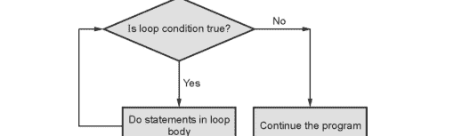

图 4.3.1 while 循环

### 4. while 循环语法

### 语法
```
```csharp
Initialization;
while(condition)
{
    Body of while loop
}
```
```
5. 只要条件为真，while 循环体就会重复执行。当条件变为假时，程序控制权会转移到紧跟在 while 循环之后的语句。

### 示例
```
```csharp
// Illustration of while loop

using System;
namespace CSharpIteration
{
    class whileLoop
    {
        static void Main()
        {
            int cnt = 1;
            while (cnt <= 10)
            {
                Console.WriteLine(cnt);
                Console.WriteLine("");
                cnt++;
            }
            Console.ReadLine();
        }
    }
}
```
```

| 输入：无 | 输出 |
|---|---|
|  | 1 |
|  | 2 |
|  | 3 |
|  | 4 |
|  | 5 |
|  | 6 |
|  | 7 |
|  | 8 |
|  | 9 |
|  | 10 |

## 4.3.2 for 循环

### 概念
- 1. for 循环的功能与 while 循环相似，唯一区别是它的语法与 while 循环不同，这使得对变量进行迭代更加方便。

### 说明
- 2. for 循环会重复执行一个语句块，直到指定条件变为假。
- 3. for 循环适用于那些确切知道需要执行循环体内语句多少次的场景。
- 4. 它也会在进入第一次迭代之前检查条件。
- 5. for 循环流程图


图 4.3.2 for 循环

### 6. for 循环语法
```
for (initialization; condition; increment/decrement)
{
  Body of for loop
}
```

### 7. for 循环的过程
- 1) for 循环中的第一项是 'initialization'，它允许用户初始化循环计数器的值，并且初始化在整个 for 循环过程中最先执行。
- 2) 下一项是 'condition'。如果条件为真，则只有循环体会被执行；如果为假，程序控制权会转移到紧跟在 'for' 循环之后的语句。
- 3) 下一项是 'increment/decrement'，在循环体执行后控制权会来到这里，并且循环计数器会相应更新。
- 4) 重复步骤 2 和 3，直到条件变为假。

### 示例
```
// Illustration of for loop
using System;
namespace CSharpIteration
{
  class forloop
  {
    static void Main()
    {
      for(int cnt=0;cnt<=10;cnt++)
      {
        Console.WriteLine(cnt);
        Console.WriteLine("=");
      }
      Console.ReadLine();
    }
  }
}

Input Nil
```

### 输出
| 输出 |
|---|
| 1 |
| 2 |
| 3 |
| 4 |
| 5 |
| 6 |
| 7 |
| 8 |
| 9 |
| 10 |

## 4.3.3 do-while 循环

### 概念
- 1. do-while 循环是一种迭代循环，类似于 while 循环，但区别在于它在执行循环体之后检查条件。

### 说明
- 2. 无论条件为真还是假，do-while 循环都一定会执行一次。
- 3. **do-while 循环** 流程图


### 4. do-while 循环语法
```
Initialization
do
{
    Body of the do-while loop
}while(condition);
```

### 示例
```
```csharp
// Illustration of do-while loop
using System;
namespace Iteration
{
class dowhileloop
{
static void Main()
{
int i=1;
do
{
Console.WriteLine(i);
Console.WriteLine("");
i++;
}while(i<=10);
Console.ReadLine();
}
}
}
```
```
上述程序的输出将是：

### 输出
```
```
1
2
3
4
5
6
7
8
9
10
/* In do-while loop condition is present at the end so the loop body certainly executes once. When condition becomes false the program flow jumps to the statement just after the do-while loop.*/
```
```

## 4.3.4 foreach 循环

### 概念
- 1. foreach 循环用于迭代数组和集合中存在的元素。

### 说明
- 2. 数组是相同数据类型的值的集合。
- 3. 当希望遍历数组的所有元素时，首选 foreach 循环。
4. foreach 循环流程图

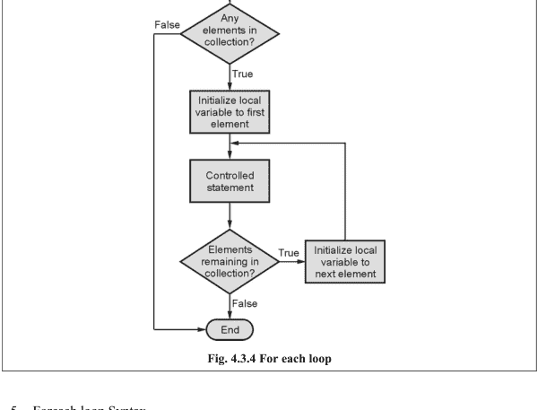

图 4.3.4 foreach 循环

### 5. foreach 循环语法
```
foreach(type variable in expression)
{
Body of foreach loop
}
```
6. 在上述语法语句中，type variable 表示迭代元素，expression 是数组的名称。

### 示例
```
// Illustration of for each loop
using System;
namespace CSharpIteration
{
class foreachloop
{
static void Main()
{
int[] intarr = { 100, 200, 300, 400, 500 };
foreach(int cnt in intarr)
{
Console.WriteLine("" + cnt);
}
Console.ReadLine();
}
}
}
```

输入

### 输出
```
100
200
300
400
500
```

## 4.3.5 嵌套循环

### 概念
- 1. 当一个循环用在另一个循环内部时，这被称为嵌套循环。

### 说明
- 2. 可以在 while 循环内使用 for 循环，在 for 循环内使用 do-while 循环，在 while 循环内使用 while 循环，等等。

### 3. 嵌套循环流程图
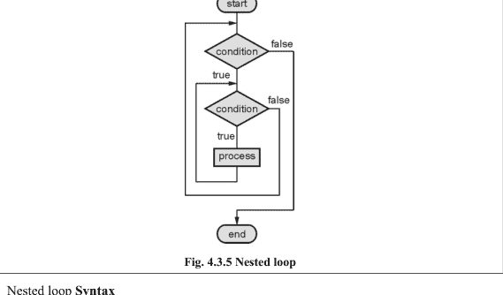

图 4.3.5 嵌套循环

### 4. 嵌套循环语法
```
for(initialization; condition; increment/decrement)
{
    while(condition)
    {
        ....................
        ....................
    }
}
```
5. 根据哪个循环嵌套在另一个循环内部，嵌套循环可以有不同的结构。

### 示例
```
//Illustration of nested loop in which the for loop is used inside a for loop.
using System;
namespace CSharpIteration
{
class nestedloop
{
static void Main()
{
for (int cnt1 = 1; cnt1 <= 3; cnt1 ++)
{


```csharp
Console.WriteLine("\n In Outer loop");
for (int cnt2 = 1; cnt2 <= 3; cnt2++)
{
    Console.WriteLine("\n In inner loop");
}
Console.ReadLine();
}
}
```

输入 nil

输出

```
In Outer loop
In inner loop
In inner loop
In inner loop
In Outer loop
In inner loop
In inner loop
In inner loop
In Outer loop
In inner loop
In inner loop
In inner loop
```

/*在上面的程序中，首先外层循环检查 cnt1=1 的条件，结果为 true，因此程序控制进入外层 for 循环，并打印消息 "In Outer loop"。现在它将进入内层 for 循环，内层循环执行 3 次，并打印消息 "In inner loop" 三次。然后控制再次回到外层 for 循环，再次打印消息 "In Outer loop"，并再次执行内层 for 循环 3 次。此过程将持续进行，直到外层 for 循环的条件变为 false。*/

## 4.4 跳转语句

### 概念

- 1. 跳转语句使用户能够有条件或无条件地跳转到代码的另一部分。

### 说明

- 2. 跳转语句主要用于分支，使程序控制立即转移到代码的另一部分。
- 3. 这些语句也用于需要在处理过程中中断任何循环或 switch-case 语句的地方。
- 4. C# 中有五种跳转语句，如下所示，
  - 1. **break**
  - 2. **continue**
  - 3. **goto**
  - 4. **return**
  - 5. **throw**
- 5. 本节将讨论 break、continue 和 goto 语句。return 语句将在 C# 方法部分讨论，throw 语句将在 C# 异常处理部分讨论。

### 4.4.1 break 语句

#### 概念

- 1. break 语句终止封闭的循环或 switch case 语句，程序控制跳转到紧跟在循环或 switch-case 语句之后的语句。

#### 说明

- 2. break 语句流程图

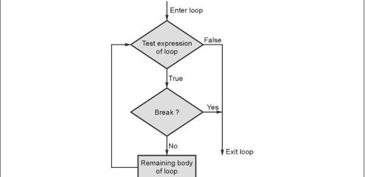

- 3. break 语句语法

```csharp
break;
```

#### 示例

```csharp
// Illustration of break statement in which a loop breaks after second iteration.
using System;
namespace CSharpJump
{
class breakStatement
{
static void Main()
{
int cnt;
for (cnt = 100; cnt <= 105; cnt++)
{
Console.WriteLine("" + cnt);
if (cnt == 102)
{
break;
}
}
Console.ReadLine();
}
}
}
```

输入 nil

输出

```
100
101
```

### 4.4.2 continue 语句

#### 概念

- 1. continue 语句强制程序控制直接转到条件，然后继续下一次迭代。

#### 说明

- 2. continue 语句停止当前迭代并开始下一次迭代。
- 3. continue 语句流程图

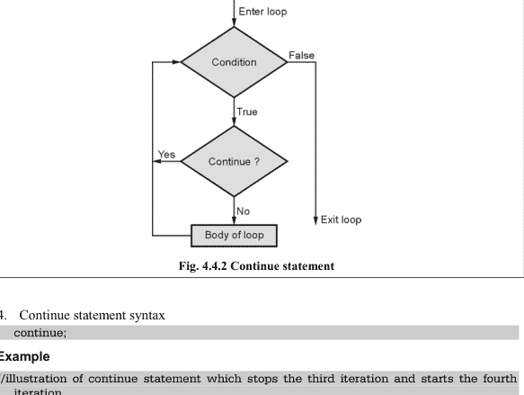

图 4.4.2 continue 语句

- 4. continue 语句语法

```csharp
continue;
```

#### 示例

```csharp
//illustration of continue statement which stops the third iteration and starts the fourth iteration.
using System;
namespace CSharpJump
{
class continuestatement
{
static void Main()
{
int cnt;
for (cnt = 1; cnt <= 5; cnt++)
{
if (cnt == 3)
{
continue;
}
Console.WriteLine("" + cnt);
}
Console.ReadLine();
}
}
}
```

输入 nil

输出

```
1
2
4
5
```

### 4.4.3 goto 语句

#### 概念

- 1. goto 语句用于跳转到由预定义标签指定的特定代码段。

#### 说明

- 2. goto 语句最常用于存在紧急情况且没有可退出循环的条件路径时。
- 3. 它广泛用于嵌套循环中。
- 4. goto 语句流程图

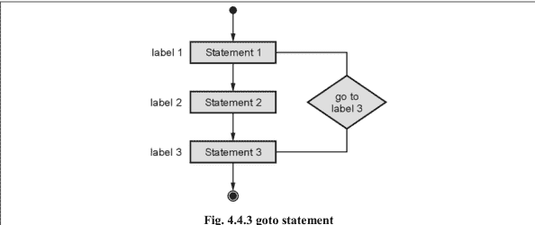

- 5. goto 语句语法

```csharp
goto label;
.........
.........
label:
..........
..........
```

#### 示例

```csharp
// Illustration of goto statement in which control is transferred to the 'stop' label in the fourth iteration of the loop
using System;
namespace CSharpJump
{
class gotostatement
{
    static void Main()
    {
        int cnt;
        for (cnt = 1; cnt <= 5; cnt++)
        {
            Console.WriteLine("" + cnt);
            if (cnt%4 == 0)
            {
                goto stop;
            }
        }

        stop:
        Console.WriteLine("Loop Stops");
        Console.ReadLine();
    }
}
}
```

输入 nil

输出

```
1
2
3
4

Loop Stops
```

## 4.5 其他语句

### 4.5.1 块语句

#### 概念

- 1. 块语句用于将逻辑相关的多个程序段组合在一起。

#### 说明

- 2. 块语句语法

```csharp
{
}
```

#### 示例

```csharp
//illustration of block statement
namespace CSharpStatements
{ //Begin Statement
    class BlockStatement
    { // Begin Statement
        static void Main(string[] args)
        { //Begin Statement
            int num, power;
            num = 5;
            power = num * num;
            Console.WriteLine(power);
            Console.ReadLine();
        } // End Statement
    } // End Statement
} // End Statement
```

输入 nil

输出

25

### 4.5.2 空语句

#### 概念

- 1. 空语句用于通常需要语句但无需执行操作的情况。

#### 说明

- 2. 它只是将控制转移到语句的终点。
- 3. 它便于用于具有空循环体和标签语句的 while 循环。
- 4. 空语句语法

```csharp
{
    ;
}
```

#### 示例

```csharp
//Illustration of empty statement
namespace CSharpStatements
{
    class EmptyStatement
    {
        public bool print()
        {
            Console.WriteLine("India");
            return false;
        }
        static void Main(string[] args)
        {
            int cnt = 0;
            EmptyStatement es = new EmptyStatement();
            while (es.print())
            {
                ;//Empty Statement
            }
            Console.WriteLine("cnt = {0}", cnt);
            Console.ReadLine();
        }
    }
}
```

输入 Nil

输出

```text
India
```

### 4.5.3 using 语句

#### 概念

- 1. using 语句用于在程序中添加一个或多个资源。

#### 说明

- 2. using 语句获取一个或多个资源，执行它们，然后释放对象或资源。
- 3. using 语句用于每个 C# 程序中，以添加所需的命名空间和类的内置集合。它广泛用于通过 C# 进行数据库连接。
- 4. using 语句语法

```csharp
using Mynamespace;
```

#### 示例

```csharp
using System;
using System.Text;

namespace CSharpStatements
{
class Use_using
{
    public void Display()
    {
        Console.WriteLine("Execute Two");
    }
}

class UsingStatement
{
    static void Main(string[] args)
    {
        using (Use_using c = new Use_using())
        {
            Console.WriteLine("Executes One");
            c.Display();
        }
        Console.WriteLine("Execute Three");
        Console.ReadLine();
    }
}
}
```

输入 nil

输出

```
Execute One
Execute Two
Execute Three
```

## 两分题及答案

Q.1 如果要在代码中替换多个 if-else 语句，你会使用哪个语句？

答：在 Visual Basic 中，我们可以使用 Select-Case 语句来替换多个 If-Else 语句。在 C# 中，我们应该使用 Switch-Case 语句来替换多个 If-Else 语句。

Q.2 在 C# 语言中实现多重选择的两种不同方式是什么？

答：if-else 和 switch 是在 C# 中实现多重选择的两种方式。

Q.3 给出以下程序的输出。

```c
#include <stdio.h>
int i;
int main()
{
    if(i);
    else
        printf("Else");
    return 0;
}
```

在上面的程序中，执行了 else 块。由于 i 是全局定义的，它被初始化为默认值 0。由于 if 中的表达式求值为 FALSE，因此执行 Else 块。请注意，空块等价于分号（;）。因此，语句 if (i); 和 if (i) {} 是等价的。

Q.4 在下面的程序中，'C# - is too sharp' 将被打印多少次？

```c
#include <stdio.h>

int main()
{
    int i = 1024;
    for (; i >= 1)
        printf("C# - is too sharp");
    return 0;
}
```

上面的程序将打印该语句 11 次。在 for 循环中，表达式是可选的。


`>>=` 是一个复合运算符。它将值的二进制表示向右移 1 位，并将结果值赋给同一变量。`for` 循环会一直执行，直到变量 `i` 的值降到 0。

## Q.5 以下程序的输出是什么？

**答案：**

```c
#include <stdio.h>
int main()
{
    int i = 3;
    switch (i)
    {
        case 0+1: printf("T");
            break;
        case 1+2: printf("Love");
            break;
        default: printf("India");
    }
    return 0;
}
```

程序输出 'Love'。给定表达式会在各 case 分支中被求值。在计算 1 + 2 = 3 后，控制流转到第二个 case 块。

## 长答题

- Q.1 什么是控制语句？（参见第 4.1 节）
- Q.2 讨论 C# 提供的各种条件检查语句。（参见第 4.1 节）
- Q.3 break 和 continue 的用途是什么？（参见第 4.4 节）
- Q.4 任何循环语句的必要条件是什么？（参见第 4.3 节）
- Q.5 using 语句的用途是什么？（参见第 4.5 节）
- Q.6 编写一个 C# 程序，检查输入的年份是否为闰年。

**AU：** 2018年5月，5分

**答案：**

```csharp
/* Program to check whether the entered year is Leap year or not */
using System;

namespace CheckLeapYear
{
    class Program
    {
        static void Main(string[] args)
        {
            Console.WriteLine("Enter Year :");
            int Year = int.Parse(Console.ReadLine());
            if (((Year % 4 == 0) && (Year % 100 != 0)) || (Year % 400 == 0))
                Console.WriteLine("{0} is a Leap Year.", Year);
            else
                Console.WriteLine("{0} is not a Leap Year.", Year);
            Console.ReadLine();
        }
    }
}
```

### Q.7 编写一个 C# 程序，获取一个数字并按逆序显示该数字。

**AU：** 2018年12月，7分

**答案：**

```csharp
/* C# program to reverse a number */
using System;

namespace ReverseNo
{
    class Program
    {
        static void Main(string[] args)
        {
            Console.WriteLine("Enter a No. to reverse");
            int Number = int.Parse(Console.ReadLine());
            int Reverse = 0;
            while (Number > 0)
            {
                int remainder = Number % 10;
                Reverse = (Reverse * 10) + remainder;
                Number = Number / 10;
            }
            Console.WriteLine("Reverse No. is {0}", Reverse);
            Console.ReadLine();
        }
    }
}
```

### Q.8 编写一个 C# 程序，按字母顺序对姓名列表进行排序。

**AU：** 2018年12月，6分

**答案：**

```csharp
/*
 * C# Program to Sort a List of Names in Alphabetical Order
 */
using System;
using System.Collections.Generic;
using System.Linq;
using System.Text;

namespace ConsoleApplication1
{
    class ProgramSort
    {
        static void Main()
        {
            List<string> names = new List<string>();
            names.Add("Riya");
            names.Add("Bina");
            names.Add("Abha");
            names.Add("Gita");
            names.Add("Tina");
            names.Sort();
            foreach (string s in names)
                Console.WriteLine(s);
            Console.ReadLine();
        }
    }
}
```

## 第一单元

## 第 5 章

## C# 核心 - 第四部分 - 函数与方法

**教学大纲：** C# 核心。

| 节号 | 主题名称 | 页码 |
|---|---|---|
| 5.1 | 方法 | 5 - 2 |
| 5.2 | 静态方法 | 5 - 13 |
| 5.3 | 实例方法 | 5 - 14 |
| 5.4 | 匿名方法 | 5 - 15 |
| 5.5 | 方法重载 | 5 - 16 |
| 5.6 | 隐藏方法、重写方法和密封方法 | 5 - 16 |
| 5.7 | 不安全方法或不安全块 | 5 - 16 |
|  | 带答案的两分题 | 5 - 18 |
|  | 长答题 | 5 - 20 |

### 5.1 方法

**概念**

- 1. 方法是一组/一块语句，它们共同执行一项任务。

**说明**

- 2. 创建类时，字段用于描述类的属性。除了用于描述它的特征外，对象还可以执行操作、赋值和操纵。
- 3. 类执行的动作称为函数或方法。
- 4. 方法允许封装一段代码，并从代码的其他部分调用它。方法只是编写类功能特定细节的一段代码。
- 5. 在一个类中，可以根据需要创建任意数量的方法。
- 6. 每个 C# 程序至少有一个包含名为 `Main` 的方法的类。
- 7. 要使用一个方法，需要：
  - 定义方法，然后
  - 调用方法

### 5.1.1 在 C# 中定义方法

- 1. 定义方法意味着声明其结构的各个元素。
- 2. 在 C# 中定义方法的语法：

```csharp
<visibility/Access Specifier> <Return Type> <Method Name>(Parameter List)
{
    Method Body
}
```

其中，

- **访问说明符** 决定变量或方法从另一个类中的可见性。可见性是可选的。如果未指定，则该方法将是 **private**。
- 如果方法只能由同一类的成员访问，则将其标记为 **private**，或保留不带访问修饰符。
- 如果方法要由该类的成员和同一程序的其他部分访问，但不能在程序外部访问，则用 **internal** 关键字标记。
- 如果方法要由同一类的成员、同一程序的其他部分以及其他程序的其他部分访问，则将其标记为 **public**。
- **返回类型** 是方法返回的值的数据类型。方法可以返回一个值。如果方法不返回任何值，则返回类型为 **void**。
- 方法也可以返回一个表达式，前提是该表达式生成的值符合返回类型。示例如下：

```csharp
class Exercise
{
    double? Operate()
    {
        return 24.55 * 4.16;
    }
}
```

- **方法名** 是唯一标识符，并且区分大小写。它不能与类中声明的任何其他标识符相同。
- **参数列表** 括在圆括号之间，参数用于向方法传递数据和从方法接收数据。参数列表指方法的参数的类型、顺序和数量。参数是可选的；也就是说，一个方法可以不含参数。
- **方法体** 包含完成所需活动所需的指令集。

**示例**

```csharp
/* Following code snippet shows a function *FindMin* that takes two integer values and returns the smaller of the two.
It has public access specifier, so it can be accessed from outside the class using an instance of the class. */
class NumberManipulatorClass
{
    public int FindMin(int num1, int num2)
    {
        /* local variable declaration */
        int result;

        if (num1 < num2)
            result = num1;
        else
            result = num2;

        return result;
    }

    // ...
}
```

### 5.1.2 在 C# 中调用方法

- 1. 使用方法的名称调用方法，如下所示。
- 2. 公共方法可以通过使用该方法所属类的实例从其他类调用。

**示例**

```csharp
//Illustration of method call
using System;

namespace methodsdemo
{
    class NumberManipulatorClass
    {
        static void Main(string[] args)
        {
            /* local variable definition */
            int no1 = 50;
            int no2 = 60;
            int min;
            NumberManipulatorClass obj = new NumberManipulatorClass();

            //calling the FindMin method
            min = obj.FindMin(no1, no2);
            Console.WriteLine("Minimum number is : {0}", min);
            Console.ReadLine();
        }
    }
}
```

输入：无

**输出**

最小值为 50

**示例**

```csharp
//Illustration of class method
using System;

namespace methodsdemo
{
    class NumberManipulatorClass
    {
        public int FindMax(int num1, int num2)
        {
            /* local variable declaration */
            int result;

            if (num1 > num2)
                result = num1;
            else
                result = num2;

            return result;
        }
    }

    class Test
    {
        static void Main(string[] args)
        {
            /* local variable definition */
            int no1 = 50;
            int no2 = 60;
            int max;
            NumberManipulatorClass obj = new NumberManipulatorClass();

            //calling the FindMax method
            max = obj.FindMax(no1, no2);
            Console.WriteLine("Maximum number is : {0}", max);
            Console.ReadLine();
        }
    }
}
```

输入：无

**输出**

最大值为 60

### 5.1.3 向方法传递参数

**概念**

- 1. 调用方法时，可以通过三种方式将参数传递给方法。

**说明**

- 2. 这三种方式如下。
  - 2.1 按值传递参数——此方法将实参的实际值复制到函数的形式参数中。在这种情况下，在函数内部对参数所做的更改不会影响实参。


以下语句用于定义声明值参数的语法。

```
<return type> MethodName ( <data type> variable name )
{
}
```

## 2.2 按引用传递参数

此方法将实参内存位置的引用复制到形参中。这意味着对形参所做的更改会影响实参。

引用参数是对参数内存位置的引用。对于引用参数，不会创建新的存储位置。它将值存储在与传入变量在内存调用中相同的内存位置。

引用参数的声明通过使用 ref 关键字完成。引用参数的示例如下所示，

```
void ShowReference( ref int Id, ref int age )
{
}
```

## 2.3 使用输出参数传递参数

在此方法中，可以将多个值返回给调用方法。

return 语句用于从方法返回值。return 语句只能用于返回单个值。输出参数用于克服此问题。

输出参数类似于引用参数，但它们将数据传出方法。输出参数是对调用方提供的存储位置的引用。要声明输出参数，需在数据类型和变量名之前使用 out 关键字。

输出参数的指定方式如下所示，

```
static void Outsample( out int i )
{
    i=20;
}
```

## 2.4 方法的可变数量参数

方法可以接受可变数量的参数。为此，使用 params 关键字。params 关键字之后不允许有其他参数。

方法声明中只允许使用一个 params 关键字。

### 示例

```csharp
//illustration of variable number of arguments
/* GetSum() method is called twice. In first call , it takes 3 arguments, in the second call 5.
static void GetSum(params int[] list)
{
...
}
The GetSum() method can take variable number of integer values. All values are added to
    the list array.  */
using System;
public class SumValues
{
    static void Main()
    {
        GetSum(10, 20, 30);
        GetSum(10, 20, 30, 40, 50);
    }

    static void GetSum(params int[] numlist)
    {
        Console.WriteLine("There are {0} numbers", numlist.Length);

        int sum = 0;
        foreach (int cnt in numlist)
        {
            sum = sum + cnt;
        }

        Console.WriteLine("Sum is {0}", sum);
    }
}
```

输入：无

### 输出

有 3 个数字
它们的和为 60
有 5 个数字
它们的和为 150

## 7.4 递归方法调用

### 概念

- 1. 方法可以调用自身。这称为**递归**。

### 解释

- 2. 在数学和计算机科学中，递归是一种定义方法的方式，其中正在定义的方法在其自身定义中被应用。
- 3. 换句话说，递归方法通过调用自身来完成其工作。
- 4. 递归是解决许多编程任务的广泛使用的方法。

### 示例

```
// Illustration of recursion that calculates factorial of a given number.
using System;

namespace
{
class NumberManipulatorClass
{
public int factorial(int num)
{
/* local variable declaration */
int result;
if (num == 1)
{
return 1;
}
else
{
result = factorial(num - 1) * num;
return result;
}
}

static void Main(string[] args)
{
NumberManipulator n = new NumberManipulator();
//calling the factorial method
Console.WriteLine("Factorial of 6 is: {0}", n.factorial(6));
Console.WriteLine("Factorial of 7 is: {0}", n.factorial(7));
Console.WriteLine("Factorial of 8 is: {0}", n.factorial(8));
Console.ReadLine();
}
}
}
```

编译并执行上述代码后，将产生以下结果：

```
Factorial of 6 is: 720
Factorial of 7 is: 5040
Factorial of 8 is: 40320
```

## 7.5 方法命名（方法命名规范）

7.5.1. 方法名称主要遵循为变量名称定义的规则。
参见（第 2 章 - 第 2.6 节）

7.5.2. 除这些规则外，以下是关于方法命名的一些建议。

- 2.1 如果方法名称是一个单词，则首字母应大写
- 2.2 如果方法名称是多个单词的组合，则每个单词的首字母应大写
- 2.3 因为方法是一个动作，所以方法名称通常应为动词。

7.5.3 方法名称是动词，或动词后跟形容词或名词。每个后续单词都以大写字符开头。以下是 C# 中典型的方法名称：

- Execute
- FindRollNo
- SetName
- GetName
- CheckIfValid

## 8. Main - 主方法（public static void Main(String[] args)）

8.1 C# 类中至少有一个名为 main 的方法，程序执行从那里开始。它是程序的主入口点，负责执行所有对象并调用方法以执行。C# 中只能有一个 Main 方法。

8.2 Main() 方法的默认实现为 void 类型。实现 Main() 方法的另一种方式是使其返回整数。规则与任何 int 类型的方法相同。只要它是有效的整数，Main() 函数可以返回任何整数类型。

8.3 C# 中的 Main 方法始终声明为 static，因为它必须在创建任何对象之前或调用程序中任何其他方法之前被调用。Main 方法会实例化其他对象和变量，但在 C# 中没有任何方法可以实例化 main 方法。另一方面，main 方法不接受来自任何其他方法的参数。它仅通过命令行参数接收参数作为实参。

8.4 Main 方法可以有一个参数，这些参数称为从零开始索引的命令行参数。

## 9. 方法作用域

### 概念

- 1. 在方法内部声明的变量具有方法作用域。

### 解释

- 2. 名称的作用域是程序文本中的一个区域，在该区域内可以在不限定名称的情况下引用由该名称声明的实体。
- 3. 在方法内部声明的变量具有方法作用域。它也称为局部作用域。
- 4. 该变量仅在此特定方法中有效。

### 示例

```csharp
//Illustration of understanding method scope

using System;

public class DemoMethodScope
{
    int no = 1;

    public void exec1()
    {
        // no is class level variable and accessed using this reference
        // no is a instance variable

        Console.WriteLine(this.no);
        Console.WriteLine(no);
    }

    public void exec2()
    {
        int num = 5;

        Console.WriteLine(no); // variable no has class level scope.
        Console.WriteLine(num); // variable num has scope method exec2.
    }
}

public class TestMethodScope
{
    static void Main()
    {
        DemoMethodScope DMS = new DemoMethodScope();
    }
}
DMS.exec1();
DMS.exec2();
}
```

输入：无

### 输出

```
1
1
1
5
```

5. 在方法内部定义的变量具有局部/方法作用域。如果局部变量与实例变量同名，则它会遮蔽实例变量。在方法内部仍可通过使用“this”关键字访问类变量。

### 示例

```
//Illustration of use of this to resolve scope
using System;

public class TestScope
{
    int n = 100;

    public void exec()
    {
        int n = 300;

        Console.WriteLine(this.n);
        Console.WriteLine(n);
    }
}

public class DemoShadowing
{
    static void Main()
    {
        TestScope ts = new TestScope();
        ts.exec();
    }
}
```

在前面的示例中，变量 n 被声明了两次：一次在 exec() 方法外部，一次在 exec() 方法内部。两个变量具有相同的名称，但它们不会冲突，因为它们位于不同的作用域中。

```
Console.WriteLine(this.n);
Console.WriteLine(n);
```

这些变量的访问方式不同。在方法内部定义的变量 n（也称为局部变量）只需通过其名称访问。实例变量可以通过使用 this 关键字来引用。

输入：无

### 输出

100
300

## 10. this 引用

- 10.1 this 关键字用于引用类的当前实例。
- 10.2 它可用于从构造函数和实例方法内部访问成员。
- 10.3 使用 this 引用可以消除命名冲突。它不能用作对静态字段或方法的引用，也不能是静态类的一部分。

```
// Illustration of use of this reference.
class UseThis
{
    int no;
    public UseThis()
    {
        this.Decrease();
    }
    public void Decrease()
    {
        no--;
        this.no--;
        Console.WriteLine("The value of number is" + no);
    }
    static void Main (string [] args)
    {
        UseThis obj = new UseThis();
        obj.Decrease();
        Console.Read();
    }
}
```

输入：无

### 输出

-2  -4


## 5.1 使用方法的优点

- 1. 减少代码重复。
- 2. 将复杂问题分解为更简单的部分，从而为程序带来模块化。
- 3. 提高代码的清晰度。
- 4. 代码复用。
- 5. 信息隐藏。
- 6. 代码隔离，有助于轻松追踪错误和调试。

## 5.2 静态方法

### 概念

- 1. 静态方法直接从类级别调用，无需创建对象。静态方法在调用时不需要对象实例。

### 解释

- 2. 静态方法没有实例。它们通过类型名调用，而不是通过标识符调用。它们可以是 public 或 private。要调用静态方法，请使用类名和点运算符。
- 3. 静态方法只能使用静态成员变量。
- 4. 静态方法常用于表示不随对象状态变化的数据或计算。一个例子是数学库，其中包含用于各种计算的静态方法。
- 5. 关键字 'static' 用于声明静态方法。当不存在 static 修饰符时，该方法称为实例方法。
- 6. 不能在静态方法中使用 this 关键字。它只能在实例方法中使用。
- 8. Main() 方法是 C# 控制台和 GUI 应用程序的入口点。在 C# 中，Main() 方法必须是静态的。在应用程序启动之前，尚未创建任何对象。
- 9. 要调用非静态方法，需要有一个对象实例。静态方法在类实例化之前就存在，因此 static 被应用于主入口点。

### 示例

```csharp
//Illustration of keyword static
/* Note
A static method can only work with static variables.
Show() is static method. It works with a static member n.
Basic.Show(); //To invoke a static method, there is no need of object instance. Method is called by using the name of the class and the dot operator.
*/

using System;

public class StaticDemo
{
    static int n = 657;

    public static void Show()
    {
        Console.WriteLine("The number is: {0}", n);
    }
}

public class StaticMethod
{
    static void Main()
    {
        StaticDemo.Show();
    }
}
```

输入：无

### 输出

该数字是 657。

## 5.3 实例方法

### 概念

- 1. 类中的实例方法使用属于该类的 public、private 或 static 数据。

### 解释

- 2. 用户可以使用类的对象访问方法。在声明中，将方法名放在点运算符之前。

### 示例

```csharp
// Illustration of Instance methods.
class InstanceDemo
{
    void method1()
    {
        Console.WriteLine("First Instance method.");
    }
    void method2()
    {
        Console.WriteLine("Second Instance method.");
    }
    static void Main(string[] args)
    {
        InstanceDemo obj = new InstanceDemo();
        obj.method1();
        obj.method2();
        Console.Read();
    }
}
```

输入：无

### 输出

| 输出 |
|---|
| 第一个实例方法。 |
| 第二个实例方法。 |

## 5.4 匿名方法

### 概念

- 1. 匿名方法是内联方法，没有名称。
- 2. 匿名方法通过消除创建单独方法的需要来减少编码开销。
- 3. 如果没有匿名方法，开发人员常常不得不创建类的实例，仅仅为了调用一个方法。

### 解释

### 示例

```csharp
//Illustration of anonymous method
using System;
using System.Timers;

public class AnonymousMethod
{
    static void Main()
    {
        Timer objtimer = new Timer();

        /*A Timer class generates recurring events in an application.*/
        objtimer.Elapsed += new ElapsedEventHandler(
            delegate(object source, ElapsedEventArgs e)
            {
                Console.WriteLine("Event triggered at {0}", e.SignalTime);
            }
        );
        objtimer.Interval = 2000;// timer object is created every 2 seconds
        objtimer.Enabled = true;

        Console.ReadLine();
    }
}
```

输入：无

### 输出

事件在 (?????) 触发 [实际输出将取决于系统时间。]

## 5.5 方法重载

这个概念将在第 8 章学习。参见 8.2 节。

## 5.6 隐藏方法、重写方法和密封方法

这些概念将在第 8 章和第 9 章学习。

密封方法参见 8.1 节。

重写参见 9.3 节。

方法隐藏参见 9.4 节。

AU: May-19

## 5.7 不安全方法或不安全块

- 1. 不安全代码是已进行指针操作的代码。
- 2. **C# 中不安全代码的优点**
  - 1. 性能和灵活性得到增强，因为使用指针可以以尽可能高效的方式访问和操作数据。
  - 2. 兼容性是使用指针的主要原因，因为旧的 Windows API 广泛使用指针。许多第三方 DLL 可能通过指针参数提供其功能。（尽管在 DLL 使用中可以通过编写 DllImport 声明来避免指针。）
  - 3. 如果需要访问内存地址，那么不使用指针就无法知道某些数据的内存地址。
- 3. **C# 中不安全代码的缺点**
  - 1. 指针的语法复杂。
  - 2. 从逻辑上讲，指针更难使用。如果使用方式或步骤不当，可能会导致糟糕的情况，例如：
    - 覆盖其他变量。
    - 栈溢出。
    - 访问那些并不包含任何数据的内存区域，却把它们当作包含数据来访问。
    - 覆盖 .NET 运行时所用代码的某些信息，这必然会导致应用程序崩溃。
  - 3. 包含指针的代码很难调试，因为它可能突然崩溃。
  - 4. .NET 支持类型安全，而使用指针会破坏类型安全。这也可能导致代码无法执行。
- 4. **不安全代码的特征**
  - 1. 方法、类型和代码块可以定义为不安全。
  - 2. 在某些情况下，不安全代码可以通过移除数组边界检查来提高应用程序的性能。
  - 3. 当调用需要指针的本机函数时，必须使用不安全代码。
  - 4. 要让 C# 编译不安全代码，应用程序必须使用 /unsafe 进行编译。

### 示例

```csharp
//illustration of unsafe method
using System;

class Book {
    public static void Main() {
        findBook();
    }
}

public static unsafe void testFun() {
    int bkID = 25;
    int* ptrbkID = &bkID;
    Console.WriteLine("Book is " + bkID);
    Console.WriteLine("Book Memory Address is " + (int) ptrbkID );
}
```

```csharp
//illustration of unsafe block
using System;

class Number {
    public static void Main() {
        ChangeVal Obj = new ChangeVal();
        unsafe {
            int no1 = 125;
            int no2 = 235;
            Console.WriteLine("Before swap = number1" + no1 + " number2= " + no2);
            Obj.swapVal(&no1, &no2);
            Console.WriteLine("After swap = number1" + no1 + " number2= " + no2);
        }
    }
}
class ChangeVal {
    public unsafe void swapVal(int* ptr1, int* ptr2) {
        int tmp = *ptr1;
        *ptr1 = *ptr2;
        *ptr2 = tmp;
    }
}
```

## 两分题及答案

**Q.1 public、static 和 void 有什么区别？**

**答：** 用 public 声明的变量或方法可在应用程序中的任何位置访问。用 static 声明的变量或方法无需创建类的实例即可全局访问。静态成员默认并非全局可访问；这取决于所使用的访问修饰符类型。编译器将该方法的地址存储为入口点，并在创建任何对象之前使用此信息开始执行。而 void 是一种类型修饰符，表示该方法或变量不返回任何值。

**Q.2 什么是内联函数？**

**答：** 内联函数是编译器使用的一种技术，它指示将函数的完整主体插入到程序源代码中使用该函数的每个位置。

**Q.3 重载和重写的主要区别是什么？**

**答：** 重载是静态绑定，而重写是动态绑定。重载不过是同一方法使用不同参数，并且在同一个类中它可能返回也可能不返回相同的值。


重写是指在类和其子类中，具有相同方法名、相同参数和返回类型的方法。

## Q.4 什么是访问修饰符？
答：访问修饰符决定方法或变量可被其他各种对象或类访问的范围。访问修饰符有五种类型，如下所示：
- 私有
- 受保护
- 公共
- 友元
- 受保护的友元

## Q.5 在 C# 中能否从函数返回多个值？
答：在 C# 中，可以使用输出参数从函数返回多个值。return 语句只能用于从函数返回一个值。但是，使用输出参数，你可以从函数返回两个值。

## Q.6 编写一个 C# 程序，使用预定义函数查找交错数组的长度。
AU：2018 年 5 月，8 分

答：

```
/*
 * C# Program to Find the Length of the Jagged Array using Predefined Functions
 */
using System;
class Program
{
    public static void Main()
    {
        byte[][] numbers = new byte[5][];
        for (int i = 0; i < numbers.Length; i++)
        {
            numbers[i] = new byte[i + 3];
        }
        for (int i = 0; i < numbers.Length; i++)
        {
            Console.WriteLine("Length of row {0} is {1}", i, numbers[i].Length);
        }
        Console.Read();
    }
}
```

## 长答题
- Q.1 C# 中的静态方法是什么？（参见第 5.2 节）
- Q.2 讨论 C# 中的匿名方法。（参见第 5.4 节）
- Q.3 写一篇关于“方法重写”的笔记。（参见第 5.6 节）
- Q.4 讨论方法隐藏。（参见第 5.1 节）
- Q.5 C# 中的密封方法是什么？（参见第 5.6 节）
- Q.6 区分类的静态成员和非静态成员。AU：2018 年 12 月

**答：** 静态方法属于类，而非静态方法属于类的对象。静态方法可以直接从类访问，而非静态方法（或实例方法）必须从实例访问。

- 静态方法由类的所有实例共享。每当在 C++/Java/C# 中调用方法时，都会连同其他参数一起传递（或不传递其他参数）一个隐式参数“this”引用。在静态方法调用的情况下，不会传递“this”引用，因为静态方法属于类，因此没有“this”引用。
- 非静态方法只能在它所属类的对象上调用。静态方法只能访问静态成员。非静态方法可以访问静态成员和非静态成员，因为在调用静态方法时，类可能尚未实例化（如果是在类自身上调用它）。在另一种情况下，非静态方法只能在类已经实例化时调用。
- 类的对象不能拥有这些字段的副本。这些字段通过类名引用。示例：Employee.company。无需创建类的实例，即可访问这些字段。
- **C# 中的静态变量和非静态变量 -** 每当使用 static 修饰符声明变量，或在任何静态块内声明变量时，这些变量被视为静态变量，而其余变量被视为非静态变量。
- 如果希望某个变量在类的所有实例中都具有相同的值，则需要将该变量声明为静态变量。因此，静态变量将保存应用程序级数据，这些数据对所有对象都相同。
- 非静态字段由类的所有对象访问。每个对象都有一个非静态字段的副本。要使用非静态字段，应创建类的实例。
- **C# 中的静态构造函数和非静态构造函数 -** 如果构造函数通过 static 修饰符显式编写，则称为静态构造函数，其余构造函数称为非静态构造函数。需要记住的最重要一点是，静态构造函数是类中首先执行的代码块。无论为该类创建多少个对象，静态构造函数都只执行一次。另一方面，非静态构造函数仅在创建类的对象时执行，而且对于类的每个对象都会执行。

- 无法创建带参数的静态构造函数。这是因为静态构造函数是类中将要执行的第一个代码块。而且此静态构造函数是隐式调用的，即使带参数，也没有机会发送参数值。
- 理解 C# 中的静态类 - 使用 static 修饰符创建的类称为静态类。静态类中只能包含静态成员。无法创建静态类的实例。这是因为它只包含静态成员，而这些静态成员可以由类中的其他静态成员使用类名访问。

Q.7 解释虚方法和重写。（参见第 5.6 节）

AU：2019 年 5 月，13 分

## 笔记

## 第一单元

## 第 6 章

## C# - 数组、字符串、StringBuilder 和元组

**教学大纲：** 数组和元组。

| 章节号 | 主题名称 | 页码 |
|---|---|---|
| 6.1 | C# 数组 | 6 - 2 |
| 6.2 | Array 类 | 6 - 12 |
| 6.3 | ArrayList 类 | 6 - 18 |
| 6.4 | String 类 | 6 - 20 |
| 6.5 | StringBuilder 类 | 6 - 26 |
| 6.6 | 元组 | 6 - 28 |
|  | 两分题及答案 | 6 - 33 |
|  | 长答题 | 6 - 35 |

## 6.1 C# 数组

### 6.1.1 概念

数组是相同数据类型的数据元素或值的集合。

### 说明

- 1. 在 C# 中，数组是引用类型。
- 2. C# 中的每个数组都是一个对象。
- 3. 每个数组都继承自 System.Array 类。
- 4. 数组中存在的各个值称为数组元素。
- 5. 单个数组元素通过数组名和表示元素在数组中位置的索引号来访问。
- 6. 数组的内存分配——数组由连续的内存位置组成。较低地址的内存位置表示第一个元素，最高地址的内存位置表示最后一个元素。如下图所示。

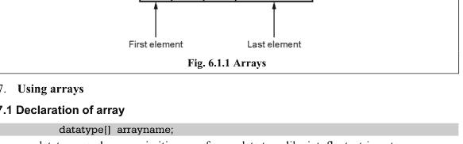

图 6.1.1 数组

7. 使用数组

### 7.1 数组的声明

```
datatype[] arrayname;
```

- datatype 可以是任何基元数据类型或引用数据类型，如 int、float、string 等。
- [] 表示数组的大小。
- arrayname 是赋予数组的名称。
- 数组声明示例

```
int[] marks[5];
string name[3];
float area[2];
```

### 7.2 创建数组

- 仅声明数组不足以使用数组。需要在程序中使用数组时创建数组。
- 创建数组时使用 ‘new’ 关键字，通过它为数组元素分配实际内存。
- 数组创建语法

```
datatype[] arrayname = new datatype[size]
```

这里的 Size 表示数组的大小。

- 数组创建示例

```
int [] marks= new int[5];
float[] area=new float[4];
char[] name=new char[60];
```

### 7.3 初始化并向数组元素赋值

- 在使用数组之前，需要为数组元素赋值。
- 可以使用数组元素的索引号为其赋值。

```
string[] days =new string[7];
days[0]="Monday";
```

- 可以在声明或创建数组时为数组元素赋值。

```
int[] number=new int[3] {1,2,3};//at creation time
float area={2.45,56.88};//at declaration time
int distance=new int[]{10,20,30};//without giving size

string[] array = new string[2]; // creates array of length 2, default values
string[] array = new string[] { "A", "B" }; // creates populated array of length 2
string[] array = { "A", "B" }; // creates populated array of length 2
```

### 7.4 遍历并访问数组中存储的元素

- 通过方括号中写入数组名和要访问元素的索引来访问数组元素。
- 默认情况下，C# 中的数组索引值从 0 开始。
- 要访问名为 days 的数组第二个元素中存储的值（该值存储在索引值 1 处），使用以下语句：

```
string[] days=new
string[7]{"Monday","Tuesday","Wednesday","Thursday","Friday","Saturday","Sunday"};
string today;
today=days[1];
```


这里，“Tuesday” 将存储在字符串类型变量 'today' 中。

### 示例

```csharp
// Illustration of array
using System;
namespace arrayconcept
{
    class Usingarray
    {
        static void Main()
        {
            int[] numbers; //declaration of array
            numbers = new int[6] { 100, 200, 300, 400, 500, 600 }; //creation and initialization of array
            Console.WriteLine("Numbers in the Array");
            for (int cnt = 0; cnt < 6; cnt++)
            {
                Console.WriteLine("\nNumber Element {0} of array = {1}", cnt + 1, numbers[cnt]);
                //accessing the array elements
            }
            Console.ReadLine();
        }
    }
}
```

输入 无

### 输出

数组中的数字
数组的第 1 个元素 = 100
数组的第 2 个元素 = 200
数组的第 3 个元素 = 300
数组的第 4 个元素 = 400
数组的第 5 个元素 = 500
数组的第 6 个元素 = 600

## 7.5 使用 foreach 循环访问数组元素

- foreach 循环语句可用于遍历数组。

### 示例

```csharp
//illustration of foreach loop for Array
using System;
namespace arrayconcept
{
    class ArrayUsingForEach
    {
        static void Main(string[] args)
        {
            int[] numbers = new int[5]; /*numbers is an array of 5 integers */
            /* initialization of array elements */
            for (int cnt = 0; cnt < 5; cnt++)
            {
                numbers[cnt] = cnt + 50;
            }

            int num;
            /* print each array element */
            Console.WriteLine("Array Elements ");
            foreach (num in numbers)
            {
                Console.WriteLine("{0}", num);
            }
            Console.WriteLine();
        }
    }
}
```

输入 无

### 输出

数组元素
50
51
52
53
54

## 6.1.2 数组类型

### 6.1.2.1 概念

在 C# 中有四种数组类型，如下所述。

| 数组类型 | 描述 |
|---|---|
| 一维数组 | 一个只包含一个维度的简单数组称为一维数组。 |
| 多维数组 | 包含一个以上维度的数组称为多维数组。多维数组最简单的形式是‘二维数组’。 |
| 锯齿数组 | Jagged array 是 "array of array"。 |
| 参数数组 | Param array 用于向方法传递未知数量的参数 |

### 6.1.2.2 一维数组

**概念**

仅包含一个维度（1 行）的数组称为一维数组。

**解释**

一维数组声明

```csharp
datatype[] arrayname
```

### 6.1.2.3 多维数组

**概念**

包含一个以上维度（多行多列）的数组称为多维数组。

**解释**

- 1. 在编程中，二维数组被广泛使用，它是多维数组最简单的形式。
- 2. 多维数组声明
- 3. 示例
- 4. 二维数组

```csharp
datatype[,] arrayname;//two-dimensional array
datatype[,,] arrayname;//three-dimensional array
```

```csharp
int[,] distances;// two dimensional array
string[,,] names;//three dimensional array
```

**概念**

二维数组是多维数组最简单的形式。具有两个维度（解释为 1 行和 1 列）的数组称为二维数组。

**解释**

- 3. 以下是大小为 (4*3) 的二维数组，表示 4 行 3 列的矩阵，其元素表示如下，

|  | 列0 | 列1 | 列2 | 列3 |  |
|---|---|---|---|---|---|
|  | Arr[0][0]=1 | Arr[0][1]=4 | Arr[0][2]=9 | Arr[0][3]=5 | 行0 |
|  | Arr[1][0]=4 | Arr[1][1]=4 | Arr[1][2]=1 | Arr[1][3]=2 | 行1 |
|  | Arr[2][0]=6 | Arr[2][1]=3 | Arr[2][2]=7 | Arr[2][3] | 行2 |

- 4. 二维数组中的每个元素表示为 arrayname[rowno][colno]。这里 rowno 和 colno 分别表示行和列的值。

- 5. 二维数组的初始化 :
  - 二维数组的初始化方式与一维数组相同，如下所示。

```csharp
int[,] matrix =
{
    {101, 102, 103, 104}, //row1 elements
    {105, 106, 107, 108}, //row2 elements
    {109, 110, 111, 112}  //row3 elements
};
//It is matrix of 3 rows and 4 columns
```

- 6. 访问二维数组的元素 :
  - 二维数组元素可以通过使用数组名称及其两个索引号、行索引和列索引来访问，如下所示。

位于第 2 行第 3 列位置存储的元素访问方式为 `matrix[1, 2]`

### 示例

```csharp
//illustration of 2-D array
using System;
namespace arrayconcept
{
    class Twodimensionalarray
    {
        static void Main()
        {
            int[,] squarematrix = new int[3, 3] { { 1, 2, 3 }, { 4, 5, 6 }, { 7, 8, 9 } };
            //initialization of two dimensional array
            int row, col;
            for (row = 0; row < 3; row++)
            {
                for (col = 0; col < 3; col++)
                {
                    Console.WriteLine("\n squarematrix[{0},{1}] = {2}",
                        row, col, squarematrix[row, col]); //accessing 2-D array elements
                }

                Console.ReadLine();
            }
        }
    }
}
```

输入 无

### 输出

squarematrix[0,0] =1
squarematrix[0,1] =2
squarematrix[0,2] =3
squarematrix[1,0] =4
squarematrix[1,1] =5
squarematrix[1,2] =6
squarematrix[2,0] =7
squarematrix[2,1] =8
squarematrix[2,2] =9

### 6.1.2.4 锯齿数组

**概念**

- 1. 在 C# 中，Jagged array 是一种数组的数组，其中 jagged array 的每一行包含自己的数组，并且每个数组的长度可以不同。

**解释**

- 2. Jagged array 声明

```csharp
int[][] jaggedArray;
jaggedArray = new int[3][];
jaggedArray[0] = new int[4];
jaggedArray[1] = new int[2];
jaggedArray[2] = new int[5];
```

上述示例中 jaggedArray 包含 3 个数组，其中第一个数组有 4 个元素，第二个数组有 2 个元素，第三个数组有 5 个元素。

- 3. Jagged array 初始化

使用 jagged array 之前必须按如下方式初始化，

```csharp
int[][] JaggedArray = new int[3][]
{
    new int[] {2, 3, 5, 7},
    new int[] {4, 9},
    new int[] {1, 3, 5, 7, 9}
};
```

- 4. 访问 jagged array 的元素

jagged array 的元素使用数组名称及其索引按如下方式访问。

```csharp
JaggedArray[row][col];
```

### 示例

```csharp
//illustration of jagged array
using System;
namespace arrayconcept
{
    class jaggedarrays
    {
        static void Main()
        {
            // jagged array with 3 rows.
            int[][] jaggedNumbers = new int[3][];

            // Create a new array in the jagged array, and assign values to it.
            //set row 1
            jaggedNumbers[0] = new int[2];
            jaggedNumbers[0][0] = 1;
            jaggedNumbers[0][1] = 2;

            // set row 2, initialized to zero.
            jaggedNumbers[1] = new int[1];
            jaggedNumbers[1][0] = 3;

            // Set row 3, using array initializer.
            jaggedNumbers[2] = new int[] { 4, 5, 6 };

            // Access elements and Print all elements in the jagged array.
            for (int row = 0; row < jaggedNumbers.Length; row++)
            {
                int[] innerArray = jaggedNumbers[row]; //copying array reference
                Console.WriteLine("Inner Array {0} Elements ", row + 1);
                for (int index = 0; index < innerArray.Length; index++)
                {
                    Console.Write(innerArray[index] + " ");
                }
                Console.WriteLine();
            }
        }
    }
}
```

输入 无

### 输出

```csharp
Inner Array 1 Elements 1 2
Inner Array 2 Elements 3
Inner Array 3 Elements 4 5 6
```

### 6.1.2.5 参数数组

**概念**

在处理方法时，如果不确定方法的参数数量，则可以有效地使用 Param array。

**解释**

Param array 用于向方法传递未知数量的参数。

### 示例

```csharp
//illustration of param array
using System;
namespace arrayConcept
{
    class Paramarray
    {
        static int multiply(params int[] numbers)
        {
            int product = 1;
            foreach (int n in numbers)
            {
                product = product * n;
            }
            return product;
        }

        static void Main(string[] args)
        {
            int product;
            // passing 3 parameters
            product = Paramarray.multiply(2, 6, 8);
            Console.WriteLine("multiplication of 2,6,8 is {0}", product);

            // passing 5 parameters
            product = Paramarray.multiply(2, 4, 6, 8, 10);
            Console.WriteLine("Multiplication of 2,4,6,8,10 is {0}", product);
            Console.ReadLine();
        }
    }
}
```

输入 无

### 输出

2、6、8 的乘法结果是 96.
2、4、6、8、10 的乘法结果是 3840

## 6.1.3 将数组作为参数传递

**概念**

数组可以在 C# 中像其他参数一样传递给方法。

### 示例

```csharp
//illustration of array passed as parameter to a method
using System;
namespace arrayconcept
{
    class PassingarrayAsParameter
    {
        static void averagearrayelement(int[] avgarray)
        {
            int cnt, sum = 0;
            for (cnt = 0; cnt < 4; cnt++)
            {
                sum = sum + avgarray[cnt];
            }
            Console.WriteLine("Average of elements of array is {0}", sum / (avgarray.Length));
        }

        static void Main(string[] args)
        {
            int[] numbers = new int[4] { 11, 22, 33, 44 };
            //Passing array as parameter
            PassingarrayAsParameter.averagearrayelement(numbers);
            Console.ReadLine();
        }
    }
}
```

输入 无


### 输出

数组元素的平均值为 27.5

## 6.2 Array 类

### 概念

在 C# 中，数组被视为对象，并继承自 Array 类。Array 类定义在 System 命名空间中。

### 说明

- 1. Array 类的各种属性如下所示。

| 属性 | 描述 | 基本语法 |
|---|---|---|
| Length | 返回数组的长度。它返回一个 32 位整数值。 | Arrayname.Length |
| LongLength | 返回数组的长度。它返回一个 64 位整数值。 | Arrayname.LongLength |
| Rank | 返回数组的秩或维数。它返回一个整数值。 | Arrayname.Rank |
| IsFixedSize | 检查数组是否具有固定大小。它返回一个布尔值。 | Arrayname.IsFixedSize |
| IsReadOnly | 检查数组是否只读。它返回一个布尔值。 | Arrayname.IsReadOnly |

### 示例

```csharp
// illustration of class Array and its properties
namespace arrayconcept
{
    class Arrayclassproperties
    {
        static void Main(string[] args)
        {
            int[] numbers = new int[9] { 11, 22, 33, 44, 55, 66, 77, 88, 99 };
            int arraylength, rank;
            long longlength;
            bool fixedsize, isarrayreadonly;

            arraylength = numbers.Length;
            Console.WriteLine("Length of array is {0}", arraylength);
            longlength = numbers.LongLength;
            Console.WriteLine("LongLength of array is {0}", longlength);
            rank = numbers.Rank;
            Console.WriteLine("Rank of array is {0}", rank);
            fixedsize = numbers.IsFixedSize;
            if (fixedsize)
                Console.WriteLine("Array has fixed size ");
            else
                Console.WriteLine("Array has No fixed size ");

            isarrayreadonly = numbers.IsReadOnly;
            if (isarrayreadonly)
                Console.WriteLine("Array is readonly");
            else
                Console.WriteLine("Array is NOT readonly");

            Console.ReadLine();
        }
    }
}
```

输入 nil

### 输出

```text
Length of array is 9
LongLength of array is 9
Rank of array is 1
Array has fixed size
Array is NOT readonly
```

### 2. Array 类方法

Array 类的常用方法如下表所示。

| Array 类方法 | 描述 |
|---|---|
| Clear | 将 Array 中的一系列元素设置为零、false 或 Nothing，具体取决于元素类型。 |
| Copy | 从第一个元素开始复制一个 Array 中一系列元素，并将它们粘贴到另一个 Array 中从第一个元素开始的位置。 |
| GetLength | 获取数组中存在的元素数。 |
| GetLowerBound | 获取 Array 中指定维度的下界。 |
| GetUpperBound | 获取 Array 中指定维度的上界。 |
| IndexOf | 搜索指定的对象，并返回整个一维 Array 中第一个匹配项的索引。 |
| Reverse | 反转数组中元素的顺序。 |
| Sort | 对数组进行排序。 |

### 示例

```csharp
// Illustration of methods of class Array.

using System;

namespace arrayconcept
{
    class Arrayclassmethods
    {
        static void Main(string[] args)
        {
            int[] numbers1 = new int[5] { 15, 12, 13, 11, 16 };
            int[] numbers2 = new int[3];
            int cnt;
            int length, lowerbound, upperbound;

            Console.WriteLine("Original Array ");
            for (cnt = 0; cnt < 5; cnt++)
            {
                Console.WriteLine("" + numbers1[cnt]);
            }

            Console.WriteLine("Sorted array ");
            Array.Sort(numbers1); // Sorting of array.
            for (cnt = 0; cnt < 5; cnt++)
            {
                Console.WriteLine("" + numbers1[cnt]);
            }

            Console.WriteLine("Reversed array ");
            Array.Reverse(numbers1); // Reversing array
            for (cnt = 0; cnt < 5; cnt++)
            {
                Console.WriteLine("" + numbers1[cnt]);
            }

            length = numbers1.GetLength(0); // returning length from specific position
            Console.WriteLine("Length of array is {0}", length);
            lowerbound = numbers1.GetLowerBound(0);
            Console.WriteLine("Lower bound of the array is {0}", lowerbound);
            upperbound = numbers1.GetUpperBound(0);
            Console.WriteLine("Upper bound of the array is {0}", upperbound);

            Array.Copy(numbers1, numbers2, 3); // copying first three elements of array numbers1 to array numbers2
            Console.WriteLine("Elements of copied array are ");
            for (cnt = 0; cnt < 3; cnt++)
            {
                Console.WriteLine("" + numbers2[cnt]);
            }

            Array.Clear(numbers1, 0, 5); // Removing items from array.
            Console.WriteLine("Array after removing the elements");
            for (cnt = 0; cnt < 5; cnt++)
            {
                Console.WriteLine("" + numbers1[cnt]);
            }

            Console.ReadLine();
        }
    }
}
```

输入 nil

### 输出

```text
Original array
15
12
13
11
16

Sorted array
11
12
13
15
16

Reversed array
16
15
13
12
11

Length of array is 5

Lower bound of the array is 0

Upper bound of the array is 4

Elements of copied array are
16
15
13

Array after removing the elements
0
0
0
0
0
```

### 3. 使用 Array 类的 GetValue 和 SetValue 方法

- Array 类的 GetValue 和 SetValue 方法可用于获取和设置数组元素的值。

### 示例

```csharp
// Illustration of GetValue and SetValue methods of class Array.

using System;

namespace arrayconcept
{
    class ArrayclassGetSet
    {
        static void Main(string[] args)
        {
            Array names = Array.CreateInstance(typeof(String), 2, 3);
            names.SetValue("Anil", 0, 0);
            names.SetValue("Ravi", 0, 1);
            names.SetValue("Ram", 0, 2);

            names.SetValue("Mita", 1, 0);
            names.SetValue("Seeta", 1, 1);
            names.SetValue("Rita", 1, 2);

            int total1 = names.GetLength(0);
            int total2 = names.GetLength(1);
            for (int cnt1 = 0; cnt1 < total1; cnt1++)
                for (int cnt2 = 0; cnt2 < total2; cnt2++)
                    Console.WriteLine(cnt1.ToString() + "," + cnt2.ToString() + ":" +
                        names.GetValue(cnt1, cnt2));
            Console.WriteLine();
        }
    }
}
```

输入 nil

### 输出

```text
0,0: Anil
0,1: Ravi
0,2: Ram
1,0: Mita
1,1: Seeta
1,2: Rita
```

### 4. 克隆数组

- Clone 方法创建数组的浅拷贝。
- 数组的浅拷贝仅复制数组的元素，无论它们是引用类型还是值类型，但不会复制引用所指向的对象。
- 新数组中的引用指向与原数组中的引用相同的对象。

使用 Clone 方法的语法

```csharp
int[] clonedArray = (int[])numArray.Clone();
```

## 6.3 ArrayList 类

### 概念

它表示一个可按单独索引访问的对象的有序集合。

### 说明

- 1. 它用作数组的替代方案。与数组不同，可以使用**索引**在指定位置向列表中添加或移除项，并且数组会自动调整大小。
- 2. 此集合会动态调整大小。随着元素的添加，其容量会增长（如果需要空间）。**它保存对象。** 它存储 object 类型的元素；需要进行强制转换。
- 3. 它支持在列表中添加、搜索和排序项等操作。

### 4. ArrayList 类的属性

**ArrayList** 类的常用**属性**如下：

| 属性 | 描述 |
|---|---|
| Capacity | 获取或设置 ArrayList 可包含的元素数。 |
| Count | 获取 ArrayList 中实际包含的元素数。 |
| IsFixedSize | 获取一个布尔值，指示 ArrayList 是否具有固定大小。 |
| IsReadOnly | 获取一个布尔值，指示 ArrayList 是否只读。 |
| Item | 获取或设置指定索引处的元素。 |

### 5. ArrayList 类的方法

**ArrayList** 类的常用**方法**如下：

**方法**

- 1. **public virtual int Add(object value);**
  将对象添加到 ArrayList 的末尾。
- 2. **public virtual void AddRange(ICollection c);**
  将 ICollection 的元素添加到 ArrayList 的末尾。
- 3. **public virtual void Clear();**
  从 ArrayList 中移除所有元素。
- 4. **public virtual bool Contains(object item);**
  确定某个元素是否在 ArrayList 中。
- 5. `public virtual ArrayList GetRange(int index, int count);`
  返回一个 ArrayList，它表示源 ArrayList 中元素的子集。
- 6. `public virtual int IndexOf(object);`
  返回某个值在 ArrayList 或其一部分中首次出现的从零开始的索引。
- 7. `public virtual void Insert(int index, object value);`
  在指定索引处将元素插入 ArrayList。
- 8. `public virtual void InsertRange(int index, ICollection c);`
  在指定索引处将集合的元素插入 ArrayList。
- 9. `public virtual void Remove(object obj);`
  从 ArrayList 中移除特定对象的第一个匹配项。
- 10. `public virtual void RemoveAt(int index);`
  移除 ArrayList 中指定索引处的元素。
- 11. `public virtual void RemoveRange(int index, int count);`
  从 ArrayList 中移除一系列元素。
- 12. `public virtual void Reverse();`
  反转 ArrayList 中元素的顺序。
- 13. `public virtual void SetRange(int index, ICollection c);`
  将集合的元素复制到 ArrayList 中的一系列元素上。
- 14. `public virtual void Sort();`
  对 ArrayList 中的元素进行排序。
- 15. `public virtual void TrimToSize();`
  将容量设置为 ArrayList 中元素的实际数量。

### 示例

```csharp
// illustration of ArrayList class
using System;
using System.Collections;

namespace CollectionDemo
{
    class UseArrayList
    {
        static void Main(string[] args)
        {
            ArrayList arlist = new ArrayList();


```
Console.WriteLine("Adding some numbers");
arrlist.Add(451);
arrlist.Add(782);
arrlist.Add(333);
arrlist.Add(564);
arrlist.Add(125);
arrlist.Add(236);
arrlist.Add(97);

Console.WriteLine("Capacity: {0}", arrlist.Capacity);
Console.WriteLine("Count: {0}", arrlist.Count);

Console.Write("Content: ");
foreach (int cnt in arrlist)
{
    Console.Write(cnt + " ");
}

Console.WriteLine();
Console.Write("Sorted Content: ");
arrlist.Sort();
foreach (int cnt in arrlist)
{
    Console.Write(cnt + " ");
}
Console.WriteLine();
}
```

当上述代码被编译并执行时，会产生以下结果：

```
Adding some numbers:
Capacity: 8
Count: 7
Content: 451 782 333 564 125 236 97
Sorted Content: 97 125 236 333 451 564 782
```

## 6.4 String 类

### 概念

C# 中的 String 类表示一个字符串，该字符串以一系列 Unicode 字符的形式保存字符或文本集合。

### 说明

1. Char 数据类型表示 C# 中的字符。在 C# 中，文本以 Char 对象的顺序只读集合形式存储。C# 字符串的末尾没有 null 终止字符；因此，C# 字符串可以包含任意数量的嵌入式 null 字符（"\0"）。
2. System.String 数据类型用于表示 .NET 中的字符串。C# 中的字符串是 System.String 类型的对象。

3. 创建 String 对象 - 可以使用以下方法之一创建 String 对象：

- 通过将字符串字面量分配给 String 变量。
- 通过使用 String 类构造函数。
- 通过使用字符串连接运算符 (+)。
- 通过检索属性或调用返回字符串的方法。
- 通过调用格式化方法将值或对象转换为其字符串表示形式。

4. String 类的属性

Chars
获取当前 String 对象中指定位置的 Char 对象。

Length
获取当前 String 对象中的字符数。

5. String 类的方法

String 类有许多有助于处理字符串对象的方法，以下是一些常用的方法：

方法

1. public static int Compare(string strA, string strB)
比较两个指定的字符串对象，并返回一个整数，该整数指示它们在排序顺序中的相对位置。

2. public static int Compare(string strA, string strB, bool ignoreCase )
比较两个指定的字符串对象，并返回一个整数，该整数指示它们在排序顺序中的相对位置。但如果布尔参数为 true，则忽略大小写。

3. public static string Concat(string str0, string str1)
连接两个字符串对象。

4. public static string Concat(string str0, string str1, string str2)
连接三个字符串对象。

5. public static string Concat(string str0, string str1, string str2, string str3)
连接四个字符串对象。

6. public bool Contains(string value)
返回一个值，指示指定的 String 对象是否出现在此字符串中。

7. public static string Copy(string str)
创建一个与指定字符串具有相同值的新 String 对象。

8. public void CopyTo(int sourceIndex, char[] destination, int destinationIndex, int count)
将 String 对象中指定位置的指定数量字符复制到 Unicode 字符数组中的指定位置。

9. public bool EndsWith(string value)
确定字符串对象的末尾是否与指定字符串匹配。

10. public bool Equals(string value)
确定当前 String 对象与指定的 String 对象是否具有相同的值。

11. public static bool Equals(string a, string b)
确定两个指定的 String 对象是否具有相同的值。

12. public static string Format(string format, Object arg0)
将指定字符串中的一个或多个格式项替换为指定对象的字符串表示形式。

13. public int IndexOf(char value)
返回当前字符串中首次出现指定 Unicode 字符的从零开始的索引。

14. public int IndexOf(string value)
返回此实例中首次出现指定字符串的从零开始的索引。

15. public int IndexOf(char value, int startIndex)
返回此字符串中首次出现指定 Unicode 字符的从零开始的索引，搜索从指定字符位置开始。

16. public int IndexOf(string value, int startIndex)
返回此实例中首次出现指定字符串的从零开始的索引，搜索从指定字符位置开始。

17. public int IndexOfAny(char[] anyOf)
返回此实例中首次出现指定 Unicode 字符数组中的任意字符的从零开始的索引。

18. public int IndexOfAny(char[] anyOf, int startIndex)
返回此实例中首次出现指定 Unicode 字符数组中的任意字符的从零开始的索引，搜索从指定字符位置开始。

19. public string Insert(int startIndex, string value)
返回一个新字符串，其中指定的字符串插入到当前字符串对象的指定索引位置。

20. public static bool IsNullOrEmpty(string value)
指示指定的字符串是 null 还是空字符串。

21. public static string Join(string separator, params string[] value)
连接字符串数组的所有元素，并在每个元素之间使用指定的分隔符。

22. public static string Join(string separator, string[] value, int startIndex, int count)
连接字符串数组的指定元素，并在每个元素之间使用指定的分隔符。

23. public int LastIndexOf(char value)
返回当前字符串对象中最后一次出现指定 Unicode 字符的从零开始的索引位置。

24. public int LastIndexOf(string value)
返回当前字符串对象中最后一次出现指定字符串的从零开始的索引位置。

25. public string Remove(int startIndex)
从指定位置开始一直删除到最后一个位置，移除当前实例中的所有字符，并返回该字符串。

26. public string Remove(int startIndex, int count)
从指定位置开始删除当前字符串中指定数量的字符，并返回该字符串。

27. public string Replace(char oldChar, char newChar)
将当前字符串对象中所有出现的指定 Unicode 字符替换为另一个指定的 Unicode 字符，并返回新字符串。

28. public string Replace(string oldValue, string newValue)
将当前字符串对象中所有出现的指定字符串替换为另一个指定的字符串，并返回新字符串。

29. public string[] Split(params char[] separator)
返回一个字符串数组，其中包含当前字符串对象中的子字符串，这些子字符串以指定的 Unicode 字符数组的元素作为分隔符。

30. public string[] Split(char[] separator, int count)
返回一个字符串数组，其中包含当前字符串对象中的子字符串，这些子字符串以指定的 Unicode 字符数组的元素作为分隔符。int 参数指定要返回的最大子字符串数。

31. public bool StartsWith(string value)
确定此字符串实例的开头是否与指定字符串匹配。

32. public char[] ToCharArray()
返回一个包含当前字符串对象中所有字符的 Unicode 字符数组。

33. public char[] ToCharArray(int startIndex, int length)
返回一个 Unicode 字符数组，其中包含当前字符串对象中从指定索引开始、长度为指定长度的所有字符。

34. public string ToLower()
返回此字符串转换为小写形式的副本。

35. public string ToUpper()
返回此字符串转换为大写形式的副本。

36. public string Trim()
移除当前 String 对象中所有前导和尾随的空白字符。

注意：请访问 MSDN 库以获取方法及 String 类构造函数的完整列表。

## 6. 空字符串

空字符串是包含零个字符的 System.String 对象的有效实例。有两种创建空字符串的方法。可以使用 string.Empty 属性，也可以直接分配一个没有文本的文本值。

以下代码片段创建两个空字符串。

```
```csharp
string empStr = string.Empty;
string empStr2 = "";
```
```

以上两条语句都会生成相同的输出。

## 7. null 字符串

null 字符串是尚未初始化且具有 null 值的字符串变量。如果尝试调用 null 字符串的任何方法或属性，将会引发异常。null 字符串变量与代码中定义的其他任何变量完全相同。null 字符串通常用于与其他字符串进行字符串连接和比较操作。


以下代码示例演示如何使用 null 字符串。

```csharp
string nullStr = null;
string empStr = string.Empty;
string name = "Mahesh Chand";

if ((name != nullStr) && (name != empStr))
{
    Console.WriteLine(name + " is neither null nor empty");
}
```

### 示例

```csharp
//illustration of String class use.
using System;

namespace CollectionDemo
{
    class UseString
    {
        static void Main(string[] args)
        {
            //from string literal and string concatenation
            string fname, lname;
            fname = "Ram";
            lname = "Sundar";

            string fullname = fname + " " + lname;
            Console.WriteLine("Full Name: {0}", fullname);

            //by using string constructor
            char[] letters = { 'H', 'e', 'l', 'l', 'o' };
            string greetings = new string(letters);
            Console.WriteLine("Greetings: {0}", greetings);

            //methods returning string
            string[] starray = { "Hello", "From", "India", "!!" };
            string message = String.Join(" ", starray);
            Console.WriteLine("Message: {0}", message);

            //formatting method to convert a value
            DateTime waiting = new DateTime(2016, 12, 10, 17, 58, 1);
            string chatting = String.Format("Message sent at {0:t} on {0:D}", waiting);
            Console.WriteLine("Message: {0}", chatting);
        }
    }
}
```

编译并执行上述代码后，将产生以下结果：

```text
Full Name: Ram Sundar
Greetings: Hello
Message: Hello From India !!
Message: Message sent at 5:58 PM on Saturday, December 10, 2016
```

## 6.5 StringBuilder 类

### 概念

StringBuilder 对象不是字符串，而是一个用于操作字符的辅助对象。

### 说明

- 1. StringBuilder 包含一个缓冲区，通常用字符串初始化，但一般比该字符串更大。可以在原地操作此缓冲区，而无需创建新字符串。
- 2. 可以插入、追加、删除和替换字符。完成操作后，使用 StringBuilder 的 ToString 方法从中提取完成的字符串。
- 3. StringBuilder 是可变的，这意味着如果创建了一个 StringBuilder 对象，就可以执行插入、替换或追加等任何操作，而无需每次都创建新实例。它会在内存中的同一位置更新字符串，不会在内存中创建新空间。
- 4. String 和 StringBuilder 都包含 Char 类型的 Unicode 字符，并支持返回 Char 的索引器。由于 String 类是不可变的，其索引器是只读的，但 StringBuilder 的索引器是可读/可写的。

### 5. StringBuilder 类的方法

| 方法 | 描述 |
|---|---|
| StringBuilder.Append | 将信息追加到当前 StringBuilder 的末尾。 |
| StringBuilder.AppendFormat | 用格式化文本替换字符串中传入的格式说明符。 |
| StringBuilder.Insert | 将字符串或对象插入到当前 StringBuilder 的指定索引处。 |
| StringBuilder.Remove | 从当前 StringBuilder 中删除指定数量的字符。 |
| StringBuilder.Replace | 替换指定索引处的指定字符。 |

### 示例

```csharp
// Illustrates use of foreach on StringBuilder object

using System;
using System.Text;

namespace CollectionDemo
{
    class UseStringBuilder
    {
        static void Main()
        {
            string[] items = { "Mouse", "Keyboard", "Speaker" };
            StringBuilder builder2 = new StringBuilder("Items ordered : ").AppendLine();
            foreach (string item in items)
            {
                builder2.Append(item).AppendLine();
            }
            Console.WriteLine(builder2.ToString());
            Console.ReadLine();
        }
    }
}
```

### 输出

```text
Items ordered :
Mouse
Keyboard
Speaker
```

### 示例

```csharp
// Illustration of StringBuilder Class Manipulation

using System;
using System.Collections.Generic;
using System.Linq;
using System.Text;

namespace CollectionDemo
{
    class UseStringBuilder
    {
        static void Main(string[] args)
        {
            String Message;
            StringBuilder Greetings = new StringBuilder("Welcome");
            Greetings.Remove(2, 3); // produces "Weme"
            Greetings.Insert(2, "co"); // produces "Wecome"
            Greetings.Replace('c', 's'); // produces "Wesome"
            Message = Greetings.ToString();
        }
    }
}
```

## 6.6 元组

元组是一种由多个部分组成的数据结构。C# 元组是一种数据结构，提供了一种简单的方式来表示具有不同数据类型元素序列的单个数据集。System.Tuple 类提供静态方法来创建元组对象。Tuple<T> 类是在 .NET Framework 4.0 中引入的。

元组允许你：

- 将多个数据表示为一个数据集。
- 创建、访问和操作数据集。
- 无需使用 out 参数即可从方法返回数据集。
- 通过单个参数将多个值传递给方法。
- 可以存储重复值。

### 创建和访问元组

使用 Tuple<> 类构造函数或 "Create" 方法可以创建元组。该元组是一组 3 种数据类型，包括两个字符串和一个 int，分别表示作者姓名、书名和出版年份。

```csharp
// Creating a 3-tuple that is a tuple having 3 elements using constructor.
var customer = new Tuple<string, string, int>("Ravindra", "Pune", 15820);

// Display customer info
System.Console.WriteLine("Customer {0} living in {1} has {2} Account Number ", customer.Item1, customer.Item2, customer.Item3);

// Creating a 5-tuple using the static "Create" method.
// The tuple is a set of 5 data types including three strings, one int, and one double data type.
var pubCustomer = Tuple.Create("Ravindra", "Pune", "Saving", 15820, 20150000);
System.Console.WriteLine("Customer {0} living in {1} has {2} Account Number {3} has Balance {4}", pubCustomer.Item1, pubCustomer.Item2, pubCustomer.Item3, pubCustomer.Item4, pubCustomer.Item5);
```

### 嵌套元组

C# 允许在一个元组内创建另一个元组，称为嵌套元组。.NET Framework 支持最多包含八个元素的元组。当要在同一个元组中添加超过八个元素时，会使用嵌套元组。可通过使用 Rest 属性访问嵌套元组。若要使用包含超过七个元素的元组，则需借助 Rest 属性将第 8 个元素用于创建嵌套元组对象。

```csharp
var oddsdeci = new Tuple<int, int, int, int, int, int, int, Tuple<double, double, double>>(1, 3, 5, 7, 9, 11, 13, Tuple.Create(1.1, 2.2, 3.3));

// Display complete tuple
Console.WriteLine("{0} {1} {2} {3} {4} {5} {6} {7} {8} {9}",
    oddsdeci.Item1, oddsdeci.Item2, oddsdeci.Item3, oddsdeci.Item4,
    oddsdeci.Item5, oddsdeci.Item6, oddsdeci.Item7,
    oddsdeci.Rest.Item1, oddsdeci.Rest.Item2, oddsdeci.Rest.Item3);

// This outputs as below
// 1 3 5 7 9 11 13 1.1 2.2 3.3

// Also, individual elements of the 8th nested tuple can be accessed as below:
Console.WriteLine("{0} {1} {2}", oddsdeci.Rest.Item1, oddsdeci.Rest.Item2, oddsdeci.Rest.Item3);
```

### 元组名称

2 元组称为对；3 元组称为三元组；4 元组称为四元组；5 元组称为五元组；6 元组称为六元组；7 元组称为七元组。更大的元组称为 n 元组。

### 方法中的元组

当需要将数据集作为方法的单个参数传递，而不使用 ref 和 out 参数时，元组会很方便。在下面的代码中，该方法接受一个元组作为参数。

```csharp
public void ParamTupleMethod(Tuple<string, string, int> tupleCustomer)
{
    var cust = tupleCustomer;
    Console.WriteLine("Customer :{0}, Title:{1}, Year:{2},", cust.Item1, cust.Item2, cust.Item3);
}

// The following code calls the method having tuple as a parameter
obj.ParamTupleMethod(new Tuple<string, string, int>("Ravindra", "Pune", 15820));
```

### 从方法返回元组

元组可用于从方法中将数据集作为单个变量返回。

```csharp
// The code below returns a tuple with 3 values.
public static Tuple<string, string, int> ReturnTupleMethod()
{
    // Create a 3-tuple and return it
    var cust = new Tuple<string, string, int>(
        "Ravindra", "Pune", 15820);
    return cust;
}

// The code snippet below calls the method and receives the returned tuple
var cust = MyClass.ReturnTupleMethod();
Console.WriteLine("Customer:{0}, Living in : {1}, Has account number : {2} .",
    cust.Item1, cust.Item2, cust.Item3);
```

### 使用元组的完整程序

```csharp
// C# program that uses 4-item Tuple
using System;

class UseTuple
{
    static void Main()
    {
        // Create four-item tuple.
        // ... Use var implicit type.
        var tuple = new Tuple<string, string[], int, int[]>("Technical", new string[] { "C#", ".NET" },
            2020, new int[] { 15, 8 });

        // Passing tuple as argument.
        tupleMethod(tuple);
    }

    static void tupleMethod(Tuple<string, string[], int, int[]> tuple)
    {
        // Evaluate the tuple's items.
        Console.WriteLine(tuple.Item1);
        foreach (string value in tuple.Item2)
        {
            Console.WriteLine(value);
        }
        Console.WriteLine(tuple.Item3);
        foreach (int value in tuple.Item4)
        {
            Console.WriteLine(value);
        }
    } // end of tupleMethod
} // end of class
```

### 输出

```text
Technical
C#
.NET
2020
15
8
```


## 元组限制

- 1. 元组是引用类型而不是值类型。它在堆上分配，可能会导致 CPU 密集型操作。
- 2. 元组最多包含 8 个元素。需要使用进一步的嵌套元组。
- 3. 元组只能使用 Item <elementNumber> 属性访问。

## ValueTuple

C# 7.0 (.NET Framework 4.7) 包含 ValueTuple 以克服 Tuple 的限制，并且使使用 Tuple 变得更加容易。如果项目中看不到 ValueTuple，则需要安装它。

## ValueTuple 初始化

创建和初始化 ValueTuple 很简单。它可以使用括号 () 创建和初始化，并在其中指定值。

```
var person = (1, "Ravi", "Wani");
//equivalent Tuple
//var person = Tuple.Create(1, "Ravi", "Wani");
```

ValueTuple 也可以通过指定每个元素的类型来初始化，如下所示，

```
ValueTuple<int, string, string> customer = (1, "Ravi", "Wani");
customer.Item1; // returns 1
customer.Item2; // returns "Ravi"
customer.Item3; // returns "Wani"
```

下面是为每个成员声明类型的简短方法。在下面的语句中，元组初始化语句未使用 'var'；相反，每个成员值的类型在括号内提及。

```
(int, string, string) customer = (1, "Ravi", "Wani");
customer.Item1; // returns 1
customer.Item2; // returns "Ravi"
customer.Item3; // returns "Wani"
```

## 元组至少需要两个值。以下不是元组。

```
var num = (1); // int type, NOT a tuple
var nums = (1,2); //valid tuple
```

## 与 Tuple 不同，ValueTuple 可以包含超过八个值。

```
var nums = (1, 2, 3, 4, 5, 6, 7, 8, 9, 10, 11, 12, 13, 14);
```

## 元组中的命名成员

可以为 ValueTuple 属性分配名称，而不是使用默认的属性名称 Item1、Item2 等。

```
(int AdhId, string FirstName, string LastName) citizen = (15820, "Ravi", "Wani");
citizen.AdhId; // returns 15820
citizen.FirstName; // returns "Ravi"
citizen.LastName; // returns "Wani"
```

## 也可以在右侧为成员名称分配值，

```
var citizen = (AdhId:15820, FirstName: "Ravi", LastName: "Wani");
```

因此，成员名称可以在左侧或右侧分配，但不能同时在两侧。左侧优先于右侧。以下将忽略右侧的名称。

// PersonId、FName、LName 将被忽略。
(int AdhId, string FirstName, string LastName) citizen = (NewId:15820, FNnm:"Ravi", LNnm:"Wani");
// PersonId、FirstName、LastName 将被忽略。它将具有默认名称：Item1、Item2、Item3。
(string, string, int) person = (AdhId:15820, FNnm:"Ravi", LNnm:"Wani");

## 变量可以分配为成员值。

```
string firstNm = "Ravi", lastNm = "Wani";
var citizen = (FNnm: firstNm, LNnm: lastNm);
```

## ValueTuple 作为返回类型

以下方法返回一个 ValueTuple。

```
static void Main(string[] args)
{
    ShowTuple(15820, "Ravi", "Wani");
}
static void ShowTuple((int, string, string) citizen)
{
    Console.WriteLine($"AadharId = {citizen.Item1}");
    Console.WriteLine($"First Name = {citizen.Item2}");
    Console.WriteLine($"Last Name = {citizen.Item3}");
}
```

## 可以为从方法返回的 ValueTuple 指定不同的成员名称。

```
static void Main(string[] args)
{
    var ctz = GetCitizen();
}
static (int, string, string) GetCitizen()
{
    return (AId:1, FirstNm:"Ravi", LastNm:"Wani");
}
```

## 解构

ValueTuple 的各个成员可以通过解构它来检索。解构声明语法将 ValueTuple 拆分为其各部分，并将这些部分单独分配给新创建的变量。

```
static void Main(string[] args)
{
    // change property names
    (int Aid, string FNm, string LNm) = GetCitizen();
}
static (int, string, string) GetCitizen ()
{
    return (Id:1, FName: "Ravi", LName: "Wani");
}
```

## 可以使用 'var' 代替显式数据类型名称。

```
static void Main(string[] args)
{
    // use var as datatype
    (var CId, var CFName, var CLName) citizen = GetCitizen();
}
static (int, string, string) GetCitizen()
{
    return (Id:1, FName: "Ravi", LName: "Wani");
}
```

ValueTuple 还允许在解构中对不使用的成员使用 "discards"。
// 使用丢弃 _（下划线符号）用于未使用的成员 LNm
(var Aid, var FNm, _) = GetCitizen();

## 两分题问答

Q.1 system.stringbuilder 和 system.string 有什么区别？

Ans.: system.stringbuilder 和 system.string 的主要区别是：

- system.stringbuilder 是可变的，而 system.string 是不可变的。
- Append 关键字在 system.stringbuilder 中使用，但在 system.string 中不使用。

Q.2 .Net 中的元组是什么？元组可以容纳多少个元素？

Ans.: 元组是一个固定大小的集合，可以包含相同或不同数据类型的元素。用户必须在声明时指定元组的大小，就像数组一样。

元组可以容纳 1 到 8 个元素。在超过 8 个元素的情况下，第 8 个元素可以定义为另一个元组。元组可以指定为方法的参数或返回类型。

## Q.3 什么是锯齿数组？

Ans. : 具有数组类型元素的数组称为锯齿数组。元素可以具有不同的维度和大小。我们也可以将锯齿数组称为数组的数组。

## Q.4 列出数组的一些属性。

Ans. : 数组的属性包括：

- Length : 获取数组中的元素总数。
- IsFixedSize : 指示数组是否固定大小。
- IsReadOnly : 指示数组是否只读。

## Q.5 什么是字符串？字符串类的属性是什么？

Ans. : 字符串是 char 对象的集合。我们也可以在 c# 中声明字符串变量。

```
string name = "C# Questions";
```

C# 中的字符串类表示一个字符串。字符串类的属性是：

- Chars 获取当前字符串中的 Char 对象。
- Length 获取当前字符串中的对象数量。

## Q.6 使用 StringBuilder 的优点是什么？

Ans. : StringBuilder 类能够（实际上）创建一个可变字符串，即可以更改的字符串。现有字符可以更改、插入或添加新字符或删除字符，并且仍然是同一个对象。它在需要时通过加倍内部缓冲区的大小来自动增加其大小。

- 相比之下，String 类生成不可变字符串。看起来会更改字符串的方法实际上会返回一个新字符串。
- 因为 StringBuilders 是可变的，所以它们对于诸如对大量字符串进行连接等操作很有用，在这些操作中，它们比普通字符串性能更好，并且减轻了垃圾收集器的压力
- 因此，当用户需要对字符串进行重复操作时，就需要 StringBuilder。它提供了处理重复和多次字符串操作的最优化方式。

## 长问答题

- Q.1 定义数组并说明指定数组的语法。（参见第 6.1 节）
- Q.2 讨论 C# 中的 Array 类。（参见第 6.2 节）
- Q.3 讨论 C# 中的元组。（参见第 6.6 节）
- Q.4 讨论 String 类的目的和方法。（参见第 6.4 节）
- Q.5 什么是 StringBuilder 类及其用途？（参见第 6.5 节）
- Q.6 详细解释当你想修改字符串而不创建新对象时可以使用的类。（参见第 6.5 节） AU : May-18, Marks 13

C# - 数组、字符串、StringBuilder 和元组 结束 ...

## 注释

## 单元 - 1
章节 - 7
C# - 结构体和枚举

**教学大纲：** 核心 C# 和结构体。

| 章节编号 | 主题名称 | 页码 |
|---|---|---|
| 7.1 | 结构体 | 7 - 2 |
| 7.2 | 枚举 | 7 - 7 |
|  | 两分题问答 | 7 - 9 |
|  | 长问答题 | 7 - 10 |


## 7.1 结构

### 概念
在 C# 中，结构是一种值类型的用户定义数据类型，可以包含变量、方法、属性等不同成员。

### 说明
- 1. 结构是值类型，它们存储在栈内存中。
- 2. 结构有助于使单个变量保存各种数据类型的相关数据。
- 3. `struct` 关键字用于创建结构。
- 4. 结构用于表示记录。
- 5. 使用结构前必须先定义再使用。在程序中使用结构需采取以下步骤。

### 5.1 定义结构
要定义结构，使用“struct”语句。struct 语句定义一种新数据类型，包含多个成员。

### 语法
```
struct structure_name
{
data-member 1;
data-member 2;
data-member 3;
.
.
}
```

### 示例
```
struct Book
{
        public string title;
        public string author;
        public string subject;
        public int book_id;
};
```

### 5.2 创建结构类型的变量
通过以下语句创建 Book 类型变量。
```
struct Book bk;
```

### 5.3 为结构成员赋值
```
bk.title = "C#";
bk.author = "Ravi";
bk.subject = "Programming";
bk.book_id=3
```

### 5.4 将值从一个结构复制到另一个结构
创建任何结构的对象时，该结构的数据成员会自动进入内存。要将值从一个结构复制到另一个结构，需使用赋值运算符。

### 示例
```
Book bk1;
Book bk2;
bk2 = bk1; (structure bk1 is copied to bk2 structure)
```

### 5.5 在程序中使用结构

### 示例
```
//illustration of structure
using System;
namespace StructureDemo
struct Book
{
public string title;
public string author;
public string subject;
public int book_id;
public float price;
};
public class StructureBook
{
public static void Main(string[] args)
{
Book Bk1; /* Declare Book1 of type Book */
Book Bk2; /* Declare Book2 of type Book */
/* book 1 */
Bk1.title = "C";
Bk1.author = "VPK";
Bk1.subject = "Programming";
Bk1.book_id = 1212;
Bk1.price =670;
/* book 2 */
Bk2.title = "Mining";
Bk2.author = "RPW";
Bk2.subject = "Database";
Bk2.book_id = 1313;
Bk2.price =850;

/* print Book1 details */
Console.WriteLine("Book 1");
Console.WriteLine("Title : {0}", Bk1.title);
Console.WriteLine("Author : {0}", Bk1.author);
Console.WriteLine("Subject : {0}", Bk1.subject);
Console.WriteLine("Book_id : {0}", Bk1.book_id);

/* print Book2 details */
Console.WriteLine("Book 2");
Console.WriteLine("Title : {0}", Bk2.title);
Console.WriteLine("Author : {0}", Bk2.author);
Console.WriteLine("Subject : {0}", Bk2.subject);
Console.WriteLine("Book_id : {0}", Bk2.book_id);
}
}
```

输入：无

### 输出
Book 1
Title : C
Author : VPK
Subject : Programming
Book_id : 1212
Price : 670

Book 2
Title : Mining
Author : RPW
Subject : Database
Book id : 1313
Price : 850

## 6. C# 结构的特性
- 1. 结构可以包含方法、字段、索引器、属性、运算符方法和事件。
- 2. 在 C# 中，结构成员默认是私有的。不能使用点运算符从类外部访问私有成员。
- 3. 结构可以定义构造函数，但不能定义析构函数。但是，不能为结构定义默认构造函数。默认构造函数会自动定义且不能更改。因为结构的副本由 JIT 编译器自动创建和销毁，所以不需要默认构造函数和析构函数。
- 4. 在结构声明中，除非字段声明为 const 或 static，否则不能初始化。
- 5. 与类不同，结构不能继承其他结构或类。
- 6. 所有结构都直接继承自 System.ValueType，而 System.ValueType 继承自 System.Object。
- 7. 结构不能用作其他结构或类的基类。
- 8. 结构可以实现一个或多个接口。
- 9. 结构成员不能指定为 abstract、virtual 或 protected。
- 10. 使用 New 运算符创建结构对象时，会创建该对象并调用相应的构造函数。与类不同，结构可以在不使用 New 运算符的情况下实例化。
- 11. 如果未使用 New 运算符，字段保持未赋值状态，并且在所有字段初始化之前不能使用该对象。
- 12. C# 中可以存在嵌套结构。
- 13. 可以在结构中实现接口，但不能从其他结构或类继承结构。
- 14. 结构默认是密封的。
- 15. .NET 中的大多数基元类型都是结构。

## 7. 类与结构
- 1. 类是引用类型，而结构是值类型。
- 2. 结构不支持继承。
- 3. 结构不能有默认构造函数。

## 8. C# 中结构的优点
- 1. 结构存储在栈上，因此结构有一些优点，例如，与堆分配的对象相比，结构创建得更快。
- 2. 当超出作用域时，结构会自动解除分配。
- 3. 结构是值类型，因此可以轻松地在栈内存上复制值类型变量。

## 9. 何时优先使用结构而不是类
仅在以下情况下优先使用结构：
- 1. 它表示单个值。
- 2. 其大小小于 16 字节。
- 3. 它是不可变的。
- 4. 需要装箱。

### 示例
```
//illustration of structure and its properties and constructor
using System;
namespace StructureDemo
{
    class StructRect
    {
        struct Rectangle
        {
            int len,brd;
            public Rectangle(int l, int b)    //Constructor
            {
                len = l;
                brd = b;
            }
            public void GetArea()             // method
            {
                Console.WriteLine("Area of rectangle is - ");
                Console.WriteLine(len*brd);
            }
        }
        static void Main(string[] args)
        {
            Rectangle rect1 = new Rectangle(25,40);
            rect1.GetArea();
            Console.ReadLine();
        }
    }
}
Input nil
```

### 输出
```
1000
```

## 7.2 枚举

### 概念
枚举是一种用户定义的整数类型，用于将名称附加到数字上。枚举基本上是一组命名常量。

### 说明
- 1. 在 C# 中使用 enum 关键字声明它们。

枚举的声明——
```
enum {value 1,value 2,value 3, .......value n}
```

例如
```
enum Days {mon,tue,wed,thu,fri,sat,sun}
```

- 2. 在程序中使用枚举

### 示例
```
//illustration of enumeration
using System;
namespace EnumDemo
{
    class UseEnum
    {
        enum Days { Sun, Mon, tue, Wed, thu, Fri, Sat };

        static void Main(string[] args)
        {
            int WeekdayBegins = (int)Days.Mon;
            int WeekdayEnds = (int)Days.Sat;
            Console.WriteLine("Monday: {0}", WeekdayBegins);
            Console.WriteLine("Saturday: {0}", WeekdayEnds);
        }
    }
}
```

输入：无

### 输出
```
Monday : 1
Saturday : 6
```

- 3. 在 C# 中，第一个枚举成员的值默认为 0，枚举的类型默认为 int。
- 4. 在 C# 中，可以如下手动为枚举成员赋值：
```
enum color
{
white =1,
red=2,
blue=3,
green=4,
}
```
- 5. 为每个枚举显式声明基础类型。

有效的基础类型包括：
```
byte, sbyte, short, ushort, int ,uint , long , ulong.
```

### 示例
```
enum shape : long
{
rectangle ,
square ,
triangle =100,
circle,
}
```

## 6. 枚举的特性
- 1. 每个枚举类型都自动派生自 System.Enum，并且可以对程序中声明的枚举使用 System.Enum 方法。
- 2. 枚举是值类型，创建在栈上而不是堆上。
- 3. 不使用 'new' 运算符创建枚举类型。声明枚举有点类似于设置数组的成员。
- 4. 与枚举关联的值不能更改，因为枚举被视为常量。
- 5. 枚举的底层类型为整型（char 除外）。
- 6. 枚举元素的默认底层类型是 int。
- 7. 默认情况下，第一个枚举器的值为 0，后续每个枚举器的值依次增加 1。
- 8. 枚举（enums）使代码更具可读性和可理解性。
- 9. 枚举既可以在类中声明，也可以在类外声明。
- 10. 枚举不能继承其他枚举。
- 11. 枚举器可以进行隐式转换和显式转换。
- 12. 枚举类型可以转换为其基础类型。可以使用显式转换通过 Cast 函数转换回来。字面值无需任何强制转换即可转换为枚举类型。


**示例**

```csharp
enum number
{
    value0,
    value1,
    value2,
}
number num = (number)1;
int no = (int)num;
```

## 7. 何时使用枚举

当类方法将自定义选项作为参数时，可以使用枚举，因为它效率更高，而且是更好的编程实践。

## 两分问答

### Q.1 如何区分类和结构？

答：尽管类和结构都是用户定义的数据类型，但它们在几个基本方面有所不同。类是引用类型，存储在堆上。另一方面，结构是值类型，因此存储在栈上。结构不支持继承和多态，而类对两者都提供支持。类可以是抽象类型，但结构不能。类的所有成员默认是私有的，而结构的成员默认是公共的。类和结构之间的另一个区别基于内存管理。前者支持垃圾回收，而后者不支持。

下面给出了类和结构之间的区别：

| 序号 | 类 | 结构 |
|---|---|---|
| 1. | 支持继承 | 不支持继承 |
| 2. | 类按引用传递（引用类型） | 结构按副本传递（值类型） |
| 3. | 成员默认私有 | 成员默认公共 |
| 4. | 适用于较大的复杂对象 | 适用于小型孤立模型 |
| 5. | 可使用垃圾回收器进行内存管理 | 不能使用垃圾回收器，因此没有内存管理 |

### Q.2 C# 中的 enum 是什么？

答：枚举是一种值类型，具有一组相关的命名常量，通常称为枚举器列表。enum 关键字用于声明枚举。它是一种用户定义的基元数据类型。

枚举类型可以是整数（float、int、byte、double 等）。但如果除 int 之外使用它，就必须进行强制转换。

枚举用于在 .NET 框架中创建数值常量。枚举的所有成员都是枚举类型。每个枚举类型都必须有一个数值。

枚举元素的默认基础类型是 int。默认情况下，第一个枚举器的值为 0，后续每个枚举器的值递增 1。

```csharp
enum Dow {Sat, Sun, Mon, Tue, Wed, Thu, Fri};
```

### Q.3 在 C# 中可以对 Enum 使用波浪号（~）吗？

答：可以，你可以对 Enum 使用波浪号（~）来翻转其操作数的位。

### Q.4 C# 中结构有什么优势？

答：结构存储在栈上，因此结构有一些优势。

- 结构比堆分配的对象创建得更快。
- 结构在超出作用域时会自动释放。
- 结构是值类型，因此我们可以轻松地在栈内存上复制值类型变量。

### Q.5 什么时候我们更倾向于使用结构而不是类？

答：如果结构满足以下条件，我们更倾向于使用结构：

- 表示单个值。
- 大小小于 16 字节。
- 不可变。
- 用于装箱。

## 长答题

- Q.1 C# 结构有哪些特性？（参见第 7.1 节）
- Q.2 定义 C# 中的结构及其语法。（参见第 7.1 节）
- Q.3 讨论 C# 中的类与结构。（参见第 7.1 节）
- Q.4 枚举的目的是什么？（参见第 7.2 节）
- Q.5 枚举有哪些特性？（参见第 7.2 节）

## 第 1 单元

## 第 8 章

## C# - 面向对象编程 I - 类和对象

大纲：对象和类型 - 类和结构。

| 节号 | 主题名称 | 页码 |
|---|---|---|
| 8.1 | 类和对象、构造函数和析构函数、类的类型及各种类成员 | 8 - 2 |
| 8.2 | 方法重载 | 8 - 26 |
| 8.3 | 修饰符 readonly 和 constant | 8 - 28 |
| 8.4 | 接口 | 8 - 31 |
| 8.5 | 嵌套类 | 8 - 33 |
|  | 两分问答 | 8 - 34 |
|  | 长答题 | 8 - 38 |

## 8.1 类和对象、构造函数和析构函数、类的类型及各种类成员

### 8.1.1 类

**概念**

- 1. 类是一组相关的方法和变量。

**说明**

- 2. 它就像为数据类型定义蓝图。类是定义作为该类实例创建的对象属性和行为的蓝图。
- 3. 定义类时，实际上并没有定义任何数据，但它确实定义了类名的含义。也就是说，类的对象由什么组成，以及可以对该对象执行哪些操作。
- 4. 对象是类的实例。构成类的方法和变量称为类的成员。在这个对象上，会使用已定义的方法和变量。可以根据应用程序的需求创建任意数量的类实例。
- 5. 通过在程序中使用类，面向对象编程的基本特性之一就被纳入应用程序中。
- 6. **数据封装**意味着类用户或客户端代码不能直接访问数据。处理数据时，客户端代码必须使用通过类实例访问的明确定义的属性和方法。

以下是将数据封装为类形式的一些**封装好处**，

- 1. 防止未经授权访问数据。
- 2. 通过错误检查确保数据完整性。
- 3. 创建只读或只写属性。
- 4. 将类的用户与实现代码的更改隔离开来。

### 8.1.2 对象

**概念**

- 1. 对象是动态创建的类的实例，它表示类的运行时行为。

**说明**

- 2. Object 也是一个关键字，是 .NET 框架中预定义类型 System.Object 的别名。
- 3. C# 允许定义对象，这些对象可以是用户定义的、引用类型或值类型，但它们都直接或间接继承自 System.Object。这种继承是隐式的，因此对象的类型不必声明 System.Object 作为基类。
- 4. 对象属于类类型，对象使用 new 关键字创建，如下所示：`object_name = new class_name();`
- 5. Object 类型用于构建泛型例程。因为任何类型的值都可以赋给 object 类型的变量，所以 object 类型主要用于设计处理任意类型对象的类，从而允许代码重用。
- 6. .NET 框架库中的非泛型集合类（例如 ArrayList）使用 object 类型来定义各种集合。
- 7. 对象由实例成员组成，这些成员的值使其在相似的对象集合中具有唯一性。
- 8. 当对象被实例化时，会为其分配一块内存，并按照该对象底层类提供的蓝图进行配置。
- 9. 值类型的对象存储在栈上，而引用类型的对象分配在堆上。
- 10. 由于 C# 代码的执行是在 .NET 的托管环境中进行的，其中垃圾回收器提供自动内存回收，因此没有必要也不可能显式释放为对象分配的内存。
- 11. 值类型的对象在超出作用域时被销毁，而引用类型的对象则以非确定性方式销毁，直到对它们的最后一个引用被移除。
- 12. C# 中与创建的对象相关的两个操作是装箱和拆箱。装箱意味着将值类型转换为 object，而拆箱指的是从 object 转换为值类型。

### 8.1.3 使用类和对象

**1. 创建和使用类**

**1.1 定义类**

- 1. 使用关键字 class 后跟类名来定义类。
- 2. 类定义的主体由左花括号和右花括号括起来。

**示例**

```csharp
class Book
{
}
```

**1.2 字段（类成员变量）**

**概念**

- 1. 字段描述对象的现实世界属性，并保存对象的状态。

**说明**

- 2. 对象通过使用它们的**特征**来描述现实世界中的事物，这些特征与程序中解决的问题相关。
- 3. 现实世界对象的这些特征将以变量的形式封装在类中。
- 4. 当基于某个类定义创建对象时，字段的值包含所创建对象的特征（其状态）。这些特征对于不同的对象具有不同的值。
- 5. **在类中声明字段**
  - 5.1) 除了**局部变量**（这些是在某个方法（或块）的主体中声明的变量）和**参数**（这些是传递给方法的参数列表中的变量）之外，第三种变量是**字段**或**实例变量**。
  - 5.2) 字段在类的主体中声明，而类的主体始终位于单个方法或构造函数的主体之外。
  - 5.3) 字段声明的一般语法是，

```csharp
[<modifiers>] <field_type> <field_name>;
```

**<modifiers>** 描述字段的访问级别（在下一节中描述）以及其他修饰符，如 'const' 等。修饰符对于字段声明不是必需的。

**<field_type>** 确定给定字段的类型，该类型可以是基元类型（**byte、short、char** 等）、数组或某种类类型（例如 **Book** 或 **string**）。

**<field_name>** 表示字段的名称，遵循前面章节中指定的 C# 标识符标准命名约定（**参见第 2 章 – 第 2.6 节**）。

- 6. **字段的作用域**

**类字段的作用域**从类声明语句开始，直到类主体的结束右花括号。


## 7. 声明时初始化

在声明字段时，可以为其分配一个初始值，该值将被视为其默认初始值。这与向局部变量赋值类似。

声明时初始化的一般语法为，

```
[<modifiers>] <field_type> <field_name> = <initial_value>;
Where, the <initial_value> is type compatible with the field's type.
```

### 示例

```
class Book
{
    int BID = 0;
    long Price = 0;
    string[] Title = null;
    DateTime publishDate = null;
}
```

## 8. 字段的默认值

实例化对象时，其所有字段都会从堆中分配内存。在此内存分配期间，会使用为相应字段指定的默认值自动完成初始化。对于在代码中未显式指定默认值的字段，将使用为 .NET 类型指定的默认值进行初始化。

**需要注意的重要一点是，** 字段的这种初始化与方法中定义的局部变量不同。如果方法中的局部变量未初始化或未向其赋值，则代码会导致编译错误；相比之下，类中的字段如果未初始化，编译器会自动将其置零（具体取决于其类型）。

所有类型的初始默认值都是 0 或类似值，具体如下所列。

| 字段类型 | 默认值 |
|---|---|
| bool | False |
| byte | 0 |
| char | '\0' |
| decimal | 0.0M |
| double | 0.0D |
| float | 0.0F |
| int | 0 |
| 对象引用 | Null |

表 8.1.1 字段的默认值

## 9. 静态和实例初始化

- 1. 静态字段和静态属性是与类本身关联的数据成员，而不是与该类的实例关联。
- 2. 可以使用静态构造函数来初始化静态成员。
- 3. 静态字段可以在声明时初始化。
- 4. 首次引用静态成员时，会发生以下事件，
  - 1. 所有静态字段都初始化为各自的默认值。
  - 2. 调用静态构造函数。
  - 3. 执行访问该静态成员的代码。
- 5. 在引用实例方法或创建类的实例时，在引用任何静态成员之前，会发生以下事件，
  - 1. 所有静态字段都初始化为各自的默认值。
  - 2. 调用静态构造函数。
  - 3. 所有实例字段都初始化为各自的默认值。
  - 4. 调用实例构造函数。
  - 5. 执行访问该实例成员的代码。

## 1.3 属性

### 概念

- 1. **属性**是类、结构和接口的命名成员。属性是一种机制，通过专门的读取和写入方法来保护类中的字段。

### 说明

- 2. 类或结构中的成员变量称为**字段**，属性是字段的扩展，并使用相同的语法进行访问。
- 3. 属性使用**访问器**，通过访问器可以读取、写入或操作私有字段的值。
- 4. 为字段实现专门的 getter 和 setter 方法以便访问它。
- 5. 属性不命名任何存储位置，但它们具有读取、写入或计算其值的**访问器**。

## 6. 访问器

- 1. 属性的访问器包含可执行语句，这些语句有助于获取（读取或计算）或设置（写入）属性。
- 2. 访问器声明可以包含一个 ‘get’ 访问器、一个 ‘set’ 访问器或两者。

7. 属性相对于字段的优势在于，其内部实现可以随时间更改。

8. 如果字段是公共的，则其基础数据类型必须始终保持相同，因为调用代码依赖于该字段保持不变。然而，使用属性时，实现可以更改。例如，如果 Book 有一个最初以 int 存储的 ID，而现在还要求对它施加限制，使其永远不能为负数，那么通过属性很容易实现。如果它是字段，则无法做到这一点，但属性允许进行此类更改。

## 9. 属性的类型

- 1. **只读属性**
  只能读取且永远不能写入的属性称为只读属性。这通过在属性实现中仅包含 get 访问器来实现。
- 2. **只写属性**
  只写属性是可以向其赋值但永远不能读取的属性。只写属性仅具有 set 访问器。
- 3. **抽象属性**
  抽象类可以具有抽象属性，该属性应在派生类中实现。

## 10. 自动实现的属性

C# 3.0 引入了一种新的属性语法，称为自动实现的属性，它允许创建无需 get 和 set 访问器实现的属性。

### 示例

```csharp
//in below code ID is the property
public class Book
{
    private int B_id = -1;
    public int ID
    {
        get
        {
            return B_id;
        }
        set
        {
            B_id = value;
        }
    }
}
class PropertyDemo
{
    public static void Main()
    {
        // Create a new Student object:
        Book bk = new Book();

        // Setting ID
        bk.ID = 1;
        //Getting ID
        Console.WriteLine("Book ID {0}", bk.ID );
    }
}
```

## 1.4 类字段/属性与访问修饰符

### 概念

- 1. 在类内部定义的变量称为实例变量或成员变量（通常称为字段）。这些变量保存类的实例将要操作的数据。
- 2. **访问修饰符（访问说明符）**
  **2.1 访问修饰符（访问说明符）**描述对象及其成员的可访问范围。

### 说明

- 2.2 所有 C# 类型和类型成员都具有可访问性级别。
- 2.3 可以使用访问说明符控制类成员对象的范围。访问修饰符用于在应用程序中提供安全性。
- 2.4 类型或成员的可访问性通过使用 C# 语言提供的任一访问修饰符来声明。

## 2.5 C# 提供五种访问说明符，即 public、private、protected、internal 和 protected internal。

### 2.5.1 public

public 是 C# 中最常见的访问说明符。公开声明的成员可以从任何位置访问，这意味着可访问性没有限制。可访问范围既包括类内部，也包括类外部。该成员可由同一程序集中的任何其他代码或引用它的另一程序集中的代码访问。

### 2.5.2 private

可访问范围仅限于声明它们的类内部。私有成员不能在类外部访问，并且它是最低权限的访问级别。

### 示例

```
private int  empID;
private string _loginName;
```

当类的用户需要查询或设置这些私有实例变量的值时，会向它们公开公共属性。在属性的代码块内，添加了 Get 方法和 Set 方法。Get 方法将私有实例变量的值返回给类的用户。这提供了一个可读属性。Set 方法提供一个可写属性；它将用户代码传入的值传递给相应的私有实例变量。

### 示例

```
//property block
public string _loginName
{
 get { return _loginName; }
 set { _loginName = value; }
}
```

有时可能需要限制对属性的访问，以便用户代码可以读取属性值但不能修改它。通过移除属性块内的 Set 方法，可以创建只读属性。

### 示例

```
// EmployeeID property is made read-only

public int EmployeeID
```

{
  get { return _empID; }
}

### 2.5.3 受保护
可访问性的范围仅限于类内部以及从此类（称为基类）派生的类。

### 2.5.4 内部
internal 访问修饰符可以在包含其声明的程序内访问，也可以在同一程序集级别内访问，但不能从另一个程序集访问。

### 2.5.5 受保护内部
protected internal 具有 protected 和 internal 两者的相同访问级别。它可以在同一程序集中的任何位置访问，也可以在同一类中以及从同一类继承的类中访问。

## 1.5 创建类方法
类方法定义了类的行为，即方法封装了可以在类属性上执行的操作。

```
public void LoginCheck(string _loginName, string _password)
{
    if ( _loginName == "Ravi" && _password == "technical")
    {
        _employeeID = 10;
        _Department = "IT";
        _Name = "RaviW";
    }
    else if ( _loginName == "Avi" && _password == "publish")
    {
        _employeeID = 20;
        _Department = "ERP";
        _Name = "AviW";
    }
    else
    {
        Console.WriteLine("Invalid Login");
    }
}
```

## 1.6 创建类的实例
使用 new 运算符创建实例，即类的对象。new 运算符为对象的存储分配内存。

```
Book b;
```

上述语句仅创建了 Book 类型的引用，但未分配内存。

```
Book b = new Book();
```

上述语句实际上为 Book 类型的引用 b 分配了内存。

## 2. 构造函数

### 概念
- 1. 在面向对象编程中，构造函数是专门用于在类的对象实例被实例化时执行所需处理的特殊方法。
- 2. 类的构造函数方法与类同名，并在对象创建时自动调用。

### 解释
3. 构造函数的属性
- 3.1 一个类可以有任意数量的构造函数（即构造函数可以重载）。
- 3.2 构造函数没有任何返回类型，甚至不是 void。
- 3.3 静态构造函数不能是参数化构造函数。
- 3.4 在一个类中只能创建一个静态构造函数。
- 3.5 构造函数的主要用途是在为类创建实例时初始化类的私有字段。
- 3.6 当类中未定义构造函数时，编译器会自动在类中创建默认构造函数。
- 默认构造函数将类中的所有数值字段初始化为零，所有字符串和对象字段初始化为 null。

4. 共有 5 种类型的构造函数，分别是，
- 1. 默认构造函数
- 2. 参数化构造函数
- 3. 拷贝构造函数
- 4. 静态构造函数
- 5. 私有构造函数

## 4.1 默认构造函数
无参数的构造函数称为默认构造函数，即默认构造函数不接受任何参数。

默认构造函数的局限性在于类的每个实例都将被初始化为相同的值。

### 示例
```csharp
using System;
namespace Constructors
{
class DefaultConstructor
{
int n1,n2;
public DefaultConstructor() //default constructor
{
n1 = 300;
n2 = 450;
}

public static void Main()
{
DefaultConstructor obj = new DefaultConstructor (); //an object is created , default
constructor is called
Console.WriteLine("Addition is : " + (obj.n1 + obj.n2));
}
}
}
```

### 输入

### 输出
Addition is : 750

## 4.2 参数化构造函数
至少有一个参数的构造函数称为参数化构造函数。参数化构造函数的优点是每个类的实例可以根据需要初始化为不同的值。

```csharp
using System;
namespace Constructors
{
class ParamConstructor
{
public int n1,n2;
public ParamConstructor (int no1, int no2) //Parameterized Constructor with no1,no2 parameters
{
    n1 = no1;
    n2 = no2;
}
}
class MainClass
{
    static void Main()
    {
        ParamConstructor obj = new ParamConstructor (300, 450);  // Creating object through //Parameterized Constructor
        Console.WriteLine("Addition is : " + (obj.n1 + obj.n2));
    }
}
```

输入 无

### 输出
750

## 4.3 拷贝构造函数
通过从另一个已创建的对象复制变量来创建对象的构造函数称为拷贝构造函数。拷贝构造函数的目的是将新实例初始化为现有实例的值。

### 示例
```
using System;
namespace Constructors
{
    class Book
    {
        private string title;
        private string author;
        public Book(Book bk) //defining copy constructor
        {
            title=bk.name;
            author=bk.age;
        }
        public Book(string title, string author) // parameterized constructor.
        {
            this.title = title;
            this.author = author;
        }
public string GetDetails  // Get details of Book
{
    get
    {
        return "The book " + title + " is authored by "+ author;
    }
}
}

class BookDetails
{
    static void Main()
    {
        Book bk1 = new Book("C#", "RaviW");  // Create a new Book object.
        Book bk2 = new Book(bk1);            // here is bk1 details are copied to bk2.
        Console.WriteLine(bk2.GetDetails);
    }
}
```

## 4.4 静态构造函数
构造函数可以创建为静态构造函数。

静态构造函数对类的所有实例仅调用一次，并且在类的第一个实例创建时或对类中静态成员的首次引用时调用。

静态构造函数用于初始化类的静态字段，并编写在类生命周期中仅需执行一次的代码。

### 静态构造函数的属性
- 1. 静态构造函数没有任何访问修饰符，也没有任何参数。
- 2. 静态构造函数会在类的第一个实例创建之前或任何静态成员被引用之前自动调用以初始化类。
- 3. 静态构造函数不能直接调用，程序员无法控制静态构造函数在程序中执行的时机。
- 4. 静态构造函数的典型用途是当类使用记录文件时，构造函数用于向该记录文件写入条目。即当需要共享相同的数据项时使用静态构造函数。

### 示例
```
using System;
namespace Constructors
{
public class StaticBook
{
static StaticBook() // Static constructor defined
Console.WriteLine("The static constructor ");
}
public static void GetDetails()
{
Console.WriteLine("Book Details");
}
}
class BookDetails
{
static void Main()
{
Console.WriteLine();
StaticBook.GetDetails();
}
}
```

## 4.5 私有构造函数
当构造函数使用 private 指定符创建时，其他类无法从此类派生，也无法创建此类实例。包含私有构造函数的此类通常用于仅包含静态成员的类。

### 私有构造函数的属性
- 1. 当类仅包含静态成员时使用私有构造函数。
- 2. 它提供了单例类模式的实现
- 3. 一旦类中存在私有或公共或任何构造函数，编译器将不会向类添加无参数的公共构造函数。

//illustration of private constructor
using System;
namespace Constructors
{
public class CountValue
{
private CountValue() //private constructor declaration
}
public static int currentvalue;
public static int CountTillNow()
{
    return ++ currentvalue;
}
}
class Countdetails
{
    static void Main()
    {
        CountValue.currentvalue = 500;
        CountValue.CountTillNow();
        Console.WriteLine("Now the count is: {0}", CountValue.currentvalue);
    }
}
```

## 5. 构造函数可以调用另一个构造函数
构造函数可以调用另一个构造函数，这在多种情况下会很有用。

### 示例
```
public Book()
{
    Console.WriteLine("Constructor with no parameters called!");
}

public Book(string cover) : this()
{
    this.cover = cover;
    Console.WriteLine("Constructor with color parameter called!");
}
```

## 3. 析构函数

### 概念
- 1. 析构函数是类成员方法，在类变得不可达后运行。

### 解释
- 2. 它的名称前有特殊的 "~" 字符。
- 3. 其执行的确切时间未指定。但只要类在内存中不再被任何引用可达，它就会始终运行。
- 4. '析构函数' 用于销毁类的实例。
- 5. 一个类只能有一个析构函数。
- 6. 析构函数不能被继承或重载。
- 7. 析构函数不能被调用。它们是自动调用的。


8. 析构函数没有修饰符，也不接受参数，且不能返回任何值。

9. 程序员无法控制析构函数何时执行，因为这是由 C# 垃圾回收器决定的。垃圾回收器会检查应用程序不再使用的对象。它认为这些对象可以被销毁并回收其内存。

10. 当程序退出时，析构函数也会被调用。在后台，当析构函数执行时，析构函数会隐式调用对象基类的 Object.Finalize 方法。

11. 要在任务完成后有意调用析构函数，有两种方法：

- i) 通过调用 GC.Collect 方法来调用垃圾回收器进行清理，通常应避免这样做，因为它可能导致性能问题。
- ii) 实现 IDisposable 接口的 Dispose 方法。IDisposable 接口仅包含一个公共方法，其签名为 void Dispose()，实现后可以关闭或释放由实现该接口的类实例持有的资源，例如文件、流和句柄。

```
class Book:IDisposable
{
    public void Dispose()
    {
        //implementation
    }
}
```

## 12. The ‘using’ 方法

当一个对象封装了任何资源时，应确保调用该对象的 Dispose 方法。这在 C# 中可以使用 ‘using’ 语句更轻松地完成。

```
using (Book bk =new Book())
{
}
```

当控制流从 using 块退出时，无论是成功运行并到达闭合大括号，还是抛出异常，Book 的 IDisposable.Dispose() 都会被执行，前提是被实例化的对象必须实现 System.IDisposable 接口。using 语句定义了一个作用域，在该作用域结束时对象将被释放。using 语句获取指定的资源，执行语句，最后调用对象的 Dispose 方法来清理对象。

### 示例

```
//illustration of destructor
~Book()
{
    // Cleaning up code goes here
}
```

## 4. 类的成员

以下是可以在类中拥有的成员类型的完整列表，

- 1. 构造函数
- 2. 析构函数
- 3. 字段
- 4. 方法
- 5. 属性
- 6. 索引器
- 7. 委托
- 8. 事件
- 9. 嵌套类

## 5. C# 中的类类型

### 概念

除了作为普通的实例化类之外，类还可以是以下类型，

- 1. 抽象类
- 2. 部分类
- 3. 密封类
- 4. 静态类
- 5. 不安全类

## 5.1 抽象类（纯虚类）

### 概念

- 1. 抽象类是其对象无法创建的类，即不可实例化类。

### 解释

如果基类是抽象类，则在派生类中，实现基类/超类的抽象方法（s）是可选的。

### 示例

```
//illustration of Abstract class
abstract class Media
{
    public Media()
    {
        // code to initialize the class...
    }

    abstract public void Method1();
    abstract public void Method2(int param);
    abstract public int  Method3(int param);
    public void nonAbstractMethod ()
    {
        // code...
    }
}
```

### 示例

```
// Base abstract class
abstract class baseNumber
{
    public abstract int addNumbers (int n1, int n2);
    public abstract int multiplyNumbers(int n1, int n2);
}

// Derived abstract class
abstract class derivedNumber:baseNumber
{
    // implementing abstract method addNumbers
    public override int addnumbers (int n1, int n2)
    {
        return n1+n2;
    }
}

// Derived class from derivedNumber(derivedClass)
class anyNumber: derivedNumber
{
    // implementing multiplyNumbers of baseNumber
    public override int multiplyNumbers(int n1, int n2)
    {
        return n1*n2;
    }
}
```

## 5.2 部分类

### 概念

- 1. 部分类是一种允许其成员 - 方法、属性和事件 - 分布到多个源文件中的类，这些源文件具有 **扩展名 '.cs'**。在编译时，这些文件会被合并成一个类。

### 解释

- 2. 它是一种名为“Partial Class”的特殊类，于 .Net Framework 2.0 中引入。
- 3. 部分类由关键字 *partial* 表示。
- 4. 关于部分类的一些重要注意事项

- i. 部分类的所有部分都必须以关键字 partial 为前缀。
- ii. 可访问性、签名等在部分类的所有部分中必须相同。
- iii. 不能密封部分类的某一部分。在这种情况下，整个类将被密封。
- iv. 如果部分类的任何部分被定义为抽象，则整个类将变为抽象。
- v. 继承不能应用于部分类的某一部分。如果应用，则适用于整个类。

### 示例

```csharp
public partial class PartialClass
{
    public void firstMethod()
    {
        // code...
    }
}

public partial class PartialClass
{
    public void secondMethod()
    {
        // code...
    }
}
```

## 5.3 密封类

### 概念

- 1. 密封类是不能被继承的类。

### 解释

- 2. 密封类不能作为任何其他类的基类。修饰符 abstract 不能应用于密封类，否则它将是一个无用的类，即它不能被继承也不能被实例化。
- 3. 默认情况下，struct（结构）是密封的。它是层次结构中的最后一个类。要访问密封类的成员，必须创建该类的对象。
- 4. 密封类由关键字 sealed 表示。

### 示例

```
sealed class numSealedClass
{
    int no1;
    int no2;
}
Class useSealClass
{
public static void Main()
{
numSealedClass obj = new mySealedClass();
obj.a = 5;
obj.b = 7;
Console.WriteLine("a = {0}, b = {1}", obj.a, obj.b);
}
}
```

## 5.4 静态类

### 概念

- 1. 静态类是不能被实例化的类，即其对象不能被创建。

### 解释

- 2. 关键字 new 不能与静态类一起使用，因为此类成员可以直接使用类名调用。
- 3. 静态类的主要特征
- i) 静态类只能有静态成员。
- ii) 静态类不能被实例化。
- iii) 静态类是密封的，因此不能被继承。
- iv) 静态类不能有任何构造函数，除静态构造函数外。
- v) 静态类由关键字 static 表示。
- vi) 当需要提供即用型方法实现或存在需要在多个对象之间共享的公共变量时，静态类很有用。

### 示例

```
//illustration of static class
public static class numClass
{
    public static int multiplyNumbers(int n1, int n2)
    {
        return (n1 * n2);
    }
}
// Using static class – it is used with its name only.
Console.WriteLine("The product of 20 and 30 is " + numClass.multiplyNumbers(20, 30));
```

## 5.5 不安全类

### 概念

- 1. 包含不安全代码的类被声明为 unsafe 。

### 解释

- 2. C# 允许在成员方法中使用指针变量，或作为成员变量。当存在此类成员时，包含它的类被声明为不安全。仅包含不安全代码的方法也可以由 unsafe 修饰符标记。

- 3. 不安全代码或非托管代码是一个使用指针变量的代码块。

### 示例

```
unsafe class Book
{
    //pointer
    unsafe int * ptrbk;
    unsafe void Check()
    {
        //pointers can be used here
    }
}
```

## 8.1.4 this 引用

### 概念

- 1. ‘this’ 关键字是一种特殊的引用变量，它在每个构造函数和非静态方法中隐式定义为其所在类的第一个参数。

### 解释

- 2. 每当调用非静态方法或构造函数时，引用变量 ‘this’ 都会在方法栈中分配。也就是说，‘this’ 引用变量可以多次分配以保存单个对象的地址。
- 3. 引用变量 ‘this’ 会自动初始化为调用非静态方法或构造函数的当前对象的引用。
- 4. 它是一个关键字，用于消除命名冲突。
- 5. 它表示当前实例。
- 6. 两个变量可以具有相同的标识符。为了消除命名冲突，可以使用此关键字。
- 7. This 不能引用静态字段或方法。它不能出现在静态类内部。
- 8. 扩展方法将静态方法表示为实例方法。扩展方法在其参数列表中使用 this-keyword。它必须位于静态类中。

### 示例

```
public static long Convert (this int val)
{
    if (val > 0)
    {
        return (val*7);
    }
    return val;
}
```

- 9. ‘this’ 关键字由编译器推断，不需要显式指定。
- 10. ‘this’ 可用于构造函数初始化器中以实现构造函数重载和代码共享。
- 11. ‘this’ 可用于声明索引器。

### 示例

```
//illustration of this and using this with indexer
class Book
{

```
string Title; //class member

public Book(string title)
{
//referring to current instance
this.Title=title;//"this.title" refers to class member
}

//calling another constructor
public Book():this("Programming")//calls Book(string title) before Book()
{
}

//declaring an indexer
public int this[int cnt]
{
get{return Title[cnt];}
set{Title[cnt]=value;}
}
```

## 8.1.5 索引器

### 概念

- 1. **索引器**是一种已实现的方法，它允许像访问数组一样对对象进行索引。

### 说明

- 2. 当为类定义索引器时，该类的行为类似于**虚拟数组**。现在，可以使用数组访问运算符（[ ]）访问该类的实例。
- 3. 索引器提供类似数组的语法。它允许以与数组相同的方式访问某个类型。像索引器这样的属性通常访问后备存储。
- 4. 索引器的修饰符可以是 private、public、protected 或 internal。
- 5. 索引器的返回类型可以是任何有效的 C# 类型。
- 6. C# 中的索引器必须至少有一个参数，否则编译器将生成编译错误。
- 7. 在索引器中，通常接受一个 int 参数，并访问一个后备数组。索引器中的值可以用初始化器初始化。
- 8. 索引器可以重载，也就是说一个类中可以有多个索引器。

### 索引器的一般语法

```
this [Parameter]
{
```

```
get
{
    // Get codes goes here
}
set
{
    // Set codes goes here
}
}
```

### 示例

```
// illustration of indexer with int

using System;
using System.Collections.Generic;
using System.Text;

namespace IndexersDemo
{
    class Book
    {
        private string[] title = new string[5];
        public string this[int indextitle]
        {
            get
            {
                return title[indextitle];
            }
            set
            {
                title[indextitle] = value;
            }
        }
    }

    class UseIndexer
    {
        public static void Main()
        {
            Book bk = new Book();

            bk[0] = "ONE";
            bk[1] = "TWO";
        }
    }
}
```

```
bk[2] = "THREE";
bk[3] = "FOUR";
bk[4] = "FIVE";
Console.WriteLine("Book Details");
Console.WriteLine("\n");
Console.WriteLine("{0}\n{1}\n{2}\n{3}\n{4}\n", bk[0], bk[1], bk[2], bk[3], bk[4]);
Console.WriteLine("\n");
Console.WriteLine("Ravi Avi Ram Hema Reema\n");
```

## 8.2 方法重载

### 概念

- 1. 在类中重载方法意味着可以定义多个具有相同名称但包含不同签名的方法。

### 说明

- 2. 重载方法的能力是 OOP 语言的一个有用特性。
- 3. 方法签名是方法名称及其参数类型列表的组合。如果参数类型列表发生变化，就会创建不同的方法签名。例如，参数类型列表可以包含不同数量的参数或不同的参数类型。
- 4. 编译器将通过检查客户端代码传入的参数类型列表来确定要执行哪个方法。
- 5. 当参数数量改变或参数数据类型改变时，方法签名就被认为不同。
- 6. 应注意以下几点，它们说明了在哪些情况下签名不被视为已更改：
    - i) 改变参数的传递方式（换句话说，从 byVal 改为 byRef），也就是使用哪种参数传递方法，不会改变方法签名。
    - ii) 更改方法的返回类型也不会创建唯一的方法签名。
- 7. 构造函数虽然特殊，但作为类方法，它们也可以像其他方法一样被重载。

### 示例

```csharp
public int AddBook(string Title, string Author, string Publication, string Subject)
{
    //other Data normally saved to database.
    BookID = 250;
    BTitle = Title;
    BAuthor= Author;
    BPublication = Publication;
    BSubject = Subject;
    return BookID;
}
public int AddBook(string Publication, string Subject)
{
    //other Data normally saved to database.
    BookID = 251;
    BPublication = Publication;
    BSubject = Subject;
    return BookID;
    return EmployeeID;
}
/* here the parameter type list of the second method (string, string) differs from the
   parameter type list of the first method (string, string, string, string), the compiler can
   determine which method to invoke. */
```

### 示例

```csharp
//Overloading constructor
public Book()
{
    BookID= -1;
}
public Book(int BID)
{
    if (BookID == 100)
    {
        BookID = 200;
        BSubject = "Mining";
    }
    else
    BookID=BID;
}
```

## 8.3 Readonly 和 Constant 修饰符

### 概念

- 1. 声明为 **const** 或 **readonly** 的变量或字段称为**常量**，其值不能更改。

### 说明

- 2. 当某个**值被多次使用**时，会使用它们。
- 3. 这些值只声明一次，不重复声明。

.NET Framework 中一些默认常量的示例是数学常量 **Math.PI** 和 **Math.E**。

- 4. Const 修饰符

### I) Const 变量

### 概念

- 1. const 关键字用于修饰局部变量的声明，它指定该局部变量的值不能被修改。
- 2. 可以在同一条语句中声明多个常量，如下所示：

```
const int n=100;e=2;beta=32; delta=5;
```

### 3. 常量声明语法

```
[modifier] const [type][declarators];
```

### 示例：

```
const int no=100;
```

这里，修饰符是可选的。

- 4. 常量可以是 byte、char、short、int、long、float、double、decimal、bool、string、枚举类型或引用类型。
- 5. 常量表达式是可以在编译时完全求值的表达式。因此，引用类型常量的可能值只有 string 和 null。
- 6. 常量可以参与如下所示的常量表达式：
- 7. 常量表达式必须生成目标类型的值，或者生成可以隐式转换为目标类型的值。

```
const int a=8;
const int b=7;
const int c=a+b+45;
```

- 8. 常量声明中不允许使用 static 修饰符。

### II) Const 数据成员

### 概念

- 1. const 关键字用于修饰局部变量的声明，它指定该局部变量的值不能被修改。

### 说明

- 2. Const 数据成员是静态的，只能通过类引用和 const 数据成员名称来使用。
- 3. 使用 const 声明的字段必须在声明期间初始化，之后其值不能更改。
- 4. 无需创建类的实例（对象）即可访问它们，并且它们在同一个类的所有已创建对象之间共享。
- 5. 编译代码时，引用 const 字段的位置会直接替换为其实际指定的值，因此常量变量在引用时无需一次又一次地访问（这有助于节省运行时开销）。这就是 const 字段被称为编译时常量的原因，因为它们在编译过程中会被替换为相应的值。

### 常量声明语法

```
[attribute ][modifier] const [type][declarators];
```

### 示例：

```
public const int no=100;
```

这里，

- Attribute 和 Modifier 是可选的。
- 特性和修饰符应用于常量声明所声明的所有成员。

### 5. Readonly 数据成员

### 概念

- 1. Readonly 数据成员是其值不能被调用代码更改的实例数据成员。

### 说明

- 2. readonly 数据成员不能作为属性。
- 3. 声明为 readonly 的字段允许在声明时或类构造函数中进行一次性初始化。之后其值不能更改。

因此，**readonly** 字段被称为**运行时常量**——称为常量，是因为它们的值在赋值后不能更改；称为运行时，是因为此过程发生在程序执行期间。

- 4. 它只能在类构造函数中更改。
- 5. 当字段声明包含 readonly 修饰符时，由该声明引入的字段赋值只能作为声明的一部分或在同一个类的构造函数中发生。
- 6. **为 readonly 成员赋值**
    - Readonly 变量可以在声明时初始化。
      `Ex. public readonly int p=8;`
    - Readonly 实例字段可以在包含该字段声明的类的实例构造函数中初始化。
    - 静态 readonly 字段可以在包含该字段声明的类的静态构造函数中初始化。
    - **Readonly** 字段可以作为 **out** 或 **ref** 参数传递。

### 6. 示例（修饰符——readonly 和 const）

```csharp
using System;
namespace readonlyandconst
{
    class Use_RD_Const
    {

        public class Book
        {

            public readonly string Title = "Security";
            public const string Publisher = "TechnicalPublishers";

            public Book(string title)
            {
                // the readonly data members can be changed only in class constructor
                this.Title = title;
            }
            //can't write a set property for readonly data members
            public string Title
            {
                get
                {
                    return Title;
                }
            }
        }
    }
}
```


```
}
}

static void Main(string[] args)
{
    Book bk = new Book("Cryptography");
    Console.WriteLine(bk.title);
    Console.WriteLine(bk.Publisher);
}
}
```

## 8.4 接口

### 概念
- 1. *接口*类似于类，但其中没有任何方法的实现。

### 解释
- 2. 接口只包含方法、*属性、索引器和事件*的声明。
- 3. *接口*只提供由派生自这些接口的类和结构实现的声明。派生这些接口的*类和结构*必须为声明的每个接口成员提供实现。
- 4. 接口定义了所实现对象的“*什么*”部分，而派生类定义其“*如何*”部分。
- 5. 接口很像抽象类，因为不能创建接口的实例。但主要区别在于，抽象类可以包含某些方法的实现，而接口甚至不能有一个方法的实现。接口中的所有方法都只是抽象的。
- 6. 由于接口中没有方法，因此也不需要任何字段/实例变量。不过，接口仍可以包含属性、索引器和事件。
- 7. 接口就像一份契约——实现它的类需要实现所有方法和属性。**然而，最重要的区别在于：C# 不允许类多重继承，但允许实现多个接口。**
- 8. 接口提供了一种实现运行时多态的方式。使用接口，可以通过同一个接口引用调用来自不同类的函数。使用虚函数，可以通过同一个引用调用同一继承层次中不同类的函数。

## 9. 声明和使用接口

使用关键字‘interface’声明接口。要使用接口，必须在派生类中继承并实现它。

## 10. 接口命名

接口类型通常以首字母 I 命名。这不是语言层面的约束，而是一种约定。

### 示例
```
//Illustration of interface

using System;

interface IMedia
{
    void Publish();
}

class Book : IMedia
{
    public void Publish()
    {
        Console.WriteLine("This book is published now.");
    }
}

class InterfaceDemo
{
    static void Main()
    {
        IMedia midi = new Book(); // Create instance of class using interface reference.
        midi.Publish(); // Call method on interface.
    }
}
```

### 输入
无

### 输出
这本书现已出版。

## 8.5 嵌套类

### 概念
- 1. 可以在另一个类中创建类，即一个类包含另一个类，这种在另一个类内部创建的类称为嵌套类。

### 示例
```
//illustration of example of a nested classes
public class Outside
{
    public class Inside
    {
    }
}
```

### 解释
- 2. 只要便于管理，就可以在另一个类中按需嵌套任意多个类。
- 3. 可以在嵌套类（位于类内部的类）或包含类中声明所有必要的字段、属性或方法。当一个类在另一个类内部创建时，这两个类之间没有特殊的程序关系：仅仅因为一个类是嵌套类，并不意味着嵌套类可以立即访问包含类的成员。它们是两个不同的类，可以根据需要分别使用。
- 4. 嵌套类的名称在包含它的类之外不可见。要在包含类之外访问嵌套类，使用时必须限定嵌套类的名称。
- 5. 由于嵌套类与其“容器”类之间没有程序上的特权关系，如果要在包含类中访问嵌套类，可以使用其静态成员。
- 6. 当某个类对包含它的类有用时，应使用嵌套类。

```
using System;

public class Enclosing
{
    public class Enclosed
    {
        public Show()
        {
            Console.WriteLine("= In a nested class =");
        }
    }
}
```

```
public Show()
{
    Console.WriteLine("= In a nesting class =");
}
}

public class NestingDemo
{
    static int Main()
    {
        Enclosing en = new Enclosing ();
        Enclosing.Enclosed enc = new Enclosing.Enclosed (); // Here, Enclosing. Enclosed is the qualifier for inner class
        En.show();
        Enc.show();
        return 0;
    }
}
```

输入
无

输出
-= 在嵌套类中 =-
= - 在外层类中 ==

## 两分题及答案

### Q.1 解释类和对象的区别。
答：

| 序号 | 类 | 对象 |
|---|---|---|
| 1. | 类是对象的定义 | 对象是类的实例。 |
| 2. | 它是对象的模板 | 类在实例化之前不会成为对象 |
| 3. | 它描述所有方法、属性等 | 对象用于访问类中的所有那些属性。 |

### Q.6 定义接口。
AU：Dec.-17

答：C# 中的接口是类的蓝图。与类一样，接口可以包含方法、属性、事件和索引器作为其成员。但接口只包含成员的声明。接口成员的实现将由隐式或显式实现该接口的类提供。

它类似于抽象类，因为接口内声明的所有方法都是抽象方法。它不能有方法体，也不能被实例化。

它用于实现类无法实现的多重继承。它用于实现完全抽象，因为它不能有方法体。

它的实现必须由类或结构提供。实现该接口的类或结构必须提供接口内声明的所有方法的实现。

### Q.7 可以在静态方法中使用“this”吗？请说明理由。
AU：May-18

答：“this”不能用于静态方法，因为静态方法不需要任何对象即可调用，而“this”关键字始终指向类的当前对象。

C# 中的静态方法是在类型级别而不是对象级别只保留一份方法副本的方法。这意味着类的所有实例共享同一份方法副本及其数据。该方法最后更新的值在该类型的所有对象之间共享。静态方法通过类名调用，而不是通过类的实例调用。

因此，如果没有对象可用，那么“this”如何指向任何当前对象。所以静态方法内不允许使用“this”关键字。

### Q.8 回顾早期绑定和后期绑定。
AU：May-18

### 答：早期绑定（静态绑定）

执行早期绑定时，会将对象分配给声明为特定对象类型的变量。早期绑定对象基本上是强类型对象或静态类型对象。进行早期绑定期间，方法、函数和属性在编译时被检测和检查，并在应用程序执行之前执行其他优化。使用早期绑定的最大优点是性能和开发便利性。

示例，

```
System.IO.FileStream objFS ;
objFS = new System.IO.FileStream("C:\\tech.txt", System.IO.FileMode.Open);
```

在上面的代码中，创建变量 objFS 以保存新对象，然后将新对象赋给该变量。这里，在运行时使用变量之前，类型通常是已知的，通常通过声明方式确定。FileStream 是特定的对象类型，分配给 FS 的实例是早期绑定的。早期绑定也称为静态绑定或编译时绑定。

执行早期绑定时，编译器可以在编译时确保函数将存在并可在运行时调用。此外，编译器保证函数接受确切数量的参数，并且参数类型正确，还可以检查返回值类型是否正确。

### 后期绑定（动态绑定）

相比之下，在后期绑定中，函数、方法、变量和属性仅在运行时被检测和检查。这意味着编译器在运行时之前不知道对象的种类或对象的实际类型，也不知道对象包含哪些方法或属性。后期绑定的最大优点是这种类型的对象可以保存对任何对象的引用，但缺乏早期绑定对象的许多优点。

```
object objFS = null;
objFS = CreateObject('Scripting.FileSystemObject');
```

上面的代码不需要事先设置引用，实例创建和类型确定只会在运行时发生。需要注意的是，后期绑定只能用于访问声明为 Public 的类型成员。访问声明为 Friend 或 Protected Friend 的成员会导致运行时错误。

执行后期绑定时，目标函数可能不存在。此外，目标函数可能不接受传递给它的参数，并且可能返回错误类型的值。

### 方法重载（早期绑定）与方法重写（后期绑定）

方法重载发生在编译时（早期绑定），而重写发生在运行时（后期绑定）。在方法重载中，方法调用到其定义发生在编译时（静态绑定）；而在方法重写中，方法调用到其定义发生在运行时（动态绑定）。

### Q.9 什么是密封类？
答：在 C# 中，密封类是不能被任何类继承但可以被实例化的类。

密封类的设计意图是表明该类是专用的，不需要通过继承来扩展它以提供任何附加功能来重写其行为。密封类通常用于封装需要在程序中跨处使用但无需任何更改的逻辑。


密封类主要用于安全目的，通过防止意外派生来避免派生类破坏密封类中提供的实现。由于密封类不能作为基类，对密封类的调用会稍微快一些，因为它们启用了某些运行时优化，例如将密封类实例上的虚成员函数调用转换为非虚调用。密封类有助于版本控制，因为将类从密封类型更改为非密封类型时不会破坏兼容性。

密封类用于定义类的继承级别。sealed 修饰符用于防止从类派生。如果将密封类指定为另一个类的基类，则会发生错误。

### 密封类的属性

- 1. 出于安全原因限制继承的类被声明为密封类。
- 2. 密封类是层次结构中的最后一个类。
- 3. 密封类可以是派生类，但不能是基类。
- 4. 密封类也不能是抽象类。因为抽象类必须提供功能，而密封类在此被限制为不可继承。

## Q.10 什么是构造函数？ AU: May-19

答：在C#中，构造函数是一种特殊方法，在创建对象时自动调用。它通常用于初始化新对象的数据成员。C#中的构造函数与类或结构体同名。

C#中有两种类型的构造函数。

- **默认构造函数** - 没有参数的构造函数称为默认构造函数。它在创建对象时被调用。
- **参数化构造函数** - 带有参数的构造函数称为参数化构造函数。它用于为不同对象提供不同的值。

## 问答题

- Q.1 讨论方法重载。（参见8.2节）
- Q.2 什么是嵌套类？（参见8.5节）
- Q.3 讨论C#中的索引器。（参见8.3节）
- Q.4 什么是接口？它们与类有何不同？（参见8.4节）
- Q.5 讨论修饰符 - readonly 和常量。（参见8.3节）
- Q.6 解释构造函数及其类型，并展示如何向 building 类添加构造函数。（参见8.1节） AU: Dec.-17, Marks 16
- Q.7 解释C#中的索引器和索引器重载。编写一个C#程序，使用一周中的各天实现重载的索引器。（参见8.1节） AU: Dec.-19, Marks 13

## Q.8

创建一个名为 employee 的类，该类包含三个信息作为数据成员：名（string 类型）、姓（string 类型）和月薪（int 类型）。该类应有一个初始化这三个数据成员的构造函数。为每个数据成员提供 set 和 get 函数。如果月薪不是正数，请使用异常处理。编写一个C#程序来演示 employee 类的功能。创建两个 employee 对象并显示每个对象的年薪。然后给每位员工加薪10%，再次显示每位员工的年薪。（参见8.1节）

AU: Dec.-19, Marks 13

## Q.9

考虑一条国道上的2个收费站。路过的人需支付₹ 30/-。收费站跟踪访问收费站的人数以及收取的总票款金额。使用C#中名为 TollBooth 的类对收费站进行建模，该类包含以下成员。

### 数据成员

- 访问收费站的人数
- 收取的总金额

### 成员函数

- 如果有人路过，则增加人数和金额
- 显示结果

异常：人数必须是有效的整数。

使用适当的构造函数和析构函数。使用线程概念来实现这2个收费站（参见8.1节）

AU: Dec.-19, Marks 15

## 备注

## 第1单元

## 第9章

## C# - 面向对象编程 II - 继承、多态和泛型

教学大纲：继承-泛型

| 章节编号 | 主题名称 | 页码 |
|---|---|---|
| 9.1 | 继承 | 9 - 2 |
| 9.2 | 多态与运行时行为 | 9 - 17 |
| 9.3 | 方法重写 | 9 - 20 |
| 9.4 | 方法隐藏 | 9 - 24 |
| 9.5 | 组合方法重写和方法隐藏 | 9 - 26 |
| 9.6 | 运算符重载 | 9 - 27 |
| 9.7 | 泛型 | 9 - 32 |
|  | 两分题问答 | 9 - 39 |
|  | 问答题 | 9 - 41 |

## 9.1 继承

### 9.1.1 设计基类和派生类

#### 概念

- 1. 继承是一种在类之间共享成员的机制。

#### 说明

- 2. 继承是面向对象编程的主要概念之一。
- 3. 它允许重用现有代码。通过有效利用重用，可以节省编程时间。
- 4. 继承允许根据另一个类来定义一个类，这使得创建和维护应用程序更加容易，并加快了实现速度。
- 5. 在创建新类时，无需编写全新的数据成员和成员函数，而是可以指定新类继承现有类的成员。这个现有类称为基类，新类称为派生类。
- 6. 继承实现了 IS-A 类型的关系，这种关系可能存在于多个相似种类的对象之间，且其特征有一定变化。

例如，存款人 IS A 客户，借款人 IS-A 客户。

- 7. **基类和派生类**

一个类可以从多个类或接口派生（将在后面的章节中讨论），这意味着它可以继承多个基类或接口的数据和方法/函数。

C# 中用于创建派生类的语法如下：

```csharp
<access-specifier> class <base_class>
{
...
}
class <derived_class> : <base_class>
{
...
}
```

### 9.1.2 继承的类型

在C#中，继承可以通过不同方式实现，如下图所示：

- 1. 单继承
- 2. 多级继承
- 3. 层次继承
- 4. 多重继承（C#不直接实现多重继承。但可以通过接口的多重继承概念来实现）

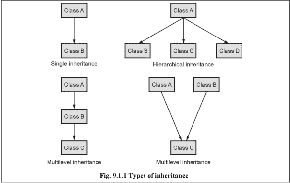

#### 9.1.2.1 单继承

##### 概念

单继承，顾名思义，是一个单独的类（派生类）派生自另一个现有的类（基类）。

##### 示例

```csharp
// Illustration of single Inheritance
using System;

class Media
{
    public void Details()
    {
        Console.WriteLine("It has been published");
    }
}

class Book : Media // class Book is derived from class Media
{
    public void BookInfo()
    {
        Console.WriteLine("Book Title ERP");
    }
}

class Single_Inherit
{
    public static void Main()
    {
        Book bk = new Book();
        bk.Details();   // base class Media member function
        bk.BookInfo();  // own member function called
    }
}
```

**输入**

无

**输出**

```text
It has been published //base class member function
Book Title ERP //derived class member function
```

#### 9.1.2.2 多级继承

##### 概念

在这种继承中，继承的级别增加，一个类派生自另一个类，而后者又派生自其他某个类。

##### 示例

```csharp
// Illustration of multilevel inheritance
class Media
{
    public void Details()
    {
        Console.WriteLine("It has been published");
    }
}

class Book : Media // class Book is derived from class Media
{
    public void BookInfo()
    {
        Console.WriteLine("Book Title ERP");
    }
}

class Booklet : Book
{
    public void BookSummary()
    {
        Console.WriteLine("Strong concept Concluded in 20 statements");
    }
}

class Multilevel
{
    public static void Main()
    {
        Booklet bklet = new Booklet();
        bklet.Details();     // indirect base class Media member function
        bklet.BookInfo();    // base class Book member function
        bklet.BookSummary(); // own member function
    }
}
```

**输入**

无

**输出**

```text
It has been published
Book Title ERP
Strong concept Concluded in 20 statements
```

#### 9.1.2.3 层次继承

##### 概念

在这种继承类型中，多个类派生自单个基类，形成类似层次的结构。

##### 示例

```csharp
// Illustration of Hierarchical Inheritance
class Media
{
    public void Details()
    {
        Console.WriteLine("It has been published");
    }
}

class Book : Media // class Book is derived from class Media
{
    public void BookInfo()
    {
        Console.WriteLine("Book Title ERP");
    }
}

class CompactDisc : Media
{
    public void License()
    {
        Console.WriteLine("Copyright is verified and License issued.");
    }
}
```


```
}
}
class Hierarchical
{
    public static void Main()
    {
        Book bk = new Book();
        CompactDisc cd= new CompactDisc();
        bk.Details();        // base class Media member function
        bk.BookInfo();       // own member function
        cd.Details();        // base class Media member function
        cd.License();        // own member function
    }
}
```

输入
无

# 输出

已发布
书名 ERP
已发布
版权已验证并颁发许可证。

## 9.1.2.4 多重继承

在 C# 中，类不支持多重继承。也就是说，一个类不能继承多个类。但是，一个类允许继承单个类和多个接口。这被称为多重继承。

```
namespace MultipleInheritanceApplication
{
    interface IOP1
    {
        int Add(int n1, int n2);
    }
    interface IOP2
    {
        int Sub(int n1, int n2);
    }
    interface IOP3
    {
        int check_Even(int n1);
    }
    class Data_Operations : IOP1, IOP2, IOP3
{
    public int result;
    public int Add(int n1, int n2)
    {
        result = n1 + n2;
        return (result);
    }
    public int Sub(int n1, int n2)
    {
        result = n1 - n2;
        return (result);
    }
    public int check_Even(int n)
    {
        if (n % 2 == 0)
            return 1;
        else
            return 0;
    }
}

class MultipleInheritDemo
{
    static void Main(string[] args)
    {
        Data_Operations numop = new Data_Operations();
        Console.WriteLine("Multiple Inheritance concept Using Interfaces \n");
        Console.WriteLine("Addition: " + numop.Add(32, 4));
        Console.WriteLine("Subtraction: " + numop.Sub(128, 16));
        if (numop.check_Even(64) == 1)
            Console.WriteLine("Number is Even");
        else
            Console.WriteLine("Number is Odd");
    }
}
```

输入
无

# 输出

加法：36
减法：112
数字是偶数

## 9.1.3 访问修饰符

- 1. 类继承结合了接口继承和实现继承。接口继承根据一个或多个现有接口定义新接口。实现继承根据一个或多个现有实现定义新实现。
- 
- 2. 类成员的访问修饰符为派生类提供不同级别的访问权限。下表描述了派生类根据访问修饰符对继承类成员所具有的访问权限。

| 父类访问修饰符 | 子类中的访问权限 |
|---|---|
| public | 可访问 |
| protected | 可访问 |
| private | 不可访问 |

表 9.1.1 继承中的访问修饰符和作用域

### 示例

```
//illustration of access modifiers and inheritance scope  1

using System;

class Base // derived from built in class Object
{
    public void BDraw() { Console.WriteLine("Base method BDraw"); }
}

class Derived : Base // Derived inherits Base
{
    public void DDraw() { Console.WriteLine("Derived method DDraw"); }
}

class InheritScope
{
    static void Main()
    {
        Base b = new Base();
        b.BDraw(); // own method
        b.DDraw(); // Error derived class method can't access
        Derived d = new Derived();
        
d.BDraw();//inherited method

d.DDraw();//own method

}
//Illustration of access modifiers and inheritance scope  2
class Base
{
    protected int var =478 ;
}

class Derived : Base
{
    void Show()
    {
        Base b = new Base();
        Derived d = new Derived();
        b.var = 28; // Error
        d.var = 60; // OK
    }
}


// example2 protected

using System;

class Base
{
    protected int n1;
    protected int n2;
}

class Derived : Base //private inheritance
{
    public static void Main()
    {
        Derived d = new Derived();
        // Direct access to protected members to derived class
        d.n1 = 45;
        d.n2 = 68;
        Console.WriteLine("n1 = {0}, n2 = {1}", d.n1, d.n2);
        Console.ReadLine();
    }
}
```

## 9.1.4 C# 中的可见性修饰符

### 概念

可见性控制是面向对象编程中的一个关键问题。可见性控制很重要，因为它保护类的不可见部分不被其他类直接访问。程序的其他部分不能直接依赖于它们无法访问的细节。如果类的某个细节（通常是变量）在类外部不可见，那么以后修改这个细节就会容易得多。

### 解释

### 程序集中类型的可见性和类型中成员的可见性

- 程序集中类型（例如类）的可见性。
  - **internal：** 该类型从程序集外部不可见。
  - **public：** 该类型在程序集外部可见。
- 类型中成员（例如类中的方法）的可见性。
  - **private：** 仅在包含类型中可访问。
  - **protected：** 在包含类型及其子类型中可访问。
  - **internal：** 在程序集中可访问。
  - **protected internal：** 在程序集、包含类型及其子类型中可访问。
  - **public：** 只要封闭类型可访问，就可访问。

## 9.1.5 类修饰符

### 概念

- 1. 在实现继承时，重要的是要理解如何为新设计的派生类及其成员建立可访问性级别。

### 解释

- 2. 类修饰符用于决定系统的哪些部分可以创建类对象。
  
  有四种不同的可选类修饰符，分别是，
  
  1. **public** - 'public' 关键字将类型标识为可被所有其他类型完全访问。这是枚举成员和接口成员的隐式可访问性。
  
  2. **internal** - 如果类被声明为 'internal'，则所定义的类型仅对同一程序集（一个自包含的打包单元，包含代码、元数据等）中的类型可访问。这是非嵌套类的默认访问级别。

- 3. **protected** - 如果类被声明为 'protected'，则其类型可由包含类型以及继承自该包含类型的任何类型访问。此修饰符只应用于内部类（即在其他类中声明的类）。
  
- 4. **private** - 如果类被声明为 'private'，则对其所定义类型的访问仅限于包含类型。此修饰符只应用于内部类（即在其他类中声明的类）。

这些用于指定类所定义类型的访问级别。

3. 此外，可以使用上述四种修饰符指定以下不同的访问级别，

- 1. **Protected internal** - 此访问级别允许的权限是 'protected' 级别允许的权限加上 'internal' 级别允许的权限。因此，该访问级别比单独使用其各部分更宽松。此修饰符只应用于内部类（即在其他类中声明的类）。
  
- 2. **New** - 'new' 关键字可用于“嵌套”类。嵌套类是在另一个类的主体中定义的类；它在大多数方面与以常规方式定义的类相同，但其访问级别不能比定义它的类的访问级别更宽松。嵌套类应使用 'new' 关键字声明，以防它与继承类型同名（并因此覆盖该继承类型）。
  
- 3. **Abstract** - 声明为 'abstract' 的类本身不能被实例化——它仅设计为用于继承的基类。
  
- 4. **sealed** - 声明为 'sealed' 的类不能从其他类继承。将密封类用作基类是错误。在类声明中使用 sealed 修饰符可防止该类被继承。

## 9.1.6 C# 继承层次结构中构造函数和析构函数的调用顺序

- 1. **当实例化派生类时，会自动调用基类的默认构造函数。** 这样，基类构造函数可以在派生类构造函数执行之前初始化基类。

### 示例

```
// Demonstrate when constructors are called.
using System;

// Create a base class.
class Media{
    public Media () {
        Console.WriteLine("Constructing Media.");
    }
}
```


// Create a class derived from Media.
class Book : Media {
    public Book() {
        Console.WriteLine("Constructing Book.");
    }
}

// Create a class derived from Book.
class Booklet : Book {
    public Booklet() {
        Console.WriteLine("Constructing Booklet.");
    }
}

class OrderOfConstructorCall {
    static void Main() {
        Booklet bkl = new Booklet();
    }
}

输入

Nil

## 输出

```
Constructing Media.
Constructing Book.
Constructing Booklet.
```

## 2. 在 C# 中调用基类构造函数

在继承期间，如果基类只包含带参数的构造函数，则派生类必须包含带参数的构造函数，即使它不需要。在这种情况下，在派生类中创建带参数的构造函数时，应指定派生类所需的参数以及基类构造函数所需的参数，并使用关键字 "base" 在派生类中带参数的构造函数声明的末尾加上 ":" 来向基类构造函数传递参数。

如果从基类派生一个类并希望将数据从派生类的构造函数传递到基类的构造函数，则有必要调用基构造函数。

在继承层次结构中，基类构造函数总是先被调用。在 C# 中，base 关键字用于访问基类构造函数，如下所示。

```
class Acc
{
private string accCode;
private string accName;
private string accDescription;
private double accBalance;

public Acc(string cd, string nm, string descrip, double bal)
{
    accCode = cd;
    accName = nm;
    accDescription = descrip;
    accBalance = bal;
}
public Acc()
{

}

class LoanAcc : Acc
{
    private string accAddr;
    private string accContact;
    public LoanAcc(string cd, string nm, string descrip, double bal, string adr, string cont)
        : base(cd, nm, descrip, bal)
    {
        accAddr = adr;
        accContact = cont;
    }

    public LoanAcc()
        : base()
    {

    }
}

/* The above two constructors are written to initialize base class members. The
parameterless constructor of the base class is executed when the class is instantiate
without passing any parameters. The other base class constructor is executed when
parameters are passed while instantiating the object. */
```

## 3. 私有构造函数

私有构造函数是具有 "private" 访问修饰符的构造函数。如果类中存在私有构造函数，则无法创建该类的对象，也无法继承该类。

类中可以同时存在公共构造函数和私有构造函数，并且公共构造函数可以通过构造函数链从类内部访问私有构造函数。

```csharp
public class DemoClass
{
    private DemoClass()
    {
        Console.WriteLine("This is no parameter Constructor");
    }

    public DemoClass(int var):this()
    {
        Console.WriteLine("This is one parameter Constructor");
    }
}
....
}

//object of DemoClass is created as below.

DemoClass ob = new DemoClass(10);
//The above statement works fine, but the statement
DemoClass ob = new MyClass();

raises an error :
'Constructors.DemoClass.DemoClass()' is inaccessible due to its protection level
```

## 何时使用仅包含私有构造函数的类

可以仅使用私有构造函数创建类。主要用途是在类中只有静态成员且类永远不会被实例化的情况下。

## 4. 静态构造函数中的初始化

- 1. 静态构造函数用于初始化任何静态数据，或执行只需要执行一次的特定操作。
- 2. 静态构造函数在创建第一个实例或引用任何静态成员之前自动调用。
- 3. 类中只能有一个静态构造函数，因为重载需要两个方法在方法定义方面不同，而静态构造函数无法做到这一点。
- 4. 静态构造函数应无参数，因为它将由 CLR 调用，没有办法从程序向其传递参数，如果需要的话。

5. 它只能访问类的静态成员，因为类中的非静态成员特定于对象实例。因此，如果允许静态构造函数在非静态成员上工作，更改将反映在所有对象实例中，这是不可能的。

6. 静态构造函数定义中不应有访问修饰符，因为对静态方法的调用是由 CLR 而不是对象发出的。

```
class ConstructorCall
{
// Static constructor

    static ConstructorCall ()
    {
    // static constructor is called first then instance constructor.

        Console.WriteLine("Static constructor is being in process.");
    }

//instance constructor
public ConstructorCall ()
{

    Console.WriteLine("Instance constructor invoked");
}

}

class OrderOfConstructors
{
public static void Main()
{
    ConstructorCall ct =new ConstructorCall();
}

}
```

输入
Nil

## 输出

```
Static constructor is being in process.
Instance constructor invoked
```

## 5. 继承层次结构中终结器（或析构器）的顺序

析构函数执行遵循与构造函数执行顺序相反的方法；先调用派生类析构函数，然后调用基类。析构函数隐式调用对象的基类的 Finalize。

### 示例

```csharp
using System;

public class Base
{
    ~Base()
    {
        Console.WriteLine("Base destructor called");
    }
}

public class Derived : Base
{
    ~Derived()
    {
        Console.WriteLine("Derived destructor called");
    }
}

public class MainClass
{
    static void Main()
    {
        Derived derived = new Derived();
    }
}

输入
Nil
```

## 输出

```
```text
Derived destructor called
Base destructor called
```
```

## 9.1.7 什么不会被继承？

**密封类和抽象类永远不会被继承。**

**构造函数和析构函数永远不会被继承。**

## 9.1.8 继承的应用

继承在应用程序中有用的情况

- 1. 当存在具有某些共同和某些不共同属性的类时，继承很方便，可以将共同特征封装在基类中。
- 2. 新类需要某些现有类的属性，这为其提供了扩展。
- 3. 为了在对象之间实现关系，即 is-a、is-a-kind、is-a-like。
- 4. 实现更通用的类或实现更专门的类是继承的主要目标。这反过来提供了多个类的组合。

## 9.2 多态性和运行时行为

### 概念

- 1. 多态性（源自希腊语，意为“具有多种形式”）在面向对象中是指能够在不同上下文中为同一语句或事物赋予不同含义或应用的特性——在编程上，允许变量引用多种类型的对象。

### 解释

- 2. 多态性提供以下功能
- - 它允许在运行时通过基类引用调用派生类的方法。
- - 它具有通过相同名称调用的方法为类提供不同实现的能力。

- 3. 多态性有两种类型，即，
- 1. 编译时多态/重载
- 2. 运行时多态/重写

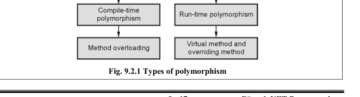

## 4. 编译时多态（静态多态）

编译时多态使用方法和运算符重载实现。它也称为早期绑定。

在方法重载中，方法使用不同的输入参数执行不同的任务。

## 5. 运行时多态（动态多态）

C# 通过继承、重写和虚方法提供运行时多态。

基于继承的多态允许在基类中定义方法并在派生类中重写它并实现。因此，如果基类对象可以保存派生类对象，多态性在正确使用时允许调用将根据对象所属的派生类类型不同而不同地工作的方法。

多次方法重写被称为运行时多态。它也称为后期绑定。

重写方法时，派生类的方法行为会发生变化。

重载方法只是涉及具有相同原型的另一个方法。

必须清楚地记住，方法重载和方法重写是不同的、无关的概念。

方法重载与继承或虚方法无关。

## 6. 方法重载 – 为什么和何时

- 1. 方法重载用于在需要类方法执行某些任务，但向执行任务的方法提供的信息可能有多种可能性的情况下。
- 2. 当由于某种原因存在几个接受不同参数但概念上做相同事情的方法时，应考虑重载方法。面向对象强烈建议将其作为良好的编程实践。
- 3. 保持相同的名称，可以通过以下方式实现方法重载，
- - 改变使用的参数数量。
- - 改变参数的顺序。
- - 对参数使用不同的数据类型。
- 4. 在进行方法重载时，编译器施加了一些限制。

基本规则是重载的方法必须在其签名上不同，这意味着名称和参数的数量和类型。这对于编译器区分重载方法至关重要。


一个类中重载方法的数量没有限制。它们只是被视为仅名称相同但不同的方法。

### 示例

```csharp
//illustration of Method Overloading (Compile Time Polymorphism)

using System;

namespace method_overloading
{
    class CompileTimePoly
    {
        public class Output
        {

            public void Show(string st)
            {
                Console.WriteLine("Showing Character String " + st);
            }

            public void Show(int n)
            {
                Console.WriteLine("Showing Integer " + n);
            }
            public void Show(float fn)
            {
                Console.WriteLine("Showing Float " + fn);
            }

        }

        static void Main(string[] args)
        {

            Output obj = new Output();
            obj.Show("India");
            obj.Show(26);
            obj.Show(65.42f);
        }
    }
}
```

### 输入
无

### 输出

|  |
|---|
| Showing Character String India |
| Showing Integer 26 |
| Showing Float 65.42 |

## 9.3 重写方法

### 概念
- 1. 在派生类中创建与基类中名称、参数和返回类型相同的方法称为方法重写。

### 解释
- 2. 通过方法重写实现了运行时多态。
- 3. 需要注意的是，
  - 方法重写只能在派生类中进行，而不能在方法声明的同一类中进行。
  - 只有在基类中借助 virtual 关键字或 abstract 关键字声明的方法才会在派生类中被重写。
- 4. ‘virtual’ 关键字和 ‘override’ 关键字。
  - 1. 它们都是方法修饰符。
  - 2. 它们用于实现对象的多态行为。
  - 3. 虚方法与重写
    - 1. virtual 关键字用于创建虚方法，而在派生类中 override 关键字用于重新定义基类的方法。如果派生类中的方法前面加上 override 关键字，则派生类的对象将调用该方法而不是基类的方法。
    - 2. 虚方法是在派生类中可以被重新定义的方法。virtual 关键字表示在派生类中被重写的方法。虚方法在基类和派生类中都有实现。
    - 3. 当方法的基本功能相同，但在派生类中有时需要更多功能时使用。
    - 4. 在基类中创建可在派生类中重写的虚方法。可以使用 virtual 关键字在基类中创建虚方法，并使用 override 关键字在派生类中重写该方法。

- 5. 当方法在基类中声明为虚方法时，该方法可以在基类中定义，并且派生类重写该方法是可选的。重写方法还为方法提供多种形式。因此它是多态。

- 6. 当方法在基类中声明为虚方法且在派生类中具有相同定义时，无需在派生类中重写它。但当虚方法在基类和派生类中的定义不同时，则需要在派生类中重写它。

- 7. 当调用虚方法时，会检查对象的 **运行时类型** 是否存在重写成员。派生类中的重写成员会被调用，如果没有派生类重写该成员，则可能是原始成员。

- 8. 可以在不修改程序其余部分的情况下添加派生类型。因此对象的运行时类型决定了行为。

- 9. virtual 修饰符告诉编译器，当从其他类派生任何类时，在调用时应调用重写方法。

- 10. 默认情况下，方法是非虚的。不能重写非虚方法。

- 4. 不能将 virtual 修饰符与 static、abstract、private 或 override 修饰符一起使用。

- 5. virtual 关键字用于修改在基类中声明的方法、属性、索引器或事件，并允许在派生类中重写它。

- 6. override 关键字用于在派生类中扩展或修改基类的虚/抽象方法、属性、索引器或事件。

## 7. 虚方法和非虚方法的区别。

当虚方法和非虚方法由类的实例调用时，根据运行时会调用实例虚方法的实现；换句话说，在虚方法的情况下，类的实例调用子类重写方法，而调用的非虚方法则基于类的实例确定。

## 8. 从派生类调用被派生类重写的基类的虚方法 – 。

可以通过使用成员访问运算符 (.) 和基类名称从派生类方法中调用基类方法的实现。

### 例如

```csharp
//a derived class method
public override void Show()
{
....
    Base.Show(); //call to base class method
....
}
```

### 示例

```csharp
//illustration of runtime polymorphism
class Media
{
    public virtual void Details()
    {
        Console.WriteLine("Media Details");
    }
}
class Book : Media //class Book is derived from class Media
{
    public override void Details() {
        Console.WriteLine("Book Title  ERP"); }
}

class CompactDisc : Media
{
    public override void Details() {
        Console.WriteLine("Copyright is verified and License issued.");
    }
}
class Hierarchical
{
    public static void Main()
    {
        Media midi = new Media();
        midi.Details();    // own member function member function

        midi = new Book();
        midi.Details();    // derived class Book’s overridden member function
        midi = new CompactDisc();

        midi.Details();    // derived class CompactDisc’s overridden member function
    }
}
```

### 输入
无

### 输出
Media Details

Book Title  ERP

Copyright is verified and License issued.

## 8. 密封方法
- 1. 密封方法重写具有相同签名的继承的虚方法。
- 2. 密封方法也必须标记为 override 修饰符。
- 3. 使用 sealed 修饰符可防止派生类进一步重写该方法。这里的关键词是 further。
- 4. 其思想是，方法在基类中必须是虚的。它必须在派生类中稍后被重写。此时，一旦被重写，它现在就被密封，不允许进一步重写。

```csharp
using System;

public class One
{
    public virtual void vmethod1()
    {
        Console.WriteLine("One.vmethod1");
    }

    public virtual void vmethod2()
    {
        Console.WriteLine("One.vmethod2");
    }
}

public class Two : One
{
    public override void vmethod1()
    {
        Console.WriteLine("Two.vmethod1");
    }

    public sealed override void vmethod2()
    {
        Console.WriteLine("Two.vmethod2");
    }
}
```

```csharp
public class Three : Two
{
    public override void vmethod1()
    {
        Console.WriteLine("Three.vmethod1");
    }

    /*public override void vmethod2()  //can not override as it is sealed by immediate base class
        //Two. The compiler would give the following
        //error: 'Three.vmethod2()': cannot override inherited
        //member 'Two.vmethod2()' because it is sealed.
    {
        Console.WriteLine("Three.vmethod2");
    }*/
}

public class UseSealedMethods
{
    static void Main()
    {
        Two t = new Two();
        t.vmethod1();
        t.vmethod2();

        Three th = new Three();
        th.vmethod1();
        th.vmethod2();
    }
}
```

## 9.4 隐藏方法

### 概念
- 1. 当派生类继承自基类时，派生类允许再次定义基类中已存在的方法。在这种情况下，称基类隐藏了派生类的方法。

### 解释
- 2. 要显式实现此功能，需要通知编译器进行方法隐藏，这通过使用 `new` 关键字完成。如果未指定 `new` 关键字，编译器会发出警告。


- 3. 多态概念中使用了 new 关键字，在方法重载的情况下，通过派生类隐藏基类方法。
- 4. “new”关键字可用于将基类的方法、属性、索引器或事件隐藏到派生类中。
- 5. 如果一个方法没有重写基方法，那么它就是在隐藏基方法。隐藏方法必须使用 new 关键字声明。
- 6. 如果方法只是被隐藏，那么对其实现的调用基于参数“this”的编译时类型。但如果方法被重写，则要调用的实现基于参数“this”的运行时类型。
- 7. new 特定于引用类型，重写特定于对象类型。

### 示例

```csharp
//illustration of method hiding and 'new' keyword used for method
using System;

public class Base
{
    public void Info()
    {
        Console.WriteLine("Base class");
    }
}

public class Derived : Base
{
    public new void Info()
    {
        base.Info();
        Console.WriteLine("Derived class");
    }
}

public class MethodHiding
{
    static void Main()
    {
        Derived d = new Derived();
        d.Info();
    }
}
/* here, there are two classes: the Derived and the Base class. The Derived class inherits from the Base class. Both have a method called Info(). The implementation of the Info() method in the Derived class uses the 'new' keyword to inform the compiler that this method is hidden from the base class. The base class method still can be called. With the help of the base class name, its methods can be called. */
```

输入：Nil

### 输出

| 输出 |
|---|
| Base class |
| Derived class |

## 9.5 组合方法重写与方法隐藏

### 概念

通过使用 virtual 和 new 关键字，可以将方法隐藏和方法重写一起使用，因为派生类的方法可以同时是 virtual 和 new。当需要禁止进一步重写派生类方法时，就需要这样做。

```csharp
using System;
namespace Override_Hide
{
class One
{
public void Show() { Console.WriteLine("Ones method"); }
}

class Two : One
{
public new virtual void Show() { Console.WriteLine("Twos method"); }
}

class Three : Two
{
public override void Show() { Console.WriteLine("Threes method"); }
}

class Test
{
static void Main(string[] args)
{

One a = new One();
Two b = new Two();
Three c = new Three();

a.Show();
b.Show();
c.Show();
a = new Two();
a.Show();
b = new Three();
b.Show();
}
}
```

输入：Nil

### 输出

```csharp
Ones method
Twos method
Threes method
Twos method
Threes method
```

## 9.6 运算符重载

### 概念

- 1. 有时需要将那些类的对象的值相加，以获得新对象或新值。为了使类能够对其对象执行算术运算或比较，可以使用运算符重载。

### 解释

- 2. 运算符重载包括自定义 C# 运算符的行为，使其能够应用于类的值。这意味着必须为想要使用的特定运算符在类中创建特殊行为。
- 3. 以下是重载运算符的语法

```csharp
public static return-type operator symbol(formal-par-list)
{
    body-of-operator
}
```

- 首先是访问级别。这里是 public。
- 在 public 访问级别之后，使用 static 关键字。
- 由于该方法是以静态方式实现的，因此应使用其类名作为返回类型。此外，运算符将作用于其类类型的对象，因此该方法应返回表示其类的值。
- 在返回类型之后，使用 'operator' 关键字。其后是要重载的实际运算符。
- 由于正在创建一种方法，因此在运算符之后添加括号。括号中根据运算符添加一个或两个参数。
- 由于这是方法实现，因此它必须有一个由花括号分隔的主体。
- 定义方法后，可以从其类内部或外部调用它。

- 4. 在重载**运算符**时，应遵循一组**规则**，下面列出了其中一些。

  1. 运算符必须是 public 和 static。
  2. 必须出现一个或两个形参，分别对应一元运算符和二元运算符。
  3. 至少有一个参数必须是该运算符所属的类型。
  4. 只能使用值参数。
  5. 某些运算符必须成对定义，即要么都不定义，要么都定义，如下所列。

     `== and !=    < and >    <= and >=`

  6. 特殊的一元布尔运算符 **true** 和 **false** 在对象相对于条件逻辑运算符扮演 *true* 或 *false* 的角色时定义。
  7. 重载二元运算符 *op* 会自动重载赋值运算符 *op=*。

- 5. 重载运算符时应遵循的建议和经验法则——

  - 并非所有运算符都需要为所有类自定义。例如，虽然可以将两本书相加得到一本新书，其中包含两本书的所有页面及其合并的作者，这可能是可行的，但将两本书相乘（能得到什么？）可能并不现实。因此，应根据需求选择正确的运算符。
  - 虽然有些运算符始终可以重载，但有些运算符有严格的规则。这意味着不能随意使用任何运算符。
  - 并非所有运算符都可重载。

- **6. 重载一元运算符的通用语法**

```csharp
public static return-type operator op(parameter-type operand)
{
}
```

- **7. 重载二元运算符的通用语法**

```csharp
public static ret-type operator op(parameter-type operand1, parameter-type operand2)
{
}
```

- **8. 以下是可以重载的运算符列表**

| 类别 | 运算符 | 结合性 |
|---|---|---|
| 主要 | x.y f(x) a[x] x++ x-- new typeof checked unchecked default delegate | 从左到右 |
| 一元 | + - ! ~ ++x --x (T)x true false sizeof | 从左到右 |
| 乘法 | * / % | 从左到右 |
| 加法 | + - | 从左到右 |
| 移位 | << >> | 从左到右 |
| 关系与类型测试 | < <= > >= is as | 从左到右 |
| 相等 | == != | 从左到右 |
| 逻辑/按位与 | & | 从左到右 |
| 逻辑/按位异或 | ^ | 从左到右 |
| 逻辑/按位或 | \| | 从左到右 |
| 条件与 | && | 从左到右 |
| 条件或 | \|\| | 从左到右 |
| 条件 | ?: | 从右到左 |
| 赋值 | = *= /= %= += -= <<= >>= &= ^= \|= ?? => | 从右到左 |

- **9. 有些运算符要么不能重载，要么依赖于其他运算符被重载。**

  - 以下运算符**不能重载**：合取（AND）`&&`、析取（OR）`||`、赋值 `=`、句点 `.`、三元 `?`、C++ 指针访问 `->`、对象创建符 **new**、对象兼容性验证符 **is**、大小 **sizeof** 和类型 **typeof**。
  - true 和 false 可以重载，但**几乎没有任何理由**这样做。因此，除非有充分合理的理由，否则不要重载它们。
  - `[]` 不能重载，但替代方案是创建索引器。

- **10. 重载一元运算符**

  - 一元运算符是作用于一个值的运算符。
  - C# 语言提供了许多一元运算符，但并非所有都可重载。可用于重载的一元运算符有 `+`、`-`、`!`、`~`、`++` 和 `--`。
  - 要重载一元运算符，请向方法的括号中传递一个参数。在方法体中执行所需操作。

- **11. 二元算术运算符**

  - 二元运算符是作用于两个值的运算符。
  - 这些值必须具有相同类型。
  - C# 提供了丰富的二元运算符。算术中使用的有：`+`、`-`、`*`、`/` 和 `%`。
  - 要重载二元算术运算符，请向方法的括号中传递两个参数。第一个参数必须是执行重载的类的类型。第二个参数可以是另一种类型。

- **12. 二元按位运算符**

  - 除了传统的算术运算之外，C# 还支持在计算机内存中添加或移位位。
  - 这些运算符是按位合取运算符 `&` 及其赋值运算符 `&=`、按位析取运算符 `|` 及其赋值运算符 `|=`、按位异或运算符 `^` 及其赋值运算符 `^=`、左移运算符 `<<` 及其赋值运算符 `<<=`、右移运算符 `>>` 及其赋值运算符 `>>=`。
  - 必要时，只应重载主运算符（`&`、`|`、`^`、`<<`、`>>`），编译器将自动提供其等效的赋值运算符。
  - 要重载二元运算符，请向方法的括号中传递两个参数。


- 对于两个按位移位运算符 `<<` 和 `>>`，第一个参数必须是进行运算时所在的类，第二个参数必须是常量整数（类型 `int`）。

## 13. 比较运算符

顾名思义，比较用于判断两个值中是否有一个高于另一个。这些值必须具有相同的类型。比较运算符成对使用。

也就是说，如果希望比较两个值是否相等，也必须能够知道它们何时不同。因此，如果要重载某个**比较运算符**，那么它的**相反运算符也需要重载**。即：

- 如果重载了 `==`，则也必须重载 `!=`。
- 如果重载了 `<`，则也必须重载 `>`，反之亦然。
- 如果重载了 `<=`，则也必须重载 `>=`，反之亦然。

### 示例

```csharp
using System;

class NumberOps
{
    public int val;

    public static NumberOps operator + (NumberOps obj1, NumberOps obj2)
    {
        // Add two numbers and return a new number
        NumberOps numop = new NumberOps ();
        numop.val = obj1.val + obj2.val;
        return numop;
    }

    public static NumberOps operator ++ (NumberOps obj)
    {
        // Increment this object
        obj.val++;
        return obj;
    }
}

class OpOverload
{
    static void Main()
    {
        // Increment widget twice.
        NumberOps ob1 = new NumberOps ();
        ob1++;
        Console.WriteLine(ob1.val);
        ob1++;
        Console.WriteLine(ob1.val);

        // Create another widget.
        NumberOps ob2 = new NumberOps();
        ob2++;
        Console.WriteLine(ob2.val);

        // Add two widgets.
        NumberOps ob3 = ob1 + ob2;
        Console.WriteLine(ob3.val);
    }
}
```

### 输出

```text
1
2

1

3
```

## 9.7 泛型

在 C# 中，**泛型**是一种类型，用于定义类、结构、接口或方法，并通过**占位符**（类型参数）表明它们可以存储或使用一种或多种类型。

在 C# 中，编译器会在编译时用指定的类型替换占位符。

在 C# 中，泛型主要与集合及操作集合的方法一起使用，以指定要存储在集合中的对象类型。泛型随 .NET Framework 2.0 引入，并带有一个名为 **System.Collections.Generic** 的新命名空间。

### 定义泛型类

泛型类使用尖括号 <> 定义。例如，下面是一个简单的泛型类，包含泛型成员变量、泛型方法和属性。要将**类**或**方法**定义为泛型，需使用类型参数作为尖括号（<>）中的占位符。

下面定义了一个泛型类，使用类型参数（**T**）作为尖括号（<>）中的占位符。

### 示例 1 泛型类

```csharp
public class GenericClass1<T>
{
    public T code;
    public void genericMethodShow(T name, T place)
    {
        Console.WriteLine("{0}", code);
        Console.WriteLine("Name: {0}", name);
        Console.WriteLine("Location: {0}", place);
    }
}
```

在上面的 C# 示例中，创建的泛型类包含一个参数（code）和一个方法（genericMethodShow），它们使用类型参数（T）作为尖括号（<>）中的占位符。

这里的尖括号（<>）表示 GenericClass 是泛型类，类型参数（T）用于接受请求的类型。类型参数名称可以是任何名称，如 X、U 等，具体取决于我们的需求。

通常，在创建类的实例时，需要指定实际类型，然后编译器会用指定的实际类型替换所有类型参数，例如 T、U 或 X 等。在 C# 中，下面是创建泛型类实例的示例。

### 创建泛型类的对象（实例化泛型类）

```csharp
//here, string is the type argument
GenericClass1<string> gobj = new GenericClass1<string>();
gobj.code = "Welcome to Technical";
gobj.genericMethodShow("Awinash", "Pune");
```

如上述代码所示，将类型 "string" 传递给编译器，它会用已定义的类型 "string" 替换所有类型参数（T），替换后定义的泛型类（GenericClass）如下所示，

```csharp
public class GenericClass1
{
    public string code;
    public void genericMethodShow(string name, string place)
    {
        Console.WriteLine("{0}", code);
        Console.WriteLine("Name: {0}", name);
        Console.WriteLine("Location: {0}", place);
    }
}
```

在 C# 中，可以创建自己的自定义泛型类型，也可以定义方法来提供自己的泛化解决方案，这些方案类型安全且高效。

### 示例 2 泛型类

```csharp
class GenericClass2<T>
{
    private T genericMemberVar;

    public GenericClass2(T value)
    {
        genericMemberVar = value;
    }

    public T genericMethod(T genericParameter)
    {
        Console.WriteLine("Parameter type: {0}, value: {1}",
        typeof(T).ToString(),genericParameter);

        Console.WriteLine("Return type: {0}, value: {1}",
        typeof(T).ToString(), genericMemberVar);

        return genericMemberVar;
    }

    public T genericProperty { get; set; }
}
```

**编译时，编译器会将 GenericClass2 中的 T 替换为 int，编译后的代码如下所示，**

```csharp
class GenericClass2
{
    private int genericMemberVar;

    public GenericClass2(int value)
    {
        genericMemberVar = value;
    }

    public int genericMethod(int genericParameter)
    {
        Console.WriteLine("Parameter type: {0}, value: {1}",
        typeof(int).ToString(), genericParameter);
        Console.WriteLine("Return type: {0}, value: {1}",
        typeof(int).ToString(), genericMemberVar);

        return genericMemberVar;
    }

    public int genericProperty { get; set; }
}
```

### 泛型的特性

- 1. 它有助于最大化代码重用、类型安全和性能。
- 2. 可以创建泛型集合类。.NET Framework 类库在 System.Collections.Generic 命名空间中包含若干新的泛型集合类。因此，可以使用这些泛型集合类代替 System.Collections 命名空间中的集合类。
- 3. 使用泛型，可以创建泛型接口、类、方法、事件和委托。
- 4. 可以创建可受约束的泛型类，以便能够访问特定数据类型上的方法。
- 5. 通过反射，可以在运行时获取有关泛型数据类型中所使用类型的信息。

### 泛型可应用于以下 C# 实体：

- 接口
- 抽象类
- 类
- 方法
- 静态方法
- 属性
- 事件
- 委托
- 运算符

### 泛型的优点

- 1. **提高二进制代码的可重用性** - 泛型提供了一种源代码保护。泛型类可以定义一次，并可用许多不同的类型实例化。泛型可以在一种支持 CLR 的语言中定义，并从另一种 .NET 语言中使用。下面的 TestClass<T> 使用 int 和 string 类型进行实例化，

```csharp
DemoClass<int> obj = new DemoClass<int>();
obj.Add(50);
DemoClass<string> objs = new DemoClass<string>();
objs.Add("hello");
```

- 2. **类型安全** - 泛型的重要特性是类型安全。如果使用了与定义中指定的类型不同的数据类型，就会生成编译时错误。对于非泛型 ArrayList 类，如果使用对象，则可以向集合中添加任何类型，这有时会导致巨大灾难。下面的示例展示了向 ArrayList 类型的集合中添加整数、字符串和对象

```csharp
ArrayList obj = new ArrayList();
obj.Add(50);
obj.Add("Human");
obj.Add(new DemoClass());
```

现在，如果使用整数元素通过 foreach 语句遍历该集合，编译器会接受该代码，但由于集合中的所有元素并非都是整数，因此会出现运行时异常，如下面的代码所示。

```csharp
foreach(int cnt in obj)
{
    Console.WriteLine(cnt);
}
```

对于 Test<int> 的定义，只能向集合中添加整数类型。由于 Add() 方法具有无效参数，编译器不会编译该代码（生成错误），如下所示；

```csharp
Test<int> obj = new Test<int>();
obj.Add(50);
obj.Add("Human");          //compiler error
obj.Add(new DemoClass());  //compiler error
```

- 3. **增强性能** - 泛型具有性能优势，因为它消除了装箱和拆箱的可能性。将值类型与非泛型集合类一起使用，会在值类型转换为引用类型以及反向转换时产生装箱和拆箱开销。

在下面的示例中，ArrayList 类存储对象，Add() 方法定义为存储某个整数类型参数。因此整数类型会被装箱。当使用 foreach 语句读取 ArrayList 中的值时，会发生拆箱。

```csharp
ArrayList obj = new ArrayList();
obj.Add(50);   //boxing-convert value type to reference type
int data = (int)obj[0]; //unboxing
foreach(int cnt in obj)
{
    Console.WriteLine(cnt);  // unboxing
}
```

如果不使用对象，而是将 TestClass<T> 类的泛型类型定义为 int，那么在该类内部使用的就是 int 类型，而该类由编译器动态生成。因此，不再发生装箱和拆箱，如下所示；

```csharp
DemoClass<int> obj = new DemoClass<int>();
```


```
obj.Add(50); //No boxing
int data= obj[0]; // No unboxing
foreach(int cnt in obj)
{
    Console.WriteLine(cnt); //No unboxing
}
```

## C# 泛型方法

在C#中，如果方法使用类型参数定义，则称为泛型方法。下面是通过尖括号（<>）使用类型参数定义泛型方法的示例。

```
public void genericMethod<T>(T a, T b)
{
    // code Implementation
}
```

此泛型方法既可以指定参数类型来调用，也可以不指定参数类型来调用，如下所示。

```
genericMethod<int>(1, 2);
//或者
genericMethod(1, 2);
```

### 泛型方法示例

```
using System;
using System.Collections.Generic;
namespace GenericDemo
{
    class Program1
    {
        //Generic method
        static void Swap<T>(ref T data1, ref T data2)
        {
            T temp;
            temp = data1;
            data1 = data2;
            data2 = temp;
        }
        static void Main(string[] args)
        {
            // Swap of two integers.
            int n1 = 40, n2 = 60;
            Console.WriteLine("Before swap: {0}, {1}", n1, n2);
            Swap<int>(ref n1, ref n2);
            Console.WriteLine("After swap: {0}, {1}", n1, n2);
            Console.ReadLine();
        }
    }
}
```

## 继承中的泛型

### 泛型类作为基类

在C#中，泛型类可以用作基类，但需要为基类提供具体类型而不是类型参数，因为无法在运行时发送所需的类型参数来实例化基类。因此，从泛型基类派生时，必须提供类型参数来代替基类的泛型类型参数，如下所示。

```
// Below code do not have any Error
class DerivedClass1 : GenericClass<string> {
// implementation
}
// Where as in below code there is Compile Time Error
//class DerivedClass2 : GenericClass<T> {
// // implementation
//}
```

```
Example: Generic base class
class DerivedClass1 : GenericClass1<string>
{
    //implementation
}
```

如果派生类需要是泛型，则不需要为泛型基类指定类型。

示例：泛型派生类

```
class DerivedClass1<U> : GenericClass1<U>
{
    //implementation
}
```

**如果泛型基类具有约束，派生类必须使用相同的约束。**

示例：约束

```
class GenericClass1<T> where T: class
{
    // Implementation
}
class DerivedClass1<U> : GenericClass1<U> where U: class
{
    //implementation
}
```

## C# 泛型委托

在C#中，泛型委托与普通委托相同，只是额外带有尖括号（<>）中的泛型类型。

下面是在C#编程语言中定义泛型委托的示例。

```
using System;
namespace GenericsDemo
{
    // Declare Generic Delegate
    public delegate T GenericDelegate1<T>(T n1, T n2);
    class BasicOperations
    {
        public int Add(int n1, int n2)
        {
            return n1 + n2;
        }
        public int Subtract(int no1, int no2)
        {
            return no1 - no2;
        }
    }
    class Demo
    {
        static void Main(string[] args)
        {
            Console.WriteLine("Generic Delegate");
            BasicOperations obj = new BasicOperations();
            // Instantiate delegate with add method
            GenericDelegate1<int> dlgobj = new GenericDelegate1<int>(obj.Add);
            Console.WriteLine("Addition Result: " + dlgobj(10, 90));
            // Instantiate delegate with subtract method
            dlgobj = obj.Subtract;
            Console.WriteLine("Subtraction Result: " + dlgobj(10, 90));
            Console.ReadLine();
        }
    }
}
```

## 两分题（附答案）

### Q.1 什么是基类和派生类？

答：类是创建对象的模板。其他类从其中派生基本功能的类称为基类。例如，如果类Y派生自类X，则类X是基类。

从基类派生功能的类称为派生类。如果类Y派生自类X，则类Y是派生类。

### Q.2 什么是继承？

答：继承表示两个类之间的关系，其中一个类型从另一个类型派生功能，然后通过添加新方法、属性、事件、字段和常量来扩展它。

C#支持两种类型的继承：

- 实现继承
- 接口继承

### Q.3 什么是实现继承和接口继承？

答：当一个类（类型）派生自另一个类（类型）并继承基类型的所有成员时，即为实现继承。

当一个类型（类或结构体）只从另一个类型继承函数的签名时，即为接口继承。

一般来说，类可以从另一个类派生，因此支持实现继承。同时，类也可以从一个或多个接口派生，因此它们支持接口继承。

### Q.4 定义重写。

答：重写是指派生类中的方法使用与其基类中方法相同的名称、返回类型和参数的概念。换句话说，如果派生类包含自己的方法实现，而不是使用基类中的方法，则该过程称为重写。

### Q.5 可以在.NET中使用多重继承吗？为什么在.NET中没有多重继承？

答：.NET仅支持单继承。但可以通过多个接口实现多重继承的目的。

这有几个原因。简单来说，付出多，收益少。不同语言对多重继承有不同的实现要求。因此，为了实现多重继承，我们需要研究所有符合CLR的语言的实现方面，然后实现一种通用的实现方法。这需要付出太多努力。此外，多接口继承在很大程度上涵盖了多重继承的好处。

## 长答题

- 1. **Q.1** 通过示例定义并讨论继承。（参见9.1节）
- 2. **Q.2** 如何在C#中实现多态？（参见9.2节）
- 3. **Q.3** 结合方法隐藏和方法重写的目的是什么？（参见9.5节）
- 4. **Q.4** 讨论C#中的运算符重载。（参见9.5节）
- 5. **Q.5** 什么是泛型？（参见9.7节）
- 6. **Q.6** 编写一个C#程序演示层次继承。**AU：2018年5月，7分**

答：

```
/*
 * C# Program to Illustrate Hierarchical Inheritance
 */
using System;
using System.Collections.Generic;
using System.Linq;
using System.Text;
namespace Inheritance
{
    class HierarchicalInherit
    {
        static void Main(string[] args)
        {
            Principal pobj = new Principal();
            pobj.Manage();
            Teacher tobj = new Teacher();
            tobj.Manage();
            tobj.Teach();
            Student sobj = new Student();
            sobj.Monitor();
            sobj.Learn();
            Console.ReadKey();
        }
        class Principal
        {
            public void Manage()
            {
                Console.WriteLine("I am managing");
            }
        }
        class Teacher : Principal
        {
            public void Teach()
            {
Console.WriteLine("I am teaching");
}
}
class Student : Principal
{
    public void Learn()
    {
        Console.WriteLine("I am learning");
    }
}
}
```

### Q.7 编写一个C#程序，演示带有虚方法的多级继承。

AU：2018年12月，6分

答：

```
/*
 * C# Program to Illustrate Multilevel Inheritance with Virtual Methods
 */
using System;
public class Person
{
    protected string RNO = "21";
    protected string name = "Hari";
    public virtual void GetInfo()
    {
        Console.WriteLine("Name: {0}", name);
        Console.WriteLine("RNO: {0}", RNO);
        Console.WriteLine();
    }
}
class Student : Person
{
    public string id = "S101";
    public override void GetInfo()
    {
        base.GetInfo();
        Console.WriteLine("Student ID: {0}", id);
    }
}
class Stud : Student
{
    private string StudentAddress = "India";
    public void GetInfo()
    {
```


```
base.GetInfo();
Console.WriteLine("Student Address: {0}", StudentAddress);
}
}
class TestClass
{
    public static void Main()
    {
        Student E = new Student();
        E.GetInfo();
        Stud Stud = new Stud();
        Stud.GetInfo();
        Console.ReadLine();
    }
}
```

**Q.8** 编写一个 classTime() 来表示时间。该类应具有三个字段用于小时、分钟和秒。它应有一个构造函数来初始化小时、分钟和秒，以及一个方法 printTime() 来打印当前时间。

重载以下运算符：

+   + (基于 24 小时制的两个时间对象相加)
+   
+   < (比较两个时间对象（参见第 9.6 节）

## 注释

## 单元 - II

## 章节 - 10

## C# 高级特性 I - 委托、Lambda、事件和正则表达式

**教学大纲：** 委托 Lambda Lambda 表达式 事件、事件监听器 字符串和正则表达式

| 章节号 | 主题名称 | 页码 |
|---|---|---|
| 10.1 | 委托 | 10 - 2 |
| 10.2 | Lambda 和 Lambda 表达式 | 10 - 6 |
| 10.3 | 事件 | 10 - 9 |
| 10.4 | 正则表达式 | 10 - 15 |
|  | 两分问题与答案 | 10 - 21 |
|  | 长答题 | 10 - 23 |

## 10.1 委托

### 概念

- 1. C 和 C++ 语言使用函数指针的概念。回调函数在 Microsoft Windows 编程中用于处理消息。由于其功能，回调函数在 .NET Framework 中被实现，但它们被命名为委托。

### 解释

- 2. 委托是一种特殊的用户定义变量，像类一样在全局声明。委托为方法提供模板，就像接口为类提供模板一样。
- 3. 但与接口一样，委托是未定义的。它的作用是展示一个有用的方法会是什么样子。委托提供了在方法上使用所需的所有必要信息。信息可以是返回类型、无参数或一个或多个参数。
- 4. 委托是一种类型，其值由方法组成。
- 5. 委托允许使用包含方法的变量和参数进行工作。委托可以接受一个或多个参数，并且参数也可以传递给委托。

### 创建委托

创建委托时，使用 delegate 关键字。

声明委托的语法，

```
[attributes] [modifiers] delegate ReturnType Name ([formal-parameters]);
```

attributes 因子可以是普通的 C# 属性。

修饰符可以是以下关键字之一或适当的组合：new、public、private、protected 或 internal。

### 访问委托

声明委托后，它只为方法提供模板，而不是实际方法。

为了使用它，必须定义一个将承载赋值的 方法。

该方法必须具有相同的返回类型和相同数量的参数（如有）。

一旦方法被赋给委托变量，委托变量就可以像已定义的方法一样使用。也就是说，它可以像普通方法一样被调用。

实现这样的方法后，可以将其与委托的名称关联。为此，需要使用该方法，声明委托类型的变量并将方法赋给委托变量。在将方法赋给委托时，委托规则之一是不得对方法应用括号。

### 示例

```
//illustration of delegates
using System;

public delegate void First();

public class Demo
{
    public void Show()
    {
        Console.WriteLine("Happy new year 2017");
    }
}

public class Program
{
    static int Main()
    {
        Demo obj = new Demo();
        First fst = obj.Show;
        
        return 0;
    }
}

Input
Nil
```

输出

Happy new year 2017

### 8. 委托可以处理静态方法

使用委托时，必须先声明类类型的变量，然后才能访问其方法。

另一种选择是将相关方法创建为静态方法。

在这种情况下，无需先声明变量。

```
using System;

public delegate void First();

public class Demo
{
    public static void show()
    {
        Console.WriteLine("Happy new year 2017");
    }
}

public class Program
{
    static int Main()
    {
        First fst = Demo.show;

        fst();

        return 0;
    }
}
```

### 9. 委托可以是匿名的

并非总是需要命名委托将引用的方法。换句话说，使用委托之前无需显式定义方法。这种方法被称为匿名方法。

要创建匿名方法，为委托声明一个变量并将其赋给 delegate 关键字，就像它是一个方法一样，其后跟括号和大括号表示方法体，在其中提供其实现。

```
using System;

public delegate void First();

public class Program
{
static int Main()
{
    First fst = delegate()
    {
        Console.WriteLine("Happy new year 2017");
    }
    fst();
    return 0;
}
}
```

### 10. 委托可以返回值

### 示例

```
using System;

delegate double Compute();

public class Demo
{
    public static double Product()
    {
        return 64*2;
    }
}

public class Program
{
    static int Main()
    {
        Compute cm = Demo.Product;

        Console.WriteLine("Number = {0}", cm());

        return 0;
    }
}
```

输入

Nil

输出

128

### 11. 参数可以传递给委托

要将方法与委托关联，可以为委托声明一个变量并将方法名称赋给它。

### 示例

```
using System;

delegate double DigCube(double val);

public class Compute
{
    public static double GetCube(double n)
    {
        return n * n * n;
    }
}

public class
{
    static int Main()
    {
        DigCube dlc = Compute.GetCube(16);
        Console.WriteLine("Cube = {0}", dlc);
        return 0;
    }
}
Input
Nil
```

输出

4096

## 10.2 Lambda 和 Lambda 表达式

- C# 3.0 (.NET 3.5) 引入了 lambda 表达式以及 LINQ。lambda 表达式是使用提供的语法表示匿名方法的更简洁方式。
- 在 Lambda 表达式中，无需指定输入值的类型，从而使其更灵活易用。
- '=>' 在 lambda 表达式中使用，这是 lambda 声明运算符，用于分隔 lambda 的参数列表与其可执行代码。Lambda 表达式分为两部分，左侧是输入，右侧是表达式。

### Lambda 表达式可以分为两种类型

- **表达式 Lambda** - 由输入和表达式组成。

### 语法

```
input => expression;
```

**语句 Lambda** - 由输入和一组要执行的语句组成。这组语句用大括号括起来。

### 语法

```
input => { statements };
```

简单示例如下，

- 1. Count => count + 8;

这里，Count 是输入，count+8 是表达式。

- 2. num => num % 2 == 0

这里，num 是输入参数，num % 2 == 0 是表达式

- 3. e => e.Age > 12 && e.Age < 20

```
(emp, inAge) =>
{
  Console.WriteLine("Lambda expression with multiple statements in the body");

  Return emp.Age >= inAge;
}
```

```
4.
List<int> list = new List<int>() { 1, 2, 3, 4, 5, 6 };
List<int> evenNumbers = list.FindAll(x => (x % 2) == 0);
foreach (var num in evenNumbers)
{
  Console.WriteLine("{0} ", num);
}
Console.WriteLine();
```

上述代码行的结果是，

```
2 4 6
```

### 无参数的 Lambda 表达式

lambda 表达式可以不带任何参数指定。

### 示例

```
() => Console.WriteLine("Parameter-less lambda expression")
```

### 带多个参数的 Lambda 表达式

lambda 表达式参数可以在括号中发送。

示例

```
(per, inAge) => per.Age >= inAge;
```

### 在 Lambda 表达式体中声明局部变量

可以在表达式体中声明局部变量，以便在表达式体中的任何位置使用它。

示例

```
exp =>
{
    int inAge = 18;
    Console.WriteLine("Lambda expression with local variable");

    return exp.Age >= inAge;
}
```

### 将 Lambda 表达式赋给委托

lambda 表达式可以赋给 Func<in T, out TResult> 类型委托。Func 委托中最后一个参数类型是返回类型，其余的是输入参数。

### 示例

```
Func<Student, bool> isStudentTeenAger = s => s.st.age > 12 && s.st.age < 19;

Student sobj = new Student() { age = 19 };

bool isTeen = isStudentTeenAger(sobj);// returns false

The Func<> delegate in above code, converts to a function as shown below,
bool isStudentTeenAger(Student st)
{
    return st.Age > 12 && st.Age < 19;
}

// C# program to illustrate the Lambda Expression
using System;
using System.Collections.Generic;
using System.Linq;
// User defined class Student
class Student {

    // properties rollnumber and name

```


```csharp
public int rNo
{
    get;
    set;
}

public string name
{
    get;
    set;
}

class Sample {
    // Main Method
    static void Main(string[] args)
    {
        // List of Student
        List<Student> details = new List<Student>() {
            new Student{ rNo = 1, name = "Ram" },
            new Student{ rNo = 2, name = "Raj" },
            new Student{ rNo = 3, name = "Riya" },
            new Student{ rNo = 4, name = "Ravi" },
            new Student{ rNo = 5, name = "Ross"}
        };

        // To sort the list in ascending order based on names
        var newDetails = details.OrderBy(nm => nm.name);

        foreach(var value in newDetails)
        {
            Console.WriteLine(value.rNo + " " + value.name);
        }
    }
}
```

## 10.3 事件

### 概念

- 1. **事件**是用户操作，例如按键、单击、鼠标移动等，或者某些发生的情况，例如系统生成的通知。事件概念是事件驱动编程的核心。具有图形用户界面的程序是事件驱动的

### 解释

- 2. 在命令驱动编程中，程序向用户请求输入，并基于此继续处理。在事件驱动编程中，程序对*用户界面元素上发生的事情*作出反应，或者更一般地说，对*对象和程序的某些选定状态上发生的事情*作出反应。
- 3. **事件发生时，应用程序需要响应事件。**
  例如，像文件不可写这样的中断。
- 4. **事件用于进程间通信。**
  当给定事件被触发时，与该特定事件关联的操作就会被执行。
- 5. **C# 中的事件**
  - 1. 在 C# 中，某个类中的事件是该类中委托类型的变量。
  - 2. 与类一样，委托也是引用类型。
  - 3. 这意味着事件持有对委托实例的引用。委托的内存分配在堆上。
  - 4. 事件用于提供*通知*，通常与图形用户界面相关。
- 5. **将委托与事件配合使用**
  - 1. 事件在类中声明和引发，并使用同一类或其他类中的委托与事件处理程序关联。
  - 2. 包含事件的类用于发布事件。这个类称为**发布者**类。
  - 3. 接受此事件的类称为**订阅者（事件监听器和事件处理程序）**类。
  - 4. **发布者**是包含事件和委托定义的对象。事件-委托关联也在此对象中定义。发布者类对象调用事件，然后通知其他对象。
  - 5. **订阅者**是接受事件并提供事件处理程序例程的对象。发布者类中的委托调用订阅者类的方法（事件处理程序）。
  - 6. 由于发布者和订阅者对象协同工作，因此称这些事件使用**发布者-订阅者**模型。
- 7. 事件是引发它们的类的成员。当某件事发生时，类可以引发事件，该事件包含一条消息，其中包含有关事件的信息（以事件参数的形式），并将它们发送到程序的其他部分，程序的其他部分可以通过执行事件处理程序方法来响应该事件。
- 8. 事件处理程序方法与事件具有相同的签名，并且当事件发生时执行此方法。
- 9. 定义事件需要遵循两步过程。
  - 1. 定义一个委托，其中包含在引发事件时将调用的方法。
  - 2. 基于该委托定义事件。

### 6. 事件 - 要点

- 1. C# 中的事件处理程序返回 void（无返回类型），并接受两个参数。事件的第一个参数——事件源，表示发布对象。事件的第二个参数——从 EventArgs 派生的对象。
- 2. 发布者确定何时引发事件，订阅者确定响应时采取什么操作。
- 3. 一个事件可以有多个订阅者。如果一个事件有多个订阅者，则事件处理程序将同步调用。如果没有订阅者，则不会引发事件。
- 4. 所有事件都基于委托。
- 5. 事件基本上用于单用户操作，例如按钮单击。
- 6. 事件使用 event 关键字创建。
- 7. 所有已发布的事件都必须有一个监听对象。
- 8. 所有事件都应使用“On”关键字开头定义。
- 9. event 关键字与委托类型一起使用来声明事件。
- 10. 触发事件之前应检查事件是否为 null。
- 11. 事件可以使用“+=”运算符订阅。事件可以使用“-=”运算符取消订阅。
- 12. 处理事件的函数称为事件处理程序。事件处理程序必须具有与事件委托所声明的相同签名。
- 13. 事件可以有参数，这些参数将传递给处理函数。
- 14. 事件也可以声明为 static、virtual、sealed 和 abstract。

```csharp
{
    Console.WriteLine("Output task");
}
}
public class TestDemo
{
    public void TestEvent()
    {
        TestDemo dTest = new TestDemo();
        dTest.demoEvent += demoTest_DemoEvent;
        dTest.demoEvent -= demoTest_DemoEvent;
    }
    public void demoTest_DemoEvent(object sender, EventArgs e)
    {
    }
}
static void Main(string[] args)
{
    TestDemo test_eve = new TestDemo();
    test_eve.TestEvent();
    Console.ReadKey();
}
```

### 输出

输入任务

输出操作

### 示例 3

```csharp
//The Publisher – Subscriber model
//Step 1 - Class Publisher that will raise the event
class Publisher
{
public string PublisherName = "technical.in";
public delegate void EventHandler(Publisher P, BroadCast e);
public event EventHandler EventTicked;
//create a function to check if event is fired, and handle that event with the help of event handler
public void NewPost()
{
while (true)
{
Thread.Sleep(3000); // fire event after every 3 second
if (EventTicked != null)
{
BroadCast bc = new BroadCast();
bc.BroadCast_Date = DateTime.Now;
bc.BroadCast_Message = "New Quiz Is Uploaded!";
EventTicked(this, bc);
}
}

//Step 2 class containing data which is broadcasted by the publisher
class BroadCast {
private DateTime broadCast_Date;
public DateTime BroadCast_Date
{
get { return broadCast_Date; }
set { broadCast_Date = value; }
}
private string broadCast_Message;
public string BroadCast_Message
{
get { return broadCast_Message; }
set { broadCast_Message = value; }
}

//Step 3 create the Subscriber Class. A publisher can have 1 or many subscribers.
Here 2 //subscribers have been created.
Subscriber1 Class
class Subscriber1
{
string SubscriberName = "Raj";

// Below function listen to the event if it is raised by the Publisher
public void Listener(Publisher P)
{
P.EventTicked += P_EventTicked;
}
// Below function is executed when the event fired by the Publisher
void P_EventTicked(Publisher P, BroadCast e)
{
Console.WriteLine("Hello " + SubscriberName + ", Message from " + P.PublisherName
+ " at " + e.BroadCast_Date + " - " + e.BroadCast_Message);
}
}
Subscriber2 Class
class Subscriber2
{
string SubscriberName = "Ravi";
public void Listener(Publisher P)
{
P.EventTicked += P_EventTicked;
}
void P_EventTicked(Publisher P, BroadCast e)
{
Console.WriteLine("Hello " + SubscriberName + ", Message from " + P.PublisherName + " at " + e.BroadCast_Date + " - " + e.BroadCast_Message);
}

//Step 4 Main / Program Class
class Program
{
static void Main(string[] args)
{
Publisher Pub = new Publisher(); // Creating instance of Publisher
//Create Instances of Subscribers and pass the obj the publisher class to their Listener function
Subscriber1 Sub1 = new Subscriber1();
Sub1.Listener(Pub);
Subscriber2 Sub2 = new Subscriber2();
Sub2.Listener(Pub);
// Make the Publisher to fire the event - When working with GUI this event could be raised by a //button click.
Pub.NewPost();
// Console.ReadKey();
}
}
```

当应用程序执行时，发布者每 3 秒引发一个事件，该事件由订阅者监听。发布者广播的数据可以被其订阅者捕获。

你好 Raj，来自 technical.in 的消息，时间 26-3-2020 08:45:30，新测验已上传！
你好 Ravi，来自 technical.in 的消息，时间 26-3-2020 08:45:30，新测验已上传！
你好 Raj，来自 technical.in 的消息，时间 26-3-2020 08:45:33，新测验已上传！
你好 Ravi，来自 technical.in 的消息，时间 26-3-2020 08:45:33，新测验已上传！
你好 Raj，来自 technical.in 的消息，时间 26-3-2020 08:45:36，新测验已上传！
你好 Ravi，来自 technical.in 的消息，时间 26-3-2020 08:45:36，新测验已上传！

## 10.4 正则表达式

正则表达式是一种可以与输入文本进行匹配的模式。.Net 框架提供了一个正则表达式引擎，允许进行此类匹配。模式由一个或多个字符字面量、运算符或构造组成。


正则表达式用于检查字符串是否匹配某个模式。正则表达式（regular expression，或 regex，或 regexp）是定义模式的一系列字符。该模式用于搜索字符串或文件，以查看是否找到匹配项。正则表达式常用于输入验证、解析和查找字符串。例如，检查有效的出生日期、社会保障号、名和姓用逗号分隔的全名，查找子字符串的出现次数、替换子字符串、日期格式、有效电子邮件格式、货币格式等。它们是查找和替换符合既定格式的字符串的强大方式。

## 10.4.1 正则表达式语法和量词

各种量词与其他字符结合使用，以创建和表示正则表达式。

以下是正则表达式中允许使用的各种量词。

**最广泛使用的量词是 *、?、+。**

- 1. 量词 * 匹配前一个字符零次或多次。

示例

正则表达式 a*b

上述正则表达式匹配以下字符串：

b、ab、aab、aaab、aaaab、……即一个包含 n 个 a 后跟单个 b 的字符串，其中 n >= 0。

- 2. 量词 + 匹配前一个字符一次或多次。

示例，

正则表达式 a+b

上述正则表达式匹配以下字符串：

ab、aab、aaab、aaaab、aaaaaab、……即一个包含 n 个 a 后跟单个 b 的字符串，其中 n > 0。

- 3. 量词 ? 匹配前一个字符零次或一次。

示例

正则表达式 a?b

上述正则表达式匹配以下字符串：

b、ab，即只匹配 ? 前面的单个字符。

## 10.4.2 作为量词的特殊字符

许多特殊字符可用于构建正则表达式。以下是一些常用字符。

- 1. ^ 用于匹配字符串的开头。
示例
^Ram 匹配 'Ram is a good boy'
- 2. $ 用于匹配字符串的结尾。
示例
Ram$ 匹配 'Have you been to Ram'
- 3. .（点）仅匹配任意字符一次。
示例
p.n 匹配 pan、pen、pin、p!n 等 3 个字母的单词
- 4. \d 用于匹配数字字符。
示例
[0-9]
- 5. \D 用于匹配任意非数字字符。
示例
[^0-9]
- 6. \w 用于匹配字母数字字符加上 "_"。
示例
A 到 Z
0 到 9
A 到 z，_
- 7. \W 用于匹配任意非单词字符。
示例
'meet@parking' 中的 @
- 8. \s 匹配空白字符。
示例
\w\s 匹配 "PA K93" 中的 A
- 9. \S 匹配非空白字符。
示例
\s\S 匹配 "Hello_ALL" 中的 '_'
- 10. \n 匹配换行字符。

## 10.4.3 字符类

字符可以通过将其放在方括号之间来进行分组。这样，字符类中的任意一个字符都将匹配输入中的一个字符。

[ ] 用于匹配字符范围。

### 示例

- `[mnp]` 匹配 m、n 或 p 中的任意一个字母。
- `[a-z]` 匹配范围，即从 a 到 z 的任意字符。
- `[^def]` 开头的 ^（脱字符）表示不匹配，即匹配除 d、e 或 f 之外的任何内容。
- `B[aei]L` 将匹配 BaL、BeL、BiL

### 分组与替代项

通常有必要用圆括号将内容分组。

- 1. `()` 用于对表达式进行分组。

示例

`(jk)+` 匹配 jk、jkjk、jkjkjk

`(ab | xy)` 匹配 ab、xyab。这里的 | 运算符是 Or 运算符，表示取任意一个替代项。

- 2. `{}` 用于将前一个字符匹配指定次数。
  - `{n}` 将前一个元素精确匹配 n 次。

示例

`@\d{3}` 匹配 @123、@5@3、@345 @thr

在字符串 "Hi@1234-5@345wert@thr34" 中

  - `{n,m}` 将前一个元素匹配至少 n 次，但不超过 m 次。

示例

`\d{2,4}` 匹配 67、7689

## 10.4.4 Regex 类

在 .NET 中，Regex 类表示正则表达式引擎。它可用于快速解析大量文本以查找特定字符模式；提取、编辑、替换或删除文本子字符串；以及将提取的字符串添加到集合中以生成报告。Regex 类定义在 System.Text.RegularExpressions 命名空间中。Regex 类构造函数接受一个模式字符串作为参数，并带有其他可选参数。

它具有以下常用方法，

### 方法与说明

- 1. **public bool IsMatch(string input)**：指示 Regex 构造函数中指定的正则表达式是否在指定的输入字符串中找到匹配项。
- 2. **public bool IsMatch(string input, int startAt)**：指示 Regex 构造函数中指定的正则表达式是否在指定的输入字符串中、从字符串中指定的起始位置开始找到匹配项。
- 3. **public static bool IsMatch(string input, string pattern)**：指示指定的正则表达式是否在指定的输入字符串中找到匹配项。
- 4. **public MatchCollection Matches(string input)**：在指定的输入字符串中搜索正则表达式的所有出现项。
- 5. **public string Replace(string input, string replacement)**：在指定的输入字符串中，将与正则表达式模式匹配的所有字符串替换为指定的替换字符串。
- 6. **public string[] Split(string input)**：在 Regex 构造函数中指定的正则表达式模式所定义的位置，将输入字符串拆分为子字符串数组。

### 使用 Regex 类

以下代码片段从模式创建 Regex。这里的模式用于匹配以字符 'M' 开头的单词。

```
// Create a pattern for a word that starts with letter "A"
string pattern = @"\b[A]A[w+*";
// Create a Regex
Regex rg = new Regex(pattern);
// The following code snippet has a long text with author names that needs to be parsed.
// Long string
string authors = "PLDeshpande, NaSiPhadake, AyanBakshi, Ram Puri, AvinashW, *";
// The following code snippet loops through the matches collection.
// Print all matched authors
for (int count = 0; count < foundAuthors.Count; count ++)
Console.WriteLine(foundAuthors[count].Value);
```

### 演示使用 Regex 类的程序

### 1. 匹配模式的程序

```
using System;
using System.Text.RegularExpressions;
```

```csharp
namespace RegExApplication {
    class Program {
        private static void showMatch(string text, string expr) {
            Console.WriteLine("The Expression: " + expr);
            MatchCollection mc = Regex.Matches(text, expr);
            foreach (Match m in mc) {
                Console.WriteLine(m);
            }
        }
        static void Main(string[] args) {
            string str = "It was Such Superb Sunlight and Sundew";
            Console.WriteLine("Matching words that start with 'S':");
            showMatch(str, @"\bS*");
            Console.ReadKey();
        }
    }
}
```

### 2. 使用 Regex 替换多个空白字符的程序。以下示例使用正则表达式模式 [a-z]+ 和 Regex.Split() 方法，在任意大写或小写字母字符处拆分字符串。

```csharp
// Split a string on alphabetic character
string azpat = "[a-z]+";
string str = "Ds6d62Ab8b8b291c8897Def776Kmn9012kPlq";
string[] result = Regex.Split(str, azpat, RegexOptions.IgnoreCase, TimeSpan.FromMilliseconds(500));
for (int i = 0; i < result.Length; i++)
{
    Console.Write("{\"0\", result[i]);
    if (i < result.Length - 1)
        Console.Write(", ");
}
```

### 3. 使用正则表达式进行电子邮件验证

要验证多个电子邮件，可以使用以下正则表达式。电子邮件使用分隔符 ',' 分隔。

^((\w+[.+_]?\w+)*@\w+[.-]?\w+)*\.\w+[.-]?\w+)*\s*[,|;]{0,1}\s*)+$
若要使用分隔符 ';'，将使用以下模式，
^((\w+[.+_]?\w+)*@\w+[.-]?\w+)*\.\w+[.-]?\w+)*\s*[;]{0,1}\s*)+$
若要同时使用分隔符 ',' 和 ';'，则可以使用以下模式，
^((\w+[.+_]?\w+)*@\w+[.-]?\w+)*\s*[,|;]{0,1}\s*)+$


## 4. 使用正则表达式替换字符串中的特殊字符

如果字符串包含特殊字符并且需要删除/替换这些字符，则可以使用正则表达式：

```csharp
Regex.Replace(Stringwithchars, @"[^0-9a-zA-Z]+", "")
```

这段代码会删除所有特殊字符，但如果不需要删除“-”和“.”等某些字符，则可以使用下面的正则表达式：

```csharp
Regex.Replace(Stringwithchars, @"[^0-9a-zA-Z.\-]+", "")
```

## 两分题及答案

### Q.1 什么是事件和委托？

答：事件是由控件发送的消息，用于通知某个操作的发生。然而，无法预知哪个对象接收该事件。因此，.NET 提供了一种称为委托（Delegate）的特殊类型，它充当发送方对象和接收方对象之间的中介。

### Q.2 什么是委托？请解释。

答：委托是保存对方法引用的变量。因此，它是函数指针或引用类型。所有委托都派生自 System.Delegate 命名空间。委托及其引用的方法可以具有相同的签名。

声明委托：

```csharp
public delegate void AddNumbers(int n);
```

声明委托后，必须使用 new 关键字通过委托创建对象。

```csharp
AddNumbers an1 = new AddNumbers(number);
```

委托为引用方法提供了一种封装，当调用委托时，该方法会在内部被调用。

### Q.3 什么是正则表达式？如何使用正则表达式搜索字符串？

答：正则表达式是用于匹配一组输入的模板。模式可以由运算符、构造或字符字面量组成。Regex 用于字符串解析和替换字符串。

例如：

```csharp
{
    if (System.Text.RegularExpressions.Regex.IsMatch(s, "Python"))
    {
        Console.WriteLine("Match found");
    }
}
```

上面的示例在 languages 数组的一组输入中搜索“Python”。它使用 Regex.IsMatch，如果输入中找到该模式，则返回 true。模式可以是表示我们想要匹配的输入的任何正则表达式。

### Q.4 什么是事件？

答：事件是用户操作，会向应用程序生成通知，应用程序必须对此作出响应。用户操作可以是鼠标移动、按键等。

在编程中，引发事件的类称为发布者，响应/接收事件的类称为订阅者。一个事件应至少有一个订阅者；否则，该事件永远不会被引发。

委托用于声明事件。

```csharp
public delegate void PrintNumbers();
event PrintNumbers myEvent;
```

### Q.5 委托有哪些不同类型？

答：委托的不同类型包括：

- **单播委托：** 只能调用单个方法的委托。
- **多播委托：** 可以调用多个方法的委托。`+` 和 `-` 运算符分别用于订阅和取消订阅。
- **泛型委托：** 它不需要定义委托实例。它有三种类型：Action、Func 和 Predicate。
  - **Action：** 在上面的委托和事件示例中，我们可以使用 Action 关键字替换委托和事件的定义。Action 委托定义的方法可以带参数调用，但不返回结果。
    ```csharp
    public delegate void deathInfo();
    public event deathInfo deathDate;
    // Replacing with Action
    public event Action deathDate;
    ```
  - **Predicate：** 定义可带参数调用并始终返回 bool 的方法。`Predicate<string> myDel` 与 `delegate bool myDel(string s);` 相同。

## 长问答题

- Q.1 讨论 C# 中的委托。（参考第 10.1 节）
- Q.2 C# 中的 lambda 表达式是什么？（参考第 10.2 节）
- Q.3 讨论 C# 中 lambda 表达式的用途和应用。（参考第 10.2 节）
- Q.4 讨论 C# 中事件的发布者-订阅者模型。（参考第 10.3 节）
- Q.5 C# 中如何处理事件？（参考第 10.3 节）

### Q.6 编写一个使用委托将英尺转换为英寸的 C# 程序。

AU：2018 年 5 月，7 分

答：

```csharp
/*
 * C# Program to Convert Feet to Inches using Delegates
 */
using System;

public delegate double Conversion(double from);

class DelegateDemo
{
    public static double FeetToInches(double feet)
    {
        return feet * 12;
    }

    static void Main()
    {
        Conversion doConversion = new Conversion(FeetToInches);
        Console.Write("Enter Feet: ");
        double feet = Double.Parse(Console.ReadLine());
        double inches = doConversion(feet);
        Console.WriteLine("\n{0} Feet = {1} Inches.\n", feet, inches);
        Console.ReadLine();
    }
}
```

## 第二单元

## 第 11 章

## C# 高级特性 II——文件和 I/O

**教学大纲：** 核心 C#。

| 节号 | 主题名称 | 页码 |
| :---: | :---: | :---: |
| 11.1 | 文件 | 11 - 2 |
| 11.2 | C# I/O 类 | 11 - 2 |
| | 两分题及答案 | 11 - 13 |
| | 长问答题 | 11 - 14 |

### 11.1 文件

**概念**

文件用于持久化数据。文件是存储在磁盘上的数据集合，具有特定的名称和目录路径。

可以对文件执行多种操作，即创建文件、写入文件、读取文件、保存文件、关闭文件和打开文件。

**说明**

此外，还有一些操作可获取文件信息，例如文件名、文件大小、文件属性（只读等）、文件路径、创建日期和时间等。

当打开文件进行读取或写入时，它便成为流。流基本上是通过通信路径的字节序列。主要有两种流：输入流和输出流。

输入流用于从文件读取数据（读操作），输出流用于向文件写入数据（写操作）。

在 C# 中，System.IO 命名空间包含各种用于对文件执行操作的类。

### 11.2 C# I/O 类

| 序号 | I/O 类 | 描述 |
|---|---|---|
| 1. | FileStream | 用于从文件中的任意位置读取和向任意位置写入。 |
| 2. | BinaryReader | 从二进制流读取基元数据。 |
| 3. | BinaryWriter | 以二进制格式写入基元数据。 |
| 4. | File | 用于操作文件。 |
| 5. | StreamReader | 用于从字节流读取字符。 |
| 6. | StreamWriter | 用于将字符写入流。 |
| 7. | StringReader | 用于从字符串缓冲区读取。 |
| 8. | StringWriter | 用于写入字符串缓冲区。 |
| 9. | Directory | 帮助操作目录结构。 |
| 10. | DirectoryInfo | 用于对目录执行操作。 |
| 11. | BufferedStream | 字节流的临时存储。 |
| 12. | DriveInfo | 提供有关驱动器的信息。 |
| 13. | FileInfo | 用于对文件执行操作。 |
| 14. | MemoryStream | 用于随机访问存储在内存中的流式数据。 |
| 15. | Path | 对路径信息执行操作。 |

### 11.2.1 FileStream 类

- FileStream 类用于读取文件、写入文件和关闭文件。
- 此类派生自抽象类 Stream。
- 使用 FileStream 类：
  - 创建 FileStream 对象（用于创建新文件或打开现有文件）。
  - 语法：

    ```csharp
    FileStream <object_name> = new FileStream(<file_name>, <FileMode Enumerator>, <FileAccess Enumerator>, <FileShare Enumerator>);
    ```

例如，创建一个 FileStream 对象 `F`，用于读取名为 `Example.txt` 的文件，如下所示：

```csharp
FileStream My_File = new FileStream("Example.xlsx", FileMode.Open, FileAccess.ReadWrite, FileShare.ReadWrite);
```

其中，

**1. FileMode**

FileMode 枚举器定义了用于打开文件的各种成员。

FileMode 枚举器的成员包括：

| 模式 | 描述 |
|---|---|
| Append | 打开现有文件并将光标置于文件末尾；如果文件不存在，则创建该文件。 |
| Create | 创建新文件。如果文件已存在，则会覆盖该文件。 |
| CreateNew | 也用于创建新文件。如果文件已存在，则会引发异常。 |
| Open | 打开现有文件。 |
| OpenOrCreate | 向操作系统指定：如果文件存在，则应打开文件；否则应创建新文件。 |
| Truncate | 打开现有文件并将其大小截断为零字节。 |


## 2. 文件访问 (FileAccess)

FileAccess 枚举器定义了可对文件执行的任务类型。

| 访问模式 | 描述 |
|---|---|
| Read | 可以从文件中读取数据。 |
| Write | 可以将数据写入文件。 |
| ReadWrite | 可以将数据写入文件并从文件中读取数据。 |

## 3. 文件共享 (FileShare)

此枚举器定义共享权限类型。

| 共享模式 | 描述 |
|---|---|
| Inheritable | 它允许文件句柄将继承传递给子进程。 |
| None | 它拒绝共享当前文件。 |
| Read | 它允许以读取方式打开文件。 |
| ReadWrite | 它允许以读写方式打开文件。 |
| Write | 它允许以写入方式打开文件。 |

### 示例 1

```csharp
//Illustration of FileStream class
using System;
using System.IO;

namespace FileIOApp
{
    class IOApps1
    {
        static void Main(string[] args)
        {
            FileStream Fs = new FileStream("First.dat", FileMode.OpenOrCreate,
                                          FileAccess.ReadWrite);
            for (int cnt = 1; cnt <= 10; cnt ++)
            {
                Fs.WriteByte((byte) cnt);
            }

            Fs.Position = 0;
            for (int cnt = 0; cnt <= 10; cnt ++)
            {
                Console.Write(Fs.ReadByte() + " ");
            }
        }
    }
}
Fs.Close();
}
}
```

## 11.2.2 流读取器和流写入器

- 1. **StreamReader** 和 **StreamWriter** 类用于从文本文件读取数据以及向文本文件写入数据。
- 2. 这两个类都继承自**抽象基类 Stream**，该类支持向文件流中读取和写入字节。
- 3. **using 语句**——最好将 **StreamReader** 和 **StreamWriter** 放在 using 语句中。这可确保在不再需要时将它们从内存中移除。

**StreamReader** 类还继承自抽象基类 TextReader，它表示用于读取字符序列的读取器。

StreamReader 类的常用方法

| 方法名称 | 描述 |
|---|---|
| public override void Close() | 它关闭 StreamReader 对象和基础流，并释放与该读取器关联的所有系统资源。 |
| public override int Peek() | 返回下一个可用字符，但不使用它。 |
| public override int Read() | 从输入流读取下一个字符，并将字符位置向前移动一个字符。 |

## 5. StreamWriter 类

**StreamWriter** 类继承自抽象类 TextWriter，它表示可写入字符序列的写入器。

此类的常用方法

| 方法 | 描述 |
|---|---|
| public override void Close() | 关闭当前 StreamWriter 对象和基础流。 |
| public override void Flush() | 清除当前写入器的所有缓冲区，并使任何缓冲数据写入基础流。 |

| 方法 | 描述 |
|---|---|
| public virtual void Write(bool value) | 将布尔值的文本表示形式写入文本字符串或流。（继承自 TextWriter。） |
| public override void Write(char value) | 将字符写入流。 |
| public virtual void Write(decimal value) | 将十进制值的文本表示形式写入文本字符串或流。 |
| public virtual void Write(double value) | 将 8 字节浮点值的文本表示形式写入文本字符串或流。 |
| public virtual void Write(int value) | 将 4 字节有符号整数的文本表示形式写入文本字符串或流。 |
| public override void Write(string value) | 将字符串写入流。 |
| public virtual void WriteLine() | 将行终止符写入文本字符串或流。 |

## 示例 2

```csharp
//Illustration of StreamReader class
//Program prints first line of the file second.txt

using System;
using System.IO;

class IOApps2
{
    static void Main()
    {
        //
        //
        string line;
        using (StreamReader reader = new StreamReader("second.txt"))
        {
            line = reader.ReadLine();
        }
        Console.WriteLine(line);
        reader.Close();
        reader.Dispose();//to free the resources

    }
}
```

## 输出

我爱印度。

## 示例 3

```csharp
//Illustration of StreamWriter

using System.IO;

class IOapps3
{
    static void Main()
    {
        using (StreamWriter writer = new StreamWriter("third.txt"))
        {
            writer.Write("India");
            writer.WriteLine(" is ");
            writer.WriteLine("rich country.");
        }
        writer.Close();
    }
}
```

## 输出

（文本 'India is rich country' 存储在 'third.txt' 文件中。）

## 示例 4

```csharp
//illustration of append operation on file

using System.IO;

class IOapps4
{
    static void Main()
    {
        // Write single line to new file.
        using (StreamWriter writer = new StreamWriter("C:\\fourth.txt", true))
        {
            writer.WriteLine("I am an Indian.");
        }
        writer.Close();
        // Append line to the file.
        using (StreamWriter writer = new StreamWriter("C:\\fourth.txt", true))
        {
            writer.WriteLine("I love my country.");
        }
    }
}
writer.Close();
}
}
```

## 输出

（文本 'I am an Indian' 将被写入文件 'fourth.txt'）
（再次将 'I love my country' 追加到 'fourth.txt' 末尾）

## 示例 5

```csharp
//Illustration of using StreamWriter and StreamReader
using System;
using System.IO;

namespace FileApplication
{
class Program
{
static void Main(string[] args)
{
string[] names = new string[] {"Pune", "Chennai"} ;
using (StreamWriter swr = new StreamWriter("City.txt"))
{
foreach (string s in names)
{
swr.WriteLine(s);
}
}

// Read and show each line from the file.
string line = "";
using (StreamReader srd = new StreamReader("names.txt"))
{
while ((line = srd.ReadLine()) != null)
{
Console.WriteLine(line);
}
}
}
}
}
```

## 输出

```
Pune
Chennai
```

## 11.2.3 二进制读取器和二进制写入器

- 1. **BinaryReader** 和 **BinaryWriter** 类用于从二进制文件读取数据以及向二进制文件写入数据。
- 2. **BinaryReader 类**
  - **BinaryReader** 类用于从文件读取二进制数据。
  - 通过将 **FileStream** 对象传递给其构造函数来创建 **BinaryReader** 对象。

BinaryReader 类的常用方法

| 方法 | 描述 |
|---|---|
| `public override void Close()` | 它关闭 BinaryReader 对象和基础流。 |
| `public virtual int Read()` | 从基础流读取字符，并推进流的当前位置。 |
| `public virtual bool ReadBoolean()` | 从当前流读取布尔值，并将流的当前位置向前移动一个字节。 |
| `public virtual char ReadChar()` | 从当前流读取下一个字符，并根据所使用的 Encoding 和从流中读取的特定字符推进流的当前位置。 |
| `public virtual char[] ReadChars(int count)` | 从当前流读取指定数量的字符，将数据返回到字符数组中，并根据所使用的 Encoding 和从流中读取的特定字符推进当前位置。 |
| `public virtual string ReadString()` | 从当前流读取字符串。该字符串带有长度前缀，长度以每次七位的整数形式编码。 |

- 3. **BinaryWriter 类**
  - 1. **BinaryWriter** 类将二进制数据写入流。
  - 2. 通过将 **FileStream** 对象传递给其构造函数来创建 **BinaryWriter** 对象。

## 3. BinaryWriter 类的常用方法

| 方法 | 描述 |
|---|---|
| public override void Close() | 它关闭 BinaryWriter 对象和基础流。 |
| public virtual long Seek( int offset, SeekOrigin origin ) | 设置当前流中的位置。 |
| public virtual void Write( byte[] buffer ) | 将字节数组写入基础流。 |
| public virtual void Write( char ch ) | 将 Unicode 字符写入当前流，并根据所使用的 Encoding 和写入流中的特定字符推进流的当前位置。 |
| public virtual void Write( char[] chars ) | 将字符数组写入当前流，并根据所使用的 Encoding 和写入流中的特定字符推进流的当前位置。 |
| public virtual void Write( string value ) | 按 BinaryWriter 的当前编码将带长度前缀的字符串写入此流，并根据所使用的编码和写入流中的特定字符推进流的当前位置。 |

## 示例 6

```csharp
//illustration of BinaryWriter
using System.IO;

class IOApps5
{
static void Main(string[] args)
{
string FILE_NAME = "Fifth.txt";
// Create the new, empty file.
if (File.Exists(FILE_NAME))
{
Console.WriteLine("{0} file already exists!", FILE_NAME);
return;
}
using (FileStream fs = new FileStream(FILE_NAME, FileMode.CreateNew))
```


```csharp
{
    // Create the writer
    using (BinaryWriter wr = new BinaryWriter(fs))
    {
        // Write data to Fifth.txt
        for (int cnt = 1; cnt < 15; cnt++)
        {
            wr.Write(cnt);
        }
    }
}
// Create the reader
using (FileStream fs = new FileStream(FILE_NAME, FileMode.Open, FileAccess.Read))
{
    using (BinaryReader rb = new BinaryReader(fs))
    {
        // Read data from Fifth.txt
        for (int cnt = 1; cnt < 20; cnt++)
        {
            Console.WriteLine(rb.ReadInt32());
        }
    }
}
}
```

## 11.2.4 从控制台读取和写入

- 1. 为了允许在监视器屏幕上显示内容，.NET Framework 提供了一个名为 **Console** 的类。**Console** 类定义在 **System** 命名空间中。
- 2. **System** 命名空间是 **mscorlib.dll** 库的一部分。当创建 C# 应用程序时，**mscorlib.dll** 库可直接使用；这意味着无需直接导入。
- 3. **Console** 类是静态的。这意味着可以直接使用它，而无需声明它的变量。
- 4. **Console.Write()** 方法用于在屏幕上显示内容，**Console** 类提供 **Read()** 方法以从用户处获取值。
- 5. 要使用它，可以将变量名称赋值给它。使用的语法是：

```csharp
VariableName = Console.Read();
```

这仅仅意味着，当用户输入内容并按回车键时，用户输入的内容将被*赋值*给赋值运算符左侧指定的变量。

## 两分题及答案

### 问：C# 中的 I/O 类有哪些？请列举一些最常用的类。

答：C# 中的 System.IO 命名空间包含多个用于执行各种文件操作的类，例如创建、删除、关闭和打开。C# 中一些最常用的 I/O 类是：

- File - 操作文件
- Path - 执行与路径信息相关的操作
- StreamReader - 从流中读取字符
- StreamWriter - 向流中写入字符
- StringReader - 读取字符串缓冲区
- StringWriter - 写入字符串缓冲区

### 问：什么是 StreamReader/StreamWriter 类？

答：StreamReader 和 StreamWriter 是 System.IO 命名空间中的类。当我们需要读取或写入基于字符（Reader）的数据时，分别使用它们。

StreamReader 的一些成员包括：Close()、Read()、ReadLine()。
StreamWriter 的成员包括：Close()、Write()、WriteLine()。

### 问：在 C#.NET 中，哪个类提供从控制台读取和写入的操作？

答：在 C#.NET 中，读写控制台的方法由 System.Console 类提供。该类允许我们访问标准输入、标准输出和标准错误流。

### 问：当 Read() 从控制台读取时产生错误条件，会返回什么？

答：Read() 在出错时返回 -1。该方法在失败时还会抛出 IOException。

### 问：使用文件操作有哪些优点和缺点？

答：文件的主要优点是它们是持久的，并且随时可供应用程序使用；缺点是如果多个用户访问同一个文件，会降低应用程序的性能。

### 问：文件操作中的流是什么？

答：流是字节序列，通过通信路径从源传输到目的地。

### 问：Dispose() 和 Flush() 有什么区别？

答：Dispose() 用于释放当前实例使用的所有资源，而 Flush() 用于清除当前流的所有缓冲区。

### 问：BinaryWriter 和 BinaryReader 类有什么用途？

答：BinaryWriter 类负责将原始数据类型以二进制形式写入流，BinaryReader 类负责将原始数据类型作为二进制值读取。

### 问：Peek() 和 Seek() 有什么区别？

答：Peek() 用于返回下一个可用字符，但不消耗它；而 Seek() 用于设置当前流中的位置。

## 长答题

- 问：讨论 C# 中的 IO 流类。（参考 11.2 节）
- 问：在 C# 中，哪些类可用于方便地读写文件？（参考 11.2 节）
- 问：如何从控制台读取和写入数据？（参考 11.2 节）
- 问：如何处理二进制数据？（参考 11.2 节）
- 问：打开文件时使用哪些文件模式？（参考 11.1 节）

## 第二单元

## 第 12 章

## C# 高级特性 III - 集合

大纲：集合。

| 节号 | 主题名称 | 页码 |
|---|---|---|
| 12.1 | 集合 | 12 - 2 |
| 12.2 | C# 中的不同集合类 | 12 - 2 |
| 12.3 | 使用集合 | 12 - 3 |
| 12.4 | ArrayList 类 | 12 - 5 |
| 12.5 | Hashtable 类 | 12 - 8 |
| 12.6 | SortedList 类 | 12 - 10 |
| 12.7 | Stack 类 | 12 - 12 |
| 12.8 | Queue 类 | 12 - 14 |
| 12.9 | BitArray 类 | 12 - 16 |
|  | 两分题及答案 | 12 - 19 |
|  | 长答题 | 12 - 19 |

## 12.1 集合

### 概念

- 1. 集合（collection）是一个组，也称为列表，是将许多同类项组合成一个实体。

### 说明

- 2. 集合可以基于任何数据类型的项，如简单的数字、基本符号、日期、字符串、时间等。
- 3. 集合可以是对象的集合，每个对象由自身的内部值组成。
- 4. 基本规则是，集合中包含的所有项都必须使用相同的特征来描述。

## 12.2 C# 中的不同集合类

常用的集合类位于 System.Collections 命名空间中。

| 类 | 描述 |
|---|---|
| ArrayList | 表示可以单独索引的对象的排序集合。它是数组的替代品。但与数组不同，可以使用索引在指定位置添加和删除列表中的项，并且数组会自动调整大小。此外，它还允许动态内存分配、添加、搜索和排序列表中的项。它使用键来访问集合中的元素。 |
| Hashtable | 当需要通过键访问元素并识别有用的键值时，使用哈希表。哈希表中的每个项都有一个键/值对。键用于访问集合中的项。键和索引都用于访问列表中的项。 |
| SortedList | 有序列表是数组和哈希表的组合。它包含一个项列表，可以使用键或索引访问这些项。如果使用索引访问，它是 ArrayList；如果使用键访问，它是 Hashtable。项集合始终按键值排序。 |

```csharp
// This represents the number of items in the collection
public int Count
{
    get { return this.size; }
}

public class Demo
{
    static int Main(string[] args)
    {
        var list = new Collection();

        Console.WriteLine("Number of Items: {0}", list.Count);
        return 0;
    }
}
```

**输入**

无

### 输出

Number of Items: 0

## 12.4 ArrayList 类

### ArrayList 类的属性

| 属性 | 描述 |
|---|---|
| Capacity | 获取或设置 ArrayList 可以包含的元素数。 |
| Count | 获取 ArrayList 中实际包含的元素数。 |
| IsFixedSize | 获取一个值，该值指示 ArrayList 是否具有固定大小。 |
| IsReadOnly | 获取一个值，该值指示 ArrayList 是否为只读。 |
| Item | 获取或设置指定索引处的元素。 |

### ArrayList 类的方法

| 序号 | 方法 |
|---|---|
| 1 | **public virtual int Add(object value);**<br>将对象添加到 ArrayList 的末尾。 |
| 2 | **public virtual void AddRange(ICollection c);**<br>将 ICollection 的元素添加到 ArrayList 的末尾。 |
| 3 | **public virtual void Clear();**<br>从 ArrayList 中移除所有元素。 |
| 4 | **public virtual bool Contains(object item);**<br>确定某个元素是否在 ArrayList 中。 |
| 5 | **public virtual ArrayList GetRange(int index, int count);**<br>返回一个 ArrayList，它表示源 ArrayList 中元素的子集。 |
| 6 | **public virtual int IndexOf(object);**<br>返回 ArrayList 或其一部分中某个值第一次出现的从零开始的索引。 |
| 7 | **public virtual void Insert(int index, object value);**<br>在指定索引处将元素插入 ArrayList。 |
| 8 | **public virtual void InsertRange(int index, ICollection c);**<br>在指定索引处将集合的元素插入 ArrayList。 |
| 9 | **public virtual void Remove(object obj);**<br>从 ArrayList 中移除特定对象的第一个匹配项。 |
| 10 | **public virtual void RemoveAt(int index);**<br>移除 ArrayList 中指定索引处的元素。 |
| 11 | **public virtual void RemoveRange(int index, int count);**<br>从 ArrayList 中移除一定范围的元素。 |
| 12 | **public virtual void Reverse();**<br>反转 ArrayList 中元素的顺序。 |
| 13 | **public virtual void SetRange(int index, ICollection c);**<br>将集合的元素复制到 ArrayList 中的一定范围的元素上。 |
| 14 | **public virtual void Sort();**<br>对 ArrayList 中的元素进行排序。 |
| 15 | **public virtual void TrimToSize();**<br>将容量设置为 ArrayList 中实际元素的数量。 |


## 示例

```csharp
//illustration of ArrayList
using System;
using System.Collections;

namespace CollectionApps
{
    class Program
    {
        static void Main(string[] args)
        {
            ArrayList arrlst = new ArrayList();

            Console.WriteLine("Adding data numbers ");
            arrlst.Add(101);
            arrlst.Add(14);
            arrlst.Add(5);
            arrlst.Add(175);
            arrlst.Add(89);
            arrlst.Add(48);
            Console.WriteLine("Capacity: {0} ", arrlst.Capacity);
            Console.WriteLine("Count: {0}", arrlst.Count);

            Console.Write("Collection Content ");
            foreach (int cnt in arrlst)
            {
                Console.Write(cnt + " ");
            }

            Console.WriteLine();
            Console.WriteLine("Sorted Collection Content ");
            arrlst.Sort();
            foreach (int cnt in arrlst)
            {
                Console.Write(cnt + " ");
            }
            Console.WriteLine();
        }
    }
}
```

正在添加数据数字  
容量: 8  
计数: 6  
集合内容 101 14 5 175 89 48  
排序后的集合内容 5 14 48 89 101 175

## 12.5 Hashtable 类

### Hashtable 类的属性

| 属性 | 描述 |
|---|---|
| Count | 获取 Hashtable 中包含的键/值对的数量。 |
| IsFixedSize | 获取一个值，该值指示 Hashtable 是否具有固定大小。 |
| IsReadOnly | 获取一个值，该值指示 Hashtable 是否为只读。 |
| Item | 获取或设置与指定键关联的值。 |
| Keys | 获取包含 Hashtable 中键的 ICollection。 |
| Values | 获取包含 Hashtable 中值的 ICollection。 |

### Hashtable 类的方法

| 序号 | 方法 |
|---|---|
| 1 | public virtual void Add(object key, object value);<br>将带有指定键和值的元素添加到 Hashtable 中。 |
| 2 | public virtual void Clear();<br>从 Hashtable 中移除所有元素。 |
| 3 | public virtual bool ContainsKey(object key);<br>确定 Hashtable 是否包含特定键。 |
| 4 | public virtual bool ContainsValue(object value);<br>确定 Hashtable 是否包含特定值。 |
| 5 | public virtual void Remove(object key);<br>从 Hashtable 中移除具有指定键的元素。 |

### 示例

以下示例演示了这一概念：

```csharp
using System;
using System.Collections;

namespace CollectionsApps
{
class Program
{
    static void Main(string[] args)
    {
        Hashtable htCust = new Hashtable();

        htCust.Add("11", "Yudh");
        htCust.Add("22", "Sahdev");
        htCust.Add("33", "Arjun");
        htCust.Add("44", "Dev");
        htCust.Add("55", "Krish");
        htCust.Add("66", "Shyam");
        htCust.Add("77", "Bhimraj");

        if (htCust.ContainsValue("Ram"))
        {
            Console.WriteLine("Customer Exists");
        }
        else
        {
            htCust.Add("88", "Ram");
        }

        // Get a collection of the keys.
        ICollection Ikey = htCust.Keys;

        foreach (string keycnt in Ikey)
        {
            Console.WriteLine(keycnt + ": " + htCust[keycnt]);
        }
    }
}
}
```

### 输出

|  |  |
|---|---|
| 11 | Yudh |
| 22 | Sahdev |
| 33 | Arjun |
| 44 | Dev |
| 55 | Krish |
| 66 | Shyam |
| 77 | Bhimraj |
| 88 | Ram |

## 12.6 SortedList 类

### SortedList 类的属性

| 属性 | 描述 |
|---|---|
| Capacity | 获取或设置 SortedList 的容量。 |
| Count | 获取 SortedList 中包含的元素数。 |
| IsFixedSize | 获取一个值，该值指示 SortedList 是否具有固定大小。 |
| IsReadOnly | 获取一个值，该值指示 SortedList 是否为只读。 |
| Item | 获取和设置 SortedList 中与特定键关联的值。 |
| Keys | 获取 SortedList 中的键。 |
| Values | 获取 SortedList 中的值。 |

### SortedList 类的方法

| 序号 | 方法 |
|---|---|
| 1 | public virtual void Add(object key, object value);<br>将带有指定键和值的元素添加到 SortedList 中。 |
| 2 | public virtual void Clear();<br>从 SortedList 中移除所有元素。 |
| 3 | public virtual bool ContainsKey(object key);<br>确定 SortedList 是否包含特定键。 |
| 4 | public virtual bool ContainsValue(object value);<br>确定 SortedList 是否包含特定值。 |
| 5 | public virtual object GetByIndex(int index);<br>获取 SortedList 中指定索引处的值。 |
| 6 | public virtual object GetKey(int index);<br>获取 SortedList 中指定索引处的键。 |
| 7 | **public virtual IList GetKeyList();**<br>获取 SortedList 中的键。 |
| 8 | **public virtual IList GetValueList();**<br>获取 SortedList 中的值。 |
| 9 | **public virtual int IndexOfKey(object key);**<br>返回 SortedList 中指定键的从零开始的索引。 |
| 10 | **public virtual int IndexOfValue(object value);**<br>返回 SortedList 中指定值首次出现的从零开始的索引。 |
| 11 | **public virtual void Remove(object key);**<br>从 SortedList 中移除具有指定键的元素。 |
| 12 | **public virtual void RemoveAt(int index);**<br>移除 SortedList 中指定索引处的元素。 |
| 13 | **public virtual void TrimToSize();**<br>将容量设置为 SortedList 中元素的实际数量。 |

### 示例

```csharp
//
using System;
using System.Collections;

namespace CollectionsApps
{
    class Program
    {
        static void Main(string[] args)
        {
            SortedList slst = new SortedList();

            slst.Add("11", "Sameer");
            slst.Add("22", "Mayuresh");
            slst.Add("33", "Jigar");
            slst.Add("44", "Vikram");
            slst.Add("55", "Kunal");
            slst.Add("66", "Sarvesh");
            slst.Add("77", "Rohit");

            if (slst.ContainsValue("Mahesh"))
            {
                Console.WriteLine("Customer Exists");
            }
            else
            {
                slst.Add("88", "Mahesh");
            }

            // get a collection of the keys.
            ICollection Ikey = slst.Keys;

            foreach (string kcnt in Ikey)
            {
                Console.WriteLine(kcnt + ": " + slst[kcnt]);
            }
        }
    }
}
```

### 输出

11 Sameer
22 Mayuresh
33 Jigar
44 Vikram
55 Kunal
66 Sarvesh
77 Rohit
88 Mahesh

## 12.7 Stack 类

### Stack 类的属性

| 属性 | 描述 |
|---|---|
| Count | 获取 Stack 中包含的元素数。 |

### Stack 类的方法

| 序号 | 方法 |
|---|---|
| 1 | public virtual void Clear();<br>从 Stack 中移除所有元素。 |
| 2 | public virtual bool Contains(object obj);<br>确定某元素是否位于 Stack 中。 |
| 3 | **public virtual object Peek();**<br>返回 Stack 顶部的对象而不移除它。 |
| 4 | **public virtual object Pop();**<br>移除并返回 Stack 顶部的对象。 |
| 5 | **public virtual void Push(object obj);**<br>在 Stack 顶部插入一个对象。 |
| 6 | **public virtual object[] ToArray();**<br>将 Stack 复制到新数组。 |

### 示例

```csharp
//Illustration of Stack
using System;
using System.Collections;

namespace CollectionsApps
{
    class Program
    {
        static void Main(string[] args)
        {
            Stack stk = new Stack();

            stk.Push('A');
            stk.Push('E');
            stk.Push('T');

            Console.WriteLine("Stack Elements ");
            foreach (char val in stk)
            {
                Console.Write(val + " ");
            }

            stk.Push('O');
            stk.Push('U');
            Console.WriteLine("Next poppable value on the stack  {0}", stk.Peek());
            Console.WriteLine("Stack Elements ");
            foreach (char val in stk)
            {
                Console.Write(val + " ");
            }
        }
    }
}
```


```csharp
Console.WriteLine();

Console.WriteLine("Popping values ");
stk.Pop();
stk.Pop();
stk.Pop();

Console.WriteLine("Stack Elements ");
foreach (char val in stk)
{
    Console.Write(val + " ");
}
}
}
}
}
```

#### 输出

```
Stack Elements
I E A
Next poppable value on the stack  U
Stack Elements
U O I E A
Popping values
Stack Elements
U O I
```

### 12.8 Queue 类

#### Queue 类的属性

| 属性 | 描述 |
|---|---|
| Count | 获取 Queue 中包含的元素数。 |

#### Queue 类的方法

| 序号 | 方法 |
|---:|---|
| 1 | **public virtual void Clear();**<br>从 Queue 中移除所有元素。 |
| 2 | **public virtual bool Contains(object obj);**<br>确定某个元素是否在 Queue 中。 |
| 3 | **public virtual object Dequeue();**<br>移除并返回 Queue 开始处的对象。 |

```csharp
Console.WriteLine("The removed value: {0}", ch);
}
}
}
```

#### 输出

```
Queue Elements A B C D
Current queue
E F
Removing value from Queue
The removed value A
Removing value from Queue
The removed value B
```

### 12.9 BitArray 类

#### BitArray 类的属性

| 属性 | 描述 |
|---|---|
| Count | 获取 BitArray 中包含的元素数。 |
| IsReadOnly | 获取一个值，该值指示 BitArray 是否为只读。 |
| Item | 获取或设置 BitArray 中特定位置的位的值。 |
| Length | 获取或设置 BitArray 中的元素数。 |

#### BitArray 类的方法

| 序号 | 方法 |
|---|---|
| 1 | **public BitArray And(BitArray value);**<br>对当前 BitArray 中的元素与指定 BitArray 中的对应元素执行按位 AND 运算。 |
| 2 | **public bool Get(int index);**<br>获取 BitArray 中特定位置的位的值。 |
| 3 | **public BitArray Not();**<br>反转当前 BitArray 中的所有位值，使设置为 true 的元素更改为 false，设置为 false 的元素更改为 true。 |

```csharp
//content of bitarr2
Console.WriteLine("Bit array 2 value 13");

for (cnt = 0; cnt < bitarr2.Count; cnt++)
{
    Console.Write("{0, -6} ", bitarr2[cnt]);
}
Console.WriteLine();
BitArray bitarr3 = new BitArray(8);
bitarr3 = bitarr1.And(bitarr2);

//content of bitarr3
Console.WriteLine("Bit array 3 after AND operation is 12");

for ( cnt = 0; cnt < bitarr3.Count; cnt++)
{
    Console.Write("{0, -6} ", bitarr3[cnt]);
}
Console.WriteLine();
bitarr3 = bitarr1.Or(bitarr2);

//content of bitarr3
Console.WriteLine("Bit array bitarr3 after OR operation is 61");

for ( cnt = 0; cnt < bitarr3.Count; cnt++)
{
    Console.Write("{0, -6} ", bitarr3[cnt]);
}
Console.WriteLine();

Console.ReadKey();
}
}
```

#### 输出

```
Bit array 1 value 60
False False True True True False False
Bit array 2 value 13
True False True True False False False False
Bit array 3 after AND operation is 12
False False True True False False False
Bit array bitarr3 after OR operation is 61
True False True True False False False False
```

## C# 高级特性 III - 集合

### 两分题及答案

**问题1：哈希表（Hash table）和数组列表（Array list）有什么区别？**

**答案：** 哈希表以值对和名称的形式存储数据，而数组列表只存储值。

要从哈希表中访问值，需要传入名称；而在数组中，需要传入索引号才能访问值。

在数组中，只能存储相同的数据类型；而在哈希表中，可以存储不同的数据类型，例如 int、string 等。

**问题2：Immutable（不可变）是什么意思？**

**答案：** 不可变意味着一旦创建了一个对象，就不能修改它。

例如：如果你想给旧值赋予新值，那么它会丢弃旧值，并在内存中创建新的实例来保存新值。

**问题3：数组（Array）和数组列表（Arraylist）有什么区别？**

**答案：** 在数组中，只能包含相同类型的项。相比之下，数组的大小是固定的。数组列表与数组类似，但它没有固定的大小。

**问题4：System.Array.CopyTo() 和 System.Array.Clone () 有什么区别？**

**答案：** 使用 Clone() 方法，我们会创建一个包含原始数组中所有元素的新数组对象；而使用 CopyTo() 方法，会将现有数组的所有元素复制到另一个现有数组中。这两种方法都执行浅复制。

**问题5：如何按降序对数组的元素进行排序？**

**答案：** 先使用 Sort() 方法，再使用 Reverse() 方法。

**问题6：什么是队列和栈集合？**

**答案：** 队列是一种集合，它帮助我们按照对象被添加的顺序来添加和检索对象。换句话说，队列帮助我们实现先进先出的集合行为。

### 论述题

- **问题1** 什么是集合类？（参见第 12.2 节）
- **问题2** 讨论集合的用途和目的？（参见第 12.2 节）
- **问题3** 讨论任意一个 ArrayList 集合类及其方法。（参见第 12.4 节）
- **问题4** 集合类如何支持数据排序？（参见第 12.6 节）
- **问题5** 讨论 Stack 集合类及其方法。（参见第 12.7 节）

C# 高级特性 III - 集合结束……

## 笔记

## 第二单元

## 第 13 章

### C# 高级特性 IV - 内存管理与指针、错误与异常、反射

**教学大纲：** 内存管理与指针、错误与异常、反射。

| 节号 | 主题名称 | 页码 |
|---|---|---|
| 13.1 | 内存管理与指针 | 13 - 2 |
| 13.2 | 错误与异常 | 13 - 13 |
| 13.3 | 反射与特性 | 13 - 33 |
|  | 两分题及答案 | 13 - 43 |
|  | 论述题 | 13 - 45 |

### 13.1 内存管理与指针

#### 13.1.1 内存管理

- 在 .NET 框架中，内存通过托管堆（Managed Heaps）进行管理。通常，在其他语言中，内存直接由操作系统管理。程序会从操作系统分配的原始内存中获得一定数量的内存供其使用，然后由程序消耗。在 .NET 环境中，内存直接由 CLR（公共语言运行时）管理，因此 .NET 内存管理也被称为托管内存管理。
- 内存管理包含各种任务，如分配内存、释放未使用的内存、查找未使用的已分配内存。

#### 13.1.1.1 托管与非托管资源

- 托管资源由 CLR 创建、管理并处于其作用域内，是由运行时管理的纯 .NET 代码。任何处于 .NET 作用域内、属于 .NET 框架类（如 string、int、bool 变量）的内容都被称为托管代码。托管资源会定期由 .NET 垃圾回收例程自动回收。
- 非托管对象是在 .NET 库的控制范围之外创建的，不受 CLR 管理，此类非托管代码的示例有 COM 对象、文件流、连接对象、Interop 对象。（基本上，就是 .NET 代码中引用的第三方库。）非托管资源可以是磁盘上的文件或文件夹、数据库连接、GUI 元素或网络资源。它们可能是应用程序需要通过某种协议（数据库查询或文件系统操作方法）交互的外部元素。它们被称为非托管并非没有原因——从 .NET 代码访问的任何非托管资源都不会被垃圾回收器自动清理。这就是它们不受（非）托管的原因。

#### 13.1.1.2 内存分配

- 垃圾回收器（GC）是 .NET 框架中为 .NET 应用程序分配和释放内存的部分。Finalize 是一个特殊方法，由垃圾回收器（GC）在对象被回收之前自动调用。


此方法仅由 GC 调用。C# 中的析构函数会自动转换为 Finalize。

- 2. 启动新进程时，运行时会为该进程保留一块称为托管堆的地址空间区域。
- 3. 对象在堆中一个接一个连续分配。
- 4. 内存分配是非常快的过程，因为它只是将一个值加到指针上。
- 5. 除了托管堆之外，应用始终会消耗一定数量的所谓非托管内存，这部分内存不由 GC 管理。

### 13.1.1.3 内存释放

- 1. 释放内存的过程称为垃圾回收（GC）。
- 2. 垃圾回收器创建一个线程，该线程在整个运行时环境中运行，并跟踪 .NET 下运行的代码。.NET 通过其创建的对象图跟踪代码中所有指向对象的可访问路径。对象与和该对象关联的进程之间的关系通过图来维护。触发垃圾回收时，它先将图中的每个对象都视为垃圾，并递归遍历与该对象关联的图的所有关联路径，以查找可达对象。
- 3. 每当垃圾回收器到达一个对象时，它都会将该对象标记为可达。完成此任务后，垃圾回收器现在知道哪些对象可达、哪些不可达。不可达对象会被垃圾回收器视为垃圾。接下来，它释放所有不可达对象，并在垃圾回收过程中用可达对象覆盖不可达对象，从而不会发生内存碎片。所有不可达对象都会从图中清除。垃圾回收通常在堆即将耗尽时、应用程序退出时或托管环境下运行的进程被终止时被调用。
- 4. 当 GC 执行回收时，它只释放应用程序不再使用的对象（例如，方法中的局部变量只能在该方法执行期间访问，此后该变量就不再需要了）。
- 5. 为了确定对象是否仍在使用，GC 会检查应用程序的根——即对应用程序全局的强引用。通常，这些是全局和静态对象指针、局部变量以及 CPU 寄存器。
- 6. 对于每个活动根，GC 构建一个图，其中包含从这些根可达的所有对象。如果某个对象不可达，GC 会认为它不再使用，并从堆中移除该对象（释放该对象占用的内存）。移除对象后，GC 会压缩内存中的可达对象。
- 7. 如果对象实现了 Finalize 方法，垃圾回收器通常不会将其视为垃圾。在垃圾回收过程中，它首先从元数据中查找该对象的终结信息。如果对象已实现 Finalize()，垃圾回收器不会将该对象标记为不可达，而是将其标记为可达，并将对它的引用放入终结队列。Finalize 也由名为 Finalizer 的单独线程处理，该线程遍历终结器队列，调用其中每个对象的 Finalize 方法，然后将它们标记为进行垃圾回收。
- 8. 因此，如果对象持有昂贵的资源，则应使用 Finalize。但这也存在一个问题：如果使用 Finalize 方法，即使对象不可达，它也可能在内存中保留很长时间。此外，Finalize 方法通过单独的线程调用，因此无法在对象生命周期结束时手动调用它。

  框架还提供了 GC.SuppressFinalize 方法，它告知 GC 该对象已被手动释放，无需再进行终结。一旦调用该方法，对象引用就会从终结/可达队列中移除。目标是防止对象被终结两次。

- 9. .NET Framework 提供 System.IDisposable 接口，处理非托管资源的类应实现该接口。为克服 Dispose 方法的问题，.NET 提供了更复杂的内存管理实现，即实现 IDisposable 接口的 Dispose 方法，该方法可在对象销毁期间手动调用。唯一需要做的是编写在 Dispose 中释放内存的代码并手动调用它，而不是在 Finalize 中调用，因为 Finalize() 会延迟垃圾回收过程。
- 10. 由于必须显式调用 Dispose 方法，实现 IDisposable 的对象还必须实现终结器，以便在未调用 Dispose 时处理资源释放。默认情况下，垃圾回收器会在回收对象内存之前自动调用对象的终结器。然而，一旦调用了 Dispose 方法，垃圾回收器通常就不需要再调用已释放对象的终结器。为防止自动终结，Dispose 实现可以调用 GC.SuppressFinalize 方法。

### 13.1.1.4 代

- 1. 为了获得更好的内存释放性能，托管堆被划分为称为代的段：0、1 和 2，如下图所示。初始化时，托管堆不包含任何对象。
- 2. 对象刚创建时，会被放入第 0 代（Gen 0）。
- 3. 当第 0 代已满（堆和各代的大小由 GC 定义）时，GC 执行垃圾回收。在回收期间，GC 从堆中移除所有不可达对象。所有可达对象都被提升到第 1 代（Gen 1）。
- 4. 第 0 代回收是相当快的操作。
- 5. 当第 1 代已满时，执行第 1 代垃圾回收。在回收中幸存的所有对象都被提升到第 2 代。这里也会执行第 0 代回收。
- 6. 当第 2 代已满时，GC 执行完全垃圾回收。首先执行第 2 代回收，之后执行第 1 代和第 0 代回收。如果仍然没有足够内存用于新分配，GC 会引发 OutOfMemoryException。
- 7. 在完全垃圾回收期间，GC 必须遍历堆中的所有对象，因此此过程可能对系统资源产生很大影响。
- 8. 因此，代的核心思想是：对象越新，其生命周期越短；对象越老，其生命周期越长。较新的对象往往彼此之间关系紧密，并经常在同一时间被访问。压缩堆的一部分比压缩整个堆更快。

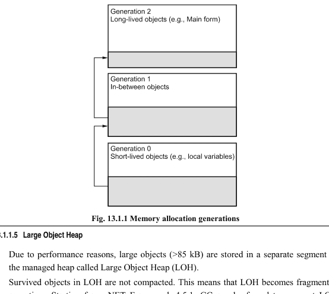

图 13.1.1 内存分配代

### 13.1.1.5 大对象堆

- 1. 出于性能原因，大对象（>85 kB）存储在托管堆中一个称为大对象堆（LOH）的单独段中。
- 2. LOH 中幸存的对象不会被压缩。这意味着 LOH 会随着时间推移而碎片化。从 .NET Framework 4.5.1 开始，可以在完全垃圾回收期间强制 GC 压缩 LOH。

### 13.1.1.6 使用 System.GC

System.GC 类型允许应用程序对垃圾回收器进行一些直接控制。通过读取 GC.MaxGeneration 属性，可以获取托管堆支持的最大代数的信息。目前，GC.MaxGeneration 属性始终返回 2。

还可以通过调用下面两个方法之一来强制垃圾回收器执行回收。

```csharp
void GC.Collect(Int32 Generation)
void GC.Collect()
```

第一个方法允许指定要回收的代。可以将 0 到 GC.MaxGeneration（含）之间的任何整数传递给该方法。传递 0 会导致回收第 0 代；传递 1 会导致回收第 1 代和第 0 代；传递 2 会导致回收第 2 代、第 1 代和第 0 代。不带参数的 Collect 方法版本会强制对所有代执行完全回收，等效于调用：

```csharp
GC.Collect(GC.MaxGeneration);
```

应尽可能避免调用任何 Collect 方法；最好让垃圾回收器自行运行。但由于应用程序比运行时更了解自身行为，因此有时可以强制进行某些回收。例如，在应用程序中，可以在用户保存数据文件后强制对所有代执行完全回收；或者 Internet 浏览器可以在页面卸载时执行完全回收；或者应用程序可以在冗长操作后强制进行回收。这样可以隐藏回收正在占用处理时间的事实，并防止在用户与应用程序交互时发生回收。

GC 类型还提供 WaitForPendingFinalizers 方法。此方法只是暂停调用线程，直到处理 freachable 队列的线程清空该队列、调用每个对象的 Finalize 方法为止。此外，垃圾回收器还提供两个方法，用于确定对象当前所在的代：

```csharp
Int32 GetGeneration(Object obj)
Int32 GetGeneration(WeakReference wr)
```

GetGeneration 的第一个版本接受对象引用作为参数，第二个版本接受 WeakReference 作为参数。返回的值将介于 0 到 GC.MaxGeneration（含）之间。

### 13.1.1.7 清理非托管资源

当应用程序拥有非托管对象时，GC 无法清除它们，因此需要在使用完这类对象后显式释放它们。大多数情况下，非托管对象包装了操作系统资源，例如文件流、数据库连接、网络相关实例、不同类的句柄、注册表、指针等。GC 负责跟踪所有托管和非托管对象的生命周期，但 GC 仍然不知道如何释放非托管资源。

清理非托管资源有不同的方法：
- 实现 IDisposable 接口和 Dispose 方法。
- `using` 块也用于清理非托管资源。


实现 `Dispose` 方法有两种方式：

1. 使用 `SafeHandle` 类实现 `Dispose`（它是一个内置抽象类，包含 `CriticalFinalizerObject`，并且已实现 `IDisposable` 接口）。
2. 重写 `Object.Finalize` 方法（该方法在特定对象被销毁之前清理其使用的非托管资源）。

## 13.1.2 C# 中的指针

### 13.1.2.1 指针

C# 在有限程度上支持指针。指针被定义为包含另一个变量内存地址的变量。

指针可以声明为：

```csharp
type *var_name;
int* iptr;
```

这里 `*` 称为解引用运算符，`iptr` 是包含整型变量地址的变量。

```csharp
int num = 30;
int* iptr = &num;  // where &num is the memory address of num variable
Console.WriteLine((int)iptr);  // displaying memory address stored in iptr
// below code line outputs - 30 (displaying value at memory address held by iptr)
Console.WriteLine(*iptr);
```

### 13.1.2.2 不安全代码

- C# 语句既可以在安全上下文中执行，也可以在不安全上下文中执行。在 C# 中，任何涉及指针的代码都需要不安全上下文。与引用类型不同，指针类型不受默认垃圾回收机制的跟踪。也就是说，使用关键字 `unsafe` 标记为不安全的语句在垃圾回收器的控制之外运行。出于同样的原因，指针不允许指向引用类型，甚至不允许指向包含引用类型的结构类型。指针只能指向非托管类型，包括所有基本数据类型、枚举类型、其他指针类型以及仅包含非托管类型的结构。

- 在讨论指针之前，还必须了解 C# 中的另外两个概念，即托管代码和非托管代码。

  **托管代码：** 托管代码在 CLR 的控制下运行。托管代码可跟踪并可被垃圾回收。托管代码由 CLR 在托管环境中运行，并可访问所有 CLR 功能；CLR 会验证托管代码的安全性和类型安全性。

  **非托管代码：** 非托管代码不能由 CLR 执行；它由计算机 CPU 直接执行，并且无法访问 CLR 功能。由于 CLR 对非托管代码没有权限，因此 CLR 无法验证非托管代码的安全性和类型安全性。

### 13.1.2.3 指针的类型

在不安全上下文中，变量类型可以是引用类型、值类型或指针类型，但指针只能指向：

- 基元值类型
- 仅包含值类型的结构
- 其他指针类型

在 C# 中，指针不能指向引用类型，因为引用类型由 CLR 管理并且可以被垃圾回收；但另一方面，指针在非托管环境中运行，不能被 GC（垃圾回收器）跟踪。当指向某个引用的指针被解引用时，该引用随时可能被垃圾回收。因此，在 C# 中，指针不能指向：

- 引用类型
- 包含引用类型的结构

### 13.1.2.4 固定对象

C# 垃圾回收器在垃圾回收过程中可以随意移动内存中的对象。C# 提供了特殊关键字 `fixed` 来告诉垃圾回收器不要移动对象。这意味着它会固定所指向值类型的内存位置。这就是 C# 中所谓的固定（pinning）。`fixed` 语句通常通过生成向垃圾回收器描述信息的表来实现，以指示哪些对象应在可执行代码的哪些区域中保持固定。因此，只要在执行 `fixed` 语句期间实际不发生垃圾回收过程，与此相关的开销就非常小。然而，当确实发生垃圾回收过程时，固定对象可能导致堆碎片化。因此，只有在绝对必要时才应固定对象，并且固定时间应尽可能短。

### 13.1.2.5 C# 中指针的工作方式

**示例**

```csharp
// Pointers in C# -
using System;
using System.Collections.Generic;
using System.Linq;
using System.Text;

namespace Pointers
{
    class Demo
    {
        public void Method()
        {
            unsafe
            {
                int a = 40;
                int b = 20;
                int* ptr1 = &a;
                int* ptr2 = &b;
                Console.WriteLine(*ptr1);   // displaying the value
                Console.WriteLine(*ptr2);   // displaying the value
                Console.WriteLine((int)ptr1); // displaying the address
                Console.WriteLine((int)ptr2); // displaying the address
            }
        }
    }
    class DemoExample
    {
        // main method
        public static void Main()
        {
            Demo d = new Demo();
            d.Method();
        }
    }
}
```

有多种方式可将语句作为不安全代码执行，例如使用修饰符、构造函数等。在上面的示例中，一组语句被标记为不安全。在上面的代码中，有两个变量 `a` 和 `b`，其值分别为 40 和 20，指针包含它们的地址。`Console.WriteLine()` 用于显示变量的值和地址。

### 13.1.2.6 指针与转换

在 C# 中，指针类型不继承自 `object`，并且指针类型与对象之间不存在转换。这意味着指针不支持装箱和拆箱。但 C# 支持不同指针类型之间的转换，以及指针类型与整型之间的转换。C# 支持不安全上下文中的隐式指针转换和显式指针转换。隐式转换为：

1. 从任意指针类型转换为 `void*` 类型。
2. 从 null 类型转换为任意指针类型。

对于任何显式类型转换，都需要强制转换运算符 `()`。显式类型转换为：

1. 从任意指针类型转换为任意其他指针类型。
2. 从 `sbyte`、`byte`、`short`、`ushort`、`int`、`uint`、`long`、`ulong` 转换为任意指针类型。
3. 从任意指针类型转换为 `sbyte`、`byte`、`short`、`ushort`、`int`、`uint`、`long`、`ulong` 类型。

### 13.1.2.7 指针算术

在不安全上下文中，`++` 和 `--` 运算符可应用于除 `void*` 类型之外的所有类型的指针变量。指针算术基于指针所持有地址的数据类型大小以及实际持有的地址进行运算。在指针算术中，对值进行运算是荒谬的。因此，对于每种指针类型 `P*`，以下运算符都会被隐式重载：

```csharp
P* operator ++(P* x);
P* operator --(P* x);
```

对于类型为 `P*` 的指针变量，`++` 运算符将 `sizeof(P)` 加到变量包含的地址上，`--` 运算符从变量包含的地址中减去 `sizeof(P)`。

在不安全上下文中，可以将常量加到指针变量上，或从指针变量中减去常量。类似地，可以从一个指针变量中减去另一个指针变量。但在 C# 中不允许将两个指针变量相加。

在不安全上下文中，关系运算符（如 `==`、`!=`、`<=`、`>=`、`<` 和 `>`）可应用于所有指针类型的值。在 C# 中，指针变量不能与常量或另一个指针变量进行乘法和除法运算。

### 13.1.2.8 堆栈分配

在不安全上下文中，局部声明可以包含堆栈分配初始值设定项，它从调用堆栈分配内存。在 C# 中，运算符 `stackalloc P[Exp]` 要求 `P` 为非托管类型，`Exp` 为 `int` 类型的表达式。上述构造从调用堆栈分配 `Exp * sizeof(P)` 字节，并生成指向新分配块的 `P*` 类型指针。如果 `Exp` 为负，则引发 `System.OverflowException`。如果没有足够的内存可供分配，则引发 `System.StackOverflowException`。新分配内存的内容未定义。无法隐式释放使用 `stackalloc` 分配的内存。相反，一旦函数返回，所有堆栈分配的内存块都会自动丢弃。

### 13.1.2.9 指针与数组

在 C# 中，可以使用指针表示法访问数组元素，如下面的程序所示。

```csharp
using System;

class DemoClass
{
    public unsafe void Method()
    {
        int[] iArray = new int[10];
        for (int cnt = 0; cnt < 10; cnt++)
        {
            iArray[cnt] = cnt * cnt;
        }
        fixed (int* ptr = iArray)
            Display(ptr);
        // Console.WriteLine(*(ptr + 2));
        // Console.WriteLine((int)ptr);
    }

    public unsafe void Display(int* pt)
    {
        for (int itr = 0; itr < 10; itr++)
        {
            Console.WriteLine(*(pt + itr));
        }
    }
}

class UseDemo
{
    public static void Main()
    {
        DemoClass dc = new DemoClass();
        dc.Method();
    }
}
```

### 13.1.2.10 指针与结构

C# 中的结构是值类型。如果结构仅包含值类型作为成员，则指针可与结构一起使用。如下面的程序所示。

```csharp
using System;

struct DemoStruct
{
    public int n1;
    public int n2;
}
```

```csharp
public void SetN1N2(int i, int j)
{
    n1 = i;
    n2 = j;
}
public void ShowN1N2()
{
    Console.WriteLine(n1);
    Console.WriteLine(n2);
}
class DemoTest
{
    public unsafe static void Main()
    {
        DemoStruct ds = new DemoStruct();
        DemoStruct* ds1 = &ds;
        ds1->SetN1N2(100, 200);
        ds1->ShowN1N2();
    }
}
```

## 13.2 错误与异常

### 13.2.1 错误及其分类

**概念**

- 计算机程序必须处理错误，程序员也是如此。错误是不属于程序正常运行的意外情况，例如内存耗尽。

**解释**

- 错误可以根据其发生时间分类，也可以根据它们可能对运行过程造成的损害或应处理的方式进行分类。
- 错误有几种类型。
  - 1. 根据造成的损害——致命错误、非致命错误。
  - 2. 根据损害发生的位置——系统错误、应用程序错误。
  - 3. 根据错误产生的原因——算术错误、IO 错误、逻辑错误、硬件错误。

下图 13.2.1 描述了错误的基本层次分类。

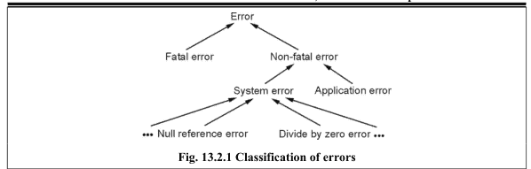

**图 13.2.1** 错误的分类

- **检测错误（调试）的技术**：如果测试阶段表明存在逻辑错误，或者无法找出运行时错误的原因，就有必要对程序进行调试。
- 可以通过两种方式获取有助于调试程序的信息：
  - 1. 在代码中插入输出语句；
  - 2. 借助**调试器**执行程序。

### 13.2.2 异常

**概念**

- 1. 当程序员预见到某些情况，但没有以“常规方式”处理它们时，就会导致异常。这种情况可以通过异常处理机制恢复，否则可能被置之不理，从而导致程序崩溃。异常处理使应用程序具有健壮性，即能够抵御各种类型的意外情况。

**解释**

- 2. 异常是在程序执行期间出现的问题。C# 异常是对程序运行时出现的异常情况的响应，例如尝试除以零。
- 3. C# 以 try 和 catch 块的形式为异常处理提供了结构化解决方案。使用这些块，可以将核心程序语句与容易发生异常的语句和异常处理语句分开。

**这些错误处理块使用 try、catch 和 finally 关键字实现。**

- 4. **异常处理**
  - 1. 异常提供了一种将控制权从程序的一部分转移到另一部分的方法。C# 异常处理基于四个关键字构建：**try**、**catch**、**finally** 和 **throw**。

**语法**

```csharp
try
{
    // code that may raise exceptions
}
catch (Exception ex)
{
    // handle exception
}
finally
{
    // final cleanup code
}
```

- 2. 可能引发异常的程序代码放在 try 块中，其后是 catch 和/或 finally 块。try-catch 块放在可能生成异常的代码周围。try-catch 块内的代码称为受保护代码。
- 3. 变量声明通常放在 try 块之外，以便可以在 catch 和 finally 块中访问它们。
- 4. try 块后面必须跟 catch 或 finally 块，或同时跟两者。没有 catch 或 finally 块的 try 块将导致编译时错误。
- 5. 还可以指定具有不同异常类型的多个 catch 块；这称为异常筛选器。当希望以不同方式处理不同异常时，多个 catch 块很有用。
- **6. 'try' 是一个代码块**：try 块标识一个代码块，针对该代码块会激活特定异常，或者在该代码块中预期会发生异常。在异常处理的术语中，称异常由该代码“引发”。try 块后面跟一个或多个 catch 块。
- **7. 'catch' 是一个代码块**：catch 块包含用于处理异常的代码。也就是说，它是一个异常处理例程，仅在异常被引发时才会被调用。在异常处理的术语中，称 catch 块“捕获异常”，然后运行自己的代码。
- **8. 'Finally' 是一个代码块**：
  - finally 块用于在无论是否引发异常的情况下执行给定的一组语句。
  - finally 块通常用于清理代码，例如释放非托管对象等。
  - finally 块必须位于 try 或 catch 块之后。
  - finally 块是可选的。
  - 不允许有多个 finally 块。
  - finally 块不能包含 return、continue 或 break 关键字。它不允许控制权离开 finally 块。
- **9. 'Throw' 是一条语句**：Throw 是一种编程语句，用于在程序中发生异常情况时抛出异常。当 try 块中出现问题情况时，称程序“抛出异常”，此时 catch 块会捕获它并执行自己的代码。'throw' 是用于抛出异常的关键字。

**示例**

```csharp
//illustration of exception handling using try catch
using System;
namespace Exceptionhandling
{
    class ArrayOps
    {
        int[] nums = new int[3];
        public void Show()
        {
            try
            {
                nums[0] = 128;
                nums[1] = 64;
                nums[2] = 16;
                nums[3] = 2;

                foreach(int cnt in nums)
                    Console.WriteLine(nums[cnt]);
            }
            catch
            {
                Console.WriteLine("Exceptional situation occurred. Stopping Application.");
            }
        }
        static void Main(string[] args)
        {
            ArrayOps ops = new ArrayOps();
            ops.Show();
        }
    }
}
```

输入：无

**输出**

发生异常情况。停止应用程序。

**示例**

```csharp
//illustration of try catch and finally
using System;
namespace ExceptionHandling
{
    class NumberOps
    {
        int ans;
        NumberOps()
        {
            ans = 0;
        }
        public void GetQuotient(int n1, int n2)
        {
            try
            {
                ans = n1 / n2;
            }
            catch (DivideByZeroException ex)
            {
                Console.WriteLine("Exception caught and handled: {0}", ex);
            }
            finally
            {
                Console.WriteLine("Quotient: {0}", ans);
            }
        }
        static void Main(string[] args)
        {
            NumberOps ops = new NumberOps();
            ops.GetQuotient(32, 2);
            ops.GetQuotient(16, 0);
        }
    }
}
```

输入：无

**输出**

```text
Quotient: 16

Exception caught and handled: System.DivideByZeroException: Attempted to divide by zero.
at ...
Quotient: 0
```

- **10. 多个 catch 块**
  - 一个代码块很可能引发多个异常，因此需要多个 catch 块。
  - 多个 catch 块有助于区分异常，并分别以不同方式处理它们。
  - 具有不同异常类型的多个 catch 块有助于根据错误向用户显示适当消息，从而使用户不会再次重复同样的错误。
  - 不允许具有相同异常类型的多个 catch 块。这会产生编译时错误。
  - **强烈建议**：将更具体的 catch 语句放在前面，然后向下放置更通用的异常。

**语法**

```csharp
try
{
    // statements causing exception, that may raise multiple exceptions.
}
catch (ExceptionName e1)
{
    // Exception handling code
}
catch (ExceptionName e2)
{
    // Exception handling code
}
catch (ExceptionName eN)
```

**输出**

不是有效数字

- **11. 无效的 catch 块**
  - 1. 程序员在编写多个 catch 块时需要注意。没有参数的 catch 块（即无参数的 catch 块）和带有 Exception 参数的 catch 块**不允许出现在同一个 try-catch 语句中**，因为它们执行相同的操作。
  - 2. 无参数的 catch 块 `catch { }` 或通用 catch 块 `catch (Exception ex) { }` 必须是最后一个块。对于 `catch { }` 或 `catch (Exception ex)` 块之后的任何其他 catch 块，编译器将**报错**。

**示例**

```csharp
//illustrating Invalid catch blocks… it generates compile-time error.

try
{
    //code that may raise an exception
}
catch //parameterless catch block
{
    Console.WriteLine("Exception raised");
}
catch(Exception ex) //catch with Exception class object as parameter.
                    //Cannot have both catch and catch(Exception ex)
{
    Console.WriteLine("Exception raised");
}
```

**示例**

```csharp
//illustrating Invalid catch blocks… it generates compile-time error.

try
{
    //code that may raise an exception
}
catch
{
    // this parameterless catch block must be last catch block
}
catch (NullReferenceException nullEx)
{
    Console.WriteLine(nullEx.Message);
}
```


```csharp
catch (InvalidCastException inEx)
{
    Console.WriteLine(inEx.Message);
}
```

## 12. 嵌套 try-catch

- C# 支持 try catch 块的嵌套。
- 在嵌套的 try catch 块中，异常将在发生异常的那个 try 块之后的 catch 块中被捕获。
- 如果内部没有具有适当异常类型的 catch 块，则异常将流向外部 catch 块，直到找到适当的异常筛选器。这为内部 try 块带来的优势是，它可以利用外部 try 块的 catch 块。

### 示例

```csharp
//illustration 1 Nested try-catch

static void Main(string[] args)
{
    Book bk = null;

    try
    {
        try
        {
            bk.AuthorName = "";
        }
        catch
        {
            Console.WriteLine("Inner catch");
        }
    }
    catch
    {
        Console.WriteLine("Outer catch");
    }
}
```

输入：Nil

### 输出

```text
Inner catch
```

### 示例

```csharp
//Illustration Nested try-catch

static void Main(string[] args)
{
    Book bk = null;

    try
    {
        try
        {
            // following throws NullReferenceException
            bk.AuthorName = "";
        }
        catch (InvalidOperationException innerEx)
        {
            Console.WriteLine("Inner catch");
        }
    }
    catch (Exception e)
    {
        Console.WriteLine("Outer catch");
    }
}
```

输入：nil

### 输出

Outer catch

## 13. 显式引发异常并抛出异常——使用 throw 关键字

- 与 CLR 自动引发异常的方式类似，异常也可以手动引发。
- 可以使用 throw 关键字手动引发异常。
- 任何派生自 *异常* 类的异常类型都可以使用 throw 关键字引发。throw 关键字不能与任何不派生自 Exception 类的其他类型一起使用。

### 示例

```csharp
//Illustration of throw
namespace ExceptionHandling
{
class Demo
{
    private static void BookDetails(Book b)
    {
        if (b == null)
            throw new NullReferenceException("Book object : NULL.");

        Console.WriteLine(b.AuthorName);
    }

    static void Main(string[] args)
    {
        Book bk = null;

        try
        {
            BookDetails(bk);
        }
        catch (Exception e)
        {
            Console.WriteLine(e.Message);
        }
    }
}
}
```

输入：nil

### 输出

Book object : NULL.

## 13.2.3 C# 中的异常类

### 概念

- 1. 关于异常的所有相关知识都封装在异常对象中。

### 说明

- 2. 该类封装了相关的异常知识，例如发生位置（类、方法、行号）、异常类型、异常消息的表述、调用堆栈信息，并提供异常从起源位置到处理位置的传递。
- 3. C# 中的 Exception 类
  - System.SystemException 类是所有预定义系统异常的基类。
  - 下表列出了派生自 System.SystemException 类的一些预定义异常类。

| 异常类 | 描述 |
|---|---|
| System.IO.IOException | 处理 I/O 错误。 |
| System.IndexOutOfRangeException | 处理方法引用数组索引超出范围时生成的错误。 |
| System.ArrayTypeMismatchException | 处理类型与数组类型不匹配时生成的错误。 |
| System.NullReferenceException | 处理取消引用空对象时生成的错误。 |
| System.DivideByZeroException | 处理被除数除以零时生成的错误。 |
| System.InvalidCastException | 处理类型转换期间生成的错误。 |
| System.OutOfMemoryException | 处理可用内存不足时生成的错误。 |
| System.StackOverflowException | 处理堆栈溢出时生成的错误。 |

### “Exception”类

这是 .NET Framework 提供的内置类，用于处理发生的任何异常。

Exception 类是 .NET Framework 提供的所有其他 Exception 类的基类。

Exception 类对象具有各种属性，下面列出了其中一些。

| 属性 | 用途 |
|---|---|
| Message | 提供有关消息的详细信息 |
| StackTrace | 提供函数堆栈，以显示异常抛出的位置 |
| TargetSite | 显示哪个方法抛出了异常 |

## 13.2.4 用户定义异常

### 概念

- 尽管 .NET 环境提供了各种内置异常，但开发者可能希望拥有自己的、特定于对象的异常。

### 说明

- 可以定义自己的异常，称为用户定义异常。
- 用户定义异常类派生自 Exception 类。

### 示例

```csharp
//illustration of user-defined exception
using System;

namespace ExceptionHandling
{
//user-defined exception class
public class AgeBelowEighteen: Exception
{
public AgeBelowEighteen (string message): base(message)
{
}
}
}

//class that throws user-defined exception
public class AgeCheck
{
int age = 14;
public void showAge()
{
if(age <18)
{
// throwing user-defined exception
throw (new AgeBelowEighteen ("Age out of criteria"));
}
else
{
Console.WriteLine("Fit for Age: {0}",age);
}
}
}

//class that catches the thrown exception

class TestAge
{
static void Main(string[] args)
{
AgeCheck obj = new AgeCheck();
try
{
obj.showAge();
}
//catching thrown user-defined exception
catch (AgeBelowEighteen eab)
{
    Console.WriteLine("Disqualified : {0}", eab.Message);
}
}
}
```

输入：nil

### 输出

Disqualified : Age out of criteria

## 13.2.5 SQL Server 异常

## 13.2.5.1 SQL Server 异常处理基础

### SQL Server——SQL Server 中发生异常时会发生什么？

- 在 SQL Server 中，每当发生异常时，它会显示异常消息，然后继续执行程序。也就是说，它显示错误部分并继续往下执行，而这不应发生。

### SQL Server 中的异常处理

- 在编程语言中处理异常需要停止异常终止，并允许与错误无关的语句执行；而在 SQL Server 中处理错误意味着停止与错误相关的语句的执行。
- 随着 SQL Server 2005 中引入 Try/Catch 块，SQL Server 中的错误处理现在与 C# 等编程语言非常相似。

### 示例——一个存储过程及其在引发异常时的输出

- 一个用于将两个数相除并会引发异常的 SQL Server 存储过程。

```sql
CREATE PROCEDURE spDivideTwoNumber
@Number1 INT,
@Number2 INT
AS
BEGIN
DECLARE @Result INT
SET @Result = 0
SET @Result = @Number1 / @Number2
PRINT 'RESULT IS '+CAST(@Result AS VARCHAR)
END
```

当使用 100 和 0 执行上述存储过程时，会出现以下错误。这是因为除数值为 0，众所周知，根据数学规则，一个数不能除以零。

Msg 8134, level 16, state 1, procedure spDivideTwoNumber, Line 21 divide by zero error encountered.
RESULT IS : 0

因此，尽管发生了错误，下一段代码仍会执行。一个好的应用程序不应有这种处理方式，而应向用户传达发生了什么，然后安全地关闭应用程序，或者等待用户进一步输入。要实现这一点，必须编写异常处理代码。

### 使用 RAISERROR 系统函数进行异常处理

```sql
ALTER PROCEDURE spDivideTwoNumber
@Number1 INT,
@Number2 INT
AS
BEGIN
DECLARE @Result INT
SET @Result = 0
IF(@Number2 = 0)
BEGIN
RAISERROR('Second Number Cannot be zero',16,1)
END
ELSE
BEGIN
SET @Result = @Number1 / @Number2
PRINT 'RESULT IS :'+CAST(@Result AS VARCHAR)
END
END
```

## 13.2.5.2 理解 SQL Server 中的 RAISERROR 系统函数

RAISERROR 系统函数接受 3 个参数，如下所示：

RAISERROR('Error Message', ErrorSeverity, ErrorState)

Error Message——每当引发异常时要显示的自定义错误消息。

Error Severity——在大多数情况下，在 SQL Server 中返回自定义错误时，需要将 ErrorSeverity 级别设置为 16，这表示这是一个

一般错误，并且该错误可由用户更正。在上面的示例中，可以通过为第二个参数传入非零值来更正该错误。

- **错误状态** - ErrorState 也是一个介于 1 和 255 之间的整数值。只有当错误状态值设置为 1 到 127 之间时，RAISERROR() 函数才能生成自定义错误。
- 在 SQL Server 2000 中，为了检测错误，使用 @@Error 系统函数。如果有错误，@@Error 系统函数返回非零值；否则返回零，表示上一条 SQL 语句执行时没有任何错误。

## 在 SQL Server 中使用 @@Error 系统函数

- 使用 @@ERROR 系统函数的上述存储过程的修改版本如下所示。

```sql
ALTER PROCEDURE spDivideTwoNumber
@Number1 INT,
@Number2 INT
AS
BEGIN
DECLARE @Result INT
SET @Result = 0
IF(@Number2 = 0)
BEGIN
RAISERROR('Second Number Cannot be zero',16,1)
END
ELSE
BEGIN
SET @Result = @Number1 / @Number2
END

IF(@@ERROR <> 0)
BEGIN
PRINT 'Error Occurred'
END
ELSE
BEGIN
PRINT 'RESULT IS :'+CAST(@Result AS VARCHAR)
END
END
```

当执行上述存储过程并传入 100 和 0 时，会得到以下输出。

```text
Msg 8134, level 16, state 1, procedure spDivideTwoNumber, Line 21: divide by zero error encountered.
RESULT IS : 0
```

## 预定义错误术语详解

- 每当程序中出现错误时，例如数字除以零、违反主键、违反检查约束等，系统都会显示一条错误消息，向应用程序传达代码中遇到的问题。程序中发生的每个错误都与四个特性相关联。
  - 1. 错误编号
  - 2. 错误消息
  - 3. 严重级别
  - 4. 错误状态

### 示例

消息 8134（错误编号），级别 16（严重级别），状态 1（状态），遇到除零错误（错误消息）

- **错误编号：** 错误编号是为 SQL Server 中发生的每个错误提供的唯一标识符。对于预定义错误，此值将低于 50,000；对于用户定义的错误，此值必须高于 50,000。
- **错误消息：** 它是一段简要描述所发生错误的信息，最大长度应为 2047 个字符。
- **严重级别：** 这表示错误的重要性，范围为 0 到 24。其中：
  - 1. 0 到 9：不严重，可视为信息或状态消息。
  - 2. 11 到 16：表示这些错误可由用户创建。
  - 3. 17 到 19：表示这些是软件错误，用户无法更正，必须报告给系统管理员。
  - 4. 20 到 24：表示致命错误，如果发生这些错误，可能会损坏系统或数据库。因此，此时与数据库的连接会立即终止。
- **错误状态：** 它是一个任意值，并不是那么重要，范围可以在 0 到 127 之间。当同一错误必须在多个位置发生时，就会使用该值。

```sql
Set @val1=8;
Set @val2=@val1/0; /* Error Occur Here */
END TRY
BEGIN CATCH
Print 'Error Occur that is:'
Print Error_Message()
END CATCH
```

输出：

```text
Error Occur that is:
Divide by zero error encountered
```

## 2. 用户定义异常

这种类型的异常由用户生成，而不是由系统生成。

### 示例 - 用户定义异常

```sql
Declare @val1 int;
Declare @val2 int;
BEGIN TRY
Set @val1=8;
Set @val2=@val1%2;
if @val1=1
Print 'Error Not Occur'
else
Begin
Print 'Error Occur';
Throw 60000,'Number Is Even',5
End

END TRY
BEGIN CATCH
Print 'Error Occur that is:'
Print Error_Message()
END CATCH
```

### 输出

```text
Error Occur
Error Occur that is:
Number Is Even
```

这里 60000 表示错误编号，5 表示要与该消息关联的状态。

## 13.2.5.5 使用系统函数获取错误信息

- 系统生成错误消息可以在使用名为 ERROR_MESSAGE() 的系统函数收集错误信息后显示。

考虑下面的错误消息。结合它，下面讨论错误消息的所有部分。

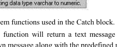

SQL Server 有六个预定义系统函数用于 Catch 块中。

- 1) **ERROR_MESSAGE()** - 此函数将返回解释错误的文本消息。可以随预定义消息一起嵌入或添加自己的消息。

```sql
BEGIN TRY
SELECT 1/0
END TRY
BEGIN CATCH
SELECT 'AN ERROR OCCURRED:' + ERROR_MESSAGE() AS Custom_Error
END CATCH
```

结果为“发生错误：遇到除零错误。”

- 2) **ERROR_NUMBER()** - 返回错误的编号。通常这些编号在 Catch 块中用作条件，这有助于编写自定义消息。每个 SQL Server 错误都有唯一定义的错误消息及编号。

通过运行以下查询可以查看所有系统错误。

```sql
SELECT * FROM master.dbo.sysmessages
```

- 3) **ERROR_SEVERITY()** - 返回错误的严重级别。执行上述查询时，可以注意到第二列名为 severity。这表示错误的性质。

```sql
SELECT DISTINCT severity
FROM master.dbo.sysmessages
ORDER BY severity
```

例如，如果执行以下代码，输出将如下所示。

```sql
BEGIN TRY
SELECT 1/0
END TRY
BEGIN CATCH
SELECT 'ERROR SEVERITY: ' + CAST(ERROR_SEVERITY() AS VARCHAR(2)) AS Error
END CATCH
```

结果为错误严重级别：16。

严重级别 16 表示该错误是由于用户问题而发生的，并且可以由用户修复。

- 4) **ERROR_STATE()** - 此函数将返回一个整数值，指示代码中发生错误的确切位置。在多用户环境中，错误的“状态”有助于轻松定位和诊断错误。

```sql
SELECT ERROR_STATE() AS ErrorState
```

- 5) **ERROR_PROCEDURE()** - 返回抛出错误的过程名称。可以通过在 catch 块内添加以下行来完成。

```sql
SELECT ERROR_PROCEDURE() AS Stored_Procedure
```

如果不是过程，而是查询，则它将返回 NULL。

- 6) **ERROR_LINE()** - 返回实际发生错误的行号。

这有助于开发者准确定位错误（代码）的位置并修复它。

## 13.2.5.6 高级 SQL 错误处理

也可以对事务进行异常处理。这可以通过运行和分析报告事务状态的 XACT_STATE 函数来实现。

此函数返回以下三个值之一：

- 1 - 事务可提交
- -1 - 事务不可提交，应回滚
- 0 - 没有挂起的事务

这里唯一关键的一点是，要记得在 catch 语句中实际执行此操作，因为需要更好地停止事务，而不是先启动事务，然后再提交或回滚它们。

## 13.3 反射与特性

### 13.3.1 应用程序元数据特性

### 概念

- 1. 特性是一种向程序本身添加元数据的机制，例如编译器指令以及关于数据、方法和类的其他数据。特性被插入到元数据中，并可通过 ILDasm 和其他读取元数据的工具查看。

### 说明

- 2. 特性是声明性标记。声明性标记由置于其适用元素上方的方括号（[ ]）表示。
- 3. 特性用于向程序添加元数据，例如编译器指令以及注释、描述、方法和类等其他信息。.NET Framework 提供两种类型的特性：*预定义特性和自定义特性*。
- 4. 特性会在派生类中继承。

### 13.3.1.1 特性的类型

特性可以是**预定义特性（内在特性）**或自定义特性。**内在特性**作为公共语言运行时（CLR）的一部分提供，并集成到 .NET 中。**自定义特性**是为自身目的创建的特性。大多数程序员只会使用内在特性，不过自定义特性与反射结合时可以成为强大的工具。

### 特性目标

应用特性的实体称为目标。有些特性应用于程序集，另一些应用于类或接口，还有一些（例如 [WebMethod]）应用于类成员。这些称为特性目标。**可能的特性目标如下所述。**

| 成员名称 | 用法 |
|---|---|
| 全部 | 应用于以下任意元素：程序集、类、构造函数、委托、枚举、事件、字段、接口、方法、模块、参数、属性、返回值或结构 |
| 程序集 | 应用于程序集本身 |
| 类 | 应用于类的实例 |
| 构造函数 | 应用于给定构造函数 |
| 委托 | 应用于委托的方法 |
| 枚举 | 应用于枚举 |


| 事件 | 应用于事件 |
| --- | --- |
| 字段 | 应用于字段 |
| 接口 | 应用于接口 |
| 方法 | 应用于方法 |
| 模块 | 应用于单个模块 |
| 参数 | 应用于方法的参数 |
| 属性 | 应用于属性（如果已实现，则包括 get 和 set） |
| 返回值 | 应用于返回值 |
| 结构 | 应用于结构 |

## 13.3.1.2 特性参数

- 1. 特性信息存储在关联元素的元数据中。
- 2. 以下语法用于指定一个特性：
- 3. 特性可能需要一个或多个参数，包括位置参数或命名参数。
  - 位置参数用于指定关于特性的信息。
  - 命名参数用于传达关于特性的可选信息。
  - 位置参数与命名参数的区别在于，命名参数使用参数名来指定，并且始终是可选的。
  - DllImportAttribute 特性就是一个同时使用位置参数和命名参数的示例。

```
[ attribute ( positional_parameters , name_parameter = value, ... ) ] element
```

## 13.3.1.3 在应用程序中应用自定义特性

- 1. 可以通过将特性放在目标之前来应用它。
- 2. 特性通常物理地放在类型和类型成员声明的前面。
- 3. 它们使用方括号 "[" 和 "]" 声明，将特性括起来，例如以下 Obsolete.Attribute 特性：

    ```
    [ObsoleteAttribute]
    ```

- 4. 特性名称中的“Attribute”部分是可选的。因此以下内容与上面的特性等效：

    ```
    [Obsolete]
    ```

- 5. 当特性的应用方式存在歧义时，可以添加目标说明，以确保正确的语言元素被正确修饰。
- 6. CLSCompliant.Attribute 特性有助于确保程序集遵循公共语言规范（CLS）。
- 7. CLS 是一组标准，使不同的 .NET 语言能够相互通信。特性目标通过在特性名称前添加目标并用冒号（:）分隔来指定。

### 示例

```
//illustration of attribute

using System;

class AtribDemo
{
    static void Main()
    {
        // Warning: ' AtribDemo.Show() ' is obsolete
        Show();
    }
}

[Obsolete]    //applying attribute
static void Show()
{
}
```

### 输出

```
//Warning generated by program
'AtribDemo.Show()' is obsolete
```

## 13.3.1.4 创建自定义特性

- 1. 可以通过 .NET 框架创建自定义变量。信息会被存储，并可由用户在运行时检索。
- 2. 可以编写简单的代码来读取元数据，以查找错误修复标记并帮助更新数据库。元数据是描述数据的数据，用于描述其他数据。
- 3. 创建自定义特性需遵循以下步骤

### 声明自定义特性类

  - 1. 定义自定义特性。
  - 2. 命名自定义特性。
  - 3. 构造自定义特性。
  - 4. 将自定义特性应用于目标应用程序。

```
using System;
public class Comments : Attribute
{
}
```

- 4. 要创建自定义特性，需要从 Attribute 类继承。下面是一个简单的 "CheckAttribute"，它具有一个 "CheckText" 属性。

```
class CheckAttribute : Attribute
{
public string CheckText { get; set; }
}
```

- 5. 现在将 "CheckAttribute" 应用于某个类，如下面代码所示的 "Customer"。现在看到此类的开发人员会直接看到相关信息。

```
[Check(CheckText="Attribute for class")]
class Book
{
private string BookID;

[Check(CheckText = " Attribute for property")]
public string BookId
{
get { return BookID; }
set { BookID = id; }
}

[Check(CheckText = " Attribute for method")]
public void Details()
{
}
}
```

- 2) 执行类型发现：它允许用户检查程序集中的各种类型并实例化它们。
- 3) 对方法和属性应用后期绑定：它允许用户使用类型发现在动态实例化的对象上调用属性和方法。
- 4) 反射发出：它允许用户在运行时创建新类型，并使用它们执行任务。

## 13.3.2.2 查看元数据

- 1. 可以通过 **System.Reflection** 命名空间的 **MemberInfo** 对象查看元数据。该对象有助于发现成员的特性并访问元数据。
- 2. 可以通过错误修复示例来展示反射，并读取 Calculate 类中的元数据，如下所示，

```
Type type = typeof ( Calculate );
```

其中，对 Calculate 类型使用 typeof 运算符会返回 Type 类的对象类型。Type 类是反射类的根。

## 13.3.2.3 类型发现

### 概念

- 1. 反射可用于浏览和检查程序集的内容。可以找到与模块关联的类型；与类型关联的方法、字段、属性和事件，以及该类型每个方法的签名；该类型支持的接口；以及该类型的基类。

### 说明

- 2. 首先，使用 Assembly.Load 静态方法动态加载程序集。为了反射的目的，Assembly 类封装了实际程序集本身。Load 方法的签名是：

```
public static Assembly.Load(AssemblyName)
```

- 3. 其次，通过将核心库传递给 Load 方法来加载程序集。MsCorLib.dll 包含 .NET Framework 的核心类：

```
Assembly a = Assembly.Load("Mscorlib.dll");
```

- 4. 加载程序集后，可以调用 GetTypes( ) 来返回 Type 对象的数组。Type 对象是反射的核心。Type 表示类型声明：类、接口、数组、值和枚举：

```
Type[] types = a.GetTypes( );
```

### 示例

```csharp
//illustrating use of reflection to inspects a class and to display the metadata information
//dynamically.
using System;
using System.Collections.Generic;
using System.Linq;
using System.Text;
using System.Reflection;

namespace ReflectionDemo
{
    public class Book
    {
        //string Title;
        public string Title
        {
            get
            {
                return Title;
            }
            set
            {
                Title = val;
            }
        }
        public Book()
        {
        }
        public Book(string t)
        {
            this.Title = t;
        }
        public void Show()
        {
        }

        public string val { get; set; }
    }
    public class ApplyReflection
    {
        public static void MetadataDetails(Type tp)
        {
            Console.WriteLine("Class " + tp);
            Console.WriteLine();
Console.WriteLine("Namespace  " + tp.Namespace);
Console.WriteLine();

//finding type constructor information
ConstructorInfo[] constructorInfo = tp.GetConstructors();

Console.WriteLine("Constructors  ");
foreach (ConstructorInfo ctr in constructorInfo)
{
    Console.WriteLine(ctr);
}

//finding type property information

PropertyInfo[] propertyInfo = tp.GetProperties();
Console.WriteLine();
Console.WriteLine("Properties  ");

foreach (PropertyInfo prt in propertyInfo)
{
    Console.WriteLine(prt);
}

// Finding type methods

MethodInfo[] methodInfo = tp.GetMethods();
Console.WriteLine();
Console.WriteLine("Methods  ");
//finding type parameter information
ParameterInfo[] parameterInfo = null;
foreach (MethodInfo mt in methodInfo)
{
    Console.WriteLine("Method Name  " + mt.Name);
    parameterInfo = mt.GetParameters();

    foreach (ParameterInfo pmt in parameterInfo)
    {
        Console.WriteLine("Parameter Type" + pmt.ParameterType + " Parameter Name " + pmt.Name);
    }
}
public static void Useme()
{
    MetadataDetails(typeof(Book));
    Console.ReadKey();
}
```


```csharp
        }
    }
}

using System;
using System.Collections.Generic;
using System.Linq;
using System.Text;
using ReflectionDemo;

namespace ConsoleApplication2
{
    class Program
    {
        static void Main(string[] args)
        {
            ApplyReflection.Useme();
        }
    }
}
```

类    ReflectionDemo.Book
命名空间    ReflectionDemo

构造函数
Void .ctor()
Void .ctor(System.String)

属性
System.String Title
System.String val

方法
方法名    get_Title
方法名    set_Title
参数类型    System.String 参数名 value
方法名    Show
方法名    get_val
参数类型    System.String 参数名 value
方法名    ToString
方法名    Equals
参数类型    System.Object 参数名 obj
方法名    GetHashCode
方法名    GetType

输入 无

## 输出

|  |
|---|
| 类 ReflectionDemo.Book |
| 命名空间 ReflectionDemo |
| 构造函数 |
| ReflectionDemo.Book | Book |
| ReflectionDemo.Book | Book |
| 属性 |

## 两分题及答案

Q.1 什么是垃圾回收器？

答：垃圾回收是 .NET 的一项功能，用于释放内存中未使用的代码对象。

内存堆分为三代：第0代、第1代和第2代。

第0代——用于存储短生存期对象。此代中垃圾回收频繁发生。

第1代——用于中等生存期对象。通常，从第0代移动过来的对象存储在这里。

第2代——用于长生存期对象。

回收某一代是指回收该代及其所有较年轻代中的对象。第2代的垃圾回收意味着完全垃圾回收，它会回收第2代以及第1代和第0代中的所有对象。

在垃圾回收过程中，第一阶段是识别存活对象列表。第二阶段是为那些将被压缩的对象更新引用。最后阶段是回收死亡对象占用的空间。剩余对象被移动到较旧的段中。

Q.2 栈和堆有什么区别？

| 栈 | 堆 |
|---|---|
| 存储值类型 | 存储引用类型 |
| 栈负责跟踪每个正在执行的线程及其位置。 | 堆负责跟踪更具体的对象或数据。 |

Q.3 什么是内存映射文件？

答：内存映射文件用于将文件内容映射到应用程序的逻辑地址。它使您能够在同一台机器上运行多个进程以相互共享数据。要获取内存映射文件对象，可以使用 MemoryMappedFile.CreateFromFiles( ) 方法。它表示来自磁盘文件的持久内存映射文件。

## Q.4 dispose() 和 finalize() 有什么区别？

答：尽管 Dispose 和 Finalize 两种方法都由 CLR 用于执行 .NET 应用程序运行时对象的垃圾回收，但它们之间存在区别。

Finalize 方法由运行时自动调用，而 Dispose 方法由程序员调用。

## Q.5 可以执行多个 catch 块吗？

答：不可以，多个 catch 块不能被执行。一旦执行了正确的 catch 代码，控制权将转移到 finally 块，然后执行 finally 块之后的代码。

## Q.6 throw 异常与 throw 子句的区别。AU：2018年5月

答：Throw 子句——在 Throw 中，原始异常堆栈跟踪将被保留。要保留原始堆栈跟踪信息，正确的语法是不指定异常的 'throw'。

## throw 的声明

```csharp
try
{
// do some operation that can fail
}
catch (Exception ex)
{
// do some local cleanup
throw;
}
```

Throw 异常——在 throw 异常中，原始堆栈跟踪信息将被覆盖，程序将丢失原始异常堆栈跟踪。也就是说，'throw ex' 会重置堆栈跟踪。

```csharp
try
{
// do some operation that can fail
}
catch (Exception ex)
{
    // do some local cleanup
    throw ex;
}
```

因此，基本上 Throw 异常会覆盖堆栈跟踪，这使得很难找到引发异常的原始代码行号。反之，Throw 会保留堆栈信息，并将其添加到所引发异常的堆栈信息中。

## 长答题

- Q.1 内存管理中的代是什么？（参见第13.1节）
- Q.2 讨论 .NET 环境中的 GC。（参见第13.1节）
- Q.3 C# 中的异常是什么？（参见第13.2节）
- Q.4 C# 中的指针是什么？（参见第13.1节）
- Q.5 反射的用途是什么？（参见第13.3节）
- Q.6 详细讨论异常处理。（参见第13.2节） AU：2017年12月，2016年5月
- Q.7 如何在站点中实现安全性？展示不同步骤。（参见第13.3.1节） AU：2017年12月，2016年5月
- Q.8 编写一个C#程序演示 IndexOutOfRange 异常。AU：2018年5月，6分

答：

```csharp
/*
 * C# Program to Demonstrate IndexOutOfRange Exception
 */
using System;
using System.Collections.Generic;
using System.Linq;
using System.Text;
namespace exceptionsdemo
{
    class arrayoutofindex
    {
        public void calculatedifference()
        {
            int diff=0;
            int [] number= new int[5] {1,2,3,4,5};
            try
            {
                for (int init =1; init <=5; init++)
                {
                    diff = diff - number[init];
                }
                Console.WriteLine("The array difference is:" + diff);
            }
            catch (IndexOutOfRangeException e)
            {
                Console.WriteLine(e.Message);
            }
        }
    }
    class raise_exception
    {
        static void Main(string[] args)
        {
            arrayoutofindex obj = new arrayoutofindex();
            obj.calculatedifference();
            Console.ReadLine();
        }
    }
}
```

Q.9 解释：处理来自 SQL Server 的异常。（参见第13.2.5节）

AU：2018年5月，5分

Q.10 详细解释特性（attributes）。（参见第13.3.1节）

AU：2018年5月，6分

Q.11 编写一个C#程序演示多重异常。

AU：2018年12月，7分

答：

```csharp
/* C# program to demonstrate multiple exception */
namespace ExceptionHandlingDemo
{
    class Program
    {
        static void Main(string[] args)
        {
            int a, b, c;
            Console.WriteLine("ENTER ANY TWO NUMBERS");
            try
            {
                a = int.Parse(Console.ReadLine());
                b = int.Parse(Console.ReadLine());
                c = a / b;
                Console.WriteLine("C VALUE = " + c);
            }
            catch (DivideByZeroException dbze)
            {
                Console.WriteLine("second number should not be zero");
            }
            catch (FormatException fe)
            {
                Console.WriteLine("enter only integer numbers");
            }
            Console.ReadKey();
        }
    }
}
```

**Q.12** 处理异常以及从 SQL Server 返回异常。
*(参见第13.2.5节)*
**AU：2018年12月，6分**

**Q.13** 详细讨论反射。  *(参见第13.3.2节)*
**AU：2018年12月，16分**

**Q.14** 详细解释查看元数据和封送处理。
*(参见第13.3.2节)*
**AU：2018年12月，13分**

**Q.15** 讨论常用异常。
*(参见第13.2.3节)*
**AU：2019年5月，13分**

## 备注

## 14.1 诊断与各种相关任务

### 14.1.1 引言

软件应用程序有多个方面需要在应用程序投入使用后加以监控和改进。事实上，在开发过程中以及完成开发之后，都可以从不同角度测试应用程序，以免客户遇到任何问题。软件应用程序不一定总是按预期运行。.NET Core 提供了有助于快速有效地诊断各种问题的工具和 API。

以下是诊断工具的优点：

- 在调试时监控性能的能力。
- 将性能数据与调试活动关联起来。
- 通过 IntelliTrace 和输出窗口获得更丰富的用户体验。
- 缩短识别和修复问题的诊断时间。

### 14.1.2 用于诊断任务的工具类型

- 1. **调试器事件：** 这些工具在调试期间提供对所有中断、输出和 IntelliTrace 事件的访问。数据以时间线和表格视图两种形式呈现。发送到“输出”窗口“调试”选项卡的消息由 IntelliTrace 捕获。事后分析工具可与 Windows 7 及更高版本一起使用。使用调试器运行性能分析工具（诊断工具窗口）需要 Windows 8 及更高版本。
- 2. **内存使用工具：** 这些工具帮助开发人员在调试期间监控应用程序的内存使用情况。开发人员只需查看图表即可分析内存影响、增长和泄漏问题。代码中断事件允许识别图表中与最近调试活动相关的部分。可以在调试操作前后拍摄快照，以分析内存使用和内存增长。开发人员可以查看堆上对象的数量和大小。.NET 对象分配工具有助于识别 .NET 代码中的分配模式和异常情况。
- 3. **CPU 使用率工具：** 这些工具在调试时跟踪应用程序的 CPU 使用率。CPU 使用率工具是开始分析应用程序性能的好地方。它会更多说明应用程序正在消耗的 CPU 资源。开发人员可以获得 CPU 使用率的按函数细分。为此，请转到“调试”>“在不调试的情况下启动诊断工具”，选择“CPU 使用率”，然后单击“启动”。


为了最有效地使用该工具，可以在代码中设置两个断点：一个位于需要分析的函数或代码区域的开头，另一个位于末尾。当在第二个断点处暂停时，可以检查分析数据。**CPU 使用率**视图显示按运行时间从长到短排序的函数列表，运行时间最长的函数位于顶部。这有助于找出发生性能瓶颈的函数。

## 不使用调试器分析发布版本

- **CPU 使用率**和**内存使用率**等分析工具可与调试器一起使用，或者分析工具可以使用**性能探查器**运行事后分析，后者旨在为**发布**版本提供分析。在**性能探查器**中，可以在应用运行时收集诊断信息，然后在应用停止后检查收集到的信息。

## 检查 UI 性能和辅助功能事件（UWP - 通用 Windows 平台）

- 在 UWP 应用程序中，可以在**诊断工具**窗口中启用 **UI 分析**。该工具会搜索常见的性能或辅助功能问题，并在调试过程进行时将其显示在**事件**视图中。事件说明提供有助于解决问题的信息。

## 分析资源消耗（XAML - 可扩展应用程序标记语言）

- 在 XAML 应用程序（例如 Windows 桌面 WPF 应用和 UWP 应用）中，可以使用**应用程序时间线**工具分析资源消耗。例如，可以分析的方面包括：应用程序准备 UI 帧（布局和呈现）所花费的时间、处理网络和磁盘请求所花费的时间，以及在应用程序启动、页面加载和窗口大小调整等场景中的时间。要使用该工具，请在**性能探查器**中选择**应用程序时间线**，然后选择“开始”。在应用程序中，应查看怀疑存在资源消耗问题的场景，然后可以选择**停止收集**以生成报告。

- **视觉吞吐量**图中的低帧率可能对应于应用程序运行时可见的视觉问题。同样，**UI 线程利用率**图中的数值偏高也可能对应于 UI 响应性问题。在报告中，可以选择怀疑存在性能问题的时间段，然后在**时间线详细信息视图**（下方窗格）中检查详细的 UI 线程活动。在**时间线详细信息视图**中，可以找到活动类型（或涉及的 UI 元素）以及活动持续时间等信息。

## 分析 GPU（图形处理单元）使用率

- 在 Direct3D 应用程序中，可以检查 GPU 上的活动并分析性能问题。要使用该工具，可以在性能探查器中选择 GPU 使用率，然后选择“开始”。之后，在分析结束后，可以选择**停止收集**以生成报告。这些图表可用于确定是否存在 CPU 受限或 GPU 受限的性能瓶颈。

## 分析性能（旧版工具）

- 在 Visual Studio 2019 中，旧版性能资源管理器以及相关分析工具（如性能向导）已并入性能探查器，可通过“调试”>“性能探查器”打开。在性能探查器中，可用的诊断工具取决于所选择的目标和当前打开的启动项目。CPU 使用率工具提供以前在性能向导中支持的采样功能。检测工具提供性能向导中曾有的插桩分析功能（用于精确的调用次数和持续时间）。性能探查器中还会显示其他内存工具。

## 14.1.3 System.Diagnostics 命名空间

System.Diagnostics 命名空间提供允许与系统进程、事件日志和性能计数器交互的类。

- 1. EventLog 组件提供以下功能：写入事件日志、读取事件日志项，以及在网络上创建和删除事件日志和事件源。EntryWrittenEventHandler 提供一种异步与事件日志交互的方式。支持类提供对更详细控制的访问，包括权限限制、指定事件日志类型的能力（该类型控制随事件日志项写入的默认数据类型），以及遍历事件日志项集合的能力。可以使用的其他相关类包括 EventLogPermission、EventLogEntryType 和 EventLogEntryCollection 类。

- 2. Process 类提供以下功能：跨网络监视系统进程，以及启动和停止本地系统进程。除了检索正在运行的进程列表（通过指定计算机、进程名或进程 ID）或查看当前有权访问处理器的进程信息之外，还可以通过 Process 类本身以及与 ProcessThread 和 ProcessModule 类交互来详细了解进程线程和模块。ProcessStartInfo 类使您能够指定启动新进程时使用的各种元素，例如输入、输出和错误流、工作目录以及命令行谓词和参数。这些元素可对进程的行为进行精细控制。其他相关类可用于指定窗口样式、进程和线程优先级，以及与线程和模块集合交互。

- 3. PerformanceCounter 类支持监视系统性能，而 PerformanceCounterCategory 类提供创建新的自定义计数器和类别的方法。可以写入本地自定义计数器，并从本地和远程计数器（系统计数器以及自定义计数器）读取。可以使用 PerformanceCounter 类对计数器进行采样，并使用 CounterSample 类根据连续的性能计数器样本计算结果。CounterCreationData 类支持在一个类别中创建多个计数器并指定其类型。与性能计数器组件关联的其他类提供对计数器集合、计数器权限和计数器类型的访问。

System.Diagnostics 命名空间还提供允许调试应用程序和跟踪代码执行的类。

### System.Diagnostics.Debug 类

此类是最流行且广泛使用的类，提供一组有助于调试代码的方法和属性。此类不能被继承。以下是此类的重要方法。

- Assert：重载。检查条件，如果条件为 false，则显示消息
- Write/WriteLine：将有关调试的信息写入 Listeners 集合中的跟踪侦听器
- WriteIf/WriteLineIf：如果条件为 true，则将有关调试的信息写入 Listeners 集合中的跟踪侦听器。

### System.Diagnostics.Trace 类

此类提供一组有助于跟踪代码执行的方法和属性。可以在 Trace 类中使用这些属性和方法来对发布版本进行插桩。插桩允许监视在实际设置中运行的应用程序的运行状况。此类的成员几乎与 Debug 类类似。

### System.Diagnostics.StackTrace 和 System.Diagnostics.StackFrame 类

这些类公开有关例程的堆栈信息。

以下示例将返回调用方法的名称。

```
Hide Copy Code
Dim st As New StackTrace(False)
'just going one level above in the stacktrace
Dim sf As StackFrame = st.GetFrame(1)
mp_MethodName = sf.GetMethod().Name()
mp_MethodName = sf.GetMethod().DeclaringType().Name() & "." & mp_MethodName
```

### System.Diagnostics.SymbolStore 命名空间

System.Diagnostics.SymbolStore 命名空间提供允许读取和写入调试符号信息的类，例如源行到 Microsoft 中间语言 (MSIL) 的映射。面向 .NET Framework 的编译器可以将调试符号信息存储到程序数据库 (PDB) 文件中。调试器和代码分析器工具可以在运行时读取调试符号信息。

### System.Diagnostics 命名空间成员摘要

| 类 | 描述 |
|---|---|
| class BooleanSwitch | 提供一个简单的开/关切换，用于控制调试和跟踪输出。 |
| class ConditionalAttribute | 向编译器指示：如果对方法应用了指定的预处理标识符，则该方法可调用。 |
| class Debug | 提供一组有助于调试代码的方法和属性。此类不能被继承。 |
| class DebuggableAttribute | 修改用于运行时实时 (JIT) 调试的代码生成。此类不能被继承。 |
| class Debugger | 支持与调试器进行通信。此类不能被继承。 |
| class DebuggerHiddenAttribute | 指定 DebuggerHiddenAttribute。此类不能被继承。 |
| class DebuggerStepThroughAttribute | 指定 DebuggerStepThroughAttribute。此类不能被继承。 |


| 类 | 说明 |
|---|---|
| class DefaultTraceListener | 提供跟踪的默认输出方法和行为。 |
| class DiagnosticsConfigurationHandler | 此类型支持 .NET Framework 基础结构，不打算直接从代码中使用。 |
| class Process | 提供对本地和远程进程的访问，并支持启动和停止本地系统进程。 |
| class ProcessStartInfo | 指定启动进程时使用的一组值。 |
| class StackFrame | 提供有关 StackFrame 的信息。 |
| class StackTrace | 获取堆栈跟踪。 |
| class Switch | 提供基类，用于创建新的调试和跟踪开关。 |
| class TextWriterTraceListener | 将跟踪或调试输出定向到 TextWriter 或 Stream，例如 Console.Out 或 FileStream。 |
| class Trace | 提供一组方法和属性，帮助跟踪代码的执行。此类不能被继承。 |
| class TraceListener | 为监视跟踪和调试输出的侦听器提供基类。 |
| class TraceListenerCollection | 提供 TraceListener 对象的线程安全列表。 |
| class TraceSwitch | 提供多级别开关，用于在不重新编译代码的情况下控制跟踪和调试输出。 |

## 枚举

| 枚举 | 说明 |
|---|---|
| enumeration TraceLevel | 指定为 Debug、Trace 和 TraceSwitch 类输出哪些消息。 |

## 14.1.4 一些常用的 .NET 诊断工具

### 托管调试器

托管调试器允许与程序交互。暂停、逐步执行、检查和恢复可让人深入了解代码的行为。对于诊断容易复现的功能问题，调试器是首选。

### 日志记录和跟踪

日志记录和跟踪是相关技术。它们指对代码进行插桩以创建日志文件。这些文件记录程序执行操作的详细信息。这些详细信息可用于诊断最复杂的问题。与时间戳结合使用时，这些技术在性能调查中也很有价值。

### 单元测试

单元测试是持续集成和部署高质量软件的关键组成部分。单元测试的设计使其能够在出现中断时跟踪早期预警。

### .NET Core 诊断 - 全局工具

#### dotnet-counters

dotnet-counters 是一种性能监视工具，用于一级健康监视和性能调查。它观察通过 EventCounter API 发布的性能计数器值。例如，可以快速监视 .NET Core 应用程序中的 CPU 使用率或异常抛出率等内容。

#### dotnet-dump

dotnet-dump 工具是一种无需本机调试器即可收集和分析 Windows 和 Linux 核心转储的方法。

#### dotnet-trace

.NET Core 包含所谓的 EventPipe，通过它公开诊断数据。dotnet-trace 工具允许从应用程序中使用有用的分析数据，这有助于需要查找运行缓慢应用程序根本原因的场景。

## 14.2 .NET 安全

### 概念

**1. 安全模型：** 当在用户界面上执行某些操作时，例如单击按钮，应用程序连接到 Internet，将模块下载到下载程序集缓存中，并开始执行。在幕后，存在什么证明/证据可以让人信任计算机正在下载的代码？

**说明：** .NET 围绕程序集强制执行安全策略。它使用程序集具有的证据，例如文件来源。运行时将来自本地 Intranet 的所有代码放入特定组。然后，它使用安全策略在细粒度级别决定应授予代码哪些权限。

**2. 代码访问安全（也称为基于证据的安全）：** CLR 检查与代码关联的证据，以确定该代码属于哪个安全策略组。然后，CLR 检查与该代码组关联的权限集。如果该代码组具有所要求的权限，则授予请求；否则，抛出异常。

**3. 代码组：** 代码标识权限用于定义安全策略代码组，该代码组将相关实体分组。程序集提供的证据被用作向其授予和撤销权限的条件。这是通过将代码放入适当的代码组来完成的。每个代码组都规定成员条件，并附带特定条件。任何满足条件的程序集都会成为该组的成员。

**4. 证据：** 为了让 CLR 确定要将程序集信息放入哪个代码组，第一步是读取提供的证据。信息收集主要有两个来源：Internet 和 Intranet。Internet 组定义源自 Internet 的代码，Intranet 组定义源自 LAN 的代码。

下面列出了一些主要的证据类型。

| 证据 | 说明 |
|---|---|
| Zone | 代码来源的区域，例如 Intranet、本地、受信任区域。 |
| URL | 代码来源的特定 URL。 |
| Strong Name | 代码的唯一可验证名称。 |
| Site | 代码来源的网站。 |
| Publisher | 唯一标识开发者的程序集数字签名。 |

**5. 权限集：** 权限集是可与代码组关联的命名权限集合。权限是允许每个代码组执行的操作。系统管理员通常在企业、计算机和用户级别管理权限。管理员指定为其系统定义了哪些代码组和权限集，CLR 可使用这些来确定允许或拒绝程序集的哪些权限。

一些内置权限集包括：

- **Nothing：** 无权限（无法运行）。
- **Execution：** 具有运行权限，但没有允许使用受保护资源的权限。
- **Everything：** 除跳过验证权限之外的所有标准（内置）权限。这是唯一可修改的内置权限集。
- **FullTrust：** 完全访问由可不受限制的权限保护的所有资源。
- **SkipVerification：** 绕过所有安全验证。

**6. 策略：** 安全策略是 CLR 在确定要授予代码的权限时遵循的预定义规则集；.NET Framework 附带四个策略级别：User、Enterprise 和 Machine，如下所示：

- **用户策略（User Policy）：** 此策略面向单个用户，由当前登录用户管理并为其管理，在授予时进行评估。
- **企业（Enterprise）：** 此策略应用于企业内所有系统上正在使用的特定应用程序。此策略影响企业中的每个用户和系统。它可以为整个系统中的所有计算机定义策略。
- **计算机（Machine）：** 它面向单台计算机，由系统管理员或域控制器管理。此级别的设置仅影响在本地系统上运行的应用程序。
- **应用程序域（Application domain）：** 它用于为在特定应用程序域中运行的程序/代码定义策略。

## 14.3 .NET 本地化和全球化

.NET 全球化是对应用程序代码进行国际化的过程，这些代码是区域性中立和语言中立的，并支持面向所有用户的本地化用户界面和区域数据。可执行代码与特定于区域设置的数据分离。全局资源可与应用程序中的任何页面一起使用。全球化涉及做出适用于多种区域性的设计和编程决策，而不基于特定区域性的假设。虽然全球化应用程序尚未本地化，但其设计和编写方式使其随后能够相对轻松地本地化为一种或多种语言。

### 14.3.1 概念

全球化使 Web 应用程序能够为世界不同地区、使用不同语言的不同人群提供帮助。ASP.NET 通过使用资源文件使应用程序的本地化变得容易。资源文件是扩展名为 .resx 的 XML 文件。资源可以是全局资源（可在整个站点中访问，并放在网站的 App_GlobalResources 文件夹中），也可以是仅特定于某个页面的本地资源（放在 App_LocalResources 文件夹中）。

本地化是将全球化 Web 应用程序定制为特定区域设置和区域性的过程。会为特定区域设置创建各种资源，例如图像和文本。本地化中的资源文件的作用域限定为应用程序中的特定页面。

本地化是将应用程序的资源翻译为应用程序将支持的每种区域性的本地化版本的过程。本地化支持可以自动检测用户的区域性，并通过格式正确的日期、货币和其他数值、正确配置的控件等响应该检测。只有在完成可本地化性步骤以验证全球化应用程序已准备好进行本地化之后，才应继续执行本地化步骤。

对于应用程序的每个本地化版本，应添加一个新的附属程序集，其中包含已翻译为目标区域性相应语言的本地化用户界面块。所有区域性的代码块应保持不变。用户界面块的本地化版本与代码块的组合会生成应用程序的本地化版本。

**CultureInfo 类** 提供有关特定区域性的信息。这些信息包括区域性名称、书写系统、使用的日历，以及日期和排序字符串的格式。

### 14.3.2 需要本地化/翻译的各种资源

在典型的 ASP.NET 应用程序中，以下四种资源或项可能因用户的语言和区域首选项而有所不同，因此需要本地化：

1. **文本资源** – 位于 aspx 页面中的文本。ASP 服务器标记和传统 HTML 标记都可能包含 aspx 页面上的文本。这包括可能出现在 C-Sharp (C#) 和 Visual Basic 代码隐藏文件中的 UI 文本。

所有文本资源都应外部化到 resx 文件中，以便于翻译和维护。resx 文件也称为“资源文件”，由指定对象和字符串的 XML 条目组成。


Visual Studio 确实提供了一种在创建页面后将字符串外部化的自动化方式，但此功能有限。它仅适用于 aspx 页面上的服务器标记。Visual Studio 无法将 CS/VB 代码中的文本外部化，也无法处理常规 HTML 标记。最佳方法是在开发页面时将标记外部化。

2. 数据库内容——对于典型的 ASP.NET 应用程序，大多数可翻译文本都位于数据库中，尤其是在内容管理系统（产品信息、文章等）中。

必须仔细设计数据库架构和关系，以便将可翻译文本外部化到映射语言和父表的表中。尽管为每种语言向现有表添加额外列似乎更容易，但此解决方案的维护极其困难，不建议采用。

3. 图像和图形——图形和图像可能包含可翻译文本。如果可能，尽量避免使用嵌入文本的图像和图形。使用背景图像并从资源文件中检索文本将使本地化工作容易得多。如果无法做到这一点，请将图像的源指向 resx 文件，这样可以根据语言轻松更改它。这也适用于其他外部资产，例如 pdf 和 doc 文件。

4. 区域选项——这些项目非常直接，例如日期/时间、货币、数字/小数格式将因用户所在区域和/或首选项而异。与任何其他编程语言和平台一样，避免手动格式化和硬编码日期/时间及数字格式。.NET 提供了 CultureInfo 类，它提供对区域性特定对象实例（如 DateTimeFormatInfo 和 NumberFormatInfo）的访问。使用这些对象，可以轻松执行区域性特定操作，例如格式化日期和数字、大小写转换和比较字符串。

## 14.3.3 创建全局应用程序和同一应用程序的本地版本

全球化是此过程的第一步。全球化应用程序支持面向所有用户的本地化用户界面和区域数据。真正的全局应用程序应区域性中立和语言中立。全球化应用程序可以正确接受、处理和显示全球各种脚本、数据格式和语言。尽管全球化应用程序可能具有这种灵活性，但请确保将需要翻译的应用程序资源与应用程序代码的其余部分分离。如果在进入本地化步骤之前已正确测试应用程序的可本地化性，则在本地化期间无需修改应用程序的源代码。

在 ASP.NET 应用程序中创建本地资源文件的步骤如下所示，

- 1) 要创建资源文件，请打开要为其创建资源文件的页面。
- 2) 添加下拉列表控件，并切换到网页的设计视图
- 3) 在 ASP.NET Web 应用程序顶部的“工具”菜单中，单击“生成本地资源”选项。
- 4) Visual Studio 将自动在应用程序的根文件夹中创建 App_LocalResources 文件夹
- 5) 将为应用程序中的当前页面创建一个中性基础资源文件。它为需要本地化的每个控件属性或页面属性包含一个键/值对。
- 6) 在 Visual Studio 网页中，会为 Web 服务器控件添加一个元属性，用于控制隐式本地化。UI Culture 和 Culture 属性会添加到 <%@Page %> 指令中。
- 7) 为应用程序中添加的每个资源添加值，并保存资源文件。

### 为不同区域性创建资源文件

- .NET Framework 使用区域性代码表示世界各地的不同区域性。区域性代码由两部分组成：两个字母的语言代码和可选的两个字母的国家/地区代码。
- 区域性代码的通用格式如下所示，
  `<Language code>-<Country/Region code>`

下表列出了一些区域性代码及其说明，

| 区域性代码 | 说明 |
|---|---|
| en | 它指定英语，无区域 |
| en-CA | 它指定英语，加拿大区域 |
| fr-FR | 它指定法语，法国区域 |
| de | 它指定德语，无区域 |
| Zh-CN | 它指定中文，中国区域 |
| de-DE | 它指定德语，德国区域 |

## 14.3.4 System.Globalization 命名空间

要在应用程序中实现全球化，请在应用程序中包含 System.Globalization 命名空间。该命名空间提供用于定义区域性相关信息的类，例如语言、国家/地区、日历和格式。

### CultureInfo 类

该类提供有关特定区域性的信息。它包括区域性名称、格式样式和所用日历等详细信息。

CultureInfo 类的属性列表

| 属性 | 说明 |
|---|---|
| CurrentCulture | 它返回 CultureInfo 类的实例，该实例表示当前线程的区域性 |
| CurrentUICulture | 它返回 CultureInfo 类的实例，该实例表示资源管理器在运行时用于区域性特定资源的区域性 |
| Name | 它返回 <Language code>-<Country/Region code> 格式的区域性名称 |
| IsNeutralCulture | 它返回一个布尔值，指示 CultureInfo 对象表示的区域性是否为中性区域性 |
| NumberFormat | 它获取或设置 NumberFormatInfo 对象，该对象定义显示数字、货币和百分比的正确格式 |

CultureInfo 类的方法列表

| 方法 | 说明 |
|---|---|
| CreateSpecificCulture | 它创建一个 CultureInfo 对象，该对象表示与特定名称关联的特定区域性 |
| GetCultureInfo | 它返回该区域性的只读实例 |
| GetCultures | 它获取按指定类型筛选的受支持区域性列表 |
| GetFormat | 它返回表示指定类型格式的对象 |

## 14.4 操作文件和注册表

Microsoft .NET 支持以编程方式访问 Windows 注册表以存储和检索数据。Windows 注册表是一个分层数据库，包含一组项、子项、预定义项、配置单元和值项，可用于存储系统特定或应用程序特定的数据。正如所说，注册表充当操作系统和计算机上应用程序的中心信息存储库。可以利用 Windows 注册表存储应用程序的配置元数据，以便以后需要时检索。

Windows 注册表以分层方式存储以下类型的信息。

- 1. 用户配置文件信息
- 2. 系统的硬件信息
- 3. 属性设置
- 4. 系统中已安装程序的信息

操作 Windows 注册表时应格外小心。建议在对注册表进行任何更改之前备份注册表，以便在需要时可以还原更改。

Windows 注册表是一个分层数据库，用于存储多种系统和应用程序设置。在注册表之前，通常使用文本文件形式的 .ini 文件来存储这些设置。但是，这些文件无法满足现代应用程序的所有要求。特别是在多用户场景中，.ini 文件几乎毫无用处。另一方面，Windows 注册表使用一个逻辑存储库，能够存储用户特定的设置。

### 14.4.1 注册表的结构

注册表基于两个基本元素：项和值，整个结构是一棵树，包含若干根元素，这些根元素因当前使用的 Windows 版本而略有不同。项是容器对象，非常类似于可包含其他项或值的文件夹。值可以是字符串、二进制或 DWORD，具体取决于场景。

最常见的根元素如下，

- 1. HKEY_CLASSES_ROOT：此根元素保存有关已注册（已安装）应用程序及关联文件扩展名的信息。例如，由于此项中的设置，Windows 能够使用 Microsoft Word 打开 .docx 扩展名。不建议手动更改这些项，而应使用 Windows 资源管理器中的“文件夹选项”。


- 2. **HKEY_CURRENT_USER**：此根元素代表当前登录的用户及其特定设置。它是指向 HKEY_USERS 中与当前用户对应的子项的链接。此根元素不可编辑。
- 3. **HKEY_LOCAL_MACHINE**：此根元素包含五个子项（hardware、security accounts manager、security、software、system），用于存储操作系统使用的多种设置。其中 hardware、security 和 security accounts manager 子项不可编辑。不建议手动修改其余子项，否则可能导致系统崩溃。
- 4. **HKEY_USERS**：此根元素包含计算机上使用的完整用户配置文件。虽然它可以被编辑，但在编辑时必须格外小心。
- 5. **HKEY_CURRENT_CONFIG**：此根元素包含有关可用硬件设置的只读设置。这些设置不会永久存储在磁盘上，而是在启动时生成，并在运行时更新。

## 14.4.2 Windows 注册表与 C#

注册表操作（存储、检索和删除）可以通过在 C# 代码中使用设置以编程方式完成。Microsoft.Win32 命名空间中的 Registry 和 RegistryKey 类用于注册表操作。

### Registry 类

此类类似于门卫，允许访问根元素。它提供根键的 RegistryKey 对象以及若干用于访问键/值对的静态方法。

### RegistryKey 类

此类的实例表示注册表中键级别的节点。

### 在注册表中存储数据

为了在注册表中存储任何数据，需要访问预定义根元素之一的子项。这可以通过调用 Registry 类的静态 *CreateSubKey* 方法来完成，该方法将返回 *RegistryKey* 对象以供操作。随后，可以根据需要通过调用 *SetValue* 方法在子项中存储多个值，该方法接受两个参数：名称为字符串，值为对象。

```csharp
//访问 CurrentUser 根元素
//并在 "SOFTWARE" 子项下添加 "TechSettings" 子项
RegistryKey key = Registry.CurrentUser.CreateSubKey(@"SOFTWARE\TechSettings");
//存储值
key.SetValue("Setting1", "This is Tech setting 1");
key.SetValue("Setting2", "This is Tech setting 2");
key.Close();
```

### 从注册表中检索数据

要从注册表中检索任何数据，可以使用 Registry 类的静态 OpenSubKey 方法，该方法返回给定子项的 RegistryKey 实例。如果该对象不为 null（以防给定的子项不存在），可以使用 GetValue 方法检索值。此方法仅接受一个参数，即键名。

```csharp
//打开子项
RegistryKey key = Registry.CurrentUser.OpenSubKey(@"SOFTWARE\TechSettings");
//如果子项存在，则检索存储的值
if (key != null)
{
    Console.WriteLine(key.GetValue("Setting1"));
    Console.WriteLine(key.GetValue("Setting2"));
    key.Close();
}
```

## 两分题及答案

### Q.1 什么是全球化和本地化？

答：国际化是设计支持多种语言的应用程序的过程。这分为本地化和全球化两部分。

全球化就是开发支持不同语言的应用程序。现有应用程序也可以转换为支持多种区域性。

而本地化是指将已全球化的应用程序改为面向特定区域性或语言。Microsoft.Extensions.Localization 用于本地化应用程序内容。用于本地化的其他一些关键字包括 IHtmlLocalizer、IStringLocalizer、IViewLocalizer 等。

### Q.2 解释 .NET 框架中的代码访问安全（CAS）。

答：.NET 安全模型用于防止对资源和操作的未经授权访问，并限制代码执行特定任务。代码访问安全是 .NET 安全性的一部分。

### Q.3 如果应用程序安装失败，你如何确保所有相关的注册表项都被删除？

答：你可以通过创建 Installer 类并在 Rollback 事件处理程序中编写适当的代码，来确保注册表项被删除，并执行任何其他“清理”任务。然后创建一个新的自定义操作，并将 InstallerClass 和 EntryPoint 属性设置为相应的值。

### Q.4 如何访问 Windows 注册表？

答：在所有 Windows 操作系统中，Windows 注册表都是使用名为“注册表编辑器”的工具打开和编辑的。该工具内置于 Windows 中，并且在该操作系统的所有现代版本（Windows 10、Windows 8.1 和 Windows 7）中工作方式相同。打开注册表编辑器最快的方法是使用搜索。在 Windows 10 中，在任务栏的 Cortana 搜索框中输入“regedit”，然后点击或单击“regedit”搜索结果。

### Q.5 Windows 注册表有什么作用？

答：Windows 使用 Windows 注册表中的键和值来了解所有工具和功能、硬件设备以及某些第三方软件应用程序应使用哪些设置。

Windows 注册表数据库存储控制以下内容的设置：

- 硬件设备的驱动程序在 Windows 中的工作方式
- 设置应用或控制面板中的操作系统设置如何配置
- 哪些默认程序被设置为打开某些文件类型或协议
- 你安装的一些第三方应用程序如何工作等。

## 长答题

- Q.1 .NET 环境中有哪些诊断任务？（参见第 14.1 节）
- Q.2 .NET 环境中如何处理安全性？（参见第 14.2 节）
- Q.3 讨论 .NET 中的本地化。（参见第 14.3 节）
- Q.4 什么是 Windows 注册表？（参见第 14.4 节）
- Q.5 如何操作 Windows 注册表？（参见第 14.4 节）
- Q.6 详细讨论 .NET 中的安全性。（参见第 14.2 节）AU：2018年5月，4分
- Q.7 讨论常见的 ASP.NET 安全缺陷。（参见第 14.2 节）AU：2019年5月，13分

## 第三单元

## 第 15 章

## 线程与同步

大纲：线程与同步。

| 章节编号 | 主题名称 | 页码 |
|---|---|---|
| 15.1 | 进程、任务和线程 | 15 - 2 |
| 15.2 | 线程生命周期 | 15 - 2 |
| 15.3 | 使用线程 | 15 - 3 |
| 15.4 | 管理线程 | 15 - 14 |
| 15.5 | 线程的应用与优势 | 15 - 21 |
| 15.6 | 线程通信 | 15 - 21 |
|  | 两分题及答案 | 15 - 23 |
|  | 长答题 | 15 - 25 |

## 15.1 进程、任务和线程

### 概念

多任务处理是操作系统同时执行多个程序的能力。操作系统通过 CPU 调度算法实现多任务处理。操作系统使用算法将 CPU 从一个程序快速切换到下一个程序，以至于看起来所有程序都在同时执行。

多线程是操作系统同时执行进程的不同部分（正在执行的程序称为进程）的能力。程序必须被设计为分成不同的子部分（线程），并且不同的线程互不干扰。

线程被定义为程序的执行路径。

### 解释

C# 通过多线程以及一组用于执行线程编程的类来支持作业或程序代码的并行执行。

每个线程定义一个独特的控制流。

当应用程序涉及复杂且耗时的操作时，设置不同的执行路径或线程通常很有帮助，每个线程执行特定作业。

线程是轻量级进程。

使用线程可以节省 CPU 周期的浪费并提高应用程序的效率。

## 15.2 线程生命周期

### 概念

线程的生命周期从创建 System.Threading.Thread 类的对象时开始，到线程终止或完成执行时结束。

### 解释

线程的状态

- 1. **未启动状态**
  这是指线程实例已创建但尚未调用 Start 方法的情况。
- 2. **就绪状态**
  这是指线程已准备好运行并等待 CPU 周期的情况。


## 3. 不可运行状态

线程不可执行，

- 已调用 Sleep 方法。
- 已调用 Wait 方法。
- 被 I/O 操作阻塞。

## 4. 死亡状态

这是线程完成执行或被中止时的情况。

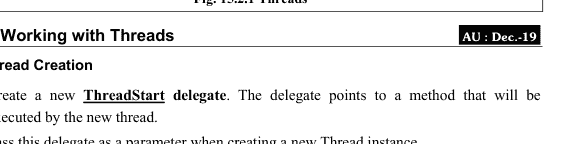

图 15.2.1 线程

## 15.3 使用线程

### 1. 线程创建

- 1. 创建一个新的 ThreadStart 委托。该委托指向将由新线程执行的方法。
- 2. 在创建新的 Thread 实例时，将此委托作为参数传递。
- 3. 现在，调用 Thread.Start 方法以运行线程方法。
- 4. 语法

```
using System.Threading;

Thread thread = new Thread(new ThreadStart(ThreadTaskMethod));
thread.Start();
```

### 示例 1

```
namespace ThreadApps
{
class ThreadCreationOp
{
static void Main(string[] args)
{
/* creating thread start delegate instance which contains the method to execute by the thread*/
ThreadStart ths = new ThreadStart(Show);
// create new thread
Thread tr = new Thread(ths);
// start thread
tr.Start();
// makes the main thread sleep so as to give early chance to Child thread execute
Thread.Sleep(1000);
for (int cnt = 1; cnt <= 10; cnt++)
{
Console.WriteLine("Main Thread data value is" + cnt);
Thread.Sleep(1500);
}
Console.WriteLine("Main Thread Finished");
}
// this method executed by a separate thread
static void Show()
{
for (int cnt = 1; cnt <= 5; cnt++)
{
Console.WriteLine("Child Thread data value is " + cnt);
Thread.Sleep(500);
}
Console.WriteLine("Child Thread Finished");
}
}
}
```

### 输出

```
Child Thread data value is 1
Child Thread data value is 2
Main Thread data value is 1
Child Thread data value is 3
Child Thread data value is 4
Main Thread data value is 2
Main Thread data value is 3
Child Thread data value is 5
Child Thread Finished
Main Thread data value is 4
Main Thread data value is 5
Main Thread data value is 6
Main Thread data value is 7
Main Thread data value is 8
Main Thread data value is 9
Main Thread data value is 10
Main Thread Finished
```

### 示例 2

```
//illustration of operation of thread creation.
using System;
using System.Threading;
namespace ThreadApps
{
class ThreadCreationOp
{
public static void CallChildThread()
{
Console.WriteLine("Child thread starts");
}

static void Main(string[] args)
{
ThreadStart childdlg = new ThreadStart(CallChildThread);
Console.WriteLine("Main Thread : Child thread Creation");
Thread childThread = new Thread(childdlg);
childThread.Start();
}
}
}
```

### 输出

Main Thread : Child thread Creation
Child thread starts

### 示例 3

// 同一个类中用于创建两个线程的两个方法

### 程序 1

```
using System;
using System.Threading;

public class TwoThreads {
public static void Thread1() {
for (int cnt = 1; cnt <=6; cnt ++) {
Console.WriteLine("Thread1 {0}", cnt);
}
}
}
```
```
public static void Thread2() {
    for (int cnt = 1; cnt <= 6; cnt++) {
        Console.WriteLine("Thread2 {0}", cnt);
    }
}

public class ThreadCreation {
    public static void Main() {
        Console.WriteLine("Before start thread");
        Thread thr1 = new Thread(new ThreadStart(TwoThreads.Thread1 ));
        Thread thr2 = new Thread(new ThreadStart(TwoThreads.Thread2 ));
        thr1.Start();
        thr2.Start();
    }
}
```

### 输出

Thread1 1
Thread1 2
Thread2 1
Thread2 2
Thread1 3
Thread1 4
Thread2 3
Thread2 4
Thread1 5
Thread2 5
Thread2 6

### 示例 4

```
// One thread method to create two threads by creating two objects of the thread class.
using System;
using System.Threading;

public class TwoThreads {
    public static void ThreadTask() {
        Console.WriteLine(this.name);
        for (int cnt = 1; cnt <=5; cnt++) {
            Console.WriteLine("Data {0}", cnt);
        }
```
```
}
}
}
public class ThreadCreation {
    public static void Main() {
        Console.WriteLine("Before thread start");
        TwoThreads thr1 = new TwoThreads();
        TwoThreads thr2 = new TwoThreads();
        Thread td1 = new Thread(new ThreadStart(thr1.ThreadTask));
        Thread td2 = new Thread(new ThreadStart(thr2.ThreadTask));
        td1.name = "Thread 1";
        td2.name = "Thread 2";
        td1.Start();
        td2.Start();
    }
}
```

### 输出

Before thread start
Thread 1
Data 1
Data 2
Thread 2
Data 1
Data 2
Thread 1
Data 3
Data 4
Thread 2
Data 3
Data 4
Thread 1
Data 5
Thread 2
Data 5

## 2. Thread 类的属性

| 属性 | 描述 |
| :--- | :--- |
| CurrentContext | 获取线程正在其中执行的当前上下文。 |
| CurrentCulture | 获取或设置当前线程的区域性。 |
| CurrentPrincipal | 获取或设置线程的当前主体（用于基于角色的安全性）。 |
| CurrentThread | 获取当前正在运行的线程。 |
| CurrentUICulture | 获取或设置资源管理器在运行时用于查找区域性特定资源的当前区域性。 |
| ExecutionContext | 获取一个 ExecutionContext 对象，该对象包含有关当前线程的各种上下文的信息。 |
| IsAlive | 获取一个值，该值指示当前线程的执行状态。 |
| IsBackground | 获取或设置一个值，该值指示线程是否为后台线程。 |
| IsThreadPoolThread | 获取一个值，该值指示线程是否属于托管线程池。 |
| ManagedThreadId | 获取当前托管线程的唯一标识符。 |
| Name | 获取或设置线程的名称。 |
| Priority | 获取或设置一个值，该值指示线程的调度优先级。 |
| ThreadState | 获取一个值，该值包含当前线程的状态。 |

## 3. Thread 类的方法

| 序号 | 方法 |
| :--- | :--- |
| 1. | **public void Abort()**<br>在其被调用的线程中引发 ThreadAbortException，以开始终止该线程的过程。调用此方法通常会终止该线程。 |
| 2. | **public static LocalDataStoreSlot AllocateDataSlot()**<br>在所有线程上分配未命名的数据槽。为了获得更好的性能，请改用标记有 ThreadStaticAttribute 特性的字段。 |
| 3. | **public static LocalDataStoreSlot AllocateNamedDataSlot(string name)**<br>在所有线程上分配命名的数据槽。为了获得更好的性能，请改用标记有 ThreadStaticAttribute 特性的字段。 |
| 4. | **public static void BeginCriticalRegion()**<br>通知宿主执行即将进入某个代码区域，在该区域中，线程中止或未经处理的异常的影响可能会危及应用程序域中的其他任务。 |
| 5. | **public static void BeginThreadAffinity()**<br>通知宿主托管代码即将执行依赖于当前物理操作系统线程标识的指令。 |
| 6. | **public static void EndCriticalRegion()**<br>通知宿主执行即将进入某个代码区域，在该区域中，线程中止或未经处理的异常的影响仅限于当前任务。 |
| 7. | **public static void EndThreadAffinity()**<br>通知宿主托管代码已完成执行依赖于当前物理操作系统线程标识的指令。 |
| 8. | **public static void FreeNamedDataSlot(string name)**<br>消除进程中所有线程的名称与槽之间的关联。为了获得更好的性能，请改用标记有 ThreadStaticAttribute 特性的字段。 |
| 9. | **public static Object GetData(LocalDataStoreSlot slot)**<br>在当前线程的当前域中从当前线程上的指定槽检索值。为了获得更好的性能，请改用标记有 ThreadStaticAttribute 特性的字段。 |
| 10. | **public static AppDomain GetDomain()**<br>返回当前线程正在其中运行的当前域。 |
| 11. | **public static AppDomain GetDomain()**<br>返回唯一的应用程序域标识符 |

15 - 8

C# 与 .NET 编程


| 编号 | 成员及说明 |
|---|---|
| 12. | public static LocalDataStoreSlot GetNamedDataSlot(string name)<br>查找命名数据槽。为了获得更好的性能，请改用标记有 ThreadStaticAttribute 特性的字段。 |
| 13. | public void Interrupt()<br>中断处于 WaitSleepJoin 线程状态的线程。 |
| 14. | public void Join()<br>在继续执行标准 COM 和 SendMessage 消息泵操作的同时，阻止调用线程，直到某个线程终止。此方法具有不同的重载形式。 |
| 15. | public static void MemoryBarrier()<br>按如下方式同步内存访问：执行当前线程的处理器不能重排指令，使得在调用 MemoryBarrier 之前的内存访问在调用 MemoryBarrier 之后的内存访问之后执行。 |
| 16. | public static void ResetAbort()<br>取消为当前线程请求的 Abort。 |
| 17. | public static void SetData(LocalDataStoreSlot slot, Object data)<br>在当前运行线程的指定槽中设置该线程当前域的数据。为了获得更好的性能，请改用标记有 ThreadStaticAttribute 特性的字段。 |
| 18. | public void Start()<br>启动线程。 |
| 19. | public static void Sleep(int millisecondsTimeout)<br>使线程暂停一段时间。 |
| 20. | public static void SpinWait(int iterations)<br>使线程按 iterations 参数定义的次数等待。 |
| 21. | public static byte VolatileRead(ref byte address)<br>public static double VolatileRead(ref double address)<br>public static int VolatileRead(ref int address)<br>**public static Object VolatileRead(ref Object address)**<br>读取字段的值。该值是由计算机中的任意处理器最新写入的值，无论处理器数量或处理器缓存状态如何。此方法具有不同的重载形式。上面仅给出其中一些。 |
| 22. | **public static void VolatileWrite(ref byte address, byte value)**<br>**public static void VolatileWrite(ref double address, double value)**<br>**public static void VolatileWrite(ref int address, int value)**<br>**public static void VolatileWrite(ref Object address, Object value)**<br>立即将值写入字段，以便该值对计算机中的所有处理器可见。此方法具有不同的重载形式。上面仅给出其中一些。 |
| 23. | **public static bool Yield()**<br>使调用线程将执行权让给当前处理器上已准备好运行的另一个线程。操作系统选择要让出的线程。 |

## 4. 主线程

### 概念

- 在 C# 中，**System.Threading.Thread** 类用于处理线程。

### 说明

- 它允许在多线程应用程序中创建和访问各个线程。
- 进程中第一个执行的线程称为**主**线程。
- 当 C# 程序开始执行时，会自动创建主线程。
- 使用 **Thread** 类创建的线程称为主线程的子线程。
- 可以使用 Thread 类的 **CurrentThread** 属性访问线程。

### 示例

```csharp
//The following program demonstrates main thread execution:
using System;
using System.Threading;

namespace MultithreadingApplication
{
    class MainThreadProgram
    {
        static void Main(string[] args)
        {
            Thread th = Thread.CurrentThread;
            th.Name = "MainThread";
            Console.WriteLine("This is {0}", th.Name);
            Console.ReadKey();
        }
    }
}
```

输入：无

### 输出

This is MainThread

## 5. 线程池类

- 1. 使用 ThreadPool 类，可以并行执行许多不同的线程，并让系统尽快回收它们。
- 2. 如下图所示，这是启动许多短期任务的理想方式。
  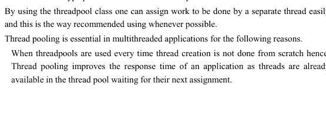
- 3. ThreadPool 类型提供内置功能。
- 4. 通过使用 ThreadPool 类，可以轻松地将工作分配给单独的线程来完成，这是建议尽可能采用的方式。
- 5. 在多线程应用程序中，线程池至关重要，原因如下。
  - 使用线程池时，不必每次都从头创建线程；因此，由于线程池中已有线程在等待下一次分配，线程池可提高应用程序的响应时间。
  - 线程池节省了 CLR 为每个短期任务创建全新线程以及在线程终止后回收其资源的时间。线程池有效利用 CPU 时间片。
  - 线程池允许启动多个任务，而无需为每个线程设置属性。
  - 线程池允许将信息作为对象传递给正在执行的任务的过程参数。
  - 使用线程池，可以将要处理的最大线程数固定为某个数目。

### 示例

```csharp
//illustration of Threadpool class

// assign thread pool thread to do the job
ThreadPool.QueueUserWorkItem(run);
```

如果要将任何参数传递给由该线程执行的方法，可以将其作为第二个参数传递，如下所示，对于带对象参数的 `run` 方法：

```csharp
// assign thread pool thread to do the job
ThreadPool.QueueUserWorkItem(run, 10);
```

### 示例

```csharp
class ThreadpoolDemo
{
    static void Main(string[] args)
    {
        // assign thread pool thread to do the job
        ThreadPool.QueueUserWorkItem(run, 5);
        // makes the main thread sleep - so as to run child threads
        Thread.Sleep(1000);
        for (int tcnt = 10; tcnt > 0; tcnt--)
        {
            Console.WriteLine("Main Thread value is " + tcnt);
            Thread.Sleep(1000);
        }

        Console.WriteLine("Main Thread Finished");
        Console.ReadLine();
    }

    /* this method executed by a separate thread. It should match with the WaitCallback (parameters must be passed as an object) */
    static void run(object argsOb)
    {
        // cast the parameter
        int total = (int)argsOb;
        for (int cnt = 0; cnt < total; cnt++)
        {
            Console.WriteLine("Child Thread value is " + cnt);
            Thread.Sleep(1000);
        }
        Console.WriteLine("Child Thread Finished");
    }
}
```

## 15.4 管理线程

Thread 类提供了各种管理线程的方法。

### 1. 暂停线程

Thread.Sleep 方法可用于将线程暂停固定时间段。

**语法**

```csharp
Thread.Sleep()
```

### 示例

```csharp
//Illustration of Sleep method
using System;
using System.Collections.Generic;
using System.Linq;
using System.Text;
using System.Threading;

namespace MultiThread
{
    class SleepOp
    {
        static void Main(string[] args)
        {
            Thread th = new Thread(Show);
            th.Start();
            for (int cnt = 1; cnt <= 10; cnt++)
            {
                Console.WriteLine("India");
                Thread.Sleep(2000); // sleeps for 2000 milliseconds
            }
        }

        private static void Show()
        {
            for (int cnt = 1; cnt <= 5; cnt++)
            {
                Console.WriteLine("Welcome To");
                Thread.Sleep(1000); // sleeps for 1000 milliseconds
            }
        }
    }
}
```

### 输出

```
Welcome To
India
Welcome To
India
Welcome To
Welcome To
India
Welcome To
India
India
India
India
India
India
India
```

### 2. 销毁线程

- 1. **Abort()** 方法用于销毁线程。
- 2. 运行时环境通过引发 **ThreadAbortException** 来中止线程。此异常无法捕获，控制权会发送到 *finally* 块（如果存在）。
- 3. 在调用 Abort 方法之前，应确保检查线程的 **IsAlive** 属性。
- 4. **语法**

```csharp
if (Thread.IsAlive)
{
    Thread.Abort();
}
```


## 示例

```csharp
//Illustration of thread Abort operation
using System;
using System.Collections.Generic;
using System.Linq;
using System.Text;
using System.Threading;

namespace MultiThread
{
    class AbortOp
    {
        static void Main(string[] args)
        {
            Thread th = new Thread(Show);

            if (th.IsAlive)
            {
                th.Start();
                th.Abort(); //Show method is immediately stopped as thread aborts
            }
            for (int cnt = 1; cnt <= 10; cnt++)
            {
                Console.WriteLine("India");
            }
        }

        private static void Show()
        {
            for (int cnt = 1; cnt <= 5; cnt++)
            {
                Console.WriteLine("Welcome To");
            }
        }
    }
}
```

## 输出

```text
India
India
India
India
India
India
India
India
India
India
```

## 3. 挂起线程

Thread 类的 **Suspend 方法** 用于挂起线程。

线程将保持挂起，直到调用 Resume 方法。

语法

```csharp
if (thread.ThreadState == ThreadState.Running)
{
    thread.Suspend();
}
```

## 4. 恢复挂起的线程

调用 **Resume 方法** 可恢复挂起的线程。

如果线程未挂起，Resume 方法将不起作用。

语法

```csharp
if (thread.ThreadState == ThreadState.Suspended) {
    thread.Resume();
}
```

## 5. 将线程设为后台线程

在后台运行的线程即使在主线程结束后仍会继续运行。若要在主线程终止时结束所有线程，可将 IsBackground 属性设置为 true。

语法

```csharp
// make the thread background
thrd.IsBackground = true;
```

## 6. 线程优先级

**概念**

- 优先级是附加到线程上的特定值（通常为整数类型），用于从运行角度表明线程的重要性。也就是说，优先级指示哪个线程应比其他同时运行的线程优先获得执行机会。

**说明**

- Thread 类的 ThreadPriority 属性用于设置线程的优先级。线程优先级可以具有 **Normal、AboveNormal、BelowNormal、Highest** 和 **Lowest** 值。

在 C# 中，System.Threading.ThreadPriority 是一个枚举，定义线程的优先级状态，进而决定线程可获得的处理器执行时间。

- **高优先级**线程总是比同类线程获得更多的处理器时间。如果有多个高优先级线程，操作系统会轮转这些线程，为每个高优先级线程分配一定的处理器时间。只要存在更高优先级的线程，较低优先级的线程就无法执行。
- 当不再有更高优先级的线程时，操作系统会选择下一较低优先级的线程执行。如果在任何时刻遇到更高优先级的线程，较低优先级的线程就会被抢占（从 CPU 上移走），并执行更高优先级的线程。
- 任何新创建的线程都会被赋予 **普通优先级**。如有需要，可将线程优先级值更改为下面所示的任意值。Thread 类的 Priority 属性中定义了 **5 个优先级**。
  - Highest
  - AboveNormal
  - Normal
  - BelowNormal
  - Lowest
- 语法

```csharp
thread.Priority = ThreadPriority.Lowest;

//Example

//Illustration of thread creation without setting any priority

/* PrioritiesDemo1 program do not define any priority, which executes the method Show()
   first and then Main method gets a chance to execute. */

using System;
using System.Collections.Generic;
using System.Linq;
using System.Text;
using System.Threading;

namespace MultiThread
{
    class PrioritiesDemo1
    {
        static void Main(string[] args)
        {
            Thread th = new Thread(Show);
            th.Start();
            for (int cnt = 1; cnt <= 10; cnt++)
            {
                Console.WriteLine("India");
            }
        }

        private static void Show()
        {
            for (int cnt = 1; cnt <= 5; cnt++)
            {
                Console.WriteLine("Welcome to");
            }
        }
    }
}
```

## 输出

```text
Welcome to
Welcome to
Welcome to
Welcome to
Welcome to
India
India
India
India
India
India
India
India
India
India
```

## 示例

```csharp
//illustration of thread Using With Lowest Priority
/* PrioritiesDemo2 program defines the priority. New thread has low priority therefore
method Show() of this thread gets chance after high priority Main thread. Main method
executes first. */
using System;
using System.Collections.Generic;
using System.Linq;
using System.Text;
using System.Threading;

namespace MultiThread
{
    class PrioritiesDemo2
    {
        static void Main(string[] args)
        {
            Thread th = new Thread(Show);
            th.Priority = ThreadPriority.Lowest;
            th.Start();
            for (int cnt = 1; cnt <= 10; cnt++)
            {
                Console.WriteLine("India");
            }
        }

        private static void Show()
        {
            for (int cnt = 0; cnt < 5; cnt++)
            {
                Console.WriteLine("Welcome To");
            }
        }
    }
}
```

## 输出

```text
India
India
India
India
India
India
India
India
India
India
Welcome To
Welcome To
Welcome To
Welcome To
Welcome To
```

## 15.5 线程的应用与优点

- 单进程中的互斥任务，例如收集用户输入和后台处理，可以通过使用线程来管理。
- 线程可以作为一种便捷方式，用于组织同时执行多个相似或相同任务的程序。
- 使用线程的主要优点是可以同时执行多项活动。
- 另一个优点是可以利用线程在两个线程中执行两个不同的计算，而不是串行地一个接一个执行，从而实现更快的计算。

## 15.6 线程通信

### 15.6.1 同步

**概念**

- 同步是指协调线程的动作，以便在时间和操作方面获得固定、可预期的结果。

**说明**

- 当线程访问同一数据时，同步尤为重要。
- 同步处理可分为以下四类。

- **1. 使用阻塞方法的同步** — 在这种同步技术中，其余线程等待另一个线程完成，或等待一段时间过去。Sleep、Join 和 EndInvoke 是用于阻塞的简单阻塞方法。
- **2. 使用锁定概念的同步** — 在这种方式中，强制实现对资源（例如字段或代码段）的独占访问，确保一次只有一个线程可以进入。锁定是主要的线程安全机制，允许线程访问公共数据而互不干扰。锁定构造包括 lock 和 Mutex，以及 Mutex 的一种变体，称为 Semaphore。
- **3. 使用信号的同步** — 通过发送信号，线程可以暂停，直到收到另一个线程的通知，从而避免低效轮询的需要。有两种信号机制：事件等待和 Monitor 的 Wait/Pulse 方法。
- **4. 使用非阻塞的同步** — 通过此方法，对公共字段的访问通过调用处理器原语来保护。Interlocked 类和 volatile 关键字是实现非阻塞方法的两种构造。

### 15.6.2 阻塞

**概念**

- 当线程因某种原因暂停执行时，就称该线程被阻塞，例如通过 Join 或 EndInvoke 等待另一个线程结束。

**说明**

- 被阻塞的线程几乎不消耗处理器时间。
- CLR 和操作系统知道被阻塞的线程，并提供适当的支持使其保持非工作状态，在阻塞条件满足时将它们唤醒。

### 15.6.3 锁定

**概念**

- 独占锁定用于确保一次只有一个线程可以进入特定的代码段。.NET Framework 提供两种独占锁定构造，即 lock 和 Mutex。

**说明**

- 一次只有一个线程可以锁定同步对象（在此例中为 locker），任何竞争线程都会被阻塞，直到锁被释放。如果多个线程竞争该锁，它们会在“就绪队列”中排队，并按先来先服务的原则获得锁。独占锁有时被认为强制对锁所保护的内容进行串行访问，因为一个线程的访问不能与另一个线程的访问重叠。
- 在等待竞争锁时被阻塞的线程，其 **ThreadState** 为 **WaitSleepJoin**。
- 在访问任何包含可写共享状态的字段之前，应进行锁定。

### 15.6.4 互斥体（Mutex）

Mutex 类似于 C# 的 lock，但它可以跨多个进程工作。换句话说，Mutex 既可以是计算机范围的，也可以是应用程序范围的。


## 15.6.5 信号量

信号量类似于互斥体，不同之处在于信号量没有“所有者”——它与线程无关。任何线程都可以对信号量调用 Release，而对于 Mutex 和 lock，只有获得锁的线程才能释放它。信号量可用于限制并发——防止过多线程同时执行某段特定代码。

## 15.6.6 非阻塞同步

对于锁定，总有一个线程必须被阻塞，承受被临时取消调度所带来的开销和延迟。

.NET Framework 的非阻塞同步构造可以执行简单操作，而无需阻塞、暂停或等待。这些涉及使用严格原子性的指令，或指示编译器使用“volatile”读写语义。

## 两分题及答案

### Q.1 定义线程。解释多线程。

**答：** 线程是一组指令，执行时使程序能够进行并发处理。并发处理有助于同时执行多个进程。默认情况下，C# 只包含一个线程。可以创建其他线程，以与原始线程并行执行代码。

线程遵循生命周期：线程创建时开始，执行后立即终止。它使用的命名空间是 System.Threading，必须包含该命名空间才能创建线程并使用其成员。

通过扩展 Thread 类创建线程。Start() 方法标记线程执行的开始。

```csharp
// CallThread is our target method
ThreadStart methodThread = new ThreadStart(CallThread);
Thread childThread = new Thread(methodThread);
childThread.Start();
```

C# 还可以一次执行多个进程/任务，这通过在不同时间处理不同进程来实现，称为“多线程”。

其若干操作列出如下：
- Start
- Sleep
- Abort
- Suspend
- Resume
- Join

### Q.2 解释同步和异步操作。

**答：** 同步是一种创建线程安全代码的方式，在给定时间内只有一个线程访问该代码。同步调用会等待方法完成，然后继续程序流程。同步编程会对通常发生在用户尝试执行耗时操作时的 UI 操作产生不利影响，因为只使用了一个线程。

在异步操作中，方法调用立即返回，使程序能够执行其他操作，而被调用的方法在特定情况下完成其那部分工作。

### Q.3 什么是线程池？

**答：** 线程池是一组线程，它们执行任务而不干扰主线程。线程完成任务后，会返回主线程。

### Q.4 说明竞态条件。

**答：** 竞态条件发生在两个线程访问同一资源并试图同时修改它的情况下。无法预测哪个线程先访问资源。举一个小例子：两个线程 X1 和 X2 试图访问同一个名为 T 的共享资源。如果两个线程都试图向 T 写入值，那么最后写入 T 的值将被保存。

### Q.5 说出线程的不同状态。

**答：** 线程的不同状态如下：
- 未启动（Unstarted）：线程已创建
- 运行（Running）：线程开始执行
- 等待睡眠加入（WaitSleepJoin）：线程被要求睡眠、要求其他线程等待并要求其他线程加入
- 挂起（Suspended）：线程已被挂起
- 中止（Aborted）：线程已死亡但未改变状态
- 停止（Stopped）：线程已停止

### Q.6 线程类有哪些属性？

**答：** 线程类的属性如下：
- IsAlive：当线程处于活动状态时，其值为 true。
- Name：用于设置线程名称，也用于返回线程名称。
- Priority：返回根据操作系统设置的任务值。
- IsBackground：它是决定线程应位于后台还是前台的判定因素。
- ThreadState：说明线程的状态。

### Q.7 说出一些用于处理多线程操作的方法。

**答：** 以下是一些用于处理多线程操作的方法：
- Start
- Sleep
- Abort
- Suspend
- Resume
- Join

### Q.8 如何在 C# 中访问线程？AU : Dec.-19

**答：**
- 要访问主线程，需要 Thread 类对象来引用它。可以通过使用 Thread 类的 CurrentThread 属性创建该对象。它将返回对使用它的线程的引用。因此，当在主线程内部使用 CurrentThread 属性时，将获得主线程的引用。之后，就能像控制另一个线程一样控制主线程。一旦获得此控制权，那么如果应用程序中创建了更多线程，它们都可以使用 Thread 类进行访问。
- System.Threading 命名空间提供实现多线程编程的类和接口。此命名空间中的一个类是 Thread 类。此类用于创建和控制线程。

## 长答题

- Q.1 讨论 C# 线程。（参见第 15.1 节）
- Q.2 线程的优点和应用是什么？（参见第 15.5 节）
- Q.3 线程间通信如何发生？（参见第 15.6 节）
- Q.4 解释 C# 支持的线程编程类。（参见第 15.3 节）
- Q.5 讨论线程生命周期。（参见第 15.2 节）

### Q.6 编写一个 C# 程序以获取当前线程的状态。AU : Dec.-18, Marks 7

**答：**

```csharp
/*
 * C# Program to Obtain Status of the Current Thread
 */
using System;
using System.Threading;

namespace threademos
{
    class ProgramThreadStatus
    {
        static void Main(string[] args)
        {
            Console.WriteLine("Current information");
            Thread t = Thread.CurrentThread;
            t.Name = "primarythread";
            Console.WriteLine("Thread Name: {0}", t.Name);
            Console.WriteLine("Thread Status: {0}", t.IsAlive);
            Console.ReadKey();
        }
    }
}
```

### Q.7 编写一个 C# 程序来说明向线程传递参数的概念。AU : May-18, Marks 6

**答：**

```csharp
/*
 * C# Program to illustrate the Concept of Passing Parameter for Thread
 */
using System;
using System.Threading;

public class ThreadDemo
{
    public static void Main()
    {
        Thread newThread = new Thread(ThreadDemo.task1);
        newThread.Start(20);
        ThreadDemo p = new ThreadDemo();
        newThread = new Thread(p.task2);
        newThread.Start("Instance");
```

## 笔记

# 第三单元

# 第16章

# ADO.NET 与事务

教学大纲：事务、ADO.NET

| 章节号 | 主题名称 | 页码 |
|---|---|---|
| 16.1 | ADO.NET——通过 .NET 环境处理数据 | 16-2 |
| 16.2 | 断开式数据访问体系结构 | 16-3 |
| 16.3 | 数据提供程序 | 16-4 |
| 16.4 | ADO.NET 对象 | 16-5 |
| 16.5 | 数据集 | 16-7 |
| 16.6 | 处理数据 | 16-8 |
| 16.7 | 使用 ADO.NET 进行异常处理 | 16-40 |
| 16.8 | ADO.NET 中的事务 | 16-44 |
|  | 两分题及答案 | 16-49 |
|  | 长答题 | 16-53 |

## 16.1 ADO.NET——通过 .NET 环境处理数据

AU : May-19

### 概念

- ADO.NET 是一组面向对象的库，允许开发者与数据源交互。通常，数据源是数据库，但也可能是文本文件、Excel 电子表格或 XML 文件。

### 说明

- 有许多不同类型的数据库可用于访问数据。例如，Microsoft SQL Server、Microsoft Access、Oracle、Borland Interbase 和 IBM DB2，仅举几例。

### ADO.NET 体系结构

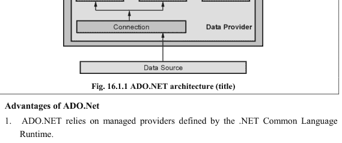

图 16.1.1 ADO.NET 体系结构（标题）

### 3. ADO.NET 的优点

- ADO.NET 依赖于由 .NET 公共语言运行时定义的托管提供程序。
- ADO.NET 可以具有表示与不同数据源连接的独立对象。
- 在 ADO.NET 中，可以创建多个数据提供程序命名空间，以专门连接特定数据源，从而使访问更快、更高效，并允许每个命名空间利用其目标数据提供程序的功能。
- ADO.NET 提供使用客户端游标或服务器端游标的选择。


- 5. ADO.NET 没有 Recordset 对象，ADO.NET 改用 DataSet 代替 Recordset。DataSet 提供了来自数据源的结果集的断开连接表示，并且完全独立于数据源。
- 6. ADO.NET DataSet 可以保存来自各种来源的数据并整合数据，然后将其写回一个或多个数据源。
- 7. 在数据通信方面，ADO.NET 使用 XML 来传递数据，这与当前应用程序平台高度兼容。

## 16.2 断开连接的数据访问架构

### 概念
- 1. ADO.NET 框架支持两种数据访问架构模型：面向连接的数据访问架构和断开连接的数据访问架构。ADO.NET 断开连接的数据访问架构比 ADO 的面向连接的数据访问更灵活、更强大。

### 解释
- 2. 在面向连接的数据访问架构中，应用程序连接到数据源，然后通过同一连接使用 SQL 请求与之交互。在这种情况下，即使应用程序未使用任何数据库操作，也会保持与数据库系统的连接。另一方面，断开连接的方法不会尝试保持与数据源的连接。
- 3. ADO.NET 通过引入名为 DataSet 的组件提供了一种新的解决方案。DataSet 是 ADO.NET 断开连接数据访问架构中的核心组件。DataSet 是一个内存数据存储，可以同时保存多个表。DataSet 仅保存数据而不与数据源交互。DataSet 的关键特性之一是它不知道可能用于填充它的底层数据源。
- 4. 在面向连接的数据访问中，使用 DataReader 对象从数据库读取数据时，必须在应用程序和数据源之间保持打开的连接。与 DataReader 不同，DataSet 在填充时不会通过 Connection 对象直接连接到数据源。DataAdapter 通过将数据从数据源填充到 DataSet 来管理数据源与 DataSet 之间的连接，并使 DataSet 具有断开连接的行为。DataAdapter 在连接对象和断开连接对象之间充当桥梁。
- 5. 通过仅在最短时间内保持连接打开，ADO.NET 节省系统资源，为数据库提供最大安全性，并对系统性能的影响更小。

## 16.3 数据提供程序

### 概念
- 1. 由于不同的数据源公开不同的协议，因此需要使用正确的协议通过不同的方法与正确的数据源通信。

### 解释
- 2. 一些较旧的数据源使用 ODBC 协议，许多较新的数据源使用 OleDb 协议，这使得可以通过 .NET ADO.NET 类库直接与它们通信。
- 3. ADO.NET 以库的形式提供了一种相对通用的与数据源交互的方式。这些库称为数据提供程序，通常以它们允许交互的协议或数据源类型命名。下表 16.3.1 列出了一些知名的数据提供程序、它们使用的 API 前缀以及它们允许交互的数据源类型。
- 4. 数据提供程序通信

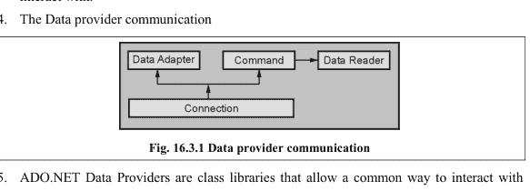

Fig. 16.3.1 数据提供程序通信

- 5. ADO.NET 数据提供程序是类库，允许以通用方式与特定数据源或协议交互。库 API 具有前缀，表示它们支持哪个提供程序。

| 提供程序名称 | API 前缀 | 数据源描述 |
|---|---|---|
| ODBC 数据提供程序 | Odbc | 具有 ODBC 接口的数据源。通常是较旧的数据库。 |
| OleDb 数据提供程序 | OleDb | 暴露 OleDb 接口的数据源，即 Access 或 Excel。 |
| Oracle 数据提供程序 | Oracle | 用于 Oracle 数据库。 |
| SQL 数据提供程序 | Sql | 用于与 Microsoft SQL Server 交互。 |
| Borland 数据提供程序 | Bdp | 对 Interbase、SQL Server、IBM DB2 和 Oracle 等众多数据库的通用访问。 |

### 表 16.3.1 数据提供程序

## 16.4 ADO.NET 对象

### 概念
ADO.NET 包含许多用于处理数据的对象，下面将讨论这些对象。

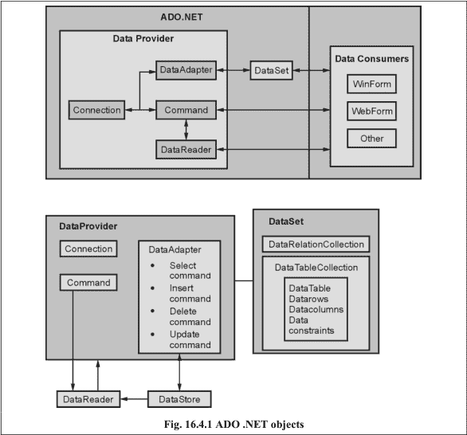

Fig. 16.4.1 ADO.NET 对象

### 解释
**1. SqlConnection 对象**
- 要与数据库交互，必须与之建立连接。连接有助于标识数据库服务器、数据库名称、用户名、密码以及连接到数据库所需的其他参数。连接对象由命令对象使用，以便它们知道在哪个数据库上执行命令。
- Connection 对象提供到数据源的物理连接。Connection 对象需要必要的识别数据源并正确登录的信息，这些信息通过连接字符串提供。
- ADO.NET 连接对象允许建立到数据源的连接。如果使用 OleDb 数据提供程序连接到暴露 OleDb 接口的数据源，则使用名为 OleDbConnection 的连接对象。同样，连接对象名称会以 Odbc 或 Sql 为前缀，分别用于 Odbc 数据源上的 OdbcConnection 对象或 SQL Server 数据库上的 SqlConnection 对象。

**2. SqlCommand 对象**
- Command 对象用于执行在数据源上执行的 SQL 语句或存储过程。命令对象提供多个 Execute 方法，可用于以多种方式执行 SQL 查询。
- 与数据库交互的过程意味着必须指定可在数据集上执行的操作。这是通过命令对象完成的。命令对象用于向数据库发送 SQL 语句。命令对象使用连接对象来确定要通信的数据库。命令对象只能直接执行命令，或将命令对象的引用分配给 SqlDataAdapter，后者保存一组在数据组上工作的命令，如下所述。

**3. SqlDataReader 对象**
- DataReader 对象是从数据源检索查询结果的基于流的、只向前、只读的方式，不会更新数据。DataReader 需要与数据库保持实时连接，并提供一种非常智能的方式来消费全部或部分结果集。
- 许多数据操作需要用于读取的数据流。数据读取器对象允许从命令对象获取 SELECT 语句的结果。出于性能原因，数据读取器返回的数据是快速只向前的流。这意味着数据以顺序方式从流中取出以便读取而不是操作。

**4. DataSet 对象**
- DataSet 对象是数据的内存表示。它们包含多个 DataTable 对象，其中包含列和行，就像普通的数据库表一样。可以定义表之间的关系以创建父子关联。DataSet 专为帮助在内存中管理数据并在需要时支持数据的断开连接操作而设计。DataSet 是所有数据提供程序使用的对象，这就是为什么它没有数据提供程序特定的前缀。

**5. SqlDataAdapter 对象**
- DataAdapter 对象使用来自数据源的结果填充 DataSet 对象。它是一个特殊类，其目的是在断开连接的 DataSet 对象与物理数据源之间架起桥梁。
- 当数据主要是只读且不需要操作时，可以借助 DataAdapter 对象节省不必要的数据库调用。数据适配器也以断开连接模式管理数据。数据适配器在读取数据时填充 DataSet 对象，并在将更改持久化回数据库时以单批写入。数据适配器包含对连接对象的引用，并在从数据库读取或写入时自动打开和关闭连接。此外，数据适配器包含用于对数据执行 SELECT、INSERT、UPDATE 和 DELETE 操作的命令对象引用。DataSet 中的每个表都有一个数据适配器定义，它处理与数据库的所有通信。数据适配器只需告知何时从数据库加载或写入数据库即可。

## 16.5 数据集

### 概念
- DataSet 提供了来自数据源的结果集的断开连接表示，并且完全独立于数据源。DataSet 在处理相关结果集时提供了更大的灵活性。

### 解释
- DataSet 包含行、列、主键、约束以及与其他 DataTable 对象的关系。它由一组 DataTable 对象组成，可以使用 DataRelation 对象将它们相互关联。DataAdapter 对象在 DataSet 与数据源之间提供桥梁。


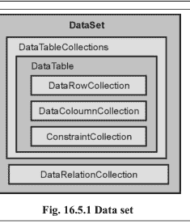

图 16.5.1 数据集

## 16.6 处理数据

### 16.6.1 ADO .NET——通过数据操作类处理数据

- 使用数据库时，会按顺序实例化以下层次结构。

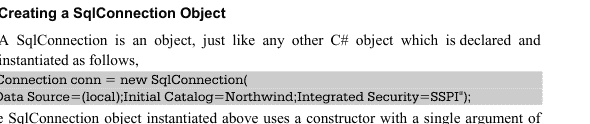

图 16.6.1 数据库对象创建

### 1. 创建 SqlConnection 对象

- SqlConnection 是一个对象，就像任何其他 C# 对象一样，其声明和实例化如下，

```
SqlConnection conn = new SqlConnection(
"Data Source=(local);Initial Catalog=Northwind;Integrated Security=SSPI");
```

上面实例化的 SqlConnection 对象使用带有一个 string 类型参数的构造函数。此参数称为连接字符串。

- 连接字符串的常见部分

ADO.NET 连接字符串包含某些键/值对，用于指定如何建立数据库连接。它们包括数据库的位置、名称和安全参数。

| 连接字符串参数名称 | 描述 |
|---|---|
| Data Source | 标识服务器。可以是本地计算机、计算机域名或 IP 地址。 |
| Initial Catalog | 数据库名称。 |
| Integrated Security | 设置为 SSPI 以使用用户的 Windows 登录建立连接 |
| User ID | 在 SQL Server 中配置的用户名。 |
| Password | 与 SQL Server 用户 ID 匹配的密码。 |

- 以下语句展示了一个连接字符串，出于安全目的使用 User ID 和 Password 参数，

```
SqlConnection conn = new SqlConnection(
    "DataSource=DatabaseServer;Initial Catalog=Northwind;UserID=ValidUserID;Password=ValidPassword");
```

- 请注意 Data Source 如何设置为 DatabaseServer，以表明可以标识位于不同计算机上、通过局域网或通过 Internet 访问的数据库。此外，User ID 和 Password 替换了 Integrated Security 参数。

### C# ADO.NET 连接字符串

- 连接字符串是一种普通的 String 表示形式，包含用于在数据库和应用程序之间建立连接的数据库连接信息。连接字符串包括驱动程序名称、服务器名称和数据库名称等参数，以及用户名和密码等安全信息。
- 通常，数据提供程序使用包含一组参数的连接字符串，通过应用程序与数据库建立连接。.NET Framework 主要提供三种数据提供程序，分别是 Microsoft SQL Server、OLEDB、ODBC。

### 构建 Microsoft SQL Server 连接字符串

```
connectionString = "Data Source=ServerName;Initial Catalog=Databasename;
User ID=UserName;Password=Password"
```

### 构建 OLEDB 数据提供程序连接字符串

```
connectionString = "Provider=Microsoft.Jet.OLEDB.4.0;
Data Source=yourdatabasename.mdb;"
```

### 构建 ODBC 连接字符串

```
connectionString = "Driver={Microsoft Access Driver (*.mdb)};
DBQ=yourdatabasename.mdb;"
```

- 必须为连接字符串属性提供必要的连接信息，以便构建连接字符串。

### 2. 使用 SqlConnection

创建 SqlConnection 对象的目的是对数据库进行操作。其他 ADO.NET 对象（如 SqlCommand 和 SqlDataAdapter）将连接对象作为参数。SqlConnection 生命周期中发生的操作顺序可以是：

- 1. 实例化 SqlConnection。
- 2. 打开连接。
- 3. 将连接传递给其他 ADO.NET 对象。
- 4. 使用其他 ADO.NET 对象执行数据库操作。
- 5. 关闭连接。

### 示例

```csharp
// Illustration of working with SqlConnection objects
using System;
using System.Data;
using System.Data.SqlClient;

class SqlConnectionDemo
{
    static void Main()
    {
        // 1. Instantiate the connection object
        SqlConnection sqlconn = new SqlConnection(
            "Data Source=(local);Initial Catalog=Northwind;Integrated Security=SSPI");

        SqlDataReader sqldr = null;

        try
        {
            // 2. Open the connection
            sqlconn.Open();

            // 3. Pass the connection to a command object
            SqlCommand sqlcmd = new SqlCommand("select * from Books", conn);

            //
            // 4. Use the connection
            //
```
```
// get query results
sqlrdr = sqlcmd.ExecuteReader();

// print the BookID of each record
while (sqlrdr.Read())
{
    Console.WriteLine(sqlrdr[0]);
}
finally
{
    // close the reader
    if (sqlrdr != null)
    {
        sqlrdr.Close();
    }

    // 5. Close the connection
    if (sqlconn != null)
    {
        sqlconn.Close();
    }
}
}
```

### 代码片段说明

- 通过调用 SqlConnection 实例 sqlconn 的 Open() 方法打开连接。对尚未打开的连接执行任何操作都会生成异常。因此，必须先打开连接，然后才能使用它。
- 在使用 SqlCommand 之前，ADO.NET 应知道应用程序需要哪个连接。SqlCommand 对象的第二个参数设置为 SqlConnection 对象 sqlconn。使用 SqlCommand 执行的任何操作都将仅使用此连接。
- 使用连接的代码是一个 SqlCommand 对象，它对 Book 表执行查询。结果集以 SqlDataReader 形式返回，while 循环读取结果集每一行的第一列，即 BookID 列。
- 连接对象使用完毕后，必须关闭它。否则可能会对应用程序的性能和可伸缩性造成严重后果。在 finally 块中调用 Close() 方法，并确保在关闭连接之前连接不为 null。

### 3. SqlCommand 对象

- SqlCommand 对象允许指定对数据库的操作。例如，对数据库表中的数据行执行 select、insert、modify 和 delete 命令。SqlCommand 对象也可以使用 SqlDataAdapter 来支持断开连接的数据管理场景。
- Command 对象使用连接对象来执行 SQL 查询。
- 查询可以采用内联文本、存储过程或直接表访问的形式。
- Command 对象的一个重要特性是它可以用于执行带参数的查询和存储过程。
- 如果发出 select 查询，它返回的结果集通常存储在 DataSet 或 DataReader 对象中。

### SqlCommand 类的关联属性

| 属性 | 访问类型 | 描述 |
|---|---|---|
| Connection | 读/写 | 命令对象用于执行 SQL 查询或存储过程的 SqlConnection 对象。 |
| CommandText | 读/写 | 表示 T-SQL 语句或存储过程的名称。 |
| CommandType | 读/写 | 此属性指示应如何解释 CommandText 属性。可能的值有：1. Text（T-SQL 语句）2. StoredProcedure（存储过程名称）3. TableDirect |
| CommandTimeout | 读/写 | 此属性指示执行特定命令时要等待的时间。命令执行的默认时间为 30 秒。命令超时后会被中止，并引发异常。 |

### Command 对象的方法

| 属性 | 描述 |
|---|---|
| ExecuteNonQuery | 此方法执行指定的命令，并返回受影响的行数。 |
| ExecuteReader | ExecuteReader 方法执行指定的命令，并返回 SqlDataReader 类的实例。 |
| ExecuteScalar | 此方法执行指定的命令，并返回结果集第一行第一列。其余行和列将被忽略。 |
| ExecuteXMLReader | 此方法执行指定的命令，并返回 XmlReader 类的实例。此方法可用于以 XML 文档形式返回结果集 |

### 创建 SqlCommand 对象

```csharp
SqlCommand sqlcmd = new SqlCommand("select BookCategoryName from BookCategories", sqlconn);
```

上述语句接受一个包含要执行命令的字符串参数，以及对 SqlConnection 对象的引用。

### 查询数据

使用 SQL select 命令时，会检索数据集以供查看。若要检索数据，使用 ExecuteReader 方法，它返回一个 SqlDataReader 对象。

```csharp
// 1. Instantiate a new command with a query and connection
SqlCommand sqlcmd = new SqlCommand("select BookCategoryName from BookCategories", sqlconn);
// 2. Call Execute reader to get query results
SqlDataReader sqldr = sqlcmd.ExecuteReader();
```

在上述代码片段中，通过将命令字符串和连接对象传递给构造函数来实例化 SqlCommand 对象。然后，通过调用 SqlCommand 对象 sqlcmd 的 ExecuteReader 方法获得 SqlDataReader 对象。

### 插入数据

要将数据插入数据库，使用 SqlCommand 对象的 ExecuteNonQuery 方法。

```csharp
// Illustration of insert data into a database table.
// Prepare command string
string insertString = "@"
insert into BookCategories
(BookCategoryName, Description)


```
values ('Fantasy', 'The best of the imaginations');
// 1. Instantiate a new command with a query and connection
SqlCommand sqlcmd = new SqlCommand(insertString, sqlconn);
// 2. Call ExecuteNonQuery to send command
sqlcmd.ExecuteNonQuery();
```

变量 insertString 用于 SqlCommand 实例化。insertString 变量就在 SqlCommand 声明上方声明。

insertString 文本中单词“doesn't”的两个单引号（'）。这样可以让字符串正确填充列。

要执行此命令，请在 SqlCommand 实例 sqlcmd 上调用 ExecuteNonQuery 方法。

- **更新数据**

ExecuteNonQuery 方法用于更新数据。

```
//Illustration of updating data
// Prepare command string
string updateString = @"
update BookCategories
set BookCategoryName = 'Fiction'
where BookCategoryName = 'Fantasy';
";
// 1. Instantiate a new command with command text only
SqlCommand sqlcmd = new SqlCommand(updateString);
// 2. Set the Connection property
sqlcmd.Connection = sqlconn;
// 3. Call ExecuteNonQuery to send command
sqlcmd.ExecuteNonQuery();
```

## 说明

ExecuteNonQuery 方法执行更新命令。

- **删除数据**

可以使用 ExecuteNonQuery 方法删除数据。

```
//Illustration of deleting a record from a database.
// prepare command string
string deleteString = @"
delete from BookCategories
where BookCategoryName = 'Fiction'";
```

```
// 1. Instantiate a new command
SqlCommand sqlcmd = new SqlCommand();

// 2. Set the CommandText property
sqlcmd.CommandText = deleteString;

// 3. Set the Connection property
sqlcmd.Connection = sqlconn;

// 4. Call ExecuteNonQuery to send command
sqlcmd.ExecuteNonQuery();
```

## 说明

这里使用无参数的 SqlCommand 构造函数。它改为显式设置 SqlCommand 对象 sqlcmd 的 CommandText 和 Connection 属性。

ExecuteNonQuery 方法调用会将命令发送到数据库。

- 获取单个值

需要从数据中获取单个值，以便得到数据的聚合值，例如计数、求和、平均值等。使用 ExecuteScalar 来执行此操作并计算结果。

```
// 1. Instantiate a new command
SqlCommand sqlcmd = new SqlCommand("select count(*) from BookCategories", sqlconn);

// 2. Call ExecuteScalar to send command
int count = (int)sqlcmd.ExecuteScalar();
```

SqlCommand 构造函数中的查询从 BookCategories 表获取所有记录的计数。此查询只返回单个值。第 2 步中的 ExecuteScalar 方法返回此值。由于 ExecuteScalar 的返回类型是 object 类型，因此使用强制转换运算符将该值转换为 int。

- 上述代码片段用于操作数据库的完整示例。

```
using System;
using System.Data;
using System.Data.SqlClient;

/// Demonstrates how to work with SqlCommand objects
class SqlCommandDemo
{
    SqlConnection sqlconn;

    public SqlCommandDemo()
    {
        // Instantiate the connection
        sqlconn = new SqlConnection(
"Data Source=(local);Initial Catalog=Northwind;Integrated Security=SSPI");
    }
}

// call methods that demo SqlCommand capabilities
static void Main()
{
    SqlCommandDemo sqlscd = new SqlCommandDemo();

    Console.WriteLine();
    Console.WriteLine("Book Categories Before Insert");

    // ExecuteReader method
    sqlscd.ReadData();

    // ExecuteNonQuery method for Insert
    sqlscd.InsertData();
    Console.WriteLine();
    Console.WriteLine("BookCategories After Insert");

    sqlscd.ReadData();

    // ExecuteNonQuery method for Update
    sqlscd.UpdateData();

    Console.WriteLine();
    Console.WriteLine("BookCategories After Update");

    sqlscd.ReadData();

    // ExecuteNonQuery method for Delete
    sqlscd.DeleteData();

    Console.WriteLine();
    Console.WriteLine("BookCategories After Delete");
    sqlscd.ReadData();

    //ExecuteScalar method
    int countOfRecords = sqlscd.GetCountOfRecords();

    Console.WriteLine();
    Console.WriteLine("Total Records: {0}", countOfRecords);
}
/// ExecuteReader method
```

public void ReadData()
{
    SqlDataReader sqldr = null;

    try
    {
        // Open the connection
        sqlconn.Open();

        // 1.Instantiate command with a query and connection
        SqlCommand sqlcmd = new SqlCommand("select BookCategoryName from BookCategories", sqlconn);

        // 2. Execute reader to get query results
        sqldr = sqlcmd.ExecuteReader();

        // print the BookCategoryName of each record
        while (sqldr.Read())
        {
            Console.WriteLine(sqldr[0]);
        }
    }
    finally
    {
        // close the reader
        if (sqldr != null)
        {
            sqldr.Close();
        }

        // Close the connection
        if (sqlconn != null)
        {
            sqlconn.Close();
        }
    }
}

/// ExecuteNonQuery method for Insert
public void InsertData()
{
    try
    {
        // Open the connection
        sqlconn.Open();

        // prepare command string
        string insertString = @"
    insert into BookCategories
    (BookCategoryName, BookDescription)
    values ('Fantasy', 'Imaginations unlimited')";

        // 1. Instantiate command with a query and connection
        SqlCommand sqlcmd = new SqlCommand(insertString, sqlconn);

        // 2. ExecuteNonQuery to send command
        sqlcmd.ExecuteNonQuery();
    }
    finally
    {
        // Close the connection
        if (sqlconn != null)
        {
            sqlconn.Close();
        }
    }
}

/// ExecuteNonQuery method for Update
public void UpdateData()
{
    try
    {
        // Open the connection
        sqlconn.Open();

        // prepare command string
        string updateString = @"
            update BookCategories
            set BookCategoryName = 'Fiction'
            where BookCategoryName = 'Fantasy';";

        //1.Instantiate command with command text only
        SqlCommand sqlcmd = new SqlCommand(updateString);
        // 2. Set the Connection property
        sqlcmd.Connection = sqlconn;

        // 3. ExecuteNonQuery to send command
        sqlcmd.ExecuteNonQuery();
    }
    finally
    {
        // Close the connection
        if (sqlconn != null)
        {
            sqlconn.Close();
        }
    }
}

/// ExecuteNonQuery method for Delete
public void DeleteData()
{
    try
    {
        // Open the connection
        sqlconn.Open();

        // prepare command string
        string deleteString = @"
            delete from BookCategories
            where BookCategoryName = 'Fiction'";

        // 1. Instantiate a command
        SqlCommand sqlcmd = new SqlCommand();

        // 2. Set the CommandText property
        sqlcmd.CommandText = deleteString;

        // 3. Set the Connection property
        sqlcmd.Connection = sqlconn;

        // 4. ExecuteNonQuery to send command
        sqlcmd.ExecuteNonQuery();
    }
    finally
    {
        // Close the connection
        if (sqlconn != null)
        {
            sqlconn.Close();
        }
    }
}

/// use ExecuteScalar method
// <returns>number of records</returns>
public int GetCountOfRecords()
{
    int count = -1;

    try
    {
        // Open the connection
        sqlconn.Open();

        // 1. Instantiate a new command
        SqlCommand sqlcmd = new SqlCommand("select count(*) from BookCategories", sqlconn);

        // 2. ExecuteScalar to send command
        count = (int) sqlcmd.ExecuteScalar();
    }
    finally
    {
        // Close the connection
        if (sqlconn != null)
        {
            sqlconn.Close();
        }
    }
    return count;
}

## 4. 使用 SqlDataReader 对象

- DataReader 属性

| 属性 | 描述 |
|---|---|
| Depth | 指示行的嵌套深度 |
| FieldCount | 返回一行中的列数 |
| IsClosed | 指示数据读取器是否已关闭 |
| Item | 以本机格式获取列的值 |
| RecordsAffected | 事务后受影响的行数 |


## DataReader 方法

| 方法 | 描述 |
|---|---|
| Close | 关闭 DataReader 对象。 |
| Read | 读取数据读取器中的下一条记录。 |
| NextResult | 在批量事务期间将数据读取器推进到下一个结果。 |
| Getxxx | 有几十个 Getxxx 方法。这些方法从列中读取特定数据类型的值。例如，GetChar 将列值作为字符返回，GetString 作为字符串返回。 |

## 创建 SqlDataReader 对象

实例化 SqlDataReader 与实例化其他 ADO.NET 对象不同。

首先，在命令对象上调用 ExecuteReader：

```csharp
SqlDataReader sqldr = sqlcmd.ExecuteReader();
```

SqlCommand 对象 sqlcmd 的 ExecuteReader 方法返回一个 SqlDataReader 实例。使用 new 运算符创建 SqlDataReader 不足以完成任何操作，因为 SqlCommand 对象引用连接，并且 SQL 语句是 SqlDataReader 获取数据所必需的。

## 读取数据

SqlDataReader 通过顺序流返回数据。要读取这些数据，需从表中逐行获取数据。一旦读取了一行，上一行就不再可用。要再次读取该行，必须创建 SqlDataReader 的新实例并再次读取数据流。

从 SqlDataReader 返回的数据流中读取的典型方法是使用 while 循环遍历每一行。

```csharp
while (sqldr.Read())
{
    // get the results of each column
    string contact = (string)sqldr["AuthorContactName"];
    string publication = (string)sqldr["AuthorPublicationName"];
    string city = (string)sqldr["AuthorCity"];

    // print results
    Console.Write("{0,35}", contact);
    Console.Write("{0,30}", city);
    Console.Write("{0,35}", publication);
}
```

*Read* 的返回值是 bool 类型，只要还有更多记录可读就返回 true。读取完数据流中的最后一条记录后，*Read* 返回 false。

可以使用数字索引器从行中提取每一列。也可以使用字符串索引器代替数字索引器，其中字符串是 SQL 查询中的列名（如果使用星号 \*，则使用表列名）。字符串索引器可读性高得多，使代码更易于维护。

无论索引器参数的类型如何，SqlDataReader 索引器都将返回 object 类型。

### 关闭连接

使用完 SqlDataReader 后，请关闭 SqlConnection。

```csharp
try
{
    // data access code
}
finally
{
    // 3. close the reader
    if (sqldr != null)
    {
        sqldr.Close();
    }

    // close the connection too
}
```

### 示例

```csharp
using System;
using System.Data;
using System.Data.SqlClient;

namespace ADONetDemos
{
    class ReadersDemo
    {
        static void Main()
        {
            ReadersDemo rsd = new ReadersDemo();
            rsd.DataRead();
        }

        public void DataRead()
        {
            // declare the SqlDataReader
            SqlDataReader sqldr = null;

            // create a connection object
            SqlConnection sqlconn = new SqlConnection(
                "Data Source=(local);Initial Catalog=Northwind;Integrated Security=SSPI");

            // create a command object
            SqlCommand sqlcmd = new SqlCommand(
                "select * from Books", sqlconn);

            try
            {
                // open the connection
                sqlconn.Open();

                // 1. get an instance of the SqlDataReader
                sqldr = sqlcmd.ExecuteReader();

                // print column headers
                Console.WriteLine("Author Contact Name  Author City  Publication Name");

                // 2. print necessary columns of each record
                while (sqldr.Read())
                {
                    // get the results of each column
                    string contact = (string)sqldr["AuthorContactName"];
                    string publication = (string)sqldr["Publication"];
                    string city = (string)sqldr["AuthorCity"];

                    // print results
                    Console.Write("{0,-35}", contact);
                    Console.Write("{0,-30}", city);
                    Console.Write("{0,-35}", publication);
                }
            }
            finally
            {
                // 3. close the reader
                if (sqldr != null)
                {
                    sqldr.Close();
                }

                // close the connection
                if (sqlconn != null)
                {
                    sqlconn.Close();
                }
            }
        }
    }
}
```

## 5. 使用 SqlDataAdapter

- DataSet 是内存中的数据存储，可容纳许多表。DataSet 只保存数据，不与数据源交互。SqlDataAdapter 管理与数据源的连接，并提供断开连接的行为。SqlDataAdapter 仅在需要时打开连接，并在完成任务后立即关闭连接。

- SqlDataAdapter 在用数据填充 DataSet 时执行以下任务：
    1. 打开连接
    2. 将数据检索到 DataSet
    3. 关闭连接

  当 DataSet 更改后更新数据源时，它执行以下操作：
    1. 打开连接
    2. 将 DataSet 中的更改写入数据源
    3. 关闭连接

在 Fill 和 Update 操作之间，数据源连接是关闭的。可以使用 DataSet 读取和写入数据。由于应用程序仅在必要时保持连接，因此应用程序的可伸缩性更高。

### 创建 DataSet 对象

```csharp
DataSet dsBooks = new DataSet();
```

现在，DataSet 为空，需要一个 SqlDataAdapter 来加载它。

### 创建 SqlDataAdapter

1. SqlDataAdapter 保存用于读取和写入数据的 SQL 命令和连接对象。它使用 SQL select 语句和连接对象进行初始化：

    ```csharp
    SqlDataAdapter daBooks = new SqlDataAdapter("select BookID,Author from Books", sqlconn);
    ```

2. 上面的代码创建了一个新的 SqlDataAdapter，名为 daBooks。SQL select 语句指定将哪些数据读入 DataSet。连接对象 sqlconn 应该已经实例化，但尚未打开。SqlDataAdapter 负责在调用 Fill 和 Update 方法期间打开和关闭连接。

3. SqlDataAdapter 包含与数据源交互所需的所有命令。有两种方法可以添加插入、更新和删除命令：通过 SqlDataAdapter 属性或使用 SqlCommandBuilder。

    ```csharp
    // Using SqlCommandBuilder
    SqlCommandBuilder cmdBldr = new SqlCommandBuilder(daBooks);
    ```

4. SqlCommandBuilder 使用 SqlDataAdapter 实例 daBooks 的单个构造函数参数进行实例化。这告诉 SqlCommandBuilder 要向哪个 SqlDataAdapter 添加命令。SqlCommandBuilder 将读取 SQL select 语句（在实例化 SqlDataAdapter 时指定），推断插入、更新和删除命令，并将新命令分别分配给 SqlDataAdapter 的 Insert、Update 和 Delete 属性。

请注意，SqlCommandBuilder 适用于单个表，而不适用于多表联接。

## 填充 DataSet

```csharp
daBooks.Fill(dsBooks, "Books");
```

上面代码中的 Fill 方法接受两个参数：一个 DataSet 和一个表名。在尝试用数据填充 DataSet 之前，必须先将其实例化。第二个参数是将在 DataSet 中创建的表的名称。

Fill 方法有一个重载，仅接受一个 DataSet 参数。在这种情况下，创建的第一个表默认名称为 "table1"。对于添加到 DataSet 中且未在 Fill 方法中指定表名的每个表，编号将递增（table2、table3、...、tableN）。

## 使用 DataSet

DataSet 可同时绑定到 ASP.NET 和 Windows Forms DataGrid。

```csharp
// Illustration of a DataSet assigned to a Windows Forms DataGrid
dgBooks.DataSource = dsBooks;
dgBooks.DataMember = "Books";
```

DataSet 被分配给 DataGrid 的 DataSource 属性。

要准确指定要使用哪个表，请将 DataGrid 的 DataMember 属性设置为该表的名称。

## 更新更改

对数据做出修改后，如果要将其更新到实际数据库，则使用 SqlDataAdapter 的 Update 方法将修改应用到数据库。

```csharp
daBooks.Update(dsBooks, "Books");
```

上面的 Update 方法是在最初填充 dsBooks DataSet 的 SqlDataAdapter 实例上调用的。Update 方法的第二个参数指定哪个表，来自


要更新的 DataSet。该表包含已修改记录的列表，SqlDataAdapter 的 Insert、Update 和 Delete 属性包含用于进行数据库修改的 SQL 语句。

## 6. DataSet 对象

-   DataSet 是数据按行和列组织的**表格化表示**。DataSet 表示数据库的一个子集。它与数据库之间没有持续连接。要更新数据库，需要重新连接。DataSet 包含 DataTable 对象和 DataRelation 对象。DataRelation 对象表示两个表之间的关系。

-   **ADO.NET** DataSet 包含 DataTableCollection 及其 DataRelationCollection。它表示从数据源检索到的数据集合。DataSet 可以与 **DataAdapter** 类结合使用。DataSet 对象提供了一种断开连接的数据源体系结构。DataSet 可以处理其包含的数据，而无需知道数据来自哪个源。也就是说，DataSet 可以在与其数据源断开连接的模式下工作。与 **DataReader** 相比，这具有更好的优势，因为 DataReader 仅适用于面向连接的数据源。

**DataSet 类的一些重要属性**

| 属性 | 描述 |
|---|---|
| CaseSensitive | 指示数据表内的字符串比较是否区分大小写。 |
| Container | 获取组件的容器。 |
| DataSetName | 获取或设置当前数据集的名称。 |
| DefaultViewManager | 返回数据集中数据的视图。 |
| DesignMode | 指示组件当前是否处于设计模式。 |
| EnforceConstraints | 指示在尝试任何更新操作时是否遵循约束规则。 |
| Events | 获取附加到此组件的事件处理程序列表。 |
| ExtendedProperties | 获取与 DataSet 关联的自定义用户信息集合。 |
| HasErrors | 指示是否存在任何错误。 |
| IsInitialized | 指示 DataSet 是否已初始化。 |
| Locale | 获取或设置用于比较表中字符串的区域设置信息。 |
| Namespace | 获取或设置 DataSet 的命名空间。 |
| Prefix | 获取或设置用于为 DataSet 命名空间提供别名的 XML 前缀。 |
| Relations | 返回 DataRelation 对象的集合。 |
| Tables | 返回 DataTable 对象的集合。 |

**DataSet 类的一些重要方法**

| 方法 | 描述 |
|---|---|
| AcceptChanges | 接受自加载 DataSet 或调用此方法以来所做的所有更改。 |
| BeginInit | 开始初始化 DataSet。初始化在运行时发生。 |
| Clear | 清除数据。 |
| Clone | 复制 DataSet 的结构，包括所有 DataTable 架构、关系和约束。不复制任何数据。 |
| Copy | 复制结构和数据。 |
| CreateDataReader() | 返回一个 DataTableReader，其中每个 DataTable 对应一个结果集，顺序与表在 Tables 集合中出现的顺序相同。 |
| CreateDataReader(DataTable[]) | 返回一个 DataTableReader，其中每个 DataTable 对应一个结果集。 |
| EndInit | 结束数据集初始化。 |
| Equals(Object) | 确定指定对象是否等于当前对象。 |
| Finalize | 释放资源并执行其他清理。 |
| GetChanges | 返回 DataSet 的副本，其中包含自加载 DataSet 或调用 AcceptChanges 方法以来所做的所有更改。 |
| GetChanges(DataRowState) | 获取 DataSet 的副本，其中包含自加载 DataSet 或调用 AcceptChanges 方法以来所做的所有更改，并按 DataRowState 筛选。 |
| GetDataSetSchema | 获取 DataSet 的 XmlSchemaSet 副本。 |
| GetObjectData | 使用序列化 DataSet 所需的数据填充序列化信息对象。 |
| GetType | 获取当前实例的类型。 |
| GetXML | 返回数据的 XML 表示形式。 |
| GetXMLSchema | 返回数据 XML 表示形式的 XSD 架构。 |
| HasChanges() | 获取一个值，该值指示 DataSet 是否有更改，包括新增、删除或修改的行。 |
| HasChanges(DataRowState) | 获取一个值，该值指示 DataSet 是否有更改，包括新增、删除或修改的行，并按 DataRowState 筛选。 |
| IsBinarySerialized | 检查 DataSet 的序列化表示形式的格式。 |
| Load(IDataReader, LoadOption, DataTable[]) | 使用提供的 IDataReader 从数据源填充 DataSet，并使用 DataTable 实例数组提供架构和命名空间信息。 |
| Load(IDataReader, LoadOption, String[]) | 使用提供的 IDataReader 从数据源填充 DataSet，并使用字符串数组提供 DataSet 中表的名称。 |
| Merge() | 将数据与另一个 DataSet 中的数据合并。此方法具有不同的重载形式。 |
| ReadXML() | 将 XML 架构和数据读入 DataSet。此方法具有不同的重载形式。 |
| ReadXMLSchema() | 将 XML 架构读入 DataSet。此方法具有不同的重载形式。 |
| RejectChanges | 回滚自上次调用 AcceptChanges 以来所做的所有更改。 |
| WriteXML() | 从 DataSet 写出 XML 架构和数据。此方法具有不同的重载形式。 |
| WriteXMLSchema() | 将 DataSet 的结构写为 XML 架构。此方法具有不同的重载形式。 |

## 7. DataTable 类

DataTable 类表示**数据库中的表**。它具有以下重要属性；这些属性大多数是只读属性，但 **PrimaryKey 属性**除外。

**DataTable 类的一些重要属性**

| 属性 | 描述 |
|---|---|
| ChildRelations | 返回子关系集合。 |
| Columns | 返回列集合。 |
| Constraints | 返回约束集合。 |
| DataSet | 返回父级 DataSet。 |
| DefaultView | 返回表的视图。 |
| ParentRelations | 返回 ParentRelations 集合。 |
| PrimaryKey | 获取或设置作为表主键的列数组。 |
| Rows | 返回 Rows 集合。 |

**DataTable 类的一些重要方法**

| 方法 | 描述 |
|---|---|
| AcceptChanges | 提交自上次 AcceptChanges 以来的所有更改。 |
| Clear | 清除表中的所有数据。 |
| GetChanges | 返回 DataTable 的副本，其中包含自调用 AcceptChanges 方法以来所做的所有更改。 |
| GetErrors | 返回包含错误的行数组。 |
| ImportRow | 将新行复制到表中。 |
| LoadDataRow | 查找并更新特定行；如果未找到，则创建新行。 |
| Merge | 将表与另一个 DataTable 合并。 |
| NewRow | 创建新的 DataRow。 |
| RejectChanges | 回滚自上次调用 AcceptChanges 以来所做的所有更改。 |
| Reset | 将表重置为其原始状态。 |
| Select | 返回 DataRow 对象数组。 |

## DataRow 类

DataRow 对象表示表中的一行。

### 一些重要属性

| 属性 | 描述 |
|---|---|
| HasErrors | 指示是否存在任何错误。 |
| Items | 获取或设置存储在特定列中的数据。 |
| ItemArray | 获取或设置该行的所有值。 |
| Table | 返回父表。 |

### DataRow 类的一些重要方法

| 方法 | 描述 |
|---|---|
| AcceptChanges | 接受自调用此方法以来所做的所有更改。 |
| BeginEdit | 开始编辑操作。 |
| CancelEdit | 取消编辑操作。 |
| Delete | 删除 DataRow。 |
| EndEdit | 结束编辑操作。 |
| GetChildRows | 获取此行的子行。 |
| GetParentRow | 获取父行。 |
| GetParentRows | 获取 DataRow 对象的父行。 |
| RejectChanges | 回滚自上次调用 AcceptChanges 以来所做的所有更改。 |

## 8. DataAdapter 对象

DataAdapter 对象充当 **DataSet 对象与数据库之间的中介**。这有助于 DataSet 包含来自多个数据库或其他数据源的数据。


## 9. DataReader 对象

DataReader 对象是 DataSet 和 DataAdapter 组合的一种替代方案。该对象提供对数据库中数据记录的面向连接的访问。这些对象适用于只读访问，例如填充列表然后断开连接。

## 10. DbCommand 和 DbConnection 对象

DbConnection 对象表示与数据源的连接。该连接可以在不同的命令对象之间共享。

DbCommand 对象表示为了检索或操作数据而发送到数据库的命令或存储过程。

## 示例

```csharp
//illustration of Reading data using DataSet
using System;
using System.Data;
using System.Data.SqlClient;

class DatasetDemo
{
    static void Main()
    {
        string sqlconnString = "server=(local)\SQLEXP;database=MyDatabase;Integrated Security=SSPI";
        string sqlqry = @"select * from Books";
        SqlConnection sqlconn = new SqlConnection(sqlconnString);

        try
        {
            sqlconn.Open();
            SqlDataAdapter sqlda = new SqlDataAdapter(sqlqry, sqlconn);
            DataSet ds = new DataSet();
            sqlda.Fill(ds, "Books");
            DataTable dt = ds.Tables["CategoryName"];
            foreach (DataRow row in dt.Rows)
            {
                foreach (DataColumn col in dt.Columns)
                {
                    Console.WriteLine(row[col]);
                    Console.WriteLine(" ".PadLeft(20, '='));
                }
            }
        }
        catch(Exception e)
        {
            Console.WriteLine("Error: " + e);
        }
        finally
        {
            sqlconn.Close();
        }
    }
}
```

## 16.6.2 ADO.NET 与存储过程 - 通过存储过程更新数据库

**存储过程**不过是一段预先准备好的 SQL 代码，保存起来以便反复重用。因此，如果有某个查询会被多次使用，最好将其保存为存储过程，然后按需调用该存储过程来执行 SQL 代码。所以，存储过程是一组预定义且预编译的源代码。

### 存储过程与函数的区别

- 1. 函数必须返回值，但在存储过程中这是可选的（过程可以返回零个或 n 个值）。
- 2. 函数只能有输入参数，而过程可以有输入/输出参数。
- 3. 函数可以从过程中调用，而过程不能从函数中调用。因为存储过程可以包含 DML 语句，而函数不能包含 DML 语句。
- 4. 过程允许在其中使用 SELECT 以及 DML（INSERT/UPDATE/DELETE）语句，而函数只允许在其中使用 SELECT 语句。
- 5. 存储过程是预编译的执行计划，而函数不是。

### 在 ADO.NET 中使用存储过程进行数据库更新

- 可以使用 SqlDataAdapter 调用存储过程，以便从 DataTable 更新数据库中的表。如果在 SqlDataAdapter 的 SelectCommand 中编写查询，在简单场景下它会自动生成所需的 InsertCommand、UpdateCommand 和 DeleteCommand 来更新数据库；但如果在 SelectCommand 中传入存储过程的名称，那么它就无法生成这些其他命令。
- 还有一种方法是通过表值参数来实现，可以直接将 DataTable 传递给存储过程，但 SQL Server 2005 及更早版本不支持该功能，而且这需要在 SQL Server 中创建用户定义类型并启用 CLR。
- 要使用存储过程，可以使用 SqlDataAdapter。SqlDataAdapter 只需要存储过程的名称以及需要更新的 DataTable。

### 示例 1 -

### 步骤 1 - 在 SQL 中创建名为 Customer 的表，并包含指定列。

```sql
CREATE TABLE Customer(
    [ID] int IDENTITY(1,1) Primary Key,
    [Name] [varchar](20) NULL,
    [City] [varchar](20) NULL,
    [DOB] [date] NULL,
    [Married] [bit] NULL,
    [Mobile] [int] NULL)
```

### 步骤 2 - 创建存储过程以从 Customer 表获取数据。

```sql
-- Create Get stored procedure
Create Procedure uspGetCustomer @ID int

AS

IF   @ID < 1
    SELECT * FROM Customer
ELSE
    SELECT * FROM Customer WHERE ID = @ID
```

创建另一个存储过程来更新 Customer 表。

**注意 - 参数名称应与表的列名相同，并以 @ 为前缀。**

将有一个名为 @RowState 的额外参数，类型为 int，用于检查传入的行需要删除、更新还是插入。

为了创建这个存储过程，可以大量使用 SQL Server 生成的查询（在对象资源管理器中右键单击表 -> 编写表脚本为 -> 使用 CREATE TO、UPDATE TO、INSERT TO、DELETE TO）。

```sql
-- Create Update stored procedure
Create Procedure uspUpdateCustomer @ID int,
                 @Name varchar (20),
                 @City varchar (20),
                 @DOB date,
                 @Married bit,
                 @Mobile int,
                 @RowState int

AS

IF @RowState = 4
INSERT INTO Customer
([Name]
,[City]
,[DOB]
,[Married]
,[Mobile])
VALUES
(@Name
,@City
,@DOB
,@Married
,@Mobile)

IF @RowState is null and @ID is not null
DELETE FROM Customer
    WHERE ID = @ID

IF @RowState = 16 and @ID is not null
UPDATE Customer
SET [Name] = @Name
,[City] = @City
,[DOB] = @DOB
,[Married] = @Married
,[Mobile] = @Mobile
WHERE ID = @ID
```

### 步骤 3 - 用于 ADO.NET 语句的 C# 代码。

数据访问层的公共函数，可通过它访问以获取或更新数据。此函数将需要上面创建的存储过程的名称。可以为任何表编写相同的函数。

```csharp
//method to retrieve data
public DataTable GetCustomer()
{
    command = new SqlCommand("uspGetCustomer", connection);

    command.Parameters.AddWithValue("@ID", -1);

    return GetDetails();
}

//method to update data
public void UpdateCustomer(DataTable dtTable)
{
    command = new SqlCommand("uspUpdateCustomer", connection);
    UpdateDetails(dtTable);
}
```

私有函数 GetDetails 和 UpdateDetails。如果要更新多个表，这些函数无需为每个表复制。

- 1. GetDetails 函数将使用 SqlDataAdapter 的 Fill 函数填充 DataTable。UpdateDetails 函数将首先使用 GetChanges 获取已更新、已插入或已删除的行，以便只传递数据库中需要更改的那些行。
- 2. 向 dtChanges 添加一个额外的列 RowState，以传递已更改行的 RowState。
- 3. For 循环将使用 DataTable 中的列名创建 SqlParameter，并将其添加到 SqlCommand 中。
- 4. 为每个 INSERT、UPDATE、DELETE 及其构造函数向 SqlDataAdapter 添加公共命令。
- 5. 获取已插入、已更新和已删除的行，For 循环将为已添加和已修改的行填充 RowState 列。由于不能对已删除的行调用 RowState，因此无需设置 RowState，每个已删除行的 RowState 都将变为 null。
- 6. 接下来，调用 SqlDataAdapter 的 Update 函数来更新数据库。

```csharp
//Method to get details
private DataTable GetDetails()
{
    command.CommandType = CommandType.StoredProcedure;

    adapter = new SqlDataAdapter(command);
    DataTable dtTable = new DataTable();

    try
    {
        // Fill from database
        adapter.Fill(dtTable);
    }
    catch (InvalidOperationException ioEx)
    {
    }
    catch (Exception ex)
    {
    }
    return dtTable;
}

//method to update details
private void UpdateDetails(DataTable dtTable)
{
    SqlParameter parameter;

    command.CommandType = CommandType.StoredProcedure;

    //Get the changes
    DataTable dtChanges = dtTable.GetChanges();

    //No change return back
    if (dtChanges == null)
        return;

    //Add new column rowstate to hold row
    dtChanges.Columns.Add("RowState", typeof(int));

    // Add parameter for each column
    for (int i = 0; i < dtChanges.Columns.Count; i++)
    {
        parameter = new SqlParameter();

        // Set parameter name
        parameter.ParameterName = "@" + dtChanges.Rows[i].Field<string>("name");

        //Set source column
        parameter.SourceColumn = dtChanges.Rows[i].Field<string>("name");

        command.Parameters.Add(parameter);
    }

    //Update Insert, Update, Delete command to adapter
    adapter = new SqlDataAdapter(command);
    adapter.InsertCommand = command;
    adapter.UpdateCommand = command;
    adapter.DeleteCommand = command;

    //Get the rows Inserted, updated and deleted
    DataTable dtInsertedRows = dtChanges.GetChanges(DataRowState.Deleted);
    DataTable dtModifiedRows = dtChanges.GetChanges(DataRowState.Modified);
    DataTable dtAddedRows = dtChanges.GetChanges(DataRowState.Added);

    // for updated rows set RowState = 16


if (dtModifiedRows != null)
{
    for (int i = 0; i < dtModifiedRows.Rows.Count; i++)
    {
        dtModifiedRows.Rows[i]["RowState"] = 16;
    }
}

// For inserted rows set RowState = 4
if (dtAddedRows != null)
{
    for (int i = 0; i < dtAddedRows.Rows.Count; i++)
    {
        dtAddedRows.Rows[i]["RowState"] = 4;
    }
}

try
{
    //Update Database
    if (dtAddedRows != null)
    {
        adapter.Update(dtAddedRows);
    }
    if (dtDeletedRows != null)
    {
        adapter.Update(dtDeletedRows);
    }
    if (dtModifiedRows != null)
    {
        adapter.Update(dtModifiedRows);
    }
}
catch (Exception exception)
{
}

## 步骤 4 - 使用上述函数的完整数据访问层代码。

ConnString 是配置文件中连接字符串的名称。

public class DataAccessLayer
{
    SqlConnection connection;
    SqlCommand command;
    SqlDataAdapter adapter;
}

public DataAccessLayer()
{
    ConnectionStringSettingsCollection settings
    = ConfigurationManager.ConnectionStrings;

    string connectionString = settings["ConnString"].ConnectionString;

    connection = new SqlConnection(connectionString);
}

public DataTable GetCustomer(){...}

public void UpdateCustomer(DataTable dtTable){...}

private DataTable GetDetails(){...}

private void UpdateDetails(DataTable dtTable){...}
}

## 示例 2

### 步骤 1 - 在 SQL 中创建名为 Registration 的表，包含指定列。

```
CREATE TABLE UserRegistration (
C_Id int IDENTITY(1, 1) NOT NULL,
C_Name varchar(100) NULL,
C_Age varchar(100) NULL,
C_Country varchar(100) NULL
);
```

### 步骤 2 - 创建存储过程，用于插入、删除或更新 Registration 表中的数据。

```
Create procedure SpMyProcedure (
@Id int = null,
@Name varchar(100)= null,
@Age varchar(100)= null,
@Country varchar(100)= null,
@Action varchar(100)= null
) As begin if @Action = 'Insert' Insert into UserRegistration(C_Name, C_Age, C_Country)
values
(@Name, @Age, @Country) if @Action = 'Update'
Update
UserRegistration
set
C_Name = @Name,
C_Age = @Age,
C_Country = @Country where C_Id = @Id if @Action = 'Delete'
Delete from
UserRegistration
where
C_Id = @Id end
```

### 步骤 3 - ADO .NET 语句的 C# 代码。

//Call to stored procedure for Insert operation.
protected void btnSave_Click(object sender, EventArgs e)
{
    string str = "server=Your Server Name; Initial Catalog=Your Database Name; User ID=User Id; Password=Your Password";
    SqlConnection cn = new SqlConnection(str);
    SqlCommand cmd = new SqlCommand("SpMyProcedure", cn);
    cmd.CommandType = CommandType.StoredProcedure;
    cmd.Parameters.AddWithValue("@Action", "Insert");
    cmd.Parameters.AddWithValue("@Name", txtName.Text);
    cmd.Parameters.AddWithValue("@Age", txtAge.Text);
    cmd.Parameters.AddWithValue("@Country", txtCountry.Text);
    cn.Open();
    cmd.ExecuteNonQuery();
    cn.Close();
}
//Call to stored procedure for Delete operation.
protected void btnDelete_Click(object sender, EventArgs e)
{
    string str = "server=Your Server Name; Initial Catalog=Your Database Name; User ID=User Id; Password=Your Password";
    SqlConnection cn = new SqlConnection(str);
    SqlCommand cmd = new SqlCommand("SpMyProcedure", cn);
    cmd.CommandType = CommandType.StoredProcedure;
    cmd.Parameters.AddWithValue("@Action", "Delete");
    cmd.Parameters.AddWithValue("@Id", txtId.Text);
    cn.Open();
    cmd.ExecuteNonQuery();
    cn.Close();
}
//Call to stored procedure for Update operation.
protected void btnUpdate_Click(object sender, EventArgs e)
{
    string str = "server=Your Server Name; Initial Catalog=Your Database Name; User ID=User Id; Password=Your Password";
    SqlConnection cn = new SqlConnection(str);
    SqlCommand cmd = new SqlCommand("SpMyProcedure", cn);
    cmd.CommandType = CommandType.StoredProcedure;
    cmd.Parameters.AddWithValue("@Action", "Update");
    cmd.Parameters.AddWithValue("@Name", txtName.Text);
    cmd.Parameters.AddWithValue("@Age", txtAge.Text);

## 3. .NET 异常层次结构

- 所有 .NET 异常都是 System.Exception 基类的派生类，或者是该基类中另一个继承类的派生类。
- System.SystemException 继承自 System.Exception 类。

System.Runtime.InteropServices.ExternalException 继承自 System.SystemException 类。

System.Data.Common.DbException 继承自 System.Runtime.InteropServices.ExternalException 类。

最后，System.Data.SqlClient.SqlException 继承自 System.Data.Common.DbException 类。

## SqlException 类

该类位于 System.Data.SqlClient 命名空间中。当 SQL Server 返回警告或错误时抛出此异常。此类不能被继承。

## 使用 System.Data.SqlClient.SqlException

由于 System.Data.SqlClient.SqlException 的出现直接与 SQL Server 的问题相关，因此有必要花点时间了解如何将 C# 应用程序连接到 SQL Server，从而了解 System.Data.SqlClient.SqlException 可能在哪些场景下发生。

下面的代码演示了 SqlException。

```csharp
using System;
using System.Data;
using System.Data.SqlClient;

class MainClass
{
    static void Main()
    {
        SqlConnection conn = new SqlConnection(@"data source = .\sqlexpress;integrated security = true;database = northwind");

        SqlCommand cmd = conn.CreateCommand();

        cmd.CommandType = CommandType.StoredProcedure;
        cmd.CommandText = "sp_DbException_1";
        try
        {
            conn.Open();
        cmd.ExecuteNonQuery();
    }
    catch (System.Data.SqlClient.SqlException ex)
    {
        Console.WriteLine("Source: " + ex.Source);
        Console.WriteLine("Number: " + ex.Number.ToString());
        Console.WriteLine("Message: " + ex.Message);
        Console.WriteLine("Class: " + ex.Class.ToString());
        Console.WriteLine("Procedure: " + ex.Procedure.ToString());
        Console.WriteLine("Line Number: " + ex.LineNumber.ToString());
        Console.WriteLine("Server: " + ex.Server.ToString());

    }
    catch (System.Exception ex)
    {
        Console.WriteLine("Source: " + ex.Source);
        Console.WriteLine("Exception Message: " + ex.Message);
    }
    finally
    {
        if (conn.State == ConnectionState.Open)
        {
            Console.WriteLine("Finally block closing the connection");
            conn.Close();
        }
    }
}
```
```

## ADO .NET 异常中 Finally 块的针对性使用

无论是否发生异常，都会执行 finally 块。因此，它对于清理操作特别有用。finally 语句的目的是确保对象的必要清理（通常是持有外部资源的对象）能够立即进行，即使抛出了异常。设想在 try 块中打开了一个数据库连接。如果发生异常，它会在紧随 try 块之后的 catch 块中被捕获，如下面的代码片段所示：

```csharp
string connectionString = ...;// Some connection string
SqlConnection sqlConnection = null;
try
{
    sqlConnection = new SqlConnection(connectionString);
    sqlConnection.Open();
    //Some code
}
catch (Exception ex)
{
    //Some exception handling code
}

finally
{
    sqlConnection.Close();
}
```

## 在 ADO .NET 异常处理中使用 "using" 语句

using 语句可用于指定对象的边界，超出该边界后，对象会被自动销毁。当控制流离开此块时，运行时会对该语句中指定的对象调用 Dispose 方法。这就是为什么在 .NET 中使用异常管理资源时，这是首选方案。请参考以下使用 "using" 语句的代码：

```
string connectionString = ...; // Some connection string
using (SqlConnection sqlConnection = new SqlConnection(connectionString))
{
    sqlConnection.Open();
    //Some code
}
```

请注意，当遇到 using 块的末尾时，将立即对该实例调用 Dispose () 方法。此外，当对此连接实例调用 Dispose() 方法时，它会检查连接是否已打开；如果已打开，它会在释放实例之前隐式关闭连接。

有关合适的使用时机和方式的更多信息，请参阅 Dispose 和 Finalize。

上述代码会隐式转换为：

```
string connectionString = ...;// Some connection string
SqlConnection sqlConnection = new SqlConnection(connectionString);
try
{
    sqlConnection.Open();
    //Some code
}
finally
{
    ((IDisposable)sqlConnection).Dispose();
}
```

请记住，try 块应尽可能短。注意在上面的代码示例中，连接只是在 try 块中打开。不要在 try 块中使用任何不必要的代码/逻辑。


不应抛出任何异常的代码块。不要捕获无法处理的异常，并避免不必要地重新抛出异常，因为这样做的开销很大。

## 防止不必要的数据库访问

ADO.NET 所有特性中最有用的特性之一是，可以将消息附加到 `DataSet` 对象中每一行数据上。如果某个特定数据库操作未成功完成，`SqlDataAdapter` 类会将错误消息附加到 `DataSet` 的行上。然后，可以使用 `DataSet` 实例的 `HasErrors` 属性，在将 `DataSet` 发送去更新数据库之前检查其中是否有任何错误。如果使用得当，这可以防止不必要的数据库访问。请参考下面的代码片段，

```
DataSet newDataSet = previousDataSet.GetChanges(DataRowState.Modified);
if (newDataSet.HasErrors)
{
    // If there are errors take appropriate action
}
else
{
    // Necessary code to update the database
}
```

## 16.8 ADO.NET 中的事务

事务是一个单一工作单元，意味着要么全部完成，要么全部不完成。如果事务成功，所有数据操作都会被提交（保存），并成为数据库中持久的一部分。如果事务遇到错误/异常而必须取消或回滚，则需要移除所有数据修改/操作。

数据库事务将数据库从一个一致状态带到另一个一致状态。在事务结束时，如果事务失败，系统必须处于先前状态；如果事务成功完成，则系统状态应反映成功完成的结果。

### 16.8.1 事务的属性

### 原子性

一个事务由许多步骤组成。当事务中的所有步骤都完成时，它将在数据库中体现；或者如果任何步骤失败，则所有事务都会回滚。

### 一致性

如果事务成功，数据库将从一个一致状态转移到另一个一致状态；如果事务失败，则数据库保持原始状态。

### 隔离性

每个事务在运行时都应像系统中唯一的事务一样。

### 持久性

一旦事务成功完成，更新后的行/记录必须永久可供所有其他事务使用。

## 16.8.2 事务命令

事务命令仅用于 SQL DML（数据操作语言）中，DML 包含 INSERT、UPDATE 和 DELETE 等操作。也就是说，它们会更改数据。DDL（数据定义语言）或 DCL（数据控制语言）用于创建结构和 SQL 安全性。

事务命令如下，

- **COMMIT**
  此命令用于保存事务调用的更改。
- **ROLLBACK**
  此命令用于撤销事务所做的更改。
- **SAVEPOINT**
  借助此命令，可以将事务回滚到某个点，而无需回滚整个事务。
- **SET TRANSACTION**
  此命令用于指定事务的特性。例如，可以将事务指定为只读或读写。它还有助于设置事务名称。

## 16.8.3 使用 ADO.NET 的事务

//用于说明 ADO.NET 中使用的 SQL 事务的示例。
示例

```csharp
string strConnString = "connectionstring"; // can be taken from Web.config file
SqlTransaction objTrans = null;
using (SqlConnection objConn = new SqlConnection(strConnString))
{
    objConn.Open();
    objTrans = objConn.BeginTransaction();
    SqlCommand objCmd1 = new SqlCommand("insert into tblAuthor values(12, 'Ravi')", objConn);
    SqlCommand objCmd2 = new SqlCommand("insert into tblTechMember(MemberID, TaskID) values(5, 15)", objConn);
    try
    {
        objCmd1.ExecuteNonQuery();
        objCmd2.ExecuteNonQuery(); // Throws exception due to foreign key constraint

        objTrans.Commit();
    }
    catch (Exception)
    {
        objTrans.Rollback();
    }
    finally
    {
        objConn.Close();
    }
}
```

如上述程序所示，首先打开与 SQL 数据库的连接，然后实例化 `SqlTransaction` 类的对象。此外，通过调用 SQL Begin Transaction 方法，将 `SqlTransaction` 的引用保留在此事务对象中。在 `try` 块中执行两个 SQL 命令。如果未发生错误，则提交事务；否则 `catch` 块回滚事务。最后，关闭数据库连接。

## 16.8.4 TransactionScope 类

`TransactionScope` 随 .NET 2.0 作为 `System.Transaction` 的一部分引入。它是一个类，提供了一种简单的方法，将一组操作作为事务的一部分，而无需担心背后的复杂性。如果其中任何操作失败，整个事务都会失败并回滚，从而撤销所有已完成的操作。所有这些都由框架处理，以确保数据一致性。

它可以在程序中如下所示使用，

```csharp
try
{
    using (TransactionScope scope = new TransactionScope())
    {
        // Do Operation 1
        // Do Operation 2
        //...

        // if all the operations complete successfully, this would be called
        // and commit the transaction.
        // In case of an exception, it won't be called and transaction is
        // rolled back
        scope.Complete();
    }
}
catch (ThreadAbortException ex)
{
    // Handle exception
}
```

使用 `TransactionScope` 时，它会使代码块进入事务模式。它不能被继承。它位于 `System.Transactions` 命名空间中。

`TransactionScope` 有 3 个主要属性（`IsolationLevel`）。

- **隔离级别**
  它定义在另一个事务中读取数据时的锁定机制。可用选项包括 Read UnCommitted、Read Committed、Repeatable Read、Serializable。默认值为 Serializable。
- **超时**
  事务对象等待完成的时间。`SqlCommand Timeout` 与 `Transaction Timeout` 不同。`SqlCommand Timeout` 定义 `SqlCommand` 对象等待数据库操作完成的时间。可用选项为 10 分钟。默认值为 1 分钟。
- **TransactionScopeOption**
  它是一个枚举。以下是可选项。

| 选项 | 描述 |
|---|---|
| Disable | 此组件不参与事务。这是默认值。 |
| NotSupported | 此组件在事务上下文之外运行。 |
| Required | 它是 TransactionScope 的默认值。如果已经存在事务，则加入该事务；否则创建新事务。 |
| RequiresNew | 选择此选项时，始终会创建新事务。此事务与其外部事务相互独立。 |
| Suppress | 选择此选项时，不会创建任何事务。即使已经存在事务也是如此。 |

### 设置默认值

超时的默认值可以在 web.config 中设置，

```xml
<system.transactions>
<defaultSettings timeout="30"/>
<machineSettings maxTimeout="1200"/>
</system.transactions>
```

### 说明 TransactionScope 类用法的示例

// 创建一个 TransactionScope 类对象，并定义 SQL 查询以向 Author 表、TaskMember 表添加记录。如果没有错误，则调用 Complete() 提交数据。如果引发异常，则回滚到之前的状态。

```csharp
using (var txscope = new TransactionScope(TransactionScopeOption.RequiresNew))
{
    try
    {
        using (SqlConnection objConn = new SqlConnection(strConnString))
        {
            objConn.Open();
            SqlCommand objCmd1 = new SqlCommand("insert into tblAuthor values(12, 'Ravi')", objConn);
            SqlCommand objCmd2 = new SqlCommand("insert into tblTaskMember(MemberID, TaskID) values(12, 18)", objConn);
            objCmd1.ExecuteNonQuery();
            objCmd2.ExecuteNonQuery(); // Throws exception due to foreign key constraint
            //The Transaction will be completed
            txscope.Complete();
        }
    }
    catch(Exception ex)
    {
        // Log error
        txscope.Dispose();
    }
}
```

## 16.8.5 TransactionScope 类与 BeginTransaction() 方法的区别

- TransactionScope 通常是更好的选择，因为它允许嵌套调用其他可能需要事务的方法，而无需传递事务状态。
- 使用 TransactionScope 时，只要作用域存在，它就会处理在线程上向当前 Transaction 注册的所有内容，使代码更清晰、更易维护。


- TransactionScope 使用 MS DTC（Microsoft 分布式事务协调器）进行事务管理。
- 由于其易用性和高效性，建议在开发事务应用程序时使用 TransactionScope 类。

## 两分题及答案

### Q.1 什么是 ADO.NET？

答：ADO.NET 代表 Microsoft ActiveX Data Objects。ADO.NET 是一种数据库技术，我们可以将其视为一组类，用于与数据库和 XML 文件等数据源进行交互。

ASP.NET 应用程序、Windows 应用程序和控制台应用程序是几种使用 ADO.NET 连接数据库以执行命令并检索数据的 .NET 应用程序类型。

### Q.2 ADO.NET 的关键特性有哪些？

- 断开式数据架构。
- 数据缓存在 DataSet 中。
- 可伸缩性。
- 以 XML 格式传输数据。
- 强类型语言。

### Q.3 为什么关闭 ADO.NET 应用程序很重要？

答：连接需要正确关闭，因为它会影响应用程序的可伸缩性和可靠性。

对于打开的连接，它总是容易受到攻击，所以简而言之，“尽可能晚地打开连接，并尽可能早地关闭连接。”我们可以通过 `finally` 块或使用 `using` 语句来关闭连接。

### Q.4 什么是数据绑定？

答：数据绑定是将数据与图形元素（Windows 窗体中的控件）绑定的过程。在 Windows 窗体中绑定数据后，可以借助 BindingNavigator 控件浏览记录。

数据绑定的优点之一是用户无需显式编写代码来建立连接和创建数据集；此功能会为用户编写必要的 ADO.NET 代码。

### Q.5 什么是 DataReader？

答：DataReader 对象基于流、只读且只进，它提供从数据库进行的基于连接的数据访问。它包含一个 `Read()` 方法，用于检索存储在数据源中的数据。

一个连接对象一次只有一个 DataReader。`Read()` 方法一次只检索一行。也就是说，数据在处理之前不必完全读入应用程序。

### Q.6 连接环境和断开环境有什么区别？

答：连接环境和断开环境之间的区别如下表所示。

| 连接环境 | 断开环境 |
|---|---|
| 它需要持续连接才能在应用程序和数据库之间传输数据。 | 它不需要持续连接即可在应用程序和数据库之间传输数据。 |
| 数据并发易于控制。 | 数据并发不易控制。 |
| 由于用户始终连接到数据库，数据是最新的。 | 由于用户并不始终连接到数据库，数据不是最新的。 |
| 它会给客户端应用程序带来可伸缩性和性能问题。 | 它提高了客户端应用程序的可伸缩性和性能。 |
| 导致网络流量日志记录。 | 网络流量日志记录问题较少。 |

### Q.7 DataSet 在 ADO.NET 中有什么用途？AU: Dec.-17

答：它是包含数据的数据表集合。它用于在不与数据源交互的情况下获取数据；这就是它也被称为断开式数据访问方法的原因。它是一个内存中的数据存储，可以同时保存多个表。可以使用 DataRelation 对象关联这些表。DataSet 还可用于以 XML 文档形式读写数据。

ADO.NET 提供 DataSet 类，可用于创建 DataSet 对象。它包含用于执行数据相关操作的构造函数和方法。

### Q.8 定义 ADO.NET 模型。AU: May-18

答：ADO.NET 代表 ActiveX Data Objects，是 Microsoft 作为其 .NET Framework 的一部分开发的数据库访问技术，可访问任何类型的数据源。它是一组面向对象的类，提供丰富的数据组件，用于为客户端-服务器创建高性能、可靠且可伸缩的数据库应用程序。

- **速度/优化**——存储过程缓存在服务器上。无需运行应用程序即可轻松查看该过程的执行计划。
- **利用基于集合的处理**——SQL 的强大之处在于它能够快速高效地对大量数据执行基于集合的处理；编码上的等价物通常是迭代循环，而迭代循环通常要慢得多。
- **安全性**——通过数据库中定义的角色限制对表的直接访问。为底层数据结构提供“接口”，以便所有实现甚至数据本身都受到保护。仅保护数据及访问数据的代码，比在应用程序代码本身中应用该安全性更容易。

### Q.10 列出 ADO.NET 模型的优点。AU: Dec.-18

答：ADO.NET 的优点

- 1. System.Data。Visual Studio 环境中的 ADO.NET 数据组件以多种方式封装数据访问功能，有助于更轻松、更少错误地开发应用程序。
- 2. ADO.NET 通过其断开式架构提供性能优势；它是一种非常高效且可伸缩的架构。ADO.NET 中的 DataSet 类以完全断开的方式运行。此模型允许 DataSet 类不知道其数据源的来源；未来可以将无限数量的受支持数据源轻松插入代码中，而无需任何麻烦。
- 3. 由于断开式数据模型，ADO.NET 程序可以利用可扩展标记语言（XML）的灵活性和广泛接受性，并较以前的 ADO 版本有所改进。XML 是跨网络传输数据集的格式，因此任何能读取 XML 格式的组件都可以处理数据。事实上，ADO.NET 中的许多类（如 DataSet）与 XML 紧密交织，以至于如果不利用该技术，它们根本无法存在或运行。
- 4. ADO.NET 数据提供程序的作用是允许通过 SQL 直接操作数据。ADO.NET 包含一个针对与 SQL Server 交互高度优化的 SQL Server 数据提供程序。它使用 SQL Server 自有的表格数据流（TDS）格式交换信息。这由 ADO.NET 数据提供程序处理。
- 5. ADO.NET 具有丰富的对象模型。整个 ADO.NET 架构建立在类继承和接口实现的层次结构上。一旦在此命名空间中追踪所需内容，就会发现特性的逻辑继承和基类支持使整个系统极其易于使用。
- 6. 互操作性——ADO.NET 具有跨异构环境通信的能力。
- 7. 可伸缩性——在不降低系统性能的情况下服务不断增长的客户端的能力。
- 8. 生产力——使用 ADO.NET 丰富且可扩展的组件对象模型快速开发健壮的数据访问应用程序的能力。

### Q.11 为什么需要 DataAdapter 类？AU: Dec-19

答：需要 DataAdapter 类，因为它充当 DataSet 和数据源之间的桥梁以检索数据。DataAdapter 是一个类，表示一组 SQL 命令和数据库连接。它可用于填充 DataSet 并更新数据源。

DataAdapter 支持连接到数据集，并允许指定 SQL 字符串，以从 DataSet 检索数据或将数据写入 DataSet。数据集表示内存中缓存的数据。内存对象使开发人员摆脱数据库具体细节的限制，并允许他们处理内存中的数据。DataAdapter 充当数据库和 DataSet 之间的中介。

DataAdapter 可以在数据源中执行 Select、Insert、Update 和 Delete SQL 操作。Insert、Update 和 Delete SQL 操作通过 DataAdapter 执行的 Select 命令的延续来执行。DataAdapter 的 SelectCommand 属性是一个 Command 对象，用于从数据源检索数据。DataAdapter 的 InsertCommand、UpdateCommand 和 DeleteCommand 属性是 Command 对象，它们根据对 DataSet 中数据所做的修改来管理数据源中数据的更新。以下链接详细描述了如何使用 SqlDataAdapter 和 OleDbDataAdapter。

## 长答题

- Q.1 我们可以通过哪些不同方法填充 DataSet？（参见第 16.5 节）
- Q.2 什么是数据提供程序？数据提供程序的组件有哪些？（参见第 16.3 节）
- Q.3 详细描述 ADO.NET 对象模型。（参见第 16.4 节）
- Q.4 SqlConnection 类的关键事件有哪些？（参见第 16.6 节）
- Q.5 数据库中的“事务”是什么意思？“事务的属性”有哪些？（参见第 16.8 节）


- **问题6**：创建一个 DataTable 对象，使用 `System.Data.SqlTypes` 显式定义 DataColumn 的数据类型，而不是使用 CLR 类型。该代码用 SQL Server 中 AdventureWorks 数据库的 `Sales.SalesOrderDetail` 表中的数据填充 DataTable。控制台窗口中显示的输出展示了各列的数据类型以及从 SQL Server 检索到的值。**[参考第 16.5 节]**
  
  **AU : Dec-17, 16 分**

- **问题7**：什么是事务？什么是 ACID 属性？结合资金转账代码详细解释。**[参考第 16.8 节]**
  
  **AU : Dec-17, 16 分**

- **问题8**：简要解释 ADO.NET 的以下功能。
  - i) 使用存储过程更新数据库。**[参考第 16.6 节]**
  - ii) 使用 ADO.NET 连接 SQL Server。**[参考第 16.6.2 节]**
  
  **AU : May-18, 13 分**

- **问题9**：简要解释 ADO.NET 的功能：处理异常。**[参考第 16.7 节]**
  
  **AU : Dec-18, 7 分**

- **问题10**：详细解释 ADO.NET。**[参考第 16.1 和 16.2 节]**
  
  **AU : May-19, 13 分**

*ADO.NET 与事务部分结束...*

## 第三单元

## 第 17 章

## XML、操作 XML、SAX 与 DOM

大纲：操作 XML、SAX 和 DOM。

| 章节编号 | 主题名称 | 页码 |
|---|---|---|
| 17.1 | XML - 简要介绍 | 17 - 2 |
| 17.2 | XML 语法 | 17 - 5 |
| 17.3 | 读写 XML 文件 | 17 - 9 |
| 17.4 | 使用序列化创建 XML 文件 | 17 - 13 |
| 17.5 | XML 模式 | 17 - 16 |
| 17.6 | XML 样式表和转换 | 17 - 23 |
| 17.7 | 使用 XPATH 搜索 XML 文件 | 17 - 25 |
| 17.8 | XML 与 ADO.NET 处理数据 | 17 - 28 |
| 17.9 | 使用 SAX 和 DOM 操作 XML | 17 - 30 |
|  | 两分题及答案 | 17 - 42 |
|  | 长答题 | 17 - 43 |

### 17.1 XML - 简要介绍

**概念**

- **1.** XML 是 eXtensible Markup Language 的缩写。它是一种应用非常广泛的数据交换格式，主要因为它对人类和机器都易于阅读。它基本上是 HTML 的一个更严格的版本。

**解释**

- **2.** XML 是为万维网设计的，但其标签集不是固定的。它们可以被扩展，因此得名。人们可以拥有自己的标签。唯一需要做的是维护它们之间的结构关系。XML 使用 SGML 编写，这是一种用于在全球范围内定义描述的标准通用标记语言。

- **3.** XML 早在 1996 年由 XML 工作组（最初称为 SGML 编辑评审委员会）开发，该工作组是在万维网联盟（W3C）的指导下成立的，由 Sun Microsystems 的 Jon Bosak 担任主席。

- **4.** HTML 被设计用于显示数据并指定数据应该如何呈现，而 XML 被设计用于描述和组织数据。这样一来，XML 文件本身实际上并不执行任何操作。它不说明如何显示数据或如何处理数据，就像文本文件一样。

- **5.** XML 由标签、属性和值组成，看起来像这样：
  
  ```xml
  <users>
  <user name="Ravi" age="38" />
  <user name="Aviv" age="40" />
  </users>
  ```
  
  几乎每一种编程语言都有内置的函数或类来处理它。C# 绝对就是其中之一，它拥有一个完整的命名空间 `System.Xml`，几乎可以处理 XML 的任何方面。

- **6.** .NET 技术广泛支持 XML 文件格式。.NET Framework 提供了用于对 XML 格式文件进行读取、写入和其他操作的类。这些类存储在诸如 `System.Xml`、`System.Xml.Schema`、`System.Xml.Serialization`、`System.Xml.XPath`、`System.Xml.Xsl` 等命名空间中。ADO.NET 中的 DataSet 使用 XML 作为其内部存储格式。

- **7.** 示例

  myBook.xml

  ```xml
  <journal>
      <book>
          <title>C# Programming</title>
          <author>Ravi Wani</author>
          <chapters>
              <chapter name="Introduction to XML"/>
          </chapters>
      </book>
  </journal>
  ```

  在上面的示例中，数据的主题在 XML 文件中定义。

  可以清楚地看到，有一个期刊包含书籍，每本书又包含一些章节及其名称。

  XML 可能不如某些其他文件格式高效。尽管如此，在许多情况下，由于大小增加而导致的效率损失可以通过处理定义良好的 XML 文件的速度来弥补，因为解析器（读取 XML 的程序）可以预测结构。

- **8.** 与纯文本数据格式/结构文件相比，XML 文件清晰地显示了每条信息代表什么以及它在数据层次结构中的位置。这种“描述数据的数据”被称为元数据，这是 XML 的一大优势，因为人们可以创建自己的规范，并构造数据以供任何其他系统解释。

- **9.** XML 标签用于标识数据，并用于存储和组织数据，而不是像 HTML 标签那样指定如何显示数据。XML 在不久的将来不会取代 HTML，但它通过采纳 HTML 的许多成功特性引入了新的可能性。

- **10.** XML 有一些重要的特性，使其在各种系统和解决方案中非常有用：
  - **XML 是可扩展的**：XML 允许创建适合应用程序的自描述标签或语言。
  - **XML 承载数据，而不呈现数据**：XML 允许存储数据，而不考虑数据将如何呈现。
  - **XML 是公共标准**：XML 由万维网联盟（W3C）开发，并作为开放标准提供。
  - XML 是一种与 HTML 非常相似的**标记语言**。
  - XML 被设计用于**描述数据**。
  - XML 中的标签不是预定义的。必须**定义自己的标签**。
  - XML 是自描述的。
  - XML 使用 DTD（**文档类型定义**）来正式描述数据。

**11. XML 应用**

- XML 可以在幕后工作，简化大型网站 HTML 文档的创建。
- XML 可用于在组织与系统之间交换信息。
- XML 可用于数据库的卸载和重新加载。
- XML 可用于存储和排列数据，从而可以定制数据处理需求。
- XML 可以轻松地与样式表合并，以创建几乎任何所需的输出。
- 实际上，任何类型的数据都可以表示为 XML 文档。

**12. 什么是标记？**

XML 是一种标记语言，它定义了一组规则，用于以人类可读和机器可读的格式对文档进行编码。标记是添加到文档中的信息，它以某种方式增强文档的含义，因为它标识了各部分以及它们之间的关系。更具体地说，标记语言是一组符号，可以放置在文档文本中，以标记和标注文档的各个部分。

以下示例展示了当 XML 标记嵌入到一段文本中时是什么样的：

```xml
<message>
<text>Welcome To World Of XML</text>
</message>
```

此片段包含标记符号或标签，例如 `<message>...</message>` 和 `<text>...</text>`。标签 `<message>` 和 `</message>` 标记 XML 代码片段的开始和结束。标签 `<text>` 和 `</text>` 包围着文本 Hello, world!。

**13. XML 是一种编程语言吗？**

答案是“不是”。编程语言由语法规则和自身的词汇组成，用于创建计算机程序，而 XML 缺乏这些。这些程序指示计算机执行特定任务。XML 不符合编程语言的条件，因为它不执行任何计算或算法。它通常存储在简单的文本文件中，并由能够解释 XML 的特殊软件处理。

### 17.2 XML 语法

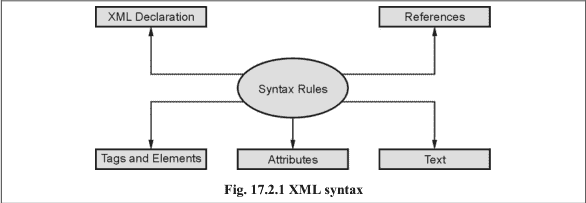

**图 17.2.1 XML 语法**

**1. XML 声明**

```xml
<?xml version="1.0"?>
<note>
<to>RaviW</to>
<from>AviiW</from>
<heading>Greetings</heading>
<body>Wish you happy 2017</body>
</note>
```

文档中的第一行：

*XML 声明*应始终包含在内。它定义了文档的 XML 版本，这里是指 XML 的 1.0 规范。

XML 文档可以可选地包含 XML 声明。其写法如下：

`<?xml version="1.0" encoding="UTF-8"?>`

其中 *version* 是 XML 版本，*encoding* 指定文档中使用的字符编码。

**XML 声明的规则**

- XML 声明区分大小写，且必须以 `<?xml>` 开头，其中“xml”必须小写。
- 如果文档包含 XML 声明，那么它必须严格作为 XML 文档的第一条语句。
- XML 声明必须严格作为 XML 文档中的第一条语句。
- HTTP 协议可以覆盖 XML 声明中设置的 *encoding* 值。

```xml
<?xml version="1.0"?>
```


下一行定义文档的第一个元素（根元素）

```xml
<note>
```

接下来的几行定义根元素的 4 个子元素（to、from、heading 和 body）：

```xml
<to>RaviW</to>
<from>AviW</from>
<heading>Greetings</heading>
<body>Wish you happy 2017</body>
```

最后一行定义根元素的结束

```xml
</note>
```

## 2. XML 标签和元素

- 1. 一个 XML 文件由若干 XML 元素构成，这些元素也称为 XML 节点或 XML 标签。XML 元素的名称用尖括号 `< >` 括起来，如下所示：

```xml
<element>
```

### 2. 标签和元素的语法规则

元素语法：每个 XML 元素都需要用开始元素或结束元素来闭合，如下所示：

```xml
<element>....</element>
```

或者在简单情况下，只需这样：

```xml
<element/>
```

元素嵌套：一个 XML 元素可以包含多个 XML 元素作为其子元素，但子元素不能重叠。也就是说，一个元素的结束标签必须与最近一个未匹配的开始标签同名。

```xml
<b><i> bold and italic</i></b>
```

以下是不正确的，

```xml
<b><i> bold and italic does not work</b></i>
```

### 根元素

所有 XML 文档都必须包含一对标签来定义根元素，其余其他元素必须嵌套在根元素内。所有元素都可以有子元素。子元素必须成对出现，并正确地嵌套在其父元素内。

例如，以下不是一个正确的 XML 文档，因为 x 和 y 元素都出现在顶层，没有根元素：

```xml
<x>...</x>
<y>...</y>
```

以下示例展示了一个正确构成的 XML 文档：

```xml
<root>
<x>...</x>
<y>...</y>
</root>
```

### 所有 XML 元素都必须有结束标签

在 XML 中，所有元素都必须有结束标签，如下：

```xml
<p>This is a paragraph</p>
<p>This is another paragraph</p>
```

### XML 标签区分大小写

XML 标签区分大小写。标签 `<Note>` 与标签 `<note>` 不同。
因此，开始标签和结束标签必须使用相同的大小写书写。

```xml
<Note>Wrong</note>
<Note>Correct</Note>
```

## 3. 属性

属性使用名称/值对为元素指定单个属性。
一个 XML 元素可以有一个或多个属性。

### XML 属性的语法规则

- 在 XML 中，属性名（与 HTML 不同）区分大小写。也就是说，HREF 和 href 被视为两个不同的 XML 属性。
- 同一属性在语法中不能有两个值。以下示例显示了不正确的语法，因为属性 b 被指定了两次：
  `<a b="x" c="y" b="z">....</a>`
- 属性名定义时不加引号，而属性值必须始终出现在引号中。以下示例演示了不正确的 XML 语法：
  `<a b=x>....</a>`
- 属性值必须始终加引号

在上述语法中，属性值没有用引号定义。

在 XML 中，属性值必须始终加引号。以下规范不正确，因为 date 属性没有加引号。

```xml
<?xml version="1.0"?>
<note date=12/11/99>
</note>
```

以下是正确的规范。

```xml
<?xml version="1.0"?>
<note date="12/11/99">
</note>
```

## 4. XML 引用

*引用*通常允许在 XML 文档中包含额外的文本或标记。

引用总是以符号“&”开头，该符号是保留字符，并以符号“;”结束。XML 有两种类型的引用：

**实体引用**：实体引用在开始和结束定界符之间包含一个名称。例如 **`&amp;`**，其中 *amp* 是一个名称。该名称指向预定义的文本和/或标记字符串。

**字符引用**：这些引用包含诸如 **`&#65;`** 的引用，其中包含一个井号（“#”）后跟一个数字。该数字始终指向字符的 Unicode 码。在此例中，65 指向字母“A”。

## 5. XML 文本

- XML 元素和 XML 属性的名称区分大小写。
- 为避免字符编码问题，所有 XML 文件都应保存为 Unicode UTF-8 或 UTF-16 文件。
- XML 元素之间以及 XML 属性之间的空白字符（如空格、制表符和换行符）将被忽略。
- 某些字符被 XML 语法本身保留。因此，它们不能直接使用。要使用它们，需要使用一些替换实体，如下所列：

| 不允许的字符 | 替换实体 | 字符说明 |
|---|---|---|
| `<` | `&lt;` | 小于号 |
| `>` | `&gt;` | 大于号 |
| `&` | `&amp;` | 和号 |
| `'` | `&apos;` | 单引号 |
| `"` | `&quot;` | 双引号 |

## 6. XML 命名空间

XML 命名空间允许限定一个元素。XML 命名空间使用 URI，URI 与命名空间的前缀相关联。命名空间通过 xmlns 声明定义，后跟前缀，该前缀等于唯一标识该命名空间的 URI。

```xml
xmlns:movie="http://www.enjoypoint.com/movies">
```

通过将此命名空间定义作为属性添加到标签，可以在该标签及其包含的任何标签中使用前缀 movie 来完全限定元素：

```xml
<movie:film-types xmlns:movie="http://www.enjoypoint.com/movies">

<movie:film-type>Drama</movie:film-type>

<movie:film-type>Romance</movie:film-type>

</movie:film-types>
```

解析器现在可以识别“film type”的两种含义并相应地处理它们。

## 17.3 读取和写入 XML 文件

### 用于读取和写入 XML 文件的 .NET 类

- 1. **XmlTextReader**：XmlTextReader 类只是读取 XML 文件的方法之一。它处理 XML 文件的方式与 DataReader 类似，即逐个元素读取文档，并在读取过程中做出决策。它是目前快速解析 XML 文件最容易使用的类。
- 2. **XmlTextWriter**：类似地，XmlTextWriter 类提供了一种逐行写入 XML 文件的方法。
- 3. **XmlValidatingReader**：XmlValidatingReader 用于根据架构文件验证 XML 文件。

### 在 .NET 中读取 XML 文件

**XmlTextReader。** XmlTextReader 基于 XmlReader 类，专门设计用于读取字节流，因此适用于位于磁盘上、网络上或流中的 XML 文件。

首先创建该类的新实例。

**构造函数接收**它将读取的 XML 文件的位置。

```csharp
// file

XmlTextReader reader = new XmlTextReader("first.xml");

// url
XmlTextReader reader = new XmlTextReader("http://www.technical.com/first.xml");
// stream (here, a StringReader s)
XmlTextReader reader = new XmlTextReader(s);
```

一旦加载，就可以向前遍历文件。这意味着解析例程的结构应与顺序无关。如果不确定元素的顺序，代码必须能够处理任何顺序。

可以使用 Read 方法遍历文件。

```csharp
while (reader.Read())
{
    // parse file
}
```

循环会一直继续，直到到达文件末尾，或者循环在中间被显式中断。每个节点都会被检查，确定其类型，并收集信息。NodeType 属性公开当前正在读取的节点类型。

XmlReader 会将以下元素视为 3 个不同的节点：

```xml
<book>Programming</book>
```

元素的 `<book>` 部分被识别为 XmlNodeType.Element 节点。

文本部分被识别为 XmlNodeType.Text 节点，结束标签 `</book>` 被视为 XmlNodeType.EndElement 节点。

以下代码展示了如何通过之前创建的 reader 对象输出 XML 标签：

```csharp
while (reader.Read())
{
    switch (reader.NodeType)
    {
        case XmlNodeType.Element:
            Console.Write("<"+reader.Name+">");
            break;
        case XmlNodeType.Text:
            Console.Write(reader.Value);
            break;
        case XmlNodeType.EndElement:
            Console.Write("</"+reader.Name+">");
            break;
    }
}
```


以下是这段代码的输出：

```xml
<book>Programming</book>
```

## 解析属性

类型为 XmlNodeType.Attribute 的属性可以按照上面所示的方式解析。不过，更优雅的做法是：当找到 XmlNodeType.Element 类型时，可以使用 XmlTextReader.MoveToNextAttribute 遍历属性：

```csharp
case XmlNodeType.Element:

Console.Write("<" + reader.Name);
while (reader.MoveToNextAttribute())
{
Console.WriteLine(reader.Name+" = "+reader.Value);
}
break;
```

现在，如果向它输入以下 XML：

```xml
<book first="1" second="2">Programming</foo>
```

输出为：

```xml
<book first="1" second="2">Programming</book>
```

此前，属性被忽略，输出为：

```xml
<book>Programming</book>
```

注意，如果元素不包含任何属性，则循环永远不会开始。这意味着无需先检查是否存在属性。可以使用 AttributeCount 属性查找节点上的属性数量。

### 在 .NET 中编写 XML

编写 XML 由 XmlTextWriter 类完成。同样，采用只进方式，可以根据不同的节点类型构建 XML 文件，这些节点会按顺序输出。

首先，创建该类的实例：

```csharp
XmlTextWriter writer = new XmlTextWriter("FirstWrite.xml", null);
```

**第二个参数**在这里设置为 null，它允许我们指定 XML 文件中要使用的编码格式。将其设置为 null 会生成标准的 UTF-8 编码 XML 文件，且文档元素上没有 encoding 属性。

要写入元素和属性，需要使用 XmlTextWriter 中公开的方法。

考虑书的示例，
myBook.xml

<journal>

<book>

```xml
<title>C# Programming</title>

<author>Ravi Wani</author>

<chapters>

  <chapter name="Introduction to XML"/>

</chapters>

</book>

</journal>
```

第一行是元素 journal。
使用 WriteStartElement 方法将其写入 writer：

```csharp
writer.WriteStartElement("journal");
```

在写入所有 Book 元素之前，不要关闭此元素。因此，接下来要添加的节点是 writer 中的一个开始 Book 元素。

```csharp
writer.WriteStartElement("book");
```

要写入 title 元素（<title>C# Programming</title>）。

此类型与之前不同，因为它具有特定值。由于 title 元素上没有更多属性，请使用 WriteElementString 方法：

```csharp
writer.WriteElementString("title", "C# Programming");
```

```csharp
writer.WriteElementString("author", "Ravi Wani");
writer.WriteStartElement("chapters");
```

现在，元素 chapters 带有一个属性 name。

这里，**首先写入元素的开始部分**，然后写入属性，最后关闭元素。

```csharp
writer.WriteStartElement("chapter");

writer.WriteAttributeString("name", "Control Structures");

writer.WriteEndElement();
```

无需说明要关闭哪个元素，因为 writer 会自动为**最后打开的元素**写入结束标签，在本例中即 chapter。

现在以相同方式关闭剩余元素，

```csharp
writer.WriteEndElement();

writer.WriteEndElement();
```

最后，**“刷新”** writer，换句话说，将请求的信息输出到 XML 文件，然后关闭 writer 以释放文件和资源，

```
writer.Flush()
writer.Close()
```

## 17.4 使用序列化创建 XML 文件

- 1. 将 XML 序列化为公共语言运行时对象，使人能够将 XML 文档转换为更易于使用传统编程语言处理的形式。

- 2. .NET 技术是广泛支持的 XML 文件格式。.NET Framework 提供了用于读取、写入以及执行 XML 格式文件其他操作的类。

- 3. 序列化技术是指将对象转换/保存为 XML 格式或流。要在 XML 中使用**序列化**，需要 **XmlSerializer** 类。该类派生自 System.Xml.Serialization。

- 4. **序列化和反序列化**是用于**将对象序列化为 XML**，然后再**反序列化为对象**的两个最重要的方法。

- 5. 在 C# 中使用 XML 序列化和反序列化时需要记住的事项——
  - i) 在 **XML 序列化**中只能序列化公共对象。因此它也被称为**浅序列化。**
  - ii) 继承自 IEnumerable 和 ICollection 的类也可以序列化，但它只序列化集合，而不序列化公共属性。
  - iii) 私有或只读属性、方法、索引器不能使用此 XML 序列化进行序列化。

- 6. **XML 序列化**的反向过程称为 XML 反序列化。在 XML 序列化中，对象被转换为 XML 流/文件，而将该 XML 流/文件再次转换为对象称为 **XML 反序列化。C# 中的 XML 序列化和反序列化**是 .Net 中最重要的主题。

## 7. 示例

```
/* XML Serialization and Deserialization in C# */

using System;
using System.Xml.Serialization;

namespace XMLCreationTest
{
    public class XMLTest1
```

```csharp
{
    public String value1;
    public String value2;
}

class Program
{
    static void Main(string[] args)
    {
        XMLTest1 xtest = new XMLTest1() { value1 = "Value 1", value2 = "Value 2" };
        XmlSerializer xs = new XmlSerializer(xtest.GetType());
        xs.Serialize(Console.Out, xtest);
        Console.ReadKey();
    }
}
```

实际序列化由 **XmlSerializer** 类的实例完成，该类来自 System.Xml.Serialization 命名空间。序列化器的构造函数需要引用它应处理的对象类型——可以通过实例化对象的 *GetType()* 方法获取，或者调用 *typeof()* 函数并将类名指定为唯一参数来获取。

***Serialize()*** 方法接受已定义类型的对象，将该对象转换为 XML，然后将信息写入已定义的流（在本例中为控制台输出流的 TextWriter 对象）。示例代码的 XML 输出如下所示：

```xml
<?xml version="1.0" encoding="ibm850"?>
<Test xmlns:xsi="http://www.w3.org/2001/XMLSchema-instance" xmlns:xsd="
             http://www.w3.org/2001/XMLSchema">
  <value1>Value 1</value1>
  <value2>Value 2</value2>
</Test>
```

XML 输出中的元素和属性名称由对象中属性和字段的名称设置。

## 8. 反序列化 XML 数据

反序列化是获取 XML 格式数据并将其转换为 .NET Framework 对象的过程：与上面所示过程相反。只要 XML 格式良好且准确匹配目标类型的结构，反序列化就是相对直接的任务。

在以下示例中，前面示例的 XML 输出被硬编码到字符串中，但它也可以从网络流或外部文件获取。**XmlSerializer** 类

用于将该字符串反序列化为 Test 类的实例，然后示例将字段打印到控制台。为了获得可传入 XmlSerializer 构造函数的合适流，声明了一个 StringReader（来自 System.IO 命名空间）。

```csharp
using System;
using System.IO;
using System.Xml.Serialization;

namespace XMLCreationTest
{
    public class XMLTest2
    {
        public String value1;
        public String value2;
    }

    class Program
    {
        static void Main(string[] args)
        {
            String xData = "<?xml version=\"1.0\" encoding=\"ibm850\"?><Test xmlns:xsi=\"http://www.w3.org/2001/XMLSchema-instance\" xmlns:xsd=\"http://www.w3.org/2001/XMLSchema\"><value1>Value 2</value1><value2>Value 2</value2></Test>";
            XmlSerializer xs = new XmlSerializer(typeof(Test));
            XMLTest2 test = (XMLTest2)xs.Deserialize(new StringReader(xData));
            Console.WriteLine("V1: " + test.value1);
            Console.WriteLine("V2: " + test.value2);
        }
    }
}
```

## 9. 重写类的序列化

如前所述，类的所有公共属性和字段都会自动可序列化，并且通常无需使用任何指令或属性即可转换为 XML。私有属性和字段默认不会被序列化。要包含这些内容，并且更精确地控制对象如何序列化为 XML，可以重写整个序列化过程。

## 10. 使用属性控制序列化

当序列化数据以便与其他应用程序交换时，或者当遵循预定义的 XML 架构时，能够更改过程中使用的元素和属性名称是很有用的。


默认情况下，XML 输出中的元素以它们所基于的属性或字段命名。

根节点可以使用 XmlRoot 属性重命名，并通过使用 XmlElement 属性并设置其 ElementName 来更改子节点名称。

可以通过在括号内用逗号分隔来为属性指定多个属性。这通常采用 [attributename(property1=value1, property2=value2...)] 的形式

```csharp
[XmlRoot("XTest")]
public class Test
{
    [XmlElement(ElementName="V1")]
    public String value1;

    [XmlElement("V2")]
    public String value2;
}
```

请注意，在指定元素名称时，可以省略属性名称。

## 17.5 XML 模式
- 1. 虽然 XML 文件可能符合 XML 规范，但它可能不是特定方言的有效形式。XML 模式有助于验证某些元素是否存在，同时确保所提供的值类型正确。
- 2. 存在几种不同的模式规范：XSD、DTD 和 XSL。虽然 DTD（文档类型定义）是目前最常用的模式，但 XSD（XML 模式定义）是一种较新的标准，正在获得认可，因为它为 XML 验证提供了最精细的控制。
- 3. XML Schema 通常被称为 XML Schema Definition（XSD），用于描述和验证 XML 数据的结构和内容。
- 4. XML 模式定义元素、属性和数据类型。
- 5. 模式元素支持命名空间。它类似于描述数据库中数据的数据库模式。
- 6. XML 模式背后的基本思想是它们描述了 XML 文档可以采用的合法格式。
- 7. 语法
  - 将模式在 XML 文档中声明为，

```xml
<xs:schema xmlns:xs="http://www.w3.org/2001/XMLSchema">
```

### 示例
以下示例展示了如何使用模式：

```xml
<?xml version="1.0" encoding="UTF-8"?>
<xs:schema xmlns:xs="http://www.w3.org/2001/XMLSchema">
<xs:element name="contact">
<xs:complexType>
    <xs:sequence>
        <xs:element name="Book name" type="xs:string" />
        <xs:element name="Publication" type="xs:string" />
    </xs:sequence>
</xs:complexType>
</xs:element>
</xs:schema>
```

- **元素**

在 XSD 中，元素可以定义为，

```xml
<xs:element name="ele" type="y"/>
```

- **定义类型**

**XML 模式元素**可以按如下方式定义。

- **简单类型** - 简单类型元素仅在文本上下文中使用。一些预定义的简单类型有：xs:integer、xs:boolean、xs:string、xs:date。例如：

```xml
<xs:element name="author_number" type="xs:int" />
```

- **复杂类型** - 复杂类型是其他元素定义的容器。这允许指定元素可以包含哪些子元素，并在 XML 文档中提供某种结构。

例如：

```xml
<xs:element name="Location">
<xs:complexType>
    <xs:sequence>
        <xs:element name="author" type="xs:string" />
        <xs:element name="publication" type="xs:string" />
    </xs:sequence>
</xs:complexType>
</xs:element>
```

在上面的示例中，*Location* 元素由子元素组成。这是对其他 <xs:element> 定义的容器，允许在 XML 文档中构建简单的元素层次结构。

- **全局类型** - 使用全局类型，可以在文档中定义单个类型，供所有其他引用使用。

例如，假设 *author* 和 *publication* 需要为出版物的不同位置进行泛化。在这种情况下，按如下方式定义一个通用类型：

```xml
<xs:element name="LocationType">
  <xs:complexType>
    <xs:sequence>
      <xs:element name="author" type="xs:string" />
      <xs:element name="publication" type="xs:string" />
    </xs:sequence>
  </xs:complexType>
</xs:element>
```

- **属性**
XSD 中的属性在元素内提供额外信息。属性具有如下所示的 *name* 和 *type* 属性：

```xml
<xs:attribute name="x" type="y"/>
```

生成 XML 模式

XML 模式定义工具（Xsd.exe）允许生成描述类的 XML 模式，或生成由 XML 模式定义的类。

## 8. 生成特定于模式的类
- 1. 转到命令提示符。
- 2. 将 XML 模式作为参数传递给 XML 模式定义工具，该工具会创建与 XML 模式精确匹配的一组类，例如：
- 3. xsd mySchema.xsd

该工具只能处理引用 2001 年 3 月 16 日万维网联盟 XML 规范的模式。换句话说，XML 模式命名空间必须是 "http://www.w3.org/2001/XMLSchema"，如下例所示。

```xml
<?xml version="1.0" encoding="utf-8"?>
<xs:schema attributeFormDefault="qualified" elementFormDefault="qualified" targetNamespace="" xmlns:xs="http://www.w3.org/2001/XMLSchema">
```

4. 根据需要使用方法、属性或字段修改类。有关使用属性修改类的更多信息，请参阅《使用属性控制 XML 序列化》和《控制编码 SOAP 序列化的属性》。

"XSD" 目前是描述 XML 文档的事实标准。现在使用 2 个版本 1.0 和 1.1，总体上是相同的。XSD 模式本身就是一个 XML 文档，甚至有一个 XSD 模式来描述 XSD 标准。

在实例化类（或类）序列化时生成的 XML 流的模式通常很有用进行检查。例如，可以发布模式供他人使用，或将其与试图实现一致性的模式进行比较。

## 9. 从一组类生成 XML 模式文档
- 1. 将类或类编译成 DLL。
- 2. 打开命令提示符。
- 3. 将 DLL 作为参数传递给 Xsd.exe，例如：
- 4. xsd MyFile.dll
- 5. 模式（或模式）将被写入，以名称 schema0.xsd" 开始。

### 示例

| 示例 XSD | 示例 XML |
|---|---|
| 1. <xs:element name="Author_dob"> 2. type="xs:date"/> | 1. <Author_dob> 2. 2000-01-12T12:13:14Z 3. </Author_dob> |
| 1. <xs:element name="Author_address"> 2. type="xs:string"/> | 1. <Author_address> 2. 1,MG Marg Camp 3. </Author_address> |
| 1. <xs:element name="AuthorID"> 2. type="xs:int"/> | 1. <AuthorID> 2. 2610 3. </AuthorID> |
| 1. <xs:element name="Content"> 2. type="xs:string"/> | 1. <Content> 2. （类型可以定义为字符串但没有任何内容；这对所有数据类型来说并不总是成立。） 6. </Content> |

## 10. XML 模式验证

### 验证事件处理程序
ValidationEventHandler 事件用于定义事件处理程序以接收有关 XSD 模式验证错误的通知。验证错误和警告通过 ValidationEventHandler 回调函数报告。如果发生任何验证错误，将抛出异常，并且 XmlValidatingReader 无法重新启动。

### 使用 .NET 类进行 XML 验证
Microsoft .NET 框架类支持 W3C XML 模式推荐。用于验证 XML 文档的类是 XmlTextReader、XmlSchemaCollection 和 XmlValidatingReader。验证 XML 文档的步骤顺序如下：
- 1. 定义 ValidationHandler 事件处理程序方法。
- 2. 使用 XmlTextReader 类解析 XSD 模式。
- 3. 使用 XmlSchemaCollection 类将解析后的模式添加到模式集合中。
- 4. 将模式集合与 XmlValidatingReader 类关联。
- 5. 将事件处理程序方法与 XmlValidatingReader 类关联。
- 6. XmlValidatingReader 类使用添加模式到集合时指定的命名空间 URI 验证 XML 文档。

### 验证过程
- 1. 使用 XmlValidatingReader 类，可以轻松地根据模式文件验证 XML 文件。然而，首先需要使用一些其他类。
- 2. 可以通过用模式文件填充 XmlSchemaCollection 来将 XmlValidatingReader 对象指向要使用的模式文件，如下所示，
- 3. 实际的 XmlValidatingReader 类在其构造函数中接受一个 XmlReader。因此，创建 XmlTextReader 并用需要验证的 XML 文件填充，

```csharp
XmlSchemaCollection xsdCollection = new XmlSchemaCollection();
xsdCollection.Add("schemafile", "schema.xsd");
```

在此示例中，模式包含在文件 schema.xsd 中。

```csharp
XmlTextReader reader;

XmlValidatingReader validatingReader;

reader = new XmlTextReader("first.xml");

validatingReader = new XmlValidatingReader(reader);
```


- 4. 现在，将 schemaCollection 添加到架构中，以便验证读取器可以使用它们。

```csharp
validatingReader.Schemas.Add(xsdCollection);
```

- 5. 如果验证器发现错误，则会触发一个事件，应通过创建事件处理程序并编写代码来捕获该事件，以便响应这些错误，

```csharp
validatingReader.ValidationEventHandler += new
    ValidationEventHandler(validationCallBack);

public void validationCallBack (object sender, ValidationEventArgs args)
{
    Response.Write("Error: " + args.Message);
}
```

- 6. 最后，使用 Read 方法可以在验证读取器上验证文件。

- 可以单独读取和处理文件中的节点，但是，出于验证目的，使用空的 while 循环逐行遍历文件也足够了。

```csharp
while (validatingReader.Read()){}
```

- 7. 当在文件处理过程中发现错误时，可以通过 validationCallBack 方法捕获并处理该事件。

## 示例

```csharp
//Illustration of validating XML document against XSD schema
using System;
using System.Collections;
using System.Data;
using System.IO;
using System.Xml;
using System.Xml.Schema;
using System.Text;

public class XMLValidator
{
    // Validation Error Count
    static int ErrorsCount = 0;

    // Validation Error Message
    static string ErrorMessage = "";

    public static void ValidationHandler(object sender,
                                        ValidationEventArgs args)
    {
        ErrorMessage = ErrorMessage + args.Message + "\r\n";
        ErrorsCount ++;
    }
}
```

```csharp
public void Validate(string strXMLDoc)
{
    try
    {
        // Declare local objects
        XmlTextReader xtr = null;
        XmlSchemaCollection xscl = null;
        XmlValidatingReader xvr = null;

        // Text reader object
        xtr = new XmlTextReader(urlpath);
        xscl = new XmlSchemaCollection();
        xscl.Add(null, xtr);

        // XML validator object

        xvr = new XmlValidatingReader(strXMLDoc,
                XmlNodeType.Document, null);

        xvr.Schemas.Add(xscl);

        // Add validation event handler

        xvr.ValidationType = ValidationType.Schema;
        xvr.ValidationEventHandler +=
                new ValidationEventHandler(ValidationHandler);

        // Validate XML data
        while(xvr.Read());
        xvr.Close();
        // Raise exception, if XML validation fails
        if (ErrorsCount > 0)
        {
            throw new Exception(ErrorMessage);
        }
        // XML Validation succeeded
        Console.WriteLine("XML validation succeeded.\r\n");
    }
    catch(Exception error)
    {
        // XML Validation failed
        Console.WriteLine("XML validation failed." + "\r\n" +
        "Error Message: " + error.Message);
    }
}
```

## 17.6 XML 样式表与转换

1. 如果有一种类型的 XML，并且需要将其转换为另一种类型，那么可以使用 XSLT 来实现此目的。XML 样式表转换（XSLT）被定义为一种将 XML 文档转换为其他文档格式的语言。XSLT 处理器解析输入的 XML 文档以及 XSLT 样式表，然后使用输入 XML 文档中的元素来处理 XSLT 样式表中找到的指令。在处理 XSLT 指令的过程中，会创建一个结构化的 XML 输出。

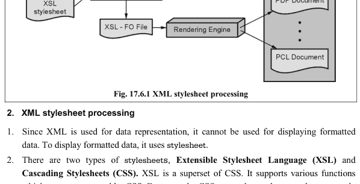

### 2. XML 样式表处理

1. 由于 XML 用于数据表示，因此不能用于显示格式化数据。为了显示格式化数据，它使用样式表。

2. 样式表有两种类型：可扩展样式表语言（XSL）和层叠样式表（CSS）。XSL 是 CSS 的超集。它支持 CSS 不支持的多种功能。例如，CSS 不能用于对元素排序或进行条件格式化。此外，XSL 的语法与 CSS 不同。XSL 遵循 XML 的语法。

3. 以下是 XSL 的一些元素：

- Stylesheet：一个 XSL 文件以 <stylesheet> 作为根元素。其写法如下：
- template：<template> 元素用于指定在匹配特定节点时要应用的格式化规则。其写法如下：

```xml
<xsl:stylesheet xmlns:xsl="http://www.w3.org/1999/XSL/Transform" version="1.0">
```

```xml
<xsl:template match="/">
```

- for-each：<for-each> 元素用于遍历特定的 XML 元素。其写法如下：

```xml
<xsl:for-each select="employees/emp">
```

- value-of：<value-of> 元素用于显示所选节点的值。如果该节点是属性，则其前缀为 @。

```xml
<xsl:value-of select="@id"/>
```

### 3. 静态和动态转换

XML 文件可以静态或动态地进行转换。要将 XML 文件静态链接到样式表，可以使用以下处理指令：

```xml
<?xml-stylesheet type="text/xsl" href="filename.xsl"?>
```

通过使用 XslCompiledTransform 类的实例，可以将 XML 文件动态链接到样式表。

## 示例

```xml
- The .xml file to be transformed.
Books.xml
<?xml version="1.0" encoding="utf-8" ?>
<Books>
  <book>
    <name>C#</name>
    <cost>Rs 500</cost>
  </book>
  <book>
    <name>ASP</name>
    <cost>Rs 550</cost>
  </book>
</Books>
```

- 现在，为上述 XML 构建一个 XSLT 文档。

```xml
Book.xsl
<?xml version="1.0" encoding="iso-8859-1" ?>
<xsl:stylesheet version="1.0"
xmlns:xsl="http://www.w3.org/1999/XSL/Transform">
<xsl:template match="/">
  <table border="1">
    <tr>
      <th>Name</th>
      <th>Price</th>
    </tr>
    <xsl:for-each select="Books/book">
    <tr>
      <td><xsl:value-of select="name"/></td>
      <td><xsl:value-of select="cost"/></td>
    </tr>
    </xsl:for-each>
  </table>
</xsl:template>
</xsl:stylesheet>
```

### 4. 转换部分

**XmlUrlResolver** 和 **XslTransform** 类用于执行转换。**XmlUrlResolver** 类用于解析外部 XML 资源，例如实体、文档类型定义（DTD）或架构。它还用于处理在可扩展样式表语言（XSL）样式表或 XML 架构定义语言（XSD）架构中找到的 include 和 import 元素。

### 转换代码，

```csharp
XmlUrlResolver resolver = new XmlUrlResolver();
resolver.Credentials = System.Net.CredentialCache.DefaultCredentials;
XsltTransform xsltrans = new XslTransform();
xsltrans.Load(XslFile,resolver);
xsltrans.Transform(XmlFile,OutputFile,resolver);
```

Load 方法用于加载 XSLT 文档。此方法可以接受 XmlReader、文档 URL 或各种其他对象。然后调用 Transform 方法。此方法已重载，因此可以接受各种参数。

**输出 -**

| 名称 | 价格 |
|---|---|
| C# | R.S 500 |
| ASP | R.S 500 |

## 17.7 使用 XPATH 搜索 XML 文件

### 1. 使用 XPATH 和属性名搜索 XML 文件

- 要在 XML 文件中查找节点，可以使用 **XPath** 表达式。
- **XmlNode.SelectNodes** 方法返回由 XPath 字符串选择的 **节点** 列表。
- **XmlNode.SelectSingleNode** 方法查找与 XPath 字符串匹配的 **第一个节点**。

考虑下面给出的 XML 文件，

```xml
[XML]
<Names>
    <Name>
        <FirstName>Ravindra</FirstName>
        <LastName>Wani</LastName>
    </Name>
    <Name>
        <FirstName>Prakash</FirstName>
        <LastName>Deshmukh</LastName>
    </Name>
</Names>
```

- 要获取所有 `<Name>` 节点，请使用 **XPath 表达式** `/Names/Name`。

第一个斜杠表示 `<Names>` 节点必须是根节点。

SelectNodes 方法返回集合 `XmlNodeList`，其中将包含 `<Name>` 节点。

要 **获取值** 子节点 `<FirstName>`，只需使用节点名称索引 `XmlNode`：xmlNode["FirstName"].InnerText。

### 示例

```csharp
XmlDocument xml = new XmlDocument();
xml.LoadXml(myXmlString); // suppose that myXmlString contains
                         <Names>... </Names>"

XmlNodeList xnList = xml.SelectNodes("/Names/Name");
foreach (XmlNode xn in xnList)
{
    string firstName = xn["FirstName"].InnerText;
    string lastName = xn["LastName"].InnerText;
    Console.WriteLine("Name: {0} {1}", firstName, lastName);
}
```

### 输出

```
Name: Ravindra Wani
Name: Prakash Deshmukh
```

### 2. 按属性值选择 XML 节点

- 可以从 XML 文档中 **按属性值** 选择 XML 节点。为此，请使用 **XmlNode.SelectNodes** 方法获取由 XPath 表达式选择的节点列表。

考虑下面的 XML 文件。

```xml
[XML]
<Names>
    <Name type="M">Ravindra</Name>
    <Name type="F">Anu</Name>
    <Name type="M">Prakash</Name>
</Names>
```

要 **获取所有名称节点**，请使用 XPath 表达式 `/Names/Name`。


要仅获取男性姓名（选择具有特定 XML 属性的所有节点）请使用 XPath 表达式 /Names/Name[@type='M']。

代码 -

```
XmlDocument xml = new XmlDocument();
xml.LoadXml(str); // suppose that str string contains "<Names>...</Names>"

XmlNodeList xnList = xml.SelectNodes("/Names/Name[@type='M']");
foreach (XmlNode xn in xnList)
{
    Console.WriteLine(xn.InnerText);
}
```

## 输出

Ravindra
Prakash

- 使用 XPath 选择顶部的 XML 节点

要从 XML 中选择节点，请使用方法 XmlNode.SelectNodes。将 XPath 表达式作为参数传递，方法将返回所选节点列表。

请考虑下面的 XML 文件，

```
[XML]
<Names>
    <Name>Ravi</Name>
    <Name>Shyam</Name>
    <Name>Avi</Name>
    <Name>Lucky</Name>
    <Name>Sandy</Name>
    <Name>Sam</Name>
    <Name>Niru</Name>
</Names>
```

要获取所有 <Name> 节点，请使用 XPath 表达式 /Names/Name。

如果不是选择所有节点，而只是前 5 个节点，请使用 XPath 表达式，/Names/Name[position() <= 5]。

## 示例

```
XmlDocument xml = new XmlDocument();
xml.LoadXml(str); // suppose that str string contains "<Names>...</Names>"

XmlNodeList xnList = xml.SelectNodes("/Names/Name[position() <= 5]");
foreach (XmlNode xn in xnList)
{
    Console.WriteLine(xn.InnerText);
}
```

| 输出 |
|---|
| Ravi |
| Shyam |
| Avi |
| Lucky |
| Sandy |

## 17.8 使用 XML 和 ADO.NET 处理数据

处理 XML 和 ADO 有两种方法，即，一是使用 ADO.NET 访问 XML 文档，二是使用 XML 和 ADO.NET 访问 XML。此外，关系数据库也可以使用 ADO.NET 和 XML.NET 访问。

- 使用 DataSet 读取 XML

DataSet 类可用于访问数据。该类实现了用于处理 XML 文档的方法和属性。

### ReadXml 方法

ReadXml 是一个重载方法；用于读取数据流、TextReader、XmlReader 或 XML 文件并存储到 DataSet 对象中，后者稍后可用于以表格格式显示数据。ReadXml 方法有八种不同的重载形式。它可以读取文本、string、stream、TextReader、XmlReader 及其组合格式。在使用 DataSet 和其他通用数据组件之前，请记住添加对 System.Data 和 System.Data.Common 命名空间的引用。

### 示例

```
```csharp
//1. Create a DataSet object
DataSet ds = new DataSet();
// 2. Fill with the data with file
ds.ReadXml("media.xml");
```
```

### ReadXmlSchema 方法

ReadXmlSchema 方法在 DataSet 对象中读取 XML 架构（具有四种重载形式），可使用 Text Reader、string、stream 和 XmlReader

### 示例

```
```csharp
//illustrates how to use a file as direct input and call the ReadXmlSchema method to read the file
DataSet ds = new DataSet();
ds.ReadXmlSchema(@"c:\media.xml");
```
```

### 示例

```
//illustration of reading the file XmlReader and use XmlTextReader as the input of
/ReadXmlSchema

//Create a dataset object
DataSet ds = new DataSet("New DataSet");
// Read xml in an XmlTextReader
XmlTextReader myXmlReader = new XmlTextReader(@"c:\media.Xml");
// Call ReadXmlSchema
ds.ReadXmlSchema(myXmlReader);
myXmlReader.Close();
```

- 使用 DataSet 写入 XML

DataSet 类包含从 DataSet 对象写入 XML 文件并将数据填充到文件中的方法。

### WriteXml 方法

WriteXml 方法将 DataSet 对象的当前数据（架构和数据）写入 XML 文件。这是一个重载方法。通过使用此方法，可以将数据写入文件、流、TextWriter 或 XmlWriter。

### 示例

```
//illustration writing the data to an XML file using DataSet
using System;
using System.IO;
using System.Xml;
using System.Data;
namespace XmlandADO
{
    class XmlAndDataSetDemo
    {
    public static void Main()
    {
    try
    {
    // Create a DataSet, namespace and Media table
    // with Name and Type columns
    DataSet ds = new DataSet("DS");
    ds.Namespace = "StdNamespace";
    DataTable mdTable = new DataTable("Media");
    DataColumn col1 = new DataColumn("Name");
    DataColumn col2 = new DataColumn("Type");
    mdTable.Columns.Add(col1);
    mdTable.Columns.Add(col2);
    ds.Tables.Add(mdTable);
    //Add media Data to the table
```

```
```csharp
DataRow newRow; newRow = mdTable.NewRow();
newRow["Name"] = "C# Guide";
newRow["Type"] = "Book";
mdTable.Rows.Add(newRow);
newRow = mdTable.NewRow();
newRow["Name"] = "XML";
newRow["Type"] = "CD";
mdTable.Rows.Add(newRow);
newRow = mdTable.NewRow();
    ds.AcceptChanges();
// Create a new StreamWriter
    System.IO.StreamWriter mdStreamWriter = new
    System.IO.StreamWriter(@"c:\media\Data.xml");

// Write data to DataSet which actually creates the file
ds.WriteXml(mdStreamWriter);
mdStreamWriter.Close();
}
catch (Exception e)
{
    Console.WriteLine("Exception: {0}", e.ToString());
}
return;
}
}
}
```
```

### 上述代码片段的输出

```
```xml
<?xml version="1.0" ?>
<DS xmlns="StdNamespace">
  <Media>
    <Name>C# Guide</Name>
    <Type>Book</Type>
  </Media>
  <Media>
    <Name>XML</Name>
    <Type>CD</Type>
  </Media>
</DS>
```
```

## 17.9 使用 SAX 和 DOM 操作 XML

- XML 解析器是一种软件库或包，为客户端应用程序提供与 XML 文档交互的接口。XML 解析器旨在读取 XML 并为程序使用 XML 创建一种方式。XML 解析器验证文档并检查文档是否格式良好。**XML 解析器可以分为两种主要类型 DOM 解析器或 SAX 解析器。**

### 17.9.1 DOM 方法

- DOM 文档是一个对象，其中包含 XML 文档的所有信息。它像树结构一样组成。DOM 解析器实现 DOM API。此 API 非常简单易用。

### 17.9.1.1 DOM 解析器的特性

- DOM 解析器在内存中创建一个内部结构，即 DOM 文档对象，客户端应用程序通过在此文档对象上调用方法来获取原始 XML 文档的信息。
- DOM 解析器具有基于树的结构。

### 优点

- 1) 它支持读写操作，并且 API 非常简单易用。
- 2) 当需要随机访问文档中 widely separated 的部分时首选。

### 缺点

- 1) 它内存效率低下。（消耗更多内存，因为整个 XML 文档需要加载到内存中）。
- 2) 与其他解析器相比速度较慢。

操作 XML 文档的内容包括遍历文档中的节点列表、设置和查询属性值，以及通过创建和插入新节点来操作树本身。本节讨论使用 Document Object Model（DOM）操作 XML 文档，该模型由 System.Xml 命名空间中的 XmlDocument 类建模。DOM 是递归的，这意味着每个节点都具有与文档中每个其他节点相同的属性和方法。

### 17.9.1.2 重要的基本 XML 相关概念

- 1. **XSL** - Extensible Stylesheet Language，旨在为 XML 文档表达样式表。XSL 之于 XML 如 CSS 之于 HTML。
- 2. **XML Transformation** - 是用户定义的算法，将给定的 XML 文档转换为另一种格式，例如 XML、HTML、XHTML。算法由 XSL 描述。

3. **XSLT** - 旨在作为 XSL 的一部分使用，将 XML 文档转换为另一个 XML 文档，或浏览器识别的另一种类型文档，如 HTML 或 XHTML。XSLT 使用 XPath。

4. **XPath** - 是定义 XML 文档部分的一组语法规则。

### 17.9.1.3 XMLNode 类

XMLNode 类用于在 DOM 中操作节点。XML 节点是 DOM 模型文档中最基本的抽象单元。

### 常用 XmlNode 属性

- Attributes - 节点的属性 (XmlAttributeCollection)。
- ChildNodes - 当前节点的子节点列表 (XmlNodeList)。
- FirstChild - 返回 XML 节点的第一个子节点（第一个为文档顺序中的第一个）。
- HasChildNodes - 一个布尔值，指示节点是否有子节点。
- InnerText - 获取或设置节点内部的文本。
- InnerXml - 获取或设置节点内的 XML。
- LastChild - 返回节点的最后一个子节点（相对于文档顺序）。
- Name - 节点的名称。
- NodeType - 指示节点的类型。这可以是多种类型，包括但不限于：Document、DocumentFragment、Element、EndElement、Entity、Notation、Text、Whitespace 或 XmlDeclaration。
- OuterXml - 表示当前节点及其所有子节点的 XML。
- OwnerDocument - 当前节点所属的文档。
- ParentNode - 当前节点的父节点（如果有）。
- PreviousSibling - 获取文档顺序中紧邻当前节点之前的节点。
- Value - 获取或设置当前节点的值。

### 常用 XmlNode 方法

- AppendChild - 将子节点添加到当前子节点列表的末尾。
- Clone - 创建节点的副本。
- CreateNavigator - 为此节点创建 XPathNavigator。
- InsertAfter - 将给定节点插入当前节点之后。
- InsertBefore - 将给定节点插入当前节点之前。
- PrependChild - 在子节点列表开头添加给定的子节点。


- RemoveAll - 移除所有子节点。
- RemoveChild - 从当前节点移除给定子节点。
- SelectNodes - 选择与 XPath 表达式匹配的节点列表（将在下一节讨论）。
- SelectSingleNode - 选择与 XPath 表达式匹配的单个节点。

## 17.9.1.4 XMLDocument 类

XmlDocument 类处理整个文档，其本身也是一个 XmlNode。XmlDocument 类继承自 XmlNode。这符合 DOM 模式，即文档是一个可以拥有子节点的节点。以下列表中的方法展示了 XmlDocument 可用的一些额外方法，这些方法不属于标准节点类。

### XmlDocument 类方法

- CreateAttribute - 使用给定名称创建 XmlAttribute。
- CreateDataSection - 使用给定数据创建 CData 节。
- CreateComment - 创建 XmlComment。
- CreateDocumentFragment - 创建文档片段。
- CreateElement - 创建 XmlElement，即具有元素特定功能的 XmlNode。
- CreateNode - 创建 XmlNode。
- CreateTextNode - 创建 XmlText 节点。
- CreateWhitespace - 创建用于插入文档的空白。
- ImportNode - 从另一个文档导入节点。
- Load - 从给定文件加载 XML。
- LoadXml - 从给定 XML 字符串加载 XML。
- Save - 保存 XML 文档。
- Validate - 根据架构验证 XML 文档。

### 程序 1

```csharp
//Add node/xml value to existing XML
string tempXml = @"<States>
<State ID='1' Name='Punjab' />
<State ID='2' Name='Rajasthan' />
<State ID='3' Name='Gujrat' />
<State ID='4' Name='Maharashtra' />
<State ID='5' Name='Tamilnadu' />
</States>";
```

### 程序 2

```csharp
// to illustrate different ways to add the node, using XMLDocument and XDocument class.
Using XmlDocument
// Option1: Using InsertAfter()
// Adding Node to XML
XmlDocument docstate1 = new XmlDocument();
docstate1.LoadXml(tempXml);
XmlNode root1 = docstate1.DocumentElement;
//Create a new attribute.
XmlElement elem = docstate1.CreateElement("State");
XmlAttribute attr = docstate1.CreateAttribute("ID");
attr.Value = "6";
elem.Attributes.Append(attr);
//Create a new attribute.
XmlAttribute attr2 = docstate1.CreateAttribute("Name");
attr2.Value = "Karnataka";
elem.Attributes.Append(attr2);
//Add the node to the document.
root1.InsertAfter(elem, root1.LastChild);
docstate1.Save(Console.Out);
Console.WriteLine();

// Option2: Using AppendChild()
XmlDocument docstate2 = new XmlDocument();
docstate2.LoadXml(tempXml);
XmlElement XEle = docstate2.CreateElement("State");
XEle.SetAttribute("Name", "Karnatak");
XEle.SetAttribute("ID", "6");
docstate2.DocumentElement.AppendChild(XEle.Clone());
docstate2.Save(Console.Out);
Console.WriteLine();
```

上述程序 2 的输出

```xml
<?xml version="1.0" encoding="IBM437"?>
<States>
<State ID='1' Name='Punjab' />
<State ID='2' Name='Rajasthan' />
<State ID='3' Name='Gujrat' />
<State ID='4' Name='Maharashtra' />
<State ID='6' Name='Tamilnadu' />
<State ID='6' Name='Karnatak' />
</States>
```

### 程序 3

```csharp
//Edit/Update XML data - to change/update XML node value
Using XDocument
// Option1: Using SetAttributeValue()
XDocument xmlDoc = XDocument.Parse(tempXml);
// Update Element value
var items = from item in xmlDoc.Descendants("State")
    where item.Attribute("ID").Value == "3"
    select item;
foreach (XElement itemElement in items)
{
    itemElement.SetAttributeValue("Name", "NewGujrat");
}
xmlDoc.Save(Console.Out);
Console.WriteLine();

// Option2: Using Attribute.Value()
var doc = XElement.Parse(tempXml);
var target = doc.Elements("State")
    .Where(e => e.Attribute("ID").Value == "2")
    .Single();
target.Attribute("Name").Value = "NewRajasthan";
doc.Save(Console.Out);
Console.WriteLine();
// Option3: Using ReplaceWith()
XDocument xmlDoc1 = XDocument.Parse(tempXml);
XElement xObj = xmlDoc1.Root.Elements("State").FirstOrDefault();
xObj.ReplaceWith(new XElement("Project", new XAttribute("ID", "1"),
new XAttribute("Name", "New_Punjab")));
xmlDoc1.Save(Console.Out);
Console.WriteLine();
```

### 程序 4

```csharp
//Using XmlDocument
int nodeId = 2;
XmlDocument xmlDocstate = new XmlDocument();
xmlDocstate.LoadXml(tempXml);
//node["Node2"].InnerText = "Value2";
XmlNode node = xmlDocstate.SelectSingleNode("/States/State[@ID=" + nodeId + "]");
node.Attributes["Name"].Value = "State2_Update";
xmlDocstate.Save(Console.Out);
Console.WriteLine();
```

### 程序 5

### 从 XML 中选择节点值

使用 XML 数据时，数据是根据节点值获取的。假设需要获取 ID 为 2 的州名称。为此，可以使用 XMLDocument 类或 XDocument（System.Xml.Linq.XDocument）类。

```csharp
XmlDocument xmldoc = new XmlDocument();
xmldoc.LoadXml(tempXml);
int nodeId = 2;
XmlNode nodeObj = xmldoc.SelectSingleNode("/States/State[@ID=" + nodeId + "]");
//string id = nodeObj["State"].InnerText; // For inner text
string pName = nodeObj.Attributes["Name"].Value;

// Select Node based on XPath
XmlNodeList xnList = xmldoc.SelectNodes("/States/State");
foreach (XmlNode xn in xnList)
{
    string stateName = xn.Attributes["Name"].Value;
}
// Select nodes by TagName
XmlNodeList nodeList = xmldoc.GetElementsByTagName("State");
foreach (XmlNode node in nodeList)
{
    var ID = node.Attributes["ID"].Value;
    var Name = node.Attributes["Name"].Value;
}
```

## 17.9.1.5 XmlDocument 与 XDocument

XmlDocument 或 XDocument 类广泛用于操作 XML 数据。不过，它们之间存在一些差异，如下所示：

- XDocument（System.Xml.Linq）来自 LINQ to XML API，而 XmlDocument（System.Xml.XmlDocument）是用于 XML 的标准 DOM 风格 API。
- 如果使用 .NET 3.0 或更低版本，则应使用 XmlDocument，即经典的 DOM API。另一方面，使用 .NET 3.5 及更高版本时，应使用 XDocument。
- 在性能方面，XDocument 比 XmlDocument 更快，因为 XDocument 是为了与 LINQ 配合获得更好的可用性而新开发的。XDocument 创建和处理文档要简单得多。

## 17.9.2 SAX 方法

SAX（Simple API for XML）是用于 XML 的串行访问解析器 API。SAX 提供了一种从 XML 文档读取数据的机制。它是 DOM 的一种流行替代方案。用于 XML 处理的 SAX 解析器是一种解析器，它作为流解析器实现 SAX（SAX 解析器）功能，并具有事件驱动的 API。用户定义若干回调方法，这些方法将在解析期间发生事件时被调用。

SAX 事件包括：

- a) XML 文本节点。
- b) XML 元素节点。
- c) XML 处理指令。
- d) XML 注释。

SAX 解析器实现 SAX API。此 API 是基于事件的 API，且不太直观。

### 17.9.2.1 SAX 解析器的特性

- 它不创建任何内部结构。
- 客户端不知道要调用哪些方法，它们只是重写 API 的方法，并将自己的代码放入方法中。
- 它是基于事件的解析器，工作方式类似于 Java 中的事件处理器。

**优点**

- 1) 它简单且内存高效。
- 2) 它非常快，适用于大型文档。

**缺点**

- 1) 它是基于事件的，因此其 API 不太直观。
- 2) 客户端永远无法知道完整信息，因为数据被分成片段。

### 17.9.2.2 通过 SAX 编写 XML 文件

SAX（代表 Simple API for XML）实际上是文本文件读取器的一种简单扩展。写入很简单，其中元素和属性按它们在文件中出现的相同顺序写入（此方法忽略树结构）。.NET 提供 XmlWriter 类，以便将写入操作落实到 XML 中，尽管它只是一个文本文件。它围绕元素（更准确地说，是节点）工作。此类位于 System.Xml 命名空间中。

### 17.9.2.3 XmlTextWriter 类

现在，为了使用 SAX，需要实例化 XmlTextWriter 对象。XmlTextWriter 具有三个构造函数重载，如下所示：

| 构造函数 | 描述 |
|---|---|
| XmlTextWriter (TextWriter) | 创建 XmlTextWriter 类的实例，使用指定的 TextWriter。 |
| XmlTextWriter (Stream, Encoding) | 创建 XmlTextWriter 类的实例，使用指定的流和编码。 |
| XmlTextWriter (String, Encoding) | 创建 XmlTextWriter 类的实例，使用指定的文件和编码。 |

## 示例

```csharp
//the classfile for writing in to xml file
using System.Xml;
class User
{
    public string Name { get; private set; }
    public int Age { get; private set; }
    public DateTime Registered { get; private set; }

    public User(string name, int age, DateTime registered)
    {
        Name = name;
        Age = age;
        Registered = registered;
    }

    public override string ToString()
    {
        return Name;
    }
}
// a collection of test users
List<User> users = new List<User>();
users.Add(new User("Ravi", 42, new DateTime(2020, 3, 1)));
users.Add(new User("Ram", 41, new DateTime(2020, 4, 2)));
users.Add(new User("Raj", 40, new DateTime(2020, 6, 3)));

// the XmlWriter settings
XmlWriterSettings settings = new XmlWriterSettings();
settings.Indent = true;

// writes the users
using (XmlWriter xw = XmlWriter.Create(@"users.xml", settings))
{
    xw.WriteStartDocument(); // the header
}
```

```xml
<name>Ram </name>
<registered>1/2/2020</registered>
</user>
</users>
```

User 的类如下，

```csharp
class User
{
    public string Name { get; private set; }
    public int Age { get; private set; }
    public DateTime Registered { get; private set; }

    public User(string name, int age, DateTime registered)
    {
        Name = name;
        Age = age;
        Registered = registered;
    }
    public override string ToString()
    {
        return Name;
    }
}
```

XML 文件读取代码如下，

```csharp
using (XmlReader xr = XmlReader.Create("users.xml"))
{
    string name = "";
    int age = 0;
    DateTime registered = DateTime.Now;
    string element = "";
    while (xr.Read())
    {
        // reads the element
        if (xr.NodeType == XmlNodeType.Element)
        {
            element = xr.Name; // the name of the current element
            if (element == "user")
            {
                age = int.Parse(xr.GetAttribute("age"));
            }
        }
        // reads the element value
        else if (xr.NodeType == XmlNodeType.Text)
        {
            switch (element)
            {
                case "name":
                    name = xr.Value;
                    break;
                case "registered":
                    registered = DateTime.Parse(xr.Value);
                    break;
            }
        }
        // reads the closing element
        else if ((xr.NodeType == XmlNodeType.EndElement) && (xr.Name == "user"))
            users.Add(new User(name, age, registered));
    }
}
```

## 17.9.3 DOM vs SAX

| 序号 | DOM | SAX |
|---|---|---|
| 1. | 在处理之前将整个 XML 文档存储到内存中。 | 按节点解析。 |
| 2. | 节点可以插入或删除。 | 节点不能插入或删除。 |
| 3. | 在处理之前将整个文档存储在内存中，占据更多内存，在解析器开始解析之前整个 xml 树必须在内存中。 | 不在内存中存储 XML，整个 xml 树在解析器开始解析之前不必加载，它可以处理给定 xml 树的最大深度。 |
| 4. | 遍历可以在任何方向进行。 | 遍历只能自上而下进行。 |
| 5. | DOM 有正式规范。 | SAX 中没有正式规范。 |
| 6. | 从磁盘流式读取是不可能的。 | 从磁盘流式读取是可能的。 |
| 7. | XML 验证期间问题较少。 | XML 验证期间问题更多。 |
| 8. | 它不是事件触发解析器。 | 它是事件触发解析器。 |

## 两分题问答

### Q.1 XML 的特点是什么？

Ans. : XML 的主要特点是：

- 非常容易学习和实现。
- XML 文件是文本文件，且不需要编辑器。
- XML 中的语法规则最少且有限。
- 它是可扩展的，并且指定了标签的结构规则。

### Q.2 哪个标签用于查找 XML 版本和语法？

Ans. : 为每个 XML 文档声明 XML 版本非常重要，并且需要指定其运行的平台。

```xml
<?xml version="1.1" encoding="ISO-8859-1"?>
```

### Q.3 什么是 XML DOM Document？

Ans. : XML Document 对象表示整个 XML 文档，并且是文档树的根。它提供了对整个 XML 文档的访问 – 节点和元素，并且它有自己的属性。

### Q.4 什么是 XPath？

Ans. : XPath 用于在 XML 文档中查找信息并包含标准函数。XPath 是 XSLT 中的主要元素，并且是 W3C 推荐。

### Q.5 什么是属性？

Ans. : 属性比其他方式提供了有关元素的更多或附加信息。

示例 -

```xml
<Person name = "Bharat" >
```

### Q.6 定义 XML。给出示例。AU : Dec.17

Ans. : 可扩展标记语言 (XML) 用于描述数据。XML 标准是一种灵活的方式，可通过公共互联网以及企业网络创建信息格式并电子共享结构化数据。

XML 文档的基本构建块是元素，由标签定义。

例如，

```xml
<?xml version="1.0" standalone="yes"?>
<conversation>
<greeting>Hello!</greeting>
<response>It is AUT Question Paper I</response>
</conversation>
```

## 长问答题

- Q.1 讨论 XML。 (参见第 17.1 节)
- Q.2 什么是 XML 元素？ (参见第 17.2 节)
- Q.3 如何使用 DOM 操作 XML？ (参见第 17.9 节)
- Q.4 如何使用 SAX 操作 XML？ (参见第 17.9 节)
- Q.5 什么是 XML 模式？ (第 17.5 节)

*XML、操作 XML、SAX 和 DOM 结束 ...*

## 注释

## 单位 - III

## 章节 - 18

## 点对点网络、PNRP、构建 P2P 应用

Syllabus : 点对点网络、构建 P2P 应用、PNRP。

| 节号 | 主题名称 | 页码 |
|---|---|---|
| 18.1 | 点对点 (P2P) 网络 - 简介 | 18 - 2 |
| 18.2 | P2P 术语 | 18 - 2 |
| 18.3 | P2P 架构挑战 | 18 - 3 |
| 18.4 | P2P 网络的用途 | 18 - 4 |
| 18.5 | P2P 网络的好处 | 18 - 4 |
| 18.6 | PNRP - 对等名称解析协议 | 18 - 5 |
| 18.7 | 构建 P2P 应用 | 18 - 13 |
| 18.8 | 点对点应用模型 | 18 - 22 |
| 18.9 | 防火墙和端口 | 18 - 23 |
|  | 两分题问答 | 18 - 23 |
|  | 长问答题 | 18 - 24 |

## 18.1 点对点 (P2P) 网络 - 简介

- P2P 代表 Peer-To-Peer。当两台或多台计算机连接并在不经过单独的服务器计算机的情况下共享资源时，就会创建 P2P 网络。P2P 网络中的所有计算机具有同等特权。在 P2P 网络中，计算机既是服务器也是客户端。无需中央协调。P2P 网络中的计算机通常称为节点。

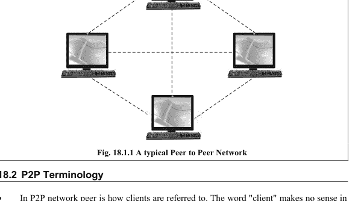

## 18.2 P2P 术语

- 在 P2P 网络中，peer 是指客户端的方式。在 P2P 网络中，“客户端”一词没有意义，因为不一定有‘服务器’可供客户端使用。
- 相互连接的对等组被称为可互换的术语 meshes、clouds 或 graphs。如果满足以下条件，则可以说某个组连接良好，
  1. 每对对等体之间都有连接路径，因此每个对等体可以根据需要连接到任何其他对等体。
  2. 对等体之间需要遍历的连接数量相对较少。
  3. 删除一个对等体不会阻止其他对等体相互连接。
- 应该注意的是，这并不意味着每个对等体都必须能够连接到每个其他对等体。事实上，如果对网络进行密切的数学分析，就会发现


## 18.3 P2P 架构挑战

- P2P 网络中的主要挑战是在网络中发现潜在客户端，并定位其他客户端可能拥有的文件块。另一个挑战是在可能相隔整个大陆的客户端之间找到最优通信方式。
- 参与 P2P 网络应用程序的每个客户端都必须能够执行以下操作来克服这些问题，
  - 1. 它必须能够发现其他客户端。
  - 2. 它必须能够连接到其他客户端。
  - 3. 它必须能够与其他客户端通信。
- 发现问题有两个明显的解决方案。一种是在服务器上保存客户端列表，以便所有客户端都能获取该列表并联系其他客户端（称为对等方）。另一种方式是维护 PNRP（对等名称解析协议）基础设施，以便发现网络中的客户端。大多数文件共享系统使用“服务器上的列表”方案，通过称为跟踪器的服务器实现。此外，在文件共享系统中，任何客户端都可以充当服务器，声明自己拥有可用文件并向跟踪器注册。事实上，纯 P2P 网络根本不需要服务器，仅靠对等方就足以在网络中工作。
- 连接问题更为关键，涉及 P2P 应用程序所用网络的整体结构。如果只有一组客户端，且所有客户端都能相互通信，那么这些客户端之间的连接拓扑可能会变得极其复杂。通过设置多组客户端可以提高性能，每组由该组内客户端之间的连接组成，而不连接到其他组中的客户端，这是一种分层网络。可以构建基于区域的组来获得额外的性能提升，因为客户端在联网计算机之间通信时所需的跳数更少。
- 通信也许是一个重要性较低的问题，因为 TCP/IP 等通信协议已经非常成熟，可以在这里复用。不过，高层技术（例如可以使用 WCF 服务，从而利用 WCF 提供的所有功能）和低层协议（例如同时向多个终结点发送数据的多播协议）都有改进空间。

**发现、连接和通信是任何 P2P 实现的核心。**

除上述问题外，P2P 网络还应注意的另一个问题是泛洪。泛洪是一种将单份数据传播到网络中所有对等方的方式，或者通过查询网络中的其他节点来定位特定数据的方式。在非结构化 P2P 网络中，这是一个相当随机的过程：联系最近邻对等方，这些对等方再联系它们各自的最近邻，如此继续，直到网络中每个对等方都被联系到。也可以创建结构化 P2P 网络，使对等方之间的查询和数据流具有明确定义的路径。

## 18.4 P2P 网络的用途

一旦 P2P 网络的基础设施建立起来，就可以开发网络应用程序，这些程序不仅是客户端-服务器应用程序的改进版本，而且是全新的应用程序。P2P 特别适合以下应用领域，

- 1. 内容分发应用，包括文件共享应用。
- 2. 协作应用，例如桌面共享和共享白板应用。
- 3. 多用户通信应用，允许用户直接通信和交换数据，而不是通过服务器。
- 4. 分布式处理应用，作为处理海量数据的超级计算应用的替代方案。
- 5. Web 2.0 应用，在动态的下一代 Web 应用中结合上述部分或全部应用。

## 18.5 P2P 网络的优点

- 它具有弹性。如果网络中的一台计算机发生故障，其他计算机可以继续工作和通信。不存在单点故障。
- 它高效。由于网络上的任何计算机既是客户端又是服务器，计算机可以从最近的对等计算机获取数据。
- 对等网络易于扩展，并且比单个服务器更可靠。单个服务器容易出现单点故障，或者在网络利用率高时成为瓶颈。
- P2P 技术可以防止 Web 服务器因处理客户端请求而崩溃或过载。文件不是由服务器直接发送给所有客户端，而是可以只发送给少数客户端。其余客户端再从已经收到文件的客户端下载文件，更多客户端又从这些第二层客户端下载，依此类推。事实上，通过将文件分成块并在客户端之间分配这些块，这一过程会更快：一些客户端直接从服务器下载，另一些客户端从其他客户端下载块。文件共享技术就是这样工作的。

## 18.6 PNRP——对等名称解析协议

- 对于名称发布和解析机制，Windows 对等网络使用 PNRP。PNRP 是一种高效、受保护、低成本、动态的协议，使用迭代式、无服务器的方法进行名称解析。
- Microsoft 的整个对等技术通过最新的 Platform SDK 以 C/C++ API 调用的形式公开。这对仍使用非托管代码或托管 C++ 开发应用程序的人来说非常有用。.NET 托管代码还可以将 API 调用导入 C#，并创建托管框架，以简化 .NET 环境中的对等应用程序开发。
- 在对等环境中，对等方依赖名称解析系统，根据名称或其他类型的标识符解析彼此的网络位置（地址、协议和端口）。对等名称解析因短暂连接和域名系统（DNS）的缺陷而变得复杂。
- PNRP 是对等名称解析协议，是 P2P 网络中通过网络定位任何对等机（节点）的基本需求。它也是一种无服务器 DNS 技术，允许节点相互发现。这意味着它允许 Windows XP 计算机成为自己的 DNS 服务器。无需付费注册每个域名。但它仅限于域名 pnrp.net。
- Microsoft® Windows® 对等网络平台通过对等名称解析协议（PNRP）解决了这个问题，这是一种安全、可扩展且动态的名称注册和名称解析协议，最初为 Windows XP 开发，随后在 Windows Vista™ 中升级。PNRP 的工作方式与传统名称解析系统非常不同，为应用程序开发人员开辟了激动人心的新可能性。

### 18.6.1 PNRP 特性

- **分布式且无服务器，带来惊人的可扩展性和可靠性：** PNRP 几乎完全无服务器（仅在引导时需要服务器）。PNRP 可轻松扩展到数十亿个名称。该系统具有容错能力，且不存在瓶颈。
- **无需第三方即可轻松发布名称：** DNS 名称发布需要更新 DNS 服务器。大多数人必须联系服务器管理员。这需要时间并产生成本。PNRP 名称发布是即时、轻松且免费的。
- **实时更新：** DNS 严重依赖缓存来提高性能。不幸的是，这意味着名称无法可靠地实时更新。PNRP 比 DNS 高效得多，几乎可以即时处理更新。名称解析永远不会返回过时地址，使 PNRP 成为查找移动用户的绝佳解决方案。
- **不仅能命名计算机：** PNRP 解析包括地址、端口，可能还包括扩展负载。使用 PNRP，你不仅可以命名计算机，还可以命名服务。
- **受保护的名称发布：** 使用 PNRP，名称可以发布为安全（受保护）或不安全（不受保护）。PNRP 使用公钥密码学保护安全对等名称免受欺骗。

### 18.6.2 PNRP 云

PNRP 使用多个云，其中云是一组能够相互找到的计算机。PNRP 提供两种云，

- 全局云对应于全局 IPv6 地址范围和全局地址，代表整个 IPv6 Internet 上的所有计算机。只有一个全局云。
- 链路本地云对应于链路本地 IPv6 地址范围和链路本地地址。链路本地云用于特定链路，通常与本地连接子网相同。可以有多个链路本地云。

第三种云是站点特定云，对应于站点 IPv6 地址范围和站点本地地址。这种云已被弃用，但 PNRP 仍支持它。

### 18.6.3 PNRP 名称和 ID

- 正如 PNRP 的首字母所暗示的，每个节点都必须在网络上注册一个对等名称。对等名称是计算机、用户、组或服务等资源的固定名称。这类似于当今的 DNS，只不过资源不只是 IP 地址，还可以更细粒度（具体）。
- 对等名称是通信终结点，可以是计算机、用户、组、服务或任何需要解析为 IPv6 地址的其他对象。对等名称可以注册为不安全或安全。不安全名称只是文本字符串，容易受到欺骗，因为任何人都可以注册重复的不安全名称。不安全名称最好用于专用网络或其他受保护网络。安全名称使用证书和数字签名进行保护。只有原始发布者才能证明对安全名称的所有权。


- 对等名称（Peer Name）是区分大小写的文本字符串，格式为“Authority.Classifier”。Authority 的值取决于该名称是安全名称还是非安全名称。对于非安全 Authority，该值始终为 0。Classifier 的值是为资源指定的文本字符串名称，不能包含空格。以下列表展示了一些对等名称示例，
  - 0.techtest
  - 0.tech.peername
  - 8412c005a63ec1964b7d8f2cabebd4916ae7f33d.demotest
- PNRP 使用对等名称来标识对等网络中的资源。这里的关键是“对等网络”。它不是计算机所连接到的整个 IPv6 网络，而仅限于某个云（Cloud）内可用的资源。注册任何不受对等网络 API 管理的资源，要么会导致错误，要么之后无法解析。

PNRP ID 长度为 256 位，由以下部分组成，
- 高 128 位称为对等（P2P）ID，是分配给端点的对等名称的哈希值。
- 端点的对等名称采用以下格式：Authority.Classifier。对于安全名称，Authority 是对等名称公钥的 Secure Hash Algorithm 1 (SHA1) 哈希值的十六进制字符表示。对于非安全名称，Authority 是单个字符“0”。Classifier 是标识应用程序的字符串，可以是长度最多为 150 个字符的任意 Unicode 字符串。
- 低 128 位用于服务位置（Service Location），它是一个生成的数字，用于标识同一云中同一 P2P ID 的不同实例。P2P ID 与服务位置的 256 位组合允许从单台计算机注册多个 PNRP ID。
- 对于每个云，每个对等节点管理一个 PNRP ID 缓存，其中既包括其自身注册的 PNRP ID，也包括随时间缓存的条目。位于云中所有对等节点上的完整 PNRP ID 集合构成一个分布式哈希表。一个给定 PNRP ID 的条目可能位于多个对等节点上。PNRP 缓存中的每个条目包含 PNRP ID、认证对等地址（CPA）以及发布节点的 IPv6 地址。CPA 是一种自签名证书，为 PNRP ID 提供身份验证保护，并包含应用程序端点信息，例如地址、协议号和端口号。
- 因此，PNRP 的名称解析过程包括将 PNRP ID 解析为 CPA。获取 CPA 后，即可开始与所需端点通信。

- 根据 PNRP 的版本，执行 PNRP 名称解析有两种不同方法。PNRP 版本 1 包含在 Windows XP Service Pack 2 (SP2)、Windows XP Professional x64 Edition，以及带有 Service Pack 1 (SP1) 的 Windows XP 和用于 Windows XP 的高级网络包中。它使用递归系统进行名称解析，本文不讨论。PNRP 版本 2 针对 Windows Vista 和 Windows XP Service Pack 3 重新设计，通过使用迭代式名称解析方法来降低网络带宽。两个版本的 PNRP 不兼容。

## 18.6.4 PNRP 名称解析——搜索对等名称

PNRP 名称解析使用如下所述的两个阶段，
- **端点确定**：在此阶段，尝试解析某台对等计算机上服务的 PNRP ID 的对等节点，首先确定发布该对等节点上运行的 PNRP 服务的 PNRP ID 的对等节点的 IPv6 地址。
- **PNRP ID 解析**：在定位并确认具有与所需端点的 PNRP 服务相对应的 PNRP ID 的对等节点可用之后，请求方对等节点向该对等节点发送针对所需服务的 PNRP ID 的 PNRP Request 消息。该端点发送回复，确认所请求服务的 PNRP ID、一条注释，以及最多 4 KB 的附加信息，请求方对等节点可将这些信息用于后续通信。例如，如果所需端点是游戏服务器，则附加数据可以包含有关游戏、游戏级别和当前玩家数量的信息。

在端点确定期间，PNRP 使用迭代过程来定位发布该 PNRP ID 的节点；在此过程中，执行解析的节点负责联系逐步接近目标 PNRP ID 的节点。

为了在 PNRP 中执行名称解析，对等节点会检查其自身缓存中的条目，以寻找与目标 PNRP ID 匹配的条目。如果找到，请求方对等节点向要连接的对等节点发送 PNRP Request 消息，并等待响应。如果未找到该 PNRP ID 的条目，该对等节点向与“其 PNRP ID 与目标 PNRP ID 最接近的条目”相对应的对等节点发送 PNRP Request 消息。收到 PNRP Request 消息的节点检查其自身缓存，并执行以下操作：
- 如果找到该 PNRP ID，被请求的对等节点直接向请求方对等节点回复。
- 如果未找到该 PNRP ID，并且缓存中有一个 PNRP ID 比目标 PNRP ID 更接近，则被请求的对等节点向请求方对等节点发送响应，其中包含与“其 PNRP ID 与目标 PNRP ID 最接近的条目”相对应的对等节点的 IPv6 地址。请求方节点根据响应中的 IP 地址，向第一个节点所指的 IPv6 地址发送另一个查询。

- 如果未找到该 PNRP ID，并且其缓存中没有比目标 PNRP ID 更接近的 PNRP ID，则被请求的对等节点向请求方对等节点发送一条表示此情况的响应。然后，请求方对等节点选择下一个最接近的 PNRP ID。

- **请求方对等节点通过连续迭代继续此过程，最终定位到注册该 PNRP ID 的节点。**

- 在 PNRP 中，要解析对等名称，需要提供对等名称、搜索条件以及可选的云名称（默认为 Global）和 IP 地址提示。通常，查找用于确定某个对等名称是否已存在，或直接联系它。支持以下搜索条件选项，

| 默认 | 使用 NonCurrentProcessPeerName 选项 |
|---|---|
| **AnyPeerName** | 匹配的对等名称可以在本地或远程注册。 |
| **NearestNonCurrentProcessName** | 匹配的对等名称可以在本地或远程注册，但解析请求会排除由发出解析请求的进程注册的任何对等名称，并查找最接近本地 IP 地址的服务。 |
| **NearestPeerName** | 匹配的对等名称可以在本地或远程注册，但解析请求会查找最接近本地 IP 地址的服务。 |
| **NearestRemotePeerName** | 解析请求会排除在本计算机上本地注册的任何对等名称，并查找最接近本地 IP 地址的服务。 |
| **NonCurrentProcessPeerName** | 匹配的对等名称可以在本地或远程注册，但解析请求会排除由发出解析请求的进程注册的任何对等名称。 |
| **RemotePeerName** | 解析请求会排除在本计算机上本地注册的任何对等名称。 |

同样，使用一系列 Windows Socket 调用来同步开始查找。
- 调用 WSALookupServiceBegin 开始枚举并返回句柄。
- 调用 WSALookupServiceNext 解析对等名称。
- 调用 WSALookupServiceEnd 完成枚举。

## 与对等名称对应的 DNS 名称

- 由于 PNRP 是无服务器 DNS，因此能够查找与对等名称关联的 DNS 名称是合理的。在提供 DNS 名称时确定对等名称也很有用。在 Windows Vista 中，提供了两个额外的对等 API 来实现这一点。

## PNRP 对等网络中的端点确定场景

- 在 P2P 网络中，对等计算机 3 具有自己的 PNRP ID（1500）以及 PNRP ID 2500 和 3000 的条目。对等节点集合如图 18.6.1 所示。从一个节点指向另一个节点的箭头表示，箭头起始节点在其缓存中具有箭头所指向节点的条目。

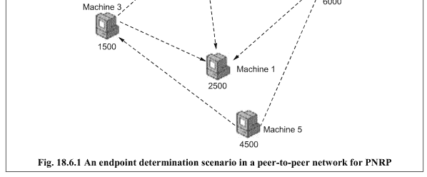

图 18.6.1 PNRP 对等网络中的端点确定场景

- 当对等计算机 3 想要确定 PNRP ID 6000 的端点时，会发生以下过程，

1. 因为 3000 在数值上更接近 6000，所以对等计算机 3 向注册了 PNRP ID 3000 的节点（对等计算机 4）发送 PNRP Request 消息。


- 2. 对等计算机 4 没有 6000 的 PNRP ID 条目，也没有任何更接近 6000 的条目。对等计算机 4 向对等计算机 3 发回响应，表明它无法找到更接近 6000 的条目。
- 3. 由于 2500 是数值上下一个更接近 6000 的 PNRP ID，对等计算机 3 向注册了 PNRP ID 2500 的节点（对等计算机 1）发送 PNRP 请求消息。
- 4. 由于对等计算机 1 的缓存中有 6000 的 PNRP ID 条目，它将对等计算机 2 的 IPv6 地址发送给对等计算机 3。
- 5. 对等计算机 3 向对等计算机 2 发送 PNRP 请求。
- 6. 对等计算机 2 向对等计算机 3 发回肯定的名称解析响应。

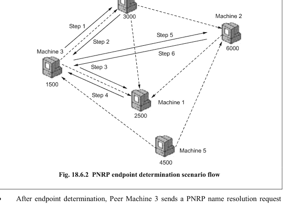

图 18.6.2 PNRP 终结点确定场景流程

- 终结点确定后，对等计算机 3 向对等计算机 2 发送 PNRP 名称解析请求，请求解析对等计算机 3 希望与之建立通信的服务。对等计算机 2 发回一个响应，其中包含关于该服务的可选数据，供请求应用程序使用。

## 18.6.5 注册和注销对等名称

- 要在网络上注册非安全对等名称，需要提供有效的非安全对等名称和 IP 地址。可选地，可以指定云名称（默认为 Global），并提供与资源关联的附加注释或描述。此信息存储在 WSAQUERYSET 数据结构中，并传递给带有 Register 选项的 WSASetService。
- 要在网络上注销非安全对等名称，需要提供有效的非安全对等名称，并可选择提供云名称（默认为 Global）。此信息存储在 WSAQUERYSET 数据结构中，并传递给带有 Delete 选项的 WSASetService。

### PNRP 名称发布

- 要发布新的 PNRP ID，对等方执行以下操作：
  - 向其缓存邻居（已在缓存最低层级注册 PNRP ID 的对等方）发送 PNRP 发布消息，以填充其缓存。
  - 在云中选择不是其邻居的随机节点，并向它们发送针对其自身 P2P ID 的 PNRP 名称解析请求。由此产生的终结点确定过程会用发布对等方的 PNRP ID 填充云中随机节点的缓存。
- 如果 PNRP 版本 2 节点仅解析其他 P2P ID，则不会发布 PNRP ID。注册表值 HKEY_LOCAL_MACHINE\SOFTWARE\Microsoft\Windows NT\CurrentVersion\PeerNet\PNRP\IPv6-Global\SearchOnly=1（REG_DWORD 类型）允许指定对等方仅将 PNRP 用于名称解析，绝不用于名称发布。此注册表值也可以通过组策略配置。

## 18.6.6 使用多级缓存扩展对等名称解析

- 为了保持 PNRP 缓存大小较小，对等节点使用多级缓存，其中每个层级包含最大数量的条目。缓存中的每一级代表 PNRP ID 编号空间（2^256）中较上一级小十分之一的部分。缓存中的最低层级包含本地注册的 PNRP ID 以及其他在数值上接近它的 PNRP ID。当一个缓存层级填满最多 20 个条目时，会创建一个新的更低层级。
- 缓存中的最大层级数量约为 log10（云中 PNRP ID 总数）的量级。例如，对于拥有 1 亿个 PNRP ID 的全局云，缓存中不超过 8（=log10(100,000,000)）个层级，名称解析期间解析一个 PNRP ID 所需的跳数也大致相同。此机制允许使用分布式哈希表，通过将 PNRP 请求消息转发给下一个最近的对等方，直到找到具有相应 CPA 的对等方，从而解析任意 PNRP ID。这种多级缓存方案的结果是，每个对等方不必存储大量缓存条目。即使对于大量 PNRP ID，解析任意 PNRP ID 所需的本地存储和网络流量也并不大。

- 为确保解析能够完成，每当节点向其缓存的最低层级添加条目时，它都会将该条目的副本泛洪到缓存最后一级内的所有节点。缓存条目会随时间刷新。过期的缓存条目会从缓存中移除。结果是，PNRP ID 的分布式哈希表基于活动终结点，这与 DNS 不同，在 DNS 中地址记录和 DNS 协议不保证与地址关联的节点活跃在网络上。

### PNRP 缓存初始化

当对等节点启动时，要初始化 PNRP 缓存，节点可以使用以下方法：

- 1. 持久缓存条目——节点关闭时存在的先前缓存条目会从硬盘存储加载。
- 2. PNRP 种子节点——PNRP 允许管理员指定 PNRP 种子节点的地址或 DNS 名称，这些种子节点包含云中当前参与者的 CPA。
- 3. 简单服务发现协议——PNRP 节点必须使用通用即插即用（UPnP）简单服务发现协议（SSDP）注册自身。加入云的节点可以使用 SSDP Msearch 消息定位附近的 SSDP 节点。

## 18.7 构建 P2P 应用程序

### 一个简单的对等网络聊天应用程序示例

下面讨论的简单 WCF 聊天应用程序使用 netTcpPeerBinding。使用此绑定，创建简单的 Intranet 聊天应用程序非常容易。TCP 终结点用于通信。几乎所有编码都封装在以下命名空间中：

- System.ServiceModel;
- System.ServiceModel.Channels;
- System.ServiceModel.PeerResolvers;

### 1. 聊天服务器

聊天服务器代码如下，

```csharp
<CODE>
using System;
using System.Collections.Generic;
using System.ComponentModel;
using System.Data;
using System.Drawing;
using System.Text;
using System.Windows.Forms;
using System.ServiceModel;
using System.ServiceModel.Channels;
using System.ServiceModel.PeerResolvers;

namespace ChatServer
{
    public partial class ChatServer : Form
    {
        private CustomPeerResolverService cprs;
        private ServiceHost host;

        public ChatServer()
        {
            InitializeComponent();
            btnStop.Enabled = false;
        }

        private void btnStart_Click(object sender, EventArgs e)
        {
            try
            {
                cprs = new CustomPeerResolverService();
                cprs.RefreshInterval = TimeSpan.FromSeconds(5);
                host = new ServiceHost(cprs);
                cprs.ControlShape = true;
                cprs.Open();
                host.Open(TimeSpan.FromDays(1000000));
                lblMessage.Text = "Server started successfully.";
            }
            catch (Exception ex)
            {
                MessageBox.Show(ex.ToString());
            }
        }
        finally
        {
btnStart.Enabled = false;
btnStop.Enabled = true;
}
}
private void btnStop_Click(object sender, EventArgs e)
{
try
{
cprs.Close();
host.Close();
lblMessage.Text = "Server stopped successfully.";
}
catch (Exception ex)
{
MessageBox.Show(ex.ToString());
}
finally
{
btnStart.Enabled = true;
btnStop.Enabled = false;
}
}
```
```

- **说明 -** 创建 CustomPeerResolverService 类的对象，并将其作为输入参数传递给 ServiceHost 类。然后打开对等解析程序服务并启动宿主。代码非常简单，不需要新类，也不需要终结点。

### 2. 服务器的配置文件

配置文件在指定所需详细信息方面起着最重要的作用，如下所示，

```
<CODE>
<?xml version="1.0" encoding="utf-8" ?>
<configuration>
system.serviceModel
services
service name="System.ServiceModel.PeerResolvers.
CustomPeerResolverService"
host
baseAddresses
add baseAddress="net.tcp://10.34.34.241/ChatServer"/
baseAddresses
```


```xml
<configuration>
  <system.serviceModel>
    <services>
      <service>
        <host>
          <baseAddresses>
            <add baseAddress="net.tcp://10.34.34.241/ChatServer" />
          </baseAddresses>
        </host>
        <endpoint address="net.tcp://10.34.34.241/ChatServer"
          binding="netTcpBinding"
          bindingConfiguration="TcpConfig"
          contract="System.ServiceModel.PeerResolvers.IPeerResolverContract" />
      </service>
    </services>
    <bindings>
      <netTcpBinding>
        <binding name="TcpConfig">
          <security mode="None" />
        </binding>
      </netTcpBinding>
    </bindings>
  </system.serviceModel>
</configuration>
```

- **配置**文件非常简单。其中使用了一个 .NET 预定义服务：`System.ServiceModel.PeerResolvers.CustomPeerResolverService`。
- 如所示，基地址用于承载解析器服务。端点的关键之处在于它使用 `System.ServiceModel.PeerResolvers.IPeerResolverContract` 协定，而该协定已在基础结构内提供。这里使用 TCP 端点进行通信。因此，该端点配置了 TCP 绑定，并将其安全模式配置为 None。现在服务器已为聊天客户端准备就绪。只需启动服务器即可。

## 3. 聊天客户端

与聊天服务器相比，客户端会稍微复杂一些。它自行完成所有工作。它需要一些服务器用来与客户端通信的公共机制，而这可以通过接口来建立。

客户端代码如下。

```csharp
using System;
using System.Collections.Generic;
using System.ComponentModel;
using System.Data;
using System.Drawing;
using System.Text;
using System.Windows.Forms;
using System.ServiceModel;
using System.ServiceModel.Channels;

namespace ChatClient
{
    // This is the service contract at client side which uses
    // the same contract as callback contract.
    // Using CallbackContract, server sends message to clients
    [ServiceContract(CallbackContract = typeof(IChatService))]
    public interface IChatService
    {
        // All operation contracts are one way so that client
        // can fire the message and forget
        // When server responds, client catches it and acts accordingly
        [OperationContract(IsOneWay = true)]
        void Join(string memberName);
        [OperationContract(IsOneWay = true)]
        void Leave(string memberName);
        [OperationContract(IsOneWay = true)]
        void SendMessage(string memberName, string message);
    }

    // An interface to create a channel for communication
    public interface IChatChannel : IChatService, IClientChannel
    {
    }

    public partial class ChatClient : Form, IChatService
    {
        // Different delegates that are used internally to raise
        // events when client joins,
        // leaves or sends a message
        private delegate void UserJoined(string name);
        private delegate void UserSendMessage(string name, string message);
        private delegate void UserLeft(string name);

        // Events are made static because it is required to create only once
        // when client joins
        private static event UserJoined NewJoin;
        private static event UserSendMessage MessageSent;
        private static event UserLeft RemoveUser;

        private string userName;
        private IChatChannel channel;
        // As it is required to establish duplex communication,
        // DuplexChannelFactory is used
        private DuplexChannelFactory<IChatChannel> factory;
    }
}
```

```csharp
txtSendMessage.Focus();
}
catch (Exception ex)
{
    MessageBox.Show(ex.ToString());
}
}
}

void ChatClient_RemoveUser(string name)
{
    try
    {
        rtbMessages.AppendText("\r\n");
        rtbMessages.AppendText(name + " left at " +
            DateTime.Now.ToString());
        lstUsers.Items.Remove(name);
    }
    catch (Exception ex)
    {
        System.Diagnostics.Trace.WriteLine(ex.ToString());
    }
}

void ChatClient_MessageSent(string name, string message)
{
    if (!lstUsers.Items.Contains(name))
    {
        lstUsers.Items.Add(name);
    }
    rtbMessages.AppendText("\r\n");
    rtbMessages.AppendText(name + " says: " + message);
}

void ChatClient_NewJoin(string name)
{
    rtbMessages.AppendText("\r\n");
    rtbMessages.AppendText(name + " joined at: [" +
        DateTime.Now.ToString() + "]");
    lstUsers.Items.Add(name);
}

#region IChatService Members

public void Join(string memberName)
{
    if (NewJoin != null)
    {
        NewJoin(memberName);
    }
}

public new void Leave(string memberName)
{
    if (RemoveUser != null)
    {
        RemoveUser(memberName);
    }
}

public void SendMessage(string memberName, string message)
{
    if (MessageSent != null)
    {
        MessageSent(memberName, message);
    }
}

#endregion

private void btnSend_Click(object sender, EventArgs e)
{
    channel.SendMessage(this.userName, txtSendMessage.Text.Trim());
    txtSendMessage.Clear();
    txtSendMessage.Select();
    txtSendMessage.Focus();
}

private void ChatClient_FormClosing(object sender,
    FormClosingEventArgs e)
{
    try
    {
        if (channel != null)
        {
            channel.Leave(this.userName);
            channel.Close();
        }
        if (factory != null)
        {
            factory.Close();
        }
    }
    catch (Exception ex)
    {
        MessageBox.Show(ex.ToString());
    }
}
}
}
```

## 4. 客户端的配置文件

重要细节如下面的配置文件所示：

```xml
<?xml version="1.0" encoding="utf-8"?>
<configuration>
  <system.serviceModel>
    <client>
      <endpoint name="ChatEndpoint" address="net.p2p://chatMesh/ChatServer"
        binding="netPeerTcpBinding"
        bindingConfiguration="PeerTcpConfig"
        contract="ChatClient.IChatService" />
    </client>
    <bindings>
      <netPeerTcpBinding>
        <binding name="PeerTcpConfig" port="0">
          <security mode="None">
            <resolver mode="Custom">
              <custom address="net.tcp://10.34.34.241/ChatServer"
                binding="netTcpBinding"
                bindingConfiguration="TcpConfig" />
            </resolver>
          </security>
        </binding>
      </netPeerTcpBinding>
      <netTcpBinding>
        <binding name="TcpConfig">
          <security mode="None" />
        </binding>
      </netTcpBinding>
    </bindings>
  </system.serviceModel>
</configuration>
```

- 配置文件中提到了端点名称“ChatEndpoint”，它指向一个聊天网格并使用 `netPeerTcpBinding`。在这里，配置绑定时使用了自定义解析器模式，并提供了实际服务器运行所在的自定义 TCP 地址。

将端口号指定为零将自动检测用于通信的空闲端口。安全模式被指定为 none。因此，使用此配置即可启动客户端，并能够通过内网发送消息。

## 18.8 对等应用程序模型

在编写对等应用程序时，理解它将如何被使用很重要。这将使决定使用哪种 .NET 应用程序模型变得更容易。对于对等应用，有四种强大的应用程序模型（或应用程序类型）可用，如下文所述。

- 1. **Web 服务** - 位于 `System.Web.Services` 命名空间中，Web 服务技术为处理对等应用程序的注册、发现和内容查找提供了一种极佳方式。Web 服务允许你快速编写一个类，该类侦听传入请求，在请求到达时进行处理，并以对等应用程序易于理解的对象形式发回有用信息。
- 2. **Windows Forms** - 位于 `System.Windows.Forms` 命名空间中，Windows® Forms 是 .NET Framework 中用于编写丰富的基于 Windows 的 GUI 应用程序的解决方案，这类应用程序有助于让对等体验更加令人兴奋。Windows Forms 是为对等端编写 GUI 的理想技术，可让最终用户登录、请求和共享内容。
- 3. **Web Forms** - 位于 `System.Web` 命名空间中，Web Forms 技术使向对等应用程序返回 HTML 内容变得非常容易。如果对等应用程序需要包含大量媒体内容、具有高度交互性的服务，或包含有关使用这些服务的广告，那么这会很有用。当对等应用程序启动并向 Web 服务注册时，它还可以调用 Web Forms 应用程序，以从服务器获取最新的 HTML 内容。
- 4. **服务进程** - 位于 `System.ServiceProcess` 命名空间中，服务进程（也称为 Windows NT® 服务）在对等场景中可用作长期运行的发现服务器。在大多数情况下，Web 服务更适合承担发现服务的角色。然而，在发现机制不使用 HTTP 协议的情况下，侦听其他协议的服务进程可能是最佳选择。

除了为应用程序模型提供丰富的选择之外，.NET Framework 还通过使用 `System.Net` 命名空间和 `System.Web.Services` 命名空间中的类，极大地简化了对等应用程序创建中的网络部分。


让我们更仔细地了解这些命名空间中的每一个、它们提供的类，以及围绕每个命名空间构建的应用程序。

## 18.9 防火墙和端口

在设计应用程序时，应考虑对等方所使用的端口和协议的选择，因为防火墙通常被设计为仅允许通过特定端口进行通信。为企业环境设计对等应用程序时，与网络管理员讨论哪些端口是开放的或推荐用于应用程序，可能会很有用。如果应用程序面向的用户很可能不会通过防火墙来查找其他对等方，那么几乎所有尚未为其他协议保留的端口都可以使用。通常，端口号分为三个范围，
- 知名端口（0 到 1023）
- 注册端口（1024 到 49151）
- 动态和/或专用端口（49152 到 65535）

| 两分题及答案 |
|---|
| **Q.1 什么使网络有效且高效？** |
| **答：** 主要有两个标准使网络有效且高效： |
| - **性能：** 性能可以通过多种方式衡量，如传输时间和响应时间。 |
| - **可靠性：** 可靠性通过故障频率来衡量。 |
| - **健壮性：** 健壮性表示强壮且处于良好状态的质量或条件。 |
| - **安全性：** 它规定了如何保护数据免受未经授权的访问和病毒侵害。 |
| **Q.2 什么是带宽？** |
| **答：** 每个信号都有频率上限和频率下限的限制。网络在其上限频率和下限频率之间的限制范围称为带宽。 |
| **Q.3 什么是 DNS？** |
| **答：** DNS 是 Domain Name System（域名系统）的缩写。 |
| - DNS 由 Paul Mockapetris 和 Jon Postel 于 1983 年提出。 |
| - 它是互联网上所有资源（包括物理节点和应用程序）的命名系统。它用于在网络中轻松定位资源。 |
| - DNS 是一种将域名映射到其关联 IP 地址的系统。 |

如果没有 DNS，用户必须知道要访问的网页的 IP 地址。

## Q.4 P2P 网络中的节点是什么？

**答：**

- 两台或多台计算机通过光纤或任何其他电缆直接连接。节点是建立连接的点。它是一种用于发送、接收和转发电子信息的网络组件。

- 连接到网络的设备也称为节点。假设一个网络中连接了 2 台计算机、2 台打印机和 1 台服务器，那么我们可以说该网络上有五个节点。

## Q.5 网络如何根据其连接进行分类？

**答：** 根据连接类型，网络分为两类。如下所述：

- **对等网络（P2P）：** 当两台或多台计算机连接在一起共享资源而不使用中央服务器时，称为对等网络。这种网络中的计算机既充当服务器又充当客户端。由于成本不高，它通常用于小型公司。

- **基于服务器的网络：** 在这种网络中，设置一个中央服务器来存储客户端的数据、应用程序等。服务器计算机为该网络提供安全性和网络管理。

## 长答题

- **Q.1** 用清晰的图讨论 P2P 网络。（参见第 18.1 节）

- **Q.2** 解释 PNRP 及名称解析过程。（参见第 18.6 节）

- **Q.3** 什么是 PNRP 云？（参见第 18.6 节）

- **Q.4** 讨论 P2P 术语。（参见第 18.2 节）

- **Q.5** P2P 的用途和优势是什么？（参见第 18.5 节）

*对等网络、PNRP、构建 P2P 应用程序 结束……*

## 第三单元

## 第 19 章

## WPF - Windows 呈现基础

教学大纲：WPF - Windows 呈现基础。

| 节号 | 主题名称 | 页码 |
|---|---|---|
| 19.1 | WPF 简介 | 19 - 2 |
| 19.2 | WPF 体系结构 | 19 - 2 |
| 19.3 | WPF 的功能 | 19 - 3 |
| 19.4 | 各种 WPF 工具 | 19 - 8 |
| 19.5 | 各种 WPF 程序集和命名空间 | 19 - 8 |
| 19.6 | WPF 其他功能 | 19 - 8 |
| 19.7 | WPF 与 XAML | 19 - 9 |
| 19.8 | WPF 与 C# | 19 - 9 |
| 19.9 | WPF 的优势 | 19 - 9 |
|  | 两分题及答案 | 19 - 10 |
|  | 长答题 | 19 - 11 |

## 19.1 WPF 简介

### 概念：

- 1. Windows Presentation Foundation（WPF）是 Microsoft 最新的图形用户界面（GUI）框架方案，与 .NET Framework 配合使用。

### 说明：

- 2. GUI 框架允许创建具有各种 GUI 元素的应用程序，如标签、文本框和其他常见元素。如果没有 GUI 框架，这些元素需要手动绘制，并且需要单独处理它们上面的键盘和鼠标输入等事件。GUI 框架节省了开发人员的所有这些工作。
- 3. 尽管采用不同的方法，WinForms 和 WPF 是当前流行的 GUI 开发框架。
- 4. WinForms 是标准 Windows 控件（例如 TextBox）之上的一层，而 WPF 是从零开始构建的，并且在几乎所有情况下都不依赖标准 Windows 控件。

例如，WinForms 不允许按钮同时包含文本和图像，因为这基本上不受标准 Windows 控件支持。相反，WPF 允许在按钮上绘制图像并拥有图像，并按用户想要的方式设计按钮。WPF 将按钮视为带有内容、各种状态和其他属性的边框。
- 5. 使用 WPF 时，外观在 Extensible Application Markup Language（XAML）中指定，行为在 C# 或 Visual Basic 等托管编程语言中实现。这两个部分通过数据绑定、事件和命令联系在一起。

## 19.2 WPF 体系结构

### WPF 体系结构

- 1. 早期，Microsoft 提供的用户界面框架（如 MFC 和 Windows Forms）只是 User32 和 GDI32 DLL 的包装器。WPF 对 User32 的使用最少。
- 2. WPF 不仅仅是包装器，它是 .NET Framework 的一部分。
- 3. 它包含托管代码和非托管代码的混合。
- 4. WPF 体系结构的组件

WPF 最重要的代码部分包括：
- I. 呈现框架
- II. 呈现核心
- III. Milcore

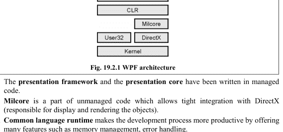

- I. **呈现框架**和**呈现核心**是用托管代码编写的。

- II. **Milcore** 是非托管代码的一部分，它允许与 DirectX（负责显示和渲染对象）紧密集成。

- III. **公共语言运行时**通过提供内存管理、错误处理等许多功能，使开发过程更高效。

## 19.3 WPF 的功能

### 1. 分辨率无关性

WPF 应用程序与分辨率无关。在 WPF 中开发的应用程序不依赖于屏幕分辨率。它会自动使用 DirectX 组件。无论何种类型的屏幕分辨率，WPF 的分辨率始终相同。即使屏幕分辨率较低，WPF 用户界面看起来也会更好。WPF 框架具有媒体集成层（MIL），以便与 DirectX 组件通信。DirectX 组件在 WPF 用户界面上施加基于矢量的图形。

### 2. 关注点分离

在 WPF 应用程序中，UI 的外观及其行为分为两部分。外观是指应用程序的用户界面，由 XAML 指定。行为是指应用程序如何工作，由 C# 或 VB.Net 等 .NET 语言处理。

因此，非常容易自定义控件的外观及其功能。XAML 在 WPF 应用程序中的地位，就像 CSS 在 HTML 的 Web 应用程序中的地位一样。


## 3. 在控件内添加控件

WPF 引入了一项非常方便的功能，可以在一个控件内部添加另一个控件。WPF 不仅提供文本，还允许将控件定义为另一个基本控件（如 Button）的内容。对开发人员来说，这一功能确实令人惊叹，它让世人了解到 WPF 在用户界面方面的强大能力。因此，可以将 TextBox 嵌入 Button 中，如图 19.3.1 所示。这在 Windows 应用程序中无法实现。

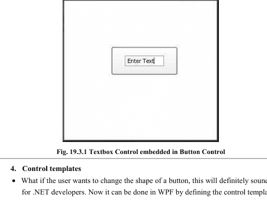

图 19.3.1 嵌入在按钮控件中的 TextBox 控件

## 4. 控件模板

- 如果用户想要更改按钮的形状，这对 .NET 开发人员来说肯定听起来很奇怪。现在，在 WPF 中可以通过定义控件模板来实现。例如，可以在 WPF 窗口中声明一个 Button，并将其形状更改为椭圆形。模板是 WPF 中用户界面设计不可或缺的一部分。
- WPF 有以下三种类型的模板：控件模板（Control Template）、项面板模板（Items Panel Template）和数据模板（Data Template）。

## 5. 控件变换

WPF 包含一些 2D 变换，可用于更改大小、位置、旋转角度，还允许进行倾斜。控件变换可以通过两种方式执行：布局变换（Layout Transform）和呈现变换（Render Transform）。

- 布局变换——在控件布局到窗体上之前应用变换
- 呈现变换——在控件布局到窗体上之后应用变换

有 5 种可用的变换：

- 1. 旋转变换（Rotate Transform）——将控件旋转到指定角度
- 2. 缩放变换（Scale Transform）——沿 x 轴和 y 轴放大或缩小控件
- 3. 倾斜变换（Skew Transform）——使控件倾斜
- 4. 平移变换（Translate Transform）——根据 x 和 y 值移动控件
- 5. 矩阵变换（Matrix Transform）——组合上述所有变换

## **6. WPF 资源**

WPF 支持两种类型的资源，即**静态资源和动态资源**。

- **静态资源**——静态资源会在应用程序实际运行之前发生的 XAML 加载期间被解析并分配给属性。它只会被分配一次，对资源字典的任何更改都会被忽略。
- **动态资源**——动态资源在加载期间将 Expression 对象分配给属性，但直到运行时当 Expression 对象被请求获取值时，才实际查找资源。这将资源的查找推迟到运行时需要它的时候。一个很好的例子是对 XAML 中稍后定义的资源的前向引用。另一个例子是直到运行时才会存在的资源。如果源的资源字典发生更改，它将更新目标。

## **7. 数据绑定**

WPF 提供了一种在用户界面上的 UI 元素与数据对象之间显示数据并进行交互的机制。绑定允许将源对象链接到某个控件。绑定有以下两种类型：

- 单向绑定：将源绑定到界面。
- 双向绑定：将源绑定到界面，并从界面绑定回源。
- **NotifyPropertyChanged** 接口允许源与界面交互，并在值更改时更新界面。
- 要将对象或列表绑定到元素，需设置 DataContext 属性。
- 可以绑定一个对象或对象列表，也可以将一个元素绑定到另一个元素。
- 要自定义绑定数据的显示方式，可以设置控件的 DataTemplate。
- 可以设置数据转换器（Data Converters）将源类型转换为另一种类型。

## **8. WPF 中的触发器**

触发器用于在满足指定条件时执行某些操作。触发器用于在控件和框架元素上创建视觉效果。触发器是样式的一部分，并且始终在样式内部定义。

### 触发器类型

基本上，有 3 种类型的触发器，即：

- 1. 属性触发器（Property Trigger）
- 2. 数据触发器（Data Trigger）
- 3. 事件触发器（Event Trigger）

## **9. WPF 样式**

样式是一种将相似属性分组到单个 Style 对象中并应用到多个对象的方法。XAML 中的 Style 元素表示样式。样式通常会添加到 FrameworkElement 的资源中。**x:Key** 是样式的唯一键标识符。

## **10. 不同类型的布局**

布局用于在用户界面上分隔控件。它提供了一种开发整洁且用户友好的应用程序的方法，这类应用程序的 UI 中包含大量控件。

- 1. **Grid（网格）**——顾名思义，Grid 与表格相同。它具有行和列。控件可以放置在网格单元格内。它类似于 Web 应用程序中的 GridView。
- 2. **停靠面板（Dock Panel）**——使用停靠，控件可以放置在顶部、右侧、左侧或底部。停靠面板在 WPF 中提供此类功能。Dock Panel 用于将子元素停靠在相对元素的左侧、右侧、顶部和底部位置。子元素的位置由相应子元素的 Dock 属性以及这些子元素的相对顺序决定。Dock 属性的默认值为 Left。Dock 属性属于 Dock 枚举类型，该枚举具有 Left、Right、Top 和 Bottom 值。
- 3. **堆叠面板（Stack Panel）**——在 Stack Panel 内部，控件按水平或垂直方向管理。控件可以按任意其他缩放比例设置。
- 4. **画布（Canvas）**——它提供了一种布局，可以根据需要将控件放置在任何位置。开发人员可以完全控制布局。
- 5. **环绕面板（Wrap Panel）**——Wrap Panel 从左到右排列子控件，顾名思义，一旦填满容器宽度，它就会换到新行。

## **11. 2D 和 3D 图形与动画**

WPF 将完整的丰富组件集于一身。在 WPF 中，控件可用作 3D 布局或 2D 布局。在此动画中，可以使用媒体文件和图形。它支持借助媒体播放器播放视频或音频文件。WPF 可以使用自定义主题。

## **12. WPF 中的媒体**

WPF 有两个类用于处理音频、视频以及带音频的视频，即 **MediaElement 和 MediaPlayer**。MediaElement 是 XAML UIElement 的一部分，并且同时受 XAML 和 WPF 代码隐藏支持，而 MediaPlayer 仅在 WPF 代码隐藏中可用。

## **13. WPF 中的图表**

WPF 支持常见图表，包括折线图、条形图、曲线图等。

## **14. WPF DatePicker 控件**

**DatePicker** 控件用于创建可视化的 **DatePicker**，让用户可以选择日期，并在选择日期时触发事件。

## **15. WPF ListBox**

XAML **ListBox** 元素表示 **ListBox** 控件。

```
<ListBox></ListBox>
```

**Width 和 Height** 属性表示 ListBox 的宽度和高度。**Name** 属性表示控件的名称，它是控件的唯一标识符。**Margin** 属性指示 ListBox 在父控件上的位置。**HorizontalAlignment** 和 **VerticalAlignment** 属性用于设置水平和垂直对齐方式。

## **16. WPF ComboBox**

**ComboBox** 控件是一种项控件，其作用类似于 **ListBox** 控件，但一次只显示集合中的一项；单击 **ComboBox** 会使集合可见，并允许用户从集合中选择一项。与 **ListBox** 控件不同，**ComboBox** 不支持多选。**ComboBox** 控件是三种控件的组合：**Button**、**Popup** 和 **TextBox**。**Button** 控件用于显示或隐藏可用项，**Popup** 控件显示项并让用户从列表中选择一项。然后，**TextBox** 控件显示所选项。

## **17. WPF MessageBox**

WPF 中的 **MessageBox** 类表示模态消息框对话框，它定义在 **System.Windows** 命名空间中。**MessageBox** 的静态方法 **Show** 是用于显示消息框的唯一方法。**Show** 方法返回 **MessageBoxResult** 枚举，其值包括 **None**、**OK**、**Cancel**、**Yes** 和 **No**。**MessageBoxResult** 用于确定在 **MessageBox** 上单击了哪个按钮，并采取相应的操作。

## **18. WPF DataGrid**

**DataGrid** 元素在 XAML 中表示 WPF **DataGrid** 控件。

```
<DataGrid />
```

当从工具箱将 **DataGrid** 控件拖放到设计器时，它会定位该控件并添加某些启动 XAML 代码。**Width 和 Height** 属性表示 **DataGrid** 的宽度和高度。**Name** 属性表示控件的名称，它是控件的唯一标识符。**Margin** 属性设置 **DataGrid** 在窗口上放置时的边距。

## **19. WPF ProgressBar**

XAML 中的 **ProgressBar** 标记表示 WPF **ProgressBar** 控件。


```
`<ProgressBar></ProgressBar>`
```

Width 和 Height 属性表示 ProgressBar 的宽度和高度。Name 属性表示控件的名称，它是控件的唯一标识符。Margin 属性指示 ProgressBar 在父控件上的位置。HorizontalAlignment 和 VerticalAlignment 属性用于设置水平和垂直对齐方式。

### 20. WPF TreeView
TreeView 以父子关系中的层次结构视图表示数据，其中父节点可以展开或折叠。Windows 资源管理器的左侧栏就是 TreeView 的一个示例。

### 19.4 各种 WPF 工具
在 WPF 中工作时，可以使用以下工具：
- Microsoft Visual Studio
- Microsoft Visual Studio Express 2008
- Microsoft Expression Blend
- Microsoft Expression Design
- XAMLPad

### 19.5 各种 WPF 程序集和命名空间
以下是各种 WPF 程序集和命名空间的列表：
- 主程序集
  - PresentationCore
  - PresentationFramework
  - WindowsBase
- 命名空间
  - Windows

### 19.6 WPF 其他功能
除了增强的 UI 和数据绑定服务之外，WPF 还提供以下功能：
- 提供与两方建立通用主机通信的能力。
- 允许设置服务属性。
- 允许进行设置，以便在 C# 中提供服务以及使用 Java 客户端。
- 允许借助 WPF 创建标准 HTTP SOAP Web 服务。
- 提供处理业务事务的简便选项。
- 向其他各种服务提供当前数据

### 19.7 WPF 与 XAML
- XAML 是 Microsoft 开发的一种新的描述性编程语言，用于为下一代托管应用程序编写用户界面。XAML 用于为使用 Windows Presentation Foundation (WPF)、UWP 和 Xamarin Forms 的 Windows 和移动应用程序构建用户界面。
- XAML 的目的很简单，即使用类似 XML 的标记语言创建用户界面。大多数情况下，设计器用于创建 XAML，但 XAML 也可以手动操作。
- XAML 对元素和属性使用 XML 格式。XAML 中的每个元素都表示一个对象，该对象是某个类型的实例。类型（类、枚举等）的作用域由命名空间定义，该命名空间实际驻留在 .NET Framework 库的程序集 (DLL) 中。
- 与 XML 类似，XAML 元素语法始终以左尖括号 (<) 开头，并以右尖括号 (>) 结尾。每个元素标记也有开始标记和结束标记。例如，Button 对象由 <Button> 对象元素表示。以下代码片段创建一个 Button 对象元素。

```xml
<Button></Button>
```

或者，可以使用自闭合格式来关闭标记。

```xml
<Button />
```

### 19.8 WPF 与 C#
- 在 WPF 中使用 XAML 构建用户界面，而 C# 用作 WPF 中的代码隐藏语言。虽然窗口及其控件在设计时用 XAML 创建，但它们也可以在运行时使用 C# 语言创建。C# 还用于编写所有事件编程和业务逻辑。所有操作、事件和呈现都在 C# 代码隐藏代码中完成。

### 19.9 WPF 的优点
- 1. 它与当前标准更兼容。
- 2. 它具有灵活性，无需编写或购买新控件即可实现许多功能。
- 3. 在 WPF 中，UI 元素用 XAML 设计，而行为可以用 C# 和 VB.Net 等过程语言实现。因此，将行为与设计器代码分离非常容易。
- 4. XAML（可扩展应用程序标记语言）使创建和编辑 GUI 变得容易，并允许在设计师部分（XAML）和编程部分（C#、VB.NET 等）之间拆分工作。图形设计工具可以处理简单的 XML 文档，而无需解析代码。
- 5. WPF 支持数据绑定，从而可以更清晰地分离数据和布局。
- 6. WPF 利用硬件加速来绘制 GUI，以获得更好的性能。
- 7. WPF 支持适用于 Windows 应用程序和 Web 应用程序（Silverlight/XBAP）的用户界面框架。
- 8. 借助 XAML，程序员可以与设计师并行工作。GUI 与其行为之间的分离使我们能够通过使用样式和模板轻松更改控件的外观。
- 9. 控件的丰富组合——WPF 中的控件具有高度可组合性。几乎任何类型的控件都可以定义为另一个控件的内容。将图像放入按钮以创建图像按钮，或将视频列表放入列表框以选择视频文件。

## 两分题及答案

Q.1 WPF 有哪些能力？
答：
- 它具有所有对应的常见用户控件，如按钮、复选框、滑块等。
- 它具有 HTML 和 Flash 的所有能力。
- 它支持固定格式和流格式文档。
- 它提供数据绑定、动画和多媒体功能。

Q.2 WPF 中的资源是什么？
答：在 WPF 中，资源用于提供一种简单方式来重用常用定义的对象和值。它们还便于你一次设置多个控件的属性。例如，你可以使用单个资源在 WPF 应用程序中的多个元素上设置背景属性。

Q.3 什么是 XAML？XAML 的用途是什么？
答：
- XAML 是一种基于 XML 的声明性语言。它便于你在 XML 中定义对象和属性。其文档由 XAML 解析器加载。

XAML 用于描述对象、属性及其相互关系。它使你能够创建任何类型的对象，即图形对象和非图形对象。

### Q.4 WPF 中有哪些不同类型的布局控件？
答：以下是不同类型的布局控件：
- Grid
- DockPanel
- WrapPanel
- Canvas
- UniformGrid
- StackPanel

### Q.5 动态资源与静态资源有什么区别？
答：

| 序号 | 静态资源 | 动态资源 |
|---|---|---|
| 1. | 静态资源仅对资源求值一次。 | 动态资源在每次需要时都会对资源求值。 |
| 2. | 静态资源较轻量。 | 动态资源因频繁求值而较重。 |

## 长答题
- Q.1 解释 WPF 体系结构。（参见第 19.2 节）
- Q.2 讨论 WPF 的各种功能。（参见第 19.3 节）
- Q.3 WPF 提供了哪些命名空间？（参见第 19.5 节）
- Q.4 WPF 有哪些优点？（参见第 19.9 节）
- Q.5 什么是 WPF 程序集？（参见第 19.5 节）

## 注释

## 第四单元

## 第 20 章

## 基于窗口的应用程序

教学大纲：基于窗口的应用程序。

| 节号 | 主题名称 | 页码 |
|---|---|---|
| 20.1 | .NET 环境 | 20 - 2 |
| 20.2 | C# 语言编辑器与集成环境 | 20 - 3 |
| 20.3 | 理解设计和代码视图 | 20 - 12 |
| 20.4 | C# 中的用户界面元素和控件类层次结构 | 20 - 16 |
| 20.5 | 使用 Windows 控件编程 | 20 - 21 |
| 20.6 | C# MDI 窗体 | 20 - 59 |
| 20.7 | 对话框 | 20 - 66 |
| 20.8 | 事件处理基础 | 20 - 68 |
|  | 两分题及答案 | 20 - 78 |
|  | 长答题 | 20 - 81 |

## 20.1 .NET 环境

### 概念
- 1. Visual Studio 是集成开发环境，开发人员可以在其中使用多种语言（包括 C#）为 .NET Framework 创建程序。
- 2. IDE 可用于创建控制台以及图形用户界面 (GUI) 应用程序，还可创建 Windows Forms 或 WPF (Windows Presentation Foundation) 应用程序、Web 应用程序和 Web 服务，既可使用本机代码，也可结合托管代码，适用于 Microsoft Windows、Windows Mobile、Windows CE、.NET Framework、.NET Compact Framework 和 Microsoft Silverlight 支持的所有平台。

### 说明
- 3. IDE 提供了一组工具，可帮助编写和修改代码，并检测和纠正程序中的错误。
- 4. Visual Studio 通过语言服务支持各种编程语言，这些服务使代码编辑器和调试器能够支持大多数现代编程语言，前提是存在特定于语言的服务。
- 5. IDE 包含一个代码编辑器，它支持语法突出显示，并使用 IntelliSense 对变量、函数和方法以及循环和查询等语言构造进行代码补全。
- 6. Microsoft Visual Studio IDE 支持从设计到部署的整个应用程序生命周期内的应用程序开发。IDE 具有用于编写代码、设计界面以及大致了解应用程序中文件或类的工具。
- 7. Microsoft Visual Studio 提供用于开发各种类型应用程序的工具。这些工具集包括 Windows Forms 设计器、WPF (Windows Presentation Foundation) 设计器、Web 开发、类设计器、数据设计器和映射设计器。
- 8. **Microsoft Visual Studio 提供以下版本**
  - 1. **Visual Studio Express -** Visual Studio Express 是免费版本，使用此版本可以为 Windows 8、Windows Phone 和 Web 构建应用。Express 版本中可用的语言包括：
    - Visual Basic Express
    - Visual C++ Express


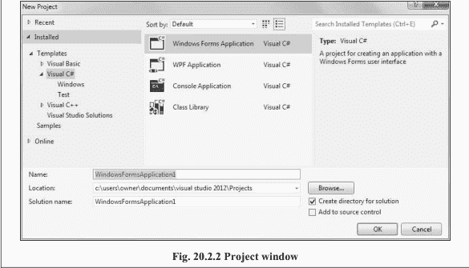

- 从可用模板中选择 **Windows 窗体应用程序**。
- 将**名称**保留为默认的 **WindowsFormsApplication1**，或**根据应用程序任务输入**，然后单击“确定”。创建此新的 Windows 应用程序项目后。

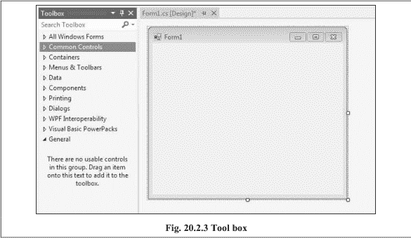

- 主窗口中的空白窗体以默认名称 Form1 出现，同时左侧会显示**工具箱**。可以从工具箱将控件添加到该空白 **Form1** 中。（如果看不到工具箱，单击其选项卡即可看到，工具箱将出现）。

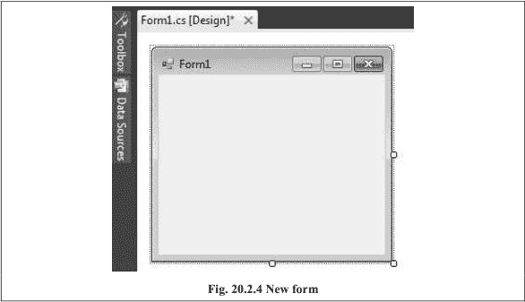

- 如下所示，**解决方案资源管理器**位于屏幕右侧。（如果看不到，请单击 Visual Studio Express 顶部**视图**菜单中的“解决方案资源管理器”项。）

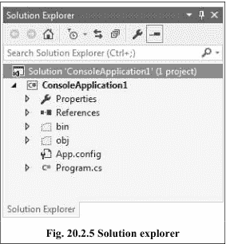

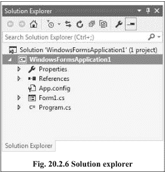

- 这两个项目（控制台应用程序和 WindowsFormsApplication）都有“属性”“引用”部分以及一个 Program.cs 文件。
- 双击 Program.cs 文件将其打开，可看到以下代码。

```
using System;
using System.Collections.Generic;
using System.Linq;
using System.Threading.Tasks;
using System.Windows.Forms;

namespace WindowsFormsApplication1
{
    static class Program
    {
        /// <summary>
        /// The main entry point for the application.
        /// </summary>
        [STAThread]
        static void Main()
        {
            Application.EnableVisualStyles();
            Application.SetCompatibleTextRenderingDefault(false);
            Application.Run(new Form1());
        }
    }
}
```

- 应用程序代码包含 using 行、一个命名空间、一个名为 Program 的类以及一个 Main 方法。
- Main 方法是程序的入口点。Main 的花括号之间的代码将在程序首次启动时执行。上述 WindowsFormsApplication1 代码中的最后一行是在应用程序启动时运行 Form1 的那一行。Main 方法启动程序，而解决方案资源管理器中的 Program.cs 包含 Main 方法的代码。

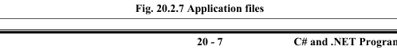

图 20.2.7 应用程序文件

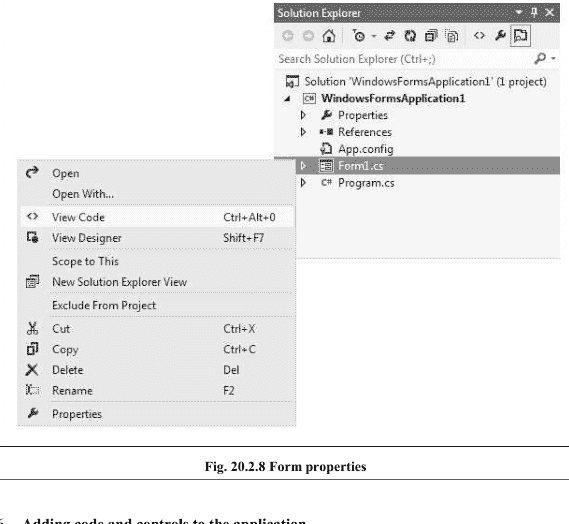

图 20.2.8 窗体属性

## 6. 向应用程序添加代码和控件

- 菜单中有“查看代码”和“查看设计器”选项。

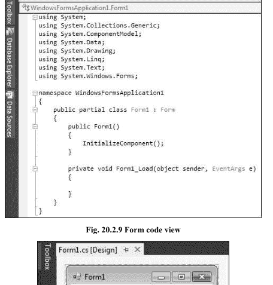

图 20.2.9 窗体代码视图

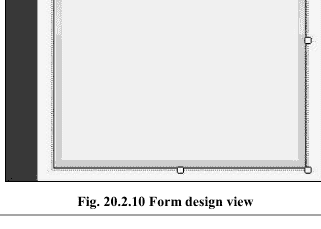

图 20.2.10 窗体设计视图

- 代码包含 **partial class Form1**。它是分部类，因为部分代码对开发者隐藏。

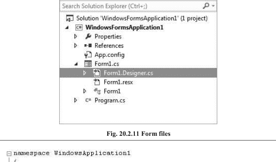

图 20.2.11 窗体文件

```
namespace WindowsApplication1
{
    partial class Form1
    {
        /// <summary>...
        private System.ComponentModel.IContainer components = null;

        /// <summary>...
        protected override void Dispose(bool disposing)
        {
            if (disposing && (components != null))
            {
                components.Dispose();
            }
            base.Dispose(disposing);
        }

        Windows Form Designer generated code
    }
}
```

```
#region Windows Form Designer generated code

/// <summary>
/// Required method for Designer support - do not modify
/// the contents of this method with the code editor.
/// </summary>
private void InitializeComponent()
{
    this.components = new System.ComponentModel.Container();
    this.AutoScaleMode = System.Windows.Forms.AutoScaleMode.Font;
    this.Text = "Form1";
}

#endregion
```

- **InitializeComponent** 是创建新的 Windows 应用程序项目时**自动生成**的代码（一个方法）。添加新控件时，附加代码会添加到这里。
- 单击顶部 **Form1.cs** 选项卡返回以再次查看窗体。如果该选项卡不存在，请右键单击右侧解决方案资源管理器中的 Form1.cs。从菜单中选择**查看设计器**。


图 20.2.12 窗体设计视图

正是在设计器视图中，按钮和文本框等控件被添加到窗体。

## 7. 运行程序

- 单击“启动调试”时，Visual C# 会先生成程序，然后如果可以的话运行它。如果无法运行该程序，则显示错误消息。
- 要运行程序，可以按 F5，或单击**调试 > 启动调试**。

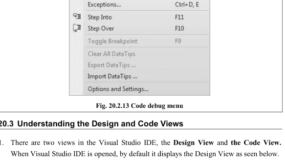

## 20.3 理解设计和代码视图

- 1. Visual Studio IDE 中有两个视图：**设计视图**和**代码视图**。打开 Visual Studio IDE 时，默认情况下会显示如下所示的设计视图。
- 2. **设计视图**允许拖动控件并将其放到窗体上。
- 3. **属性窗口**用于设置对象、窗体或解决方案资源管理器中显示的其他文件的属性。
- 4. **解决方案资源管理器**允许重命名项目、窗体，甚至项目中包含的其他文件。
- 5. **设计视图**提供了一种可视化的方式来处理控件、对象、项目文件等。
- 6. **代码视图**用于实现窗体上可视控件背后的功能。
- 7. 要在设计视图和代码视图之间**切换**，请单击“视图”->“代码”，或在设计视图中右键单击 Windows 窗体并选择“查看代码”。两种方法都会打开代码视图。

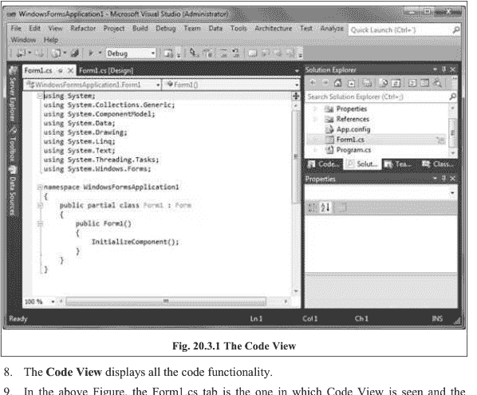

图 20.3.1 代码视图

- 8. 代码视图显示所有代码功能。
- 9. 在上图中，Form1.cs 选项卡是显示代码视图的选项卡，而 Form1.cs (Design) 选项卡实际上是 Windows 窗体 Form1 的设计模式；这些选项卡允许在设计视图的所有 GUI 元素与代码视图中用于提供功能的相关代码之间切换。应注意，只有在设计视图中，工具箱才完全加载了控件，而在代码视图中则没有。
- 10. 可以使用解决方案资源管理器在设计视图和代码视图之间切换：选择所需的 Windows 窗体（如果打开了多个 Windows 窗体），右键单击，然后选择“查看代码”或“查看设计器”。这将打开所选 Windows 窗体的代码视图或设计视图。

### 在属性窗口中对属性排序

各种对象和控件具有许多属性，可能需要浏览这些属性；对属性排序后浏览会更方便。属性排序可以按类别或按字母顺序进行。

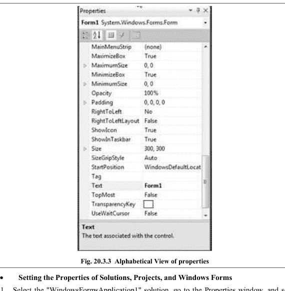

图 20.3.3 属性的字母顺序视图

### 设置解决方案、项目和 Windows 窗体的属性

- 1. 选择“WindowsFormsApplication1”解决方案，转到属性窗口，并将其 Name 属性值设置为“WindowsFormApp”。
- 2. 要在 Visual Studio 中查看解决方案文件（.sln），请单击“工具”->“选项”，转到“项目和解决方案”选项卡，选择“常规”，勾选“始终显示解决方案”选项，然后单击“确定”。
- 3. 在解决方案资源管理器中选择“WindowsFormsApplication1”项目，转到属性窗口，修改 Project File 属性值（该值定义项目的文件名），使其显示为“WinApp.csproj”。在此处可以更改项目名称。
- 4. 在解决方案资源管理器窗口中单击“Form1”，以在属性窗口中设置属性列表。

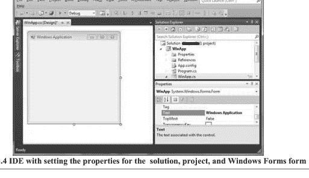

图 20.3.4 设置解决方案、项目和 Windows 窗体属性的 IDE

## 20.4 C# 中的用户界面元素和控件类层次结构


图 20.4.1 C# 控件类层次结构


## 20.4.1 Windows 窗体中的控件

### 概念

本节探讨 .NET 框架中可供程序员在 Windows 窗体应用程序中使用的各种控件。控件是允许用户以多种方式与应用程序交互的组件——例如，常用的控件之一是按钮。

### 说明

.NET 控件类型大致可分为以下类型：

1. 命令控件：
   - Button、LinkLabel、NotifyIcon 和 ToolBar
2. 文本控件：
   - TextBox、RichTextBox、Label 和 StatusBar
3. 选项控件：
   - Checkbox、RadioButton、CheckedListBox、ComboBox、DomainUpDown、NumericUpDown、ListBox、ListView 和 TreeView
4. 容器控件：
   - Panel、GroupBox 和 TabControl
5. 图形控件：
   - PictureBox 和 ImageList
6. 菜单控件：
   - MainMenu 和 ContextMenu
7. 对话框控件：
   - OpenFileDialog、SaveFileDialog、ColorDialog、FontDialog、PrintDialog、PrintPreviewDialog 和 PageSetupDialog
8. 其他有用控件：
   - DateTimePicker 和 MonthCalendar
   - DataGrid
   - Splitter
   - HscrollBar 和 VscrollBar
   - TrackBar 和 ProgressBar
   - Tooltip 和 ErrorProvider
   - Timer

## 20.4.2 常用的 Windows 窗体控件


图 20.4.2 Windows 窗体控件

| 序号 | 控件图片 | 用途 | 说明 |
|---|---|---|---|
| 1. | Button | 当发生鼠标单击或按下 Enter 或 Esc 键时触发命令/事件。 | 它表示窗体上的按钮。其 Text 属性确定按钮表面显示的标题，该标题指示预期发生的事件或命令。 |
| 2. | CheckBox | 允许用户选择一个或多个选项。 | 它由一个复选框以及旁边的文本或图像组成。通过设置 checkBox1.Appearance = Appearance.Button，复选框也可以表示为按钮。 |
| 3. | CheckedListBox | 显示项列表。 | 每个列表项前带有复选框的 ListBox。 |
| 4. | ComboBox | 提供 TextBox 和 ListBox 功能。 | 由文本框和下拉列表组成的混合控件。它结合了 TextBox 和 ListBox 的属性。 |
| 5. | DataGridView | 以网格格式操作数据。 | DataGridView 是表示关系数据的首要控件。它支持绑定到数据库。DataGridView 在 .NET 2.0 中引入，并取代了 DataGrid。 |
| 6. | GroupBox | 对控件进行分组。 | 主要用于对单选按钮进行分组；它在所包含的控件周围放置边框。 |
| 7. | ImageList | 管理图像集合。 | 保存其他控件（如 ToolStrip、ListView 和 TreeView）所用图像集合的容器控件。 |

| 编号 | 控件 | 摘要 | 详情 |
|---|---|---|---|
| 8. | Label | 向窗体添加描述性信息。 | 描述控件内容或控件/窗体使用说明的文本。 |
| 9. | ListBox | 显示项列表——其中一项或多项可被选中。 | 可以包含简单文本或对象。其方法、属性和事件允许选择、修改、添加和排序项。 |
| 10. | ListView | 显示项和子项。 | 可采用网格格式，其中每一行表示不同的项和子项。它还允许将项显示为图标。 |
| 11. | MenuStrip | 向窗体添加菜单。 | 为窗体提供菜单和子菜单系统。它取代了 MainMenu 控件。 |
| 12. | Panel FlowPanelLayout TablePanelLayout | 对控件进行分组。 | 用于对控件进行分组的可见或不可见容器。可以设置为可滚动。FlowPanelLayout 自动垂直或水平对齐控件。TablePanelLayout 在网格中对齐控件。 |
| 13. | PictureBox | 包含图形。 | 用于保存各种标准格式的图像。属性使图像能够在控件边框内定位和调整大小。 |
| 14. | ProgressBar | 描述应用程序的进度。 | 显示熟悉的进度条，向用户反馈某些事件（如文件复制）的进度。 |

| 编号 | 控件 | 说明 | 详情 |
|-----|---------|-------------|---------|
| 15. | RadioButton | 允许用户在一组选项中选择一项。 | 表示 Windows 单选按钮。 |
| 16. | StatusStrip | 提供一组指示程序状态的面板。 | 提供状态栏，用于提供有关当前窗体活动的上下文状态信息。 |
| 17. | TextBox | 接受用户输入。 | 可设计为接受单行或多行输入。属性允许它屏蔽密码输入、滚动、自动设置字母大小写，以及将内容限制为只读。 |
| 18. | TreeView | 将数据显示为树中的节点。 | 功能包括折叠或展开、添加、删除和复制树中的节点。 |

## 20.5 使用 Windows 控件编程

AU : Dec.-17, 19, May-18, 19

### 20.5.1 Button 控件


- 要将控件添加到窗体，请使用 Visual Studio 左侧的“工具箱”。
- 将鼠标移到“工具箱”上，然后单击“公共控件”旁边的箭头符号。
- 将看到可添加到窗体的以下内容列表。
  - 单击“公共控件”标题下的 Button 项。
  - 这将选中它。现在在窗体上的任意位置单击一次。
  - 窗体上将绘制一个按钮，如下所示，


- （按住鼠标左键并拖出一个按钮，将其调整到所需大小。）
- 按钮是一种控件，它是一种交互式组件，使用户能够与应用程序进行通信。按钮是用户单击以生成命令的东西。单击按钮时，为按钮编写的代码将被执行。按钮上的文本默认是 "button1"，可以更改。此处可以添加任何合适的内容。
- Button 类直接继承自 ButtonBase 类。如果按钮具有焦点，则可以使用鼠标、Enter 键或空格键单击 Button。

### 常用的 Button 属性

| 属性 | 说明 |
|---|---|
| AutoEllipsis | 获取或设置一个值，该值指示省略号字符 (...) 是否显示在控件右边缘，表示控件文本超出控件的指定长度。（继承自 ButtonBase。） |
| AutoSize | 获取或设置一个值，该值指示控件是否根据其内容调整大小。（继承自 ButtonBase。） |
| AutoSizeMode | 获取或设置 Button 自动调整自身大小的模式。 |
| BackColor | 获取或设置控件的背景色。（继承自 ButtonBase。） |
| DefaultSize | （继承自 ButtonBase。） |
| Image | 获取或设置按钮控件上显示的图像。（继承自 ButtonBase。） |
| ImageList | 获取或设置包含按钮控件上所显示 Image 的 ImageList。（继承自 ButtonBase。） |
| IsDefault | 获取或设置一个值，该值指示按钮控件是否为默认按钮。（继承自 ButtonBase。） |
| Text | （继承自 ButtonBase。） |
| TextAlign | 获取或设置按钮控件上文本的对齐方式。（继承自 ButtonBase。） |
| TextImageRelation | 获取或设置文本和图像彼此之间的相对位置。（继承自 ButtonBase。） |
| UseCompatibleTextRendering | 获取或设置一个值，该值确定是否使用兼容的文本呈现引擎 (GDI+) 或不使用 (GDI)。（继承自 ButtonBase。） |

### 重要的 Button 方法

| 方法 | 说明 |
|---|---|
| CreateAccessibilityInstance | （继承自 ButtonBase。） |
| Dispose | 重载。释放 ButtonBase 使用的资源。（继承自 ButtonBase。） |
| GetPreferredSize | 检索控件可放入的矩形区域的大小。（继承自 ButtonBase。） |


| NotifyDefault | 通知 Button 它是否是默认按钮，以便它可以相应地调整其外观。 |
|---|---|
| PerformClick | 生成按钮的 Click 事件。 |
| ToString | 已重写。 |

### 重要按钮事件

| Click | 这是组件或控件被点击时将工作的事件。这是使用最广泛的事件。 |
| Mouse Down | 当鼠标指针位于组件上方且按下鼠标按钮时，此事件会发生。 |
| Mouse Up | 当鼠标指针位于组件上方且释放鼠标按钮时发生。当控件被鼠标点击时也会发生。 |
| Mouse Click | 鼠标点击 = 鼠标按下 + 鼠标释放 |
| Mouse Hover | 当鼠标在控件内部静止一段时间时，此事件会发生。 |
| Mouse Leave | 当鼠标离开控件的可见部分时发生。 |
| Key Down | 当某个键首次被按下时，此事件会发生。 |
| Key Up | 当键被释放时事件会发生 |
| Key Press | 当控件获得焦点且用户按下并释放一个键时发生。键按下 = 键按下 + 键释放 |
| AutoSizeChanged | 当 AutoSize 属性的值发生变化时发生。（继承自 ButtonBase。） |
| DoubleClick | 当用户双击 Button 控件时发生。 |
| MouseDoubleClick | 当用户用鼠标双击 Button 控件时发生。 |

## 示例

```csharp
using System;
using System.Drawing;
using System.Windows.Forms;

namespace WindowsFormsApplication1
{
    public partial class Form1 : Form
    {
        public Form1()
        {
            InitializeComponent();
        }

        private void Form1_Load(object sender, EventArgs e)
        {
            button1.Text = "Show Message";
        }

        private void button1_Click(object sender, EventArgs e)
        {
            MessageBox.Show("Technical Book Services – C# Programming");
        }
    }
}
```

## 20.5.2 文本框


- 允许显示文本并允许用户输入信息。
- 多行文本框的实际限制为 32kB 文本。
- 如果需要更多文本，则使用 RichTextBox。
- TextBox 控件用于显示或作为输入接受单行文本。此控件具有标准 Windows 文本框控件中找不到的额外功能，包括多行编辑和密码字符掩码。

### 常用属性

| AcceptsReturn | 获取或设置一个值，该值指示在多行 TextBox 控件中按下 ENTER 时是否在控件中创建新行文本或激活窗体的默认按钮。 |

| 列 1 | 列 2 |
| :--- | :--- |
| AcceptsTab | 获取或设置一个值，该值指示在多行文本框控件中按下 TAB 键时是否在控件中输入 TAB 字符而不是将焦点移动到下一个选项卡顺序中的控件。（继承自 TextBoxBase。） |
| AutoSize | 获取或设置一个值，该值指示当分配给控件的字体更改时控件的高度是否自动调整。此属性与此类无关。（继承自 TextBoxBase。） |
| BackColor | 获取或设置控件的背景颜色。（继承自 TextBoxBase。） |
| BorderStyle | 获取或设置文本框控件的边框类型。（继承自 TextBoxBase。） |
| CanUndo | 获取一个值，该值指示用户是否可以在文本框控件中撤消上一次操作。（继承自 TextBoxBase。） |
| CharacterCasing | 获取或设置 TextBox 控件是否在输入时修改字符的大小写。 |
| DefaultCursor | 获取或设置控件的默认光标。（继承自 TextBoxBase。） |
| DefaultSize | （继承自 TextBoxBase。） |
| ForeColor | 获取或设置控件的前景色。（继承自 TextBoxBase。） |
| HideSelection | 获取或设置一个值，该值指示当控件失去焦点时文本框控件中的所选文本是否保持突出显示。（继承自 TextBoxBase。） |
| Lines | 获取或设置文本框控件中的文本行。（继承自 TextBoxBase。） |
| MaxLength | 获取或设置用户可以键入或粘贴到文本框控件中的最大字符数。（继承自 TextBoxBase。） |

| 属性 | 描述 |
|---|---|
| Modified | 获取或设置一个值，该值指示自控件创建或其内容上次设置以来文本框控件是否已被用户修改。（继承自 TextBoxBase。） |
| MultiLine | 已重写。获取或设置一个值，该值指示这是否是一个多行 TextBox 控件。 |
| PasswordChar | 获取或设置在单行 TextBox 控件中用于掩码密码字符的字符。 |
| PreferredHeight | 获取文本框的首选高度。（继承自 TextBoxBase。） |
| ReadOnly | 获取或设置一个值，该值指示文本框中的文本是否为只读。（继承自 TextBoxBase。） |
| ScrollBars | 获取或设置在多行 TextBox 控件中应出现哪些滚动条。 |
| SelectedText | 返回或设置包含当前所选文本的字符串；如果未选择任何字符，则由零长度字符串 ("") 组成。 |
| SelectionLength | 获取或设置文本框中选中的字符数。（继承自 TextBoxBase。） |
| SelectionStart | 返回或设置所选文本的起始点，如果未选择文本则指示插入点的位置 获取或设置文本框中所选文本的起始点。（继承自 TextBoxBase。） |
| ShortcutsEnabled | 获取或设置一个值，该值指示是否启用了定义的快捷方式。（继承自 TextBoxBase。） |
| Text | 已重写。获取或设置 TextBox 中的当前文本。 |
| TextAlign | 获取或设置 TextBox 控件中文本的对齐方式。 |
| TextLength | 获取控件中文本的长度。（继承自 TextBoxBase。） |
| UseSystemPasswordChar | 获取或设置一个值，该值指示 TextBox 控件中的文本是否应显示为默认密码字符。 |
| WordWrap | 指示多行文本框控件在必要时是否自动将单词换行到下一行的开头。（继承自 TextBoxBase。） |

### 常用方法

| 方法 | 描述 |
|---|---|
| AppendText | 将文本追加到文本框的当前文本。（继承自 TextBoxBase。） |
| Clear | 清除文本框控件中的所有文本。（继承自 TextBoxBase。） |
| ClearUndo | 从文本框的撤消缓冲区清除有关最近操作的信息。（继承自 TextBoxBase。） |
| Copy | 将文本框中的当前选择复制到剪贴板。（继承自 TextBoxBase。） |
| DeselectAll | 指定 SelectionLength 属性的值为零，以便控件中没有字符被选中。（继承自 TextBoxBase。） |
| Dispose | 重载。释放 TextBox 使用的资源。 |
| GetCharFromPosition | 检索控件中指定位置最近的字符。（继承自 TextBoxBase。） |
| GetCharIndexFromPosition | 检索最接近指定位置的字符的索引。（继承自 TextBoxBase。） |
| GetFirstCharIndexFromLine | 检索给定行的第一个字符的索引。（继承自 TextBoxBase。） |
| GetFirstCharIndexOfCurrentLine | 检索当前行的第一个字符的索引。（继承自 TextBoxBase。） |
| GetLineFromCharIndex | 从控件文本中指定的字符位置检索行号。（继承自 TextBoxBase。） |
| GetPositionFromCharIndex | 检索控件中指定字符索引处的位置。（继承自 TextBoxBase。） |
| Paste | 重载。用剪贴板的内容替换文本框中的当前选择。 |

|  |  |
| --- | --- |
| ScrollToCaret | 将控件的内容滚动到当前插入符号位置。（继承自 TextBoxBase。） |
| Select | 重载。在控件中选择文本。（继承自 TextBoxBase。） |
| SelectAll | 选择文本框中的所有文本。（继承自 TextBoxBase。） |

### 重要事件

|  |  |
| --- | --- |
| AcceptsTabChanged | 当 AcceptsTab 属性的值已更改时发生。（继承自 TextBoxBase。） |
| BorderStyleChanged | 当 BorderStyle 属性的值已更改时发生。（继承自 TextBoxBase。） |
| Click | 当文本框被点击时发生。（继承自 TextBoxBase。） |
| HideSelectionChanged | 当 HideSelection 属性的值已更改时发生。（继承自 TextBoxBase。） |
| ModifiedChanged | 当 Modified 属性的值已更改时发生。（继承自 TextBoxBase。） |
| MouseClick | 当控件被鼠标点击时发生。（继承自 TextBoxBase。） |
| MultilineChanged | 当 Multiline 属性的值已更改时发生。（继承自 TextBoxBase。） |
| TextAlignChanged | 当 TextAlign 属性的值已更改时发生。（继承自 TextBoxBase。） |
| TextChanged | 当 Text 属性的值已更改时发生。 |

### 示例

```csharp
using System;
using System.Drawing;
using System.Windows.Forms;

public class addnum : Form {

    Button BtnAdd = new Button();
```


```csharp
TextBox textBox1 = new TextBox();
TextBox textBox2 = new TextBox();
TextBox textBox3 = new TextBox();

public addnum()
{
    BtnAdd.Text = "Add";

    BtnAdd.Click += new System.EventHandler(this.BtnAdd_Click);

    this.Controls.Add(BtnAdd);

    textBox1.Location = new Point(15, 25);
    textBox1.Size = new Size(80, 10);
    textBox1.Text = "1int";
    this.Controls.Add(textBox1);

    textBox2.Location = new Point(15, 70);
    textBox2.Size = new Size(80, 10);
    textBox2.Text = "2int";
    this.Controls.Add(textBox2);

    textBox3.Location = new Point(15, 170);
    textBox3.Size = new Size(80, 10);
    textBox3.Text = "outputint";
    this.Controls.Add(textBox3);
}

private void BtnAdd_Click(object sender, System.EventArgs e)
{
    int a = Convert.ToInt32(textBox1.Text);
    int b = Convert.ToInt32(textBox2.Text);
    int c = a + b;
    textBox3.Text = c.ToString();
}

public static void Main(string[] args)
{
    Application.Run(new addnum());
}
```

## 20.5.3 标签

A

-   允许向用户显示文本。
-   标签是使用最频繁的 C# 控件之一。可以使用 Label 控件在页面上的固定位置显示文本。
-   标签控件还可以用于向窗体添加描述性文本，为用户提供有用的信息。
-   Label 类定义在 System.Windows.Forms 命名空间中。

### 常用属性

| 属性 | 描述 |
|---|---|
| AutoEllipsis | 获取或设置一个值，该值指示省略号字符 (...) 是否出现在标签右侧边缘，表示标签文本超出标签指定长度。 |
| AutoSize | 重写。获取或设置一个值，该值指示控件是否自动调整大小以显示其全部内容。 |
| BorderStyle | 获取或设置控件的边框样式。 |
| DefaultSize | 重写。 |
| FlatStyle | 获取或设置标签控件的平面样式外观。 |
| Image | 获取或设置在标签上显示的图像。 |
| ImageList | 获取或设置包含要在标签控件中显示的图像的 ImageList。 |
| PreferredHeight | 获取控件的首选高度。 |
| PreferredWidth | 获取控件的首选宽度。 |
| RenderTransparent | 指示容器控件背景是否在标签上渲染。 |
| Text | 重写。 |
| TextAlign | 获取或设置标签中文本的对齐方式。 |

### 常用方法

| 方法 | 描述 |
|---|---|
| Dispose | 重载。释放标签使用的资源。 |
| GetPreferredSize | 重写。 |
| CalcImageRenderBounds | 根据控件的对齐方式确定在标签控件内绘制的图像的大小和位置。 |
| DrawImage | 在指定的边界内绘制图像。 |

### 重要事件

| 事件 | 描述 |
|---|---|
| AutoSizeChanged | 当 AutoSize 属性的值更改时发生。 |
| BackgroundImageChanged | 当 BackgroundImage 属性更改时发生。 |
| BackgroundImageLayoutChanged | 当 BackgroundImageLayout 属性更改时发生。 |

### 示例

```csharp
using System;
using System.Drawing;
using System.Windows.Forms;

namespace WindowsFormsApplication1
{
    public partial class Form1 : Form
    {
        public Form1()
        {
            InitializeComponent();
        }

        private void Form1_Load(object sender, EventArgs e)
        {
            lbl1.Text = "This is a Label";
            lbl1.BorderStyle = BorderStyle.FixedSingle;
            lbl1.TextAlign = ContentAlignment.MiddleCenter;
        }
    }
}
```

## 20.5.4 复选框


-   允许用户从多个选项中选择或取消选择一个选项。
-   复选框允许用户从多个选项中进行多项选择。
-   复选框为用户提供一个选项，例如 true/false 或 yes/no。单击复选框时可以选中它，再次单击则会取消选中。
-   复选框控件可以显示图像或文本或两者。 通常复选框带有标题，可以在 Text 属性中设置。

```csharp
checkBox1.Text = "Net-informations.com";
```

可以使用复选框控件的 ThreeState 属性来指示控件返回 Checked、Unchecked 和 Indeterminate 值。为此，将复选框的 ThreeState 属性设置为 True 以指示它支持三种状态。

```csharp
checkBox1.ThreeState = true;
```

单选按钮和复选框用于不同的功能。 当应用程序需要用户只选择一个选项时，使用单选按钮。 当用户可以选择所有适当的选项时，则使用复选框。

### 常用属性

| 属性 | 描述 |
|---|---|
| Appearance | 获取或设置确定复选框控件外观的值。 |
| AutoCheck | 获取或设置一个值，该值指示单击复选框时是否自动更改 Checked 或 CheckState 值以及复选框的外观。 |
| AutoEllipsis | 获取或设置一个值，该值指示省略号字符 (...) 是否出现在控件右侧边缘，表示控件文本超出控件指定长度。 （从 ButtonBase 继承。） |
| AutoSize | 获取或设置一个值，该值指示控件是否根据其内容调整大小。 （从 ButtonBase 继承。） |
| BackColor | 获取或设置控件的背景色。 （从 ButtonBase 继承。） |
| CheckAlign | 获取或设置复选框控件上复选标记的水平和垂直对齐方式。 |
| Checked | 获取或设置一个值，该值指示复选框是否处于选中状态。 |
| CheckState | 获取或设置复选框的状态。 |
| DefaultImeMode | 获取此控件支持的默认输入法编辑器 (IME) 模式。 （从 ButtonBase 继承。） |
| FlatAppearance | 获取边框的外观以及用于指示选中状态和鼠标状态的颜色。 （从 ButtonBase 继承。） |
| FlatStyle | 获取或设置按钮控件的平面样式外观。 （从 ButtonBase 继承。） |
| Image | 获取或设置在按钮控件上显示的图像。 （从 ButtonBase 继承。） |
| ImageAlign | 获取或设置按钮控件上图像的对齐方式。 （从 ButtonBase 继承。） |
| ImageList | 获取或设置包含在按钮控件上显示的图像的 ImageList。 （从 ButtonBase 继承。） |
| IsDefault | 获取或设置一个值，该值指示按钮控件是否为默认按钮。 （从 ButtonBase 继承。） |
| Text | （从 ButtonBase 继承。） |
| TextAlign | 重写。获取或设置复选框控件上文本的对齐方式。 |
| ThreeState | 获取或设置一个值，该值指示复选框是否允许三种选中状态而不是两种。 |
| UseVisualStyleBackColor | 获取或设置一个值，该值确定是否使用视觉样式绘制背景（如果受支持）。 （从 ButtonBase 继承。） |

### 方法

| 方法 | 描述 |
|---|---|
| CreateAccessibilityInstance | 重写。为复选框控件创建新的可访问性对象。 |
| Dispose | 重载。释放 ButtonBase 使用的资源。 （从 ButtonBase 继承。） |
| GetPreferredSize | 检索可容纳控件的矩形区域的大小。 （从 ButtonBase 继承。） |
| OnClick | 重写。引发 Click 事件。 |
| ToString | 重写。返回表示当前复选框控件的字符串。 |

### 事件

| 事件 | 描述 |
|---|---|
| AutoSizeChanged | 当 AutoSize 属性的值更改时发生。 （从 ButtonBase 继承。） |
| CheckedChanged | 当 Checked 属性的值更改时发生。 |
| CheckStateChanged | 当 CheckState 属性的值更改时发生。 |
| DoubleClick | 当用户双击复选框控件时发生。 |
| ImeModeChanged | 当 ImeMode 属性更改时发生。此事件与此类无关。 （从 ButtonBase 继承。） |
| MouseDoubleClick | 当用户双击复选框控件时发生。 |

### 示例

```csharp
using System;
using System.Drawing;
using System.Windows.Forms;

namespace WindowsFormsApplication1
{
    public partial class Form1 : Form
    {
        public Form1()
        {
            InitializeComponent();
        }

        private void btn1_Click(object sender, EventArgs e)
        {
            string msg = "";

            if (chb1.Checked == true)
            {

```

msg = "Technical Publication C#";
}

if (chb2.Checked == true)
{
    msg = msg + "Technical Publication C++";
}

if (chb3.Checked == true)
{
    msg = msg + " Technical Publication VB";
}

if (msg.Length > 0)
{
    MessageBox.Show (msg + " selected ");
}
else
{
    MessageBox.Show ("No checkbox selected");
}

checkBox1.ThreeState = true;
}
}

## 20.5.5 RadioButton


- 允许用户从可能的不同选项列表中选择一项。
- 单选按钮也称为选项按钮。它们与复选框类似，因为用户可以选中和取消选中它们。
- 复选框是独立工作的，而单选按钮则是按组工作的。
- 当组中的一个单选按钮被选中时，其他单选按钮会自动取消选中。当用户点击一个单选按钮时，它会被选中，而同一组中的所有其他单选按钮都会被取消选中。
- 单选按钮允许用户从一组选项中选择一个选项。在给定容器（如窗体）中的所有单选按钮组成一个组。单选按钮可以显示文本、图像或两者兼有。

### 常用属性

| 属性 | 描述 |
|---|---|
| Appearance | 获取或设置一个值，该值确定 RadioButton 的外观。 |
| AutoCheck | 获取或设置一个值，该值指示单击控件时 Checked 值和控件外观是否自动更改。 |
| AutoEllipsis | 获取或设置一个值，该值指示省略号字符（...）是否出现在控件的右边缘，表示控件文本超出了控件指定长度。（继承自 ButtonBase。） |
| AutoSize | 获取或设置一个值，该值指示控件是否根据其内容调整大小。（继承自 ButtonBase。） |
| BackColor | 获取或设置控件的背景颜色。（继承自 ButtonBase。） |
| BackgroundImage | 获取或设置在控件中显示的背景图像。（继承自 Control。） |
| BackgroundImageLayout | 获取或设置由 ImageLayout 枚举定义的背景图像布局。（继承自 Control。） |
| CheckAlign | 获取或设置 RadioButton 的复选框部分的位置。 |
| Checked | 获取或设置一个值，该值指示控件是否已选中。 |
| DefaultSize | 已重写。 |
| FlatAppearance | 获取边框外观以及用于指示选中状态和鼠标状态的颜色。（继承自 ButtonBase。） |
| FlatStyle | 获取或设置按钮控件的平面样式外观。（继承自 ButtonBase。） |
| ForeColor | 获取或设置控件的前景颜色。（继承自 Control。） |
| Image | 获取或设置在按钮控件上显示的图像。（继承自 ButtonBase。） |
| ImageAlign | 获取或设置按钮控件上图像的对齐方式。（继承自 ButtonBase。） |
| IsDefault | 获取或设置一个值，该值指示按钮控件是否为默认按钮。（继承自 ButtonBase。） |
| Text | （继承自 ButtonBase。） |
| TextAlign | 已重写。获取或设置 RadioButton 控件上文本的对齐方式。 |
| UseVisualStyleBackColor | 获取或设置一个值，该值确定（如果支持）是否使用视觉样式绘制背景。（继承自 ButtonBase。） |

### 方法

| 方法 | 描述 |
|---|---|
| CreateAccessibilityInstance | 已重写。为 RadioButton 控件创建新的辅助功能对象。 |
| Dispose | 已重载。释放 ButtonBase 使用的资源。（继承自 ButtonBase。） |
| GetPreferredSize | 检索可容纳控件的矩形区域的大小。（继承自 ButtonBase。） |
| ToString | 已重写。重写 ToString 方法。 |

### 事件

| 事件 | 描述 |
|---|---|
| AppearanceChanged | 在 Appearance 属性值更改时发生。 |
| AutoSizeChanged | 在 AutoSize 属性值更改时发生。（继承自 ButtonBase。） |
| CheckedChanged | 在 Checked 属性值更改时发生。 |
| Click | 在单击控件时发生。（继承自 Control。） |
| DoubleClick | 在用户双击 RadioButton 控件时发生。 |
| MouseDoubleClick | 在用户使用鼠标双击 RadioButton 控件时发生。 |

```csharp
using System;
using System.Drawing;
using System.Windows.Forms;

namespace WindowsFormsApplication1
{
    public partial class Form1 : Form
    {
        public Form1()
        {
            InitializeComponent();
        }

        private void Form1_Load(object sender, EventArgs e)
        {
            radButton1.Checked = true;
        }

        private void button1_Click(object sender, EventArgs e)
        {
            if (radButton1.Checked == true)
            {
                MessageBox.Show ("Window Seat Taken");
                return;
            }
            else if (radButton2.Checked == true)
            {
                MessageBox.Show("Center Seat Taken ");
                return;
            }
            else
            {
                MessageBox.Show("Corner Seat Taken");
                return;
            }
        }
    }
}
```

## 20.5.6 ComboBox


- 允许用户从下拉框中选择一项，或输入不同的项。
- ComboBox 和 ListBox 控件都派生自 ListControl 类。
- ComboBox 显示一个文本框与一个 ListBox 组合，使用户可以从列表中选择项或输入新值。

### 常用属性

| 属性 | 描述 |
|---|---|
| AllowSelection | 获取一个值，该值指示列表是否允许选择列表项。（继承自 ListControl。） |
| DataSource | 获取或设置此 ComboBox 的数据源。 |
| DisplayMember | 获取或设置要为该 ListControl 显示的属性。（继承自 ListControl。） |
| DropDownHeight | 获取或设置 ComboBox 下拉部分的高度（以像素为单位）。 |
| DropDownStyle | 获取或设置指定组合框样式的值。 |
| DropDownWidth | 获取或设置组合框下拉部分的宽度。 |
| DroppedDown | 获取或设置一个值，该值指示组合框是否显示其下拉部分。 |
| FlatStyle | 获取或设置 ComboBox 的外观。 |
| Focused | 已重写。获取一个值，该值指示 ComboBox 是否具有焦点。 |
| FormatString | 获取或设置格式说明符字符，这些字符指示值的显示方式。（继承自 ListControl。） |
| FormattingEnabled | 获取或设置一个值，该值指示是否将格式设置应用于 ListControl 的 DisplayMember 属性。（继承自 ListControl。） |
| IntegralHeight | 获取或设置一个值，该值指示控件是否应调整大小以避免显示不完整的项。 |
| ItemHeight | 获取或设置组合框中项的高度。 |
| Items | 获取一个对象，该对象表示此 ComboBox 中包含的项的集合。 |
| MaxDropDownItems | 获取或设置 ComboBox 下拉部分中显示的最大项数。 |
| MaxLength | 获取或设置用户可在 ComboBox 中键入的字符数。 |
| PreferredHeight | 获取 ComboBox 的首选高度。 |
| SelectedIndex | 在控件显示之前填充时会出现问题。已重写。获取或设置指定当前选定项的索引。 |
| SelectedItem | 获取或设置 ComboBox 中当前选定的项。 |
| SelectedText | 获取或设置 ComboBox 可编辑部分中选定的文本。 |
| SelectedValue | 在控件显示之前填充时会出现问题。获取或设置由 ValueMember 属性指定的成员属性的值。（继承自 ListControl。） |
| SelectionLength | 获取或设置组合框可编辑部分中选定的字符数。 |
| SelectionStart | 获取或设置组合框中选定文本的起始索引。 |
| Sorted | 获取或设置一个值，该值指示组合框中的项是否已排序。 |
| Text | 已重写。获取或设置与此控件关联的文本。 |
| ValueMember | 获取或设置要用作 ListControl 中项的实际值的属性。（继承自 ListControl。） |


## 方法
| 方法 | 描述 |
|---|---|
| Add | 将项目添加到项目列表中 |
| AddRange | 将项目数组添加到项目列表中 |
| AddItemsCore | 将指定的项目添加到组合框中。 |
| BeginUpdate | 在一次添加一个项目到 ComboBox 时保持性能。 |
| Dispose | 重载。释放 ComboBox 使用的资源。 |
| EndUpdate | 在 BeginUpdate 方法暂停绘制后恢复绘制 ComboBox 控件。 |
| FilterItemOnProperty | 重载。如果该项目是 ListControl 类实例的属性，则返回 ListControl 项目的当前值。(继承自 ListControl.) |
| FindString | 重载。查找以指定字符串开头的 ComboBox 中的第一个项目。 |
| FindStringExact | 重载。查找与指定字符串完全匹配的项目。 |
| GetItemHeight | 返回 ComboBox 中项目的高度。 |
| GetItemText | 返回指定项目的文本表示。(继承自 ListControl.) |
| OnClick | 引发 Click 事件。(继承自 Control.) |
| RefreshItem | 重写。在指定位置刷新包含的项目。 |
| RefreshItems | 重写。刷新所有 ComboBox 项目。 |
| ResetText | 重写。 |
| Select | 重载。 |
| SelectAll | 选择 ComboBox 可编辑部分中的所有文本。 |
| SetBoundsCore | 重写。设置 ComboBox 的大小和位置。 |
| ToString | 重写。返回表示 ComboBox 控件的字符串。 |

## 事件
| 事件 | 描述 |
|---|---|
| BackgroundImageChanged | 当 BackgroundImage 属性的值更改时发生。 |
| BackgroundImageLayoutChanged | 当 BackgroundImageLayout 属性更改时发生。 |
| DrawItem | 当自绘 ComboBox 的视觉方面发生变化时发生。 |
| DropDown | 当 ComboBox 的下拉部分显示时发生。 |
| DropDownClosed | 当 ComboBox 的下拉部分不再可见时发生。 |
| DropDownStyleChanged | 当 DropDownStyle 属性已更改时发生。 |
| Format | 当控件绑定到数据值时发生。(继承自 ListControl.) |
| FormatInfoChanged | 当 FormatInfo 属性的值更改时发生。(继承自 ListControl.) |
| FormatStringChanged | 当 FormatString 属性的值更改时发生 (继承自 ListControl.) |
| FormattingEnabledChanged | 当 FormattingEnabled 属性的值更改时发生。(继承自 ListControl.) |
| MeasureItem | 每次自绘 ComboBox 项目需要绘制时以及确定列表项目的大小时发生。 |
| SelectedIndexChanged | 当 SelectedIndex 属性已更改时发生。 |
| SelectedValueChanged | 当 SelectedValue 属性更改时发生。(继承自 ListControl.) |
| SelectionChangeCommitted | 当所选项目已更改并且该更改在 ComboBox 中显示时发生。 |

| 事件 | 描述 |
|---|---|
| TextUpdate | 当控件已格式化文本但在文本显示之前发生。 |
| ValueMemberChanged | 当 ValueMember 属性更改时发生。(继承自 ListControl.) |

## 示例
```
    using System;
    using System.Windows.Forms;
    namespace WindowsFormsApplication1
    {
    public partial class Form1 : Form {
    public Form1() {
    InitializeComponent();
    }
    private void Form1_Load(object sender, EventArgs e) {
    cboBox1.Items.Add("Seats");
    cboBox1.Items.Add("Total");
    }
    private void cboBox1_SelectedIndexChanged(object sender, EventArgs e)
    {
    cbo2.Items.Clear();
    if (cboBox1.SelectedItem == "Seats")
    {
    cboBox2.Items.Add("Front");
    cboBox2.Items.Add("Rear");
    cboBox2.Items.Add("Centre");
    }
    else if (cboBox1.SelectedItem == "Total")
    {
    cboBox2.Items.Add("2");
    cboBox2.Items.Add("4");
    cboBox2.Items.Add("8");
    }
    }
    }
    }
```

## 20.5.7 列表框


- 允许用户从项目列表中选择一个项目。
- ListBox 控件能够向用户显示一个项目列表，用户可以通过单击进行选择。
- 除了显示和选择功能之外，ListBox 还提供功能，可高效地向 ListBox 添加项目并在列表的项目中查找文本。

## 属性
| 属性 | 描述 |
|---|---|
| AllowSelection | 重写。获取一个值，该值指示 ListBox 当前是否启用列表项的选择。 |
| BackColor | 重写。 |
| BorderStyle | 获取或设置绘制在 ListBox 周围的边框类型。 |
| ColumnWidth | 获取或设置多列 ListBox 中列的宽度。 |
| DataSource | 获取或设置此 ListControl 的数据源。(继承自 ListControl.) |
| DisplayMember | 获取或设置此 ListControl 要显示的属性。(继承自 ListControl.) |
| FilterItemOnProperty | 重载。如果该项目是 ListControl 类实例的属性，则返回 ListControl 项目的当前值。(继承自 ListControl.) |
| FormatString | 获取或设置指示如何显示值的格式说明符字符。(继承自 ListControl.) |
| FormattingEnabled | 获取或设置一个值，该值指示是否对 ListControl 的 DisplayMember 属性应用格式化。(继承自 ListControl.) |
| ForeColor | 重写。 |
| HorizontalScrollbar | 获取或设置一个值，该值指示控件中是否显示水平滚动条。 |
| IntegralHeight | 获取或设置一个值，该值指示控件是否应调整大小以避免显示部分项目。 |
| ItemHeight | 获取或设置 ListBox 中项目的高度。 |
| Items | 获取 ListBox 的项目。 |
| MultiColumn | 获取或设置一个值，该值指示 ListBox 是否支持多列。 |
| PreferredHeight | 获取 ListBox 中所有项目的组合高度。 |

| 属性 | 描述 |
|---|---|
| ScrollAlwaysVisible | 获取或设置一个值，该值指示垂直滚动条是否始终显示。 |
| SelectedValue | 获取或设置由 ValueMember 属性指定的成员属性的值。(继承自 ListControl.) |
| SelectionMode | 指定列表框的选择行为。MultiExtended、MultiSimple、One、None。获取或设置在 ListBox 中选择项目的方法。 |
| Sorted | 获取或设置一个值，该值指示 ListBox 中的项目是否按字母顺序排序。 |
| Text | 重写。获取或搜索 ListBox 中当前选定项目的文本。 |
| TopIndex | 获取或设置 ListBox 中第一个可见项目的索引。 |
| UseTabStops | 获取或设置一个值，该值指示 ListBox 在绘制字符串时是否可以识别并扩展制表符字符。 |
| ValueMember | 获取或设置用作 ListControl 中项目的实际值的属性。(继承自 ListControl.) |

## 方法
| 方法 | 描述 |
|---|---|
| BeginUpdate | 在调用 EndUpdate 方法之前阻止控件绘制，从而在一次添加一个项目到 ListBox 时保持性能。 |
| ClearSelected | 取消选择 ListBox 中的所有项目。 |
| DefaultItemHeight | 指定自绘列表框的默认项目高度。 |
| EndUpdate | 在 BeginUpdate 方法暂停绘制后恢复绘制 ListBox 控件。 |
| FindString | 查找以指定字符串开头的 ListBox 中的第一个项目 |
| FindStringExact | 查找与指定字符串完全匹配的 ListBox 中的第一个项目。 |
| GetItemHeight | 返回指定项目的文本表示。(继承自 ListControl.) |
| GetItemRectangle | 返回 ListBox 中项目的边界矩形。 |

| 方法 | 描述 |
|---|---|
| IndexFromPoint | 重载。返回指定坐标处项目的从零开始的索引。 |
| Refresh | 重写。强制控件使客户端区域无效并立即重绘自身及其任何子控件。 |
| RefreshItem | 重写。刷新指定索引处包含的项目。 |
| RefreshItems | 重写。刷新所有 ListBox 项目并为其检索新的字符串。 |
| Sort | 对 ListBox 中的项目进行排序。 |
| ToString | 重写。返回 ListBox 的字符串表示形式。 |

### 方法 - 单选
| 方法 | 描述 |
|---|---|
| SelectedIndex | 获取或设置列表框中当前选定项目的从零开始的索引。如果当前未选择任何元素，则不返回任何内容。重写。获取或设置 ListBox 中当前选定项目的从零开始的索引。当存在多选时（SelectionMode = MultiSimple），这是第一个选定项目 |
| SelectedItem | 获取或设置列表框中当前选定的项目。 |

### 方法 - 多选
| 方法 | 描述 |
|---|---|
| GetSelected | 确定特定从零开始的项目当前是否被选中。 |
| SelectedIndex | 获取列表框中第一个选定项目的从零开始的索引。 |
| SelectedItem | 获取列表框中第一个选定的项目。获取或设置 ListBox 中当前选定的项目。 |
| SelectedIndices | 表示所有选定项目的全部索引位置的集合。只读。获取包含 ListBox 中所有当前选定项目的从零开始的索引的集合。 |


| SelectedItems | 表示所有选中项的集合。只读。 |
| --- | --- |
| SetSelected | 为特定基于零的项目选择或清除选择。 |

### 事件
| MeasureItem | 在创建所有者绘制的 ListBox 并确定列表项大小时发生。 |
| --- | --- |
| MouseClick | 当用户用鼠标指针单击 ListBox 控件时发生。 |
| SelectedIndexChanged | 当 SelectedIndex 属性已更改时发生。对单选、多选和扩展选择均触发。如果使用扩展选择，则在全部选中后触发。 |
| SelectedValueChanged | 当 SelectedValue 属性更改时发生。（继承自 ListControl。） |
| ValueMemberChanged | 当 ValueMember 属性更改时发生。（继承自 ListControl。） |

## 20.5.8 图片框


- 允许显示图形或图片。
- Windows Forms PictureBox 控件用于以位图、GIF、图标或 JPEG 格式显示图像。
- Image 属性可以设置为要显示的 Image，并在设计时或运行时显示。它也可以通过编程更改，这在单个窗体用于显示不同信息时特别有用。

```
pictureBox1.Image = Image.FromFile("c:\\testImage.jpg");
```

- SizeMode 属性设置为 PictureBoxSizeMode 枚举中的值，控制图像在显示区域中的裁剪和定位。

```
pictureBox1.SizeMode = PictureBoxSizeMode.StretchImage;
```

PictureBox 控件有五种不同的 PictureBoxSizeMode 可用。

- **AutoSize** - 将图片框调整为图像大小。
- **CenterImage** - 在图片框中居中图像。
- **Normal** - 将图像的左上角放置在图片框的左上角
- **StretchImage** - 允许在代码中拉伸图像

PictureBox 不是可选择的控件，这意味着它不能接收输入焦点。以下 C# 程序展示了如何从文件加载图片并以拉伸模式显示它。

### 属性
| BorderStyle | 指示控件的边框样式。 |
|---|---|
| ErrorImage | 获取或设置在图像加载过程中发生错误或图像加载被取消时要显示的图像。 |
| Image | 获取或设置 PictureBox 显示的图像。 |
| ImageLocation | 获取或设置要在 PictureBox 中显示的图像的路径或 URL。 |
| InitialImage | 获取或设置在主图像加载时在 PictureBox 控件中显示的图像。 |
| SizeMode | 指示图像的显示方式。 |
| Text | 已重写。获取或设置 PictureBox 的文本。 |
| WaitOnLoad | 获取或设置一个值，该值指示图像是否同步加载。 |

### 方法
| CancelAsync | 取消异步图像加载。 |
|---|---|
| Dispose | 重载。释放 PictureBox 使用的所有资源。 |
| Load | 重载。在 PictureBox 中显示图像。 |
| LoadAsync | 重载。异步加载图像。 |
| ToString | 已重写。返回表示当前 PictureBox 控件的字符串。 |

### 事件
| Leave | 当输入焦点离开 PictureBox 时发生。 |
|---|---|
| LoadCompleted | 当异步图像加载操作完成、被取消或引发异常时发生。 |
| LoadProgressChanged | 当异步图像加载操作的进度发生变化时发生。 |
| SizeModeChanged | 当 SizeMode 更改时发生。 |

### 示例
```
using System;
using System.Drawing;
using System.Windows.Forms;

namespace WindowsFormsApplication1
{
    public partial class Form1 : Form
    {
        public Form1()
        {
            InitializeComponent();
        }

        private void Form1_Load(object sender, EventArgs e)
        {
            pictureBox1.Image = Image.FromFile("c:\\testImage.jpg");
            pictureBox1.SizeMode = PictureBoxSizeMode.StretchImage;
        }
    }
}
```

## 20.5.9 图像列表 (img)


ImageBox 是 Windows Form 应用程序的高级图像控件，类似于 Picture Box 控件，但具有更多功能，允许使用高级缩放选项显示图像，如保持纵横比的拉伸、自定义缩放比例和缩放点。

### 属性
| ColorDepth | 获取图像列表的颜色深度。 |
|---|---|
| Images | 获取此图像列表的 ImageList.ImageCollection。 |
| ImageSize | 获取或设置图像列表中图像的大小。 |
| ImageStream | 获取与此图像列表关联的 ImageListStreamer。 |
| Tag | 获取或设置包含有关 ImageList 的附加数据的对象。 |
| TransparentColor | 获取或设置视为透明的颜色。 |

### 方法
| Draw | 重载。绘制指示的图像。 |
|---|---|
| ToString | 已重写。返回表示当前 ImageList 的字符串。 |

Image box 与 Picture Box 控件的区别。
| Image Box | Picture Box |
|---|---|
| 1) 它不作为容器控件<br>2) 不使用内存存储图片<br>3) 在 image box 中无法编辑图片<br>4) 没有自动大小属性<br>5) 具有拉伸属性<br>6) image box 使用窗体的设备上下文。 | 1) 它作为容器控件<br>2) 使用内存存储图片<br>3) 在 picture box 中可以编辑图片<br>4) 具有自动大小属性<br>5) 没有拉伸属性<br>6) picture box 具有设备上下文。 |

## 20.5.10 菜单条

- 1. .NET 2.0 中的菜单和工具栏被称为“strip”控件。
- 2. 菜单位于菜单栏上，包含相关命令的列表。
- 3. MainMenu 控件允许向程序添加菜单。可以向菜单添加特殊效果，如访问键、复选标记和键盘快捷键。

### 通用菜单约定
- 每个菜单标题和菜单命令应以大写字母开头
- 标题应简短、具体且易于理解菜单的目的。

- 为每个菜单项分配一个访问键，并使用其第一个字母作为快捷键。
- 如有必要，在显示对话框的菜单命令后放置省略号

5. Windows Form 上的菜单使用 MainMenu 对象创建，MainMenu 对象是 MenuItem 对象的集合。MainMenu 是窗体菜单结构的容器，菜单由代表菜单各个部分的 MenuItem 对象组成。

6. 可以在设计时通过添加 MainMenu 组件然后使用菜单设计器向其追加菜单项来向 Windows Forms 添加菜单。

7. 下图描绘了菜单的主要部分


图 20.5.2 菜单的各部分

### 8. 菜单项上的事件

菜单项的主要目的是在单击时调用操作。因此，应向菜单项添加单击事件处理程序并为其编写代码。

### 9. 创建菜单

### 示例

### 菜单示例

- 1. 创建一个新的 Windows 窗体项目。


图 20.5.3 窗体菜单设计视图


图 20.5.4 窗体菜单文件

- 2. 从工具箱向窗体添加 MenuStrip。


图 20.5.5 菜单条工具箱

- 3. 菜单条已插入到窗体上。适当命名菜单。窗体如下所示。


图 20.5.6 窗体设计

- 4. 通过在菜单条中输入菜单选项来添加菜单项。可以通过在窗体的菜单栏部分的“在此处键入”框中输入值直接创建菜单项。


图 20.5.7 窗体设计


6. 添加分隔符后，菜单如下所示。这里添加了 2 个分隔符。


图 20.5.9 窗体菜单视图

7. 另请注意，要添加访问键，请插入与号字符（&）。

8. 可以通过输入一个短横线并按 Enter 来插入菜单分隔符。

8. 在窗体上创建 Menu 后，双击每个菜单项，并根据应用程序要求编写作为菜单后台代码的操作部分。在本示例中，在相应菜单项的单击事件中添加了消息框。双击菜单项以为它们创建事件过程。以下是本示例添加的代码。

```
using System;
using System.Collections.Generic;
using System.ComponentModel;
using System.Data;
using System.Drawing;
using System.Linq;
using System.Text;
using System.Windows.Forms;
```
```csharp
namespace WindowsFormsApplicationMenus
{
    public partial class FrmMenu : Form
    {
        public FrmMenu()
        {
            InitializeComponent();
        }

        private void lineToolStripMenuItem_Click(object sender, EventArgs e)
        {
            MessageBox.Show("Insert Line Menu is selected");
        }

        private void circleToolStripMenuItem_Click(object sender, EventArgs e)
        {
            MessageBox.Show("Insert Circle Menu is selected");
        }

        private void cubeToolStripMenuItem_Click(object sender, EventArgs e)
        {
            MessageBox.Show("Insert Cube Menu is selected");
        }
    }
}
```

# 输出


图 20.5.10 窗体菜单视图


图 20.5.11 菜单单击输出

## 20.6 C# MDI 窗体

### 20.6.1 MDI 和 SDI 概念

### 概念

- 1. 多文档界面（MDI）是一种规范，它定义了应用程序的用户界面，使用户能够在一个父窗体（窗口）下同时处理多个文档。

### 说明

- 2. C# 多文档界面（MDI）程序可以在其中显示多个子窗口。这与单文档界面（SDI）应用程序形成对比，后者一次只能操作一个文档。
- 
- 3. C# 多文档界面（MDI）程序可以在其中显示多个子窗口。这与单文档界面（SDI）应用程序形成对比，后者一次只能操作一个文档。

4. Visual Studio 环境是多文档界面（MDI）的一个示例，而记事本是 SDI 应用程序的一个示例。MDI 应用程序通常有一个“窗口”菜单项，其子菜单用于在窗口或文档之间切换。

5. 通过将 IsMdiContainer 属性设置为 True，可以将任何窗口设为 MDI 父窗口。

```
IsMdiContainer = true;
```

6. 以下 C# 程序显示一个带有两个子窗体的 MDI 窗体。创建一个新的 C# 项目，以获得默认窗体 Form1。然后在项目中再添加两个窗体（Form2、Form3）。在窗体上创建一个 Menu，并在菜单单击事件中调用这两个窗体。如果希望 MDI 父窗体自动调整子窗体大小，可以按如下方式编写代码：

```
form.MdiParent = this;
form.Dock = DockStyle.Fill;
form.Show();
```


图 20.6.1 MDI 窗体

### 20.6.2 模式窗体和无模式窗体

### 20.6.2.1 模式窗体

### 概念

- 1. 模式窗体是指必须先处理它，然后才能继续应用程序中的后续处理的窗体。

### 说明

- 2. 示例
- 1. 在 VS.NET 中创建一个名为“ModalModeless”的 C# Windows 窗体类型应用程序。
- 2. 在主窗体（Form1）中添加一个按钮，名称为“btnShowLogin”，文本属性为“显示登录对话框”。右键单击项目，向项目中添加另一个窗体（Add->Add New Item..）。
- 3. 将此窗体命名为“LoginDlg.cs”。在此登录对话框中放置两个标签、两个文本框和两个按钮，如下所示。


- 4. 分别将文本框命名为“txtUsername”和“txtPassword”。将密码文本框的密码字符设置为 *。
- 5. 将第一个按钮命名为“btnLogin”，第二个按钮命名为“btnCancel”。
- 6. 由于父窗体需要知道用户在登录对话框中输入的用户名和密码，因此需要在 LoginDlg 类（LoginDlg.cs 文件）中添加两个属性，如下所示。应注意，get 方法仅用于这些属性，因为父窗体只会读取用户输入的数据。

### 7. Logging Dlg. 类文件

```
public class LoginDlg : System.Windows.Forms.Form
{
    private string username;
    public string Username
    {
        get { return username; }
    }
```

```
}
private string pword;
public string PWord
{
    get { return pword; }
}
private System.Windows.Forms.TextBox txtUsername;
...
```

### 8. LoginDlg 中“Login”和“Cancel”按钮处理程序的代码

```
private void btnLogin_Click(object sender, System.EventArgs e)
{
    this.username = txtUsername.Text;
    this.pword = txtPassword.Text;
    this.DialogResult = DialogResult.OK; // also closes the dialog
}

private void btnCancel_Click(object sender, System.EventArgs e)
{
    this.DialogResult = DialogResult.Cancel; // also closes the dialog
}
```

### 9. 对于 Form1——为“Show Login Dialog”按钮添加以下处理程序

```
private void btnShowLogin_Click(object sender, System.EventArgs e)
{
    LoginDlg ldg = new LoginDlg();
    if (ldg.ShowDialog() == DialogResult.OK)
    {
        string unm = ldg.Username;
        string pw = ldg.PWord;
        if ((unm == "India") && (pw == "1234"))
            MessageBox.Show("Correct login");
        else
            MessageBox.Show("Incorrect login");
    }
}
```

### 20.6.2.2 无模式窗体

### 概念

- 1. 无模式窗体与父应用程序共存。显示无模式窗体的调用是 Show( )。当用户通过某种操作（例如单击按钮）对无模式窗体进行更改时，父窗体中的事件处理程序会被调用。这可以通过将委托（指向父窗体中的成员函数）传递给子窗体的构造函数来轻松处理。然后，构造函数的代码可以将其设置为本地按钮。

### 说明

- 2. 示例

- 1. 在项目中添加窗体（将此窗体命名为“MsgDlg.cs”）。
- 2. 按如下所示设计此对话框中的用户界面。


图 20.6.3

- 3. 将文本框命名为“txtMsg”。两个按钮分别命名为“btnSendMsg”和“btnClose”。

- 4. 在 MsgDlg 中添加一个名为 msg 的属性

```
public string Msg
{
    get { return txtMsg.Text; }
}
```

- 5. 向 MsgDlg.cs 类中添加另一个构造函数。

```
public MsgDlg(System.EventHandler del)
{
    InitializeComponent();
    this.btnSendMsg.Click += del;
    // set the delegate to a func. in parent form
}
```

- 6. 在 MsgDlg 类中为“Close”按钮处理程序添加以下代码。

```
private void btnClose_Click(object sender, System.EventArgs e)
{
    this.Close();
}
```

上述函数将“send Message”按钮的单击事件处理程序设置为父窗体中的一个函数。这里发生的情况是，每当用户单击此按钮时，它就可以调用父窗体中的一个函数，该函数随后可以读取 Msg 属性，以找出子窗体正在发送什么消息。

- 7. 现在，通过在 Form1 类中添加以下代码，在父窗体中添加“Send Message”按钮处理程序。

```
private void GetChildMessage(object sender, System.EventArgs e)
{
    MessageBox.Show(mdlg.Msg);
}
```

- 8. 在 Form1 类的开头添加声明。

```
private MsgDlg mdlg; // child modeless dialog
```

- 9. 向 Form1 类中添加一个按钮。将按钮命名为“btnShowMsgDlg”。为其指定文本属性“显示消息对话框”。在“显示消息对话框”处理程序中键入以下代码。

```
private void btnShowMsgDlg_Click(object sender, System.EventArgs e)
{
    System.EventHandler pDel = new System.EventHandler
        (this.GetChildMessage);
    // delegate to GetChildMessage
    mdlg = new MsgDlg(pDel);
    mdlg.Show();
}
```


图 20.6.4 对话框窗口


## 20.6.2.3 将父窗体传递给子窗体

设计无模式窗体的另一种方式是将整个父窗体（上例中的 Form1）传递给子窗体（MsgDlg）的构造函数。

然后，子窗体的构造函数将使用以下代码，把其“发送消息”按钮的委托设置为父窗体中的某个函数。

```csharp
public MsgDlg(Form1 fm)
{
    InitializeComponent();
    this.btnSendMsg.Click +=
        new System.EventHandler(fm.GetChildMessage);
    // set the delegate to a func. in parent form
}
```

要实现上述功能，需要将 Form1 中“GetChildMessage”函数的私有属性改为公共。

父窗体中以无模式方式调用子窗体的代码（“显示消息对话框”处理程序）现在如下所示：

```csharp
private void btnShowMsgDlg_Click(object sender, System.EventArgs e)
{
    mdlg = new MsgDlg(this); // sending parent form to child
    mdlg.Show();
}
```

## 20.6.2.4 消息框作为模态对话框和关闭事件

- 1. 除了以模态方式向用户显示消息外，MessageBox 还用于从用户那里收集少量信息。
- 2. 它能够向用户显示由 MessageBoxButtons 枚举定义的若干按钮，以及不同种类的图标。这些图标由 MessageBoxIcon 枚举定义。（警告消息框）
- 3. 当应用程序的主窗体关闭时，可以询问用户是否确实要关闭应用程序。
- 4. 解决方案是编写 Form_Closing 事件处理程序，并通过 MessageBox 询问用户。如果用户取消关闭主应用程序，则将窗体的 Cancel 属性设置为 true，以避免应用程序终止。

示例：向上面的应用程序中的 Form1 添加一个关闭事件处理程序。在其中编写以下代码。

```csharp
private void Form1_Closing(object sender,System.ComponentModel.CancelEventArgs e)
{
    DialogResult d1 = MessageBox.Show("OK to quit",
```

## 7. 创建 OpenFileDialog 对话框。

- - 在工具箱中双击 **OpenFileDialog**，这会向窗体添加一个 menuStrip1 对象。
- - 窗体上不会显示其他内容，因为对话框控件在视图中是隐藏的。
- - 可以通过“属性”窗口更改 **openFIDlg** 的 **Name** 来重命名该对话框。窗体上的控件也会随之改变。


- - 打开文件对话框实际上并不打开文件，而是通过获取文件名来帮助打开文件；其他对话框控件也是如此。打开文件需要编写单独的代码。

## 8. 模态和无模式对话框

- 1. 模态对话框是要求用户作出响应后才能继续执行程序的对话框。WordPad 的“段落”对话框就是一个很好的例子：当它显示时，用户无法使用 WordPad 的任何其他部分，除非先关闭此对象。
- 2. 无模式对话框是屏幕保持稳定并可供所有用户随时使用的对话框，但它不会阻止用户，允许其他用户的工作不受任何干扰地进行。例如，MSWord 的“查找”对话框或“查找和替换”对话框。
- 3. 模态对话框和无模式对话框的主要区别：
- i) 模态对话框会捕获消息循环，并且在当前对象关闭之前不会转移到其他对象；而无模式对话框不会捕获消息循环。
- ii) 模态对话框在所有其他窗口关闭之前不允许访问其父窗口，而无模式对话框则允许。模态对话框的例子是 MS Word 中的“保存”和“另存为”，在它们打开期间，直到窗口关闭前用户不能做任何事；而“查找和替换”可以同时执行。

## 20.8 事件处理基础

### 概念

### 1. 事件

操作和事件在每个基于 GUI 的应用程序中都起着重要作用。这些操作指示程序在发生某事时该做什么。

例如，当用户执行鼠标单击或键盘操作时，某种事件正在发生。如果用户不执行该操作，则什么也不会发生。

### 2. 委托

委托是一种 C# 语言元素，它允许引用方法。委托本质上是一个函数指针。

### 说明

### 3. C# 事件处理

- 1. 事件是一种机制，类可以通过它在发生某事时通知其客户端。
- 2. C# 事件是一个类成员，每当为其设计的事件被触发时，它就会被激活。事件触发时，将调用相应的已注册方法。

### 3. C# 事件模型

- - C# 事件模型基于“发布-订阅”模式，其中一个类（发布者）触发事件，而另一个类（订阅者）接收该事件。事件处理程序是订阅者，包含处理特定事件的代码。
- - 例如，事件处理程序可用于处理在 UI 中单击命令按钮时发生的事件。


### 4. 事件源

它负责通知其他对象某事已发生变化。

### 5. 事件处理程序是在事件触发时被调用的例程/方法。

- - .NET Framework 中的事件处理程序返回 void，并接受两个参数。

- - 第一个参数是事件源；即发布对象。
- - 第二个参数是派生自 EventArgs 的对象。
- - 事件是发布事件的类的属性。
- - 关键字 event 控制订阅类如何访问事件属性。

### 6. 在 C# 中处理事件包括两个步骤：

步骤 1：实现事件处理方法

事件处理方法如 btn_Click。它具有所需的签名（两个参数：类型为 object 的 sender 和类型为 EventArgs 的 e），并且按要求返回 void。

事件处理方法主体中的代码执行响应事件所需的任何编程任务。

步骤 2：将事件处理方法分配给事件

具体做法是实例化一个 EventHandler 委托，该委托封装 btn_Click 方法，然后使用 += 运算符将该委托添加到按钮的 Click 事件中。

```csharp
btn.Click += new System.EventHandler(btn_Click);
```

### 7. 声明事件：

- - 首先声明一个委托，然后按如下方式声明事件：

```
//delegate
public delegate void TimeToSleep();
//Associate event
private event TimeToSleep PowerOff;
```

- - 处理/订阅事件：

假设我的 PG 类有一个方法“plssleep”，它在断电时触发，如下所示：

```
myPG obj = new myPG();
PowerOff = new TimeToSleep(obj.plsSleep);

public class myPG
{
public void plsSleep()
{
//code
}
}
```

### 8. 事件和委托协同工作以提供程序的功能。

首先创建一个声明了*事件*的类。任何类，包括*在其中声明了该事件*的同一个类，都可以为*事件*注册其方法之一。这是通过*委托*完成的，*委托*指定了为*事件*注册的方法的签名。*委托*可以是预定义的 .NET *委托*之一，也可以是程序员声明的委托。*委托*被分配给*事件*，这实际上注册了将在*事件*触发时被调用的方法。

### 9. 在 C# 中创建事件处理程序

- 1. C# 中的事件处理程序是具有特殊签名的委托，如下所示。

```csharp
public delegate void MyEventHandler(object sender, MyEventArgs e);
```

- 1. 上述声明中的第一个参数（sender）指定触发事件的对象。上述声明中的第二个参数（e）保存可在事件处理程序中使用的数据。

- 2. MyEventArgs 类派生自 EventArgs 类。EventArgs 是更专用类的基类，如 MouseEventArgs、ListChangedEventArgs 等。

- 3. 对于 GUI 事件，可以使用这些专用 EventArgs 类的对象，而无需创建自己的专用 EventArgs 类。然而，对于非 GUI 事件，需要创建自己的专用 EventArgs 类，以保存需要传递给委托对象的数据。

- 4. 专用 EventArgs 类通过从 EventArgs 类派生来创建。

```csharp
public class MyEventArgs : EventArgs{
public string m_myEventArgumentdata;
}
```

- 5. 对于事件处理程序，使用关键字 event 引用委托对象，如下所示，

```csharp
public event MyEventHandler MyEvent;
```

### 10. 事件参数

### 概念

- - 按照惯例，.NET Framework 中 C# 的事件处理程序需要返回 void，并接受两个参数。第一个参数是事件的“源”：**发布对象**。第二个参数是**派生自 EventArgs 的对象**。


## 说明

- **EventArgs** 是所有事件数据的基类。除构造函数外，EventArgs 类仅从 Object 继承其所有方法，不过它确实添加了一个公共静态字段 *empty*，表示没有状态的事件（以允许高效使用无状态事件）。
- 如果事件没有数据传递，则传递的事件参数的类型为 EventArgs，它没有任何公共属性，本质上是一个占位符。如果有数据需要传递，例如鼠标单击的位置或按下了哪个键，则事件参数将是派生自 EventArgs 的类型，并且它将具有用于传递数据的属性。
- 事件处理程序的一般签名如下
- 一些事件使用基类 EventArgs，但 EventArgs 不包含有关事件的任何有用附加信息。需要事件处理程序了解事件的附加信息的控件将传入派生自 EventArgs 的类型的对象。
- 例如，TreeView AfterCollapse 事件处理程序接收的类型为 TreeViewEventArgs 的参数，派生自 EventArgs。TreeViewEventArgs 具有属性 Action 和 Node，每个属性的值都特定于实际事件。

```
private void Handler (object sender, EventArgs e)
```

```
Private Sub Handler (ByVal sender As Object, ByVal e As EventArgs)
```

## 11. 鼠标事件

### 1. 常用控件事件

| 事件 | 事件参数 | 描述 |
|---|---|---|
| Click | EventArgs | 当控件被鼠标单击时触发。 |
| ControlAdded | ControlEventArgs | 当新控件添加到 Control.ControlCollection 时触发。 |
| ControlRemoved | ControlEventArgs | 当控件从 Control.ControlCollection 中移除时触发。 |
| DockChanged | EventArgs | 如果 Dock 属性——即控件停靠到父容器的哪条边——因用户交互或程序控制而更改时触发。 |
| DoubleClick | EventArgs | 当控件被双击时触发。如果控件同时具有 Click 和 DoubleClick 事件处理程序，则 DoubleClick 会被 Click 事件抢占。 |
| Enter | EventArgs | 当控件获得焦点时触发。对 Form 对象被抑制。对于嵌套控件，会沿容器层次结构向上向下级联。 |
| Layout | LayoutEventArgs | 当影响控件布局的任何更改发生时触发（例如，控件被调整大小或子控件被添加或移除）。 |
| Leave | EventArgs | 当焦点离开控件时触发。 |
| Move | EventArgs | 当控件移动时触发。 |
| Paint | PaintEventArgs | 当控件重绘时触发。 |
| ParentChanged | EventArgs | 当控件的父容器更改时触发。 |
| Resize | EventArgs | 当控件调整大小时触发。通常更可取使用 Layout 事件。 |
| SizeChanged | EventArgs | 当 Size 属性因用户交互或程序控制而更改时触发。通常更可取使用 Layout 事件。 |
| TextChanged | EventArgs | 当 Text 属性因用户交互或程序控制而更改时触发。 |
| Validating | CancelEventArgs | 当控件正在验证时触发。如果 CancelEventArgs.Cancel 属性设为 true，则所有后续焦点事件将被抑制。如果 Control.CausesValidation 属性设为 false 则被抑制。 |
| Validated | EventArgs | 当控件完成验证时触发。如果传递给 Validating 事件的 CancelEventArgs.Cancel 属性设为 true 则被抑制。如果 Control.CausesValidation 属性设为 false 则被抑制。 |

### 2. 控件拖放事件

| 事件 | 事件参数 | 描述 |
|---|---|---|
| DragDrop | DragEventArgs | 当拖放操作完成时触发。 |
| DragEnter | DragEventArgs | 当对象被拖到控件上时触发。此时拖放操作仍在进行中（即用户尚未松开鼠标按钮）。 |
| DragLeave | DragEventArgs | 当对象从控件上拖离时触发。 |
| DragOver | DragEventArgs | 当对象在控件上拖动时触发。 |
| GiveFeedback | GiveFeedbackEventArgs | 在拖放操作期间触发，以允许修改鼠标指针。 |

### 3. 控件鼠标事件

| 事件 | 事件参数 | 描述 |
|---|---|---|
| MouseEnter | EventArgs | 当鼠标指针进入控件时触发。 |
| MouseMove | MouseEventArgs | 当鼠标指针在控件上移动时触发。 |
| MouseHover | EventArgs | 当鼠标悬停在控件上时触发。 |
| MouseDown | MouseEventArgs | 当鼠标指针位于控件上方时鼠标按钮被按下时触发。 |
| MouseWheel | MouseEventArgs | 当控件具有焦点时鼠标滚轮移动时触发。 |
| MouseUp | MouseEventArgs | 当鼠标指针位于控件上方时鼠标按钮被释放时触发。 |
| MouseLeave | EventArgs | 当鼠标指针离开控件时触发。 |

## 12. 键盘事件

键盘事件提供对按键生成事件实现的访问。

### 1. 所有控件的键事件

| 事件 | 事件数据 | 描述 |
|---|---|---|
| KeyDown | KeyEventArgs | 当按键按下时触发。KeyDown 事件发生在 KeyPress 事件之前。 |
| KeyPress | KeyPressEventArgs | 当生成字符的键被按下时触发。KeyPress 事件发生在 KeyDown 事件之后，KeyUp 事件之前。 |
| KeyUp | KeyEventArgs | 当按键释放时触发。 |

- KeyDown 和 KeyPress 事件并不相同，因为它们在键盘事件流中的不同点触发，并且在 EventArgs 对象中包含不同的信息。
- 与 KeyDown 和 KeyUp 事件关联的 KeyEventArgs 事件数据提供了关于按键的低级信息。
- 此信息用于确定是否按下了大写或小写字符。它还说明是否与之组合按下了任何修饰键（Alt、Ctrl 或 Shift）。

### 2. KeyEventArgs 属性（KeyDown 和 KeyUp）

| 属性 | 数据类型 | 描述 |
|---|---|---|
| Alt | Boolean | 只读值指示 Alt 键是否被按下。`true` 如果按下，`false` 否则。 |
| Control | Boolean | 只读值指示 Ctrl 键是否被按下。`true` 如果按下，`false` 否则。 |
| Shift | Boolean | 只读值指示 Shift 键是否被按下。`true` 如果按下，`false` 否则。 |
| Modifiers | Keys | 只读标志指示按下的修饰键（Alt、Ctrl、Shift）的组合。修饰键可使用按位或运算符组合。 |
| Handled | Boolean | 指示事件是否已处理的数值。`false` 直到另行设置。 |
| KeyCode | Keys | 包含所按键的键码的只读值。典型值包括 A 键、Alt 和 BACK（退格）。 |
| KeyData | Keys | 包含所按键的键码的只读值，并结合修饰符标志以指示修饰键（Alt、Ctrl、Shift）的组合。 |
| KeyValue | integer | 键码属性以只读整数形式表示。 |

### 3. Unicode 和 ASCII 字符

- ASCII 字符集（美国信息交换标准委员会）中的每个字符都由一个字节（8 位）数据表示，共表示 256 个字符。前 128 个字符（由 7 位表示）是标准化的，通常称为低位 ASCII 字符。上面 128 个字符未标准化，尽管许多成熟的字符集使用全部 256 个字符。
- Unicode 字符是 ASCII 字符集的超集。它们由两个字节表示，允许最多 65,536 个字符。Unicode 技术被引入以便于表示英语以外的语言，特别是中文和日文等没有有限字母表的亚洲语言。Unicode 还允许字符集包含比 ASCII 字符集多得多的字符，例如特殊符号和字符样式。

### 4. KeyPressEventArgs 属性（KeyPress）

| 属性 | 描述 |
|---|---|
| Handled | 指示事件是否已处理的布尔值。false 直到另行设置。当为 true 时，按键不会显示。 |
| KeyChar | 包含合成 ASCII 字符的只读 char 类型值。 |

## 示例 1

```
//illustration of Button events
using System;
using System.Drawing;
using System.Collections;
using System.ComponentModel;
using System.Windows.Forms;
using System.Data;

public class EventsForm : Form{
private Button m_nameButton;
private Button m_okButton;
private Label m_nameLabel;
private Container m_components = null;

public EventsForm(){
initializeComponents();
}
private void initializeComponents(){
m_nameLabel=new Label();
m_nameButton = new Button();
m_okButton = new Button();

SuspendLayout();

m_nameLabel.Location=new Point(16,16);
m_nameLabel.Text="Click User NAME button";
m_nameLabel.Size=new Size(300,23);
```

```csharp
m_nameButton.Location=new Point(16,120);
m_nameButton.Size=new Size(176, 23);
m_nameButton.Text="User NAME";
//Create the delegate, add in the method, and assign
// the delegate to the Click event of the button
m_nameButton.Click += new System.EventHandler(NameButtonClicked);

m_okButton.Location=new Point(16,152);
m_okButton.Size=new Size(176,23);
m_okButton.Text="OK";
//Create the delegate, add in the method, and assign
//the delegate to the Click event of the button
m_okButton.Click += new System.EventHandler(okButtonClicked);

this.ClientSize = new Size(292, 271);
this.Controls.AddRange(new Control[] { m_nameLabel,
                                      m_nameButton,
                                      m_okButton});
this.ResumeLayout(false);
}
}
//Define the methods having signature exactly matching with the //declaration of the
 delegate
private void NameButtonClicked(object sender, EventArgs e){
    m_nameLabel.Text =
    "I am Ravi, please click Ok button to stop";
}
private void okButtonClicked(object sender,EventArgs e){
    m_nameLabel.Text ="Click NAME button";
}
public static void Main(){
    Application.Run(new MyForm());
}
}
```

## 示例 2

```csharp
//illustration of button event
using System;
using System.Drawing;
using System.Windows.Forms;

namespace ProgrammingControlEvents
{
    public class HelloWorld : System.Windows.Forms.Form
    {
        private Button btn;

        public HelloWorld()
        {
            Text = "Hello World";

            btn = new Button( );
            btn.Location = new Point(50,50);
            btn.Text = "Goodbye";
            btn.Click += new System.EventHandler(btn_Click);

            Controls.Add(btn);
        }

        static void Main( )
        {
            Application.Run(new HelloWorld( ));
        }

        private void btn_Click(object sender, EventArgs e)
        {
            Application.Exit( );
        }
    }
}
```

## 两分题问题与答案

### Q.1 什么是 Windows Form ?

答.: Windows Forms 是一个存在于 Microsoft .NET 框架中的 API，用于开发丰富的客户端应用程序。 该 API 位于 Microsoft .NET 堆栈中，并提供接口以扩展 API 抽象类或实现接口来开发丰富的客户端应用程序。 Windows Forms 是 .NET 框架中的托管库形式。 它提供图形 API 并在客户端应用程序中提供更多安全性。

### Q.2 .NET 中有哪些不同类型的属性？

答.: 下面是 .NET 中的两个属性，它们作为访问器读取或写入 Windows Forms 或任何类型类或对象的属性。 两个属性访问器是 GET 和 SET：

- 1. GET : GET 属性访问器需要根据定义的不同的访问级别返回属性值。 只读属性必须有 GET 访问器但没有 SET。
- 2. SET : SET 属性访问器需要分配一个值，通常是基于定义的访问级别的新值。 仅写属性有 SET 访问器但没有 GET。

### Q.3 Windows Form 的不同功能和应用有哪些？

答. : 使用 Windows Form 可以执行的不同功能如下：

- - 构建丰富的客户端应用程序。
- - 开发丰富且交互式的用户界面。
- - 创建事件处理程序。
- - 在窗口内开发不同类型的面板。
- - 创建图形用户界面或图形窗体。
- - 显示和管理用户提交的数据。
- - 执行数据绑定操作。

### Q.4 Windows Forms 中可以使用哪些不同的数据类型？

答. : 可以使用的不同数据类型取决于编程语言，通常基于 C# 编程语言如下：

- 1. 值类型 : 简单类型、枚举类型、结构体类型、可空值类型。
- 2. 引用类型 : 类类型、接口类型、数组类型、委托类型。

### Q.5 如何在 Windows Form 的文本框中显示默认值？

答. : 文本框中文本字段的默认值可以通过使用 InputBox() 方法的 DefaultResponse 参数来设置。 DefaultResponse 是 InputBox() 函数的参数。

### Q.6 如何在输入框的文本框中显示默认值？

答. : 你可以通过使用 InputBox() 函数的 DefaultResponse 参数在输入框的文本框中显示默认值。

### Q.7 如何使按钮自动调整大小以适应其文本？

答. : Button 控件具有 AutoSize 属性，可以设置为 true 或 false。 如果我们将 AutoSize 属性的值设置为 true，则按钮控件会根据其上显示的内容自动改变其大小。

### Q.8 什么是消息框？

AU : Dec.-17

答. : MessageBox 是 C# 中的一个类，Show 是一个方法，它在 Form 中央的小窗口中显示一条消息。 MessageBox 用于提供任务完成的确认或在任务执行前提供警告。 在 Visual Studio 中创建一个 Windows Forms 应用并在其上添加一个按钮。

### Q.9 比较模态和无模式对话框。 AU : Dec.-18

答. :

- 1. 模态对话框框，要求用户在继续程序之前做出响应。 无模式对话框框保持在屏幕上并随时可用，但允许其他用户活动
- 2. 模态对话框框在对话框打开时不允许用户访问父窗口 - 必须处理并关闭后才能继续。 无模式对话框可以在后台打开。
- 3. 当模态对话框打开时，在程序中除了该模态对话框之外无法交互，只要模态对话框打开。 大多数对话框都是模态的，例如文件-另存为对话框是模态的。 另一方面，无模式对话框的行为就像一个普通窗口，在其打开时可以做任何想要的事情。 Microsoft Word 中的拼写检查对话框就是此类对话框的示例
- 4. 模态对话框框捕获消息循环。 而无模式则不捕获。
- 5. 模态对话框在未关闭时不允许其父窗口。 而无模式则允许。
- 6. 模态对话框框占用堆栈区域，这就是它不能将控制权交给其父级的原因。 无模式对话框框占用堆区，它将控制权交给其父级。
- 7. 模态对话框不切换对话框在窗口外部的控制。 无模式对话框可以在窗口的对话框外部执行操作。
- 8. 模态对话框框对于模型框控制应用程序是静态的，而无模式对话框框是动态的，因此可以在无模式对话框框中做任何事情。

### Q.10 什么是无模式对话框框？ AU : Dec.-19

答. : 无模式对话框框是屏幕保持稳定并随时可供所有用户使用的对话框框，但它不会就此停止并允许在没有任何干扰的情况下进行其他用户工作。 无模式对话框允许在打开时使用应用程序的其余部分。 它可以被其他应用程序窗口隐藏。 无模式对话框框是许多文字处理器和文本编辑器中用于查找文本的对话框框。 例如 WordPad 的查找对话框框。 在搜索文本时，对话框框保持打开，用户可以在对话框框和正在搜索的文档之间自由移动。

## 长问答题

- - Q.1 什么是用户界面元素？（参见第 20.4 节）
- - Q.2 解释 C# 中的控件类层次结构。（参见第 20.4 节）
- - Q.3 什么是 MDI 表单？（参见第 20.6 节）
- - Q.4 一般解释对话框框并详细说明其中任意 1 个对话框框。（参见第 20.7 节）
- - Q.5 解释 FileOpenDialogBox。（参见第 20.7 节）
- - Q.6 为图书馆管理系统创建自己的 Windows 表单，其中包含事件和控件。（参见第 20.5 节） AU : Dec.-17, Marks 16
- - Q.7 定义属性并展示其内置类型。（参见第 20.5 节） AU : Dec.-17, Marks 16
- - Q.8 区分模态和无模式对话框框。（参见第 20.6 节） AU : May-18, Marks 5
- - Q.9 使用示例创建带有事件和控件的窗口表单。 AU : May-18, Marks 8; May-19, Marks 15

答. :

```
/* Program to create Windows form with controls and event.
In this program a button is created and its click event is handled.
Button control represents a Windows button control. It can be clicked by using the mouse, Enter key, or Spacebar if the button has focus. */
Program.cs
using System;
using System.Windows.Forms;
using System.Drawing;

namespace QuitButton
{
class MyForm : Form
{
private FlowLayoutPanel flowPanel;

public MyForm()
{
InitComponents();
}

private void InitComponents()
{
Text = "Quit button";
ClientSize = new Size(800, 450);

flowPanel = new FlowLayoutPanel();
```


~~~csharp
            flowPanel.Dock = DockStyle.Fill;
            flowPanel.BorderStyle = BorderStyle.FixedSingle;

            var button = new Button();
            button.Margin = new Padding(10, 10, 0, 0);

            button.Text = "Quit";
            button.AutoSize = true;
            button.Click += new EventHandler(OnClick);

            flowPanel.Controls.Add(button);
            Controls.Add(flowPanel);

            CenterToScreen();
        }

        void OnClick(object sender, EventArgs e)
        {
            Close();
        }

        [STAThread]
        static void Main()
        {
            Application.SetHighDpiMode(HighDpiMode.SystemAware);
            Application.EnableVisualStyles();
            Application.Run(new MyForm());
        }
    }
}
~~~

Q.10 开发一个用于学生报名参加校际技术竞赛的 C# Windows 窗体应用程序，并包含适当的窗体事件、控件、菜单和对话框。（参见第 20.5 节）
AU：2018 年 5 月，15 分

Q.11 编写一个使用 MOUSEUP 事件执行加法的 C# 程序。
AU：2018 年 12 月，16 分

答案：

~~~csharp
/*
 * C# Program to Perform Addition with MOUSEUP Event
 */
using System;
using System.Collections.Generic;
using System.ComponentModel;
using System.Data;
using System.Drawing;
using System.Linq;
using System.Text;
using System.Windows.Forms;

namespace WindowsFormsApplicationDemo
{
    public partial class FormMouseUp : Form
    {
        public FormMouseUp()
        {
            InitializeComponent();
        }

        private void btn_MouseUp(object sender, MouseEventArgs e)
        {
            int add;
            add = Convert.ToInt32(textBox1.Text) + Convert.ToInt32(textBox2.Text);
            textBox3.Text = Convert.ToString(add);
            MessageBox.Show("Addition is performed with MouseUp Event");
        }
    }
}
~~~

Q.12 详细讨论 SDI 和 MDI 应用程序的开发，并给出适当的示例。（参见第 20.6 节）AU：2018 年 12 月，13 分

Q.13 创建一个用于超市库存管理和计费系统的 C# Windows 窗体应用程序，并包含适当的窗体事件、控件、菜单和对话框。（参见第 20.5 节）AU：2018 年 12 月，15 分

Q.14 展示如何在 Windows 窗体中创建传统样式的主菜单。（参见第 20.5 节）AU：2019 年 5 月，13 分

Q.15 在 .NET Framework 上开发一个图书馆管理系统。允许应用程序使用数据库借出和归还图书。（参见第 20.5 节）AU：2019 年 12 月，13 分

Q.16 举例说明 SDI 和 MDI 应用程序。（参见第 20.6 节）AU：2019 年 12 月，13 分

## 说明

## 第四单元

## 第 21 章

## 核心 ASP.NET 和 ASP.NET Web 窗体

教学大纲：核心 ASP.NET、ASP.NET Web 窗体。

| 章节编号 | 主题名称 | 页码 |
|---|---|---|
| 21.1 | .NET | 21 - 2 |
| 21.2 | ASP .NET | 21 - 2 |
| 21.3 | Web 服务器 | 21 - 4 |
| 21.4 | ASP .NET 体系结构 | 21 - 6 |
| 21.5 | Web 服务 | 21 - 6 |
| 21.6 | Web 窗体 | 21 - 7 |
| 21.7 | 使用 C# 和 ASP.NET 构建 Web 应用程序项目 | 21 - 9 |
| 21.8 | ASP.NET 页面语法 | 21 - 12 |
| 21.9 | Web 应用程序示例 | 21 - 13 |
| 21.10 | ASP.NET 生命周期 | 21 - 14 |
| 21.11 | ASP.NET 应用程序与配置 | 21 - 19 |
| 21.12 | ASP.NET 控件 | 21 - 25 |
| 21.13 | Web 窗体 - 数据绑定 | 21 - 44 |
| 21.14 | 事件 | 21 - 47 |
| 21.15 | 状态管理技术 | 21 - 52 |
|  | 两分题及答案 | 21 - 76 |
|  | 详细问答题 | 21 - 83 |

## 21.1 .NET

### 1. DOT NET（.NET）

### 概念
Microsoft 创建的 DOT NET（.NET）是一个专注于快速应用程序开发（RAD）、平台独立性和网络透明性的软件开发平台。

### 解释
DOT NET（.NET）为应用程序编程接口（API）带来了新的功能和工具。这使得为 Windows 和 Web 开发应用程序以及开发组件和服务（Web 服务）成为可能。.NET 提供了一个新的反射式、面向对象的 API。.NET 的设计方式使得可以编译许多不同的高级语言。

### 2. .NET Framework

### 概念
.NET Framework 还提供了一组用于辅助开发和使用的类和工具。.NET Framework 建立在这些标准之上，以促进与 Microsoft 解决方案的互操作性。

## 21.2 ASP .NET

### 概念
- 1. ASP.NET 是一个由 Microsoft 开发和推广的 Web 应用程序框架，允许程序员构建动态网站。它允许使用功能齐全的编程语言（如 C# 或 VB.NET）轻松构建 Web 应用程序。

### 解释
- 2. ASP.NET 在 Active Server Pages（ASP）的基础上进一步支持服务器端编码；ASP.NET 是一种 Web 应用程序和开发技术，用于构建动态网站、Web 应用程序和 Web 服务。ASP.NET 通过将服务器端代码编译为 Web 服务器上的一个或多个 DLL 文件，优于其他基于脚本的技术。
- 3. Web 应用程序使用 Web 窗体构建。ASP.NET 附带内置的 Web 窗体控件，这些控件负责生成用户界面。它们类似于典型的 HTML 小组件，如文本框或按钮。如果这些内置控件不能满足需求，则可以创建自己的用户控件。
- 4. Web 窗体旨在使构建基于 Web 的应用程序像构建 Visual Basic 应用程序一样容易。
- 5. ASP.NET 页面的扩展名为 .aspx，通常用 C# 编写。
- 6. ASP.NET 应用程序代码可以用以下任何语言编写：
  - C#
  - Visual Basic.NET
  - Jscript
  - J#

### 7. ASP.NET 的优点
- 1. ASP.NET 通过事件驱动和服务器端编程模型，使开发变得简单且易于维护。
- 2. ASP.NET 源代码在服务器上执行。页面首次被请求时，源代码会被编译。服务器提供编译后的页面版本，以供下次请求该页面时使用。
- 3. ASP.NET 提供验证控件。
- 4. 由 ASP.NET 生成的 HTML 会发送回浏览器。应用程序代码不会发送回浏览器，因此不容易被窃取。
- 5. 在 ASP.NET 中，业务逻辑（位于 .cs 类文件中）和表示逻辑（位于 .aspx 文件中）位于不同的文件中。


- 6. 该框架的第 4 层由 Windows 应用程序模型以及并行的 Web 应用程序模型组成。Web 应用程序模型——ASP.NET 包括 Web 窗体和 Web 服务。ASP.NET 附带内置的 Web 窗体控件，这些控件负责生成用户界面。Web 服务是通过 Internet 交付给任何设备的软件解决方案。

## 21.3 Web 服务器

### 概念
Web 服务器（如 Internet Information Server/Apache 等）是一种软件，它使网站能够使用 HTTP 被查看。可以这样抽象这个概念：Web 服务器是一种软件，它允许通过 HTTP 协议请求资源（网页、图像等）。


### 解释
- 当从 Visual Studio IDE 运行 ASP.NET Web 应用程序时，VS 集成 ASP.NET 引擎负责执行所有类型的 ASP.NET 请求和响应。进程名为 **"WebDev.WebServer.Exe"**，它实际上处理从 Visual Studio IDE 运行的 Web 应用程序的所有请求和响应。
- *“Web 服务器”* 在需要将应用程序托管在集中位置并希望从多个位置访问时发挥作用。Web 服务器负责处理来自客户端的所有请求，处理这些请求并提供响应。

- **IIS（Internet Information Server）**
*IIS（Internet Information Server）* 是 Microsoft 提供的强大 Web 服务器之一，用于托管 ASP.NET Web 应用程序。IIS 有自己的 ASP.NET 进程引擎来处理 ASP.NET 请求。因此，当请求从客户端到达服务器时，IIS 接收该请求、处理它，并将响应发送回客户端。


- **请求处理：**
  - 1. **工作进程**
  - 2. **应用程序池**

- **工作进程：** 工作进程（*w3wp.exe*）在 IIS 中运行 ASP.NET 应用程序。此进程负责管理来自客户端系统的所有请求和响应。所有 ASP.NET 功能都在工作进程的范围内运行。当请求从客户端到达服务器时，工作进程负责生成请求和响应。简而言之，工作进程是运行在 IIS 上的 ASP.NET Web 应用程序的核心。
- **应用程序池：** 应用程序池是工作进程的容器。应用程序池用于分隔共享相同配置的 IIS 工作进程集。应用程序池为任何 Web 应用程序提供更好的*安全性、可靠性和可用性*。工作进程充当分隔每个应用程序池的进程边界，因此当某个工作进程或应用程序出现问题时或进行回收时，其他应用程序或工作进程不会受到影响。这确保特定 Web 应用程序不会影响其他 Web 应用程序，因为它们被配置到不同的应用程序池中。


Fig. 21.3.3 应用池

## 21.4 ASP.NET 架构

### 说明

ASP.NET 基于三层架构运行。该架构极受欢迎，因为它提高了应用程序的性能、可扩展性、灵活性和代码重用性。在三层架构中，应用程序被划分为三个主要的功能区域：

- 数据层管理数据的存储和检索。
- 业务层维护业务规则和逻辑。
- 表示层管理用户界面和相关的表示代码。


Fig. 21.4.1 ASP.NET 架构

## 21.5 Web 服务

### 概念

Web 服务是基于 Web 技术的重要演进，是一种分布式、服务器端应用程序组件，类似于常见的网站。

### 说明

与基于 Web 的应用程序不同，Web 服务组件没有用户界面，也不针对 Internet Explorer 等浏览器。相反，Web 服务由可重用的软件组件组成，旨在被其他应用程序使用，例如传统的客户端应用程序、基于 Web 的应用程序甚至其他 Web 服务。

## 21.6 Web 窗体

ASP.NET 是使用 .NET Framework 进行 Web 应用程序开发的不断发展的技术。它汲取了其前身 Active Server Pages (ASP) 的优点，以及通用语言运行时 (CLR) 提供的丰富服务和功能，并在此基础上增加了许多自己的新功能。其结果是强大、可扩展且快速的 Web 开发体验，提供令人难以置信的灵活性，使用户能够轻松开发基于 Web 的应用程序。

Web Forms 是创建 ASP.NET 网站和 Web 应用程序的三种编程模型之一。另外两种编程模型是 Web Pages 和 MVC（模型-视图-控制器）。

Web Forms 是最古老的 ASP.NET 编程模型，采用事件驱动的网页，由 HTML、服务器控件和服务器代码组合而成。

Web Forms 在服务器上编译和执行，作为响应它生成显示网页的 HTML。响应以整洁结构集成的元素形式呈现，其中包含赋予 Web 应用程序外观和感觉的信息。这被称为用户界面（UI）。Web Forms 提供了数百种不同的 Web 控件和 Web 组件，用于构建具有数据访问功能的用户驱动网站。

它与任何浏览器和 .NET 通用语言运行时支持的任何语言兼容。它具有灵活性，允许我们创建和添加自定义控件。

### Web Forms 的工作原理

Web Forms 页面由两个组件组成，即：

- **Aspx 文件（用户界面）** – 定义网页或用户界面的视觉外观。
- **代码隐藏文件（业务逻辑）** – 定义网页及其所用控件的行为。

**aspx 文件**通常包含 HTML 代码以及一些 Web Form 服务器端控件，这些控件在 Visual Studio 中预先构建并注册，可以拖放到页面上。HTML 代码和 Web Form 控件以整洁的结构堆叠在页面上，成为网页的最终视觉输出。客户端代码（如 JavaScript 和 Ajax 控件/代码）也可以放入此文件中，以帮助定义客户端行为（如验证等，无需往返服务器）。

**代码隐藏文件**有时也称为类文件，通过基于页面生命周期事件（如 page_load、page_init）和添加到视觉 aspx 文件的网页上的 WebForm 控件事件的服务器端处理代码来帮助定义页面的行为，例如 ASP 按钮控件单击事件或 ASP 下拉控件选中事件。

当用户使用浏览器请求页面时，这些组件在服务器上使用安装在该服务器上的 IIS 和 .NET 框架（包括 ASP.NET 程序集）进行编译。然后，服务器连同所需数据库中的任何请求数据（如有）一起，将生成的页面 HTML 输出作为响应返回，由浏览器渲染，并具有页面上可进行的一定用户交互的定义行为。当代码隐藏文件发送另一个请求进行处理、执行定义的行为并呈现页面所需的 HTML 输出时，页面上就会发生交互。例如，有一个网页显示我们国家所有的邮政编码，并且可以从包含城市列表的下拉框中选择选项来过滤这些邮政编码。下拉框的行为设置成这样：它会返回服务器，将所选城市传回，过滤该城市的邮政编码，然后将过滤后的邮政编码返回页面显示。


开发 ASP.NET Web Forms 需要安装以下工具和软件：

- IIS 服务。
- Visual Studio（所需版本）。
- SQL Server（所需版本）。

Visual Studio 用于创建 ASP.NET Web Forms。Visual Studio 是一个集成开发环境（Integrated Development Environment），允许将服务器控件拖放到 Web 窗体中。它还允许为控件设置属性、事件和方法。编写业务逻辑可以使用任何 .NET 语言，如 Visual Basic 或 Visual C#。

**Web Forms 的主要目的是克服 ASP 的局限性并将视图与应用程序逻辑分离。**

**ASP.NET 提供了各种控件**如服务器控件和 HTML 控件用于 Web Forms。Fig. 21.6.2 总结了 Web Forms 的环境。


## 21.7 使用 C# 和 ASP.NET 构建 Web 应用程序项目

### 创建新的 Web 项目

1. 在 Visual Studio 2012 IDE 中选择 文件 -> 新建项目。这会打开新建项目对话框。
2. 在对话框左侧的树视图中单击 **“Visual C#”** 节点并选择“ASP.NET Web 应用程序”图标：
3. 设置要在磁盘上创建的项目的位置。
4. Visual Studio 在解决方案资源管理器中创建并打开一个新的 Web 项目。默认情况下它包含一个页面 **Default.aspx**、一个 **AssemblyInfo.cs** 文件以及一个 **web.config** 文件。
5. 所有项目文件元数据都存储在基于 **MSBuild** 的项目文件中。


6. 添加 Web 窗体（根据应用程序要求）按以下步骤操作：在解决方案资源管理器中右键单击解决方案并 **添加 -> 项**


Fig. 21.7.3 Web 应用程序选项

### 根据要求打开和编辑页面

在解决方案资源管理器中双击 Default.aspx 页面将打开该文件，可进行编辑。

也可以使用 HTML 源代码编辑器或设计视图实现。

### 构建和运行 Web 项目

使用 F5 功能在调试模式下构建和运行项目。

默认情况下，ASP.NET Web 应用程序项目配置为在运行时使用内置的 VS Web 服务器。默认项目模板将作为根站点在随机端口上运行（例如：http://localhost:12345/）。

- 结束 Web 项目会话

调试会话可以通过关闭浏览器窗口或选择 调试 -> 停止调试（Shift-F5）菜单项来结束。

### 文件名扩展名

1. 使用 ASP.NET 编写的 Web 应用程序将包含许多具有不同文件名扩展名的文件。最常见的是：
   - 原生的 ASP.NET 文件默认具有 .aspx（.asp 的扩展）或 .ascx 扩展名。Web 服务通常具有 .asmx 扩展名。
   - 包含业务逻辑的文件名将取决于所使用的语言。因此，C# 文件将具有 .aspx.cs 扩展名。
   - ASP.NET 应用程序文件 Global.asax，在 ASP 世界中以前称为 Global.asa。但现在也有代码隐藏文件 Global.asax.vb，例如，如果文件包含 Visual Basic .NET 代码。Global.asax 是可选文件，位于应用程序根目录中，并包含应用程序的全局逻辑。
2. 所有这些文件都是文本文件，因此人类可读且可写。


## 7. 服务器端对象标记

如果要在服务器上创建对象实例，则使用服务器端对象标记。当页面编译时，将创建指定对象的实例。要指定对象，需使用 identifier 属性。

## 8. 服务器端包含指令

使用服务器端包含指令，可以通过 **pathtype** 属性指定文件名路径的类型，从而将文件的原始内容包含在 ASP.NET 文件中的任意位置。

## 9. 服务器端注释

为防止服务器代码执行，使用某些字符序列将其注释掉。也可以注释整个块，而不是仅注释单行。

## 21.9 Web 应用程序示例

### 简单的 ASP.NET Web 应用程序

- ASP.NET 中的 Web 应用程序分为两部分：**标记**部分和 **C#** 部分。

### 第 I 部分 标记部分：WebFormTechnical_Info.aspx

```aspx
<%@ Page Language="C#" AutoEventWireup="true"
CodeBehind="WebFormTechnical_Info.aspx.cs"
Inherits="WebApplication.WebFormTechnical_Info" %>

<html>
<body background="Bookrack.bmp">

<TITLE>Most Read Books</TITLE>

<H1 align="center"><FONT color="white" size="7">Displaying <br> Most Read Books
    </FONT></H1>

<P align="left"><FONT color="blue" size="5"><STRONG>

<U>Great Read Times  <%WriteDate();%> </U>

</STRONG></FONT></P>

<FONT size="5" color="yellow"><%WriteBooks();%></FONT>

</body>
</html>
```

### 第 II 部分：Web 窗体的 C# 部分 — WebFormTechnical_Info.cs

```csharp
using System;
using System.Web.UI;
using System.Web.UI.WebControls;

public class BooksPage:Page
{
    protected void WriteDate()
    {
        Response.Write(DateTime.Now.ToString());
    }

    protected void WriteBooks()
    {
        Response.Write("<P>Meghdoot-Kalidas</P>");
        Response.Write("<P>Mahabharat-Vyas</P>");
        Response.Write("<P>Ramayana-Valmiki</P>");
    }
}
```

### 执行

- **服务器端**  
  对 .aspx 文件的请求会使 ASP.NET 运行时解析该文件，以查找可编译的代码。然后，它会生成一个页面类，该类实例化并填充服务器控件实例树。此页面类表示 ASP.NET 页面。
- **ASP.NET 代码**  
  第一次请求页面时，代码会被编译。在 .NET 中编译代码意味着，当源代码被编译为托管代码时，编译器首先会生成 Microsoft 中间语言（MSIL）并产生元数据。

## 21.10 ASP.NET 生命周期

ASP.NET 生命周期大致可分为两组：

1. 应用程序生命周期
2. 页面生命周期

### 1. ASP.NET 应用程序生命周期

应用程序生命周期包含以下阶段：


图 21.10.1 ASP.NET 应用程序生命周期

### 阶段 1：应用程序启动

1. 用户发出请求以访问应用程序资源（一个页面）。浏览器将此请求发送到 Web 服务器。
2. ASP.NET 应用程序的生命周期在用户发出请求时开始。此请求是向 Web 服务器请求 ASP.NET 应用程序。这通常发生在第一个用户首次访问该应用程序的主页时。
3. 在此期间，Web 服务器会执行一个名为 Application_Start 的方法。通常，在此方法中，所有全局变量都会被设置为其默认值。
4. 统一管道接收第一个请求，并发生以下事件：
   - 为此任务创建 ApplicationManager 类的对象。
   - 创建 HostingEnvironment 类的对象，该对象提供有关资源的信息。
   - 现在，编译应用程序中的顶级项。

### 阶段 2：对象创建

1. 下一阶段是由 Web 服务器创建 HttpContext、HttpRequest 和 HttpResponse。
2. HttpContext 只是 HttpRequest 和 HttpResponse 对象的容器。
3. HttpRequest 对象包含有关当前请求的信息，包括 Cookie 和浏览器信息。
4. HttpResponse 对象包含发送到客户端的响应。

### 阶段 3：HttpApplication 创建

1. 创建 HttpApplication 对象的实例，并将其分配给该请求。
2. 此对象由 Web 服务器创建。正是此对象用于处理发送到该应用程序的每个后续请求。例如，考虑 2 个 Web 应用程序。一个是问候语商店应用程序，另一个是歌曲网站。对于每个应用程序，都会创建 2 个 HttpApplication 对象。对每个网站的任何后续请求将分别由各自的 HttpApplication 处理。

### 阶段 4：Dispose

此事件在应用程序实例被销毁之前调用。在此期间，可以使用此方法手动释放任何非托管资源。

### 阶段 5：应用程序结束

这是应用程序的最后部分。在此部分中，应用程序最终从内存中卸载。

### 2. ASP.NET 页面生命周期


图 21.10.2 ASP.NET 页面生命周期

1. 请求的页面会加载到服务器内存中，经过处理，然后发送到浏览器。发送后，它会从内存中卸载。在这些步骤中的每一步，都有可用的方法和事件，可根据应用程序的需要进行重写。可以通过重写默认代码来编写所需的代码。
2. Page 类会为页面上的所有控件创建分层树。页面上的所有组件（指令除外）都是此控件树的一部分。
3. 页面生命周期阶段包括：
   - 初始化
   - 页面上控件的实例化
   - 状态的恢复和维护
   - 事件处理程序代码的执行
   - 页面呈现
4. 理解页面周期有助于编写特定代码、编写自定义控件并在正确的时间初始化它们、用视图状态数据填充其属性，以及运行控件行为代码。

### 5. ASP.NET 页面的阶段

1. **页面请求** - 当 ASP.NET 收到页面请求时，它会决定是解析并编译该页面，还是已有该页面的缓存版本；并据此发送响应。
2. **页面生命周期开始** - 此时，Request 和 Response 对象已设置。如果请求是旧请求或回发，则页面的 IsPostBack 属性设置为 true。页面的 UICulture 属性也会设置。
3. **页面初始化** - 在此阶段，通过设置 UniqueID 属性为页面上的控件分配唯一 ID，并应用主题。对于新请求，会加载回发数据，并将控件属性还原为视图状态值。
4. **页面加载** - 在此阶段，使用视图状态和控制状态值设置控件属性。
5. **验证** - 调用验证控件的 Validate 方法，并在其成功执行后，将页面的 IsValid 属性设置为 true。
6. **回发事件处理** - 如果请求是回发（旧请求），则调用相关的事件处理程序。
7. **页面呈现** - 在此阶段，会保存页面和所有控件的视图状态。页面为每个控件调用 Render 方法，呈现输出会写入页面 Response 属性的 OutputStream 类。
8. **卸载** - 呈现后的页面会发送到客户端，页面属性（如 Response 和 Request）会被卸载，并完成所有清理。

### 6. ASP.NET 页面生命周期事件

1. 在页面生命周期的每个阶段，页面都会引发一些事件，可以针对这些事件编写代码。事件处理程序是一个子例程，通过声明性属性（如 OnClick 或 handle）绑定到事件。
2. **页面生命周期事件**
   - **PreInit** - 它是页面生命周期中的第一个事件。它检查 IsPostBack 属性，并确定页面是否为回发。它设置主题和母版页，创建动态控件，并获取和设置配置文件属性值。可以通过重载 OnPreInit 方法或创建 Page_PreInit 处理程序来处理此事件。


- **初始化** - Init 事件初始化控件属性，并构建控件树。可以通过重载 OnInit 方法或创建 Page_Init 处理程序来处理此事件。
- **初始化完成** - InitComplete 事件允许跟踪视图状态。所有控件都会开启视图状态跟踪。
- **加载视图状态** - LoadViewState 事件允许将视图状态信息加载到控件中。
- **加载回发数据** - 在此阶段，处理 `<form>` 标记中定义的所有输入字段的内容。
- **预加载** - PreLoad 发生在回发数据加载到控件之前。可以通过重载 OnPreLoad 方法或创建 Page_PreLoad 处理程序来处理此事件。
- **加载** - 首先为页面引发 Load 事件，然后递归地为所有子控件引发。控件树中的控件被创建。可以通过重载 OnLoad 方法或创建 Page_Load 处理程序来处理此事件。
- **加载完成** - 加载过程完成，控件事件处理程序运行，并执行页面验证。可以通过重载 OnLoadComplete 方法或创建 Page_LoadComplete 处理程序来处理此事件。
- **预呈现** - PreRender 事件在输出呈现之前发生。通过处理此事件，页面和控件可以在输出呈现之前执行任何更新。
- **预呈现完成** - 由于 PreRender 事件会递归地为所有子控件触发，此事件确保预呈现阶段完成。
- **保存状态完成** - 页面上控件的状态被保存。个性化、控件状态和视图状态信息被保存。生成 HTML 标记。此阶段可以通过重写 Render 方法或创建 Page_Render 处理程序来处理。
- **卸载** - UnLoad 阶段是页面生命周期的最后一个阶段。它递归地为所有控件引发 UnLoad 事件，最后为页面本身引发。完成最终清理，并释放所有资源和引用，例如数据库连接。可以通过修改 OnUnLoad 方法或创建 Page_UnLoad 处理程序来处理此事件。

## 21.11 ASP.NET 应用程序和配置

AU: 5 Dec-17, 18, 19 May-18

### 21.11.1 查看应用程序文件、设置项目属性和虚拟目录

#### 1. 查看应用程序文件

编译 ASP.NET Web 应用程序项目时，所有代码隐藏文件、嵌入资源和独立类文件都会编译到单个程序集中，该程序集生成在项目根目录下的 `bin` 子目录中。如果需要，可以更改物理存储位置。

要查看所有项目文件，请单击解决方案资源管理器中的“显示所有文件”按钮。


图 21.11.1 Web 应用程序文件

#### 2. 设置自定义项目属性

- 1. ASP.NET Web 应用程序项目和 VS 2012 类库项目具有与标准项目相同的配置设置和行为。
- 2. 可以通过右键单击解决方案资源管理器中的项目节点，并选择“属性”上下文菜单项来编辑这些配置设置，这会打开项目属性配置编辑器。
- 3. 使用配置编辑器，可以设置生成的程序集名称、项目的生成编译设置、其引用、资源字符串值、代码签名设置以及各种其他属性。


图 21.11.2 Web 应用程序项目设置

- 4. ASP.NET Web 应用程序项目还会在项目属性列表中添加一个名为“Web”的新选项卡。开发人员使用此选项卡配置 Web 项目的运行和调试方式。默认情况下，ASP.NET Web 应用程序项目配置为使用内置的 VS Web 服务器（也称为 Cassini）在计算机上的随机 HTTP 端口上启动和运行。

如果此端口已被占用，或者希望使用其他端口号专门进行测试和运行，则可以更改此端口号：


图 21.11.3 Web 应用程序项目设置

5. 此外，在运行 Web 应用程序时，Visual Studio 可以连接并调试 IIS。要改为使用 IIS，请选择“使用 IIS Web 服务器”选项，并输入在按 F5 或 Ctrl-F5 时要启动、连接和使用的应用程序的 URL：


图 21.11.4 Web 应用程序项目设置

6. 接下来，在 Web 项目的上述属性页中配置此应用程序的 URL。在项目中按 F5 时，Visual Studio 将启动浏览器访问该 Web 应用程序，并自动将调试器附加到 Web 服务器进程以启用调试。

#### 3. 虚拟目录以及通过 IIS 虚拟根进行配置

1. ASP.NET Web 应用程序项目还可以创建 IIS 虚拟根并配置应用程序。为此，请单击“创建虚拟目录”按钮。

#### 2. 虚拟目录

概念

1. 虚拟目录是在 IIS 中指定的目录名，它映射到本地服务器硬盘上的物理目录或另一台服务器（远程服务器）上的目录。可以使用 Internet Information Services 管理器为 IIS 中托管的 ASP.NET Web 应用程序创建虚拟目录。

说明

2. 虚拟目录名成为应用程序 URL 的一部分。应适当命名。虚拟目录接收查询并将它们定向到相应的后端身份存储库。它集成来自多个异构数据存储的身份数据，并使其看起来像是来自一个源。

3. 使用 IIS 管理器创建虚拟目录


图 21.11.5 Web 应用程序虚拟目录设置

3.1. 在 IIS 管理器中，展开本地计算机以及要添加虚拟目录的网站。

3.2. 右键单击要在其中创建虚拟目录的网站或文件夹，单击“新建”，然后单击“虚拟目录”。

3.3. 在“添加虚拟目录”对话框中，至少要在“别名”和“物理路径”中输入信息，然后单击“确定”。

4. 默认情况下，Internet Information Server 使用虚拟目录所映射到的物理目录以及该物理目录中任何子目录中的 Web.config 文件中的配置。

## 21.11.2 Global.asax

- 1. **Global.asax** 是用于声明应用程序级事件和对象的文件。Global.asax 是 ASP Global.asa 文件的 ASP.NET 扩展。**处理应用程序事件的代码**（例如应用程序的启动和结束）位于 Global.asax 中。
- 2. Global.asax 文件必须位于 IIS 虚拟根中。请记住，虚拟根可以看作是 Web 应用程序的容器。然后，全局文件中指定的事件和状态将应用于 Web 应用程序中驻留的所有资源。
- 3. 在应用程序中任何资源的第一个请求到达时，将编译 Global.asax 文件。

## 21.11.3 应用程序指令

应用程序指令放在 Global.asax 文件的顶部，并提供用于编译全局文件的信息。定义了三个应用程序指令，即 Application、Assembly 和 Import。指令语法为：

```
<%@ appDirective appAttribute=Value ...%>
```

## 21.11.4 Machine.config 文件

- 1. machine.config 文件是系统上的主配置文件，包含大量默认设置。
- 2. Machine.config 文件的设置应用于服务器上的整个 ASP.NET 应用程序。
- 3. 每个 .NET Framework 版本同时只有一个 machine.config 文件。
- 5. machine.config 文件位于配置层次结构中的最高级别。
- 6. machine.config 对于在服务器上的许多应用程序之间共享值（例如 SMTP 服务器设置）很有用。
- 7. 如果 machine.config 中有更改，则需要重新启动应用程序。
- 8. 安装 Visual Studio.NET 时，会自动安装 machine.config 文件，它位于 c:\windows\microsoft.NET\framework\version\config 文件夹中。
- 9. Machine.config 是 IIS 中所有应用程序的配置文件。

## 21.11.5 web.config 文件

- 1. Web.config 是应用于网站的本地设置文件，它以 XML 格式存储配置数据。
- 2. 在 Web.config 文件中进行的设置应用于特定的 Web 应用程序。
- 3. 每个 Web 应用程序都有自己的 web.config 文件。


- 4. Web 应用程序内的目录也可以有 web.config 文件。
- 5. Web.config 文件需要覆盖 machine.config 文件中的设置。
- 6. Web.config 文件包含应用程序特定的项，如数据库连接字符串。
- 7. 如果 web.config 有任何更改，Web 应用程序将立即加载这些更改。
- 8. 创建 ASP.NET Web 应用程序项目时，会自动创建 web.config 文件。
- 9. Web.config 是特定应用程序或文件夹的配置文件。

## 21.12 ASP.NET 控件

### 概念
- 1. 控件是图形用户界面的小型构建块，包括文本框、按钮、复选框、列表框、标签和其他工具。

### 说明
- 2. 控件也用于结构性任务，如验证、数据访问、安全性、创建母版页和数据操作。
- 3. ASP.NET 有五类 Web 控件，即：
  - 1. HTML 控件
  - 2. HTML 服务器控件
  - 3. ASP.NET 服务器控件
  - 4. ASP.NET Ajax 服务器控件
  - 5. 用户控件和自定义控件
- 4. ASP.NET 服务器控件是主要控件，可分为以下类别：

| 控件 | 描述 |
|---|---|
| Validation | 用于验证用户输入，通过运行客户端脚本来工作。 |
| Data source | 用于向不同的数据源提供数据绑定。 |
| Data view | 这些是各种列表和表格，可绑定来自数据源的数据以进行显示。 |
| Personalization | 用于根据用户信息按照用户偏好个性化页面。 |
| Login and security | 用于用户身份验证。 |
| Master pages | 用于在整个应用程序中提供一致的布局和界面。 |
| Navigation | 这些控件有助于导航。例如，菜单、树视图等。 |
| Rich | 这些控件实现特殊功能。例如，AdRotator、FileUpload 和 Calendar 控件。 |

使用服务器控件的语法为：

```
<asp:controlType ID ="ControlID" runat="server" Property1=value1 [Property2=value2] />
```

## 5. HTML 服务器控件

### 概念
- HTML 控件用于以 HTML 编写 GUI 应用程序，而 ASP.NET 中的这些控件是相同的 HTML 控件；通过定义 runat ="server" 属性，它们可以在服务器上运行。

### 常见 HTML 服务器控件

| 控件 | 描述 |
|---|---|
| HtmlForm | 创建 HTML 表单控件，用作其他控件的占位符 |
| HtmlInputText | 创建用于获取用户输入的输入文本框控件 |
| HtmlTextArea | 创建多行文本框控件 |
| HtmlAnchor | 创建 Web 导航 |
| HtmlButton | 创建按钮控件 |
| HtmlImage | 创建图像控件，用于显示图像 |
| HtmlInputCheckBox | 创建复选框控件 |
| HtmlInputRadioButton | 创建单选按钮控件 |
| HtmlTable | 创建表格控件 |
| HtmlTableRow | 在表格中创建行 |
| HtmlTableCell | 在行中创建单元格 |

## 6. Web 服务器控件

### 概念
- Web 服务器控件比 HTML 控件提供更多功能，并且更易于使用。除了常用的 UI 控件外，ASP.NET 还提供了一些更强大的控件，如 DataGrid、DataList 和 Calendar。

### 说明
- 具有视觉外观的 ASP.NET 服务器控件派生自 WebControl 类，并继承该类的所有属性、事件和方法。
- WebControl 类本身以及一些不进行视觉呈现的其他服务器控件派生自 System.Web.UI.Control 类。例如，PlaceHolder 控件或 XML 控件。
- ASP.NET 服务器控件继承 WebControl 和 System.Web.UI.Control 类的所有属性、事件和方法。

### 常见 Web 服务器控件

| 控件 | 描述 |
|---|---|
| Label | 表示标签控件 |
| ListBox | 表示列表框控件 |
| CheckBox | 表示复选框控件 |
| Calendar | 表示日历控件 |
| ImageButton | 表示图像按钮控件 |
| TableCell | 表示表格单元格 |
| Panel | 表示面板控件 |
| DataList | 表示数据列表控件 |
| TextBox | 表示文本框控件 |
| Image | 表示图像控件 |
| CheckBoxList | 表示带复选框的列表框 |
| Button | 表示按钮控件 |
| HyperLink | 表示超链接控件 |
| TableRow | 表示表格的一行 |
| RadioButtonList | 表示带单选按钮控件的列表框 |
| DataGrid | 表示数据网格控件 |
| DropDownList | 表示下拉列表控件 |
| AdRotator | 表示广告轮换控件 |
| RadioButton | 表示单选按钮控件 |
| LinkButton | 表示链接按钮控件 |
| Table | 表示表格控件 |
| Repeater | 表示重复器控件 |

## 7. 验证控件

### 概念
- 为了验证 Web 应用程序中的用户输入，使用验证控件。使用这些控件，可以检查必填字段、值、范围、字符模式等。

### 常见验证控件

| 控件 | 描述 |
|---|---|
| RequiredFieldValidator | 确保用户不会跳过某项输入 |
| CompareValidator | 使用比较运算符（如小于、大于等）将用户输入与值进行比较 |
| RangeValidator | 检查用户输入是否在特定范围内 |
| RegularExpressionValidator | 检查用户输入是否匹配定义的模式 |
| CustomValidator | 创建自己的自定义逻辑 |

## 8. 示例
- 验证控件是内置控件，可通过工具箱添加。以下示例对此进行了说明。按照下面提到的步骤验证各种控件所需的输入。


图 21.12.1 验证控件示例


图 21.12.2 验证控件示例


图 21.12.3 验证控件示例


图 21.12.4 验证控件示例


图 21.12.5 验证控件示例


图 21.12.6 验证控件示例

## ASP.NET 核心与 ASP.NET Web 窗体


图 21.12.7 验证控件示例


图 21.12.8 验证控件示例


图 21.12.11 验证控件示例


图 21.12.12 验证控件示例


图 21.12.13 验证控件示例


图 21.12.14 验证控件示例


图 21.12.15 验证控件示例


图 21.12.16 验证控件示例


图 21.12.17 验证控件示例

## 使用 ASP.NET 语法添加服务器控件

在 Web 窗体中添加服务器控件有多种方法。

方法 1 - 使用 VS .NET IDE 添加服务器控件：创建新的 ASP.NET 应用程序项目，打开工具箱，从工具箱拖放控件，设置属性，并为控件编写事件处理程序。

方法 2 - 手动添加：创建文本文件并将其保存为 .aspx 扩展名。.NET 利用 XML 标签编写服务器控件。标签应遵循 XML 语法。每个 ASP.NET 控件都以 asp: 和控件名称开头。例如，以下行是一个文本框控件：

```
<asp: textbox id=TxtBox1 runat = "Server" Text ="" text ="" > </asp:textbox>
```

这里创建了一个文本框服务器控件。每个控件都有唯一的 ID。在此示例中，ID 为 TxtBox1。runat ="Server" 属性表示该控件将在服务器上运行。

```
<asp:textbox id = Textbox1 runat ="server" />
```

### 示例

```
//adding a server control
<%@ Page Language="C#" AutoEventWireup="true" CodeBehind="Default.aspx.cs" inherits="firstaspnet_Default" %>
<!DOCTYPE html PUBLIC "-//W3C//DTD XHTML 1.0 Transitional//EN" http://www.w3.org/TR/xhtml1/DTD/xhtml1-transitional.dtd>
<html xmlns="http://www.w3.org/1999/xhtml">


```aspx
<head runat="server">
    <title>Untitled Page</title>
</head>
<body>
    <form id="form1" runat="server">
    <div>
        <asp:Button ID="Button1" runat="server" Text="Button" BackColor="#3366FF" Font-Bold="True"
            ForeColor="Yellow" /> <br />
        <br />
        <asp:TextBox ID="TextBox1" runat="server" BorderColor="#66CCFF"
            BorderStyle="Groove"
            Height="32px" Width="198px"></asp:TextBox>
        <br />
        <asp:ListBox ID="ListBox1" runat="server" BackColor="#CCFF99" Height="209px"
            Width="310px">
        </asp:ListBox>
        <font size="5"><strong>Adding Server Control in ASP.NET Application</strong></font>
        <p>
            <font><strong>Click Add button to add contents of text box to the list box</strong></font>
        </p>
    </div>
    </form>
</body>
</html>
```

## 服务器控件的常见属性

下表列出了所有服务器控件共有的继承属性：

| 属性 | 描述 |
|---|---|
| AccessKey | 按下此键同时按 Alt 键可将焦点移到该控件。 |
| Attributes | 任意属性的集合（仅用于呈现），这些属性不对应控件上的属性。 |
| BackColor | 背景色。 |
| BindingContainer | 包含此控件数据绑定的控件。 |
| BorderColor | 边框颜色。 |
| BorderStyle | 边框样式。 |
| BorderWidth | 边框宽度。 |
| CausesValidation | 指示是否引起验证。 |
| ChildControlCreated | 指示服务器控件的子控件是否已创建。 |
| ClientID | 用于 HTML 标记的控件 ID。 |
| Context | 与服务器控件关联的 HttpContext 对象。 |
| Controls | 控件中包含的所有控件的集合。 |
| ControlStyle | Web 服务器控件的样式。 |
| CssClass | CSS 类 |
| DataItemContainer | 如果命名容器实现 IDataItemContainer，则获取对命名容器的引用。 |
| DataKeysContainer | 如果命名容器实现 IDataKeysControl，则获取对命名容器的引用。 |
| DesignMode | 指示控件是否在设计表面上使用。 |
| DisabledCssClass | 获取或设置当控件禁用时应用于呈现的 HTML 元素的 CSS 类。 |
| Enabled | 指示控件是否灰显。 |
| EnableTheming | 指示主题是否应用于控件。 |
| EnableViewState | 指示是否保持控件的视图状态。 |
| Events | 获取控件的事件处理程序委托列表。 |
| Font | 字体。 |
| ForeColor | 前景色。 |
| HasAttributes | 指示控件是否设置了属性。 |
| HasChildViewState | 指示当前服务器控件的子控件是否有任何保存的视图状态设置。 |
| Height | 高度（像素或 %）。 |
| ID | 控件的标识符。 |
| IsChildControlStateCleared | 指示此控件中包含的控件是否具有控件状态。 |
| IsEnabled | 获取一个值，指示控件是否启用。 |
| IsTrackingViewState | 指示服务器控件是否正在保存对其视图状态的更改。 |
| IsViewStateEnabled | 指示是否为此控件启用视图状态。 |
| LoadViewStateById | 指示控件是否通过 ID 而不是索引参与加载其视图状态。 |
| Page | 包含该控件的页面。 |
| Parent | 父控件。 |
| RenderingCompatibility | 指定呈现的 HTML 将兼容的 ASP.NET 版本。 |
| Site | 在设计表面上呈现时承载当前控件的容器。 |
| SkinID | 获取或设置要应用于控件的外观。 |
| Style | 获取文本属性的集合，这些属性将作为样式属性呈现在 Web 服务器控件的外部标记上。 |
| TabIndex | 获取或设置 Web 服务器控件的选项卡索引。 |
| TagKey | 获取与此 Web 服务器控件对应的 HtmlTextWriterTag 值。 |
| TagName | 获取控件标记的名称。 |
| TemplateControl | 包含此控件的模板。 |
| TemplateSourceDirectory | 获取包含此控件的页面或控件的虚拟目录。 |
| ToolTip | 获取或设置鼠标指针悬停在 Web 服务器控件上时显示的文本。 |
| UniqueID | 唯一标识符。 |
| ViewState | 获取状态信息的字典，用于在对同一页面的多个请求之间保存和恢复服务器控件的视图状态。 |
| ViewStateIgnoreCase | 指示 StateBag 对象是否不区分大小写。 |
| ViewStateMode | 获取或设置此控件的视图状态模式。 |
| Visible | 指示服务器控件是否可见。 |
| Width | 获取或设置 Web 服务器控件的宽度。 |

## 服务器控件的常见方法

下表提供了服务器控件的方法：

| 方法 | 描述 |
|---|---|
| AddAttributesToRender | 将需要呈现的 HTML 属性和样式添加到指定的 HtmlTextWriterTag。 |
| AddedControl | 在子控件添加到控件对象的 Controls 集合后调用。 |
| AddParsedSubObject | 通知服务器控件已分析 XML 或 HTML 元素，并将该元素添加到服务器控件的控件集合。 |
| ApplyStyleSheetSkin | 将页面样式表中定义的样式属性应用于控件。 |
| ClearCachedClientID | 基础结构。将缓存的 ClientID 值设置为 null。 |
| ClearChildControlState | 删除服务器控件子控件的控件状态信息。 |
| ClearChildState | 删除服务器控件所有子控件的视图状态和控件状态信息。 |
| ClearChildViewState | 删除服务器控件所有子控件的视图状态信息。 |
| CreateChildControls | 用于创建子控件。 |
| CreateControlCollection | 创建新的 ControlCollection 对象以保存子控件。 |
| CreateControlStyle | 创建用于实现所有样式相关属性的样式对象。 |
| DataBind | 将数据源绑定到服务器控件及其所有子控件。 |
| DataBind(Boolean) | 将数据源绑定到服务器控件及其所有子控件，并可选引发 DataBinding 事件。 |
| DataBindChildren | 将数据源绑定到服务器控件的子控件。 |
| Dispose | 使服务器控件能够在从内存中释放之前执行最终清理。 |
| EnsureChildControls | 确定服务器控件是否包含子控件。如果不包含，则创建子控件。 |
| EnsureID | 为没有标识符的控件创建标识符。 |
| Equals(Object) | 确定指定对象是否等于当前对象。 |
| Finalize | 允许对象在垃圾回收回收对象之前尝试释放资源并执行其他清理操作。 |
| FindControl(String) | 使用指定的 id 参数在当前命名容器中搜索服务器控件。 |
| FindControl(String, Int32) | 使用指定的 id 和整数在当前命名容器中搜索服务器控件。 |
| Focus | 将输入焦点设置到控件。 |
| GetDesignModeState | 获取控件的设计时数据。 |
| GetType | 获取当前实例的类型。 |
| GetUniqueIDRelativeTo | 返回指定控件的 UniqueID 属性的带前缀部分。 |
| HasControls | 确定服务器控件是否包含任何子控件。 |
| HasEvents | 指示是否为控件或任何子控件注册事件。 |
| IsLiteralContent | 确定服务器控件是否仅包含原样内容。 |
| LoadControlState | 恢复控件状态信息。 |
| LoadViewState | 恢复视图状态信息。 |
| MapPathSecure | 检索虚拟路径（绝对或相对）映射到的物理路径。 |
| MemberwiseClone | 创建当前对象的浅表副本。 |
| MergeStyle | 将指定样式的任何非空白元素复制到 Web 控件，但不覆盖控件的任何现有样式元素。 |


| 方法 | 描述 |
|---|---|
| OnBubbleEvent | 确定服务器控件的事件是否沿页面的 UI 服务器控件层次结构向上传递。 |
| OnDataBinding | 引发数据绑定事件。 |
| OnInit | 引发 Init 事件。 |
| OnLoad | 引发 Load 事件。 |
| OnPreRender | 引发 PreRender 事件。 |
| OnUnload | 引发 Unload 事件。 |
| OpenFile | 获取用于读取文件的 Stream。 |
| RemovedControl | 在从控件对象的控件集合中移除子控件后调用。 |
| Render | 将控件呈现到指定的 HTML 编写器。 |
| RenderBeginTag | 将控件的 HTML 开始标记呈现到指定的编写器。 |
| RenderChildren | 将服务器控件子级的内容输出到提供的 HtmlTextWriter 对象，该对象写入要在客户端呈现的内容。 |
| RenderContents | 将控件的内容呈现到指定的编写器。 |
| RenderControl(HtmlTextWriter) | 将服务器控件内容输出到提供的 HtmlTextWriter 对象，并在启用跟踪时存储有关该控件的跟踪信息。 |
| RenderEndTag | 将控件的 HTML 结束标记呈现到指定的编写器中。 |
| ResolveAdapter | 获取负责呈现指定控件的控件适配器。 |
| SaveControlState | 保存自页回发到服务器以来发生的任何服务器控件状态更改。 |
| SaveViewState | 保存调用 TrackViewState 方法后修改的任何状态。 |
| SetDesignModeState | 设置控件的设计时数据。 |
| ToString | 返回表示当前对象的字符串。 |
| TrackViewState | 使控件跟踪其视图状态的更改，以便这些更改可以存储在对象的视图状态属性中。 |

## 21.13 Web Forms - 数据绑定

### 概念
- 1. Web Forms 提供了各种支持数据绑定的控件。这些控件可以在设计时以及运行时连接到 ADO.NET 组件，例如 DataView、DataSet 或 DataViewManager。

### 说明
- 2. Web Forms 中的数据绑定工作方式与 Windows Forms 中相同，但在方法调用方面有一些例外。例如，要将数据集绑定到 DataGrid，需调用 DataGrid 控件的 DataBind 方法。
- 3. 每个 ASP.NET Web 窗体控件都从其父 Control 类继承 DataBind 方法，这使其天生能够将数据绑定到至少一个属性。这称为**简单数据绑定**或**内联数据绑定**。简单数据绑定涉及将任何实现 IEnumerable 接口的集合（项集合），或 DataSet 和 DataTable 类附加到控件的 DataSource 属性。
- 4. 一些控件可以通过 DataSource 控件将记录、列表或数据列绑定到其结构中。这些控件派生自 BaseDataBoundControl 类。这称为**声明性数据绑定**。

### 5. 数据绑定控件
- ASP.NET 提供了一组丰富的数据绑定服务器控件。
- 单项数据控件 - 单项数据绑定控件用于显示数据库表中单个项的值。这些控件不提供与数据源的直接绑定。一些单项数据绑定控件包括文本框、按钮、标签、图像等。
- 多项数据绑定控件 - 多项数据绑定控件用于显示整个表或部分表。这些控件提供与数据源的直接绑定。这些控件的 DataSource 属性用于将数据库表绑定到这些控件。一些多项数据绑定控件包括 DataGrid、ListBox、DataList、DropDownList。


- 在 ASP.NET 中，数据绑定控件使用 <asp:controlName> 标记创建。
- ASP .NET 数据绑定控件

| 控件 | ASP.NET | 描述 |
|---|---|---|
| DataGrid | <asp:DataGrid> | 以可滚动网格格式显示数据库（通过 ADO .NET），并支持选择、添加、更新、排序和分页 |
| DataList | <asp:DataList> | 以模板和样式格式显示数据 |
| ListBox | <asp:ListBox> | 显示列表框，可将其关联到 ADO.NET 数据字段以列表格式显示数据 |
| DropDownList | <asp:DropDownList> | 显示 DropDownList 控件，可用于以下拉组合框格式显示 ADO.NET 数据源数据 |
| CheckBox | <asp:CheckBox > | 显示单个复选框，可将其连接到 ADO.NET 数据源中的项 |
| CheckBoxList | <asp:CheckBoxList> | 显示可连接到 ADO.NET 数据源的复选框列表 |
| Repeater | <asp:Repeater> | 显示模板化数据绑定列表 |
| TextBox | <asp:TextBox> | 显示文本框，可用于通过其 Text 属性显示 ADO.NET |

### 6. 简单数据绑定中的数据配置
- 简单数据绑定涉及只读选择列表。
- 配置数据源控件以从数据库检索两个值涉及以下步骤：
- 选择数据源控件
- 选择要显示的字段，称为数据字段
- 选择用于值的字段


### 7. 声明性数据绑定中的数据配置
数据绑定涉及以下对象：
- 存储从数据库检索到的数据的数据集。
- 数据提供程序，通过使用连接上的命令从数据库检索数据。
- 数据适配器，发出存储在命令对象中的 select 语句；它还能够通过发出 Insert、Delete 和 Update 语句来更新数据库中的数据。

## 6. 页面和控件事件

| DataBinding | 当控件绑定到数据源时引发。 |
| Disposed | 当页面或控件被释放时引发。 |
| Error | 页面事件，在引发未处理的异常时发生。 |
| Init | 当页面或控件初始化时引发。 |
| Load | 当页面或控件加载时引发。 |
| PreRender | 当页面或控件将要呈现时引发。 |
| Unload | 当页面或控件从内存中卸载时引发。 |

### 7. 使用控件处理事件
- 所有 ASP.NET 控件都实现为带有相关事件的类，当用户对控件执行特定操作时会触发这些事件。例如，用户单击按钮时会生成 'Click' 事件。
- 为了处理事件，.NET 支持内置特性和事件处理程序。
- 默认情况下，Visual Studio 通过在 Sub 过程中包含 Handles 子句来创建事件处理程序。该子句指定过程所处理的控件和事件。
- **按钮控件的 ASP 标记**
  ```html
  <asp:Button ID="btnOk" runat="server" Text="Ok" />
  ```
- **Click 事件的事件处理程序**
  ```vb
  Protected Sub btnOk_Click(ByVal sender As Object, ByVal e As System.EventArgs)
      Handles btnOk.Click
  End Sub
  ```
- 也可以不使用 Handles 子句来编写事件，方法是根据控件的相应事件特性命名处理程序。
- **按钮控件的 ASP 标记**
  ```html
  <asp:Button ID="btnOk" runat="server" Text="Ok" Onclick="btnOk_Click" />
  ```
- **Click 事件的事件处理程序**
  ```vb
  Protected Sub btnOk_Click(ByVal sender As Object, ByVal e As System.EventArgs)
  End Sub
  ```

### 常见控件事件

| 事件 | 特性 | 控件 |
|---|---|---|
| Click | OnClick | 按钮、图像按钮、链接按钮、图像映射 |
| Command | OnCommand | 按钮、图像按钮、链接按钮 |
| TextChanged | OnTextChanged | 文本框 |
| SelectedIndexChanged | OnSelectedIndexChanged | 下拉列表、列表框、单选按钮列表、复选框列表。 |
| CheckedChanged | OnCheckedChanged | 复选框、单选按钮 |

### 回发事件和非回发事件
某些事件会导致窗体立即回发到服务器，这些事件称为回发事件。例如，Button.Click 等单击事件。

有些事件不会立即回发到服务器，这些事件称为非回发事件。

例如，CheckBox.CheckedChanged 等更改事件或选择事件。可以通过将其 AutoPostBack 属性设置为 true 来使非回发事件立即回发。

### 默认事件
每个控件都有一个默认事件。Page 对象的默认事件是 Load 事件，按钮控件的默认事件是 Click 事件。在 Visual Studio 中，只需在设计视图中双击该控件即可创建默认事件处理程序。

### 常见控件的默认事件

| 控件 | 默认事件 |
|---|---|
| AdRotator | AdCreated |
| BulletedList | Click |
| Button | Click |
| Calendar | SelectionChanged |
| CheckBox | CheckedChanged |
| CheckBoxList | SelectedIndexChanged |


| DataGrid | SelectedIndexChanged |
| DataList | SelectedIndexChanged |
| DropDownList | SelectedIndexChanged |
| HyperLink | Click |
| ImageButton | Click |
| ImageMap | Click |
| LinkButton | Click |
| ListBox | SelectedIndexChanged |
| Menu | MenuItemClick |
| RadioButton | CheckedChanged |
| RadioButtonList | SelectedIndexChanged |

## 示例
```aspx
//Illustration of page events and control events.
//*As the page events happens, (such as Page_Load, Page_Init, Page_PreRender) , application sends a message, which is displayed by the label control. When the button is clicked, the Button_Click event is raised and that also sends a message to be displayed on the label.*/
//a simple page with a label control and a button control on it.
//*Create a new website and drag a label control and a button control on it from the control tool box. Using the properties window, set the IDs of the controls as lblmessage. and btnclick. respectively. Set the Text property of the Button control as 'Click'.*/
//The markup file (.aspx)
<%@ Page Language="C#" AutoEventWireup="true" CodeBehind="Default.aspx.cs" Inherits="eventdemo_Default" %>
<!DOCTYPE html PUBLIC "-//W3C//DTD XHTML 1.0 Transitional//EN" "http://www.w3.org/TR/xhtml1/DTD/xhtml1-transitional.dtd">
<html xmlns="http://www.w3.org/1999/xhtml" >
<head runat="server">
<title>Untitled Page</title>
</head>
<body>
```
```aspx
<form id="form1" runat="server">
    <div>
        <asp:Label ID="lblmessage" runat="server" >

        </asp:Label>
        <br />
        <br />
        <br />

        <asp:Button ID="btnclick" runat="server" Text="Click" onclick="btnclick_Click" />
    </div>
</form>
</body>

</html>
//Double click on the design view to move to the code behind file.
//The Page_Load event is automatically created without any code in it.
using System;
using System.Collections;
using System.Configuration;
using System.Data;
using System.Linq;

using System.Web;
using System.Web.Security;
using System.Web.UI;
using System.Web.UI.HtmlControls;
using System.Web.UI.WebControls;
using System.Web.UI.WebControls.WebParts;

using System.Xml.Linq;

namespace eventdemo {

    public partial class _Default : System.Web.UI.Page {

        protected void Page_Load(object sender, EventArgs e) {
            lblmessage.Text += "Page load event handled. <br />";

            if (Page.IsPostBack) {
                lblmessage.Text += "Page post back event handled. <br/>";
            }
        }

        protected void Page_Init(object sender, EventArgs e) {
```

## HTTP协议
- 1) 超文本传输协议使用 TCP 协议与服务器通信。此协议在与服务器通信时使用特定端口。
- 2) HTTP 提供了多种方法，表示其在与服务器通信时将执行的操作。其中的一些方法有 "GET"、"POST"、"DELETE"、"HEAD" 等……
- 3) HTTP 就像客户端和服务器之间的桥梁，如下所述。当用户请求网页时，HTTP 协议会接收客户端（使用客户端浏览器）发送的请求并将其发送到服务器。服务器接收到请求后会定位请求的页面并告知相应的网站引擎处理请求。网站引擎处理请求并以 HTML 格式向客户端发送响应。现在，HTTP 协议会接收响应并将其发送给客户端，在客户端浏览器中显示。
- 4) **由于 HTTP 协议是无状态协议**，它无法在该会话期间存储状态。每次请求都会创建对象并分配内存，并在服务器完成处理后收回资源。因此，“创建对象并使用服务器内存”——“处理请求”——“收回已创建的资源”的循环会针对每个用户的每个请求继续进行。用户提供的信息或应用程序的状态会在每次往返中丢失。在这种情况下，状态管理是有帮助的。

### 21.15.3 状态管理方法和技术
ASP.NET 管理应用程序状态有 2 种方法，即

- 1) 客户端状态管理。
- 2) 服务器端状态管理。

#### 21.15.3.1 客户端状态管理
- 1) 在此方法中，用户添加的信息或关于用户-服务器交互的信息存储在客户端机器上或页面本身。服务器资源，如服务器内存，未被利用。
- 2) 在实现客户端状态管理选项时应考虑带宽，因为它们涉及每次往返服务器。

3) 客户端状态管理使用以下技术，

- 1) 视图状态
- 2) 隐藏字段
- 3) 查询字符串
- 4) Cookie
- 5) 控件状态

## 1. 视图状态
- 1) ASP.NET 中的视图状态为特定 ASP.NET 页面提供信息。如果需要维护网页，.NET 框架会自动管理它。
- 2) 视图状态用于在页面级别维护状态。“页面级别”是指信息为特定页面存储，只要该特定页面处于活动状态（用户当前正在查看的页面）就会保留。
- 3) 当用户被重定向或访问其他页面时，视图状态中存储的信息会丢失。
- 4) 视图状态信息被序列化为 XML 并通过 base64 编码。如果数据很大，页面性能会有所不同。尽管启用了视图状态，但某些控件并不需要它。可以为特定控件禁用视图状态。
- 5) 在此技术中，使用“字典对象”存储数据，其中信息以键值对形式存储。信息以哈希格式存储在页面本身的隐藏字段中。视图状态只能存储特定长度的字符串值。如果字符串长度超出，则使用另一个隐藏字段存储多余的信息。
- 6) 操作视图状态
  - 1) 可以通过将 EnableViewState 属性修改为 false 来禁用控件的视图状态。
  - 2) 可以通过在 @Page 指令中更改 EnableViewState 属性来修改网页的视图状态。
  - 3) 可以通过配置文件中的 <pages> 部分修改整个应用程序的视图状态。
- 7) 使用视图状态技术的优点
  - 1) 使用起来相当简单。
- 2) 视图状态值可以编码、哈希和压缩。数据以哈希格式存储，因此对普通用户来说值是安全的，但为了防止黑客攻击应进行加密。
- 3) 无需实现代码来维护视图状态。
- 4) 视图状态可以自定义。
- 5) 管理状态时不使用服务器资源。

## 8) 使用视图状态技术的缺点
- 1) 为视图状态存储的数据保存在网页的更多隐藏字段中。数据可以被用户修改，因此不能用于存储敏感数据，如密码、信用卡 PIN 等。
- 2) 信息未加密，因此黑客很容易获取其值。
- 3) 由于页面保存的值使页面变得沉重，网页的性能下降。
- 4) 数据存储受所用设备的内存限制。

9) 示例

## 第 1 步： 在视图状态中存储值
```
protected void btnsubmit(Object sender, EventArgs e)
{
    Viewstate["LoginName"]= txtloginname.Text;
}
/* "LoginName" is the key and the value is the text contained in txtloginname.Text */
```

## 第 2 步： 从视图状态中检索值
```
protected void Page_Load(Object sender, EventArgs e)
{
    if (!String.IsNullOrEmpty(Convert.ToString(ViewState["LoginName"])))
    {
        LblLoginname.Text = Convert.ToString(ViewState["LoginName"]);
    }
}
/* In the Page Load event of a page the values from view state are retrieved if view state is not empty. */
```

## 第 3 步： 视图状态格式
视图状态信息以哈希格式存储，可以在页面源中查看。

```
<div>
<input type = "hidden" name= ".VIEWSTATE" id= ".VIEWSTATE" value="/AMWZ4U6K5W-8Gt4pqigCistMMUgD6nY19XOsU ="/>
```


## 10) 视图状态设置

可以使用术语“可自定义”来定制视图状态。可以将视图状态定制为在多个级别存储值，例如：

- 1) 在应用程序级别设置视图状态（当应用程序中的页面不允许使用视图状态时，可以在 web.config 文件中禁用或启用它。）
- 2) 在页面级别设置视图状态（如果特定页面不允许使用视图状态，则可以在 @ Page 指令中禁用或启用它，该指令是 aspx 页面的第一行。）
- 3) 在控件级别设置视图状态（当特定控件不允许使用视图状态时，可以在控件级别禁用它或启用它。）

## 2) 隐藏字段

1) ASP.NET 提供了一个名为“Hidden Field”的服务器控件。它可用于在页面级别存储值，这类似于视图状态。隐藏字段的值会连同其他控件的值一起在 HTTP 表单集合中发送。

## 2) 优点

使用简单，并且隐藏字段将值存储在页面本身中，因此不使用服务器资源。

## 3) 缺点

- 1) 当使用过多隐藏字段来存储数据时，隐藏字段会使页面变得沉重。
- 2) 隐藏字段不能用于存储敏感数据，因为所保存的值未经过哈希处理或未加密。

## 4) 存储和检索隐藏值

## 步骤 1：为隐藏字段设置值

```
/* (txtUsername.Text) value is assigned to the Hidden Field's Value property. */
protected void btnok_Click(Object sender, EventArgs e)
{
hiddenval.Value = txtUsername.Text;
}
```

## 步骤 2：从隐藏字段检索值

/* 从隐藏字段中检索值并将其分配给标签。隐藏字段的“Value”属性默认返回字符串。如果需要其他数据类型值，则需要进行显式转换。 */

```
protected void Page_Load(object sender, EventArgs e)
{
if(! String.IsNullOrEmpty(hdfValue.Value))
{
    lblLogin.Text = hiddenval.Value;
}
}
```

/* 隐藏字段值存储在页面本身中。当用户被重定向到其他页面时，该值会丢失。 */

```
<tr>
<td>
<span id="lblname"></span>
<input type="hidden" name="hdfValue" id="hdfValue" value="RaviW"/>
</td>
</tr>
```

/* 这里将“RaviW”作为来自文本框的值传递，并分配给隐藏字段 */

## 3) 查询字符串

- 1) 查询字符串追加到页面 URL 的末尾，用于保存附加信息。它是一种用于跨页面发送数据的简单技术。
- 2) 它以键-值对的形式存储信息。使用“?”符号将键和值追加到页面 URL。

## 3) 使用查询字符串传递值的方法

```
protected void btnOk_Click(Object sender, EventArgs e)
{
Response.Redirect(String.Format("Default.aspx?Username={0}",txtLogin.Text.Trim()));
}
/* here code sends the Login to another page and use that value on that page.*/
/* reading Query String value */
protected void Page_Load(object sender, EventArgs e)
{
if(!Page.IsPostBack)
{
    string Login = this.Request.QueryString["Login"];
    lblLogin.Text =Login;
}
}
```

/*查询字符串值使用 Request 对象读取。可以在查询字符串中发送多个参数及其各自的值。对于多个参数，各个参数使用“&”分隔符分隔。*/

### 4) Cookie

- 1. Cookie 是 ASP.Net 支持的另一种最佳状态管理方式，使用它来存储信息。它是一个存储在客户端计算机上的文本文件。
- 2. 当用户向服务器发送请求时，服务器创建 Cookie 并附加一个标头，然后将其随响应一起发送回用户。浏览器接受该 Cookie 并将其存储在客户端计算机上的特定位置。Gmail、Facebook、Yahoo 等流行且数据量大的网站都使用 Cookie。
- 3. 有两种在 Cookie 中分配/存储值的方法。

### 1. 使用 Request 对象

```
    protected void btnOk_Click(Object sender, EventArgs e)
    {
        this.Response.Cookies["Login"].Value = txtLoginname.Text.Trim();
    }

    /*The Cookies property of the HTTPResponse Object and the HTTPRequest Object can be
    used to assign values to the Cookies Collection and get values back from the Collection.
    Multiple values can be stored in a cookie.*/
```

### 2. 使用 HTTPCookies 对象

```
    protected void btnOk_Click(Object sender, EventArgs e)
    {
    HttpCookie logCookie = new HttpCookie("Login", txtLogin.Text.Trim());
    logCookie["Lid"] = "78";
    logCookie.Expires = DateTime.Now.AddHours(3);
    Response.Cookies.Add(logCookie);
    }

    /* HTTPCookie class is used to send cookie with cookie expiration time set for that cookie.
    Response.Cookies.Add(logCookie) adds cookie to the Cookies Collection. */
```

### 4) Cookie 的优点

Cookie 使用起来非常方便，并且由于存储在客户端计算机上，因此不使用服务器资源。

### 5) Cookie 的缺点

- 1. 用户可能会使用浏览器设置禁用 Cookie。
- 2) 由于 Cookie 位于客户端计算机上，黑客有机会入侵 Cookie 中的数据，因此 Cookie 完全不是保存敏感数据的好选择。

## 5) **控件状态**

- 1) 控件状态在 ASP.NET 2.0 中引入，它解决了视图状态的一些缺点。
- 2) 控件状态可用于在回发之间存储敏感信息。
- 3) 控件状态是一个状态容器，控件在其中维护其核心行为功能，而视图状态仅包含用于维护控件内容（UI）的状态。
- 4) 控件状态与视图状态共享相同的内存数据结构。
- 5) 如果控件的视图状态被禁用，控件状态仍然可以传播。例如，ASP.NET 2.0 中的新控件 Grid View 有效利用控件状态来维护其核心行为在回发之间所需的状态。

## 21.15.3.2 服务器端状态管理

- 1) 它是 ASP.NET 在服务器计算机上存储用户特定信息或应用程序状态的一种方式。它完全利用服务器资源（服务器内存）来存储信息，这与将数据保存在客户端计算机上的客户端状态管理技术形成对比。
- 2) 应用程序、会话、缓存、数据库可用于服务器端状态管理。
- 3) 在服务器端进行状态管理时，必须注意节省服务器资源。对于并发用户数量众多的高流量网站，使用会话对象进行状态管理可能会给服务器造成负载，导致性能下降。
- 4) 服务器端状态管理使用以下技术
  - 1) 应用程序状态
  - 2) 会话状态

## 1. **应用程序状态**

- 1) 它将信息作为字典集合以键-值对的形式存储在特定 URL 中。该值可在应用程序/网站的各个页面中访问。

## 2) 应用程序状态数据通过以下所述事件进行维护。

- 1. Application_Start，表示应用程序启动。
- 2. Application_End，确定应用程序结束。
- 3. Application_Error，指出应用程序中存在的错误。
- 4. Session_Start，指定会话开始。
- 5. Session_End，指定会话结束。

## 3) HttpApplication 类

1) 它用于提供应用程序状态信息。应用程序特定的值可以保存在应用程序状态中，并由服务器管理。

2) 该状态是全局存储，可通过应用程序中的页面访问。

## HttpApplication 状态的属性

- 1. Count，给出 HttpApplication 类中的对象数
- 2. AllKeys，是访问键的集合。
- 3. StaticObjects，访问 <object> 标签中存在的对象
- 4. Item[Int32]，通过索引检索的单个 HttpApplicationState 对象。
- 5. Contents，是 HttpApplicationState 对象的引用。

## HttpApplication 状态的方法

- 1. Clear，从集合中移除所有对象
- 2. Add，向集合中添加新对象
- 3. GetType，访问当前实例的 Type
- 4. Remove，从集合中移除命名对象
- 5. Set，更新对象的值
- 6. Lock，访问变量以管理同步
- 7. GetHashCode，访问默认哈希函数

## 4) 应用程序状态的优点

- 1. 应用程序状态可通过所有网页访问，因此可以使用单个副本存储信息
- 2. 它对用户来说很容易，并提供一致的框架类。


## 5) 应用状态的缺点
- 1) 应用状态需要服务器内存，因此会影响服务器性能。一旦服务器进程被销毁，应用状态的全局数据将被移除。
- 2) 无法在应用状态中保存唯一值

## 6) ASP.NET 应用程序提供了三个事件。如下所列。
- 1) Application_Start：应用程序开始执行时触发。可以初始化应用程序变量。
- 2) Application_End：应用程序关闭时触发。用户的全部应用程序资源将被释放。
- 3) Application_Error：当未处理的错误发生时，异常被引发。

## 7) 获取和设置值
上述提到的应用程序事件中可以设置和检索值，如下所示。

### 1. 向 Application 对象设置值 -
“PageTitle”是键，“Welcome to State Management Application”是值。

```
void Application_Start(object sender, EventArgs e)
{
    this.Application["PageTitle"] = "C# ASP .NET Programming";
}
```

### 2. 从 Application 对象读取值
```
protected void Page_Load(object sender, EventArgs e)
{
    if (!Page.IsPostBack)
    {
        this.PageTitle = Convert.ToString(this.Application["PageName"]);
    }
}
```

## 2) 会话状态
- 1) ASP.NET 中的会话状态是一种非常流行且易于维护应用程序状态的方式，其中值以键/值对的字典集合形式存储。
- 2) 它利用服务器资源来存储数据。
- 3) 状态的范围限制在当前浏览器，每个用户都有唯一的会话 ID。
- 4) 使用 **键/值对结构** 来保存会话。
- 5) 从安全角度来看，这种技术始终是首选，因为数据永远不会传递给客户端。**数据仅保存在服务器上。**
- 6) 对于每个用户，都会创建一个单独的 Session，每个 Session 都有其唯一的 ID。该 ID 使用 cookie 存储在客户端机器中。对于多个用户（访问同一 Web 应用程序），每个用户都会创建一个单独的 Session。用户注销时会话会被终止。当同一用户再次登录应用程序时，用户会被视为全新，无以前历史的影响，并为同一用户创建新的 Session ID。
- 7) 会话有一个默认超时值（当前版本为 20 分钟）。会话的超时值可以在 web.config 文件中设置。

```
<sessionState cookieless = "UseUri" mode = "SQLServer"></sessionState>
```

- 8) 内置的 SessionStateItemCollection 对象用于存储会话变量。
- 9) Session 属性提供有关对象的信息。对象变量按变量名或整数索引进行索引。

## 10) HttpSessionState 类

### 1) HttpSessionState 类的属性
- 1) Count，给出会话状态集合中存在的项目数。
- 2) CookieMode，用于应用程序对无 Cookie 会话的配置。
- 3) IsReadOnly，属性说明会话是否只读。
- 4) Keys，用于访问会话集合中存在的值。
- 5) Timeout，是提供程序用于结束会话的时间，单位为分钟。

### 2) HttpSessionState 类的方法
- 1) Add，将新项目添加到集合中。
- 2) Clear，清除所有键和值从集合中移除。
- 3) GetType，返回获得的当前实例的类型。
- 4) RemoveAll，从集合中移除键和值。
- 5) ToString，获得表示当前对象的字符串。

## 11) 会话状态的优点
- 1) 会话管理事件可以由应用程序引发并使用，也可以由应用程序创建。
- 2) 它支持“通过状态提供程序对会话状态进行定制。
- 3) 内容使用 IIS 保存在会话状态变量中。

## 12) 会话状态的缺点
状态变量存在于内存中，直到显式移除或替换为止，因此会降低服务器性能。

## 13) Session 对象
- 1) Session 对象用于按客户端存储特定状态信息。它特定于特定用户。
- 2) 会话数据在用户会话期间持久存在。会话数据可以以不同的方式存储在 Web 服务器上。
- 3) ASP.NET 中的会话状态可以根据可伸缩性、可维护性和可用性等各种参数以不同的方式配置
- 4) 配置会话状态，

会话状态可以使用应用程序的 web.config 文件中的 <sessionState> 部分进行配置，如下所述。

```
<sessionState mode = "<'inproc' | 'sqlserver' | 'stateserver'>
cookieless = <'true' | 'false'>
timeout = <positive integer indicating the session timeout in minutes>
sqlconnectionstring =
    <SQL connection string that is only used in the SQLServer mode>
server =
    <The server name that is only required when the mode is State Server>
port =
    <The port number that is only required when the mode is State Server>
```

其中设置详情如下所述，

### i) Cookieless
此设置接受布尔值 true 或 false 来指示会话是否为无 Cookie 会话。

### ii) Timeout

### iii) SqlConnectionString
这标识数据库连接字符串，命名用于 SQLServer 模式的数据库。

### iv) Server
在无进程模式 State Server 中，它命名正在运行所需 Windows NT 服务 aspnet_state 的服务器。

### v) Port
这标识与 State Server 模式的服务器设置相对应的端口号。Port 是一个无符号整数，在网络上唯一标识一个正在运行的进程。

模式设置支持 4 种类型的设置，分别是 OFF、InProc、SQLServer 和 State Server 选项，下面将详细介绍。

### 1) OFF
当会话不存储在应用程序中时，设置“OFF”模式。可以通过在 web.config 文件中设置 mode=off 来为整个应用程序关闭会话模式，以减少整个应用程序的开销。可以使用 EnableSessionState 属性为页面禁用会话。

### 2) InProc
- 1) 在此默认模式下，ASP.NET 将会话变量值存储在 ASP.NET 应用程序运行的进程中。
- 2) 由于存储在同一进程中，与其他模式相比，它提供更高的性能。
- 3) 优点
它是速度最快的模式且配置简单。
- 4) 缺点
如果工作进程或应用程序域回收，会话数据将会丢失。
它不适用于 Web 花园（Web 花园是指单台机器上同时运行多个 asp.net 工作进程的场景）和 Web 场（由多台 Web 服务器组成的托管环境称为 Web 场。）
- 5) 配置设置

```
<sessionState mode="Inproc"
sqlConnectionString="data source=server,
    user id=RaviW;password=technical"
cookieless="false" timeout="20" />
```

## 3) 无进程模式 - 将会话存储在 State Server 进程中
- 1) 在此模式下，一个单独的 Windows 服务在不同的进程中运行以存储 Session。
- 2) 此方法将 Session 与 ASP.NET 运行进程隔离。由于是单独的进程，其性能下降。
- 3) 此模式适用于可扩展且高可用的应用程序。
- 4) 优点
  - 会话数据在应用程序域回收后仍然持久存在。这是通过使用单独的工作进程来维护状态实现的
  - 支持 Web 场和 Web 花园配置
- 5) 缺点
  - 它需要数据序列化。
  - 它在编码 View State 值时有开销
  - 不适合敏感数据
- 6) 会话状态保存在一个名为 aspnet_state.exe 的进程中，该进程作为 Windows 服务运行，默认情况下侦听 TCP 端口 42424。状态服务可以通过 services MMC 快照使用或通过从命令行运行以下 net 命令来调用。
- 7) 配置设置

```
<sessionState mode="StateServer"
StateConnectionString="tcpip=127.0.0.1:42424"
sqlConnectionString="data source=127.0.0.1;
user id=RaviW; password=technical"
cookieless="false" timeout="20"/>
```

## 4) 将会话存储在 SQL 服务器中
- 1) SQL Server 模式是将 Session 存储在 SQL Server 而不是服务器内存中的模式。
- 2) 当应用程序存储在多台服务器机器上时，使用“Inproc”模式是不可行的，因为请求会发送到任何服务器进行处理。因此，在这种情况下，保存 Session 的唯一可行的集中位置是在 SQL
- 3) 服务器，该服务器可以在请求处理期间被任何服务器访问。虽然性能较低，但它是存储 Session 的最安全方式。
- 4) 以下是代码片段，说明如何存储和检索 Session 的值。


```csharp
//storing session values on server
protected void btnOk_Click(object sender, EventArgs e)
{
    Session["LoginID"] = txtloginid.Text;
    Response.Redirect("Default.aspx");
}
```

```csharp
//retrieving the session values from server
protected void Page_Load(object sender, EventArgs e)
{
    if (Page.IsPostBack)
    {
        LblLoginid.Text = Convert.ToString(Session["LoginID"]);
    }
}
```

### 5) 优点

- 它支持 Web 场和 Web 园配置。
- 当会话维护在不同服务器上时，会话状态在应用程序域回收期间甚至 IIS 重启后仍会持久保留。

### 6) 缺点

- 需要对象序列化。

### 7) 配置设置

```xml
<sessionState mode="SQLServer"
sqlConnectionString="data source=server;user id=RaviW;password=technical"
cookieless="false" timeout="20" />
```

## 21.15.3.3 ASP.NET 中的无 Cookie 会话

要实现无 Cookie 会话，需要更改 web.config 文件。

### 步骤 1：更改 Web.config 文件

- 1. 打开 Web.Config 文件。
- 2. 在 `<system.web>` 标签下添加 `<sessionState>` 标签。
- 3. 在 `<sessionState>` 标签中添加属性 `"cookieless"`，并将其值设置为 `"AutoDetect"`，如下所示：

```xml
<sessionState cookieless="AutoDetect" regenerateExpiredSessionId="true"/>

<sessionState cookieless="true"/>
<authentication mode="Forms">
<forms loginUrl="Login.aspx" protection="All" timeout="30"
name="ASPXAUTH" path="/"
requireSSL="false" slidingExpiration="true"
defaultUrl="default.aspx"
cookieless="UseUri" enableCrossAppRedirects="true"/>
</authentication>
```

- 4. `"cookieless"` 属性的可能值包括：

  - **AutoDetect** - 如果启用了 Cookie，会话使用后台 Cookie。如果禁用了 Cookie，则使用 URL 存储会话信息。
  - **UseCookie** - 会话始终使用后台 Cookie。这是默认值。
  - **UseDeviceProfile** - 如果浏览器支持 Cookie，会话使用后台 Cookie；否则使用 URL。
  - **UseUri** - 会话始终使用 URL。
  - `"regenerateExpiredSessionId"` 用于确保：如果无 Cookie URL 已过期，则会使用新会话创建新 URL。并且，如果多个用户同时使用同一个无 Cookie URL，他们都会获得一个新的重新生成的会话 URL。

### 步骤 2：更改 .aspx 文件中的所有 URL 导航

```html
<a runat="server" href="/test/page.aspx">Click</a>
```

要使用绝对 URL，请使用 `HttpResponse` 类上的 `ApplyAppPathModifier` 方法。`ApplyAppPathModifier` 方法接受一个表示 URL 的字符串，并返回一个嵌入了会话信息的绝对 URL。

```html
<a runat="server"
href="<%=Response.ApplyAppPathModifier("page.aspx")%>"
>Click</a>
```

### 步骤 3：调整 .aspx.cs 文件中的所有 URL 导航

如果 URL 是在代码中设置的，则添加以下代码：

```csharp
this.Tab2.Url = Response.ApplyAppPathModifier("Page.aspx");
```

### 步骤 4：创建 HttpModule 以重写传入 URL，从而启用跨域 POST

```csharp
using System;
using System.Collections.Specialized;
using System.Web;
using System.Web.SessionState;
using System.IO;
using System.Text;

namespace CustomModule
{
    public sealed class CookielessPostFixModule : IHttpModule
    {
        public void Init(HttpApplication application)
        {
            application.EndRequest += new EventHandler(this.Application_EndRequest);
        }

        private string ConstructPostRedirection(HttpRequest req, HttpResponse res)
        {
            StringBuilder build = new StringBuilder();
            build.Append("<html>\n<body>\n<form name='Redirect' method='post' action='");
            build.Append(res.ApplyAppPathModifier(req.Url.PathAndQuery));
            build.Append(" id='Redirect' >");
            foreach (object obj in req.Form)
            {
                build.Append(string.Format(
                    "\n<input type='hidden' name='{0}' value = '{1}'>",
                    (string)obj, req.Form[(string)obj]));
            }
            build.Append("\n<noscript> <h2>Object moved <input type='submit' value='here'> </h2>\n</noscript> ");
            build.Append(@"</form>
<script language='javascript'>
<!-- 
document.Redirect.submit();
// -->
</script>
");
            build.Append("</body></html>");
            return build.ToString();
        }

        private bool IsSessionAcquired
        {
            get
            {
                return (HttpContext.Current.Items["AspCookielessSession"] != null &&
                    HttpContext.Current.Items["AspCookielessSession"].ToString().Length > 0);
            }
        }

        private string ConstructPathAndQuery(string[] segments)
        {
            StringBuilder build = new StringBuilder();
            for (int i = 0; i < segments.Length; i++)
            {
                if (segments[i].StartsWith("(") && segments[i].EndsWith(")"))
                    build.Append(segments[i]);
            }
            return build.ToString();
        }

        private bool IsCallingSelf(Uri referer, Uri newpage)
        {
            if (referer == null || newpage == null)
                return false;
            string refpathandquery = ConstructPathAndQuery(referer.Segments);
            return refpathandquery == newpage.PathAndQuery;
        }

        private bool ShouldRedirect
        {
            get
            {
                HttpRequest req = HttpContext.Current.Request;
                return (!IsSessionAcquired &&
                    req.RequestType.ToUpper() == "POST" &&
                    IsCallingSelf(req.UrlReferrer, req.Url));
            }
        }

        private void Application_EndRequest(object source, EventArgs e)
        {
            HttpRequest req = HttpContext.Current.Request;
            HttpResponse res = HttpContext.Current.Response;
            if (!ShouldRedirect) return;
            res.ClearContent();
            res.ClearHeaders();
            res.Output.Flush();
            char[] chr = ConstructPostRedirection(req, res).ToCharArray();
            res.Write(chr, 0, chr.Length);
        }

        public void Dispose()
        {
        }
    }
}
```

为使上述语句生效，请按如下方式更新 web.config：

```xml
<httpModules>
  <add type="CookielessPostFixModule, TechnicalModule"
       name="CookielessPostFixModule" />
</httpModules>
```

## 21.15.4 用于显示数据的 DataList 控件

### 概念

- DataList 控件包含一个模板，用于显示控件内的数据项。

### 说明

- 此控件没有关联的数据列，因此需要使用模板来显示数据。**没有模板的 DataList 控件毫无用处。**
- DataList 控件中的每一列都**呈现为 `<span>` 元素。**
- **模板**
  - 模板是 HTML 元素、控件和嵌入式服务器控件的组合，可用于自定义和操作控件的布局。
  - 模板包含 HTML 标签和控件，可用于自定义 Repeater、DataGrid 或 DataList 等控件的外观和感觉。
  - DataList 控件有七种模板和七种样式，如下所示：
    - 1. ItemTemplate
    - 2. AlternatingItemTemplate
    - 3. EditItemTemplate
    - 4. FooterTemplate
    - 5. HeaderTemplate
    - 6. SelectedItemTemplate
    - 7. SeparatorTemplate
  - **模板分为三大类。**
    - 1. 项模板
    - 2. 页眉和页脚模板
    - 3. 分隔符模板

ItemTemplate 是使用 DataList 控件时唯一必需的模板。

### 5) DataList 控件支持以下功能：

- 它支持绑定数据源控件，例如 SqlDataSource、LinqDataSource 和 ObjectDataSource。
- 它进行定向呈现。
- 它适合列显示。
- 它将项视为单元格。
- 它可更新。
- 它可以控制交替项。
- 分页功能需要手动编写。

### 6) 指定 DataList 控件的模板：

```aspx
<asp:DataList ID="dlCustomer" runat="server">
<HeaderTemplate>
...
</HeaderTemplate>
<ItemTemplate>
...
</ItemTemplate>
<AlternatingItemTemplate>
...
</AlternatingItemTemplate>
<FooterTemplate>
...
</FooterTemplate>
</asp:DataList>
```

| 客户 ID | 姓名 | 金额 | 区号 | <- 页眉模板 |
|---|---|---|---|---|
| 502 | Ravi | 3000 | 28 | <- 项模板 |
| --- | --- | --- | --- |  |
| 656 | Avi | 5000 | 31 | <- 交替项模板 |
| --- | --- | --- | --- | <- 分隔符模板 |
| 789 | Sunil | 6000 | 55 |  |
| --- | --- | --- | --- |  |
| 893 | Sandy | 7500 | 30 |  |
| --- | --- | --- | --- |  |
| 915 | Lucky | 8000 | 30 |  |
| 总记录数 | 6 |  |  | <- 页脚模板 |


## 7) 在运行时自定义 DataList 控件

在运行时，通过 `ItemCreated` 事件中的 `ListItemType` 属性，可以自定义 DataList 控件，如下所示：

```csharp
private void DataList1_ItemCreated(object sender, System.Web.UI.WebControls.DataListItemEventArgs e)
{
    switch (e.Item.ItemType)
    {
        case System.Web.UI.WebControls.ListItemType.Item :
            e.Item.BackColor = Color.Blue;
            break;
        case System.Web.UI.WebControls.ListItemType.AlternatingItem :
            e.Item.BackColor = Color.Red;
            break;
        case System.Web.UI.WebControls.ListItemType.SelectedItem :
            e.Item.BackColor = Color.Green;
            break;
        default :
            break;
    }
}
```

## 8) 可与 DataList 控件一起使用的样式包括

- 1) AlternatingItemStyle
- 2) EditItemStyle
- 3) FooterStyle
- 4) HeaderStyle
- 5) ItemStyle
- 6) SelectedItemStyle
- 7) SeparatorStyle

这些样式可用于设置控件的格式，即设置所呈现的 HTML 代码的格式。

## 9) DataList 控件的布局可用于格式设置

可用布局包括：

- 1) FlowLayout
- 2) TableLayout
- 3) VerticalLayout
- 4) HorizontalLayout

可以在设计时通过在 .aspx 文件中指定以下内容来指定流式或表格格式。

```
RepeatLayout = "Flow"
or
DataList1.RepeatLayout = RepeatLayout.Flow
```

## 10) 示例


图 21.15.1 DataList 控件示例

```csharp
//illustration of DataListControl
using System;
using System.Collections.Generic;
using System.Data;
using System.Linq;
using System.Web;
using System.Web.UI;
using System.Web.UI.WebControls;

namespace DataListDemo
{
    public partial class DataListPage : System.Web.UI.Page
    {
        protected void Page_Load(object sender, EventArgs e)
        {
            //Creating a Table
            DataTable dt = new DataTable();

            //Adding Column in table
            dt.Columns.Add("S_no", typeof(int));
            dt.Columns.Add("S_Name", typeof(string));
            dt.Columns.Add("S_Address", typeof(string));

            //Adding Row in table
            dt.Rows.Add(1, "Aryaveer", "Ahemdabad");
            dt.Rows.Add(2, "Jeetraj", "Baroda");
            dt.Rows.Add(3, "Dhruvin", "Surat");

            //Binding DataSource i.e. DataTable to a DataList
            DataList1.DataSource = dt;
            DataList1.DataBind();
        }
    }
}
```

## 21.15.5 ASP.NET Repeater 控件

- 1) Repeater 控件呈现 HTML 以显示它所绑定的列表或数据源的内容。
- 2) 它没有内置布局或样式，因此必须在控件的模板中显式声明所有布局、格式和样式标记。
- 3) 每个 Repeater 控件都必须定义 `ItemTemplate`。
- 4) 还可以使用其他可选模板来自定义列表的外观。这些模板包括：
  - 1) `ItemTemplate` 是 Repeater 控件所必需的，并为每个数据行生成一行输出。
  - 2) `AlternatingItemTemplate` 与 `ItemTemplate` 相同，并为每隔一个数据行呈现。
  - 3) `SeparatorTemplate` 在每个数据行之间呈现项，例如 HTML 标签 `br`、`p` 或 `HR`。
  - 4) `HeaderTemplate` 和 `FooterTemplate` 在所有数据行呈现之前和之后立即呈现 HTML。
- 5) Repeater 控件的特点包括：
  - 1) 它具有列表格式。
  - 2) 没有默认输出。
  - 3) 可以增加更多控制和复杂性。
  - 4) 项被视为行。
  - 5) 没有对分页、排序和分组功能的内置支持；因此，分页、排序和分组需要编写自定义代码。
- 6) 它是唯一允许将标记标签拆分到多个模板中的 Web 控件。
- 7) 没有内置选择功能。
- 8) 没有对编辑、插入和删除功能的内置支持。
- 9) 没有内置布局或样式；所有布局、格式和样式标签都必须在控件的模板中显式声明。
- 10) 它严格输出其模板中指定的标记。

### 示例


图 21.15.2 Repeater 控件示例

```csharp
//Illustration of Repeater control
using System;
using System.Collections.Generic;
using System.Data;
using System.Linq;
using System.Web;
using System.Web.UI;
using System.Web.UI.WebControls;

namespace Repeater
{
    public partial class ListPage : System.Web.UI.Page
    {
        //Creating a Table
        DataTable dt = new DataTable();

        protected void Page_Load(object sender, EventArgs e)
        {
            //Adding Column in table
            dt.Columns.Add("S_no", typeof(int));
            dt.Columns.Add("S_Name", typeof(string));
            dt.Columns.Add("S_Address", typeof(string));

            //Adding Row in table
            dt.Rows.Add(1, "Aryaveer", "Ahemdabad");
            dt.Rows.Add(2, "Jeetraj", "Baroda");
            dt.Rows.Add(3, "Dhruvin", "Surat");

            LoadRepeater();
        }

        protected void LoadRepeater()
        {
            //Binding DataSource i.e. DataTable to a DataList
            Repeater1.DataSource = dt;
            Repeater1.DataBind();
        }

        protected void btnSubmit_Click(object sender, EventArgs e)
        {
            dt.Rows.Add(Convert.ToInt32(txtRoll.Text), txtName.Text, txtAddress.Text);
            LoadRepeater();
        }
    }
}
```

## 两分题问答

### Q.1 什么是 ASP.NET？

答：它是 Microsoft 开发的框架，我们可以使用 Web 窗体（.aspx）、MVC、HTML、Javascript、CSS 等在其上开发新一代网站。它是 Microsoft Active Server Pages (ASP) 的后继者。目前有 ASP.NET 4.0，用于开发网站。Microsoft 提供了多种用于网站开发的页面扩展名，例如 .aspx、.asmx、.ascx、.ashx、.cs、.vb、.html、XML 等。

### Q.2 Server.Transfer 和 Response.Redirect 有什么区别？

答：在 Server.Transfer 中，页面处理从一个页面转移到另一个页面，而不会往返回到客户端浏览器。这提供了更快的响应，并稍微减少服务器开销。在 Server.Transfer 的情况下，客户端的 URL 历史列表或当前 URL 不会更新。

Response.Redirect 用于将用户浏览器重定向到另一个页面或站点。它会执行一次回到客户端的往返，在客户端浏览器被重定向到新页面。用户浏览器的历史列表会更新以反映新地址。

### Q.3 ASP.NET 中有哪些不同的验证器？

答：

- RequiredFieldValidator
- RangeValidator
- CompareValidator
- CustomValidator
- RegularExpressionValidator
- ValidationSummary

### Q.4 页面回发后，视图状态存储在哪里？

答：ViewState 存储在客户端页面的隐藏字段中。ViewState 被传输到客户端并返回服务器，不存储在服务器或任何其他外部源上。

### Q.5 Web.config 和 Machine.config 有什么区别？

答：Web.config 文件特定于某个 Web 应用程序，而 Machine.config 特定于某台计算机或服务器。一个应用程序中可以有多个 Web.config 文件，而一台服务器上只能有一个 Machine.config 文件。

### Q.6 ASP.NET 中虚拟目录的用途是什么？（AU: Dec.-17, 18, 19）

答：虚拟目录是在 IIS 中指定的目录名，它映射到本地服务器硬盘上的物理目录或另一台服务器（远程服务器）上的目录。可以使用 Internet Information Services 管理器为托管在 IIS 中的 ASP.NET Web 应用程序创建虚拟目录。

虚拟目录名成为应用程序 URL 的一部分。它是一个友好名称或别名，因为别名通常比物理目录的真实路径短，用户输入起来更方便。虚拟目录接收查询并将它们定向到适当的后端身份存储库。它集成来自多个异构数据存储的身份数据，并将其呈现为好像来自单一来源。

### Q.7 在哪个事件中，所有控件将完全加载？（AU: May-18）

答：Page_Load 事件保证所有控件都已完全加载。在 ASP.NET 中，网页具有从请求到加载和呈现页面的生命周期，但控件在 Page_Load 事件中完全加载。


## Q.8 列出 ASP.NET 支持的服务器端状态管理选项。

**AU：2018年5月**

**答：** 状态管理是一种在浏览 Web 时跨多个请求维护用户和页面信息的技术。

HTTP 是一种无状态协议。它不会在网页上存储任何用户信息。在浏览网站时保持信息通常是必要的。

ASP.NET 提供两种在服务器上管理状态的方式：

- **1. 应用程序状态：** 该信息对应用程序是全局的，并且无论请求页面的用户身份如何，所有用户都可以访问。Application 对象用于在应用程序级别而不是用户级别存储信息。应用程序的所有页面都可以访问 Application 对象。应用程序变量存储在 Web 服务器上。

  如果使用 Application 对象，则可能会遇到并发问题。为避免此问题，可使用 Lock 和 Unlock 方法。因此，如果多个线程请求同一数据，则只有一个线程可以执行操作。

  ```
  Application["Message"] = "Hello to all";
  ```

  在需要统计网站访问者数量的场景中，可以使用 Application 对象。承载应用程序的进程重新启动时，应用程序状态变量为空。

- **2. 会话状态：** 存储在服务器上的用户特定状态。对于站点访问者，它按用户提供。Session 提供将信息存储在服务器内存而不是浏览器中的功能。它存储用户的特定信息。它可以存储任何类型的对象。对于每个用户，会话数据单独存储，这意味着会话是用户特定的。

### 会话事件

Session 对象支持两个事件。这两个事件在 Global.asax 文件中处理。

- Session_Start
- Session_End

### 会话模式

在 ASP.NET 中，可用的会话模式如下：

- InProc
- StateServer
- SQLServer
- Custom
- Off

默认情况下，会话状态模式为 InProc，这意味着会话状态存储在内存中，并与 ASP.NET 进程处于同一进程。因此，访问数据非常快。另一个优点是，在 InProc 会话模式下存储数据没有序列化要求。

| 会话状态模式 | 状态提供程序 |
|---|---|
| InProc | 内存中对象 |
| StateServer | aspnet_state.exe |
| SQLServer | 数据库 |
| Custom | CustomProvider |

在服务器端状态管理中，所有信息都存储在服务器内存中。因此，与客户端状态管理相比，服务器端更安全。

会话状态和应用程序状态概览：

| 应用程序 | 会话 |
|---|---|
| 它在应用程序级别而不是用户级别工作。 | 会话对象是用户特定的。 |
| 应用程序状态仅存储在服务器上的内存中。 | 会话状态存储在 inProc 和 outProc 中。 |
| 应用程序状态不依赖于客户端的 Cookie。 | 会话对象依赖于 Cookie，也可以无 Cookie。 |
| 应用程序状态不依赖于当前浏览器。 | 会话状态仅作用于当前浏览器。 |

## Q.9 列举 .NET 中 XML 类提供的优点。

**AU：2018年12月**

**答：** .NET Framework 提供了一组全面且集成的类，可轻松构建能识别 XML 的应用。以下命名空间中的类支持解析和写入 XML、在内存中编辑 XML 数据、数据验证以及 XSLT 转换。

- System.Xml
- System.Xml.XPath
- System.Xml.Xsl
- System.Xml.Schema
- System.Xml.Linq

.NET Framework 中的 XML 类提供以下优点：

- **生产力：** LINQ to XML (C#) 和 LINQ to XML (Visual Basic) 使 XML 编程更容易，并提供类似于 SQL 的查询体验。
- **可扩展性：** .NET Framework 中的 XML 类可通过使用抽象基类和虚方法进行扩展。例如，可以创建 XmlUrlResolver 类的派生类，将缓存流存储到本地磁盘。
- **可插拔体系结构：** .NET Framework 提供了一种体系结构，其中的组件可以相互利用，并且数据可以在组件之间流式传输。例如，数据存储（如 XPathDocument 或 XmlDocument 对象）可以使用 XslCompiledTransform 类进行转换，然后输出可以流式传输到另一个存储中，或从 Web 服务作为流返回。
- **性能：** 为了获得更好的应用性能，.NET Framework 中的某些 XML 类支持基于流的模型，具有以下特征：
  - 对仅向前、拉模型解析（XmlReader）进行最少缓存。
  - 仅向前验证（XmlReader）。
  - 游标式导航，将节点创建最小化为单个虚拟节点，同时提供对文档的随机访问（XPathNavigator）。

  为了获得更好的性能，每当需要 XSLT 处理时，可以使用 XPathDocument 类；它是一个经过优化的只读存储，用于 XPath 查询，旨在与 XslCompiledTransform 类高效配合工作。

- **与 ADO.NET 集成：** XML 类和 ADO.NET 紧密集成，以将关系数据和 XML 结合在一起。DataSet 类是内存中缓存，用于存储从数据库检索的数据。DataSet 类能够使用 XmlReader 和 XmlWriter 类读取和写入 XML，将其内部关系架构结构持久化为 XML 架构（XSD），并推断 XML 文档的架构结构。

## Q.10 列出网页生命周期中的事件。

**AU：2019年5月**

**答：** ASP.NET 页在创建和释放期间会经历一系列阶段。这些阶段包括初始化、实例化控件、还原和维护状态、运行事件处理程序代码以及呈现。

当请求某个页时，该页会加载到服务器内存中，经过处理，然后发送到浏览器。随后它会从内存中卸载。在这些步骤中的每一步，都有可用的方法和事件，可以根据应用程序的需要进行重写。一般来说，页会经历以下阶段：

- 页请求
- 开始
- 初始化
- 加载
- 回发事件处理
- 呈现
- 卸载

- **1. 页请求：** 此阶段发生在生命周期开始之前。当用户请求某个页时，ASP.NET 会解析并编译该页。
- **2. 开始：** 在此阶段，设置 Request 和 Response 对象。如果请求是旧请求或回发，则页的 IsPostBack 属性设置为 true。页的 UICulture 属性也会设置。
- **3. 初始化：** 在页初始化期间，页上的控件可用，并且会设置每个控件的 UniqueID 属性。如果适用，还会将母版页和主题应用到该页。如果当前请求是回发，则尚未加载回发数据，并且控件属性值尚未还原为视图状态中的值。
- **4. 加载：** 在此阶段，如果页请求是回发，则会用信息加载控件属性。
- **5. 回发事件处理：** 如果请求是回发（旧请求），则调用相关的事件处理程序。
- **6. 呈现：** 在呈现之前，会为页和所有控件保存视图状态。在呈现阶段，页会为每个控件调用 Render 方法，并提供一个文本编写器，将其输出写入页的 Response 属性的 OutputStream 对象。
- **7. 卸载：** 在此阶段，请求的页已完全呈现，并准备好终止。在此阶段，所有属性都会卸载，并执行清理。

每次请求 ASP.NET 页时，都会重复从页请求到卸载的同一过程。通过了解 ASP.NET 页过程的内部工作原理，编写和调试代码将变得更容易且更有效。


## Q.11 如何向 Web 表单添加服务器端控件？

答：服务器端控件必须具有 runat="server" 属性标记。所有 .NET 控件都是服务器端控件，而所有 HTML 控件都是客户端控件。

服务器端控件可以从代码隐藏编程页直接访问。客户端控件不能在代码隐藏页上直接访问。可以通过其他方法访问它们。

如果需要在网页上添加某些控件，可以使用 Visual Studio 左侧的“工具箱”。所有服务器端控件都放置在“工具箱”面板中。

打开“工具箱”，只需选择控件并将其拖放到需要该控件的 Web 表单中。如果 Visual Studio 中看不到“工具箱”，请转到“视图”菜单并选择“工具箱”选项，使“工具箱”在 Visual Studio 中可见；或者按 "Ctrl + w + x" 键在 Visual Studio 中添加“工具箱”。

向应用程序添加服务器控件的另一种方法是手动添加。当开发者将控件从“工具箱”拖放到 Web 表单时，VS.NET 会在后台为开发者编写代码。

要手动添加服务器控件，需要创建一个文本文件并以 .aspx 扩展名保存。.NET 利用 XML 标记来编写服务器控件。标记应采用 XML 语法。每个 ASP.NET 控件都以 asp 和控件名称开头。例如，下面一行是一个文本框控件：

```
<asp:textbox id=TextBox1 runat = "Server" Text ="" text ="" > </asp:textbox>
```

在这一行中，创建了一个文本框服务器控件。每个控件都有一个唯一 ID。在此示例中，ID 是 TextBox1。runat ="Server" 属性表示该控件将在服务器上运行。

以下代码展示了如何在不使用结束标记的情况下编写相同的代码：

```
<asp:textbox id = Textbox1 runat ="server" />
```

## Q.12 C# 的 Razor 语法是什么？

答：Razor 是 ASP.NET MVC 中支持的视图引擎之一。Razor 允许使用 C# 编写 HTML 和服务器端代码的混合内容。

C# 的主要 Razor 语法规则

- 1. Razor 代码块包含在 @ { ... } 中
- 2. 内联表达式（变量和函数）以 @ 开头
- 3. 代码语句以分号结尾
- 4. 变量使用 var 关键字声明
- 5. 字符串用引号括起来
- 6. C# 代码区分大小写
- 7. C# 文件的扩展名为 .cshtml

## 长答题

- Q.1 解释 ASP.NET 页面生命周期。（参考第21.10节）
- Q.2 ASP.NET 应用程序如何配置？（参考第21.7节）
- Q.3 解释 ASP.NET 页面语法。（参考第21.8节）
- Q.4 什么是 Web 服务？（参考第21.5节）
- Q.5 详细解释任意 2 个 ASP.NET 控件。（参考第21.12节）
- Q.6 展示为 ASP.NET 应用程序创建虚拟目录和进行配置的步骤。（参考第21.11节）AU：2017年12月，16分
- Q.7 说明以下内容：
  - i) 虚拟目录。（参考第21.11节）
  - ii) 会话管理技术。（参考第21.15节）AU：2018年5月，13分
- Q.8 为巴士票务预订系统开发一个 ASP.Net Web 应用程序——票务可用性、票务预订和票务取消。AU：2018年5月，15分
- Q.9 简要解释 ADO.Net 验证控件的以下特性（参考第21.11节）AU：2018年12月，6分
- Q.10 详细解释会话管理技术以及使用 ASP.NET 为 Web 应用程序创建虚拟目录。（参考第21.11节和第21.15节）AU：2018年12月，13分
- Q.11 为在线酒店预订系统开发一个 ASP.Net Web 应用程序——可用性、预订和取消。（参考第21.12节）AU：2018年12月，15分
- Q.12 解释 ASP.NET 应用程序生命周期。（参考第21.1节）AU：2019年5月，13分
- Q.13 分析 ASP.NET 中错误处理的三个不同方面。（参考第21.12节）AU：2019年5月，15分
- Q.14 举例说明会话管理技术。（参考第21.15节）AU：2019年12月，13分
- Q.15 举例说明任意 7 个常用的 web.config 标记。（参考第21.11节）AU：2019年12月，13分

## 注释

## 第四单元

## 第 22 章

## WCF——Windows Communication Foundation（Windows 通信基础）

**教学大纲：** Windows Communication Foundation (WCF)。

| 节号 | 主题名称 | 页码 |
|---|---|---|
| 22.1 | WCF——简介 | 22 - 2 |
| 22.2 | WCF 服务 | 22 - 2 |
| 22.3 | WCF——基本概念 | 22 - 3 |
| 22.4 | WCF 通信模型 | 22 - 4 |
| 22.5 | WCF 体系结构 | 22 - 6 |
| 22.6 | WCF 应用程序组件与编程 | 22 - 10 |
| 22.7 | WCF 优点 | 22 - 12 |
| 22.8 | WCF 与 Web 服务的比较研究 | 22 - 13 |
|  | 两分题及答案 | 22 - 14 |
|  | 长答题 | 22 - 15 |

### 22.1 WCF——简介

- 1. Windows Communication Foundation (WCF) 是一个用于构建、配置和部署网络分布式服务的框架。WCF 早期被称为 Indigo。WCF 于 2006 年首次作为 .NET Framework 的一部分随 Windows Vista 发布，之后经过多次更新。**WCF 4.5** 是目前广泛使用的最新版本。
- 2. WCF 支持在任何类型的操作系统进程中承载服务。
- 3. WCF 主要实现为一组与 .NET Framework 中的 CLR 相对应的类。WCF 允许 .NET 应用程序开发者构建面向服务的应用程序。WCF 客户端使用简单对象访问协议（SOAP）与服务器通信。客户端和服务器独立于操作系统、硬件和编程平台，并且通信在高度抽象的层面上进行。
- 4. WCF 的基本特性是**互操作性**。它基于消息通信的概念。
- 5. WCF 的运行机制**类似于 ASP.NET Web 服务（WS）**。客户端可以调用和消费多个服务，而单个服务也可以被多个客户端使用。
- 6. WCF 旨在与 Microsoft 技术的各种后续版本和早期版本进行通信，此外还能与其他非 WCF 应用程序通信。

### 22.2 WCF 服务

WCF 服务可如下所示：


**图 22.2.1 WCF 服务**

### 22.3 WCF——基本概念

WCF 的基本概念

- 1. **消息**

  消息是一个通信单元，包含正文和其他几个部分。对于客户端和服务之间的所有类型通信，消息实例既会被发送也会被接收。

- 2. **端点**

  1. 端点定义了发送或接收消息时进行通信的地址。它还规定了通信机制，用于描述消息的发送方式，并定义消息集合。

  2. **端点的结构**

     1. **地址**

        1. 与 Web 服务类似，WCF 服务也提供一个 URI，客户端可以使用该 URI 访问 WCF 服务。此 URI 称为 WCF 服务的地址。它表示“在哪里定位 WCF 服务？”。

        2. 地址被指定为统一资源标识符（URI），用于指定接收消息的确切位置，其标准格式如下：

           `://domain:[port]/[path].`

     2. **绑定**

        1. 一旦定位到 WCF 服务，下一步就是与服务进行通信（从协议层面）。绑定定义了 WCF 服务如何处理通信。它还可以定义其他通信参数，如消息编码等。绑定表示“如何与 WCF 服务通信？”。

        2. 绑定通过某些元素定义端点进行通信的方式。绑定规定了用于通信的协议（TCP、HTTP 等）、消息编码格式，以及与安全性和可靠性相关的协议。

     3. **契约**

        1. 契约定义了 WCF 服务向客户端提供的公共数据和接口。

        2. 契约是操作的集合，指定端点向客户端公开的功能。它通常包含一个接口名称。


## 3. 承载

WCF 服务的承载可通过多种可用选项来实现，例如自承载、特定于服务器的 IIS 承载，以及 WAS 承载等。

## 4. 元数据

WCF 服务使用元数据来描述与服务的终结点进行交互的方式。

元数据是 WCF 服务的通信详细信息，当启用相应选项时会自动生成。通过检查服务及其终结点，可以收集元数据。

## 5. WCF 客户端

WCF 客户端是使用 WCF 服务的应用程序。它可以由任何应用程序承载，甚至可以由承载服务的同一个应用程序承载。

## 6. 通道

通道是客户端与服务进行通信的媒介。

## 7. “简单对象访问协议”（SOAP）

“简单对象访问协议”（SOAP）是一种包含标头和正文部分的 XML 文档。SOAP Web 服务使用 XML 作为机制，通过任意传输层协议在两个程序（终结点）之间交换信息（单向）。

## 22.4 WCF 通信模型

- WCF 遵循客户端-服务器体系结构。客户端与服务器之间的通信是通过 WCF 服务公开的终结点建立的。终结点不过是服务定义的位置，消息可以通过这些位置发送和接收。服务可以有多个终结点。


需要开发一个通信应用程序，以便与网络中的另一个应用程序共享/交换数据或共享逻辑。这种通信可以分为以下两种类型。

- 1. 通过内联网（相同的网络/平台，也就是说，.NET 应用程序到 .NET 应用程序）
- 2. 通过互联网（跨平台，可能是 ASP.NET 到 J2EE 应用程序）

假设正在开发一个具有 n 层体系结构的 .NET 软件，其中 Windows 窗体客户端需要与同一网络中的服务器通信。在这种情况下，可以使用 .NET Remoting 来实现客户端与服务器之间的通信。

假设应用程序已经开发完成，需要向另一个 J2EE 应用程序公开一些业务逻辑，那么这个 J2EE 应用程序需要通过 WWW 使用 .NET 应用程序的逻辑。在这种情况下，需要开发一个新的 ASP.NET Web 服务来公开该逻辑。下面的图 22.4.2 描述了 .NET Remoting 的局限性：


WCF 有助于克服这种情况，因为 WCF 服务既可以作为 .NET Remoting 组件使用，也可以作为 ASP.NET Web 服务使用，如下方图 22.4.3 所示。


## 22.5 WCF 架构

WCF 具有分层体系结构，可用于开发各种分布式应用程序。


图 22.5.1 WCF 架构

### 22.5.1 WCF 协定

协定层紧邻应用程序层，包含的信息类似于现实世界中的契约，规定了服务的操作以及它将提供的可访问信息的种类。协定共有五种类型，即：

- 1. 服务协定 - 服务协定向客户端以及外部世界提供有关终结点的服务内容以及通信过程中要使用的协议的信息。服务协定定义了服务向外部世界公开的操作。服务协定是 WCF 服务的接口，它告诉外部世界该服务可以做什么。它可能包含服务级设置，例如服务的名称和服务的命名空间。

- 2. 数据协定 - 服务交换的数据由数据协定定义，客户端和服务双方都必须同意该数据协定。数据协定定义了将在客户端与服务之间交换的信息的数据类型。数据协定可以被操作协定用作参数或返回类型，也可以被消息协定用于定义元素。

- 3. 消息协定 - 消息协定控制数据协定。它主要对 SOAP 消息参数的类型格式进行自定义。当操作协定需要将消息作为参数传递或将消息作为返回值返回时，该消息的类型将被定义为消息协定。消息协定定义了消息的元素（如消息标头、消息正文），以及消息相关的设置，例如消息安全级别。消息协定可以完全控制 SOAP 标头的内容以及 SOAP 正文的结构。

- 4. 策略和绑定 - 与服务通信的前提条件由策略和绑定协定定义，客户端需要遵循这些条件。

- 5. 错误协定 - 错误协定定义了服务引发的错误，以及服务如何处理错误并将其传播给客户端。

### 22.5.2 WCF - 服务运行时

服务运行时层位于协定层之下，它指定了在运行时发生的各种服务行为。以下是可进行配置并归属于服务运行时的行为。

- 1. 限制行为 - 管理通信过程中处理的消息数量。ServiceThrottlingBehavior 类公开了 MaxConcurrentCalls、MaxConcurrentInstances、MaxConcurrentSessions 等属性。这些属性对 WCF 服务的性能非常有用。使用它可以决定在应用程序级别可以创建多少个实例或会话。

- 2. 错误行为 - 它定义了任何内部服务错误发生时的结果。它允许决定如何处理 WCF 层发生的错误或异常。FaultContract 被广泛用于处理 WCF 异常。

- 3. 元数据行为 - 指定元数据对外部世界的可用性。它指定服务元数据是否可供客户端使用。通过添加终结点并配置或在配置文件中以编程方式添加行为元素的 serviceMetadata 元素，可以启用或禁用向客户端提供的元数据。

- 4. **实例行为** - 它定义了需要创建的实例数量，以便为客户端提供可用实例。它决定如何创建对象，并涉及服务对象的生存期。每当客户端发出请求时，运行时将创建服务对象以提供响应。通过实例化，可以控制服务实例需要保留多长时间。通过设置 ServiceBehavior 的 InstanceContextMode 属性，可以控制实例行为。可以将其设置为 PerCall、PerSession 或 Single。

- 5. **事务行为** - 这允许在发生任何故障时更改事务状态。它使 WCF 操作能够符合 ACID（原子性、一致性、隔离性、持久性）属性，并将操作作为单个逻辑单元执行，其中所有语句要么全部执行，要么全部不执行。事务可用于 WCF 操作，但这也取决于服务的配置方式以及所使用的绑定。

- 6. **调度行为** - 它控制 WCF 基础结构处理消息的方式。它监视消息在 WCF 环境中传入和传出时的处理方式。这里可以使用消息压缩和优化的文件类型编码。

- 7. **并发行为** - 在客户端-服务器通信期间并行运行的函数由此行为控制。

- 8. **参数筛选** - 参数筛选处理的是在方法被调用之前对方法参数进行验证的过程。

### 22.5.3 WCF - 消息传递

- 1. WCF 消息传递提供了统一的编程模型和灵活性，用于呈现数据和消息交换。消息传递层有许多通道，这些通道统称为“通道堆栈”。每个通道都以某种方式参与消息处理，例如身份验证、向终结点发送消息或从终结点接收消息。消息传递层主要处理要在两个终结点之间通信的消息内容。

- 2. 通道包含在 System.ServiceModel.Channels 命名空间中。

- 3. 一组通道形成通道堆栈，构成通道堆栈的两种主要通道类型如下：

- 1. **传输通道** - 传输通道位于堆栈底部，负责使用 HTTP、TCP、点对点、命名管道和 MSMQ 等传输协议发送和接收消息。这些通道包括消息编码和传输协议。负责处理网络中消息的发送和接收。

- 2. **协议通道** - 协议通道包括事务协议、可靠消息传递协议和安全协议。通过处理并可能修改消息来实现基于 SOAP 的协议。例如 WS-Security 和 WS-Reliability。这些通道位于堆栈顶部，也被称为分层通道。


## 22.5.4 WCF - 激活与承载

WCF 架构的最后一层是实际承载服务或可执行服务以便客户端轻松访问的位置。WCF 服务可以通过多种方式承载并为客户端激活。每种承载方法都有其优缺点。为 WCF 服务选择承载环境时，应考虑：使用哪些协议，以及应如何为客户端激活服务。

这通过下文讨论的各种机制完成。

- 1. IIS（Internet 信息服务）——在使用 IIS 6.0 或更早版本时，它仅承载基于 HTTP/HTTPS 的 WCF 服务。在 IIS 中承载可获得“按需激活”等功能。服务代码并非始终位于内存中，而是在第一个请求到达时才实例化。
- 2. Windows 激活服务——它是 IIS 7.0 附带的新进程激活方法。可以承载 WCF 服务，并实现基于 HTTP 和非 HTTP（TCP 或 netNamedPipe 协议）消息的激活。
- 3. 自承载——WCF 服务可以作为控制台应用程序、Win Forms 或带图形用户界面的 WPF 应用程序进行自承载。自承载可能看起来工作量很大，但它确实提供了最佳的灵活性。该机制在选择所需协议和设置自己的寻址方案方面提供了极大的灵活性。如果需要执行一些额外工作来承载服务等，可以引入自己的自定义 ServiceHost。
- 4. Windows 服务——WCF 服务对象的生存期将由 Windows 的服务控制管理器（SCM）控制。SCM 适用于所有版本的 Windows。在 Windows 服务中承载 WCF 服务的优势包括：由于没有运行时激活，服务保持激活并对客户端可用；可以使用任何类型的协议；通过 Windows 标识提供更高的安全性。

## 5. 与自承载相比，在 IIS 中承载 WCF 服务的优势

与自承载相比，使用 IIS 有两个主要优势：

- 1. 自动激活：IIS 提供自动激活，这意味着服务不必提前运行。当服务收到任何消息时，它会启动并完成请求。但在自承载的情况下，服务必须始终运行。
- 2. 进程回收：如果 IIS 发现服务不健康，也就是说存在内存泄漏等问题，IIS 会回收进程。对于每个浏览器实例，都会生成一个工作进程并处理请求。当浏览器断开连接时，工作进程会停止，所有信息都会丢失。IIS 还会重新启动工作进程。默认情况下，工作进程大约每 120 分钟回收一次。那么 IIS 为什么要回收呢——原因在于，通过重新启动工作进程，它可以确保任何不良代码或内存泄漏不会对整个系统造成问题。

在自承载的情况下，上述两个功能都应由开发人员编写适当的代码来处理。因此，除非需要自定义，否则 IIS 是承载服务的最佳选择。

## 22.6 WCF 应用程序组件与编程

从使用角度来看，WCF 应用程序分为三个部分，即：

- WCF 服务——服务是什么以及它提供什么。
- WCF 服务宿主——服务承载在哪里。
- 服务客户端——服务的客户端是谁。

### 从编程角度看 WCF 应用程序的主要组件

作为 WCF 应用程序的一部分，需要定义三个主要组件，即：

- 服务类。
- 承载环境
- 终结点

### 步骤 1：服务类

- 1. 首先创建一个 WCF 服务项目。为了进行简单开发，首先需要创建一个服务类。在此项目中添加一个新类，并根据需要命名，例如“serviceDemo.cs”。该类将包含核心实现，也是包含所有操作的类。服务类就是需要向外部客户端公开的类。使用 Service Contract 特性将其标记为服务类。
- 2. Service Contract 特性定义哪个应用程序接口将作为服务公开。
- 3. 接下来要注意的是 Operation Contract 特性。Operation Contract 规定哪些方法应通过此服务向外部客户端公开。它定义各个交换或请求与答复。现在定义必要的方法，例如 methodServiceDemo，最终客户端将使用它来获取总成本结果。
- 4. 接下来要注意的是 Data Contract 特性。在前两步中，类通过 Service Contract 作为服务公开，方法通过 Operation Contract 公开。每个操作都必然会进行某种数据传输。
- 5. Data Contract 特性定义客户端与服务之间将交换哪种类型的复杂数据。它们确定要序列化哪些参数。
- 6. 当使用 int、bool 等简单数据类型时，不必标记 Data Contract 特性。因为客户端总会有匹配的类型。但是，复杂结构需要在数据契约中定义。请记住，数据契约定义此数据在传输过程中如何传递。简而言之，Data Contract 特性定义数据在传输时如何序列化。
- 7. 数据契约完全关乎序列化，并且需要导入 System.Runtime.Serialization 命名空间。
- 8. 现在需要实现服务类方法 methodServiceDemo。它只返回一个简单字符串，其中包含产品名称和所有产品的总成本。

### 步骤 2：承载服务

- 1. 服务类完成后，下一步是承载此服务。如下文所述，承载 WCF 服务有多种方式。
- 2. 承载 WCF 服务需要两样东西：一是配置文件，二是启动时的承载代码。
- 3. 如果服务需要在自己的进程中承载，则需要有自己的 Windows 应用程序。
- 4. 要在应用程序进程中承载服务，请在 App.config 文件中进行更改。
- 5. 在配置节中，添加一个新的节 <system.serviceModel>。<system.serviceModel> 中最重要的部分是 endpoint 标记。Endpoint 处理三个方面：Where、What 和 How。简而言之，“where”是服务所在位置，“what”是服务的契约，“how”是与服务通信的方式。
- 6. 在程序中，契约特性定义接口，绑定表示最终客户端可以使用“HTTP”协议通信。在 static void Main 方法中，创建 ServiceHost 类的对象，并使用 Open 方法承载服务。URI 对象用于定义服务承载的地址。
- 7. 项目编译后，服务已启动并运行，准备好为任何 WCF 客户端提供服务，此消息会显示在命令窗口中。

### 步骤 3：开发服务的使用者

- 1. Microsoft 提供了不错的自动化功能，可通过 svcutil 生成客户端。其用法如下。

```
Svcutil <Service hosted URI>
```

在上面的命令中，<Service Hosted URI> 是承载服务的 URI。针对该 URI 运行此命令后，将生成两个文件：一个是配置文件，另一个是代理。运行结果会生成两个文件：getServiceDemoService.cs 和 output.config 文件。借助这两个文件，即可开发客户端。

需要优化速度。这通过传输二进制编码的 XML 数据而不是纯文本来实现，以降低延迟。

- 4. 可以将 WCF 配置为独立于 SOAP 工作，并改用 RSS（简易信息聚合）。
- 5. 与 ASMX（Active Server Methods）Web 服务相比，WCF 服务提供增强的可靠性和安全性。
- 6. 在 WCF 中实现安全模型和更改绑定不需要对代码进行重大更改。只需少量配置更改即可满足约束。
- 7. WCF 具有内置日志记录机制，而在其他技术中，必须进行必要的编码。
- 8. WCF 集成了 AJAX，并支持 JSON（JavaScript 对象表示法）。
- 9. 它提供可扩展性，并支持即将推出的 Web 服务标准。
- 10. 它具有极其稳健的默认安全机制。
- 11. 对象生命周期管理和分布式事务管理适用于任何使用 WCF 开发的应用程序。WCF 使用 WS 规范来提供可靠性、安全性和事务管理。
- 12. 可以使用持久化队列对消息进行排队。因此，即使在高流量条件下也不会发生延迟。

## 22.8 WCF 与 Web 服务比较研究

- (1) Web 服务提供了一种高效方式，仅通过 HTTP 促进应用程序之间的通信。
- (2) Web 服务提供单工通信，无法使用 Web 服务进行半双工或全双工通信。
- (3) Windows Communication Foundation（WCF）解决了 Web 服务仅支持 HTTP 和单工通信的问题，也就是说，WCF 支持其他通信协议，甚至双工通信。使用 WCF，一旦定义并配置了服务，就可以通过 HTTP、TCP、IPC 甚至消息队列使用该服务。
- (4) Web 服务通过 HTTP 以无状态方式工作，并承载在 IIS 等 Web 服务器中。WCF 可以通过多种方式承载：在 IIS 中、在 Windows 服务中，甚至自承载。
- (5) WCF 支持多种绑定：HTTP、WSHTTP、TCP、MSMQ，而 ASP.NET Web 服务仅支持 HTTP 绑定。
- (6) WCF 支持原子事务，而 ASP .NET Web 服务不支持。


(7) 默认情况下，WCF 使用 SOAP 发送和接收消息。但 WCF 可以支持任何种类的消息格式，而不仅仅是 SOAP。ASP.NET Web Services 只能通过 SOAP 发送和接收消息。

(8) WCF 的 `System.Runtime.Serialization` 程序集中的 `System.Runtime.Serialization.DataContract` 和 `System.Runtime.Serialization.DataMember` 属性可以为 .NET 类型添加，以指示该类型的实例将被序列化为 XML，以及该类型的哪些特定字段或属性将被序列化。ASP.NET Web Services 使用 `XmlSerializer` 将 XML 数据（发送或接收的消息）转换为 .NET 对象。

(9) WCF 与 Web 服务之间在实例管理、会话、数据表示和序列化方面还有其他差异。

## Two Marks Questions with Answers
## 两分题问题与答案

**Q.1** WCF 的优点是什么？

**Ans. : Advantages of WCF**
**Ans. : WCF 的优点**

- 1. Service Oriented.
- 1. 面向服务。
- 2. Location Independent.
- 2. 位置独立。
- 3. Language Independent.
- 3. 语言独立。
- 4. Platform Independent.
- 4. 平台独立。
- 5. Support Multiple operation.
- 5. 支持多种操作。
- 6. WCF can maintain transaction like COM+ Does.
- 6. WCF 可以像 COM+ 一样维护事务。
- 7. It can maintain state.
- 7. 它可以维护状态。
- 8. It can control concurrency.
- 8. 它可以控制并发。
- 9. It can be hosted on IIS, WAS, Self hosting, Windows services.
- 9. 它可以托管在 IIS、WAS、自托管、Windows 服务上。

**Q.2** 托管 WCF 服务的各种方式有哪些？

**Ans. :** There are four ways of hosting a WCF service.
**Ans. :** 托管 WCF 服务有四种方式。

- Self-Hosting
- 自托管
- Windows services hosting
- Windows 服务托管
- IIS hosting
- IIS 托管
- Windows Activation Services hosting (WAS)
- Windows 激活服务托管 (WAS)

**Q.3** 什么是 WCF 数据服务？

**Ans. :** WCF Data Services uses OData (Open Data Protocol) protocol for querying or manipulating the data. WCF Data Services is built on top of WCF REST Services. It is a RESTful service to support CRUD operations on the database using the HTTP protocol. It supports all database operations using URI. OData protocol can expose data from the relational database, File systems, Web sites, services etc. It supports XML or JSON format for exposing the data.
**Ans. :** WCF 数据服务使用 OData（开放数据协议）协议查询或操作数据。WCF 数据服务构建在 WCF REST 服务之上。它是一个 RESTful 服务，用于通过 HTTP 协议支持数据库上的 CRUD 操作。它使用 URI 支持所有数据库操作。OData 协议可以公开来自关系数据库、文件系统、网站、服务等的数据。它支持 XML 或 JSON 格式来公开数据。

### Q.4 Explain how does WCF works ?
### Q.4 解释 WCF 如何工作？

Ans. : WCF follows the "Software as a Service" model, where all units of functionality are defined as services. For communication, each point is a portal or connection either with the client or other services. It is a program that exposes a collection of endpoints.
Ans. : WCF 遵循“软件即服务”模型，其中所有功能单元都被定义为服务。对于通信，每个点都是与客户端或其他服务的门户或连接。它是一个公开一组端点的程序。

### Q.5 Mention what is the endpoint in WCF and what are the three major points in WCF ?
### Q.5 提及 WCF 中的端点是什么以及 WCF 中的三个主要点是什么？

Ans. : Every service must have an address that determines where the service is located, contract that defines what the service does and binding that tells how to communicate with the service.
Ans. : 每个服务必须有一个地址来确定服务的位置、契约来定义服务做什么以及绑定来说明如何与服务通信。

- Address : It specifies the location of the service which will be like http://Myserver/Myservice. To communicate with our service client it will use this location
- Address : 它指定服务的位置，其形式将类似于 http://Myserver/Myservice。为了与我们的服务客户端通信，它将使用此位置
- Contract : It specifies the interface between the server and client. It's a simple interface with some attribute
- Contract : 它指定服务器和客户端之间的接口。它是一个带有一些属性的简单接口
- Binding : It decides how two parties will communicate with each other in terms of transport and encoding and protocols
- Binding : 它决定了双方在传输、编码和协议方面如何相互通信

## Long Answered Questions
## 长答题

- Q.1 Discuss WCF architecture. (Refer section 22.5)
- Q.1 讨论 WCF 架构。 (参见第 22.5 节)
- Q.2 What are various WCF services ? (Refer section 22.2)
- Q.2 WCF 服务有哪些？ (参见第 22.2 节)
- Q.3 Explain WCF communication model. (Refer section 22.4)
- Q.3 解释 WCF 通信模型。 (参见第 22.4 节)
- Q.4 What is service runtime ? (Refer section 22.6)
- Q.4 什么是服务运行时？ (参见第 22.6 节)
- Q.5 What are contracts in WCF ? (Refer section 22.3)
- Q.5 WCF 中的契约是什么？ (参见第 22.3 节)

## Notes
## 注释

## Unit - IV
## 单元 - IV

## CHAPTER - 23
## 章节 - 23

## INTRODUCTION TO WEB SERVICES
## Web 服务简介

**Syllabus :** Introduction to Web Services.
**Syllabus :** Web 服务简介。

| Section No. | Topic Name | Page No. |
|---|---|---|
| 23.1 | Web Services | 23 - 2 |
| 23.1 | Web 服务 | 23 - 2 |
| 23.2 | SOAP and Web Services | 23 - 3 |
| 23.2 | SOAP 和 Web 服务 | 23 - 3 |
| 23.3 | Creating and Consuming Web Service | 23 - 4 |
| 23.3 | 创建和消费 Web 服务 | 23 - 4 |
| 23.4 | Passing and Returning DataSets from Web Services | 23 - 10 |
| 23.4 | 从 Web 服务传递和返回 DataSets | 23 - 10 |
|  | Two Marks Questions with Answers | 23 - 21 |
|  | 两分题问题与答案 | 23 - 21 |
|  | Long Answered Questions | 23 - 21 |
|  | 长答题 | 23 - 21 |

## 23.2 SOAP and Web Services
## 23.2 SOAP 和 Web 服务

**Concept**
**概念**

- 1. SOAP (Simple Object Access Protocol) is a **remote function call** that invokes methods and execute them on Remote machine and translate the object communication into XML format. SOAP is a way by which method calls are translate into XML format and sent via HTTP.
- 1. SOAP（简单对象访问协议）是一种 **远程函数调用**，它调用方法并在远程机器上执行它们，并将对象通信转换为 XML 格式。SOAP 是一种将方法调用转换为 XML 格式并通过 HTTP 发送的方式。

**Explanation**
**解释**

- 2. SOAP is a standard XML based protocol that communicates over HTTP. **SOAP is message format** for sending messages between applications using XML. It is independent of technology, platform and is extensible too.
- 2. SOAP 是一种基于标准 XML 的协议，通过 HTTP 通信。**SOAP 是消息格式**，用于使用 XML 在应用程序之间发送消息。它独立于技术、平台，并且也可扩展。

- 3. SOAP and XML **provide the connectivity** between applications.
- 3. SOAP 和 XML **提供**应用程序之间的**连接**。

- 4. For a web service to work properly ASP.NET framework takes care of doing the low level SOAP and XML calls.
- 4. 为了使 Web 服务正常工作，ASP.NET 框架负责执行低级的 SOAP 和 XML 调用。


- **WSDL**
- **WSDL**
  WSDL stands for Web Service Description Language, a standard by which a web service can tell clients what messages it accepts and which results it will return. **WSDL contains every detail regarding using web service** and Method and Properties provided by web service and URLs from which those methods can be accessed and Data Types used.
  WSDL 代表 Web 服务描述语言，是一种标准，通过该标准 Web 服务可以告诉客户端它接受什么消息以及将返回什么结果。**WSDL 包含有关使用 Web 服务的每个细节**以及 Web 服务提供的方法和属性以及可以访问这些方法的 URL 和使用的数据类型。

- **UDDI**
- **UDDI**
  UDDI allows to find web services by connecting to a directory.
  UDDI 允许通过连接到目录来查找 Web 服务。

- **Discovery or .Disco Files**
- **Discovery or .Disco Files**
  Discovery files are used to group common services together **on a web server**. Discovery files .Disco and .VsDisco are XML based files that contain links in the form of URLs to resources that provides discovery information for a web service. Disco File contains URL for the WSDL, URL for the documentation and URL to which SOAP messages should be sent.
  Discovery 文件用于将通用服务分组在一起 **在 Web 服务器上**。Discovery 文件 .Disco 和 .VsDisco 是基于 XML 的文件，其中包含以 URL 形式链接到为 Web 服务提供发现信息的资源。Disco 文件包含 WSDL 的 URL、文档的 URL 以及应发送 SOAP 消息的 URL。

## 23.3 Creating and Consuming Web Service
## 23.3 创建和消费 Web 服务

### Part I Developing Web service
### Part I 开发 Web 服务

### Step 1 : Creating Web Service
### Step 1 : 创建 Web 服务

- 1. "Start" - "All Programs" - "Microsoft Visual Studio 2010"
- 1. “开始” - “所有程序” - “Microsoft Visual Studio 2010”
- 2. "File" - "New Project" - "C#" - "Empty Web Application" (to avoid adding a master page)
- 2. “文件” - “新建项目” - “C#” - “空 Web 应用程序”（以避免添加母版页）
- 3. Provide the web site a name such as "firstwebservice" and specify location
- 3. 为网站提供一个名称，例如“firstwebservice”并指定位置


- 4. Then right-click on Solution Explorer - "Add New Item" - the web service templates pop up.
- 4. 然后右键单击解决方案资源管理器 - “添加新项” - Web 服务模板弹出。


- 5. Select Web Service Template and click on add button. After that the Solution Explorer look like as,
- 5. 选择 Web 服务模板并单击添加按钮。之后解决方案资源管理器看起来像，


Fig. 23.3.3 Selecting web service template
Fig. 23.3.3 选择 Web 服务模板

- 6. A website of type ASP.NET Web service provides a skeleton to write the web service code (which is written in Webservice.cs).
- 6. ASP.NET Web 服务类型的网站提供了一个编写 Web 服务代码的骨架（在 Webservice.cs 中编写）。

```csharp
//Illustration of web service that provides arithmetic operations services to other
applications. //User application need to provide 2 numbers and then performs the
requested operation on the // //numbers. Operations can be Addition, Subtraction and
Multiplication.
using System;
using System.Collections.Generic;
using System.Web;
using System.Web.Services;
///<summary>
/// Summary description for UtilityWebService
///</summary>
```

```
[WebService(Namespace = "http://tempuri.org/")]
[WebServiceBinding(ConformsTo = WsiProfiles.BasicProfile1_1)]
public class Service : System.Web.Services.WebService
{
    public Service ()
    {
        //Uncomment the following line if using designed components
        //InitializeComponent();
    }

    [WebMethod]
    public string HelloWorld() {
        return "Hello World";
    }
}
```

### Points to note
### 需要注意的事项

- 1. The attribute WebService tells us that this class contains the code for web service.
- 1. WebService 属性告诉我们此类包含 Web 服务的代码。
- 2. The namespace is used to identify the web service.
- 2. 命名空间用于标识 Web 服务。
- 3. The WebMethod attribute specifies the methods which web service is providing.
- 3. WebMethod 属性指定 Web 服务提供的方法。

### Step 2 : Write code for the functions in webservice.
### Step 2 : 为 Web 服务中的函数编写代码。

```
[WebService(Namespace = "http://tempuri.org/")]
[WebServiceBinding(ConformsTo = WsiProfiles.BasicProfile1_1)]
public class MathOperationService : System.Web.Services.WebService
{
    public MathOperationService ()
    {
        //Uncomment the following line if using designed components
        //InitializeComponent();
    }

    [WebMethod]
    public int Add(int n1, int n2)
    {
        return n1 + n2;
    }

    [WebMethod]
    public int Subtract(int n1, int n2)
    {
        return n1 - n2;
    }
}
```


```csharp
[WebMethod]
public int Multiply(int n1, int n2)
{
  return n1 * n2;
}
```

**步骤 3：** 创建 WebService 二进制文件，使用 Visual Studio 命令提示符上的以下命令。

```sh
>CSC /t:library /out:ArithmeticServiceImpl.dll App_code\MathOperationService.cs
```

这将为 Web 服务创建一个 DLL 文件。此 DLL 文件可通过使用 SOAP 协议被任何客户端应用程序使用。

**步骤 4：** 为了测试并查看 Web 服务通过 SOAP 协议的工作情况，可以在浏览器中查看 *service.asmx* 文件，这将显示 Web 服务公开了哪些函数。XML 文件包含服务描述。


图 23.3.4 测试 Web 服务


图 23.3.5 测试 Web 服务


图 23.3.6 测试 Web 服务


图 23.3.7 Web 服务输出

## 第 II 部分 使用 Web 服务

WebService 可以通过以下 **三种方式** 消费，

1. **使用 HTTP-Post 方法。**

HTTP-Post 方法可以通过直接从客户端调用 `.asmx` 文件来使用。对于此操作，直接从表单的输入字段中使用方法名称和参数名称。

```html
<html>
  <body>
    <form action="http://localhost/.../Service.asmx/Multiply" method="POST">
      <input name="n1"> </input>
      <input name="n2"> </input>

      <input type="submit" value="Enter"> </input>
    </form>
  </body>
</html>
```

通过此表单，将调用 Web 服务的方法。

2. **使用 XMLHttp 调用服务时会使用 SOAP**

此方法使用基于 SOAP 的 XMLHttp 来访问 Web 服务。当希望使用完整的 SOAP 功能集使用 Web 服务时使用此方法。

3. **使用 WSDL 生成的代理类**

此方法为 Web 服务生成代理类并进一步使用该代理类。此方法更具类型安全且出错可能性更小，因为一旦生成代理类，它就会处理所有 SOAP 消息、序列化和确保所有问题在编译时而不是运行时得到处理。要使用此服务，需要执行“添加 Web 引用”并添加 Web 服务引用。或者也可以使用 WSDL.exe 命令行工具来生成代理类并使用这些类。“添加 Web 引用”也是使用相同的 WSDL.exe 来生成代理类。

### 2. 编写代码以使用代理类执行操作，代理类随后将使用 SOAP 与 Web 服务通信并将结果返回给我们。

```csharp
protected void Button1_Click(object sender, EventArgs e)
{
    if (txtn1.Text != string.Empty
    && txtn2.Text != string.Empty)
    {
        try
        {
            int n1 = Convert.ToInt32(txtn1.Text);
            int n2 = Convert.ToInt32(txtn2.Text);

            ArithmeticService.Service service = new ArithmeticService.Service();

            Label1.Text = "Addition " + service.Add(n1, n2).ToString();
            Label2.Text = "Difference " + service.Subtract(n1, n2).ToString();
            Label3.Text = "Multiplication " + service.Multiply(n1, n2).ToString();
        }
        catch(Exception)
        {
            throw;
        }
    }
}
```

### 3. 运行网站

## 23.4 从 Web 服务传递和返回 DataSets

### 23.4.1 ADO.NET DataSets

AU : May-18, Dec.-18

- 使用 .NET，可以轻松将 Web 服务与 .NET 的新数据服务耦合，以提供在 Web 上工作的强大数据交付机制，使得能够构建在没有本地数据存储的情况下易于工作的分布式应用程序。Web 服务和 ADO.NET DataSets 可以结合在一起在客户端和服务器应用程序之间传递数据，以构建真正断开连接的应用程序。.NET Web 服务可以用作数据的传输，允许使用相对较少的代码构建远程数据服务。
- .NET 通过提供 Web 服务传输机制（SOAP 和 HTTP）以及为其提供的所有数据对象提供内置的 XML 形式的序列化服务，使这种功能相对容易实现。ADO.NET DataSets 使此过程变得非常容易，并允许轻松创建完全断开连接的数据库应用程序，这些应用程序可以使用标准 HTTP 通过 Web 访问数据。
- ADO.NET 允许在单个对象中创建多个表或数据源的离线数据视图，该对象包含数据本身以及在 DataSet 中描述数据的元数据。此外，DataSets 可以直接从 XML 输入创建数据表，而无需任何额外的转换例程。ADO.NET 使用 XML 作为其原生数据格式，存储在数据集中的数据在内部表示为 XML。这使得可以轻松地将数据从非 .NET 源传递到 .NET 应用程序，并让 DataSet 在无需手动通过 XMLDOM、SAX 或 XmlTextReader 解析器解析的情况下接受它。DataSets 本身也具有将数据离线的能力。事实上，DataSets 总是离线的。它们是数据的断开连接视图，这意味着可以将数据传递给其他应用程序，对其进行更改，然后使用更改更新原始数据源。DataSet 管理更改并可以根据需要重新同步数据库。这使得 DataSets 可以相当透明地用作远程数据源或离线应用程序。DataSets 可以处理使用请求/响应模型的单记录更新功能，也可以处理完全离线的场景，其中数据作为大块拉下来、工作和修改，然后最终与数据源重新同步。
- 数据集具有双重生活。当在 .NET 应用程序中使用时，它们可以通过 ADO.NET 对象模型访问，其方式与过去使用 ADO 访问记录集类似。但它们也可以持久化为 XML，完整包含关系和自描述元数据，而无需开发人员付出任何努力。ADO.NET 根据给定情况管理数据集在其内存表示和 XML 持久化形式之间的持久化方式。当从 Web 服务返回 DataSet 时，ADO.NET 将 DataSet 序列化为 XML 并将其发送到 Web 服务使用者。

### 23.4.2 通过 Web 服务传递 DataSet

Web 服务为使用断开连接的数据集提供高效的数据交付机制。下面是如何通过 Web 服务传递数据集的过程描述。

**步骤 1：创建数据。**

SQL Server 中有三个数据库表：

1. Affiliate 表，其中包含该计划中所有附属机构的信息
2. Customer 表，跟踪已进行购买的客户，包括与推荐该客户访问该网站的 Affiliate 的外键关系。
3. Purchase 表，其中包含特定客户在该网站上进行的每笔购买的详细信息。

网站所有者可以将此 Web 服务的数据集成到其现有的客户管理应用程序、其会计应用程序或以所选方式集成到其网站中。

**步骤 2：编写 Web 服务并传递数据**

1. 创建一个新的 Visual Basic.NET Web 服务项目并将“service1.asmx”文件重命名为“AffiliateManagement.asmx”。

2. 在 Server Explorer 中，创建到创建了这些表的数据库的数据连接，然后导航到 Purchase 表，并将该表拖放到 Web 服务设计器表面。这将在 Web 服务的设计器表面上创建一个 SQL 连接和一个 SQL 数据适配器。

3. 选择 SQL 数据适配器并选择属性窗口底部“配置数据适配器...”链接。这将打开“数据适配器配置向导”。

4. 使用查询生成器创建一个 SELECT 语句，该语句从 Purchase 表中获取所有购买信息以及来自 Customer 表的一些客户信息，（尤其是 affiliate_id）。SELECT 语句如下所示，

   ```sql
   SELECT purchase.purchase_id, purchase.purchase_date, purchase.purchase_amount,
   purchase.customer_id, purchase.commission_due, purchase.commission_paid_date,
   customer.customer_name, customer.customer_email, customer.customer_id
   FROM purchase
   INNER JOIN customer ON purchase.customer_id = customer.customer_id WHERE
   (customer.affiliate_id = @affiliate)
   ```

查询中包含一个参数（@affiliate），该参数允许传入特定的联盟 ID 供联盟搜索。另外，如果需要，可以使用向导来创建相应的存储过程。

5. 接下来，再次选择 SQL Data Adapter，这一次在“属性”窗口下选择“生成数据集...”链接。在这里，可以创建一个名为 dsAffiliatePurchase 的数据集，并将其一个实例添加到 Web 服务设计器图面上。

6. 现在，访问该 Web 服务的后台代码，并创建一个如下所示的 Web 方法：

```
<WebMethod()> _
Public Function GetAffiliateDetail(ByVal AffiliateID As Integer) _
As dsAffiliatePurchase

SqlDataAdapter1.SelectCommand.Parameters.Item("@affiliate").Value = AffiliateID
SqlDataAdapter1.Fill(DsAffiliatePurchase1, "purchase")
GetAffiliateDetail = DsAffiliatePurchase1

End Function
```

## 工作说明

- 请注意，GetAffiliateDetail Web 方法返回 dsAffiliatePurchase 的一个实例。ADO.NET 负责将数据集序列化为 XML 的细节。第一行代码将 @affiliate 参数设置为调用方传入 Web 服务的值。第二行代码将添加到设计器图面的数据集实例“填充”到“purchase”表中（这只是一个名称……在本例中，它并不具有步骤 4 中最初从服务器资源管理器拖放时命名的“purchase”表的实际结构）。第三行代码随后将数据集中的结果设置为 Web 方法的返回值。
- 当使用 Web 服务帮助页输入 AffiliateID 进行编译和测试时，可以看到数据集的值以序列化为 XML 的形式传递回来。

## 23.4.3 从 Web 服务返回数据集

下面是关于如何创建一个返回 DataSet 的 Web 服务，以及一个在 Grid 中显示该 DataSet 的客户端的流程描述。

### 步骤1：编写 Web 服务

打开一个新的 WebService 项目，例如 WebService1。在 SQL Desktop Edition 上创建一个 Stock 表，包含以下字段：Stock Code、Description、Price（可根据需要添加任意字段），并添加一些虚拟数据。

下面编写的方法如下：

```csharp
using System.Data.SqlClient ;
// this is the Actual Web Method
[WebMethod]
public DataSet GetData()
{
 // First Create a New Connection
 System.Data.SqlClient.SqlConnection sqlConnection1 = new
 System.Data.SqlClient.SqlConnection();
 // Now Pass a Connection String To The Connection
 sqlConnection1.ConnectionString = "data source=MyServer-001\\SqlServerName;initial
 catalog=Stock;integrated securi" +
 "ty=SSPI;persist security info=False;workstation id=MyServer-001;packet size=40" +
 "96";
 // Now the Select statement to run
 string select = "select * from stock ";
 // Create an Adapter
 SqlDataAdapter da = new SqlDataAdapter(select,sqlConnection1);
 // Create a New DataSet
 DataSet ds = new DataSet();
 // Fill The DataSet With the Contents of the Stock Table
 da.Fill(ds, "stock");
 // Now Return ds which is a DataSet
 return(ds);
}
```

### 步骤2：编写客户端代码

对于客户端

- 1. 打开一个新的 Windows Form 项目，例如 WindowsApplication1。
- 2. 向窗体添加一个 DataGrid。将 DataGrid1 重命名为 dataGrid。
- 3. 添加一个命令按钮。
- 4. 现在添加一个 Web 引用，如下所示。
  在解决方案资源管理器中，右键单击应用程序名称，然后点击“添加 Web 引用”。此时会出现一个窗体。在窗口中，键入 Web 服务 URL，即 http://localhost/webservice1/service1.asmx
- 5. 现在单击“添加引用”按钮。再次可以查看解决方案资源管理器。
- 6. 现在在解决方案资源管理器的 Web 引用下，将 localhost 重命名为 WebDataSet
- 7. 现在在 Using 部分添加以下代码
  using WindowsApplication1.WebDataSet;
- 8. 现在在按钮点击事件中添加以下代码

```
private void button1_Click(object sender, System.EventArgs e)
{
    // Init MyService to the Web Service
    Service1 MyService = new Service1();
    // Call the GetData method in the Web Service
    DataSet ds = MyService.GetData();
    // Bind the DataSet to the Grid
    dataGrid.SetDataBinding(ds, "stock");
}
```

## 23.4.4 具有类型化数据集和非类型化数据集的 Web 服务

该 Web 服务以带有嵌入式架构的 XML 数据集形式返回数据库数据，并接受强类型数据集来更新数据库。.NET Windows 窗体应用程序可以使用此 Web 服务，并在 datagrid 中编辑数据。描述数据集的架构在设计时是已知的，所有控件和代码都详细地（直到特定字段属性）知道预期的内容。在 datagrid 中编辑收到的数据集时，应用程序本身将报告数据中的任何无效之处。

### 使用非类型化数据集的 Web 服务

这种 Web 服务使用更宽松的数据定义，将数据作为 DataSet 对象公开。下面的示例考虑了一个数据集架构，该架构描述的数据包含两个表：一个包含品牌（brands）的查找表和一个包含仪器（instruments）的工作表。两个表之间的键和关系在架构的这一部分中进行了描述。

```
    <xs:unique name="DataSetInstrumentsKey1" msdata:PrimaryKey="true">
      <xs:selector xpath=".//mstns:Brands" />
      <xs:field xpath="mstns:idBrand" />
    </xs:unique>

    <xs:unique name="DataSetInstrumentsKey2" msdata:PrimaryKey="true">
      <xs:selector xpath=".//mstns:Instruments" />
      <xs:field xpath="mstns:idInstrument" />
    </xs:unique>

    <xs:keyref name="BrandsInstruments" refer="mstns:DataSetInstrumentsKey1">
      <xs:selector xpath=".//mstns:Instruments" />
      <xs:field xpath="mstns:idBrand" />
    </xs:keyref>
```

该项目有一个处理实际数据库访问的组件。该组件的主要方法用于返回和接受数据。

```
    public DataSetInstruments Data()
    {
        DataSetInstruments ds = new DataSetInstruments();
        sqlDataAdapter2.Fill(ds.Brands);
        sqlDataAdapter1.Fill(ds.Instruments);
        return ds;
    }
    public string UpdateInstruments(DataSetInstruments ds)
    {
    string result = "OK";
    try
    {
    sqlDataAdapter1.Update(ds.Instruments);
    }
    catch(Exception e)
    {
    result = e.Message;
    }
    return result;
    }
```

下面编写的两个 Web 服务（类型化和非类型化）都基于上述方法构建。类型化 Web 服务如下：

```
public class TypedDataService : System.Web.Services.WebService
{
[WebMethod]
public DataSetInstruments Instruments()
{
using (DataComponent dc = new DataComponent(this.Container))
{ return dc.Data();}
}

[WebMethod]
public string UpdateInstruments(DataSetInstruments ds)
{
using (DataComponent dc = new DataComponent(this.Container))
{ return dc.UpdateInstruments(ds);}
}
}
```

对于使用非类型化数据集的服务，数据组件需要一个 UpdateInstruments 方法的重载。该方法与其对应方法相同，只是传入的数据集类型限制不那么严格。

```
public string UpdateInstruments(DataSet ds)
{
}
```

对于非类型化 Web 服务，遵循与类型化服务相同的编码模式。

```
public class UntypedDataService : System.Web.Services.WebService
{
    [WebMethod]
    public DataSet InstrumentsDataSet()
    {
        using (DataComponent dc = new DataComponent(this.Container))
        { return dc.Data();}
    }

    [WebMethod]
    public string UpdateInstruments(DataSet ds)
    {
        using (DataComponent dc = new DataComponent(this.Container))
        { return dc.UpdateInstruments(ds); }
    }
}
```

## 23.4.5 使用 XML 字符串的 Web 服务

- 智能设备应用程序与第二个 Web 服务配合得很好。但有一个缺点：进出服务的数据集都带有大量修饰，并且都包含数据集架构，这增加了线上传输的数据量。在带宽有限的场景中（如大多数智能设备应用），这是一个问题。Web 服务的另一个缺点是并非所有 Web 服务使用者都能理解 DataSet 类型。每个使用者都理解字符串和数字，但当遇到像 DataSet 这样的复杂类型时，许多使用者会放弃。例如 Delphi。像这样的工具的一个好处是它拥有庞大的类库和对 XML 解析器的完全访问权。
- Web 服务的第三个版本只传递基本 XML，不带任何修饰或架构，而是作为纯字符串传递。要从数据集中读取这种格式的数据，只需使用它的另一个方法：

```
[WebMethod]
public string Instruments()
{
    using (DataComponent dc = new DataComponent(this.Container))
    {
        return dc.Data().GetXml();
    }
}
```


GetXml 方法返回数据的最简 XML 表示形式。该演示的紧凑应用程序需要做一些工作才能将数据放入网格中。

```csharp
DataSet ds = new DataSet();

UntypedDataService dws = new UntypedDataService();
System.IO.StringReader sr = new System.IO.StringReader(dws.Instruments());
ds.ReadXml(new System.Xml.XmlTextReader(sr));
ds.AcceptChanges();

dataGrid1.DataSource = ds.Tables["Instruments"];
```

这里，使用 StringReader 读取 XML 字符串，并使用 XmlTextReader 将其读入数据集。如果不调用 AcceptChanges，则所有行的 RowState 都将为 Added。

- 编辑后，数据集会被发送回服务，由服务更新数据库。

  ```csharp
  DocumentServices.UntypedDataService dws
  = new CassiKjken.DocumentServices.UntypedDataService();
  dws.UpdateInstruments(ds.GetXml());
  ```

- 为了让服务正确地将数据写入数据库，Web 服务必须做一些工作，将传入的行与现有行进行匹配。

```csharp
[WebMethod]
public string UpdateInstruments(string inXML)
{
    using (DataComponent dc = new DataComponent(this.Container))
    {
        System.IO.StringReader sr = new System.IO.StringReader(inXML);
        DataSetInstruments dsNew = new DataSetInstruments();
        dsNew.ReadXml(sr);

        DataSetInstruments dsOld = dc.Data();
        dsOld.Merge(dsNew);

        return dc.UpdateInstruments(dsOld);
    }
}
```

- 首先，Web 方法构建一个新的（有类型的！）数据集，并用作为字符串传入的 XML 加载它。接着，它创建第二个数据集，并用数据库中的数据加载该数据集。然后，将更新后的数据合并到这个第二个数据集中；ID 字段会将行的不同版本关联起来。请注意，这种工作方式确实能看到行中的更新以及新行，但会遗漏行的删除。

### 23.4.6 Web 服务内部的数据验证

- 这个最简单的 Web 服务的调用方不会获得数据的架构。这意味着它无法自行验证数据。任何内容都可以添加到数据集中，直到服务尝试将更新写入数据库时，才会发现问题。对此的一种解决方案是让 Web 服务执行验证。下面是一个 Web 方法的示例，该方法接受包含待验证 XML 数据的字符串，并返回发现的任何问题。
- 框架中 XML 的实际处理由 XMLReader 和 XMLWriter 类完成。其中包括 XmlValidatingReader；该类的实例读取 XML 流，并依据分配给它的任何架构对其进行验证。当 XML 不符合架构时，就会引发异常。该类有一个 ValidationEventHandler；如果注册了事件处理程序，则会触发该事件，而不是引发异常。

下面是验证读取器的代码：

```csharp
private XmlValidatingReader validator(string inXML)
{
    System.IO.StringReader sr = new System.IO.StringReader(inXML);
    XmlTextReader xtr = new System.Xml.XmlTextReader(sr);
    XmlValidatingReader result = new XmlValidatingReader(xtr);
    result.ValidationType = System.Xml.ValidationType.Schema;

    DataSetInstruments ds = new DataSetInstruments();
    XmlSchema xs = XmlSchema.Read(new System.IO.StringReader(ds.GetXmlSchema()), null);
    xs.Compile(null);
    result.Schemas.Add(xs);

    return result;
}
```

在前四行中，构造了读取器，并将其验证类型设置为 XSD 架构。在接下来的四行中，从（有类型的）数据集中提取架构，进行编译，并将其添加到验证器中。结果是一个读取器，它将使用预期数据集的架构来验证传入的 XML。它将构造任何错误消息的列表；事件处理程序会将消息收集到 StringBuilder 中，可通过如下方式访问：

```csharp
private System.Text.StringBuilder vm;

private void validationEvent(object o, ValidationEventArgs e)
{
    vm.Append(e.Severity.ToString());
}
```

## 两分题及答案

Q.1 给我一个真实 Web 服务的例子？

答：Web 服务的一个例子是 IBM Web Services Browser。你可以从 IBM Alphaworks 网站获取它。该浏览器展示了与 Web 服务相关的各种演示。基本上，Web 服务可以借助 SOAP、WSDL 和 UDDI 来使用。所有这些都为使用诸如股票报价服务、交通报告服务、天气服务等 Web 服务提供了即插即用接口。

Q.2 Web 服务需要什么样的安全性？

答：Web 服务的安全级别应高于我们所说的安全套接字层（SSL）。这种级别的安全性只能通过 Entrust Secure Transaction Platform 实现。Web 服务需要这种级别的安全性，以确保可靠的事务并保护机密信息。

Q.3 在什么情况下我们需要 ASP.NET Web 服务？

答：当需要在 Web 服务中实现三层架构时，就会使用 ASP.NET Web 服务。它提供了通过 Internet 使用中间层组件的便捷方式。.NET Web 服务的主要优势在于，它们使用 SOAP 作为传输协议，因此能够跨防火墙进行通信。

Q.4 区分 Web 服务、CORBA 和 DCOM。

答：Web 服务分别通过 HTTP 协议向应用程序传输消息/从应用程序接收消息。它使用 XML 对数据进行编码。

CORBA 和 DCOM 分别通过 IIOP 和 RPC 等非标准协议向应用程序传输消息/从应用程序接收消息。

Q.5 你能说出一些 Web 服务中使用的标准吗？

答：Web 服务中使用的标准包括 WSDL（用于创建接口定义）、SOAP（用于组织数据）、HTTP（通信通道）、DISCO（用于创建发现文档）和 UDDI（用于创建业务注册表）。

## 长答题

- Q.1 SOAP 在 Web 服务中的作用是什么？（参见第 23.2 节）
- Q.2 定义并讨论 Web 服务。（参见第 23.1 节）
- Q.3 解释编写 Web 服务的步骤。（参见第 23.3 节）
- Q.4 使用 Web 服务是什么意思？如何使用 Web 服务？（参见第 23.3 节）
- Q.5 哪些各种应用程序可以拥有 Web 服务？（参见第 23.1 节）
- Q.6 解释以下概念：从 Web 服务传递和返回数据集。（参见第 23.4 节）AU：2018 年 5 月，8 分
- Q.7 举例说明以下内容：  
  i) 从 Web 服务传递和返回数据集。（参见第 23.4 节）AU：2018 年 12 月，7 分
- Q.8 详细解释 Web 服务。（参见第 23.1 节）AU：2019 年 5 月，13 分

*Web 服务简介结束……*

## 单元 - IV

### 第 24 章

### .NET 远程处理

教学大纲：.NET 远程处理

| 节号 | 主题名称 | 页码 |
|---|---|---|
| 24.1 | 远程处理 | 24 - 2 |
| 24.2 | C# 远程处理架构 | 24 - 2 |
| 24.3 | .NET 可远程处理对象的类型 | 24 - 4 |
| 24.4 | 域 | 24 - 5 |
| 24.5 | 上下文 | 24 - 5 |
| 24.6 | 代理 | 24 - 5 |
| 24.7 | 封送与取消封送 | 24 - 6 |
| 24.8 | 对象激活 | 24 - 7 |
| 24.9 | .NET 远程处理元数据 | 24 - 11 |
| 24.10 | 对象生存期、赞助与租约 | 24 - 12 |
|  | 两分题及答案 | 24 - 13 |
|  | 长答题 | 24 - 15 |

### 24.1 远程处理

**概念**

- 1. 分布式计算几乎是每个软件开发中不可或缺的一部分。在 .NET 远程处理之前，DCOM（分布式组件对象模型）是在 Microsoft 平台上开发分布式应用程序的一种广泛使用的方法。由于采用面向对象架构，随着 .NET Framework 取代 COM，.NET 远程处理取代了 DCOM。

**解释**

- 2. .NET 远程处理是一种架构/机制，它使不在同一进程中的对象之间能够通信。它是一个通用系统，用于不同应用程序彼此通信。.NET 对象被暴露给远程进程，从而允许进程间通信。这些应用程序可以位于同一台计算机上、同一网络中的不同计算机上，或跨不同网络的计算机上。
- 3. 远程处理使不同应用程序域或进程之间能够使用不同的传输协议、序列化格式、对象生存期方案和对象创建模式进行通信。

**4. 分布式应用程序开发的优点**

**容错**

容错意味着系统在内部发生故障时应具有弹性。

**可伸缩性**

可伸缩性是系统在性能仅发生增量变化的情况下处理增加负载的能力。

**管理**

从一个位置管理系统。

### 24.2 C# 远程处理架构

**概念**

- 1. .NET 远程处理通过使用远程处理框架，在应用程序域之间提供进程间通信。这些应用程序可以位于同一台计算机上、同一网络中的不同计算机上，或跨不同网络的计算机上。.NET 远程处理通过使用数据流的二进制或 SOAP 格式化器，支持通过 TCP 和 HTTP 通道进行分布式对象通信。


## 说明

2. 远程框架的主要三个组成部分是：

- 1. C# 可远程对象
- 2. C# 远程监听应用程序 -（监听对远程对象的请求）
- 3. C# 远程客户端应用程序 -（向远程对象发出请求）

3. 远程对象是在一个从 System.MarshalByRefObject 派生的类中实现的。


图 24.2.1 .NET Remoting 框架

上面的图 24.2.1 描述了 .NET Remoting 的工作流程。

- 当客户端调用远程方法时，实际上客户端并不直接调用这些方法。它会收到一个指向远程对象的代理，并用该代理在远程对象上调用方法。

一旦代理收到来自客户端的方法调用，它会根据配置文件使用适当的格式化程序（二进制格式化程序或 SOAP 格式化程序）对消息进行编码，然后通过所选的通道（TcpChannel 或 HttpChannel）将调用发送到服务器。

服务器端通道从代理接收请求，并将其转发给 Remoting 系统上的服务器，服务器定位并调用远程对象上的方法。当远程方法执行完毕时，调用的任何结果都会以同样的方式返回给客户端。

在访问可远程类型（Remotable type）的对象实例之前，必须通过称为激活（Activation）的过程对其进行创建和初始化。激活分为两种模型，即客户端激活对象（Client-activated Objects）和服务器激活对象（Server-activated Objects）。

## 4. C# 远程激活

客户端激活对象与服务器激活对象之间的真正区别在于，服务器激活对象在客户端实例化它时并不会真正创建，而是在需要时才创建。

默认情况下，**.NET Framework** 附带两个**格式化程序（二进制格式化程序或 SOAP 格式化程序）**和两个**通道（TcpChannel、HttpChannel）**。

## 5. C# 远程通道和 C# 远程格式化程序

格式化程序和通道通过使用配置文件进行配置。借助基于 XML 的文件可以轻松完成配置。

## 6. C# 远程配置

.NET Remoting 易于使用且功能强大，很大程度上是因为它基于**公共类型系统（CTS）**和**公共语言运行时（CLR）**。

## 24.3 .NET 可远程对象的类型

有三种类型的对象可被配置为 .NET 远程对象，可根据应用程序的需求进行选择。

- 1. **单次调用**

单次调用对象只处理**一个且仅一个**传入请求。单次调用对象适用于需要对象完成有限数量工作的场景。

单次调用对象通常不需要存储状态信息，并且它们无法在方法调用之间保持状态信息。

- 2. **单例对象**

单例对象是**为多个客户端提供服务**的对象，因此通过在客户端调用之间存储状态信息来共享数据。它们适用于需要在客户端之间显式共享数据，以及创建和维护对象的开销很大的情况。

- 3. **客户端激活对象（CAO）**

客户端激活对象（CAO）是服务器端对象，它们根据客户端的请求而被**激活**。当客户端使用“new”运算符提交对服务器对象的请求时，会向远程应用程序发送一条激活请求消息。

服务器随后创建所请求类的一个实例，并将 ObjRef 返回给调用它的客户端应用程序。然后，客户端使用 ObjRef 创建**代理**。

客户端的方法调用将在代理上执行。客户端激活对象可以为其特定客户端在方法调用之间存储状态信息，但不能跨不同的客户端对象进行存储。每次调用“new”都会返回一个代理，该代理指向服务器类型的独立实例。

## 24.4 域

### 概念

- 1. 在 .NET 中，当应用程序加载到内存时，会创建一个进程，并且在该进程内会创建一个应用程序域。

### 说明

- 2. 应用程序实际上加载在应用程序域中。如果此应用程序与另一个应用程序通信，则必须使用 Remoting，因为另一个应用程序拥有自己的域，而且跨域时对象无法直接通信。

- 3. 不同的应用程序域可能存在于同一进程中，也可能存在于不同的进程中。

## 24.5 上下文

### 概念

- 1. .NET 运行时进一步将应用程序域划分为上下文。

- 2. 上下文保证一组共同的约束和使用语义支配对其中所有对象的访问。

### 说明

- 3. 除非另有指示，否则所有应用程序都有一个默认上下文，对象在该上下文中构造。

- 4. 上下文与应用程序域一样，形成了 .NET Remoting 边界。访问请求必须跨上下文进行封送。

## 24.6 代理

### 概念

- 1. 当在同一应用程序域中的对象之间进行调用时，只需普通的本地调用；然而，跨应用程序域的调用则需要远程调用。

### 说明

- 2. 为了便于进行远程调用，.NET 框架在客户端引入了一个代理。该代理是 TransparentProxy 类的一个实例，客户端可直接使用它与远程对象通信。

- 3. 通常，代理对象是代替其他对象行使职责的对象。代理对象确保在代理上进行的所有调用都被转发到正确的远程对象实例。

- 4. 在 .NET Remoting 中，代理管理封送过程以及进行跨边界调用所需的其他任务。.NET Remoting 基础结构会自动处理代理的创建和管理。

### 5. 代理的类型

### RealProxy 和 TransparentProxy

.NET Remoting 框架使用两个代理对象来完成从客户端对象到远程服务器对象的远程调用工作：**RealProxy 对象**和**TransparentProxy 对象**。

**RealProxy** 对象负责实际向远程对象发送消息以及从远程对象接收响应消息。

**TransparentProxy** 与客户端交互，负责拦截客户端发出的远程方法调用。

## 24.7 封送与反封送
**AU : May-18, 19, Dec.-19**

### 概念

- 1. 所谓远程，是指任何在应用程序域之外执行的对象。

- 2. 这两个进程可以存在于同一台计算机上，也可以存在于通过局域网或互联网连接的两台计算机上。这称为封送（即将参数从一个上下文传递到另一个上下文的过程）。

### 说明

- 3. 对象封送指定了远程对象如何向客户端应用程序公开。它是在一个应用程序域中打包对象访问请求并将该请求传递到另一个域的过程。.NET Remoting 基础结构管理整个封送过程。

- 4. **封送由 .NET Framework 完成，无需为其编写任何代码。**

- 5. 封送对象有两种基本方式。
  - 1. *按值封送*：服务器创建对象的一个副本，并将该副本传递给客户端。
    - 按值封送类似于在客户端拥有服务器对象的一个副本。
    - 按值封送的对象在远程服务器上创建，序列化为流，并传输到客户端，在客户端重建出一个完全相同的副本。
    - 一旦通过封送过程复制到调用方的应用程序域中，所有方法调用和属性访问都将完全在该域内执行。
    - 按值封送的对象如果很小，则**非常高效**，并且提供可重复使用的功能，不消耗带宽。
    - 整个对象都存在于调用方的域中，因此无需跨域边界封送访问。
    - 对于小型对象或需要频繁访问的对象，使用按值封送的对象可以**提高性能**并**减少网络流量**。
    - 按值封送的类必须使用 **[Serializable]** 特性进行标记，以使用默认序列化，或者必须实现 ISerializable 接口。
  - 2. *按引用封送*：客户端为对象创建代理，然后使用该代理访问对象。按引用封送类似于拥有一个指向该对象的指针。
    - 按引用封送会将远程对象的引用返回给客户端。此引用是一个 **ObjRef** 类，其中包含生成与真实远程对象进行通信的代理对象所需的全部信息。
    - 在网络中，**仅传递参数**和**返回值**。远程方法调用要求远程对象在远程主机（服务器）上调用其方法。
    - 按引用封送的类必须继承自 **System.MarshalByRefObject**。

## 24.8 对象激活

### 概念

- 1. 对象激活是指远程对象可以被实例化的各种方式。

- 2. 按值封送对象具有简单的激活方案，它们在客户端首次请求时被创建。

- 3. 按引用封送对象有以下两种激活方案。


## 说明

### 3.1 服务器激活对象

服务器激活对象仅在客户端首次调用远程方法时创建。也就是说，当客户端请求创建远程对象时，客户端上只创建本地代理，而服务器上的实际远程对象会在首次方法调用时实例化。这些代理可以按如下方式生成：

```
// On the Server
RemotingConfiguration.RegisterWellKnownServiceType(
    typeof(RemoteServerObject), "Check",
    WellKnownObjectMode.SingleCall);

// On the Client
IRemoteCom obj = (IRemoteCom)Activator.GetObject(typeof(IRemoteCom),
    "tcp://localhost:1002/Check");
```

- 注册类型

  有两种注册类型：Singleton 和 SingleCall，前面章节已作说明。注册的基本代码为，

  ```
  RemotingConfiguration.RegisterWellKnownServiceType(typeof(RemoteServerObject),
      "Check", WellKnownObjectMode.SingleCall);
  ```

  ```
  RemotingConfiguration.RegisterWellKnownServiceType(
      typeof(RemoteServerObject),
      "Check", WellKnownObjectMode.Singleton);
  ```

- 对于服务器激活对象，代理对象（在客户端上）和实际对象（在服务器上）是在不同时间创建的。

### 3.2 客户端激活对象

1. 客户端激活对象会在客户端请求时立即在服务器上创建。
2. 每次客户端实例化一个客户端激活对象时，都会创建一个客户端激活对象实例，无论是通过使用 new 还是 Activator.CreateInstance(...)。

   ```
   // On the Server
   RemotingConfiguration.ApplicationName = "CheckCAO";
   RemotingConfiguration.RegisterActivatedServiceType(typeof(RemoteObjectCAO));

   // On the Client
   RemotingConfiguration.RegisterActivatedClientType(typeof(RemoteObjectCAO),
       "tcp://localhost:1002/CheckCAO");
   obj = new RemoteObjectCAO();
   ```

3. 在上述代码片段中，“localhost”可以替换为实际远程机器的 IP 地址。
4. **使用哪种激活方式取决于不同的场景**，下面将进行讨论。
   1. 当服务器上保存持久数据并且所有客户端都可访问时，使用 Singleton 对象引用。
   2. SingleCall 模型用于提供无状态编程模型（传统的 Web 服务请求/响应模型），或在任何时候无需在服务器上维护持久对象状态时使用。
   3. 当对象需要维护每个客户端的持久状态信息时，使用客户端激活模型。

## 示例

```
/*Illustration of .Net Remoting.
*Here Remoting object will send the maximum of the two integer numbers sent.
Creating Remote Server and the Service classes on
Machine 1:
Please note for Remoting support service (Remote object) should be derived from
MarshalByRefObject.*/

using System;
using System.Runtime.Remoting.Channels; //To support and handle Channel and channel sinks
using System.Runtime.Remoting;
using System.Runtime.Remoting.Channels.Http; //For HTTP channel
using System.IO;

namespace ServersideApp
{
public class TechnicalRemotingServer
{
    public TechnicalRemotingServer()
    {
        // constructor code
    }
}
//Service class
public class Service: MarshalByRefObject
{
public void WriteMessage (int n)
{
if (n%2 == 0)
    Console.WriteLine ("Even");
else
    Console.WriteLine ("Odd");
}
}

//Server Class
public class TechnicalServer
{
public static void Main ()
{
HttpChannel channel = new HttpChannel(8001); //Create a new channel
ChannelServices.RegisterChannel (channel); //Register channel

RemotingConfiguration.RegisterWellKnownServiceType(typeof(Service),
    "Service", WellKnownObjectMode.Singleton);
Console.WriteLine ("Server Available at port number 8001");
Console.WriteLine ("Press enter to Stop the server.");
Console.ReadLine ();
}
}
/* Follow the steps,
1. above file is saved as ServerApp.cs.
2. Create an executable by using Visual Studio.Net command prompt by,
csc /r:system.runtime.remoting.dll /r:system.dll ServerApp.cs
A ServerApp.Exe will be generated in the Class folder.
3. Run the ServerApp.Exe.*/
```

## 输出

服务器可在端口号 8001 上使用
请按 Enter 停止服务器。

- 下面指定了运行远程处理应用程序所需的机器设置。
- 为了检查 HTTP 通道是否绑定到该端口，请在浏览器中输入 http://localhost:8001/Service?WSDL，应该会看到一个描述 Service 类的 XML 文件。
- 在浏览器中运行上述 URL 之前，服务器（应正在运行 ServerApp.Exe）应处于开启状态。
- 在机器 2 上创建代理和客户端应用程序
- SoapSuds.exe 是一个可用于创建代理 dll 的实用工具。
- 在 Visual Studio.Net 命令提示符下键入以下命令。

  ```
  soapsuds -url:http://<Machine Name where service is running>:8001/Service?WSDL -oa:Server.dll
  ```

这将生成名为 Server.dll 的代理 dll。它将用于访问远程对象。

```
//Client Code
using System;
using System.Runtime.Remoting.Channels; //To support and handle Channel and channel sinks
using System.Runtime.Remoting;
using System.Runtime.Remoting.Channels.Http; //For HTTP channel
using System.IO;
using ServerApp;
namespace ClientSideRemotingApp
{
public class TechnicalClientApp
{
public ClientApp()
{
}
public static void Main (string[] args)
{
HttpChannel channel = new HttpChannel (8002); //Create a new channel
ChannelServices.RegisterChannel (channel); //Register the channel
//Create Service class object
Service svc = (Service) Activator.GetObject (typeof (Service),"http://<Machine name here Service running>:8001/Service"); //Localhost can be replaced by
//Pass Message
svc.WriteMessage (10,20);
}
}
/* Follow the steps,
1. Save the above file as ClientApp.cs.
2. Create an executable by using Visual Studio.Net command prompt by,
csc /r:system.runtime.remoting.dll /r:system.dll ClientApp.cs
A ClientApp.Exe will be generated in the Class folder. Run ClientApp.Exe , one can see the result on Running ServerApp.EXE command prompt.
3. In the same way this can be implemented for TCP channel also. */
```

## 24.9 .NET 远程处理元数据

### 概念

.NET 远程处理使用元数据动态创建代理对象。

### 说明

客户端创建的代理对象具有与原始类相同的成员。客户端可以通过以下方式获取访问远程对象所需的元数据信息：

- 服务器对象的 .NET 程序集。
- 远程对象可以提供描述该对象及其方法的 WSDL（Web 服务描述语言）文件。
- .NET 客户端可以使用 SOAPSUDS 实用工具从服务器下载 XML 架构（在服务器上生成），以生成源文件或仅包含元数据、不含代码的程序集。

## 24.10 对象生存期、赞助和租约

1. 已注册为 SingleCall 的**服务器激活对象**具有非常简单且有限的生存期。它仅存活**一次调用**。此后，它会被**垃圾回收器**标记以进行移除。
2. 另外两种类型——**Singleton** 和**客户端激活对象**——的生存期由 .NET Framework 引入的一项服务**基于租约的管理器**（Leased Based Manager）管理。在服务器上，应用程序域的租约管理器决定何时应将服务器端对象标记为删除。

   每个应用程序域都有自己的租约管理器对象。对于其对象引用被传输到应用程序外部的对象，会创建一个租约。租约具有租约时间；当租约减至零时，它到期，并且该对象与 **.NET 远程处理框架**断开连接。

   当 **AppDomain** 内对该对象的所有引用都被释放后，该对象将在下一次垃圾回收发生时被回收。

3. **赞助者**是在远程对象的生存期中发挥重要作用的对象。当**租约到期**时，租约管理器会调用该租约的一个或多个赞助者，并给予它们续订租约的机会。如果没有任何赞助者决定**续订租约**，租约管理器会移除该租约，并且该对象会被垃圾回收。
4. **租约管理器的默认设置**为：
   1. 初始生存时间为五分钟；
   2. 每十秒轮询一次，以及
   3. 客户端每次远程调用额外增加两分钟。

   所有这些值都是可配置的，方法是重写 **MarshalByRefObject.InitializeLifetimeService()**，在可远程处理对象中定义自己的值。

5. **续订对象租约并延长生存期**
   1. 虽然对象有**默认租约期**，但存在多种方法和理由来延长租约期以使对象保持存活。当客户端希望在同一服务器对象中维护状态时，续订对象生存期总是好的。


## 问3 什么是.NET远程处理？

**答：** .NET远程处理是应用程序通信的使能器。它是一个通用系统，供不同应用程序相互通信。.NET对象暴露给远程进程，从而允许进程间通信。这些应用程序可以位于同一台计算机上。

## 问4 定义封送处理。

**答：** 准备要远程处理的对象的过程称为封送处理。在单台机器上，对象可能需要跨上下文、应用程序域或进程边界进行封送处理。

## 问5 .NET远程处理中的通道是什么？

**答：** 通道代表将其他序列化对象从一个应用程序域传输到另一个应用程序域、从一台计算机传输到另一台计算机，以及在同一台机器上从一个进程传输到另一个进程的对象。在对象被传输之前，通道必须存在。

## 问6 列出远程处理配置文件存储的信息。

**AU：Dec-18**

**答：** 远程处理配置文件与.NET中的其他配置文件一样，是使用`.config`扩展名的可扩展标记语言（XML）文件。在远程处理中，配置文件可以用来代替源代码的创建和注册。在迄今为止的示例中，还没有迫切需要配置文件，但当需要使用自定义接收器时，创建和注册远程对象所需的代码数量和复杂性会急剧增加。配置文件还允许在不更改代码的情况下进行配置更改。

远程处理配置文件的命名约定是可执行程序名称和扩展名，再加上`.config`扩展名。因此，对于`ClientActivatedServerExe.exe`，配置文件将命名为`ClientActivatedServerExe.exe.config`。此时，显而易见的是，简短的项目名称是个好主意！配置文件的位置必须与可执行文件位于同一目录中。

配置文件位于Samples1中，源代码文件位于四个可执行文件的目录中。它们应被移动到各自的“bin/debug”目录中。服务器的配置文件，以及所有.NET配置文件一样，根元素是`<configuration>`。远程处理配置放在子元素`<system.runtime.remoting>`中。这是一个客户端激活对象的配置。`<application>`标签包含可选的`name`属性，用于标识远程对象的URI。如果省略了`name`属性，下面的客户端配置标签将必须改为`<client url="tcp://localhost:1234">`。

`<application>`的两个子元素是`<service>`和`<channels>`。一个可选的子元素是`<lifetime>`标签。这定义了服务器上所有远程对象的租约生存期。

`<service>`标签包含有关远程对象的信息，是服务器特定的元素。`<channels>`标签在客户端和服务器配置中通用，包含有关远程对象要使用的通道的信息。这两个元素都可以封装多个远程对象和通道。

`<activated>`元素将远程对象标识为客户端激活。`type`属性给出远程对象的名称和程序集。两个可选属性处理租约：`leaseTime`和`renewOnCallTime`。这些可用于覆盖与这些租约属性关联的默认时间。

服务器上的`<channel>`标签包含两个属性。`type`属性与迄今为止讨论的其他type属性一样，指定通道类型和要使用的程序集。`port`属性指示通道将监听的端口。

客户端配置文件（参见清单25.20）与服务器的非常相似。主要区别在于服务器`<service>`标签的对应部分，即`<client>`标签。`<client>`元素包含`url`属性，该属性一如既往地标识远程对象的位置。在*源代码*中使用配置文件是很简单的。

### 长答题

- **问1** 讨论.NET远程处理架构。（参见第24.2节）
- **问2** 解释.NET中的各种远程对象。（参见第24.3节）
- **问3** 解释代理。（参见第24.6节）
- **问4** 解释对象激活。（参见第24.8节）
- **问5** 什么是.NET远程处理元数据？（参见第24.9节）
- **问6** 详细讨论封送处理和远程处理。
  - [参见第24.1和24.7节]
  - AU：May-18，13分
- **问7** 什么是封送处理？解释封送处理的类型。[参见第24.7节]
  - AU：May-19，13分
- **问8** 区分封送处理和远程处理，并详细解释它们。
  - [参见第24.7节]
  - AU：Dec.-19，13分

*.NET远程处理结束...*

## 注释

## 第四单元

### 第25章：WINDOWS服务，WWF - 基础，活动和工作流

大纲：Windows服务、Windows工作流基础（WWF）、活动和工作流。

| 章节编号 | 主题名称 | 页码 |
|---|---|---|
| 25.1 | Windows服务 | 25 - 2 |
| 25.2 | Windows工作流基础（WF / WinWF） | 25 - 15 |
|  | 带答案的两分题 | 25 - 25 |
|  | 长答题 | 25 - 26 |

### 25.1 Windows服务

### 25.1.1 Windows服务简介

- Windows服务是一种特殊类型的应用程序，配置为在后台启动和运行，在某些情况下甚至在用户登录之前就已经运行。Windows服务是Microsoft Windows操作系统的核心组件，支持创建和管理长时间运行的进程。
- 与由最终用户启动且仅在用户登录时运行的常规软件不同，Windows服务可以在无需用户干预的情况下启动，并且可以在用户注销后很长时间继续运行。这些服务在后台运行，通常会在机器启动时启动。
- 与可以在用户帐户下简单启动和运行的常规应用程序不同，服务必须安装并注册到Windows，这需要管理员帐户，并且通常在此之前会出现用户帐户控制提示。因此，如果用户不允许应用程序以管理员身份运行，它就不能仅仅创建一个服务在后台运行。
- 服务几乎与任何其他应用程序一样。服务与其他程序之间的区别在于，它们在后台运行，没有用户可以点击或轻触的用户界面。它们旨在提供操作系统功能，如Web服务、事件日志记录、文件服务、打印或错误报告。
- 服务可以配置为以本地系统帐户运行。服务旨在后台连续运行并执行系统任务，例如备份计算机或运行监听网络端口的服务器进程。
- 在Windows XP时代，服务可以配置为交互式运行并与其余应用程序一起运行，但自从Vista以来，所有服务都被强制在无法与本地桌面交互的特殊窗口会话中运行。因此，尝试打开对话框或显示消息的服务将不被允许这样做。
- 服务管理着各种功能，包括网络连接、扬声器声音、数据备份、用户凭据和显示颜色。Windows服务执行与UNIX守护进程类似的功能。
- 开发人员可以通过创建作为服务安装的应用程序来创建服务，这在需要长期运行功能且不干扰同一系统上其他用户的服务器上使用时，是一种理想的选择。
- 并非所有服务都由Microsoft开发。某些应用程序和驱动程序会安装自己的服务。安全套件就是一个很好的例子，它们安装不同的服务来提供系统活动的实时监控、反恶意软件保护、防火墙保护等。它们需要利用服务提供的优势。其中一个优势是它们可以在系统启动期间、在其他程序甚至用户登录之前启动。然而，最重要的优势是它们可以在完美集成到Windows核心的同时监控计算机上运行的一切。这样，它们可以提供高水平的保护。
- 非Microsoft服务的另一个例子可以是SSH服务器，通常在办公室中用于安全远程连接，或者用于Web浏览器的自动更新服务，例如Firefox使用的Mozilla维护服务。
- 了解服务做什么或何时做某事可能很有用。例如，如果不需要某个特定服务，则可以禁用它，以便系统可以加速，而不是运行不必要的服务。例如，如果安装了路由器来管理本地网络，则可能不需要运行Internet连接共享服务。
- 或者，如果某个特定服务需要运行但不是那么重要，则可以在Windows、启动应用程序或其他更关键的服务启动后稍晚一点再启动它。例如，Windows Time服务，它同步Windows和应用程序的日期和时间。它被设置为延迟启动。

### 25.1.2 查找系统中当前正在运行的服务和服务属性

- 打开服务的最简单方法是通过**管理工具**中的**服务**快捷方式，该快捷方式可通过控制面板访问。
- 另一种选择是从命令提示符或运行对话框（**Win键+R**）运行**services.msc**。
- 在Windows 10、Windows 8、Windows 7或Windows Vista上，可以在**任务管理器**中找到服务。
- 当前正在运行的服务会在状态列中显示“正在运行”。

系统中通常会看到的一些服务示例包括：Apple移动设备服务、蓝牙支持服务、DHCP客户端、DNS客户端、家庭组侦听器、网络连接、即插即用、打印后台处理程序、安全中心、任务计划程序、Windows防火墙和WLAN自动配置。

- 并非所有服务都在运行（状态列显示“无”或“已停止”）是完全正常的。它们可以根据需要依次启动。


- 双击（或轻触两下）任何服务都会打开其属性，在这里可以查看该服务的用途，并且对于某些服务，还可以看到如果停止该服务会发生什么。例如，打开 **Apple Mobile Device Service** 的属性会说明该服务用于与插入计算机的 **Apple 设备**通信。
- 如果通过任务管理器访问，则无法查看服务的属性。要查看属性，应使用“服务”实用工具。
- 在“服务”窗口中，对于列出的每个服务，可以找到五项信息，即：
  1. 名称 - 服务名称有助于了解该服务的作用。但遗憾的是，这个名称往往过于晦涩，无助于理解该服务的具体用途。
  2. 描述 - 服务的描述显示有关该服务用途或身份的一些简要信息。
  3. 状态 - 指示该服务是正在运行还是已停止。
  4. 启动类型 - 显示 Windows 如何启动该服务。服务可以自动启动、延迟自动启动、手动启动，也可以被禁用，即从不启动。
  5. 登录身份 - 它允许你选择是使用本地系统账户还是使用手动指定的其他用户账户来启动该服务。
- 应注意，在“服务”窗口中双击（或轻触两下）服务名称，即可在每个服务的属性中查看相同信息。

## 25.1.3 Windows 服务的类型

Windows 服务根据其控制的操作和应用程序，大致分为三类：本地服务、网络服务和系统服务。第三方应用程序（如防病毒软件）也可能安装自己的服务。

## 25.1.4 访问和管理 Windows 服务

- 访问 Windows 服务有多种不同方式。一种简单的方法是使用 Windows 中的搜索选项。在 Windows 10 中，在任务栏的搜索字段中输入 services；在 Windows 8.1 中，在“开始”屏幕上开始键入 services；在 Windows 7 中，在“开始”菜单的搜索字段中键入 services。在所有这些操作系统中，单击或轻触“服务”或“查看本地服务”搜索结果。随后，“服务”窗口将打开。“服务”窗口是查看、启动、停止和配置任何 Windows 服务的位置。

- Windows 服务通过 **服务控制管理器面板** 进行管理。该面板显示服务列表，并为每个服务显示名称、描述、状态（正在运行、已停止或已暂停）以及服务类型。双击某个服务可更详细地显示其属性。可以根据需要停止、暂停、启动、延迟启动或恢复每个服务。还可以修改启动机制（手动或自动）或指定账户。
- 具有管理权限的用户可以删除服务，但这样做可能导致操作系统不稳定，因此只应在必要时谨慎执行。

### 25.1.4.1 服务面板

- Windows 一直使用“服务”面板来管理计算机上正在运行的服务。任何时候都可以通过按键盘上的 WIN + R 打开“运行”对话框，并键入 services.msc 来到达那里。
- “服务”面板相当简单：其中有一个服务列表、一个用于显示服务是否正在运行的状态列，以及名称、描述和服务启动类型等更多信息。可以注意到，并非每个服务都始终在运行。
- 虽然可以选择某个服务并右键单击它，或单击工具栏按钮来启动、停止或重新启动它，但也可以双击打开属性视图并获取更多信息。
- 禁用服务非常简单，只需将“启动类型”下拉列表更改为“禁用”，然后选择“应用”即可；不过也可以将其更改为“手动”或“自动（延迟启动）”。在此对话框中，还可以看到可执行文件的完整路径，这在许多情况下有助于查看该服务究竟在运行什么。
- **登录选项卡** 允许你选择该服务是以本地系统账户登录，还是在另一个账户下登录。这在服务器环境中最为有用，因为在那里可能希望运行一个来自域的服务账户，该账户有权访问其他服务器上的资源。
- 可能会注意到“允许服务与桌面交互”选项，也就是说，默认情况下，除非选中此复选框，否则不允许服务访问桌面，而这个复选框实际上只是为了支持旧版系统而存在。
- 但仅选中该复选框并不会立即授予它们访问权限——还需要确保注册表中的 **NoInteractiveServices** 值设置为 0，因为当该值设置为 1 时，该复选框会被忽略，服务根本无法与桌面交互。**在 Windows 8 中，该值设置为 1，并且禁止交互式服务。**
- 服务不应是交互式的，因为所有窗口都存在于同一个用户终端中，并可访问剪贴板等公共资源；如果它们与其他进程一起运行，就可能出现问题：在普通用户进程中运行的恶意应用程序可能会试图通过某个服务获取更多访问权限，而考虑到服务是以本地系统账户运行的，这很可能不是一件好事。
- “恢复”选项卡允许你选择服务失败时发生的情况。可以选择自动重新启动服务（这通常是默认选项），也可以运行某个程序或重新启动计算机。
- “运行程序”选项可能最有用，因为可以设置 Windows 在服务失败超过一次时自动发送电子邮件——这在服务器环境中是一个有用的选项。在普通桌面上，它肯定没那么有用。
- “依赖关系”选项卡显示哪些服务依赖于某个特定服务，以及哪些服务依赖于用户当前查看的服务。

### 25.1.4.2 有关 Windows 服务的更多信息

- 服务与常规程序不同，因为如果用户注销计算机，常规软件将停止工作。然而，服务随 Windows 操作系统一起运行，可以说处于其自己的环境中，这意味着用户可以完全注销其账户，但仍然让某些服务在后台运行。
- 尽管始终让服务运行可能看起来像是一个缺点，但实际上非常有益，例如在使用 **远程访问软件** 时。由 **TeamViewer** 之类的程序安装的常驻服务使用户即使未在本地登录，也能远程进入计算机。
- 除了上述内容之外，每个服务的属性窗口中还有其他选项，允许你自定义服务应如何启动（自动、手动、延迟或禁用），以及如果服务突然失败并停止运行时应自动执行什么操作。
- 还可以将服务配置为在特定用户的权限下运行。这在需要使用特定应用程序，但已登录用户没有运行该应用程序的适当权限的情况下很有用。

### 25.1.4.3 在 Windows 8.x 的任务管理器中查看服务

- 常规的“服务”面板多年来变化不大，但幸运的是，有一种更好的方法可以查看哪些服务正在运行，以及其中哪些服务正在使用大量资源。
- Windows 8 的任务管理器有一个新的“服务”选项卡，它允许停止和启动服务，而且还带有“联机搜索”选项，以及更有用的“转到详细信息”选项。
- 一旦从菜单中选择“转到详细信息”选项，就会切换到“详细信息”选项卡，并且负责该服务的进程将被突出显示。
- 再次右键单击它，然后选择“转到服务”。现在“服务”窗口中有许多服务被选中，可以注意到它们都位于 LocalSystemNetworkRestricted 组中，并且当前都在运行。

### 25.1.4.4 使用 Process Explorer 查看服务

要更清楚地了解每个进程下正在运行哪些服务，可以使用 Process Explorer：在列表中找到该服务，双击它，然后转到“服务”选项卡。此方法适用于任何版本的 Windows。在 Process Explorer 中，所有服务都应位于 services.exe 下方的树中。

### 25.1.4.5 从命令提示符管理服务

有些操作无法通过图形用户界面完成。例如，要删除服务，可以使用命令行。可以使用 sc 命令查询服务的状态，如下所示，

```
sc qc eventlog
```

还可以执行许多其他命令和操作，包括删除服务；如果系统中有以服务形式运行的恶意软件，建议这样做。

```
sc delete <malwareservicename>
```

其他操作可以通过命令行完成，例如使用 sc 实用工具停止和重新启动服务。例如，要停止分布式链接跟踪客户端，可使用以下命令，

```
sc stop TrkWks
```

要再次启动它，可使用以下命令，

```
sc start <servicename>
```


## 25.1.4.6 启动或停止 Windows 服务

- 启动或停止服务是一个简单的任务，可以通过右键单击服务（或按住）并选择所需操作来完成。要启动服务，请单击“开始”。要停止正在运行的服务，请单击“停止”选项。
- 除了“开始”和“停止”之外，还有其他选项可用。还可以暂停、恢复或重新启动所选服务。最后一个选项不言自明，至于“暂停”——它意味着服务已停止，但仅针对没有管理员或服务权限的用户帐户，而对于后者它仍在运行。自然地，“恢复”会为这些帐户启动已暂停的服务。

所选操作仅适用于当前计算会话。Windows 重启后，所选服务将恢复到其默认状态。

- 注意 - 还有另一种启动或停止服务的方法 - 也可以从服务的“属性”窗口进行。右键单击（或按住）服务，然后单击“属性”。然后，在“常规”选项卡中，可以找到与右键菜单中相同的选项。

## 25.1.4.7 更改 Windows 服务的启动类型

- 要更改 Windows 服务的启动方式，首先必须打开其属性。为此，右键单击（或按住）服务，然后单击“属性”。在服务的“属性”窗口中，“常规”选项卡提供有关服务名称、显示名称、描述、可执行文件路径以及修改其启动类型的选项的信息。第二个部分显示服务的状态，并在需要时允许指定自定义启动参数。
- 启动类型可以设置为，
  1. **自动** - 服务在启动时启动。
  2. **自动（延迟启动）** - 服务仅在系统加载所有其他设置为自动启动的服务后才启动。
  3. **手动** - 服务仅在需要时启动。
  4. **已禁用** - 服务永不启动，即使其他 Windows 服务或应用程序请求其功能。
- 虽然可以修改启动类型，但强烈建议不要更改服务的启动类型，除非非常清楚正在修改的内容及其后果。将服务设置为“已禁用”尤其危险，因为其他系统组件可能依赖于它。这可能导致操作系统或应用程序运行不正常，甚至无法启动。

## 25.1.4.8 启用和禁用 Windows 服务

- 如果需要榨取每一分性能并加快系统速度，则可以延迟或甚至禁用某些服务。然而，这只有在这些服务目前完全不需要并且禁用它们不会引起问题或不便时才可能。
- 如果所属程序或其执行的任务无法正常工作，则某些服务可能需要重新启动以进行故障排除。如果正在重新安装某些软件但附加的服务不会自行停止，或者怀疑服务被恶意使用，则可能需要完全停止其他服务。
- 编辑 Windows 服务时应极其小心。其中大多数对于日常任务非常重要，其中一些甚至依赖于其他服务才能正常工作。
- 打开“服务”后，可以右键单击（或按住）任何服务以获取更多选项，这允许您启动、停止、暂停、恢复或重新启动它。这些选项相当不言自明。
- 如上所述，如果某些服务干扰软件的安装或卸载，则可能需要停止它们。例如，假设正在卸载 **防病毒程序**，但由于某种原因，服务没有随程序关闭，导致用户无法完全删除程序，因为其中一部分仍在运行。这是一个特定案例，其中肯定需要打开“服务”，找到适当的服务，并选择 **停止**，以便继续正常的卸载过程。
- 服务可能需要重新启动的一个实例是，如果正在进行打印但所有内容在打印队列中不断卡住。解决此问题的常见方法是进入“服务”并为“打印后台处理程序”服务选择 **重新启动**。
- 此服务不应完全关闭，因为需要运行该服务才能执行进一步的打印任务。重新启动服务会暂时关闭它，然后重新启动它，这就像一次简单的刷新，使一切恢复正常运行。
- 某些服务无法通过常规方式禁用，因为它们可能已与 **驱动程序** 一起安装，该驱动程序阻止用户禁用它。在这种情况下，可以尝试在 **设备管理器** 中找到并禁用驱动程序，或 **以安全模式启动** 并在那里尝试禁用服务（因为大多数驱动程序在 **安全模式** 下不会加载）。

## 注意事项 - 禁用服务时

- 不幸的是，许多垃圾软件应用程序在其安装过程中会安装 Windows 服务，并使用它们在后台保持其胡闹运行并反复重新启动。其他应用程序实现 Windows 服务以提供可能不需要的功能。这些是应该禁用的服务。
- 一般规则是应让 Microsoft 内置的 Windows 服务保持原样 - Windows 8 甚至 Windows 7 在将服务削减到仅真正重要的功能方面做得很好，禁用这些服务不会在资源方面获得太多收益。
- 应该做的肯定是，查找任何不属于 Windows 的服务，并尝试处理它们。如果不知道该服务是什么，或者它是用于不需要全天候运行的应用程序的，那么在进行一些研究后可以决定是否禁用它。
- 另一个经验法则是 **'不要禁用，设置为手动'**。应遵循的规则之一是避免禁用服务，因为这可能导致问题和错误。相反，只需尝试将服务设置为手动启动。
- 如果发现某个特定服务需要运行，但可能不需要立即运行，可以将其设置为 **自动（延迟启动）**，这将延迟启动，直到系统在启动后平静下来。

## 25.1.4.19 删除/卸载 Windows 服务

- 如果恶意程序安装了无法禁用的服务，删除服务可能是唯一的选择。虽然在 services.msc 程序中找不到该选项，但可以在 Windows 中完全卸载服务。这不仅会关闭服务，还会将其从计算机中删除，永不再见（除非当然重新安装）。
- 卸载 Windows 服务既可以在 Windows 注册表中进行，也可以使用服务控制实用程序（sc.exe）通过提升的命令提示符进行，类似于 svchost.exe。在 Windows 7 或更旧的 Windows 操作系统上，可以使用免费的 **Comodo 程序管理器** 软件删除 Windows 服务，使用起来比上述任何一种方法都容易得多（但在 Windows 10 或 Windows 8 中不起作用）。

## 25.1.5 Windows 服务与常规应用程序之间的差异

- **启动机制** - 常规应用程序由最终用户从桌面或“开始”菜单手动启动。示例包括网页浏览器、文档编辑软件和 PDF 阅读器。Windows 服务在机器打开时启动。请注意，常规应用程序可以添加到“开始”菜单中的“启动”文件夹，在这种情况下，一旦操作系统启动完成，它们将自动启动。
- **用户界面** - 与常规应用程序不同，Windows 服务没有用户界面；它们在后台运行，用户不会直接与它们交互。用户从计算机注销时，Windows 服务不会停止；常规应用程序会。
- **多个实例** - 设备上只运行一个 Windows 服务实例。如果同一台机器上有多个用户登录，常规应用程序可以允许多个副本。
- **管理员权限** - 即使非管理员用户登录并使用计算机，Windows 服务通常也在管理员权限下运行。与常规应用程序相比，平均 Windows 服务对机器有更大的控制权。

## 25.1.6 Windows 服务示例

- **Active Directory 服务** - Active Directory 是 Microsoft 为 Windows 网络开发的服务。它默认包含在大多数 Microsoft Windows Server 系统中。Active Directory 负责集中域管理和身份相关功能。
- **预取和超级预取服务** - 通过将经常使用的文件、库和应用程序组件缓存到 RAM 中来加快操作系统和应用程序启动速度。它通过监控应用程序使用情况和行为来实现这一点。
- **后台智能传输服务** - 该服务通过空闲带宽促进机器之间受限、优先和异步的文件传输。它在从服务器向客户端交付软件更新以及在 Microsoft 即时消息应用程序上传输文件方面发挥关键作用。
- **DNS 客户端服务** - 该服务将域名解析为 IP 地址并本地缓存此数据。
- **计算机浏览器服务** - 它允许用户轻松找到邻近计算机上的共享资源。所有信息都汇总在一台计算机上（称为主浏览器），其他计算机联系这台机器以获取有关共享资源的信息。


- **Internet 连接共享 (ICS) 服务** - ICS 使连接到 Internet 的一台设备可用作其他设备的接入点。访问可通过以太网宽带、蜂窝服务或其他网关进行。

- **路由和远程访问服务** - 此服务使创建应用程序成为可能，这些应用程序可管理 Windows 操作系统的**远程访问**和路由功能。它允许该计算机充当网络路由器。

## 25.1.7 创建 Windows 服务

开发人员通常将服务用于需要在后台运行的功能，例如监控性能数据并对指定阈值作出反应的能力。服务也可以创建为 **Microsoft Visual Studio 项目**，开发代码来指定可以向服务发送哪些命令，以及收到这些命令后采取哪些操作。创建并生成应用程序后，可以通过运行命令行实用工具 InstallUtil.exe，然后传递该服务可执行文件的路径，将其安装为服务。然后使用服务控制管理器配置该服务。或者，可以使用服务器资源管理器中的“服务”节点或 ServiceController 类来配置服务。

### 使用 C# 创建 Windows 服务

- **步骤 1** - 打开 Visual Studio，转到“文件”>“新建”并选择“项目”。然后从对话框中选择一个新项目，选择“Windows 服务”，然后单击“确定”按钮。

- **步骤 2** - 转到 Visual C# -> “Windows 桌面” -> “Windows 服务”，输入合适的名称，然后单击“确定”。单击“确定”按钮后，服务界面会出现。

- **步骤 3** - 右键单击空白区域，选择“添加安装程序”。

**向 Windows 服务添加安装程序** - 在 Windows 服务能够运行之前，应安装安装程序，以便将其注册到服务控制管理器。添加安装程序后，ProjectInstaller 将添加到项目中，并且 ProjectInstaller.cs 文件将打开。现在可以保存所有内容。

- **步骤 4** - 右键单击空白区域，选择“查看代码”。

- **步骤 5** - 它有一个构造函数，其中包含 Initialize Component 方法。Initialize Component 方法包含创建并初始化拖放到窗体表面上的用户界面对象的逻辑，并提供窗体设计器的属性网格。需要注意的是，在调用 Initialize Component 方法之前，不应调用任何其他方法。

- **步骤 6** - 选择 InitializeComponent 方法，并按 F12 键转到定义

- **步骤 7** - 现在添加以下代码行，

```
this.serviceProcessInstaller1.Account
= System.ServiceProcess.ServiceAccount.LocalSystem;
```

可选地，可以如下所示添加描述和显示服务名称，

```
this.serviceInstaller1.Description = "First Service demo";
this.serviceInstaller1.DisplayName = "FirstService.Demo";
```

- **步骤 8** - 在此步骤中，设置一个计时器，并实现一段代码以在给定时间调用服务。可以为此创建一个文本文件，并使用该服务将当前时间添加到文本文件中。

### Service1.cs 类

```
using System;
using System.Collections.Generic;
using System.ComponentModel;
using System.Data;
using System.Diagnostics;
using System.IO;
using System.Linq;
using System.ServiceProcess;
using System.Text;
using System.Threading.Tasks;
using System.Timers;
namespace FirstService {
public partial class Service1 : ServiceBase {
Timer timer = new Timer1(); // name space(using System.Timers;)
public Service1() {
InitializeComponent();
}
protected override void OnStart(string[] args) {
WriteToFile("Service is started at " + DateTime.Now);
timer.Elapsed += new ElapsedEventHandler(OnElapsedTime);
timer.Interval = 5000; //number in milliseconds
timer.Enabled = true;
}
protected override void OnStop() {
WriteToFile("Service is stopped at " + DateTime.Now);
}
private void OnElapsedTime(object source, ElapsedEventArgs e) {
WriteToFile("Service is recalled at " + DateTime.Now);
}
}
public void WriteToFile(string Message) {
    string path = AppDomain.CurrentDomain.BaseDirectory + "\\Logs";
    if (!Directory.Exists(path)) {
        Directory.CreateDirectory(path);
    }
    string filepath = AppDomain.CurrentDomain.BaseDirectory + "\\Logs\\ServiceLog_" + DateTime.Now.Date.ToShortDateString().Replace('/', '_') + ".txt";
    if (!File.Exists(filepath)) {
        // Create a file to write to.
        using(StreamWriter sw = File.CreateText(filepath)) {
            sw.WriteLine(Message);
        }
    } else {
        using(StreamWriter sw = File.AppendText(filepath)) {
            sw.WriteLine(Message);
        }
    }
}
```

代码说明 - 上述代码将每 5 秒调用一次服务，如果文件夹不存在则创建文件夹，并写入指定的消息。

- **步骤 9** - 通过右键单击项目或解决方案并选择“重新生成”来重新生成应用程序。

- **步骤 10** - 搜索“命令提示符”，并以管理员身份运行。

- **步骤 11** - 在命令提示符中执行以下命令，然后按 ENTER 键。

```
cd C:\Windows\Microsoft.NET\Framework\v4.0.30319
```


- **步骤 12** - 现在转到项目源文件夹 > bin > Debug，并复制 Windows 服务 exe 文件的完整路径。

### 安装 Windows 服务

打开命令提示符，执行以下命令，然后按 ENTER 键。

### 语法

```
InstallUtil.exe + service path + \ service name + .exe
```

检查 Windows 服务的状态

按以下步骤打开服务：

- 1. 按 Windows 键 + R。
- 2. 输入 services.msc
- 3. 查看正在运行的服务

### 检查 Windows 服务输出

该服务将创建一个包含以下文本的文本文件。

日志文件夹将在 bin 文件夹中创建。

### 卸载 Windows 服务

要卸载该服务，请使用以下命令，

```
InstallUtil.exe -u + service path + \service name + .exe
```

## 25.2 Windows Workflow Foundation (WF / WinWF)

### 25.2.1 WWF 简介

- Windows Workflow Foundation（WF 或 WinWF）是 Microsoft 的编程模型，用于在 Windows 操作系统中构建支持工作流的应用程序。
- WWF 提供了一个基于 .NET Framework 构建的平台，用于构建工作流。它不是一个应用程序或服务器产品，而是作为 .NET 3.0 Framework 的组件包含在内。该平台释放了一种完全不同范式的力量。WWF 为开发人员提供了一种声明式方式来为应用程序的“流”建模。WWF 还包括用于处理长时间运行工作流的 API，以及将设计器“重新承载”在自定义应用程序中的能力，从而在构建工作流时提供极大的灵活性。WWF 最初随 .NET 3.0 引入，并在 .NET 4 中进行了彻底改造。
- 工作流将生产过程建模为一组应用于进行中工作的活动。因此，随着工作从开始到完成在模型中推进，工作流描述了活动之间的执行顺序和依赖关系，而这些活动由人员或系统功能执行。

### 25.2.2 WWF - 基本概念与构建工作流

WWF 包括命名空间、工作流引擎和可与 Visual Studio .NET 一起使用的设计工具。WWF 涵盖系统工作流和人工工作流，并且可用于 Windows 的客户端和服务器版本。

### 25.2.2.1 工作流

在 WWF 术语中，**工作流** 就是 **完成特定任务所需的一系列步骤、决策和规则。**

**下面列出了工作流的一些主要标准，**

- 1. 流程的可视化表示
- 2. 可在运行时动态修改
- 3. 可长时间运行

**工作流主要有两种类型 -**

- 1. **顺序工作流 -** 用于定义良好的流程工作流。一系列活动按顺序调用。
- 2. **状态机工作流 -** 组织为状态机图，通常用于涉及人机交互的工作流。活动根据不同参数的“状态”进行调用。

- * 两种工作流解决方案都可以在 WWF 中创建，而且由于工作流是基于状态的，WWF 提供了良好的支持，例如，如果工作流到达某一状态后会在几分钟/几小时/几天/几个月内保持不变，那么它将被“持久化”，之后可以在任何不同的计算机/平台上轻松恢复，无需任何麻烦。此功能及许多其他功能都是 WWF 的一部分。
- * 工作流可以仅使用标记、仅使用代码，或同时使用标记和代码，以声明方式构建。
- * 工作流开发完成后，可以承载在任何能够加载工作流运行时的应用程序上，例如 Windows 窗体、Windows 服务、ASP.NET 网站和 Web 服务。

### 25.2.2.2 工作流运行时引擎

- * 每个正在运行的工作流实例都由进程内运行时引擎创建和维护，该引擎通常称为工作流运行时引擎。一个应用程序域内可以有多个工作流运行时引擎，并且运行时引擎的每个实例都可以支持多个并发运行的工作流实例。


- 编译工作流模型后，可以在任何 Windows 进程中执行它，包括：
  - 控制台应用程序，
  - 基于窗体的应用程序，
  - Windows 服务，
  - ASP.NET 网站，以及
  - Web 服务。
- 由于工作流托管在进程内，因此工作流可以轻松地与其宿主应用程序通信。

## 25.2.2.3 活动
- **活动**是工作流的基本单元。工作流中的一切都是活动，包括工作流本身。“工作流”一词实际上是活动集合的同义词。它们以编程方式添加到工作流中，方式类似于将 XML DOM 子节点添加到根节点。当给定流路径中的所有活动都完成运行时，工作流实例即完成。
- 活动有多种类型，它们派生自基类 Activity：
  - NativeActivity
  - CodeActivity
  - AsyncCodeActivity
  - ActivityWithResult
    - Activity<T>
      - NativeActivity<T>
      - CodeActivity<T>
    - AsyncCodeActivity<T>
- 一个活动可以执行单个操作，例如将值写入数据库；也可以是一个复合活动，由一组活动组成。
- 与 NativeActivity 相比，派生自 CodeActivity 和 AsyncCodeActivity 的活动对其容器所能执行的操作要少得多。例如，WriteLine 活动只需要写入控制台。因此，它不需要访问其运行时环境。更复杂的活动可能需要调度其他子活动或与其他系统通信，在这种情况下，它必须派生自 NativeActivity 才能访问完整的运行时。

### 活动有两种类型的行为
- **运行时** - 指定执行时要执行的操作。
- **设计时** - 控制活动在设计器中显示时的外观及其交互。

## 25.2.2.4 服务
- 工作流实例运行时，工作流运行时引擎会使用许多服务。WWF 提供运行时服务的默认实现，可满足许多类型的应用程序的需求，例如持久化服务，它将工作流实例的执行详细信息存储在 SQL 数据库中。这些服务组件是可插拔的，允许应用程序以其执行环境独有的方式提供这些服务。运行时引擎使用的其他类型的服务包括调度服务、事务服务和跟踪服务。
- 可以通过派生自基服务类来创建自定义服务，以扩展 WWF 平台。例如，使用 XML 文件而不是数据库进行存储的持久化服务。

## 25.2.2.5 补偿概述
补偿是指由于工作流中其他地方发生异常，而撤销某个已成功完成的可补偿活动所执行的所有操作的行为。

## 25.2.2.6 本地通信与关联
- **宿主进程**可以通过自定义本地通信服务交换数据，从而与工作流通信。这些本地通信服务实现用户定义的接口，这些接口定义了将在工作流与宿主进程之间传递的方法和事件。
- 宿主进程还可以使用在宿主进程与工作流之间作为事件参数传递的唯一 ID，与特定工作流实例中的特定活动交互。这称为**关联**。

## 25.2.2.7 持久性
- WWF 简化了创建有状态、长时间运行且持久的工作流应用程序的过程。工作流运行时引擎管理工作流执行，并使工作流能够长时间保持活动状态，并在应用程序重启后仍然存在。这种持久性是 WWF 的一项关键原则。它意味着工作流可以在等待输入时从内存中卸载，并序列化到持久存储中，例如 SQL 数据库或 XML 文件。每当收到输入时，工作流运行时引擎会将工作流状态信息重新加载到内存中，并继续执行工作流。
- WWF 提供 SqlWorkflowPersistenceService，它与 Microsoft SQL Server 良好集成，可轻松高效地持久化工作流信息。可以创建自己的持久化服务，并通过派生自 WorkflowPersistenceService 基类，将工作流状态信息存储在任何位置。

## 25.2.2.8 跟踪
- 跟踪是指定和捕获工作流实例相关信息，并在实例执行时存储该信息的能力。WWF 提供 SqlTrackingService，这是一种使用 SQL 数据库存储所收集跟踪信息的跟踪服务。可以编写自己的跟踪服务，以应用程序所需的任何格式收集和存储此信息。
- 创建新工作流时，跟踪服务会请求将跟踪通道与该工作流关联。然后，来自该工作流的所有跟踪信息都会发送到此跟踪通道。
- 跟踪服务可以跟踪三种类型的事件：
  1. 工作流实例事件，
  2. 活动事件，以及
  3. 用户事件。
- 通过提供**跟踪配置文件**，可以为特定工作流实例或工作流类型配置该服务要接收的信息类型和数量。
- 跟踪框架还提供了在事件期间提取有关活动或工作流的信息的能力。如果需要跟踪活动或工作流中的特定属性或字段，可以在跟踪配置文件的提取部分提供此信息，并且该信息将在指定事件期间被提取。

## 25.2.2.9 序列化
- 工作流、活动和规则可以序列化和反序列化。这使它们能够被持久化、在工作流标记文件中使用，并在工作流设计器中查看其属性、字段和事件。
- WWF 为标准活动提供默认序列化功能，也可以为自定义活动创建自己的序列化功能。例如，使用自定义活动序列化程序，可以决定

如果未处理，它会通过父活动向上冒泡，直到最终导致工作流实例终止。

## 25.2.2.13 工作流标记
工作流标记基于可扩展应用程序标记语言（XAML），使开发人员和设计人员能够以声明方式对业务逻辑建模，并将其与由代码隐藏文件建模的较低级别实现细节分离。由于可以以声明方式对工作流建模，因此可以在运行时通过将工作流标记文件直接加载到工作流运行时引擎中来激活工作流。

## 25.2.2.14 关联
关联是一种机制，用于将工作流服务消息彼此关联，或将消息与应用程序实例状态关联，例如将回复与初始请求关联，或将特定订单 ID 与订单处理工作流的持久化状态关联。

### 关联类型
- 关联可以基于协议，也可以基于内容。基于协议的关联使用消息传递基础结构提供的数据来提供消息之间的映射。使用基于协议的关联进行关联的消息，通过内存中的对象（例如 RequestContext）或传输协议提供的令牌彼此关联。基于内容的关联使用应用程序指定的数据将消息彼此关联。使用基于内容的关联进行关联的消息，通过消息中的某些应用程序定义的数据（例如客户编号）彼此关联。
- 参与关联的活动使用 CorrelationHandle 将消息传递活动联系在一起。例如，用于调用服务的 Send 和随后用于接收来自该服务的回调的 Receive 共享同一个 CorrelationHandle。无论关联基于内容还是基于协议，都使用这种基本模式。可以在每个活动上显式设置关联句柄，也可以将这些活动包含在 CorrelationScope 活动中。包含在 CorrelationScope 中的活动，其关联句柄由 CorrelationScope 管理，不需要显式设置 CorrelationHandle。
- CorrelationScope 为请求-回复关联和一种附加关联类型提供 CorrelationHandle 管理。使用 WorkflowServiceHost 托管的工作流服务具有与 CorrelationScope 活动相同的默认关联管理。这种默认关联管理通常意味着，在许多场景中，CorrelationScope 或工作流服务中的消息传递活动会

除非多个消息传递活动并行或重叠，否则不需要设置它们的 CorrelationHandle，例如两个 Receive 活动并行，或两个 Send 活动后跟两个 Receive 活动。

## 25.2.3 WWF 的优势

### 1. 可视化

人类天生就是视觉沟通者，很多时候通过视觉图像来描述复杂想法更容易。开发过程中最难的部分不是编写代码，而是在不同学科的人群之间进行沟通，以了解并理解究竟要构建什么。业务人员不一定理解代码，开发人员也不一定理解业务术语，但双方都能理解白板上画出的线条和方框。工作流能够表示代码对流程的实现方式，这使得沟通更加容易，并有助于在流程早期避免混淆。即使是一个空白的工作流，也可以添加代码并放入其中，从而形成将要构建内容的粗略轮廓。这样一来，复杂流程就变得更容易理解。

### 2. 天然具备可测试性

工作流的最小组件是代码活动（Code Activity）。每个活动应只做一件事，并且围绕它们进行单元测试。代码活动通过参数传入和传出数据，这使得模拟（Mock）变得极其容易。此外，工作流还包含自己的服务定位器模式，称为“工作流扩展”，它易于实现且高效。与代码活动一样，工作流也有参数，可以接收数据和输出数据，因此也很容易模拟。这可以大大加快测试反馈速度，因为没有外部依赖。此外，所有工作流都被分组到一个主工作流中，通常是工作流托管服务。在这里，可以对该服务进行端到端的自动化回归测试套件测试。

### 3. 适合长时间运行的流程

结合 AppFabric，可以实现长时间运行的流程，这些流程可以根据需要启动和停止。这样可以更高效地利用资源，因为当工作流未运行时，其状态保存在数据库中，只有在事件触发其重新初始化时才进行处理。

### 4. 集成在 .NET Framework 中

WWF 运行时无需下载和安装任何框架。它已集成在 .NET 中，并构建在微软一些经过实战检验的核心技术之上，如 WCF 和 XAML。开发人员只需确定要替换为工作流的流程，然后从那里开始。可以从现有代码中调用工作流。

### 5. 工作流可以轻松移除。

如果由于某种原因，开发人员想要放弃工作流，那么会有一份可视化指南显示流程的构建方式，而且所有代码活动都是用 C# 编写的。

## 25.2.4 WWF 的局限性和性能问题

- 尽管 WWF 是 .NET 解决方案中一个流行的工作流组件，但它存在各种缺陷。WWF 声称带来的可视化表示的宣称价值存在性能不佳的问题。特别是，随着工作流变得越来越复杂，设计器的速度就越慢。达到 100 kB 的工作流需要超过一分钟才能加载，而调试它们几乎变得不可能。
- 此外，只要工作流中出现与持久性、通信或关联相关的错误，跟踪日志中就不包含任何有意义的信息来准确指出问题所在。开发人员需要花费大量时间进行试错才能找到问题的根本原因。
- 以下是 WWF 用户提出的其他问题：
  - WWF 没有任何内置的升级策略，一旦完成错误修复，无法使现有工作流继续运行。
  - 通过 WWF 实现 WWF 状态机似乎会隐藏 WorkflowRuntime。
  - 对 WWF 活动进行单元测试存在问题，会产生异常，这反过来又需要开发变通解决方案。
  - 工作流占用大量内存，而且工作流的运行速度比纯 C# 慢得多。
- C# 中简单的 1 行或 2 行语句在 WWF 中会变成相当大的块活动，实际上限制了编程功能。
- WWF 在允许开发人员实现其未提供的自定义功能方面不够灵活。
- WWF 可能并且确实会损坏无法恢复的应用程序状态。
- WCF XAML 服务似乎没有在一个接口中实现所有内容。
- WWF 的学习曲线很陡峭。

## 25.2.5 工作流重要术语总结

| 序号 | 术语 | 定义 |
|---|---|---|
| 1. | **活动（Activity）** | WWF 中程序行为的一个单元。单个活动可以组合成更复杂的活动。 |
| 2. | **活动操作（Activity Action）** | 用于公开工作流和活动执行回调的数据结构。 |
| 3. | **参数（Argument）** | 定义进出活动的数据流。每个参数都有指定的方向：进、出或进/出。这些表示活动的输入、输出和输入/输出参数。 |
| 4. | **书签（Bookmark）** | 活动可以暂停并等待恢复的点。 |
| 5. | **补偿（Compensation）** | 一组旨在撤销或减轻先前已完成工作影响的动作。 |
| 6. | **关联（Correlation）** | 将消息路由到工作流或服务实例的机制。 |
| 7. | **表达式（Expression）** | 一种构造，它接受一个或多个参数，对参数执行操作并返回单个值。表达式可以在任何可以使用活动的地方使用。 |
| 8. | **流程图（Flowchart）** | 一种众所周知的建模范例，将程序组件表示为带有方向箭头的符号。在 .NET Framework 4 中，可以使用 Flowchart 活动将工作流建模为流程图。 |
| 9. | **长时间运行的流程（Long-running Process）** | 不立即返回并且可能跨越系统重启的程序执行单元。 |
| 10. | **持久化（Persistence）** | 将工作流或服务的状态保存到持久介质中，以便可以从内存中卸载或在系统故障后恢复。 |
| 11. | **状态机（State Machine）** | 一种众所周知的建模范例，将程序组件表示为独立的状态，并通过事件驱动的状态转换连接在一起。可以使用 StateMachine 活动将工作流建模为状态机。 |
| 12. | **Substance** | 表示公共标识符下的一组相关书签，并允许运行时决定特定书签恢复是否有效或可能变得有效。 |
| 13. | **类型转换器（Type Converter）** | CLR 类型可以与一个或多个 System.ComponentModel.TypeConverter 派生类型关联，这些派生类型允许将 CLR 类型的实例与其他类型的实例相互转换。类型转换器使用 System.ComponentModel.TypeConverterAttribute 特性与 CLR 类型关联。TypeConverterAttribute 可以直接在 CLR 类型上或属性上指定。在属性上指定的类型转换器始终优先于在 CLR 类型或其他属性上指定的类型转换器。 |
| 14. | **变量（Variable）** | 表示必须保存并随后访问的某些数据的存储。 |
| 15. | **工作流（Workflow）** | 由宿主进程调用的单个活动或活动树。 |
| 16. | **XAML** | eXtensible Application Markup Language（可扩展应用程序标记语言） |

## 两分题及解答

**问：1 什么是 Windows Workflow Foundation (WF)？**

**答：** Windows Workflow Foundation (WF) 是一种首次在 .NET Framework 3.0 中引入的技术。WF 包括编程模型、工作流运行时引擎、工作流设计器、规则引擎以及用于在 Windows 上快速构建基于工作流的应用程序的工具。WF 促进了业务流程代码与实际实现代码之间的分离。

**问：2 WF 4.0 的组件有哪些？**

**答：** WF 由多个协同工作的组件组成，以创建所需的工作流。WF 的组件如下：

- 工作流和活动
- 基活动库
- 自定义活动
- 宿主进程
- 活动数据模型
- 运行时引擎
- 运行时服务

**问：3 工作流的四项原则是什么？**

**答：** 根据微软的说法，有四项主要原则解释了工作流的行为和工作方式。开发人员可以在开发基于工作流的应用程序时使用这些原则。这四项原则如下：


## 单元 - V
## 章节 - 26
## 程序集、共享程序集、CLR 对象的自定义托管和应用程序域

教学大纲 : 程序集、共享程序集、CLR 对象的自定义托管。

| 章节号 | 主题名称 | 页码 |
|---|---|---|
| 26.1 | 程序集和共享程序集 | 26 - 2 |
| 26.2 | 应用程序域 | 26 - 14 |
| 26.3 | 使用 CLR 对象的自定义托管 | 26 - 18 |
|  | 两分问答题 | 26 - 21 |
|  | 长问答题 | 26 - 26 |

## 26.1 程序集和共享程序集

### 26.1.1 .NET 程序集

**概念**

- 1. 程序集是 .NET Framework 中 **最小单元的逻辑集合**。例如：.DLL 文件包含应用程序代码、.aspx 文件、.ascx 用户控件、资源文件如 .gif、.bmp、.ico 文件等。程序集是 .NET Framework 中应用程序开发和部署的基本基础单元。

**解释**

- 2. .NET 程序集是使用 Microsoft.NET 开发的组件的标准。.NET 程序集可能可执行也可能不可执行，即它们可能以可执行文件（.exe）或动态链接库（DLL）文件的形式存在。所有 .NET 程序集都包含类型的定义、类型的版本信息、元数据和清单。.NET 的设计者们在组件（程序集）解析方面做了大量工作。
- 3. 程序集包含 **MSIL 代码**，通用语言运行时执行该代码，并包含类型元数据。
- 4. 程序集还包含程序集清单，其中包含程序集元数据。该元数据包含有关程序集版本、其安全标识、程序集所需的资源以及程序集范围的信息。
- 5. 程序集是 .NET Framework 授予权限的最小单元。它们在 .NET Framework 内提供安全边界。可以在构建程序集时指定应用程序所需的权限。当程序集加载到运行时时，程序集会向运行时发送请求以授予权限。

### 26.1.2 程序集的类型

### 26.1.2.1 静态和动态程序集

- 1. **静态程序集**
  - 当使用任何 .NET 语言编译器编译程序时，会生成静态程序集。
  - 静态程序集包含程序集所需的类型、接口和各种资源。
  - 静态程序集以可移植可执行文件的形式存储在硬盘上，即 **PE（.exe 或 .dll）文件**。
- 2. **动态程序集**
  - 动态程序集是在运行时即时生成和执行。
  - 动态程序集通过 **System.Reflection.Emit** 命名空间创建。

### 26.1.2.2 单文件和多文件程序集

- 1. **单文件程序集**
  - 单文件程序集由单个 **.exe 或 .dll** 文件组成。
- 2. **多文件程序集**
  - 多文件程序集是可以包含多个文件，但应至少包含一个 **.dll 或 .exe** 文件的程序集。
  - 多文件程序集中的程序集清单可以附加到任何程序集文件，也可以单独创建为仅清单。

### 26.1.2.3 私有程序集和共享程序集及 GAC

- 1. **私有程序集**
  - **私有程序集**很简单，并与每个调用程序集一起复制到调用程序集文件夹中。
  - 当部署的程序集只能被单个应用程序使用时，该程序集称为私有程序集。
  - 私有程序集只能由其部署的应用程序使用。
  - 私有程序集部署在主应用程序安装的目录中。
- 2. **共享程序集（强程序集）**
  - 当部署的程序集可被多个应用程序使用时，则该程序集称为共享程序集。
  - **共享程序集**被复制并存储在单个位置，一个名为 **Global Assembly Cache (GAC)** 的特殊文件夹中，所有应用程序都可以访问该文件夹。对于同一应用程序内的所有调用程序集，都从其原始位置使用共享程序集的同一副本。因此，共享程序集不会复制到每个调用程序集的私有文件夹中。
  - **强名称以实现强安全性**
    - 1. **共享程序集**必须具有 **强名称**。强名称是将 .NET 程序集名称与其版本号和其他信息结合起来以唯一标识程序集。这允许同一程序集的多个版本和平共存在全局程序集缓存中，共享程序集通常存储在该缓存中。
    - 强名称由五个部分组成，即程序集名称、版本号、区域性、公钥（RSA 加密公钥，有助于验证程序集的真实性）和可选的数字签名。每个共享程序集都有一个四部分名称，包括其文件名、版本、公钥令牌和区域性信息。The

public key token and version information makes it almost impossible for two different assemblies with the same name or for two similar assemblies with different version to mix with each other.

- 2. 强名称在版本控制和身份验证过程中非常有用。已签名的程序集是唯一的，强名称解决了命名空间冲突问题（开发人员即使使用相同的文件名也可以分发其程序集）。使用强名称签名的程序集被唯一标识并受保护并存储在不同的空间中。


### 3. GAC

- 1. GAC 能够维护具有相同名称但不同版本的程序集的多个副本。
- 2. 安装了通用语言运行时的每台计算机都有一个机器范围的代码缓存，称为“全局程序集缓存”。全局程序集缓存（GAC）使程序集能够在众多应用程序之间共享。
- 3. GAC 与 .NET 运行时一起自动安装。全局程序集缓存位于“Windows/WinNT”目录中，并继承管理员用于保护该文件夹的目录访问控制列表。

- 4. 采用受特殊控制的中央存储库的方法解决了共享库的概念，并有助于避免其他解决方案的陷阱，从而导致像 DLL 地狱这样的缺点。

- 5. 全局程序集缓存工具（Gacutil.exe）允许查看和操作全局程序集缓存的内容。

- 6. 要查看 GAC 的内容，可以打开资源管理器并按照路径 c:\Windows\assembly。

### 26.1.2.4 仅资源程序集和卫星程序集

- 1. 仅资源程序集
  - 这些是仅存储资源而不存储代码的程序集。例如，图像、音频。
- 2. 卫星程序集
  - 存储特定于区域性的信息的仅资源程序集称为卫星程序集。

### 26.1.3 程序集的优点

- 1. 用于版本控制。
- 2. 程序集对类型标识很有用
- 3. 程序集为应用程序提供安全性。
- 4. 由于程序集的存在，应用程序部署变得容易。
- 5. 程序集用于引用。
- 6. 程序集提高应用程序性能。
  - CLR 编译 .NET 应用程序代码。
  - 每当对 ASP.NET 页面发出请求时，页面首先被编译，然后传输给用户。编译过程也分为两个步骤完成。
    1. 生成 IL（中间语言），然后将其交给 JIT
    2. JIT（即时）编译生成机器代码，页面随其动态内容显示。

可以通过创建预编译的 IL 库来提高 Web 应用程序的性能，这些库可以直接交给 JIT，而无需包含额外的转换过程。这种方法称为组件化。组件是预编译的类集合，以 DLL 文件的形式开发，然后可以包含在项目中。这也称为程序集。


## 7. 程序集提供更好的代码管理与维护。

当**使用组件化**时，如果需要更改代码，则需要更改组件代码并编译它。对于较小的更改，无需更改所有代码引用。这节省了大量维护时间。

## 26.1.4 为程序集提供高安全性

可以借助 **文件签名工具 signcode.exe** 为程序集提供安全性。它会将发布者的数字签名附加到程序集。

**可以使用强名称工具和文件签名工具对程序集进行签名。**

当同时使用强名称工具和文件签名工具时，应确保在使用文件签名工具之前使用强名称工具。

## 26.1.5 程序集清单

- 1. 程序集清单包含程序集的元数据。
- 2. 程序集清单包含
  - 程序集的名称和版本信息。
  - 组成程序集的文件（或资源）。
  - 程序集正常运行所需的一组权限。
  - 以及其他一些取决于程序集的详细信息。
- 3. 程序集清单的用途

当公共语言运行时 (CLR) 加载程序集时，它首先读取清单以获取有关程序集的信息。

## 26.1.6 PE 文件（可移植可执行 (PE) 文件）格式

### 概念

可移植可执行 (PE) 格式是一种用于可执行文件、目标代码和 DLL 的文件格式，用于 32 位和 64 位版本的 Windows 操作系统，以便 Windows 加载和执行该文件。

## 26.1.7 多模块程序集

### 概念

- 多模块程序集由多个文件组成（零个或一个 EXE 以及零个或多个 DLL 文件，不过必须至少有一个 EXE 或 DLL）。

### 说明

- 在这种情况下，程序集清单可以位于独立文件中，也可以嵌入到其中一个模块中。当引用程序集时，运行时会加载包含清单的文件，然后根据需要加载所需模块。
- 多模块程序集对实际程序具有优势，特别是当它们由多个开发人员开发或非常大时。
- 生成多模块程序集
- 为了演示多模块程序集的用法，以下示例创建了几个非常简单的模块，这些模块可以合并到单个程序集中。
- 示例：第一个模块是 Facto 类。这个简单的类将允许创建和操作普通分数。

## 示例

```
//The Facto class
#region Using directives

using System;
using System.Collections.Generic;
using System.Text;

#endregion

namespace ProgMModule
{
    public class Facto
    {
        private int no;
        private int ft;

        public Facto(int n, int f)
        {
            this.no = n;
            this.ft = f;
        }

        public int CheckRange( Facto f )
        {
            if (f.ft<5000)
                return 1;
            else
                return 0;
        }
        public override string ToString()
        {
            return numerator + "/" + denominator;
        }
    }
}
```

- 第二个模块是 NumOps 类，用于数字运算。

## 示例

```
//The NumOps class
#region Using directives
using System;
using System.Collections.Generic;
using System.Text;

#endregion
namespace ProgMModule
{
public class NumOps
{
public int Add( int n1, int n2 )
{
return n1 + n2;
}
public int Mult( int n1, int n2 )
{
return n1 * n2;
}
}
}
```

- **创建程序集**
- 请注意，**Facto 和 NumOps 类**位于 **ProgMModule** 命名空间中。该类的完整名称为 ProgMModule.Facto。这足以创建程序集。
- 现在，使用 **AssemblyInfo.cs** 文件向程序集添加一些元数据。可以编写自己的 AssemblyInfo.cs 文件，但最简单的方法是让 Visual Studio 自动生成它。
- Visual Studio 仅创建**单模块程序集**。
- 多模块资源通过 **/addModules** 命令行选项创建。编译和生成多模块程序集的简单方法是使用 makefile，它可以用 **记事本或任何文本编辑器** 创建。
- 以下示例显示了完整的 makefile（紧接着会详细解释）。要**运行此示例，请将 makefile（名称为 makefile）**与 NumOps.cs、Facto.cs 和 AssemblyInfo.cs 的副本放在同一目录中。启动 .NET 命令窗口并 cd 到该目录。不带任何命令开关调用 nmake。可以在 \bin 子目录中找到 MySharedAssembly.dll。

## 示例

```
//Illustration of The complete makefile for a multimodule assembly

ASSEMBLY= MySharedAssembly.dll    // defining the assembly being build

/* defining the directories going to be used, putting the output in a bin directory beneath
   the current directory and retrieving the source code from the current directory*/

BIN=.\bin
SRC=.
DEST=.\bin

CSC=csc /nologo /debug+ /d:DEBUG /d:TRACE

MODULETARGET=/t:module
LIBTARGET=/t:library
EXETARGET=/t:exe

REFERENCES=System.dll

/*The two modules are defined as the two DLLs*/
MODULES=$(DEST)\Facto.dll $(DEST)\NumOps.dll

/* The metadata is defined now.*/
METADATA=$(SRC)\AssemblyInfo.cs

/* Build the assembly */
all: $(DEST)\MySharedAssembly.dll

# Assembly metadata placed in same module as manifest

/* below statement places the assembly (MySharedAssembly.dll) in the destination
   directory (bin). It tells nmake (the program that executes the makefile) that the
   $(DEST)\$(ASSEMBLY) build target depends upon the three other build targets listed,
   and it provides the command line required to build the assembly.*/
/*The compile line builds the library and adds the modules, putting the output into the
   assembly file MySharedAssembly.dll*/

$(DEST)\$(ASSEMBLY): $(METADATA) $(MODULES) $(DEST)
    $(CSC) $(LIBTARGET) /addmodule:$(MODULES: =,) /out:$@ %s

/*Making Module
   nmake should know how to make the modules. Start by telling nmake how to create
   NumOps.dll. NumOps.cs source file is required for this; tell nmake using command line
   to build that DLL*/

# Add NumOps.dll module to this dependency list
$(DEST)\NumOps.dll: NumOps.cs $(DEST)
    $(CSC) $(MODULETARGET) /r:$(REFERENCES: =,) /out:$@ %s

/* same process for Facto.dll*/
# Add Facto
$(DEST)\Facto.dll: Facto.cs $(DEST)
    $(CSC) $(MODULETARGET) /r:$(REFERENCES: =,) /out:$@ %s

$(DEST):
!if !EXISTS($(DEST))
    mkdir $(DEST)
!endif

/*The result of running nmake on this makefile is to create three DLLs: NumOps.dll,
   Facto.dll, and MySharedAssembly.dll. If MySharedAssembly.dll is opened with ILDasm,
   one can see manifest, .*/
```

## 文件版本

生成程序集文件版本属性应在执行生成时自动递增。在生成过程开始时，文件版本的内部版本号部分会在将生成标签应用到源代码管理之前递增。它由 Windows 资源管理器显示，并且 .NET Framework 从不用它进行引用。

## 程序集版本

.NET 在链接程序集时使用程序集版本。当为发布进行代码分支时，程序集版本会手动递增。这应在“共享程序集信息”中指定，以确保解决方案中的所有各种程序集具有相同的程序集版本。CLR 在运行时查找此版本号。

## Web API 版本控制

随着站点规模（就编码而言）增长以及业务需求随时间变化，Web API 版本控制是必需的。由于 Web API 可以同时被多个客户端使用，Web API 的版本控制将必不可少，这样 API 中的业务变更不会影响正在使用/使用现有 API 的客户端。

Web API 版本控制可以通过以下方法完成，

- 1. URI
- 2. QueryString 参数
- 3. 自定义标头参数
- 4. Accept 标头参数

- 1. **使用 URI 的 Web API 版本控制：** 在此方法中，借助路由更改 Web API URI，并且更具可读性。假设存在一个正在运行的现有 API，其中一个 URI 返回某些响应。所有客户端都在使用同一 API，而一个客户端希望通过请求添加新属性来进行某些更改。通过版本控制，可以在不破坏现有 API 流的情况下实现相同目的。在这种情况下，使用 URI 的 Web API 版本控制是实现此目的的最佳方法之一。
- 2. **使用 QueryString 参数的 Web API 版本控制：** 在使用查询字符串的 Web API 版本控制中，会向查询字符串添加一个查询字符串参数，以便查找请求所发送到的控制器或操作。每当请求到达时，DefaultHttpControllerSelector 类的 SelectController() 方法会从 URI 中传递的信息中选择控制器信息。为了通过查询字符串实现版本控制，我们需要创建自定义 DefaultHttpControllerSelector 并重写 SelectController() 方法。


3. 使用自定义头部参数进行 Web API 版本控制：自定义头部用于提供额外信息、故障排除和实现服务器端逻辑等。版本信息通过自定义头部发送，其值会被检查并根据其值返回响应。

4. 使用 Accept 头部参数进行 Web API 版本控制：Accept 头部向服务器请求浏览器所需数据的格式。该数据以 MIME 类型表示，其全称为 "Multipart Internet Mail Exchange"。MIME 类型通常不区分大小写，但传统上以小写书写。需要在网站 API 代码中做少量修改，以便从 Accept 头部接受版本参数值。

## 26.1.9 DLL Hell 问题

### 概念

1. 由于 dll 版本不兼容而出现的问题被称为 "DLL Hell"。

### 解释

2. DLL HELL 是指在安装新应用程序时，新的 DLL 被复制到系统中，而旧应用程序不支持它们或与它们不兼容，从而可能破坏或妨碍其他应用程序的问题。

在典型情况下，一个应用程序会安装一个与机器上已有的版本不向后兼容的共享组件新版本。虽然刚安装的应用程序运行良好，但依赖于共享组件旧版本[content]
3. 使用自定义头部参数进行 Web API 版本控制：自定义头部用于提供额外信息、故障排除和实现服务器端逻辑等。版本信息通过自定义头部发送，其值会被检查并根据其值返回响应。

4. 使用 Accept 头部参数进行 Web API 版本控制：Accept 头部向服务器请求浏览器所需数据的格式。该数据以 MIME 类型表示，其全称为 "Multipart Internet Mail Exchange"。MIME 类型通常不区分大小写，但传统上以小写书写。需要在网站 API 代码中做少量修改，以便从 Accept 头部接受版本参数值。

## 26.1.9 DLL Hell 问题

### 概念

1. 由于 dll 版本不兼容而出现的问题被称为 "DLL Hell"。

### 解释

2. DLL HELL 是指在安装新应用程序时，新的 DLL 被复制到系统中，而旧应用程序不支持它们或与它们不兼容，从而可能破坏或妨碍其他应用程序的问题。

在典型情况下，一个应用程序会安装一个与机器上已有的版本不向后兼容的共享组件新版本。虽然刚安装的应用程序运行良好，但依赖于共享组件旧版本的现有应用程序可能不再工作。

3. 处理 DLL HELL 问题
.NET 通过在任何给定时间支持多个版本的程序集来处理此问题。这称为并排组件版本控制。每个程序集都被分配一个版本号。程序集中的所有类型和资源共享相同的版本号，以便应用程序能够轻松引用文件的正确版本并避免 "DLL Hell" 问题。

因此，程序集允许在同一台机器上执行同一程序集的多个版本。

4. 全局程序集缓存（GAC）允许并排版本，其中程序集的旧版本和新版本并排可用。

- 然而需要注意的是，当应用程序以完全信任运行时的应用程序域并不是一个安全的边界。以完全信任运行的应用程序可以执行本地代码并通过 .NET 运行时克服所有安全检查。ASP.NET 应用程序默认以完全信任运行。
- 一个 AppDomain 仅属于单个进程，但单个进程可以容纳多个 AppDomain。与进程相比，AppDomain 的创建成本相对较低，并且维护所需的开销（以 id 和内存计）也相对较少。因此，对于托管数百个应用程序的 ISP 来说，AppDomain 是一个很好的解决方案。每个应用程序可以存在于一个隔离的 AppDomain 中，并且许多这些 AppDomain 可以存在于单个进程中——节省成本。

## 26.2.2 AppDomains 和应用程序配置

- 单个 ASP.NET 工作进程将托管两个 ASP.NET 应用程序。在 Windows XP 和 Windows 2000 上，该进程名为 aspnet_wp.exe，并且进程在本地 ASPNET 账户的安全上下文下运行。在 Windows 2003 上，工作进程名为 w3wp.exe，默认在 NETWORK SERVICE 账户下运行。
- 一个对象存在于一个 AppDomain 中。每个 ASP.NET 应用程序将拥有自己的全局变量集：Cache、Application 和 Session 对象不会共享。即使两个应用程序的代码都位于同一个进程内，隔离的单位也是 .NET AppDomain。如果存在具有共享或静态成员的类，并且这些类同时存在于两个应用程序中，每个 AppDomain 将拥有自己的一份静态字段副本——数据不会共享。每个应用程序的代码和数据都被安全地隔离在 AppDomain 提供的边界内。
- 为了在 AppDomain 之间通信或传递对象，.NET 提供了跨边界通信的技术，例如 .NET 远程处理或 Web 服务。
- 这里需要特别注意的一个重要问题——AppDomain 作为边界的理念是 ASP.NET 应用程序默认将以完全信任运行。完全受信任的代码可以执行本地代码，而本地代码本质上可以访问进程内的任何内容。因此，应用程序应以部分信任运行以限制对非托管代码的访问并验证所有托管代码以保护 AppDomain。

## 26.2.3 AppDomain 创建

- AppDomain 通常由主机创建，例如 Internet Explorer 和 Asp.net。以下是一个在其中创建对象实例然后执行对象方法之一的示例。这是 .Net 应用程序显式创建 AppDomain 的方式。
- AppDomain 使用 CreateDomain 方法创建。AppDomain 实例用于加载和执行程序集（Assembly）。当 AppDomain 不再使用时，可以将其卸载。

```csharp
public class DemoAppDomain : MarshalByRefObject
{
    public string GetInfo()
    {
        return AppDomain.CurrentDomain.GoodName;
    }
}
public class DemoApp
{
    public static void Main()
    {
        AppDomain apd = AppDomain.CreateDomain("Technical Domain");
        DemoAppDomain apdinfo
            = (DemoAppDomain)apd.CreateInstanceAndUnwrap
            (Assembly.GetCallingAssembly().GetName().Name, "DemoAppDomain");
        Console.WriteLine("Application Name = " + apdinfo.GetInfo());
    }
}
```

- AppDomain 类实现了一组事件，使应用程序能够在程序集被加载时、应用程序域将被卸载时或抛出未处理的异常时做出响应。

## 26.2.4 影子复制和重启

- 一旦程序集被加载到 AppDomain 中，就无法从 AppDomain 中移除该程序集。但是，可以从进程中移除 AppDomain。
- 如果更新的 'dll' 文件被复制到应用程序的 bin 子目录中，ASP.NET 运行时会识别出有新代码需要执行。由于 ASP.NET 无法将 'dll' 文件交换到现有 AppDomain 中，它会启动一个新的 AppDomain。旧的应用程序域会被“排空停止”，即允许现有请求完成执行，一旦全部完成，AppDomain 就可以卸载。新的 AppDomain 使用新代码启动并开始接收所有新请求。
- 通常，当 'dll' 文件加载到进程中时，进程会锁定该 'dll' 文件并且磁盘上无法覆盖它。然而，AppDomain 具有一种称为 Shadow Copy 的功能，允许程序集保持解锁状态并在磁盘上可替换。
- 运行时以启用 Shadow Copy 的方式初始化 ASP.NET，针对 bin 目录。AppDomain 会在锁定并将 'dll' 文件加载到内存之前，先将从 bin 目录需要的任何 'dll' 文件复制到临时位置。Shadow Copy 允许开发人员在更新期间覆盖 bin 目录中的任何 'dll' 文件，而无需将 Web 应用程序离线。

## 26.2.5 在应用程序中获取 AppDomain 属性

应用程序域取代操作系统进程成为 .NET 代码的隔离单元。对应用程序域的理解提供了 ASP.NET 应用程序幕后工作情况的思路。使用 AppDomain 类的 CurrentDomain 属性，开发人员可以检查有关 AppDomain 以及在 AppDomain 中执行的代码的属性，包括 Shadow Copy 设置。

## 26.2.6 AppDomain 优势

- 单个 CLR 操作系统进程可以包含多个应用程序域。在单个进程中拥有应用程序域具有以下优势：

- 1. 它降低了系统成本，因为许多应用程序域可以包含在单个系统进程中。
- 2. 每个应用程序域可以分配不同的安全访问级别，所有这些都在单个进程内。
- 3. 一个 AppDomain 中的代码无法直接访问另一个 AppDomain 中的代码。
- 4. AppDomain 中的应用程序可以停止，而不会影响同一进程中运行的另一个 AppDomain 的状态。
- 5. 一个 AppDomain 中的异常不会影响其他 AppDomain 或导致托管 AppDomain 的整个进程崩溃。

## 26.2.7 用于分析 ASP .NET 应用程序的 AppDomains 跟踪器

- AppDomains 跟踪器可用于将实例与其创建所在的 AppDomain 相关联。AppDomains 跟踪器在分析 ASP.NET 应用程序或依赖 AppDomain 进行分离的其他应用程序时特别有用。
- AppDomains 跟踪器是通过在会话设置下的常规页面或开始分析向导中使用启用 AppDomains 跟踪器复选框来启用的。
- 如果启用了 AppDomain 跟踪器，则会为每个实例分配记录 AppDomain（包括托管实例和非托管资源实例）。在比较包含 AppDomain 信息的快照时，分析器窗口中将可见 AppDomains 选择器。此选择器可用于过滤快照

数据，使其仅包含关于在所选 AppDomain 中分配的实例的信息。AppDomain 过滤器不会影响“本机内存”视图中显示的信息。

- 并非总能将实例与 AppDomain 关联起来。运行时可以在内部创建实例，非托管资源实例也可以在本机线程中创建。若要检索未与任何 AppDomain 关联的实例信息，必须将 AppDomain 选择器设置为显示（所有）AppDomain。

## 26.3 使用 CLR 对象进行自定义承载

- 在执行各种应用程序时，Windows 有多种方式可识别某个二进制文件是 .NET 应用程序。这些技术取决于 Windows 的版本。通常，Windows 通过查看 PE 头（可移植可执行文件）来执行 .exe 文件。PE 头说明了应如何将其加载到内存中、它有哪些依赖项以及入口点在哪里。为了获知 .NET 应用程序的入口点，Windows 使用某种特定技术。实际上，应用程序由某些 IL 代码组成。直接执行这些代码显然会导致崩溃。应当开始执行的不是 IL 代码，而是 .NET 运行时，最终由运行时加载 IL 代码并执行它。

- 在较新版本的 Windows 中，.NET 已预装，并且 Windows 内置了对识别 .NET 应用程序的支持。只需查看所有可执行文件和 DLL 中带有的 PE 头即可完成识别。在较旧版本的 Windows 中，执行会传递给引导代码所在的入口点。引导程序是本机代码，它使用非托管的 CLR 承载 API 在当前进程内启动 .NET 运行时，并启动真正的程序（即 IL 代码）。

### 26.3.1 CLR 承载 API

### 在非托管应用程序中承载 CLR

- 从非托管的角度来看，承载 CLR 相当简单；它其实就是 COM（组件对象模型）。首先，需要使用最合适的 API（CorBindToRuntimeEx() 或 CLRCreateInstance()）获取 ICLRRuntimeHost 的实例。ICLRMetaHost 和 ICLRRuntimeInfo。一旦获得运行时宿主，就可以通过调用 ICLRRuntimeHost::SetHostControl() 将其连接到非托管宿主。完成该操作后，就可以提供 AppDomainManager 的实现，告诉 CLR 要使用的程序集和类型，然后启动 CLR。在自定义 AppDomainManager 注册中，有一件重要的事情要做：实现 InitializeNewDomain()，以便设置标志，告诉 CLR 向非托管宿主注册新的应用程序域。下面的代码对此进行了演示。

```
public override void InitializeNewDomain(AppDomainSetup appDomainInfo)
{
    // let the unmanaged host know about the application
    InitializationFlags = AppDomainManagerInitializationOptions.RegisterWithHost;
}
```

- 设置好之后，对于每个创建的应用程序域，应用程序都会收到对 IHostControl::SetAppDomainManager() 方法的调用。为了获得更强大的承载能力，需要创建一个接口用于在非托管宿主和托管 AppDomainManager 之间通信，可能还需要一个用于反向通信的接口。

- 当 .NET 运行时在本机进程内启动时，该本机应用程序就成为该运行时的宿主。这为本机应用程序增加了 .NET 功能。

```
#include <metahost.h>
#include <mscoree.h>
#pragma comment(lib, "mscoree.lib")

ICLRMetaHost *pMetaHost = nullptr;
ICLRRuntimeHost *pRuntimeHost = nullptr;
ICLRRuntimeInfo *pRuntimeInfo = nullptr;
HRESULT hr;

hr = CLRCreateInstance(CLSID_CLRMetaHost,
    IID_ICLRMetaHost, (LPVOID*)&pMetaHost);
hr = pMetaHost->GetRuntimeVersion(IID_PPV_ARGS(&pRuntimeInfo));
hr = pRuntimeInfo->GetInterface(CLSID_CLRRuntimeHost, IID_PPV_ARGS(&pRuntimeHost));
hr = pRuntimeHost->Start();
```

- 现在运行时已经运行，但还没有加载任何用户代码。一些内部线程调度器和垃圾回收器肯定在运行，因为它们是 CLR 运行时的一部分。

### 26.3.2 在托管应用程序中承载 CLR - 运行托管代码

要从宿主启动托管应用程序，可以编写如下代码：

```
AppDomain.CurrentDomain.ExecuteAssembly(assemblyName);
```

### 旧版 API

在 CLR 承载接口的早期版本中，**托管代码**是通过名为 GetDefaultDomain 的 API 执行的，该 API 返回一个 AppDomain。

```
HRESULT hr = CorBindToRuntimeEx(..., IID_ICorRuntimeHost, (void**)&pRuntimeHost);
hr = pRuntimeHost->Start();
_AppDomain* pCurrentDomain = nullptr;
hr = pRuntimeHost->GetDefaultDomain(&pCurrentDomain);
pCurrentDomain->ExecuteAssembly(assemblyFilename);
```

但出于一些充分的原因，这个接口已被弃用。旧版 API 有相当大一部分在非托管代码中，这被证明是一个很大的缺点。在非托管代码中从 AppDomain 检索值或操作对象会导致大量封送（序列化），这会严重影响性能。封送还是隐式的，因此并不总是很清楚它发生在哪里。有时甚至整个 AppDomain 都会被封送。新版 API 使所有自定义代码得以在 AppDomain 内运行。

### 新版 API

CLR 承载接口的新版本经过了重新设计。大部分 API 已从非托管代码移到托管代码。为了获取 AppDomain 实例，必须注册 AppDomainManager 实现。要注册新的 AppDomainManager，需要 ICLRControl 接口。该接口包含一个方法 SetAppDomainManagerType，用于加载 AppDomainManager 的托管实现。代码如下所示：

```
ICLRControl* pCLRControl = nullptr;
hr = pRuntimeHost->GetCLRControl(&pCLRControl);
LPCWSTR assemblyName = L"TechAppDomainManager";
LPCWSTR appDomainManagerTypename = L"TechAppDomainManager.CustomAppDomainManager";
hr = pCLRControl->SetAppDomainManagerType(assemblyName, appDomainManagerTypename);
```

这就是覆盖它的方式。**AppDomain** 不是直接使用的，以避免所有数据封送，如下所示：

```
hr = pRuntimeHost->Start();
DWORD returnValue = 0;
// Executing public static Start(string arg)
hr = pRuntimeHost->ExecuteInDefaultAppDomain(totalPath, L"TechApp1.Program", L"Start", L"", &returnValue);
hr = pRuntimeHost->Stop();
```

### IHostControl 类

这是一个类，CLR 会查询它来获取备选管理器（Manager）的实现；如果有任何管理器，应实例化自定义版本并返回它们。

下面列出了可以使用用户实现覆盖的处理程序或管理器的示例：

- IID_IHostTaskManager
- IID_IHostThreadpoolManager
- IID_IHostSyncManager
- IID_IHostAssemblyManager
- IID_IHostGcManager
- IID_IHostPolicyManager

在 AppDomainManager 的情况下，CLR 实际上会调用 IHostControl::SetAppDomainManager，并传入一个指向它被告知要创建的类实例的指针。上文有一个名称类似的方法 ICLRRuntimeHost::SetAppDomainType。

## 两分题（附答案）

Q.1 什么是程序集？程序集有哪些不同类型？

答：程序集是逻辑单元的集合。逻辑单元指的是使用 .NET Framework 构建应用程序并部署它们所需的类型和资源。CLR 使用这些信息进行类型实现。基本上，程序集是 EXE 和 DLL 的集合。它是可移植且可执行的。

有两种类型的程序集：私有程序集和共享程序集。

- 私有程序集，顾名思义，只能由应用程序访问。它安装在应用程序的安装目录中。
- 共享程序集可以被多个应用程序共享。它安装在 GAC 中。

Q.2 解释程序集的不同部分。

答：程序集的不同部分包括：

- 清单（Manifest）——它包含程序集版本的信息。它也称为程序集元数据。
- 类型元数据（Type Metadata）——程序的二进制信息。
- MSIL——Microsoft 中间语言代码。
- 资源（Resources）——相关文件的列表。


## Q.3 什么是 EXE 和 DLL？

答：EXE 和 DLL 都是程序集的可执行模块。

EXE 是可执行文件。它运行其设计所针对的应用程序。构建应用程序时会生成 EXE。因此，运行 EXE 时会直接加载程序集。但是，EXE 不能与其他应用程序共享。

DLL 代表动态链接库。它是一个由需要隐藏的代码组成的库。代码封装在此库中。一个应用程序可以包含许多 DLL。这些 DLL 也可以与其他应用程序共享。

共享此 DLL 的其他应用程序只要能够调用此 DLL 中的函数，就无需担心代码的复杂性。

## Q.4 什么是 GAC？

答：GAC 代表全局程序集缓存。每当计算机上安装 CLR 时，GAC 就会作为其一部分出现。GAC 专门存储将由许多应用程序共享的那些程序集。名为 Gacutil.exe 的开发人员工具用于将任何文件添加到 GAC。

## Q.5 .NET Framework 中的清单是什么？

答：清单用于存储程序集元数据。它包含以下事项所需的所有元数据。

- 程序集版本
- 安全标识
- 程序集作用域
- 解析对资源和类的引用

## Q.6 描述如何用强名称为程序集签名。为什么要这样做？

答：要用强名称为程序集签名，你必须能够访问密钥文件，或者使用强名称实用工具（sn.exe）创建一个密钥文件。然后在 AssemblyInfo 文件中指定该密钥文件，并验证版本号正确。生成时，程序集将使用强名称签名。除了标识程序集并确保版本标识外，如果要将程序集安装到全局程序集缓存，还需要强名称。

## Q.7 定义程序集。

答：在 Microsoft .NET 框架中，程序集是用于部署、版本控制和安全的半编译代码库。有两种类型：进程程序集（EXE）和库程序集（DLL）。进程程序集表示一个进程，该进程将使用库程序集中定义的类。

程序集是编译器在成功编译每个 .NET 应用程序后自动生成的文件。它可以是动态链接库或可执行文件。对于某个应用程序，它只生成一次；此后每次编译时，程序集都会更新。整个过程将在应用程序后台运行。程序集是类型和资源的集合，这些类型和资源被构建为协同工作并形成一个逻辑功能单元。程序集采用可执行文件（.exe）或动态链接库（.dll）文件的形式，是 .NET 应用程序的构建基块。在 .NET Framework 中，程序集可以包含一个或多个模块。

## Q.8 什么是元数据？或者 CLR 中为什么需要元数据？AU: Dec.-17 AU: Dec.-19

答：.NET 中的元数据是描述资源特征的二进制信息。此信息包括程序集说明、数据类型以及成员及其声明和实现、对其他类型和成员的引用、安全权限等。模块的元数据包含与另一个模块交互所需的一切。

在编译时，元数据随 Microsoft 中间语言（MSIL）一起创建，并存储在称为清单的文件中。元数据和 Microsoft 中间语言（MSIL）一起封装在可移植可执行文件（PE）中。在程序运行时，公共语言运行时（CLR）的实时（JIT）编译器使用元数据，并将 Microsoft 中间语言（MSIL）转换为本机代码。当代码执行时，运行时将元数据加载到内存中并引用它，以发现有关代码的类、成员、继承等的信息。此外，元数据消除了对接口定义语言（IDL）文件、头文件或任何外部组件引用方法的需求。

## Q.9 什么是 PE 文件？AU: May-18

答：可移植可执行文件（PE）格式是一种用于可执行文件、目标代码和 DLL 的文件格式，用于 32 位和 64 位版本的 Windows 操作系统。

定义 PE 文件格式是为了向 Windows 操作系统提供执行代码的最佳方式，并存储运行程序所需的基本数据。可移植可执行文件格式源自 Microsoft 通用对象文件格式（COFF）。

.NET 程序集构建在用于所有 Windows 可执行文件和 DLL 的 PE（可移植可执行文件）文件格式之上，而 PE 本身又构建在 MS-DOS 可执行文件格式之上。这样做的原因是，.NET 1 发布时并不像现在这样是操作系统的内置部分。在 Windows XP 之前，.NET 可执行文件必须像其他可执行文件一样加载，必须执行本机代码来启动 CLR，以读取并执行文件的其余部分。

PE 文件的大部分被划分为各个独立的节；每个节存储不同类型的数据。例如，.text 节存储所有可执行代码；.rsrc 存储非托管资源，.debug 包含调试信息，等等。每个节都有一个关联的节头；节头指定该节是可执行、只读还是读/写，以及是否可缓存。

## Q.10 如何生成程序集？AU: May-18

答：程序集是 .NET Framework 应用程序的主要构建基块。它是一个输出单元。程序集包含 MSIL 代码。

- 程序集以 DLL 或 EXE 的形式物理存在
- 一个程序集可以包含一个或多个文件
- 组成文件可以包括任何文件类型（如图像文件、文本文件等）以及 DLL 或 EXE
- 默认情况下，编译源代码时生成的 exe/dll 实际上就是一个程序集。
- 清单：程序集清单是一种数据结构，用于存储有关程序集的信息
- 程序集元数据存储在清单中。
- 元数据：是关于数据的数据。
- 每台安装了 .NET Framework 的计算机都有一个全局程序集缓存，它位于 Windows 目录下的 Assembly 文件夹中，通常为 C:\WinNT\Assembly。全局程序集缓存工具（Gacutil.exe）可用于查看和操作全局程序集缓存的内容。
- 程序集可以是静态的或动态的。静态程序集以可移植可执行文件（PE）的形式存储在磁盘上。静态程序集可以包括接口、类以及位图、JPEG 文件和其他资源文件等资源。也可以创建动态程序集，动态程序集直接从内存运行，在执行前不会保存到磁盘。动态程序集执行后可以保存到磁盘。
- 有多种方法可以创建程序集。可以使用 Visual Studio 等能够创建 .dll 或 .exe 文件的开发工具，也可以使用 Windows SDK 中的工具，将来自其他开发环境的模块创建为程序集。还可以使用公共语言运行时 API（如 System.Reflection.Emit）创建动态程序集。
- 可以通过在 Visual Studio 中生成程序集、使用 .NET Core 命令行接口工具生成程序集，或使用命令行编译器生成 .NET Framework 程序集，来编译程序集。有关使用 .NET Core CLI 生成程序集的详细信息，请参阅 .NET Core CLI 概述。有关使用命令行编译器生成程序集的信息，请参阅使用 csc.exe 进行 C# 命令行生成，或 Visual Basic 命令行生成。

按照以下步骤使用 Visual Studio 2008 创建并调用 .NET 程序集：

### 创建程序集

- 1. 从菜单中选择“文件”>“新建”>“项目”。
- 2. 从模板菜单中选择“类库”。
- 3. 在 .vb 文件中键入所需代码：
- 4. 从“生成”菜单中选择“生成解决方案”。
- 5. 创建 DLL 后，将其复制并粘贴到 C:\ 目录中。

### 调用程序集

- 1. 从菜单中选择“文件”>“新建”>“项目”。
- 2. 从模板菜单中选择“控制台应用程序”。
- 3. 在 .vb 文件中键入所需代码：
- 4. 现在可以生成并执行该代码。

## Q.11 说明私有程序集和共享程序集。

答：“私有”和“共享”这两个术语指的是程序集的部署方式，而不是程序集的任何内在属性。私有程序集通常由单个应用程序使用，并存储在应用程序目录或其下的子目录中。共享程序集旨在供多个应用程序使用，通常存储在全局程序集缓存（GAC）中，GAC 是程序集的中央存储库。必须为公共程序集创建强名称，而私有程序集不需要强名称。此外，私有程序集没有任何版本约束，而公共程序集应严格实施版本约束。

### 私有程序集

- 这种类型的程序集由单个应用程序使用。它存储在应用程序目录或应用程序的子目录中。私有程序集中没有版本约束。

### 共享程序集或公共程序集

- 共享程序集具有版本约束。它存储在全局程序集缓存（GAC）中。GAC 是由 .NET 运行时维护的共享程序集存储库。它位于 C:\Windows\Assembly 或 C:\Winnt\Assembly。共享程序集可供许多应用程序使用。要使程序集成为共享程序集，必须为其指定强名称。为了与许多应用程序共享程序集，它必须具有强名称。


## 私有程序集与共享程序集的区别
- 私有程序集只能由一个应用程序使用。
- 共享程序集可由多个应用程序使用
- 私有程序集将存储在特定应用程序的目录或子目录中。
- 共享程序集存储在 GAC（全局程序集缓存）中。
- 私有程序集没有其他名称。
- 共享程序集也称为共享程序集
- 私有程序集不需要强名称。
- 共享程序集必须创建强名称。
- 私有程序集没有任何版本约束。
- 共享程序集应严格实施版本约束。

## Q.12 为什么需要 C# 反射？AU：Dec.-19
答：如果需要在运行时了解程序集信息，则使用反射。反射用于 .NET Framework 中的数据绑定。它也用于 .NET Framework 中的测试。

反射是描述代码中类型、方法和字段的元数据的过程。System.Reflection 命名空间可用于获取有关已加载程序集及其中的元素（如类、方法和值类型）的数据。换句话说，可以使用反射动态检查程序中类型的元数据——可以检索有关已加载程序集及其定义的类型的信息。C# 中的反射类似于 C++ 的 RTTI（运行时类型信息）。

## 长答题
- Q.1 什么是 .NET 程序集及其各种类型的程序集？（参见第 26.1 节）
- Q.2 什么是使用 CLR 对象的自定义宿主？（参见第 26.3 节）
- Q.3 程序集有哪些优点？（参见第 26.1 节）
- Q.4 讨论 PE 文件。（参见第 26.1 节）
- Q.5 讨论 AppDomain。（参见第 26.2 节）
- Q.6 详细解释版本控制。（参见第 26.1.8 节）AU：May-18，分值 7
- Q.7 详细讨论程序集。（参见第 26.1 节）AU：Dec.-17，分值 7
- Q.8 详细解释版本控制。（参见第 26.1.8 节）AU：Dec.-19，分值 13

## 第 V 单元
## 第 27 章
## 核心 XAML、XAML 的读取与写入、冒泡和隧道事件

教学大纲：核心 XAML、冒泡和隧道、XAML 的读取与写入。

| 节号 | 主题名称 | 页码 |
|---|---|---|
| 27.1 | XAML | 27 - 2 |
| 27.2 | 冒泡和隧道事件及事件配对 | 27 - 10 |
|  | 两分题及答案 | 27 - 13 |
|  | 长答题 | 27 - 14 |

## 27.1 XAML
- XAML 是可扩展应用程序标记语言，发音为“zammel”，是一种用于实例化 .NET 对象的标记语言。它是一种基于 XML 的简单声明性语言。

### 27.1.1 XAML 应用程序
- 尽管 XAML 是一种可应用于许多不同问题领域的技术，但其主要用途是构建 WPF 用户界面。
- XAML 是用于为使用 Windows Presentation Foundation（WPF）、UWP 和 Xamarin Forms 的 Windows 和移动应用程序构建用户界面的语言。XAML 的目的很简单，即使用类似 XML 的标记语言创建用户界面。大多数情况下，设计人员负责创建 XAML，但 XAML 也可以直接手动操作。

### 27.1.2 XAML 类型
- 从目前 XAML 的使用方式来看，XAML 程序看起来像是一种基于 XML 的语法，用于表示 .NET 对象树，这些对象可以是窗口中的按钮或自定义类。不过，XAML 也可以在其他平台上用于表示非 .NET 对象。
- 以下是也用于 Web 领域的 XAML 子集：
1. **WPF XAML** - 包含描述 WPF 内容的元素，例如矢量图形、控件和文档。
2. **XPS XAML** - 是 WPF XAML 的一部分，用于为格式化的电子文档定义 XML 表示形式。
3. **Silverlight XAML** - 是 WPF XAML 的子集，面向 Silverlight 应用程序。Silverlight 是一种跨平台浏览器插件，允许我们创建丰富的 Web 内容。
4. **WF XAML** - 包含描述 Windows Workflow Foundation 的元素。

### 27.1.3 XAML 的工作原理与 XAML 编译
### XAML 编译
- XAML 编译速度很快，XAML 通过 BAML（二进制应用程序标记语言）实现这一点，BAML 是 XAML 的二进制表示形式。
- 在 Visual Studio 中编译 XAML 时，所有 XAML 都会转换为 BAML，然后该 BAML 作为资源嵌入最终的 DLL 或 EXE 程序集中。BAML 是标记化的，这意味着较长的 XAML 片段会被较短的标记替换。BAML 不仅显著更小，而且经过优化，使其在运行时解析得更快。

### XAML 的工作原理
XAML 是一种**声明性语言**，因为它定义了要执行指定事项的 **WHAT**（做什么）和 **HOW**（如何做）。XAML 处理器负责找出 **HOW** 部分。图 27.1.1 说明了应用程序的 XAML 一侧。


- 1. **步骤 1：** XAML 文件由特定于平台的 XAML 处理器解释。
- 2. **步骤 2：** XAML 处理器将 XAML 转换为描述 UI 元素的内部代码。
- 3. **步骤 3：** 内部代码和 C# 代码通过分部类定义链接在一起，然后由 .NET 编译器生成应用。

### 27.1.4 XAML 的环境设置
Microsoft 为 XAML 提供了两个重要工具：
- Visual Studio
- Expression Blend

目前，这两种工具都可以创建 XAML，但事实上，Visual Studio 更多由开发人员使用，而 Expression Blend 仍更多由设计人员使用。

### 27.1.5 XAML 程序骨架和语法
### 基础
- XAML 文档中的每个元素都映射到 .NET 类的实例。元素名称与类名称完全匹配。例如，元素 `<Button>` 指示 WPF 创建一个 Button 对象。
- 与任何 XML 文档一样，一个元素可以嵌套在另一个元素中。Grid 元素内的 button 元素表示一个内部包含按钮的 Grid。不过，嵌套通常是表达包含关系的一种方式。
- 每个类的属性可以通过特性来设置。

### 编程示例
创建一个空白 WPF 页面时，Visual Studio 默认会添加几行代码，如下所示：

```
    <Window x:Class="TireControl.Window1"
        xmlns="http://schemas.microsoft.com/winfx/2006/xaml/presentation"
        xmlns:x="http://schemas.microsoft.com/winfx/2006/xaml"
        Title="Window1" Height="300" Width="300">
    <Grid>
    </Grid>
    </Window>
```

- 1. 此 XAML 仅包含两个元素——表示整个窗口的顶级 Window 元素，以及将在其中放置所有控件的 Grid。尽管可以使用任何顶级元素，但 WPF 应用程序只依赖少数几个，即，
  **Window Page（类似于 Window，但用于可导航应用程序）和**
  **Application（定义应用程序资源和启动设置）**
- 2. 在所有 XML 文档中，只能有一个顶级元素。在当前示例中，这意味着一旦使用 </Window> 标记关闭 Window 元素，文档就结束了。后面不能再有内容。

### 27.1.6 XAML 命名空间
仅提供所使用类的名称是不够的，XAML 解析器还需要知道该类所在的 .NET 命名空间。例如，window 可以存在于多个位置，它可能指 system.windows.window 类，也可能指第三方组件中的 window 类。为了确定真正需要哪个类，XAML 解析器会检查应用于该元素的 XML 命名空间。

以下代码行声明 XAML 命名空间：

```
    xmlns="http://schemas.microsoft.com/winfx/2006/xaml/presentation"
    xmlns:x="http://schemas.microsoft.com/winfx/2006/xaml"
```

**XMLNS** - xmlns 特性是 XML 中一种专用特性，保留用于声明命名空间。这段标记声明了在每个已创建的 WPF XAML 文档中都能找到的两个命名空间：

```
    xmlns="http://schemas.microsoft.com/winfx/2006/xaml/presentation" ,
```


- 它是核心的 WPF 命名空间。它涵盖了所有的 WPF 类，包括用于构建用户界面的控件。
- `xmlns:x="http://schemas.microsoft.com/winfx/2006/xaml"`
- 它包含各种 XAML 实用功能，可影响文档的解释方式。此命名空间映射到前缀 x。
- 根据惯例，XML 命名空间通常是 URI（此处即是如此）。这些 URI 看起来像是指向 Web 上的位置，但实际上并非如此。这只是一种命名约定，用于避免任何冲突。
- 命名空间信息使 XAML 解析器能够找到正确的类。例如，当它查看 Window 和 Grid 元素时，会发现它们位于默认的 WPF 命名空间中。然后它搜索相应的 .NET 命名空间，直到找到 System.Windows.Window 和 System.Windows.Controls.Grid。

## 27.1.7 XAML 程序主要组件

### XAML 对象

XAML 通常是一种声明性语言，可以创建和实例化对象。它是基于 XML 描述对象的一种方式，即在程序执行之前需要创建哪些对象以及如何初始化它们。对象可以是，

- 容器 (StackPanel, DockPanel)
- UI 元素 / 控件 (Button, TextBox, etc.)
- 资源字典

### XAML 资源

资源通常是与某个对象关联的定义，预计会多次使用。它能够将数据存储在控件本地、当前窗口或整个应用程序的全局范围内。

### XAML 样式

XAML 框架提供了多种个性化和自定义应用程序外观的策略。样式提供了设置对象的某些属性并在多个对象中重用这些特定设置的灵活性，以实现一致的外观。

- 在样式中，只能设置对象的现有属性，例如 Height、Width、Font size 等。
- 只能指定控件的默认行为。
- 可以向样式中添加多个属性。

### XAML 模板

模板描述了控件的整体外观和视觉表现。每个控件都有一个与其关联的默认模板，为该控件提供外观。在 XAML 中，开发人员可以轻松创建自己的模板以自定义控件的视觉行为和视觉外观。与样式相比，使用模板可以访问控件的更多部分。可以指定控件的现有行为和新行为。

### XAML 动画和变换

Windows Runtime 中的动画和变换可以通过构建交互性和运动来改进 XAML 应用程序。通过使用 Windows Runtime 动画库中的动画，可以在 XAML 应用程序中集成交互式的外观和感觉。动画用于，

- 增强用户界面或使其更具吸引力。
- 吸引用户对变化的注意。

### 对象的 Content 属性

每个 XAML 对象元素都能够显示不同类型的内容。XAML 提供了一个名为 Content 的特殊属性，可根据元素的功能显示元素的内容。例如，Button 的 Content 属性可以设置为字符串、对象、UIElement，甚至是容器。然而，ListBox 的 Content 属性是通过 Items 属性设置的。

需要注意的是，一些 XAML 对象元素可能没有直接可用的 Content 属性。它必须通过属性来设置。

下面的代码片段创建了一个 Button 控件并将其 Content 属性设置为字符串 "Hello XAML"。

```
<Button Height="50" Margin="10,10,350,310" Content="Hello XAML" />
```

设置 Button 的 Content 属性的另一种方式如下。

```
<Button Height="50" Margin="10,10,350,310">Hello XAML</Button>
```


Button 元素可以将其内容显示为其他子元素。以下列出的代码将 Rectangle 元素设置为 Button 的内容。

```
<Button Height="80" Margin="10,80,300,170">
<Rectangle Height="60" Width="120" Fill="Green"/>
</Button>
```


Content 属性也可以是容器或承载子元素的父元素。下面的代码将包含 5 个子元素的 StackPanel 容器设置为 Button 的内容。

```
<Button Margin="10,201,100,40">
<StackPanel Orientation="Horizontal">
<Ellipse Height="60" Width="60" Fill="Red"/>
<TextBlock TextAlignment="Center"><Run Text=" Red Circle"/></TextBlock>
<TextBlock TextAlignment="Center"><Run Text=" "/></TextBlock>
<Rectangle Height="60" Width="120" Fill="Green"/>
<TextBlock TextAlignment="Center"><Run Text=" Green Rectangle"/></TextBlock>
</StackPanel>
</Button>
```

以下是输出，


### XAML 事件

- XAML 中事件的一般概念与 .NET 和 C++ 等其他流行编程语言中的事件类似。在 XAML 中，所有控件都会公开一些事件，以便为特定目的订阅它们。
- 每当发生事件时，应用程序会收到通知，程序可以对它们做出反应，例如，关闭按钮用于关闭对话框。
- 根据应用程序的需求，可以订阅许多类型的事件以实现应用程序的不同行为。

- Windows 控件具有大多数常见事件，例如 Click、GotFocus、LostFocus、KeyUp、KeyDown、MouseEnter、MouseLeave、MouseLeftButtonDown、MouseRightButtonDown 和 MouseMove。XAML 中的事件有一个在代码后置中定义的事件处理程序，当事件被引发时代码会被执行。

### 事件处理示例

创建一个新的 WPF 应用程序，并在窗口中添加一个 Button 和一个 TextBlock 控件。根据要求定位和格式化控件。最终代码如下所示。

```xml
<Grid >
<Button x:Name="HelloButton" Content="Click Me"
Width="150" Height="40" Margin="11,10,357,667,280,667"
FontSize="16" />
<TextBlock x:Name="HelloTextBlock" Width="400" Height="100"
Margin="10,57,208,667,163,667" Background="LightGray"
FontSize="30" Foreground="Orange"/>
</Grid>
```

现在添加按钮单击事件处理程序并编写代码，以便在按钮单击时向 TextBlock 添加一些文本。如以下代码所示，添加名为 HelloButton_Click 的单击事件处理程序。

```xml
<Button x:Name="HelloButton" Content="Click Me"
Width="150" Height="40" Margin="11,10,357,667,280,667"
FontSize="16" Click="HelloButton_Click" />
```

现在转到代码后置并添加以下代码。这是 HelloButton 的单击事件处理程序，其中 TextBlock 会被更新。

```csharp
void HelloButton_Click(object sender, RoutedEventArgs e)
{
HelloTextBlock.Text = "HelloButton is clicked.";
}
```

构建并运行应用程序并单击按钮，输出将更改为以下内容。


## 27.1.8 读写 XAML 文件 - 将 C# 代码嵌入到 XAML 文件中

基于 Windows 的 WPF 应用程序需要以非常专门的方式响应用户界面事件。这就是 XAML 必须由真正的编程代码补充的地方。此代码可以放在 C# 的单独文件中，也可以直接嵌入到 XAML 中。完全可以将 C# 代码嵌入到 XAML 文件中。它并不漂亮，但它有效。XAML 实际上除了代码后置之外还支持“代码内”（有点像 ASP.NET）。

下面是嵌入 C# 代码到 XAML 文件的详细简单示例。

### 第 1 步：创建 WPF 窗口

- 在 WPF 应用程序中创建新的 WPF 窗口。
- 在创建的窗口中添加一个 Button。

```
<Window x:Class="DropBoxIntegration.MainWindow"
xmlns="http://schemas.microsoft.com/winfx/2006/xaml/presentation"
xmlns:x="http://schemas.microsoft.com/winfx/2006/xaml"
xmlns:d="http://schemas.microsoft.com/expression/blend/2008"
xmlns:mc="http://schemas.openxmlformats.org/markup-compatibility/2006"
xmlns:local="clr-namespace:DropBoxIntegration" mc:Ignorable="d"
Title="MainWindow" Height="321" Width="1024" MinHeight="300" MinWidth="600">
<Grid>
<Button x:Name="button" Content="Button" HorizontalAlignment="Left"
Margin="273,3,0,0" Grid.Row="3" VerticalAlignment="Top" Width="75" Height="17">
</Button>
</Grid>
</Window>
```

### 第 2 步：按钮单击时弹出消息框。

将下面提到的代码原样添加到 <button> 标签内。

将 Button 单击事件绑定到下面的事件 "Clicked"。

```
<x:Code>
<![CDATA[
void Clicked(object sender, RoutedEventArgs e)
{
MessageBox.Show("Hello World");
}
]]>
</x:Code>
```

将上述两个代码集组合如下，

```
<Window x:Class="DropBoxIntegration.MainWindow"
xmlns="http://schemas.microsoft.com/winfx/2006/xaml/presentation"
xmlns:x="http://schemas.microsoft.com/winfx/2006/xaml"
xmlns:d="http://schemas.microsoft.com/expression/blend/2008"
```

```xml
xmlns:mc="http://schemas.openxmlformats.org/markup-compatibility/2006"
xmlns:local="clr-namespace:DropBoxIntegration" mc:Ignorable="d"
Title="MainWindow" Height="321" Width="1024" MinHeight="300" MinWidth="600">
<Grid>
    <Button x:Name="button" Content="Button"
        HorizontalAlignment="Left" Margin="273,3,0,0"
        Grid.Row="3" VerticalAlignment="Top" Width="75" Height="17" Click="Clicked">

        <x:Code>
            <![CDATA[
void Clicked(object sender, RoutedEventArgs e)
{
    MessageBox.Show("Hello World");
}
            ]]>
        </x:Code>
    </Button> </Grid>
</Window>
```

## 27.2 冒泡和隧道事件及事件配对

在 Windows Forms 应用程序中，一个控件引发事件，这就是进一步处理的全部要求。WPF（Windows Presentation Foundation）使用更复杂的 **路由事件**，这些事件通过一系列控件进行路由。

### 27.2.1 冒泡和隧道事件

首先事件 **隧道传输** 通过控件层次结构向下传递，形成一系列预览事件。然后它通过控件层次结构向上冒泡，形成一系列最终的、可能已转换的事件。

隧道和冒泡链中的所有控件都可以处理事件并采取行动。它们还可以将自己的 **e.Handled** 参数设置为 true，以阻止事件继续其小冒险。

以下是 WPF 中的三种路由策略：

- **1. 直接事件** – 这些是由控件引发并由该源控件本身处理的事件。与其他两种类型的事件不同，这些事件根本不会沿视觉树向上或向下遍历。
- **2. 冒泡事件** – 源控件中的事件处理程序由源控件中的处理程序处理，随后由父元素处理，并按照相同的策略向上沿视觉树遍历，直到到达元素树根。
- **3. 隧道事件** – 元素树根元素处的事件处理程序首先被调用，然后向下遍历视觉元素树，直到到达事件元素源，即事件最初发生的控件。这些事件以 Preview 为前缀。

例如，考虑一个包含主 Grid 控件的应用程序窗体。在顶部，该控件包含另一个 Grid，其中包含一个 StackPanel，StackPanel 中有三个 Button 控件。如果忽略顶层的 **网格** 控件，该控件不参与本示例使用的事件，则层次结构如 Fig. 27.2.1 所示，


当单击 Button 1 时，**预览鼠标按下** 事件从 **网格** 控件开始，并沿层次结构向下隧道传输，直到到达 **按钮**。之后，单击事件从 Button 沿层次结构向上冒泡到 Grid。Fig. 27.2.2 显示了这些事件。


在下面的示例程序中，**复选框** 控件可用于使事件处理程序将其 **e.Handled** 参数设置为 **true** 以中断事件流。例如，如果选中“Handle in Button.Preview”框，则最后一个预览事件将其事件标记为已处理，因此不会发生任何 **单击** 事件。

下面是创建第一个按钮的 XAML 代码，

```xml
<Button Name="Button1" Content="Button 1"
  PreviewMouseDown="Button1_PreviewMouseDown"
  Click="Button1_Click" />
```

此代码创建按钮并为其 **预览鼠标按下** 和 **单击事件** 分配事件处理程序。以下代码显示了这些事件处理程序，

```csharp
private void Button1_PreviewMouseDown(object sender,
    MouseButtonEventArgs e)
{
    e.Handled = chkHandleInButtonPreview.IsChecked.Value;
    ShowMethodName();
}

private void Button1_Click(object sender, RoutedEventArgs e)
{
    e.Handled = chkHandleInButtonClick.IsChecked.Value;
    ShowMethodName();
}
```

事件处理程序根据相应的复选框是否被选中来适当设置 **e.Handled**。然后它们调用以下 **ShowMethodName** 方法来记录正在执行的事件处理程序的名称。

```csharp
// Record the name of the method that called this one.
private void ShowMethodName()
{
    txtResults.AppendText(
        new StackTrace(1).GetFrame(0).GetMethod().Name + '\n');
}
```

**ShowMethodName** 将调用事件处理程序的名称添加到 **txtResults** 文本框中的文本。

### 27.2.2 事件配对

大多数冒泡事件都与隧道事件配对。例如，**预览按键按下**（隧道）键事件与 **按键按下** 事件（冒泡）配对。当隧道事件沿视觉树向下工作并击中其源自的元素（例如按钮）时，如果在那里未处理它，那么按钮将触发一个“KeyDown”冒泡事件，该事件沿视觉树向上冒泡，直到被处理（或不被处理，取决于代码）。例如，**预览鼠标按下** 与 **鼠标按下** 配对，**预览鼠标滚轮** 与 **鼠标滚轮** 配对，等等。

## 两分题问答

### Q.1 什么是 XAML？XML 和 XAML 有什么区别？

**Ans.**: XAML 代表可扩展应用程序标记语言。它是用于实例化 .NET 对象的语言。它是由 Microsoft 开发的用于编写下一代应用程序用户界面的语言。

XML 设计用于存储数据或处理存储的数据，而 XAML 是用于 .NET 编程的 XML 的扩展版本。

### Q.2 提及使用 XAML 的优点。

**Ans.**: 使用 XAML 的优点：

- XAML 代码清晰易读，且简短。
- 设计师代码与逻辑分离。
- 如 Expression Blend 等用于图形设计的工具需要 XAML 作为源。
- 它清楚地分离了设计师和开发者的角色。
- XML 面试问题

### Q.3 如何在 XAML 中编写代码以显示“Hello World”？

**Ans.**:

```
Displaying "Hello World."
<Page xmlns="">
<TextBlock>
Hello, World!
</TextBlock>
</Page>
```

### Q.4 什么是 XAML 中的属性语法？

**Ans.**: 在 XAML 中，属性语法通过在元素上声明属性来为属性设置值或为事件命名事件处理程序。属性值应包含在两个引号 (" ) 内。

例如：

```xml
<Button Background = "Black" Foreground = "Red" Content = "This is an operating button"/>
```

### Q.5 解释 XAML 中的内容属性。

**Ans.**: XAML 表示一种语言特性，其中一个类可以将其中恰好一个属性分配为 XAML 属性。

### Q.6 XAML 语言中使用的各种 x: 前缀是什么？

**Ans.**:

- x: Key → 它为资源字典中的每个资源设置唯一的键。
- x: Class → 它指定提供代码的类的 CLR（公共语言运行时）命名空间和类名。
- x: Name → 它为在处理对象元素后存在于运行时代码中的实例指定运行时对象名称。
- x: Static → 它启用一个引用，该引用返回一个静态值，否则该值是一个 XAML 兼容属性。
- x: Type → 它基于类型名称构造 Type 引用。

## 长问答题

- Q.1 讨论冒泡和隧道概念及其用途。（参考第 27.2 节）
- Q.2 什么是事件配对？（参考第 27.2 节）
- Q.3 如何在 XAML 中定义对象？（参考第 27.1 节）
- Q.4 讨论各种 XAML 类型。（参考第 27.1 节）
- Q.5 解释 XAML 的工作和编译。（参考第 27.1 节）

*核心 XAML、读取和写入 XAML、冒泡和隧道事件结束 ...*

## 第五单元

## 第 28 章

## .NET COMPACT FRAMEWORK - 智能设备的紧凑版

**教学大纲：** .NET Compact Framework、Compact Edition 数据存储、错误、测试和调试、优化性能、打包和部署、网络和移动设备。

| 章节编号 | 主题名称 | 页码 |
|---|---|---|
| 28.1 | .NET Compact Framework 基础 | 28 - 2 |
| 28.2 | Compact Edition 数据存储 - SQL Server CE | 28 - 18 |
| 28.3 | .NET Compact Framework - 错误、测试和调试 | 28 - 19 |
| 28.4 | .NET Compact Framework - 优化应用程序性能 | 28 - 23 |
| 28.5 | .NET Compact Framework - 应用程序打包和部署 | 28 - 25 |
| 28.6 | .NET Compact Framework - 网络 | 28 - 31 |
| 28.7 | .NET Compact Framework - 移动设备和 Pocket PC 平台 | 28 - 36 |
|  | 两分题问答 | 28 - 39 |
|  | 长问答题 | 28 - 40 |


Microsoft 推出了 .NET Compact Framework，将 .NET 的“受管”世界带到 Windows Compact Edition (CE) 和智能设备中。.NET Compact Framework（.NET CF）实际上是功能齐全的 .NET Framework 的小表亲，后者从根本上改变了 Windows 和企业开发的工作环境。.NET Compact Framework 并没有缺少完整 .NET Framework 中的任何关键功能，大部分功能都在；它只是更小、功能较弱。

## 28.1 .NET Compact Framework 基础

### 28.1.1 .NET Compact Framework - 简介

- 完整的 .NET Framework 1.1 大于 20 MB，而大多数 Windows CE 设备总共只有 32 MB 或 64 MB 的内存，大约一半用于存储，另一半用于程序内存分配。即使将整个框架放入 ROM（这需要将大小增加一倍多），仍然没有足够的 RAM 或 CPU 功率来运行任何东西。这就像在老旧的 Pentium 75 MHz、32 MB RAM 的机器上运行 Windows XP 和 .NET 应用程序。.NET Framework 并非为这种资源受限的环境而设计，智能设备需要自己的 .NET 版本。
- .NET Compact Framework 比 .NET Framework 的类库要小得多，并且针对设备的大小和性能进行了优化。二进制大小也截然不同，因为 .NET Framework 大约大 20 倍。.NET Framework 的二进制大小约为 30 MB，而 .NET Compact Framework 约为 1.5 MB。
- .NET Framework 和 .NET Compact Framework 都提供一致且熟悉的编程模型。存在诸如命名空间、类、方法名、属性和数据类型等关键相似性。由于这些平台的架构和设计，编程变得更简单、更安全。熟悉 .NET Framework 编程的开发人员更容易采用 .NET Compact Framework，而且 .NET Compact Framework 还提供应用程序及其所有依赖项的自动部署，无需用户干预。
- .NET Compact Framework 1.0 是一个用于开发移动设备应用程序的框架。它提供了在智能设备中运行托管代码和消费 XML Web 服务的能力。最有趣的一点是，开发人员在开发 Compact Edition（CE）应用程序时几乎感觉不到什么差异，因为紧凑型框架不过是 .NET Framework 的子集，这意味着它提供了 .NET Framework 所提供的相同好处。要运行基于 .NET Compact Framework 构建的应用程序，设备必须支持 Windows CE，但 Microsoft Pocket PC 和 Microsoft Pocket PC 2002 支持 .NET Compact Framework 是例外。

### 28.1.2 .NET Compact Framework 提供的功能

- 一个“精简”的 CLR（公共语言运行时），用作托管移动应用程序的执行引擎。
- 支持完整的 Visual Basic .NET 和 C# 语言。
- 一个基类库，实际上是 .NET Framework 1.1 完整基类库的 25-30% 子集。
- 一个全局程序集缓存（GAC），用作共享程序集和基类库的存储库。
- 错误字符串文件（每种语言一个）。
- 全球化数据文件（每种语言/区域包一个）。
- 全部包含在 2.5 MB 的部署包中。

### 28.1.3 .NET Compact Framework - 架构

.NET Framework 可以被称为高级平台，因为它屏蔽了开发人员免受 Win32 API 的复杂性和通常所需的底层管道的困扰。.NET Compact Framework 以同样的方式工作，使开发人员与 Windows CE 开发的复杂和细微细节隔离开来。尽管如此，对于开发人员来说，了解该平台的工作原理以及底层架构类型仍然很重要。


- **1. 主机操作系统**：在最低层，为 Compact Framework 编写的代码必须在主机操作系统（如 Windows CE）上执行。

目前，Compact Framework 可在 Windows CE 3.0 和 Windows CE .NET 4.1 上运行，尽管特别通过包含 PAL 和 NSL，可以看出它也适用于其他主机操作系统的可移植性。

- **2. 平台适配层（PAL）**：PAL 是实现平台可移植性的主要组件。CLR 包含在 MSCOREe.dll 和 MSCOREE1_0.dll 文件中，其中还包含平台适配层（PAL）。该层类似于 Windows NT 系列操作系统（Windows NT 4.0、2000、XP、2003）中的硬件适配层（HAL），因为它充当通用代码与特定硬件 CPU 之间的“转换”层。正是这个 PAL 使任何 .NET Compact Framework 程序集能够在任何兼容的 Windows CE 设备上运行，无论使用何种 CPU，而经典的 Embedded Visual C++ 应用程序则需要为每个操作系统和 CPU 单独重新编译。

- **3. 原生支持库**：由于并非所有设备都支持相同的服务集，Compact Framework 还包含一组 NSL，用于实现 Compact Framework 所需的功能，包括文件系统操作、堆管理、全球化、密码学和图形用户界面（GUI）操作。

- **4. 执行引擎（EE）**：EE 基本上为桌面和服务器应用程序提供与公共语言运行时相同的服务。.NET Compact Framework 的基本架构从执行引擎（EE）开始，EE 是管理 .NET 中所有其他组件的核心组件。在此，为 .NET Compact Framework 设计了公共语言运行时（CLR）。此 CLR 与 .NET Framework 中的 CLR 一样，通过消费 IL 程序集为目标 CPU 生成本机代码。由于执行引擎以本机代码构建，因此针对每个受支持的 CPU 和 Windows CE 操作系统都有一组 EE 文件。

通常，EE 的大小取决于操作系统和 CPU 架构，在 400K 到 500K 之间。

### 公共语言运行时

- 公共语言运行时提供一个代码执行环境，用于管理针对 .NET Compact Framework 的代码。代码管理可以采用内存管理、线程管理、安全性管理、代码验证和编译以及其他系统服务的形式。
- 运行时旨在提高性能。它使用即时（JIT）编译，使托管代码能够以应用程序运行的平台的本机机器语言运行。这使得可以创建可针对多种平台的应用程序，而无需担心重新编译或生成针对每个特定平台的可执行文件。
- 尽管任何移动应用程序都是用 Visual Basic .NET 或 C# .NET 编写的，因此是托管代码，但仍然可以将其外部存储在动态链接库（DLL）中的函数和子例程合并进来，包括 Windows CE API。.NET Compact Framework 提供数据类型和结构支持，以便在应用程序中轻松使用 Windows CE API 的函数。

### CLR 的一些关键特性

- 它采用 CTS（通用类型系统）以实现跨语言支持。
- 使用 JIT（即时）编译器以提供更好的性能。
- 使用垃圾回收器进行内存管理。
- 封装操作系统功能并将其作为 API 暴露，从而使访问操作系统级功能变得简单。
- 它是可扩展的，因此开发人员可以编写自己的 API 来访问操作系统功能。
- EE 之外的其他本机代码文件包括用于 GWES（图形、窗口和事件子系统）接口的 NETCFAGL.dll，这是用户、应用程序和操作系统之间的图形用户界面，以及用于全局程序集缓存（GAC）管理器的 CGACUTIL.exe。
- **5. BCLs 基类库：** 基类库是完整 .NET Framework 1.0 的子集，提供大约 25% 到 30% 的类和功能。

### 6. 平台特定类库：.NET Compact Framework 类库

- 为了为设备创建健壮的编程环境，Compact Framework 随附一组类库，以程序集形式组织，层次化命名空间与桌面 Framework 中找到的类似。然而，桌面 Framework 随附的类库与 Compact Framework 中包含的类库之间存在四个主要差异。
- 首先，可以将 Compact Framework 库合理地视为桌面库的子集，事实上包含略多于 1,700 个类型，大约占桌面 Framework 的 25%。图 28.1.2 突出了 Compact Framework 中支持的命名空间，作为桌面 Framework 中重叠部分的其一部分。因此，熟悉桌面 Framework 的开发人员不应期望获得他们习惯的所有功能。
- .NET Compact Framework 类库是一组与公共语言运行时紧密集成的可重用类。应用程序利用这些库来派生功能。


.NET Compact Framework 类型可用于完成一系列常见的编程任务，包括界面设计、利用 XML、数据库访问、线程管理和文件 I/O 等任务。

## 一些关键的类库包括，

- 1. Windows Forms - 用于开发 Windows 客户端应用程序。
- 2. Base Classes - 支持线程处理、网络资源等高级功能。
- 3. GDI - 为构建图形提供对 GDI 的基本支持。
- 4. Data and XML - 支持轻松处理数据和 XML 内容。
- 5. Web Service - 支持开发 Web 服务客户端。


图 28.1.2 .NET Compact Framework 类库

- Compact Framework 支持桌面 Framework 中所支持核心类型的子集。这些类型通常被称为公共类型系统（CTS）类型，因为它们是基础类型。应注意，在每种情况下，桌面 Framework 中的一些重载方法和属性在 Compact Framework 中不受支持。
- Compact Framework 已移除某些命名空间，但为了提供一些新功能，以下命名空间已被添加到该框架中。

| 其他 Compact Framework 命名空间 |
|---|---|
| **命名空间** | **用途** |
| Microsoft.WindowsCE.Forms | 包含 **InputPanel**、**MessageWindow** 和 **Message** 类。**InputPanel** 类用于控制 Pocket PC 上的软输入面板（SIP），这是输入数据的主要方式。**MessageWindow** 和 **Message** 类主要用于使用标准 Windows 消息传递与非托管（或托管）应用程序通信。 |
| System.Data.SqlServerCE | 包含约 30 个类，用于在设备上安装了 SQL Server CE 时与其通信。 |

## 28.1.4 .NET Compact Framework - 常见功能

### 1. 窗体相关类

- .NET Compact Framework 实现了 System.Windows.Forms 和 System.Drawing 类的子集，可用于为设备应用程序构建丰富的基于 Windows CE 的用户界面。Visual Studio.NET 中的窗体设计器代表应用程序管理这些类的大部分交互。
- .NET Compact Framework 下的 Windows Forms 实现包括对窗体、.NET Framework 中的大多数控件、承载第三方控件、位图和菜单的支持。下表列出了 .NET Compact Framework 包含的控件。

| 控件 | 描述 |
|---|---|
| Button | 简单的命令按钮 |
| CheckBox | 常见的复选框 |
| ComboBox | 下拉项列表 |
| ContextMenu | 实现上下文相关菜单 |
| DataGrid | 可绑定到数据源的网格 |
| DomainUpDown | 可通过滚动条导航的项列表 |
| HScrollBar | 水平滚动条 |
| ImageList | 存储图像的容器 |
| InputPanel | 控制软输入面板（SIP） |
| Label | 用于显示文本的简单控件 |
| ListBox | 提供项列表 |
| ListView | 提供四种数据视图：大图标、小图标、列表和详细信息 |
| MainMenu | 在窗体上实现菜单 |
| NumericUpDown | 包含滚动条的数值输入字段 |
| OpenFileDialog | 提供对原生打开文件对话框的访问 |
| Panel | 用于容纳其他控件的容器 |
| PictureBox | 显示图像 |
| ProgressBar | 任务进度的视觉指示器 |
| RadioButton | 常见的单选按钮 |
| SaveFileDialog | 提供对原生保存文件对话框的访问 |
| StatusBar | 用于显示文本的简单面板 |
| TabControl | 为应用程序提供选项卡界面 |
| TextBox | 标准文本输入字段 |
| Timer | 基本计时器组件 |
| ToolBar | 在窗体上实现工具栏 |
| TrackBar | 与数值数据一起使用的滑块界面 |
| TreeView | 以分层格式呈现数据 |
| VScrollBar | 垂直滚动条 |

**表 28.1.1 .NET Compact Framework 包含的控件**

- 由于 .NET Compact Framework 是完整 .NET Framework 的子集，因此包含的控件也具有 .NET Framework 功能的子集。出于大小和性能方面的考虑，.NET Compact Framework 控件中省略了一些控件属性、方法和事件。通过少量编码，可以根据需要实现这些省略的功能。这是因为 .NET Compact Framework 允许通过从基控件类继承来创建自己的控件。

在此基础上，可以添加自己的属性、方法和事件，以根据需要创建控件。

### 2. 数据和 XML 类

- .NET Compact Framework 包含一组类，可轻松将数据（无论来自关系数据源还是非关系数据源），包括 XML 内容，集成到移动应用程序中。这些类定义在 System.Data 和 System.Xml 命名空间下。.NET Compact Framework 中数据和 XML 类的实现是 .NET Framework 中所提供实现的子集。

### 3. Web 服务

- .NET Framework 在很大程度上与 Web 服务相关。在 .NET Compact Framework 的 System.Web 命名空间中，提供了相应 .NET Framework 命名空间中所提供功能和能力的精简版本。最重要的是，可以创建 Web 服务客户端，但无法在 .NET Compact Framework 下承载 Web 服务。
- 这些 XML Web 服务客户端可以是同步的或异步的。创建面向 .NET Compact Framework 的 XML Web 服务客户端很容易。Visual Studio .NET IDE 为开发人员完成了大量工作。

### 4. GDI 支持

- .NET Compact Framework 通过 System.Drawing 命名空间为基本 GDI 绘图元素提供支持，包括位图、画笔、字体、图标和钢笔。

### 5. 基类

- .NET Compact Framework 提供了一组健壮的基类，公开了广泛的功能供开发人员使用。这一底层基础结构支持编写丰富的 .NET 应用程序，包括能够创建多线程应用程序（System.Threading）、利用网络资源（System.Net）以及处理文件（System.IO）。

### 6. IrDA（红外数据协会）支持

- Windows CE 设备（如 Pocket PC 和 Pocket PC 2002）包含红外（IR）通信功能。为支持这一点，.NET Compact Framework 包含允许在应用程序中利用 IR 通信的类。这些类属于 System.Net.IrDA 命名空间。可以使用 IR 与 Pocket PC、打印机和其他支持 IR 的设备通信。

### 7. 蓝牙支持

- .NET Compact Framework 本身不提供对蓝牙的支持。可以通过串口通信或通过提供商的 API 访问大多数第三方 Pocket PC 蓝牙实现。

### 8. Visual Basic 支持

- Visual Basic .NET 大量使用位于 Visual Basic Helper 库中的辅助函数。.NET Compact Framework 也包含这些函数的子集。Visual Basic 开发人员将这些函数视为语言的核心部分，这就是将其包含在内的原因。

## 28.1.5 .NET Compact Framework - 按需功能

- 为了节省目标设备上的资源，Microsoft 将 .NET Compact Framework 划分为多个逻辑组件。通过将组件作为单独的 DLL（在 .NET Compact Framework 中称为程序集）交付，Microsoft 提供了根据开发人员需求挑选功能的选项，并且只选择目标设备有空间容纳的功能。
- 其中一个例子是 System.SR 程序集，它包含错误消息字符串。将此程序集随应用程序一起包含，可以访问所遇到任何错误的详细描述，这在调试会话期间当然很有帮助，但应用程序发布到生产环境后并不经常需要。排除此程序集不会影响应用程序的性能或功能；它只是意味着无法访问详细的错误消息。
- .NET Compact Framework 按需选择方式的另一个例子是 SQL Server CE 组件，它以一组大小略超过 1MB 的 DLL 形式交付。除非显式将引用添加到 System.Data.SqlServerCe 程序集，否则这些 DLL 不会包含在应用程序中。

## 28.1.6 .NET Compact Framework - 不支持的功能

- 如前所述，.NET Compact Framework 是完整 .NET Framework 的子集，并且忽略了主要部分，因为它们实现的是 PC 平台特有的功能，这些功能在设备领域没有意义。必须对 .NET Framework 进行大幅裁剪，才能使其适应 Windows CE 的运行限制。
- 以下是对 .NET Compact Framework 中排除的功能的简要总结。


### 1. 应用程序配置文件

部署和安装应用程序时，无需在要使用的设备上准备任何预配置文件。桌面版 Framework 在 System.Configuration 命名空间中包含 ConfigurationSettings 类。该类用于从与应用程序关联、名为 appname.exe.config 的 XML 文件中读取应用程序设置。Compact Framework 不支持该类，但开发者可以使用 System.Xml 命名空间中的类编写自己的实现。

### 2. 方法重载

重载方法提供了调用该方法的其他方式，同时也会增大 Framework 的体积。因此，.NET Compact Framework 几乎移除了所有方法的重载。这有两层含义。第一，在开发基于 .NET Compact Framework 的应用程序时，桌面应用程序中使用的某个特定重载方法很可能不可用。第二，查阅文档时，开发者会密切关注某个方法是否受 .NET Compact Framework 支持。

### 3. 缺失的控件

许多 .NET Framework 控件在 .NET Compact Framework 中不受支持。对移动开发者而言，这些控件中的大多数缺失并不重要。由于打印在移动应用中的作用非常有限，移除整个打印相关控件系列并不是问题。这涉及 CrystalReportViewer、PageSetupDialog、PrintDialog、PrintDocument、PrintPreviewControl 和 PrintPreviewDialog 控件。可以使用自己的对话框，或通过 Windows CE API 直接访问系统对话框，来替代许多缺失的对话框。第三方控件已经陆续出现，以填补 .NET Compact Framework 中遗漏的控件。

### 4. XML 功能

尽管 .NET Compact Framework 在 XML 方面提供了不少功能，但同样多的功能也被移除了。缺失的关键 XML 相关组件是 System.Xml.XPath 命名空间。XPath 命名空间使 XML 解析远比 .NET Compact Framework 提供的方法容易得多。在缺少它的情况下，可以结合使用针对文档对象模型（DOM）的递归搜索和迭代搜索。

.NET Compact Framework 还缺少另一个关键 XML 组件，即可扩展样式表语言转换（XSLT）。借助 XSLT，可以将 XML 文档转换为不同格式。此外，.NET Compact Framework 目前不支持开发基于设备的 XML Web 服务。

### 5. 数据库支持

Compact Framework 省略了 System.Data.OleDb 命名空间，因此不支持使用 OleDb .NET 数据提供程序直接调用数据库。不过，SQL Server CE 的远程数据访问（RDA）功能确实支持从可作为其他数据源数据存储库的 SQL Server 拉取数据。.NET Compact Framework 提供了一套强大的数据相关工具。为 SQL Server CE 提供本地数据库支持。在服务器端，.NET Compact Framework 提供对 SQL Server 的支持。需要注意的是，已有第三方提供用于处理 Pocket Access 数据库的 .NET Compact Framework 组件。

### 6. 二进制序列化

出于大小和性能方面的考虑，BinaryFormatter 和 SoapFormatter 这两个类都已从 .NET Compact Framework 中省略。

### 7. 访问 Windows 注册表

.NET Framework 具有 Microsoft.Win32.Registry 命名空间，使应用程序可以轻松操作 Windows 注册表。显然，该命名空间未包含在 .NET Compact Framework 中，因为它与 Win32 相关，而不是 Windows CE。可以通过调用相关的 Windows API 来访问 Windows CE 注册表。

### 8. 利用 COM 组件与互操作性

将 COM 对象集成到基于 .NET Compact Framework 的应用程序中需要两个步骤。第一步是编写一个非托管代码（即 eMbedded Visual C++）DLL 包装器，以公开该 COM 对象。根据 COM 对象的复杂程度，这项工作可能从简单到极其复杂不等。第二步是使用 PInvoke 访问该 DLL 包装器。目前，庞大的开发社区已经开始致力于访问更常用的 COM 组件，这对所有从事这一领域的开发者都很有帮助。

### 9. 安全性

.NET Compact Framework 不提供对非托管代码的安全访问。任何应用程序都可以调用任何系统或非系统 API。目前 .NET Compact Framework 没有基于角色的安全性。主体对象无法识别已知身份或已知角色。

### 10. XML Web 服务和 System.Web 命名空间

.NET Compact Framework 的 XML Web 服务功能中最显著的缺失是使用 Cookie 的能力。Cookie 被广泛用于在客户端多次调用之间维护服务器上的状态。虽然 Cookie 在 Web 服务中的使用不如在网站上那么普遍，但它们仍在使用。.NET Compact Framework 在 Web 服务方面提供有限的加密能力。不支持 System.Web 命名空间。

### 11. 打印

.NET Compact Framework 不提供打印支持。没有简便方法通过 IR 与网络打印机或外部打印机交互。访问网络打印机的变通方法是构建基于服务器的应用程序，该程序接受并打印任何移动应用程序提交的作业。可以通过 IR 端口将输出直接发送到支持 IR 的打印机。可以使用 System.Net.IrDA 命名空间访问设备的 IR 端口。

### 12. GDI+

Windows CE 原生不支持 GDI+，因此已从 .NET Compact Framework 中移除 GDI+ 相关功能。

### 13. 远程编程

.NET Compact Framework 的第一个版本不支持远程编程。

## 28.1.7 Windows Compact Edition - 项目类型

-   如图 28.1.3 所示，有四种项目类型面向 Windows CE 平台。它们分别是 Windows 应用程序、类库、控制台应用程序和空项目。


图 28.1.3 Windows CE 项目类型

-   **1. Windows 应用程序**——一个基于 Windows Forms 的项目，包含 Windows CE .NET 特定的控件。这是最常用的模板，因为它生成基于 Windows 的应用程序。
-   **2. 类库**——类库允许将相关组件打包到单个文件中。它们可用于开发其他应用程序，或作为其他组件继承的基础。此项目类型最适合创建可在多个应用程序中复用的代码模块。
-   **3. 控制台应用程序**——用于创建将在控制台窗口中运行的可执行文件。最适合用于后台和维护应用程序，这些程序可能需要也可能不需要用户交互。与 Pocket PC 不同，Windows CE 原生支持控制台应用程序。
-   **4. 空项目**——定义一个没有预定义组件的项目，允许从头开始自定义构建所有内容。

## 28.1.8 .NET Compact Framework - 应用程序架构

-   .NET Compact Framework 应用程序由以下模块组成，这些模块会针对各种类型的设备捆绑为单个应用程序。


-   除了从本机操作系统服务中抽象出来之外，这些应用程序还继承了其他优势，例如故障隔离、安全性和更好的资源管理，因为它们运行在独立的应用程序域宿主中。目前，.NET Compact Framework 支持 Pocket PC 和基于 Windows CE .NET 的平台。

## 28.1.9 .NET Compact Framework - 支持的语言

-   .NET Compact Framework 支持两种开发语言：C# .NET 和 Visual Basic .NET。虽然早期版本的 Windows CE 开发工具偏爱基于 C 的语言——即 eMbedded Visual C++——但在 .NET Compact Framework 中，选择哪种语言几乎没有区别，因为两者同样强大且功能完备。
-   作为 Visual Studio .NET 开发环境后期新增的语言，J# 不受 .NET Compact Framework 支持。
-   开发者还应注意，.NET Compact Framework 下存在另一项 .NET Framework 下不存在的语言限制。在 .NET Framework 下，可以在单个项目中使用混合语言组件。相比之下，.NET Compact Framework 项目被限制为单一语言，即 C# .NET 或 Visual Basic .NET。针对 .NET Compact Framework 施加的单语言项目限制，变通方法是使用类模板创建额外项目。需要将另一种语言的代码添加到该模板中，然后在应用程序项目中直接添加对这些类的引用。

## 28.1.10 .NET Compact Framework - 在线文档

Visual Studio .NET 附带的文档提供了与 .NET Compact Framework 相关的信息。其中既有 .NET Compact Framework 专属主题，例如“使用 .NET Compact Framework 创建自定义控件”，也有对 .NET Compact Framework 所支持功能的逐项标识。

## 28.1.11 .NET Compact Framework IDE - 附加功能

除了 Visual Studio .NET 原生提供的所有功能之外，.NET Compact Framework 还支持以下设备特定功能：

-   **1. 模板**——常见项目类型的预定义配置。为 Pocket PC 和 Windows CE 设备都提供了模板。
-   **2. 设备特定控件**——专为配合 Pocket PC 和 Windows CE 使用而设计的控件。其界面、资源消耗和功能均已针对这些环境进行定制。
-   **3. 设备模拟器**——模拟特定设备的测试环境。模拟器在开发者的 PC 上运行，允许在没有设备的情况下进行测试。
-   **4. 应用程序自动部署**——可轻松针对模拟器或设备进行测试，为开发者提供无缝的测试环境。


| 序号 | 功能 | 描述 |
|---|---|---|
| 6. | Web 服务 | .NET Compact Framework 应用程序可以使用 Web 服务，但由于缺少承载 Web 服务器，它们无法提供 Web 服务。 |
| 7. | XML 支持 | .NET Compact Framework 应用程序将完全支持使用读取器类和写入器类读取和写入 XML，但不支持 XSLT 或 XPath。 |
| 8. | COM 互操作 | .NET Compact Framework 中不支持。 |
| 9. | OLE DB 包装器 | .NET Compact Framework 中不支持。 |
| 10. | .NET 远程处理 | .NET Compact Framework 中不支持，但可以使用 XML 服务作为替代方案。 |
| 11. | Win32 调用 | .NET Compact Framework 不支持从 Win32 进行调用；可以从 Compact Framework 调用到 Win32。Win32 与 Compact Framework 之间的通信通过 MessageWindow 类完成。但 Compact Framework 中仅支持单向通信。 |
| 12. | DataGrid | 不像 .NET Framework 中那样内置编辑支持。.NET Compact Framework 只能将 DataGrid 绑定到单个表对象。.NET Compact Framework 只显示单个表中的行，且这些行无法像在 .NET Framework 中那样展开。 |
| 13. | 工具提示 | 此 GUI 控件在 .NET Compact Framework 中不受支持，但在 .NET Framework 中受支持。 |
| 14. | Windows 窗体控件 | .NET Compact Framework 中不支持拖放、打印、CheckedListBox 控件、ActiveX，也不支持 GDI+。在总共 35 个控件中，.NET Compact Framework 仅支持大约 28 个控件。 |
| 15. | 文件更改通知 | 这在 .NET Framework 上受支持，但由于操作系统限制，在 .NET Compact Framework 上不受支持。 |
| 16. | nGen（安装时 JIT） | .NET Compact Framework 中不支持。 |

## 28.2 Compact Edition 数据存储 - SQL Server CE

- 在 Pocket PC 中存储数据的首选存储库是 SQL 数据库。但最重要的一点是，由于内存限制，无法在 Pocket PC 中安装桌面版 SQL Server；为此，Microsoft 推出了 SQL Server CE（Compact Edition），它现在称为 Mobile SQL。
- Microsoft SQL Server CE 是一个运行在智能设备上的非常精简的关系数据库，并内置对 .NET Compact Framework 的支持。它可支持最大 2 GB 大小的数据库，还支持最大 1 GB 的二进制大对象（BLOB）。应注意，本地数据库的大小受智能设备上可用存储大小的限制。
- SQL Server CE 因其具备用于安全目的的加密能力，是一种理想的存储机制。这对于无线连接和/或在线/离线连接的数据连接也很棒。最有趣的一点是，SQL CE 数据提供程序提供的能力几乎与 SQL Server 2000 数据提供程序类似。
- SQL CE 的主要组件是数据库引擎、客户端代理和查询分析器（isql.exe）。查询分析器程序允许通过图形界面以树视图形式创建和构建数据库（这样可以图形化表示数据库对象）。查询分析器可用于对本地数据库中的数据进行更新、选择数据或插入/删除数据，并且在此基础上，还能将数据公开为 XML 文档，以便与基于 Web 的应用程序一起使用。
- SQL CE 支持整数、数值、二进制、nchar/nvarchar 等数据类型。
- .NET Compact Framework 提供 ADO.NET 来与 CE 版数据库交互（当前主题中为 SQL Server CE 2.0）。
- 用于 SQL CE 的 ADO.NET 数据提供程序是 System.Data 和 System.Data.SqlServerCe。

### 开发使用 SQL Server CE 的应用程序的流程

**步骤 1：** 检查数据库是否可用；如果不可用，则通过 SqlCeEngine 对象创建数据库，如下所示。

```csharp
if (!File.Exists(@"\My Documents\TechAuthorsDB.sdf"))
{
    SqlCeEngine empEngine = new SqlCeEngine("Data Source = \\My Documents\\TechAuthorsDB.sdf");
    empEngine.CreateDatabase();
}
```

注意：数据库文件名必须具有 .sdf 扩展名。

**步骤 2：** 创建数据库后，下一步是创建所需的表。

```csharp
SqlCeConnection techCon;
SqlCeCommand techCom;
techCon = new SqlCeConnection("Data Source = \\My Documents\\TechAuthorsDB.sdf");
techCon.Open();
techCom = techCon.CreateCommand();
string strQuery = "CREATE TABLE Authors (AID int IDENTITY(0,1) PRIMARY KEY, AName nvarchar(10), Titles int)";
techCom.CommandText = strQuery;
techCom.ExecuteNonQuery();
```

此代码片段创建一个包含三列（AID、AName 和 Titles）的表。

**步骤 3：** 数据库设置完成后，就可以通过 SqlCeDataReader 执行进一步的数据存储或获取操作，如下所示。

```csharp
string strQuery = "SELECT * FROM Authors ORDER BY AName ASC";
techCom.CommandText = strQuery;
SqlCeDataReader techReader = techCom.ExecuteReader();
```

## 28.3 .NET Compact Framework - 错误、测试和调试

### 28.3.1 .NET Compact Framework - 错误和异常

- 错误处理和跟踪一直是一项挑战，人们已进行许多尝试来自动化错误处理。.NET Compact Framework 通过包含日志电子邮件发送功能来支持错误处理。由于 Compact Framework 的限制，它无法获得与完整框架一样多的支持，但效果确实很好。

以下是移动设备应用程序中可能出现的几个错误：

- 1. 操作已取消——此错误有两个已知的可能原因：
  - i. 某些设备会显示确认对话框。如果未明确同意，则会产生错误。
  - ii. 将探查器核心 .dll 文件和探查器核心 .pdb 文件复制到设备的 Windows 文件夹存在 1 分钟超时。如果数据传输速度较低，可能会引发此错误。
- 2. **跟踪模式下的无效索引错误**——此错误最可能由 .NET Compact Framework 3.5 中的已知 bug 引起。最佳解决方法是切换到 **采样** 分析。
- 3. **无法连接到主机，指令集不受支持**——此错误最可能是在尝试对 Windows CE 4.x 应用程序进行性能分析时产生，某些性能增强应用程序不支持该应用程序。

### 异常处理

- 在应用程序执行期间，有时会发生不可预见的事件。为了妥善处理这些事件，Compact Framework 与桌面框架一样支持结构化异常处理（SEH）。这允许开发人员在代码中使用 try-catch 语义，并测试应用程序抛出的特定类型异常。Compact Framework 的执行引擎（EE）针对非异常情况进行了优化，因此应仅为真正的异常保留抛出异常，而不应仅仅为了指示正常发生的情况而抛出异常。**Compact Framework 中异常处理的关键区别在于，错误字符串实际存储在单独的程序集 System.SR.dll 中**。这是由于设备的资源限制，并允许开发人员选择是否在设备上安装此程序集。如果需要，EE 将加载它并显示相应的消息；如果不需要，则将显示默认消息。
- .NET Compact Framework 抛出的异常与 .NET Framework 抛出的异常不同。如果无法定位函数或函数声明不正确，.NET Framework 会抛出 **EntryPointNotFoundException** 和 **ExecutionEngineException**，而在 .NET Compact Framework 中，则会抛出 **NotSupportedException** 和 **MissingMethodException**。
- **NotSupportedException**：.NET Framework 中 P/Invoke 支持的许多功能在 .NET Compact Framework 中不受支持。当声明不正确或违反 .NET Compact Framework 施加的限制时，会抛出 **NotSupportedException**。
- **MissingMethodException**——抛出此异常的主要原因如下：
  - 1. 函数名不正确。
  - 2. 传递给函数的参数不正确。
  - 3. 非 blittable 类型的封送处理问题。
  - 4. 使用 P/Invoke 调用的 DLL 不依赖于其他 DLL（其他 DLL 可能缺失）。


## 28.3.2 .NET Compact Framework - 应用程序测试

- Visual Studio .NET 提供了两种测试面向 .NET Compact Framework 的应用程序的方法，即通过模拟器（emulator）和在设备（device）上进行测试。无论是使用模拟器还是设备，Visual Studio .NET 都会负责部署应用程序以及应用程序所需的所有组件，包括 .NET Compact Framework 和 SQL Server CE。
- 当在 Visual Studio .NET 2003 中测试 .NET Compact Framework 应用程序时，所有这些操作都会自动处理。系统会检查目标平台以确认是否已安装 .NET Compact Framework。如果 Visual Studio .NET 确定缺少 .NET Compact Framework，它会在尝试运行应用程序之前自动复制并安装 .NET Compact Framework。此安装过程会在首次测试设备或模拟器时发生，也会在设备或模拟器被硬重置后发生。
- 如果应用程序使用 SQL Server CE，则会采用类似的过程。Visual Studio .NET 将检查目标平台以确认 SQL Server CE 组件是否已安装。如果 Visual Studio .NET 未找到这些组件，它会在运行应用程序之前自动复制并安装所需的 SQL Server CE 组件。
- 在确定应用程序所需的所有组件均已就绪后，应用程序将被复制到目标平台，并放置在项目配置中指定的目录中，最后启动应用程序。

### 运行测试

有多种方法可以运行应用程序测试：

- 1. 在 Visual Studio .NET 工具栏中，单击“启动”按钮。
- 2. 在“调试”菜单中，选择“启动”或“开始执行（不调试）”。
- 3. 按 F5 键（开始调试）或 Ctrl+F5（开始执行但不调试）。
- 4. 在模拟器中测试

- Microsoft 提供了随 VS.NET 附带的模拟器程序，允许开发人员模拟 Pocket PC 2002 和 Windows CE WebPad。模拟器在桌面 PC 内提供了一个环境，模拟应用程序所针对的设备平台的功能和操作。在设备不可用于测试的情况下，模拟器非常有用。需要注意的是，在模拟器中测试有其不足之处。首先，模拟器运行在桌面 PC 上，其处理资源远多于目标设备。这可能会对应用程序的实际性能产生错误的认识。此外，模拟器的输入是通过键盘和鼠标提供的，而不是最终用户将使用的手写笔。如果开发人员没有意识到这一差异，可能会创建出在模拟器中易于使用但在设备上难以使用的应用程序。最后，模拟器只是对设备的近似表示，并非完全一致。所有模拟器都存在细微差别。

### 模拟器要求

- 如果运行 Visual Studio .NET 的开发 PC 没有网络连接，其附带的模拟器将无法运行。如果 PC 没有网络连接，仍然可以通过安装 Microsoft 环回适配器（Microsoft Loopback Network Adapter）来使用模拟器。该适配器模拟网络连接，从而有效地让模拟器得以运行。

### 在设备上测试

- 在设备上测试可以让开发人员获得应用程序性能的第一手体验。使用 Visual Studio .NET，开发人员可以在通过 USB、串口或以太网连接到开发 PC 的设备上进行测试。需要注意的是，以太网可用于将设备连接到开发 PC。这是目前最快、最简单的测试和调试方法。

## 28.3.3 .NET Compact Framework - 应用程序调试

- 通过 Visual Studio .NET IDE 提供的调试环境功能强大。调试环境允许暂停应用程序、查看其内部运行情况、修改代码、检查值，并以系统化的方式逐步执行应用程序。
- 调试功能的核心可以在 Visual Studio .NET IDE 的“调试”菜单中找到。通过该菜单，可以开始或停止调试会话、设置断点，并在调试模式下导航应用程序。需要注意的是，断点用于标识应用程序中的一行代码，当执行到断点时，可以暂停或中断应用程序的执行。
- Visual Studio .NET 使开发人员可以在开发 PC 上方便地远程调试运行在设备或模拟器中的应用程序。“命令”窗口可用于输入语句、查询和设置变量、执行代码行以及其他类似任务。为获得最佳调试环境，应使用以太网连接设备和 PC。

## 28.4 .NET Compact Framework - 优化应用程序性能

在基于 Web 的服务器应用程序中，性能优化被视为软件开发生命周期中非常必要的部分——毕竟，代码是为了同时服务数百名用户而编写的。然而，在像移动设备这样的单用户环境中，人们可能会想这是否有必要。事实上，移动用户有时可能不需要运行更快的应用程序，而是需要响应更快的应用程序。移动设备存在硬件限制，这使其在功率和速度方面始终落后于 PC，因此永远不能指望它能像 PC 那样快速地进行数字运算或加载数据。通过将移动应用程序设计为能够持续且高度响应用户输入，可以提供更流畅的用户体验，从而弥补其自身的限制。

### 28.4.1 提升性能的最佳实践

在开发应用程序时，应用程序的可用性是需要考虑的重要因素。设备尺寸是一个关键限制，因此可用性成为开发智能设备应用程序时需要考虑的关键因素。以下是开发应用程序时应遵循的其他实践：

- 保持用户界面简单且易于操作。
- 避免多次数据输入。
- 避免使用新窗体，尝试使用选项卡控件。
- 使用硬件功能。
- 保持功能简单，避免复杂性。
- 使用断开连接的数据集。
- 减少数据联接。
- 使用多线程。
- 为耗时任务创建线程。
- 使用异步调用。
- 通常，从性能角度来看，调用非托管代码的代价很高。

### 28.4.2 通过优化数据访问提升性能

- 使用 ADO.NET 数据集。
- 有时对表进行反规范化（de-normalize）以确保更快的数据访问效果更好。
- 不支持多个 SQLCE 连接。

### 优化数据库性能

可以采取以下几项措施来优化数据库性能，如下所列：

- 应使用数据缓存来缓存频繁使用的数据列表。
- 应使用数据库索引来提高搜索性能。
- 可以使用 GZIP 压缩来压缩文本数据。
- 应开发更快的代码来处理 .NET Compact Framework 中的字符串、WinForms、XML 和文件。
- 以下是两种广泛使用的增强数据库性能的方法：
- 缓存数据列表以提高加载性能。
- 使用数据库索引以提高搜索性能。

### 数据缓存

- 当数据缓存在内存中时，每次使用数据时无需再从数据库检索相同的数据。这可以显著提高性能，因为它减少了检索该数据所需的数据库往返次数。此外，也没有必要缓存所有被访问的数据。以下是在选择合适的数据缓存候选对象时应遵循的一般准则：
  - 较短的数据列表（< 100 条记录）
  - 预计不会频繁更改的数据
  - 在整个应用程序中反复使用的数据（例如，下拉列表中的数据）。

### 优化数据传输性能

- Microsoft 通过 System.IO.Compression 命名空间提供了数据压缩功能。GZipStream 类允许基于 GZIP 标准压缩字节数组。压缩数据后，GZipStream 类不会存储未压缩数据的原始大小。因此，开发人员应实现自己的方法来“记住”并将该原始大小存储在某个位置，以便在解压缩时使用。一种常见的方法是将该大小存储为压缩流的前四个字节。
- 在 .NET Compact Framework 中编写代码时，还有许多其他好的实践可以采用。它们可以帮助应用程序减少内存占用，并最终获得更好的性能。以下是一些可用于数据传输性能优化的技术：


## 28.4.3 更好地管理字符串

字符串操作是任何应用程序中的常见操作。String 类是不可变的。这意味着每次按前述方式拼接字符串时，都会创建一个新的字符串对象。这可能导致内存利用率低下（并增加垃圾回收器的工作量）。在应用程序中使用 StringBuilder 类可以改善字符串的内存利用率。

## 28.4.4 通过优化部署提升性能

- 避免使用桌面 ActiveSync。
- 使用 CAB。
- 将 .NETcf 核心和 SQLCE 作为单独的 CAB 部署。

## 28.4.5 .NET Compact Framework——代码优化与衡量代码性能

- 在针对性能优化代码之前，有必要了解代码是否真的性能不佳。可以在两个基本层面衡量性能——代码层面和应用程序层面。
- 在代码层面，开发人员通常可以使用计时器来为代码段计时，然后显示该代码段执行所花费的时间。在应用程序层面，开发人员可能需要了解例如应用程序已消耗多少内存，或在其生存期内执行了多少次垃圾回收。

### 衡量 .NET Compact Framework 代码性能

衡量一段代码性能的最基本方法是：

- 1. 捕获开始时间。
- 2. 执行操作。
- 3. 捕获结束时间。
- 4. 计算差值（delta）。

有多种用于捕获时间的技术，例如 Environment.TickCount。

## 28.5 .NET Compact Framework——应用程序打包与部署

### 28.5.1 .NET Compact 环境——打包

- 在将应用程序部署到一台设备或一组设备之前，必须先对其进行打包。
- 打包应用程序所涉及的大部分工作都由 Visual Studio 中的功能处理。打包完成后，应用程序和 Compact Framework 本身可以通过多种方式部署，其中一些方式可能需要自定义代码开发，具体取决于设备的位置和连接情况。

#### 28.5.1.1 打包步骤 1——设置应用程序属性

- **开发人员在打包应用程序之前应了解的、也许是部署中最基本的方面，是在 VS .NET 中设置项目和文件属性。**
- **第一个属性**是 VS .NET 在项目级别支持的、位于“属性”窗口中的**输出文件文件夹属性**。此属性指定项目将在设备上安装到的部署目录。VS .NET 中的“部署”菜单选项以及 CAB 文件创建都会参考此属性。它默认为 \\Program Files\\projectname 文件夹，但可以轻松更改此设置。
- **第二个属性**是“属性”窗口中为项目中包含的每个文件显示的 Build Action 属性。此选项可设置为下表所示的四个值之一。

| 生成操作 | 用途 |
|---|---|
| None | 对指定文件不执行任何操作。当文件要包含在项目中，但不编译或部署到设备时，可以使用此选项。这对于文档（例如 Visio 图）很有用。 |
| Compile | 将文件编译到项目中。这是所有代码文件和窗体使用的设置。 |
| Content | 随项目一起部署文件。这对于部署 SQLCE 数据库、XML 文件以及应用程序可能使用的其他补充文件很有用。 |
| Embedded resource | 将文件作为资源包含在程序集中。这对于向程序集中添加图像和文本文件并在以后检索它们很有用。 |

- 此外，可以在“项目属性”对话框中为应用程序关联一个图标，该对话框可通过在 VS .NET 中右键单击项目名称并选择“属性”来访问。
- 最后，可以在 VS .NET 中通过选择 Build/Configuration 来设置生成配置。务必记住，在部署应用程序之前将解决方案或项目配置从 Debug 改为 Release，因为 Debug 生成会降低性能并创建更大的程序集。当前项目的生成模式也可以通过 VS .NET 工具栏中的“解决方案配置”选项更改。

#### 28.5.1.2 打包步骤 2——创建 Cabinet 文件（CAB 文件）

- 为 .NET Compact Framework 应用程序创建安装程序，与其他 Windows 应用程序所采用的方法类似。应用程序安装程序使用 Cabinet 文件交付，这种文件更常因其 .cab 文件扩展名而被称为“CAB”文件。CAB 文件有两个用途，即：
  - 1) 它们压缩并存储文件，以便可以轻松分发；
  - 2) 它们确保应用程序所需的所有文件和设置都得到正确处理。
- 项目选项设置好后，就可以创建 CAB 文件来部署应用程序。VS .NET 通过包含 Build Cab File 菜单使这变得简单，该菜单可通过右键单击项目访问。请注意，此过程与桌面框架中的过程不同；在桌面框架中，可以将使用 Windows Installer 的部署项目添加到解决方案中以打包应用程序。
- 调用此选项时，VS .NET 会在开发人员工作站上的项目目录下静默创建一个 .cab 目录。在此目录中，以及在标识生成模式（Debug 或 Release）的目录内，会放置一系列 .cab 文件，每个文件面向特定的处理器类型，包括 ARM、ARM4、MIPS、SH3 和 X86，并相应命名，例如 MyApplication_PPC_ARM.cab。要在设备上安装应用程序，只需将 .cab 文件复制到设备并执行即可。

##### 创建 CAB 文件的步骤

为应用程序创建 CAB 文件的最简单方法是让 Visual Studio .NET 完成所有工作。Visual Studio .NET 提供的功能之一是在 IDE 中用于生成 CAB 文件的菜单项。

##### 为应用程序生成 CAB 文件

- 1. 在 Visual Studio .NET 中打开应用程序的项目。
- 2. 从“解决方案配置”下拉组合框中选择 Release。
- 3. 在“生成”菜单上，单击 Build CAB File。

生成应用程序时，会短暂显示几个命令窗口。当这些窗口关闭后，CAB 文件就完成了。应注意，不会显示任何消息或确认提示来告知 CAB 文件已生成。最后一个命令窗口关闭后，用户会返回 Visual Studio .NET 界面，表示 CAB 文件工作已完成。

##### CAB 文件输出

此 CAB 生成过程的输出存储在应用程序目录下的一个目录中。各个 CAB 文件可在子目录 \bin\release 下找到。此时，可以将相应的 CAB 文件复制到目标设备，在设备上打开文件资源管理器，点击该 CAB 文件，应用程序就会安装。应注意，为使应用程序能够运行，必须在设备上安装 .NET Compact Framework，并且如果需要，还要安装 SQL Server CE。

### 28.5.2 .NET Compact 环境——应用程序部署

Compact Framework 应用程序打包到 .cab 文件后，必须部署并安装到设备上。

#### 28.5.2.1 部署应用程序的技术

部署应用程序有多种技术，包括使用 ActiveSync、网站、存储卡、文件共享，甚至创建自动更新应用程序。

- 1. 使用 ActiveSync：部署 Compact Framework 应用程序最明显的选项是，当设备使用通常用于同步文件和电子邮件的 ActiveSync 软件放入底座时，允许安装该应用程序。为此，必须将应用程序注册到台式机上安装的 ActiveSync Application Manager。此过程相对简单；它需要创建一个自定义安装可执行文件，该文件调用安装了 ActiveSync 的工作站上的 Application Manager，并向其传递一个包含要安装应用程序信息的 .ini 文件。
- 2. 使用网站：部署和安装 Compact Framework 应用程序的第二个选项是使用网站。使用此选项，组织可以创建 Internet 或 Intranet 站点，其中包含指向为应用程序创建的各种 .cab 文件的链接。此选项的优点是无需将设备放入底座即可安装软件。当用户使用 Pocket Internet Explorer 导航到该网页时，用户可以点击所需的 .cab 文件。随后出现的对话框允许下载并打开该文件。下载后打开该文件等同于在设备上执行 .cab 文件，并将导致应用程序安装。应注意，无论 .cab 文件如何到达设备，设备上的安装软件都会在安装完成后自动删除该 .cab 文件。为防止发生这种情况，可以将 .cab 文件标记为只读。


为了保护 .cab 文件，尤其是在可通过 Internet 访问的站点上，建议使用标准 HTTP 加密和身份验证方案保护下载页面所在的虚拟目录。

## 3. 使用存储卡

在许多情况下，应用程序需要与 SQLCE 数据库或其他软件一起部署。因此，通过 Internet 或安全连接部署此类应用程序可能既耗时又庞大。出于这些原因，应用程序也可以部署在内存存储卡（例如 Compact Flash 卡）上；然而，Pocket PC 设备并不要求用户在将存储卡插入设备后执行 .cab 文件，而是包含 Autorun 功能。借助此功能，当存储卡插入设备时，Pocket PC 会在映射到设备处理器类型的文件夹中查找名为 Autorun.exe 的可执行文件。例如，如果处理器类型为 ARM，它将在存储卡上查找文件 \Storage Card\ARM\Autorun.exe。找到后，该可执行文件会被复制到 \Windows 文件夹，并使用安装参数执行。同样，当从设备中取出卡时，会使用卸载参数启动同一个可执行文件。

## 4. 使用文件共享

与通过网站部署一样，.cab 文件可以放在网络 (LAN) 共享上，并从设备上的文件资源管理器访问，既可以通过 802.11 无线访问，也可以在使用 ActiveSync 3.5 及更高版本安全连接时访问。并且，与通过 Web 部署一样，可以保护该共享，用户必须输入有效凭据才能访问文件。同样，此选项使用户无需为了安装软件而始终安全地持有设备。

### 28.5.2.2 设置自动部署

- Compact Framework 应用程序与使用桌面 Framework 编写的应用程序一样，可以编写为自动更新。自动更新是指应用程序定期或在每次调用时检查文件共享或网站，以获取其程序集的较新版本，并动态下载它们。此技术对于使用私有程序集的应用程序尤其有效，因为应用程序可以划分为各种功能，每个功能都存放在单独的程序集中，因此可以独立更新。创建自动更新应用程序的明显好处是，它减轻了用户保持应用程序最新的负担。

### 28.5.2.3 在设备上部署应用程序

可通过以下任一方式选择在设备上部署，即：

- 在 Visual Studio .NET 工具栏上，从“部署设备”组合框中选择“Pocket PC Device”。
- 在“项目属性”对话框的“设备”页中，从“部署设备”组合框中选择“Pocket PC Device”。
- 在“属性”窗口中，将项目的“Deployment Device”属性设置为“Pocket PC Device”。

### 28.5.2.4 在设备上部署应用程序的要求

- 使用 Visual Studio .NET 构建的应用程序要求目标设备上驻留 .NET Compact Framework。此外，如果应用程序使用 SQL Server CE，则需要安装 SQL Server CE 组件。
- 安装例程会处理所有这些要求。它可能需要包含多个 CAB 文件：一个用于应用程序，第二个用于 .NET Compact Framework，以及 SQL Server CE 的 CAB 文件。

### 28.5.2.5 为 .NET Compact Framework 应用程序创建桌面安装程序

- 如果应用程序安装将从桌面 PC 通过对接底座在设备上执行，则安装过程会变得稍微复杂一些。在这种情况下，需要两个安装程序：一个用于桌面 PC，一个用于设备。设备安装程序就是 CAB 文件。桌面安装程序是一个可执行文件，它承担两项功能。首先，它将 CAB 文件复制到桌面 PC 上。其次，它启动 Application Manager (CeAppMgr.exe)。然后，Application Manager 接管，将 CAB 文件复制到设备，并随后启动安装过程。
- Application Manager 负责在设备上添加和删除应用程序，以及从发起安装的 PC 上删除应用程序文件。可使用 .INI 文件向 Application Manager 提供安装说明。
- 可以为任何允许将 CAB 文件复制到 PC 并随后启动 Application Manager 的应用程序创建桌面安装程序。**InstallShield** 和 **Wise** 两家公司提供具备此功能的商业级安装开发包。**Spb Software House** 提供一款名为 EZSetup 的免费安装产品。虽然此应用程序不如 InstallShield 和 Wise 的产品稳健，但对于大多数安装场景而言运行良好。
- 应注意，在编写自己的桌面安装程序时，必须找到 Application Manager 在安装 PC 上的位置。Application Manager 的完整名称和路径存储在注册表值 `HKLM\\Software\\Microsoft\\Windows\\CurrentVersion\\App Paths\\CEAppMgr.exe` 中。

## 28.6 .NET Compact Framework - 网络

对于使用 .NET 开发通过网络通信的应用程序，联网所需的类属于 System.Net 命名空间。它包含用于处理 Internet 通信的类，其对象支持代理服务器、IP 地址、DNS 名称解析、网络数据流，以及用于处理可插拔协议（如超文本传输协议 (HTTP)）的特定类。

### 28.6.1 System.Net 命名空间

| 名称 | 对象类型 | 描述 |
|---|---|---|
| AuthenticationManager | 类 | 管理身份验证模型 |
| Authorization | 类 | 处理发往服务器的授权消息 |
| Dns | 类 | 处理域名解析 |
| EndPoint | 类 | 用于标识网络地址的抽象类 |
| GlobalProxySelection | 类 | 处理 HTTP 请求的默认代理 |
| HttpContinueDelegate | 委托 | 用于 HTTP 请求的回调 |
| HttpStatusCode | 枚举 | 用于 HTTP 请求的状态代码 |
| HttpVersion | 类 | 处理 HTTP 请求支持的版本号 |
| HttpWebRequest | 类 | 处理 HTTP 请求 |
| HttpWebResponse | 类 | 处理 HTTP 请求的响应 |
| IAuthenticationModule | 接口 | 用于 Web 身份验证的接口 |
| ICertificatePolicy | 接口 | 验证服务器证书的接口 |
| ICredentials | 接口 | 用于处理 Web 客户端身份验证的接口 |
| IPAddress | 类 | 处理 IP 寻址 |
| IPEndPoint | 类 | 处理 IP 地址和端口号 |
| IPHostEntry | 类 | 处理 Internet 主机地址信息 |
| IrDAEndPoint | 类 | 处理与另一台设备的红外连接 |
| IWebProxy | 接口 | 用于处理代理请求的接口 |
| IWebRequestCreate | 接口 | 用于处理新 WebRequest 实例的接口 |
| NetworkCredential | 类 | 处理网络用户名和密码 |
| ProtocolViolationException | 类 | 网络协议错误发生时使用的异常 |
| ServicePoint | 类 | 处理 HTTP 的连接管理 |
| ServicePointManager | 类 | 处理 ServicePoint 类的集合 |
| SocketAddress | 类 | 存储来自 EndPoint 类的信息 |
| WebException | 类 | 访问网络发生错误时使用的异常 |
| WebExceptionStatus | 枚举 | 与 WebException 类一起使用的状态代码 |
| WebHeaderCollection | 类 | 处理网络请求或响应的协议标头 |
| WebProxy | 类 | 处理 HTTP 代理设置 |
| WebRequest | 类 | 处理对 URI 的请求 |
| WebResponse | 类 | 处理对 URI 的响应 |

### 28.6.2 TCP/IP 地址

设备使用 IPv4 地址来指定其唯一的主机和子网地址，Pocket 设备同样使用该地址在 TCP/IP 网络上通信。在 Compact Framework 中管理 Internet 地址所需的所有方法和属性都由 System.Net.IPAddress 类处理。


The IPAddress constructor is defined as follows,

```
public IPAddress(long newAddress);
```

它只有一个参数，即 IP 地址的 32 位值。该类还包含以下表格中描述的方法和属性。

| 方法 | 描述 |
|---|---|
| HostToNetworkOrder() | 将主机字节序转换为网络字节序 |
| IsLoopback() | 如果网络地址是回环适配器则返回 TRUE |
| NetworkToHostOrder() | 将网络字节序转换为主机字节序 |
| Parse() | 将字符串转换为 IPAddress 类 |

| 属性 | 获取/设置/只读 | 描述 |
|---|---|---|
| Address | 获取/设置 | IP 地址的值 |
| Any | 只读字段 | 表示 IP 地址用于所有网络适配器 |
| Broadcast | 只读字段 | 返回 IP 广播地址 |
| Loopback | 只读字段 | 返回 IP 回环地址 |
| None | 只读字段 | 表示 IP 地址未用于任何网络适配器 |

表 28.6.1 IPAddress 类的方法和属性

IPAddress 类中广泛使用的方法是 Parse() 方法。它用于使用标准点分表示法的 Internet 地址构造新的 IPAddress 对象，如下所示，

```
System.Net.IPAddress localIPAddress =
System.Net.IPAddress.Parse("127.0.0.1");
```

IPAddress 类对于管理 Internet 地址很有用，但 Compact Framework 中的大多数网络功能都使用 System.Net.IPEndPoint 类来指定网络上的另一台机器。IPEndPoint 类指定远程连接的 IP 地址，并包含将用于与远程设备上运行的服务连接的端口的信息。构造新的 IPEndPoint 类对象有两种方法。第一种方法接受 IP 地址的 32 位值和端口，如下所示，

```
public IPEndPoint(long address, int port);
```

创建新的 IPEndPoint 对象的另一种方法是传入之前创建的 IPAddress 对象，

```
public IPEndPoint(IPAddress address, int port);
```

以下代码显示了如何创建一个表示连接到本地机器端口 80 的 IPEndPoint，
System.Net.IPAddress localIPAddress =
System.Net.IPAddress.Parse("127.0.0.1");
System.Net.IPEndPoint localIPEndPoint = new
System.Net.IPEndPoint(localIPAddress, 80);

IPEndPoint 类包含以下表格中描述的方法和属性。

| 方法 | 描述 |
|---|---|
| Create() | 基于 IP 地址和端口创建 IPEndPoint |
| Serialize() | 将 IPEndPoint 信息序列化为 SocketAddress 实例 |

| 属性 | 获取/设置/只读 | 描述 |
|---|---|---|
| Address | 获取/设置 | IP 地址的值 |
| AddressFamily | 获取 | 获取 IP 地址的地址族 |
| Port | 获取/设置 | 端口值 |
| MaxPort | 只读字段 | 指定端口的最大值 |
| MinPort | 只读字段 | 指定端口的最小值 |

表 28.6.2 IPEndPoint 类的方法和属性

## 28.6.3 名称解析

域名（如 www.technicalpublications.org）或 IP 地址的解析由 System.Net.Dns 类处理。它包含以下表格中描述的方法。

| 方法 | 描述 |
|---|---|
| BeginGetHostByName() | 启动异步 GetHostByName() 请求 |
| BeginResolve() | 启动异步 Resolve() 请求 |
| EndGetHostByName() | 结束异步 GetHostByName() 请求 |
| EndResolve() | 结束异步 Resolve() 请求 |
| GetHostByAddress() | 基于 IP 地址获取主机信息 |
| GetHostByName() | 基于名称获取主机信息 |
| Resolve() | 将主机名或 IP 地址解析为 IPHostEntry() 类 |

表 28.6.3 Dns 类方法

DNS 解析过程完成后，域的信息存储在 System.Net.IPHostEntry 类的新实例中。该类具有以下表 28.6.4 中描述的属性

| 属性 | 获取/设置/只读 | 描述 |
|---|---|---|
| AddressList | 获取/设置 | 获取或设置与主机关联的 IPAddress 对象列表 |
| Aliases | 获取/设置 | 获取或设置与主机关联的别名列表 |
| HostName | 获取/设置 | 获取或设置 DNS 主机名 |

表 28.6.4 IPHostEntry 类属性

以下代码显示了如何使用 System.Net.Dns 类先解析 IP 地址，然后创建与 Microsoft Web Server 关联的 IPEndPoint。

```csharp
// Resolve the MS Web Server IP address
System.Net.IPHostEntry microsoftHost =
    System.Net.Dns.GetHostByName("www.microsoft.com");

// Copy the resolved IP address to a string
String msIP = microsoftHost.AddressList[0].ToString();

// Create the endpoint
System.Net.IPEndPoint microsoftEndPoint = new
    System.Net.IPEndPoint(microsoftHost.AddressList[0], 80);
```

## 28.6.4 使用 Winsock 连接

- System.Net.Sockets 命名空间提供了在使用 Compact Framework 时通过 Winsock 接口通信所需的所有类。
- 该命名空间提供了四个用于 Winsock 连接的类，
  1. System.Net.Sockets.Socket 类本质上是对传统 SOCKET 句柄的完整封装。它为无连接和基于连接的 TCP 和 UDP 通信提供了所有功能。
  2. System.Net.Sockets.TcpClient 类提供了与服务器建立 TCP 连接的客户端方面的所有方法和属性。
  3. System.Net.Sockets.TcpListener 类提供了 TCP 连接服务器方面的所有方法和属性，用于在特定端口侦听传入连接。
  4. System.Net.Sockets.UdpClient 类提供了发送和接收无连接数据报的所有方法和属性。

## 28.7 .NET Compact Framework - 移动设备和 Pocket PC 平台

- .NET Compact Framework 能够使用 Platform Invoke (P/Invoke) 调用非托管代码。通过使用 P/Invoke 服务，可以从 .NET 应用程序中访问由动态链接库 (DLL) 导出的、在 Pocket PC 平台上受支持的 API。这使得能够集成大量原生于 Pocket PC 而 Compact Framework 不原生支持的功能。例如，Pocket PC Phone Edition 支持发送和接收 SMS 消息的能力。P/Invoke 使托管代码能够调用 cellcore.dll 库中发现的非托管 SMS API。

要声明应用程序中的方法将使用 P/Invoke，则使用 DllImport 属性，该属性支持以下表格中描述的字段，

| 字段 | 描述 |
|---|---|
| EntryPoint | 要调用的函数名称 |
| CharSet | 指定字符串参数应如何封送 |
| CallingConvention | 指定传递参数时使用的调用约定 |
| SetLastError | 将此值设置为 TRUE 以启用调用 Marshal.GetLastWin32Error 方法来检查调用此方法时是否发生错误 |

### 智能设备向导

Visual Studio .NET 2003 完全支持在移动设备上开发和部署 .NET 应用程序。它为移动设备应用程序提供智能设备向导。


图 28.7.1 智能设备向导

- 目前支持的两个平台是 Pocket PC 和 Windows CE。对于这些平台中的每一个，可以从以下项目模板中进行选择：Windows 应用程序、类库、非图形应用程序或空项目。
- VS.NET 使用 Smart Device Application Template 生成应用程序所需的所有文件，并呈现一个带有默认菜单的空白窗体。可以将控件从工具箱拖放到窗体上，并可以编写与这些控件事件关联的代码。
- 模拟器首次启动时，会安装 .NET Compact Framework。.NET Compact Framework 的大小小于 2 MB。


## 移动设备与 SQL Server 2000 CE

- 为移动设备（或任何离线设备）编写独立应用程序的一个主要动机是，此类设备并不总是连接到企业资源或应用程序完成工作所需的其他数据。移动设备应用程序必须能够在离线时提取所需的数据。断开连接的数据的更新必须在需要协调时与企业数据合并。
- 断开连接的数据至少可以通过两种方式离线存储。数据可以以 XML 形式存储在专有格式文件中，应用程序使用自定义代码或 XML 解析器（例如 .NET 提供的解析器）来操作这些数据。使用 SQL Server 2000 CE，离线数据还可以以关系数据库格式存储，并通过传统数据库管理工具进行操作。

- SQL Server CE 提供三种在设备与企业数据源之间同步数据的方法：Pull、Push 和 SubmitSQL。Pull 和 Push 方法允许移动设备应用程序从企业数据库拉取表并向企业数据库推送表。一旦这些表位于移动设备上，应用程序在准备好同步回企业数据库之前，无需网络连接即可工作。SubmitSQL 方法允许移动设备应用程序将 SQL 直接发送到企业数据库。这显然是为了尽可能保持数据库状态同步，但它需要持续的网络连接。
- 此外，可以设置 SQL Server 复制，使移动设备上的应用程序能够订阅并复制部分或整个数据库。这种复制类似于标准 SQL Server 复制的工作方式，不同之处在于应用程序节点位于移动设备上，并且移动节点与发布服务器之间的连接通过 HTTP 进行。

## 两分题及答案

**Q.1 什么是 Windows Compact Edition？**

**答：** Microsoft Windows CE 是一个开放、可扩展的 Windows 平台，适用于广泛的通信、娱乐和移动计算设备。基于标准的 Windows CE 平台是一个全新的操作系统，它从头构建，使新型商业和消费类非个人计算机设备成为可能；这些设备可以相互通信、与基于 Windows 的个人计算机共享信息，并连接到互联网。

**Q.2 Windows CE 3.0 与 Pocket PC 有什么区别？**

**答：** Windows CE 是一个作为一组构建基块发布的操作系统。Pocket PC 是由这些 Windows CE 构建基块构建的特定设备。因此，运行在 Pocket PC 和 Pocket PC 2002 设备上的 Windows CE 3.0 操作系统并不等同于运行在其他设备上的 Windows CE 3.0 操作系统。

**Q.3 什么是 Microsoft Windows CE .NET？**

**答：** Microsoft Windows CE .NET 是 Windows CE 3.0 的后继版本。它是一个稳健的实时操作系统，用于快速构建下一代智能移动和小内存占用设备。Windows CE .NET 可在四大 CPU 架构系列和 200 多种 CPU 类型上运行，并用于广泛的设备类型，包括：PDA（移动手持设备）、Windows 瘦客户端、智能手机、Web 平板、互联网/媒体设备、机顶盒、住宅网关、零售销售点（POS）和工业自动化设备。由于 Windows CE .NET 高度模块化，可以定制内存占用大小，以满足一系列设备的具体产品需求。

**Q.4 Windows CE .NET 可以支持哪些类型的设备？**

**答：** 使用 Windows CE .NET 可以为各种各样的设备构建定制平台。

Windows CE .NET 中包含的新平台向导提供了一组针对以下目标设备的预配置平台，以帮助快速启动开发过程：

- 手机/智能手机设备
- 自定义设备
- 数字成像设备
- 工业自动化设备
- 互联网设备
- 媒体设备
- PDA/移动手持设备
- 住宅网关
- 零售销售点（POS）设备
- 机顶盒
- 微型内核
- Web 平板
- Windows 瘦客户端

**Q.5 Windows CE .NET 的最小内存占用是多少？**

**答：** 为了继续努力最小化嵌入式设备的操作系统占用空间，Windows CE .NET 核心内核功能按功能逐项选择，因此可以实现组件对象模型（COM）/XML 的最小实现。最小配置可以小到 200 kB，并得到细粒度网络、多媒体和浏览器技术的支持，此外还支持用于存储的高压缩。

## 长答题

- 1. **Q.1** .NET Compact Framework 提供了哪些功能。（参见第 28.1 节）
- 2. **Q.2** 解释 .NET Compact Framework——体系结构。（参见第 28.1 节）
- 3. **Q.3** .NET Compact Framework 的常见功能有哪些。（参见第 28.1 节）
- 4. **Q.4** .NET Compact Framework 不支持哪些功能。（参见第 28.1 节）
- 5. **Q.5** 解释 .NET Compact Framework 中的打包和部署过程。（参见第 28.5 节）

## 2017 年 12 月
### C# 与 .NET 编程
**第六学期（CSE/IT）**
**（2013 年规定）**

## AU
**已解答试卷**
**（50363）**

时间：三小时
满分：100 分

回答所有问题

## A 部分 -（10 × 2 = 20 分）

- Q.1 *什么是 .NET Framework？*（参见第 1 章两分题 Q.6）
- Q.2 *为什么数据类型很重要？*（参见第 2 章两分题 Q.8）
- Q.3 *对象是通用数据类型吗？请说明理由。*（参见第 2 章两分题 Q.9）
- Q.4 *定义接口。*（参见第 8 章两分题 Q.6）
- Q.5 *什么是消息框？*（参见第 20 章两分题 Q.8）
- Q.6 *ADO.NET 中数据集（DataSet）的用途是什么？*（参见第 16 章两分题 Q.7）
- Q.7 *定义 XML。举例说明。*（参见第 17 章两分题 Q.6）
- Q.8 *ASP.NET 中虚拟目录的用途是什么？*（参见第 21 章两分题 Q.6）
- Q.9 *定义程序集。*（参见第 26 章两分题 Q.7）
- Q.10 *什么是元数据？*（参见第 26 章两分题 Q.8）

## B 部分 -（5 × 16 = 80 分）

- Q.11 a) *详细解释运算符的类型。*（参见第 3.2 节）

或

- b) *解释装箱和拆箱。*（参见第 2.10 节）

- Q.12 a) *解释构造函数及其类型，并展示如何向 building 类添加构造函数。*（参见第 8.1 节）

或

- b) *详细讨论异常处理。*（参见第 13.2 节）

Q.13 a) *为图书馆管理系统创建带有事件和控件的自己的 Windows 窗体。* **（参见第 20.5 节）**

**或**

b) *创建一个 DataTable 对象，通过使用 System.Data.SqlTypes 而不是 CLR 类型来显式定义 DataColumn 数据类型。代码使用 SQL Server 中 AdventureWorks 数据库的 Sales.SalesOrderDetail 表中的数据填充该 DataTable。控制台窗口中显示的输出展示了每一列的数据类型以及从 SQL Server 检索到的值。* **（参见第 16.5 节）**

Q.14 a) *展示为 ASP.NET 应用程序创建虚拟目录和进行配置的步骤。* **（参见第 21.11 节）**

**或**

b) *什么是事务？ACID 属性是什么？结合代码详细解释资金转账。* **（参见第 16.8 节）**

Q.15 a) *定义特性（attributes），并展示其内置类型。* **（参见第 20.5 节）**

**或**

b) *你将如何在站点中实现？展示不同步骤。* **（参见第 13.3.1 节）**

| **2018 年 5 月**<br>**C# 与 .NET 编程**<br>**第六学期（CSE/IT）**<br>**（2013 年规定）** | **AU**<br>**已解答试卷**<br>**（40881）** |
|---|---|

时间：三小时
满分：100 分

回答所有问题

## A 部分 -（10 × 2 = 20 分）

Q.1 *说明装箱与拆箱的关系。* **（参见第 2 章两分题 Q.10）**

Q.2 *可以在静态方法中使用“this”吗？请说明理由。* **（参见第 8 章两分题 Q.7）**

Q.3 *抛出异常与 throw 子句之间的区别。* **（参见第 13 章两分题 Q.6）**


Q.4 回顾早期绑定和后期绑定。
(参考章节 - 8 的两分题 Q.8)

Q.5 定义 ADO.Net 模型。
(参考章节 - 16 的两分题 Q.8)

Q.6 给出存储过程的优点。
(参考章节 - 16 的两分题 Q.9)

Q.7 在哪个事件中，所有控件将被完全加载？
(参考章节 - 21 的两分题 Q.7)

Q.8 列出 ASP.NET 支持的服务器端状态管理选项。
(参考章节 - 21 的两分题 Q.8)

Q.9 PF 文件是什么？ (参考章节 - 26 的两分题 Q.9)

Q.10 如何生成一个程序集？
(参考章节 - 26 的两分题 Q.10)

## 部分 B - (5 × 13 = 65 分)

Q.11 a) i) 编写一个 C# 程序来检查输入的年份是否为闰年。 (参考章节 - 4 的长答题 Q.6) [5]
ii) 编写一个 C# 程序使用预定义函数查找 Jagged Array 的长度。 (参考章节 - 5 的长答题 Q.6) [8]
OR
或
b) 详细解释当你想修改字符串而不创建新对象时可以使用的类。 (参考第 6.5 节) [13]

Q.12 a) i) 编写一个 C# 程序使用委托将英尺转换为英寸。
(参考章节 - 10 的长答题 Q.6) [7]
ii) 编写一个 C# 程序说明线程传递参数的概念。 (参考章节 - 15 的长答题 Q.7) [6]
OR
或
b) i) 编写一个 C# 程序演示分层继承。
(参考章节 - 9 的长答题 Q.6) [7]
ii) 编写一个 C# 程序演示 IndexOutOfRange 异常。
(参考章节 - 13 的长答题 Q.8) [6]

Q.13 a) i) 区分模态和无模态对话框。
(参考第 20.6 节) [5]
ii) 使用示例创建带有事件和控件的窗口表单。
(参考章节 - 20 的长答题 Q.9) [8]
OR
或
b) 简要解释 ADO.Net 的以下功能。

- i) 使用存储过程更新数据库。 (参考第 16.6 节) [7]
- ii) 使用 ADO.Net 连接 SQL Server。 (参考第 16.6.2 节) [6]

## Q.14 a) 解释以下概念：

- i) 从 Web 服务传递和返回数据集。 (参考第 23.4 节) [8]
- ii) 处理来自 SQL Server 的异常。 (参考第 13.2.5 节) [5]

OR
或

## Q.14 b) 说明以下内容：

- i) 虚拟目录。 (参考第 21.11 节) [6]
- ii) 会话管理技术。 (参考第 21.15 节) [7]

## Q.15 a) 详细解释属性和版本控制。 (参考第 13.3.1 节和第 26.1.8 节) [13]

OR
或

## Q.15 b) 详细讨论 .Net 中的封送、远程处理和安全性。 (参考第 14.2 节、第 24.1 节和第 24.7 节) [13]

## 部分 C - (1 × 15 = 15 分)

## Q.16 a) 开发一个 C# Windows 窗体应用程序用于校际技术竞赛的学生报名，包含适当的表单事件、控件、菜单和对话框。 (参考第 20.5 节) [15]

## Q.16 b) 开发一个 ASP.Net Web 应用程序用于巴士票务预订系统 - 票务可用性、票务预订和票务取消。 (参考第 21.12 节) [15]

## 2018 年 12 月
C# 和 .Net 编程
学期 - VI (CSE/IT)
(2013 年规定)

## AU
已解决试卷
(20339)

时间：三小时
总分：100

回答所有问题。

## 部分 A - (10 × 2 = 20 分)

## Q.1 阐述 C# 的特性。 (参考章节 - 1 的两分题 Q.7)

## Q.2 区分类的静态和非静态成员。 (参考章节 - 5 的两分题 Q.6)

## Q.3 什么是密封类？ (参考章节 - 8 的两分题 Q.9)

Q.4 定义事件。 (参考章节 - 10 的两分题 Q.4)

Q.5 比较模态和无模态对话框。 (参考章节 - 20 的两分题 Q.9)

Q.6 列出 ADO.NET 模型的优点。 (参考章节 - 16 的两分题 Q.10)

Q.7 为什么需要虚拟目录？ (参考章节 - 21 的两分题 Q.6)

Q.8 命名 .NET 中 XML 类提供的优势。 (参考章节 - 21 的两分题 Q.9)

Q.9 回顾私有和共享程序集。 (参考章节 - 26 的两分题 Q.11)

Q.10 列出远程处理配置中存储的信息。 (参考章节 - 24 的两分题 Q.6)

## 部分 B - (5 × 13 = 65 分)

Q.11 a) i) 编写一个 C# 程序获取一个数字并以其反向顺序显示该数字。 (参考章节 - 4 的长答题 Q.7) [7]
ii) 编写一个 C# 程序按字母顺序对名称列表进行排序。 (参考章节 - 4 的长答题 Q.8) [6]
OR
或
b) i) 描述 checked 和 unchecked 运算符的目的。 (参考第 3.6 节) [7]
ii) 简述装箱和拆箱过程并举例。 (参考第 2.1 节) [6]

Q.12 a) i) 编写一个 C# 程序演示多个异常。 (参考章节 - 13 的长答题 Q.11) [7]
ii) 编写一个 C# 程序使用 MOUSEUP 事件执行加法。 (参考章节 - 20 的长答题 Q.11) [6]
OR
或
b) i) 编写一个 C# 程序获取当前线程的状态。 (参考章节 - 15 的长答题 Q.6) [7]
ii) 编写一个 C# 程序说明带虚拟方法的多级继承。 (参考章节 - 9 的长答题 Q.7) [6]

Q.13 a) 简要解释 ADO.Net 的以下功能 i) 处理异常 (参考第 16.7 节) [7] ii) 验证控件 (参考第 21.11 节) [6]

## 或

b) 详细讨论 SDI 和 MDI 应用程序的开发并附上适当示例。 (参考第 20.6 节) [13]

## Q.14

a) 详细解释使用 ASP.NET 进行 Web 应用程序的会话管理技术和虚拟目录的创建。 (参考第 21.11 节和第 21.15 节) [13]

## 或

b) 使用示例说明以下内容，

- i) 从 Web 服务传递和返回数据集。
(参考第 23.4 节) [7]
- ii) 处理异常并从 SQL Server 返回异常。
(参考第 13.2.5 节) [6]

## Q.15

a) 详细讨论程序集和反射。 (参考第 26.1 节和第 13.3.2 节) [13]

## 或

b) 详细解释查看元数据和封送。 (参考第 13.3.2 节) [13]

## 部分 C - (1 × 15 = 15 分)

## Q.16

a) 创建一个 C# Windows 窗体应用程序用于超市库存管理和计费系统，包含适当的表单事件、控件、菜单和对话框。 (参考第 20.5 节) [15]

## 或

b) 开发一个 ASP.Net Web 应用程序用于在线酒店预订系统可用性、预订和取消。 (参考第 21.12 节) [15]

| 2019 年 5 月
C# 和 .Net 编程
学期 - VI (CSE/IT)
(2013 年规定) | AU
已解决试卷
(52838) |

时间：三小时
总分：100

回答所有问题

## 部分 A - (10 × 2 = 20 分)

Q.1 什么是 .NET Framework？ (参考章节 - 1 的两分题 Q.6)

Q.2 为什么数据类型很重要？ (参考章节 - 2 的两分题 Q.8)

Q.3 什么是构造函数？ (参考章节 - 8 的两分题 Q.10)

Q.4 列出可以重载的运算符。 (参考章节 - 3 的两分题 Q.6)

Q.5 列出可以在 .net 上创建的不同类型的应用程序。 (参考章节 - 1 的两分题 Q.8)

Q.6 什么是 ADO.NET？ (参考章节 - 16 的两分题 Q.8)

Q.7 列出网页生命周期的事件。 (参考章节 - 21 的两分题 Q.10)

Q.8 如何向 Web 表单添加服务器端控件？ (参考章节 - 21 的两分题 Q.11)

Q.9 什么是程序集？ (参考章节 - 26 的两分题 Q.7)

Q.10 定义封送。 (参考章节 - 1 的两分题 Q.9)

## 部分 B - (5 × 13 = 65 分)

Q.11 a) 解释类型转换和强制转换。 (参考第 2.9 节)
OR
或
b) 解释装箱和拆箱。 (参考第 2.1 节)

Q.12 a) 解释虚拟方法和重写。 (参考第 5.6 节)
OR
或
b) 讨论常用的异常。 (参考第 13.2.3 节)

Q.13 a) 详细解释 ADO.NET。 (参考第 16.1 节和第 16.2 节)
OR
或
b) 说明如何在 window.forms 中创建传统风格的主菜单。 (参考第 20.5 节)

Q.14 a) 解释 ASP.NET 应用程序生命周期。 (参考第 21.1 节)
OR
或
b) 详细解释 Web 服务。 (参考第 23.1 节)

Q.15 a) 什么是封送？解释封送的类型。 (参考第 24.7 节)
OR
或
b) 讨论常见的 ASP.NET 安全缺陷。 (参考第 14.2 节)

## 部分 C - (1 × 15 = 15 分)

## Q.16 a) 创建你自己的带有事件和控件的窗口表单。
(参考章节 - 20 的长答题 Q.9)

OR
或

b) 分析 ASP.NET 中错误处理的三个不同方面。
(参考第 21.12 节)

2019 年 12 月
C# 和 .Net 编程
学期 - VI (CSE/IT)
(2013 年规定)

AU 已解决试卷
(91373)

时间：三小时
总分：100

回答所有问题

## 部分 A - (10 × 2 = 20 分)

- Q.1 使用 StringBuilder 的优势是什么？
(参考章节 - 6 的两分题 Q.6)
- Q.2 区分装箱和拆箱。 (参考章节 - 2 的两分题 Q.10)
- Q.3 什么是密封类？ (参考章节 - 8 的两分题 Q.9)
- Q.4 如何在 C# 中访问线程？
(参考章节 - 15 的两分题 Q.8)
- Q.5 DataAdapter 类的需求是什么？
(参考章节 - 16 的两分题 Q.11)
- Q.6 什么是无模态对话框？ (参考章节 - 20 的两分题 Q.10)
- Q.7 什么是虚拟目录？ (参考章节 - 21 的两分题 Q.6)
- Q.8 C# 的 Razor 语法是什么？ (参考章节 - 21 的两分题 Q.12)
- Q.9 C# 反射的需求是什么？
(参考章节 - 26 的两分题 Q.12)
- Q.10 CLR 中元数据的需求是什么？
(参考章节 - 26 的两分题 Q.8)

## 部分 B - (5 × 13 = 65 分)

Q.11 a) 给定一个数组，编写一个 C# 程序将其向右旋转 k 个元素。设元素为 1, 2, 3, 4, 5, 6, 7, 8, 9, 10。如果 k = 3，右旋转后变为 8, 9, 10, 1, 2, 3, 4, 5, 6, 7。 (参考章节 - 3 的长答题 Q.8)


或者

b) 举例说明 C# 中的各种数据类型和算术运算符。（参考第 2.7 和 3.2 节）

Q.12 a) 解释 C# 中的索引器和索引重载。编写一个 C# 程序，用一周中的几天实现重载的索引器。（参考第 8.1 节）

或者

b) 创建一个名为 employee 的类，其中包含三个数据成员：名字（string 类型）、姓氏（string 类型）和月薪（int 类型）。该类应有一个构造函数来初始化这三个数据成员。为每个数据成员提供 set 和 get 函数。如果月薪不是正数，则使用异常处理。编写一个演示 employee 类功能的 C# 程序。创建两个 employee 对象并显示每个对象的年薪。然后给每位员工提高 10% 的薪水，并再次显示每位员工的年薪。（参考第 8.1 节）[13]

Q.13 a) 在 .NET 框架上开发一个图书馆管理系统。允许应用程序使用数据库借书和还书。（参考第 20.5 节）

或者

b) 举例解释 SDI 和 MDI 应用程序。（参考第 20.6 节）

Q.14 a) 举例说明会话管理技术。（参考第 21.15 节）

或者

b) 举例解释任何 7 个常用的 web.config 标签。（参考第 21.11 节）

Q.15 a) 详细解释版本控制。（参考第 26.1.8 节）

或者

b) 区分封送处理和远程处理，并详细解释它们。（参考第 24.7 节）

## 第三部分 – (1 × 15 = 15 分)

Q.16 a) 考虑一条国道上的 2 个收费站。路过的人需要支付 ₹30/-。收费站记录访问该收费站的人数以及收取的总票款金额。使用一个名为 TollBooth 的类在 C# 中对收费站进行建模，该类具有以下成员。

数据成员
- 访问收费站的人数
- 收取的总金额

### 成员函数
- 当有人通过时，增加人数和金额
- 显示结果

异常：人数必须是有效的整数。

使用适当的构造函数和析构函数。使用线程的概念来实现这 2 个收费站。（参考第 8.1 和 15.3 节）

或者

b) 编写一个表示时间的 classTime()。该类应具有三个字段：小时、分钟和秒。它应有一个构造函数来初始化小时、分钟和秒，以及一个 printTime() 方法来打印当前时间。

重载以下运算符：
+ （基于 24 小时制添加两个时间对象）
< （比较两个时间对象）（参考第 9.6 节）

## 备注

## 备注

