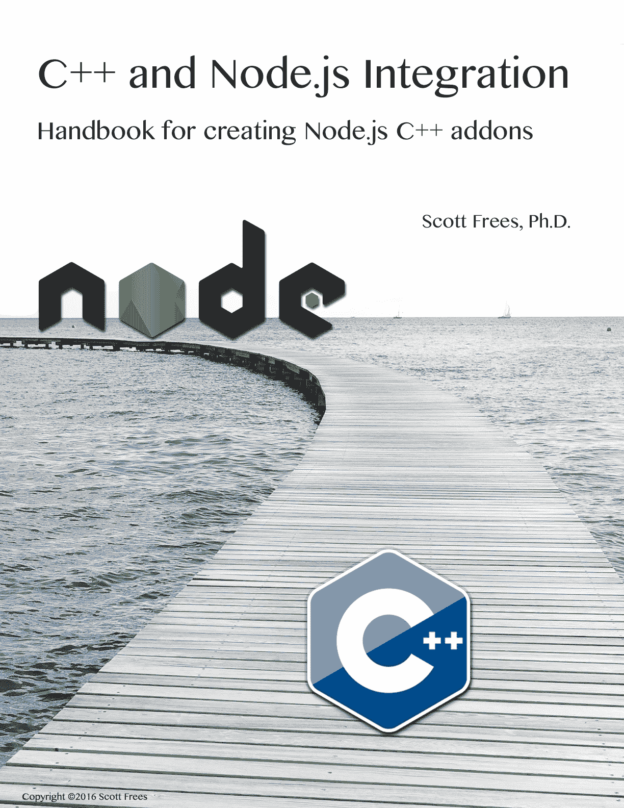
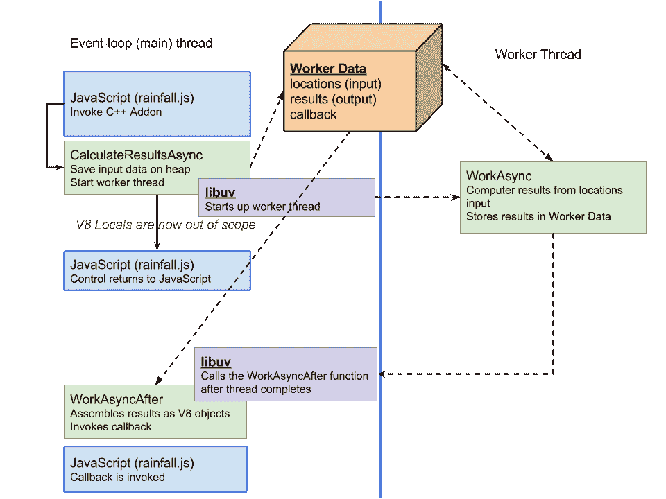
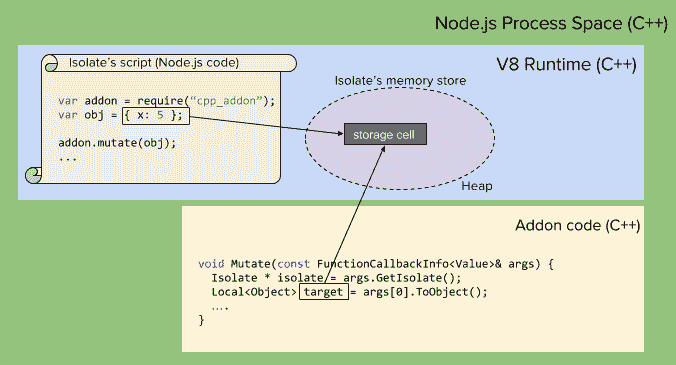
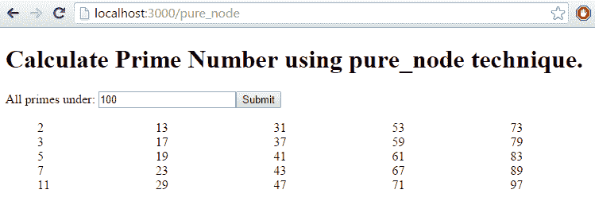
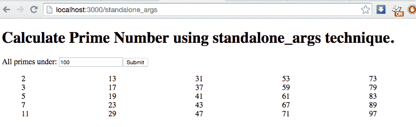

# C++ 与 Node.js 集成





上述代码获取了从 JavaScript 传递的数组的“not_index”属性值。它将该值设置为同样存储在索引 1 处的值。

## 其他数据类型

下一章将包含许多使用上述讨论的原始数据类型的示例，并将深入探讨处理对象和数组的更多细节。尽管如此，这些并不是 V8 暴露给 C++ 插件的所有 JavaScript 数据类型。在剩余的类型中，可能最重要的就是 `Function` 对象 - 我们将在第 4 章中介绍它，并在第 7 章查看流处理时广泛使用。（在插件中）不常用的数据类型包括 `Date`、`RegExp`，以及刚刚进入 V8 的新类型如 `Promise` 和 `Set` 同样可用。

## 传递本地句柄（Local Handles）和使用可逸句柄（Escapable Handles）

到为止，我们只查看了 `Local` 句柄对象的使用 - 它由活跃的 `HandleScope` 对象限制。当活跃的 `HandleScope` 对象被销毁时，在其中创建的所有 `Local` 句柄都被标记为已删除 - 这意味着无法再从 C++ 访问存储单元。同样，如果 `Local` 是给定存储单元的唯一引用，则该存储单元就符合垃圾回收的条件。在上面的所有示例中，我们有一个隐式的 `HandleScope`，只要我们处于 JavaScript 直接调用的代码范围内，它就是活跃的。这是因为 Node.js 在调用我们的插件之前创建了一个 `HandleScope` 对象。

这意味着我们可以在插件内部创建指向存储单元的 `Local` 句柄，并将这些 `Local` 句柄传递给不同的函数。

```cpp
Local<Value> make_return(Isolate * isolate, const Local<Object> input ) {
    Local<String> x_prop = String::NewFromUtf8(isolate, "x");
    Local<String> y_prop = String::NewFromUtf8(isolate, "y");
    Local<String> sum_prop = String::NewFromUtf8(isolate, "sum");
    Local<String> product_prop = String::NewFromUtf8(isolate, "product");

    double x = input->Get(x_prop)->NumberValue();
    double y = input->Get(y_prop)->NumberValue();

    Local<Object> obj = Object::New(isolate);
    obj->Set(sum_prop, Number::New(isolate, x + y));
    obj->Set(product_prop, Number::New(isolate, x * y));

    return obj;
}

void PassObject(const FunctionCallbackInfo<Value>& args) {
    Isolate * isolate = args.GetIsolate();
    Local<Object> target = args[0]->ToObject();

    Local<Value> obj = make_return(isolate, target);

    args.GetReturnValue().Set(obj);
}
```

上面的列表将从调用 `PassObject` 开始。在调用之前，Node.js 创建了一个 `HandleScope` 并在调用 `make_return` 时保持活跃状态。重要的是，在 `make_return` 中创建的 `obj` 句柄在函数返回时不会被销毁 - 因为属于原始的 `HandleScope`，并且在该作用域销毁之前将保持“活跃”。

在处理立即（或至少是直接）返回 C++ 的简单插件时，我们很少需要考虑 `Local` 句柄以外的任何东西。例外情况是我们由于某种原因在插件内部创建了自己的 `HandleScope`。在这种情况下，在将句柄传递给其他函数时必须小心，因为 `Local` 句柄可能会失效。

```cpp
Local<Value> make_return(Isolate * isolate, const Local<Object> input ) {
    .. 同上所示...

    HandleScope scope(isolate); // 危险！所有句柄现在都在这里了。
    Local<Object> obj = Object::New(isolate);
    obj->Set(sum_prop, Number::New(isolate, x + y));
    obj->Set(product_prop, Number::New(isolate, x * y));

    return obj;
}
```

在上述情况下，在 `make_return` 内部创建 `scope` 让我们处于危险的境地。当 `make_return` 完成时，`scope` 变量被销毁，V8 就可以删除任何与该 `HandleScope` 关联的句柄所指向的存储单元 - 只要这些单元没有其他引用。在这种情况下，V8 在此函数返回时*可以*回收 `obj` 的存储单元，因为原始的 `HandleScope` 中没有指向它们的句柄。

处理这些情况的安全方法是使用 `EscapableHandle` 允许 `Local` 句柄*泄露*到其他 `HandleScope`。我们在 `make_return` 中创建一个 `EscapableHandle` 并显式地允许我们返回的句柄存活。

|  

```
1
2
3
4
5
6
7
8
9
10
11
```

 |  

```cpp
Local<Value> make_return(Isolate * isolate, const Local<Object> input ) {
    .. 同上所示...

    EscapableHandleScope scope(isolate);
    Local<Object> obj = Object::New(isolate);
    obj->Set(sum_prop, Number::New(isolate, x + y));
    obj->Set(product_prop, Number::New(isolate, x * y));

    return scope.Escape(obj);
}
```

 |

虽然官方文档推荐每次调用都使用 `HandleScope` 或 `EscapableHandleScope`，但这可能只有在你使用极少量的 V8 存储时才有意义。对于每次调用都使用新的 `scope`，这可能多此一举 - 你不需要

## 持久句柄（Persistent Handles）

在某些情况下（如我们将在第 4 章看到的），我们会使用异步插件。在这些情况下，插件入口创建的句柄在插件返回后将不再可用 - 只要我们希望在插件范围之外保留引用，就必须考虑完全不同的句柄类型 - `Persistent`。`Persistent` 句柄不受限于 `HandleScope` - 你可以完全控制句柄何时被销毁/失效。

虽然这在异步插件开发中最用，但我们可以通过开发一个使用 JavaScript 变量初始化并在其生命周期内跨越多次调用的插件来模拟 `Persistent` 句柄的用例。

例如，假设我们有一个可以这样使用的插件：

```javascript
var target = {  x: 3  };

addon.init(target, 10);
console.log(target);

for ( var i = 0; i < 3; i++ ) {
    addon.increment();
    console.log(target);
}
```

该插件存储状态 - 我们通过调用 `init` 并传入一个带有名为 `x` 的数值属性和所需增值的对象来初始化它 - 在此例中为 `10`。随后的 `increment` 调用将 `x` 增加 `10`。这是一个幼稚的例子 - 但它展示了一个插件对 V8 对象（`target`）的引用保持比特定的函数调用更长。代码的输出类似于：

```
{ x: 3 }
{ x: 13 }
{ x: 23 }
{ x: 33 }
```

使此工作的关键是 `Persistent` 句柄。让我们看看相关的插件代码。

|  

```
1
2
3
4
5
6
7
8
9
10
11
12
13
14
15
16
17
```


```cpp
Persistent<Object> persist;
int increment;

void Increment(const FunctionCallbackInfo<Value>& args) {
    Isolate * isolate = args.GetIsolate();
    Local<Object> target = Local<Object>::New(isolate, persist);
    Local<String> prop = String::NewFromUtf8(isolate, "x");
    double x = target->Get(prop)->NumberValue();
    target->Set(prop, Number::New(isolate, x + increment));
}
void Initialize(const FunctionCallbackInfo<Value>& args) {
    Isolate * isolate = args.GetIsolate();

    // set global variables so they survive returning from this call
    persist.Reset(isolate, args[0]->ToObject());
    increment = args[1]->NumberValue();
}
```

`Persistent` 句柄有非常严格的规则 - 出于任何原因不能复制，你必须通过调用 `Reset` 来显式地释放/更改它们的存储单元。`Initialize`（在 JS 中初始化）函数接收第一个参数（`Local<Object>`）并在第 15 行创建一个新的 `Persistent` 句柄。注意，`persist` 实际上是一个全局变量 - 所以即使在 `Initialize` 返回后它仍然留在作用域内。我们在第 16 行对 `increment` 执行了类似的操作，但这种情况下我们没有持有 V8 引用 - 只是一个 C++ 变量。

随后调用 `Increment` 现在会将 `persist` 转换为 `Local` 句柄。这是必要的，因为 `Persistent` 句柄的 API 非常有限（在 V8 的旧版本中它是 `Handle` 的子类，但现在不再是）。从那里开始，我们按照之前的方法修改 `target`。注意，由于 `persist` 仍然指向与 `target` 相同的内容 - 该引用在多次调用 `Increment` 时都会被保留。

虽然这是一个很好的小示例，但你不太可能在简单的同步插件中使用大量的 `Persistent` 句柄 - 在插件内部持有状态可能是一种反模式 - 因为它鼓励了通过副作用编程。在这种情况下，你最好在每次调用 `increment` 函数时都将对象和增量传递进去。然而，当我们开始研究异步插件时，这种持久化概念将变得非常有价值。

***

1. 具体来说，之所以是不可能的，是因为 Node 在进入主消息循环循环之前使用 `V8::Locker` 锁定了它的 isolate，并且永远不释放。如果你尝试从事件循环线程（使用 `V8::Unlocker`）解锁，Node 将永远不会尝试重新获取锁，你将导致程序崩溃。在编写此时，你可以清楚地看到这一现象发生在 Node 源码中 `node.cc` 的 `StartNodeInstance` 函数中 - 路径位于：[`github.com/nodejs`](https://github.com/nodejs/node/blob/master/src/node.cc)

2. 事实上，这并不奇怪。JavaScript 中的值可以通过许多方式转换为不同的原始类型。将值转换为指定原始类型的责任交给 `v8::Value` 实际上是非常有意义的。与 C++ 不同 - 对于一个给定的值，我们并没有一个应该向其转换的“真实”类型。`Value` 的实例是合法的，并且它可以根据需要转换为数字或字符串等。

3. 注意，我们使用“销毁”（destroyed）这个词时比较宽泛。V8 不改变 C++，在 `make_return` 中创建的实际 `Local<Object>` 最好被看作一个指针。当 `make_return` 返回时，指针本身会被销毁，其他 C++ 栈变量也是如此。然而，`obj` 指向的存储单元并没有删除 - 它只有在 `HandleScope` 被销毁时才会被删除。这样，你可以将 `Local` 句柄视为一个智能指针 - 它的内存（存储单元）会在 `HandleScope` 超出范围时被垃圾回收 - 而 `Handle` 本身不是。

# 第 3 章 - 基本集成模式

在上一章中，我们对如何使用 V8 API 构建 Node.js C++ 插件进行了简单的概述。虽然第 2 章的设计侧重于“参考”，但它没有提供太多关于插件开发的背景 - 这正是本章的目标！在本章中，我们将展示第一个（几个示例中的第一个）Node.js 插件 - 使用 C++ 计算关于特定地区降雨量的简单统计数据。该示例设计的深度恰好能让你看到构建插件时涉及的模式和概念 - 但又不会至于让我们深陷于 C++ 本身而忽略了 C++ 的集成。目标是将我们在第 1 章和第 2 章中学到的知识开始*应用*到更具体的示例中。本章介绍的主要概念包括在 JavaScript 和 Node.js 之间交换数据（包括对象和数组）。第 4 章和第 5 章将增强这些示例用于其他常用的集成模式，例如对象封装和异步处理。

## Node 版本

在这里值得快速提醒一下（因为我们将展示大量的代码），V8 API 以及整个 Node.js 都会发生变化。本书兼容 Node.js 的 0.12、4.x 和 5.x 版本以及与之对应的 V8 API 版本。如果你仍在使用 0.10 版本（在编写此时，某些托管平台如 Microsoft Azure 仍默认使用该版本），所展示的代码将无法工作！

如果你在跟踪 Node.js 版本方面遇到困难，强烈建议使用 `nvm`（Node.js 版本管理器）等工具 - 它允许你安装并在任何版本的 Node.js 之间切换。使用此类工具将极大提高你应对 API 不一致的能力。你可以在 Linux 和 Mac OS X 上通过 [`github.com/creationix/nvm`](https://github.com/creationix/nvm) 获取 `nvm`。对于 Microsoft Windows，有几个不同的发行，其中一个是 [`github.com/coreybutler/nvm-windows`](https://github.com/coreybutler/nvm-windows)。

需要注意的是，虽然接下来几章中展示的所有内容直接使用了 V8 API，但也可以使用 *Native Abstractions for Node* - `NAN` 来保护自己不受 API 变化的影响`NAN` 是第 6 章的主题。

## 集成模式：数据传输

最简单的集成模式涉及在 JavaScript 和 C++ 之间以简单拷贝的形式传递数据。对于原始类型，这确实是最明显（也是唯一）的替代方案，然而我们也将使用这种拷贝机制处理对象和数组。特别是，这里提出的模式没有在 JavaScript 和 C++ 之间共享类结构，而且我们特别没有使用 V8 类封装策略。

我们的集成从 JavaScript 调用时将遵循一个简单的三步过程：

1. C++ 插件代码将 JavaScript/V8 数据转换为原生 C++ 数据结构（类、STL 容器等）。

2. C++ 插件在数据上执行必要的计算/处理，并将结果存储在原生 C++ 数据结构中。

3. 在返回之前，C++ 插件将存储在原生 C++ 数据结构中的结果转换为适当的 JavaScript/V8 数据结构。

使用这种方法的主要原因是简单性。首先，V8 API 对 C++ 数据结构（对象、数组等）的影响将降至最低。使用这种方法，任何现有的 C++ 代码都可以在无需修改的情况下使用，这是一个巨大的优势。此外，JavaScript 和 C++ 代码将实现完全解耦 - 由负责第 1 步和第 3 步的数据“传输”代码连接。


从组织的角度来看，这种简单性允许我们能够“转换”代码与我们正在实现的内部 C++ 逻辑完全分离。正如你从第 1 章和第 2 章所猜的那样，这些逻辑看起来并不十分“干净”——`V8` API 相当繁琐。根据作者的经验，将繁琐的 `V8` API 集成代码与核心 C++ 业务逻辑隔离开是一个巨大的胜利。

“转换”方法也有一些缺点。之一是它确实需要你编写转换的样板逻辑——没有任何工作是自动为我们完成的。这无疑是一个负面因素，正如我们在本书稍后的其他部分查看其他策略时看到的，这种逻辑实际上是无法避免的——复杂性就存在于 `V8` API 本身之中。使用 `ObjectWrap` 和 `Buffers` 等技术仍然需要大量的“样板代码”。第二个缺点是性能——拷贝数据需要时间。正如第 2 章中稍微讨论过的，由于 `V8` 中存储的数据在根本上不同于普通的 C++ 数据，避免这种开销比最初看起来要困难得多。我们将在本章结束处进一步讨论这个问题，但目前请知道，在正常情况下，构建真实世界的插件时，这种性能损耗通常并不显著。

## 降水数据示例

在本章中，我们将构建一个可以从 JavaScript 代码接收降水数据（即在给定位置、一段时间内的降雨量）的插件。JavaScript 程序将发送一个包含降水样本数据的对象到 C++ 进行处理。该样本数据将包含一个 `locations` 列表，通过纬度和经度标记。每个 `location` 还有一个包含 `samples` 的列表，其中包含测量日期和以厘米为单位的降雨量。下面是一个示例。

```
{
  "locations" : [
    {
      "latitude" : "40.71",
      "longitude" : "-74.01",
      "samples" : [
        {
          "date" : "2014-06-07",
          "rainfall" : "2"
        },
        {
          "date" : "2014-08-12",
          "rainfall" : "0.5"
        },
        {
          "date" : "2014-09-29",
          "rainfall" : "1.25"
        }
      ]
    },
    {
      "latitude" : "42.35",
      "longitude" : "-71.06",
      "samples" : [
        {
          "date" : "2014-03-03",
          "rainfall" : "1.75"
        },
        {
          "date" : "2014-05-16",
          "rainfall" : "0.25"
        },
        {
          "date" : "2014-03-18",
          "rainfall" : "2.25"
        }
      ]
    }
  ]
}
```

上述所有代码以及本章其余部分都可以在 `https://github.com/freezer333/nodecpp-demo` 的 `nodecpp-demo` 存储库中的“Rainfall”部分完整获取。

JavaScript 代码将调用 C++ 插件来计算每个位置的平均降水量和中位数。起初，我们将一次处理一个位置，但我们将逐渐扩展示例，以涵盖列表（数组）以及更复杂数据结构的返回。

请注意，平均值/中位数并不是真正的“计算密集型”任务——这仅用于演示目的。读者应该始终记住，开发 C++ 插件而不是仅仅留在 JavaScript 中应该有一个清晰的理由。对于相对短的计算（如本例），切换到 C++ 因为开销原因并无法带来比 JavaScript 更高的性能。

### 组织源代码

所有代码将遵循标准布局。`rainfall.h` 和 `rainfall.cc` 文件将包含 C++ 逻辑，而 `binding.cc` 将处理 Node.js 和 C++ 之间的接口。`node.gyp` 文件将用于配置。

### 降水数据

```cpp
class sample {
public:
  sample();
  sample(string d, double r);
  string date;
  double rainfall;
};

class location {
public:
  double longitude;
  double latitude;
  vector<sample> samples;
};

// 返回该位置的平均（算术平均值）降水量
double avg_rainfall(location &loc);
```

### 思考 JavaScript

给定某些逻辑后，我们必须开始思考哪些将从 JavaScript 调用。我们在上面创建的核心逻辑是 `avg_rainfall`，它将返回一个位置内所有样本的平均降水量。但注意，此函数不能直接从 JavaScript 调用，因为它的输入是一个原生 C++ 对象。我们的插件代码需要向 JavaScript 暴露一个类似的函数，并使用提供的数据（可能是可能是代表位置/样本集的 JavaScript 对象）来构建一个真正的 `location` 对象。我们想象 JavaScript 代码可能像这样：

```javascript
var location = {
    latitude: 40.71, longitude: -74.01,
    samples: [ 
      { date: "2016-06-07", rainfall: 2 },
      { date: "2016-08-12", rainfall: 0.5}
    ] 
};

var average = addon.avg_rainfall(location);
```

### 创建降水插件


正如第 1 章所述，创建插件需要一些标准的样板代码，以便 Node.js 加载我们的模块并开始调用其中的函数。我们的 V8 API 代码将全部存放在名为 `rainfall_node.cc` 的独立 C++ 文件中。该文件包含了 `node.h` 和 `v8.h` 头文件。接下来，它为我们的插件定义了一个入口点——通过创建一个函数并通过 node/v8 头文件提供的宏进行注册来实现。

```cpp
#include <node.h>
#include <v8.h>
#include "rainfall.h" 

using namespace v8;

void init(Handle <Object> exports, Handle<Object> module) {
  // we'll register our functions here..
}

NODE_MODULE(rainfall, init)
```

正如第 1 章所述，在 `init` 函数内部（我们可以为它命名任何名称，只要在 `NODE_MODULE` 宏中关联它即可），我们将定义当模块被包含/引入时，哪些函数将暴露给 Node.js。执行所有这些操作的封装代码有点臃肿，这就是为什么将整洁的 C++ 代码（`rainfall.h/cc` 文件）与这些代码分开的好处。

因此，我们要做的第一件事是在 `rainfall_node.cc` 中创建一个新函数，从而暴露 rainfall 中的 `avg_rainfall` 方法。

```cpp
void AvgRainfall(
    const v8::FunctionCallbackInfo<v8::Value>& args){

  Isolate* isolate = args.GetIsolate();

  Local<Number> retval = v8::Number::New(isolate, 0);
  args.GetReturnValue().Set(retval)
}
```

返回值是在函数的最后一行设置的。按照目前的写法，函数始终返回 0 作为平均降雨量——我们很快就会修复这一点……

现在，让我们通过之前的 `init` 函数中注册该函数，使其可以在 node 中被调用。

```cpp
void init(Handle <Object> exports, Handle<Object> module) {
  NODE_SET_METHOD(exports, "avg_rainfall", AvgRainfall);
}
```

`init` 函数在模块加载时被被调用；`exports` 对象就是我们返回给 Node.js 的内容。`NODE_SET_METHOD` 调用向 `exports` 对象添加了一个方法，允许我们从 JavaScript 中调用该函数。`AvgRainfall` 函数目前定义在 `rainfall_node.cc` 中。

### 编译 C++ 插件

`binding.gyp` 文件将置于与 C++ 代码相同的目录下。在该文件中，我们必须指定目标名称、源文件以及任何必要的标记。`binding.gyp` 如下所示：

```json
{
  "targets": [
    {
      "target_name": "rainfall",
      "sources": [
        "rainfall.cc",
        "rainfall_node.cc"
      ],
      "cflags": [
        "-Wall",
        "-std=c++11"
      ],
      "cflags_cc": [
        "-std=c++11"
      ],
      "conditions": [
        {
          "OS=='mac'",
          "defines": [
            "NODE_CPP_EXIONS"
          ]
        }
      ]
    }
  ]
}
```

要编译插件，请在终端中使用 `node-gyp` 命令：

```bash
node-gyp configure build
```

编译完成后，你将拥有一个 `build/Release` 文件夹，包含 `rainfall.node` 文件。这就是你在 JavaScript 代码中需要 `require` 的插件。

```javascript
var addon = require("./build/Release/rainfall");

var location = {
    latitude: 40.71,
    longitude: -74.01,
    samples: [
      { date: "2016-06", rainfall: 2 },
      { date: "2016-08", rainfall: 0.5 }
    ]
};

var average = addon.avg_rainfall(location);
```

### 将 JavaScript 对象映射到 C++ 类

插件建立后，我们可以将 `AvgRainfall` C++ 插件函数连接到在 `rainfall.h` 中定义的实际 C++ 逻辑。为了实现这一点，我们需要额外的代码来提取对象属性并实例化 C++ 对象。我们将这些转换代码封装在并在修订后的 `AvgRainfall` 函数调用的独立函数中：

```cpp
void AvgRainfall(
  const v8::FunctionCallbackInfo<v8::Value>& args) {

  Isolate* isolate = args.GetIsolate();

  location loc = unpack_location(isolate, args);
  double avg = avg_rainfall(loc);

  Local<Number> retval = v8::Number::New(isolate, avg);
  args.GetReturnValue().Set(retval);
}
```


```cpp
location unpack_location(Isolate * isolate, 
                const v8::FunctionCallbackInfo<v8::Value>& args) {
  location loc;
  Handle<Object> location_obj = Handle<Object>::Cast(args[0]);
  Handle<Value> lat_Value = 
                location_obj->Get(
                  String::NewFromUtf8(isolate,"latitude"));
  Handle<Value> lon_Value = 
                location_obj->Get(
                  String::NewFromUtf8(isolate,"longitude"));

  loc.latitude = lat_Value->NumberValue();
  loc.longitude = lon_Value->NumberValue();

  Handle<Array> array = 
       Handle<Array>::Cast(location_obj->Get(
                String::NewFromUtf8(isolate,"samples")));

  int sample_count = array->Length();
  for ( int i = 0; i < sample_count; i++ ) {
    sample s = unpack_sample(
      isolate, Handle<Object>::Cast(array->Get(i)));
    loc.samples.push_back(s);
  }
  return loc;
}
```

`unpack_sample` 函数也类似——这都是关于从 V8 数据类型中解包数据。

```cpp
sample unpack_sample(Isolate * isolate, 
  const Handle<Object> sample_obj) {

  sample s;
  Handle<Value> date_Value = sample_obj->Get(
    String::NewFromUtf8(isolate, "date"));
  Handle<Value> rainfall_Value = sample_obj->Get(
    String::NewFromUtf8(isolate, "rainfall"));

  v8::String::Utf8Value utfValue(date_Value);
  s.date = std::string(*utfValue);

  // 从 V8 值中解包数值降雨量
  s.rainfall = rainfall_Value->NumberValue();
  return s;
}
```

### 完成的 Node.js 文件 - 平均降水量

下面是对上述 JavaScript 代码的略微修改。使用 `node` 执行该文件，我们将看到返回了在 C++ 中计算出的平均值。

```javascript
var addon = require("./cpp/build/Release/rainfall");

var location = {
    latitude : 40.71, longitude : -74.01,
       samples : [ 
          { date : "2016-06-07", rainfall : 2 },
          { date : "2016-08-12", rainfall : 0.5}
       ] };

var average = addon.avg_rainfall(location);

console.log("Average rain fall = " + average + "cm");
```

你应该能够运行它——并看到你的 C++ 模块已经被调用了！

```
> node rainfall.js
Average rain fall = 1.25cm
```

### 返回对象 - 统计数据集合

现在我们有一个功能完整的 Node 应用程序正在调用 C++。我们已经成功地将单个 JavaScript 对象转换为了 C++ 对象。现在，让我们返回不仅仅是一个平均值——让我们返回一个包含多个统计数据的对象，用于描述我们从 JavaScript 获取的样本。

```cpp
class rain_result {
   public:
       float median;
       float mean;
       float standard_deviation;
       int n;
};
```

和之前一样，我们将保持 C++ 代码的“业务”部分与处理 V8 集成的代码完全分离。上面的类已添加到 `rainfall.h / rainfall.cc` 文件中。

现在我们将要为 Node 插件创建一个新的可调函数。因此，在 `rainfall_node.cc` 文件中（即我们放置所有 V8 集成逻辑的地方），让我们添加一个新函数并将其注册到模块的导出（exports）中。

```cpp
void RainfallData(
  const v8::FunctionCallbackInfo<v8::Value>& args) {

  Isolate* isolate = args.GetIsolate();

  location loc = unpack_location(isolate, args);
  rain_result result = calc_rain_stats(loc);

  /*
  .... 将结果对象返回给 JavaScript  ....
*/
}
```

`unpack_location` 函数被直接复用，它是从 JavaScript 参数中提取位置（以及降雨样本）的地方。我们现在还有一个新函数，定义在 `rainfall.h / rainfall.cc` 中，名为 `calc_rain_stats`，它根据提供的 `location` 实例返回一个 `rain_result` 实例。它计算平均值/中位数/标准差。

```cpp
rain_result calc_rain_stats(location &loc) {
  rain_result result;
  double ss = 0;
  double total = 0;

  result.n = loc.samples.size();

  for (const auto &sample : loc.samples) {
     total += sample.rainfall;
  }
  result.mean = total / loc.samples.size();

  for (const auto &sample : loc.samples) {
     ss += pow(sample.rainfall - result.mean, 2);
  }
  result.standard_deviation = sqrt(ss/(result.n-1));

  std::sort(loc.samples.begin(), loc.samples.end());
  if (result.n %2 == 0) {
    result.median = loc.samples[result.n / 2 - 1].rainfall + loc.samples[result.n / 2].rainfall / 2;
  } else {
    result.median = loc.samples[result.n / 2].rainfall;
  }
  return result;
}
```

`RainfallData` 函数通过在 `rainfall_node.cc` 的 `init` 函数中添加另一个 `NODE_SET_METHOD` 来进行导出。

```cpp
void init(Handle<Object> exports, Handle<Object> module) {
  NODE_SET_METHOD(exports, "avg_rainfall", RainfallData);
  NODE_SET_METHOD(exports, Rainfall);
```

### 构建 JavaScript 对象并返回它

在 `RainfallData` 函数内部解包 `location` 对象后，我们得到了一个 `rain_result` 对象：

```cpp
rain_result result = calc_rain_stats(loc);
```

现在是时候返回它了——为了做到，我们将创建一个新的 V8 对象，将 `result` 数据传输其中，并将其返回给 JavaScript。这里的 API 在第 2 章介绍——我们只是应用所学的内容来构建对象。

```cpp
void RainfallData(
  const v8::FunctionCallbackInfo<v8::Value>& args) {

  Isolate* isolate = args.GetIsolate();

  location loc = unpack_location(isolate, args);
  rain_result result = calc_rain_stats(loc);

  // 在 V8 堆上创建一个新对象
  Local<Object> obj = Object::New(isolate);

  // 将数据从 result 传输到 obj（见下文）
  obj->Set(
    String::NewFromUtf8(isolate, "mean"),
    Number::New(isolate, result.mean));
  obj->Set(
    String::NewFromUtf8(isolate, "median"),
    Number::New(isolate, result.median));
  obj->Set(
    String::NewFromUtf8(isolate, "standard_deviation"),
    Number::New(isolate, result.standard_deviation));
  obj->Set(
    String::NewFromUtf8(isolate, "n"),
    Integer::New(isolate, result.n));

  // 返回对象
  args.GetReturnValue().Set(obj);
}
```


注意此函数与早之前的 `AvgRainfall` 函数之间的相似之处。它们都遵循类似的模式：在 `V8` 堆上创建一个新变量，并通过设置与传入函数的 `args` 变量关联的返回值来将其返回。现在的区别在于，实际上设置要返回变量的值变得更加复杂了。在 `AvgRainfall` 中，我们只是创建了一个新的 `Number`：

```cpp
Local<Number> retval = v8::Number::New(isolate, avg);
```

现在，我们改为一次移动一个属性的数据：

```cpp
Local<Object> obj = Object::New(isolate);
obj->Set(
  String::NewFromUtf8(isolate, "mean"), 
  Number::New(isolate, result.mean));

obj->Set(
  String::NewFromUtf8(isolate, "median"), 
  Number::New(isolate, result.median));

obj->Set(
  String::NewFromUtf8(isolate, "standard_deviation"), 
  Number::New(isolate, result.standard_deviation));

obj->Set(
  String::NewFromUtf8(isolate, "n"), 
  Integer::New(isolate, result.n));
```

虽然代码多了一点——对象只是通过一系列命名属性逐步构建的——但它的逻辑非常直观。

### 在 JavaScript 中调用

现在我们已经完成了 `C++` 端的工作，我们需要重新构建我们的插件：

```bash
node-gyp configure build
```

在 JavaScript 中，我们现在可以调用这两个方法，我们将看到新方法 `data_rainfall` 方法返回的对象是一个真实的 JavaScript 对象。

```javascript
// rainfall.js
var rainfall = require("./cpp/build/Release/rainfall");
var location = {
    latitude : 40.71, longitude : -74.01,
    samples : [
          { date : "2015-06-07", rainfall : 2.1 },
          { date : "2015-06-14", rainfall : 0.5}, 
          { date : "2015-06-21", rainfall : 1.5 }, 
          { date : "2015-06-28", rainfall : 1.3 }, 
          { date : "2015-07-05", rainfall : 0.9}
       ] };

var avg = rainfall.avg_rainfall(location)
console.log("Average rain fall = " + avg + "cm");

var data = rainfall.data_rainfall(location);

console.log("Mean = " + data.mean)
console.log("Median = " + data.median);
console.log("Standard Deviation = " + data.standard_deviation);
console.log("N = " + data.n);
```

```bash
node rainfall.js
Average rain fall = 1.26cm
Mean = 1.2599999904632568
Median = 1.2999999523162842
Standard Deviation = 0.6066300272941589
N = 5
```

## 接收和返回降水数据数组

既然我们已经能够在 JavaScript 和 `C++` 之间移动单个样本和单个统计数据，将此扩展为支持数据数组实际上非常简单——再次使用第 2 章中引入的原则。

### 注册可调用的插件函数

如既往，我们首先在 `/cpp/rainfall_node.cc` 中编写一个可以从 Node.js 调用的 `C++` 函数。

```cpp
void CalculateResults(
  const v8::FunctionCallbackInfo<v8::Value>&args) {

    Isolate* isolate = args.GetIsolate();
    std::vector<location> locations;  // 我们将从 Node.js 获取这些
    std::vector<rain_result> results; // 我们将在 C++ 中构建这些

    // 我们将在这里填充结果
    Local<Array> result_list = Array::New(isolate); 

    // ... 并将其作为返回值发送给 Node.js
    args.GetReturnValue().Set(result_list);
}....
void init(Handle <Object> exports, Handle<Object> module) { 

  NODE_SET_METHOD(exports, "avg_rainfall", AvgRainfall);
  NODE_SET_METHOD(exports, "data_rainfall", RainfallData);
  NODE_SET_METHOD(exports, "calculate_results", CalculateResults);
}
```

`CalculateResults` 函数将从参数 (`args`) 中提取 `location` 对象列表，并最终返回一个填充完整的结果数组。我们通过在 `init` 函数中调用 `NODE_SET_METHOD` 来变得可调用——这样我们可以在 JavaScript 中调用 `calculate_results`。

在实现 `C++` 之前，让我们看看这些内容在 JavaScript 中是如何调用的。第一步是从 `cpp` 目录重新构建插件：

```bash
node-gyp configure build
```

在 `rainfall.js` 中，我们将构造位置数组并调用我们的插件：

```javascript
// 引入插件
var rainfall = require("./cpp/build/Release/rainfall");

var makeup = function(max) {
    return Math.round(max * Math.random() * 100)/100;
}

// 构建一些虚拟位置
var locations = []
for (var i = 0; i < 10; i ) ) {
    var loc = {
        latitude: makeup(180), 
        longitude: makeup(180), 
        samples : [
            {date: "2015-07-20", rainfall: makeup(3)}, 
            {date: "2015-07-21", rainfall: makeup(3)}, 
            {date: "2015-07-22", rainfall: makeup(3)}, 
            {date: "2015-07-23", rainfall: makeup(3)}, 
            {date: "2015-07-24", rainfall: makeup(3)}
        ]
    }
    locations.push(loc);
}
// 调用插件
var results = rainfall.calculate_results(locations);

// 从 C++ 报告结果
var i = 0;
results.forEach(function(result){
    console.log("Result " + i);
    console.log("--------------------------");
    console.log("\tLatitude:         " + locations[i].latitude);
    console.log("\tLongitude:        " + locations[i].longitude);
    console.log("\tMean Rainfall:    " + result.mean + "cm");
    console.log("\tMedian Rainfall:  " + result.median + "cm");
    console.log("\tStandard Dev.:    " + result.standard_deviation + "cm");
    console.log("\tNumber Samples:   " + result.n);
    console.log();
    i++;
});
```

当你用 `node rainfall` 运行它时你不会得到输出，这是因为此时 `C++` 函数返回的是一个空数组。尝试放入 `console.log(results)`，你应该看到 `[]`。

### 在 C++ 中提取数组

现在让我们回到我们的 `CalculateResults` `C++` 函数。我们得到了函数回调对象，我们的第一步是将其转换为 V8 数组。

```cpp
void CalculateResults(
  const v8::FunctionCallbackInfo<v8::Value>&args) {

    Isolate* isolate = args.GetIsolate();
    ... (见上文)...
    Local<Array> input = Local<Array>::Cast(args[0]);
    unsigned int num_locations = input->Length();
```

有了 V8 数组 `input`，我们现在将循环它并使用我们在整个章节中使用的 `unpack_location` 函数实际创建一个 POCO `location` 对象。

```cpp
for (unsigned int i = 0; i < num_locations; i++) {
  locations.push_back(
    unpack_location(isolate, Local<Object>::Cast(input->Get(i)))
  );
}
```


当然，现在我们已经有了一个标准的 `location` 对象的向量，可以对其中的每个对象调用现有的 `calc_rain_stats` 函数，并构建一个 `rain_result` 对象的向量。

```
[](#cb116-1)results.resize(locations.size());
[](#cb116-2)std::transform(
[](#cb116-3)     locations.begin(), 
[](#cb116-4)     locations.end(), 
[](#cb116-5)     results.begin(), 
[](#cb116-6)     calc_rain_stats);
```

### 构建一个用于从 C++ 返回的数组

我们的下一步是将已经创建的数据移动到我们将要返回的 V8 对象中。首先，我们创建一个新的 V8 Array：

```
[](#cb117-1)Local<Array> result_list = Array::New(isolate);
```

现在，我们可以遍历我们的 `rain_result` 向量，并使用 `pack_rain_result` 函数创建一个新的 V8 对象，然后将其添加到 `result_list` 数组中。

```
[](#cb118-1)for (unsigned int i = 0; i < results.size(); i++ ) {
[](#cb118-2)      Local<Object> result = Object::New(isolate);
[](#cb118-3)      pack_rain_result(isolate, result, results[i]);
[](#cb118-4)      result_list->Set(i, result);
[](#cb118-5)    }
```

然后……一切都好了。这里是 `CalculateResults` 函数的完整代码：

```
[](#cb119-1)void CalculateResults(
[](#cb119-2)  const v8::FunctionCallbackInfo<v8::Value>&args) {
[](#cb119-3) 
[](#cb119-4)    Isolate* isolate = args.GetIsolate();
[](#cb119-5)    std::vector<location> locations;
[](#cb119-6)    std::vector<rain_result> results;
[](#cb119-7) 
[](#cb119-8)    // 提取每个位置（这是一个列表）
[](#cb119-9)    Local<Array> input = Local<Array>::Cast(args[0]);
[](#cb119-10)    unsigned int num_locations = input->Length();
[](#cb119-11)    for (unsigned int i = 0; i < num_locations; i++) {
[](#cb119-12)      locations.push_back(
[](#cb119-13)             unpack_location(isolate, 
[](#cb119-14)              Local<Object>::Cast(input->Get(i))));
[](#cb119-15)    }
[](#cb119-16)
[](#cb119-17)    // 构建 rain_results 向量
[](#cb119-18)    results.resize(locations.size());
[](#cb119-19)    std::transform(
[](#cb119-20)          locations.begin(), 
[](#cb119-21)          locations.end(), 
[](#cb119-22)          results.begin(), 
[](#cb119-23)          calc_rain_stats);
[](#cb119-24)
[](#cb119-25)
[](#cb119-26)    // 将 rain_results 转换为对象以返回
[](#cb119-27)    Local<Array> result_list = Array::New(isolate);
[](#cb119-28)    for (unsigned int i = 0; i < results.size(); i++ ) {
[](#cb119-29)      Local<Object> result = Object::New(isolate);
[](#cb119-30)      pack_rain_result(isolate, result, results[i]);
[](#cb119-31)      result_list->Set(i, result);
[](#cb119-32)    }
[](#cb119-33)
[](#cb119-34)    // 返回列表
[](#cb119-35)    args.GetReturnValue().Set(result_list);
[](#cb119-36)}
```

再次执行 `node-gyp configure build` 并重新运行 `node rainfall.js`，你将看到完全填充的


从插件调用 JavaScript 函数的 API 已经在第 1 章中概述了，实际上它并没有那么复杂！让我们快速回顾一下，从一个接受两个参数的简单插件函数开始——一个来自 JS 的函数和一个调用该函数的参数（回调）：

```cpp
void CallThisWithThis(
  const FunctionCallbackInfo<Value>& args) { 
  Isolate* isolate = args.GetIsolate();
  Local<Function> cb = Local<Function>::Cast(args[0]);

  // 创建一个仅包含传入消息的数组
  Local<Value> argv[1] = {args[1]};
  cb->Call(Null(isolate), 1, argv);
}

void Init(Local<Object> exports, Local<Object> module) {
  NODE_SET_METHOD(exports, 
      "callthis_withthis", CallThisWithThis); 
}
```

如你所见，`Local<Function>` 对象可以像我们见过的其他数据类型一样从参数进行类型转换。要执行一个函数，我们可以利用 `Call` 方法。它需要三个参数 - 第一个是调用 JavaScript 函数时使用的 "this" 对象。指定 null 告诉 V8 使用默认值（取决于调用上下文）。第二个和第三个参数是调用函数时使用的参数 - 在这种情况下只有一个参数，即传递给插件本身的参数。

使用该插件的 JavaScript 代码非常简单：

```javascript
const callback = require('./build/Release/callback');

var callme = function(message) {
    console.log(message);
}
back.callthis_withthis(callme, "This is an important message"); 
```

## 带回调的同步插件

现在让我们在我们的 rainfall 插件中采用这种风格。我们将此函数命名为 `CalculateResultsSync`，因为虽然它使用了回调，但它是完全同步的。

```cpp
// in node_rainfall.cc
void CalculateResultsSync(
  const v8::FunctionCallbackInfo<v8::Value>&args) { 
    Isolate* isolate = args.GetIsolate();
    std::vector<location> locations;
    std::vector<rain_result> results; 
    // 提取每个位置（这是一个列表）
    Local<Array> input = Local<Array>::Cast(args[0]);
    unsigned int num_locations = input->Length();
    for (unsigned int i = 0; i < num_locations; i++) {
      locations.push_back(unpack_location(isolate, 
          Local<Object>::Cast(input->Get(i))));
    }

    // 构建 rain_results 向量
    results.resize(locations.size());
    std::transform(locations.begin(), 
      locations.end(), 
      results.begin(), 
      calc_rain_stats);

    // 将 rain_results 转换为对象以返回
    Local<Array> result_list = Array::New(isolate);
    for (unsigned int i = 0; i < results.size(); i ) {
      Local<Object> result = Object::New(isolate);
      pack_rain_result(isolate, result, results[i]);
      result_list->Set(i, result);
    }
    Local<Function> callback = Local<Function>::Cast(args[1]);
    Handle<Value> argv[] = { result_list };
    callback->Call(
      isolate->GetCurrentContext()->Global(), 1, argv);
    std::cerr << "Returning from C++ now" << std::endl;
    args.GetReturnValue().Set(Undefined(isolate));
}

void init(Handle<Object> exports, Handle<Object> module) {
  ...
  NODE_SET_METHOD(exports, 
       "calculate_results_async", CalculateResultsAsync); 
}
```

我们所说的“同步”是什么意思？在第 31 行，我们调用了从 JavaScript 发出的回调。

```javascript
var print_rain_results = function(results) {
  results.forEach(function(result, i){
      console.log("Result for Location " + i);
      console.log("--------------------------");
      console.log("\tLatitude:         " 
          + locations[i].toFixed(2));
      console.log("\tLongitude:        " 
          + locations[i].toFixed(2));
      console.log("\tMean Rainfall:    " 
          + result.mean.toFixed(2) + "cm");
      console.log("\tMedian Rainfall:  " 
          + result.median.toFixed(2) + "cm");
      console.log("\tStandard Dev.:    " 
          + result.standard_deviation.toFixed(2) + "cm");
      console.log("\tNumber Samples:   " 
          + result.n + "\n");
  });
}

// 执行同步回调
rainfall.calculate_results_sync(locations, print_rain_results);

console.log("JavaScript program has completed.")
```

注意随后的 `cerr` 输出 - 它会在什么时候执行？它在我们正在调用的 JavaScript 函数完成**之后**执行。步骤如下：

1. JavaScript 调用我们的插件 (`calculate_results_sync`) 
2. C++ 代码解包样本，计算统计数据
3. C++ 调用 `print_rain_results`
4. JavaScript 将降水结果打印到屏幕上
5. 控制权返回 C++ 插件，插件打印“Returning from C++ now”
6. JavaScript 打印出“JavaScript program has completed”。

所有事情都是同步进行的 - 在 C++ 执行期间，JavaScript 侧不会发生任何事情，除非*从 C++ 显式调用*它。我们更希望看到类似这样的情况：

1. JavaScript 调用我们的插件 (`calculate_results_sync`)
2. C++ 代码解包样本，启动线程并返回。
3. JavaScript 执行下一行代码（打印出“JavaScript program has completed”）

*... 一段时间后 ..*

1. C++ 完成计算并调用 `print_rain_results`
2. JavaScript 将降水结果打印到屏幕上

## 使用工作线程转向异步

让我们快速概述一下 V8 中工作线程是如何运作的。在我们的模型中，有两个线程。第一个线程是*事件循环线程* - 我们的 JavaScript 代码在该线程中执行，当我们切换到 C++ 插件时，我们**仍然处于**该线程。这就是我们不希望通过执行沉重计算来阻塞的线程！第二个线程（将创建的）将由 libuv 管理的工作线程，libuv 是支持 Node 异步 I/O 的库。

希望你对线程非常熟悉 - 这里的关键在于每个线程都有自己的栈 - 你不能在事件循环线程和工作线程之间共享栈变量！但是线程共享同一个堆内存 - 所以我们将输入和输出数据以及状态信息放在那里。

### 异步内存的头疼问题

工作线程是一个非常有用的概念，但它是有代价的。JavaScript 隐式是单线程的，而 V8 的构建基于这样一个理念：JavaScript 内部的数据在同一时间只能由一个线程访问（尽管从技术上它们在堆上！）。在异步插件开发中有一种所谓的“黄金法则”：

> *你不能访问事件循环线程之外的 V8 内存*。


这本质上意味着，如果你希望插件的异步部分能够 (1) 访问从 JavaScript 发出的输入数据和/或 (2) 向 JavaScript 返回数据，那么你需要创建输入/输出数据的副本。不过，你可能会注意到，这正是我们已经在解包/打包策略中所做的事情。在本章的结束处，我们将深入探讨为什么在处理异步执行时，复制数据几乎是不可避免的。

### C++ 插件代码

我们的第一步是创建另一个 C++ 函数，并将其注册到模块中。

```cpp
// in node_rainfall.cc
void CalculateResultsAsync(const v8::FunctionCallbackInfo<v8::Value>&args) {
    Isolate* isolate = args.GetIsolate();

     // 我们将启动一个工作线程来完成任务
     // 并在这里调用回调...

    args.GetReturnValue().Set(Undefined(isolate));
}
void init(Handle <Object> exports, Handle<Object> module) {
  ...
  NODE_SET_METHOD(exports, "calculate_results_async", CalculateResultsAsync); 
}
```

`CalculateResultsAsync` 函数是我们将使用 libuv 启动工作线程的地方——但注意它立即执行的操作：它返回了！我们填充到这个函数的任何内容都不会长时间运行，所有的实际工作都将在工作线程中完成。

在 C++ 端，我们将利用三个函数和一个结构体来协调一切：

1. `Worker Data` (结构体) - 将存储普通的 C++ 输入（位置信息）和输出（rain_results）以及在工作完成时可以调用的回调函数。
2. `CalculateResultsAsync` - 在事件循环线程中执行，提取输入并存储在堆上的 `worker data` 中。
3. `WorkAsync` - 工作线程将执行的函数。我们将从 `CalculateResultsAsync` 使用 libuv API 启动此线程。
4. `WorkAsyncComplete` - libuv 在工作线程结束后调用的函数。该函数在事件循环线程上执行，而不是工作线程上。图 5 概述了我们将使用的工作流。



Node.js 异步模型。

让我们来看 C++ 代码，从我们的 Work 数据结构开始：

```cpp
struct Work {
  uv_work_t  request;
  Persistent<Function> callback;

  std::vector<location> locations;
  std::vector<rain_result> results;
};
```

vector 将存储我们的输入和输出。request 对象是一个句柄，它实际上会循环回 work 对象——libuv API 在启动工作线程时接受类型为 `uv_work_t` 的指针。`callback` 变量将存储 JavaScript 回调。重要的是它是 `Persistent<>`，这意味着它将由 V8 保留在作用范围内而不会被垃圾回收。这看起来可能很困惑，因为回调将在事件循环线程中执行，但我们需要将其设置为 `Persistent`，因为当我们最初返回 JavaScript 时，所有的 V8 本地变量都会被销毁。当工作线程完成后我们准备调用 JavaScript 回调时，会创建一个新的 Local 上文。

现在让我们来看 `CalculateResultsAsync` 函数：

```cpp
void CalculateResultsAsync(
  const v8::FunctionCallbackInfo<v8::Value>&args) {
    Isolate* isolate = args.GetIsolate();

    Work * work = new Work();
    work->request.data = work;
```

注意 Work 结构体是在堆上创建的。记住，局部变量（以及 V8 Local 对象）在此函数返回时会被销毁——尽管我们的工作线程仍在活动状态。在这里，我们将 `uv_work_t` 数据指针指向回 `work` 结构体，这样 libuv 就会在另一端将其传回给我们。

```cpp
    ...
    // 提取每个位置（这是一个列表）并
    // 将其存储在 work 包中
    // work（因此是 locations）在堆上，
    // 在 libuv 线程中可以访问
    Local<Array> input = Local<Array>::Cast(args[0]);
    unsigned int num_locations = input->Length();
    for (unsigned int i = 0; i < num_locations; i++) {
      work->locations.push_back(
          unpack_location(isolate, 
             Local<Object>::Cast(input->Get(i)))
      );
    }
```

之前我们现在直接去处理降雨数据，而现在我们将使用 libuv 启动一个工作线程。首先，我们存储从 JavaScript 传过来的回调，然后就出发了。注意，一旦我们调用 `uv_queue_work`，我们就会返回——工作线程在自己的线程中执行（`uv_queue_work` 立即返回）。

```cpp
    // 将 JS 的回调存储在 work 包中
    // 以便我们以后调用它
    Local<Function> callback = 
        Local<Function>::Cast(args[1]);
    work->callback.Reset(isolate, callback);

    // 启动工作线程
    uv_queue_work(uv_default_loop(),&work->request,
        WorkAsync,WorkAsyncComplete);
    
    args.GetReturnValue().Set(Undefined(isolate));
}
```

注意 `uv_queue_work` 的参数——我们在函数顶部设置的 `work->request`，以及两个我们还没有见过的函数——启动线程的函数 (`WorkAsync`）和完成后调用的函数 (`WorkAsyncComplete`）。

此时，控制权交还给了 Node (JavaScript)。如果我们还有进一步要执行的 JavaScript，它现在就会执行。基本上，从 JavaScript 端来看，我们的插件的行为与我们做的任何异步调用（如读取文件）一样。

### 工作线程

工作线程的代码实际上非常简单。我们只需要处理数据——由于数据已经从 V8 对象中提取出来，它是纯 C++ 代码。注意我们的函数是带有 libuv 工作请求被调用的。我们在上面设置了它指向我们的工作数据。

```cpp
static void WorkAsync(uv_work_t *req)
{
    Work *work = static_cast<Work *>(req->data);

    // 这是工作线程，让我们从堆上构建
    // 分配结果，因为我们稍后需要在
    // 事件循环中访问并返回
    work->results.resize(work->locations.size());
    std::transform(work->locations.begin(), 
                 work->locations.end(), 
                 work->results.begin(), 
                 calc_rain_stats);

    // 这个操作实际上并不长，
    // 所以让我们假装花费了更长时间...
    std::this_thread::sleep_for(chrono::seconds(3));
}
```

注意——上面的代码为了额外的效果也休眠了，因为降雨数据实际上并不大。

### 当工作线程完成后...

一旦工作线程完成，libuv 将处理调用我们的 `WorkAsyncComplete` 函数——再次传入工作请求对象——这样我们就可以使用它了！


```cpp
// called by libuv in event loop when async function completes
static void WorkAsyncComplete(uv_work_t *req,int status)
{
    Isolate * isolate = Isolate::GetCurrent();
    v8::HandleScope handleScope(isolate); 

    Work *work = static_cast<Work *>(req->data);

    // the work has been done, and now we pack the results
    // vector into a Local array on the event-thread's stack.
    Local<Array> result_list = Array::New(isolate);
    for (unsigned int i = 0; i < work->results.size(); i++ ) {
      Local<Object> result = Object::New(isolate);
      pack_rain_result(isolate, result, work->results[i]);
      result_list->Set(i, result);
    }

    ...
}
```

上述函数的第一部分非常标准——我们获取工作数据，并将结果封装成 V8 对象而不是 C++ 向量。接下来，我们需要调用最初传递给插件的 JavaScript 回调函数。**注意，由于最近 V8 API 的变化，这部分在 Node 0.11 与之前的版本非常不同。** 如果你在寻找减少对 V8 依赖的方法，请查看第 6 章关于 `Nan` 的内容——它抽象了很多此类问题。

```cpp
// set up return arguments
Handle<Value> argv[] = { Null(isolate), result_list };

// execute the callback
Local<Function>::New(isolate, work->callback)->
  Call(isolate->GetCurrentContext()->Global(), 2, argv);

  // Free up the persistent function callback
  work->callback.Reset();

  delete work;
}
```一旦一旦调用了回调，你就回到了 JavaScript 世界！`print_rain_results` 函数将被调用……

```javascript
rainfall.calculate_results_async(locations, 
  function(err, result) {
    if (err ) {
      console.log(err);
    }
    else {
      print_rain_results(result);
    }
  });
```

注意，由于我们对回调使用了标准的调用签名 (err, data)，你可以使用像 bluebird 这样的标准 promise 库将你的插件调用 promise 化（promisify）。

## 理解 V8 内存和工作线程

正如本章之前讨论的，工作线程 API 和编程模型很大程度上是由避免从工作线程访问 V8 数据的需求驱动的。在事件循环线程中，我们构建了包含作为输入的 V8 数据拷贝的 C++ 对象。我们在工作线程中仅使用这些 C++ 对象进行计算，然后在回到事件循环线程时将它们重新封装回 V8 中。

对于输入数据和输出数据较小的情况，这完全没有问题——这些可能是最最常见的情况。但是——如果你的异步插件要对大量输入进行大量计算呢？如果它生成了海量数据呢？注意，**输入和输出数据的复制是在事件循环中进行的**——这意味着如果耗时很长时间，我们就会阻塞事件循环（而我们非常讨厌这么做！）。

所以我们有两个问题：

1. 复制数据可能会浪费内存。
2. 复制数据可能需要很长时间，从而占用 Node.js 事件循环。

理想情况下，我们希望有一种能够直接从工作线程访问 V8 数据的方法。Node.js 和 V8 的官方文档都明确说明过我们不能这样做……然而，我认为了解为什么这样做是有意义的（尽管很难找到涵盖“为什么”的文档！）。本章的剩余部分将关于证明这不可行，以及我们可以缓解事件循环内复制问题的方法。

**警告：** 以下大部分内容包含了 Node.js 异步插件的*反模式（anti-patterns）*。

### Handles - Local 和 Persistent

C++ 到底是如何访问 JavaScript 数据的？很多内容实际上已经在第 1 章和第 2 章中涵盖——但让我们在这里简单回顾一下。当你的 Node.js JavaScript 代码执行并分配变量时，它是在 V8 JavaScript 引擎内进行的。V8 在我们称之为“存储单元”（storage cells）的内部地址空间内分配 JavaScript 变量。当 JavaScript 调用 C++ 插件时，C++ 代码可以通过使用 V8 API 创建*句柄 (handles)* 来获取这些存储单元的引用。

最常见的 handle 类型是 `Local`——意味着它的作用域专门绑定到当前的*句柄作用域 (handle scope)*。handle 的作用域至关重要，因为 V8 负责实现垃圾回收——为了做到这一点，它必须跟踪有多少个引用指向特定的存储单元。这些引用通常在 JavaScript 内部，但我们 C++ 插件中的 handle 也必须被跟踪。

访问已存在的 JavaScript 变量的最基本形式出现在当从 JavaScript 调用方法时，我们访问传递到我们的 C++ 插件的参数时：



Local handles 和 V8 存储单元

如图 6 所示，我们创建的 `Local<Object>` 句柄 (`target`) 将允许我们访问 V8 存储单元。`Local` 句柄仅在创建它们时的活跃 `HandleScope` 对象处于作用域内时才有效。[V8 Embedder's Guide](https://developers.google.com/v8/embed?hl=en) 再次是学习 `HandleScope` 对象的主要地方——简单来说，它们是 handle 的容器。在任何给定时刻，V8 内部只有一个 `HandleScope` 是激活的（更具体地说，是一个 V8 `Isolate`）。上述示例中的 `HandleScope` 在哪里？问得好！

事实证明 Node.js 在代表 JavaScript 代码调用我们的插件之前会创建一个 `HandleScope`。这个 `HandleScope` 在 C++ 插件函数返回时被销毁。因此，在我们的插件函数内部创建的任何 `Local` 句柄都只存到该函数返回——这意味着在处理异步插件时，工作线程永远无法访问 `Local`句柄——因为工作线程的寿命明显长初始的插件函数调用！

#### Persistent 句柄是答案吗？

也许吧！正如名称所示，`Persistent`句柄不会使用 `HandleScope` 自动销毁——它们可以无限期存在。一旦你在 C++ 代码中创建了持久句，V8 就会尊重该引用（并确保你仍然可以访问它指向的存储单元），直到你显式释放它（你通过调用句柄的 `Reset` 方法来实现）。乍看之下，这似乎正是允许长存 C++ 工作线程访问 V8 数据的工具。


```cpp
#include <node.h>
using namespace v8;

// 在插件加载的整个期间保持作用域内。
Persistent<Object> persist;

void Mutate(const FunctionCallbackInfo<Value>& args) {
  Isolate * isolate = args.GetIsolate();
  Local<Object> target = Local<Object>::New(isolate, persist);

  Local<String> key = String::NewFromUtf8(isolate, "x");
  // 从对象中提取属性 x 的当前值
  double current = target->ToObject()->Get(key)->NumberValue();
  // 将属性 x 增加 42
  target->Set(key, Number::New(isolate,  current + 42));
}

void Setup(const FunctionCallbackInfo<Value>& args) {
  Isolate * isolate = args.GetIsolate();
  // 保存一个持久句柄供稍后 Mutate 使用
  persist.Reset(isolate, args[0]->ToObject());
}

void init(Local<Object> exports) {
  NODE_SET_METHOD(exports, "setup", Setup);
  NODE_SET_METHOD(exports, "mutate", Mutate);
}

NODE_MODULE(mutate, init)
```

注意插件暴露的两个函数。第一个函数 `Setup` 为从 JavaScript 传入的对象创建了一个（全局）`Persistent` 句柄。在插件中使用全局变量是一种相当可疑的做法——对于复杂的逻辑来说，这可能是个坏主意——但这仅仅是为了演示。关键点在于 `Persistent<Object> target` 的作用域**并没有**绑定到 `Setup`。

插件暴露的第二个函数是 `Mutate`，它简单地为 `target` 的唯一属性 `x` 加上 42。现在让我们来看对应的 Node.js 程序。

```javascript
const addon = require('./build/Release/mutate');

var obj = {   x: 0  };

// 将目标 JS 对象保存到插件中
addon.setup(obj);
console.log(obj);  //应该打印 0

addon.mutate(obj);
console.log(obj);  //应该打印 42

addon.mutate(obj);
console.log(obj);  //应该打印 84
```

当我们运行这个程序时，会看到 `obj.x` 初始为 0，然后是 42，最后是 84。这有力证明了我们可以在插件中跨调用保留 V8 实例……我们正发现新大陆！

```bash
> node mutate.js
{ x: 0 }
{ x: 42 }
{ x: 84 }
```

### 引入工作线程（worker threads）

让我们模拟一个用例：工作线程花费长时间迭代地修改数据。我们将修改上面的插件，使其不再需要 JavaScript 调用 `Mutate`，而是在工作线程中每 500ms 重复改变一次 `target` 的 x 值。

```cpp
#include <node.h>
#include <chrono>
#include <thread>
using namespace v8;

// 在插件加载的整个期间保持作用域内。
Persistent<Object> persist;

void mutate(Isolate * isolate) {
  while (true) {
    std::this_thread::sleep_for(std::chrono::milliseconds(500));
    // 我们需要这个来创建一个句柄作用域，因为这个
    // 函数不是由 Node.js 调用的
    v8::HandleScope handleScope(isolate);
    Local<String> key = String::NewFromUtf8(isolate, "x");
    Local<Object> target = Local<Object>::New(isolate, persist);
    double current = target->ToObject()->Get(key)->NumberValue();
    target->Set(key, Number::New(isolate,  current + 42));
  }
}

void Start(const FunctionCallbackInfo<Value>& args) {
  Isolate * isolate = args.GetIsolate();
  persist.Reset(isolate, args[0]->ToObject());

  // 产生一个新的工作线程来修改目标对象
  std::thread t(mutate, isolate);
  t.detach();
}

void init(Local<Object> exports) {
  NODE_SET_METHOD(exports, "start", Start);
}

NODE_MODULE(mutate, init)
```

注意——我们没有使用 libuv 或任何通常在异步插件中看到的（最佳）通用实践；只是使用了普通的 C++ 线程。让我们更新 JavaScript 每秒打印一次 `obj`，这样我们就能看到 C++ 线程正在做的惊人工作。

```javascript
const addon = require('./build/Release/mutate');

var obj = {   x: 0  };

addon.start(obj);

setInterval( () => {
  console.log(obj)
}, 1000);
```

如果你以前尝试过这个，你就知道接下来会发生什么！

```bash
> node mutate.js
Segmentation fault: 11
```

太棒了。事实证明 V8 不允许我们正在尝试的操作。具体来说，单个 V8 实例（由 `Isolate` 表示）永远无法被两个线程访问。除非我们使用了以 `v8::Locker` 形式存在的 V8 内置同步设施。通过使用 `v8::Locker`，我们可以向 `isolate` 证明我们允许线程并发访问。

### 理解 V8 Locker

我们有两个线程：(1) Node.js (libuv) 事件循环和 (2) 工作线程。让我们先看工作线程中添加锁：

```cpp
void mutate(Isolate * isolate) {
  while (true) {
    std::this_thread::sleep_for(std::chrono::milliseconds(500));
    std::cerr << "Worker thread trying to enter isolate" << std::endl;
    v8::Locker locker(isolate);
    isolate->Enter();
    std::cerr << "Worker thread has entered isolate" << std::endl;
    // 我们需要这个来创建句柄，因为这个
    // 函数不是由 Node.js 调用的
    v8::HandleScope handleScope(isolate);
    Local<String> key = String::NewFromUtf8(isolate, "x");
    Local<Object> target = Local<Object>::New(isolate, persist);
    double current = target->ToObject()->Get(key)->NumberValue();
    target->Set(key, Number::New(isolate,  current + 42));

    // 注意，locker 将在此处离开作用域，所以线程
    // 将离开 isolate（释放锁）
  }
}
```

此时，由于我们没有没有在任何地方添加锁，你可能会认为如果现在运行程序，效果微乎其微。毕竟，V8 锁似乎没有竞争，因为工作线程是唯一尝试锁定它的线程。

```bash
> node mutate.js
Worker thread trying to enter isolate
{ x: 0 }
{ x: 0 }
{ x: 0 }
{ x: 0 }
{ x: 0 }
{ x: 0 }
^C
```


但我们看到的并非如此……相反，我们看到我们的工作线程*从未获取过锁！*。这意味着我们的事件循环线程拥有 `isolate`。深入 Node.js 源码，我们可以发现这是正确的！在 `src/node.cc` 的 `StartNodeInstance` 方法中（在本文写作时，大约第 4096 行），在开始处理驱动每个 Node.js 程序的主消息分发循环之前大约 20 行左右，创建了一个 `Locker` 对象。

```cpp
// Excerpt from 
// https://github.com/nodejs/node/blob/master/src/node.cc#L4096
static void StartNodeInstance(void* arg) {
  ...
  {
    Locker locker(isolate); 
    Isolate::Scope isolate_scope(isolate);
    HandleScope handle_scope(isolate);
 
  //... (lines removed for brevity...)
  {
      SealHandleScope seal(isolate);
      bool more;
      do {
        v8::platform::PumpMessageLoop(default_platform, isolate);
        more = uv_run(env->event_loop(), UV_RUN_ONCE);

        if (more == false) {
          v8::platform::PumpMessageLoop(default_platform, isolate);
          EmitBeforeExit(env);
          more = uv_loop_alive(env->event_loop());
          if (uv_run(env->event_loop(), UV_RUN_NOWAIT) != 0)
            more = true;
        }
      } while (more == true);
    }
    ....
```

Node.js 在开始主事件循环*之前*获取了 `isolate` 锁——*而且它从不释放锁*。在这里我们可能开始意识到，在工作线程中访问 V8 数据的目标在 Node.js 中是不切行的。在其他的 V8 程序中，你可能允许这样的工作流，但 Node.js 通过在整个程序生命周期内持有 `isolate` 的锁，明确禁止了多线程访问。

### `Unlocker` 呢？

如果你查看 V8 文档，你会发现 `Locker` 的对应物——`Unlocker`。与 `Locker` 类似，它使用了 RAII 模式——只要它在作用域内，你就已经解锁了 isolate。也许我们可以在事件循环线程中使用它来解锁 isolate……

```cpp
// Remember - true 是在事件循环线程中调用的
void Start(FunctionCallbackInfo<Value>& args) {
  Isolate * isolate = args.GetIsolate();
  persist.Reset(isolate, args[0]->ToObject());
  // 启动一个工作线程来修改目标对象
  std::thread t(mutate, isolate);
  t.detach();
  // 这将允许工作线程进入...
  isolate->Exit();
  v8::Unlocker unlocker(isolate);
}
```

然而运行这会导致灾难——一旦 `Start` 返回就会立即发生段错误（segmentation fault）——工作线程连机会都没有。这真的不应该让人感到意外。当 `Start` 返回时，它释放了对 V8 的锁并实际上退出了 isolate ——但这个线程实际上是运行我们 JavaScript 的线程——这是一个逻辑上的明显冲突！`seg fault` 是 Node.js 在退出 isolate 后调用 V8（以返回 JavaScript）导致的结果。如果我们延迟 `Start` 的返回，就可以看到工作线程*能够访问 V8 数据*。

```cpp
void Start(FunctionCallbackInfo<Value>& args) {
  ...
  isolate->Exit();
  v8::Unlocker unlocker(isolate);
  // 一旦我们返回，Node 就会访问 V8，这
  //会导致程序崩溃。所以我们可以阻塞...
  while (1);
}
```

```
> node mutate.js
Worker thread trying to enter isolate
Worker thread has entered isolate
Worker thread trying to enter isolate
Worker thread has entered isolate...
```

在理论上，我们可以强制 JavaScript 定期调用插件来释放 isolate，从而允许工作线程访问它一会。

```cpp
void Start(FunctionCallbackInfo<Value>& args) {
  Isolate * isolate = args.GetIsolate();
  persist.Reset(isolate, args[0]->ToObject());
  // 启动一个新的工作线程来修改目标对象
  std::thread t(mutate, isolate);
  t.detach();
}

void LetWorkerWork(
  const FunctionCallbackInfo<Value> &args) { 
  Isolate * isolate = args.GetIsolate();
  {
    isolate->Exit();
    v8::Unlocker unlocker(isolate);

    // 让工作线程执行 200 秒
    std::this_thread::sleep_for(std::chrono::seconds(2));
  }
  //v8::Locker locker(isolate);
  isolate->Enter();
}
```

这里是 JavaScript 代码，它感激地调用了 `LetWorkerWork`。

```javascript
const addon = require('./build/Release/mutate');
var obj = { x: 0 };
addon.start(obj);
setInterval(() => {
  obj.x++;
  console.log(obj)
}, 1000);
```


我们的前提是，可以有一个使用 JavaScript 数据作为输入的 C++ 插件。既然我们现在知道进行复制是必要的——我们又回到了复制大量数据的问题。如果你发现自己处于这种境地，可能有一些非常简单的方法来缓解这个问题。

首先——你的输入数据真的需要源自 JavaScript 吗？如果你的插件使用大量数据作为输入，这些数据实际上是从哪里来的？

**它是来自数据库吗？** *如果是，请在 C++ 中检索它——而不是在 JavaScript 中！*

**它是来自文件（或上传）吗？** *如果是，你是否可以避免将其读取到 JavaScript 变量中，而是直接将文件名/位置传递给 C++？*

如果你的数据并不是已经存在于某处，而是由 JavaScript 代码实际上随时间增量构建的（在请求 C++ 插件使用它之前），那么另一个选项是直接将数据存储在 C++ 插件中（作为普通的 C++ 变量）。在构建数据时，不要创建 JavaScript 数组/对象，而是调用 C++ 插件将数据（增量地）拷贝到一个将保持在作用域内的 C++ 数据结构中。

实现这一点的真正好方法很少。一种是通过 `ObjectWrap` API，它允许你直接从 JavaScript 使用 C++ 对象——这将在下一章介绍。JavaScript 也可以这样与 C++ 插件的结果数据一起工作——工作线程可以构建一个封装在 V8 访问器中的 C++ 数据结构，你的 JavaScript 可以在需要时从该结构中拉取（拷贝）数据。虽然这种方法没有避免数据拷贝，但当使用正确时，它可以避免持有两份大型输入/输出数据的副本——它只需要 JavaScript 拥有它“当前”需要的共享数据结构部分的副本。

另一种方法涉及构建 Node.js `Buffer` 对象并在你的 C++ 插件中使用这些结构。这种技术之所以有效，是因为 `Buffer` 对象隐式地在 V8 之外分配数据——因此它们确实可以从工作线程访问。

# 第 5 章 - 对象封装 (Object Wrapping)

我们现在已经看到了将 C++ 函数暴露给 JavaScript 程序的许多底层机制。我们还看到了 V8 数据如何在 C++ 插件中构造并返回给 JavaScript。但还缺少了一块内容——C++ 对象。类（对象）的主要用途是将数据和方法组织成单一编程单元。类包含状态（成员变量）和可以操作这些状态的方法（成员函数）。JavaScript 自然也有类，但遗憾的是，没有一种无缝的方法可以直接获取一个现有的 C++ 类/对象并让 JavaScript 对其工作。这意味着插件中的 C++ 类本质上是不可访问的，你可以创建它们（在 Node 的 C++ 堆上，而不是在 V8 内存中），但你无法轻松将它们返回给 JavaScript。让 JavaScript 直接访问在插件中创建的普通 C++ 对象也是不可能的，因为它们并不存在于 V8 内存中。

尽管如此，仍有一种方法可以在 JavaScript 和你的插件之间建立一座桥梁，使得上述用例成为可能——但这需要你创建一个新类型的对象——`node::ObjectWrap`。`ObjectWrap` 是 Node.js 提供的一个基类，它包含了连接 JavaScript 代码到 C++ 对象的管道设施，然而，扩展 `ObjectWrap` 的类并不一定看起来像普通的 C++ 对象 (POCOs)。扩展 `ObjectWrap` 的类可以使用 `new` 运算符从 JavaScript 实例化，并且它们的方法（具有面向 V8 的调用签名）可以从 JavaScript 直接调用。

`ObjectWrap` 这个名字有时具有误导性。给定一个现有的 C++ 对象，如果你认为 `ObjectWrap` 将允许你魔法地装饰现有的 C++ 类以便其被 JavaScript 访问，那是可以被谅的。遗憾的是，“封装 (wrap)”部分指的是分组方法和状态的方法，而不是装饰现有的类。如果你希望从 JavaScript 使用现有的 C++ 类，你确实想要使用 `ObjectWrap`，但你需要编写自定义代码来桥接你的每一个 C++ 类方法。

## 示例：多项式类

让我们从需求清单开始。我们想要一个二次多项式类（Ax² + Bx + C），我们可以计算根（使用求根公式）、计算 `f(x)`，并随时设置/获取三个系数。在 JavaScript 中，该类的用法如下：

```javascript
var poly = new Polynomial(1, 3, 2);
console.log(poly.roots()) // 输出 [-1, -2]
console.log(poly.at(4)) // 输出 30
poly.c = 0;
console.log(poly.at(4)) // 输出 28
// 输出 1, 3, 0
console.log(poly.a + ", " + poly.b + " " + poly.c); 
```

由于我们不喜欢用简单的方法解决问题，我们想在 C++ 中实现这个类的逻辑。我们假设我们是从零开始的——我们预先没有适用于 `Polynomial` 的合适 C++ 实现。让我们从我们的 `Polynomial` 的类原型开始，以及用于导出该类的 V8 引导代码。

本章的完整代码可以在 `nodecpp-demo` 仓库的 [`github.com/freezer333/nodecpp-demo`](https://github.com/freezer333/nodecpp-demo) 中的 "ObjectWrap" 部分下找到。

```cpp
class WrappedPoly : public node::ObjectWrap {
public:
  static void Init(v8::Local<v8::Object> exports);

private:
  explicit WrappedPoly(
      double a = 0, double b = 0, double c = 0);
  
  ~WrappedPoly();

  static void New(
      const v8::FunctionCallbackInfo<v8::Value>& args) ;
  
  static v8::Persistent<v8::Function> constructor;
  double a_;
  double b_;
  double c_;
};

void InitPoly(Local<Object> exports) {
  WrappedPoly::Init(exports);
}

NODE_MODULE(polynomial, InitPoly)
```


`Init` 首先使用 `FunctionTemplate` 创建一个*新的 JavaScript 函数*。该函数将作为 JavaScript 中的构造函数使用 - 当 JavaScript 执行 `var poly = new Poly()` 时，它将被初始调用的。函数模板在 V8 中用于在 V8 运行时创建函数，它们可以与插件中的函数关联 - 在这种情况下为 `New`。接下来我们将查看 `New` 的实现，但目前你只需要知道它将负责实际创建 `WrappedPoly` 的新实例。`Init` 将新函数与名为 `Polynomial` 的类关联，此的作用仅仅是确保使用该函数创建的对象在 JavaScript 中显示出正确的名称。`InstanceTemplate()` 返回与此函数关联的 `ObjectTemplate`。

*注意，调用 `SetInternalFieldCount` 仅仅是为了允许单个 C++ 对象（`WrappedPoly`）的实例与 `ObjectTemplate` 关联。内部字段计数与 `WrappedPoly` 内部属性的数量或最终创建的 JavaScript 对象的属性无关。通常，你会将其保持为 1，但在高级情况下，它也可以用于将额外数据与与模板相关的 V8 内存关联。*

最后，我们将模板创建的函数作为 `Polynomial` 明确导出到模块的导出对象中。现在让我们来看看 `New` 的细节，它映射到 JavaScript 中对 `Polynomial` 的任何调用。

```cpp
static void New(const v8::FunctionCallbackInfo<v8::Value>& args) {
  Isolate* isolate = args.GetIsolate();
  double a = args[0]->IsUndefined() ? 0 : 
    args[0]->NumberValue();
  double b = args[1]->IsUndefined() ? 0 : 
    args[1]->NumberValue();
  double c = args[2]->IsUndefined() ? 0 : 
    args[2]->NumberValue();
  WrappedPoly* obj = new WrappedPoly(a, b, c);
  obj->Wrap(args.This());
  args.GetReturnValue().Set(args.This());
}
```

如你所见，这基本上与我们在插件中暴露的任何其他函数一样。区别在于我们明确地将此函数与 JavaScript 函数 `Polynomial` 关联，应该在 `new Polynomial(...)` 的上下文中调用。该函数检查调用者的参数并实例化一个新的 `WrappedPoly` 对象。然后，通过调用其 `Wrap` 方法（继承自 `ObjectWrap`），为新的 C++ 对象注入一些 Node.js 的“魔法”。注意它接受 `args.This()` 作为参数 - 它的设置使得 `Polynomial` 函数内部表示 `this` 的对象确实是新创建的包装多项式。最后，设置返回值（再次，是 JavaScript 调用 `Polynomial` 中的 `this` 变量）。

我们现在可以构建此插件并从 JavaScript 实际实例化 `Polynomial`：

```javascript
const addon = require('./build/Release/polynomial');

var poly = new addon.Polynomial(1, 3, 2);
console.log(poly);
```

结果输出将是：

```
Polynomial {}
```

类名 `Polynomial` 是 `Init` 中 `tpl->SetClassName` 用的直接结果。虽然代码运行正常，但它并不健壮。如果我们的调用 JavaScript 将 `Polynomial` 函数作为普通函数而不是构造函数，情况就会变得糟糕：

```javascript
var poly = addon.Polynomial(1, 3, 2);
console.log(poly);
```

... 结果为：

```
Assertion failed: (handle->InternalFieldCount() > 0), function Wrap, 
file /Users/sfrees/.node-gyp/5.10.1/include/node/node_object_wrap.h, 
Abort trap: 6
```

人们可能会认为调用者不应该这样做，但我们可以捕获这一点并仍然允许调用返回新实例 - 我们只需要在插件的 `New` 函数中检测该函数是否是使用构造语法调用的。如果不是，则我们显式地调用构造函数（这实际上是使用构造语法重新调用了 `New`！）。这里是完整的列表，注意添加了一个名为 `constructor` 的 `Persistant` 函数 - 它是我们在 `Init` 中创建的构造函数的持久引用，以便可以在插件的其它地方（`New`）中调用它。

```cpp
class WrappedPoly : public node::ObjectWrap {
 public:
  static void Init(v8::Local<v8::Object> exports) {
      Isolate* isolate = exports->GetIsolate();

      // 准备构造函数模板
      Local<FunctionTemplate> tpl = 
            FunctionTemplate::New(isolate, New);

      tpl->SetClassName(
            String::NewFromUtf8(isolate, "Polynomial"));

      tpl->InstanceTemplate()->SetInternalFieldCount(1);

      //////////////////////////////////////////
      // 存储对此构造函数的引用
      // 这样如果 New 在没有构造语法的情况下调用
      // 就可以在 New 中调用它。
      constructor.Reset(isolate, tpl->GetFunction());
      ////////////////////////////////

 
      exports->Set(
          String::NewFromUtf8(isolate, "Polynomial"),
          tpl->GetFunction());
  }
 private:
  explicit WrappedPoly(double a = 0, double b = 0, double c = 0)
    : a_(a), b_(b), c_(c) {}
  ~WrappedPoly() {}
  static void New(const v8::FunctionCallbackInfo<v8::Value>& args) {
      Isolate* isolate = args.GetIsolate();
      if (args.IsConstructCall()) {
        // 作为构造函数调用：`new Polynomial(...)`
        double a = args[0]->IsUndefined() ? 0 : 
            args[0]->NumberValue();
        double b = args[1]->IsUndefined() ? 0 : 
            args[1]->NumberValue();
        double c = args[2]->IsUndefined() ? 0 : 
            args[2]->NumberValue();
        WrappedPoly* obj = new WrappedPoly(a, b, c);
        obj->Wrap(args.This());
        args.GetReturnValue().Set(args.This());
      } else {
        // 作为普通函数 `Polynomial(...)` 调用，
        // 转换为构造调用。
        const int argc = 3;
        Local<Value> argv[argc] = { args[0] , args[1], args[2]};
        Local<Function> cons = 
            Local<Function>::New(isolate, constructor);
        args.GetReturnValue().Set(
            cons->NewInstance(argc, argv));
      }
  }
  static v8::Persistent<v8::Function> constructor;
  double a_;
  double b_;
  double c_;
};

Persistent<Function> WrappedPoly::constructor;
```


> 所有 JavaScript 对象都继承自其原型的属性和方法。使用对象字面量或 `new Object()` 创建的对象继承自名为 `Object.prototype` 的原型。使用 `new Date()` 创建的对象继承自 `Date.prototype`。`Object.prototype` 位于原型链的顶端。-- *www.w3schools.com*

在这种情况下，我们将向 `Polynomial.prototype` 添加一个函数，这是通过 Node.js 宏 `NODE_SET_PROTOTYPE_METHOD` 实现的。该宏使用一个函数模板（回想一下，它是类型 `Polynomial` 的构造函数）、一个名称（在 JavaScript 中使用）以及一个插件函数。所有这些都是在 `Init` 内部完成的，其中我们配置了函数模板。

```
[](#cb160-1)static void Init(v8::Local<v8::Object> exports) {
[](#cb160-2)  Isolate* isolate = exports->GetIsolate();
[](#cb160-3)
[](#cb160-4)  // 构造函数模板
[](#cb160-5)  Local<FunctionTemplate> tpl = 
[](#cb160-6)      FunctionTemplate::New(isolate, New);
[](#cb160-7)  tpl->SetClassName(
[](#cb160-8)      String::NewFromUtf8(isolate, "Polynomial"));
[](#cb160-9)  tpl->InstanceTemplate()->SetInternalFieldCount(1);
[](#cb160-10)
[](#cb160-11)  ////////////////////////////////////////////////
[](#cb160-12)  // 向对象原型添加 "at" 函数
[](#cb160-13)  ////////////////////////////////////////////////
[](#cb160-14)  NODE_SET_PROTOTYPE_METHOD(tpl, "at", At);
[](#cb160-15)
[](#cb160-16)  constructor.Reset(isolate, tpl->GetFunction());
[](#cb160-17)  exports->Set(String::NewFromUtf8(isolate, "Polynomial"),
[](#cb160-18)           tpl->GetFunction());
[](#cb160-19)}
```

`At` 的实现非常直接，它只是一个普通的插件函数，例外在于它如何获取底层 `WrappedPoly` get。

```
[](#cb161-1)void WrappedPoly::At(
[](#cb161-2)  const v8::FunctionCallbackInfo<v8::Value>& args) {
[](#cb161-3) 
[](#cb161-4)  Isolate* isolate = args.GetIsolate();
[](#cb161-5)  double x = args[0]->IsUndefined() ? 0 : 
[](#cb161-6)    args[0]->NumberValue();
[](#cb161-7)  WrappedPoly* poly = 
[](#cb161-8)    ObjectWrap::Unwrap<WrappedPoly>(args.Holder());
[](#cb161-9) 
[](#cb161-10)  double results =  x * x * poly->a_ + 
[](#cb161-11)                    x * poly->b_ + 
[](#cb161-12)                    poly->c_;
[](#cb161-13) 
[](#cb161-14)  args.GetReturnValue().Set(
[](#cb161-15)    Number::New(isolate, results));
[](#cb161-16)}
```

当 JavaScript 调用 `poly.at` 时，根据 JavaScript 的规则，`.` 运算符左侧的任何内容都将作为函数 (`at`) 中的 `this`。在 V8 中，`args.Holder()` 指向函数调用时的 `this` 属性。因此，`args.Holder()` 返回的是我们的 `WrappedPoly` —— 或者至少是它的包装器。利用静态方法 `Unwrap`，我们可以提取出在实际调用 `New` 时创建的实际 C++ 对象。代码的其他部分只是计算结果并返回值。`roots` 函数的实现将遵循与 `at` 完全相同的模式，只是返回一个 `v8::Array`。我们将此推迟到在本节末尾显示完整代码时。

## 添加属性（访问器/修改器）

在 JavaScript 中没有私有成员变量的概念，对象只有属性。尽管如此，以下 JavaScript 代码在“原样”使用我们的插件时会产生奇怪的结果：

```
[](#cb162-1)var poly = new Polynomial(1, 3, 2);
[](#cb162-2)console.log(poly.at(4)) // 打印 30
[](#cb162-3)
[](#cb162-4)poly.c = 0; // 无错误
[](#cb162-5)
[](#cb162-6)// 应该打印 28，但打印了 30！
[](#cb162-7)console.log(poly.at(4)) 
[](#cb162-8)
[](#cb162-9)console.log(poly);
```

奇怪的地方在于，设置 `poly.c`（理论上）应该让多项式的求值为 28 —— 然而插件仍然报告为 30。原因可能是显而易见的：我们没有在 `Polynomial` 返回的 JavaScript 对象中的 `c` 与隐藏在其背后的 `WrappedPoly` 实例内部成员变量 `c_` 之间建立任何桥梁。坦率地说，可以通过在我们创建 `Polynomial` 构造函数时使用的 `ObjectTemplate` 上设置访问器来修复此。我们通过再次访问 `Init` 来实现：

```
[](#cb163-1)static void Init(v8::Local<v8::Object> exports) {
[](#cb163-2)  Isolate* isolate = exports->GetIsolate();
[](#cb163-3)
[](#cb163-4)  // 构造函数模板
[](#cb163-5)  Local<FunctionTemplate> tpl = 
[](#cb163-6)    FunctionTemplate::New(isolate, New);
[](#cb163-7)
[](#cb163-8)  tpl->SetClassName(
[](#cb163-9)        String::NewFromUtf8(isolate, "Polynomial"));
[](#cb163-10)
[](#cb163-11)  tpl->InstanceTemplate()->SetInternalFieldCount(1);
[](#cb163-12)
[](#cb163-13)  NODE_SET_PROTOTYPE_METHOD(tpl, "at", At);
[](#cb163-14) 
[](#cb163-15)  ////////////////////////////////
[](#cb163-16)  // 添加访问器 - get/set
[](#cb163-17)  /////////////////////////////// 
[](#cb163-18)  tpl->InstanceTemplate()->SetAccessor(
[](#cb163-19)      String::NewFromUtf8(isolate, "c"), GetC, SetC);
[](#cb163-20)
[](#cb163-21)  constructor.Reset(isolate, tpl->GetFunction());
[](#cb163-22) 
[](#cb163-23)  exports->Set(String::NewFromUtf8(isolate, "Polynomial"),
[](#cb163-24)           tpl->GetFunction());
[](#cb163-25)}
```

奇怪的地方在于，设置 `poly.c`（理论上）应该让多项式的求值为 28 —— 然而插件仍然报告为 30。原因可能是显而易见的：我们没有在 `Polynomial` 返回的 JavaScript 对象中的 `c` 与隐藏在其背后的 `WrappedPoly` 实例内部成员变量 `c_` 之间建立任何桥梁。坦率地说，可以通过在我们创建 `Polynomial` 构造函数时使用的 `ObjectTemplate` 上设置访问器来修复此。我们通过再次访问 `Init` 来实现：

`GetC` 和 `SetC` 的签名比标准插件函数多出参数，定义在当属性被访问或修改时：

```
[](#cb164-1)void WrappedPoly::GetC(Local<String> property,
[](#cb164-2)  const v8::FunctionCallbackInfo<v8::Value>& args) {
[](#cb164-3) 
[](#cb164-4)  Isolate* isolate = args.GetIsolate();
[](#cb164-5)  WrappedPoly* poly = ObjectWrap::Unwrap<WrappedPoly>(args.Holder());
[](#cb164-6)  args.GetReturnValue().Set(Number::New(isolate, poly->c_));
[](#cb164-7)}
```

```
[](#cb165-1)void WrappedPoly::SetC(Local<String> property,
[](#cb165-2)  Local<Value> value,
[](#cb165-3)  const v8::FunctionCallbackInfo<v8::Value>& args) {
[](#cb165-4) 
[](#cb165-5)  Isolate* isolate = args.GetIsolate();
[](#cb165-6)  WrappedPoly* poly = ObjectWrap::Unwrap<WrappedPoly>(args.Holder());
[](#cb165-7)  poly->c_ = value->NumberValue();
[](#cb165-8)}
```

现在当从 JavaScript 中操作属性时，我们将看到正确的结果。当我们打印对象时，还能看到 `Polynomial` 对象内部的实际属性。

```
[](#cb166-1)var poly = new Polynomial(1, 3, 2);
[](#cb166-2)console.log(poly.at(4)) // 打印 30
[](#cb166-3)
[](#cb166-4)poly.c = 0; // 无错误
[](#cb166-5)
[](#cb166-6)// 应该打印 28，但打印了 30！
[](#cb166-7)console.log(poly.at(4))  // 打印 28 
[](#cb166-8)
[](#cb166-9)console.log(poly);  // Polynomial {c:0}
```


为了完成实现，这里是 `polynomial` 类的完整代码列表。与上面展示的内容相比，有几处变化——即访问器（accessors）的实现。由于 `polynomial` 类拥有三个属性（`a`、`b`、`c`），人们可能会期望看到三组访问器（getters 和 setters）——但这会导致大量的 V8 样板代码重复。相反，我创建了一组访问器——`GetCoeff` 和 `SetCoeff`，它们通过检查属性参数来确定要返回或更改哪个系数。这完全取决于取决于个人偏好，你完全可以选择创建 6 个不同的函数。此外，`roots` 函数也已经实现。

```cpp
#include <node.h>
#include <node_object_wrap.h>
#include <iostream>
#include <cmath>
using namespace std;
using namespace v8;

class WrappedPoly : public node::ObjectWrap {
 public:
  static void Init(v8::Local<v8::Object> exports) {
      Isolate* isolate = exports->GetIsolate();

      Local<FunctionTemplate> tpl = 
        FunctionTemplate::New(isolate, New);
      tpl->SetClassName(
            String::NewFromUtf8(isolate, "Polynomial"));
      tpl->InstanceTemplate()->SetInternalFieldCount(1);

      NODE_SET_PROTOTYPE_METHOD(tpl, "at", At);
      NODE_SET_PROTOTYPE_METHOD(tpl, "roots", Roots);

      tpl->InstanceTemplate()->SetAccessor(
          String::NewFromUtf8(isolate, "a"), GetCoeff, SetCoeff);
      tpl->InstanceTemplate()->SetAccessor(
          String::NewFromUtf8(isolate, "b"), GetCoeff, SetCoeff);
      tpl->InstanceTemplate()->SetAccessor(
          String::NewFromUtf8(isolate, "c"), GetCoeff, SetCoeff);

      constructor.Reset(isolate, tpl->GetFunction());
      exports->Set(String::NewFromUtf8(isolate, "Polynomial"),
               tpl->GetFunction());
  }

 private:
  explicit WrappedPoly(double a = 0, double b = 0, double c = 0)
    : a_(a), b_(b), c_(c) {}
  ~WrappedPoly() {}

  static void New(const v8::FunctionCallbackInfo<v8::Value>& args) {
      Isolate* isolate = args.GetIsolate();

      if (args.IsConstructCall()) {
        // Invoked as constructor: `new Polynomial(...)`
        double a = args[0]->IsUndefined() ? 0 : 
            args[0]->NumberValue();
        double b = args[1]->IsUndefined() ? 0 : 
            args[1]->NumberValue();
        double c = args[2]->IsUndefined() ? 0 : 
            args[2]->NumberValue();
        WrappedPoly* obj = new WrappedPoly(a, b, c);
        obj->Wrap(args.This());
        args.GetReturnValue().Set(args.This());
      } else {

        // Invoked as plain function `Polynomial(...)`, 
        // turn into construct call.
        const int argc = 3;
        Local<Value> argv[argc] = { args[0] , args[1], args[2]};
        Local<Function> cons = 
            Local<Function>::New(isolate, constructor);
        args.GetReturnValue().Set(cons->NewInstance(argc, argv));
      }
  }
  static void At(const v8::FunctionCallbackInfo<v8::Value>& args);
  static void Roots(const v8::FunctionCallbackInfo<v8::Value>& args);

  static void GetCoeff(Local<String> property, 
    const PropertyCallbackInfo<Value>& info);
  static void SetCoeff(Local<String> property, 
    Local<Value> value, const PropertyCallbackInfo<void>& info);

  static v8::Persistent<v8::Function> constructor;
  double a_;
  double b_;
  double c_;
};

Persistent<Function> WrappedPoly::constructor;

void WrappedPoly::At(
    const v8::FunctionCallbackInfo<v8::Value>& args) {

    Isolate* isolate = args.GetIsolate();
    double x = args[0]->IsUndefined() ? 0 : args[0]->NumberValue();
    WrappedPoly* poly = ObjectWrap::Unwrap<WrappedPoly>(args.Holder());

    double results = x * x * poly->a_ + x * poly->b_ + poly->c_;

    args.GetReturnValue().Set(Number::New(isolate, results));
}

void WrappedPoly::Roots(
    const v8::FunctionCallbackInfo<v8::Value>& args) {

    Isolate* isolate = args.GetIsolate();
    WrappedPoly* poly = ObjectWrap::Unwrap<WrappedPoly>(args.Holder());
    Local<Array> roots = Array::New(isolate);
    double desc = poly->b_ * poly->b_ - 4 * poly->a_ * poly->c_;
    if (desc >= 0) {
        double r = (-poly->b_ + sqrt(desc))/(2 * poly->a_);
        roots->Set(0,Number::New(isolate, r));
        if (desc > 0) {
            r = (-poly->b_ - sqrt(desc))/(2 * poly->a_);
            roots->Set(1,Number::New(isolate, r));
        }
    }
    args.GetReturnValue().Set(roots);
}

void WrappedPoly::GetCoeff(Local<String> property, 
    const PropertyCallbackInfo<Value>& info) {

    Isolate* isolate = info.GetIsolate();
    WrappedPoly* poly = ObjectWrap::Unwrap<WrappedPoly>(info.Holder());
    v8::String::Utf8Value s(property);
    std::string str(*s);

    if (str == "a") {
        info.GetReturnValue().Set(Number::New(isolate, poly->a_));
    } else if (str == "b") {
        info.GetReturnValue().Set(Number::New(isolate, poly->b_));
    } else if (str == "c") {
        info.GetReturnValue().Set(Number::New(isolate, poly->c_));
    }
}

void WrappedPoly::SetCoeff(Local<String> property, 
    Local<Value> value, const PropertyCallbackInfo<void>& info) {

    Isolate* isolate = info.GetIsolate();
    WrappedPoly* obj = ObjectWrap::Unwrap<WrappedPoly>(info.Holder());
    v8::String::Utf8Value s(property);
    std::string str(*s);

    if (str == "a") {
        obj->a_ = value->NumberValue();
    } else if (str == "b") {
        obj->b_ = value->NumberValue();
    } else if (str == "c") {
        obj->c_ = value->NumberValue();
    }
}

void InitPoly(Local<Object> exports) {
  WrappedPoly::Init(exports);
}

NODE_MODULE(polynomial, InitPoly)
```


如果在 C++ 代码中已经有了一个 `Polynomial` 类，它只是一个感知不到 V8 和 Node 的普通 C++ 类怎么办？遗憾的是，我们仍然需要执行上面看过的所有步骤。你仍然想要创建一个新的 `WarppedPoly` 类，并创建所有相同的 V8 函数来暴露如 `roots`、`at` 和属性访问器等功能。在这种情况下，区别在于 `WrappedPolynomial` 可能会包含一个你的 `Polynomial` POCO 实例，而不是它自己的三个系数。基于 V8 的函数（如 `roots` 和 `at`）将简单地将调用转发到 POCO `Polynomial` 实现。这并不是最令人满意的解决方案——因为这意味着要复制类接口——但它将允许你将 POCO 功能导出到你的 Node.js 程序中。

## 作为参数的包装对象

作为最后一个例子，让我们来看看你的*包装*类实例从 JavaScript *回传*到 C++ 插件函数的情况。这可能是一个有一个独立 `add` 函数的插件，该函数接受两个多项式。从 JavaScript 的角度来看，它可能会是这样的：

```
var polyA = new addon.Polynomial(1, 3, 2);
var polyB = new addon.Polynomial(8, -2, 4);
var polyC = addon.add(polyA, polyB);

// prints 9, 1, -2
console.log(polyC.a + ", " + polyC.b + ", " + polyC.c);
```

在这里，`add` 函数是 `Polynomial` 的静态成员。

```
// 定义在 WrappedPoly 类中
static void Add(const FunctionCallbackInfo<Value>& args) {
    Isolate* isolate = args.GetIsolate();

    WrappedPoly* obj1 = 
        node::ObjectWrap::Unwrap<WrappedPoly>(
        args[0]->ToObject());
    WrappedPoly* obj2 = 
        node::ObjectWrap::Unwrap<WrappedPoly>(
        args[1]->ToObject());

    double a = obj1->a_ + obj2->a_;
    double b = obj1->b_ + obj2->b_;
    double c = obj1->c_ + obj2->c_;

    Local<Value> argv[3] = { 
        Number::New(isolate, a), 
        Number::New(isolate, b), 
        Number::New(isolate, c)};

    Local<Function> cons = 
        Local<Function>::New(isolate, constructor);
    args.GetReturnValue().Set(cons->NewInstance(3, argv));
}
```

该方法使用标准的 V8 样式从模块导出——它不是作为 JS `Polynomial` 类的一部分导出。

```
void InitPoly(Local<Object> exports) {
  WrappedPoly::Init(exports);
  NODE_SET_METHOD(exports, "add", WrappedPoly::Add);
}
```

# 第 6 章 - Node 的原生抽象 (NAN)

在本书的前五章中，我们一直假设我们创建的插件目标是 Node.js 0.12 到 6.0 版本。这是一个非常宽的版本范围，但在某些更早的 Node.js 版本中，我们的插件将无法编译/运行。在使用云托管服务时这可能是一个重大问题，因为这些服务可能在使用较早的 Node.js 版本。在通过 npm 分发插件时也会产生问题——因为你的插件无法分发给所有用户。

为什么我们的插件在早期版本中无法工作？为什么我们应该担心未来的 Node.js 版本可能会破坏我们的插件？答案是，定义我们与 JavaScript 交互的 API 的并不是 Node.js，而是 V8！V8 API 会随着时间而变化，无法保证它不会再次发生变化。虽然 V8 开发者确实尝试保持 API 的稳定，但在每个新版本中，经常会引入一些（可能是很小的）破坏性变更。随着新的 V8 版本被引入到 Node.js 版本中，我们面临着插件可能需要修改的持续危险。

考虑到 Node.js 运行版本的流行（许多应用程序仍然运行在 Node.js v0.10、v0.12、v4.0 等上），确实需要某种形式的抽象，以便我们针对一个更稳定（且更干净！）的 API。[Native Abstractions for Node (NAN)](https://github.com/nodejs/nan) 正是如此。

NAN 由 io.js 工作组管理，旨在提供一组宏和工具以实现两个目标：1) 在所有 Node.js 版本中维护稳定的 API； 2) 提供一组工具帮助简化 Node.js 和 V8 API 中一些最困难的部分（例如异步插件开发）。虽然在使用 NAN 开发时，只有在你打算支持跨 Node.js v0.10 - 4.0 版本的插件时才需要，但熟悉它并在任何你预计在长期内会有大量用户的项目中使用它都是一个好主意。

需要注意的是，NAN *不是* 一个高级 API。虽然有少数工具可以简化异步插件开发，但 NAN 的大部分只是为标准的 V8 操作提供了替换的宏调用，例如在 JavaScript 堆中创建新的原始类型/对象、定义导出函数，以及 Node.js 操作（如对象包装）。我们到为止学到的 V8 编程底层规则仍然适用——NAN 仅仅为完成我们之前做过的事情提供了一个略有不同的 API。

在本章中，我将快速展示完成我们在第 1-5 章中所实现的任务的相应“NAN 方式”。在随后的章节中，我们将几乎完全地使用 NAN——因为它对于复杂的插件开发非常有帮助，并且在向 npm 公开发布插件时非常有意义。

本章的所有代码可以在 `nodecpp-demo` 仓库中完整找到，地址为 [`github.com/freezer333/nodecpp-demo`](https://github.com/freezer333/nodecpp-demo)，位于 "Conversions_NAN"、primes" 和 "ObjectWrap_NAN" 部分。

## 基础功能

为了演示简单功能，让我们回到第 2 章的插件示例，特别是我们如何在 JavaScript 之间传递原始类型和对象/数组的地方。这是我们在插件内部创建的函数：

```
NODE_SET_METHOD(exports, "pass_number", PassNumber);
NODE_SET_METHOD(exports, "pass_integer", PassInteger);
NODE_SET_METHOD(exports, "pass_string", PassString);
NODE_SET_METHOD(exports, "pass_boolean", PassBoolean);
NODE_SET_METHOD(exports, "pass_object", PassObject);
NODE_SET_METHOD(exports, "increment_array", IncrementArray);
```


然而，与大多数通过 `npm` 安装的模块不同，执行安装并不会安装 JavaScript 包，它只是下载了 `NAN` 的 C++（主要是头文件）分发。你不需要在 JavaScript 中引用 `NAN` —— 但你需要在 C++ 代码中引用它，具体通过包含 `nan.h`。

为了将依赖项添加到你的插件中，我们在 `binding.gyp` 文件中添加了一点 `node-gyp` 的魔术：

```
"include_dirs" : [
    "<!(node -e \"require('nan')\")"
]
```

该指令将确保在我们编译 C++ 插件时，`nan` 模块的头文件位于构建路径上。

## 创建函数

让我们从实现示例中最简单的函数开始——`pass_number`。我们将创建一个包含插件的文件夹，创建一个 `package.json`，通过执行 `npm install nan --save` 安装 NAN，并配置以下 `binding.gyp` 文件：

```json
{
  "targets": [
    {
      "target_name": "basic_nan",
      "sources": [ "basic_nan.cpp" ], 
      "include_dirs" : [
        "<!(node -e \"require('nan')\")
      ]
    }
  ]
}
```

现在我们将创建 `basic_nan.cpp` 并设置我们的插件。

```cpp
#include <nan.h>
using namespace Nan;
using namespace v8;

NAN_METHOD(PassNumber) {
    // 现在什么都不做 ... 
}
NAN_MODULE_INIT(Init) {
    Nan::Set(target, 
      New<String>("pass_number").ToLocalChecked(),
      GetFunction<FunctionTemplate>(PassNumber).ToLocalChecked());
}
NODE_MODULE(basic_nan, Init)
```

将此与使用标准 V8 实现相同函数的设置进行对比：

```cpp
#include <node.h>
using namespace v8;
void PassNumber(const FunctionCallbackInfo<Value>& args) {
    // 现在什么都不做 ... 
}
void Init(Local<Object> exports) {
  NODE_SET_METHOD(exports, "pass_number", PassNumber);
}
NODE_MODULE(basic_nan, Init)
```

让我们从最底部开始——注意 `NODE_MODULE` 是完全相同的。`NODE_MODULE` 已经是一个宏了——不需要为了跨 Node.js 版本的兼容性而对其进行封装。正如 NAN 的模式一样，除非有理由相信 V8/Node 的 API 变化会导致问题，否则作者们不会发明新的实现方式。向上看，我们有了 `Init` 方法。在纯 V8 方法中，我们在 `NODE_MODULE` 中使用一个特定的调用签名——它的返回类型必须是 `void` 并且接受 `exports`（以及可选）。在 NAN 中，提供了一个宏 `NAN_MODULE_INIT`。该宏是参数化的，因此我们仍然可以为初始化例程命名（`Init`），但该宏保护我们免受调用签名任何不一致性的影响。

在 `Init` 内部我们开始看到重大变化，奇怪的是，使用 NAN 实际上变得更复杂了！我们没有使用 `NODE_SET_METHOD` 宏，而是利用 `NAN` 内部的 `Set` 函数。注意 NAN 版本的 `Init` 中有一个“魔术”变量叫做 `target`。它由 `NAN_MODULE_INIT` 宏提供，确实就是我们习惯处理的 `exports` 对象。使用 `NAN` 设置任何对象上的值时，必须使用实际字符串和函数——因此需要额外的代码将 "pass_numbers" 转换为 V8 字符串并将 `PassNumber` 引用 JavaScript 函数。我们稍后会介绍这些转换的细节，因为它们使用了 `NAN` 高度依赖的标准 `New` 和 `ToLocalChecked` 方法。

再次向上看，我们查看 `PassNumber` 函数。在原始 V8 代码中，我们必须有一个特定的调用签名——返回 `void` 并接受一个包含调用信息的 `FunctionCallbackInfo` 对象。这种签名在不同的 V8 版本之间发生了巨大的变化，因此 NAN 为我们提供一个宏来快速生成它也不为为奇。`NAN_METHOD` 会根据安装的 Node.js 版本创建一个相应的函数签名。正如我们稍后看到的，它还创建了一个 `info` 参数，允许我们以一种独立于 V8 版本的方式获取函数参数和所有者（this）。

在两个列表的最顶部，你会注意到我们现在使用了一个额外的命名空间 `Nan`。`v8` 命名空间仍然在使用，且 `node.h` 已经通过 `nan.h` 包含。

## 处理原始类型

让我们继续留在 `PassNumber`。在最简单的形式下（不进行错误检查），原始 V8 实现如下：

```cpp
void PassNumber(const FunctionCallbackInfo<Value>& args) {
    Isolate * isolate = args.GetIsolate();

    double value = args[0]->NumberValue();

    Local<Number> retval = Number::New(isolate, value + 42);
    args.GetReturnValue().Set(retval);
}
```

转换为使用 NAN 再不过简单了。主要变化将：

1. 不需要获取 `Isolate`。
2. 我们将使用 `NAN_METHOD` 宏提供的内置 `info` 参数，而不是直接使用 `FunctionCallbackInfo`。
3. 我们将使用 `Nan::New` 创建新数字，而不是 `V8::Number`（这就是为什么我们不需要 `Isolate`）。

```cpp
NAN_METHOD(PassNumber) {
    double value = info[0]->NumberValue();

    Local<Number> retval = Nan::New(value + 42);
    info.GetReturnValue().Set(retval); 
}
```

执行错误检查非常直接，因为 `info` 对象与 V8 示例相同：

```cpp
if ( info.Length() < 1 ) {
  info.GetReturnValue().Set(Nan::New(0));
  return;
}
if(info[0]->IsNumber()) {
  info.GetReturnValue().Set(Nan::New(-1));
```

这些函数的布尔变体遵循相同的模式——`Nan::New` 方法被重载以创建适当的值，且 `info` 有 `IntegerValue` 和 `BooleanValue`。

```cpp
NAN_METHOD(PassInteger) {
    if ( info.Length() < 1 ) {
        return;
    }
    if(info[0]->IsInt32()) {
        return;
    }
    int value = info[0]->IntegerValue();
    Local<Integer> retval = Nan::New(value + 42);
    info.GetReturnValue().Set(retval);
}

NAN_METHOD(PassBoolean) {
    if ( info.Length() < 1 ) {
        return;
    }
    if(info[0]->IsBoolean()) {
        return;
    }
    bool value = info[0]->BooleanValue();
    Local<Boolean> retval = Nan::New(!value);
    info.GetReturnValue().Set(retval);
}
```

### Maybe 类型和 `ToLocalChecked`

如果你阅读 NAN 文档，你会很快注意到它非常强调 `Maybe` 类型概念，这是 V8 的一个较新特性。同样，虽然我们上面的示例以简洁的格式处理参数和新的原始类型，但许多 NAN 示例在创建 JavaScript 原始类型和对象（包括函数）时使用了 `ToLocalChecked`。事实上，我们在 `Init` 方法本身中就看到了这种风格。


让我们假设我们已经导出了 `PassNumber` 方法，并使用如下 JavaScript 代码调用它：

```javascript
console.log( addon.pass_number("xyz") );
```

在我们的原始代码中，`info[0]` 是一个 `Local<Value>`，考虑到传递给 add 的参数，获取“正确”数值是非常轻而易见的：如果参数不是有效的数字，`info[0]->NumberValue()` 将返回 `NaN`。不过，还有另一种执行向 Number 转换的方法，即使用 `Nan::To` 和 `ToLocalChecked`。

```cpp
NAN_METHOD(PassNumber) {
    Nan::MaybeLocal<Number> value = Nan::To<Number>(info[0]); 
    // 如果 value 为空则会崩溃
    Local<Number> checked = value.ToLocalChecked();
    Local<Number> retval = Nan::New(checked->Value() + 42);
    info.GetReturnValue().Set(retval); 
}
```

在这里我们看到了对 `Maybe` 类型的（简单的）用法，它可能包含值，也可能不包含。`Nan::To` 返回 `Maybe` 类型——而通过调用 `ToLocalChecked` 实现转换为真正的本地变量。注意，如果 `value` 实际上为空，`ToLocalChecked` 会导致程序崩溃。有趣的是，`value` 将始终有一个实际值，因为向 Number 的转换在 JavaScript 中是有定义的——任何非数字的内容都是 `NaN`。在这种情况下，无论我们向 `PassNumber` 传递什么，`ToLocalChecked` 都会一直成功。

我们也可以直接转换为 `double`，而不是创建一个 `Local<Number>`。

```cpp
NAN_METHOD(PassNumber) {
    Nan::Maybe<double> value = Nan::To<double>(info[0]); 
    Local<Number> retval = Nan::New(value.FromJust() + 42);
    info.GetReturnValue().Set(retval); 
}
```

我们通过这个函数得到的结果与之前相同——在这里我们使用了 `Maybe` 类型的 `FromJust` 方法来获取实际的 double 数值。再次，由于数字*总是*从任何其他 JavaScript 类型拥有定义的值——这些 `Maybe` 示例显得有些多余——它们永远不会崩溃！尽管如此，你会在很多地方看到这种风格。

### 处理字符串

从参数中提取字符串与数字和布尔值类似，但将它们转换为实际 C++ 字符串需要额外使用 `Nan::Utf8String` 的步骤，就像我们在直接处理 V8 时需要使用 `v8::String::Utf8Value` 一样。

```cpp
NAN_METHOD(PassString) {
    Nan::MaybeLocal<String> tmp = Nan::To<String>(info[0]);
    Local<String> local_string = tmp.ToLocalChecked(); 
    Nan::Utf8String val(local_string); 
    std::string str (*val);
    std::reverse(str.begin(), str.end()); 
    info.GetReturnValue().Set(
         Nan::New<String>(str.c_str()).ToLocalChecked()); 
}
```

在创建新字符串对象时，我们被迫再次直接处理 `Maybe` 类型，这与创建新数字不同。因为虽然 `Nan::New` 对于大多数 JavaScript 类型返回 `Local`，但在创建字符串、日期、正则表达式和脚本对象时，它返回的是 `MaybeLocal`。这种不一致性是由层的 V8 API 驱动的。然而，如我们在上面看到的，转换为 `Local` 只需要我们在 `Nan::New<String>` 的返回值上使用 `ToLocalChecked`。由于我们专门传递了已知为字符串的内容，我们不需要担心 `ToLocalChecked` 实际上会失败。

还有一种稍微方便的方法从 `info` 对象获取 `Utf8String`，即使用 `Local<Value>` 上定义的 `ToString` 方法。

```cpp
NAN_METHOD(PassString) {
    v8::String::Utf8Value val(info[0]->ToString());
    std::string str (*val);
    std::reverse(str.begin(), str.end()); 
    info.GetReturnValue().Set(
         Nan::New<String>(str.c_str()).ToLocalChecked()); 
}
```

### 处理对象

到目前为止，你可能注意到迁移到 NAN 的真实变化集中在对 `Isolate` 的使用（或未使用）以及新变量的分配方式。NAN 并没有取代对大部分 V8 API 的直接使用——特别是 `Local<Value>`。当我们处理对象时，这一点变得更加明显。让我们看看第 2 章中我们的 `PassObject` 插件函数的第一个纯 V8 实现。

```cpp
Local<Value> make_return(
    Isolate * isolate, const Local<Object> input ) {
    Local<String> x_prop = String::NewFromUtf8(isolate, "x");
    Local<String> y_prop = String::NewFromUtf8(isolate, "y");
    Local<String> sum_prop = String::NewFromUtf8(isolate, "sum");
    Local<String> product_prop = String::NewFromUtf8(isolate, "product");
    double x = input->Get(x_prop)->NumberValue();
    double y = input->Get(y_prop)->NumberValue();
    HandleScope scope(isolate);
    Local<Object> obj = Object::New(isolate);
    obj->Set(sum_prop, Number::New(x + y));
    obj->Set(product_prop, Number::New(x * y));
    return obj;
}

void PassObject(const CallbackInfo<Value>& args) {
    Isolate * isolate = args.GetIsolate();
    if ( args.Length() > 0 ) {
        Local<Object> target = args[0]->ToObject();
        Local<Value> obj = make_return(target);
        args.GetReturnValue().Set(obj);
    }
}
```

注意，从 `input` 对象中提取属性的语法发生了变化，因为我们使用 `Nan::New` 来构建字符串属性名。我们还利用 `Nan::New<Object>` 来创建要返回的新对象。对 `Isolate` 的所有引用都被移除，因为 NAN 在后台为我们处理这些。在上面的示例中，我们仍然在使用 `Local<Object>` 的原生 V8 `Set` 方法来设置和和积属性。NAN 也有自己的属性设置方法，使用它将进一步保护你免受 V8 API 版本变化的影响：

```cpp
Nan::Set(obj, sum_prop, Nan::New<Number>(x+y));
Nan::Set(obj, product_prop, Nan::New<Number>(x*y));
```


同样，我们可以使用 `Nan::Get` 来获取 `x` 和 `y`，而不是使用原始的 V8 API。这里是充分发挥 NAN 魅力的 `make_return` 版本：

```
Local<Value> make_return(const Local<Object> input ) {
    Local<String> x_prop = 
        Nan::New<String>("x").ToLocalChecked();
    Local<String> y_prop = 
        Nan::New<String>("y").ToLocalChecked();
    Local<String> sum_prop = 
        Nan::New<String>("sum").ToLocalChecked();
    Local<String> product_prop = 
        Nan::New<String>("product").ToLocalChecked();

    Local<Object> obj = Nan::New<Object>();
    double x = Nan::Get(input, x_prop)
        .ToLocalChecked()->NumberValue();
    double y = Nan::Get(input, y_prop)
        .ToLocalChecked()->NumberValue();

    Nan::Set(obj, sum_prop, Nan::New<Number>(x+y));
    Nan::Set(obj, product_prop, Nan::New<Number>(x*y));
    return obj;
}
```

现在似乎是时候指出一些显而易见的问题了……使用 NAN 和 V8 API 并不是“二选一”的关系，混合使用它们没有问题。尽管如此，如果你确实在使用 NAN，那么使用“NAN 方式”编写所有能编写的内容可能是有意义的——这样你就能充分利用版本兼容性的优势。

### 处理数组

完成对第 2 章基础示例的转换后，让我们来看看处理数组时的变化。回想一下，我们构建了一个简单的数组插件函数，它接受一个数字数组，但还有一个名为 "not_index" 的属性，用来演示我们如何仍然访问数组上的命名属性。该插件返回一个包含 3 个元素的数组——第一个和最后一个元素只是输入数组的第一个和最后一个元素并各加 1。返回数组中的第二个索引设置为在 "not_index" 中找到的值。以下是我们使用 V8 的写法：

```
void IncrementArray(const FunctionCallbackInfo<Value>& args) {
    Isolate * isolate = args.GetIsolate();
    Local<Array> array = Local<Array>::Cast(args[0]);

    for (unsigned int i = 0; i < array->Length(); i++ ) {
      if (array->Has(i)) {
        double value = array->Get(i)->NumberValue();
        array->Set(i, Number::New(isolate, value + 1));
      }
    }

    Local<String> prop = 
        String::NewFromUtf8(isolate, "not_index");
    Local<Array> a = Array::New(isolate);
    a->Set(0, array->Get(0));
    a->Set(1, array->Get(prop));
    a->Set(2, array->Get(2));

    args.GetReturnValue().Set(a);
}
```

让我们直接进入完整的 NAN 实现。关键变化将是创建新数组、新值，并使用 NAN 的 getter 和 setter 来访问数组索引和属性。注意在 `Nan::Set` 和 `Nan::Get` 中使用了整数，这允许你对数组进行索引。

```
NAN_METHOD(IncrementArray) {
    Local<Array> array = Local<Array>::Cast(info[0]);

    for (unsigned int i = 0; i < array->Length(); i++ ) {
      if (Nan::Has(array, i).FromJust()) {
        double value = Nan::Get(array, i)
            .ToLocalChecked()->NumberValue();
        Nan::Set(array, i, Nan::New<Number>(value + 1));
      }
    }

    Local<String> prop = 
        Nan::New<String>("not_index").ToLocalChecked();
    Local<Array> a = New<v8::Array>(3);
    Nan::Set(a, 0, Nan::Get(array, 0).ToLocalChecked());
    Nan::Set(a, 1, Nan::Get(array, prop).ToLocalChecked());
    Nan::Set(a, 2, Nan::Get(array, 2).ToLocalChecked());
    args.GetReturnValue().Set(a);
}
```


该插件中最有趣的方面在于我们如何使用 `NAN` 来帮助我们处理回调，这个回调在我们获得结果后必须被调用。注意 `Callback` 对象的使用，它是一个封装了标准 `v8::Function` 的 `NAN` 类。在上面的同步代码中，与直接使用 `v8::Function` 相比，它提供的价值有限——但 `Callback` 保护了它封装的函数免受垃圾回收（利用了 `Persistent` 句柄）。这一功能在处理异步插件时极大地简化了回调的使用，因此养成使用它的习惯是非常好的。

大多数接受回调的插件都是异步的（否则，为什么不直接返回结果呢！）。在第 4 章中，我们曾直接深入研究了与 `libuv` 的工作，创建了一个多线程插件，在那里我们自己管理了工作线程和 Node 事件循环线程之间的数据移动。这工作量非常大，而且很容易出错。`NAN` 提供了几个实用类，抽象了在事件循环和工作线程之间移动数据的概念，这让我们能够更快速地专注于实际代码。

`NAN` 提供的关键类是 [`Nan::AsyncWorker`](https://github.com/nodejs/nan/blob/master/doc/asyncworker.md#api_nan_async_worker)。该类允许你创建一个新的工作线程，并便于持久化存储数据、调用工作线程代码以及在完成后调用持久回调。你的第一步是设置一个继承自 `AsyncWorker` 的类并实现抽象的 `Execute` 方法。通常，输入到你的工作线程将保存在你的类中，通常通过构造函数传递。当你的 `Execute` 函数完成时（稍后我们将如何运行它），`AsyncWorker` 将调用它的 `HandleOKCallback`——你通常会重写它以调用回调将结果传回 JavaScript。`AsyncWorker` 确保 `Execute` 在后台线程中运行，而 `HandleOKCallback`（如果需要还有 `HandleErrorCallback`）作为事件循环的一部分执行。

下面的代码设置了一个基础的 `AsyncWorker` 实现，它可以与我们的质数代码配合：

```cpp
class PrimeWorker : public AsyncWorker {
    public:
    PrimeWorker(Callback * callback, int limit) 
        : AsyncWorker(callback), limit(limit) {
    }
    // 在工作线程中执行
    void Execute() {
        find_primes(limit, primes);
    }
    // 在事件循环中执行
    void HandleOKCallback () {
        Local<Array> results = New<Array>(primes.size());
        for ( unsigned int i = 0; i < primes.size(); i++ ) {
            Nan::Set(results, i, New<v8::Number>(primes[i]));
        } 
        Local<Value> argv[] = { results };
        callback->Call(1, argv);
    }
    private:
    int limit;
    vector<int> primes;
};
```

注意在 `PrimeWorker` 的构造函数中，我们调用了基类的构造函数来传递回调——`AsyncWorker` 将其持久化存储。实际工作在 `Execute` 中完成，它使用成员变量 `limit` 和 `primes` 来计算结果。一旦 `Execute` 完成，就会调用 `HandleOKCallback`（在事件循环线程上），然后我们调用回调。这段代码与同步版本几乎相同，只是分布在两个成员函数中。

当然，这个类必须实例化。我们将在插件函数中这样做，但不会直接调用 `Execute`。相反，`NAN` 提供了一个名为 `AsyncQueueWorker` 的实用方法，它接受一个 `AsyncWorker` 并将其执行队列，使得 `Execute` 在工作线程中运行。这让我们完全无需再直接处理 `libuv`。

```cpp
NAN_METHOD(Primes) {
    int limit = To<int>(info[0]).FromJust();
    Callback *callback = new Callback(info[1].As<Function>());

    AsyncQueueWorker(new PrimeWorker(callback, limit));
}
```

从 JavaScript 调用同步和异步版本的质数插件的方法是相同的，我们也会得到相同的结果——然而，异步版本优越得多，因为对于大的 `N` 值，正在进行的密集型 CPU 计算不会阻塞事件循环去处理其他事情！

### 从异步插件中发送进度更新

在上面的质数插件中，我们在核心 `for` 循环中生成质数，这可能需要一段时间才能完成。我们将所有质数收集在一个 `vector` 中，然后在最后一次性全部倒回。如果我们能显示当前的进度，就太好了，这样用户就不会对过程可能需要多久一无所知。虽然我们可以直接使用 `libuv` 实现这一点，但 `NAN` 在这种情况下真的帮了我们——通过提供一个名为 `AsyncProgressWorker` 的 `AsyncWorker` 子类。`AsyncProgressWorker` 为异步执行期间向 JavaScript 发送进度更新构建了一种方便的模式。

`AsyncProgressWorker` 背后的核心原理传递到 `Execute` 函数的额外参数。该参数类型为 `ExecutionProgress`，是我们观察我们现在必须实现的第二个回调（`HandleProgressCallback`）调用的窗口。`HandleProgressCallback`将在事件循环中执行，而 `ExecutionProgress` 提供了一个方法允许我们存储数据（持久化地），并将对 `HandleProgressCallback` 的调用加入队列。这个方法 `progress.Send` 非常简单——它接受数据指针及其大小。数据被存储在 `ExecutionProgress` 内部的 `Persistent` 句柄中，直到在事件循环中调用回调。

下面是对上述 `PrimeWorker` 代码的改编，它现在会发送进度更新，指示距离完成还有多远。在 `Execute` 函数中，我们实际上在计算质数，而不是委托给原始的 `find_primes`，因为我们需要发送进度更新（当然，你可以修改 `find_primes` 让它也接受 `progress` 对象）。注意，我们每次循环后都进行了休眠，仅仅是为了效果（否则我们很快就完成了！）。睡眠代码需要 C++11，并包含 `<thread>` 和 `<chrono>` 库。


```cpp
class PrimeProgressWorker : public AsyncProgressWorker {
    public:
    PrimeProgressWorker(Callback * callback, 
        Callback * progress, int limit) 
        : AsyncProgressWorker(callback), 
            progress(progress), limit(limit) {

    }
    // 在工作线程中执行
    void Execute(
        const AsyncProgressWorker::ExecutionProgress & progress) {

        std::vector<int> is_prime(limit, true);
        for (int n = 2; n < limit; n++ ) {
            double p = (100.0 * n) / limit;
            progress.Send(reinterpret_cast<const char*>(&p), 
                sizeof(double));
            if (is_prime[n] ) primes.push_back(n);
            for (int i = n * n; i < limit; i+= n) {
                is_prime[i] = false;
            }
            std::this_thread::sleep_for(
                    chrono::milliseconds(100));
        }
    }
    // 在事件循环中执行
    void HandleOKCallback () {
        Local<Array> results = New<Array>(primes.size());
        for ( unsigned int i = 0; i < primes.size(); i++ ) {
            Nan::Set(results, i, New<v8::Number>(primes[i]));
        } 
        Local<Value> argv[] = { results };
        callback->Call(1, argv);
    } 

    void HandleProgressCallback(const char *data, size_t size) {
        // 必须的，这个不会自动创建
        Nan::HandleScope scope; 

        Local<Value> argv[] = {
            New<v8::Number>(*reinterpret_cast<double*>(
                const_cast<char*>(data)))
        };
        progress->Call(1, argv);
    }
    private:
    Callback *progress;
    int limit;
    vector<int> primes;
};
```

有一个奇怪的特性，与 `HandleOKCallback` 不同，在 `HandleProgressCallback` 被调用之前，系统不会为我们自动创建 `HandleScope` —— 因此，在我们分配新的 V8 内存之前，由我们负责创建一个。注意，`AsyncProgressWorker` 处理“进度更新”的方式是可覆盖的 —— 意味着每次记录进度消息时，它都会覆盖之前记录的那个。在我们上面的示例中，由于我们在 for 循环的每轮中等待了 100 毫秒，你可能会看到屏幕上出现 0%、1%、2%... 100%。然而，如果我们移除这 100 毫秒的等待，你可能会惊讶地发现自己只看到了 100% 完成的消息 —— 而可能看不到其他任何进度更新。这是因为你每次调用 `SendProgress` 时，任务被被队到事件循环中（即调用 `HandleProgressCallback` 的任务）。无法保证该任务会在你的工作线程发送另一个进度消息之前执行 —— 在我们的案例中，对于较小的 `N` 值，很可能在 `libuv` 真正调用 `HandleProgressCallback` 之前，所有的进度更新都已经被记录了。

对于进度更新，上述描述的行为是合理的，因为丢弃过时的进度更新并无害。然而，对于向 JavaScript 发送实际数据（如部分结果），这种功能是灾难性的！最终，`AsyncWorker` 和 `AsyncProgressWorker` 真的只是示例，它们不应被视为我们能做到范围的代表。在第 7 章中，我们将看到进度更新的概念被扩展到提供插件与插件之间的流式接口。我们将利用额外的队列来确保任何“进度”消息都不会被覆盖，使我们的实现适用于发送真实数据。

顺带提一下，我们刚刚看到的质数示例也是附录 A 的主题，那里讨论了集成现有 C++ 代码的替代方法。

## ObjectWrap

在引入 NAN 之前，我们讨论的 C++ 插件最后一个拼图是 `ObjectWrap`，它允许我们将完整的 C++ 类传递给 JavaScript，前提是必须为它们装饰了大量的 Node/V8 样板代码。这些 Node/V8 样板代码使我们容易版本问题的影响 —— 事实上，`ObjectWrap` API 在 Node.js 的多个版本中发生过变化。

幸运的是，学习使用“NAN”方式进行对象包装非常简单，因为第 5 章的讨论是基于较新版本的 Node.js（v4+），你会发现 NAN 的 `ObjectWrap` 实现与我们已经学到的几乎相同。使用它而不是第 5 章中的 API，优势源于能够针对早期版本的 Node.js。

读者不需要重复大量代码，应该回看第 5 章中 `WrappedPoly` 的最终实现。你会注意到该类扩展了 `node::ObjectWrap`。要使用 NAN 的实现，只需扩展 `Nan::ObjectWrap` 即可（当然，你必须包含 `nan.h`）。在迁移到 NAN 进行 ObjectWrap 时，你最终会做的多数更改源于典型的 NAN 变化（`New`、没有 `Isolate` 等），但也有一些针对 `Nan::ObjectWrap` 的特定变化。

让我们来看第 5 章中的 `WrappedPoly` 类声明，并强调我们想要做的更改：

```cpp
class WrappedPoly : public node::ObjectWrap {
 public:
  static void Init(v8::Local<v8::Object> exports);

private:
  explicit WrappedPoly(double a = 0, double b = 0, double c = 0)
    : a_(a), b_(b), c_(c) {}
  ~WrappedPoly() {}

  static void New(
        const v8::FunctionCallbackInfo<v8::Value>& args) ;
  static void At(
        const v8::FunctionCallbackInfo<v8::Value>& args);
  static void Roots(
        const v8::FunctionCallbackInfo<v8::Value>& args); 

  static void Coeff(Local<String> property,
    const PropertyCallbackInfo<Value>& info);
  static void Coeff(Local<String> property,
    Local<Value> value, const PropertyCallbackInfo<Value>& info);

  static v8::Persistent<v8::Function> constructor;
  double a_;
  double b_;
  double c_;
};
```

当迁移到 `Nan::ObjectWrap` 时，发生的重大变化集中在方法声明上。在这种情况下，使用 NAN 宏处理 `Init`、访问器和成员方法是明智的。此外，由于命名空间问题，`constructor` 对象必须移动到 `WrappedPoly` 之外，并从 `v8::Persistent<v8::Function>` 修改为 `Nan::Persistent<v8::FunctionTemplate>`。这里是完整的声明：

```cpp
static Persistent<v8::FunctionTemplate> constructor;

class WrappedPoly : public Nan::ObjectWrap {
 public:
  static NAN_MODULE_INIT(Init) ;

  static NAN_METHOD(New) ;
  static NAN_METHOD(At) ;
  static NAN_METHOD(Roots) ;

  static NAN_GETTER(Coeff);
  static NAN_SETTER(Coeff);

  double a_;
  double b_;
  double c_;
};
```


在方法中，更改主要涉及 `Nan::New` 等类的操作，但在 `Init` 中存在一些有趣的变化。以下是第 5 章中的原始实现：

```cpp
static void Init(v8::Local<v8::Object> exports) {
    Isolate* isolate = exports->GetIsolate();

    Local<FunctionTemplate> tpl = 
        FunctionTemplate::New(isolate, New);
    tpl->SetClassName(String::NewFromUtf8(isolate, "Polynomial"));
    tpl->InstanceTemplate()->SetInternalFieldCount(1);

    NODE_SET_PROTOTYPE_METHOD(tpl, "at", At);
    NODE_SET_PROTOTYPE_METHOD(tpl, "roots", Roots);

    tpl->InstanceTemplate()->SetAccessor(
            String::NewFromUtf8(isolate, "a"), 
            GetCoeff, SetCoeff);
    tpl->InstanceTemplate()->SetAccessor(
            String::NewFromUtf8(isolate, "b"), 
            GetCoeff, SetCoeff);
    tpl->InstanceTemplate()->SetAccessor(
            String::NewFromUtf8(isolate, "c"), 
            GetCoeff, SetCoeff);

    constructor.Reset(isolate, tpl->GetFunction());
    exports->Set(String::NewFromUtf8(isolate, "Polynomial"),
               tpl->GetFunction());
}
```

迁移到 NAN 后，我们需要使用不同的方法来设置原型方法和访问器：

```cpp
static NAN_MODULE_INIT(Init) {
    // 准备构造函数模板
    v8::Local<v8::FunctionTemplate> tpl = 
        Nan::New<v8::FunctionTemplate>(WrappedPoly::New);

    tpl->SetClassName(
            Nan::New<v8::String>("Polynomial").ToLocalChecked());
    tpl->InstanceTemplate()->SetInternalFieldCount(1);

    // 原型
    SetPrototypeMethod(tpl, "at", WrappedPoly::At);
    SetPrototypeMethod(tpl, "roots", WrappedPoly::Roots);

    v8::Local<v8::ObjectTemplate> itpl = tpl->InstanceTemplate();
    SetAccessor(itpl, Nan::New<v8::String>("a").ToLocalChecked(), 
        WrappedPoly::GetCoeff, WrappedPoly::SetCoeff);
    SetAccessor(itpl, Nan::New<v8::String>("b").ToLocalChecked(), 
        WrappedPoly::GetCoeff, WrappedPoly::SetCoeff);
    SetAccessor(itpl, Nan::New<v8::String>("c").ToLocalChecked(), 
        WrappedPoly::GetCoeff, WrappedPoly::SetCoeff);

    constructor.Reset(tpl);
    Set(target, 
        Nan::New<v8::String>("Polynomial").ToLocalChecked(), 
        tpl->GetFunction());
}
```

对比查看，你可以发现这些更改主要是“外表性”的，涉及到新的 NAN 方法 `SetAccessor` 和 `SetPrototypeMethod`。对 `WrappedPoly` 类的其他更改是不言自喻的，它们仅仅是将变量分配/转换转换为 NAN 语法。以下是使用 `Nan` 完成示例的完整代码列表。


```cpp
[](#cb201-1)#include <cmath>
[](#cb201-2)#include <nan.h>
[](#cb201-3)#include <string>
[](#cb201-4)using namespace Nan;
[](#cb201-5)
[](#cb201-6)static Persistent<v8::FunctionTemplate> constructor;
[](#cb201-7)
[](#cb201-8)class WrappedPoly : public Nan::ObjectWrap {
[](#cb201-9) public:
[](#cb201-10)  static NAN_MODULE_INIT(Init) {
[](#cb201-11)      v8::Local<v8::FunctionTemplate> tpl = 
[](#cb201-12)        Nan::New<v8::FunctionTemplate>(WrappedPoly::New);
[](#cb201-13)      constructor.Reset(tpl);
[](#cb201-14)      tpl->SetClassName(
[](#cb201-15)            Nan::New<v8::String>("Polynomial").ToLocalChecked());
[](#cb201-16)      tpl->InstanceTemplate()->SetInternalFieldCount(1);
[](#cb201-17)      SetPrototypeMethod(tpl, "at", WrappedPoly::At);
[](#cb201-18)      SetPrototypeMethod(tpl, "roots", WrappedPoly::Roots);
[](#cb201-19)      v8::Local<v8::ObjectTemplate> itpl = tpl->InstanceTemplate();
[](#cb201-20)      SetAccessor(itpl, Nan::New<v8::String>("a").ToLocalChecked(), 
[](#cb201-21)        WrappedPoly::GetCoeff, WrappedPoly::SetCoeff);
[](#cb201-22)      SetAccessor(itpl, Nan::New<v8::String>("b").ToLocalChecked(), 
[](#cb201-23)        WrappedPoly::GetCoeff, WrappedPoly::SetCoeff);
[](#cb201-24)      SetAccessor(itpl, Nan::New<v8::String>("c").ToLocalChecked(), 
[](#cb201-25)        WrappedPoly::GetCoeff, WrappedPoly::SetCoeff);
[](#cb201-26)      Set(target, 
[](#cb201-27)        Nan::New<v8::String>("Polynomial").ToLocalChecked(), 
[](#cb201-28)        tpl->GetFunction());
[](#cb201-29)  }
[](#cb201-30)
[](#cb201-31) private:
[](#cb201-32)  explicit WrappedPoly(double a = 0, double b = 0, double c = 0)
[](#cb201-33)    : a_(a), b_(b), c_(c) {}
[](#cb201-34)  ~WrappedPoly() {}
[](#cb201-35)
[](#cb201-36)  static NAN_METHOD(New) {
[](#cb201-37)      double a = info[0]->IsUndefined() ? 0 : 
[](#cb201-38)        info[0]->NumberValue();
[](#cb201-39)      double b = info[1]->IsUndefined() ? 0 : 
[](#cb201-40)        info[1]->NumberValue();
[](#cb201-41)      double c = info[2]->IsUndefined() ? 0 : 
[](#cb201-42)        info[2]->NumberValue();
[](#cb201-43)      WrappedPoly* obj = new WrappedPoly(a, b, c);
[](#cb201-44)      obj->Wrap(info.This());
[](#cb201-45)      info.GetReturnValue().Set(info.This());
[](#cb201-46)  }
[](#cb201-47)  static NAN_METHOD(At) ;
[](#cb201-48)  static NAN_METHOD(Roots) ;
[](#cb201-49) 
[](#cb201-50)  static NAN_GETTER(GetCoeff);
[](#cb201-51)  static NAN_SETTER(SetCoeff);
[](#cb201-52) 
[](#cb201-53)  double a_, b_, c_;
[](#cb201-54)};
[](#cb201-55)
[](#cb201-56)NAN_METHOD(WrappedPoly::At){
[](#cb201-57)    double x = info[0]->IsUndefined() ? 0 : 
[](#cb201-58)        info[0]->NumberValue();
[](#cb201-59)    WrappedPoly* poly = 
[](#cb201-60)        ObjectWrap::Unwrap<WrappedPoly>(info.Holder());
[](#cb201-61)    double results = x * x * poly->a_ + 
[](#cb201-62)        x * poly->b_ + 
[](#cb201-63)        poly->c_;
[](#cb201-64) 
[](#cb201-65)    info.GetReturnValue().Set(
[](#cb201-66)            Nan::New<v8::Number>(results));
[](#cb201-67)}
[](#cb201-68)
[](#cb201-69)NAN_METHOD(WrappedPoly::Roots){
[](#cb201-70)    WrappedPoly* poly = 
[](#cb201-71)        ObjectWrap::Unwrap<WrappedPoly>(info.Holder());
[](#cb201-72)    v8::Local<v8::Array> roots = Nan::New<v8::Array>();
[](#cb201-73)    double desc = poly->b_ * poly->b_ - (4 * poly->a_ * poly->c_);
[](#cb201-74)    if (desc >= 0 ) {
[](#cb201-75)        r = (-poly->b_ + sqrt(desc))/(2 * poly->a_);
[](#cb201-76)        roots->Set(0,Nan::New<v8::Number>(r));
[](#cb201-77)        if ( desc > 0) {
[](#cb201-78)            r = (-poly->b_ - sqrt(desc))/(2 * poly->a_);
[](#cb201-79)            roots->Set(1,Nan::New<v8::Number>(r));
[](#cb201-80)        }
[](#cb201-81)    }
[](#cb201-82)    info.GetReturnValue().Set(roots);
[](#cb201-83)}
[](#cb201-84)
[](#cb201-85)NAN_GETTER(WrappedPoly::GetCoeff) {
[](#cb201-86)    v8::Isolate* isolate = info.GetIsolate();
[](#cb201-87)    WrappedPoly* obj = ObjectWrap::Unwrap<WrappedPoly>(info.This());
[](#cb201-88)    v8::String::Utf8Value s(property);
[](#cb201-89)    std::string str(*s);
[](#cb201-90)    if ( str == "a") 
[](#cb201-91)        info.GetReturnValue().Set(
[](#cb201-92)            v8::Number::New(isolate, obj->a_));
[](#cb201-93)    else if (str == "b") 
[](#cb201-94)        info.GetReturnValue().Set(
[](#cb201-95)            v8::Number::New(isolate, obj->b_));
[](#cb201-96)    else if (str == "c") 
[](#cb201-97)        info.GetReturnValue().Set(
[](#cb201-98)            v8::Number::New(isolate, obj->c_));
[](#cb201-99)}
```


一个（某种程度上）符合模型模型是质因数分解。分解数字 `N`，特别是当它很大时，非常耗时——然而，我们是连续计算因子的，而不是一次性计算。让我们尝试开发一个 C++ 插件，在计算出因子的同时*发射*它们——这将得到一个看起来类似这样的 Node.js 程序：

```javascript
// factorization.js
var factor = require(<path to addon>);

const factorization = factor({n:9007199254740991});

factorizer.on('factor', function(factor){
    console.log("Factor:  " + factor);
});

factorizer.on('close', function() {
    console.log("Factorization complete");
});
```

我们最终得到如下输出：

```
Factor:  6361
Factor:  69431
Factor:  20394401
Factorization complete
```

如你所见，这个假设的插件发射类型为 `factor` 的事件，以及标准的 `close` 事件（可能还有 `error` 事件！）。

让我们来构建它。

### 构建 C++ 插件

C++ 插件代码的核心是因数分解过程。在进入所有插件的样板代码和线程安全之前，我们可以先建模 C++ 代码实际上应该是什么样的：

```cpp
void factorize(uint32_t n) {
    while (n%2 == 0) {
        writeToNode(2);
        n = n/2;
    }
    for (uint32_t i = 3; i <= n; i = i+2) {
        while (n%i == 0) {
            writeToNode(i);
            n = n/i;
        }
    }
}
```

这里的关键点是 `send_to_node` 方法必须 (1) 跨线程边界将整数因子从工作线程传递到事件循环线程，并且 (2) 映射到一个适当事件发射器上。注意，`send_to_node` 本质上是“发送进度”问题——我们有一个长时间运行并频繁发送更新的插件。正如我们在第 6 章中看到的，`nan` 为此类插件提供了一个极佳的起点，即 `AsyncProgressWorker`。我们将很大程度上接持这个类，并进行一些重要的更改，以确保我们的插件接收到我们发送的*每一个*消息 [2]。

首先，我们创建一个计算因数分解的 `AsyncProgressWorker` 标准实现。由于我们已经在第 6 章中涵盖过这个主题，现在处理起来应该非常简单：

```cpp
class Factorizer : public AsyncProgressWorker {
 public:
  Factorizer(Callback *progress, Callback *callback, uint32_t n)
    : AsyncProgressWorker(callback), progress(progress), n(n)
    {}
  ~Factorizer() {}

  // 在新的工作线程（后台）执行
  void Execute (
      const AsyncProgressWorker::ExecutionProgress& progress) {
    uint32_t factor = 2;
    while (n%2 == 0) {
        progress.Send(
            reinterpret_cast<const char*>(&factor), 
            sizeof(uint32_t));
        n = n/2;
    }
    for (uint32_t i = 3; i <= n; i = i+2) {
        while (n%i == 0) {
            progress.Send(
                reinterpret_cast<const char*>(&i), 
                sizeof(uint32_t));
            n = n/i;
        }
    }
  }

  // 在事件循环线程执行
  void HandleProgressCallback(const char *data, size_t size) {
    HandleScope scope; 
    v8::Local<v8::Value> argv[] = {
          New<v8::Integer>(
              *reinterpret_cast<int*>(const_cast<char*>(data)))
    };
    progress->Call(1, argv);
  } 

 protected:
  Callback *progress;
  uint32_t n;
};

NAN_METHOD(Factor) {
  Callback *progress = new Callback(info[1].As<v8::Function>());
  Callback *callback = new Callback(info[2].As<v8::Function>());
  AsyncQueueWorker(new Factorizer( callback, progress
    , To<uint32_t>(info[0]).FromJust()
  ));
}

NAN_MODULE(Init) {
  v8::Local<v8::Object> target = env->Global();
  v8::Local<v8::Object> exports = target->Exports();
  exports->Set(exports, v8::String::NewFromUtf8(env, "factorize").ToLocal(),
      v8::Function::New(env, factorize).ToLocal()).Check();
  return;
}
```

上述代码创建了插件，现在我们可以这样使用它：

```javascript
"use strict";
const path = require("path");
const addon = require(path.join(__dirname, "build/Release/factorization"));
const factorization = addon({n:9007199254740991});

factorization.on('factor', function(factor){
    console.log("Factor:  " + factor);
});

factorization.on('close', function() {
    console.log("Factorization complete");
});
```

遗憾的是，如果你在快速机器上运行它，你将得到一个相当令人失望的输出：

```
Factor:  65537
Factorization complete
```

其他的因子去哪了——例如 3, 5, 17 和 257？同样，`AsyncProgressWorker` 的实现在这里再次反噬了我们，因为内部没有内置用于在单个事件循环周期内处理多个“进度”更新的功能。我们在事件循环有机会处理我们的请求之前，最终调用了 5 次 `progress.Send`——每次都覆盖了“当前”进度。只有最后一个值被传递了。

我们可以通过重新实现 `AsyncProgressWorker` 来修复这个问题，但让我们构建一个队列来存放我们发送的每条消息，然后确保每次当 `HandleProgressCallback` 回调被调用时（至少一次，如果工作线程尚未完成），我们清空队列——通过单独的进度回调调用将每个项目发送到 JavaScript。


这里是队列，它将在剩余的示例中用到，因此我对其进行了模板化。我们目前只需使用 `readAll`，但在随后的示例中，我们将使用 `read` 来每次从队列中获取一个项。它使用 C++11 同步原语确保线程安全。

```cpp
template<typename Data>
class PCQueue
{
public:
    void write(Data data) {
        while (true) {
            std::unique_lock<std::mutex> locker(mu);
            buffer_.push_back(data);
            locker.unlock();
            cond.notify_all();
            return;
        }
    }
    Data read() {
        while (true)
        {
            std::unique_lock<std::mutex> locker(mu);
            cond.wait(locker, [this](){
                return buffer_.size() > 0;
            });
            Data back = buffer_.front();
            buffer_.pop_front();
            locker.unlock();
            cond.notify_all();
            return back;
        }
    }
    void readAll(std::deque<Data> & target) {
        std::unique_lock<std::mutex> locker(mu);
        std::copy(
            buffer_.begin(), 
            buffer_.end(), 
            std::back_inserter(target));
        buffer_.clear();
        locker.unlock();
    }
    PCQueue() {}
private:
    std::mutex mu;
    std::condition_variable cond;
    std::deque<Data> buffer_;
};
```

现在让我们其中一个队列放入我们的工作类中（命名为 `toNode`，类型为 `PCQueue<uint32_t>`），并调整回调，以便队列用于存储进度消息。首先，让我们创建一个私有函数 `drainQueue`，它读取所有项并通过调用提供的回调函数将它们发送到 Node。

```cpp
// Factorizer 类中的私有方法
void drainQueue() {
    HandleScope scope;
    // 抽空队列 - 因为对于多次写入，
    // 该方法可能只被调用一次
    std::deque<uint32_t> contents;
    toNode.readAll(contents);
    for(uint32_t & item : contents) {
        v8::Local<v8::Value> argv[] = {
          New<v8::Integer>(*reinterpret_cast<int*>(&item))
        };
        progress->Call(1, argv);
    }
}
```

我们现在可以在 `HandleProgressCallback` 方法中使用此函数，也可以在 `HandleOKCallback` 中使用——它是 `AsyncProgressWorker` 中的一个虚函数，我们现在将重写它。

```cpp
void HandleOKCallback() {
    drainQueue();
    callback->Call(0, NULL);
}

void HandleProgressCallback(const char *data, size_t size) {
  drainQueue();
}
```

现在让我们处理将我们的因数放入此队列。让我们创建一个包装函数，接受 `progress` 对象和 `uin32_t` 数据项，并将数据添加到队列并触发进度事件。注意，队列是通过 `progress.Send` 发送的。实际上，我们可以发送任何内容——我们实际上忽略了发送到此函数的内容，因为这些调用将导致 `drainQueue` 被调用。我将代码清理留给读者——如果我们愿意修改 `AsynProgressWorker` 本身的实际实现，可以做一些显的简化。

```cpp
// Factorizer 的保护成员
void writeToNode(
    const AsyncProgressWorker::ExecutionProgress& progress, 
    uint32_t & factor){
 
  toNode.write(factor);
  progress.Send(
      reinterpret_cast<const char*>(&toNode), sizeof(toNode));
}
```

我们将用新的包装函数替换 `Execute` 中对 `progress.Send` 的调用，现在我们的输出将捕获所有内容了！

```cpp
void Execute (
    const AsyncProgressWorker::ExecutionProgress& progress) { 
  
  uint32_t factor = 2;
  while (n%2 == 0) {
     writeToNode(progress, factor);
     n = n/2;
  }
  for (uint32_t i = 3; i <= n; i++) {
     while (n%2 == 0) {
        writeToNode(progress, factor);
        n = n/2;
     }
  }
}
```

### 创建 EventEmitter

我们有一个可以运行的插件，但我们最初的目标是将其作为 EventEmitter 进行交互。EventEmitter 应该发出命名的事件，外加 "error" 和 "close"  事件。我们必须在两个方面更改插件以方便其成为 EventEmitter：(1) 我们应该从插件发送键/值对（事件名，事件数据）而不仅仅是数据，(2) 我们应该有一个错误回调。

第一个更改非常简单——不再发送 `uint32_t` 实例，让我们发送一个新对象——`Message`。`Message` 将是一个键/值对对象——其数据为字符串以最大化灵活性。使用模板而不是将数据序列化为字符串的任务将留给读者作为练习。

```cpp
class Message {
public:
  string name;
  string data;
  Message(string name, string data) : name(name), data(data){}
};
```

我们最初放在 `Factorizer` 中的队列现在将持有 `Message` 对象而不是 `uint32_t`。在向 node 发送数据时，我们将构造名称为 "factor" 的消息对象。

第二个更改仅仅是添加错误回调。`AsyncProgressWorker` 已经有一个内置的 `HandleCallaback` 虚函数，我们可以重写它在发生错误时调用 JS 回调。我们需要创建一个新的保护成员 `error_callback`，它将在启动插件时被传递给 `Factorizer` 的构造函数。

```cpp
void HandleErrorCallback() {
    HandleScope scope;
    
    v8::Local<v8::Value> argv[] = {
        // ErrorMessage() 是 `AsyncWorker` 的方法，
        // `AsyncProgressWorker` 的基类。
        v8::Exception::Error(New<v8::String>(ErrorMessage())
            .ToLocalChecked())
    };
    error_callback->Call(1, argv);
  }
```

这里是完整的代码列表，包括修改后的构造函数以及为了适应错误回调的 Node/nan 样板代码。


```cpp
class Factorizer : public AsyncProgressWorker {
public:
  Factorizer(Callback *progress, Callback *callback, 
    Callback *error_callback, uint32_t n)
    : AsyncProgressWorker(callback), progress(progress), 
    error_callback(error_callback), n(n)
    {
  }

  ~Factorizer() {}

  void Execute (
      const AsyncProgressWorker::ExecutionProgress& progress) {
    uint32_t factor = 2;
    while (n%2 == 0) {
        send_factor(progress, factor);
        n = n/2;
    }
    for (uint32_t i = 3; i <= n; i = i+2) {
        while (n%i == 0) {
            send_factor(progress, i);
            n = n/i;
        }
    }
  }

  void HandleOKCallback() {
    drainQueue();
    callback->Call(0, NULL);
  }

  void HandleProgressCallback(const char *data, size_t size) {
    drainQueue();
  }

  void HandleErrorCallback() {
    HandleScope scope;
    v8::Local<v8::Value> argv[] = {
      v8::Exception::Error(New<v8::String>(ErrorMessage())
        .ToLocalChecked())
    };
    error_callback->Call(1, argv);
  }

protected:
  Callback *progress;
  Callback *error_callback;
  uint32_t n;
  PCQueue<Message> toNode;

  void send_factor(
      const AsyncProgressWorker::ExecutionProgress& progress, 
      long long factor) {
    Message tosend("factor", std::to_string(factor));
    writeToNode(progress, tosend);
  }

  void writeToNode(
      const AsyncProgressWorker::ExecutionProgress& progress, 
      Message & msg){
    toNode.write(msg);
    progress.Send(
        reinterpret_cast<const char*>(&toNode), sizeof(toNode));
  }

  void drainQueue() {
      HandleScope scope;
      // drain the queue - since we might only get 
      // called once for many writes
      std::deque<Message> contents;
      toNode.readAll(contents);

      for(Message & msg : contents) {
          v8::Local<v8::Value> argv[] = {
            New<v8::String>(msg.name.c_str()).ToLocalChecked(), 
            New<v8::String>(msg.data.c_str()).ToLocalChecked()
          };
          progress->Call(2, argv);
      }
  }
};

NAN_METHOD(Factor) {
  Callback *progress = new Callback(info[1].As<v8::Function>());
  Callback *callback = new Callback(info[2].As<v8::Function>());
  Callback *error_callback = 
    new Callback(info[3].As<v8::Function>());

  AsyncQueueWorker(new Factorizer(
      callback
    , progress
    , error_callback
    , To<uint32_t>(info[0]).FromJust()
  ));
}
```

### 构建 JS 适配器

我们的最后一步是将此插件封装在一个 `EventEmitter` 中。目前，它将是 `factorization.js` 中的一个简单 JavaScript 函数，但稍后我们将对其进行调整以使其可复用。

```javascript
const EventEmitter = require('events');

var make_factorizer = function(n) {
    var addon_path = path.join(
        __dirname, "build/Release/factorization");

    const worker = require(addon_path);
    var emitter = new EventEmitter();
    worker.factorize(n,
        function () {
            emitter.emit("close");
        },
        function(event, value){
            emitter.emit(event, value);
        },
        function(error) {
            emitter.emit("error", error);
        });
    return emitter;
}
```

注意，我们没有返回 worker —— 只返回了 emitter。我们的主 JavaScript 现在可以通过以下方式与插件交互：

```javascript
var addon = make_factorizer(900719925474091);

addon.on('factor', function(factor){
    console.log("Factor: " + factor);
});

addon.on('close', function() {
    console.log("Factorization is complete");
});

addon.on('error', function(e) {
    console.log(e);
});
```

### 通用基于事件的插件

在继续后续示例之前，了解我们如何泛化这种结构以使创建插件变得简单将帮助。任何基于此接口的插件都具有一些共同特征：

1. 它必须接受一个完成、进度和错误回调函数。
2. 它可能需要一些初始化值（对于因数分解，为 `n` - 要分解的数字）。
3. 它将使用上面创建的 `writeToNode` 方法将数据传回 Node。

为了让这一切变得可复用，我们将创建一个头文件（`streaming-worker.h`）。我们将在其中定义工具类（`PCQueue` 和 `Message`）。此外，我们将创建一个基类 `StreamingWorker`，它继承自 `AsyncProgressWorker` 并提供通用设施，如 `HandleOkCallback`、`HandleProgressCallback`、`HandleErrorCallback` 和 `sendToNode` 方法。我们的各个插件基本上只需要继承自 `StreamingWorker`，重写 `Execute` 方法并提供相应的构造函数。


```cpp
class StreamingWorker : public AsyncProgressWorker {
public:
  StreamingWorker(Callback *progress, Callback *callback,
    Callback *error_callback)
    : AsyncProgressWorker(callback), progress(progress), 
    error_callback(error_callback)
  {
    // 注意没有第 4 个参数 - 初始化变量
    // 将由扩展此类的类处理。
  }

  // 与质数分解示例相同
  ~StreamingWorker(); 

  // 与质数分解示例相同
  void HandleErrorCallback(); 

  // 与质数分解示例相同
  void HandleOKCallback() ; 

  // 与质数分解示例相同
  void HandleProgressCallback(const char *data, size_t size) ; 

protected:

  // 与质数分解示例相同
  void writeToNode(
      const AsyncProgressWorker::ExecutionProgress& progress, 
      Message & msg); 

  // 与质数分解示例相同
  void drainQueue();

  Callback *progress;
  Callback *error_callback;
  PCQueue<Message> toNode;
  bool input_closed;
};
```

这重构了我们对原始 `Factorization` 类的实现。以下代码的功能与之前的实现相同，但创建插件的第 4 个参数是一个 JavaScript 对象而不是普通的整数 - 为了允许其他初始化参数。这对于质数分解来说没用，但正如我们稍后看到的，构造函数的签名在所有插件中将保持不变 - 因此保持灵活性是有意义的。

```cpp
class Factorization : public StreamingWorker {
  public:
    Factorization(Callback *data, Callback *complete, 
      Callback *error_callback,  v8::Local<v8::Object> & options) 
          : StreamingWorker(data, complete, error_callback){

        N = -1;
        if (options->IsObject() ) {
          v8::Local<v8::Value> n_ = 
            options->Get(New<v8::String>("n").ToLocalChecked());

          if ( n_->IsNumber() ) {
            N = n_->NumberValue();
          }
        }

        if ( N < 0 ) {
          SetErrorMessage("无法计算负数的质因数分解
            + "(long long 溢出？！)!");
        }
    }

    void send_factor(
        const AsyncProgressWorker::ExecutionProgress& progress, 
        long long factor) {

        Message tosend("factor", std::to_string(factor));
        writeToNode(progress, tosend);
    }

    void Execute (
        const AsyncProgressWorker::ExecutionProgress& progress) { 

      long long n = N;
      while (n%2 == 0)
      {
        send_factor(progress, 2);
        n = n/2;
      }

      for (long long i = 3; i <= n; i = i+2) {
          while (n%i == 0) {
            send_factor(progress, i);
            n = n/i;
          }
      }
    }
  private:
    long long N;
};
```

我们 C++ 设置的另一个问题是，我们提供的唯一“入口”是构造函数 - 没有机制在插件创建后对其进行控制。我们将通过使用 `Nan::ObjectWrap` 包装我们的插件类来修复这个问题，这将允许我们将插件像真正的对象一样处理，并带有方法（将在后的示例中添加）。这有助于促进通用（可重用）Node/Nan 模板代码。

第一步是创建一个 `StreamingWorkerWrapper` 类。该类将包装*任何* `StreamingWorker` 插件 - 我们不需要对其进行任何扩展。此代码使用了我们在第 5 章和第 6 章看到的所有概念。注意，在目前状态下，包装器没有关联任何字段（方法） - 但很快就会改变。

```cpp
class StreamWorkerWrapper : public Nan::ObjectWrap {
 public:
  static NAN_MODULE_INIT(Init) {
    v8::Local<v8::FunctionTemplate> tpl = 
        Nan::New<v8::FunctionTemplate>(New);
    tpl->SetClassName(
        Nan::New("StreamingWorker").ToLocalChecked());
    tpl->InstanceTemplate()->SetInternalFieldCount(0);

    constructor().Reset(
        Nan::GetFunction(tpl).ToLocalChecked());
    Nan::Set(target,
        Nan::GetFunction(tpl));
  }

 private:
  explicit StreamWorkerWrapper(StreamingWorker * worker)
    : _worker(worker) {}
  ~StreamWorkerWrapper() {}
  static NAN_METHOD(New) {
    if (info.IsConstruct()) {
      Callback *data_callback = 
        new Callback(info[0].As<v8::Function>());
      Callback *complete_callback = 
        new Callback(info[1].As<v8::Function>());
      Callback *error_callback = 
        new Callback(info[2].As<v8::Function>());
      v8::Local<v8::Object> options = info[3].As<v8::Object>();
      StreamWorkerWrapper *obj = new StreamWorkerWrapper(
            create_worker(data_callback, complete_callback, 
            error_callback, options));
      obj->Wrap(info.This());
      info.GetReturnValue().Set(info.This());

      // 启动 worker
      AsyncQueueWorker(obj->_worker);
    } else {
      const int argc = 3;
      v8::Local<v8::Value> argv[argc] = {
        info[0], info[1], info[2]
      };

      v8::Local<v8::Function> cons = Nan::New(constructor());
      info.GetReturnValue().Set(cons->NewInstance(argc, argv));
    }
  }

  static inline Nan::Persistent<v8::Function> & constructor() {
    static Nan::Persistent<v8::Function> my_constructor;
    return my_constructor;
  }

  StreamingWorker * _worker;
};
```

该包装器中扩展的主要点是构造方法中对 `create_worker` 的调用。各个插件将能够方法实例化 `StreamingWorker` 的实际实现。`create_worker` 的原型将在 `streaming-worker.h` 中定义，但其*实现*将在插件自身的源码中。该函数传递 3 个回调函数加上第 4 个参数，后者是一个包含初始化参数的对象。

这里是质数分解插件的 `create_worker` 实现（注意，它不是 `Factorizer` 的成员方法，而是独立的）。


```cpp
StreamingWorker * create_worker(
    Callback *data, Callback *complete , 
    Callback *error_callback, v8::Local<v8::Object> & options) {
 return new Factorization(data, complete, error_callback, options);
}
```

每个插件（addon）需要做的另一事情是通过典型的 `nan` 模板代码将包装类暴露给 JavaScript。

以下是对结构的简要回顾：

### 在 `streaming-worker.h` 中 - 意在每个插件中重用

1. `PQueue` 和 `Message` 类的实现
2. `StreamingWorker` 抽象类的实现 - 每个插件将扩展此类并实现构造函数和 `Execute` 方法
3. `StreamingWorkerWrapper` 的实现，由每个插件将其暴露给 JavaScript

### 在插件的源码中，我们将包含 `streaming-worker.h` 然后...：

1. 扩展 `StreamingWorker`
2. 提供 `create_worker` 的实现，`StreamingWorkerWrapper` 将调用该函数
3. 使用 `NODE_MODULE(<addon name>, StreamWorkerWrapper::Init)` 将包装器暴露给 Node.js。注意，每个插件会有不同的名称。

随着 C++ 代码的重构，我们需要对 JavaScript 适配器进行一些更改。不再对 `require` 插件返回的工作器对象调用 `factor`，现在插件返回的是新的工作器对象（包装器）构造函数。JavaScript 适配器的其余部分已经具有高度的可用性 - 事实上，上面的 `make_factorizer` 函数没有任何部分与因数分解有关。我们需要做的只是让它参数化，以便它可以加载任何 C++ 插件。

我们将创建一个新模块，存放在单独的文件中（目前为 `index.js`）。它将导出一个工厂函数，与之前的 `make_factorizer` 非常相似，但它将接受 C++ 插件的路径以及用于初始化变量的对象（而不仅仅是一个数字）。作为最后的调整，我们不再仅返回发射器（emitter），而是返回一个包含发射器的对象，这样就有扩展功能的空间。

```javascript
module.exports = function(cpp_entry_point, opts) {
    const factory = require(cpp_entry_point);
    var emitter = new EventEmitter();
    var worker = new factory.StreamingWorker(
        function () {
            emitter.emit("close");
        },
        function(event, value){
            emitter.emit(event, value);
        }, 
        function(error) {
            emitter.emit("error", error);
        }, opts);
    var retval = {
        from = emitter
    }
    return retval;
}
```

现在，各个独立的 JavaScript 程序将引入 `index.js` 中的 JS 适配器代码。之前的 `factorization.js` 文件看起来如下：

```javascript
// 这包含了上面的 JS 适配器代码
const streaming_worker = require("./index.js"); 

var addon_path = path.join(
    __dirname, "build/Release/factorization");
const factorizer = worker(addon_path, {n: 9007199254740991});

factorizer.from.on('factor', function(factor){
    console.log("Factor:  " + factor);
});

factorizer.from.on('error', function(e) {
    console.log(e);
});
```

### 从 C++ 发射 JSON

既然我们已经有种相当的方法为插件创建 `EventEmitter` 接口，让我们看看如何从插件向 JavaScript 发送更详细的数据 - 使用对象。

你一定注意，上一节中创建的 `Message` 类设计为仅携带字符串作为数据。虽然我们中的 C++ 程序员可能想将 `Message` 转换为模板化类，但请记住，这些消息注定会在 JavaScript 端变成事件。这意味着我们想要发送的任何数据在发送回之前，都必须转换为 V8 数据类型。对于复杂的 C++ 对象，你一定能看出这如何开始变得困难。在实际上，大多数用例只需要能够从 C++ 返回一个简单的（不带函数的）JavaScript 对象即可满足。我们可以通过发送字符串化的 JSON 来实现这一点，并在到达我们的 JavaScript 代码时使用 `JSON.parse` 对其进行解析。

在 C++ 中如何创建字符串化的 JSON？嗯，你可以自己动手 - 但那里有一些非常棒的 C++ 库可以为你完成这项工作。我强烈推荐由 Niels Lohmann 编写的 `json`。你可以在 [`github.com/nlohmann/json`](https://github.com/nlohmann/json) 获取源码。

如果你曾经处理过传感器/跟踪设备（例如，报告用户头部位置/方向的头戴式器），你就知道它们的主 SDK 通常是用 C++ 编写的。对于使用这些设备的应用程序，你必须用 C++ 编写它们，或者找到一种跨语言的方法。例如对于虚拟现实，人们可能会发现自己在使用 Node.js 驱动使用 three.js 渲染 3D 场景的 electron 应用。在这种情况下，一个发射跟踪数据的 C++ 插件是一个很好的解决方案。作为一个练习，让我们现在构建一个模拟的跟踪/传感器插件，它会定期报告随机的 x/y/z 坐标（我们将忽略方向）。插件可以发射 JSON 字符串，一旦它们到达 JavaScript，我们将将其解析为普通对象。

#### 步骤 1 - 构建 C++ 插件（扩展 StreamingWorker）

第一步当然是创建 `binding.gyp` 和 `package.json`。这些文件本质上与上面的因数分解示例相同，因此我不会在这里重复它们 - 只需将插件的 `target_name` 更改为 `sensor_sim`。此外，确保你已经添加了可以找到上示例中 `streaming-worker.h` 的目录。你可以通过向 `include_dirs` 项添加条目来实现。当我们创建实际的 C++ 代码时就开始进入正题，将其放在 `sensor_sim.cpp` 中。

我们首先包含一些库 - `streaming-worker.h` 现在现在还有 `json.hpp`，它需要下载到本地目录（[`github.com/nlohmann/json`](https://github.com/nlohmann/json)）。我还包含了一些 C++ 额外的头文件，以便我们能够在设定的时间间隔发射随机的位置数据。

```cpp
#include <iostream>
#include <chrono>
#include <random>
#include <thread>

// 确保 binding.gyp 可以找到这个文件！
#include "streaming-worker.h"

// 从 https://github.com/nlohmann/json 下载
#include "json.hpp" 

using namespace std;
using json = nlohmann::json;
...
```

现在让我们创建工作器类，以及所需的 `create_worker` 工厂函数：


```cpp
class Sensor : public StreamingWorker {
  public:
    Sensor(Callback *data, Callback *complete, 
        Callback *error_callback) 
          : StreamingWorker(data, complete, error_callback){

      // no extra options, but certainly tracker name, 
      // perhaps position offsets could be passed in here..
    }

    void send_sample(
        const AsyncProgressWorker::ExecutionProgress& progress, 
        double x, double y, double z) {

        json sample;
        sample["position"]["x"] = x;
        sample["position"]["y"] = y;
        sample["position"]["z"] = z;
        Message tosend("position_sample", sample.dump());
        writeToNode(progress, tosend);
    }

    void Execute (
        const AsyncProgressWorker::ExecutionProgress& progress) {

      std::random_device rd;
      std::uniform_real_distribution<double> pos_dist(-1.0, 1.0);
      while (true) {
        send_sample(progress, 
            pos_dist(rd), pos_dist(rd), pos_dist(rd));

        std::this_thread::sleep_for(chrono::milliseconds(50));
      }
    }
};

StreamingWorker * create_worker(Callback *data
    , Callback *complete
    , Callback *error_callback
    , v8::Local<v8::Object> & options) {
return new Sensor(data, complete, error_callback);
}

NODE_MODULE(sensor_sim, StreamWorkerWrapper::Init)
```

有趣的代码发生在 `send_sample` 中，它由 `Execute` 调用。`json` 库允许你使用非常方便的、类似 map 的 API 来构建 JSON。一旦构建了 `sample`，我们就调用 `dump()` 将其序列化为字符串。

### 步骤 2 - 在 JavaScript 中使用传感器

接下来，我们需要查看 JavaScript 端。同样，由于我们在上一个示例中花费了大量精力创建一个重用的模块，代码实际上非常简单。这里是实例化我们的传感器插件并向控制台报告发射任何位置样本的完整列表。

```javascript
"use strict"; 

const worker = require("streaming-worker");
const path = require("path");

const addon_path = path.join(__dirname, "build/Release/sensor_sim");
const sensor = worker(addon_path);

sensor.from.on('position_sample', function(sample){
    console.log(JSON.parse(sample));
});
```

我们的传感器实际上不会停止发射位置数据，因此要停止它，你需要执行 `ctrl+c`（我们稍后会修复这个问题）。输出应该像这样：

```
{ position: 
   { x: -0.770311412681532,
     y: -0.770311412681532,
     z: -0.770311412681532 }}{ position: 
   { x: 0.456215735702525,
     y: 0.456215735702525,
     z: 0.456215735702525 }}....
```

## C++ 流输出

对于上面的两个例子，`EventEmitter` 接口可能是一个很好的选择——但在某些情况下，你可能倾向于将创建的数据视为流，也许因为你希望将其写入（日志）文件。事实上，我们的传感器示例可能是此很好的候选者——传感器数据通常被记录到文件中或流到网络套接字！幸运的是，将事件发射器转换为流的努力非常小——我们可以利用 [`event-stream`](https://github.com/substack/emit-stream) 轻松地从真正的 `EventEmitter` 创建流。与之前的示例不同，这些更改只需要在 JavaScript 端完成工作（我们将将其放在 `streaming-worker` JS 模块中）——C++ 部分不需要更改。

回上文，我们创建了一个重用的模块，它在由文件路径指定的插件周围构建了 `EventEmitter`：

```javascript
// inside index.js (streaming-worker module)
module.exports = function(cpp_entry_point, opts) {
    const factory = require(cpp_entry_point);
    var emitter = new EventEmitter();
    var worker = new factory.StreamingWorker(
        function () {
            emitter.emit("close");
        },
        function(event, value){
            emitter.emit(event, value);
        }, 
        function(error) {
            emitter.emit("error", error);
        }, opts);
    var retval = {
        from = emitter
    }
    return retval;
}
```

现在让我们为 `from` 对象添加一个函数来将其转换为流。我们可以在工厂方法内部执行此，但是创建可能不会使用的流可能是浪费的，因此我们将让模块的用户进行一个显式的函数调用。

```javascript
const emitStream = require('emit-stream');
const through = require('through');

module.exports = function(cpp_entry_point, opts) {
    // configure the emitter
    var retval = {
        from = emitter
    }
    retval.from.stream = function() {
       return emitStream(retval.from).pipe(
         through(function (data) {
           if (data[0] == "close"){
              this.end();
           }
           else {
              this.queue(data);
           }
         }));
    }
    return retval;
}
```

`emit-stream` 库导出的函数 `emitStream` 接受一个 `EventEmitter`（在本例中为 `retval.from`）并返回一个可读流。你可以在 [`github.com/substack/emit-stream`](https://github.com/substack/emit-stream) 查看 `emit-stream` 的细节。一个相关的细节是事件（名称/值对）被转换为原始数组。

我们知道当从插件发射 'close' 事件时，流本身应该关闭，因此我们使用 `through` 来捕获这些事件并实际关闭流。现在，每当我们的插件发射 'close' 事件时，输出流都会正常关闭。

在 JavaScript 中，我们现在可以创建输出流并像任何其他可读流一样使用它。例如，如果我们想将位置数据流到文件 (positions.log)，只需创建一个可写文件流。由于文件流不接受原始 JavaScript 对象（例如 `emit-stream` 放入流的数组），我们可以使用 `JSONStream` 模块将流式数组转换为 JSON 字符串。

```javascript
const worker = require("streaming-worker");
const through = require('through');
const JSONStream = require('JSONStream');
const path = require("path");

const addon_path = path.join(
    __dirname, "build/Release/sensor_sim");

const sensor = worker(addon_path);

var fs = require('fs');
var wstream = fs.createWriteStream('positions.log');
const out = sensor.from.stream();
out.pipe(JSONStream.stringify()).pipe(wstream); 
```


你会注意到 `positions.log` 中的输出并不美观——整个文件本应该是一个 JSON 字符串化数组——然而它是不完整的，缺少了闭合的 `]`。这是因为我们的传感器插件（addon）从未停止过（我假设你是通过 `ctrl+c` 停止它的），并且 JSON 流从未被正确终止。我们需要一种停止插件的方法——所以让我们利用 `StreamingWorkerWrapper` 构建一个 `close` 函数，它会在我们的 `StreamingWorker`（在本例中为 `Sensor`）中设置一个标记。在 `streaming-worker` 中，我们先添加这个布尔标记：

```cpp
class StreamingWorker : public AsyncProgressWorker {
public:
    ...
    void close() {
      closed = true;
    }

    ...
protected:
    bool isClosed() {
      return closed;
    } 
private:
    bool closed;
};
```

我们希望允许 JavaScript 调用 `close`，所以让我们在包装器（wrapper）中添加它。

```cpp
class StreamWorkerWrapper : public Nan::ObjectWrap {
public:
  static NAN_MODULE_INIT(Init) {
    v8::Local<v8::FunctionTemplate> tpl = 
        Nan::New<v8::FunctionTemplate>(New);
    tpl->SetClassName(
        Nan::New("StreamingWorker").ToLocalChecked());
    tpl->InstanceTemplate()->SetInternalFieldCount(1); 

    SetPrototypeMethod(tpl, "close", closeInput); 

    constructor().Reset(
        Nan::GetFunction(tpl).ToLocalChecked());

    Nan::Set(target, 
        Nan::New("StreamingWorker").ToLocalChecked(),
        Nan::GetFunction(tpl).ToLocalChecked());
  }
  ... 其余部分省略，与之前相同 ...
};

static NAN_METHOD(closeInput) {
    StreamWorkerWrapper* obj = 
        Nan::ObjectWrap::Unwrap<StreamWorkerWrapper>(info.Holder());
    obj->_worker->close();
}
```

现在我们可以修改 `Sensor` 中的 `Execute` 函数，使其在 `isClosed` 返回 `true` 时停止：

```cpp
void Execute (
    const AsyncProgressWorker::ExecutionProgress& progress) { 
  std::random_device rd;
  std::uniform_real_distribution<double> pos_dist(-1.0, 1.0);
  while (!closed()) {
    send_sample(progress, 
        pos_dist(rd), pos_dist(rd), pos_dist(rd));

    std::this_thread::sleep_for(chrono::milliseconds(50));
  }
}
```

让我们在 `streaming-worker` 模块中工厂方法返回的对象中也添加一个 `close` 方法：

```javascript
....

retval.close = function (){
   worker.closeInput();
}

return retval;
```

最后，在我们的 JavaScript 程序中 5 秒后关闭传感器：

```javascript
const worker = require("streaming-worker");
const through = require('through');
const JSONStream = require('JSONStream');
const path = require("path");

const addon_path = path.join(__dirname, "build/Release/sensor_sim");
const sensor = worker(addon_path);

var fs = require('fs');
var wstream = fs.createWriteStream('positions.log');
const out = sensor.from.stream();
out.pipe(JSONStream.stringify()).pipe(wstream); 

setTimeout(function(){sensor.close()}, 5000); 
```

现在 `positions.log` 将是一个格式良好的 JSON 数组。当然，我们可以使用 `through` 来进一步转换发送到此文件的输出——这是无限制的！

顺便提一下，C++ 也有流……你可能想知道是否可以更改 C++ 插件接口来实现类似这样的操作：

```cpp
toNode << msg; 
```

而不是使用 `writeToNode` 方法。答案是——当然可以！这需要扩展 C++ i/o 流类和流缓冲区类，这本身就是一个很大的课题。我将把它留给心心勃勃的读者作为 C++ 练习题。

## 向 C++ 发射事件

到目前，我们创建的插件要么不接受输入（传感器），要么仅使用初始化变量从 JavaScript 获取信息（因子化器）。如果我们想随着时间的推移向插件移动大量数据该呢？我们可以反转事件和流 API，也可以从 JavaScript *向 C++* 发射事件/流数据。

我们现在已经构建过几次新插件了，所以我只展示 `Accumulator` 类。在这个例中，我们的 C++ 插件将收集从 JavaScript 发送的数据，当接收到哨兵值 (-1）时，它将发射一个 `sum` 事件，并带有发送它的所有数字之和。


```cpp
class Accumulate : public StreamingWorker {
  public:
    Accumulate(Callback *data, Callback *complete, 
        Callback *error_callback, 
        v8::Local<v8::Object> & options) 
        : StreamingWorker(data, complete, error_callback){

        sum = 0;
        filter = "";
        if (options->IsObject() ) {
          v8::Local<v8::Value> filter_ = options->Get(
              New<v8::String>("filter").ToLocalChecked());

          if ( filter_->IsString() ) {
            v8::String::Utf8Value s(filter_);
            filter = *s;
          }
        }
    }
    ~Accumulate(){}

    bool filter_by_name(string name) {
      return ( filter.empty() || name == filter);
    }

    void Execute (const AsyncProgressWorker::ExecutionProgress& progress) {
      int value ;
      do {
        Message m = fromNode.read();
        value = std::stoi(m.data);
        if ( filter_by_name(m.name) || value <= 0) {
          if ( value > 0 ){
            sum += value;
          }
          else {
            Message tosend("sum", std::to_string(sum));
            writeToNode(progress, tosend);
          }
        }
      } while (value > 0);
    }
  private:
    int sum;
    string filter;
};
```

注意，我在这个类中添加了一个可选的过滤器，因此它只会累加名称与过滤器匹配的事件。如果在初始化对象中没有指定过滤器，则所有事件都将被累加。累加器的 `Execute` 函数会在循环中从 `fromNode` 队列中读取单个消息。记住，`PCQueue` 上的 `read` 方法是阻塞的。

让我们编写一个简单的 JavaScript 程序向插件发送几个数字。我们需要进入 `streaming-worker` 模块并暴露一个方法来调用我们添加的 `sendToAddon` 方法。

```javascript
const emitStream = require('emit-stream');
const through = require('through');

module.exports = function(cpp_entry_point, opts) {
    const factory = require(cpp_entry_point);
    var emitter = new EventEmitter();
    var worker = new factory.StreamingWorker(
        function () {
            emitter.emit("close");
        },
        function(event, value){
            emitter.emit(event, value);
        }, 
        function(error) {
            emitter.emit("error", error);
        }, opts);

    var retval = {
        from = emitter
    }

    retval.from.stream = function() {
       return emitStream(retval.from).pipe(
         through(function (data) {
           if ( data[0] == "close") this.end();
           else this.queue(data);
        }));
    }

    //////////////////////////////
    // Create a to object to similate
    // an emitter
    retval.to = {
      emit: function(name, data) {
         worker.sendToAddon(name, data); 
      }
    return retval;
}
```

我们添加到工厂返回对象中的 `to` 对象并不是一个真正的 `EventEmitter`，如果你想改进这一点，可以考虑调整此代码以创建一个真正的 `EventEmitter`，并重写 `emit` 和 `close` 以与插件通信。然而，对于这些示例的目的，上面的实现已经“足够好”了。

现在在我们实际的 JavaScript 程序中，我们可以利用这个新的 `to` 对象：

```javascript
"use strict"; 

const worker = require("streaming-worker");
const path = require("path");

var addon_path = path.join(__dirname, "build/Release/accumulate");
const acc = worker(addon_path);
acc.from.on('sum', function(value){
    console.log("Accumulated Sum: " + value);
});
```


```
[](#cb246-1)"use strict"; 
[](#cb246-2)
[](#cb246-3)const worker = require("streaming-worker");
[](#cb246-4)const path = require("path");
[](#cb246-5)const streamify = require('stream-array');
[](#cb246-6)
[](#cb246-7)var addon_path = path.join(__dirname, "build/Release/accumulate");
[](#cb246-8)const acc = worker(addon_path);
[](#cb246-9)
const input = acc.to.stream("value",
[](#cb246-10)    function () {
[](#cb246-11)        acc.to.emit('value', -1);
[](#cb246-12)    });
[](#cb246-13)
streamify([1, 2, 3, 4, 5, 6]).pipe(input);
[](#cb246-14)
acc.from.on('sum', function(value){
[](#cb246-15)    console.log("Accumulated Sum:  " + value);
[](#cb246-16)});
```

## 总结

本章的目标是演示我们并不会受限于典型 C++ 插件提供的基础接口。`streaming-worker` 和 `StreamingWorker` 模型仅作为示例，还有很大的改进空间。如果你想使用本章中介绍的模型（或对其进行扩展或贡献），请查看完整的存储库 - [`github.com/freezer333/nodecpp-demo`](https://github.com/freezer333/nodecpp-demo)。流式模型位于 `/streaming` 目录下。

既然我们已经已经费了这么多精力来创建可以以多种方式插入 Node.js 应用程序中的插件，现在我们应该将注意力转向它们的打包和发布，以便让世界从中受益……而这正是下一章的主题！

***

1. 明确的是，质因数分解可能*不是*一个值得构建完整 C++ 插件（更不用说流式接口）的密集型计算任务。然而，像书中的大多数示例一样，它是一个足够简单的问题，不需要大量的解释——但很好地展示了编程模型。

2. `AsyncProgressWorker` 如果连续的进度更新没有被 JavaScript 及时处理，它会将它们合并。例如，如果在工作线程代码中，在下一次事件循环周期之前，都按顺序报告了 0%、50%、100% 的进度，那么 Node.js 只会接收到单一的进度指示器 - 100%。从进度报告的角度来看，这很有意义——但对于消息传递来说却不然！

3. 与从 C++ 发送数据数据一样，C++ 中一个很好的改进是创建新的输入流对象，从 `fromNode` 队列中提取消息，允许插件执行诸如 `fromNode >> msg;` 的操作。不过，这纯粹是一个 C++ 练习，将留给读者自行完成。

# 第 8 章 - 发布插件

作为本书的最后一章，我们将查看打包和发布 Node.js 插件的基础知识。虽然大部分工作流遵循发布普通 Node.js 模块（JavaScript）的相同模式，但有一些与编译 C++ 代码有关的细节是必须必须注意到的。作为第一步，让我们回顾一下我们选择的构建工具 `node-gyp` 的一些重要方面，并查看如何发布这些插件。然后，我们将查看如何确保插件在各种终端用户机器上编译并安装。最后，我们将查看 `node-gyp` 的一些替代方案。

本章中的上述代码可以在 `nodecpp-demo` 存储库中完整找到，地址为 [`github.com/freezer333/nodecpp-demo`](https://github.com/freezer333/nodecpp-demo)。

## `node-gyp` 基础回顾

在整本书中，我们使用 `node-gyp` 构建了插件，这是一个由 Google 创建的程序。`gyp` 本身旨在让开发者以一种平台无关的方式设置项目。如果你已经读到了这里，希望你已经安装了：

1. Python 2.7，但不是 Python 3。
2. 你平台的构建工具，例如 Linux/Mac 上的 `make` 或 Windows 上的 Visual Studio。

执行 `node-gyp configure` 将生成必要的项目文件。执行 `node-gyp build` 将编译插件并在 `build/Release` 文件夹中创建实际二进制文件。注意 `node-gyp` 使用 Python 进行其构建过程。

让我们创建一个简单的 `binding.gyp` 文件。它指定了目标名称和源文件：

```json
{
  "targets": [
    {
      "target_name": "hello",
      "sources": [
        "hello.cpp"
      ]
    }
  ]
}
```

但注意 `gypfile` 的包含 - 这很重要 - 它告诉任何使用 `package.json` 文件的程序（如 `npm`），在使用模块之前必须执行一个构建过程。同样注意 `main` 条目，它引导 `npm` 指向插件创建的实际位置 - 这正是我们在整本书中硬编码 `require` 语句的地方。

在编写调用插件的 JavaScript 之前，让我们将插件打包，以便将其视为一个独立模块。为此，我们需要一个 `package.json` 文件！

```json
{
  "name": "hello-world-nodecpp",
  "version": "1.0.0",
  "main": "./build/Release/hello_addon",
  "gypfile": true,
  "author": "Scott Frees <scott.frees@gmail.com> (http://scottfrees.com/)",
  "license": "ISC"
}
```

但注意 `gypfile` 的包含 - 这很重要 - 它告诉任何使用 `package.json` 文件的程序（如 `npm`），在使用模块之前必须执行一个构建过程。

目前在名为 `hello` 的目录中应该有三个文件，看起来如下：

```
/hello
 | 
 |--- hello.cpp
 |--- binding.gyp
 |--- package.json
```


这些就是拥有一个独立模块所需的所有内容。现在，让我们创建一个新目录（与 `/hello` 同级，名为 `/demo`），并创建一个 Node.js 程序，将我们创建的 `hello-world-nodecpp` 模块指定为依赖。我们不再在 JavaScript 程序中硬编码文件路径，而是将利用 `npm` 使用本地模块依赖的能力。

让我们创建目录并为 demo 程序添加 `index.js` 和另一个 `package.json` 文件：

```
/hello
 | 
 |--- hello.cpp
 |--- binding.gyp
 |--- package.json
/demo
 |
 |--- index.js
 |--- package.json
```

在 `/demo/package.json` 中，我们将添加一个本地依赖项（`npm` 2+ 版本支持）：

```json
{
  "name": "demo",
  "version": "1.0.0",
  "main": "index.js",
  "author": "Scott Frees <scott.frees@gmail.com> (http://scottfrees.com/)",
  "license": "ISC", 
  "dependencies": {
    "hello-world-nodecpp": "file:../hello"
  }
}
```

以下是在 `index.js` 中使用模块的方法：

```javascript
var say = require('hello-world-nodecpp');
console.log( say.hello() );
```

在 `demo` 目录内执行 `npm install`。`npm` 会查询 `package.json` 文件并看到本地的 `hello-world-nodecpp` 依赖。随后 `npm` 将读取 `/hello/package.json` 并发现存在 `gypfile` 标志，然后构建插件。注意，此过程实际上会将插件二进制文件放在 `/demo/node_modules` 目录中。现在插件已构建并复制到 `/node_modules`，我们可以通过 `node index.js` 运行程序，看到我们的插件正愉快地向我们问候。

```bash
$ node index.js
hello
$
```

这一部分的核心要点是创建 `package.json` 文件，它直接指向入口点处的插件。当消费程序（使用 `require` 引入）将插件声明为依赖项时，`npm` 会处理其余工作（执行 `node-gyp`）。我们的插件现在可以整洁地引入，而无需在 JavaScript 代码中指定文件路径。

## 发布到 `npm`

虽然我们上面将 `hello-world-nodecpp` 作为本地依赖，但现在没有任何能阻止我们将此插件发布到全局 `npm` 注册表。让我们继续向注册表添加另一个 hello world 模块吧！

```bash
# 在 `/hello` 内部
$ npm publish
+ hello-world-nodecpp@1.0.0
```

`npm publish` 命令需要你提供一些参数，例如你的 `npmjs.org` 账户凭据。如果你从未向 `npm` 发布过任何内容，可能需要进行一些配置（请参 [`docs.npmjs.com/getting-started/publishing-npm-packages`](https://docs.npmjs.com/getting-started/publishing-npm-packages) 获取设置帮助）。你可以访问 [`www.npmjs.com/package/hello-world-nodecpp`](https://www.npmjs.com/package/hello-world-nodecpp) 查看发布结果。

现在我们当然可以修改 `demo/package.json` 以链接到 npm 注册表本身。

```json
{
  "name": "demo",
  "version": "1.0.0",
  "main": "index.js",
  "author": "Scott Frees <scott.frees@gmail.com> (http://scottfrees.com/)",
  "license": "ISC", 
  "dependencies": {
    "hello-world-nodecpp": "¹.0.0"
  }
}
```

所有 npm 包管理固有的标准版本规范都适用于插件——没有什么新需要学的。现在，任何时候链接到 `hello-world-nodecpp`，C++ 源代码将下载到他们的机器上，使用 `node-gyp` 和其本地的 C++ 工具链进行构建，并作为原生二进制文件使用。

## 分发使用 NAN 的插件

大多数较大的插件可能会利用 NAN 来促进跨 Node 版本的兼容性，如果你计划分发插件，这更有意义。幸运的是，将 NAN 声明为依赖非常简单——我们必须在两个地方指定依赖：(1) 我们的 `binding.gyp` 文件，以便编译器可以使用 NAN；(2) 我们的 `package.json` 文件，它将指示 `npm` 在安装时获取 NAN 库。

这里是 C++ 插件——它是之前 hello world 示例的变体：

```cpp
#include <nan.h>
using namespace Nan;
using namespace v8;

NAN_METHOD(Method) {
  info.GetReturnValue().Set(
    New<String>("nan hello").ToLocalChecked());
}

NAN_MODULE_INIT(Init) {
   Nan::Set(target, 
    New<String>("hello").ToLocalChecked(),
    GetFunction(New<FunctionTemplate>(Method)).ToLocalChecked());
} 

NODE_MODULE(hello_nan_addon, Init)
```

在第 6 章中我们看到了如何在 `binding.gyp` 文件中包含 NAN——这里再次出现：

```json
{
  "targets": [
    {
      "target_name": "hello_nan_addon",
      "sources": [ "hello_nan.cpp" ], 
      "include_dirs" : [
        "<!(node -e "require('nan')")"
      ]
    }
  ]
}
```

最后，我们将 `nan` 添加到模块的 `package.json` 文件中：

```json
{
  "name": "hello-world-nan-nodecpp",
  "version": "1.0.0",
  "main": "./build/Release/hello_nan_addon",
  "gypfile": true,
  "author": "Scott Frees <scott.frees@gmail.com> (http://scottfrees.com/)",
  "license": "ISC", 
  "dependencies": {
    "nan": "².3.3"
  }
}
```

## 分发使用 C++11 的插件

到此为止，我们在插件中使用的是基础 C++，但在本书的许多地方，我们利用了一些属于 C++ 11（或 14, 17..）标准的 C++ 特性。然而，C++11 标准（尤其地）非常常见，但许多编译器需要特殊的“咒语”来启用它——这使得为每个平台正确配置 `node-gyp` 至关重要。当然，安装插件的目标机器必须拥有支持 C++ 11 的 C++ 工具链才能使一切运行，但让我们现在看看还需要做什么。虽然无疑有更多可能的配置和选项，但我将展示我发现的涵盖最常见平台配置的 `binding.gyp` 新增内容。

### C++11 示例

让我们从创建一个异常复杂的 `Add` 函数开始，它利用了 `lambda` 和 `auto`。我强调的是，这是一种相两个数字的完全没有必要的方法——但它确实需要 C++11！我也将继续使用 NAN。


```cpp
#include <nan.h>
using namespace Nan;

NAN_METHOD(Add) {

    auto sum = [](int x, int y) { return x + y; };

    int a = To<int>(info[0]).FromJust();
    int b = To<int>(info[1]).FromJust();

    Local<Number> retval = Nan::New(sum(a, b));
    info.GetReturnValue().Set(retval); 
}

NAN_MODULE_INIT(Init) {
   Nan::Set(target, New<String>("add").ToLocalChecked(),
        GetFunction(New<FunctionTemplate>(Add)).ToLocalChecked());
} 

NODE_MODULE(cpp11, Init)
```

假设我们还为这个插件创建了标准的 `binding.gyp` 和 `package.json` 文件，让我们将它们添加到 `/demo` 并尝试安装。如果你在 OS X 或 Linux 上使用最新的编译器器进行编译，那么这段代码很有可能确实顺利编译。然而，如果你使用的 Xcode 或 `clang`/`g++` 版本较旧，你可能需要采取一些额外的步骤。

### 在 Linux 上构建

为了向后兼容，大多数版本的 `g++` 和 `clang++` 要求明确指定目标为 `c++11`。通常，我只需在 `binding.gyp` 的 `cflags` 下添加一个通用项目以确保使用该标准。你可以选择将其放在专门针对 Linux 的条件中，但由于它在其他平台上没有任何害处，我建议直接添加。

```json
"cflags": ["-std=c++11"],
```

你当然也可以在这里添加任何数量的额外标志，这是一个数组。

### 在 OS X 上构建

对于运行 OS X 的用户，你无法指望他们安装了最新版本的 Xcode。对于早期版本的 Xcode，必须专门包含 C++ 11 和标准库。`gyp` 允许我们通过条件添加特定 OS 的选项——只需包含以下内容，即可允许各种 Xcode 版本成功编译你的插件：

```json
"conditions": [
  [ 'OS=="mac"', {
       "xcode_settings": {
         'OTHER_CPLUSPLUSFLAGS' : ['-std=c++11','-stdlib=libc++'],
         'OTHER_LDFLAGS': ['-stdlib=libc++'],
         'MACOSX_DEPLOYMENT_TARGET': '10.7' }
       }
  ]
]
```

### 在 Windows 上构建

幸运的是，我们在 Windows 上不需要做什么。虽然我们确实可以通过 `gyp` (`msvs_settings`) 传递 Visual Studio 编译器标志，但每个版本的 Visual Studio 都会自动应用其支持的最新 C++ 特性。当然，如果目标机器上安装的 Visual Studio 版本不支持你在插件中使用的特定 C++ 特性，`gyp` 也无能提供帮助。

**经验法则**：在开发插件时，要意识到它们将在最终用户的机器上进行*编译*——无谓使用高级语言特性可能很有趣，但它可能会让你苦恼！

### 包含多个 C++ 文件

书中的大多数插件都包含在单个 C++ 文件中。许多插件将由几十个可能的 C++ 文件构建，`node-gyp` 完全*支持*这一点，但请提个——如果你有复杂的构建/依赖设置，你可能会发现 `node-gyp` 有点不配合，它很好地支持简单的构建，但很快就会变得繁琐且困难。如果你有复杂的 C++ 构建设置，你可能正在使用 `cmake` 或类似的工具，并可能发现 `node-gyp` 令人沮丧——请查看下方关于 `cmake-js` 的章节寻求救避。

让我们创建一个简单的插件，添加从 Node.js 的两个数字，但通过包含在单独 C++ 模块（cpp 文件和头文件）中的 `sum` 函数来实现。再次——为了演示目的，这没必要这么复杂：

```cpp
// add.h 内容
int sum(int, int);
```

```cpp
// add.cpp 内容
#include "add.h"

int sum(int x, int y ) {
    return x+y;
}
```

```cpp
// addlib.cpp 内容 - 插件入口点
#include <nan.h>
#include "add.h"
using namespace Nan;
using namespace v8;

NAN_METHOD(Add) {
    int a = To<int>(info[0]).FromJust();
    int b = To<int>(info[1]).FromJust();

    Local<Number> retval = Nan::New(sum(a, b));
    info.GetReturnValue().Set(retval); 
}

NAN_MODULE_INIT(Init) {
   Nan::Set(target, New<String>("add").ToLocalChecked(),
        GetFunction(New<FunctionTemplate>(Add)).ToLocalChecked());
}

NODE_MODULE(cpp11, Init)
```

有了额外的源代码，我们只需要在 `binding.gyp` 中添加 `targets` 数组：

```json
{
  "targets": [
    {
      "target_name": "addlib",
      "sources": [ "add.cpp", "addlib.cpp" ],
      "include_dirs": [ "<<!(node -p \"require('nan').include\")" ],
      "cflags": [ "<<!(node -p \"require('nan').cflags\")" ],
      "cflagscc": [ "<<!(node -p \"require('nan').cflagscc\")" ],
      "ldflags": [ "<<!(node -p \"require('nan').ldflags\")" ]
    }
  ]
}
```

发布插件时，编译插件所需的所有 C++ 源代码都必须发布。在上面的示例中，这是自动完成的——但如果你的插件有工作目录之外的依赖，你可能会遇到问题。明智之了解 `npm` 如何确定哪些文件是发布包的一部分，这在 `npm` 的文档中有所描述：https://docs.npmjs.com/developers/keeping-files-out-your-package。


领先的替代方案是 `cmake-js`。正如其名称所示，它使用了极其流行且无处不在的 `CMake` 构建工具。`cmake-js` 的优势在于它没有使用 `binding.gyp`，而是使用 `CMake` 配置文件，并且可能与现有的 C++ 开发者工作流兼容。`CMake` 拥有自己的模块系统、极其详尽的文档，并且不依赖于 Python。也许最大的优势是它让将 Boost C++ 库作为依赖项引入你的插件变得非常简单——这在在使用 `node-gyp` 时是极难完成的。

`CMake` 不是本书的重点，但如果你是经验丰富的 CMake 用户或 C++ 开发者，花些时间多了解 `CMake` 和 `cmake-js` 可能会是一个非常棒的主意。它是 `node-gyp` 一个稳固的替代方案。

关于工具的信息可以在以下链接找到：

1. [`npm 上的 cmake-js](https://www.npmjs.com/package/cmake-js): https://www.npmjs.com/package/cmake-js
2. [`cmake-js 的 wiki](https://github.com/cmake-js/cmake-js/wiki): https://github.com/cmake-js/cmake-js/wiki 包含了使用各种依赖项和目标（NW.js, Qt Creator）构建插件的教程
3. [`npm 上的 boost-lib](https://www.npmjs.com/package/boost-lib): https://www.npmjs.com/package/boost-lib 用于向你的 Node.js C++ 插件添加 Boost 的工具。

网上还有许多资源。请务必查看附录 A，在其中你将看到如何使用 `node-gyp` 构建各种不同类型的目标，例如可执行文件和共享库。

# 附录 A - 插件的替代方案

注意：此附录大部分取自作者网站 [blog.scottfrees.com](http://blog.scottfrees.com/getting-your-c-to-the-web-with-node-js)的一系列博客文章，这些文章涵盖了人们选择将现有遗留 C/C++ 程序集成到 Node.js Web 应用中的各种方法。该系列与本书是独立的，因此你可能会发现其中一些材料是冗余的，但它展示了集成遗留 C++ 代码的真实世界示例，而不是书中范围较窄的示例。该章节下载代码的 GitHub 仓库与书中的其他示例也不同。强烈建议你获取代码，因为其中有很多内容在文中给出！

本书 100% 关注将 Node.js C++ 插件作为集成 Node.js 和 C++ 的选择方法。在许多情况下，插件确实是进行此类集成的最佳替代方案，但还有其他选项——如果不讨论它们，本书将是不完整的。在在此之前，让我们退一步，重新提问第 1 章提出的问题：为什么要集成 Node.js 和 C++ ？为了深化讨论，让我们从拥有一个希望放到网上的现有 C++/C 程序的角度来看这个问题。

## 我不能直接写一个 C++ 网站吗？

嗯……可以——你可以的！长期以来，人们一直使用 CGI 用 C++ 编写应用程序的一部分——尽管 CGI 并不是如今 Web 上最流行的东西，它缺乏许多让当今 Web 开发变得如此优秀的生产力增强。更重要的是，它引入了一些严重的性能和可扩展性问题。另一方面，C++ 在表达能力方面在过去几年取得了巨大进步，C++14 标准实现了一些非常酷的项目，专注于用纯 C++ 编写现代 MVC 风格的 Web 应用。如果这是你的菜，请查看 [Silicon](http://siliconframework.org/)。

大多数 Web 开发者并不是 C++ 程序员，率地说，除非你的 Web 层超高性能至关重要，否则你可能使用提供更高抽象的语言更好。Web 上常见的语言有 Ruby、Go、Node.js、Python、PHP 等等……

## 为什么选择 Node.js？

Node.js 有许多优势。首先，它通过几种不同的方式与 C++ 集成得非常完美——其中一种我们在整书中已经过了！通常情况下，Node.js 还有许多与你最初使用 C++ 的原因契合的优势——它具有高度的可移植性，促进扩展性能，并拥有繁荣的[生态系统](https://www.npmjs.com/)。

## 为什么不直接重写 C++？

啊……每个开发者的直觉：“让我们重写用 X 语言编写的旧代码，因为 Y 语言要酷得多 | 好 | 快 | Easy！”首先——如果你有一些简单、短小且并不真的需要高性能的遗留 C++ 代码——这可能就是最好的答案。然而，如果你属于这一类，你可能根本没在读这本书——你可能已经快重写完你的 C++ 代码了。

不重写代码有几个实际理由。首先，你可能没有代码！信不信，如果你在一家使用遗留工具支持业务的公司工作，这些工具的源代码往往随着时间丢失了。此的衍生情况是你的遗留代码使用了第三方依赖，而这些依赖无法被重写或修改。

其次，C/C++ 可能会很复杂——如果它很旧，可能非常难破解。你是一个既是 Web 开发者又是 C++ 大师吗？你确定自己可以完全还原此程序的精确输入/输出吗？如果这是一个关键的业务工具，你正在让自己承担巨大的风险。

第三个不重写你的 C++ 的原因是因为它可能真的想留在 C++ 中！虽然 Node.js 性能不错，但它不是 C/C++。如果你的应用程序有极端的性能标准，你是无法超越 C++ 的。

## C++ 和 Node.js - 你的选项

将 C++ 代码集成到 Node.js 应用中有三种通用方法尽管每个类别内部都有许多变体：

1. **自动化** - 在子进程中作为独立程序调用你的 C++。
2. **共享库** - 将你的 C++ 程序封装在共享库 (dll) 中并直接从 Node.js 调用这些程序。
3. **Node.js 插件** - 将你的 C++ 代码编译为原生 Node.js 模块/插件（我们现在对此了如指掌对吧？）

每个选项都有其优缺点，它们主要区别在于你对 C++ 修改的程度、你在调用 C++ 时愿意承担的性能损失，以及你对处理 Node.js 和 V8 API 的熟悉程度/舒适度。

### 如何选择

第一个要问的最明显的问题是，你是否有 C++ 源码，还是只有二进制文件？如果没有源码，你希望 C++ 程序是命令行程序，或者是 dll/lib 共享库。如果你看到的是一个只用图形用户界面编写的程序……那么你就陷入了痛苦深渊。你可能需要重写你的应用程序以便它在 Web 上运行。

### 选项 1 - 自动化

如果你的 C++ 从命令行独立运行，你不需要源代码就可以利用选项 1——自动化选项。你可以使用 Node 的 [child process](https://nodejs.org/api/child_process.html) API 在不改变原文的情况下运行你的 C++ 程序。这个选项适用于将几乎任何东西带到 Web 上——如果你只是运行它，你的命令行程序用什么语言编写其实没有区别。如果你阅读这些是希望将 C 代码、Fortran 代码或其他语言放到 Web 上——那么这个选项值得一读。

自动化选项不仅适用于那些没有底层 C++ 代码的人。如果你有 C++ 代码，它目前是或可以轻松转换为命令行程序——那么如果你能接受这种性能，并且真的不想陷入语言集成的麻烦，那么这个选项就是合理的。

### 选项 2 - 共享库 / DLL


如果你正在处理 C++ dll/lib，或者你拥有 C++ 源代码并可以进行小幅修改以创建共享库，那么`shared library`（共享库）方法可能适合你。我们在本章中详细介绍如何使用[外部函数接口](https://github.com/node-ffi/node-ffi) 模块来实现这一点。此选项允许你更细粒地控制如何将 C++ 集成到 Node 中，因为对 C++ 程的调用可以与 Node.js 代码交替执行。虽然这种方法让你更接近完全集成，但在调用 C++ 时，你仍然需要处理类型转换和阻塞问题。如果你想获得更好的集成，又不想花费大量时间处理 V8，那么这是一个非常棒的选择。

## 选项 3 - Node.js 插件

如果你有 C++ 源代码，那么第三种选项是用你的 C++ 创建一个原生 Node.js 模块。虽然这种方法更具挑战性，但你将获得极大的灵性和性能。你还可以选择异步调用 C++，这样在 C++ 进行数值计算时，就不会阻塞 Web 应用程序的事件循环。当我们在本节介绍这部分内容时，它很大程度上将是对书中主要章节已介绍材料的回顾。

## 运行示例 - 质数

在本节中，我将向你展示如何实现上述每个选项示例。我想在每个示例中使用同一个基础示例。质数对许多事情（例如密码学）极其重要，而且它们的生成通常非常消耗计算资源。在网上快速搜索通常会引导你找到 C 和 C++ 的实现——而那些真正高效的实现非常`complicated`（复杂）。查看它们的源码，你会立刻意识到你可能不想重写它们——除非你只是在寻找挑战——这没问题：)。

一种更有效的算法被称为[埃拉托斯特尼筛法](https://en.wikipedia.org/wiki/Sieve_of_Eratosthenes)。有一个非常流行的 C++ 套件 [primseieve](http://primesieve.org/) ——但它构建起来非常复杂。相反，我找到了一个更适合我们目的的简单实现。你可以在 [`wwwhomes.uni-bielefeld.de/achim/prime_sieve.html`](http://wwwhomes.uni-bielefeld.de/achim/prime_sieve.html) 找到它的源代码，它也在本节的 git 仓库中——[`github.com/freezer333/cppwebify-tutorial`](https://github.com/freezer333/cppwebify-tutorial)。

## 入门 - 一个简单的 Node.js Web 应用

在本节中，我将使用`exact`相同的 Node.js Web 应用程序。它非常简单，只有一个带有 JavaScript (AngularJS) 的 HTML 页面，向服务器请求小于指定值的质数。服务器返回一个包含质数的 JSON 对象——这些质数是用我将实现的几种技术之一计算出的。

我假设读者对 Node.js Web 应用有一些基础了解。我在后端使用 `Express`，前端使用 `AngularJS` 创建了这个应用，但我避开了任何复杂性和视觉装饰，以免分散这些教程的目的。对于你的 C++ 代码 API 来说，这也是一个很好的设置——只需要丢弃 UI 即可！

要开始——克隆我的 github 仓库并检出标签 "start"。

```
[](#cb270-1)$ git clone https://github.com/freezer333/cppwebify-tutorial.git
[](#cb270-2)
[](#cb270-3)$ git checkout start
```

你可以自己查看这个 Web 应用——但相关的部分是前端（位于 `/web/views` 中）和后端（位于 `/index.js` 和 `/routes` 中）。

让我们快速看一眼 `/index.js`。前十行左右只是 express 的样板代码：

```
[](#cb271-1)var express = require('express');
[](#cb271-2)var app = express();
[](#cb271-3)var bodyParser = require('body-parser');
[](#cb271-4)
[](#cb271-5)app.use(express.static('public'));
[](#cb271-6)app.set('view engine', 'jade');
[](#cb271-7)
[](#cb271-8)app.use(bodyParser.json());
[](#cb271-9)app.use(bodyParser.urlencoded({ extended: true }));
```

下一行是构建一个“类型”数组——它最终将包含该系列文章中每个示例的条目。目前，我们只有一个——一个 Node.js 质数筛实现。

```
[](#cb272-1)var types = 
[  {
[](#cb272-3)    title: "pure_node",
[](#cb272-4)    description: "Execute a really primitive " + 
[](#cb272-5)        "implementation of prime sieve in Node.js"
[](#cb272-6)  }];
```

`types` 中的每个条目将对应一个路由，位于 `/routes` 目录中。这些路由从 `index.js` 动态加载，Web 服务器由最后几行启动。

```
[](#cb273-1)types.forEach(function (type) {
[](#cb273-2)    app.use('/'+type.title, require('./routes/' + type.title));
[](#cb273-3)});
[](#cb273-4)
[](#cb273-5)app.get('/', function (req, res) {
[](#cb273-6)  res.render('index', { routes: types});
[](#cb273-7)});
[](#cb273-8)
[](#cb273-9)var server = app.listen(3000, function () {
[](#cb273-10)  console.log('Web server listing at http://localhost:%s', 
[](#cb273-11)    server.address().port);
[](#cb273-12)});
```

要启动 Web 服务器，在终端中导航到 `/web` 目录并输入以下命令：

```
[](#cb274-1)$ npm install
[](#cb274-2)... dependencies will be installed
[](#cb274-3)$ node index
```

现在将浏览器指向 `http://localhost:3000`。你会得到索引页，它列出了实现选项。目前，你只有一个选项——"pure_node"。点击它，你将看到一个只有一个数字框的页面。输入 `100` 并提交——Node.js 的质数筛实现将运行并返回 100 以下的所有质数。



100 以下质数的筛选结果

Node.js 中的质数筛实现位于 `routes/pure_node.js`。与我们将在本系列的剩余部分使用的 C 实现相比，它简单得令人发指——但它确实完成了任务！处理实际响应的代码是路由的 post 方法：

```
[](#cb275-1)router.post('/', function(req, res) {
[](#cb275-2)    var under = parseInt(req.body.under); // 来自用户
[](#cb275-3)
[](#cb275-4)    var primes = find_primes(under);
[](#cb275-5)
[](#cb275-6)    res.setHeader('Content-Type', 'application/json');
[](#cb275-7)    res.end(JSON.stringify({
[](#cb275-8)      results: primes
[](#cb275-9)    }));
[](#cb275-10)});
```

## 从 Node.js Web 应用中自动化 C++ 程序

如果你的 C++ 程序可以从命令行独立运行——或者可以被设置为独立运行——你就可以使用 Node 的[子进程](https://nodejs.org/api/child_process.html) API 来运行它。此选项适用于将任何内容带到 Web——如果你只是简单地运行它，命令行程序用什么语言编写实际上并不重要。

自动化的两个特性使其非常具有吸引力。首先，由于你是在另一个进程中执行 C++ 应用程序，你本质上是在`asynchronously`（异步）执行 C++ 工作——这在 Web 端是一个巨大的优势，因为在 C++ 程序工作时，你可以处理其他传入的 HTTP 流量。其次，你真的不需要进行大量的*language integration*（集成）或使用复杂的 V8 API——实际上非常简单！

对于这个特定部分，请从 git 仓库检出 **automation** 标签。

```
[](#cb276-1)$ git checkout automation
```

### 质数筛 C/C++ 实现


如上所述，我们所有的示例都围绕[埃拉托尼筛法](https://en.wikipedia.org/wiki/Sieve_of_Eratosthenes)质数计算策略的 C 实现构建。这是一个很好的示例问题，因为对于质数来说，速度至关重要——而且我使用的 C 代码并不是那种你会急于重写的类型！我所使用的示例 - [`wwwhomes.uni-bielefeld.de/achim/prime_sieve.html`](http://wwwhomes.uni-bielefeld.de/achim/prime_sieve.html) 与利用 CPU 缓存等更复杂的技术相比，其实相当简单。访问 [primesieve.org](http://primesieve.org/)了解一下。对于质数筛的实现，用户必须输入一个最大值，算法将输出该值“之下”的所有质数。在本章的大部分内容中，我们将输入值称为“under”（之下）。

为了跟上进度，请现在查看原始的 `primesieve.c` 代码，地址位于 [`gist.github.com/freezer333/ee7c9880c26d3bf83b8e`](https://gist.github.com/freezer333/ee7c9880c26d3bf83b8e) - 虽然不必太纠结于细节，我们不需要对其进行过多修改（这正是重点所在！

## 对 `primesieve.c` 的修改

在面对集成遗留程序时，你可能没有访问代码的权限。为了本章的内容，我将模拟一些常见的集成场景——我将编辑原始 `primesieve.c` 的某些部分来实现这种模拟。

- **场景 1**：一个仅从命令行参数获取输入并打印到标准输出（stdout）的应用程序。
- **场景 2**：一个从用户（`stdin`）获取输入并打印到标准输出的应用程序。
- **场景 3**：一个从文件获取输入并输出到另一个文件的应用程序。

为了模拟每个场景，我们希望能够将一个文件描述符传递给 `primesieve.c` 的主程序，这样程序就不会*总是*打印到控制台。让我们将 `main` 重命名为 `generate_args` 并添加一个用于文件描述符的第三参数。我们将在场景 3 中专门使用它。

```cpp
// 在 cppwebify-tutorial/cpp/prime4standalone/prime_sieve.c 中，
// 我将 int main(int argc, char *argv[]) 重命名
// 为：
int generate_args(int argc, char * argv[], FILE * out) {
    ... 复杂的质数处理 ...
}
```

我将在另一个文件（`main.cpp`）中编写入口点，因此我会在名为 `prime_sieve.h` 的头文件中添加 `generate_args` 的声明。

我创建了第二个函数 - `generate`，它提供了一个简化的接口——它只接受 "under" 参数而不是命令行参数。定义在 `prime_sieve.c` 的底部，它只是将参数转换为字符参数并调用 `generate_args`。这样做是为了让我不要过多修改原始代码，并让下面的场景 2 稍微整洁。显然，富有想象力的读者可以想出实现这些内容的更好方法 :)

```cpp
// 在 cppwebify-tutorial/cpp/prime4standalone/prime_sieve.c 的底部，
// 一个在不使用命令行参数时使用的适配器函数
int generate(int under, FILE *out) {
  char * name = "primes";
  char param [50];
  sprintf(param, "%d", under);
  char * values[] = { name, param};
  generate_args(2, values, out);
}
```

因此，我们留下了以下 `prime_sieve.h` 头文件 - 使用 `extern C` 确保我们的 C 函数可以正确集成到我在示例中使用的 C++ 主文件中。

```cpp
extern "C" {
    // 旧的 main，已重命名 - 带有第三个参数
    // 根据需要将输出重定向到文件
    int generate_args(int argc, char * argv[], FILE * out);

    // 当调用者没有通过命令行参数
    // 接收 under 时的适配器函数
    int generate(int under, FILE * out);
}
```

## Node.js 子进程 API

Node.js 包含一个 `child_process` 模块，提供了用于创建和控制进程的健壮 API。创建新的子进程有三个基本调用 - 每个调用都有自己的用例。

第一个是 `execFile`，它（至少）接受一个可执行程序的路径路径。你可以传递一个参数数组，这些参数将与程序一起。函数的最后一个参数是一个在程序终止时执行的回调函数。该回调将接收一个错误、一个 stdout 缓冲区和一个 stderr 缓冲区，可用它们来查询程序的输出。需要注意的是，此回调仅在程序执行后才被调用。`execFile` 还会返回一个表示子进程的对象，你可以向它的 stdin 流写入内容。

```javascript
// 标准 node 模块
var execFile = require('child_process').execFile

// 这会启动可执行文件并立即返回
var child = execFile("path to executable", ["arg1", "arg2"],
  function (error, stdout, stderr) {
    // 该回调在子进程终止时被调用
    // 你也应该检查 err/stderr！
    console.log("Here is the complete output of the program: ");
    console.log(stdout)
  });

// 如果程序需要在 stdin 上输入，你可以立即写入
child.stdin.setEncoding('utf-8');
child.stdin.write("Hello my child!\n");
```

我发现，当你必须自动化一个具有定义良好的输入并以“单阶段”模式运行的应用程序时——意味着一旦你给了它输入，它就会运行一段时间，并倒出所有的输出——`execFile` 函数是最好的。质数筛程序正是这种类型的程序——因此我们将在整个章节中使用 `execFile`。

`child_process` 模块还有两个创建进程的函数 - `spawn` 和 `exec`。`spawn` 非常像 `execFile`，它接受一个可执行文件并启动它。区别在于 `spawn` 会给你提供一个 stdout 和 stderr 的流式接口。对于更复杂的 I/O 场景（即你的 node 代码与 C++ 应用之间有往返对话），这非常有效。`exec` 再次与 `execFile` 非常相似，但它用于 shell 程序（ls, 管道等）。

### 同步选项

在 Node.js v0.12 中引入了[一组 API](https://strongloop.com/strongblog/whats-new-in-node-js-v0-12-execsync-a-synchronous-api-for-child-processes/)，允许你*同步*地执行子应用程序——当程序启动子进程时，你的程序将阻塞，并在子进程终止（并向你返回输出）时恢复。如果你正在创建 shell 脚本，这非常棒，但它显然*不适用于* Web 应用。对于我们的质数演示，特别是当我们获取质数的 HTTP 请求时，我们需要等待完整的输出，然后向浏览器提供结果页面——但在此期间，我们应该能够继续处理来自其他浏览器的**其他 HTTP** 请求！除非你有非常特殊的理由，否则在编写 Web 服务器时，你应该避开 `spawnSync`、`execSync` 和 `execFileSync`。

### 场景 1：带有命令行参数输入的 C++ 程序

最易于自动化的程序类型是接受所有输入作为命令行参数并将输出转到 stdout 的程序——所以我们将从这个场景开始。

那么——让我们“想象”质数筛是这样工作的（实际上，它基本上已经是这样了！）。使用该应用程序时，我们可能会输入：


```
$ primesieve 10
2
3
5
7
#### {1 <= primes <= 10} = 4
0.000000000000  -3.464368964356
```

我们可以在屏幕上打印出 10 以下的所有质数（每行一个）——再加上程序打印的一些我们不需要的额外信息。

*在我的所有示例中，我都会保持输出易于解析——显然，如果你的程序输出数据的方式很难解析，你可能需要多做一些工作。*

#### 使用 node-gyp 编译 C++ 质数筛

我们的第一步是实际获取一个可执行的 C++ 应用程序！`cpp/prime4standalone` 中的 C++ 代码没有入口点——它只是质数生成代码，将我们我们在这里涵盖的 3 个场景共享。在 `cpp/standalone_stdio` 中，我创建了一个入口点：

```cpp
#include <iostream>
#include <stdio.h>
#include "prime_sieve.h"
using namespace std;

int main(int argc, char ** argvs) {
    generate_args(argc, argvs, stdout);
}
```

下一步是构建 C++ 可执行文件——将所有三个文件编译在一起：1. `cpp/standalone_stdio/main.cpp` 2. `cpp/prime4standalone/prime_sieve.h` 3. `cpp/prime4standalone/prime_sieve.c`

如果你熟悉 C++ 编译，那么使用你喜欢的任何编译器平台来完成此操作将没有问题。我们最终需要使用 `node-gyp` ——所以我以这种方式设置了所有的 C++ 示例。

```bash
$ node-gyp configure build
```

在 `/cpp/standalone_stdio`目录中，你会找到一个 `binding.gyp` 文件。它包含了使用 `node-gyp` 构建此特定示例所需的信息——可以把它想象成一个 Makefile。

```json
{
  "targets": [
    {
      "target_name": "standalone",
      "type": "executable",
      "sources": [ "../prime4standalone/prime_sieve.c", 
        "main.cpp"],
      "cflags": ["-Wall", "-std=c++11"],
      "include_dirs" : ['../prime4standalone'],
      "conditions": [
        [ 'OS=="mac"', {
            "xcode_settings": {
              'OTHER_CPLUSPLUSFLAGS' : ['-std=c++11',
                '-stdlib=libc++'],
              'OTHER_LDFLAGS': ['-stdlib=libc++'],
              'MACOSX_DEPLOYMENT_TARGET': '10.7' }
          }
        ]
      ]
    }
  ]
}
```

让我们来看一些基础知识。我们只定义了一个目标 ("standalone") —— 所以它变成了默认目标。它的 `type` 在这里至关重要，因为 `node-gyp` 还可以编译共享库以及（当然！）原生 Node.js 插件。将 `type` 设置为 `executable` 告诉 `node-gyp` 创建一个标准的运行可执行文件。`sources` 数组包含了我们的源代码（头文件不需要，但可以添加）。由于本节稍后的很多 C++ 代码将使用 C++11，因此我也在 `cflags` 属性中传递了一些编译器标志。我还传递了针对 OS X 特有的内容，以便在带有 XCode 的 Mac 上运行 C++11。这些特殊选项包含在 `conditions` 属性中并在 Linux 和 Windows 下被忽略。最后，我通过在 `include_dirs` 属性下添加路径，确保编译器可以找到头文件。

构建操作的结果 —— `node-gyp configure build` 应该在 `cpp/standalone_stdio/build/Release` 中创建一个名为 `standalone` 的可执行文件。你应该能够直接从命令行运行它。**现在让我们从 Node.js 运行它。**

#### 从 Node.js 实现自动化

之前我们设置了一个非常简单的 Node.js Web 应用程序，它有一个路由可以使用纯 JavaScript 质数筛实现来计算质数。现在我们将创建第二个路由，使用我们的 C++ 实现。

在 `cppwebify-tutorial/web/index.js` 中，我们首先在 `types` 数组中为新的 C++ 路由添加一个新条目：

```javascript
var types = [
  {
    title: "pure_node",
    description: "Execute a really primitive " + 
      "implementation of prime sieve in Node.js"
  },
  {
    title: "standalone_args",
    description: "Execute C++ executable as a " + 
                 "child process, using command " +
                 "line args and stdout.  " + 
                 "Based on /cpp/standalone_stdio"
  }];
```

该 `types` 数组通过在 `web/routes/` 目录中查找与每个 `title` 属性同名的来创建路由：

```javascript
types.forEach(function (type) {
    app.use('/'+type.title, require('./routes/' + type.title));
});
```

现在我们在 `/web/routes/standalone_args` 中添加我们的路由。如果你查看，第 1-9 行与 `pure_node` 示例基本相同——第 11 行我们开始通过执行 C++ 应用程序来响应用户对质数的实际请求：

```javascript
router.post('/', function(req, res) {
    var execFile = require('child_process').execFile
    // 我们在上面用 node-gyp 构建了它...
    var program = "../cpp/standalone_stdio/build/Release/standalone";

    // 来自浏览器
    var under = parseInt(req.body.under);
    var child = execFile(program, [under],
      function (error, stdout, stderr) {
        // prime_sieve 函数的输出 
        // 每行一个质数。 
        
        // 最后 3 行是额外信息，
        // 我们在这里没有使用它们 —— 所以切片了 
        // stdout 并每行映射为整数。
        // 你在解析输出时会需要更小心一点！
        var primes = stdout.split("\n").slice(0, -3)
                           map(function (line) {
                             return parseInt(line);
                           });

        res.setHeader('Content-Type', 'application/json');
        res.end(JSON.stringify({
          results: primes
        }));

        console.log("Primes generated from " + type);
      });
});
```

虽然在处理程序输出（以及处理来自浏览器的输入）时可能需要更健壮一些，但如你所见，调用子进程并向浏览器返回响应非常简单。在 `cppwebify-tutorial/web` 终端下输入 `node index.js` 运行 Web 应用程序，并将浏览器指向 `http://localhost:3000/`。选择 "standalone_args" 策略，你可以输入 100 来获取 100 以下的所有质数 —— 这次使用了更快的 C 语言实现！



100 以下质数的结果

### 场景 2：从用户 (stdin) 获取输入的 C++ 程序


# 构建 C++ 示例

在 `cpp/standalone_usr` 中，我为 C++ 程序创建了一个新的入口，它简单地向用户询问素数筛法算法所需的 `under` 参数。

```
[](#cb288-1)#include <iostream>
[](#cb288-2)#include <stdio.h>
[](#cb288-3)#include "prime_sieve.h"
[](#cb288-4)using namespace std;
[](#cb288-5)
[](#cb288-6)int main(int argc, char ** argvs) {
[](#cb288-7)    int max;
[](#cb288-8)    cout << "Please enter the maximum number:  ";
[](#cb288-9)    cin  >> max;
[](#cb288-10)    generate_primes(max, stdout);
[](#cb288-11)}
```

它包含了与场景 1 代码完全相同的 `prime_sieve.h` 文件，并使用极其相似的 `binding.gyp` 文件进行构建。在终端进入 `cpp/standalone_usr` 并运行 `node-gyp configure build` 进行构建。

# 向 stdin 写入以实现 Node.js 自动化

现在我们有了一个新的可执行构建，它可以向实时用户请求输入。现在我们可以再次为 Web 应用添加另一个路由来自动化这一过程。在 `web/index.js` 中我们将创建一个另一个类型条目：

```
[](#cb289-1)var types = 
[  {
[](#cb289-3)    title: "pure_node",
[](#cb289-4)    description: "Execute a really primitive " + 
[](#cb289-5)          "implementation of prime sieve in Node.js"
[](#cb289-6)  },
[](#cb289-7)  {
[](#cb289-8)    title: "standalone_args",
[](#cb289-9)    description: "Execute C++ executable as a " + 
[](#cb289-10)                "child process, using command line "+
[](#cb289-11)                " args and stdout.  " + 
[](#cb289-12)                "Based on /cpp/standalone_stdio"
[](#cb289-13)  },
[](#cb289-14)  {
[](#cb289-15)    title: "standalone_usr",
[](#cb289-16)    description: "Execute C++ executable as a " + 
[](#cb289-17)                "child process, using direct user input.  "+
[](#cb289-18)                "Based on /cpp/standalone_usr"
[](#cb289-19)  ];
```

我们将在 `web/routes/standalone_usr.js` 创建一个新路由。在该文件中，我们的代码不再将 `under` 作为命令行参数传递，而是向 stdin 写入：

```
[](#cb290-1)router.post('/', function(req, res) {
[](#cb290-2)    var execFile = require('child_process').execFile
[](#cb290-3)    //注意我们将其指向了新的可执行文件
[](#cb290-4)    var program = 
[](#cb290-5)      "../cpp/standalone_usr/build/Release/standalone_usr";
[](#cb290-6)
[](#cb290-7)    var under = parseInt(req.body.under);
[](#cb290-8)    // execFile 会立即返回。
[](#cb290-9)    var child = execFile(program, [],
[](#cb290-10)      function (error, stdout, stderr) {
[](#cb290-11)        // 该函数在程序结束时执行
[](#cb290-12)        var primes = stdout.split("\n").slice(0, -3)
[](#cb290-13)                       .map(function (line) {
[](#cb290-14)                           return parseInt(line);
[](#cb290-15)                       });
[](#cb290-16)
[](#cb290-17)        res.setHeader('Content-Type', 'application/json');
[](#cb290-18)        res.end(JSON.stringify({
[](#cb290-19)          results: primes
[](#cb290-20)        }));
[](#cb290-21)
[](#cb290-22)        console.log("Primes generated from " + type);
[](#cb290-23)    });
[](#cb290-24)
[](#cb290-25)    // 现在我们向 "under" 写入 stdin，这样 C++ 程序 
[](#cb290-26)    // 就可以继续（它正在阻塞用户输入）
[](#cb290-27) 
[](#cb290-28)    child.stdin.setEncoding('utf-8');
[](#cb290-29)    child.stdin.write(under + "\n");
[](#cb290-30) 
[](#cb290-31)    // 一旦写入 stdin，C++ 就会完成
[](#cb290-32)    // 并且上面的回调会被调用。
[](#cb290-33)});
```

此时你可能已经有概念了……再次启动 Web 应用，现在你会在首页看到第三个条目——尽管去测试吧！

## 场景 3：自动化基于文件的 C++ 程序

我将介绍的最后一个场景是：你自动化的程序从文件读取输入，并将输出转到另一个文件。当然，你的场景可能是这里讨论的三个场景的组合——你的场景可能涉及固定的输入输出文件名，或者由用户指定（通过 stdin 或命令行参数）。无论你的情况如何，你可能都能应用所学。

## 修改素数筛法以使用文件

第一步是将素数筛法改造为使用文件的形式。应用程序将读取输入文件并写入输出文件。我模拟了最简单（但也最常见）的情况，即输入输出文件可以由用户指定（在这种情况下，通过命令行参数）。

```
[](#cb288-1)#include <iostream>
[](#cb288-2)#include <stdio.h>
[](#21-3)#include "prime_sieve.h"
[](#cb288-4)using namespace std;
[](#cb288-5)
[](#cb288-6)int main(int argc, char ** argvs) {
[](#cb288-7)    int max;
[](#cb288-8)    cout << "Please enter the maximum number:  ";
[](#cb288-9)    cin  >> max;
[](#cb288-10)    generate_primes(max, stdout);
[](#cb288-11)}
```

我们可以通过在 `cpp/standalone_usr` 执行熟悉的 `node-gyp configure build` 来构建这个 C++ 程序。这将生成一个 node 可以使用的目标。

## 在 Web 上处理基于文件的程序

在深入 Node.js 路由之前，我们来谈谈基于文件的程序所面临的挑战。当这些程序被手动运行时——但如果你将它们放在 Web 上，很容易就会有多个请求（来自不同的浏览器）同时进入。确保这些并发执行的 C++ 程序不冲突至关重要——你需要确保它们读取和写入不同的文件。

当你没有源代码的访问权限时，这可能说起来容易起来，特别是当应用程序不允许用户指定文件时（即它们硬编码在程序中！）。如果它们是硬编码的但使用相对路径，那么你可以对当前目录做文章，或者在每个 Web 请求的临时目录创建一个执行程序的副本（或其链接）。这在性能上是昂贵的，但可行的。如果文件路径被硬编码为绝对路径，你就有麻烦了。

我通常通过为每个 Web 请求创建临时目录，并将输入输出文件放置在该目录来实现。这保护了每个运行实例不受相互干扰，同时保持输入输出名称的一致。

现在让我们进入 Node.js 路由。在 `web/routes/standalone_file.js` 顶部，我引入了 `temp` 模块，用它来处理临时目录和文件的创建。它会将临时文件放在对应平台的位置。

```
[](#cb292-1)var temp = require('temp');
```

以下是位于 `web/routes/standalone_file.js` 中的路由代码。


```javascript
router.post('/', function(req, res) {
    var execFile = require('child_process').execFile
    var program = 
      "../cpp/standalone_flex_file/build"+
      "/Release/standalone_flex_file";

    var under = parseInt(req.body.under);

    // Create a temporary directory, with 
    // node_example as the prefix
    temp.mkdir('node_example', function(err, dirPath) {
      // build full paths for the input/output files
      var inputPath = path.join(dirPath, 'input.txt');
      var outputPath = path.join(dirPath, 'output.txt');

      // write the "under" value to the input files
      fs.writeFile(inputPath, under, function(err) {
        if (err) throw err;

        // once the input file is ready, execute the C++ 
        // app with the input and output paths 
        // specified on the command line
        var primes = execFile(program, 
          [inputPath, outputPath], function(error) { 
            if (error ) throw error;
            fs.readFile(outputPath, function(err, data) {
              if (err) throw err;
              var primes = data.toString().split('\n')
                              .slice(0, -3)
                              .map(function (line) {
                                  return parseInt(line);
                              });
              res.setHeader('Content-Type', 'application/json');
              res.end(JSON.stringify({
                results: primes
              }));

              exec('rm -r ' + dirPath, function(error) {
                if (error) throw error;
                console.log("Removed " + dirPath);
              })
          });
        });
      });
    });
});
```

上面的代码首先创建了临时目录。然后它写入输入文件，并将输入和输出文件路径作为命令行参数启动子进程。一旦进程完成，我们读取输出文件以获取结果，并像之前一样将其返回给浏览器。最后，我们通过删除父目录来清理临时文件。这是重要的，因为尽管 `temp` 模块允许跟踪和自动删除临时文件，但它只在进程终止时才会进行清理。由于这是一个 Web 应用，我们（希望！）将等待很长时间让这种情况发生。

如你所见，这段代码受益于更好的控制流模式（如 async、promises 等）。我正尝试保持最精少的操作，这部分留给你们了 :)

除了上面的路由之外，我在 `web/index.js` 的 `types` 数组中添加了这个最终场景，你可以像测试其他场景一样启动你的 Web 应用并测试这一个。

## 在 Node.js 中作为 DLL 调用原生 C++

本节将完全聚焦于将你的 C++ 编译为共享库或 DLL，并使用 FFI 从 Node.js 调用该代码。我还将讨论在尝试将遗留 C++ 应用程序转换为可用的共享库时可能会遇到常见问题。

*为什么要使用共享库 / DLL？*

在自动化 C++ 应用程序时，你的优势是 JavaScript 和 C++ 之间有非常的分离。自动化还允许你与几乎所有编程语言集成——只要它可以通过 stdin/stdout 或输入/输出文件进行自动化。但缺点是，你的 C++ 只有一个入口点——main。你完全可以在 C++ 和 Node 应用程序之间开发复杂的协调，但当你只想向 C++ 发送输入并等待结果时，自动化效果最好。

通常，你希望在 Node.js 和 C++ 之间进行细粒度的控制和协调。你希望能够通过函数调用 C++，而不仅仅是可执行文件的入口点。此外，你还希望通过返回值（或引用参数）获取这些函数的输出，而不是通过从 stdout 或某些输出文件中收集输出。

在这种情况下，共享库（或 DLL）是一个极佳的解决方案。如果你的 C++ 已经是 DLL，那么你就可以立即开始——如果不是，你通常可以很容易地将遗留代码编译为 DLL——你只需要确定想要向调用者暴露哪些方法/函数。一旦有了 DLL，通过 Node.js 利用接口就非常简单（继续阅读下文！）。

当自动化过于繁琐时，将遗留 C 或 C++ 应用程序转换为 DLL 是一个很好的集成选择。它还让你避免了使用 V8 API 开发 Node.js 程序的复杂性，这并不总是易的。

关于本节，请查看 `dll` 标签

一旦你检出了代码，请花一点时间查看我设置的目录结构。`/cpp` 目录是我为自动化示例开发的所有 C++ 应用程序所在，其中 `/cpp/prime4standalone` 包含了质数生成的共享源码。现在我们需要修改质数代码，使其能够作为 DLL 良好地工作，我将这些代码放在 `/cpp/prime4lib` 中。与之前一样，示例 Web 应用位于 `web` 中。我们将在本文中添加一个路由（`ffi`）——用于共享库的实现。

### 准备 C++ 作为共享库

如果你正尝试将现有的共享库集成到 Node.js，那么你基本上可以跳过本节——你已经准备就绪了！如果你原本是独立程序（或其一部分）的遗留 C++ 代码，你需要先准备你的代码以作为共享库工作。这样做时主要的考虑因素是定义你的 API —— 即应该被主机代码（在我们的案例中为 Node.js）调用的函数。也许你的 C++ 已经组织得这些函数已准备就绪——但你可能需要进行一些重组。

另一个主要考虑因素是你如何获取 C++ 代码的输出。例如，在自动化期间，我从 Node 运行了一系列独立的 primesieve 应用程序——每个程序要么直接将质数输出到标准输出，要么输出到输出文件。但我们不希望共享库这样做——我们希望将输出返回给调用者。为了实现这一点，你可能需要一点创意——我将在下面的章节中展示我是如何做的。

这里是我希望我的共享库支持的 API。实际上，它并不算是一个 API —— 它只有一个函数！

```cpp
int getPrimes(int under, int primes[]);
```

第一个参数代表最大值——我们将找到该值以下的所有质数。质数将被填充到第二个参数——一个数组中。假设该数组有足够的空间存储所有生成的质数（`under` 是一个很好的“最大”尺寸）。该函数将返回实际找到多少个质数。

#### 捕获输出

现在让我们来看自动化示例中的代码。在 `/cpp/prime4standalone` 内部，`primesieve.c` 文件有一个 main 函数：

```cpp
int generate_args(int argc, char * argv[], FILE * out)
```

它还有一个适配器函数，将 argc/argv 参数替换为 `under`。在这两种情况下，请注意输出正在使用 `fprintf` 发送到 `out`。对于我们的 API，我们希望将输出放在数组内部。


一种方法可能是直接开始修改底层的 `primesieve` 实现，将 `fprintf` 调用替换为某些加载数组的代码。这种方法行得通（特别是当这些是新的 C++ 代码，或者至少是相当直观的 C++ 时），但它并不特别具有扩展性（如果你需要执行更复杂的动作来捕获输出该怎么办？）。我发现，修改遗留程序时最好的办法是保持更改简单——这正是我在这里要做的。

## 可从 C 或 C++ 调用的数据交换工具类

与生活中的大多数事情一样，保持某件事的简单往往会让另一件事变得复杂。我的目标是将现有 `primeseive` 代码中的每个 `fprintf` 语句替换为类似的简单函数：

```cpp
void pass(int prime);
```

我希望该 `send` 函数能够将素数添加到数组中，该数组由调用的 Node.js 代码传入：

```cpp
// 由 Node.js 调用 - 调用 send 应该将 prime 添加到 primes 中
int getPrimes(int under, int primes[]);
```

这看起来足够简单，我们可以通过将 `send` 成为可以拥有数组引用的对象的成员方法来实现。然而，由于 `primeseive` 是纯 C 代码，这变得复杂了。

让我们从位于 `exchange.h` 中的数据交换类开始：

```cpp
#define _exchangeclass
#include <iostream>
#include <functional>
using namespace std;

class exchange {
public:
    exchange(const std::function<void (void * )> & c) {
        this->callback = c;
    }
    void send(int data){
       this->callback(&data);
    }
private:
    std::function<void (void * )> callback;
};

#include "c_exchange.h"
```

你会注意到的第一点是，类本身并不包含数组的引用。为了保持通用性，我只是让它持有一个回调函数——在示例中，该函数将负责将给定值存储到数组中，但它可以执行任何操作。

注意最后一行——我包含了一个名为 `c_exchange.h` 的独立头文件。`exchange` 类的 `send` 成员无法从 C 代码（`primesieve`）调用，正如你可能猜到的，`c_exchange.h` 包含一个用于解决此问题的函数。让我们看看内部：

```cpp
#ifdef _exchangeclass
extern "C" {
#endif

void pass(void * exchanger, int data);

#ifdef _exchangeclass
}
#endif
```

首先，这个头文件将被 C++ 和 C 代码包含。声明 `exchange` 类的 `exchange.h` 定义了 `exchangeclass` 符号——因此第一行只是检测该符号是否已经存在。如果存在，则从 C 调用的 `pass 函数` 被封装在 `extern` 块中。

`pass` 函数接受指向 `exchange` 对象的指针（使用 `void *`，因为 `exchange` 类对 C 调用者是不可见的）。在位于 `exchange.cpp` 的定义中，我们看到该指针转换回 `exchange` 对象并调用了 `send` 方法：

```cpp
void pass(void * exchanger, int data) {
    exchange * xchg = (exchange * ) exchanger;
    xchg->send(data);
}
```

这有点复杂，但 `exchange` 类及其独立的 `pass` 辅助函数可以丢进几乎任何现有的 C++ 或 C 遗留程序中，只需在遗留代码中获取 `exchange` 对象的指针并将输出调用替换为 `pass` 即可。让我们在 `primesieve.c` 中这样做。

## 修改 primesieve 使用传递函数

在 `/cpp/prime4lib` 内部，我有修改过的 `primesieve.h` 和 `primesieve.c`。旧的 `primesieve.h` 定义了以下两个函数：

```cpp
// 用于独立程序的 primeseive.h
int generate_args(int argc, char * argv[], FILE * out);
int generate_args(int under, FILE * out);
```

现在我将它们替换为以下签名：

```cpp
// 用于库调用的 primesieve.h
int generate_args(int argc, char * argv[], void * out);
int generate_args(int under, void * out);
```

在 `primeseive.c` 内部，旧的独立代码在第 43 行有一个 `#define` 设置使用 `fprintf`（注意，我并不是原始 [primesieve 代码](http://wwwhomes.uni-bielefeld.de/achim/prime_sieve.html) 的作者——我不知道那个复杂的打印方案背后的历史或意图。与大多数遗留应用一样，有时这些问题留不问更好！）。我们现在将 `fprintf(out, UL"\n",x)` 调用替换为调用 `pass(out, x)`。

## 共享库入口点

现在我们有了使用 `pass` 的 `primesieve.h/primeseive.c` 实现，我们只需要创建一个 C++ 入口点，创建一个 `exchange` 对象并调用 primesieve 代码。我已经在 `/cpp/lib4ffi/primeapi.h` 和 `/cpp/lib4ffi/primeapi.cpp` 中完成了工作。

`primeapi.h` 是共享库的入口点，它包含了我上面想要的库 API 函数的声明：

```cpp
extern C {
    int getPrimes(int under, int primes[]);
}
```

实现使用了 `exchange` 类，并使用 lambda 函数作为回调。如你所见，lambda 函数将发送的所有数据添加到数组中。

```cpp
int getPrimes(int under, int primes[]) {
  int count = 0;
  exchange x(
        & {
            int * iptr = (int * ) data;
            primes[count++] = * iptr;
        }
  );

  generate_primes(under, (void*)&x);
  return count;
}
```

现在，当我们调用定义在 `primesieve.h` 中的 `generate_primes` 时，我们传入我们的交换引用。在 `primesieve.c` 中，该 exchange 对象的引用被称为 `out`。`primesieve.c` 中所有对 `pass(out, x)` 的调用导致指针 `out` 被强制转换为 `exchange` 对象（在 `exchange.cpp` 中），并触发回调（lambda）。最终结果是，`primesieve` 计算的所有值都存在于 `primes` 数组中。

## 使用 gyp 构建共享库

现在我们需要构建我们的共享库。幸运的是，我们熟悉的同一个工具 set——`node-gyp`——在这里也可以帮助我们。在 `/cpp/lib4ffi` 内部，你会找到另一个名为 `binding.gyp` 的配置文件。它与自动化示例中独立示例的 gyp 文件非常相似，但它链接的是 `/cpp/prime4lib` 中的 primesieve 文件，而不是 `/cpp/prime4standalone`，并且其构建类型是 `shared_library` 而不是 `executable`。

通过 `cpp/lib4ffi` 执行熟悉的 `node-gyp configure build` 来构建共享库。这将生成一个可以在 node 中使用的目标共享库。共享库将位于 `/cpp/lib4ffi/build/Release`——带有特定于你操作系统的扩展名（例如，OS X 上的 `prime.dylib`，Windows 上的 `prime.dll`）。


经过所有的工作，我们已经有了一个共享库 - 现在让我们从 Node.js 中调用它。为了做到这一点，我们将使用 Node 的外部函数接口 ([node-ffi](https://github.com/node-ffi/node-ffi))。`node-ffi` 是一个 Node.js 插件，用于使用纯 JavaScript 加和调用动态库。你可以在 [`github.com/node-ffi/node-ffi/wiki/Node-FFI-Tutorial`](https://github.com/node-ffi/node-ffi/wiki/Node-FFI-Tutorial) 找到一个非常好的教程，它更详细地进行了概述。特别是，请查看 [async](https://github.com/node-ffi/node-ffi/wiki/Node-FFI-Tutorial#async-library-calls) 部分，它向你了如何使用 `libuv` 在自己的线程中轻松地调用共享库方法，从而不会阻塞主 Node.js 事件循环！

使用 `node-ffi` 的关键部分之一是掌握 `ref` 模块，以便在 Node.js `Buffer` 对象（附录 B 的主题）之上构建原生数据类型。这些数据类型（int、数组等）允许你与共享库内部的原生函数进行交互。

我们的 API 只有一个调用，它使用两个整数和一个整数数组作为返回类型和参数：

```
[](#cb305-1)int getPrimes(int under, int primes[]);
```

简单的整数不需要我们做太多（`node-ffi` 会自动在 JavaScript 数字类型之间进行转换），但我们确实需要分配一个整数数组来存储我们的结果。这里是我们使用 `ref` 的的方法：

```
[](#cb306-1)var ArrayType = require('ref-array');
[](#cb306-2)var IntArray = ArrayType(int);
[](#cb306-3)var a = new IntArray(10); // 创建一个大小为 10 的整数数组
```

接下来，我们使用 `ref` 数据类型标识符和 `node-ffi` 来定义与我们库的接口：

```
[](#cb307-1)var ffi = require('ffi')
[](#cb307-2)var ref = require('ref')
[](#cb307-3)var int = ref.types.int
[](#cb307-4)
[](#cb307-5)var libprime = 
[](#cb307-6)  ffi.Library('../cpp/lib4ffi/build/Release/prime', {
[](#cb307-7)  'getPrimes': [ int, [ int, IntArray] ]
[](#cb307-8)})
```

`libprime` 变量现在代表我们在上一节中创建的共享库中的 `getPrimes` 函数。我们可以调用该函数，它的返回类型可以保存到普通的 JavaScript 数字变量中。我们可以使用返回的计数从 `IntArray` 中提取质数 - 从而为我们提供 10 以下的所有质数。

```
[](#cb308-1)var count = libprime.getPrimes(under, a);
[](#cb308-2)var primes = a.toArray().slice(0, count);
```

### 整合一切

现在我们已经有了共享库，以及可以调用它的 Node.js 代码，让我们将其全部封装在我们不断增长的 Web 应用示例的自己的路由中。在 `/web/index.js` 文件中，我们将添加另一个名为 `ffi` 的路由条目。

```
[](#cb309-1)var types = 
[  {
[](#cb309-3)    title: "pure_node",
[](#cb309-4)    description: "Execute a really primitive " + 
[](#cb309-5)        "implementation of prime sieve in Node.js"
[](#cb309-6)  },
[](#cb309-7)  ... 自动化示例路由的条目...
[](#cb309-8)  {
[](#cb309-9)    title: "ffi",
[](#cb309-10)    description: "Using Node Foreign Function " + 
[](#cb309-11)        "Interface (ffi) to call C++ code.  Based on /cpp/lib4ffi"
[](#cb309-12)  }
[](#cb309-13)  ];
```

该 `type` 数组用于通过查找 `web/routes/` 目录中与每个 `title` 属性同名的文件来创建路由：

```
[](#cb310-1)types.forEach(function (type) {
[](#cb310-2)    app.use('/'+type.title, require('./routes/' + type.title));
[](#cb310-3)});
```

现在让我们 `/web/routes/ffi.js` 中添加我们的路由。相关的 post 处理器如下，它看起来与上面的 `ffi` 示例非常相似：

```
[](#cb311-1)router.post('/', function(req, res) {
[](#cb311-2)    var ffi = require('ffi')
[](#cb311-3)    var ref = require('ref')
[](#cb311-4)    var ArrayType = require('ref-array')
[](#cb311-5)    var int = ref.types.int
[](#cb311-6)    var IntArray = ArrayType(int)
[](#cb311-7)    var libprime = 
[](#cb311-8)    ffi.Library('../cpp/lib4ffi/build/Release/prime', {
[](#cb311-9)    'getPrimes': [ int, [ int, IntArray] ]
[](#cb311-10)})
[](#cb311-11)    var count = libprime.getPrimes(under, a);
[](#cb311-12)    var primes = a.toArray().slice(0, count);
[](#cb311-13)    res.setHeader('Content-Type', 'application/json')
[](#cb311-14)    res.end(JSON.stringify({
[](#cb311-15)      results: primes
[](#cb311-16)    }));
```


现在让我们创建一个执行计算的函数。它的大部分内容在之前关于共享库的文章中很熟悉，我们将使用 `exchange` 类来收集来自 `primesieve` 的输出。主要的区别在于，我们将数据收集到一个 V8 本地数组（Local Array）中，这可以整体返回给调用它的 JavaScript 代码。在深入 C++ 之前，这里是该函数在 JavaScript 中（几乎）被使用的方式：

```
[](#cb313-1)var primes = primenode.getPrimes(under);
[](#cb313-2)// primes 现在是小于 under 的所有质数的数组
```

这里是 C++ 代码：

```cpp
[](#cb314-1)NAN_METHOD(CalculatePrimes) {
[](#cb314-2)    Nan:: HandleScope scope;
[](#cb314-3) 
[](#cb314-4)    int under = To<int>(info[0]).FromJust();
[](#cb314-5)    v8::Local<v8::Array> results = New<v8::Array>(under);
[](#cb314-6)
[](#cb314-7)    int i = 0;
[](#cb314-8)    exchange x(
[](#cb314-9)        & {
[](#cb314-10)            Nan::Set(results, i, 
[](#cb314-11)              New<v8::Number>(*((int *) data)));
[](#cb314-12)            i++;
[](#cb314-13)       });
[](#cb314-14)
[](#cb314-15)    generate_primes(under, (void*)&x);
[](#cb314-16)
[](#cb314-17)    info.GetReturnValue().Set(results);
[](#cb314-18)}
```

在提取出必要的参数并为结果创建一个数组后，我们开始处理 `exchange` 类工作。我们正在创建一个回调，`primesieve` (`generate_primes`) 在每次发现一个质数时都会调用它。在这里，我们不是将每个质数添加到 vector 中，而是将其添加到我们声明的本地 V8 数组中。注意，该数组将是“过度尺寸的”，因为如果 "under" 是 100，那么小于 100 的质数显然没有 100 个！以后通过 JavaScript 访问时，未显式设置的元素将被设置为 `undefined`。我们现在调用 primesieve 的实现，它将执行并通过 `exchange` 对象增量地用质数填充数组。

```cpp
[](#cb315-1)int i = 0;
[](#cb315-2)exchange x(
[](#cb315-3)    & {
[](#cb315-4)        Nan::Set(results, i, New<v8::Number>(*((int *) data)));
[](#cb315-5)        i++;
[](#cb315-6)   });
[](#cb315-7)
[](#cb315-8)generate_primes(under, (void*)&x);
```

最后，我们需要在 V8 中注册此函数 (`CalculatePrimes`)，我们在文件底部完成操作：

```cpp
[](#cb316-1)NAN_MODULE_INIT(Init) {
[](#cb316-2)    Nan::Set(target, 
[](#cb316-3)      New<String>("getPrimes").ToLocalChecked(),
[](#cb316-4)      GetFunction(
[](#cb316-5)          New<FunctionTemplate>(CalculatePrimes))
[](#cb316-6)          .ToLocalChecked());
[](#cb316-7)}
[](#cb316-9)NODE_MODULE(addon, Init)
```

### 编译插件

我们可以使用熟悉的 `binding.gyp` 文件来编译插件：

```json
[](#cb317-1){
[](#cb317-2)  "targets": 
[    {
[](#cb317-4)      "target_name": "nodeprime",
[](#cb317-5)      "sources":  "../prime4lib/prime_sieve.c", 
[                   "../prime4lib/exchange.cpp", 
[](#cb317-7)                   "addon.cpp"],
[](#cb317-8)      "cflags": ["-Wall", "-std=c++11"],
[](#cb317-9)      "include_dirs" : '../prime4lib', 
[        "<!(node -e \"require('nan')\")"],
[](#cb317-11)      "conditions":  
[         'OS=="mac"', { 
[            "xcode_settings": { 
[](#cb317-14)                'OTHER_CPLUSPLUSFLAGS' : 
[](#cb317-15)                  ['-std=c++11','-stdlib=libc++'], 
[](#cb317-16)                'OTHER_LDFLAGS': ['-stdlib=libc++'], 
[](#cb317-17)                'MACOSX_DEPLOYMENT_TARGET': '10.7' } 
[](#cb317-18)            }
[](#cb317-19)        ] 
[](#cb317-20)      ] 
[](#cb317-21)    }
[](#cb317-22)  ]
```

在这个绑定文件中有几个新变化点。首先，注意这里没有 "type" 属性——默认情况下 node-gyp 构建的是 Node.js 插件——所以不需要指定任何内容。我定义目标为 `nodeprime`，构建的输出将是 `nodeprime.node`。除了指定构建文件和 primesieve 的包含目录外，我还将 Nan 添加到包含目录集中——利用了 node shell 命令。其余部分（conditions）与之前文章中的编译器设置相同。

### 插件代码 - 阻塞

同步代码在 Web 应用中是一个大问题。如果上面的 JavaScript 代码在 HTTP 请求中执行，在数组返回之前，其他请求都无法被处理。使用异步模型要好得多！

在 C++ 内部中，我们创建了异步插件 `cpp/nodeprime`。在该文件夹中你会看到一个 `package.json` 文件（你需要执行 `npm install`），它设置了 Nan。你还会看到一个类似的 `binding.gyp` 文件。

首先，在 `addon.cpp` 中，你会看到顶部（包含/命名空间）和底部（`NAN_METHOD` 和 `NODE_MODULE`）完全相同。变化在于 `CalculatePrimes` 的实现方式，以及 `PrimeWorker` 类的添加，它自 `AsyncWorker`。

提取必要的参数并为结果创建一个数组后，我们开始处理 `exchange` 类工作。我们正在创建一个回调，`primesieve` (`generate_primes`) 在每次发现一个质数时都会调用它。在这里，我们不是将每个质数添加到 vector 中，而是将其添加到我们声明的本地 V8 数组中。注意，该数组将是“过度尺寸的”，因为如果 "under" 是 100，那么小于 100 的质数显然没有 100 个！以后通过 JavaScript 访问时，未显式设置的元素将被设置为 `undefined`。我们现在调用 primesieve 的实现，它将执行并通过 `exchange` 对象增量地用质数填充数组。

```cpp
[](#cb315-1)int i = 0;
[](#cb315-2)exchange x(
[](#cb315-3)    & {
[](#cb315-4)        Nan::Set(results, i, New<v8::Number>(*((int *) data)));
[](#cb315-5)        i++;
[](#cb315-6)   });
[](#cb315-7)
[](#cb315-8)generate_primes(under, (void*)&x);
```

最后，我们需要在 V8 中注册此函数 (`CalculatePrimes`)，我们在文件底部完成操作：

```cpp
[](#cb316-1)NAN_MODULE_INIT(Init) {
[](#cb316-2)    Nan::Set(target, 
[](#cb316-3)      New<String>("getPrimes").ToLocalChecked(),
[](#cb316-4)      GetFunction(
[](#cb316-5)          New<FunctionTemplate>(CalculatePrimes))
[](#cb316-6)          .ToLocalChecked());
[](#cb316-7)}
[](#cb316-9)NODE_MODULE(addon, Init)
```

### 编译插件

我们可以使用熟悉的 `binding.gyp` 文件来编译插件：

```json
[](#cb317-1){
[](#cb317-2)  "targets": 
[    {
[](#cb317-4)      "target_name": "nodeprime",
[](#cb317-5)      "sources":  "../prime4lib/prime_sieve.c", 
[                   "../prime4lib/exchange.cpp", 
[](#cb317-7)                   "addon.cpp"],
[](#cb317-8)      "cflags": ["-Wall", "-std=c++11"],
[](#cb317-9)      "include_dirs" : '../prime4lib', 
[        "<!(node -e \"require('nan')\")"],
[](#cb317-11)      "conditions":  
[         'OS=="mac"', { 
[            "xcode_settings": { 
[](#cb317-14)                'OTHER_CPLUSPLUSFLAGS' : 
[](#cb317-15)                  ['-std=c++11','-stdlib=libc++'], 
[](#cb317-16)                'OTHER_LDFLAGS': ['-stdlib=libc++'], 
[](#cb317-17)                'MACOSX_DEPLOYMENT_TARGET': '10.7' } 
[](#cb317-18)            }
[](#cb317-19)        ] 
[](#cb317-20)      ] 
[](#cb317-21)    }
[](#cb317-22)  ]
[](#cb317-23)}
```

在这个绑定文件中有几个新变化点。首先，注意这里没有 "type" 属性——默认情况下 node-gyp 构建的是 Node.js 插件——所以不需要指定任何内容。我定义目标为 `nodeprime`，构建的输出将是 `nodeprime.node`。除了指定构建文件和 primesieve 的包含目录外，我还将 Nan 添加到包含目录集中——利用了 node shell 命令。其余部分（conditions）与之前文章中的编译器设置相同。

### 调用 JavaScript

现在获取 100 以内的质数，只需调用函数：

```javascript
[](#cb321-1)// 异步获取 100 以内的质数
[](#cb321-2)nodeprime.getPrimes(100, function (err, primes) {
[](#cb321-3)       console.log(primes);
[](#cb321-4)});
```

注意现在 `CalculatePrimes` 获取了两个参数 - under 和回调。我们将从 C++ 开始这里，因为我们需要获取回调的引用以便调用它：

```cpp
[](#cb322-1)NAN_METHOD(CalculatePrimes) {
[](#cb322-2)    int under = To<int>(info[0]).FromJust();
[](#cb322-3)    Callback *callback = new Callback(info[1].As<Function>());
[](#cb322-4)
[](#cb322-5)    AsyncQueueWorker(new PrimeWorker(callback, under));
[](#cb322-6)}
```

现在让我们看看 `PrimeWorker` 类内部到底发生了什么。构造函数非常简单 - 最重要的是它用 JavaScript 传的回调初始化了基类 `AsyncWorker`。`under` 值也保存在 `PrimeWorker` 中，用于存储质数结果的 `primes` vector 已经过初始化。

```cpp
[](#cb323-1)PrimeWorker(Callback *callback, int under)
[](#cb323-2)        : AsyncWorker(callback), under(under), primes(0) {}
```


这里与同步插件有一个很大不同——我们将质数保存在标准的 C++ `vector` 中，而不是直接保存到 V8 `Local Array` 中。这是因为质数是在工作线程中计算的，而不是在事件循环中。

一旦我们从 `CalculatePrimes` 调用 `AsyncQueueWorker`，`libuv` 将将我们的 `PrimeWorker` 对象调度到工作线程并调用它的 `Execute` 方法——如下所示：

```cpp
void Execute () {
  exchange x(
    & {
      primes.push_back(*((int *) data));
    }
  );

  generate_primes(under, (void*)&x);
}
```

这与 `CalculatePrimes` 的同步版本做的几乎完全一样——只是在工作线程中执行。一旦 `Execute` 完成，`libuv` 将自动在事件循环中调用 `PrimeWorker` 的 `HandleOKCallback` 方法。

```cpp
void HandleOKCallback () {
  Nan:: HandleScope scope;

  v8::Local<v8::Array> results = New<v8::Array>(primes.size());
  int i = 0;
  for_each(primes.begin(), primes.end(),
    & {
      Nan::Set(results, i, New<v8::Number>(value));
      i++;
    });

  Local<Value> argv[] = { Null(), results };
  callback->Call(2, argv);
}
```

由于此方法实际上是在 Node 事件循环线程中调用的，我们可以分配一个返回给 JavaScript 的 V8 `Local Array`。我们创建一个作用域，初始化数组（这次大小是完全正确的，因为我们已经有了包含质数的 `vector`）。接下来，我们使用 `for_each` 来填充数组。

最后一步是实际调用作为初始参数发送到我们插件的 JavaScript 回调。我们封装了一个表示参数的参数数组（第一个是 `Null`，因为没有错误，然后是数组）。最后执行回调并结束——此时控制权再次交回 JavaScript。

你需要再次执行 `node-gyp configure build` 来编译此模块，现在我们就可以从 Node.js 中调用它了。

### 从 JavaScript 调用

如上所示，现在我们只需要 `require` 该模块即可：

```javascript
var nodeprime = require("[relative path to code]" + 
  "/cpp/nodeprime/build/Release/nodeprime")
```

现在要获取 100 以下的质数，只需调用函数——传递一个在质数生成后会被调用的回调函数：

```javascript
primes.getPrimes(100, function (err, primes){
  console.log(primes);});
```

### 整合这一切...

好了……让我们把它应用到我们正在开发的 Web 应用中。我将向你展示异步版本，因为同步模型真的与 Web 端并不兼容。

在 `/web/index.js` 文件中，我们将添加另一个名为 `ffi` 的路由条目。

```javascript
var types = [
  {
    title: "pure_node",
    description: "在 Node.js 中执行一个非常原始的 " +
      "质数筛实现"
  },
  //... 自动化和共享库的条目
  {
    title: "addon",
    description: "创建一个可以像其他模块一样 " +
      "被调用的 Node 插件。基于 /cpp/nodeprime"
  }
];
```

该 `types` 数组通过在 `web/routes/` 目录中查找与每个 `title` 属性同名的文件来创建路由：

```javascript
types.forEach(function (type) {
    app.use('/'+type.title, require('./routes/' + type.title));
});
```

现在我们在 `/web/routes/addon.js` 中添加我们的路由。相关的 POST 处理器如下，它看起来与我们已经过的代码非常相似：

```javascript
router.post('/', function(req, res) {
    var under = parseInt(req.body.under);
    primes.getPrimes(under, function (err, primes) {
        res.setHeader('Content-Type', 'application/json');
        res.end(JSON.stringify({
            results: primes
        }));
    });
    console.log("Primes generated using " + type);
});
```

启动 Web 应用（在 `/web` 执行 `node index`）并尝试 `addon` 链接。没有意外。

# 附录 B - Buffers

本书第 2 章涵盖了在与 C++ 插件之间移动数据时使用典型的 JavaScript 数据类型。Node.js 引入了一种新的数据类型 `Buffer`，它在标准 JavaScript 中并不存在（尽管新版本的 JavaScript 现在有了类型数组，它们提供了许多相同的功能）。Node.js `Buffer` 对象用于表示原始二进制数据，类似于 C++ 数组（在本例中为整数数组）。当你处理 Node.js 文件 I/O 或 TCP 时，你很可能会与 `Buffer` 对象打交道。虽然将 `Buffer` 对象转换为 JavaScript 字符串（通过指定整数数据的编码）很常见，但通常你可能希望直接对二进制数据进行操作。

`Buffer` 对象是 C++ 插件开发中一个有趣的方面，首先它们实际上不是 V8 的部分——而是 Node.js 的部分。其次，`Buffer` 对象数据的独特之处在于它不是分配在 V8 堆内部的的——这一属性允许我们在处理 C++ 插件和工作线程时跳过某些数据拷贝（这将在下文中讨论）。

在本节中，我们将查看如何使用 `NAN` 在 C++ 插件之间传递 `Buffer` 对象。使用 `NAN` 是因为 `Buffer` 对象 API 实际上最近经历了一些重大变化，而 `NAN` 将保护我们免受这些问题的影响。我们将通过图像转换器的视角来看 `Buffer` 对象——专门将二进制 png 图像数据转换为位图格式的二进制数据。

本节的所有代码都可以在 `nodecpp-demo` 仓库 [`github.com/freezer333/nodecpp-demo`](https://github.com/freezer333/nodecpp-demo) 的 "Buffers" 部分完整找到。

## 示例：PNG 和 BMP 图像处理

通常，图像处理是指任何操作/转换图像的行为。当然，图像是一块二进制数据——在最基本的状态下，一个整数（或 3 或 4）可以表示图像中的每个像素，这些整数可以存储在文件中或保存在连续分配的数组中。然而，图像数据通常以原始数据形式存储，而是被压缩/编码为 png、gif、bmp、jpeg 等其他图像格式。

图像处理是 C++ 插件的理想候选者，因为图像处理通常是耗时的、CPU 密集型的，而且某些处理技术具有 C++ 可以利用的并行性。对于我们现在查看的示例，我们将简单地将 png 格式的数据转换为 bmp 格式的数据。有很多现有的开源 C++ 库可以帮助我们完成此任务，我将使用 `LodePNG`，因为它没有依赖且非常简单。`LodePNG` 可以在 [`lodev.org/lodepng/`](http://lodev.org/lodepng/) 找到，其源代码位于 [`github.com/lvandeve/lodepng`](https://github.com/lvandeve/lodepng)。非常感谢开发者 Lode Vandevenne 提供如此易用的库！

## 设置插件

对于此插件，我们将创建以下目录结构，包括从 [`github.com/lvandeve/lodepng`](https://github.com/lvandeve/lodepng) 下载的源码，即 `lodepng.h` 和 `lodepng.cpp`。


```
/png2bmp
 | 
 |--- binding.gyp
 |--- package.json
 |--- png2bmp.cpp  # 插件
 |--- index.js     # 测试插件的程序
 |--- sample.png   # 输入（将转换为 bmp）
 |--- lodepng.h    # 源自 lodepng 分发版
 |--- lodepng.cpp  # 源自 loadpng 分发版
```

要下载完整的插件，请访问 [`github.com/freezer333/nodecpp-demo`](https://github.com/freezer333/nodecpp-demo)，这个特定的示例位于 `buffers` 目录中。

`lodepng.cpp` 包含了进行图像处理所需全部代码，我将不会详细讨论它的工作原理。此外，lodepng 分发版包含示例代码，允许你专门在 png 和 bmp 之间进行转换——我对其进行了微调，并将其放入插件源码文件 `png2bmp.cpp` 中，稍后我们将查看它。在深入插件代码本身之前，让我们先看看实际的 JavaScript 程序是什么：

```javascript
'use strict';
const fs = require('fs');
const path = require('path');
const png2bmp = require('./build/Release/png2bmp');
var png_file = process.argv[2];
var bmp_file = path.basename(png_file, '.png') + ".bmp";
var png_buffer = fs.readFileSync(png_file);

png2bmp.saveBMP(bmp_file, png_buffer, png_buffer.length);
```

该程序只需要 `fs`、`path` 和我们的插件，插件将位于 `./build/Releast/png2bmp`。该程序从命令行参数中获取输入 (png) 文件名，并将 png 读取到 `Buffer` 中。然后，它将 `Buffer` 发送到插件中，插件将转换后的 BMP 保存到指定的文件名。因此，插件将 png 转换为 BMP 并结果保存到文件中——不返回任何内容。

这里是 `package.json`，它设置了 `npm start` 来调用带有命令行参数 `sample.png` 的 `index.js` 程序。这是一个通用的图像：

```json
{
  "name": "png2bmp",
  "version": "0.0.1",
  "private": true,
  "gypfile": true,
  "scripts": {
    "start": "node index.js sample.png"
  },
  "dependencies": {
    "nan": "*"
  }
}
```


sample.png

最后，让我们来看下 `binding.gyp` 文件——除了包含编译 lodepng 需要的几个编译器标志外，它是相当标准的。它还包含了对 NAN 的必要引用。

```json
{
  "targets": [
    {
      "target_name": "png2bmp",
      "sources": [ "png2bmp.cpp", "lodepng.cpp" ], 
      "cflags": ["-Wall", "-Wextra", "-pedantic", "-ansi", "-O3"],
      "include_dirs" : ["<!(node -e \"require('nan')")"]
    }
  ]
}
```

`png2bmp.cpp` 将大部分包含 V8/NAN 代码，但它确实有一个图像处理工具函数——`do_convert`，适配自 lodepng 的 png 到 bmp 示例代码。该函数接受一个包含输入数据（png 格式）的 `vector<unsigned char>` 和一个用于存放输出（bmp 格式）数据的 `vector<unsigned char>`。该函数反过来调用 `encodeBMP`，它直接源自 lodepng 示例。这里是这两个函数的完整代码列表。这些细节对于理解插件的 `Buffer` 对象并不重要，但为了完整性包含在此处。我们的插件入口点将调用 `do_convert`。

```cpp
/*
此文件中的所有 LodePNG 代码均适配自 lodepng 的 
示例，位于以下 URL：
https://github.com/lvandeve/lodepng/blob/
master/examples/example_bmp2png.cpp'
*/

void encodeBMP(std::vector<unsigned char>& bmp, 
  const unsigned char* image, int w, int h)
{
  // 输入和输出均每个像素使用 3 字节。
  int inputChannels = 3;
  int outputChannels = 3;
 
  // 字节 0-13
  bmp.push_back('B'); bmp.push_back('M'); //0: bfType
  bmp.push_back(0); bmp.push_back(0); 
  bmp.push_back(0); bmp.push_back(0); 
  bmp.push_back(0); bmp.push_back(0); //6: bfReserved1
  bmp.push_back(0); bmp.push_back(0); //8: bfReserved2
  bmp.push_back(54 % 256); 
  bmp.push_back(54 / 256); 
  bmp.push_back(0); bmp.push_back(0); 
  
  // 字节 14-53
  bmp.push_back(40); bmp.push_back(0); 
  bmp.push_back(0); bmp.push_back(0);  //14: biSize
  bmp.push_back(w % 256); 
  bmp.push_back(w / 256); 
  bmp.push_back(0); bmp.push_back(0); //18: biWidth
  bmp.push_back(h % 256); 
  bmp.push_back(h / 256); 
  bmp.push_back(0); bmp.push_back(0); //22: biHeight
  bmp.push_back(1); bmp.push_back(0); //26: biPlanes
  bmp.push_back(outputChannels * 8); 
  bmp.push_back(0); //28: biBitCount
  bmp.push_back(0); bmp.push_back(0); //30: biCompression
  bmp.push_back(0); bmp.push_back(0); //34: biSize
  bmp.push_back(0); bmp.push_back(0); //34
  bmp.push_back(0); bmp.push_back(0); //38: biYPelsMeter
  bmp.push_back(0); bmp.push_back(0); //42: biYPelsMeter
  bmp.push_back(0); bmp.push_back(0); //46: biClr
  bmp.push_back(0); bmp.push_back(0); //50: biClrImportant
  int imagerow = outputChannels * w;
  imagerow % 4 == 0 ? imagerow : imagerow + (4 - imagerow % 4);
  for(int y = h - 1; y >= 0; y--)
  {
    int c = 0;
    for(int x = 0; x < imagerow; x++)
    {
      if(x < w * outputChannels)
      {
        int inc = c;//将 RGB 转换为 BGR
        if(c == 0) inc = 2;
        else if(c == 2) inc = 0;
        bmp.push_back(image[inputChannels * (y * w + x) + inc]);
      else bmp.push_back(0);
      c++;
      if(c >= outputChannels) c = 0;
    }
  }
  // 填充大小
  bmp[2] = bmp.size() % 256;
  bmp[3] = (bmp.size() / 256) % 256;
  bmp[4] = (bmp.size() / 65536) % 256;
  bmp[5] = bmp.size() / 16777216;
}

bool do_convert(
  std::vector<unsigned char> & input_data, 
  std::vector<unsigned char> & bmp)
{
  std::vector<unsigned char> image; // 原始像素
  unsigned width, height;
  unsigned error = lodepng::decode(image, width, 
    height, input_data, LCT_RGB, 8);
  if(error) {
    std::cout << "error " << error << ": " 
              << lodepng_error_text(error) 
              << std::endl;
    return false;
  }
  encodeBMP(bmp, &image[0], width, height);
  return true;
}
```


抱歉……那个列表确实很长，但看到实际上发生了什么非常重要！让我们开始将所有这些代码桥接到 JavaScript 吧。

## 向插件（addon）传递缓冲区

我们的第一个任务是创建 `saveBMP` 插件函数，它接受一个文件名（目标 BMP）以及 png 数据。png 图像数据实际上是在 JavaScript 中读取的，因此它是以 Node.js `Buffer` 的形式传递的。第一个需要识别的规则是：`Buffer` 是 V8 未知的，它是 Node.js 的一种构造。我们将使用 `NAN` 来访问缓冲区本身（并在稍后用于创建新的 `Buffer` 对象）。每当 `Buffer` 对象传递给 C++ 插件时，都有必要将其长度作为一个额外的参数指定出来，因为从 C++ 很难确定 `Buffer` 的实际数据长度。

让我们在 `NAN` 中设置第一次函数调用：

```
[](#cb335-1)
[](#cb335-2)NAN_METHOD(SaveBMP) {
[](#cb335-3)    v8::String::Utf8Value val(info[0]->ToString());
[](#cb335-4)    std::string outfile (*val);
[](#cb335-5) 
[](#cb335-6)    ....
[](#cb335-7)}
[](#cb335-8)
[](#cb335-9)NAN_MODULE_INIT(Init) {
[](#cb335-10)   Nan::Set(target, 
[](#cb335-11)    New<String>("saveBMP").ToLocalChecked(),
[](#cb335-12)    GetFunction(New<FunctionTemplate>(SaveBMP))
[](#cb335-13)      .ToLocalChecked());
[](#cb335-14)}
[](#cb335-15)
[](#cb335-16)NODE_MODULE(basic_nan, Init)
```

在 `SaveBMP` 中，我们做的第一步是简单提取输出文件名。接下来，我们必须提取二进制数据（这将由 `unsigned char` 数据表示）。

```
[](#cb336-1)unsigned char* buffer = 
[](#cb336-2)  (unsigned char*) node::Buffer::Data(info[1]->ToObject());
[](#cb336-3)
[](#cb336-4)unsigned int size = info[2]->Uint32Value();
```

注意这有多么简单……Node.js 在 `Buffer` 类上提供了一个静态 `Data` 方法，它接受一个标准的 `v8::Object` 句柄并返回指向底层数据的 `unsigned char` 指针。这个指针**并没有**指向由 V8 管理的数据——它在普通的 C++ 堆上，并且可以像普通内存那样进行处理。我们还从插件函数的第三个参数中提取了大小。

在 C++ 中，我们通常更倾向于处理 STL 容器而不是原始内存数组，因此我们可以轻松地从这个指针创建一个 `vector` —— 为了调用 `do_convert`，我们必须这样做。下面是完整的代码列表——它将缓冲区的数据指针转换为 `vector`，调用 `do_convert`（该函数通过其魔魔法将 bmp 数据填充到我们提供的 vector 中），并最后将其保存到指定的输出文件中（使用 `lodepng` 工具调用 - `save_file`）。

```
[](#cb337-1)NAN_METHOD(SaveBMP) {
[](#cb337-2)  v8::String::Utf8Value val(info[0]->ToString());
[](#cb337-3)  std::string outfile (*val);
[](#cb337-4) 
[](#cb337-5)  // 将 Node.js Buffer 转换为 C++ Vector
[](#cb337-6)  unsigned char*buffer = 
[](#cb337-7)    (unsigned char*) node::Buffer::Data(info[1]->ToObject());
[](#cb337-8)
[](#cb337-9)  unsigned int size = info[2]->Uint32Value();
[](#cb337-10)  std::vector<unsigned char> png_data(buffer, buffer + size);
[](#cb337-11)
[](#cb337-12)  // 转换为 bmp，存储在另一个 vector 中。 
[](#cb337-13)  std::vector<unsigned char> bmp; 
[](#cb337-14)  if ( do_convert(png_data, bmp)) {
[](#cb337-15)      info.GetReturnValue().Set(Nan::New(false)); 
[](#cb337-16)  }
[](#cb337-17)  else {
[](#cb337-18)      lodepng::save_file(bmp, outfile); 
[](#cb337-19)      info.GetReturnValue().Set(Nan::New(true));
[](#cb337-20)  }
```

通过执行 `npm install` 然后 `npm start` 来运行此程序，你会看到生成了一个 `sample.bmp`，它看起来和 `sample.png` 极其相似，只是体积要大得多（bmp 的压缩效率远低于 png）。

## 从插件返回缓冲区

如果我们直接返回位图图像数据，而不是在 C++ 内部将其保存为文件，这个插件将会灵活得多。要做到这一点，我们必须学习如何返回 `Buffer` 对象。这个概念在表面上似乎足够简单——你可以查看 NAN 网站上的示例，看看如何在 C++ 中创建新的 `Buffer` 并将其返回给 JavaScript。然而，仔细观察会发现有些我们必须小心的问题，我们将在这里解决它们。

让我们创建一个新的插件入口点 - `getBMP`，它将像这样从 JavaScript 中调用：

```
[](#cb338-1)...
[](#cb338-2)var png_buffer = fs.readFileSync(png_file);
[](#cb338-3)
[](#cb338-4)bmp_buffer = png2bmp.getBMP(png_buffer, png_buffer.length);
[](#cb338-5)fs.writeFileSync(bmp_file, bmp_buffer); 
```

在原始的 C++ 函数中，我们调用了 `do_convert`，它将位图数据放入 `vector<unsigned int>` 中并将其写入文件。现在我们必须通过构造一个新的 `Buffer` 对象来*返回*这些数据。NAN 的 `NewBuffer` 调用在这里恰恰地起到了作用——让我们看看插件函数的初版草稿：

```
[](#cb339-1)
[](#cb339-2)void buffer_delete_callback(char* data, void* hint) {
[](#cb339-3)    free(data);
[](#cb339-4)}
[](#cb339-5)
[](#cb339-6)NAN_METHOD(GetBMP) {
[](#cb339-7)  unsigned char*buffer = 
[](#cb339-8)    (unsigned char*) node::Buffer::Data(info[0]->ToObject());
[](#cb339-9)
[](#cb339-10)  unsigned int size = info[1]->Uint32Value();
[](#cb339-11) 
[](#cb339-12)  std::vector<unsigned char> png_data(buffer, buffer + size);
[](#cb339-13)  std::vector<unsigned char> bmp = vector<unsigned char>();
[](#cb339-14) 
[](#cb339-15)  if ( do_convert(png_data, bmp)) {
[](#cb339-16)      info.GetReturnValue().Set(
[](#cb339-17)          NewBuffer((char *)bmp.data(), 
[](#cb339-18)            bmp.size(), buffer_delete_callback, 0)
[](#cb339-19)            .ToLocalChecked());
[](#cb339-20)    }
[](#cb339-21)} 
```

上面的代码示例遵循了大多数在线教程所倡导的方法。我们调用 `NewBuffer` 并传入一个 char *（我们通过 `data` 方法从 `bmp` vector 中获取）、我们创建缓冲区时涉及的内存大小，以及另外两个可能会引起你好奇的额外参数。`NewBuffer` 的第三个参数是一个回调——当你创建的 `Buffer` 被 V8 回收时会被调用。记住，`Buffer` 是 JavaScript 对象，其数据存储在 V8 外部，但对象本身受 V8 控制。从这个角度来看，有一个回调应该是用的——当 V8 销毁缓冲区时，我们需要一种方法来释放我们创建的数据——这些数据作为第一个参数传递给回调。回调的签名由 NAN 定义——`Nan::FreeCallback()`。第二个参数是辅助释放的提示，我们可以根据需要使用它。它很快就会有用，但现在我们只传递空 (0)。

所以——*这段代码存在问题*：我们返回的缓冲区中包含的数据可能在 JavaScript 使用它之前就被删除了。为什么？如果你熟悉 C++，可能已经看到了问题：`bmp` vector 在 `GetBMP` 函数返回时离开作用域。C++ vector 的语义规定，当 vector 离开作用域时，析构函数将删除 vector 内部所有数据——在这种情况下，就是我们的 bmp 数据！这是一个巨大的问题，因为我们发送回 JavaScript 的 `Buffer 将发现其底层数据被抽空。

我们如何避免这个问题？一种方法是创建一个包含 `bmp` vector 数据*拷贝*的 `Buffer`。我们可以这样这样做：

```
[](#cb340-1)if ( do_convert(png_data, bmp)) {
[](#cb340-2)        info.GetReturnValue().Set(
[](#cb340-3)            CopyBuffer(
[](#cb340-4)              (char *)bmp.data(), 
[](#cb340-5)              bmp.size()).ToLocalChecked());
[](#cb340-6)}
```


这确实是安全的，但它涉及到创建数据的副本——这既慢又浪费内存……避免这一系列混乱的一种方法是不使用 `vector`，而是将位图数据存储在动态分配的 `char *` 数组中——但这会使位图转换代码变得非常复杂。幸运的是，解决这个问题的答案（让我们仍然可以使用 `vector`）由 `Nan::FreeCallback` 调用签名给出的——即 `hint` 参数。由于我们的问题是包含位图数据的 `vector` 会离开作用范围，我们可以转而*动态地*分配 `vector` 本身，并将其传递给释放回调函数，当 `Buffer` 被垃圾回收时，它可以被正确地删除。下面是完整的解决方案——请仔细注意，我们在回调中使用了 `hint` 参数，并且我们使用了动态分配（堆）的 `vector` 而不是栈上变量。

```
void buffer_delete_callback(char* data, void* the_vector) {
  delete reinterpret_cast<vector<unsigned char> *> (the_vector);
}

NAN_METHOD(GetBMP) { 
  unsigned char*buffer = 
    (unsigned char*) node::Buffer::Data(info[0]->ToObject());
  unsigned int size = info[1]->Uint32Value(); 

  std::vector<unsigned char> png_data(buffer, buffer + size);

  // 在堆上分配 vector，因为我们
  // 正在根据它的数据构建一个 buffer
  // 返回给 Node - 并且不希望让它
  // 在 buffer 离开作用范围之前离开作用范围（参见 buffer_delete_callback）。

  std::vector<unsigned char> * bmp = new vector<unsigned char>();

  if ( do_convert(png_data, *bmp)) {
      info.GetReturnValue().Set(
          NewBuffer((char *)bmp->data(), 
            bmp->size(), buffer_delete_callback, bmp)
            .ToLocalChecked());
  }
}
```

当运行运行该程序时，JavaScript 现在可以安全地操作返回的 `Buffer`，而无需担心 `vector` 删除了内存。

## 将 Buffer 作为工作线程拷贝问题的解决方案

阅读上面的章节时，你可能会想起第 4 章中关于 V8 内存和工作线程的讨论。在使用异步插件时，我们遇到了一个重大问题，即为执行异步工作而创建的 C++ 线程*无法*直接访问 V8 数据。除了在 C++ 堆空间中创建数据的副本外，这个问题没有真正的解决方案。对于很多插件来说，这是没问题的——正如当时所建议的，当在 JavaScript 和 C++ 之间移动大量数据时，这是一个真正的问题。现在我们得以窥一个可能的解决方案——将数据分配为 `Buffer` 对象！

让我们开发一个 png 到位图转换器的异步版本。我们将使用 `Nan::AsyncWorker` 在 C++ 工作线程中执行实际转换。然而，通过使用 `Buffer` 对象，我们不再需要创建 png 数据的副本——我们只需要持有指向底层数据的指针，以便我们的工作线程可以访问它。同样，工作线程产生的数据（`bmp` `vector` 可以用来创建 `Buffer`，因为我们在本书中已经处理过很多 `AsyncWorker` 了，我直接向你展示代码——它非常简单：

```cpp
class PngBmpWorker : public AsyncWorker {
public:
    PngBmpWorker(Callback callback, v8::Local<v8::Object> pngBuffer, int size)
        : AsyncWorker(callback) {
        unsigned char*buffer =
          (unsigned char*) node::Buffer::Data(pngBuffer);
        std::vector<unsigned char> tmp(
          buffer, 
          buffer + size);
        png_data = tmp;
    }
    void Execute() {
        bmp = new vector<unsigned char>();
        do_convert(png_data, *bmp);
    }
    void HandleOK() {
        v8::Local<v8::Object> bmpData =
            NewBuffer((char *)bmp->data(), 
              bmp->size(), buffer_delete_callback, bmp)
            .ToLocalChecked();
        v8::Local<v8::Value> argv[] = { bmpData };
        callback(argv);
    }
private:
    vector<unsigned char> png_data;
    std::vector<unsigned char> * bmp;
};

NAN_METHOD(GetBMP) { 
    int size = To<int>(info[1]).FromJust();
    v8::Local<v8::Object> pngBuffer =
        info[0]->ToObject();
    Callback *callback = info[2].As<Function>();
    new PngBmpWorker(callback, pngBuffer, size);
}
```

现在我们有一个异步函数来获取位图数据——无需任何拷贝。

```javascript
png2bmp.getBMPAsync(png_buffer, length, function(bmp_buffer) {
  fs.writeFileSync(bmp_file, bmp_buffer);
});
```

* *

1.  从 png 转换为 bmp*并不是*特别耗时，对于一个插件来说可能大材小用——但为了演示目的这很有处。如果你在寻找纯 JavaScript 实现的图像处理（包括比 png 转 bmp 多的多的功能），请查看 [`www.npmjs.com/jimp`](https://www.npmjs.com/jimp) 中的 JIMP。

# 结语

我真的希望你从书中中学到了有用的知识。我很享受编写这本书，并期待看到 Node 和 C++ 插件未来如何演进。

V8 运行时正在不断演进，书中还有许多我没有触及的重要功能，例如对异常的支持、可能还有类型、承诺、类型数组等。不过，Node.js 并不一定绑定到 V8——虽然它仍在进行中，但 [Node-Chakra](https://github.com/nodejs/node-chakracore) 允许 Node.js 在 Microsoft Edge 的 JavaScript 引擎上运行。使用不同的引擎将使 NAN 这样的项目变得更加重要，因为如果你希望被广泛采用，原生目标仅为 V8 将变得几乎是不可能的。

如果你喜欢这本书，请访问我的博客——[blog.scottfrees.com](http://blog.scottfrees.com) 以获取更多关于此主题的内容，甚至可以留下一条好评！

感谢——
