# C++ 注解：版本 6.1.0b

## 摘要

本文档面向熟悉 **C**（或任何其他使用类 C 语法的语言，如 **Perl** 或 **Java**）的用户，这些用户希望进一步了解 **C++**，或转向 **C++**。本文档是 Frank 每年在格罗宁根大学组织的 **C++** 编程课程的主要教材。不过，**C++** 注解并未涵盖 **C++** 的所有方面。特别是，当 **C++** 的基本语法与 **C** 的语法相同时，不予涵盖。可查阅任何一本关于 **C** 的基础书籍，以复习 **C++** 语法中的那一部分。

如果你想要 **《C++ 注解》的纸质版**：可打印版本提供 postscript、pdf 和其他格式，位于

http://sourceforge.net/projects/cppannotations/，

这些文件的名称以 `cplusplus` 开头（A4 纸张尺寸）。名称以 `cplusplus` 开头的文件面向美国 *legal* 纸张尺寸。

采用 html 格式的最新版 **《C++ 注解》** 可在以下地址浏览：

http://cppannotations.sourceforge.net/  
和/或访问：  
http://www.icce.rug.nl/documents/

## 第 1 章：章节概览

**C++ 注释**的各章涵盖以下主题：

- 第 1 章：本章的章节概览。
- 第 2 章：C++ 的一般介绍。
- 第 3 章：初步印象：C 与 C++ 的差异。
- 第 4 章：命名空间：如何避免名称冲突。
- 第 5 章：'string' 数据类型。
- 第 6 章：C++ I/O 库。
- 第 7 章：'class' 概念：带有函数的结构体。'object' 概念：类的变量。
- 第 8 章：静态数据和函数：不绑定到对象的类成员。
- 第 9 章：分配与归还未使用内存：`new`、`delete` 以及函数 `set_new_handler()`。
- 第 10 章：异常：在适当的地方处理错误，而不是在错误发生的地方处理。
- 第 11 章：赋予运算符你自己的含义。
- 第 12 章：用于存放内容的抽象容器。
- 第 13 章：在类之上构建类：建立类层次结构。
- 第 14 章：改变通过基类指针访问的成员函数的行为。
- 第 15 章：获得对私有部分的访问：友元函数和类。
- 第 16 章：拥有成员指针的类：指向对象内部的位置。
- 第 17 章：在类内构造类和枚举。
- 第 18 章：标准模板库。
- 第 19 章：STL 泛型算法。
- 第 20 章：函数模板：使用*模具*实现类型无关的函数。
- 第 21 章：类模板：使用*模具*实现类型无关的类。
- 第 22 章：高级模板用法：为编译器编程。
- 第 23 章：若干用 C++ 编写的程序示例。

## 第 2 章：引言

本文档提供 **C++** 编程语言的入门介绍。它是 **C/C++** 编程课程的指南，该课程每年由 Frank 在格罗宁根大学讲授。本文档并非完整的 **C/C++** 手册，因为 **C++** 的许多 **C** 背景并未涵盖。其他资料应参考相关来源（例如，荷兰语著作 *De programmeertaal C*，Brokken 和 Kubat，格罗宁根大学，1996），或 George Danchev（danchev at spnet dot net）向我推荐的在线书籍<sup>1</sup>。

读者应预先注意，实际上假定读者具备 **C** 编程语言的大量知识。**C++** 注释从 **C** 编程语言主题结束之处继续，例如指针、基本流程控制和函数构造。

**C++** 注释的版本号（当前为 9.1.0）在文档内容变化时更新。第一个数字是主版本号，可能在一段时间内不会变化：它表示一次重大重写。中间数字在向文档添加新信息时增加。最后一个数字仅表示小改动；例如，当修正一系列拼写错误时，它会增加。

本文档由荷兰格罗宁根大学计算中心根据 GNU 通用公共许可证<sup>2</sup>发布。

**C++ 注释**使用 `yodl`<sup>3</sup> 格式化系统排版。

**有关本文档的建议、补充、改进或变更的所有通信都应发送给作者：**

**弗兰克·B·布罗肯**  
信息技术中心，  
格罗宁根大学  
Nettelbosje 1，  
邮政信箱 11044，  
9700 CA 格罗宁根  
荷兰  
（电子邮件：f.b.brokken@rug.nl）

本章概述 **C++** 的定义性特征。回顾 **C** 的若干扩展，并简要介绍基于对象编程和面向对象编程（OOP）的概念。

<sup>1</sup>http://publications.gbdirect.co.uk/c_book/  
<sup>2</sup>http://www.gnu.org/licenses/  
<sup>3</sup>http://yodl.sourceforge.net

### 2.1 C++ 注释的新内容

当版本号的第一个或第二个部分变化时（有时第三部分变化时也会），本节会被修改。

- Version 9.1.0 增加了若干新章节，描述语言中如今已在 GNU 的 g++ 编译器 4.7 版本中实现的元素。在注释的内容中，这些章节明确标记为 C++11, 4.7。对于仅标记为 C++11 的章节，假定至少可使用 GNU 编译器版本 4.6。标记为 C++11, ? 的章节指的是 C++11（C++11）标准中尚未在 GNU 的 g++ 编译器中实现的元素。由于 C++11 现在是新标准的“官方”名称，对 C++0x 的引用已替换为 C++11。各种整数类型的整数限制经常通过 `<climits>` 头文件中设置的 `#defines` 获得。然而，`numeric_limits` 模板提供了一个（更可取的）替代方案，因为 `numeric_limits` 也可用于定义模板。详见第 20 章。
    
    在发行版的 ./contributions 目录中，我添加了 Jurjen Bokma（jurjen dot bokma at rug dot nl）的 'makebook' 配方，用于创建装订精美的 C++ 注释书。效果非常棒！谢谢，Jurjen！
    
    从现在起，这个关于注释变更的 'what's new' 概览仅限于当前和上一个主版本。以前的修改可在发行版的 whatsnew.yo.old 文件中找到。
    
    最后，修复了拼写错误。

- Version 9.0.0 是在与 C++ 标准委员会若干成员就移动特殊成员（移动构造函数、移动赋值运算符、定义右值类型参数的其他函数）的形式进行广泛讨论后发布的。这次讨论，尤其是我与 Dave Abrahams、Jonathan Wakely 和 Herb Sutter 的讨论，最终促使 C++ 注释放松了 const 正确性原则，并在本版本中修改了移动特殊成员的声明和实现。这一立场转变（C++ 注释自很早的版本起就采用）深刻影响了 C++ 注释的大部分内容，并值得升级到下一个主版本。
    
    const 正确性原则在 C++ 注释中一直可见，例如将 operator+ 等算术二元运算符的返回值定义为 const 返回值。这里 C++ 注释还应用了另一条原则：'像 int 那样做'。例如，当两个 int 值相加时，结果通常被视为不可变。也就是说，(a + 5) += 4 没有意义，编译器会拒绝编译该语句。但 a + 5 是常量吗？这个问题没有简单答案。在 C++11 出现之前，我认为答案是 '是'，但奇怪的是，答案并不总是 '是'。如果上面的 a 是 std::string 类型，那么 (a + "b") += "c" 突然会被编译器接受。C++ 注释从未采用这种方案，而是坚持 '像 int 那样做' 的规则，将返回值函数的返回类型定义为 const 值。
    
    C++11 为语言添加了右值引用，后来我最终确信，通常应避免定义 const 返回值。由于 C++11 允许临时对象与右值引用关联，一种全新的情况产生了。突然，中间 int 值可以被修改，如下代码片段所示：
    
    ```cpp
    void fun(int &&tmp)
    {
        tmp += 4;            // compiles OK
    }
    int main()
    {
        int a = 8;
        fun(a + 5);
    }
    ```
    
    代码片段还展示了右值引用的标准定义，即类型为 'Type &&' 的实体。现在，右值引用参数的定义已在 C++ 注释中广泛使用，同时还使用返回值函数的非 const 返回类型。


自版本 8.3.1 发布以来，许多读者提交了改进建议。向所有人表示大大的“谢谢”，尤其要感谢 **Francesco Poli**，他在近两年时间里持续提交改进建议。他的建议对《C++ 注解》几乎每一节的改进都是宝贵的来源。Francesco，感谢你为改进本文档所付出的全部努力！

最后，在版本 9.0.0 中增加了一些章节，有时还移动了章节。关于 *无限制联合* 的一节已完成，并移至“容器”章；关于使用函数模板为类添加二元运算符的新章节已添加到《C++ 注解》的最后一章（具体示例）。

- **版本 8.3.1：** 通常本节不会明确提及子次版本，但在此情况下，从 8.3.0 到 8.3.1 的变更是由 Francesco Poli 提交的许多许多或大或小的修正所致，他对本注解进行了非常彻底的细读。再次感谢 Francesco 的所有贡献！
- **版本 8.3.0** 增加了关于各种（成员）函数适配器的章节，并新增/改写了几个关于统计分布函数的章节（第 **18** 章）。在介绍 C++0x 标准的元素时，假定 GNU g++ 编译器 4.4 版可用。对于需要 4.4 之后版本的 C++0x 标准元素，如果已知所需版本，则会明确说明。多位读者发来的所有建议也都已处理；非常感谢他们为提升《C++ 注解》质量提供的帮助：谢谢！
- **版本 8.2.0** 增加了关于转换 `shared_ptrs` 的章节（第 **18.4.5** 节）以及关于共享对象数组的章节（第 **18.4.6** 节）。
- **版本 8.1.0** 是在对《C++ 注解》进行全面修订后发布的，其间有两个预发布版本。删除了文本和示例中悄然出现的许多不一致之处，精简了文本并使示例与文本同步。所有代码示例都经过整理，将 `endl` 替换为 `'\n'`，使虚函数成为私有等。标记为 C++11 的章节得到了改进，展示 C++11 的章节现在还会提及新特性将可用的 g++ 版本；如果尚不清楚，则使用 ?。如果该特性已在 g++ 4.3（或其某个子版本，如 4.3.3）中可用，则不显示版本。我收到了 Francesco Poli 的大量建议（感谢 Francesco（以及其他几位），感谢你们为把这些修正发给我所付出的全部努力）。
- **版本 8.0.0** 的发布是由于即将到来的新 C++ 标准^4 在 GNU g++ 编译器^5 中（部分）可用。新标准（非正式称为 C++0x 标准）的所有新元素并非现在都可用；一旦更多元素在 g++ 编译器中实现，《C++ 注解》将发布新的子版本。第 **2.2.3** 节展示了启用新标准的方法，涵盖新标准元素的新章节会在其节标题中显示 C++11。

此外，还增加了两个新章节：STL 章节现在分为两部分。STL 章节现在涵盖 STL，但 *泛型算法* 除外，它们现在在单独的章节中讨论。命名空间原先由引言章涵盖，现在也由单独的章节涵盖。

### 2.2 C++ 的历史

C++ 的第一个实现于 20 世纪 80 年代在 AT&T 贝尔实验室开发，Unix 操作系统也诞生于此。

C++ 最初是一个“预编译器”，类似于 C 的预处理器，将其源代码中的特殊构造转换为纯 C。当时，这些代码由标准 C 编译器编译。由 C++ 预编译器读取的“预代码”通常位于扩展名为 `.c`、`.C` 或 `.cpp` 的文件中。然后，该文件会被转换为扩展名为 `.c` 的 C 源文件，随后进行编译和链接。

C++ 源文件的命名惯例仍然保留：扩展名 .cc 和 .cpp 仍在使用。然而，如今 C++ 预编译器的前期工作通常在实际编译过程中完成。编译器常常根据扩展名判断源文件使用的语言。Borland 和 Microsoft 的 C++ 编译器便是如此，它们将扩展名为 .cpp 的文件视为 C++ 源文件。可在许多 Unix 平台上使用的 GNU 编译器 g++ 则对 C++ 假定扩展名为 .cc。

C++ 过去常被编译为 C 代码，这一点也体现在 C++ 是 C 的超集这一事实上：C++ 提供完整的 C 语法并支持所有 C 库函数，同时添加自己的特性。这使得从 C 到 C++ 的过渡相当容易。熟悉 C 的程序员可以开始 `programming in C++`，方法是使用扩展名为 .cc 或 .cpp 而不是 .c 的源文件，然后便可轻松过渡到 C++ 提供的所有可能性。无需突然改变习惯。

#### 2.2.1 《C++ 注解》的历史

《C++ 注解》的原始版本由 Frank Brokken 和 Karel Kubat 用荷兰语并使用 LaTeX 编写。一段时间后，Karel 重写了文本，并于 1994 年 9 月将指南转换为更合适的格式，并且（当然）转换为英语。

该指南的第一版于 1994 年 10 月出现在网络上。当时它已被转换为 SGML。新章节逐渐增加，内容也被修改并进一步改进（感谢无数读者给我们发来评论）。

在主版本 4 中，Frank 增加了新章节，并将文档从 SGML 转换为 yodl^6。

> **《C++ 注解》可自由分发。请务必阅读法律说明^7。**
>
> **继续阅读本注解的后续内容，即表示您已知悉这些说明并同意它们。**

如果您喜欢本文档，请告诉您的朋友。更好的做法是，发电子邮件给 Frank^8 让我们知道。

互联网上有许多指向 C++ 的有用超链接。以下链接并不声称完整（也没有定期检查是否存在：您读到此处时，它们可能已经失效），但可能值得访问：

- http://www.cplusplus.com/ref/：一个 C++ 参考站点。
- http://www.csci.csusb.edu/dick/c++std/cd2/index.html：提供 C++ ANSI/ISO 标准 1996 年工作草案的一个版本。

#### 2.2.2 使用 C++ 编译器编译 C 程序

未来的 C++ 程序员应当认识到，C++ 并非 C 的完美超集。当您简单地将文件重命名为扩展名为 .cc 的文件并通过 C++ 编译器运行时，可能会遇到一些差异：

- 在 C 中，`sizeof('c')` 等于 `sizeof(int)`，其中 `'c'` 是任意 ASCII 字符。其背后的理念可能是，`char` 作为参数传递给函数时，无论如何都会以整数形式传递。此外，C 编译器将 `'c'` 这样的字符常量视为整数常量。因此，在 C 中，函数调用

    ```c
    putchar(10);
    ```

    和

    ```c
    putchar('\n');
    ```

    是同义的。

    相比之下，在 **C++** 中，`sizeof('c')` 始终为 1（但另见第 [3.4.2](#) 节）。不过，int 仍然是 int。我们稍后会看到（第 [2.5.4](#) 节），这两个函数调用

    ```c
    somefunc(10);
    ```

    和

    ```c
    somefunc('\n');
    ```

    可能由不同的函数处理：**C++** 不仅根据函数名区分函数，还根据参数类型区分，而这两次调用中的参数类型不同。前者使用 `int` 参数，后者使用 `char`。

- **C++ 要求外部函数具有非常严格的原型声明。** 例如，在 C 中，像

    ```c
    void func();
    ```

    这样的原型意味着存在一个函数 `func()`，它不返回任何值。该声明并未指定函数接受哪些参数（如果有的话）。

    然而，在 C++ 中，上述声明意味着函数 `func()` 完全*不*接受任何参数。传递给它的任何参数都会导致编译时错误。

    请注意，声明函数时不需要关键字 `extern`。只需将函数体替换为分号，函数定义就变成了函数声明。不过，声明变量时关键字 `extern` *是*必需的。

#### 2.2.3 编译 C++ 程序

要编译 **C++** 程序，需要 **C++** 编译器。考虑到本文档的自由性质，这里推荐 *自由编译器* 并不令人意外。自由软件基金会（FSF）在 `http://www.gnu.org` 提供了一个自由的 **C++** 编译器，除其他场合外，它也是 Linux（`http://www.linux.org`）的 Debian（`http://www.debian.org`）发行版的一部分。

C++ 的 C++11 标准（也称为 C++0x 标准）尚未在 g++ 编译器中完全实现。除非另有说明，《**C++** 注解》涵盖的 C++11 标准的所有特性均可在 g++ 4.6 中使用。

要使用这些特性，目前必须提供编译器标志 `-std=c++0x`。假定在编译本注解给出的示例时使用该标志。在 4.6 之前的 g++ 版本中，C++11 标准的特性可能可用，也可能不可用。

除 `-std=c++0x` 编译器标志外，g++ 4.7 及更高版本还提供 `-std=c++11` 标志。

##### 2.2.3.1 MS-Windows 下的 C++

对于 MS-Windows，Cygwin（`http://sources.redhat.com/cygwin`）为安装 GNU g++ 编译器的 *Windows 移植版* 提供了基础。

访问上述 URL 以获取免费的 g++ 编译器时，请单击 `install now`。这将下载文件 `setup.exe`，可运行该文件来安装 Cygwin。要安装的软件可由 `setup.exe` 从互联网下载。也有替代方案（例如使用 CD-ROM），这些方案在 Cygwin 页面上有说明。安装以交互方式进行。提供的默认值是合理的，除非您有理由另行选择，否则应接受这些默认值。

^4 http://en.wikipedia.org/wiki/C++11
^5 http://gcc.gnu.org/projects/cxx0x.html
^6 http://ydl.sourceforge.net
^7 legal.shtml
^8 mailto:fb.broken@rug.nl


最新的 GNU g++ 编译器可以从 http://gcc.gnu.org 获取。如果 Cygnus 发行版中提供的编译器落后于最新版本，可以下载最新版本的源码，然后使用已有的编译器来构建新编译器。该编译器的网页（上文提到的）包含详细的操作说明。根据我们的经验，在 Cygnus 环境中构建新编译器可以完美运行。

##### 2.2.3.2 编译 C++ 源代码文件

通常，可以使用以下命令编译 C++ 源文件 `source.cc`：

```
g++ source.cc
```

这会生成一个二进制程序（a.out 或 a.exe）。如果默认名称不合适，可以使用 `-o` 选项指定可执行文件的名称（此处生成程序 source）：

```
g++ -o source source.cc
```

如果只需进行编译，可以使用 `-c` 选项生成已编译的模块：

```
g++ -c source.cc
```

这将生成文件 source.o，之后可以将其与其他模块链接。如前所述，提供编译器选项 `-std=c++0x`（注意：两个短横线）以激活 C++11 标准的特性。

C++ 程序很快就会变得过于复杂，难以“手动”维护。在所有严肃的编程项目中，都会使用程序维护工具。通常使用标准的 make 程序来维护 C++ 程序，但也存在很好的替代方案，例如 icmake⁹ 或 ccbuild¹⁰ 程序维护工具。

⁹ http://icmake.sourceforge.net/
¹⁰ http://ccbuild.sourceforge.net/

强烈建议在学习 C++ 的早期阶段就开始使用维护工具。

### 2.3 C++：优势与宣称

人们常说使用 C++ 编程能产生“更好”的程序。C++ 的一些宣称优势如下：

- 由于可以重用旧代码，新程序的开发时间会更短。
- 与 C 语言相比，创建和使用新的数据类型会更简单。
- C++ 中的内存管理会更简单、更透明。
- 程序更不容易出错，因为 C++ 使用更严格的语法和类型检查。
- “数据隐藏”，即一个程序部分使用数据而其他程序部分无法访问这些数据，在 C++ 中更容易实现。

这些说法中有哪些是真的呢？最初，我们的印象是 C++ 语言有些被高估了；整个面向对象编程（OOP）方法也是如此。对 C++ 语言的热忱类似于曾经对 Lisp 和 Prolog 等人工智能（AI）语言提出的宣称：这些语言应该“几乎不费力气”就能解决最困难的人工智能问题。新语言往往被过度推销：最终，每个问题都可以

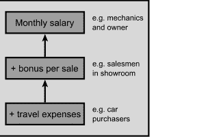

图 2.1：工资管理中的对象层次结构。

与此相反（或者更好地说：除此之外），基于对象的方法会识别问题陈述中使用的**关键词**。然后，这些关键词被绘制在图中，并在关键词之间绘制箭头以描绘内部层次结构。这些关键词成为实现中的对象，而层次结构定义了这些对象之间的关系。这里使用“对象”一词来描述一种有限的、定义良好的结构，其中包含关于一个实体的所有信息：数据类型和操作数据的函数。作为面向对象方法的一个示例，下面进行说明：

一家汽车经销商和汽车修理厂的员工及老板的薪酬如下。首先，在修理厂工作的技工每月领取固定工资。其次，公司老板每月领取固定金额。第三，在展厅工作的汽车销售人员每月领取工资，外加每售出一辆汽车的奖金。最后，公司雇佣二手车采购员，他们到处出差；这些员工每月领取工资、每购得一辆汽车获得奖金，并可报销差旅费用。

在描述上述工资管理时，关键词可以是技工、老板、销售人员和采购员。这些单位的属性是：月薪，有时还有每笔购买或销售的奖金，有时还有差旅费用报销。按照这种方式分析问题，我们得到以下表示：

- 老板和技工可以用相同的类型来表示，每月领取固定薪水。此类类型的相关信息是月度金额。此外，该对象还可以包含姓名、地址和社会安全号码等数据。
- 在展厅工作的汽车销售人员可以表示为上述相同的类型，但带有一些*额外*功能：交易（销售）数量和每笔交易的奖金。在对象层次结构中，我们可以通过让汽车销售人员“派生”自老板和技工来定义前两个对象之间的依赖关系。
- 最后是二手车采购员。他们拥有销售人员除差旅费用之外的所有功能。因此，额外的功能将包括发生的费用，并且此类型将派生自销售人员。

所识别出的对象的层次结构进一步在图 2.1 中说明。

定义上述这类层次结构的整个流程始于对最简单类型的描述。传统上（并且在一些流行的面向对象语言中仍然流行），更复杂的类型从基本集合派生出来，每次派生添加一点额外功能。从这些派生类型中，可以*无限地*派生更复杂的类型，直到能够表示整个问题。然而，多年来，这种方法在 C++ 中已变得不那么流行，因为它通常会导致过于紧密的*耦合*，这反过来又*降低*而非增强复杂程序的可理解性、可维护性和可测试性。在 C++ 面向对象编程中，越来越倾向于小型、易于理解的层次结构、有限的耦合，以及*设计模式*（参见 Gamma *等人*（1995））发挥核心作用的开发过程。

尽管如此，在 **C++** 中，类经常被用于定义*对象*的特征。类包含实现有用功能所需的功能。类通常不会向其他类的对象提供其全部功能（通常也不会提供任何数据）。正如我们将看到的，类倾向于*隐藏*其属性，使其无法被外部世界直接修改。相反，使用专用的函数来访问或修改对象的属性。因此，类类型的对象能够维护自身的完整性。这里核心的概念是封装，*数据隐藏*只是其中一个例子。这些概念将在第 7 章进一步解释。

### 2.5 C 与 C++ 之间的差异

本节展示了一些 **C++** 代码示例，并强调 C 与 **C++** 之间的一些差异。

#### 2.5.1 函数 `main`

在 **C++** 中，函数 `main` 只有两种变体：`int main()` 和 `int main(int argc, char **argv)`。注意：

- `main` 的返回类型是 `int`，而*不是* `void`。
- *不*需要在 `main` 结尾显式使用 return 语句。如果省略，`main` 返回 0。
- “第三个 `char **envp` 参数”不是由 **C++** 标准定义的，应避免使用。相反，应声明全局变量 `extern char **envp`，以提供对程序环境变量的访问。其最后一个元素的值为 0。

#### 2.5.2 行尾注释

根据 ANSI/ISO 定义，“行尾注释”已在 **C++** 的语法中实现。这种注释以 `//` 开始，到行尾标记结束。标准的 C 注释，由 `/*` 和 `*/` 界定，仍然可以在 **C++** 中使用：

```
int main()
{
        // this is end-of-line comment
        // one comment per line

        /*
                this is standard-C comment, covering
                multiple lines
        */
}
```

尽管有上述示例，但建议*不要*在 **C++** 函数体内使用 C 类型注释。有时现有代码必须临时禁用，例如出于测试目的。在这些情况下，能够使用标准 C 注释非常实用。如果此类被禁用的代码本身包含这种注释，就会导致嵌套的注释行，从而产生编译器错误。因此，经验法则是不要在 **C++** 函数体内使用 C 类型注释（或者，当然也可以使用 `#if 0` 到 `#endif` 的预处理指令对作为替代方案）。


#### 2.5.3 严格的类型检查

C++使用非常严格的类型检查。每个函数在被调用之前必须已知其原型，并且调用必须与原型匹配。程序

```cpp
int main()
{
    printf("Hello World\n");
}
```

在C下通常可以编译，尽管会警告printf()是未知函数。但C++编译器（应该）在这种情况下无法生成代码。这个错误当然是由于缺少#include <stdio.h>导致的，而在C++中更常见的是包含#include <cstdio>指令。

顺便说一下：正如我们在C++中看到的，main总是使用int返回值。尽管可以定义int main()而不显式定义return语句，但在main内部，不可能使用不带显式int表达式的return语句。例如：

```cpp
int main()
{
    return;      // won’t compile: expects int expression, e.g.
                 // return 1;
}
```

#### 2.5.4 函数重载

在C++中，可以定义名称相同但执行不同操作的函数。这些函数必须在其参数列表（和/或其const属性）上有所不同。下面给出一个示例：

```cpp
#include <stdio.h>

void show(int val)
{
    printf("Integer: %d\n", val);
}

void show(double val)
{
    printf("Double: %lf\n", val);
}

void show(char const *val)
{
    printf("String: %s\n", val);
}

int main()
{
    show(12);
    show(3.1415);
    show("Hello World!\n");
}
```

在上面的程序中定义了三个show函数，仅在参数列表上不同，分别期望一个int、double和char *。这些函数具有相同的名称。具有相同名称但不同参数列表的函数称为*重载的*。定义此类函数的行为称为“函数重载”。

C++编译器以相当简单的方式实现函数重载。尽管这些函数共享它们的名称（在这个例子中是show），但编译器（以及链接器）使用完全不同的名称。将源文件中的名称转换为内部使用的名称称为“名称修饰”。例如，C++编译器可能将原型`void show(int);`转换为内部名称`Vshowi`，而具有`char *`参数的类似函数可能被称为`VshowCP`。内部使用的实际名称取决于编译器，并且与程序员无关，除非这些名称出现在例如库内容列表中。

关于函数重载的一些额外说明：

- 不要对概念上执行不同任务的函数使用函数重载。在上面的示例中，show函数仍然有些相关（它们将信息打印到屏幕）。

- 然而，也很可能定义两个`lookup`函数，其中一个在列表中查找名称，而另一个确定视频模式。在这种情况下，这两个函数的行为没有任何共同之处。因此，使用暗示其操作的名称会更实际；比如，`findname`和`videoMode`。

- **C++**不允许同名函数仅在返回值上不同，因为程序员总是可以选择使用或忽略函数的返回值。例如，片段

    ```
    printf("Hello World!\n");
    ```

    不提供关于函数`printf`返回值的信息。因此，仅在返回类型上不同的两个`printf`函数对编译器来说将无法区分。

- 第7章介绍了`const`成员函数的概念（参见第7.6节）。这里仅提及类通常具有所谓的成员函数（例如，参见第5章对该概念的通俗介绍）。除了使用不同参数列表重载成员函数外，还可以通过它们的`const`属性重载成员函数。在其他情况下，这些可能具有成对的同名成员函数，具有相同的参数列表。然后，这些函数通过它们的`const`属性重载。在这种情况下，这些函数中只有一个必须具有`const`属性。

#### 2.5.5 默认函数参数

在C++中，可以在定义函数时提供“默认参数”。当程序员未指定这些参数时，编译器会提供它们。例如：

```
#include <stdio.h>

void showstring(char *str = "Hello World!\n");

int main()
{
    showstring("Here’s an explicit argument.\n");

    showstring();             // in fact this says:
                              // showstring("Hello World!\n");
}
```

在定义了默认参数的情况下省略参数的可能性只是一个不错的点缀：除非在调用时显式指定，否则由编译器提供缺少的参数。使用默认参数时，程序的代码既不会更短，也不会更高效。

函数可以定义多个默认参数：

```cpp
void two_ints(int a = 1, int b = 4);

int main()
{
    two_ints();          // arguments:  1, 4
    two_ints(20);        // arguments: 20, 4
    two_ints(20, 5);     // arguments: 20, 5
}
```

当调用函数`two_ints`时，编译器在必要时提供一个或两个参数。然而，像`two_ints(,6)`这样的语句是不允许的：当省略参数时，它们必须在右侧。

默认参数必须在编译时已知，因为此时参数被提供给函数。因此，默认参数必须在函数的*声明*中提及，而不是在其*实现*中：

```cpp
// sample header file
extern void two_ints(int a = 1, int b = 4);

// code of function in, say, two.cc
void two_ints(int a, int b)
{
    ...
}
```

在函数定义中提供默认参数是错误的。当函数被其他源文件使用时，编译器读取头文件而不是函数定义。因此，编译器无法确定默认函数参数的值。当前的编译器在检测到函数定义中的默认参数时会生成编译时错误。

#### 2.5.6 空指针与0指针以及nullptr（C++11）

在*C++*中，所有零值都编码为0。在*C*中，NULL常用于指针上下文。这种差异纯粹是风格上的，尽管被广泛采用。在*C++*中应避免使用NULL（因为它是一个宏，而宏可以——因此应该——在*C++*中轻松避免，另见第8.1.4节）。相反，几乎总是可以使用0。

几乎总是，但并非总是如此。由于*C++*允许函数重载（参见第2.5.4节），程序员可能会在第2.5.4节所示的情况下面临意外的函数选择：

```cpp
#include <stdio.h>

void show(int val)
{
    printf("Integer: %d\n", val);
}

void show(double val)
{
    printf("Double: %lf\n", val);
}

void show(char const *val)
{
    printf("String: %s\n", val);
}

int main()
{
        show(12);
        show(3.1415);
        show("Hello World!\n");
}
```

在这种情况下，打算调用`show(char const *)`的程序员可能会调用`show(0)`。但这不起作用，因为0被解释为`int`，因此调用`show(int)`。但调用`show(NULL)`也不起作用，因为C++通常将NULL定义为0，而不是`((void *)0)`。所以，再次调用`show(int)`。为了解决这类问题，新的C++标准引入了关键字`nullptr`，表示0指针。在当前示例中，程序员应调用`show(nullptr)`以避免选择错误的函数。`nullptr`值也可以用于初始化指针变量。例如，

```cpp
int *ip = nullptr;       // OK
int value = nullptr;     // error: value is no pointer
```

#### 2.5.7 ‘void’参数列表

在C中，具有空参数列表的函数原型，例如

```c
void func();
```

意味着所声明函数的参数列表不是原型化的：编译器不会警告使用任何参数集调用`func`。在C中，当明确意图声明一个完全没有参数的函数时，使用关键字`void`，如下所示：

```c
void func(void);
```

由于C++强制执行严格的类型检查，在C++中空参数列表表示完全不存在参数。因此省略关键字`void`。

#### 2.5.8 ‘#define __cplusplus’

每个符合ANSI/ISO标准的C++编译器都定义符号`__cplusplus`：就好像每个源文件都以预处理指令`#define __cplusplus`为前缀。

我们将在以下各节中看到使用此符号的示例。

#### 2.5.9 使用标准C函数

普通的C函数，例如编译并收集在运行时库中的函数，也可以在C++程序中使用。然而，此类函数必须声明为C函数。

例如，以下代码片段将函数`xmalloc`声明为C函数：

```c
extern "C" void *xmalloc(int size);
```

此声明与 C 语言的声明类似，只是原型前面加上了 `extern "C"`。

声明 C 函数的另一种略有不同的方式如下：

```cpp
extern "C"
{
    // C-declarations go in here
}
```

也可以将预处理指令放在声明所在的位置。例如，一个声明了 C 函数的 C 头文件 `myheader.h` 可以按如下方式包含在 C++ 源文件中：

```cpp
extern "C"
{
    #include <myheader.h>
}
```

虽然这两种方法都可以使用，但在 C++ 源代码中实际上很少见到。一种更常用的声明外部 C 函数的方法将在下一节介绍。

#### 2.5.10 同时用于 C 和 C++ 的头文件

预定义符号 `__cplusplus` 和定义 `extern "C"` 函数的可能性相结合，提供了为 C 和 C++ 创建头文件的能力。例如，这样的头文件可以声明一组要在 C 和 C++ 程序中使用的函数。

这种头文件的构造如下：

```cpp
#ifdef __cplusplus
extern "C"
{
#endif

    /* declaration of C-data and functions are inserted here. E.g., */
    void *xmalloc(int size);

#ifdef __cplusplus
}
#endif
```

使用这种构造，普通的 C 头文件被文件顶部附近的 `extern "C" {` 和文件底部附近的 `}` 包围。`#ifdef` 指令用于测试编译类型：是 C 还是 C++。“标准”C 头文件（如 `stdio.h`）就是以这种方式构建的，因此它们既可以用于 C，也可以用于 C++。

此外，C++ 头文件应支持*包含保护*。在 C++ 中，通常不希望同一个源文件中两次包含同一个头文件。这种多重包含可以通过在头文件中加入 `#ifndef` 指令来轻松避免。例如：

```cpp
#ifndef MYHEADER_H_
#define MYHEADER_H_
    // declarations of the header file is inserted here,
    // using #ifdef __cplusplus etc. directives
#endif
```

当该文件第一次被预处理器扫描时，符号 MYHEADER_H_ 尚未定义。#ifndef 条件成立，所有声明都会被扫描。此外，符号 MYHEADER_H_ 被定义。

在编译同一个源文件时，如果再次扫描该文件，符号 MYHEADER_H_ 已经被定义，因此编译器会跳过 #ifndef 和 #endif 指令之间的所有信息。

在这种语境下，符号名 MYHEADER_H_ 仅用于识别目的。例如，可以使用头文件名，将其大写，并用下划线字符代替点号。

除此之外，逐渐形成了这样的惯例：C 头文件使用 .h 扩展名，而 C++ 头文件不带扩展名。例如，标准 iostream 流对象 cin、cout 和 cerr 在包含头文件 iostream（而不是 iostream.h）后即可使用。在《Annotations》中，这一约定用于标准 C++ 头文件，但并非在所有其他地方都如此。

关于头文件还有更多内容要讲。第 7.10 节深入讨论了 C++ 头文件的推荐组织方式。

#### 2.5.11 定义局部变量

在 C 中，局部变量只能在函数顶部或嵌套块的开头定义。在 C++ 中，局部变量可以在代码中的任意位置创建，甚至可以在语句之间创建。

此外，局部变量可以在某些语句内部、紧邻使用之前定义。一个典型的例子是 for 语句：

```c
#include <stdio.h>

int main()
{
    for (int i = 0; i < 20; ++i)
        printf("%d\n", i);
}
```

在这个程序中，变量 i 在 for 语句的初始化部分创建。根据 ANSI 标准，该变量在 for 语句之前不存在，也不会超出 for 语句的范围，但如今，如果变量在 for 循环之外使用，会发出如下警告：

```text
warning: name lookup of ‘i’ changed for new ANSI ‘for’ scoping using obsolete binding at ‘i’
```

其含义似乎很明确：如果变量要在 for 语句之后使用，就在 for 语句之前定义；否则，应在 for 语句内部定义。这样可以尽可能缩小其作用域，这是一种非常可取的特性。

在需要时才定义局部变量需要一点时间来适应。然而，与在复合语句开头定义变量相比，它最终往往能产生更易读、更易维护，且通常更高效的代码。对于定义局部变量，我们建议以下经验法则：

-   局部变量应在“直觉上合适”的位置创建，例如上面的例子。这不仅涉及 for 语句，还包括所有变量只在函数中途才需要的情况。
-   更一般地说，变量的定义方式应使其作用域尽可能*受限*和*局部化*。如果可避免，局部变量不应定义在函数开头，而应定义在首次使用它们的地方。
-   避免使用全局变量被认为是好的实践。我们很容易忘记哪个全局变量用于什么目的。在 C++ 中，全局变量很少需要，而通过局部化变量，可以轻松避免众所周知的“同一个变量用于多种目的，从而使该变量的每个单独用途失效”的现象。

如果认为合适，可以使用*嵌套块*来局部化辅助变量。然而，在某些情况下，局部变量在嵌套语句内部定义是合适的。刚才提到的 `for` 语句当然就是一个典型的例子，但局部变量也可以定义在 `if-else` 语句的条件子句中、`switch` 语句的选择子句中以及 `while` 语句的条件子句中。这样定义的变量可用于整个语句，包括其嵌套语句。例如，考虑下面的 `switch` 语句：

```c
#include <stdio.h>

int main()
{
    switch (int c = getchar())
    {
        case 'a':
        case 'e':
        case 'i':
        case 'o':
        case 'u':
            printf("Saw vowel %c\n", c);
            break;

        case EOF:
            printf("Saw EOF\n");
            break;

        default:
            printf("Saw other character, hex value 0x%2x\n", c);
    }
}
```

注意字符 'c' 定义的位置：它定义在 `switch` 语句的表达式部分。这意味着 'c' *仅*对 `switch` 语句本身可用，包括其嵌套的（子）语句，但在 `switch` 的作用域之外不可用。

同样的方法也可用于 `if` 和 `while` 语句：在 `if` 和 `while` 语句的条件部分定义的变量可在其嵌套语句中使用。不过有一些注意事项：

-   变量定义必须产生一个初始化为数值或逻辑值的变量；
-   变量定义不能嵌套在更复杂的表达式内（例如，使用括号）。

后一点注意事项并不令人意外：为了能够计算 `if` 或 `while` 语句的逻辑条件，变量的值必须可以解释为零（假）或非零（真）。通常这没有问题，但在 C++ 中，*对象*（如 `std::string` 类型的对象（参见第 5 章））常常由函数返回。这样的对象可能可以解释为数值，也可能不可以。如果不可以（正如 `std::string` 对象那样），那么这样的变量就*不能*定义在条件语句或循环语句的条件子句或表达式子句中。因此，下面的示例将*无法*编译：

```cpp
if (std::string myString = getString())        // assume getString returns
{                                              // a std::string value
```

```cpp
        // process myString
}
```

上面的示例需要进一步说明。通常可以有益地为变量赋予局部作用域，但在其初始化之后需要立即进行额外检查。初始化和测试不能合并到一个表达式中。相反，需要两个嵌套语句。因此，下面的示例也无法编译：

```cpp
if ((int c = getchar()) && strchr("aeiou", c))
    printf("Saw a vowel\n");
```

如果出现这种情况，要么使用两个嵌套的 if 语句，要么使用嵌套的复合语句将 int c 的定义局部化：

```cpp
if (int c = getchar())                 // nested if-statements
    if (strchr("aeiou", c))
        printf("Saw a vowel\n");

{
    int c = getchar();                  // nested compound statement
    if (c && strchr("aeiou", c))
        printf("Saw a vowel\n");
}
```

#### 2.5.12 关键字 ‘typedef’

关键字 `typedef` 在 C++ 中仍在使用，但在定义 `union`、`struct` 或 `enum` 时不再需要。下面的示例说明了这一点：

```cpp
struct SomeStruct
{
    int       a;
    double    d;
    char      string[80];
};
```

当定义 `struct`、`union` 或其他复合类型时，该类型的标签可以用作类型名（在上面的示例中就是 SomeStruct）：

```cpp
SomeStruct what;

what.d = 3.1415;
```

#### 2.5.13 函数作为 struct 的一部分

在 C++ 中，我们可以将函数定义为 struct 的成员。这里我们遇到对象的第一个具体示例：如前所述（见第 2.4 节），对象是包含数据的结构，同时存在专门用于操作这些数据的函数。

下面的代码片段提供了 `struct Point` 的定义。在这个结构中，声明了两个 `int` 数据字段和一个函数 `draw`。

```cpp
struct Point              // definition of a screen-dot
{
    int x;              // coordinates
    int y;              // x/y
    void draw();        // drawing function
};
```

类似的结构可以是绘图程序的一部分，并且例如可以表示一个像素。关于这个 struct，应注意以下几点：

- 结构定义中提到的函数 `draw` 只是一个 *声明*。定义函数所执行操作的实际函数代码在别处（第 3.2 节将进一步讨论 struct 内函数的概念）。

- struct `Point` 的大小等于其两个 int 的大小。在结构内部声明的函数不会影响其大小。编译器通过仅允许函数 `draw` 在 `Point` 的上下文中可用来实现这种行为。

`Point` 结构可按如下方式使用：

```cpp
Point a;              // two points on
Point b;              // the screen

a.x = 0;              // define first dot
a.y = 10;             // and draw it
a.draw();

b = a;                // copy a to b
b.y = 20;             // redefine y-coord
b.draw();             // and draw it
```

如上面的示例所示，可以使用点（.）选择作为结构一部分的函数（当有指向对象的指针时，使用箭头（->）运算符）。因此，这与选择结构数据字段的方式相同。

这种语法构造背后的思想是，多个类型可以包含具有相同名称的函数。例如，表示圆的结构可能包含三个 int 值：两个值用于圆心的坐标，一个值用于半径。与 `Point` 结构类似，`Circle` 现在可以有一个函数 `draw` 来绘制圆。

## 第 3 章 C++ 初印象

本章进一步探讨 C++。通过各种示例说明了在 struct 中声明函数的可能性；引入了类的概念；详细介绍了类型转换；引入了许多新类型，并讨论了 C 的若干重要记法扩展。

### 3.1 对 C 的扩展

在继续介绍‘真正的’面向对象编程方法之前，我们先介绍 C 编程语言的一些扩展：这些不只是 C 与 C++ 之间的差异，而是 C 中没有的语法构造和关键字。

#### 3.1.1 命名空间

C++ 引入了 *命名空间* 的概念：所有符号都定义在一个更大的上下文中，称为命名空间。命名空间用于避免名称冲突，例如当程序员想定义一个像 `sin` 这样以度为单位的函数，但又不想失去使用以弧度为单位的标准 `sin` 函数的能力时，就可能出现这种冲突。

第 4 章将广泛介绍命名空间。目前应注意，大多数编译器要求显式声明标准命名空间：`std`。因此，除非另有说明，需要强调，注解中的所有示例现在都隐式使用

```cpp
using namespace std;
```

声明。因此，如果你确实打算编译 **C++ 注解** 中给出的示例，请确保源文件以上面的 `using` 声明开头。

#### 3.1.2 作用域解析运算符 ::

**C++** 引入了几个新运算符，其中包括作用域解析运算符（`::`）。当存在与局部变量同名的全局变量时，可以使用该运算符：

```cpp
#include <stdio.h>

int counter = 50;                     // global variable

int main()
{
    for (int counter = 1;        // this refers to the
        counter < 10;             // local variable
        counter++)
    {
        printf("%d\n",
                ::counter       // global variable
                /                // divided by
                counter);        // local variable
    }
}
```

在上面的程序中，作用域运算符用于访问全局变量，而不是具有相同名称的局部变量。在 C++ 中，作用域运算符被广泛使用，但很少用于访问被同名局部变量遮蔽的全局变量。其主要用途将在第 7 章描述。

#### 3.1.3 使用关键字 ‘const’

尽管关键字 `const` 是 C 语法的一部分，但它在 C++ 中的使用比在 C 中更重要，也更常见。

const 关键字是一个修饰符，表示变量或参数的值不可修改。在下面的示例中，意图是更改变量 ival 的值，但这会失败：

```cpp
int main()
{
    int const ival = 3;      // a constant int
                             // initialized to 3

    ival = 4;                // assignment produces
                             // an error message
}
```

这个示例展示了 ival 可以在其定义中初始化为给定值；之后尝试更改该值（在赋值中）是不允许的。

与 C 不同，声明为 `const` 的变量可用于指定数组的大小，如下面的示例所示：

```cpp
int const size = 20;
char buf[size];              // 20 chars big
```

关键字 const 的另一个用途体现在指针的声明中，例如在指针参数中。在声明

```cpp
char const *buf;
```

buf 是一个指向 char 的指针变量。buf 所指向的任何内容都不能通过 buf 更改：这些 char 被声明为 const。然而，指针 buf 本身可以更改。因此，像 *buf = 'a'; 这样的语句是不允许的，而 ++buf 是允许的。

在声明

```cpp
char *const buf;
```

不过，Marshall Cline 的建议可以改进。下面这个配方可以毫不费力地剖析即使是最复杂的声明：

1. 从变量名开始阅读
2. 尽可能远地阅读，直到到达声明的末尾或一个（尚未匹配的）右括号。
3. 回到开始阅读的位置，然后反向阅读，直到到达声明的开头或一个匹配的左括号。
4. 如果到达了一个左括号，则从之前停止的括号之后继续执行第 2 步。

让我们把这个配方应用到下面这个（本身无关紧要的）复杂声明上。小箭头指示每一步应该读到何处，箭头方向指示阅读方向：

```text
    char const *(* const *(*ip)()[])[]

                        ip          Start at the variable's name:
                                    'ip' is

                        ip)         Hitting a closing paren: revert
                        -->

                        (*ip)       Find the matching open paren:
                        <--         'a pointer to'

                        (*ip)()     The next unmatched closing par:
                            -->     'a function (not expecting
                                    arguments)'

                        (*ip)()     Find the matching open paren:
                        <--         'returning a pointer to'

                        (*ip)()[]   The next closing par:
                            -->     'an array of'

                        (* const *(*ip)()[])  Find the matching open paren:
                        <--------   'const pointers to'

                        (* const *(*ip)()[])[] Read until the end:
                            -->     'an array of'

    char const *(* const *(*ip)()[])[] Read backwards what's left:
    <----------                             'pointers to const chars'
```

把所有部分汇总起来，对于 `char const *(* const *(*ip)()[])[]`，我们得到：*ip* 是一个指向函数的指针（该函数不期望参数），该函数返回一个指针，指向一个由 const 指针组成的数组，而这些 const 指针指向一个由指向 const char 的指针组成的数组。这就是 `ip` 所表示的内容；这个配方可用于解析你遇到的任何声明。

#### 3.1.4 ‘cout’、‘cin’ 和 ‘cerr’

与 C 类似，C++ 定义了在程序执行时可用的标准输入流和输出流。这些流是：

- cout，类似于 stdout，

### 3.1 对 C 的扩展

- `cin`，类似于 `stdin`，
- `cerr`，类似于 `stderr`。

从语法上说，这些流并不作为函数使用：相反，数据通过运算符 `<<`（称为*插入运算符*）和 `>>`（称为*提取运算符*）写入流或从流中读取。下面的示例说明了这一点：

```cpp
#include <iostream>

using namespace std;

int main()
{
    int     ival;
    char    sval[30];

    cout << "Enter a number:\n";
    cin >> ival;
    cout << "And now a string:\n";
    cin >> sval;

    cout << "The number is: " << ival << "\n"
         << "And the string is: " << sval << '\n';
}
```

这个程序从 `cin` 流（通常是键盘）读取一个数字和一个字符串，并将这些数据打印到 `cout`。关于流，请注意：

- 标准流在头文件 `iostream` 中声明。在《C++ Annotations》的示例中，通常不会显式提及这个头文件。尽管如此，在使用这些流时，它*必须*被包含（直接或间接）。与使用 `using namespace std;` 子句类似，在所有使用标准流的示例中，读者应自行 `#include <iostream>`。
- 流 `cout`、`cin` 和 `cerr` 是所谓*类类型*的变量。这类变量通常称为*对象*。类将在第 7 章详细讨论，并在 C++ 中广泛使用。
- 流 `cin` 使用提取运算符（两个连续的 `>` 字符：`>>`）从流中提取数据，并将提取的信息复制到变量（例如上面示例中的 `ival`）。在《C++ Annotations》后面，我们将描述 C++ 中的运算符如何执行与语言为它们定义的操作相当不同的操作，正如这里的情况一样。函数重载前面已经提到过。在 C++ 中，*运算符*也可以有多个定义，这称为*运算符重载*。
- 操作 `cin`、`cout` 和 `cerr` 的运算符（即 `>>` 和 `<<`）也操作不同类型的变量。在上面的示例中，`cout << ival` 会打印一个整数值，而 `cout << "Enter a number"` 会打印一个字符串。因此，运算符的行为取决于所提供的变量的类型。
- *提取运算符*（`>>`）通过从文本流中“提取”变量的值，对变量执行所谓的*类型安全*赋值。通常，提取运算符会跳过待提取值之前的所有*空白字符*。
- 特殊情况下会使用特殊的符号常量。通常，通过插入 `"\n"` 或 `'\n'` 来终止一行。但是，当插入 `endl` 符号时，会在终止行之后刷新流的内部缓冲区。因此，通常可以避免使用 `endl`，而改用 `'\n'`，从而得到效率稍高的代码。

流对象 `cin`、`cout` 和 `cerr` 并不是 C++ 语法本身的一部分。这些流是头文件 `iostream` 中定义的一部分。这类似于 `printf` 这类函数：它们不是 C 语法的一部分，但最初由那些认为此类函数很重要的人编写，并收集在运行时库中。

程序仍然可以使用 `printf` 和 `scanf` 这类旧式函数，而不是新式流。这两种风格甚至可以混用。但流提供了若干明显优势，并且在许多 C++ 程序中已经完全取代了旧式 C 函数。使用流的一些优势如下：

- 使用插入和提取运算符是*类型安全*的。与 `printf` 和 `scanf` 一起使用的格式字符串可能会为其参数定义错误的格式说明符，而编译器有时无法对此发出警告。相比之下，使用 `cin`、`cout` 和 `cerr` 进行参数检查是由编译器执行的。因此，不可能在根据格式字符串应当出现 `string` 参数的位置错误地提供 `int` 参数。使用流时没有格式字符串。
- `printf` 和 `scanf`（以及使用格式字符串的其他函数）实际上实现了一种在运行时解释的*迷你语言*。相比之下，使用流时，C++ 编译器确切知道根据所用参数要执行哪个输入或输出操作。这里没有迷你语言。
- 此外，插入和提取运算符的可能性可以被*扩展*，从而允许将流最初设计时尚不存在的类的对象插入流中或从流中提取。与 `printf` 一起使用的迷你语言无法扩展。
- 在流的上下文中使用左移和右移运算符，说明了 C++ 的又一项能力：运算符重载使我们能够重新定义运算符在某些上下文中的行为。从 C 过渡而来，运算符重载需要一些适应，但经过很短一段时间后，这些重载运算符就会让人觉得相当自然。
- 流独立于它们所操作的介质。这个（在这一点上有些抽象的）概念意味着，可以完全不做*任何*修改地使用同一份代码，将你的代码连接到*任何*类型的设备。当设备是磁盘上的文件、互联网连接、数码相机、DVD 设备、卫星链路等等——凡是你能想到的——时，都可以使用采用流的代码。流使你的代码能够与代码本应操作的设备解耦（独立），这便于维护，并允许在新情况下复用同一份代码。

`iostream` 库能提供的远不止 `cin`、`cout` 和 `cerr`。第 6 章将更详细地讨论 *iostreams*。尽管 `printf` 及其同类函数仍然可以在 C++ 程序中使用，但流实际上已经取代了 `printf` 这类旧式 C I/O 函数。如果你*认为*自己仍然需要使用 `printf` 及相关函数，请再想想：在这种情况下，你很可能还没有完全掌握流对象的各种可能性。

### 3.2 作为结构体一部分的函数

前面提到，函数可以是 `structs` 的一部分（见第 2.5.13 节）。这样的函数称为*成员函数*。本节简要讨论如何定义此类函数。

下面的代码片段展示了一个 `struct`，其中包含用于保存个人姓名和地址的数据字段。`struct` 的定义中包含一个函数 `print`：

```cpp
struct Person
{
    char name[80];
    char address[80];

    void print();
};
```

定义成员函数 `print` 时，会使用结构体名称（`Person`）和作用域解析运算符（`::`）：

```cpp
void Person::print()
{
    cout << "Name:       " << name << "\n"
         << "Address:    " << address << '\n';
}
```

`Person::print` 的实现展示了如何在不使用结构体类型名称的情况下访问该结构体的字段。这里函数 `Person::print` 打印一个变量名。由于 `Person::print` 本身是 `struct Person` 的一部分，该变量名隐式指向同一类型。

这个 `Person` 结构体可以如下使用：

```cpp
Person person;

strcpy(person.name, "Karel");
strcpy(person.address, "Markramerstraat 33");
person.print();
```

成员函数的优势在于，被调用的函数会自动访问调用它的结构体的数据字段。在语句 `person.print()` 中，对象 person 是“基底”：`print` 代码中使用的变量 name 和 address 指向存储在 person 对象中的数据。

#### 3.2.1 数据隐藏：public、private 和 class

如前所述（见第 2.3 节），C++ 包含用于实现数据隐藏的专门语法能力。数据隐藏是指程序中的某些部分能够对其他部分隐藏其数据。这会带来非常清晰的数据定义。它还允许这些部分强制保证其数据的完整性。

C++ 有三个与数据隐藏相关的关键字：private、protected 和 public。这些关键字可用于结构体的定义。关键字 public 允许所有代码访问结构体中后续的所有字段；关键字 private 只允许作为结构体自身一部分的代码访问后续字段。关键字 protected 将在第 13 章讨论，它在某种程度上超出了当前讨论的范围。

在结构体中，除非另有明确说明，否则所有字段都是 public。利用这一点，我们可以扩展 Person 结构体：

```cpp
struct Person
{
        private:
                char d_name[80];
                char d_address[80];
        public:
                void setName(char const *n);
                void setAddress(char const *a);
                void print();
                char const *name();
                char const *address();
};
```

由于数据字段 d_name 和 d_address 位于 private 区段中，它们只能被

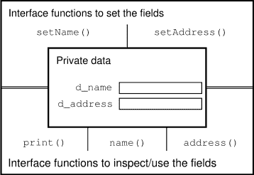

图 3.1：Person 类的私有数据和公有接口函数。

在 `struct` 中定义的成员函数：这些函数是 `setName`、`setAddress` 等。作为示例，考虑以下代码：

```cpp
Person fbb;

fbb.setName("Frank");        // OK, setName is public
strcpy(fbb.d_name, "Knarf"); // error, fbb.d_name is private
```

数据完整性按如下方式实现：`struct Person` 的实际数据在结构体定义中列出。外部通过同样是定义一部分的特殊函数来访问这些数据。这些成员函数控制数据字段与程序其他部分之间的所有交互，因此也被称为“接口”函数。由此实现的数据隐藏如图 3.1 所示。成员 `setName` 和 `setAddress` 使用 `char const *` 参数声明。这表明这些函数不会修改作为其实参提供的字符串。类似地，成员 `name` 和 `address` 返回 `char const *`：编译器会阻止这些成员的调用者修改通过这些成员的返回值而变得可访问的信息。

下面展示 `struct Person` 成员函数的两个示例：

```cpp
void Person::setName(char const *n)
{
    strncpy(d_name, n, 79);
    d_name[79] = 0;
}

char const *Person::name()
{
    return d_name;
}
```

成员函数以及数据隐藏概念的力量源于成员函数执行特殊任务（例如检查数据有效性）的能力。在上面的示例中，`setName` 最多只从其参数复制 79 个字符到数据成员 name，从而避免缓冲区溢出。

数据隐藏概念的另一个示例是下面这个。作为将数据保存在内存中的成员函数的替代方案，可以开发一个库，其中的成员函数将数据存储在文件中。要把一个在内存中存储 `Person` 结构体的程序转换为将数据存储在磁盘上的程序，不需要特殊修改。在重新编译并将程序链接到新库之后，它就从内存存储转换为磁盘存储。这个示例说明了一个比数据隐藏更广泛的概念；它说明了*封装*。数据隐藏是一种封装。一般而言，封装会降低程序不同部分之间的耦合。这反过来又极大地增强了所得软件的可复用性和可维护性。通过让结构体封装实际的存储介质，使用该结构体的程序就变得与所使用的实际存储介质无关。

尽管可以使用结构体实现数据隐藏，但更常见（几乎总是）改用类。类是一种结构体，不同之处在于类默认使用私有访问，而结构体默认使用公有访问。因此，Person 类的定义与上面所示定义相同，只是关键字 `class` 替换了 `struct`，并且开头的 `private:` 子句可以省略。我们对类名（以及程序员定义的其他类型名）的排版建议是：以大写字母开头，类型名其余部分使用小写字母（例如 Person）。

#### 3.2.2 C 中的结构体与 C++ 中的结构体

在本节中，我们将讨论 C 与 C++ 结构体和（成员）函数之间的一个重要区别。在 C 中，常见做法是定义若干函数来处理一个结构体，这些函数随后需要将指向该结构体的指针作为其参数之一。一个展示这一概念的假想 C 头文件如下：

```
/* definition of a struct PERSON   This is C   */
typedef struct
{
        char name[80];
        char address[80];
} PERSON;

/* some functions to manipulate PERSON structs */

/* initialize fields with a name and address    */
void initialize(PERSON *p, char const *nm,
                         char const *adr);

/* print information    */
void print(PERSON const *p);

/* etc..    */
```

在 **C++** 中，相关函数的声明被放在 `struct` 或 `class` 的定义内部。用于指明涉及哪个 `struct` 的参数不再需要。

```
class Person
{

        char d_name[80];
        char d_address[80];

        public:
                void initialize(char const *nm, char const *adr);
                void print();
                // etc..
};
```

在 **C++** 中不使用 `struct` 参数。诸如以下 C 函数调用：

```
PERSON x;
initialize (&x, "some name", "some address");
```

在 C++ 中变为：

```cpp
Person x;

x.initialize ("some name", "some address");
```

### 3.3 对 C 的更多扩展

#### 3.3.1 引用

除了定义变量的常见方式（普通变量或指针）之外，C++ 还引入了*引用*，用于定义变量的同义词。对变量的引用就像*别名*；在涉及该变量的语句中，变量和引用都可以使用：

```cpp
int int_value;
int &ref = int_value;
```

在上面的示例中，定义了一个变量 `int_value`。随后定义了一个引用 `ref`，它（由于初始化）指向与 `int_value` 相同的内存位置。在 `ref` 的定义中，引用运算符 `&` 表明 `ref` 本身不是 `int`，而是对 `int` 的引用。以下两条语句

```cpp
++int_value;
++ref;
```

具有相同的效果：它们都会递增 `int_value` 的值。该位置被称为 `int_value` 还是 `ref` 并不重要。

引用在 C++ 中发挥着重要作用，可作为向函数传递可修改实参的一种手段。例如，在标准 C 中，一个将其参数值增加五且不返回任何内容的函数需要一个指针参数：

```cpp
void increase(int *valp)     // expects a pointer
{                             // to an int
        *valp += 5;
}

int main()
{
        int x;

        increase(&x);          // pass x’s address
}
```

这种构造也可以在 C++ 中使用，但使用引用也能达到相同的效果：

```cpp
void increase(int &valr)     // expects a reference
{                             // to an int
        valr += 5;
}

int main()
{
    int x;

    increase(x);          // passed as reference
}
```

不过，上述这类代码是否应优先于 C 的方法仍有争议。语句 `increase(x)` 暗示传入的不是 x 本身，而是一个*副本*。然而，由于 `increase()` 的定义方式，x 的值会发生变化。不过，引用也可用于传递仅被检查的对象（无需副本或 const *），或传递这样一些对象：修改这些对象是使用它们时可接受的副作用。在这些情况下，强烈建议使用引用，而不是按值复制或传递指针等现有替代方案。

在幕后，引用是使用指针实现的。因此，就编译器而言，C++ 中的引用只是 const 指针。然而，使用引用时，程序员无需了解或操心间接层级。普通指针与引用的一个重要区别当然是：使用引用时不发生间接访问。例如：

```cpp
extern int *ip;
extern int &ir;

ip = 0;      // reassigns ip, now a 0-pointer
ir = 0;      // ir unchanged, the int variable it refers to
             // is now 0.
```

为避免混淆，我们建议遵循以下规则：

- 在函数不修改其内置类型或指针类型参数的情况下，可以使用值参数：

```cpp
void some_func(int val)
{
    cout << val << '\n';
}

int main()
{
    int x;

    some_func(x);        // a copy is passed
}
```

- 当函数必须显式更改其参数的值时，首选指针参数。这些指针参数最好应是函数的初始参数。这称为*通过参数返回*。

```cpp
void by_pointer(int *valp)
{
    *valp += 5;
}
```

- 当函数不更改其类类型或结构体类型参数的值时，或者如果对参数的修改是可忽略的副作用（例如，参数是流）时，可以使用引用。如果函数不修改参数，则应使用 const 引用：

```cpp
void by_reference(string const &str)
{
    cout << str;    // no modification of str
}
```


在这种说法中，**C++** 引用应被视为*左值引用*（使用记法 `typename &`）。它们可以与*右值引用*（使用记法 `typename &&`）相对照。

理解右值引用的关键在于*匿名变量*。匿名变量没有名称，这正是编译器在有选择时自动将其与左值引用关联起来的区分特征。在介绍一些 C++11 之前没有的有趣新构造之前，让我们先看看左值引用的一些有区分性的应用。以下函数返回一个临时（匿名）值：

```cpp
int intVal()
{
    return 5;
}
```

尽管 `intVal` 的返回值可以赋给一个 `int` 变量，但这需要一次复制操作；当函数不返回 `int` 而是返回某个大型对象时，这种复制可能变得代价过高。*引用*或*指针*也不能用来接收匿名返回值，因为该返回值不会存活到那之后。因此下面的写法是非法的（如编译器所指出的）：

```cpp
int &ir = intVal();        // fails: refers to a temporary
int const &ic = intVal();  // OK: immutable temporary
int *ip = &intVal();       // fails: no lvalue available
```

显然，无法修改 `intVal` 返回的临时值。但现在考虑下一个函数：

```cpp
void receive(int &value)
{
    cout << "int value parameter\n";
}
void receive(int &&value)
{
    cout << "int R-value parameter\n";
}
```

并从 main 中调用此函数：

```cpp
int main()
{
    receive(18);
    int value = 5;
    receive(value);
    receive(intVal());
}
```

该程序产生以下输出：

```text
int R-value parameter
int value parameter
int R-value parameter
```

它表明，在接收匿名 int 作为参数的所有情况下，编译器都会选择 `receive(int &&value)`。注意这包括 `receive(18)`：值 18 没有名称，因此调用 `receive(int &&value)`。在内部，它实际上使用一个临时变量来存储 18，如下面修改 `receive` 的示例所示：

```cpp
void receive(int &&value)
{
    ++value;
    cout << "int R-value parameter, now: " << value << '\n';
        // displays 19 and 6, respectively.
}
```

将 `receive(int &value)` 与 `receive(int &&value)` 进行对比，与 `int &value` 不是 const 引用无关。如果使用 `receive(int const &value)`，会得到相同的结果。总之：如果向函数传递匿名值，编译器会选择使用右值引用的重载函数。

不过，如果将 `void receive(int &value)` 替换为 `void receive(int value)`，编译器就会遇到问题。当面临值参数和引用参数（左值或右值）之间的选择时，它无法作出决定，并报告歧义。在实际场景中这不是问题。右值引用被加入语言，正是为了能够区分两种形式的引用：具名值（使用左值引用）和匿名值（使用右值引用）。

正是这种区分使得*移动语义*和*完美转发*的实现成为可能。此时还无法充分讨论*移动语义*的概念（但更深入的讨论见第 9.7 节），不过完全可以说明其基本思想。

考虑这样的情况：一个函数返回一个 `struct Data`，其中包含指向动态分配字符的指针。此外，该结构体定义了一个成员函数 `copy(Data const &other)`，它接受另一个 `Data` 对象并将另一个对象的数据复制到当前对象中。`struct Data` 的（部分）定义可能如下所示<sup>a</sup>：

```cpp
struct Data
{
    char *text;
    size_t size;
    void copy(Data const &other)
    {
        text = strdup(other.text);
        size = strlen(text);
    }
};
```

<sup>a</sup>致细心的读者：在本例中，使用 `Data::copy()` 导致的内存泄漏应被忽略

接下来，函数 `dataFactory` 和 `main` 定义如下：

```cpp
Data dataFactory(char const *txt)
{
    Data ret = {strdup(txt), strlen(txt)};
    return ret;
}

int main()
{
    Data d1 = {strdup("hello"), strlen("hello")};

    Data d2;
    d2.copy(d1);                       // 1 (see text)

    Data d3;
    d3.copy(dataFactory("hello"));     // 2
}
```

在 (1) 处，`d2` 适当地接收了 `d1` 文本的一份副本。但在 (2) 处，`d3` 接收的是 `dataFactory` 函数返回的临时对象中所存文本的一份副本。由于该临时对象在调用 `copy()` 之后不再存在，会观察到两个相关且令人不快的结果：

- 返回值是一个临时对象：它存在的唯一理由就是将其数据传递给 `d3`。现在 `d3` 复制了临时对象的数据，这显然有些多余。
- 临时 `Data` 对象在调用 `copy()` 之后丢失了。不幸的是，其动态分配的数据也随之丢失，导致内存泄漏。

在这类情况下，应使用*右值引用*。通过用一个成员 `copy(Data &&other)` 重载 `copy` 成员，编译器能够区分情况 (1) 和 (2)。现在它在情况 (1) 中调用最初的 `copy()` 成员，在情况 (2) 中调用新定义的重载 `copy()` 成员：

```cpp
struct Data
{
    char *text;
    size_t size;
    void copy(Data const &other)
    {
        text = strdup(other.text);
    }
    void copy(Data &&other)
    {
        text = other.text;
        other.text = 0;
    }
};
```

注意，重载的 `copy()` 函数只是将 `other.text` 指针移动到当前对象的 `text` 指针，然后将 `0` 重新赋给 `other.text`。`struct Data` 突然变成了*移动感知*的，并实现了*移动语义*，从而消除了前面所示方法的缺点：

- 不再进行深拷贝（情况 (1) 中需要深拷贝），而是简单地将指针值移动到其新所有者；
- 由于 `other.text` 不再指向动态分配的内存，内存泄漏得以避免。

用于 `*this` 的*右值引用*以及通过右值初始化类对象，尚未得到 `g++` 编译器的支持。

### 3.3 C 的更多扩展

#### 3.3.3 强类型枚举（C++11）

在 `C++` 中，枚举值实际上是 `int` 值，从而绕过了类型安全。例如，不同枚举类型的值可以比较是否（不）相等，尽管要通过 `(static)` 类型转换。

当前 `enum` 类型的另一个问题在于，其值并不局限于 `enum` 类型名本身，而是局限于定义该枚举的作用域。因此，同一作用域中的两个枚举不能具有相同的值。

在 `C++11` 标准中，这些问题通过定义*枚举类*得到解决。*枚举类*可以如下例所示定义：

```cpp
enum class SafeEnum
{
    NOT_OK,      // 0, by implication
    OK        = 10,
    MAYBE_OK   // 11, by implication
};
```

枚举类默认使用 int 值，但使用 : type 记法可以轻松更改所用的值类型，如下所示：

```cpp
enum class CharEnum: unsigned char
{
    NOT_OK,
    OK
};
```

要使用枚举类中定义的值，还必须提供其枚举名。例如，OK 未定义，而 CharEnum::OK 已定义。

使用数据类型说明（注意其默认为 int），就可以使用枚举类的前向声明。例如：

```cpp
enum Enum1;                 // Illegal: no size available
enum Enum2: unsigned int;  // Legal in C++11: explicitly declared type

enum class Enum3;          // Legal in C++11: default int type is used
enum class Enum4: char;    // Legal in C++11: explicitly declared type
```

#### 3.3.4 初始化列表（C++11）

C 语言将初始化列表定义为用花括号括起来的值列表，这些值本身可能又包含初始化列表。在 C 中，这些初始化列表通常用于初始化数组和结构体。

C++ 在 C++11 标准中扩展了这一概念，引入了类型 `initializer_list<Type>`，其中 `Type` 由初始化列表中所用值的类型名替换。C++ 中的初始化列表与 C 中的对应物一样是递归的，因此也可以用于多维数组、结构体和类。

与 C 中一样，初始化列表由用花括号括起来的值列表组成。但与 C 不同的是，函数可以定义初始化列表参数。例如：

```cpp
void values(std::initializer_list<int> iniValues)
{
}
```

像 values 这样的函数可以如下调用：

```cpp
values({2, 3, 5, 7, 11, 13});
```

初始化列表作为一个参数出现，该参数是用花括号括起来的值列表。由于初始化列表的递归性质，也可以传递二维的值序列，如下例所示：

```cpp
void values2(std::initializer_list<int> iniValues)
{
}
```

```cpp
values2({{1, 2}, {2, 3}, {3, 5}, {4, 7}, {5, 11}, {6, 13}});
```


初始化列表是常量表达式，不能被修改。不过，可以使用其 `size`、`begin` 和 `end` 成员检索其*大小*和值，如下所示：

```cpp
void values(initializer_list<int> iniValues)
{
    cout << "Initializer list having " << iniValues.size() << " values\n";
    for
    (
        initializer_list<int>::const_iterator begin = iniValues.begin();
        begin != iniValues.end();
        ++begin
    )
        cout << "Value: " << *begin << '\n';
}
```

初始化列表也可用于初始化类对象（参见第 7.4 节）。

#### 3.3.5 使用 'auto' 进行类型推断（C++11）

C++11 标准定义了关键字 `auto` 的一种特殊用法，允许编译器自动确定变量的类型，而不要求软件工程师显式定义变量类型。

同时，C++11 标准不再支持将 `auto` 用作存储类说明符。根据该标准，像 `auto int var` 这样的变量定义会导致编译错误。

在很难预先确定变量类型的情况下，这可能非常有用。这些情况出现在例如*模板*上下文中，即第 18 章至第 22 章涵盖的主题。

在本书注释的此处，只能给出简单示例。此外，还将提供一些关于 `auto` 关键字更一般用法的提示。

在定义并初始化变量 `int variable = 5` 时，初始化表达式的类型是已知的：它是 `int`，除非程序员的意图不同，否则可以用它来定义变量的类型（不过在通常情况下不应这样做，因为这只会降低而不是提高代码的清晰度）：

```cpp
auto variable = 5;
```

以下是一些使用 `auto` 很有用的示例。第 5 章介绍了*迭代器*概念（另见第 12 章和第 18 章）。迭代器有时具有很长的类型定义，例如

```cpp
std::vector<std::string>::const_reverse_iterator
```

函数可能返回这样的类型。由于编译器知道函数返回的类型，我们可以利用这一知识使用 `auto`。假设函数 `begin()` 声明如下：

```cpp
std::vector<std::string>::const_reverse_iterator begin();
```

与其编写冗长的变量定义（位于 `// 1`），可以使用短得多的定义（位于 `// 2`）：

```cpp
std::vector<std::string>::const_reverse_iterator iter = begin();    // 1
auto iter = begin();    // 2
```

很容易定义此类型的其他变量。当使用 `iter` 初始化这些变量时，可以再次使用 `auto` 关键字：

```cpp
auto start = iter;
```

如果 `start` 不能立即使用现有变量初始化，则可以将已知变量或函数的类型与 `decltype` 关键字结合使用，如下所示：

```cpp
decltype(iter) start;
decltype(begin()) spare;
```

关键字 `decltype` 也可以接收表达式作为其参数。此特性已在 g++ 4.3 的 C++11 标准实现中可用。例如，`decltype(3 + 5)` 表示 int，`decltype(3 / double(3))` 表示 double。

`auto` 关键字还可以用于推迟函数返回类型的定义。返回指向包含 10 个 int 的数组的指针的函数 `intArrPtr` 的声明如下所示：

```cpp
int (*intArrPtr())[10];
```

这样的声明相当复杂。例如，除其他复杂性外，它需要使用圆括号结合函数的参数列表来“保护指针”。在这种情况下，可以使用 `auto` 返回类型来推迟返回类型的指定，随后在函数可能接收的任何其他说明之后（例如，作为 const 成员（参见第 7.6 节），或在其异常抛出列表之后（参见第 10.6 节））指定函数的返回类型。

使用 `auto` 声明上述函数，声明变为：

```cpp
auto intArrPtr() -> int (*)[10];
```

使用 `auto` 的返回类型指定称为*后置返回类型*。

`auto` 关键字还可以用于定义与实际 `auto` 关联类型相关的类型。以下是一些示例：

```cpp
vector<int> vi;
auto iter = vi.begin();      // standard: auto is vector<int>::iterator
auto &ref = vi.begin();     // auto is a value ref. to the iterator type
auto *ptr = &iter;           // auto is pointer to the iterator type
auto *ptr = &ref;             // same
```

#### 3.3.6 定义类型与 'using' 声明（C++11，4.7）

在 C++ 中，`typedef` 通常用于为复杂类型定义简写表示。假设我们想为“一个指向函数的指针，该函数期望一个 double 和一个 int，并返回 unsigned long long int”定义简写。这样的函数可以是：

```cpp
unsigned long long int compute(double, int);
```

指向此类函数的指针具有以下形式：

```cpp
unsigned long long int (*pf)(double, int);
```

如果经常使用这种指针，请考虑使用 `typedef` 定义它：只需将 `typedef` 放在其前面，指针的名称就变成了类型名。可以将其大写，使其作为类型名更清晰地突出：

```cpp
typedef unsigned long long int (*PF)(double, int);
```

定义此类型后，可用于声明或定义此类指针：

```cpp
PF pf = compute;         // initialize the pointer to a function like
                         // 'compute'
void fun(PF pf);         // fun expects a pointer to a function like
                         // 'compute'
```

然而，将指针包含在 typedef 中可能不是个好主意，因为它掩盖了 pf 是指针这一事实。毕竟，PF pf 看起来更像 'int x' 而不是 'int *x'。为了表明 pf 实际上是指针，稍微修改 typedef：

```cpp
typedef unsigned long long int FUN(double, int);

FUN *pf = compute;       // now pf clearly is a pointer.
```

typedef 的作用域限于编译单元。因此，typedef 通常嵌入头文件中，然后由应使用这些 typedef 的多个源文件包含。

除 typedef 外，C++11 标准还提供 using 关键字，用于关联类型和标识符。在实践中，typedef 和 using 可以互换使用。可以说，using 关键字能产生更可读的类型定义。考虑以下三个（等价的）定义：

- 传统的 C 风格类型定义，将类型名嵌入定义中（将变量名转换为类型名）：

    ```cpp
    typedef unsigned long long int FUN(double, int);
    ```

- 应用 using 将类型名移到定义前面，以提高（对人类而言的）类型名可见性：

    ```cpp
    using FUN = unsigned long long int (double, int);
    ```

- 另一种构造，使用后置返回类型（参见第 3.3.5 节）：

    ```cpp
    using FUN = auto (double, int) -> unsigned long long int;
    ```

#### 3.3.7 基于范围的 for 循环（C++11）

C++ 的 for 语句与 C 的 for 语句相同：

```cpp
for (init; cond; inc)
    statement
```

通常，初始化、条件和增量部分相当明显，例如在处理数组或 vector 的所有元素的情况下。许多语言为此提供 foreach 语句，而 C++ 提供 std::for_each 泛型算法（参见第 19.1.17 节）。

C++11 标准为 for 语句增加了新语法：基于范围的 for 循环。这种新语法可用于依次处理范围中的所有元素。区分三种类型的范围：

- 普通数组（例如，`int array[10]`）；
- 初始化列表；
- 标准容器（或类似容器）（参见第 12 章）；
- 任何其他类型，只要提供返回所谓迭代器的 `begin()` 和 `end()` 函数（参见第 18.2 节）。


在这些情况下，C++11 标准提供了以下附加的 for 语句语法：

```cpp
// assume int array[30]
for (auto &element: array)
    statement
```

冒号左边的部分称为 *for 范围声明*。声明的变量（`element`）是一个形式名称；你可以使用任何你喜欢的标识符。该变量仅在嵌套语句内可用，并且它引用（或是其副本）范围中的每个元素，从第一个元素直到最后一个元素。

没有正式要求必须使用 `auto`，但在许多情况下使用 `auto` 非常有用。不仅是在范围引用某种复杂类型的元素的情况下，而且在你知道可以对范围中的元素做什么、但不关心它们确切类型名称的情况下也是如此。在上面的示例中也可以使用 `int`。

在以下情况下，引用符号（`&`）很重要：

- 如果你想修改嵌套语句中的元素
- 如果元素本身是结构体（或类，参见第 7 章）

省略引用符号时，该变量将是范围中后续每个元素的副本。如果你只需要查看原始类型的变量，这大概没问题，但如果你有一个 `BigStruct` 元素数组，那就效率不必要地低：

```cpp
struct BigStruct
{
    double array[100];
    int    last;
};
```

效率低，因为不需要复制数组的元素。相反，应使用对元素的引用：

```cpp
BigStruct data[100];    // assume properly initialized elsewhere

int countUsed()
{
    int sum = 0;
                        // const &: the elements aren't modified
    for (auto const &element: data)
        sum += element.last;
    return sum;
}
```

如果 `data` 仅以指向其首元素的指针结合元素数量的形式可用，也可以使用基于范围的 for 循环，但需要一点帮助。第 23.6 节描述了在这种情况下使用基于范围的 for 循环的通用方法。

#### 3.3.8 原始字符串字面量（C++11）

标准 ASCII-Z C 字符串由双引号分隔，支持诸如 `\n`、`\\` 和 `\"` 之类的转义序列。在某些情况下，避免对字符串进行转义很有用（例如，在 XML 的上下文中）。为此，C++11 标准提供了原始字符串字面量。

- `p`，用于指定十六进制浮点数中的幂。例如 `0x10p4`。指数本身被读取为十进制常量，因此不能以 `0x` 开头。指数部分被解释为 2 的幂。所以 `0x10p2`（十进制）等于 64：16 * 2^2。
- `U` 可用作整数值的后缀，以表示无符号值，而不是 `int`。它也可以与后缀 `L` 组合，以生成 unsigned long int 值。

当然：`x` 以及 `a` 到 `f` 字符可用于指定十六进制常量（可选使用大写字母）。

#### 3.4.1 数据类型 `bool`

类型 `bool` 表示布尔（逻辑）值，可对其使用（现在为保留的）常量 `true` 和 `false`。除这些保留值外，整数值也可以赋给 `bool` 类型的变量，然后根据以下转换规则隐式转换为 `true` 和 `false`（假设 `intValue` 是 `int` 变量，`boolValue` 是 `bool` 变量）：

```cpp
// from int to bool:
boolValue = intValue ? true : false;

// from bool to int:
intValue = boolValue ? 1 : 0;
```

此外，当 `bool` 值插入流时，`true` 表示为 1，`false` 表示为 0。考虑以下示例：

```cpp
cout << "A true value: " << true << "\n"
     "A false value: " << false << '\n';
```

`bool` 数据类型也存在于其他编程语言中。**Pascal** 有其类型 `Boolean`；**Java** 有 `boolean` 类型。与这些语言不同，C++ 的 `bool` 类型行为有点像一种 `int` 类型。它主要是一种改善文档的类型，只有两个值 `true` 和 `false`。实际上，这些值可以解释为 1 和 0 的 `enum` 值。这样做会忽略 `bool` 数据类型背后的理念，但尽管如此：将 `true` 赋给 `int` 变量既不会产生警告，也不会产生错误。

使用 `bool` 类型通常比使用 `int` 更清晰。考虑以下原型：

```cpp
bool exists(char const *fileName);   // (1)
int  exists(char const *fileName);   // (2)
```

对于第一个原型，读者期望如果给定文件名是现有文件的名称，函数返回 `true`。然而，对于第二个原型，会出现一些歧义：直觉上返回值 1 很有吸引力，因为它允许类似这样的构造：

```cpp
if (exists("myfile"))
    cout << "myfile exists";
```

另一方面，许多系统函数（如 `access`、`stat` 以及许多其他函数）返回 0 来表示操作成功，并保留其他值来表示各种类型的错误。

作为经验法则，我建议如下：如果函数应告知调用者其任务成功或失败，则让函数返回 `bool` 值。如果函数应返回成功或各种类型的错误，则让函数返回 `enum` 值，并通过其各种符号常量记录情况。只有当函数返回概念上有意义的整数值（例如两个 `int` 值之和）时，才让函数返回 `int` 值。

#### 3.4.2 数据类型 ‘wchar_t’

wchar_t 类型是 char 内置类型的扩展，用于容纳宽字符值（但也请参见下一节）。g++ 编译器报告 sizeof(wchar_t) 为 4，这可以轻松容纳所有 65,536 个不同的 Unicode 字符值。

请注意，Java 的 char 数据类型与 C++ 的 wchar_t 类型有些可比。不过，Java 的 char 类型宽 2 字节。另一方面，Java 的 byte 数据类型与 C++ 的 char 类型可比：一个字节。令人困惑吗？

#### 3.4.3 Unicode 编码（C++11）

在 C++ 中，字符串字面量可以定义为 ASCII-Z C 字符串。在 ASCII-Z 字符串前加上 L（例如，L"hello"）可定义 wchar_t 字符串字面量。

新的 C++11 标准在此基础上增加了对 8 位、16 位和 32 位 Unicode 编码字符串的支持。此外，还引入了两种新数据类型：char16_t 和 char32_t，分别存储 UTF-16 和 UTF-32 Unicode 值。

此外，char 类型变量也足够大，可以包含任何 UTF-8 Unicode 值（即，它仍然是 8 位值）。

各种 Unicode 编码类型的字符串字面量（以及关联变量）可以如下定义：

```cpp
char      utf_8[]  = u8"This is UTF-8 encoded.";
char16_t  utf16[]  = u"This is UTF-16 encoded.";
char32_t  utf32[]  = U"This is UTF-32 encoded.";
```

或者，可以使用 \u 转义序列后跟十六进制值来定义 Unicode 常量。根据 Unicode 变量（或常量）的类型，使用 UTF-8、UTF-16 或 UTF-32 值。例如，

```cpp
char      utf_8[]  = u8"\u2018";
char16_t  utf16[]  = u"\u2018";
char32_t  utf32[]  = U"\u2018";
```

Unicode 字符串可以用双引号分隔，但也可以使用原始字符串字面量。

#### 3.4.4 数据类型 ‘long long int’（C++11）

C++11 标准将 long long int 类型加入标准类型集合。在 32 位系统上，它至少有 64 个可用位。一些编译器已经将 long long int 作为扩展支持，但 C++11 正式将其加入 C++。

#### 3.4.5 数据类型 ‘size_t’

size_t 类型实际上并不是内置的原始数据类型，而是一种由 POSIX 推广的类型名，用于表示回答‘多少’和‘多少个’之类问题的非负整数值；在这种情况下，应使用它而不是 unsigned int。它不是 C++ 特有的类型，但也存在于例如 C 中。通常，当包含一个（任何）系统头文件时，它会隐式定义。在 C++ 上下文中‘正式’定义 size_t 的头文件是 cstddef。

使用 size_t 的优点是它是一种概念性类型，而不是随后由修饰符修改的标准类型。因此，它提高了源代码的自文档化价值。


有时函数明确要求使用 `unsigned int`。例如，在 AMD 架构上，X Window 函数 `XQueryPointer` 明确要求将其参数之一设为指向 `unsigned int` 变量的指针。在这种情况下，不能使用指向 `size_t` 变量的指针，而必须提供 `unsigned int` 的地址。不过，这种情况属于例外。

还存在其他有用的按位表示类型。例如，`uint32_t` 保证保存 32 位无符号值。类似地，`int32_t` 保存 32 位有符号值。对于 8 位、16 位和 64 位值，也有相应的类型。这些类型定义在头文件 `cstdint` 中。

### 3.5 一种新的类型转换语法

传统上，C 提供以下 *类型转换* 语法：

```cpp
(typename)expression
```

这里，`typename` 是有效类型的名称，`expression` 是一个表达式。

C 风格的类型转换现在已被弃用。尽管 C++ 使用以下语法提供 *函数调用* 记法：

```cpp
typename(expression)
```

函数调用记法实际上并不表示类型转换，而是请求编译器根据 `expression` 构造一个具有 `typename` 类型的（匿名）变量。尽管这种形式在 C++ 中非常常用，但它*不应*用于类型转换。取而代之的是，现在有四种 *新式类型转换* 可用，将在后续各节中介绍。

C++11 标准定义了 `shared_ptr` 类型（参见第 18.4 节）。要转换共享指针，应使用专门的类型转换。这些内容将在第 18.4.5 节中讨论。

#### 3.5.1 `static_cast` 运算符

用于在概念上可比较的类型之间相互转换的类型转换是：

```cpp
static_cast<type>(expression)
```

这种类型转换用于例如将 `double` 转换为 `int`：两者都是数字，但由于 `int` 没有小数部分，精度可能会降低。反之亦然。当两个 `int` 值的商必须赋给 `double` 时，除非使用类型转换（将分子或分母转换为 `double`），否则除法的小数部分会丢失。

下面是这种类型转换的一个示例（假设 `quotient` 的类型为 `double`，而 `lhs` 和 `rhs` 是 `int` 类型变量）：

```cpp
quotient = static_cast<double>(lhs) / rhs;
```

如果省略类型转换，除法运算符会忽略余数，因为其操作数是 `int` 表达式。注意，除法应放在类型转换表达式之外。如果除法放在里面（如 `static_cast<double>(lhs / rhs)`），则在类型转换有机会将某个操作数的类型转换为 `double` *之前*，已经执行了 *整数除法*。

另一个适合使用 `static_cast<>()` 运算符的代码示例，是在混合类型表达式中使用二元赋值运算符的情况。考虑以下表达式（假设 `doubleVar` 是 `double` 类型变量）：

```cpp
intVar += doubleVar;
```

这条语句实际上等价于：

```cpp
intVar = static_cast<int>(static_cast<double>(intVar) +
doubleVar);
```

这里，`intVar` 首先被提升为 `double`，然后作为 `double` 值与 `doubleVar` 相加。接着，和被转换回 `int`。这两次类型转换有些多余。通过显式地将 `doubleVar` 转换为 `int`，从而为表达式右侧获得一个 `int` 值，可以得到相同的结果：

```cpp
intVar += static_cast<int>(doubleVar);
```

`static_cast` 还可用于移除或引入 `int` 类型变量的有符号修饰符。C 函数 `tolower` 需要一个表示 `unsigned char` 值的 `int`。但默认情况下 `char` 是有符号类型。要使用现有的 `char ch` 调用 `tolower`，我们应使用：

```cpp
tolower(static_cast<unsigned char>(ch))
```

像这样的类型转换会向编译器提供有关如何处理所提供数据的信息。很多时候（尤其是对于仅在大小上不同、但表示方式相同的数据类型），类型转换不需要任何额外代码。然而，将一种表示转换为另一种表示则需要额外代码，例如将 `double` 转换为 `int` 时。

#### 3.5.2 `const_cast` 运算符

`const` 关键字在类型转换中具有特殊地位。通常，任何 `const` 都有充分理由保持为 `const`。尽管如此，仍可能遇到可以忽略 `const` 的情况。对于这些特殊情况，应使用 `const_cast`。其语法为：

```cpp
const_cast<type>(expression)
```

`const_cast<type>(expression)` 表达式用于移除（指针）类型的 `const` 属性。

当与标准 C 库中的函数结合使用时，可能需要 `const_cast`，这些函数传统上并不总是像它们应该的那样具备 `const` 意识。可能存在一个函数 `strfun(char *s)`，它对 `char *s` 参数执行某些操作，而实际上并不修改 `s` 所指向的字符。将 `char const hello[] = "hello";` 传递给 `strfun` 会产生如下警告

```text
passing `const char *` as argument 1 of `fun(char *)` discards const
```

`const_cast` 是避免该警告的合适方法：

```cpp
strfun(const_cast<char *>(hello));
```

#### 3.5.3 `reinterpret_cast` 运算符

第三种新式类型转换用于改变信息的 *解释*：`reinterpret_cast`。它在某种程度上让人联想到 `static_cast`，但当 *已知* 所定义的信息实际上就是或可以被解释为完全不同的东西时，应使用 `reinterpret_cast`。其语法为：

```cpp
reinterpret_cast<pointer type>(pointer expression)
```

`reinterpret_cast<type>(expression)` 运算符适合用于将 `void *` 重新解释为已知类型的指针。在 C 库函数（如 `qsort`）中会遇到 void 指针。`qsort` 函数期望一个指向比较函数的指针，该比较函数有两个 `void const *` 参数。实际上，这些 `void const *` 指向要排序数组的数据元素，因此比较函数可以将 `void const *` 参数转换为指向待排序数组元素的指针。例如，如果数组是 `int array[]`，比较函数的参数是 `void const *p1, void const *p2`，那么比较函数可以使用以下方式获得 `p1` 所指向的 `int` 的地址：

```cpp
reinterpret_cast<int const *>(p1)
```

`reinterpret_cast` 的另一个示例出现在与可用于文件和流的 `write` 函数结合使用时。在 C++ 中，流是访问例如文件的首选接口。输出流（如 `cout`）提供具有以下原型的 `write` 成员

```cpp
write(char const *buffer, int length)
```

要使用 `write` 将 `double` 写入流，也需要 `reinterpret_cast`。例如，要将变量 `double value` 的原始字节写入 `cout`，我们会使用：

```cpp
cout.write(reinterpret_cast<char const *>(&value), sizeof(double));
```

所有类型转换都可能存在危险，但 `reinterpret_cast` 是所有类型转换中最危险的。实际上，我们是在告诉编译器：退后，我们知道自己在做什么，所以别多管闲事。一切都无法保证了，在这种情况下我们最好知道自己在做什么。作为一个恰当的例子，考虑以下代码：

```cpp
int value = 0x12345678;      // assume a 32-bit int

cout << "Value's first byte has value: " << hex <<
        static_cast<int>(
            *reinterpret_cast<unsigned char *>(&value)
        );
```

上述代码在小端和大端计算机上会产生不同结果。小端计算机显示值 78，大端计算机显示值 12。另请注意，小端和大端计算机使用的不同表示方式使得前面的示例（`cout.write(...)`）在不同架构的计算机上不可移植。

根据经验法则：如果出现必须使用类型转换的情况，请在代码中清楚地记录使用它们的原因，并加倍确保该类型转换最终不会导致程序出现异常行为。

#### 3.5.4 `dynamic_cast` 运算符

最后一种新式类型转换与多态结合使用（见第 14 章）。其语法为：

```cpp
dynamic_cast<type>(expression)
```

它在运行时用于将指向某个类（例如 `Base`）对象的指针转换为指向另一个类（例如 `Derived`）对象的指针，而后者位于其所谓 *类层次结构* 的更下方（这也称为 *向下转换*）。在 *注解* 的此处，还不能详细讨论 `dynamic_cast`，但我们将在第 14.6.1 节回到这个主题。


### 3.6 C++ 中的关键字和保留名称

C++ 的关键字是 C 关键字的超集。以下是该语言所有关键字的列表：

```text
alignof compl explicit namespace return typeid
and concept export new short typename
and_eq const extern not signed union
asm const_cast false not_eq sizeof unsigned
auto constexpr float nullptr static using
axiom continue for operator static_cast virtual
bitand decltype friend or struct void
bitor default goto or_eq switch volatile
bool delete if private template wchar_t
break do import protected this while
case double inline public throw xor
catch dynamic_cast int register true xor_eq
char else long reinterpret_cast try
class enum mutable requires typedef
```

注意：

- `export` 关键字在 C++11 标准下已从语言中移除，但仍然是关键字，保留供将来使用。
- *运算符关键字*：`and`、`and_eq`、`bitand`、`bitor`、`compl`、`not`、`not_eq`、`or`、`or_eq`、`xor` 和 `xor_eq` 分别是 `&&`、`&=`、`&`、`|`、`~`、`!`、`!=`、`||`、`|=`、`^` 和 `^=` 的符号替代形式。
- C++11 还识别特殊标识符 `final` 和 `override`。这些标识符的特殊之处在于，在声明类或多态函数时，它们会获得特殊含义。第 14.4 节将提供更多细节。

关键字只能用于其预期用途，不能用作其他实体（例如变量、函数、类名等）的名称。除了关键字之外，以下划线开头且位于*全局命名空间*（即不使用任何显式命名空间或仅使用 `::` 命名空间说明）或位于 *std 命名空间*的标识符也是保留标识符，因为使用它们是实现者的特权。

## 第 4 章 命名空间

### 4.1 命名空间

想象一位数学老师想要开发一个交互式数学程序。该程序需要使用 `cos`、`sin`、`tan` 等函数，这些函数接受以度为单位而非弧度为单位的参数。不幸的是，函数名 `cos` 已被占用，且该函数接受的是弧度而非度作为参数。

此类问题通常通过定义另一个名称来解决，例如定义函数名 `cosDegrees`。**C++** 通过*命名空间*提供了一种替代解决方案。命名空间可以被视为代码中的区域，其中定义的标识符通常不会与在其他地方已定义的名称冲突。

由于 ANSI/ISO 标准已在最近的编译器中得到了很大程度的实现，命名空间的使用比之前的编译器版本受到更严格的强制执行。这影响了类头文件的设置。在 Annotations 的这一部分无法详细讨论这一点，但在第 7.10.1 节中讨论了使用命名空间中的实体构造头文件的问题。

#### 4.1.1 定义命名空间

命名空间根据以下语法定义：

```cpp
namespace identifier
{
    // 声明或定义的实体
    // （声明区域）
}
```

定义命名空间时使用的标识符是标准的 **C++** 标识符。

在上述代码示例引入的*声明区域*内，可以定义或声明函数、变量、结构体、类甚至（嵌套的）命名空间。不能在函数体内定义命名空间。但是，可以通过多个*命名空间*声明来定义一个命名空间。命名空间是“开放”的，这意味着可以在文件 `file1.cc` 中定义一个命名空间 `CppAnnotations`，也可以在文件 `file2.cc` 中定义。然后，文件 `file1.cc` 和 `file2.cc` 中 `CppAnnotations` 命名空间内定义的实体将合并到同一个 `CppAnnotations` 命名空间区域中。例如：

```cpp
// 在 file1.cc 中
namespace CppAnnotations
{
    double cos(double argInDegrees)
    {
        ...
    }
}

// 在 file2.cc 中
namespace CppAnnotations
{
    double sin(double argInDegrees)
    {
        ...
    }
}
```

现在 `sin` 和 `cos` 都定义在同一个 `CppAnnotations` 命名空间中。

命名空间实体可以在其命名空间之外定义。这个主题在第 4.1.4.1 节中讨论。

##### 4.1.1.1 在命名空间中声明实体

除了在命名空间中*定义*实体外，还可以在命名空间中*声明*实体。这允许我们将所有声明放在一个头文件中，然后可以在使用该命名空间中定义的实体的源代码中包含该头文件。这样的头文件可以包含，例如：

```cpp
namespace CppAnnotations
{
    double cos(double degrees);
    double sin(double degrees);
}
```

##### 4.1.1.2 封闭的命名空间

可以定义没有名称的命名空间。这种匿名命名空间将所定义实体的可见性限制在定义该匿名命名空间的源文件中。

匿名命名空间中定义的实体类似于 C 中的 `static` 函数和变量。在 C++ 中仍然可以使用 `static` 关键字，但其首选用途是在类定义中（见第 7 章）。在 C 中会使用 static 变量或函数的情况下，在 C++ 中应使用匿名命名空间。

匿名命名空间是一个封闭的命名空间：不能使用不同的源文件向同一个匿名命名空间添加实体。

#### 4.1.2 引用实体

给定一个命名空间及其实体，可以使用作用域解析运算符来引用其实体。例如，在 `CppAnnotations` 命名空间中定义的 `cos()` 函数可以如下使用：

```cpp
// 假设 CppAnnotations 命名空间声明在
// 以下头文件中：
#include <cppannotations>

int main()
{
    cout << "The cosine of 60 degrees is: " <<
             CppAnnotations::cos(60) << '\n';
}
```

这是一种相当繁琐的引用 `CppAnnotations` 命名空间中 `cos()` 函数的方式，尤其是当该函数经常使用时。在这种情况下，可以在指定一个 *using 声明* 后使用一种*缩写*形式。如下：

```cpp
using CppAnnotations::cos;   // 注意：不是函数原型，
                            // 只需实体的名称。
```

调用 `cos` 将导致调用在 `CppAnnotations` 命名空间中定义的 `cos` 函数。这意味着接受弧度的标准 `cos` 函数不再被自动调用。要调用后一个 `cos` 函数，应使用不带修饰符的作用域解析运算符：

```cpp
int main()
{
    using CppAnnotations::cos;
    ...
    cout << cos(60)       // 调用 CppAnnotations::cos()
         << ::cos(1.5)    // 调用标准的 cos() 函数
         << '\n';
}
```

using 声明可以具有受限作用域。它可以在块内使用。using 声明阻止定义与 using 声明中名称相同的实体。不能为某个命名空间中的变量指定 using 声明，然后在还包含该 using 声明的块中定义（或声明）一个同名的对象。示例：

```cpp
int main()
{
    using CppAnnotations::value;
    ...
    cout << value << '\n';   // 使用 CppAnnotations::value
    int value;               // 错误：value 已经声明。
}
```

##### 4.1.2.1 “using”指令

using 声明的一种广义替代形式是 *using 指令*：

```cpp
using namespace CppAnnotations;
```

在该指令之后，`CppAnnotations` 命名空间中定义的*所有*实体都被视为通过 using 声明声明了。

虽然 using 指令是快速导入一个命名空间所有名称的一种方式（假设该命名空间之前已被声明或定义），但同时也是一种有点“脏”的方式，因为不太清楚在特定的代码块中实际使用了哪个实体。

例如，如果 `cos` 定义在 `CppAnnotations` 命名空间中，那么当调用 `cos` 时，将使用 `CppAnnotations::cos`。然而，如果 `cos` *没有* 在 `CppAnnotations` 命名空间中定义，则将使用标准的 `cos` 函数。using 指令不像 using 声明那样清楚地记录实际将使用哪个实体。因此，在应用 *using 指令* 时要谨慎。


##### 4.1.2.2 ‘Koenig 查找’

如果 *Koenig 查找* 被称为“Koenig 原理”，它本可以成为一部新的 Ludlum 小说的标题。然而并非如此。相反，它指的是 C++ 中的一项技术细节。

“Koenig 查找”指的是这样一个事实：如果调用函数时没有指定其命名空间，那么就使用其参数类型的命名空间来确定该函数的命名空间。如果定义参数类型的命名空间中包含这样的函数，那么就使用该函数。这一过程称为“Koenig 查找”。

作为说明，考虑下面的例子。函数 `FBB::fun(FBB::Value v)` 定义在 FBB 命名空间中。可以在不显式提及其命名空间的情况下调用它：

```cpp
#include <iostream>

namespace FBB
{
    enum Value        // defines FBB::Value
    {
        FIRST
    };

    void fun(Value x)
    {
        std::cout << "fun called for " << x << '\n';
    }
}

int main()
{
    fun(FBB::FIRST);    // Koenig lookup: no namespace
                        // for fun() specified
}
/*
    generated output:
fun called for 0
*/
```

编译器在处理命名空间时相当智能。如果 FBB 命名空间中的 `Value` 被定义为 `typedef int Value`，那么 `FBB::Value` 将被识别为 `int`，从而导致 Koenig 查找失败。

作为另一个例子，考虑下面的程序。这里涉及两个命名空间，每个命名空间都定义了自己的 `fun` 函数。不存在歧义，因为参数决定了命名空间，所以会调用 `FBB::fun`：

```cpp
#include <iostream>

namespace FBB
{
    enum Value        // defines FBB::Value
    {
        FIRST
    };

    void fun(Value x)
    {
        std::cout << "FBB::fun() called for " << x << '\n';
    }
}

namespace ES
{
    void fun(FBB::Value x)
    {
        std::cout << "ES::fun() called for " << x << '\n';
    }
}

int main()
{
    fun(FBB::FIRST);      // No ambiguity: argument determines
                          // the namespace
}
/*
    generated output:
FBB::fun() called for 0
*/
```

下面是一个存在歧义的例子：`fun` 有两个参数，分别来自两个命名空间。程序员必须解决这一歧义：

```cpp
#include <iostream>

namespace ES
{
    enum Value          // defines ES::Value
    {
        FIRST
    };
}

namespace FBB
{
    enum Value          // defines FBB::Value
    {
        FIRST
    };

    void fun(Value x, ES::Value y)
    {
        std::cout << "FBB::fun() called\n";
    }
}

namespace ES
{
    void fun(FBB::Value x, Value y)
    {
        std::cout << "ES::fun() called\n";
    }
}

int main()
{
    //  fun(FBB::FIRST, ES::FIRST); ambiguity: resolved by
    //                                explicitly mentioning
    //                                the namespace
}
```

```cpp
ES::fun(FBB::FIRST, ES::FIRST);
}
/*
    generated output:
ES::fun() called
*/
```

命名空间的一个有趣微妙之处在于，一个命名空间中的定义可能会破坏另一个命名空间中定义的代码。这表明命名空间可能相互影响，如果我们没有意识到它们的特性，命名空间也可能适得其反。考虑下面的例子：

```cpp
namespace FBB
{
    struct Value
    {};

    void fun(int x);
    void gun(Value x);
}

namespace ES
{
    void fun(int x)
    {
        fun(x);
    }
    void gun(FBB::Value x)
    {
        gun(x);
    }
}
```

无论如何，程序员最好不要使用任何 `ES::fun` 函数，因为它会导致无限递归。然而，重点不在这里。重点在于，由于编译失败，程序员甚至不会有机会调用 `ES::fun`。

`gun` 的编译失败，但 `fun` 的编译没有失败。为什么会这样？为什么 `ES::fun` 能够顺利编译，而 `ES::gun` 却不能？在 `ES::fun` 中调用了 `fun(x)`。由于 x 的类型没有定义在命名空间中，Koenig 查找不适用，于是 `fun` 会以无限递归调用自身。

对于 `ES::gun`，参数定义在 `FBB` 命名空间中。因此，`FBB::gun` 函数是可能被调用的候选者。但 `ES::gun` 本身也是可能的，因为 `ES::gun` 的原型与调用 `gun(x)` 完全匹配。

现在考虑 `FBB::gun` 尚未声明的情况。那么当然没有歧义。负责 `ES` 命名空间的程序员正高枕无忧。一段时间之后，维护 `FBB` 命名空间的程序员认为，向 `FBB` 命名空间添加一个函数 `gun(Value x)` 可能不错。现在，由于另一个完全不同的命名空间（`FBB`）中的添加，`ES` 命名空间中的代码突然无法编译。命名空间显然并非完全相互独立，因此我们应当注意上述这类微妙之处。在后面的 C++ Annotations（第 11 章）中，我们将回到这个问题。

#### 4.1.3 标准命名空间

`std` 命名空间由 **C++** 保留。标准定义了许多属于运行时可用软件的实体（例如 `cout`、`cin`、`cerr`）；在 *标准模板库* 中定义的模板（参见第 18 章）；以及 *泛型算法*（参见第 19 章）都定义在 `std` 命名空间中。

### 4.1 命名空间

关于上一节的讨论，在引用 std 命名空间中的实体时可以使用 using 声明。例如，要使用 `std::cout` 流，代码可以按如下方式声明该对象：

```cpp
#include <iostream>
using std::cout;
```

然而，通常可以不加多想地接受 std 命名空间中定义的所有标识符。因此，人们经常遇到 using 指令，它允许程序员在引用用该 using 指令指定的命名空间中定义的任何实体时省略命名空间前缀。人们经常不指定 using 声明，而是遇到如下 using 指令：

```cpp
#include <iostream>
using namespace std;
```

应该使用 using 指令而不是 using 声明吗？根据经验法则，可以决定坚持使用 using 声明，直到列表变得长得不切实际，此时可以考虑使用 using 指令。

using 指令和声明有两条限制：

- 程序员不应在 std 命名空间内部声明或定义任何内容。这*不*是由编译器强制执行的，而是标准对用户代码提出的要求；
- 不应将 using 声明和指令强加于第三方编写的代码。在实践中，这意味着 using 指令和声明应被禁止出现在头文件中，并且只应在源文件中使用（参见第 7.10.1 节）。

#### 4.1.4 嵌套命名空间与命名空间别名

命名空间可以嵌套。下面是一个例子：

```cpp
namespace CppAnnotations
{
    namespace Virtual
    {
        void *pointer;
    }
}
```

变量 pointer 定义在 Virtual 命名空间中，而该命名空间本身嵌套在 CppAnnotations 命名空间下。要引用该变量，有以下选项可用：

- 可以使用 *完全限定名*。实体的完全限定名是直到到达该实体定义为止所遇到的所有命名空间的列表。命名空间和实体通过作用域解析运算符连接在一起：

```cpp
int main()
{
    CppAnnotations::Virtual::pointer = 0;
}
```

- 可以为 CppAnnotations::Virtual 提供 using 声明。现在 Virtual 可以在不带任何前缀的情况下使用，但 pointer 必须使用 Virtual:: 前缀：

```cpp
using CppAnnotations::Virtual;
```

```cpp
int main()
{
    Virtual::pointer = 0;
}
```

- 可以对 `CppAnnotations::Virtual::pointer` 使用 `using` 声明。现在 `pointer` 可以在不带任何前缀的情况下使用：

```cpp
using CppAnnotations::Virtual::pointer;

int main()
{
    pointer = 0;
}
```

- 可以使用一个或多个 `using` 指令：

```cpp
using namespace CppAnnotations::Virtual;

int main()
{
    pointer = 0;
}
```

或者，也可以使用两个单独的 `using` 指令：

```cpp
using namespace CppAnnotations;
using namespace Virtual;

int main()
{
    pointer = 0;
}
```

- 可以组合使用 `using` 声明和 `using` 指令。例如，可以对 `CppAnnotations` 命名空间使用 `using` 指令，并对 `Virtual::pointer` 变量使用 `using` 声明：

```cpp
using namespace CppAnnotations;
using Virtual::pointer;

int main()
{
    pointer = 0;
}
```

对于每个 `using` 指令，该命名空间的所有实体都可以在不带任何进一步前缀的情况下使用。如果某个命名空间是嵌套的，那么该命名空间也可以在不带任何进一步前缀的情况下使用。然而，嵌套命名空间中定义的实体仍然需要该嵌套命名空间的名称。只有在应用了 `using` 声明或指令之后，才能省略嵌套命名空间的限定名。

当更倾向于使用完全限定名，但像

```
CppAnnotations::Virtual::pointer
```

这样的长名称仍然被认为太长时，可以使用 *命名空间别名*：

```cpp
namespace CV = CppAnnotations::Virtual;
```


## 第5章：‘string’数据类型

C++ 为常见问题提供了许多解决方案。这些设施大多属于 *标准模板库*，或者被实现为 *泛型算法*（参见第19章）。

在 C++ 程序员反复开发的设施中，有一类用于处理文本块，通常称为 *字符串*。C 编程语言提供基本的字符串支持。C 的以 *ASCII-Z* 终止的字符序列构成了大量代码所建立的基础¹。

为了处理文本，C++ 提供了 `std::string` 类型。在 C++ 中，处理 ASCII-Z 字符串的传统 C 库函数已被弃用，推荐使用 `string` 对象。C 程序中的许多问题由缓冲区溢出、边界错误和分配问题引起，这些问题可追溯到不正确地使用这些传统 C 字符串库函数。使用 C++ `string` 对象可以避免其中许多问题。

实际上，`string` 对象是 *类类型* 变量，从这个意义上说，它们可与 `cin` 和 `cout` 之类的流对象相比。本节介绍 `string` 类型对象的使用。重点在于它们的定义和使用。使用 `string` 对象时，通常使用 *成员函数语法*：

```
stringVariable.operation(argumentList)
```

例如，如果 `string1` 和 `string2` 是 `std::string` 类型的变量，那么

```
string1.compare(string2)
```

可用于比较这两个字符串。

除了常见的成员函数外，`string` 类还提供各种各样的 *运算符*，例如赋值运算符（=）和比较运算符（==）。运算符通常会产生易于理解的代码，一般优先使用它们，而不是提供类似功能的成员函数。例如，与其编写

```
if (string1.compare(string2) == 0)
```

通常更倾向于以下写法：

```
if (string1 == string2)
```

要定义和使用 `string` 类型对象，源文件必须包含头文件 `string`。仅 *声明* `string` 类型时也应包含该头文件。

> ¹我们将 ASCII-Z 字符串定义为一系列 ASCII 字符，以 ASCII 字符零（因此为 -Z）终止，该字符的值为零，不应与字符 ‘0’ 混淆，后者通常值为 0x30。

### 5.1 对字符串的操作

可对字符串执行的某些操作会返回字符串内的索引。每当此类操作未能找到合适的索引时，就会返回 *值* `string::npos`。该值是 `string::size_type` 类型的符号值，实际上是一个 `(unsigned) int`。

所有接受 `string` 对象作为参数的 `string` 成员也接受 `char const *`（C ASCII-Z 字符串）参数。接受 `string` 对象的运算符通常也是如此。

某些 `string` 成员使用 *迭代器*。迭代器在第 [18.2] 节中正式介绍。使用迭代器的成员函数将在下一节（5.2）中列出，但本章不再进一步讨论迭代器概念本身。

字符串支持种类繁多的成员和运算符。本节简要概述其能力，后续章节将详细讨论。底线是：**C++ 字符串**极其通用，几乎没有什么理由再退回到 C 库来处理文本。**C++ 字符串**处理所有必需的内存管理，因此使用 C++ 字符串时，可以避免许多相关问题，而这是 C 程序中问题的第一大来源。不过，字符串确实有代价。该类广泛的能力也使它变成了一头巨兽。学习和掌握它的所有特性很难，最终你会发现并非你所期望的一切都真的存在。例如，`std::string` 不提供不区分大小写的比较。但最终事情甚至没有那么简单。它 *确实* 存在，但有些隐蔽，而在 **C++** 注解的当前阶段，研究那个隐蔽角落还为时过早。相反，要意识到 C 的标准库 *确实* 提供了有用的函数，只要我们知道它们的局限性并能够避开它们的陷阱，就可以使用这些函数。因此目前，要对两个 `std::string` 对象 `str1` 和 `str2` 的内容执行传统的不区分大小写比较，以下代码即可：

```
strcmp(str1.c_str(), str2.c_str());
```

字符串支持以下功能：

- `initialization:` 定义字符串对象时，它们总是被正确初始化。换句话说，它们始终处于有效状态。字符串可以初始化为空，也可以使用已有文本初始化字符串。
- `assignment:` 可以给字符串赋新值。可使用成员函数（如 `assign`）赋新值，但也可以使用普通赋值运算符（即 `=`）。此外，也支持向字符缓冲区进行 `assignment`。
- `conversions:` 字符串对象的部分或全部内容可被解释为 C 字符串，但字符串内容也可作为一系列原始二进制字节处理，不一定以 ASCII-Z 字节终止。此外，在许多情况下，在可接受 `std::string` 的地方也可使用普通字符和 C 字符串。
- `breakdown:` 可使用熟悉的索引运算符（`[]`）访问字符串中存储的各个字符，从而访问或修改字符串中间的信息。
- `comparisons:` 可使用熟悉的逻辑比较运算符 `==`、`!=`、`<`、`<=`、`>` 和 `>=` 将字符串与其他字符串（或 C ASCII-Z 字符串）比较。还提供了成员函数以进行更细粒度的比较。
- `modification:` 字符串的内容可通过多种方式修改。运算符可用于向字符串对象添加信息、在字符串对象中间插入信息，或替换或删除字符串内容（的一部分）。
- `swapping:` 字符串的交换能力原则上允许我们交换两个字符串对象的内容，而无需逐字节复制字符串内容。
- `searching:` 可从字符串对象内的任意位置向前或向后搜索字符、字符集或字符序列的位置。
- `housekeeping:` 提供若干内务管理功能：可查询字符串的长度或其空状态。但字符串对象也可调整大小。
- `stream I/O:` 可从流中提取字符串，或将字符串插入流中。除了普通字符串提取外，还可读取文本文件的一行，而不会有缓冲区溢出的风险。由于提取和插入操作基于流，I/O 设施是 *设备无关* 的。

### 5.2 `std::string` 参考

本节引用字符串成员和与字符串相关的操作。各小节分别涵盖字符串的初始化器、迭代器、运算符和成员函数。本节通篇使用以下术语：

- `object` 始终是一个 `string` 对象；
- `argument` 是 `string const &` 或 `char const *`，除非另有说明。参数的内容绝不会被处理该参数的操作修改；
- `opos` 指 `object` 字符串中的偏移量；
- `apos` 指 `argument` 中的偏移量；
- `on` 表示 `object` 中的字符数（从 `opos` 开始）；
- `an` 表示 `argument` 中的字符数（从 `apos` 开始）。

`opos` 和 `apos` 都必须指向存在的偏移量，否则会生成异常（参见第10章）。相反，`an` 和 `on` 可以超过可用字符数，在这种情况下只考虑可用字符。

许多成员为 `on`、`an` 和 `apos` 声明默认值。某些成员为 `opos` 声明默认值。默认偏移量为 0，`on` 和 `an` 的默认值是 `string::npos`，可解释为“到达字符串末尾所需的字符数”。

对于从字符串对象内容末尾开始并向后操作的成员，`opos` 的默认值是对象 *最后* 一个字符的索引，`on` 默认等于 `opos + 1`，表示 *结束于 opos* 的子串长度。

在下面给出的成员函数概览中，可以假定所有这些参数都接受默认值，除非另有说明。当然，如果函数需要的参数超出原本接受默认值的参数，则不能使用默认参数值。


有些成员函数具有重载版本，期望一个类型为 `char const *` 的初始参数。但即使并非如此，在定义了 `std::string` 形参的地方，第一个实参也*总是*可以是 `char const *` 类型。

若干成员函数接受*迭代器*。第18.2节涵盖*迭代器*的技术细节，但此时可以忽略这些内容而不影响连续性。与 `apos` 和 `opos` 一样，迭代器必须指向字符串对象内容中已存在的位置和/或已存在的字符范围。

最后，所有计算索引的字符串成员函数在失败时返回预定义常量 `string::npos`。

#### 5.2.1 初始化器

定义字符串对象后，保证它们处于有效状态。在*定义时*，字符串对象可以通过以下方式之一进行初始化：以下字符串构造函数可用：

- `string object:` 将对象初始化为空字符串。以这种方式定义字符串时，不得指定参数列表；
- `string object(string::size_type count, char ch):` 用 count 个字符 `ch` 初始化对象；
- `string object(string const &argument):` 用 `argument` 初始化对象；
- `string object(std::string const &argument, string::size_type apos, string::size_type an):` 用 `argument` 的内容初始化对象，从索引位置 `apos` 开始，最多使用 `argument` 的 `an` 个字符；
- `string object(InputIterator begin, InputIterator end):` 用两个 InputIterator 定义的字符范围内的字符初始化对象。

#### 5.2.2 迭代器

有关*迭代器*的详细信息，请参见第18.2节。作为迭代器的快速介绍：迭代器的作用类似于指针，而在需要迭代器的场合通常可以使用指针。迭代器通常成对出现，定义一个实体范围。begin 迭代器指向第一个实体，end 迭代器指向范围中最后一个实体之后的位置。它们的差等于迭代器范围中的实体数量。

迭代器在*泛型算法*（参见第19章）的语境中起着重要作用。类 `std::string` 定义了以下*迭代器类型*：

- `string::iterator` 和 `string::const_iterator`：这些迭代器是*前向迭代器*。`const_iterator` 由 const 字符串对象返回，普通迭代器由非 const 字符串对象返回。迭代器所引用的字符可以被修改；
- `string::reverse_iterator` 和 `string::const_reverse_iterator`：这些迭代器也是*前向迭代器*，但当*递增*迭代器时，会到达字符串对象中的*前一个*字符。除此之外，它们分别类似于 `string::iterator` 和 `string::const_iterator`。

#### 5.2.3 运算符

字符串对象可以通过成员函数操作，也可以通过运算符操作。使用运算符通常会产生看起来更自然的代码。在运算符可用且具有与成员函数等效的功能时，几乎总是优先使用运算符。

以下运算符可用于字符串对象（在示例中，‘object’和‘argument’指现有的 `std::string` 对象）。

- **普通赋值：**

  字符、C 或 C++ 字符串可赋给 `string` 对象。赋值运算符返回其左操作数。示例：

  ```
  object = argument;
  object = "C string";
  object = 'x';
  object = 120;       // same as object = 'x'
  ```

- **加法：**

  算术加法赋值运算符和加法运算符将文本添加到字符串对象。算术赋值运算符返回其左操作数，加法运算符在临时字符串对象中返回其结果。使用加法运算符时，左操作数或右操作数必须是 `std::string` 对象。另一个操作数可以是 char、C 字符串或 C++ 字符串。示例：

  ```
  object += argument;
  object += "hello";
  object += 'x';        // integral expressions are OK

  argument + otherArgument;    // two std::string objects
  argument + "hello";          // using + at least one
  "hello" + argument;          // std::string is required
  argument + 'a'               // integral expressions are OK
  'a' + argument;
  ```

- **下标运算符：**

  下标运算符可用于获取对象的各个字符，或为非 const 字符串对象的各个字符赋予新值。没有范围检查（为此请使用 `at()` 成员函数）。该运算符返回 `char &` 或 `char const &`。示例：

  ```
  object[3] = argument[5];
  ```

- **逻辑运算符：**

  逻辑比较运算符可应用于两个字符串对象，或一个字符串对象和一个 C 字符串，以比较它们的内容。这些运算符返回 bool 值。可用运算符包括 ==、!=、>、>= 和 <=。排序运算符使用 ASCII 字符排序序列对其内容执行字典序比较。示例：

  ```
  object == object;          // true
  object != (object + 'x');  // true
  object <= (object + 'x');  // true
  ```

- **流相关运算符：**

  插入运算符（参见第3.1.4节）可用于将字符串对象插入 ostream，提取运算符可用于从 istream 提取字符串对象。提取运算符默认首先忽略所有空白字符，然后从 istream 中提取所有连续的非空白字符。也可以提取字符数组而不是字符串，但使用字符串对象的优势应该很清楚：目标字符串对象会自动调整为所需字符数。示例：

  ```
  cin >> object;
  cout << object;
  ```

#### 5.2.4 成员函数

`std::string` 类提供了许多成员函数以及应视为字符串类一部分的附加非成员函数。所有这些函数按字母顺序列在下面。

符号值 `string::npos` 由字符串类定义。当返回字符串偏移位置的成员函数返回它时，它表示“索引未找到”。示例：对不包含字符 `x` 的字符串对象调用 `find('x')`（见下文）时，返回 npos，因为请求的位置不存在。

在 **C** 字符串中用于指示 ASCII-Z 字符串结束的最终 0 字节并*不*被视为 **C++** 字符串的一部分，因此，在包含 C 字符串字符的字符串对象中查找 0 时，成员函数将返回 npos，而不是 length()。

以下是操作 string 类对象的标准函数。当提到 `size_t` 参数时，它可以被解释为 `string::size_type` 类型的参数，但不定义默认参数值。类型 `size_type` 应读作 `string::size_type`。使用 `size_type` 时，第 **5.2** 节提到的默认参数值适用。所有引用的函数都是 `std::string` 类的成员函数，除非另有说明。

- `char &at(size_t opos);`

  返回对指定位置字符的引用。当对 `string const` 对象调用时，返回 `char const &`。该成员函数执行范围检查；如果传入无效索引，则引发异常（默认情况下会中止程序）。

- `string &append(InputIterator begin, InputIterator end);`

  将由 begin 和 end 定义的范围内的字符追加到当前字符串对象。

- `string &append(string const &argument, size_type apos, size_type an);`

  将 argument（或其子串）追加到当前字符串对象。

- `string &append(char const *argument, size_type an);`

  将 argument 的前 `an` 个字符追加到字符串对象。

- `string &append(size_type n, char ch);`

  将 `n` 个字符 `ch` 追加到当前字符串对象。

- `string &assign(string const &argument, size_type apos, size_type an);`

  将 argument（或其子串）赋给字符串对象。如果 argument 的类型为 `char const *`，并且提供了一个附加参数，则第二个参数被解释为初始化 `an` 的值，并使用 0 初始化 `apos`。

- `string &assign(size_type n, char ch);`

  将 `n` 个字符 `ch` 赋给当前字符串对象。


### 5.2 std::string 参考

- `string::iterator begin():`

  返回一个指向当前 string 对象第一个字符的迭代器。对于 `const` string 对象，返回 `const_iterator`。

- `size_type capacity() const:`

  返回当前 string 对象无需调整大小即可存储的字符数。

- `int compare(string const &argument) const:`

  使用 ASCII 字符排序序列，对当前 string 对象中存储的文本与 argument 中存储的文本进行字典序比较。如果两个字符串内容相同，则返回 0；如果当前对象中的文本应排在 argument 中的文本之前，则返回负值；如果当前对象中的文本应排在 argument 中的文本之后，则返回正值。

- `int compare(size_t opos, size_t on, string const &argument) const:`

  将当前 string 对象中存储文本的一个子字符串与 argument 中存储的文本进行比较。从偏移 opos 开始的最多 on 个字符会与 argument 中的文本进行比较。

- `int compare(size_t opos, size_t on, string const &argument, size_type apos, size_type an) const:`

  将当前 string 对象中存储文本的一个子字符串与 argument 中存储文本的一个子字符串进行比较。当前 string 对象中从偏移 opos 开始的最多 on 个字符，会与 argument 中从偏移 apos 开始的最多 an 个字符进行比较。在这种情况下，argument *必须* 是 string 对象。

- `int compare(size_t opos, size_t on, char const *argument, size_t an):`

  将当前 string 对象中存储文本的一个子字符串与 argument 中存储文本的一个子字符串进行比较。当前 string 对象中从偏移 opos 开始的最多 on 个字符，会与 argument 中最多 an 个字符进行比较。argument 必须至少包含 an 个字符。这些字符可以具有任意值：ASCII-Z 值没有特殊含义。

- `size_t copy(char *argument, size_t on, size_type opos) const:`

  当前 string 对象的内容被（部分）复制到 argument 中。返回实际复制的字符数。第二个参数指定要从当前 string 对象复制的字符数，是必需的。复制后的字符串不会追加 ASCII-Z，但可以使用如下惯用法将 ASCII-Z 追加到复制文本中：

  ```cpp
  argument[object.copy(argument, string::npos)] = 0;
  ```

  当然，程序员应确保 argument 的大小足以容纳额外的 0 字节。

- `char const *c_str() const:`

  当前 string 对象的内容以 ASCII-Z 结尾的 C 字符串形式返回。

- `char const *data() const:`

  返回当前 string 对象的原始内容。由于该成员不返回以 ASCII-Z 结尾的 C 字符串（不像 c_str 那样），因此它可用于检索当前 string 对象内部存储的任何类型的信息，例如一系列 0 字节：

  ```cpp
  string s(2, 0);
  cout << static_cast<int>(s.data()[1]) << '\n';
  ```

- `bool empty() const:`

  如果当前 string 对象不包含数据，则返回 `true`。

- `string::iterator end():`

  返回一个指向当前 string 对象最后一个字符之后位置的迭代器。对于 `const` string 对象，返回 `const_iterator`。

- `string &erase(size_type opos, size_type on):`

  删除当前 string 对象中存储信息的一个（子）字符串。

- `string::iterator erase(string::iterator begin, string::iterator end):`

  参数 end 是可选的。如果省略，则使用当前对象的 end 成员返回的值。删除由 begin 和 end 迭代器定义的字符。返回迭代器 begin，此时它指向最后一个被删除字符之后的位置。

- `size_t find(string const &argument, size_type opos) const:`

  返回当前 string 对象中找到 argument 的第一个索引。

- `size_t find(char const *argument, size_type opos, size_type an) const:`

  返回当前 string 对象中找到 argument 的第一个索引。当指定全部三个参数时，第一个参数必须是 `char const *`。

- `size_t find(char ch, size_type opos) const:`

  返回当前 string 对象中找到 ch 的第一个索引。

- `size_t find_first_of(string const &argument, size_type opos) const:`

  返回当前 string 对象中第一个找到 argument 中任意字符的索引。

- `size_type find_first_of(char const *argument, size_type opos, size_type an) const:`

  返回当前 string 对象中第一个找到 argument 中任意字符的索引。如果提供 opos，它指的是当前 string 对象中应开始搜索 argument 的第一个索引。如果省略，则完整扫描 string 对象。如果提供 an，它表示搜索中应使用的 `char const *` 参数中的字符数。它定义从 argument 开头开始的子字符串。如果省略，则使用 argument 的所有字符。

- `size_type find_first_of(char ch, size_type opos) const:`

  返回当前 string 对象中找到字符 ch 的第一个索引。

- `size_t find_first_not_of(char ch, size_type opos) const:`

  返回当前 string 对象中第一个找到不同于 ch 的字符的索引。

- `size_t find_last_of(string const &argument, size_type opos) const:`

  返回当前 string 对象中最后一个找到 argument 中任意字符的索引。

- `size_type find_last_of(char const *argument, size_type opos, size_type an) const:`

  返回当前 string 对象中最后一个找到 argument 中任意字符的索引。如果提供 opos，它指的是当前 string 对象中应开始搜索 argument 的最后一个索引。如果省略，则完整扫描 string 对象。如果提供 an，它表示搜索中应使用的 `char const *` 参数中的字符数。它定义从 argument 开头开始的子字符串。如果省略，则使用 argument 的所有字符。

- `size_type find_last_of(char ch, size_type opos) const:`

  返回当前 string 对象中最后一个找到字符 ch 的索引。

- `size_t find_last_not_of(string const &argument, size_type opos) const:`

  返回当前 string 对象中最后一个找到未出现在 argument 中的任意字符的索引。

- `istream &std::getline(istream &istr, string &object, char delimiter = '\n'):`

  注意：这不是 string 类的成员函数。

  从 istr 读取一行文本。从 istr 读取直到 delimiter（或流末尾，以先出现者为准）的所有字符，并存储到 object 中。如果遇到 delimiter，则将其从流中移除，但不存储到 object 中。

  如果未找到 delimiter，则 istr.eof 返回 true（参见第 6.3.1 节）。由于流可被解释为 bool 值（参见第 6.3.1 节），一种常见的惯用法是将流中的所有行依次读入 string 对象 line，如下所示：

  ```cpp
  while (getline(istr, line))
      process(line);
  ```

  最后一行的内容，无论是否以 delimiter 结束，最终也会赋给 object。

- `string &insert(size_t opos, string const &argument, size_type apos, size_type an):`

  argument 的一个（子）字符串插入到当前 string 对象的索引位置 opos 处。apos 和 an 参数必须同时提供，或者同时省略。

- `string &insert(size_t opos, char const *argument, size_type an):`

  argument（类型为 char const *）插入到当前 string 对象的索引 opos 处。

- `string &insert(size_t opos, size_t count, char ch):`

  将 count 个字符 ch 插入到当前 string 对象的索引 opos 处。

- `string::iterator insert(string::iterator begin, char ch):`

  字符 ch 插入到由 begin 引用的当前对象位置。返回 begin。

- `string::iterator insert(string::iterator begin, size_t count, char ch):`

  将 count 个字符 ch 插入到由 begin 引用的当前对象位置。返回 begin。

- `string::iterator insert(string::iterator begin, InputIterator abegin, InputIterator aend):`

  由 InputIterator abegin 和 aend 定义的范围内的字符插入到由 begin 引用的当前对象位置。返回 begin。

- `size_t length() const:`

  返回当前 string 对象中存储的字符数。

- `size_t max_size() const:`

  返回当前 string 对象中可存储的最大字符数。


- ```
  string::reverse_iterator rbegin();
  ```

  返回一个指向当前 string 对象最后一个字符的反向迭代器。对于 const string 对象，返回 const_reverse_iterator。

- ```
  string::iterator rend();
  ```

  返回一个反向迭代器，指向当前 string 对象第一个字符之前的位置。对于 const string 对象，返回 const_reverse_iterator。

- ```
  string &replace(size_t opos, size_t on, string const & argument, size_type apos, size_type an):
  ```

  对象中的（子）字符串字符由 argument 的（子集）字符替换。如果 on 指定为 0，则将 argument 插入到对象中偏移 opos 处。

- ```
  string &replace(size_t opos, size_t on, char const *argument, size_type an):
  ```

  对象中的一系列字符由 char const * argument 的前 an 个字符替换。

- ```
  string &replace(size_t opos, size_t on, size_type count, char ch):
  ```

  当前 string 对象中从索引位置 opos 开始的 on 个字符，由 count 个字符 ch 替换。

- ```
  string &replace(string::iterator begin, string::iterator end, string const & argument):
  ```

  当前 string 对象中由迭代器 begin 和 end 定义的一系列字符由 argument 替换。如果 argument 是 char const *，则可以使用一个附加参数，指定替换中使用的 argument 字符数。

- ```
  string &replace(string::iterator begin, string::iterator end, size_type count, char ch):
  ```

  当前 string 对象中由迭代器 begin 和 end 定义的一系列字符由 count 个值为 ch 的字符替换。

- ```
  string &replace(string::iterator begin, string::iterator end, InputIterator abegin, InputIterator aend):
  ```

  当前 string 对象中由迭代器 begin 和 end 定义的一系列字符由 InputIterator abegin 和 aend 定义的范围内的字符替换。

- ```
  void reserve(size_t request):
  ```

  当前 string 对象的容量至少改变为 request。调用此成员后，capacity 的返回值将至少为 request。请求的大小小于 capacity 返回值时会被忽略。如果 request 超过 max_size 的返回值，则抛出 std::length_error 异常（std::length_error 定义在 stdexcept 头文件中）。调用 reserve() 的效果是重新定义 string 的容量，而不是实际向程序提供内存。这一点可由 string 的 at() 成员在尝试访问超过 string 大小但不超过 string 容量的元素时抛出的异常说明。

- ```
  void resize(size_t size, char ch = 0):
  ```

  当前 string 对象的大小调整为 size 个字符。如果 string 对象调整为大于其当前大小，则额外字符将初始化为 ch。如果大小减小，则索引最高的字符将被截去。

- `size_t rfind(string const &argument, size_type opos) const:`

  返回当前 string 对象中找到 argument 的最后一个索引。搜索从当前对象的偏移 opos 开始，向其开头方向进行。

- `size_t rfind(char const *argument, size_type opos, size_type an) const:`

  返回当前 string 对象中找到 argument 的最后一个索引。搜索从当前对象的偏移 opos 开始，向其开头方向进行。参数 an 指定要查找的 argument 子串的长度，从 argument 的开头开始。

- `size_t rfind(char ch, size_type opos) const:`

  返回当前 string 对象中找到 ch 的最后一个索引。搜索从当前对象的偏移 opos 开始，向其开头方向进行。

- `size_t size() const:`

  返回当前 string 对象中存储的字符数。此成员是 length() 的同义词。

- `string substr(size_type opos, size_type on) const:`

  返回当前 string 对象的一个子串，从索引 opos 开始，最多 on 个字符。

- `void swap(string &argument):`

  当前 string 对象的内容与 argument 的内容交换。对于此成员，argument 必须是 string 对象，不能是 char const *。

## 第6章

## IO 流库

扩展了 C 编程语言中众所周知的标准流（FILE）方法，C++ 提供了基于类概念的输入/输出（I/O）库。

所有 C++ I/O 设施都定义在命名空间 std 中。下文省略 std:: 前缀，除非这样做会导致歧义。

之前（在第 3 章中）我们已经看到几个使用 C++ I/O 库的示例，特别是展示了插入运算符（<<）和提取运算符（>>）。本章将更详细地讨论 I/O。

C++ 编程语言提供的输入和输出功能的讨论大量使用类概念和成员函数的概念。尽管类的构造尚未涉及（关于这一点，见第 7 章），并且继承在第 13 章之前也没有正式涉及，但在涵盖类构造的技术背景之前很久，就完全可以讨论 I/O 功能。

大多数 C++ I/O 类的名称以 basic_ 开头（如 basic_ios）。然而，这些 basic_ 名称在 C++ 程序中并不常见，因为大多数类还使用如下 typedef 定义来定义：

```
typedef basic_ios<char>       ios;
```

由于 C++ 支持各种字符类型（例如 char、wchar_t），I/O 功能是使用模板机制开发的，从而可以轻松转换为传统 char 类型之外的其他字符类型。正如第 20 章所详述的，这也允许构造通用软件，随后可用于任何表示字符的特定类型。因此，类似于上面的 typedef，存在一个

```
typedef basic_ios<wchar_t>    wios;
```

此类型定义可用于 wchar_t 类型。由于这些类型定义的存在，C++ Annotations 中省略了 basic_ 前缀，且不损失连续性。C++ Annotations 主要关注标准的 8 位 char 类型。

必须强调，使用标准前向声明来声明 iostream 对象不再正确，例如：

```
class std::ostream;      // now erroneous
```

相反，必须声明 iostream 类的源文件必须

```
#include <iosfwd>      // correct way to declare iostream classes
```

使用 C++ I/O 还提供了 *类型安全* 的额外优势。对象（或普通值）被插入到流中。将其与 C 中常见的情况进行比较：在 C 中使用 `printf` 函数通过格式字符串指示在何处期望何种类型的值。与后一种情况相比，C++ 的 *iostream* 方法立即在值应出现的位置使用对象，如下所示：

```cpp
cout << "There were " << nMaidens << " virgins present\n";
```

编译器会注意到 `nMaidens` 变量的类型，将其正确的值插入到插入到 `cout` iostream 的句子中的适当位置。

将其与 C 中遇到的情况进行比较。尽管 C 编译器变得越来越智能，并且尽管设计良好的 C 编译器可能会警告你格式说明符与 `printf` 语句参数列表中相应位置遇到的变量类型不匹配，但它除了 *警告* 你之外几乎无能为力。C++ 中的 *类型安全* 可防止你产生类型不匹配，因为没有需要匹配的类型。

除此之外，*iostreams* 提供的可能性与 C 中使用的标准基于 FILE 的 I/O 大致相同：文件可以打开、关闭、定位、读取、写入等。在 C++ 中，C 中使用的基本 FILE 结构仍然可用。但 C++ 在此基础上增加了基于类的 I/O，从而实现类型安全、可扩展性和简洁的设计。

在 ANSI/ISO 标准中，其意图是创建与体系结构无关的 I/O。早期 iostreams 库的实现并不总是符合标准，导致对标准有许多扩展。先前开发的软件的 I/O 部分可能必须部分重写。对于现在被迫修改旧软件的人来说这很困难，但曾经可用的每项功能和扩展都可以使用符合 ANSI/ISO 标准的 I/O 轻松重建。并非所有这些重新实现都能在本章中涵盖，因为许多重新实现依赖于继承和多态，这些主题在第 **13** 章和第 **14** 章中正式讨论。选定的重新实现在第 **23** 章中提供，本章中在适当处给出了对其他章节中特定小节的引用。本章组织如下（另见图 6.1）：

- 类 `ios_base` 是构建 iostreams I/O 库的基础。它定义了所有 I/O 操作的核心，并且除其他功能外，还提供检查 I/O 流状态和进行输出格式化的功能。

- 类 `ios` 直接派生自 `ios_base`。I/O 库中每个执行输入或输出的类本身都 *派生* 自这个 `ios` 类，因此 *继承* 了它（并由此继承 `ios_base`）的能力。敦促读者在阅读本章时牢记这一点。继承的概念不在此处讨论，而是在第 **13** 章中讨论。

  类 `ios` 被实例化，因为它实现了与流所使用的 *缓冲区* 的通信。此缓冲区是一个 `streambuf` 对象，负责与底层 *设备* 之间进行实际的 I/O。因此，ios 对象本身不执行 I/O 操作，而是将这些操作留给与其关联的（流）缓冲区对象。

- 接下来讨论基本的 C++ 输出功能。用于输出操作的基本类是 `ostream`，它定义了插入运算符以及其他将信息写入流的功能。除了将信息插入文件之外，还可以将信息插入内存缓冲区，为此可以使用 `ostringstream` 类。输出格式化在很大程度上可以使用 `ios` 类中定义的功能来完成，但也可以使用 *操纵器* 直接向流中 *插入格式化命令*。C++ 输出的这一方面也会讨论。

- 基本的 C++ 输入功能由 `istream` 类实现。该类定义了提取运算符及相关输入功能。与将信息插入内存缓冲区（使用 `ostringstream`）类似，可以使用 `istringstream` 类从内存缓冲区中提取信息。

- 最后，讨论几个与 I/O 相关的高级主题。例如，从同一个流中读取和写入，以及使用 `filebuf` 对象混合 C 和 C++ I/O。其他与 I/O 相关的主题在 C++ Annotations 的其他地方讨论，例如第 **23** 章。


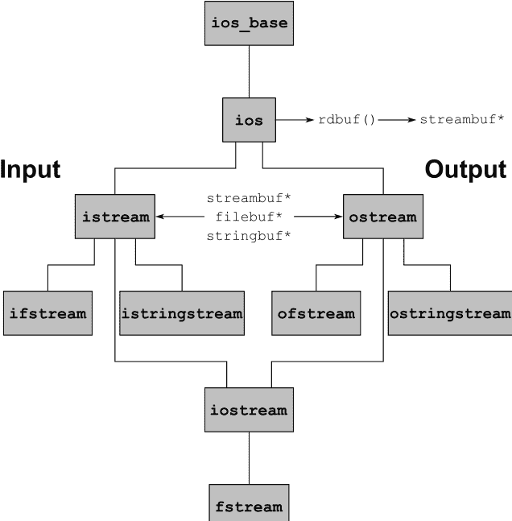

图 6.1：核心 I/O 类

流对象的作用有限但十分重要：它们是将要输入或输出的对象与 streambuf 之间的接口；streambuf 负责通过 streambuf 对象访问的设备执行实际的输入和输出。

这种方法使我们能够为新类型的设备构造新的 streambuf，并将该 streambuf 与“老一套”的 iostream 和 ostream 类设施结合使用。理解 iostream 对象的格式化角色与 streambuf 对象中实现的外部设备缓冲接口之间的区别非常重要。连接新设备（如套接字或文件描述符）需要构造新的 streambuf，而不是新的 stream 或 ostream 对象。不过，可以在 stream 或 ostream 类周围构造一个包装类，以方便访问特殊设备。stringstream 类就是这样构造出来的。

### 6.1 特殊头文件

有若干与 iostream 相关的头文件可用。根据当前情况，应使用以下头文件：

- `<iosfwd>`：如果只需要流类的声明，源文件应包含此头文件。例如，如果函数定义了 `ostream` 的引用参数，编译器不需要确切知道 `ostream` 是什么。在声明这样的函数时，只需声明 `ostream` 类即可。不能使用

    ```
    class std::ostream; // erroneous declaration
    ```

    ```
    void someFunction(std::ostream &str);
    ```

    而应使用：

    ```
    #include <iosfwd>   // correctly declares class ostream
    ```

    ```
    void someFunction(std::ostream &str);
    ```

- `<ios>`：当使用在 `ios` 类中定义的类型和设施（如 `ios::off_type`，见下文）时，源文件应包含此头文件。

- `<streambuf>`：当使用 `streambuf` 或 `filebuf` 类时，源文件应包含此头文件。参见第 14.8 和 14.8.2 节。

- `<istream>`：当使用 `istream` 类或同时进行输入和输出的类时，源文件应包含此头文件。参见第 6.5.1 节。

- `<ostream>`：当使用 `ostream` 类或同时进行输入和输出的类时，源文件应包含此头文件。参见第 6.4.1 节。

- `<iostream>`：当使用全局流对象（如 `cin` 和 `cout`）时，源文件应包含此头文件。

- `<fstream>`：当使用文件流类时，源文件应包含此头文件。参见第 6.4.2、6.5.2 和 6.6.2 节。

- `<sstream>`：当使用字符串流类时，源文件应包含此头文件。参见第 6.4.3 和 6.5.3 节。

- `<iomanip>`：当使用参数化操纵符时，源文件应包含此头文件。参见第 6.3.2 节。

- `std::ostream *ios::tie(std::ostream *outs):`

    `ostream` 对象被绑定到当前的 `ios` 对象。这意味着每次当前 `ios` 对象执行输入或输出操作之前，`ostream` 对象都会被*刷新*。返回一个指针，指向该 `ios` 对象原来的 `ostream` 对象。若要解除绑定，请传递参数 0。参见第 6.5.5 节的示例。

#### 6.3.1 条件状态

流上的操作可能因各种原因失败。一旦操作失败，该流上的后续操作都将被挂起。可以检查、设置甚至清除流的条件状态，从而让程序修复问题而不是被迫中止。本节描述可用于查询或操作流状态的成员。

条件由以下*条件标志*表示：

- `ios::badbit`：

    如果此标志被置位，则说明在流所对接的 `streambuf` 对象层面上请求了非法操作。有关示例见下面的成员函数。

- `ios::eofbit`：

    如果此标志被置位，说明 `ios` 对象已检测到文件结束。

- `ios::failbit`：

    如果此标志被置位，说明流对象执行的某个操作失败（例如在输入没有数字字符时尝试提取 `int`）。在这种情况下，流本身无法执行其被请求的操作。

- `ios::goodbit`：

    当其他三个条件标志均未置位时，此标志被置位。

有若干条件成员函数可用于操作或确定 `ios` 对象的状态。它们最初返回 `int` 值，但现在的返回类型是 `bool`：

- `bool ios::bad():`

    当流的 `badbit` 被置位时返回 `true`，否则返回 `false`。如果返回 `true`，表示在流所对接的 `streambuf` 对象层面上请求了非法操作。这是什么意思？它表示 `streambuf` 本身行为异常。考虑下面的示例：

    ```
    std::ostream error(0);
    ```

    这里构造了一个 `ostream` 对象，但*没有*为其提供可工作的 `streambuf` 对象。由于这个“streambuf”永远不会正常工作，它的 `badbit` 标志从一开始就被置位：`error.bad()` 返回 `true`。

- `bool ios::eof():`

    当检测到文件结束（EOF）时（即 `eofbit` 标志被置位），返回 `true`，否则返回 `false`。假设我们正在从 `cin` 逐行读取，但最后一行没有以 `\n` 字符结尾。在这种情况下，`std::getline` 尝试读取 `\n` 分隔符时首先遇到文件结束。这会置位 `eofbit` 标志，使 `cin.eof()` 返回 `true`。例如，假设 `std::string str` 并且 `main` 执行以下语句：

    ```
    getline(cin, str);
    cout << cin.eof();
    ```

    然后

    ```
    echo "hello world" | program
    ```

    将打印 0（未检测到 EOF）。但在

    ```
    echo -n "hello world" | program
    ```

    之后，将打印 1（检测到 EOF）。

- `bool ios::fail():`

    当 `bad` 返回 `true` 或 `failbit` 标志被置位时返回 `true`，否则返回 `false`。在上述示例中，无论我们是否用分隔符终止最后一行（因为我们已经读取了一行），`cin.fail()` 都返回 `false`。然而，再执行一次 `getline` 会导致 `failbit` 标志被置位，使 `cin.fail()` 返回 `true`。通常：如果请求的流操作失败，`fail` 返回 `true`。一个简单的例子是：当输入流包含文本 `hello world` 时尝试提取 `int`。流对象的 `bool` 解释返回 `not fail()` 的值（见下文）。

- `bool ios::good():`

    返回 `goodbit` 标志的值。当其他条件标志（`badbit`、`eofbit`、`failbit`）均未置位时，它等于 `true`。考虑下面这个小程序：

    ```
    #include <iostream>
    #include <string>

    using namespace std;

    void state()
    {
        cout << "\n"
             "Bad: " << cin.bad() << " "
             "Fail: " << cin.fail() << " "
             "Eof: " << cin.eof() << " "
             "Good: " << cin.good() << '\n';
    }

    int main()
    {
        string line;
        int x;

        cin >> x;
        state();

        cin.clear();
        getline(cin, line);
        state();

        getline(cin, line);
        state();
    }
    ```

    当这个程序处理一个包含两行的文件时，两行内容分别为 `hello` 和 `world`，且第二行没有以 `\n` 字符结尾，则输出如下：

    ```
    Bad: 0 Fail: 1 Eof: 0 Good: 0

    Bad: 0 Fail: 0 Eof: 0 Good: 1

    Bad: 0 Fail: 0 Eof: 1 Good: 0
    ```

    因此，提取 `x` 失败（`good` 返回 `false`）。然后，错误状态被清除，第一行被成功读取（`good` 返回 `true`）。最后读取第二行（但不完整）：`good` 返回 `false`，`eof` 返回 `true`。

- 将流解释为 `bool` 值：

    流可用于需要逻辑值的表达式中。例如：

    ```
    if (cin)                // cin itself interpreted as bool
    if (cin >> x)           // cin interpreted as bool after an extraction
    if (getline(cin, str))  // getline returning cin
    ```

    当把流解释为逻辑值时，实际被解释的是 `not fail()`。因此上面的示例可以改写为：

    ```
    if (not cin.fail())
    if (not (cin >> x).fail())
    if (not getline(cin, str).fail())
    ```

    但前一种写法几乎总是被使用。

以下成员可用于管理错误状态：

- `void ios::clear():`

    当出现错误条件且该条件能够修复时，可以使用 `clear` 清除流的错误状态。存在一个重载版本，它接受状态标志，并会先清除当前标志集合再设置这些标志：`clear(int state)`。其返回类型为 `void`。

- `ios::iostate ios::rdstate():`

    返回某个 `ios` 对象当前设置的状态标志集合（作为 `int`）。要测试特定标志，请使用按位与运算符：

    ```
    if (!(iosObject.rdstate() & ios::failbit))
    {
        // last operation didn't fail
    }
    ```

    注意，不能对 `goodbit` 标志执行此测试，因为其值为零。要测试“good”状态，请使用类似下面的结构：

    ```
    if (iosObject.rdstate() == ios::goodbit)
    {
        // state is 'good'
    }
    ```

- `void ios::setstate(ios::iostate state):`

    可以使用 `setstate` 为流设置特定的状态集合。其返回类型为 `void`。例如：

    ```
    cin.setstate(ios::failbit);    // set state to 'fail'
    ```

    要在一次 `setstate()` 调用中设置多个标志，请使用 `bitor` 运算符：

    ```
    cin.setstate(ios::failbit | ios::eofbit);
    ```

    成员 `clear` 是清除所有错误标志的快捷方式。当然，清除标志并不自动意味着错误条件也已清除。策略应为：

    - 检测到错误条件。
    - 修复错误。


- 成员 `clear` 被调用。

C++ 支持一种*异常*机制来处理异常情况。根据 ANSI/ISO 标准，异常可与流对象一起使用。第10章讨论异常。将异常与流对象一起使用在第10.7节讨论。

#### 6.3.2 格式化输出和输入

信息写入流（或偶尔从流中读取）的方式由*格式化标志*控制。

当需要设置输出字段或输入缓冲区的宽度，以及确定值显示的形式（例如*基数*）时，就会使用格式化。大多数格式化特性属于 `ios` 类的范畴。格式化由 `ios` 类定义的标志控制。这些标志可以通过两种方式操作：使用专门的成员函数，或使用*操纵符*，后者可直接插入流或从流中提取。使用任一方法都没有特别理由；通常两种方法都可行。在下面的概述中，首先介绍各种成员函数。随后介绍标志和操纵符本身。提供示例说明如何操作标志以及它们的效果。

许多操纵符无参数，一旦包含流头文件（例如 `iostream`）即可使用。一些操纵符需要参数。要使用后一类操纵符，必须包含头文件 `iomanip`。

##### 6.3.2.1 修改格式的成员函数

有几个*成员函数*可用于操作 I/O 格式化标志。除了使用下面列出的成员外，通常还可使用*操纵符*，它们可直接插入流或从流中提取。可用成员按字母顺序列出，但实践中最重要的成员是 `setf`、`unsetf` 和 `width`。

- `ios &ios::copyfmt(ios &obj):` 将 `obj` 的所有格式标志复制到当前 `ios` 对象。返回当前 `ios` 对象。

- `ios::fill() const:` 返回当前填充字符。默认情况下，这是空白字符。

- `ios::fill(char padding):` 重新定义填充字符，并返回*前一个*填充字符。除了使用此成员函数，还可以将 `setfill` *操纵符*直接插入 `ostream`。例如：

  ```cpp
  cout.fill('0');        // use '0' as padding char
  cout << setfill('+');  // use '+' as padding char
  ```

- `ios::fmtflags ios::flags() const:` 返回控制调用该成员函数的流的格式状态的当前标志集。要检查某个特定标志是否已设置，请使用 `bit_and` 运算符。例如：

  ```cpp
  if (cout.flags() & ios::hex)
      cout << "Integral values are printed as hex numbers\n";
  ```

- `ios::fmtflags ios::flags(ios::fmtflags flagset);` 返回*前一组*标志，并由 `flagset` 定义新的标志集。使用 bitor 运算符指定多个标志。例如：

  ```cpp
  // change the representation to hexadecimal
  cout.flags(ios::hex | cout.flags() & ~ios::dec);
  ```

- `int ios::precision() const;` 返回输出浮点值时使用的有效数字位数（默认值：6）。

- `int ios::precision(int signif);` 将输出实数值时使用的有效数字位数设置为 `signif`。返回先前使用的有效数字位数。如果所需位数超过 `signif`，则该数字以“科学”记数法显示（参见[6.3.2.2](#)节）。操纵符：`setprecision`。例如：

  ```cpp
  cout.precision(3);             // 3 digits precision
  cout << setprecision(3);       // same, using the manipulator

  cout << 1.23 << " " << 12.3 << " " << 123.12 << " " << 1234.3 << '\n';
  // displays: 1.23 12.3 123 1.23e+03
  ```

- `ios::fmtflags ios::setf(ios::fmtflags flags);` 设置一个或多个格式化标志（使用 bitor 运算符组合多个标志）。已设置的标志不受影响。返回*前一组*标志。除了使用此成员函数，还可以使用操纵符 `setiosflags`。示例在下一节（[6.3.2.2](#)）中提供。

- `ios::fmtflags ios::setf(ios::fmtflags flags, ios::fmtflags mask);` 清除 mask 中提到的所有标志，并设置 `flags` 中指定的标志。返回*前一组*标志。一些示例如下（但更详细的讨论参见下一节（[6.3.2.2](#)））：

  ```cpp
  // left-adjust information in wide fields
  cout.setf(ios::left, ios::adjustfield);
  // display integral values as hexadecimal numbers
  cout.setf(ios::hex, ios::basefield);
  // display floating point values in scientific notation
  cout.setf(ios::scientific, ios::floatfield);
  ```

- `ios::fmtflags ios::unsetf(ios::fmtflags flags);` 清除指定的格式化标志（其余标志保持不变），并返回*前一组*标志。取消设置活动的默认标志（例如 `cout.unsetf(ios::dec)`）的请求会被忽略。除了此成员函数，也可以使用操纵符 `resetiosflags`。例如：

  ```cpp
  cout << 12.24;                    // displays  12.24
  cout.setf(ios::fixed);
  cout << 12.24;                    // displays  12.240000
  cout.unsetf(ios::fixed);          // undo a previous ios::fixed setting.
  cout << 12.24;                    // displays  12.24
  cout << resetiosflags(ios::fixed); // using manipulator rather
                                     // than unsetf
  ```

- `int ios::width() const;` 返回下一次插入时要使用的当前活动输出字段宽度。默认值为 0，表示“写入该值所需字符数”。

- `int ios::width(int nchars);` 将下一次插入操作的字段宽度设置为 `nchars`，并返回先前使用的字段宽度。此设置不是持久的。每次插入操作后都会重置为 0。操纵符：`std::setw(int)`。例如：

  ```cpp
  cout.width(5);
  cout << 12;                 // using 5 chars field width
  cout << setw(12) << "hello";  // using 12 chars field width
  ```

##### 6.3.2.2 格式化标志

大多数格式化标志与输出信息有关。信息基本上可以通过两种方式写入输出流：使用二进制输出，信息直接写入输出流，而不先转换为某种人类可读格式；以及使用格式化输出，首先将存储在计算机内存中的值转换为人类可读文本。格式化标志用于定义这种转换发生的方式。本节涵盖所有格式化标志。格式化标志可以使用成员函数来设置（取消设置），但通常也可以使用具有相同效果的操纵符。对于每个标志，都会展示如何通过成员函数或（如果可用）操纵符来控制它们。

**在宽字段中显示信息：**

- `ios::internal:` 在负数的负号与值本身之间添加填充字符（默认为空格）。其他值和数据类型右对齐。操纵符：`std::internal`。例如：

  ```cpp
  cout.setf(ios::internal, ios::adjustfield);
  cout << internal;        // same, using the manipulator

  cout << '|' << setw(5) << 5 << "\n";  // displays '    5'
  ```

- `ios::left:` 在比显示值所需更宽的字段中左对齐值。操纵符：`std::left`。例如：

  ```cpp
  cout.setf(ios::left, ios::adjustfield);
  cout << left;             // same, using the manipulator

  cout << '|' << setw(5) << "hi" << "\n";  // displays 'hi   '
  ```

- `ios::right:` 在比显示值所需更宽的字段中右对齐值。操纵符：`std::right`。这是默认值。例如：

  ```cpp
  cout.setf(ios::right, ios::adjustfield);
  cout << right;            // same, using the manipulator

  cout << '|' << setw(5) << "hi" << "\n";  // displays '  hi'
  ```

**使用各种数字表示：**

- `ios::dec:` 将整数值显示为十进制数。操纵符：`std::dec`。这是默认值。例如：

  ```cpp
  cout.setf(ios::dec, ios::basefield);
  cout << dec;             // same, using the manipulator
  cout << 0x10;            // displays 16
  ```


- `ios::hex`：用于将整数值显示为十六进制数。操作器：`std::hex`。示例：

  ```cpp
  cout.setf(ios::hex, ios::basefield);
  cout << hex;                 // same, using the manipulator
  cout << 16;                  // displays 10
  ```

- `ios::oct`：用于将整数值显示为八进制数。操作器：`std::oct`。示例：

  ```cpp
  cout.setf(ios::oct, ios::basefield);
  cout << oct;                 // same, using the manipulator
  cout << 16;                  // displays 20
  ```

- `std::setbase(int radix)`：这是一个操作器，可用于将数字表示形式更改为十进制、十六进制或八进制。示例：

  ```cpp
  cout << setbase(8);         // octal numbers, use 10 for
                              // decimal, 16 for hexadecimal
  cout << 16;                  // displays 20
  ```

##### 微调值的显示：

- `ios::boolalpha`：通过 `boolalpha`，逻辑值可以以文本形式显示，真逻辑值显示为 ‘true’，假逻辑值显示为 ‘false’。默认情况下该标志未设置。互补标志：`ios::noboolalpha`。操作器：`std::boolalpha` 和 `std::noboolalpha`。示例：

  ```cpp
  cout.setf(ios::boolalpha);
  cout << boolalpha;           // same, using the manipulator
  cout << (1 == 1);            // displays true
  ```

- `ios::showbase`：用于显示整数值的数字进制。对于十六进制值，使用 `0x` 前缀；对于八进制值，使用前缀 `0`。对于（默认的）十进制值，不使用特定前缀。互补标志：`ios::noshowbase`。操作器：`std::showbase` 和 `std::noshowbase`。示例：

  ```cpp
  cout.setf(ios::showbase);
  cout << showbase;            // same, using the manipulator
  cout << hex << 16;           // displays 0x10
  ```

- `ios::showpos`：用于在正十进制值（仅限）前显示 + 号。互补标志：`ios::noshowpos`。操作器：`std::showpos` 和 `std::noshowpos`。示例：

  ```cpp
  cout.setf(ios::showpos);
  cout << showpos;            // same, using the manipulator
  cout << 16;                 // displays +16
  cout.unsetf(ios::showpos);  // Undo showpos
  cout << 16;                 // displays 16
  ```

- `ios::uppercase`：用于在十六进制值中使用大写字母显示字母。互补标志：`ios::nouppercase`。操作器：`std::uppercase` 和 `std::nouppercase`。默认情况下使用小写字母。示例：

  ```cpp
  cout.setf(ios::uppercase);
  cout << uppercase;                  // same, using the manipulator
  cout << hex << showbase <<
      3735928559;                    // displays 0XDEADBEEF
  ```

##### 显示浮点数

- `ios::fixed`：使用固定小数点显示实数值（例如 12.25 而不是 1.225e+01），使用 fixed 格式化标志。它可用于设置小数点后固定的位数。操作器：`fixed`。示例：

  ```cpp
  cout.setf(ios::fixed, ios::floatfield);
  cout.precision(3);           // 3 digits behind the .

  // Alternatively:
  cout << setiosflags(ios::fixed) << setprecision(3);

  cout << 3.0 << " " << 3.01 << " " << 3.001 << '\n'
       << 3.0004 << " " << 3.0005 << " " << 3.0006 << '\n';
  // Results in:
  // 3.000 3.010 3.001
  // 3.000 3.001 3.001
  ```

该示例表明，3.0005 向远离零的方向舍入，变为 3.001（同样，-3.0005 变为 -3.001）。先设置 precision 再设置 fixed 具有相同效果。

- `ios::scientific`：用于以科学计数法显示实数值（例如 1.24e+03）。操作器：`std::scientific`。示例：

  ```cpp
  cout.setf(ios::scientific, ios::floatfield);
  cout << scientific;            // same, using the manipulator
  cout << 12.25;                 // displays 1.22500e+01
  ```

- `ios::showpoint`：用于在显示实数时显示尾随的小数点*以及*尾随的小数零。互补标志：`ios::noshowpoint`。操作器：`std::showpoint`、`std::noshowpoint`。示例：

  ```cpp
  cout << fixed << setprecision(3);   // 3 digits behind .

  cout.setf(ios::showpoint);        // set the flag
  cout << showpoint;                // same, using the manipulator

  cout << 16.0 << ", " << 16.1 << ", " << 16;
  // displays: 16.000, 16.100, 16
  ```

请注意，最后的 16 是整数而不是浮点数，因此它没有小数点。所以 showpoint 没有效果。如果 `ios::showpoint` 未激活，尾随的零会被丢弃。如果小数部分为零，小数点也会被丢弃。示例：

  ```cpp
  cout.unsetf(ios::fixed, ios::showpoint);   // unset the flags

  cout << 16.0 << ", " << 16.1;
  // displays: 16, 16.1
  ```

##### 处理空白字符与刷新流

- `std::endl`：插入换行符并刷新流的操作器。通常不需要刷新流，这样做会不必要地降低 I/O 处理速度。因此，应避免使用 endl（可改用插入 `'\n'`），除非明确需要刷新流。注意，当程序终止或流“绑定”到另一个流时，流会自动刷新（参见 6.3 节中的 tie）。示例：

  ```cpp
  cout << "hello" << endl; // prefer: << '\n';
  ```

- `std::ends`：将 0 字节插入流的操作器。它通常与内存流结合使用（参见 6.4.3 节）。

- `std::flush`：可以使用此成员刷新流。通常不需要刷新流，这样做会不必要地降低 I/O 处理速度。因此，除非明确要求，否则应避免使用 flush。注意，当程序终止或流“绑定”到另一个流时，流会自动刷新（参见 6.3 节中的 tie）。示例：

  ```cpp
  cout << "hello" << flush; // avoid if possible.
  ```

- `ios::skipws`：当从流中提取值时，会跳过前导空白字符（空格、制表符、换行符等）。这是默认行为。如果该标志未设置，则不会跳过前导空白字符。操作器：`std::skipws`。示例：

  ```cpp
  cin.setf(ios::skipws); // to unset, use
                         // cin.unsetf(ios::skipws)

  cin >> skipws;        // same, using the manipulator
  int value;
  cin >> value;         // skips initial blanks
  ```

- `ios::unitbuf`：设置了此标志的流会在每次输出操作后刷新其缓冲区。通常不需要刷新流，这样做会不必要地降低 I/O 处理速度。因此，应避免设置 unitbuf，除非明确需要刷新流。注意，当程序终止或流“绑定”到另一个流时，流会自动刷新（参见 6.3 节中的 tie）。互补标志：`ios::nounitbuf`。操作器：`std::unitbuf`、`std::nounitbuf`。示例：

  ```cpp
  cout.setf(ios::unitbuf);
  cout << unitbuf;        // same, using the manipulator

  cout.write("xyz", 3);   // flush follows write.
  ```

- `std::ws`：删除当前文件位置处所有空白字符（空格、制表符、换行符等）的操作器。即使已经设置了 `ios::skipws` 标志，如果存在空白字符也会被删除。示例（假设输入包含 4 个空格字符，后跟字符 X）：

  ```cpp
  cin >> ws;  // skip white space
  cin.get();  // returns 'X'
  ```

### 6.4 输出

在 C++ 中，输出主要基于 `std::ostream` 类。`ostream` 类定义了向流中插入信息的基本运算符和成员：*插入运算符*（`<<`），以及像 `write` 这样的特殊成员，用于向流中写入无格式信息。

`ostream` 类作为多个其他类的*基类*，这些类都提供 `ostream` 类的功能，但增加了各自的特色。在接下来的章节中，将讨论以下类：

- `ostream` 类，提供基本的输出功能；
- `ofstream` 类，允许我们写入文件（类似于 C 的 `fopen (filename, "w")`）；
- `ostringstream` 类，允许我们将信息写入内存（类似于 C 的 `sprintf` 函数）。

#### 6.4.1 基本输出：`ostream` 类

`ostream` 类定义了基本的输出功能。`cout`、`clog` 和 `cerr` 对象都是 `ostream` 对象。`ios` 类定义的所有与输出相关的功能在 `ostream` 类中同样可用。

我们可以使用以下 `ostream` 构造函数来定义 `ostream` 对象：

- `std::ostream object(std::streambuf *sb)`：此构造函数创建一个 `ostream` 对象，该对象是对现有 `std::streambuf` 对象的包装。无法定义一个普通的、随后可用于插入操作的 `ostream` 对象（例如使用 `std::ostream out;`）。当我们使用 `cout` 或它的同类时，实际上是在使用一个预定义的 `ostream` 对象，该对象已经为我们定义好，并使用一个（同样预定义的）`streambuf` 对象处理实际接口，与标准输出流进行交互。

  然而，可以定义一个传入 0 指针的 `ostream` 对象。这样的对象不能用于插入操作（即，当向其中插入内容时，它会引发其 `ios::bad` 标志），但之后可以给它一个 `streambuf`。因此，它可以被预先构造，暂缓其使用，直到合适的 `streambuf` 可用（另见 13.6 节）。

要在 C++ 源码中使用 `ostream` 类，必须包含 `ostream` 头文件。要使用预定义的 `ostream` 对象（`std::cin`、`std::cout` 等），必须包含 `iostream` 头文件。

##### 6.4.1.1 写入 `ostream` 对象

`ostream` 类支持格式化输出和*二进制输出*。

*插入运算符*（`<<`）用于以类型安全的方式将值插入 `ostream` 对象。这被称为格式化输出，因为存储在计算机内存中的二进制值会根据特定的格式化规则转换为人类可读的 ASCII 字符。

`<<` 的正常结合性保持不变，因此当出现类似如下的语句时：

```cpp
cout << "hello " << "world";
```


遇到这种情况时，最左侧的两个操作数会先求值（`cout << "hello "`），并返回一个 `ostream &` 对象，该对象实际上就是同一个 `cout` 对象。现在，该语句简化为

```cpp
cout << "world";
```

随后第二个字符串被插入到 `cout` 中。

`<<` 运算符有许多重载变体，因此许多类型的变量都可以插入到 `ostream` 对象中。存在接受 `int`、`double`、指针等的重载 `<<` 运算符。每个运算符都返回已插入目前信息的那个 `ostream` 对象，因此可以立即在其后跟随下一次插入。

流缺少像 C 的 `printf` 和 `vprintf` 函数那样的格式化输出功能。尽管在流的世界中实现这些功能并不困难，但 C++ 程序几乎从不需要类似 `printf` 的功能。此外，由于它可能类型不安全，完全避免此功能也许更好。

当必须写入二进制文件时，通常不使用也不需要文本格式化：`int` 值应写为一系列原始字节，而不是一系列 ASCII 数字字符 0 到 9。`ostream` 对象的以下成员函数可用于写入“二进制文件”：

- `ostream& put(char c):`
  向输出流写入单个字符。由于一个字符就是一个字节，此成员函数也可用于向文本文件写入单个字符。
- `ostream& write(char const *buffer, int length):`
  最多写入 `length` 个字节，这些字节存储在 `char const *buffer` 中并写入 `ostream` 对象。字节按它们在缓冲区中的存储方式写入，不进行任何格式化。注意第一个参数是 `char const *`：要写入任何其他类型都需要进行类型转换。例如，要将一个 `int` 作为无格式的字节值序列写入，请使用：

```cpp
int x;
out.write(reinterpret_cast<char const *>(&x), sizeof(int));
```

上述 `write` 调用写入的字节按底层硬件的字节序写入 `ostream`。大端计算机先写多字节值的最高有效字节，小端计算机先写最低有效字节。

##### 6.4.1.2 'ostream' 定位

尽管并非每个 `ostream` 对象都支持重新定位，但它们通常支持。这意味着可以重写流中先前写入的某一部分。重新定位常用于数据库应用程序，其中必须能够随机访问数据库中的信息。

当前定位可以通过以下成员获取和修改：

- `ios::pos_type tellp():`
  返回文件中下一次对流的写操作将发生处的当前（绝对）位置。
- `ostream& seekp(ios::off_type step, ios::seekdir org):`
  修改流的实际位置。该函数期望一个 `off_type step`，表示当前流位置相对于 `org` 移动的字节数。`step` 值可以为负、零或正。
  
  步进的起点 `org` 是 `ios::seekdir` 枚举中的一个值。其值为：
  
  - `ios::beg:`
    步长相对于流的开头计算。默认使用此值。
  - `ios::cur:`
    步长相对于流的当前位置（由 `tellp` 返回）计算。
  - `ios::end:`
    步长相对于流的当前末尾位置解释。

可以定位或写入超过文件最后位置的位置。将字节写入超过 EOF 的位置会用 ASCII-Z 值（空字节）填充中间字节。定位到 `ios::beg` 之前会引发 `ios::fail` 标志。

##### 6.4.1.3 'ofstream' 刷新

除非已设置 `ios::unitbuf` 标志，否则写入 `ostream` 对象的信息不会立即写入物理流。相反，在写操作期间会填充一个内部缓冲区，当缓冲区满时将其刷新。

流的内部缓冲区可以在程序控制下刷新：

- `ostream& flush();`
  `ostream` 对象内部存储的任何缓冲信息都会被刷新到该 `ostream` 对象所接口的设备。流会在以下情况下自动刷新：
  
  - 对象不再存在；
  - 将 `endl` 或 `flush` *操纵符*（见第 [6.3.2.2](#) 节）插入到 `ostream` 对象中；
  - 支持 `close` 操作的流被显式关闭（例如 `std::ofstream` 对象，参见第 [6.4.2](#) 节）。

#### 6.4.2 输出到文件：类 'ofstream'

`std::ofstream` 类派生自 `ostream` 类：它具有与 `ostream` 类相同的能力，但可用于访问文件或创建文件以进行写入。

为了在 C++ 源文件中使用 `ofstream` 类，必须包含 `fstream` 头文件。包含 `fstream` 并不会自动提供标准流 `cin`、`cout` 和 `cerr`。要声明这些标准流，请包含 `iostream`。

`ofstream` 对象可使用以下构造函数：

- `ofstream object:`
  这是基本构造函数。它定义一个 `ofstream` 对象，之后可使用其 `open()` 成员将其与一个实际文件关联（见下文）。
- `ofstream object(char const *name, ios::openmode mode = ios::out):`
  此构造函数定义一个 `ofstream` 对象，并使用输出模式 `mode` 立即将其与名为 `name` 的文件关联。第 [6.4.2.1](#) 节概述了可用的输出模式。示例：
  
  `ofstream out("/tmp/scratch");`

无法使用 *文件描述符* 打开 `ofstream`。其原因（显然）是文件描述符在不同操作系统上并非普遍可用。幸运的是，文件描述符可以（间接地）与 `std::streambuf` 对象一起使用（在某些实现中：与 `std::filebuf` 对象一起使用，它也是 `streambuf`）。`Streambuf` 对象在第 [14.8](#) 节讨论，`filebuf` 对象在第 [14.8.2](#) 节讨论。

与其直接将 `ofstream` 对象与文件关联，不如先构造该对象，然后再打开它。

- `void open(char const *name, ios::openmode mode = ios::out):`
  此成员函数用于将 `ofstream` 对象与一个实际文件关联。如果在调用 `open` 之前已设置 `ios::fail` 标志，并且打开成功，则该标志会被清除。打开一个已经打开的流会失败。要将流重新关联到另一个文件，必须先关闭它。
  
  ```cpp
  ofstream out("/tmp/out");
  out << "hello\n";
  out.close();            // flushes and closes out
  out.open("/tmp/out2");
  out << "world\n";
  ```
- `void close():`
  此成员函数关闭一个 `ofstream` 对象。该函数会设置被关闭对象的 `ios::fail` 标志。关闭文件会将任何缓冲信息刷新到关联文件。当关联的 `ofstream` 对象不再存在时，文件会自动关闭。
- `bool is_open() const:`
  假设一个流已正确构造，但尚未附加到文件。例如，已执行语句 `ofstream ostr`。当我们现在通过 `good()` 检查其状态时，会返回一个非零（即 *OK*）值。这里的“good”状态表示流对象已正确构造。这并不意味着文件也已打开。要测试流是否实际打开，应调用 `is_open`。如果它返回 `true`，则流已打开。示例：
  
  ```cpp
  #include <fstream>
  #include <iostream>
  
  using namespace std;
  
  int main()
  {
      ofstream of;
  
      cout << "of's open state: " << boolalpha << of.is_open() << '\n';
  
      of.open("/dev/null");       // on Unix systems
  
      cout << "of's open state: " << of.is_open() << '\n';
  }
  /*
      Generated output:
      of's open state: false
      of's open state: true
  */
  ```

##### 6.4.2.1 打开流对象的模式

在构造或打开 `ofstream`（或 `istream`，见第 6.5.2 节）对象时，可以使用以下文件模式或文件标志。这些值的类型为 `ios::openmode`。标志可以使用 `bitor` 运算符组合。


- `ostringstream ostr(ios::openmode mode = ios::out);`

    此构造函数也可以用作默认构造函数。或者，它允许例如将内容强制追加到对象中目前已存储信息的末尾（使用 `ios::app`）。

    示例：

    ```cpp
    std::ostringstream out;
    ```

- `std::string str() const;`

    返回存储在 ostringstream 对象内部的字符串的副本。

- `void str(std::string const &str);`

    使用新的初始内容重新初始化当前对象。

以下示例说明了 `ostringstream` 类的用法：将若干值插入该对象。然后，`ostringstream` 对象中包含的文本被存储到一个 `std::string` 中，随后打印该字符串的长度和内容。此类 `ostringstream` 对象最常用于进行“类型到字符串”的转换，例如将 int 值转换为文本。格式化标志也可以与 `ostringstream` 一起使用，因为它们是 ostream 类的一部分。

下面是一个展示正在使用 `ostringstream` 对象的示例：

```cpp
#include <iostream>
#include <sstream>

using namespace std;

int main()
{
    ostringstream ostr("hello ", ios::ate);

    cout << ostr.str() << '\n';

    ostr.setf(ios::showbase);
    ostr.setf(ios::hex, ios::basefield);
    ostr << 12345;

    cout << ostr.str() << '\n';

    ostr << " -- ";
    ostr.unsetf(ios::hex);
    ostr << 12;

    cout << ostr.str() << '\n';

    ostr.str("new text");
    cout << ostr.str() << '\n';

    ostr.seekp(4, ios::beg);
    ostr << "world";
    cout << ostr.str() << '\n';
}
/*
    Output from this program:
hello
hello 0x3039
hello 0x3039 -- 12
new text
new world
*/
```

### 6.5 输入

默认情况下，首先跳过所有空白字符，然后提取所有连续的非空白字符。一旦处理完一个提取运算符，就会返回从中提取信息的 `istream` 对象，并且它可以立即用于同一表达式中出现的其他 `istream` 操作。

流缺少用于格式化输入的设施（例如 C 的 `scanf` 和 `vscanf` 函数所使用的设施）。尽管将这些设施添加到流的世界中并不困难，但 C++ 程序中几乎从不需要类似 `scanf` 的功能。此外，由于它可能类型*不安全*，最好完全避免格式化输入。

当必须读取二进制文件时，通常不应格式化信息：`int` 值应作为一系列未更改的字节来读取，而不是作为一系列 ASCII 数字字符 0 到 9 来读取。以下成员函数可用于从 `istream` 对象读取信息：

- `int gcount() const:`

    返回上一次未格式化输入操作从输入流中读取的字符数。

- `int get():`

    下一个可用的单个字符以 `unsigned char` 值的形式返回，并使用 `int` 返回类型。如果没有更多字符可用，则返回 `EOF`。

- `istream& get(char &ch):`

    从输入流读取的下一个单个字符存储在 `ch` 中。该成员函数返回流本身，可以检查该流以确定是否获取到了字符。

- `istream& get(char *buffer, int len, char delim = '\n'):`

    最多从输入流读取 `len - 1` 个字符到从 `buffer` 开始的数组中，该数组长度至少应为 `len` 字节。遇到分隔符 `delim` 时读取也会停止。然而，分隔符本身*不会从输入流中移除*。

    将字符存储到 `buffer` 后，会在存储到 `buffer` 的最后一个字符之后写入一个 ASCII-Z 字符。如果在读取 `len - 1` 个字符之前遇到分隔符，或者在读取 `len - 1` 个字符之后未遇到分隔符，则函数 `eof` 和 `fail`（见第 6.3.1 节）返回 0（`false`）。可以指定 ASCII-Z 分隔符：这样就能从（二进制）文件中读取以 ASCII-Z 字符结尾的字符串。

- `istream& getline(char *buffer, int len, char delim = '\n'):`

    此成员函数的操作与 `get` 成员函数类似，但如果实际遇到 `delim`，`getline` 会将其从流中移除。如果遇到分隔符本身，则它*不会*存储在 `buffer` 中。如果（在读取 `len - 1` 个字符之前）*未*找到 `delim`，则 `fail` 成员函数以及可能还有 `eof` 会返回 true。请注意，`std::string` 类还提供了一个函数 `std::getline`，通常优先于这里描述的 `getline` 成员函数（见第 5.2.4 节）。

- `istream& ignore():`

    从输入流中跳过一个字符。

- `istream& ignore(int n):`

    从输入流中跳过 `n` 个字符。

- `istream& ignore(int n, int delim):`

    最多跳过 `n` 个字符，但在从输入流中移除 `delim` 后停止跳过字符。

- `int peek()`:

    此函数返回下一个可用的输入字符，但不会实际从输入流中移除该字符。如果没有更多字符可用，则返回 EOF。

- `istream& putback(char ch)`:

    字符 `ch` 被推回输入流，以便再次作为下一个可用字符读取。如果不允许这样做，则返回 EOF。通常，可以推回一个字符。示例：

    ```
    string value;
    cin >> value;
    cin.putback('X');
                 // displays: X

    cout << static_cast<char>(cin.get());
    ```

- `istream& read(char *buffer, int len)`:

    最多从输入流读取 `len` 个字节到缓冲区中。如果先遇到 EOF，则读取的字节数会更少，此时成员函数 `eof` 返回 true。此函数通常在读取*二进制*文件时使用。第 6.5.2 节包含一个使用此成员函数的示例。成员函数 `gcount()` 可用于确定 `read` 取回的字符数。

- `istream& readsome(char *buffer, int len)`:

    最多从输入流读取 `len` 个字节到缓冲区中。所有可用字符都会被读入缓冲区，但如果遇到 EOF，则读取的字节数会更少，且不会设置 `ios::eofbit` 或 `ios::failbit`。

- `istream& unget()`:

    将最近从流中读取的字符放回。

##### 6.5.1.2 ‘istream’ 定位

尽管并非每个 iostream 对象都支持重新定位，但有些对象支持。这意味着可以重复读取流中的同一部分。重新定位经常用于*数据库应用程序*，在这些程序中必须能够随机访问数据库中的信息。

可以使用以下成员获取和修改当前位置：

- `ios::pos_type tellg()`:

    返回流当前的（绝对）位置，即流的下一读取操作将发生的位置。

- `istream& seekg(ios::off_type step, ios::seekdir org)`:

    修改流的实际位置。该函数需要一个 `off_type step`，表示当前流位置相对于 `org` 移动的字节数。步长值可以为负、零或正。

    步长的原点 `org` 是 `ios::seekdir` 枚举中的一个值。其值为：

    - `ios::beg`:

        步长相对于流的开头计算。默认使用此值。

    - `ios::cur`:

        步长相对于流的当前位置（由 `tellg` 返回）计算。

    - `ios::end`:

        步长相对于流的当前末尾位置解释。

可以定位到超过文件最后位置的位置。定位到 `ios::beg` 之前会设置 `ios::failbit` 标志。

#### 6.5.2 从文件输入：类 ‘ifstream’

std::ifstream 类派生自 istream 类：它具有与 istream 类相同的能力，但可用于访问文件以进行读取。

为了在 C++ 源代码中使用 ifstream 类，必须包含 fstream 头文件。包含 fstream 不会自动提供标准流 cin、cout 和 cerr。包含 iostream 以声明这些标准流。

以下构造函数可用于 ifstream 对象：

- `ifstream object`:

    这是基本构造函数。它定义一个 ifstream 对象，之后可以使用其 `open()` 成员将其与实际文件关联（见下文）。

- `ifstream object(char const *name, ios::openmode mode = ios::in)`:

    此构造函数可用于定义一个 ifstream 对象，并使用输入模式 mode 立即将其与名为 name 的文件关联。第 6.4.2.1 节概述了可用的输入模式。示例：

    ```cpp
    ifstream in("/tmp/input");
    ```

    也可以不直接将 ifstream 对象与文件关联，而是先构造该对象，之后再打开它。

- `void open(char const *name, ios::openmode mode = ios::in)`:

    此成员函数用于将 ifstream 对象与实际文件关联。如果在调用 open 之前已设置 `ios::fail` 标志，并且打开成功，则该标志会被清除。打开已经打开的流会失败。要将流重新关联到另一个文件，必须先关闭它：

    ```cpp
    ifstream in("/tmp/in");
    in >> variable;
    in.close();        // closes in
    in.open("/tmp/in2");
    in >> anotherVariable;
    ```

- `void close()`:

    此成员函数关闭 ifstream 对象。该函数会设置已关闭对象的 `ios::fail` 标志。关闭文件会将任何缓冲的信息刷新到关联文件。当关联的 ifstream 对象不再存在时，文件会自动关闭。

- `bool is_open() const`:

    假设一个流已被正确构造，但尚未附加到文件。例如，已执行语句 `ifstream ostr`。当我们现在通过 `good()` 检查其状态时，会返回一个非零（即正常）值。此处的“good”状态表示流对象已正确构造。这并不意味着文件也已打开。要测试流是否实际打开，应调用 `is_open`。如果它返回 true，则

流已打开。另请参见第 [6.4.2](#) 节的示例。

下面的示例演示了从二进制文件读取（另见第 [6.5.1.1](#) 节）：

```cpp
#include <fstream>
using namespace std;

int main(int argc, char **argv)
{
    ifstream in(argv[1]);
    double   value;

    // reads double in raw, binary form from file.
    in.read(reinterpret_cast<char *>(&value), sizeof(double));
}
```

#### 6.5.3 从内存输入：类 'istringstream'

要使用流设施从内存读取信息，应使用 std::istringstream 对象。由于 istringstream 类派生自 istream 类，istream 的所有设施同样可用于 istringstream 对象。要使用和定义 istringstream 对象，必须包含头文件 sstream。此外，istringstream 类提供以下构造器和成员：

- `istringstream istr(string const &init, ios::openmode mode = ios::in);`
  
  该对象用 init 的内容初始化。
- `istringstream istr(ios::openmode mode = ios::in)` (此构造器通常用作默认构造器。示例：
  
    ```cpp
    std::istringstream in;
    ```
- `void str(std::string const &str);`
  
  当前对象使用新的初始内容重新初始化。

下面的示例演示了 istringstream 类的使用：从对象中提取若干值。这类 istringstream 对象最常用于进行“字符串到类型”的转换，例如将文本转换为 int 值（参见 C 的 atoi 函数）。格式化标志也可以与 istringstream 一起使用，因为它们是 iostream 类的一部分。在示例中，请特别注意成员 seekg 的使用：

```cpp
#include <iostream>
#include <sstream>
using namespace std;

int main()
{
        istringstream istr("123 345");  // store some text.
        int x;

        istr.seekg(2);                 // skip "12"
        istr >> x;                     // extract int
        cout << x << '\n';             // write it out
        istr.seekg(0);                 // retry from the beginning
        istr >> x;                     // extract int
        cout << x << '\n';             // write it out
        istr.str("666");       // store another text
        istr >> x;             // extract it
        cout << x << '\n';     // write it out
}
/*
   output of this program:
3
123
666
*/
```

#### 6.5.4 复制流

通常，文件是通过逐字符或逐行读取源文件来复制的。处理流的基本模式如下：

- *持续循环：*
  - 1. 从流中读取
  - 2. 如果读取未成功（即 `fail` 返回 `true`），则跳出循环
  - 3. 处理所读取的信息

请注意，读取必须*先于*测试进行，因为只有在实际尝试从文件读取之后，才能知道读取是否成功。当然，也存在变体：`getline(istream &, string &)`（见第 6.5.1.1 节）返回一个 `istream &`，因此在这里读取和测试可以合并为一个表达式。尽管如此，上述模式代表了一般情况。因此，下面的程序可用于将 `cin` 复制到 `cout`：

```cpp
#include <iostream>
using namespace std;

int main()
{
    while (true)
    {
        char c;

        cin.get(c);
        if (cin.fail())
            break;
        cout << c;
    }
}
```

这里可以通过将 `get` 与 `if` 语句合并来简写，结果如下：

```cpp
if (!cin.get(c))
    break;
```

即便如此，这仍然遵循基本规则：“先读取，后测试”。

仅仅复制文件并不常见。更常见的情况是，文件先被处理到某一点，然后直接复制文件的其余信息。下面的程序说明了这一点。使用 `ignore` 跳过第一行（为了示例，假定第一行最多 80 个字符），第二条语句使用了 `<<` 运算符的另一个重载版本，其中将一个 `streambuf` 指针插入到流中。作为成员

```cpp
#include <iostream>
using namespace std;

int main()
{
    cin.ignore(80, '\n');   // skip the first line and...
    cout << cin.rdbuf();    // copy the rest through the streambuf *
}
```

这种复制流的方式仅假定存在一个 `streambuf` 对象。因此，它可以用于 `streambuf` 类的所有特化。

#### 6.5.5 耦合流

Ostream 对象可以通过 `tie` 成员函数与 `ios` 对象*耦合*。耦合的结果是，每当对 `ios` 对象（该 `ostream` 对象被绑定到它）执行输入或输出操作时，都会刷新 `ostream` 的缓冲区。默认情况下，`cout` 绑定到 `cin`（使用 `cin.tie(cout)`）。这意味着每当请求对 `cin` 进行操作时，会首先刷新 `cout`。要解除绑定，可以调用 `ios::tie(0)`。在示例中：`cin.tie(0)`。

另一种有用的流耦合方式是 `cerr` 和 `cout` 之间的绑定。由于这种绑定，写到屏幕的标准输出和错误消息会与它们生成的时间同步显示：

```cpp
#include <iostream>
using namespace std;

int main()
{
    cerr.tie(0);        // untie
    cout << "first (buffered) line to cout ";
    cerr << "first (unbuffered) line to cerr\n";
    cout << "\n";

    cerr.tie(&cout);    // tie cout to cerr
    cout << "second (buffered) line to cout ";
    cerr << "second (unbuffered) line to cerr\n";
    cout << "\n";
}
/*
    Generated output:

    first (unbuffered) line to cerr
    first (buffered) line to cout
    second (buffered) line to cout second (unbuffered) line to cerr
*/
```

另一种耦合流的方式是让流使用一个公共的 `streambuf` 对象。这可以通过 `ios::rdbuf(streambuf *)` 成员函数来实现。这样，两个流可以使用例如各自的格式化，一个流可用于输入，另一个用于输出，并且可以实现使用流库而不是操作系统调用的重定向。参见以下各节的示例。

### 6.6 高级主题

#### 6.6.1 重定向流

使用 `ios::rdbuf`，可以强制流共享它们的 `streambuf` 对象。因此，写入一个流的信息实际上会被写入另一个流；这种现象通常称为*重定向*。重定向通常在操作系统级别实现，有时这仍然是必要的（参见第 23.2.3 节）。

重定向有用的一种常见情况是，错误消息应写入文件而不是标准错误流（通常由其文件描述符编号 2 表示）。在使用 bash shell 的 Unix 操作系统中，可以如下实现：

```
program 2>/tmp/error.log
```

执行此命令后，由 `program` 写入的任何错误消息都会保存到文件 `/tmp/error.log` 中，而不是显示在屏幕上。

下面的示例展示了如何使用 `streambuf` 对象实现这一点。假设 `program` 期望一个参数来指定写入错误消息的文件名。它可以如下调用：

```
program /tmp/error.log
```

程序如下所示，在程序源代码之后提供了说明：

```cpp
#include <iostream>
#include <fstream>
using namespace std;

int main(int argc, char **argv)
{
    ofstream errlog;                              // 1
    streambuf *cerr_buffer = 0;                   // 2

    if (argc == 2)
    {
        errlog.open(argv[1]);                     // 3
        cerr_buffer = cerr.rdbuf(errlog.rdbuf()); // 4
    }
    else
    {
        cerr << "Missing log filename\n";
        return 1;
    }

    cerr << "Several messages to stderr, msg 1\n";
    cerr << "Several messages to stderr, msg 2\n";

    cout << "Now inspect the contents of " <<
        argv[1] << "... [Enter] ";
    cin.get();                                    // 5

    cerr << "Several messages to stderr, msg 3\n";

    cerr.rdbuf(cerr_buffer);                      // 6
    cerr << "Done\n";                             // 7
}
```


```cpp
}
/*
    Generated output on file argv[1]

    at cin.get();

Several messages to stderr, msg 1
Several messages to stderr, msg 2

    at the end of the program:

Several messages to stderr, msg 1
Several messages to stderr, msg 2
Several messages to stderr, msg 3
*/
```

- 第 1-2 行定义了局部变量：`errlog` 是用于写入错误消息的 `ostream`，而 `cerr_buffer` 是一个指向 `streambuf` 的指针，用于指向原来的 `cerr` 缓冲区。
- 第 3 行打开备用错误流。
- 第 4 行进行重定向：`cerr` 现在写入由 `errlog` 定义的 `streambuf`。保存 `cerr` 原先使用的缓冲区很重要，如下所述。
- 第 5 行我们暂停。此时，已经有两行写入备用错误文件。我们有机会查看其内容：确实有两行被写入该文件。
- 第 6 行终止重定向。这一点非常重要，因为 `errlog` 对象会在 `main` 结束时被销毁。如果没有恢复 `cerr` 的缓冲区，那么此时 `cerr` 将引用一个不存在的 `streambuf` 对象，这可能会产生意外结果。程序员有责任确保在重定向之前保存原来的 `streambuf`，并在重定向结束时恢复它。
- 最后，在第 7 行，由于重定向已经终止，`Done` 再次被写到屏幕上。

#### 6.6.2 读取和写入流

为了同时读取和写入一个流，必须创建一个 `std::fstream` 对象。与 `ifstream` 和 `ofstream` 对象一样，其构造函数接收要打开的文件名：

```cpp
fstream inout("iofile", ios::in | ios::out);
```

注意使用了常量 `ios::in` 和 `ios::out`，表示文件必须同时以读取和写入方式打开。可以使用多个模式指示符，并通过 bitor 运算符连接。或者，也可以使用 `ios::app` 代替 `ios::out`，这样单纯的写入就会变成追加（在文件末尾）。

对同一个文件进行读取和写入总是有些别扭：当文件可能尚不存在，但如果它已经存在又不应该被重写时，该怎么办？与这个问题纠缠了一段时间后，我现在采用以下方法：

```cpp
#include <fstream>
#include <iostream>
#include <string>

using namespace std;

int main()
{
    fstream rw("fname", ios::out | ios::in);

    if (!rw)              // file didn’t exist yet
    {
        rw.clear();       // try again, creating it using ios::trunc
        rw.open("fname", ios::out | ios::trunc | ios::in);
    }

    if (!rw)              // can’t even create it: bail out
    {
        cerr << "Opening 'fname' failed miserably" << '\n';
        return 1;
    }

    cerr << "We’re at: " << rw.tellp() << '\n';

                         // write something
    rw << "Hello world" << '\n';

    rw.seekg(0);             // go back and read what’s written

    string s;
    getline(rw, s);

    cout << "Read: " << s << '\n';
}
```

在这种方法下，第一次构造尝试会失败：fname 尚不存在。但随后可以使用 `ios::trunc` 标志尝试打开。如果文件已经存在，构造就会成功。如果在定义 `rw` 时指定 `ios::ate`，那么初始的读/写操作默认会发生在 EOF 处。

在类似 DOS 的操作系统中，文本文件使用多字符序列 `\r\n` 分隔行；此时处理二进制文件需要 `ios::binary` 标志，以确保 `\r\n` 组合被当作两个字符处理。通常，在处理二进制（非文本）文件时应指定 `ios::binary`。默认情况下，文件以文本文件方式打开。Unix 操作系统不区分文本文件和二进制文件。

对于 `fstream` 对象，使用文件标志的组合来确保流在打开时是否被（重新）创建为空。详情参见第 6.4.2.1 节。

一旦以读写模式打开文件，就可以使用 `<<` 运算符向文件中插入信息，而 `>>` 运算符可用于从文件中提取信息。这些操作可以按任意顺序执行，但在插入和提取之间切换时，需要进行 `seekg` 或 `seekp` 操作。seek 操作用于激活流中用于读取的数据或用于写入的数据（反之亦然）。`fstream` 对象的 `istream` 和 `ostream` 部分共享流的数据缓冲区；通过执行 seek 操作，流会激活其 `istream` 部分或 `ostream` 部分。如果省略 seek，写入后读取以及读取后写入都会直接失败。下面的示例从文件中读取一个以空白字符分隔的单词，然后在刚读取的单词结束位置之后向文件写入另一个字符串。最后又读取另一个字符串，该字符串位于刚写入的字符串结束位置之后：

```cpp
fstream f("filename", ios::in | ios::out);
string str;

f >> str;          // read the first word

                   // write a well known text

f.seekg(0, ios::cur);

f << "hello world";

f.seekp(0, ios::cur);
f >> str;        // and read again
```

由于在对同一文件交替进行读取和写入（提取和插入）操作时需要进行 *定位* 或 *清除* 操作，因此无法在一个表达式语句中执行一系列 `<<` 和 `>>` 操作。

当然，随机插入和提取几乎从不使用。通常，插入和提取发生在文件中已知的位置。在这些情况下，需要插入或提取的位置可以通过 `seekg`、`seekp`、`tellg` 和 `tellp` 成员函数来控制和监视（参见第 [6.4.1.2](#) 节和第 [6.5.1.2](#) 节）。

由于例如读取超出文件末尾、到达文件末尾或定位到文件开头之前而出现的错误状态（参见第 [6.3.1](#) 节），可以通过 `clear` 成员函数清除。执行 `clear` 后，处理可以继续。例如，

```cpp
fstream f("filename", ios::in | ios::out);
string  str;

f.seekg(-10);    // this fails, but...
f.clear();       // processing f continues

f >> str;        // read the first word
```

在*数据库*应用程序中可以看到同时读取和写入文件的情况，这些应用程序使用由固定大小的记录组成的文件，并且已知各信息片段的位置和大小。例如，下面的程序向一个（可能已存在的）文件添加文本行。它也可以用于根据某一行在文件中的序号检索特定行。*二进制文件*索引可以快速检索各行的位置。

```cpp
#include <iostream>
#include <fstream>
#include <string>
#include <climits>
using namespace std;

void err(char const *msg)
{
    cout << msg << '\n';
}

void err(char const *msg, long value)
{
    cout << msg << value << '\n';
}

void read(fstream &index, fstream &strings)
{
    int idx;

    if (!(cin >> idx))                         // read index
    {
        cin.clear();                           // allow reading again
        cin.ignore(INT_MAX, '\n');             // skip the line
        return err("line number expected");
    }
}
```

```cpp
"w <line>' to write a line\n"
"or enter ‘q’ to quit.\n";

while (true)
{
    cout << "r <nr>, w <line>, q ? ";       // show prompt

    index.clear();
    strings.clear();

    string cmd;
    cin >> cmd;                             // read cmd

    if (cmd == "q")                       // process the cmd.
        return 0;

    if (cmd == "r")
        read(index, strings);
    else if (cmd == "w")
        write(index, strings);
    else if (cin.eof())
    {
        cout << "\n"
             "Unexpected end-of-file\n";
        return 1;
    }
    else
        cout << "Unknown command: " << cmd << '\n';
}
}
```

下一个程序提供了另一个展示文件读写的示例。它还演示了如何处理以 ASCII-Z 分隔的字符串：

```cpp
#include <iostream>
#include <fstream>
using namespace std;

int main()
{
    fstream f("hello", ios::in | ios::out | ios::trunc);  // r/w the file

    f.write("hello", 6);                                  // write 2 ascii-z strings
    f.write("hello", 6);

    f.seekg(0, ios::beg);                                  // reset to begin of file

    char buffer[100];                                      // or: char *buffer = new char[100]
    char c;
                                                         // read the first ‘hello’
    cout << f.get(buffer, sizeof(buffer), 0).tellg() << '\n';
    f >> c;                                               // read the ascii-z delim

                                                         // and read the second ‘hello’
    cout << f.get(buffer + 6, sizeof(buffer) - 6, 0).tellg() << '\n';

    buffer[5] = '/';                                      // change ascii-z to '/'
    cout << buffer << '\n';                              // show 2 times ‘hello’
}
```


```
/*
Generated output:

5
11
hello hello
*/
```

使用 `streambuf` 成员可以实现一种完全不同的流读写方式。到目前为止提到的所有考虑仍然有效（例如，在写操作之后的读操作之前，必须使用 `seekg`）。使用 `streambuf` 对象时，要么将一个 `istream` 与另一个 `ostream` 对象的 `streambuf` 对象关联，要么将一个 `ostream` 对象与另一个 `istream` 对象的 `streambuf` 对象关联。下面是之前的程序，这次使用*关联流*：

```cpp
#include <iostream>
#include <fstream>
#include <string>
using namespace std;

void err(char const *msg);       // see earlier example
void err(char const *msg, long value);

void read(istream &index, istream &strings)
{
    index.clear();
    strings.clear();

    // insert the body of the read() function of the earlier example
}

void write(ostream &index, ostream &strings)
{
    index.clear();
    strings.clear();

    // insert the body of the write() function of the earlier example
}

int main()
{
    ifstream index_in("index", ios::trunc | ios::in | ios::out);
    ifstream strings_in("strings", ios::trunc | ios::in | ios::out);
    ostream index_out(index_in.rdbuf());
    ostream strings_out(strings_in.rdbuf());

    cout << "enter ‘r <number>’ to read line <number> or "
            "‘w <line>’ to write a line\n"
            "or enter ‘q’ to quit.\n";

    while (true)
    {
        cout << "r <nr>, w <line>, q ? ";       // show prompt

        string cmd;

        cin >> cmd;                             // read cmd

        if (cmd == "q")                        // process the cmd.
            return 0;

        if (cmd == "r")
            read(index_in, strings_in);
        else if (cmd == "w")
            write(index_out, strings_out);
        else
            cout << "Unknown Command: " << cmd << '\n';
    }
}
```

在这个例子中

- 与现有流的 `streambuf` 对象关联的流不是 `ifstream` 或 `ofstream` 对象，而是基本的 `istream` 和 `ostream` 对象。

- `streambuf` 对象不是由 `ifstream` 或 `ofstream` 对象定义的。相反，它是在流之外定义的，使用 `filebuf`（参见第 [14.8](#) 节）以及类似下面的构造：

    ```cpp
    filebuf fb("index", ios::in | ios::out | ios::trunc);
    istream index_in(&fb);
    ostream index_out(&fb);
    ```

- 可以使用通常与 `ofstream` 对象一起使用的流模式来构造 `ifstream` 对象。反过来，也可以使用通常与 `ifstream` 对象一起使用的流模式来构造 `ofstream` 对象。

- 如果 `istream` 和 `ostream` 共享一个 `streambuf`，那么它们的读指针和写指针（应当）指向共享缓冲区；它们紧密耦合。

- 与预定义的 `fstream` 对象相比，使用外部（独立）`streambuf` 的优势（当然）在于，它为使用带有专用 `streambuf` 对象的流对象开辟了可能性。这些 `streambuf` 对象可以专门构造，以控制特定设备并为其提供接口。对此展开讨论（另请参见第 [14.8](#) 节）留给读者作为练习。

## 第7章

## 类

C 编程语言提供了两种方法来组织不同类型的数据。C 结构体保存各种类型的数据成员，C 联合体也定义各种类型的数据成员。然而，联合体的数据成员都占用内存中的同一位置，程序员可以决定使用哪一个。

本章介绍类。类是一种结构体，但其内容默认对外界不可访问，而 C++ 结构体的内容默认对外界可访问。在 C++ 中，结构体很少使用：它们主要用于在类的上下文中聚合数据，或定义复杂的返回值。通常，一个 C++ 结构体仅包含普通旧数据（POD，参见第 9.9 节）。在 C++ 中，类是主要的数据组织机制，默认强制实施当今软件工程的两个核心概念：数据隐藏和封装（参见第 3.2.1 节和第 7.1.1 节）。

联合体是该语言提供的另一种数据结构化机制。传统的 C 联合体在 C++ 中仍然可用，但 C++11 标准向该语言添加了无限制联合体。无限制联合体是数据字段可以具有类类型的联合体。《C++ Annotations》在介绍了 C++ 的若干其他新概念之后，于第 12.5 节中讨论了这些无限制联合体。

C++ 扩展了 C 结构体和联合体的概念，允许在这些数据类型中定义成员函数（本章介绍）。成员函数是只能与这些数据类型的对象一起使用，或在这些数据类型的作用域内使用的函数。其中一些成员函数很特殊：当对象开始其生命周期（所谓构造函数）或结束其生命周期（所谓析构函数）时，它们总是（通常自动地）被调用。这些成员函数以及其他类型的成员函数，还有类的设计、构造及其背后的理念，将在本章中介绍。

我们逐步构造一个 Person 类，它可用于数据库应用中存储一个人的姓名、地址和电话号码。

我们立即开始创建一个 Person 类。从一开始，区分类接口与其实现就很重要。类可以宽松地定义为“一组数据以及操作这些数据的所有函数”。这个定义稍后会进一步细化，但目前足以让我们开始。

类接口是一种定义，定义该类对象的组织方式。通常，定义会导致内存预留。例如，定义 `int` 变量时，编译器确保在最终程序中预留一些内存来存储变量的值。尽管类定义也是一种定义，但编译器处理完类定义后并不会预留内存。不过，类定义遵循单一定义规则：在 C++ 中，实体只能定义一次。由于类定义并不意味着预留内存，因此更倾向于使用“类接口”这一术语。

类接口通常包含在类头文件中，例如 `person.h`。我们将在这里开始定义 Person 类接口（关于该类某些成员函数后面的 `const` 关键字的解释，参见第 7.6 节）：

```cpp
#include <string>

class Person
{
    std::string d_name;        // name of person
    std::string d_address;     // address field
    std::string d_phone;       // telephone number
    size_t      d_mass;        // the mass in kg.

public:                       // member functions
    void setName(std::string const &name);
    void setAddress(std::string const &address);
    void setPhone(std::string const &phone);
    void setMass(size_t mass);

    std::string const &name()    const;
    std::string const &address() const;
    std::string const &phone()   const;
    size_t mass()                const;
};
```

在接口中*声明*的成员函数仍然必须实现。这些成员的实现准确地称为它们的定义。

除了成员函数之外，类还定义由成员函数操作的数据。这些数据称为*数据成员*。在 Person 中，它们是 `d_name`、`d_address`、`d_phone` 和 `d_mass`。数据成员应被赋予私有访问权限。由于类默认使用私有访问权限，因此它们可以直接列在接口顶部。

外界与类数据之间的所有通信都通过类的成员函数进行。数据成员可以接收新值（例如，使用 `setName`），也可以被检索以进行检查（例如，使用 `name`）。仅返回存储在对象内部的值、不允许调用者修改这些内部存储值的函数称为*访问器*。

从语法上看，类和结构体之间只有细微差别。类默认定义*私有*成员，结构体定义*公有*成员。然而，从概念上看，二者存在差异。在 C++ 中，结构体的使用方式与在 C 中相同：用于聚合数据，这些数据全部可以自由访问。另一方面，类隐藏其数据，不让外界访问（这被恰当地称为*数据隐藏*），并提供成员函数来定义外界与类的数据成员之间的通信。

遵循 Lakos（Lakos, J., 2001）的 **大规模 C++ 软件设计**（Addison-Wesley），我建议采用以下类接口设置：

- 所有数据成员都具有*私有访问权限*，并放在接口顶部。

- 所有数据成员都以 `d_` 开头，后跟一个暗示其含义的名称（在第 8 章中，我们还会遇到以 `s_` 开头的数据成员）。

- 非私有数据成员*确实存在*，但应谨慎为数据成员定义非私有访问权限（另请参见第 13 章）。

- 成员函数有两大类别：*操纵器*和*访问器*。*操纵器*允许对象用户修改对象的内部数据。按照惯例，操纵器以 `set` 开头。例如 `setName`。

- 对于*访问器*，仍然经常遇到 get 前缀，例如 `getName`。然而，遵循 **Qt**（参见 http://www.trolltech.com）*图形用户界面工具包*所推广的约定，get 前缀现在已弃用。因此，与其定义成员 `getAddress`，不如直接将其命名为 `address`。


- 通常（也有例外），类的公有成员函数会列在最前面，紧接在类的数据成员之后。它们是接口的重要组成部分，因为它们定义了类向用户提供的功能。按照惯例，应把它们列在接口中较靠前的位置。在公有成员之后需要使用关键字 `private`，以便从公有成员切换回私有访问权限，从而很好地将“供一般公众使用”的成员与类自身的支持成员分开。

风格约定通常需要很长时间才能形成。不过，它们并不是强制性的。我建议那些有充分理由*不*遵循上述风格约定的读者采用自己的风格。强烈建议所有其他读者采用上述风格约定。

最后，回顾第 3.1.1 节，以下内容

```cpp
using namespace std;
```

必须在大多数（如果不是全部）源代码示例中使用。正如第 7.10 节和第 7.10.1 节所解释的，using 指令应跟在包括头文件在内的预处理指令之后，采用如下所示的设置：

```cpp
#include <iostream>
#include "person.h"

using namespace std;

int main()
{
    ...
}
```

### 7.1 构造函数

C++ 类可以包含两类特殊的成员函数，它们对类的正常工作至关重要。这两类函数是构造函数和析构函数。*析构函数*的主要任务是在对象“超出作用域”时，将对象分配的内存归还到公共内存池。内存分配将在第 9 章讨论，因此析构函数也将在该章深入讨论。本章的重点是类的组织及其构造函数。

构造函数通过其名称来识别，其名称与类名相同。构造函数不指定返回值，甚至不指定 void。例如，类 Person 可以定义构造函数 Person::Person()。C++ 运行时系统确保在定义类的变量时调用该类的构造函数。可以定义完全不包含任何构造函数的类。在这种情况下，编译器会定义一个默认构造函数，并在定义该类的对象时调用它。在这种情况下实际发生什么，取决于该类所定义的数据成员（参见第 7.2.1 节）。

对象可以在局部或全局定义。然而，在 C++ 中，大多数对象是在局部定义的。全局定义的对象几乎从不需要，而且有些被弃用。

定义局部对象时，每次调用该函数都会调用其构造函数。对象的构造函数在定义对象的位置被激活（一个微妙之处是，对象可以隐式定义，例如作为表达式中的临时变量）。

当对象被定义为静态对象时，它会在程序启动时构造。在这种情况下，其构造函数甚至在函数 main 开始之前就会被调用。示例：

```cpp
#include <iostream>
using namespace std;

class Demo
{
    public:
        Demo();
};

Demo::Demo()
{
    cout << "Demo constructor called\n";
}

Demo d;

int main()
{}

/*
    Generated output:
Demo constructor called
*/
```

该程序包含一个类 Demo 的全局对象，而 main 的函数体为空。尽管如此，该程序仍会产生一些输出，这些输出来自全局定义的 Demo 对象的构造函数。

构造函数具有非常重要且定义明确的作用。它们必须确保在对象构造完成后，类的所有数据成员都具有合理或至少定义明确的值。我们很快就会回到这项重要任务。*默认构造函数*不接受参数。除非定义了另一个构造函数，并且除非其定义被抑制（参见第 7.5 节），否则它由编译器定义。如果除了另一个构造函数之外还需要默认构造函数，那么也必须显式定义默认构造函数。C++11 标准也提供了特殊语法来实现这一点，第 7.5 节也涵盖了这一点。

#### 7.1.1 第一个应用

我们的示例类 Person 有三个 string 数据成员和一个 size_t 类型的 d_mass 数据成员。对这些数据成员的访问由接口函数控制。

每当定义对象时，类的构造函数都会确保其数据成员获得“合理”的值。因此，对象绝不会出现未初始化的值。数据成员可以被赋予新值，但绝不应直接允许这样做。良好的类设计的核心原则（称为*数据隐藏*）是数据成员应为私有。因此，对数据成员的修改完全由成员函数控制，并因此间接地由类设计者控制。类*封装*了对其数据成员执行的所有操作，并且由于这种*封装*，类对象可以为其自身的数据完整性承担“责任”。以下是 Person 的操作成员的最小定义：

```cpp
#include "person.h"                  // given earlier
using namespace std;

void Person::setName(string const &name)
{
    d_name = name;
}
void Person::setAddress(string const &address)
{
    d_address = address;
}
void Person::setPhone(string const &phone)
{
    d_phone = phone;
}
void Person::setMass(size_t mass)
{
    d_mass = mass;
}
```

这是一个最小定义，因为不执行任何检查。但应该清楚，检查很容易实现。例如，为确保电话号码只包含数字，可以定义：

```cpp
void Person::setPhone(string const &phone)
{
    if (phone.find_first_not_of("0123456789") == string::npos)
        d_phone = phone;
    else
        cout << "A phone number may only contain digits\n";
}
```

类似地，对数据成员的访问通过封装*访问器*成员来控制。访问器确保数据成员不会遭受不受控制的修改。由于访问器在概念上不修改对象的数据（而只是检索数据），这些成员函数被赋予谓词 *const*。它们被称为*常量成员函数*；由于保证不修改其对象的数据，因此这些函数既可用于可修改对象，也可用于常量对象（参见第 7.6 节）。

为了防止*后门*，我们还必须确保不能通过访问器的返回值修改数据成员。对于内置原始类型的值，这很容易，因为它们通常按值返回，而按值返回的是变量中所发现值的副本。但由于对象可能相当大，通常通过按引用返回对象来避免复制。通过按引用返回数据成员会创建后门，如下例所示，函数定义下方的代码展示了这种被允许的滥用：

```cpp
string &Person::name() const
{
    return d_name;
}

Person somebody;
somebody.setName("Nemo");

somebody.name() = "Eve";    // Oops, backdoor changing the name
```

为了防止后门，访问器将对象作为*常量引用*返回。以下是 Person 访问器的实现：

```cpp
#include "person.h"          // given earlier
using namespace std;

string const &Person::name() const
{
    return d_name;
}
string const &Person::address() const
{
    return d_address;
}
string const &Person::phone() const
{
    return d_phone;
}
size_t Person::mass() const
{
    return d_mass;
}
```

Person 类的接口仍然是类设计的起点：其成员函数定义了可以对 Person 对象提出哪些请求。最终，其成员的实现只是一种技术细节，使 Person 对象能够完成其工作。

下一个示例展示了如何使用类 Person。一个对象被初始化并传递给函数 printperson()，该函数打印此人的数据。注意函数 printperson 的参数列表中的引用运算符。传递给函数的只是对现有 Person 对象的引用，而不是一个完整的对象。printperson 不修改其参数这一事实，从该参数被声明为 const 可以明显看出。

```cpp
#include <iostream>
#include "person.h"              // given earlier
using namespace std;

void printperson(Person const &p)
{
    cout << "Name    : " << p.name()    << "\n"
         "Address : " << p.address() << "\n"
         "Phone   : " << p.phone()   << "\n"
         "Mass    : " << p.mass()    << '\n';
}

int main()
{
    Person p;

    p.setName("Linus Torvalds");
    p.setAddress("E-mail: Torvalds@cs.helsinki.fi");
    p.setPhone(" - not sure - ");
    p.setMass(75);               // kg.

    printperson(p);
}

/*
    Produced output:

Name    : Linus Torvalds
Address : E-mail: Torvalds@cs.helsinki.fi
Phone   : - not sure -
Mass    : 75

*/
```

#### 7.1.2 带参数和不带参数的构造函数

到目前为止，类 Person 的构造函数没有参数。C++ 允许定义带参数列表或不带参数列表的构造函数。参数在定义对象时提供。

对于类 Person，一个期望三个 string 和一个 size_t 的构造函数可能很有用。它们分别表示此人的姓名、地址、电话号码和体重。这个构造函数是：

接下来演示使用带参数和不带参数的构造函数。对象 `karel` 由定义非空参数列表的构造函数初始化，而默认构造函数用于 `anon` 对象：

```cpp
int main()
{
    Person karel("Karel", "Rietveldlaan 37", "542 6044", 70);
    Person anon;
}
```

这两个 `Person` 对象在 `main` 开始时被定义，因为它们是局部对象，仅在 `main` 活跃期间存在。

如果 `Person` 对象必须能够使用其他参数来定义，则必须在 `Person` 的接口中添加相应的构造函数。除了重载类构造函数之外，还可以提供带有默认参数值的构造函数。这些默认参数必须在类接口的构造函数声明中指定，如下所示：

```cpp
class Person
{
    public:
        Person(std::string const &name,
               std::string const &address = "--unknown--",
               std::string const &phone   = "--unknown--",
               size_t mass = 0);
};
```

通常，构造函数使用高度相似的实现。这是因为构造函数的参数通常是为了方便而定义的：一个不需要电话号码但需要质量的构造函数无法使用默认参数来定义，因为电话并不是构造函数的最后一个参数。因此，需要一个参数列表中不含电话的特殊构造函数。

在 C++11 之前的 C++ 中，这种情况通常如下处理：所有构造函数必须初始化其引用和 const 数据成员，否则编译器会（合理地）发出抱怨。要初始化其余成员（非 const 和非引用成员），我们有两种选择：

- 如果构造过程的主体较大，但（可参数化地）与其他构造函数的主体相同，则进行分解。定义一个私有成员 `init`，由构造函数调用以为对象的数据成员提供合适的值。
- 如果构造函数的行为根本不同，则没有可分解的内容，每个构造函数必须单独实现。

C++11 允许构造函数相互调用。这将在下面的 7.3.1 节中说明。

##### 7.1.2.1 构造顺序

向构造函数传递参数的可能性使我们能够在程序执行期间监视对象的构造顺序。下面的程序使用一个 `Test` 类来说明这一点。该程序定义了一个全局 `Test` 对象和两个局部 `Test` 对象。构造顺序如预期：先是全局对象，然后是 `main` 的第一个局部对象，接着是 `func` 的局部对象，最后是 `main` 的第二个局部对象：

```cpp
#include <iostream>
#include <string>
using namespace std;

class Test
{
  public:
    Test(string const &name);   // 带参数的构造函数
};

Test::Test(string const &name)
{
  cout << "Test object " << name << " created" << '\n';
}

Test globaltest("global");

void func()
{
  Test functest("func");
}

int main()
{
  Test first("main first");
  func();
  Test second("main second");
}

/*
  生成的输出：
Test object global created
Test object main first created
Test object func created
Test object main second created
*/
```

### 7.2 对象内部的对象：组合

在 `Person` 类中，对象被用作数据成员。这种构造技术被称为*组合*。

组合既不是特殊的，也不是 C++ 特有的：在 C 中，`struct` 或 `union` 字段通常用于其他复合类型。在 C++ 中，它需要一些特殊考虑，因为它们的初始化有时会受到限制，如下面几节所讨论的。

#### 7.2.1 组合与 const 对象：const 成员初始化器

除非另有指定，类的对象数据成员由其默认构造函数初始化。使用默认构造函数可能并不总是初始化对象的最佳方式，甚至可能是不可能的：一个类可能根本没有定义默认构造函数。

之前我们遇到过 `Person` 的以下构造函数：

```cpp
Person::Person(string const &name, string const &address,
              string const &phone, size_t mass)
{
  d_name = name;
  d_address = address;
  d_phone = phone;
  d_mass = mass;
}
```

请简要思考一下这个构造函数中发生了什么。在构造函数的主体中，我们遇到了对 `string` 对象的赋值。由于在构造函数的主体中使用了赋值，它们的左侧对象必须已经存在。但是当对象即将诞生时，构造函数*必须*已经被调用。这些对象的初始化随后立即被 `Person` 构造函数的主体撤销。这不仅效率低下，有时甚至完全不可能。假设类接口中提到了一个 `string const` 数据成员：一个其值根本不应当改变的数据成员（比如生日，通常变化不大，因此是 `string const` 数据成员的好候选者）。构造一个生日对象并为其提供初始值是可以的，但更改初始值则不行。

构造函数的主体允许对数据成员进行赋值。数据成员的*初始化*发生在此之前。**C++** 定义了*成员初始化器*语法，允许我们指定数据成员在构造时被初始化的方式。成员初始化器以构造函数的参数列表之后的冒号与构造函数主体的左花括号之间的构造函数规格列表形式指定，如下所示：

```cpp
Person::Person(string const &name, string const &address,
               string const &phone, size_t mass)
:
    d_name(name),
    d_address(address),
    d_phone(phone),
    d_mass(mass)
{}
```

当对象组合在类中时，成员初始化*始终*发生：如果在成员初始化器列表中*没有*提到任何构造函数，则会调用对象的默认构造函数。请注意，这仅适用于*对象*。原始数据类型的数据成员*不会*被自动初始化。

然而，成员初始化也可以用于原始数据成员，如 `int` 和 `double`。上面的示例展示了从参数 `mass` 初始化数据成员 `d_mass`。当使用成员初始化器时，数据成员甚至可以与构造函数的参数同名（尽管这已被弃用），因为不存在歧义，成员初始化器中使用的第一个（左侧）标识符始终是被初始化的数据成员，而括号中的标识符被解释为参数。

类类型数据成员的*初始化顺序*由这些成员在组合类接口中的定义顺序决定。如果构造函数中的初始化顺序与类接口中的顺序不同，编译器会发出抱怨，并重新排序初始化以匹配类接口的顺序。

应尽可能使用成员初始化器。如所示，可能需要使用它们（例如，初始化 const 数据成员，或初始化缺少默认构造函数的类的对象），但*不*使用成员初始化器也会导致代码效率低下，因为除非指定了显式成员初始化器，否则数据成员的默认构造函数总是被自动调用。在默认构造之后于构造函数主体中重新赋值显然效率低下。当然，有时使用默认构造函数是可以的，但在这些情况下可以省略显式成员初始化器。

*经验法则*：如果某个值在构造函数主体中被赋给数据成员，那么尽量用成员初始化器来代替该赋值。

#### 7.2.2 组合与引用对象：引用成员初始化器

除了使用成员初始化器来初始化组合对象（无论是否为 `const` 对象）之外，还有另一种必须使用成员初始化器的情况。请考虑以下情况。


在所有使用引用数据成员的情况下，都必须使用上述语法。例如，如果 `d_ir` 是一个 int 引用数据成员，则需要如下构造：

```cpp
Process::Process(int &ir)
:
    d_ir(ir)
{}
```

这种构造方式是必需的。

### 7.3 数据成员初始化器（C++11，4.7）

类的非静态数据成员通常由类的构造函数进行初始化。不同的构造函数常常（但并非总是）使用相同的初始化操作，这导致初始化代码分散在多个地方，从而使类的维护变得复杂。

考虑一个定义了多个数据成员的类：一个指向数据的指针、一个存储该指针所指向的数据元素数量的数据成员、一个存储对象序号的数据成员。该类还提供了一组基本的构造函数，如下面的类接口所示：

```cpp
class Container
{
    Data *d_data;
    size_t d_size;
    size_t d_nr;

    static size_t s_nObjects;

    public:
        Container();
        Container(Container const &other);
        Container(Data *data, size_t size);
        Container(Container &&tmp);
};
```

数据成员的初始值易于描述，但实现起来有些困难。考虑初始情形，假设使用了默认构造函数：所有数据成员都应为 0，但 `d_nr` 必须赋值为 `++s_nObjects`。由于这些不是默认操作，我们不能使用 `= default` 来声明默认构造函数，而必须提供一个实际的实现：

```cpp
Container()
:
    d_data(0),
    d_size(0),
    d_nr(++s_nObjects)
{}
```

事实上，*所有*构造函数都需要我们写出 `d_nr(++s_nObjects)` 的初始化。因此，即使 `d_data` 的类型是一个（支持移动的）类类型，我们仍然必须为上述所有构造函数提供实现。

然而，C++ 标准支持*数据成员初始化器*，这简化了非静态数据成员的初始化。数据成员初始化器允许我们为数据成员指定初始值。编译器必须能够根据初始化表达式计算出这些初始值，但这些初始值不一定是常量表达式。因此，`++s_nObjects` 可以作为一个初始值。

使用数据成员初始化器改写 `Container` 类，可以得到：

```cpp
class Container
{
    Data *d_data = 0;
    size_t d_size = 0;
    size_t d_nr = ++s_nObjects;

    static size_t s_nObjects;

    public:
        Container() = default;
        Container(Container const &other);
        Container(Data *data, size_t size);
        Container(Container &&tmp);

};
```

注意，数据成员初始化会被编译器识别，并应用到默认构造函数的实现中。事实上，所有构造函数都会应用数据成员初始化，除非它们被显式地初始化为其他值。例如，移动构造函数现在可以这样实现：

```cpp
Container(Container &&tmp)
:
    d_data(tmp.d_data),
    d_size(tmp.d_size)
{
    tmp.d_data = 0;
}
```

尽管 `d_nr` 的初始化并未出现在实现中，但由于类接口中提供了数据成员初始化，它*仍然*会被初始化。

#### 7.3.1 委托构造函数（C++11，4.7）

构造函数之间常常互为特化形式，这样一来，在构造对象时，可以只为其所有数据成员中的一部分提供参数，其余数据成员则使用默认参数值。

在 C++11 标准之前，常见的做法是定义一个类似 `init` 的成员函数，用来执行构造函数共同需要的所有初始化操作。然而，这样的 `init` 函数不能用于初始化 `const` 或引用数据成员，也不能用于执行所谓的*基类*初始化（参见第 13 章）。

下面是一个可能用到这种 `init` 函数的例子。类 `Stat` 被设计为 C 语言 `stat(2)` 函数的一个包装类。该类可能定义三个构造函数：一个不接受任何参数，并将所有数据成员初始化为适当的值；第二个构造函数做同样的事情，但它会对提供给构造函数的文件名调用 `stat`；第三个构造函数接受一个文件名和该文件名的搜索路径。与在每个构造函数中重复初始化代码的做法不同，公共代码可以提取到一个 `init` 成员中，由各个构造函数调用。

C++11 标准提供了一种替代方案，允许构造函数相互调用。这被称为*委托构造函数*。C++11 标准允许我们进行构造函数委托，如下例所示：

```cpp
class Stat
{
    public:
        Stat()
        :
            Stat("", "")    // no filename/searchpath
        {}
        Stat(std::string const &fileName)
        :
            Stat(fileName, "")    // only a filename
        {}
        Stat(std::string const &fileName, std::string const &searchPath)
        :
            d_filename(fileName),
            d_searchPath(searchPath)
        {
            // remaining actions to be performed by the constructor
        }
};
```

C++ 允许在类接口内初始化静态 const 整型数据成员（参见第 8 章）。C++11 标准在原有能力的基础上进一步扩展，允许在类接口中为普通数据成员定义默认初始化（这些数据成员可以是或不是 const 或整型类型，但（当然）不能是引用数据成员）。

这些默认初始化可以被构造函数覆盖。例如，如果类 `Stat` 有一个 bool 数据成员 `d_hasPath`，默认值为 `false`，但第三个构造函数（见上文）应该将它初始化为 `true`，则可以采用下面的方式：

```cpp
class Stat
{
    bool d_hasPath = false;

    public:
        Stat(std::string const &fileName, std::string const &searchPath)
        :
            d_hasPath(true)      // overrule the interface-specified
                                  // value
        {}
};
```

在这里，`d_hasPath` 只会被赋值一次：它总是被初始化为 `false`，除非使用了所示的构造函数，在这种情况下它会被初始化为 `true`。

### 7.4 统一初始化（C++11）

在定义变量和对象时，可以立即为它们提供初始值。类类型对象总是使用其可用的构造函数之一进行初始化。C 语言已经支持由一对花括号包围的常量表达式列表组成的数组和结构体初始化器列表。C++11 标准为 C++ 增加了一种类似的初始化方式，称为*统一初始化*。它使用以下语法：

```cpp
Type object {value list};
```

使用对象列表定义对象时，每个单独的对象都可以使用各自的统一初始化。

统一初始化相较于使用构造函数的一个优点是：使用构造函数参数有时会产生歧义，因为构造对象有时会与使用对象的重载函数调用运算符混淆（参见 11.10 节）。由于初始化器列表只能用于*普通旧数据*（POD）类型（参见 9.9 节）以及支持初始化器列表的类（如 `std::vector`），因此使用初始化器列表时不会产生这种歧义。

统一初始化不仅可以用于初始化对象或变量，还可以在构造函数中初始化数据成员，或者在函数的 return 语句中隐式使用。例如：

```cpp
class Person
{
    // data members
    public:
        Person(std::string const &name, size_t mass)
        :
            d_name {name},
            d_mass {mass}
        {}

        Person copy() const
        {
            return {d_name, d_mass};
        }
};
```

虽然统一初始化的语法与初始化器列表的语法略有不同（后者使用赋值运算符），但如果存在支持初始化器列表的构造函数，编译器仍会使用初始化器列表。例如，考虑以下代码：

```cpp
class Vector
{
    public:
        Vector(size_t size);
        Vector(std::initializer_list<int> const &values);
};

Vector vi = {4};
```

定义 `vi` 时，调用的是接受初始化器列表的构造函数，而不是接受 `size_t` 参数的构造函数。如果需要后者，则必须使用标准构造函数语法进行定义，即 `Vector vi(4)`。

初始化器列表本身也是对象，可以使用另一个初始化器列表来构造。不过，存储在初始化器列表中的值是不可变的。一旦初始化器列表被定义，其中的值将保持不变。初始化器列表支持一组基本的成员函数和构造函数：

- `initializer_list<Type> object;`  
  将 object 定义为一个空的初始化器列表
- `initializer_list<Type> object { list of Type values };`  
  将 object 定义为包含 Type 值的初始化器列表
- `initializer_list<Type> object(other);`  
  使用存储在 other 中的值初始化 object
- `size_t size() const;`  
  返回初始化器列表中元素的个数


```cpp
{
    public:
        std::string const &name()    const;
        std::string const &address()  const;
        std::string const &phone()    const;
        size_t mass()                 const;
};
```

3.1.3 节给出的经验法则在这里同样适用：出现在关键字 `const` 左侧的内容不会被修改。对于成员函数，这应解释为“不修改自身的数据”。

实现 const 成员函数时，必须重复 const 属性：

```cpp
string const &Person::name() const
{
    return d_name;
}
```

编译器阻止类的数据成员被其某个 const 成员函数修改。因此，像

```cpp
d_name[0] = toupper(static_cast<unsigned char>(d_name[0]));
```

这样的语句如果添加到上述函数的定义中，会导致编译错误。

const 成员函数用于防止无意的数据修改。除了构造函数和析构函数（参见第 9 章）之外，只有 const 成员函数才能用于（普通 const 对象、const 对象的引用或指针）。const 对象经常作为函数的 `const &` 参数出现。在此类函数内部，只能使用该对象的 const 成员。下面是一个例子：

```cpp
void displayMass(ostream &out, Person const &person)
{
    out << person.name() << " weighs " << person.mass() << " kg.\n";
}
```

由于 person 被定义为 Person const &，函数 displayMass 不能调用例如 `person.setMass(75)`。

const 成员函数属性可用于重载成员函数。当函数通过其 const 属性进行重载时，编译器会使用与该对象的 const 限定最匹配的成员函数：

- 当对象是 `const` 对象时，只能使用 const 成员函数。
- 当对象不是 `const` 对象时，将使用非 const 成员函数，除非只有 const 成员函数可用。在这种情况下，将使用 const 成员函数。

下一个例子说明了如何选择（非）const 成员函数：

```cpp
#include <iostream>
using namespace std;

class Members
{
    public:
        Members();
        void member();
        void member() const;
};
```

```cpp
Members::Members()
{}
void Members::member()
{
    cout << "non const member\n";
}
void Members::member() const
{
    cout << "const member\n";
}
```

```cpp
int main()
{
    Members const constObject;
    Members       nonConstObject;

    constObject.member();
    nonConstObject.member();
}
/*
        Generated output:

    const member
    non const member

*/
```

作为一般设计原则：应始终为成员函数赋予 `const` 属性，除非它们确实会修改对象的数据。

#### 7.6.1 匿名对象

有时使用对象是因为它们提供某种功能。这些对象仅因其功能而存在，对象本身中的任何内容都不会改变。下面的类 `Print` 提供了一种打印字符串的工具，使用可配置的前缀和后缀。部分类接口可能如下：

```cpp
class Print
{
    public:
        Print(ostream &out);
        void print(std::string const &prefix, std::string const &text,
                   std::string const &suffix) const;
};
```

这样的接口将允许我们做类似这样的事情：

```cpp
Print print(cout);
for (int idx = 0; idx != argc; ++idx)
    print.print("arg: ", argv[idx], "\n");
```

这运行得很好，但如果我们能把 `print` 的不变参数传递给 `Print` 的构造函数，就可以大大改进。这将简化 `print` 的原型（只需传递一个参数，而不是三个），并且我们可以将上述代码包装在一个期望 `Print` 对象的函数中：

```cpp
void allArgs(Print const &print, int argc, char *argv[])
{
    for (int idx = 0; idx != argc; ++idx)
        print.print(argv[idx]);
}
```

以上代码相当通用，至少相对于 `Print` 来说是这样。由于 `prefix` 和 `suffix` 不会改变，它们可以传递给构造函数，该构造函数可被赋予如下原型：

```cpp
Print(ostream &out, string const &prefix = "", string const &suffix = "");
```

现在可以按如下方式使用 `allArgs`：

```cpp
Print p1(cout, "arg: ", "\n");        // prints to cout
Print p2(cerr, "err: --", "--\n");    // prints to cerr

allArgs(p1, argc, argv);              // prints to cout
allArgs(p2, argc, argv);              // prints to cerr
```

但现在我们注意到，`p1` 和 `p2` 只在 `allArgs` 函数内部使用。此外，从 `print` 的原型可以看出，`print` 不会修改它所使用的 `Print` 对象的内部数据。

在这种情况下，实际上没有必要在使用对象之前定义对象。相反，可以使用*匿名对象*。匿名对象可用于：

- 初始化一个作为对象的 `const` 引用的函数参数；
- 如果该对象*仅*在函数调用内部使用。

这些匿名对象被视为常量，因为它们仅仅是为了将（类类型）对象的信息传递给函数而存在。它们不被视为“变量”。当然，可以使用 `const_cast` 去除 const 引用的常量性，但一旦函数返回，任何更改都会丢失。用于初始化 const 引用的这些匿名对象不应与右值引用（3.3.2 节）混淆，后者在生存期中的目的完全不同。右值引用主要存在是为了被接收它们的函数“吞下”。因此，右值引用所提供的信息比同样匿名的右值引用对象存活得更久。

当使用构造函数而未为所构造的对象提供名称时，就定义了匿名对象。下面是相应的例子：

```cpp
allArgs(Print(cout, "arg: ", "\n"), argc, argv);   // prints to cout
allArgs(Print(cerr, "err: --", "--\n"), argc, argv); // prints to cerr
```

在这种情况下，`Print` 对象被构造出来，并立即作为第一个参数传递给 `allArgs` 函数，在那里它们可以作为该函数的 `print` 参数访问。在 `allArgs` 函数执行期间，可以使用它们，但一旦函数完成，这些匿名 `Print` 对象就不再可访问。

#### 7.6.2 匿名对象的微妙之处

匿名对象可用于初始化作为对象的 `const` 引用的函数参数。这些对象在调用此类函数之前创建，并在函数终止后销毁。C++ 的语法也允许我们在其他情况下使用匿名对象。考虑下面的代码片段：

```cpp
int main()
{
    // initial statements
    Print("hello", "world");
    // later statements
}
```

在这个例子中，构造了一个匿名 Print 对象，随后它立即被销毁。因此，在 'initial statements' 之后，我们的 Print 对象被构造出来。然后它再次被销毁，随后执行 'later statements'。

这个例子说明标准生存期规则不适用于匿名对象。它们的生存期限于*语句*，而不是定义它们的*块的末尾*。

普通的匿名对象至少在一个场景中有用。假设我们想在代码中放置*标记*，当程序执行到达某个点时产生一些输出。对象的构造函数可以实现为提供该标记功能，从而允许我们通过定义匿名对象而不是命名对象来在代码中放置标记。

C++ 的语法还包含另一个显著特征，如下一个例子所示：

```cpp
int main(int argc, char **argv)
{
    Print p(cout, "", "");        // 1
    allArgs(Print(p), argc, argv); // 2
}
```

在这个例子中，语句 1 中构造了一个非匿名对象 p，然后在语句 2 中用它来初始化一个匿名对象。接着，这个匿名对象又被用来初始化 allArgs 的 const 引用参数。这种使用现有对象初始化另一个对象的做法很常见，并且基于所谓*拷贝构造函数*的存在。拷贝构造函数（因为它是一个构造函数）使用现有对象的特征来初始化所创建对象的数据，从而创建一个对象。第 9 章将深入讨论拷贝构造函数，但目前只使用拷贝构造函数的概念。

在上面的例子中，使用拷贝构造函数初始化了一个匿名对象。然后这个匿名对象被用来初始化函数的一个参数。然而，当我们试图把同样的技巧（即使用现有对象初始化匿名对象）应用于普通语句时，编译器会产生错误：对象 p 不能被重定义（在下面的语句 3 中）：

```cpp
int main(int argc, char *argv[])
{
    Print p("", "");              // 1
    allArgs(Print(p), argc, argv); // 2
    Print(p);                     // 3 error!
}
```

这是否意味着，使用现有对象初始化一个用作函数参数的匿名对象是可以的，而在普通语句中不能使用现有对象初始化匿名对象？

编译器实际上为这个表面上的矛盾提供了答案。关于语句 3，编译器报告类似如下内容：

```text
error: redeclaration of 'Print p'
```


这解决了当意识到在复合语句内部可以定义对象和变量时的问题。在复合语句内部，*类型名*后面跟一个变量名就是变量定义的语法形式。括号可以用来打破优先级，但如果没有需要打破的优先级，它们就没有任何作用，只会被编译器忽略。在语句 3 中，括号让我们去掉了类型名和变量名之间所需的空格，但对编译器来说，我们写的是

```cpp
Print (p);
```

由于括号是多余的，它等价于

```cpp
Print p;
```

从而产生了 p 的重新声明。

再举一个例子：当我们使用内置类型（如 `double`）定义变量并使用多余的括号时，编译器会悄悄为我们移除这些括号：

```cpp
double ((((a))));        // weird, but OK.
```

总结一下我们关于匿名变量的发现：

- 匿名对象非常适合初始化 `const` 引用参数。
- 然而，相同的语法也可以用于独立语句中，如果我们的实际意图是用现有对象初始化一个匿名对象，那么它们会被解释为变量定义。
- 由于这可能会引起混淆，最好将匿名对象的使用限制在第一种（也是主要的）形式上：初始化函数参数。

### 7.7 关键字 'inline'

让我们再看一下函数 `Person::name()` 的实现：

```cpp
std::string const &Person::name() const
{
    return d_name;
}
```

这个函数用于获取 Person 类对象的 name 字段。示例：

```cpp
void showName(Person const &person)
{
    cout << person.name();
}
```

要插入 person 的名字，会执行以下操作：

- 调用函数 `Person::name()`。
- 该函数以引用的形式返回 person 的 `d_name`。
- 被引用的名字被插入到 `cout` 中。

尤其是这些操作的第一部分会导致一些时间损失，因为需要额外的函数调用来获取 `d_name` 字段的值。有时我们更倾向于采用一种更快的流程，直接使 `d_name` 数据成员可用，而无需真正调用 `name` 函数。这可以通过内联函数来实现。内联函数是向编译器发出的请求，要求将函数的代码插入到函数调用的位置。这样可以通过避免函数调用来加快执行速度，因为函数调用通常会带来一些（栈处理和参数传递）开销。请注意，inline 是对编译器的一个*请求*：编译器可能会决定忽略它，而且当函数体包含大量代码时，*很可能*会忽略它。良好的编程规范建议要意识到这一点，并且除非函数体相当小，否则应避免使用内联。更多内容请参见 7.7.2 节。

#### 7.7.1 内联定义成员

内联函数可以在*类接口本身*中实现。对于 `Person` 类，这会产生以下 `name` 的实现：

```cpp
class Person
{
    public:
        std::string const &name() const
        {
            return d_name;
        }
};
```

请注意，函数 `name` 的内联代码现在实际上以内联方式出现在 `Person` 类的接口中。关键字 `const` 再次被添加到函数头中。

尽管成员可以在*类内*定义（即在类接口本身内部），但出于以下原因，这被认为是糟糕的做法：

- 在接口内部定义成员会用实现污染接口。接口的目的是记录类提供了哪些功能。将成员声明和实现细节混在一起会增加理解接口的难度。读者需要跳过实现细节，这会花费时间，并使把握“整体轮廓”变得困难，从而难以一眼看出类的对象提供了哪些功能。
- 私有成员函数的类内实现通常完全可以避免（因为它们是私有成员）。它们应该被移到内部头文件中（*除非*内联公有成员使用了这样的内联私有成员）。
- 尽管符合内联编码条件的成员应该保持内联，但确实存在这样的情形：这些内联成员从内联定义转变为非内联定义。类内的内联定义在被编译之前仍然需要编辑（有时是相当大的编辑）。这种额外的编辑是不受欢迎的。

基于以上考虑，内联成员不应在类内定义。相反，它们应该在类接口之后定义。因此，`Person::name` 成员最好定义如下：

```cpp
class Person
{
    public:
        std::string const &name() const;
};

inline std::string const &Person::name() const
{
    return d_name;
}
```

如果任何时候需要取消 `Person::name` 的内联实现，那么它就会变成其非内联实现：

```cpp
#include "person.ih"

std::string const &Person::name() const
{
    return d_name;
}
```

只需移除 `inline` 关键字即可获得正确的非内联实现。

内联定义成员具有以下效果：每当调用一个内联定义的函数时，编译器可能会*将函数体插入*到函数调用的位置。该函数本身可能从未被实际调用。

这种直接插入函数代码而非函数调用的构造，被称为内联函数。请注意，使用内联函数可能会导致程序中多次出现这些函数的代码：内联函数每被调用一次，就有一份副本。如果函数很小并且需要快速执行，这大概没问题。如果函数的代码很长，就不那么理想了。编译器也知道这一点，并将内联函数的使用视为*请求*而不是*命令*。如果编译器认为函数太长，它就不会批准该请求，而是将该函数当作普通函数处理。

#### 7.7.2 何时使用内联函数

什么时候应该使用内联函数，什么时候不应该？有一些经验法则可供遵循：

- 一般来说，内联函数**不**应该被使用。*瞧*；这很简单，不是吗？
- 当程序经过完整开发和测试后运行过慢，并在某些函数中显现出“瓶颈”，且通过定义内联成员可以消除瓶颈时，可以考虑将函数定义为内联。要执行此类优化，需要使用性能分析器（profiler），它可以运行程序并确定大部分时间花在了哪里。
- 当内联函数只包含一条非常简单的语句时（例如 `Person::name` 函数中的返回语句），可以考虑定义内联函数。
- 当一个函数被定义为内联时，其实现会被插入到代码中任何使用该函数的位置。因此，当内联函数的*实现*改变时，所有使用该内联函数的源文件都必须重新编译。在实践中，这意味着所有直接或间接包含了定义该内联函数的类的头文件的源文件都必须重新编译。这可不是一个很吸引人的前景。
- 只有当函数调用所花费的时间相对于函数体执行所花费的时间较长时，实现内联函数才有用。一个几乎不影响程序速度的内联函数示例是：

    ```cpp
    inline void Person::printname() const
    {
        cout << d_name << '\n';
    }
    ```

    这个函数只包含一条语句。然而，这条语句执行起来需要相对较长的时间。一般来说，执行输入和输出操作的函数会花费大量时间。因此，将这个函数 `printname()` 转换为内联所带来的执行时间收益是微不足道的。

所有内联函数都有一个缺点：实际代码由编译器插入，因此必须在编译时已知。因此，如前所述，内联函数永远不能位于运行时库中。实际上，这意味着内联函数位于类的接口附近，通常在同一头文件中。结果就是头文件不仅显示类的**声明**，还显示其部分**实现**，从而总是模糊接口与实现之间的界限。

##### 7.7.2.1 序曲：什么时候不要使用内联函数

作为第 [14](#) 章（多态性）的序曲，有一种情况绝对应该避免使用内联函数。在 **C++** 注解的这一阶段，揭示全部细节还为时过早，但由于 `inline` 关键字是本节的讨论主题，因此这里被认为是给出建议的合适位置。

在某些情况下，编译器会面对所谓的*模糊链接*（参见 http://gcc.gnu.org/onlinedocs/gcc-4.6.0/gcc/Vague-Linkage.html）。当编译器没有明确指示应将其编译后的代码放入哪个目标文件时，就会出现这些情况。例如，内联函数就是如此，它们通常出现在多个源文件中。由于编译器可以将普通内联函数的代码插入到调用这些函数的位置，因此对于这些普通函数来说，模糊链接通常不是问题。

然而，正如第 [14](#) 章所解释的，当使用多态性时，编译器必须忽略 `inline` 关键字，并将所谓的*虚成员*定义为真正的（*非内联*函数）。在这种情况下，模糊链接可能会引起问题，因为编译器必须决定将其代码放到哪个目标文件中。通常只要函数至少被调用一次，这就不是大问题。但虚函数很特殊，因为它们很可能从未被显式调用。在某些架构（例如 armel）上，编译器可能无法编译此类内联虚函数。这可能会导致使用它们的程序出现符号缺失。让事情稍微更复杂一点的是：使用共享库时可能会出现这个问题，但使用静态库时则不会。

为了避免所有这些问题，虚函数*绝不*应该内联定义，而应该始终以*非内联*方式定义。也就是说，它们应该在源文件中定义。

### 7.8 局部类：函数内部的类

类通常在全局或命名空间级别定义。然而，完全可以在函数内部定义局部类。这样的类被称为*局部类*。

局部类在涉及继承或模板的高级应用中非常有用（参见第 [13.9](#) 节）。在 **C++** 注解的这一阶段，它们的用途有限，尽管可以描述其主要特性。本节末尾提供了一个示例。

- 局部类可以使用普通类的几乎所有特性。它们可以有构造函数、析构函数、数据成员和成员函数；
- 局部类不能定义静态数据成员。但是，静态成员函数*可以*被定义。
- 由于局部类可以定义静态成员函数，因此在 **C++** 中可以定义*嵌套函数*，这在一定程度上类似于 **Pascal** 等编程语言允许定义嵌套函数的方式。
- 如果局部类需要访问一个常量整数值，可以使用局部的 `enum`。该 `enum` 可以是匿名的，只暴露 `enum` 值。


- 局部类不能直接访问其外围上下文中的非静态变量。例如，在下面所示的示例中，类 `Local` 不能直接访问 `main` 的 `argc` 参数。
- 局部类可以直接访问全局数据以及其外围函数定义的静态变量。这包括在包含该局部类的源文件的匿名命名空间中定义的变量。
- 局部类对象可以在函数体内部定义，但它们不能作为自身类型的对象离开该函数。也就是说，局部类名既不能用于其外围函数的返回类型，也不能用于其外围函数的参数类型。
- 作为*继承*（第 13 章）的引子：局部类可以从现有类派生，从而允许外围函数返回动态分配的、局部构造的类对象；指针或引用可以通过基类指针或引用返回。

```cpp
#include <iostream>
#include <string>

using namespace std;

int main(int argc, char *argv[])
{
    static size_t staticValue = 0;

    class Local
    {
        int d_argc;              // non-static data members OK

    public:
        enum                       // enums OK
        {
            VALUE = 5
        };
        Local(int argc)           // constructors and member functions OK
        :                         // in-class implementation required
            d_argc(argc)
        {
                                  // global data: accessible
            cout << "Local constructor\n";
                                  // static function variables: accessible
            staticValue += 5;
        }
        static void hello()       // static member functions: OK
        {
            cout << "hello world\n";
        }
    };
    Local::hello();               // call Local static member
    Local loc(argc);               // define object of a local class.
}
```

### 7.9 关键字“mutable”

前面在第 7.6 节中介绍了 const 成员函数和 const 对象的概念。

**C++** 还允许声明可被修改的数据成员，甚至可被 const 成员函数修改。这类数据成员在类接口中的声明以关键字 `mutable` 开头。

mutable 应应用于那些可以被修改但不会在逻辑上改变对象的数据成员，因此该对象仍可被视为常量对象。

适合使用 `mutable` 的情形示例可见于字符串类的实现中。考虑 `std::string` 的 `c_str` 和 `data` 成员。这两个成员返回的实际数据是相同的，但 `c_str` 必须确保返回的字符串以 ASCII-Z 字节终止。由于字符串对象同时具有长度和容量，实现 `c_str` 的一种简单方法是确保字符串的容量至少比其长度多一个字符。这一不变式允许 `c_str` 按如下方式实现：

```cpp
char const *string::c_str() const
{
    d_data[d_length] = 0;
    return d_data;
}
```

从逻辑上讲，这一实现不会修改对象的数据，因为超出对象初始（长度）字符之外的字节具有未定义值。但为了使用这一实现，`d_data` 必须声明为 `mutable`：

```cpp
mutable char *d_data;
```

关键字 `mutable` 在实现例如引用计数的类中也很有用。考虑一个为文本字符串实现引用计数的类。执行引用计数的对象可能是一个 `const` 对象，但该类可能定义了拷贝构造函数。由于 `const` 对象不能被修改，拷贝构造函数如何能够递增引用计数呢？这里可以有益地使用 `mutable` 关键字，因为即使其所属对象是 `const` 对象，该成员也可以递增和递减。

关键字 `mutable` 应谨慎使用。由 `const` 成员函数修改的数据在逻辑上绝不应修改对象，并且应当容易证明这一点。根据经验法则：除非有非常明确的理由（对象在逻辑上未被改变）来违反这一规则，否则不要使用 `mutable`。

### 7.10 头文件组织

第 2.5.10 节讨论了 C++ 程序同时使用 C 函数时对头文件的要求。包含类接口的头文件还有额外要求。

首先是源文件。除了偶尔出现的无类函数之外，源文件包含类的成员函数的代码。这里基本上有两种方法：

- 成员函数所需的所有头文件都包含在每个单独的源文件中。
- 所有必需的头文件（用于类的所有成员函数）都包含在一个头文件中，而定义类成员的每个源文件都会包含该头文件。

第一种方案对编译器来说具有经济性优势：它只需读取特定源文件所需的头文件。其缺点是程序开发者必须在源文件中一次又一次地包含多个头文件：既要花时间键入 `include` 指令，也要花时间思考特定源文件需要哪些头文件。

第二种方案对程序开发者来说具有经济性优势：类的头文件会累积头文件，因此它往往变得越来越普遍有用。其缺点是编译器经常不得不处理许多实际上并未被要编译的函数使用的头文件。

- 现在解析类 `String` 的接口。
- 在类接口中遇到对 `File` 对象的引用。
- 由于 `class File` 尚未被解析，`File` 仍是未定义类型，编译器会报错退出。

这个问题的解决方案是在类接口*之前*使用*前向类引用*，并在类接口*之后*包含相应的类头文件。于是得到：

```cpp
#ifndef STRING_H_
#define STRING_H_

class File;                 // forward reference

class String
{
    public:
        void getLine(File &file);
};

#include <project/file.h>   // to know about a File

#endif
```

类 `File` 需要类似的设置：

```cpp
#ifndef FILE_H_
#define FILE_H_

class String;               // forward reference

class File
{
    public:
        void gets(String &string);
};

#include <project/string.h> // to know about a String

#endif
```

在所有涉及对其他类的引用或指针的情形中，以及对于具有类类型返回值或参数的（非内联）成员函数，这种方法都能很好地工作。

这种设置不适用于组合，也不适用于类内内联成员函数。假设类 `File` 有一个类 `String` 的*组合*数据成员。在这种情况下，类 `File` 的类接口*必须*在类接口本身之前包含类 `String` 的头文件，因为否则编译器无法判断 `File` 对象有多大。`File` 对象包含一个 `String` 成员，但编译器无法确定该 `String` 数据成员的大小，因此也就无法确定 `File` 对象的大小。

在类包含组合对象（或派生自其他类，见第 13 章）的情况下，组合对象所属类的头文件必须已在类接口本身*之前*被读取。在这种情况下，类 `File` 可以定义如下：

```cpp
#ifndef FILE_H_
#define FILE_H_

#include <project/string.h>     // to know about a String

class File
{
    String d_line;              // composition !

    public:
        void gets(String &string);
};
#endif
```

类 String 不能将 File 对象声明为组合成员：这种情况在这些类的源文件编译时又会造成类未定义。

所有其余头文件（出现在类接口本身之下）之所以需要，只是因为它们被该类的源文件使用。

这种方法允许我们引入又一项细化：

- 定义类接口的头文件应*声明*在定义类接口本身之前可以声明的内容。因此，类接口中提到的类应使用前向声明来指定，除非
  - 它们是当前类的*基类*（见第 13 章）；
  - 它们是组合数据成员的类类型；
  - 它们用于内联成员函数。

  特别地：对于以下情况，*不需要*额外的实际头文件：

  - 函数的类类型返回值；
  - 函数的类类型值参数。

对于被组合、被继承或用于内联函数的对象，其类头文件*必须*在当前类的接口开始之前为编译器所知。头文件本身的信息由第 2.5.10 节介绍的 `#ifndef ... #endif` 结构保护。

- 使用该类的程序源文件只需包含这个头文件。*Lakos*（2001）进一步定义了这一过程。更多细节见其著作 **《大规模 C++ 软件设计》**。这个头文件应放在一个众所周知的位置，例如标准 INCLUDE 路径的某个目录或子目录中。
- 实现成员函数需要类的头文件，通常还需要额外的头文件（如 `string` 头文件）。类头文件本身以及这些额外头文件应包含在一个单独的内部头文件中（建议使用扩展名 `.ih`（“内部头文件”））。

`.ih` 文件应定义在与该类的源文件相同的目录中。它具有以下特征：

- *不需要*保护性的 `#ifndef ... #endif` 防护，因为该头文件从不会被其他头文件包含。
- 包含定义类接口的标准 `.h` 头文件。
- 包含在标准 `.h` 头文件中用作前向引用的所有类的头文件。
- 最后，包含该类源文件中所需的所有其他头文件。

这种头文件组织的一个示例如下：

- 第一部分，例如 `/usr/local/include/myheaders/file.h`：

```cpp
#ifndef FILE_H_
```


关于 using 指令，后一个人现在也隐含地使用了命名空间 special，这可能会产生不需要的或意外的效果：

```cpp
#include <flaw.h>
#include <iostream>

using std::cout;

int main()
{
    cout << "starting\n";      // won’t compile
}
```

编译器面对 cout 的两种解释：第一，由于 flaw.h 头文件中的 using 指令，它将 cout 视为 std::cout；第二，由于用户程序中的 using 指令，它将 cout 视为 std::ostream。因此，编译器报告错误。

根据经验法则，供一般使用的头文件不应包含 using 声明。对于仅由某个类的源文件包含的头文件，这条规则并不适用：此时程序员可以按需任意使用 using 声明，因为这些指令永远不会到达其他源文件。

### 7.11 将 sizeof 应用于类数据成员（C++11）

在 C++11 标准中，sizeof 运算符也可以应用于类的数据成员，而无需同时指定对象。考虑：

```cpp
class Data
{
    std::string d_name;
    ...
};
```

为获得 Data 的 d_name 成员的大小，C++11 允许以下表达式：

```cpp
sizeof(Data::d_name);
```

但请注意，编译器在这里同样会遵守数据保护规则。sizeof(Data::d_name) 只能用在 d_name 也可见的地方，即只能由 Data 的成员函数和友元使用。

## 第 8 章：静态数据和函数

在前面的章节中，我们提供了一些类的示例，其中每个对象都有自己的一组数据成员。类的每个成员函数都可以访问其所属类的任何对象的任何成员。

在某些情况下，可能希望定义可由该类的所有对象访问的*公共数据字段*。例如，一个递归扫描磁盘目录树的程序所使用的启动目录名。第二个示例是一个变量，用于指示某个特定初始化是否已经发生。在这种情况下，最先构造的对象将执行初始化，并将标志设置为 ‘done’。

这类情况在 C 中也会遇到，其中多个函数需要访问同一个变量。C 中一种常见的解决方案是在一个源文件中定义所有这些函数，并将该变量定义为 `static`：变量名在源文件作用域之外不可见。这种方法相当有效，但违背了我们每个源文件只使用一个函数的理念。另一种 C 解决方案是给相关变量取一个不寻常的名字，例如 `_6ulav8`，希望其他程序部分不会意外使用这个名字。第一种和第二种传统 C 解决方案都不优雅。

**C++** 通过定义 `static` 成员来解决该问题：这些数据与函数为该类的所有对象所共有，并且（当定义在私有部分时）在类外部不可访问。这些静态成员就是本章的主题。

静态成员不能定义为虚函数。虚成员函数是一种普通成员，因为它有一个 `this` 指针。由于静态成员函数没有 `this` 指针，因此不能声明为虚函数。

### 8.1 静态数据

类的任何数据成员都可以声明为 `static`；无论它位于类接口的公有部分还是私有部分。这样的数据成员只创建并初始化一次，而非静态数据成员则会为类的每个对象反复创建。

静态数据成员在程序启动时即被创建。尽管它们是在程序执行周期的最开始创建的，但它们仍然是其所属类的真正成员。

建议为 *static* 成员名添加 `s_` 前缀，以便（在类成员函数中）轻松地将它们与类的数据成员（最好以 `d_` 开头）区分开来。

公有静态数据成员是全局变量。程序中的*所有*代码都可以访问它们，只需使用其类名、作用域解析运算符和成员名即可。示例：

```cpp
class Test
{
        static int s_private_int;
public:
        static int s_public_int;
};

int main()
{
        Test::s_public_int = 145;   // OK
        Test::s_private_int = 12;   // wrong, don't touch
                                      // the private parts
}
```

该示例并不是一个可执行程序。它仅仅说明了静态数据成员的*接口*，而不是*实现*；实现将在接下来讨论。

#### 8.1.1 私有静态数据

为了说明类中作为私有变量的静态数据成员的用法，请考虑以下示例：

```cpp
class Directory
{
        static char s_path[];

public:
        // constructors, destructors, etc.
};
```

数据成员 `s_path[]` 是一个私有静态数据成员。在程序执行期间，只存在一个 `Directory::s_path[]`，即使可能存在多个 Directory 类的对象。该数据成员可以由 Directory 类的构造函数、析构函数或任何其他成员函数检查或修改。

由于类的每个新对象都会调用构造函数，因此静态数据成员不会由构造函数*初始化*。它们至多会被*修改*。原因在于，静态数据成员*先于*类的任何构造函数被调用而存在。静态数据成员在定义时初始化，且位于任何成员函数之外，完全类似于普通（非类）全局变量的初始化。

静态数据成员的定义和初始化通常出现在该类的某个函数源文件中，最好放在专门用于定义静态数据成员的源文件中，该文件称为 `data.cc`。

因此，上文使用的数据成员 `s_path[]` 可以在 `data.cc` 文件中按如下方式定义并初始化：

```cpp
#include "directory.ih"

char Directory::s_path[200] = "/usr/local";
```

在类接口中，该静态成员实际上只是被*声明*。在其实现（定义）中，会显式提及它的类型和类名。另请注意，如上所示，大小说明可以不出现在接口中。然而，在定义它时，其大小（无论显式还是隐式）是必需的。

请注意，*任何*源文件都可以包含某个类静态数据成员的定义。建议使用单独的 `data.cc` 源文件，但也可以使用包含例如 `main()` 的源文件。当然，任何定义类静态数据的源文件也必须包含该类的头文件，以便编译器知道该静态数据成员。

下面给出第二个有用的私有静态数据成员示例。假设有一个 `Graphics` 类，它定义程序与支持图形的设备（例如 VGA 屏幕）之间的通信。设备的初始化（在本例中即从文本模式切换到图形模式）是构造函数的一项操作，并依赖于静态标志变量 `s_nobjects`。变量 `s_nobjects` 只是统计同一时刻存在的 `Graphics` 对象数量。类似地，当最后一个 `Graphics` 对象不复存在时，该类的析构函数可以切换回文本模式。这个 `Graphics` 类的类接口可能如下：

```cpp
class Graphics
{
    static int s_nobjects;              // counts # of objects

public:
    Graphics();
    ~Graphics();                        // other members not shown.
private:
    void setgraphicsmode();             // switch to graphics mode
    void settextmode();                 // switch to text-mode
};
```

变量 `s_nobjects` 的目的是统计在特定时刻存在的对象数量。当第一个对象被创建时，图形设备被初始化。当最后一个 `Graphics` 对象被销毁时，会进行从图形模式到文本模式的切换：

```cpp
int Graphics::s_nobjects = 0;          // the static data member

Graphics::Graphics()
{
    if (!s_nobjects++)
        setgraphicsmode();
}

Graphics::~Graphics()
{
    if (!--s_nobjects)
        settextmode();
}
```

显然，如果 `Graphics` 类定义了多个构造函数，那么每个构造函数都需要递增变量 `s_nobjects`，并且可能必须初始化图形模式。

#### 8.1.2 公有静态数据

数据成员也可以声明在类的公有部分。然而，这种做法已弃用（因为它违反了数据隐藏原则）。静态数据成员 `s_path[]`（参见 8.1 节）可以声明在类定义的公有部分。这将允许程序中的所有代码直接访问该变量：

```cpp
int main()
{
    getcwd(Directory::s_path, 199);
}
```

声明不是定义。因此，变量 `s_path` 仍然必须被定义。这意味着某个源文件仍然需要包含 `s_path[]` 数组的定义。


#### 8.1.3 初始化静态 const 数据

静态 const 数据成员应像任何其他静态数据成员一样初始化：在定义这些数据成员的源文件中进行初始化。

通常，如果这些数据成员是整型或内置基本数据类型，编译器会接受此类数据成员的类内初始化。然而，并没有正式规则要求编译器这样做。编译能否成功可能取决于编译器使用的优化选项（例如，使用 `-O2` 可能会编译成功，但 `-O0`（不优化）可能会编译失败，而且可能只在使用了共享库时才会失败……）。

不过，使用（例如匿名）枚举仍然可以实现整型常量值（例如 `char`、`int`、`long` 等类型，可能还有无符号类型）的类内初始化。以下示例说明了如何做到这一点：

```cpp
class X
{
    public:
        enum       { s_x = 34 };
        enum: size_t { s_maxWidth = 100 };
};
```

为了避免不同编译器选项造成的混淆，静态数据成员应始终在源文件中显式定义并初始化，无论它是否为 const。

#### 8.1.4 广义常量表达式（C++11）

在 C 中，宏常被用来让预处理器执行简单计算。这些*宏函数*可以带有参数，如下一个示例所示：

```cpp
#define xabs(x)  ((x) < 0 ? -(x) : (x))
```

宏的缺点众所周知。避免使用宏的主要原因是它们不由编译器解析，而是由预处理器处理，结果只是文本替换，因此绕过了对宏定义本身的类型安全或语法检查。此外，由于宏由预处理器处理，它们的使用是无条件的，不会考虑其应用所在的上下文。NULL 就是一个臭名昭著的例子。你试过定义名为 NULL 的枚举符号吗？或者 EOF？如果你这样做过，编译器很可能向你抛出奇怪的错误消息。

广义 const 表达式可以用作替代方案。

广义 const 表达式通过修饰符 `constexpr`（一个关键字）来识别，该修饰符应用于表达式的类型。

使用 `const` 修饰符与使用 `constexpr` 修饰符之间存在细微的语义差异。`const` 修饰符既可以应用于定义，也可以应用于声明，而 `constexpr` 修饰符只能应用于定义：

```cpp
extern int const externInt;      // OK: declaration of const int
extern int constexpr error;      // ERROR: not a definition
```

使用 `constexpr` 修饰符定义的变量具有常量（不可变）值。但广义 const 表达式并不只是用于定义常量变量；它们还有其他应用。`constexpr` 一词通常应用于函数，将函数变成*常量表达式函数*。

不应将常量表达式函数与返回 const 值的函数混淆（尽管常量表达式函数*确实*返回一个（const）值）。常量表达式函数具有以下特征：

- 它返回一个值；
- 其返回类型带有 `constexpr` 修饰符；
- 其函数体由单条 return 语句组成。

此类函数也称为*带参数的具名常量表达式*。

这些常量表达式函数被调用时，其参数可能已在编译期求值，也可能没有（这里不只是“const 参数”，因为 const 参数值并不是在编译期求值的）。如果使用已在编译期求值的参数调用它们，那么返回值也会被视为 const 值。

这使我们能够将可在编译期求值的表达式封装到函数中，并允许我们在以前必须直接使用表达式本身的情形中使用这些函数。封装将表达式的出现次数减少到一次，从而简化维护并降低出错概率。

如果将无法在编译期求值的参数传递给常量表达式函数，那么这些函数就会像任何其他函数一样行事，其返回值不再被视为常量表达式。

假设必须将某些二维数组转换为一维数组。该一维数组必须具有 `nRows * nCols + nRows + nCols + 1` 个元素，以存储行、列和对角边缘值，以及源数组本身的元素。再假设 `nRows` 和 `nCols` 已定义为全局可用的 `size_t` const 值（它们也可以是类的静态数据）。这些一维数组是类或结构体的数据成员，或者也被定义为全局数组。

既然常量表达式函数可用，返回所需元素数量的表达式就可以封装在这样的函数中：

```cpp
size_t const nRows = 45;
size_t const nCols = 10;

size_t constexpr nElements(size_t rows, size_t cols)
{
    return rows * cols + rows + cols + 1;
}

....
```

```cpp
int intLinear[ nElements(nRows, nCols) ];

struct Linear
{
    double d_linear[ nElements(nRows, nCols) ];
};
```

如果程序的其他部分需要为不同大小的数组使用线性数组，那么也可以使用该常量表达式函数。例如，

```cpp
string stringLinear[ nElements(10, 4) ];
```

常量表达式函数也可以在其他常量表达式函数中使用。以下常量表达式函数返回 `nElements` 返回值的一半，并向上取整：

```cpp
size_t constexpr halfNElements(size_t rows, size_t cols)
{
    return (nElements(rows, cols) + 1) >> 1;
}
```

类不应将其数据成员暴露给外部软件，以减少类与外部软件之间的耦合。但如果类定义了静态 const `size_t` 数据成员，那么该成员的值很可能被用于定义类作用域之外的实体，例如数组的元素数量或某个枚举的值。在这种情况下，常量表达式函数是维持适当数据隐藏的完美工具：

```cpp
class Data
{
    static size_t const s_size = 7;

public:
    static size_t constexpr size();
    size_t constexpr mSize();
};

size_t constexpr Data::size()
{
    return s_size;
}

size_t constexpr Data::mSize()
{
    return size();
}

double data[ Data::size() ];        // OK: 7 elements
short data2[ Data().mSize() ];      // also OK: see below
```

请注意以下几点：

- 常量表达式函数会被隐式声明为 inline；
- 非静态常量表达式成员函数会隐式成为 const，并且为它们添加 const 成员修饰符是可选的；
- 常量表达式函数使用的常量值（例如静态常量数据成员）必须在编译器遇到这些函数定义时已知。这就是为什么在 `Data` 的类接口中初始化了 `s_size`。

##### 8.1.4.1 常量表达式数据（C++11）

正如我们所见，（成员）函数和基本数据类型的变量可以用 `constexpr` 修饰符定义。那么类类型对象呢？

类对象是类类型的值，和基本类型的值一样，它们可以用 `constexpr` 说明符定义。常量表达式类类型对象必须使用常量表达式实参初始化；实际使用的构造函数本身必须已用 `constexpr` 修饰符声明。再次注意，在构造 `constexpr` 对象之前，编译器必须已经看到 `constexpr` 构造函数的定义：

```cpp
class ConstExpr
{
    public:
        constexpr ConstExpr(int x);
};

ConstExpr ok(7);             // OK: not declared as constexpr
```

```cpp
constexpr ConstExpr err(7); // ERROR: constructor's definition
                           //         not yet seen

constexpr ConstExpr::ConstExpr(int x)
{}

constexpr ConstExpr ok(7);             // OK: definition seen.
constexpr ConstExpr okToo = ConstExpr(7);   // also OK
```

常量表达式构造函数具有以下特征：

- 它使用 `constexpr` 修饰符声明；
- 其成员初始化器只使用常量表达式；
- 其函数体为空。

使用常量表达式构造函数构造的对象称为*用户定义字面量*。用户定义字面量的析构函数和复制构造函数必须是平凡的。

用户定义字面量的 `constexpr` 特性可能由其类的成员保持，也可能不保持。如果某个成员没有声明 `constexpr` 返回值，那么使用该成员不会产生常量表达式。如果某个成员确实声明了 `constexpr` 返回值，那么只要该成员本身是常量表达式函数，其返回值就被视为 `constexpr`。为了保持其 `constexpr` 特性，它只有在对象已使用 `constexpr` 修饰符定义时，才能引用其类的数据成员，如示例所示：

```cpp
class Data
{
    int d_x;

public:
    constexpr Data(int x)
    :
        d_x(x)
    {}

    int constexpr cMember()
    {
        return d_x;
    }

    int member() const
    {
        return d_x;
    }
};

Data d1(0);                 // OK, but not a constant expression

enum e1 {
    ERR = d1.cMember()  // ERROR: cMember(): no constant
};                       //         expression anymore

constexpr Data d2(0);       // OK, constant expression

enum e2 {
    OK = d2.cMember(),      // OK: cMember(): now a constant
                            //              expression
};
```


```cpp
    ERR = d1.member(),      // ERR: member(): not a constant
};                          //             expression
```

### 8.2 静态成员函数

除了静态数据成员之外，C++还允许我们定义*静态成员函数*。与由类的所有对象共享的静态数据类似，静态成员函数也存在，而不需要其类的任何关联对象。

静态成员函数可以访问其类的所有静态成员，但*也*可以访问其类对象的成员（*私有*或*公有*），*如果*它们被告知这些对象的存在（如接下来的示例所示）。由于静态成员函数不与它们类的任何对象关联，因此它们没有`this`指针。事实上，静态成员函数完全类似于全局函数，不与任何类关联（即，在实践中它们就是如此）。关于一个细微的说明，请参见下一节（8.2.1）。由于静态成员函数不需要关联对象，声明在类接口公有部分的静态成员函数可以在不指定其类对象的情况下调用。以下示例说明了静态成员函数的这一特性：

```cpp
class Directory
{
    string d_currentPath;
    static char s_path[];

    public:
        static void setpath(char const *newpath);
        static void preset(Directory &dir, char const *newpath);
};
inline void Directory::preset(Directory &dir, char const *newpath)
{
    dir.d_currentPath = newpath;            // see the text below
}                                           // 1

char Directory::s_path[200] = "/usr/local"; // 2

void Directory::setpath(char const *newpath)
{
    if (strlen(newpath) >= 200)
        throw "newpath too long";

    strcpy(s_path, newpath);                // 3
}

int main()
{
    Directory dir;

    Directory::setpath("/etc");             // 4
    dir.setpath("/etc");                    // 5

    Directory::preset(dir, "/usr/local/bin"); // 6
    dir.preset(dir, "/usr/local/bin");      // 7
}
```

- 在1处，静态成员函数修改对象的私有数据成员。不过，其成员必须被修改的对象是作为引用参数传给该成员函数的。

注意，静态成员函数可以定义为内联函数。

然而，如果编译器对静态成员和无类函数使用不同的调用约定，这可能行不通。在这种情况下，可以有益地使用如下所示的无类包装函数：

```cpp
int compareWrapper(void const *p1, void const *p2)
{
    return
        Person::compare
        (
            reinterpret_cast<Person const *const *>(p1),
            reinterpret_cast<Person const *const *>(p2)
        );
}
```

从而产生对`qsort()`函数的以下调用：

```cpp
qsort(personArray, nPersons, sizeof(Person *), compareWrapper);
```

注意：

- 包装函数负责处理静态成员函数和无类函数调用约定中的任何不匹配；
- 包装函数处理所需的类型转换；
- 包装函数可能执行少量附加服务（例如，如果静态成员函数期望的是`Person`对象的引用而不是双重指针，则解引用指针）；
- 顺便说一句：在**C++**程序中，像`qsort()`这样需要指定回调函数的函数很少使用。相反，更倾向于使用现有的泛型模板算法（参见第19章）。

## 第9章 类和内存分配

与C中处理内存分配的那组函数（即`malloc`等）不同，C++中的内存分配由运算符`new`和`delete`处理。`malloc`和`new`之间的重要区别有：

- 函数`malloc`并不“知道”分配的内存将用于什么。例如，当为`int`分配内存时，程序员必须提供正确的表达式，使用乘以`sizeof(int)`。相反，`new`要求指定类型；`sizeof`表达式由编译器隐式处理。因此，使用`new`是*类型安全*的。
- 由`malloc`分配的内存由`calloc`初始化，将分配的字符初始化为可配置的初始值。当对象可用时，这并不十分有用。由于运算符`new`知道所分配实体的类型，它可以（并且将会）调用所分配类类型对象的构造函数。这个构造函数也可以提供参数。
- 所有C分配函数都必须检查`NULL`返回。使用`new`时不再需要这样做。事实上，`new`在面对内存分配失败时的行为可以通过使用`new_handler`来配置（参见第9.2.2节）。

`free`和`delete`之间存在类似的关系：`delete`确保当对象被释放时，其析构函数被自动调用。

对象创建和销毁时自动调用构造函数和析构函数会产生一些后果，我们将在本章讨论。C程序开发过程中遇到的许多问题都是由不正确的内存分配或内存泄漏引起的：内存未分配、未释放、未初始化、边界被覆盖等。C++并不能“神奇地”解决这些问题，但它*确实*为我们提供了防止此类问题的工具。

由于`malloc`及其同类函数被弃用，所有基于`malloc`的非常常用的`str...`函数（如`strdup`）在C++程序中应避免使用。相反，应使用`string`类的设施以及运算符`new`和`delete`。

内存分配过程会影响动态分配自身内存的类应如何设计。因此，本章除了讨论运算符`new`和`delete`之外，还讨论这些主题。我们将首先介绍运算符`new`和`delete`的特性，然后讨论：

- 析构函数：当对象不再存在时被调用的成员函数；
- 赋值运算符，允许我们将一个对象赋值给其自身类的另一个对象；
- `this`指针，允许显式引用为其调用成员函数的对象；
- 拷贝构造函数：创建对象副本的构造函数；
- 移动构造函数：从匿名临时对象创建对象的构造函数。

### 9.1 运算符‘new’和‘delete’

C++定义了两个运算符来分配内存并将其返还给“公共池”。这两个运算符分别是`new`和`delete`。

下面是一个说明其用法的简单示例。一个`int`指针变量指向由运算符`new`分配的内存。这块内存稍后由运算符`delete`释放。

```cpp
int *ip = new int;
delete ip;
```

以下是运算符`new`和`delete`的一些特性：

- `new`和`delete`是*运算符*，因此不需要像`malloc`和`free`这类*函数*那样使用括号；
- `new`返回一个指向其操作数所请求的那种内存的指针（例如，它返回一个指向int的指针）；
- `new`使用*类型*作为其操作数，这有一个重要好处：根据要分配对象的类型提供正确数量的内存；
- 因此，`new`是一个类型安全的运算符，因为它总是返回指向其操作数所提及类型的指针。此外，接收指针的类型必须与运算符`new`指定的类型匹配；
- `new`可能失败，但这通常*不*需要程序员关心。特别是，程序*不*必像`malloc`及其同类函数那样测试内存分配是否成功。第9.2.2节深入探讨了`new`的这一方面；
- `delete`返回`void`；
- 对于每次对`new`的调用，最终都应执行匹配的`delete`，以免发生内存泄漏；
- `delete`可以安全地操作0指针（什么也不做）；
- 否则，`delete`只能用于返还由`new`分配的内存。它*不应*用于返还由`malloc`及其同类函数分配的内存；
- 在C++中，`malloc`及其同类函数已*弃用*，应避免使用。

运算符`new`可用于分配原始类型，也可用于分配对象。当分配没有构造函数的原始类型或结构体类型时，分配的内存不保证初始化为0，但可以提供初始化表达式：

```cpp
int *v1 = new int;             // not guaranteed to be initialized to 0
int *v2 = new int();           // initialized to 0
int *v3 = new int(3);          // initialized to 3
int *v4 = new int(3 * *v3);    // initialized to 9
```

当分配类类型对象时，其构造函数的参数（如果有）紧跟在`new`表达式中的类型说明之后指定，并且对象由如此指定的构造函数初始化。例如，要分配`string`对象，可以使用以下语句：

```cpp
string *s1 = new string;             // uses the default constructor
string *s2 = new string();           // same
string *s3 = new string(4, ' ');     // initializes to 4 blanks.
```


### 9.1 运算符 ‘new’ 和 ‘delete’

除了使用 `new` 为单个实体或实体数组分配内存之外，还有一种分配*原始内存*的变体：运算符 `new(sizeInBytes)`。原始内存以 `void *` 返回。这里 `new` 分配一块用于未指定目的的内存。尽管原始内存可能由多个字符组成，但不应将其解释为字符数组。由于 `new` 返回的原始内存以 `void *` 返回，其返回值可以赋给 `void *` 变量。更常见的是，使用强制转换将其赋给 `char *` 变量。下面是一个示例：

```cpp
char *chPtr = static_cast<char *>(operator new(numberOfBytes));
```

原始内存的使用经常与*定位 new* 运算符结合出现，这将在 [9.1.5](#) 节中讨论。

#### 9.1.1 分配数组

运算符 `new[]` 用于分配数组。在 C++ Annotations 中使用通用表示法 `new[]`。实际上，要分配的元素数量必须在方括号之间指定，并且它又必须由要分配的实体的类型*前置*。示例：

```cpp
int *intarr = new int[20];             // allocates 20 ints
string *stringarr = new string[10]; // allocates 10 strings.
```

运算符 `new` 与运算符 `new[]` 是不同的运算符。这种差异的一个后果将在下一节（[9.1.2](#)）中讨论。

由运算符 `new[]` 分配的数组称为*动态数组*。它们在程序执行期间构造，其生存期可能超过创建它们的函数的生存期。动态分配的数组可以持续到程序运行结束。

当使用 `new[]` 分配基本值数组或对象数组时，`new[]` 必须在其方括号之间指定一个类型和一个（无符号）表达式。编译器会一起使用类型和表达式来确定要提供的所需内存块大小。使用 `new[]` 时，数组元素连续存储在内存中。此后可以使用数组索引表达式来访问数组的各个元素：`intarr[0]` 表示第一个 int 值，紧接着是 `intarr[1]`，依此类推，直到最后一个元素（`intarr[19]`）。对于非类类型（基本类型、没有构造函数的 `struct` 类型），运算符 `new[]` 返回的内存块*不*保证初始化为 0。

当使用运算符 `new[]` 分配对象数组时，会自动使用它们的构造函数。因此，`new string[20]` 会生成一个包含 20 个*已初始化*的 `string` 对象的内存块。分配对象数组时，会使用类的*默认构造函数*依次初始化每个单独对象。不能调用非默认构造函数，但通常可以绕过这一点，如 [13.9](#) 节所述。

运算符 `new[]` 方括号之间的表达式表示要分配的数组元素数量。C++ 标准允许分配大小为 0 的数组。语句 `new int[0]` 是正确的 C++。然而，它也没有意义且令人困惑，应避免使用。它没有意义，因为它根本不引用任何元素；它令人困惑，因为返回的指针有一个无用的非 0 值。打算指向值数组的指针应初始化为 0（就像任何尚未指向内存的指针一样），从而允许诸如 `if (ptr) ...` 之类的表达式。

不使用运算符 `new[]`，也可以将可变大小的数组构造为*局部数组*。此类数组不是动态数组，其生存期限于定义它们的块的生存期。

一旦分配，所有数组都有固定大小。没有*简单*的方法来扩大或缩小数组。C++ 没有 ‘renew’ 运算符。[9.1.3](#) 节说明了如何扩大数组。

#### 9.1.2 删除数组

动态分配的数组使用运算符 `delete[]` 删除。它期望一个指向先前由运算符 `new[]` 分配的内存块的指针。

当运算符 `delete[]` 的操作数是指向对象数组的指针时，会执行两个动作：

- 首先，对数组中的每个对象调用类的析构函数。正如本章后面所解释的，析构函数执行对象停止存在时所需的各种清理操作。
- 其次，将该指针所指向的内存返还到公共池。

下面是一个示例，展示如何分配和删除一个包含 10 个 string 对象的数组：

```cpp
std::string *sp = new std::string[10];
delete[] sp;
```

如果删除动态分配的基本类型值数组，则不会执行特殊动作。在 `int *it = new int[10]` 之后，语句 `delete[] it` 只是返还 it 所指向的内存。要意识到，由于指针是基本类型，删除动态分配的对象指针数组并不会正确销毁数组元素所指向的对象。因此，下面的示例会导致内存泄漏：

```cpp
string **sp = new string *[5];
for (size_t idx = 0; idx != 5; ++idx)
    sp[idx] = new string;
delete[] sp;          // MEMORY LEAK !
```

在此示例中，`delete[]` 执行的唯一动作是将一个大小为五个指向 string 的指针的区域返还到公共池。

在此类情况下，销毁应按如下方式执行：

- 对数组的每个元素调用 `delete`；
- 删除数组本身

示例：

```cpp
for (size_t idx = 0; idx != 5; ++idx)
    delete sp[idx];
delete[] sp;
```

其中一个后果当然是，在将要返还内存时，不仅必须提供指针，还必须提供它包含的元素数量。通过将指针和元素数量存储在一个简单的类中，然后使用该类的对象，可以轻松实现这一点。

运算符 `delete[]` 与运算符 `delete` 是不同的运算符。经验法则是：如果使用了 `new[]`，也要使用 `delete[]`。

#### 9.1.3 扩大数组

一旦分配，所有数组都有固定大小。没有简单的方法来扩大或缩小数组。C++ 没有 `renew` 运算符。扩大数组时要采取的基本步骤如下：

- 分配一个更大的新内存块；
- 将旧数组内容复制到新数组；
- 删除旧数组；
- 让指向该数组的指针指向新分配的数组。

静态数组和局部数组不能调整大小。只有动态分配的数组才能调整大小。
示例：

```cpp
#include <string>
using namespace std;

string *enlarge(string *old, unsigned oldsize, unsigned newsize)
{
    string *tmp = new string[newsize];  // allocate larger array

    for (size_t idx = 0; idx != oldsize; ++idx)
        tmp[idx] = old[idx];             // copy old to tmp

    delete[] old;                        // delete the old array
    return tmp;                          // return new array
}

int main()
{
    string *arr = new string[4];         // initially: array of 4 strings
    arr = enlarge(arr, 4, 6);            // enlarge arr to 6 elements.
}
```

示例中展示的扩大过程也有几个缺点。

- 新数组需要调用 `newsize` 个构造函数；
- 在新数组中的 string 初始化之后，其中 `oldsize` 个会立即被重新赋值为原数组中对应的值；
- 旧数组中的所有对象都会被销毁。

根据上下文，存在各种解决方案来提高这个相当低效的过程的效率。可以使用指针数组（只需要复制指针，无需销毁，无需多余初始化），或者使用原始内存结合 placement new 运算符（对象数组仍然可用，无需销毁，无需多余构造）。

#### 9.1.4 管理 ‘原始’ 内存

正如我们所见，运算符 `new` 为对象分配内存，然后通过调用其某个构造函数来初始化该对象。同样，运算符 `delete` 调用对象的析构函数，然后将运算符 `new` 分配的内存返还到公共池。

在下一节中，我们将遇到 `new` 的另一种用法，它允许我们在所谓的*原始内存*中初始化对象：这种内存仅由通过静态或动态分配而可用的字节组成。

原始内存由 `operator new(sizeInBytes)` 提供。这不应被解释为任何类型的数组，而只是一系列动态可用的内存位置。`operator new` 返回 `void *`，因此需要（静态）强制转换才能将其用作某种类型的内存。下面有两个示例：

```cpp
// room for 5 ints
```


```cpp
int *ip = static_cast<int *>(operator new(5 * sizeof(int)));
string *sp = static_cast<string *>(operator new(5 * sizeof(string)));  // room for 5 strings
```

由于 operator new 没有数据类型的概念，在为一定数量的预期类型对象分配原始内存时，必须指定预期数据类型的大小。因此，operator new 的使用在某种程度上类似于 malloc 的使用。

operator new 的对应物是 operator delete。operator delete 期望一个 `void *`（因此任何类型的指针都可以传给它）。该指针被解释为指向原始内存的指针，这块内存会被归还到公共池中，不再执行任何进一步操作。特别地，operator delete 不会调用任何析构函数。因此，operator delete 的使用类似于 free 的使用。要归还上述变量 ip 和 sp 所指向的内存，应使用 operator delete：

```cpp
// delete raw memory allocated by operator new
operator delete(ip);
operator delete(sp);
```

#### 9.1.5 ‘placement new’运算符

operator new 的一种值得注意的形式称为 placement new 运算符。在使用 placement new 之前，必须已经包含 `<memory>` 头文件。

placement new 会接收一个已有的内存块，new 在该内存块中初始化一个对象或值。该内存块应当足够大以容纳该对象，但除此之外没有其他要求。确定 Type 类型实体（对象或变量）使用了多少内存很容易：sizeof 运算符返回实体使用的字节数。

实体当然可以动态分配内存供自己使用。然而，动态分配的内存并不属于实体内存的‘足迹’部分，而是始终在实体自身之外提供。这就是为什么对返回不同 length 和 capacity 值的不同 string 对象应用 sizeof 时，会返回相同的值。

placement new 运算符使用以下语法（使用 Type 表示所用的数据类型）：

```cpp
Type *new(void *memory) Type(arguments);
```

这里，memory 是一块至少 sizeof(Type) 字节的内存，而 Type(arguments) 是类 Type 的任意构造函数。

placement new 运算符在类预留内存供以后使用的情况下很有用。例如，std::string 使用它来改变其容量。调用 `string::reserve` 可以扩大该容量，而不会使超出字符串长度的内存立即可供字符串对象的用户使用。但对象本身可以使用其额外内存。例如，当向 string 对象添加信息时，它可以从其容量中取用内存，而不是为添加到其内容中的每个字符执行重新分配。

让我们把这种理念应用到一个存储 std::string 对象的类 Strings 上。该类定义了一个 string *d_memory，用于访问保存其 d_size 个 string 对象以及 d_capacity − d_size 个预留内存的内存。假设默认构造函数将 d_capacity 初始化为 1，并且每当必须存储一个额外的 string 时就将 d_capacity 翻倍，那么该类必须支持以下基本操作：

- 当其所有备用内存（例如由 reserve 提供的内存）都被消耗完时，将其容量翻倍；
- 添加另一个 string 对象
- 当 Strings 对象不再存在时，正确删除已安装的 string 和内存。

私有成员 `void Strings::reserve` 在当前容量必须扩大到 d_capacity 时被调用。它的操作如下：首先，分配新的原始内存（第 1 行）。这块内存完全没有用 string 初始化。然后，使用 placement new 将旧内存中可用的 string 复制到新分配的原始内存中（第 2 行）。接下来，删除旧内存（第 3 行）。

```cpp
void Strings::reserve()
{
    using std::string;

    string *newMemory = static_cast<string *>(
                        operator new(d_capacity * sizeof(string)));
    for (size_t idx = 0; idx != d_size; ++idx)        // 1
        new (newMemory + idx) string(d_memory[idx]);  // 2
    destroy();                                        // 3
    d_memory = newMemory;
}
```

成员 append 向 Strings 对象添加另一个 string 对象。一个（公有）成员 reserve(request)（必要时扩大 d_capacity，并且如果扩大了，则调用 reserve()）确保 Strings 对象的容量足够。然后使用 placement new 将最新的 string 安装到原始内存的适当位置：

```cpp
void Strings::append(std::string const &next)
{
    reserve(d_size + 1);
    new (d_memory + d_size) std::string(next);
    ++d_size;
}
```

在 Strings 对象生命周期结束时，以及在扩大操作期间，所有当前使用的动态分配内存都必须归还。这由成员 destroy 负责，它由该类的析构函数和 reserve() 调用。关于析构函数本身将在下一节进一步讨论，但支持成员 destroy 的实现将在下面讨论。

使用 placement new 时会遇到一种有趣的情况。对象（它们本身可能分配内存）被安装到可能已动态分配也可能未动态分配的内存中，但该内存通常并未完全填满这些对象。因此不能使用简单的 `delete[]`。另一方面，也不能对每个可用对象分别使用 delete，因为那些 delete 操作还会试图删除对象自身的内存，而这块内存并不是动态分配的。

这种特殊情形以一种特殊方式解决，只会在使用 placement new 的情况下遇到：由使用 placement new 初始化的对象所分配的内存，通过显式调用该对象的析构函数来归还。析构函数被声明为一个成员，其名称是类名前加一个波浪号，不使用任何参数。因此，std::string 的析构函数名为 `~string`。对象的析构函数只归还由对象本身分配的内存，并且尽管名称如此，它并不会销毁其对象。因此，我们类 Strings 中存储的 string 所分配的任何内存，都通过显式调用它们的析构函数来正确销毁。在此之后，d_memory 回到其初始状态：它再次指向原始内存。然后，这块原始内存由 operator delete 归还到公共池：

```cpp
void Strings::destroy()
{
    for (std::string *sp = d_memory + d_size; sp-- != d_memory; )
        sp->~string();

    operator delete(d_memory);
}
```

到目前为止一切顺利。只要我们只使用一个对象，一切都没问题。那么分配对象数组呢？初始化照常进行。但和 `delete` 一样，当缓冲区是静态分配的时候，不能调用 `delete[]`。相反，当多个对象使用 placement new 并结合静态分配的缓冲区进行初始化时，必须显式调用所有对象的析构函数，如下例所示：

```cpp
using std::string;

char buffer[3 * sizeof(string)];
string *sp = new (buffer) string[3];

for (size_t idx = 0; idx < 3; ++idx)
    sp[idx].~string();
```

### 9.2 析构函数

与构造函数类似，类可以定义析构函数。这个函数是构造函数的对应物，因为它会在对象不再存在时被调用。析构函数通常是自动调用的，但并非总是如此。动态分配对象的析构函数不会自动激活，除此之外：当程序被 `exit` 调用中断时，只有已经初始化的全局对象的析构函数会被调用。在这种情况下，由函数局部定义的对象析构函数也不会被调用。这是在 C++ 程序中避免使用 `exit` 的一个（充分）理由。

析构函数遵循以下语法要求：

- 析构函数的名称等于其类名前加一个波浪号；
- 析构函数没有参数；
- 析构函数没有返回值。

析构函数在其类接口中声明。示例：

```cpp
class Strings
{
    public:
        Strings();
        ~Strings();      // the destructor
};
```

按照惯例，先声明构造函数。接着声明析构函数，然后再声明其他成员函数。

析构函数的主要任务是确保对象分配的内存在对象不再存在时被正确归还。考虑以下类 Strings 的接口：

```cpp
class Strings
{
    std::string *d_string;
    size_t d_size;

    public:
        Strings();
        Strings(char const *const *cStrings, size_t n);
        ~Strings();
```


```cpp
std::string const &at(size_t idx) const;
size_t size() const;
};
```

构造函数的任务是初始化对象的数据成员。例如，其构造函数定义如下：

```cpp
Strings::Strings()
:
    d_string(0),
    d_size(0)
{}

Strings::Strings(char const *const *cStrings, size_t size)
:
    d_string(new string[size]),
    d_size(size)
{
    for (size_t idx = 0; idx != size; ++idx)
        d_string[idx] = cStrings[idx];
}
```

由于 `Strings` 类的对象会分配内存，显然需要一个析构函数。析构函数可能会也可能不会自动调用。规则如下：

- 析构函数*只*会为完全构造的对象调用。C++ 认为，一旦至少有一个构造函数正常完成，对象就完全构造了。过去要求的是构造函数（完成），但由于 C++11 支持构造函数委托，单个对象可以激活多个构造函数；因此说“至少一个构造函数”。其余规则只适用于完全构造的对象；
- 局部非静态对象的析构函数在执行流离开定义它们的块时自动调用；在函数外层块某处定义的对象，其析构函数在函数终止前调用。
- 静态或全局对象的析构函数在程序本身终止时调用。
- 动态分配的对象的析构函数由 `delete` 调用，使用对象地址作为操作数；
- 动态分配的对象数组的析构函数由 `delete[]` 调用，使用数组首元素地址作为操作数；
- 由定位 `new` 初始化的对象，其析构函数通过显式调用该对象的析构函数来激活。

析构函数的任务是确保所有由对象自身动态分配并仅由该对象控制的内存都被归还。因此，`Strings` 析构函数的任务将是删除 `d_string` 所指向的内存。其实现为：

```cpp
Strings::~Strings()
{
    delete[] d_string;
}
```

下一个示例展示了 `Strings` 的工作方式。在 process 中，创建了一个 `Strings` 存储，并显示其数据。它向 `main` 返回一个动态分配的 `Strings` 对象。一个 `Strings *` 接收所分配对象的地址，并再次删除该对象。随后又创建了另一个 `Strings` 对象，位于一个

### 9.2 析构函数

```cpp
#include "strings.h"
using namespace std;

Strings::~Strings()
{
    cout << "Strings destructor called" << '\n';
}

int main()
{
    Strings *a = new Strings[2];

    cout << "Destruction with []'s" << '\n';
    delete[] a;

    a = new Strings[2];

    cout << "Destruction without []'s" << '\n';
    delete a;
}
/*
    Generated output:
Destruction with []'s
Strings destructor called
Strings destructor called
Destruction without []'s
Strings destructor called
*/
```

从生成的输出中我们可以看到，当使用 `delete[]` 时，各个 *Strings* 对象的析构函数都会被调用；而如果省略 `[]`，则只会调用第一个对象的析构函数。

相反，如果在应当调用 `delete` 的情况下调用了 `delete[]`，结果不可预测，程序很可能会崩溃。这种有问题的行为源于运行时系统存储已分配数组大小信息的方式（通常就在数组首元素*之前*）。如果只分配了单个对象，则数组特定信息不可用，但 `delete[]` 仍然假定它存在。因此，后一个运算符会在数组首元素之前的存储位置遇到虚假值。然后它会尽职地将在那里遇到的值解释为大小信息，通常导致程序失败。

如果没有定义析构函数，编译器会定义一个*平凡析构函数*。这个平凡析构函数确保组合对象的析构函数（以及如果类是派生类时的*基类*析构函数，参见第 13 章）被调用。这有严重的影响：分配内存的对象会造成内存泄漏，除非采取预防措施（通过定义合适的析构函数）。考虑以下程序：

```cpp
#include <iostream>
#include "strings.h"
using namespace std;

Strings::~Strings()
{
    cout << "Strings destructor called" << '\n';
}

int main()
{
    Strings **ptr = new Strings* [2];
    ptr[0] = new Strings[2];
    ptr[1] = new Strings[2];

    delete[] ptr;
}
```

这个程序完全不产生输出。为什么？变量 `ptr` 被定义为指向指针的指针。因此，动态分配的数组由指针变量组成，而指针属于基本类型。基本类型变量没有析构函数。因此只归还数组本身，不会调用任何 `Strings` 析构函数。

当然，我们不希望这样，而是要求 `ptr` 元素所指向的 `Strings` 对象也被删除。在这种情况下，我们有两个选项：

- 在 for 语句中访问 `ptr` 数组的所有元素，为数组的每个元素调用 `delete`。这一过程已在上一节演示。
- 围绕一个指针（例如指向某个类的对象，如 `Strings`）设计一个包装类。不是使用指向 `Strings` 对象指针的指针，而是使用指向包装类对象数组的指针。结果，`delete[] ptr` 会调用每个包装类对象的析构函数，进而为其 `d_strings` 成员调用 `Strings` 析构函数。示例：

```cpp
#include <iostream>
using namespace std;

class Strings    // partially implemented
{
    public:
        ~Strings();
};

inline Strings::~Strings()
{
    cout << "destructor called\n";
}

class Wrapper
{
    Strings *d_strings;

    public:
        Wrapper();
        ~Wrapper();
};

inline Wrapper::Wrapper()
:
    d_strings(new Strings())
{
}
inline Wrapper::~Wrapper()
{
    delete d_strings;
}

int main()
{
    delete[] new Strings *[4];  // memory leak: no destructor called
    cout << "================\n";
    delete[] new Wrapper[4];     // OK: 4 x destructor called
}
```

理论部分到此为止。在某些系统上，“内存不足”条件实际上可能永远不会达到，因为操作系统可能会在运行时支持系统有机会停止程序之前进行干预（另见此链接²）。

分配内存的标准 C 函数（如 strdup、malloc、realloc 等）在内存分配失败时不会触发 new 处理程序，在 C++ 程序中应避免使用。

### 9.3 赋值运算符

在 C++ 中，结构体和类类型对象可以像在 C 中那样直接赋予新值。对于非类类型数据成员，这种赋值的默认动作是从一个数据成员到另一个数据成员的直接逐字节复制。现在我们将使用以下简单的 `Person` 类：

```cpp
class Person
{
    char *d_name;
    char *d_address;
    char *d_phone;

public:
    Person();
    Person(char const *name, char const *addr, char const *phone);
    ~Person();
private:
    char *strdupnew(char const *src);   // returns a copy of src.
};

// strdupnew is easily implemented, here is its inline implementation:
inline char *Person::strdupnew(char const *src)
{
    return strcpy(new char [strlen(src) + 1], src);
}
```

`Person` 的数据成员被初始化为零，或初始化为传递给 `Person` 构造函数的 ASCII-Z 字符串的副本，使用 `strdup` 的某种变体。分配的内存最终由 `Person` 的析构函数归还。

现在考虑在以下示例中使用 `Person` 对象的后果：

```cpp
void tmpPerson(Person const &person)
{
    Person tmp;
    tmp = person;
}
```

以下是调用 `tmpPerson` 时发生的情况：

- 它期望一个 `Person` 的引用作为其参数 `person`。
- 它定义一个局部对象 `tmp`，其数据成员被初始化为零。
- `person` 所引用的对象被复制到 `tmp`：从 `person` 到 `tmp` 复制 `sizeof(Person)` 个字节。


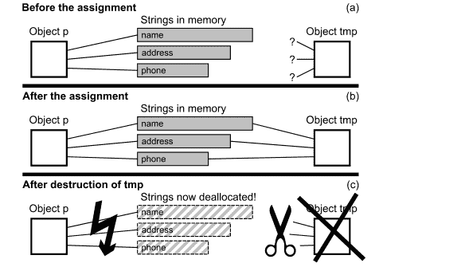

图 9.1：Person 类的私有数据和公共接口函数，使用逐字节赋值

现在创建了一个潜在危险的情况。*person* 中的实际值是指针，指向已分配的内存。赋值后，这块内存由两个对象引用：*person* 和 *tmp*。

-   一旦函数 `tmpPerson` 终止，这种潜在危险的情况就会发展成极其危险的情况：*tmp* 被销毁。Person 类的析构函数释放字段 `d_name`、`d_address` 和 `d_phone` 所指向的内存：不幸的是，这块内存也被 *person* 指向……

这个有问题的赋值如图 9.1 所示。

执行 `tmpPerson` 后，由 *person* 引用的对象现在包含指向已删除内存的指针。

这无疑不是使用像 `tmpPerson` 这样的函数所期望的效果。已删除的内存很可能被后续分配重用。*person* 的指针成员实际上已经变成*野指针*，因为它们不再指向已分配的内存。一般来说可以得出结论：

> *每个包含指针数据成员的类都是潜在的问题候选者。*

幸运的是，可以防止这些麻烦，如下文所述。

#### 9.3.1 重载赋值运算符

显然，将一个 Person 对象赋值给另一个 Person 对象的正确方法**不是**逐字节复制对象的内容。更好的方法是创建一个等价对象，它拥有自己分配的内存，其中包含原始字符串的副本。

将一个 Person 对象赋值给另一个对象的方法如图 9.2 所示。

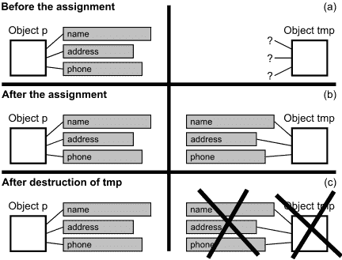

有几种方法可以将一个 Person 对象赋值给另一个对象。一种方法是定义一个特殊的成员函数来处理赋值。这个成员函数的目的是创建一个对象副本，该副本拥有自己的 *name*、*address* 和 *phone* 字符串。这样的成员函数可以是：

```cpp
void Person::assign(Person const &other)
{
    // delete our own previously used memory
    delete[] d_name;
    delete[] d_address;
    delete[] d_phone;

    // copy the other Person’s data
    d_name    = strdupnew(other.d_name);
    d_address = strdupnew(other.d_address);
    d_phone   = strdupnew(other.d_phone);
}
```

使用 assign，我们可以重写出问题的函数 tmpPerson：

```cpp
void tmpPerson(Person const &person)
{
    Person tmp;

    // tmp (having its own memory) holds a copy of person
    tmp.assign(person);

    // now it doesn’t matter that tmp is destroyed.
}
```

这个解决方案是有效的，尽管它只解决表面症状。它要求程序员使用特定的成员函数而不是赋值运算符。原始问题（赋值产生野指针）仍然没有解决。由于很难“严格遵守规则”，当然更倾向于找到解决原始问题的方法。

幸运的是，存在使用*运算符重载*的解决方案：**C++** 提供了在给定上下文中重新定义运算符行为的能力。之前简要提到过运算符重载，当时将运算符 `<<` 和 `>>` 重新定义为用于流（如 *cin*、*cout* 和 *cerr*），参见 3.1.4 节。

重载赋值运算符可能是 C++ 中最常见的运算符重载形式。不过，提醒一句是合适的。C++ 允许运算符重载这一事实，并不意味着应当不加区分地使用此特性。以下是你应该记住的要点：

-   运算符重载应在其具有已定义行为，但该默认行为在给定上下文中产生不良副作用的情况下使用。一个明显的例子是上面 Person 类上下文中的赋值运算符。
-   运算符重载可用于该运算符通常被应用，并且重新定义它不会引入意外的情况。适当使用运算符重载的一个例子是 `std::string` 类：将一个 string 对象赋值给另一个对象，会将源字符串内容的副本提供给目标字符串。这里没有意外。
-   在所有其他情况下，应定义成员函数，而不是重新定义运算符。

运算符应当只做它被设计来做的事。在运算符重载语境中经常遇到的说法是：像 *int* 那样行事。运算符应用于 *int* 时的行为方式才是符合预期的；所有其他实现都可能引起意外和混淆。因此，在流的上下文中重载插入（`<<`）和提取（`>>`）运算符可能是不恰当的选择：流操作与按位移位操作没有任何共同之处。

##### 9.3.1.1 成员 `operator=()`

要向类添加运算符重载，只需在类接口中提供一个（通常是 *public*）成员函数，其名称指明特定运算符。随后实现该成员函数。

要重载赋值运算符 `=`，需向类接口添加一个成员 `operator=(Class const &rhs)`。注意，函数名由两部分组成：关键字 `operator`，后跟运算符本身。当我们用成员函数 `operator=` 扩展类接口时，该运算符就会针对该类被*重新定义*，从而阻止使用默认运算符。上一节提供了函数 `assign` 来解决使用默认赋值运算符所导致的问题。C++ 通常不是使用普通成员函数，而是使用一个专用运算符，将该运算符的默认行为推广到定义它的类中。

前面提到的 assign 成员可以重新定义如下（下面给出的成员 `operator=` 是重载赋值运算符的第一个、相当不完善的版本。它很快会被改进）：

```cpp
class Person
{
    public:                             // extension of the class Person
                                        // earlier members are assumed.
        void operator=(Person const &other);
};
```

其实现可以是：

```cpp
void Person::operator=(Person const &other)
{
    delete[] d_name;                    // delete old data
    delete[] d_address;
    delete[] d_phone;

    d_name = strdupnew(other.d_name);   // duplicate other's data
    d_address = strdupnew(other.d_address);
    d_phone = strdupnew(other.d_phone);
}
```

该成员的操作与前面提到的成员 `assign` 类似，但当使用赋值运算符 `=` 时，会自动调用该成员。实际上，如下一个示例所示，调用重载运算符有**两**种方式：

```cpp
void tmpPerson(Person const &person)
{
    Person tmp;

    tmp = person;
    tmp.operator=(person);  // the same thing
}
```

重载运算符很少被显式调用，但当你明确*想要*通过指向对象的指针调用重载运算符时，必须使用显式调用（而不是使用普通运算符语法）（也可以先解引用指针，然后使用普通运算符语法，见下一个示例）：

```cpp
void tmpPerson(Person const &person)
{
    Person *tmp = new Person;

    tmp->operator=(person);
    *tmp = person;        // yes, also possible...

    delete tmp;
}
```

### 9.4 “this”指针

给定类的成员函数总是与该类的某个对象结合调用。函数总是有一个隐式的“基底”供其作用。C++ 定义了一个关键字 `this` 来访问这个基底。

`this` 关键字是一个指针变量，始终包含调用该成员函数时所针对对象的地址。此指针由每个成员函数隐式声明（无论 `public`、`protected` 还是 `private`）。`this` 指针是指向该成员函数所属类对象的常量指针。例如，`Person` 类的成员隐式声明：

```cpp
extern Person *const this;
```

像 `Person::name` 这样的成员函数可以通过两种方式实现：使用或不使用 `this` 指针：

```cpp
char const *Person::name() const    // implicitly using ‘this’
{
    return d_name;
}
```

```cpp
char const *Person::name() const    // explicitly using ‘this’
{
    return this->d_name;
}
```

`this` 指针很少被显式使用，但确实存在实际需要 `this` 指针的情况（参见第 16 章）。


#### 9.4.1 连续赋值与 this

C++ 的语法允许连续赋值，赋值运算符从右向左结合。在如下语句中：

```
a = b = c;
```

表达式 `b = c` 先被求值，其结果再赋给 `a`。

到目前为止我们遇到的重载赋值运算符实现并不允许这种结构，因为它返回 `void`。

这个缺陷很容易通过 `this` 指针来弥补。重载赋值运算符期望接受一个其类对象的引用。它也可以返回一个其类对象的引用。这个引用随后可以在连续赋值中用作参数。

重载赋值运算符通常返回当前对象的引用（即 `*this`）。因此，`Person` 类的重载赋值运算符的下一个版本变成：

```
Person &Person::operator=(Person const &other)
{
    delete[] d_address;
    delete[] d_name;
    delete[] d_phone;

    d_address = strdupnew(other.d_address);
    d_name = strdupnew(other.d_name);
    d_phone = strdupnew(other.d_phone);

    // return current object as a reference
    return *this;
}
```

重载运算符自身也可以被重载。考虑 `string` 类，它拥有重载赋值运算符 `operator=(std::string const &rhs)`、`operator=(char const *rhs)` 以及其他几个重载版本。这些额外的重载版本用于处理不同的情况，通常通过参数类型来区分。这些重载版本遵循相同的模式：必要时删除对象控制的动态分配内存；使用重载运算符的参数值赋予新值，并返回 `*this`。

### 9.5 复制构造函数：初始化与赋值

再次考虑第 9.2 节引入的 `Strings` 类。由于它包含几个基本类型的数据成员以及一个指向动态分配内存的指针，它需要构造函数、析构函数和重载赋值运算符。实际上，该类提供了两个构造函数：除了默认构造函数外，它还提供了一个接受 `char const *` 和 `size_t` 的构造函数。

现在考虑以下代码片段。示例之后将讨论所引用的语句：

```
int main(int argc, char **argv)
{
    Strings s1(argv, argc);    // (1)
    Strings s2;                 // (2)
    Strings s3(s1);             // (3)
    s2 = s1;                    // (4)
}
```

-   在第 1 处，我们看到一个初始化。对象 `s1` 使用 main 的参数进行初始化：使用 `Strings` 的第二个构造函数。
-   在第 2 处，使用了 `Strings` 的*默认构造函数*，初始化一个空的 `Strings` 对象。
-   在第 3 处，又创建了一个 `Strings` 对象，使用的是接受现有 `Strings` 对象的构造函数。这种初始化形式尚未讨论过。它被称为*复制构造*，执行该初始化的构造函数被称为*复制构造函数*。复制构造也会以以下形式出现：

    `Strings s3 = s1;`

    这是一种*构造*形式，因此属于*初始化*。它不是*赋值*，因为赋值需要一个已经被定义的左操作数。**C++** 允许将赋值语法用于只有一个参数的构造函数。不过这种用法有些过时。

-   在第 4 处，我们看到了一个普通赋值。

在上面的示例中定义了三个对象，每个对象使用不同的构造函数。实际使用的构造函数是根据构造函数的参数列表推断出来的。

这里遇到的复制构造函数是一个新概念。即使它没有在类接口中声明，也不会导致编译错误。这就引出了以下规则：

复制构造函数（几乎）总是可用的，即使它没有在类的接口中声明。

“（几乎）”的原因在第 9.7.1 节中给出。

编译器提供的复制构造函数也称为平凡复制构造函数。从 C++11 标准开始，可以很容易地将其抑制（使用 `= delete` 惯用法）。平凡复制构造函数将现有对象的基本数据逐字节复制到新创建的对象，调用复制构造函数，根据现有对象中对应的类数据成员来初始化新对象的类数据成员；当使用继承时，还会调用基类的复制构造函数来初始化新对象的基类。

因此，在上面的示例中，使用的是平凡复制构造函数。由于它执行的是对对象基本类型数据成员的逐字节复制操作，语句 3 发生的正是这一过程。当 `s3` 的生命周期结束时，其析构函数会删除它的字符串数组。不幸的是，`d_string` 属于基本数据类型，因此它也会删除 `s1` 的数据。由于对象离开作用域，我们再次遇到了野指针。

解决办法很简单：不要使用平凡复制构造函数，而是必须显式地在类接口中添加一个复制构造函数，并且其定义必须防止野指针，这与重载赋值运算符中的实现方式类似。对象的动态分配内存会被*复制一份*，使其包含自己分配的数据。复制构造函数比重载赋值运算符更简单，因为它不必删除先前分配的内存。由于对象即将被创建，所以不存在先前分配的内存。

`Strings` 的复制构造函数可以如下实现：

```
Strings::Strings(Strings const &other)
:
    d_string(new string[other.d_size]),
    d_size(other.d_size)
{
    for (size_t idx = 0; idx != d_size; ++idx)
        d_string[idx] = other.d_string[idx];
}
```

当一个对象使用其类的另一个对象进行初始化时，总是会调用复制构造函数。除了我们目前遇到的普通复制构造外，还有其他使用复制构造函数的情况：

-   当函数定义了类类型的值参数（而不是指针或引用）时，会使用复制构造函数。函数的实参使用复制构造函数来初始化函数的形参。示例：

```
void process(Strings store) // no pointer, no reference
{
    store.at(3) = "modified";   // doesn’t modify 'outer'
}

int main(int argc, char **argv)
{
    Strings outer(argv, argc);
    process(outer);
}
```

-   当函数定义了类类型的值返回类型时，会使用复制构造函数。示例：

```
Strings copy(Strings const &store)
{
    return store;
}
```

这里 `store` 用于初始化 `copy` 的返回值。返回的 `Strings` 对象是一个临时的匿名对象，调用 `copy` 的代码可以立即使用它，但对其后的生命周期不能做任何假设。

### 9.6 修订赋值运算符

重载赋值运算符与复制构造函数和析构函数有共同特点：

-   *（私有）数据的复制*发生在 (1) 复制构造函数中，(2) 重载赋值函数中。
-   分配的内存在 (1) 重载赋值函数中 和 (2) 析构函数中被删除。

复制构造函数和析构函数显然是必需的。如果重载赋值运算符也需要释放已分配的内存并为其数据成员赋新值，那么析构函数和复制构造函数能否用于这一目的呢？

正如我们在第 9.2 节对析构函数的讨论中所见，析构函数可以被显式调用，但（复制）构造函数则不可以。但让我们简要总结一下重载赋值运算符应该做什么：

-   它应删除当前对象控制的动态分配内存；
-   它应使用所提供的同类现有对象重新赋值当前对象的数据成员。

第二部分看起来确实很像复制构造。在意识到复制构造函数还会初始化类可能拥有的任何引用数据成员后，复制构造变得更有吸引力。实现复制构造部分很容易：只需定义一个局部对象，并使用赋值运算符的 const 引用参数对其进行初始化，如下所示：

```
Strings &operator=(Strings const &other)
```


### 9.6 修订赋值运算符

```cpp
{
    Strings tmp(other);
    // more to follow
    return *this;
}
```

你可能会觉得 `operator=(Strings tmp)` 这种优化很有吸引力，但让我们先把这个问题放一放（至少等到 9.7 节再说）。

既然我们已经完成了复制部分，那么删除部分呢？是不是还有另一个小问题？毕竟我们确实完成了复制，但并不是复制到我们原本打算的对象（当前对象 `*this`）中。

这时，是时候引入*交换*了。交换两个变量意味着这两个变量互换各自的值。下一节我们会详细讨论交换，但现在先假设我们已经为 `Strings` 类添加了一个成员 `swap(Strings &other)`。这样就可以完成 `Strings` 的 `operator=` 实现了：

```cpp
Strings &operator=(Strings const &other)
{
    Strings tmp(other);
    swap(tmp);
    return *this;
}
```

这个 `operator=` 的实现具有通用性：它可以应用于任何对象可交换的类。它是如何工作的呢？

-   用 `other` 对象中的信息来初始化局部对象 `tmp`。这负责了赋值运算符的复制部分；
-   调用 `swap` 确保当前对象获得其新值（而 `tmp` 则获得当前对象原来的值）；
-   当 `operator=` 终止时，局部对象 `tmp` 不复存在，其析构函数会被调用。由于此时 `tmp` 包含的是当前对象先前拥有的数据，当前对象的原始数据随之被销毁，从而完成了赋值操作中的销毁部分。

不错吧？

#### 9.6.1 交换

许多类（例如 `std::string`）都提供了 `swap` 成员，允许我们交换其两个对象。*标准模板库*（STL，参见第 18 章）提供了各种与交换相关的函数。甚至还有一个 `swap` 通用算法（参见 19.1.61 节），它通常使用赋值运算符实现。在为我们的 `Strings` 类实现 `swap` 成员时，如果 `Strings` 的所有数据成员都可以交换，那么该算法就可以使用。由于这一点是成立的（*为什么*成立稍后会讨论），我们可以为 `Strings` 类添加一个 `swap` 成员：

```cpp
void Strings::swap(Strings &other)
{
    swap(d_string, other.d_string);
    swap(d_size, other.d_size);
}
```

将这一成员添加到 `Strings` 后，就可以使用 `Strings::operator=` 的 copy-and-swap 实现了。

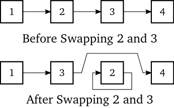

*图 9.3：交换链表*

当两个变量（例如 `double one` 和 `double two`）交换时，交换后各自持有对方的值。因此，如果 `one == 12.50` 且 `two == -3.14`，那么执行 `swap(one, two)` 后，`one == -3.14`，`two == 12.50`。

基本数据类型的变量（指针和内置类型）可以交换；类类型对象如果其类提供了 `swap` 成员，也可以交换。

那么，我们应该为类提供 `swap` 成员吗？如果要提供，又该如何实现呢？

上面的例子（`Strings::swap`）展示了实现 `swap` 成员的标准方式：依次交换它的每个数据成员。但有些情况下，即使类只定义了基本数据类型的成员，也无法用这种方式实现 `swap` 成员。请考虑图 9.3 所示的情形。

图中包含四个对象，每个对象都有一个指向下一个对象的指针。这种类的基本结构如下：

```cpp
class List
{
    List *d_next;
    ...
};
```

初始时，四个对象的 `d_next` 指针分别指向下一个对象：1 指向 2，2 指向 3，3 指向 4。这显示在图的上半部分。下半部分显示的是对象 2 和对象 3 交换后的情况：对象 3 的 `d_next` 指针现在位于对象 2，而对象 2 仍然指向 4；对象 2 的 `d_next` 指针指向对象 3 的地址，但对象 2 的 `d_next` 现在位于对象 3 中，因此它指向自身。糟糕！

另一种对象交换出错的情况是，类的数据成员指向或引用同一对象的其他数据成员。图 9.4 展示了这种情形。

这里的对象有两个数据成员，如下面的类定义所示：

```cpp
class SelfRef
{
    size_t *d_ownPtr;      // initialized to &d_data
    size_t d_data;
};
```

图 9.4 的上半部分展示了两个对象；它们的上层数据成员指向各自的下层数据成员。但如果交换这两个对象，就会遇到图中下半部分的情形。此处地址 a 和地址 c 处的值被交换，于是它们不再指向各自的下层数据成员，而是突然指向了另一个对象的数据成员。又一个坏消息。

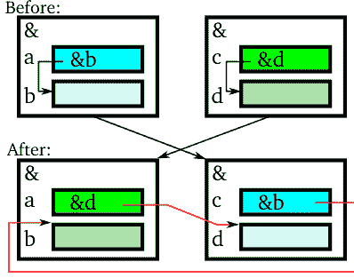

*图 9.4：自引用数据对象的交换*

这些失败交换操作的共同原因很容易识别：当数据成员指向或引用了交换所涉及的数据时，必须避免简单的交换操作。如果在图 9.4 中，地址 a 和地址 c 处的数据成员指向的是这两个对象之外的信息（例如，指向动态分配的内存），那么简单的交换就能成功。

然而，交换 `SelfRef` 对象时遇到的困难并不意味着两个 `SelfRef` 对象不能交换；它只意味着我们在设计 `swap` 成员时必须小心。下面是 `SelfRef::swap` 的一种实现：

```cpp
void SelfRef::swap(SelfRef &other)
{
    swap(d_data, other.d_data);
}
```

在这个实现中，交换时让自引用数据成员保持不变，仅仅交换其余的数据。也可以为图 9.3 所示的链表设计类似的 `swap` 成员。

##### 9.6.1.1 快速交换

正如我们在 placement new 中看到的那样，对象可以构造在大小为 `sizeof(Class)` 字节的内存块中。因此，同一个类的两个对象各自占用 `sizeof(Class)` 字节。

如果我们的类对象能够被交换，并且类的数据成员不引用实际参与交换操作的数据，那么就可以实现一种非常快速的交换方法，其基础正是我们知道对象的大小。

在这种快速交换方法中，我们仅仅交换 `sizeof(Class)` 字节的内容。这个过程可以应用于那些对象可以通过逐成员交换操作进行交换的类，并且（在实践中，尽管这可能超出了 C++ ANSI/ISO 标准所描述的操作范围）也可以用于具有引用数据成员的类。它只是定义一个 `sizeof(Class)` 字节的缓冲区，然后执行一次循环的 `memcpy` 操作。下面是针对一个假设类 `Class` 的实现，它能实现非常快速的交换：

```cpp
#include <cstring>

void Class::swap(Class &other)
{
    char buffer[sizeof(Class)];
    memcpy(buffer, &other, sizeof(Class));
    memcpy(&other, this, sizeof(Class));
    memcpy(this, buffer, sizeof(Class));
}
```

下面是一个简单的例子：某个类定义了一个引用数据成员，并提供了一个如上实现的 `swap` 成员。引用数据成员被初始化为外部流。运行程序后，`one` 包含两行 *hello to 1*，`two` 包含两行 *hello to 2*（为简洁起见，`Reference` 的所有成员都定义为内联形式）：

```cpp
#include <fstream>
#include <cstring>

class Reference
{
    std::ostream &d_out;

public:
    Reference(std::ostream &out)
        :
        d_out(out)
    {}
    void swap(Reference &other)
    {
        char buffer[sizeof(Reference)];
        memcpy(buffer, this, sizeof(Reference));
        memcpy(this, &other, sizeof(Reference));
        memcpy(&other, buffer, sizeof(Reference));
    }
    std::ostream &out()
    {
        return d_out;
    }
};

int main()
{
    std::ofstream one("one");
    std::ofstream two("two");

    Reference ref1(one);        // ref1/ref2 hold references to
    Reference ref2(two);        // the streams

    ref1.out() << "hello to 1\n";    // generate some output
    ref2.out() << "hello to 2\n";

    ref1.swap(ref2);

    ref2.out() << "hello to 1\n";    // more output
    ref1.out() << "hello to 2\n";
}
```

快速交换只应用于自定义类，并且必须能证明快速交换在交换时不会破坏其对象。


### 9.7 移动数据（C++11）

在 C++11 标准问世之前，C++ 基本上只有两种方式可以将临时对象的数据成员所指向的信息赋值给一个*左值*对象：要么使用拷贝构造函数，要么使用引用计数。C++11 标准在这两种方式之外新增了*移动语义*，允许将临时对象所指向的数据*转移*到其目标位置。

移动信息基于匿名（临时）数据的概念。临时值由诸如 `operator-()` 和 `operator+(Type const &lhs, Type const &rhs)` 之类的函数返回，通常是由那些“按值”返回结果（而非返回引用或指针）的函数返回。

匿名值总是生命周期短暂的。当返回的值是原始类型（`int`、`double` 等）时，不会发生什么特别的事情；但如果按值返回的是类类型对象，那么其析构函数可能会在产生该值的函数调用之后立即被调用。无论如何，该值在调用结束后立即变得不可访问。当然，临时返回值可以绑定到引用（左值或右值），但就编译器而言，该值此时已经有了名字，这本身就结束了它作为临时值的状态。

在本节中，我们专注于匿名临时值，并展示如何利用它们来提高对象构造和赋值的效率。这些特殊的构造和赋值方法被称为*移动构造*和*移动赋值*。支持移动操作的类称为*可移动感知*（move-aware）的类。

自行分配内存的类通常能从可移动感知中获益。但一个类并不一定要使用动态内存分配才能从移动操作中获益。大多数使用组合（或使用组合的基类的继承）的类同样能从移动操作中获益。

类 `Class` 的可移动参数形式为 `Class &&tmp`。该参数是一个*右值引用*，而右值引用只能绑定到匿名临时值。编译器在可能的情况下必须调用提供可移动参数的函数。当类定义了支持 `Class &&` 参数的函数，并且有匿名临时值被传递给此类函数时，就会发生这种情况。一旦临时值有了名字（这已经发生在定义 `Class const &` 或 `Class &&tmp` 参数的函数内部，因为在这些函数中这些参数的名称是可用的），它就不再是*匿名*临时值了，并且在这些函数内部，当这些参数被用作实参时，编译器不再调用期望匿名临时值的函数。

下一个示例（为简洁起见使用内联成员实现）说明了当非 const 对象、临时对象和 const 对象被传递给为其定义了这些参数类型的函数 `fun` 时会发生什么。这些函数中的每一个都会调用一个也为其定义了这些参数类型的函数 `gun`。第一次调用 `fun` 时，它（如预期）调用 `gun(Class &)`。然后调用 `fun(Class &&)`，因为其参数是一个匿名（临时）对象。然而，在 `fun` 内部，匿名值已经获得了名字，因此它不再是匿名的。因此，`gun(Class &)` 再次被调用。最后调用 `fun(Class const &)`，并且（如预期）现在调用 `gun(Class const &)`。

```cpp
#include <iostream>

using namespace std;

class Class
{
    public:
        Class()
        {};
        void fun(Class const &other)
        {
            cout << "fun: Class const &\n";
            gun(other);
        }
        void fun(Class &other)
        {
            cout << "fun: Class &\n";
            gun(other);
        }
        void fun(Class &&tmp)
        {
            cout << "fun: Class &&\n";
            gun(tmp);
        }
        void gun(Class const &other)
        {
            cout << "gun: Class const &\n";
        }
        void gun(Class &other)
        {
            cout << "gun: Class &\n";
        }
        void gun(Class &&tmp)
        {
            cout << "gun: Class &&\n";
        }
};

int main()
{
    Class c1;

    c1.fun(c1);
    c1.fun(Class());

    Class const c0;
    c1.fun(c0);
}
```

定义一个具有右值引用返回类型的函数是没有意义的。编译器根据提供的实参来决定是否使用期望右值引用的重载成员。如果实参是匿名临时值，并且存在这样的函数，则调用定义右值引用参数的函数。

编译器在选择要调用的函数时，会应用一个相当简单的算法，并且还会考虑拷贝省略（copy elision）。这一点将在稍后（第 9.8 节）讨论。

#### 9.7.1 移动构造函数（动态数据）（C++11）

我们的 `Strings` 类除了其他成员外，还有一个数据成员 `string *d_memory`。显然，`Strings` 应该定义拷贝构造函数、析构函数和重载的赋值运算符。

现在考虑以下函数 `loadStrings(std::istream &in)`，它从 `in` 中提取字符串到一个 `Strings` 对象。接下来，由 `loadStrings` 填充的 `Strings` 对象按值返回。函数 `loadStrings` 返回一个临时对象，然后可以用它来初始化外部的 `Strings` 对象：

```cpp
Strings loadStrings(std::istream &in)
{
    Strings ret;
    // 将字符串加载到 'ret' 中
    return ret;
}

// 用法：
Strings store(loadStrings(cin));
```

在这个示例中，需要 `Strings` 对象的两次完整拷贝：

- 用 `loadStrings` 的局部 `Strings ret` 对象初始化其返回值；
- 用 `loadStrings` 的返回值初始化 `store`。

我们可以通过定义*移动构造函数*来改进上述过程。以下是 `Strings` 类移动构造函数的声明：

`Strings(Strings &&tmp);`

使用动态内存分配的类的移动构造函数被允许将其指针数据成员的值赋给自己的指针数据成员，而无需复制源数据。接下来，临时对象的指针值被设置为零，以防止其析构函数销毁现在由刚构造的对象所拥有的数据。移动构造函数已经从临时对象中*抓取*或*窃取*了数据。这是可以的，因为临时对象不能再被引用（由于它是匿名的，其他代码无法访问它），并且临时对象在构造函数调用后不久就会消亡。以下是 `Strings` 移动构造函数的实现：

```cpp
Strings::Strings(Strings &&tmp)
:
    d_memory(tmp.d_memory),
    d_size(tmp.d_size),
    d_capacity(tmp.d_capacity)
{
    tmp.d_memory = 0;
}
```

在第 9.5 节中曾指出，拷贝构造函数几乎总是可用的。之所以说*几乎*总是，是因为移动构造函数的声明会抑制拷贝构造函数的默认可用性。如果声明了*移动赋值运算符*（参见第 9.7.3 节），默认的拷贝构造函数也会被抑制。

以下示例展示了一个简单的类 `Class`，它声明了一个移动构造函数。在类接口之后的 `main` 函数中，定义了一个 `Class` 对象，然后将其传递给第二个 `Class` 对象的构造函数。编译失败，编译器报告：

```
error: cannot bind 'Class' lvalue to 'Class&&'
error:   initializing argument 1 of 'Class::Class(Class&&)'
```

```cpp
class Class
{
    public:
        Class() = default;
        Class(Class &&tmp)
        {}
};

int main()
{
    Class one;
    Class two(one);
}
```

解决办法很简单：在声明了（可能是默认的）拷贝构造函数之后，错误就消失了：

```cpp
class Class
{
  public:
    Class() = default;
    Class(Class const &other) = default;
    Class(Class &&tmp)
    {}
};

int main()
{
    Class one;
    Class two(one);
}
```

#### 9.7.2 移动构造函数（组合）（C++11）

不使用指向由其对象控制的内存的指针成员（并且没有基类这样做，参见第 13 章）的类，也可能从期望右值引用的重载成员中获益。当一个或多个被组合的数据成员本身支持移动操作时，该类就能从移动操作中获益。

如果被组合的数据成员的类类型不支持移动或拷贝，则无法实现移动操作。目前，`stream` 类就属于这一类。

一个可移动感知的类的例子是 `std::string` 类。一个 `Person` 类可以通过定义 `std::string d_name` 和 `std::string d_address` 来使用组合。那么它的移动构造函数将具有以下原型：

```cpp
Person(Person &&tmp);
```

然而，以下这个移动构造函数的实现是错误的：

```cpp
Person::Person(Person &&tmp)
  :
    d_name(tmp.d_name),
    d_address(tmp.d_address)
{}
```

它是错误的，因为这里调用的是 `string` 的拷贝构造函数，而不是 `string` 的移动构造函数。如果你想知道为什么会这样，请记住移动操作*仅*对匿名对象执行。对于编译器来说，任何有名字的东西都不是匿名的。因此，由此推论，拥有可用的右值引用并*不*意味着我们引用的是一个匿名对象。但我们*知道*移动构造函数只对匿名参数调用。为了使用相应的 `string` 移动操作，我们必须告知编译器我们谈论的也是匿名数据成员。为此可以使用强制转换（例如，`static_cast<Person &&>(tmp)`），但 C++0x 标准提供了 `std::move` 函数来将命名对象匿名化。因此，`Person` 移动构造的正确实现是：

```cpp
Person::Person(Person &&tmp)
  :
    d_name( std::move(tmp.d_name) ),
    d_address( std::move(tmp.d_address) )
{}
```


### 9.7 移动数据（C++11）

函数 `std::move` 由许多头文件（间接）声明。如果没有任何头文件已声明 `std::move`，则需要包含 `<utility>` 头文件。

当一个使用组合的类不仅包含类类型的数据成员，还包含其他类型的数据（指针、引用、基本数据类型）时，这些其他数据类型可以像往常一样初始化。基本数据类型成员可以直接复制；引用可以像往常一样初始化；指针可以使用上一节讨论的移动操作。

编译器永远不会为具有名称的变量调用移动操作。让我们通过下面的示例来探讨其含义，假设 `Class` 提供了移动构造函数和拷贝构造函数：

```cpp
Class factory();

void fun(Class const &other);    // a
void fun(Class &&tmp);           // b

void callee(Class &&tmp)
{
    fun(tmp);                    // 1
}

int main()
{
    callee(factory());
}
```

- 在标记为 1 的位置，调用的是函数 a。乍一看这可能令人惊讶，但 `fun` 的参数不是一个*匿名的*临时对象，而是一个*具名的*临时对象。

考虑到 `fun(tmp)` 可能会被调用两次，编译器的选择是可以理解的。如果在第一次调用时 `tmp` 的数据就被移走了，那么第二次调用收到的 `tmp` 将不包含任何数据。但是，在最后一次调用时，我们可能知道 `tmp` 不再被使用，因此我们可能希望确保调用 `fun(Class &&)`。这时，再次需要使用 `std::move`：

```cpp
fun(std::move(tmp));             // 最后一次调用！
```

#### 9.7.3 移动赋值（C++11）

除了重载的赋值运算符之外，对于支持移动操作的类，还可以实现一个*移动赋值运算符*。在这种情况下，如果该类支持交换操作，那么实现会出奇地简单。无需进行拷贝构造，移动赋值运算符可以直接这样实现：

```cpp
Class &operator=(Class &&tmp)
{
    swap(tmp);
    return *this;
}
```

如果不支持交换操作，则可以依次对每个数据成员执行赋值，使用 `std::move`，如上一节中关于 `Person` 类的示例所示。以下是如何对 `Person` 类执行此操作的示例：

```cpp
Person &operator=(Person &&tmp)
{
    d_name = std::move(tmp.d_name);
    d_address = std::move(tmp.d_address);
    return *this;
}
```

如前所述（参见 移动构造函数 一节），声明移动赋值运算符会抑制默认拷贝构造函数的可用性。要使其再次可用，需要在类的接口中声明拷贝构造函数（当然，还要提供显式实现或使用 `= default` 默认实现）。

#### 9.7.4 修订赋值运算符（第二部分）

现在我们已经熟悉了重载的赋值运算符和移动赋值，让我们再次看看它们针对一个支持通过其 `swap` 成员进行交换的类 `Class` 的实现。以下是重载赋值运算符的通用实现：

```cpp
Class &operator=(Class const &other)
{
    Class tmp(other);
    swap(tmp);
    return *this;
}
```

这是移动赋值运算符：

```cpp
Class &operator=(Class &&tmp)
{
    swap(tmp);
    return *this;
}
```

它们看起来非常相似，因为一旦 `other` 对象的副本可用，重载的赋值运算符的代码与移动赋值运算符的代码是相同的。由于重载的赋值运算符中的 `tmp` 对象实际上只是一个临时的 `Class` 对象，我们可以利用这个事实，根据移动赋值来实现重载的赋值运算符。这是重载赋值运算符的第二次修订：

```cpp
Class &operator=(Class const &other)
{
    Class tmp(other);
    return *this = std::move(tmp);
}
```

#### 9.7.5 移动与析构函数（C++11）

一旦类成为支持移动的类，就应该意识到其析构函数仍然按照实现方式执行其任务。因此，当将指针值从临时源对象移动到目标对象时，移动构造函数应确保将临时对象的指针值设置为 `0`，以防止双重释放内存。

如果类定义了指向指针数据成员的指针，通常不仅会移动一个指针，还会移动一个 `size_t` 来定义指针数组中的元素数量。

再次考虑 `Strings` 类。其析构函数实现如下：

```cpp
Strings::~Strings()
```

然而，除了拷贝构造函数之外，一旦类声明了至少一个构造函数（或赋值运算符），编译器就不再提供构造函数（例如赋值运算符）的默认实现，而默认的拷贝构造函数也会被移动构造函数或移动赋值运算符的声明所抑制。

如果在这些情况下需要默认实现，可以通过在适当的构造函数和赋值运算符声明中添加 `= default` 来轻松地将它们添加到类中。

以下是一个提供所有默认操作的类示例：构造函数、拷贝构造函数、移动构造函数、赋值运算符和移动赋值运算符：

```cpp
class Defaults
{
    int d_x;
    Mov d_mov;
};
```

假设 `Mov` 是一个除了标准的深拷贝操作外还提供移动操作的类，那么将在目标对象的 `d_mov` 和 `d_x` 上执行以下操作：

```cpp
Defaults factory();

int main()
{
    Defaults one;
    Defaults two(one);
    Defaults three(factory());

    one = two;
    one = factory();
}
```

| 语句 | Mov 操作 | d_x |
| --- | --- | --- |
| `Defaults one;` | `Mov(),` | `未定义` |
| `Defaults two(one);` | `Mov(Mov const &),` | `one.d_x` |
| `Defaults three(factory());` | `Mov(Mov &&),` | `tmp.d_x` |
| `one = two;` | `Mov::operator=(Mov const &),` | `two.d_x` |
| `one = factory();` | `Mov::operator=(Mov &&)` | `tmp.d_x` |

然而，如果 `Defaults` 声明了至少一个构造函数（可以是拷贝构造函数）和一个赋值运算符，那么只有这些成员和拷贝构造函数保持可用。例如：

```cpp
class Defaults
{
    int d_x;
    Mov d_mov;

public:
    Defaults(int x);
    Defaults &operator=(Defaults &tmp);
};

Defaults factory();

int main()
{
    Defaults one;
    Defaults two(one);
    Defaults three(factory());

    one = two;
    one = factory();
}
```

| 语句 | Mov 操作 | 结果 d_x |
| --- | --- | --- |
| `Defaults one;` | `错误：不可用` | |
| `Defaults two(one);` | `Mov(Mov const &),` | `one.d_x` |
| `Defaults three(factory());` | `错误：不可用` | |
| `one = two;` | `错误：不可用` | |
| `one = factory();` | `Mov::operator=(Mov &&tmp)` | `tmp.d_x` |

要重新建立这些默认操作，请在适当的声明后附加 `= default`：

```cpp
class Defaults
{
    int d_x;
    Mov d_mov;

public:
    Defaults()                    = default;
    Defaults(Defaults &&tmp)      = default;
    Defaults(int x);
    // Defaults(Defaults const &) 保持可用

    Defaults &operator=(Defaults const &rhs) = default;
    Defaults &operator=(Defaults &&tmp);
};
```

需要谨慎，将默认实现声明为默认，会将基本类型的数据成员逐字节地从源对象复制到目标对象。这可能会导致指针类型数据成员出现问题。

`= default` 后缀只能在类的公有部分声明构造函数或赋值运算符时使用。

#### 9.7.8 移动：对类设计的影响（C++11）

以下是设计提供值语义的类（即，其对象可用于初始化其类的其他对象并可赋值给其类的其他对象的类）时适用的一些通用规则：

- 使用指向由类对象拥有的动态分配内存的指针的类，必须提供拷贝构造函数、重载的拷贝赋值运算符和析构函数；
- 使用指向由类对象拥有的动态分配内存的指针的类，应该提供移动构造函数和移动赋值运算符；
- 使用组合的类也可能受益于移动构造函数和移动赋值运算符。有些类既不支持移动也不支持拷贝构造和赋值（例如：流类就不支持）。如果你的类包含此类类型的数据成员，那么定义移动操作是没有意义的。

在前面的章节中，我们还遇到了一个可以应用于支持移动的类的重要设计原则：

> *每当类的成员函数接收一个对其自身类对象的 `const &` 引用，并创建该对象的副本以执行其实际操作时，该函数的实现可以由一个期望右值引用的重载函数来实现。*

前者现在可以通过传递 `std::move(tmp)` 来调用后者。这个设计原则的优势应该很清楚：只有一个实际操作的实现，并且该类在涉及该函数时自动变为*支持移动的*。


我们已在 9.7.4 节中看到了使用该原则的一个初步示例。当然，该原则不能应用于复制构造函数本身，因为你需要复制构造函数来进行复制。复制构造函数和移动构造函数必须始终彼此独立实现。

### 9.8 复制省略与返回值优化

当编译器选择成员函数（或构造函数）时，它会应用一组简单的规则，将实参与形参类型进行匹配。

下面展示两张表。第一张表适用于函数实参具有名称的情况，第二张表适用于实参为匿名的情况。在每张表中，选择 const 或非 const 列，然后使用具有指定形参类型且可用的最靠上的重载函数。

这些表不处理定义值形参的函数。如果一个函数分别具有期望一个值形参和某种形式的引用形参的重载，那么调用此类函数时编译器会报告歧义。在以下选择过程中，我们可以不失一般性地假设这种歧义不会发生，并且所有形参类型都是引用形参。

如果实参为以下情况，则形参类型与函数中类型为 T 的实参匹配：

- 一个*具名*实参（左值或具名右值）

|  | 实参为：非 const | 实参为：const |
|---|---|---|
| 使用最靠上的可用函数 | `T &` | `T const &` |

示例：对于 `int x` 实参，会选择函数 `fun(int &)` 而不是函数 `fun(int const &)`。如果没有可用的 `fun(int &)`，则使用 `fun(int const &)` 函数。如果两者都不可用，编译器会报告错误。

- 一个*匿名*实参（匿名临时量或字面值）

|  | 实参为：非 const | 实参为：const |
|---|---|---|
| 使用最靠上的可用函数 | `T &&` | `T const &&` |
| 可用函数 | `T const &` | `T const &` |

示例：当 `int arg()` 函数的返回值传递给函数 `fun`，且该函数有多个重载版本可用时，会选择 `fun(int &&)`。如果该函数不可用但 `fun(int const &)` 可用，则使用后一个函数。如果这两个函数都不可用，编译器会报告错误。

这些表表明，最终*所有*实参都可以与指定 `T const &` 形参的函数一起使用。对于*匿名*实参，存在一个类似的*兜底*方案，且优先级更高：`T const &&` 匹配所有匿名实参。具有此签名的函数通常不会被定义，因为它们的实现（应当）与期望 `T const &` 形参的函数的实现相同。由于临时量显然不能被修改，定义 `T const &&` 形参的函数别无选择，只能复制临时量的资源。由于这一任务已经由期望 `T const &` 的函数执行，因此无需实现期望 `T const &&` 形参的函数。

正如我们所见，移动构造函数会从临时量中获取信息供自己使用。这没问题，因为该临时量之后无论如何都会被销毁。这也意味着临时量的数据成员会被修改。

在定义了适当的复制和/或移动构造函数之后，得知编译器可能决定避开复制或移动操作，或许会有些令人惊讶。毕竟，*不*进行复制且*不*进行移动比复制或移动更高效。

编译器用来避免进行复制（或执行移动操作）的选项称为*复制省略*或*返回值优化*。在所有适合进行复制或移动构造的情形中，编译器都可以应用复制省略。规则如下。编译器按顺序考虑以下选项，一旦某个选项可被选中就停止：

- 如果存在复制构造函数或移动构造函数，则尝试复制省略
- 如果存在移动构造函数，则移动。
- 如果存在复制构造函数，则复制。
- 报告错误

所有现代编译器都会应用复制省略。以下是一些可能遇到它的示例：

```
class Elide;

Elide fun()          // 1
{
    Elide ret;
    return ret;
}

void gun(Elide par);

Elide elide(fun()); // 2

gun(fun());          // 3
```

- 在 1 处，`ret` 可能根本不存在。它可能直接使用用于包含 `fun` 返回值的区域，而不是先使用 `ret` 并最终将 `ret` 复制到 `fun` 的返回值。
- 在 2 处，`fun` 的返回值可能根本不存在。编译器可能决定不定义一个包含 `fun` 返回值的区域并将该返回值复制到 `elide`，而是使用 `elide` 来创建 `fun` 的返回值。
- 在 3 处，编译器可能决定对 `gun` 的 `par` 形参做同样的事：`fun` 的返回值直接在 `par` 的区域中创建，从而省略从 `fun` 的返回值到 `par` 的复制操作。

### 9.9 纯旧数据（C++11）

C++ 从 C 继承了 struct 概念，并用类概念对其进行了扩展。C++ 中仍在使用 struct，主要用于存储和传递不同数据类型的聚合体。这些 struct 的常见术语是*纯旧数据*（POD）。纯旧数据常用于 C++ 程序中聚合数据。例如，当函数需要返回 `double`、`bool` 和 `std::string` 时，这三种不同数据类型可以使用一个仅用于传递值的 `struct` 来聚合。数据保护和功能几乎从来都不是问题。对于这种情况，C 和 C++ 使用 `structs`。但由于 C++ 的 struct 只是一个具有特殊访问权限的类，某些成员（构造函数、析构函数、重载赋值运算符）可能会被隐式定义。纯旧数据利用了这一概念，要求其定义尽可能简单。具体而言，C++11 标准认为 POD 是具有以下特征的类或结构体：

- 它具有平凡默认构造函数。

  如果某个类型具有某个*平凡成员*，那么该类型（或其基类，参见第 [13](#) 章）不会显式定义该成员。相反，它由编译器提供。平凡默认构造函数会使其所有非类数据成员保持未初始化，并调用其所有类数据成员的默认构造函数。具有平凡默认构造函数的类根本不定义任何构造函数（其基类也不定义）。它也可以使用 7.5 节引入的默认构造函数语法来定义默认构造函数；

- 它具有平凡复制构造函数。

  平凡复制构造函数会从所提供的现有类对象中逐字节复制非类数据成员，并使用复制构造函数，利用所提供的现有类对象中的信息来初始化其基类和类数据成员；

- 它具有平凡重载赋值运算符。

  平凡赋值运算符会对所提供的右侧类对象的非类数据成员执行逐字节复制，并使用重载赋值运算符，利用所提供的右侧类对象的相应成员为其类数据成员赋予新值；

- 它具有平凡析构函数。

  平凡析构函数会调用其基类和类类型数据成员的析构函数；

- 它具有*标准布局*。

一个*标准布局*类或结构体

- 只包含自身也呈现*标准布局*的非静态数据成员；
- 对其所有非静态成员具有相同的访问控制（public、private、protected）；

此外，在类派生的上下文中（参见第 14 章和第 13 章），一个*标准布局*类或结构体：

- 只包含自身也呈现*标准布局*的基类；
- 至多有一个（直接或间接）基类具有非静态成员；
- 没有与其第一个非静态数据成员类型相同的基类；
- 没有虚基类；
- 没有虚成员。

### 9.10 结论

本章介绍了类的四项重要扩展：析构函数、复制构造函数、移动构造函数和重载赋值运算符。此外，还强调了*交换*的重要性，尤其是与重载赋值运算符结合使用时。

包含指针数据成员的类，其指针指向由这些类的对象控制的动态分配内存，是内存泄漏的潜在来源。本章介绍的扩展实现了针对此类内存泄漏的标准防御措施。

封装（数据隐藏）使我们能够确保对象的数据完整性得到维护。构造函数和析构函数的自动激活极大地增强了我们确保进行动态内存分配的对象的数据完整性的能力。

因此，一个简单的结论是：如果类的对象会分配由自身控制的内存，那么该类至少必须实现*析构函数*、*重载赋值运算符*和*复制构造函数*。实现*移动构造函数*仍是可选的，但它允许我们将*工厂函数*与*不*允许复制构造和/或赋值的类一起使用。


最后，假设至少存在一个拷贝或移动构造函数，编译器可能会使用*复制省略*来避免调用它们。编译器可以在任何可能的地方自由使用复制省略；然而，这从来不是一项要求。因此，编译器始终可以决定不使用复制省略。在所有原本会使用拷贝或移动构造函数的情况下，编译器都可以考虑使用复制省略。

## 第10章：异常

C++ 支持程序对破坏程序正常顺畅流程的情况作出反应的几种方式：

-   函数可能注意到异常情况并发出消息。这可能是程序所能表现出的最不灾难性的反应。
-   观察到异常情况的函数可能决定停止其预期任务，向调用者返回错误码。这是推迟决策的一个绝佳例子：现在调用函数面临一个问题。当然，调用函数也可以采取类似行动，将错误码向上传递给它的调用者。
-   函数可能决定事情正在失控，并可能调用 `exit` 完全终止程序。这是一种强硬的问题处理方式，哪怕只是因为局部对象的析构函数不会被激活。
-   函数可能使用 `setjmp` 和 `longjmp` 函数的组合来强制执行非局部退出。该机制实现了一种 `goto` 跳转，允许程序在外层继续，跳过如果使用一系列从嵌套函数返回时本来必须经过的中间层级。

在 C++ 中，所有这些破坏流程的方法仍然可用。然而，在所提到的替代方案中，`setjmp` 和 `longjmp` 在 C++（甚至 C）程序中并不常见，因为程序流程被完全打乱。

C++ 提供异常作为首选替代方案，例如替代 `setjmp` 和 `longjmp`。异常允许 C++ 程序执行受控的非局部返回，而没有 `longjmp` 和 `setjmp` 的缺点。

异常是摆脱以下情况的正确方式：该情况无法由函数自身轻松处理，但又不足以灾难性到让程序完全终止。此外，异常在短距离 `return` 和粗暴的 `exit` 之间提供了一层灵活的控制。

本章将讨论异常。首先给出一个示例，说明异常和 `setjmp`/`longjmp` 组合对程序产生的不同影响。该示例之后讨论异常的形式方面。在这一部分中，将介绍我们的软件在面对异常时应能够提供的保证。异常及其保证会对构造函数和析构函数产生影响。我们将在本章末尾遇到这些影响。

### 10.1 异常语法

在对比传统的 C 语言处理非局部 goto 的方式与异常之前，让我们先介绍使用异常时所涉及的语法元素。

```cpp
    };
    Inner::Inner()
    {
        cout << "Inner constructor\n";
    }
    Inner::~Inner()
    {
        cout << "Inner destructor\n";
    }
    void Inner::fun()
    {
        cout << "Inner fun\n";
    }

    class Outer
    {
        public:
            Outer();
            ~Outer();
            void fun();
    };
    Outer::Outer()
    {
        cout << "Outer constructor\n";
    }
    Outer::~Outer()
    {
        cout << "Outer destructor\n";
    }
    void Outer::fun()
    {
        Inner in;
        cout << "Outer fun\n";
        in.fun();
    }

    int main()
    {
        Outer out;
        out.fun();
    }

    /*
        Generated output:
    Outer constructor
    Inner constructor
    Outer fun
    Inner fun
    Inner destructor
    Outer destructor
    */
```

编译并运行后，程序的输出完全符合预期：析构函数按正确顺序调用（与构造函数的调用顺序相反）。

### 10.2 使用异常的示例

现在让我们关注两个变体，在其中我们模拟 `Inner::fun` 函数中的一个非致命灾难性事件。据设想，该事件必须在 `main` 的末尾附近处理。

我们将考虑两个变体。在第一个变体中，事件由 `setjmp` 和 `longjmp` 处理；在第二个变体中，事件使用 **C++** 的异常机制处理。

#### 10.2.1 时代错误：‘setjmp’ 和 ‘longjmp’

上一节的基本程序被稍作修改，以包含一个由 `setjmp` 和 `longjmp` 使用的变量 `jmp_buf jmpBuf`。

函数 `Inner::fun` 调用 `longjmp`，模拟一个灾难性事件，该事件将在 `main` 的末尾附近处理。在 `main` 中，通过函数 `setjmp` 定义了长跳转的目标位置。`setjmp` 的零返回值表示 `jmp_buf` 变量的初始化，在这种情况下会调用 `Outer::fun`。这种情况代表“正常流程”。

仅当 `Outer::fun` 正常终止时，程序的返回值才为零。然而，程序的设计方式使得这不会发生：`Inner::fun` 调用 `longjmp`。结果，执行流返回到 `setjmp` 函数。在这种情况下，它不会返回零值。因此，在从 `Outer::fun` 调用 `Inner::fun` 之后，会进入 `main` 的 if 语句，程序以返回值 1 终止。在学习下面的程序源代码时，请尝试遵循这些步骤，该源代码是对第 10.2 节中给出的基本程序的直接修改：

```cpp
#include <iostream>
#include <setjmp.h>
#include <cstdlib>

using namespace std;

jmp_buf jmpBuf;

class Inner
{
    public:
        Inner();
        ~Inner();
        void fun();
};

Inner::Inner()
{
    cout << "Inner constructor\n";
}
void Inner::fun()
{
    cout << "Inner fun\n";
    longjmp(jmpBuf, 0);
}
Inner::~Inner()
{
    cout << "Inner destructor\n";
}

class Outer
{
    public:
        Outer();
        ~Outer();
        void fun();
};

Outer::Outer()
{
    cout << "Outer constructor\n";
}
Outer::~Outer()
{
    cout << "Outer destructor\n";
}
void Outer::fun()
{
    Inner in;
    cout << "Outer fun\n";
    in.fun();
}

int main()
{
    Outer out;

    if (setjmp(jmpBuf) != 0)
        return 1;

    out.fun();
}
/*
    Generated output:
Outer constructor
Inner constructor
Outer fun
Inner fun
Outer destructor
*/
```

该程序的输出清楚地表明，`Inner` 的析构函数没有被调用。这是由 `longjmp` 执行的非局部跳转的直接结果。处理立即从 `Inner::fun` 内部的 `longjmp` 调用转到 `main` 中的 `setjmp`。在那里，其返回值不等于零，程序以返回值 1 终止。由于非局部跳转，`Inner::~Inner` 永远不会被执行：返回到 `main` 的 `setjmp` 时，现有栈被简单拆解，而析构函数还在等待被调用。

这个例子说明，在使用 `longjmp` 和 `setjmp` 时，对象的析构函数很容易被跳过，因此 C++ 程序应当像躲避瘟疫一样避免使用这些函数。

#### 10.2.2 异常：首选的替代方案

异常是 C++ 对 `setjmp` 和 `longjmp` 所造成问题的回答。下面是一个使用异常的示例。该程序再次派生自第 10.2 节的基本程序：

```cpp
#include <iostream>
using namespace std;

class Inner
{
public:
    Inner();
    ~Inner();
    void fun();
};
Inner::Inner()
```

当抛出一个 int 值时，该值会重新出现在 `try` 块之后的 `catch` 子句中。

现在 `Inner::fun` 通过抛出异常而不是调用 `longjmp` 来终止。异常在 `main` 中被捕获，程序终止。现在我们看到 `Inner` 的析构函数被正确调用。有趣的是，`Inner::fun` 的执行确实在 `throw` 语句处终止：紧跟在 `throw` 语句之后的 `cout` 语句不会被执行。

这个例子教会了我们什么？

-   异常提供了一种手段，可以打破函数（以及程序）的正常流程，而无需使用一连串的 `return` 语句，也无需使用像函数 `exit` 这样粗暴的工具来终止程序。
-   异常不会破坏析构函数的正确激活。由于 `setjmp` 和 `longjmp` 确实会破坏析构函数的正确激活，因此它们在 C++ 中被强烈不推荐使用。

### 10.3 抛出异常

异常由 `throw` 语句生成。`throw` 关键字后跟一个表达式，定义所抛出的异常值。示例：

```cpp
throw "Hello world";          // throws a char *
throw 18;                    // throws an int
throw string("hello");       // throws a string
```

当函数终止时，局部对象不复存在。对于异常而言也是如此。

函数中局部定义的对象，一旦这些函数抛出的异常离开这些函数，就会被自动销毁。作为异常抛出的对象也是如此。然而，就在离开函数上下文之前，该对象会被复制，而最终到达相应 `catch` 子句的正是这个副本。

下面的示例说明了这个过程。`Object::fun` 定义了一个局部 `Object` `toThrow`，它作为异常被抛出。该异常在 `main` 中被捕获。但到那时，最初抛出的对象已不复存在，而 `main` 接收到的是一个副本：

```cpp
#include <iostream>
#include <string>
using namespace std;

class Object
{
    string d_name;

    public:
        Object(string name)
        :
            d_name(name)
        {
            cout << "Constructor of " << d_name << "\n";
        }
        Object(Object const &other)
        :
            d_name(other.d_name + " (copy)")
        {
            cout << "Copy constructor for " << d_name << "\n";
        }
```


```cpp
~Object()
{
    cout << "Destructor of " << d_name << "\n";
}
void fun()
{
    Object toThrow("local object");
    cout << "Calling fun of " << d_name << "\n";
    throw toThrow;
}
void hello()
{
    cout << "Hello by " << d_name << "\n";
}
};

int main()
{
    Object out("main object");
    try
    {
        out.fun();
    }
    catch (Object o)
    {
        cout << "Caught exception\n";
        o.hello();
    }
}
```

Object 的拷贝构造函数很特殊：它将其名称定义为另一个对象的名称，并在其后附加字符串 " (copy)"。这使我们能够更密切地监视对象的构造和析构。`Object::fun` 生成一个异常，并抛出其局部定义的对象。就在抛出异常之前，程序已产生以下输出：

```cpp
Constructor of 'main object'
Constructor of 'local object'
Calling fun of 'main object'
```

当异常生成时，产生下一行输出：

```cpp
Copy constructor for 'local object' (copy)
```

局部对象被传递给 `throw`，在那里它被当作值参数处理，从而创建 `toThrow` 的一个副本。这个副本作为异常被抛出，而局部 `toThrow` 对象不再存在。现在，抛出的异常被 `catch` 子句捕获，该子句定义了一个 `Object` 值参数。由于这是一个*值*参数，因此又创建了另一个副本。于是，程序写出以下文本：

```cpp
Destructor of 'local object'
Copy constructor for 'local object' (copy) (copy)
```

`catch` 块现在显示：

```cpp
Caught exception
```

随后，调用 `o` 的 `hello` 成员，向我们表明我们确实收到了原始 `toThrow` 对象副本的*副本*：

```cpp
Hello by 'local object' (copy) (copy)
```

然后程序终止，其剩余对象现在被销毁，销毁顺序与创建顺序相反：

```cpp
Destructor of 'local object' (copy) (copy)
Destructor of 'local object' (copy)
Destructor of 'main object'
```

由 catch 子句创建的副本显然只是表面的。可以通过在 catch 子句中定义对象引用参数来避免它：`catch (Object &o)`。程序现在产生以下输出：

```cpp
Constructor of 'main object'
Constructor of 'local object'
Calling fun of 'main object'
Copy constructor for 'local object' (copy)
Destructor of 'local object'
Caught exception
Hello by 'local object' (copy)
Destructor of 'local object' (copy)
Destructor of 'main object'
```

只创建了 toThrow 的一个副本。

抛出指向局部定义对象的指针是个坏主意。指针被抛出，但一旦异常被抛出，指针所指向的对象就不再存在。捕获者收到的是野指针。糟糕……

让我们总结上述发现：

- 局部对象作为副本对象被抛出；
- 不要抛出指向局部对象的指针；
- 可以抛出指向*动态*生成对象的指针。在这种情况下，必须注意由异常处理器正确删除所生成的对象，以防止内存泄漏。

异常在函数无法完成其分配任务但程序仍能继续的情况下被抛出。想象一个提供交互式计算器的程序。该程序期望输入数值表达式并对其进行求值。表达式可能存在语法错误，或者在数学上不可能对其求值。也许计算器允许我们定义和使用变量，而用户可能引用不存在的变量：表达式求值失败的原因有很多，抛出异常的原因也很多。这些都不应终止程序。相反，应告知程序用户问题的性质，并邀请其输入另一个表达式。示例：

```cpp
if (!parse(expressionBuffer))          // parsing failed
    throw "Syntax error in expression";

if (!lookup(variableName))             // variable not found
    throw "Variable not defined";

if (divisionByZero())                  // unable to do division
    throw "Division by zero is not defined";
```

这些 throw 语句位于何处无关紧要：它们可能位于程序深处嵌套的位置，也可能位于更浅层的位置。此外，*函数*可用于生成要抛出的异常。Exception 对象可能支持类似流的插入操作，使我们能够执行例如：

```cpp
if (!lookup(variableName))
    throw Exception() << "Undefined variable " << variableName << "";
```

#### 10.3.1 空的“throw”语句

有时需要检查抛出的异常。异常捕获者可能决定忽略该异常、处理该异常、在检查后重新抛出它，或将其转换为另一种异常。例如，在服务器-客户端应用程序中，客户端可以通过将请求输入队列来向服务器提交请求。通常，每个请求最终都会由服务器应答。服务器可能回复请求已成功处理，或发生了某种错误。另一方面，服务器可能已经死亡，客户端应当能够通过不无限期等待服务器回复来发现这一灾难。

在这种情况下，就需要一个中间异常处理器。抛出的异常首先在中间层接受检查。如果可能，就在那里处理它。如果无法在中间层处理该异常，就将其原样传递到更浅的层级，在那里处理真正棘手的异常。

通过在异常处理器的代码中放置一个空的 `throw` 语句，接收到的异常会被传递到下一层，而该层可能能够处理该特定类型的异常。`rethrow` 异常绝不会由其相邻的某个异常处理器处理；它总是被转移到更浅层级的异常处理器。

在我们的服务器-客户端场景中，一个函数

```cpp
initialExceptionHandler(string &exception)
```

可以被设计来处理 `string` 异常。接收到的消息会被检查。如果它是简单消息，就进行处理；否则，该异常会被传递到另一层。在 `initialExceptionHandler` 的实现中使用了空的 throw 语句：

```cpp
void initialExceptionHandler(string &exception)
{
    if (!plainMessage(exception))
        throw;

    handleTheMessage(exception);
}
```

下面（10.5 节）中，空的 throw 语句用于传递 catch 块接收到的异常。因此，像 `initialExceptionHandler` 这样的函数可用于多种抛出的异常，只要它们的类型与 `initialExceptionHandler` 的参数（即 string）匹配。

下一个示例稍微超前，使用了第 14 章涵盖的一些主题。不过，也可以跳过该示例，而不会影响连续性。

可以构造一个基本的异常处理类，并从中派生特定的异常类型。假设我们有一个类 `Exception`，它有一个成员函数 `ExceptionType Exception::severity`。这个成员函数告诉我们（毫不奇怪！）所抛出异常的严重程度。它可能是 `Info`、`Notice`、`Warning`、`Error` 或 `Fatal`。异常中包含的信息取决于其严重程度，并由一个函数句柄处理。此外，所有异常都支持类似 `textMsg` 的成员函数，以字符串形式返回关于该异常的文本信息。

通过定义多态函数句柄，当从基本 `Exception` 指针或引用调用时，可以使其根据所抛出异常的性质表现出不同的行为。

### 10.5 捕获异常

一个 `catch` 子句由关键字 `catch` 后跟参数列表组成，该参数列表定义一个参数，指定该特定 `catch` 处理器所捕获异常的类型和（参数）名称。然后，该名称可以在 `catch` 子句后面的复合语句中用作变量。示例：

```cpp
catch (string &message)
{
    // code to handle the message
}
```

基本类型和对象都可以作为异常抛出。抛出指向局部对象的指针或引用是个坏主意，但如果异常处理器删除已分配的内存以防止内存泄漏，则可以抛出指向动态分配对象的指针。然而，抛出这样的指针是危险的，因为异常处理器无法区分动态分配的内存和非动态分配的内存，如下一个示例所示：

```cpp
try
{
    static int x;
    int *xp = &x;

    if (condition1)
        throw xp;

    xp = new int(0);
    if (condition2)
        throw xp;
}
catch (int *ptr)
{
    // delete ptr or not?
}
```

应密切关注异常处理器参数的性质，以确保当抛出指向动态分配内存的指针时，一旦处理器处理完该指针，内存就会被归还。一般来说，不应将指针作为异常抛出。如果必须将动态分配的内存传递给异常处理器，则应将指针包装在智能指针中，例如 `unique_ptr` 或 `shared_ptr`（参见第 [18.3](#) 节和第 [18.4](#) 节）。

多个 `catch` 处理器可以跟随一个 `try` 块，每个处理器定义自己的异常类型。异常处理器的顺序很重要。当抛出异常时，将使用与所抛出异常类型匹配的第一个异常处理器，其余异常处理器会被忽略。最终，一个 try 块之后至多有一个异常处理器被激活。通常这无需担心，因为每个异常都有自己独特的类型。

示例：如果为 `char *s` 和 `void *s` 定义了异常处理器，那么 ASCII-Z 字符串会被前一个处理器捕获。请注意，`char *` 也可以被视为 `void *`，但异常类型匹配过程足够智能，会使用 `char *` 处理器来处理抛出的 ASCII-Z 字符串。处理器应设计得非常类型具体，以捕获相应类型的异常。例如，`int` 异常不会被 double 捕获器捕获，char 异常不会被 int 捕获器捕获。下面是一个小示例，说明对于彼此之间没有任何层次关系的类型（即 `int` 不是从 `double` 派生的；`string` 不是从 ASCII-Z 派生的），捕获器的顺序并不重要：

```cpp
#include <iostream>
using namespace std;
```


### 10.5 捕获异常

```cpp
int main()
{
    while (true)
    {
        try
        {
            string s;
            cout << "Enter a,c,i,s for ascii-z, char, int, string "
                 "exception\n";
            getline(cin, s);
            switch (s[0])
            {
                case 'a':
                    throw "ascii-z";
                case 'c':
                    throw 'c';
                case 'i':
                    throw 12;
                case 's':
                    throw string();
            }
        }
        catch (string const &)
        {
            cout << "string caught\n";
        }
        catch (char const *)
        {
            cout << "ASCII-Z string caught\n";
        }
        catch (double)
        {
            cout << "isn't caught at all\n";
        }
        catch (int)
        {
            cout << "int caught\n";
        }
        catch (char)
        {
            cout << "char caught\n";
        }
    }
}
```

与其定义特定的异常处理器，不如设计一个特定的类，其对象包含有关异常的信息。这种方法在前面10.3.1节中已经提到过。使用这种方法，只需要一个处理器，因为我们知道不会抛出其他类型的异常：

```cpp
try
{
    // 代码只抛出Exception指针
}
catch (Exception &ex)
{
    ex.handle();
}
```

当异常处理器的代码执行完毕后，执行将继续从匹配的 `try` 块之后的最后一个异常处理器之后继续进行（假设处理器本身没有使用流控制语句（如 `return` 或 `throw`）来破坏默认的执行流程）。可以区分以下几种情况：

- 如果在 `try` 块内*没有*抛出异常，则不会激活任何异常处理器，执行将从 `try` 块中的最后一条语句继续到最后一个 `catch` 块之后的第一条语句。
- 如果在 `try` 块内*确实*抛出了异常，但当前层级或其他层级都没有合适的异常处理器，则会调用程序的默认异常处理器，从而终止程序。
- 如果从 `try` 块中抛出了异常，并且存在合适的异常处理器，则执行该异常处理器的代码。之后，程序从最后一个 `catch` 块之后的第一条语句继续执行。

`try` 块中所有在已执行的 `throw` 语句之后的语句都会被忽略。但是，在执行 `throw` 语句之前在 `try` 块内成功构造的对象*会*在任何异常处理器代码执行之前被销毁。

#### 10.5.1 默认捕获器

在程序的某个层级，实际上可能只需要一组有限的处理器。属于该有限集合类型的异常会被处理，所有其他异常则传递给外层 `try` 块的异常处理器。

可以使用默认异常处理器实现一种中间类型的异常处理，由于异常捕获器的层次性（在10.5节中讨论过），它必须放在所有其他更具体的异常处理器之后。

这个默认异常处理器无法确定所抛出异常的实际类型，也无法确定异常的值，但它可以做一些默认处理。然而，异常不会丢失，默认异常处理器仍然可以使用空的 `throw` 语句（参见10.3.1节）将异常传递给外层。下面是一个示例，展示了默认异常处理器的这种用法：

```cpp
#include <iostream>
using namespace std;

int main()
{
    try
    {
        try
        {
            throw 12.25;    // 没有针对double的特定处理器
        }
        catch (int value)
        {
            cout << "Inner level: caught int\n";
        }
        catch (...)
        {
            cout << "Inner level: generic handling of exceptions\n";
            throw;
        }
    }
    catch (double d)
    {
        cout << "Outer level may use the thrown double: " << d << '\n';
    }
}
/*
Generated output:
Inner level: generic handling of exceptions
Outer level may use the thrown double: 12.25
*/
```

程序的输出表明，默认异常处理器中的空 `throw` 语句会将收到的异常抛给下一层（外层）的异常捕获器，同时保留所抛出异常的类型和值。因此，可以在内层完成基本的或通用的异常处理，然后在外层根据所抛出表达式的类型提供特定的处理。

### 10.6 声明异常抛出者

在其他地方定义的函数可能会链接到使用这些函数的代码。这些函数通常声明在头文件中，要么作为独立函数，要么作为类成员函数。

这些函数当然可能会抛出异常。这类函数的声明可能包含一个*函数抛出列表*或*异常规格说明列表*，用于指定该函数可以抛出的异常类型。例如，一个可能抛出 `char *` 和 `int` 异常的函数可以声明为：

```cpp
void exceptionThrower() throw(char *, int);
```

函数抛出列表紧跟在函数头之后（它也在可能的 `const` 限定符之后）。抛出列表可以为空。其一般形式如下：

```cpp
throw([type1 [, type2, type3, ...]])
```

如果一个函数保证不抛出异常，可以使用空的函数抛出列表。例如：

```cpp
void noExceptions() throw ();
```

在所有情况下，函数定义中使用的函数头必须与声明中使用的函数头完全匹配，包括可能为空的函数抛出列表。

指定了函数抛出列表的函数只能抛出其抛出列表中提到的类型的异常。如果它抛出了函数抛出列表中未提及的其他类型的异常，则会发生*运行时*错误。示例：下面所示的函数 `charPintThrower` 显然抛出了一个 `char const *` 异常。由于 `intThrower` 可能抛出 int 异常，因此在 `charPintThrower` 的函数抛出列表中*也*必须包含 `int`。

```cpp
#include <iostream>
using namespace std;

void charPintThrower() throw(char const *, int);

class Thrower
{
    public:
        void intThrower(int) const throw(int);
};

void Thrower::intThrower(int x) const throw(int)
{
    if (x)
        throw x;
}

void charPintThrower() throw(char const *, int)
{
    int x;

    cerr << "Enter an int: ";
    cin >> x;

    Thrower().intThrower(x);
    throw "this text is thrown if 0 was entered";
}

void runTimeError() throw(int)
{
    throw 12.5;
}

int main()
{
    try
    {
        charPintThrower();
    }
    catch (char const *message)
    {
        cerr << "Text exception: " << message << '\n';
    }
    catch (int value)
    {
        cerr << "Int exception: " << value << '\n';
    }
    try
    {
        cerr << "Generating a run-time error\n";
        runTimeError();
    }
    catch (...)
    {
        cerr << "not reached\n";
    }
}
```

没有抛出列表的函数可以抛出任何类型的异常。如果没有函数抛出列表，程序设计者负责提供正确的处理器。

由于各种原因，声明异常抛出者是一种值得商榷的做法。声明异常抛出者并不意味着*编译器*会检查是否抛出了不适当的异常。相反，该函数将被额外的代码包围，这些代码处理实际抛出的异常。不是编译时检查，而是产生运行时开销，导致函数的代码中增加了额外的代码（和执行时间）。例如，可以这样写：

```cpp
void fun() throw (int)
{
    // 此函数的代码，抛出异常
}
```

但该函数会被编译成类似下面的内容（关于在函数头之后紧跟着使用 `try`，参见10.10节；关于 `bad_exception` 的描述，参见10.8节）：

```cpp
    void fun()
    try          // 这段代码由throw(int)产生
    {
                // 函数代码，抛出各种异常
    }
    catch (int)  // 由throw(int)产生的其余代码
    {
        throw;   // 重新抛出异常，以便能被'预期的'处理器捕获
    }
    catch (...)  // 捕获任何其他异常
    {
        throw bad_exception();
    }
```

运行时开销是由抛出和捕获的异常数量翻倍造成的。如果没有抛出列表，抛出的 `int` 会直接被其预期的处理器捕获；如果有抛出列表，`int` 首先被添加到函数的 '保护' 处理器捕获。然后在那里被重新抛出，接着被其预期的处理器捕获。

### 10.7 Iostreams 与异常

`C++` 的 I/O 库在 `C++` 中异常可用之前就被广泛使用了。因此，iostream 库的类通常不会抛出异常。但是，可以使用 `ios::exceptions` 成员函数来修改这种行为。该函数有两个重载版本：

- `ios::iostate exceptions();`
  
  该成员返回流将为其抛出异常的状态标志；
- `void exceptions(ios::iostate state)`
  
  该成员使流在观察到状态 `state` 时抛出异常。

在 I/O 库中，异常是类 `ios::failure` 的对象，该类派生自 `ios::exception`。定义 failure 对象时可以指定一个 `std::string const &message`。然后可以通过其 `virtual char const *what() const` 成员检索该消息。

异常应该只用在异常情况下。因此，我们认为让流对象为像 `EOF` 这样的相当正常的情况抛出异常是值得怀疑的。使用异常来处理输入错误可能是合理的（例如，在输入错误不应发生且意味着文件损坏的情况下），但通常用适当的错误消息终止程序可能是更合适的做法。作为示例，请考虑以下使用异常来捕获不正确输入的交错式程序：

```cpp
#include <iostream>
#include <climits>
using namespace::std;

int main()
```


```cpp
{
    cin.exceptions(ios::failbit);   // throw exception on fail
    while (true)
    {
        try
        {
            cout << "enter a number: ";
            int value;
            cin >> value;
            cout << "you entered " << value << '\n';
        }
        catch (ios::failure const &problem)
        {
            cout << problem.what() << '\n';
            cin.clear();
            cin.ignore(INT_MAX, '\n'); // ignore the faulty line
        }
    }
}
```

默认情况下，从 `ostream` 对象内部抛出的异常会被这些对象捕获，并因此设置其 `ios::badbit`。另请参阅第 14.8 节中关于此问题的段落。

### 10.8 标准异常

所有数据类型都可以作为异常抛出。C++ 标准现在定义了几种额外的异常类。在使用这些额外的异常类之前，必须包含 `<stdexcept>` 头文件。所有这些*标准异常*本身都是类类型，但也提供了 `std::exception` 类的所有功能。标准异常类的对象也可以被视为 `std::exception` 类的对象。

`std::exception` 类提供了成员

```cpp
char const *what() const;
```

它用简短的文本消息描述异常的性质。

C++ 定义了以下标准异常类：

- `std::bad_alloc`（需要包含 `<new>` 头文件）：当 `operator new` 失败时抛出；
- `std::bad_exception`（需要包含 `<exception>` 头文件）：当函数试图产生与其函数抛出列表中声明的类型不同的异常时抛出；
- `std::bad_cast`（需要包含 `<typeinfo>` 头文件）：在*多态*上下文中抛出（见第 14.6.1 节）；
- `std::bad_typeid`（需要包含 `<typeinfo>` 头文件）：同样在*多态*上下文中抛出（见第 14.6.2 节）；

所有额外的异常类都派生自 `std::exception`。所有这些额外类的构造函数都接受 `std::string const &` 参数，用于概括异常的原因（该原因可通过 `exception::what` 成员获取）。额外定义的异常类有：

- `std::domain_error`：检测到（数学）定义域错误；
- `std::invalid_argument`：函数的参数具有无效值；
- `std::length_error`：当对象超过其允许的最大长度时抛出；
- `std::logic_error`：当在程序内部逻辑中检测到问题时，应抛出逻辑错误。例如：调用类似 C 语言的 `printf` 函数时，实参数量多于其格式字符串中的格式说明符数量；
- `std::out_of_range`：当参数超出其允许范围时抛出。例如：`at` 成员在参数超出可接受的索引值范围时抛出；
- `std::overflow_error`：当检测到算术溢出时，应抛出溢出错误。例如：将一个值除以一个非常小的值；
- `std::range_error`：当内部计算产生的值超出允许范围时，应抛出范围错误；
- `std::runtime_error`：当遇到只能在程序执行期间检测到的问题时，应抛出运行时错误。例如：程序输入期望一个整数值时，却输入了一个非整数值。
- `std::underflow_error`：当检测到算术下溢时，应抛出下溢错误。例如：将一个非常小的值除以一个非常大的值。

### 10.9 异常保证

软件应该是*异常安全*的：即使面对异常，程序也应该继续按照其规格说明工作。实现异常安全并不总是容易的。本节在讨论异常安全时介绍了一些指导原则和术语。

由于所有 C++ 函数内部都可能产生异常，因此在许多情况下都可能产生异常。并非所有这些情况都能立即直观地被认为是可能抛出异常的情况。考虑以下函数，并问问自己哪些地方可能抛出异常：

```cpp
void fun()
{
    X x;
    cout << x;
    X *xp = new X(x);
    cout << (x + *xp);
    delete xp;
}
```

如果可以假设上面使用的 `cout` 不会抛出异常，那么至少有 13 处可能抛出异常：

- `X x`：默认构造函数可能抛出异常（#1）
- `cout << x`：重载的插入运算符可能抛出异常（#2），但其右值实参可能不是 X，而例如是 `int`，因此可能会调用 `X::operator int() const`，这又提供了另一个抛出异常的机会（#3）。
- `*xp = new X(x)`：拷贝构造函数可能抛出异常（#4），operator new 也可能抛出异常（#5a）。但你是否意识到后一种异常可能不是从 `::new` 抛出的，而是从例如 X 自己重载的 `operator new` 中抛出的？（#5b）
- `cout << (x + *xp)`：我们可能会误以为两个 X 对象相加。但未必如此。可能存在一个单独的类 Y，X 可能有一个转换运算符 `operator Y() const`，并且 `operator+(Y const &lhs, X const &rhs), operator+(X const &lhs, Y const &rhs), and operator+(X const &lhs, X const &rhs)` 可能都存在。因此，如果转换运算符存在，那么根据所定义的 operator+ 重载类型，加法的左操作数（#6）、右操作数（#7）或 operator+ 本身（#8）都可能抛出异常。结果值又可能是任何类型，因此用于 `cout <<`（其右操作数是 operator+ 的返回类型）的重载运算符可能抛出异常（#9）。由于 operator+ 返回一个临时对象，它在使用后不久就会被销毁。X 的析构函数可能抛出异常（#10）。
- `delete xp`：每当重载 operator new 时，也应该重载 operator delete，并且它可能抛出异常（#11）。当然，X 的析构函数可能再次抛出异常（#12）。
- `}`：当函数终止时，局部对象 x 被销毁：再次可能抛出异常（#13）。

这里要强调（并在第 10.11 节进一步讨论）的是，虽然异常有可能从析构函数中逃逸，但这会违反 C++ 标准，因此在良好的 C++ 程序中必须防止这种情况。

当异常可能在如此多的情况下抛出时，我们怎么能期望创建出可正常工作的程序呢？

异常可能在许多情况下产生，但当我们能够提供以下至少一种异常保证时，就能防止严重问题：

- *基本保证*：不泄漏任何资源。实际上这意味着：当抛出异常时，所有分配的内存都被正确归还。
- *强保证*：当抛出异常时，程序的状态保持不变（例如：重载赋值运算符的规范形式提供了这种保证）。
- *不抛出保证*：这适用于那些可证明不会从中抛出任何异常的代码。

#### 10.9.1 基本保证

*基本保证*要求未能完成指定任务的函数必须在终止前归还所有已分配的资源（通常是内存）。由于几乎所有函数和运算符都可能抛出异常，并且函数可能反复分配资源，下面展示的资源分配函数蓝图定义了一个 try 块来捕获所有可能抛出的异常。catch 处理程序的任务是归还所有已分配的资源，然后重新抛出异常。

```cpp
void allocator(X **xDest, Y **yDest)
{
    X *xp = 0;                 // non-throwing preamble
    Y *yp = 0;

    try                         // this part might throw
    {
        xp = new X[nX];         // alternatively: allocate one object
        yp = new Y[nY];
    }
    catch(...)
    {
        delete[] xp;
        throw;
    }

    delete[] *xDest;            // non-throwing postamble
```


```cpp
*xDest = xp;
delete[] *yDest;
*yDest = yp;
}
```

在 `try` 之前的代码中，用于接收 `new` 运算符调用所返回地址的指针被初始化为 0。由于 catch 处理程序必须能够归还已分配的内存，因此这些指针必须在 `try` 块之外可用。如果分配成功，则归还目标指针所指向的内存，然后给这些指针赋予新值。

分配和/或初始化可能失败。如果分配失败，`new` 会抛出 `std::bad_alloc` 异常，而 catch 处理程序只需删除 0 指针，这是没问题的。

如果分配成功，但（某些）对象的构造因抛出异常而失败，那么以下情况是*有保证的*：

- 所有成功分配的对象的析构函数都会被调用；
- 用于包含这些对象的动态分配内存会被归还。

因此，当 `new` 失败时不会发生内存泄漏。在上面的 `try` 块中，`new X` 可能失败：这不会影响那些 0 指针，因此 catch 处理程序只是删除 0 指针。当 `new Y` 失败时，`xp` 指向已分配的内存，因此必须归还它。这发生在 catch 处理程序内部。最终指针（此处为 `yp`）只有在 `new Y` 正常完成时才会不等于零，因此 catch 处理程序无需归还 `yp` 所指向的内存。

#### 10.9.2 强保证

*强保证*要求对象的状态在遇到异常时不应改变。这是通过对数据的一个单独副本执行所有可能抛出异常的操作来实现的。如果所有这些操作都成功，则交换当前对象及其（现在已成功修改的）副本。这种方法的示例可以在规范的运算符重载赋值函数中看到：

```cpp
Class &operator=(Class const &other)
{
    Class tmp(other);
    swap(tmp);
    return *this;
}
```

复制构造可能抛出异常，但这会保持当前对象的状态不变。如果复制构造成功，`swap` 会将当前对象的内容与 `tmp` 的内容交换，并返回对当前对象的引用。为此，必须保证 `swap` 不会抛出异常。返回引用（或基本数据类型的值）也保证不会抛出异常。因此，重载赋值运算符的规范形式满足强保证的要求。

人们提出了一些与强保证有关的经验规则（参见 Sutter, H., *Exceptional C++*, Addison-Wesley, 2000）。例如，

- 所有可能抛出异常并影响对象当前状态的代码，都应当与对象所控制的数据分开执行其任务。一旦这段代码在没有抛出异常的情况下完成了任务，就用新数据替换对象的数据。
- 修改对象数据的成员函数不应按值返回原始（内部包含的）对象。

规范的赋值运算符是第一条经验规则的好例子。另一个例子出现在存储对象的类中。考虑一个存储多个 `Person` 对象的类 `PersonDb`。这样的类可能提供一个成员 `void add(Person const &next)`。该函数的一个简单实现（仅仅是为了展示第一条经验规则的应用，其他方面完全忽略效率考虑）可能如下：

```cpp
Person *PersonDb::newAppend(Person const &next)
{
    Person *tmp = 0;
    try
    {
        tmp = new Person[d_size + 1];
        for (size_t idx = 0; idx < d_size; ++idx)
            tmp[idx] = d_data[idx];
        tmp[d_size] = next;
    }
    catch (...)
    {
        delete[] tmp;
        throw;
    }
    return tmp;
}

void PersonDb::add(Person const &next)
{
    Person *tmp = newAppend(next);
    delete[] d_data;
    d_data = tmp;
    ++d_size;
}
```

（私有）成员 `newAppend` 的任务是创建当前已分配的 `Person` 对象的副本，包括下一个 `Person` 对象的数据。它的 catch 处理程序捕获分配或复制过程中可能抛出的任何异常，并归还到目前为止分配的所有内存，最后重新抛出该异常。该函数是异常中立的，因为它将所有异常传播给其调用者。该函数不修改 `PersonDb` 对象的数据，因此满足强异常保证。从 `newAppend` 返回后，成员函数现在修改其数据。其现有数据被归还，并且其 `d_data` 指针被设置为指向新创建的 `Person` 对象数组。最后，其 `d_size` 递增。由于这三个步骤不会抛出异常，因此满足强保证。

第二条经验规则（修改对象数据的成员函数不应按值返回原始（内部包含的）对象）可以用成员 `PersonDb::erase(size_t idx)` 来说明。下面是一个试图返回原始 `d_data[idx]` 对象的实现：

```cpp
Person PersonDb::erase(size_t idx)
{
    if (idx >= d_size)
        throw string("Array bounds exceeded");
    Person ret(d_data[idx]);
    Person *tmp = copyAllBut(idx);
    delete[] d_data;
    d_data = tmp;
    --d_size;
    return ret;
}
```

尽管复制省略通常会在返回 `ret` 时阻止使用复制构造函数，但并不能保证一定如此。此外，复制构造函数可能抛出异常。如果发生这种情况，该函数已经不可逆地修改了 `PersonDb` 的数据，从而失去了强保证。

与其按值返回 `d_data[idx]`，不如在修改 `PersonDb` 的数据之前将其赋值给外部的 `Person` 对象：

```cpp
void PersonDb::erase(Person *dest, size_t idx)
{
    if (idx >= d_size)
        throw string("Array bounds exceeded");
    *dest = d_data[idx];
    Person *tmp = copyAllBut(idx);
    delete[] d_data;
    d_data = tmp;
    --d_size;
}
```

这种修改可行，但改变了原先创建一个返回原始对象的成员这一任务分配。然而，这两个函数都遭受任务过载，因为它们既修改 `PersonDb` 的数据，又返回一个原始对象。在这类情况下，应当牢记*一个函数一个职责*的经验规则：一个函数应当具有单一的、定义明确的职责。

首选方法是使用类似 `Person const & at(size_t idx) const` 的成员来获取 `PersonDb` 的对象，并使用类似 `void PersonDb::erase(size_t idx)` 的成员来删除对象。

#### 10.9.3 不抛异常保证

只有在某些函数和操作保证*不*抛出异常时，才能实现异常安全。这称为*不抛异常保证*。必须提供不抛异常保证的函数的一个例子是 `swap` 函数。再次考虑规范的运算符重载赋值函数：

```cpp
Class &operator=(Class const &other)
{
    Class tmp(other);
    swap(tmp);
    return *this;
}
```

如果允许 `swap` 抛出异常，那么它极有可能使当前对象处于部分交换的状态。结果，当前对象的状态极有可能已经被改变。当 catch 处理程序接收到抛出的异常时，`tmp` 已经被销毁，因此要检索对象的原始状态就变得非常困难（即：不可能）。因此会失去强保证。

因此，`swap` 函数必须提供不抛异常保证。它的设计必须如同使用以下原型（不要这样做：另请参见 [10.6](#) 节）：

```cpp
void Class::swap(Class &other) throw();
```

同样，`operator delete` 和 `operator delete[]` 提供不抛异常保证，并且根据 **C++** 标准，析构函数自身不得抛出异常（如果它们这样做，其行为在形式上就是未定义的，另请参见下面的 [10.11](#) 节）。

由于 **C** 编程语言没有定义异常概念，标准 C 库中的函数隐含地提供不抛异常保证。这使我们能够在 [9.6](#) 节中使用 `memcpy` 定义通用 `swap` 函数。

对基本类型的操作提供不抛异常保证。指针可以被重新赋值，引用可以被返回，等等，而不必担心可能抛出的异常。


### 10.10 函数 try 块

构造函数在初始化其成员时可能会产生异常。此类情况下产生的异常如何才能由构造函数自身捕获，而不是在构造函数外部捕获？直观的解决方案——将对象构造嵌套在 `try` 块中——并不能解决问题。到那时，异常已经离开构造函数，而我们想要构造的对象也不再可见。

下一个示例演示了使用嵌套 `try` 块的做法，其中 `main` 定义了类 `PersonDb` 的一个对象。假设 `PersonDb` 的构造函数抛出异常，那么由于 `pdb` 对象已超出作用域，我们无法从 catch 处理程序中访问可能已由 `PersonDb` 构造函数分配的资源：

```cpp
int main(int argc, char **argv)
{
    try
    {
        PersonDb pdb(argc, argv);   // may throw exceptions
        ...                         // main()'s other code
    }
    catch(...)
                                // and/or other handlers
    {
        ...                         // pdb is inaccessible from here
    }
}
```

尽管在 `try` 块内定义的所有对象和变量都无法从其关联的 catch 处理程序访问，但对象数据成员在开始 `try` 块之前就已存在，因此可以从 catch 处理程序访问它们。在下面的示例中，`PersonDb` 构造函数中的 catch 处理程序能够访问其 `d_data` 成员：

```cpp
PersonDb::PersonDb(int argc, char **argv)
    :
        d_data(0),
        d_size(0)
{
    try
    {
        initialize(argc, argv);
    }
    catch(...)
    {
        // d_data, d_size: accessible
    }
}
```

不幸的是，这并不能帮我们太多。如果定义了 `PersonDb` 的 `const` `pdb`，`initialize` 成员就无法重新赋值 `d_data` 和 `d_size`；`initialize` 成员至少应提供基本异常保证，并在因抛出异常而终止之前归还其已获取的任何资源；而且，尽管 `d_data` 和 `d_size` 由于是原始数据类型而提供 nothrow 保证，但类类型的数据成员可能抛出异常，从而可能导致违反基本保证。

在 `PersonDb` 的下一个实现中，假设构造函数接收一个指向已分配的 `Person` 对象块的指针。`PersonDb` 对象取得所分配内存的所有权，因此负责该内存最终的销毁。此外，`d_data` 和 `d_size` 还被组合对象 `PersonDbSupport` 使用，该对象有一个期望 `Person const *` 和 `size_t` 参数的构造函数。那么我们的下一个实现可能大致如下：

```cpp
Composer()
try                 // NOTE: try precedes initializer list
:
    d_t(5)
{}
catch(...)
{
    std::cout << "Composer() caught exception as well\n";
}
};
```

运行这个示例时，我们会遇到一个令人不快的意外：程序运行后以 *abort 异常*中断。下面是它产生的输出，最后两行由系统最终的 catch-all 处理程序添加，该处理程序捕获所有仍未捕获的异常：

```text
Throw's exception handled locally by Throw()
Composer() caught exception as well
terminate called after throwing an instance of 'int'
Abort
```

其原因记录在 C++ 标准中：在属于构造函数或析构函数的函数 try 块的 catch 处理程序末尾，原始异常会被自动重新抛出。

如果处理程序自身抛出另一个异常，则该异常不会被重新抛出，这为构造函数或析构函数提供了一种用另一个异常替换已抛出异常的方式。只有当异常到达构造函数或析构函数的函数 try 块的 catch 处理程序末尾时，它才会被重新抛出。由嵌套 catch 处理程序捕获的异常不会被自动重新抛出。

由于只有构造函数和析构函数会重新抛出其函数 try 块的 catch 处理程序捕获的异常，因此上述示例中遇到的运行时错误，只需为 main 提供它自己的函数 try 块即可修复：

```cpp
int main()
try
{
    Composer c;
}
catch (...)
{}
```

现在程序按计划运行，产生以下输出：

```text
Throw's exception handled locally by Throw()
Composer() caught exception as well
```

最后一点：如果定义函数 try 块的函数还声明了异常抛出列表，那么只有被重新抛出的异常类型必须与抛出列表中提到的类型匹配。

### 10.11 构造函数和析构函数中的异常

对象析构函数只会对完全构造完成的对象启用。尽管这听起来像是不言自明的事，但这里有一个微妙之处。如果对象的构造因某种原因失败，那么当对象离开作用域时，该对象的析构函数*不会*被调用。如果构造函数产生的异常没有被构造函数捕获，就可能发生这种情况。如果异常在对象已经分配了一些内存时抛出，那么该内存不会被归还：由于对象的构造未成功完成，其析构函数不会被调用。

下面的示例以典型形式说明了这种情况。类 `Incomplete` 的构造函数首先显示一条消息，然后抛出一个异常。其析构函数也显示一条消息：

```cpp
class Incomplete
{
    public:
        Incomplete()
        {
            cerr << "Allocated some memory\n";
            throw 0;
        }
        ~Incomplete()
        {
            cerr << "Destroying the allocated memory\n";
        }
};
```

接下来，`main()` 在 `try` 块内创建一个 `Incomplete` 对象。随后会捕获任何可能产生的异常：

```cpp
int main()
{
    try
    {
        cerr << "Creating 'Incomplete' object\n";
        Incomplete();
        cerr << "Object constructed\n";
    }
    catch(...)
    {
        cerr << "Caught exception\n";
    }
}
```

运行该程序时，它产生以下输出：

```text
Creating 'Incomplete' object
Allocated some memory
Caught exception
```

因此，如果 `Incomplete` 的构造函数实际上分配了一些内存，程序就会发生内存泄漏。为防止这种情况发生，可以采用以下对策：

- 防止异常离开构造函数。
  如果构造函数体的某一部分可能产生异常，那么可以用 `try` 块包围这一部分，让构造函数自身捕获该异常。当构造函数能够修复异常原因并完成构造、成为有效对象时，这种方法是合理的。
- 如果异常由基类构造函数或成员初始化构造函数产生，那么构造函数体内的 `try` 块将无法捕获所抛出的异常。这*总是*会导致异常离开构造函数，并且该对象不会被视为已正确构造。*try* 块可以包含成员初始化器，并且 *try 块*的复合语句会成为构造函数体，如下例所示：

```cpp
class Incomplete2
{
    Composed d_composed;
public:
    Incomplete2()
    try
    :
        d_composed(/* arguments */)
    {
        // body
    }
    catch (...)
    {
    }
};
```

由成员初始化器或构造函数体抛出的异常会导致执行永远无法到达函数体的右花括号。相反，会到达 *catch 子句*。由于构造函数体未正确完成，对象不会被视为正确构造，最终该对象的析构函数不会被调用。

构造函数的*函数 try 块*的 *catch 子句*，其行为与普通*函数 try 块*的 *catch 子句*略有不同。到达构造函数*函数 try 块*的异常可以被转换为另一个异常（从 *catch 子句*中抛出），但如果没有从 *catch 子句*中显式抛出异常，那么最初到达 *catch 子句*的异常*总是*会被重新抛出。因此，无法将由基类构造函数或成员初始化器抛出的异常限制在构造函数内：此类异常*总是*会传播到更浅层的块，而在这种情况下，对象的构造*总是*被视为未完成。

因此，如果未完全构造的对象抛出异常，那么构造函数的 *catch 子句*负责防止内存（通常还有资源）泄漏。有几种方法可以实现这一点：

- 使用多重继承时：如果最初的基类已正确构造，而较晚的基类抛出异常，那么最初的基类对象会被自动销毁（因为它们本身就是完全构造的对象）
- 使用组合时：已构造完成的组合对象会被自动销毁（因为它们是完全构造的对象）
- 不应使用普通指针，而应使用*智能指针*（参见第 18.4 节）来管理动态分配的内存。在这种情况下，如果构造函数在动态内存分配之前或之后抛出异常，那么已分配的内存都会被正确归还，因为 *shared_ptr* 对象毕竟也是对象。
- 如果*必须*使用普通指针数据成员，那么构造函数体应首先在其成员初始化部分初始化其普通指针数据成员。然后，在函数体中动态分配内存，并重新赋值这些普通指针数据成员。必须为构造函数提供一个*函数 try 块*，其通用 *catch 子句*会删除该类的普通指针数据成员所指向的内存。示例：

```cpp
class Incomplete2
{
    Composed d_composed;
    char *d_cp;        // plain pointers
    int *d_ip;
```


```cpp
public:
    Incomplete2(size_t nChars, size_t nInts)
    try
    :
        d_composed(/* arguments */),    // might throw
        d_cp(0),
        d_ip(0)
    {
        preamble();                      // might throw
        d_cp = new char[nChars];         // might throw
        d_ip = new int[nInts];           // might throw
        postamble();                      // might throw
    }
    catch (...)
    {
        delete[] d_cp;                   // clean up
        delete[] d_ip;
    }
};
```

另一方面，由于 C++11 提供了构造函数委托，一个对象可能已经按照 C++ 运行时系统被视为完全构造，但其构造函数仍可能抛出异常。如果某个委托构造函数成功完成（此后该对象被视为“完全构造”），但该构造函数本身抛出异常，就会发生这种情况，如下一个示例所示：

```cpp
class Delegate
{
    public:
        Delegate()
        :
            Delegate(0)
        {
            throw 12;        // throws but completely constructed
        }
        Delegate(int x)          // completes OK
        {}
};

int main()
try
{
    Delegate del;                // throws

} // del’s destructor is called here
catch (...)
{}
```

在这个示例中，Delegate 的设计者负责确保抛出异常的默认构造函数不会使 Delegate 的析构函数所执行的操作失效。例如，如果委托构造函数分配了稍后由析构函数删除的内存，那么默认构造函数要么应保持该内存原样，要么可以删除该内存并随后将相应指针置零。无论如何，Delegate 都有责任确保对象即使抛出异常也仍处于有效状态。

根据 C++ 标准，析构函数抛出的异常不得离开其函数体。因此，为析构函数提供函数 try 块是违反标准的：由函数 try 块的 catch 子句捕获的异常已经离开了析构函数的函数体。如果——违反标准地——为析构函数提供了函数 try 块，并且该 try 块捕获了异常，那么该异常会被重新抛出，类似于构造函数 try 块的 catch 子句中所发生的情况。

异常离开析构函数函数体的后果未作定义，可能导致意外行为。考虑以下示例：

假设一位木匠建造了一个带有一个抽屉的柜子。柜子完工后，一位顾客买下它，发现柜子可以按预期使用。顾客对柜子很满意，便请木匠再做一个柜子，这次要带两个抽屉。第二个柜子完工后，顾客把它带回家，结果第二个柜子第一次使用后便彻底散架，令他大为震惊。

故事很奇怪？那么考虑以下程序：

```cpp
int main()
{
    try
    {
        cerr << "Creating Cupboard1\n";
        Cupboard1();
        cerr << "Beyond Cupboard1 object\n";
    }
    catch (...)
    {
        cerr << "Cupboard1 behaves as expected\n";
    }
    try
    {
        cerr << "Creating Cupboard2\n";
        Cupboard2();
        cerr << "Beyond Cupboard2 object\n";
    }
    catch (...)
    {
        cerr << "Cupboard2 behaves as expected\n";
    }
}
```

运行该程序时，它会产生以下输出：

```text
Creating Cupboard1
Drawer 1 used
Cupboard1 behaves as expected
Creating Cupboard2
Drawer 2 used
Drawer 1 used
terminate called after throwing an instance of ‘int’
Abort
```

最后的 Abort 表明程序已中止，而不是显示类似 Cupboard2 behaves as expected 的消息。

让我们看看所涉及的三个类。类 Drawer 没有特别之处，只是其析构函数会抛出异常：

```cpp
class Drawer
{
    size_t d_nr;
public:
    Drawer(size_t nr)
    :
        d_nr(nr)
    {}
    ~Drawer()
    {
        cerr << "Drawer " << d_nr << " used\n";
        throw 0;
    }
};
```

类 `Cupboard1` 完全没有任何特殊特征。它仅有一个组合的 `Drawer` 对象：

```cpp
class Cupboard1
{
    Drawer left;
public:
    Cupboard1()
    :
        left(1)
    {}
};
```

类 `Cupboard2` 的构造方式类似，但它有两个组合的 `Drawer` 对象：

```cpp
class Cupboard2
{
    Drawer left;
    Drawer right;
public:
    Cupboard2()
    :
        left(1),
        right(2)
    {}
};
```

当调用 `Cupboard1` 的析构函数时，最终会调用 `Drawer` 的析构函数来销毁其组合对象。该析构函数抛出异常，该异常在程序的第一个 `try` 块之外被捕获。这种行为完全符合预期。

这里的一个微妙之处在于，`Cupboard1` 的析构函数（因而 `Drawer` 的析构函数）会在其构造之后*紧接着*被激活。由于 `Cupboard1()` 定义了一个匿名对象，其析构函数会在其构造之后紧接着被调用。因此，Beyond `Cupboard1` object 这段文本从未插入到 `std::cerr`。

由于 `Drawer` 的析构函数抛出异常，当调用 `Cupboard2` 的析构函数时就会出现问题。在其两个组合对象中，第二个 `Drawer` 的析构函数会先被调用。该析构函数抛出异常，该异常本应在程序的第二个 `try` 块之外被捕获。然而，尽管此时控制流已经离开了 `Cupboard2` 析构函数的上下文，该对象尚未被完全销毁，因为其另一个（左侧的）`Drawer` 的析构函数仍需被调用。

通常这不会是什么大问题：一旦从 `Cupboard2` 的析构函数抛出异常，任何剩余操作都会被直接忽略，尽管（由于两个抽屉都是正确构造的对象）`left` 的析构函数仍然需要被调用。

这里也发生了这种情况，并且 `left` 的析构函数也需要抛出异常。但由于我们已经离开了第二个 `try` 块的上下文，当前的控制流现在完全混乱了，程序别无选择，只能中止。它通过调用 `terminate()` 来中止，而 `terminate()` 又会调用 `abort()`。于是，我们有了会散架的带两个抽屉的柜子，尽管带一个抽屉的柜子表现得完美无缺。

程序中止是因为有多个组合对象的析构函数抛出异常并离开析构函数。在这种情况下，当程序的控制流已经离开其应有的上下文时，其中一个组合对象会抛出异常，从而导致程序中止。

因此，C++ 标准可以理解地规定，异常**绝不**可以离开析构函数。下面是一个析构函数的骨架，其代码可能抛出异常。这里没有函数 try 块，但析构函数的所有操作都封装在嵌套于析构函数体内的 try 块中。

```cpp
Class::~Class()
{
    try
    {
        maybe_throw_exceptions();
    }
    catch (...)
    {}
}
```

## 第11章

## 更多运算符重载

在第9章中介绍了重载赋值运算符，并且也展示了其他重载运算符的几个示例（即第3章和第6章中的插入和提取运算符）之后，现在我们总体来看一下运算符重载。

### 11.1 重载 ‘operator[]()’

作为运算符重载的下一个示例，我们介绍一个封装 `ints` 数组的类 `IntArray`。可以使用标准数组下标运算符 `[]` 来索引数组元素，但此外还会执行数组越界检查。此外，下标运算符（`operator[]`）的有趣之处在于，它既可以在表达式中用作左值，也可以用作右值。

下面是一个展示该类基本用法的示例：

```cpp
int main()
{
    IntArray x(20);                // 20 ints

    for (int i = 0; i < 20; i++)
        x[i] = i * 2;              // assign the elements

    for (int i = 0; i <= 20; i++)  // produces boundary overflow
        cout << "At index " << i << ": value is " << x[i] << '\n';
}
```

首先，使用构造函数创建一个包含 20 个 `ints` 的对象。对象中存储的元素可以被赋值或读取。第一个 for 循环使用下标运算符为元素赋值，第二个 for 循环读取这些值，但一旦访问不存在的值 `x[20]`，就会导致运行时错误。`IntArray` 类的接口是：

```cpp
#include <cstddef>

class IntArray
{
    int     *d_data;
    size_t  d_size;

public:
    IntArray(size_t size = 1);
    IntArray(IntArray const &other);
```


```cpp
~IntArray();
IntArray const &operator=(IntArray const &other);

// overloaded index operators:
int &operator[](size_t index);              // first
int const &operator[](size_t index) const;  // second

void swap(IntArray &other);                 // trivial

private:
    void boundary(size_t index) const;
    int &operatorIndex(size_t index) const;
};
```

这个类具有以下特征：

- 它的一个构造函数有一个带默认实参值的 `size_t` 参数，用于指定对象中 `int` 元素的数量。
- 该类内部使用指针来访问已分配的内存。因此，提供了必要的工具：复制构造函数、重载的赋值运算符和析构函数。
- 注意有两个重载的下标运算符。为什么有两个？

  第一个重载的下标运算符允许我们访问和修改非常量 `IntArray` 对象的元素。这个重载运算符的原型是一个返回 `int` 的*引用*的函数。这允许我们将诸如 `x[10]` 这样的表达式用作右值或左值。

  因此，对于非常量 `IntArray` 对象，`operator[]` 可用于获取和赋值。非常量 `operator[]` 成员的返回值*不是* `int const &`，而是 `int &`。在这种情况下，我们不使用 `const`，因为当该运算符用作左值时，我们必须能够修改要访问的元素。

  如果没有任何东西可赋值，这整套方案就会失败。考虑这样的情况：我们有一个 `IntArray const stable(5)`。这样的对象是一个不可变的 `const` 对象。如果只有非常量 `operator[]` 可用，编译器会检测到这一点并拒绝编译这个对象定义。因此，第二个重载的下标运算符被添加到类的接口中。这里返回值是 `int const &`，而不是 `int &`，并且成员函数本身是一个 `const` 成员函数。这种重载下标运算符的第二种形式仅用于 const 对象。它用于*取值*而不是赋值。当然，这正是我们在使用 const 对象时想要的。在这种情况下，成员仅根据其 `const` 属性进行重载。这种函数重载形式在之前的 C++ Annotations（第 2.5.4 节和第 7.6 节）中已经介绍过。

  由于 `IntArray` 存储的是基本类型的值，`IntArray` 的 `operator[] const` 也可以定义值返回类型。然而，对于对象，人们通常不希望值返回类型所隐含的额外复制。在那些情况下，const 成员函数更倾向于使用 `const &` 返回值。因此，在 `IntArray` 类中也可以使用 `int` 返回值，从而得到以下原型：

  ```cpp
  int IntArray::operator[](size_t index) const;
  ```

- 由于只有一个指针数据成员，销毁对象分配的内存只需简单地 `delete[] data`。

现在，成员函数的实现（省略 swap 的简单实现，参见第 9 章）如下：

```cpp
#include "intarray.ih"

IntArray::IntArray(size_t size)
:
    d_size(size)
{
    if (d_size < 1)
        throw string("IntArray: size of array must be >= 1");

    d_data = new int[d_size];
}

IntArray::IntArray(IntArray const &other)
    :
        d_size(other.d_size),
        d_data(new int[d_size])
{
    memcpy(d_data, other.d_data, d_size * sizeof(int));
}

IntArray::~IntArray()
{
    delete[] d_data;
}

IntArray const &IntArray::operator=(IntArray const &other)
{
    IntArray tmp(other);
    swap(tmp);
    return *this;
}

int &IntArray::operatorIndex(size_t index) const
{
    boundary(index);
    return d_data[index];
}

int &IntArray::operator[](size_t index)
{
    return operatorIndex(index);
}

int const &IntArray::operator[](size_t index) const
{
    return operatorIndex(index);
}

void IntArray::boundary(size_t index) const
{
    if (index < d_size)
        return;
    ostringstream out;
    out << "IntArray: boundary overflow, index = " <<
           index << ", should be < " << d_size << '\n';
    throw out.str();
}
```

注意 `operator[]` 成员是如何实现的：由于非常量成员可以调用 const 成员函数，并且 const 成员函数的实现与非常量成员函数的实现相同，因此两个 `operator[]` 成员都可以使用辅助函数 `int &operatorIndex(size_t index) const` 以内联方式定义。const 成员函数可以返回一个非常量引用（或指针）返回值，指向其对象的某个数据成员。当然，这是一个可能破坏数据隐藏的潜在危险后门。然而，公共接口中的成员防止了这种破坏，因此两个公共 `operator[]` 成员本身可以安全地调用同一个 `int &operatorIndex() const` 成员，而该成员定义了一个私有后门。

### 11.2 重载插入和提取运算符

可以调整类，使其对象能够分别插入到 `std::ostream` 和从 `std::istream` 中提取。

`std::ostream` 类为基本类型（如 `int`、`char *` 等）定义了插入运算符。在本节中，我们将学习如何扩展类（特别是 `std::istream` 和 `std::ostream`）的现有功能，使它们也能与后来开发的类结合使用。

特别地，我们将展示如何重载插入运算符，从而允许将任何类型的对象（例如 `Person`，参见第 9 章）插入到 `ostream` 中。定义好这样的重载运算符后，我们就能够使用以下代码：

```cpp
Person kr("Kernighan and Ritchie", "unknown", "unknown");

cout << "Name, address and phone number of Person kr:\n" << kr << '\n';
```

语句 `cout << kr` 使用了 `operator<<`。该运算符有两个操作数：一个 `ostream &` 和一个 `Person &`。所需的操作定义在一个重载的自由函数 `operator<<` 中，该函数期望两个参数：

```cpp
// declared in 'person.h'
std::ostream &operator<<(std::ostream &out, Person const &person);

// defined in some source file
ostream &operator<<(ostream &out, Person const &person)
{
    return
        out <<
        "Name:     " << person.name() << ", "
        "Address:  " << person.address() << ", "
        "Phone:    " << person.phone();
}
```

自由函数 `operator<<` 具有以下值得注意的特征：

- 该函数返回一个 `ostream` 对象的引用，以便能够“链式”使用插入运算符。
- `operator<<` 的两个操作数作为实参传递给自由函数。在示例中，参数 `out` 由 `cout` 初始化，参数 `person` 由 `kr` 初始化。

为了例如为 `Person` 类重载提取运算符，需要能够修改该类私有数据成员的成员函数。这类修改器通常由类接口提供。对于 `Person` 类，这些成员可以是以下内容：

```cpp
void setName(char const *name);
void setAddress(char const *address);
void setPhone(char const *phone);
```

```cpp
const *
```

通常，在与数据联系不像这个 `String` 类那样直接的类中，会有一个*访问器成员函数*，例如成员 `char const *String::c_str() const`。然而，当 `String` 对象数组由例如 `StringArray` 类定义时，使用后一个成员的需求并不符合我们的直觉。如果后一个类提供 `operator[]` 来访问各个 `String` 成员，它很可能至少提供以下类接口：

```cpp
class StringArray
{
    String *d_store;
    size_t d_n;

    public:
        StringArray(size_t size);
        StringArray(StringArray const &other);
        StringArray const &operator=(StringArray const &rvalue);
        ~StringArray();

        String &operator[](size_t index);
};
```

这个接口允许我们将 `String` 元素相互赋值：

```cpp
StringArray sa(10);

sa[4] = sa[3];  // String to String assignment
```

但也可以将一个 `char const *` 赋值给 `sa` 的一个元素：

```cpp
sa[3] = "hello world";
```

这里，采取了以下步骤：

- 首先，计算 `sa[3]`。这会得到一个 `String` 引用。
- 接下来，检查 `String` 类是否有重载赋值运算符，该运算符期望右侧是一个 `char const *`。找到该运算符后，字符串对象 `sa[3]` 接收其新值。

现在我们尝试反过来做：如何访问存储在 `sa[3]` 中的 `char const *`？以下尝试会失败：

```cpp
char const *cp = sa[3];
```

它失败是因为我们需要为“`char const *` 类”提供一个重载赋值运算符。不幸的是，并不存在这样的类，因此我们无法构建那个重载赋值运算符（另见第 11.13 节）。此外，强制转换也不可行，因为编译器不知道如何将 `String` 转换为 `char const *`。该如何继续？

一种可能性是定义一个访问器成员函数 `c_str()`：

```cpp
char const *cp = sa[3].c_str();
```


-   否则，会导致编译错误。注意，如果转换运算符本身返回的类型定义了到可插入流中的类型的转换运算符，就会发生这种情况。

在下面的示例中，类 Insertable 的对象被直接插入；类 Convertor 的对象使用转换运算符；类 Error 的对象不能被插入，因为它没有定义插入运算符，而且其转换运算符返回的类型也不能被插入（Text 确实定义了 operator int() const，但 Text 本身不能被插入这一事实导致了错误）：

```cpp
#include <iostream>
#include <string>
using namespace std;

struct Insertable
{
    operator int() const
    {
        cout << "op int()\n";
    }
};
ostream &operator<<(ostream &out, Insertable const &ins)
{
    return out << "insertion operator";
}
struct Convertor
{
    operator Insertable() const
    {
        return Insertable();
    }
};
struct Text
{
    operator int() const
    {
        return 1;
    }
};
struct Error
{
    operator Text() const
    {
        return Text();
    }
};

int main()
{
    Insertable insertable;
    cout << insertable << '\n';
    Convertor convertor;
    cout << convertor << '\n';
    Error error;
    cout << error << '\n';
}
```

关于转换运算符的一些最后说明：

-   转换运算符应是对象功能的“自然扩展”。例如，流类定义了 operator bool()，允许诸如 `if (cin)` 这样的构造。
-   转换运算符应返回右值。这样做是为了强制实现数据隐藏，也因为这是转换运算符的预期用途。将转换运算符定义为左值（例如，定义 operator int &() 转换运算符）会打开后门，并且该运算符只有在被显式调用时才能作为左值使用（如：x.operator int&() = 5）。不要使用它。
-   转换运算符应定义为 const 成员函数，因为它们不修改对象的数据成员。
-   返回组合对象的转换运算符应尽可能返回这些对象的 const 引用，以避免调用组合对象的复制构造函数。

### 11.4 关键字‘explicit’

转换不仅由转换运算符执行，也由接受一个参数的构造函数执行（即，具有一个或多个参数、为所有参数或除第一个参数以外的所有参数指定默认参数值的构造函数）。

假设定义了一个数据库类 DataBase，其中可以存储 Person 对象。它定义了一个 Person *d_data 指针，因此它提供了复制构造函数和重载赋值运算符。

除了复制构造函数之外，DataBase 还提供默认构造函数和几个附加构造函数：

-   DataBase(Person const &)：DataBase 最初包含单个 Person 对象；
-   DataBase(istream &in)：从 in 中读取多个人的数据。
-   DataBase(size_t count, istream &in = cin)：从 in 中读取 count 个人的数据，默认情况下从标准输入流读取。

上述构造函数都完全合理。但它们也允许编译器编译以下代码而不产生任何警告：

```
    DataBase db;
    DataBase db2;
    Person person;

    db2 = db;            // 1
    db2 = person;        // 2
    db2 = 10;            // 3
    db2 = cin;           // 4
```

语句 1 完全合理：db 用于重新定义 db2。语句 2 也许可以理解，因为我们设计 DataBase 来包含 Person 对象。然而，我们可能会质疑这里使用的逻辑，因为 Person 并不是某种 DataBase。当查看语句 3 和 4 时，逻辑变得更加晦涩。语句 3 实际上等待 10 个人的数据出现在标准输入流中。db2 = 10 并没有暗示任何类似的事情。

所有四条语句都是隐式提升的结果。由于已经为 DataBase 定义了分别接受 Person、istream，以及 size_t 和 istream 的构造函数，并且赋值运算符期望右侧（rhs）参数为 DataBase，编译器首先将 rhs 参数转换为匿名 DataBase 对象，然后将这些对象赋值给 db2。

在声明构造函数时使用 explicit 修饰符来防止隐式提升是一种良好实践。使用 explicit 修饰符的构造函数只能用于显式构造对象。

如果期望一个参数的构造函数使用 `explicit` 声明，那么语句 2-4 就不会被编译。例如：

```
explicit DataBase(Person const &person);
explicit DataBase(size_t count, std::istream &in);
```

将所有接受一个参数的构造函数声明为 `explicit` 后，上述赋值将需要显式指定相应的构造函数，从而明确程序员的意图：

```
DataBase db;
DataBase db2;
Person person;

db2 = db;                 // 1
db2 = DataBase(person);  // 2
db2 = DataBase(10);      // 3
db2 = DataBase(cin);     // 4
```

根据经验，除非隐式提升完全自然（string 的接受 char const * 的构造函数就是一个典型例子），否则应在单参数构造函数前加上 `explicit` 关键字。

#### 11.4.1 显式转换运算符（C++11）

除了显式构造函数之外，C++11 标准还为 C++ 添加了*显式转换运算符*。

例如，一个类可能定义 `operator bool() const`，如果该类的对象处于可用状态则返回 `true`，否则返回 false。由于 bool 类型是算术类型，这可能导致意外或非预期的行为。考虑：

```cpp
class StreamHandler
{
    public:
        operator bool() const;      // true: object is fit for use
        ...
};

int fun(StreamHandler &sh)
{
    int sx;

    if (sh)                         // intended use of operator bool()
        ... use sh as usual; also use ‘sx’

    process(sh);                    // typo: ‘sx’ was intended
}
```

在这个例子中，`process` 通过从 bool 到 int 的隐式转换，无意中接收了 `operator bool` 返回的值。

使用显式转换运算符可以防止像示例中那样的隐式转换，并且此类转换运算符只能用于显式需要转换后类型的情况。例如，在 if 或重复语句的条件部分中需要 bool 值的情况下。在这种情况下，会自动使用 `explicit operator bool()` 转换运算符。

### 11.5 重载递增和递减运算符

重载递增运算符（`operator++`）和递减运算符（`operator--`）会引入一个小问题：每个运算符都有两个版本，因为它们可以用作*后缀运算符*（例如 `x++`）或*前缀运算符*（例如 `++x`）。

当用作*后缀运算符*时，值对象作为*右值*、临时 const 对象返回，而后递增的变量本身从视野中消失。当用作*前缀运算符*时，变量被递增，其值作为*左值*返回，并且可以通过修改前缀运算符的返回值再次更改它。虽然重载运算符时并不*要求*这些特性，但强烈建议在任何重载的递增或递减运算符中实现这些特性。

假设我们围绕 `size_t` 值类型定义一个*包装类*。这样的类可以提供以下（部分展示的）接口：

```cpp
class Unsigned
{
    size_t d_value;

    public:
        Unsigned();
        explicit Unsigned(size_t init);

        Unsigned & operator++();
};
```

该类的最后一个成员声明了*前缀*重载递增运算符。返回的*左值*是 `Unsigned &`。该成员很容易实现：

```cpp
Unsigned &Unsigned::operator++()
{
    ++d_value;
    return *this;
}
```

要定义*后缀运算符*，需要定义该运算符的重载版本，它期望一个（哑）`int` 参数。这可以被视为一种*权宜之计*，或者函数重载的可接受应用。无论你对此持何种观点，都可以得出以下结论：

-   *无参数*的重载递增和递减运算符是*前缀*运算符，应返回对当前对象的引用。
-   *具有 int 参数*的重载递增和递减运算符是*后缀*运算符，应返回一个值，该值是在使用其后缀运算符时对象的副本。

后缀递增运算符在类 `Unsigned` 的接口中声明如下：

```cpp
Unsigned operator++(int);
```

它可以如下实现：

```cpp
Unsigned Unsigned::operator++(int)
{
    Unsigned tmp(*this);
    ++d_value;
    return tmp;
}
```


注意，运算符的参数未被使用。它只是实现的一部分，用于在实现和声明中*区分*前缀运算符和后缀运算符。

在上面的示例中，递增当前对象的语句提供*不抛出异常*保证，因为它只涉及对基本类型的操作。如果初始的拷贝构造抛出异常，则原对象不会被修改；如果 return 语句抛出异常，则对象已经被安全地修改。但递增一个对象本身也可能抛出异常。在这种情况下应如何实现递增运算符？再一次，swap 是我们的好帮手。下面这些前缀和后缀运算符在负责执行递增操作的成员函数可能抛出异常时，提供强保证：

```cpp
Unsigned &Unsigned::operator++()
{
    Unsigned tmp(*this);
    tmp.increment();
    swap(tmp);
    return *this;
}
Unsigned Unsigned::operator++(int)
{
    Unsigned tmp(*this);
    tmp.increment();
    swap(tmp);
    return tmp;
}
```

后缀递增运算符首先创建当前对象的副本。该副本被递增，然后与当前对象交换。如果递增操作抛出异常，当前对象保持不变；交换操作确保返回原对象，而当前对象变为递增后的对象。

当使用递增或递减运算符的完整成员函数名调用时，任何传递给该函数的 `int` 参数都会导致调用后缀运算符。省略该参数则导致调用前缀运算符。示例：

```cpp
Unsigned uns(13);

uns.operator++();      // prefix-incrementing uns
uns.operator++(0);     // postfix-incrementing uns
```

### 11.6 重载二元运算符

在各种类中，重载二元运算符（如 `operator+`）可以是对类功能非常自然的扩展。例如，`std::string` 类具有多种重载形式的 `operator+`。

大多数二元运算符有两种形式：普通二元运算符（如 `+` 运算符）和二元赋值变体（如 `+=` 运算符）。普通二元运算符返回值，而二元赋值运算符返回对其应用运算符的对象的引用。例如，对于 `std::string` 对象，可以使用以下代码（注释在示例下方）：

```cpp
std::string s1;
std::string s2;
std::string s3;

s1 = s2 += s3;                  // 1
(s2 += s3) + " postfix";       // 2
s1 = "prefix " + s3;           // 3
"prefix " + s3 + "postfix";    // 4
```

- `// 1` 将 `s3` 的内容加到 `s2`。接着返回 `s2`，其新内容被赋给 `s1`。注意 `+=` 返回的是 `s2` 本身。
- `// 2` 也将 `s3` 的内容加到 `s2`，但由于 `+=` 返回 `s2` 本身，因此可以向 `s2` 继续添加一些内容。
- `// 3` `+` 运算符返回一个 `std::string`，其中包含文本前缀与 `s3` 内容的拼接结果。随后，`+` 运算符返回的这个字符串被赋给 `s1`。
- `// 4` `+` 运算符被应用两次。其效果是：

  1. 第一个 `+` 返回一个 `std::string`，其中包含文本前缀与 `s3` 内容的拼接结果。
  2. 第二个 `+` 运算符将这个返回的字符串作为其左操作数，并返回一个字符串，其中包含其左、右操作数的拼接文本。
  3. 第二个 `+` 运算符返回的字符串表示该表达式的值。

考虑以下代码，其中类 `Binary` 支持重载的 `operator+`：

```cpp
class Binary
{
    public:
        Binary();
        Binary(int value);
        Binary operator+(Binary const &rvalue);
};

int main()
{
        Binary b1;
        Binary b2(5);

        b1 = b2 + 3;             // 1
        b1 = 3 + b2;             // 2
}
```

编译这个小程序时，语句 `// 2` 会失败，编译器报告类似如下错误：

```text
error: no match for ‘operator+’ in ‘3 + b2’
```

为什么语句 `// 1` 可以正确编译，而语句 `// 2` 无法编译？

为了理解这一点，请记住*类型提升*。正如我们在 11.4 节所见，当提供适当类型的参数时，期望单个参数的构造函数可能被隐式调用。我们在 `std::string` 对象中反复遇到这种情况：ASCII-Z 字符串可用于初始化 `std::string` 对象。

类似地，在语句 `// 1` 中，会为 b2 对象调用 + 运算符。该运算符期望另一个 Binary 对象作为其右操作数。然而，提供的是一个 int。由于存在构造函数 `Binary(int)`，int 值首先被提升为 Binary 对象。接着，这个 Binary 对象作为参数传递给 operator+ 成员函数。

在语句 `// 2` 中，没有可用的类型提升：这里 + 运算符被应用到一个 int 类型的左值上。int 是基本类型，而基本类型没有“构造函数”“成员函数”或“类型提升”的概念。

那么，在诸如“prefix " + s3”这样的语句中，左操作数的类型提升是如何实现的？由于类型提升应用于函数参数，我们必须确保二元运算符的两个操作数都是参数。这意味着，支持对其左操作数或右操作数进行类型提升的普通二元运算符，应声明为*自由运算符*，也称为*自由函数*。

像普通二元运算符这样的函数，在概念上属于它们为其实现二元运算符的类。因此，它们应声明在该类的头文件中。我们很快会讨论它们的实现，但下面是对类 `Binary` 声明的第一次修订，其中将重载的 + 运算符声明为自由函数：

```cpp
class Binary
{
    public:
        Binary();
        Binary(int value);
};

Binary operator+(Binary const &lhs, Binary const &rhs);
```

通过将二元运算符定义为自由函数，可以实现以下类型提升：

- 如果左操作数是指定的类类型，则尽可能提升右操作数；
- 如果右操作数是指定的类类型，则尽可能提升左操作数；
- 当两个操作数都不是指定的类类型时，不会发生类型提升；
- 当两个操作数都可能提升为不同的类时，会产生歧义。例如：

```cpp
class A;

class B
{
    public:
        B(A const &a);
};

class A
{
    public:
        A();
        A(B const &b);
};

A operator+(A const &a, B const &b);
B operator+(B const &b, A const &a);

int main()
{
    A a;

    a + a;
};
```

这里，在编译语句 `a + a` 时，两个重载的 + 运算符都可行。必须通过显式提升其中一个参数来解决歧义，例如，`a + B(a)` 允许编译器将歧义解析为第一个重载的 + 运算符。

下一步是实现相应的重载二元赋值运算符，其形式为 @=，其中 @ 是二元运算符。由于该运算符始终有一个左操作数，且该左操作数是其自身类的对象，因此它被实现为真正的成员函数。此外，二元赋值运算符应返回对其应用二元运算的对象的引用，因为该对象可能在同一语句中被修改。例如，(s2 += s3) + " postfix"。下面是对类 Binary 的第二次修订，展示了普通二元运算符和相应二元赋值运算符的声明：

```cpp
class Binary
{
    public:
        Binary();
        Binary(int value);

        Binary &operator+=(Binary const &rhs);
};

Binary operator+(Binary const &lhs, Binary const &rhs);
```

应如何实现二元赋值运算符？实现二元赋值运算符时，应再次牢记强保证。如果二元运算可能抛出异常，请使用临时对象并进行交换。示例：

```cpp
Binary &operator+=(Binary const &other)
{
    Binary tmp(*this);
    tmp.add(other);     // this may throw
    swap(tmp);
    return *this;
}
```

对于提供匹配二元赋值运算符的类，实现普通二元运算符很容易：将 lhs 参数复制到 Binary tmp 中，再将 rhs 操作数加到该对象上。然后返回 tmp。拷贝构造和两条语句可以合并为一条 return 语句，但这样一来，编译器通常无法在这种情况下应用拷贝省略。不过，当这些步骤分开执行时，通常会使用拷贝省略：

```cpp
class Binary
{
    public:
        Binary();
        Binary(int value);

        Binary &operator+=(Binary const &other);
};

Binary operator+(Binary const &lhs, Binary const &rhs)
{
    Binary tmp(lhs);
    tmp += rhs;
    return tmp;
}
```

但是等等！还记得 9.7.8 节给出的移动感知类的设计原则吗？实现二元运算符时，我们正是在做该设计原则中所述的事情。构造一个临时对象，并将二元赋值运算应用于该临时对象。

如果类 Binary 是移动感知类，那么我们可以向我们的类添加一个移动感知的二元运算符


代价非常小。实际工作由二元赋值运算符执行，如前所述。然而，该运算符是从具有如下原型的移动感知二元运算符调用的

```cpp
Binary operator+(Binary &&lhs, Binary const &rhs);
```

传统二元运算符的实现现在只包含两个步骤：

- 使用类的拷贝构造函数创建左侧操作数的副本；
- 调用移动感知二元运算符，将匿名副本作为其左侧操作数传入，并将其结果作为二元运算符的结果返回。

以下是类 `Binary` 针对 `operator+` 的传统二元赋值运算符和移动感知二元赋值运算符的声明与实现：

```cpp
class Binary
{
    public:
        Binary();
        Binary(int value);
        Binary(Binary &&tmp) = default;           // or roll your own

        Binary &operator+=(Binary const &other);   // see the text
};

Binary operator+(Binary const &lhs, Binary const &rhs)
{
    Binary tmp(lhs);
    return operator+(std::move(tmp), rhs);
}

Binary operator+(Binary &&lhs, Binary const &rhs)
{
    return lhs += rhs;
}
```

### 11.7 重载‘operator new(size_t)’

当 `operator new` 被重载时，它必须定义 `void *` 返回类型，并且其第一个参数必须是 `size_t` 类型。默认的 `operator new` 通常有一个参数，但重载版本可以定义多个参数。第一个参数没有显式指定，而是根据为其重载 `operator new` 的类的对象大小推导出来。本节讨论重载 `operator new`。重载 `new[]` 将在 11.9 节讨论。

可以定义多个版本的 `operator new`，只要每个版本定义自己独有的参数集即可。当重载的 `operator new` 成员必须动态分配内存时，它们可以使用全局 `operator new`，并应用作用域解析运算符 `::`。在下一个示例中，类 `String` 的重载 `operator new` 将动态分配的 `String` 对象的底层存储初始化为 0 字节：

```cpp
#include <cstddef>
#include <iosfwd>

class String
{
    std::string *d_data;

    public:
        void *operator new(size_t size)
        {
            return memset(::operator new(size), 0, size);
        }
        bool empty() const
        {
            return d_data == 0;
        }
};
```

上面的 `operator new` 用于以下程序，说明即使 `String` 的默认构造函数什么都不做，对象的数据也会被初始化为零：

```cpp
#include "string.h"
#include <iostream>
using namespace std;

int main()
{
    String *sp = new String;

    cout << boolalpha << sp->empty() << '\n';   // shows: true
}
```

在 `new String` 处发生了以下事情：

- 首先，调用 `String::operator new`，分配并初始化一个大小为 `String` 对象的内存块。
- 接着，指向该内存块的指针被传递给（默认的）`String` 构造函数。由于没有定义构造函数，构造函数本身什么也没做。

由于 `String::operator new` 将分配的内存初始化为零字节，因此分配的 `String` 对象的 `d_data` 成员在它开始存在时就已经被初始化为空指针。

到目前为止我们遇到的所有成员函数（包括构造函数和析构函数）都定义了一个（隐藏的）指针，指向它们应操作的对象。这个隐藏指针成为函数的 `this` 指针。

在下一个*伪 C++ 代码*示例中，显式展示了该指针，以说明使用 `operator new` 时发生了什么。第一部分直接定义一个 `String` 对象 `str`，示例的第二部分使用（重载的）`operator new`：

```cpp
String::String(String *const this);        // real prototype of the default
                                             // constructor

String *sp = new String;                     // This statement is implemented
                                             // as follows:

    String *sp = reinterpret_cast<String *>(
                    String::operator new(sizeof(String))
                 );
    String::String(sp);                       // initialization
```

在上面的片段中，成员函数被当作类 `String` 的*无对象*成员函数处理。这样的成员称为*静态成员函数*（参见第 8 章）。实际上，`operator new` 就是这样的静态成员函数。由于它没有 `this` 指针，因此无法访问它应为其提供内存的对象的数据成员。它只能分配并初始化所分配的内存，但不能按名称访问对象的数据成员，因为此时尚未定义数据对象布局。

分配之后，内存被（作为 `this` 指针）传递给构造函数以进行进一步处理。

`operator new` 可以有多个参数。第一个参数作为隐式参数初始化，并且始终是 `size_t` 参数。额外的重载运算符可以定义额外参数。一个有趣的额外 `operator new` 是*placement new*运算符。使用 placement new 运算符时，一块内存已经预留好，并使用类的一个构造函数来初始化该内存。重载 placement new 需要一个具有两个参数的 `operator new`：`size_t` 和 `char *`，指向已经可用的内存。`size_t` 参数被隐式初始化，但其余参数必须使用 `operator new` 的实参显式初始化。于是我们得到熟悉的 placement new 运算符使用语法形式：

```cpp
char buffer[sizeof(String)];        // predefined memory
String *sp = new(buffer) String;     // placement new call
```

在我们的类 `String` 中，placement new 运算符的声明如下：

```cpp
void *operator new(size_t size, char *memory);
```

它可以像这样实现（同时将 `String` 的内存初始化为 0 字节）：

```cpp
void *String::operator new(size_t size, char *memory)
{
    return memset(memory, 0, size);
}
```

也可以定义任何其他重载版本的 `operator new`。下面是一个示例，展示了一个重载 `operator new` 的使用和定义，它将对象地址立即存储到现有的指向 `String` 对象的指针数组中（假设该数组足够大）：

```cpp
// use:
String *next(String **pointers, size_t *idx)
{
    return new(pointers, (*idx)++) String;
}

// implementation:
void *String::operator new(size_t size, String **pointers, size_t idx)
{
    return pointers[idx] = ::operator new(size);
}
```

### 11.8 重载‘operator delete(void *)’

delete 运算符也可以被重载。事实上，每当 `operator new` 被重载时，重载 `operator delete` 都是良好的实践。

`operator delete` 必须定义一个 `void *` 参数。定义第二个 `size_t` 类型参数的第二个重载版本与重载 `operator new[]` 有关，将在 11.9 节讨论。

重载的 `operator delete` 成员返回 `void`。

“自制”的 `operator delete` 会在执行关联类的析构函数之后，删除动态分配的对象时被调用。因此，语句

```cpp
delete ptr;
```

中 `ptr` 是指向类 `String` 对象的指针，而该类重载了 `operator delete`，该语句是以下语句的简写：

```cpp
ptr->~String(); // call the class's destructor

          // and do things with the memory pointed to by ptr
String::operator delete(ptr);
```

重载的 `operator delete` 可以对 `ptr` 所指向的内存做任何它想做的事情。例如，它可以简单地删除它。如果这是首选做法，那么可以使用 `::` 作用域解析运算符调用默认的 delete 运算符。例如：

```cpp
void String::operator delete(void *ptr)
{
    // any operation considered necessary, then, maybe:
    ::delete ptr;
}
```

要声明上述重载的 `operator delete`，只需将以下行添加到类的接口中：

```cpp
void operator delete(void *ptr);
```

与 `operator new` 一样，`operator delete` 是静态成员函数（另见第 8 章）。

### 11.9 运算符‘new[]’和‘delete[]’

在 9.1.1、9.1.2 和 9.2.1 节中介绍了 `operator new[]` 和 `operator delete[]`。与 `operator new` 和 `operator delete` 一样，运算符 `new[]` 和 `delete[]` 也可以被重载。

由于既可以重载 `new[]` 和 `delete[]`，也可以重载 `operator new` 和 `operator delete`，因此在选择适当的运算符集合时应小心。应始终应用以下经验法则：

> 如果使用 `new` 分配内存，则应使用 `delete` 释放内存。如果使用 `new[]` 分配内存，则应使用 `delete[]` 释放内存。

默认情况下，这些运算符的行为如下：

- `operator new` 用于分配单个对象或原始值。对于对象，会调用对象的构造函数。
- `operator delete` 用于归还由 `operator new` 分配的内存。同样，对于类类型对象，会调用类的析构函数。
- `operator new[]` 用于分配一系列原始值或对象。如果分配一系列对象，则会调用类的默认构造函数来逐个初始化每个对象。


- `operator delete[]` 用于删除先前由 `new[]` 分配的内存。如果先前分配的是对象，那么会为每个单独的对象调用析构函数。不过，当分配的是指向对象的指针时要小心。如果分配的是指向对象的指针，那么这些已分配指针所指向的对象的析构函数不会被自动调用。指针是原始类型，因此当它被归还到公共池时不会采取进一步操作。

#### 11.9.1 重载 ‘new[]’

要在类中（例如在 String 类中）重载 `operator new[]`，请在类的接口中添加以下行：

```cpp
void *operator new[](size_t size);
```

该成员的 size 参数是隐式提供的，并由 C++ 运行时系统初始化为必须分配的内存量。与简单的单对象 operator new 一样，它应返回 void *。必须初始化的对象数量可以很容易地通过 size / sizeof(String) 计算出来（当然，在为另一个类重载 operator new[] 时，应将 String 替换为适当的类名）。重载的 new[] 可以使用例如默认的 operator new[] 或默认的 operator new 来分配原始内存：

```cpp
void *operator new[](size_t size)
{
    return ::operator new[](size);
    // alternatively:
    // return ::operator new(size);
}
```

在返回已分配的内存之前，重载的 operator new[] 有机会做一些特殊的事情。例如，它可以将内存初始化为零字节。

一旦定义了重载的 operator new[]，它就会自动用于如下语句：

```cpp
String *sp = new String[12];
```

与 operator new 一样，也可以定义 operator new[] 的其他重载。operator new[] 重载的一个机会是专门为对象数组重载 placement new。该运算符默认可用，但一旦定义了至少一个重载的 operator new[]，它就会变得不可用。实现 placement new 并不困难。下面是一个示例，它在返回之前将可用内存初始化为 0 字节：

```cpp
void *String::operator new[](size_t size, char *memory)
{
    return memset(memory, 0, size);
}
```

要使用这个重载运算符，必须再次提供第二个参数，如下所示：

```cpp
char buffer[12 * sizeof(String)];
String *sp = new(buffer) String[12];
```

#### 11.9.2 重载 ‘delete[]’

要在 String 类中重载 `operator delete[]`，请在类的接口中添加以下行：

```cpp
void operator delete[](void *memory);
```

其参数被初始化为先前由 String::new[] 分配的内存块的地址。

实现 operator delete[] 时需要注意一些微妙之处。尽管 new 和 new[] 返回的地址指向已分配的对象，但在 new 和 new[] 返回的地址之前紧邻位置还有一个可用的 size_t 值。这个 size_t 值是已分配块的一部分，包含该块的实际大小。当然，对于 placement new 运算符来说，这并不成立。

当类定义了析构函数时，new[] 返回的地址之前的 size_t 值包含的不是已分配块的大小，而是调用 new[] 时指定的对象数量。通常这无关紧要，但在重载 operator delete[] 时，它可能成为有用的信息。在这些情况下，operator delete[] 接收到的不是 new[] 返回的地址，而是初始 size_t 值的地址。这是否有用并不清楚。到 delete[] 的代码执行时，所有对象都已经被销毁，因此 operator delete[] 只能用于确定销毁了多少个对象，但对象本身已经不能再使用了。

下面是一个示例，展示了最小 Demo 类中 operator delete[] 的这种行为：

```cpp
struct Demo
{
    size_t idx;
    Demo()
    {
        cout << "default cons\n";
    }
    ~Demo()
    {
        cout << "destructor\n";
    }
    void *operator new[](size_t size)
    {
        return ::operator new(size);
    }
    void operator delete[](void *vp)
    {
        cout << "delete[] for: " << vp << '\n';
        ::operator delete[](vp);
    }
};

int main()
{
    Demo *xp;
    cout << ((int *) (xp = new Demo[3]))[-1] << '\n';
    cout << xp << '\n';
    cout << "====================\n";
    delete[] xp;
}
// This program displays (your 0x?????? addresses might differ, but
// the difference between the two should be sizeof(size_t)):
// default cons
// default cons
// default cons
// 3
// 0x8bdd00c
// ====================
// destructor
// destructor
// destructor
// delete[] for: 0x8bdd008
```

为 String 类重载 operator `delete[]` 后，它将在如下语句中自动使用：

```cpp
delete[] new String[5];
```

operator `delete[]` 也可以使用额外的 `size_t` 参数进行重载：

```cpp
void operator delete[](void *p, size_t size);
```

这里 size 会自动初始化为 void *p 所指向的内存块的大小（以字节为单位）。如果定义了这个形式，那么就不应定义 void operator delete[](void *)，以避免歧义。后一种 operator delete[] 形式的示例如下：

```cpp
void String::operator delete[](void *p, size_t size)
{
    cout << "deleting " << size << " bytes\n";
    ::operator delete[](p);
}
```

可以定义 operator `delete[]` 的其他重载，但要使用它们，必须将它们作为静态成员函数显式调用（参见第 8 章）。示例：

```cpp
// declaration:
void operator delete[](void *p, ostream &out);
// usage:
String *xp = new String[3];
String::operator delete[](xp, cout);
```

#### 11.9.3 ‘new[]’、‘delete[]’ 与异常

当执行 `new[]` 表达式时抛出异常，会发生什么？在本节中，我们将说明，即使只有部分对象被正确构造，`new[]` 也是异常安全的。

首先，new[] 在尝试分配所需内存时可能抛出异常。在这种情况下，会抛出 `bad_alloc`，而且由于没有分配任何东西，所以不会泄漏。

分配所需内存后，将依次为每个对象使用类的默认构造函数。某个时刻，构造函数可能抛出异常。接下来发生的情况由 C++ 标准定义：调用已构造对象的析构函数，并将为对象本身分配的内存归还到公共池。假设抛出异常的构造函数提供基本保证，因此即使构造函数可能抛出异常，`new[]` 也是异常安全的。

下面的示例说明了这种行为。程序请求分配并初始化五个对象，但在构造两个对象后，构造过程因抛出异常而失败。输出显示，正确构造的对象的析构函数被调用，并且已分配的*底层*内存被正确归还：

```cpp
#include <iostream>
using namespace std;

static size_t count = 0;

class X
{
    int x;
public:
    X()
    {
        if (count == 2)
            throw 1;
        cout << "Object " << ++count << '\n';
    }
    ~X()
    {
        cout << "Destroyed " << this << "\n";
    }
    void *operator new[](size_t size)
    {
        cout << "Allocating objects: " << size << " bytes\n";
        return ::operator new(size);
    }
    void operator delete[](void *mem)
    {
        cout << "Deleting memory at " << mem << ", containing: " <<
            *reinterpret_cast<int *>(mem) << "\n";
        ::operator delete(mem);
    }
};

int main()
try
{
    X *xp = new X[5];
    cout << "Memory at " << xp << '\n';
    delete[] xp;
}
catch (...)
{
    cout << "Caught exception.\n";
}
// Output from this program (your 0x??? addresses might differ)
// Allocating objects: 24 bytes
// Object 1
// Object 2
// Destroyed 0x8428010
// Destroyed 0x842800c
// Deleting memory at 0x8428008, containing: 5
// Caught exception.
```

### 11.10 函数对象

函数对象通过重载*函数调用运算符* `operator()` 创建。通过定义函数调用运算符，对象会伪装成函数，因此称为*函数对象*。函数对象也称为*仿函数*。

在使用*泛型算法*时，函数对象很重要。与函数指针等替代方案相比，更推荐使用函数对象。函数对象在泛型算法语境中很重要，这给我们带来了一个教学上的两难。在《C++ Annotations》的这一部分，如果已经讲过泛型算法就好了，但讨论泛型算法又需要函数对象的知识。这个自举问题以一种众所周知的方式解决：暂时忽略这种依赖关系，现在集中讨论函数对象概念。


### 11.10 函数对象

函数对象是定义了 `operator()` 的对象。函数对象不仅与泛型算法结合使用，还作为函数指针的一种（首选的）替代方案。

函数对象经常用于实现*谓词*函数。谓词函数返回布尔值。谓词函数和谓词函数对象通常称为“谓词”。谓词经常被泛型算法使用，例如第19章介绍的 `count_if` 泛型算法，它返回其函数对象返回 `true` 的次数。在*标准模板库*中使用了两种谓词：*一元谓词*接收一个参数，*二元谓词*接收两个参数。

假设我们有一个类 `Person` 和一个 `Person` 对象数组。进一步假设该数组未排序。在数组中查找特定 `Person` 对象的一种众所周知的方法是使用函数 `lsearch`，它在数组中执行*线性搜索*。示例：

```cpp
Person &target = targetPerson();    // determine the person to find
Person *pArray;
size_t n = fillPerson(&pArray);

cout << "The target person is";

if (!lsearch(&target, pArray, &n, sizeof(Person), compareFunction))
    cout << " not";
cout << "found\n";
```

函数 `targetPerson` 确定我们要找的人，并调用 `fillPerson` 填充数组。然后使用 `lsearch` 定位目标人员。

比较函数必须可用，因为它的地址是 `lsearch` 的参数之一。它必须是一个具有地址的实际函数。如果将其定义为内联，那么编译器别无选择，只能忽略该请求，因为内联函数没有地址。`compareFunction` 可以这样实现：

```cpp
int compareFunction(void const *p1, void const *p2)
{
    return *reinterpret_cast<Person const *>(p1)   // lsearch wants 0
           !=                                       // for equal objects
           *reinterpret_cast<Person const *>(p2);
}
```

当然，这假设 `operator!=` 已在类 `Person` 中重载。但重载 `operator!=` 没什么大不了的，所以假设该运算符确实可用。

平均而言，以下操作*至少*会发生 `n / 2` 次：

- 1. 比较函数的两个参数被压入栈；
- 2. 确定 `lsearch` 最后一个参数的值，生成 `compareFunction` 的地址；
- 3. 调用比较函数；
- 4. 然后，在比较函数内部，`Person::operator!=` 的右操作数的地址被压入栈；
- 5. 对 `Person::operator!=` 求值；
- 6. `Person::operator!=` 函数的参数从栈中弹出；
- 7. 比较函数的两个参数从栈中弹出。

使用函数对象会得到不同的情形。假设我们构造了一个函数 `PersonSearch`，其原型如下（然而，这并不是首选方法。通常，泛型算法优于自制函数。但现在我们关注 `PersonSearch`，以说明函数对象的使用和实现）：

```cpp
Person const *PersonSearch(Person *base, size_t nmemb,
                           Person const &target);
```

该函数可以如下使用：

```cpp
Person &target = targetPerson();
Person *pArray;
size_t n = fillPerson(&pArray);

cout << "The target person is";

if (!PersonSearch(pArray, n, target))
    cout << " not";

cout << "found\n";
```

到目前为止，变化不大。我们将对 `lsearch` 的调用替换为对另一个函数的调用：`PersonSearch`。现在看看 `PersonSearch` 本身：

```cpp
Person const *PersonSearch(Person *base, size_t nmemb,
                           Person const &target)
{
    for (int idx = 0; idx < nmemb; ++idx)
        if (target(base[idx]))
            return base + idx;
    return 0;
}
```

`PersonSearch` 实现了一个简单的线性搜索。然而，在 for 循环中我们看到 `target(base[idx])`。这里 `target` 被用作*函数对象*。其实现很简单：

```cpp
bool Person::operator()(Person const &other) const
{
    return *this == other;
}
```

注意有点奇特的语法：`operator()`。第一组圆括号定义被重载的运算符：函数调用运算符。第二组圆括号定义该重载运算符所需的参数。在类头文件中，该重载运算符声明为：

```cpp
bool operator()(Person const &other) const;
```

显然，`Person::operator()` 是一个简单的函数。它只包含一条语句，我们可以考虑将其定义为内联。假设我们这样做，那么调用 `operator()` 时会发生以下情况：

- 1. `Person::operator==` 的右操作数的地址被压入栈；
- 2. `operator==` 函数被求值（当寻找与指定目标对象*相等*的对象时，这相对于调用 `operator!=` 可能也是一种*语义*上的改进）；
- 3. `Person::operator==` 的参数从栈中弹出。

由于 `operator()` 是内联函数，它实际上不会被调用。相反，会立即调用 `operator==`。此外，所需的栈操作相当有限。

函数对象确实可以定义为内联。间接调用的函数（即通过函数指针调用）永远不能定义为内联，因为必须知道其地址。因此，即使函数对象需要做的工作很少，如果将通过指针调用它，也要将其定义为普通函数。执行间接调用的开销可能会抵消间接调用函数所带来的灵活性优势。在这些情况下，使用内联函数对象可以提高程序效率。

函数对象的另一个好处是，它们可以访问其所属对象的私有数据。在使用比较函数的搜索算法中（如 `lsearch`），目标和数组元素通过指针传递给比较函数，这会涉及额外的栈处理。使用函数对象时，目标人员在单次搜索任务中不会变化。因此，目标人员可以传递给函数对象所属类的构造函数。事实上，在表达式 `target(base[idx])` 中就是如此：它把要搜索数组的后续元素作为其唯一参数接收。

#### 11.10.1 构造操纵器

在第6章中，我们见过类似 `cout << hex << 13` 的写法，以十六进制格式显示值 13。人们可能会好奇 `hex` 操纵器是如何神奇地做到这一点的。本节介绍像 `hex` 这样的操纵器的构造。

实际上，操纵器的构造相当简单。首先，需要给出操纵器的定义。假设我们要创建一个操纵器 `w10`，它将 ostream 对象要写入的下一个字段的字段宽度设置为 10。该操纵器被构造为一个函数。`w10` 函数需要知道要在哪个 ostream 对象中设置宽度。通过为该函数提供一个 `ostream &` 参数，它便获得了这一信息。既然该函数知道了我们所指的 ostream 对象，它就可以在该对象中设置宽度。

接下来，必须能够在插入序列中使用该操纵器。这意味着操纵器的返回值也必须是对 `ostream` 对象的引用。

基于上述考虑，现在我们可以构造 `w10` 函数：

```cpp
#include <ostream>
#include <iomanip>

std::ostream &w10(std::ostream &str)
{
    return str << std::setw(10);
}
```

当然，`w10` 函数可以在“独立”模式下使用，但也可以用作操纵器。例如：

```cpp
#include <iostream>
#include <iomanip>

using namespace std;

extern ostream &w10(ostream &str);

int main()
{
    w10(cout) << 3 << " ships sailed to America\n";
    cout << "And " << w10 << 3 << " more ships sailed too.\n";
}
```


### 11.10 函数对象

`endl` 函数可以作为操纵符使用，因为类 `ostream` 有一个重载的 `operator<<`，它接受一个指向函数的指针，该函数期望一个 `ostream &` 并返回一个 `ostream &`。其定义是：

```cpp
ostream &operator<<(ostream &(*func)(ostream &str))
{
    return (*func)(*this);
}
```

除了上面重载的 `operator<<` 之外，还定义了另一个：

```cpp
ostream &operator<<(ios_base &(*func)(ios_base &base))
{
    (*func)(*this);
    return *this;
}
```

后一个函数用于插入诸如 `hex` 或 `internal` 之类的内容。

上述做法不适用于需要参数的操纵符。当然可以重载 `operator<<`，使其接受一个 `ostream` 引用，以及一个期望 `ostream &` 和例如 `int` 的函数地址，但虽然可以通过 `<<` 运算符指定这种函数的地址，参数本身却无法指定。因此，人们会想知道下面这种写法是如何实现的：

```cpp
cout << setprecision(3)
```

在这种情况下，操纵符被定义为宏。然而，宏属于预处理器的领域，并且很容易受到不受欢迎的副作用影响。在 C++ 程序中，应尽可能避免使用宏。下一节将介绍一种无需借助宏、而是使用匿名对象来实现需要参数的操纵符的方法。

##### 11.10.1 需要参数的操纵符

接受参数的操纵符是以宏的形式实现的：它们由预处理器处理，并且在预处理阶段之后就不再可用。问题似乎在于，你无法在插入序列中调用函数：当在一条语句中使用多个 `operator<<` 运算符时，编译器会调用这些函数，保存它们的返回值，然后在插入序列中使用这些返回值。这会破坏传给 `<<` 运算符的参数的顺序。

因此，人们可能会考虑构造另一个重载的 `operator<<`，它接受一个函数地址，而该函数不仅接收 `ostream` 引用，还接收一系列其他参数。但这会产生一个问题：不清楚该函数应如何接收它的参数：你不能直接调用它，因为那又会回到上述问题。仅仅传递它的地址是可以的，但这样一来就无法向该函数传递任何参数。

存在一种基于匿名对象使用的解决方案：

- 首先，构造一个类，例如 `Align`，其构造函数期望多个参数。在我们的示例中，这些参数分别表示字段宽度和对齐方式。
- 此外，我们定义函数：

```cpp
ostream &operator<<(ostream &ostr, Align const &align)
```

这样我们就可以把一个 `Align` 对象插入到 `ostream` 中。

下面是一个使用这种*自制的*、需要多个参数的操纵符的小程序示例：

```cpp
#include <iostream>
#include <iomanip>

class Align
{
    unsigned d_width;
    std::ios::fmtflags d_alignment;

public:
    Align(unsigned width, std::ios::fmtflags alignment);
    std::ostream &operator() (std::ostream &ostr) const;
};

Align::Align(unsigned width, std::ios::fmtflags alignment)
:
    d_width(width),
    d_alignment(alignment)
{}

std::ostream &Align::operator() (std::ostream &ostr) const
{
    ostr.setf(d_alignment, std::ios::adjustfield);
    return ostr << std::setw(d_width);
}

std::ostream &operator<<(std::ostream &ostr, Align const &align)
{
    return align(ostr);
}

using namespace std;

int main()
{
    cout
        << "\" " << Align(5, ios::left) << "hi" << "\""
        << "\" " << Align(10, ios::right) << "there" << "\"\n";
}

/*
    Generated output:

    "hi   "   "     there"
*/
```

请注意，为了把一个匿名 `Align` 对象插入到 `ostream` 中，`operator<<` 函数*必须*定义一个 `Align const &` 参数（注意 `const` 修饰符）。

### 11.11 [io]fstream::open() 的情形

前面在第 6.4.2.1 节中曾指出，`[io]fstream::open` 成员期望以 `ios::openmode` 值作为它们的最后一个参数。例如，要打开一个用于写入的 `fstream` 对象，可以这样做：

```cpp
fstream out;
out.open("/tmp/out", ios::out);
```

组合也是可能的。要打开一个*同时*用于读取和写入的 `fstream` 对象，经常会看到下面这样的片段：

```cpp
fstream out;
out.open("/tmp/out", ios::in | ios::out);
```

当尝试使用自制的枚举来组合枚举值时，我们可能会遇到问题。考虑以下代码：

```cpp
enum Permission
{
    READ =      1 << 0,
    WRITE =     1 << 1,
    EXECUTE =   1 << 2
};

void setPermission(Permission permission);

int main()
{
    setPermission(READ | WRITE);
}
```

把这个小程序交给编译器时，它会给出类似这样的错误消息：

```
invalid conversion from 'int' to 'Permission'
```

问题当然是：为什么组合 `ios::openmode` 值并将这些组合后的值传给流的 `open` 成员是可以的，而组合 `Permission` 值却不行呢？

使用算术运算符组合枚举值会得到 `int` 类型的值。*从概念上讲*，这从来都不是我们的本意。从概念上讲，如果组合后的值在概念上仍然作为原始枚举域内的值有意义，那么组合枚举值可以被认为是正确的。请注意，在向上面的枚举添加一个值 `READWRITE = READ | WRITE` 之后，我们仍然不被允许把 `READ | WRITE` 指定为 `setPermission` 的参数。

为了回答关于组合枚举值同时仍保持在枚举域内的问题，我们求助于运算符重载。到目前为止，运算符重载一直应用于类类型。像 `operator&` 这样的自由函数也已被重载，而这些重载在概念上处于其类的域内。

由于 C++ 是一种强类型语言，要认识到定义枚举实际上远不只是把 int 值与符号名关联起来。枚举类型实际上是一种独立的类型，并且与任何类型一样，它的运算符可以被重载。当编写 `READ | WRITE` 时，编译器会执行从枚举值到 int 值的默认转换，并把该运算符应用于 int。它在没有其他选择时才会这样做。

但也可以重载枚举类型的运算符。因此，我们可以确保即使结果值并非由该枚举定义，我们仍会保持在枚举的域内。类型安全和概念清晰性的优势被认为超过引入迄今为止未由该枚举定义的值所带来的略显奇特的做法。

下面是这种重载运算符的一个示例：

```cpp
Permission operator|(Permission left, Permission right)
{
    return static_cast<Permission>(static_cast<int>(left) | right);
}
```

其他运算符也可以轻松且类似地构造出来。

像上面这样的运算符已为 `ios::openmode` 枚举类型定义，使我们能够把 `ios::in | ios::out` 指定为 `open` 的参数，同时把相应参数也指定为 `ios::openmode`。显然，运算符重载可以用于许多情形，并不一定只涉及类类型。

### 11.12 用户定义字面量（C++11，4.7）

C++11 标准提供了*用户定义字面量*，也称为*可扩展字面量*。标准 C++ 定义了多种字面量，例如数值常量（带或不带后缀）、字符常量和字符串（文本）字面量。

用户定义字面量由函数定义（另见第 22.3 节），该函数必须在命名空间作用域中定义。这样的函数称为字面量运算符。字面量运算符不能是类成员函数。在 C++11 标准下，字面量运算符的名称必须以一条下划线开头，并且通过将其名称（包括下划线）作为*后缀*添加到必须传给它的参数后面来使用（调用）字面量运算符。假设 `_NM2km`（海里到公里）是字面量运算符的名称，那么它可以像 `100_NM2km` 这样调用，例如产生值 185.2。

用 `Type` 表示字面量运算符的返回类型，其通用声明如下：

```cpp
Type operator "" _identifier(parameter-list);
```

空字符串后面的空格是必需的。字面量运算符的参数列表可以是：

- `unsigned long long int`。例如用作 `123_identifier`。传给该字面量运算符的参数可以是十进制常量、二进制常量（以 `0b` 开头）、八进制常量（以 `0` 开头）和十六进制常量（以 `0x` 开头）；
- `long double`。例如用作 `12.25_NM2km`；
- `char const *text`。`text` 参数是 ASCII-Z 字符串。例如用作 `1234_pental`。该参数*不能*加双引号，并且必须表示一个数值常量，这也与定义 `unsigned long long int` 参数的字面量运算符的期望相同。
- `char const *text, size_t len`。这里，编译器会像调用了 `strlen(text)` 一样确定 `len`。例如用作 `"hello"_nVowels`；
- `wchar_t const *text, size_t len`，与上一个相同，但接受由 `wchar_t` 字符组成的字符串。例如用作 `L"1234"_charSum`；
- `char16_t const *text, size_t len`，与上一个相同，但接受由 `char16_t` 字符组成的字符串。例如用作 `u"utf 16"_uc`；
- `char32_t const *text, size_t len`，与上一个相同，但接受由 `char32_t` 字符组成的字符串。例如用作 `U"UTF 32"_lc`；

如果字面量运算符被重载，编译器会选择所需“代价”最小的字面量运算符。例如，`120` 会由定义 `unsigned long long int` 参数的字面量运算符处理，而不是由定义 `char const *` 参数的重载版本处理。但如果存在同时定义 `char const *` 和 `long double` 参数的重载字面量运算符，那么当提供参数 `120` 时会使用定义 `char const *` 参数的运算符，而当提供参数 `120.3` 时会使用定义 `long double` 参数的运算符。

字面量运算符可以定义任意返回类型。下面是 `_NM2km` 字面量运算符定义的一个示例：

```cpp
double operator "" _NM2km(char const *nm)
```


```cpp
{
    std::istringstream in(nm);
    double ret;
    in >> ret;
    return ret * 1.852;
}

double value = 120_NM2km;    // example of use
```

当然，参数本来也可以是一个 long double 常量。下面是一种替代实现，显式期望一个 long double：

```cpp
double constexpr operator "" _NM2km(long double nm)
{
    return nm * 1.852;
}

double value = 450.5_NM2km;    // example of use
```

数值常量也可以完全在编译期处理。第 22.3 节详细说明了这类字面量运算符。

字面量运算符的参数本身始终是常量。像 `_NM2km` 这样的字面量运算符不能用于转换，例如变量的值。字面量运算符虽然被定义为函数，但不能像函数那样被调用。因此，以下示例会导致编译错误：

```cpp
double speed;

speed_NM2km;       // no identifier 'speed_NM2km'
_NM2km(speed);      // no function _NM2km
_NM2km(120.3);     // no function _NM2km
```

### 11.13 可重载运算符

以下运算符可以被重载：

```text
+      -      *      /      %      ^      &      |
~      !      ,      =      <      >      <=     >=
++     --     <<     >>     ==     !=     &&     ||
+=     -=     *=     /=     %=     ^=     &=     |=
<<=    >>=    []     ()     ->     ->*    new    new[]
delete delete[]
```

有几个运算符具有*文本替代形式*：

| 文本替代形式 | 运算符 |
|---|---|
| and | `&&` |
| and_eq | `&=` |
| bitand | `&` |
| bitor | `\|` |
| compl | `~` |
| not | `!` |
| not_eq | `!=` |
| or | `\|\|` |
| or_eq | `\|=` |
| xor | `^` |
| xor_eq | `^=` |

这些文本替代形式也可以被重载（例如 `operator and`）。然而，请注意文本替代形式并不是额外的运算符。因此，在同一上下文中，`operator&&` 和 `operator and` 不能*同时*被重载。

其中一些运算符只能作为类*内部*的成员函数重载。`=`、`[]`、`()` 和 `->` 运算符就是如此。因此，不可能在全局范围内重新定义（例如）赋值运算符，使其接受 `char const *` 作为左值、`String &` 作为右值。幸运的是，正如我们在第 11.3 节中所见，这也没有必要。

最后，以下运算符不能被重载：

- `.`
- `.*`
- `::`
- `?:`
- `sizeof`
- `typeid`

## 第 12 章 抽象容器

C++ 提供了若干预定义数据类型，它们都属于标准模板库，可用于实现常见问题的解决方案。本章讨论的数据类型都是*容器*：你可以把内容放进去，也可以从中取回所存储的信息。

有趣之处在于，在构造这些容器时，可以存储到这些容器中的数据类型并未被指定。这就是它们被称为*抽象容器*的原因。

抽象容器严重依赖*模板*，第 20 章及以后将讨论模板。要使用抽象容器，只需对模板概念有最基本的了解。在 C++ 中，模板实际上是一种用于构造函数或完整类的配方。该配方尽量把类或函数的功能与其所操作的数据抽象开来。由于在实现模板时并不知道模板所操作的数据类型，因此数据类型要么根据使用函数模板的上下文推断出来，要么在使用类模板时被显式指出（这里使用的术语是*实例化*）。在显式指出类型的情况下，使用*尖括号表示法*来指示需要哪些数据类型。例如，下面（在第 12.2 节中）我们会遇到 `pair` 容器，它要求显式指出两个数据类型。下面是一个同时包含 `int` 和 `string` 的 `pair` 对象：

```cpp
pair<int, string> myPair;
```

对象 `myPair` 被定义为同时保存一个 `int` 和一个 `string` 的对象。

在接下来对抽象容器的讨论中，尖括号表示法会被大量使用。实际上，理解模板的这一部分才是使用抽象容器的唯一真正要求。既然我们已经介绍了这种表示法，就可以把对模板更深入的讨论推迟到第 20 章，而集中讨论它们在本章中的使用。

大多数抽象容器是*顺序容器*：它们包含的数据可以按某种顺序方式存储和取回。例如，`vector` 实现可扩展数组；`list` 实现一种允许轻松插入或删除数据的数据结构；`queue` 也称为 *FIFO*（先进先出）结构，其中最先进入的元素也是最先被取回的元素；而 `stack` 是一种*先进后出*（FILO 或 LIFO）结构。

除了顺序容器之外，还有几种特殊容器可用。`pair` 是一种基本容器，其中可以存储一对值（其类型留待进一步指定），例如两个字符串、两个 int、一个字符串和一个 double 等。pair 常用于返回天然成对出现的数据元素。例如，`map` 是一种存储键及其关联值的抽象容器。这些 map 的元素以 `pairs` 的形式返回。

`pair` 的一个变体是 `complex` 容器，它实现定义在*复数*上的运算。

本章描述的所有抽象容器以及 `string` 和流数据类型（参见第 5 章和第 6 章）都属于标准模板库。

除无序容器外，所有容器都支持以下基本运算符集合：

- 重载的赋值运算符，因此我们可以将两个相同类型的容器相互赋值。无序容器也支持这个基本运算符；
- 相等性测试：`==` 和 `!=`。对两个容器应用相等运算符时，如果两个容器具有相同数量的元素，且这些元素根据所含数据类型的相等运算符逐对相等，则返回 `true`。不等运算符的行为相反；
- 顺序运算符：`<`、`<=`、`>` 和 `>=`。如果左侧容器中的每个元素都小于右侧容器中对应的每个元素，则 `<` 运算符返回 `true`。左侧容器或右侧容器中多出的元素会被忽略。

```cpp
container left;
container right;

left = {0, 2, 4};
right = {1, 3};              // left < right

right = {1, 3, 6, 1, 2};     // left < right
```

注意，在用户定义类型（通常是类类型）可以存储到容器中之前，该用户定义类型至少应支持：

- 默认值（例如，默认构造函数）
- 相等运算符（`==`）
- 小于运算符（`<`）

随着 C++11 标准的出现，顺序容器也可以使用*初始化列表*进行初始化。

大多数容器（例外是 stack（第 12.3.10 节）、priority_queue（第 12.3.4 节）和 queue（第 12.3.3 节））支持用于确定其最大大小的成员（通过其成员函数 `max_size()`）。

与标准模板库密切相关的是*泛型算法*。这些算法可用于执行经常出现的任务，或执行比容器本身所能完成的更复杂的任务，例如计数、填充、合并、过滤等。第 19 章给出了泛型算法及其应用的概述。泛型算法通常依赖于*迭代器*的可用性，迭代器表示用于处理容器内所存数据的起点和终点。抽象容器通常支持接受迭代器的构造函数和成员，并且常常有返回迭代器的成员（可与 `string::begin` 和 `string::end` 成员相比）。本章不进一步探讨迭代器概念。有关内容请参阅第 18 章。

URL `http://www.sgi.com/Technology/STL` 值得访问，因为它对抽象容器和标准模板库的覆盖范围比 C++ Annotations 所能提供的更广泛。

容器在其生命周期内经常会收集数据。当容器离开作用域时，其析构函数会尝试销毁其数据元素。只有当数据元素本身存储在容器内部时，这才会成功。如果容器的数据元素是指向动态分配内存的指针，那么这些指针所指向的内存不会被销毁，从而导致内存泄漏。这种方案的一个后果是，存储在容器中的数据通常应被视为容器的财产：当调用容器的析构函数时，容器应能够销毁其数据元素。因此，通常容器不应包含指向数据的指针。此外，不应要求容器包含 `const` 数据，因为 `const` 数据会妨碍使用容器的许多成员，例如赋值运算符。


### 12.1 本章使用的记号

在本章关于容器的内容中，使用以下记号约定：

- 容器位于标准命名空间中。在代码示例中这会清晰可见，但在正文中通常省略 `std::`。
- 不带尖括号的容器表示该类型的任意容器。在脑中用尖括号记法补上所需类型。例如，`pair` 可以表示 `pair<string, int>`。
- 记号 `Type` 表示泛型类型。`Type` 可以是 `int`、`string` 等。
- 标识符 `object` 和 `container` 表示所讨论的容器类型的对象。
- 标识符 `value` 表示存储在容器中的该类型的一个值。
- 简单的单字母标识符（如 `n`）表示无符号值。
- 较长的标识符表示迭代器。例如 `pos`、`from`、`beyond`。

有些容器（例如 map 容器）包含成对的值，通常称为“键”和“值”。对于这类容器，还额外使用以下记号约定：

- 标识符 `key` 表示所用键类型的一个值。
- 标识符 `keyvalue` 表示特定容器所用的‘value_type’的一个值。

### 12.2 ‘pair’ 容器

`pair` 容器是一个相当基础的容器。它用于存储两个元素，称为 `first` 和 `second`，差不多就是这样。在使用 `pair` 容器之前，必须已经包含头文件 `<utility>`。

pair 的数据类型在定义（或声明）pair 对象时使用模板的尖括号记法指定（参见第 20 章）。示例：

```cpp
pair<string, string> piper("PA28", "PH-ANI");
pair<string, string> cessna("C152", "PH-ANG");
```

这里，变量 `piper` 和 `cessna` 被定义为包含两个 string 的 pair 变量。两个 string 都可以使用 pair 类型的 first 和 second 字段获取：

```cpp
cout << piper.first << '\n' <<    // shows 'PA28'
     cessna.second << '\n';       // shows 'PH-ANG'
```

first 和 second 成员也可以用来重新赋值：

```cpp
cessna.first = "C152";
cessna.second = "PH-ANW";
```

如果必须完全重新赋值一个 pair 对象，可以使用匿名 pair 对象作为赋值运算符的右操作数。匿名变量定义一个临时变量（不接收名称），其唯一目的是（重新）赋值给另一个同类型变量。其一般形式为

```cpp
type(initializer list)
```

注意，使用 pair 对象时，仅提及容器名 `pair` 并不能完成类型指定。它还需要指定存储在 pair 中的数据类型。为此，再次使用（模板）尖括号记法。例如，cessna pair 变量的重新赋值可以按如下方式完成：

```cpp
cessna = pair<string, string>("C152", "PH-ANW");
```

在这种情况下，类型指定可能变得相当繁琐，这重新引起了人们对 typedef 关键字所提供可能性的兴趣。如果源文件中使用了许多 `pair<type1, type2>` 子句，那么先为该子句定义一个名称，然后再使用所定义的名称，可以减少键入工作量并提高可读性。例如，

```cpp
typedef pair<string, string> pairStrStr;
```

```cpp
cessna = pairStrStr("C152", "PH-ANW");
```

除此之外（以及基本的操作集（赋值和比较）），pair 不提供进一步的功能。然而，它是后续抽象容器 map、multimap 和 hash_map 的基本组成部分。

C++11 标准提供了一个*泛化*的 pair 容器：*元组*，将在 21.6 节中介绍。

### 12.3 顺序容器

#### 12.3.1 'vector' 容器

`vector` 类实现一个可扩展数组。在使用 `vector` 容器之前，必须已经包含 `<vector>` 头文件。

以下构造函数、运算符和成员函数可用：

- **构造函数：**
  - 可以构造一个空 vector：

    ```cpp
    vector<string> object;
    ```

    注意 `vector` 中要存储的数据类型的指定方式：数据类型写在尖括号内，紧跟在 'vector' 容器名之后。这是容器的常见做法。

  - 可以将 vector 初始化为一定数量的元素。vector（以及其他容器）的一个较好特性是，它将其数据元素初始化为数据类型的默认值。此初始化使用数据类型的*默认构造函数*。对于非类数据类型，使用值 0。因此，对于 `int` vector，我们知道其初始值为零。随着 C++11 标准的出现（从 g++ 4.4 版本开始），也可以使用初始化列表。一些示例：

    ```cpp
    vector<string> object(5, string("Hello")); // initialize to 5 Hello's,
    vector<string> container(10);              // and to 10 empty strings
    vector<string> names = {"george", "frank", "tony", "karel"}; // g++ 4.4
    ```

  - 可以使用迭代器初始化 vector。要用现有 `vector<string>` 的第 5 到第 10 个元素（包括最后一个）初始化 vector，可以使用以下构造：

    ```cpp
    extern vector<string> container;
    vector<string> object(&container[5], &container[11]);
    ```

    注意，这里第二个迭代器（`&container[11]`）所指向的最后一个元素*不*存储在 `object` 中。这是一个使用*迭代器*的简单示例，其中使用的值范围从第一个值开始，包含所有元素，直到但不包括第二个迭代器所指的元素。其标准记法是 `[begin, end)`。

  - 可以使用拷贝构造函数初始化 vector：

    ```cpp
    extern vector<string> container;
    vector<string> object (container);
    ```

- 除了容器的标准运算符之外，`vector` 还支持下表运算符，可用于获取或重新赋值 vector 的单个元素。注意，被索引的元素必须存在。例如，在定义了一个空 vector 之后，像 `ivec[0] = 18` 这样的语句会产生错误，因为 vector 为空。因此，vector *不*会自动扩展，并且它*确实*遵守其数组边界。在这种情况下，应首先调整 vector 的大小，或者应使用 `ivec.push_back(18)`（见下文）。

- `vector` 类提供以下成员函数：

  - `Type &back():`
    该成员返回 vector 中最后一个元素的引用。程序员有责任仅在 vector 非空时使用该成员。
  - `vector::iterator begin():`
    该成员返回指向 vector 中第一个元素的迭代器；如果 vector 为空，则返回 `end`。
  - `size_t capacity():`
    已为其分配内存的元素数量。它至少返回 `size` 所返回的值。
  - `void clear():`
    该成员删除 vector 的所有元素。
  - `bool empty():`
    如果 vector 不包含元素，该成员返回 `true`。
  - `vector::iterator end():`
    该成员返回指向 vector 中最后一个元素之后的迭代器。
  - `vector::iterator erase():`
    该成员可用于删除 vector 中特定范围的元素：
    - `erase(pos)` 删除迭代器 `pos` 所指向的元素。返回迭代器 `++pos`。
    - `erase(first, beyond)` 删除迭代器范围 `[first, beyond)` 所指示的元素，返回 `beyond`。
  - `Type &front():`
    该成员返回 vector 中第一个元素的引用。程序员有责任仅在 vector 非空时使用该成员。
  - `... insert():`
    可以从某个位置开始插入元素。返回值取决于所调用的 `insert()` 版本：
    - `vector::iterator insert(pos)` 在 `pos` 处插入类型 `Type` 的默认值，返回 `pos`。
    - `vector::iterator insert(pos, value)` 在 `pos` 处插入 `value`，返回 `pos`。
    - `void insert(pos, first, beyond)` 插入迭代器范围 `[first, beyond)` 中的元素。
    - `void insert(pos, n, value)` 在位置 `pos` 处插入 `n` 个值为 `value` 的元素。


- `void pop_back();` 该成员函数从 vector 中移除最后一个元素。若 vector 为空，则什么也不会发生。
- `void push_back(value);` 该成员函数将 value 添加到 vector 的末尾。
- `void reserve(size_t request);` 如果 request 小于或等于当前的容量，此调用无效。否则，它会请求分配额外的内存。若调用成功，则 capacity 返回的值至少为 request；否则 capacity 保持不变。无论哪种情况，size 的返回值都不会改变，除非调用像 resize 这样的函数，实际改变可访问元素的数量。
- `void resize();` 该成员函数可用于更改 vector 中当前存储的元素数量。
  - `resize(n, value)` 可用于将 vector 的大小调整为 n。value 是可选的。如果 vector 被扩展且未提供 value，则额外的元素将被初始化为所用数据类型的默认值；否则将使用 value 来初始化额外元素。
- `vector::reverse_iterator rbegin();` 该成员函数返回一个指向 vector 中最后一个元素的迭代器。
- `vector::reverse_iterator rend();` 该成员函数返回一个指向 vector 中第一个元素之前位置的迭代器。
- `size_t size();` 该成员函数返回 vector 中元素的数量。
- `void swap();` 该成员函数可用于交换两个使用相同数据类型的 vector。示例：

```cpp
#include <iostream>
#include <vector>
using namespace std;

int main()
{
    vector<int> v1(7);
    vector<int> v2(10);

    v1.swap(v2);
    cout << v1.size() << " " << v2.size() << '\n';
}
/*
    Produced output:
10 7
*/
```

#### 12.3.2 'list' 容器

list 容器实现了一种链表数据结构。在使用 list 容器之前，必须先包含头文件 `<list>`。

图 12.1 展示了 list 的组织结构。图 12.1 显示 list 由若干独立的列表元素组成，这些元素通过指针连接。list 可以沿两个方向遍历：从 Front 开始，可以从左到右遍历列表，直到到达最右侧列表元素末尾的 0 指针；也可以从右到左遍历：从 Back 开始，从右到左遍历列表，直到最终到达最左侧列表元素发出的 0 指针。

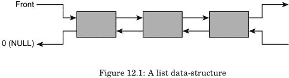

值得注意的是，图 12.1 给出的表示不一定用于 list 的实际实现中。例如，考虑下面这个小程序：

```cpp
int main()
{
    list<int> l;
    cout << "size: " << l.size() << ", first element: " <<
              l.front() << '\n';
}
```

当这个程序运行时，它实际上可能会产生如下输出：

```
size: 0, first element: 0
```

它的 front 元素甚至可以赋一个值。在这种情况下，实现者选择为 list 提供一个隐藏元素。该 list 实际上是一个循环链表，其中的隐藏元素充当终止元素，取代了图 12.1 中的 0 指针。如前所述，这是一个细微之处，并不影响将 list 视为以 0 指针结尾的数据结构这一概念。另外，众所周知，list 结构可以有多种不同的实现方式（参见 Aho, A.V., Hopcroft J.E. 和 Ullman, J.D., (1983) Data Structures and Algorithms (Addison-Wesley)）。

在需要存储数量未知的数据元素的情况下，list 和 vector 通常都是合适的数据结构。然而，在选择合适的数据结构时，有一些经验法则可供遵循。

- 当大多数访问是随机访问时，vector 是首选的数据结构。例如：在统计文本文件中字符频率的程序中，`vector<int> frequencies(256)` 是首选的数据结构，因为接收到的字符值可以用作 frequencies 向量的索引。
- 前面的例子还说明了第二条经验法则，同样倾向于使用 vector：如果元素数量事先已知（并且在程序运行期间不会显著改变），那么 vector 也比 list 更受欢迎。
- 在插入或删除操作占主导且数据结构规模较大的情况下，通常更倾向于使用 list。

目前，list 已经不像过去那样有用了（当时计算机速度慢得多，内存也更为受限）。除了某些罕见情况外，vector 应该是首选的容器；即使是在实现传统上使用 list 的算法时也是如此。

在选择 list 和 vector 时，还应考虑其他因素。虽然 vector 确实能够动态增长，但动态增长需要复制数据。显然，即使是在高速计算机上，复制一百万个大型数据结构也需要相当长的时间。另一方面，在 list 中插入大量元素并不要求我们复制不相关的数据。在 list 中插入一个新元素只需要我们调整一些指针。图 12.2 展示了这一点：一个新元素被插入到第二个和第三个元素之间，形成了一个包含四个元素的新列表。从 list 中删除元素也相当容易。再次从图 12.1 所示的情况出发，图 12.3 显示了如果从我们的列表中删除第二个元素会发生什么。同样：只需要调整指针。在这种情况下，删除比添加元素更简单：只需要重新路由两个指针。总结一下 list 和 vector 的比较：也许最好的结论是，对于应该优先选择哪种数据结构，并没有明确的答案。有一些经验法则可以遵循。但如果情况糟糕到极点，可能需要借助性能分析器来找出最佳方案。

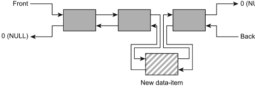

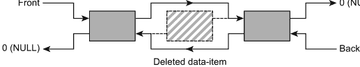

`list` 容器提供以下构造函数、运算符和成员函数：

- **构造函数：**
  - 可以构造一个空的 list：

    与 vector 一样，引用空 list 中的元素是错误的。

    ```cpp
    list<string> object;
    ```

  - 可以将 list 初始化为特定数量的元素。默认情况下，如果没有明确指定初始化值，则使用实际数据类型的默认值或默认构造函数。例如：

    ```cpp
    list<string> object(5, string("Hello"));  // initialize to 5 Hello's
    list<string> container(10);                  // and to 10 empty strings
    ```

  - 可以使用两个迭代器来初始化 list。要用一个 `vector<string>` 中从元素 5 到元素 10（包含最后一个）的范围内元素来初始化 list，可以使用以下构造方式：

    ```cpp
    extern vector<string> container;
    list<string> object(&container[5], &container[11]);
    ```

  - 可以使用复制构造函数来初始化 list：

    ```cpp
    extern list<string> container;
    list<string> object(container);
    ```

- list 不提供除容器标准运算符之外的特殊运算符。

- 可使用以下成员函数：
  - `Type &back():` 该成员函数返回 list 中最后一个元素的引用。程序员有责任仅在 list 不为空时使用此成员函数。
  - `list::iterator begin():` 该成员函数返回一个指向 list 中第一个元素的迭代器；如果 list 为空，则返回 end。
  - `void clear():` 该成员函数删除 list 中的所有元素。
  - `bool empty():` 如果 list 不包含任何元素，该成员函数返回 true。
  - `list::iterator end():` 该成员函数返回一个指向 list 中最后一个元素之后位置的迭代器。
  - `list::iterator erase():` 该成员函数可用于删除 list 中指定范围的元素：
    - `erase(pos)` 删除 pos 所指向的元素。返回迭代器 `++pos`。
    - `erase(first, beyond)` 删除迭代器范围 [first, beyond) 所指示的元素。返回 beyond。
  - `Type &front():` 该成员函数返回 list 中第一个元素的引用。程序员有责任仅在 list 不为空时使用此成员函数。
  - `... insert():` 该成员函数可用于向 list 中插入元素。返回值取决于调用的 insert 版本：
    - `list::iterator insert(pos)` 在 pos 处插入一个 Type 类型的默认值，并返回 pos。
    - `list::iterator insert(pos, value)` 在 pos 处插入 value，并返回 pos。
    - `void insert(pos, first, beyond)` 插入迭代器范围 [first, beyond) 中的元素。
    - `void insert(pos, n, value)` 在位置 pos 处插入 n 个值为 value 的元素。
  - `void merge(list<Type> other):` 该成员函数假定当前列表和 other 列表都是已排序的（参见下面的成员函数 sort）。基于这一假设，它将 other 中的元素插入当前列表中，使得修改后的列表保持有序。如果两个列表都未排序，那么根据两个列表中元素的初始顺序，结果列表将“尽可能”有序。`list<Type>::merge` 使用 `Type::operator<` 来排序列表中的数据，因此该运算符必须可用。下一个示例说明了 merge 成员函数的使用：列表 'object' 未排序，因此结果列表“尽可能”有序。

```cpp
#include <iostream>
#include <string>
#include <list>
using namespace std;

void showlist(list<string> &target)
{
    for
    (
        list<string>::iterator from = target.begin();
        from != target.end();
```


```cpp
++from
)
    cout << *from << " ";
cout << '\n';
}
int main()
{
    list<string> first;
    list<string> second;

    first.push_back(string("alpha"));
    first.push_back(string("bravo"));
    first.push_back(string("golf"));
    first.push_back(string("quebec"));

    second.push_back(string("oscar"));
    second.push_back(string("mike"));
    second.push_back(string("november"));
    second.push_back(string("zulu"));

    first.merge(second);
    showlist(first);
}
```

一个微妙之处是，如果列表自身作为参数使用，`merge` 不会改变该列表：`object.merge(object)` 不会改变列表 `object`。

- `void pop_back():`
  该成员从列表中移除最后一个元素。若列表为空，则什么也不发生。
- `void pop_front():`
  该成员从列表中移除第一个元素。若列表为空，则什么也不发生。
- `void push_back(value):`
  该成员将 `value` 添加到列表末尾。
- `void push_front(value):`
  该成员将 `value` 添加到列表第一个元素之前。
- `void resize():`
  该成员可用于改变当前存储在列表中的元素数量：
  - `resize(n, value)` 可用于将列表调整到大小为 `n`。值是可选的。如果列表被扩展且未提供值，则额外元素初始化为所用数据类型的默认值；否则使用值来初始化额外元素。
- `list::reverse_iterator rbegin():`
  该成员返回指向列表中最后一个元素的迭代器。
- `void remove(value):`
  该成员从列表中移除所有出现的 `value`。在以下示例中，两个字符串 `'Hello'` 从列表对象中被移除：

```cpp
#include <iostream>
#include <string>
#include <list>
using namespace std;

int main()
{
    list<string> object;

    object.push_back(string("Hello"));
    object.push_back(string("World"));
    object.push_back(string("Hello"));
    object.push_back(string("World"));

    object.remove(string("Hello"));

    while (object.size())
    {
        cout << object.front() << '\n';
        object.pop_front();
    }
}
/*
    Generated output:
    World
    World
*/
```

- `list::reverse_iterator rend();`
  该成员返回指向列表中第一个元素之前的迭代器。
- `size_t size();`
  该成员返回列表中元素的数量。
- `void reverse();`
  该成员反转列表中元素的顺序。元素 `back` 变为 `front`，反之亦然。
- `void sort();`
  该成员对列表排序。列表排序后，其用法示例在下面 `unique` 成员函数的描述中给出。`list<Type>::sort` 使用 `Type::operator<` 对列表中的数据进行排序，因此该运算符必须可用。
- `void splice(pos, object);`
  该成员函数将 `object` 的内容转移到当前列表，使用 `splice` 成员从对象的迭代器位置 `pos` 开始插入。执行 `splice` 后，`object` 为空。例如：

```cpp
#include <iostream>
#include <string>
#include <list>
using namespace std;

int main()
{
    list<string> object;

    object.push_front(string("Hello"));
    object.push_back(string("World"));

    list<string> argument(object);

    object.splice(++object.begin(), argument);

    cout << "Object contains " << object.size() << " elements, " <<
         "Argument contains " << argument.size() <<
         " elements,\n";

    while (object.size())
    {
        cout << object.front() << '\n';
        object.pop_front();
    }
}
```

或者，`argument` 后面可以跟一个 `argument` 的迭代器，表示应被拼接的 `argument` 的第一个元素；也可以跟两个迭代器 `begin` 和 `end`，定义应拼接进 `object` 的 `argument` 的迭代器范围 `[begin, end)`。

- `void swap():`
  该成员可用于交换两个使用相同数据类型的列表。
- `void unique():`
  该成员函数作用于已排序的列表，移除列表中所有连续相同的元素。`list<Type>::unique` 使用 `Type::operator==` 来识别相同的数据元素，这些元素并不唯一。下面是一个从列表中移除所有多次出现的单词的示例：

```cpp
#include <iostream>
#include <string>
#include <list>
using namespace std;

                              // see the merge() example
void showlist(list<string> &target)
{
    for
    (
        list<string>::iterator from = target.begin();
        from != target.end();
        ++from
    )
        cout << *from << " ";

    cout << '\n';
}

int main()
{
    string
        array[] =
        {
            "charley",
            "alpha",
            "bravo",
            "alpha"
        };

    list<string>
        target
        (
            array, array + sizeof(array)
            / sizeof(string)
        );

    cout << "Initially we have:\n";
    showlist(target);

    target.sort();
    cout << "After sort() we have:\n";
    showlist(target);

    target.unique();
    cout << "After unique() we have:\n";
    showlist(target);
}

/*

Generated output:

Initially we have:
charley alpha bravo alpha
After sort() we have:
alpha alpha bravo charley
After unique() we have:
alpha bravo charley
*/
```

#### 12.3.3 “queue”容器

`queue` 类实现队列数据结构。使用队列容器之前，必须已经包含头文件 `<queue>`。

图 12.4 描绘了一个队列。图 12.4 表明，队列有一个点（*back*）可以向队列添加项，还有一个点（*front*）可以从队列移除（读取）项。因此，队列也称为 *FIFO* 数据结构，即 *first in, first out*（先进先出）。它最常用于事件应按生成顺序处理的情形。

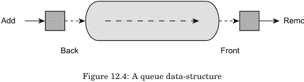

图 12.4：队列数据结构

队列容器可使用以下构造函数、运算符和成员函数：

- **构造函数：**
  - 可以构造一个空队列：

    ```cpp
    queue<string> object;
    ```

    与 `vector` 一样，引用空队列的元素是错误的。

  - 可以使用复制构造函数初始化队列：

    ```cpp
    extern queue<string> container;
    queue<string> object(container);
    ```

- 队列容器仅支持基本容器运算符。

- 队列可使用以下成员函数：
  - `Type &back();`

    该成员返回队列中最后一个元素的引用。程序员有责任仅在队列非空时使用该成员。
  - `bool empty();`

    该成员在队列不包含元素时返回 `true`。
  - `Type &front();`

    该成员返回队列中第一个元素的引用。程序员有责任仅在队列非空时使用该成员。
  - `void push(value);`

    该成员将 `value` 添加到队列的后端。
  - `void pop();`

    该成员移除队列前端的元素。注意，该成员*不*返回该元素。若对空队列调用该成员，则什么也不发生。有人可能会问，为什么 `pop` 返回 `void`，而不是 `Type` 类型的值（参见 `front`）。一个原因在于良好软件设计的原则：函数应执行单一任务。将移除和返回被移除元素结合起来会破坏这一原则。此外，当放弃这一原则时，`pop` 的实现总是有缺陷的。考虑一个本应返回刚弹出值的 `pop` 成员的原型实现：

    ```cpp
    Type queue::pop()
    {
        Type ret(front());
        erase_front();
        return ret;
    }
    ```

    一如既往，问题出在尾部：由于 `queue` 无法控制 `Type` 的行为，最后一条语句（`return ret;`）可能抛出异常。到那时，队列的前端元素已经从队列中移除，因此它就丢失了。于是，返回 `Type` 的 `pop` 成员无法提供*强保证*，因此 `pop` 不应返回原来的前端元素。由于这一切，我们必须先使用 `front`，再使用 `pop` 来获取并移除队列的前端元素。
  - `size_t size();`

    该成员返回队列中元素的数量。

注意，队列不支持迭代器或下标运算符。唯一可访问的元素是其前端和后端元素。可以通过以下方式清空队列：

- 反复移除其前端元素；
- 将使用相同数据类型的空队列赋值给它；
- 调用其析构函数。

#### 12.3.4 “priority_queue”容器

`priority_queue` 类实现优先队列数据结构。使用 `priority_queue` 容器之前，必须已经包含 `<queue>` 头文件。

优先队列与队列相同，但允许按照*优先级规则*输入数据元素。现实生活中的优先队列可见于例如机场值机柜台。在柜台，乘客通常排队等待轮到自己值机，但迟到的乘客通常被允许插队：他们获得比其他乘客更高的优先级。

优先队列使用存储在优先队列中的数据类型的 `operator<` 来决定数据元素的优先级。值*越小*，优先级*越低*。因此，优先队列可用于在值到达时对其进行排序。这种优先队列应用的一个简单示例如下程序：它从 `cin` 读取单词，并将排序后的单词列表写入 `cout`：

```cpp
#include <iostream>
```


### 12.3 顺序容器

```cpp
#include <string>
#include <queue>
using namespace std;

int main()
{
    priority_queue<string> q;
    string word;

    while (cin >> word)
        q.push(word);

    while (q.size())
    {
        cout << q.top() << " \n";
        q.pop();
    }
}
```

遗憾的是，这些单词是以相反的顺序列出的：由于底层的 `operator<`，在 ASCII 序列中靠后出现的单词会先出现在优先队列中。解决这个问题的方法是在 `string` 数据类型周围定义一个包装类，反转 `string` 的 `operator<`。以下是修改后的程序：

```cpp
#include <iostream>
#include <string>
#include <queue>

class Text
{
    std::string d_s;

public:
    Text(std::string const &str)
        :
            d_s(str)
        {}
    operator std::string const & () const
    {
        return d_s;
    }
    bool operator<(Text const &right) const
    {
        return d_s > right.d_s;
    }
};

using namespace std;

int main()
{
    priority_queue<Text> q;
    string word;

    while (cin >> word)
        q.push(word);

    while (q.size())
    {
        word = q.top();
        cout << word << '\n';
        q.pop();
    }
}
```

还有其他方法可以实现同样的效果。一种方法是将优先队列的内容存储在一个 vector 中，然后按相反顺序读取其中的元素。

`priority_queue` 容器提供以下构造函数、运算符和成员函数：

- **构造函数：**
  - 可以构造一个空的 `priority_queue`：

    ```cpp
    priority_queue<string> object;
    ```

    与 vector 一样，引用空优先队列的元素是错误的。
  - 可以使用拷贝构造函数初始化优先队列：

    ```cpp
    extern priority_queue<string> container;
    priority_queue<string> object(container);
    ```

- `priority_queue` 仅支持容器的基本运算符。
- 优先队列提供以下成员函数：
  - `bool empty();`

    如果优先队列不包含任何元素，此成员返回 true。
  - `void push(value);`

    此成员将 value 插入优先队列中的适当位置。
  - `void pop();`

    此成员移除优先队列顶部的元素。请注意，此成员**不会**返回该元素。如果对空优先队列调用此成员，则不会发生任何事情。有关为什么 pop 的返回类型为 `void` 的讨论，请参见第 12.3.3 节。
  - `size_t size();`

    此成员返回优先队列中的元素数量。
  - `Type &top();`

    此成员返回对优先队列第一个元素的引用。程序员有责任仅在优先队列非空时使用此成员。

请注意，优先队列不支持迭代器或下标运算符。唯一可以访问的元素是它的顶部元素。可以通过以下方式清空优先队列：

- 重复移除其顶部元素；
- 向其分配一个使用相同数据类型的空队列；
- 调用其析构函数。

#### 12.3.5 “deque”容器

deque（发音：“deck”）类实现了双端队列数据结构（deque）。在使用 deque 容器之前，必须包含头文件 `<deque>`。

deque 与队列类似，但它允许在两端进行读写。实际上，deque 数据类型支持的功能远多于队列，如下面可用的成员函数概览所示。deque 是 vector 和两个队列的组合，分别在 vector 的两端进行操作。在需要频繁进行随机插入以及在 vector 的一侧或两侧添加和/或移除元素的情况下，应考虑使用 deque。

deque 提供以下构造函数、运算符和成员函数：

- **构造函数：**
  - 可以构造一个空的 deque：

    ```cpp
    deque<string> object;
    ```

    与 vector 一样，引用空 deque 的元素是错误的。
  - 可以将 deque 初始化为特定数量的元素。默认情况下，如果没有明确指定初始化的值，则使用实际数据类型的默认值或默认构造函数。例如：

    ```cpp
    deque<string> object(5, string("Hello"));   // 初始化为5个"Hello"
    deque<string> container(10);                 // 以及10个空字符串
    ```

  - 可以使用两个迭代器初始化 deque。要使用 `vector<string>` 从第 5 个元素到第 10 个元素（包括最后一个）初始化 deque，可以使用以下构造：

    ```cpp
    extern vector<string> container;
    deque<string> object(&container[5], &container[11]);
    ```

  - 可以使用拷贝构造函数初始化 deque：

    ```cpp
    extern deque<string> container;
    deque<string> object(container);
    ```

- 除了容器的标准运算符之外，deque 还支持下标运算符，可用于检索或重新赋值 deque 中的任意元素。请注意，被索引的元素必须存在。

- deque 提供以下成员函数：
  - `Type &back();`

    此成员返回对 deque 中最后一个元素的引用。程序员有责任仅在 deque 非空时使用此成员。
  - `deque::iterator begin();`

    此成员返回指向 deque 中第一个元素的迭代器。
  - `void clear();`

    此成员删除 deque 中的所有元素。
  - `bool empty();`

    如果 deque 不包含任何元素，此成员返回 true。
  - `deque::iterator end();`

    此成员返回指向 deque 中最后一个元素之后位置的迭代器。
  - `deque::iterator erase();`

    此成员可用于删除 deque 中特定范围的元素：

    - `erase(pos)` 删除 `pos` 指向的元素。返回迭代器 `++pos`。
    - `erase(first, beyond)` 删除迭代器范围 `[first, beyond)` 指示的元素。返回 `beyond`。
  - `Type &front();`

    此成员返回对 deque 中第一个元素的引用。程序员有责任仅在 deque 非空时使用此成员。
  - `... insert();`

    此成员可用于从特定位置开始插入元素。返回值取决于所调用的 insert 版本：

    - `deque::iterator insert(pos)` 在 `pos` 处插入一个类型为 `Type` 的默认值，返回 `pos`。
    - `deque::iterator insert(pos, value)` 在 `pos` 处插入 `value`，返回 `pos`。
    - `void insert(pos, first, beyond)` 插入迭代器范围 `[first, beyond)` 中的元素。
    - `void insert(pos, n, value)` 从迭代器位置 `pos` 开始插入 `n` 个值为 `value` 的元素。
  - `void pop_back();`

    此成员从 deque 中移除最后一个元素。如果 deque 为空，则不执行任何操作。
  - `void pop_front();`

    此成员从 deque 中移除第一个元素。如果 deque 为空，则不执行任何操作。
  - `void push_back(value);`

    此成员将 value 添加到 deque 的末尾。
  - `void push_front(value);`

    此成员将 value 添加到 deque 的第一个元素之前。
  - `void resize();`

    此成员可用于改变 deque 中当前存储的元素数量：

    - `resize(n, value)` 可用于将 deque 的大小调整为 `n`。`value` 是可选的。如果 deque 被扩展且未提供 `value`，则额外的元素将使用所用数据类型的默认值进行初始化，否则使用 `value` 来初始化额外元素。
  - `deque::reverse_iterator rbegin();`

    此成员返回指向 deque 中最后一个元素的迭代器。
  - `deque::reverse_iterator rend();`

    此成员返回指向 deque 中第一个元素之前位置的迭代器。
  - `size_t size();`

    此成员返回 deque 中的元素数量。
  - `void swap(argument);`

    此成员可用于交换使用相同数据类型的两个 deque。

#### 12.3.6 “map”容器

map 类提供一种（有序的）关联数组。在使用 map 容器之前，必须包含 `<map>` 头文件。

map 由键/值对填充，这些键/值对可以是任何容器接受的类型。由于键和值都关联了类型，因此我们必须在尖括号表示法中指定两个类型，类似于我们在 pair 容器中看到的规范（参见第 12.2 节）。第一个类型表示键的类型，第二个类型表示值的类型。例如，一个键为 string、值为 double 的 map 可以如下定义：

```cpp
map<string, double> object;
```


*键*用于访问其关联信息。该信息被称为*值*。例如，电话簿将人名用作键，将电话号码以及可能其他信息（如邮政编码、地址、职业）用作值。由于*映射*会对其键进行排序，因此必须定义键的 `operator<`，并且使用它必须是合理的。例如，使用指针作为键通常是一个坏主意，因为对指针排序不同于对指针所指向的值进行排序。

映射上的两个基本操作是存储*键/值*组合，以及在给定键时检索值。使用键作为索引的下标运算符可用于这两种操作。如果下标运算符用作*左值*，则将表达式的*右值*插入到映射中。如果用作*右值*，则检索与该键关联的值。每个键在*映射*中只能存储一次。如果再次输入相同的键，新值将替换原先存储的值，而原值丢失。

特定的键/值组合可以隐式或显式地插入到*映射*中。如果需要显式插入，则必须先构造键/值组合。为此，每个*映射*都定义了一个 *value_type*，可用于创建可以存储在*映射*中的值。例如，可以如下构造 *map<string, int>* 的值：

```cpp
map<string, int>::value_type siValue("Hello", 1);
```

*value_type* 与 *map<string, int>* 相关联：键的类型是 string，值的类型是 int。匿名 *value_type* 对象也经常被使用。例如：

```cpp
map<string, int>::value_type("Hello", 1);
```

与其一遍又一遍地使用 `map<string, int>::value_type(...)` 这一行，不如经常使用 *typedef* 来减少输入并提高可读性：

```cpp
typedef map<string, int>::value_type StringIntValue;
```

使用这个 typedef，现在可以通过以下方式构造 *map<string, int>* 的值：

```cpp
StringIntValue("Hello", 1);
```

另外，*pairs* 可用于表示映射使用的键/值组合：

```cpp
pair<string, int>("Hello", 1);
```

##### 12.3.6.1 'map' 构造函数

以下构造函数可用于 *映射*容器：

- 可以构造一个空的 *映射*：

```cpp
map<string, int> object;
```

请注意，存储在映射中的值本身也可以是容器。例如，下面定义了一个 *映射*，其中的值是一个 *pair*：一个容器嵌套在另一个容器之下：

```cpp
map<string, pair<string, string>> object;
```

注意这里使用了两个连续的右尖括号。在 C++11 标准问世之前，容器类型规范（通常：在模板类型规范的上下文中）中连续的右尖括号会导致编译错误，因为两个右尖括号的直接连接会被编译器解释为右移运算符（`operator>>`），而这并不是我们想要的。在支持 C++11 标准的编译器中，这种构造是被接受的。尚未实现该特性的编译器需要在两个连续的右尖括号之间加一个空格。

- 可以使用两个迭代器初始化映射。迭代器可以指向待构造映射的 `value_type` 值，也可以指向普通的 pair 对象。如果使用 pair，则其第一个元素表示键的类型，第二个元素表示值的类型。示例：

```cpp
pair<string, int> pa[] =
{
        pair<string,int>("one", 1),
        pair<string,int>("two", 2),
        pair<string,int>("three", 3),
};

map<string, int> object(&pa[0], &pa[3]);
```

在此示例中，也可以使用 `map<string, int>::value_type` 来代替 `pair<string, int>`。

如果 `begin` 表示用于构造映射的第一个迭代器，`end` 表示第二个迭代器，那么将使用 `[begin, end)` 来初始化映射。与直觉可能相反的是，映射构造函数只会插入*新*键。如果 `pa` 的最后一个元素是 "one", 3，那么映射中只会插入两个元素："one", 1 和 "two", 2。值 "one", 3 会被静默忽略。

映射会获得迭代器所指向数据的自身副本，如下例所示：

```cpp
#include <iostream>
#include <map>
using namespace std;

class MyClass
{
public:
    MyClass()
    {
        cout << "MyClass constructor\n";
    }
    MyClass(MyClass const &other)
    {
        cout << "MyClass copy constructor\n";
    }
    ~MyClass()
    {
        cout << "MyClass destructor\n";
    }
};

int main()
{
    pair<string, MyClass> pairs[] =
    {
        pair<string, MyClass>("one", MyClass())
    };
    cout << "pairs constructed\n";

    map<string, MyClass> mapsm(&pairs[0], &pairs[1]);
    cout << "mapsm constructed\n";
}
/*
    Generated output:
MyClass constructor
MyClass copy constructor
MyClass destructor
pairs constructed
MyClass copy constructor
MyClass destructor
mapsm constructed
MyClass destructor
MyClass destructor
*/
```

追踪此程序的输出时，我们看到，首先调用 MyClass 对象的构造函数来初始化数组 pairs 的匿名元素。然后，该对象通过复制构造函数被复制到数组 pairs 的第一个元素中。接下来，原始元素不再需要并被销毁。此时数组 pairs 已构造完成。随后，映射构造一个临时 pair 对象，用于构造映射元素。构造完映射元素后，临时 pair 对象被销毁。最终，当程序终止时，存储在映射中的 pair 元素也被销毁。

- 可以使用复制构造函数初始化映射：

```cpp
extern map<string, int> container;
map<string, int> object(container);
```

##### 12.3.6.2 'map' 运算符

除了容器的标准运算符之外，映射还支持下标运算符。

下标运算符可用于检索或重新赋值映射的各个元素。下标运算符的参数称为键。

如果提供的键在映射中不存在，则使用默认值或默认构造函数自动向映射中添加一个新数据元素，以初始化新元素的值部分。如果下标运算符用作右值，则返回此默认值。

当初始化新元素或重新赋值映射的另一个元素时，赋值运算符右侧的类型必须等于（或可提升为）映射值部分的类型。例如，要添加或更改映射中元素 "two" 的值，可以使用以下语句：

```cpp
mapsm["two"] = MyClass();
```

##### 12.3.6.3 'map' 公有成员

以下成员函数可用于映射容器：

- `map::iterator begin();`

  此成员返回指向映射第一个元素的迭代器。

- `void clear();`

  此成员从映射中删除所有元素。

- `size_t count(key);`

  如果提供的键在映射中存在，此成员返回 1，否则返回 0。

- `bool empty();`

  如果映射不包含任何元素，此成员返回 true。

- `map::iterator end();`

  此成员返回一个指向映射最后一个元素之后位置的迭代器。

- `pair<map::iterator, map::iterator> equal_range(key);`

  此成员返回一对迭代器，分别对应下面介绍的成员函数 `lower_bound` 和 `upper_bound` 的返回值。在讨论成员函数 `upper_bound` 时给出了一个示例来说明这些成员函数。

- `... erase();`

  此成员可用于从映射中删除特定元素或元素范围：

  - `bool erase(key)` 从映射中删除具有给定键的元素。如果该值被删除，则返回 True；如果映射中没有包含该键的元素，则返回 false。
  - `void erase(pos)` 删除迭代器 `pos` 指向的元素。
  - `void erase(first, beyond)` 删除迭代器范围 `[first, beyond)` 所指示的所有元素。

- `map::iterator find(key);`

  此成员返回一个指向具有给定键的元素的迭代器。如果该元素不存在，则返回 end。以下示例说明了 find 成员函数的用法：

```cpp
#include <iostream>
#include <map>
using namespace std;

int main()
{
    map<string, int> object;

    object["one"] = 1;

    map<string, int>::iterator it = object.find("one");

    cout << "one" <<
        (it == object.end() ? "not " : "") << "found\n";

    it = object.find("three");

    cout << "three" <<
        (it == object.end() ? "not " : "") << "found\n";
}
/*
    Generated output:
'one' found
'three' not found
*/
```

- `... insert();`

  此成员可用于向映射中插入元素。但是，与已存在键关联的值不会被新值替换。其返回值取决于所调用的 insert 版本：


- `pair<map::iterator, bool> insert(keyvalue)` 向 map 中插入一个新的 `value_type`。返回值是一个 `pair<map::iterator, bool>`。如果返回的 `bool` 字段为 true，则 `keyvalue` 已插入 map。值为 false 表示 `keyvalue` 中指定的键在 map 中已经存在，因此 `keyvalue` 未插入 map。在这两种情况下，`map::iterator` 字段都指向具有 `keyvalue` 中所指定键的数据元素。以下示例说明了这种 `insert` 变体的用法：

```cpp
#include <iostream>
#include <string>
#include <map>
using namespace std;

int main()
{
    pair<string, int> pa[] =
    {
        pair<string,int>("one", 10),
        pair<string,int>("two", 20),
        pair<string,int>("three", 30),
    };
    map<string, int> object(&pa[0], &pa[3]);

    // {four, 40} and 'true' is returned
    pair<map<string, int>::iterator, bool>
        ret = object.insert
            (
                map<string, int>::value_type
                ("four", 40)
            );

    cout << boolalpha;

    cout << ret.first->first << " " <<
            ret.first->second << " " <<
            ret.second << " " << object["four"] << '\n';

    // {four, 40} and 'false' is returned
    ret = object.insert
        (
            map<string, int>::value_type
            ("four", 0)
        );

    cout << ret.first->first << " " <<
            ret.first->second << " " <<
            ret.second << " " << object["four"] << '\n';
}

/*
    Generated output:

    four 40 true 40
    four 40 false 40
*/
```

注意如下有些特殊的构造

```cpp
cout << ret.first->first << " " << ret.first->second << ...
```

注意，`ret` 等于 `insert` 成员函数返回的 pair。它的 `first` 字段是 `map<string, int>` 中的迭代器，因此可以将其视为指向 `map<string, int>::value_type` 的指针。这些值类型本身也是 pair，具有 `first` 和 `second` 字段。因此，`ret.first->first` 是 map 值的键（一个 `string`），而 `ret.first->second` 是值（一个 `int`）。

- `map::iterator insert(pos, keyvalue)`。通过这种方式，也可以将一个 `map::value_type` 插入 map。`pos` 会被忽略，并返回指向所插入元素的迭代器。
- `void insert(first, beyond)` 插入由迭代器范围 `[first, beyond)` 所指向的（`map::value_type`）元素。
- `map::iterator lower_bound(key)`：该成员返回一个迭代器，指向键至少等于指定键的第一个键/值元素。如果不存在这样的元素，函数返回 `end`。
- `map::reverse_iterator rbegin()`：该成员返回一个指向 map 最后一个元素的迭代器。
- `map::reverse_iterator rend()`：该成员返回一个指向 map 第一个元素之前位置的迭代器。
- `size_t size()`：该成员返回 map 中元素的数量。
- `void swap(argument)`：该成员可用于交换两个键/值类型相同的 map。
- `map::iterator upper_bound(key)`：该成员返回一个迭代器，指向键大于指定键的第一个键/值元素。如果不存在这样的元素，函数返回 `end`。以下示例说明了成员函数 `equal_range`、`lower_bound` 和 `upper_bound`：

```cpp
#include <iostream>
#include <map>
using namespace std;

int main()
{
    pair<string, int> pa[] =
    {
        pair<string,int>("one", 10),
        pair<string,int>("two", 20),
        pair<string,int>("three", 30),
    };
    map<string, int> object(&pa[0], &pa[3]);
    map<string, int>::iterator it;

    if ((it = object.lower_bound("tw")) != object.end())
        cout << "lower-bound 'tw' is available, it is: " <<
                it->first << '\n';

    if (object.lower_bound("twoo") == object.end())
        cout << "lower-bound 'twoo' not available" << '\n';

    cout << "lower-bound two: " <<
            object.lower_bound("two")->first <<
            " is available\n";

    if ((it = object.upper_bound("tw")) != object.end())
        cout << "upper-bound 'tw' is available, it is: " <<
                it->first << '\n';

    if (object.upper_bound("two") == object.end())
        cout << "upper-bound 'two' not available" << '\n';

    if (object.upper_bound("two") == object.end())
        cout << "upper-bound 'two' not available" << '\n';

    pair
    <
        map<string, int>::iterator,
        map<string, int>::iterator
    >
        p = object.equal_range("two");

    cout << "equal range: 'first' points to " <<
                p.first->first << ", 'second' is " <<
        (
            p.second == object.end() ?
                "not available"
            :
                p.second->first
        ) <<
        '\n';
}
/*
Generated output:

    lower-bound 'tw' is available, it is: two
    lower-bound 'two' not available
    lower-bound two: two is available
    upper-bound 'tw' is available, it is: two
    upper-bound 'two' not available
    upper-bound 'two' not available
    equal range: 'first' points to two, 'second' is not available

*/
```

##### 12.3.6.4 'map' 的一个简单示例

正如 12.3.6 节开头所述，map 表示一种有序关联数组。在 map 中，键是有序的。如果应用程序必须访问 map 中的所有元素，则必须使用 begin 和 end 迭代器。

以下示例说明了如何创建一个简单表格，列出 map 中找到的所有键和值：

```cpp
#include <iostream>
#include <iomanip>
#include <map>

using namespace std;

int main()
{
    pair<string, int>
        pa[] =
    {
        pair<string,int>("one", 10),
        pair<string,int>("two", 20),
        pair<string,int>("three", 30),
    };
    map<string, int>
        object(&pa[0], &pa[3]);

    for
    (
        map<string, int>::iterator it = object.begin();
            it != object.end();
                ++it
    )
        cout << setw(5) << it->first.c_str() <<
               setw(5) << it->second << '\n';
}
/*
    Generated output:
one    10
three  30
two    20
*/
```

#### 12.3.7 'multimap' 容器

与 map 一样，`multimap` 类实现一种（有序的）关联数组。在使用 `multimap` 容器之前，必须已经包含头文件 `<map>`。

map 与 `multimap` 的主要区别在于，multimap 支持与同一个键关联的多个值，而 map 包含单值键。注意，multimap 也接受与相同键关联的多个相同值。

map 和 multimap 具有相同的成员函数集合，但下标运算符除外，multimap 不支持该运算符。这是可以理解的：如果允许同一个键有多个条目，那么对于 `object[key]` 应返回哪一个可能的值呢？

有关 multimap 成员函数的概述，请参阅 12.3.6 节。不过，有些成员函数在 multimap 容器的上下文中使用时需要额外注意。下面讨论这些成员。

- `size_t multimap::count(key)`：该成员返回 multimap 中与给定键关联的条目数量。
- `... erase()`：该成员可用于从 map 中删除元素：
  - `size_t erase(key)` 删除具有给定键的所有元素。返回被删除元素的数量。
  - `void erase(pos)` 删除 `pos` 所指向的单个元素。其他可能具有相同键的元素不会被删除。
  - `void erase(first, beyond)` 删除由迭代器范围 `[first, beyond)` 指示的所有元素。
- `pair<multimap::iterator, multimap::iterator> equal_range(key)`：该成员函数返回一对迭代器，分别是下面介绍的 `lower_bound` 和 `upper_bound` 的返回值。该函数提供了一种简单的


### 12.3 关联容器

这意味着要确定 multimap 中具有相同键的所有元素。本节末尾给出了一个示例，说明这些成员函数的使用。

- `multimap::iterator find(key)`：该成员返回一个迭代器，指向第一个键为 `key` 的值。如果该元素不存在，则返回指向末尾的迭代器。可以递增该迭代器以访问所有具有相同键的元素，直到它到达末尾，或者迭代器的 `first` 成员不再等于 `key`。
- `multimap::iterator insert()`：该成员函数通常会成功，因此返回的是 `multimap::iterator`，而不是像 map 容器那样返回 `pair<multimap::iterator, bool>`。返回的迭代器指向新添加的元素。

虽然 lower_bound 和 upper_bound 函数在 map 和 multimap 容器中行为相同，但它们在 multimap 中的操作值得额外注意。下一个示例说明了将 lower_bound、upper_bound 和 equal_range 应用于 multimap 的情况。

```cpp
#include <iostream>
#include <map>
using namespace std;

int main()
{
    pair<string, int> pa[] =
    {
        pair<string,int>("alpha", 1),
        pair<string,int>("bravo", 2),
        pair<string,int>("charley", 3),
        pair<string,int>("bravo", 7),  // unordered 'bravo' values
        pair<string,int>("delta", 5),
        pair<string,int>("bravo", 4),
    };
    multimap<string, int> object(&pa[0], &pa[6]);

    typedef multimap<string, int>::iterator msiIterator;

    msiIterator it = object.lower_bound("brava");

    cout << "Lower bound for 'brava': " <<
        it->first << ", " << it->second << '\n';

    it = object.upper_bound("bravu");

    cout << "Upper bound for 'bravu': " <<
        it->first << ", " << it->second << '\n';

    pair<msiIterator, msiIterator>
        itPair = object.equal_range("bravo");

    cout << "Equal range for 'bravo':\n";
    for (it = itPair.first; it != itPair.second; ++it)
        cout << it->first << ", " << it->second << '\n';
    cout << "Upper bound: " << it->first << ", " << it->second << '\n';

    cout << "Equal range for 'brav':\n";
    itPair = object.equal_range("brav");
    for (it = itPair.first; it != itPair.second; ++it)
        cout << it->first << ", " << it->second << '\n';
    cout << "Upper bound: " << it->first << ", " << it->second << '\n';
}
/*
    Generated output:

    Lower bound for 'brava': bravo, 2
    Upper bound for 'bravu': charley, 3
    Equal range for 'bravo':
    bravo, 2
    bravo, 7
    bravo, 4
    Upper bound: charley, 3
    Equal range for 'brav':
    Upper bound: bravo, 2
*/
```

特别注意以下特性：

- 对于不存在的键，`lower_bound` 和 `upper_bound` 产生相同的结果：它们都返回第一个键大于给定键的元素。
- 虽然 `multimap` 中的键是有序的，但相同键的值是无序的：它们按照输入的顺序被检索。

#### 12.3.8 `set`容器

`set` 类实现了一个排序的值集合。在使用 `set` 容器之前，必须包含 `<set>` 头文件。

`set` 包含唯一的值（容器可接受的类型）。每个值只存储一次。

可以显式创建特定的值：每个 `set` 都定义了 `value_type`，可用于创建可以存储在集合中的值。例如，可以如下构造 `set<string>` 的值：

```cpp
set<string>::value_type setValue("Hello");
```

`value_type` 与 `set<string>` 相关联。也经常使用匿名 `value_type` 对象。例如，

```cpp
set<string>::value_type("Hello");
```

与其反复使用 `set<string>::value_type(...)`，通常使用 `typedef` 来减少输入并提高可读性：

```cpp
typedef set<string>::value_type StringSetValue;
```

使用这个 `typedef`，可以如下构造 `set<string>` 的值：

```cpp
StringSetValue("Hello");
```

或者，可以直接使用 `set` 类型的值。在这种情况下，类型 `Type` 的值会被隐式转换为 `set<Type>::value_type`。

`set` 容器提供以下构造函数、运算符和成员函数：

- 构造函数：
  - 可以构造一个空的集合：
    ```cpp
    set<int> object;
    ```
  - 可以使用两个迭代器初始化集合。例如：
    ```cpp
    int intarr[] = {1, 2, 3, 4, 5};
    set<int> object(&intarr[0], &intarr[5]);
    ```

    请注意，集合中的所有值必须不同：构造集合时不能重复存储相同的值。如果相同值重复出现，只有该值的第一个实例被放入集合中，其余值被静默忽略。

    和 map 一样，set 拥有它包含的数据的自己的副本。
- 可以使用复制构造函数初始化集合：
  ```cpp
  extern set<string> container;
  set<string> object(container);
  ```
- set 容器只支持容器可用的标准运算符集。
- set 类具有以下成员函数：
  - `set::iterator begin()`：该成员返回一个迭代器，指向集合的第一个元素。如果集合为空，则返回 `end`。
  - `void clear()`：该成员从集合中删除所有元素。
  - `size_t count(key)`：如果集合中存在给定的键，该成员返回 1，否则返回 0。
  - `bool empty()`：如果集合中没有元素，该成员返回 `true`。
  - `set::iterator end()`：该成员返回一个迭代器，指向集合最后一个元素之后的位置。
  - `pair<set::iterator, set::iterator> equal_range(key)`：该成员返回一对迭代器，分别是下面介绍的成员函数 `lower_bound` 和 `upper_bound` 的返回值。
  - `... erase()`：该成员可用于从集合中删除特定元素或元素范围：
    - `bool erase(value)` 从集合中删除具有给定值的元素。如果该值被移除，则返回 `true`；如果集合不包含元素 `value`，则返回 `false`。
    - `void erase(pos)` 删除迭代器 `pos` 指向的元素。
    - `void erase(first, beyond)` 删除迭代器范围 `[first, beyond)` 指示的所有元素。
  - `set::iterator find(value)`：该成员返回一个迭代器，指向具有给定值的元素。如果元素不存在，则返回 `end`。
  - `... insert()`：该成员可用于将元素插入集合。如果元素已存在，则现有元素保持不变，并忽略要插入的元素。返回值取决于调用的 insert 版本：
    - `pair<set::iterator, bool> insert (keyvalue)` 将新的 `set::value_type` 插入集合。返回值是 `pair<set::iterator, bool>`。如果返回的 `bool` 字段为 `true`，则 value 已插入集合。值 `false` 表示指定的值已存在于集合中，因此提供的值未插入集合。在这两种情况下，`set::iterator` 字段都指向集合中具有指定值的数据元素。
    - `set::iterator insert (pos, keyvalue)`。这样也可以将 `set::value_type` 插入集合。`pos` 被忽略，并返回指向已插入元素的迭代器。
    - `void insert(first, beyond)` 将迭代器范围 `[first, beyond)` 指向的 `(set::value_type)` 元素插入集合。
  - `set::iterator lower_bound(key)`：该成员返回一个迭代器，指向第一个键至少等于指定键的键值元素。如果不存在这样的元素，则函数返回 `end`。
  - `set::reverse_iterator rbegin()`：该成员返回一个迭代器，指向集合的最后一个元素。
  - `set::reverse_iterator rend()`：该成员返回一个迭代器，指向集合第一个元素之前的位置。
  - `size_t size()`：该成员返回集合中元素的数量。
  - `void swap(argument)`：该成员可用于交换两个使用相同数据类型的集合（argument 是第二个集合）。
  - `set::iterator upper_bound(key)`：该成员返回一个迭代器，指向第一个键大于指定键的键值元素。如果不存在这样的元素，则函数返回 `end`。

#### 12.3.9 `multiset`容器

与 `set` 一样，`multiset` 类实现了排序的值集合。在使用 `multiset` 容器之前，必须包含 `<set>` 头文件。

`set` 和 `multiset` 之间的主要区别在于，`multiset` 支持相同值的多个条目，而 `set` 包含唯一的值。

`set` 和 `multiset` 具有相同的成员函数集。有关 `multiset` 成员函数的概述，请参阅第 12.3.8 节。但是，有些成员函数的行为与 `set` 容器中的对应函数略有不同。这里介绍这些成员。

- `size_t count (value)`：该成员返回与给定值关联的 multiset 中条目的数量。
- `... erase()`：该成员可用于从 multiset 中删除元素：
  - `size_t erase(value)` 删除所有具有给定值的元素。返回被删除元素的数量。


- `void erase(pos)` 删除迭代器 `pos` 指向的元素。其他可能具有相同值的元素不会被删除。
- `void erase(first, beyond)` 删除迭代器范围 `[first, beyond)` 所指示的所有元素。
- `pair<multiset::iterator, multiset::iterator> equal_range(value)`：该成员函数返回一对迭代器，它们分别是下面将要介绍的 `lower_bound` 和 `upper_bound` 的返回值。此函数提供了一种简单的方法来确定 multiset 中所有具有相同值的元素。
- `multiset::iterator find(value)`：该成员返回一个指向第一个具有指定值的元素的迭代器。如果该元素不存在，则返回 `end`。该迭代器可以被递增，以遍历所有具有给定值的元素，直到它变为 `end`，或不再指向 `value` 为止。
- `... insert()`：该成员函数通常会成功，并返回 `multiset::iterator`，而不是像 `set` 容器那样返回 `pair<multiset::iterator, bool>`。返回的迭代器指向新添加的元素。

虽然 `lower_bound` 和 `upper_bound` 函数在 set 和 multiset 容器中的行为相同，但它们在 multiset 中的操作需要额外注意。对于 multiset 容器，`lower_bound` 和 `upper_bound` 对不存在的键会产生相同的结果：它们都返回第一个键大于给定键的元素。

下面是一个示例，演示 multiset 的各种成员函数的使用：

```cpp
#include <iostream>
#include <set>

using namespace std;

int main()
{
    string
        sa[] =
        {
            "alpha",
            "echo",
            "hotel",
            "mike",
            "romeo"
        };

    multiset<string>
        object(&sa[0], &sa[5]);

    object.insert("echo");
    object.insert("echo");

    multiset<string>::iterator
        it = object.find("echo");

    for (; it != object.end(); ++it)
        cout << *it << " ";
    cout << '\n';

    cout << "Multiset::equal_range(\"ech\")\n";
    pair
    <
        multiset<string>::iterator,
        multiset<string>::iterator
    >
        itpair = object.equal_range("ech");

    if (itpair.first != object.end())
        cout << "lower_bound() points at " << *itpair.first << '\n';
    for (; itpair.first != itpair.second; ++itpair.first)
        cout << *itpair.first << " ";

    cout << '\n' <<
        object.count("ech") << " occurrences of 'ech'" << '\n';

    cout << "Multiset::equal_range(\"echo\")\n";
    itpair = object.equal_range("echo");

    for (; itpair.first != itpair.second; ++itpair.first)
        cout << *itpair.first << " ";

    cout << '\n' <<
        object.count("echo") << " occurrences of 'echo'" << '\n';

    cout << "Multiset::equal_range(\"echoo\")\n";
    itpair = object.equal_range("echoo");

    for (; itpair.first != itpair.second; ++itpair.first)
        cout << *itpair.first << " ";

    cout << '\n' <<
        object.count("echoo") << " occurrences of 'echoo'" << '\n';
}

/*
Generated output:

echo echo echo hotel mike romeo
Multiset::equal_range("ech")
lower_bound() points at echo

0 occurrences of 'ech'
Multiset::equal_range("echo")
echo echo echo
3 occurrences of 'echo'
Multiset::equal_range("echoo")

0 occurrences of 'echoo'
*/
```

#### 12.3.10 'stack'（栈）容器

stack 类实现了一种栈数据结构。在使用 stack 容器之前，必须包含头文件 `<stack>`。

栈也被称为后进先出（FILO 或 LIFO）数据结构，因为第一个进入栈的元素最后一个离开。在数据必须暂时保持可用的场景中，栈是一种极其有用的数据结构。例如，程序维护一个栈来存储函数的局部变量：这些变量的生命周期取决于这些函数处于活动状态的时间，这与全局（或静态局部）变量不同，后者与程序本身存在的时间一样长。另一个例子是使用逆波兰表示法（RPN）的计算器，其中运算符的操作数保存在栈中，运算符从栈中弹出操作数，并将运算结果压回栈中。

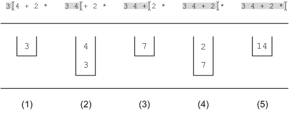

图 12.5：在计算 `3 4 + 2 *` 时栈的内容

作为一个使用栈的例子，考虑图 12.5，它展示了对表达式（`3 4 + 2 *`）求值时的栈内容。在 RPN 中，该表达式变为 `3 4 + 2 *`，图 12.5 显示了从输入读取每个标记（即操作数和运算符）后的栈内容。注意，每个操作数确实被压入栈中，而每个运算符都会改变栈的内容。该表达式分五步求值。图 12.5 第一行表达式中各标记之间的脱字符（^）表示刚刚读取的标记。下一行显示实际的栈内容，最后一行显示步骤以供参考。注意，在第 2 步，两个数字已被压入栈中。第一个数字（3）现在位于栈底。接下来，在第 3 步，读取 + 运算符。该运算符弹出两个操作数（此时栈为空），计算它们的和，并将结果值（7）压入栈中。然后，在第 4 步，读取数字 2，它又被压入栈中。最后，在第 5 步，读取最后一个运算符 *，它从栈中弹出值 2 和 7，计算它们的乘积，并将结果压回栈中。这个结果（14）随后可以被弹出并显示在某种介质上。

从图 12.5 可以看出，栈只有一个位置（栈顶），元素可以被压入或弹出。这个栈顶元素是栈中唯一直接可见的元素。它可以被直接访问和修改。

牢记栈的这种模型，让我们看看 stack 容器正式支持哪些操作。对于 stack，以下构造函数、运算符和成员函数可用：

- **构造函数：**
  - 可以构造一个空的 stack。

    ```cpp
    stack<string> object;
    ```

  - 可以使用拷贝构造函数初始化 stack。

    ```cpp
    extern stack<string> container;
    stack<string> object(container);
    ```

- stack 仅支持容器的基础运算符。
- 对于 stack，以下成员函数可用：
  - `bool empty():` 如果栈中不包含任何元素，则返回 true。
  - `void push(value):` 将 `value` 放在栈顶，使其他元素不可见。
  - `void pop():` 移除栈顶元素。注意，该成员*不会*返回被弹出的元素。如果对空栈使用 `pop`，则什么也不会发生。关于 `pop` 的返回类型为什么是 `void` 的讨论，请参见 12.3.3 节。
  - `size_t size():` 返回栈中元素的数量。
  - `Type &top():` 返回栈顶（也是唯一可见）元素的引用。程序员有责任仅在栈非空时使用该成员。

stack 不支持迭代器或下标运算符。唯一可以访问的元素是其栈顶元素。要清空一个栈：

- 反复移除其栈顶元素；
- 将一个空栈赋值给它；
- 调用其析构函数（例如，通过结束其生命周期）。

#### 12.3.11 无序容器（‘哈希表’）（C++11）

C++11 标准正式将哈希表加入了该语言。

在使用哈希表容器之前，必须包含头文件 `<unordered_map>`。其变体包括基于哈希的 set 和 multi-set。在使用这些基于哈希的集合容器之前，必须包含头文件 `<unordered_set>`。

如前所述，map 是一种有序数据结构。map 中的键使用键的数据类型的 `operator<` 进行排序。通常，这并不是存储或检索数据的最快方式。排序的主要好处是，排序后的键列表比未排序的列表更符合人类的阅读习惯。然而，一种远为更快的存储和检索数据的方法是使用哈希。

哈希使用一个函数（称为*哈希函数*）从键计算出一个（无符号）数字，该数字随后用作存储键的表格中的索引。检索一个键只需计算所给键的哈希值，并在表格中查找计算出的索引位置：如果键存在，它就存储在表格中，可以返回其值；如果不存在，则说明该键未被存储。

当计算出的索引位置已被另一个元素占用时，就会发生冲突。针对这些情况，抽象容器提供了可用的解决方案。C++11 标准采用的一种简单解决方案是使用*线性链接*（linear chaining），它使用链表来存储发生冲突的表元素。

在 C++11 标准中，使用术语 *unordered* 而不是 *hash*，以避免与 C++11 标准出现之前开发的哈希表发生名称冲突。除非在类型名中必须使用 *unordered*，否则我们将使用 *hash* 一词，因为这是常见的术语。

支持四种形式的无序数据结构：`unordered_map`、`unordered_multimap`、`unordered_set` 和 `unordered_multiset`。

下面讨论 `unordered_map` 容器。其他使用哈希的容器同样使用哈希，但提供的功能分别对应于 `multimap`、`set` 和 `multiset`。

就 `unordered_map` 而言，其构造函数需要一个键类型、一个值类型、一个为键计算哈希值的对象，以及一个比较两个键是否相等的对象。预定义的哈希函数


### 12.3 顺序容器

可用于 `std::string` 键，以及所有标准标量数值类型（char、short、int 等）。如果使用其他数据类型，则必须提供哈希函数对象和相等性函数对象（另见第 11.10 节）。示例如下。

实现哈希函数的类可以命名为 `hash`。其函数调用运算符（`operator()`）返回它作为参数接收的键的（`size_t`）哈希值。

存在一个*泛型算法*（见第 19 章）执行相等性测试（即 `equal_to`）。如果键的数据类型支持相等运算符，则可以使用这些测试。或者，可以构造重载的 `operator==` 或专用函数对象，当两个键相等时返回 `true`，否则返回 `false`。示例如下。

`unordered_map` 类实现关联数组，其中的元素根据某种哈希方案存储。

可用于 map 的构造函数、运算符和成员函数也可用于 `unordered_map`。map 和 `unordered_map` 支持相同的运算符和成员函数集合。然而，`unordered_map` 在速度方面的*效率*应大大超过 map 的效率。对于 `unordered_set`、`unordered_multimap` 和 `unordered_multiset`，可以得出类似的结论。

与 map 容器相比，`unordered_map` 有一个额外的构造函数：

```cpp
unordered_map<...> hash(n);
```

其中 n 是 `size_t` 值。它用于构造一个 `unordered_map`，该容器最初包含至少 n 个空槽位，用于放置键/值组合。该数量会在需要时自动扩展。

哈希键类型几乎总是文本。因此，键的数据类型为 `std::string` 的 `unordered_map` 最常见。请注意，尽管允许将 `char *` 作为键类型，但这几乎总是一个坏主意，因为两个指向存储在不同位置的相等 C 字符串的 `char *` 变量会被视为表示不同的键。

以下程序定义了一个 `unordered_map`，其中包含一年中各个月份的名称以及这些月份（通常）拥有的天数。然后，使用下标运算符显示若干个月份的天数。相等运算符使用泛型算法 `equal_to<string>`，它是 `unordered_map` 构造函数的默认第四个参数：

```cpp
#include <unordered_map>
#include <iostream>
#include <string>
using namespace std;

int main()
{
    unordered_map<string, int> months;

    months["january"] = 31;
    months["february"] = 28;
    months["march"] = 31;
    months["april"] = 30;
    months["may"] = 31;
    months["june"] = 30;
    months["july"] = 31;
    months["august"] = 31;
    months["september"] = 30;
    months["october"] = 31;
    months["november"] = 30;
    months["december"] = 31;

    cout << "september -> " << months["september"] << '\n' <<
           "april       -> " << months["april"] << '\n' <<
           "june        -> " << months["june"] << '\n' <<
           "november    -> " << months["november"] << '\n';
}
/*
Generated output:
september -> 30
april     -> 30
june      -> 30
november  -> 30
*/
```

一个类似的示例，展示显式定义的哈希函数和相等函数以及键类型 `char const *` 的用法：

```cpp
#include <unordered_map>
#include <iostream>
#include <string>
#include <cstring>
using namespace std;

struct EqualCp
{
    bool operator()(char const *l, char const *r) const
    {
        return strcmp(l, r) == 0;
    }
};
struct HashCp
{
    size_t operator()(char const *str) const
    {
        return hash<std::string const &>()(str);
    }
};
int main()
{
    unordered_map<char const *, int, HashCp, EqualCp> months;

    months["april"]    = 30;
    months["november"] = 31;

    string apr("april");    // different pointers, same string

    cout << "april      -> " << months["april"] << '\n' <<
            "april      -> " << months[apr.c_str()] << '\n';
}
```

unordered_multimap、unordered_set 和 unordered_multiset 容器的用法类似。对于这些容器，也必须定义相等类和哈希类。unordered_multimap 还需要 unordered_map 头文件。

#### 12.3.12 正则表达式（C++11，?）

C++11 标准为该语言增加了正则表达式的处理。在使用 C++ 标准提供的正则表达式之前，必须已经包含头文件 `<regex>`。

正则表达式在 **C++** 中早已通过其 **C** 语言传承而可用，因为 **C** 一直提供诸如 `regcomp` 和 `regexec` 之类的函数，这些函数例如被 Bobcat 库的 `Pattern` 类使用^1。

正则表达式在其他地方有大量文档记载（例如 `regex`(7)、Friedl, J.E.F *精通正则表达式*^2、O'Reilly），读者可参考这些资料复习正则表达式主题。

C++11 标准通过定义若干新类和其他设施，为正则表达式增加了原生的基于对象的支持。然而，目前 **g++** 库尚不支持正则表达式，因此本节仅提及 C++11 标准为处理正则表达式提供的基本构建块。一旦正则表达式真正可用，本节将更新以涵盖实际可用的功能。

最终，正则表达式由 `regex` 类的对象表示。一旦定义了 `regex` 正则表达式对象，就可以调用其成员 `regex_search` 来处理其正则表达式。该函数期望的参数分别表示：必须与正则表达式匹配的文本；表示匹配操作结果的 `cmatch` 类对象；以及表示所用正则表达式的 `regex` 类对象。此外，还提供一个成员 `regex_replace`，用于基于正则表达式执行文本替换。

使用 `regex` 类的正则表达式目前在 **g++** 库中尚不可用。

### 12.4 ‘complex’ 容器

`complex` 容器定义了可对复数执行的标准操作。在使用 `complex` 容器之前，必须已经包含头文件 `<complex>`。

复数的实部和虚部类型被指定为容器的数据类型。例如：

```cpp
complex<double>
complex<int>
complex<float>
```

请注意，复数的实部和虚部具有相同的数据类型。

初始化（或赋值）complex 对象时，可以从初始化或赋值中省略虚部，从而使其值为 0（零）。默认情况下，两部分均为零。

下面默认假设所使用的 `complex` 类型为 `complex<double>`。在此假设下，可以按如下方式初始化复数：

- `target`：默认初始化：实部和虚部均为 0。
- `target(1)`：实部为 1，虚部为 0
- `target(0, 3.5)`：实部为 0，虚部为 3.5
- `target(source)`：使用 `source` 的值初始化 `target`。

也可以使用匿名 complex 值。在下一个示例中，将两个匿名 complex 值压入一个复数栈，随后再弹出：

```cpp
#include <iostream>
#include <complex>
#include <stack>

using namespace std;

int main()
{
    stack<complex<double>>
        cstack;

    cstack.push(complex<double>(3.14, 2.71));
    cstack.push(complex<double>(-3.14, -2.71));

    while (cstack.size())
    {
        cout << cstack.top().real() << ", " <<
                cstack.top().imag() << "i" << '\n';
        cstack.pop();
    }
}
/*
    Generated output:
    -3.14, -2.71i
    3.14, 2.71i
*/
```

以下成员函数和运算符是为复数定义的（下文中，value 可以是基本标量类型或 complex 对象）：

- 除了标准容器运算符外，`complex` 容器还支持以下运算符。
  - `complex operator+(value)`：该成员返回当前 `complex` 容器与 `value` 的和。
  - `complex operator-(value)`：该成员返回当前 `complex` 容器与 `value` 的差。
  - `complex operator*(value)`：该成员返回当前 `complex` 容器与 `value` 的积。
  - `complex operator/(value)`：该成员返回当前 `complex` 容器与 `value` 的商。
  - `complex operator+=(value)`：该成员将 `value` 加到当前 `complex` 容器，并返回新值。
  - `complex operator-=(value)`：该成员从当前 `complex` 容器中减去 `value`，并返回新值。
  - `complex operator*=(value)`：该成员将当前 `complex` 容器乘以 `value`，并返回新值
  - `complex operator/=(value)`：该成员将当前 `complex` 容器除以 `value`，并返回新值。
- `Type real()`：该成员返回复数的实部。
- `Type imag()`：该成员返回复数的虚部。

1 http://bobcat.sourceforge.net

2 http://oreilly.com/catalog/


- 复数容器可使用若干数学函数，例如 `abs`、`arg`、`conj`、`cos`、`cosh`、`exp`、`log`、`norm`、`polar`、`pow`、`sin`、`sinh` 和 `sqrt`。所有这些函数都是自由函数，而不是成员函数，它们接受复数作为参数。例如：

    ```cpp
    abs(complex<double>(3, -5));
    pow(target, complex<int>(2, 3));
    ```

- 可以从 `istream` 对象中提取复数，并将其插入 `ostream` 对象。插入的结果是一个有序对 `(x, y)`，其中 `x` 表示复数的实部，`y` 表示虚部。从 `istream` 对象提取复数时也可以使用相同的形式。不过，也允许使用更简单的形式。例如，提取 `1.2345` 时，虚部会被设为 0。

### 12.5 无限制联合体（C++11）

我们以一个小的插曲结束本章关于抽象容器的讨论，介绍 C++11 标准对联合体概念所做的补充。尽管联合体本身不应被视为抽象容器，但在已经讨论过容器之后，我们正好可以介绍并说明*无限制联合体*。

C++11 标准为 C++ 的数据结构能力增加了无限制联合体。传统联合体只能包含基本数据，而无限制联合体允许数据字段具有已定义非平凡构造函数的类型。这类数据字段通常是类类型。下面是一个这种无限制联合体的例子：

```cpp
union Union
{
    int u_int;
    std::complex<double> u_complex;
    std::string u_string;
};
```

这个联合体的三个字段中有两个具有非平凡构造函数，因此该联合体成为*无限制*联合体。由于无限制联合体至少定义了一个具有非平凡构造函数的类型字段，问题就变成如何构造和销毁这些联合体。

例如，一个由 `std::string` 和 `double` 组成的联合体，如果该联合体最后一次（或唯一一次）使用引用的是它的 double 字段，那么其析构函数当然不应调用 string 的析构函数。同样，当正在使用 `std::string` 字段，但从 `std::string` 切换到 double 字段时，应在对 double 字段进行任何赋值之前调用 `std::string` 的析构函数。

这些任务对编译器来说过于困难，因此编译器*不会*为无限制联合体实现默认构造函数和析构函数，而是把联合体构造函数和析构函数的实现留给软件工程师。如果我们尝试使用默认构造函数定义像上面那样的无限制联合体，就会看到类似下面的错误消息：

```
error: use of deleted function ‘Union::Union()’
error: ‘Union::Union()’ is implicitly deleted because the default
       definition would be ill-formed:
error: union member ‘Union::u_string’ with non-trivial
       ‘std::basic_string<...>::basic_string() {...}’
```

尽管编译器无法提供合适的成员函数，但我们可以做到，因为我们知道联合体在什么上下文中使用。因此，让我们创建一些构造函数，其中各个构造函数分别选择一个字段进行初始化：

```cpp
Union::Union(int i)
    :
        u_int(i)
    {}
Union::Union(double real, double imaginary)
    :
        u_complex(real, imaginary)
    {}
Union::Union(std::string const &str)
    :
        u_string(str)
    {}
```

但和构造函数一样，编译器也不会实现析构函数：要确定最后使用的是哪个字段，并让无限制联合体的析构函数完成其工作，对编译器来说太复杂了。和构造函数一样，我们必须自己实现无限制联合体的析构函数。

如果 u_string 是当前活动字段，析构函数应销毁 u_string 的数据；如果 u_complex 是当前活动字段，则销毁 u_complex 的数据；如果 u_int 是当前活动字段，则什么也不做。但析构函数怎么知道这一点呢？按照我们目前的设置，它无法知道，因为联合体内部没有关于当前使用哪个字段的信息。

下面是解决这个问题的一种方法：

假设我们为每个字段提供一个对其字段唯一的标签。从概念上讲，这很容易做到：给每个字段加上一个 int 标签作为前缀。由于我们使用的是联合体，各字段的标签会相互重叠，析构函数只需检查标签就能找出正在使用哪个字段。标签字段必须是数据字段本身的一部分。

可以使用 std::pair 容器来实现这一方案，将其第一个数据成员用作 int 标签，将其第二个数据成员用作实际数据类型。下面是联合体数据字段及其构造函数的定义：

```cpp
union Union
{
    std::pair<int, int> u_int;
    std::pair<int, std::complex<double>> u_complex;
    std::pair<int, std::string> u_string;

    // member declarations here
};
Union::Union(int i)
    :
        u_int(1, i)
    {}
Union::Union(double real, double imaginary)
    :
        u_complex(2, std::complex<double>(real, imaginary))
    {}
Union::Union(std::string const &str)
    :
        u_string(3, str)
    {}
```

现在来看析构函数：析构函数应调用当前活动的、具有非平凡析构函数的数据字段的相应析构函数。因此，在我们的 Union 联合体中，u_int 字段可以忽略。现在析构函数的工作很简单：根据（任意）字段的第一个数据成员，选择正确的析构函数。由于数据字段不是动态分配的，我们不使用 delete。相反，我们使用之前在使用 placement new 时遇到的过程，在需要的地方显式调用字段的析构函数：

```cpp
Union::~Union()
{
    switch (u_int.first)
    {
        case 2:
            u_complex.second.~complex<double>();
            break;

        case 3:
            u_string.second.~string();
            break;
    }
}
```

那改变字段呢？无限制联合体一旦接收了它的值，就会保持该变体，直到以其他方式使用。这与传统联合体一致。但是，要改变无限制联合体中类类型字段的解释，我们必须确保首先调用该类类型字段的析构函数。为顺利做到这一点，我们需要 operator=。

我们再次遇到一个复杂问题：无限制联合体甚至没有默认拷贝构造函数。这同样可以理解：拷贝构造函数应该初始化哪个字段？但是，由于我们已经实现了一种确定当前活动字段的方法，一旦我们意识到目标对象中的内存正等待被使用，而 placement new 正是执行初始化的工具，问题就很容易解决。下面是 Union 的拷贝构造函数：

```cpp
Union::Union(Union const &other)
{
    switch (other.u_int.first)
    {
        case 1:
            new (&u_int) std::pair<int, int>(other.u_int);
            break;
        case 2:
            new (&u_complex)
                std::pair<int, std::complex<double>>(other.u_complex);
            break;
        case 3:
            new (&u_string) std::pair<int, std::string>(other.u_string);
            break;
    }
}
```

为准备 operator=，我们首先实现 Union::swap，交换当前对象和另一个 Union 对象，使用第 9.6.1.1 节讨论的快速交换。

```cpp
void Union::swap(Union &other)
{
    std::swap(u_int,    other.u_int);
    std::swap(u_complex, other.u_complex);
    std::swap(u_string,  other.u_string);
}
```

如果无法使用快速交换，但各个字段可以交换，那么交换会有点复杂。在这种情况下：

- 复制 other 当前活动的字段
- 将当前对象当前活动的字段赋值给 other 的匹配字段；

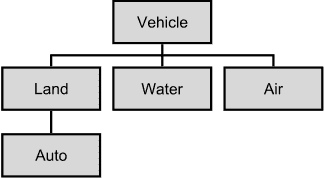

图 13.1：车辆的初始对象层次结构。

### 13.1 相关类型

这里进一步研究表示不同种类车辆的拟议类之间的关系。图中展示了对象层次结构：Auto 是陆地车辆的一种特例，而陆地车辆又是 Vehicle 的一种特例。

Vehicle 类表示分类系统中的“最大公约数”。Vehicle 只被赋予有限的功能：它可以存储和检索车辆的质量：

```cpp
class Vehicle
{
    size_t d_mass;

public:
    Vehicle();
    Vehicle(size_t mass);

    size_t mass() const;
    void setMass(size_t mass);
};
```

使用这个类，相应对象一经创建就可以定义车辆的质量。稍后可以更改或检索质量。

为了表示在陆地上行驶的车辆，可以定义一个新类 Land，它提供 Vehicle 的功能并添加自己特有的功能。假设我们关心陆地车辆的速度和质量。Vehicles 和 Lands 之间的关系当然可以用组合来表示，但那样会很别扭：组合意味着陆地车辆是以 Vehicle 实现的，即包含一个 Vehicle，而自然的关系显然是陆地车辆是一种 Vehicle。

用组合来表达关系也会在一定程度上使我们的 Land 类设计复杂化。考虑下面的例子，它展示了一个使用组合的 Land 类（只展示了 setMass 功能）：

```cpp
class Land
{
    Vehicle d_v;        // composed Vehicle
public:
    void setMass(size_t mass);
};
```


```cpp
void Land::setMass(size_t mass)
{
    d_v.setMass(mass);
}
```

使用组合时，`Land::setMass` 函数只是将参数传递给 `Vehicle::setMass`。因此，就质量处理而言，`Land::setMass` 没有引入任何额外功能，只是增加了额外的代码。显然，这种代码重复是多余的：`Land` 对象*是*一个 `Vehicle`；如果说 `Land` 对象*包含*一个 `Vehicle`，至少有些奇怪。

预期的关系用继承来表示更好。在继承和组合之间进行选择的一条经验法则区分了*是*（*is-a*）和*有*（*has-a*）关系。一辆 `Truck` *是*一种车辆，所以 `Truck` 很可能应该从 `Vehicle` 派生。另一方面，卡车*有*一个发动机；如果你需要在系统中对发动机建模，你可能应该通过在 `Truck` 类内部组合一个 `Engine` 类来表达这种关系。

根据上述经验法则，*`Land`* 从基类 *`Vehicle`* 派生：

```cpp
class Land: public Vehicle
{
    size_t d_speed;
public:
    Land();
    Land(size_t mass, size_t speed);

    void setSpeed(size_t speed);
    size_t speed() const;
};
```

要从另一个类（例如 `Vehicle`）派生一个类（例如 `Land`），在其接口中将类名 `Land` 后跟 `: public Vehicle`：

```cpp
class Land: public Vehicle
```

类 `Land` 现在包含了其基类 `Vehicle` 的全部功能以及自身的特性。这里的特性是一个接受两个参数的构造函数，以及访问 `d_speed` 数据成员的成员函数。下面是一个示例，展示了派生类 `Land` 的可能性：

```cpp
Land veh(1200, 145);

int main()
{
    cout << "Vehicle weighs " << veh.mass() << ";\n"
            "its speed is " << veh.speed() << '\n';
}
```

这个示例说明了派生的两个特性。

- **首先，** `mass` 并未在 `Land` 的接口中被提及为成员。然而它在 `veh.mass` 中被使用了。这个成员函数是类的隐式部分，从它的“父类”`Vehicle` 继承而来。
- **其次，** 尽管派生类 `Land` 包含了 `Vehicle` 的功能，`Vehicle` 的私有成员仍然是私有的：它们只能被 `Vehicle` 自己的成员函数访问。这意味着 `Land` 的成员函数*必须*使用 `Vehicle` 的成员函数（如 `mass` 和 `setMass`）来处理 `mass` 字段。这里，授予 `Land` 的访问权限与授予 `Vehicle` 类外部其他代码的访问权限没有区别。类 `Vehicle` *封装*了特定的 `Vehicle` 特性，而数据隐藏是实现封装的一种方式。

封装是良好类设计的核心原则。封装减少了类之间的依赖，提高了类的可维护性和可测试性，并允许我们修改类而无需修改依赖代码。通过严格遵守数据隐藏原则，类的内部数据组织可以改变，而无需依赖代码也随之改变。例如，一个最初存储 `C-strings` 的类 `Lines` 可能在某个时候改变其数据组织。它可以放弃 `char **` 存储，改用基于 `vector<string>` 的存储。当 `Lines` 使用完美的数据隐藏时，依赖源代码可以使用新的 `Lines` 类而无需任何修改。

作为经验法则，当基类的*数据组织*（即数据成员）改变时，派生类必须完全重新编译（但不必修改）。向基类添加新的成员*函数*不会改变数据组织，因此添加新的成员*函数*时无需重新编译。

这条经验法则有一个微妙的例外：如果向基类添加了新的成员函数，并且该函数恰好被声明为基类的第一个*虚*成员函数（有关虚成员函数概念的讨论参见第14章），那么这*也会*改变基类的数据组织。

现在 `Land` 已从 `Vehicle` 派生，我们准备好进行下一个类的派生。我们将定义一个类 `Auto` 来表示汽车。认同 `Auto` 对象是一辆 `Land` 车辆，并且 `Auto` 有品牌名，那么设计类 `Auto` 很容易：

```cpp
class Auto: public Land
{
    std::string d_brandName;

    public:
        Auto();
        Auto(size_t mass, size_t speed, std::string const &name);

        std::string const &brandName() const;
};
```

在上面的类定义中，`Auto` 是从 `Land` 派生的，而 `Land` 又是从 `Vehicle` 派生的。这被称为*嵌套派生*：`Land` 被称为 `Auto` 的*直接基类*，而 `Vehicle` 被称为 `Auto` 的*间接基类*。

#### 13.1.1 继承深度：可取吗？

现在 `Auto` 已从 `Land` 派生，`Land` 已从 `Vehicle` 派生，我们可能很容易被诱惑，认为这些类层次结构是设计类时的正确方向。但也许我们应该给热情降降温。

不断地从类派生类很快就会导致庞大而复杂的类层次结构，这些结构难以理解、难以使用且难以维护。难以理解和使用是因为我们派生类的用户现在还必须学习其所有（间接）基类的特性。难以维护是因为所有这些类都紧密耦合。虽然确实，当仔细遵守数据隐藏时，派生类在基类改变其数据组织时不必修改，但一旦越来越多的（派生）类依赖于其当前组织，改变这些基类也很快就会变得实际上不可行。

最初看起来像是巨大收获的东西——继承基类的接口——最终却变成了负担。基类的接口几乎从来不会被完全需要，最终一个类可能会从显式定义自己的成员函数中获益，而不是通过继承获得它们。

通常，类可以*根据*现有类来定义：使用它们的一些特性，但也需要屏蔽其他特性。考虑 `stack` 容器：它通常是根据 `deque` 实现的，将 `deque::back` 的值作为 `stack::top` 的值返回。

当使用继承来实现*是*（*is-a*）关系时，确保“使用方向”正确：旨在实现 *is-a* 关系的继承应聚焦于基类：基类的设施不是供派生类使用的，而是派生类的设施应使用多态（这是下一章的主题）来重新定义（重新实现）基类的设施，允许代码通过基类多态地使用派生类的设施。我们在研究流时已经见过这种方法：基类（例如 `ostream`）被反复使用。由从 `ostream` 派生的类（如 `ofstream` 和 `ostringstream`）定义的设施，然后被仅依赖 `ostream` 类提供的设施的代码使用，从不直接使用派生类。

设计类时，始终以尽可能低的耦合为目标。庞大的类层次结构通常表明对健壮类设计的理解不足。当一个类的接口仅被部分使用，并且如果派生类是根据另一个类来实现时，考虑使用组合而不是继承，并根据组合对象提供的成员来定义适当的接口成员。

### 13.2 访问权限：public、private、protected

在 C++ Annotations 的早期（参见第3.2.1节），我们遇到了开发类时的两个重要设计原则：*数据隐藏*和*封装*。数据隐藏将对象数据的控制权限制在类的成员内，封装用于限制对对象功能的访问。这两个原则都是维护数据完整性的宝贵工具。

关键字 `private` 在类接口中开始一些节，其中声明的成员只能被类自身的成员访问。这是我们实现数据隐藏的主要工具。根据既定的良好类设计实践，公有节包含成员函数，它们为类的功能提供清晰的接口。这些成员允许用户与对象通信；将发送给对象的请求如何处理留给对象本身。在一个设计良好的类中，其对象完全控制其数据。

继承不会改变这些原则，也不会改变 `private` 和 `protected` 关键字的工作方式。派生类不能访问基类的私有节。

有时这有点过于严格。考虑一个实现随机数生成 `streambuf` 的类（参见第6章）。这样的 `streambuf` 可以用来构造一个 `istream` `irand`，之后从 `irand` 提取数据会产生下一个随机数，就像下一个示例中使用流 I/O 生成10个随机数一样：

```cpp
RandBuf buffer;
istream irand(&buffer);

for (size_t idx = 0; idx != 10; ++idx)
{
    size_t next;
    irand >> next;
    cout << "next random number: " << next << '\n';
}
```

问题是，`irand` 应该能够生成多少个随机数？幸运的是，不需要回答这个问题，因为 `RandBuf` 可以负责生成下一个随机数。因此，`RandBuf` 的工作方式如下：

- 它生成一个随机数；
- 它以文本形式传递给其基类 `streambuf`；
- `istream` 对象仅使用 `streambuf` 的接口提取这个随机数；
- 此过程对后续随机数重复进行；


```cpp
class RandStream: private RandBuf, public std::istream
{
    // implements a stream to extract random values from
public:
    std::streamsize in_avail();
};
inline std::streamsize RandStream::in_avail()
{
    return std::streambuf::in_avail();
}
```

仅仅为了公开受保护或私有基类中的某个成员，这看起来工作量很大。如果意图是公开 in_avail 成员，可以使用访问提升。访问提升允许我们指定私有（或受保护）基类的哪些成员在派生类的受保护（或公有）接口中变得可用。下面是上述示例，现在使用访问提升：

```cpp
class RandStream: private RandBuf, public std::istream
{
    // implements a stream to extract random values from
public:
    using std::streambuf::in_avail;
};
```

应当注意，访问提升会使所声明基类成员的所有重载版本都变得可用。因此，如果 streambuf 不仅提供 in_avail，还提供例如 in_avail(size_t *)，那么这两个成员都会成为公有接口的一部分。

### 13.3 派生类的构造函数

派生类从其基类（或基类们）继承功能，因为 C++ 支持多重继承（参见 13.7 节）。当构造派生类对象时，它构建在基类对象之上。因此，在初始化实际派生类元素之前，必须先构造基类。这导致在定义派生类构造函数时必须遵守一些要求。

构造函数用于初始化对象的数据成员。派生类构造函数还负责正确初始化其基类。回顾之前介绍的类 Land 的定义（13.1 节），其构造函数可以简单地定义如下：

```cpp
Land::Land(size_t mass, size_t speed)
{
    setMass(mass);
    setSpeed(speed);
}
```

然而，这种实现有几个缺点。

- 构造派生类对象时，在对派生类对象本身执行任何操作之前，*总是*会先调用某个基类构造函数。默认情况下，将调用基类的默认构造函数。
- 仅在派生类构造函数体中使用基类构造函数为其数据成员重新赋予新值，通常*低效*，但有时根本不可能，例如在必须初始化基类引用或 const 数据成员的情况下。在这些情况下，必须使用专门的基类构造函数，而不是基类默认构造函数。

派生类的基类可以通过在派生类构造函数的初始化子句中调用基类构造函数，使用专门的基类构造函数来初始化。在构造函数的初始化子句中调用基类构造函数称为*基类初始化器*。基类初始化器必须在初始化派生类的任何数据成员之前调用；并且使用基类初始化器时，不能使用派生类的任何数据成员。构造派生类对象时，先构造基类；只有在基类构造成功完成后，派生类的数据成员才可用于初始化。因此，`Land` 的构造函数可以改进为：

```cpp
Land::Land(size_t mass, size_t speed)
:
    Vehicle(mass),
    d_speed(speed)
{}
```

派生类构造函数默认总是调用其基类的默认构造函数。当然，这对于派生类的复制构造函数并不正确。假设必须为类 `Land` 提供复制构造函数，它可以使用 `Land const &other` 来表示另一个对象的基类部分：

```cpp
Land::Land(Land const &other)     // assume a copy constructor is needed
:
    Vehicle(other),               // copy-construct the base class part.
    d_speed(other.d_speed)        // copy-construct Land's data members
{}
```

#### 13.3.1 移动构造（C++11）

与使用组合的类一样，派生类也可能受益于定义移动构造函数。派生类提供移动构造函数可能有两个原因：

- 它为其数据成员支持移动构造
- 其基类支持移动语义

移动数据成员的移动构造函数设计已在 9.7 节介绍。对于基类支持移动语义的派生类，其移动构造函数必须在将右值引用传递给基类移动构造函数之前对其*匿名化*。在实现移动构造函数时，应使用 `std::move` 函数将基类或组合对象中的信息移动到新的目标对象。

第一个示例展示了类 `Auto` 的移动构造函数，假设它有一个可移动的 `char *d_brandName` 数据成员，并假设 `Land` 是一个支持移动语义的类。第二个示例展示了类 `Land` 的移动构造函数，假设它本身没有可移动的数据成员，但其 `Vehicle` 基类支持移动语义：

```cpp
Auto::Auto(Auto &&tmp)
:
    Land(std::move(tmp)),          // anonymize 'tmp'
    d_brandName(tmp.d_brandName)   // move the char *'s value
{
    tmp.d_brandName = 0;
}

Land::Land(Land &&tmp)
:
    Vehicle(std::move(tmp)),       // move-aware Vehicle
    d_speed(tmp.d_speed)           // plain copying of plain data
{}
```

#### 13.3.2 移动赋值（C++11）

派生类也可能受益于移动赋值操作。如果派生类及其基类支持交换，那么实现很简单，遵循前面 9.7.3 节所示的标准做法。对于类 Auto，这可以简化为：

```cpp
Auto &Auto::operator=(Auto &&tmp)
{
    swap(tmp);
    return *this;
}
```

如果不支持交换，则可以使用 std::move 调用基类的移动赋值运算符：

```cpp
Auto &Auto::operator=(Auto &&tmp)
{
    reinterpret_cast<Land &>(*this) = std::move(tmp);
    // move Auto’s own data members next
    return *this;
}
```

#### 13.3.3 继承构造函数（C++11，?）

C++11 标准允许在不显式定义派生类构造函数的情况下构造派生类。在这些情况下，将调用可用的基类构造函数。

此功能要么使用，要么不使用。不可能省略某些派生类构造函数而改用相应的基类构造函数。要对从多个基类派生的类（参见 13.7 节）使用此功能，所有基类构造函数必须具有不同的签名。考虑到这里涉及的复杂性，对于使用多重继承的类，最好避免使用基类构造函数。

派生类对象的构造可以使用以下语法委托给基类构造函数：

```cpp
class BaseClass
{
    public:
        // BaseClass constructor(s)
};

class DerivedClass: public BaseClass
{
    public:
        using BaseClass::BaseClass;  // No DerivedClass constructors
                                    // are defined
};
```

### 13.4 派生类的析构函数

当对象被销毁时，类的析构函数会被自动调用。对于从其他类派生的类的对象也是如此。假设有以下情况：

```cpp
class Base
{
public:
    ~Base();
};

class Derived: public Base
{
public:
    ~Derived();
};

int main()
{
    Derived derived;
}
```

在 `main` 结束时，派生对象不再存在。因此，其析构函数（`~Derived`）被调用。然而，由于 derived 也是一个 Base 对象，所以 `~Base` 析构函数也会被调用。基类析构函数从不会从派生类析构函数中被显式调用。

构造函数和析构函数以类似栈的方式被调用：构造 derived 时，先调用相应的基类构造函数，然后调用相应的派生类构造函数。销毁对象 derived 时，先调用其析构函数，随后自动激活基类析构函数。派生类析构函数总是在其基类析构函数之前被调用。

当派生类对象的构造未能成功完成（即构造函数抛出异常）时，不会调用其析构函数。然而，如果派生类构造函数抛出异常，已正确构造的基类的析构函数将被调用。当然，这是应有的行为：一个已正确构造的对象最终也应当被销毁。示例：

```cpp
#include <iostream>
struct Base
{
    ~Base()
    {
        std::cout << "Base destructor\n";
    }
};
struct Derived: public Base
{
    Derived()
    {
        throw 1;    // at this time Base has been constructed
    }
};
int main()
{
    try
    {
        Derived d;
    }
    catch(...)
    {}
}
/*
    This program displays `Base destructor'
*/
```


### 13.5 重定义成员函数

派生类可以重定义基类成员。假设一个车辆分类系统还必须涵盖卡车，卡车由两部分组成：前部（牵引车）拉动后部（挂车）。牵引车和挂车各自有质量，mass 函数应返回组合质量。

`Truck` 的定义从一个类定义开始。我们最初的 `Truck` 类派生自 `Auto`，但之后进行了扩展，以多保存一个 `size_t` 字段，表示额外的质量信息。这里我们选择在 `Auto` 类中表示卡车前部的质量，并将挂车质量存储在一个额外字段中：

```cpp
class Truck: public Auto
{
    size_t d_trailer_mass;

public:
    Truck();
    Truck(size_t tractor_wt, size_t speed, char const *name,
          size_t trailer_wt);

    void setMass(size_t tractor_wt, size_t trailer_wt);
    size_t mass() const;
};

Truck::Truck(size_t tractor_wt, size_t speed, char const *name,
             size_t trailer_wt)
:
    Auto(tractor_wt, speed, name)
{
    d_trailer_mass = trailer_wt;
}
```

注意，`Truck` 类现在包含了基类 `Auto` 中已有的两个函数：`setMass` 和 `mass`。

- `setMass` 的重定义没有问题：这个函数被简单地重定义，以执行针对 `Truck` 对象的特定操作。
- 然而，重定义 `setMass` 会*隐藏* `Auto::setMass`。对于 `Truck`，只能使用具有两个 `size_t` 参数的 `setMass` 函数。
- `Vehicle` 的 `setMass` 函数对 `Truck` 仍然可用，但现在必须*显式*调用，因为 `Auto::setMass` 被隐藏了。即使 `Auto::setMass` 只有一个 `size_t` 参数，该函数仍然被隐藏。要实现 `Truck::setMass`，我们可以这样写：

    ```cpp
    void Truck::setMass(size_t tractor_wt, size_t trailer_wt)
    {
        d_trailer_mass = trailer_wt;
        Auto::setMass(tractor_wt);    // note: Auto:: is required
    }
    ```
- 在类外部，通过作用域解析运算符访问 `Auto::setMass`。因此，如果某个 `Truck` 对象需要设置其 `Auto` 部分的质量，它必须使用：

    ```cpp
    truck.Auto::setMass(x);
    ```

```cpp
cout << '\n' << "Truck weighs " <<
             lorry.Vehicle::mass() << '\n' <<
       "Truck + trailer weighs " << lorry.mass() << '\n' <<
       "Speed is " << lorry.speed() << '\n' <<
       "Name is " << lorry.name() << '\n';
}
```

`Truck` 类派生自 `Auto`。然而，有人可能会质疑这种类设计。既然卡车被构想为牵引车和挂车的组合，那么使用组合来定义它可能更好。这将我们的视角从“`Truck` 是一种 `Auto`（并且包含一些奇怪的数据成员）”转变为“`Truck` 由 `Auto`（牵引车）和 `Vehicle`（挂车）组成”。`Truck` 的接口现在非常具体，不需要用户去研究 `Auto` 和 `Vehicle` 的接口，并且为定义“公路列车”（牵引车拖挂多辆挂车）提供了可能。下面是这种另一种类设置的一个示例：

```cpp
class Truck
{
    Auto d_lorry;
    Vehicle d_trailer;        // use vector<Vehicle> for road trains

public:
    Truck();
    Truck(size_t tractor_wt, size_t speed, char const *name,
          size_t trailer_wt);

    void setMass(size_t tractor_wt, size_t trailer_wt);
    void setTractorMass(size_t tractor_wt);
    void setTrailerMass(size_t trailer_wt);
    size_t mass() const;
    size_t tractorMass() const;
    size_t trailerMass() const;
    // consider:
    Auto const &tractor() const;
    Vehicle const &trailer() const;
};
```

### 13.6 iostream::init

考虑从 `std::istream` 或 `std::ostream` 派生的类。这样的类可以如下设计：

```cpp
class XIstream: public std::istream
{
public:
    ...
};
```

假设 `XIstream` 要关联的 `streambuf` 在构造时还不可用，那么 `XIstream` 只提供默认构造函数。但是，该类可以提供成员函数 `void switchStream(std::streambuf *sb)`，以便为 `XIstream` 对象换用一个新的 `streambuf` 接口。如何实现 `switchStream`？

`std::istream` 和 `std::ostream` 类提供了一个受保护成员 `void init(std::streambuf *sb)` 来实现此功能。init 成员期望一个指向 streambuf 的指针，该 streambuf 将与 istream 或 ostream 对象关联。init 成员会先妥善结束任何现有的关联，再切换到其地址被提供给 init 的 streambuf。

假设 `switchStream` 的 `sb` 所指向的 `streambuf` 持续存在，那么 `switchStream` 可以简单地实现如下：

```cpp
void switchStream(streambuf *sb)
{
    init(sb);
}
```

### 13.7 多重继承

到目前为止，一个类总是从单个基类派生而来。除了单一继承，C++ 还支持*多重继承*。在多重继承中，一个类从多个基类派生，因此同时继承多个父类的功能。

使用多重继承时，将新派生类视为两个基类的实例化应当是合理的。否则，组合更合适。通常，线性派生（只使用一个基类）的使用频率远高于多重派生。良好的类设计原则要求一个类应该具有单一且描述清晰的责任，而这一原则常常与多重继承相冲突，因为在多重继承中，我们可以说 `Derived` 类的对象*既是* `Base1` 对象*又是* `Base2` 对象。

但话又说回来，考虑一下多重继承被用到极致的*原型*对象：*瑞士军刀*！这个物体是一把刀，是一把剪刀，是一个开罐器，是一个开瓶器，它是……

“瑞士军刀”是多重继承的一个极端例子。在 C++ 中，确实*有*一些很好的理由，可以不违反下一章将要讨论的“一个类，一个责任”原则。本节讨论使用多重继承构造类的技术细节。

如何在 C++ 中构造一把“瑞士军刀”？首先我们需要（至少）两个基类。例如，假设我们在设计一个工具包，用于构建飞机驾驶舱的仪表板。我们设计各种仪器，如人工地平仪和高度表。飞机上常见的组件之一是*导航通信一体机*（nav-com set）：导航信标接收机（“nav”部分）和无线电通信单元（“com”部分）的组合。要定义 nav-com set，我们首先设计 `NavSet` 类（假设存在 `Intercom`、`VHF_Dial` 和 `Message` 类）：

```cpp
class NavSet
{
    public:
        NavSet(Intercom &intercom, VHF_Dial &dial);

        size_t activeFrequency() const;
        size_t standByFrequency() const;

        void setStandByFrequency(size_t freq);
        size_t toggleActiveStandby();
        void setVolume(size_t level);
        void identEmphasis(bool on_off);
};
```

接下来我们设计 `ComSet` 类：

```cpp
class ComSet
{
    public:
        ComSet(Intercom &intercom);

    size_t frequency() const;
    size_t passiveFrequency() const;

    void setPassiveFrequency(size_t freq);
    size_t toggleFrequencies();

    void setAudioLevel(size_t level);
    void powerOn(bool on_off);
    void testState(bool on_off);
    void transmit(Message &message);
};
```

使用这个类的对象，我们可以接收通过 Intercom 传输的消息，但也可以通过 Message 对象*发送*消息，该 Message 对象是通过其 transmit 成员函数传递给 ComSet 对象的。

现在我们可以构建我们的 NavCom 一体机了：

```cpp
class NavComSet: public ComSet, public NavSet
{
    public:
        NavComSet(Intercom &intercom, VHF_Dial &dial);
};
```

完成。现在我们已经定义了一个 NavComSet，它*既*是 NavSet*又*是 ComSet：通过多重继承，两个基类的功能现在都可以在派生类中使用。

请注意以下几点：

- 关键字 public 出现在两个基类名称（NavSet 和 ComSet）之前。默认情况下，继承使用*私有派生*，并且关键字 public 必须在每个基类说明之前重复。基类不要求使用相同的派生类型。一个基类可以使用公有派生，另一个基类可以使用私有派生。
- 多重派生类 NavComSet 没有引入自身的新功能，而只是将两个现有类组合成一个新的聚合类。因此，C++ 提供了将多个简单类合并成一个更复杂类的可能性。
- 以下是 NavComSet 构造函数的实现：

    ```cpp
    NavComSet::NavComSet(Intercom &intercom, VHF_Dial &dial)
    :
        ComSet(intercom),
        NavSet(intercom, dial)
    {}
    ```

    构造函数不需要额外代码：其目的是激活其基类的构造函数。基类初始化器的调用顺序*不是*由它们在构造函数代码中的调用顺序决定的，而是由基类在类接口中的顺序决定的。

- NavComSet 类定义不需要额外的数据成员或成员函数：在这里（而且通常也是如此）继承的接口为多重派生类的正常运行提供了所有必需的功能和数据。

当然，在定义基类时，我们特意严格使用了不同的成员函数名，从而让自己轻松不少。因此，NavSet 类中有 setVolume 函数，ComSet 类中有 setAudioLevel 函数。这有点取巧，因为我们可以预期这两个单元实际上都有一个组合对象 Amplifier 来处理音量设置。一个经过修订的类可能会提供一个 Amplifier


amplifier() const 成员函数，并让应用程序自行设置其与 amplifier 的接口。或者，修订后的类可以为设置 NavSet 或 ComSet 部分的音量定义成员。

当两个基类提供同名成员时，需要作出特殊规定以避免歧义：

-   可以使用基类名和作用域解析运算符显式指定预期的基类：

```cpp
NavComSet navcom(intercom, dial);

navcom.NavSet::setVolume(5);    // sets the NavSet volume level
navcom.ComSet::setVolume(5);    // sets the ComSet volume level
```

-   类接口中提供可被无歧义调用的成员函数。这些额外成员通常定义为 inline：

```cpp
class NavComSet: public ComSet, public NavSet
{
    public:
        NavComSet(Intercom &intercom, VHF_Dial &dial);
        void comVolume(size_t volume);
        void navVolume(size_t volume);
};
inline void NavComSet::comVolume(size_t volume)
{
    ComSet::setVolume(volume);
}
inline void NavComSet::navVolume(size_t volume)
{
    NavSet::setVolume(volume);
}
```

-   如果 NavComSet 类来自第三方且无法修改，则可以使用一个用于消除歧义的包装类：

```cpp
class MyNavComSet: public NavComSet
{
    public:
        MyNavComSet(Intercom &intercom, VHF_Dial &dial);
        void comVolume(size_t volume);
        void navVolume(size_t volume);
};
inline MyNavComSet::MyNavComSet(Intercom &intercom, VHF_Dial &dial)
:
    NavComSet(intercom, dial);
{}
inline void MyNavComSet::comVolume(size_t volume)
{
    ComSet::setVolume(volume);
}
inline void MyNavComSet::navVolume(size_t volume)
{
    NavSet::setVolume(volume);
}
```

### 13.8 基类与派生类之间的转换

当使用公有继承定义类时，派生类的对象*同时就是*基类的对象。这对对象赋值以及使用指向此类对象的指针或引用的情形有重要影响。下面讨论这两种情形。

#### 13.8.1 对象赋值中的转换

继续讨论 13.7 节介绍的 `NavCom` 类，现在我们定义两个对象：一个基类对象和一个派生类对象：

```cpp
ComSet com(intercom);
NavComSet navcom(intercom2, dial2);
```

对象 `navcom` 使用一个 `Intercom` 和一个 `VHF_Dial` 对象构造。然而，`NavComSet` 同时也是一个 `ComSet`，因此允许*从* `navcom`（派生类对象）*向* `com`（基类对象）赋值：

```cpp
com = navcom;
```

该赋值的效果是，对象 `com` 现在与 `intercom2` 通信。由于 `ComSet` 没有 `VHF_Dial`，赋值时会忽略 `navcom` 的 `dial`。当从派生类对象赋值给基类对象时，只赋值基类的数据成员，其他数据成员会被丢弃，这种现象称为*切片*。在此类情形中，切片可能不会产生严重后果，但当把派生类对象传递给定义基类参数的函数，或从返回基类对象的函数返回派生类对象时，也会发生切片，并可能产生不受欢迎的副作用。

从基类对象向派生类对象赋值是有问题的。在如下语句中

```cpp
navcom = com;
```

因为 `ComSet` 对象 `com` 中缺少这些数据成员，所以不清楚如何重新赋值 `NavComSet` 的 `VHF_Dial` 数据成员。因此，编译器拒绝此类赋值。尽管派生类对象也是基类对象，反之不成立：基类对象并不也是派生类对象。

以下一般规则适用：在涉及基类对象和派生类对象的赋值中，丢弃数据的赋值是合法的（称为*切片*）。数据保持未指定的赋值是*不*允许的。当然，可以重载赋值运算符，以允许从基类对象向派生类对象赋值。要编译语句

```cpp
navcom = com;
```

`NavComSet` 类必须已经定义了一个重载赋值运算符，接受 `ComSet` 对象作为其参数。在这种情况下，由程序员决定该赋值运算符将如何处理缺失的数据。

#### 13.8.2 指针赋值中的转换

我们回到 `Vehicle` 类，并定义以下对象和指针变量：

```cpp
Land land(1200, 130);
```

动态分配对象的初始化通常包含两个步骤：首先分配数组（隐式调用默认构造函数）；然后初始化数组元素，如下面这个小例子所示：

```cpp
string *sp = new string[10];
fill(sp, sp + 10, string("hello world"));
```

这些方法都存在“双重初始化”的问题，类似于在构造函数中不使用成员初始化器。

避免双重初始化的一种方法是使用继承。继承可以有效地用于结合 operator new[] 调用非默认构造函数。该方法利用以下几点：

-   基类指针可以指向派生类对象；
-   没有（非静态）数据成员的派生类与其基类具有相同的大小。

上述内容还提示了一种可能的方法：

-   从我们感兴趣的类派生一个简单的、无成员的类；
-   在其默认构造函数中使用适当的基类初始化器；
-   分配所需数量的派生类对象，并将 new[] 的返回表达式赋值给指向基类对象的指针。

下面是一个简单示例，生成 10 行包含文本 hello world 的内容：

```cpp
#include <iostream>
#include <string>
#include <algorithm>
#include <iterator>

using namespace std;

struct Xstr: public string
{
    Xstr()
    :
        string("hello world")
    {}
};

int main()
{
    string *sp = new Xstr[10];
    copy(sp, sp + 10, ostream_iterator<string>(cout, "\n"));
}
```

当然，上面的示例相当简单，但很容易完善：类 Xstr 可以定义在匿名命名空间中，仅可被函数 getString() 访问，该函数可以接受一个 size_t nObjects 参数，允许用户指定他们希望分配的、初始化为 hello world 的字符串数量。

除了硬编码基类参数之外，也可以使用变量或函数为基类构造函数的参数提供适当的值。在下一个示例中，在函数 nStrings(size_t nObjects, char const *fname) 内部定义了一个局部类 Xstr，期望

避免双重初始化（不使用继承）的一种完全不同方法是使用 placement new（参见 9.1.5 节）：只需分配所需数量的内存，然后使用适当的构造函数在原地正确分配对象。下面的示例也可以在多线程环境中使用。该方法使用一对静态 construct/destroy 成员来执行所需的初始化。

在下面所示的程序中，construct 期望一个 istream，它为 String 类（仅包含一个 std::string 对象）的对象提供初始化字符串。construct 首先为 n 个 String 对象分配足够的内存，并为初始的 size_t 值留出空间。然后，这个初始的 size_t 值用 n 初始化。接下来，在 for 语句中，从提供的流中读取行，并使用 placement new 调用将这些行传递给构造函数。最后，返回第一个 String 对象的地址。

成员 destroy 负责对象的销毁。它从紧挨着第一个待销毁对象地址位置之前找到的 size_t 中获取要销毁的对象数量。然后，通过显式调用对象的析构函数来销毁这些对象。最后，返回最初由 construct 分配的原始内存。

```cpp
#include <fstream>
#include <iostream>
#include <string>
using namespace std;

class String
{
    union Ptrs
    {
        void *vp;
        String *sp;
        size_t *np;
    };

    std::string d_str;

    public:
        String(std::string const &txt)
        :
            d_str(txt)
        {}
        ~String()
        {
            cout << "destructor: " << d_str << '\n';
        }
        static String *construct(istream &in, size_t n)
        {
            Ptrs p = {operator new(n * sizeof(String) + sizeof(size_t))};
            *p.np++ = n;

            string line;
            for (size_t idx = 0; idx != n; ++idx)
            {
                getline(in, line);
                new(p.sp + idx) String(line);
            }

            return p.sp;
        }
        static void destroy(String *sp)
        {
```


```cpp
#include <iostream>
using namespace std;

class Base
{
    protected:
        void hello()
        {
            cout << "base hello\n";
        }
    public:
        void process()
        {
            hello();
        }
};

class Derived: public Base
{
    protected:
        void hello()
        {
            cout << "derived hello\n";
        }
};

int main()
{
    Derived derived;

    derived.process();
}
```

上面这个程序的重要特征是 `Base::process` 函数调用了 `hello`。由于 `process` 是公有接口中定义的唯一成员，因此它也是不属于这两个类的代码唯一可以调用的成员。从 `Base` 派生出的类 `Derived` 显然继承了 `Base` 的接口，所以 `process` 在 `Derived` 中也可用。因此，main 中的 `Derived` 对象能够调用 `process`，但不能调用 `hello`。

到目前为止，一切顺利。没什么新内容，所有这些都在上一章中介绍过了。人们可能会奇怪，为什么还要定义 `Derived`。大概是定义它来创建一种适合 `Derived`、但不同于 `Base::hello` 实现的 `hello` 实现。`Derived` 的作者的理由如下：`Base` 对 `hello` 的实现并不合适；`Derived` 类对象可以通过提供合适的实现来弥补这一点。此外，我们的作者推理道：

> “既然对象的类型决定了所使用的接口，那么 `process` 必定调用 `Derived::hello`，因为 `hello` 是通过来自 `Derived` 类对象的 `process` 调用的”。

不幸的是，由于静态绑定，我们这位作者的推理是有缺陷的。当编译 `Base::process` 时，静态绑定使编译器将 `hello` 调用绑定到 `Base::hello()`。

作者*打算*创建一个 is-a `Base` 类的 `Derived` 类。这只成功了一部分：`Base` 的接口被继承了，但在此之后，`Derived` 已经放弃了对所发生一切的控制。一旦进入 `process`，我们就只能看到 `Base` 的成员实现。多态提供了一条出路，允许我们（在派生类中）重新定义基类的成员，从而允许这些重新定义的成员从基类的接口中被使用。

这正是 LSP 的精髓：公有继承不应用于（在派生类中）复用基类成员，而应被复用（由基类以多态方式使用重新实现基类成员的派生类成员）。

花一点时间体会上面这个小程序的寓意。`hello` 和 `process` 成员并不算太起眼，但这个示例的寓意却很深远。`process` 成员可以实现目录遍历，`hello` 可以定义遇到文件时要执行的动作。`Base::hello` 可能只是显示文件名，而 `Derived::hello` 可能删除文件；可能仅当文件比某个时限更年轻时才列出其名称；可能仅当文件包含某段文本时才列出其名称；等等，等等。到目前为止，`Derived` 将不得不自己实现 process 动作；到目前为止，期望 `Base` 类引用或指针的代码只能执行 `Base` 的动作。多态允许我们重新实现基类的成员，并在期望基类引用或指针的代码中使用这些重新实现的成员。使用多态，现有代码可以被重新实现其基类相应成员的派生类复用。是时候揭示这种魔法是如何实现的了。

多态在 C++ 中并非默认行为，它解决了这个问题，并使类的作者能够达到其目标。好奇的读者可以：在 Base 类的 `void hello()` 前加上关键字 `virtual`，然后重新编译。运行修改后的程序会产生预期的、期望的派生 `hello`。为什么会这样将在下面解释。

### 14.1 虚函数

默认情况下，通过指针或引用调用的成员函数的行为，由该函数在指针或引用所属类中的实现决定。例如，`Vehicle *` 会激活 `Vehicle` 的成员函数，即使它指向派生类的对象。这被称为*早期*绑定或*静态*绑定：要调用的函数在编译时确定。在 C++ 中，*后期*绑定或*动态*绑定通过*虚成员函数*实现。

当成员函数的声明以关键字 `virtual` 开头时，它就成为虚成员函数。再次强调，在 C++ 中，与若干其他面向对象语言不同，这*不是*默认情况。默认使用*静态*绑定。

一旦某个函数在基类中被声明为 `virtual`，它在所有派生类中仍为虚函数；即使在派生类中没有重复关键字 `virtual`。

在车辆分类系统（见 13.1 节）中，两个成员函数 `mass` 和 `setMass` 可能被声明为 `virtual`。聚焦于 `mass`，下面展示了类 `Vehicle` 和 `Truck` 的类定义中的相关部分。此外，我们还展示成员函数 `mass` 的实现：

```cpp
class Vehicle
{
    public:
        virtual int mass() const;
};

class Truck: // inherited from Vehicle through Auto and Land
{
    // not altered
};

int Vehicle::mass() const
{
    return d_mass;
}

int Truck::mass() const
{
    return Auto::mass() + d_trailer_wt;
}
```

关键字 `virtual` *只*出现在（Vehicle）基类中。没有必要（但也没有惩罚）在派生类中重复它。一旦某个类成员被声明为虚函数，它就在所有派生类中成为虚成员。成员函数可以在类层次结构中的任何位置声明为 `virtual`。如果 `mass` 在 Auto 中而不是在 Vehicle 中声明为虚函数，编译器也完全接受。那么虚成员函数的特定特性将仅对 Auto 对象以及从 Auto 派生的类的对象可用。对于 Vehicle 指针，仍将使用静态绑定。后期绑定的效果如下所示：

```cpp
Vehicle v(1200);                 // vehicle with mass 1200
Truck t(6000, 115,               // truck with cabin mass 6000, speed 115,
        "Scania", 15000);        // make Scania, trailer mass 15000
Vehicle *vp;                      // generic vehicle pointer

int main()
{
    vp = &v;                      // see (1) below
    cout << vp->mass() << '\n';

    vp = &t;                      // see (2) below
    cout << vp->mass() << '\n';

    cout << vp->speed() << '\n'; // see (3) below
}
```

现在 mass 被定义为虚函数，因此使用后期绑定：

- 在 (1) 处，调用 `Vehicle::mass`。
- 在 (2) 处，调用 `Truck::mass`。
- 在 (3) 处，产生语法错误。成员 `speed` 不是 `Vehicle` 的成员，因此不能通过 `Vehicle*` 调用。

该示例说明，当使用指向某个类的指针时，*只能调用该类的成员。* 这些函数可能是虚函数，也可能不是。成员的虚特性只影响绑定类型（早期绑定还是后期绑定），而不影响指针可见的成员函数集合。

通过虚成员，派生类可以重新定义从基类成员调用、或从指向基类对象的指针或引用调用的函数所执行的行为。派生类对基类成员的这种重新定义称为*覆盖成员。*

### 14.2 虚析构函数

当对象不复存在时，会调用该对象的析构函数。现在考虑以下代码片段（参见 13.1 节）：

```cpp
Vehicle *vp = new Land(1000, 120);

delete vp;            // object destroyed
```

这里，`delete` 被应用于一个基类指针。由于基类定义了可用接口，`delete vp` 调用 `~Vehicle`，而 `~Land` 仍不可见。假设 Land 分配了内存，就会导致内存泄漏。释放内存并不是析构函数可以执行的唯一动作。一般来说，它们可以执行对象不复存在时所需的任何动作。但这里，`~Land` 定义的动作一个也没有执行。坏消息……

在 C++ 中，这个问题由*虚析构函数*解决。析构函数可以声明为虚函数。当基类析构函数被声明为虚函数时，那么由基类所指向的实际类的析构函数

当执行 `delete bp` 时，将调用 `bp` 所指向类的析构函数。因此，即使派生类的析构函数具有独特的名称，析构函数也能实现晚绑定。示例：

```cpp
class Vehicle
{
    public:
        virtual ~Vehicle();    // all derived class destructors are
                               // now virtual as well.
};
```

通过声明虚析构函数，上述删除操作（`delete vp`）会正确调用 `Land` 的析构函数，而不是 `Vehicle` 的析构函数。

一旦析构函数被调用，无论它是否为虚析构函数，它都会照常执行。因此，`~Land` 首先执行自己的语句，然后调用 `~Vehicle`。这样，上述 `delete vp` 语句会使用晚绑定来调用 `~Land`，并且从这时起，对象的销毁过程照常进行。

在设计作为基类、并打算从中派生其他类的类中，析构函数应始终定义为虚函数。通常这些析构函数本身没有任务要执行。在这些情况下，会给虚析构函数一个空函数体。例如，`Vehicle::~Vehicle()` 的定义可以简单到：

```cpp
Vehicle::~Vehicle()
{
}
```

不要轻易将虚析构函数（甚至空析构函数）定义为内联函数，因为这会增加类维护的复杂性。第 14.11 节讨论了这条经验法则背后的原因。

### 14.3 纯虚函数

基类 `Vehicle` 为其虚成员（`mass` 和 `setMass`）提供了自己的具体实现。然而，虚成员函数不一定*必须*在基类中实现。

当基类省略虚成员的实现时，该类会对派生类施加要求。派生类需要提供“缺失的实现”。

这种方法在一些语言（如 `C#`、`Delphi` 和 `Java`）中被称为*接口*，它定义了一种*协议*。派生类*必须*通过实现尚未实现的成员来遵守该协议。如果一个类包含至少一个实现缺失的成员，就不能定义该类的对象。

这种定义不完整的类总是基类。它们仅通过声明某些成员的名称、返回值和参数来强制实施一种协议。这些类被称为*抽象类*或*抽象基类*。派生类通过实现尚未实现的成员而成为非抽象类。

抽象基类是许多*设计模式*的基础（参见 *Gamma 等人*（1995）），它们使程序员能够创建高度*可复用的软件*。其中一些设计模式在 *C++ 注解* 中有所涵盖（例如第 *23.2* 节中的*模板方法*），但关于设计模式的深入讨论，读者可参阅 *Gamma 等人*的书。

仅在基类中声明的成员称为*纯虚函数*。虚成员通过在其声明后加上 `= 0` 而成为纯虚成员（即，用 `= 0;` 替换结束其声明的分号）。示例：

```cpp
#include <iosfwd>
class Base
{
    public:
        virtual ~Base();
        virtual std::ostream & insertInto(std::ostream &out) const = 0;
};
inline std::ostream &operator<<(std::ostream &out, Base const &base)
{
    return base.insertInto(out);
}
```

所有从 `Base` 派生的类*必须*实现 `insertInto` 成员函数，否则无法构造它们的对象。这很简洁：现在，所有从 `Base` 派生的类类型的对象始终都可以插入到 `ostream` 对象中。

基类的虚析构函数能成为纯虚函数吗？这个问题的答案是否定的。首先，没有必要强制派生类提供析构函数，因为析构函数默认就会提供（除非使用新的 C++11 标准通过 `= delete` 属性声明析构函数）。其次，如果它是纯虚成员，就不存在其实现。然而，派生类的析构函数最终会调用其基类的析构函数。如果基类析构函数的实现缺失，它们又怎么能调用呢？下一节将对此作更多讨论。

纯虚成员函数通常是（但不一定是）`const` 成员函数。这允许构造常量派生类对象。在其他情况下，这可能没有必要（或不现实），并且可能需要非 const 成员函数。`const` 成员函数的一般规则也适用于纯虚函数：如果成员函数会修改对象的数据成员，它就不能是 `const` 成员函数。

抽象基类通常没有数据成员。然而，一旦基类声明了纯虚成员，它在派生类中*必须*以相同方式声明。如果派生类中纯虚函数的实现会修改派生类对象的数据，那么*该*函数不能声明为 `const` 成员。因此，抽象基类的作者应仔细考虑纯虚成员函数是否应作为 `const` 成员函数。

#### 14.3.1 实现纯虚函数

纯虚成员函数可以被实现。要实现纯虚成员函数，为其提供常规的 `= 0;` 声明规范，但同时也实现它。由于 `= 0;` 以分号结尾，纯虚成员在其类中始终至多是一个声明，但实现可以在其接口之外提供（也许使用 `inline`）。

可以通过指定基类和作用域解析运算符以及要调用的成员，从派生类对象、或从该类或派生类的成员中调用纯虚成员函数。示例：

```cpp
#include <iostream>

class Base
{
    public:
        virtual ~Base();
        virtual void pureimp() = 0;
};
Base::~Base()
{}
void Base::pureimp()
{
    std::cout << "Base::pureimp() called\n";
}
```

在此上下文之外，它们只是普通标识符，允许程序员定义诸如 `bool final` 这样的变量。

标识符 `final` 可以应用于类声明，以表示该类不能用作基类。例如：

```cpp
class Base1 final              // cannot be a base class
{};
class Derived1: public Base1   // ERR: Base1 is final
{};

class Base2                       // OK as base class
{};
class Derived2 final: public Base2 // OK, but Derived2 can’t be
{};                                // used as a base class
class Derived: public Derived2     // ERR: Derived2 is final
{};
```

标识符 `final` 也可以添加到虚成员声明中。这表示这些虚成员不能被派生类覆盖。这样，就可以如下实现上文提到的类的受限多态特性：

```cpp
class Base
{
    virtual int v_process();    // define polymorphic behavior
    virtual int v_call();
    virtual int v_display();
};
class Derived: public Base     // Derived restricts polymorphism
{                               // to v_call and v_display
    virtual int v_process() final;
};
class Derived2: public Derived
{
    // int v_process();          No go: Derived::v_process is final
    virtual int v_display();    // OK to override
};
```

为了让编译器检测拼写错误、参数类型差异或成员函数修饰符差异（例如 const 与非 const），可以将（也应当将）标识符 `override` 追加到覆盖基类成员的派生类成员上。例如，

```cpp
class Base
{
    virtual int v_process();
    virtual int v_call() const;
    virtual int v_display(std::ostream &out);
};
class Derived: public Base
{
    virtual int v_proces() override;       // ERR: v_proces != v_process
    virtual int v_call() override;          // ERR: not const
                                           // ERR: parameter types differ
    virtual int v_display(std::ostream &out) override;
};
```


### 14.5 虚函数与多重继承

在第6章中，我们遇到了 `fstream` 类，它是一个同时具备 `ifstream` 和 `ofstream` 特性的类。在第13章中，我们了解到一个类可以从多个基类派生。这样的派生类继承了其所有基类的属性。多态性也可以与多重继承结合使用。

考虑一下，如果从派生类到其（基）类有多条“路径”会怎样。下一个（虚构的）示例说明了这一点，其中类 `Derived` 从 `Base` 双重派生：

```cpp
class Base
{
    int d_field;
    public:
        void setfield(int val);
        int field() const;
};
inline void Base::setfield(int val)
{
    d_field = val;
}
inline int Base::field() const
{
    return d_field;
}

class Derived: public Base, public Base
{
};
```

由于双重派生，`Base` 的功能在 `Derived` 中出现了两次。这导致了歧义：当对 `Derived` 类对象调用 `setfield()` 函数时，由于有两个这样的函数，到底会调用哪一个呢？作用域解析运算符也无法解决这个问题，因此 C++ 编译器无法编译上述示例，并且（正确地）识别出一个错误。

上面的代码显然在派生过程中重复了其基类，这当然可以通过不从 `Base` 双重派生（或者使用组合（！））来轻松避免。但基类的重复也可能通过嵌套继承发生，例如一个对象派生自 `Auto` 和 `Air`（参见第13.1节）。这样的类将用于表示例如飞行汽车³。一个 `AirAuto` 最终将包含两个 `Vehicle`，因此包含两个 `mass` 字段、两个 `setMass()` 函数和两个 `mass()` 函数。这是我们想要的吗？

#### 14.5.1 多重继承中的歧义

让我们更仔细地研究一下，为什么从 `Auto` 和 `Air` 派生出的 `AirAuto` 会引入歧义。

- 一个 `AirAuto` 是一个 `Auto`，因此是一个 `Land`，因此是一个 `Vehicle`。
- 然而，一个 `AirAuto` 也是一个 `Air`，因此也是一个 `Vehicle`。

`Vehicle` 数据的重复在图14.1中进一步说明。`AirAuto` 的内部组织如图14.2所示。C++ 编译器检测到 `AirAuto` 对象中的歧义，因此不会编译如下语句：

```cpp
AirAuto jBond;
cout << jBond.mass() << '\n';
```

³比如詹姆斯·邦德与金枪人中的那辆……

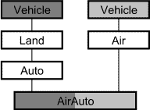

图14.1：多重派生中基类的重复。

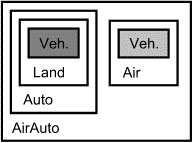

图14.2：`AirAuto` 对象的内部组织。

编译器无法确定调用哪个成员函数 `mass`，但程序员有两种方法可以为编译器解决歧义：

- 首先，可以修改产生歧义的函数调用。使用作用域解析运算符来解决歧义：

```cpp
// 让我们希望质量保存在 Auto
// 部分对象中..
cout << jBond.Auto::mass() << '\n';
```

作用域解析运算符和类名放在成员函数名的正前方。

- 其次，可以为类 `AirAuto` 创建一个专门的 `mass` 函数：

```cpp
int AirAuto::mass() const
{
    return Auto::mass();
}
```

第二种方法更可取，因为它不需要编译器标记错误；也不需要使用 `AirAuto` 类的程序员采取特殊预防措施。

然而，存在一种更优雅的解决方案，将在下一节中讨论。

#### 14.5.2 虚基类

如图14.2所示，一个 `AirAuto` 表示*两个* `Vehicle`。这不仅导致访问质量数据时使用哪个函数的歧义，还在 `AirAuto` 中定义了两个质量字段。这有点冗余，因为我们可以假设一个 `AirAuto` 只有一个质量。

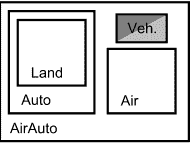

图14.3：当基类为虚基类时 `AirAuto` 对象的内部组织。

然而，可以将 `AirAuto` 定义为一个仅包含一个 `Vehicle` 的类，同时又使用多重派生。这可以通过将派生类继承树中多次出现的基类定义为*虚基类*来实现。

对于类 `AirAuto`，这意味着从 `Land` 和 `Air` 类派生 `AirAuto` 时需要做一个小改动：

```cpp
class Land: virtual public Vehicle
{
    // 等等
};
class Auto: public Land
{
    // 等等
};
class Air: virtual public Vehicle
{
    // 等等
};
class AirAuto: public Auto, public Air
{
};
```

虚派生确保 `Vehicle` 只被添加到派生类一次。这意味着 `Vehicle` 被添加到 `AirAuto` 的路径不再取决于其直接基类；我们只能说 `AirAuto` 是一个 `Vehicle`。虚派生后 `AirAuto` 的内部组织如图14.3所示。

当一个类 `Third` 继承自基类 `Second`，而 `Second` 又继承自基类 `First` 时，当构造 `Third` 对象时，如果使用该 `Second` 构造函数，那么 `Second` 构造函数调用的 `First` 类构造函数也会被使用。示例：

```cpp
class First
{
    public:
        First(int x);
};
class Second: public First
{
    public:
        Second(int x)
        :
            First(x)
        {}
};
class Third: public Second
{
    public:
        Third(int x)
        :
            Second(x)          // 调用 First(x)
        {}
};
```

当 `Second` 使用虚派生时，上述情况不再成立。当 `Second` 使用虚派生时，当从 `Third` 调用 `Second` 的构造函数时，其基类构造函数会被忽略。取而代之的是，`Second` 默认调用 `First` 的默认构造函数。下一个示例说明了这一点：

```cpp
class First
{
    public:
        First()
        {
            cout << "First()\n";
        }
        First(int x);
};
class Second: public virtual First       // 注意：virtual
{
    public:
        Second(int x)
        :
            First(x)
        {}
};
class Third: public Second
{
    public:
        Third(int x)
        :
            Second(x)
        {}
};
int main()
{
    Third third(3);      // 显示 "First()"
}
```

构造 `Third` 时，默认使用 `First` 的默认构造函数。然而，`Third` 的构造函数可以通过显式指定要使用的构造函数来覆盖此默认行为。由于 `First` 对象必须在 `Second` 可构造之前可用，因此必须首先指定它。要在构造 `Third(int)` 时调用 `First(int)`，后者的构造函数可以定义如下：

```cpp
class Third: public Second
{
    public:
        Third(int x)
        :
            First(x),          // 现在调用 First(int)。
            Second(x)
        {}
};
```

当使用简单的线性继承时，这种行为可能看起来令人费解，但当使用多重继承且基类使用虚继承时，它就变得有意义了。考虑 `AirAuto`：当 `Air` 和 `Auto` 都虚继承自 `Vehicle` 时，`Air` 和 `Auto` 是否都会初始化共同的 `Vehicle` 对象？如果是，哪个会先被调用？如果 `Air` 和 `Auto` 使用不同的 `Vehicle` 构造函数怎么办？所有这些疑问都可以通过将公共基类初始化的责任交给最终使用公共基类对象的类来避免。在上面的例子中是 `Third`。因此，`Third` 有机会在初始化 `First` 时指定要使用的构造函数。

多重继承也可以用于继承那些并非都使用虚继承的类。假设我们有两个类 `Derived1` 和 `Derived2`，它们都（可能虚）继承自 `Base`。

现在我们讨论在调用类 `Final` 的构造函数时会调用哪些构造函数：

```cpp
class Final: public Derived1, public Derived2
```

为了区分涉及的构造函数，`Base1` 表示作为 `Derived1` 的基类初始化器调用的 `Base` 类构造函数（类似地：`Base2` 是从 `Derived2` 调用的）。普通的 `Base` 表示 `Base` 的默认构造函数。

`Derived1` 和 `Derived2` 表示构造 `Final` 对象时使用的基类初始化器。

现在我们准备区分构造类 `Final`（`class Final: public Derived1, public Derived2`）的对象时的各种情况：

| 类 | 按顺序调用的构造函数 | 说明 |
|---|---|---|
| `Derived1: public Base`<br>`Derived2: public Base` | `Base1, Derived1, Base2, Derived2` | 这是普通的非虚多重派生。 |
| `Derived1: public Base`<br>`Derived2: virtual public Base` | `Base, Base1, Derived1, Derived2` | 只有 `Derived2` 使用虚派生。`Derived2` 的基类构造函数被忽略。取而代之的是，调用 `Base`，并且它先于任何其他构造函数被调用。由于只有一个类使用虚派生，最终的 `Final` 类中仍然存在两个 `Base` 类对象。 |
| `Derived1: virtual public Base`<br>`Derived2: public Base` | `Base, Derived1, Base2, Derived2` | 只有 `Derived1` 使用虚派生。`Derived1` 的基类构造函数被忽略。取而代之的是，调用 `Base`，并且它先于任何其他构造函数被调用。与第一种（非虚）情况不同，现在调用的是 `Base`，而不是 `Base1`。 |


- 类：

```cpp
class Derived1: virtual public Base
class Derived2: virtual public Base
```

两个基类都使用虚派生，因此 `Final` 类对象中只会存在一个 `Base` 类对象。以下构造函数按所示顺序调用：

```
Base,
Derived1,
Derived2
```

与虚函数不同，虚派生是一个纯粹的编译期问题。虚继承仅仅定义了编译器如何定义类的数据组织和构造过程。

#### 14.5.3 何时不适合使用虚派生

虚继承可用于合并多次出现的基类。然而，可能会遇到基类多次出现是合适的情况。考虑 `Truck` 的定义（参见第 13.5 节）：

```cpp
class Truck: public Auto
{
    int d_trailer_mass;

public:
    Truck();
    Truck(int engine_mass, int sp, char const *nm,
          int trailer_mass);

    void setMass(int engine_mass, int trailer_mass);
    int mass() const;
};
Truck::Truck(int engine_mass, int sp, char const *nm,
             int trailer_mass)
:
    Auto(engine_mass, sp, nm)
{
    d_trailer_mass = trailer_mass;
}
int Truck::mass() const
{
    return                  // sum of:
        Auto::mass() +      // engine part plus
        d_trailer_mass;     // the trailer
}
```

这个定义展示了如何构造一个 `Truck` 对象，使其包含两个质量字段：一个通过它从 `Auto` 的派生而来，另一个通过它自己的 `int d_trailer_mass` 数据成员而来。这样的定义当然是有效的，但也可以重写。我们可以让 `Truck` 同时从 `Auto` 和 `Vehicle` 派生，从而显式要求 `Vehicle` 出现两次；一次用于发动机和驾驶室的质量，一次用于拖车的质量。一个小麻烦是，像 `class Truck: public Auto, public Vehicle` 这样的类组织方式不会被 C++ 编译器接受。由于 `Vehicle` 已经是 `Auto` 的一部分，因此不需要再次出现。不过，可以用一个小技巧强制实现这种组织方式。通过创建一个从 `Vehicle` 继承的附加类，并让 `Truck` 从该附加类而不是直接从 `Vehicle` 派生，问题就解决了。只需从 `Vehicle` 派生一个类 `TrailerVeh`，然后让 `Truck` 从 `Auto` 和 `TrailerVeh` 派生：

```cpp
class TrailerVeh: public Vehicle
{
    public:
        TrailerVeh(int mass)
        :
            Vehicle(mass)
            {}
};
class Truck: public Auto, public TrailerVeh
{
    public:
        Truck();
        Truck(int engine_mass, int sp, char const *nm, int trailer_mass);
        void setMass(int engine_mass, int trailer_mass);
        int mass() const;
};
inline Truck::Truck(int engine_mass, int sp, char const *nm,
                    int trailer_mass)
:
    Auto(engine_mass, sp, nm),
    TrailerVeh(trailer_mass)
{}
inline int Truck::mass() const
{
    return                         // sum of:
        Auto::mass() +             // engine part plus
        TrailerVeh::mass();        // the trailer
}
```

### 14.6 运行时类型识别

**C++** 提供了两种（在运行时）获取对象和表达式类型的方法。与 **Java** 等语言相比，C++ 的运行时类型识别能力有限。通常，**C++** 中使用静态类型检查和静态类型识别。静态类型检查可能更安全，并且肯定比运行时类型识别更高效，因此应优先于运行时类型识别。但也存在适合使用运行时类型识别的情况。C++ 通过 *动态转换* 和 *typeid* 运算符提供运行时类型识别。

- `dynamic_cast` 用于将基类指针或引用转换为派生类指针或引用。这也称为*向下转换*。
- `typeid` 运算符返回表达式的实际类型。

这些运算符可用于至少有一个虚成员函数的类的对象。

#### 14.6.1 dynamic_cast 运算符

`dynamic_cast<>` 运算符用于将基类指针或引用分别转换为派生类指针或引用。这也称为*向下转换*，因为转换方向是沿继承树*向下*。

动态转换在运行时执行。使用动态转换的前提是基类中至少存在一个虚成员函数。

在下面的示例中，从 `Base` 类指针 `bp` 获得指向 `Derived` 类的指针：

```cpp
class Base
{
    public:
        virtual ~Base();
};
class Derived: public Base
{
    public:
        char const *toString();
};
inline char const *Derived::toString()
{
    return "Derived object";
}
int main()
{
    Base *bp;
    Derived *dp;
    Derived d;

    bp = &d;

    dp = dynamic_cast<Derived *>(bp);

    if (dp)
        cout << dp->toString() << '\n';
    else
        cout << "dynamic cast conversion failed\n";
}
```

在上述 `if` 语句的条件中，验证动态转换是否成功。这种验证必须在*运行时*执行，因为指针所指向对象的实际类只有到那时才能知道。如果提供的是基类指针，则动态转换运算符在失败时返回 0，在成功时返回指向所请求派生类的指针。

假设使用了一个 `vector<Base *>`。这种 vector 的指针可能指向各种类的对象，这些类都派生自 `Base`。如果基类指针确实指向指定类的对象，则动态转换返回指向该指定类的指针，否则返回 0。因此，我们可以通过执行一系列检查来找出基类指针所指向的实际派生类，从而确定指针所指向对象的实际类。示例：

```cpp
class Base
{
    public:
        virtual ~Base();
};
class Derived1: public Base;
class Derived2: public Base;

int main()
{
    vector<Base *> vb(initializeBase());

    Base *bp = vb.front();

    if (dynamic_cast<Derived1 *>(bp))
        cout << "bp points to a Derived1 class object\n";
    else if (dynamic_cast<Derived2 *>(bp))
        cout << "bp points to a Derived2 class object\n";
}
```

另一种情况是，可能有一个基类对象的引用可用。在这种情况下，如果向下转换失败，`dynamic_cast` 运算符会抛出异常。示例：

```cpp
#include <iostream>
#include <typeinfo>

class Base
{
    public:
        virtual ~Base();
        virtual char const *toString();
};
inline char const *Base::toString()
{
    return "Base::toString() called";
}
class Derived1: public Base
{};
class Derived2: public Base
{};

Base::~Base()
{}
void process(Base &b)
{
    try
    {
        std::cout << dynamic_cast<Derived1 &>(b).toString() << '\n';
    }
    catch (std::bad_cast)
    {}
    try
    {
        std::cout << dynamic_cast<Derived2 &>(b).toString() << '\n';
    }
    catch (std::bad_cast)
    {
        std::cout << "Bad cast to Derived2\n";
    }
}
int main()
{
    Derived1 d;
    process(d);
}
/*
    Generated output:

    Base::toString() called
    Bad cast to Derived2
*/
```

在这个示例中使用了值 `std::bad_cast`。如果对派生类对象的引用进行动态转换失败，就会抛出 `std::bad_cast` 异常。

注意 catch 子句的形式：`bad_cast` 是一个类型的名称。第 17.4.1 节描述了如何定义这样的类型。

当现有基类不能或不应被修改（例如，源代码不可用时），而可以改为修改派生类时，动态转换运算符是一个有用的工具。接收基类指针或引用的代码随后可以执行到派生类的动态转换，以访问派生类的功能。

人们可能会想，`dynamic_cast` 和 `reinterpret_cast` 之间有什么区别。其中一个区别当然是 `dynamic_cast` 可以作用于引用，而 `reinterpret_cast` 只能作用于指针。但当两个参数都是指针时，有区别吗？

使用 `reinterpret_cast` 时，我们告诉编译器，它应该字面地把一块内存重新解释为其他东西。`reinterpret_cast` 可用于访问 `int` 的各个字节。一个 `int` 由 `sizeof (int)` 个字节组成，通过将 `int` 值的位置重新解释为 `char *`，可以访问这些字节。使用 `reinterpret_cast` 时，编译器不再能提供防止愚蠢行为的保护措施。编译器会乐于将 `int *` 通过 `reinterpret_cast` 转换为 `double *`，但由此产生的解引用至少会产生一个可疑的值。

`dynamic_cast` 也会重新解释一块内存，但这里提供了运行时保护措施。当请求的类型与我们指向对象的实际类型不匹配时，`dynamic_cast` 会失败。`dynamic_cast` 的用途也比 `reinterpret_cast` 的用途受限得多，因为它只能用于向下转换到具有虚成员的派生类。

归根结底，动态转换也是一种转换，而转换应当避免。当出现动态转换的需求时，问问自己基类是否已被恰当设计。在代码期望基类引用或指针的情况下，基类接口应该就是所需的全部内容，不应需要使用动态转换。也许可以修改基类的虚接口，以防止使用动态转换。遇到使用动态转换的代码时，就该开始皱眉了。在你自己的代码中使用动态转换时，始终要适当说明为什么该动态转换是恰当使用的，以及为什么无法避免。

#### 14.6.2 `typeid` 运算符

与 `dynamic_cast` 运算符一样，`typeid` 通常应用于这样的基类对象引用：它们引用的是派生类对象。`typeid` 只应与提供虚成员的基类一起使用。在使用 `typeid` 之前，必须已经包含 `<typeinfo>` 头文件。

`typeid` 运算符返回一个 `type_info` 类型的对象。不同的编译器可能提供 `type_info` 类的不同实现，但 `typeid` 至少必须提供以下接口：

```cpp
class type_info
{
    public:
        virtual ~type_info();
        int operator==(type_info const &other) const;
        int operator!=(type_info const &other) const;
        bool before(type_info const &rhs) const;
        char const *name() const;
    private:
        type_info(type_info const &other);
        type_info &operator=(type_info const &other);
};
```

注意，这个类有一个私有拷贝构造函数和一个私有重载赋值运算符。这阻止代码构造 `type_info` 对象，也阻止代码将 `type_info` 对象相互赋值。相反，`type_info` 对象由 `typeid` 运算符构造并返回。


### 14.6 运行时类型识别

如果将基类引用传递给 `typeid` 运算符，它能够返回该引用所引用类型的实际名称。示例：

```cpp
class Base;
class Derived: public Base;

Derived d;
Base    &br = d;

cout << typeid(br).name() << '\n';
```

在此示例中，`typeid` 运算符接收到一个基类引用。它打印文本“Derived”，即 br 实际引用的类的类名。如果 Base 不包含虚函数，则打印文本“Base”。

`typeid` 运算符可用于确定表达式的实际类型名称，而不仅仅是类类型对象的实际类型名称。例如：

```cpp
cout << typeid(12).name() << '\n';     // prints:  int
cout << typeid(12.23).name() << '\n';  // prints:  double
```

但请注意，上述示例最多只是示意性的。它可能打印 int 和 double，但情况未必如此。如果需要可移植性，请确保不要求针对这些静态的内置文本字符串进行测试。如有疑问，请查看你的编译器生成什么。

在应用 `typeid` 运算符来确定派生类类型的情况下，应将基类引用用作 `typeid` 运算符的参数。考虑以下示例：

```cpp
class Base;       // contains at least one virtual function
class Derived: public Base;

Base *bp = new Derived;     // base class pointer to derived object

if (typeid(bp) == typeid(Derived *))    // 1: false
    ...
if (typeid(bp) == typeid(Base *))       // 2: true
    ...
if (typeid(bp) == typeid(Derived))      // 3: false
    ...
if (typeid(bp) == typeid(Base))         // 4: false
    ...
if (typeid(*bp) == typeid(Derived))     // 5: true
    ...
if (typeid(*bp) == typeid(Base))        // 6: false
    ...

Base &br = *bp;

if (typeid(br) == typeid(Derived))      // 7: true
    ...
if (typeid(br) == typeid(Base))         // 8: false
    ...
```

这里，(1) 返回 false，因为 `Base *` 不是 `Derived *`。(2) 返回 true，因为这两个指针类型相同；(3) 和 (4) 返回 false，因为指向对象的指针不是对象本身。

另一方面，如果在上述表达式中使用 *bp，则 (1) 和 (2) 返回 false，因为对象（或对象的引用）不是指向对象的指针，而 (5) 现在返回 true：*bp 实际上引用一个 Derived 类对象，并且 typeid(*bp) 返回 typeid(Derived)。如果使用基类引用，会得到类似结果：7 返回 true，8 返回 false。

`type_info::before(type_info const &rhs)` 成员用于确定类的*整理顺序*。这在比较两个类型是否相等时很有用。如果 this 在所用类型的层次结构或整理顺序中位于 rhs 之前，则该函数返回非零值。当把派生类与其基类比较时，比较返回 0，否则返回非零值。例如：

```cpp
    cout << typeid(ifstream).before(typeid(istream)) << '\n' << // not 0
            typeid(istream).before(typeid(ifstream)) << '\n'; // 0
```

对于内置类型，实现者可以规定：当把“较宽”类型与“较小”类型比较时返回非 0，否则返回 0：

```cpp
    cout << typeid(double).before(typeid(int)) << '\n' << // not 0
            typeid(int).before(typeid(double)) << '\n'; // 0
```

当比较两个相等的类型时，返回 0：

```cpp
    cout << typeid(ifstream).before(typeid(ifstream)) << '\n'; // 0
```

当向 typeid 运算符传递 0 指针时，会抛出 bad_typeid 异常。

### 14.7 继承：何时使用以实现什么？

不应自动且不加思考地应用继承。通常可以改用组合，通过减少耦合来改进类的设计。当使用继承时，不应自动使用*公有继承*，而所选择的继承类型应与程序员的意图相符。

我们已经看到，多态类一方面提供接口成员，定义可向基类请求的功能；另一方面提供可被覆盖的虚成员。良好类设计的标志之一是成员函数按照“一个函数，一个任务”的原则设计。在当前上下文中：类成员要么应是类的公有或受保护接口的成员，要么应作为虚成员可供派生类重新实现。这通常归结为在基类的*私有部分*中定义的虚成员。使用基类的代码不应调用这些函数，但它们的存在是为了让派生类通过多态覆盖它们，从而重新定义基类的行为。

其基本原则已在本章引言段落中提及：根据*里氏替换原则（LSP）*，类之间的*是-a*关系（表明派生类对象是基类对象）意味着派生类对象可用于期望基类对象的代码中。

在这种情况下，使用继承*不*是为了让派生类使用基类已实现的设施，而是通过在派生类中重新实现基类的虚成员来以多态方式复用基类。

在本节中，我们将讨论使用继承的原因。为什么应该（或不应该）使用继承？如果使用继承，我们试图通过它实现什么？

继承常常与组合竞争。考虑以下两种可替代的类设计：

```cpp
    class Derived: // derived from Base
    { ... };
```

```cpp
class Composed
{
    Base d_base;
    ...
};
```

为什么以及何时优先选择 Derived 而不是 Composed，反之亦然？设计类 Derived 时应使用哪种继承？

- 由于 Composed 和 Derived 是作为替代方案提供的，我们关注的是一个类（Derived 或 Composed）的设计，该类*依据另一个类实现*。
- 由于 Composed 本身不提供 Base 的接口，Derived 也不应提供。基本原则是：当从 Base 派生类 Derived 且 Derived 是依据 Base 实现时，应使用*私有继承*。
- 我们应该使用继承还是组合？以下是一些论点：
    - 一般来说，组合导致更松的耦合，因此应优先于继承。
    - 组合允许我们定义具有多个相同类型成员的类（想想一个具有多个 `std::string` 成员的类），这无法使用继承实现。
    - 组合允许我们将类的接口与其实现分离。这允许我们修改类的数据组织，而无需重新编译使用我们类的代码。这也称为*桥接设计模式*、*编译器防火墙*或*pimpl*（指向实现的指针）惯用法。
    - 如果 Base 在其受保护接口中提供在实现 Derived 时必须使用的成员，则也必须使用继承。再次说明：由于我们是在依据 Base 实现，继承类型应为私有。
    - 当派生类 (D) 本身意图作为基类，并且只应将其自身基类 (B) 的成员提供给从它派生的类（即 D）时，可以考虑保护继承。

当派生类属于某种基类类型，但为了初始化该基类必须有一个另一类类型的对象可用时，也应使用私有继承。示例：一个新的 `istream` 类类型（比如：一个可从中提取随机数的流 `IRandStream`）派生自 `std::istream`。尽管可以空构造一个 `istream`（稍后使用其 `rdbuf` 成员接收其 `streambuf`），但显然更可取的是立即初始化 `istream` 基类。

假设已经创建了一个用于生成随机数的 `Randbuffer: public std::streambuf`，那么可以从 `Randbuffer` 和 `std::ostream` 派生 `IRandStream`。这样，就可以使用 `Randbuffer` 基类来初始化 `ostream` 基类。

由于 `IRandStream` 绝对不是 `Randbuffer`，所以*公有继承*不合适。在这种情况下，`IRandStream` 是依据 `Randbuffer` 实现的，因此应使用*私有继承*。

因此，`IRandStream` 的类接口应像这样开始：

```cpp
class IRandStream: private Randbuffer, public std::istream
{
public:
    IRandStream(int lowest, int highest)    // defines the range
    :
        Randbuffer(lowest, highest),
        std::istream(this)                  // passes &Randbuffer
    {}
...
};
```


公有继承应仅保留给满足 LSP 的类。在这些情况下，仅使用基类引用、指针或成员的代码，总是可以用派生类替代其派生自的基类（即概念上派生类*是一种*基类）。这最常用于从提供虚成员的基类派生的类。为了将用户接口与可重定义接口分离，基类的公有接口不应包含虚成员（虚析构函数除外），并且所有虚成员都应位于基类的私有部分。这些虚成员仍可由派生类重写（考虑到多态的实现方式，这不应令人意外），并且这种设计使基类能够完全控制被重定义成员的使用上下文。公有接口通常只是调用一个虚成员，但这些成员总是可以被重定义以执行额外职责。

因此，基类的典型形式如下：

```cpp
class Base
{
    public:
        virtual ~Base();
        void process();              // calls virtual members (e.g.,
                                     // v_process)

    private:
        virtual void v_process();    // overridden by derived classes
};
```

或者，基类可以提供非虚析构函数，此时该析构函数应受保护。它不应是公有的，以防止通过基类指针删除对象（在这种情况下应使用虚析构函数）。它应受保护，以允许派生类（指示它们调用其基类的析构函数）。出于同样的原因，此类基类应具有非公有构造函数和重载的赋值运算符。

### 14.8 ‘streambuf’ 类

`std::streambuf` 类接收由流处理的字符序列，并定义流对象与设备（如磁盘上的文件）之间的接口。`streambuf` 对象通常不直接构造，而是通常用作某个派生类的基类，该派生类实现与某个设备的通信。

`streambuf` 类存在的主要原因是将流类与其操作的设备解耦。其理由是在允许我们与设备通信的类与设备本身之间增加一个额外层。这实现了一种在软件设计中经常见到的*命令链*。

在设计可复用软件时，*命令链*被视为一种通用模式，例如在 TCP/IP 协议栈中也会遇到。

`streambuf` 可以被视为命令链模式的又一个示例。在这里，程序与流对象通信，流对象进而将其请求转发给 `streambuf` 对象，而 `streambuf` 对象进而与设备通信。因此，正如我们很快将看到的，我们能够在用户软件中完成以前必须通过（昂贵的）系统调用完成的工作。

`streambuf` 类没有公有构造函数，但提供了若干公有成员函数。除这些公有成员函数外，还有若干成员函数仅对从 `streambuf` 派生的类可用。14.8.2 节介绍了 `streambuf` 类的一个预定义特化。这里讨论的 `streambuf` 的所有公有成员在 `filebuf` 中也可用。

下一节展示从 `streambuf` 派生类时可重写的 `streambuf` 成员。第 23 章提供了从 `streambuf` 派生的类的具体示例。

`streambuf` 类由执行输入操作的流和执行输出操作的流使用，其成员函数也可按同样方式排序。下面使用的类型 `std::streamsize` 在实际使用中可视为等同于类型 `size_t`。

当向 `ostream` 对象插入信息时，信息最终会传递给该 `ostream` 的 `streambuf`。`streambuf` 可能决定抛出异常。然而，该异常不会从使用该 `streambuf` 的 `ostream` 中传出。相反，异常由该 `ostream` 捕获，并设置其 `ios::badbit`。插入到 `ostream` 对象中的操纵符所引发的异常不会被 `ostream` 对象捕获。

#### 用于输入操作的公有成员

- `std::streamsize in_avail();`
  
  此成员函数返回可立即读取字符数的下界。

- `int sbumpc();`
  
  返回下一个可用字符或 EOF。返回的字符从 `streambuf` 对象中移除。如果没有可用输入，`sbumpc` 会调用（受保护的）成员 `uflow`（见下文 14.8.1 节）以提供新字符。如果没有更多字符可用，则返回 EOF。

- `int sgetc();`
  
  返回下一个可用字符或 EOF。该字符*不会*从 `streambuf` 对象中移除。要从 `streambuf` 对象中移除字符，可使用 `sbumpc`（或 `sgetn`）。

- `std::streamsize sgetn(char *buffer, std::streamsize n);`
  
  至多从输入缓冲区中取出 `n` 个字符，并存储到 `buffer` 中。返回实际读取的字符数。调用（受保护的）成员 `xsgetn`（见下文 14.8.1 节）以获取所需数量的字符。

- `int snextc();`
  
  从输入缓冲区获取当前字符，并将其作为下一个可用字符返回，或者返回 EOF。该字符*不会*从 `streambuf` 对象中移除。

- `int sputbackc(char c);`
  
  将 `c` 插入 `streambuf` 的缓冲区，以便作为下一次从 `streambuf` 对象读取的字符返回。使用此函数时应谨慎：通常最多只能放回一个字符。

- `int sungetc();`
  
  将最后读取的字符返回到输入缓冲区，以便在下一次输入操作时再次读取。使用此函数时应谨慎：通常最多只能放回一个字符。

#### 用于输出操作的公有成员

- `int pubsync();`
  
  通过将 `streambuf` 缓冲区中当前可用的任何信息写入设备来同步（即刷新）缓冲区。通常仅由从 `streambuf` 派生的类使用。

- `int sputc(char c);`
  
  将字符 `c` 插入 `streambuf` 对象。如果在写入该字符后缓冲区已满，该函数会调用（受保护的）成员函数 `overflow` 将缓冲区刷新到设备（见下文 14.8.1 节）。

- `std::streamsize sputn(char const *buffer, std::streamsize n);`
  
  至多将 `buffer` 中的 `n` 个字符插入 `streambuf` 对象。返回实际插入的字符数。此成员函数调用（受保护的）成员 `xsputn`（见下文 14.8.1 节）以插入所需数量的字符。

#### 用于其他操作的公有成员

接下来的三个成员通常仅由从 `streambuf` 派生的类使用。

- `ios::pos_type pubseekoff(ios::off_type offset, ios::seekdir way, ios::openmode mode = ios::in | ios::out);`
  
  将下一个要读取或写入的字符的偏移量设置为 `offset`，该偏移量相对于表示定位操作方向的标准 `ios::seekdir` 值。

- `ios::pos_type pubseekpos(ios::pos_type pos, ios::openmode mode = ios::in | ios::out);`
  
  将下一个要读取或写入的字符的绝对位置设置为 `pos`。

- `streambuf *pubsetbuf(char* buffer, std::streamsize n);`
  
  `streambuf` 对象将使用可容纳至少 `n` 个字符的缓冲区。

#### 14.8.1 受保护的 ‘streambuf’ 成员

`streambuf` 类的受保护成员对于理解和使用 `streambuf` 对象很重要。尽管 `streambuf` 类中同时定义了受保护数据成员和受保护成员函数，但这里不提及受保护数据成员，因为使用它们会违反数据隐藏原则。由于 `streambuf` 的成员函数集相当广泛，几乎从不需要直接使用其数据成员。以下小节甚至没有列出所有受保护成员函数，而只列出了对构造特化有用的那些。

`Streambuf` 对象控制一个用于输入和/或输出的缓冲区，其中定义了起始指针、当前指针和结束指针，如图 14.4 所示。

`Streambuf` 提供一个受保护构造函数：

- `streambuf::streambuf();`
  
  `streambuf` 类的默认（受保护）构造函数。

##### 14.8.1.1 用于输入操作的受保护成员

有若干受保护成员函数可用于输入操作。标记为 virtual 的成员函数当然可以在派生类中重定义：

- `char *eback();`
  
  `Streambuf` 维护三个控制其输入缓冲区的指针：`eback` 指向“放回区”的末尾；字符可以安全地放回到此位置。另见图 14.4。`eback` 指向输入缓冲区的开头。

- `char *egptr();`
  
  `egptr` 指向可从输入缓冲区取回的最后一个字符之后的位置。另见图 14.4。如果 `gptr` 等于 `egptr`，则必须重新填充缓冲区。这应通过调用 `underflow` 来实现，见下文。


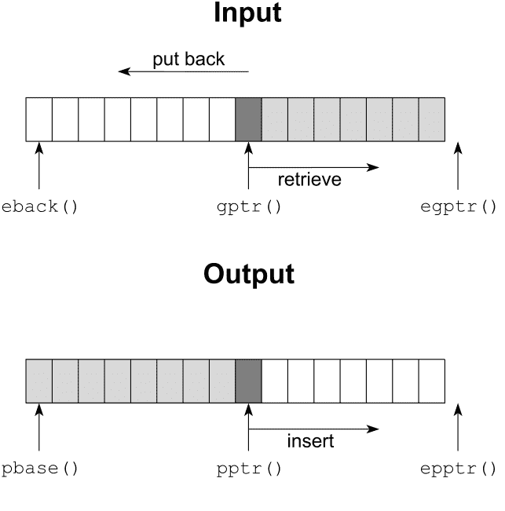

图 14.4：`streambuf` 类的输入和输出缓冲区指针

- `void gbump(int n);`

  对象的 `gptr`（见下文）向前移动 n 个位置。

- `char *gptr();`

  `gptr` 指向要从对象输入缓冲区中取出的下一个字符。另见图 14.4。

- `virtual int pbackfail(int c);`

  派生类可以重写此成员函数，以便在回退字符 c 失败时进行一些智能处理。可以考虑当输入缓冲区起始位置已到达时恢复旧的读指针。当取消读取或回退一个字符失败时会调用此成员函数。具体而言，当以下情况发生时调用：

  - `gptr() == 0`：未使用缓冲；
  - `gptr() == eback()`：没有更多空间可回退；
  - `*gptr() != c`：必须回退一个与下一个要读取字符不同的字符。

  如果 `c == endOfFile()`，则输入设备必须后退一个字符位置。否则，必须将 c 前置到待读取字符之前。失败时该函数应返回 `EOF`。否则可以返回 0。

- `void setg(char *beg, char *next, char *beyond);`

  此成员函数初始化输入缓冲区。`beg` 指向输入区域的起始位置，`next` 指向下一个要取出的字符，`beyond` 指向输入缓冲区最后一个字符之后的位置。通常 `next` 至少为 `beg + 1`，以便允许一次回退操作。当以 `setg(0, 0, 0)` 方式调用此成员时，表示不使用输入缓冲。另见下面的成员 `uflow`。

- `virtual streamsize showmanyc();`

  （读作：s-how-many-c）派生类可以重写此成员函数。它必须返回一个保证的下界，表示在 `uflow` 或 `underflow` 返回 `EOF` 之前，可以从设备读取的字符数。默认返回 0（表示在后两个函数返回 EOF 之前，可能返回 0 个或一些字符）。当返回正值时，下一次调用 `underflow` 不会返回 `EOF`。

- `virtual int uflow();`

  派生类可以重写此成员函数，用新字符重新加载输入缓冲区。其默认实现是调用 `underflow`（见下文）。如果 `underflow()` 失败，则返回 `EOF`。否则，将下一个可用字符作为 `*gptr()` 返回，随后执行 `gbump(-1)`。`uflow` 还会将返回的待处理字符移到备份序列中。这与 `underflow()` 不同，后者仅返回下一个可用字符，但不改变输入指针的位置。

  当不需要输入缓冲时，可以重写此函数（而不是 `underflow`），以从设备提供下一个可读字符。

- `virtual int underflow();`

  派生类可以重写此成员函数，以从设备读取另一个字符。默认实现返回 `EOF`。

  当以下情况发生时调用：

  - 没有输入缓冲区（`eback() == 0`）
  - `gptr() >= egptr()`：输入缓冲区已用完。

通常，在使用缓冲时，不会刷新整个缓冲区，因为这样会使重载后紧接着的字符回退操作无法进行。相反，缓冲区通常按半区刷新。这种系统称为*分割缓冲区*（split buffer）。
用于读取的 `streambuf` 派生类通常至少重写 `underflow`。
一个典型的 `underflow` 重写示例如下：

```
int underflow()
{
    if (not refillTheBuffer())  // 假设存在成员 d_buffer
        return EOF;

                              // 重置输入缓冲区指针
    setg(d_buffer, d_buffer, d_buffer + d_nCharsRead);

                              // 返回下一个可用字符
                              // （使用强制类型转换防止
                              // 将 0xff 字符误解为 EOF）
    return static_cast<unsigned char>(*gptr());
}
```

- `virtual streamsize xsgetn(char *buffer, streamsize n);`

  派生类可以重写此成员函数，以一次从输入设备取出 n 个字符。默认实现是对每个字符调用 `sbumpc`，也就是说默认情况下此成员（最终）会对每个字符调用 `underflow`。该函数返回实际读取的字符数或 `EOF`。一旦返回 `EOF`，`streambuf` 将停止从设备读取。

##### 14.8.1.2 用于输出操作的保护成员

以下保护成员可用于输出操作。同样，派生类可以重写其中一些成员：

- `virtual int overflow(int c);`

  派生类可以重写此成员函数，以将当前存储在输出缓冲区中的字符刷新到输出设备，然后重置输出缓冲区指针，使其表示一个空缓冲区。其参数 c 初始化为下一个要处理的字符。如果未使用输出缓冲，则每写入一个字符到 `streambuf` 对象时都会调用 `overflow`。通过将缓冲区指针设置为 0（使用 `setp`，见下文）即可实现不使用输出缓冲。默认实现返回 `EOF`，表示无法向设备写入任何字符。用于写入的 `streambuf` 派生类通常至少重写 `overflow`。一个典型的 `overflow` 重写示例如下：

```
int OFdStreambuf::overflow(int c)
{
    sync();                              // 刷新缓冲区
    if (c != EOF)                       // 是否要写一个字符？
    {
        *pptr() = static_cast<char>(c); // 将其放入缓冲区
        pbump(1);                        // 推进缓冲区的指针
    }
    return c;
}
```

- `char *pbase();`

  `Streambuf` 维护三个控制其输出缓冲区的指针：pbase 指向输出缓冲区区域的起始位置。另见图 14.4。

- `char *epptr();`

  Streambuf 维护三个控制其输出缓冲区的指针：epptr 指向输出缓冲区最后一个可用位置之后的位置。另见图 14.4。如果 pptr（见下文）等于 epptr，则必须刷新缓冲区。这是通过调用 overflow 实现的，见前文。

- `void bump(int n);`

  pptr（见下文）返回的位置向前移动 n。下一个写入流的字符将存放在该位置。

- `char *pptr();`

  Streambuf 维护三个控制其输出缓冲区的指针：pptr 指向输出缓冲区中下一个可用字符应写入的位置。另见图 14.4。

- `void setp(char *beg, char *beyond);`

  Streambuf 的输出缓冲区被初始化为传给 setp 的位置。`beg` 指向输出缓冲区的起始位置，`beyond` 指向输出缓冲区最后一个可用位置之后的位置。使用 `setp(0, 0)` 表示不使用缓冲。在这种情况下，每写一个字符到设备时都会调用 overflow。

- `virtual streamsize xsputn(char const *buffer, streamsize n);`

  派生类可以重写此成员函数，以向输出缓冲区写入至多 n 个字符的序列。返回实际插入的字符数。如果返回 `EOF`，则停止向设备写入。默认实现为每个字符调用 sputc，因此只有在需要更高效的实现时才需要重定义此成员。

##### 14.8.1.3 用于缓冲区操作的保护成员

有几个保护成员与缓冲区管理和定位相关：

- `virtual streambuf *setbuf(char *buffer, streamsize n);`

  派生类可以重写此成员函数以安装缓冲区。默认实现不执行任何操作。它由 pubsetbuf 调用。

- `virtual pos_type seekoff(off_type offset, ios::seekdir way, ios::openmode mode = ios::in | ios::out)`

  派生类可以重写此成员函数，将输入或输出的下一个指针重置到一个新的相对位置（使用 `ios::beg`、`ios::cur` 或 `ios::end`）。默认实现通过返回 -1 表示失败。当调用 tellg 或 tellp 时会调用此函数。当派生类支持定位时，也应定义此函数来处理重新定位请求。它由 pubseekoff 调用。返回新位置或无效位置（即 -1）。

- `virtual pos_type seekpos(pos_type offset, ios::openmode mode = ios::in | ios::out)`

  派生类可以重写此成员函数，将输入或输出的下一个指针重置到一个新的绝对位置（即相对于 `ios::beg`）。默认实现通过返回 -1 表示失败。

- `virtual int sync();`

  派生类可以重写此成员函数，以将输出缓冲区刷新到输出设备，或将输入设备重置到字符位置之后


最后返回的内容。成功时返回 0，失败时返回 -1。默认实现（不使用缓冲区）返回 0，表示同步成功。此成员用于确保任何仍被缓冲的字符都写入设备，或者在 `streambuf` 对象不复存在时将未消耗的字符放回设备。

##### 14.8.1.4 从 `streambuf` 派生类

当从 `streambuf` 派生类时，打算从设备读取信息的类至少应重写 `underflow`，而打算向设备写入信息的类应重写 `overflow`。第 [23](#) 章提供了几个从 `streambuf` 派生的类的示例。

`fstream` 类类型的对象使用组合的输入/输出缓冲区。这是因为 `istream` 和 `ostream` 虚拟派生自 `ios`，而该类包含 `streambuf`。要构造一个使用独立缓冲区同时支持输入和输出的类，`streambuf` 本身可以定义两个缓冲区。当为读取调用 `seekoff` 时，可以将模式参数设置为 `ios::in`，否则设置为 `ios::out`。因此，派生类知道它应该访问读缓冲区还是写缓冲区。当然，`underflow` 和 `overflow` 不必检查模式标志，因为它们隐含地知道自己应在哪个缓冲区上操作。

#### 14.8.2 `filebuf` 类

`filebuf` 类是文件流类所使用的 `streambuf` 的特化。使用 `filebuf` 之前，必须已经包含头文件 `<fstream>`。

除了可通过 `streambuf` 类使用的（公有）成员之外，`filebuf` 还提供以下（公有）成员：

- `filebuf()`：
  
  `filebuf` 提供一个公有构造函数。它初始化一个尚未连接到流的普通 `filebuf` 对象。

- `bool is_open()`：
  
  如果 `filebuf` 实际连接到一个已打开的文件，则返回 true，否则返回 false。参见下面的 `open` 成员。

- `filebuf *open(char const *name, ios::openmode mode)`：
  
  此成员函数将 `filebuf` 对象与所提供的名称对应的文件关联起来。文件根据所提供的 `openmode` 打开。

- `filebuf *close()`：
  
  此成员函数关闭 `filebuf` 对象与其文件之间的关联。当 `filebuf` 对象不复存在时，该关联会自动关闭。

### 14.9 多态异常类

在之前的《C++ 注解》（第 [10.3.1](#) 节）中，我们暗示了设计一个 `Exception` 类的可能性，其 `process` 成员会根据所抛出异常的类型而表现不同。既然我们已经介绍了多态，就可以进一步开发这个示例。

我们的 `Exception` 类应当是一个多态基类，可以从中派生出特殊的异常处理类，这大概不会令人意外。在第 [10.3.1](#) 节中，曾使用一个 `severity` 成员来提供功能，而这些功能可以由 `Exception` 基类的成员替代。

基类 `Exception` 可以设计如下：

```cpp
#ifndef INCLUDED_EXCEPTION_H_
#define INCLUDED_EXCEPTION_H_
#include <iostream>
#include <string>

class Exception
{
    std::string d_reason;

    public:
        Exception(std::string const &reason);
        virtual ~Exception();

        std::ostream &insertInto(std::ostream &out) const;
        void handle() const;

    private:
        virtual void action() const;
};

inline void Exception::action() const
{
    throw;
}
inline Exception::Exception(std::string const &reason)
:
    d_reason(reason)
{}
inline void Exception::handle() const
{
    action();
}
inline std::ostream &Exception::insertInto(std::ostream &out) const
{
    return out << d_reason;
}

inline std::ostream &operator<<(std::ostream &out, Exception const &e)
{
    return e.insertInto(out);
}

#endif
```

此类的对象可以插入到 `ostream` 中，但此类的核心元素是虚成员函数 `action`，默认情况下会重新抛出异常。

派生类 `Warning` 只是给抛出的警告文本加上前缀 `Warning:`，而派生类 `Fatal` 通过调用 `std::terminate` 重写 `Exception::action`，强制终止程序。

以下是 `Warning` 和 `Fatal` 类：

```cpp
#ifndef WARNINGEXCEPTION_H_
#define WARNINGEXCEPTION_H_

#include "exception.h"

class Warning: public Exception
{
    public:
        Warning(std::string const &reason)
        :
            Exception("Warning: " + reason)
        {}
};
#endif
```

```cpp
#ifndef FATAL_H_
#define FATAL_H_

#include "exception.h"

class Fatal: public Exception
{
    public:
        Fatal(std::string const &reason);
    private:
        virtual void action() const;
};

inline Fatal::Fatal(std::string const &reason)
:
    Exception(reason)
{}

inline void Fatal::action() const
{
    std::cout << "Fatal::action() terminates" << '\n';
    std::terminate();
}

#endif
```

当示例程序不带参数启动时，它会抛出 `Fatal` 异常，否则抛出 `Warning` 异常。当然，也可以轻松定义额外的异常类型。为使示例可编译，`Exception` 析构函数定义在 `main` 上方。不能使用默认析构函数，因为它是虚析构函数。在实践中，析构函数应定义在其自己的小型源文件中：

```cpp
#include "warning.h"
#include "fatal.h"

Exception::~Exception()
{}

using namespace std;

int main(int argc, char **argv)
try
{
    try
    {
        if (argc == 1)
            throw Fatal("Missing Argument");
        else
            throw Warning("the argument is ignored");
    }
    catch (Exception const &e)
    {
        cout << e << '\n';
        e.handle();
    }
}
catch (...)
{
    cout << "caught rethrown exception\n";
}
```

### 14.10 多态是如何实现的

本节简要描述 C++ 中多态是如何实现的。如果你只是想 *使用* 多态，那么不必了解多态是如何实现的。不过，我们认为知道多态如何成为可能是一件好事。此外，了解多态是如何实现的，也能说明为什么使用多态会在内存使用和效率方面带来（很小的）开销。

多态背后的基本思想是：编译器在编译时并不知道要调用哪个函数。合适的函数是在运行时选择的。这意味着函数的地址必须在某处可用，以便在实际调用之前查找。这个“某处”必须能让相关对象访问。因此，当 `Vehicle *vp` 指向一个 `Truck` 对象时，`vp->mass()` 会调用 `Truck` 的成员函数。该函数的地址是通过 `vp` 所指向的实际对象获得的。

多态通常按如下方式实现：包含虚成员函数的对象还包含一个隐藏的数据成员（通常作为其第一个数据成员），它指向一个数组，该数组包含该类虚成员函数的地址。这个隐藏的数据成员通常称为 *虚指针*；虚成员函数地址的数组称为 *虚函数表*。

该类的虚函数表由该类的所有对象共享。因此，多态在内存消耗方面的开销是：

- 每个对象一个虚指针数据成员，指向：
- 每个类一个虚函数表。

因此，像 `vp->mass` 这样的语句会首先检查 `vp` 所指向对象的隐藏数据成员。在车辆分类系统的情况下，该数据成员指向一个包含两个地址的表：一个指向函数 `mass` 的指针，以及一个指向函数 `setMass` 的指针（如果该类还定义（正如它应该定义的那样）虚析构函数，则为三个指针）。实际调用的函数由该表确定。

具有虚函数的对象的内部组织如图 14.5 和图 14.6 所示（原图由 Guillaume Caumon³ 提供）。

如图 14.5 和图 14.6 所示，可能使用虚成员函数的对象必须有一个（隐藏的）数据成员来寻址函数指针表。Vehicle 类和 Auto 类的对象都寻址同一个表。然而，Truck 类重写了 mass。因此，Truck 需要自己的虚函数表。

当一个类从多个基类派生，而每个基类都定义虚函数时，会出现一个小麻烦。考虑以下示例：

³ mailto:Guillaume.Caumon@ensg.inpl-nancy.fr


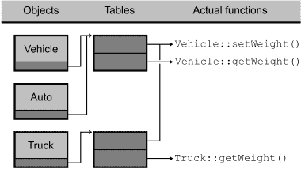

图 14.5：定义虚函数时对象的内部组织。

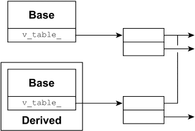

图 14.6：补充图，由 Guillaume Caumon 提供。

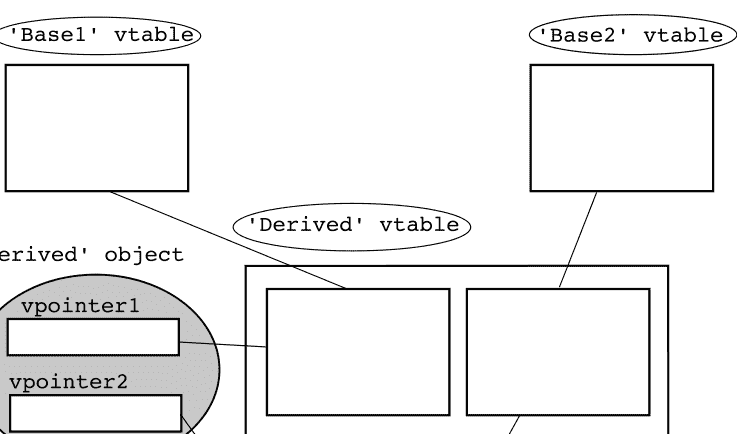

图 14.7：具有多个基类时的 Vtables 和 vpointers

### 14.11 未定义的对 vtable 的引用……

有时，链接器会生成如下错误：

```text
In function `Derived::Derived()`:
    undefined reference to `vtable for Derived`
```

当派生类中缺少虚函数的实现，但该函数又在派生类的接口中被提及时，就会生成此错误。

这种情况很容易遇到：

- 构造一个（完整的）基类，其中定义虚成员函数；
- 构造一个 Derived 类，并在其接口中提及该虚函数；
- Derived 类的虚函数未实现。当然，编译器并不知道派生类的函数未实现，并且在被要求时会生成用于创建派生类对象的代码；
- 最终，链接器无法找到派生类的虚成员函数。因此，它无法构造派生类的 vtable；
- 链接器报错并给出如下消息：

```text
undefined reference to `vtable for Derived`
```

下面是一个会产生该错误的示例：

```cpp
class Base
{
    virtual void member();
};
inline void Base::member()
{}
class Derived: public Base
{
    virtual void member();       // only declared
};
int main()
{
    Derived d;  // Will compile, since all members were declared.
                // Linking will fail, since we don’t have the
                // implementation of Derived::member()
}
```

当然，纠正这个错误很容易：实现派生类中缺失的虚成员函数。

虚函数*绝不*应该以内联方式实现。由于 vtable 包含类的虚函数地址，这些函数必须具有地址，因此它们必须被编译为真正的（非内联的）函数。通过将虚函数定义为内联，你会冒这样的风险：编译器可能直接忽略这些函数（因为它们很可能永远不会被显式调用（而只会以多态方式，从基类指针或引用调用））。结果，它们的地址可能永远不会进入其类的 vtable（甚至 vtable 本身也可能保持未定义），从而导致链接问题，或使程序表现出意外行为。所有这类问题都可以简单地避免：绝不要将虚成员定义为内联（另见第 7.7.2.1 节）。

### 14.12 虚构造函数

在第 14.2 节中，我们了解到 C++ 支持*虚析构函数*。然而，与许多其他面向对象语言（例如 Java）一样，*虚构造函数*的概念并不受支持。当只有基类引用或指针可用，并且需要派生类对象的副本时，没有虚构造函数就会成为一个缺陷。Gamma *et al.*（1995）讨论了*原型设计模式*来处理这种情况。

根据*原型设计模式*，每个派生类都负责实现一个成员函数，该函数返回一个指针，指向调用该成员函数的对象的副本。这个函数通常命名为 clone。为了将用户接口与重新实现接口分离，clone 被纳入接口，而 newCopy 定义在重新实现接口中。支持“克隆”的基类定义一个虚析构函数、clone（返回 newCopy 的返回值）以及*虚拷贝构造函数*（一个纯虚函数），其原型为 `virtual Base * newCopy() const = 0`。由于 newCopy 是纯虚函数，所有派生类现在都必须实现自己的“虚构造函数”。

在大多数拥有基类指针或引用的情况下，这种设置已经足够，但在用于抽象容器时就会失败。我们不能创建 `vector<Base>`，因为 Base 的接口中包含纯虚拷贝成员，而 Base 会被调用来初始化这种 vector 的新元素。这是不可能的，因为 newCopy 是纯虚函数，所以无法构造 Base 对象。

直观的解决方案——为 newCopy 提供默认实现，将其定义为普通虚函数——也会失败，因为容器会调用 Base（Base const & other），而该构造函数将不得不调用 newCopy 来拷贝 other。此时不清楚该如何处理那个副本，因为新的 Base 对象已经存在，并且不包含可用于接收 newCopy 返回值的 Base 指针或引用数据成员。

另一种方案（也是首选方案）是让原来的 Base 类（定义为抽象基类）保持原样，并使用包装类 Clonable 来管理 newCopy 返回的 Base 类指针。第 17 章讨论了将 Base 和 Clonable 合并为一个类的方法，但现在我们将 Base 和 Clonable 定义为独立的类。

Clonable 类是一个非常标准的类。它包含一个指针成员，因此需要拷贝构造函数、析构函数和重载赋值运算符。它至少有一个非标准成员：`Base & base() const`，返回一个引用，指向 Clonable 的 `Base * data` 成员所引用的派生对象。它还提供了一个额外的构造函数来初始化其 `Base * data` 成员。

任何从 Base 派生的非抽象类都必须实现 `Base *newCopy()`，返回一个指针，指向为调用 newCopy 的对象新创建（分配）的副本。

一旦定义了派生类（例如 Derived1），我们就可以很好地利用 Clonable 和 Base 设施。在下一个示例中，我们看到 main 定义了一个 `vector<Clonable>`。然后，通过以下步骤将一个匿名 Derived1 对象插入该 vector：

- 创建一个新的匿名 `Derived1` 对象；
- 它使用 `Clonable(Base *bp)` 初始化一个 `Clonable`；
- 刚刚创建的 `Clonable` 对象使用 `Clonable` 的移动构造函数插入 vector。此时只有临时的 Derived 和 Clonable 对象，因此不需要拷贝构造。

在这个序列中，只使用了包含 `Derived1 *` 的 Clonable 对象。不需要进行（或销毁）额外的副本。

接下来，base 成员与 `typeof` 结合使用，以显示 Base & 对象的实际类型：一个 Derived1 对象。

随后，main 中包含一个有趣的声明 `vector<Clonable> v2(bv)`。这里创建了 bv 的一个副本。这个拷贝构造会观察 Base 引用的实际类型，确保适当的类型出现在 vector 的副本中。在程序结束时，我们创建了两个 Derived1 对象，它们由 vector 的析构函数正确删除。下面是完整程序，演示了“虚构造函数”概念：

```cpp
#include <iostream>
#include <vector>
#include <algorithm>
#include <typeinfo>

// Base and its inline member:
class Base
{
    public:
        virtual ~Base();
        Base *clone() const;
    private:
        virtual Base *newCopy() const = 0;
};
inline Base *Base::clone() const
{
    return newCopy();
}

// Clonable and its inline members:
class Clonable
{
    Base *d_bp;

    public:
        Clonable();
        explicit Clonable(Base *base);
        ~Clonable();
        Clonable(Clonable const &other);
        Clonable(Clonable &&tmp);
        Clonable &operator=(Clonable const &other);
        Clonable &operator=(Clonable &&tmp);

        Base &base() const;
};
inline Clonable::Clonable()
:
    d_bp(0)
{}
inline Clonable::Clonable(Base *bp)
:
    d_bp(bp)
{}
inline Clonable::Clonable(Clonable const &other)
:
    d_bp(other.d_bp->clone())
{}
inline Clonable::Clonable(Clonable &&tmp)
:
    d_bp(tmp.d_bp)
{
    tmp.d_bp = 0;
}
inline Clonable::~Clonable()
```

\* Jesse van den Kieboom 创建了类 Clonable 的另一种实现，以类模板实现。他的实现可在此处找到。


```cpp
{
    delete d_bp;
}

inline Base &Clonable::base() const
{
    return *d_bp;
}

// Derived and its inline member:
class Derived1: public Base
{
public:
    ~Derived1();
private:
    virtual Base *newCopy() const;
};

inline Base *Derived1::newCopy() const
{
    return new Derived1(*this);
}

// Members not implemented inline:
Base::~Base()
{}

Clonable &Clonable::operator=(Clonable const &other)
{
    Clonable tmp(other);
    std::swap(d_bp, tmp.d_bp);
    return *this;
}

Clonable &Clonable::operator=(Clonable &&tmp)
{
    std::swap(d_bp, tmp.d_bp);
    return *this;
}

Derived1::~Derived1()
{
    std::cout << "~Derived1() called\n";
}

// The main function:
using namespace std;

int main()
{
    vector<Clonable> bv;

    bv.push_back(Clonable(new Derived1()));
    cout << "bv[0].name: " << typeid(bv[0].base()).name() << '\n';

    vector<Clonable> v2(bv);
    cout << "v2[0].name: " << typeid(v2[0].base()).name() << '\n';
}

/*
    Output:
        bv[0].name: 8Derived1
        v2[0].name: 8Derived1
        ~Derived1() called
        ~Derived1() called
*/
```

## 第15章 友元

在迄今为止讨论的所有示例中，我们已经看到`private`成员只能被其类的成员访问。这是*好的*，因为它强制了封装和信息隐藏。通过将功能封装在类中，我们防止类暴露多个职责；通过隐藏数据，我们提升了类的数据完整性，并防止软件的其他部分在实现上依赖于属于类的数据。

在这个（非常）简短的章节中，我们介绍`friend`关键字及其使用背后的原则。底线是，通过使用`friend`关键字，函数被授予访问类的`private`成员的权限。即便如此，这并不意味着使用`friend`关键字时就放弃了数据隐藏的原则。

本章不讨论类之间的友元关系。在类之间自然使用友元关系的情形将在第17章和第20章中讨论，这些情形是函数友元处理方式的自然扩展。

声明友元（即使用`friend`关键字）应当有一个明确的概念性理由。传统上对类概念的定义通常如下所示：

> *类是一组数据以及操作于该组数据上的函数的集合。*

正如我们在第11章中所见，有些函数必须在类接口之外定义。它们被定义在类接口之外，是为了允许其操作数进行提升，或者扩展那些不能直接由我们控制的已有类的功能。根据上述类的传统定义，那些不能在类接口本身中定义的函数仍应被视为属于该类的函数。换句话说：如果语言的语法允许，它们肯定会定义在类接口内部。实现这类函数有两种方式。一种方式是使用可用的公有成员函数来实现这些函数。例如，在第11.2节中就使用了这种方法。另一种方式是将类的概念定义应用于这些函数。通过声明这些函数实际上属于该类，它们应当被授予直接访问对象数据成员的权限。这可以通过`friend`关键字实现。

作为一般原则，我们声明：所有操作类对象数据的函数，如果它们与类接口本身声明在同一个文件中，就属于该类，并且可以被授予直接访问类数据成员的权限。

### 15.1 友元函数

在第11.2节中，`Person`类（参见第9.3节）的插入运算符是这样实现的：

```cpp
ostream &operator<<(ostream &out, Person const &person)
{
    return
        out <<
            "Name:    " << person.name() << ", "
            "Address: " << person.address() << ", "
            "Phone:   " << person.phone();
}
```

现在`Person`对象可以被插入到流中。

然而，这种实现需要调用三个成员函数，这可以被视为低效的一个来源。改进的方式是定义一个成员`Person::insertInto`，并让`operator<<`调用该函数。这两个函数可以定义如下：

```cpp
std::ostream &operator<<(std::ostream &out, Person const &person)
{
    return person.insertInto(out);
}

std::ostream &Person::insertInto(std::ostream &out)
{
    return
        out << "Name:    " << d_name << ", "
             "Address: " << d_address << ", "
             "Phone:   " << d_phone;
}
```

由于`insertInto`是成员函数，它可以直接访问对象的数据成员，因此在将`person`插入到`out`时，无需再调用额外的成员函数。

下一步是意识到`insertInto`仅仅是为了`operator<<`的利益而定义的，而`operator<<`，由于它是在包含`Person`类接口的头文件中声明的，应当被视为属于`Person`类的函数。因此，当`operator<<`被声明为友元时，成员`insertInto`可以被省略。

友元函数必须在类接口中声明为友元。这些友元声明不是成员函数，因此它们独立于类的`private`、`protected`和`public`部分。友元声明可以放置在类接口中的任何位置。惯例规定友元声明直接列在类接口的顶部。`Person`类，对其提取和插入运算符使用友元声明，开头如下：

```cpp
class Person
{
    friend std::ostream &operator<<(std::ostream &out, Person const &pd);
    friend std::istream &operator>>(std::istream &in, Person &pd);

    // previously shown interface (data and functions)
};
```

插入运算符现在可以直接访问`Person`对象的数据成员：

```cpp
std::ostream &operator<<(std::ostream &out, Person const &person)
{
    return
        out << "Name:    " << person.d_name << ", "
             "Address: " << person.d_address << ", "
             "Phone:   " << person.d_phone;
}
```

友元声明是真正的声明。一旦类包含友元声明，这些友元函数就不必在类接口下方再次声明。这也清楚地表明了类设计者的意图：友元函数由类声明，因此可以被视为属于该类的函数。

### 15.2 扩展友元声明（C++11，4.7）

C++11 通过向语言中添加扩展友元声明简化了友元声明。当类被声明为友元时，不再需要提供`class`关键字。例如：

```cpp
class Friend;                       // declare a class
typedef Friend FriendType;          // and a typedef for it
using FName = Friend;               // and a using declaration

class Class1
{
    friend Friend;                  // FriendType and FName: also OK
};
```

在 C++11 之前的标准中，友元声明要求显式地使用类；例如，`friend class Friend`。

如果编译器尚未见过该友元的名称，则仍然需要显式使用`class`。例如：

```cpp
class Class1
{
    // friend Unseen;             // fails to compile: Unseen unknown.
    friend class Unseen;          // OK
};
```

第21.10节讨论了类模板中扩展友元声明的使用。

## 第16章 具有指向成员的指针的类

在第9章中已经详细讨论了具有指针数据成员的类。定义指针数据成员的类值得特别关注，因为它们通常需要定义拷贝构造函数、重载的赋值运算符和析构函数。

在某些情况下，我们需要的不是指向对象的指针，而是指向类成员的指针。指向成员的指针可以有效地用于配置类对象的行为。根据指向成员的指针所指向的成员不同，对象将表现出特定的行为。

尽管指向成员的指针有其用途，但多态常常可以用来实现类似的行为。考虑一个类，其成员`process`执行一系列可选行为中的一种。类可以不通过对象构造时的行为选择，而是使用某个（抽象）基类的接口，向构造函数传递某个派生类的对象，从而配置其行为。这允许简单、可扩展且灵活的配置，但对类的数据成员的访问将不那么灵活，并且可能需要使用`friend`声明。在这种情况下，指向成员的指针可能实际上更受青睐，因为它既允许（略显不那么灵活的）配置，又允许直接访问类的数据成员。

因此，选择显然一方面是在配置的便捷性，另一方面是在访问类数据成员的便捷性之间进行权衡。本章我们将专注于指向成员的指针，研究这些指针能提供什么。

### 16.1 指向成员的指针：一个示例

了解指向变量和对象的指针的用法，并不会直观地引出指向成员的指针的概念。即使考虑成员函数的返回类型和参数类型，也很容易遇到意外。例如，考虑下面的类：

```cpp
class String
{
    char const *(*d_sp)() const;

public:
    char const *get() const;
};
```

对于这个类，不可能让 `char const *(*d_sp)() const` 指向 `String::get` 成员函数，因为不能将 `d_sp` 设置为成员函数 `get` 的地址。


这不起作用的原因之一是变量`d_sp`具有全局作用域（它是一个函数指针，而不是`String`内的函数指针），而成员函数`get`定义在`String`类中，因此具有类作用域。`d_sp`是`String`类的数据成员这一事实在这里无关紧要。根据`d_sp`的定义，它指向一个位于*类外部*的函数。

因此，要定义指向类成员（数据或函数，但通常是函数）的指针，指针的作用域必须指明类作用域。这样，指向成员`String::get`的指针定义如下：

```
char const *(String::*d_sp)() const;
```

因此，通过在`*d_sp`指针数据成员前加上`String::`，它被定义为类`String`上下文中的一个指针。根据其定义，它是*a pointer to a function in the class String, not expecting arguments, not modifying its object's data, and returning a pointer to constant characters*。

### 16.2 定义指向成员的指针

指向成员的指针通过在普通指针表示法前加上相应的类名和作用域解析运算符来定义。因此，在上一节中，我们使用了`char const * (String::*d_sp) () const`来表示`d_sp`

- 是一个指针（`*d_sp`）；
- 指向类`String`中的某个东西（`String::*d_sp`）；
- 是一个指向`const`函数的指针，返回`char const *`（`char const * (String::*d_sp) () const`）。

因此，匹配函数的原型如下：

```
char const *String::somefun() const;
```

也就是类`String`中任何返回`char const *`的`const`无参函数。

在定义指向成员的指针时，构造函数指针的标准过程仍然适用：

- 将完全限定的函数名（即函数头，包括函数的类名）放在括号中：

    ```
    char const * ( String::somefun ) () const
    ```

- 在函数名本身之前紧挨着放置一个指针（星号（`*`））字符：

    ```
    char const * ( String:: * somefun ) () const
    ```

- 用指针变量的名称替换函数名：

    ```
    char const * (String::*d_sp) () const
    ```

这里是另一个例子，定义指向数据成员的指针。假设类`String`包含一个`string d_text`成员。如何构造指向该成员的指针？我们再次遵循标准过程：

- 将完全限定的变量名放在括号中：

    ```
    std::string (String::d_text)
    ```

- 在变量名本身之前紧挨着放置一个指针（星号（`*`））字符：

    ```
    std::string (String::*d_text)
    ```

- 用指针变量的名称替换变量名：

    ```
    std::string (String::*tp)
    ```

在这种情况下，括号是多余的，可以省略：

```
string String::*tp
```

或者，一个非常简单的经验法则是

- 定义一个普通（即全局）指针变量，
- 一旦你指向类内部的某个东西，就在指针字符前加上类名。

例如，下面的指向全局函数的指针

```
char const * (*sp)() const;
```

在加上类作用域后，它变成了指向成员函数的指针：

```
char const * (String::*sp)() const;
```

没有什么强制我们在目标（`String`）类中定义指向成员的指针。指向成员的指针可以定义在目标类中（因此它们成为数据成员），也可以定义在另一个类中，或者作为局部变量或全局变量。在所有这些情况下，指向成员的指针变量可以被赋予它所指向的那种成员的地址。重要的是，指向成员的指针可以在不需要指针目标类对象存在的情况下进行初始化或赋值。

初始化或给这样的指针赋值仅仅表明该指针指向哪个成员。这可以被视为某种相对地址；相对于调用该函数所针对的对象。初始化或赋值指向成员的指针时不需要对象。虽然允许初始化或赋值指向成员的指针，但（当然）如果不指定正确类型的对象，就不可能调用这些成员。

下面的例子说明了指向成员的指针的初始化和赋值（为了说明目的，类`PointerDemo`的所有成员都定义为public）。在例子中，使用了`&`运算符来确定成员的地址。这些运算符以及类作用域都是必需的，即使在成员实现内部使用时也是如此：

```
#include <cstddef>

class PointerDemo
{
    public:
        size_t d_value;
        size_t get() const;
};

inline size_t PointerDemo::get() const
{
    return d_value;
}

int main()
{
                                        // initialization
    size_t (PointerDemo::*getPtr)() const = &PointerDemo::get;
    size_t PointerDemo::*valuePtr       = &PointerDemo::d_value;

    getPtr    = &PointerDemo::get;          // assignment
    valuePtr  = &PointerDemo::d_value;
}
```

这没有什么特别之处。与全局作用域指针的区别在于，我们现在将自身限制在`PointerDemo`类的作用域内。由于这种限制，所有指针定义和所有使用其地址的变量都必须具有`PointerDemo`类作用域。

指向成员的指针也可以用于虚成员函数。指向虚成员时不需要特殊的语法。指针的构造、初始化和赋值方式与指向非虚成员的方式完全相同。

### 16.3 使用指向成员的指针

使用指向成员的指针调用成员函数需要存在指针所指向成员所属类的对象。对于在全局作用域操作的指针，使用解引用运算符`*`。对于指向对象的指针，可以使用作用于指针的字段选择运算符（`->`）或作用于对象的字段选择运算符（`.`）来选择相应的成员。

要将指向成员的指针与对象结合使用，必须指定指向成员的字段选择运算符（`.*`）。要通过对象指针使用指向成员的指针，必须指定“通过对象指针的指向成员字段选择运算符”（`->*`）。这两个运算符结合了字段选择（`.`和`->`部分）以到达对象中的相应字段，以及解引用：使用解引用操作来到达指向成员的指针所指向的函数或变量。

使用上一节中的例子，让我们看看如何使用指向成员函数的指针和指向数据成员的指针：

```
#include <iostream>

class PointerDemo
{
    public:
        size_t d_value;
        size_t get() const;
};

inline size_t PointerDemo::get() const
{
    return d_value;
}

using namespace std;

int main()
{
    size_t (PointerDemo::*getPtr)() const = &PointerDemo::get;          // initialization
    size_t PointerDemo::*valuePtr       = &PointerDemo::d_value;

    PointerDemo object;                                      // (1) (see text)
    PointerDemo *ptr = &object;

    object.*valuePtr = 12345;                 // (2)
    cout << object.*valuePtr << '\n' <<
            object.d_value << '\n';

    ptr->*valuePtr = 54321;                     // (3)
    cout << object.d_value << '\n' <<
            (object.*getPtr()) << '\n' <<      // (4)
            (ptr->*getPtr()) << '\n';
}
```

我们注意到：

- 在(1)处，定义了一个`PointerDemo`对象和一个指向此类对象的指针。
- 在(2)处，我们指定一个对象（因此使用`.*`运算符）来访问`valuePtr`所指向的成员。该成员被赋予一个值。
- 在(3)处，同一个成员被赋予另一个值，但这次使用指向`PointerDemo`对象的指针。因此我们使用`->*`运算符。
- 在(4)处，再次使用`.*`和`->*`，这一次通过指向成员的指针调用函数。由于函数参数列表的优先级高于指向成员的字段选择运算符，因此后者*必须用括号保护*。

当类中的某个成员根据配置设置而行为不同时，指向成员的指针可以有效地使用。再次考虑来自[9.3](#)节的`Person`类。`Person`定义了保存人名、地址和电话号码的数据成员。假设我们要构建一个雇员的`Person`数据库。可以查询雇员数据库，但根据查询数据库的人员类型，会提供姓名、姓名和电话号码，或所有存储的关于该人员的信息。这意味着像`address`这样的成员函数在查询数据库的人不被允许查看该人员地址的情况下必须返回类似`<not available>`的内容，而在其他情况下返回实际地址。

打开雇员数据库时，指定一个反映想要进行查询的雇员状态的参数。状态可以反映其在组织中的职位，如BOARD、SUPERVISOR、SALESPERSON或CLERK。前两类被允许查看所有雇员信息，SALESPERSON被允许查看雇员的电话号码，而CLERK只被允许验证一个人是否确实是组织成员。

我们现在在数据库类中构造一个成员函数`personInfo(char const *name)`。该类的标准实现可以是：

```cpp
string PersonData::personInfo(char const *name)
{
    Person *p = lookup(name);   // see if ‘name’ exists

    if (!p)
        return "not found";

    switch (d_category)
    {
        case BOARD:
        case SUPERVISOR:
            return allInfo(p);
        case SALESPERSON:
            return noPhone(p);
        case CLERK:
            return nameOnly(p);
    }
}
```

虽然不需要花费太多时间，但每次调用 `personInfo` 时仍然必须对 switch 进行求值。我们可以不使用 switch，而是定义一个成员 `d_infoPtr`，将其作为指向 `PersonData` 类成员函数的指针，该成员函数返回 string，并期望以指向 `Person` 的指针作为参数。

无需对 switch 求值，这个指针可以用于指向 `allInfo`、`noPhone` 或 `nameOnly`。此外，该指针所指向的成员函数在构造 `PersonData` 对象时就会确定，因此其值只需确定一次（在 `PersonData` 对象构造时）。

初始化 `d_infoPtr` 后，`personInfo` 成员函数现在可以简单地实现为：

```cpp
string PersonData::personInfo(char const *name)
{
    Person *p = lookup(name);        // see if 'name' exists

    return p ? (this->*d_infoPtr)(p) : "not found";
}
```

成员 `d_infoPtr` 定义如下（在类 `PersonData` 内，省略其他成员）：

```cpp
class PersonData
{
    string (PersonData::*d_infoPtr)(Person *p);
};
```

最后，构造函数初始化 `d_infoPtr`。这可以通过一个简单的 switch 实现：

```cpp
PersonData::PersonData(PersonData::EmployeeCategory cat)
{
    switch (cat)
    {
        case BOARD:
        case SUPERVISOR:
            d_infoPtr = &PersonData::allInfo;
            break;
        case SALESPERSON:
            d_infoPtr = &PersonData::noPhone;
            break;
        case CLERK:
            d_infoPtr = &PersonData::nameOnly;
            break;
    }
}
```

注意成员函数的地址是如何确定的。即使我们已经位于类 `PersonData` 的成员函数内部，也必须指定类 `PersonData` 的作用域。

使用指向数据成员的指针的示例在第 [19.1.60](#) 节中给出，位于 `stable_sort` 泛型算法的上下文中。

### 16.4 指向静态成员的指针

类的静态成员无需该类的对象即可使用。公有静态成员可以像自由函数一样调用，不过在调用时必须指定其类名。

假设类 `String` 有一个公有静态成员函数 `count`，返回到目前为止创建的 string 对象数量。那么，无需使用任何 `String` 对象，就可以调用函数 `String::count`：

```cpp
void fun()
{
    cout << String::count() << '\n';
}
```

公有静态成员可以像自由函数一样调用（但另请参见第 [8.2.1](#) 节），私有静态成员只能在其类的上下文中，由该类的成员函数或友元函数调用。

由于静态成员没有关联对象，它们的地址可以存储在普通函数指针变量中，在全局层面上操作。指向成员的指针不能用于存储静态成员的地址。示例：

```cpp
void fun()
{
    size_t (*pf) () = String::count;
            // initialize pf with the address of a static member function

    cout << (*pf)() << '\n';
            // displays the value returned by String::count
}
```

### 16.5 指针的大小

指向成员的指针有一个有趣的特点：它们的大小与“普通”指针不同。考虑下面这个小程序：

```cpp
#include <string>
#include <iostream>

class X
{
public:
    void fun();
    std::string d_str;
};
inline void X::fun()
{
    std::cout << "hello\n";
}

using namespace std;
int main()
{
    cout <<
        "size of pointer to data-member:    " << sizeof(&X::d_str) << "\n"
        "size of pointer to member function: " << sizeof(&X::fun) << "\n"
        "size of pointer to non-member data: " << sizeof(char *) << "\n"
        "size of pointer to free function:   " << sizeof(&printf) << '\n';
}

/*
    generated output (on 32-bit architectures):
size of pointer to data-member:        4
size of pointer to member function:     8
size of pointer to non-member data:     4
size of pointer to free function:       4
*/
```

在 32 位架构上，指向成员函数的指针需要八个字节，而其他类型的指针需要四个字节（使用 GNU 的 g++ 编译器）。

指针大小几乎从不显式使用，但它们的大小可能会在如下语句中引起混淆：

```cpp
printf("%p", &X::fun);
```

当然，printf 很可能不是产生这些 C++ 特有指针值的正确工具。当使用一个 union，将 8 字节指针重新解释为一系列 unsigned char 值时，这些指针的值可以插入到流中：

```cpp
#include <string>
#include <iostream>
#include <iomanip>

class X
{
    public:
        void fun();
        std::string d_str;
};
inline void X::fun()
{
    std::cout << "hello\n";
}

using namespace std;
int main()
{
    union
    {
        void (X::*f)();
        unsigned char *cp;
    }
        u = { &X::fun };

    cout.fill('0');
    cout << hex;
    for (unsigned idx = sizeof(void (X::*)()); idx-- > 0; )
        cout << setw(2) << static_cast<unsigned>(u.cp[idx]);
    cout << '\n';
}
```

## 第 17 章 嵌套类

类可以定义在其他类内部。定义在其他类内部的类称为*嵌套类*。嵌套类用于嵌套类与其外围类有紧密概念关系的情形。例如，类 `string` 提供了类型 `string::iterator`，它提供存储在 string 中的所有字符。这个 `string::iterator` 类型可以定义为一个对象迭代器，并作为嵌套类定义在类 `string` 中。

类可以嵌套在外围类的任何部分：公有、受保护或私有部分。这样的嵌套类可以视为外围类的成员。类中正常的访问权限和规则适用于嵌套类。如果一个类嵌套在类的公有部分，那么它在外围类外部可见。如果它嵌套在受保护部分，则它在外围类的派生类中可见；如果它嵌套在私有部分，则它只对外围类的成员可见。

外围类对嵌套类没有特殊权限。嵌套类完全控制其成员对外围类的可访问性。例如，考虑下面的类定义：

```cpp
class Surround
{
    public:
        class FirstWithin
        {
            int d_variable;

            public:
                FirstWithin();
                int var() const;
        };
    private:
        class SecondWithin
        {
            int d_variable;

            public:
                SecondWithin();
                int var() const;
        };
};
inline int Surround::FirstWithin::var() const
{
    return d_variable;
}
inline int Surround::SecondWithin::var() const
{
    return d_variable;
}
```

这里，成员的访问权限定义如下：

- 类 `FirstWithin` 在 `Surround` 外部和内部都可见。因此，类 `FirstWithin` 具有全局可见性。
- `FirstWithin` 的构造函数及其成员函数 `var` 也是全局可见的。
- 数据成员 `d_variable` 只对类 `FirstWithin` 的成员可见。`Surround` 的成员和 `SecondWithin` 的成员都不能直接访问 `FirstWithin::d_variable`。
- 类 `SecondWithin` 只在 `Surround` 内部可见。类 `SecondWithin` 的公有成员也可以由类 `FirstWithin` 的成员使用，因为嵌套类可以被视为其外围类的成员。
- `SecondWithin` 的构造函数及其成员函数 `var` 也只能由 `Surround` 的成员（以及其嵌套类的成员）访问。
- `SecondWithin::d_variable` 只对 `SecondWithin` 的成员可见。`Surround` 的成员和 `FirstWithin` 的成员都不能直接访问类 `SecondWithin` 的 `d_variable`。
- 一如既往，在调用其成员之前，需要有一个该类类型的对象。这也适用于嵌套类。

为了授予外围类访问其嵌套类私有成员的权限，或授予嵌套类访问外围类私有成员的权限，可以将这些类定义为友元类（参见第 17.3 节）。

嵌套类可以被视为外围类的成员，但嵌套类的成员*不是*外围类的成员。因此，类 `Surround` 的成员不能直接访问 `FirstWithin::var`。考虑到 `Surround` 对象并不也是 `FirstWithin` 或 `SecondWithin` 对象，这一点是可以理解的。事实上，嵌套类只是类型名。这并不意味着此类类的对象会自动存在于外围类中。如果外围类的成员要使用嵌套类的（非静态）成员，那么外围类必须定义一个嵌套类对象，此后外围类的成员才能使用该对象来使用嵌套类的成员。

例如，在下面的类定义中，有一个外围类 `Outer` 和一个嵌套类 `Inner`。类 `Outer` 包含一个成员函数 `caller`。成员函数 `caller` 使用组合在 `Outer` 中的 `d_inner` 对象来调用 `Inner::infunction`：

```cpp
class Outer
{
    public:
        void caller();

    private:
        class Inner
        {
            public:
                void infunction();
        };
        Inner d_inner;      // class Inner must be known
};
void Outer::caller()
{
    d_inner.infunction();
}
```


### 17.1 定义嵌套类成员

嵌套类的成员函数可以定义为内联函数。内联成员函数可以像在类定义之外定义那样进行定义。要在类 `Outer` 之外定义成员函数 `Outer::caller`，必须向编译器提供该函数的完全限定名（从最外层类作用域 `Outer` 开始）。内联函数和类内函数可以相应地定义。它们可以被定义，并且可以使用任何嵌套类，即使该嵌套类的定义在外层类接口中稍后出现。

当（嵌套）成员函数以内联方式定义时，其定义应放在类接口下方。静态嵌套数据成员通常也在其类之外定义。如果类 `FirstWithin` 有一个静态 `size_t` 数据成员 `epoch`，则可以如下初始化：

```cpp
size_t Surround::FirstWithin::epoch = 1970;
```

此外，在外围类之外的代码中引用公有静态成员时，需要使用多个作用域解析运算符：

```cpp
void showEpoch()
{
    cout << Surround::FirstWithin::epoch;
}
```

在类 `Surround` 内部，只需使用 `FirstWithin::` 作用域；在类 `FirstWithin` 内部，则无需显式引用该作用域。

那么类 `SecondWithin` 的成员呢？类 `FirstWithin` 和 `SecondWithin` 都嵌套在 `Surround` 中，可以被视为外围类的成员。由于一个类的成员可以直接相互引用，类 `SecondWithin` 的成员可以引用类 `FirstWithin` 的（公有）成员。因此，类 `SecondWithin` 的成员可以将 `FirstWithin` 的 `epoch` 成员引用为 `FirstWithin::epoch`。

### 17.2 声明嵌套类

嵌套类可以在其在外围类中实际定义之前声明。如果类包含多个嵌套类，且这些嵌套类包含指向其他嵌套类对象的指针、引用、参数或返回值，则需要此类前向声明。

例如，下面的类 `Outer` 包含两个嵌套类 `Inner1` 和 `Inner2`。类 `Inner1` 包含指向 `Inner2` 对象的指针，而 `Inner2` 包含指向 `Inner1` 对象的指针。交叉引用需要前向声明。前向声明必须具有与其定义的访问说明符相同的访问说明符。在下面的示例中，`Inner2` 的前向声明必须放在私有部分，因为其定义也是类 `Outer` 私有接口的一部分：

```cpp
class Outer
{
    private:
        class Inner2;        // forward declaration

        class Inner1
        {
            Inner2 *pi2;    // points to Inner2 objects
        };
        class Inner2
        {
            Inner1 *pi1;    // points to Inner1 objects
        };
};
```

### 17.3 在嵌套类中访问私有成员

要授予嵌套类访问其他嵌套类私有成员的权限，或授予外围类访问其嵌套类私有成员的权限，必须使用 `friend` 关键字。

注意，授予嵌套类访问其外围类私有成员的权限不需要友元声明。毕竟，嵌套类是由其外围类定义的类型，因此嵌套类的对象是外层类的成员，从而可以访问外层类的所有成员。下面是一个展示该原则的示例。该示例无法编译，因为类 `Extern` 的成员被拒绝访问 `Outer` 的私有成员，但 `Outer::Inner` 的成员可以访问 `Outer` 的私有成员：

```cpp
class Outer
{
    int d_value;
    static int s_value;

public:
    Outer()
    :
        d_value(12)
    {}
    class Inner
    {
    public:
        Inner()
        {
            cout << "Outer's static value: " << s_value << '\n';
        }
        Inner(Outer &outer)
        {
            cout << "Outer's value: " << outer.d_value << '\n';
        }
    };
};

class Extern          // won't compile!
{
public:
    Extern(Outer &outer)
    {
        cout << "Outer's value: " << outer.d_value << '\n';
    }

    Extern()
    {
        cout << "Outer's static value: " << Outer::s_value << '\n';
    }
};

int Outer::s_value = 123;

int main()
{
    Outer outer;
    Outer::Inner in1;
    Outer::Inner in2(outer);
}
```

现在考虑类 `Surround` 有两个嵌套类 `FirstWithin` 和 `SecondWithin` 的情况。这三个类各自都有一个静态数据成员 `int s_variable`：

```cpp
class Surround
{
    static int s_variable;
public:
    class FirstWithin
    {
        static int s_variable;
    public:
        int value();
    };
    int value();
private:
    class SecondWithin
    {
        static int s_variable;
    public:
        int value();
    };
};
```

如果类 `Surround` 应能够访问 `FirstWithin` 和 `SecondWithin` 的私有成员，则后两个类必须声明 `Surround` 为其友元。此后，函数 `Surround::value` 可以访问其嵌套类的私有成员。例如（注意两个嵌套类中的友元声明）：

```cpp
class Surround
{
    static int s_variable;
public:
    class FirstWithin
    {
        friend class Surround;
        static int s_variable;
    public:
        int value();
    };
    int value();
private:
    class SecondWithin
    {
        friend class Surround;
        static int s_variable;
    public:
        int value();
    };
};
```

要授予 `SecondWithin` 访问 `FirstWithin` 私有成员的权限，类 `FirstWithin` 不能简单地使用 `friend class SecondWithin`，因为 `SecondWithin` 的定义尚不可知。

现在需要 `SecondWithin` 的前向声明。该前向声明必须由类 `Surround` 提供，而不是由类 `FirstWithin` 提供。在类 `FirstWithin` 自身中指定像 `class SecondWithin;` 这样的前向声明没有意义，因为这会引用一个外部的（全局的）类 `SecondWithin`。`SecondWithin` 的前向声明也不能在 `FirstWithin` 内部指定为 `class Surround::SecondWithin;`。这种尝试会生成以下错误消息：

> “Surround”没有名为“SecondWithin”的嵌套类型

不应在嵌套类内部为 `SecondWithin` 提供前向声明，而必须由类 `Surround` 在定义类 `FirstWithin` 之前声明类 `SecondWithin`。这样，`SecondWithin` 的友元声明就能在 `FirstWithin` 内部被接受。下面是一个示例，其中所有类都可以完全访问所有相关类的所有私有成员：

```cpp
class Surround
{
        // class SecondWithin;        not required: friend declarations (see
        //                            below) double as forward declarations

        static int s_variable;
        public:
                class FirstWithin
                {
                        friend class Surround;
                        friend class SecondWithin;
                        static int s_variable;
                        public:
                                int value();
                };
                int value();              // implementation given above
        private:
                class SecondWithin
                {
                        friend class Surround;
                        friend class FirstWithin;
                        static int s_variable;
                        public:
                                int value();
                };
};

inline int Surround::FirstWithin::value()
{
        Surround::s_variable = SecondWithin::s_variable;
        return s_variable;
}

inline int Surround::SecondWithin::value()
{
        Surround::s_variable = FirstWithin::s_variable;
        return s_variable;
}
```


### 17.4 嵌套枚举

枚举也可以嵌套在类中。嵌套枚举是展示枚举与其类之间紧密联系的好方法。嵌套枚举具有与其他类成员相同的受控可见性。它们可以定义在类的私有、受保护或公有部分，并会被派生类继承。在类 `ios` 中，我们见过 `ios::beg` 和 `ios::cur` 这样的值。在当前 GNU C++ 实现中，这些值被定义为 `seek_dir` 枚举的值：

```cpp
class ios: public _ios_fields
{
    public:
        enum seek_dir
        {
            beg,
            cur,
            end
        };
};
```

作为示例，假设类 `DataStructure` 表示一种可以向前或向后遍历的数据结构。这样的类可以定义一个枚举 `Traversal`，其值为 `FORWARD` 和 `BACKWARD`。此外，可以定义一个成员函数 `setTraversal`，它需要一个 `Traversal` 类型的参数。该类可以定义如下：

```cpp
class DataStructure
{
    public:
        enum Traversal
        {
            FORWARD,
            BACKWARD
        };
        void setTraversal(Traversal mode);
    private:
        Traversal
            d_mode;
};
```

在类 `DataStructure` 内部，可以直接使用 `Traversal` 枚举的值。例如：

```cpp
void DataStructure::setTraversal(Traversal mode)
{
    d_mode = mode;
    switch (d_mode)
    {
        case FORWARD:
            // ... do something
            break;

        case BACKWARD:
            // ... do something else
            break;
    }
}
```

在类 DataStructure 外部，引用枚举值时并不使用枚举类型的名称。这里类名就足够了。只有在需要枚举类型的变量时，才需要枚举类型的名称，如下面的代码片段所示：

```cpp
void fun()
{
        DataStructure::Traversal                 // enum typename required
                localMode = DataStructure::FORWARD; // enum typename not required

        DataStructure ds;
                                             // enum typename not required
        ds.setTraversal(DataStructure::BACKWARD);
}
```

只有当 DataStructure 定义了一个嵌套类 Nested，而 Nested 又定义了枚举 Traversal 时，才需要这两个类作用域。在这种情况下，后一个示例应编写如下：

```cpp
void fun()
{
        DataStructure::Nested::Traversal
                localMode = DataStructure::Nested::FORWARD;

        DataStructure ds;

        ds.setTraversal(DataStructure::Nested::BACKWARD);
}
```

#### 17.4.1 空枚举

枚举类型通常定义符号值。然而，这并不是必需的。第14.6.1节介绍了 `std::bad_cast` 类型。当指向基类对象的引用无法转换为派生类引用时，`dynamic_cast<>` 运算符会抛出 bad_cast。bad_cast 可以作为一种类型被捕获，而不管它可能表示什么值。

类型可以在没有任何关联值的情况下定义。可以定义一个*空枚举*，即不定义任何值的枚举。此后，空枚举的类型名可以用作合法类型，例如在 catch 子句中。

下面的示例展示了如何定义空枚举（通常但不一定在类中定义），以及如何将其作为异常抛出（并捕获）：

```cpp
#include <iostream>

enum EmptyEnum
{};

int main()
try
{
        throw EmptyEnum();
}
catch (EmptyEnum)
{
        std::cout << "Caught empty enum\n";
}
```

### 17.5 重新探讨虚构造函数

第14.12节介绍了虚构造函数的概念。在该节中，类 Base 被定义为抽象基类。类 Clonable 被定义为在 vector 之类的容器中管理 Base 类指针。

由于类 Base 是一个很小的类，几乎不需要任何实现，因此它完全可以定义为 Clonable 中的嵌套类。这强调了 Clonable 与 Base 之间的紧密关系。将 Base 嵌套到 Clonable 下会把

```cpp
class Derived: public Base
```

改为：

```cpp
class Derived: public Clonable::Base
```

除了将 Base 定义为嵌套类，并从 Clonable::Base 而不是 Base 派生（以及为 Base 成员提供适当的 Clonable:: 前缀以补全其完全限定名）之外，不需要进一步的修改。下面是前面所示程序的修改部分（参见第14.12节），现在使用嵌套在 Clonable 下的 Base：

```cpp
// Clonable and nested Base, including their inline members:
class Clonable
{
    public:
        class Base;
    private:
        Base *d_bp;
    public:
        class Base
        {
            public:
                virtual ~Base();
                Base *clone() const;
            private:
                virtual Base *newCopy() const = 0;
        };
        Clonable();
        explicit Clonable(Base *base);
        ~Clonable();
        Clonable(Clonable const &other);
        Clonable(Clonable &&tmp);
        Clonable &operator=(Clonable const &other);
        Clonable &operator=(Clonable &&tmp);

        Base &base() const;
};
inline Clonable::Base *Clonable::Base::clone() const
{
    return newCopy();
}
inline Clonable::Base &Clonable::base() const
{
    return *d_bp;
}

// Derived and its inline member:
```

## 第18章：标准模板库

标准模板库（STL）是一个通用库，由容器、泛型算法、迭代器、函数对象、分配器、适配器和数据结构组成。算法所使用的数据结构是*抽象的*，其含义是这些算法可以用于（几乎）任何数据类型。

这些算法能够处理这些抽象数据类型，因为它们是基于*模板*的。本章不介绍模板*构造*（相关内容参见第20章）。相反，本章重点在于算法的*使用*。

标准模板库也使用的一些元素已在《C++ Annotations》中讨论过。第12章讨论了抽象容器，第11.10节介绍了函数对象。此外，本文档多处提到了*迭代器*。

STL 的主要组件在本章和下一章介绍。迭代器、适配器、智能指针、多线程以及 STL 的其他特性将在后续小节讨论。泛型算法将在下一章（第19章）介绍。

*分配器*负责 STL 中的内存分配。默认分配器类足以满足大多数应用，在《C++ Annotations》中不再进一步讨论。

STL 的所有元素都定义在标准命名空间中。因此，需要使用 `using namespace std` 或类似指令，除非更愿意显式指定所需的命名空间。在头文件中应显式使用 `std` 命名空间（参见第7.10.1节）。

本章经常使用空尖括号表示法。在代码中，必须在尖括号之间提供类型名。例如，在《C++ Annotations》中使用 `plus<>`，但在代码中可能会遇到 `plus<string>`。

### 18.1 预定义函数对象

在使用本节介绍的预定义函数对象之前，必须已经包含 `<functional>` 头文件。

函数对象在泛型算法中起着重要作用。例如，存在一个泛型算法 `sort`，它需要两个迭代器来定义应排序的对象范围，还需要一个函数对象来调用适用于两个对象的适当比较运算符。让我们快速看一下这种情况。假设字符串存储在 vector 中，并且我们希望按降序对该 vector 排序。在这种情况下，对 vector `stringVec` 排序就像这样简单：

```cpp
sort(stringVec.begin(), stringVec.end(), greater<string>());
```

最后一个参数被识别为*构造函数*：它是对 `greater<>` 类模板的*实例化*，

应用于字符串。这个对象被泛型算法`sort`作为函数对象调用。该泛型算法调用函数对象的`operator()`成员来比较两个字符串对象。函数对象的`operator()`又会调用字符串数据类型的`operator<`。最终，当`sort`返回时，vector的第一个元素将包含所有字符串中字符串值最大的那个字符串。

函数对象自身的`operator()`此时并不可见。不要将`greater<string>()`实参中的括号与调用`operator()`混淆。当`operator()`在`sort`内部实际使用时，它接收两个实参：两个用于比较“更大性”的字符串。由于`greater<string>::operator()`定义为内联，上述`sort`调用中实际上并不存在该调用本身。相反，`sort`通过`greater<string>::operator()`调用`string::operator>`。

既然我们知道构造函数会作为实参传递给（许多）泛型算法，我们就可以设计自己的函数对象。假设我们想以不区分大小写的方式对我们的 vector 排序。该怎么做？首先要注意，默认的`string::operator<`（用于递增排序）并不合适，因为它执行区分大小写的比较。因此，我们提供自己的`CaseInsensitive`类，它以不区分大小写的方式比较两个字符串。下面的程序使用标准C函数`strcasecmp`实现这一技巧。它按字母升序对其命令行实参进行不区分大小写排序：

```cpp
#include <iostream>
#include <string>
#include <cstring>
#include <algorithm>
using namespace std;

class CaseInsensitive
{
    public:
        bool operator()(string const &left, string const &right) const
        {
            return strcasecmp(left.c_str(), right.c_str()) < 0;
        }
};
int main(int argc, char **argv)
{
    sort(argv, argv + argc, CaseInsensitive());
    for (int idx = 0; idx < argc; ++idx)
        cout << argv[idx] << " ";
    cout << '\n';
}
```

`CaseInsensitive`类的默认构造函数用于向`sort`提供其最后一个实参。因此，必须定义的唯一成员函数是`CaseInsensitive::operator()`。由于我们知道它会以字符串实参调用，我们将其定义为期望两个字符串实参，这两个实参在调用`strcasecmp`时使用。此外，`operator()`函数定义为内联，以便在被`sort`函数调用时不产生开销。`sort`函数会用各种字符串组合调用该函数对象。如果编译器同意我们的内联请求，它实际上会调用`strcasecmp`，跳过两次额外的函数调用。

比较函数对象通常是*预定义函数对象*。预定义函数对象类可用于许多常用操作。以下各节将介绍可用的预定义函数对象，并给出一些展示其用法的示例。在关于函数对象的一节接近末尾处，将介绍*函数适配器*。

预定义函数对象主要与泛型算法一起使用。预定义函数对象可用于算术、关系和逻辑运算。第23.3节将开发执行按位运算的预定义函数对象。

#### 18.1.1 算术函数对象

算术函数对象支持标准算术运算：加法、减法、乘法、除法、取模和取负。这些函数对象会调用其被实例化所针对的数据类型的对应运算符。例如，对于加法，可以使用函数对象`plus<Type>`。如果将`Type`替换为`size_t`，则使用针对`size_t`值的加法运算符；如果将`Type`替换为`string`，则使用针对字符串的加法运算符。例如：

```cpp
#include <iostream>
#include <string>
#include <functional>
using namespace std;

int main(int argc, char **argv)
{
    plus<size_t> uAdd;            // function object to add size_ts

    cout << "3 + 5 = " << uAdd(3, 5) << '\n';

    plus<string> sAdd;            // function object to add strings

    cout << "argv[0] + argv[1] = " << sAdd(argv[0], argv[1]) << '\n';
}
/*
    Output when called as: a.out going

    3 + 5 = 8
    argv[0] + argv[1] = a.outgoing
*/
```

为什么这有用？请注意，该函数对象可用于所有支持该函数对象所调用运算符的各种数据类型（不仅是预定义数据类型）。

假设我们想对一个左操作数执行操作，该左操作数始终是同一个变量，而右操作数则依次使用数组中的所有元素。例如，我们想计算数组中所有元素的和；或者我们想拼接文本数组中的所有字符串。在这类情况下，函数对象就派上用场了。

如前所述，函数对象在泛型算法的语境中被大量使用，所以让我们再快速预览另一个算法。

泛型算法`accumulate`会访问由迭代器范围指定的所有元素，并对一个公共元素和该范围内的每个元素执行所请求的二元运算，在访问完迭代器范围指定的所有元素后返回累积结果。这个算法很容易使用。下面的程序累积所有命令行实参并打印最终字符串：

```cpp
#include <iostream>
#include <string>
#include <functional>
#include <numeric>
using namespace std;

int main(int argc, char **argv)
{
    string result =
        accumulate(argv, argv + argc, string(), plus<string>());

    cout << "All concatenated arguments: " << result << '\n';
}
```

前两个实参定义要访问元素的（迭代器）范围，第三个实参是`string`。这个匿名字符串对象提供一个初始值。我们也可以使用

```cpp
string("All concatenated arguments: ")
```

在这种情况下，`cout`语句可以简单地写成`cout << result << '\n'`。这里使用了字符串加法运算，由`plus<string>`调用。最终拼接后的字符串被返回。

现在我们定义一个类`Time`，并重载`operator+`。同样，我们可以应用预定义函数对象`plus`（现在针对我们新定义的数据类型进行定制）来相加时间：

```cpp
#include <iostream>
#include <string>
#include <vector>
#include <functional>
#include <numeric>
using namespace std;

class Time
{
    friend ostream &operator<<(ostream &str, Time const &time);
    size_t d_days;
    size_t d_hours;
    size_t d_minutes;
    size_t d_seconds;
public:
    Time(size_t hours, size_t minutes, size_t seconds);
    Time &operator+=(Time const &rValue);
};
Time operator+(Time const &lValue, Time const &rValue)
{
    Time ret(lValue);
    ret += rValue;
    return ret;
}

Time::Time(size_t hours, size_t minutes, size_t seconds)
:
    d_days(0),
    d_hours(hours),
    d_minutes(minutes),
    d_seconds(seconds)
{}
Time &Time::operator+=(Time const &rValue)
{
    d_seconds   += rValue.d_seconds;
    d_minutes   += rValue.d_minutes   + d_seconds / 60;
    d_hours     += rValue.d_hours     + d_minutes / 60;
    d_days      += rValue.d_days      + d_hours / 24;
    d_seconds   %= 60;
    d_minutes   %= 60;
    d_hours     %= 24;
    return *this;
}
ostream &operator<<(ostream &str, Time const &time)
{
    return str << time.d_days << " days, " << time.d_hours <<
                                 " hours, " <<
                  time.d_minutes << " minutes and " <<
                  time.d_seconds << " seconds.";
}
int main(int argc, char **argv)
{
    vector<Time> tvector;

    tvector.push_back(Time(1, 10, 20));
    tvector.push_back(Time(10, 30, 40));
    tvector.push_back(Time(20, 50, 0));
    tvector.push_back(Time(30, 20, 30));

    cout <<
        accumulate
        (
            tvector.begin(), tvector.end(), Time(0, 0, 0), plus<Time>()
        ) <<
        '\n';
}
// Displays: 2 days, 14 hours, 51 minutes and 30 seconds.
```

上述程序的设计相当直接。`Time`定义了一个构造函数，定义了一个插入运算符，并定义了自己的`operator+`，用于相加两个时间对象。在`main`中，四个`Time`对象存储在一个`vector<Time>`对象中。然后，使用`accumulate`计算累积时间。它返回一个`Time`对象，该对象被插入到`cout`中。

第一个示例展示了*具名*函数对象的用法，而最后两个示例展示了传递给（`accumulate`）函数的*匿名*对象的用法。

STL支持以下算术函数对象集合。这些函数对象的函数调用运算符（`operator()`）会为传递给函数调用运算符的对象调用匹配的算术运算符，并返回该算术运算符的返回值。实际调用的算术运算符如下所示：

- `plus<>`：调用二元`operator+`；
- `minus<>`：调用二元`operator-`；
- `multiplies<>`：调用二元`operator*`；
- `divides<>`：调用`operator/`；
- `modulus<>`：调用`operator%`；
- `negate<>`：调用一元`operator-`。这个算术函数对象是一元函数对象，因为它期望一个实参。

在下一个示例中，使用`transform`泛型算法切换数组中所有元素的符号。`transform`期望两个迭代器，用于定义要转换的对象范围；一个迭代器，用于定义目标范围的起始位置（它可能与第一个实参是同一个迭代器）；以及一个函数对象，用于为所指示的数据类型定义一元运算。

```cpp
#include <iostream>
#include <string>
#include <functional>
#include <algorithm>
using namespace std;

int main(int argc, char **argv)
{
    int iArr[] = { 1, -2, 3, -4, 5, -6 };
```


```cpp
transform(iArr, iArr + 6, iArr, negate<int>());

for (int idx = 0; idx < 6; ++idx)
    cout << iArr[idx] << ", ";
cout << '\n';
}
// Displays: -1, 2, -3, 4, -5, 6,
```

#### 18.1.2 关系函数对象

关系运算由关系函数对象调用。所有标准关系运算符均受支持：`==`、`!=`、`>`、`>=`、`<` 和 `<=`。

STL 支持以下一组关系函数对象。这些函数对象的函数调用运算符（`operator()`）会为传递给函数调用运算符的对象调用匹配的关系运算符，并返回该关系运算符的返回值。实际调用的关系运算符如下所示：

- `equal_to<>`：调用 `operator==`；
- `not_equal_to<>`：调用 `operator!=`；
- `greater<>`：调用 `operator>`；
- `greater_equal<>`：调用 `operator>=`；
- `less<>`：此对象的 `operator()` 成员调用 `operator<`；
- `less_equal<>`：调用 `operator<=`；

一个将关系函数对象与 `sort` 结合使用的示例：

```cpp
#include <iostream>
#include <string>
#include <functional>
#include <algorithm>
using namespace std;

int main(int argc, char **argv)
{
    sort(argv, argv + argc, greater_equal<string>());

    for (int idx = 0; idx < argc; ++idx)
        cout << argv[idx] << " ";
    cout << '\n';

    sort(argv, argv + argc, less<string>());

    for (int idx = 0; idx < argc; ++idx)
        cout << argv[idx] << " ";
    cout << '\n';
}
```

该示例演示了如何按字母顺序和逆字母顺序对字符串进行排序。通过传递 `greater_equal<string>`，字符串按*降序*排序（第一个单词将是“最大的”）；通过传递 `less<string>`，字符串按*升序*排序（第一个单词将是“最小的”）。

请注意，`argv` 包含 `char *` 值，而关系函数对象期望的是 string。从 `char const *` 到 string 的提升会静默执行。

#### 18.1.3 逻辑函数对象

逻辑运算由逻辑函数对象调用。支持标准逻辑运算符：and、or 和 not。

STL 支持以下一组逻辑函数对象。这些函数对象的函数调用运算符（operator()）会为传递给函数调用运算符的对象调用匹配的逻辑运算符，并返回该逻辑运算符的返回值。实际调用的逻辑运算符如下所示：

- `logical_and<>`：调用 `operator&&`；
- `logical_or<>`：调用 `operator||`；
- `logical_not<>`：调用 `operator!`。

以下简单程序演示了 `operator!` 的使用，它使用 transform 转换数组中存储的逻辑值：

```cpp
#include <iostream>
#include <string>
#include <functional>
#include <algorithm>
using namespace std;

int main(int argc, char **argv)
{
    bool bArr[] = {true, true, true, false, false, false};
    size_t const bArrSize = sizeof(bArr) / sizeof(bool);

    for (size_t idx = 0; idx < bArrSize; ++idx)
        cout << bArr[idx] << " ";
    cout << '\n';

    transform(bArr, bArr + bArrSize, bArr, logical_not<bool>());

    for (size_t idx = 0; idx < bArrSize; ++idx)
        cout << bArr[idx] << " ";
    cout << '\n';
}
/*
Displays:
1 1 1 0 0 0
0 0 0 1 1 1
*/
```

#### 18.1.4 函数适配器

函数适配器用于修改现有函数对象的工作方式。STL 提供三种函数适配器：绑定器（binders）、否定器（negators）和成员函数包装器（member function wrappers）。绑定器和否定器将在接下来的两个小节中介绍；成员函数适配器将在下一章的第 19.2 节中介绍，那里比本章更合适。

##### 18.1.4.1 绑定器

绑定器是将二元函数对象转换为一元函数对象的函数适配器。它们通过将二元函数对象的一个参数绑定到一个常量值来实现这一点。例如，`minus<int>` 函数对象的第一个参数可以被绑定到 100，这意味着结果值始终等于 100 减去函数对象第二个参数的值。

第一个或第二个参数都可以被绑定到特定值。要将常量值绑定到函数对象的第一个参数，使用函数适配器 `bind1st`。要将常量值绑定到函数对象的第二个参数，使用函数适配器 `bind2nd`。举例来说，假设我们要统计一个 `string` 对象向量中，按字母顺序排列在某个参考 `string` 之后的所有元素的数量。

`count_if` 泛型算法是解决这类问题的首选算法。它期望通常的迭代器范围和一个函数对象。然而，这里不直接提供函数对象，而是提供 `bind2nd` 适配器，该适配器用一个关系函数对象（`greater<string>`）和一个参考字符串初始化，迭代器范围内的所有字符串都会与这个参考字符串进行比较。以下是所需的 `bind2nd` 规范：

```cpp
bind2nd(greater<string>(), referenceString)
```

这个绑定器的作用如下：

- 首先，适配器（因此也是绑定器）本身就是一个函数对象，所以它定义了 `operator()`。在这种情况下，绑定器函数对象是一个一元函数对象。
- 绑定器的 `operator()` 依次接收迭代器范围所引用的每个字符串。
- 然后，它将这些字符串和绑定器的第二个参数（参考对象）传递给作为绑定器第一个参数传入的函数对象所定义的（二元）`operator()`。
- 它返回后一个函数对象的返回值。

尽管绑定器被定义为模板，但假设它们是普通类，查看其实现还是很有启发性的。以下是 `bind2nd` 函数适配器的一个伪实现：

```cpp
class bind2nd
{
    FunctionObject d_object;
    Operand const &d_operand;
public:
    bind2nd(FunctionObject const &d_object, Operand const &d_operand);
    ReturnType operator()(Operand const &lvalue);
};
inline bind2nd::bind2nd(FunctionObject const &object,
                        Operand const &operand)
:
    d_object(object),
    d_operand(operand)
{}
inline ReturnType bind2nd::operator()(Operand const &lvalue)
{
    return d_object(lvalue, d_operand);
}
```

绑定器的 `operator()` 仅调用函数对象的 `operator()`，为其提供两个参数。它将自身参数作为后者 `operator()` 的第一个参数，并将 `d_operand` 作为 operator() 的第二个参数。适配器的成员通常非常小，因此通常以内联方式实现。

上面 `bind2nd` 适配器的应用还有另一个重要特征。其返回类型与它作为第一个参数接收的函数对象的返回类型相同，即 bool。返回 bool 值的函数也称为谓词函数。因此，在上述应用中，`bind2nd` 适配器本身也成为一个谓词函数。

`count_if` 泛型算法访问迭代器范围内的所有元素，返回其最后一个参数指定的谓词返回 true 的次数。迭代器范围内的每个元素都被传递给这个谓词，因此它是一个一元谓词。通过绑定器，二元函数对象 `greater<>` 被适配为一元函数对象，现在将迭代器范围所引用的每个元素与参考字符串进行比较。最终，`count_if` 函数的调用方式如下：

```cpp
count_if(stringVector.begin(), stringVector.end(),
        bind2nd(greater<string>(), referenceString));
```

##### 18.1.4.2 否定器

否定器是改变谓词函数返回值的函数适配器。由于存在一元谓词函数和二元谓词函数，因此预定义了两个否定器函数适配器：not1 用于一元谓词，not2 用于二元函数对象。

示例：要统计 `vector<string>` 向量中按字母顺序排列在某个参考文本之前（即不超过）的人数，可以使用以下任一替代方案：

- 直接提供所需比较的二元谓词：

  ```cpp
  count_if(stringVector.begin(), stringVector.end(),
          bind2nd(less_equal<string>(), referenceText))
  ```

- not2 与 greater<> 谓词结合：

  ```cpp
  count_if(stringVector.begin(), stringVector.end(),
          bind2nd(not2(greater<string>()), referenceText))
  ```

  这里使用 not2，因为它否定二元 operator() 的真值，在本例中是 `greater<string>::operator()` 成员函数。

- not1 与 bind2nd 谓词结合：

  ```cpp
  count_if(stringVector.begin(), stringVector.end(),
          not1(bind2nd(greater<string>(), referenceText)))
  ```

  这里使用 not1，因为它否定一元 operator() 的真值，在本例中是 bind2nd 函数适配器。

以下程序演示了否定器的使用：

```cpp
#include <iostream>
#include <functional>
#include <algorithm>
#include <vector>
using namespace std;

int main(int argc, char **argv)
{
```


```cpp
int iArr[] = { 1, 2, 3, 4, 5, 6, 7, 8, 9, 10};

cout << count_if(iArr, iArr + 10, bind2nd(less_equal<int>(), 6)) <<
     ', ';
cout << count_if(iArr, iArr + 10, bind2nd(not2(greater<int>()), 6)) <<
     ', ';
cout << count_if(iArr, iArr + 10, not1(bind2nd(greater<int>(), 6))) <<
     '\n';
}
// Displays: 6 6 6
```

人们可能想知道这些替代方法中哪一种更快。使用第一种方法（其中使用了直接可用的函数对象）时，`count_if` 在每次迭代中必须执行两个动作：

- 调用绑定器的 `operator()`；
- 执行 `<=` 运算。

当编译器按要求进行内联时，实际上只执行第二步。

使用第二种方法，即使用 `not2` 否定器对互补逻辑函数对象的真值取反时，`count_if` 在每次迭代中必须执行三个动作：

- 调用绑定器的 `operator()`；
- 调用否定器的 `operator()`；
- 执行 `>` 运算。

当编译器按要求进行内联时，实际上只执行第三步。

使用第三种方法，即使用 `not1` 否定器对绑定器的真值取反时，`count_if` 在每次迭代中必须执行三个动作：

- 调用否定器的 `operator()`；
- 调用绑定器的 `operator()`；
- 执行 `>` 运算。

当编译器按要求进行内联时，实际上只执行第三步。

对于像 `-O2` 这样常用的优化标志，编译器会尝试满足内联请求。然而，如果编译器忽略内联请求，那么第一种变体会更快。

### 18.2 迭代器

除了本节介绍的概念性迭代器类型之外，STL 还定义了几种适配器，允许将对象作为迭代器传递。这些适配器将在后续章节中介绍。在使用这些适配器之前，必须已经包含 `<iterator>` 头文件。

迭代器是行为类似指针的对象。迭代器具有以下一般特征：

- 可以使用 `==` 和 `!=` 运算符比较两个迭代器是否（不）相等。*排序*运算符（例如 `>`、`<`）通常不能使用。
- 给定迭代器 `iter`，`*iter` 表示该迭代器所指向的对象（或者，可以使用 `iter->` 访问该迭代器所指向对象的成员）。
- `++iter` 或 `iter++` 将迭代器前进到下一个元素。将迭代器前进到下一个元素的概念会相应适用：若干容器支持 `reverse_iterator` 类型，其中 `++iter` 操作实际上到达序列中的前一个元素。
- *指针算术*可用于在内存中连续存储元素的容器（如 vector 和 deque）的迭代器。对于此类容器，`iter + 2` 指向 `iter` 所指向元素之后的第二个元素。
- 仅仅定义一个迭代器就相当于拥有一个 0 指针。示例：

  ```cpp
  #include <vector>
  #include <iostream>
  using namespace std;

  int main()
  {
      vector<int>::iterator vi;

      cout << *vi;        // prints 0
  }
  ```

STL 容器通常定义提供迭代器的成员（即它们定义自己的类型 `iterator`）。这些成员通常称为 `begin` 和 `end`，以及（对于反向迭代器（类型 `reverse_iterator`））`rbegin` 和 `rend`。

标准做法要求迭代器范围是*左*闭的。记号 `[left, right)` 表示 `left` 是指向第一个元素的迭代器，而 `right` 是指向最后一个元素之后位置的迭代器。当 `left == right` 时，迭代器范围为空。

下面的示例展示了如何使用字符串 vector 的迭代器范围 `[begin(), end())` 和 `[rbegin(), rend())` 将其所有元素插入 `cout`。注意，这两个范围的 `for` 循环是相同的。此外，它还很好地说明了如何使用 auto 关键字定义循环控制变量的类型，而不是使用像 `vector<string>::iterator` 这样冗长得多变量定义（另见 3.3.5 节）：

```cpp
#include <iostream>
#include <vector>
#include <string>
using namespace std;

int main(int argc, char **argv)
{
    vector<string> args(argv, argv + argc);

    for (auto iter = args.begin(); iter != args.end(); ++iter)
        cout << *iter << " ";
    cout << '\n';

    for (auto iter = args.rbegin(); iter != args.rend(); ++iter)
        cout << *iter << " ";
    cout << '\n';
}
```

此外，STL 定义了 `const_iterator` 类型，在访问常量容器中的一系列元素时必须使用它们。前一个示例中 vector 的元素本来可以被修改，而下一个示例中 vector 的元素是不可变的，因此需要使用 `const_iterator`：

```cpp
#include <iostream>
#include <vector>
#include <string>
using namespace std;

int main(int argc, char **argv)
{
    vector<string> const args(argv, argv + argc);

    for
    (
        vector<string>::const_iterator iter = args.begin();
            iter != args.end();
                ++iter
    )
        cout << *iter << " ";
    cout << '\n';

    for
    (
        vector<string>::const_reverse_iterator iter = args.rbegin();
            iter != args.rend();
                ++iter
    )
        cout << *iter << " ";
    cout << '\n';

    return 0;
}
```

这些示例还说明普通指针可以用作迭代器。初始化 vector<string> args(argv, argv + argc) 为 args vector 提供了一对基于指针的迭代器：argv 指向用于初始化 args 的第一个元素，argv + argc 指向要使用的最后一个元素之后的位置，++argv 到达下一个命令行参数。这是指针的一般特性，因此它们也可以用于需要迭代器的场景。

STL 定义了五种迭代器类型。泛型算法期望这些迭代器类型，而为了自己创建特定类型的迭代器，了解它们的特征很重要。一般来说，迭代器（另见 21.13 节）必须定义：

- `operator==`，测试两个迭代器是否相等，
- `operator!=`，测试两个迭代器是否不相等，
- `operator++`，作为前缀运算符递增迭代器，
- `operator*`，用于访问迭代器所引用的元素，

第 19 章在描述泛型算法时使用以下迭代器类型：

- InputIterators：

  InputIterators 用于从容器读取。解引用运算符保证在表达式中作为右值工作。除了 InputIterator，也可以使用（见下文）ForwardIterator、BidirectionalIterator 或 RandomAccessIterator。也可以使用 InputIterator1 和 InputIterator2 之类的记号。在这些情况下，数字用于指示哪些迭代器“属于同一组”。例如，泛型算法 inner_product 具有以下原型：

  ```cpp
  Type inner_product(InputIterator1 first1, InputIterator1 last1,
                     InputIterator2 first2, Type init);
  ```

- inserter 调用容器的 `insert` 成员，从指定起始点开始添加新元素。例如，要将 source 的所有元素复制到目标容器，从目标容器的开头开始，并将现有元素向后移动到新插入元素之后：

  ```cpp
  copy(source.begin(), source.end(), inserter(destination,
       destination.begin()));
  ```

inserter 适配器要求存在两个 typedef：

- `typedef Data value_type`，其中 Data 是提供 `push_back`、`push_front` 或 `insert` 成员的类中存储的数据类型（示例：`typedef std::string value_type;`）
- `typedef value_type const &const_reference`

重点关注 `back_inserter`，它的迭代器期望一个支持 `push_back` 成员的容器名称。inserter 的 `operator()` 成员会调用容器的 `push_back` 成员。任何支持 `push_back` 成员的类的对象都可以作为参数传递给 `back_inserter`，前提是该类在其接口中添加

```cpp
typedef DataType const &const_reference;
```

（其中 `DataType const &` 是该类成员 `push_back` 的参数类型）。示例：

```cpp
#include <iostream>
#include <algorithm>
#include <iterator>
using namespace std;

class Insertable
{
    public:
        typedef int value_type;
        typedef int const &const_reference;

        void push_back(int const &)
        {}
};

int main()
{
        int arr[] = {1};
        Insertable insertable;

        copy(arr, arr + 1, back_inserter(insertable));
}
```

#### 18.2.2 用于 ‘istream’ 对象的迭代器

`istream_iterator<Type>` 可用于为 istream 对象定义一组迭代器。`istream_iterator` 迭代器的一般形式是：

```cpp
istream_iterator<Type> identifier(istream &in)
```

这里，Type 是从 istream 流读取的数据元素的类型。它用作迭代器范围中的“begin”迭代器。Type 可以是任何与 istream 对象结合定义了 `operator>>` 的类型。


默认构造函数被用作结束迭代器，对应于流的末尾。例如，

```cpp
istream_iterator<string> endOfStream;
```

在定义起始迭代器时指定的*流*对象，在默认构造函数中*不会*提及。

使用 `back_inserter` 和 `istream_iterator` 适配器，可以轻松地将流中的所有字符串存储到容器中。示例（使用匿名的 `istream_iterator` 适配器）：

```cpp
#include <iostream>
#include <iterator>
#include <string>
#include <vector>
#include <algorithm>
using namespace std;

int main()
{
    vector<string> vs;

    copy(istream_iterator<string>(cin), istream_iterator<string>(),
         back_inserter(vs));

    for
    (
        vector<string>::const_iterator begin = vs.begin(), end = vs.end();
        begin != end; ++begin
    )
        cout << *begin << ' ';
    cout << '\n';
}
```

##### 18.2.2.1 用于 'istreambuf' 对象的迭代器

输入迭代器同样可用于 streambuf 对象。

为了从支持输入操作的 streambuf 对象中读取数据，可以使用 `istreambuf_iterators`，它支持与 `istream_iterator` 相同的操作。与后者不同的是，`istreambuf_iterators` 支持三种构造函数：

- `istreambuf_iterator<Type>:` 使用默认的 `istreambuf_iterator` 构造函数创建迭代器范围的结束迭代器。它表示从 streambuf 提取 `Type` 类型值时的流结束条件。
- `istreambuf_iterator<Type>(streambuf *):` 在定义 `istreambuf_iterator` 时可以使用指向 `streambuf` 的指针。它表示迭代器范围的起始迭代器。
- `istreambuf_iterator<Type>(istream):` 在定义 `istreambuf_iterator` 时也可以使用 *istream*。它访问该 *istream* 的 `streambuf`，并且也表示迭代器范围的起始迭代器。

在第 18.2.3.1 节中，给出了同时使用 `istreambuf_iterators` 和 `ostreambuf_iterators` 的示例。

#### 18.2.3 用于 'ostream' 对象的迭代器

`ostream_iterator<Type>` 适配器可用于将 ostream 传递给期望 OutputIterator 的算法。定义 ostream_iterator 有两种构造函数：

```cpp
ostream_iterator<Type> identifier(ostream &outStream);
ostream_iterator<Type> identifier(ostream &outStream, char const *delim);
```

Type 是应该插入到 ostream 中的数据元素的类型。它可以是任何定义了 `operator<<` 且能与 ostream 对象结合使用的类型。后一个构造函数可用于通过分隔符字符串分隔各个 Type 数据元素。前一个构造函数不使用任何分隔符。

下面的示例展示了如何使用 `istream_iterators` 和一个 `ostream_iterator` 将文件的信息复制到另一个文件。这里的一个微妙之处在于，您可能需要使用 `in.unsetf(ios::skipws)`。它用于清除 `ios::skipws` 标志。因此，空白字符会被运算符直接返回，并且文件会逐字符复制。程序如下：

```cpp
#include <iostream>
#include <algorithm>
#include <iterator>
using namespace std;

int main()
{
    cin.unsetf(ios::skipws);
    copy(istream_iterator<char>(cin), istream_iterator<char>(),
         ostream_iterator<char>(cout));
}
```

##### 18.2.3.1 用于 'ostreambuf' 对象的迭代器

输出迭代器同样可用于 `streambuf` 对象。

为了向支持输出操作的 streambuf 对象写入数据，可以使用 `ostreambuf_iterators`，它支持与 `ostream_iterator` 相同的操作。Ostreambuf_iterators 支持两种构造函数：

- `ostreambuf_iterator<Type>(streambuf *);` 在定义 `ostreambuf_iterator` 时可以使用指向 streambuf 的指针。它可以用作 OutputIterator。
- `ostreambuf_iterator<Type>(ostream);` 在定义 `ostreambuf_iterator` 时也可以使用 *ostream*。它访问该 ostream 的 streambuf，并且也可以用作 OutputIterator。

下一个示例以另一种方式说明了在复制流时同时使用 `istreambuf_iterators` 和 `ostreambuf_iterators` 的情况。由于直接访问了流的 `streambuf`，因此绕过了流和流标志。因此，不需要像上一节那样清除 `ios::skipws`，而且下一个程序的效率可能也超过上一节中程序的效率。

```cpp
#include <iostream>
#include <algorithm>
#include <iterator>
```

- `unique_ptr` 对象只能指向动态分配的内存，因为只有动态分配的内存才能被删除。
- 不允许多个 `unique_ptr` 对象指向同一块动态分配的内存。`unique_ptr` 的接口设计就是为了防止这种情况发生。一旦 `unique_ptr` 对象超出作用域，它就会删除其指向的内存，使任何其他也指向该分配内存的对象立即变成野指针。

`unique_ptr` 类提供了几个成员函数来访问指针本身，或使 `unique_ptr` 指向另一块内存。这些成员函数（以及 `unique_ptr` 构造函数）将在接下来的几节中介绍。

`unique_ptr`（以及 `shared_ptr`，参见第 18.4 节）可以作为现已弃用的 `auto_ptr` 的安全替代品。`unique_ptr` 还增强了 `auto_ptr`，因为它添加了可定制的删除器，从而可以用于容器和（泛型）算法。`unique_ptr` 也可以处理数组。

#### 18.3.1 定义 'unique_ptr' 对象（C++11）

有三种定义 `unique_ptr` 对象的方法。每个定义都包含尖括号之间常用的 `<type>` 限定符：

- 默认构造函数仅创建一个不指向特定内存块的 `unique_ptr` 对象。其指针被初始化为 0（零）：

    ```cpp
    unique_ptr<type> identifier;
    ```

    此形式将在第 18.3.2 节中讨论。

- *移动构造函数*初始化一个 `unique_ptr` 对象。使用移动构造函数后，其 `unique_ptr` 参数不再指向动态分配的内存，其指针数据成员变为零指针：

    ```cpp
    unique_ptr<type> identifier(another unique_ptr for type);
    ```

    此形式将在第 18.3.3 节中讨论。

- 最常使用的形式是将 `unique_ptr` 对象初始化为传递给其构造函数的动态分配内存块。可选地，可以提供删除器。一个（自由）函数（或函数对象）接收 `unique_ptr` 的指针作为其参数，并可以作为删除器传递。它应该将动态分配的内存返回给公共池（如果指针等于零，则不执行任何操作）。

    ```cpp
    unique_ptr<type> identifier (new-expression [, deleter]);
    ```

    此形式将在第 18.3.4 节中讨论。

#### 18.3.2 创建普通 'unique_ptr'（C++11）

`unique_ptr` 的默认构造函数定义一个不指向特定内存块的 `unique_ptr`：

```cpp
unique_ptr<type> identifier;
```

由 `unique_ptr` 对象控制的指针被初始化为 0（零）。虽然 `unique_ptr` 对象本身不是指针，但其值*可以*与 0 进行比较。示例：

```cpp
unique_ptr<int> ip;

if (!ip)
    cout << "0-pointer with a unique_ptr object\n";
```

或者，可以使用成员 `get`（参见第 18.3.5 节）。

#### 18.3.3 移动另一个 'unique_ptr'（C++11）

可以使用指向相同类型 `unique_ptr` 对象的右值引用来初始化 `unique_ptr`：

```cpp
unique_ptr<type> identifier(other unique_ptr object);
```

移动构造函数的用法如下例所示：

```cpp
void mover(unique_ptr<string> &param)
{
    unique_ptr<string> tmp(move(param));
}
```

类似地，可以使用赋值运算符。可以将一个 `unique_ptr` 对象赋值给同类型的临时 `unique_ptr` 对象（同样使用移动语义）。例如：

```cpp
#include <iostream>
#include <memory>
#include <string>

using namespace std;

int main()
{
    unique_ptr<string> hello1(new string("Hello world"));
    unique_ptr<string> hello2(move(hello1));
    unique_ptr<string> hello3;

    hello3 = move(hello2);
    cout << *hello1 << '\n' << // would have segfaulted
         << *hello2 << '\n' << // same
         << *hello3 << '\n';
}
// Displays:    Hello world
```

该示例说明：

- `hello1` 由指向动态分配的 `string` 的指针初始化（参见下一节）。
- `unique_ptr` `hello2` 使用移动构造函数获取 `hello1` 控制的指针。这实际上将 `hello1` 变为 0 指针。
- 然后 `hello3` 被定义为默认的 `unique_ptr<string>`。但它随后通过从 `hello2` 的移动赋值获取其值（因此，`hello2` 也被改为 0 指针）。

如果将 `hello1` 或 `hello2` 插入 `cout`，将会导致*分段错误*。原因现在应该很清楚了：这是由解引用 0 指针引起的。最终，只有 `hello3` 实际指向最初分配的 `string`。

#### 18.3.4 指向新分配的对象（C++11）

`unique_ptr` 最常使用指向动态分配内存的指针进行初始化。其通用形式为：


```cpp
unique_ptr<type [, deleter_type]> identifier(new-expression
             [, deleter = deleter_type()]);
```

第二个（模板）参数（`deleter_type`）是可选的，可以指向一个自由函数或函数对象，由它负责销毁已分配的内存。例如，在分配了双重指针，并且销毁过程必须遍历每个嵌套指针以销毁已分配内存的情况下，会使用 deleter（见下文示例）。

下面是一个初始化指向字符串对象的 `unique_ptr` 的示例：

```cpp
unique_ptr<string> strPtr(new string("Hello world"));
```

传递给构造函数的参数是由 `operator new` 返回的指针。注意，`type` 中并未提及指针。`unique_ptr` 构造中使用的类型与 `new` 表达式中使用的类型相同。

下面是一个示例，展示如何使用显式定义的 deleter 删除动态分配的字符串指针数组：

```cpp
#include <iostream>
#include <string>
#include <memory>
using namespace std;

struct Deleter
{
    size_t d_size;
    Deleter(size_t size = 0)
      :
        d_size(size)
    {}
    void operator()(string **ptr) const
    {
        for (size_t idx = 0; idx < d_size; ++idx)
            delete ptr[idx];
        delete[] ptr;
    }
};
int main()
{
    unique_ptr<string *, Deleter> sp2(new string *[10], Deleter(10));

    Deleter &obj = sp2.get_deleter();
}
```

可以使用 `unique_ptr` 访问 `new` 表达式所分配对象可用的成员函数。可以像 `unique_ptr` 是指向动态分配对象的普通指针一样访问这些成员。例如，在下面的程序中，文本 ‘C++’ 被插入到单词 ‘hello’ 之后：

```cpp
#include <iostream>
#include <memory>
#include <cstring>
using namespace std;

int main()
{
    unique_ptr<string> sp(new string("Hello world"));
    cout << *sp << '\n';
    sp->insert(strlen("Hello "), "C++ ");
    cout << *sp << '\n';
}
/*
  Displays:
    Hello world
    Hello C++ world
*/
```

#### 18.3.5 运算符和成员（C++11）

类 `unique_ptr` 提供以下运算符：

- `unique_ptr<Type> &operator=(unique_ptr<Type> &&tmp);`

    此运算符使用*移动语义*将右值 `unique_ptr` 对象所指向的内存转移给左值 `unique_ptr` 对象。因此，右值对象失去其指向的内存，并变成 0 指针。通过先使用 `std::move` 将其转换为右值引用，可以将现有的 `unique_ptr` 赋值给另一个 `unique_ptr`。示例：

    ```cpp
    unique_ptr<int> ip1(new int);
    unique_ptr<int> ip2;

    ip2 = std::move(ip1);
    ```

- `operator bool() const;`

    如果 `unique_ptr` 不指向内存（即其 `get` 成员，见下文，返回 0），则此运算符返回 false。否则返回 true。

- `Type &operator*();`

    此运算符返回对可通过 `unique_ptr` 对象访问的信息的引用。它像普通的指针解引用运算符一样工作。

- `Type *operator->();`

    此运算符返回指向可通过 `unique_ptr` 对象访问的信息的指针。此运算符允许你选择可通过 `unique_ptr` 对象访问的对象的成员。示例：

    ```cpp
    unique_ptr<string> sp(new string("hello"));
    cout << sp->c_str();
    ```

类 `unique_ptr` 支持以下成员函数：

- `Type *get();`

    返回指向由 `unique_ptr` 对象控制的信息的指针。它像 `operator->` 一样工作。可以检查返回的指针。如果它为零，则 `unique_ptr` 对象不指向任何内存。

- `Deleter &unique_ptr<Type>::get_deleter();`

    返回对 `unique_ptr` 所使用的 deleter 对象的引用。

- `Type *release();`

    返回指向可通过 `unique_ptr` 对象访问的信息的指针。同时，对象本身变成 0 指针（即其指针数据成员被转为 0 指针）。此成员可用于将可通过 `unique_ptr` 对象访问的信息转移给普通的 `Type` 指针。调用此成员后，动态分配内存的正确销毁由程序员负责。

- `void reset(Type *);`

    由 `unique_ptr` 对象控制的动态分配内存被归还到公共池；此后该对象控制传递给函数的参数所指向的内存。也可以不带参数调用，将对象变成 0 指针。此成员函数可用于将新分配的一块动态内存分配给 `unique_ptr` 对象。

- `void swap(unique_ptr<Type> &);`

    两个相同类型的 `unique_ptr` 被交换。

#### 18.3.6 将 'unique_ptr' 对象用于数组（C++11）

当使用 `unique_ptr` 存储数组时，解引用运算符意义不大，但对于数组，`unique_ptr` 对象受益于索引运算符。单个对象 `unique_ptr` 与指向动态分配对象数组的 `unique_ptr` 之间的区别通过模板特化实现。

对于动态分配的数组，以下语法可用：

- 索引（`[]`）表示法用于指定智能指针控制一个动态分配的*数组*。示例：

    ```cpp
    unique_ptr<int[]> intArr(new int[3]);
    ```

- 索引运算符可用于访问数组的元素。示例：

    ```cpp
    intArr[2] = intArr[0];
    ```

在这些情况下，智能指针的析构函数调用 `delete[]` 而不是 `delete`。

#### 18.3.7 遗留类 'auto_ptr'（已弃用）

（现已被 C++11 标准弃用的）智能指针类 `std::auto_ptr<Type>` 传统上由 C++ 提供。此类不支持移动语义，但当将一个 `auto_ptr` 对象赋值给另一个时，右侧对象会失去其信息。

类 `unique_ptr` 没有 `auto_ptr` 的缺点，因此现在使用 `auto_ptr` 已被弃用。`auto_ptr` 存在以下缺点：

- 它们不支持*移动语义*；
- 它们不应用于指向数组；
- 它们不能用作抽象容器的数据类型。

由于其缺点和可用的替代品，`auto_ptr` 类不再被 **C++ Annotations** 涵盖。现有软件应修改为使用智能指针（`unique_ptr` 或 `shared_ptr`），新软件应在适用时直接使用这些新的智能指针类型实现。

### 18.4 类 'shared_ptr'（C++11）

除了 `unique_ptr`，C++11 标准还提供了 `std::shared_ptr<Type>`，它是一种引用计数智能指针。在使用 `shared_ptr` 之前，必须包含 `<memory>` 头文件。

共享指针在其引用计数降为零后自动销毁其内容。

`shared_ptr` 支持复制和移动构造函数，以及标准和移动重载赋值运算符。

与 `unique_ptr` 一样，`shared_ptr` 可以指向动态分配的数组。

#### 18.4.1 定义 'shared_ptr' 对象（C++11）

有四种定义 `shared_ptr` 对象的方法。每种定义都包含通常位于尖括号之间的 `<type>` 说明符：

- 默认构造函数简单地创建一个不指向特定内存块的 `shared_ptr` 对象。其指针被初始化为 0（零）：

    ```cpp
    shared_ptr<type> identifier;
    ```

    此形式在 18.4.2 节中讨论。

- 复制构造函数初始化一个 `shared_ptr`，使两个对象共享现有对象所指向的内存。复制构造函数还会递增 `shared_ptr` 的引用计数。示例：

    ```cpp
    shared_ptr<string> org(new string("hi there"));
    shared_ptr<string> copy(org);    // reference count now 2
    ```

- 移动构造函数使用临时 `shared_ptr` 的指针和引用计数初始化一个 `shared_ptr`。临时 `shared_ptr` 被变为 0 指针。现有 `shared_ptr` 的数据可以被移动到新定义的 `shared_ptr` 中（同时将现有 `shared_ptr` 变为 0 指针）。在下一个示例中，构造了一个临时匿名 `shared_ptr` 对象，然后用于构造 `grabber`。由于 `grabber` 的构造函数接收一个匿名临时对象，编译器使用 `shared_ptr` 的移动构造函数：

    ```cpp
    shared_ptr<string> grabber(shared_ptr<string>(new string("hi there")));
    ```

- 最常用的形式将 `shared_ptr` 对象初始化为传递给对象构造函数的动态分配内存块。可选地可以提供 deleter。可以传递一个（自由）函数（或函数对象），它接收 `shared_ptr` 的指针作为参数，作为 deleter。它应当将动态分配的内存归还到公共池（如果指针等于零则什么都不做）。

    ```cpp
    shared_ptr<type> identifier (new-expression [, deleter]);
    ```

    此形式在 18.4.3 节中讨论。

#### 18.4.2 创建普通 'shared_ptr'（C++11）

`shared_ptr` 的默认构造函数定义一个不指向特定内存块的 `shared_ptr`：

```cpp
shared_ptr<type> identifier;
```


由 `shared_ptr` 对象控制的指针被初始化为 0（零）。尽管 `shared_ptr` 对象本身不是指针，但其值可以与 0 进行比较。示例：

```cpp
shared_ptr<int> ip;

if (!ip)
    cout << "0-pointer with a shared_ptr object\n";
```

或者，可以使用成员 `get`（参见 18.4.4 节）。

#### 18.4.3 指向新分配的对象（C++11）

通常情况下，`shared_ptr` 由一个动态分配的内存块初始化。其一般形式为：

```cpp
shared_ptr<type> identifier(new-expression [ , deleter]);
```

第二个参数（`deleter`）是可选的，指的是负责销毁已分配内存的函数对象或自由函数。删除器（deleter）用于例如分配了双重指针且销毁时必须访问每个嵌套指针以销毁已分配内存的情况（参见下文示例）。它用于与 `unique_ptr` 所遇到的情况类似的情形（参见 18.3.4 节）。

下面是一个初始化指向 `string` 对象的 `shared_ptr` 的示例：

```cpp
shared_ptr<string> strPtr(new string("Hello world"));
```

传递给构造函数的参数是 `operator new` 返回的指针。注意，`type` 并*不*涉及指针。`shared_ptr` 构造中使用的类型与 new 表达式中使用的类型相同。

下一个示例说明两个 `shared_ptr` 确实共享它们所管理的信息。在修改其中一个对象所管理的信息后，另一个对象所管理的信息也会被修改：

```cpp
#include <iostream>
#include <memory>
#include <string>
using namespace std;

int main()
{
    shared_ptr<string> sp(new string("Hello world"));
    shared_ptr<string> sp2(sp);

    sp->insert(strlen("Hello "), "C++ ");
    cout << *sp << '\n' <<
            *sp2 << '\n';
}
/*
    Displays:
        Hello C++ world
        Hello C++ world
*/
```

#### 18.4.4 运算符和成员（C++11）

`shared_ptr` 类提供以下运算符：

- `shared_ptr & operator=(shared_ptr<Type> const & other);`
  
  复制赋值：运算符左侧操作数的引用计数减少。如果引用计数降为零，则删除左侧操作数所控制的动态分配内存。然后，它共享运算符右侧操作数所管理的信息，并使该信息的引用计数递增。

- `shared_ptr & operator=(shared_ptr<Type> && tmp);`
  
  移动赋值：运算符左侧操作数的引用计数减少。如果引用计数降为零，则删除左侧操作数所控制的动态分配内存。然后，它接管运算符右侧操作数所控制的信息，而右侧操作数会变成一个 0 指针。

- `operator bool() const;`
  
  如果 `shared_ptr` 确实指向内存，则返回 true，否则返回 false。

- `Type & operator*();`
  
  返回对存储在 `shared_ptr` 对象中的信息的引用。其行为类似于普通指针。

- `Type * operator->();`
  
  返回指向 `shared_ptr` 对象所控制信息的指针。示例：
  
  ```cpp
  shared_ptr<string> sp(new string("hello"));
  cout << sp->c_str() << '\n';
  ```

支持以下成员函数：

- `Type * get();`
  
  返回指向 `shared_ptr` 对象所控制信息的指针。其行为类似于 `operator->`。可以对返回的指针进行检查。如果它为零，则 `shared_ptr` 对象不指向任何内存。

- `Deleter & get_deleter();`
  
  返回对 `shared_ptr` 的删除器（函数或函数对象）的引用。

- `void reset(Type * p);`
  
  `shared_ptr` 对象所控制信息的引用计数减少，如果降为零，则删除其指向的内存。此后，对象的信息将指向传递给函数的参数，并将其共享计数设为 1。也可以不带参数调用，使对象变为 0 指针。这个成员函数可用于将一个新的动态分配内存块赋给 `shared_ptr` 对象。

- `void shared_ptr<Type>::swap(shared_ptr<Type> &&);`
  
  交换两个类型相同的 `shared_ptr`。

- `bool unique() const;`
  
  如果当前对象是唯一引用该对象所控制内存的对象，则返回 true，否则（包括对象为 0 指针的情况）返回 false。

- `size_t use_count() const;`
  
  返回共享该对象所控制内存的对象数量。

#### 18.4.6 对数组使用 `shared_ptr` 对象（C++11）

与 `unique_ptr` 类不同，`shared_ptr` 类没有专门化来处理动态分配的对象数组。

但与 `unique_ptr` 类似，当 `shared_ptr` 指向数组时，解引用运算符意义不大，而在这类情况下 `shared_ptr` 对象可以受益于下标运算符。

创建一个提供这些功能的 `shared_array` 类并不困难。类模板 `shared_array` 继承自 `shared_ptr`，只需提供一个合适的 `deleter` 来确保数组及其元素被正确销毁。此外，它还应定义下标运算符，并可选择使用 `= delete` 来声明解引用运算符。

下面是一个示例，展示如何定义和使用 `shared_array`：

```cpp
struct X
{
    ~X()
    {
        cout << "destr\n";  // show the object's destruction
    }
};
template <typename Type>
class shared_array: public shared_ptr<Type>
{
    struct Deleter             // Deleter receives the pointer
    {                          // and calls delete[]
        void operator()(Type* ptr)
        {
            delete[] ptr;
        }
    };
public:
    shared_array(Type *p)                 // other constructors
    :                                      // not shown here
        shared_ptr<Type>(p, Deleter())
    {}
    Type &operator[](size_t idx)    // index operators
    {
        return shared_ptr<Type>::get()[idx];
    }
    Type const &operator[](size_t idx) const
    {
        return shared_ptr<Type>::get()[idx];
    }
    Type &operator*() = delete;     // delete pointless members
    Type const &operator*() const = delete;
    Type *operator->() = delete;
    Type const *operator->() const = delete;
};
int main()
{
    shared_array<X> sp(new X[3]);
    sp[0] = sp[1];
}
```

### 18.5 具有指针数据成员的类（C++11）

具有指针数据成员的类需要特别关注。尤其是在构造期间，必须小心防止野指针和/或内存泄漏。考虑以下定义了两个指针数据成员的类：

```cpp
class Filter
{
        istream *d_in;
        ostream *d_out;
    public:
        Filter(char const *in, char const *out);
};
```

假设 `Filter` 对象过滤从 *d_in 读取的信息，并将过滤后的信息写入 *d_out。使用指向流的指针可以让我们将它们指向任何类型的流，如 istream、ifstream、fstream 或 istringstream。所示的构造函数可以实现如下：

```cpp
Filter::Filter(char const *in, char const *out)
:
        d_in(new ifstream(in)),
        d_out(new ofstream(out))
{
        if (!*d_in || !*d_out)
                throw string("Input and/or output stream not available");
}
```

当然，构造可能会失败。`new` 可能抛出异常；流构造函数可能抛出异常；或者流无法打开，此时会从构造函数体内抛出异常。使用函数 try 块会有所帮助。注意，如果 `d_in` 的初始化抛出异常，无需担心。`Filter` 对象尚未构造，不会调用其析构函数，处理会继续在捕获抛出的异常处进行。但是，当 `d_out` 的初始化或构造函数中的 `if` 语句抛出异常时，`Filter` 的析构函数同样不会被调用：没有对象，因此不会调用析构函数。这可能会导致内存泄漏，因为不会为 `d_in` 和/或 `d_out` 调用 `delete`。为了防止这种情况，`d_in` 和 `d_out` 必须首先被初始化为 0，之后才能执行（实际的）初始化：

```cpp
Filter::Filter(char const *in, char const *out)
try
:
        d_in(0),
        d_out(0)
{
        d_in = new ifstream(in);
        d_out = new ofstream(out);

        if (!*d_in || !*d_out)
                throw string("Input and/or output stream not available");
}
catch (...)
{
        delete d_out;
        delete d_in;
}
```

但这很快就会变得复杂。如果 `Filter` 还包含另一个类的数据成员，而该类的构造函数需要两个流，那么这个数据成员要么无法构造，要么必须将其自身转换为指针：

```cpp
Filter::Filter(char const *in, char const *out)
try
:
    d_in(0),
    d_out(0),
    d_filterImp(*d_in, *d_out)    // won't work
{ ... }

// instead:
```

```cpp
Filter::Filter(char const *in, char const *out)
try
:
    d_in(0),
    d_out(0),
    d_filterImp(0)
{
    d_in = new ifstream(in);
    d_out = new ofstream(out);
    d_filterImp = new FilterImp(*d_in, *d_out);
    ...
}
catch (...)
{
    delete d_filterImp;
    delete d_out;
    delete d_in;
}
```

尽管后一种替代方案可行，但它很快就会变得复杂。在这种情况下，应使用智能指针来避免这种复杂性。通过将流指针定义为（智能指针）对象，它们一旦构造完成，即使构造函数的其余代码抛出异常，也会被正确销毁。使用一个 FilterImp 和两个 unique_ptr 数据成员后，Filter 的设置及其构造函数变为：

```cpp
class Filter
{
    std::unique_ptr<std::ifstream> d_in;
    std::unique_ptr<std::ofstream> d_out;
    FilterImp d_filterImp;
    ...
};
```

```cpp
Filter::Filter(char const *in, char const *out)
try
:
    d_in(new ifstream(in)),
    d_out(new ofstream(out)),
    d_filterImp(*d_in, *d_out)
{
    if (!*d_in || !*d_out)
        throw string("Input and/or output stream not available");
}
```

我们回到了最初的实现，但这一次不必担心野指针和内存泄漏。如果某个成员初始化器抛出异常，那么先前构造的数据成员（现在都是对象）的析构函数总会被调用。

根据经验法则：当类需要定义指针数据成员时，如果其构造函数有可能抛出异常，就应该将这些指针数据成员定义为智能指针。

### 18.6 多线程（C++11）

**C++11** 标准通过 **C++** 标准库为 **C++** 增加了多线程支持。

**C++** 注解不讨论多线程背后的概念。它本身就是一个主题，并且存在许多优秀的参考资料（参见 Nichols, B, *等人* 的 *Pthreads 编程*^1，O'Reilly 提供了一些多线程的良好入门介绍）。

多线程设施由类 `std::thread` 提供。其构造函数和赋值运算符接受一个函数或函数对象，由 `thread` 对象创建的线程将由此处理。

线程同步由类 `std::mutex` 的对象处理，条件变量由类 `std::condition_variable` 实现。

为了在 **C++** 程序中使用多线程，GNU **g++** 编译器要求使用 `-pthread` 标志。例如，要编译源文件 `multi.cc` 中定义的多线程程序，必须按如下方式调用编译器：

```
g++ --std=c++0x -pthread -Wall multi.cc
```

**C++** 中的线程仍处于大力开发之中。不久的将来可能会添加特性，甚至可能重新定义。因此阅读接下来的章节时应牢记这一点。

#### 18.6.1 `std::thread` 类（C++11）

`std::thread` 类实现一个（新）线程。在使用 `Thread` 对象之前，必须已经包含 `<thread>` 头文件。

`Thread` 对象可以构造为空（此时尚未启动新线程），但也可以给它们一个函数或函数对象，此时线程会立即启动。

或者，可以将一个函数或函数对象*赋值*给现有的 `thread` 对象，从而使用该函数（对象）启动一个新线程。

结束已启动线程的方法有多种。目前，当从 `thread` 对象调用的函数结束时，线程就结束。由于 `thread` 对象不仅接受函数，也接受函数对象作为其参数，因此可以将*局部上下文*传递给线程。下面给出两个如何启动线程的示例：第一个示例将函数传递给线程，第二个示例传递函数对象。该示例使用了线程成员 `join`，下面将讨论它：

```cpp
#include <iostream>
#include <thread>
#include <cstdlib>
using namespace std;

void hello()
{
    cout << "hello world\n";
}

class Zero
{
    int *d_data;
    size_t d_size;
    int d_value;
public:
    Zero(int *data, size_t size, int value)
    :
        d_data(data),
        d_size(size),
        d_value(value)
    {}
    void operator()()
    {
        for (int *ptr = d_data + d_size; ptr-- != d_data; )
            *ptr = d_value;
    }
};

int main()
{
    int data[30];
    Zero zero(data, 30, 0);
    thread t1(zero);
    thread t2(hello);
    t1.join();
    t2.join();
};
```

线程对象没有实现拷贝构造函数，但提供了移动构造函数。线程也可以交换，即使它们实际上正在运行一个线程。例如，

```cpp
std::thread t1(Thread());
std::thread t2(Thread());
t1.swap(t2);
```

根据线程类的当前规范，其构造函数也应该能够接受额外参数（除了线程对象所处理的函数（对象）之外），但目前该设施似乎尚不可用。当然，任何传递给函数调用运算符的对象也可以通过独立成员或使用对象的构造函数来传递。在可以将多个参数传递给线程构造函数本身（使用完美转发，参见第 21.5.2 节）之前，这大概是一个可接受的临时解决方案。

线程的重载赋值运算符也可用于启动线程。如果当前线程对象实际上正在运行一个线程，它会被停止，而赋值给该线程对象的函数（对象）将成为新的运行线程。例如，

```cpp
std::thread thr;    // no thread runs from thr yet
thr = Thread();      // a thread is launched
```

线程（其中包括由 main 表示的线程）可以通过调用另一个线程的 join 成员来强制等待另一个线程完成。例如，在下面的示例中，main 启动两个线程并等待两者完成：

```cpp
int main()
{
    std::thread t1(Thread());
    std::thread t2(Thread());

    t1.join();      // wait for t1 to complete
    t2.join();      // same, t2
}
```

可以调用线程的 detach 成员，使当前线程与其启动线程分离。当一个线程与其启动线程分离后，即使调用它的线程已经结束，它也会继续运行。

```cpp
void safeProcess()
{
    std::lock_guard<std::mutex> guard(dataMutex);
    process(data);
}
```

Unique_lock 的用法类似，但在还必须考虑超时时使用。因此，unique_lock 不仅在获得锁时返回，而且在经过指定时间后也会返回：

```cpp
std::timed_mutex dataMutex;
Data data;

void safeProcess()
{
    std::unique_lock<std::timed_mutex>
        guard(dataMutex, std::chrono::milliseconds(3));
    if (guard)
        process(data);
}
```

在上面的示例中，guard 尝试在 3 毫秒内获得锁。如果 guard 的 operator bool 返回 true，则表示已获得锁，可以安全地处理数据。

##### 18.6.2.1 死锁

尽管应避免，但*死锁*在多线程程序中很常见。当处理数据需要两把锁，而一个线程获得第一把锁、另一个线程获得第二把锁时，就会发生死锁。C++11 标准定义了一个通用的 std::lock 函数，可用于帮助防止此类问题。std::lock 函数可用于在一个原子操作中锁定多个互斥锁。下面是一个示例：

```cpp
struct SafeString
{
    std::mutex  d_mutex;
    std::string d_text;
};

void calledByThread(SafeString &first, SafeString &second)
{
    std::unique_lock<std::mutex>                 // 1
        lock_first(first.d_mutex, std::defer_lock);

    std::unique_lock<std::mutex>                 // 2
        lock_second(second.d_mutex, std::defer_lock);

    std::lock(lock_first, lock_second);          // 3

    safeProcess(first.d_text, second.d_text);
}
```

在 1 和 2 处创建 unique_locks。锁定被推迟到在 3 处调用 std::lock 时。获得锁后，两个 SafeString 的文本成员都可以由 calledByThread 安全处理。

线程的另一个有问题之处涉及初始化。如果多个线程正在运行，并且只有第一个遇到初始化代码的线程应执行初始化，那么这个问题不应使用互斥锁来解决。尽管实现了正确的同步，但每个线程都会一次又一次地执行同步。C++11 标准提供了几种执行正确初始化的方法：

- 首先，可以定义 `constexpr` 构造函数。目前 g++ 编译器尚不支持 constexpr 构造函数，而且 C++ Annotations 中也尚未讨论它们。

- 其次，可以使用在复合语句中定义的静态变量（例如，函数体内的静态局部变量）。在 C++ 中，复合语句中定义的静态变量会在函数第一次被调用时，于代码中定义该静态变量的位置进行初始化，如下例所示：

```cpp
#include <iostream>

struct Cons
{
    Cons()
    {
        std::cout << "Cons called\n";
    }
};
void called(char const *time)
{
    std::cout << time << "time called() activated\n";
    static Cons cons;
}
int main()
{
    std::cout << "Pre-1\n";
    called("first");
    called("second");
    std::cout << "Pre-2\n";
    Cons cons;
}
/*
Displays:
    Pre-1
    firsttime called() activated
    Cons called
    secondtime called() activated
    Pre-2
    Cons called
*/
```

此特性会使线程在另一线程仍在初始化静态数据时自动等待（注意，*非静态*数据从不会引发问题，因为每个非静态局部变量的生命周期完全局限于其自身线程）。

- 如果上述两种方法都无法使用，则组合使用 `std::call_once` 和 `std::once_flag` 可使指定函数仅执行一次，如下一例所示：

```cpp
std::string *global;
std::once_flag globalFlag;

void initializeGlobal()
{
    global = new std::string("Hello world (why not?)");
}
void safeUse()
{
    std::call_once(globalFlag, initializeGlobal);
    process(*global);
}
```

#### 18.6.3 事件处理（条件变量）（C++11）

考虑一个经典的生产者-消费者案例：生产者生成供消费者消费的项。生产者在存储容量填满之前只能生产有限数量的项，而客户端消费的项不能多于生产者已生产的项。

因此，生产者有时必须等待，直到客户端已消费足够多的项，使生产者存储中再次有可用空间。类似地，客户端必须等待，直到生产者至少已生产一些项。

以固定时间间隔锁定并轮询可用项/存储量通常不是好选择，因为从本质上说这是一种浪费的方案：即使继续执行的条件可能已经满足，线程仍会在整个间隔期间继续等待；另一方面，缩短间隔也不是有吸引力的选择，因为这会导致处理相关互斥锁的开销相对增加。

条件变量可用于解决这类问题。线程只需休眠，直到收到另一线程的通知。通常可按如下方式实现：

```text
producer loop:
    - produce the next item
    - wait until there’s room to store the item,
          then reduce the available room
    - store the item
    - increment the number of items in store

consumer loop:
    - wait until there’s an item in store,
          then reduce the number of items in store
    - remove the item from the store
    - increment the number of available storage locations
    - do something with the retrieved item
```

重要的是，两项存储管理任务（登记可用项数量和可用存储位置数量）应由客户端或生产者执行。此处的“等待”意味着：

- 获取包含实际计数的变量上的锁
- 只要计数为零：等待，释放锁，直到另一线程增加计数，然后重新获取锁。
- 减少计数
- 释放锁。

为实现此方案，需使用 `condition_variable`。包含实际计数的变量称为信号量，可使用 `mutex` `sem_mutex` 对其进行保护。此外还定义了一个 `condition_variable condition`。等待过程定义在以下函数 `down` 中，实现如下：

```cpp
void down()
{
    unique_lock<mutex> lock(sem_mutex);    // get the lock
    while (semaphore == 0)
        condition.wait(lock);              // see 1, below.
    --semaphore;                           // dec. semaphore count
}                                         // the lock is released
```

在标号 1 处，条件变量的 `wait` 成员会在内部释放锁，等待继续执行的通知，并在返回前重新获取锁。因此，`down` 的代码始终对信号量拥有完整且唯一的控制权。

那么如何通知条件变量呢？这由上述生产者循环和消费者循环中的“增加数量……”部分处理。这些部分由以下 `up` 函数定义：

```cpp
void up()
{
    lock_guard<std::mutex> lock(sem_mutex); // get the lock
    if (semaphore++ == 0)
        condition.notify_one();             // see 2, below
}                                          // the lock is released
```

在标号 2 处，信号量总是会递增。不过，通过使用后缀递增，可以同时测试它是否为零；如果它最初为零，那么现在信号量就是一。因此，正在等待信号量不等于零的线程现在可以继续。`condition.notify_one` 会通知一个正在等待的线程（参见上文的 `down` 实现）。在多个线程正在等待的情况下，可以使用 `notify_all`。

信号量的处理可以很好地封装在类 `Semaphore` 中，该类提供成员 `down` 和 `up`。关于信号量的更广泛讨论，参见 Tanenbaum, A.S. (2006) Structured Computer Organization, Pearson Prentice-Hall。

利用类 `Semaphore` 的信号量设施（其构造函数期望其信号量数据成员的初始值），现在可以轻松地在以下多线程程序²中实现经典的生产者和消费者案例：

```cpp
Semaphore available(10);
Semaphore filled(0);
std::queue<size_t> itemQueue;

void producer()
{
    size_t item = 0;
    while (true)
    {
        ++item;
        available.down();
        itemQueue.push(item);
        filled.up();
    }
}
void client()
{
    while (true)
    {
        filled.down();
        size_t item = itemQueue.front();
        itemQueue.pop();
        available.up();
        process(item);        // not implemented here
    }
}
int main()
{
    thread produce(producer);
    thread consume(client);

    produce.join();
    return 0;
}
```

要使用 `condition_variable` 对象，必须包含头文件 `condition_variable`。

### 18.7 Lambda 函数（C++11）

C++11 标准为 C++ 增加了 lambda 函数。正如我们所见，泛型算法通常接受一个参数，该参数既可以是函数对象，也可以是普通函数。例如 `sort` 和 `find_if` 泛型算法。当由泛型算法调用的函数必须记住其状态时，适合使用函数对象，否则可以使用普通函数。

函数或函数对象通常并不现成可用。通常必须在泛型算法使用位置处或其附近定义它。软件工程师通常通过在匿名命名空间中定义类或函数、传递该类的对象，或将该函数传递给从其他函数调用的泛型算法来完成这一点。如果后一个函数本身是成员函数，则可能感到需要授予由泛型算法调用的函数访问其类其他成员的权限。这通常会导致大量代码（定义类）；或导致复杂代码（使无法从被调用函数（对象）自动访问的软件元素可用）；并且可能在源文件层面导致在当前规范层面无关的代码。嵌套类不能解决这些问题，而且嵌套类不能用于模板中。

lambda 函数是一种匿名函数。这种函数可以就地定义，并且仅在其所属语句的生命周期内存在。

以下是 lambda 函数的一个示例：

```cpp
[] (int x, int y)
{
    return x * y;
}
```

这个特定函数接受两个 int 参数并返回它们的乘积。例如，它可以与 `accumulate` 泛型算法结合使用，以计算存储在 vector 中的一系列 int 值的乘积：

```cpp
cout << accumulate(vi.begin(), vi.end(), 1,
            [] (int x, int y) { return x * y; } );
```

上面的 lambda 函数使用隐式返回类型 `decltype(x * y)`。仅当 lambda 函数只有一条形式为 `return expression;` 的语句时，才能使用隐式返回类型。

或者，可以使用后置返回类型显式指定返回类型（参见第 3.3.5 节）：

```cpp
[] (int x, int y) -> int
{
    int z = x + y;
    return z + x;
}
```


对于不返回值的lambda函数（即void lambda函数），无需指定返回类型。

与lambda函数具有相同作用域的变量可以通过在lambda函数的方括号内声明引用来访问。这允许将局部上下文传递给lambda函数。这样的变量称为闭包。下面是一个示例：

```cpp
void showSum(vector<int> &vi)
{
    int total = 0;
    for_each(
        vi.begin(), vi.end(),
        [&total](int x)
        {
            total += x;
        }
    );
    std::cout << total;
}
```

变量int total以引用（[&total]）的形式传递给lambda函数，并且可以直接被该函数访问。其参数列表仅定义了一个int x，x按顺序由vi中存储的每个值初始化。一旦泛型算法完成，showSum的变量total将收到一个值，该值等于vector中所有值的总和。它的生命周期超过了lambda函数，其值被显示出来。

如果闭包变量在定义时没有引用符号（&），它将被解释为lambda函数的值参数，当lambda函数被传递给泛型算法时，该值参数由局部变量初始化。通常，闭包变量通过引用传递。如果所有局部变量都要按引用传递，只需使用`[&]`即可（要按值传递整个闭包，则应使用`[=]`）：

```cpp
void show(vector<int> &vi)
{
    int sum = 0;
    int prod = 1;
    for_each(
        vi.begin(), vi.end(),
        [&](int x)
        {
            sum += x;
            prod *= x;
        }
    );
    std::cout << sum << ' ' << prod;
}
```

也可以将某些变量按值传递给lambda函数，而将其余变量按引用传递。在这种情况下，默认方式使用&或=指定。该默认指定符号后跟一个以不同方式传递的变量列表。示例：

```cpp
[&, value](int x)
{
    total += x * value;
};
```

这里total按引用传递，value按值传递。

类成员也可以定义lambda函数。此类lambda函数可以完全访问该类的所有成员。换句话说，它们被自动定义为类的友元。示例：

尽管STL提供了各种统计分布，但其功能相当有限。这些分布允许我们从中获取随机数，但STL目前不提供概率密度函数或累积分布函数。然而，这些函数（分布以及密度和累积分布函数）可在其他库中获得，例如boost数学库^3（具体参见：http://www.boost.org/doc/libs/1_44_0/libs/math/doc/sf_and_dist/html/index.html）。

讨论C++11标准所支持的各种分布的数学特性超出了C++ Annotations的范围。感兴趣的读者可参阅相关的数学教科书（如Stuart和Ord的（2009）《Kendall's Advanced Theory of Statistics》，Wiley出版社）或访问诸如http://en.wikipedia.org/wiki/Bernoulli_distribution的网址。

#### 18.8.1 随机数生成器（C++11）

以下生成器可用：

| 类模板 | 整型/浮点型 | 质量 | 速度 | 状态大小 |
| --- | --- | --- | --- | --- |
| linear_congruential_engine | 整型 | 中等 | 中等 | 1 |
| subtract_with_carry_engine | 两者 | 中等 | 快速 | 25 |
| mersenne_twister_engine | 整型 | 良好 | 快速 | 624 |

`linear_congruential_engine`随机数生成器计算

```
value_{i+1} = (a * value_i + c) % m
```

它分别期望以下模板参数：用于包含生成的随机值的数据类型；乘数`a`；加性常数`c`；以及模值`m`。示例：

```cpp
linear_congruential_engine<int, 10, 3, 13> lincong;
```

`linear_congruential`生成器可以通过向其构造函数提供种子参数来进行播种。例如，`lincong(time(0))`。

`subtract_with_carry_engine`随机数生成器计算

```
value_i = (value_{i-s} - value_{i-r} - carry_{i-1}) % m
```

它分别期望以下模板参数：用于包含生成的随机值的数据类型；模值`m`；以及减法常数`s`和`r`。示例：

```cpp
subtract_with_carry_engine<int, 13, 3, 13> subcar;
```

`subtract_with_carry_engine`生成器可以通过向其构造函数提供种子参数来进行播种。例如，`subcar(time(0))`。

预定义的`mersenne_twister_engine` `mt19937`（使用`<random>`头文件中的typedef预定义）将在下面的示例中使用。可以使用`mt19937 mt`构造它，也可以通过向其构造函数提供一个参数来播种（例如`mt19937 mt(time(0))`）。初始化`mersenne_twister_engine`的其他方式超出了C++ Annotations的范围（但参见Lewis等人^4（1969））。

随机数生成器也可以通过调用其接受`unsigned long`值或生成器函数的`seed`成员来播种（如`lc.seed(time(0))`、`lc.seed(mt)`）。

3 http://www.boost.org/

4 Lewis, P.A.W., Goodman, A.S., 和 Miller, J.M.（1969），用于System/360的伪随机数生成器，IBM Systems Journal, 8, 136-146.

#### 18.8.2 统计分布（C++11）

在以下章节中，将介绍C++11标准支持的各种统计分布。记号`RNG`用于表示*随机数生成器*，`URNG`用于表示*均匀随机数生成器*。对于每个分布，都定义了一个包含该分布参数的结构体`param_type`。这些`param_type`结构体的组织方式取决于（并在实际分布处描述）。

所有分布都提供以下成员（*result_type*指分布返回值的类型名）：

- `result_type max() const`  
  返回分布的最小上界；
- `result_type min() const`  
  返回分布的最大下界；
- `param_type param() const`  
  返回对象的`param_type`结构体；
- `void param(const param_type &param)`  
  重新定义分布的参数；
- `void reset()`  
  清除其所有缓存值；

所有分布都支持以下运算符（*distribution-name*应替换为所需分布的名称，例如`normal_distribution`）：

- `template<typename URNG> result_type operator()(URNG &urng)`  
  从统计分布中返回下一个随机值，其中函数对象`urng`从均匀随机分布中返回下一个随机数；
- `template<typename URNG> result_type operator()(URNG &urng, param_type &param)`  
  从使用`param`结构体提供的参数初始化的统计分布中返回下一个随机值。函数对象`urng`从均匀随机分布中返回下一个随机数；
- `std::istream &operator>>(std::istream &in, distribution-name &object)`  
  从`std::istream`中提取分布的参数；
- `std::ostream &operator<<(std::ostream &out, distribution-name const &obd)`  
  将分布的参数插入到`std::ostream`中。

下面的示例展示了如何使用这些分布。只需将分布的名称（`normal_distribution`）替换为另一个分布的名称，即可切换分布。所有分布都有参数，如正态分布的均值和标准差，并且所有参数都有默认值。参数名称因分布而异，并在下文中各个分布处提及。分布提供返回或设置其参数的成员。

大多数分布被定义为类模板，需要指定用于函数返回类型的数据类型。如果是这样，空的模板参数类型规范（`<>`）将提供默认类型。默认类型是`double`（用于实值返回类型）或`int`（用于整数值返回类型）。对于未定义为类模板的分布，必须省略模板参数类型规范。


### 定义的类型：

```cpp
typedef IntType result_type;
struct param_type
{
  explicit param_type(IntType trials, double prob = 0.5);
  IntType t() const;                       // returns trials
  double p() const;                        // returns prob
};
```

### 构造函数、成员和示例：

- `binomial_distribution<>(IntType trials = 1, double prob = 0.5)` 构造一个二项分布，用于 `trials` 次试验，每次试验成功的概率为 `prob`。
- `binomial_distribution<>(param_type const &param)` 根据 `param` 结构中存储的值构造一个二项分布。
- `IntType t() const`  
  返回 `trials`；
- `double p() const`  
  返回 `prob`；
- `result_type min() const`  
  返回 0；
- `result_type max() const`  
  返回 `trials`；

##### 18.8.2.3 柯西分布（C++11）

`cauchy_distribution<RealType = double>` 看起来与正态分布相似。但柯西分布具有更重的尾部。在研究假设正态性的假设检验时，观察这些检验在来自柯西分布的数据上的表现，可以很好地指示这些检验对偏离正态性的重尾情况有多敏感。

柯西分布的均值和标准差未定义。

### 定义的类型：

```cpp
typedef RealType result_type;

struct param_type
{
    explicit param_type(RealType a = RealType(0),
                        RealType b = RealType(1));

    double a() const;
    double b() const;
};
```

### 构造函数和成员：

- `cauchy_distribution<>(RealType a = RealType(0), RealType b = RealType(1))` 构造具有指定 `a` 和 `b` 参数的柯西分布。
- `cauchy_distribution<>(param_type const &param)` 根据 `param` 结构中存储的值构造一个柯西分布。
- `RealType a() const`  
  返回该分布的 `a` 参数；
- `RealType b() const`  
  返回该分布的 `b` 参数；
- `result_type min() const`  
  返回 `result_type` 的最小正值；
- `result_type max() const`  
  返回 `result_type` 的最大值；

##### 18.8.2.4 卡方分布（C++11）

自由度为 n 的 `chi_squared_distribution<RealType = double>` 是 n 个独立标准正态随机变量的平方和的分布。

注意，尽管该分布的参数 n 通常是整数值，但它不必是整数，因为卡方分布是用接受实数参数的函数（exp 和 Gamma）定义的（例如，参见随 GNU g++ 编译器发行版提供的 `<bits/random.h>` 头文件中所示的公式）。

卡方分布用于例如检验观测分布对理论分布的拟合优度。

### 定义的类型：

```cpp
typedef RealType result_type;

struct param_type
{
    explicit param_type(RealType n = RealType(1));

    RealType n() const;
};
```

### 构造函数和成员：

- `chi_squared_distribution<>(RealType n = 1)` 构造具有指定自由度的卡方分布。
- `chi_squared_distribution<>(param_type const &param)` 根据 `param` 结构中存储的值构造一个卡方分布；
- `RealType n() const`  
  返回该分布的自由度；
- `result_type min() const`  
  返回 0；
- `result_type max() const`  
  返回 `result_type` 的最大值；

##### 18.8.2.5 极值分布（C++11）

`extreme_value_distribution<RealType = double>` 与威布尔分布有关，用于所关注的变量是许多随机因素的最小值的统计模型中，这些因素都可以取正值或负值。

它有两个参数：位置参数 `a` 和尺度参数 `b`。另请参见

http://www.itl.nist.gov/div898/handbook/apr/section1/apr163.htm

### 定义的类型：

```cpp
typedef RealType result_type;

struct param_type
{
    explicit param_type(RealType a = RealType(0),
                        RealType b = RealType(1));

    RealType a() const;      // the location parameter
    RealType b() const;      // the scale parameter
};
```

### 构造函数和成员：

- `extreme_value_distribution<>(RealType a = 0, RealType b = 1)` 构造具有指定 `a` 和 `b` 参数的极值分布；
- `extreme_value_distribution<>(param_type const &param)` 根据 `param` 结构中存储的值构造一个极值分布。
- `RealType a() const`  
  返回该分布的位置参数；
- `RealType b() const`  
  返回该分布的尺度参数；
- `result_type min() const`  
  返回 `result_type` 的最小正值；
- `result_type max() const`  
  返回 `result_type` 的最大值；

##### 18.8.2.6 指数分布（C++11）

`exponential_distribution<RealType = double>` 用于描述可以用齐次泊松过程建模的事件之间的长度。它可以解释为几何分布的连续形式。

其参数 `lambda` 定义该分布的 *lambda* 参数，称为速率参数。其期望值和标准差均为 1 / *lambda*。

### 定义的类型：

```cpp
typedef RealType result_type;

struct param_type
{
    explicit param_type(RealType lambda = RealType(1));

    RealType lambda() const;
};
```

### 构造函数和成员：

- `exponential_distribution<>(RealType lambda = 1)` 构造具有指定 `lambda` 参数的指数分布。

它有两个参数，`alpha` 和 `beta`。其期望值为 `alpha * beta`，标准差为 `alpha * beta²`。

### 定义的类型：

```cpp
typedef RealType result_type;

struct param_type
{
    explicit param_type(RealType alpha = RealType(1),
                        RealType beta = RealType(1));

    RealType alpha() const;
    RealType beta() const;
};
```

### 构造函数和成员：

- `gamma_distribution<>(RealType alpha = 1, RealType beta = 1)` 构造具有指定 `alpha` 和 `beta` 参数的伽马分布。
- `gamma_distribution<>(param_type const &param)` 根据 `param` 结构中存储的值构造一个伽马分布。
- `RealType alpha() const`  
  返回该分布的 `alpha` 参数；
- `RealType beta() const`  
  返回该分布的 `beta` 参数；
- `result_type min() const`  
  返回 0；
- `result_type max() const`  
  返回 `result_type` 的最大值；

##### 18.8.2.9 几何分布（C++11）

`geometric_distribution<IntType = int>` 用于建模直到第一次成功所需的伯努利试验次数（参见 [18.8.2.1](#)）。

它有一个参数 `prob`，表示单次伯努利试验成功的概率。

### 定义的类型：

```cpp
typedef IntType result_type;

struct param_type
{
    explicit param_type(double prob = 0.5);
    double p() const;
};
```

### 构造函数、成员和示例：

- `geometric_distribution<>(double prob = 0.5)` 构造用于伯努利试验的几何分布，每次试验成功的概率为 `prob`。
- `geometric_distribution<>(param_type const &param)` 根据 `param` 结构中存储的值构造一个几何分布。
- `double p() const`  
  返回该分布的 `prob` 参数；
- `param_type param() const`  
  返回该对象的 `param_type` 结构；
- `void param(const param_type &param)` 重新定义该分布的参数；
- `result_type min() const`  
  返回该分布的下界（= 0）；
- `result_type max() const`  
  返回该分布的上界；
- `template<typename URNG> result_type operator()(URNG &urng)`  
  返回来自该几何分布的下一个随机值；
- `template<typename URNG> result_type operator()(URNG &urng, param_type &param)`  
  返回来自由所提供的 `param` 结构初始化的几何分布的下一个随机值。
- 传递给生成函数的随机数生成器必须返回整数值。下面是一个示例，展示如何使用几何分布：

```cpp
#include <iostream>
#include <ctime>
#include <random>

int main()
{
    std::linear_congruential_engine<unsigned, 7, 3, 61> engine(0);

    std::geometric_distribution<> dist;

    for (size_t idx = 0; idx < 10; ++idx)
        std::cout << "a random value: " << dist(engine) << "\n";

    std::cout << '\n' <<
        dist.min() << " " << dist.max() << '\n';
}
```

##### 18.8.2.10 对数正态分布（C++11）

`lognormal_distribution<RealType = double>` 是一种随机变量的概率分布，该随机变量的对数服从正态分布。如果随机变量 X 服从正态分布，那么 Y = eˣ 服从对数正态分布。

它有两个参数，*m* 和 *s*，分别表示 `ln(X)` 的均值和标准差。

### 定义的类型：

```cpp
typedef RealType result_type;

struct param_type
{
    explicit param_type(RealType m = RealType(0),
                       RealType s = RealType(1));

    RealType m() const;
```


```cpp
RealType s() const;
};
```

构造函数和成员：

- `lognormal_distribution<>(RealType m = 0, RealType s = 1)` 构造一个对数正态分布，其随机变量的均值和标准差分别为 m 和 s。
- `lognormal_distribution<>(param_type const &param)` 根据 param 结构体中存储的值构造一个对数正态分布。
- `RealType m() const` 返回分布的 m 参数；
- `RealType s() const` 返回分布的 s 参数；
- `result_type min() const` 返回 0；
- `result_type max() const` 返回 `result_type` 的最大值；

##### 18.8.2.11 正态分布（C++11）

`normal_distribution<RealType = double>` 在科学中常用于描述复杂现象。在预测或测量变量时，误差通常被假定为正态分布的。

它有两个参数：*均值*和*标准差*。

定义的类型：

```cpp
typedef RealType result_type;

struct param_type
{
    explicit param_type(RealType mean = RealType(0),
                        RealType stddev = RealType(1));

    RealType mean() const;
    RealType stddev() const;
};
```

构造函数和成员：

- `normal_distribution<>(RealType mean = 0, RealType stddev = 1)` 使用指定的 mean 和 stddev 参数构造正态分布。默认参数值定义了*标准正态分布*；
- `normal_distribution<>(param_type const &param)` 根据 param 结构体中存储的值构造正态分布。
- `RealType mean() const` 返回分布的 mean 参数；
- `RealType stddev() const` 返回分布的 stddev 参数；
- `result_type min() const` 返回 `result_type` 的最小正值；
- `result_type max() const` 返回 `result_type` 的最大值；

##### 18.8.2.12 负二项分布（C++11）

`negative_binomial_distribution<IntType = int>` 概率分布描述了在指定次数的失败发生前，一系列伯努利试验中成功的次数。例如，如果反复掷骰子直到第三次出现 1，那么其他面出现次数的概率分布就是负二项分布。

它有两个参数：`(IntType) k (> 0)`，表示实验停止前失败的次数；以及 `(double) p`，表示每次试验成功的概率。

定义的类型：

```cpp
typedef IntType result_type;

struct param_type
{
    explicit param_type(IntType k = IntType(1), double p = 0.5);

    IntType k() const;
    double p() const;
};
```

构造函数和成员：

- `negative_binomial_distribution<>(IntType k = IntType(1), double p = 0.5)` 使用指定的 `k` 和 `p` 参数构造负二项分布；
- `negative_binomial_distribution<>(param_type const &param)` 根据 `param` 结构体中存储的值构造负二项分布。
- `IntType k() const` 返回分布的 `k` 参数；
- `double p() const` 返回分布的 `p` 参数；
- `result_type min() const` 返回 0；
- `result_type max() const` 返回 `result_type` 的最大值；

##### 18.8.2.13 泊松分布（C++11）

`poisson_distribution<IntType = int>` 用于建模在固定时间段内发生一定数量事件的概率，前提是这些事件以已知的概率发生，并且与上一次事件以来的时间无关。

它有一个参数 `mean`，指定所考虑区间内预期发生的事件数。例如，如果在一分钟间隔内平均观察到 2 个事件，并且所研究的区间持续时间为 10 分钟，那么 `mean = 20`。

定义的类型：

```cpp
typedef IntType result_type;

struct param_type
{
    explicit param_type(double mean = 1.0);

    double mean() const;
};
```

构造函数和成员：

- `poisson_distribution<>(double mean = 1)` 使用指定的 mean 参数构造泊松分布。
- `poisson_distribution<>(param_type const &param)` 根据 param 结构体中存储的值构造泊松分布。
- `double mean() const` 返回分布的 mean 参数；
- `result_type min() const` 返回 0；
- `result_type max() const` 返回 `result_type` 的最大值；

##### 18.8.2.14 学生 t 分布（C++11）

`student_t_distribution<RealType = double>` 是一种概率分布，用于从小样本量估计正态分布总体的均值。

它由一个参数表征：自由度，等于样本量减 1。

定义的类型：

```cpp
typedef RealType result_type;

struct param_type
{
    explicit param_type(RealType n = RealType(1));

    RealType n() const;    // 自由度
};
```

构造函数和成员：

- `student_t_distribution<>(RealType n = RealType(1))` 使用指定的自由度构造学生 t 分布。
- `student_t_distribution<>(param_type const &param)` 根据 param 结构体中存储的值构造学生 t 分布。
- `RealType n() const` 返回自由度；
- `result_type min() const` 返回 0；
- `result_type max() const` 返回 `result_type` 的最大值；

##### 18.8.2.15 均匀整数分布（C++11）

`uniform_int_distribution<IntType = int>` 可用于从均匀分布的整数值范围中随机选择整数值。

它有两个参数 a 和 b，分别指定可以返回的最小值和最大值。

定义的类型：

```cpp
typedef IntType result_type;

struct param_type
{
    explicit param_type(IntType a = 0, IntType b = max(IntType));

    IntType a() const;
    IntType b() const;
};
```

构造函数和成员：

- `uniform_int_distribution<>(IntType a = 0, IntType b = max(IntType))` 为指定的取值范围构造均匀整数分布。
- `uniform_int_distribution<>(param_type const &param)` 根据 param 结构体中存储的值构造均匀整数分布。
- `IntType a() const` 返回分布的 a 参数；
- `IntType b() const` 返回分布的 b 参数；
- `result_type min() const` 返回分布的 a 参数；
- `result_type max() const` 返回分布的 b 参数；

##### 18.8.2.16 均匀实数分布（C++11）

`uniform_real_distribution<RealType = double>` 可用于从均匀分布的 RealType 值范围中随机选择 RealType 值。

它有两个参数 a 和 b，分别指定分布可以返回的半开区间 `([a, b))` 的值范围。

定义的类型：

```cpp
typedef RealType result_type;

struct param_type
{
    explicit param_type(RealType a = 0, RealType b = max(RealType));

    RealType a() const;
    RealType b() const;
};
```

构造函数和成员：

- `uniform_real_distribution<>(RealType a = 0, RealType b = max(RealType))` 为指定的取值范围构造均匀实数分布。
- `uniform_real_distribution<>(param_type const &param)` 根据 param 结构体中存储的值构造均匀实数分布。
- `RealType a() const` 返回分布的 a 参数；
- `RealType b() const` 返回分布的 b 参数；
- `result_type min() const` 返回分布的 a 参数；
- `result_type max() const` 返回分布的 b 参数；

##### 18.8.2.17 威布尔分布（C++11）

`weibull_distribution<RealType = double>` 常用于可靠性工程和生存（寿命数据）分析中。

它有两个或三个参数，STL 提供的是两参数变体。三参数变体具有形状（或斜率）参数、尺度参数和位置参数。两参数变体隐式使用位置参数值 0。在两参数变体中，提供了形状参数 (a) 和尺度参数 (b)。有关威布尔分布参数含义的详细说明，请参见 `http://www.weibull.com/hotwire/issue14/relbasic14.htm`。

定义的类型：

```cpp
typedef RealType result_type;

struct param_type
{
    explicit param_type(RealType a = RealType(1),
                        RealType b = RealType(1));

    RealType a() const;       // 形状（斜率）参数
    RealType b() const;       // 尺度参数
};
```

构造函数和成员：

- `weibull_distribution<>(RealType a = 1, RealType b = 1)` 使用指定的 a 和 b 参数构造威布尔分布；
- `weibull_distribution<>(param_type const &param)` 根据 param 结构体中存储的值构造威布尔分布。
- `RealType a() const` 返回分布的形状（或斜率）参数；
- `RealType b() const` 返回分布的尺度参数；
- `result_type min() const` 返回 0；


- `result_type max() const` 返回 `result_type` 的最大值；

## 第19章：STL 泛型算法

### 19.1 泛型算法

在使用本章介绍的泛型算法之前，除运算符类别（定义如下）中的算法外，必须已经包含 `<algorithm>` 头文件。在使用运算符类别中的泛型算法之前，必须已经包含 `<numeric>` 头文件。

上一章介绍了标准模板库（STL）。STL 的一个重要组成部分——*泛型算法*——并未在该章中涵盖，因为它们在 STL 中占据了相当广泛的部分。随着时间的推移，STL 已大幅扩展，主要原因是*模板*日益重要并受到重视。若在 STL 那一章本身中涵盖泛型算法，会使该章变得臃肿难用，因此泛型算法被移到了单独的一章。

泛型算法完成了一项了不起的任务。得益于模板的强大能力，可以开发出能够应用于多种不同数据类型同时保持类型安全的算法。这方面的典型示例是 `sort` 泛型算法。对比而言：C 要求程序员编写回调函数，其中必须使用类型不安全的 `void const *` 参数，这在内部迫使程序员求助于强制类型转换；而 STL 的 `sort` 通常允许程序员只需写出类似以下内容

```
sort(first-element, last-element)
```

应尽可能使用泛型算法。避免为常见算法设计自己的代码的冲动。养成*首先*彻底搜索泛型算法以寻找可用候选者的习惯。在编写代码时，泛型算法应成为你的*首选武器*：充分熟悉它们，并让使用它们成为你的*第二天性*。

本章各节按字母顺序介绍 STL 的泛型算法。对于每个算法，提供以下信息：

- 所需的头文件；
- 函数原型；
- 简短描述；
- 简短示例。

在算法的原型中，`Type` 用于指定泛型数据类型。此外，还会提及所需的具体迭代器类型（参见第18.2节），以及可能需要的其他泛型类型（例如执行 `BinaryOperations`，如 `plus<Type>`）。尽管迭代器通常由抽象容器和可比较的预定义数据结构提供，但有时你可能希望设计自己的迭代器。第21.13节提供了构建自己的迭代器类的指南，并概述了必须为各种迭代器类型实现的运算符。

几乎每个泛型算法都期望一个迭代器范围 `[first, last)`，它定义了算法所操作的元素序列。迭代器指向对象或值。当迭代器指向一个 Type 值或对象时，算法使用的函数对象通常接收 `Type const&` 对象或值。通常，函数对象不能修改它们作为参数接收的对象。这不适用于*修改型泛型算法*，它们当然能够修改其所操作的对象。

泛型算法可以分类。**C++ Annotations** 区分以下泛型算法类别：

- 比较器：比较元素（范围）：
  - equal; includes; lexicographical_compare; max; min; mismatch;
- 复制器：执行复制操作：
  - copy; copy_backward; partial_sort_copy; remove_copy; remove_copy_if; replace_copy; replace_copy_if; reverse_copy; rotate_copy; unique_copy;
- 计数器：执行计数操作：
  - count; count_if;
- 堆操作器：操作最大堆：
  - make_heap; pop_heap; push_heap; sort_heap;
- 初始化器：初始化数据：
  - fill; fill_n; generate; generate_n;
- 运算符：执行某种算术运算：
  - accumulate; adjacent_difference; inner_product; partial_sum;
- 查找器：执行搜索（和查找）操作：
  - adjacent_find; binary_search; equal_range; find; find_end; find_first_of; find_if; lower_bound; max_element; min_element; search; search_n; set_difference; set_intersection; set_symmetric_difference; set_union; upper_bound;
- 重排器：执行重排操作（排序、合并、排列、混洗、交换）：
  - inplace_merge; iter_swap; merge; next_permutation; nth_element; partial_sort; partial_sort_copy; partition; prev_permutation; random_shuffle; remove; remove_copy; remove_copy_if; remove_if; reverse; reverse_copy; rotate; rotate_copy; sort; stable_partition; stable_sort; swap; unique;
- 访问器：访问范围内的元素：
  - for_each; replace; replace_copy; replace_copy_if; replace_if; transform; unique_copy;

#### 19.1.1 accumulate

- 头文件：`<numeric>`
- 函数原型：

```
Type accumulate(InputIterator first, InputIterator last, Type init);
Type accumulate(InputIterator first, InputIterator last, Type init,
                BinaryOperation op);
```

- **描述：**
  - 第一个原型：将 `operator+` 应用于迭代器范围所隐含的所有元素以及初始值 `init`。返回结果值。
  - 第二个原型：将二元运算符 `op` 应用于迭代器范围所隐含的所有元素以及初始值 `init`，并返回结果值。
- **示例：**

```
    #include <numeric>
    #include <vector>
    #include <iostream>
    using namespace std;

    int main()
    {
        int             ia[] = {1, 2, 3, 4};
        vector<int> iv(ia, ia + 4);

        cout <<
            "Sum of values: " << accumulate(iv.begin(), iv.end(), int()) <<
            "\n"
            "Product of values: " << accumulate(iv.begin(), iv.end(), int(1),
                                      multiplies<int>()) << '\n';
    }
    /*
        Displays:
            Sum of values: 10
            Product of values: 24

    */
```

#### 19.1.2 adjacent_difference

- **头文件：** `<numeric>`
- **函数原型：**
  - `OutputIterator adjacent_difference(InputIterator first, InputIterator last, OutputIterator result);`
  - `OutputIterator adjacent_difference(InputIterator first, InputIterator last, OutputIterator result, BinaryOperation op);`
- **描述：** 所有操作均针对原始值执行，所有计算出的值均被返回。
  - 第一个原型：返回的第一个元素等于输入范围的第一个元素。其余返回的元素等于输入范围中对应元素与其前一个元素的差。
  - 第二个原型：返回的第一个元素等于输入范围的第一个元素。其余返回的元素等于将二元运算符 `op` 应用于输入范围中对应元素（左操作数）及其前一个元素（右操作数）所得的结果。
- **示例：**

```
#include <numeric>
#include <vector>
#include <iterator>
#include <iostream>
using namespace std;

int main()
{
    int             ia[] = {1, 2, 5, 10};
    vector<int>     iv(ia, ia + 4);
    vector<int>     ov(iv.size());

    adjacent_difference(iv.begin(), iv.end(), ov.begin());

    copy(ov.begin(), ov.end(), ostream_iterator<int>(cout, " "));
    cout << '\n';

    adjacent_difference(iv.begin(), iv.end(), ov.begin(), minus<int>());

    copy(ov.begin(), ov.end(), ostream_iterator<int>(cout, " "));
    cout << '\n';
}
/*
    Displays:
        1 1 3 5
        1 1 3 5
*/
```

#### 19.1.3 adjacent_find

- 头文件：`<algorithm>`
- 函数原型：
  - `ForwardIterator adjacent_find(ForwardIterator first, ForwardIterator last);`
  - `ForwardIterator adjacent_find(ForwardIterator first, ForwardIterator last, Predicate pred);`
- 描述：
  - 第一个原型：返回指向第一对相邻相等元素中第一个元素的迭代器。如果不存在这样的元素，则返回 `last`。
  - 第二个原型：返回指向第一对相邻元素中第一个元素的迭代器，这对元素使二元谓词 `pred` 返回 `true`。如果不存在这样的元素，则返回 `last`。
- 示例：

```
#include <algorithm>
#include <string>
#include <iostream>
using namespace std;

class SquaresDiff
{
    size_t d_minimum;
public:
    SquaresDiff(size_t minimum)
        :
        d_minimum(minimum)
    {}
    bool operator()(size_t first, size_t second)
    {
```


```cpp
return second * second - first * first >= d_minimum;
}
};
int main()
{
    string sarr[] =
    {
        "Alpha", "bravo", "charley", "delta", "echo", "echo",
        "foxtrot", "golf"
    };
    string *last = sarr + sizeof(sarr) / sizeof(string);
    string *result = adjacent_find(sarr, last);

    cout << *result << '\n';
    result = adjacent_find(++result, last);

    cout << "Second time, starting from the next position:\n" <<
    (
        result == last ?
            "** No more adjacent equal elements **"
        :
            "*result"
    ) << '\n';

    size_t iv[] = {1, 2, 3, 4, 5, 6, 7, 8, 9, 10};
    size_t *ilast = iv + sizeof(iv) / sizeof(size_t);
    size_t *ires = adjacent_find(iv, ilast, SquaresDiff(10));

    cout <<
        "The first numbers for which the squares differ at least 10: "
        << *ires << " and " << *(ires + 1) << '\n';
}
/*
    Displays:
        echo
        Second time, starting from the next position:
        ** No more adjacent equal elements **
        The first numbers for which the squares differ at least 10: 5 and 6
*/
```

#### 19.1.4 binary_search

- 头文件：`<algorithm>`
- 函数原型：
  - `bool binary_search(ForwardIterator first, ForwardIterator last, Type const &value);`
  - `bool binary_search(ForwardIterator first, ForwardIterator last, Type const &value, Comparator comp);`
- 说明：
  - 第一个原型：使用二分查找在迭代器范围 `[first, last)` 所隐含的元素序列中查找 value。该范围内的元素必须已按 `Type::operator<` 函数排序。如果找到元素则返回 `true`，否则返回 `false`。
  - 第二个原型：使用二分查找在迭代器范围 `[first, last)` 所隐含的元素序列中查找 value。该范围内的元素必须已按 Comparator 函数对象排序。如果找到元素则返回 `true`，否则返回 `false`。
- 示例：

```cpp
#include <algorithm>
#include <string>
#include <iostream>
#include <functional>
using namespace std;

int main()
{
    string sarr[] =
        {
            "alpha", "bravo", "charley", "delta", "echo",
            "foxtrot", "golf", "hotel"
        };
    string *last = sarr + sizeof(sarr) / sizeof(string);
    bool result = binary_search(sarr, last, "foxtrot");

    cout << (result ? "found " : "didn't find ") << "foxtrot" << '\n';

    reverse(sarr, last);                    // reverse the order of elements
                                            // binary search now fails:
    result = binary_search(sarr, last, "foxtrot");
    cout << (result ? "found " : "didn't find ") << "foxtrot" << '\n';
                                            // ok when using appropriate
                                            // comparator:
    result = binary_search(sarr, last, "foxtrot", greater<string>());
    cout << (result ? "found " : "didn't find ") << "foxtrot" << '\n';

    return 0;
}
/*
    Displays:
        found foxtrot
        didn't find foxtrot
        found foxtrot
*/
```

#### 19.1.5 copy

- **头文件：** `<algorithm>`
- **函数原型：**
  - `OutputIterator copy(InputIterator first, InputIterator last, OutputIterator destination);`
- **说明：**
  - 迭代器范围 `[first, last)` 所隐含的元素序列会复制到从 destination 开始的输出范围中，并使用底层数据类型的赋值运算符。返回值是指向目标范围中最后一个被复制元素之后位置的 OutputIterator（也就是返回目标范围中的“last”）。
- **示例：**

注意第二次调用 copy。它使用了针对 string 对象的 ostream_iterator。该迭代器会将字符串值写入指定的 ostream（即 cout），并使用指定的分隔字符串（即 " "）分隔各值。

```cpp
#include <algorithm>
#include <string>
#include <iostream>
#include <iterator>
using namespace std;

int main()
{
    string sarr[] =
    {
        "alpha", "bravo", "charley", "delta", "echo",
        "foxtrot", "golf", "hotel"
    };
    string *last = sarr + sizeof(sarr) / sizeof(string);

    copy(sarr + 2, last, sarr); // move all elements two positions left

                                      // copy to cout using an ostream_iterator
                                      // for strings,
    copy(sarr, last, ostream_iterator<string>(cout, " "));
    cout << '\n';
}
// Displays: charley delta echo foxtrot golf hotel golf hotel
```

- 另请参阅：`unique_copy`

#### 19.1.6 copy_backward

- 头文件：`<algorithm>`
- 函数原型：
  - `BidirectionalIterator copy_backward(InputIterator first, InputIterator last, BidirectionalIterator last2);`
- 说明：
  - 迭代器范围 `[first, last)` 所隐含的元素序列，会从位置 `last - 1` 的元素开始，直到（并包括）位置 `first` 的元素，被复制到以位置 `last2 - 1` 结束的元素范围中，并使用底层数据类型的赋值运算符。因此目标范围是 `[last2 - (last - first), last2)`。注意，该算法在将元素复制到目标范围时*不会*反转元素的顺序。返回值是指向目标范围中最后一个被复制元素的 BidirectionalIterator（因此，返回的是目标范围中的“first”，即由 `last2 - (last - first)` 指向的位置）。
- 示例：

```cpp
#include <algorithm>
#include <string>
#include <iostream>
#include <iterator>
using namespace std;

int main()
{
    string sarr[] =
    {
        "alpha", "bravo", "charley", "delta", "echo",
        "foxtrot", "golf", "hotel"
    };
    string *last = sarr + sizeof(sarr) / sizeof(string);

    copy
    (
        copy_backward(sarr + 3, last, last - 3),
        last,
        ostream_iterator<string>(cout, " ")
    );
    cout << '\n';
}
// Displays:    golf hotel foxtrot golf hotel foxtrot golf hotel
```

#### 19.1.7 count

- 头文件：`<algorithm>`
- 函数原型：
  - `size_t count(InputIterator first, InputIterator last, Type const &value);`
- 说明：
  - 返回 value 在迭代器范围 `[first, last)` 中出现的次数。使用 `Type::operator==` 判断 value 是否与迭代器范围内的元素相等。
- 示例：

```cpp
#include <algorithm>
#include <iostream>
using namespace std;

int main()
{
    int a[] = {1, 2, 3, 4, 3, 4, 2, 1, 3};

    cout << "Number of times the value 3 is available: " <<
        count(a, a + sizeof(a) / sizeof(int), 3) <<
        '\n';
}
// Displays:  Number of times the value 3 is available: 3
```

#### 19.1.8 count_if

- 头文件：`<algorithm>`
- 函数原型：
  - `size_t count_if(InputIterator first, InputIterator last, Predicate predicate);`
- 说明：
  - 返回一元谓词 ‘predicate’ 应用于迭代器范围 `[first, last)` 所隐含的元素时返回 true 的次数。
- 示例：

```cpp
#include <algorithm>
#include <iostream>
using namespace std;

class Odd
{
    public:
        bool operator()(int value) const
        {
            return value & 1;
        }
};

int main()
{
    int ia[] = {1, 2, 3, 4, 3, 4, 2, 1, 3};

    cout << "The number of odd values in the array is: " <<
        count_if(ia, ia + sizeof(ia) / sizeof(int), Odd()) << '\n';
}
// Displays:    The number of odd values in the array is: 5
```

#### 19.1.9 equal

- 头文件：`<algorithm>`
- 函数原型：
  - `bool equal(InputIterator first, InputIterator last, InputIterator otherFirst);`
  - `bool equal(InputIterator first, InputIterator last, InputIterator otherFirst, BinaryPredicate pred);`
- 说明：
  - 第一个原型：将范围 [first, last) 中的元素与从 otherFirst 开始的等长范围中的元素进行比较。如果两个范围中被访问的元素两两相等，则函数返回 true。两个范围不必等长，只需考虑指定范围内的元素（且这些元素必须可用）。
  - 第二个原型：将范围 [first, last) 中的元素与从 otherFirst 开始的等长范围中的元素进行比较。如果将该二元谓词应用于两个范围内的所有对应元素，且每一对对应元素都返回 true，则函数返回 true。两个范围不必等长，只需考虑指定范围内的元素（且这些元素必须可用）。
- 示例：

```cpp
#include <algorithm>
#include <string>
#include <cstring>
#include <iostream>
using namespace std;

class CaseString
{
    public:
        bool operator()(string const &first,
                        string const &second) const
```


### 19.1 泛型算法

```cpp
        {
            return !strcasecmp(first.c_str(), second.c_str());
        }
    };
    int main()
    {
        string first[] =
        {
            "Alpha", "bravo", "Charley", "delta", "Echo",
            "foxtrot", "Golf", "hotel"
        };
        string second[] =
        {
            "alpha", "bravo", "charley", "delta", "echo",
            "foxtrot", "golf", "hotel"
        };
        string *last = first + sizeof(first) / sizeof(string);

        cout << "The elements of `first' and `second' are pairwise " <<
            (equal(first, last, second) ? "equal" : "not equal") <<
            '\n' <<
            "compared case-insensitively, they are " <<
            (
                equal(first, last, second, CaseString()) ?
                    "equal" : "not equal"
            ) << '\n';
    }
    /*
    Displays:
        The elements of `first' and `second' are pairwise not equal
        compared case-insensitively, they are equal
    */
```

#### 19.1.10 equal_range

- 头文件：`<algorithm>`
- 函数原型：
  - `pair<ForwardIterator, ForwardIterator> equal_range(ForwardIterator first, ForwardIterator last, Type const &value);`
  - `pair<ForwardIterator, ForwardIterator> equal_range(ForwardIterator first, ForwardIterator last, Type const &value, Compare comp);`
- 描述（另请参见例如 map（第 12.3.6 节）和 multimap（第 12.3.7 节）的同名成员函数）：
  - 第一个原型：从已排序序列开始（其中使用迭代器所指向数据类型的 `operator<` 对提供范围内的元素进行排序），返回一对迭代器，分别表示 `lower_bound`（返回第一个不小于所提供参考值的元素，见第 19.1.25 节）和 `upper_bound`（返回第一个超过所提供参考值的元素，见第 19.1.66 节）的返回值。
  - 第二个原型：从已排序序列开始（其中使用 `comp` 函数对象对提供范围内的元素进行排序），返回一对迭代器，分别表示函数 `lower_bound`（第 19.1.25 节）和 `upper_bound`（第 19.1.66 节）的返回值。

- 示例：

```cpp
#include <algorithm>
#include <functional>
#include <iterator>
#include <iostream>
using namespace std;

int main()
{
    int                 range[] = {1, 3, 5, 7, 7, 9, 9, 9};
    size_t const        size = sizeof(range) / sizeof(int);

    pair<int *, int *> pi;

    pi = equal_range(range, range + size, 6);

    cout << "Lower bound for 6: " << *pi.first << '\n';
    cout << "Upper bound for 6: " << *pi.second << '\n';

    pi = equal_range(range, range + size, 7);

    cout << "Lower bound for 7: ";
    copy(pi.first, range + size, ostream_iterator<int>(cout, " "));
    cout << '\n';

    cout << "Upper bound for 7: ";
    copy(pi.second, range + size, ostream_iterator<int>(cout, " "));
    cout << '\n';

    sort(range, range + size, greater<int>());

    cout << "Sorted in descending order\n";

    copy(range, range + size, ostream_iterator<int>(cout, " "));
    cout << '\n';

    pi = equal_range(range, range + size, 7, greater<int>());

    cout << "Lower bound for 7: ";
    copy(pi.first, range + size, ostream_iterator<int>(cout, " "));
    cout << '\n';

    cout << "Upper bound for 7: ";
    copy(pi.second, range + size, ostream_iterator<int>(cout, " "));
    cout << '\n';

    return 0;
}
/*
    Displays:
        Lower bound for 6: 7
        Upper bound for 6: 7
        Lower bound for 7: 7 7 9 9 9
        Upper bound for 7: 9 9 9
        Sorted in descending order
        9 9 9 7 7 5 3 1
        Lower bound for 7: 7 7 5 3 1
        Upper bound for 7: 5 3 1
*/
```

#### 19.1.11 fill

- 头文件：`<algorithm>`
- 函数原型：
  - `void fill(ForwardIterator first, ForwardIterator last, Type const &value);`
- 描述：
  - 由迭代器范围 `[first, last)` 所隐含的所有元素都被初始化为 `value`，覆盖先前存储的值。
- 示例：

```cpp
#include <algorithm>
#include <vector>
#include <iterator>
#include <iostream>
using namespace std;

int main()
{
    vector<int>    iv(8);

    fill(iv.begin(), iv.end(), 8);

    copy(iv.begin(), iv.end(), ostream_iterator<int>(cout, " "));
    cout << '\n';
}
// Displays:   8 8 8 8 8 8 8 8
```

#### 19.1.12 fill_n

- 头文件：`<algorithm>`
- 函数原型：
  - `void fill_n(ForwardIterator first, Size n, Type const &value);`
- 描述：
  - 从 `first` 所指向元素开始的 `n` 个元素被初始化为 `value`，覆盖先前存储的值。
- 示例：

```cpp
#include <algorithm>
#include <vector>
#include <iterator>
#include <iostream>
using namespace std;

int main()
{
    vector<int>    iv(8);

    fill_n(iv.begin() + 2, 4, 8);
```

#### 19.1.14 find_end

- 头文件：`<algorithm>`

- 函数原型：
  - `ForwardIterator1 find_end(ForwardIterator1 first1, ForwardIterator1 last1, ForwardIterator2 first2, ForwardIterator2 last2);`
  - `ForwardIterator1 find_end(ForwardIterator1 first1, ForwardIterator1 last1, ForwardIterator2 first2, ForwardIterator2 last2, BinaryPredicate pred);`

- 描述：
  - 第一个原型：在由 `[first1, last1)` 所隐含的元素序列中搜索由范围 `[first2, last2)` 所隐含的元素序列的最后一次出现。如果未找到序列 `[first2, last2)`，则返回 `last1`；否则返回指向匹配序列第一个元素的迭代器。使用底层数据类型的 `operator==` 比较两个序列中的元素。
  - 第二个原型：在由 `[first1, last1)` 所隐含的元素序列中搜索由范围 `[first2, last2)` 所隐含的元素序列的最后一次出现。如果未找到序列 `[first2, last2)`，则返回 `last1`；否则返回指向匹配序列第一个元素的迭代器。使用提供的二元谓词比较两个序列中的元素。

- 示例：

```cpp
#include <algorithm>
#include <string>
#include <iterator>
#include <iostream>
using namespace std;

class Twice
{
    public:
        bool operator()(size_t first, size_t second) const
        {
            return first == (second << 1);
        }
};
int main()
{
    string sarr[] =
    {
        "alpha", "bravo", "charley", "delta", "echo",
        "foxtrot", "golf", "hotel",
        "foxtrot", "golf", "hotel",
        "india", "juliet", "kilo"
    };
    string search[] =
    {
        "foxtrot",
        "golf",
        "hotel"
    };
    string *last = sarr + sizeof(sarr) / sizeof(string);

    copy
    (
        find_end(sarr, last, search, search + 3),    // sequence starting
        last, ostream_iterator<string>(cout, " ")   // at 2nd 'foxtrot'
    );
    cout << '\n';

    size_t range[] = {2, 4, 6, 8, 10, 4, 6, 8, 10};
    size_t nrs[]   = {2, 3, 4};

    copy            // sequence of values starting at last sequence
    (               // of range[] that are twice the values in nrs[]
        find_end(range, range + 9, nrs, nrs + 3, Twice()),
        range + 9, ostream_iterator<size_t>(cout, " ")
    );
    cout << '\n';
}
/*
Displays:
    foxtrot golf hotel india juliet kilo
    4 6 8 10
*/
```

#### 19.1.15 find_first_of

- 头文件：`<algorithm>`
- 函数原型：
  - `ForwardIterator1 find_first_of(ForwardIterator1 first1, ForwardIterator1 last1, ForwardIterator2 first2, ForwardIterator2 last2);`
  - `ForwardIterator1 find_first_of(ForwardIterator1 first1, ForwardIterator1 last1, ForwardIterator2 first2, ForwardIterator2 last2, BinaryPredicate pred);`
- 描述：
  - 第一个原型：在由 `[first1, last1)` 所隐含的元素序列中搜索由范围 `[first2, last2)` 所隐含的元素序列中某个元素的第一次出现。如果在序列 `[first2, last2)` 中未找到任何元素，则返回 `last1`；否则返回指向 `[first1, last1)` 中第一个等于 `[first2, last2)` 中某个元素的元素的迭代器。使用底层数据类型的 operator== 比较两个序列中的元素。
  - 第二个原型：在由 `[first1, last1)` 所隐含的元素序列中搜索由范围 `[first2, last2)` 所隐含的元素序列中某个元素的第一次出现。将范围 `[first1, last1)` 中的每个元素与范围 `[first2, last2)` 中的每个元素进行比较，并返回指向 `[first1, last1)` 中第一个使二元谓词 `pred`（接收一个来自范围 `[first1, last1)` 的元素和一个来自范围 `[first2, last2)` 的元素）返回 `true` 的元素的迭代器。否则，返回 `last1`。
- 示例：

```cpp
#include <algorithm>
#include <string>
#include <iterator>
#include <iostream>
using namespace std;

class Twice
{
    public:
```


#### 19.1.16 find_if

- 头文件：`<algorithm>`
- 函数原型：
  - `InputIterator find_if(InputIterator first, InputIterator last, Predicate pred);`
- 描述：
  返回一个迭代器，指向迭代器范围 `[first, last)` 所隐含的范围中第一个使（一元）谓词 `pred` 返回 true 的元素。如果未找到该元素，则返回 `last`。
- 示例：

```cpp
bool operator()(size_t first, size_t second) const
{
    return first == (second << 1);
}
};
int main()
{
    string sarr[] =
        {
            "alpha", "bravo", "charley", "delta", "echo",
            "foxtrot", "golf", "hotel",
            "foxtrot", "golf", "hotel",
            "india", "juliet", "kilo"
        };
    string search[] =
        {
            "foxtrot",
            "golf",
            "hotel"
        };
    string *last = sarr + sizeof(sarr) / sizeof(string);

    copy
    (
        find_first_of(sarr, last, search, search + 3), // sequence starting
        last, ostream_iterator<string>(cout, " ")      // at 1st 'foxtrot'
    );
    cout << '\n';

    size_t range[] = {2, 4, 6, 8, 10, 4, 6, 8, 10};
    size_t nrs[]   = {2, 3, 4};

    // copy the sequence of values in 'range', starting at the
    // first element in 'range' that is equal to twice one of the
    // values in 'nrs', and ending at the last element of 'range'
    copy
    (
        find_first_of(range, range + 9, nrs, nrs + 3, Twice()),
        range + 9, ostream_iterator<size_t>(cout, " ")
    );
    cout << '\n';
}
/*
    Displays:
        foxtrot golf hotel foxtrot golf hotel india juliet kilo
        4 6 8 10 4 6 8 10
*/
```

#### 19.1.17 for_each

- 头文件：`<algorithm>`
- 函数原型：
  - `Function for_each(ForwardIterator first, ForwardIterator last, Function func);`
- **描述：**
  - 迭代器范围 `[first, last)` 所隐含的每个元素都会依次作为引用传递给函数（或函数对象）`func`。该函数可以修改它接收到的元素（因为所使用的迭代器是前向迭代器）。或者，如果需要转换元素，可以使用 `transform`（参见 **19.1.63** 节）。返回函数本身或所提供函数对象的副本：参见下面的示例，其中向 `for_each` 调用添加了一个额外的参数列表，该参数最终也会传递给传给 `for_each` 的函数。在 `for_each` 内部，传递给它的函数的返回值会被忽略。
- **示例：**

```cpp
#include <algorithm>
#include <string>
#include <cstring>
#include <iostream>
#include <cctype>
using namespace std;

void lowerCase(char &c)                        // 'c' *is* modified
{
    c = tolower(static_cast<unsigned char>(c));
}
void capitalizedOutput(string const &str)      // 'str' is *not* modified
{
    char    *tmp = strcpy(new char[str.size() + 1], str.c_str());

    for_each(tmp + 1, tmp + str.size(), lowerCase);

    tmp[0] = toupper(*tmp);
    cout << tmp << " ";
    delete tmp;
};
int main()
{
    string sarr[] =
        {
            "alpha", "BRAVO", "charley", "DELTA", "echo",
            "FOXTROT", "golf", "HOTEL"
        };
    string *last = sarr + sizeof(sarr) / sizeof(string);

    for_each(sarr, last, capitalizedOutput)("that's all, folks");
    cout << '\n';
}
/*
    Displays:
        Alpha Bravo Charley Delta Echo Foxtrot Golf Hotel That's all, folks
*/
```

- 下面是另一个使用函数对象的示例：

```cpp
#include <algorithm>
#include <string>
#include <iostream>
#include <cctype>
using namespace std;

void lowerCase(char &c)
{
    c = tolower(static_cast<unsigned char>(c));
}
class Show
{
    int d_count;

public:
    Show()
    :
        d_count(0)
    {}
    void operator()(std::string &str)
    {
        std::for_each(str.begin(), str.end(), lowerCase);
        str[0] = toupper(str[0]);    // assuming str is not empty
        std::cout << ++d_count << " " << str << "; ";
    }
    int count() const
    {
        return d_count;
    }
};
int main()
{
    string sarr[] =
        {
            "alpha", "BRAVO", "charley", "DELTA", "echo",
            "FOXTROT", "golf", "HOTEL"
        };
    string *last = sarr + sizeof(sarr) / sizeof(string);

    cout << for_each(sarr, last, Show()).count() << '\n';
}
/*
    Displays (all on one line):
        1 Alpha; 2 Bravo; 3 Charley; 4 Delta; 5 Echo; 6 Foxtrot;
                                                        7 Golf; 8 Hotel; 8
*/
```

该示例还表明，`for_each` 算法可以与定义 `const` 和非 const 参数的函数一起使用。另外，有关 `for_each` 和 `transform` 泛型算法之间的差异，请参见 [19.1.63](#) 节。

`for_each` 算法不能在成员函数内直接使用（即通过将 `*this` 作为函数对象参数传递）来修改其自身对象，因为 `for_each` 算法会先创建所传递函数对象的自身副本。*lambda 函数*或*包装类*可以解决这个问题，包装类的构造函数接受指向当前对象的指针或引用，并且还可能接受指向其某个成员函数的指针或引用。

#### 19.1.18 generate

- 头文件：`<algorithm>`
- 函数原型：
  - `void generate(ForwardIterator first, ForwardIterator last, Generator generator);`
- 描述：
  - 迭代器范围 `[first, last)` 所隐含的所有元素都由 `generator` 的返回值初始化，`generator` 可以是函数或函数对象。`Generator::operator()` 不接收任何参数。该示例使用了代数中的一个众所周知的事实：为了得到 `n + 1` 的平方，将 `1 + 2 * n` 加到 `n * n` 上。
- 示例：

```cpp
#include <algorithm>
#include <vector>
#include <iterator>
#include <iostream>
using namespace std;

class NaturalSquares
{
    size_t d_newsqr;
    size_t d_last;

public:
    NaturalSquares() : d_newsqr(0), d_last(0)
    {}
    size_t operator()()
    {
        // using: (a + 1)^2 == a^2 + 2*a + 1
        return d_newsqr += (d_last++ << 1) + 1;
    }
};
int main()
{
    vector<size_t>    uv(10);

    generate(uv.begin(), uv.end(), NaturalSquares());

    copy(uv.begin(), uv.end(), ostream_iterator<int>(cout, " "));
    cout << '\n';
}
// Displays:   1 4 9 16 25 36 49 64 81 100
```

#### 19.1.19 generate_n

- 头文件：`<algorithm>`
- 函数原型：
  - `void generate_n(ForwardIterator first, Size n, Generator generator);`
- 描述：
  - 从迭代器 `first` 所指向的元素开始的 `n` 个元素，由 `generator` 的返回值初始化，`generator` 可以是函数或函数对象。
- 示例：

```cpp
#include <algorithm>
#include <vector>
#include <iterator>
#include <iostream>
```


### 19.1 泛型算法

```cpp
using namespace std;

class NaturalSquares
{
    size_t d_newsqr;
    size_t d_last;

    public:
        NaturalSquares(): d_newsqr(0), d_last(0)
        {}
        size_t operator()()
        {                         // using: (a + 1)^2 == a^2 + 2*a + 1
            return d_newsqr += (d_last++ << 1) + 1;
        }
};
int main()
{
    vector<size_t>    uv(10);

    generate_n(uv.begin(), 5, NaturalSquares());

    copy(uv.begin(), uv.end(), ostream_iterator<int>(cout, " "));
    cout << '\n';
}
// Displays:   1 4 9 16 25 0 0 0 0 0
```

#### 19.1.20 includes

- 头文件：`<algorithm>`
- 函数原型：
  - `bool includes(InputIterator1 first1, InputIterator1 last1, InputIterator2 first2, InputIterator2 last2);`
  - `bool includes(InputIterator1 first1, InputIterator1 last1, InputIterator2 first2, InputIterator2 last2, Compare comp);`
- 描述：
  - 第一个原型：范围 `[first1, last1)` 和 `[first2, last2)` 所隐含的两个元素序列都应已使用迭代器所指数据类型的 `operator<` 排序。如果第二个序列 `[first2, last2)` 中的每个元素都包含在第一个序列 `[first1, last1)` 中（第二个范围是第一个范围的子集），则函数返回 `true`。
  - 第二个原型：范围 `[first1, last1)` 和 `[first2, last2)` 所隐含的两个元素序列都应已使用 `comp` 函数对象排序。如果第二个序列 `[first2, last2)` 中的每个元素都包含在第一个序列 `[first1, last1)` 中（第二个范围是第一个范围的子集），则函数返回 `true`。
- 示例：

```cpp
#include <algorithm>
#include <string>
#include <cstring>
#include <iostream>
using namespace std;

class CaseString
{
public:
    bool operator()(string const &first,
                    string const &second) const
    {
        return !strcasecmp(first.c_str(), second.c_str());
    }
};
int main()
{
    string first1[] =
    {
        "alpha", "bravo", "charley", "delta", "echo",
        "foxtrot", "golf", "hotel"
    };
    string first2[] =
    {
        "Alpha", "bravo", "Charley", "delta", "Echo",
        "foxtrot", "Golf", "hotel"
    };
    string second[] =
    {
        "charley", "foxtrot", "hotel"
    };
    size_t n = sizeof(first1) / sizeof(string);

    cout << "The elements of `second` are " <<
        (includes(first1, first1 + n, second, second + 3) ? "" : "not")
        << " contained in the first sequence:\n"
        "second is a subset of first1\n";

    cout << "The elements of `first1` are " <<
        (includes(second, second + 3, first1, first1 + n) ? "" : "not")
        << " contained in the second sequence\n";

    cout << "The elements of `second` are " <<
        (includes(first2, first2 + n, second, second + 3) ? "" : "not")
        << " contained in the first2 sequence\n";

    cout << "Using case-insensitive comparison,\n"
        "the elements of `second` are "
        <<
        (includes(first2, first2 + n, second, second + 3, CaseString()) ?
            "" : "not")
        << " contained in the first2 sequence\n";
}
/*
    Displays:
        The elements of `second` are  contained in the first sequence:
        second is a subset of first1
        The elements of `first1` are not contained in the second sequence
        The elements of `second` are not contained in the first2 sequence
        Using case-insensitive comparison,
        the elements of `second` are  contained in the first2 sequence
*/
```

#### 19.1.21 inner_product

- 头文件：`<numeric>`
- 函数原型：
  - `Type inner_product(InputIterator1 first1, InputIterator1 last1, InputIterator2 first2, Type init);`
  - `Type inner_product(InputIterator1 first1, InputIterator1 last1, InputIterator2 first2, Type init, BinaryOperator1 op1, BinaryOperator2 op2);`
- 描述：
  - 第一个原型：范围 `[first1, last1)` 所隐含的元素与从 `first2` 指向的元素开始、数量相同的元素，其所有两两乘积之和被添加到 `init`，并返回该总和。该函数使用迭代器所指数据类型的 `operator+` 和 `operator*`。
  - 第二个原型：对范围 `[first1, last1)` 所隐含的元素以及从 `first2` 指向的元素开始、数量相同的元素，应用二元操作符 `op1` 替代默认加法操作符，应用二元操作符 `op2` 替代默认乘法操作符。二元操作符调用的结果被添加到 `init`，并返回 `init` 的最终值。
- 示例：

```cpp
#include <numeric>
#include <algorithm>
#include <iterator>
#include <iostream>
#include <string>
using namespace std;

class Cat
{
    std::string  d_sep;
public:
    Cat(string const &sep)
        :
            d_sep(sep)
    {}
    string operator()
        (string const &s1, string const &s2) const
    {
        return s1 + d_sep + s2;
    }
};
int main()
{
        size_t ia1[] = {1, 2, 3, 4, 5, 6, 7};
        size_t ia2[] = {7, 6, 5, 4, 3, 2, 1};
        size_t init = 0;

        cout << "The sum of all squares in ";
        copy(ia1, ia1 + 7, ostream_iterator<size_t>(cout, " "));
        cout << " is " <<
            inner_product(ia1, ia1 + 7, ia1, init) << '\n';

        cout << "The sum of all cross-products in ";
        copy(ia1, ia1 + 7, ostream_iterator<size_t>(cout, " "));
        cout << "and ";
        copy(ia2, ia2 + 7, ostream_iterator<size_t>(cout, " "));
        cout << " is " <<
            inner_product(ia1, ia1 + 7, ia2, init) << '\n';

        string names1[] = {"Frank", "Karel", "Piet"};
        string names2[] = {"Brokken", "Kubat", "Plomp"};

        cout << "A list of all combined names in ";
        copy(names1, names1 + 3, ostream_iterator<string>(cout, " "));
        cout << "and\n";
        copy(names2, names2 + 3, ostream_iterator<string>(cout, " "));
        cout << "is:" <<
            inner_product(names1, names1 + 3, names2, string("\t"),
                Cat("\n\t"), Cat(" ")) <<
            '\n';
}
/*
Displays:
    The sum of all squares in 1 2 3 4 5 6 7 is 140
    The sum of all cross-products in 1 2 3 4 5 6 7 and 7 6 5 4 3 2 1 is 84
    A list of all combined names in Frank Karel Piet and
    Brokken Kubat Plomp is:
        Frank Brokken
        Karel Kubat
        Piet Plomp
*/
```

#### 19.1.22 inplace_merge

- 头文件：`<algorithm>`
- 函数原型：
  - `void inplace_merge(BidirectionalIterator first, BidirectionalIterator middle, BidirectionalIterator last);`
  - `void inplace_merge(BidirectionalIterator first, BidirectionalIterator middle, BidirectionalIterator last, Compare comp);`
- 描述：
  - 第一个原型：将两个（已排序的）范围 `[first, middle)` 和 `[middle, last)` 合并，保持排序的列表（使用迭代器所指数据类型的 `operator<`）。最终序列存储在范围 `[first, last)` 中。
  - 第二个原型：将两个（已排序的）范围 `[first, middle)` 和 `[middle, last)` 合并，保持排序的列表（使用二元比较操作符 `comp` 的布尔结果）。最终序列存储在范围 `[first, last)` 中。
- 示例：

```cpp
#include <algorithm>
#include <string>
#include <cstring>
#include <iterator>
#include <iostream>
using namespace std;

class CaseString
{
    public:
        bool operator()(string const &first, string const &second) const
        {
            return strcasecmp(first.c_str(), second.c_str()) < 0;
        }
};

int main()
{
    string range[] =
    {
        "alpha", "charley", "echo", "golf",
        "bravo", "delta", "foxtrot",
    };

    inplace_merge(range, range + 4, range + 7);
    copy(range, range + 7, ostream_iterator<string>(cout, " "));
    cout << '\n';

    string range2[] =
    {
        "ALFA", "CHARLEY", "DELTA", "foxtrot", "hotel",
        "bravo", "ECHO", "GOLF"
    };

    inplace_merge(range2, range2 + 5, range2 + 8, CaseString());
    copy(range2, range2 + 8, ostream_iterator<string>(cout, " "));
    cout << '\n';
}
/*
    Displays:
        alpha bravo charley delta echo foxtrot golf
        ALFA bravo CHARLEY DELTA ECHO foxtrot GOLF hotel
*/
```

#### 19.1.23 iter_swap

- 头文件：`<algorithm>`
- 函数原型：
  - `void iter_swap(ForwardIterator1 iter1, ForwardIterator2 iter2);`
- 描述：
  - `iter1` 和 `iter2` 所指向的元素被交换。
- 示例：

```cpp
#include <algorithm>
#include <iterator>
#include <iostream>
#include <string>
using namespace std;

int main()
{
    string first[] = {"alpha", "bravo", "charley"};
    string second[] = {"echo", "foxtrot", "golf"};
    size_t const n = sizeof(first) / sizeof(string);

    cout << "Before:\n";
    copy(first, first + n, ostream_iterator<string>(cout, " "));
    cout << '\n';
    copy(second, second + n, ostream_iterator<string>(cout, " "));
    cout << '\n';
```


```cpp
        for (size_t idx = 0; idx < n; ++idx)
            iter_swap(first + idx, second + idx);

        cout << "After:\n";
        copy(first, first + n, ostream_iterator<string>(cout, " "));
        cout << '\n';
        copy(second, second + n, ostream_iterator<string>(cout, " "));
        cout << '\n';
    }
/*
    Displays:
        Before:
        alpha bravo charley
        echo foxtrot golf
        After:
        echo foxtrot golf
        alpha bravo charley
*/
```

#### 19.1.24 lexicographical_compare

- **头文件：** `<algorithm>`

- **函数原型：**
  - `bool lexicographical_compare(InputIterator1 first1, InputIterator1 last1, InputIterator2 first2, InputIterator2 last2);`
  - `bool lexicographical_compare(InputIterator1 first1, InputIterator1 last1, InputIterator2 first2, InputIterator2 last2, Compare comp);`

- **描述：**
  - 第一个原型：比较由区间 [first1, last1) 和 [first2, last2) 所指向范围中对应的元素对。函数在以下情况返回 true：
    - 在第一个区间中第一个小于第二个区间对应元素的元素处（使用底层数据类型的 `operator<`），
    - 如果到达 `last1`，但尚未到达 `last2`。

    其他情况下返回 `False`，表示第一个序列在字典序上不小于第二个序列。因此，在以下情况返回 `false`：
    - 在第一个区间中第一个大于第二个区间对应元素的元素处（使用迭代器所指向数据类型的 `operator<`，并交换操作数），
    - 如果到达 `last2`，但尚未到达 `last1`，
    - 如果 `last1` 和 `last2` 都已到达。
  - 第二个原型：此函数使用由 `comp` 定义的二元比较操作，而不是迭代器所指向数据类型的 `operator<`。

- **示例：**

```cpp
#include <algorithm>
#include <iterator>
#include <iostream>
#include <string>
#include <cstring>
using namespace std;

class CaseString
{
    public:
        bool operator()(string const &first,
                        string const &second) const
        {
            return strcasecmp(first.c_str(), second.c_str()) < 0;
        }
};
int main()
{
        string word1 = "hello";
        string word2 = "help";

        cout << word1 << " is " <<
            (
                lexicographical_compare(word1.begin(), word1.end(),
                                         word2.begin(), word2.end()) ?
                    "before "
                :
                    "beyond or at "
            ) <<
            word2 << " in the alphabet\n";

        cout << word1 << " is " <<
            (
                lexicographical_compare(word1.begin(), word1.end(),
                                         word2.begin(), word2.end()) ?
                    "before "
                :
                    "beyond or at "
            ) <<
            word1 << " in the alphabet\n";

        cout << word2 << " is " <<
            (
                lexicographical_compare(word2.begin(), word2.end(),
                                         word1.begin(), word1.end()) ?
                    "before "
                :
                    "beyond or at "
            ) <<
            word1 << " in the alphabet\n";

        string one[] = {"alpha", "bravo", "charley"};
        string two[] = {"ALPHA", "BRAVO", "DELTA"};

        copy(one, one + 3, ostream_iterator<string>(cout, " "));
        cout << " is ordered " <<
            (
                lexicographical_compare(one, one + 3,
                                         two, two + 3, CaseString()) ?
                    "before "
                :
                    "beyond or at "
            );
        copy(two, two + 3, ostream_iterator<string>(cout, " "));
        cout << "\n";
        cout << "using case-insensitive comparisons.\n";
}
/*
    Displays:
        hello is before help in the alphabet
        hello is beyond or at hello in the alphabet
        help is beyond or at hello in the alphabet
        alpha bravo charley  is ordered before ALPHA BRAVO DELTA
        using case-insensitive comparisons.
*/
```

#### 19.1.25 lower_bound

- **头文件：** `<algorithm>`

- **函数原型：**
  - `ForwardIterator lower_bound(ForwardIterator first, ForwardIterator last, const Type &value);`
  - `ForwardIterator lower_bound(ForwardIterator first, ForwardIterator last, const Type &value, Compare comp);`

- **描述：**
  - 第一个原型：在迭代器区间 `[first, last)` 所指示的有序元素中，搜索第一个不小于（即大于或等于）`value` 的元素。返回的迭代器标记了序列中可以插入 `value` 而不破坏元素有序顺序的位置。使用迭代器所指向数据类型的 `operator<`。如果未找到这样的元素，则返回 `last`。
  - 第二个原型：迭代器区间 `[first, last)` 所指示的元素必须已使用 `comp` 函数（对象）排序。使用 `comp` 函数将区间中的每个元素与 `value` 比较。返回指向第一个元素的迭代器，对于该元素，将二元谓词 `comp` 应用于区间元素和 `value` 时返回 `false`。如果未找到这样的元素，则返回 `last`。

- **示例：**

```cpp
#include <algorithm>
#include <iostream>
#include <iterator>
#include <functional>
using namespace std;

int main()
{
    int     ia[] = {10, 20, 30};

    cout << "Sequence: ";
    copy(ia, ia + 3, ostream_iterator<int>(cout, " "));
    cout << '\n';

    cout << "15 can be inserted before " <<
        *lower_bound(ia, ia + 3, 15) << '\n';
    cout << "35 can be inserted after " <<
        (lower_bound(ia, ia + 3, 35) == ia + 3 ?
            "the last element": "???") << '\n';

    iter_swap(ia, ia + 2);
    cout << "Sequence: ";
    copy(ia, ia + 3, ostream_iterator<int>(cout, " "));
    cout << '\n';

    cout << "15 can be inserted before " <<
        *lower_bound(ia, ia + 3, 15, greater<int>()) << '\n';
    cout << "35 can be inserted before " <<
        (lower_bound(ia, ia + 3, 35, greater<int>()) == ia ?
                         "the first element" : "???") << '\n';
}
/*
 Displays:
        Sequence: 10 20 30
        15 can be inserted before 20
        35 can be inserted after the last element
        Sequence: 30 20 10
        15 can be inserted before 10
        35 can be inserted before the first element
*/
```

#### 19.1.26 max

- **头文件：** `<algorithm>`

- **函数原型：**
  - `Type const &max(Type const &one, Type const &two);`
  - `Type const &max(Type const &one, Type const &two, Comparator comp);`

- **描述：**
  - 第一个原型：返回元素 `one` 和 `two` 中较大的一个，使用迭代器所指向数据类型的 `operator>` 判断哪个元素较大。
  - 第二个原型：如果二元谓词 `comp(one, two)` 返回 true，则返回 `one`，否则返回 `two`。

- **示例：**

```cpp
#include <algorithm>
#include <iostream>
#include <string>
#include <cstring>
using namespace std;

class CaseString
{
    public:
        bool operator()(string const &first, string const &second) const
        {
            return strcasecmp(second.c_str(), first.c_str()) > 0;
        }
};
int main()
{
    cout << "Word \"" << max(string("first"), string("second")) <<
                         "\" is lexicographically last\n";

    cout << "Word \"" << max(string("first"), string("SECOND")) <<
                         "\" is lexicographically last\n";

    cout << "Word " << max(string("first"), string("SECOND"),
                     CaseString()) << " is lexicographically last\n";
}
/*
    Displays:
        Word ‘second’ is lexicographically last
        Word ‘first’ is lexicographically last
        Word ‘SECOND’ is lexicographically last
*/
```

#### 19.1.27 max_element

- **头文件：** `<algorithm>`

- **函数原型：**
  - `ForwardIterator max_element(ForwardIterator first, ForwardIterator last);`
  - `ForwardIterator max_element(ForwardIterator first, ForwardIterator last, Comparator comp);`

- **描述：**
  - 第一个原型：返回指向 `[first, last)` 所表示范围内最大元素的迭代器。使用迭代器所指向数据类型的 `operator<` 判断哪个元素最大。
  - 第二个原型：不使用 `operator<`，而是使用二元谓词 `comp` 对迭代器区间 `[first, last)` 所表示的元素进行比较。返回与其他元素比较时 `comp` 最常返回 true 的元素。

- **示例：**

```cpp
#include <algorithm>
#include <iostream>
using namespace std;

class AbsValue
{
public:
    bool operator()(int first, int second) const
    {
        return abs(first) < abs(second);
    }
};
int main()
{
    int    ia[] = {-4, 7, -2, 10, -12};

    cout << "The max. int value is " << *max_element(ia, ia + 5) << '\n';
    cout << "The max. absolute int value is " <<
            *max_element(ia, ia + 5, AbsValue()) << '\n';
}
/*
    Displays:
        The max. int value is 10
        The max. absolute int value is -12
*/
```


#### 19.1.28 merge

- 头文件：`<algorithm>`

- 函数原型：
  - `OutputIterator merge(InputIterator1 first1, InputIterator1 last1, InputIterator2 first2, InputIterator2 last2, OutputIterator result);`
  - `OutputIterator merge(InputIterator1 first1, InputIterator1 last1, InputIterator2 first2, InputIterator2 last2, OutputIterator result, Compare comp);`

- 描述：
  - 第一个原型：合并两个（已排序的）范围 `[first1, last1)` 和 `[first2, last2)`，并保持列表有序（使用迭代器所指向数据类型的 `operator<`）。最终序列存储在从 `result` 开始、到函数返回的 `OutputIterator` 之前结束的范围内。
  - 第二个原型：合并两个（已排序的）范围 `[first1, last1)` 和 `[first2, last2)`，并保持列表有序（使用二元比较运算符 `comp` 的布尔结果）。最终序列存储在从 `result` 开始、到函数返回的 `OutputIterator` 之前结束的范围内。

- 示例：

```cpp
#include <algorithm>
#include <string>
#include <cstring>
#include <iterator>
#include <iostream>
using namespace std;

class CaseString
{
    public:
        bool operator()(string const &first, string const &second) const
        {
            return strcasecmp(first.c_str(), second.c_str()) < 0;
        }
};
int main()
{
    string range1[] =
    {
                    // 5 elements
        "alpha", "bravo", "foxtrot", "hotel", "zulu"
    };
    string range2[] =
    {
                    // 4 elements
        "delta", "echo", "golf", "romeo"
    };
    string result[5 + 4];

    copy(result,
        merge(range1, range1 + 5, range2, range2 + 4, result),
        ostream_iterator<string>(cout, " "));
    cout << '\n';

    string range3[] =
    {
                    "ALPHA", "bravo", "foxtrot", "HOTEL", "ZULU"
    };
    string range4[] =
    {
        "delta", "ECHO", "GOLF", "romeo"
    };

    copy(result,
         merge(range3, range3 + 5, range4, range4 + 4, result,
               CaseString()),
         ostream_iterator<string>(cout, " "));
    cout << '\n';
}
/*
Displays:
    alpha bravo delta echo foxtrot golf hotel romeo zulu
    ALPHA bravo delta ECHO foxtrot GOLF HOTEL romeo ZULU
*/
```

#### 19.1.29 min

- 头文件：`<algorithm>`

- 函数原型：
  - `Type const &min(Type const &one, Type const &two);`
  - `Type const &min(Type const &one, Type const &two, Comparator comp);`

- 描述：
  - 第一个原型：返回两个元素 one 和 two 中较小的那个，使用迭代器所指向数据类型的 `operator<` 来决定两个元素中哪个更小。
  - 第二个原型：如果二元谓词 `comp(one, two)` 返回 false，则返回 one；否则返回 two。

- 示例：

```cpp
#include <algorithm>
#include <iostream>
#include <string>
#include <cstring>
using namespace std;

class CaseString
{
public:
    bool operator()(string const &first, string const &second) const
    {
        return strcasecmp(second.c_str(), first.c_str()) > 0;
    }
};
int main()
{
    cout << "Word '" << min(string("first"), string("second")) <<
            "' is lexicographically first\n";

    cout << "Word '" << min(string("first"), string("SECOND")) <<
            "' is lexicographically first\n";

    cout << "Word '" << min(string("first"), string("SECOND"),
                 CaseString()) << "' is lexicographically first\n";
}
/*
    Displays:
        Word 'first' is lexicographically first
        Word 'SECOND' is lexicographically first
        Word 'first' is lexicographically first
*/
```

#### 19.1.30 min_element

- 头文件：`<algorithm>`

- 函数原型：
  - `ForwardIterator min_element(ForwardIterator first, ForwardIterator last);`
  - `ForwardIterator min_element(ForwardIterator first, ForwardIterator last, Comparator comp);`

- 描述：
  - 第一个原型：返回一个指向范围 `[first, last)` 所表示范围内最小元素的迭代器，使用迭代器所指向数据类型的 `operator<` 来决定哪个元素最小。
  - 第二个原型：不使用 `operator<`，而是使用二元谓词 `comp` 对迭代器范围 `[first, last)` 所表示的元素进行比较。返回使 `comp` 最频繁返回 `false` 的元素。

- 示例：

```cpp
#include <algorithm>
#include <iostream>
using namespace std;

class AbsValue
{
    public:
        bool operator()(int first, int second) const
        {
            return abs(first) < abs(second);
        }
};
int main()
{
    int     ia[] = {-4, 7, -2, 10, -12};

    cout << "The minimum int value is " << *min_element(ia, ia + 5) << '\n';
    cout << "The minimum absolute int value is " <<
            *min_element(ia, ia + 5, AbsValue()) << '\n';
}
/*
    Displays:
        The minimum int value is -12
        The minimum absolute int value is -2
*/
```

#### 19.1.31 mismatch

- 头文件：`<algorithm>`

- 函数原型：
  - `pair<InputIterator1, InputIterator2> mismatch(InputIterator1 first1, InputIterator1 last1, InputIterator2 first2);`
  - `pair<InputIterator1, InputIterator2> mismatch(InputIterator1 first1, InputIterator1 last1, InputIterator2 first2, Compare comp);`

- 描述：
  - 第一个原型：使用迭代器所指向数据类型的相等运算符，比较从 `first1` 和 `first2` 开始的两个元素序列。如果被比较的元素不同（即 `operator==` 返回 false）或到达 `last1`，则停止比较。返回一个包含指向最终位置的迭代器的 pair。第二个序列可以包含比第一个序列更多的元素。如果第二个序列包含的元素少于第一个序列，则算法行为未定义。
  - 第二个原型：使用由 `comp` 定义的二元比较运算而不是 `operator==`，比较从 `first1` 和 `first2` 开始的两个元素序列。如果 `comp` 函数返回 false 或到达 `last1`，则停止比较。返回一个包含指向最终位置的迭代器的 pair。第二个序列可以包含比第一个序列更多的元素。如果第二个序列包含的元素少于第一个序列，则算法行为未定义。

- 示例：

```cpp
#include <algorithm>
#include <string>
#include <cstring>
#include <iostream>
#include <utility>
using namespace std;

class CaseString
{
    public:
        bool operator()(string const &first, string const &second) const
        {
            return strcasecmp(first.c_str(), second.c_str()) == 0;
        }
};
int main()
{
    string range1[] =
    {
        "alpha", "bravo", "foxtrot", "hotel", "zulu"
    };
    string range2[] =
    {
        "alpha", "bravo", "foxtrot", "Hotel", "zulu"
    };
    pair<string *, string *> pss = mismatch(range1, range1 + 5, range2);

    cout << "The elements " << *pss.first << " and " << *pss.second <<
         " at offset " << (pss.first - range1) << " differ\n";
    if
    (
        mismatch(range1, range1 + 5, range2, CaseString()).first
            ==
        range1 + 5
        )
        cout << "When compared case-insensitively they match\n";
    }
    /*
        Displays:
            The elements hotel and Hotel at offset 3 differ
            When compared case-insensitively they match
    */
```

#### 19.1.32 next_permutation

- 头文件：`<algorithm>`

- 函数原型：
  - `bool next_permutation(BidirectionalIterator first, BidirectionalIterator last);`
  - `bool next_permutation(BidirectionalIterator first, BidirectionalIterator last, Comp comp);`

- 描述：
  - 第一个原型：给定范围 `[first, last)` 中的元素序列，确定下一个排列。例如，如果元素 1、2 和 3 是调用 `next_permutation` 的范围，那么后续调用 `next_permutation` 会按以下序列重新排列：

    1 2 3
    1 3 2
    2 1 3
    2 3 1
    3 1 2
    3 2 1

    此示例表明，元素被重新排列，使得每个新排列代表使用 `operator<` 比较迭代器所指向的数据类型的下一个较大值（132 大于 123，213 大于 132，等等）。如果发生了重新排序，则返回 true；如果没有发生重新排序，则返回 false，即序列表示最后一个（最大）值的情况。在这种情况下，序列也会使用 `operator<` 进行排序。
  - 第二个原型：使用二元谓词 `comp` 比较元素，确定给定范围 `[first, last)` 中元素序列的下一个排列。范围中的元素被重新排列。如果发生了重新排序，则返回 true；如果没有发生重新排序，则返回 false，即结果序列将使用二元谓词 `comp` 比较元素进行排序的情况。

- 示例：

```cpp
#include <algorithm>
#include <iterator>
#include <iostream>
#include <string>
#include <cstring>
using namespace std;

class CaseString
{
    public:
```


```cpp
bool operator()(string const &first, string const &second) const
{
    return strcasecmp(first.c_str(), second.c_str()) < 0;
}
};
int main()
{
    string saints[] = {"Oh", "when", "the", "saints"};

    cout << "All permutations of 'Oh when the saints':\n";
    cout << "Sequences:\n";
    do
    {
        copy(saints, saints + 4, ostream_iterator<string>(cout, " "));
        cout << '\n';
    }
    while (next_permutation(saints, saints + 4, CaseString()));

    cout << "After first sorting the sequence:\n";
    sort(saints, saints + 4, CaseString());
    cout << "Sequences:\n";
    do
    {
        copy(saints, saints + 4, ostream_iterator<string>(cout, " "));
        cout << '\n';
    }
    while (next_permutation(saints, saints + 4, CaseString()));
}
/*
    Displays (partially):
        All permutations of 'Oh when the saints':
        Sequences:
        Oh when the saints
        saints Oh the when
        saints Oh when the
        saints the Oh when
        ...
        After first sorting the sequence:
        Sequences:
        Oh saints the when
        Oh saints when the
        Oh the saints when
        Oh the when saints
        ...
*/
```

#### 19.1.33 nth_element

- 头文件：`<algorithm>`
- 函数原型：
  - `void nth_element(RandomAccessIterator first, RandomAccessIterator nth, RandomAccessIterator last);`
  - `void nth_element(RandomAccessIterator first, RandomAccessIterator nth, RandomAccessIterator last, Compare comp);`
- 描述：
  - 第一个原型：范围 `[first, last)` 中的所有元素都相对于 `nth` 指向的元素进行排序：范围 `[first, nth)` 中的所有元素都小于 `nth` 指向的元素，而范围 `[nth + 1, last)` 中的所有元素都大于 `nth` 指向的元素。这两个子集本身并未排序。使用迭代器所指向数据类型的 `operator<` 来比较元素。
  - 第二个原型：范围 `[first, last)` 中的所有元素都相对于 `nth` 指向的元素进行排序：范围 `[first, nth)` 中的所有元素都小于 `nth` 指向的元素，而范围 `[nth + 1, last)` 中的所有元素都大于 `nth` 指向的元素。这两个子集本身并未排序。使用 `comp` 函数对象来比较元素。
- 示例：

```cpp
#include <algorithm>
#include <iostream>
#include <iterator>
#include <functional>
using namespace std;

int main()
{
    int ia[] = {1, 3, 5, 7, 9, 2, 4, 6, 8, 10};

    nth_element(ia, ia + 3, ia + 10);

    cout << "sorting with respect to " << ia[3] << '\n';
    copy(ia, ia + 10, ostream_iterator<int>(cout, " "));
    cout << '\n';

    nth_element(ia, ia + 5, ia + 10, greater<int>());

    cout << "sorting with respect to " << ia[5] << '\n';
    copy(ia, ia + 10, ostream_iterator<int>(cout, " "));
    cout << '\n';
}
/*
    Displays:
        sorting with respect to 4
        1 2 3 4 9 7 5 6 8 10
        sorting with respect to 5
        10 8 7 9 6 5 3 4 2 1
*/
```

#### 19.1.34 partial_sort

- 头文件：`<algorithm>`
- 函数原型：
  - `void partial_sort(RandomAccessIterator first, RandomAccessIterator middle, RandomAccessIterator last);`
  - `void partial_sort(RandomAccessIterator first, RandomAccessIterator middle, RandomAccessIterator last, Compare Comp);`
- 描述：
  - 第一个原型：使用迭代器所指向数据类型的 `operator<` 比较元素，将 `(middle - first)` 个最小元素排序并存储在范围 `[first, middle)` 中。序列中其余元素保持未排序，并存储在范围 `[middle, last)` 中。
  - 第二个原型：根据提供的二元谓词 `comp`，将 `(middle - first)` 个最小元素排序并存储在范围 `[first, middle)` 中。序列中其余元素保持未排序。
- 示例：

```cpp
#include <algorithm>
#include <iostream>
#include <functional>
#include <iterator>
using namespace std;

int main()
{
    int ia[] = {1, 3, 5, 7, 9, 2, 4, 6, 8, 10};

    partial_sort(ia, ia + 3, ia + 10);

    cout << "find the 3 smallest elements:\n";
    copy(ia, ia + 10, ostream_iterator<int>(cout, " "));
    cout << '\n';

    cout << "find the 5 biggest elements:\n";
    partial_sort(ia, ia + 5, ia + 10, greater<int>());
    copy(ia, ia + 10, ostream_iterator<int>(cout, " "));
    cout << '\n';
}
/*
    Displays:
        find the 3 smallest elements:
        1 2 3 7 9 5 4 6 8 10
        find the 5 biggest elements:
        10 9 8 7 6 1 2 3 4 5

*/
```

#### 19.1.35 partial_sort_copy

- 头文件：`<algorithm>`
- 函数原型：
  - `void partial_sort_copy(InputIterator first, InputIterator last, RandomAccessIterator dest_first, RandomAccessIterator dest_last);`
  - `void partial_sort_copy(InputIterator first, InputIterator last, RandomAccessIterator dest_first, RandomAccessIterator dest_last, Compare comp);`
- 描述：
  - 第一个原型：使用迭代器所指向数据类型的 `operator<` 来决定复制哪些元素，将范围 `[first, last)` 中的 `(dest_last - dest_first)` 个最小元素复制到范围 `[dest_first, dest_last)` 中。
  - 第二个原型：根据二元谓词 `comp` 返回 `true` 的决定，将范围 `[first, last)` 中的 `(dest_last - dest_first)` 个最小元素复制到范围 `[dest_first, dest_last)` 中。谓词 `comp` 最常返回 `true` 的元素会被复制到范围 `[dest_first, dest_last)` 中。
- 示例：

```cpp
#include <algorithm>
#include <iostream>
#include <functional>
#include <iterator>
using namespace std;

int main()
{
    int ia[] = {1, 10, 3, 8, 5, 6, 7, 4, 9, 2};
    int ia2[6];

    partial_sort_copy(ia, ia + 10, ia2, ia2 + 6);

    copy(ia, ia + 10, ostream_iterator<int>(cout, " "));
    cout << '\n';
    cout << "the 6 smallest elements: ";
    copy(ia2, ia2 + 6, ostream_iterator<int>(cout, " "));
    cout << '\n';

    cout << "the 4 smallest elements to a larger range:\n";
    partial_sort_copy(ia, ia + 4, ia2, ia2 + 6);
    copy(ia2, ia2 + 6, ostream_iterator<int>(cout, " "));
    cout << '\n';

    cout << "the 4 biggest elements to a larger range:\n";
    partial_sort_copy(ia, ia + 4, ia2, ia2 + 6, greater<int>());
    copy(ia2, ia2 + 6, ostream_iterator<int>(cout, " "));
    cout << '\n';
}
/*
    Displays:
        1 10 3 8 5 6 7 4 9 2
        the 6 smallest elements: 1 2 3 4 5 6
        the 4 smallest elements to a larger range:
        1 3 8 10 5 6
        the 4 biggest elements to a larger range:
        10 8 3 1 5 6
*/
```

#### 19.1.36 partial_sum

- 头文件：`<numeric>`
- 函数原型：
  - `OutputIterator partial_sum(InputIterator first, InputIterator last, OutputIterator result);`
  - `OutputIterator partial_sum(InputIterator first, InputIterator last, OutputIterator result, BinaryOperation op);`
- 描述：
  - 第一个原型：范围 `[result, <返回的 OutputIterator>)` 中的每个元素都会接收一个值，该值通过将范围 `[first, last)` 中对应范围的元素相加得到。结果范围中的第一个元素将等于 `first` 指向的元素。
  - 第二个原型：范围 `[result, <返回的 OutputIterator>)` 中每个元素的值，是通过将二元运算符 `op` 应用于结果范围中的前一个元素和范围 `[first, last)` 中的对应元素而得到的。结果范围中的第一个元素将等于 `first` 指向的元素。
- 示例：

```cpp
#include <numeric>
#include <algorithm>
#include <iostream>
#include <functional>
#include <iterator>
using namespace std;

int main()
{
    int ia[] = {1, 2, 3, 4, 5};
    int ia2[5];

    copy(ia2,
         partial_sum(ia, ia + 5, ia2),
         ostream_iterator<int>(cout, " "));
    cout << '\n';

    copy(ia2,
         partial_sum(ia, ia + 5, ia2, multiplies<int>()),
         ostream_iterator<int>(cout, " "));
    cout << '\n';
}
/*
  Displays:
          1  3  6  10 15
          1  2  6  24 120
*/
```

#### 19.1.37 partition

- 头文件：`<algorithm>`
- 函数原型：

```cpp
BidirectionalIterator partition(BidirectionalIterator first,
    BidirectionalIterator last, UnaryPredicate pred);
```

- 描述：

  范围 `[first, last)` 中所有一元谓词 `pred` 求值为 true 的元素都被放在求值为 false 的元素之前。返回值指向划分后范围中最后一个使 `pred` 求值为 true 的元素之后的位置。

- 示例：

```cpp
#include <algorithm>
#include <iostream>
#include <string>
#include <iterator>
using namespace std;

class LessThan
{
    int d_x;
public:
    LessThan(int x)
    :
        d_x(x)
```


```cpp
        {}
    bool operator()(int value) const
    {
        return value <= d_x;
    }
};
int main()
{
    int ia[] = {1, 3, 5, 7, 9, 10, 2, 8, 6, 4};
    int *split;

    split = partition(ia, ia + 10, LessThan(ia[9]));
    cout << "Last element <= 4 is ia[" << split - ia - 1 << "]\n";

    copy(ia, ia + 10, ostream_iterator<int>(cout, " "));
    cout << '\n';
}
/*
Displays:
    Last element <= 4 is ia[3]
    1 3 4 2 9 10 7 8 6 5
*/
```

#### 19.1.38 prev_permutation

- 头文件：`<algorithm>`
- 函数原型：
  - `bool prev_permutation(BidirectionalIterator first, BidirectionalIterator last);`
  - `bool prev_permutation(BidirectionalIterator first, BidirectionalIterator last, Comp comp);`
- 描述：
  - 第一个原型：确定给定范围 `[first, last)` 中元素序列的前一个排列。范围中的元素会重新排序，从而得到表示“更小”值的第一个排列（有关相反排序的示例，请参见 `next_permutation`（第 19.1.32 节））。如果发生了重新排序，则返回 `true`；如果没有发生重新排序，则返回 `false`；后者对应所提供的序列已经按照迭代器所指数据类型的 `operator<` 排好序的情况。
  - 第二个原型：使用二元谓词 `comp` 比较元素，确定给定范围 `[first, last)` 中元素序列的前一个排列。范围中的元素会重新排序。如果发生了重新排序，则返回 `true`；如果没有发生重新排序，则返回 `false`；后者对应原始序列已经使用二元谓词 `comp` 比较两个元素而排好序的情况。
- 示例：

```cpp
#include <algorithm>
#include <iostream>
#include <string>
#include <cstring>
#include <iterator>
using namespace std;

class CaseString
```

- 第二个原型：使用 `rand` 随机数生成器对范围 `[first, last)` 中的元素进行随机重排，该生成器应返回一个 `int`，其范围是 `[0, remaining)`，其中 `remaining` 作为参数传递给 `rand` 函数对象的 `operator()`。或者，随机数生成器可以是一个函数，它期望一个 `int` 类型的 remaining 参数，并返回一个位于 `[0, remaining)` 范围内的 `int`。注意，当使用函数对象时，它不能是匿名对象。示例中的函数使用 *Press 等（1992）《C 语言数值算法：科学计算的艺术》*（纽约：剑桥大学出版社，第 2 版，第 277 页）中概述的过程。
- 示例：

```cpp
#include <algorithm>
#include <iostream>
#include <string>
#include <time.h>
#include <iterator>
using namespace std;

int randomValue(int remaining)
{
    return rand() % remaining;
}
class RandomGenerator
{
    public:
        RandomGenerator()
        {
            srand(time(0));
        }
        int operator()(int remaining) const
        {
            return randomValue(remaining);
        }
};
void show(string *begin, string *end)
{
    copy(begin, end, ostream_iterator<string>(cout, " "));
    cout << "\n\n";
}
int main()
{
    string words[] =
        { "kilo", "lima", "mike", "november", "oscar", "papa"};
    size_t const size = sizeof(words) / sizeof(string);

    cout << "Using Default Shuffle:\n";
    random_shuffle(words, words + size);
    show(words, words + size);

    cout << "Using RandomGenerator:\n";
    RandomGenerator rg;
    random_shuffle(words, words + size, rg);
    show(words, words + size);

    srand(time(0) << 1);
    cout << "Using the randomValue() function:\n";
    random_shuffle(words, words + size, randomValue);
    show(words, words + size);
}
/*
Displays (for example):
    Using Default Shuffle:
        lima oscar mike november papa kilo

    Using RandomGenerator:
        kilo lima papa oscar mike november

    Using the randomValue() function:
        mike papa november kilo oscar lima
*/
```

#### 19.1.40 remove

- 头文件：`<algorithm>`
- 函数原型：
  - `ForwardIterator remove(ForwardIterator first, ForwardIterator last, Type const &value);`
- 描述：
  - 由 `[first, last)` 指向的范围中的元素会被重新排序，使得所有不等于 `value` 的值都放在该范围的开头。返回的前向迭代器指向重新排序后第一个可被移除的元素。范围 `[returnvalue, last)` 称为该算法的剩余部分。注意，剩余部分可能包含不同于 `value` 的元素，但这些元素可以安全地移除，因为此类元素也存在于范围 `[first, returnvalue)` 中。这种重复是算法将元素复制（而不是移动）到新位置的结果。该函数使用迭代器所指数据类型的 `operator==` 来确定要移除哪些元素。
- 示例：

```cpp
#include <algorithm>
#include <iostream>
#include <string>
#include <iterator>
using namespace std;

int main()
{
    string words[] =
        { "kilo", "alpha", "lima", "mike", "alpha", "november", "alpha",
          "alpha", "alpha", "papa", "quebec" };
    string *removed;
    size_t const size = sizeof(words) / sizeof(string);

    cout << "Removing all \"alpha\"s:\n";
    removed = remove(words, words + size, "alpha");
    copy(words, removed, ostream_iterator<string>(cout, " "));
    cout << '\n';
    cout << "Leftover elements are:\n";
    copy(removed, words + size, ostream_iterator<string>(cout, " "));
    cout << '\n';
}
/*
Displays:
              Removing all "alpha"s:
              kilo lima mike november papa quebec
    Leftover elements are:
    alpha alpha alpha papa quebec
*/
```

#### 19.1.41 remove_copy

- 头文件：`<algorithm>`
- 函数原型：
  - `OutputIterator remove_copy(InputIterator first, InputIterator last, OutputIterator result, Type const &value);`
- 描述：
  - 由 `[first, last)` 指向的范围中与 value 不匹配的元素会被复制到范围 `[result, returnvalue)`，其中 `returnvalue` 是该函数返回的值。范围 `[first, last)` 不会被修改。该函数使用迭代器所指数据类型的 `operator==` 来确定哪些元素不复制。
- 示例：

```cpp
#include <algorithm>
#include <iostream>
#include <string>
#include <functional>
#include <iterator>
using namespace std;

int main()
{
    string words[] =
        { "kilo", "alpha", "lima", "mike", "alpha", "november", "alpha",
            "oscar", "alpha", "alpha", "papa", "quebec" };
    size_t const size = sizeof(words) / sizeof(string);
    string remaining
        [
            size -
            count_if
            (
                words, words + size,
                bind2nd(equal_to<string>(), string("alpha"))
            )
        ];
    string *returnvalue =
        remove_copy(words, words + size, remaining, "alpha");

    cout << "Removing all \"alpha\"s:\n";
    copy(remaining, returnvalue, ostream_iterator<string>(cout, " "));
    cout << '\n';
}
/*
    Displays:
        Removing all "alpha"s:
        kilo lima mike november oscar papa quebec
*/
```

#### 19.1.42 remove_copy_if

- 头文件：`<algorithm>`

- 函数原型：

```cpp
OutputIterator remove_copy_if(InputIterator first, InputIterator last,
    OutputIterator result, UnaryPredicate pred);
```

- 描述：

由 `[first, last)` 指向的范围中，一元谓词 `pred` 返回 true 的元素会从结果副本中移除。所有其他元素会被复制到范围 `[result, returnvalue)`，其中 returnvalue 是该函数返回的值。范围 `[first, last)` 不会被修改。

- 示例：

```cpp
#include <algorithm>
#include <iostream>
#include <string>
#include <functional>
#include <iterator>
using namespace std;

int main()
{
    string words[] =
        { "kilo", "alpha", "lima", "mike", "alpha", "november", "alpha",
          "oscar", "alpha", "alpha", "papa", "quebec" };
    size_t const size = sizeof(words) / sizeof(string);
    string remaining[
                    size -
                    count_if
                    (
                        words, words + size,
                        bind2nd(equal_to<string>(), "alpha")
                    )
                  ];
    string *returnvalue =
        remove_copy_if
        (
            words, words + size, remaining,
            bind2nd(equal_to<string>(), "alpha")
        );

    cout << "Removing all \"alpha\"s:\n";
    copy(remaining, returnvalue, ostream_iterator<string>(cout, " "));
    cout << '\n';
}
/*
    Displays:
        Removing all "alpha"s:
        kilo lima mike november oscar papa quebec
*/
```

#### 19.1.43 remove_if

- 头文件：`<algorithm>`


- 函数原型：

```
ForwardIterator remove_if(ForwardIterator first, ForwardIterator last,
    UnaryPredicate pred);
```

- 描述：

由 [first, last) 指向的范围内的元素会被重新排序，使得一元谓词 pred 求值为 false 的所有值都位于该范围的开头。返回的前向迭代器指向重新排序后第一个使 pred 返回 true 的元素。范围 [returnvalue, last) 称为该算法的剩余部分。剩余部分可能包含谓词 pred 返回 false 的元素，但这些元素可以安全地删除，因为此类元素也存在于范围 [first, returnvalue) 中。这种重复是因为该算法将元素复制到新位置，而不是将元素移动到新位置。

- 示例：

```cpp
#include <functional>
#include <algorithm>
#include <iostream>
#include <string>
#include <iterator>
using namespace std;

int main()
{
    string words[] =
        { "kilo", "alpha", "lima", "mike", "alpha", "november", "alpha",
          "oscar", "alpha", "alpha", "papa", "quebec" };
    size_t const size = sizeof(words) / sizeof(string);

    cout << "Removing all \"alpha\"s:\n";

    string *removed = remove_if(words, words + size,
        bind2nd(equal_to<string>(), string("alpha")));

    copy(words, removed, ostream_iterator<string>(cout, " "));
    cout << '\n';
    cout << "Trailing elements are:\n";
    copy(removed, words + size, ostream_iterator<string>(cout, " "));
    cout << '\n';
}
/*
    Displays:
        Removing all "alpha"s:
        kilo lima mike november oscar papa quebec
        Trailing elements are:
        oscar alpha alpha papa quebec
*/
```

#### 19.1.44 replace

- 头文件：`<algorithm>`

- 函数原型：

```
ForwardIterator replace(ForwardIterator first, ForwardIterator last,
    Type const &oldvalue, Type const &newvalue);
```

```cpp
string remaining[size];

copy
(
    remaining,
    replace_copy(words, words + size, remaining, string("alpha"),
                                             string("ALPHA")),
    ostream_iterator<string>(cout, " ")
);
cout << '\n';
}
/*
    Displays:
        kilo ALPHA lima mike ALPHA november ALPHA oscar ALPHA ALPHA papa
*/
```

#### 19.1.46 `replace_copy_if`

- 头文件：`<algorithm>`

- 函数原型：
  - `OutputIterator replace_copy_if(ForwardIterator first, ForwardIterator last, OutputIterator result, UnaryPredicate pred, Type const &value);`

- 描述：

由 `[first, last)` 指向的范围内的元素会被复制到范围 `[result, returnvalue)`，其中 `returnvalue` 是该函数返回的值。一元谓词 `pred` 返回 `true` 的元素会被替换为 `value`。范围 `[first, last)` 不会被修改。

- 示例：

```cpp
#include <algorithm>
#include <iostream>
#include <string>
#include <functional>
#include <iterator>
using namespace std;

int main()
{
    string words[] =
        { "kilo", "alpha", "lima", "mike", "alpha", "november",
          "alpha", "oscar", "alpha", "alpha", "papa" };
    size_t const size = sizeof(words) / sizeof(string);
    string result[size];

    // Note: the comparisons are: "mike" > word[i]
    replace_copy_if(words, words + size, result,
                    bind1st(greater<string>(), string("mike")),
                    string("ALPHA"));
    copy (result, result + size, ostream_iterator<string>(cout, " "));
    cout << '\n';
}
/*
    Displays (all strings in words[] which are exceeded by ‘mike’ are
        replaced by ALPHA):
        ALPHA ALPHA ALPHA mike ALPHA november ALPHA oscar ALPHA ALPHA papa
*/
```

#### 19.1.47 replace_if

- 头文件：`<algorithm>`

- 函数原型：
  - `ForwardIterator replace_if(ForwardIterator first, ForwardIterator last, UnaryPredicate pred, Type const &value);`

- 描述：

由 `[first, last)` 指向的范围中，一元谓词 `pred` 求值为 true 的元素会被替换为 `value`。

- 示例：

```cpp
#include <algorithm>
#include <iostream>
#include <string>
#include <functional>
#include <iterator>
using namespace std;

int main()
{
    string words[] =
        { "kilo", "alpha", "lima", "mike", "alpha", "november", "alpha",
          "oscar", "alpha", "alpha", "papa" };
    size_t const size = sizeof(words) / sizeof(string);

    replace_if(words, words + size,
               bind1st(equal_to<string>(), string("alpha")),
                       string("ALPHA"));
    copy(words, words + size, ostream_iterator<string>(cout, " "));
    cout << '\n';
}
/*
    Displays:
        kilo ALPHA lima mike ALPHA november ALPHA oscar ALPHA ALPHA papa
*/
```

#### 19.1.48 reverse

- 头文件：`<algorithm>`

- 函数原型：
  - `void reverse(BidirectionalIterator first, BidirectionalIterator last);`

- 描述：

由 `[first, last)` 指向的范围内的元素会被反转。

- 示例：

```cpp
#include <algorithm>
#include <iostream>
#include <string>
using namespace std;

int main()
{
    string line;

    while (getline(cin, line))
    {
        reverse(line.begin(), line.end());
        cout << line << '\n';
    }
}
```

#### 19.1.49 reverse_copy

- 头文件：`<algorithm>`

- 函数原型：
  - `OutputIterator reverse_copy(BidirectionalIterator first, BidirectionalIterator last, OutputIterator result);`

- 描述：

由 `[first, last)` 指向的范围内的元素会按相反顺序复制到范围 `[result, returnvalue)`。值 returnvalue 是该函数返回的值。

- 示例：

```cpp
#include <algorithm>
#include <iostream>
#include <string>
using namespace std;

int main()
{
    string line;

    while (getline(cin, line))
    {
        size_t    size = line.size();
        char      copy[size + 1];

        cout << "line: " << line << '\n' <<
                "reversed: ";
        reverse_copy(line.begin(), line.end(), copy);
        copy[size] = 0;        // 0 is not part of the reversed
                               // line !
        cout << copy << '\n';
    }
}
```

#### 19.1.50 rotate

- 头文件：`<algorithm>`

- 函数原型：
  - `void rotate(ForwardIterator first, ForwardIterator middle, ForwardIterator last);`

- 描述：

范围 `[first, middle)` 所包含的元素会被移动到容器末尾，范围 `[middle, last)` 所包含的元素会被移动到容器开头，同时保持这两个子集中元素的顺序不变。

- 示例：

```cpp
#include <algorithm>
#include <iostream>
#include <string>
#include <iterator>
using namespace std;

int main()
{
    string words[] =
        { "kilo", "lima", "mike", "november", "oscar",
          "foxtrot", "golf", "hotel", "india", "juliet" };
    size_t const size = sizeof(words) / sizeof(string);
    size_t const midsize = size / 2;

    rotate(words, words + midsize, words + size);

    copy(words, words + size, ostream_iterator<string>(cout, " "));
    cout << '\n';
}
/*
    Displays:
        foxtrot golf hotel india juliet kilo lima mike november oscar
*/
```

#### 19.1.51 rotate_copy

- 头文件：`<algorithm>`

- 函数原型：
  - `OutputIterator rotate_copy(ForwardIterator first, ForwardIterator middle, ForwardIterator last, OutputIterator result);`

- 描述：

范围 `[middle, last)` 所包含的元素，随后是 `[first, middle)` 所包含的元素，会被复制到范围为 `[result, returnvalue)` 的目标容器，其中 `returnvalue` 是该函数返回的迭代器。这两个子集中元素的原始顺序不会改变。

- 示例：

```cpp
#include <algorithm>
#include <iostream>
#include <string>
#include <iterator>
using namespace std;
```


```cpp
int main()
{
    string words[] =
        { "kilo", "lima", "mike", "november", "oscar",
          "foxtrot", "golf", "hotel", "india", "juliet" };
    size_t const size = sizeof(words) / sizeof(string);
    size_t const midsize = size / 2;
    string out[size];

    copy(out,
         rotate_copy(words, words + midsize, words + size, out),
         ostream_iterator<string>(cout, " "));
    cout << '\n';
}
/*
  Displays:
      foxtrot golf hotel india juliet kilo lima mike november oscar
*/
```

#### 19.1.52 search

- 头文件：`<algorithm>`

- 函数原型：
  - `ForwardIterator1 search(ForwardIterator1 first1, ForwardIterator1 last1, ForwardIterator2 first2, ForwardIterator2 last2);`
  - `ForwardIterator1 search(ForwardIterator1 first1, ForwardIterator1 last1, ForwardIterator2 first2, ForwardIterator2 last2, BinaryPredicate pred);`

- 描述：
  - 第一个原型：返回第一个范围 [first1, last1) 中的一个迭代器，该位置使用迭代器所指数据类型的 `operator==` 找到范围 [first2, last2) 中的元素。如果不存在这样的位置，则返回 `last1`。
  - 第二个原型：返回第一个范围 [first1, last1) 中的一个迭代器，该位置使用提供的二元谓词 `pred` 比较两个范围中的元素，找到范围 [first2, last2) 中的元素。如果不存在这样的位置，则返回 `last1`。

- 示例：

```cpp
#include <algorithm>
#include <iostream>
#include <iterator>
using namespace std;

class absInt
{
    public:
        bool operator()(int i1, int i2) const
        {
            return abs(i1) == abs(i2);
        }
};
int main()
{
    int range1[] = {-2, -4, -6, -8, 2, 4, 6, 8};
    int range2[] = {6, 8};

copy
(
    search(range1, range1 + 8, range2, range2 + 2),
    range1 + 8,
    ostream_iterator<int>(cout, " ")
);
cout << '\n';

copy
(
    search(range1, range1 + 8, range2, range2 + 2, absInt()),
    range1 + 8,
    ostream_iterator<int>(cout, " ")
);
cout << '\n';
}
/*
    Displays:
        6 8
        -6 -8 2 4 6 8
*/
```

#### 19.1.53 search_n

- 头文件：`<algorithm>`

- 函数原型：
  - `ForwardIterator1 search_n(ForwardIterator1 first1, ForwardIterator1 last1, Size count, Type const &value);`
  - `ForwardIterator1 search_n(ForwardIterator1 first1, ForwardIterator1 last1, Size count, Type const &value, BinaryPredicate pred);`

- 描述：
  - 第一个原型：返回第一个范围 `[first1, last1)` 中的一个迭代器，该位置使用迭代器所指数据类型的 `operator==` 比较元素，找到 n 个连续且值为 value 的元素。如果不存在这样的位置，则返回 last1。
  - 第二个原型：返回第一个范围 `[first1, last1)` 中的一个迭代器，该位置使用提供的二元谓词 pred 比较元素，找到 n 个连续且值为 value 的元素。如果不存在这样的位置，则返回 last1。

- 示例：

```cpp
#include <algorithm>
#include <iostream>
#include <iterator>
using namespace std;

bool eqInt(int i1, int i2)
{
    return abs(i1) == abs(i2);
}
int main()
{
    int range1[] = {-2, -4, -4, -6, -8, 2, 4, 4, 6, 8};

    copy
(
    search_n(range1, range1 + 8, 2, 4),
    range1 + 8,
    ostream_iterator<int>(cout, " ")
);
cout << '\n';

copy
(
    search_n(range1, range1 + 8, 2, 4, eqInt),
    range1 + 8,
    ostream_iterator<int>(cout, " ")
);
cout << '\n';
}
/*
    Displays:
        4 4
        -4 -4 -6 -8 2 4 4
*/
```

#### 19.1.54 set_difference

- 头文件：`<algorithm>`

- 函数原型：
  - `OutputIterator set_difference(InputIterator1 first1, InputIterator1 last1, InputIterator2 first2, InputIterator2 last2, OutputIterator result);`
  - `OutputIterator set_difference(InputIterator1 first1, InputIterator1 last1, InputIterator2 first2, InputIterator2 last2, OutputIterator result, Compare comp);`

- 描述：
  - 第一个原型：返回一个有序序列，该序列由范围 `[first1, last1)` 所指的元素中不存在于范围 `[first2, last2)` 的元素组成，从 `result` 开始，到函数返回的 `OutputIterator` 结束。两个范围中的元素必须已使用迭代器所指数据类型的 `operator<` 进行排序。
  - 第二个原型：返回一个有序序列，该序列由范围 `[first1, last1)` 所指的元素中不存在于范围 `[first2, last2)` 的元素组成，从 `result` 开始，到函数返回的 `OutputIterator` 结束。两个范围中的元素必须已使用 `comp` 函数对象进行排序。

- 示例：

```cpp
#include <algorithm>
#include <iostream>
#include <string>
#include <cstring>
#include <iterator>
using namespace std;

bool caseless(string const &left, string const &right)
{
    return strcasecmp(left.c_str(), right.c_str()) < 0;
}
int main()
{
    string set1[] = { "kilo", "lima", "mike", "november",
                      "oscar", "papa", "quebec" };
    string set2[] = { "papa", "quebec", "romeo" };
    string result[7];
    string *returned;

    copy(result,
         set_difference(set1, set1 + 7, set2, set2 + 3, result),
         ostream_iterator<string>(cout, " "));
    cout << '\n';

    string set3[] = { "PAPA", "QUEBEC", "ROMEO"};

    copy(result,
         set_difference(set1, set1 + 7, set3, set3 + 3, result,
                        caseless),
         ostream_iterator<string>(cout, " "));
    cout << '\n';
}
/*
  Displays:
      kilo lima mike november oscar
      kilo lima mike november oscar
*/
```

#### 19.1.55 set_intersection

- **头文件：** `<algorithm>`

- **函数原型：**
  - `OutputIterator set_intersection(InputIterator1 first1, InputIterator1 last1, InputIterator2 first2, InputIterator2 last2, OutputIterator result);`
  - `OutputIterator set_intersection(InputIterator1 first1, InputIterator1 last1, InputIterator2 first2, InputIterator2 last2, OutputIterator result, Compare comp);`

- **描述：**
  - 第一个原型：返回一个有序序列，该序列由范围 `[first1, last1)` 所指的元素中也存在于范围 `[first2, last2)` 的元素组成，从 `result` 开始，到函数返回的 `OutputIterator` 结束。两个范围中的元素必须已使用迭代器所指数据类型的 `operator<` 进行排序。
  - 第二个原型：返回一个有序序列，该序列由范围 `[first1, last1)` 所指的元素中也存在于范围 `[first2, last2)` 的元素组成，从 `result` 开始，到函数返回的 `OutputIterator` 结束。两个范围中的元素必须已使用 `comp` 函数对象进行排序。

- **示例：**

```cpp
#include <algorithm>
#include <iostream>
#include <string>
#include <cstring>
#include <iterator>
using namespace std;

bool caseless(string const &left, string const &right)
{
    return strcasecmp(left.c_str(), right.c_str()) < 0;
}
int main()
{
    string set1[] = { "kilo", "lima", "mike", "november",
                      "oscar", "papa", "quebec" };
    string set2[] = { "papa", "quebec", "romeo" };
    string result[7];
    string *returned;

    copy(result,
         set_intersection(set1, set1 + 7, set2, set2 + 3, result),
         ostream_iterator<string>(cout, " "));
    cout << '\n';

    string set3[] = { "PAPA", "QUEBEC", "ROMEO" };

    copy(result,
         set_intersection(set1, set1 + 7, set3, set3 + 3, result,
                          caseless),
         ostream_iterator<string>(cout, " "));
    cout << '\n';
}
/*
    Displays:
        papa quebec
        papa quebec
*/
```

#### 19.1.56 set_symmetric_difference

- 头文件：`<algorithm>`

- 函数原型：
  - `OutputIterator set_symmetric_difference(InputIterator1 first1, InputIterator1 last1, InputIterator2 first2, InputIterator2 last2, OutputIterator result);`
  - `OutputIterator set_symmetric_difference(InputIterator1 first1, InputIterator1 last1, InputIterator2 first2, InputIterator2 last2, OutputIterator result, Compare comp);`

- 描述：
  - 第一个原型：返回一个有序序列，该序列由范围 `[first1, last1)` 所指的元素中不存在于范围 `[first2, last2)` 的元素，以及范围 `[first2, last2)` 中不存在于范围 `[first1, last1)` 的元素组成，从 `result` 开始，到函数返回的 `OutputIterator` 结束。两个范围中的元素必须已使用迭代器所指数据类型的 `operator<` 进行排序。
  - 第二个原型：返回一个有序序列，该序列由范围 `[first1, last1)` 所指的元素中不存在于范围 `[first2, last2)` 的元素，以及范围 `[first2, last2)` 中不存在于范围 `[first1, last1)` 的元素组成，从 `result` 开始，到函数返回的 `OutputIterator` 结束。两个范围中的元素必须已使用 `comp` 函数对象进行排序。

- 示例：

```cpp
#include <algorithm>
```


```cpp
#include <iostream>
#include <string>
#include <cstring>
#include <iterator>
using namespace std;

bool caseless(string const &left, string const &right)
{
    return strcasecmp(left.c_str(), right.c_str()) < 0;
}
int main()
{
    string set1[] = { "kilo", "lima", "mike", "november",
                      "oscar", "papa", "quebec" };
    string set2[] = { "papa", "quebec", "romeo"};
    string result[7];

    copy(result,
         set_symmetric_difference(set1, set1 + 7, set2, set2 + 3,
                                  result),
         ostream_iterator<string>(cout, " "));
    cout << '\n';

    string set3[] = { "PAPA", "QUEBEC", "ROMEO"};

    copy(result,
         set_symmetric_difference(set1, set1 + 7, set3, set3 + 3,
                                  result, caseless),
         ostream_iterator<string>(cout, " "));
    cout << '\n';
}
/*
    Displays:
        kilo lima mike november oscar romeo
        kilo lima mike november oscar ROMEO
*/
```

#### 19.1.57 set_union

- 头文件：`<algorithm>`
- 函数原型：
  - `OutputIterator set_union(InputIterator1 first, InputIterator1 last1, InputIterator2 first2, InputIterator2 last2, OutputIterator result);`
  - `OutputIterator set_union(InputIterator1 first1, InputIterator1 last1, InputIterator2 first2, InputIterator2 last2, OutputIterator result, Compare comp);`
- 描述：
  - 第一个原型：返回一个有序序列，其中包含出现在范围 `[first1, last1)` 或范围 `[first2, last2)` 中，或同时出现在两个范围中的元素；该序列从 `result` 开始，到该函数返回的 `OutputIterator` 结束。两个范围中的元素必须已经使用迭代器所指向数据类型的 `operator<` 进行排序。注意，在最终范围中每个元素只出现一次。
  - 第二个原型：返回一个有序序列，其中包含出现在范围 `[first1, last1)` 或范围 `[first2, last2)` 中，或同时出现在两个范围中的元素；该序列从 `result` 开始，到该函数返回的 `OutputIterator` 结束。两个范围中的元素必须已经使用 comp 函数对象进行排序。注意，在最终范围中每个元素只出现一次。

- 示例：

```cpp
#include <algorithm>
#include <iostream>
#include <string>
#include <cstring>
#include <iterator>
using namespace std;

bool caseless(string const &left, string const &right)
{
    return strcasecmp(left.c_str(), right.c_str()) < 0;
}
int main()
{
    string set1[] = { "kilo", "lima", "mike", "november",
                      "oscar", "papa", "quebec" };
    string set2[] = { "papa", "quebec", "romeo" };
    string result[8];

    copy(result,
         set_union(set1, set1 + 7, set2, set2 + 3, result),
         ostream_iterator<string>(cout, " "));
    cout << '\n';

    string set3[] = { "PAPA", "QUEBEC", "ROMEO" };

    copy(result,
         set_union(set1, set1 + 7, set3, set3 + 3, result, caseless),
         ostream_iterator<string>(cout, " "));
    cout << '\n';
}
/*
    Displays:
        kilo lima mike november oscar papa quebec romeo
        kilo lima mike november oscar papa quebec ROMEO
*/
```

#### 19.1.58 sort

- 头文件：`<algorithm>`
- 函数原型：
  - `void sort(RandomAccessIterator first, RandomAccessIterator last);`
  - `void sort(RandomAccessIterator first, RandomAccessIterator last, Compare comp);`
- 描述：
  - 第一个原型：范围 `[first, last)` 中的元素使用迭代器所指向数据类型的 `operator<` 按升序排序。
  - 第二个原型：范围 `[first, last)` 中的元素使用 `comp` 函数对象比较元素，并按升序排序。如果其第一个参数在排序序列中应放在第二个参数之前，则二元谓词 `comp` 应返回 true。

- 示例：

```cpp
#include <algorithm>
#include <iostream>
#include <string>
#include <functional>
#include <iterator>
using namespace std;

int main()
{
    string words[] = {"november", "kilo", "mike", "lima",
                      "oscar", "quebec", "papa"};

    sort(words, words + 7);
    copy(words, words + 7, ostream_iterator<string>(cout, " "));
    cout << '\n';

    sort(words, words + 7, greater<string>());
    copy(words, words + 7, ostream_iterator<string>(cout, " "));
    cout << '\n';
}
/*
    Displays:
        kilo lima mike november oscar papa quebec
        quebec papa oscar november mike lima kilo
*/
```

#### 19.1.59 stable_partition

- 头文件：`<algorithm>`
- 函数原型：
  - `BidirectionalIterator stable_partition(BidirectionalIterator first, BidirectionalIterator last, UnaryPredicate pred);`
- 描述：
  - 范围 `[first, last)` 中所有使一元谓词 `pred` 求值为 `true` 的元素都会被放在求值为 `false` 的元素之前。除了这种重新排序之外，谓词求值为 `false` 的所有元素的相对顺序，以及谓词求值为 `true` 的所有元素的相对顺序都保持不变。返回值指向分区范围中使 `pred` 求值为 `true` 的最后一个元素之后的位置。
- 示例：

```cpp
#include <algorithm>
#include <iostream>
#include <string>
#include <functional>
#include <iterator>
using namespace std;

int main()
{
    int org[] = {1, 3, 5, 7, 9, 10, 2, 8, 6, 4};
    int ia[10];
    int *split;

    copy(org, org + 10, ia);
    split = partition(ia, ia + 10, bind2nd(less_equal<int>(), ia[9]));
    cout << "Last element <= 4 is ia[" << split - ia - 1 << "]\n";

    copy(ia, ia + 10, ostream_iterator<int>(cout, " "));
    cout << '\n';

    copy(org, org + 10, ia);
    split = stable_partition(ia, ia + 10,
                             bind2nd(less_equal<int>(), ia[9]));

    cout << "Last element <= 4 is ia[" << split - ia - 1 << "]\n";

    copy(ia, ia + 10, ostream_iterator<int>(cout, " "));
    cout << '\n';
}
/*
   Displays:
      Last element <= 4 is ia[3]
      1 3 4 2 9 10 7 8 6 5
      Last element <= 4 is ia[3]
      1 3 2 4 5 7 9 10 8 6
*/
```

#### 19.1.60 stable_sort

- 头文件：`<algorithm>`
- 函数原型：
  - `void stable_sort(RandomAccessIterator first, RandomAccessIterator last);`
  - `void stable_sort(RandomAccessIterator first, RandomAccessIterator last, Compare comp);`
- 描述：
  - 第一个原型：范围 `[first, last)` 中的元素使用迭代器所指向数据类型的 `operator<` 按升序进行稳定排序：相等元素的相对顺序保持不变。
  - 第二个原型：范围 `[first, last)` 中的元素使用 `comp` 二元谓词比较元素，并按升序进行稳定排序。如果其第一个参数在排序后的元素集合中应放在第二个参数之前，则该谓词应返回 `true`。
- 示例（下方带注释）：

```cpp
#include <algorithm>
#include <iostream>
#include <string>
#include <vector>
#include <iterator>
using namespace std;

struct Pss: public pair<string, string>                         // 1
{
    Pss(string const &s1, string const &s2)
    :
        pair<string, string>(s1, s2)
    {}
};
ostream &operator<<(ostream &out, Pss const &p)                 // 2
{
    return out << "     " << p.first << " " << p.second << '\n';
}
class Sortby
{
    string Pss::*d_field;
public:
    Sortby(string Pss::*field)                                      // 3
        :
        d_field(field)
    {}
    bool operator()(Pss const &p1, Pss const &p2) const             // 4
    {
        return p1.*d_field < p2.*d_field;
    }
};
int main()
{
    vector<Pss> namecity;                                           // 5

    namecity.push_back(Pss("Hampson",  "Godalming"));
    namecity.push_back(Pss("Moran",    "Eugene"));
    namecity.push_back(Pss("Goldberg", "Eugene"));
    namecity.push_back(Pss("Moran",    "Godalming"));
    namecity.push_back(Pss("Goldberg", "Chicago"));
    namecity.push_back(Pss("Hampson",  "Eugene"));

    sort(namecity.begin(), namecity.end(), Sortby(&Pss::first));    // 6

    cout << "sorted by names:\n";
    copy(namecity.begin(), namecity.end(), ostream_iterator<Pss>(cout));

                                                            // 7
    stable_sort(namecity.begin(), namecity.end(), Sortby(&Pss::second));

    cout << "sorted by names within sorted cities:\n";
    copy(namecity.begin(), namecity.end(), ostream_iterator<Pss>(cout));
}
/*
    Displays:
        sorted by names:
            Goldberg Eugene
            Goldberg Chicago
            Hampson Godalming
            Hampson Eugene
            Moran Eugene
            Moran Godalming
        sorted by names within sorted cities:
            Goldberg Chicago
            Goldberg Eugene
            Hampson Eugene
            Moran Eugene
            Hampson Godalming
            Moran Godalming

*/
```

注意，该示例实现了一个常见问题的解决方案：如何使用多个

分层标准。这个示例值得进一步关注：

- 首先，在`// 1`处，围绕`std::pair<std::string, std::string>`创建了一个包装结构体`Pss`。一旦C++11标准支持在派生类中直接使用基类构造函数（参见第13.3节），创建这个结构体就会变得更加简单。这里的意图是定义一个类型，它包装一个在`std`命名空间中定义的类，而该类没有定义插入操作。这种结构体设计与第14.7节概述的原则相冲突。不过，在这里使用继承是可以辩护的，因为目的并不是添加“缺失的功能”，而且`pair`本身本质上只是Plain Old Data（纯旧数据）。
- 接下来（`// 2`），为`Pss`对象重载了`operator<<`。尽管如果为`pair<string, string>`类型在`std`命名空间中定义这个运算符，编译器也不会抱怨，但这同样会是一种糟糕的风格，因为`std`命名空间对普通程序来说是*禁区*。通过围绕`pair<string, string>`定义包装类型，可以避免这种风格。
- 然后（`// 3`），定义了一个类`Sortby`，允许我们构造一个匿名对象，该对象接收一个指向用于排序的`Pss`数据成员之一的指针。在这种情况下，由于两个成员都是字符串对象，其构造函数可以很容易地定义。它期望一个指向`Pss`类的字符串成员的指针。
- `Sortby`的`operator()`成员（`// 4`）接收两个`Pss`对象的引用，并使用其成员指针来比较`Pss`对象的相应字段。
- 在`main`中，一些数据存储在一个vector中（`// 5`）。
- 然后（`// 6`）进行第一次排序。最不重要的标准必须首先排序，为此一个简单的`sort`就足够了。由于我们希望名字在城市内部排序，名字代表最不重要的标准，因此我们按名字排序：`Sortby(&Pss::first)`。
- 下一个重要标准是城市，接下来对城市排序（`// 7`）。由于`stable_sort`不再改变名字的相对顺序，在按城市排序时观察到的并列情况会以不破坏现有相对顺序的方式解决。因此，我们最终得到Eugene中的Goldberg排在Eugene中的Hampson之前，再排在Eugene中的Moran之前。为了按城市排序，我们使用另一个匿名`Sortby`对象：`Sortby(&Pss::second)`。

#### 19.1.61 swap

- 头文件：`<algorithm>`
- 函数原型：
  - `void swap(Type &object1, Type &object2);`
- 描述：
  - 元素`object1`和`object2`交换它们的值。它们通过循环复制赋值或循环移动赋值（如果可用）来完成交换。
- 示例：

```cpp
#include <algorithm>
#include <iostream>
#include <string>
#include <iterator>
using namespace std;

int main()
{
    string first[] = {"alpha", "bravo", "charley"};
    string second[] = {"echo", "foxtrot", "golf"};
    size_t const n = sizeof(first) / sizeof(string);

    swap_ranges(first, first + n, second);

    cout << "After:\n";
    copy(first, first + n, ostream_iterator<string>(cout, " "));
    cout << '\n';
    copy(second, second + n, ostream_iterator<string>(cout, " "));
    cout << '\n';
}
/*
    Displays:
        Before:
        alpha bravo charley
        echo foxtrot golf
        After:
        echo foxtrot golf
        alpha bravo charley
*/
```

#### 19.1.63 transform

- 头文件：`<algorithm>`
- 函数原型：
  - `OutputIterator transform(InputIterator first, InputIterator last, OutputIterator result, UnaryOperator op);`
  - `OutputIterator transform(InputIterator1 first1, InputIterator1 last1, InputIterator2 first2, OutputIterator result, BinaryOperator op);`
- 描述：
  - 第一个原型：一元运算符op应用于范围`[first, last)`中的每个元素，结果值存储在从result开始的范围中。返回值指向最后生成元素之后的位置。
  - 第二个原型：二元运算符op应用于范围`[first1, last1)`中的每个元素以及从first2开始的第二个范围中的对应元素。结果值存储在从result开始的范围中。返回值指向最后生成元素之后的位置。
- 示例：

```cpp
#include <functional>
#include <vector>
#include <algorithm>
#include <iostream>
#include <string>
#include <cctype>
#include <iterator>
using namespace std;

string caps(string const &src)
{
    string tmp;
    tmp.resize(src.length());

    transform(src.begin(), src.end(), tmp.begin(), ::toupper);
    return tmp;
}

int main()
{
    string words[] = {"alpha", "bravo", "charley"};

    copy(words, transform(words, words + 3, caps),
         ostream_iterator<string>(cout, " "));
    cout << '\n';

    int        values[] = {1, 2, 3, 4, 5};
    vector<int> squares;

    transform(values, values + 5, values,
              back_inserter(squares), multiplies<int>());

    copy(squares.begin(), squares.end(),
         ostream_iterator<int>(cout, " "));
    cout << '\n';
}
/*
    Displays:
        ALPHA BRAVO CHARLEY
        1 4 9 16 25
*/
```

应当注意`for_each`（第19.1.17节）和`transform`泛型算法之间的以下差异：

- 使用`transform`时，使用的是函数对象`operator()`成员的*返回值*；传递给`operator()`成员本身的参数不会被改变。
- 使用`for_each`时，函数对象的`operator()`接收一个参数的引用，该参数本身可能会被函数对象的`operator()`改变。

#### 19.1.64 unique

- 头文件：`<algorithm>`
- 函数原型：
  - `ForwardIterator unique(ForwardIterator first, ForwardIterator last);`
  - `ForwardIterator unique(ForwardIterator first, ForwardIterator last, BinaryPredicate pred);`
- 描述：
  - 第一个原型：使用迭代器所指向数据类型的`operator==`，在`[first, last)`指向的范围中，除第一个之外的所有连续相等元素都被重新安置到该范围的末尾。返回的前向迭代器标记*剩余部分*的开始。范围`[first, return-value)`中的所有元素都是唯一的，范围`[return-value, last)`中的所有元素都等于范围`[first, return-value)`中的元素。
  - 第二个原型：在`[first, last)`指向的范围中，对于二元谓词`pred`（期望两个迭代器所指向数据类型的参数）返回`true`的连续元素，除第一个之外的所有元素都被重新安置到该范围的末尾。返回的前向迭代器标记*剩余部分*的开始。对于范围`[first, return-value)`中的所有元素对，`pred`返回`false`（即它们是唯一的），而对于一个组合，其第一操作数是范围`[return-value, last)`中的元素，第二操作数是范围`[first, return-value)`中的元素，`pred`返回`true`。
- 示例：

```cpp
#include <algorithm>
#include <iostream>
#include <string>
#include <cstring>
#include <iterator>
using namespace std;

bool casestring(string const &first, string const &second)
{
    return strcasecmp(first.c_str(), second.c_str()) == 0;
}
int main()
{
    string words[] = {"alpha", "alpha", "Alpha", "papa", "quebec"};
    size_t const size = sizeof(words) / sizeof(string);

    string *removed = unique(words, words + size);
    copy(words, removed, ostream_iterator<string>(cout, " "));
    cout << '\n';
    cout << "Trailing elements are:\n";
    copy(removed, words + size, ostream_iterator<string>(cout, " "));
    cout << '\n';

    removed = unique(words, words + size, casestring);
    copy(words, removed, ostream_iterator<string>(cout, " "));
    cout << '\n';
    cout << "Trailing elements are:\n";
    copy(removed, words + size, ostream_iterator<string>(cout, " "));
    cout << '\n';
}
/*
    Displays:
        alpha Alpha papa quebec
        Trailing elements are:
        quebec
        alpha papa quebec
        Trailing elements are:
        quebec quebec
*/
```

#### 19.1.65 unique_copy

- 头文件：`<algorithm>`
- 函数原型：
  - `OutputIterator unique_copy(InputIterator first, InputIterator last, OutputIterator result);`
  - `OutputIterator unique_copy(InputIterator first, InputIterator last, OutputIterator result, BinaryPredicate pred);`
- 描述：
  - 第一个原型：范围`[first, last)`中的元素被复制到结果容器中，从`result`开始。连续相等的元素（使用迭代器所指向数据类型的`operator==`）只复制一次（保留一系列相等元素中的第一个）。返回的输出迭代器指向最后复制的元素之后的位置。


- 第二个原型：范围 `[first, last)` 中的元素从 `result` 开始被复制到结果容器中。对于 `[first, last)` 所指向范围中使二元谓词 `pred` 返回 `true` 的连续元素，只复制一次（保留一系列相等元素中的第一个）。返回的输出迭代器指向最后一个被复制元素之后的位置。

- 示例：

```cpp
#include <algorithm>
#include <iostream>
#include <string>
#include <vector>
#include <iterator>
#include <cstring>
using namespace std;

bool casestring(string const &first, string const &second)
{
    return strcasecmp(first.c_str(), second.c_str()) == 0;
}
int main()
{
    string words[] = {"oscar", "Alpha", "alpha", "alpha",
                      "papa", "quebec"};
    size_t const size = sizeof(words) / sizeof(string);
    vector<string> remaining;

    unique_copy(words, words + size, back_inserter(remaining));

    copy(remaining.begin(), remaining.end(),
         ostream_iterator<string>(cout, " "));
    cout << '\n';

    vector<string> remaining2;

    unique_copy(words, words + size,
                back_inserter(remaining2), casestring);

    copy(remaining2.begin(), remaining2.end(),
         ostream_iterator<string>(cout, " "));
    cout << '\n';
}
/*
    Displays:
        oscar Alpha alpha papa quebec
        oscar Alpha papa quebec
*/
```

#### 19.1.66 upper_bound

- 头文件：`<algorithm>`

- 函数原型：
  - `ForwardIterator upper_bound(ForwardIterator first, ForwardIterator last, Type const &value);`
  - `ForwardIterator upper_bound(ForwardIterator first, ForwardIterator last, Type const &value, Compare comp);`

- 描述：
  - 第一个原型：在迭代器范围 `[first, last)` 中存储的已排序元素（使用升序排序）中，搜索第一个大于 `value` 的元素。返回的迭代器标记序列中第一个可以插入 `value` 的位置，插入后不会破坏使用迭代器所指向数据类型的 `operator<` 维持的元素排序顺序。如果未找到这样的元素，则返回 `last`。
  - 第二个原型：迭代器范围 `[first, last)` 中的元素必须已使用 `comp` 函数或函数对象排序。范围中的每个元素都使用 `comp` 函数与 `value` 比较。返回一个迭代器，指向第一个这样的元素：将二元谓词 `comp` 应用于范围中的元素和 `value` 时返回 `true`。如果未找到这样的元素，则返回 `last`。

- 示例：

```cpp
#include <algorithm>
#include <iostream>
#include <functional>
#include <iterator>
using namespace std;

int main()
{
    int        ia[] = {10, 15, 15, 20, 30};
    size_t     n = sizeof(ia) / sizeof(int);

    cout << "Sequence: ";
    copy(ia, ia + n, ostream_iterator<int>(cout, " "));
    cout << '\n';

    cout << "15 can be inserted before "
         << *upper_bound(ia, ia + n, 15) << '\n';
    cout << "35 can be inserted after "
         << (upper_bound(ia, ia + n, 35) == ia + n ?
             "the last element" : "???") << '\n';

    sort(ia, ia + n, greater<int>());

    cout << "Sequence: ";
    copy(ia, ia + n, ostream_iterator<int>(cout, " "));
    cout << '\n';

    cout << "15 can be inserted before "
         << *upper_bound(ia, ia + n, 15, greater<int>()) << '\n';
    cout << "35 can be inserted before "
         << (upper_bound(ia, ia + n, 35, greater<int>()) == ia ?
             "the first element " : "???") << '\n';
}
/*
   Displays:
     Sequence: 10 15 15 20 30
     15 can be inserted before 20
     35 can be inserted after the last element
     Sequence: 30 20 15 15 10
     15 can be inserted before 10
     35 can be inserted before the first element
*/
```

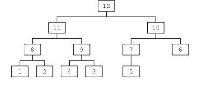

#### 19.1.67 堆算法

堆是一种可以用数组表示的二叉树。在标准堆中，元素的键不小于其子节点的键。这种堆称为最大堆。以数字为键的树可以如图 19.1 所示组织。这样的树也可以用数组组织：

```
12, 11, 10, 8, 9, 7, 6, 1, 2, 4, 3, 5
```

在以下描述中，请记住指向该数组的两个指针：指针 node 指示树的下一个节点的位置，指针 child 指向作为 node 指针子节点的下一个元素。初始时，node 指向第一个元素，child 指向第二个元素。

- `*node++` (== 12)。12 是顶部节点。它的子节点是 `*child++` (11) 和 `*child++` (10)，两者都小于 12。
- 下一个节点（`*node++` (== 11)）依次有 `*child++` (8) 和 `*child++` (9) 作为其子节点。
- 下一个节点（`*node++` (== 10)）有 `*child++` (7) 和 `*child++` (6) 作为其子节点。
- 下一个节点（`*node++` (== 8)）有 `*child++` (1) 和 `*child++` (2) 作为其子节点。
- 然后，节点（`*node++` (== 9)）有子节点 `*child++` (4) 和 `*child++` (3)。
- 最后（就子节点而言），（`*node++` (== 7)）有一个子节点 `*child++` (5)。

由于 child 现在指向数组之外，剩余节点没有子节点。因此，节点 6、1、2、4、3 和 5 没有子节点。

注意，左分支和右分支并没有排序：8 小于 9，但 7 大于 6。

堆是通过从顶部节点开始逐层遍历二叉树创建的。顶部节点是 12，位于第零层。在第一层，我们找到 11 和 10。在第二层，找到 8、9、7 和 6，等等。

可以在支持随机访问的容器中构造堆。因此，链表不是适合堆的数据结构。可以从（未排序的）数组构造堆（使用 `make_heap`）。可以从堆中移除顶部元素，然后重新排列堆（使用 `pop_heap`）；可以向堆中添加新元素，然后重新排列堆（使用 `push_heap`）；并且可以对堆中的元素排序（使用 `sort_heap`，当然，这会使堆失效）。

##### 19.1.67.1 ‘make_heap’ 函数

- 头文件：`<algorithm>`

- 函数原型：

```cpp
void make_heap(RandomAccessIterator first, RandomAccessIterator last);
void make_heap(RandomAccessIterator first, RandomAccessIterator last,
               Compare comp);
```

- 描述：
  - 第一个原型：范围 `[first, last)` 中的元素被重新排列，使用迭代器所指向数据类型的 `operator<` 形成最大堆。
  - 第二个原型：范围 `[first, last)` 中的元素被重新排列，使用二元比较函数对象 `comp` 比较元素，形成最大堆。

##### 19.1.67.2 ‘pop_heap’ 函数

- 头文件：`<algorithm>`

- 函数原型：

```cpp
void pop_heap(RandomAccessIterator first, RandomAccessIterator last);
void pop_heap(RandomAccessIterator first, RandomAccessIterator last,
              Compare comp);
```

- 描述：
  - 第一个原型：范围 `[first, last)` 中的第一个元素被移动到 `last - 1`。然后，范围 `[first, last - 1)` 中的元素被重新排列，使用迭代器所指向数据类型的 `operator<` 形成最大堆。
  - 第二个原型：范围 `[first, last)` 中的第一个元素被移动到 `last - 1`。然后，范围 `[first, last - 1)` 中的元素被重新排列，使用二元比较函数对象 `comp` 比较元素，形成最大堆。

##### 19.1.67.3 ‘push_heap’ 函数

- 头文件：`<algorithm>`

- 函数原型：

```cpp
void push_heap(RandomAccessIterator first, RandomAccessIterator last);
void push_heap(RandomAccessIterator first, RandomAccessIterator last,
               Compare comp);
```

- 描述：
  - 第一个原型：假设范围 `[first, last - 1)` 包含一个有效堆，并且位于 `last - 1` 的元素是要添加到堆中的元素，则范围 `[first, last)` 中的元素被重新排列，使用迭代器所指向数据类型的 `operator<` 形成最大堆。
  - 第二个原型：假设范围 `[first, last - 1)` 包含一个有效堆，并且位于 `last - 1` 的元素是要添加到堆中的元素，则范围 `[first, last)` 中的元素被重新排列，使用二元比较函数对象 `comp` 比较元素，形成最大堆。


##### 19.1.67.4 'sort_heap' 函数

- 头文件：`<algorithm>`
- 函数原型：
  - `void sort_heap(RandomAccessIterator first, RandomAccessIterator last);`
  - `void sort_heap(RandomAccessIterator first, RandomAccessIterator last, Compare comp);`
- 描述：
  - 第一个原型：假设范围 `[first, last)` 中的元素构成有效的最大堆，则使用迭代器所指向数据类型的 `operator<` 对该范围 `[first, last)` 中的元素进行排序。
  - 第二个原型：假设范围 `[first, last)` 中的元素构成有效的堆，则使用二元比较函数对象 `comp` 比较元素，并对该范围 `[first, last)` 中的元素进行排序。

##### 19.1.67.5 使用堆函数的示例

下面是一个示例，展示了操作堆的各种泛型算法：

```cpp
#include <algorithm>
#include <iostream>
#include <functional>
#include <iterator>
using namespace std;

void show(int *ia, char const *header)
{
    cout << header << ":\n";
    copy(ia, ia + 20, ostream_iterator<int>(cout, " "));
    cout << '\n';
}
int main()
{
    int ia[] = {1, 2, 3, 4, 5, 6, 7, 8, 9, 10,
                11, 12, 13, 14, 15, 16, 17, 18, 19, 20};

    make_heap(ia, ia + 20);
    show(ia, "The values 1-20 in a max-heap");

    pop_heap(ia, ia + 20);
    show(ia, "Removing the first element (now at the end)");

    push_heap(ia, ia + 20);
    show(ia, "Adding 20 (at the end) to the heap again");

    sort_heap(ia, ia + 20);
    show(ia, "Sorting the elements in the heap");


    make_heap(ia, ia + 20, greater<int>());
    show(ia, "The values 1-20 in a heap, using > (and beyond too)");

    pop_heap(ia, ia + 20, greater<int>());
    show(ia, "Removing the first element (now at the end)");

    push_heap(ia, ia + 20, greater<int>());
    show(ia, "Re-adding the removed element");

    sort_heap(ia, ia + 20, greater<int>());
    show(ia, "Sorting the elements in the heap");
}
/*
  Displays:
    The values 1-20 in a max-heap:
      20 19 15 18 11 13 14 17 9 10 2 12 6 3 7 16 8 4 1 5
    Removing the first element (now at the end):
      19 18 15 17 11 13 14 16 9 10 2 12 6 3 7 5 8 4 1 20
    Adding 20 (at the end) to the heap again:
      20 19 15 17 18 13 14 16 9 11 2 12 6 3 7 5 8 4 1 10
    Sorting the elements in the heap:
      1 2 3 4 5 6 7 8 9 10 11 12 13 14 15 16 17 18 19 20
    The values 1-20 in a heap, using > (and beyond too):
      1 2 3 4 5 6 7 8 9 10 11 12 13 14 15 16 17 18 19 20
    Removing the first element (now at the end):
      2 4 3 8 5 6 7 16 9 10 11 12 13 14 15 20 17 18 19 1
    Re-adding the removed element:
      1 2 3 8 4 6 7 16 9 5 11 12 13 14 15 20 17 18 19 10
    Sorting the elements in the heap:
      20 19 18 17 16 15 14 13 12 11 10 9 8 7 6 5 4 3 2 1
*/
```

### 19.2 STL：更多函数适配器

在使用这些（子）节中介绍的函数适配器之前，必须已经包含 `<functional>` 头文件。

成员函数适配器是标准模板库（STL）的一部分。它们与泛型算法结合使用时最为有用，因此本章讨论它们，而不是在专门介绍 STL 的上一章中讨论。

STL 中定义的成员函数适配器允许我们像调用非成员函数一样调用类对象的（无参数）成员函数，并将一元或二元参数函数组合成单个函数对象，以便它们可以共同用于泛型算法。

下一节讨论将成员函数作为非成员函数调用；之后介绍可适配函数。

#### 19.2.1 成员函数适配器

当要调用的函数是类的成员函数时，成员函数适配器允许使用泛型算法。考虑以下类：

```cpp
class Data
{
  public:
    void display();
};
```

显然，`display` 成员用于显示存储在 `Data` 对象中的信息。

当将 `Data` 对象存储在 vector 中时，`for_each` 泛型算法不能方便地用于为 vector 中存储的每个对象调用 `display` 成员，因为 `for_each` 接受（非成员）函数或函数对象作为其第三个参数，但不接受成员函数。

成员函数适配器 `mem_fun_ref` 可用于解决此问题。它期望一个没有任何参数的成员函数的地址，其函数调用运算符会为传递给其函数调用运算符的对象调用该函数。在下一个示例中，`vector<Data> data` 被填充了 `Data` 对象。然后使用 `for_each` 显示存储在 `data` vector 中的各个 `Data` 对象中的信息：

```cpp
int main()
{
    vector<Data> data;

    // the 'data' vector is filled with Data objects here

    for_each(data.begin(), data.end(), mem_fun_ref(&Data::display));
}
```

第二个成员函数适配器是 `mem_fun`，它用于从指向对象的*指针*调用成员函数。上面的示例可以重写为类似以下内容：

```cpp
int main()
{
    vector<Data *> data;

    data.push_back(new Data);   // multiple push-backs if applicable

    for_each(data.begin(), data.end(), mem_fun(&Data::display));

    // delete the Data objects pointed to by data's elements
}
```

一个有趣的观察是，http://www.sgi.com 提供了一个使用 `mem_fun` 且涉及多态成员的示例。如果 `Data::display` 是虚成员函数，并且 `Derived1` 和 `Derived2`（均派生自 `Data`）提供它们自己的 `display` 实现，那么指向 `Derived1` 和 `Derived2` 对象的指针可以放入 `data` vector 中。然后 `for_each` 算法调用正确的（被覆盖的）`display` 函数。例如，

```cpp
int main()
{
    vector<Data *> data;

    data.push_back(new Derived1);
    data.push_back(new Derived2);

                                      // calls Derived1::display or
                                      // Derived2::display.
    for_each(data.begin(), data.end(), mem_fun(&Data::display));
}
```

然而，此示例使用了公有虚成员，混淆了类的虚接口和公有接口（参见 14.7 节），因此已被弃用。不过仍然可以使用多态，但公有接口应由 `Data` 按如下方式提供：

```cpp
class Data
{
public:
    void display();        // calls v_display
private:
    virtual void v_display();    // overridden by derived
};                            // classes
```

在上面的示例中，`mem_fun` 只需接收 `&Data::display` 的地址。无需修改上面的 `main` 函数，但现在 `Data` 的多态特性与其公有接口完全分离。

#### 19.2.2 可适配函数

在 STL 的上下文中，*可适配函数*是定义以下内容的函数对象：

- `argument_type` 作为其一元函数运算符参数类型的同义词，以及
- `first_argument_type` 和 `second_argument_type` 作为其二元函数运算符参数类型的同义词

并且将 `result_type` 定义为其函数调用运算符返回值的类型。

STL 定义 `pointer_to_unary_function` 和 `pointer_to_binary_function` 作为适配器，分别接受指向一元函数和二元函数的指针，并将它们转换为可适配函数。在 STL 的上下文中，使用可适配函数可能应优先于函数指针，因为 STL 的可适配函数定义了上述描述其参数和结果类型的类型。本节末尾给出了一个实际需要这些类型的示例，此时不能使用普通的函数指针。

在实践中，几乎从不显式使用 `pointer_to_unary_function` 和 `pointer_to_binary_function` 适配器。相反，使用的是重载的函数适配器 `ptr_fun`。

当向 `ptr_fun` 提供一元函数时，它使用 `pointer_to_unary_function` 创建*可适配一元函数*；当向它提供二元函数时，它使用 `pointer_to_binary_function` 创建*可适配二元函数*。

下面是一个示例，展示 `ptr_fun` 的使用，创建一个可适配二元函数。在 `main` 中，要搜索的词以及存储在 string 对象 vector 中的其他词从标准输入流中提取。如果找到目标词，程序会显示 string 对象 vector 中目标词后面的词。搜索以不区分大小写的方式执行，为此使用了 C 库函数 `strcasecmp`：

```cpp
#include <vector>
#include <algorithm>
#include <functional>
#include <cstring>
#include <string>
#include <iterator>
#include <iostream>

using namespace std;

inline int stringcasecmp(string lhs, string rhs)
{
    return strcasecmp(lhs.c_str(), rhs.c_str());
}

int main()
{
```


```cpp
string target;
cin >> target;

vector<string> v1;
copy(istream_iterator<string>(cin), istream_iterator<string>(),
     back_inserter(v1));

auto pos = find_if(
             v1.begin(), v1.end(),
             not1(bind2nd(ptr_fun(stringcasecmp), target))
           );

if ( pos != v1.end())
  cout << "The search for \"" << target << "\" was successful.\n"
       << "The next string is: \"" << pos[1] << "\".\n";
}

// on input:
// VERY   I have existed for years, but very little has changed
// the program displays:
// The search for 'VERY' was successful.
// The next string is: 'little'.
```

细心的读者可能已经注意到，这并不是一个非常高效的程序。函数 `stringcasecmp` 定义了值类型参数，这导致每次调用 `stringcasecmp` 时都要构造传递给它的参数的副本。然而，当把参数定义改为

```cpp
inline int stringcasecmp(string const &lhs, string const &rhs)
```

编译器将生成类似如下的错误消息：

```text
In instantiation of 'std::binder2nd<std::pointer_to_binary_function<
        const std::string&, const std::string&, int> >':

    typename _Operation::result_type std::binder2nd<_Operation>::operator()(
        typename _Operation::first_argument_type& ) const
cannot be overloaded with:
    typename _Operation::result_type std::binder2nd<_Operation>::operator()(
        const typename _Operation::first_argument_type&) const
```

这个问题（及其解决方案）将在后续章节中讨论（参见第 21.5.2.1 节）。

```cpp
        return lvalue + rvalue;
    }
```

注意，上述函数的定义与其描述是多么贴近。它接收两个参数，并返回它们的和。现在考虑如果我们为 `int` 值定义这个函数会发生什么。我们会这样写：

```cpp
int add(int const &lvalue, int const &rvalue)
{
    return lvalue + rvalue;
}
```

到目前为止，一切顺利。然而，如果我们要将两个 `double` 相加，我们会重载这个函数：

```cpp
double add(double const &lvalue, double const &rvalue)
{
    return lvalue + rvalue;
}
```

我们可能被迫构造的重载版本数量是无穷无尽的：为 `string` 重载一个版本，为 `size_t` 重载一个版本，为 …… 重载一个版本。一般来说，我们需要为每个支持 `operator+` 和拷贝构造函数的类型提供一个重载版本。所有这些本质上相同函数的重载版本之所以是必需的，是因为 C++ 具有强类型特性。正因如此，如果不借助 `template` 机制，就无法构造一个真正通用的函数。

幸运的是，我们已经看到了模板函数的一个重要部分。我们最初的 `add` 函数实际上就是这样一个函数的实现，尽管它还不是一个完整的模板定义。如果我们把第一个 `add` 函数交给编译器，它会产生类似如下的错误消息：

```text
error: 'Type' was not declared in this scope
error: parse error before 'const'
```

这是理所当然的，因为我们未能定义 *Type*。当我们把 `add` 改为完整的模板定义时，错误就被避免了。要做到这一点，我们看一下函数的实现，并确定 *Type* 实际上是一个*形式*类型名。与备选实现进行比较，很明显我们可以将 *Type* 改为 `int` 得到第一个实现，改为 `double` 得到第二个实现。

完整的模板定义允许 *Type* 类型名具有这种*形式*性质。使用关键字 `template`，我们在初始定义前加上一行，得到如下函数模板定义：

```cpp
template <typename Type>
Type add(Type const &lvalue, Type const &rvalue)
{
    return lvalue + rvalue;
}
```

在这个定义中，我们区分出：

-   关键字 `template`，用于开始一个模板定义或声明。
-   跟随在 `template` 后面的尖括号括起来的列表。这是一个包含一个或多个逗号分隔元素的列表。这个由尖括号括起来的列表被称为 *模板参数列表*。使用多个元素的模板参数列表可能看起来像这样：

    ```cpp
    typename Type1, typename Type2
    ```

函数。所以，当调用 `add(3, 4)` 时，`int(4)` 被赋给 `Type const &rvalue`。一般来说，函数参数应该定义为 `Type const &`，以防止不必要的拷贝。在这种情况下，编译器足够聪明，能够处理“引用的引用”，而这是该语言通常不支持的。例如，考虑下面的 `main` 函数（这里以及在下面的简单示例中，都假定模板以及所需的头文件和命名空间声明已经提供）：

```cpp
int main()
{
    size_t const &var = size_t(4);
    cout << add(var, var) << '\n';
}
```

这里，`var` 是一个指向常量 `size_t` 的引用。它作为实参传递给 `add`，从而将 `lvalue` 和 `rvalue` 初始化为 `Type const &`，其值为 `size_t const &`。编译器将 `Type` 解释为 `size_t`。或者，参数可能使用 `Type &` 而不是 `Type const &` 来指定。这种（非 const）指定的缺点是，临时值不能再传递给函数。因此，下面的代码无法编译：

```cpp
int main()
{
    cout << add(string("a"), string("b")) << '\n';
}
```

在这里，`string const &` 不能用来初始化 `string &`。如果 `add` 定义了 `Type &&` 参数，那么上面的程序本来可以顺利编译。实际上，下面的示例可以正确编译，因为编译器认定 `Type` 显然是一个 `string const &`：

```cpp
int main()
{
    string const &s = string("a");
    cout << add(s, s) << '\n';
}
```

我们能从这些示例中推断出什么？

-   一般来说，函数参数应指定为 `Type const &` 参数，以防止不必要的拷贝。
-   模板机制相当灵活。形式类型根据实际提供的类型被解释为普通类型、const 类型、指针类型等。经验法则是，形式类型被用作实际类型的通用掩码，形式类型名覆盖实际类型中需要覆盖的任何部分。假设参数定义为 `Type const &`，一些示例如下：

    | 提供的实参： | 实际使用的类型： |
    |---|---|
    | `size_t const` | `size_t` |
    | `size_t` | `size_t` |
    | `size_t *` | `size_t *` |
    | `size_t const *` | `size_t const *` |

作为函数模板的第二个示例，考虑下面的函数模板：

```cpp
template <typename Type, size_t Size>
Type sum(Type const (&array)[Size])
{
    Type tp = Type();

    for (size_t idx = 0; idx < Size; idx++)
        tp += array[idx];

    return tp;
}
```

这个模板定义引入了以下新概念和特性：

-   *模板参数列表*。这个模板参数列表有两个元素。第一个元素是众所周知的模板类型参数，但第二个元素有一个非常具体的类型：`size_t`。在模板参数列表中使用的具有特定（即非形式）类型的模板参数被称为 *模板非类型参数*。模板非类型参数定义了一个常量表达式的类型，该表达式在模板实例化时必须已知，并且它是根据现有类型（如 `size_t`）来指定的。

-   看看函数的头部，我们看到一个参数：

    ```text
    Type const (&array)[Size]
    ```

    这个参数将 `array` 定义为一个指向数组的引用，该数组有 `Size` 个 `Type` 类型的元素，且这些元素不可修改。

-   在参数定义中，`Type` 和 `Size` 都被使用。`Type` 当然是模板的类型参数 `Type`，但 `Size` 也是一个模板参数。它是一个 `size_t`，其值必须在编译器编译 `sum` 函数模板的实际调用时能够推断出来。因此，`Size` 必须是一个常量值。这样的常量表达式被称为 *模板非类型参数*，其类型在模板的参数列表中指明。

-   当函数模板被调用时，编译器必须能够推断出 `Type` 的具体值，也要推断出 `Size` 的值。由于 `sum` 函数只有一个参数，编译器只能从函数的实际参数中推断 `Size` 的值。如果提供的参数是一个数组（已知且大小固定），而不是一个指向 `Type` 元素的指针，它就能做到这一点。因此，在下面的 `main` 函数中，第一条语句可以正确编译，但第二条语句不行：

    ```cpp
    int main()
    {
        int values[5];
        int *ip = values;

        cout << sum(values) << '\n';    // compiles OK
        cout << sum(ip) << '\n';        // won't compile
    }
    ```

-   在函数体内，语句 `Type tp = Type()` 用于将 `tp` 初始化为默认值。注意这里没有使用固定值（如 0）。任何类型的默认值都可以通过其默认构造函数获得，而不是使用固定的数值。当然，并不是每个类都接受数值作为其某个构造函数的参数。但所有类型，甚至包括基本类型，都支持默认构造函数（实际上，有些类没有实现默认构造函数，或者使其不可访问；但大多数都有）。基本类型的默认构造函数将其变量初始化为 0（或 `false`）。此外，语句 `Type tp = Type()` 是一个*真正的初始化*：`tp` 是由 `Type` 的默认构造函数初始化的，而不是使用 `Type` 的拷贝构造函数将 `Type` 的副本赋给 `tp`。

这里值得一提的是（尽管与当前主题没有直接关系），语法结构 `Type tp(Type())` *不能* 使用，尽管它看起来也像是一个正确的初始化。通常，可以为对象的定义提供一个初始化参数，比如 `string s("hello")`。那么，为什么 `Type tp = Type()` 可以接受，而 `Type tp(Type())` 不行呢？


当使用 Type tp(Type()) 时，它不会产生错误消息。因此，我们不会立即发现它不是 Type 对象的默认初始化。相反，一旦使用 tp，编译器就开始生成错误消息。这是因为在 C++（以及类似 C 的语言）中，编译器会尽可能识别函数或函数指针：函数优先规则。根据这条规则，Type ()（由于这对括号）被解释为指向一个不期望参数、返回 Type 的函数的指针。除非显然不可能这样做，编译器就会这样做。在初始化 Type tp = Type () 中，它不能将其看作函数指针，因为不能将函数指针的值赋给 Type 对象（记住：只要可能，Type () 就被解释为 Type (*) ()）。但在 Type tp(Type () ) 中，它可以使用指针解释：tp 现在被声明为一个函数，期望一个返回 Type 的函数的指针，而 tp 本身也返回 Type。例如，tp 可以定义为：

```cpp
Type tp(Type (*funPtr)())
{
    return (*funPtr)();
}
```

-   与第一个函数模板类似，sum 也假定 Type 的类中存在某些公有成员。这次是 operator+= 和 Type 的拷贝构造函数。

与类定义一样，模板定义不应包含 using 指令或声明：模板可能会在这样一种情况下使用：这样的指令覆盖了程序员的意图：模板作者和程序员使用不同的 using 指令（例如，在 std 命名空间和程序员自己的命名空间中定义的 cout 变量）可能导致歧义或其他冲突。相反，在模板定义中，只应使用完全限定名，包括所有必需的命名空间限定。

#### 20.1.2 后置返回类型（C++11）

传统 C++ 要求函数模板指定其返回类型，或者将返回类型指定为模板类型参数。考虑以下函数：

```cpp
int add(int lhs, int rhs)
{
    return lhs + rhs;
}
```

上述函数可以转换为函数模板：

```cpp
template <typename Lhs, typename Rhs>
Lhs add(Lhs lhs, Rhs rhs)
{
    return lhs + rhs;
}
```

不幸的是，当以下列方式调用该函数模板时

```cpp
add(3, 3.4)
```

预期的返回类型可能是 double 而不是 int。这可以通过添加一个指定返回类型的额外模板类型参数来解决，但那时必须显式指定该类型：

```cpp
add<double>(3, 3.4);
```

使用 `decltype`（参见第 3.3.5 节）定义返回类型行不通，因为在使用 `decltype` 时编译器还不知道 `lhs` 和 `rhs`。因此，下一次尝试去掉额外模板类型参数时无法编译：

```cpp
template <typename Lhs, typename Rhs>
decltype(lhs + rhs) add(Lhs lhs, Rhs rhs)
{
    return lhs + rhs;
}
```

基于 `decltype` 的函数返回类型定义可能会变得相当复杂。为降低复杂性，C++11 标准提供了*后置返回类型*语法，该语法确实允许使用 `decltype` 定义函数的返回类型。它主要用于函数模板，但也可用于普通（非模板）函数：

```cpp
template <typename Lhs, typename Rhs>
auto add(Lhs lhs, Rhs rhs) -> decltype(lhs + rhs)
{
    return lhs + rhs;
}
```

当在类似 `cout << add(3, 3.4)` 的语句中使用此函数时，结果值将是 6.4，这最可能是预期的结果，而不是 6。作为后置返回类型如何降低函数返回类型定义复杂性的示例，请考虑以下内容：

```cpp
template <class T, class U>
decltype((*(T*)0)+(*(U*)0)) add(T t, U u);
```

使用后置返回类型，我们得到等价形式：

```cpp
template <class T, class U>
auto add(T t, U u) -> decltype(t+u);
```

大多数人认为这样更易读。

用 `decltype` 指定的表达式不一定使用参数 `lhs` 和 `rhs` 本身。在下一个函数定义中，使用 `lhs.length` 而不是 `lhs` 本身：

```cpp
template <typename Class, typename Rhs>
auto add(Class lhs, Rhs rhs) -> decltype(lhs.length() + rhs)
{
    return lhs.length() + rhs;
}
```

在编译 `decltype` 时可见的*任何*变量都可以用在 `decltype` 表达式中。然而，目前还无法处理通过成员指针进行的成员选择。以下代码旨在将成员函数的地址指定为 `add` 的第一个参数，然后使用其返回值类型来确定函数模板的返回类型：

```cpp
std::string global;

template <typename MEMBER, typename RHS>
auto add(MEMBER mem, RHS rhs) -> decltype((global.*mem)() + rhs)
{
    return (global.*mem)() + rhs;
}
```

```cpp
{
    struct Local
    {
        double dVar;
        int    iVar;
    };
    Local local;            // using a local type

    fun(local);             // OK: T is 'Local'
}
```

### 20.4 模板参数推导

在本节中，我们将重点讨论编译器推导模板类型参数实际类型的过程。当调用函数模板时，使用称为*模板参数推导*的过程来推导这些类型。正如我们已经看到的，编译器能够为单个形式模板类型参数替换广泛的实际类型。即便如此，并非所有可想到的转换都是可能的。特别是当一个函数具有多个相同模板类型参数的参数时，编译器在确定实际接受哪些参数类型时非常严格。

当编译器推导模板类型参数的实际类型时，它*只*考虑实际使用的参数的类型。在这个过程中，既不考察局部变量，也不考察函数的返回值。这是可以理解的。当调用函数时，编译器只确定函数模板参数的类型。在调用点，它肯定看不到函数局部变量的类型。此外，函数的返回值可能实际上并未被使用，或者可能被赋值给推导出的模板类型参数的子范围（或超范围）类型的变量。因此，在下面的示例中，编译器永远无法调用 `fun()`，因为它无法推导出 `Type` 模板类型参数的实际类型。

```cpp
template <typename Type>
Type fun()               // can never be called as 'fun()'
{
    return Type();
}
```

尽管编译器无法处理对 'fun()' 的调用，但*可以*使用显式类型指定来调用 `fun()`。例如，`fun<int>()` 调用为 `int` 实例化的 `fun`。这当然*不同于编译器参数推导*。

一般来说，当一个函数具有多个相同模板类型参数的参数时，实际类型必须完全相同。因此，尽管

```cpp
void binarg(double x, double y);
```

可以使用 `int` 和 `double` 调用，其中 `int` 参数被静默转换为 `double`，但类似的函数模板不能使用 `int` 和 `double` 参数调用：编译器不会自行将 `int` 提升为 `double` 并决定 `Type` 应为 `double`：

```cpp
template <typename Type>
void binarg(Type const &p1, Type const &p2)
{}

int main()
{
    binarg(4, 4.5); // ?? won't compile: different actual types
}
```

那么，编译器在推导模板类型参数的实际类型时应用了哪些转换？它只执行三类参数类型转换，以及第四类针对函数模板非类型参数的转换。如果它无法使用这些转换推导出实际类型，则不会考虑该函数模板。编译器执行的转换是：

-   *左值转换*，从*左值*创建*右值*；
-   *限定转换*，向非常量参数类型插入 `const` 修饰符；
-   *到基类的转换*，当调用中提供的是模板派生类类型的参数时，使用由类模板实例化的模板基类。
-   函数模板非类型参数的标准转换。这不是模板类型参数转换，而是指函数模板中任何剩余的模板非类型参数。对于这些函数参数，编译器执行其可用的任何标准转换（例如，`int` 到 `size_t`，`int` 到 `double` 等）。

各种模板参数类型推导转换的目的*不是*将函数实参与函数形参匹配，而是在将实参与形参匹配之后，确定各种模板类型参数的*实际类型*。

#### 20.4.1 左值转换

*左值转换*有三种类型：

-   **左值到右值转换。**

    当需要右值但提供的是左值时，会应用左值到右值转换。当变量用作指定*值参数*的函数的实参时，就会发生这种情况。例如，

    ```cpp
    template<typename Type>
    Type negate(Type value)
    {
            return --value;
    }
    int main()
    {
            int x = 5;
            x = negate(x);  // lvalue (x) to rvalue (copies x)
    }
    ```

-   **数组到指针转换。**

    当数组名被赋值给指针变量时，会应用数组到指针转换。这经常用于定义指针参数的函数。这类函数经常接收数组作为实参。然后数组的地址被赋值给指针形参，并使用其类型推导相应模板参数的类型。例如，

    ```cpp
    template<typename Type>
    Type sum(Type *tp, size_t n)
    {
            return accumulate(tp, tp + n, Type());
    }
    int main()
    {
            int x[10];
            sum(x, 10);
    }
    ```


在这个例子中，数组 x 的位置被传递给 sum，期望得到一个指向某种类型的指针。使用数组到指针转换，x 的地址被视为一个指针值，并被赋给 tp，在此过程中推导出 `Type` 为 `int`。

- **函数到指针转换。**

这种转换最常用于定义参数为函数指针的函数模板。调用此类函数时，可以将函数名指定为其实参。然后，该函数的地址被赋给指针参数，并在此过程中推导模板类型参数。这称为函数到指针转换。例如：

```cpp
#include <cmath>

template<typename Type>
void call(Type (*fp)(Type), Type const &value)
{
    (*fp)(value);
}
int main()
{
    call(sqrt, 2.0);
}
```

在这个例子中，`sqrt` 函数的地址被传递给 `call`，期望得到一个指向返回 `Type` 的函数的指针，并期望其参数为 `Type`。使用函数到指针转换，`sqrt` 的地址被赋给 `fp`，在此过程中推导出 `Type` 为 `double`（注意，`sqrt` 是函数的地址，而不是指向函数的指针变量，因此这里发生的是左值转换）。

实参 `2.0` 不能指定为 `2`，因为不存在 `int sqrt(int)` 原型。此外，该函数的第一个参数指定为 `Type (*fp)(Type)`，而不是我们之前关于如何指定函数模板参数类型（倾向于引用而非值）的讨论中可能预期的 `Type (*fp)(Type const &)`。然而，`fp` 的参数 `Type` 并不是函数模板参数，而是 `fp` 所指向函数的参数。由于 `sqrt` 的原型是 `double sqrt(double)`，而不是 `double sqrt(double const &)`，所以 `call` 的参数 `fp` 必须指定为 `Type (*fp)(Type)`。就是这么严格。

#### 20.4.2 限定转换

限定转换向指针添加 `const` 或 `volatile` 限定。当函数模板的类型参数显式指定 `const`（或 `volatile`），而函数实参不是 `const` 或 `volatile` 实体时，应用此转换。在这种情况下，由编译器提供 `const` 或 `volatile`。随后编译器推导模板的类型参数。例如：

```cpp
template<typename Type>
Type negate(Type const &value)
{
    return -value;
}
int main()
{
    int x = 5;
    x = negate(x);
}
```

这里我们看到函数模板的 `Type const &value` 参数：一个指向 `const Type` 的引用。然而，实参并不是 `const int`，而是一个可修改的 `int`。应用限定转换后，编译器给 `x` 的类型添加 `const`，因此它匹配 `int const x`。然后将其与 `Type const &value` 匹配，使编译器能够推导出 `Type` 必须是 `int`。

#### 20.4.3 到基类的转换

尽管类模板的构造是第21章的主题，但我们在前面已经广泛使用了类模板。例如，抽象容器（参见第12章）被定义为类模板。类模板可以像普通类一样参与类层次结构的构造。

第21.11节展示了如何从一个类模板派生出另一个类模板。

由于类模板派生尚未讨论，下面的讨论必然有些提前。读者当然可以先简要跳到第21.11节，然后再回到本节。

在本节中，为便于讨论，应假设类模板 `Vector` 已经以某种方式从 `std::vector` 派生而来。此外，假设已构造以下函数模板，用于使用某个函数对象 `obj` 对 vector 进行排序：

```cpp
template <typename Type, typename Object>
void sortVector(std::vector<Type> vect, Object const &obj)
{
    sort(vect.begin(), vect.end(), obj);
}
```

为了以不区分大小写的方式对 `std::vector<string>` 对象排序，可以如下构造一个 `CaseLess` 类：

```cpp
class CaseLess
{
    public:
        bool operator()(std::string const &before,
                        std::string const &after) const
        {
            return strcasecmp(before.c_str(), after.c_str()) < 0;
        }
};
```

现在可以使用 `sortVector()` 对各种 vector 进行排序：

```cpp
int main()
{
    std::vector<string> vs;
    std::vector<int> vi;

    sortVector(vs, CaseLess());
    sortVector(vi, less<int>());
}
```

应用从类模板实例化的*到基类的转换*，函数模板 `sortVector` 现在也可用于对 `Vector` 对象进行排序。例如：

```cpp
int main()
{
    Vector<string> vs;      // ‘Vector’ instead of ‘std::vector’
    Vector<int> vi;

    sortVector(vs, CaseLess());
    sortVector(vi, less<int>());
}
```

在这个例子中，`Vector` 被作为实参传递给 `sortVector`。应用从类模板实例化的到基类的转换后，编译器将 `Vector` 视为 `std::vector`，使其能够推导模板的类型参数：对于 `Vector<string> vs` 为 `std::string`，对于 `Vector<int> vi` 为 `int`。

#### 20.4.4 模板参数推导算法

编译器使用以下算法推导模板类型参数的实际类型：

- 依次使用被调用函数的实参来确定函数模板的参数。
- 对于函数模板参数列表中使用的每个模板参数，将模板类型参数与相应实参的类型关联起来（例如，如果实参是 `int x`，而函数参数是 `Type &value`，则 `Type` 为 `int`）。
- 在将实参类型与模板类型参数匹配时，必要时应用模板类型参数允许的三种转换（参见第20.4节）。
- 如果相同的模板类型参数用于多个函数参数，则推导出的模板类型必须完全匹配。因此，下面的函数模板不能用 `int` 和 `double` 实参调用：

```cpp
template <typename Type>
Type add(Type const &lvalue, Type const &rvalue)
{
    return lvalue + rvalue;
}
```

调用此函数模板时，必须使用两个相同的类型（当然，三种标准转换是允许的）。如果模板推导机制未能为相同模板类型得出相同的实际类型，则不会实例化该函数模板。

#### 20.4.5 模板类型收缩

对于函数模板，模板实参类型与模板参数类型的组合会表现出一些有趣的收缩。例如，如果模板类型参数被指定为右值引用，但提供的实参类型是左值引用，会发生什么？

在这种情况下，编译器执行类型收缩。相同的引用类型叠加会导致简单的收缩：该类型被推导为单个引用类型。例如：如果模板参数类型指定为 `Type &&`，而实际参数是 `int &&`，则 `Type` 被推导为 `int`，而不是 `int &&`。

这相当直观。但如果实际类型是 `int &` 呢？并不存在 `int &&&param` 这样的东西，因此编译器通过移除右值引用来收缩双重引用，保留左值引用。这里应用以下规则：

1. 定义为模板类型参数左值引用（例如 `Type &`）的函数模板参数接收到左值引用实参时，结果是一个左值引用。
2. 定义为模板类型参数右值引用（例如 `Type &&`）的函数模板参数接收到任何类型的引用实参时，使用该实参的引用类型。

示例：

- 当提供 `Actual &` 实参时，`Type &` 变为 `Actual &`，并且 `Type` 被推断为 `Actual`；
- 当提供 `Actual &` 时，`Type &&` 变为 `Actual &`，并且 `Type` 被推断为 `Actual`；
- 当提供 `Actual &&` 时，`Type &` 也变为 `Actual &`，并且 `Type` 被推断为 `Actual`；
- 当提供 `Actual &&` 时，`Type &&` 变为 `Actual &&`，并且 `Type` 被推断为 `Actual`；

让我们看一个发生收缩的具体示例。考虑以下函数模板，其中一个函数参数被定义为某个模板类型参数的右值引用：

```cpp
template <typename Type>
void function(Type &&param)
{
    callee(static_cast<Type &&>(param));
}
```

在这种情况下，当以类型为 `TP &` 的（左值）实参调用 `function` 时，模板类型参数 `Type` 被推导为 `TP &`。因此，`Type &&param` 被实例化为 `TP &param`，`Type` 变为 `TP`，并且右值引用被替换为左值引用。

同样，当使用 `static_cast` 调用 `callee` 时，会发生相同的收缩，因此 `Type &&param` 作用于 `TP &param`。因此（使用收缩）该 static cast 也使用类型 `TP &param`。如果 `param` 恰好是 `TP &&` 类型，则该 static cast 使用类型 `TP &&param`。

这一特性允许我们将函数实参传递给嵌套函数而不改变其类型：左值仍为左值，右值仍为右值。因此，这一特性也称为*完美转发*，第21.5.2节将更详细地讨论。完美转发使模板作者无需定义函数模板的多个重载版本。

### 20.5 声明函数模板

到目前为止，我们只定义了函数模板。将函数模板定义包含在多个源文件中会带来各种后果，这些后果都不严重，但值得了解。

- 与类接口一样，模板定义通常包含在头文件中。每当编译器读取包含模板定义的头文件时，它都必须处理完整定义。即使它实际上没有使用该模板，也必须这样做。这会在一定程度上拖慢编译。例如，在我那台旧笔记本电脑上，编译像 `algorithm` 这样的模板头文件所需时间大约是编译像 `cmath` 这样的普通头文件的四倍。头文件 `iostream` 更难处理，所需时间几乎是处理 `cmath` 的15倍。显然，处理模板对编译器来说是一件严肃的事情。另一方面，不应过分看重这一缺点。编译器正在不断提高其模板处理能力，计算机也越来越快。几年前还令人烦恼的事情，如今几乎察觉不到。
- 每次实例化函数模板时，其代码都会出现在生成的目标模块中。然而，如果多个目标文件中存在使用相同实际类型作为模板参数的同一模板的多个实例化，则*单一定义规则*会被放宽。链接器会剔除多余的实例化（即实例化模板的相同定义）。在最终程序中，针对某一组实际模板类型参数只保留一个实例化可用（示例见第20.6节）。因此，链接器有额外任务要执行（即剔除多个实例化），这会在一定程度上拖慢链接过程。


```cpp
int main()
{
    std::cout << fun(add);
}
```

编译这个小程序时，编译器报告了一个它无法解决的歧义。它有两个候选函数，因为对于 `fun` 的每个重载版本，都可以实例化一个 add 函数：

```
error: call of overloaded 'fun(<unknown type>)' is ambiguous
note: candidates are: int fun(size_t (*) (int*, size_t))
note:                      double fun(double (*) (double*, size_t))
```

当然应该避免这种情况。只有在不存在歧义时，才能实例化函数模板。当编译器函数选择机制产生多个函数时，就会出现歧义（见 [20.14](#) 节）。解决歧义取决于我们。它们*可以*通过一个生硬的 `static_cast` 来解决（通过它，我们在所有可能且可用的备选方案中进行选择）：

```cpp
#include <iostream>
#include "add.h"

int fun(int (*f)(int const &, int const &));
double fun(double (*f)(double const &, double const &));

int main()
{
    std::cout << fun(
        static_cast<int (*)(int const &, int const &)>(add)
    );
}
```

但良好的做法是尽可能避免类型转换。下一节（[20.7](#)）解释了如何做到这一点。

#### 20.6.1 实例化：没有“代码膨胀”

如 [20.5](#) 节所述，链接器会从最终程序中移除模板的相同实例化，对于每一组唯一的实际模板类型参数只留下一个实例化。为了说明链接器的行为，我们按如下步骤操作：

- 首先，我们构造几个源文件：
  - `source1.cc` 定义了一个函数 `fun`，为 int 类型参数实例化 `add`，其中包括 `add` 的模板定义。它显示 `add` 的地址：

```cpp
union PointerUnion
{
    int (*fp)(int const &, int const &);
    void *vp;
};
#include <iostream>
#include "add.h"
#include "pointerunion.h"

void fun()
{
    PointerUnion pu = { add };
        std::cout << pu.vp << '\n';
    }
```

  - `source2.cc` 定义了同一个函数，但仅使用模板声明（而非实例化声明）声明了正确的 `add` 模板。以下是 `source2.cc`：

```cpp
#include <iostream>
#include "pointerunion.h"

template<typename Type>
Type add(Type const &, Type const &);

void fun()
{
    PointerUnion pu = { add };

    std::cout << pu.vp << '\n';
}
```

  - `main.cc` 再次包含 `add` 的模板定义，声明函数 `fun` 并定义 `main`，同时为 `int` 类型参数定义 `add`，并显示 `add` 的函数地址。它还调用函数 `fun`。以下是 `main.cc`：

```cpp
#include <iostream>
#include "add.h"
#include "pointerunion.h"

void fun();

int main()
{
    PointerUnion pu = { add };

    fun();
    std::cout << pu.vp << '\n';
}
```

- 所有源文件都被编译为目标模块。注意 `source1.o`（使用 `g++` 4.3.4 版本时为 1912 字节（本节报告的目标模块大小可能因编译器和/或运行时库不同而有所差异））和 `source2.o`（1740 字节）的大小不同。由于 `source1.o` 包含 `add` 的实例化，它比仅包含模板声明的 `source2.o` 稍大一些。现在，我们准备好开始这个小实验了。

- 链接 `main.o` 和 `source1.o` 时，我们显然将两个目标模块链接在一起，每个模块都包含同一个模板函数各自的实例化。生成程序产生以下输出：

```
0x80486d8
0x80486d8
```

此外，生成程序的大小为 6352 字节。

- 链接 `main.o` 和 `source2.o` 时，我们现在将一个包含 `add` 模板实例化的目标模块与另一个仅包含同一模板函数声明的目标模块链接在一起。因此，生成程序只能包含所需函数模板的单个实例化。该程序的大小与第一个程序完全相同，产生的输出也完全相同。

通过这个小实验，我们得出结论：链接器确实会从最终程序中移除相同的模板实例化。此外，我们还得出结论：仅使用模板声明不会导致模板实例化。

### 20.7 使用显式模板类型

在上一节中，我们看到编译器在尝试实例化模板时可能会遇到歧义。在一个示例中，存在一个函数（fun）的重载版本，它期望不同类型的参数。歧义源于以下事实：两个参数本都可以由某个函数模板的实例化提供。解决这种歧义的直观方法是使用 `static_cast`。但应尽可能避免类型转换。

对于函数模板，确实可以使用*显式模板类型实参*来避免静态转换。显式模板类型实参可用于告知编译器在实例化模板时应使用的实际类型。要使用显式类型实参，函数名后跟一个*实际模板类型实参列表*，该列表后面还可以跟函数的参数列表。实际模板实参列表中提到的实际类型由编译器用来“推断”在实例化模板时应使用哪些类型。以下是上一节中的示例，现在使用显式模板类型实参：

```cpp
#include <iostream>
#include "add.h"

int fun(int (*f)(int const &lvalue, int const &rvalue));
double fun(double (*f)(double const &lvalue, double const &rvalue));

int main()
{
    std::cout << fun(add<int>) << '\n';
}
```

在编译器无法检测实际应使用哪些类型的情况下，可以使用显式模板类型实参。例如，在 20.4 节中定义了函数模板 Type fun()。要为 double 类型实例化此函数，可以调用 fun<double>()。

### 20.8 重载函数模板

让我们再次看看我们的 add 模板。该模板旨在返回两个实体的和。如果我们想计算三个实体的和，可以这样写：

```cpp
int main()
{
    add(add(2, 3), 4);
}
```

对于偶尔出现的情况，这是一个可接受的解决方案。然而，如果我们需要经常对三个实体求和，那么一个期望三个参数的 add 函数*重载*版本可能是一个有用的函数。这个问题有一个简单的解决方案：函数模板可以重载。

要定义重载函数模板，只需在头文件中放置该模板的多个定义。对于 add 函数，这可以归结为：

```cpp
template <typename Type>
Type add(Type const &lvalue, Type const &rvalue)
{
    return lvalue + rvalue;
}
template <typename Type>
Type add(Type const &lvalue, Type const &mvalue, Type const &rvalue)
{
    return lvalue + mvalue + rvalue;
}
```

重载函数不必基于简单值来定义。与所有重载函数一样，一组唯一的函数参数就足以定义重载函数模板。例如，下面是一个可用于计算 vector 元素之和的重载版本：

```cpp
template <typename Type>
Type add(std::vector<Type> const &vect)
{
    return accumulate(vect.begin(), vect.end(), Type());
}
```

重载函数模板时，我们不必局限于函数的参数列表。模板的类型参数列表本身也可以重载。`add` 模板的最后一个定义允许我们将 `vector` 指定为其第一个参数，但不能指定 `deque` 或 `map`。当然，可以为这些类型的容器构造重载版本，但我们应该做到什么程度呢？更好的方法似乎是寻找这些容器的共同特征。如果找到了，我们也许能够基于这些共同特征定义重载函数模板。上述容器的一个共同特征是它们都支持返回迭代器的 `begin` 和 `end` 成员。利用这一点，我们可以定义一个模板类型参数，表示必须支持这些成员的容器。但仅仅提到一个普通的 `container type` 并不能告诉我们它是为何种数据类型实例化的。因此，我们需要第二个模板类型参数来表示容器的数据类型，从而重载模板的类型参数列表。下面是得到的 `add` 模板重载版本：

```cpp
template <typename Container, typename Type>
Type add(Container const &cont, Type const &init)
{
    return std::accumulate(cont.begin(), cont.end(), init);
}
```

有人可能想知道，既然 `init` 通常有一个默认初始化值，是否可以将 `init` 参数从参数列表中省略。答案是“可以”，但会有复杂情况。可以按如下方式定义 `add` 函数：

```cpp
template <typename Type, typename Container>
Type add(Container const &cont)
{
    return std::accumulate(cont.begin(), cont.end(), Type());
}
```

但请注意，模板的类型参数被重新排序了，这是必要的，因为编译器无法在如下调用中确定 `Type`：

```cpp
int x = add(vectorOfInts);
```

在重新排序模板类型参数并将 `Type` 放在首位之后，可以为第一个模板类型参数提供一个显式模板类型实参：

```cpp
int x = add<int>(vectorOfInts);
```

在这个示例中，我们提供了一个 `vector<int>` 参数。有人可能想知道，为什么我们必须显式指定 `int`，才能让编译器确定模板类型参数 `Type`。事实上，我们不必这样做。还存在第三种模板参数，即*模板模板参数*，它允许编译器直接从实际容器实参确定 `Type`。模板模板参数将在 22.4 节讨论。


#### 20.8.1 使用重载函数模板的示例

在所有这些重载版本就绪后，我们现在可以启动编译器来编译以下函数：

```cpp
using namespace std;

int main()
{
    vector<int> v;

    add(3, 4);          // 1 (see text)
    add(v);             // 2
    add(v, 0);          // 3
}
```

- 在语句 1 中，编译器识别出两个相同的类型，均为 `int`。因此它会实例化 `add<int>`，即 add 模板的第一个定义。
- 在语句 2 中只使用了一个参数。因此，编译器会寻找只需要一个参数的 add 重载版本。它找到了期望接收 `std::vector` 的重载函数模板，并推断出模板的类型参数必须是 `int`。于是它实例化了 `add<int>(std::vector<int> const &)`。
- 在语句 3 中，编译器再次遇到包含两个实参的实参列表。然而，这次实参的类型并不相同，因此 add 模板的第一个定义无法使用。但它可以使用最后一个定义，该定义期望接收不同类型的实体。由于 `std::vector` 支持 `begin` 和 `end`，编译器现在能够实例化函数模板 `add<std::vector<int>, int>(std::vector<int> const &, int const &)`。

在为一个模板的两个相同类型参数和两个不同类型参数定义了 add 函数模板之后，我们已经用尽了使用具有两个模板类型参数的 add 函数模板的所有可能性。

#### 20.8.2 重载函数模板时的歧义

尽管可以定义另一个函数模板 `add`，但这会引入歧义，因为编译器将无法选择应使用哪个定义了两个不同类型函数参数的重载版本。例如，当定义如下代码时：

```cpp
#include "add.h"

template <typename T1, typename T2>
T1 add(T1 const &lvalue, T2 const &rvalue)
{
    return lvalue + rvalue;
}

int main()
{
    add(3, 4.5);
}
```

编译器会报告类似如下的歧义错误：

```text
error: call of overloaded ‘add(int, double)’ is ambiguous
```

- 要声明一个接受特定容器的函数模板 `add`：

  ```cpp
  template <typename Container, typename Type>
  Type add(Container const &container, Type const &init);
  ```

- 要使用实例化声明（在这种情况下，编译器必须已经看到模板的定义）：

  ```cpp
  template int add<std::vector<int>, int>
                     (std::vector<int> const &vect, int const &init);
  ```

- 要使用显式模板类型实参：

  ```cpp
  std::vector<int> vi;
  int sum = add<std::vector<int>, int>(vi, 0);
  ```

### 20.9 为不同类型特化模板

最初的 add 模板定义了两个相同类型的参数，对于所有支持 `operator+` 和拷贝构造函数的类型都能正常工作。然而，这些假设并非总能得到满足。例如，对于 `char *`，使用 `operator+` 或“拷贝构造函数”是没有意义的。编译器尝试实例化函数模板，但由于指针没有定义 `operator+`，编译会失败。

在这种情况下，编译器或许能够解析出模板类型参数，但随后它（或者我们……）可能会发现标准实现毫无意义或会产生错误。

为了解决这个问题，可以定义模板显式特化。模板显式特化使用特定的实际模板类型参数，为已经存在泛型定义的函数模板提供定义。正如我们在上一节中所看到的，编译器总是更倾向于选择更特化的函数，而不是更不特化的函数。因此，只要可能，模板显式特化就会被选中。

模板显式特化为其模板类型参数提供了一个特化版本。在函数模板的代码中，这个特殊类型会被一致地替换为模板类型参数。例如，如果显式特化的类型是 `char const *`，那么在模板定义中

```cpp
template <typename Type>
Type add(Type const &lvalue, Type const &rvalue)
{
    return lvalue + rvalue;
}
```

`Type` 必须被替换为 `char const *`，从而得到一个具有如下原型的函数：

```cpp
char const *add(char const *const &lvalue, char const *const &rvalue);
```

现在我们尝试使用这个函数：

```cpp
int main(int argc, char **argv)
{
    add(argv[0], argv[1]);
}
```

然而，编译器忽略了我们的特化，并尝试实例化最初的函数模板。这导致失败，让我们不禁疑惑为什么它没有选择显式特化……

为了弄清楚这里发生了什么，我们逐步重现编译器的行为：

- `add` 以 `char *` 实参被调用。
- 两个类型相同，因此编译器推断 `Type` 等于 `char *`。
- 现在它检查特化版本。`char *` 模板类型实参能否匹配 `char const *const &` 模板参数？这里可能会用到第 20.4 节中允许的转换。资格转换（qualification transformation）似乎是唯一可行的转换，它允许编译器将 const 参数绑定到非 const 实参。
- 因此，就 `Type` 而言，编译器可以将某个 `Type` 实参或某个 `Type const` 实参匹配到 `Type const &`。
- `Type` 本身不会被修改，因此 `Type` 是 `char *`。
- 接下来，编译器检查可用的显式特化。它找到了一个针对 `char const *` 的特化。
- 由于 `char const *` 不是 `char *`，它拒绝了显式特化并使用泛型形式，从而导致编译错误。

如果我们的 `add` 函数模板还需要能够处理 `char *` 模板类型实参，那么可能需要另一个针对 `char *` 的显式特化，从而得到原型：

```cpp
char *add(char const *&lvalue, char const *&rvalue);
```

除了定义另一个显式特化之外，还可以设计一个期望接收指针的重载函数模板。下面的函数模板定义期望接收两个指向常量 `Type` 值的指针，并返回一个指向非常量 `Type` 的指针：

```cpp
template <typename Type>
Type *add(Type const *t1, Type const *t2)
{
    std::cout << "Pointers\n";
    return new Type;
}
```

哪些实际类型可以绑定到上述函数参数？在这种情况下，只有 `Type const *`，允许将 `char const *` 作为实参传递。这里没有进行资格转换的机会。资格转换允许编译器在参数本身（而不是 `Type`）以 const 或 const & 形式指定时，为非 const 实参添加 const。例如，看 `t1`，我们可以看到它被定义为 `Type const *`。这里没有任何与参数本身相关的 const（否则它会是 `Type const *const t1` 或 `Type const *const &t1`）。因此，这里无法应用资格转换。

由于上述重载函数模板只接受 `char const *` 实参，因此它（在没有 `reinterpret_cast` 的情况下）不会接受 `char *` 实参。所以 `main` 中的 `argv` 元素无法传递给我们的重载函数模板。

#### 20.9.1 避免过多的特化

那么，我们是否必须再定义一个重载函数模板，这次期望接收 `Type *` 参数？这是可行的，但到某个时刻我们应该会明白，这种方法不具备可扩展性。与普通函数和类一样，函数模板应该有一个概念上清晰的目的。试图在重载函数模板之上再添加重载函数模板，很快就会使模板变成一堆拼凑的代码。不要使用这种方法。更好的做法是构造模板，使其符合最初的目的，为偶尔出现的特定情况留出余地，并在文档中清楚地描述其目的。

在某些情况下，构造模板显式特化当然也是合理的。对于我们的 `add` 函数模板，针对指向字符的 const 和非 const 指针的两个特化可能是合适的。下面是它们的构造方式：


- 以关键字 `template` 开头。
- 接下来，写一对空的尖括号。这向编译器表明，必须存在一个*已存在*的模板，其原型与我们即将定义的模板相匹配。如果我们出错，且没有这样的模板，则编译器会报告类似如下的错误：

    ```
    error: template-id 'add<char*>' for 'char* add(char* const&, char*
            const&)' does not match any template declaration
    ```

- 现在定义函数的头部。如果其特化类型无法从函数参数中确定，它必须与初始函数模板的原型或模板显式实例化声明的形式（参见第20.5.1节）匹配。它必须指定正确的返回类型、函数名，可能还有显式模板类型实参，以及函数的参数列表。
- 最后定义函数体，提供特化所需的特殊实现。

下面是函数模板 `add` 的两个显式特化，它们期望 `char *` 和 `char const *` 参数：

```
template <> char *add<char *>(char *const &p1,
                              char *const &p2)
{
    std::string str(p1);
    str += p2;
    return strcpy(new char[str.length() + 1], str.c_str());
}

template <> char const *add<char const *>(char const *const &p1,
                                          char const *const &p2)
{
    static std::string str;
    str = p1;
    str += p2;
    return str.c_str();
}
```

模板显式特化通常包含在包含其他函数模板实现的文件中。

#### 20.9.2 声明特化

模板显式特化可以以通常的方式声明。即，用分号替换其函数体。

当*声明*模板显式特化时，`template` 关键字后面的那对尖括号是必不可少的。如果省略，我们就构造了一个模板实例化声明。编译器会静默地处理它，但代价是编译时间会稍长一些。

在声明模板显式特化（或使用实例化声明）时，如果编译器能够从函数参数中推导出这些类型，则可以省略模板类型参数的显式指定。由于 `char (const) *` 特化就是这种情况，它们也可以声明如下：

```
template <> char *add(char *const &p1, char *const &p2);
template <> char const *add(char const *const &p1,
                            char const *const &p2);
```

如果进一步省略 `template <>`，声明中就不再含有模板标记。由此产生的声明现在只是一个普通的函数声明。这不是错误：函数模板和普通（非模板）函数可以相互重载。在允许的类型转换方面，普通函数不像函数模板那样严格。这可以成为不时用普通函数重载模板的一个理由。

函数模板显式特化不仅仅是函数模板的另一个重载版本。重载版本可以定义完全不同的模板参数集，而特化必须使用与其非特化版本相同的模板参数集。当实际的模板实参与特化定义的类型匹配时，编译器会使用该特化（遵循这样一个规则：将使用与一组实参匹配的最特化的参数集）。对于不同的参数集，必须使用函数（或函数模板）的重载版本。

#### 20.9.3 使用插入运算符时的复杂情况

既然我们已经介绍了显式特化和重载，接下来考虑当一个类定义了 `std::string` 转换运算符（参见第11.3节）时会发生什么。

转换运算符的结果一定作为右值使用。这意味着，定义了字符串转换运算符的类对象可以被赋值给（例如）string 对象。但是，当试图将定义了字符串转换运算符的对象插入流时，编译器会抱怨我们试图将不合适的类型插入 ostream。

另一方面，当这个类定义了 `int` 转换运算符时，插入操作可以完美执行。

造成这种区别的原因是，插入基本类型（如 `int`）时，`operator<<` 被定义为普通（自由）函数；而插入 `string` 时，它被定义为函数模板。因此，当试图插入我们类（定义了字符串转换运算符）的对象时，编译器会遍历所有向 `ostream` 对象插入数据的插入运算符重载版本。

由于没有基本类型转换可用，基本类型插入运算符无法被使用。由于模板实参的可行转换不允许编译器查找转换运算符，因此定义了字符串转换运算符的类无法被插入到 `ostream` 中。

如果希望将此类对象插入 ostream 对象成为可能，该类必须定义自己的重载插入运算符（除了为了在字符串赋值中将类对象用作右值而要求的字符串转换运算符之外）。

### 20.10 静态断言（C++11）

`static_assert(constant expression, error message)` 工具由 C++11 标准定义，允许在模板定义中进行断言。以下是它的两个使用示例：

```
static_assert(BUFSIZE1 == BUFSIZE2,
             "BUFSIZE1 and BUFSIZE2 must be equal");

template <typename Type1, typename Type2>
void rawswap(Type1 &type1, Type2 &type2)
{
    static_assert(sizeof(Type1) == sizeof(Type2),
                  "rawswap: Type1 and Type2 must have equal sizes");
    // ...
}
```

第一个示例展示了如何避免使用又一个预处理指令（此处为 #error 指令）。

第二个示例展示了如何使用 static_assert 来确保模板在正确的条件下运行。

如果 static_assert 第一个参数中指定的条件为假，则会显示 static_assert 第二个参数中定义的字符串，并停止编译。

与 #error 预处理指令一样，static_assert 是在编译期处理的事情，对使用它的代码的运行时效率没有任何影响。

### 20.11 数值极限

头文件 `<limits>` 为各种类型定义了常量，例如 INT_MAX 定义了 int 中可存储的最大值。

`climits` 中定义的极限的缺点在于它们是固定的极限。假设你编写了一个函数模板，接收某种类型的参数。例如，

```
template<typename Type>
Type operation(Type &&type);
```

假设这个函数应该在 type 为负值时返回 Type 的最大负值，在 type 为正值时返回最大正值。但是，如果该类型不是整型值，则应返回 0。

那该怎么办呢？

由于只有在已知道要使用的类型时才能使用 climits 中的常量，唯一的方法似乎是为各种整型创建函数模板特化，例如：

```
template<>
int operation<int>(int &&type)
{
    return type < 0 ? INT_MIN : INT_MAX;
}
```

numeric_limits 提供的设施提供了另一种选择。要使用这些设施，必须包含 `<limits>` 头文件。

类模板 numeric_limits 提供了各种成员，可以回答关于数值类型的各种问题。在介绍这些成员之前，让我们看一下如何仅用一个函数模板来实现 operation 函数模板：

```
template<typename Type>
Type operation(Type &&type)
{
    return
        not numeric_limits<Type>::is_integer ? 0 :
        type < 0 ? numeric_limits<Type>::min() :
                   numeric_limits<Type>::max();
}
```


现在，`operation` 可以用于该语言的所有基本类型。

以下是 `numeric_limits` 提供的功能概览。请注意，`numeric_limits` 定义的成员函数返回 `constexpr` 值。对于类型 `Type`，由 `numeric_limits` 定义的成员 `member` 可以如下使用：

```cpp
numeric_limits<Type>::member     // 数据成员
numeric_limits<Type>::member()   // 成员函数
```

所有 `numeric_limits` 成员函数均返回 `constexpr` 值。

- `Type denorm_min()`：
  如果 `Type` 支持：其最小的正非规格化值；否则返回 `numeric_limits<Type>::min()`。
- `int digits`：
  返回 `Type` 值使用的非符号位数量；对于浮点类型，返回尾数的位数。
- `int digits10`：
  表示一个 `Type` 值而不改变它所需的小数位数。
- `constexpr Type epsilon()`：
  `Type` 中大于 1 的最小值与 1 之间的差值。
- `float_denorm_style has_denorm`：
  非规格化浮点值表示使用可变数量的指数位。`has_denorm` 成员返回关于类型 `Type` 的非规格化值的信息：
  - `denorm_absent`：`Type` 不允许非规格化值；
  - `denorm_indeterminate`：`Type` 可能使用也可能不使用非规格化值；编译器无法在编译期确定；
  - `denorm_present`：`Type` 使用非规格化值；
- `bool has_denorm_loss`：
  如果检测到因使用非规格化而导致的精度损失（而不是不精确的结果），则为 `true`。
- `bool has_infinity`：
  如果 `Type` 具有正无穷大的表示，则为 `true`。
- `bool has_quiet_NaN`：
  如果 `Type` 具有非信号“非数”值的表示，则为 `true`。
- `bool has_signaling_NaN`：
  如果 `Type` 具有信号“非数”值的表示，则为 `true`。
- `constexpr Type infinity()`：
  如果 `Type` 支持：其正无穷大值。
- `bool is_bounded`：
  如果 `Type` 包含有限的值集合，则为 `true`。
- `bool is_exact`：
  如果 `Type` 使用精确表示，则为 true。
- `bool is_iec559`：
  如果 `Type` 使用 IEC-559（IEEE-754）标准，则为 true。此类类型对于 `has_infinity`、`has_quiet_NaN` 和 `has_signaling_NaN` 始终返回 true，而 `infinity()`、`quiet_NaN()` 和 `signaling_NaN()` 返回非零值。
- `bool is_integer`：
  如果 `Type` 是整型类型，则为 true。
- `bool is_modulo`：
  如果 `Type` 是“模”类型，则为 true。模类型的值总是可以相加，但加法可能“回绕”产生比两个操作数都小的 `Type` 结果。
- `bool is_signed`：
  如果 `Type` 是有符号的，则为 true。
- `bool is_specialized`：
  对于 `Type` 的特化，则为 true。
- `constexpr Type max()`：
  `Type` 的最大值。
- `constexpr Type min()`：
  `Type` 的最小值。对于非规格化浮点类型，为最小正规格化值。
- `int max_exponent`：
  浮点类型 `Type` 的指数可使用的最大正整数，能产生有效的 `Type` 值。
- `int max_exponent10`：
  以 10 为底时可使用的最大整数指数值，能产生有效的 `Type` 值。
- `int min_exponent`：
  浮点类型 `Type` 的指数可使用的最小负整数，能产生有效的 `Type` 值。
- `int min_exponent10`：
  以 10 为底时可使用的最小负整数指数值，能产生有效的 `Type` 值。
- `constexpr Type quiet_NaN()`：
  如果 `Type` 支持：一个非信号“非数”值。
- `int radix`：
  如果 `Type` 是整型类型：表示的基数；如果 `Type` 是浮点类型：表示中指数的基数。
- `constexpr Type round_error()`：
  `Type` 的最大舍入误差。
- `float_round_style round_style`：
  `Type` 使用的舍入方式。它具有以下枚举 `float_round_style` 值之一：
  - `round_toward_zero`：值向零舍入；
  - `round_to_nearest`：值舍入到最近的可表示值；
  - `round_toward_infinity`：值向无穷大舍入；
  - `round_toward_neg_infinity`：向负无穷大舍入；
  - `round_indeterminate`：编译期无法确定舍入方式。
- `constexpr Type signaling_NaN()`：
  如果 `Type` 支持：一个信号“非数”值。
- `bool tinyness_before`：
  如果 `Type` 允许在舍入之前检测微小性，则为 true。
- `bool traps`：
  如果 `Type` 实现陷阱，则为 true。

### 20.12 函数对象的多态包装器（C++11）

在 C++ 中，指向（成员）函数的指针具有相当严格的类型。它们只能指向与其类型匹配的函数。当定义模板时，函数指针的类型可能依赖于模板参数，这就成了一个问题。

为了解决这个问题，C++11 标准引入了*多态（函数对象）包装器*。多态包装器可以指向函数指针、成员函数或函数对象，只要它们的参数在类型和数量上匹配。

在使用多态函数包装器之前，必须包含头文件 `<functional>`。

多态函数包装器通过 `std::function` 类模板提供。其模板参数是要为其创建包装器的函数原型。下面是一个多态函数包装器定义的示例，可用于指向一个期望两个 `int` 值并返回 `int` 的函数：

```cpp
std::function<int (int, int)> ptr2fun;
```

这里，模板的参数是 `int (int, int)`，表示一个期望两个 int 参数并返回 int 的函数。其他原型返回其他匹配的函数包装器。

这样的函数包装器现在可以用于指向任何为其创建的函数。例如，`plus<int> add` 创建了一个定义了 `int operator()(int, int)` 函数调用成员的函数对象。由于这符合原型 `int (int, int)`，我们的 `ptr2fun` 可以指向 `add`：

```cpp
ptr2fun = add;
```

如果 `ptr2fun` 尚未指向函数（例如，它仅被定义），并且尝试通过它调用函数，将抛出 `std::bad_function_call` 异常。此外，尚未被赋值为函数地址的多态函数包装器在逻辑表达式中表示值 `false`（就像它是一个值为零的指针）：

```cpp
std::function<int(int)> ptr2int;

if (not ptr2int)
    cout << "ptr2int 尚未指向函数\n";
```

多态函数包装器也可以用于引用函数、函数对象或其他多态函数包装器，只要它们具有参数或返回值存在标准转换的原型。例如，

```cpp
bool predicate(long long value);

void demo()
{
    std::function<int(int)> ptr2int;

    ptr2int = predicate;    // 可以，参数和返回类型均可转换

    struct Local
    {
        short operator()(char ch);
    };

    Local object;

    std::function<short(char)> ptr2char(object);

    ptr2int = object;       // 可以，object 是一个函数对象，其函数
                            // 运算符具有可转换的参数和返回类型。
    ptr2int = ptr2char;     // 可以，现在使用多态函数包装器
}
```

### 20.13 编译模板定义和实例化

考虑下面 add 函数模板的定义：

```cpp
template <typename Container, typename Type>
Type add(Container const &container, Type init)
{
    return std::accumulate(container.begin(), container.end(), init);
}
```

这里使用 container 的 begin 和 end 成员调用 `std::accumulate`。

调用 `container.begin()` 和 `container.end()` 被称为*依赖于模板类型参数*。编译器由于尚未看到 container 的接口，无法检查 container 是否真的有返回输入迭代器的 begin 和 end 成员。

另一方面，`std::accumulate` 本身不依赖于任何模板类型参数。它的*参数*依赖于模板参数，但函数调用本身并不依赖。模板体中不依赖于模板类型参数的语句被称为*不依赖于模板类型参数*。

当编译器遇到模板定义时，它会验证所有不依赖于模板参数的语句的语法正确性。也就是说，它必须已经看到这些语句中使用的所有类定义、类型定义、函数声明等。如果编译器没有看到所需的定义和声明，它将拒绝该模板的定义。因此，当将上述模板提交给编译器时，必须首先包含头文件 `<numeric>`，因为该头文件声明了 `std::accumulate`。

对于依赖于模板参数的语句，编译器无法执行那些全面的语法检查。它无法验证尚未指定的类型 Container 是否具有成员 `begin`。在这些情况下，编译器执行表面检查，假设所需的成员、运算符和类型最终会变得可用。


程序中源代码里模板被实例化的位置称为其*实例化点*。在实例化点，编译器推导出模板参数的实际类型。此时，它会检查模板中依赖于模板类型参数的语句的语法正确性。这意味着编译器*仅在实例化点*才必须看到所需的声明。通常的经验法则是，你应该确保编译器在模板的每个实例化点都已经读取了所有必需的声明（通常是头文件）。对于模板定义本身，可以提出一个更宽松的要求。当读取定义时，只需提供那些*不*依赖于模板类型参数的语句所需的声明。

### 20.14 函数选择机制

当编译器遇到函数调用时，如果有多个重载函数可用，它必须决定调用哪一个。之前我们已经遇到过诸如“选择最具体的函数”这样的原则。这是对编译器函数选择机制的一个相当直观的描述。在本节中，我们将仔细研究这一机制。

假设我们要求编译器编译下面的 `main` 函数：

```cpp
int main()
{
    process(3, 3);
}
```

进一步假设编译器在即将编译 `main` 时已经遇到了以下函数声明：

```cpp
template <class T>
void process(T &t1, int i);                  // 1

template <class T1, class T2>
void process(T1 const &t1, T2 const &t2);    // 2

template <class T>
void process(T const &t, double d);         // 3

template <class T>
void process(T const &t, int i);            // 4

template <>
void process<int, int>(int i1, int i2);     // 5

void process(int i1, int i2);               // 6

void process(int i, double d);              // 7

void process(double d, int i);              // 8

void process(double d1, double d2);         // 9

void process(std::string s, int i);          // 10

int add(int, int);                           // 11
```

编译器在读取了 `main` 的语句后，现在必须决定实际上应该调用哪个函数。其步骤如下：

-   首先，构造一个*候选函数*集合。该集合包含所有满足以下条件的函数：
    -   在调用点可见；
    -   与被调用函数同名。

    由于函数 11 名称不同，它被移出集合。编译器剩下的是一组 10 个候选函数。

-   其次，构造*可行函数*集合。可行函数是指存在可应用的类型转换、使得函数形参类型与实参类型相匹配的函数。

    这意味着至少实参的数量必须与可行函数的形参数量匹配。函数 10 的第一个实参是 `string`。由于 `string` 不能用 `int` 值初始化，因此不存在合适的转换，函数 10 从候选函数列表中被移除。`double` 参数可以保留。确实存在从 `int` 到 `double` 的标准转换，所以所有具有普通 `double` 参数的函数都可以保留。因此，可行函数集合由函数 1 到 9 组成。

此时，编译器尝试确定模板类型参数的类型。这一步骤将在下一小节中概述。

### 20.15 确定模板类型参数

在确定了候选函数集合，并从中确定可行函数集合之后，编译器现在必须确定模板类型参数的实际类型。

在尝试将实际类型与模板类型参数匹配时，它可以使用三种标准模板参数转换过程中的任何一种（参见第 20.4 节）。在这个过程中，它得出结论：对于函数 1 的参数 `T &t1`，无法确定类型 T，因为实参 3 是一个常量 int 值。因此，函数 1 从可行函数列表中被移除。编译器现在面对的是以下一组可能被实例化的函数模板和普通函数：

```cpp
void process(T1 [≡ int] const &t1, T2 [≡ int] const &t2);    // 2
void process(T [≡ int] const &t, double d);                  // 3
void process(T [≡ int] const &t, int i);                     // 4
void process<int, int>(int i1, int i2);                      // 5
void process(int i1, int i2);                                // 6
void process(int i, double d);                               // 7
void process(double d, int i);                               // 8
void process(double d1, double d2);                          // 9
```

编译器为每个可行函数关联一个*直接匹配计数*值。直接匹配计数统计的是无需自动类型转换即可与函数参数匹配的参数个数。例如，函数 2 的计数为 2，函数 7 的计数为 1，函数 9 的计数为 0。现在，函数按照其直接匹配计数值进行（递减）排序：

| 函数 | 匹配计数 |
|---|---|
| `void process(T1 [≡ int] const &t1, T2 [≡ int] const &t2); // 2` | 2 |
| `void process(T [≡ int] const &t, int i); // 4` | 2 |
| `void process<int, int>(int i1, int i2); // 5` | 2 |
| `void process(int i1, int i2); // 6` | 2 |
| `void process(T [≡ int] const &t, double d); // 3` | 1 |
| `void process(int i, double d); // 7` | 1 |
| `void process(double d, int i); // 8` | 1 |
| `void process(double d1, double d2); // 9` | 0 |

如果最高值不存在并列，则选择相应的函数，函数选择过程完成。

当多个函数出现在最高位时，编译器会验证是否遇到了歧义。如果（不）需要类型转换的参数序列不同，就会遇到歧义。以函数 3 和 8 为例。用 D 表示“直接匹配”，C 表示“转换”，那么实参对函数 3 的匹配为 D,C，对函数 8 的匹配为 C,D。假设函数 2、4、5 和 6 不可用，那么编译器将报告歧义，因为函数 3 和 8 的实参/参数匹配过程序列不同。比较函数 7 和 8 时也会遇到同样的差异，但比较函数 3 和 7 时不会遇到这样的差异。

此时，最高值出现并列，编译器继续处理相关函数的子集（函数 2、4、5 和 6）。对于这些函数中的每一个，都关联一个“普通参数计数”，用于统计函数中非模板参数的数量。函数按照此计数进行递减排序，结果如下：

| 函数 | 普通参数计数 |
|---|---|
| `void process(int i1, int i2); // 6` | 2 |
| `void process(T [= int] const &t, int i); // 4` | 1 |
| `void process(T1 [= int] const &t1, T2 [= int] const &t2); // 2` | 0 |
| `void process<int, int>(int i1, int i2); // 5` | 0 |

现在最高值没有并列。选择相应的函数（`process(int, int)`，函数 6），函数选择过程完成。函数 6 将用于 `main` 的函数调用语句。

如果函数 6 没有被定义，那么将使用函数 4。假设函数 4 和函数 6 都没有被定义，那么选择过程将继续处理函数 2 和 5：

| 函数 | 普通参数计数 |
|---|---|
| `void process(T1 [= int] const &t1, T2 [= int] const &t2); // 2` | 0 |
| `void process<int, int>(int i1, int i2); // 5` | 0 |

在这种情况下，再次出现并列，选择过程继续。对于具有最高普通参数计数的每个函数，关联一个“函数类型”值，这些函数按照其函数类型值进行递减排序。值 2 关联到普通函数，值 1 关联到模板显式特化，值 0 关联到普通函数模板。

如果最高值没有并列，则选择相应的函数，函数选择过程完成。如果出现并列，编译器报告歧义并且无法确定要调用哪个函数。假设只存在函数 2 和 5，那么此选择步骤将产生以下排序：

| 函数 | 函数类型 |
|---|---|
| `void process<int, int>(int i1, int i2); // 5` | 1 |
| `void process(T1 [= int] const &t1, T2 [= int] const &t2); // 2` | 0 |

函数 5，即模板显式特化，将会被选中。以下是函数模板选择机制的总结（参见图 **20.1**）：

-   构造候选函数集合：函数名相同；
-   构造可行函数集合：参数数量正确且存在可用的类型转换；
-   确定模板类型，丢弃无法确定其类型参数的模板；


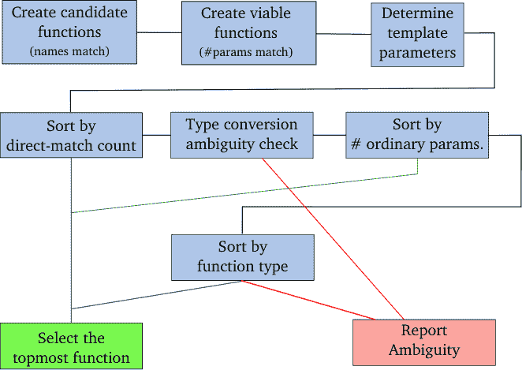

图20.1：函数模板选择机制

-   按函数的直接匹配计数值递减排序。如果最高值没有并列，则选择关联的函数，完成选择过程。
-   检查与最高值关联的函数，以发现自动类型转换序列中的歧义。如果遇到不同的序列，则报告歧义并终止选择过程。
-   按普通参数计数值递减排序与最高值关联的函数。如果最高值没有并列，则选择关联的函数，完成选择过程。
-   按函数类型值递减排序与最高值关联的函数，其中普通函数为 2，模板显式特化为 1，普通函数模板为 0。如果最高值没有并列，则选择关联的函数，完成选择过程。
-   报告歧义并终止选择过程。

### 20.16 SFINAE：替换失败并非错误

考虑以下结构体定义：

```cpp
    struct Int
    {
        typedef int type;
    };
```

虽然此时在结构体中嵌入一个 `typedef` 可能显得有些奇怪，但在第22章中我们会遇到这种情况实际上非常有用。它允许我们定义模板所需类型的变量。例如（忽略以下函数参数列表中 `typename` 的使用，但详情参见第21.2.1节）：

```cpp
    template <typename Type>
    void func(typename Type::type value)
    {
    }
```

要调用 `func(10)`，必须显式指定 `Int`，因为可能有许多结构体定义了 `type`：编译器需要一些辅助。正确的调用是 `func<Int>(10)`。既然已经明确指的是 `Int`，编译器就能正确推断出 `value` 是 `int`。

但模板可以重载，我们的下一个定义是：

```cpp
    template <typename Type>
    void func(Type value)
    {
    }
```

现在，为了确保使用这个函数，我们指定 `func<int>(10)`，同样可以完美编译。

但正如上一节所见，当编译器确定要实例化哪个模板时，它会通过将可用函数原型的参数类型与提供的实际参数类型进行匹配，来创建一个可行函数列表。为此，它必须*确定*参数的类型，而问题就在这里。

在求值 `Type = int` 时，编译器会遇到原型 `func(int::type)`（第一个模板定义）和 `func(int)`（第二个模板定义）。但不存在 `int::type`，因此从某种意义上说这会产生一个错误。然而，该错误源于将提供的模板类型实参替换到各个模板定义中。

由在模板定义中替换类型所引起的类型问题*不*被视为错误，而只是表明该特定类型不能用于该特定模板。因此，该模板会从候选函数列表中移除。

这一原则称为*替换失败并非错误*（SFINAE），编译器经常使用它来选择简单的重载函数（如这里所示），也用于在可用的模板特化中进行选择（另见第21章和第22章）。

### 20.17 模板声明语法总结

本节总结声明模板的基本语法结构。在*定义*模板时，结尾的分号应替换为函数体。

并非每个模板声明都可以转换为模板定义。如果可以提供定义，则会明确提及。

-   普通模板声明（可以提供定义）：

    ```cpp
    template <typename Type1, typename Type2>
    void function(Type1 const &t1, Type2 const &t2);
    ```

-   模板实例化声明（不能提供定义）：

    ```cpp
    template
    void function<int, double>(int const &t1, double const &t2);
    ```

-   使用显式类型的模板（不能提供定义）：

    ```cpp
    void (*fp)(double, double) = function<double, double>;
    void (*fp)(int, int) = function<int, int>;
    ```

-   模板显式特化（可以提供定义）：

    ```cpp
    template <>
    void function<char *, char *>(char *const &t1, char *const &t2);
    ```

-   在类模板内声明友元函数模板的模板声明（第21.10节涵盖，不能提供定义）：

    ```cpp
    friend void function<Type1, Type2>(parameters);
    ```

## 第21章

## 类模板

模板不仅可以为函数构造，也可以为完整的类构造。考虑当类应当能够处理不同数据类型时构造一个类模板。类模板在 C++ 中经常使用：第12章讨论像 `vector`、`stack` 和 `queue` 这样的数据结构，它们被实现为*类模板*。使用类模板时，算法和算法所操作的数据完全彼此分离。要将特定数据结构与特定数据类型结合使用，只需在定义或声明类模板对象时指定数据类型（如 `stack<int> iStack`）。

本章讨论类模板的构造和使用。从某种意义上说，类模板与面向对象编程（参见第14章）存在竞争关系，后者使用一种与模板相似的机制。多态允许程序员通过从基类派生类来推迟算法的实现，而在基类中算法只被部分实现。算法所操作的数据的实际定义和处理可以推迟到派生类定义时进行。同样，模板允许程序员推迟指定算法所操作的数据。这一点在抽象容器中最为明显，抽象容器完全指定了算法，同时完全未指定算法所操作的数据类型。

类模板与多态类之间的对应关系是众所周知的。萨特和亚历山德雷斯库在他们的著作 **《C++ 编码标准》**（Addison-Wesley，2005）中提到了*静态多态*和*动态多态*。*动态多态*是我们在重写虚成员时使用的方式。使用*虚函数表*时，实际调用的函数取决于（基）类指针所指向的对象类型。*静态多态*则出现在模板的上下文中。根据实际类型，编译器自身会在编译阶段生成适合那些特定类型的代码。没有必要将静态多态和动态多态视为互斥的多态变体。相反，两者可以一起使用，结合它们的优势。不过，有一个警告。当类模板定义虚成员时，所有虚成员都会为每个实例化类型而实例化。所有虚成员都必须实例化（无论是否使用），因为编译器必须为每个实例化该类对象的数据类型构造虚函数表。

一般来说，类模板比多态更容易使用。要创建一个整数栈，写 `stack<int> iStack` 当然比派生一个新类 `Istack: public stack` 并使用面向对象编程实现所有必要的成员函数来定义一个类似的整数栈要容易。另一方面，对于定义类模板对象的每一种不同类型，都必须实例化另一个（可能完整的）类。这在面向对象编程的上下文中是不需要的，因为派生类使用而不是复制其基类中已经可用的函数（但也请参见第21.11节）。

之前我们已经使用过类模板。像 `vector<int> vi` 和 `vector<string> vs` 这样的对象很常用。这些模板所定义和实例化的数据类型是此类容器类型的固有部分。需要强调的是，定义或生成类型的是类模板类型与其模板参数的*组合*，而不是单纯的类模板类型。因此，`vector<int>` 是一个类型，`vector<string>` 也是一个类型。这样的类型完全可以由

typedef 定义：

```cpp
typedef std::vector<int>        IntVector;
typedef std::vector<std::string> StringVector;

IntVector vi;
StringVector vs;
```

### 21.1 定义类模板

在介绍了函数模板的构造之后，我们现在准备进入下一步：构造类模板。许多有用的类模板已经存在。我们不再通过查看已有的类模板来说明类模板的构造，而是着手构造另一个可能有用的新类模板。

新类实现一个*循环队列*。循环队列具有固定数量的 `max_size` 个元素。新元素插入其尾部，并且只能访问其头部和尾部元素。只能从循环队列中移除头部元素。一旦追加了 n 个元素，下一个元素将再次插入到队列的（物理）第一个位置。循环队列允许插入，直到其容纳 `max_size` 个元素。只要循环队列至少包含一个元素，就可以从中移除元素。尝试从空的循环队列中移除元素，或向已满的循环队列中添加另一个元素，都会导致抛出异常。除了其他构造函数之外，循环队列还必须提供一个构造函数，用于为其对象初始化 `max_size` 个元素。该构造函数必须为 `max_size` 个元素提供可用内存，但不得调用这些元素的默认构造函数（这暗示使用定位 `new` 运算符）。循环队列应提供值语义以及移动构造函数。

请注意，上述描述中并未提及用于循环队列的实际数据类型。这清楚地表明，我们的类完全可以定义为*类模板*。或者，也可以先针对某个具体数据类型定义该类，然后在将该类转换为类模板时进行抽象。

类模板的实际构造将在下一节中介绍，届时将开发类模板 `CirQue`（循环队列）。

#### 21.1.1 构造循环队列：CirQue

本节将说明类模板的构造。这里，我们将开发类模板 `CirQue`（循环队列）。该类模板有一个模板类型参数 `Data`，表示存储在循环队列中的数据类型。该类模板的接口概要如下：

```cpp
template<typename Data>
class CirQue
{
    // member declarations
};
```

类模板的定义与函数模板的定义类似，开头如下：

- 关键字 `template`，用于开始模板定义或声明。
- `template` 之后由尖括号括起来的列表：包含一个或多个以逗号分隔元素的列表称为*模板参数列表*。模板参数列表可以有多个元素，如下所示：

```cpp
typename Type1, typename Type2, typename Type3
```

当类模板定义多个模板类型参数时，它们会按顺序与定义此类类模板的对象时提供的模板类型实参列表相匹配。

示例：

```cpp
template <typename Type1, typename Type2, typename Type3>
class MultiTypes
{
    ...
};

MultiTypes<int, double, std::string> multiType;
    // Type1 is int, Type2 is double, Type3 is std::string
```

- 在模板参数列表中，我们会看到*形式类型*名称（对于 `CirQue` 来说是 `Data`）。它是一个形式（类型）名称，类似于函数模板参数列表中使用的形式类型。
- 在模板头之后定义类接口。它可以使用模板头中定义的形式类型名称作为类型名称。

一旦定义了 `CirQue` 类模板，就可以用它创建各种循环队列。由于其构造函数之一期望一个 `size_t` 实参，用于定义循环队列中可以存储的最大元素数，因此可以像这样定义循环队列：

```cpp
CirQue<int> cqi(10);              // max 10 ints
CirQue<std::string> cqstr(30);     // max 30 strings
```

正如本章引言部分所述，类模板的名称与其实例化所用的数据类型的组合定义了一种数据类型。还要注意定义（某种数据类型的）`std::vector` 与（某种数据类型的）`CirQue` 之间的相似性。

与 `std::map` 容器类似，类模板可以定义多个模板类型参数。

回到 `CirQue`。`CirQue` 必须能够存储 `max_size` 个 Data 元素。这些元素最终存储在由指针 `Data *d_data` 指向的内存中，该指针最初指向原始内存。新元素添加在 `CirQue` 的尾部。指针 `Data *d_back` 被设置为指向下一个元素将要存储的位置。同样，`Data *d_front` 指向 `CirQue` 第一个元素的位置。两个 `size_t` 数据成员用于监视 `CirQue` 的填充状态：`d_size` 表示当前存储在 `CirQue` 中的元素数量，`d_maxSize` 表示 `CirQue` 可以包含的最大元素数量。因此，`CirQue` 的数据成员为：

```cpp
size_t d_size;
size_t d_maxSize;
Data *d_data;
Data *d_front;
Data *d_back;
```

#### 21.1.2 非类型参数

函数模板参数要么是模板类型参数，要么是模板非类型参数（实际上还存在第三种模板参数，即*模板模板参数*，将在第 22 章（22.4 节）中讨论）。

类模板也可以定义非类型参数。与函数模板非类型参数一样，它们必须是（整型）常量，其值必须在对象实例化时已知。

与函数模板非类型参数不同，类模板非类型参数的值*不*由编译器使用传递给类模板成员的实参推导。

假设我们扩展类模板 `CirQue` 的设计，使其定义第二个（非类型）参数 `size_t Size`。我们的意图是在构造函数中使用这个 `Size` 参数，定义一个由 `Size` 个 `Data` 类型元素组成的数组参数。

`CirQue` 类模板现在变为（仅显示相关构造函数）：

```cpp
template <typename Data, size_t Size>
class CirQue
{
    // ... data members
    public:
        CirQue(Data const (&arr)[Size]);
        ...
};

template <typename Data, size_t Size>
CirQue<Data, Size>::CirQue(Data const (&arr)[Size])
:
    d_maxSize(Size),
    d_size(0),
    d_data(operator new(Size * sizeof(Data))),
    d_front(d_data),
    d_back(d_data),
{
    std::copy(arr, arr + Size, back_inserter(*this));
}
```

遗憾的是，这种设置无法满足我们的需求，因为模板非类型参数的值不会由编译器推导。当要求编译器编译以下 main 函数时，它会报告所需模板参数数量与实际数量不匹配：

```cpp
int main()
{
    int arr[30];

    CirQue<int> ap(arr);

}
/*
    Error reported by the compiler:

    In function 'int main()':
        error: wrong number of template arguments (1, should be 2)
        error: provided for 'template<class Data, size_t Size>
            class CirQue'
*/
```

将 `Size` 定义为具有默认值的非类型参数也不可行。除非显式指定其值，否则编译器始终使用默认值。考虑到除非需要另一个值，否则 `Size` 可以为 0，我们可能想在模板的参数类型列表中指定 `size_t Size = 0`。这样做会在默认值 0 与上述 main 函数中定义的数组 `arr` 的实际大小之间造成不匹配。编译器在使用默认值时报告：

```cpp
In instantiation of 'CirQue<int, 0>':
...
error: creating array with size zero ('0')
```

因此，尽管类模板可以使用非类型参数，但在定义该类的对象时，必须像类型参数一样始终指定它们。可以为这类非类型参数指定默认值，从而在非类型参数未指定时让编译器使用默认值。


定义模板成员函数时，不能指定默认模板参数值（无论是类型模板参数还是非类型模板参数）。一般来说：函数模板定义（因而也包括类模板成员函数）不能给定默认模板（非）类型实参。如果类模板成员要使用默认模板实参，它们*必须*由类接口指定。

与函数模板的非类型参数类似，非类型类模板参数的默认实参值只能指定为常量：

- 全局变量具有常量地址，可用作非类型参数的实参。
- 局部变量和动态分配的变量具有编译器在编译源文件时*不*知道的地址。因此这些地址*不能*用作非类型参数的实参。
- 允许左值变换：如果将指针定义为非类型参数，则可以指定数组名。
- 允许限定转换：指向非 const 对象的指针可以与定义为 const 指针的非类型参数一起使用。
- 允许提升：在为“更宽”类型的非类型参数指定默认实参时，可以使用“更窄”数据类型的常量（例如，需要 `int` 时可以使用 `short`，需要 `double` 时可以使用 `long`）。
- 允许整型转换：如果指定了 `size_t` 参数，也可以使用 `int`。
- 变量不能用于指定模板非类型参数，因为它们的值不是常量表达式。然而，使用 `const` 修饰符定义的变量可以使用，因为它们的值永远不会改变。

尽管我们此前尝试为类 `CirQue` 定义一个接受数组作为实参的构造函数至今尚未成功，但我们仍有选择。下一节将描述一种*确实*能让我们达成目标的方法。

#### 21.1.3 成员模板

我们之前尝试定义一个由编译器初始化为数组元素数量的模板非类型参数，但失败了，因为调用构造函数时不会隐式推导模板参数。相反，在定义类模板对象时必须显式指定它们。由于模板实参是在调用模板构造函数之前刚刚指定的，编译器不必推导任何内容，只需使用显式指定的模板实参即可。

相比之下，当使用*函数*模板时，实际模板参数会根据调用函数时使用的实参推导出来。这开辟了一条通向问题解决方案的途径。如果构造函数本身被转换为函数模板（拥有自己的模板头），那么编译器*将*能够推导非类型参数的值，并且不再需要使用类模板非类型参数来显式指定它。

本身是模板的类模板成员（函数或嵌套类）称为*成员模板*。

成员模板像任何其他模板一样定义，包括其自己的模板头。

当把我们之前的 `CirQue(Data const (&array)[Size])` 构造函数转换为成员模板时，类模板的 `Data` 类型参数仍然可以使用，但我们必须为该成员模板提供一个自己的非类型参数。它在（部分展示的）类接口中的声明如下所示：

```cpp
template <typename Data>
class CirQue
{
    public:
        template <size_t Size>
        explicit CirQue(Data const (&arr)[Size]);
};
```

其实现变为：

```cpp
template <typename Data>
template <size_t Size>
CirQue<Data>::CirQue(Data const (&arr)[Size])
:
    d_size(0),
    d_maxSize(Size),
    d_data(static_cast<Data *>(operator new(sizeof(arr)))),
    d_front(d_data),
    d_back(d_data)
{
    std::copy(arr, arr + Size, back_inserter(*this));
}
```

该实现使用 STL 的 `copy` 算法和 `back_inserter` 适配器将数组元素插入 `CirQue`。要使用 `back_inserter`，`CirQue` 必须定义两个（公有）typedef（参见第 [18.2.1](#) 节）。

```cpp
typedef Data value_type;
typedef value_type const & const_reference;
```

成员模板具有以下特征：

- 必须使用两个模板头：先指定类模板的 `template` 头，然后指定成员模板的模板头；
- 适用常规访问规则：程序可以使用该成员模板构造给定数据类型的 `CirQue` 对象。像类模板通常那样，在构造对象时必须指定数据类型。要从数组 `array[30]` 构造一个 `CirQue` 对象，我们定义：

  ```cpp
  CirQue<int> object(array);
  ```

- 任何成员都可以定义为成员模板，而不仅仅是构造函数；
- 当模板成员在其类接口下方实现时，模板类头必须位于该成员模板的函数模板头之前；
- 成员模板的实现必须指定其正确的辖域。该成员模板被定义为类 `CirQue` 的成员，并针对形式模板参数类型 `Data` 进行实例化；
- 声明和实现中的模板参数名称必须相同；
- 成员模板应定义在其正确的命名空间环境中。因此，在命名空间内定义类模板的文件组织方式应为：

```cpp
namespace SomeName
{
    template <typename Type, ...>  // class template definition
    class ClassName
    {
        ...
    };

    template <typename Type, ...>    // non-inline member definition(s)
    ClassName<Type, ...>::member(...)
    {
        ...
    }
}                                  // namespace closes
```

还有一个可能出现的问题。假设除了上述成员模板之外，还定义了 `CirQue<Data>::CirQue(Data const *data)`。可以定义某种（此前未详述的）协议，使该构造函数能够确定应存储在 `CirQue` 对象中的元素数量。现在当我们定义

```cpp
CirQue<int> object(array);
```

编译器将使用后一个构造函数，而不是该成员模板。

编译器选择后一个构造函数，因为与成员模板相比，它是类 `CirQue` 的构造函数更特化的版本（参见第 20.14 节）。此类问题可以通过将构造函数 `CirQue(Data const *data)` 也定义为成员模板来解决，或者通过定义一个使用两个参数的构造函数来解决，其中第二个参数定义要复制的元素数量。

当使用前一个构造函数（即成员模板）时，它必须定义一个模板类型参数 `Data2`。这里不能使用“Data”，因为成员模板的模板参数不能遮蔽其类的模板参数。使用 `Data2` 代替 `Data` 可以处理这个细节。以下构造函数 `CirQue(Data2 const *)` 的声明可以出现在 CirQue 的头文件中：

```cpp
template <typename Data>
class CirQue
{
    template <typename Data2>
    explicit CirQue(Data2 const *data);
};
```

以下代码定义两个 `CirQue` 对象，展示了这两个构造函数是如何被选择的：

```cpp
int main()
{
    int array[30];
    int *iPtr = array;

    CirQue<int> ac(array);       // calls CirQue(Data const (&arr)[Size])
    CirQue<int> acPtr(iPtr);     // calls CirQue(Data2 const *)
}
```

#### 21.1.4 CirQue 的构造函数和成员函数

现在该再次回到 CirQue 的设计和构造了。

类 `CirQue` 提供了各种成员函数。在构造类模板成员时应遵循常规设计原则。类模板类型参数最好定义为 `Type const &`，而不是 `Type`，以防止不必要地复制大型数据结构。模板类构造函数应使用成员初始化器，而不是在构造函数体内进行成员赋值。成员函数定义最好不在类内提供


```cpp
        d_back = inc(d_back);
        if (++src == other.d_data + d_maxSize)
            src = other.d_data;
    }
```

- CirQue(CirQue<Data> &&tmp):

  移动构造函数仅将当前对象的 d_data 指针初始化为 0，并将临时对象与当前对象交换（见下面的成员 swap）。CirQue 的析构函数检查 d_data，并在其为零时立即返回。实现：

  ```cpp
  template<typename Data>
  CirQue<Data>::CirQue(CirQue<Data> &&tmp)
  :
      d_data(0)
  {
      swap(tmp);
  }
  ```

- CirQue(Data const (&arr)[Size]):

  此构造函数声明为成员模板，提供 Size 非类型参数。它为 Size 个数据元素分配空间，并将 arr 的内容复制到新分配的内存中。实现：

  ```cpp
  template <typename Data>
  template <size_t Size>
  CirQue<Data>::CirQue(Data const (&arr)[Size])
  :
      d_size(0),
      d_maxSize(Size),
      d_data(static_cast<Data *>(operator new(sizeof(arr)))),
      d_front(d_data),
      d_back(d_data)
  {
      std::copy(arr, arr + Size, back_inserter(*this));
  }
  ```

- CirQue(Data const *data, size_t size):

  此构造函数的行为与上一个非常相似，但提供了一个指向第一个数据元素的指针和一个 size_t 值，提供要复制的元素数量。在我们当前的设计中，此构造函数的成员模板变体被排除在设计之外。由于此构造函数的实现与上一个非常相似，因此留给读者作为练习。

- ~CirQue():

  析构函数检查 d_data 成员。如果为零，则未分配任何内容，析构函数立即返回。这可能在两种情况下发生：循环队列不包含任何元素，或者通过某些移动操作从临时对象获取信息，将临时对象的 d_data 成员设置为零。否则，通过显式调用其析构函数销毁 d_size 元素，然后将其原始内存返回到公共池。实现：

  ```cpp
  template<typename Data>
  CirQue<Data>::~CirQue()
  {
      if (d_data == 0)
          return;
      for (; d_size--; )
      {
          d_front->~Data();
          d_front = inc(d_front);
      }
      operator delete(d_data);
  }
  ```

以下是 CirQue 的成员：

- `CirQue &operator=(CirQue<Data> const &other):`

  拷贝赋值运算符有一个标准的实现：

  ```cpp
  template<typename Data>
  CirQue<Data> &CirQue<Data>::operator=(CirQue<Data> const &rhs)
  {
      CirQue<Data> tmp(rhs);
      swap(tmp);
  }
  ```

- `CirQue &operator=(CirQue<Data> &&tmp):`

  移动赋值运算符也有一个标准的实现。由于其实现仅仅调用了 swap，因此它被定义为一个内联函数模板：

  ```cpp
  template<typename Data>
  inline CirQue<Data> &CirQue<Data>::operator=(CirQue<Data> &&tmp)
  {
      swap(tmp);
  }
  ```

- `void pop_front():`

  从 CirQue 中移除 `d_front` 指向的元素。如果 CirQue 为空，则抛出异常。异常以 `CirQue<Data>::EMPTY` 值的形式抛出，该值由 `enum CirQue<Data>::Exception` 定义（参见 push_back）。实现是直接的（显式调用被移除元素的析构函数）：

  ```cpp
  template<typename Data>
  void CirQue<Data>::pop_front()
  {
      if (d_size == 0)
          throw EMPTY;

      d_front->~Data();
      d_front = inc(d_front);
      --d_size;
  }
  ```

- `void push_back(Data const &object):`

  向 CirQue 中添加另一个元素。如果 CirQue 已满，则抛出 `CirQue<Data>::FULL` 异常。CirQue 可能抛出的异常定义在其 Exception 枚举中：

  ```cpp
  enum Exception
  {
      EMPTY,
      FULL
  };
  ```

  对象的副本通过 placement new 安装在 CirQue 的原始内存中，并递增其 `d_size`。

  ```cpp
  template<typename Data>
  void CirQue<Data>::push_back(Data const &object)
  {
      if (d_size == d_maxSize)
          throw FULL;

      new (d_back) Data(object);
      d_back = inc(d_back);
      ++d_size;
  }
  ```

- `void swap(CirQue<Data> &other):`

  将当前 `CirQue` 对象与另一个 `CirQue<Data>` 对象交换；

  ```cpp
  template<typename Data>
  void CirQue<Data>::swap(CirQue<Data> &other)
  {
      char tmp[sizeof(CirQue<Data>)];
      memcpy(tmp, &other, sizeof(CirQue<Data>));
      memcpy(&other, this, sizeof(CirQue<Data>));
      memcpy(this, tmp, sizeof(CirQue<Data>));
  }
  ```

其余公共成员都是一行代码，并实现为内联函数模板：

- `Data &back():`

  返回 `d_back` 指向的元素的引用（如果 `CirQue` 为空，结果未定义）：

  ```cpp
  template<typename Data>
  inline Data &CirQue<Data>::back()
  {
      return d_back == d_data ? d_data[d_maxSize - 1] : d_back[-1];
  }
  ```

- `Data &front():`

  返回 `d_front` 指向的元素的引用（如果 `CirQue` 为空，结果未定义）：

  ```cpp
  template<typename Data>
  inline Data &CirQue<Data>::front()
  {
      return *d_front;
  }
  ```

- `bool empty() const:`

  如果 `CirQue` 为空，返回 `true`；

  ```cpp
  template<typename Data>
  inline bool CirQue<Data>::empty() const
  {
      return d_size == 0;
  }
  ```

- `bool full() const:`

  如果 `CirQue` 已满，返回 `true`；

  ```cpp
  template<typename Data>
  inline bool CirQue<Data>::full() const
  {
      return d_size == d_maxSize;
  }
  ```

- `size_t size() const:`

  返回当前存储在 `CirQue` 中的元素数量；

  ```cpp
  template<typename Data>
  inline size_t CirQue<Data>::size() const
  {
      return d_size;
  }
  ```

- `size_t maxSize() const:`

  返回 `CirQue` 中可存储的最大元素数量；

  ```cpp
  template<typename Data>
  inline size_t CirQue<Data>::maxSize() const
  {
      return d_maxSize;
  }
  ```

最后，该类有一个私有成员 `inc`，返回一个循环递增的指针，指向 `CirQue` 的原始内存：

```cpp
template<typename Data>
Data *CirQue<Data>::inc(Data *ptr)
{
    ++ptr;
    return ptr == d_data + d_maxSize ? d_data : ptr;
}
```

#### 21.1.5 使用 CirQue 对象

当类模板的对象被实例化时，编译器必须看到的*仅仅*是所有实际使用的模板成员函数的定义。

模板的这一特性可以细化到将每个定义存储在一个单独的函数模板定义文件中。在这种情况下，只需包含实际需要的函数模板的定义。然而，几乎没有人这样做。相反，定义类模板的常用方式是定义接口，然后紧接在类模板接口下方定义其余的函数模板（将某些函数定义为内联函数）。

现在类 `CirQue` 已经定义，可以使用了。要使用该类，必须为特定数据类型实例化其对象。在下面的示例中，它为数据类型 `std::string` 初始化：

```cpp
#include "cirque.h"
#include <iostream>
#include <string>
using namespace std;

int main()
{
    CirQue<string> ci(4);
    ci.push_back("1");
    ci.push_back("2");
    cout << ci.size() << ' ' << ci.front() << ' ' << ci.back() << '\n';

    ci.push_back("3");
    ci.pop_front();
    ci.push_back("4");
    ci.pop_front();
    ci.push_back("5");
    cout << ci.size() << ' ' << ci.front() << ' ' << ci.back() << '\n';

    CirQue<string> copy(ci);
    copy.pop_front();
    cout << copy.size() << ' ' << copy.front() << ' ' << copy.back() << '\n';

    int arr[] = {1, 3, 5, 7, 9};
    CirQue<int> ca(arr);
    cout << ca.size() << ' ' << ca.front() << ' ' << ca.back() << '\n';

    //    int *ap = arr;
    //    CirQue<int> cap(ap);
}
```

该程序产生以下输出：

```text
2 1 2
3 3 5
2 4 5
5 1 9
```

#### 21.1.6 默认类模板参数

与函数模板不同，类模板的模板参数可以给定默认实参值。这既适用于模板类型参数，也适用于模板非类型参数。如果定义了默认模板实参，并且在未指定其模板参数实参的情况下实例化类模板对象，则使用模板参数的默认值。

在定义默认值时，请记住它们应适用于该类的大多数实例化。例如，对于类模板 `CirQue`，可以通过指定 `int` 作为其默认类型来修改模板的类型参数列表：

```cpp
template <typename Data = int>
```

即使可以指定默认实参，仍然必须告知编译器对象定义引用的是模板。当使用默认模板实参实例化类模板对象时，可以省略类型说明，但必须保留尖括号。假设 `CirQue` 类有默认类型，可以如下定义该类的对象：

```cpp
CirQue<> intCirQue(10);
```

在定义模板成员时不能指定默认模板实参。因此，例如 `push_back` 成员的定义必须始终以相同的 `template` 说明开头：

```cpp
template <typename Data>
```

当类模板使用多个模板参数时，所有参数都可以给定默认值。与默认函数实参类似，一旦使用了默认值，所有剩余的模板参数也必须使用其默认值。模板类型说明列表不能以逗号开头，也不能包含多个连续的逗号。


一组，使用 `extern` 模板声明。这不仅适用于显式使用的成员，也适用于隐藏成员（复制构造函数、移动构造函数、转换运算符、在类型提升期间调用的构造函数，等等）；编译器假定所有这些都已在别处实例化；

- 尽管上述源文件可以编译，但模板的实例化必须在链接器能够构建最终程序之前可用。为实现这一点，可以构建一个或多个源文件，在其中提供所有必需的实例化。

在独立程序中，人们可能会推迟定义所需成员，并等待链接器报告未解析的外部引用。然后可以利用这些信息创建一系列实例化声明，再将它们链接到程序以满足链接器。不过，这并不是一项非常简单的任务，因为声明必须严格匹配成员在类接口中的声明方式。更简单的方法是定义一个实例化源文件，在其中程序使用的所有设施实际上都在一个不会被程序调用的函数中实例化。通过将这个实例化函数添加到包含 `main` 的源文件，我们可以确保所有必需成员也被实例化。下面是一个如何做到这一点的示例：

```cpp
#include <vector>
#include <iostream>

extern void vectorUser();

int main()
{
    vectorUser();
}

// this part is never called. It is added to make sure all required
// features of declared templates will also be instantiated.

namespace
{
    void instantiator()
    {
        std::vector<int> vi;
        vi.size();
    }
}
```

- 最后，但同样重要的是：类模板的完全匹配的实例化声明（例如，对于 `std::vector<int>`）如下所示：

```cpp
template class std::vector<int>;
```

然而，将其添加到源文件会实例化整个类，即其所有成员现在都被实例化。这可能不是您想要的，因为它可能会不必要地增大最终可执行文件的大小。

- 另一方面，如果已知所需的模板成员已在别处实例化，则可以使用 `extern template` 声明来阻止当前编译单元中的成员实例化，这可能会加快编译速度。例如，

```cpp
// the compiler assumes that required members of
// vector<> have already been instantiated elsewhere
extern template class std::vector<int>;

int main()
{
    std::vector<int> vi(5);    // constructor and operator[]
    ++vi[0];                   // are NOT instantiated
}
```

### 21.2 静态数据成员

当在类模板中定义静态成员时，它们会为类模板实例化的每一种新类型分别定义。由于它们是静态成员，对于类模板实例化的每种类型，只会有一个成员。例如，在如下类中：

```cpp
template <typename Type>
class TheClass
{
    static int s_objectCounter;
};
```

对于每一种不同的 Type 指定，都会有*一个* TheClass<Type>::s_objectCounter。下面的对象定义只会导致一个静态变量被实例化，并由这两个对象共享：

```cpp
TheClass<int> theClassOne;
TheClass<int> theClassTwo;
```

在接口中提及静态成员并不意味着这些成员实际上已被定义。它们只是被*声明*，必须单独*定义*。对于类模板的静态成员也是如此。静态成员的定义通常紧跟在（即位于）模板类接口之后提供。例如，静态成员 s_objectCounter 的定义位于其类接口正下方，如下所示：

```cpp
template <typename Type>            // definition, following
int TheClass<Type>::s_objectCounter = 0;    // the interface
```

这里 s_objectCounter 是一个 int，因此独立于模板类型参数 Type。对相同 Type 多次实例化 s_objectCounter 不会造成问题，因为链接器会从最终可执行文件中删除除一个实例化之外的所有实例化（参见第 20.5 节）。

在类似列表的构造中，如果需要指向该类自身对象的指针，则在定义静态变量时必须使用模板类型参数 Type。示例：

```cpp
template <typename Type>
class TheClass
{
    static TheClass *s_objectPtr;
};

template <typename Type>
TheClass<Type> *TheClass<Type>::s_objectPtr = 0;
```

像往常一样，定义可以从变量名往回读到定义的开头：TheClass<Type> 类的 s_objectPtr 是一个指向 TheClass<Type> 对象的指针。

当定义模板类型参数类型的静态变量时，当然不应将其初始值设为 0。默认构造函数（例如，Type()）通常更合适。示例：

```cpp
template <typename Type>                    // s_type's definition
Type TheClass<Type>::s_type = Type();
```

#### 21.2.1 关键字 'typename' 的扩展用法

到目前为止，关键字 typename 一直用于指示模板类型参数。然而，它也用于消除模板内代码的歧义。考虑以下函数模板：

```cpp
template <typename Type>
Type function(Type t)
{
    Type::Ambiguous *ptr;

    return t + *ptr;
}
```

当编译器处理这段代码时，它会报错，错误消息乍看之下令人费解，类似于：

```text
4: error: 'ptr' was not declared in this scope
```

这个错误消息令人费解，因为程序员的本意是声明一个指向类模板 `Type` 内定义的 `Ambiguous` 类型的指针。但是，编译器面对 `Type::Ambiguous` 时可能会以多种方式解释该语句。显然，它无法检查 `Type` 本身以揭示 `Type` 的真实性质，因为 `Type` 是模板类型。因此，`Type` 的实际定义尚不可用。

编译器面临两种可能性：`Type::Ambiguous` 要么是 `as yet mysterious` 模板 `Type` 的 *静态成员*，要么是 `Type` 的 *子类型*。由于标准规定编译器必须假定前者，因此语句

```cpp
Type::Ambiguous *ptr;
```

被解释为静态成员 `Type::Ambiguous` 与（现在未声明的）实体 `ptr` 的 *乘法*。现在错误消息的原因应该清楚了：在此上下文中，`ptr` 是未知的。

为了消除标识符引用模板类型参数的子类型时代码的歧义，必须使用关键字 `typename`。因此，上述代码改为：

```cpp
template <typename Type>
Type function(Type t)
{
    typename Type::Ambiguous *ptr;

    return t + *ptr;
}
```

类经常定义子类型。当这些子类型在模板定义中作为模板类型参数的子类型出现时，必须使用 typename 关键字将它们标识为子类型。示例：类模板 `Handler` 定义了一个 typename `Container` 作为其模板类型参数。它还定义了一个数据成员，用于存储容器 begin 成员返回的迭代器。此外，Handler 提供了一个构造函数，接受任何支持 `begin` 成员的容器。Handler 的类接口可能如下所示：

```cpp
template <typename Container>
class Handler
{
    Container::const_iterator d_it;

public:
    Handler(Container const &container)
    :
        d_it(container.begin())
    {}
};
```

设计这个类时我们有什么想法？

- typename `Container` 表示任何支持迭代器的容器。
- 容器大概支持成员 `begin`。初始化 `d_it(container.begin())` 显然依赖于模板的类型参数，因此只检查基本语法正确性。
- 同样，容器大概支持一个 *子类型* `const_iterator`，它定义在类 `Container` 中。

最后一项考虑表明需要 `typename`。如果省略它并实例化 `Handler`，编译器会产生一个奇怪的编译错误：

```cpp
#include "handler.h"
#include <vector>
using namespace std;

int main()
{
    vector<int> vi;
    Handler<vector<int> > ph(vi);
}
/*
    Reported error:

    handler.h:4: error: syntax error before `;' token
*/
```

显然，下面这一行

```cpp
Container::const_iterator d_it;
```

在类 `Handler` 中导致问题。它被编译器解释为 *静态成员* 而不是子类型。使用 `typename` 可以解决该问题：

```cpp
template <typename Container>
class Handler
{
    typename Container::const_iterator d_it;
    ...
};
```

一个有趣的例证表明编译器确实将 `X::a` 假定为类 `X` 的成员 `a`，这可以从我们尝试使用以下 `Handler` 构造函数实现编译 `main` 时得到的错误消息中看出：

```cpp
Handler(Container const &container)
:
    d_it(container.begin())
{
    size_t x = Container::ios_end;
}
/*
    Reported error:

    error: `ios_end' is not a member of type `std::vector<int,
            std::allocator<int> >'
*/
```


现在考虑如果本节开头引入的函数模板不返回 `Type` 值，而是返回 `Type::Ambiguous` 值，会发生什么。这里再次引用了模板类型的子类型，因此必须使用 `typename`：

```cpp
template <typename Type>
typename Type::Ambiguous function(Type t)
{
     return t.ambiguous();
}
```

在返回类型的说明中使用 `typename` 将在第 22.1.1 节进一步讨论。

类型名可以嵌入 `typedef` 中。正如常见情况那样，这降低了其他地方出现的声明和定义的复杂性。在下一个示例中，类型 `Iterator` 被定义为模板类型 `Container` 的子类型。现在使用 `Iterator` 时不再需要使用关键字 `typename`：

```cpp
template <typename Container>
class Handler
{
     typedef typename Container::const_iterator Iterator;

     Iterator d_it;
     ...
};
```

### 21.3 为偏离类型特化类模板

`CirQue` 类可用于许多不同的类型。它们的共同特征是，可以直接由该类的 `d_data` 成员指向它们。但这并不总是像看起来那么简单。如果 `d_data` 实际上是 `vector<int>` 呢？对于这类数据类型，常规的 `CirQue` 实现无法使用，因此可以考虑特化。在考虑特化时，也应当考虑继承。通常可以很容易地设计一个类，它派生自以不兼容的数据结构为参数、但在其他方面与原类模板相同的类模板。继承相对于特化的开发优势很明显：继承的类会继承其基类的成员，而特化不继承任何东西。原类模板定义的所有成员都必须由该类的特化重新实现。

这里考虑的特化是真正的特化，因为该特化所使用的数据成员和表示形式与原 `CirQue` 类模板差异很大。因此，原类模板定义的所有成员都必须修改，以适应特化的数据组织方式。

与函数模板特化类似，类模板特化以模板头开始，该模板头可以具有空的模板参数列表，也可以不具有。如果模板参数由特化直接特化，则模板参数列表保持为空（例如，`CirQue` 的模板类型参数 `Data` 针对 `char *` 数据特化）。但是，当针对 `vector<Data>`（即存储任意类型数据的 vector）特化时，模板参数列表可能显示 `typename Data`。这引出了以下原则：

> 模板特化是通过函数或类模板*名称*后面的模板实参列表来识别的，而*不是*通过空的模板参数列表来识别。类模板特化可以具有非空的模板参数列表。如果是这样，则定义的是*类模板部分特化*。

完全特化的类具有以下特征：

- 类模板特化必须提供在泛型类模板定义之后。由于它是特化，编译器必须首先已经看到原始类模板；
- 完全特化的类模板的模板参数列表为空；
- 该类的所有模板参数都被赋予显式类型名，或（对于非类型参数）显式值。这些显式指定在紧接特化模板的类名之后插入的模板参数说明列表（由尖括号包围）中提供；
- 特化类模板的所有成员在原始模板定义使用原始模板参数的地方使用特化类型和值；
- 原始模板的所有成员（可能某些构造函数除外）都应由特化重新定义。如果某个成员在特化中被遗漏，则它不能用于特化类模板的对象；
- 特化可以定义额外的成员（但也许不应这样做，因为这会破坏原始类模板与特化类模板之间的一一对应关系）；
- 特化类模板的成员函数可以由特化类声明，并在其类接口下方实现。如果其实现跟在类接口之后，则它们*不得*以 `template <>` 头开始，而必须直接以成员函数的头开始。

#### 21.3.1 类特化示例

下面是一个完全特化的 `CirQue` 类示例，它针对 `vector<int>` 进行了特化。特化类的所有成员都已声明，但只提供了其成员的非平凡实现。该特化类使用传入构造函数的 vector 的副本，并使用其 vector 数据成员实现循环队列：

```cpp
#ifndef INCLUDED_CIRQUEVECTOR_H_
#define INCLUDED_CIRQUEVECTOR_H_

#include <vector>
#include "cirque.h"

template<>
class CirQue<std::vector<int>>
{
    typedef std::vector<int> IntVect;

    IntVect d_data;
    size_t d_size;

    typedef IntVect::iterator iterator;
    iterator d_front;
    iterator d_back;

public:
    typedef int value_type;
    typedef const value_type & const_reference;

    enum Exception
    {
        EMPTY,
        FULL
    };

    CirQue();
    CirQue(IntVect const &iv);
    CirQue(CirQue<IntVect> const &other);

    CirQue &operator=(CirQue<IntVect> const &other);

    int &back();
    int &front();
    bool empty() const;
    bool full() const;
    size_t maxSize() const;
    size_t size() const;
    void pop_front();
    void push_back(int const &object);
    void swap(CirQue<IntVect> &other);

private:
    iterator inc(iterator const &iter);
};

CirQue<std::vector<int>>::CirQue()
:
    d_size(0)
{}
CirQue<std::vector<int>>::CirQue(IntVect const &iv)
:
    d_data(iv),
    d_size(iv.size()),
    d_front(d_data.begin()),
    d_back(d_data.begin())
{}
CirQue<std::vector<int>>::CirQue(CirQue<IntVect> const &other)
:
    d_data(other.d_data),
    d_size(other.d_size),
    d_front(d_data.begin() + (other.d_front - other.d_data.begin())),
    d_back(d_data.begin() + (other.d_back - other.d_data.begin()))
{}
CirQue<std::vector<int>> &CirQue<std::vector<int>>::operator=(
                                CirQue<IntVect> const &rhs)
{
    CirQue<IntVect> tmp(rhs);
    swap(tmp);
}
void CirQue<std::vector<int>>::swap(CirQue<IntVect> &other)
{
    char tmp[sizeof(CirQue<IntVect>)];
    memcpy(tmp, &other, sizeof(CirQue<IntVect>));
    memcpy(&other, this, sizeof(CirQue<IntVect>));
    memcpy(this, tmp, sizeof(CirQue<IntVect>));
}
void CirQue<std::vector<int>>::pop_front()
{
    if (d_size == 0)
        throw EMPTY;

    d_front = inc(d_front);
    --d_size;
}
void CirQue<std::vector<int>>::push_back(int const &object)
{
    if (d_size == d_data.size())
        throw FULL;

    *d_back = object;
    d_back = inc(d_back);
    ++d_size;
}
inline int &CirQue<std::vector<int>>::back()
{
    return d_back == d_data.begin() ? d_data.back() : d_back[-1];
}
inline int &CirQue<std::vector<int>>::front()
{
    return *d_front;
}
CirQue<std::vector<int>>::iterator CirQue<std::vector<int>>::inc(
    CirQue<std::vector<int>>::iterator const &iter)
{
    iterator tmp(iter + 1);
    tmp = tmp == d_data.end() ? d_data.begin() : tmp;
    return tmp;
}

#endif
```

下一个示例展示如何使用特化的 `CirQue` 类：

```cpp
static int iv[] = {1, 2, 3, 4, 5};

int main()
{
    vector<int> vi(iv, iv + 5);
    CirQue<vector<int>> ci(vi);

    cout << ci.size() << ' ' << ci.front() << ' ' << ci.back() << '\n';
    ci.pop_front();
    ci.pop_front();

    CirQue<vector<int>> cp;

    cp = ci;
    cout << cp.size() << ' ' << cp.front() << ' ' << cp.back() << '\n';
    cp.push_back(6);
    cout << cp.size() << ' ' << cp.front() << ' ' << cp.back() << '\n';
}

/*
    Displays:
        5 1 5
        3 3 5
        4 3 6
*/
```

### 21.4 部分特化

上一节介绍了类模板特化。本节将介绍这种特化的一种变体，它在被特化的模板参数的数量和类型两方面都有所不同。


*部分特化*可以针对具有多个模板参数的类模板定义。函数模板不能部分特化。

使用部分特化时，模板类型参数的一个子集（任意子集）被赋予特定值。当意图是特化类模板，但又要对特化所处理的数据类型进行参数化时，也可以使用类模板部分特化。

为了以部分类模板特化的后一种用法为例开始讨论，考虑上一节开发的类`CirQue<vector<int>>`。在设计`CirQue<vector<int>>`时，你可能问过自己需要实现多少个特化。一个用于`vector<int>`，一个用于`vector<string>`，一个用于`vector<double>`？只要类`CirQue<vector<...>>`所使用的 vector 所处理的数据类型行为像`int`（即，是类的值类型），答案就是：零。无需为每个新数据类型定义完全特化，而是可以对数据类型本身进行参数化，从而得到部分特化：

```cpp
template <typename Data>
class CirQue<std::vector<Data>>
{
    ...
};
```

上面的类是一个特化，因为模板实参列表被附加到`CirQue`类名之后。但是，由于类模板本身具有非空的模板参数列表，它实际上被识别为部分特化。有一个特征可以区分部分特化的类模板成员函数的实现（位于类模板接口之后）与完全特化的成员函数的实现。部分特化的类模板成员函数的实现需要接收一个模板头。实现完全特化的类模板成员时不使用模板头。

为`CirQue`实现部分特化并不困难，留给读者作为练习（提示：只需在上一节的`CirQue<vector<int>>`特化中将`int`改为`Data`）。记住在类型`iterator`前加上`typename`（如`typedef typename DataVector::iterator iterator`）（如21.2.1节所述）。

在接下来的几个小节中，我们将集中讨论类模板非类型模板参数的特化。现在使用矩阵代数（线性代数的一个分支）中定义的一些简单概念来说明这些部分特化。

#### 21.4.1 插曲：一些简单的矩阵代数概念

本节介绍一些简单的矩阵代数术语。这些术语将在后续小节中用于说明和讨论类模板的部分特化。精通矩阵代数的读者可以跳过本节，而不会影响连续性。

矩阵通常被看作由若干行和列组成、填有数字的表格。我们立刻意识到使用模板的机会：这些数字可能是普通的`double`值，但也可能是复数，而我们的复数容器（参见**12.4**节）可能对此有用。因此，我们的类模板提供了一个`DataType`模板类型参数。它在构造矩阵时指定。一些使用`double`值的简单矩阵如下：

```
    1   0   0        An identity matrix,
    0   1   0        (a 3 x 3 matrix).
    0   0   1

    1.2 0   0   0    A rectangular matrix,
    0.5 3.5 18  23   (a 2 x 4 matrix).

    1   2   4   8    A matrix of one row
                     (a 1 x 4 matrix), also known as a `row vector` of 4 elements.
                     (column vectors are analogously defined)
```

矩阵上定义了各种运算。例如，它们可以被相加、相减或相乘。这里我们不会关注这些运算。相反，我们集中于一些简单运算：计算边际和与总和。

边际和是矩阵各行元素之和或各列元素之和。这两种边际和分别称为_行边际和_和_列边际和_。

- _行边际和_的求法是对每一行，将该行所有元素相加，并将这些（Rows个）和放入一个具有Rows个元素的（列）向量的对应元素中。

- 列边际和的求法是对每一列，将该列所有元素相加，并将这些（Columns个）和放入一个具有Columns个元素的（行）向量的对应元素中。

- 矩阵所有元素的总和当然可以通过对其某个边际和的元素求和来计算。

下面的例子展示了一个矩阵、它的边际和以及它的所有元素之和：

| 矩阵 | 行边际和 |
|---|---:|
| 1  2  3 | 6 |
| 4  5  6 | 15 |
| **列边际和：** 5  7  9 | **21（总和）** |

#### 21.4.2 Matrix 类模板

我们首先介绍定义矩阵的类模板。定义这个类模板之后，我们将继续定义若干特化。

由于矩阵由明确的行数和列数组成（矩阵的_维度_），这些数量在使用矩阵时通常不会改变，因此我们可以考虑将其值指定为模板非类型参数。在大多数情况下将使用`DataType = double`。因此，可以选择`double`作为模板的默认类型实参。由于这是一个合理的默认值，`DataType`模板类型参数放在模板类型参数列表的最后。

我们的模板类`Matrix`最初定义如下：

```cpp
template <size_t Rows, size_t Columns, typename DataType = double>
class Matrix
...
```

我们希望这个类模板提供什么？

- 它需要一个地方来存储矩阵元素。这可以定义为一个数组，包含‘Rows’行，每行包含‘Columns’个`DataType`类型的元素。它可以是数组而不是指针，因为矩阵的维度是_先验_已知的。由于经常使用由`Columns`个元素组成的向量（矩阵的一_行_），以及由`Rows`个元素组成的向量（矩阵的一`column`），该类可以使用`typedefs`来表示它们。因此，类接口的初始部分包含：

```cpp
typedef Matrix<1, Columns, DataType>    MatrixRow;
typedef Matrix<Rows, 1, DataType>       MatrixColumn;

MatrixRow d_matrix[Rows];
```

- 它应提供构造函数：默认构造函数和（例如）从流初始化矩阵的构造函数。不需要拷贝或移动构造函数，因为该类不使用指针。同样，不需要重载赋值运算符或析构函数。实现：

```cpp
template <size_t Rows, size_t Columns, typename DataType>
Matrix<Rows, Columns, DataType>::Matrix()
{
    std::fill(d_matrix, d_matrix + Rows, MatrixRow());
}
template <size_t Rows, size_t Columns, typename DataType>
Matrix<Rows, Columns, DataType>::Matrix(std::istream &str)
{
    for (size_t row = 0; row < Rows; row++)
        for (size_t col = 0; col < Columns; col++)
            str >> d_matrix[row][col];
}
```

- 该类的`operator[]`成员（及其 const 变体）只处理第一个索引，返回对完整`MatrixRow`的引用。如何获取`MatrixRow`中的元素将在稍后简要介绍。为保持示例简单，未实现数组边界检查：

```cpp
template <size_t Rows, size_t Columns, typename DataType>
Matrix<1, Columns, DataType>
&Matrix<Rows, Columns, DataType>::operator[](size_t idx)
{
    return d_matrix[idx];
}
```

- 现在我们进入有趣的部分：计算`Matrix`中的边际和以及所有元素的总和。我们将定义类型`MatrixColumn`为包含矩阵行边际和的类型，类型`MatrixRow`为包含矩阵列边际和的类型。还有矩阵所有元素的总和。矩阵所有元素的总和是一个数，它本身可以看作一个1 x 1矩阵。
    
    边际和可以被视为矩阵的特殊形式。为了表示这些边际和，我们可以构造`partial specializations`来定义类模板`MatrixRow`和`MatrixColumn`对象；并构造一个处理1 x 1矩阵的部分特化。这些部分特化用于计算边际和以及矩阵所有元素的总和。
    
    在集中讨论这些部分特化本身之前，我们在这里先用它们来实现计算矩阵边际和及所有元素总和的成员：

```cpp
template <size_t Rows, size_t Columns, typename DataType>
Matrix<1, Columns, DataType>
Matrix<Rows, Columns, DataType>::columnMarginals() const
{
    return MatrixRow(*this);
}

template <size_t Rows, size_t Columns, typename DataType>
Matrix<Rows, 1, DataType>
Matrix<Rows, Columns, DataType>::rowMarginals() const
```


```cpp
{
    return MatrixColumn(*this);
}

template <size_t Rows, size_t Columns, typename DataType>
DataType Matrix<Rows, Columns, DataType>::sum() const
{
    return rowMarginals().sum();
}
```

#### 21.4.3 MatrixRow 部分特化

类模板的*部分特化*可以针对模板参数的任意子集来定义。它们既可以针对模板类型参数进行定义，也可以针对模板非类型参数进行定义。我们的第一个部分特化定义了泛型 `Matrix` 的一行，主要（但并非唯一）用于构造列边际。下面就是这样一个部分特化的设计方式：

- 部分特化以一个模板头开始，其中定义了部分特化中*未被*特化的所有模板参数。这个模板头不能指定任何默认值（如 `DataType = double`），因为默认值已由泛型类模板定义给出。特化*必须*跟在泛型类模板定义之后，否则编译器会报错，表示它不知道该特化哪个类。在模板头之后，类的接口开始。这是一个类模板（部分）特化，因此类名后面必须跟一个模板实参列表，指定部分特化所使用的模板实参。这些实参为某些模板参数指定了明确的类型或值。其余类型则直接从类模板部分特化的模板参数列表中复制。例如，`MatrixRow` 特化为泛型类模板的 `Rows` 非类型参数指定了 1（因为这里讨论的是一行）。`Columns` 和 `DataType` 则留待指定。因此，`MatrixRow` 部分特化开头如下：

```cpp
template <size_t Columns, typename DataType>  // no default allowed
class Matrix<1, Columns, DataType>
```

- 一个 `MatrixRow` 保存单行的数据。因此它需要一个数据成员来存储 `Columns` 个 `DataType` 类型的值。由于 `Columns` 是一个常量值，`d_column` 数据成员可以定义为一个数组：

```cpp
DataType d_column[Columns];
```

- 类模板部分特化的构造函数需要一些注意。默认构造函数很简单。它仅仅使用 `DataType` 的默认构造函数初始化 `MatrixRow` 的数据元素：

```cpp
template <size_t Columns, typename DataType>
Matrix<1, Columns, DataType>::Matrix()
{
    std::fill(d_column, d_column + Columns, DataType());
}
```

还需要另一个构造函数，用泛型 `Matrix` 对象的列边际来初始化 `MatrixRow` 对象。这需要向构造函数提供一个未特化的 `Matrix` 参数。

这里的一般经验法则是定义一个成员模板，以便保留参数的泛型性质。泛型 `Matrix` 模板需要三个模板参数。其中两个已由模板特化提供。第三个参数在成员模板的模板头中提及。由于该参数指的是泛型矩阵的行数，因此直接称为 `Rows`。

下面是第二个构造函数的实现，用泛型 `Matrix` 对象的列边际初始化 `MatrixRow` 的数据：

```cpp
template <size_t Columns, typename DataType>
template <size_t Rows>
Matrix<1, Columns, DataType>::Matrix(
                Matrix<Rows, Columns, DataType> const &matrix)
{
        std::fill(d_column, d_column + Columns, DataType());

        for (size_t col = 0; col < Columns; col++)
                for (size_t row = 0; row < Rows; row++)
                        d_column[col] += matrix[row][col];
}
```

- 我们当前的需求并不真正需要额外的成员。为了访问 `MatrixRow` 的数据元素，重载的 `operator[]` 当然很有用。同样，`const` 版本可以像非 `const` 版本一样实现。下面是它的实现：

```cpp
template <size_t Columns, typename DataType>
DataType &Matrix<1, Columns, DataType>::operator[](size_t idx)
{
        return d_column[idx];
}
```

既然我们已经定义了泛型 `Matrix` 类以及定义单行的部分特化，那么只要使用 `Rows = 1` 定义 `Matrix`，编译器就会选择该行的特化。例如：

```cpp
Matrix<4, 6> matrix;        // generic Matrix template is used
Matrix<1, 6> row;           // partial specialization is used
```

#### 21.4.4 MatrixColumn 部分特化

`MatrixColumn` 的部分特化构造方式类似。下面介绍其要点（完整的 `Matrix` 类模板定义及其所有特化都提供在 cpplusplus.yo.zip 压缩包中（位于 SourceForge[^1]）的 `yo/class/templates/examples/matrix.h` 文件里）：

- 类模板部分特化同样以模板头开始。现在类接口为泛型类模板的第二个模板参数指定了一个固定值。这说明我们可以为每一个单独的模板参数构造部分特化，而不仅仅是第一个或最后一个：

```cpp
template <size_t Rows, typename DataType>
class Matrix<Rows, 1, DataType>
```

- 它的构造函数实现方式与 `MatrixRow` 构造函数的实现方式完全类似。具体实现留给读者作为练习（也可以在 `matrix.h` 中找到）。

- 定义了一个额外的成员 `sum`，用于计算 `MatrixColumn` 向量元素的和。它简单地使用 `accumulate` 泛型算法实现：

```cpp
template <size_t Rows, typename DataType>
```

```cpp
DataType &Matrix<1, 1, DataType>::get()
{
    return d_cell;
}
```

最后，下面所示的 `main` 函数说明了 `Matrix` 类模板及其部分特化如何使用：

```cpp
#include <iostream>
#include "matrix.h"
using namespace std;

int main(int argc, char **argv)
{
    Matrix<3, 2> matrix(cin);

    Matrix<1, 2> colMargins(matrix);
    cout << "Column marginals:\n";
    cout << colMargins[0] << " " << colMargins[1] << '\n';

    Matrix<3, 1> rowMargins(matrix);
    cout << "Row marginals:\n";
    for (size_t idx = 0; idx < 3; idx++)
        cout << rowMargins[idx] << '\n';

    cout << "Sum total: " << Matrix<1, 1>(matrix) << '\n';
    return 0;
}
/*
    Generated output from input: 1 2 3 4 5 6

    Column marginals:
    9 12
    Row marginals:
    3
    7
    11
    Sum total: 21
*/
```

### 21.5 可变参数模板（C++11）

到目前为止，我们只遇到过具有固定数量模板参数的模板。C++11 标准通过*可变参数模板*扩展了这一点。

可变参数模板适用于函数模板和类模板。可变参数模板允许我们指定任意数量的任意类型的模板实参。

可变参数模板被引入该语言，是为了避免我们定义许多重载模板，并且能够创建*类型安全*的可变参数函数。

尽管 C（和 C++）支持可变参数函数，但在 C++ 中其使用一直不受推荐，因为这些函数是出了名的*类型不安全*。可变参数函数模板可以用来处理那些迄今为止无法被 C 风格可变参数函数正确处理的对象。

可变参数模板的模板头使用 `typename ...Params` 这一短语（`Params` 是一个正式名称）。可变参数类模板 `Variadic` 可以声明如下：

```cpp
template<typename ...Params> class Variadic;
```

假设该模板的定义可用，那么就可以使用任意数量的模板实参来实例化此模板。例如：

```cpp
Variadic<
        int,
        std::vector<int>,
        std::map<std::string, std::vector<int>>
> v1;
```

可变参数模板的模板实参列表也可以是空的。例如：

```cpp
Variadic<> empty;
```

如果认为这是不可取的，可以通过提供一个或多个固定参数来防止使用空的模板实参列表。例如：

```cpp
template<typename First, typename ...Rest>
class tuple;
```

**C++** 的函数 `printf` 是类型不安全函数的一个著名例子。当它被实现为可变参数函数模板时，就变成了类型安全的函数。这不仅使函数变为类型安全，还自动扩展到接受任何可以由 **C++** 定义的类型。下面是一个可变参数函数模板 `printcpp` 的可能声明：

```cpp
template<typename ...Params>
void printcpp(std::string const &strFormat, Params ...parameters);
```

声明中使用的省略号（...）有两种用途：

- 在模板头中，它写在模板参数名的*左侧*，表示声明了一个*参数包*。参数包允许我们在实例化模板时指定任意数量的模板实参。参数包可用于将类型和非类型模板实参绑定到模板参数上。

- 在模板实现中，它出现在模板包参数名的*右侧*。在这种情况下，它表示一系列模板实参，这些实参随后与函数参数匹配，而函数参数又位于省略号的右侧。这里的省略号被称为*解包运算符*，因为它“解包”函数参数列表中的一系列实参，从而隐式定义了其参数。

**C++** 没有提供直接访问单个模板实参的语法。不过，这些实参可以通过递归方式访问。下一节将提供一个示例。参数的*数量*通过 `sizeof` 运算符的一个新调用方式来确定：

```cpp
template<typename ...Params>
struct StructName
{
    enum: size_t { s_size = sizeof...(Params) };
};

// StructName<int, char>::s_size        -- initialized to 2
```

[^1]: http://sourceforge.net/projects/cppannotations/


```cpp
while (true)
{
    if ((right = format.find('%', right)) == string::npos)       // 1
        throw std::runtime_error("printcpp: too many arguments");

    if (format.find("%%", right) != right)                     // 2
        break;

    ++right;
    cout << format.substr(left, right - left);
    left = ++right;
}
cout << format.substr(left, right - left) << value;
printcpp(format.substr(right + 1), args...);
```

- 在 1 处，在格式字符串中搜索参数说明符 %。如果未找到，则说明调用该函数时传入的实参过多，它会抛出异常；
- 在 2 处，它验证尚未遇到 %%。如果只看到一个 %，则 while 循环结束，格式字符串中被插入到 cout 直到 % 之前的部分，随后插入 value，并且递归调用接收格式字符串的剩余部分以及剩余参数包；
- 如果遇到了 %%，则将格式字符串插入到第二个 % 之前，第二个 % 被忽略，并且格式字符串的处理在 %% 之后继续。

确保重载函数至少在编译器处理函数模板的定义之前已声明，否则在编译函数模板时不会调用重载函数 `printcpp`。

与 C 的 `printf` 函数不同，`printcpp` 只将 `%` 和 `%%` 识别为格式说明符。上述实现不能识别例如字段宽度。像 `%c` 和 `%x` 这样的类型说明符当然不需要，因为 `ostream` 的插入运算符知道插入到 `ostream` 中的实参类型。扩展格式说明符，使此 `printcpp` 实现能够识别字段宽度等，留给读者作为练习。以下示例展示如何调用 `printcpp`：

```cpp
printcpp("Hello % with %%main%% called with % args"
         " and a string showing %\n",
         "world", argc, string("A String"));
```

#### 21.5.2 完美转发（C++11）

考虑 `string` 的成员 insert。`string::insert` 有多个重载实现。它可用于插入由 string 或 `char const *` 实参提供的文本（全部或部分）；将单个字符插入指定次数；可以使用迭代器指定要插入的字符范围；等等。总之，string 提供了多达五个重载的 insert 成员。

假设存在一个类 `Inserter`，用于将信息插入各种对象。这样的类可以有一个 `string` 数据成员，信息可以插入其中。为实现这一点，Inserter 的接口只需部分复制 string 的接口：只需复制 `string::insert` 的接口。复制接口的成员通常包含一条语句（调用对象数据成员的相应成员函数），因此通常以内联方式实现。此类*包装函数*仅将其参数*转发*给对象数据成员的匹配成员函数。

另一个例子见于*工厂函数*，它们也经常将参数转发给所返回对象的构造函数。

在 C++11 标准之前，重载函数的接口需要由转发实体复制：`Inserter` 需要复制全部五个 `string::insert` 成员的接口；工厂函数需要复制其所返回对象所属类的构造函数的接口。

C++11 标准通过提供*完美转发*简化和泛化了参数转发，完美转发通过右值引用和可变参数模板实现。使用完美转发，传递给函数的实参被“完美转发”到嵌套函数。转发被称为*完美*，因为实参是以类型安全的方式转发的。要使用完美转发，嵌套函数必须定义在类型和数量上都与转发参数匹配的参数列表。

完美转发很容易实现：

- 转发函数定义为模板（通常是*可变参数*模板，但也可以转发单个实参。要定义并转发单个实参，请省略以下代码中的省略号）；
- 转发函数的参数列表是一个*右值引用参数包*（例如 `Params &&...params`）；
- 使用 `std::forward` 将转发函数的实参转发给嵌套函数，并跟踪其类型和数量。在使用 `forward` 之前，必须已包含 `<utility>` 头文件。
- 使用以下语句调用嵌套函数并指定其参数：
  `std::forward<Params>(params)....`

在下一个示例中，完美转发用于实现*一个*成员 `Inserter::insert`，该成员可用于调用五个重载的 `string::insert` 成员中的任意一个。现在实际调用哪个 insert 函数，仅取决于传递给 `Inserter::insert` 的实参类型和数量：

```cpp
class Inserter
{
    std::string d_str;   // somehow initialized
    public:
                        // constructors not implemented,
                        // but see below
    Inserter();
    Inserter(std::string const &str);
    Inserter(Inserter const &other);
    Inserter(Inserter &&other);

    template<typename ...Params>
    void insert(Params &&...params)
    {
        d_str.insert(std::forward<Params>(params)...);
    }
};
```

返回 `Inserter` 的工厂函数也可以使用完美转发轻松实现。现在只需一个工厂函数，而不必定义四个重载的工厂函数。通过为工厂函数提供一个额外的模板类型参数来指定要构造的对象的类，该工厂函数就变成了一个完全通用的工厂函数：

```cpp
template <typename Class, typename ...Params>
Class factory(Params &&...params)
{
    return Class(std::forward<Params>(params)...);
}
```

以下示例展示其用法：

```cpp
Inserter inserter(factory<Inserter>("hello"));
string delimiter(factory<string>(10, '='));
Inserter copy(factory<Inserter>(inserter));
```

函数 `std::forward` 由标准库提供。它并不施展魔法，只是将 params 作为无名对象返回。这样它的作用就像 `std::move`，后者也会移除对象的名称，将其作为无名对象返回。解包运算符与 `forward` 的使用无关，它只是告诉编译器依次对每个实参应用 `forward`。因此，它的行为类似于可变参数函数使用的 C 省略号运算符。

完美转发已在 20.4.5 节中介绍：定义 `Type && param` 的模板函数（其中 `Type` 是模板类型参数）在函数以 `Tp &&` 类型的实参调用时，会将 `Type &&` 转换为 `Tp &&`。否则，它将 `Type` 绑定到 `Tp`，并将 `param` 定义为 `Tp && param`。因此，左值实参绑定到左值类型（`Tp &`），而右值实参绑定到右值类型（`Tp &&`）。

函数 `std::forward` 只是将实参（及其类型）传递给被调用的函数或对象。以下是其简化实现：

```cpp
template <typename T>
T &&forward(T &&a)
{
    return a;
}
```

由于当以左值（或左值引用）调用 `forward` 时，`T &&` 会变成左值引用；而当以右值引用调用 `forward` 时，它仍为右值引用；并且由于 `forward`（像 `std::move` 一样）会将作为实参传给 `forward` 的变量匿名化，因此实参值被转发，同时其类型从函数的形参传递到被调用函数的实参。

这被称为*完美转发*，因为只有当调用“外层”函数（例如 `factory`）时使用的实参类型与嵌套函数（例如 `Class` 的构造函数）的形参类型完全匹配时，才能调用该嵌套函数。因此，完美转发是实现类型安全的工具。

对 `forward` 的一项形式上的改进要求 `forward` 的用户指定要使用的类型，而不是让编译器通过函数模板参数类型推导过程来推导类型。这是通过一个小型辅助结构体模板实现的：

```cpp
template <typename T>
struct identity
{
    typedef T type;
};
```

该结构体仅将 `identity::type` 定义为 `T`，但由于它是结构体，必须显式指定。它不能从函数实参本身推导出来。因此，对上述 `forward` 实现的细微修改如下（typename 用法的说明参见 21.2.1 节）：

```cpp
template <typename T>
T &&forward(typename identity<T>::type &&arg)
{
    return arg;
}
```

现在 `forward` 必须显式说明 `arg` 的类型，如下所示：

```cpp
std::forward<Params>(params)
```


使用 `std::forward` 函数和右值引用规范并不局限于参数包的上下文。由于对模板类型参数的右值引用有特殊的处理方式（参见第20.4.5节），它们也可以有益地用于转发单个函数参数。下面是一个示例，展示如何将函数的实参从模板转发给另一个函数，而该函数本身又作为指向（未指定）函数的指针传递给模板：

```cpp
template<typename Fun, typename ArgType>
void caller(Fun fun, ArgType &&arg)
{
    fun(std::forward<ArgType>(arg));
}
```

函数 `display(ostream &out)` 和 `increment(int &x)` 现在都可以通过 `caller` 调用。例如：

```cpp
caller(display, cout);
int x = 0;
caller(increment, x);
```

##### 21.5.2.1 引用的引用

当类模板的参数是引用时，编译器无法区分重载 const 引用和非 const 引用的成员函数。下面是一个无法编译的程序示例：

```cpp
template <typename T>
class Wrap
{
    public:
        Wrap(T const &tr);
        Wrap(T &tr);
};

int main()
{
    int i;
    Wrap<int &> wrap(i);
}
```

编译器会生成类似如下的错误消息：

> ‘Wrap<T>::Wrap(T&) [with T = int&]’ 不能与
> ‘Wrap<T>::Wrap(const T&) [with T = int&]’ 重载

早些时候，在第19.2.2节中展示了一个程序，它使用了一个具有以下签名的辅助函数

```cpp
int stringcasecmp(string lhs, string rhs)
```

那一节指出，这个函数确实引入了低效，但使用 `string const &` 参数的改进签名却无法编译。对于声明 `string const &` 参数的函数，`std::bind2nd`（参见第18.1.4节）会生成类似此处提到的错误。如下调用

```cpp
auto pos = find_if(
                v1.begin(), v1.end(),
                not1( bind2nd(ptr_fun(stringcasecmp), target) )
            );
```

该调用曾在第19.2.2节中使用，同时结合 `bind2nd` 的定义（通常位于系统头文件 `binders.h` 中），我们会遇到以下一系列实例化模板：

- 首先，实例化 `ptr_fun`，并接收 `stringcasecmp`。函数模板 `ptr_fun` 返回一个 `pointer_to_binary_function`，如果 `stringcasecmp` 定义了 `string const &` 参数，则其 `first_argument_type` 和 `second_argument_type` 被确定为 `string const &`；
- 接下来，`pointer_to_binary_function` 对象被传递给 `bind2nd`。你可能已经猜到，我们已处于危险境地，因为 `pointer_to_binary_function` 是一个定义引用模板类型参数的类模板；
- `bind2nd` 函数模板只是创建并返回一个 `binder2nd` 对象，用 `pointer_to_binary_function` 对象和 `stringcasecmp` 第二个参数的类型（在当前讨论中可以忽略）来初始化它；
- `binder2nd` 类模板对象是一个函子，定义了两个重载的函数操作符（使用声明和简化类型名以便聚焦本质）：

```cpp
result_type operator()(first_argument_type const &x) const;
result_type operator()(first_argument_type &x) const;
```

由于 `first_argument_type` 是一个被推导为 `string const &` 的模板类型参数，我们得到了使用引用参数以及本身为引用参数的模板类型参数的重载函数。因此会产生‘cannot be overloaded’错误消息，并且 `stringcasecmp` 不能定义为具有 `string const &` 参数的函数。

在 C++11 标准出现之前，这个问题无法优雅地解决，因为 C++11 之前的 C++ 版本不提供 *完美转发*。解决方案需要重新构造 `bind2nd` 和 `binder2nd`，利用完美转发提供的特性。STL 定义的其他适配器可能需要类似的重新构造。这里涵盖 `bind2nd` 和 `binder2nd` 所需的修改；读者可在适当时为其他适配器实现此类修改。

这里将 `std::bind2nd` 重写为 `Bind2nd`。它实际上是 `bind2nd` 的副本，但这次创建的是 `Binder2nd` 而不是 `binder2nd`。由于（不可配置的）问题出在 `bind2nd` 对 `binder2nd` 的调用中，因此需要为 `bind2nd` 提供一个替代方案，以避免调用 `binder2nd`。也可以采用其他方法。可以为 `binder2nd` 开发一个类模板特化，期望一个包装 `pointer_to_binary_function` 的特定类。这不会有太大区别，因为在这种情况下 `ptr_fun` 也必须重写。

因此我们坚持采用 `Bind2nd`，其实现如下所示（所有函数都定义在类内以节省一些空间）：

```cpp
template<typename Operation, typename SecondArg>
inline Binder2nd<Operation> Bind2nd(Operation const &operation,
                                    SecondArg const &arg2)
{
    return Binder2nd<Operation>(
                operation,
                typename Operation::second_argument_type(arg2)
            );
}
```

解决方案的核心当然在 `Binder2nd` 中，它现在使用完美转发。现在只有一个函数操作符成员（`operator()`），它被定义为函数模板，并使用完美转发咒语。其函数体将实际传递给函数调用操作符的参数以及 `Binder2nd` 的（固定）第二个参数转发给 `operator()`，也就是 `stringcasecmp`。请注意，被转发的参数后面完全可以跟有额外参数（此处为：`d_arg2`）。在 `Binder2nd` 的实现中，并不保证实际只会有一个完美转发的参数。虽然这种保证可以很容易地内置（参见第22.8节），但它实际上并不需要，因为编译器会检测是否确实有两个参数传递给 `stringcasecmp`，如果不是则生成错误消息。下面是 Binder2nd 的实现：

```cpp
template<typename Operation>
class Binder2nd:
    public std::unary_function<typename Operation::first_argument_type,
                                typename Operation::result_type>
{
    typedef typename Operation::second_argument_type SecondArg;

protected:
    Operation d_operation;
    SecondArg d_arg2;

public:
    Binder2nd(Operation const &operation, SecondArg const &arg2)
        :
            d_operation(operation),
            d_arg2(arg2)
    {}

    template <typename Param>
    typename Operation::result_type
    operator()(Param &&param) const
    {
        return d_operation(std::forward<Param>(param), d_arg2);
    }
};
```

第[19.2.2](#)节中展示的程序除使用 `bind2nd`（现在变为 `Bind2nd`）外保持不变：

```cpp
...
auto pos = find_if(
                v1.begin(), v1.end(),
                not1( Bind2nd(ptr_fun(stringcasecmp), target) )
            );
```

这两个程序产生相同的输出，但这里开发的程序比最初在第[19.2.2](#)节中开发的程序高效得多。

#### 21.5.3 解包操作符（C++）

*解包操作符* 用于在许多情况下获取模板参数。除了递归（如第[21.5.1](#)节所示）之外，没有其他机制可用于获取可变参数模板的各个类型和值。

解包操作符还可用于定义派生自任意数量基类的模板类。做法如下：

```cpp
template <typename ...BaseClasses>
class Combi: public BaseClasses...        // derive from base classes
{
    public:
                                        // specify base class objects
                                        // to its constructor using
        // perfect forwarding
    Combi(BaseClasses &&...baseClasses)
      :
        BaseClasses(baseClasses)...      // use base class initializers
    {                                   // for each of the base
    };                                  // classes
```

这允许我们定义组合任意数量其他类特性的类。如果类 `Combi` 派生自类 A、B 和 C，那么 `Combi` 也是一个 A、一个 B 和一个 C。当然，应该为它提供虚析构函数。`Combi` 对象可以传递给期望指向其任一基类类型对象的指针或引用的函数。下面是一个示例，将 `Combi` 定义为派生自复数向量、字符串以及一个 int 和 double 对的类（使用统一初始化器，其顺序与所用 `Combi` 类型指定的类型顺序匹配）：

```cpp
typedef Combi<
    vector<complex<double>>, string, pair<int, double>
> MultiTypes;

MultiTypes mt = {{3.5, 4}, "mt", {1950, 1.72}};
```

同样的构造也可用于定义支持可变参数类型列表（如元组）的模板数据成员（参见第21.6节）。这样的类可以按如下思路设计：

```cpp
template <typename ...Types>
struct Multi
{
    std::tuple<Types...> d_tup;      // define tuple for Types types

    Multi(Types &&...types)
    :
        d_tup(std::forward<Types>(types)...)   // initialize d_tup from Multi's
    {}                                          // arguments
};
```

转发参数包时使用的省略号是必不可少的。编译器会将其遗漏视为错误。在下面的结构体定义中，程序员原本打算将参数包传递给嵌套对象构造，但在指定模板参数时遗漏了省略号，导致出现 `parameter packs not expanded with '...'` 错误消息：

```cpp
template <int size, typename ...List>
struct Call
{
    Call(List &&...list)
    {
        Call<size - 1, List &&> call(std::forward<List>(list)...);
    }
};
```

程序员本应使用下面的写法，而不是上面 call 对象的定义：

```cpp
Call<size - 1, List &&...> call(std::forward<List>(list)...);
```

#### 21.5.4 非类型可变参数模板（C++11）

可变参数模板不一定定义模板类型。非类型也可以与可变参数模板一起使用。下面的函数模板接受任意一系列 int 值，并将这些值转发给

一个类模板。该类模板定义了一个由函数返回的枚举值 result，除非没有指定任何 int 值，此时返回 0。

```cpp
template <int ... Ints>
int forwarder()
{
    return computer<Ints ...>::result;  // forwarding the Ints
}

template <>    // specialization if no ints are provided
int forwarder<>()
{
    return 0;
}

// use as:
cout << forwarder<1, 2, 3>() << ' ' << ' ' << forwarder<>() << '\n';
```

sizeof 运算符也可用于可变参数非类型模板参数：在 forwarder<1, 2, 3>() 的第一个函数模板中使用 sizeof...(Ints) 将返回 3。

可变参数非类型模板参数用于定义可变参数字面量运算符，这将在第 22.3 节介绍。

### 21.6 元组（C++11）

C++11 标准提供了一种*广义 pair 容器*：*元组*，本节将介绍它。使用元组之前，必须包含头文件 `<tuple>`。

`std::pair` 容器的功能有限，并且只支持两个成员；相比之下，元组的功能稍多一些，并且可以包含数量不限的不同数据类型。在这方面，元组可以看作是*模板对 C 结构体的回应*。

元组的泛型声明（和定义）使用可变参数模板表示法：

```cpp
template <class ...Types>
class tuple;
```

下面是其用法示例：

```cpp
typedef std::tuple<int, double &, std::string, char const *> tuple_idsc;

double pi = 3.14;
tuple_idsc idsc(59, pi, "hello", "fixed");

// access a field:
std::get<2>(idsc) = "hello world";
```

`std::get<idx>(tupleObject)` 函数模板返回对元组 `tupleObject` 中第 idx<sup>th</sup> 个（从零开始）字段的引用。索引被指定为该函数模板的非类型模板参数。

元组可以在不指定初始值的情况下构造。基本类型被初始化为零；类类型字段由其默认构造函数初始化。请注意，在某些情况下，元组的构造可能成功，但其使用可能失败。考虑：

```cpp
tuple<int &> empty;
cout << get<0>(empty);
```

这里元组 `empty` 无法使用，因为其 `int &` 字段是未定义引用。然而，empty 的构造是成功的。

如果两个元组的类型列表相同，则它们可以相互赋值；如果其组成类型支持，拷贝构造函数也可用。如果右侧类型可以转换为匹配的左侧类型，或者左侧类型可以由匹配的右侧类型构造，则拷贝构造和赋值也可用。只要元组的组成类型支持比较，就可以使用关系运算符比较元组（类型数量和（可转换的）类型均匹配）。在这方面，元组类似于 pair。

元组提供以下静态元素（使用编译期初始化）：

- `std::tuple_size<Tuple>::value` 返回为元组类型 `Tuple` 定义的类型数量。示例：
  ```cpp
  cout << tuple_size<tuple_idsc>::value << '\n';  // displays: 4
  ```
- `std::tuple_element<idx, Tuple>::type` 返回 `Tuple` 中元素 `idx` 的类型。示例：
  ```cpp
  tuple_element<2, tuple_idsc>::type text;  // defines std::string text
  ```

解包运算符也可用于将构造函数的参数转发给元组数据成员。考虑一个定义为可变参数模板的类 `Wrapper`：

```cpp
template <typename ...Params>
class Wrapper
{
    ...
public:
    Wrapper(Params &&...params);
};
```

可以为该类提供一个元组数据成员，该成员应使用通过完美转发初始化 `Wrapper` 类对象时所用的类型和值来初始化。与类可以从其模板类型继承的方式类似（参见第 21.5.3 节），它可以将自己的类型和构造函数参数转发给其元组数据成员：

```cpp
template <typename ...Params>
class Wrapper
{
    std::tuple<Params...> d_tuple;    // same types as used for
                                      // Wrapper itself

public:
    Wrapper(Params &&...params)
        :                               // initialize d_tuple with
                                        // Wrapper’s arguments
        d_tuple(std::forward<Params>(params)...)
    {}
};
```

### 21.7 计算函数对象的返回类型（C++11）

正如第 19 章充分说明的那样，函数对象在泛型算法中扮演着重要角色。与泛型算法本身一样，函数对象也可以泛型地定义为类模板的成员。如果这些类的函数调用运算符（`operator()`）定义了参数，那么也可以通过将函数调用运算符本身定义为成员模板来抽象这些参数的类型。示例：

```cpp
template <typename Class>
class Filter
{
    Class obj;
public:
    template <typename Param>
    Param operator()(Param const &param) const
    {
        return obj(param);
    }
};
```

模板类 Filter 是 Class 的包装器，它通过自己的函数调用运算符过滤 Class 的函数调用运算符。在上面的示例中，Class 的函数调用运算符的返回值只是被直接传递，当然也可以进行任何其他处理。

被指定为 Filter 模板类型参数的类型当然可以有多个函数调用运算符：

```cpp
struct Math
{
    int operator()(int x);
    double operator()(double x);
};
```

现在可以使用 Filter<Math> fm 来过滤 Math 对象，具体使用 Math 的第一个还是第二个函数调用运算符取决于实际参数类型。使用 fm(5) 时会调用 int 版本，使用 fm(12.5) 时会调用 double 版本。

遗憾的是，如果函数调用运算符具有不同的返回类型和参数类型，这种方案就不起作用。因此，下面的类 Convert 不能与 Filter 一起使用：

```cpp
struct Convert
{
    double operator()(int x);        // int-to-double
    std::string operator()(double x); // double-to-string
};
```

这个问题可以通过 C++11 标准定义的类模板 std::result_of<Functor (Typelist)> 成功解决。使用 std::result_of 之前，必须包含头文件 <functional>。

result_of 类模板提供了一个 typedef（type），表示 Functor<TypeList> 返回的类型。可以如下使用它来改进 Filter 的实现：

```cpp
template <typename Class>
class Filter
{
    Class obj;
public:
    template <typename Arg>
        typename std::result_of<Class(Arg)>::type
        operator()(Arg const &arg) const
        {
            return obj(arg);
        }
};
```

使用这个定义，可以构造 `Filter<Convert> fc`。现在 `fc(5)` 返回 `double`，而 `fc(4.5)` 返回 `std::string`。

类 `Convert` 必须定义其函数调用运算符与返回类型之间的关系。预定义的函数对象（例如标准模板库中的那些）已经这样做了，但自定义的函数对象必须显式地这样做。

如果一个函数对象类只定义一个函数调用运算符，它可以通过 `typedef` 定义其返回类型。如果上面的类 `Convert` 只定义其两个函数调用运算符中的第一个，那么该 `typedef`（在类的 `public` 部分中）应为：

```cpp
typedef double type;
```

如果定义了多个函数调用运算符，每个都有自己的签名和返回类型，那么签名与返回类型之间的关联按如下方式建立（均在类的 `public` 部分中）：

- 像这样定义一个泛型结构体 `result`：
  ```cpp
  template <typename Signature>
  struct result;
  ```
- 为每个函数调用签名定义 `struct result` 的一个*特化*。`Convert` 的第一个函数调用运算符产生：
  ```cpp
  template <typename Class>
  struct result<Class(int)>
  {
      typedef double type;
  };
  ```
  而 `Convert` 的第二个函数调用运算符产生：
  ```cpp
  template <typename Class>
  struct result<Class(double)>
  {
      typedef std::string type;
  };
  ```
- 在函数调用运算符有多个参数的情况下，这些声明规范应再次提供正确的签名。一个以 `int` 和 `double` 调用、返回 `size_t` 的函数调用运算符得到：
  ```cpp
  template <typename Class>
  struct result<Class(int, double)>
  {
      typedef size_t type;
  };
  ```

### 21.8 实例化类模板

当定义类模板的对象时，类模板会被实例化。当定义或声明类模板对象时，必须显式指定其模板参数。

当指定默认模板参数值时，也*会*指定模板参数，尽管在这种情况下编译器会提供默认值（参见第 21.4 节，其中 `double` 被用作

用于模板 `DataType` 参数的默认类型）。模板参数的实际值或类型*绝不会*像函数模板参数那样从实参中推导出来。因此，要定义元素为复数值的 `Matrix`，使用以下语法：

```cpp
Matrix<3, 5, std::complex> complexMatrix;
```

由于类模板 `Matrix` 使用了默认数据类型，因此可以像这样定义元素为 double 值的矩阵：

```cpp
Matrix<3, 5> doubleMatrix;
```

可以使用关键字 `extern` 声明类模板对象。例如，要声明矩阵 `complexMatrix`，使用：

```cpp
extern Matrix<3, 5, std::complex> complexMatrix;
```

类模板声明足以编译类模板类型的返回值或参数。例如：以下源文件可以编译，尽管编译器尚未看到 `Matrix` 类模板的定义。泛型类和（偏）特化都可以声明。期望或返回类模板对象、引用或参数的函数会自动成为函数模板本身。这是必要的，以便编译器能够根据可能传递给函数的各种实际参数类型来调整该函数：

```cpp
#include <cstddef>

template <size_t Rows, size_t Columns, typename DataType = double>
class Matrix;

template <size_t Columns, typename DataType>
class Matrix<1, Columns, DataType>;

Matrix<1, 12> *function(Matrix<2, 18, size_t> &mat);
```

使用类模板时，编译器必须首先看到它们的实现。因此，在实例化模板时，编译器必须知道模板成员函数。这并不意味着在定义类模板对象时，模板类的*所有*成员都会被实例化或必须已经被看到。编译器只会实例化那些实际使用的成员。下面的类 `Demo` 说明了这一点，它有两个构造函数和两个成员。当我们在 `main` 中使用一个构造函数并调用一个成员时，请注意生成的目标文件和可执行程序的大小。接下来修改类定义，将未使用的构造函数和成员注释掉。再次编译并链接程序。现在观察后一种大小与前一种大小相同。还有其他方法可以说明只有被使用的成员才会被实例化。可以使用 `nm` 程序。它显示目标文件的符号内容。使用 `nm`，我们会得出同样的结论：*只有实际使用的模板成员函数才会被实例化*。下面是用于我们小实验的类模板 `Demo`。在 `main` 中只调用了第一个构造函数和第一个成员函数，因此只有这些成员被实例化：

```cpp
#include <iostream>

template <typename Type>
class Demo
{
    Type d_data;
public:
    Demo();
    Demo(Type const &value);
```

接受像 `Ret && *member` 这样的定义或声明，因为 C++ 不支持返回指向右值引用的指针的函数。此外，它还会检查用于实例化对象的实际类型名是否有效。该类型名必须在对象的实例化点对编译器可见。

- 使用模板成员函数的位置。这称为模板成员函数的实例化点。在这里，`Ret` 参数必须已经指定（或推导出来），并且此时会检查成员中依赖于 `Ret` 模板参数的语句的语法正确性。例如，如果 `member` 包含如下语句

```cpp
Ret tmp(Ret(), 15);
```

那么这在原则上是一条语法有效的语句。然而，当 `Ret == int` 时，该语句无法编译，因为它没有接受两个 `int` 参数的构造函数。请注意，当编译器实例化成员所属类的对象时，这*不是*问题。在实例化点，对象的成员函数 `member` 不会被实例化，因此无效的 `int` 构造仍然不会被发现。

### 21.10 声明友元

友元函数通常被构造为类的*支持*（自由）函数，这些函数无法作为类成员实现和声明。输出流的插入运算符就是一个众所周知的例子。友元类最常出现在嵌套类的上下文中。这里，内部类将外部类声明为其友元（或反之）。我们再次看到一种支持机制：内部类被构造用来支持外部类。

与普通类一样，类模板可以声明其他函数和类为其友元。反过来，普通类也可以声明模板类为其友元。这里同样，友元被构造为一种特殊函数或类，用于增强或支持声明它的类的功能。尽管 `friend` 关键字可用于任何类型的类（普通类或模板类），但在使用类模板时，应区分以下情况：

- 类模板可以声明一个普通函数或类为其友元。这是一种常见的友元声明，例如 ostream 对象的插入运算符。
- 类模板可以声明另一个函数模板或类模板为其友元。在这种情况下，可能必须指定友元的模板参数。

  如果友元的模板参数的实际值*必须*等于声明该友元的类的模板参数，则该友元被称为*绑定友元*类或函数模板。在这种情况下，指定友元声明的模板的模板参数决定（绑定）友元类或函数模板参数的值。绑定友元导致模板参数与友元的模板参数之间形成一一对应关系。

- 在最一般的情况下，类模板可以声明另一个函数模板或类模板为其友元，而不考虑友元的实际模板实参。

  在这种情况下，声明的是*未绑定友元*类或函数模板。友元类或函数模板的模板参数仍有待指定，并且不以某种预定义方式与声明该友元的类的模板参数相关联。如果一个类模板拥有由其模板参数指定的各种类型的数据成员，并且应允许另一个类直接访问这些数据成员，那么在指定这样的友元时，我们希望指定当前模板实参中的任意一个。与其指定多个绑定友元，不如声明一个泛型（未绑定）友元，仅在需要时指定该友元的实际模板参数。

- 上述将模板声明为友元的情况，在使用普通类时也可能遇到：
  - 声明普通友元的普通类已经介绍过（第 15 章）。
  - 如果普通类在声明其友元时指定了具体的实际模板参数，则会出现绑定友元的对应情况。
  - 如果普通类声明泛型模板为其友元，则会出现未绑定友元的对应情况。

#### 21.10.1 在模板中使用非模板作为友元

类模板可以声明普通函数、普通成员函数或普通类为其友元。这样的友元可以访问该类模板的私有成员。

具体类和普通函数可以被声明为友元，但在将类的单个成员函数声明为友元之前，编译器必须已经看到声明该成员的类接口。让我们考虑各种可能性：

- 类模板可以声明一个普通函数为其友元。我们*为什么*要将普通函数声明为友元，这一点并不完全清楚。通常，我们会将声明该友元的类的对象传递给这样的函数。对于类模板，这要求我们为该（友元）函数提供一个模板参数，但不指定其类型。由于该语言不支持像下面这样的构造

```cpp
void function(std::vector<Type> &vector)
```

除非 `function` 本身是模板，否则不能立即清楚这样的友元应如何以及为何要构造。一个原因可能是允许该函数访问类的私有静态成员。此外，这样的友元可以实例化将其声明为友元的类的对象。这将允许友元函数直接访问此类对象的私有成员。例如：

```cpp
template <typename Type>
class Storage
{
    friend void basic();
    static size_t s_time;
    std::vector<Type> d_data;
public:
    Storage();
};

template <typename Type>
size_t Storage<Type>::s_time = 0;

template <typename Type>
Storage<Type>::Storage()
{}

void basic()
{
    Storage<int>::s_time = time(0);
    Storage<double> storage;
    std::random_shuffle(storage.d_data.begin(), storage.d_data.end());
}
```

- 将普通类声明为类模板的友元可能有更多应用。在这里，普通（友元）类可以实例化该类模板的任何类型的对象。然后，友元类可以访问所实例化的类模板的所有私有成员：

```cpp
template <typename Type>
class Composer
{
    friend class Friend;
```


```cpp
std::vector<Type> d_data;
public:
    Composer();
};
```

```cpp
class Friend
{
    Composer<int> d_ints;
    public:
        Friend(std::istream &input);
};
```

```cpp
inline Friend::Friend(std::istream &input)
{
    std::copy(std::istream_iterator<int>(input),
              std::istream_iterator<int>(),
              back_inserter(d_ints.d_data));
}
```

-   或者，也可以只将普通类的一个成员函数声明为友元。这要求编译器在声明该友元之前已经读取了友元类的接口。下面省略了所需的析构函数和重载赋值运算符，展示了一个示例：其中一个类的成员 randomizer 被声明为类 Composer 的友元：

```cpp
template <typename Type>
class Composer;

class Friend
{
    Composer<int> *d_ints;
    public:
        Friend(std::istream &input);
        void randomizer();
};
```

```cpp
template <typename Type>
class Composer
{
    friend void Friend::randomizer();
    std::vector<Type> d_data;
    public:
        Composer(std::istream &input)
        {
            std::copy(std::istream_iterator<int>(input),
                      std::istream_iterator<int>(),
                      back_inserter(d_data));
        }
};
```

```cpp
inline Friend::Friend(std::istream &input)
:
    d_ints(new Composer<int>(input))
{}
```

```cpp
inline void Friend::randomizer()
{
    std::random_shuffle(d_ints->d_data.begin(), d_ints->d_data.end());
}
```

在这个示例中，Friend::d_ints 是一个指针成员。它不能是 Composer<int> 对象，因为编译器在读取 Friend 的类接口时尚未看到 Composer 类接口。如果无视这一点并定义数据成员 Composer<int> d_ints，编译器将产生错误

```text
error: field `d_ints' has incomplete type
```

“不完整类型”，因为此时编译器知道类 Composer 存在，但由于尚未看到 Composer 的接口，它不知道 d_ints 数据成员的大小。

#### 21.10.2 为特定类型实例化的模板作为友元

对于绑定友元类模板或函数模板，友元模板的模板实参与将其声明为友元的类模板的模板实参之间存在一一对应关系。在这种情况下，友元本身也是模板。以下是各种可能性：

-   函数模板是类模板的友元。在这种情况下，我们不会遇到将普通函数声明为类模板友元时遇到的问题。由于友元函数模板本身就是一个模板，因此可以向它提供所需的模板实参，使其成为声明它的类的友元。各种声明组织如下：
  -   声明绑定模板友元函数的类模板被定义；
  -   （友元）函数模板被定义，此时可以访问类模板的所有（私有）成员。

绑定模板友元声明在模板的函数名之后立即指定所需的模板实参。如果没有将模板实参列表附加到函数名上，它仍将是一个普通友元函数。下面是一个示例，展示一个绑定友元用于创建字典条目的子集。对于实际示例，返回 !key1.find(key2) 的专用函数对象可能更有用。对于当前示例，operator== 是可以接受的：

```cpp
template <typename Key, typename Value>
class Dictionary
{
    friend Dictionary<Key, Value>
            subset<Key, Value>(Key const &key,
                               Dictionary<Key, Value> const &dict);

    std::map<Key, Value> d_dict;
public:
    Dictionary();
};

template <typename Key, typename Value>
Dictionary<Key, Value>
    subset(Key const &key, Dictionary<Key, Value> const &dict)
{
    Dictionary<Key, Value> ret;

    std::remove_copy_if(dict.d_dict.begin(), dict.d_dict.end(),
                        std::inserter(ret.d_dict, ret.d_dict.begin()),
                        std::bind2nd(std::equal_to<Key>(), key));
    return ret;
}
```

-   通过将一个完整的类模板声明为另一个类模板的友元，友元类的所有成员都可以访问声明该友元的类的所有私有成员。由于友元类只需要被声明，因此声明的组织比将函数模板声明为友元时容易得多。在下面的示例中，类 `Iterator` 被声明为类 `Dictionary` 的友元。因此，`Iterator` 能够访问 `Dictionary` 的私有数据。这里有一些值得注意的有趣之处：

  -   要将一个类模板声明为友元，该类只需在它被声明为友元之前被声明为类模板：

```cpp
template <typename Key, typename Value>
class Iterator;

template <typename Key, typename Value>
class Dictionary
{
    friend class Iterator<Key, Value>;
};
```

  -   然而，即使编译器尚未看到友元类的接口，友元类的成员也可能已经被使用：

```cpp
template <typename Key, typename Value>
Iterator<Key, Value> Dictionary<Key, Value>::begin()
{
    return Iterator<Key, Value>(*this);
}

template <typename Key, typename Value>
Iterator<Key, Value> Dictionary<Key, Value>::subset(Key const &key)
{
    return Iterator<Key, Value>(*this).subset(key);
}
```

  -   当然，友元类的接口最终必须被编译器看到。由于它是 `Dictionary` 的支持类，因此它可以安全地定义一个由友元类构造函数初始化的 `std::map` 数据成员。然后构造函数可以访问 `Dictionary` 的私有数据成员 `d_dict`：

```cpp
template <typename Key, typename Value>
class Iterator
{
    std::map<Key, Value> &d_dict;

    public:
        Iterator(Dictionary<Key, Value> &dict)
            :
            d_dict(dict.d_dict)
        {}
```

  -   `Iterator` 的成员 `begin` 可以返回一个 map 迭代器。由于编译器不知道 map 的实例化是什么样子，`map<Key, Value>::iterator` 是一个模板子类型。因此，它可以按原样使用，但必须加上 `typename` 前缀（参见下一个示例中函数 `begin` 的返回类型）：

```cpp
template <typename Key, typename Value>
typename std::map<Key, Value>::iterator Iterator<Key, Value>::begin()
{
    return d_dict.begin();
}
```

  -   在前面的示例中，我们可能决定只有 `Dictionary` 才能构造 `Iterator`（也许是因为我们在概念上认为 `Iterator` 是 `Dictionary` 的子类型）。这很容易实现：将 `Iterator` 的构造函数定义在其私有部分，并声明 `Dictionary` 为 `Iterator` 的友元。因此，只有 `Dictionary` 才能创建 `Iterator`。通过将特定 `Dictionary` 类型的构造函数声明为 Iterator 的友元，我们声明了一个*绑定*友元。这确保只有该特定类型的 Dictionary 才能使用与其自身相同的模板参数创建 Iterator。具体做法如下：

```cpp
template <typename Key, typename Value>
class Iterator
{
    friend Dictionary<Key, Value>::Dictionary();
    std::map<Key, Value> &d_dict;
    Iterator(Dictionary<Key, Value> &dict);
public:
};
```

在这个示例中，Dictionary 的构造函数是 Iterator 的友元。该友元是一个模板成员。其他成员也可以被声明为类的友元。在那些情况下，必须使用它们的原型，同时指定其返回值的类型。假设

```cpp
std::vector<Value> sortValues()
```

是 Dictionary 的成员，那么匹配的绑定友元声明是：

```cpp
friend std::vector<Value> Dictionary<Key, Value>::sortValues();
```

最后，以下示例可以作为绑定友元有用的情况的原型：

```cpp
template <typename T>   // a function template
void fun(T *t)
{
    t->not_public();
};

template <typename X>   // a class template
class A
{
                // fun() is used as friend bound to A,
                // instantiated for X, whatever X may be
    friend void fun<A<X>>(A<X> *);

public:
    A();

private:
    void not_public();
};

template <typename X>
A<X>::A()
{
    fun(this);
}

template <typename X>
void A<X>::not_public()
{}

int main()
{
    A<int> a;

    fun(&a);            // fun instantiated for A<int>.
}
```

#### 21.10.3 未绑定模板作为友元

当友元被声明为*未绑定*友元时，它只是声明一个现有模板是其友元（无论该模板如何被实例化）。这在友元应当能够

```cpp
{
    ForEach(iterator, Vector2<Type>, std::vector<Type> >
        (this->begin(), this->end(), *this, &Vector2<Type>::rows);
}

template <typename Type>
void Vector2<Type>::rows(std::vector<Type> &row)
{
    ForEach(row.begin(), row.end(), *this,
                         &Vector2<Type>::columns);
    std::cout << '\n';
}

template <typename Type>
void Vector2<Type>::columns(Type &str)
{
    std::cout << str << " ";
}

using namespace std;

int main()
{
    Vector2<string> c;
    c.push_back(vector<string>(3, "Hello"));
    c.push_back(vector<string>(2, "World"));

    c.process();
}
/*
    Generated output:

    Hello Hello Hello
    World World
*/
```

- 类似地，可以将整个类模板声明为友元。这样，友元的成员函数的所有实例化都可以实例化声明该友元类的类模板的对象。在这种情况下，声明友元的类应提供对其友元类的不同实例化（即使用不同模板实参的实例化）有用的功能。其语法约定与声明未绑定友元函数模板时使用的约定类似：

```cpp
template <typename Type>
class PtrVector
{
    template <typename Iterator, typename Class>
    friend class Wrapper;      // unbound friend class
};
```

现在，类模板 Wrapper 的所有成员都可以使用任意实际类型作为其 Type 参数来实例化 PtrVector。这允许 Wrapper 的实例化访问 PtrVector 的所有私有成员。

- 当仅类模板的某些成员需要访问另一个类模板的私有成员时（例如，另一个类模板具有私有构造函数，并且第一个类模板的某些成员需要实例化第二个类模板的对象），则后者可以仅将前者需要访问其私有成员的那些成员声明为友元。同样，友元类的接口可以保持未指定。但是，必须告知编译器友元成员所属的类确实是一个类。因此，必须提供该类的前置声明。在下一个示例中，`PtrVector` 将 `Wrapper::begin` 声明为友元。注意类 `Wrapper` 的前置声明：

```cpp
    template <typename Iterator>
    class Wrapper;

    template <typename Type>
    class PtrVector
    {
        template <typename Iterator> friend
            PtrVector<Type> Wrapper<Iterator>::begin(Iterator const &t1);
        ...
    };
```

#### 21.10.4 扩展友元声明（C++11，4.7）

C++11 标准定义了扩展友元声明。扩展友元声明也可用于类模板。

类模板的扩展友元声明允许我们将模板类型参数用作友元声明。然而，模板类型实参不一定必须是关键字 `friend` 对其有意义的类型，比如 `int`。在这些情况下，友元声明将被简单地忽略。

考虑以下类模板，将 `Friend` 声明为友元：

```cpp
    template <typename Friend>
    class Class
    {
        friend Friend;
        void msg();                 // private, displays some message
    };
```

现在，一个实际的 `Friend` 类可以访问 `Class` 的所有成员：

```cpp
    class Concrete
    {
        Class<Concrete> d_class;
        Class<std::string> d_string;

    public:
        void msg()
        {
            d_class.msg();      // OK: calls private Class<Concrete>::msg()
            //d_string.msg(); // fails to compile: msg() is private
        }
    };
```

像 `Class<int> intClass` 这样的声明也是可以的，但在这里友元声明会被简单地忽略。毕竟，不存在可以访问 `Class<int>` 私有成员的“int 成员”。

### 21.11 类模板派生

类模板也可以用于继承。当在类派生中使用类模板时，应区分以下情况：

- 在派生普通类时，将现有的类模板用作基类。派生类本身在某种程度上将是一个类模板，但在定义派生类对象时这有些隐藏不见。
- 在派生另一个类模板时，将现有的类模板用作基类。这里类模板的特征保持清晰可见。
- 在派生模板类时，将普通类用作基类。这种有趣的混合方式允许我们构造*部分编译*的类模板。

类模板派生的这三种变体将在本节及接下来的章节中详细说明。

考虑以下基类：

```cpp
template<typename T>
class Base
{
    T const &t;

    public:
        Base(T const &t);
};
```

上面的类是一个类模板，可以用作以下派生类模板 Derived 的基类：

```cpp
template<typename T>
class Derived: public Base<T>
{
    public:
        Derived(T const &t);
};
template<typename T>
Derived<T>::Derived(T const &t)
:
    Base(t)
{}
```

其他组合也是可能的。通过指定模板实参可以实例化基类，从而将派生类变成普通类（同时也展示了类对象的定义）：

```cpp
class Ordinary: public Base<int>
{
    public:
        Ordinary(int x);
};
inline Ordinary::Ordinary(int x)
:
    Base(x)
{}

    Ordinary ordinary(5);
```

这种方法允许我们向类模板添加功能，而无需构造派生类模板。

类模板派生在很大程度上遵循与不涉及类模板的普通类派生相同的规则。一些类模板派生特有的微妙之处可能很容易导致

```cpp
void (Handler::*)(std::string const &cmd)>
(s_cmds, s_cmds_end)
{
}
```

- process 成员函数遍历映射中的元素。一旦命令行上的第一个单词与命令的初始字符匹配，就执行相应的命令。如果未找到这样的命令，则输出一条错误消息：

```cpp
void Handler::process(std::string const &line)
{
    istringstream istr(line);
    string cmd;
    istr >> cmd;
    for (iterator it = begin(); it != end(); it++)
    {
        if (it->first.find(cmd) == 0)
        {
            (this->*it->second)(line);
            return;
        }
    }
    cout << "Unknown command: " << line << '\n';
}
```

#### 21.11.2 从类模板派生类模板

虽然从类模板派生普通类完全可行，但与模板基类相比，所得到的类显然具有有限的一般性。如果一般性很重要，那么从类模板派生类模板可能是一个更好的主意。这允许我们用新功能扩展现有的类模板，或覆盖现有类模板的功能。

下面介绍的类模板 `SortVector` 派生自现有的类模板 `std::vector`。它允许我们使用其数据元素可能包含的任意数据成员的任意顺序对其元素执行*分层排序*。要实现这一点，只有一个要求。`SortVector` 的数据类型必须提供专用的成员函数来比较其成员。

例如，如果 `SortVector` 的数据类型是类 `MultiData` 的对象，那么对于 `MultiData` 的每个可以比较的数据成员，`MultiData` 应实现具有以下原型的成员函数：

```cpp
bool (MultiData::*)(MultiData const &rhv)
```

因此，如果 `MultiData` 有两个数据成员 `int d_value` 和 `std::string d_text`，并且两者都可以用于分层排序，则 `MultiData` 应提供以下两个成员：

```cpp
bool intCmp(MultiData const &rhv);  // returns d_value < rhv.d_value
bool textCmp(MultiData const &rhv); // returns d_text < rhv.d_text
```

此外，为方便起见，假设已经为 `MultiData` 对象定义了 operator<< 和 operator>>。

类模板 `SortVector` 直接派生自模板类 `std::vector`。我们的实现继承了基类的所有成员。它还提供了两个简单的构造函数：

```cpp
template <typename Type>
class SortVector: public std::vector<Type>
```


-   首先，为 `MultiData` 对象创建一个 `SortVector` 对象。它使用 copy 泛型算法，从程序标准输入流中出现的信息填充 `SortVector` 对象。初始化该对象后，其元素被显示到标准输出流：

```cpp
SortVector<MultiData> sv;

copy(istream_iterator<MultiData>(cin),
     istream_iterator<MultiData>(),
     back_inserter(sv));
```

-   一个指向成员的指针数组用两个成员函数的地址初始化。文本比较是最重要的排序标准：

```cpp
bool (MultiData::*arr[])(MultiData const &rhv) const =
{
    &MultiData::textCmp,
    &MultiData::intCmp,
};
```

-   接下来，对该数组的元素进行排序并显示到标准输出流：

```cpp
sv.hierarchicSort(arr, 2);
```

-   然后交换指向 `MultiData` 成员函数的指针数组的两个元素，并重复上一步：

```cpp
swap(arr[0], arr[1]);
sv.hierarchicSort(arr, 2);
```

编译程序后，可以给出以下命令：

```sh
echo a 1 b 2 a 2 b 1 | a.out
```

这将产生以下输出：

```text
a 1 b 2 a 2 b 1
====
a 1 a 2 b 1 b 2
====
a 1 b 1 a 2 b 2
====
```

#### 21.11.3 从普通类派生类模板

普通类可以用作派生模板类的基类。这种继承树的优点是基类的成员都可以预先编译。现在当类模板的对象被实例化时，只需实例化派生类模板中实际使用的成员。

这种方法可用于所有成员函数的实现不依赖于模板参数的类模板。这些成员可以在一个单独的类中定义，然后该类用作从它派生的类模板的基类。

作为这种方法的说明，我们将在下面开发这样一个类模板。我们将开发一个从普通类 `TableType` 派生的类 `Table`。类 `Table` 将某种类型的元素显示在列数可配置的表格中。元素要么水平显示（前 *k* 个元素占据第一行），要么垂直显示（前 *r* 个元素占据第一列）。

显示表格元素时，将它们插入流中。表格由单独的类（`TableType`）处理，实现表格的呈现。由于表格元素被插入流中，到文本（或 `string`）的转换在 `Table` 中实现，但字符串本身的处理留给 `TableType`。我们将很快介绍 `TableType` 的一些特征，首先集中讨论 `Table` 的接口：

-   类 `Table` 是一个类模板，只需要一个模板类型参数：`Iterator`，指向某种数据类型的迭代器：

```cpp
template <typename Iterator>
class Table: public TableType
{
```

-   `Table` 不需要任何数据成员。所有数据操作都由 `TableType` 执行。

-   `Table` 有两个构造函数。构造函数的头两个参数是用于遍历必须输入表格的元素的迭代器。构造函数要求我们指定希望表格具有的列数以及一个 `FillDirection`。`FillDirection` 是由 `TableType` 定义的枚举，具有值 `HORIZONTAL` 和 `VERTICAL`。为了让 Table 的用户能够控制页眉、页脚、标题、水平和垂直分隔符，一个构造函数有一个 `TableSupport` 引用参数。类 `TableSupport` 在后续阶段开发为虚类，允许客户端进行这种控制。以下是该类的构造函数：

```cpp
Table(Iterator const &begin, Iterator const &end,
     size_t nColumns, FillDirection direction);
Table(Iterator const &begin, Iterator const &end,
     TableSupport &tableSupport,
     size_t nColumns, FillDirection direction);
```

-   构造函数是 Table 仅有的两个公有成员。两个构造函数都使用基类初始化器来初始化它们的 `TableType` 基类，然后调用类的私有成员 `fill` 将数据插入 `TableType` 基类对象。以下是构造函数的实现：

```cpp
template <typename Iterator>
Table<Iterator>::Table(Iterator const &begin, Iterator const &end,
                       TableSupport &tableSupport,
                       size_t nColumns, FillDirection direction)
:
    TableType(tableSupport, nColumns, direction)
{
    fill(begin, end);
}
```

```cpp
template <typename Iterator>
Table<Iterator>::Table(Iterator const &begin, Iterator const &end,
                       size_t nColumns, FillDirection direction)
:
    TableType(nColumns, direction)
{
    fill(begin, end);
}
```

-   类的 `fill` 成员遍历元素范围 `[begin, end)`，如构造函数前两个参数所定义。正如我们很快将看到的，`TableType` 定义了一个受保护的数据成员 `std::vector<std::string> d_string`。迭代器所指向的数据类型的要求之一是，该数据类型可以插入流中。因此，`fill` 使用一个 `ostringstream` 对象来获得数据的文本表示，然后将其追加到 `d_string`：

```cpp
template <typename Iterator>
void Table<Iterator>::fill(Iterator it, Iterator const &end)
{
    while (it != end)
    {
        std::ostringstream str;
        str << *it++;
        d_string.push_back(str.str());
    }
    init();
}
```

这完成了类 `Table` 的实现。注意，这个类模板只有三个成员，其中两个是构造函数。因此，在大多数情况下只需实例化两个函数模板：一个构造函数和类的 `fill` 成员。例如，下面定义一个包含四列的表格，由从标准输入流提取的字符串垂直填充：

```cpp
Table<istream_iterator<string> >
    table(istream_iterator<string>(cin), istream_iterator<string>(),
        4, TableType::VERTICAL);
```

填充方向指定为 `TableType::VERTICAL`。也可以使用 `Table` 指定，但由于 `Table` 是类模板，其指定会稍微复杂一些：`Table<istream_iterator<string> >::VERTICAL`。

现在 `Table` 派生类已经设计好了，让我们把注意力转向类 `TableType`。以下是其基本特征。

-   它是一个普通类，设计为作为 `Table` 的基类运行。

-   它使用各种私有数据成员，其中 `d_colWidth` 是一个向量，存储每列最宽元素的宽度，而 `d_indexFun` 指向类的成员函数，该函数返回 `table[row][column]` 中的元素，具体取决于表格的填充方向。`TableType` 还使用一个 `TableSupport` 指针和一个引用。不需要 `TableSupport` 对象的构造函数使用 `TableSupport *` 分配一个（默认）`TableSupport` 对象，然后使用 `TableSupport &` 作为该对象的别名。另一个构造函数将指针初始化为 0，并使用引用数据成员来引用其参数提供的 `TableSupport` 对象。或者，也可以使用一个静态 `TableSupport` 对象来初始化前一个构造函数中的引用数据成员。其余私有数据成员可能不言自明：

```cpp
TableSupport                 *d_tableSupportPtr;
TableSupport                 &d_tableSupport;
size_t                        d_maxWidth;
size_t                        d_nRows;
size_t                        d_nColumns;
WidthType                     d_widthType;
std::vector<size_t>           d_colWidth;
size_t                        (TableType::*d_widthFun)
                              (size_t col) const;
std::string const             &(TableType::*d_indexFun)
                              (size_t row, size_t col) const;
```

-   填充表格的实际字符串对象存储在一个受保护的数据成员中：

```cpp
std::vector<std::string> d_string;
```

-   （受保护的）构造函数执行基本任务：它们初始化对象的数据成员。以下是期望 `TableSupport` 对象引用的构造函数：

```cpp
#include "tabletype.h"
```


```cpp
TableType::TableType(TableSupport &tableSupport, size_t nColumns,
                      FillDirection direction)
:
    d_tableSupportPtr(0),
    d_tableSupport(tableSupport),
    d_maxWidth(0),
    d_nRows(0),
    d_nColumns(nColumns),
    d_widthType(COLUMNWIDTH),
    d_colWidth(nColumns),
    d_widthFn(&TableType::columnWidth),
    d_indexFun(direction == HORIZONTAL ?
                   &TableType::hIndex
               :
                   &TableType::vIndex)
{}
```

- 一旦 `d_string` 已被填充，表格就由 `Table::fill` 初始化。这个受保护的 init 成员会调整 `d_string` 的大小，使其大小精确为 行数 × 列数，并确定每列元素的最大宽度。其实现很直接：

```cpp
#include "tabletype.h"

void TableType::init()
{
    if (!d_string.size())                         // no elements
        return;                                   // then do nothing

    d_nRows = (d_string.size() + d_nColumns - 1) / d_nColumns;
    d_string.resize(d_nRows * d_nColumns);       // enforce complete table

                                                  // determine max width per column,
                                                  // and max column width
    for (size_t col = 0; col < d_nColumns; col++)
    {
        size_t width = 0;
        for (size_t row = 0; row < d_nRows; row++)
        {
            size_t len = stringAt(row, col).length();
            if (width < len)
                width = len;
        }
        d_colWidth[col] = width;

        if (d_maxWidth < width)                 // max. width so far.
            d_maxWidth = width;
    }
}
```

- 公共成员 `insert` 被插入操作符（`operator<<`）用于将 Table 插入到流中。它首先将表格的尺寸信息告知 TableSupport 对象。然后它显示表格，允许 TableSupport 对象写出表头、表尾和分隔线：

```cpp
#include "tabletype.h"

ostream &TableType::insert(ostream &ostr) const
{
    if (!d_nRows)
        return ostr;

    d_tableSupport.setParam(ostr, d_nRows, d_colWidth,
                             d_widthType == EQUALWIDTH ? d_maxWidth : 0);

    for (size_t row = 0; row < d_nRows; row++)
    {
        d_tableSupport.hline(row);

        for (size_t col = 0; col < d_nColumns; col++)
        {
            size_t colwidth = width(col);

            d_tableSupport.vline(col);
            ostr << setw(colwidth) << stringAt(row, col);
        }

        d_tableSupport.vline();
    }
    d_tableSupport.hline();

    return ostr;
}
```

- cplusplus.yo.zip 压缩包中包含 TableSupport 的完整实现。该实现位于目录 `yo/classtemplates/examples/table` 下。其剩余的大多数成员都是私有的。其中，这两个成员分别针对水平填充的表格和垂直填充的表格返回表元素 `[row][column]`：

```cpp
inline std::string const &TableType::hIndex(size_t row, size_t col) const
{
    return d_string[row * d_nColumns + col];
}
inline std::string const &TableType::vIndex(size_t row, size_t col) const
{
    return d_string[col * d_nRows + row];
}
```

支持类 `TableSupport` 用于显示表头、表尾、标题和分隔线。它有四个虚成员来执行这些任务（当然，还有一个虚构造函数）：

- `hline(size_t rowIndex)`：在显示第 rowIndex 行元素之前调用。
- `hline()`：在显示最后一行之后立即调用。
- `vline(size_t colIndex)`：在显示第 colIndex 列元素之前调用。
- `vline()`：在显示一行所有元素之后立即调用。

关于类 `Table`、`TableType` 和 `TableSupport` 的完整实现，读者可参阅 cplusplus.yo.zip 压缩包。下面是一个演示它们用法的简短程序：

```cpp
/*

*/
                         table.cc

#include <fstream>
#include <iostream>
#include <string>
#include <iterator>
```

当它存储新元素时。这里假定 `PtrVector` 的客户端执行所需的分配，并且析构函数在稍后实现。

嵌套类将构造函数定义为私有成员，并允许 `PtrVector<Type>` 对象访问其私有成员。因此，只有外围 `PtrVector<Type>` 类类型的对象才被允许构造它们的迭代器对象。然而，`PtrVector<Type>` 的客户端可以构造它们所使用的 `PtrVector<Type>::iterator` 对象的副本。

下面是嵌套类 iterator，使用了（必需的）`friend` 声明。注意 `typename` 关键字的使用：由于 `std::vector<Type *>::iterator` 依赖于模板参数，它还不是一个实例化的类。因此，iterator 成为一个隐式的 typename。如果省略了 `typename`，编译器会发出警告。下面是类的接口：

```cpp
class iterator
{
    friend class PtrVector<Type>;
    typename std::vector<Type *>::iterator d_begin;

    iterator(PtrVector<Type> &vector);

public:
    Type & operator*();
};
```

这些成员实现表明，基类的 `begin` 成员被调用来初始化 `d_begin`。`PtrVector<Type>::begin` 的返回类型也必须以 `typename` 开头：

```cpp
template <typename Type>
PtrVector<Type>::iterator::iterator(PtrVector<Type> &vector)
:
    d_begin(vector.std::vector<Type *>::begin())
{}

template <typename Type>
Type &PtrVector<Type>::iterator::operator*()
{
    return **d_begin;
}
```

类的其余部分很简单。省略了所有可能实现的其他函数，`begin` 函数返回一个新构造的 `PtrVector<Type>::iterator` 对象。它可以调用构造函数，因为 `iterator` 类将其外围类声明为友元：

```cpp
template <typename Type>
typename PtrVector<Type>::iterator PtrVector<Type>::begin()
{
    return iterator(*this);
}
```

下面是一个简单的骨架程序，演示了嵌套类 `iterator` 的用法：

```cpp
int main()
{
    PtrVector<int> vi;

    vi.push_back(new int(1234));

    PtrVector<int>::iterator begin = vi.begin();
    std::cout << *begin << '\n';
}
```

嵌套枚举和嵌套 typedef 也可以由类模板定义。前面提到的类 Table（第 21.11.3 节）继承了枚举 TableType::FillDirection。如果 Table 被实现为完整的类模板，那么这个枚举本应在 Table 自身中定义为：

```cpp
template <typename Iterator>
class Table: public TableType
{
  public:
    enum FillDirection
    {
        HORIZONTAL,
        VERTICAL
    };
  ...
};
```

在这种情况下，当引用 FillDirection 的值或其类型时，必须指定模板类型参数的实际值。例如（假设 iter 和 nCols 按第 21.11.3 节定义）：

```cpp
Table<istream_iterator<string> >::FillDirection direction =
            argc == 2 ?
                Table<istream_iterator<string> >::VERTICAL
            :
                Table<istream_iterator<string> >::HORIZONTAL;

Table<istream_iterator<string> >
    table(iter, istream_iterator<string>(), nCols, direction);
```

### 21.13 构造迭代器

在第 18.2 节中，介绍了与泛型算法一起使用的迭代器。我们看到区分了多种类型的迭代器：输入迭代器、前向迭代器、输出迭代器、双向迭代器和随机访问迭代器。

为了确保一个类的对象被解释为特定类型的迭代器，该类必须从类 std::iterator 派生。在从该类派生之前，必须包含 `<iterator>` 头文件。

在第 18.2 节中讨论了迭代器的特性。所有迭代器都应支持（使用 Iterator 作为所设计迭代器类的通用名称，用 Type 表示 Iterator 对象所引用的数据类型（可能是 const，在这种情况下，相关的运算符也应是 const 成员））：

- 前缀自增运算符（`Iterator &operator++()`）；
- 解引用运算符（`Type &operator*()`）；
- 一个“指向”运算符（`Type *operator->()`）；
- 测试两个迭代器对象是否（不）相等的比较运算符（`bool operator==(Iterator const &other)`、`bool operator!=(Iterator const &other)`）。


当迭代器要在泛型算法中使用时，它们必须满足额外的要求。这是因为泛型算法会对其接收的迭代器类型进行检查。简单指针通常会被接受，但如果使用迭代器对象，则它必须能够指明其所代表的迭代器种类。

当从类 iterator 派生类时，迭代器的类型由类模板的*第一个*参数定义，而迭代器所引用的数据类型由类模板的*第二个*参数定义。

派生类所实现的迭代器类型通过一个所谓的*迭代器标签*（*iterator_tag*）来指定，该标签作为类 iterator 的第一个模板实参提供。对于五种基本迭代器类型，这些标签是：

- `std::input_iterator_tag`。此标签定义 InputIterator。此类型的迭代器允许读取操作，从迭代器所引用序列的第一个元素迭代到最后一个元素。

    InputIterator 解引用运算符应声明如下：

    ```cpp
    Type const &operator*() const;
    ```

    除标准运算符外，对 InputIterator 没有进一步要求。

- `std::output_iterator_tag`。此标签定义 OutputIterator。此类型的迭代器允许赋值操作，从迭代器所引用序列的第一个元素迭代到最后一个元素。

    OutputIterator 解引用运算符应允许对其解引用运算符所引用的数据进行赋值。因此，OutputIterator 解引用运算符应声明如下：

    ```cpp
    Type &operator*();
    ```

    除标准运算符外，对 OutputIterator 没有进一步要求。

- `std::forward_iterator_tag`。此标签定义 ForwardIterator。此类型的迭代器允许读取*和*赋值操作，从迭代器所引用序列的第一个元素迭代到最后一个元素。

    ForwardIterator 解引用运算符应允许对其解引用运算符所引用的数据进行赋值。因此，ForwardIterator 解引用运算符应声明如下：

    ```cpp
    Type &operator*();
    ```

    除标准运算符外，对 ForwardIterator 没有进一步要求。

- `std::bidirectional_iterator_tag`。此标签定义 BidirectionalIterator。此类型的迭代器允许读取*和*赋值操作，逐步迭代，可能以交替方向，遍历迭代器所引用序列的所有元素。

    BidirectionalIterator 解引用运算符应允许对其解引用运算符所引用的数据进行赋值，并且应允许向后步进。因此，BidirectionalIterator 除迭代器所需的标准运算符外，还应提供以下运算符：

    ```cpp
    Type &operator*();
    Iterator &operator--();
    ```

- `std::random_access_iterator_tag`。此标签定义 RandomAccessIterator。此类型的迭代器允许读取*和*赋值操作，使用任何可用的（随机）步长，可能以交替方向，遍历迭代器所引用序列的所有元素。RandomAccessIterator 类的解引用运算符应允许对其所引用的数据进行赋值，并且除迭代器所需的标准运算符外，还应提供以下运算符：

    - Type &operator*()，允许对解引用运算符所引用的数据进行赋值；
    - Iterator operator-()，允许向后单步；
    - Type operator-(Iterator const &rhs) const，返回当前迭代器与 rhs 迭代器之间的数据元素数量（如果 rhs 引用的数据元素位于此迭代器所引用的数据元素之后，则返回负值）；
    - Iterator operator+(int step) const，返回一个迭代器，指向此迭代器所引用数据元素之后 step 个数据元素处的数据元素；
    - Iterator operator-(int step) const，返回一个迭代器，指向此迭代器所引用数据元素之前 step 个数据元素处的数据元素；
    - bool operator<(Iterator const &rhs) const，如果此迭代器所引用的数据元素位于 rhs 迭代器所引用的数据元素之前，则返回 true。

每个迭代器标签都假定某一组运算符可用。`RandomAccessIterator` 是迭代器中最复杂的，因为它隐含了所有其他迭代器。

注意，迭代器总是定义在某个范围（`[begin, end)`）上。如果递增和递减操作产生的迭代器值指向该范围之外的位置，则可能导致迭代器的未定义行为。

通常，迭代器只访问其所引用序列的元素。在内部，迭代器可能使用普通指针，但迭代器几乎从不需要分配自己的内存。因此，由于赋值运算符和拷贝构造函数不必分配任何内存，它们的*默认实现*通常就足够了。出于同样的原因，迭代器通常不需要析构函数。

大多数提供返回迭代器的成员函数的类，都是让这些成员构造所需的迭代器，然后由这些成员函数将迭代器作为对象返回。由于这些成员函数的*调用者*只需*使用*或有时*拷贝*返回的迭代器对象，因此通常除拷贝构造函数外，无需提供任何公开可用的构造函数。因此，这些构造函数通常被定义为*私有*或*受保护*成员。为了允许外部类创建迭代器对象，迭代器类通常将外部类声明为其*友元*。

以下各节讨论 `RandomAccessIterator`（所有迭代器中最复杂的一种）的构造，以及*反向* `RandomAccessIterator` 的构造。必须为其开发随机访问迭代器的容器类，实际上可能以许多不同方式存储其数据元素（例如，使用容器或指向指针的指针）。因此，很难构造一个适用于大量不同容器类的模板迭代器类。

以下各节使用可用的 `std::iterator` 类来构造一个表示随机访问迭代器的内部类。读者可以按照其中展示的方法，为其他上下文构造迭代器类。第 23.8 节给出了这种模板迭代器类的示例。

接下来各节开发的随机访问迭代器会访问只能通过指针访问的数据元素。该迭代器类被设计为一个类的内部类，而这个类派生自一个字符串指针的 vector。

#### 21.13.1 实现一个 'RandomAccessIterator'

在关于容器的一章（第 12 章）中曾指出，容器拥有其包含的信息。如果它们包含对象，那么一旦容器被销毁，这些对象也会被销毁。由于指针不是对象，因此不鼓励在容器中使用指针（不过，可以使用 STL 的 `unique_ptr` 和 `shared_ptr` 类型对象）。尽管不鼓励，我们在特定上下文中也许能够使用指针数据类型。在下面的类 `StringPtr` 中，一个普通类派生自 `std::vector` 容器，该容器使用 `std::string *` 作为其数据类型：

```cpp
#ifndef INCLUDED_STRINGPTR_H_
#define INCLUDED_STRINGPTR_H_

#include <string>
#include <vector>

class StringPtr: public std::vector<std::string *>
{
    public:
        StringPtr(StringPtr const &other);
        ~StringPtr();

        StringPtr &operator=(StringPtr const &other);
};

#endif
```

这个类需要一个析构函数：由于对象存储字符串指针，因此需要析构函数，以便在 StringPtr 对象本身被销毁后销毁这些字符串。类似地，还需要拷贝构造函数和重载赋值运算符。其他成员（特别是构造函数）在此没有显式声明，因为它们与本节的 topic 无关。

假设我们希望能够在 StringPtr 对象上使用 sort 泛型算法。该算法（见第 19.1.58 节）需要两个 RandomAccessIterator。尽管这些迭代器可用（通过 std::vector 的 begin 和 end 成员），但它们返回的是指向 std::string * 的迭代器，而这些指针无法进行有意义的比较。

为了解决这个问题，我们可以定义一个内部类型 StringPtr::iterator，它返回的不是指向指针的迭代器，而是指向这些指针所指向对象的迭代器。一旦有了这个迭代器类型，我们就可以将以下成员添加到 StringPtr 类接口中，从而隐藏其基类中同名但无用的成员：

```cpp
StringPtr::iterator begin();    // returns iterator to the first element
StringPtr::iterator end();      // returns iterator beyond the last
                                // element
```

由于这两个成员返回（正确的）迭代器，StringPtr 对象中的元素可以很容易地排序：

```cpp
int main()
{
    StringPtr sp;                 // assume sp is somehow filled

    sort(sp.begin(), sp.end()); // sp is now sorted
}
```

要使这一切正常工作，必须定义类型 StringPtr::iterator。正如其类型名所暗示的，iterator 是 StringPtr 的嵌套类型。要将 StringPtr::iterator 与 sort 泛型算法结合使用，它还必须是一个 RandomAccessIterator。因此，StringPtr::iterator 本身必须派生自现有的类 std::iterator。

要从 std::iterator 派生类，必须同时指定迭代器类型和迭代器所指向的数据类型。注意：我们的迭代器负责 string * 的解引用；因此所需的数据类型是 std::string，而不是 std::string *。类 iterator 将其接口指定为：

```cpp
class iterator:
    public std::iterator<std::random_access_iterator_tag, std::string>
```

由于其基类说明相当复杂，我们可以考虑使用以下 typedef 将此类型关联到一个更短的名称：

```cpp
typedef std::iterator<std::random_access_iterator_tag, std::string>
```


```cpp
Iterator;
```

在实际情形中，如果类型（Iterator）只被使用一两次，那么类型定义只会给接口增加杂乱，最好不使用它。

现在我们准备重新设计 StringPtr 的类接口。它提供返回（反向）迭代器的成员，以及一个嵌套迭代器类。其接口如下：

```cpp
class StringPtr: public std::vector<std::string *>
{
    public:
        class iterator: public
                std::iterator<std::random_access_iterator_tag, std::string>
        {
            friend class StringPtr;
            std::vector<std::string *>::iterator d_current;

            iterator(std::vector<std::string *>::iterator const &current);

            public:
                iterator &operator--();
                iterator operator--(int);
                iterator &operator++();
                iterator operator++(int);
                bool operator==(iterator const &other) const;
                bool operator!=(iterator const &other) const;
                int operator-(iterator const &rhs) const;
                std::string &operator*() const;
                bool operator<(iterator const &other) const;
                iterator operator+(int step) const;
                iterator operator-(int step) const;
                iterator &operator+=(int step); // increment over 'n' steps
                iterator &operator-=(int step); // decrement over 'n' steps
                std::string *operator->() const; // access the fields of the
                                                 // struct an iterator points
                                                 // to. E.g., it->length()
        };

        typedef std::reverse_iterator<iterator> reverse_iterator;

        iterator begin();
        iterator end();
        reverse_iterator rbegin();
        reverse_iterator rend();
};
```

像往常一样，该接口为更详细地研究该类提供了切入点。

首先我们看一下 `StringPtr::iterator` 的特性：

- `iterator` 将 `StringPtr` 定义为其友元，因此 `iterator` 的构造函数可以保持私有。现在只有 `StringPtr` 类本身能够构造迭代器，这似乎是合理的做法。在当前实现下，*拷贝构造*当然也应当可行。此外，由于 `StringPtr` 的基类已经提供了迭代器，我们可以使用该迭代器访问存储在 `StringPtr` 对象中的信息。
- `StringPtr::begin` 和 `StringPtr::end` 可以简单地返回迭代器对象。它们的实现如下：

```cpp
inline StringPtr::iterator StringPtr::begin()
{
    return iterator(this->std::vector<std::string *>::begin());
}
inline StringPtr::iterator StringPtr::end()
{
    return iterator(this->std::vector<std::string *>::end());
}
```

- 迭代器其余所有成员都是公有的。实现它们非常容易，主要是操作并解引用可用的迭代器 `d_current`。`RandomAccessIterator`（最复杂的迭代器）需要一系列运算符。它们的实现通常非常简单，因此很适合作为内联成员：
  - `iterator &operator++();` 前置递增运算符：

```cpp
inline StringPtr::iterator &StringPtr::iterator::operator++()
{
    ++d_current;
    return *this;
}
```

  - `iterator operator++(int);` 后置递增运算符：

```cpp
inline StringPtr::iterator StringPtr::iterator::operator++(int)
{
    return iterator(d_current++);
}
```

  - `iterator &operator--();` 前置递减运算符：

```cpp
inline StringPtr::iterator &StringPtr::iterator::operator--()
{
    --d_current;
    return *this;
}
```

  - `iterator operator--(int);` 后置递减运算符：

```cpp
inline StringPtr::iterator StringPtr::iterator::operator--(int)
{
    return iterator(d_current--);
}
```

  - `iterator &operator=(iterator const &other);` 重载赋值运算符。由于迭代器对象自身不分配任何内存，可以使用默认赋值运算符。
  - `bool operator==(iterator const &other) const;` 测试两个迭代器对象是否相等：

```cpp
inline bool StringPtr::iterator::operator==(iterator const &other) const
{
    return d_current == other.d_current;
}
```

  - `bool operator<(iterator const &other) const;` 测试左侧迭代器所指向的元素是否位于右侧迭代器所指向元素的*前面*：

```cpp
inline bool StringPtr::iterator::operator<(iterator const &other) const
{
    return d_current < other.d_current;
}
```

其他迭代器类型所需的接口更简单，只需要随机访问迭代器所需接口的一个子集。例如，前向迭代器从不需要递减，也从不需要按任意步长递增。因此，在这种情况下，所有递减运算符和 `operator+(int step)` 都可以从接口中省略。当然，此时要使用的标签将是 `std::forward_iterator_tag`。对于其他迭代器类型，标签（以及所需运算符的集合）也相应地变化。

#### 21.13.2 实现 `reverse_iterator`

一旦实现了迭代器，匹配的*反向迭代器*很快就能实现。与 `std::iterator` 类似，还存在 `std::reverse_iterator`，一旦我们定义了迭代器类，它就能为我们很好地实现反向迭代器。它的构造函数只需要一个我们想要为其构造反向迭代器的迭代器类型对象。

要为 `StringPtr` 实现反向迭代器，我们只需在其接口中定义 `reverse_iterator` 类型。这只需要指定一行代码，并且必须插入到类迭代器的接口之后：

```cpp
typedef std::reverse_iterator<iterator> reverse_iterator;
```

此外，众所周知的成员 `rbegin` 和 `rend` 也被添加到 `StringPtr` 的接口中。同样，它们可以很容易地内联实现：

```cpp
inline StringPtr::reverse_iterator StringPtr::rbegin()
{
    return reverse_iterator(end());
}
inline StringPtr::reverse_iterator StringPtr::rend()
{
    return reverse_iterator(begin());
}
```

注意 `reverse_iterator` 构造函数接收的参数：反向迭代器的*起点*通过将成员 `end` 返回的值提供给 `reverse_iterator` 的构造函数获得，即普通迭代器范围的*终点*；反向迭代器的*终点*通过将成员 `begin` 返回的值提供给 `reverse_iterator` 的构造函数获得，即普通迭代器范围的*起点*。

下面这个小程序演示了 `StringPtr` 的 `RandomAccessIterator` 的用法：

```cpp
#include <iostream>
#include <algorithm>
#include "stringptr.h"
using namespace std;

int main(int argc, char **argv)
{
    StringPtr sp;

    while (*argv)
        sp.push_back(new string(*argv++));

    sort(sp.begin(), sp.end());
    copy(sp.begin(), sp.end(), ostream_iterator<string>(cout, "  "));

    cout << "\n========\n";

    sort(sp.rbegin(), sp.rend());
    copy(sp.begin(), sp.end(), ostream_iterator<string>(cout, " "));

    cout << '\n';
}
/*
    when called as:
    a.out bravo mike charlie zulu quebec

    generated output:
    a.out bravo charlie mike quebec zulu
    =====
    zulu quebec mike charlie bravo a.out
*/
```

因此，虽然可以从普通迭代器构造反向迭代器，但反过来并不成立：无法从反向迭代器初始化普通迭代器。

假设我们想要处理存储在 vector<string> lines 中的所有行，直到它可能包含的任意尾部空行（或仅包含空白字符的行）。我们应该怎么做？一种方法是从 vector 中的第一行开始处理，一直继续到尾部空行中的第一行。然而，一旦遇到空行，它当然不一定是这组尾部空行中的第一行。在这种情况下，我们最好使用以下算法：

- 首先，使用

  ```cpp
  rit = find_if(lines.rbegin(), lines.rend(), NonEmpty());
  ```

  获得一个指向最后一个非空行的 `reverse_iterator` `rit`。
- 接着，使用

  ```cpp
  for_each(lines.begin(), --rit, Process());
  ```

  处理直到第一个空行之前的所有行。

然而，在使用泛型算法时，我们不能混用迭代器和反向迭代器。那么，如何使用可用的 reverse_iterator 来初始化第二个迭代器呢？解决方案并不太难，因为迭代器可以由指针初始化。虽然反向迭代器 rit 不是指针，但 &*(rit - 1) 或 &*rit 是指针。因此我们使用

```cpp
    for_each(lines.begin(), &*--rit, Process());
```

来处理直到这组尾部空行中的第一个空行之前的所有行。一般来说，如果 rit 是一个指向某个元素的反向迭代器，而我们需要一个指向该元素的迭代器，我们可以使用 &*rit 来初始化该迭代器。这里，先应用解引用运算符以到达反向迭代器所指的元素，然后应用取地址运算符以获得其地址，从而可以用该地址初始化迭代器。


## 第 22 章 模板的高级用法

模板的主要目的是提供类和函数的泛型定义，然后可以根据特定类型进行定制。

但模板能做的远不止于此。如果不是因为编译器实现的限制，模板几乎可以在编译期完成我们用计算机做的任何事情。这一非凡的壮举是当今任何其他计算机语言都不具备的，它源于模板允许我们在编译期做三件事：

- 模板允许我们进行整数运算（并以符号形式保存计算值）；
- 模板允许我们做出编译期决策；
- 模板允许我们重复执行操作。

当然，要求编译器计算例如素数是一回事，但要以卓越的方式做到这一点则完全是另一回事。不要期望编译器为我们执行复杂计算时能打破速度记录。但这并不重要。最终，我们*确实可以*使用 **C++** 的模板语言要求编译器计算几乎任何内容，包括素数……。

本章讨论模板的这些非凡特性。在简要概述模板相关的微妙之处后，将介绍模板元编程的主要特征。

除了模板类型参数和模板非类型参数之外，还有第三种模板参数，即*模板模板参数*。接下来将介绍这种模板参数，为讨论*特征类*和*策略类*奠定基础。

本章最后讨论模板的另外几个有趣应用：调整编译器错误消息、到类类型的转换，以及一个讨论编译期列表处理的详细示例。

本章的许多灵感来自两本极力推荐的书：Andrei Alexandrescu 的 2001 年著作 **Modern C++ Design**（Addison-Wesley）以及 Nicolai Josuttis 和 David Vandevoorde 的 2003 年著作 **Templates**（Addison-Wesley）。

### 22.1 微妙之处

在第 21.2.1 节中，我们讨论了关键字 `typename` 的一个特殊应用。在那里我们了解到，它不仅用于为（复杂的）类型定义名称，还用于区分由类模板定义的类型和由类模板定义的成员。本节将介绍 `typename` 的另外两个应用：

- 在第 22.1.1 节中，我们将 `typename` 应用于从类模板的成员函数返回模板中嵌套类型的情况；
- 在第 22.1.2 节中，我们讨论如何从派生类模板引用基类模板的问题。

除了 `typename` 的特殊应用之外，第 22.1.3 节还介绍了一些与关键字 `typename` 的扩展使用相关的新语法：`::template`、`.template` 和 `->template` 用于告知编译器，模板中使用的某个名称本身就是一个类模板。

#### 22.1.1 返回嵌套在类模板下的类型

在下面的示例中，一个不依赖模板参数的嵌套类被定义在类模板内部。类模板成员 `nested` 返回该嵌套类的对象。该示例使用了（已弃用的）类内成员实现。原因稍后就会明了。

```cpp
template <typename T>
class Outer
{
  public:
    class Nested
    {};
    Nested nested() const
    {
      return Nested();
    }
};
```

上面的示例编译完全无误。在类 `Outer` 内部，`nested` 的返回类型没有歧义。

然而，按照良好实践，内联成员和模板成员应该在其类接口之下实现（见第 7.7.1 节）。因此，我们将实现从接口中移除，并将其放在接口下方：

```cpp
template <typename T>
class Outer
{
  public:
    class Nested
    {};

    Nested nested() const;
};

template <typename T>
Outer<T>::Nested Outer<T>::nested() const
{
  return Nested();
}
```

突然编译器拒绝编译这个嵌套成员，并产生如下错误消息：

> *错误：在 'Outer' 之前应出现构造函数、析构函数或类型转换。*

现在实现被移到了接口之外，返回类型（即 `Outer<T>::Nested`）引用的是由 `Outer<T>` 定义的类型，而不是 `Outer<T>` 的成员。

这里必须再次使用 `typename`。一般规则是：只要引用的类型是本身依赖于模板类型参数的类型的*子类型*，就必须使用关键字 `typename`。使用内联实现时，不存在这种依赖关系，因为函数的返回类型就是 `Nested`。当在类接口之外实现函数时（这应被视为“良好实践”），必须为函数返回类型指定定义 `Nested` 的类。因此它变成了 `Outer<T>::Nested`，这显然是一个依赖于模板类型参数的类型。

和之前一样，在 `Outer<T>::Nested` 前加上 `typename` 可以消除编译错误。因此，函数 `nested` 的正确实现变为：

```cpp
template <typename T>
typename Outer<T>::Nested Outer<T>::nested() const
{
    return Nested();
}
```

#### 22.1.2 基类成员的类型解析

下面我们看到了两个类模板，Base 和 Derived，其中 Base 是 Derived 的基类：

```cpp
#include <iostream>

template <typename T>
class Base
{
public:
    void member();
};
template <typename T>
void Base<T>::member()
{
    std::cout << "This is Base<T>::member()\n";
}
template <typename T>
class Derived: public Base<T>
{
public:
    Derived();
};
template <typename T>
Derived<T>::Derived()
{
    member();
}
```

这个示例无法编译，编译器会告诉我们类似这样：

```text
error: there are no arguments to ‘member’ that depend on a template
       parameter, so a declaration of ‘member’ must be available
```

这个错误引起了一些困惑，因为普通的（非模板）基类会直接将其公有和保护成员提供给派生类。对于类模板也是如此，但前提是编译器能够弄清楚我们的意图。在上面的示例中，编译器*不能*，因为它不知道当从 `Derived<T>::Derived` 调用成员函数 `member` 时，必须为哪种类型 `T` 实例化 `member`。

要理解为什么会这样，考虑我们定义了一个特化的情况：

```cpp
template <>
void Base<int>::member()
{
    std::cout << "This is the int-specialization\n";
}
```

由于编译器在调用 `Derived<SomeType>::Derived` 时，不知道 `member` 是否有特化生效，因此它无法在编译 `Derived<T>::Derived` 时决定为哪种类型实例化 `member`。它在编译 `Derived<T>::Derived` 时无法决定，因为 `Derived::Derived` 中对 `member` 的调用并不需要模板类型参数。

在这种情况下，如果没有可用的模板类型参数来确定要使用的类型，必须告知编译器：它应该将关于要使用的模板类型参数（以及因此关于要调用的特定（这里是成员）函数）的决定推迟到实例化时。

这可以通过两种方式实现：要么使用 `this`，要么显式提及为派生类的模板类型实例化的基类。使用 `this` 时，编译器被告知我们引用的是模板实例化的类型 `T`。任何关于使用哪个成员函数（派生类成员还是基类成员）的混淆都会以派生类成员为准。或者，可以显式提及基类或派生类（使用 `Base<T>` 或 `Derived<T>`），如下一个示例所示。注意，对于 int 模板类型，会使用 int 特化。

```cpp
#include <iostream>

template <typename T>
class Base
{
public:
    virtual void member();
};
template <typename T>
void Base<T>::member()
{
    std::cout << "This is Base<T>::member()\n";
}
template <>
void Base<int>::member()
{
    std::cout << "This is the int-specialization\n";
}
template <typename T>
class Derived: public Base<T>
{
public:
    Derived();
    virtual void member();
};
template <typename T>
void Derived<T>::member()
{
    std::cout << "This is Derived<T>::member()\n";
}
template <typename T>
Derived<T>::Derived()
{
    this->member();          // Using `this` implies using the
```


```cpp
        Derived<T>::member();  // calls the Derived member
        Base<T>::member();     // Same: calls the Base member
        std::cout << "Derived<T>::Derived() completed\n"; // Same: calls the Base member
    }

    int main()
    {
        Derived<double> d;
        Derived<int> i;
    }

    /*
        Generated output:
    This is Derived<T>::member()
    This is Derived<T>::member()
    This is Base<T>::member()
    Derived<T>::Derived() completed
    This is Derived<T>::member()
    This is Derived<T>::member()
    This is the int-specialization
    Derived<T>::Derived() completed
    */
```

上面的例子还说明了虚成员模板的使用（尽管虚成员模板并不常用）。在例子中，Base 声明了一个虚函数 void member()，而 Derived 定义了其重写函数 member()。在这种情况下，Derived::Derived 中的 this->member() 由于 member 的虚特性，会调用 Derived::member。然而，语句 Base<T>::member() 始终调用 Base 的成员函数，可用于绕过动态多态。

#### 22.1.3 ::template、.template 和 ->template

一般来说，编译器能够确定名称的真正性质。如前所述，情况并非总是如此，有时我们必须提示编译器。typename 关键字常常可用于此目的。

但 typename 并不总能解决问题。编译器在解析源文件时会接收一系列记号，这些记号表示程序源代码中遇到的有意义文本单元。一个记号可以表示例如标识符或数字。其他记号表示运算符，例如 =、+ 或 <。恰恰是最后一个记号可能引发问题，因为它可能有非常不同的含义。编译器并不总能根据遇到 < 时所处的上下文确定其正确含义。在某些情况下，编译器确实知道 < 不表示小于运算符，例如当模板参数列表跟在关键字 template 之后时，例如，

```cpp
template <typename T, int N>
```

显然，在这种情况下，< 不表示“小于”运算符。

当 < 前面是 template 时，其特殊含义构成了本节所讨论的语法构造的基础。

假设已定义以下类：

```cpp
template <typename Type>
class Outer
{
    public:
        template <typename InType>
        class Inner
        {
            public:
                template <typename X>
                void nested();
        };
};
```

类模板 Outer 定义了一个嵌套类模板 Inner。Inner 又定义了一个模板成员函数。

接下来定义一个类模板 Usage，它提供一个成员函数 caller，该函数期望接收上述 Inner 类型的对象。Usage 的初始设置如下：

```cpp
template <typename T1, typename T2>
class Usage
{
    public:
        void caller(Outer<T1>::Inner<T2> &obj);
};
```

编译器不会接受这种写法，因为它将 Outer<T1>::Inner 解释为一种类类型。但并不存在类 Outer<T1>::Inner。此时编译器会生成类似这样的错误：

```text
error: 'class Outer<T1>::Inner' is not a type
```

为了告知编译器 Inner 本身是一个模板，并使用模板类型参数 <T2>，需要使用 ::template 构造。它告诉编译器，下一个 < 不应被解释为“小于”记号，而应解释为模板类型实参。因此，声明被修改为：

```cpp
void caller(Outer<T1>::template Inner<T2> &obj);
```

这仍然不能达到我们想要的结果：毕竟 Inner<T2> 是一个类型，嵌套在类模板之下，并依赖于一个模板类型参数。事实上，原来的 Outer<T1>::Inner<T2> &obj 声明会导致一系列错误消息，其中一条类似这样：

```text
error: expected type-name before '&' token
```

正如常见的情况一样，这条错误消息很好地指出了应该怎样做才能正确：添加 typename：

```cpp
void caller(typename Outer<T1>::template Inner<T2> &obj);
```

当然，caller 本身不仅需要声明，还必须实现。假设其实现应调用 Inner 的成员 nested，并为另一个类型 X 实例化。因此，类模板 Usage 应接收第三个模板类型参数，称为 T3。假设它已定义。要实现 caller，我们这样写：

```cpp
void caller(typename Outer<T1>::template Inner<T2> &obj)
{
    obj.nested<T3>();
}
```

我们再次遇到问题。在函数体中，编译器再次将 `<` 解释为“小于”，看到一个逻辑表达式，其右侧是一个基本表达式，而不是指定模板类型 T3 的函数调用。

为了告诉编译器应将 `<T3>` 解释为要实例化的类型，必须再次使用 `template` 关键字。这一次它用于成员选择运算符的上下文中。我们写 `.template` 来告知编译器，后面的内容不是“小于”运算符，而是类型说明。函数的最终实现变为：

```cpp
void caller(typename Outer<T1>::template Inner<T2> &obj)
{
    obj.template nested<T3>();
}
```

函数也可以定义指针参数，而不是定义值参数或引用参数。如果 `obj` 被定义为指针参数，那么实现就必须使用 `->template` 构造，而不是 `.template` 构造。例如，

```cpp
void caller(typename Outer<T1>::template Inner<T2> *ptr)
{
    ptr->template nested<T3>();
}
```

### 22.2 模板元编程

#### 22.2.1 依据模板的值

在模板编程中，值最好用枚举值表示。枚举优于例如 `int const` 值，因为枚举从不需要任何链接性。它们是纯符号值，完全没有内存表示。

考虑程序员必须使用强制转换的情形，比如 `reinterpret_cast`。`reinterpret_cast` 的一个问题在于，它是关闭所有编译器检查的终极方式。一切规则都不再适用，我们可以写出极端但毫无意义的 `reinterpret_cast` 语句，例如

```cpp
int intVar = 12;
ostream &ostr = reinterpret_cast<ostream &>(intVar);
```

如果编译器能通过生成错误消息来警告我们这类怪异写法，那岂不是很好？

如果我们希望编译器这样做，就必须有某种方法区分疯狂与古怪。假设我们同意以下区分：如果目标类型表示的尺寸大于表达式（源）类型，那么重解释转换永远不可接受，因为这会立即导致超出目标类型实际可用的内存量。因此，`reinterpret_cast<double *>(intVar)` 显然很愚蠢，但 `reinterpret_cast<char *>(intVar)` 可能还说得过去。

现在的意图是创建一种新的强制转换，我们称之为 `reinterpret_to_smaller_cast`。只有当目标类型占用的内存少于源类型时，才应允许执行 `reinterpret_to_smaller_cast`（注意，这与 Alexandrescu (2001) 第 2.1 节所用的推理恰好相反）。

首先，我们构造以下模板：

```cpp
template<typename Target, typename Source>
Target &reinterpret_to_smaller_cast(Source &source)
{
    // determine whether Target is smaller than Source
    return reinterpret_cast<Target &>(source);
}
```

在注释处插入一个枚举定义，定义一个具有提示性名称的符号。如果不满足所需条件，就会产生编译时错误，并且错误消息会显示该符号的名称。除以零显然是不允许的；注意到假值表示零值，条件可以是：

```cpp
1 / (sizeof(Target) <= sizeof(Source));
```

有趣的是，这个条件根本不会产生任何代码。枚举的值是一个普通值，由编译器在求值表达式时计算：

```cpp
template<typename Target, typename Source>
Target & reinterpret_to_smaller_cast(Source & source)
{
    enum
    {
        the_Target_size_exceeds_the_Source_size =
            1 / (sizeof(Target) <= sizeof(Source))
    };
    return reinterpret_cast<Target &>(source);
}
```

当使用 reinterpret_to_smaller_cast 从 int 转换为 double 时，编译器会产生错误，如下所示：

```text
error: enumerator value for 'the_Target_size_exceeds_the_Source_size'
  is not an integer constant
```

而例如在 doubleVar 定义为 double 的情况下请求 reinterpret_to_smaller_cast<int>(doubleVar) 时，则不会报告错误。

在上面的例子中，使用枚举在编译时计算一个值，如果某个假设不满足，该值就是非法的。创造性的部分在于找到合适的表达式。

枚举值非常适合这些情况，因为它们不消耗任何内存，并且对它们的求值不会产生任何可执行代码。它们也可用于累积值：这样得到的枚举值包含最终值，该值由编译器计算，而不是由可执行代码计算，正如接下来几节所说明的那样。一般来说，程序不应在运行时做它们能在编译时做的事情，而执行产生常量值的复杂计算正是这一原则的明显例子。

##### 22.2.1.1 将整型转换为类型

埋在模板内部的值还有另一种用途：将简单的标量 int 值“模板化”。这在以下情形中很有用：手头有一个标量值（通常是 bool 值）可用于选择特化，但需要用一个类型作为选择的基础。这种情况很快就会遇到（第 22.2.2 节）。

将整型值模板化基于这样一个事实：类模板连同其模板实参定义了一个类型。例如，vector<int> 和 vector<double> 是不同的类型。

将整型值变成模板很容易做到。定义一个模板（它完全不必有任何内容），并将整型值存储在枚举中：

```cpp
template <int x>
```


```cpp
{
    d_data.push_back(
        d_isPolymorphic ?
            obj.clone()
        :
            new Type(obj)
    );
}
```

其意图是：如果 `Type` 是多态类，则使用类 `Type` 的 `clone` 成员函数；如果 `Type` 是值类，则使用标准拷贝构造函数。

遗憾的是，该方案通常会失败，因为值类不定义 `clone` 成员函数，而多态基类应删除其拷贝构造函数（参见第 7.5 节）。编译器并不关心值类从不会调用 `clone`，也不关心拷贝构造函数只在值类中可用而在多态类中不可用。它只是有一些代码需要编译，而由于缺少成员，它无法完成编译。就这么简单。

##### 22.2.2.1 定义重载成员

模板元编程可以解决这个问题。我们知道类模板成员函数只有在被使用时才会实例化，因此我们的计划是设计重载的 `add` 成员函数，其中只有一个会被调用（并因此被实例化）。我们的选择将基于一个额外的（除 `Type` 本身之外的）模板非类型参数，该参数指示我们将把 `Storage` 用于多态类还是非多态类。我们的 `Storage` 类开头如下：

```cpp
template <typename Type, bool isPolymorphic>
class Storage
```

最初定义了两个重载版本的 `add` 成员：一个用于存储多态对象的 `Storage` 对象（使用 `true` 作为其模板非类型实参），另一个用于存储值类对象（使用 `false` 作为其模板非类型实参）。

不幸的是，我们遇到了一个小问题：函数不能根据实参值重载，只能根据实参类型重载。但这个小问题可以解决。认识到类型是由模板名称及其模板实参的组合定义的，我们可以利用第 22.2.1.1 节中关于如何将整数值转换为类型的知识，将值 `true` 和 `false` 转换为类型。

我们将提供一个（私有）`add` 成员，带有一个 `IntType<true>` 参数（实现多态类），以及另一个（私有）`add` 成员，带有一个 `IntType<false>` 参数（实现非多态类）。

除了这两个私有成员之外，还定义第三个（公有）成员 `add`，它通过提供一个由 `Storage` 的模板非类型参数构造的 `IntType` 实参，来调用适当的私有 `add` 成员。

以下是三个 `add` 成员的实现：

```cpp
// declared in Storage’s private section:

template <typename Type, bool isPolymorphic>
void Storage<Type, isPolymorphic>::add(Type const &obj, IntType<true>)
{
    d_data.push_back(obj.clone());
}

template <typename Type, bool isPolymorphic>
void Storage<Type, isPolymorphic>::add(Type const &obj, IntType<false>)
{
    d_data.push_back(new Type(obj));
}

// declared in Storage’s public section:

template <typename Type, bool isPolymorphic>
void Storage<Type, isPolymorphic>::add(Type const &obj)
{
    add(obj, IntType<isPolymorphic>());
}
```

相应的 `add` 成员会被实例化并调用，因为基本值可以转换为类型。因此，每个可能的模板非类型值都被用来定义重载的类模板成员函数。

由于类模板成员只有在使用时才会被实例化，所以重载的私有 `add` 成员中只有一个会被实例化。由于另一个从不会被调用（因此也从不被实例化），所以可以避免编译错误。

##### 22.2.2.2 类结构作为模板参数的函数

一些软件工程师在考虑使用指针来存储值类对象副本的 `Storage` 类时有所保留。他们的论点是，值类对象完全可以按值存储，而不是按指针存储。他们更愿意按值存储值类对象，而按指针存储多态类对象。

这种区分在模板元编程中经常出现，下面的 `struct IfElse` 可用于根据一个 bool 选择值来获得两种类型之一。

首先定义该模板的*泛型形式*：

```cpp
template<bool selector, typename FirstType, typename SecondType>
struct IfElse
{
    typedef FirstType type;
};
```

然后定义一个偏特化。该特化表示一个特定的选择值（例如 `false`），并让其余类型保持开放以便进一步指定：

```cpp
template<typename FirstType, typename SecondType>
struct IfElse<false, FirstType, SecondType>
{
    typedef SecondType type;
};
```

前一个（泛型）定义将 `FirstType` 与 `IfElse::type` 类型定义关联起来，后一个定义（针对逻辑值 `false` 进行偏特化）将 `SecondType` 与 `IfElse::type` 类型定义关联起来。

`IfElse` 模板允许我们定义其数据组织取决于模板参数的类模板。使用 `IfElse`，`Storage` 类可以定义指针来存储多态类类型对象的副本，并定义*值*来存储值类类型对象：

```cpp
template <typename Type, bool isPolymorphic>
class Storage
{
    typedef typename IfElse<isPolymorphic, Type *, Type>::type
        DataType;

    std::vector<DataType> d_data;

private:
    void add(Type const &obj, IntType<true>);
    void add(Type const &obj, IntType<false>);
public:
    void add(Type const &obj);
};

template <typename Type, bool isPolymorphic>
void Storage<Type, isPolymorphic>::add(Type const &obj, IntType<true>)
{
    d_data.push_back(obj.clone());
}

template <typename Type, bool isPolymorphic>
void Storage<Type, isPolymorphic>::add(Type const &obj, IntType<false>)
{
    d_data.push_back(obj);
}

template <typename Type, bool isPolymorphic>
void Storage<Type, isPolymorphic>::add(Type const &obj)
{
    add(obj, IntType<isPolymorphic>());
}
```

上述示例使用 IfElse 的 type，IfElse 将其定义为 FirstType 或 SecondType。IfElse 的 type 定义了用于 Storage 的 vector 数据类型的实际数据类型。

这个例子中值得注意的结果是，Storage 类的*数据组织*现在取决于其模板实参。由于 `isPolymorphic == true` 情形使用与 `isPolymorphic == false` 情形不同的数据类型，重载的私有 `add` 成员可以立即利用这一差异。例如，`add(Type const &obj, IntType<false>)` 使用直接拷贝构造将 `obj` 的副本存储到 `d_data` 中。

也可以从多个类型中进行选择，因为 IfElse 结构体可以嵌套。要认识到，使用 IfElse 从不会对最终可执行程序的大小或执行时间产生任何影响。最终程序只包含适当的类型，该类型取决于最终选择的类型。

##### 22.2.2.3 一个说明性示例

下一个示例将 `MapType` 定义为一种 map，其键类型或值类型可以是普通类型或指针，它说明了这种方法：

```cpp
template <typename Key, typename Value, int selector>
class Storage
{
    typedef typename IfElse<
                    selector == 1,              // if selector == 1:
                    map<Key, Value>,            // use map<Key, Value>

                    typename IfElse<
```

### 22.3 用户定义字面量（C++11，4.7）

除了第 11.12 节讨论的字面量运算符之外，C++11 标准还提供了一种函数模板字面量运算符，匹配以下原型：

```cpp
template <char ...Chars>
Type operator "" _identifier()
```

这个可变参数非类型参数函数模板不定义参数，而只是一个可变参数非类型参数列表。

它的实参必须是一个 int 常量，定义 unsigned long long int 参数的字面量运算符也期望如此。该 int 常量的所有字符都作为单独的 char 非类型模板实参传递给该字面量运算符。

例如，如果 `_NM2km` 是一个字面量运算符函数模板，则可以像 `80_NM2km` 这样调用它。随后该函数模板实际上会以 `_NM2km<'8', '0'>()` 的形式被调用。如果这个函数模板只使用模板元编程技术并且只处理整数数据，那么它的操作可以完全在编译期执行。为说明这一点，我们假设 NM2km 只处理并返回无符号值。

函数模板 `_NM2km` 可以将其实参转发给一个类模板，后者定义一个枚举常量值，并执行所需的计算。以下是可变参数字面量运算符函数模板 `_NM2km` 的实现：

```cpp
size_t constexpr operator "" _NM2km()
{
    return static_cast<size_t>(          // forward Chars to NM2km
           NM2km<0, Chars ...>::value * 1.852);
}
```

类模板 NM2km 定义了三个非类型参数：acc 累加值，c 是可变参数非类型参数中的第一个字符，而 `...Chars` 表示剩余的非类型参数，它们包含在一个非类型参数包中。由于在每次递归调用中，c 都是来自原始非类型参数包的下一个字符，因此将当前值乘以 10 再加上下一个字符的值，作为下一次累加值连同由 `Chars ...` 表示的参数包剩余元素一起传递给其递归调用：

```cpp
template <size_t acc, char c, char ...Chars>
struct NM2km
{
    enum
    {
        value = NM2km<10 * acc + c - '0', Chars ...>::value
    };
};
```

最终，参数包为空。对于这种情况，有一个 NM2km 的偏特化可用：

```cpp
template <size_t acc, char c>   // empty parameter pack
struct NM2km<acc, c>
{
    enum
    {
        value = 10 * acc + c - '0'
    };
};
```


这可以正常工作，但在还必须解释二进制、八进制或十六进制值时当然就不行了。在这种情况下，我们必须首先确定第一个（或前几个）字符是否表示特殊的数系统。这可以通过类模板 NM2kmBase 来确定，现在由 _NM2km 字面量运算符调用它：

```cpp
template <char ... Chars>
size_t constexpr operator "" _NM2km()
{
    return static_cast<size_t>(          // forward Chars to NM2kmBase
               NM2kmBase<Chars ...>::value * 1.852);
}
```

NM2kmBase 类模板通常假定为十进制数系统，将基值 10 和初始累加值 0 传递给 NM2km。NM2km 类模板还带有一个额外的（第一个）非类型参数，表示要使用的数系统的基值。下面是 NM2kmBase：

```cpp
template <char ...Chars>
struct NM2kmBase
{
    enum
    {
        value = NM2km<10, 0, Chars ...>::value
    };
};
```

偏特化通过检查第一个（或前两个）字符来处理不同的数系统：

```cpp
template <char ...Chars>
struct NM2kmBase<'0', Chars ...>      // "0..."
{
    enum
    {
        value = NM2km<8, 0, Chars ...>::value          // octal value: base 8
    };
};

template <char ...Chars>
struct NM2kmBase<'0', 'b', Chars ...>  // "0b..."
{
    enum
    {
        value = NM2km<2, 0, Chars ...>::value          // binary value: base 2
    };
};

template <char ...Chars>
struct NM2kmBase<'0', 'x', Chars ...>  // "0x..."
{
    enum
    {
        value = NM2km<16, 0, Chars ...>::value          // hex value: base 16
    };
};
```

NM2km 的实现与之前相同，不过现在能够处理各种数系统。从字符到数值的转换交给一个小型支持函数模板 cVal：

```cpp
template <char c>
int constexpr cVal()
{
    return '0' <= c <= '9' ? c - '0' : 10 + c - 'a';
}

template <size_t base, size_t acc, char c, char ...Chars>
struct NM2km
{
    enum
    {
        value = NM2km<base, base * acc + cVal<c>(),
                         Chars ...>::value
    };
};

template <size_t base, size_t acc, char c>
struct NM2km<base, acc, c>
{
    enum { value = base * acc + cVal<c>() };
};
```

### 22.4 模板模板参数

考虑以下情形：一位软件工程师被要求设计一个存储类 `Storage`。对于存储在 `Storage` 对象中的数据，既可以制作并存储其副本，也可以按接收到的原样存储。`Storage` 对象还可以使用 vector 或链表作为其底层存储介质。工程师应如何处理这一需求？是否应设计四种不同的 `Storage` 类？

工程师的第一反应可能是开发一个全能型 `Storage` 类。它可以有两个数据成员：一个 list 和一个 vector；其构造函数或许可以接收一个枚举值，用以指示应存储数据本身还是新副本。该枚举值可用于初始化一系列成员函数指针，这些成员函数执行所请求的任务（例如，使用 vector 存储数据，或使用 list 存储副本）。

复杂，但可行。然后，工程师被要求修改该类：在需要新副本的情况下，应使用定制的分配方案，而不是标准 new 运算符。他还被要求允许使用另一种容器类型，作为设计中已有的 vector 和 list 之外的补充。也许会更倾向于 `deque`，甚至可能是 `stack`。

显然，试图在一个类中实现所有功能和所有可能组合的方法无法扩展。`Storage` 类很快就会变成一个单体庞然大物，难以理解、维护、测试和部署。

这种庞大、包罗万象的类之所以难以部署和理解，原因之一是：设计良好的类应当*强制执行约束*——类的设计本身应禁止某些操作，对这些操作的违反应由编译器检测，而不是由可能以致命错误终止的程序来检测。

想一想上面的需求。如果该类同时提供访问 vector 数据存储的接口和访问 list 数据存储的接口，那么该类很可能提供一个重载的 `operator[]` 成员来访问 vector 中的元素。然而，当选择 list 数据存储时，该成员在语法上存在，但在语义上无效，因为 list 不支持 `operator[]`。

迟早，这个单体式包罗万象的类 `Storage` 的*用户*会落入陷阱：即使已经选择 list 作为底层数据存储，仍会使用 `operator[]`。编译器无法检测到该错误，它只有在程序运行时才会出现，从而令用户困惑。

问题仍然存在：面对上述问题，工程师应如何继续？是时候引入*策略*了。

#### 22.4.1 策略类 - I

*策略*定义（在某些语境中：规定）一种特定行为。在 **C++** 中，*策略类*定义类接口的某一部分。它还可以定义内部类型、成员函数和数据成员。

上一节引入了创建一个可能使用一系列分配方案中任意一种的类的问题。这些分配方案都取决于实际要使用的数据类型，因此应当触发“模板反射”。

分配方案可能应定义为模板类，将适当的分配过程应用于手头的数据类型。当熟悉的 STL 容器（如 std::vector、std::stack 等）使用此类分配方案时，那么这种自制的分配方案可能应派生自 std::allocator，以满足这些容器提出的要求。类模板 std::allocator 由 <memory> 头文件声明，而这里开发的三种分配方案都派生自 std::allocator。

为简洁起见，使用类内实现，可以定义以下分配类：

- 不进行特殊分配，Data 按“原样”使用：

```cpp
template <typename Data>
class PlainAlloc: public std::allocator<Data>
{
    template<typename IData>
    friend std::ostream &operator<<(std::ostream &out,
                                    PlainAlloc<IData> const &alloc);
    Data d_data;

public:
    PlainAlloc()
    {}
    PlainAlloc(Data const &data)
    :
        d_data(data)
    {}
    PlainAlloc(PlainAlloc<Data> const &other)
    :
        d_data(other.d_data)
    {}
};
```

- 第二种分配方案使用标准 new 运算符来分配数据的新副本：

```cpp
template <typename Data>
class NewAlloc: public std::allocator<Data>
{
    template<typename IData>
    friend std::ostream &operator<<(std::ostream &out,
                                    NewAlloc<IData> const &alloc);
    Data *d_data;

public:
    NewAlloc()
    :
        d_data(0)
    {}
    NewAlloc(Data const &data)
        :
        d_data(new Data(data))
    {}
    NewAlloc(NewAlloc<Data> const &other)
        :
        d_data(new Data(*other.d_data))
    {}
    ~NewAlloc()
    {
        delete d_data;
    }
};
```

- 第三种分配方案使用 placement new 运算符（见 9.1.5 节），从公共池中请求内存（成员 request 的实现——即获取所需内存量——留给读者作为练习）：

```cpp
template<typename Data>
class PlacementAlloc: public std::allocator<Data>
{
    template<typename IData>
    friend std::ostream &operator<<(std::ostream &out,
                                    PlacementAlloc<IData> const &alloc);

    Data *d_data;

    static char s_commonPool[];
    static char *s_free;

public:
    PlacementAlloc()
        :
        d_data(0)
    {}
    PlacementAlloc(Data const &data)
        :
        d_data(new(request()) Data(data))
    {}
    PlacementAlloc(PlacementAlloc<Data> const &other)
        :
        d_data(new(request()) Data(*other.d_data))
    {}
    ~PlacementAlloc()
    {
        d_data->~Data();
    }
private:
    static char *request();
};
```

上述三个类定义了*策略*，可由上一节引入的 Storage 类的用户选择。除这些类之外，用户也可以实现额外的分配方案。

为了将合适的分配方案应用于 Storage 类，Storage 本身应设计为类模板。该类还需要一个模板类型参数，允许用户指定数据类型。

特定分配方案要使用的数据类型当然可以在指定要使用的分配方案时指定。那么 Storage 类将有两个模板类型参数，其中一个

一个用于数据类型，一个用于分配方案：

```cpp
template <typename Data, typename Scheme>
class Storage ...
```

要使用类 Storage，我们接着可以这样写，例如：

```cpp
Storage<string, NewAlloc<string>> storage;
```

以这种方式使用 `Storage` 相当复杂且容易出错，因为它要求用户两次指定数据类型。相反，应使用一种新类型的模板参数来指定分配方案，而不要求用户指定分配方案所需的数据类型。这种新类型的模板参数（除了众所周知的*模板类型参数*和*模板非类型参数*之外）称为*模板模板参数*。

#### 22.4.2 策略类 - II：模板模板参数

模板模板参数允许我们将*类模板*指定为模板参数。通过指定类模板，可以向现有类模板添加某种行为（称为*策略*）。

为了指定分配*策略*，而不是为类 `Storage` 指定分配类型，我们改写其类模板头：定义开头如下：

```cpp
template <typename Data, template <typename> class Policy>
class Storage...
```

第二个模板参数是新的。它是一个*模板模板参数*。它包含以下元素：

- 关键字 `template`，用于开始模板模板参数；
- 关键字 `template` 之后（在尖括号之间）是一个模板参数列表，这些参数必须为模板模板参数指定。这些参数*可以*被赋予名称，但名称通常省略，因为这些名称不能在后续模板定义中使用。另一方面，提供正式名称可能有助于模板的读者理解必须使用模板模板参数指定的模板种类。
- 模板模板参数在数量和类型上（即模板类型参数、模板非类型参数、模板模板参数）必须与必须为策略指定的模板参数匹配。这可能很棘手，因为有些模板使用了几乎从不更改的默认参数（如容器的分配方案）。程序员可能不会立即意识到这些默认参数存在，并且当编译器在尝试将这些模板作为模板模板参数传递、但未指定这些额外（默认）参数而拒绝它们时，会感到困惑。不过，C++11 标准以*模板别名*的形式为这个问题提供了解决方案，*模板别名*在 **22.5** 节中介绍。
- 在括号列表之后，*必须*指定关键字 `class`。在这种情况下，*不能*使用 `typename`。
- 所有参数都可以提供默认实参。下面的假想类模板示例展示了这一点：

```cpp
template <
    template <
        typename = std::string,
        int = 12,
        template <typename = int> class Inner = std::vector
    > class Policy
>
class Demo
{
    ...
};
```

这里，类模板 `Demo` 期望一个名为 `Policy` 的模板模板参数，该参数期望三个模板参数：一个模板类型参数（默认 `std::string`）；一个模板非类型参数（默认值为 12）；而 `Policy` 本身期望一个名为 `Inner` 的模板模板参数，默认使用 `int` 作为其模板类型参数。

策略类通常是被考虑类不可或缺的一部分。因此，它们经常被用作基类。在示例中，类 `Policy` 可以用作类 `Storage` 的基类。

策略作用于类 `Storage` 的数据类型。因此，策略也会获知该数据类型。我们的类 `Storage` 现在开头如下：

```cpp
template <typename Data, template <typename> class Policy>
class Storage: public Policy<Data>
```

这自动允许我们在实现类 `Storage` 的成员时使用 `Policy` 的成员。

我们自制的分配类并没有真正提供许多有用的成员。除了提取运算符之外，它们不提供对数据的直接访问。通过添加更多成员可以轻松修复这一点。例如，可以用允许访问和修改已存储数据的运算符来增强类 `NewAlloc`：

```cpp
operator Data &()    // optionally add a `const` member too
{
    return *d_data;
}
NewAlloc &operator=(Data const &data)
{
    *d_data = data;
}
```

其他分配类可以赋予类似的成员。

让我们在一些实际代码中使用这些分配方案。下一个示例展示了如何使用某种数据类型和分配方案来定义 `Storage`。我们再次从类 `Storage` 开始：

```cpp
template <typename Data, template <typename> class Allocate>
class Storage: public std::vector<Data, Allocate<Data>>
{};
```

这就是我们需要做的全部。注意，`std::vector` 形式上具有两个模板参数。第一个是 vector 的数据类型，它总会被指定；第二个是 vector 使用的分配器。通常分配器保持未指定（在这种情况下使用默认的 STL 分配器），但这里显式提及它，允许我们将自己的分配策略传递给 `Storage`。

所有所需功能都继承自 vector 基类，而策略则通过模板模板参数‘纳入等式’。下面是一个展示如何做到这一点的示例：

```cpp
Storage<std::string, NewAlloc> storage;

copy(istream_iterator<std::string>(cin), istream_iterator<std::string>(),
     back_inserter(storage));

cout << "Element index 1 is " << storage[1] << '\n';
storage[1] = "hello";

copy(storage.begin(), storage.end(),
     ostream_iterator<NewAlloc<std::string> >(cout, "\n"));
```

由于 Storage 对象也是 `std::vector` 对象，因此 STL copy 函数可以与 *back_inserter* 迭代器结合使用，向存储对象添加一些数据。其元素可以使用下标运算符访问和修改。然后，NewAlloc<std::string> 对象被插入到 cout 中（同样使用 copy 函数）。

有趣的是，事情还没有结束。请记住，我们的意图是创建一个还允许我们指定*存储类型*的类。如果我们不想使用 vector，而是想使用 list 呢？

很容易更改 Storage 的设置，以便按需使用完全不同的存储类型，例如 deque。为实现这一点，存储类也被参数化，使用另一个模板模板参数：

```cpp
template <typename Data, template <typename> class AllocationPolicy,
          template <typename, typename> class Container = std::vector>
class Storage: public Container<Data, AllocationPolicy<Data>>
{};
```

先前使用 Storage 对象的示例可以再次使用，完全不需要任何修改（除了上面的重新定义）。它显然不能与 list 容器一起使用，因为 list 缺少 operator[]。尝试这样做会立即被编译器识别，如果试图在例如 list 上使用 operator[]，就会产生错误。不过，仍然可以指定 list 容器作为要使用的容器。在这种情况下，Storage 被实现为 list，向其用户提供 list 的接口，而不是 vector 的接口。

##### 22.4.2.1 策略类的析构函数

上一节中，策略类被用作模板类的基类。这导致了一个有趣的观察：策略类可以充当派生类的*基类*。由于策略类可以充当基类，指向此类策略类的指针或引用可用于指向或引用使用该策略的派生类。

这种情况虽然合法，但出于多种原因应避免：

- 使用基类的析构函数销毁派生类对象需要实现虚析构函数；
- 虚析构函数会给一个通常没有数据成员、只定义行为的类引入开销：突然之间需要 `vtable`，以及一个指向 vtable 的数据成员；
- 虚成员函数会在某种程度上降低代码效率；虚成员函数使用*动态多态*，这原则上抵消了模板所提供的*静态多态*的优势；
- 模板中的虚成员函数可能导致*代码膨胀*：一旦需要实例化类的某个成员，类的 vtable 及其*所有*虚成员也必须实现。


为了避免这些缺点，好的做法是*防止*使用指向策略类的引用或指针来引用或指向派生类对象。这可以通过为策略类提供*非虚的受保护析构函数*来实现。非虚析构函数没有性能损失，而且由于其析构函数是受保护的，用户不能使用指向策略类的指针或引用来引用从策略类派生的类。

#### 22.4.3 按策略组织结构

策略类通常定义行为，而非结构。策略类通常用于参数化从它们派生的类在某个方面的行为。然而，不同的策略可能需要不同的数据成员。这些数据成员也可以由策略类来定义。因此，策略类可以同时用于定义行为和结构。

通过提供定义良好的接口，从策略类派生的类可以利用策略类的不同结构来定义成员特化，从而发挥各自优势。例如，基于普通指针的策略类可以借助C风格的指针操作来提供其功能，而基于向量的策略类则可以直接使用vector的成员。

在这个例子中，可以设计一个通用类模板`Size`，它期望一个类似容器的策略，使用容器中常见的特性，定义策略中指定容器的数据（因此也定义了其结构）。例如：

```cpp
template <typename Data, template <typename> class Container>
struct Size: public Container<Data>
{
    size_t size()
    {                          // relies on the container's 'size()'
                               // note: can't use 'this->size()'
        return Container<Data>::size();
    }
};
```

现在可以为一个更简单的存储类定义特化，例如使用普通指针（该实现利用了`std::pair`的数据成员first和second；参见本节末尾的示例）：

```cpp
template <typename Data>
struct Size<Data, Plain>: public Plain<Data>
{
    size_t size()
    {                          // relies on pointer data members
        return this->second - this->first;
    }
};
```

根据模板作者的意图，还可以实现其他成员。

为了简化上述模板的实际使用，可以构造一个通用包装类：它使用与实际使用的存储类型（例如`std::vector`或某个普通存储类）匹配的`Size`模板来定义其结构：

```cpp
template <typename Data, template <typename> class Store>
class Wrapper: public Size<Data, Store>
{};
```

上述类现在可以如下使用（*顺便*展示一个极其基本的`Plain`类）：

```cpp
#include <iostream>
#include <vector>

template <typename Data>
struct Plain: public std::pair<Data *, Data *>
{};

int main()
{
    Wrapper<int, std::vector> wiv;
    std::cout << wiv.size() << "\n";

    Wrapper<int, Plain> wis;
    std::cout << wis.size() << "\n";
}
```

现在，`wiv`对象定义了vector数据，而`wis`对象仅定义了一个`std::pair`对象的数据成员。

### 22.5 模板别名（C++11，4.7）

除了函数模板和类模板之外，C++11还使用模板为一组类型定义别名。这称为*模板别名*。模板别名可以被特化。模板别名的名称是一个类型名。

模板别名可以用作模板模板参数的实参。这使我们能够避免使用模板模板参数时可能遇到的“意外的默认参数”。例如，定义一个指定`template <typename> class Container`的模板是可以的，但不可能将`vector`或`set`这样的容器指定为模板模板实参，因为`vector`和`set`容器还定义了第二个模板参数，用于指定它们的分配策略。

模板别名通过 using 声明来定义，为现有的（可能是部分或完全特化的）模板类型指定别名。在下面的例子中，`Vector`被定义为`vector`的别名：

```cpp
template <typename Type>
using Vector = std::vector<Type>;

Vector<int> vi;              // same as std::vector<int>
std::vector<int> vi2(vi);    // copy construction: OK
```

那么，这样做有什么意义呢？观察`vector`容器，我们发现它定义了两个而不是一个模板参数，第二个参数是分配策略`_Alloc`，默认设置为`std::allocator<_Tp>`：

```cpp
template<typename _Tp, typename _Alloc = std::allocator<_Tp> >
class vector: ...
```

现在定义一个类模板`Generic`，它定义一个模板模板参数：

```cpp
template <typename Type, template <typename> class Container>
class Generic: public Container<Type>
{
    ...
};
```

很可能，`Generic`提供了由实际用于创建`Generic`对象的容器所提供的成员，并在这些成员之上添加了一些自己的成员。然而，像`std::vector`这样的简单容器不能使用，因为`std::vector`不匹配`template <typename> class Container`参数；它需要`template <typename, typename> class Container`模板参数。

然而，`Vector`模板别名被定义为一个只含一个模板类型参数的模板，并且它使用`vector`的默认分配器。因此，将`Vector`传给`Generic`可以正常工作：

```cpp
Generic<int, Vector> giv;        // OK
Generic<int, std::vector> err;  // won’t compile: 2nd argument mismatch
```

借助一个小型模板别名，还可以在`Generic`中使用完全不同类型的容器，例如`map`：

```cpp
template <typename Type>
using MapString = std::map<Type, std::string>;

Generic<int, MapString> gim;    // uses map<int, string>
```

### 22.6 特征类

在`std`命名空间中散布着*特征类*。例如，大多数**C++**程序员都见过编译器在针对`std::string`对象执行非法操作时提到‘`std::char_traits<char>`’，比如`std::string s(1)`。

特征类用于在编译期对类型做出决策。特征类使我们能够将适当的代码应用于适当的数据类型，无论是指针、引用还是普通值，所有这些都可能与`const`结合。要使用的特定数据类型可以从使用模板时指定（或隐含）的实际类型推断出来。这完全可以自动化，不需要模板编写者做出任何决定。

特征类使我们能够开发模板`<typename Type1, typename Type2, ...>`，而无需指定大量特化来覆盖所有组合，例如值、(const)指针或(const)引用，这很快就会导致模板特化出现难以维护的指数爆炸（例如，如果每个模板参数允许这五种不同类型，那么当使用两个模板类型参数时，就已经会产生25种组合：每种组合都必须由可能不同的特化来覆盖）。

有了可用的特征类，实际类型可以在编译期被推断，允许编译器推导出实际类型是指针、成员指针还是const指针，并在实际类型是例如左值引用或右值引用类型时做出类似的推导。这反过来又使我们能够编写定义诸如`argument_type`、`first_argument_type`、`second_argument_type`和`result_type`等类型的模板，这些类型是若干通用算法（如`count_if()`）所要求的。

特征类通常不执行任何行为。也就是说，它没有构造函数，也没有可调用的成员。相反，它定义一系列类型和枚举值，这些类型和枚举值根据传递给特征类模板的实际类型而具有特定的值。编译器会从一组可用的特化中选择一个与实际的模板类型参数相匹配的特化。

定义特征模板的出发点是定义一个普通的`struct`，定义诸如`int`之类的普通值类型的特征。这为特定特化奠定了基础，这些特化会修改模板可能指定的任何其他类型的特征。

为了使问题具体化，假设我们打算创建一个特征类`BasicTraits`，告诉我们一个类型是普通值类型、指针类型、左值引用类型还是右值引用类型（所有这些类型可能是或可能不是`const`类型）。

无论实际提供的类型是什么，我们都希望能够确定“普通”类型（即没有任何修饰符、指针或引用的类型）、“指针类型”和“引用类型”，从而让我们能够


### 22.6 特征类

#### 22.6.1 区分类类型与非类类型

上一节开发了 `TypeTrait` 特征。使用嵌套 `struct Type` 的特化版本，可以区分修饰符、指针、引用和值。

知道一个类型是否为类类型（例如，该类型表示基本类型）对模板开发者来说也可能是有用的信息。类模板开发者可能希望在模板的类型参数表示类类型时定义特化（也许使用某个应当可用的成员函数），并为非类类型定义另一个特化。

本节讨论特征类如何区分类类型与非类类型的问题。

为了区分类与非类类型，必须找到一种可在编译期使用的区分特征。找到这样的区分特征可能需要一些思考，但最终在指向成员的语法构造中找到了一个好的候选方案。成员指针仅对类可用。使用指向成员的构造作为区分特征，可以开发一个在成员指针可用时使用该成员指针的特化。如果指向成员的构造不可用，则另一个特化（或泛型模板）做其他事情。

我们如何将成员指针与“一般情况”（不是成员指针）区分开？幸运的是，这种区分是可能的。可以定义一个函数模板特化，其参数是成员函数指针。然后泛型函数模板接受任何其他参数。当提供的类型是类类型时，编译器会选择前者（特化函数），因为类类型可能支持成员指针。这里有趣的动词是“可能”：类不必定义成员指针。

此外，编译器实际上不会*调用*任何函数：这里讨论的是编译期。编译器所做的全部工作就是通过求值一个常量表达式来*选择*合适的函数。

因此，我们预期的函数模板现在看起来像这样：

```
template <typename ClassType>
static some returntype fun(void (ClassType::*)());
```

函数的返回类型（`some returntype`）将在稍后定义。我们先更仔细地看看函数的参数。该函数的参数定义了一个返回 void 的成员指针。对于使用该函数时指定的具体类类型，这样的函数不必存在。事实上，并没有提供实现。函数 `fun` 只在特征类中声明为静态成员。它没有实现，也不需要特征类对象来调用它。那么，它的用途是什么？

为了回答这个问题，我们现在来看看当模板实参不是类类型时应该使用的泛型函数模板。该语言在其*省略号*参数列表中提供了一种“最坏情况”参数。省略号是编译器在其他所有方案都失败时可能采用的最后手段。泛型函数模板在其参数列表中指定一个普通的省略号：

```
template <typename NonClassType>
static some returntype fun(...);
```

将泛型替代方案定义为期望 `int` 的函数会是一个错误。当面对多个替代方案时，编译器更倾向于最简单、最具体的替代方案，而不是更复杂的泛型方案。因此，当为 `fun` 提供实参时，它会在可能的情况下选择 `int`，而不会选择 `fun(void (ClassType::*)())`。当在 `fun(void (ClassType::*)())` 和 `fun(...)` 之间做选择时，它会选择前者，除非它无法这样做。

现在问题变成：什么实参既能用于成员指针，又能用于省略号？实际上，确实存在这样一个“一刀切”的实参：0。值 0 可以作为实参值传递给定义省略号参数的函数，也可以传递给定义成员指针参数的函数。

但 0 并未指定某个特定的类。因此，`fun` 必须指定一个显式模板实参，在我们的代码中表现为 `fun<Type>()`，其中 `Type` 是特征类的模板类型参数。

现在来看返回类型。函数的返回类型不能是一个简单值（如 `true` 或 `false`）。我们最终的目的是为特征类提供一个枚举，告诉我们该特征类的模板实参是否表示类类型。这个枚举大致如下：

```
enum { isClass = some class/non-class distinguishing expression };
```

用于区分的表达式不能是

```
enum { isClass = fun<Type>() };
```

因为 `fun<Type>()` 不是常量表达式，而枚举值*必须*由常量表达式定义，以便能在编译期确定。

为了确定 `isClass` 的值，我们必须找到一个表达式，允许在编译期区分 `fun<Type>(...)` 和 `fun<Type>(void (Type::*)())`。

在这类情况下，`sizeof` 运算符通常是我们的首选工具，因为它在编译期求值。通过为两个 `fun` 声明定义不同大小的返回类型，我们能够在编译期区分编译器选择了两个 `fun` 替代方案中的哪一个。

`char` 类型按定义是大小为 1 的类型。通过定义另一个包含两个连续 `char` 值的类型，可以获得一个更大的类型。`char [2]` 当然不是一种类型，但 `char [2]` 可以定义为结构体的数据成员，而结构体确实定义了一种类型。于是该结构体的大小超过 1。例如，

```
struct Char2
{
    char data[2];
};
```

`Char2` 可以定义为我们的特征类的嵌套类型。两个 `fun` 函数模板声明变为：

```
template <typename ClassType>
static Char2 fun(void (ClassType::*)());

template <typename NonClassType>
static char fun(...);
```

由于 `sizeof` 表达式在编译期求值，我们现在可以确定 `isClass` 的值：

```
enum { isClass = sizeof(fun<Type>(0)) == sizeof(Char2) };
```

这个表达式有几个有趣的推论：

- 任何 `fun` 函数模板都不会被实例化；
- 编译器考虑 `Type`，如果 `Type` 是类类型，则选择 `fun` 的函数模板特化；否则选择泛型函数模板；
- 根据所选择的函数确定返回类型，从而确定返回类型的大小；
- 最终得到 `isClass` 的正确求值结果。

在不需要任何实例化的情况下，特征类现在就能回答模板类型实参是否表示类类型的问题。太妙了！

#### 22.6.2 可用的类型特征（C++11）

C++11 标准提供了许多用于识别和修改类型特性的设施。在使用这些设施之前，必须包含 `<type_traits>` 头文件。

`<type_traits>` 提供的所有设施都定义在 `std` 命名空间中（下面给出的示例中省略了该命名空间），允许程序员确定类型和值的各种特性。

在其中若干设施的说明中，使用了*平凡成员函数*的概念。平凡成员函数从不在其类接口中声明（`default` 除外），并且（对于默认构造函数或赋值运算符）只执行逐位操作。这里有两个示例：`struct Pod` 只有平凡成员，因为它没有显式声明任何成员函数，而且其数据成员是*普通旧数据*。`struct Nonpod` 不是普通旧数据。尽管它也没有显式声明任何成员函数，但其数据成员是 `std::string`，而 `std::string` 本身不是普通旧数据，因为 `std::string` 具有非平凡构造函数：

```
struct Pod
{
    int x;
};

struct Nonpod
{
    std::string s;
};
```

提供的设施可用于：

- 判断一个类型是否为左值引用（`is_lvalue_reference<typename Type>::value`）
- 判断一个类型是否为右值引用（`is_rvalue_reference<typename Type>::value`）
- 判断一个类型是否为引用（`is_reference<typename Type>::value`）
- 判断一个类型是否为有符号类型（`is_signed<typename Type>::value`）
- 判断一个类型是否为无符号类型（`is_unsigned<typename Type>::value`）
- 判断一个类型是否为*普通旧数据*（例如，不具有非平凡成员函数的结构体）（`is_pod<typename Type>::value`）
- 判断一个类型是否具有平凡默认构造函数（`has_trivial_default_constructor<typename Type>::value`）
- 判断一个类型是否具有平凡拷贝构造函数（`has_trivial_copy_constructor<typename Type>::value`）
- 判断一个类型是否具有平凡析构函数（`has_trivial_destructor<typename Type>::value`）
- 判断一个类型是否具有平凡赋值运算符（`has_trivial_assign<typename Type>::value`）
- 判断一个类型是否具有不抛出异常的构造函数（`has_nothrow_default_constructor<typename Type>::value`）
- 判断一个类型是否具有不抛出异常的析构函数（`has_nothrow_destructor<typename Type>::value`）


- 确定一个类型是否具有不抛出异常的拷贝构造函数（`has_nothrow_copy_constructor<typename Type>::value`）；
- 确定一个类型是否具有不抛出异常的赋值运算符（`has_nothrow_assign<typename Type>::value`）；
- 确定一个类型 `Base` 是否为另一个类型 `Derived` 的基类（`is_base_of<typename Base, typename Derived>::value`）；
- 确定一个类型 `From` 是否可转换为类型 `To`（例如，使用 `static_cast`）（`is_convertible<typename From, typename To>::value`）；
- 如果 `cond` 为真，则有条件地定义 `Type`（`enable_if<bool cond, typename Type>::type`）；
- 如果 `cond` 为真，则有条件地使用 `TrueType`；否则使用 `FalseType`（`conditional<bool cond, typename TrueType, typename FalseType>::type`）；
- 从类型中移除引用（`remove_reference<typename Type>::type`）；
- 为类型添加左值引用（`add_lvalue_reference<typename Type>::type`）；
- 为类型添加右值引用（`add_rvalue_reference<typename Type>::type`）；
- 构造无符号类型（`make_unsigned<typename Type>::type`）；
- 构造有符号类型（`make_signed<typename Type>::type`）；

### 22.7 更多到类类型的转换

#### 22.7.1 类型到类型

尽管*类*模板可以部分特化，但*函数*模板不可以。有时这很烦人。假设有一个函数模板，它实现某个一元运算符，可用于 `transform` 泛型算法（参见**19.1.63**节）：

```cpp
template <typename Return, typename Argument>
Return chop(Argument const &arg)
{
    return Return(arg);
}
```

此外假设如果 `Return` 是 `std::string`，则不应使用上述实现。相反，对于 `std::string`，应始终提供第二个参数 `1`。如果 `Argument` 是 C++ 字符串，这将允许我们例如返回 `arg` 的副本，并已砍掉其第一个字符。

由于 `chop` 是函数，因此不可能像这样定义部分特化：

```cpp
template <typename Argument>       // This won't compile!
std::string chop<std::string, Argument>(Argument const &arg)
{
    return string(arg, 1);
}
```

如果 `test` 的参数类型为 T，且 T 可以转换为 U，那么 `test` 的返回类型就是 Convertible。否则返回 NotConvertible。

这种情况显然与 22.6.1 节遇到的情况相似，那里必须在编译期确定 isClass 的值。这里必须解决两个相关的问题：

- 我们如何获得一个 T 参数？这比乍看起来可能预期的要困难，因为可能无法定义 T。如果类型 T 没有定义任何构造函数，那么就无法定义 T 对象。
- 如何区分 Convertible 和 NotConvertible？

第一个问题通过认识到不需要定义 T 来解决。毕竟，意图是在*编译期*决定一个类型是否可转换，而不是定义 T 值或对象。定义对象不是编译期而是*运行期*的事情。

通过简单地声明一个返回 T 的函数，我们可以告诉编译器它应在何处假定一个 T：

```cpp
T makeT();
```

这个神秘的函数具有神奇的力量，能让编译器以为从中会产生一个 T 对象。然而，这个函数需要稍作修改才能真正满足我们的需求。如果由于某种原因 T 恰好是数组，那么编译器会无法处理 `makeT()`，因为函数不能返回数组。不过，这很容易解决，因为函数*可以返回数组的引用*。于是上述声明改为：

```cpp
T const &makeT();
```

接下来我们向 `test` 传递一个 T `const &`：以下代码：

```cpp
test(makeT())
```

现在编译器看到 `test` 被以 T `const &` 参数调用，如果转换确实可行，它就判定其返回值为 Convertible。否则它判定其返回值为 NotConvertible（因为在这种情况下，编译器选择了 `test(...)`）。

第二个问题，即区分 Convertible 与 NotConvertible，完全按照 22.6.1 节中确定 `isClass` 的方式解决，*即*，让它们的大小不同。这样做之后，下面的表达式确定 T 是否可从 U 转换：

```cpp
isConvertible = sizeof(test(makeT())) == sizeof(Convertible);
```

通过使用 char 表示 Convertible，使用 Char2（参见 22.6.1 节）表示 NotConvertible，就可以作出区分。

上述内容可以总结为类模板 `LconvertibleToR`，它有两个模板类型参数：

```cpp
template <typename T, typename U>
class LconvertibleToR
{
    struct Char2
    {
        char array[2];
    };
    static T const &makeT();
    static char test(U const &);
    static Char2 test(...);

public:
    LconvertibleToR(LconvertibleToR const &other) = delete;
    enum { yes = sizeof(test(makeT())) == sizeof(char) };
    enum { sameType = 0 };
};

template <typename T>
class LconvertibleToR<T, T>
{
    public:
        LconvertibleToR(LconvertibleToR const &other) = delete;
        enum { yes = 1 };
        enum { sameType = 1 };
};
```

由于该类别模板删除了其拷贝构造函数，因此无法创建对象。只能查询其枚举值。下一个示例从 main 函数运行时输出 1 0 1 0：

```cpp
cout <<
    LconvertibleToR<ofstream, ostream>::yes << " " <<
    LconvertibleToR<ostream, ofstream>::yes << " " <<
    LconvertibleToR<int, double>::yes << " " <<
    LconvertibleToR<int, string>::yes <<
    "\n";
```

##### 22.7.3.1 确定继承

既然可以确定类型可转换性，那么确定类型 Base 是否为类型 Derived 的（公有）基类就很容易了。

继承通过检查（const）指针的可转换性来确定。Derived const * 可以转换为 Base const *，如果

- 两个类型相同；
- `Base` 是 `Derived` 的公有且无歧义的基类；
- 并且（通常并非有意）如果 `Base` 是 void。

假设不使用最后一种转换，则可以使用以下 trait 类 LBaseRDerived 来确定继承。LBaseRDerived 提供一个枚举 yes，如果左侧类型是右侧类型的基类且两个类型不同，则该值为 1：

```cpp
template <typename Base, typename Derived>
struct LBaseRDerived
{
    LBaseRDerived(LBaseRDerived const &) = delete;
    enum {
        yes =
            LconvertibleToR<Derived const *, Base const *>::yes &&
            not LconvertibleToR<Base const *, void const *>::sameType
    };
};
```

如果代码不应将某个类视为其自身的基类，那么可以使用 trait 类 LBaseRTrulyDerived 执行严格测试。该 trait 类增加了一个类型相等性测试：

- 否则（在 TypeList 的尾部找到了 SearchType）将 index 设置为 1 加上在 TypeList 的尾部搜索 SearchType 时获得的索引。

该算法使用可变参数模板结构体 ListSearch 实现，它期望一个参数包：

```cpp
template <typename ...Types>
struct ListSearch
{
    ListSearch(ListSearch const &) = delete;
};
```

特化处理算法中提到的各种备选情况：

- 如果 TypeList 为空，则 'index' 为 -1：

```cpp
template <typename SearchType>
struct ListSearch<SearchType, TypeList<>>
{
    ListSearch(ListSearch const &) = delete;
    enum { index = -1 };
};
```

- 如果 TypeList 的头部等于 SearchType，则 'index' 为 0。注意 SearchType 被显式列为 TypeList 的第一个元素：

```cpp
template <typename SearchType, typename ...Tail>
struct ListSearch<SearchType, TypeList<SearchType, Tail...>>
{
    ListSearch(ListSearch const &) = delete;
    enum { index = 0 };
};
```

- 否则在 TypeList 的尾部执行搜索。该搜索返回的 index 值存储在 tmp 枚举值中，随后用于确定 index 的值。

```cpp
template <typename SearchType, typename Head, typename ...Tail>
struct ListSearch<SearchType, TypeList<Head, Tail...> >
{
    ListSearch(ListSearch const &) = delete;
    enum {tmp = ListSearch<SearchType, TypeList<Tail...>>::index};
    enum {index = tmp == -1 ? -1 : 1 + tmp};
};
```

以下示例展示如何使用 ListSearch：

```cpp
std::cout <<
    ListSearch<char, TypeList<int, char, bool>>::index << "\n" <<
    ListSearch<float, TypeList<int, char, bool>>::index << "\n";
```

#### 22.8.3 从 TypeList 中选择

确定某个类型在 TypeList 中的索引的逆操作，是根据索引取回该类型。这个逆操作就是本节的主题。


### 22.8 模板类型列表处理

算法使用结构体 `TypeAt` 实现。`TypeAt` 使用 typedef 定义与给定索引匹配的类型。但索引可能越界。在这种情况下，我们有几种选择：

- 使用 `static_assert` 停止编译。如果索引本不应越界，这是一种合适的操作。
- 定义一个局部类型（例如 `Null`），该类型不应用作 `TypeList` 中的类型。当索引越界时，将返回此类型。将这一局部类型用作 `TypeList` 中的某一种类型被视为错误，因为它会与 `Null` 作为无效索引时返回类型的特殊含义相冲突。为防止 `TypeAt` 返回 `Null`，在评估 `TypeAt` 时，一旦遇到 `Null` 类型，便使用 `static_assert` 将其捕获。
- 结构体 `TypeAt` 可以定义一个枚举值 `validIndex`，如果索引有效则将其设置为 true，否则设置为 false。

下面实现第一种方案。其他方案不难实现，留给读者作为练习。`TypeAt` 的工作原理如下：

- 基础是一个可变参数模板结构体 `TypeAt`，期望一个索引和一个 `TypeList`：

```cpp
template <size_t index, typename TypeList>
struct TypeAt;
```

- 如果类型列表为空，则使用 `static_assert` 终止编译：

```cpp
template <size_t index>
struct TypeAt<index, TypeList<>>
{
    static_assert(index < 0, "TypeAt index out of bounds");
    typedef TypeAt Type;
};
```

- 如果搜索索引等于 0，则将 `Type` 定义为 `TypeList` 中的第一个类型：

```cpp
template <typename Head, typename ...Tail>
struct TypeAt<0, TypeList<Head, Tail...>>
{
    typedef Head Type;
};
```

- 否则，`Type` 被定义为 `TypeAt<index - 1>` 对 `TypeList` 尾部操作所得到的 `Type`：

```cpp
template <size_t index, typename Head, typename ...Tail>
struct TypeAt<index, TypeList<Head, Tail...>>
{
    typedef typename TypeAt<index - 1, TypeList<Tail...>>::Type Type;
};
```

下面展示 `TypeAt` 的用法。取消第一个变量定义的注释会导致 `TypeAt` 索引越界编译错误：

```cpp
typedef TypeList<int, char, bool> list3;

//    TypeAt<3, list3>::Type invalid;
TypeAt<0, list3>::Type intVariable = 13;
TypeAt<2, list3>::Type boolVariable = true;

cout << "The size of the first type is " <<
     sizeof(TypeAt<0, list3>::Type) << ", "
     "the size of the third type is " <<
     sizeof(TypeAt<2, list3>::Type) << "\n";

if (typeid(TypeAt<1, list3>::Type) == typeid(char))
    cout << "The typelist’s 2nd type is char\n";

if (typeid(TypeAt<2, list3>::Type) != typeid(char))
    cout << "The typelist’s 3rd type is not char\n";
```

#### 22.8.4 在 TypeList 前置/追加类型

向 `TypeList` 前置或追加一个类型很容易，不需要递归模板元程序。只需要两个可变参数模板结构体 `Append` 和 `Prefix` 以及两个特化。

以下是这两个可变参数模板结构体的声明：

```cpp
template <typename ...Types>
struct Append;

template <typename ...Types>
struct Prefix;
```

要向类型列表追加或前置一个新类型，特化期望一个类型列表和一个要添加的类型。然后，它们简单地定义一个新的 `TypeList`，也包含该新类型。`Append` 特化表明，在定义另一个可变参数模板类型时，模板包不一定要用作第一个参数：

```cpp
template <typename NewType, typename ...Types>
struct Append<TypeList<Types...>, NewType>
{
    typedef TypeList<Types..., NewType> List;
};

template <typename NewType, typename ...Types>
struct Prefix<NewType, TypeList<Types...>>
{
    typedef TypeList<NewType, Types...> List;
};
```

#### 22.8.5 从 TypeList 中删除

也可以从 `TypeList` 中删除类型。同样，有几种可能性，每种都会产生不同的算法。

- 指定要删除的类型，并从 `TypeList` 中删除该类型第一次出现的位置；
- 指定要删除的类型的索引，并从 `TypeList` 中删除该索引位置处的类型；
- 指定要删除的类型，并从 `TypeList` 中删除该类型所有出现的位置。
- 作为删除操作的一种变体：我们可能希望删除 `TypeList` 中所有重复出现的类型，每个类型只保留一次。

毫无疑问，还有其他的从 `TypeList` 中删除类型的方法。最终实现哪些方法当然取决于具体情况。由于模板元编程非常强大，所以大多数（如果不是全部）算法很可能都能实现。为了说明如何从 `TypeList` 中删除类型，我们将在接下来的小节中逐步实现上述算法。

##### 22.8.5.1 删除第一次出现的位置

要从 `TypeList` 中删除指定 `EraseType` 的第一次出现，再次使用递归算法。该模板元程序使用一个通用的 `Erase` 结构和几个特化。特化定义了一个类型列表，其中包含删除后得到的 `TypeList`。算法如下：

- 算法的基础是一个结构模板 `Erase`，期望要删除的类型和一个 `TypeList`：

```cpp
template <typename EraseType, typename TypeList>
struct Erase;
```

- 如果类型列表为空，则没有需要删除的内容，结果是一个空的 `TypeList`：

```cpp
template <typename EraseType>
struct Erase<EraseType, TypeList<>>
{
    typedef TypeList<> List;
};
```

- 如果 `TypeList` 的头部与要删除的类型匹配，则 `List` 变成一个包含原始 `TypeList` 尾部类型的 `TypeList`：

```cpp
template <typename EraseType, typename ...Tail>
struct Erase<EraseType, TypeList<EraseType, Tail...>>
{
    typedef TypeList<Tail...> List;
};
```

- 在所有其他情况下，对 `TypeList` 的尾部应用删除操作。这会得到一个 `TypeList`，原始 `TypeList` 的头部必须前置到该 `TypeList` 上。前置操作返回的 `TypeList` 将作为 `Erase::List` 返回。

```cpp
template <typename EraseType, typename Head, typename ...Tail>
struct Erase<EraseType, TypeList<Head, Tail...>>
{
    typedef typename
        Prefix<Head,
            typename Erase<EraseType, TypeList<Tail...>>::List
        >::List List;
};
```

下面是一条语句，展示如何使用 `Erase`：

```cpp
cout <<
    Erase<int, TypeList<char, double, int>>::List::size << '\n' <<
    Erase<char, TypeList<int>>::List::size << '\n' <<
    Erase<int, TypeList<int>>::List::size << '\n' <<
    Erase<int, TypeList<>>::List::size << "\n";
```

##### 22.8.5.2 按索引删除类型

要通过索引从 `TypeList` 中删除类型，我们再次使用递归模板元程序。`EraseIdx` 期望一个 `size_t` 索引值和一个 `TypeList`，必须从中删除其索引ᵗʰ（从0开始）的类型。`EraseIdx` 定义包含结果 `TypeList` 的类型 `List`。算法如下：

- 算法的基础是一个结构模板 `EraseIdx`，期望要删除的类型的索引和一个 `TypeList`：

```cpp
template <size_t idx, typename TypeList>
struct EraseIdx;
```

- 如果类型列表为空，则没有需要删除的内容，结果是一个空的 `TypeList`：

```cpp
template <size_t idx>
struct EraseIdx<idx, TypeList<>>
{
    typedef TypeList<> List;
};
```

- 否则，当 `idx` 变为 0 时递归结束。此时，`TypeList` 的第一个类型被忽略，`List` 被初始化为一个包含原始 `TypeList` 尾部类型的 `TypeList`：

```cpp
template <typename EraseType, typename ...Tail>
struct EraseIdx<0, TypeList<EraseType, Tail...>>
{
    typedef TypeList<Tail...> List;
};
```

- 在所有其他情况下，将 `EraseIdx` 应用于 `TypeList` 的尾部，并提供递减后的 `idx` 值。原始 `TypeList` 的头部被前置到结果 `TypeList` 上。前置操作返回的 `TypeList` 将作为 `EraseIdx::List` 返回：

```cpp
template <size_t idx, typename Head, typename ...Tail>
struct EraseIdx<idx, TypeList<Head, Tail...>>
{
    typedef typename Prefix<
                    Head,
                    typename EraseIdx<idx - 1, TypeList<Tail...>>::List
                    >::List List;
};
```

下面是一条语句，展示如何使用 `EraseIdx`：

```cpp
if
(
    typeid(TypeAt<2,
                  EraseIdx<1,
                    TypeList<int, char, size_t, double, int>>::List
                  >::Type
    )
    == typeid(double)
)
    cout << "the third type is now a double\n";
```


##### 22.8.5.3 删除某个类型的所有出现

从类型列表中删除类型 EraseType 的所有出现，可以很容易地通过将删除过程不仅应用于类型列表的头部、还应用于类型列表的尾部来实现。

下面是该算法，其描述顺序与 Erase 算法略有不同：

- 如果类型列表为空，则没有需要删除的内容，结果是一个空类型列表。这正是 Erase 所做的事情，因此我们可以使用继承来避免重复模板元程序中的元素：

```cpp
template <typename EraseType>
struct Erase<EraseType, Typelist<>>
{
    typedef Typelist<> List;
};
```

- 因此，该算法的基础是一个结构体模板 EraseAll，它期望接收要删除的类型和一个类型列表，并从 Erase 派生，从而已经提供了空类型列表处理的特化：

```cpp
template <typename EraseType, typename Typelist>
struct EraseAll: public Erase<EraseType, Typelist>
{};
```

- 如果类型列表的头部与 EraseType 匹配，则还将 EraseAll 应用于类型列表的尾部，从而从类型列表中删除 EraseType 的所有出现：

```cpp
template <typename EraseType, typename ...Tail>
struct EraseAll<EraseType, Typelist<EraseType, Tail...>>
{
    typedef typename EraseAll<EraseType, Typelist<Tail...>>::List List;
};
```

- 在所有其他情况下（即，类型列表的头部 *不* 匹配 EraseType），将 EraseAll 应用于类型列表的尾部。返回的类型列表由原类型列表的初始类型以及递归 EraseAll 调用所返回类型列表中的类型组成：

```cpp
template <typename EraseType, typename Head, typename ...Tail>
struct EraseAll<EraseType, Typelist<Head, Tail...>>
{
    typedef typename Prefix<
        Head,
        typename EraseAll<EraseType, Typelist<Tail...>>::List
    >::List List;
};
```

下面这条语句展示了如何使用 EraseAll：

```cpp
cout <<
    "After erasing size_t from "
    "Typelist<char, int, size_t, double, size_t>\n"
    "it contains " <<
        EraseAll<size_t,
            Typelist<char, int, size_t, double, size_t>
        >::List::size << " types\n";
```

##### 22.8.5.4 删除重复项

要从 TypeList 中删除所有重复项，必须从 TypeList 的尾部删除 TypeList 的所有首元素，并对 TypeList 的尾部递归应用该过程。下面概述的算法仅期望接收一个 TypeList：

- 首先，声明通用的 EraseDup 结构体模板。EraseDup 结构定义了一个类型 List，表示它们生成的 TypeList。EraseDup 调用期望将 TypeList 作为其模板类型参数：

```cpp
template <typename TypeList>
struct EraseDup;
```

- 如果 TypeList 为空，则可以返回空结果，至此完成：

```cpp
template <>
struct EraseDup<TypeList<>>
{
    typedef TypeList<> List;
};
```

- 在所有其他情况下
  - 首先将 EraseDup 应用于原 TypeList 的尾部。根据定义，这会得到一个已删除所有重复项的 TypeList；
  - 上一步返回的 TypeList 可能包含原 TypeList 的初始类型。如果是这样，则通过对返回的 TypeList 应用 Erase 来删除它，并将原 TypeList 的初始类型指定为要删除的类型；
  - 返回的 TypeList 由原 TypeList 的初始类型以及上一步生成的 TypeList 中的类型追加而成。

该特化实现如下：

```cpp
template <typename Head, typename ...Tail>
struct EraseDup<TypeList<Head, Tail...>>
{
    typedef typename EraseDup<TypeList<Tail...>>::List UniqueTail;
    typedef typename Erase<Head, UniqueTail>::List NewTail;

    typedef typename Prefix<Head, NewTail>::List List;
};
```

下面是一个展示如何使用 EraseDup 的示例：

```cpp
cout <<
    "After erasing duplicates from "
        "TypeList<double, char, int, size_t, int, double, size_t>\n"
    "it contains " <<
    EraseDup<
        TypeList<double, char, int, size_t, int, double, size_t>
    >::List::size << " types\n";
```

### 22.9 使用 TypeList

在前面的章节中，讨论了类型列表的定义及其一些特性。大多数 C++ 程序员认为类型列表既令人兴奋又是一种智力挑战，能够磨炼他们在递归编程领域的技能。

```cpp
struct Vector : public std::vector<Type>
{
    Vector(std::initializer_list<Type> iniValues)
    :
        std::vector<Type>(iniValues)
    {}
};
```

现在，Vector 使用其默认模板实参来提供 std::vector 的第二个参数。或者，也可以使用 *template using* 声明。

- 如果 TypeList 包含两个类型，例如 `int` 和 `double`，并且策略类是 Vector，那么 MultiBase 类最终会继承自 `vector<int>` 和 `vector<double>`。但如果 TypeList 包含相同的类型，例如两个 `int` 类型说明，MultiBase 将继承自两个 `vector<int>` 类。类不能派生自相同的基类，因为那样将无法区分它们的成员。关于这一点，Alexandrescu（2001）写道（第 67 页）：

> *有一个主要的烦恼来源……：当你的 TypeList 中有重复类型时，你无法使用它。*  
> *……没有简单的方法来解决这个歧义，[因为最终派生类 /FBB] 最终会继承 [同一个基类 /FBB] 两次。*

有一种方法可以绕过重复基类类型的问题。如果不是直接继承自基类，而是先将这些基类包装在唯一的类型定义类中，那么就可以使用继承原理通过这些唯一的类来访问基类。由于这些唯一的类型定义包装类仅仅是从“真正的”基类派生出来的类，因此它们继承（并因此提供）其基类的功能。可以仿照前面定义的 IntType 类来设计一个唯一的类型定义包装类。我们正在寻找的包装类将类派生与 IntType 提供的唯一性结合起来。类模板 UWrap 有两个模板参数：一个非类型参数 idx 和一个类型参数 Type。通过确保每个 UWrap 定义都使用唯一的 idx 值，可以创建唯一的类类型。然后，这些唯一的类类型被用作派生类 MultiBase 的基类：

```cpp
template <size_t nr, typename Type>
struct UWrap: public Type
{
    UWrap(Type const &type)
    :
        Type(type)
    {}
};
```

使用 UWrap 很容易区分，例如，两个 `vector<int>` 类：`UWrap<0, vector<int>>` 可以指第一个 `vector<int>`，`UWrap<1, vector<int>>` 指第二个 vector。

各种 UWrap 类型的唯一性由类模板 MultiBase 保证，这将在下一节讨论。

还必须能够初始化 Multi 类对象。因此，其构造函数期望接收其所有策略值的初始化值。因此，如果为 Vector、int、string 定义了 Multi，那么其构造函数可以接收匹配的初始化值。例如，

```cpp
Multi<vector, int, string> mvis({1, 2, 3}, {"one", "two", "three"});
```

#### 22.9.2 MultiBase 类模板

类模板 MultiBase 是 Multi 的基类。它定义了一个类，该最终派生自策略类型列表，而这些策略类型又是由 Multi 使用传递给它的任何附加类型创建的。

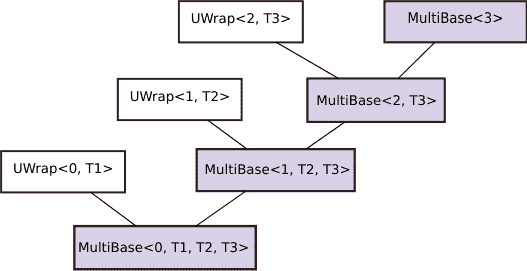

图 22.1：MultiBase 类层次结构的布局

MultiBase 本身没有策略的概念。对 MultiBase 而言，世界似乎由一个简单的模板参数包组成，其类型用于定义类。除了 PolicyTypes 模板参数包之外，MultiBase 还定义了一个 `size_t nr` 非类型参数，用于创建唯一的 UWrap 类型。下面是 MultiBase 的通用类声明：

```cpp
template <size_t nr, typename ...PolicyTypes>
struct MultiBase;
```

两个特化处理所有可能的 MultiBase 调用。一个特化是递归模板。该模板处理 MultiBase 模板参数包中的第一个类型，并递归地使用自身来处理剩余类型。第二个特化在模板参数包耗尽时被调用，并且不做任何事情。下面是后一个特化的定义：

```cpp
template <size_t nr>
struct MultiBase<nr>
{};
```

递归定义的特化是有趣的那个。它执行以下任务：

- 它派生自一个唯一的 UWrap 类型。唯一性通过在定义 UWrap 时使用 MultiBase 的 nr 参数来保证。除了 nr 之外，UWrap 类还接收提供给 MultiBase 的模板参数包中的第一个类型；
- 它还递归地派生自自身。递归的 MultiBase 类型使用递增后的 nr 值作为其第一个模板实参来定义（从而确保递归 MultiBase 类型所定义的 UWrap 类型的唯一性）。其第二个模板实参是提供给 MultiBase 的模板参数包的尾部。

图 22.1 提供了展示 MultiBase 类层次结构布局的图示。

MultiBase 的构造函数简单地接收（最初）传递给 MultiBase 对象的初始化值。为此使用了完美转发。MultiBase 的构造函数将其第一个参数值传递给其 UWrap 基类，同样使用完美转发。MultiBase 的递归定义是：

```cpp
template <size_t nr, typename PolicyT1, typename ...PolicyTypes>
```

```cpp
struct MultiBase<nr, PolicyT1, PolicyTypes...> :
    public UWrap<nr, PolicyT1>,
    public MultiBase<nr + 1, PolicyTypes...>
{
    typedef PolicyT1 Type;
    typedef MultiBase<nr + 1, PolicyTypes...> Base;

    MultiBase(PolicyT1 &&policyt1, PolicyTypes &&...policytpes)
    :
        UWrap<nr, PolicyT1>(std::forward<PolicyT1>(policyt1)),
        MultiBase<nr + 1, PolicyTypes...>(
            std::forward<PolicyTypes>(policytpes)...)
    {}
};
```

#### 22.9.3 支持模板

Multi 类模板将 PlainTypes 定义为保存其参数包中所有类型的 TypeList。每个派生自 UWrap 类型的 MultiBase 还定义了一个类型 Type，表示用于定义该 UWrap 类型的策略类型，以及一个类型 Base，表示其嵌套 MultiBase 类的类型。

这三个类型定义使我们能够访问创建 Multi 对象时所用的类型，以及这些类型的值。

类模板 typeAt 是一个纯模板元编程类模板（它没有运行时执行代码）。它期望一个 size_t idx 模板实参，用于指定 Multi 类型对象中策略类型的索引，以及一个 Multi 类类型。它将类型 Type 定义为 Multi 的 MultiBase<idx, ...> 基类所定义的 Type。例如：

```cpp
typeAt<0, Multi<Vector, int, double>>::Type  // Type is vector<int>
```

类模板 typeAt 定义（并使用）一个完成所有工作的嵌套类模板 PolType。PolType 的泛型定义指定两个模板参数：一个用于指定所请求类型索引的索引，以及一个由 MultiBase 类型实参初始化的 typename。PolType 的递归定义递归地减小其索引非类型参数，并将 MultiBase 继承树中的下一个基类传递给递归调用。由于 PolType 最终将类型 Type 定义为所请求的策略类型，因此递归定义将其 Type 定义为递归调用所定义的类型。最后（非递归）的特化将 MultiBase 类型的初始策略类型定义为 Type。下面是 typeAt 的定义：

```cpp
template <size_t index, typename Multi>
class typeAt
{
    template <size_t idx, typename MultiBase>
    struct PolType;

    template <size_t idx,
              size_t nr, typename PolicyT1, typename ...PolicyTypes>
    struct PolType<idx, MultiBase<nr, PolicyT1, PolicyTypes...>>
    {
        typedef typename PolType<
            idx - 1, MultiBase<nr + 1, PolicyTypes...>>::Type Type;
    };

    template <size_t nr, typename PolicyT1, typename ...PolicyTypes>
    struct PolType<0, MultiBase<nr, PolicyT1, PolicyTypes...>>
    {
        typedef PolicyT1 Type;
    };

public:
    typeAt(typeAt const &) = delete;
    typedef typename PolType<index, typename Multi::Base>::Type Type;
};
```

Multi 的参数包所指定的类型也可以使用第二个辅助类模板来获取：plainTypeAt。例如：

```cpp
plainTypeAt<0, Multi<Vector, int, double>>::Type // Type is int
```

类模板 plainTypeAt 使用与 typeAt 类似（但更简单）的实现。它也是一个纯模板元编程类模板，定义了一个嵌套类模板 At。At 的实现类似 typeAt，但它访问的是传递给 Multi 的原始模板包中的类型，并由 Multi 以其 PlainTypes 类型提供。下面是 plainTypeAt 的定义：

```cpp
template <size_t index, typename Multi>
class plainTypeAt
{
    template <size_t idx, typename List>
    struct At;

    template <size_t idx, typename Head, typename ...Tail>
    struct At<idx, TypeList<Head, Tail...>>
    {
        typedef typename At<idx - 1, TypeList<Tail...>>::Type Type;
    };

    template <typename Head, typename ...Tail>
    struct At<0, TypeList<Head, Tail...>>
    {
        typedef Head Type;
    };

public:
    plainTypeAt(plainTypeAt const &) = delete;
    typedef typename At<index, typename Multi::PlainTypes>::Type Type;
};
```

可以说最简洁的辅助模板是 get。这是一个函数模板，将 size_t idx 定义为其第一个模板参数，将 typename Multi 定义为其第二个模板参数。函数模板 get 定义一个函数参数：一个到 Multi 的引用，因此它可以自行推导出 Multi 的类型。知道它是 Multi 后，我们推断它也是 UWrap<nr, PolicyType>，因而也是 PolicyType，因为后一个类被定义为 UWrap 的基类。

由于类类型对象可以初始化对其基类的引用，因此 PolicyType & 可以由适当的 UWrap 引用初始化，而该引用又可以由 Multi 对象初始化。由于我们可以使用 typeAt 确定 PolicyType（注意，求值 typename typeAt<idx, Multi>::Type 完全是编译期的事情），所以 get 函数完全可以通过单个 return 语句内联实现：

```cpp
template <size_t idx, typename Multi>
inline typename typeAt<idx, Multi>::Type &get(Multi &multi)
{
    return static_cast<
        UWrap<idx, typename typeAt<idx, Multi>::Type> &>(multi);
}
```

#### 22.9.4 使用 Multi

既然 Multi 及其支持模板已经开发完成，那么如何使用 Multi 呢？

有必要先提醒一句。为了减小所开发类的体积，它们是以极简方式设计的。例如，get 函数模板不能用于 Multi const 对象，而且 Multi 类型没有可用的默认构造函数或移动构造函数。Multi 旨在说明模板元编程的一些可能性，希望 Multi 的实现很好地服务了这一目的。但它能使用吗？如果能，又该如何使用？

本节提供一些带注释的示例。它们可以串联起来定义一系列语句，这些语句可以放在 main 函数体中，从而构成一个可运行的程序。

- 可以定义一个简单的 Policy：

  ```cpp
  template <typename Type>
  struct Policy
  {
      Type d_type;
      Policy(Type &&type)
      :
          d_type(std::forward<Type>(type))
      {}
  };
  ```

  Policy 定义了一个数据成员，并且可用于定义 Multi 对象：

  ```cpp
  Multi<Policy, string> ms(Policy<string>("hello"));
  Multi<Policy, string, string> ms2s(Policy<string>("hello"),
                                     Policy<string>("world"));
  ```

  ```cpp
  typedef Multi<Policy, string, int> MPSI;
  MPSI mpsi(string("hello"), 4);
  ```

- 要获取 Multi 类或对象所定义的类型数量，可以使用 ::size 枚举值（使用 Multi 类），或使用 .size 成员（使用 Multi 对象）：

  ```cpp
  cout << "There are " << MPSI::size << " types in MPSI\n"
       << "There are " << mpsi.size << " types in mpsi\n";
  ```

- 可以使用 plainTypeAt 定义构成类型的变量：

  ```cpp
  plainTypeAt<0, MPSI>::Type sx = "String type";
  plainTypeAt<1, MPSI>::Type ix = 12;
  ```

- 可以使用原始 static_cast 来获取构成类型：

  ```cpp
  cout << static_cast<Policy<string> &>(mpsi).d_type << '\n'
       << static_cast<Policy<int> &>(mpsi).d_type << '\n';
  ```

- 然而，当模板参数包包含相同类型时，这种方法行不通，因为强制转换无法区分相同的 Policy<int> 类型。在这种情况下，get 仍然可以正常工作：

  ```cpp
  typedef Multi<Policy, int, int> MPII;
  MPII mpii(4, 18);

  cout << get<0>(mpii).d_type << ' ' << get<1>(mpii).d_type << '\n';
  ```

- 下面是一个将 `std::vector` 包装在 `Vector` 中的示例：

  ```cpp
  typedef Multi<Vector, int, double> MVID;
  MVID mi({1, 2, 3}, {1.2, 3.4, 5.6, 7.8});
  ```

- 这样的 vector 可以通过其 `Multi` 类型来定义：

  ```cpp
  typeAt<0, Multi<Vector, int>>::Type vi = {1, 2, 3};
  ```

- 已知 `Vector` 是 `std::vector`，`get` 返回的引用支持下标运算符，可用作左操作数或右操作数：

  ```cpp
  cout << get<0>(mi)[2] << '\n';
  get<1>(mi)[3] = get<0>(mi)[0];
  cout << get<1>(mi)[3] << '\n';
  ```


## 第 23 章：具体示例

本章将展示 C++ 程序、类和模板的具体示例。C++ Annotations 中讨论的主题，如虚函数、静态成员等，都将在本章中进行示例说明。这些示例大致遵循前面章节的组织结构。

作为附加主题，本章不仅提供 C++ 的示例，还涵盖了扫描器和解析器生成器的相关内容。我们将展示如何在 C++ 程序中使用这些工具。这些附加示例要求读者对这些工具所涉及的基础概念有一定的了解，比如文法、语法树和语法树修饰。一旦程序的输入达到一定复杂度，使用扫描器和解析器生成器来编写实际处理输入的代码就颇具吸引力。本章中的一个示例就描述了如何在 C++ 环境中使用这些工具。

### 23.1 在 `streambuf` 类中使用文件描述符

#### 23.1.1 用于输出操作的类

对*文件描述符*进行读写并非 C++ 标准的一部分。但在大多数操作系统上，*文件描述符*都是可用的，并且可以被视为一种设备。很自然地，我们可以使用 `std::streambuf` 类作为构造与这类文件描述符设备交互的类的起点。

下面我们将构造一些类，用于根据给定的文件描述符向设备写入数据。这些设备可以是文件，也可以是管道或套接字。第 23.1.2 节将涵盖从这类设备进行读取的内容；第 23.2.3 节将重新讨论重定向，这在第 6.6.1 节中已经介绍过。

以 `streambuf` 类作为基类，设计用于输出操作的类是相对容易的。唯一必须覆盖的成员函数是（虚）成员 `int streambuf::overflow(int c)`。该成员负责将字符写入设备。如果 fd 是一个输出文件描述符，且输出不应被缓冲，那么 `overflow()` 成员可以简单地实现为：

```cpp
class UnbufferedFD: public std::streambuf
{
    public:
        virtual int overflow(int c);
        ...
};

int UnbufferedFD::overflow(int c)
{
    if (c != EOF)
    {
        if (write(d_fd, &c, 1) != 1)
            return EOF;
    }
    return c;
}
```

`overflow` 接收的参数要么被写入文件描述符（并从 `overflow` 返回），要么返回 `EOF`。

这个简单的函数并没有使用输出缓冲。由于多种原因，使用缓冲区通常是一个好主意（另见下一节）。

当使用输出缓冲时，`overflow` 成员会稍微复杂一些，因为它只在缓冲区满时被调用。一旦缓冲区已满，我们必须*首先*刷新缓冲区。刷新缓冲区是（虚）函数 `streambuf::sync` 的职责。由于 `sync` 是一个虚函数，从 `streambuf` 派生的类可以重新定义 `sync` 来刷新 `streambuf` 本身不了解的缓冲区。

覆盖 `sync` 并在 `overflow` 中使用它并不是全部工作。当定义缓冲区的类的对象生命周期结束时，缓冲区可能只被部分填充。在这种情况下，也必须刷新缓冲区。这可以通过在类的析构函数中简单地调用 `sync` 来轻松实现。

既然我们已经考虑了使用输出缓冲区的后果，我们差不多准备好设计我们的派生类了。不过，还会添加一些额外的特性：

-   首先，我们应该允许类的使用者指定输出缓冲区的大小。
-   其次，应该可以在文件描述符实际已知之前构造我们类的对象。稍后，在第 23.2 节中，我们会遇到实际使用这一特性的情况。

为了节省 C++ Annotations 中的篇幅，这里设计的函数是否成功完成在示例代码中并不进行检查。在“现实生活”的实现中，这些检查当然不应省略。我们的 `OFdStreambuf` 类具有以下特征：

-   它的成员函数使用操作文件描述符的低级函数。因此，除了 `streambuf` 之外，编译器在编译其成员函数之前还必须读取 `<unistd.h>` 头文件。
-   该类派生自 `std::streambuf`。
-   它定义了三个数据成员。这些数据成员分别跟踪缓冲区的大小、文件描述符以及缓冲区本身。下面是完整的类接口：

```cpp
class OFdStreambuf: public std::streambuf
{
    size_t d_bufsize;
    int    d_fd;
    char  *d_buffer;

  public:
    OFdStreambuf();
    OFdStreambuf(int fd, size_t bufsize = 1);
    virtual ~OFdStreambuf();
    void open(int fd, size_t bufsize = 1);
  private:
    virtual int sync();
    virtual int overflow(int c);
};
```

-   它的默认构造函数仅将缓冲区初始化为 0。稍微有趣一点的是它的构造函数，该构造函数期望一个文件描述符和一个缓冲区大小。这个构造函数将其参数传递给类的 `open` 成员（见下文）。以下是构造函数：

```cpp
inline OFdStreambuf::OFdStreambuf()
:
    d_bufsize(0),
    d_buffer(0)
{}
inline OFdStreambuf::OFdStreambuf(int fd, size_t bufsize)
{
    open(fd, bufsize);
}
```

-   析构函数调用 `sync`，将存储在输出缓冲区中的任何字符刷新到设备。在不使用缓冲区的实现中，析构函数可以被赋予默认实现：

```cpp
inline OFdStreambuf::~OFdStreambuf()
{
    if (d_buffer)
    {
        sync();
        delete[] d_buffer;
    }
}
```

这个实现并不会关闭设备。是否可选地关闭（或保持打开）设备，留给读者作为练习来修改这个类。这种方法也被例如 Bobcat 库⁴所采用。另见第 23.1.2 节。

-   `open` 成员初始化缓冲区。使用 `streambuf::setp`，可以定义缓冲区的起始点和结束点。这被 `streambuf` 基类用来初始化 `streambuf::pbase`、`streambuf::pptr` 和 `streambuf::epptr`：

```cpp
inline void OFdStreambuf::open(int fd, size_t bufsize)
{
    d_fd = fd;
    d_bufsize = bufsize == 0 ? 1 : bufsize;

    d_buffer = new char[d_bufsize];
    setp(d_buffer, d_buffer + d_bufsize);
}
```

-   成员 `sync` 将缓冲区中尚未刷新的内容刷新到设备。刷新之后，使用 `setp` 重新初始化缓冲区。成功刷新缓冲区后，`sync` 返回 0：

```cpp
inline int OFdStreambuf::sync()
{
    if (pptr() > pbase())
    {
        write(d_fd, d_buffer, pptr() - pbase());
        setp(d_buffer, d_buffer + d_bufsize);
    }
    return 0;
}
```

-   成员 `streambuf::overflow` 也被覆盖。由于该成员在缓冲区满时被 `streambuf` 基类调用，所以它应该首先调用 `sync` 将缓冲区刷新到设备。接下来，它应该将字符 `c` 写入（现在为空的）缓冲区。字符 `c` 应使用 `pptr` 和 `streambuf::pbump` 写入。向缓冲区写入字符应使用可用的 `streambuf` 成员函数来实现，而不是“手工”实现，因为这样做可能会使 `streambuf` 的内部簿记失效。以下是 `overflow` 的实现：

```cpp
inline int OFdStreambuf::overflow(int c)
{
        sync();
        if (c != EOF)
        {
                *pptr() = c;
                pbump(1);
        }
        return c;
}
```

下面的程序使用 `OFdStreambuf` 类将其标准输入复制到文件描述符 `STDOUT_FILENO`，这是用于标准输出的文件描述符的符号名称：

```cpp
#include <string>
#include <iostream>
#include <istream>
#include "fdout.h"
using namespace std;

int main(int argc, char **argv)
{
        OFdStreambuf   fds(STDOUT_FILENO, 500);
        ostream        os(&fds);

        switch (argc)
        {
                case 1:
                        for (string s; getline(cin, s); )
                                os << s << '\n';
                        os << "COPIED cin LINE BY LINE\n";
                        break;

                case 2:
                        cin >> os.rdbuf();          // 或者使用：cin >> &fds;
                        os << "COPIED cin BY EXTRACTING TO os.rdbuf()\n";
                        break;

                case 3:
                        os << cin.rdbuf();
                        os << "COPIED cin BY INSERTING cin.rdbuf() INTO os\n";
                        break;
        }
}
```

#### 23.1.2 用于输入操作的类

当从 `std::streambuf` 派生用于输入操作的类时，应该为它们提供一个至少一个字符的输入缓冲区。一个字符的输入缓冲区允许使用成员函数 `istream::putback` 或 `istream::ungetc`。严格来说，在从 `streambuf` 派生的类中实现缓冲区并不是必需的。但强烈建议在这些类中使用缓冲区。它们的实现非常简单直接，而且这类类的适用性也能大大提高。因此，我们从 `streambuf` 类派生的所有类都定义了一个至少一个字符的缓冲区。

⁴http://bobcat.sourceforge.net


##### 23.1.2.1 使用单字符缓冲区

当使用一个单字符缓冲区从 streambuf 派生类（例如 IFdStreambuf）时，至少应覆盖其成员 streambuf::underflow，因为该成员最终会接收所有输入请求。成员 streambuf::setg 用于告知 streambuf 基类输入缓冲区的大小和位置，以便它能够相应地设置其输入缓冲区指针。这确保 streambuf::eback、streambuf::gptr 和 streambuf::egptr 返回正确的值。

IFdStreambuf 类的设计如下：

- 其成员函数使用操作文件描述符的低层函数。因此，除了 streambuf，编译器在编译其成员函数之前必须先读取 `<unistd.h>` 头文件。

- 与大多数为输入操作设计的类一样，该类也派生自 std::streambuf。

- 该类定义了两个数据成员，其中一个是固定大小的单字符缓冲区。数据成员被定义为保护数据成员，以便派生类（例如，参见 23.1.2.3 节）可以访问它们。以下是完整的类接口：

    ```cpp
    class IFdStreambuf: public std::streambuf
    {
        protected:
            int     d_fd;
            char    d_buffer[1];
        public:
            IFdStreambuf(int fd);
        private:
            int underflow();
    };
    ```

- 构造函数初始化缓冲区。但是，该初始化将 gptr 的返回值设置为等于 egptr 的返回值。这意味着缓冲区是空的，因此会立即调用 *underflow* 来填充缓冲区：

    ```cpp
    inline IFdStreambuf::IFdStreambuf(int fd)
    :
        d_fd(fd)
    {
        setg(d_buffer, d_buffer + 1, d_buffer + 1);
    }
    ```

- 最后覆盖了 *underflow*。通过从文件描述符读取来重新填充缓冲区。如果失败（无论出于什么原因），则返回 EOF。当然，更复杂的实现可以在此处采取更智能的操作。如果缓冲区能够重新填充，则调用 setg 来正确设置 streambuf 的缓冲区指针：

    ```cpp
    inline int IFdStreambuf::underflow()
    {
        if (read(d_fd, d_buffer, 1) <= 0)
            return EOF;

        setg(d_buffer, d_buffer, d_buffer + 1);
        return *gptr();
    }
    ```

下面的 main 函数演示了如何使用 IFdStreambuf：

```cpp
int main()
{
    IFdStreambuf fds(STDIN_FILENO);
    istream       is(&fds);

    cout << is.rdbuf();
}
```

##### 23.1.2.2 使用 n 字符缓冲区

如果我们决定使用一个大小可观的缓冲区，事情会变得多复杂？并不那么复杂。下面的类允许我们指定缓冲区的大小，但除此之外，它与上一节中开发的 `IFdStreambuf` 类基本相同。为了让事情变得更有趣一些，这里开发的 `IFdNStreambuf` 类也覆盖了成员 `streambuf::xsgetn`，以优化读取一系列字符。此外，还提供了一个默认构造函数，可以与 open 成员结合使用，在文件描述符可用之前构造一个 `istream` 对象。在这种情况下，一旦描述符变得可用，就可以使用 open 成员来初始化对象的缓冲区。稍后，在 23.2 节中，我们会遇到这种情况。

为了节省篇幅，没有检查各种调用的成功情况。在‘现实生活’的实现中，这些检查当然不应省略。类 `IFdNStreambuf` 具有以下特点：

- 其成员函数使用操作文件描述符的低层函数。因此，除了 `streambuf`，编译器在编译其成员函数之前必须先读取 `<unistd.h>` 头文件。

- 像往常一样，它派生自 `std::streambuf`。

- 与类 `IFdStreambuf`（23.1.2.1 节）一样，其数据成员是保护的。由于缓冲区的大小是可配置的，该大小保存在一个专门的数据成员 `d_bufsize` 中：

    ```cpp
    class IFdNStreambuf: public std::streambuf
    {
      protected:
        int         d_fd;
        size_t      d_bufsize;
        char*       d_buffer;
      public:
        IFdNStreambuf();
        IFdNStreambuf(int fd, size_t bufsize = 1);
        virtual ~IFdNStreambuf();
        void open(int fd, size_t bufsize = 1);
      private:
        virtual int underflow();
        virtual std::streamsize xsgetn(char *dest, std::streamsize n);
    };
    ```

- 默认构造函数不分配缓冲区。它可以在文件描述符变为已知之前用来构造对象。第二个构造函数只是将其参数传递给 `open`。然后 `open` 将初始化对象，使其能够真正被使用：

    ```cpp
    inline IFdNStreambuf::IFdNStreambuf()
    :
        d_bufsize(0),
        d_buffer(0)
    {}
    inline IFdNStreambuf::IFdNStreambuf(int fd, size_t bufsize)
    {
        open(fd, bufsize);
    }
    ```

- 一旦对象通过 open 初始化，其析构函数将删除对象的缓冲区，并使用文件描述符关闭设备：

    ```cpp
    IFdNStreambuf::~IFdNStreambuf()
    {
        if (d_bufsize)
        {
            close(d_fd);
            delete[] d_buffer;
        }
    }
    ```

尽管在上述实现中设备被关闭，但这并不总是可取的。在打开的文件描述符已经可用的情况下，意图可能是重复使用该描述符，每次都使用一个新构造的 IFdNStreambuf 对象。如何修改这个类，使设备可以选择性地被关闭，这留给读者作为练习。例如，在 Bobcat 库² 中采用了这种方法。

- open 成员只是分配对象的缓冲区。它假定调用程序已经打开了设备。一旦缓冲区被分配，就会使用基类成员 setg 来确保 streambuf::eback、streambuf::gptr 和 streambuf::egptr 返回正确的值：

    ```cpp
    void IFdNStreambuf::open(int fd, size_t bufsize)
    {
        d_fd = fd;
        d_bufsize = bufsize;
        d_buffer = new char[d_bufsize];
        setg(d_buffer, d_buffer + d_bufsize, d_buffer + d_bufsize);
    }
    ```

- 被覆盖的成员 underflow 的实现与 IFdStreambuf（23.1.2.1 节）的成员几乎相同。唯一的区别是当前类支持更大尺寸的缓冲区。因此，可以一次从设备读取更多字符（最多 d_bufsize）：

    ```cpp
    int IFdNStreambuf::underflow()
    {
        if (gptr() < egptr())
            return *gptr();

        int nread = read(d_fd, d_buffer, d_bufsize);

        if (nread <= 0)
            return EOF;

        setg(d_buffer, d_buffer, d_buffer + nread);
        return *gptr();
    }
    ```

- 最后，xsgetn 被覆盖。在一个循环中，n 不断减小直到 0，此时函数终止。或者，如果 underflow 无法获得更多字符，该成员也会返回。该成员优化了字符序列的读取。它不是调用 streambuf::sbumpc n 次，而是将一块可用字符复制到目标位置，并通过一次函数调用使用 streambuf::gbump 消耗缓冲区中的可用字符。

```cpp
std::streamsize IFdNStreambuf::xsgetn(char *dest, std::streamsize n)
{
    int nread = 0;
```

在这种情况下，重置输入缓冲区的参数必须进行调整，使其第二个和第三个参数指向可用输入缓冲区之外。让我们看看 IFdSeek 的特点：

- 如前所述，IFdSeek 派生自 IFdStreambuf。与后一类一样，IFdSeek 的成员函数使用 unistd.h 中声明的设施。因此，在编译器能够编译类的成员函数之前，必须先读取头文件 <unistd.h>。为了减少指定来自 streambuf 和 std::ios 的类型和常量时的输入量，该类定义了几个 typedef。这些 typedef 引用了头文件 <ios> 中定义的类型，因此编译器在编译 IFdSeek 的类接口之前也必须包含该头文件：

    ```cpp
    class IFdSeek: public IFdStreambuf
    {
        typedef std::streambuf::pos_type       pos_type;
        typedef std::streambuf::off_type       off_type;
        typedef std::ios::seekdir              seekdir;
        typedef std::ios::openmode             openmode;

        public:
            IFdSeek(int fd);
        private:
            pos_type seekoff(off_type offset, seekdir dir, openmode);
            pos_type seekpos(pos_type offset, openmode mode);
    };
    ```

- 该类的接口非常简单。它的（唯一）构造函数期望设备的文件描述符。它没有需要执行的特殊任务，只是调用其基类构造函数：

    ```cpp
    inline IFdSeek::IFdSeek(int fd)
    :
        IFdStreambuf(fd)
    {}
    ```

- 成员 seekoff 负责执行实际的 seek 操作。它调用 lseek 在文件描述符已知的设备中寻找新位置。如果 seek 成功，则调用 setg 来定义一个已经为空的缓冲区，以便基类的 underflow 成员在下一个输入请求时重新填充缓冲区。

    ```cpp
    IFdSeek::pos_type IFdSeek::seekoff(off_type off, seekdir dir, openmode)
    {
        pos_type pos =
            lseek
            (
                d_fd, off,
                (dir == std::ios::beg) ? SEEK_SET :
                (dir == std::ios::cur) ? SEEK_CUR :
                                          SEEK_END
            );

        if (pos < 0)
            return -1;

        setg(d_buffer, d_buffer + 1, d_buffer + 1);
        return pos;
    }
    ```

- 最后，伴随函数 seekpos 也被覆盖：它实际上被定义为对 seekoff 的调用：

```cpp
inline IFdSeek::pos_type IFdSeek::seekpos(pos_type off, openmode mode)
```


```cpp
{
    return seekoff(off, std::ios::beg, mode);
}
```

下面是一个使用类 IFdSeek 的程序示例。如果通过输入重定向将该程序自身的源文件作为输入提供给它，那么就支持定位（并且除第一行外，其余每一行都会显示两次）：

```cpp
#include "findseek.h"
#include <string>
#include <iostream>
#include <istream>
#include <iomanip>
#include <iomanip>
using namespace std;

int main()
{
    IFdSeek fds(0);
    istream is(&fds);
    string s;

    while (true)
    {
        if (!getline(is, s))
            break;

        streampos pos = is.tellg();

        cout << setw(5) << pos << ": " << s << "\n";

        if (!getline(is, s))
            break;

        streampos pos2 = is.tellg();

        cout << setw(5) << pos2 << ": " << s << "\n";

        if (!is.seekg(pos))
        {
            cout << "Seek failed\n";
            break;
        }
    }
}
```

##### 23.1.2.4 ‘streambuf’ 对象中的多次 ‘unget’ 调用

Streambuf 类以及从 streambuf 派生的类至少应支持回退（unget）最后读取的字符。当必须支持一系列 unget 调用时，需要特别小心。本节讨论如何构造一个支持可配置数量的 istream::unget 或 istream::putback 调用的类。

对多次（例如 ‘n’ 次）unget 调用的支持，是通过在输入缓冲区中预留一个初始区段来实现的；该区段会逐渐填满，以包含最近读取的 n 个字符。该类的实现如下：

- 同样，该类派生自 std::streambuf。它定义了几个数据成员，使该类能够执行维护可配置大小的 unget 缓冲区所需的簿记工作：

```cpp
class FdUnget: public std::streambuf
{
    int       d_fd;
    size_t    d_bufsize;
    size_t    d_reserved;
    char      *d_buffer;
    char      *d_base;
public:
    FdUnget(int fd, size_t bufsz, size_t unget);
    virtual ~FdUnget();
private:
    int underflow();
};
```

- 该类的构造函数期望以文件描述符、缓冲区大小以及可被 unget 或 push back 的字符数作为参数。这个数量决定预留区域的大小，该区域定义为该类输入缓冲区的前 d_reserved 个字节。

- 输入缓冲区始终至少比 d_reserved 大一个字节。因此，可以读取一定数量的字节。一旦已经读取了 d_reserved 个字节，最多可以 unget d_reserved 个字节。

- 接下来，配置读取操作的起始点。它称为 d_base，指向 d_buffer 所表示位置之后 d_reserved 个字节的位置。这始终是缓冲区重新填充开始的位置。

- 既然缓冲区已经构造完成，我们就可以使用 setg 定义 streambuf 的缓冲区指针。由于尚未读取任何字符，所有指针都设置为指向 d_base。如果此时调用 unget，则没有可用字符，unget（正确地）失败。

- 最后，重新填充缓冲区的大小确定为已分配的字节数减去预留区域的大小。

以下是该类的构造函数：

```cpp
FdUnget::FdUnget(int fd, size_t bufsz, size_t unget)
:
    d_fd(fd),
    d_reserved(unget)
{
    size_t allocate =
            bufsz > d_reserved ?
                    bufsz
                    :
                    d_reserved + 1;

    d_buffer = new char[allocate];

    d_base = d_buffer + d_reserved;
    setg(d_base, d_base, d_base);

    d_bufsize = allocate - d_reserved;
}
```

- 该类的析构函数只是将分配给缓冲区的内存归还到公共池：

```cpp
inline FdUnget::~FdUnget()
{
    delete[] d_buffer;
}
```

- 最后，按如下方式重写 underflow：
  - 首先，underflow 确定可能被 unget 的字符数。如果这个数量的字符都被 unget，那么输入缓冲区就耗尽了。因此，这个值可以是 0（初始状态）到输入缓冲区大小（当预留区域已完全填满，并且缓冲区剩余区段中的所有当前字符也都已被读取时）之间的任意值；
  - 接下来计算要移入预留区域的字节数。这个数量最多为 d_reserved，但如果实际可 unget 的字符数更小，则将其设为该实际数量；
  - 既然要移入预留区域的字符数已知，就将这个数量的字符从输入缓冲区末尾移动到紧挨 d_base 之前的位置；
  - 然后重新填充缓冲区。这些都是标准做法，但要注意读取从 d_base 开始，而不是从 d_buffer 开始；
  - 最后，设置 streambuf 的读缓冲区指针。Eback 被设置为 d_base 之前的位置，从而定义有保证的 unget 区域；gptr 被设置为 d_base，因为那是重新填充后第一个读取字符的位置；egptr 被设置为刚好超过最后读入缓冲区的字符位置。

以下是 underflow 的实现：

```cpp
int FdUnget::underflow()
{
    size_t ungetsize = gptr() - eback();
    size_t move = std::min(ungetsize, d_reserved);

    memcpy(d_base - move, egptr() - move, move);

    int nread = read(d_fd, d_base, d_bufsize);
    if (nread <= 0)        // none read -> return EOF
        return EOF;

    setg(d_base - move, d_base, d_base + nread);

    return *gptr();
}
```

##### 使用 FdUnget 的示例

下一个示例程序演示了类 FdUnget 的用法。它从标准输入最多读取 10 个字符，遇到 EOF 时停止。在一个可容纳 3 个字符的缓冲区中，定义了一个保证包含 2 个字符的 unget 缓冲区。就在读取一个字符之前，程序尝试最多 unget 6 个字符。当然，这是不可能的；但程序会考虑实际已读取的字符数，尽可能多地执行 unget：

```cpp
#include "fdunget.h"
#include <string>
#include <iostream>
#include <istream>
using namespace std;

int main()
{
    FdUnget fds(0, 3, 2);
    istream is(&fds);
    char   c;

    for (int idx = 0; idx < 10; ++idx)
    {
        cout << "after reading " << idx << " characters:\n";
        for (int ug = 0; ug <= 6; ++ug)
        {
            if (!is.unget())
            {
                cout
                << "\tunget failed at attempt " << (ug + 1) << "\n"
                << "\trereading: '";

                is.clear();
                while (ug--)
                {
                    is.get(c);
                    cout << c;
                }
                cout << "'\n";
                break;
            }

            if (!is.get(c))
            {
                cout << " reached\n";
                break;
            }
            cout << "Next character: " << c << '\n';
        }
    }

    /*
    Generated output after 'echo abcde | program':

    after reading 0 characters:
            unget failed at attempt 1
            rereading: ''
    Next character: a
    after reading 1 characters:
            unget failed at attempt 2
            rereading: 'a'
    Next character: b
    after reading 2 characters:
            unget failed at attempt 3
            rereading: 'ab'
    Next character: c
    after reading 3 characters:
            unget failed at attempt 4
            rereading: 'abc'
    Next character: d
    after reading 4 characters:
            unget failed at attempt 4
            rereading: 'bcd'
    Next character: e
    after reading 5 characters:
            unget failed at attempt 4
            rereading: 'cde'
    Next character:

    after reading 6 characters:
            unget failed at attempt 4
    */
}
```

```cpp
Fistream(std::istream &stream);
Fistream(char const *name,
         std::ios::openmode mode = std::ios::in);
```

当使用现有的 `istream` 对象构造 `Fistream` 对象时，Fistream 的 `istream` 部分只是使用该流的 `streambuf` 对象：

```cpp
Fistream::Fistream(istream &stream)
:
    istream(stream.rdbuf()),
    d_streambuf(rdbuf()),
    d_width(0)
{}
```

当使用文件名构造 `fstream` 对象时，`istream` 基类初始化器会获得一个新的 `filebuf` 对象，用作其 `streambuf`。由于类的数据成员在类的基类构造完成之前不会被初始化，`d_filebuf` 只能在此之后初始化。到那时，`filebuf` 只能以 `rdbuf` 的形式获得，而 `rdbuf` 返回的是 `streambuf`。不过，由于它实际上是 `filebuf`，所以使用 `reinterpret_cast` 将由 `rdbuf` 返回的 `streambuf` 指针转换为 `filebuf *`，从而可以初始化 `d_filebuf`：

```cpp
Fistream::Fistream(char const *name, ios::openmode mode)
:
    istream(new filebuf()),
    d_filebuf(reinterpret_cast<filebuf *>(rdbuf())),
    d_streambuf(d_filebuf.get()),
    d_width(0)
{
    d_filebuf->open(name, mode);
}
```

##### 23.1.3.1 成员函数和示例

只有一个额外的公有成员：`setField(field const &)`。该成员定义要提取的下一个字段的大小。它的参数是对 `field` 类的引用，`field` 是一个*操纵器类*，用于定义下一个字段的宽度。

由于 Fistream 的接口中提到了 `field &`，因此必须在 Fistream 的接口开始之前声明 `field`。类 `field` 本身很简单，并将 Fistream 声明为其友元。它有两个数据成员：`d_width` 指定下一个字段的宽度，而 `d_newWidth` 在确实应使用 `d_width` 的值时被设为 true。如果 `d_newWidth` 为 false，Fistream 就按标准提取模式工作。类 `field` 有两个构造函数：一个默认构造函数，将 `d_newWidth` 设为 false；另一个构造函数期望以要提取的下一个字段的宽度作为其值。以下是类 `field`：

```cpp
class field
{
    friend class Fistream;
    size_t d_width;
    bool   d_newWidth;

    public:
        field(size_t width);
        field();
};
```

```cpp
inline field::field(size_t width)
```


```cpp
:
    d_width(width),
    d_newWidth(true)
{}

inline field::field()
:
    d_newWidth(false)
{}
```

由于 field 将 Fistream 声明为其友元，因此 setField 可以直接检查 field 的成员。

现在回到 setField。该函数期望一个 field 对象的引用，该对象可以通过以下三种不同方式之一进行初始化：

- `field()`：当 setField 的参数是由其默认构造函数构造的 field 对象时，下一次提取将使用与上一次提取相同的字段宽度。
- `field(0)`：当此 field 对象用作 setField 的参数时，固定大小的字段提取停止，Fistream 再次像任何标准 istream 对象一样工作。
- `field(x)`：当 field 对象本身由非零的 size_t 值 x 初始化时，则下一次字段宽度为 x 个字符宽。此类 field 的准备工作留给 setBuffer，它是 Fistream 唯一的私有成员。

以下是 setField 的实现：

```cpp
std::istream & Fistream::setField(field const &params)
{
    if (params.d_newWidth)                         // new field size requested
        d_width = params.d_width;                  // set new width

    if (!d_width)                                  // no width?
        rdbuf(d_streambuf);                        // return to the old buffer
    else
        setBuffer();                               // define the extraction buffer

    return *this;
}
```

私有成员 setBuffer 定义一个包含 d_width + 1 个字符的缓冲区，并使用 read 将缓冲区填充为 d_width 个字符。该缓冲区以 ASCII-Z 字符终止。该缓冲区用于初始化 d_iss 成员。Fistream 的 rdbuf 成员用于通过 Fistream 对象本身提取 d_str 的数据：

```cpp
void Fistream::setBuffer()
{
    char *buffer = new char[d_width + 1];

    rdbuf(d_streambuf);                           // use istream’s buffer to
    buffer[read(buffer, d_width).gcount()] = 0;   // read d_width chars,
                                                 // terminated by ascii-Z
    d_iss.str(buffer);
    delete[] buffer;

    rdbuf(d_iss.rdbuf());                         // switch buffers
}
```

### 23.1 将文件描述符与 FSTREAMBUF 类一起使用

尽管可以使用 setField 来配置 Fistream 使用或不使用固定大小的字段提取，但使用操纵器可能更可取。为了允许 field 对象用作操纵器，定义了一个重载的提取运算符。该提取运算符接受 istream & 和一个 field const & 对象。使用该提取运算符，类似以下语句

```cpp
fis >> field(2) >> x >> field(0);
```

是可能的（假设 fis 是一个 Fistream 对象）。以下是重载的 operator>> 及其声明：

```cpp
istream &std::operator>>(istream &str, field const &params)
{
    return reinterpret_cast<Fistream *>(&str)->setField(params);
}
```

声明：

```cpp
namespace std
{
    istream &operator>>(istream &str, FBB::field const &params);
}
```

最后是一个示例。以下程序使用 Fistream 对象对出现在其标准输入中的 URL 编码信息进行 URL 解码：

```cpp
int main()
{
    Fistream fis(cin);

    fis >> hex;
    while (true)
    {
        size_t x;
        switch (x = fis.get())
        {
            case '\n':
                cout << '\n';
                break;
            case '+':
                cout << ' ';
                break;
            case '%':
                fis >> field(2) >> x >> field(0);
                // FALLING THROUGH
            default:
                cout << static_cast<char>(x);
                break;
            case EOF:
                return 0;
        }
    }
}
/*
    Generated output after:
        echo My+name+is+%60Ed%27 | a.out

    My name is ‘Ed’
*/
```

### 23.2 ‘fork’ 系统调用

在 C 编程语言中，fork 系统调用广为人知。当程序需要启动一个新进程时，可以使用 system。fork 系统要求程序等待 *子进程* 终止。生成子进程的更通用方式是使用 `fork`。

在本节中，我们研究如何使用 C++ 围绕像 `fork` 这样的复杂系统调用包装类。本节后续的许多内容直接适用于 Unix 操作系统，因此讨论集中在该操作系统上。其他系统通常提供类似的功能。后续内容与 *模板设计模式* 密切相关（参见 *Gamma 等人*（1995）《设计模式》，Addison-Wesley）

当调用 fork 时，当前程序在内存中被复制，从而创建一个新进程。复制之后，两个进程都在 fork 系统调用之后继续执行。这两个进程可以检查 fork 的返回值：原进程（称为 *父进程*）中的返回值与新创建的进程（称为 *子进程*）中的返回值不同：

- 在 *父进程* 中，`fork` 返回由 `fork` 系统调用创建的（子）进程的 *进程 ID*。这是一个正整数值。
- 在 *子进程* 中，`fork` 返回 0。
- 如果 `fork` 失败，则返回 -1。

#### 23.2.1 一个基本的 Fork 类

一个基本的 `Fork` 类应向用户隐藏像 `fork` 这样的系统调用的所有簿记细节。这里开发的 `Fork` 类正是这样做的。该类本身只确保 `fork` 系统调用的正确执行。通常，调用 `fork` 是为了启动一个子进程，这通常归结为执行一个单独的进程。该子进程可能期望从其标准输入流获得输入，和/或可能向其标准输出和/或标准错误流生成输出。`Fork` 并不知道所有这些，也不必知道子进程将做什么。`Fork` 对象应能够启动其子进程。

Fork 的构造函数无法知道其子进程应执行什么操作。同样，它也无法知道父进程应执行什么操作。针对这类情况，开发了 *模板方法设计模式*。根据 Gamma 等人，*模板方法设计模式*

> “在一个操作中定义算法的骨架，将一些步骤延迟到子类中。[模板方法]（设计模式）允许子类重新定义算法的某些步骤，而不改变算法的结构。”

这种设计模式允许我们定义一个 *抽象基类*，它已经提供与 `fork` 系统调用相关的基本步骤，并将 `fork` 系统调用其他部分的实现延迟到子类。

`Fork` 抽象基类具有以下特征：

- 它定义了一个数据成员 `d_pid`。在父进程中，该数据成员包含子进程的 *进程 ID*，而在子进程中其值为 0。其公共接口只声明两个成员：
  - 一个 `fork` 成员函数，负责实际的分叉（即创建（新的）子进程）；
  - 一个 `virtual` 析构函数 `~Fork`（函数体为空）。

以下是 Fork 的接口：

```cpp
class Fork
{
        int d_pid;

        public:
                virtual ~Fork();
                void fork();

        protected:
                int pid() const;
                int waitForChild();                 // returns the status

        private:
                virtual void childRedirections();
                virtual void parentRedirections();

                virtual void childProcess() = 0;    // pure virtual members
                virtual void parentProcess() = 0;
};
```

- 所有其他非虚成员函数都声明在类的受保护部分中，因此**只能**由派生类使用。它们是：

  - `pid()`：成员函数 `pid` 允许派生类访问系统 fork 的返回值：

```cpp
inline int Fork::pid() const
{
        return d_pid;
}
```

  - `waitForChild()`：成员 `int waitForChild` 可由父进程调用，以等待其子进程完成（如下所述）。该成员在类接口中声明。其实现为：

```cpp
#include "fork.hh"

int Fork::waitForChild()
{
        int status;

        waitpid(d_pid, &status, 0);

        return WEXITSTATUS(status);
}
```

这个简单的实现将子进程的 *退出状态* 返回给父进程。被调用的系统函数 `waitpid` 会 *阻塞*，直到子进程终止。

- 当使用 fork 系统调用时，必须始终区分 *父进程* 和 *子进程*。这些进程之间的主要区别在于：在父进程中，`d_pid` 成为子进程的进程 ID；而在子进程本身中，`d_pid` 变为 0。由于这两个进程必须始终被区分（并且存在），Fork 的接口强制要求由 `Fork` 派生的类实现它们：定义子进程操作的成员 `childProcess` 和定义父进程操作的成员 `parentProcess` 被定义为纯虚函数。

- 父进程与子进程之间的通信可以使用标准流或其他设施，例如 *管道*（参见第 23.2.5 节）。为便于这种进程间通信，派生类 *可以* 实现：

  - `childRedirections()`：如果必须在 *子* 进程中重定向任何标准流（`cin`、`cout` 或 `cerr`），则派生类应重写该成员（参见第 23.2.3 节）。默认情况下，它有一个空实现；


- parentRedirections()：如果需要在父进程中重定向任何标准流（cin、cout 或 cerr），派生类应重写该成员。默认情况下，它有一个空实现。

如果父进程和子进程必须通过标准流相互通信，那么标准流的重定向就是必要的。下面是它们的默认定义。由于这些函数是虚函数，因此不应内联实现，而应在它们自己的源文件中实现：

```cpp
void Fork::childRedirections()
{}
void Fork::parentRedirections()
{}
```

#### 23.2.2 父进程与子进程

成员函数 fork 调用系统函数 fork（注意：由于系统函数 fork 是由一个同名成员函数调用的，因此必须使用 `::` 作用域解析运算符来防止成员函数自身被递归调用）。函数 ::fork 的返回值决定调用 parentProcess 还是 childProcess。可能需要重定向。Fork::fork 的实现会在调用 childProcess 之前调用 childRedirections，并在调用 parentProcess 之前调用 parentRedirections：

```cpp
#include "fork.ih"

void Fork::fork()
{
    if ((d_pid = ::fork()) < 0)
        throw "Fork::fork() failed";

    if (d_pid == 0)            // child process has pid == 0
    {
        childRedirections();
        childProcess();
        exit(1);               // we shouldn't come here:
    }                          // childProcess() should exit

    parentRedirections();
    parentProcess();
}
```

在 fork.cc 中包含了类的内部头文件 fork.ih。这个头文件负责包含必要的系统头文件，以及包含 fork.h 本身。其实现为：

```cpp
#include "fork.h"
#include <cstdlib>
#include <unistd.h>
#include <sys/types.h>
#include <sys/wait.h>
```

子进程不应返回：一旦完成其任务，它们就应当终止。当子进程调用 exec... 家族中的成员时，这会自动发生；但如果子进程自身仍保持活动，那么它必须确保正确终止。子进程通常使用 exit 来终止自身，但要注意，exit 会阻止激活那些在与调用 exit 的层级相同或更浅的嵌套层级中定义的对象析构函数。全局定义对象的析构函数会在使用 exit 时被激活。当使用 exit 终止 childProcess 时，它要么应自身调用一个支持成员函数来定义它所需的所有嵌套对象，要么应在复合语句（例如，使用 `throw` 块）中定义其所有对象，并在该复合语句之外调用 `exit`。

父进程通常应等待其子进程完成。正在终止的子进程通过发送一个*信号*来通知其父进程它们即将终止，父进程应捕获该信号。如果子进程终止而其父进程没有捕获这些信号，那么这些子进程会作为所谓的*僵尸*进程继续可见。

如果父进程必须等待其子进程完成，它们可以调用成员 `waitForChild`。该成员会将子进程的退出状态返回给其父进程。

存在一种情况：*子*进程*继续*存活，但*父*进程死亡。这是相当自然的事件：父进程往往先于其子进程死亡。在我们的语境中（即 C++），这被称为*守护进程*程序。在守护进程中，父进程死亡，子程序继续作为基本 init 进程的子进程运行。同样，当子进程最终死亡时，会向其“继父”`init` 发送一个信号。这不会产生僵尸进程，因为 `init` 会捕获其所有（继）子进程的终止信号。鉴于 Fork 类的可用性，守护进程的构造非常简单（参见第 [23.2.4](23.2.4) 节）。

#### 23.2.3 重定向再探

前面在第 [6.6.1](6.6.1) 节中，流是使用 `ios::rdbuf` 成员函数重定向的。通过将一个流的 `streambuf` 赋给另一个流，两个流对象访问同一个 `streambuf`，从而在编程语言本身层面实现重定向。

这在 C++ 程序的语境中可能没问题，但一旦离开该语境，重定向就会终止。操作系统并不知道流对象。例如，当程序使用系统调用启动子程序时就会遇到这种情况。本节末尾的示例程序使用 C++ 重定向将插入到 `cout` 的信息重定向到文件，然后调用

```cpp
system("echo hello world");
```

来输出一行众所周知的文本。由于 `echo` 将其信息写入标准输出，如果操作系统能识别 C++ 的重定向，这就会是程序对文件的重定向。

但重定向并没有发生。相反，`hello world` 仍然出现在程序的标准输出上，而被重定向的文件保持不变。要将 `hello world` 写入被重定向的文件，必须在操作系统层面实现重定向。一些操作系统（例如 Unix 及其同类系统）提供 `dup` 和 `dup2` 之类的系统调用来实现这一点。这些系统调用的使用示例见第 [23.2.5](23.2.5) 节。

下面是使用 `streambuf` 重定向进行 C++ 重定向之后，在系统层面*失败的重定向*示例：

```cpp
#include <iostream>
#include <fstream>
#include <cstdlib>
using namespace std;

int main()
{
    ofstream of("outfile");

    streambuf *buf = cout.rdbuf(of.rdbuf());
    cout << "To the of the stream\n";
    system("echo hello world");
    cout << "To the of the stream\n";
    cout.rdbuf(buf);
}

/*
    Generated output: on the file 'outfile'

    To the of stream
    To the of stream

    On standard output:

    hello world
*/
```

#### 23.2.4 ‘守护进程’程序

有些应用只把 `fork` 用于启动子进程。父进程在生成子进程后立即终止。如果发生这种情况，子进程会继续作为 `init` 的子进程运行，而 `init` 是 Unix 系统上始终运行的第一个进程。这样的进程通常被称为*守护进程*，作为后台进程运行。

尽管下一个示例可以很容易地写成普通 C 程序，但它仍被收录在 C++ Annotations 中，因为它与当前对 `Fork` 类的讨论密切相关。我曾考虑给该类添加一个 `daemon` 成员，但最终决定不这样做，因为守护进程程序的构造非常简单，并且除了 `Fork` 类当前提供的功能之外不需要任何其他特性。下面是一个说明如何构造此类守护进程程序的示例。它的子进程不执行 `exit`，而是执行 `throw 0`，该异常由子进程 `main` 函数的 `catch` 子句捕获。这样做可确保子进程定义的所有对象都被正确销毁：

```cpp
#include <iostream>
#include <unistd.h>
#include "fork.h"

class Daemon: public Fork
{
    virtual void parentProcess()        // the parent does nothing.
    {}
    virtual void childProcess()         // actions by the child
    {
        sleep(3);

        std::cout << "Hello from the child process\n"; // just a message...
        throw 0;                        // The child process ends
    }
};

int main()
try
{
    Daemon().fork();
}
catch(...)
{}

/*
    Generated output:

The next command prompt, then after 3 seconds:
Hello from the child process
*/
```

#### 23.2.5 ‘Pipe’类

系统层面的重定向需要使用由 pipe 系统调用创建的*文件描述符*。当两个进程希望使用这样的文件描述符进行通信时，会发生以下情况：

- 该进程使用 pipe 系统调用构造两个*关联的文件描述符*。其中一个文件描述符用于写入，另一个文件描述符用于读取。

- 进行 fork（即调用系统 fork 函数），复制这些文件描述符。现在我们有四个文件描述符，因为子进程和父进程都拥有由 pipe 创建的两个文件描述符各自的副本。

- 一个进程（例如父进程）使用这些文件描述符进行*读取*。它应关闭其用于*写入*的文件描述符。

- 另一个进程（例如子进程）使用这些文件描述符进行*写入*。因此它应关闭其用于*读取*的文件描述符。

- 子进程写入用于写入的文件描述符的所有信息，现在都可以由父进程从对应的用于读取的文件描述符中读取，从而在子进程和父进程之间建立通信通道。

尽管这基本上很简单，但错误很容易混入。两个进程（子进程或父进程）可用的文件描述符的功能很容易被混淆。为防止簿记错误，可以先将簿记正确设置一次，然后将其隐藏在像这里开发的 `Pipe` 类这样的类中。让我们看一下它的特征（在使用 pipe 和 dup 之类的函数之前，编译器必须已经读取了 `<unistd.h>` 头文件）：

- pipe 系统调用期望一个指向两个 int 值的指针，这两个值分别表示用于读取的文件描述符和用于写入的文件描述符。为避免混淆，`Pipe` 类定义了一个 enum，其值将 2 个 int 数组的索引与符号常量关联起来。这两个文件描述符本身存储在数据成员 `d_fd` 中。下面是该类接口的起始部分：

```cpp
class Pipe
{
    enum  RW  { READ, WRITE };
    int      d_fd[2];
```

- 该类只需要一个默认构造函数。该构造函数调用 `pipe` 创建一组关联的文件描述符，用于访问管道两端：

```cpp
Pipe::Pipe()
{
    if (pipe(d_fd))
        throw "Pipe::Pipe(): pipe() failed";
}
```

- 成员 `readOnly` 和 `readFrom` 用于配置管道的读取端。后一个函数在使用重定向时使用。它会获得一个备用文件描述符，用于从管道读取。通常这个备用文件描述符是 `STDIN_FILENO`，允许 `cin` 从管道提取信息。前一个函数仅用于配置管道的读取端。它关闭匹配的写入端，并返回一个可用于从管道读取的文件描述符：

```cpp
int Pipe::readOnly()
{
    close(d_fd[WRITE]);
    return d_fd[READ];
}
```


```cpp
}
void Pipe::readFrom(int fd)
{
    readOnly();

    redirect(d_fd[READ], fd);
    close(d_fd[READ]);
}
```

- `writeOnly` 和两个 `writtenBy` 成员可用于配置管道的写入端。前一个函数仅用于配置管道的写入端。它关闭读取端，并返回一个可用于向管道写入的文件描述符：

    ```cpp
    int Pipe::writeOnly()
    {
        close(d_fd[READ]);
        return d_fd[WRITE];
    }
    void Pipe::writtenBy(int fd)
    {
        writtenBy(&fd, 1);
    }
    void Pipe::writtenBy(int const *fd, size_t n)
    {
        writeOnly();

        for (size_t idx = 0; idx < n; idx++)
            redirect(d_fd[WRITE], fd[idx]);

        close(d_fd[WRITE]);
    }
    ```

    对于后一个成员，有两个重载版本可用：

    - `writtenBy(int fd)` 用于配置*单个*重定向，以便可以使用特定的文件描述符（通常是 `STDOUT_FILENO` 或 `STDERR_FILENO`）向管道写入；
    - `writtenBy(int const *fd, size_t n)` 可用于配置*多个*重定向，提供一个包含文件描述符的数组参数。写入这些文件描述符中任意一个的信息实际上都会写入管道。

- 该类有一个私有数据成员 `redirect`，用于通过 `dup2` 系统调用设置重定向。该函数需要两个文件描述符。第一个文件描述符表示可用于访问设备信息的文件描述符；第二个文件描述符是备用文件描述符，也可用于访问设备信息。以下是 `redirect` 的实现：

    ```cpp
    void Pipe::redirect(int d_fd, int alternateFd)
    {
        if (dup2(d_fd, alternateFd) < 0)
            throw "Pipe: redirection failed";
    }
    ```

既然可以使用一个或多个 `Pipe` 对象轻松配置重定向，我们将在各种示例程序中使用 `Fork` 和 `Pipe`。

#### 23.2.6 ‘ParentSlurp’ 类

类 `ParentSlurp` 派生自 `Fork`，它启动一个子进程来执行一个独立程序（如 `/bin/ls`）。被执行程序的（标准）输出不会显示在屏幕上，而是由父进程读取。

出于演示目的，父进程将其接收到的行写入其标准输出流，并在这些行前加上行号。将父进程的标准输入流重定向，以允许父进程使用其 `std::cin` 输入流读取子进程的输出，这种做法很有吸引力。因此，程序中的唯一管道用作父进程的输入管道，以及子进程的输出管道。

类 ParentSlurp 具有以下特征：

- 它派生自 `Fork`。在开始 `ParentSlurp’s` 类接口之前，编译器必须已经读取了 `fork.h` 和 `pipe.h`。该类只使用一个数据成员，即一个 `Pipe` 对象 `d_pipe`。

- 由于 `Pipe’s` 构造函数已经定义了一个管道，并且 `d_pipe` 由隐式提供的 `ParentSlurp’s` 默认构造函数自动初始化，因此所有额外成员只为了 `ParentSlurp’s` 自身的需要而存在，所以它们可以定义在该类的（隐式）私有部分中。以下是该类的接口：

    ```cpp
    class ParentSlurp: public Fork
    {
        Pipe    d_pipe;

        virtual void childRedirections();
        virtual void parentRedirections();
        virtual void childProcess();
        virtual void parentProcess();
    };
    ```

- `childRedirections` 成员配置管道的写入端。因此，写入子进程标准输出流的所有信息最终都会进入管道。这样做的一大优点是，不需要额外的流来写入文件描述符：

    ```cpp
    inline void ParentSlurp::childRedirections()
    {
        d_pipe.writtenBy(STDOUT_FILENO);
    }
    ```

- `parentRedirections` 成员配置管道的读取端。它通过将管道的读取端连接到父进程的标准输入文件描述符（`STDIN_FILENO`）来实现这一点。这允许父进程从 `cin` 执行提取操作，而不需要任何额外的流来进行读取。

    ```cpp
    inline void ParentSlurp::parentRedirections()
    {
        d_pipe.readFrom(STDIN_FILENO);
    }
    ```

- `childProcess` 成员只需专注于自己的操作。由于它只需要执行一个程序（将信息写入其标准输出），该成员可以只包含一条语句：

    ```cpp
    inline void ParentSlurp::childProcess()
    {
        execl("/bin/ls", "/bin/ls", 0);
    }
    ```

- `parentProcess` 成员只是“吞取”出现在其标准输入中的信息。这样做时，它实际上读取了子进程的输出。它将接收到的行复制到其标准输出流，并在这些行前加上行号：

    ```cpp
    void ParentSlurp::parentProcess()
    {
    ```

- `Selector()`：该（默认）构造函数。它清除读、写和执行 `fd_set` 变量，并关闭闹钟。除 `d_max` 外，其余数据成员不需要特定初始化：

    ```cpp
    Selector::Selector()
    {
        FD_ZERO(&d_read);
        FD_ZERO(&d_write);
        FD_ZERO(&d_except);
        noAlarm();
        d_max = 0;
    }
    ```

- `int wait()`：该成员会阻塞，直到*闹钟*超时，或者在 `Selector` 对象监视的任意文件描述符上检测到活动。当 `select` 系统调用本身失败时，它会抛出异常：

    ```cpp
    int Selector::wait()
    {
        timeval t = d_alarm;

        d_ret_read = d_read;
        d_ret_write = d_write;
        d_ret_except = d_except;

        d_readidx = 0;
        d_writeidx = 0;
        d_exceptidx = 0;

        d_ret = select(d_max, &d_ret_read, &d_ret_write, &d_ret_except,
                       t.tv_sec == -1 && t.tv_usec == -1 ? 0 : &t);

        if (d_ret < 0)
            throw "Selector::wait()/select() failed";

        return d_ret;
    }
    ```

- `int nReady`：该成员函数的返回值仅在 `wait` 返回后才有定义。在这种情况下，若闹钟超时则返回 0，若 `select` 失败则返回 -1，否则返回检测到活动的文件描述符数量。

    ```cpp
    inline int Selector::nReady()
    {
        return d_ret;
    }
    ```

- `int readFd()`：该成员函数的返回值同样仅在 `wait` 返回后才有定义。如果没有（更多）可用的输入文件描述符，则其返回值为 -1。否则返回下一个可用于读取的文件描述符：

    ```cpp
    inline int Selector::readFd()
    {
        return checkSet(&d_readidx, d_ret_read);
    }
    ```

- `int writeFd()`：其操作类似于 `readFd`，返回下一个要写入输出的文件描述符。它使用 `d_writeidx` 和 `d_ret_write`，并且实现方式类似于 `readFd`；

- `int exceptFd()`：其操作类似于 `readFd`，返回下一个检测到活动的异常文件描述符。它使用 `d_exceptidx` 和 `d_ret_except`，并且实现方式类似于 `readFd`；

- `void setAlarm(int sec, int usec = 0)`：该成员激活 `Selector` 的闹钟功能。至少必须指定闹钟响起的等待秒数。它只是为 `d_alarm` 的字段赋值。在下一次 `Selector::wait` 调用时，一旦配置的闹钟间隔过去，闹钟就会触发（即 `wait` 返回值为 0）：

    ```cpp
    inline void Selector::setAlarm(int sec, int usec)
    {
        d_alarm.tv_sec  = sec;
        d_alarm.tv_usec = usec;
    }
    ```

- `void noAlarm()`：该成员通过简单地将闹钟间隔设置为一个非常长的时段来关闭闹钟：

    ```cpp
    inline void Selector::noAlarm()
    {
        setAlarm(-1, -1);
    }
    ```

- `void addReadFd(int fd)`：该成员将一个文件描述符添加到 `Selector` 对象监视的输入文件描述符集合中。一旦指示的文件描述符上有输入可用，成员函数 `wait` 就会返回：

    ```cpp
    inline void Selector::addReadFd(int fd)
    {
        addFd(&d_read, fd);
    }
    ```

- `void addWriteFd(int fd)`：该成员将一个文件描述符添加到 `Selector` 对象监视的输出文件描述符集合中。一旦指示的文件描述符上有输出可用，成员函数 `wait` 就会返回。它使用 `d_write`，实现方式类似于 `addReadFd`；

- `void addExceptFd(int fd)`：该成员将一个文件描述符添加到 `Selector` 对象要监视的异常文件描述符集合中。一旦在指示的文件描述符上检测到活动，成员函数 `wait` 就会返回。它使用 `d_except`，实现方式类似于 `addReadFd`；

- `void rmReadFd(int fd)`：该成员从 `Selector` 对象监视的输入文件描述符集合中移除一个文件描述符：

    ```cpp
    inline void Selector::rmReadFd(int fd)
    {
        FD_CLR(fd, &d_read);
    }
    ```

- `void rmWriteFd(int fd)`：该成员从 `Selector` 对象监视的输出文件描述符集合中移除一个文件描述符。它使用 `d_write`，实现方式类似于 `rmReadFd`；

- `void rmExceptFd(int fd)`：该成员从 `Selector` 对象要监视的异常文件描述符集合中移除一个文件描述符。它使用 `d_except`，实现方式类似于 `rmReadFd`；


### 23.2 fork 系统调用

类的其余（两个）成员是辅助成员，不应由非成员函数使用。因此，它们声明在类的 `private` 部分：

- 成员 `addFd` 将文件描述符添加到 `fd_set`：

```cpp
void Selector::addFd(fd_set *set, int fd)
{
        FD_SET(fd, set);
        if (fd >= d_max)
                d_max = fd + 1;
}
```

- 成员 `checkSet` 测试文件描述符（`*index`）是否能在 `fd_set` 中找到：

```cpp
int Selector::checkSet(int *index, fd_set &set)
{
        int &idx = *index;

        while (idx < d_max && !FD_ISSET(idx, &set))
                ++idx;

        return idx == d_max ? -1 : idx++;
}
```

##### 23.2.7.3 类 ‘Monitor’：接口

监控程序使用一个 Monitor 对象来完成大部分工作。类 Monitor 的公共接口只提供一个默认构造函数和一个成员 run，以执行其任务。所有其他成员函数都位于类的私有部分。

Monitor 定义了私有枚举 Commands，以符号形式列出其输入语言支持的各种命令，以及若干数据成员。数据成员中有一个 Selector 对象和一个 map，该 map 以子进程顺序号作为键，以指向 Child 对象的指针（见 23.2.7.7 节）作为值。此外，Monitor 有一个静态数组成员 s_handler[]，存储指向处理用户命令的成员函数的指针。

还应实现析构函数，但其实现留给读者作为练习。下面是 Monitor 的接口，包括用于创建函数对象的嵌套类 Find 的接口：

```cpp
class Monitor
{
        enum Commands
        {
                UNKNOWN,
                START,
                EXIT,
                STOP,
                TEXT,
                sizeofCommands
        };

        typedef std::map<int, std::shared_ptr<Child>> MapIntChild;

        friend class Find;
        class Find
        {
                int      d_nr;
public:
    Find(int nr);
    bool operator() (MapIntChild::value_type &vt) const;
};

Selector    d_selector;
int         d_nr;
MapIntChild d_child;

static void (Monitor::*s_handler[])(int, std::string const &);
static int s_initialize;

public:
    enum Done
    {};

    Monitor();
    void run();

private:
    static void killChild(MapIntChild::value_type it);
    static int initialize();

    Commands    next(int *value, std::string *line);
    void    processInput();
    void    processChild(int fd);

    void    createNewChild(int, std::string const &);
    void    exiting(int = 0, std::string const &msg = std::string());
    void    sendChild(int value, std::string const &line);
    void    stopChild(int value, std::string const &);
    void    unknown(int, std::string const &);
};
```

由于只有一个非类类型的数据成员，类的构造函数非常简单，可以内联实现：

```cpp
inline Monitor::Monitor()
:
    d_nr(0)
{}
```

##### 23.2.7.4 类 ‘Monitor’：s_handler

存储函数指针的数组 s_handler 也需要初始化。这可以通过几种方式完成：

- 由于 Commands 枚举只指定了相当有限的一组命令，可以考虑编译时初始化：

```cpp
void (Monitor::*Monitor::s_handler[])(int, string const &) =
{
    &Monitor::unknown,          // order follows enum Command’s
    &Monitor::createNewChild,   // elements
    &Monitor::exiting,
    &Monitor::stopChild,
    &Monitor::sendChild,
};
```

其优点是简单，不需要任何运行时开销。缺点当然是维护相对复杂。如果由于某种原因修改了 *Commands*，那么 s_handler 也必须修改。在这种情况下，编译时初始化常常会自找麻烦。不过，有一个简单的替代方案。

- 查看 Monitor 的接口，我们会看到一个静态数据成员 s_initialize 和一个静态成员函数 initialize。该静态成员函数负责 s_handler 数组的初始化。它显式地为数组元素赋值，而枚举 *Commands* 值顺序的任何修改都会通过重新编译 initialize 自动得到处理：

```cpp
void (Monitor::*Monitor::s_handler[sizeofCommands])(int, string const &);

int Monitor::initialize()
{
    s_handler[UNKNOWN] =     &Monitor::unknown;
    s_handler[START] =       &Monitor::createNewChild;
    s_handler[EXIT] =        &Monitor::exiting;
    s_handler[STOP] =        &Monitor::stopChild;
    s_handler[TEXT] =        &Monitor::sendChild;
    return 0;
}
```

成员 initialize 是静态成员，因此可以调用它来初始化静态 int 变量 s_initialize。通过将初始化语句放在一个已知会被执行的函数的源文件中，来强制完成初始化。它可以是 main，但如果我们作为 Monitor 的维护者只控制包含 Monitor 代码的库，那么这并不可行。在这些情况下，包含析构函数的源文件是一个*非常*好的候选。如果一个类只有一个构造函数，并且它*不是*内联定义的，那么该构造函数的源文件也是一个好的候选。在 Monitor 的当前实现中，初始化语句被放在 run 的源文件中，理由是只有在使用 run 时才需要 s_handler。

##### 23.2.7.5 类 'Monitor'：成员 'run'

Monitor 的核心活动由 run 执行。它执行以下任务：

- 最初，Monitor 对象只监控其标准输入。d_selector 监听的一组输入文件描述符被初始化为 STDIN_FILENO。
- 然后，在一个循环中调用 d_selector 的 wait 函数。如果 cin 上有输入可用，则由 processInput 处理。否则，输入来自子进程。子进程发送的信息由 processChild 处理。
- 为了防止产生*僵尸进程*，子进程必须捕获*它们自己的*子进程的终止信号。下面将讨论这一点。
  
  正如 Ben Simons（ben at mrfxx dot com）所指出的，Monitor 不能捕获终止信号。相反，生成子进程的进程负有该责任（基本原则是：父进程对其子进程负责；而子进程则对其自己的子进程负责）。
- 如前所述，run 的源文件还定义并初始化 s_initialize，以确保 s_handler 数组的正确初始化。

下面是 run 的实现和 s_initialize 的定义：

```cpp
#include "monitor.ih"

int Monitor::s_initialize = Monitor::initialize();
```

```cpp
void Monitor::run()
{
    d_selector.addReadFd(STDIN_FILENO);

    while (true)
    {
        cout << "? " << flush;
        try
        {
            d_selector.wait();

            int fd;
            while ((fd = d_selector.readFd()) != -1)
            {
                if (fd == STDIN_FILENO)
                    processInput();
                else
                    processChild(fd);
            }
            cout << "NEXT ...\n";
        }
        catch (char const *msg)
        {
            exiting(1, msg);
        }
    }
}
```

成员函数 processInput 使用程序的标准输入流读取用户输入的命令。该成员本身相当简单。它调用 next 获取用户输入的下一个命令，然后使用 s_handler[] 数组中匹配的元素调用相应的函数。下面是成员 processInput 和 next：

```cpp
void Monitor::processInput()
{
    string line;
    int    value;
    Commands cmd = next(&value, &line);
    (this->*s_handler[cmd])(value, line);
}
```

```cpp
Monitor::Commands Monitor::next(int *value, string *line)
{
    if (!getline(cin, *line))
        exiting(1, "Monitor::next(): reading cin failed");

    if (*line == "start")
        return START;

    if (*line == "exit" || *line == "quit")
    {
        *value = 0;
        return EXIT;
    }

    if (line->find("stop") == 0)
    {
        istringstream istr(line->substr(4));
```


```cpp
    istr >> *value;
    return !istr ? UNKNOWN : STOP;
    }

    istringstream istr(line->c_str());
    istr >> *value;
    if (istr)
    {
        getline(istr, *line);
        return TEXT;
    }

    return UNKNOWN;
    }
```

由 `d_select` 感知的所有其他输入均由子进程产生。由于 `d_select` 的 `readFd` 成员返回相应的输入文件描述符，该描述符可传递给 `processChild`。使用 `IFdStreambuf`（参见 23.1.2.1 节），其信息可从输入流中读取。这里使用的通信协议相当基础。每向子进程发送一行输入，子进程就会回送一行文本。然后这行文本由 `processChild` 读取：

```cpp
void Monitor::processChild(int fd)
{
    IFdStreambuf ifdbuf(fd);
    istream istr(&ifdbuf);
    string line;

    getline(istr, line);
    cout << d_child[fd]->pid() << ": " << line << '\n';
}
```

上面源代码中使用的构造 `d_child[fd]->pid()` 值得特别关注。`Monitor` 定义了数据成员 `map<int, shared_ptr<Child>> d_child`。该 map 以子进程的文件描述符作为键，以指向 `Child` 对象的（共享）指针作为值。这里使用共享指针而不是 `Child` 对象，是因为我们想利用 map 提供的功能，但不想反复复制 `Child` 对象。

##### 23.2.7.6 类 'Monitor'：示例

既然 `run` 的实现已经介绍完毕，我们将重点关注用户可能输入的各种命令：

- 当发出 `start` 命令时，会启动一个新的子进程。`createNewChild` 成员会向 `d_child` 中添加一个新元素。接下来，`Child` 对象应开始其活动，但 `Monitor` 对象不能等待子进程完成其活动，因为在不久的将来没有明确的终点，而且用户可能希望能够输入更多命令。因此，`Child` 进程必须作为*守护进程*运行。于是，fork 出的进程立即终止，但它自身的子进程继续（在后台）运行。因此，`createNewChild` 调用子进程的 `fork` 成员。虽然调用的是子进程的 `fork` 函数，但调用该 `fork` 函数的仍然是监控程序。所以，*监控*程序被 `fork` 复制。然后执行继续：

  - 在父进程中的 `Child` 的 `parentProcess` 处；
  - 在子进程中的 `Child` 的 `childProcess` 处。

由于 `Child` 的 `parentProcess` 是一个空函数，会立即返回，因此 `Child` 的父进程实际上会在 `createNewChild` 的 `cp->fork()` 语句之后立即继续执行。

由于 `Child` 的子进程永不返回（参见 23.2.7.7 节），`cp->fork()` 下方的代码永远不会由该子进程执行。这正是所期望的行为。

在父进程中，`createNewChild` 的剩余代码只是将可用于从子进程读取信息的文件描述符添加到 `d_selector` 所监视的输入文件描述符集合中，并使用 `d_child` 建立该文件描述符与 `Child` 对象地址之间的关联：

```cpp
void Monitor::createNewChild(int, string const &)
{
    Child *cp = new Child(++d_nr);

    cp->fork();

    int fd = cp->readFd();

    d_selector.addReadFd(fd);
    d_child[fd].reset(cp);

    cerr << "Child " << d_nr << " started\n";
}
```

- `stop <nr>` 和 `<nr> text` 命令需要与子进程直接通信。前者通过调用 `stopChild` 来终止子进程 `<nr>`。该函数使用嵌套在 `Monitor` 内部的类 `Find` 的匿名对象来定位序号为 `nr` 的子进程。类 `Find` 只是将提供的 `nr` 与子进程的 `nr` 成员返回的序号进行比较：

```cpp
inline Monitor::Find::Find(int nr)
:
    d_nr(nr)
{}
inline bool Monitor::Find::operator() (MapIntChild::value_type &vt) const
{
    return d_nr == vt.second->nr();
}
```

如果找到了序号为 `nr` 的子进程，则将其文件描述符从 `d_selector` 的输入文件描述符集合中移除。然后通过静态成员 `killChild` 终止该子进程。成员 `killChild` 被声明为静态成员函数，因为它被 `exiting` 用作 `for_each` 泛型算法的函数参数（见下文）。以下是 `killChild` 的实现：

```cpp
void Monitor::killChild(MapIntChild::value_type it)
{
    if (kill(it.second->pid(), SIGTERM))
        cerr << "Couldn't kill process " << it.second->pid() << '\n';

    // reap defunct child process
    int status = 0;
    while( waitpid( it.second->pid(), &status, WNOHANG) > -1)
        ;
}
```

终止指定的子进程后，相应的 `Child` 对象被销毁，其指针从 `d_child` 中移除：

```cpp
void Monitor::stopChild(int nr, string const &)
{
    auto it = find_if(d_child.begin(), d_child.end(), Find(nr));

    if (it == d_child.end())
        cerr << "No child number " << nr << '\n';
    else
    {
        d_selector.rmReadFd(it->second->readFd());
        d_child.erase(it);
    }
}
```

- 命令 `<nr> text` 使用成员函数 `sendChild` 将文本发送到子进程 `nr`。该函数同样使用 `Find` 对象来定位序号为 `nr` 的子进程，并将文本简单地插入到连接该子进程的管道写端：

```cpp
void Monitor::sendChild(int nr, string const &line)
{
    auto it = find_if(d_child.begin(), d_child.end(), Find(nr));

    if (it == d_child.end())
        cerr << "No child number " << nr << '\n';
    else
    {
        OfdNStreambuf ofdn(it->second->writeFd());
        ostream out(&ofdn);

        out << line << '\n';
    }
}
```

- 当用户输入 `exit` 或 `quit` 时，会调用成员 `exiting`。它使用 `for_each` 泛型算法（参见 19.1.17 节）遍历 `d_child` 的所有元素，从而终止所有子进程。然后程序自身结束：

```cpp
void Monitor::exiting(int value, string const &msg)
{
    for_each(d_child.begin(), d_child.end(), killChild);
    if (msg.length())
        cerr << msg << '\n';
    throw value;
}
```

程序的 main 函数很简单，无需进一步说明：

```cpp
int main()
try
{
    Monitor().run();
}
catch (int exitValue)
{
    return exitValue;
}
```

##### 23.2.7.7 类 'Child'

当 `Monitor` 对象启动子进程时，它会创建一个 `Child` 类的对象。`Child` 类派生自 `Fork` 类，使其可以像守护进程一样运行（如前一节所述）。由于 `Child` 是一个守护类，我们知道其父进程必须定义为空函数。它的 `childProcess` 成员则具有非空实现。以下是 `Child` 类的特点：

- `Child` 类有两个 `Pipe` 数据成员，用于处理其自身子进程与父进程之间的通信。由于这些管道由 `Child` 的子进程使用，它们的名称指向子进程。子进程从 `d_in` 读取，向 `d_out` 写入。以下是 `Child` 类的接口：

```cpp
class Child: public Fork
{
        Pipe                 d_in;
        Pipe                 d_out;

        int          d_parentReadFd;
        int          d_parentWriteFd;
        int          d_nr;

    public:
        Child(int nr);
        virtual ~Child();
        int readFd() const;
        int writeFd() const;
        int pid() const;
        int nr() const;
    private:
        virtual void childRedirections();
        virtual void parentRedirections();
        virtual void childProcess();
        virtual void parentProcess();
};
```

- `Child` 的构造函数只是将其参数——子进程序号——存储在自己的 `d_nr` 数据成员中：

```cpp
inline Child::Child(int nr)
:
        d_nr(nr)
{}
```

- `Child` 的子进程从标准输入流获取命令，并将输出写入标准输出流。由于实际的通信通道是管道，因此必须使用重定向。`childRedirections` 成员如下所示：

```cpp
void Child::childRedirections()
{
        d_in.readFrom(STDIN_FILENO);
        d_out.writtenBy(STDOUT_FILENO);
}
```

- 虽然父进程不执行任何操作，但它必须配置一些重定向。认识到管道的名称表明了它们在子进程中的功能后，父进程向 `d_in` *写入*，并从 `d_out` *读取*。以下是 `parentRedirections`：

```cpp
void Child::parentRedirections()
{
        d_parentReadFd = d_out.readOnly();
        d_parentWriteFd = d_in.writeOnly();
}
```


```cpp
inline int Child::pid() const
{
    return Fork::pid();
}
inline int Child::nr() const
{
    return d_nr;
}
```

- 当用户输入停止命令时，Child 进程会终止。当输入一个已存在的子进程编号时，相应的 Child 对象会从 Monitor 的 d_child 映射中移除。结果，其析构函数被调用。Child 的析构函数调用 kill 来终止其子进程，然后等待该子进程终止。一旦其子进程终止，析构函数就完成工作并返回，从而完成从 d_child 中的删除。如果子进程不响应 SIGTERM 信号，当前实现会失败。在这个演示程序中不会发生这种情况。在“现实生活”中，可能需要更复杂的终止过程（例如，除 SIGTERM 外还使用 SIGKILL）。如第 10.1 节所述，确保正确析构很重要。以下是 Child 的析构函数：

```cpp
Child::~Child()
{
    if (pid())
    {
        cout << "Killing process " << pid() << "\n";
        kill(pid(), SIGTERM);
        int status;
        wait(&status);
    }
}
```

### 23.3 执行按位运算的函数对象

第 18.1 节介绍了一些预定义函数对象。存在执行算术运算、关系运算和逻辑运算的预定义函数对象，对应于大量二元和一元运算符。

有些运算符似乎缺失了：似乎没有对应于按位运算的预定义函数对象。然而，借助可用的预定义函数对象，构造它们并不困难。以下示例展示了一个类模板，它实现调用按位与（operator&）的函数对象；还展示了一个模板类，它实现调用一元非（operator~）的函数对象。其他运算符的类似函数对象留给读者构造。

以下是调用按位运算符&的函数对象的实现：

```cpp
#include <functional>

template <typename _Tp>
struct bitAnd: public std::binary_function<_Tp, _Tp, _Tp>
{
    _Tp operator()(_Tp const &__x, _Tp const &__y) const
    {
        return __x & __y;
    }
};
```

以下是调用 operator~() 的函数对象的实现：

```cpp
#include <functional>

template <typename _Tp>
struct bit_not: public std::unary_function<_Tp, _Tp>
{
    _Tp operator()(_Tp const &__x) const
    {
        return ~__x;
    }
};
```

这些以及其他缺失的预定义函数对象也在文件 `bitfunctional` 中实现，该文件位于 `cplusplus.yo.zip` 归档中。这些类派生自现有类模板（例如 `std::binary_function` 和 `std::unary_function`）。这些基类定义了几种类型，STL 中定义的各种泛型算法需要（使用）这些类型（参见第 19 章），因而遵循了例如 C++ 头文件 `bits/stl_function.h` 中给出的建议：

> * 标准函数对象派生自名为 `unary_function`
> * 和 `binary_function` 的结构体。这两个类只包含 typedef，
> * 用于辅助泛型（模板）编程。如果你编写自己的
> * 函数对象，可以考虑也这样做。

以下是一个使用 `bitAnd` 从 `int` 值向量中移除所有奇数的示例：

```cpp
#include <iostream>
#include <algorithm>
#include <vector>
#include <iterator>
#include "bitand.h"
using namespace std;

int main()
{
    vector<int> vi;

    for (int idx = 0; idx < 10; ++idx)
        vi.push_back(idx);

    copy
    (
        vi.begin(),
        remove_if(vi.begin(), vi.end(), bind2nd(bitAnd<int>(), 1)),
        ostream_iterator<int>(cout, " ")
    );
    cout << '\n';
}
/*
    Generated output:

    0 2 4 6 8
*/
```

### 23.4 文本到任意类型转换器

标准 C 库提供诸如 `atoi`、`atol` 等转换函数，可用于将 ASCII-Z 字符串转换为数值。在 C++ 中，这些函数仍然可用，但一种更类型安全的文本到其他类型转换方式是使用 `std::istringstream` 类的对象。

使用 `istringstream` 类代替 C 标准转换函数可能具有类型安全的优势，但它也显得相当繁琐。毕竟，我们首先必须构造并初始化一个 `std::istringstream` 对象，然后才能从中提取某种类型的值。这要求我们使用一个变量。然后，在提取的值仅用于初始化某个函数参数的情况下，人们可能会想，是否可以以某种方式避免额外变量和 `istringstream` 构造。

在本节中，我们将开发一个类（A2x），它避免标准 C 库函数的所有缺点，同时不需要反复进行 `istringstream` 对象的繁琐定义。该类称为 A2x，意为“ascii to anything”（ASCII 到任意类型）。

A2x 对象可用于提取可从 `std::istream` 对象中提取的任何类型的值。由于 A2x 表示 C 函数的对象变体，它不仅类型安全而且可扩展。因此，强烈建议使用它而不是标准 C 函数。以下是它的特点：

- A2x 派生自 `std::istringstream`，因此 `istringstream` 类的所有成员都可用于 A2x 对象。变量值的提取始终可以轻松完成。以下是该类的接口：

```cpp
class A2x: public std::istringstream
{
    public:
        A2x() = default;
        A2x(char const *txt);
        A2x(std::string const &str);

        template <typename Type>
        operator Type();

        template <typename Type>
        Type to();

        A2x &operator=(char const *txt);

        A2x &operator=(std::string const &str);
        A2x &operator=(A2x const &other);
};
```

- A2x 有一个默认构造函数和一个期望 `std::string` 参数的构造函数。后一个构造函数可用于用待转换的文本初始化 A2x 对象（例如，通过读取配置文件获得的一行文本）：

```cpp
inline A2x::A2x(char const *txt)       // initialize from text
:
    std::istringstream(txt)
{}

inline A2x::A2x(std::string const &str)
:
    std::istringstream(str.c_str())
{}
```

- A2x 的真正优势来自其 `operator Type()` 转换成员模板。由于它是一个成员模板，它会自动适应应被赋值的变量类型，该值通过将 A2x 对象内部存储的文本转换为变量类型而获得。当提取失败时，A2x 继承的 good 成员返回 `false`。

- 有时编译器可能无法确定要转换为哪种类型。在这种情况下，可以使用*显式模板类型*：

```cpp
a2x.operator int<int>();
// or just:
a2x.operator int();
```

由于这两种语法看起来都不美观，还提供了成员模板 to，从而允许如下构造：

```cpp
a2x.to<int>();
```

其实现如下：

```cpp
template <typename Type>
inline Type A2x::to()
{
    Type t;

    return (*this >> t) ? t : Type();
}
```

- to 成员使实现 operator Type() 变得容易：

```cpp
template <typename Type>
inline A2x::operator Type()
{
    return to<Type>();
}
```

- 一旦获得 A2x 对象，就可以使用 operator= 重新初始化它：

```cpp
#include "a2x.h"

A2x &A2x::operator=(char const *txt)
{
    clear();          // very important!!! If a conversion failed, the object
                      // remains useless until executing this statement
    str(txt);
    return *this;
}
```

以下是一些展示 A2x 用法的示例：

```cpp
int x = A2x("12");          // initialize int x from a string "12"
A2x a2x("12.50");           // explicitly create an A2x object

double d;
d = a2x;                    // assign a variable using an A2x object
cout << d << '\n';

a2x = "err";
d = a2x;                    // d is 0: the conversion failed,
cout << d << '\n';          // and a2x.good() == false

a2x = " a";                 // reassign a2x to new text
char c = a2x;               // c now 'a': internally operator>>() is used
cout << c << '\n';          // so initial blanks are skipped.

int expectsInt(int x);      // initialize a parameter using an
expectsInt(A2x("1200"));    // anonymous A2x object

d = A2x("12.45").to<int>(); // d is 12, not 12.45
cout << d << '\n';
```


也可以构造一个补充类（X2a），将值转换为文本。其构造留给读者作为练习。

### 23.5 向类添加二元运算符

正如我们在第 11.6 节所见，期望 const & 参数的二元运算符可以在支持移动语义的类中实现：使用一个支持移动语义的二元运算符，并让其第一个参数使用右值引用。后一个函数又可以借助二元赋值成员来实现。以下示例针对一个虚构类 Binary 说明了这种方法：

```cpp
class Binary
{
    public:
        Binary();
        Binary(int value);
        Binary(Binary &&tmp) = default;          // or roll your own

        Binary &operator+=(Binary const &other); // see the text
};

Binary operator+(Binary const &lhs, Binary const &rhs)
{
    Binary tmp(lhs);
    return operator+(std::move(tmp), rhs);
}

Binary operator+(Binary &&lhs, Binary const &rhs)
{
    return lhs += rhs;
}
```

因此，二元运算符的实现最终取决于二元赋值运算符是否可用。

由于模板函数在实际使用之前不会被实例化，我们可以在一个永远不会被实例化的模板中提及一个不存在的函数。如果这样的函数确实被调用，那么编译器会生成一条错误消息，抱怨该函数缺失。

这使我们能够将所有二元运算符（可移动和不可移动）实现为模板。于是，只能调用存在匹配的二元赋值的二元运算符。实现上述加法二元运算符的模板函数如下所示：

```cpp
#ifndef INCLUDED_BINOPS_H_
#define INCLUDED_BINOPS_H_

#include <utility>

template <typename Type>
Type operator+(Type &&lhs, Type const &rhs)
{
    return lhs += rhs;
}

template <typename Type>
Type operator+(Type const &lhs, Type const &rhs)
{
    Type tmp(lhs);
    return operator+(std::move(tmp), rhs);
}

#endif
```

*注意事项：* 在定义这些函数模板时，请确保将第一个参数指定为右值引用的二元运算符定义在将第一个参数指定为常量左值引用的二元运算符之前，否则使用这些模板的程序会因无限递归而失败。

其他二元运算符的函数模板可以很容易地添加到这些加法运算符中。在将它们收集到文件 `binops.h` 中后，例如将该文件包含到你的类头文件中，以便将二元运算符添加到你的类中。

有趣的是，*不*实现移动构造函数的类仍然可以使用这些模板，因为二元运算符的实现从不会调用移动构造函数本身（并且对它的调用通常会被复制省略优化掉）。以下程序（使用包含输出语句的修改后的函数模板）无论是否定义移动构造函数，行为都相同：

```cpp
#include <iostream>
using namespace std;

template <typename Class>
Class operator+(Class &&lhs, Class const &rhs)
{
    cout << "operator+(Class &&lhs, Class const &rhs)\n";

    return lhs += rhs;
}

template <typename Class>
Class operator+(Class const &lhs, Class const &rhs)
{
    cout << "operator+(Class const &, Class const &)\n";

    Class tmp(lhs);
    return operator+(std::move(tmp), rhs);
}

template <typename Class>
Class operator-(Class &&lhs, Class const &rhs)
{
    return lhs -= rhs;
}

template <typename Class>
Class operator-(Class const &lhs, Class const &rhs)
{
    Class tmp(lhs);
    return operator-(std::move(tmp), rhs);
}

class Class
{
public:
    Class() = default;
    Class(Class const &other) = default;
    Class(int)
    {}
    Class(Class &&tmp)
    {
        cout << "Move constructor\n";
    }
    Class &operator+=(Class const &rhs)
    {
        cout << "operator+=\n";
    }
};

Class factory()
{
    return Class();
}

int main()
{
    Class lhs;
    Class rhs;
    Class result;

    result = lhs + rhs;
    result = factory() + rhs;

//    result = lhs - rhs;   // this won’t compile as operator-= hasn’t been
                           // defined
}
```

#### 23.5.1 允许类型提升的二元运算符

上一节介绍的函数模板不支持类型提升。例如，像这样的语句

```cpp
result = rhs + 2;
```

会产生编译错误，因为模板实参推导算法无法识别类型提升。目前，需要将上面的语句改写为编译器可接受的形式：

```cpp
result = rhs + Class(2);
```

如果希望支持类型提升，我们该如何修改算术运算符函数模板，以便执行类型提升？在支持类型提升时，运算符函数的参数可以是任意类型，但其中至少有一个必须是提供匹配算术赋值运算符的类类型。但在设计函数模板时，我们无法说明两个操作数中哪一个具有该类型。因此，我们必须为运算符函数的两个参数指定两个模板类型参数。因此，函数模板必须以下面这样的内容开头：

```cpp
template <typename LHS, typename RHS>
ReturnType operator+(LHS const &lhs, RHS const &rhs)
```

此时我们还无法指定 ReturnType。如果 RHS 可以提升为 LHS 或与 LHS 相等，则返回类型是 LHS；如果 LHS 提升为 RHS，则返回类型是 RHS。

为了确定 RHS 是否可以提升为 LHS，我们现在设计一个简单的模板元编程类 LpromotesR，使用两个模板参数；如果第二个（右侧）类型可以提升为第一个（左侧）类型，则定义值 true (1)，否则定义值 false (0)。这里我们使用之前在 22.7.3 节见过的相同原理，即类型可转换性：

```cpp
template <typename L, typename R>
class LpromotesR
{
    struct Char2
    {
        char array[2];
    };
    static R const &makeR();
    static char test(L const &);
    static Char2 test(...);

  public:
    LpromotesR() = delete;
    enum { yes = sizeof(test(makeR())) == sizeof(char) };
};
```

在类 `LpromotesR` 中，如果 `R` 可以提升为 `L`，则选择函数 `test(L const &)`；否则选择 `test(...)`。这两个测试函数返回类型的大小不同，使编译器能够将 1 或 0 赋给该类的枚举值 `yes`。对于在使用 `explicit` 关键字声明的构造函数中提到的 `R` 类型，值 `yes`（正确地）为 0；如果 `L` 和 `R` 恰好是相同类型，则该值（正确地）为 1。

既然我们能够判断一个类型是否可以提升为另一个类型，就可以选择 `LHS` 或 `RHS` 作为函数模板的返回类型。如果 `RHS` 可以提升为 `LHS`，则使用 `LHS` 作为函数模板的返回类型，否则使用 `RHS`。

当然还有第三种可能：`LHS` 和 `RHS` 类型无法用于彼此的构造函数。在这种情况下，除非某处还有另一个构造函数处理该情形，否则编译器会生成类似如下的错误：

```
no match for 'operator+' in '...'
```

回到可提升类型。现在我们可以使用 `LpromotesR` 确定哪个类型可以提升。这会产生一个值，可用作先前介绍的 `IfElse` 模板元编程类模板中的选择器（参见 22.2.2 节）。

既然我们可以选择 `LHS` 或 `RHS` 作为运算符模板函数的返回类型，就能够构造支持类型提升的算术运算符函数模板：

```cpp
template <typename LHS, typename RHS>
  typename FBB::IfElse<FBB::LpromotesR<LHS, RHS>::yes, LHS, RHS>::type
  operator+(LHS const &lhs, RHS const &rhs)
{
    typedef typename FBB::IfElse<
                FBB::LpromotesR< LHS, RHS >::yes, LHS, RHS
            >::type Type;
    Type tmp(lhs);
    return std::move(tmp) + Type(rhs);
}
```

该函数的返回类型是 `IfElse` 的类型，即选择为 `LHS`（如果 `RHS` 可以提升为 `LHS`）或 `RHS`。函数体中使用相同的技巧来确定 `tmp` 的类型。

现在类型提升成为可能。定义右值引用参数的函数模板保持原样。它们一起使编译器能够做出以下决定（使用 `Class` 作为目标类名，`Type` 作为可提升为 `Class` 的类型，`&` 作为所用运算符的通用表示）。除非另有说明，否则使用定义参数列表 `(LHS const &lhs, RHS const &rhs)` 的函数模板：

```cpp
Class obj;
```


```cpp
Type value;

obj @ obj;        // no promotions
obj @ Class();    // same

obj @ value;      // value is promoted to Class
Class() @ value;  // same

value @ obj;      // same
value @ Class();  // same

Class() @ obj;    // calls operator@(Class &&, Class const &)
Class() @ Class(); // same
```

### 23.6 基于范围的 for 循环与指针范围（C++11）

标准基于范围的 for 循环要求其范围说明是数组、初始化列表，或迭代器范围，例如容器（通过其 begin 和 end 成员）提供的迭代器范围。

由指针对定义的范围，或由迭代器表达式定义的子范围，目前不能与基于范围的 for 循环结合使用。

本节开发的 Ranger 类模板定义了可与基于范围的 for 循环一起使用的范围。Ranger 通过将指针对、初始指针或迭代器与指针计数、或一对迭代器转换为基于范围的 for 循环可使用的范围，扩展了基于范围的 for 循环的适用性。Ranger 类模板还可用于处理一对反向迭代器，而这通常不受基于范围的 for 循环支持。

Ranger 类模板只需要一个模板类型参数：Iterator，表示一个迭代器或指针类型，在解引用时到达数据。在实际应用中，用户不必指定 Ranger 的模板类型。函数模板 ranger 会推导所需的 Iterator 类型，并返回适当的 Ranger 对象。

ranger 函数模板可以多种方式使用：

- `Ranger<Iterator> ranger(Iterator const &begin, Iterator const &end)` 此函数模板返回一个 Ranger 对象，用于由两个（反向）迭代器定义的（子）范围。其定义是：

    ```cpp
    template <typename Iter>
    Ranger<Iter> ranger(Iter const &begin, Iter const &end)
    {
        return Ranger<Iter>(begin, end);
    }
    ```

- `Ranger<Iterator> ranger(Iterator const &begin, size_t count)` 此函数模板返回一个 Ranger 对象，用于由（反向）迭代器范围 begin 和 begin + count 定义的（子）范围。其定义是：

    ```cpp
    template <typename Iter>
    Ranger<Iter> ranger(Iter const &begin, size_t count)
    {
        return Ranger<Iter>(begin, begin + count);
    }
    ```

- `Ranger<Data> ranger(Data *begin, Data *end)` 此函数模板返回一个 Ranger 对象，用于由两个指针 begin 和 end 定义的（子）范围。其定义是：

    ```cpp
    template <typename Data>
    Ranger<Data *> ranger(Data *begin, Data *end)
    {
        return Ranger<Data *>(begin, end);
    }
    ```

- `Ranger<Data> ranger(Data *begin, size_t count)` 此函数模板返回一个 Ranger 对象，用于由两个指针 begin 和 begin + count 定义的（子）范围。其定义是：

    ```cpp
    template <typename Data>
    Ranger<Data *> ranger(Data *begin, size_t count)
    {
        return Ranger<Data *>(begin, begin + count);
    }
    ```

Ranger 类模板本身提供一个构造函数，期望两个 `Iterator const &` 参数，其中 Iterator 是 Ranger 的模板类型参数。尽管命名为“Iterator”，它也可以是指向某种数据类型的指针（例如 `std::string *`）。

该类只需要两个成员，begin 和 end，因为它们是基于范围的 for 循环唯一调用的成员。这些成员可以是 const 成员，返回 Iterator const 引用。如果 Iterator 本身是指针类型（如 int *），这也是所需的返回类型。由于 `Iterator const &` 并不意味着解引用后的迭代器不可变，因此由 begin() 返回的迭代器所引用的数据实际上可以被修改，除非 Iterator 是 `Type const *` 或 `const_iterator` 类型。

如果将反向迭代器传递给 Ranger 的构造函数（反向 begin 迭代器应作为 Ranger 构造函数的第一个参数传递，反向 end 迭代器作为第二个参数），则 Ranger 的 begin 和 end 成员返回反向迭代器。由于 Ranger 对象的预期用途是为基于范围的 for 循环定义范围，因此 Ranger 的接口中省略了 rbegin 和 rend 等成员。

以下是 Ranger 的实现（为简洁起见使用类内实现）：

```cpp
template <typename Iter>
class Ranger
{
    Iter d_begin;
    Iter d_end;

public:
    Ranger(Iter const &begin, Iter const &end)
        : d_begin(begin),
          d_end(end)
    {}

    Iter const &begin() const
    {
        return d_begin;
    }

    Iter const &end() const
    {
        return d_end;
    }
};
```

使用 ranger 很容易。下面是一个程序示例，它使用基于范围的 for 循环显示程序的命令行参数：

```cpp
// insert all required declarations here

int main(int argc, char **argv)
{
    for (auto ptr: ranger(argv, argc))
        cout << ptr << '\n';
}
```

### 23.7 使用 operator[]() 区分左值和右值

`operator[]` 的一个问题是它无法区分其作为 *左值* 和 *右值* 的使用。一个常见的误解是认为

```cpp
Type const &operator[](size_t index) const
```

被用作 *右值*（因为对象未被修改），并且认为

```cpp
Type &operator[](size_t index)
```

被用作 *左值*（因为返回值可以被修改）。

然而，编译器仅根据调用 `operator[]` 的对象的 *const* 状态来区分这两个运算符。对于 *const* 对象，调用前一个运算符；对于非 *const* 对象，则总是使用后一个运算符。无论它被用作 *左值* 还是 *右值*，都总是使用后一个运算符。

能够区分 *左值* 和 *右值* 可能非常有用。考虑这样一种情况：支持 `operator[]` 的类存储的数据类型非常难以复制。对于这样的数据，可能会使用引用计数（例如使用 `shared_ptrs`）来防止不必要的复制。

只要 `operator[]` 被用作 *右值*，就不需要复制数据；但如果它被用作 *左值*，则 *必须* 复制信息。

*代理设计模式*（参见 Gamma *et al.* (1995)）可用于区分 *左值* 和 *右值*。使用 *代理设计模式* 时，另一个类（*Proxy* 类）的对象被用来充当“真实对象”的 *替身*。代理类提供数据本身无法提供的功能，例如区分其作为 *左值* 或 *右值* 的使用。*代理类* 可用于许多无法或不应直接访问真实数据的情况。在这方面，*迭代器* 类型就是代理类的例子，因为它们在真实数据和使用数据的软件之间创建了一层。代理类还可以在通过指针存储数据的类中对指针进行解引用。

本节我们重点讨论将 `operator[]` 用作 *左值* 和 *右值* 之间的区别。假设有一个类 `Lines`，存储文件中的行。其构造函数期望一个流的名称，从该流读取行，并提供一个非 *const* 的 `operator[]`，它可以用作 *左值* 或 *右值*（省略了 `operator[]` 的 *const* 版本，因为它不会引起混淆，因为它总是用作 *右值*）：

```cpp
class Lines
{
    std::vector<std::string> d_line;

public:
    Lines(std::istream &in);
    std::string &operator[](size_t idx);
};
```

为了区分 *左值* 和 *右值*，我们必须找到可以利用的 *左值* 和 *右值* 的区分特征。这样的区分特征是 `operator=`（它总是用作左值）和转换运算符（它总是用作右值）。与其让 `operator[]` 返回 string &，不如让它返回一个 Proxy 对象，该对象能够区分其作为左值和右值的使用。

因此，类 Proxy 需要 `operator=(string const &other)`（充当左值）和 `operator std::string const & () const`（充当右值）。我们需要更多运算符吗？`std::string` 类还提供 `operator+=`，所以我们可能也应该实现该运算符。普通字符也可以赋值给 string 对象（甚至使用其数值）。由于 string 对象不能由普通字符构造，如果右侧参数是字符，则 `promotion` 不能与 `operator=(string const &other)` 一起使用。因此也可以考虑实现 `operator=(char value)`。这些附加运算符在当前实现中被省略，但“现实生活”中的代理类应考虑也实现这些附加运算符。另一个微妙之处是，当使用 `ostream` 的插入运算符或 `istream` 的提取运算符时，不会使用 Proxy 的 `operator std::string const & () const`，因为这些运算符实现为模板，无法识别我们的 Proxy 类类型。因此，当需要流插入和提取时（很可能需要），必须给 Proxy 提供自己的重载插入和提取运算符。以下是重载插入运算符的实现，该运算符插入 Proxy 所替身的对象：

```cpp
inline std::ostream &operator<<(std::ostream &out, Lines::Proxy const &proxy)
{
    return out << static_cast<std::string const &>(proxy);
}
```

除了 Lines 之外，任何代码都不需要创建或复制 Proxy 对象。因此，Proxy 的构造函数应设为私有，并且 Proxy 可以声明 Lines 为其友元。事实上，Proxy 与 Lines 密切相关，可以定义为嵌套类。在修订后的 Lines 类中，`operator[]` 不再返回 string，而是返回 Proxy。以下是修订后的 Lines 类，包括其嵌套的 Proxy 类：

```cpp
class Lines
{
    std::vector<std::string> d_line;

    public:
        class Proxy;
        Proxy operator[](size_t idx);
        class Proxy
        {
            friend Proxy Lines::operator[](size_t idx);
            std::string d_str;
            Proxy(std::string &str);
            public:
                std::string &operator=(std::string const &rhs);
                operator std::string const &() const;
        };
        Lines(std::istream &in);
};
```

Proxy 的成员非常轻量，通常可以内联实现：

```cpp
inline Lines::Proxy::Proxy(std::string &str)
:
    d_str(str)
{}
inline std::string &Lines::Proxy::operator=(std::string const &rhs)
{
    return d_str = rhs;
}
```


```cpp
        }
    inline Lines::Proxy::operator std::string const &() const
    {
        return d_str;
    }
```

成员 `Lines::operator[]` 也可以内联实现：它仅返回一个 `Proxy` 对象，该对象用与索引 `idx` 关联的字符串初始化。

既然 `Proxy` 类已经开发完成，就可以在程序中使用它。下面是一个将 `Proxy` 对象用作左值或右值的示例。从表面上看，`Lines` 对象的行为不会与使用原始实现的 `Lines` 对象有所不同，但通过向 `Proxy` 的成员添加一条用于标识的 `cout` 语句，可以表明 `operator[]` 在用作左值或右值时行为不同：

```cpp
int main()
{
    ifstream in("lines.cc");
    Lines lines(in);

    string s = lines[0];        // rvalue use
    lines[0] = s;               // lvalue use
    cout << lines[0] << '\n';   // rvalue use
    lines[0] = "hello world";   // lvalue use
    cout << lines[0] << '\n';   // rvalue use
}
```

### 23.8 实现一个‘reverse_iterator’

第 21.13.1 节讨论了迭代器和反向迭代器的构造。在该节中，迭代器被构造为某个类的内部类，而该类派生自一个字符串指针 vector。这个嵌套迭代器类的对象负责解引用存储在 vector 中的指针。这使我们能够对 vector 元素所指向的*字符串*进行排序，而不是对*指针*排序。

这样做的一个缺点是，实现迭代器的类与派生类紧密绑定，因为迭代器类是实现为嵌套类的。如果我们希望为任何派生自存储指针的容器类的类提供一个处理指针解引用的迭代器，那该怎么办？

本节讨论先前（嵌套类）方法的一种变体。这里迭代器类被定义为类模板，不仅将容器元素所指向的数据类型参数化，还将容器自身的迭代器类型参数化。我们再次集中开发一个*RandomIterator*，因为它是最复杂的迭代器类型。

我们的类命名为 `RandomPtrIterator`，表示它是一个作用于指针值的随机迭代器。该模板定义了三个模板类型参数：

-   第一个参数指定派生类类型（`Class`）。和之前一样，`RandomPtrIterator` 的构造函数是私有的。因此需要友元声明来允许客户端类构造 `RandomPtrIterators`。但是，不能使用友元类 `Class`，因为模板参数类型不能用于友元类声明。不过这是一个小问题，因为并非客户端类的每个成员都需要构造迭代器。事实上，只有 `Class` 的 `begin` 和 `end` 成员必须构造迭代器。使用模板的第一个参数，可以为客户端的 `begin` 和 `end` 成员指定友元声明。
-   第二个模板参数将容器的迭代器类型参数化（`BaseIterator`）；
-   第三个模板参数指示指针所指向的数据类型（`Type`）。

`RandomPtrIterator` 有一个私有数据成员，一个 BaseIterator。下面是类的接口和构造函数的实现：

```cpp
#include <iterator>

template <typename Class, typename BaseIterator, typename Type>
class RandomPtrIterator:
    public std::iterator<std::random_access_iterator_tag, Type>
{
    friend RandomPtrIterator<Class, BaseIterator, Type> Class::begin();
    friend RandomPtrIterator<Class, BaseIterator, Type> Class::end();

    BaseIterator d_current;

    RandomPtrIterator(BaseIterator const &current);

public:
    bool operator!=(RandomPtrIterator const &other) const;
    int operator-(RandomPtrIterator const &rhs) const;
    RandomPtrIterator operator+(int step) const;
    Type &operator*() const;
    bool operator<(RandomPtrIterator const &other) const;
    RandomPtrIterator operator--();
    RandomPtrIterator operator--(int);
    RandomPtrIterator operator++();
    RandomPtrIterator operator++(int);
    bool operator==(RandomPtrIterator const &other) const;
    RandomPtrIterator operator-(int step) const;
    RandomPtrIterator operator-=(int step);
    RandomPtrIterator &operator+=(int step);
    Type *operator->() const;
};

template <typename Class, typename BaseIterator, typename Type>
RandomPtrIterator<Class, BaseIterator, Type>::RandomPtrIterator(
                                BaseIterator const &current)
    :
    d_current(current)
{}
```

查看它的友元声明，我们可以看到，类 Class 的成员 begin 和 end 被授予访问 RandomPtrIterator 私有构造函数的权限，这两个成员返回针对类型 Class、BaseIterator 和 Type 的 RandomPtrIterator 对象。这正是我们想要的。Class 的 begin 和 end 成员被声明为绑定友元。

`RandomPtrIterator` 的所有其余成员都是公有的。由于 `RandomPtrIterator` 只是第 21.13.1 节中开发的嵌套类迭代器的泛化，重新实现所需的成员函数很容易，只需将 iterator 改为 `RandomPtrIterator`，并将 `std::string` 改为 `Type`。例如，在类 iterator 中定义的 operator< 如下：

```cpp
inline bool StringPtr::iterator::operator<(iterator const &other) const
{
    return d_current < other.d_current;
}
```

现在实现为：

```cpp
template <typename Class, typename BaseIterator, typename Type>
bool RandomPtrIterator<Class, BaseIterator, Type>::operator<(
            RandomPtrIterator const &other) const
{
    return **d_current < **other.d_current;
}
```

一些额外示例：在类 iterator 中定义的 operator* 如下：

```cpp
inline std::string &StringPtr::iterator::operator*() const
{
    return **d_current;
}
```

现在实现为：

```cpp
template <typename Class, typename BaseIterator, typename Type>
Type &RandomPtrIterator<Class, BaseIterator, Type>::operator*() const
{
    return **d_current;
}
```

前缀和后缀递增运算符现在实现为：

```cpp
template <typename Class, typename BaseIterator, typename Type>
RandomPtrIterator<Class, BaseIterator, Type> &
RandomPtrIterator<Class, BaseIterator, Type>::operator++()
{
    ++d_current;
    return *this;
}
template <typename Class, typename BaseIterator, typename Type>
RandomPtrIterator<Class, BaseIterator, Type>
RandomPtrIterator<Class, BaseIterator, Type>::operator++(int)
{
    return RandomPtrIterator(d_current++);
}
```

其余成员可以相应地实现，其实际实现留给读者作为练习（当然，也可以从 cplusplus.yo.zip 归档中获得）。

重新实现第 21.13.1 节中开发的类 StringPtr 也不困难。除了包含定义类模板 RandomPtrIterator 的头文件之外，它只需要一处修改。其 iterator typedef 现在必须与一个 RandomPtrIterator 关联。下面是完整的类接口和该类的内联成员定义：

```cpp
#ifndef INCLUDED_STRINGPTR_H_
#define INCLUDED_STRINGPTR_H_

#include <vector>
#include <string>
#include "iterator.h"

class StringPtr: public std::vector<std::string *>
{
    public:
        typedef RandomPtrIterator
        <
            StringPtr,
            std::vector<std::string *>::iterator,
            std::string
        >
        iterator;

        typedef std::reverse_iterator<iterator> reverse_iterator;

        iterator begin();
        iterator end();
        reverse_iterator rbegin();
        reverse_iterator rend();
};

inline StringPtr::iterator StringPtr::begin()
{
    return iterator(this->std::vector<std::string *>::begin());
}
inline StringPtr::iterator StringPtr::end()
{
    return iterator(this->std::vector<std::string *>::end());
}
inline StringPtr::reverse_iterator StringPtr::rbegin()
{
    return reverse_iterator(end());
}
inline StringPtr::reverse_iterator StringPtr::rend()
{
    return reverse_iterator(begin());
}
#endif
```

将 StringPtr 修改后的头文件包含到第 21.13.2 节给出的程序中，会得到一个行为与先前版本完全相同的程序。在这种情况下，StringPtr::begin 和 StringPtr::end 返回由模板定义构造的迭代器对象。

### 23.9 使用 'bisonc++' 和 'flex'

下面讨论的示例深入探讨使用解析器和扫描器生成器生成 C++ 源代码的特殊之处。一旦程序的输入超过一定复杂程度，使用扫描器和解析器生成器来生成执行实际输入识别的代码就变得很有吸引力。

当前示例假设读者知道如何使用扫描器生成器 flex 和解析器生成器 bison。bison 和 flex 在其他地方都有很好的文档。bison 和 flex 的原始前身称为 yacc 和 lex，在多本书中有所描述，例如 O'Reilly 的书 'lex & yacc'^3。

扫描器和解析器生成器也可以作为自由软件获得。bison 和 flex 通常都是软件发行版的一部分，或者可以从 ftp://prep.ai.mit.edu/pub/non-gnu 获得。当指定 %option c++ 时，Flex 会创建一个 C++ 类。

对于解析器生成器，可以使用程序 bison。在 90 年代早期，Alain Coetmeur（coetmeur@icdc.fr^4）创建了一个 C++ 变体（bison++），用于生成解析器类。尽管 bison++ 程序生成的代码可以在 C++ 程序中使用，但它也表现出许多更像是 C 的特征

上下文比**C++**上下文更大。2005年1月，我重写了Alain的`bison++`程序的部分代码，形成了**bisonc++**程序的原始版本。随后在2005年5月，完成了对`bisonc++`解析器生成器的全面重写（版本号0.98）。当前版本的`bisonc++`可从`http://bisoncpp.sourceforge.net/`下载，那里提供源码压缩包和二进制（i386）Debian包（包括`bisonc++`的文档）。

⁵ http://www.debian.org

`Bisonc++`生成的解析器类比`bison++`更简洁。特别是，它从基类派生解析器类，基类包含解析器的标记（token）和类型定义，以及所有不应由程序员（重新）定义的成员函数。采用这种方法后，生成的解析器类非常小，只声明程序员实际定义的成员（以及一些由`bisonc++`自身生成的其他成员，用于实现解析器的`parse()`成员）。一个默认*不*实现的成员是`lex`，它负责生成下一个词法记号。当使用`%scanner`指令（见第23.9.2.1节）时，`bisonc++`会为该成员生成标准实现；否则必须由程序员自行实现。

C++ Annotations的这一部分将`bisonc++`作为我们的*解析器生成器*来重点介绍。

使用`flex`和`bisonc++`，可以生成基于类的扫描器和解析器。这种方法的优点是扫描器和解析器的接口往往比不使用类接口时更干净。此外，类使我们能够摆脱大多数（即便不是全部）全局变量，从而易于在同一个程序中使用多个解析器。

下面，将开发两个示例程序。第一个示例仅使用`flex`。生成的扫描器监视从多个部分生成文件的过程。该示例重点在于词法扫描器以及在处理信息过程中切换文件。第二个示例同时使用`flex`和`bisonc++`来生成扫描器和解析器，将标准算术表达式转换为其后缀表示法，这种表示法常用于编译器生成的代码和HP计算器中。在第二个示例中，重点主要是`bisonc++`以及在生成的解析器内部组合扫描器对象。

#### 23.9.1 使用‘flex’创建扫描器

本节开发的词法扫描器用于监视从多个子文件生成文件的过程。设置如下：输入语言认识一个`#include`指令，后跟一个文本字符串，指定应在`#include`位置包含的文件（路径）。

为了避免与当前示例无关的复杂性，`#include`语句的格式被限制为`#include <filepath>`形式。尖括号内指定的文件应位于`filepath`所指示的位置。如果文件不可用，程序在发出错误消息后终止。

程序启动时带有一个或两个文件名参数。如果程序只带一个文件名参数启动，输出将写入标准输出流`cout`。否则，输出将写入以程序第二个参数指定的流。

程序定义了最大嵌套深度。一旦超过该最大值，程序将在发出错误消息后终止。此时，会打印指示哪个文件在何处被包含的文件名堆栈。

程序的另一个特性是忽略（标准C++）注释行。注释行中的包含指令也被忽略。

该程序的创建分为五个主要步骤：

- 首先，构造文件`lexer`，其中包含输入语言的规范。
- 根据`lexer`中的规范，逐步推导出类`Scanner`的需求。`Scanner`类是围绕`flex`生成的`yyFlexLexer`类的包装类。这些需求形成类`Scanner`的接口。
- 当`#include`指令被处理后，调用`pushSource`来切换到另一个文件。
- 当到达文件末尾（EOF）时，调用派生类的成员函数`popSource`，弹出先前压入的文件并返回true。
- 一旦文件堆栈为空，`popSource`返回false，从而调用`yyterminate`终止扫描器。

##### 23.9.1.2 词法扫描器规范文件

词法扫描器规范文件的组织方式与C上下文中用于`flex`的文件类似。然而，在C++上下文中，`flex`可以创建一个类（`yyFlexLexer`），从中可以派生另一个类（例如`Scanner`）。`flex`的规范文件本身有三个部分：

- 词法器规范文件的第一部分是C++前言，包含可在定义正则表达式匹配后执行的动作的代码中使用的代码。在当前设置中，每个类都有自己的内部头文件，内部头文件包含文件`scanner.h`，而`scanner.h`又包含`FlexLexer.h`，后者是`flex`发行版的一部分。`FlexLexer.h`的设置很特殊，因此它不应被`flex`生成的代码读取两次。所以，现在我们面临以下情况：
  - 首先，看词法器规范文件。它包含一个包含`scanner.ih`的前言。类`Scanner`在`scanner.h`中声明，该头文件由`scanner.ih`读取。因此，`Scanner`的成员是已知的，可以从词法器规范文件中与正则表达式关联的代码中调用。
  - 然而，在定义类`Scanner`的`scanner.h`中，声明`Scanner`基类的头文件`FlexLexer.h`必须在定义类`Scanner`之前已被编译器读取。
  - `flex`生成的代码已经包含了`FlexLexer.h`，并且如前所述，`FlexLexer.h`不能读取两次。不幸的是，`flex`还会将规范文件的前言插入到它生成的代码中。
  - 由于此前言包含`scanner.ih`，进而包含`scanner.h`，再包含`FlexLexer.h`，所以现在在`flex`生成的代码中确实包含了两次`FlexLexer.h`。这必须加以防止。

以下是防止多次包含`FlexLexer.h`的方法：

- 尽管`scanner.ih`包含`scanner.h`，`scanner.h`本身被修改为包含`FlexLexer.h`，除非定义了C预处理器变量`SKIP_FLEXLEXER_`。
- 在`flex`的规范文件中，在包含`scanner.ih`之前定义`SKIP_FLEXLEXER_`。

使用这种方案，`flex`生成的代码现在包含了`FlexLexer.h`。同时，`Scanner`成员函数的编译独立于词法器规范文件的前言进行，因此这里也正确包含了`FlexLexer.h`。以下是规范文件的前言：

```
%{
#define SKIP_FLEXLEXER_
#include "scanner.ih"
%}
```

- 规范文件的第二部分是flex符号区域，用于定义符号，如迷你扫描器或选项。建议使用以下选项：
  - `%option 8bit`：允许生成的词法扫描器读取8位字符（而不是默认的7位）。
  - `%option c++`：这会导致`flex`生成C++代码。

```cpp
#include <FlexLexer.h>
#endif

class Scanner: public yyFlexLexer
{
    struct FileInfo
    {
        std::string d_name;
        std::ifstream *d_in;

        FileInfo(std::string name)
        :
            d_name(name),
            d_in(new std::ifstream(name.c_str()))
        {}
        FileInfo(std::string name, bool)
        :
            d_name(name),
            d_in(0)
        {}
    };

    friend bool operator==(FileInfo const &fi, std::string const &name);

    std::stack<yy_buffer_state *> d_state;
    std::vector<FileInfo> d_fileInfo;
    std::string d_nextSource;

    enum: size_t { s_maxDepth = 10 };

public:
    enum Error
    {
        invalidInclude,
        circularInclusion,
        nestingTooDeep,
        cantRead,
    };
```

- 由于它们是对象，类的数据成员由`Scanner`的构造函数自动初始化。它激活初始输入（和输出）文件，并使用第二个`FileInfo`构造函数将初始输入文件的名称压入文件堆栈。以下是其实现：

```cpp
#include "scanner.ih"

Scanner::Scanner(istream *yyin, string const &initialName)
{
    switch_streams(yyin, yyout);
    d_fileInfo.push_back(FileInfo(initialName, false));
}
```

- 扫描过程如下进行：一旦扫描器从`#include`指令中提取出文件名，就通过`pushSource`执行到另一个文件的切换。如果无法提取文件名，扫描器抛出`invalidInclude`异常。`pushSource`成员和配套函数`popSource`处理文件切换。切换到另一个文件的过程如下：
  - 首先，检查当前包含嵌套的深度。如果达到`s_maxDepth`，则认为堆栈已满，扫描器抛出`nestingTooDeep`异常。
  - 接下来，调用`throwOnCircularInclusion`以避免在切换到新文件时出现循环包含。该函数如果文件名被简单地按字面名称重复包含，则抛出异常。以下是其实现：


### 23.9 使用 'bisonc++' 和 'flex'

```cpp
#include "scanner.hh"

inline bool operator==(Scanner::FileInfo const &fi, string const &name)
{
    return fi.d_name == name;
}

void Scanner::throwOnCircularInclusion()
{
    vector<FileInfo>::iterator
        it = find(d_fileInfo.begin(), d_fileInfo.end(), d_nextSource);

    if (it != d_fileInfo.end())
        throw circularInclusion;
}
```

- 然后，将新文件名添加到 FileInfo 向量中，同时创建一个新的 ifstream 对象。如果失败，扫描器抛出 cantRead 异常。
- 最后，为新打开的流创建一个新的 yy_buffer_state，并指示词法扫描器使用 yyFlexLexer 的成员函数 yy_switch_to_buffer 切换到该流。

以下是 pushSource 的实现：

```cpp
#include "scanner.hh"

void Scanner::pushSource(yy_buffer_state *current, size_t size)
{
    if (d_state.size() == s_maxDepth)
        throw nestingTooDeep;

    throwOnCircularInclusion();
    d_fileInfo.push_back(FileInfo(d_nextSource));

    ifstream *newStream = d_fileInfo.back().d_in;

    if (!*newStream)
        throw cantRead;

    d_state.push(current);
    yy_switch_to_buffer(yy_create_buffer(newStream, size));
}
```

- 类 yyFlexLexer 提供了一系列可用于切换文件的成员函数。yyFlexLexer 对象的文件切换能力建立在结构体 yy_buffer_state 之上，该结构体包含当前读取文件的扫描缓冲区状态。当遇到 #include 时，此缓冲区被压入 d_state 栈。然后，yy_buffer_state 的内容被替换为为下一个要处理的文件创建的缓冲区。在 flex 规范文件中，函数 pushSource 的调用方式如下

  ```cpp
  pushSource(YY_CURRENT_BUFFER, YY_BUF_SIZE);
  ```

  YY_CURRENT_BUFFER 和 YY_BUF_SIZE 是仅在词法分析器规范文件的规则段中可用的宏，因此必须将它们作为参数传递给 pushSource。不能直接在 Scanner 类的成员函数中使用这些宏。

- 注意，执行文件切换时 yylineno 不会更新。如果要监视行号，则应将 yylineno 的当前值压入栈，并由 pushSource 重置 yylineno。相应地，popSource 应通过从栈中弹出先前压入的值来恢复 yylineno 的旧值。Scanner 的当前实现维护一个 yy_buffer_state 指针栈。将其改为 pair<yy_buffer_state *, size_t> 元素的栈，也允许我们保存（和恢复）行号。此修改留给读者作为练习。

- 调用成员函数 `popSource` 将先前压入的缓冲区从栈中弹出。这使扫描器能够在刚完成 `#include` 指令的字节之后继续其扫描过程。成员 `popSource` 首先检查 `d_state` 栈的大小。如果为空，则返回 false 并终止函数。如果不为空，则删除当前缓冲区，并用等待在栈顶的状态替换它。文件切换由 `yyFlexLexer` 成员 `yy_delete_buffer` 和 `yy_switch_to_buffer` 执行。`yy_delete_buffer` 函数不会关闭 `ifstream`，也不会删除由 `pushSource` 为该流分配的内存。因此，对存储在 `d_fileInfo` 末尾的 `ifstream` 指针调用 delete 以同时处理这两件事。随后，从 `d_fileInfo` 中移除最后一个 `FileInfo` 条目。最后，函数返回 true：

```cpp
#include "scanner.hh"

bool Scanner::popSource(yy_buffer_state *current)
{
    if (d_state.empty())
        return false;

    yy_delete_buffer(current);
    yy_switch_to_buffer(d_state.top());
    d_state.pop();

    delete d_fileInfo.back().d_in;    // closes the stream as well
    d_fileInfo.pop_back();

    return true;
}
```

- 提供了两个服务成员：`stackTrace` 将当前已压入栈的文件名输出到标准错误流。它可以由异常捕获器调用。以下是它的实现：

```cpp
#include "scanner.hh"

void Scanner::stackTrace()
{
    for (size_t idx = 0; idx < d_fileInfo.size() - 1; ++idx)
        cerr << " " << d_fileInfo[idx].d_name << " included " <<
                                      d_fileInfo[idx + 1].d_name << '\n';
}
```

- `lastFile` 返回当前正在处理的文件的名称。它可以内联实现：

```cpp
inline std::string const &Scanner::lastFile()
{
    return d_fileInfo.back().d_name;
}
```

- 词法扫描器本身定义在 `Scanner::yylex` 中。因此，类 `Scanner` 必须声明 `int yylex`，因为它覆盖了 `FlexLexer` 的虚成员 `yylex`。

##### 23.9.1.4 使用‘Scanner’对象

使用我们的 `Scanner` 的程序非常简单。它期望一个文件名，指示从哪里开始扫描过程。它首先检查参数个数。如果至少给出了一个参数，则创建一个 `ifstream` 对象。如果该对象可以创建，则构造一个 `Scanner` 对象，并将 `ifstream` 对象的地址和初始输入文件的名称作为其参数。

然后调用 Scanner 对象的 yylex 成员。如果扫描器对象未能正确执行其任务，它会抛出 Scanner::Error 异常。这些异常在 main 末尾附近被捕获。以下是该程序的源代码：

```cpp
#include "lexer.h"
using namespace std;

int main(int argc, char **argv)
try
{
    if (argc == 1)
    {
        cerr << "Filename argument required\n";
        return 1;
    }

    ifstream yyin(argv[1]);
    if (!yyin)
    {
        cerr << "Can't read " << argv[1] << '\n';
        return 1;
    }

    Scanner scanner(&yyin, argv[1]);
    try
    {
        return scanner.yylex();
    }
    catch (Scanner::Error err)
    {
        char const *msg[] =
        {
            "Include specification",
            "Circular Include",
            "Nesting",
            "Read",
        };
        cerr << msg[err] << " error in " << scanner.lastFile() <<
                ", line " << scanner.lineno() << '\n';
        scanner.stackTrace();
        return 1;
    }
}
```

##### 23.9.1.5 构建程序

最终程序分两步构建。这些步骤针对已安装 flex 和 Gnu C++ 编译器 g++ 的 Unix 系统给出：

- 首先，使用 flex 创建词法扫描器的源代码。为此可以给出以下命令：
  
  ```
  flex lexer
  ```

- 接下来，编译并链接所有源文件。在使用默认 yywrap() 函数的情况下，应将 libfl.a 库链接到最终程序。通常不需要这样做，程序可以例如按如下方式构建：
  
  ```
  g++ -o lexer *.cc
  ```

为了调试词法扫描器，匹配的规则和返回的记号可提供有用信息。当指定了 `%option debug` 时，生成的扫描器中会包含调试代码。要获得调试信息，还必须激活此代码。假设扫描器对象名为 `scanner`，则语句

```cpp
scanner.set_debug(true);
```

会使调试信息写入标准错误流。

#### 23.9.2 使用‘bisonc++’和‘flex’

一旦输入语言的复杂度超过一定程度，通常使用*解析器*来控制语言的复杂度。在这种情况下，可以使用*解析器生成器*来生成验证输入文法正确性的代码。词法扫描器（最好组合到解析器中）提供输入的块，称为*记号*。然后解析器处理词法扫描器生成的记号序列。

开发同时使用解析器和扫描器的程序时，起点是文法。文法定义了词法扫描器（下文称为*扫描器*）可以返回的*记号集合*。

最后，提供辅助代码来‘填补空白’：解析器和扫描器执行的动作通常不会字面地写在文法规则或词法正则表达式中，而应在*成员函数*中实现，这些成员函数由解析器的规则调用，或与扫描器的正则表达式相关联。

在上一节中，我们看到了一个由 flex 生成的 C++ 类的示例。在本节中，我们集中讨论解析器。解析器可以由文法规范文件生成，该文件由程序 bisonc++ 处理。bisonc++ 所需的文法规范文件与 bison（或 bison++，即 bisonc++ 的前身，由 Alain *Coetmeur* 在九十年代初编写）处理的文件类似。

在本节中，开发一个程序，将*中缀表达式*（二元运算符写在操作数之间）转换为*后缀表达式*（运算符写在操作数之后）。此外，一元运算符 − 从其前缀表示法转换为后缀形式。一元 + 运算符被忽略，因为它不需要进一步的操作。本质上，我们的小计算器是一个微型编译器，将数值表达式转换为类似汇编的指令。

我们的计算器识别一组相当基本的运算符：乘法、加法、括号和一元减号。我们将区分实数与整数，以说明类似 bison 的文法规范中的一个微妙之处。仅此而已。毕竟，本节的目的在于说明如何构造一个同时使用解析器和词法扫描器的 C++ 程序，而不是构造一个功能完备的计算器。

在接下来的几节中，我们将为 bisonc++ 开发文法规范。然后，指定扫描器的正则表达式。之后，构造最终程序。

##### 23.9.2.1 ‘bisonc++’规范文件

bisonc++ 所需的文法规范文件与 bison 所需的规范文件类似。差异与生成的解析器的类特性有关。我们的计算器区分实数与整数，并支持一组基本算术运算符。

bisonc++ 应按如下方式使用：

- 像往常一样，先定义文法。使用 bisonc++ 时也没有什么不同，bisonc++ 的文法定义在所有实际用途上都与 bison 的文法定义相同。
- 指定文法以及（通常）一些声明之后，bisonc++ 可以生成定义解析器类和成员函数 `parse` 实现的文件。


- 所有类成员（除了成员 `parse` 正常运行所必需的那些成员之外）都必须单独实现。当然，它们也应在解析器的类头文件中声明。至少必须实现成员 `lex`。该成员由 `parse` 调用，以获取下一个可用记号。不过，bisonc++ 提供了一种设施，可为函数 `lex` 提供标准实现。成员函数 `error(char const *msg)` 获得一个简单的默认实现，程序员可以修改它。当 `parse` 检测到（语法）错误时，会调用成员函数 `error`。

- 解析器现在可以在程序中使用。一个非常简单的示例是：

```cpp
int main()
{
    Parser parser;
    return parser.parse();
}
```

bisonc++ 规范文件有两个部分：

- 声明部分。在这一部分中，声明 bison 的记号以及运算符的优先级规则。然而，bisonc++ 还支持若干新的声明。这些新声明很重要，下面将讨论。

- 规则部分。语法规则定义文法。这一部分与 bison 所要求的部分相同，尽管 bison 和 bison++ 中可用的一些成员在 bisonc++ 中已过时，而其他成员可以在更广泛的上下文中使用。例如，可以从解析器的动作块调用的任何成员中调用 `ACCEPT` 和 `ABORT` 来终止解析过程。

熟悉 bison 的读者可能会注意到不再有头文件部分。头文件部分被 bison 用来提供必要的声明，使编译器能够编译 bison 生成的 C 函数。在 C++ 中，声明是类定义的一部分或已被类定义使用。因此，生成 C++ 类及其某些成员函数的解析器生成器不再需要头文件部分。

## 声明部分

声明部分包含若干组声明，其中包括文法中使用的所有记号的定义，以及数学运算符的优先级和结合性。此外，这里还可以使用若干新的重要规范。这里讨论与当前示例相关且仅在 bisonc++ 中可用的那些规范。完整描述请参阅 bisonc++ 的手册页。

- **`%baseclass-header`** header
  定义要包含（或包含）解析器基类的文件的路径名。默认值为解析器类名加上后缀 `base.h`。

- **`%baseclass-preinclude`** header
  使用 header 作为预包含在解析器基类头文件中的文件的路径名。当基类头文件引用可能尚未已知的类型时，此声明很有用。例如，使用联合体时，可能会使用 `std::string *` 字段。由于编译器在处理基类头文件时可能尚不知道 `std::string` 类，我们需要一种方法来告知编译器这些类和类型。建议的做法是使用一个预包含头文件来声明所需类型。默认情况下，header 用双引号括起来（例如使用 `#include "header"`）。当参数用尖括号括起来时，会包含 `#include <header>`。在后一种情况下，可能需要引号来避免 shell 解释（例如使用 `-it '<header>'`）。

- **`%class-header`** header
  定义要包含（或包含）解析器类的文件的路径名。默认值为解析器类名加上后缀 `.h`。

- **`%class-name`** `parser-class-name`
  声明此解析器的类名。此声明取代 bison++ 以前使用的 `%name` 声明。它定义将要生成的 C++ 类的名称。与 bison++ 的 `%name` 声明相反，`%class-name` 可以出现在文法规范文件第一部分的任何位置。它只能定义一次。如果未指定 `%class-name`，则使用默认类名 `Parser`。

- **`%debug`**
  为 `parse` 及其支持函数提供调试代码，在标准输出流上显示实际解析过程。包含该声明时，调试输出默认处于活动状态，但可以使用 `setDebug(bool on-off)` 成员控制其活动。请注意，不再使用 `#ifdef DEBUG` 宏。通过在不带 `-debug` 选项的情况下重新运行 bisonc++，会生成一个不包含调试代码的等效解析器。

- **`%filenames`** header
  定义所有生成文件的通用名称，除非被特定名称覆盖。默认情况下，生成文件使用类名作为通用文件名。

- **`%implementation-header`** header
  定义要包含（或包含）实现头文件的文件的路径名。默认值为生成的解析器类名加上后缀 `.ih`。实现头文件应包含*仅*由解析器成员函数的实现使用的所有指令和声明。它是包含解析器实现的源文件所包含的唯一头文件。建议其他类成员的用户定义实现也使用相同的约定，从而将编译属于解析器类的其他源文件所需的所有指令和声明集中在一个头文件中。

- **`%parsefun-source`** source
  定义包含解析器成员 `parse` 的文件的路径名。默认值为 `parse.cc`。

- **`%scanner`** header
  使用 header 作为预包含在解析器类头文件中的文件的路径名。此文件应定义一个类 `Scanner`，提供一个成员 `int yylex()`，从输入流中产生下一个记号，供 bisonc++ 生成的解析器分析。使用此选项时，会预定义解析器的成员 `int lex()`（假设解析器类名为 `Parser`）：

    ```cpp
    inline int Parser::lex()
    {
        return d_scanner.yylex();
    }
    ```

    并且一个对象 `Scanner d_scanner` 被组合到解析器中。`d_scanner` 对象由其默认构造函数构造。如果需要另一个构造函数，可以在使用 bisonc++ 构造默认解析器类头文件之后，为解析器类提供适当的（重载的）解析器构造函数。默认情况下，header 用双引号括起来（例如使用 `#include "header"`）。当参数用尖括号括起来时，会包含 `#include <header>`。

- **`%stype`** `typename`
  记号的语义值的类型。规范 `typename` 应为非结构化类型的名称（例如 `size_t`）。默认情况下为 `int`。请参阅 bison 中的 `YYSTYPE`。如果使用了 `%union` 规范，则不应使用它。在解析器类内，此类型可以用作 `STYPE`。

- **`%union`** `union-definition`
  行为与 bison 声明完全相同。与 bison 一样，这会为解析器的语义类型生成一个联合体。联合体类型命名为 `STYPE`。如果未声明 `%union`，则可以使用 `%stype` 声明定义一个简单的栈类型。如果未使用 `%stype` 声明，则使用默认栈类型（`int`）。

`%union` 声明的一个示例是：

```text
%union
{
    int     i;
    double  d;
};
```

在 C++11 之前的代码中，联合体不能包含对象作为其字段，因为创建联合体时无法调用构造函数。这意味着 `string` 不能是联合体的成员。然而，`string *` 可以是联合体成员。也可能使用*无限制联合体*（参见第 12.5 节），让类类型对象作为字段。

顺便说一句：扫描器不必了解这样的联合体。它可以通过其 `YYText` 成员函数简单地将扫描到的文本传递给解析器。例如，使用如下语句

```cpp
$$.i = A2i(scanner.YYText());
```

可以将匹配的文本转换为适当类型的值。

记号和非终结符可以与联合体字段关联。强烈建议这样做，因为它可以防止类型不匹配，因为编译器随后可以检查类型正确性。同时，可以使用 bison 特有的变量 `$$`、`$1`、`$2` 等，而不是完整的字段规范（如 `$$.i`）。可以使用 `<fieldname>` 规范将非终结符或记号与联合体字段关联。例如，

```text
%token <i> INT        // token association (deprecated, see below)
        <d> DOUBLE
%type  <i> intExpr    // non-terminal association
```

在本文开发的示例中，记法和非终结符都可以与联合体的字段关联。然而，如前所述，扫描器不必了解所有这些。我们认为，让扫描器只做一件事更清晰：扫描文本。解析器知道输入是什么，然后可以将像 "123" 这样的字符串转换为整数值。因此，不鼓励将联合体字段与记号关联。在描述文法规则时将进一步说明这一点。

在 `%union` 的讨论中，应注意 `%token` 和 `%type` 规范。它们用于指定扫描器可以返回的记号（终结符），并指定非终结符的返回类型。除了 `%token` 之外，还可以使用记号声明符 `%left`、`%right` 和 `%nonassoc` 来指定运算符的结合性。这些指示符处提到的记号被解释为表示运算符的记号，并按指示的方向结合。运算符的优先级由它们的顺序定义：第一个规范的优先级最低。要在特定上下文中覆盖某个优先级，可以使用 `%prec`。由于这些都是标准的 bison++ 实践，这里不再进一步阐述。应查阅 bison++ 发行版随附的文档以获取进一步参考。

以下是计算器声明部分的规范：

```text
%filenames parser
%scanner ../scanner/scanner.h
%lines

%union {
    int i;
    double d;
};

%token  INT
        DOUBLE

%type   <i> intExpr
```


```
%type <d> doubleExpr

%left '+'
%left '*'
%right UnaryMinus
```

在声明部分使用 %type 说明符，将 intExpr 规则的值（见下一节）关联到语义值联合体的 i 字段，并将 doubleExpr 的值关联到 d 字段。乍看之下这可能显得复杂，因为每个单独的返回类型都必须包含表达式规则。另一方面，如果使用了联合体本身，我们仍然必须在返回的语义值中的某处指定要使用哪个字段：规则更少，但代码更复杂且更易出错。

**语法规则** 规则和动作按常规指定。下面给出了我们这个小计算器的语法。规则相当多，但它们说明了 bisonc++ 提供的各种特性。特别要注意，没有任何动作块需要超过一行代码。这使语法保持简单，从而增强其可读性和可理解性。甚至定义解析器正确终止的规则（line 规则中的空行）也使用了一个名为 done 的单个成员函数。该函数的实现很简单，但值得注意它调用了 Parser::ACCEPT，表明 ACCEPT 可以从产生式规则的动作块中间接调用。以下是该语法的产生式规则：

```
lines:
        lines
        line
|
        line
;

line:
        intExpr
        '\n'
        {
                display($1);
        }
|
        doubleExpr
        '\n'
        {
                display($1);
        }
|
        '\n'
        {
                done();
        }
|
        error
        '\n'
        {
                reset();
        }
;

intExpr:
        intExpr '*' intExpr
        {
                $$ = exec('*', $1, $3);
        }
|
        intExpr '+' intExpr
        {
                $$ = exec('+', $1, $3);
        }
|
        '(' intExpr ')'
        {
                $$ = $2;
        }
|
        '-' intExpr        %prec UnaryMinus
        {
                $$ = neg($2);
        }
|
        INT
        {
                $$ = convert<int>();
        }
;

doubleExpr:
        doubleExpr '*' doubleExpr
        {
                $$ = exec('*', $1, $3);
        }
|
        doubleExpr '*' intExpr
        {
                $$ = exec('*', $1, d($3));
        }
|
        intExpr '*' doubleExpr
        {
                $$ = exec('*', d($1), $3);
        }
|
        doubleExpr '+' doubleExpr
        {
                $$ = exec('+', $1, $3);
        }
|
        doubleExpr '+' intExpr
        {
                $$ = exec('+', $1, d($3));
        }
|
        intExpr '+' doubleExpr
        {
                $$ = exec('+', d($1), $3);
        }
|
        '(' doubleExpr ')'
        {
                $$ = $2;
        }
;
```

```cpp
void reset();
void error(char const *msg);
int lex();
void print();

static double d(int i);

// support functions for parse():

void executeAction(int d_ruleNr);
void errorRecovery();
int lookupRecovery();
void nextToken();
};

inline double Parser::d(int i)
{
    return i;
}

template <typename Type>
Type Parser::exec(char c, Type left, Type right)
{
    d_rpn << " " << c << " ";
    return c == '*' ? left * right : left + right;
}

template <typename Type>
Type Parser::neg(Type op)
{
    d_rpn << " ";
    return -op;
}

template <typename Type>
Type Parser::convert()
{
    Type ret = FBB::A2x(d_scanner.YYText());
    d_rpn << " " << ret << " ";
    return ret;
}

inline void Parser::error(char const *msg)
{
    std::cerr << msg << '\n';
}

inline int Parser::lex()
{
    return d_scanner.yylex();
}

inline void Parser::print()
{}

#endif
```

##### 23.9.2.2 'flex' 规范文件

计算器使用的 flex 规范文件很简单：跳过空白，返回单个字符，数值以 Parser::INT 或 Parser::DOUBLE 标记返回。以下是完整的规范文件：

```
%{
    #define SKIP_FLEXLEXER_
    #include "scanner.ih"

    #include "../parser/parserbase.h"
%}

%option yyclass="Scanner" outfile="yylex.cc" c++ 8bit warn noyywrap
%option debug

%%

[ \t]                       ;
[0-9]+                      return Parser::INT;

"." [0-9]*                  |
[0-9]+("."[0-9]*)?          return Parser::DOUBLE;

.|\n                        return *yytext;

%%
```

##### 23.9.2.3 生成代码

该程序的代码生成方式与使用 bison 和 flex 的程序相同。文件 parser.cc 和 parser.h 由以下命令生成：

```
bisonc++ -V grammar
```

选项 -V 会生成文件 parser.output，显示所提供语法的内部结构信息（其中包括其状态）。它对于调试很有用，如果不需要调试则可以省略。

Bisonc++ 可能会检测所提供语法中的冲突（移进-归约冲突和/或归约-归约冲突）。这些冲突可以使用消歧规则显式解决，或者默认被“解决”。默认情况下，移进-归约冲突通过移进（即消费下一个标记）来解决。默认情况下，归约-归约冲突通过使用两个竞争产生式规则中的第一个来解决。Bisonc++ 的冲突解决过程与 bison 的过程相同。

一旦构造了解析器类和解析成员函数，就可以使用 flex 创建词法扫描器，例如使用以下命令：

```
flex -I lexer
```

在 Unix 系统上，可以使用类似以下命令

```
g++ -o calc -Wall *.cc -s
```

来编译和链接主程序的源代码以及扫描器和解析器生成器产生的源代码。

最后，这里给出一个源文件，其中定义了 main 函数和解析器对象。解析器将词法扫描器作为其数据成员之一：

```cpp
#include "parser/parser.h"

using namespace std;

int main()
{
    Parser parser;

    cout << "Enter (nested) expressions containing ints, doubles, *, + and "
         "unary -\n"
         "operators. Enter an empty line to stop.\n";

    return parser.parse();
}
```

Bisonc++ 可从 http://bisoncpp.sourceforge.net/ 下载。它需要 bobcat 库，该库可从 http://bobcat.sourceforge.net/ 下载。

#### 23.9.3 在 Bisonc++ 中使用多态语义值

Bisonc++ 可以使用多态语义值。本节介绍这是如何实现的。所描述的方法是 Dallas A. Clement 在 2007 年 9 月最初提出的一项建议的直接结果。

人们可能会问，为什么 Bisonc++ 仍然使用联合体，因为 C++ 本身提供了将多种类型组合为一种类型的更优构造。C++11 对无限制联合体的支持可能会导致联合体被重新评估，但 C++ 传统上为联合体的使用提供了一个很好的替代方案：一个多态基类以及一系列实现替代数据类型的派生类。

下面开发一个多态基类（类 Base）。由于它是多态基类，因此具有以下特征：

- 其析构函数是虚函数（并且有默认实现）；
- 派生类的对象可以通过实现所谓*虚构造函数*的纯虚 `ownClone` 成员获得（参见*虚构造函数*设计模式，*Gamma 等*（1995））；
- 要获得当前（派生类）对象的克隆，必须调用接口函数 `clone`。它调用 `ownClone`，并在 `ownClone` 的派生类实现与用户软件之间形成一层。目前它只调用 `ownClone`，但通过不将其定义为内联函数，`clone` 在需要时可以轻松扩展；
- 定义了几个便捷的工具成员：一个纯虚 `insert` 成员和一个重载的 `operator<<`，以便将派生对象插入到 `ostream` 对象中。

以下是 **Base** 的接口：

```cpp
#ifndef INCLUDED_BASE_
#define INCLUDED_BASE_

#include <iosfwd>

class Base
{
    friend std::ostream &operator<<(std::ostream &out, Base const &obj);

  public:
    virtual ~Base() = default;
    Base *clone() const;
  private:
    virtual Base *ownClone() const = 0;
    virtual std::ostream &insert(std::ostream &os) const = 0;
};

inline std::ostream &operator<<(std::ostream &out, Base const &obj)
{
    return obj.insert(out);
}

#endif
```

我们现在使用派生自类 `Base` 的类，而不是使用经典 `union` 的字段。例如：

- 类 `Int` 的对象包含 `int` 值。以下是其接口（及实现）：

```cpp
#ifndef INCLUDED_INT_
#define INCLUDED_INT_

#include <ostream>

#include <bobcat/a2x>

#include "../base/base.h"

class Int: public Base
{
    int d_value;

  public:
    Int(char const *text);
    Int(int v);
    int value() const;                  // directly access the value
  private:
    virtual Base *ownClone() const;
    virtual std::ostream &insert(std::ostream &os) const;
};

inline Int::Int(char const *text)
:
    d_value(FBB::A2x(text))
{}

inline Int::Int(int v)
:
    d_value(v)
{}

inline Base *Int::ownClone() const
{
    return new Int(*this);
}
```


### 23.9 使用 'bisonc++' 和 'flex'

```cpp
inline int Int::value() const
{
    return d_value;
}

inline std::ostream &Int::insert(std::ostream &out) const
{
    return out << d_value;
}

#endif
```

`Text` 类的对象包含文本。这些对象可用于存储词法扫描器识别出的标识符名称等。以下是 `Text` 类的接口：

```cpp
#ifndef INCLUDED_TEXT_
#define INCLUDED_TEXT_

#include <string>
#include <ostream>

#include "../base/base.h"

class Text: public Base
{
    std::string d_text;

    public:
        Text(char const *id);
        std::string const &id() const;          // directly access the name.
    private:
        virtual Base *ownClone() const;
        virtual std::ostream &insert(std::ostream &os) const;
};

inline Text::Text(char const *id)
:
    d_text(id)
{}

inline Base *Text::ownClone() const
{
    return new Text(*this);
}

inline std::string const &Text::id() const
{
    return d_text;
}

inline std::ostream &Text::insert(std::ostream &out) const
{
    return out << d_text;
}

#endif
```

由于多种原因，多态的 `Base` 不能立即用作解析器的语义值类型：

-   `Base` 类对象不能包含派生类的数据成员，因此普通的 `Base` 类对象不能用于存储解析器的语义值。
-   也不能将 `Base` 类引用定义为语义值，因为容器不能存储引用。
-   最后，语义值不应是指向 `Base` 类对象的指针。虽然指针能为程序员提供 `Base` 类多态性的好处，但也要求他们跟踪 `Base` 对象使用的所有内存，从而抵消了使用多态基类的诸多好处。

为解决上述问题，使用了围绕 `Base` 指针的*包装类* `Semantic`。为简化内存记账，`Semantic` 本身被定义为派生自 `std::shared_ptr` 的类（参见第 18.4 节）。这使我们能够受益于复制构造函数、重载赋值运算符和析构函数的默认实现。`Semantic` 自身提供了一个重载的插入运算符，允许我们将由 `Semantic` 对象控制且派生自 `Base` 的对象插入到 `ostream` 中。以下是 `Semantic` 的接口：

```cpp
#ifndef INCLUDED_SEMANTIC_
#define INCLUDED_SEMANTIC_

#include <memory>
#include <ostream>

#include "../base/base.h"

class Semantic: public std::shared_ptr<Base>
{
    friend std::ostream &operator<<(std::ostream &out, Semantic const &obj);

  public:
    Semantic(Base *bp = 0);              // Semantic owns the bp
    ~Semantic() = default;
};

inline Semantic::Semantic(Base *bp)
:
    std::shared_ptr<Base>(bp)
{}

inline std::ostream &operator<<(std::ostream &out, Semantic const &obj)
{
    if (obj)
        return out << *obj;

    return out << "<UNDEFINED>";
}

#endif
```

##### 23.9.3.1 使用多态语义值类型的解析器

在 Bison++ 的语法规范中，`%type` 当然是 `Semantic`。为这个示例定义了一个简单的语法。该语法期望输入遵循以下规则：

```text
rule:
    IDENTIFIER '(' IDENTIFIER ')' ';'
  |
    IDENTIFIER '=' INT ';'
;
```

规则的动作只是将接收到的标识符和 `int` 值回显到 `cout`。以下是一个修饰过的产生式规则示例，由于 `Semantic` 的重载插入运算符，由 `Semantic` 控制的对象的插入会自动执行：

```text
IDENTIFIER '=' INT ';'
{
        cout << $1 << " " << $3 << '\n';
}
```

BisonC++ 的解析器将*所有*语义值存储在其语义值栈上（无论特定产生式规则中定义了多少个词法单元）。在任何时候，*所有*与先前识别出的词法单元相关联的语义值在动作块中都是可用的。一旦语义值栈被规约，`Semantic` 类的析构函数便会负责正确销毁由其 `shared_ptr` 基类控制的对象。

当然，必须允许扫描器访问解析器中表示最近一次语义值的数据成员。该数据成员作为解析器的数据成员 `d_val__` 可用，其地址或引用可以在扫描器构造时传递给扫描器。例如，对于期望 `STYPE__` 引用的扫描器，解析器的构造函数可以简单地实现为：

```cpp
inline Parser::Parser()
:
    d_scanner(d_val__)
{}
```

##### 23.9.3.2 使用多态语义值类型的扫描器

我们的多态解析器的扫描器很简单，只需要识别数字、标识符和一些简单字符，并将它们作为字符词法单元返回。扫描器还必须能够访问解析器的 `d_val__` 数据成员。因此，Scanner 类定义了一个 `Semantic *d_semval` 成员，初始化为提供给 Scanner 构造函数的解析器 `Semantic d_val__` 数据成员：

```cpp
inline Scanner::Scanner(Parser::STYPE__ *semval)
{
                         // or: Semantic *semval
    d_semval(semval)
}
```

扫描器（由 `flex` 生成）识别输入模式，返回 Parser 词法单元（例如 Parser::INT），并在适用时返回语义值。例如，当识别到 `Parser::INT` 时，规则为：

```text
{
    d_semval->reset(new Int(yytext));
    return Parser::INT;
}
```

`IDENTIFIER` 的语义值以类似方式获得：

```text
[a-zA-Z_][a-zA-Z0-9_]*  {
                    d_semval->reset(new Text(yytext));
                    return Parser::IDENTIFIER;
                }
```

#### 23.9.4 使用非受限联合作为语义值（C++11）

随着 C++11 引入非受限联合，联合在 C++ 中重新焕发了生机。在本节中，我们将探讨如何在 BisonC++ 生成的解析器中将它们用作语义值。

刚刚开发的多态语义值必须支持：

-   int 值；
-   类型为 string 的文本值；

当使用非受限联合时，联合必须能够支持 int 和 string 值。利用 pair 让联合能够进行“自省”（参见第 12.5 节），我们现在定义一个具有以下数据成员的联合 Semantic：

```cpp
std::pair<int, int>      d_int;
std::pair<int, std::string> d_str;
```

由于非受限联合默认会删除其所有标准构造函数和运算符（它必须这样做，因为它无法判断当前激活的是哪个数据变体），因此它们必须全部由 Semantic 联合显式实现。为辅助自省，定义了一个类型，用于指示变体是 int 还是字符串，而默认构造函数仅定义一个 INT 值 0。

以下是 Semantic 的接口：

```cpp
#ifndef INCLUDED_SEMANTIC_
#define INCLUDED_SEMANTIC_

#include <utility>
#include <string>

union Semantic
{
    friend std::ostream &operator<<(std::ostream &out, Semantic const &obj);

    std::pair<int, int>      d_int;
    std::pair<int, std::string> d_str;

    public:
        enum Type
        {
            INT,
            IDENTIFIER
        };

        Semantic();
        Semantic(Type type, char const *txt);
        Semantic(Semantic const &other);                // 2
        ~Semantic();

        Semantic &operator=(Semantic const &rhs);

        void swap(Semantic &other);
};

inline Semantic::Semantic()
:
    d_int {INT, 0}
```

其余成员（`operator=`、`swap`）是标准的，无需进一步说明。

由于 Semantic 对象知道它们表示什么类型的值，解析器的语法规范无需修改。然而，扫描器的规范文件 lexer 需要进行少量修改。由于 Semantic 不再是使用共享指针的多态基类的包装类，之前使用的 `shared_ptr` 的 reset 调用需要替换为将 Semantic 值直接赋值给 `*d_semval` 语义值。扫描器规范文件 lexer 的相关部分现在变为：

```text
[0-9]+  {
        *d_semval = Semantic(Semantic::INT, yytext);
        return Parser::INT;
}

[a-zA-Z_][a-zA-Z0-9_]*  {
        *d_semval = Semantic(Semantic::IDENTIFIER, yytext);
        return Parser::IDENTIFIER;
}
```

这就是将使用多态基类的解析器改为使用非受限联合的解析器所需的全部工作。由于使用 placement new 进行内存分配速度很快，非受限联合是存储多种数据类型的有效方式。此外，实现多态语义值行为的语义值类 Base、Int 和 Text 不再需要，包装类中的 shared_ptr（即之前使用的 Semantic 值）也不再需要。总而言之，为解析器的语义值使用非受限联合似乎是一个不错的选择。


## 索引

- `!=`, 252
- `'0'`, 59
- `--std=c++0x`, 7, 8
- `--std=c++11`, 7
- `->`, 364
- `->*`, 364
- `-O0`, 142
- `.*`, 364
- `...`, 578
- `.h`, 17
- `.ih 扩展`, 135
- `.template`, 629
- `//`, 11
- `::`, 21, 237
- `::template`, 628
- `<`, 252
- `<=`, 252
- `= 0`, 321
- `= default`, 122, 182
- `= delete`, 122
- `==`, 252
- `>`, 252
- `>=`, 252
- `>>`, 223
- `>>：与模板`, 269
- `[begin, end)`, 255
- `[first, beyond)`, 255, 259, 268, 274, 280
- `[first, last)`, 436
- `[left, right)`, 391
- `#define __cplusplus`, 15
- `#error`, 538
- `#ifdef`, 16
- `#ifndef`, 16
- `#include`, 730
- `#include <condition_variable>`, 417
- `%baseclass-header`, 739
- `%baseclass-preinclude`, 739
- `%class-header`, 739
- `%class-name`, 740
- `%debug`, 740
- `%filenames`, 740
- `%implementation-header`, 740
- `%left`, 741
- `%name`, 740
- `%nonassoc`, 741
- `%option 8bit`, 731
- `%option c++`, 728, 731
- `%option debug`, 732, 738
- `%option noyywrap`, 732
- `%option outfile`, 732
- `%option warn`, 732
- `%option yyclass`, 732
- `%option yyline`, 732
- `%parsefun-source`, 740
- `%prec`, 741
- `%right`, 741
- `%scanner`, 740
- `%stype`, 740
- `%token`, 741
- `%type`, 741
- `%union`, 739, 740
- `&`, 33
- `__cplusplus`, 15, 16
- `\u`, 44
- `[=]`, 418
- `[&]`, 418
- `0 指针`, 150
- `0x30`, 59
- `A2x`, 715
- `中止异常`, 212
- `abs`, 289
- `绝对位置`, 340
- `抽象基类`, 353, 692
- `抽象类`, 321
- `访问`, 43
- `访问文件`, 87, 94
- `访问提升`, 300
- `访问权限`, 108
- `访问器`, 108, 111
- `访问器成员函数`, 224
- `accumulate`, 436
- `动作`, 738
- `适配器：插入器`, 393
- `适配器：对象到迭代器`, 390
- `适配器：所需 typedef`, 394
- `add_lvalue_reference`, 653
- `add_rvalue_reference`, 653
- `addExceptFd`, 703
- `addReadFd`, 703
- `对象地址`, 166
- `取地址运算符`, 33
- `addWriteFd`, 703
- `adjacent_difference`, 437
- `adjacent_find`, 438
- `adjustfield`, 81
- `Aho, A.V.`, 257
- `Alexandrescu, A.`, 549, 623, 629, 658, 667, 668
- `Alexandrescu, H.`, 655
- `algorithm：头文件`, 435
- `分配数组`, 151
- `分配内存`, 237
- `分配对象`, 150
- `分配基本类型`, 150
- `allocator`, 640
- `allocator 类`, 381
- `歧义`, 325, 326
- `and`, 45
- `and`, 249
- `and_eq`, 249
- `尖括号表示法`, 253, 254, 381
- `尖括号`, 536
- `尖括号：连续`, 269
- `匿名化`, 177
- `匿名`, 385, 395
- `匿名函数`, 417
- `匿名对象`, 125, 245
- `匿名对象：生命周期`, 126
- `匿名 pair`, 253
- `匿名 tuple`, 519
- `匿名变量`, 34
- `匿名变量：通用形式`, 253
- `ANSI/ISO`, 6, 11, 15, 42, 49, 72, 75, 79
- `app`, 88, 99
- `append`, 64
- `arg`, 289
- `argument_type`, 509, 647
- `算术函数对象`, 383
- `算术运算`, 383, 713
- `数组边界`, 255
- `数组边界溢出`, 219
- `数组到指针转换`, 521
- `数组：0 大小`, 151
- `数组：动态`, 151
- `数组：扩大`, 151
- `数组：固定大小`, 151, 152
- `数组：局部`, 151
- `ASCII`, 86, 91, 92, 265
- `ASCII 到任意类型`, 715
- `ASCII 值`, 688
- `ASCII-Z`, 59, 65, 87, 92, 103, 655
- `ASCII-Z 字符串`, 59
- `汇编语言`, 9
- `assign`, 64
- `赋值`, 310
- `赋值：成员指针`, 363
- `赋值：拒绝`, 310
- `赋值：顺序`, 167
- `关联数组`, 268, 276, 285
- `异步警报`, 701
- `异步输入`, 700
- `at`, 64
- `ate`, 89, 100
- `atoi`, 95, 714
- `atol`, 714
- `auto`, 38
- `auto_ptr`, 402
- `auto_ptr：已弃用`, 398
- `自动扩展`, 255
- `可用成员函数`, 311
- `避免全局变量`, 18
- `b`, 42
- `back`, 255, 259, 263, 267
- `back_inserter`, 393
- `后门`, 111
- `后台进程`, 696
- `bad`, 76
- `bad_alloc`, 161, 204, 207, 240
- `bad_cast`, 204, 334
- `bad_exception`, 204, 304
- `bad_function_call`, 541
- `bad_typeid`, 204, 336
- `badbit`, 76
- `基类`, 293, 311, 683, 692
- `基类析构函数`, 303
- `基类初始化器`, 301
- `基类初始化器：调用顺序`, 308
- `基类：转换为派生类`, 331
- `基类：隐藏成员`, 304
- `基类：原型`, 338
- `基类：虚`, 327
- `bash`, 98
- `BASIC`, 9
- `基本保证`, 206
- `容器基本操作`, 252
- `basic_`, 71
- `basic_ios.h`, 75
- `beg`, 86, 93, 344
- `begin`, 65, 112, 255, 259, 267, 271, 279, 391
- `bernoulli_distribution`, 422
- `bidirectional_iterator_tag`, 614
- `BidirectionalIterator`, 393, 614
- `二进制`, 89, 100
- `二进制常量`, 42
- `二进制文件`, 86, 92, 100, 101
- `二元函数对象`, 388
- `二进制输入`, 91
- `二元运算符`, 713
- `二进制输出`, 81, 85
- `二元谓词`, 389
- `二叉树`, 504
- `binary_function`, 714
- `binary_search`, 439
- `bind1st`, 388
- `bind2nd`, 388
- `bind2nd：完美转发`, 584
- `绑定器`, 388
- `binders.h`, 584
- `binomial_distribution<IntType = int>`, 422
- `bison`, 728, 738
- `bison++`, 728, 738
- `bisonc++`, 729, 738
- `bisonc++：语法文件`, 739
- `bitand`, 249
- `bitfunctional`, 714
- `bitor`, 249
- `bits/stl_function.h`, 714
- `按位`, 713
- `按位与`, 78, 713
- `按位运算`, 713
- `Bobcat 库`, 287, 677, 681
- `bool`, 42, 273, 280
- `boolalpha`, 82
- `绑定友元`, 593, 596, 611
- `桥接设计模式`, 337
- `缓冲区`, 340
- `缓冲区溢出`, 28
- `内置`, 42
- `C++0x 标准`, 7
- `C++11`, 120, 269, 284, 286, 517
- `C++11 标准`, 7
- `C++：函数优先规则`, 516
- `c_str`, 65
- `回调`, 147
- `call_once`, 414
- `基类初始化器的调用顺序`, 308
- `calloc`, 149
- `候选函数`, 544
- `容量`, 65, 255
- `不区分大小写`, 60
- `catch`, 188, 198
- `catch：空枚举`, 377
- `cauchy_distribution<RealType = double>`, 423
- `cbuild`, 8
- `cerr`, 25, 85, 97
- `命令链`, 338
- `char`, 71
- `char *`, 223
- `chi_squared_distribution<RealType = double>`, 424
- `子进程`, 692, 693
- `cin`, 25, 74, 91, 97
- `循环队列`, 550
- `class`, 11, 25, 49, 377, 513, 642
- `类层次结构`, 293, 319
- `类接口`, 594
- `类名`, 335
- `类作用域`, 362
- `类模板`, 523, 549, 550, 713
- `类模板：添加功能`, 602
- `类模板：作为基类`, 644
- `类模板：条件数据组织`, 633
- `类模板：声明`, 562, 591
- `类模板：推导参数`, 591
- `类模板：默认实参`, 562
- `类模板：默认实参`, 561
- `类模板：定义类型`, 630
- `类模板：派生`, 602
- `类模板：派生自普通类`, 606
- `类模板：友元函数模板`, 548
- `类模板：生成类型`, 549
- `类模板：识别子类型`, 565
- `类模板：实例化`, 590
- `类模板：成员实例化`, 591
- `类模板：成员模板`, 553
- `类模板：嵌套`, 611
- `类模板：非类型参数`, 551
- `类模板：偏特化`, 571, 574
- `类模板：部分编译`, 602
- `类模板：指向`, 591
- `类模板：引用`, 591
- `类模板：遮蔽参数`, 555
- `类模板：静态成员`, 564
- `类模板：子类型与静态成员`, 625
- `类模板：转换为基类`, 523
- `类模板：使用友元`, 593
- `类模板：无对象的值`, 631
- `类模板：包装在更简单的模板中`, 667
- `class 与 typename`, 513
- `Class(T&) 不能与 Class(T const&) 重载`, 583
- `类类型参数`, 134
- `类类型返回值`, 134
- `类：抽象`, 321
- `类：概念定义`, 357
- `类：强制约束`, 639
- `类：外部声明的函数`, 357
- `类：含有指针`, 408
- `类：移动感知`, 174
- `类：普通`, 523
- `类：策略`, 640
- `类：特性`, 647
- `类：局部`, 130, 312
- `类：无数据成员`, 322
- `clear`, 78, 255, 259, 267, 271, 279
- `climits：头文件`, 538
- `Cline`, 23
- `clog`, 85
- `克隆`, 447
- `close`, 87, 88, 94, 345
- `闭包`, 418
- `cmatch`, 287
- `代码膨胀`, 644
- `Coetmeur, A.`, 738
- `排序顺序`, 336
- `冲突`, 284
- `命令语言`, 700
- `公共数据字段`, 139
- `公共池`, 150
- `compare`, 65
- `编译期`, 14, 317, 319, 330, 511, 538
- `编译器`, 6, 7
- `编译器防火墙`, 337
- `编译器标志`, 7
- `编译器标志：-pthread`, 410
- `编译器选项`, 8
- `compl`, 249
- `complex`, 287
- `复数容器`, 251
- `复数`, 251, 287
- `complex：头文件`, 287
- `组合`, 115, 134, 293, 307
- `条件标志`, 76
- `条件成员函数`, 76
- `条件状态`, 76


## 索引

- 条件变量，410
- condition_variable，410，415，417
- 条件式，653
- 冲突解决，746
- conj，289
- 连续右尖括号，269
- const，22，522
- const 数据和容器，252
- const 函数属性，12
- const 函数，23
- const 成员，111
- const 成员函数，122，322
- const 限定，123
- const：广义表达式，142
- const_cast<type>(expression)，46
- const_iterator，391
- const_pointer_cast，406
- 常量表达式，515
- 常量表达式构造函数，145
- 常量表达式函数，142
- constexpr，414
- 构造：委托给基类，302
- 构造函数，245，308，381
- 构造函数：与执行，213
- 构造函数：调用顺序，303
- 构造函数：默认，109，110
- 构造函数：委托，119
- 派生类的构造函数，300
- 构造函数：基本类型，515
- 容器，251
- 带尖括号的容器，253
- 容器：嵌套，269
- 容器：存储指针，252
- 容器：基本运算符，252
- 容器：数据类型要求，252
- 容器：相等性测试，252
- 容器：初始化，254
- 容器：排序，252
- 容器：存储 const 数据，252
- 上下文切换，412
- 转换运算符，225
- 转换运算符：显式，228
- 转换规则，43
- 转换，553
- 转换：二进制到文本，90
- 转换：文本到二进制，95
- 复制，65，440，606
- 复制构造，122
- 复制构造函数，126，168，266，301
- 复制构造函数：被抑制，176
- 复制消除，184
- 复制未调用数据，257
- copy_backward，441
- copyfmt，79
- cos，289
- cosh，289
- count，271，276，279，280，442
- count_if，388，442
- 耦合，10
- cout，24，74，85，97，695
- 创建文件，87
- cref(arg)，518
- cstddef，44
- cstdint，45
- cstdio，12
- cstdlib：头文件，592
- 累积分布函数，420
- cur，87，93，344
- Cygnus，7
- Cygwin，7
- 守护进程，695，696，708，710
- 数据，65
- 数据隐藏，8，11，27，108，110，141，295，298，340，357
- 数据完整性，357
- 数据成员初始化器，118
- 数据成员：初始化，120
- 数据成员，108，340，640
- 《数据结构与算法》，257
- data.cc，140
- 数据库应用，93
- 死锁，413
- 释放内存，237
- Debian，7
- dec，81
- 声明部分，739
- 声明区域，49
- 声明 istream 类，71
- decltype，39，517
- 递减运算符，229
- 默认，122
- 默认实参，13
- 默认构造函数，151，168，252，300
- 默认实现，343
- 默认值，256，260，268
- 默认：=，182
- 定义命名空间的成员，57
- 委托构造函数，119
- delete，122，149，150，236
- 删除器，398，400，403，404
- delete[]，152，158
- 删除，257
- 分隔符，396
- denorm_min，539
- denorm_style，539
- deque，267，391
- deque 构造函数，267
- deque：头文件，267
- 派生，293
- 派生类，293，311，331
- 派生类析构函数，303
- 派生类与基类的大小，312
- 派生类：using 声明，305
- 设计模式，321，747
- 设计模式：原型，353
- 设计模式：模板方法，692
- 《设计模式》，692
- 设计模式，11，692
- 析构函数，109，156，320
- 析构函数：与异常，218
- 析构函数：在退出时调用，694
- 析构函数：调用顺序，303
- 析构函数：派生类，302
- 析构函数：空，321
- 析构函数：显式调用，155，158
- 策略类的析构函数，645
- 析构函数：内联，321
- 析构函数：主要任务，156
- 析构函数：虚，320
- 设备，74，675
- digits，539
- digits10，539
- 直接基类，296
- 显示字段宽度，80
- 显示浮点数，80，83
- divides，385
- domain_error，204
- DOS，100
- 双重释放，406
- 双重初始化，312
- 双重指针，147
- 双端队列，267
- 向下转换，331
- dup，695
- dup2，695，698
- 动态数组，151
- 动态绑定，319
- 动态转换，331
- 动态转换：前提条件，332
- 动态增长，257
- 动态多态，549，644
- dynamic_cast，334
- dynamic_cast<>，331
- dynamic_pointer_cast，406
- 动态分配的变量，553
- E，42
- 早期绑定，317，319
- eback，340，679，681，686
- ECHO，732
- 效率，285
- egptr，340，679，681，686
- 省略号，225，578，650，655
- empty，66，255，259，264，266，267，271，279，283
- 空 deque，268
- 空析构函数，321
- 空枚举，377
- 空函数抛出列表，201
- 空列表，260
- 空参数列表，15
- 空结构体，655
- 空 vector，256
- enable_if，653
- 封装，11，29，110，295，357
- end，66，87，94，122，255，259，267，272，279，344，391
- 行尾注释，11
- 流结束，395
- 字节序，86
- endl，25，83
- ends，84
- enum，19
- enum class，86
- 枚举值：与算术运算符，247
- 枚举值：在编译期求值，651
- 枚举：嵌套，376，613
- environ，11
- eof，76
- eofbit，76
- eptr，677
- epsilon，539
- equal，443
- equal_range，272，276，279，281，444
- equal_to，386
- 相等运算符，252
- erase，66，255，259，267，272，276，279，280
- 错误，739
- 错误码，187
- 转义序列，41
- exceptFd，703
- 异常，79，333
- 异常类，203，204
- 异常保证，206
- 异常处理器：顺序，198
- 异常中立，208
- 异常安全，205
- 异常规范列表，201
- 异常：与构造函数，213
- 异常：与析构函数，218
- 异常：与 new，207
- 异常：与 new[]，240
- 异常：与 streambuf，339
- 异常：bad_alloc，161
- 异常：头文件，204
- 异常：替换，212
- 异常：标准，204
- 《Exceptional C++》，207
- 异常，187
- 异常（函数），203
- exec...，694
- 练习，736
- 退出，187，193，694，696
- 退出状态，693
- 退出：避免，156
- 退出：调用析构函数，694
- exp，289
- 可扩展数组，254
- 期望构造函数、析构函数或类型转换，624
- 显式，227
- 显式实例化声明，526
- 显式模板类型实参，530
- 显式类型指定，520
- 显式：转换运算符，228
- exponential_distribution<RealType=double>，425
- 幂运算，42
- export，48
- 表达式：实际类型，331
- 表达式的类型，335
- 可扩展数组，251
- 扩展友元，359，601
- 可扩展字面量，248
- extern，7，591
- extern "C"，16
- extern template，562，563
- 提取字符串，92
- 提取运算符，25，72，91
- extreme_value_distribution<RealType = double>，424
- F，42
- 工厂函数，180
- fail，77，87
- failbit，76，94
- 失败类，203
- false，43，460，469，731
- 字段 '...' 具有不完整类型，596
- 字段选择器，364
- 字段宽度，244
- FIFO（先进先出），251，263
- FILE，71
- 文件描述符，87，98，683，685
- 文件描述符，74，675，697
- 文件标志，88
- 文件被重写，89
- 文件模式，88
- 文件重写：防止，89
- 文件：二进制模式，89
- 文件：复制，96
- filebuf，72，74，345
- fill，79，446
- 填充字符，81
- fill_n，446
- FILO（后进先出），251，282
- final，323
- find，66，272，277，279，281，447
- find_end，448
- find_first_of，66，449
- find_if，450
- find_last_not_of，67
- find_last_of，66
- first，253
- 先进先出，251，263
- 后进先出，251，282
- first_argument_type，509，647
- fisher_f_distribution<RealType = double>，426
- Fistream，688
- fixed，83
- flags，79
- 标志：ios 对象的，78
- flex，728，729，733，737，738，746，751
- flex yylineno，733
- flex：%option yylineno，733
- flex：调试代码，732
- flex：set_debug，732，738
- flex：yylex，733
- flex：yytext，733
- FlexLexer.h，731，733
- float_denorm_style，539
- float_round_style，541
- floatfield，83
- 流程中断方法，187
- flush，84，87
- fopen，85，91
- for 范围声明，41
- for 语句，41
- for_each，451，710
- for_each：与 transform 对比，500
- fork，692，696
- 形式类型，513，551
- 形式类型，511
- 格式化输入，91
- 格式化输出，81，85
- 格式化，75，79
- 格式化命令，72
- 格式化标志，79，81
- forward，580，581
- 前向类引用，134
- 前向声明，375
- 前向声明：enum class，37
- 前向声明，71，135
- 前向迭代器，62
- forward：参数，583
- forward_iterator_tag，614
- ForwardIterator，393，614
- fprintf，72
- free，149，154，158
- 自由编译器，7
- 自由函数，222
- 自由软件基金会，7
- Friedl, J.E.F，287
- friend，357，593，594
- 友元：作为前向声明，375
- 友元：绑定，593，596
- 友元：扩展声明，359
- 友元：函数声明，358
- 友元：在类模板中，593
- 友元：嵌套类，372
- 友元：未绑定，598
- 友元：使用模板参数，725
- 类之间的友元关系，357
- front，255，259，264，268
- front_inserter，393
- FSF，7
- fstream，87，94，99
- fstream：头文件，74，345
- ftp://prep.ai.mit.edu/pub/non-gnu，728
- 完全限定名，55，516
- 完全限定名：嵌套类成员，371
- 函数（std::），541
- 函数适配器，387
- 函数适配器，382
- 函数调用运算符，241，285


## 索引

- 函数对象，**241, 285**
- 函数对象：算术运算，**383**
- 函数对象：逻辑运算，**383**
- 函数对象：关系运算，**386**
- 函数重载，**13, 123**
- 函数指针：多态，**541**
- 函数优先规则，**516**
- 函数选择，**543**
- 函数模板，**511**
- 函数模板：重载，**530**
- 函数模板：特化与重载，**537**
- 函数模板：多次包含，**525**
- 函数模板：特化类型参数，**533**
- 函数抛出列表，**201, 204**
- 函数 try 块，**211**
- 函数到指针转换，**522**
- 函数：匿名，**417**
- 函数：常量表达式，**142**
- 函数：自由，**232**
- 函数：返回值引用，**175**
- functional：头文件，**381, 507, 518, 541, 589**
- 功能，**254**
- 作为结构体成员的函数，**19**
- 同名函数，**12, 20**
- 函数：候选，**544**
- 函数：可行，**544**
- 仿函数，**241**

- g++，**6, 7, 737**
- Gamma, E.，**321, 353, 692, 723, 747**
- gamma_distribution<RealType = double>，**426**
- gbump，**342, 681**
- gcount，**92**
- 广义 const 表达式，**142**
- 广义 pair，**254, 587**
- generate，**453**
- generate_n，**454**
- 生成器：随机数，**420**
- 泛型算法：类别，**436**
- 泛型算法，**252, 435**
- 泛型算法：所需类型，**647**
- 泛型数据类型，**435**
- 泛型软件，**71**
- 泛型类型，**253**
- geometric_distribution<IntType = int>，**427**
- get，**92, 399, 401, 404, 405, 587**
- get_deleter，**401, 405**
- getline，**67, 76, 92**
- 全局 try 块，**188**
- 全局函数，**146**
- 全局命名空间，**48**
- 全局作用域，**362**
- 全局变量，**553**
- 全局变量，**139**
- 全局变量：避免，**18**
- GNU，**6, 7, 161, 376, 737**
- good，**77**

- goodbit，**76**
- goto，**187**
- gptr，**342, 679, 681, 686**
- 语法，**675, 738**
- 语法规范文件，**738**
- 语法规则，**739**
- 图形用户界面工具包，**108**
- greater，**386**
- greater_equal，**386**

- has_denorm，**539**
- has_denorm_loss，**539**
- has_infinity，**539**
- has_nothrow_assign，**653**
- has_nothrow_copy_constructor，**653**
- has_nothrow_default_constructor，**652**
- has_nothrow_destructor，**652**
- has_quiet_NaN，**539**
- has_signaling_NaN，**539**
- has_trivial_assign，**652**
- has_trivial_copy_constructor，**652**
- has_trivial_default_constructor，**652**
- has_trivial_destructor，**652**
- 哈希函数，**284**
- 哈希函数：预定义，**284**
- 哈希值，**284**
- 哈希，**284**
- 头文件，**49, 74, 132, 136**
- 头部分，**739**
- 堆，**504**
- hex，**82**
- 隐藏数据成员，**348**
- 隐藏：基类成员，**304**
- 层次排序，**604**
- 代码层次结构，**293**
- Hopcroft J.E.，**257**
- http://bisoncpp.sourceforge.net/，**747**
- http://bobcat.sourceforge.net，**287, 677, 681**
- http://bobcat.sourceforge.net/，**747**
- http://en.wikipedia.org/wiki/C++11，**5**
- http://gcc.gnu.org，**8**
- http://oreilly.com/catalog/，**410**
- http://publications.gbdirect.co.uk/c_book/，**3**
- http://sourceforge.net/projects/cppannotations/，**i**
- http://sources.redhat.com，**7**
- http://www.cplusplus.com/ref/，**6**
- http://www.csci.sussex.edu/dick/c++std，**6**
- http://www.debian.org，**7**
- http://www.gnu.org，**7**
- http://www.gnu.org/licenses/，**3**
- http://www.linux.org，**7**
- http://www.oreilly.com/catalog/lex，**728**
- http://www.research.att.com/...，**23**
- http://www.sgi.com/.../STL，**252**
- http://www.trolltech.com，**108**
- http://www.parashift.com/c++-faq-lite/，**23**
- http://yodl.sourceforge.net，**3**
- 人类可读，**81**
- 超链接，**6**

- I/O，71
- I/O 库，71
- I/O 多路复用，700
- icmake，8
- 同名成员函数，309
- 标识符：前导下划线，248
- 以下划线开头的标识符，48
- IEC-559，540
- IEEE-754，540
- IPdNStreambuf，680
- IPdSeek，682
- IPdStreambuf，679, 708
- ifstream，91, 94, 105
- ifstream 构造函数，94
- ignore，92
- imag，288
- 虚部，287, 288
- 实现，107
- 实现相关，357
- 以……实现，317
- 隐式转换，311
- in，89, 99
- in_avail，339
- INCLUDE，133, 135
- 包含守卫，16
- includes，455
- 递增运算符，229
- 下标运算符，219, 255, 267, 271, 276
- 间接基类，296
- 不等运算符，252
- 无穷大，539
- 继承，131, 293, 295
- 继承：访问基类成员，300
- 继承：多重，307
- 继承：无派生类构造函数，302
- 继承：私有派生，603
- init，306, 695, 696
- 初始化，120, 150, 168, 254
- 初始化：静态数据成员，140
- 初始化器列表，37, 120
- 初始化器列表，254
- initializer_list，121
- initializer_list<Type>，37
- inline，128, 129, 243, 321, 382
- 内联函数，129
- 内联成员函数，371
- inline：避免！，130
- inline：缺点，130
- inline：静态成员，146
- 内部类型，640
- inner_product，456
- inplace_merge，458
- 输入，91, 97
- 输入语言，738
- input_iterator_tag，614
- InputIterator，392, 614
- InputIterator1，392
- InputIterator2，392
- insert，67, 255, 259, 268, 272, 277, 280, 281, 394
- inserter，393, 394
- inserter：与非 STL 类，394
- inserter：所需 typedef，394
- 插入 streambuf*，96
- 插入运算符，25, 72, 85, 222
- 插入，257
- 实例化，511, 513
- 实例化声明，526, 563
- 实例化函数，563
- 实例化源，563
- int32_t，45
- INT_MAX，538
- 整型转换，553
- 接口，107, 321
- 接口函数，110
- internal，81
- 内部缓冲区，87
- 内部头文件，135
- 内部头文件，694
- 互联网，6
- invalid_argument，204
- iomanip，79
- iomanip：头文件，74
- ios，72, 75, 97, 376, 526, 683
- ios 对象：作为 bool 值，78
- ios：头文件，74, 683
- ios::exceptions，203
- ios::fail，88, 94
- ios_base，72, 75
- ios_base.h，75
- iosfwd，59, 71, 74
- iostate，203
- iostream，17, 25, 85, 87, 91, 94
- iostream.h，17
- iostream：头文件，74
- is-a，317, 336, 338
- is-implemented-in-terms-of，337
- is_base_of，653
- is_bounded，539
- is_convertible，653
- is_exact，540
- is_iec559，540
- is_integer，540
- is_lvalue_reference，652
- is_modulo，540
- is_open，88, 94, 345
- is_pod，652
- is_reference，652
- is_rvalue_reference，652
- is_signed，540, 652
- is_specialized，540
- is_unsigned，652
- istream，72, 91, 105
- istream 构造函数，91
- istream：头文件，74
- istream：迭代器，394
- istream_iterator，394
- istreambuf_iterator，395, 396
- istringstream，72, 91, 95, 688, 714
- iter_swap，459
- 迭代器，38, 255, 259, 267, 279, 369, 390, 391, 613
- 迭代器范围，255, 259, 268, 274, 280
- 迭代器：与泛型算法，614
- 迭代器：作为类模板，725
- 迭代器：类类型，614
- 迭代器：共同特征，613
- 迭代器：数据类型，614
- iterator：头文件，390, 613
- 迭代器：范围，391
- 迭代器：要求，392, 613
- 迭代器：指向 const 元素，391
- 迭代器：类型，392
- iterator_tag，614
- 迭代器，252, 253, 255

- Java，331
- Java 接口，321
- jmp_buf，190
- Josuttis, N.，623

- Kendall 的《高级统计学理论》，420
- 键，269
- 键类型，284
- 键/值，268
- 关键字，48
- 权宜之计，229
- Koenig 查找，52

- L，42
- Lakos, J.，108, 135
- lambda 函数，417, 453
- 后期绑定，317
- 后期绑定，319
- 后置返回类型，39, 417, 517
- left，81
- 左侧，252
- 剩余，478, 500
- 长度，67
- length_error，68, 205
- less，386
- 小于运算符，252
- less_equal，386
- 字面常量中的字母，42
- Lewis, P.A.W.，420
- lex，728, 739
- 词法扫描器规范文件，731
- lexicographical_compare，460
- libfl.a，737
- 库，136
- 生命周期：匿名对象，126
- LIFO，251, 282
- limits：头文件，538
- 线性搜索，242
- 线性链接法，284
- 线性搜索，243
- linear_congruential_engine，420
- lineno，732, 733
- 链接器：移除相同的模板实例化，528
- Linux，7
- 里氏替换原则，317, 336
- Lisp，8
- list，251, 256
- list 构造函数，258
- list 容器，256
- list：循环，257
- list：头文件，256
- list：遍历，256
- 字面常量，42
- 使用 F 的字面浮点数，42
- 使用 E 的字面浮点值，42
- 使用 L 的字面 long int，42
- 字面量运算符，248
- 使用 U 的字面无符号数，43
- 字面 wchar_t 字符串 L，42
- 局部数组，151
- 局部类，130, 312
- 局部上下文，410, 418
- 局部类型，519
- 局部变量，17, 553
- 锁，413
- lock_guard，412
- log，289
- logic_error，205
- 逻辑函数对象，387
- 逻辑运算，713
- 逻辑运算符，387
- logical_and，387
- logical_not，387
- logical_or，387
- lognormal_distribution<RealType = double>，428
- long double，42
- long long，42
- long long int，44
- longjmp，187, 189, 190
- lower_bound，274, 280, 462
- lsearch，242
- lseek，683
- LSP，317, 336
- Ludlum，52
- 左值，33, 219, 229, 393, 401
- 左值引用，34
- 左值转换，521, 553
- 左值到右值转换，521
- 左值：与右值区分，723

- 宏，14, 142, 245
- main，11, 12
- make，8
- make_heap，504
- make_signed，653
- make_unsigned，653
- malloc，149, 150, 154, 158, 162
- 操纵器，244
- 操纵器：作为对象，245
- 操纵器，72, 108
- map，251, 268
- map 构造函数，269


- map: 头文件, 268, 276
- Marshall Cline, 23
- 数学函数, 289
- max, 421, 463, 540
- max-heap, 436, 505
- max_element, 464
- max_exponent, 540
- max_exponent10, 540
- max_size, 67, 252
- 成员函数, 59, 107, 401, 405
- 成员函数: 显式调用, 304
- 成员函数: 纯虚实现, 322
- 成员函数, 26, 259, 263, 266, 340, 640
- 成员函数: 可用, 311
- 成员函数: 同名, 309
- 成员函数: 重载, 13
- 成员初始化器, 116
- 成员模板, 553
- 成员: 类作为成员, 369
- 成员: const, 111
- 成员: 类内, 128
- 成员: 覆盖, 320
- memcpy, 172, 209
- 内存分配, 149
- 内存缓冲区, 72
- 内存消耗, 348
- 内存泄漏, 150, 152, 159, 195, 198, 252, 320, 397, 408
- 内存泄漏, 149
- memory: 头文件, 154, 397, 403, 640
- 内存: 初始化, 151
- merge, 259, 465
- 合并, 436
- min, 421, 466, 540
- min_element, 467
- min_exponent, 540
- min_exponent10, 540
- 小型扫描器, 730, 731
- minus, 385
- 混合 C 和 C++ I/O, 72
- 修饰符, 222
- modulus, 385
- move, 401
- 移动赋值, 178
- 移动构造函数, 176, 301
- 移动语义, 35, 174, 402
- 移动感知, 36, 179
- move: 设计原则, 182
- MS-WINDOWS, 100
- MS-Windows, 7, 89
- mt19937, 420
- Multi, 667
- 多线程, 410
- 多线程: -pthread, 410
- multimap, 276
- multimap: 无 operator[], 276
- 多重继承, 307
- 多重继承: vtable, 350
- 多路复用, 700
- multiplies, 385
- multiset, 280
- multiset::iterator, 281
- mutable, 131
- mutex, 313, 410, 412
- mutex: 头文件, 412
- 名称冲突, 21
- 名称查找, 17
- 名称修饰, 13
- 名称: 完全限定, 516
- 具名常量表达式, 143
- 命名空间, 21, 136
- 命名空间别名, 56
- 命名空间声明, 50
- 命名空间: 匿名, 50
- 命名空间: 封闭, 50
- 命名空间: 导入所有名称, 51
- 命名空间: 禁止访问, 497
- 命名空间, 49
- NaN, 539
- negate, 385
- negative_binomial_distribution<IntType = int>, 430
- 否定器函数, 389
- 否定器, 389
- 嵌套块, 18
- 嵌套类, 369
- 嵌套类: 声明, 371
- 嵌套类: 成员访问, 374
- 嵌套类: 静态成员, 371
- 嵌套容器, 269
- 嵌套派生, 296
- 嵌套枚举, 376
- 嵌套函数, 130
- 嵌套继承, 325
- 嵌套 trait 类, 648
- 嵌套深度, 729
- new, 149, 150, 234
- new Type[0], 151
- 新式类型转换, 45
- new: 与异常, 207
- new: 头文件, 204
- new: 定位, 154, 236
- new[], 151, 152, 234
- new[]: 与异常, 240
- new[]: 与非默认构造函数, 311
- next_permutation, 469
- Nichols, B, 410
- nm, 591
- 没有依赖于模板参数的实参, 625
- 无缓冲, 344
- noAlarm, 703
- noboolalpha, 82
- 非常量成员函数, 322
- 非局部返回, 187
- noopt, 142
- norm, 289
- normal_distribution<RealType = double>, 429
- 输出, 97
- 输出格式化, 72, 75
- 输出迭代器标签, 614
- OutputIterator, 393, 614
- 溢出, 339, 343, 675, 677
- overflow_error, 205
- 可重载运算符, 249
- 重载赋值, 252
- 重载: 按 const 属性, 13
- 重载: 函数模板, 530
- override, 323
- 覆盖成员, 320
- 泛型算法概览, 252
- p, 43
- 填充, 79
- pair, 253, 270
- pair 容器, 251, 253
- pair<map::iterator, bool>, 273
- pair<set::iterator, bool>, 280
- pair<type1, type2>, 254
- 参数列表, 12
- 参数包, 578
- 参数包: 右值引用, 581
- 参数包未展开, 586
- 参数包未用‘...’展开, 586
- 参数: 省略号, 650
- 父进程, 692, 693
- ParentSlurp, 698
- parse(), 729
- 解析树, 675
- 解析器, 675, 728, 738
- 解析器生成器, 728, 729, 738
- 类模板偏特化, 567
- 偏特化, 571
- partial_sort, 471
- partial_sort_copy, 472
- partial_sum, 473
- partition, 474
- Pascal, 130
- 模式, 287
- pbackfail, 342
- pbase, 343, 677
- pbump, 344, 677
- pdf, i
- 特殊语法, 243
- peek, 93
- 惩罚, 319
- 完美转发, 35, 525, 581
- 完美转发: 继承, 585
- 完美转发: 到数据成员, 588
- 排列, 436
- pimpl, 337
- 管道, 675, 697
- 定位 new, 154, 236, 238, 239, 641
- 普通旧数据, 184, 652
- plus, 383, 385
- pod, 184
- 实例化点, 527, 543, 592
- 伪装的指针, 311
- 指针操作, 645
- 指针保护, 39
- 指向函数的指针, 245
- 指向对象的指针, 311
- 函数指针, 147
- 成员函数指针, 364
- 成员指针, 361, 650
- 成员指针: 赋值, 363
- 成员指针: 定义, 362
- 成员指针: 大小, 367
- 成员指针: 虚成员, 364
- 指向对象的指针, 564
- 指向数据成员的指针, 362
- 指向类模板的指针, 591
- 函数指针, 241
- 指向策略基类的指针, 644
- 指针: 野指针, 398, 408
- pointer_to_binary_function, 509
- pointer_to_unary_function, 509
- 指向已删除内存的指针, 163
- 指向对象的指针, 238
- 指针: 作为迭代器, 392
- poisson_distribution<IntType = int>, 430
- polar, 289
- 策略, 640, 642
- 策略类: 定义结构, 645
- 多态, 317, 345
- 多态: 绕过, 627
- 多态: 动态, 549
- 多态: 如何实现, 348
- 多态: 静态, 549
- 多态程序, 541
- pop, 264, 266, 284
- pop_back, 256, 260, 268
- pop_front, 260, 268
- pop_heap, 505
- pos_type, 93
- POSIX, 44
- 推迟决策, 187
- pow, 289
- 使用 p 指定幂, 43
- pptr, 344, 677
- 精度, 80
- 预编译头文件, 526
- 预定义函数对象, 382, 713
- 谓词, 242
- 谓词函数, 389
- 预处理器, 142, 245
- 预处理指令, 15, 730
- 预处理指令: error 与 static_assert 的对比, 538
- Press, W.H., 477
- prev_permutation, 475
- 基本类型, 42
- printf, 26, 86, 578
- printf(), 12
- 优先队列数据结构, 264
- 优先级规则, 264
- priority_queue, 264, 266
- private, 27, 611, 733
- 私有后门, 222
- 私有派生, 308
- 私有派生: 限制过严, 299
- 私有继承, 337
- 私有成员, 594
- 概率密度函数, 420
- 问题分析, 293
- 过程式方法, 9
- 进程 ID, 692
- 进程 id, 692
- 性能分析器, 129, 258
- Prolog, 8
- 提升, 227
- 提升, 553
- protected, 27, 298, 679, 733
- 保护派生: 限制过严, 299
- 协议, 321
- 原型设计模式, 353
- 原型设计, 7
- 代理设计模式, 723
- 代理: 流插入与提取, 724
- Pthreads Programming, 410
- ptr_fun, 509
- public, 27, 141, 308
- pubseekoff, 340, 344
- pubseekpos, 340
- pubsetbuf, 340
- pubsync, 339
- 纯虚函数, 321
- 纯虚成员: 实现, 322
- push, 264, 266, 284
- push_back, 256, 260, 268, 393
- push_front, 260, 268, 393
- push_heap, 505
- put, 86
- putback, 93, 684
- qsort, 592
- qsort(), 147
- Qt, 108
- 限定转换, 553
- 限定变换, 522
- queue, 251, 263
- 队列数据结构, 263
- queue: 头文件, 263, 264
- 静默 NaN, 540
- 基数, 79, 540
- rand, 419
- random, 257
- 随机访问, 393
- 随机数生成器, 477
- random: 头文件, 419, 420
- random_access_iterator_tag, 614
- random_shuffle, 476
- RandomAccessIterator, 393, 614, 616
- RandomIterator, 725
- 范围, 40
- 基于范围的 for, 40
- 值的范围, 255
- 基于范围的 for 循环, 721
- range_error, 205
- Ranger, 721
- 原始内存, 151, 153
- 原始字符串字面量, 41
- rbegin, 68, 256, 260, 268, 274, 280, 391, 620
- rdbuf, 75, 97, 98, 695
- rdstate, 78
- read, 93
- 先读后测, 96
- readFd, 702
- 读写, 72
- readsome, 93
- real, 288
- 实部, 287, 288
- realloc, 162
- 重新编译, 296
- recursive_mutex, 412
- recursive_timed_mutex, 412
- 重定向, 98, 695
- 归约-归约, 746
- ref(arg), 518
- 引用, 244, 311
- 引用运算符, 30
- 引用参数, 117
- 引用包装器, 518
- 类模板引用, 591
- 引用, 30
- regcomp, 287
- regex, 287
- regex: 头文件, 286
- regex_replace, 287
- regex_search, 287
- regexec, 287
- 正则表达式, 730, 733
- 正则表达式, 286
- reinterpret_cast, 311, 629
- reinterpret_cast<type>(expression), 47
- reinterpret_cast_to_smaller_cast, 629
- 关系函数对象, 386
- 关系运算, 713
- 代码与数据之间的关系, 293
- 相对地址, 363
- release, 402
- remove, 260, 478
- remove_copy, 479
- remove_copy_if, 480
- remove_if, 480
- remove_reference, 653
- rend, 68, 256, 261, 268, 274, 280, 391, 620
- renew, 151, 152
- replace, 68, 481
- replace_copy, 482
- replace_copy_if, 483
- replace_if, 484
- 重新定位, 86, 93
- reserve, 68, 256


-   保留标识符, 48
-   reset, 402, 405
-   resetiosflags, 80
-   resize, 68, 256, 260, 268
-   资源：窃取, 176
-   程序员的责任, 255, 259, 263, 267, 284, 402
-   限制, 9
-   result_of, 589
-   result_type, 509, 647
-   return, 187
-   通过参数返回, 31
-   返回类型：隐式, 417
-   返回类型：后指定, 417
-   返回值, 12, 244
-   返回值优化, 184
-   可复用软件, 321, 338
-   reverse, 261, 484
-   反向迭代器, 620
-   逆波兰表示法, 283
-   reverse_copy, 485
-   reverse_iterator, 256, 260, 268, 274, 280, 620
-   reverse_iterator：由迭代器初始化, 620
-   reversed_iterator, 391
-   rfind, 69
-   right, 81
-   右侧, 252, 253
-   rmExceptFd, 703
-   rmReadFd, 703
-   rmWriteFd, 703
-   RNG, 421
-   rotate, 485
-   rotate_copy, 486
-   round_error, 540
-   round_style, 541
-   RPN, 283
-   经验法则, 11, 17, 23, 47, 55, 116, 129, 132, 137, 152, 207, 209, 225, 228, 237, 257, 295, 296, 321, 363, 409, 514, 533, 543, 562, 574
-   运行时, 317, 332, 538
-   运行时错误, 201
-   运行时支持系统, 162
-   运行时与编译时, 630
-   runtime_error, 205
-   右值, 33, 219, 229, 392, 401
-   右值引用, 33
-   右值：与左值区分, 723
-   sbumpc, 339, 681
-   标量数值类型, 285
-   标量类型, 288
-   扫描缓冲区, 735
-   scanf, 92
-   扫描器, 675, 728, 738
-   扫描器生成器, 728
-   scientific, 83
-   科学记数法, 83
-   作用域解析运算符, 21, 50, 237, 304, 309, 326
-   作用域：类, 362
-   作用域：全局, 362
-   search, 487
-   search_n, 488
-   second, 253
-   second_argument_type, 509, 647
-   越过文件边界定位, 87, 94
-   seek_dir, 376
-   seek_off, 683
-   seekdir, 86, 93, 340
-   seekg, 93
-   seekoff, 344, 682
-   seekp, 86
-   seekpos, 344, 682, 683
-   段错误, 399
-   select, 700
-   Selector, 702
-   信号量, 415
-   set, 278
-   set：头文件, 278, 280
-   set_debug, 732
-   set_difference, 489
-   set_intersection, 490
-   set_new_handler, 161
-   set_symmetric_difference, 491
-   set_union, 492
-   setAlarm, 703
-   setbase, 82
-   setbuf, 344
-   setf, 80
-   setfill, 79
-   setg, 342, 679, 681, 683
-   setiosflags, 80
-   setjmp, 187, 189, 190
-   setp, 344, 677
-   setprecision, 80
-   setstate, 78
-   setupex, 7
-   setw, 81
-   SFINAE, 548
-   sgetc, 339
-   sgetn, 339, 682
-   遮蔽成员, 299
-   shared_ptr, 45, 403, 615
-   shared_ptr：空指针, 404
-   shared_ptr：默认, 403
-   shared_ptr：定义, 403
-   shared_ptr：初始化, 404
-   shared_ptr：运算符, 405
-   shared_ptr：所用类型, 404
-   移进-归约, 746
-   showbase, 82
-   showmanyc, 342
-   showpoint, 83
-   showpos, 82
-   混洗, 436
-   signal, 695
-   Stuart, A. & Ord, K, 420
-   student_t_distribution<RealType = double>, 431
-   替换失败, 548
-   substr, 69
-   subtract_with_carry_engine, 420
-   sungetc, 339
-   Sutter, H., 207, 549
-   swap, 69, 170, 209, 256, 262, 268, 274, 280, 402, 405, 497
-   swap_area, 161
-   swap_ranges, 498
-   交换, 436
-   瑞士军刀, 307
-   符号区, 731
-   符号常量, 25
-   sync, 344, 676, 677
-   语法元素, 187
-   system, 692, 695
-   Tanenbaum, A.S., 416
-   TCP/IP 协议栈, 338
-   tellg, 93
-   tellp, 86
-   模板, 71, 381, 512, 550
-   模板别名, 646
-   模板声明, 526
-   模板显式特化, 534
-   模板显式类型指定：省略, 536
-   模板头, 513
-   模板头：用于成员模板, 554
-   模板实例化声明, 536
-   模板机制, 511, 512
-   模板成员：无模板类型参数, 626
-   模板元编程, 526, 623
-   模板方法, 321
-   模板方法设计模式, 692
-   模板非类型参数, 515
-   模板包：与模板模板参数, 667
-   模板参数推导, 520
-   模板参数列表, 512, 515, 550
-   模板参数：默认值, 552
-   模板参数：相同类型, 524
-   模板编程, 629
-   模板模板参数, 623, 642
-   模板模板参数：与模板包, 667
-   模板类型推导, 524
-   模板类型参数, 513
-   模板类型：初始化, 515
-   模板：与 < 记号, 628
-   模板：类, 550
-   模板：嵌入 typedef 中, 567
-   模板：嵌入整数值, 630
-   模板：显式特化, 535
-   模板：标识符-声明不匹配, 536
-   模板：识别子类型, 565
-   模板：IfElse, 633
-   模板：参数类型变换, 521
-   模板：实例化点, 527, 543
-   模板：阻止实例化, 562
-   模板：根据 bool 选择类型, 633
-   模板：特化, 567
-   模板：在模板内指定, 628
-   模板：依赖于类型参数的语句, 542
-   模板：模板内的子类型, 625
-   模板：可变参数, 577
-   模板：实例化时, 562
-   模板与 using, 516
-   模板：通过递归迭代, 635
-   模板：重载类型参数列表, 531
-   terminate, 346
-   文本文件, 100
-   textMsg, 196
-   this, 139, 146, 147, 166, 235
-   线程, 410
-   thread：头文件, 410
-   throw, 188, 193
-   throw 列表, 201, 204
-   throw：空, 196
-   throw：指针, 195
-   tie, 75, 97
-   timed_mutex, 412
-   timeval, 701
-   tinyness_before, 541
-   记号, 283, 738
-   top, 266, 283, 284
-   特征类, 647
-   特征类：类检测, 650
-   特征类：嵌套, 648
-   transform, 385, 387, 499
-   transform：与 for_each 对比, 500
-   到基类的转换, 523
-   陷阱, 541
-   平凡复制构造函数, 168, 185
-   平凡默认构造函数, 122, 184, 652
-   平凡析构函数, 159, 185
-   平凡成员, 184
-   平凡成员函数, 652
-   平凡重载赋值运算符, 185
-   true, 43, 88, 94, 389, 460, 469, 731
-   trunc, 89, 100
-   try, 197
-   tuple, 587
-   tuple：头文件, 587
-   tuple_element, 588
-   tuple_size, 588
-   Type, 253
-   类型检查, 12
-   类型转换, 544
-   类型识别：运行时, 331
-   指针的类型, 311
-   类型安全, 25, 91, 149, 150
-   类型安全, 72
-   类型指定：显式, 520
-   类型安全, 26
-   类型：匿名、局部, 519
-   类型：基本, 42
-   类型：无值, 377
-   type_traits：头文件, 652
-   typedef, 19, 71, 254, 269
-   typedefs：嵌套, 613
-   typeid, 331, 334
-   typeid：参数, 335
-   typeinfo：头文件, 204, 334
-   typename, 623
-   typename ...Params, 577
-   typename &&, 33
-   typename 与 class, 642
-   typename：与模板子类型, 565
-   typename：消除代码歧义, 564
-   类型：STL 所需, 714
-   U, 43
-   uflow, 339, 342
-   uint32_t, 45
-   Ullman, J.D., 257
-   一元函数对象, 388
-   一元非, 713
-   一元运算符, 713
-   一元谓词, 442
-   unary_function, 714
-   未绑定友元, 593, 598
-   vtable 的未定义引用, 352
-   下溢, 342, 679
-   underflow_error, 205
-   unget, 93, 684
-   Unicode, 44
-   统一初始化, 120
-   uniform_int_distribution<IntType = int>, 432
-   uniform_real_distribution<RealType = double>, 432
-   未实现：dotstar_expr 的名称修饰, 518
-   union, 19, 741
-   unique, 262, 405, 500
-   unique_copy, 501
-   unique_lock, 412
-   unique_ptr, 397, 615
-   unique_ptr：空指针, 398
-   unique_ptr：赋值, 399
-   unique_ptr：默认, 398
-   unique_ptr：定义, 398
-   unique_ptr：初始化, 399
-   unique_ptr：移动构造函数, 399
-   unique_ptr：运算符, 401
-   unique_ptr：访问成员, 400
-   unique_ptr：所用类型, 400
-   unistd.h：头文件, 676, 679, 680, 683, 697
-   unitbuf, 84
-   Unix, 98, 100, 695, 696, 737, 746
-   未命名类型, 519
-   unordered_map, 284
-   unordered_map：头文件, 284
-   unordered_multimap, 284
-   unordered_multiset, 284
-   unordered_set, 284
-   unordered_set：头文件, 284
-   解包运算符, 578, 585
-   不受限联合, 289
-   unset, 80
-   unsigned int, 44
-   upper_bound, 274, 280, 502
-   uppercase, 82
-   URNG, 421
-   use_count, 405
-   用户定义字面量, 145
-   用户定义字面量, 248
-   using, 40, 136
-   using 声明, 51
-   using 指示, 51
-   using namespace std, 21
-   using 与模板, 516
-   using：在派生类中, 305
-   using：限制, 55
-   UTF-16, 44
-   UTF-32, 44
-   UTF-8, 44
-   utility, 178
-   utility：头文件, 253, 581
-   模糊链接, 130
-   有效状态, 60
-   值, 269
-   值类型, 284
-   value_type, 269, 278
-   Vandevoorde, D., 623
-   可变参数函数, 577
-   可变参数非类型参数, 586
-   可变参数模板：参数数量, 578
-   可变参数模板, 577
-   vector, 251, 254, 391
-   vector 构造函数, 254
-   vector：头文件, 254
-   vector：成员函数, 255
-   可行函数, 544
-   virtual, 319, 730
-   虚基类, 327
-   虚构造函数, 353, 747
-   虚派生, 327
-   虚析构函数, 320, 322
-   虚成员函数, 319
-   virtual：与 static 对比, 139
-   可见性：嵌套类, 369
-   void, 15
-   void *, 198, 234, 236, 238
-   volatile, 522
-   vpointer, 348
-   vprintf, 86
-   vscanf, 92
-   vtable, 348, 644
-   vtable：与多重继承, 350
-   vtable：未定义引用, 352
-   wait, 702
-   waitpid, 693


- wchar_t, 42, 44, 71
- weibull_distribution<RealType = double>, 433
- what, 203, 204
- 空白, 25, 84
- width, 80
- 野指针, 163, 195
- 包装器, 160, 497, 688
- 包装类, 74, 229, 309
- 包装函数, 147
- write, 86
- 写入超出文件末尾, 87
- writeFd, 702
- ws, 84

- X-Windows, 45
- X2a, 717
- xor, 249
- xor_eq, 249
- XQueryPointer, 45
- xsgetn, 339, 343, 680–682
- xsputn, 340, 344

- yacc, 728
- Yodl, 3
- YY_BUF_SIZE, 735
- yy_buffer_state, 735
- YY_CURRENT_BUFFER, 735
- yy_delete_buffer, 736
- yy_switch_to_buffer, 735
- yyFlexLexer, 729, 730, 733
- yyin, 732
- YYLeng, 733
- yylex, 730
- yylineno, 735
- yyout, 732
- YYText, 733, 741

- 僵尸, 695, 706

