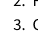
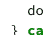

# C++ 最佳实践


## 1. 引言

作为一名培训师和承包商，我的目标（似乎）是让自己失业。我希望每个人都能：

- 1. 学会如何自己进行实验
- 2. 不要只是相信我，而要亲自验证
- 3. 了解这门语言如何工作
- 4. 不要再犯上一代人犯过的同样错误

我正在考虑把自己的头衔从“C++ 培训师”改为“C++ 向导”。我总是根据当前所教的班级来调整课程和材料。我们可能一开始就 X 达成一致，但为了满足组织需求，我会在第一天中途把它改成 Y。

在这个过程中，我们以团队形式进行实验和学习。我也经常在教学时学习。每个团队都是独特的；每堂课都会有新的问题。

但很多问题仍然一遍又一遍地重复（以至于我看起来像会读心术，这一点挺有趣）。

因此，有了这本书（以及催生它的 Twitter 话题串），用来传播这些由来已久的最佳实践。

> 我写了我自己想读的那本书。它有意做到直截了当、简短、切中要害，并带有具体的行动项。

## 2. 关于最佳实践

简而言之，最佳实践关乎

- 1. 减少常见错误
- 2. 快速发现错误
- 3. 不牺牲（而且通常会提升）性能

### 为什么需要最佳实践？

首先，让我们把这一点说清楚：

### 你的项目并不特殊

如果你在用 C++ 编程，那么你或你公司里的某个人一定关心性能。否则，他们很可能在使用其他编程语言。我去过许多公司，他们都告诉我自己很特殊，因为需要快速完成事情！

剧透一下：它们都出于同样的原因做出同样的决定。

例外非常少。那些做出不同决定的少数派：它们正是已经在遵循本书建议的组织。

### 最坏能发生什么？

我不想显得悲观，但让我们花点时间思考一下，如果你的项目存在严重缺陷，最坏的情况会是什么。

|  |  |
| --- | --- |
| **游戏** | 严重缺陷会导致远程漏洞或攻击途径。 |
| **金融** | 严重缺陷会导致大量资金损失、加速交易、市场崩盘¹。 |
| **航空航天** | 严重缺陷会导致航天器或人员生命损失²。 |
| **你的行业** | 严重缺陷会导致……资金损失？失业？远程入侵？还是更糟？ |

### 示例

本书中的示例使用 `struct` 而不是 `class`。`struct` 和 `class` 的唯一区别是，`struct` 的成员默认都是 `public`。使用 `struct` 可以让示例更短、更易读。

### 练习

每一节都有一个或多个练习。大多数练习没有对错答案。


### 练习：寻找练习

在接下来的章节中，你会看到像这样的练习。留意它们！

练习是：

- 实用的，并且可以应用到当前代码库中，以立即看到价值。

¹ https://en.wikipedia.org/wiki/2010_flash_crash
² https://spectrum.ieee.org/aerospace/aviation/how-the-boeing-737-max-disaster-looks-to-a-software-developer

## 3. 使用工具：自动化测试

你需要一条命令就能运行测试。如果没有这样的命令，没有人会去运行测试。

- [Catch2](https://github.com/catchorg/Catch2)<sup>1</sup> - 来自 [Phil Nash](https://twitter.com/phil_nash)<sup>2</sup> 和 [Martin Hořeňovský](https://twitter.com/horenmar_ctu)<sup>3</sup> 的流行且支持良好的测试框架
- [doctest](https://github.com/onqtam/doctest)<sup>4</sup> - 类似于 Catch2，但为编译期性能做了精简
- [Google Test](https://github.com/google/googletest)<sup>5</sup>
- [Boost.Test](https://www.boost.org/doc/libs/1_74_0/libs/test/doc/html/index.html)<sup>6</sup> - 测试框架，Boost 风格。

[ctest](https://cmake.org/cmake/help/latest/manual/ctest.1.html)<sup>7</sup> 是 CMake 的测试运行器，可与上述任何框架一起使用。它通过 CMake 的 [add_test](https://cmake.org/cmake/help/latest/command/add_test.html)<sup>8</sup> 功能来使用。

你需要熟悉这些工具、它们的作用，并从中做出选择。

没有自动化测试，本书其余部分就毫无意义。如果你无法验证自己没有破坏现有代码，就无法应用这些实践练习。

Oleg Rabaev 在 CppCast 上表示：

> - 如果组件难以测试，说明它没有正确设计。
> - 如果组件易于测试，则很好地表明它设计得当。

- <sup>1</sup> https://github.com/catchorg/Catch2
- <sup>2</sup> https://twitter.com/phil_nash
- <sup>3</sup> https://twitter.com/horenmar_ctu
- <sup>4</sup> https://github.com/onqtam/doctest
- <sup>5</sup> https://github.com/google/googletest
- <sup>6</sup> https://www.boost.org/doc/libs/1_74_0/libs/test/doc/html/index.html
- <sup>7</sup> https://cmake.org/cmake/help/latest/manual/ctest.1.html
- <sup>8</sup> https://cmake.org/cmake/help/latest/command/add_test.html


- 如果组件设计得当，测试起来就很容易。

### 练习：你能用一条命令运行一个测试套件吗？

- 能：太好了！运行测试并确保它们全部通过！
- 不能：你的程序会产生输出吗？
  - 会：从“Approval Tests[9]”开始，它将为你提供开始测试所需的基础。
  - 不会：制定一种策略，实现某种最简形式的测试。

### 资源

- CppCon 2018：Phil Nash《使用 Catch2 进行现代 C++ 测试》[10]
- CppCon 2019：Clare Macrae《使用 Approval Tests 快速测试遗留 C++ 代码》[11]
- C++ on Sea 2020：Clare Macrae《使用 Approval Tests 快速且有效地测试遗留 C++ 代码》[12]

9. https://cppcast.com/clare-macrae/
10. https://youtu.be/Ob5_XZfRGh0
11. https://youtu.be/3GZhVcdq3Zs
12. https://youtu.be/tXEuF_3wzRE

## 4. 使用工具：持续构建

没有自动化测试，就不可能保持项目质量。

在我职业生涯中参与过的 C++ 项目里，我不得不支持以下某种组合：

- x86
- x64
- SPARC
- ARM
- MIPSEL

在以下平台上：

- Windows
- Solaris
- MacOS
- Linux

当你开始跨多个平台和架构组合多个编译器时，一个平台上的重大变更就越来越有可能破坏一个或多个其他平台。

为解决这个问题，请为你的项目启用持续构建并配合持续测试。

- 测试你所支持平台的所有可能组合
- 分别测试 Debug 和 Release
- 测试所有配置选项
- 针对比你支持或要求更新的编译器进行测试


> 如果你不要求 100% 的测试通过，你就永远无法知道代码的状态。


### 练习：启用持续构建

了解你所在组织当前的持续构建环境。如果不存在这样的环境，搭建它有哪些障碍？为你的项目搭建 GitLab、GitHub Actions、AppVeyor 或 Travis 之类的东西会有多难？

## 5. 使用工具：编译器警告

有许多你尚未使用的警告，其中大多数是有益的。在 GCC 和 Clang 上，`-Wall` 并不是所有警告。`-Wextra` 仍然只是触及皮毛！


> 在 MSVC 上，`/Wall` 是全部警告。我们的编译器作者不建议在 MSVC 上使用 `/Wall`，也不建议在 Clang 上使用 `-Weverything`，因为其中许多是诊断性警告。GCC 没有提供等效选项。

强烈考虑使用 `-Wpedantic`（GCC/Clang）和 `/permissive-`（MSVC）。这些命令行选项会禁用语言扩展，让你更接近 C++ 标准。你今天启用的警告越多，将来移植到另一个平台时就越轻松。


### 练习：启用更多警告

1. 探索你的编译器可用的警告集合。尽可能多地启用它们。
2. 修复新产生的警告。
3. 回到第 1 步。



> MSVC 有一组出色的警告，可以通过警告级别启用。你可以从 `/w1` 开始，随着修复每一组警告，逐步提高到 `/w4`。

这个过程会感觉乏味且毫无意义，但这些警告会捕获真正的缺陷。

## 6. 使用工具：静态分析

静态分析工具是在不编译或执行代码的情况下分析代码的工具。你的编译器就是这样的工具之一，也是你的第一道防线。

许多此类工具是免费的，有些对开源项目免费。

cppcheck 和 clang-tidy 是两款流行且免费的工具，并与主流 IDE 和编辑器集成。


### 练习：启用更多静态分析

Visual Studio：研究随附的 Microsoft 静态分析器。考虑使用 Clang Power Tools。下载 cppcheck 的 Visual Studio 插件。

CMake：启用 cppcheck 和 clang-tidy 集成。

### 资源

- cppbestpractices.com 的静态分析器列表[1]

- [1] https://github.com/lefticus/cppbestpractices/blob/master/02-Use_the_Tools_Available.md#static-analyzers

## 7. 使用工具：Sanitizers

Sanitizers 是 C++ 的运行时分析工具，内置于 GCC、Clang 和 MSVC 中。

如果你熟悉 Valgrind，Sanitizers 提供类似功能，但比 Valgrind 快许多个数量级。

可用的 Sanitizers 有：

- Address（ASan）
- Undefined Behavior（UBSan）（后文会进一步讨论未定义行为）
- Thread
- DataFlow（用于代码分析，而不是查找缺陷）
- Lib Fuzzer（将在后续章节中讨论）

Address Sanitizer、UB Sanitizer、Thread Sanitizer 几乎能像魔法一样发现许多问题。在本书写作时，MSVC 中的支持正在增加，而 GCC 和 Clang 对 Sanitizers 的支持更为成熟。

John Regehr[1] 建议在开发过程中始终启用 ASan 和 UBSan。

当发生越界内存访问之类的错误时，Sanitizer 会向你报告导致失败的条件，并通常给出修复问题的建议。

你可以使用类似下面的命令启用 Address 和 Undefined Behavior Sanitizer：

```
gcc -fsanitize=address,undefined <file-to-compile>
```

在项目构建的链接阶段也必须启用 Sanitizers。

有关如何将 Sanitizers 与 CMake 一起使用的示例，见 C++ Starter Project[2]。

### 练习：启用 Sanitizers

- 研究如何为现有项目添加 Sanitizer 支持
- 首先启用 ASan
- 运行完整测试套件并调查发现的任何问题
- 其次启用 UBSan
- 再次运行完整测试套件

最终目标：在持续构建环境中启用 ASan 和 UBSan，让所有测试都能运行。

### 资源

- [2] https://github.com/lefticus/cpp_starter_project
- [3] https://devblogs.microsoft.com/cppblog/addresssanitizer-asan-for-windows-with-msvc/
- [4] https://github.com/google/sanitizers
- [5] https://clang.llvm.org/docs/AddressSanitizer.html
- [6] https://clang.llvm.org/docs/UndefinedBehaviorSanitizer.html

## 8. 放慢速度

C++ 中针对任何给定问题都存在几十种解决方案。关于其中哪些方案最好，还存在几十种更多观点。从一个应用程序复制粘贴到另一个应用程序很容易。坚持使用你熟悉的解决方案也很容易。

你曾多少次说过：“哇，实现这个解决方案要搞一个复杂的类层次结构？”或者“我想我需要在这里添加宏来实现这些常用函数。”

- 如果解决方案看起来庞大或复杂，就停下来。
- 现在是散步并思考解决方案的好时机。
- 散步结束后，与同事、宠物或橡皮鸭[1]讨论设计。

仍然没有找到你满意的更简单的解决方案？如果可以，在 Twitter 或 Slack 上提问。

关键点在于不要盲目坚持你熟悉的解决方案。要愿意停下来一分钟。我年纪越大，花在编程上的时间越少，花在思考上的时间越多。最终，我实现解决方案的速度和以前一样快，甚至更快，而且复杂度更低。

[1] https://rubberduckdebugging.com/

## 9. C++ 并不神奇

本节只是提醒你，我们可以对 C++ 的各个方面进行推理。它不是黑盒，也不神奇。

如果你有问题，通常很容易构造一个实验来帮你自行回答这个问题。

我最喜欢的一个工具是这个简单的类，每当调用特殊成员函数时，它都会打印一条调试消息。

*理解对象生命周期工具*

```cpp
#include <cstdio>

struct S {
  S() { puts("S()"); }
  S(const S &) { puts("S(const S &)"); }
  S(S &&) { puts("S(S &&)"); }
  S &operator=(const S &) {
    puts("operator=(const S &)");
    return *this;
  }
  S &operator=(S &&) {
    puts("operator=(S &&)");
    return *this;
  }
  ~S() { puts("~S()"); }
};
```

### 练习：构建你的第一个 C++ 实验。


## 10. C++ 不是面向对象的

Bjarne Stroustrup 在《C++ 程序设计语言》第 3 版中指出：

> C++ 是一种偏向系统编程的通用编程语言，它
>
> - 是更好的 C，
> - 支持数据抽象，
> - 支持面向对象编程，并且
> - 支持泛型编程。

你必须理解 C++ 是一种多范式编程语言，才能充分利用这门语言。C++ 实际上支持当今存在的所有编程范式。

- 过程式
- 函数式
- 面向对象
- 泛型
- 编译期（`constexpr` 和模板元编程）

知道何时适合使用这些工具中的每一个，是编写优秀 C++ 的关键。固守单一范式的项目会错过这门语言的最佳特性。

> 不要试图一直使用所有可能的技术。否则你最终会得到一堆难以维护和阅读的混乱代码。在适当的时候适当地使用适当的技术，需要纪律和练习。

## 11. 学习另一门语言

考虑到 C++ 不是面向对象语言，你必须了解许多不同的技术才能充分利用 C++。

以下练习将帮助你接触其他语言。但事实是，目前很少有语言是纯粹的单范式语言。

每种语言都有其偏好的做事方式，这些方式在该语言偏好的范式内有效。

Ben Deane 推荐所有程序员都应该学习以下这组语言¹：

- ALGOL 家族（C 及其后代）
- Forth
- Lisp 及其方言
- Haskell
- Smalltalk
- Erlang

¹ http://www.elbeno.com/blog/?p=420


### 练习：选择一门函数式语言来学习

你能找到一门纯函数式语言吗？


### 练习：选择一门面向对象语言来学习

找到一门纯面向对象语言更难！如今连 Java 都有 lambda 函数了。

### 练习：选择一门语法不同的语言

看起来像 C 家族语言的语言可能对你来说更舒适。尝试找一门看起来不同、能拓展思维的语言。

### 资源

- [名词王国中的执行²](https://steve-yegge.blogspot.com/2006/03/execution-in-kingdom-of-nouns.html) - 让你思考不同的编程范式

²https://steve-yegge.blogspot.com/2006/03/execution-in-kingdom-of-nouns.html

## 12. 将所有不是 `constexpr` 的东西都设为 `const`

许多人（如 Kate Gregory 和 James McNellis）已经多次说过这一点。将对象设为 `const` 有两个作用：

- 1. 它迫使我们思考对象的初始化和生命周期，这会影响性能。
- 2. 向代码读者传达含义。

顺便说一句，如果它是 `static` 对象，编译器现在可以自由地将其移入二进制文件的常量部分，这会影响优化器。

### 练习：寻找 `const` 机会。

阅读代码时，你应该寻找不是 `const` 的变量，并将它们设为 `const`。

- 如果变量不是 `const`，问问为什么不是？
- 使用 lambda 或添加命名函数是否能让该值成为 `const`？

### 资源

- CppCon 2014：James McNellis 与 Kate Gregory “现代化遗留 C++ 代码”^1
- CppCon 2019：Jason Turner “C++ 代码异味”^2
- C++ 中 const 或引用成员变量的含义^3
- C++Now 2018：Ben Deane “易于使用，难以误用：C++ 中的声明式风格”^4（基于让应用 const 更简单的技术。）

- 1. https://youtu.be/LDxAgMe6D18
- 2. https://youtu.be/1_tLQl0wLUM
- 3. https://lesleyLai.info/en/const-and-reference-member-variables/
- 4. https://youtu.be/2ouxET17SR4

*使用 lambda 初始化 const 对象。*

```cpp
const auto data = [](){ // no parameters
    std::vector<int> result;
    // fill result with things.
    return result;
}(); // immediately invoked
```


由于 RVO，使用 lambda 很可能不会增加任何开销，并可能提升性能。

在此过程中，你是否将任何 `static` 变量设为 `const`？那么去做 constexpr 练习。


你可能不想将 `class` 成员设为 const；它可能破坏重要功能，有时还是静默地。

### 资源

- CppCon 2014：James McNellis 与 Kate Gregory “现代化遗留 C++ 代码”^1
- CppCon 2019：Jason Turner “C++ 代码异味”^2
- C++ 中 const 或引用成员变量的含义^3
- C++Now 2018：Ben Deane “易于使用，难以误用：C++ 中的声明式风格”^4（基于让应用 const 更简单的技术。）

- 1. https://youtu.be/LDxAgMe6D18
- 2. https://youtu.be/1_tLQl0wLUM
- 3. https://lesleyLai.info/en/const-and-reference-member-variables/
- 4. https://youtu.be/2ouxET17SR4

- Meeting C++ 2017：Jason Turner “实用的 constexpr”³
- C++ Russia 2019：Hana Dušková “编译期正则表达式的现状”⁴

³https://youtu.be/xfq9qkDrTzE
⁴https://youtu.be/r_ZASJFGQGI

*C++11 尾置返回类型。*

```cpp
// use trailing return type
template<typename Numerator, typename Denominator>
auto divide(Numerator numerator, Denominator denominator)
    -> decltype(numerator / denominator)
{
    return numerator / denominator;
}
```

但在 C++14 中，我们可以完全省略返回类型（记得[跳过 C++11](#)）。

*C++14 auto 返回类型。*

```cpp
template<typename Numerator, typename Denominator>
auto divide(Numerator numerator, Denominator denominator)
{
    return numerator / denominator;
}
```


### 练习：熟悉 auto 推导。

*Ex1：val 的类型是什么？*

```cpp
const int *get();

int main() {
    const auto val = get();
}
```

Ex2：val 的类型是什么？

```cpp
const int &get();

int main() {
    const auto val = get();
}
```

Ex3：val 的类型是什么？

```cpp
const int *get();

int main() {
    const auto *val = get();
}
```

Ex4：val 的类型是什么？

```cpp
const int &get();

int main() {
    const auto &val = get();
}
```

Ex5：val 的类型是什么？

```cpp
const int *get();

int main() {
    const auto *&val = get();
}
```

*Ex6：val 的类型是什么？*

```cpp
const int &get();

int main() {
  const auto &&val = get();
}
```

### 练习：构建你的实验库

上面的练习非常适合构建成一组实验，保存在《C++ 不是魔法》中提到的 GitHub gists 中。

### 练习：理解 auto 和模板推导之间的关系

理解模板类型推导规则以及它们与 auto 的关系。阅读 C++ 编程语言标准中的 [dcl.spec.auto] 一节。

### 资源

- clang-tidy modernize-use-auto¹
- 几乎总是 auto²

¹https://clang.llvm.org/extra/clang-tidy/checks/modernize-use-auto.html
²https://herbsutter.com/2013/08/12/gotw-94-solution-aaa-style-almost-always-auto/

## 15. 优先使用范围 for 循环语法而非旧式循环

我们将通过一系列示例说明这一点。

*循环时 int 与 std::size_t。*

```cpp
for (int i = 0; i < container.size(); ++i) {
  // oops mismatched types
}
```

*循环时容器不匹配。*

```cpp
for (auto itr = container.begin();
     itr != container2.end();
     ++itr) {
  // oops, most of us have done this at some point
}
```

*范围 for 循环示例。*

```cpp
for(const auto &element : container) {
  // eliminates both other problems
}
```


在范围 for 循环内迭代时，绝不要修改容器本身。


### 练习：现代化你的循环

## 16. 在范围 for 循环中使用 auto

不使用 auto 会更容易在代码中产生静默错误。

*意外转换*

```cpp
for (const int value : container_of_double) {
    // accidental conversion, possible warning
}
```

*意外切片*

```cpp
for (const base value : container_of_derived) {
    // accidental silent slicing
}
```

*没问题*

```cpp
for (const auto &value : container) {
    // no possible accidental conversion
}
```

优先使用：

- 对于非修改循环使用 `const auto &`
- 对于修改循环使用 `auto &`
- 仅当必须处理像 `std::vector<bool>` 这样的奇怪类型，或需要将元素移出容器时，才使用 `auto &&`


### 练习：理解 `std::map` 和范围 for 循环

理解这段代码在做什么。它是在进行复制吗？为什么以及如何复制？


*意外复制？*

```cpp
std::map<std::string, int> get_map();

using element_type = std::pair<std::string, int>;

for (const element_type &element : get_map())
{
}
```

### 练习：启用与范围循环相关的警告

确保代码中启用了 `-Wrange-loop-construct`，它已自动包含在 `-Wall` 中。

*整数除法。*

```cpp
int divide(int numerator, int denominator) {
    return numerator / denominator;
}
```

模板正是为这种场景设计的。

*基本模板用法。*

```cpp
template<typename T>
T divide(T numerator, T denominator) {
    return numerator / denominator;
}
```

互联网上的大多数示例都使用 T，就像我刚才那样。不要这样做。给你的类型起一个有意义的名称。

*使用实际名称的模板参数。*

```cpp
template<typename Arithmetic>
Arithmetic divide(Arithmetic numerator, Arithmetic denominator) {
    return numerator / denominator;
}
```


**练习：在继续下一章并查看其练习时，请记住本章内容。**

## 19. 不要复制粘贴代码

如果你发现自己正要选中一段代码并复制它：停下来！
退后一步，重新审视这段代码。

- 你为什么要复制它？
- 源内容与目标内容会有多相似？
- 把它做成一个函数是否合理？
- 记住，*不要害怕模板*

我发现，这条简单的规则对我的代码质量产生了最直接的影响。

如果粘贴操作的结果要放在当前函数中，请考虑使用 lambda。

C++14 风格的 lambda 带有泛型（又称 auto）参数，为你提供了一种简单易用的方法，可创建能在不同数据类型间共享的可复用代码，而无需处理模板语法。

### 练习：试用 CPD。

有几种不同的复制粘贴检测器，可查找代码库中的重复代码。

对于本练习，请下载 PMD CPD 工具[^1]，并在你的代码库上运行它。

[^1]: https://pmd.github.io/latest/pmd_userdocs_cpd.html

如果你使用 Arch Linux，可以通过 AUR 安装此工具。软件包名为 pmd；工具名为 pmd-cpd。

你能识别出代码中已被复制粘贴的关键部分吗？如果你在某个版本中发现了一个 bug，会发生什么？你能确保看到所有同样需要更新的位置吗？

### 资源

- 复制粘贴编程<sup>2</sup>
- 最后一行效应<sup>3</sup>
- 我不会复制粘贴代码<sup>4</sup>

<sup>2</sup> https://www.viva64.com/en/t/0068/
<sup>3</sup> https://www.viva64.com/en/b/0260/
<sup>4</sup> https://twitter.com/bjorn_fahller/status/1072432257799987200

## 20. 遵循零法则

当不定义析构函数是正确的做法时，它总是更好。空析构函数会破坏性能：

- 它们使类型不再是平凡类型
- 没有实际用途
- 可能影响析构的内联
- 隐式禁用移动操作


如果你因为进行资源管理或定义带虚函数的基类而需要析构函数，那么你需要遵循五法则。

如果你提供自定义删除器，std::unique_ptr 可以帮助你应用零法则。


### 练习：在代码中查找违反零法则的地方

查找类似这样的代码（我保证你会找到）。

空而无意义的析构函数。

```cpp
struct S {
    // a bunch of other things
    ~S() {}
};
```

或者更糟：

前向声明的空而无意义的析构函数。

```cpp
// file.hpp
struct S {
    ~S();
};

// file.cpp
S::~S() {}
```

这些析构函数有必要吗？如果没有必要，就删除它们。

如果这些析构函数存在于许多地方使用的类型中，采取这个简单操作后，你很可能会测得更小的二进制体积和更好的性能。

> pimpl 惯用法的一些用法要求你定义析构函数。在这种情况下，请务必遵循五法则。

### 资源

- C++ 参考：三/五/零法则¹
- C++ Weekly 第 154 集：“减少代码膨胀的一个简单技巧”²
- CppCon 2019：Jason Turner “出色的 C++ is_trivial”³

¹ https://en.cppreference.com/w/cpp/language/rule_of_three
² https://youtu.be/D8cCPl2zit4
³ https://youtu.be/ZxWji9syao

## 21. 如果必须手动进行资源管理，请遵循五法则

如果你因为 `std::unique_ptr` 不适合你的用例而提供析构函数，那么你必须 `=delete`、`=default` 或实现其他特殊成员函数。

这条规则最初被称为三法则，在 C++11 之后被称为五法则。

*特殊成员函数。*

```cpp
struct S {
    S(); // default constructor
         // does not affect other special member functions

    // If you define any of the following, you must deal with
    // all the others.
    S(const S &);        // copy constructor
    S(S&&);              // move constructor
    S &operator=(const S &); // copy assignment operator
    S &operator=(S &&);  // move assignment operator
};
```


如果你不知道如何处理特殊成员函数，`=delete` 是一种安全的处理方式！

在声明带虚函数的基类时，你也应该遵循五法则。

加分项：使用 C++20 的 constexpr 动态分配支持来实现它。


### 练习：在代码中查找违反五法则的地方

在定义特殊成员函数时，你现有的代码很可能没有提供一致的生命周期语义。为了评估影响，你可以快速对任何缺失的特殊成员函数执行 `= delete;`，看看哪些地方会出错。

### 资源

- C++ 参考：三/五/零法则¹

¹ https://en.cppreference.com/w/cpp/language/rule_of_three

### 练习：使用 UBSan、ASan 和警告

理解所有未定义行为很可能是不可能的。幸运的是，我们确实有工具可以提供帮助。希望你已经在代码中启用了 UBSan、ASan，并启用了警告。现在是回头评估你有哪些选项，并看看是否能发现新内容的好时机。

### 资源

- C++Now 2018：John Regehr “闭幕主题演讲：未定义行为与编译器优化”²
- CppCon 2018：Barbara Geller 与 Ansel Sermersheim “未定义行为不是错误”³

² https://youtu.be/AeEwxEQgH0
³ https://youtu.be/XEXpwis_deQ

## 23. 永远不要测试 this 是否为 nullptr，这是 UB

*对 this 是否为 `nullptr` 的无效检查。*

```cpp
int Class::member() {
    if (this == nullptr) {
        // removed by the compiler, it would be UB
        // if this were ever null
        return 42;
    } else {
        return 0;
    }
}
```

严格来说，未定义行为（UB）并不是这个检查本身。但这个检查永远不可能失败。如果 this 等于 `nullptr`，你就会处于未定义行为状态。

人们过去经常这样做，但它一直是 UB。你不能在对象的生命周期之外访问该对象。如今的编译器总会移除这个检查。

从理论上讲，`this` 为 null 的唯一可能情况是，你直接在一个空对象上调用成员。


前面有糟糕的示例，不要重蹈覆辙。

*在 nullptr 上错误调用成员。*

```cpp
Type *obj = nullptr;
obj->do_thing(); // never do this
```

即使是在调用 `delete this` 这种（严格来说可以，但永远不要这样做）的场景中也是如此。

*delete this 的糟糕示例。*

```cpp
struct S {
  std::string data;

  void delete_yourself() {
    // do things
    delete this; // technically OK

    if (this) {
      // this block will always be executed, nothing changed
      // our view of `this`
    }

    // never do this
    data.size(); // UB, data's lifetime has ended
  }
};
```

在现代编译器上，不存在 if (this) 检查会返回 false 的场景。


### 练习：你会检查 this 是否为 nullptr 吗？

对 nullptr 的检查可能隐藏着对 NULL 的检查或对 0 的检查。对 this 是否为 NULL 的检查很可能只存在于非常旧的代码库中。确保已启用警告，然后查找这些情况。


在代码库中搜索这个 `==`，看看里面有什么奇怪的东西，这通常可能挺有意思。

### 资源

- 移植到 GCC-6：优化会移除对 this 的空指针检查¹

¹ https://www.gnu.org/software/gcc/gcc-6/porting_to.html#this-cannot-be-null

## 24. 永远不要测试引用是否为 `nullptr`，这是 UB

*对空引用的检查会被移除*

```cpp
int get_value(int &thing) {
  if (&thing == nullptr) {
    // removed by compiler
    return 42;
  } else {
    return thing;
  }
}
```

创建空引用是 UB，不要尝试。始终假定引用指向有效对象。设计 API 时利用这一点。


### 练习：检查对象地址的检查

用 `&thing ==` 检查对象的特定地址有许多有效用例，但这种检查也可能以许多方式出错。

在代码中搜索检查对象内存地址的语句，理解它们在做什么，以及它们如何（或是否）工作。


除了 == 之外，还可能有哪些方式检查对象的地址？

这个练习会让你积累使用各种搜索 / grep 工具以及摆弄正则表达式的宝贵经验。

### 资源

- -Wtautological-undefined-compare¹

¹ https://clang.llvm.org/docs/DiagnosticsReference.html#wtautological-undefined-compare

## 25. 避免在 switch 语句中使用 `default`

这个问题最好通过一系列示例来说明。先从下面这个开始：

带警告的 switch

```cpp
enum class Values {
    val1,
    val2
};

std::string_view get_name(Values value) {
    switch (value) {
    case val1: return "val1";
    case val2: return "val2";
    }
}
```

如果你启用了所有警告，那么这里很可能会收到“并非所有代码路径都返回值”的警告。这在技术上是正确的。我们可以调用 get_name(static_cast<Values>(15))，除了从函数不返回值带来的未定义行为之外，不会违反 C++[dcl.enum/5] 的任何部分。

你可能会想这样修复这段代码：

### 用 `default` 避免警告的 switch

```cpp
enum class Values {
  val1,
  val2
};

std::string_view get_name(Values value) {
  switch (value) {
    case val1: return "val1";
    case val2: return "val2";
    default: return "unknown";
  }
}
```

但这引入了一个新问题

### 未处理的情况

```cpp
enum class Values {
  val1,
  val2,
  val3 // added a new value
};

std::string_view get_name(Values value) {
  switch (value) {
    case val1: return "val1";
    case val2: return "val2";
    default: return "unknown";
  }
  // no compiler diagnostic that `val3` is unhandled
}
```

相反，更推荐这样的代码：

### 首选版本

```cpp
enum class Values {
  val1,
  val2,
  val3 // added a new value
};

std::string_view get_name(Values value) {
  switch (value) {
  case val1: return "val1";
  case val2: return "val2";
  } // unhandled enum value warning now

  return "unknown";
}
```


在上面的示例中，你永远不应收到“不可达代码”警告，因为有效值的范围几乎总是大于你已定义的值。


一些现代工具可以为你检测这些 `default` 的用法。


### 练习：查找 `default:`。

你在代码库中发现了什么？前面练习中启用警告是否已经帮你找到了 `default:` 的用法？

### 资源

- CppCon 2018：Jason Turner《应用最佳实践》¹
- -Wswitch-enum²
- -Wswitch³

¹ https://youtu.be/DH0lsEd0eDE
² https://clang.llvm.org/docs/DiagnosticsReference.html#wswitch-enum
³ https://clang.llvm.org/docs/DiagnosticsReference.html#wswitch

C++11 作用域枚举。

```cpp
enum class Choices {
  option1
};

enum class OtherChoices {
  option2
};

int main() {
  int val = option1; // cannot compile, need scope
  int val2 = Choices::option1; // cannot compile, wrong type
  Choices val = Choices::option1; // compiles
  val = OtherChoices::option2; // cannot compile, wrong type
}
```

这些 enum class 版本无需太多努力就不会混淆，而且它们的标识符现在具有作用域，而不是全局的。

> enum struct 和 enum class 是等价的。从逻辑上讲，enum struct 更合理，因为它们是公开名称。你更喜欢哪一个？

### 练习：enum struct 还是 enum class

决定你更喜欢 enum struct 还是 enum class，并为原因给出充分合理的解释。

### 练习：clang-tidy modernize

## 27. 优先使用 `if constexpr` 而非 SFINAE

SFINAE 算是一种只写代码。`if constexpr` 没有那么大的灵活性，但能用时就用它。

我们来看之前的示例：

*C++14 除法模板。*

```cpp
template <typename Numerator, typename Denominator>
auto divide(Numerator numerator, Denominator denominator)
{
    return numerator / denominator;
}
```

现在我们希望在执行整数除法时添加不同的行为。在 C++17 之前，我们会使用 SFINAE（“替换失败并非错误”）。本质上，这意味着如果一个函数编译失败，那么它就会从重载决议中移除。

*SFINAE 除法函数。*

```cpp
#include <stdexcept>
#include <type_traits>
#include <utility>

template <typename Numerator, typename Denominator,
          std::enable_if_t<std::is_integral_v<Numerator> &&
                           std::is_integral_v<Denominator>,
                           int> = 0>
auto divide(Numerator numerator, Denominator denominator) {
    // is integer division
    if (denominator == 0) {
        throw std::runtime_error("divide by 0!");
    }
    return numerator / denominator;
}

template <typename Numerator, typename Denominator,
          std::enable_if_t<std::is_floating_point_v<Numerator> ||
                           std::is_floating_point_v<Denominator>,
                           int> = 0>
auto divide(Numerator numerator, Denominator denominator) {
    // is floating point division
    return numerator / denominator;
}
```

C++17 中的 `if constexpr` 构造可以简化这段代码：用 `if constexpr` 在编译期改变行为。

```cpp
#include <stdexcept>
#include <type_traits>
#include <utility>

template <typename Numerator, typename Denominator>
auto divide(Numerator numerator, Denominator denominator) {
    if constexpr (std::is_integral_v<Numerator> &&
                  std::is_integral_v<Denominator>) {
        // is integral division
        if (denominator == 0) {
            throw std::runtime_error("divide by 0!");
        }
    }

    return numerator / denominator;
}
```

注意，`if constexpr` 块内的代码仍然必须在语法上正确。`if constexpr` 与 `#define` 不同。

### 资源

- C++ Weekly 特别版：使用 C++17 的 constexpr if¹
- C++ Weekly 第 122 期：constexpr 与 optional 和 variant²
- CppCon 2017：Jason Turner《Practical C++17》³
- C++17 在 Tony Tables 中：constexpr `if`⁴

¹ https://youtu.be/_Ny6Qbm_uMI
² https://youtu.be/2eCV_uAKP_o
³ https://youtu.be/nnY4e4faNp0
⁴ https://github.com/tvaneerd/cpp17_in_TTs/blob/master/if_constexpr.md

### requires 子句中的概念。

```cpp
#include <stdexcept>
#include <type_traits>
#include <utility>

// overload resolution will pick the most specific version
template <typename Numerator, typename Denominator>
auto divide(Numerator numerator, Denominator denominator) requires
    (std::is_integral_v<Numerator>
     && std::is_integral_v<Denominator>) {
  // is integral division
  if (denominator == 0) {
    throw std::runtime_error("divide by 0!");
  }
  return numerator / denominator;
}

template <typename Numerator, typename Denominator>
auto divide(Numerator numerator, Denominator denominator) {
  return numerator / denominator;
}
```

这个版本将概念用作函数参数。C++20 甚至有“auto concept”，它是一种隐式模板函数。

### 简洁概念约束语法。

```cpp
#include <stdexcept>
#include <concepts>

auto divide(std::integral auto numerator,
            std::integral auto denominator) {
  // is integer division
  if (denominator == 0) {
    throw std::runtime_error("divide by 0!");
  }
}
```

- C++ Weekly 第196期：`requires` `requires` 是什么⁴

⁴ https://youtu.be/tc0HVlOjk_U

## 29. 去模板化你的泛型代码

尽可能把东西移到模板之外。使用其他函数。使用基类。编译器仍然可以自由地内联它们，或将它们保留为不内联。去模板化会改善编译时间并减小二进制体积。两者都有帮助。它还消除了人们所认为的“模板代码膨胀”（在我看来并不存在¹）（文章格式在某些时候坏了，抱歉）。

¹ https://articles.emptycrate.com/2008/05/06/nobody_understands_c_part_5_template_code_bloat.html

*每个函数模板实例化都会产生一个新的 lambda。*

```cpp
template<typename T>
void do_things()
{
  // this lambda must be generated for each
  // template instantiation
  auto lambda = []() { /* some lambda */ };
  auto value = lambda();
}
```

与之相比：

*模板实例化之间共享逻辑。*

```cpp
auto some_function() { /* do things*/ }

template<typename T>
void do_things()
{
    auto value = some_function();
}
```

现在只编译内部逻辑的一个版本，而是否内联由编译器决定。

类似技术也适用于基类和模板化派生类。

### 练习：Bloaty McBloatface 与 `-ftime-trace`

我们可用的工具越来越多，可以用来查找二进制文件中的膨胀并分析编译时间。研究一下这些工具以及你的平台上可用的其他工具。

对二进制文件运行这些工具，看看能发现什么。

使用 clang 的 `-ftime-trace` 时，也请研究一下 ClangBuildAnalyzer。

### 资源

- [Templight](https://github.com/mikael-s-persson/templight)^2
- [C++ Weekly 第89期：“滥用 Lambda”](https://youtu.be/OmKMNQFX_8Y)^3
- C++ Weekly 2019 圣诞课程 - 第3章⁴（这是第3章的第一集，它引出了两个不同选项为何以及如何不同的问题⁵。该播放列表接下来的几集会提供一些背景，而第4章的开头给出了答案。这与模板膨胀问题非常相关。）

^2 https://github.com/mikael-s-persson/templight
^3 https://youtu.be/OmKMNQFX_8Y
⁴ https://www.youtube.com/watch?v=VEqOOKUBRjQ&list=PL3KjaCtOwSY_Awyliwrn-fRjEOa-SRbs&index=16
⁵ https://godbolt.org/z/b4znvk

## 30. 使用 Lippincott 函数

与[去模板化](#)代码的论点相同：这是异常处理例程的“不要重复自己”原则。

如果你有许多不同的异常类型要处理，可能会有类似下面的代码：

重复的异常处理。

```cpp
void use_thing() {
  try {
    do_thing();
  } catch (const std::runtime_error &) {
    // handle
  } catch (const std::exception &) {
    // handle it
  }
}

void use_other_thing() {
  try {
    do_other_thing();
  } catch (const std::runtime_error &) {
    // handle it
  } catch (const std::exception &) {
    // handle it
  }
}
```

Lippincott 函数（以 Lisa Lippincott 命名）提供集中式的异常处理例程。

*Lippincott 去重后的异常处理。*

```cpp
void handle_exception() {
  try {
    throw; // re-throw exception already in flight
  } catch (const std::runtime_error &) {
  } catch (const std::exception &) { }
}

void use_thing() {
  try {
    do_thing();
  } catch (...) {
    handle_exception();
  }
}

void use_other_thing() {
  try {
    do_other_thing();
  } catch (...) {
    handle_exception();
  }
}
```

这种技术并不新鲜——自 C++98 之前就已可用。



### 练习：你使用异常吗？

如果你的项目使用异常，可能有一些理由可以简化和集中你的错误处理例程。如果项目不使用异常，那么你可能还有其他类型的错误处理例程被重复。这些可以简化吗？

## 31. 警惕全局状态

对全局状态进行推理很难。

任何非 const 静态值或 `std::shared_ptr<>` 都可能是全局状态。永远不知道谁会更新该值，或者这样做是否线程安全。

全局状态可能导致微妙且难以追踪的缺陷：一个函数更改全局状态，而另一个函数要么依赖该更改，要么受其不利影响。

### 练习：全局状态，还剩下什么？

如果你做过其他练习，你已经把所有静态变量都设为 const。这很好！你甚至可能把其中一些设为 constexpr，那就更好了！

但你可能仍有全局状态潜伏着。你有全局单例日志器吗？日志器是否可能在系统的模块之间意外共享状态？

其他单例呢？它们可以被消除吗？它们有线程初始化问题吗（如果两个线程同时首次尝试访问其中一个对象，会发生什么）？

### 资源

- 让单例模式退役 - Peter Muldoon - Meeting C++ 2019¹

¹ https://youtu.be/f46jmm7r8Yg

## 32. 让你的接口难以被错误使用

你的接口是你的第一道防线。如果你提供的接口容易被错误使用，你的用户*就会*错误地使用它。

如果你提供的接口难以被错误使用，你的用户就必须更费力才能错误地使用它。但这仍然是 C++；他们总能找到办法。

难以错误使用的接口有时会导致代码更冗长，而我们可能希望代码更简洁。你必须选择什么最重要。正确的代码还是简短的代码？

这是一个高层次概念；具体想法将在后面介绍。

### 资源

- *API 设计小手册*¹

¹ https://people.mpi-inf.mpg.de/~jblanche/api-design.pdf

## 33. 考虑错误使用 API 是否会引发未定义行为

你接受原始指针吗？它是可选参数吗？如果向你的函数传入 `nullptr` 会发生什么？

如果向你的函数传入超出预期范围的值会发生什么？

一些开发者区分“内部”和“外部”API。他们只允许内部使用不安全的 API。


> 有什么能保证外部用户永远不会调用“内部”API？
>
> 有什么能保证你的内部用户永远不会误用该 API？


### 练习：研究受检查类型

C++ 指南支持库（GSL）有一个 `not_null` 指针类型，它借助零成本抽象保证传入的指针永远不会是 `nullptr`。这对你目前传递原始指针的 API 是否适用（假设重新设计 API 不是选项）？

`std::string_view`（C++17）和 `std::span`（C++20）是传递给函数的指针/长度对的绝佳替代方案。

## 34. 自由地使用 `[[nodiscard]]`

`[[nodiscard]]`（C++17）是一个 C++ 属性，告诉编译器在返回值被忽略时发出警告。它可用于函数：

`[[nodiscard]]` *示例用法。*

```cpp
[[nodiscard]] int get_value();

int main()
{
    // warning, [[nodiscard]] value ignored
    get_value();
}
```

也可用于类型：

`[[nodiscard]]` *用于类型。*

```cpp
struct [[nodiscard]] ErrorCode{};

ErrorCode get_value();

int main()
{
    // warning, [[nodiscard]] value ignored
    get_value();
}
```

C++20 增加了提供描述的能力。

C++20 的带描述的 `[[nodiscard]]`。

```cpp
[[nodiscard("Ignoring this result leaks resources")]]
```

我们的除法示例是 `[[nodiscard]]` 的直接应用。

`[[nodiscard]]` *应用于除法函数。*

```cpp
#include <stdexcept>
#include <concepts>

[[nodiscard]] auto divide(std::integral auto numerator,
                          std::integral auto denominator) {
    // is integer division
    if (denominator == 0) {
        throw std::runtime_error("divide by 0!");
    }
    return numerator / denominator;
}

[[nodiscard]] auto divide(auto numerator, auto denominator) {
    // is floating point division
    return numerator / denominator;
}
```

### 练习：确定一组使用 `[[nodiscard]]` 的规则

阅读 Reddit 讨论“支持自由使用 nodiscard 的论点”。考虑你的类型和函数。哪些值应当使用 `[[nodiscard]]`？

调用这些函数并忽略结果应该成为编译器错误还是警告？

[^1]: https://www.reddit.com/r/cpp/comments/9us7f3/an_argument_pro_liberal_use_of_nodiscard/


- `vector.size()`
- `vector.empty()`
- `vector.insert()`

### 资源

- “关于自由使用 nodiscard 的论证”²
- C++ Weekly 第30期：C++17 的 [[nodiscard]] 属性³
- C++ Weekly 第199期：C++20 的 [[nodiscard]] 构造函数及其用途⁴

² https://www.reddit.com/r/cpp/comments/9us7f3/an_argument_pro_liberal_use_of_nodiscard/  
³ https://youtu.be/_5PF3GQLKc  
⁴ https://youtu.be/E_ROB_xUQQQ

## 35. 使用更强的类型

考虑 POSIX 套接字的 API：

*POSIX 套接字 API。*

```cpp
socket(int, int, int);
```

这些参数（按某种顺序）表示：

- 类型
- 协议
- 域

这种设计有问题，但我们的代码中还潜伏着一些不那么明显的问题。

*定义不佳的构造函数。*

```cpp
Rectangle(int, int, int, int);
```

这个函数可能是 (x, y, width, height)，也可能是 (x1, y1, x2, y2)。可能性较小但仍有可能的是 (width, height, x, y)。

你觉得像这样的 API 怎么样？

*强类型构造函数。*

```cpp
Rectangle(Position, Size);
```

在许多情况下，只需花一点功夫就能做出类型更强的 API。

在 C++11 中，enum class 提供了一种简便方法，可以添加更强的类型、避免布尔参数，并让你的 API 更难被用错。

考虑：

*不明显的参数顺序。*

```cpp
struct Widget {
    // this constructor is easy to use wrong, we
    // can easily transpose the parameters
    Widget(bool visible, bool resizable);
};
```

与之相比：

*使用作用域枚举实现更强的类型。*

```cpp
struct Widget {
    enum struct Visible { True, False };
    enum struct Resizable { True, False };

    // still possible to use this wrong, but MUCH harder
    Widget(Visible visible, Resizable resizable);
};
```


### 练习：找出你现有代码中有问题的 API。

你经常把哪个函数调用的顺序弄错？如何修复？


### 练习：研究 C++ 的强 typedef 库。

现有一些库可以在你创建强类型 int 时为你简化一些样板代码。Jonathan Muller、Bjorn Fahller 和 Peter Sommerlad 各写了一个，还有其他可用的库。

### 练习：考虑用 =delete 删除有问题的转换。

*简单的函数声明。*

```cpp
double high_precision_thing(double);
```

如果用 float 调用上述函数很可能是一个 bug，那该怎么办？

*删除从 float 到 double 的有问题的意外提升。*

```cpp
double high_precision_thing(double);
double high_precision_thing(float) = delete;
```

在 C++11 中，任何函数或重载都可以 `=deleted`。

### 资源

- C++ Weekly 第107期：“=delete 的力量”¹
- Adi Shavit 和 Björn Fahller “耦合类型的奇异递归模式”²
- 研究“仿射空间类型。”
- C++Now 2017：Jonathan Müller “类型安全编程”³

¹ https://youtu.be/aAyjUlUm6AU  
² https://youtu.be/ms4WNO2yWs  
³ https://youtu.be/jiMlo9AZEzw

## 36. 不要返回裸指针

返回裸指针会让代码阅读者和库使用者过多地思考所有权语义。优先使用引用、智能指针、非拥有指针包装器，或者考虑可选引用。

*返回裸指针的函数。*

```cpp
int *get_value();
```

这个返回值归谁所有？是我吗？用完之后需要由我 `delete` 它吗？或者更糟，如果内存是用 `malloc` 分配的，而我需要改为调用 `free` 呢？

它是一个 `int`，还是一个 `int` 数组？

这段代码有太多问题，连 `[[nodiscard]]` 也帮不了我们。

### 练习：你知道该怎么做

到现在为止，你已经做了足够多这类与 API 相关的练习，知道该怎么做。去你的代码里找找这些情况！看看有没有更好的办法！你能改为返回值、引用或 `std::unique_ptr` 吗？

*非常糟糕的主意，使用堆并泄漏内存。*

```cpp
    void use_string() {
        // The string lives on the heap
        std::string *value = new std::string("Hello World");
    }
```

> 记住，`std::string` 本身可能会在内部进行分配并使用堆。如果你的目标是完全不使用堆，则需要采取其他措施。目标是不进行*不必要的堆分配*。

一般来说，用 `new` 表达式（或通过 `make_unique` 或 `make_shared`）创建的对象是堆对象，具有*动态存储期*。在局部作用域中创建的对象是栈对象，具有*自动存储期*。

### 练习：查找堆使用

有时具有 C 和 Java 背景的开发者很难适应这一点。对于 Java，这是因为创建对象必须使用 `new`。对于 C，这是因为语言差异导致 C 编译器无法执行 C++ 编译器所能执行的同类优化。

因此，你当前代码中可能已经出现了一些这种不必要的堆使用。

### 练习：运行堆分析器

有几种堆分析工具，你的 IDE 中甚至可能内置了一个。检查你的堆使用情况，并查找项目中可能滥用堆的地方。

### 资源

- Code::Dive 2018：Björn Fahller “你说的缓存友好是什么意思？”¹

¹ https://youtu.be/F2botz1lgY

## 38. 不再使用 new！

你已经避免使用堆，并使用智能指针进行资源管理了，对吧？！

更进一步，在极少数需要堆的情况下，务必使用 `std::make_unique<>()`¹（C++14）。

在极少数需要共享所有权的情况下，使用 `std::make_shared<>()`²（C++11）。

### 练习：你使用 Qt 或其他控件库吗？

你是否想过编写自己的 `make_qobject` 辅助函数？赋予它你需要的语义，并务必使用 `[[nodiscard]]`。

无论如何，你可以把 `new` 的使用限制在少数核心库辅助函数中。

### 练习：使用 clang-tidy modernize 修复。

使用 `clang-tidy`，你可以自动将 `new` 语句转换为 `make_unique<>` 和 `make_shared<>` 调用。务必在发现问题后使用 `-fix` 应用更改。

¹ https://en.cppreference.com/w/cpp/memory/unique_ptr/make_unique

² https://en.cppreference.com/w/cpp/memory/shared_ptr/make_shared

### 资源

- [clang-tidy modernize-make-shared](https://clang.llvm.org/extra/clang-tidy/checks/modernize-make-shared.html)³
- [clang-tidy modernize-make-unique](https://clang.llvm.org/extra/clang-tidy/checks/modernize-make-unique.html)⁴

³ https://clang.llvm.org/extra/clang-tidy/checks/modernize-make-shared.html  
⁴ https://clang.llvm.org/extra/clang-tidy/checks/modernize-make-unique.html

## 39. 了解你的容器

按以下顺序优先选择容器：

- `std::array<>`
- `std::vector<>`

**`std::array<>`**

一个固定大小、基于栈的连续容器。数据大小必须在编译时已知，并且你必须有足够的栈空间来容纳数据。这个容器帮助我们在栈和堆之间优先选择栈。已知的位置和连续性使 `std::array<>` 成为一种“负成本抽象”。由于编译器知道数据的大小和位置，它可以执行额外的一组优化。

**`std::vector<>`**

一个动态大小、基于堆的连续容器。虽然编译器不知道数据最终会驻留在哪里，但它知道元素在 RAM 中是相邻排列的。连续性为编译器提供了更多优化机会，并且对缓存更友好。

几乎任何其他选择都需要注释并说明理由。对于小型容器，使用线性搜索的扁平映射很可能比 `std::map` 更好。

但不要对此过于热情。如果你需要按键查找，请使用 `std::map`，并评估它是否具有你想要的性能和特性。

### 练习：用 array 替换 vector

查找固定大小的 vector，并在可能的情况下用 array 替换它们。借助 C++17 的类模板实参推导，这可以更容易。


固定大小的数据使用 const std::vector。

```cpp
const std::vector<int> data{n+1, n+2, n+3, n+4};
```

可以改为

固定大小的数据使用 const std::array。

```cpp
const std::array<int, 4> data{n+1, n+2, n+3, n+4}; // C++11
const std::array data{n+1, n+2, n+3, n+4};          // C++17
```

你已经把这些设为 const，现在如果可以的话，回头把它们改成 constexpr。

### 资源

- Bjarne Stroustrup，“链表是邪恶的吗？”<sup>1</sup>

> <sup>1</sup> https://www.stroustrup.com/bs_faq.html#list

## 40. 避免使用 `std::bind` 和 `std::function`

尽管编译器不断改进，优化器也会处理这些类型的复杂性，但两者仍很可能带来可观的编译时和运行时开销。

C++14 的 lambda 借助广义捕获表达式，能够完成 `std::bind` 能完成的同样的事情。

*用 std::bind 改变参数顺序*

```cpp
#include <functional>

double divide(double numerator, double denominator) {
    return numerator / denominator;
}

auto inverted_divide = std::bind(divide,
                                 std::placeholders::_2,
                                 std::placeholders::_1);
```

*用 Lambda 改变参数顺序*

```cpp
#include <functional>

double divide(double numerator, double denominator) {
    return numerator / denominator;
}

auto inverted_divide = [](const auto numerator,
                          const auto denominator) {
  return divide(denominator, numerator);
};
```

### 练习：比较这些可能性。

在 Compiler Explorer 中尝试这些选项。编译时间和生成的汇编代码看起来如何？

std::function *和* std::bind

```cpp
#include <functional>

template<typename Func>
std::function<int (int)> bind_3(Func func)
{
    return std::bind(func, std::placeholders::_1, 3);
}

int main(int argc, const char *[])
{
    return bind_3(std::plus<>{})(argc);
}
```

std::bind *仅*；附加题：函数 bind_3 返回什么类型？

```cpp
#include <functional>

template<typename Func>
auto bind_3(Func func)
{
    return std::bind(func, std::placeholders::_1, 3);
}

int main(int argc, const char *[])
```

## 41. 跳过 C++11

如果你现在终于想转向“现代”C++，请跳过 C++11。C++14 修复了 C++11 中的几个漏洞。

### 语言特性

- C++11 的 `constexpr` 版本对成员函数隐含 `const`；这在 C++14 中已改变。
- C++11 缺少普通函数的 `auto` 返回类型推导（lambda 具备该功能）。
- C++11 没有 `auto` 或可变参数 lambda 参数。
- C++14 增加了 `[[deprecated]]` 属性。
- C++14 增加了 `'` 数字分隔符，例如：`1'000'000`。
- 在 C++14 中，`constexpr` 函数可以不只是单个 return 语句。

### 库特性

- `std::make_unique` 在 C++14 中加入，这使“不使用裸 new”的标准成为可能。
- C++11 没有 `std::exchange`。
- C++14 为 `std::array` 增加了一些 `constexpr` 支持。
- 增加了 `cbegin`、`cend`、`crbegin` 和 `crend` 自由函数，以便与 C++11 中为标准容器添加的 `begin` 和 `end` 自由函数及成员函数保持一致。


### 练习：你今天能使用 C++14 吗？

### 资源

- C++ Weekly 第176期：12分钟了解C++11的重要部分³
- C++ Weekly 第178期：9分钟了解C++14的重要部分⁴
- C++ Weekly 第190期：10分钟了解C++17的重要部分⁵

³ https://youtu.be/D5n6xMUKU3A  
⁴ https://youtu.be/mXxNvaEdNHI  
⁵ https://youtu.be/QpFjOIzg1r4

## 42. 不要对非平凡类型使用 `initializer_list`

“Initializer List”在 C++ 中是一个含义过多的术语。“Initializer Lists”用于直接初始化值。`initializer_list` 用于向函数或构造函数传递一组值。

### 练习：理解 `initializer_list` 可能带来的开销

使用 Andreas Fertig 出色的 cppinsights.io¹ 来理解这两个示例的作用。

使用 shared_ptr 的 initializer_list 构造函数。

```cpp
#include <vector>
#include <memory>

std::vector<std::shared_ptr<int>> vec{
  std::make_shared<int>(40), std::make_shared<int>(2)
};
```

¹ http://cppinsights.io

使用 shared_ptr 的 std::array 构造。

```cpp
#include <array>
#include <memory>

std::array<std::shared_ptr<int>, 2> data{
    std::make_shared<int>(40), std::make_shared<int>(2)
};
```

并解释其中的区别。如果你能做到这一点，你对 C++ 的理解就超过了大多数 C++ 开发者。


### 练习：理解为什么这段代码无法编译

使用 unique_ptr 的 initializer_list 构造。

```cpp
#include <vector>
#include <memory>

std::vector<std::unique_ptr<int>> data{
    std::make_unique<int>(40), std::make_unique<int>(2)
};
```

### 资源

- C++Now 2018：Jason Turner“初始化列表有问题，让我们修复它们”²（深入探讨这些主题相关的问题）
- C++ Insights³

² https://youtu.be/sSImmZMFsxQ  
³ https://cppinsights.io/

## 43. 使用工具：构建生成器

- CMake¹
- Meson²
- Bazel³
- 其他⁴

原始 make 文件或 Visual Studio 项目文件会让上面列出的每一项都变得过于棘手而难以实现。使用构建工具来帮助你维护跨平台和跨编译器的可移植性。

像对待任何其他代码一样对待构建脚本。它们有自己的一套最佳实践，而且写出难以维护的构建脚本和写出难以维护的 C++ 一样容易。

构建生成器还通过 `cmake --build` 等工具帮助抽象和简化你的持续构建环境，无论使用哪个平台，它都会做正确的事。


### 练习：调查你的构建系统。

- 你的项目目前使用构建生成器吗？
- 你的构建脚本有多旧？

看看是否有需要应用的当前最佳实践。有没有类似 tidy 或格式化工具可以用于你的构建脚本？

回顾本书前面的最佳实践，看看它们如何适用于你的构建脚本。

- 你是否在重复自己？
- 是否有更高层次的抽象可用？


CMake 的近期版本增加了 `--profiling-output` 等工具，帮助你查看生成器把时间花在哪里。

### 资源

- Professional CMake：实用指南⁵
- C++Now 2017：Daniel Pfeiffer“Effective CMake”⁶
- C++ Weekly 第218期——终极 CMake / C++ 快速入门⁷
- BazelCon 2019⁸
- CppCon 2018：Jussi Pakkanen“使用 Meson 构建系统轻松编译数百万行 C++ 代码库”⁹
- cmake-tidy¹⁰

¹ https://cmake.org  
² https://mesonbuild.com/  
³ https://bazel.build/  
⁴ https://github.com/lefticus/cppbestpractices/blob/master/02-Use_the_Tools_Available.md  
⁵ https://crascit.com/professional-cmake/  
⁶ https://youtu.be/bsXLMQ6WgIk  
⁷ https://youtu.be/YbgH7Yat-Jo  
⁸ https://www.youtube.com/playlist?list=PLxNYxgaZ8Rsf-7g43Z8LyXct9ax6egdSjj  
⁹ https://youtu.be/SCZLnomPBWM  
¹⁰ https://github.com/MaciejaPatro/cmake-tidy

## 44. 使用工具：包管理器

近年来，人们对 C++ 包管理器的兴趣激增。以下两个已成为最流行的包管理器：

- Vcpkg[^1]
- Conan[^2]

使用包管理器有明显优势。包管理器有助于可移植性并减少开发者的维护负担。

### 练习：你的依赖项有哪些？

花时间清点项目的依赖项。将你的依赖项与上述包管理器提供的依赖项进行比较。是否有某个包管理器包含你的所有依赖项？你当前的包有多过时？你目前缺少哪些安全修复？

[^1]: https://github.com/Microsoft/vcpkg
[^2]: https://conan.io/


## 46. 使用工具：多个编译器

在你的平台上支持*至少* 2 个编译器。每个编译器执行不同的分析，并以略有不同的方式实现标准。

如果你使用 Visual Studio，应该能够相对容易地在 clang 和 cl.exe 之间切换。你也可以使用 WSL 并启用远程 Linux 构建。

如果你使用 Linux，应该能够轻松地在 GCC 和 Clang 之间切换。

在 MacOS 上，请确保你使用的编译器是你所认为的那个。gcc 命令很可能是 Apple 安装的 clang 的符号链接。

要在你的平台上安装更新或不同的编译器，可以使用以下内容：

Ubuntu / Debian

- GCC - Toolchain PPA¹
- Clang - apt 软件包²

Windows

- GCC MinGW³
- Clang 官方下载⁴

MacOS

- Homebrew / MacPorts

¹ https://launchpad.net/~ubuntu-toolchain-r/+archive/ubuntu/ppa
² https://apt.llvm.org/
³ https://mingw.org/
⁴ https://releases.llvm.org/download.html

### 练习：添加另一个编译器

既然你已经为你的系统启用了持续构建，现在是时候添加另一个编译器了。

使用你当前所需编译器的新版本总是一个好主意。但如果你只支持 GCC，考虑添加 Clang。或者如果你只支持 Clang，添加 GCC。如果你在 Windows 上，在 MSVC 之外添加 MinGW 或 Clang。

### 练习：添加另一个操作系统

希望你的项目至少有一部分可以移植到另一个操作系统。让项目的部分内容在另一个操作系统和工具链上编译的练习，将教会你很多关于代码本质的东西。

### 资源

- C++Now 2015：Jason Turner “Thinking Portable: How and Why to make your C++ Cross Platform”^5

^5 https://youtu.be/cb3WIL96N-o

## 47. 模糊测试与变异测试

你的想象力限制了你所能创建的测试。你在调用 API 时是否尝试过恶意行为？你是否故意向输入传递格式错误的数据？你是否处理来自未知或不可信来源的输入？

生成所有可能的函数调用的所有可能输入的所有可能组合是不可能的。幸运的是，已有工具可以解决这个问题。

### 模糊测试

模糊测试器会生成各种长度的随机数据字符串。你编写的测试框架会消费这些数据字符串，并以适合你的应用程序的某种方式处理它们。模糊测试器会分析测试执行生成的覆盖率数据，并利用该信息删除冗余测试，生成新的、新颖且独特的测试。

理论上，如果运行足够长时间，模糊测试最终会达到被测代码 100% 的代码覆盖率。与 AddressSanitizer 结合使用时，这将成为发现代码中 bug 的强大工具。[2015 年的一篇有趣文章](https://blog.hboeck.de/archives/868-How-Heartbleed-couldve-been-found.html)描述了模糊测试器与 AddressSanitizer 的组合如何能在不到 6 小时内发现 OpenSSL 中的安全漏洞“heartbleed”。


模糊测试主要发现内存和安全缺陷。

存在许多不同的模糊测试工具。出于本节的目的，我将只介绍 [LLVM 的 libFuzzer](https://llvm.org/docs/LibFuzzer.html)。所有模糊测试器都基于相同的前提运行。

你必须提供某种入口点。入口点通常采用如下函数的形式：

```cpp
// tested in a real test
auto [newDataPtr, remainingSize, Obj1]
  = createStruct<Type1>(Data, Size);
auto [lastDataPtr, lastSize, Obj2]
  = createStruct<Type2>(newDataPtr, remainingSize);

functionToTest(Obj1, Obj2);
}
```

¹ https://blog.hboeck.de/archives/868-How-Heartbleed-couldve-been-found.html
² https://www.llvm.org/docs/LibFuzzer.html

模糊测试器将很快了解到，任何 Size > sizeof(Type1) + sizeof(Type1) 的新数据输入都不会生成新的代码路径，并会将重点放在适当数量的数据上。

### 变异测试

变异测试通过修改被测代码中的条件语句和常量来工作。

*伪代码示例。*

```cpp
bool greaterThanFive(const int value) {
    return value > 5; // comparison
}

void tests() {
    assert(greaterThanFive(6));
    assert(!greaterThanFive(4));
}
```

变异测试器可以修改常量 5 或 >，因此结果代码可能变成

*变异后的代码。*

```cpp
bool greaterThanFive(const int value) {
    return value < 5; // mutated
}
```

任何继续通过的测试都是“存活下来的变异体”，表明测试有缺陷或代码中有 bug。

### 练习：创建模糊测试框架。

应用此处演示的示例，为你的代码创建模糊测试器。你会遇到哪些挑战？

查看 FuzzedDataProvider.h³ 以获取更多辅助函数

### 练习：研究变异测试。

本书作者没有变异测试的直接经验。它是否可用于你的项目？你找到了哪些有趣的资源？

### 资源

- C++Now 2018：Marshall Clow “Making Your Library More Reliable with Fuzzing”⁴
- C++ Weekly 第 85 集：模糊测试⁵
- CppCast：Alex Denisov “Mutation Testing With Mull”⁶
- NDC TechTown 2019：Seph De Busser “Testing The Tests: Mutation Testing for C++”⁷
- CppCon 2017：Kostya Serebryany “Fuzz or lose…”⁸
- CppCon 2020：Barnabás Bágyi “Fuzzing Class Interfaces for Generating and Running Tests with libFuzzer”⁹ - 关于以新颖方式使用模糊测试的启发式演讲。视频尚未在 YouTube 上发布，但本书出版后可以查找。
- Autotest¹⁰ - 与“Fuzzing Class Interfaces for Generating and Running Tests with libFuzzer”演讲相关的库。

⁵ https://youtu.be/gOOKBoqKoOU
⁶ https://cppcast.com/alex-denisov/
⁷ https://youtu.be/M-5_M8qZXaE
⁸ https://youtu.be/k-Cv8Q3zWNQ
⁹ https://cppcon2020.sched.com/event/e7An/fuzzing-class-interfaces-for-generating-and-running-tests-with-libfuzzer?iframe=no
¹⁰ https://gitlab.com/wilzegers/autotest/

这些会议和用户组中的许多现在都在线上聚会。现在我们可以参加彼此的用户组。例如，[北丹佛都会区 C++ Meetup](https://www.meetup.com/North-Denver-Metro-C-Meetup/)^4^ 每月定期有一位来自泰国的参会者。

^4^ https://www.meetup.com/North-Denver-Metro-C-Meetup/

### C++ Weekly

本书通篇引用 C++ Weekly 作为资源，以便回顾更多信息和示例并与同事分享。目前，该节目已连续播出 235 周，包含许多特别版、附加内容和直播。

### cppreference.com

这个网站非常棒，但你可能不知道你可以创建一个账户，并将内容定制为你正在使用的 C++ 版本。此外，你还可以[执行示例](https://en.cppreference.com/w/Cppreference)并[下载离线版本](https://en.cppreference.com/w/Cppreference)^5^

^5^ https://en.cppreference.com/w/Cppreference

### 聘请培训师到贵公司现场培训

团队培训能让你的团队以新方向思考，提升士气，并提高员工留存率。既然你已经读到这里，我将为你提供一张优惠券。

如果你提及本书，就可以从我这里获得贵公司现场培训费用 10% 的折扣。（差旅费用不打折）。希望旅行限制不会持续太久。

### YouTube

- Andreas Fertig 的频道⁶
- C++ Weekly（作者频道）⁷
- CopperSpice⁸

⁶ https://www.youtube.com/channel/UCxJfSPGHFS3_nRDv1u-Q8g
⁷ https://www.youtube.com/c/JasonTurner-lefticus
⁸ https://www.youtube.com/copperspice

## 49. 感谢

### 赞助者

感谢我所有的 Book Supporter 赞助者！

### 当前

- Adam Albright
- Adam P Shield
- Alexander Roper
- Andrei Sebastian Cîmpean
- Anton Smyk
- Arman Imani
- Björn Fahller
- Clint Rajaniemi
- Corentin Gay
- David C Black
- Dennis Börm
- Fedor Alekseev
- Florian Sommer
- Gwendolyn Hunt
- Jack Glass
- Jaewon Jung
- Jeff Bakst
- Kacper Kołodziej
- Lars Ove Larsen
- Magnus Westin
- Martin Hammerchmidt
- Matt Godbolt
- Matthew Guidry


## 50. 附赠：理解 Lambda

C++ 中简单的 lambda 背后隐藏着令人惊讶的复杂性。它最初在 C++11 中加入，并且最初受到较多限制。随着 C++ 每个版本的演进，lambda 变得更加灵活和强大。

Lambda 反转了 C++ 其余部分的一些默认行为。默认 `const`，并在可能时自动 `constexpr`；它们赋予我们一些我们希望语言其余部分也能拥有的特性。

*Lambda 语法。*

```text
lambda-expression:
  lambda-introducer lambda-declarator(opt) compound-statement
  lambda-introducer < template-parameter-list > requires-clause(opt)
      lambda-declarator(opt) compound-statement
lambda-introducer:
  [ lambda-capture(opt) ]
lambda-declarator:
  ( parameter-declaration-clause ) decl-specifier-seq(opt)
      noexcept-specifier(opt) attribute-specifier-seq(opt)
      trailing-return-type(opt) requires-clause(opt)
```

如果你能[读懂标准文献](#)，你就可以自己深入探究 C++20 lambda 的所有特性。

¹ http://eel.is/c++draft/expr.prim.lambda

### C++20 起允许的 lambda。

```cpp
// valid empty lambda, does nothing
[]{};
// optional to have parameter list
[](){};
// C++17 explicit constexpr and void return
[]() constexpr -> void {};
// immediately invoked lambda
auto i = [](){ return 42; }();
// Not allowed before C++17, because constexpr
constexpr auto j = []{ return 42; }();
// generic lambda, C++14
[](auto x){ return x + 42; };
// variadic lambda, C++14
[](auto ... x){ return std::vector<int>(x...); };
// capture by copy, C++11
[i](){ return i + 42; };
// generalized capture, C++14 (what's the type of i?)
[i = 42]{ return i + 42; };
// stateful lambda, C++11
[i]() mutable { return ++i; };
// explicit template, C++20
[]<typename T>(T x){ return x + 42; };

// C++14 generic lambda returning a C++20 lambda with variadic
// capture expression which returns a fold expression summation
// of the captured values.
[](auto... val){ return [...val = val]{ return (val + ...); }; };
```

如果你理解 C++ lambda 的每一个方面，以及编译器如何实现它们，你就掌握了关于 C++ 的所有重要内容。

这就是为什么我整理了我的[关于 lambda 的 YouTube C++ 课程](https://www.youtube.com/playlist?list=PLs3KjA0ctOwSY_AwIyIwm-fRjEOa-SRBs)²。

² https://www.youtube.com/playlist?list=PLs3KjA0ctOwSY_AwIyIwm-fRjEOa-SRBs

```cpp
constexpr decltype(auto) bind(auto &&callable, auto &&...param) {
    return Bound{
        [callable = std::forward<decltype(callable)>(callable),
         ... xs = std::forward<decltype(param)>(param)]
        (auto &&...values) {
            auto passed_params =
                std::forward_as_tuple(
                    std::forward<decltype(values)>(values)...);
            return std::invoke(callable,
                get_param(xs, passed_params)...);
        }
    };
}
```

我已经有两年没看过这段代码了，但这里有一个 Compiler Explorer 链接供你试用。

https://godbolt.org/z/hhde3P³

### 练习：理解给出的示例并对其进行评析。

对于上面的示例，我本应该做哪些不同的事情？它可以用 concepts 来约束吗？它需要更好的命名吗？你会怎么做？
