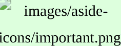
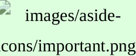
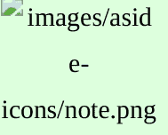
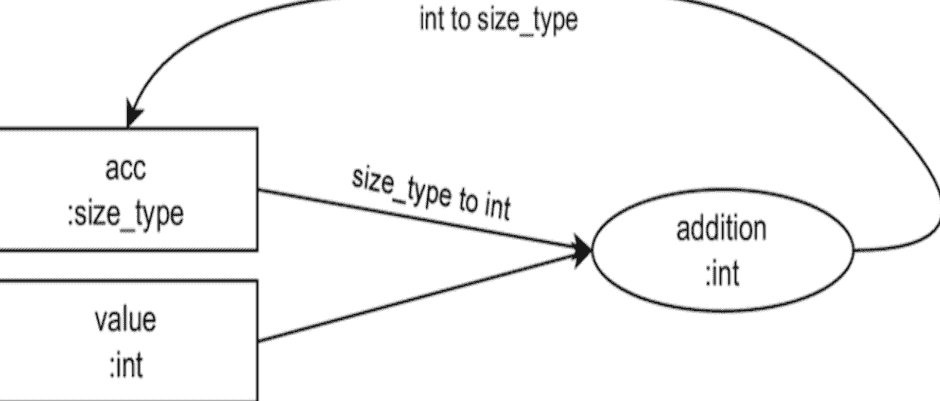
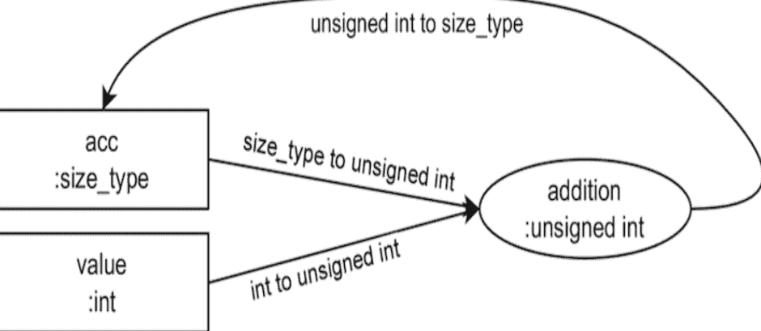
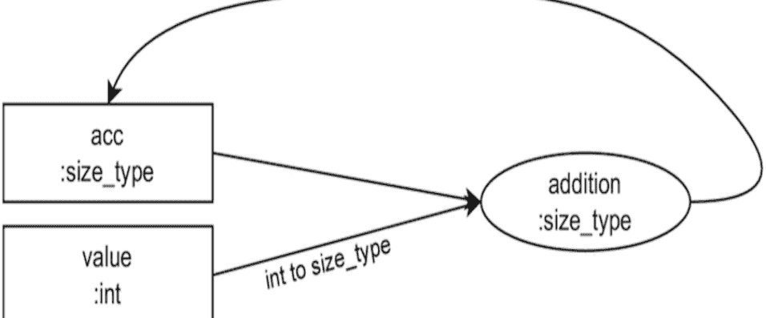
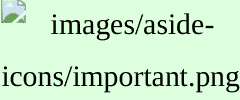
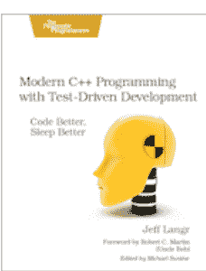
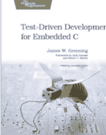

# C++ 脑筋急转弯

Olive Maudal 序言

Sandra Williams 编辑

# 关于 Pragmatic Bookshelf

Pragmatic Bookshelf 是一家出版公司。我们在这里是因为我们想要改善开发者的生活。我们通过创建由程序员编写的及时、实用的书籍来实现这一点。

我们的实践、工作坊和其他产品可以帮助你和你的团队创建更好的软件并增加乐趣。欲了解更多信息以及最新的 Pragmatic 实践，请访问我们的网站 http://prprog.com。

我们的电子书不包含任何数字限制（DRM），并且始终是无 DRM 的。我们开创了 Beta Concept，即你可以在书籍编写期间进行购买并阅读，并向作者提供反馈以制作更好的电子书。为所有购买者的免费资源包括源代码下载（如适用）、错表和讨论论坛，所有内容可在书籍主页 prprog.com 获取。我们在这里是为了让你的生活变得更轻松。

# 新书公告

想要跟进我们的最新书籍和公告以及偶尔的特别优惠吗？只需在 prprog.com 创建账户（只需一个电子邮件地址和密码）并勾选选择框接收新闻邮件。你还可以在 Twitter 上关注我们 @prprog。

# 关于电子书格式

如果你直接从 prprog.com 购买，你将获得所有格式的电子书。你可以通过 Dropbox 在所有设备（包括 iPhone/iPad、Android、笔记本电脑等）之间同步你的电子书。在版本的有效期内，你可以获得免费更新。当然，你可以在需要时取出并重新下载书籍。从 Amazon Kindle 购买的电子书受 Amazon 政策限制。Amazon 文件格式的限制会导致电子书在不同设备上的显示不同。更多信息，请参见我们在 pr..com/#about-ebooks 的 FAQ。欲了解更多关于本书的信息并访问免费资源，请前往书籍首页 https://prprog.com/book/akrain。

感谢你的持续支持，

The Pragmatic Bookshelf

本书的团队包括：Dave Thomas（出版）、Janet Furlow（COO）、Susannah Davidson（执行编辑）、Sandra Williams（开发编辑）、L. Sakhi MacMillan（校对）、Potomac Indexing, LLC（索引）、Gilson Graphics（排版）

如客户支持，请联系 support@pragmatic.com。

如国际版权，请联系 rights@pragmatic.com。

1. Olive Maudal 序言

3. 前言

## 第一部分 C++ 脑筋急转弯

### 《C++ 脑筋急转弯》的早期好评

如果你是 C++ 爱好者或专业 C++ 开发者——最好两者兼顾——这本书是为你准备的。二十五个谜题用易懂的 C++ 解释了这种语言有时令人惊讶的行为，以及你可能想要清楚了解的以避开潜在陷阱和失望的知识。

- Daniela Engert

ISO C++ 委员会成员兼主旨演讲者

缺乏经验的程序员将以轻松的方式，学习 C++ 编程语言中的许多陷阱以及如何避免它们。对于要规避的事物已有直觉的老手，将非常详细地学习该语言是如何以及运行的，以及为什么是这样运行。

- Björn Fahller

国际 C++ 会议演讲者

经验丰富的程序员将以轻松的方式学习 C++ 编程语言中的许多陷阱以及如何避免它们。对于要规避的事物已有直觉的老手，将非常详细地学习该语言是如何以及运行的，以及为什么是这样运行。

- Tina Ulrich

这是一个对于想要测试自己 C++ 知识的人来说有趣且引入胜的书。谜题很有趣，解释也易于理解。

### Olive Maudal 序言

我第一次在奥斯洛的 C++ 聚会上遇到 Anders Schau Knatten。从那时起，我们就一直是朋友了，当我们在各种会议上见面时。Anders 曾在 ACCU、TechTown、CppCon、C++ on Sea 等 C++ 会议演讲。当我参加他的演讲时，我总能学到新东西。Anders 可以花几个小时讲解整数是如何行为的，或者在 `main()` 调用之前发生的所有事情，或者如何有效地使用调试器。他拥有一种迷人的能力去观察、适应、重塑，然后将其推向新的水平。这正是他在参加了我那些著名的 C++ Quiz 会话后所做的。Anders 很快创建了非常棒 cppquiz.org（去试试吧！）。现在，他在会议上运行自己的改进版 C++ Quiz。通过这本书，Anders 将他自己的概念推得更远。

我热爱书，我热爱 C++，我热爱谜题。《C++ 脑筋急转弯》将这三者结合在了一起。我已经使用和学习 C++ 30 年了，但我确定每次读这本书仍能学到新东西。如果你深投入 C++，你也会想读这本书。这本书是深入理解这种强大且迷人的语言的快速通道。书中包含了精心挑选的二十五个谜题，将挑战你对语言的现有理解。当你自己尝试解决一个谜题后，Anders 将给你深入且坚实的解释，说明为什么这个谜题很有趣，以及你如何学习这些知识。

### 致谢

首先，我要感谢 Olve Maudal 和 ACCU，是他们启发了我在 2013 年的 ACCU 大会上创建了 CppQuiz.org [2]。我还要感谢多年年来在内容、实现和错误报告方面为 CppQuiz.org 做出贡献的每一个人。

特别感谢我的编辑 Sandra Williams，她在在此过程中提供了至关重要的帮助。没有了你的指导、支持和建议，这本书将会单薄得许多。还要感谢 Margaret Eldridge 代表出版商与我联系，并感谢 Frances Buontempo 为我们介绍这些同仁。

我很幸运，能够得到我所认识的一些最顶尖 C++  way的帮助。感谢 Daniela Engert、Björn Fahller、Olve Maudal、Karthik Nishanth、Tom Schultz、Tina Ulbrich、Sergei Vasilchenko 和 Piotr Wierciński 你们在技术审查方面的帮助！

最后，我要感谢我的妻子 Charlotte，她的支持让我能够投入编写这本书所需的时间和精力，并感谢 Kristiane 和 Sebastian 的鼓励。

### 前言

C++ 是常用范围内最大、最古老的编程语言之一。它以所有的默认行为都是错误的而闻名，而且正如 C++ 社区中著名的例子那样，它能让恶魔从鼻子里飞出来 [3]。对于一本编程脑筋急转弯的书，你找不到更好的语言了！

通过 25 道谜题，我们将探索 C++ 在底层是如何工作的，包括它一些重要的特性。为了从书中获得最大的收益，你应该具有编写 C++ 的经验，并熟悉该语言的基础，包括简单的面向对象编程和模板。

读完这本书后，你将对初始化、生命周期、重载解析、隐式转换、继承、未定义行为等主题有更深入的。更重要的是，我希望你对 C++ 的真实工作原理产生好奇心，即使这些答案中只有少数几个能包含在一本书里。

### 如何使用本书

本书包含了 25 个带有答案和解释的 C++ 谜题。大多数将是格式良好的程序，C++ 标准保证了它们的输出。然而，某些可能存在编译错误，另一些可能存在未定义或未指定的行为。你的任务是弄清楚在符合标准的 C++ 实现上编译并运行每个谜题程序时会发生什么。

以这个虚拟的谜题为例。它是一个带有 `main` 函数的完整 C++ 程序：

```cpp
#include <iostream>

int main()
{
    std::cout << (1 < 2);
}
```

你的任务是阅读代码并尝试猜测程序在编译和运行时输出会是什么。在翻页查看答案之前，务必确保你已经尝试运行过了！

请注意以下几个技术细节：

- 为了简洁，我声明的 `main` 没有参数（没有 `argc / argv`）且没有显式返回数值。这些都是可选的，省略它们会让谜题更容易读。

- 我在所有谜题中都使用 `struct` 而不是 `class`。这在语义上没有区别——`struct` 成员的默认可见性是公有的而不是私有的，所以我们不需要到处写上 `public:`。

- 像 C++ 中通常一样，`bool` 默认打印为 1 和 0，而不是 `true` 和 `false`。

该谜题的答案是 1 小于 2，因此程序打印 1（代表 true）。

然而，答对答案只有一半的乐趣。另一半是理解它为什么那样运行。谜题是学习更多 C++ 底层工作原理的借口。我鼓励你充分阅读解释以理解它们。

### 未定义行为

某些谜题可能包含未定义行为。未定义行为是在程序执行期间发生某些坏情况，而编译器无法（更具体地说，是不要求）检测到时的术语。例如，我们可能会访问数组范围外的元素，或者有符号整数的算术表达式可能会溢出。在这种情况下，C++ 标准对实现没有任何限制，任何事情都可能发生，包括鼻恶魔。如果一个谜题具有未定义行为，你的任务是识别出未定义行为，还要猜测在典型系统上实际上会发生什么。它真的会让恶魔从鼻子里飞出来吗，还是发生了什么？

再次让我们来看一个例子：

```cpp
#include <iostream>
#include <limits>

int main()
{
    std::cout << std::numeric_limits<int>::max() + 1;
}
```

算术中的有符号整数溢出是未定义行为，如果你识别出了这一点，你就成功了一半！

对未定义行为发生时的情况做假设是个坏主意。所以让我们接着做这件事吧！对于任何具有未定义行为的谜题，谜题的另一半是弄清楚在你的计算机上运行程序会发生什么。我的计算机使用补码表示有符号整数（自 C++20 以起标准的实现也是如此），当发生溢出时 CPU 不会产生异常。当我最大正整数加 1 时，该值直接绕回最小负整数。由于我的系统使用 32 位 `int`，程序打印 -2147483648。你不需要知道那个精确的值，但如果你猜到它会打印最小负整数，你就解决了它！

### 不要要在家里这样做

猜测或测试未定义行为发生时的情况是一个有趣的练习，可以让你学习更多关于 C++ 在你的平台上是如何工作的。它还可能让你在实际程序中识别出某些错误模式。但不要根据你的发现对程序做任何假设！你的假设在其他计算机上、升级编译器后或使用不同的优化设置编译时可能是错误的。如果编译器能证明存在未定义行为，它甚至允许移除代码中的错误检查！


### 未指定的和实现定义的行为

C++ 标准并没有严格规定一切；它为实现留了一些空间。这些是一些例子：

- 整数类型的具体大小

- 函数参数的求值顺序

- 全局变量的初始化顺序

这允许实现在特定系统上做出最合理的选择。大多数程序都有一些未指定的或实现定义的行为；这不是错误。与未定义行为相反，恶魔不会从你的鼻子里飞出来。只是不同的实现在允许的行为范围内可能略有不同。如果一个谜题具有未指定的或实现定义的行为，尝试猜一下典型的行为是什么。

### 尝试代码

学习任何编程相关内容最重要的部分就是自己尝试。这本书的代码可以在 Pragmatic Bookshelf 的主页找到。[4]。你可以通过在喜爱的 IDE 或命令行中打开 `CMakeLists.txt` 在本地构建它：

```
mkdir build
cd build
cmake ..
cmake --build
```

项目每个谜题包含一个 .cpp 文件，每个文件生成一个二进制文件，命名与书中对应的谜题相同。

你也可以通过将代码粘贴到在线编译器中并在浏览器中直接尝试代码。我强烈推荐 Compiler Explorer，5]，你可以在那里选择并比较不同的编译器版本和架构，尝试不同的优化级别，并添加其他编译器标志、消毒器选项等等。

让我们开始吧！噢，小心恶魔。

脚注

### 谜题 1 有多少度？

how-many-degrees.cpp

```cpp
#include <iostream>
struct Degrees
{
    Degrees() : degrees_(0)
    {
        std::cout << "Default constructed\n";
    }
    Degrees(double degrees) : degrees_(degrees)
    {
        std::cout << "Constructed with " << degrees_ << "\n";
    }
    double degrees_;
};
struct Position
{
    Position() : latitude_{1} { longitude_ = Degrees{2}; }
    Degrees latitude_;

    Degrees longitude_;
};
int main()
{
    Position position;
}
```

程序显示如下输出：

Constructed with 1

Default constructed

Constructed with 2

### 讨论

`Position` 结构体有两个 `Degrees` 类型的成员。一个在成员初始化列表中初始化，另一个在构造函数体内。那么，为什么我们看到了三个 `Degrees` 对象被构造呢？

所有的类成员在我们进入构造函数体之前都会初始化。如果你显式地初始化了成员（如我们对 `latitude_` 所做的），则将使用该初始化。如果你没有初始化（如 `longitude_` 的情况），该成员将改为进行默认初始化，这就是为什么我们看到打印了 `Default constructed` 这一行。在所有成员初始化之后，我们最终进入构造函数体，初始化了一个临时的 `Degrees[2]`，然后将其拷贝赋值给之前默认初始化的 `longitude_`。

注意，你不需要在成员初始化列表中显式初始化成员，而是直接在成员声明中使用默认成员初始化器，如下所示：

examples/default-member-initializer/default-member-initializer.cpp

```cpp
struct Position
{
    Position() { longitude = Degrees{2}; }
    Degrees latitude{1}; // 默认成员初始化

    Degrees longitude;
};
```

如果你有多个构造函数，使用默认成员初始化器是一个好主意。这样你就不需要记住在每个成员初始化列表中包含该成员。

### 扩展阅读

- 构造函数与成员初始化列表 (Constructors and Member Initializer Lists)

- https://en.cppreference.com/w/cpp/language/constructor

### 谜题 2

字符串理论

string-theory.cpp

```cpp
#include <iostream>
#include <string>

void serialize(const void*) { std::cout << "const void*"; }

void serialize(const std::string&) { std::cout << "const string&"; }

int main()
{
    serialize("hello world");
}
```

猜测输出

> 在移动到下一页之前，尝试猜猜输出是什么。

程序显示如下输出：

```
const void*
```

### 讨论

为什么向 `serialize` 传递字符串会导致调用接收 `void` 指针的重载，而不是接收 `string` 的重载？

当我们调用带有多个重载的函数时，编译器会使用称为“重载解析”（overload resolution）的过程来确定哪一个最匹配。编译器通过尝试将每个函数参数转换为每个重载对应的参数类型来实现此点。某些转换优于其他转换，而如果参数已经是正确类型，则是最佳转换。

所有所有参数都能成功转换的重载都会被添加到可行函数集中。然后，编译器需要从集合集中选择哪一个重载。如果某个重载对至少一个参数有更好的转换，且对其他任何参数都没有更差的转换，则该重载被视为最佳可行函数，并被重载解析选中。如果没有哪个重载优于所有其他重载，则该调用是错误的并会导致编译失败。

看看这个例子：

```cpp
serialize(int, int); // 1
```

```cpp
serialize(float, int); // 2
```

给定这些重载，假设你如下调用 `serialize`：

```cpp
serialize(1, 2);
```

`serialize` 的两个重载都是可行的。但第一个重载对第一个参数有更好的转换（`int -> int` 优于 `int -> float`），并且在第二个参数上没有更差的转换（两个重载的 `int -> int` 是一样的），因此它被重载解析选取为最佳可行函数。

这个谜题比上面的例子简单一点，因为 `serialize` 的两个重载都只有一个参数。第一个接收 `const void *`，第二个接收 `const std::string;`。对于每个重载，转换情况是怎样的？

`std::string` 是标准库中的一个类。它通常会在堆上分配内存（除非字符串非常小），并允许字符串在运行时增长或被修改。

然而，字符串 `"hello world"` 并不是 `std::string`，而是简单的字符串字面量。字符串字面量是普通的 C 风格字符数组，由链接器固化到二进制文件中，且在运行时无法修改。字符串字面量的类型为“n 个 const char 的数组”。"hello world" 有 11 个字符加上一个终止符 `\0`，所以它的类型是“12 个 const char 的数组”。

由于 `"hello world"` 既不是 `std::string` 也不是 `void*`，而是 12 个 const char 的数组，对于每个重载的转换如何？

如果存在从参数的隐式转换，则加入可行函数集。否则，该重载将被忽略。

让我们查看第一个重载，看看“12 个 const char 的数组”是否可以隐式转换为 `void*`。首先发生的是数组转换为指针。`Array of T` 可以将我们的“12 个 const char 的数组”转换为 `const char*`。


接下来，任何`pointer to T`（其中 cv 指`const`或`volatile`）都可以转换为`pointer to void`。所以我们的`const char*`变成了`const void*`，这正是第一个重载所预期的。

注意，在这个转换过程中没有涉及构造函数或转换函数。这意味着它是标准转换序列而不是用户定义的转换序列。这很重要。

让我们现在查看第二个重载，看看“12 个 const char 的数组”是否可以转换为`const std::string`引用。`std::string`有一个构造函数`std::string(const char*)`，我们可以使用。首先，我们将“12 个 const char 的数组”转换为`const char*`，如上面所示。然后将其传递给`std::string`构造函数并返回一个包含字符串字面量拷贝的`std::string`。`const std::string&`参数可以直接绑定到`std::string`参数。

注意我们使用了构造函数。这意味着这是一个用户定义的转换序列而不是标准转换序列。无论`std::string`是标准库类型，它仍然被视为用户定义的。规则对于你和标准库都是相同的。

现在，编译器找到了从我们的“12 个 const char 的数组”到每个重载参数类型的有效转换，并必须确定哪种序列是最好的：

`serialize(const void*)`的转换序列：

`const char[12] ⟶ const char * ⟶ const void *` 标准转换，未创建新对象

`serialize(const std::string&)`的转换序列：

`const char[12] ⟶ const char * ⟶ std::string` 用户定义，创建了新的`std::string`对象！

我们只需要标准转换序列（顶部）即可调用`const void*`重载。要调用`std::string`重载，我们需要用户定义的序列（底部），这涉及到创建一个新的`std::string`对象。标准转换序列始终优于用户定义的转换序列，因此第一个重载被调用，并打印`const void*`。

## 谜题 3 破解星球！

`hack-the-planet.cpp`

```cpp
#include <iostream>

int getUser() { return 1337; }

void restrictedTask1()
{
    int id = getUser();
    if (id == 1337) { std::cout << "did task 1\n"; }
}

void restrictedTask2()
{
    int id;
    if (id == 1337) { std::cout << "did task 2\n"; }
}

int main()
{
    restrictedTask1();
    restrictedTask2();
}
```

### 猜测输出

> 在移动到下一页之前，尝试猜猜输出是什么。

该程序具有未定义行为！但它可能会显示以下输出：

```
did task 1
did task 2
```

### 讨论

函数`restrictedTask2`中的变量`id`没有经过初始化，具有一个不确定的值。使用它的值是未定义行为。当程序遇到未定义行为时，任何事情都可能发生；C++ 标准没有任何保证。甚至在我们获取`id`的值之前发生的程序部分也是未定义的！

然而，如果你在自己的计算机上运行此程序，它可能会同时打印`did task 1`和`did task 2`，至少在你不进行优化编译的情况下如此。因此，值`1337`奇迹地从`restrictedTask1`传到了`restrictedTask2`！这为什么会发生？

大多数系统使用栈处理局部变量。`restrictedTask1`有一个局部变量`id`，它为自己的栈帧预留了空间。恰好，`restrictedTask2`具有相同数量和类型的局部变量（`int`），因此它的栈布局将与`restrictedTask1`完全相同。

在`main`函数中，栈会增长到某一点——下图中左侧的插图。然后我们调用`restrictedTask1`，栈增长，`restrictedTask1`在其栈帧中为`id`留出空间，并将`id`初始化为`1337`。然后控制返回`main`，栈再次收缩。

| restr1 | id=1337 | | restr2 | id=1337 |

| --- | --- | --- | --- | --- |

| main argc argv | main argc argv | | main argc argv |

| : | : | | : | : |

接下来，我们调用`restrictedTask2`，栈再次增长，`restrictedTask2`在其栈帧中为`id`留出空间但没有对其进行初始化。然而，`restrictedTask2`的栈帧最终位于与`restrictedTask1`栈帧完全相同的位置。函数调用之间栈不会被清除，`restrictedTask2`栈帧的内容将与`restrictedTask1`离开时的内容完全相同，包括位于局部变量`id`位置上的值`1337`。这导致两个函数中的`id`都是`1337`。

但是，如果你开启了优化，`restrictedTask1`和`restrictedTask2`可能会被内联到`main`中，并且这些调用不会使用栈。你可以尝试使用`-O2` (GCC/Clang) 或`/O2` (MSVC) 进行编译来亲自。在你的 x86_64 Linux 机器上，GCC 在使用`-O2`时打印`did task 1`，而 Clang 则会导致段错误。在你的机器上发生了什么呢？

### 避免未初始化的变量

为了避免“鼻恶魔”（nasal demons）、像这里这样的安全漏洞以及一般的垃圾数据，你应该在使用变量之前始终对其进行初始化。这很容易疏忽，但可以得到帮助的！首先，始终带有警告进行编译。GCC、Clang 和 MSVC 都会针对这种特殊情况向你警告，像`clang-tidy`这样的工具也是如此。但这仅仅是因为证明`id`在使用时未初始化是非常直接的。通常，我们直到运行时才能知道。这就是检测器（sanitizers）大显身场的地方。

检测器用于不同的目的，但通过各种方式在运行时监控代码，以检测编译时无法检测的问题。其中一种检测器是内存检测器（MemorySanitizer），它旨在捕获对未初始化内存的使用。如果我们使用 MemorySanitizer 运行此程序（向 Clang 传递`-fsanitize=memory`作为编译选项），它将打印类似内容：

```
==1416660==WARNING: MemorySanitizer: use-of-uninitialized-value
#0 0x5603d43af5eb in restrictedTask2())
example.cpp:14:9
#1 0x5603d43af64d in main example.cpp:19:5
```

它告诉你你正在使用未初始化的内存，并提供发生该位置的堆栈跟踪。

检测器会让你的程序运行慢得多，因此你通常希望带有检测器的独立构建配置。不过，检测器只有在问题实际在运行时发生时才能检测到它，所以请尽可能使用此构建运行尽可能多的测试套件。

### 建议

- 始终启用警告。在 GCC/Clang 上使用`-Wall -Wextra -pedantic`是一个良好的开始，MSVC 上使用`/w4`。

- 如果你的 IDE 支持与`clang-tidy`等静态检查工具集成，请开启它们。它们有时可以在在你编译代码之前就报告此类问题。

- 将警告视为错误，至少在你的持续集成（CI）作业中，这样你就不会忽略任何警告了。

- 为尽可能多的检测器设置检测器构建，并使用这些构建运行你的测试。

### 进一步阅读

未定义行为

https://en.cppreference.com/w/cpp/language/ub

Deep C and C++ Olve Maudal 和 Jon Jagger

https://www.slideshare.net/olvemaudal/deep-c

### 检测器列表

https://github.com/google/sanitizers

## 谜题 4 全局

`going-global.cpp`

```cpp
#include <iostream>

int id;

int main()
{
    std::cout << id;
}
```

### 猜测输出

在移动到下一页之前，尝试猜猜输出是什么。


程序显示以下输出：

0


### 讨论

这个谜题与“谜题 3 破解星球！”看起来相似，它们都使用了未初始化变量的值。然而，与谜题 3 不同，这并不是未定义行为，程序打印了 0。这是为什么？

区别在于谜题 3 中的`id`是局部变量，它们每次被调用时都会产生，被认为具有自动存储期。而这个谜题中的`id`是一个全局变量。更准确地说，`id`的生命周期是整个程序期间。

与自动存储期变量不同，静态存储期变量在程序启动时就会初始化。对于没有初始化器的`int`简单情况，它是被零初始化的。如果`id`有初始化器，例如`= 2;`，我们会说它被常量初始化为 2。（零初始化和常量初始化统称为静态初始化。）

为什么没有初始化器的静态存储期变量会被初始化为 0，而自动存储期变量不是呢？通常情况下，初始化变量不是免费的。某些代码需要执行该初始化。例如，如果你在函数内部定义一个局部变量`id = 0;`，大多数系统每次调用该函数时都需要一些代码将其设置为 0。C++ 无法保证这种是免费免费，而且 C++ 的一个设计目标是，在你决定省略初始化器而只定义`id;`时，不会为此付出代价。

局部变量和非局部变量的另一个区别是它们的作用域。局部变量只能在定义的块中被访问。反之，非局部变量可以从文件的任何地方访问，如果是在头文件中定义的，则可以在包含该头文件的程序的任何地方访问。因此，如果你省略了局部变量的初始化器，你对它下一次使用的位置有完全的控制。你可能没有初始化它是因为你会在接下来的几行中对其进行初始化。但如果你省略了非局部变量的初始化器，推理谁会访问它将困难得多。

### 初始化范围的成本

| 非局部静态 (Non-local static) | 一次 | 整个文件/程序 |

|---|---|---|

| 局部自动 (Local automatic) | 每次进入块时 | 定义它所在的块 |

控制具有静态存储生存期的非局部变量的使用比较困难，而且初始化它们是非常廉价的，因此 C++ 会自动为你完成。

然而，这到底有多廉价呢？让我们以 x86 架构为例。我说你只需要支付一次初始化的代价，但实际上你根本不需要支付这个代价！当你的程序启动时，它为我们的全局数据分配内存。在 Linux 和 Windows 等系统上，当我们从操作系统获取新的物理内存时，它会被填充为零，以防止你读取上一个使用过相同内存页的程序的内存。编译器/链接器可以将未初始化的全局变量分组在一个名为`.bss`的节中。当程序启动并为`.bss`节分配内存时，它已经被填充为零。因此，这些变量是以零成本进行零初始化的！

### 注意

`static`关键字在 C++ 中有很多种用法。`id`是否具有`static`饰符并不影响它的静态存储生存期。对于全局变量，写`static int id;`而不是简单的`int id;`只是赋予了它内部链接；也就是说，它无法从其他编译单元（其他 .cpp 文件）链接。但无论如何，它都具有静态存储生存期。

### 进阅读

零初始化 (Zero-Initialization)

https://en.cppreference.com/w/cpp/language/zero_initialization

关于全局变量初始化更多：从程序到进程

https://www.youtube.com/watch?v=fGnbX88z3Y

## 谜题 5A 破坏性关系

`a-destructive-relationship.cpp`

```cpp
#include <iostream>
#include <memory>

struct Widget
{
    virtual void draw() { std::cout << "Widget draw\n"; }
    virtual ~Widget() { std::cout << "Widget destructor\n"; }
};

struct Button : public Widget
{
    void draw() override { std::cout << "Button draw\n"; }
    ~Button() override { std::cout << "Button destructor\n"; }
};

int main()
{
    std::unique_ptr<Widget> widget = std::make_unique<Button>();
    widget->draw();
}
```

猜测输出。在移动到页之前，尝试猜猜输出。

程序显示以下输出：

Button draw

Button destructor

Widget destructor

### 讨论

当我们调用`draw`时，程序只打印了`Button draw`。但当`unique_ptr`超出范围并调用析构函数时，程序打印了`Button destructor`和`Widget destructor`。这是为什么？

动态多态的一种常用技术是使用虚函数。你声明一个带有一个或标记为`virtual`的类的，允许其他类覆盖这些函数。当你对指向派生类对象的基指针调用虚函数时，将使用对象的动态类型，并调用被覆盖的函数。

在这个例子中，假设有一个 UI 框架，其中包含具有通用行为的`Widget`类，以及具体的 UI 元素如`Button`、`Text`和`Image`，它们覆盖了虚函数`draw`中的绘图行为。

当我们对指向`Widget`的基指针调用`draw`时（该指针实际上指向派生类`Button`），调用的是`Button::draw`而不是`Widget::draw`，并打印`Button draw`。然而，对于析构函数，行为是不同的；我们可以看到先打印`Button`析构函数，然后打印`Widget`析构函数。发生了什么？

当一个对象被毁时，它的所有部分都必须被毁。在这种情况下，`Button`继承自`Widget`，因此每个`Button`对象除了`Button`的任何成员（在本情况下没有）之外还包含一个`Widget`对象。我们说`Button`拥有一个`Widget`子对象。如果`Button`是拥有一个`Widget`成员而不是继承它，它也会拥有一个`Widget`子对象。无论哪种情况，当完整对象被毁时，子对象也必须被毁以避免内存泄漏。幸运的是，C++ 为我们处理了这一切；我们不需要在`Button`析构函数中手动调用`Widget`析构函数。

同样注意，析构函数体先执行，然后才调用子对象的析构函数。这确保了你仍然可以在类的析构函数中使用成员和基类。因此，程序首先打印`Button destructor`，然后打印`Widget destructor`。

> 附加问题

如果`Widget`没有将它的析构函数声明为虚函数会发生什么？在哪些情况下会成为问题？

根据 C++ 标准，如果要删除对象的静态类型与其动态类型不同，则静态类型必须是被删除对象动态类型的基类，且静态类型必须具有虚析构函数。否则，行为是未定义的。

因此，如果`Widget`没有声明虚函数，而你通过`Widget`指针删除一个`Button`对象，行为将是未定义的。在实践中，你通常会看到调用`Widget`析构函数而不是`Button`析构函数，并遇到此类问题：

- 派生类的任何成员都没有被毁，可能导致内存泄漏或其他资源泄漏。

- 如果派生类有用户定义的析构函数，程序的正确性通常依赖于该逻辑在对象被毁时执行。

但无论如何，即使这些问题对你的特定程序来说都不是问题，并且在测试期间一切看起来都正常，你仍然应该将析构函数声明为虚以避免未定义行为。

### 建议

得益于子对象的自动析构，C++ 处理资源的一种良好技术是资源获取初始化 (RAII) 类型（例如`unique_ptr`）作为成员。这种技术在你派生类时同样有效。

### 进阶阅读

CppReference 关于析构函数

https://en.cppreference.com/w/cpp/language/destructor

C++ 标准 关于析构函数和子对象

https://cppstandards.github.io/cppguid/

## 谜题 6 谁先？

`whos-up-first.cpp`


```cpp
#include <iostream>

struct Resource
{
    Resource()
    {
        std::cout << "Resource constructed\n";
    }
};

struct Consumer
{
    Consumer(const Resource &resource)
    {
        std::cout << "Consumer constructed\n";
    }
};

struct Job
{
    Job() : resource_{}, consumer_{} {}
    Consumer consumer_;
    Resource resource_;
};

int main() {
    Job job;
}
```

猜测输出。在移动到页之前，尝试猜猜输出。

程序显示以下输出：

```
Consumer constructed
Resource constructed
```

### 讨论

`Job` 类有两个成员 `consumer_` 和 `resource_`，按该顺序声明。然而，构造函数的成员初始化列表（即 `resource_{}, consumer_{}` 部分）顺序是反的。它们实际上按什么顺序初始化？

C++ 总是按照它们在类声明中的顺序进行初始化。这确保了即使构造函数中列出的顺序不同，初始化顺序也是确定的。因此，即使 `resource` 在构造函数中看起来是先初始化的，`consumer_` 实际上是先初始化的。

如果一个成员依赖于另一个成员，具有确定的初始化顺序是至关重要的。例如，在这个例子中，`Consumer` 在构造函数中依赖 `resource`。但由于 `consumer_` 实际上在 `resource_` 之前初始化，`Consumer` 构造函数接收了一个尚未构造的 `Resource`。如果我们尝试用它进行任何操作，将产生未定义行为。

反之亦如此。成员的析构顺序与声明顺序相反。析构顺序可能与构造顺序同样重要，因为一个成员可以在其析构函数中依赖另一个成员。想象一下，谜题中的 `Consumer` 运行一个使用 `Resource` 的线程，而 `Consumer` 在其析构函数中加入该线程。在当前代码中，`resource_` 在线程仍在运行时就会被毁，我们将面临使用已毁 `resource_` 的风险。

在成员初始化列表中错误的顺序出成员会让读者感到困惑，因此我建议在成员初始化列表和类声明中使用始终相同的顺序。GCC、Clang 和 MSVC 都有相应的警告（分别为 `-Wreorder`、`-Wctor` 和 `C5038`），在你不使用一致顺序时警告你。这些警告在用 `-Wall /Wall` 编译时会启用，我总是建议这么做。不同的编译器通常有不同的警告，因此使用多个编译器编译可能是好主意。

### 谜题 7 好事事终有终结

`all-good-things-must-come-to-an-end.cpp`

```cpp
#include <iostream>
#include <string>
struct Connection
{
    Connection(const std::string &name) : name_(name)
    {
        std::cout << "Created " << name_ << "\n";
    }

    ~Connection() {
        std::cout << "Destroyed " << name_ << "\n";
    }

    std::string name_;
};

Connection global{"global"};

Connection &get()
{
    static Connection localStatic{"local static"};
    return localStatic;
}
```

```cpp
int main()
{
    Connection local{"local"};
    Connection &tmp1 = get();
    Connection &tmp2 = get();
}
```

### 猜输出

> 在移动到下一页之前，尝试猜输出是什么。

程序显示了以下输出：

```
Created global
Created local
Created local static
Destroyed local
Destroyed local static
Destroyed global
```

### 讨论

在谜题 3、谜题 3 “黑客大战！”以及谜题 4 “走向全局”中，我们学习了全局 ID 和局部 ID 在生命周期和初始化方面的差异：

```cpp
int id; // 全局变量，整个程序运行期间只有一个实例

void f() {
    int id = 2; // 局部变量，每次调用 `f` 时都会重新创建
}
```

在这个谜题中，我们为对象生命周期添加了两个新的有趣方面：

- 我们不再将变量初始化为简单的常量；而是有一个带副作用的构造函数。

- 我们引入了一个具有静态存储生存期的局部变量 `localStatic`。

那么，当我们引入构造函数和局部静态变量时，行为发生了什么变化？让我们先考虑全局变量 `global`。和我们之前看到的全局变量 `id` 一样，它具有静态存储生存期，这意味着从初始化到程序最后结束时的析毁，只有一个实例是存活的。

我们之前见过没有初始化器的全局 `int id;` 会被零初始化。我们还提到带有初始化器的全局变量 `id = 2;` 会被常量初始化。这两者都是静态初始化的例子，它发生在程序启动过程中。另一方面，全局变量 `global` 使用非常量表达式进行初始化。`Connection` 构造函数不是 `constexpr`（它不可能是，因为它要向 `std::cout` 输出）。不能进行静态初始化的对象改为进行动态初始化，这发生在之后。

但是，动态初始化是在什么时候发生的呢？人们通常认为动态初始化发生在 `main` 之前——这很有道理：这是实现动态初始化的一种简单常见的方法。例如，Linux 有一个函数 `_libc_start_main`，它在 `main` 之前被调用。`libc_start_main` 在调用你的 `main` 函数之前会先调用全局构造函数。

C++ 标准并没有要求动态初始化发生在 `main` 之前，它只是允许这样做。然而，标准确实要求全局变量的动态初始化必须发生在同一翻译单元（TU）中定义的任何函数调用之前。（翻译单元归其底只是包含所有 `#include` 文件后的单个 `.cpp` 文件。）所以在在这个谜题中，由于 `main` 和 `global` 定义在同一个 TU 中，`global` 实际上被保证在 `main` 之前被初始化！

初始化顺序的完整规则相当长且复杂。CppReference.com 有一个介绍，[6]，而 C++ 标准在 [basic.start].[7] 中包含了所有细节。

接下来，让我们看看 `localStatic`。每个全局一样，`localStatic` 也具有静态存储生存期，因此 `localStatic` 只有一个实例，它从初始化到程序结束一直存活。与全局变量不同，局部变量不是在程序启动时初始化，而是在第一次控制通过它们的声明处之前初始化。所以尽管 `localStatic` 具有静态存储生存期，但在第一次调用 `get` 之前它不会被初始化。

最后，`local` 是具有自动存储生存期的简单变量；它在每次控制通过其声明处时都会初始化。

让我们看看程序的执行情况：

- 程序开始时，`global` 初始化。

- 进入 `main` 函数时，`local` 初始化。

- 第一次调用 `get` 时，`localStatic` 初始化。

- 第二次调用 `get` 时，`localStatic` 已经初始化。

- 退出 `main` 时，`local` 析毁。

- `localStatic` 析毁。

- `global` 析毁。

析毁顺序与初始化顺序相反：

- `main` 退出时，`local` 析毁。

- `localStatic` 析毁。

- `global` 析毁。

首先，`std::move(objectWithConstMember)` 做了什么？`std::move` 实际上并没有移动任何东西；它只是将左值 `objectWithConstMember` 转换为一个右值（rvalue）。然后，这个右值被用于初始化 `moved`。

### 左值（Lvalues）与右值（Rvalues）

左值与右值是分类表达式的一种方式。左值（lvalue）是一个求值为实际对象的表达式，该对象具有标识性且无法从中移动。例如，表达式 `objectWithConstMember` 的值是 `objectWithConstMember` 对象。它有名称，在内存中有固定位置，而且其他人可能仍在使用它，因此类型系统不允许我们对其进行移动。传统上，左值倾向于出现在赋值语句的左侧，因此名为左值（left-value）。

另一方面，右值（rvalue）是一个求值为可以从中移动之物的表达式，例如一个反正没有人使用的临时变量。右值倾向于出现在赋值语句的右侧，因此名为右值（right-value）。

`std::move` 将左值转换为右值，是我们告诉类型系统“没关系，你可以直接从这个左值中移动；我不再使用它了”的方式。随着 `std::move` 的引入，在赋值语句右侧出现左值（在...内部）变得越来越常见


`std::move`），所以“左值”与“右值”的记忆法不再像以前那样有用。

请参见 [Lvalues, Rvalues, Glvalues, Prvalues, Xvalues, Help!^[9] 获取左值、右值以及其他值类别的完整概述。

注意，尽管我们是从一个右值初始化 `moved`，但这意味着我们需要使用移动构造函数来初始化它！我们只需要任何能够绑定到右值的构造函数。`const` 左值引用可以绑定到右值，所以如果我们有拷贝构造函数，也可以可以使用它。然而，我们并没有，所以 Willit 的移动构造函数是我们的选择。

`WillitMove` 的移动构造函数通过行 `WillitMove(WillitMove&&) = default;` 被显式地设置为默认（defaulted），所以让我们关注默认移动构造函数做了什么。它如何从一个 `const` 成员中移动？

显式默认的移动构造函数从源对象中的相应成员直接初始化所有子对象。本质上，它的定义如下：

`examples/default-move/default-move.cpp`

```
Class(Class&&other) :
BaseClass1{std::move(other)},
BaseClass2{std::move(other)},
/* ... */
member1_{std::move(other).member1_},
member2_{std::move(other).member2_}
/* ... */
{}
```

因此对于我们的类 `WillItMove`，它看起来像这样：

`examples/default-move/default-cpp`

```
WillItMove(WillItMove && other) :
    constMember_{std::move(other).constMember_{}}
```

再次，即使 `std::move(other).constMember_` 是一个右值，我们也不一定需要使用成员构造函数来初始化 `constMember_`。拷贝构造函数或移动构造函数都可以，因为它可以绑定到 `std::move(other).constMember_`。由于我们没有为 `Member` 声明任何特殊的成员函数，它隐式地获得了默认的拷贝构造函数和默认的移动构造函数。其中一个可以绑定到 `const` 右值 `other.constMember_` 吗？

`Member` 的隐式默认移动构造函数声明如下：

```
Member(Member&&)
```

非 `const` 的值引用不能绑定到 `const` 值，因此我们无法使用移动构造函数来直接初始化 `constMember_`。

`Member` 的隐式默认拷贝构造函数声明如下：

```
Member(const Member&)
```

`const` 的值引用可以绑定到 `const` 值，因此我们可以使用拷贝构造函数来直接初始化 `constMember_`。

因此，`WillitMove` 的显式默认移动构造函数使用了 `Member` 的拷贝构造函数而非 `Member` 的移动构造函数来初始化 `constMember_`。

### 延伸阅读

移动构造函数 (Move Constructors)

https://en.cppreference.com/w/cpp/language/move_constructor

拷贝构造函数 (Copy Constructors)

https://en.cppreference.com/w/cpp/language/copy_constructor

直接初始化 (Direct-Initialization)

https://en.cppreference.com/w/cpp/language/direct_initialization

std::move

https://en.cppreference.com/w/cpp/utility/move

### 无移动构造函数与被删除的移动构造函数的区别

构造函数 (Constructor)

https://blog.knatten.org/2021/10/15/the-difference-between-no-move-constructor-and-a-deleted-move-constructor/

### 谜题 9：计数拷贝 (Counting Copies)

`counting-copies.cpp`

```cpp
#include <iostream>
struct Resource
{
    Resource() = default;
    Resource(const Resource &other)
    {
        std::cout << "copy\n";
    }
};

Resource getResource()
{
    return Resource{};
}

 main()
{
    Resource resource1 = getResource();
    Resource resource2{resource1};
}
```

| 猜测输出 |

| :--- |

| > 在移动到下一页之前，尝试猜测输出是什么。 |

程序显示了以下输出：

```
copy
```

### 讨论

在这个程序中，似乎进行了三次拷贝。一个用于初始化 `getResource()` 的返回对象，一个用于用 `resource1` 初始化它，一个用于初始化 `resource2`。然而，在 `getResource()` 返回并初始化 `resource1` 时并没有发生拷贝。这如何可能？

让我们先看看返回语句，它似乎初始化了临时对象 `Resource()`。返回语句中的 `Resource()` 是一种被称为 pr 值（prvalue）或“纯”右值的右值类型。在之前的谜题 `Will It Move?` 中，我们首先遇到了左值和右值，并了解到右值是可以从中移动、绑定到右值引用的表达式。事实上，右值有两种类型：

- x 值（xvalue）：例如，在 `Will It Move?` 中，表达式 `objectWithConstMember` 是一个左值。它求值为某个实际对象，我们可以对其取地址。当我们执行 `std::move(objectWithConstMember)` 时，我们现在得到了 x 值。这个表达式仍然求值为实际对象，但我们允许将其视为右值并从中移动。

- 另一方面，pr 值是一个“纯”右值。它是一个初始化新对象的表达式，而不是仅仅将现有对象转换为右值。

在 C++11 中，pr 值是未命名临时对象，编译器被允许省略或跳过它们的拷贝。当未命名临时对象是返回语句的操作数时（如所示），这种拷贝消除被称为未命名返回值优化（URVO）——命名是因为它适用于返回未命名临时的情况。在 C++11 中，在这些情况下避免拷贝是强制性的。但在使 URVO 强制之前，语言发生了变化，以至于根本没有可以产生优化掉拷贝的产生！pr 值不再是未命名临时对象；它们仅仅代表一个对象的想法，该对象稍后实例化。

另一种返回值优化仍然不是强制，被称为返回值优化（NRVO）。它适用于返回局部变量而非 pr 值的情况；在这种情况下，实现被允许省略拷贝但并非要求。即使拷贝构造函数有副作用，NRVO 依然适用；这些副作用根本不会发生。

这是一个未命名和命名返回值优化的示例：

```cpp
examples/rvo.cpp
Resource getResource() {
    return Resource{}; // 未命名 RVO (C++17 之前)
}
```

```cpp
examples/rvo.cpp
Resource getResource() {
    Resource resource;
    return resource; // 命名 RVO
}
```

现在让我们看看表达式 `Resource resource1 = getResource()`，它似乎将返回的对象拷贝到 `resource1`。函数调用是一个 pr 值，所以这里原理也适用。对 `getResource()` 的调用并没有产生一个

临时对象；仅代表返回值的概念，在 `resource1` 被其初始化之前，实际上不会创建任何 `Resource` 对象。

在标准中定义像“对象的概念”这样的东西固然很好，但在实践中如何可能实现这一点呢？毕竟，`Resource` 对象最终应该出现在 `main` 函数的栈上，但创建它的实际代码是 `getResource()`，而它无法访问 `main` 的栈帧。


大多数系统用以避免拷贝的技巧是：`main` 在它的栈帧中为`resource1`留出空间，就像处理任何其他变量一样。然后`main`将指向此内存区域的指针作为一个“秘密”额外参数传递给`getResource()`，就像它的签名是`getResource(Resource* ptr)`一样。现在`getResource()`就可以直接在这个内存位置上构造对象。

为了这项工作，调用者和被调用者约定了这一规范，因此它是系统应用二进制接口（ABI）的一部分。一个流行的 ABI 是 Itanium C++ ABI[101]，例如它被用于 Linux。GCC 和 Clang 都符合这一 ABI，因此你可以自由地从由其中一个编译的函数调用由另一个编译的函数。Itanium C++ ABI 规定：

> 如果返回类型对于调用目的而言是非平凡的类类型，调用者将传递一个地址作为隐式参数。被调用者随后在该地址上构造返回值。

如果我们在 Compiler Explorer 上尝试这样做，选择 x86_64 架构，我们发现 GCC 和 Clang 的当前版本都在`main`中生成了这段代码：

```
lea rax, [rbp-4]
mov rdi, rax
call getResource()
```

`main`栈帧中`resource1`的地址。该地址被加载到`rdi`（这是用于向函数传递第一个整数/指针参数的寄存器），然后调用了`getResource()`。

对于 MSVC，要追踪其 ABI 信息更为困难。但使用 Compiler Explorer，我们可以在 x86_64 上看到类似的模式：

```
lea rcx, QWORD PTR resource1$[rsp]
call Resource getResource(void) ; getResource
```

规范是相同的，只是用于指针的寄存器变成了`rcx`。

| 建议 |
| :--- |
| 所有主流编译器多年来都已支持命名和未命名的返回值优化（我查过的记录追溯到 Clang 3、GCC 4 和 Visual Studio 2008），因此得出的结论是直接按值返回，不要尝试做什么聪明的事来“优化”你的返回。 |

## 延伸阅读

2011 年的博客文章，展示了主流编译器当时已经能够很好地执行拷贝消除（Copy Elision）

https://blog.knatten.org/2011/08/26/dont-be-afraid-of-returning-by-value-know-the-return-value-optimization/

保证的拷贝消除并不一定会消除拷贝

https://blog.tartanllama.xyz/guaranteed-copy-elision/

返回值优化/拷贝消除

https://en.cppreference.com/w/cpp/language/copy_elision

Itanium C++ ABI

https://titanium-cxx-abi.github.io/cxx-abi/abi.html

本示例中的所有汇编代码详解

https://www.youtube.com/watch?v=I7jQCO8xMc

## 一个奇特的赋值

`a-strange-assignment.cpp`

```cpp
#include <iostream>
#include <string>

std::string getName()
{
    return "Alice";
}

int main()
{
    std::string name{"Bob"};
    getName() = name;
    std::cout << "Assigned to a function!\n";
}
```

猜测输出

### 猜测输出

> 在移动到下一页之前，尝试猜猜输出是什么。

程序显示了如下输出：

```
赋值给函数！
```

### 讨论

等待，什么？乍看之下，`getName() = name`似乎是在给函数赋值，但实际上发生了什么？

在`main`函数中，`name`被初始化为 "Bob"。`getName()`返回一个临时`std::string`对象。由于返回值优化（RVO），这个临时对象可能直接构造。然而，`getName() = name`实际上是将`name`中的 "Bob" 赋值给这个临时对象。因此，输出是“Assigned to a function!”。

这并不是在给函数本身赋值，而是对函数返回的**临时对象**进行赋值。

因此，对于`getMemory`的三次调用，都会产生一个临时对象（temporary）。但它们会存活多久呢？

通常情况下，临时对象会在创建它们的完全表达式（full-expression）结束时被销毁。在这个谜题中，这意味着它们会在行结束时销毁。然而，在某些情况下，临时对象的生命周期会被延长。这在某种程度上是过去的遗留，已经不再非常好用。例如，对于`const auto &reference1 = getMemory(1);`，我们不如直接写`const auto object1 = getMemory(1);`。得益于 C++17 对 prvalue（纯右值）的新规则，仍然不会有额外的拷贝，我们也不需要问这些问题了。问题越少代码越好！

那么生命周期延伸的具体规则是什么？虽然存在其他规则，但最常见且此处涉及的规则是这些：

- 如果你将引用绑定到通过临时对象实例化的对象上，那么该临时对象的生命周期将与引用的生命周期一样。
- 如果你将引用绑定到通过临时对象实例化的对象的*成员*（member），那么整个临时对象（而不仅仅是该成员）的生命周期将与引用的生命周期一样。

让我们逐行分析：

```cpp
const auto &reference1 = getMemory(1);
```

我们将`reference1`绑定到从`getMemory(1)`得到的临时对象。临时对象`t`的生命周期持续到`reference1`结束即到`main`结束。

```cpp
std::cout << "Bound reference 1\n";
```

打印`Bound reference 1`。

```cpp
const auto &reference2 = getMemory(2).number_;
```

我们将`reference2`绑定到从`getMemory(2)`得到的临时对象的成员`number_`。整个临时对象 2（而不仅仅是成员）的生命周期持续到`reference2`——即到`main`结束。

```cpp
std::cout << "Bound reference 2\n";
```

打印`Bound reference 2`。

```cpp
const auto &reference3 = DataSource(getMemory(3));
```

我们将构造函数参数引用`memoryArea`绑定到从`getMemory(3)`得到的临时对象。这被用于创建一个`DataSource`类型的新对象。然后我们将`reference3`绑定到临时`DataSource`，该对象是在调用其构造函数时实例化的。临时`DataSource`的生命周期持续到`reference3`结束——即到`main`结束。

但等等，这是一个陷阱！一旦`DataSource`对象被构造完成，`memoryArea`参数就消失了。我们将其赋值给`memoryArea_`成员并无帮助；那是另一个引用！因此，临时对象`MemoryArea 3`的生命周期没有被延长，内会在行结束时被释放。打印`Destroyed 3`，而`DataSource`原计划从中读取的`MemoryArea`已经释放，现在是一个悬空引用。

```cpp
std::cout << "Bound reference 3\n";
```

打印`Bound reference 3`。

啊，C++ 最棒的特性！在作用域结束时，局部变量按照它们构造的反顺序进行销毁。首先，`reference3`被销毁，这意味着临时`DataSource`被销毁（它的析构函数没有打印任何内容）。接下来，`reference2`被销毁，这意味着临时对象 2 被销毁，并打印`Destroyed 2`。最后，`reference1`被销毁，这意味着临时对象 1 被销毁，并打印`Destroyed 1`。

| 相关问题 |
| :--- |
| 在 C++ 中，临时对象 3 类似的问题并不罕见。这里有一个著名的例子，直到 C++23 才被修复。（在编写本文时，常见的编译器尚未实现此修复。） |

`examples/range-for/range-for.cpp`

```cpp
class MemoryAreaContainer{
    public:
        MemoryAreaContainer();
        std::vector<MemoryArea>& getMemoryAreas() {
            return memoryAreas_;
        }
    private:
        std::vector<MemoryArea> memoryAreas_;
};
```

`examples/range-for/range-for.cpp`

```cpp
for (const auto &lp : MemoryAreaContainer{}.getMemoryAreas()) {
    std::cout << lp.number_ << std::endl;
}
```

这看起来是无害的。但为了让临时对象`MemoryAreaContainer`持续到`for`循环结束，我们需要将其绑定。我们这里的`const`引用并没有绑定到`MemoryAreaContainer`，而是绑定到`getMemoryAreas()`的返回值。因此，`MemoryAreaContainer`临时在我们开始迭代之前就被销毁了。我们从`getMemoryAreas()`得到的引用指向已销毁的`memoryAreas_`成员，是悬空的。（这有一点简化处理；请参考`stmt.ranged[12]`以查看基于范围`for`语句展开后的完整代码。）

### 建议

- 不要依赖生命周期延伸，优于使用`const auto obj = get()`而不是`const auto& ref = get()`。
- 不要依赖生命周期延伸能跨越函数调用生存。
- 跟上新的 C++ 标准、编译器和工具。

### 建议

- 避免手动管理资源；使用标准库类型如`unique_ptr`和`fstream`作为成员变量。
- 对于自定义资源，请提取出专门管理该类资源的类。

### 延伸阅读

类初始化顺序

https://en.cppreference.com/w/cpp/language/constructor

## 谜题 13：永恒的斗争

`a-constant-struggle.cpp`

```cpp
#include <iostream>
#include <type_traits>

template <typename T>
void byValue(T t)
{
    std::cout << std::is_const_v<T>; // true if T is const
}

template <typename T>
void byReference(T &t)
{
    std::cout << std::is_const_v<T>; // true if T is const
}

int main()
{
    int nonConstInt = 0;
    const int constInt = 0;

    byValue(nonConstInt);
    byValue(constInt);
    byReference(nonConstInt);
    byReference(constInt);
}
```

### 猜猜输出

> 在移动到下一页之前，尝试猜输出是什么。

程序显示输出输出：

```
0001
```

### 讨论

两个函数模板`byValue`和`byReference`分别通过值和引用传递它们的参数。然后，我们使用非 const int 和 const int 作为参数调用这两个函数模板。在哪些情况下`T`被推导为`const`呢？

在我们深入研究推导规则之前，让我们澄清两个容易混淆的概念。`template <typename T>`中的`T`被称为模板参数（template parameter）。模板参数推导的目标是找到`T`。另一方面，函数签名`byValue(T t)`和`byReference(T &)`中的`T`和`T&`被称为模板参数类型（template parameter types）。这些是函数模板的实际参数类型，是我们用于推导的类型。

让我们这些模板参数类型称为 P，以区别于模板参数`T`。以下是三个例子：

| 模板参数 | 模板参数类型 P |
| :--- | :--- |
| `template <typename T>` | |
| `void byValue(T t)` | T |
| `template <typename T>` | |
| `void byReference(T & t)` | T & |

| 模板 | 模板参数 |
| :--- | :--- |
| 参数 | 类型 P |

`template <typename ValueType>`

| `void f(const ValueType)` | ValueType const |
| :--- | :--- |
| `const std::vector<ValueType>& v` | std::vector<ValueType>& |

从示例中可以看出，在`byValue`和`byReference`中，模板参数都是`T`。在`byValue`中，模板参数类型 P 仅仅也是`T`，但在`byReference`中，它是`T&`。

处理完这些之后，让我们深入研究推导规则。首先，看看对`byValue`的调用：

```cpp
template <typename T> void byValue(T t);

int nonConstInt = 0;
const int constInt = 0;

byValue(nonConstInt);
byValue(constInt);
```

记住，模板参数是`T`，而模板参数类型 P 也仅仅是`T`（而不是例如`T &`）。

在推导模板参数类型 P 时，如果它不是引用类型，推导规则将忽略参数的任何顶层限定符（const 或 volatile）。由于`P`仅仅是`T`，它不是引用类型，因此 cv 限定符被忽略。

等一下，无论我们传递的是非 const 参数还是 const 参数，都假装它是非 const 的！这听起来有点不对劲吗？并不是。当`P`不是引用类型时，意味着我们通过值传递参数。原始参数是否为 const 并不重要，`byValue`内部的参数`t`是一个拷贝，我们无法修改原始参数。

由于顶层 cv 限定符被忽略了，我们在两次对`byValue`的调用中都从非 const`int`推导出`P`，并在这两种情况下都找到`P == int`。由于`P == T`，所以`T`也是非 const 的。两次调用都打印了 0。

接下来，看看对`byReference`的调用：

```cpp
template <typename T> void byReference(T &);

int nonConstInt = 0;
const int constInt = 0;

byReference(nonConstInt);
byReference(constInt);
```


模板参数是`T`，模板参数类型`P`是`T`。

这一次，`P`是一个引用，我们不忽略参数的顶层 cv 限定符。在这种情况下，这一点非常重要！引用参数`t`将绑定到我们的原始参数上，这非常重要，以至于我们尝试将非 const 引用绑定到 const 参数。

当传递非 const `nonConstInt` 时，`P`被推导为`int &`，这意味着`T`是`int`。它不是 const，所以打印 0。

当传递 const `constInt` 时，`P`被推导为`const int &`，这意味着`T`是`const int`。它是 const，所以打印 1。

模板参数推导的完整规则读起来可能有点困难，或者至少关于忽略顶层 cv 限定符的这部分直观到足以

- 对于列表中的每个类型，存在一个无符号版本，其大小与有符号版本相同。

还定义了一些最小尺寸：

| 类型 | 最小宽度 |
| :--- | :--- |
| signed char | 8 |
| short | 16 |
| int | 16 |
| long | 32 |
| long long | 64 |

在典型的 64 位 Linux、Windows 或 macOS 系统上，`int`是 32 位，而`long`在 Linux/macOS 上是 64 位，在 Windows 上是 32 位。但一个符合标准的实现可以决定所有类型均为 64 位。

在这个谜题中，我们特别关注`char`，但奇怪的是，所有列表中都缺失了`char`。这是怎么了？`char`有点特殊之处在于，实现可以选择用`signed char`还是`unsigned char`来支持它。无论哪种情况，`char`都是一个独立的类型。因此，`char`、`signed char`和`unsigned char`实际上是三种不同的类型，而普通的`char`是否有符号取决于实现定义的实现！

记住，我们感兴趣的是`char`中的所有值是否都能放入`int`中，以确定`char`会被转换为`int`还是`unsigned int`。通常情况下它们都能容纳，因此`char1 + char2`的操作数会被转换为`int`，结果也将是`int`。

但假设实现选择`char`和`int`均为 16 位。再假设实现选择`char`是无符号的。`char`的范围是 0 到 2^16-1，或者说是 0 到 65535（包含边界）。这意味着，一半的`char`无法放入`int`中！在这些系统上，`char1 + char2`的操作数将会被提升为`unsigned int`，结果也将是`unsigned int`。

因此，`char1 + char2`的类型可以是`int`也可以是`unsigned int`。我们唯一确定的是它不是`char`。

### 延伸阅读

常见的算术困惑 (The Usual Arithmetic Confusions)

https://shafik.github.io/c++/2021/12/30/usual-arithmetic-confusions.html

64位数据模型 (64-Bit Data Models)

https://en.wikipedia.org/wiki/64-bit_computing#64-bit_data-models

基础类型 (Fundamental Types)

https://timsong-cpp.github.io/cppwp/std20/basic.fundamental

### 常见的算术转换 (Usual Arithmetic Conversions)

https://timsong-cpp.github.io/cppwpw/std20/expr.arith.conv

### 整数类型提升 (Integral Promotions)

https://timsong-cpp.github.io/cppwpw/std20/conv.prom

`back-from-the-future.cpp`

```cpp
#include <future>
#include <iostream>

int main()
{
    char counter = 0;
    auto future1 = std::async(std::launch::async, [&] {
        counter++;
    });
    auto future2 = std::async(std::launch::async, [&] {
        return counter;
    });
    future1.wait();
```

```cpp
// 转换为 int 以数值形式打印
// 而不是字符
std::cout << (int)future2.get();
}
```

### 预测输出

在移动到下一页之前，尝试预测输出是什么。



该程序具有未定义行为！此重要的是，答案不是“0 或 1”。

### 讨论 (Discussion)

当未同步的线程访问同一个内存位置，且这些访问中至少有一个是修改操作时，我们就遇到了数据竞态（data race）。此程序启动了两个线程，一个修改`counter`，另一个读取它。由于我们没有采取努力来同步这两个线程，该程序存在数据竞态。

如果你在自己的机器上运行此程序，你很可能会看到 0 或 1，取决于哪个线程先访问了`counter`。`counter`是单字节的，所以你不可能看到（例如）任何半写入的值。`counter++`操作要么完全在第二个线程读取`counter`之前发生，要么在之后发生。但这并不意味着你可以依赖此来实现某种“最终一致性”逻辑！数据竞态会导致未定义行为，因此任何事情都可能发生。记住我们在前言中讨论过的——问题可能会从鼻子里喷出来。你的程序看起来运行正常，但在编译器升级或每运行百万次时就会崩溃。

为了让这些线程安全地访问`counter`，需要某种同步。经典的解决方案是用互斥锁（mutex）保护`counter`，但这很繁琐且引入了锁。锁可能很慢，有锁的地方就可能死锁。更好的方法是使用原子变量（atomic），例如：

`examples/std_atomic.cpp`

```cpp
std::atomic<char> counter = 0;
auto future1 = std::async(std::launch::async, [&] {
    counter++;
});
auto future2 = std::async(std::launch::async, [&] {
    return counter.load();
});
```

使用`std::atomic`代替`mutex`可以使代码更简单，避免为互斥锁引入额外变量，确保不会忘记锁定，并可能使代码变成无锁的（lock-free）。

### 无锁原子操作 (Lock-Free Atomics)

`std::atomic<char>`是否无锁取决于实现，但通常是无锁的。你可以通过`std::atomic`类模板的`is_always_free`成员在你的系统上进行检查：

`examples/std_atomic.cpp`


```cpp
static_assert(counter.is_always_free);
static_assert(counter.is_free());
```

- 对于给定的`T`，`std::atomic<T>`的`is_always_free`为 true。这是一个`static constexpr`成员，可以在编译时检查。
- 如果`std::atomic<T>`的特定实例是无锁的，则`is_free()`为 true，即使`is_always_free`不为真它也可能为真。例如，某些原子操作只有在对齐时才是无锁的。这只能在运行时检查。

在我我的 M1 MacBook 和 x86_64 Linux 机器上，`int`、`long`和`double`的`std::atomic`都是始终无锁的。

它是 LLVM 自带的许多清理器（sanitizers）之一，只需通过传递`-fsanitize=thread`编译器选项并运行程序即可启用。对于这个谜题，它会告诉你类似的内容：

```
WARNING:ThreadSanitizer: data race (pid=2735)
Read of size 1 at 0x7ffed85a3cf by thread T2:
  (... stack trace ...)
Previous write of size 1 at 0x7ffed85a3cf by thread T1:
  (... stack trace ...)
Location is stack of main thread.
Location is global '???' at 0x7ffed8584000([stack]+0x1f5cf)
Thread T2 (tid=2738, running) created by main thread at:
  (... stack trace ...)
Thread T1 (tid=2737, finished) created by main thread at:
  (... stack trace ...)
```

你可以看到，它告诉你发生了数据竞态，还告诉了变量的位置、读写它的堆栈追踪以及线程创建的位置。非常有用的信息！

| 建议 |
| :--- |
| 只要其中有一个是写入，请始终同步共享变量。 |
| 对于简单的值同步，`std::atomic`通常是一个很好的选择。 |
| 使用清理器（sanitizers）。 |

### 延伸阅读 (Further Reading)

`std::async`
https://en.cppreference.com/w/cpp/thread/async

`std::atomic`
https://en.cppreference.com/w/cpp/atomic

C++ 标准中的数据竞态定义 (Definition of Data Races in the C++ Standard)
https://timsong-cpp.github.io/cppwp/std20/intro.races

ThreadSanitizer (ThreadSanitizer)
https://clang.llvm.org/docs/ThreadSanitizer.html

`an-overloaded-container.cpp`

```cpp
#include <initializer_list>
#include <iostream>

struct Container
{
    Container(int, int)
    {
        std::cout << "Two ints\n";
    }
    Container(std::initializer_list<float>)
    {
        std::cout << "std::initializer_list<float>\n";
    }
}

int main()
{
    Container container1(1, 2);
    Container container2{1, 2};
}
```

### 预测输出

在移动到下一页之前，尝试预测输出是什么。



该程序显示以下输出：

```
Two ints
std::initializer_list<float>
```

附加问题：如果我们删掉`initializer_list`构造函数会发生什么？它还能编译吗？

### 讨论 (Discussion)

`Container`结构体有两个构造函数，一个接受两个`int`，另一个接受一个`std::initializer_list<float>`。构造了两个`Container`类型的对象，都使用了两个`int`作为参数。但唯一的区别在于其中一个对象的构造使用括号`(1,2)`和另一种使用大括号`{1,2}`。在每种情况下调用了哪个构造函数？

对于`Container container1{1,2}`，重载解析理所当然地选择了接收两个`int`的构造函数。

对于`Container container2{1,2}`，重载解析选择了接收`std::initializer_list<float>`的构造函数；尽管我们传递了两个`int`！这意味着`{1,2}`是一个`std::initializer_list<int>`吗？不是，`{1,2}`不是`std::initializer_list<int>`，而是一个被称为列表初始化列表（braced-init-list）的表达式。大括号初始化列表包含零或多个元素的大括号对。它可以出现在几种环境中；最常见的是初始化。以下是一些用于初始化的大括号初始化列表示例：

`examples/braced-init-list/braced-init-list.cpp`

```
std::array<int, 3> a{1, 2, 3};
int i{2};
int j{ {1, 2}};
std::map<int, std::string>{{1, "one"}, {2, "two"}};
return {1, 2};
```

正如我们从`i`和`j`的初始化中看到的，即使大括号之间只有零或一个元素而不是项的“列表”，该表达式仍然被称为大括号初始化列表。

从大括号初始化列表进行初始化被称为列表初始化（list-initialization），在这些上下文中，大括号初始化列表不幸地被称为初始化列表（initializer list）。初始化列表不等同于类模板`std::initializer_list<T>`。这些名字相当容易混淆。

所以，如果`{1,2}`不是`std::initializer_list`，为什么它选择了`std::initializer_list`构造函数呢？重载解析对于列表初始化有一个特殊情况，分为两个阶段进行：

- 首先，它对所有接收`std::initializer_list`的构造函数进行重载解析，将大括号初始化列表视为单个参数。
- 只有在第一阶段失败时，会对其他构造函数进行重载解析，将大括号初始化列表的元素视为独立的参数。

在`Container container{1,2}`的情况下，重载解析首先尝试`std::initializer_list<float>`构造函数。`int`可以隐式转换为`float`，同样，`int`的初始化器可以用于创建`std::initializer_list<float>`。选择了`std::initializer_list<float>`构造函数，另一个构造函数从未被考虑过。

现在来看加分题：如果我们移除`std::initializer_list<float>`构造函数会发生什么？对于`Container container1(1,2)`，没有变化，因为这不是列表初始化。对于`Container container2{1,2}`，重载解析在第一阶段没有找到任何接收`std::initializer_list`的构造函数，并转向其他构造函数。两种情况下都使用了接收两个`int`的构造函数，程序仍然编译。

### std::vector



如果你曾经疑惑为什么`std::vector<int> v(1,2)`给你一个包含单个元素`2`的 vector，而`std::vector<int> v{1,2}`给你一个包含两个元素`1`和`2`的 vector，现在你知道为什么了。

- 第一种情况不是列表初始化，它选择了接收`size_type count`和`T value`的构造函数。
- 第二种情况是列表初始化，它选择了接收`std::initializer_list<T>`的构造函数。

### 进一步阅读

列表初始化
https://en.cppreference.com/w/cpp/language/list_initialization

`std::initializer_list`
https://en.cppreference.com/w/cpp/utility/initializer_list

`std::vector` Constructors
https://en.cppreference.com/w/cpp/container/vector/vector

### puzzle 17 强类型点

`a-strong-point.cpp`

```
#include <iostream>

struct Points
{
    Points(int value) : value_(value) {}
    int value_;
};

struct Player
{
    explicit Player(Points points) : points_(points) {}
    Points points_;
};

int main()
{
    Player player(3);
    std::cout << player.points_.value_;
}
```


### 猜输出

在移动到下一页之前，尝试猜猜输出是什么。

程序显示以下输出：

```
3
```


### 讨论

`Player` 结构体有一个成员 `points_` 用于跟踪玩家分数。我们没有使用 `int` 这样的基本类型，而是使用自定义类型 `Points`。这种技术通常被称为“强类型”（strong typing），可以使代码更易读并避免错误。例如，给于函数 `do_something(int player_id, int points, int lives)`，很容易不小心颠倒传递 `player_id` 和 `points`，导致生命数被用作分数，反之亦然。当你为这些值使用单独类型时，这种错误会导致程序编译失败，而不是产生 bug。

### 谜题 18 移动 (Moving Out)

`moving-out.cpp`

```cpp
#include <iostream>
#include <string>

int main()
{
    std::string hello{"Hello, World!"};
    std::string other(std::move(hello));
    std::cout << "\"" << hello << "\"";
}
```

### 猜猜输出

在进入下一页之前，尝试猜猜输出是什么。

该程序具有未定义行为（unspecified behavior）！但它可能输出如下：

### 讨论

一个被移动过的对象（moved-from object）不应再次被使用，因为资源已经从那里移出，指针可能会指向已销毁的对象等。

特定的被移动过的对象的行为取决于该类的实现者。实现者在这里有很大的自由度，但至少该对象在销毁时应该是安全的，这样当例如一个被移动过的局部变量超出作用域时就不会发生任何错误。除非有明确文档说明，否则作为用户，你不应该假设该类会提供任何额外的保证。

C++ 标准为标准库中的类提供了额外的保证：

> C++ 标准库中定义的类型对象是可以移动的。（……）除非另有规定，此类被移动过的对象应处于有效但未指定的状态。

`std::string` 没有另有规定，因此被移动过的字符串被放置在“有效但未指定的状态”。但是，这意味着什么呢？

C++ 标准提供了以下定义：

(a) 对象的的值未知，除非对象的不变性（invariants）得到满足，且对对象的操作按照其类型指定的执行。

因此，虽然我们不知道被移动过的字符串包含什么，但我们至少知道 `.size()` 返回的是剩余字符串的大小，当且仅当 `.size() == 0` 时 `.empty()` 为 `true`，依此类推。但尽管如此，对象的实际状态是未指定的，我们无法确定输出将是什么，因此最好完全避免使用被移动过的对象。

### std::string 移动构造函数的实现


实现 `std::string` 移动构造的一种典型方法是从旧字符串中“窃取”内存以避免拷贝。重要的是，不能再通过旧字符串对象访问这些内存，否则对一个字符串的修改也会影响另一个字符串。同样重要的是，旧字符串不要在析构函数中尝试释放这些内存。如果 `std::string` 是通过指向堆上字符串缓冲区的指针实现的，可以想象移动构造函数将旧字符串的缓冲区指针设置为 `null`。你可以使用类似的技术为你自己的类实现移动操作。

某些实现会通过将字符串存储在 `std::string` 对象内部本身而不是在堆上分配缓冲区来优化短字符串，这种技术被称为“短字符串优化”（Short String Optimization）。在这些情况下，移动构造函数无法窃取旧字符串的内存，因此需要拷贝。对于这种被移动过的字符串，一个合理的有效状态是仍然包含原始字符串。

我在 Windows、Mac 和 Linux 上都测试了这一点，涵盖了长字符串和短字符串。在所有情况下，它们输出的都是空字符串 `""`。但像往常的未定义行为一样，我不会假设这总是成立的。我假设 `std::string` 的不变性得到了满足。

### 建议

- 不要使用被移动过的对象（销毁它们除外）。
- 在你自己的类中，尝试让移动构造函数和赋值运算符将对象置于不变性仍然满足的有效状态。
- 如果你做不到，至少确保调用析构函数仍然是。

### 延伸阅读

`std::string` 构造函数
https://en.cppreference.com/w/cpp/string/basic_string/basic_string

库类型的移动后状态 (Moved-from State of Library Types)
https://timsong-cpp.github.io/cppwpw/std20/lib.types.movedfrom

有效但未指定的状态 (Valid but Unspecified State)
https://timsong-cpp.github.io/cppwpw/std20/defns.valid

### 谜题 19 一点求和 (A Little Sum Thing)

`a-little-sum-thing.cpp`

```cpp
#include <iostream>
#include <numeric>
#include <vector>

int main()
{
    std::vector<int> v{-2, -3};
    std::cout << std::accumulate(v.begin(), v.end(), v.size());
}
```

### 猜猜输出

> 在进入下一页之前，尝试猜猜输出是什么。

该程序具有实现定义的行为（implementation-defined behavior）！但它输出了一个很大的数字，例如这个：

```
18446744073709551613
```

### 讨论

`vector` 的大小为 2。当我们把 -2 和 -3 加到它上面，为什么结果不是 -3 呢？

`std::accumulate` 函数模板如下：

```cpp
template<class InputIterator, class T>
constexpr T accumulate(InputIterator first,
                       InputIterator last, T init);
```

影响：通过将累加器 `acc` 初始化为初始值 `init` 来计算结果，并对范围 `[first, last]` 中的每个迭代器 `i` 顺序执行 `acc = std::move(acc) + *i` 来修改它。

让我们通过推导模板参数。`Inputiterator` 将被推导为 `vector` 的迭代器类型，这对于这个谜题并不有趣，因为它只用于迭代。`T` 将推导为 `v.size()` 的类型，即 `size_t`（通常是无符号整数）。由于 `v.size()` 是无符号的，`T` 也是无符号的。

`std::accumulate` 内部的累加器 `acc` 类型为 `T`，即未指定的无符号整数类型 `size_type`。由于我们在 `size_type` 上加了 -2 和 -3，某些可能会出问题。这取决于具体的整数类型。

当我们在无符号类型（unsigned type）上加负数时，可能会出问题。但具体会出现什么？

有两个令人担忧的错误场景：

- 将一个整数类型的值转换为另一种整数类型时，如果该值超出新类型的范围。这听起来没有那么危险，因为整数会溢绕。这对于无符号整数是正确的，对于有符号整数也是如此。例如，8 位有符号整数如 `int8_t` 可以表示 -128 到 127。如果我给它赋值 128（它太大），会溢绕到 -128。当值溢绕时，你会得到错误的结果，但至少它不是未定义行为。
- 进行运算时，如果结果超出结果类型的范围。对于无符号整数，我们再次溢绕。但对于有符号整数，我们得到了溢出，这是未定义行为。

由于我们在无符号的 `acc` 上加负数 -2 和 -3，我们至少可以预期溢绕，但我们会预期溢出导致未定义行为吗？这取决于我们相加的两个整数是否超过了结果类型的范围。让我们看看 `std::accumulate` 内部发生了什么，看看这是否可能。

算法首先用大小 2 初始化累加器 `acc`。`acc` 的类型为 `T`，我们之前将其推导为未指定的无符号整数类型 `size_type`。然后我们依次将 -2 和 -3 加到 `acc`。最后，我们返回 `acc`。这些是所有的步骤：

```cpp
size_type acc = 2; // size_type 是无符号的
acc = acc + -2;    // 无符号和负符号数相加
acc = acc + -3;    // 无符号和负符号数相加
return acc;
```

现在，当我们将有符号整数 -2 和 -3 加到未知的无符号整数类型 `size_type` 时会发生什么？在谜题 14，“亚里士多德的部分之和”中，我们学习了通常算术转换和整数提升，这些在这里也会发生。

由于我们不知道 `size_type` 和 `int` 的宽度，我们需要考虑三种场景：

### 如果 `size_type` 可以放入 `int` 中

如果 `int` 能够表示 `size_type` 的所有值，`acc` 将被提升为 `int`，加法将在 `int` 类型上进行。由于 `size_type` 是无符号的，这只有在 `size_type` 比 `int` 小小时才会发生。实现可能会原本会选择一个比 `int` 更小的 `size_type`，但根据标准这是可以的。以下是这种情况发生的情况。

首先，我们将 -2 加到 `acc`。在将 `acc` 从 `size_type` 提升为 `int` 后，操作数的类型相同（`int`），不再需要进一步转换。我们将 2 和 -2 相加得到 0，这符合结果类型 `int`。`int` 类型的 0 被转换回 `size_type` 并存储在 `acc` 中。

接下来，我们将 -3 加到 `acc`。在将 `acc` 从 `size_type` 提升为 `int` 后，我们将 0 和 -3 相加得到 -3，这同样符合结果类型 `int`。`int` 类型的 -3 被转换回 `size_type`。由于 `size_type` 是无符号的，-3 会回绕为 `std::numeric_limits<size_type>::max()-2`，该值作为最终结果存储在 `acc` 中返回。如果 `size_type` 是例如 `uint16_t`，结果将是 65533。这产生了回绕和错误的结果，但没有未定义行为。

这里是该过程中涉及的类型和转换的图。`acc` 被提升为 `int`，与第一个值相加，结果转换回 `size_type` 并存储在 `acc` 中。然后我们对第二个值再次执行操作。



从 `size_type` 到 `int` 的提升是有问题的，因为 `size_type` 可以放入 `int` 中。符号加法如果结果不符合 `int` 类型，则可能发生溢出并导致未定义行为（根据本题的输入，这种情况并不会发生）。
从 `int` 到 `size_type` 的转换如果结果为负数（如本题中发生的情况）或值过大（本题中未发生），则可能发生回绕。

### `size_type` 无法放入 `int` 中但可以放入 `unsigned int` 中

如果 `int` 无法表示 `size_type` 的所有值但 `unsigned int` 可以，则 `acc` 被提升为 `unsigned int`。这只有在 `size_type` 与 `int` 以及 `unsigned int` 宽度相同的情况下才会发生。如果 `size_type` 较小，它将放入 `int` 中；如果它更宽，则无法放入 `unsigned int` 中。

在 `acc` 从 `size_type` 提升为 `unsigned int` 后，操作数仍然不是相同类型，因为常规的算术转换继续。由于 `size_type` 和 `int` 宽度相同，它们也具有相同的秩（rank），因此 `int` 被转换为 `unsigned int`（详情见“算术转换”[14]）。加法在 `unsigned int` 类型下进行。

首先，我们将 -2 加到 `acc`。-2 被转换为 `unsigned int`，由于它是负数，它会回绕为 `std::numeric_limits<unsigned int>::max() - 1`。当它与值为 2 的 `acc` 相加时，我们再次发生回绕到 0。

接下来，我们将 -3 加到 `acc`。-3 被转换为 `unsigned int`，由于它是负数，它会回绕为 `std::numeric_limits<unsigned int>::max() - 2`。当它与值为 0 的 `acc` 相加时，结果为 `std::numeric_limits<unsigned int>::max() - 2`，该值作为最终结果存储在 `acc` 中。在具有 32 位 `int` 的典型系统上，结果将是 4294967293。这产生了多次回绕和错误的结果，但没有未定义行为。

这里是该过程中涉及的类型和转换的图。`acc` 被提升为 `unsigned int`，第一个值被转换为 `unsigned int`，两者相加，结果转换回 `size_type` 并存储在 `acc` 中。

然后我们对第二个值再次执行操作。



从 `size_type` 到 `unsigned int` 的提升是有问题的，因为 `size_type` 和 `unsigned int` 都是无符号的且宽度相同。从 `int` 到 `unsigned int` 的转换如果值为负数（根据本题输入，这种情况发生了），则可能发生回绕。无符号加法如果结果过大，则可能发生回绕（本题中未发生）。`unsigned int` 到 `size_type` 的转换没有问题，因为 `unsigned int` 和 `size_type` 都是无符号的且宽度相同。

### 如果 `size_type` 既无法放入 `int` 也无法放入 `unsigned int`

如果例如 `int` 是 32 位而 `size_type` 是 64 位无符号 `int`，这是最常见的情况。在这种情况下，不对 `size_type` 执行整型提升（integral promotion）；我们只需要担心剩余的常规算术转换。由于 `size_type` 比 `int` 宽，`size_type` 具有更高的秩，这意味着 `int` 被转换为无符号类型 `size_type`，且加法在 `size_type` 类型下进行。

首先，我们将 -2 加到 `acc`。-2 被转换为 `size_type` 并回绕为 `std::numeric_limits<size_type>::max()-1`。当它与值为 2 的 `acc` 相加时，我们再次回绕到 0。

接下来，我们将 -3 加到 `acc`。-3 被转换为 `size_type` 并回绕为 `std::numeric_limits<size_type>::max()-2`。当它与值为 0 的 `acc` 相加时，结果为 `std::numeric_limits<size_type>::max()-2`，该值作为最终结果存储在 `acc` 中。在具有 32 位 `int` 和 64 位 `size_type` 的典型系统上，结果将是 184467403709。

这里是该过程中涉及的类型和转换的图。第一个值转换为 `size_type`，与 `acc` 相加，结果存储在 `acc`。在这里，我们看到了多次回绕和错误的结果，但没有未定义行为。



### Monster 被复制
Jormungandr 已移动

### 讨论

当我们用一个已移动过的对象初始化第二个 `Jormungandr` 时，调用了 `Jormungandr` 的移动构造函数，但 `Monster` 的拷贝构造函数。这是为什么呢？

正如我们在谜题 8，“会移动吗？”中所学到的，当我们将表达式封装在 `std::move` 中时，它会变成一个右值（rvalue）。但这里有一个重要的细节：值类别是针对表达式的，而不是对象的。因此，`jormungandr1` 对象本身没有发生任何变化；只是表达式 `jormungandr1` 是左值（lvalue），而表达式 `std::move(jormungandr1)` 是一个右值。如果你问我的话，如果被称为“左-表达式”和“右-表达式”而不是“左值”和“右值”，会更简单。

当我们使用表达式 `Jormungandr jormungandr2(std::move(jormungandr1))` 拷贝初始化 `jormungandr2` 时，重载解析倾向于选择 `Jormungandr` 的移动构造函数而非拷贝构造函数，因为表达式 `std::move(jormungandr1)` 是一个可以被移动的右值。是的，你没读错，即使调用了移动构造函数，这种形式始终被称为拷贝初始化（copy-initialization）。并没有所谓的移动初始化。

让我们把注意力转向 `Jormungandr` 移动构造函数的实现上。你可能已经发现了这个 bug：我们忘记了像这样用 `std::move` 封装 `other` 了：

`examples/which-constructors/which-constructors.cpp`

```cpp
Jormungandr(Jormungandr &&other) :
    Monster(std::move(other))
```


参数 `other` 是一个值引用（value reference）。但我们传递给 `Monster` 构造函数的表达式 `other` 是一个左值！由于表达式 `other` 是左值，我们无法使用移动构造函数，重载解析选择了拷贝构造函数。然而，在将其封装在 `std::move` 之后，表达式 `std::move(other)` 现在是一个右值，于是选择了移动构造函数。

输出将变为如下：

```
Monster moved

Jormungandr moved
```

附加问题：如果 `Monster` 定义成如下所示会发生什么？

`examples/which-constructors/which-constructors.cpp`

```cpp
struct Monster
{
  Monster() = default;
  Monster(const Monster &other) {
    std::cout << "Monster copied\n";
  }
};
```

由于我们显式声明了拷贝构造函数，因此不会隐式获得默认或移动构造函数。我们显式声明了默认构造函数，但没有移动构造函数，所以 `Monster` 并没有它。

当 `Jormungandr` 的移动构造函数执行 `: Monster(std::move(other))` 时，表达式 `std::move(other)` 仍然是一个右值。具体来说，正如我们在谜题 9，“计数拷贝”中所看到的，当你将一个右值封装在 `std::move()` 中时，它会变成一种称为 x值（xvalue）的右值。这意味着该对象仍然具有左值的标识，但允许像右值一样对其进行移动。如果 `Monster` 在这里有一个移动构造函数（带有 `Monster &&` 参数），当传入右值时，重载解析将倾向于选择它而非带有 `const Monster &` 参数的拷贝构造函数。由于它没有移动构造函数，且 `const` 左值引用可以绑定到右值，因此使用了拷贝构造函数。

我们又回到了这里：

> Monster copied
> Jormungandr moved

### 延伸阅读

Lvalues, Rvalues, Gvalues, Prvalues, Xvalues, 救命！
https://blog.knatten.org/2018/03/09/lvalues-rvalues-gvalues-prvalues-xvalues-help/

没有移动构造函数与删除移动构造函数之间的区别
https://blog.knatten.org/2021/10/15/the-difference-between-no-move-constructor-and-a-deleted-move-constructor/

### 字符大小分析

`sizing-up-some-characters.cpp`

```cpp
#include <iostream>

void serialize(char characters[])
{
    std::cout << sizeof(characters) << "\n";
}

int main()
{
    char characters[] = {'a', 'b', 'c'};
    std::cout << sizeof(characters) << "\n";
    std::cout << sizeof(characters) / sizeof(characters[0]) << "\n";
    serialize(characters);
}
```

猜猜输出

### 猜输出

在移动到下一页之前，尝试猜猜输出是什么。




该程序具有实现定义的行为（implementation-defined behavior）！但在 64 位 CPU 上可能会输出以下：

```
3
3
8
```


### 讨论

程序定义了一个包含三个元素的数组 `characters`。然后我们以各种方式打印此数组的大小。

该程序具有实现定义的行为！但在 64 位 CPU 上可能会输出以下：

```
3
3
8
```

程序定义了一个包含三个元素的数组 `characters`。然后我们以各种方式打印此数组的大小。

```cpp
gameObject.render();
```

```cpp
int main()
{
    GameObject gameObject;
    Spaceship spaceship;
    display(gameObject);
    display(spaceship);
}
```

猜测输出

> 在移动到下一页之前，尝试猜猜输出是什么。

程序显示以下输出：

- Created a GameObject
- Created a GameObject
- Rendered a GameObject
- Rendered a Spaceship

### 讨论

在这个谜题中，假设你尝试为游戏添加日志记录，以跟踪游戏对象的创建和渲染。你决定使用模板方法设计模式（Template Method Design Pattern），这是在你的设计中实现运行时多态行为的一种极佳方法。在这种模式中，基类在具体函数中定义通用行为，该函数内部调用了可以在派生类中重写的虚拟函数，以填充具体细节。例如，前面的 `render` 函数就是一个模板方法，它调用虚拟函数 `getType` 来填充特定派生类型的细节。

这对于 `render` 函数来说工作得非常完美，但在构造函数中出了问题；在创建 `GameObject` 和创建 `Spaceship` 时，它都打印了 `Created a GameObject`。到底发生了什么？这可能是未定义行为（undefined behavior）吗？

在 `main` 中，当初始化一个 `Spaceship` 类型的对象时，对象的 `GameObject` 基类部分首先初始化，然后初始化对象的 `Spaceship` 部分。在初始化 `GameObject` 部分期间，还没有 `Spaceship` 部分。对于 C++ 来说，这是一个正在创建的 `GameObject`。

当我们在 `Spaceship` 构造函数中调用虚拟成员函数 `getType()` 时会发生什么？这通常会调用一个尚存在的 `Spaceship`。未定义行为吗？幸运的是，这种行为是有良好定义的。当从构造函数或析构函数调用虚拟函数时，调用的是该特定类中的函数，而不是更派生类中重写的函数。因此，在 `GameObject` 构造函数中，创建 `GameObject` 和创建 `Spaceship` 都会调用 `GameObject::getType()`。两种情况下都会显示 `Created a GameObject`。

然而，在 `render` 中，我们处理的是完全初始化的对象，虚拟函数按预期工作。当我们渲染 `GameObject` 时，打印 `Rendered GameObject`；当我们渲染 `Spaceship` 时，打印 `Rendered a Spaceship`。

那么我们如何修复这个问题呢？在寻找让被实例化的实际类型对 `GameObject` 构造函数可见的方法之前，值得考虑是否应该允许独立实例化 `GameObject` 对象。在游戏中实例化“抽象”游戏对象有意义吗？还是说只有实例化像飞船、小行星或宇航员这样具体的实体才有意义？如果我们将 `GameObject::getType()` 设为纯虚拟函数而不是给它一个定义，那么 `GameObject` 现在变成了一个抽象类，它不能被独立实例化：

`examples/spaceship/spaceship.cpp`

```cpp
virtual std::string getType() const = 0;
```

将 `GameObject::getType()` 设为纯虚拟函数如何影响此程序的后续执行？
如果你尝试过，你可能已经注意到创建 `GameObject` 类型的对象 `gameObject` 就不再能通过编译了。你不能实例化抽象类的对象，只能实例化像 `Spaceship` 这样的具体派生类。此外，现在创建 `Spaceship` 会导致未定义行为，因为基类 `GameObject` 构造函数调用了纯虚拟函数。在实践中，你可以预期看到调用纯虚拟函数的编译器警告、关于缺少 `GameObject::getType` 定义的链接器错误，或者像“调用纯虚拟函数”这样的运行时错误。但像所有未定义行为一样，这在不同平台和编译器之间会有差异。不过，从错误结果变为未定义行为算是一种改进吗？在这种情况下，我认为是的，因为有良好的 CI 设置下，你可能会发现问题并修复它。

那么，我们如何正确地修复它呢？由于 `GameObject` 构造函数无法知道到底正在构建哪个派生类型，我们必须以某种方式为它提供该信息。简单的解决方案是通过构造函数参数将信息直接传递给构造函数，如下：

`examples/spaceship/spaceship-parameter.cpp`

```cpp
protected:
    GameObject(std::string_view type) {
        std::cout << "Created a " << type << "\n";
    }
```

这个新构造函数是受保护的（protected），因为它只打算从派生类调用。我们在 `Spaceship` 中这样做：

`examples/spaceship/spaceship-parameter.cpp`

```cpp
public:
    Spaceship() : GameObject("Spaceship") {}
```

（注意，“Spaceship”字符串现在于构造函数和 `getType` 函数之间重复，可能应该将其提取为 `Spaceship` 类的静态 `constexpr` 成员。）

然而，如果我们仍然想要实例化“原始”的 `GameObject`，我们需要添加一个默认构造函数：

`examples/spaceship/spaceship-parameter.cpp`

这引入了一个新问题：如果你忘记为 `Spaceship` 添加用户定义的构造函数，默认的 `Spaceship` 构造函数将使用 `GameObject` 的默认构造函数，我们又会在创建 `SpaceShip` 时看到 `GameObject created`——这是不允许 `GameObject` 独立构造的另一个原因。

最后，当问题涉及如何在基类中使用动态多态的派生类信息时，如果不提到奇异递归模板模式（CRTP）惯用法，讨论就是完整的。虽然这里没有空间进行详细讨论，但其思想是将基类设为模板，然后将派生类作为其自身基类的模板参数。现在基类只需通过查看其模板参数，甚至在静态上就能知道正在实例化哪个派生类！这是一个完整的示例：

```cpp
#include <iostream>

struct GameObject {
    virtual render() const = 0;
};

template<typename Derived>
struct LoggingGameObject : public GameObject {
    LoggingGameObject() {
        std::cout << "Created a " <<
        Derived::typeName << "\n";
    }
    void render() const override {
        std::cout << "Rendered a " <<
        Derived::typeName << "\n";
    }
};

struct Spaceship : public LoggingGameObject<Spaceship> {
    static constexpr auto typeName = "Spaceship";
};

void display(const GameObject &gameObject) {
    gameObject.render();
}

int main() {
    Spaceship spaceship;
    display(spaceship);
}
```

关于 CRTP 的更多详细讨论，请参维基百科。[15]

### 建议

- 启用警告。例如，GCC 和 Clang 等编译器会对构造函数和析构函数中的虚拟函数调用发出警告。
- 在 CI 中多个编译器和平台。不同的链接器提供不同的警告和错误。

### 延伸阅读

模板方法设计模式
https://en.wikipedia.org/wiki/Template_method_pattern

奇异递归模板模式 (CRTP)
https://en.wikipedia.org/wiki/Curiously_recurring_template_pattern

### 谜题 23 良好的开始

`off-to-a-good-start.cpp`

```cpp
#include <iostream>

struct Logger {};
struct Configuration {};

Logger initializeLogger() {
    std::cout << "Initializing logger\n";
    return Logger{};
}

Configuration readConfiguration() {
    std::cout << "Reading configuration\n";
    return Configuration{};
}

void startProgram(Logger logger, Configuration configuration) {
    std::cout << "Starting program\n";
}

int main()
{
    startProgram(initializeLogger(),
    readConfiguration());
}
```

### 猜测输出

> 在移动到下一页之前，尝试猜猜输出是什么。

程序具有不指定的行为！但它会显示两种输出之一。这是其中一种可能的输出：

- Initializing logger
- Reading configuration
- Starting program

这是另一个示例：

> 读取配置
> 初始化日志器
> 启动程序

### 讨论

在这个谜题中，我们想要启动一个程序，该程序依赖于已经设置了日志器并读取了配置。只要在程序启动之前完成了这两项操作，我们就成功。在这里，初始化日志器和读取配置的顺序似乎并不重要，但如果它们很重要呢？例如，如果初始化日志器会设置某个全局日志器实例，而我们在读取配置时会使用它呢？我们可以依赖这两个函数按照程序中列出的顺序被调用吗？遗憾的是，我们不能这样做，因为函数参数表达式的求值顺序是不确定的。这不仅仅是理论上的；当我在 Linux 上测试这一点时，GCC 是从右到左执行的，而 Clang 是从左到右的。你可以在 Compiler Explorer 上查看在线演示。[16]

然而，一切并不是混乱的；我们确实拥有一些保障：

1. 参数的初始化（包括所有相关的副作用）被保证在函数开始执行之前已经完成。这保证了 `initializeLogger` 和 `readConfiguration` 在 `startProgram` 执行之前已经执行完毕，例如，我们不会面临 `Initializing logger` 的输出与 `Starting program` 交织的风险。这听起来是理所当然，但嘿，这是 C++，所以检查一下总是好的。

2. 一个参数的初始化（包括所有相关的副作用）保证在另一个参数初始化开始之前完成。这保证了要么 `initializeLogger` 完全发生在 `readConfiguration` 之前，反之亦然。

3. 这里没有未定义行为；只是参数表达式可以以任何顺序进行求值。

我们知道 `initializeLogger` 和 `readConfiguration` 发生在 `startProgram` 之前，只是顺序不确定。此外，我们甚至无法保证每次运行程序时它们发生的顺序都是相同的，即使使用相同的编译器和相同的电脑！编译器生成这种非确定性代码是不可能的，但根据标准，这样做是完全允许的。如果实现者决定（例如，从右到左现在比从左到右更高效），编译器也可能在新版本的编译器中更改顺序。

那么我们能对此做什么呢？如果顺序实际上很重要，你只需要按照你想要的顺序一个接一个调用函数即可：

`examples/deterministic-order/deterministic-order.cpp`

```cpp
int main() {
    const auto logger = initializeLogger();
    const auto configuration = readConfiguration();
    startProgram(logger, configuration);
}
```


注意，这不是编译器可以警告的。在没有某种魔法能力来知晓你整个程序的语义的情况下，编译器无法知道某些函数参数的求值顺序对你的程序是否重要。

### 建议

- 不要依赖函数参数表达式的求值顺序。
- 不要仅仅因为表达式在你的测试中恰好按特定顺序执行，就假设它们按该顺序执行。

### 延伸阅读

求值顺序（Order of Evaluation）

https://en.cppreference.com/w/cpp/language/eval_order

### 特殊字符串理论

`a-specialized-string-theory.cpp`

```cpp
#include <iostream>

template<typename T>
void serialize(T&) { std::cout << "template\n"; } // 1

template<>
void serialize<>(const std::string&) { std::cout << "specialization\n"; } // 2

void serialize(const std::string&) { std::cout << "normal function\n"; } // 3

int main() {
    std::string hello_world{"Hello, world!"};
    serialize(hello_world);
    serialize(std::string{"Good bye, world!"});
}
```

### 猜输出

> 在移动到下一页之前，尝试猜猜输出是什么。

程序显示以下输出：

```
template
normal function
```

### 讨论

你可能还记得我们在谜题 2 中的序列化库，[谜题 2，字符串理论]。在此期间，一位 C++ 专家出现了，并决定一切使用模板都会变得更好。这是否真实是另一个讨论的话题，但它确实让重载变得更有趣了！

我们在这个谜题中发现了 `serialize` 的三个定义。第一个（标记为“1”的）是 `serialize` 的主模板。下一个（标记为“2”的）是该模板针对 `std::string` 的显式特化。你可以通过空的模板标签 `<>` 将其识别为特化版本。最后，我们看到了一个普通的非模板 `serialize` 函数（标记为“3”）。

由于 `serialize` 名称被重载了，当我们写对该名称的调用时，重载解析需要确定调用哪一个。正如我们在[谜题 2，字符串理论](https://example.org) 中学的那样，它是通过创建一个该名称的所有候选函数的集合，然后从集合中选择最佳函数来实现的。很明显，普通的非模板 `serialize` 函数 (3) 是一个候选，但函数模板的情况是怎样的？编译器又如何在函数模板特化版本和普通函数之间进行区分呢，这两者的签名相同？

当函数模板参与重载解析时，编译器会查看该名称的所有主模板。在此时它不会考虑特化版本，因此只考虑主模板 (1) 和特化版本 (2)。如果我们有其他主模板重载，这些也会被考虑，但在这个谜题中我们只有一个。另一个主模板的例子可以是针对指针的这个：

```cpp
template<typename T>
void serialize(T*) { std::cout << "pointer\n"; }
```

你可以通过非空的 `template<typename T>` 将其识别为主模板，就像我们在主模板中看到的那样。

由于主模板 (1) 是这个谜题中唯一的主模板，我们现在找到了 `serialize` 的函数模板，用于重载解析。但为了继续进行，重载解析需要一个具体的函数签名，而不仅仅是模板。所以下一步，它对 `serialize` 进行类型推导，以查看可能的实例化是什么样子。这被称为“合成声明”。这个合成声明被添加到候选函数集中（与非模板 `serialize` 一起），然后进行常规重载解析。让我们看看这两个 `serialize` 调用是如何进行类型推导的。首先，看传递对象的调用：

```cpp
serialize(hello_world);
```

表达式 `hello_world` 是 `std::string` 类型的值。正如我们在[谜题 13，常量挣扎](https://example.org) 中学到的，`T` 被推导为 `std::string`，合成声明的签名是 `void serialize(std::string&)`。我们现在有了这两个重载候选：

```
void serialize(std::string&);    // 来自模板的合成的 (1)
void serialize(const std::string&); // 非模板函数 (3)
```

由于 `hello_world` 是非 const 的，重载解析偏向带有非 const 引用的 `serialize` 版本。

现在重载解析已决定使用函数模板，是时候寻找要使用的特化版本了。它应该实例化并使用主模板 (1)，还是使用显式特化 (2)？在这种情况下，这是一个简单的选择，因为我们需要签名为 `void serialize(std::string&)` 的特化，而我们的显式特化签名是 `void serialize(const std::string&)`。我们必须使用主函数模板，并为 `T = std::string` 进行隐式实例化，产生 `void serialize(std::string&)`。当这个实例化被调用时，打印 `template`。

接下来，看传递临时字符串的调用：

```cpp
serialize(std::string{"Good bye, world!"});
```

表达式 `std::string("Good bye, world!")` 是 `std::string` 类型的 prvalue，所以 `T` 推导为 `std::string`，与上一个调用一样。我们再次拥有这两个重载候选：

```
void serialize(std::string&); // 来自模板的合成的 (1)
void serialize(const std::string&); // 非模板函数 (3)
```

由于 `std::string{"Good bye, world!"}` 是一个 prvalue（纯值），函数模板中的非 const 引用无法绑定到它。而普通函数中的 const 引用可以，且该函数被重载解析选中。由于模板没有被选中，因此没有发生实例化，打印的是普通函数。

附加问题：如果函数模板也接受一个 const 引用，如下所示会发生什么？

`examples/template-vs-function/template-vs-function.cpp`

```cpp
template<typename T>
void serialize(const T&) { std::cout << "template\n" } // 1
```

现在，合成的声明将具有签名 `void serialize(const std::string&)`，这与非模板函数完全相同，重载解析需要在这两者之间选择：

```
void serialize(const std::string&); // 从模板合成的 (1)
void serialize(const std::string&); // 非模板函数 (3)
```

如果重载解析找到了两个同等优的可候选函数，通常会导致编译错误。那么，这段代码能通过编译吗？

这实际上是没问题的。当涉及到模板时，重载解析有一个特殊条款，规定：如果函数 `F1` 不是函数模板特化，而 `F2` 是函数模板特化，则 `F1` 是比 `F2` 更好的函数。两次调用都选择了非模板函数，程序输出如下：

```
normal function
normal function
```

注意，在之前的任何一种情况下，显式函数模板特化都未曾参与重载解析——它从未参与过。这可能不符合直觉，因此通常情况下使用非模板重载比显式特化更好。详情请参阅“延伸阅读”下的前两个链接，以及一些甚至更糟糕的同类困惑示例。

| 建议 |
| :--- |
| 优先使用非模板重载，而非显式特化。 |

### 延伸阅读

为什么不对函数模板特化？

http://www.gotw.ca/publications/mill17.htm

函数模板的完全特化

https://www.modernescpp.com/index.php/full-specialization-of-function-templates/

C++ 核心准则 T.144: 不要特化函数模板

https://isocpp.github.io/CppCoreGuidelines/CppCoreGuidelines#t144-dont-specialize-function-templates

### 谜题 25：弱类型，强困惑

`weakly-typed-strongly-puzzling.cpp`

```cpp
#include <iostream>

int main()
{
    std::cout << +!!";
}
```

> 猜猜输出
> 在移动到下一页之前，尝试猜猜输出是什么。

程序显示如下输出：

```
+ 1
```

### 讨论

等等，什么？这是合法的 C++ 吗？这到底是什么意思，为什么打印的是 1？

虽然 C++ 是一种静态类型语言，但它并不是特别强类型。正如我们在整书中看到的，C++ 实际上非常热衷于在没有你显式指示的情况下隐式转换类型。例如，在谜题 14 “亚里士多德的部分之和”中，我们看到两个 `char` 的和并不是一个 `char`；在谜题 17 “强项”中，我们看到应该如何显式声明构造函数以避免它们参与隐式转换；在谜题 19 “小小的和”中，我们看到算术类型之间的隐式转换如何导致意想不到的结果。

这种热衷是我们在当年 C++ 被设计为 C 的扩展时继承而来的特性。如果我们在今天这样做，这种大量的隐式转换将出现在我们想要更改的清单首位。

那么，这里哪些隐式转换在起作用？这个表达式的最终类型是什么？为什么结果是 1？

让我们从右侧开始，即表达式 `""`。这是一个字符串字面量，正如我们在谜题 2 “字符串理论”中讨论过的，字符串字面量的类型是“n 个 `const char` 数组”，在这种情况下 `n` 为 1（为了隐式的 `\0` 终止符）。

接下来是 `!` 运算符，它对操作数取反。但你如何对一个字符数组取反呢？这不合理，不是吗？确实不合理，但 `!` 运算符的操作数在取反之前会根据上下文转换为 `bool`。将数组转换为 `bool` 也没有意义，但正如我们在谜题 2 “字符串理论”中看到的，数组可以隐式转换为指针，而指针可以转换为 `bool`。当指针转换为 `bool` 时，如果是空指针则转换为 `false`，否则转换为 `true`。由于此例中的指针非空（指向我们的字符串字面量），它转换为 `true`。最后，`!` 运算符取反了它，所以我们得到了 `false`。有人可能会认为整个转换序列实际上并不合理，我对此同意，但至少我们可以理解每一步是如何工作的，以及它们是如何组合得到这个结果的。

接下来是另一个 `!`，它直接取反了我们的 `bool false`，给我们 `bool true`。

最后，是元运算符 `+`。元运算符 `+` 的操作数经过整数提升，对于 `bool` 来说会将 `false` 转换为 0，将 `true` 转换为 1。该运算符本身什么都没做；结果与其操作数（提升后）相同。因此，我们的 `bool true` 变成了整数 `1` 并被打印出来。

编译器是否会对其中任何内容发出警告取决于编译器。

## 练习

练习是开启新见解和磨炼你能力的门径。在解决这些挑战的过程中，你将学会务实地思考，为了效率优化代码，并避开可能让你措手不及的隐藏陷阱。更重要的是——谜题的形式将帮助你记住所学的内容！

## Rust 脑筋急转

Faraz K. Kelhin
(128 页) ISBN: 9798888650523 $32.95


Rust 语言具有一致性，并尽力避免让程序员感到意外。然而，与所有语言一样，Rust 也有它的怪之处。但这些怪之处提供了教学机会。在书中，你将完成一系列脑筋急转，它们将挑战你对 Rust 的理解。通过了解自己知识中的空白，你可以更好地胜任工作并避免错误。书中的许多脑筋急转来自作者开发软件的经验，另一些源于 Rust 社区的常见问题。无论来源如何，这些脑筋急转都是趣味的，而且让我们面对现实：谁不喜欢一个好的谜题呢，对吧？

Herbert Wolverson

## Pandas 脑筋急转


这本书包含了 25 个短程序，将挑战你对 Pandas 的理解。像任何大型项目一样，Pandas 开发者不得不做出一些有时看起来很令人意外的设计决策。本书利用这些怪之处作为教学机会。通过了解你知识中的空白，你将更好地胜任工作。一些脑筋急转来自作者将 Bug 发布到生产环境的经验，另一些来自其他人的经历。脑筋急转和谜题是有趣的，学习如何解决它们可以教你避免编程错误，甚至可能给你的同事和未来的雇主留下深刻印象。

Miki Tebeka
(110 页) ISBN: 9781680509014 $18.95

## 数学脑筋急转

用数学挑战你的大脑！只需基础算术和逻辑，当答案一个一个就位时，你将感到兴奋。无论是纯粹为了好玩还是测试你的知识，你将磨练解决问题的能力并锻炼大脑肌肉。你只需要逻辑思维、一点耐心和清醒的头脑。这里没有陷阱。

这些谜题是对你可能才刚刚学习或早已遗忘的数学概念的完美入门或复习。准备好在数字上获得比以前所未有的更多的乐趣吧。


Erica Sadun
(186 页) ISBN: 9781680509748 $18.95

## Go 脑筋急转


这本书包含了 25 个短程序，将挑战你对 Go 的理解。像任何大型项目一样，Go 开发者不得不做出一些有时看起来很令人意外的设计决策。本书利用这些怪之处作为教学机会。通过了解你知识中的空白，你将更好地胜任工作。一些脑筋急转来自作者将 Bug 发布到生产环境的经验，另一些来自其他人的经历。脑筋急转和谜题是有趣的，学习如何解决它们可以教你避免编程错误，甚至可能给你的同事和未来的雇主留下深刻印象。

Miki Tebeka
(110 页) ISBN: 9781680508994 $18.95

## Python 脑筋急转

我们极客喜欢谜题并解决它们。Python 语言是一种简单的语言，但像所有其他语言一样也有怪之处。本书通过 30 个挑战你对 Python 理解的简单程序利用这些怪之处作为教学机会。脑筋急转将帮助你避免错误，发现知识空白，并更好地工作。利用这些脑筋急转给同事留下深刻印象，或者只是在无聊的会议中打发时间。脑筋急转很有趣！

Miki Tebeka
(116 页) ISBN: 9781680509007 $18.95

## Python 复杂网络分析

使用 `networkx`（一个 Python 模块）构建、分析和可视化网络。网络分析是一种强大的工具，可以应用于许多数据集和场景。发现如何处理各种网络，包括社交、产品、时间、空间和语义网络。将任何现实数据转换为复杂网络——例如化妆品使用、基金连接和在线友谊。

分析并可视化网络，根据你的分析做出业务决策。如果你是一个好奇的 Python 程序员、数据科学家或对机械任务感兴趣的 CNA 专家，你的效率将呈指数级增长。

Dmitry Zinoviev
(260 页) ISBN: 9781680502695 $35.95

## 测试驱动开发的现代 C++



如果你使用 C++，就被忽视了。测试驱动开发（TDD）是一种现代软件开发实践，可以大幅减少系统的缺陷，产生更具维护性的代码，并让你有信心修改软件以满足需求。但 C++ 程序员一直被那些推广 TDD 的人忽视——直到现在。在书中，Jeff Lang 为你提供了在 C++ 中进行 TDD 的挑战与回报的实战课程。

Jeff Lang
(366 页) ISBN: 9781937785482 $40

## 嵌入式 C 的测试驱动开发



仍在追踪 Bug 并看着代码退化？认为 TDD 只适用于桌面或 Web 应用？不是的：TDD 适用于你，嵌入式 C 程序员。TDD 帮助你预防缺陷并构建具有长寿命的软件。这是第一本为 C 程序员讲解 TDD 的方法和原理的书。

James W. Grenning
(354 页) ISBN: 9781934356623 $34.95
