# C、C++、C# 编程概念黑皮书


谨以此书深切缅怀我的叔叔
已故的 Kumaresh Dasgupta
（西孟加拉邦消防与应急服务局前副局长）
他始终是我灵感的源泉！
—— Shilbhadra Dasgupta

献给我的父母
Tapan Kumar Banerjee 先生和 Aditi Banerjee 女士
以及我可爱的小侄女
Suranja (Tora)
没有他们的支持，这一切不可能实现。
—— Soumitra Banerjee

献给我的父母
Rabindra Nath Chakrabarti 先生和 Jaya Chakrabarti 女士
他们始终给予我自由，让我开辟自己的道路！
—— Rini Chakrabarti

献给我的父母
Subodh Kumar Bhaduri 先生和 Anjusri Bhaduri 女士
没有他们，这项事业不可能实现。
—— Tanuman Bhaduri


## 题词

> “调试的难度是编写代码的两倍。因此，如果你尽可能巧妙地把代码写出来，那么按定义，你就不够聪明去调试它。”
>
> —— Brian W. Kernighan。


## 致谢

在本书第一版的开发以及使其成为现实的过程中，许多人帮助过我们。我们的家人、朋友和同事始终给予了巨大的帮助。此外，我们要感谢我们的老师，没有他们，我们就不完整——西孟加拉邦加尔各答市加尔各答大学计算机科学与工程系的 *Dr. Nabendu Chaki、Dr. Sankhayan Choudhury、Mr. Kashi Nath Dey、Mr. Sanjit Kumar Setia、Dr. Rajat Kumar Pal、Dr. Samar Sen Sarma*，以及 *Dr. Devadutta Sinha*。我们还要感谢加尔各答大学 BES 学院物理、电子与计算机科学系的 *Mr. Nirmal Kumar Das、Mrs. Annindita Roy、Mrs. Suprna Basak、Mrs. Subarnrekha Bhattacharya、Mrs. Sukti Maitra* 和 *Mr. Asim Bagchi*。

我们还要感谢 Fr. Michael Fohshow s.j.、Fr. Bruylants s.j.、Fr. Boris D’Santos s.j.、Fr. F. Jerome s.j.、Mr. Lawrence Benedict、Mrs. Dorothy Benedict、Mrs. Susmita Saha、Mrs. Chandana Chakraborty、Mrs. Anita Mukherjee、Mrs. Ifat Rahman、Mrs. Nandita Dasgupta、Mrs. J. Bhowmick、Mrs. Ranjana Bhattacharya、Mr. Chitto Ranjan Roy、Mr. Thomas Viena 和 Mr. Sanjoy Majumder，他们是我们成长为作家的里程碑。

我还要感谢 Dreamtech Press 的出版商，感谢他们在本书开发过程中，在编辑和生产阶段所给予的细致关怀。我还要感谢 Dreamtech Press 的 *Mr. Rudraksh Batra* 给予的大力支持与帮助。我诚挚感谢我们的审稿人，他们提出的宝贵建议丰富了本书的内容。特别感谢 *Mr. Sanjoy Majumder*，他在批判性审阅和内容充实方面表现卓越。

向 Dreamtech Press 和 Wiley 的营销团队致敬，他们为本书做了值得称赞的市场调研。

—— Shilbhadra Dasgupta

首先，我要感谢我的合著者 *Shilbhadra、Rini* 和 *Tanuman*，感谢他们相信我，并让我成为这个项目的一部分。我还要借此机会感谢加尔各答大学计算机科学与工程系副教授 *Dr. Nabendu Chaki*，感谢他在改进本书内容方面给予的持续支持和反馈。很大一部分功劳也要归于我的哥哥 *Saurav Banerjee*，他在审阅本书内容以及就内容组织和质量提供宝贵意见方面给了我很多帮助。最后，我要感谢所有朋友和同事，特别是 *Sayani Samanta、Avi Mukherjee、Dwaipayan Chatterjee、Deep Datta、Soumya Kundu* 和 *Pradeep Kumar*，感谢他们激励我承担这个项目，并随时伸出援手。

—— Soumitra Banerjee

我要感谢我的家人、朋友和同事，感谢他们支持并激励我承担这个项目。我特别要感谢我的哥哥 *Rupam*，感谢他持续支持我，并就本书内容提出宝贵建议。最后但同样重要的是，我要感谢所有合著者给予的巨大支持，这帮助我为本书贡献了最好的内容。

—— Rini Chakrabarti

我要借此机会感谢我的父母，他们始终支持我，使这项努力得以实现；也要感谢我的合著者，他们一路相伴，并在需要时帮助我。我还要感谢我的朋友 *Sayan* 和 *Saikat*，感谢他们相信我，并随时伸出援手。

—— Tanuman Bhaduri

## 反馈

我们希望本书第一版能得到热烈欢迎，但如果您有任何评论、建议或问题，请随时通过 *feedback@dreamtechpress.com* 写信给我们。

Shilbhadra Dasgupta
Soumitra Banerjee
Rini Dasgupta Chakrabarti
Tanuman Bhaduri


## 前言

身处软件工程的世界，让我们认识到了解基础知识有多么重要。深厚的根基是广博知识体系的基本必要条件。普通工程师与卓越工程师之间的主要区别，在于他能否从多个角度攻克问题，然后以最高效的方式解决它。这种能力使他能够越来越深入地钻研问题，直到只剩下核心症结。在那一刻，他唯一可用的工具，就是多年来积累的对基础知识点的掌握。

在现代 IT 世界中，用 C 和 C++ 编程已成为非常常见的实践。尽管 C 和 C++ 编程始于非常基础的层面，但程序员发现这些强大的语言在现实生活中的应用很少。本书以易读且全面的形式介绍 C、C++ 和 C# 语言以及面向对象理论，并将它们汇于同一本书中。它引导读者从编程的最基础内容一路学习到复杂的面向对象技术，并充满现实生活中的编程信息，包括风格指导、调试、多文件程序构建以及现实世界中的常识性编程建议。人们观察到，程序员往往更容易通过编写良好、清晰且带注释的代码来学习概念，而不是翻阅上千页的书。在此，我们以系统化的方法和对基础及高级概念的深入分析，提供了探索特定主题的每一种可能途径。本书广泛论述了网络编程，并涵盖了并行网络与内核编程的概念。对 C、C++ 和 C# 的清晰介绍，以及对数据结构和算法的广泛论述，使本书成为计算机科学领域各类读者不可或缺的完整参考书。

我们看到，对于 C 语言学习者来说，指针一直是问题和困惑的最大来源。大多数新手程序员在使用指针时手忙脚乱。他们中的许多人试图完全忽略指针，但很快就会发现指针在 C 程序中有着广泛用途。有些学习者只掌握了指针的部分知识，而这一点在开始时并未被意识到。然而，当他们陷入复杂的编程任务时，就会发现指针是必需品。因此，指针被作为一个完全独立的章节来处理，讨论其所有基本概念，并特别涉及函数指针。函数指针也被作为一个完全独立的章节来处理，我们在其中首次引入并分析了使用函数指针进行错误处理，这是一种极其巧妙的编程方式。

本书分为三大板块：C、C++ 和 C#。本书内容自成体系，语言极其简单清晰。书中提供了大量示例来说明基本概念。在讨论定理和算法时，重点放在构造上。书中的每一处讲解之后都紧跟一个带有讨论的示例，以便读者在理解讨论之前掌握概念。每章末尾附有练习，便于读者练习本章所学概念。


## 前言

第1章介绍C语言的所有基本构成要素，如变量、常量、表达式和字符集。本章还将启发读者了解C语言中的决策能力；这包括全面介绍条件语句、关系运算符和逻辑运算符。毋庸置疑，任何编程语言若缺少循环概念都是不完整的。C语言也不例外，因此本章涵盖C语言中丰富的循环概念，我们将学习for、while和do-while循环。但在这一切之前，我们需要了解C语言是如何演变的，以及编程语言意味着什么。

第2章涵盖C语言中函数的各个方面。本章将讨论函数定义和声明以及不同的调用约定。调用约定包括按值调用和按引用调用及其基本概念。我们将学习函数原型及其重要性，以及函数原型的隐式int规则。本章还将介绍递归和存储类说明符等重要概念。

第3章解释指针的功能。一维数组和多维数组及其使用指针的实现是本章将涵盖的重点内容。指针与函数配合使用时有着广泛的应用。本章后半部分将涵盖使用指针访问函数以及函数指针的所有其他用例。

第4章涵盖字符串，以及如何使用指针和printf()函数显示字符串。此外，本章讨论一些标准字符串库函数，如strcat()、strcmp()、strlen()、strcpy()、strncpy()、strncat()、strchr()和strspn()。

第5章涵盖C编程中的大多数高级概念。将深入讨论结构体和联合体及其实现。C语言的一个重要方面是能够使用它执行输入/输出（I/O）操作。本章详细阐述使用C语言进行文件管理的概念。本章将涵盖二进制文件和文本文件。本章简要解释C语言中的位运算及其实现。内存管理是任何语言不可或缺的组成部分，C语言也不例外。我们将学习C语言如何管理其内存，以及所使用的所有内存模型。

第6章讨论另一个非常重要的主题——C语言中的中断。我们在任何C/C++书籍中都很少看到对中断的讨论。我们也弥补了这一空白。本章借助一些C程序讨论中断处理。我们还将学习如何从中断处理程序调用子程序。此外，本章概述可重入中断处理程序以及一些有用的信号。接着，我们学习中断服务例程及其C语言实现。此外，我们学习如何阻塞信号。本章还讨论ARM处理器如何处理异常和中断。

第7章概述预处理器在编译C源代码时的作用。本章讨论C语言中的各种预处理指令，如#define、#ifdef、#endif、#undef、#else、#pragma、#error和#line。

第8章简要讨论C标准库函数，并重点介绍数学函数、时间函数、动态分配函数、实用函数和字符串函数。

第9章介绍更多基础知识和概念性思想，而不是接连编写内核模块。本章首先介绍Linux操作系统设计，并讨论Linux用户空间和内核空间。然后，在介绍什么是内核模块之前，我们将简要讨论Linux系统调用如何执行。接下来，我们将编写自己的内核模块，并学习如何编译和执行它。本章还将涵盖Linux任务调度、字符设备和设备驱动程序以及中断处理的初步概念。

第10章向读者介绍使用C语言进行并行编程。本章定义线程，并解释作为程序员为什么需要线程。在正式介绍Linux POSIX线程库之后，我们将开始编写并解释使用线程的不同程序。本章将涵盖线程创建、线程终止、线程属性、多线程同步和线程取消。一旦读者熟悉了C语言并行编程，在本章第二部分，我们将学习使用多个线程时出现的线程同步问题，然后尝试通过使用互斥锁和信号量提出解决方案。这将使读者在程序中使用线程时更有准备，并带来更好的编程规范。

第11章作为附录介绍一个非常有趣的主题，讨论*跨不同平台的交叉编译*。本章解释如何在Linux环境中编译C代码、什么是交叉编译，并说明跨所有平台（i686、PowerPC、x86、x86_64）编译代码。本章还阐明如何在Linux中创建.so文件并动态链接库。

第12章重点介绍C++编程基础，从如何编写第一个C++程序，到在执行C++程序时引入动态内存管理。我们学习C++基本数据类型、C++中变量的定义方式，以及运算符和表达式求值，同时涉及数组、字符串、结构和引用。除此之外，本章还探讨两个非常精妙的概念，即内联函数和递归。

第13章讨论不同的面向对象编程（OOP）概念，如抽象、封装、继承和多态，以及如何使用C++实现这些概念。本章还将阐明问题求解范式，并解释OOP与面向过程编程之间的区别。本章将重点介绍类和數據抽象。

第14章探讨C++中面向对象语言最强大的特性。我们将揭示C++中的多态概念，讨论函数重载和运算符重载。我们还将简要介绍C++中的虚函数及其用途和应用。最后，本章涵盖面向对象范式中另一个优雅的工具——继承及其用法和应用。从本章开始，读者将开始深刻体会C++的精髓并爱上它。

第15章广泛讨论C++ I/O流、二进制I/O、打开模式位、使用成员函数进行磁盘I/O、流状态位、访问流状态位的成员函数、随机访问、格式化I/O和操纵器。本章还讨论C++编程中另一个非常重要的方面：异常处理机制。我们将学习定义异常，描述C中的错误处理，描述使用try、catch和throw实现异常处理，处理未捕获异常，限制异常和重新抛出异常，处理派生类异常，以及使用标准库异常层次结构。

第16章介绍.NET体系结构，其中包括CLR和类库。然后我们探讨C#中的程序集，以及借助垃圾回收技术进行C#内存管理。在本章末尾，我们对C#语言进行介绍性讨论，并对C#各个版本进行比较研究。

第17章讨论C#的基本功能。本章重点介绍可用于C#的各种数据类型以及变量声明。接着，本章定义表达式、运算符和运算符优先级。然后你将了解C#使用的类型转换原理。之后，我们将重点介绍一些重要的数据结构，如数组、字符串和结构。然后我们将讨论集合，其中包括栈和队列。本章还包括对引用的讨论，以及本章使用的不同流程控制语句。本章简要讨论函数中变量的作用域，其中将定义变量在函数块内的各种作用域。此外，本章还包括对C#方法中使用的参数传递、命名参数和可选参数的研究。在本章末尾，我们将讨论C#语言最重要的方面之一——命名空间，它提供类、接口、结构和枚举器的集合。

第18章从C#语境下的类讨论开始。接下来，我们将学习C#中的继承、泛化和特化概念。然后我们转向C#中多态的实现。接着，我们将通过合适的示例学习函数重载和运算符重载。本章还包括对对象和访问修饰符及其在实际场景中实现的研究。此外，本章通过示例解释接口及其在C#中的重要性。之后，我们将讨论枚举器及其在C#中的用法。在本章末尾，我们将通过一个小型Web应用程序学习C#中使用的泛型。


*第 19 章*讨论 C# 的高级概念，首先简要介绍语言集成查询（LINQ）。本章解释 Lambda 表达式和匿名方法，它们是 LINQ 查询的构建块。然后，本章讨论 LINQ 查询，其中你将学习编写 LINQ 查询的有效方式。此外，在本章这一部分中，我们还将涵盖其他重要主题，例如 Lambda 查询、综合查询、延迟执行、组合策略、投影策略和解释策略。接着，我们将学习从 LINQ 到结构化查询语言（SQL）的过渡。随后，本章涵盖表达式树的构建机制。之后，我们将介绍标准 LINQ 查询，其中将详细学习 LINQ 中用于形成和执行 LINQ 查询的各种运算符。在本章末尾，我们将结合 .NET 体系结构讨论错误处理方法以及 DLL 的使用。

*第 20 章*讨论使用 C# 处理可扩展标记语言（XML）文档。我们将学习如何使用 XML 类来操作 XML 文档，并通过一个 Web 应用程序解释可使用 C# 类完成的 XML 文档操作技术的各个方面。在本章中，我们首先简要介绍 XML，涵盖 XML 文档的重要特性。随后，我们将讨论用于操作 XML 文档的各种 .NET 类。最后，我们将描述一个名为“My XML Manager”的 Web 应用程序，它帮助用户理解 XML 类在现实场景中的用法。之后，我们将讨论 XML 语言的一些重要特性，例如 XML 架构定义（XSD）、可扩展样式表语言转换（XSLT）和 XML 路径语言（XPath）。

*第 21 章*重点介绍文件系统体系结构和文件流。在本章中，我们将借助一个定义自己的驱动器文件管理器的示例，研究文件和目录操作。接下来，我们将重点关注压缩机制，并还将研究独立存储。在本章末尾，我们将开发一个邮件投递系统，其中为两种不同类型的邮件投递编写脚本：一种带附件，另一种不带附件。

*第 22 章*涵盖使用 C# 进行网络编程的基本和高级概念。如果没有对套接字的全面了解，网络编程是不完整的，本章将对此予以高度重视。结合实际案例研究实现传输控制协议（TCP）和用户数据报协议（UDP）套接字，将帮助读者理解其中的复杂细节。将阻塞和非阻塞 I/O 与 SELECT 和 EPOLL 函数结合使用，增加了本章的篇幅和深度。本章还将包含描述现实场景中客户端-服务器通信的测试程序。

*第 23 章*主要讨论不同的设计原则。在我们学习如何使用不同编程语言实现概念之前，设计原则是一个非常重要的研究阶段。在实现概念之前，我们首先需要理解建模的概念。换句话说，建模不过是对现实的简化。我们先进行建模，以便在开发系统之前更好地理解系统。建模帮助我们实现四个基本目标。首先，建模帮助我们将系统想象成它实际的样子，或我们希望它成为的样子。其次，建模允许我们指定想要构建的系统行为或结构。第三，建模为我们提供模板或蓝图，指导我们开发系统。第四，建模记录了我们在构建系统时所做的决策。在本章中，我们将主要关注面向对象设计、分析和建模的原则。我们几乎包含所有设计图，例如结构和行为图，组织应具备这些图，以准备一份良好的设计文档，指导开发人员为组织构建适当且高效的数据库管理系统。此外，本章解释面向对象分析、类图以及类之间的关系。

*第 24 章*构成数据结构和算法分析的基本概念。在本章中，我们将学习数据结构和算法。首先，本章简要讨论抽象数据类型、中缀、前缀和后缀表示法、算法复杂度和算法情况分析。然后，我们将深入探讨链表、栈、队列、树以及各种排序技术。此外，本章还将讨论顺序查找、二分查找、哈希和图。它还涵盖图分析，并展开对生成树算法、最小生成树、迪杰斯特拉算法和弗洛伊德算法的讨论。避免使用数学术语，并进行算法分析，其中我们推导出最好情况和最坏情况。

除了这 24 章之外，我们还有两个附录，讨论一些非常重要的主题和 C++ 程序。

编写 C 或 C++ 程序时使用的编程风格是程序员混淆的另一个来源。理想情况下，我们有三种编程风格，即过程式、汇编式和函数应用式。Pascal 是过程式；汇编语言遵循汇编式风格，而 LISP 属于函数应用式。然而，C 具有所有三种风格，并且经常集成所有三种风格，从而使其更加灵活。

本书的主要特点如下：

- 语言简单、清晰、简洁，使本书易于阅读且令人愉悦
- 采用以代码为中心的方法，并在适用处提供代码
- 在需要处提供结构良好的文本和说明性框图及图表
- 每章开头包含章节目标和先行组织者，以说明读者在该章中可期待的内容
- 对面向研究生、本科生和专业人士等目标读者的每个主题进行全面而详细的覆盖

我们要感谢我们的同事、老师和学生，他们在手稿准备过程中给予我们巨大帮助。我们也感谢 **Dr. Nabendu Chaki** 和 **Dr. Sankhayan Choudhury**，他们一直与我们同在，在需要时提供帮助和建议。我们特别感谢我们的审稿人，他们富有建设性的意见丰富了文本。我们要感谢出版商 Dreamtech Press，感谢他们在编辑和生产阶段处理手稿时的细致关怀。最后，我们衷心感谢我们的老师、朋友和学生给予的鼓励和启发。

欢迎任何改进文本内容的建议。

**Shilbhadra Dasgupta**  
**Soumitra Banerjee**  
**Rini Dasgupta Chakrabarti**  
**Tanuman Bhaduri**


    - 操作 ........ 755
    - 接口 ........ 755
    - 信号 ........ 755
    - 组件 ........ 755
    - 节点 ........ 756
    - 包 ........ 756
    - 子系统 ........ 756
    - 对象 ........ 756
    - 协作 ........ 757
    - 关系 ........ 757
    - 对象分配 ........ 759
    - 静态变量与实例变量 ........ 760
- 结构图 ........ 760
    - 类图 ........ 760
    - 对象图 ........ 760
    - 组件图 ........ 761
    - 部署图 ........ 761
- 行为图 ........ 762
    - 用例图 ........ 762
    - 交互图 ........ 762
    - 活动图 ........ 764
    - 状态图 ........ 765
- 案例研究——酒店管理系统 ........ 765
    - 识别用户及其目标 ........ 766
    - 每个参与者的目标 ........ 766
    - 案例研究的用例模板 ........ 767
    - 序列图 ........ 768
- 小结 ........ 774
- 快速复习 ........ 775
    - 选择题 ........ 775
    - 主观题 ........ 776

## 第24章：数据结构与算法
- 数据结构 ........ 778
- 抽象数据类型 ........ 779
- 中缀、前缀和后缀表示法 ........ 780
- 算法复杂度 ........ 781
    - 大 O 表示法 ........ 781
    - 大 Omega 表示法 ........ 782
    - 大 Theta 表示法 ........ 782
    - 小 o 表示法 ........ 782
    - 小 omega 表示法 ........ 782
    - 算法情况分析 ........ 783
- 链表 ........ 783
    - 循环链表 ........ 788
    - 双向链表 ........ 793
- 栈 ........ 798
- 队列 ........ 801
    - 循环队列 ........ 808
    - 双端队列 ........ 816
    - 优先队列 ........ 820
- 树 ........ 821
    - 二叉树 ........ 822
    - 二叉搜索树 ........ 823
    - 线索二叉树 ........ 826
    - AVL 树 ........ 827
    - 表达式树 ........ 828
- 排序技术 ........ 828
    - 冒泡排序 ........ 829
    - 插入排序 ........ 832
    - 快速排序 ........ 836
    - 归并排序 ........ 842
    - 计数排序 ........ 846
    - 基数排序 ........ 849
    - 堆排序 ........ 852
    - 希尔排序 ........ 861
- 二分查找 ........ 869
    - 算法分析 ........ 872
    - 顺序查找与二分查找的比较 ........ 872
- 哈希 ........ 873
    - 分离链接法 ........ 874
    - 开放寻址法 ........ 875
    - 分离链接法与开放寻址法的比较 ........ 877
- 图 ........ 878
- 生成树算法 ........ 879
    - BFS ........ 879
    - DFS ........ 881


## 目录

- 最小生成树 ........................................................................ 883
  - Prim 算法 ................................................................................ 883
  - Kruskal 算法 ............................................................................ 884
- Dijkstra 算法 ........................................................................... 886
- 全对最短路径算法 .......................................................... 888
- 总结 ............................................................................................ 890
- 快速复习 ...................................................................................... 891
  - 多项选择题 .................................................................... 891
  - 主观题 ........................................................................... 892
- **附录 A：C++ 中的一些重要概念** ....................................... 895
- **附录 B：C++ 中的一些重要程序** ....................................... 905
- **参考文献** ..................................................................................... 923
- **索引** .............................................................................................. 925
- **本书配套在线资源** ............................................... 941


## 1

## C 语言基础

| 如果你需要以下信息： | 参见页码： |
| --- | --- |
| 编程语言简介 | 2 |
| C 语言简史 | 4 |
| 编写你的第一个 C 程序 | 5 |
| C 语言中的字符集 | 6 |
| C 语言中的标记 | 6 |
| C 语言中的其他数据类型 | 9 |
| 决策制定 | 19 |
| if 表达式的不同类型 | 21 |
| C 语言中的 switch case 范式 | 31 |
| 块语句 | 38 |
| C 语言中的循环 | 39 |
| 跳转语句 | 46 |

## 第 1 章

计算机已成为我们日常生活中不可或缺的一部分。为了高效地使用计算机，我们需要用一种它能理解的语言与它交流。学习计算机语言类似于学习英语。C 语言是这类语言的先驱之一。正如一个人在开始写句子之前需要理解单词和字母一样，学习 C 语言也包括了解其各种构建模块，例如字符集、变量、常量和表达式。就像英语中的单词组合在一起构成句子一样，这些构建模块被组合起来以开发 C 程序。如果不清楚了解 C 语言的这些基本构建模块，就无法继续深入。

在本章中，我们将学习 C 语言的所有基本构建模块，例如变量、常量、表达式和字符集，以及如何使用它们编写 C 程序。本章还讨论了 C 语言的决策能力。这包括对条件语句以及关系运算符和逻辑运算符使用的全面介绍。不用说，没有循环概念，任何编程语言都是不完整的。C 语言也不例外。本章讨论了 C 语言中的各种循环类型，例如 for、while 和 do-while。然而，在所有这些之前，我们需要了解 C 语言是如何演变的，以及编程语言意味着什么。

## 编程语言简介

编程语言可以定义为一种人工语言，用于向机器传递指令以控制其行为。它通常是一组提供给用户以执行特定任务的符号表示。编程语言由两部分组成——语法和语义。随着时间的推移，编程语言已从其原始形式演变而来，并变得更加用户友好。编程语言通常分为四类：

- 第一代编程语言
- 第二代编程语言
- 第三代编程语言
- 第四代编程语言

### 第一代编程语言

第一代编程语言（1GL）用于以机器可理解的形式编写代码。这就是它们也被称为机器级语言的原因。机器级语言纯粹以二进制格式编写，并在代码本身中指定内存地址。机器级语言不是人类可理解的格式，因此难以使用。然而，汇编级语言在本质上更具符号性。它实现了机器代码以及为给定 CPU 架构编程所需的其他常量的符号表示。汇编语言需要转换为机器可读格式（例如二进制格式），才能在计算机上运行。这种语言并未通用到所有类型的机器，而只能在某些特定的目标机器或机器系列上运行。这种语言完全取决于运行它的机器的特性。

汇编级语言比机器级语言更灵活。在机器级语言中，如果在指令的任何位置需要跳转到内存中后面的某些指令，则必须指定确切的内存地址。然而，如果程序被修改，以至于由于在中间插入了一些指令而导致目标跳转地址发生变化，那么整个程序必须相应更改。然而，在汇编级语言中，不必指定目标地址，而可以使用相应的助记符，例如跳转到标签 4。这个助记符使程序员能够标记要跳转到的行，因此更改代码不必完全更改所有调用跳转指令的指令。汇编器将编译并加载程序，并正确放置所有跳转语句。使用第一代编程语言进行编程的主要好处是，程序员编写的代码运行得非常快速且高效，因为它由 CPU 直接执行，不需要翻译器来编译和汇编程序。

### 第二代编程语言

第二代语言或 2GL 更接近英语，并且能够表达程序员使用的普通逻辑。这些语言于 20 世纪 50 年代末随 FORTRAN 一起引入。第二代语言用于采用静态存储模型，其中数据存储只在程序加载时分配一次。这导致递归变得困难。Algol 是另一种第二代编程语言，用于提供块结构命名构造，并扩展了程序员可用的功能集，例如并发管理。机器指令、寄存器和内存地址的符号表示允许程序员生成人类可读的程序。需要汇编器将类似英语的语言转换为助记符，然后通过一对一映射技术，将该助记符转换为相应的机器可读格式。这种语言会为特定函数生成经过机器优化的汇编语言版本。第二代语言有时用于内核和设备驱动程序。

### 第三代编程语言

第三代编程语言（3GL）主要被引入以克服 2GL 的局限性。3GL 的开发方式使其独立于运行算法的计算机架构。因此，我们可以说 3GL 是硬件无关的。用 3GL 编写的代码首先由编译器转换为汇编语言，然后汇编器将代码从汇编语言转换为机器可读形式（二进制形式）。虽然解释 3GL 的步骤与 2GL 类似，但代码、段和机器代码之间不需要一对一映射。3GL 编译器可以面向不同的硬件，并针对相同的源代码命令生成不同的翻译。

3GL 中实践了结构化编程，其中程序模型被视为嵌套块的层次结构，而不是指令列表。用于重复执行的特定指令集被放在一个块下。该块通过编程语言本身运行语句需要重复的次数。它不使用跳转语句向后移动以反复执行某些指令。结构化编程用于将许多高级命令扩展为许多低级命令。整个代码被划分为许多独立的块、子程序和函数，它们可以独立于同一程序的其他块运行，从而使许多程序员更容易同时处理同一代码。一旦引入这种编码风格，它就被改造到所有原本没有这种风格的语言中，例如 ALGOL 和 FORTRAN。块结构的编程风格允许较少使用全局变量。在这种编程风格中，局部变量仅在其所属代码块执行时占用内存位置，而不是在程序运行的整个期间都占用。2GL 用于更关注逻辑结构，而 3GL 强调同一语言的可用性，使其更加用户友好。

### 第四代编程语言

第四代编程语言或 4GL 是带着某些特定目的引入的，例如开发商业业务软件。4GL 在更高抽象和语句能力方面超越了 3GL。3GL 是结构化语言，但速度慢且容易出错。4GL 的开发通过添加更高层次的编程和方法来生成一种语言，这种语言在复杂性方面与 3GL 相当，但错误更少。PL/SQL 是 4GL 的一个例子。

### 第五代编程语言

第五代编程语言（5GL）用于通过使用提供给问题的约束来解决问题，而不是使用程序员编写的算法。4GL 用于设计特定程序，但 5GL 在不需要程序员参与的情况下解决给定问题。程序员的唯一职责是


## 第 1 章

程序员需要知道问题是什么，以及需要满足哪些要求或条件。程序员最不关心算法是什么或如何解决它。第五代语言通常用于人工智能。PROLOG、MERCURY、OPS5 是 5GL 的一些例子。然而，这些语言也有局限性和缺陷，这些局限性和缺陷在编写大型程序时变得明显。使用一组约束来定义特定问题并生成解决该问题的高效算法是一个复杂的过程。这个关键步骤尚无法自动化，仍然需要人类程序员的干预。

### C 语言简史

较早的一种名为基本组合编程语言（BCPL）的开发过程促成了 C 语言的演变。BCPL 由 Martin Richards 开发。后来，Ken Thompson 将 BCPL 发展为一种更结构化的语言，称为 B。最终，B 导致 Dennis Ritchie 在 20 世纪 70 年代开发了 C 语言。C 语言的标准化过程耗时六年。ANSI C 标准于 1989 年 12 月首次启动。该标准也在 1990 年被国际标准化组织（ISO）采用，并命名为 ANSI/ISO C 标准。1995 年，C 标准修正案 1 发布，新增了几个库函数。1989 年定义的 C 版本通常称为 C89。这成为 C++ 标准的基础文档。1999 年，新的 C 标准演变而来，通常称为 C99。它保留了 C89 的大部分内容。C99 标准主要关注几个新概念：

- i. 添加大量数值库
- ii. 可变长数组
- iii. restrict 指针限定符

### C 作为中级语言

C 是中级语言吗？答案是肯定的。然而，这并不意味着它更难使用或不够成熟。C 被称为中级语言，因为它结合了高级语言的最佳特性和汇编级语言的灵活性。作为中级语言，C 允许自由地操作位、字节和地址。C 也非常可移植，可以适应任何操作系统。尽管拥有许多内置数据类型，它仍然是一种高度类型化的语言。它允许所有类型转换，例如，允许在单个表达式中组合字符和整数数据类型。C 还有另一个优点，即只要实参可以转换为形参的数据类型，就不要求形参和实参之间存在严格的类型兼容性。由于 C 允许操作位、字节和指针，因此它非常适合作为系统级语言。C 的关键字数量也非常少。C89 引入了 32 个关键字，随着 C99 的发展，又增加了 5 个关键字。与 C 语言的 37 个关键字相比，BASIC 有超过 100 个关键字。

### C 作为结构化语言

C 在很大程度上是一种结构化编程语言，因为它允许将程序分解为循环（例如 for、while 和 do-while 循环）、if-else 块、函数和过程。C 不被视为块结构语言，因为它不允许在另一个过程或函数内部声明过程或函数。以下代码片段展示了 C 中结构化块的示例：

```c
if ( i < 10)
{
    printf(" X");
    scanf("%d", &i);
}
```

上述代码片段表明，大括号内的两条语句构成一个整体，如果“i”小于 10，将执行该整体。

总之，任何结构化语言的主要特点是其代码或数据可以被分隔。它允许一个代码块将自己与程序的其余部分区分并隐藏起来。实现这一目标的方法之一是使用函数（C 的主要结构组件）和该代码中的局部变量。

### 编写你的第一个 C 程序

一个程序由一个或多个称为函数的模块组成。在 C 程序中，必须始终存在的函数之一是 main 函数。程序总是从 main 函数的执行开始，所有其他函数随后从 main 函数调用。函数定义必须在 main 函数之前或之后单独声明。每个函数必须包含：

- 定义函数名称的函数头。它后面跟一个参数列表，构成该函数的形参列表。参数列表括在括号内。该参数列表也可以为空。
- 一个参数列表。
- 一个复合语句，构成函数的其余部分。

参数表示从一个函数传递到另一个函数的信息。每个复合语句必须括在一对花括号 {} 内。复合语句可以嵌套在另一个复合语句中。每条语句必须以分号结尾。

清单 1.1 展示了一个简单的 C 程序：

清单 1.1：展示一个简单的 C 程序

```c
/* Writing first C program */

#include<stdio.h>       // Header File Inclusion

main()                  // Defining main function
{                       // Beginning of function
    int test;           // Variable Declaration

    printf("Enter a number ");  // Output Statement
    scanf("%d", &test);         // Input Statement

}                       // End of Function
```

在清单 1.1 中，你可以注意到以下几点：

- 程序使用小写字母书写，这是 C 语言编程的标准约定。
- 程序的第一行表示注释。在 C 中使用注释提高了代码的可读性。在 C 中编写注释有两种标准方式。最初，只使用 /* 和 */ 来编写注释。然而，随着 C99 版本的出现，我们也可以使用 // 符号来编写单行注释。
- 第二行告诉我们包含一个特殊文件（stdio.h），该文件包含编译文件时要使用的信息。该语句也称为预处理器指令，因为它告诉预处理器在程序编译开始之前包含该文件。该文件包含有关标准输入/输出库的信息，这些文件在 C 中也称为头文件。
- 第三行构成 main 函数的函数头。空括号表示 main 函数的参数列表为空。
- 下一行标志着函数的开始。用 C 编写的任何函数都必须将其主体放在花括号内，main 函数也不例外。
- 其余行构成 main 函数的主体。
- 函数主体内的第一行是变量声明。它告诉编译器为名为 test 的变量保留一个整数所占用的内存块。
- 下一行用于显示输出。该行调用 printf 函数，其参数为“Enter a number”。printf 是一个打印输出的库函数。
- 类似地，下一行调用 scanf 函数，它读取输入的内容。
- 最后，程序以右花括号结束。

### C 语言中的字符集

字符集是计算机硬件和软件识别的已定义字符列表。在字符集中，每个字符由一个数字表示。C 语言在其标准字符集中使用大写字母（A 到 Z）和小写字母（a 到 z）。它还使用以下特殊字符作为标识符和变量。

图 1.1 展示了 C 语言的字符集：

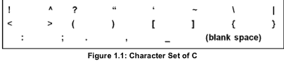

> **注意**
>
> *在最新版本中，C 语言的字符集中引入了新字符，例如 $ 和 @。*

### C 语言标记

用 C 编写的代码具有各种构建块或标记。编译器有责任在开始解析之前将代码分解为更简单的组成部分。代码的较小部分也称为标记。现在让我们详细讨论每个部分。

#### 关键字

关键字是 C 中已在编译器本身中定义的那些单词。关键字不能用作程序员定义的标识符。关键字在 C 中也称为保留字。

表 1.1 列出了 C 语言支持的关键字：

**表 1.1：C 语言中的关键字**

| int | struct | long | switch |
|---|---|---|---|
| case | enum | char | extern |
| register | typedef | return | union |
| const | float | continue | for |
| short | unsigned | signed | void |
| default | goto | do | if |
| sizeof | volatile | static | while |


除了表1.1中所示的关键字之外，标准编译器还定义了一些编译器特定的关键字，例如 asm、near 和 far。

#### 标识符

各种各样的变量、函数、标签以及其他用户自定义项都被称为标识符。标识符的长度可以从一个字符到多个字符不等。标识符本质上可以由字母数字组成，但在C语言中声明标识符时需要遵循一些规则。例如，第一个字符必须是下划线或字母。后续字符可以是字符、下划线或数字。以数字开头的标识符不允许在C中声明。

表1.2列出了允许和不允许的标识符，也称为正确或错误的标识符：

**表1.2：正确和错误的标识符**

| 正确标识符 | 错误标识符 |
|---|---|
| `loop_count` | `3count` |
| `check45` | `Hello!world` |
| `flag` | `check-value` |

标识符可以是任意长度。C语言有两组不同的标识符——外部标识符和内部标识符。外部标识符类似于在文件之间共享的全局变量名和函数名。这种共享也称为外部链接过程。如果标识符不能全局共享，则称为内部标识符。在C89版本中，只有外部标识符的前6个字符和内部标识符的前31个字符被认为是有效的。这在C99版本中发生了变化，外部标识符有31个有效字符，内部标识符有63个。标识符区分大小写，这意味着大写和小写字符被区别对待。

### 数据类型

C语言中有五种基本数据类型，如下所示：

- int
- char
- float
- double
- void

这些数据类型的大小和范围根据编译器以及程序开发或运行的计算机架构而有所不同。int 的大小从2字节到4字节不等，具体取决于编译器和处理器。char 的大小在所有架构中保持不变。int 的大小通常取决于程序的字长。更准确地说，大小取决于程序运行的CPU架构。在16位架构中，整数的大小为16位或2字节。在32位架构中，其大小将为4字节，等于32位。float 和 double 的长度取决于浮点数的表示方式。标准ANSI C规定浮点值的最小范围为1E-37到1E+37。void 数据类型通常用于定义函数的返回类型或指针。它们将在后续章节中详细讨论。

除 void 之外的基本数据类型可以借助C语言中可用的不同类型修饰符进一步修饰。类型修饰符改变基类型的含义以满足更多需求，例如，类型修饰符可以增加基本类型所能容纳的信息长度。以下是C语言中可用的基本类型修饰符：

- signed
- unsigned
- long
- short

int 数据类型可以被所有上述修饰符修饰；而 char 只能使用 unsigned 和 signed 修饰符来扩展。表1.3列出了C语言中数据类型的长度：

**表1.3：C语言中数据类型的长度**

| 类型 | 标准大小（位） | 范围 |
| --- | --- | --- |
| char | 8 | -127 到 127 |
| unsigned char | 8 | 0 到 255 |
| signed char | 8 | -127 到 127 |
| int | 16 或 32 | -32,767 到 32,767 |
| unsigned int | 16 或 32 | 0 到 65,535 |
| signed int | 16 或 32 | 与 int 相同 |
| short int | 16 | -32,767 到 32,767 |
| unsigned short int | 16 | 0 到 65,535 |
| signed short int | 16 | 与 short int 相同 |
| long int | 32 | -2,147,483,647 到 2,147,483,647 |
| long long int | 64 | -(2^63 -1) 到 2^63 -1 |
| signed long int | 32 | 与 long int 相同 |
| unsigned long int | 32 | 0 到 4,294,967,295 |
| unsigned long long int | 64 | 2^64 - 1 |
| float | 32 | 1E-37 到 1E+37（六位精度） |
| double | 64 | 1E-37 到 1E+37（十位精度） |
| long double | 80 | 1E-37 到 1E+37（六位精度） |

在C语言中不使用“signed”修饰符，因为C语言中的整数声明总是有符号整数。有符号整数和无符号整数之间的区别在于它们的表示方式。编译器将整数的最高有效位视为符号位。如果整数中的符号位设置为零，则该整数被视为正数，否则为负数。负数在C语言中以二进制补码形式存储，其中除了符号位外，数字的所有位都被取反，然后加1。然后符号位设置为1。有符号整数限制用户使用完整的数字范围。例如，有符号整数的正数范围变为32,767，表示为：

```
01111111 11111111
```

如果该数字的高位设置为1，则该数字变为-1。如果同一个数字被声明为无符号整数，那么当高位设置为1时，范围将上升到0到65,535。

### C 语言中的其他数据类型

除了标准数据类型之外，C语言在C99版本中还引入了三种新的数据类型。这三种新数据类型是：

- **Bool**——表示能够存储0或1（真或假）值的数据类型。Bool 数据类型基本上是整数类型。C++定义了自己的布尔数据类型，称为 bool。在处理C语言时，应记住不要将这两种数据类型混用。
- **_Complex**——表示不能作为独立数据类型使用的一种数据类型。它或多或少地用作 float、double 和 long double 数据类型的类型修饰符。
- **_Imaginary**——表示一种数据类型，增加了在受支持的数据类型中处理虚数值的能力。它是一个类型修饰符。

_Complex 和 _Imaginary 数据类型都按如下方式修饰标准数据类型：

- float _Complex
- float _Imaginary
- double _Complex
- double _Imaginary
- long double _Complex
- long double _Imaginary

如上所述，float _Complex 或 float _Imaginary 是一种全新的数据类型，能够存储本质上是浮点数的虚数或复数值。上面提到的所有其他数据类型也是如此。

头文件 <complex.h> 包含宏 **complex** 和 **imaginary** 的定义；它们分别扩展为 _Complex 和 _Imaginary 类型。在处理这些修饰符时，包含该头文件是一种良好的编程实践。

### 常量

常量是指在程序执行期间不允许更改的固定值。常量在C语言中也称为字面量。C语言中通常有四种基本类型的常量——整型常量、浮点型常量、字符常量和字符串常量。整型常量和浮点型常量表示数字，因此它们被视为数字常量。以下是为数字常量定义的一些规则：

- 在声明数字常量时，不能提供逗号和空格。
- 数字常量前面可以有负号，表示其为负常量。
- 常量的值不能超过指定限制。此限制因编译器而异。

#### 整型常量

整型常量表示整数，因此它仅由数字组成。在C语言中，可以在不同的数制中声明整型常量，例如十进制、八进制和十六进制数制。十进制整型常量可以由0–9的数字构成。无效十进制常量表示的一些示例是：

- 30,345——不正确的表示，因为不允许逗号
- 21.098——不正确的表示，因为十进制常量中不能提供精度


- 0900——错误表示：当数字位数超过一位时，零不能作为十进制数表示的首位数字
- 235-897——在十进制常量中不能指定十进制数的范围

在八进制整型常量中，数字取自 0 到 7 的范围。八进制常量的首位数字必须为零。以下是一些有效和无效八进制常量的示例：

- 0——有效
- 012——有效
- 345——无效的八进制数，因为它不以零开头
- 0989——无效，因为数字大于 7
- 056.66——非法字符 (.)

在十六进制表示中，常量必须以 0x 或 0X 开头。其后可以跟 0-9 以及 a 到 f（包括大写和小写）的任意数字组合，其中字符 a 到 f 分别表示 10 到 15 的数字。以下是一些有效和无效的十六进制常量表示：

- 0x——有效
- 0X——有效
- 0x7aff——有效
- 0xdcba——有效
- 0adf——无效，因为它不以 0x 或 0X 开头
- 0xqdg——十六进制范围是从 a 到 f，因此不支持 g
- 0xff.44——非法字符 (.)

整型常量的范围因编译器而异，但通常整型常量的长度被定义为不超过 32,767，即 2¹⁵ - 1。对于八进制常量，范围变为 77777；对于十六进制常量，范围变为 7FFF。C 中也存在无符号整型常量。无符号常量的范围是有符号常量的两倍。可以在有符号常量末尾追加 U，将其声明为无符号常量。类似地，还有长整型常量，它们进一步扩展了整型常量的范围。可以通过在有符号常量末尾追加 L 来识别它们。以下是一些无符号和长整型常量的示例：

- 60787U——无符号十进制
- 874329872L——长十进制
- 2345678123UL——无符号长十进制
- 0123456L——长八进制
- 0777777UL——无符号八进制
- 0xFFFFFFFL——长十六进制
- 0xAD3467665UL——无符号长十六进制

#### 浮点常量

浮点常量定义为一种数值常量，同时包含整数部分和指数部分。以下是一些浮点常量的示例：

0.0, 0.2, 875.3455, 1.666E+5, 2E-6, 0.0006e-3

以下是一些无效的浮点表示：

- 1——无效，因为浮点数必须包含指数
- 1,777——无效，因为 (,) 不是允许的字符
- 5E+10.3——指数应为整数
- 4E 6——指数前不允许有空格

浮点常量的指数部分在其值为正时将小数点右移，为负时左移。浮点常量的范围远大于整型常量的范围。浮点常量也被视为双精度量，需要 8 字节存储。一些编译器还允许在浮点常量末尾追加 F 来表示单精度浮点常量。我们也可以提到长浮点，即在浮点变量末尾追加 L。

浮点数和整数都属于更大的数值常量类别。编译器会将数值常量装入能够容纳它的最小兼容数据类型。这意味着，如果我们将常量声明为 15，默认它成为整数；而像 156899 这样的常量则成为长整数。

#### 字符常量

字符常量定义为用单引号括起来的单个字符，例如 ‘A’ 和 ‘D’。所有字符常量都包含与其关联的整数值，这些值基于机器的字符集。字符集标准可能因计算机而异。因此，C 遵循一种被普遍接受的字符集，也称为美国信息交换标准代码（ASCII），其中每个字符都有一个唯一的数值，以区别于其他字符。表 1.4 定义了 ASCII 字符集及其对应的十进制值：

**表 1.4：ASCII 字符集及其对应的十进制值**

| ASCII 值 | 字符 | ASCII 值 | 字符 | ASCII 值 | 字符 | ASCII 值 | 字符 |
| --- | --- | --- | --- | --- | --- | --- | --- |
| 0 | NUL | 32 | (blank) | 64 | @ | 96 | \` |
| 1 | SOH | 33 | ! | 65 | A | 97 | a |
| 2 | STX | 34 | " | 66 | B | 98 | b |
| 3 | ETX | 35 | # | 67 | C | 99 | c |
| 4 | EOT | 36 | $ | 68 | D | 100 | d |
| 5 | ENQ | 37 | % | 69 | E | 101 | e |
| 6 | ACK | 38 | & | 70 | F | 102 | f |
| 7 | BEL | 39 | ' | 71 | G | 103 | g |
| 8 | BS | 40 | ( | 72 | H | 104 | h |
| 9 | HT | 41 | ) | 73 | I | 105 | i |
| 10 | LF | 42 | * | 74 | J | 106 | j |
| 11 | VT | 43 | + | 75 | K | 107 | k |
| 12 | FF | 44 | , | 76 | L | 108 | l |
| 13 | CR | 45 | - | 77 | M | 109 | m |
| 14 | SO | 46 | . | 78 | N | 110 | n |
| 15 | SI | 47 | / | 79 | O | 111 | o |
| 16 | DLE | 48 | 0 | 80 | P | 112 | p |
| 17 | DC1 | 49 | 1 | 81 | Q | 113 | q |
| 18 | DC2 | 50 | 2 | 82 | R | 114 | r |
| 19 | DC3 | 51 | 3 | 83 | S | 115 | s |
| 20 | DC4 | 52 | 4 | 84 | T | 116 | t |
| 21 | NAK | 53 | 5 | 85 | U | 117 | u |
| 22 | SYN | 54 | 6 | 86 | V | 118 | v |
| 23 | ETB | 55 | 7 | 87 | W | 119 | w |
| 24 | CAN | 56 | 8 | 88 | X | 120 | x |
| 25 | EM | 57 | 9 | 89 | Y | 121 | y |
| 26 | SUB | 58 | : | 90 | Z | 122 | z |
| 27 | ESC | 59 | ; | 91 | [ | 123 | { |
| 28 | FS | 60 | < | 92 | \\ | 124 | \| |
| 29 | GS | 61 | = | 93 | ] | 125 | } |
| 30 | RS | 62 | > | 94 | ^ | 126 | ~ |
| 31 | US | 63 | ? | 95 | _ | 127 | DEL |

也可以定义多字节字符常量。对于定义宽字符集的语言，需要多字节常量。要指定多字节字符常量，需要将多个字符括在单引号中，如 'xy'。对于宽字符，需要在字符前加上 L，例如：

```c
wchar_t wc = L'Q';
```

这里，wc 被赋予一个宽字符常量，它等价于 Q。字符类型是 wchar，表示宽字符类型，定义在 <stddef.h> 头文件中。它不是内置数据类型。

#### 字符串常量

C 支持的另一组常量是字符串常量。字符串是用双引号括起来的一组字符。例如 "hello world" 构成一个字符串。尽管 C 允许定义字符串常量，但不允许将其用作数据类型。编译器会自动在字符串常量末尾放置一个 NULL（\0）。NULL 表示字符串常量的终止。使用字符串常量时，不应将其与字符常量混淆，例如 'A' 表示字符常量，而 "A" 表示包含单个字符的字符串常量。二者彼此不同。

#### 反斜杠字符常量

在 C 中，我们可以通过将字符常量括在单引号内来书写字符常量。该规则似乎并不适用于所有字符常量。少数字符常量（如回车）需要特殊处理。这需要将字符常量括在单引号内，并在字符常量前加反斜杠。这些也称为转义序列。转义序列总是由多个字符表示。表 1.5 列出了 C 中的转义序列：

- `-`：用于减法
- `*`：用于乘法
- `/`：用于除法
- `%`：用于求余数，也称为取模运算符

其他运算（例如幂运算和对数计算）由 C 内部头文件中定义的库函数完成。运算符所作用的操作数必须包含数值，因此操作数可以是整数类型、浮点变量或字符。提到字符时，实际考虑的是它们的 ASCII 值。使用取模运算符时，分子和分母都应为整数类型。对整数变量进行除法运算总是得到截断后的值，因为商的小数部分被丢弃。为避免这种截断，建议将除法运算的结果存储在浮点变量中。

假设对变量 a 和 b 进行若干整数运算，它们的值分别为 20 和 7。结果将如下所示：

| 表达式 | 值 |
|---|---|
| a + b | 27 |
| a - b | 13 |
| a * b | 140 |
| a / b | 2 |
| a % b | 6 |

a%b 运算表明整数除法发生了结果截断。现在，考虑对浮点变量 a 和 b 进行运算，它们的值分别为 36.89 和 12.25。在这种情况下，结果将如下所示：

| 表达式 | 值 |
|---|---|
| a + b | 49.14 |
| a - b | 24.64 |
| a * b | 451.9025 |
| a / b | 3.011 |

让我们对两个字符变量 ch1 和 ch2 执行同一组运算，它们的内容分别为 A 和 B。结果将如下所示：

| 表达式 | 值 |
|---|---|
| ch1 + ch2 | 131 |
| ch1 - ch2 | -1 |

对字符变量进行算术运算时，实际考虑的是 ASCII 值。以下是执行浮点运算时必须遵循的一些截断规则：

- 精度较低的操作数将被转换为另一个操作数的精度，结果将以较高精度表示。这意味着对于 float 和 double 之间的运算，结果将以 double 表示。
- 如果其中一个操作数是浮点数，而另一个是整数或字符，则 char 或 int 操作数将被转换为浮点变量。
- 如果在 int 和 long int 之间进行运算，结果将以 long int 表示。


```c
a = a + 10 can be rewritten as
a += 10
```

这里，+= 运算符告诉编译器需要将 10 加到变量 a 上。复合赋值语句对 C 中的所有二元运算符（需要两个操作数的运算符）都有效。复合赋值语句的一般形式如下：

```c
variable operator = expression;
```

复合语句的一些示例如下：

- `x -= 30;`
- `x *= y;`
- `x %= z;`

复合语句写起来比完整的赋值语句更简单。它们通常被称为简写语句。

### 一元运算符

作用于单个操作数并产生一个值的运算符称为一元运算符。一元运算符通常位于其操作数之前，不过其中一些也经常写在操作数之后。C 中最常用的一元运算符是一元减号。在 C 中，通过在数字前放置一元减号运算符来声明负数。减法运算需要两个操作数才能工作；而一元减号只对一个操作数进行运算。

例如，-5 成为一个前面带有一元减号的负数值常量。

除一元减号外，最常用的两个运算符是递增运算符和递减运算符。

### 递增运算符

C 中的递增运算符用 ++ 符号表示。递增运算符使变量的值增加一。与这些运算符一起使用的操作数必须是单个变量。

考虑以下语句：

```c
x = x + 1;
```

上述语句也可以使用递增运算符写成如下形式：

```c
x++;
```

可以说，递增运算符是对 x 内部的值进行赋值并递增的一种简写表示。

对一个变量可以执行两种类型的递增运算。一种称为前置递增运算，另一种称为后置递增运算。

**清单 1.4：** 后置和前置递增运算符

```c
#include<stdio.h>

int main()
{
    int a=10;
    a++;
    printf(" A %d ",a);
    getch();
}
```

清单 1.4 的输出将是 11，因为我们使用了递增运算符。如果将运算符从 a++ 改为 ++a，输出仍将保持不变。那么，拥有两种不同类型的递增运算符有什么用处呢？清单 1.5 和 1.6 阐明了这一区别：

清单 1.5 展示了后置递增运算符的工作方式：

**清单 1.5：后置递增运算符的工作方式**

```c
    #include<stdio.h>

    int main()
    {
        int a=10;
        printf(" a %d ",a++);
        getch();
        return 0;
    }
```

清单 1.5 的输出将是 10，而不是 11。

清单 1.6 展示了将同一代码改为前置递增运算后的情况：

**清单 1.6：前置递增运算符的工作方式**

```c
    #include<stdio.h>

    int main()
    {
        int a=10;
        printf(" A %d ",++a);
        getch();
    }
```

在这种情况下，输出变为 11，因为与前置递增运算相比，后置递增运算的优先级较低。当我们将打印语句与后置递增运算符一起使用时，首先显示变量内部的原始值，随后该值才递增；因此，我们得不到更新后的值。另一方面，在前置递增运算中，变量内部包含的值先加一，然后才执行所有后续操作。这就是为什么使用前置递增运算时能得到更新后的显示值。本章后面还将讨论更多前置递增和后置递增运算的示例。

### 递减运算符

C 中的递减运算符用“--”符号表示。递减运算符的基本工作方式与递增运算符相似，区别在于递减运算符将变量的值减一。递减运算符也可以用作后置递减和前置递减运算符。

### C 中的表达式

表达式表示单个数据项，它可以是数字或字符。表达式可以由常量、变量或对函数的引用组成。C 中表达式的一些示例如下：

- a + b
- a = b
- x = y + z
- e == f
- ++count
- count--

### C 中的语句

C 中的语句指由编译器执行的某个动作或一组动作。在 C 中，语句分为三类——表达式语句、复合语句和控制语句。表达式语句由表达式后跟一个分号组成。执行表达式语句会使表达式被求值。例如，`c = a + b` 可以被视为表达式语句，因为它会使赋值语句右侧的表达式被求值，并赋给左侧的变量。单个块内的多个独立语句被视为复合语句；而单个语句可以是表达式语句、控制语句或复合语句。复合语句允许在语句中嵌入语句。与表达式语句不同，复合语句不以分号结尾。

以下代码给出了复合语句的一个示例：

```c
{
    a = 10;
    b = 10;
    c = a + b;
    printf("\n Result [%d]", c);
}
```

### 决策

决策是指编程语言根据某些判断执行不同动作集的能力。C 中主要的决策模块是 `if`、`if else` 和 `else statements`。除此之外，像 `switch case` 这样的其他语句也有助于进行决策；不过，本章将主要讨论 `if`、`if else` 和 `else statements`。

### IF 语句

与所有其他编程语言一样，C 也使用 `if` 语句进行决策。此外，`if` 在 C 中也被称为关键字。`if` 语句的一般形式是：

```c
if(expression happens to be true)
    perform certain actions;
```

当编译器遇到 `if` 语句时，它就知道需要进行决策。`if` 语句总是执行包含在 `if` 块内的语句。

**清单 1.7：** 在 C 中编写 if 语句

```c
#include<stdio.h>

int main()
{
    int varA = 10;

    if(varA == 10)
        printf("\n Statement is true ");

    getch();
}
```

清单 1.7 中给出的代码展示了 `if` 语句的工作方式。`if` 语句内给出的表达式借助关系运算符进行求值。表 1.7 列出了 C 中使用的不同关系运算符：

**表 1.7：C 中的关系运算符**

| 表达式 | 求值结果（满足以下条件时求值为真） |
| --- | --- |
| X == Y | X 等于 Y |
| X != Y | X 不等于 Y |
| X <= Y | X 小于或等于 Y |
| X < Y | X 小于 Y |
| X >= Y | X 大于或等于 Y |
| X > Y | X 大于 Y |

图 1.2 展示了清单 1.7 中代码的流程图（图形表示）：

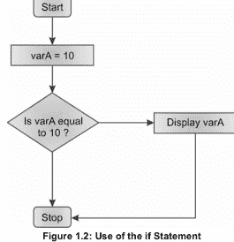

如果仔细观察，我们可以发现决策有两个分支——一个在条件为真时执行，另一个在判断为假时执行。图 1.3 展示了决策的分支：

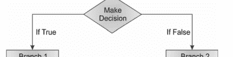

决策的概念类似于分支，其中有不同的动作过程或分支。if 语句有助于根据测试条件选择其中一个分支。

### IF 表达式的不同类型

我们可以在 if 语句中提供不同类型的表达式。请注意，if 语句中并非必须进行关系运算。以下是一些有效 if 语句的示例：

```c
1.  if(5+4>3)
    printf("\n This is valid");
2.  if(varA == 10)
    printf("\n This is valid");
3.  if(-5)
    printf("\n This is valid");
```

在 C 语言中，非零值被视为真，零被视为假。if 语句仅在所提供的表达式求值为真时才起作用。在第一个示例中，进行的是逻辑计算，产生非零结果。在第二个示例中，将一个正值赋给变量 varA。赋值后，会测试该变量的值，因为变量包含非零值。第三个示例表明，负值也适用同样的条件。

### 多个 IF 语句

一个 if 语句内部可以包含多个语句。为此，需要将一组语句放在一对花括号内。如果未提供花括号，那么 if 子句将只包含一个语句，其余语句将被忽略。

**清单 1.8：编写多个 IF 语句**

```c
#include<stdio.h>

int main()
{
        int varA;
        printf("\n Enter a integer ");
        scanf("%d",&varA);

        if(varA > 10)
                printf("\n Statement is true ");
                printf("\n Inside IF ");
        getch();
}
```

清单 1.8 的输出如下：

```text
    Enter a integer 5

        Inside IF
```

在清单 1.8 中，我们在单个 if 语句内给出了多个语句。由于代码中没有使用括号，这些语句并非全都被视为 if 语句的一部分。

**清单 1.9：构造 IF 块**

```c
#include<stdio.h>

int main()
{
        int varA;
        printf("\n Enter a integer ");
        scanf("%d",&varA);
```


### 数据结构

数据结构是计算机存储、组织数据的方式。数据结构是指相互之间存在一种或多种特定关系的数据元素的集合。

### 常见的数据结构

- 数组
- 链表
- 栈
- 队列
- 树
- 图

### 数组

数组是一种线性表数据结构。它用一组连续的内存空间，来存储一组具有相同类型的数据。

**代码清单 1.12 提到了使用 if-else 语句时发生的编译错误。**

**代码清单 1.12：if-else 语句中的错误**

```c
#include<stdio.h>

int main()
{
    if(1)
    {
        printf("\n IN IF ");
    }
    printf("\n IN Between ");
    else
    {
        printf("\n IN ELSE ");
    }
    getch();
}
```

代码清单 1.12 将给出如下编译错误：

```text
syntax error before "else"
```

在处理 if 和 else 语句时，应牢记：if 块与 else 块之间不应出现任何语句。

### 嵌套 if-else 语句

可以将多个 if-else 语句相互嵌套。当存在复杂的决策问题，并且一个分支中可能有多个分支或子分支时，就需要这种结构。

考虑一个场景：我们需要根据学生在考试中获得的百分比来给他们评定等级。评分标准如下：

- 91% 及以上 – A 等级
- 75% - 90% - B 等级
- 50% - 74% - C 等级
- 35% - 49% - 仅及格
- 低于 35% - 不及格

代码清单 1.13 展示了 if-else 语句的嵌套：

**代码清单 1.13：if-else 语句的嵌套**

```c
#include<stdio.h>

int main()
{
    int marks_obtained;
    float percentage;

    printf("\n Enter marks obtained by candidate out of 500 ");
    scanf("%d",&marks_obtained);

    percentage = marks_obtained/5;

    if(percentage > 90)
    {
        printf("\n Grade Obtained is A");
    }
    else
    {
        if(percentage > 74)
        {
            printf("\n Grade Obtained is B");
        }
        else
        {
            if(percentage > 50)
            {
                printf("\n Grade obtained is C");
            }
            else
            {
                if(percentage > 39)
                {
                    printf("\n Grade obtained is Just Passed");
                }
                else
                {
                    printf("\n Candidate Failed");
                }
            }
        }
    }
    getch();
}
```

代码清单 1.13 的输出如下：

```text
Enter marks obtained by candidate out of 500 490

Grade Obtained is A

Enter marks obtained by candidate out of 500 100

Candidate Failed
```

在代码清单 1.13 中，第二个 if-else 结构嵌套在第一个 if-else 结构的 else 块中。其思路是，如果第一个 if 语句失败，控制流就会转移到相应 else 块内的语句，然后执行第一个 else 块中的 if-else 块。嵌套并不一定总要发生在 else 块内部；它也可以发生在 if 块内部。然而，代码必须正确缩进，这一点极其重要；否则可能会出现 if-else 块位置错误。此外，将单条语句和多条语句都放在花括号内是一种良好的编程实践，因为这会提高代码的可读性。

嵌套有不同的类型。其中一些如下所述：

- 1. `if(expression)`
  `statement;`
- 2. `if(expression)`
  ```c
  {
      statements;
  }
  ```

## 第1章

### 代码清单 1.15：OR 运算符的用法

```c
#include<stdio.h>

int main()
{
    int sex,exp;

    printf("\n Enter type of candidate (1 for MALE 2 for FEMALE) ");
    scanf("%d",&sex);
    printf("\n Enter Years of Experience ");
    scanf("%d",&exp);

    if(((sex == 1) && (exp >= 3)) || ((sex == 2) && (exp >=2)))
        printf("\n Candidate Accepted");
    else
        printf("\n Candidate Rejected");
    getch();
}
```

代码清单 1.15 的输出如下：

```text
Enter type of candidate (1 for MALE 2 for FEMALE) 1

Enter Years of Experience 4

Candidate Accepted
```

在代码清单 1.15 中，如果任意一个表达式变为真，OR 运算符就会帮助执行这组语句。该代码还表明，我们也可以一起使用多个逻辑运算符。NOT 运算符有自己不同的解释。顾名思义，NOT 运算符表示对表达式取反。考虑以下代码片段：

```c
if(!expression)
```

在这种情况下，如果表达式返回假，那么 NOT 运算符会反转结果并将其变为真，因此 if 块内的语句会被执行。

代码清单 1.16 展示了 NOT 运算符在 C 中的实现。

### 代码清单 1.16：NOT 运算符在 C 中的实现

```c
#include<stdio.h>

int main()
{
    int variable=0;
    if(!variable)
        printf("\n variable is zero");
    else
        printf("\n variable is non-zero");

    getch();
}
```

代码清单 1.16 中提到的代码片段将执行 if 块内的语句；NOT 运算符是下面所述条件语句的另一种写法

```c
if(variable == 0)
```

而是写成

```c
if(!variable)
```

我们将在本章末尾找到这些运算符的更多示例。

### else-if 语句

else-if 语句是编写决策程序的另一种方式。

代码清单 1.17 展示了一个使用 else-if 块编写的程序：

**代码清单 1.17：在 C 中编写 else-if 语句**

```c
#include<stdio.h>

int main()
{
    int marks_obtained;
    float percentage;

    printf("\n Enter marks obtained by candidate out of 500 ");
    scanf("%d",&marks_obtained);

    percentage = marks_obtained/5;

    if(percentage > 90)
    {
        printf("\n Grade Obtained is A");
    }
    else if(percentage > 74)
    {
        printf("\n Grade Obtained is B");
    }
    else if(percentage > 49)
    {
        printf("\n Grade Obtained is C");
    }
    else if(percentage > 34)
    {
        printf("\n Grade Obtained is Just Passed");
    }
    else
        printf("\n Candidate Failed");

    getch();
}
```

代码清单 1.17 的输出如下：

```text
Enter marks obtained by candidate out of 500 490

Grade Obtained is A
```

else-if 语句是编写 if-else 语句的另一种方式。

以下代码片段展示了一个通用 if-else 语句的示例：

```c
if(expression)
{
    statements;
}
else
{
    if(expression)
        statement;
}
```

前面的代码可以使用 else-if 结构重排为：

```c
if(expression)
{
    statements;
}
else if(expression)
    statement;
```

### 条件运算符

决策所需的另一组相关运算符是 ? 和 :。这些运算符通常被称为三元运算符，因为它们接受三个参数。组合在一起，它们构成 if-else 语句的简化版本。

```text
expression ? statement 1 : statement2
```

上面显示的表达式意味着，如果表达式为真，则执行语句 1；否则执行语句 2。代码清单 1.18 展示了如何在 C 中编写条件运算符：

**代码清单 1.18：在 C 中编写条件运算符**

```c
#include<stdio.h>

int main()
{
    int varA=10;

    (varA < 5 ? printf("\n Less than 5"):printf("\n Greater than 5"));

    getch();
}
```

代码清单 1.18 的输出如下：

```text
Greater than 5
```

代码清单 1.19 展示了条件运算符在 C 中的使用：

**代码清单 1.19：C 中的条件运算符**

```c
#include<stdio.h>

int main()
{
    int gender,age;

    printf("\n Enter your Gender (1. MALE/ 2. FEMALE)");
    scanf("%d",&gender);
    printf("\n Enter age ");
    scanf("%d",&age);

    ((gender == 1) ?
        ((age > 18) ? printf("\n Qualified"):printf("\n Disqualified"))
        :
        ((age > 24) ? printf("\n Qualified"):printf("\n Disqualified"))
    );
    getch();
}
```

使用条件运算符的主要缺点之一是，在条件语句的真块和假块中只能有一条语句。因此，这种结构并不经常使用。


### C 语言中的 switch case 范式

C 语言中使用的 switch 语句允许用户根据多个选择做出决定。它是 C 语言内置的分支选择工具。它将表达式的值与一组整数或字符常量进行测试。当找到正确匹配时，与该常量关联的语句将被执行。

以下代码片段展示了 switch 语句的通用形式：

```c
switch(expression)
{
        case constant1:
                statement sequence
                break;
        case constant2:
                statement sequence
                break;
        case constant3:
                statement sequence
                break;
        .
        .
        .
        default:
                statement sequence
}
```

switch 关键字内的表达式应始终求值为整数类型。我们可以使用整数和字符作为有效表达式；但是，switch 关键字不允许使用浮点表达式。表达式的值会与 case 语句中提供的值进行测试。一旦找到匹配，匹配之后的语句集将执行，直到遇到 break 或到达 switch 语句末尾。如果未找到匹配，则执行 default 语句。每个 case 中使用的常量应彼此不同。

图 1.4 展示了 switch 语句的图示：

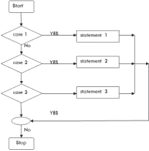

**图 1.4：switch case 范式**

如图 1.4 所示，提供给 switch 语句的参数会与每个 case 语句进行比较。如果判断结果为真，意味着找到了匹配，因此执行该 case 下的语句；否则，将其与下一个 case 进行匹配。

代码清单 1.20 展示了 C 语言中的一个简单 switch 语句：

### 代码清单 1.20：简单的 switch 语句

```c
#include<stdio.h>

int main()
{
    int choice;

    printf("\n Enter your choice from (1/2/3) ");
    scanf("%d",&choice);

    switch(choice)
    {
        case 1:
            printf("\n choice is 1");
        case 2:
            printf("\n choice is 2");
        case 3:
            printf("\n choice is 3");
        default:
            printf("\n wrong Choice");
    }
    getch();
}
```

代码清单 1.20 的输出如下所示：

```text
Enter your choice from (1/2/3) 1

Choice is 1
Choice is 2
Choice is 3
Wrong Choice
```

该输出无效，因为程序显示了我们在 switch 语句中提供的所有选项，而不是仅显示正确选项。发生这种情况是因为 switch 语句执行了所有 case 语句，包括 default 语句。如果我们希望只执行某个 case 下提到的语句，并跳过后续 case 语句，那么必须使用 break 语句。

代码清单 1.21 展示了带有 break 语句的 switch case：

### 代码清单 1.21：带 break 的 switch case

```c
#include<stdio.h>

int main()
{
    int choice;

    printf("\n Enter your choice from (1/2/3) ");
    scanf("%d",&choice);

    switch(choice)
    {
        case 1:
            printf("\n Choice is 1");
            break;
        case 2:
            printf("\n choice is 2");
            break;
        case 3:
            printf("\n Choice is 3");
            break;
        default:
            printf("\n wrong Choice");
    }
    getch();
}
```

代码清单 1.21 的输出如下所示：

```text
Enter your choice from (1/2/3) 1
Choice is 1
```

为变量 "choice" 输入的值会与第一个 case 语句进行比较，该语句检查 choice 是否为 1。在我们的例子中，choice 为 1，因此执行该 case 内的语句并显示消息。显示消息后，break 语句被执行，它将控制权带出 switch 语句，因此不再进行其他比较。default 语句是可选的，因为它表示当 switch 语句中没有匹配时需要做什么。

不同版本的编译器支持不同数量的 case 语句。有些编译器不能支持超过 257 个 case 语句；而有些甚至可以超过 1023 个 case 语句。使用 switch 语句时需要记住的一些重要点如下：

- case 语句本质上是一个标签；但是，它不能单独存在于 switch 语句之外。
- 每当遇到 break 时，控制权会转移到 switch 语句之后的代码行。
- switch 语句不同于 if 语句。switch 不仅可以测试相等性，还可以求值表达式。
- switch 语句中的任意两个 case 都不能具有相同的值。
- switch 语句中使用的字符会自动转换为整数。

代码清单 1.22 展示了字符变量在 switch 语句中的用法：

### 代码清单 1.22：switch case 中的字符变量

```c
#include<stdio.h>

int main()
{
    char choice='A';

    switch(choice)
    {
        case 'A':
            printf("\n Choice is A");
            break;
        case 'B':
            printf("\n Choice is B");
            break;
        case 'C':
            printf("\n Choice is C");
            break;
        default:
            printf("\n wrong Choice");
    }
    getch();
}
```

代码清单 1.22 的输出如下所示：

```text
Choice is A
```

代码清单 1.22 中的代码展示了如何在 switch 语句内使用字符。当我们使用 A、B 和 C 等字符时，实际上是它们的 ASCII 值替换了这些字符。

代码清单 1.23 展示了编写代码清单 1.22 的另一种方式：

### 代码清单 1.23：switch-case 语句中的浮点表达式

```c
#include<stdio.h>

int main()
{
    float choice=3.5;

    switch(choice)
    {
        case 4.2:
            printf("\n choice is 4.2");
            break;
        case 9.3:
            printf("\n choice is 9.3");
            break;
        case 8.8:
            printf("\n choice is 8.8");
            break;
        default:
            printf("\n wrong Choice");
    }
    getch();
}
```

代码清单 1.23 的输出会产生编译时错误，如下所示：

```text
switch quantity not an integer
case label does not reduce to an integer constant
```

我们不能在 switch 语句内使用浮点变量，因为编译器本身禁止这样做。此问题的一个主要原因可能是使用浮点变量获得的输出不够精确。在某些场景下，我们可能希望将多个 case 语句一起使用。代码清单 1.24 展示了如何在单个 case 内包含多个语句：

### 代码清单 1.24：switch case 中的多个语句

```c
#include<stdio.h>

int main()
{
    char choice='a';

    switch(choice)
    {
        case 'A':
        case 'a':
            printf("\n choice is A");
            break;
        case 'B':
        case 'b':
            printf("\n Choice is B");
            break;
        case 'C':
        case 'c':
            printf("\n Choice is C");
            break;
        default:
            printf("\n wrong Choice");
    }
    getch();
}
```

执行第一个 case 语句后，控制权会直接转到下一条语句，直到遇到 break 点。在这种情况下，对于与任意一个 case——case A 或 case a——的匹配，都会执行一组已定义的指令。

你还可以在 switch 语句内使用逻辑表达式。以下代码片段中所示的语句在 C 中可以完美执行：

```c
case(3+5)
```

代码清单 1.25 展示了 switch 语句的不同用法：

### 代码清单 1.25：switch 语句的不同用法

```c
#include<stdio.h>

int main()
{
    int choice;

    printf("\n Enter your choice from (1/2/3) ");
    scanf("%d",&choice);

    switch(choice)
    {
        case (1+4):
            printf("\n Choice is 1");
            break;
        case 2:
            printf("\n Choice is 2");
            break;
        case 3:
            printf("\n Choice is 3");
            break;
        default:
            printf("\n wrong Choice");
    }
    getch();
}
```

如果用户输入选项 5，则输出将如下所示：

```text
Enter your choice from (1/2/3) 5

Choice is 1
```

发生这种情况是因为 case 语句会在内部计算该值，并与结果进行比较。


清单1.26展示了`switch`语句如何相互嵌套。每当最内层`switch`语句中的`break`语句被执行时，控制流也会从外层`switch`语句中退出。

`switch`语句也常与`do-while`循环一起用于用户输入驱动的编程。考虑这样一个场景：用户决定执行某些操作，并不时地向程序提供输入，直到他想结束执行为止。这种场景可以通过将`switch`语句和`do-while`循环结合在一起来处理。

清单1.27展示了`switch`语句和`do-while`循环的用法：

**清单1.27：`switch`和`do-while`循环的用法**

```c
#include<stdio.h>
int main()
{
    int choice,varA,varB;
    char opt;

    do
    {
        printf("\n Enter two numbers ");
        scanf("%d %d",&varA,&varB);
        printf("\n 1: Addition ");
        printf("\n 2: Multiplication");
        printf("\n 3: Subtraction");
        printf("\n Enter your choice (1/2/3) ? ");
        scanf("%d",&choice);
        switch(choice)
        {
            case 1:
                printf("\n Sum is %d ",varA+varB);
                break;
            case 2:
                printf("\n Product is %d ",varA*varB);
                break;
            case 3:
                printf("\n Difference is %d ",varA-varB);
                break;
            default:
                printf("\n wrong Option");
        }
        fflush(stdin);
        printf("\n Want to continue (y/n) ?");
        scanf("%c",&opt);
    }while(opt != 'n');
    getch();
}
```

清单1.27的输出如下：

```text
    Enter two numbers 10 5


    1: Addition
    2: Multiplication
    3: Subtraction
    Enter your choice (1/2/3) ? 1

    Sum is 15
Want to continue (y/n) ?y
Enter two numbers 70 8

1: Addition
2: Multiplication
3: Subtraction
Enter your choice (1/2/3) ? 2

Product is 560
Want to continue (y/n) ?y

Enter two numbers 568 41

1: Addition
2: Multiplication
3: Subtraction
Enter your choice (1/2/3) ? 3

Difference is 527
Want to continue (y/n) ?n
```

清单1.27中的代码将持续执行，直到用户输入`n`作为选项。

### 块语句

C语言属于块结构化编程语言家族。块无非就是一组语句的集合。块结构化编程语言允许创建块、嵌套块以及在块内声明变量。如果仔细观察，我们可以发现C语言禁止在块中间声明变量。在C语言中，所有变量声明都必须在块的开头进行。如今许多编译器允许在块内的任意位置声明变量，但这并不属于ANSI标准的一部分。块语句总是以花括号开头并以花括号结尾。

清单1.28展示了如何在C语言中编写块语句：

**清单1.28：在C语言中编写块语句**

```c
#include<stdio.h>
int main()
{
    int i;
    for(i=1;i<10;i++)
    {
        int i;
        i=20;
        printf("\n I %d ",i);
    }
    printf("\n Another I %d ",i);
    getch();
}
```

清单1.28的输出如下：

```text
I 20
Another I 1
I 20
Another I 2
I 20
Another I 3
I 20
Another I 4
I 20
Another I 5
I 20
Another I 6
I 20
Another I 7
I 20
Another I 8
I 20
Another I 9
```

清单1.28中的代码展示了块在C程序中的应用。我们可以在块内使用之前已经定义过的同名变量。

### C语言中的循环

到目前为止，我们已经讨论了顺序语句和决策语句，例如`if`和`else`结构。这些指令集总是恰好执行一次。然而，在使用编程语言时，必须始终牢记，有些情况下我们需要重复执行某个操作。决策语句并不能为我们提供执行这些任务的灵活性。我们可以通过循环来处理这种情况。C语言中循环的一个重要方面是，能够重复执行部分指令，同时保持其他执行部分不变。

一个循环通常包含四个部分：

-   初始化
-   测试条件
-   增量
-   循环体

并不强制要求上述所有步骤都必须按相同顺序执行。

### while循环

让我们看一个现实生活中的场景：我们需要将数字累加到100，并将总和作为输出。图1.5中的控制流描述了如何使用`while`循环来解决该问题：

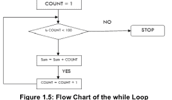

**图1.5：** `while`循环的流程图

图1.5展示了`while`循环的基本构建块。第一条语句定义了初始化，我们取`COUNT`变量并为其赋值为1。接下来是测试条件，这是一个决策语句。在测试条件中，我们检查`COUNT`的值是否小于100。如果值确实小于100，则执行某些任务，否则退出流程图。我们在`while`循环内执行的操作之一是使`COUNT`递增1。清单1.29展示了C语言中的循环概念：

**清单1.29：C语言中的`while`循环**

```c
#include<stdio.h>

int main()
{
    int count;
    int sum=0;

    count =1;                     /* Initialization   */
    while(count <= 100)           /* Test Condition */
    {
        sum += count;
        count++;                  /* Increment Statement */

    }
    printf("\n Sum = %d ",sum);
    getch();
    return 0;
}
```

在清单1.29中，紧跟在`while`后面的花括号内的语句构成了整个循环的循环体。首先执行测试条件，如果发现为真，则循环体中的所有语句都会被执行。这个过程不断重复，直到测试条件变为假。循环的每次执行也称为一次迭代。在清单1.29中，循环内的语句将执行100次。在第101次迭代时，测试条件失败，控制流退出循环。以下代码片段展示了如何构造一个`while`循环：

```text
    Initialization of loop-control variable
    while (test condition is true)
    {
        perform certain actions;

        increment loop-control variable;

    } end loop
```

应当记住，测试条件最终应变为假，否则`while`循环将永远无限执行下去。

考虑以下示例：

```c
    int count = 10;
    while(count < 15 )
    {
        printf("\n Inside while loop");
    }
```

该示例中的循环将无限执行下去，因为测试条件永远不会变为假。循环计数器可以以任何可能的方式修改。对循环计数器可以执行任何逻辑操作。

### while循环的嵌套

可以有多个`while`循环一个接一个地同时执行。这种执行方式称为`while`循环的嵌套。让我们考虑一个例子：需要显示从1到10所有数字的阶乘。为了解决这个问题，我们需要嵌套`while`循环。

清单1.30展示了`while`循环的嵌套：

**清单1.30：** `while`循环的嵌套

```c
#include<stdio.h>

int main()
{
    int factorial;
    int inner_count;
    int outer_count;

    outer_count=1;
    factorial=1;

    while(outer_count <= 10)
    {
        inner_count=1;
        while(inner_count <= outer_count)
        {
            factorial*=inner_count;
            inner_count++;
        }
        printf("\n Factorial of %d is %d ",outer_count,factorial);
        factorial=1;
        outer_count++;
    }
    getch();
}
```

清单1.30的输出如下：

```text
Factorial of 1 is 1
Factorial of 2 is 2
Factorial of 3 is 6
Factorial of 4 is 24
Factorial of 5 is 120
Factorial of 6 is 720
Factorial of 7 is 5040
Factorial of 8 is 40320
Factorial of 9 is 362880
Factorial of 10 is 3628800
```

如清单1.30所示，我们有两个嵌套的`while`循环。外层循环控制数据生成的范围，即它从1迭代到10。内层循环用于计算外层循环每次迭代的阶乘。

### for循环

`for`循环是C语言中最常用的循环之一。使用这种循环的主要优点是，可以在一条语句中同时完成循环控制变量的初始化、测试和增量操作。这使得`for`循环使用起来更加灵活。


图 1.6 展示了 for 循环的流程图：

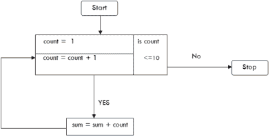

**图 1.6：FOR 循环的流程图**

图 1.6 描述了 for 循环的执行方式。首先，初始化循环控制变量。之后，执行测试条件。如果测试条件恰好为真，则执行 for 循环的循环体，并在下一次迭代开始时将循环控制变量递增一。

代码清单 1.31 展示了一个讨论 for 循环工作原理的示例：

**代码清单 1.31：使用 FOR 循环**

```c
#include<stdio.h>

int main()
{
    int count,sum=0;

    for(count=1;count<=10;count++)
    {
        sum = sum + count;
    }
    printf("\n Sum %d ",sum);
    getch();
}
```

代码清单 1.31 表明，在 for 语句的第一次迭代中，循环控制变量被初始化为 1。初始化之后，执行测试条件。如果测试条件结果为真，则第一次执行 for 循环的循环体。当执行到循环的右花括号时，控制权再次回到 for 语句。现在，循环控制变量的值递增一，然后再次执行测试条件。这一执行序列会持续进行，直到循环控制变量达到某个值，从而使测试条件为假并终止循环。一旦 for 循环终止，控制权就转到循环体之后的第一条语句。尽管初始化是在 for 循环内部完成的，但它只发生一次。从第二次迭代开始，循环控制变量会被修改。

以下代码片段展示了一个通用 for 循环的示例：

```c
for(initialise loop controller; test condition; increment/decrement loop controller)
{
        body of for loop ;
}
```

#### for 循环的嵌套

与 while 循环类似，for 循环也可以嵌套。这些循环可以一个放在另一个内部并同时运行。让我们考虑用于展示 while 循环嵌套的同一个示例。

代码清单 1.32 展示了 for 循环的嵌套：

**代码清单 1.32：FOR 循环的嵌套**

```c
#include<stdio.h>

int main()
{
    int factorial;
    int inner_count;
    int outer_count;

    factorial=1;

    for(outer_count=1;outer_count<10; outer_count++)
    {
        inner_count=1;
        for(inner_count=1;inner_count <= outer_count;inner_count++)
        {
            factorial*=inner_count;
        }
        printf("\n Factorial of %d is %d ",outer_count,factorial);
        factorial=1;
    }
    getch();
}
```

代码清单 1.32 的输出如下：

```text
Factorial of 1 is 1
Factorial of 2 is 2
Factorial of 3 is 6
Factorial of 4 is 24
Factorial of 5 is 120
Factorial of 6 is 720
Factorial of 7 is 5040
Factorial of 8 is 40320
Factorial of 9 is 362880
```

该示例的工作方式与我们在描述 while 循环嵌套时展示的类似。外层循环控制阶乘生成的取值范围，内层循环计算阶乘。

#### for 循环的不同用法

根据需求和程序类型，for 循环可以有多种使用方式。代码清单 1.33 至 1.35 展示了 for 循环的不同用法：

**代码清单 1.33：FOR 循环的使用**

```c
#include<stdio.h>

int main()
{
    int i;

    for(i=1;i <= 10;)
    {
        printf("\n i %d ",i);
        i = i + 1;
    }

    getch();
    return 0;
}
```

代码清单 1.33 展示了 for 循环的一种变体，其中循环控制变量的递增在循环体内完成。代码清单 1.34 展示了 for 循环的一种类型，其中初始化在循环外部进行：

**代码清单 1.34：for 循环的另一种用法**

```c
#include<stdio.h>

int main()
{
    int i=1;

    for(;i <= 10;i++)
    {
        printf("\n i %d ",i);
    }

    getch();
    return 0;
}
```

在代码清单 1.34 中，我们在循环开始之前初始化变量。使用 for 循环时不再使用初始化步骤，因为此前已经完成。这是使用 for 循环的另一种方式。甚至可以让 for 循环像 while 循环一样工作。

代码清单 1.35 展示了一个将 for 循环用作 while 循环的示例：

**代码清单 1.35：FOR 循环的另一种变体**

```c
#include<stdio.h>

int main()
{
    int i=1;

    for(;i <= 10;)
    {
        printf("\n i %d ",i);
        i = i + 1;
    }
    getch();
    return 0;
}
```

代码清单 1.35 中所述的 for 循环像简单的 while 循环一样工作。在这种情况下，初始化在循环语句之外完成。循环语句只包含测试条件，而递增操作在循环体内部执行。

### for 循环的多重初始化

我们可以在单个 for 语句中初始化多个循环控制变量。这一特性为 for 循环增加了灵活性，使我们能够根据多个变量做出决策。代码清单 1.36 展示了 for 循环中的多重初始化：

**代码清单 1.36：for 循环中的多重初始化**

```c
#include<stdio.h>

int main()
{
    int i,j;

    for(i=0,j=-1; (i <= 10) && (j < 20); i++,j+=2)
    {
        printf("\n i %d j %d",i,j);
    }

    getch();
    return 0;
}
```

代码清单 1.36 展示了如何在单个 for 语句中给出多重初始化。不仅可以是多重初始化，我们还可以在 for 循环中设置多个测试条件并执行多个递增/递减操作。

#### do-while 循环

到目前为止，我们讨论的都是循环迭代次数预先定义的情况。在处理现实生活示例时，情况可能并非如此。让我们考虑这样一些情况：我们必须根据某些输入而不是计数来决定是否继续。在这种情况下，我们需要使用 do-while 循环，它能够处理这类情况。

图 1.7 展示了 do-while 循环的流程图：

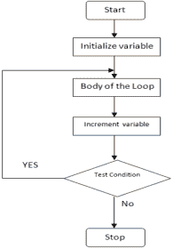

**图 1.7：Do-While 循环的流程图**

图 1.7 所示的流程图描述了典型 do-while 循环的工作方式。初始化在循环体外部进行，循环体中的语句第一次会无条件执行。之后，循环控制变量递增或递减。测试条件在循环末尾进行测试。如果测试条件为真，则控制权转到循环开头；否则循环终止。然后控制权转到循环之后的第一条语句。do-while 循环与其他循环的主要区别在于，do-while 循环至少会执行一次。这是因为测试条件始终位于循环末尾。这意味着只有在至少执行一次所有语句之后，控制权才能到达循环末尾。

代码清单 1.37 描述了 do-while 循环的工作方式：

**代码清单 1.37：do-while 循环的基本工作方式**

```c
#include<stdio.h>
int main()
{
    char answer;
    int sum,count;
    count=1;
    sum=0;
    do
    {
        fflush(stdin);
        sum+=count;
        printf("\n Sum %d ",sum);
        count++;
        printf("\n Want to Continue ?(Y/n) ");
        scanf("%c",&answer);
    }while(answer=='y');
    getch();
}
```

代码清单 1.37 中给出的代码解释了 do-while 循环的工作方式。循环的第一次迭代会无条件开始执行。当控制权到达循环末尾时，会要求用户提供输入。根据该输入执行测试条件。如果条件为真，则循环进入下一次迭代；否则循环终止。do-while 循环的“while”语句末尾始终包含一个分号。

### 跳转语句

C 语言中有四种跳转语句用于执行无条件分支。这些语句是 return、goto、break 和 continue。return 和 goto 语句可以在函数中的任何位置定义，但 break 和 continue 通常与循环相关使用。

让我们详细讨论这些语句。

### return 语句

return 语句用于标记函数的返回点。当执行遇到 return 语句时，控制权会转移到调用该函数的那一行之前。return 语句可以关联一个值，也可以不关联值。return 语句用于声明了非 void 返回类型的函数。void 函数不返回任何值。在旧版编译器（如 C89）中，return 语句可能不会显式返回任何值。如果函数声明为非 void 返回类型，但该函数没有返回任何内容，编译器会返回垃圾值。然而，较新的编译器（如 C99）已强制要求非 void 函数必须使用关联值的 return 语句。同一函数内可以使用多个 return 语句。当遇到返回点时，函数将立即停止执行。函数的右花括号也像隐式 return 语句一样起作用，它不关联任何值。对于返回类型为 void 的函数，不需要显式 return 语句。必须记住一点：返回类型定义为 void 的函数不能包含带值的 return 语句。


**程序清单 1.38：在 C 中使用 return 语句**

```c
#include<stdio.h>
int main()
{
    printf("\n Hello world");
    return 0;
}
```

程序清单 1.38 展示了 return 语句最简单的用法。如前所述，只有当函数的返回类型为非 `void` 时，`return` 语句才能与一个值关联。上面声明的 `main` 函数返回类型为 `int`。因此，我们必须提供一个返回值为 `0` 的 `return` 语句，这只是一个形式上的返回值（占位值）。

程序清单 1.39 在同一个函数中使用了多个 `return` 语句：

**程序清单 1.39：多个 return 语句的使用**

```c
#include<stdio.h>
int main()
{
    int i,sum=0,varA;
    char answer;
    for(;;)
    {
        printf("\n Enter an integer - ");
        scanf("%d",&varA);
        sum += varA;
        printf("\n sum is %d ",sum);
        fflush(stdin);
        printf("\n Do you want to continue (y/n) ?");
        scanf("%c",&answer);
        if(answer=='n')
            return 0;
    }
    return 0;
}
```

程序清单 1.39 展示了函数如何拥有多个 `return` 语句，这些语句可以根据特定情况被条件性地执行。我们创建了一个无限 `for` 循环，它会一直运行，直到从用户那里获得特定输入。该输入会触发内部 `return` 语句的执行。一旦内部 `return` 语句执行，控制将自动退出该函数。我们将在后续章节中深入探讨 `return` 语句。

#### goto 语句

`GOTO` 语句用于从一行代码跳转到另一行代码。执行 `goto` 语句就像执行任何其他跳转语句一样，我们需要指定下一条指令将要获取的内存位置地址。`goto` 语句的一般形式如下：

```c
goto label;
.
.
.
.
.
label:
```

其中 `label` 是一行有效的代码，位于 `goto` 语句之前或之后，我们希望将控制转移到该行。`label` 必须与 `goto` 语句位于同一个函数内。我们不能使用 `goto` 语句在函数之间跳转。

程序清单 1.40 展示了 `goto` 语句的一个示例：

**程序清单 1.40：GOTO 语句**

```c
#include<stdio.h>
int main()
{
    int i,j,k,sum=0;
    for(i=1;i<=10;i++)
    {
        for(j=1;j<=10;j++)
        {
            for(k=1;k<=10;k++)
            {
                if((i <= j) && ( j <= k))
                {
                    sum = sum + i + j + k;
                }
                else
                {
                    goto label;
                }
            }
        }
    }
    label:
    printf("\n The sum is %d ",sum);
    getch();
    return 0;
}
```

程序清单 1.40 展示了 `goto` 语句的应用。本例中，`goto` 被用于跳出嵌套循环。我们使用了一个三层嵌套循环，并基于特定条件使用 `goto` 语句直接跳出三层循环。当循环内的 `if` 条件变为假的那一刻，`goto` 语句就会执行。执行后，控制将转移到 `label` 之后的下一行，在我们的例子中恰好是用于显示 `sum` 值的 `printf` 语句。

#### break 语句

除了 `goto` 语句之外，我们还可以使用 `break` 语句从一个代码段跳转到另一个代码段。然而，`break` 通常只与循环相关联。每当在循环中遇到 `break` 语句时，控制将转移到循环之后的下一句语句。使用 `break` 语句可以无条件地终止循环。

程序清单 1.41 展示了 `break` 语句的实现：

**程序清单 1.41：break 语句**

```c
#include<stdio.h>
int main()
{
    int i=1;
    while(1)
    {
        printf("\n I = %d ",i);
        i++;
        if(i > 50)
            break;
    }
    getch();
}
```

程序清单 1.41 展示了一个会无限执行的 `while` 循环。我们在 `while` 循环体内有条件地使用了 `break` 语句。当条件变为真时，`break` 语句执行，控制转移到 `while` 循环之后的下一句语句。该代码将显示 1 到 50 之间的值，之后循环终止。`break` 语句只会将控制从包含该语句（位于其循环体内）的循环中转移出来。

程序清单 1.42 展示了 C 语言中 `break` 语句的另一个示例：

**程序清单 1.42：C 语言中的 break 语句**

```c
#include<stdio.h>
int main()
{
    int i=1,k;
    while(i < 10)
    {
        for(k=0;k<100;k++)
        {
            printf("\n k %d",k);
            if(k > 39)
                break;
        }
        i++;
    }
    getch();
}
```

在程序清单 1.42 中，使用了两个嵌套循环。外层是 `while` 循环，范围从 0 到 9；内层是 `for` 循环，范围从 0 到 100。我们在内层循环体内使用了 `break` 语句。当循环控制变量（此处为 `k`）的值变为 41 时，测试条件返回真，因此 `break` 语句执行。然而，该语句仅将控制从最内层的 `for` 循环转移到外层的 `while` 循环，随后外层循环继续执行。

#### continue 语句

`continue` 语句的作用与 `break` 语句有些相似，主要区别在于 `continue` 语句不会将控制移出循环。相反，它只是跳过当前迭代，并且跳过循环体内 `continue` 之后所有语句的执行。

程序清单 1.43 展示了 `continue` 语句的用法：

**程序清单 1.43：continue 语句**

```c
#include<stdio.h>
int main()
{
    int i=1;
    while(i < 100)
    {
        i++;
        if(i >= 15)
            continue;
        printf("\n i %d ",i);
    }
    getch();
}
```

程序清单 1.43 的输出如下：

```
I 2
I 3
I 4
I 5
I 6
I 7
I 8
I 9
I 10
I 11
I 12
I 13
I 14
```

在程序清单 1.43 中，我们在 `while` 循环体内有条件地使用了 `continue` 语句。如输出所示，当测试条件变为真时，`continue` 语句执行，该迭代中其后的语句被跳过。显示只发生了 14 次迭代。当 `I` 的值变为 15 的那一刻，测试条件变为真，`printf` 语句在后续迭代中不再执行。

### 总结

本章向我们介绍了编程语言及其在几代之间的逐步发展。同时还介绍了 C 语言的简要历史及其各种概念，例如字符集和词法记号。接下来，我们学习了 C 语言的基本构建块，以及变量、常量和表达式如何被使用并组合在一起构成程序。本章进一步讨论了不同的决策语句及其使用场景。接着，我们讨论了逻辑运算符（如 AND、OR 和 NOT）及其不同的使用场景。最后，详细讨论了循环的概念，并介绍了不同的循环结构，如 `while`、`do-while` 和 `for`。

### 快速复习

### 选择题

- 1. 在 64 位工作环境下，`int` 的大小（以字节为单位）是：
  - i. 4 字节
  - ii. 2 字节
  - iii. 8 字节
  - iv. 16 字节
- 2. 给出以下代码片段的输出：

```c
#include<stdio.h>
int main()
{
    int var = 10;
    if(var = 5)
        printf("\n TRUE ");
    else
        printf("\n FALSE ");
}
```

  - i. TRUE
  - ii. FALSE
  - iii. 无法编译
  - iv. 运行时错误

- 3. 给出以下代码片段的输出：

```c
#include<stdio.h>
int main()
{
    int var = 10;

    if()
        printf("\n TRUE ");
    else
        printf("\n FALSE ");
}
```

  - i. TRUE
  - ii. FALSE
  - iii. 无法编译
  - iv. 运行时错误

- 4. 下列哪个字符用于转义序列？

  - i. /
  - ii. *
  - iii. \
  - iv. #

- 5. C 语言中的字面量更常被称为：

  - i. 变量
  - ii. 常量
  - iii. 表达式
  - iv. 运算符

- 6. 给出以下代码片段的输出：

```c
#include<stdio.h>

int main()
{
    int var=10;

    printf("\n output [%d] ",++var+var++);
    return 0;
}
```

  - i. 20
  - ii. 10


- 如果工资总额 > 3,00,000 但 < 5,00,000，税率为 15%
- 超过 5,00,000 的部分税率为 20%
- 净工资 = 工资总额 − 税额
- 增加
- 员工若为男性且有 5 年工作经验，可获得 10% 的奖金。
- 员工若为女性且有 5 年工作经验，可获得 15% 的奖金。
- 超过 10 年工作经验的男性和女性员工，均可获得 20% 的奖金。

**Q7.** 根据员工的月基本工资、工作经验和性别，计算其年净收入。

**Q8.** 编写一个程序，输入一个字符并显示其对应的 ASCII 值。

**Q9.** 编写一个程序，求给定一组数的 H.C.F（最大公约数）和 L.C.M（最小公倍数）。使用 do-while 循环从用户那里接收数字，直到他不想再输入为止。

**Q10.** 编写一个程序，计算以下级数的和：
- (1/1!) + (2/2!) + (3/3!) + ... + (n/n!)，其中 n 是用户输入的值
- (1² + 2³ + 3⁴ + ... + nⁿ)，其中 n 由用户定义

**Q11.** 编写一个程序，判断一个数字是否为回文。如果一个数字反转后保持不变，则称该数字为回文，例如 121 就是一个回文。

**Q12.** 编写一个程序，打印以下图案：

### 图案 1

```
        *
      * * *
    * * * * *
  * * * * * * *
* * * * * * * * *
```

### 图案 2

```
* * * * * * * * *
  * * * * * * *
    * * * * *
      * * *
        *
```

### 图案 3

```
1
1   2
1   2   3
1   2   3   4
1   2   3   4   5
1   2   3   4   5   6
```

### 图案 4

```
1
2  2
3  3   3
4  4    4
5  5     5
```

### 图案 5

```
*   *   *   *   *   *   *   *   *
  *   *   *   *   *   *   *   *
    *   *   *   *   *   *   *
      *   *   *   *   *   *
        *   *   *   *   *
          *   *   *   *
        *   *   *   *   *
      *   *   *   *   *   *
    *   *   *   *   *   *   *
  *   *   *   *   *   *   *   *
*   *   *   *   *   *   *   *   *
```

### 图案 6

```
          *
          *
        * * *
      * * * * *
    * * * * * * *
  * * * * * * * * *
* * * * * * * * * * *
  * * * * * * * * *
    * * * * * * *
      * * * * *
```


## C 语言中的函数

| 如需了解以下内容： | 参见页码： |
|---|---:|
| 函数概述 | 56 |
| 定义函数 | 57 |
| 函数的调用约定 | 59 |
| 向 main() 方法传递参数 | 62 |
| 函数原型 | 63 |
| 旧式函数声明 | 66 |
| 标准库函数原型 | 67 |
| 可变长度参数列表 | 67 |
| C 语言中的隐式 int 规则 | 68 |
| 递归中的栈 | 71 |
| C 语言中的存储类说明符 | 73 |

在第一章中，我们已经看到 C 语言提供了大量的库函数来执行多种操作。除此之外，C 语言提供的主要灵活性之一是可以自由定义自己的函数，这些函数可用于执行多种用户自定义的任务。函数允许用户将代码模块化为多个较小的组件，每个组件都有独特的任务要执行。使用函数的一个主要方面是代码的可重用性。考虑这样一种场景：用户需要重复执行某项任务。在这种情况下，多次编写相同的代码行并不是合适的解决方案。需要重复执行的指令可以放在一个函数中，然后可以在代码的不同部分调用这个函数。

编写函数的另一个方面是提高代码的逻辑清晰度。将代码分解为许多逻辑组件，每个组件用于特定目的，这不仅提高了清晰度，还使代码易于调试。因此，通过在代码中引入越来越多的函数来实现模块化被认为是一种良好的实践。使用函数还可以使用户构建自定义的函数库，该函数库可以分别存储在不同的库文件中。程序可以在编译阶段使用这些文件。此外，将函数包含在常见的容器（如库文件）中，也提高了代码的可移植性。

在本章中，我们将学习 C 语言中函数的不同方面，例如函数的定义和声明、函数的调用约定、向函数传递参数。接下来，你将学习函数原型、可变长度参数列表、C 语言中的隐式 int 规则以及递归的概念。最后，本章讨论各种类型的存储类说明符，如 auto 存储类、register 存储类和 static 存储类。

### 函数概述

函数可以描述为一个自包含的语句块，能够执行特定的任务。每个 C 程序由一个或多个函数组成，其中一个函数称为 main 函数。正如我们在前一章讨论的，程序的执行总是从 main 函数内部的语句开始。一个程序可以包含多个函数；但是，所有这些函数都必须相互独立。函数的主要活动可以分为三个部分：

- 函数声明
- 函数定义
- 函数调用

每当从主代码的某个部分调用函数时，该函数就会执行预期的操作。应当注意，同一个函数可以从主代码的不同部分调用。一旦函数完成预期的操作，它将返回到调用它的位置。

**清单 2.1：**函数示例

```c
#include<stdio.h>
int main()
{
    printf("\n Function is called ");
    display();
    getch();
    return 0;
}
int display()
{
    printf("\n Inside Function");
    return 0;
}
```

在清单 2.1 中，我们从 main 函数调用 display 函数。只要在函数上下文中使用**调用**这个术语，就意味着控制权从调用方转移到被调用函数。C 语言中的一次典型函数调用可以比作操作系统中的上下文切换操作。当函数被调用时，编译器必须执行许多操作：保存寄存器，将程序计数器压入堆栈，然后执行被调用函数中定义的操作。一旦函数内定义的操作完成，堆栈中保存的值将被弹出，控制权返回到调用该函数的位置。

### 定义函数

通常，函数定义由两个组成部分构成——参数声明和函数体。函数定义的第一行包含函数返回值类型的说明，后面跟着函数名以及一个用逗号分隔、括在圆括号中的参数列表。参数列表并不是函数的必需部分，函数可以接受参数，也可以不接受参数。让我们看两个这样的例子。

下面的代码片段展示了一个典型的不带任何参数的函数定义：

```c
int myFunction()
```

而一个接受参数作为输入的函数定义如下所示：

```c
int myFunction(int arg1, int arg2, float arg3)
```

前面的代码片段中显示的函数定义将三个参数作为其参数，其中前两个是整数，最后一个是浮点数。通常，函数定义的写法如下：

data-type name(type 1 arg1, type 2 arg 2, ....., type n arg n)

在前面的代码片段中，data-type 表示函数返回值的类型，name 是函数名，type 1 到 type n 是函数参数的数据类型。这些参数也被称为形式参数（formal arguments），因为它们表示从程序调用部分传递给函数的数据项名称。有时，它们也被称为形式参数（formal parameters）。从调用程序实际传递的参数被称为实参（actual arguments）或实际参数（actual parameters）。形式参数被定义为局部变量，在函数外部不存在。每个形式参数都必须附带一个数据类型，并且该数据类型必须与从调用程序传递的数据类型一致。函数的其余部分（括在括号内）称为函数体。函数体还定义了函数将要执行的操作。清单 2.2 显示了一个函数定义的例子：

**清单 2.2：定义基本函数**

```c
unsigned int factorial(int value)
{
    unsigned int fact = 1;
    int i;

    for(i=1; i <= value; i++)
    {
        fact = fact * i;
    }

    return fact;
}
```


```c
return 0;
}

void myFunc(int value1, int value2)
{
    printf("\n value is [%d]",value1);
}
```

清单 2.4 的输出如下：

```text
too few arguments to function 'myFunc'
```

在清单 2.4 中，myFunc 函数在其参数列表中定义了两个参数。当仅使用一个参数调用该函数时，会抛出编译错误。错误指出没有为该函数提供足够的参数。一种良好的编程实践是，即使函数不返回任何内容，也始终为函数体包含返回类型。可以在函数体内包含一个空的 return 语句，如下面的代码片段所示：

```c
void myFunc(int value1, int value2)
{
    printf("\n value is [%d]",value1);

    return;
}
```

### 函数的调用约定

可以通过提及函数名并后跟参数列表来访问函数，参数列表括在圆括号中，并用逗号分隔。函数调用可能具有空参数列表，在这种情况下，一对圆括号也将为空。函数调用中出现的参数称为实参，它们不同于函数定义第一行中提到的形参。普通函数调用在实参和形参之间具有一一对应关系。应始终牢记，实参的数据类型应与形参中提供的数据类型完全相似。在函数调用期间，实际参数的值会被传递给函数，并分配给每一个形参。清单 2.5 展示了一个说明函数中一些基本调用约定的示例：

清单 2.5：函数中的调用约定

```c
# #include<stdio.h>

void myFunc(int value1, int value2);

int main()
{
    printf("\n value passed to function");
    myFunc(10,20);
    getch();
    return 0;
}

void myFunc(int value1, int value2)
{
    printf("\n value are [%d] and [%d] ",value1, value2);

    return;
}
```

第 2 章

在清单 2.5 中，可以看到两个不同的值作为实参传递给 myFunc 函数。进行函数调用时，这两个值会分配给形参“value1”和“value2”。当在 myFunc 函数内部显示这些变量时，这种赋值就变得清晰了。如果函数返回任何值，那么函数调用必须看起来像一条赋值语句，其中从函数返回的值存储在变量中。

清单 2.6：函数返回值

```c
#include<stdio.h>

int myFunc(int value1, int value2);
int main()
{
    int sum;
    printf("\n Value passed to function");
    sum = myFunc(10,20);
    printf("\n The sum returned by the function is [%d]",sum);
    getch();
    return 0;
}
int myFunc(int value1, int value2)
{
    printf("\n Value are [%d] and [%d] ",value1, value2);

    return (value1 + value2);
}
```

清单 2.6 的输出如下：

```text
Value passed to function
Value are [10] and [20]
The sum returned by the function is [30]
```

在清单 2.6 中，可以看到在调用函数时使用了一条赋值语句，其中函数调用被放在赋值语句的右侧。这表明函数返回的值将存储在赋值语句左侧的变量中。执行此类赋值时需要遵循的一个重要点是，用于赋值的变量的数据类型必须与函数的返回类型相似。

将参数传递给函数有两种方式——按值调用和按引用调用。现在让我们详细讨论这两种方式。

### 按值调用

按值调用方法将实参的值复制到函数相应的形参中。对形参所做的任何更改都不会影响实参。清单 2.7 展示了按值调用方法的一个示例：

清单 2.7：在 C 中演示按值调用

```c
#include<stdio.h>

void myFunc(int);

int main()
{
int arg_1 = 10;

printf("\n Value before function call [%d]",arg_1);
myFunc(arg_1);
printf("\n Value after function call [%d]",arg_1);


getch();
}

void myFunc(int arg_1)
{
    arg_1--;
    printf("\n Value inside function call [%d] ",arg_1);
}
```

清单 2.7 的输出如下：

```text
Value before function call [10]
Value inside function call [9]
Value after function call [10]
```

清单 2.7 中显示的程序输出表明，传递给 myFunc 函数的参数只是主调用模块中声明的变量的一个副本。

### 按引用调用

在按引用调用方法中，参数的地址被复制到形参中，并传递给函数。按引用调用保证函数内部发生的更改会从调用函数中反映出来。在 C 中，按引用调用借助指针实现。指针是一种特殊类型的变量，用于保存内存位置的地址。关于指针的详细内容将在本书第 3 章 *C 中的指针与函数指针* 中介绍。由于我们使用内存位置的地址来访问实参的值，因此函数内部发生的操作可以改变参数的内容。清单 2.8 展示了按引用调用在 C 中如何工作：

清单 2.8：在 C 中演示按引用调用

```c
#include<stdio.h>

void mySwap(int *x, int *y);

int main()
{
    int x = 10;
    int y = 50;

    printf("\n Value before function call [%d] and [%d]",x,y);
    mySwap(&x,&y);
    printf("\n Value after function call [%d] and [%d] ",x,y);

    getch();
}
void mySwap(int *x, int *y)
{
    int temp;

    temp = *x;
    *x = *y;
    *y = temp;
}
```

在许多情况下，命令行参数需要用双引号括起来，或者通过在其中插入逗号或空格来分隔。按照常见标准，使用空白字符分隔多个命令行参数。argv 数组的声明应使用空方括号。空方括号表示数组长度未确定。

清单 2.10 展示了另一个描述命令行参数用法的示例：

清单 2.10：C 中的多个命令行参数

```c
#include<stdio.h>

int main(int argc, char *argv[])
{
    int i;
    if(argc < 2)
    {
        printf("\n Too few parameters");
        return;
    }

    printf("\n Number of arguments is [%d]",argc);
    for(i=0;i < argc; i++)
    {
        printf("\n Argument passed [%s] ",argv[i]);
    }
    getch();
    return 0;
}
```

清单 2.10 的输出如下：

```text
D:\Tanuman\Progs>check.exe Ron Lucy Harry Jim John Tom

Number of arguments is [7]
Argument passed [check.exe]
Argument passed [Ron]
Argument passed [Lucy]
Argument passed [Harry]
Argument passed [Jim]
Argument passed [John]
Argument passed [Tom]
```

前面输出中展示的程序演示了 argc 参数的用法，并显示了程序命令行中提供的参数数量。

### 函数原型

可以通过两种方式在程序中包含函数。在第一种方式中，函数体位于程序的主模块之前。这意味着当程序编译时，用户定义函数会在访问该函数之前就已被定义。然而，这种方式也有某些限制。遵循这种方式意味着我们必须始终将主模块放在程序的末尾，而情况并非总是如此。如果我们把函数定义放在主模块之后，代码将产生编译错误。这种情况发生在我们试图在定义函数之前访问该函数时。


## 第 2 章

代码清单 2.11 展示了一个没有原型的函数示例：

### 代码清单 2.11：无原型的函数

```c
#include<stdio.h>

float myFunc(float x)
{
        return x*3.5;
}

int main()
{
        float ret;

        ret = myFunc(87.67);
        printf("\n Ret [%f] ",ret);
        getch();
}
```

代码清单 2.11 的输出如下：

```
Ret [306.845001]
```

代码清单 2.12 展示了一个在函数定义之前访问该函数的示例：

### 代码清单 2.12：在函数定义之前访问函数

```c
#include<stdio.h>

int main()
{
        float ret;

        ret = myFunc(87.67);
        printf("\n Ret [%f] ",ret);
        getch();
}

float myFunc(float x)
{
        return x*3.5;
}
```

代码清单 2.12 的输出如下：

```
conflicting types for 'myFunc'
previous implicit declaration of 'myFunc' was here
```

之所以会抛出编译错误，是因为函数在定义之前就被访问了。通常，当函数被定义或被访问时，编译器会知道该函数的签名。然而，在我们的例子中，函数在定义之前就被访问，因此编译器无法找到该函数的签名。函数原型正是为解决这类问题而设计的，它们写在程序开头、任何用户定义函数（包括 main）之前。以下代码片段展示了函数原型的一般形式：

```c
data-type name(type 1, arg 1, type 2, arg 2, ..., type n, arg n);
```

在上述代码片段中，data-type 表示函数返回项的数据类型，name 表示函数名，type 1、type 2、……、type n 表示参数 arg 1、arg 2、……、arg n 的数据类型。函数原型类似于函数定义的第一行。函数原型与函数定义之间的主要区别之一是，函数原型始终以分号结尾；而函数定义则不是。函数原型定义中给出的参数名仅充当哑变量的角色，在编写原型时可以省略。函数原型声明使编译器提前了解函数的签名。当编译器处理函数原型时，它会知道程序中正在使用具有类似签名的函数。如果声明了函数原型，那么在函数于其定义之前被访问的情况下，编译器不会抛出任何编译错误。

函数原型帮助用户判断函数原型与函数定义之间是否发生不匹配。如果发生不匹配，则会产生编译错误。

代码清单 2.13 展示了函数原型的用法：

### 代码清单 2.13：编写带原型的函数

```c
#include<stdio.h>

float myFunc(float x);        /* Function Prototype */

int main()
{
    float ret;

    ret = myFunc(87.67);
    printf("\n Ret [%f] ",ret);  /* Function Call */
    getch();
}

float myFunc(float x)    /* Function Definition */
{
    return x*3.5;        /* Function Body */
}
```

代码清单 2.13 的输出如下：

```
Ret [306.845001]
```

函数原型并非必须包含上文所定义的变量名。以下代码片段展示了函数原型的一个示例：

```c
float myFunc(float);        /* Function Prototype */
```

尽管 main 是一个函数，但它确实需要函数原型。请注意，main 是 C 程序中第一个被调用的函数；事实上，可以说 C 程序从 main 函数开始。由于 main 是 C 程序中第一个被调用的函数，因此在 C 程序中访问它之前必须先定义 main 函数。

C 和 C++ 以不同方式处理原型。在 C++ 中，空参数列表用于表示函数不接受任何参数，例如：

```c
int myFunction();   /* C++ Prototype declaration for a function with no parameters */
```

然而，在 C 中，函数原型的空参数列表并不总是表示该函数不会接受任何参数。C 中这种原型声明风格被称为旧式原型声明。

代码清单 2.14 展示了一个旧式原型声明的示例：

### 代码清单 2.14：C 中的旧式原型声明

```c
#include<stdio.h>

int myFunc();        /* Function Prototype */

int main()
{
    printf("\n Ret = %d ",myFunc(10,20));
    getch();
}

int myFunc(int x, int y)      /* Function Definition */
{
    return x;      /* Function Body */
}
```

代码清单 2.14 的输出如下：

```
Ret = 10
```

在代码清单 2.14 提到的代码中，我们声明了一个参数列表为空的函数原型，但在从 main 函数访问该函数时，我们向其中传递了多个参数。尽管向参数列表为空的函数传递了参数，代码清单 2.14 中给出的代码仍能无错误地编译。在 C 中，空参数列表并不表示函数实际接受多少个参数，因此使用此类声明会使调试和错误处理变得更加困难。声明无参数函数原型的正确方式是使用 void 关键字，如下代码片段所示：

```c
int myFunction(void);  /* C Prototype declaration for a function with no parameters */
```

代码清单 2.15 展示了使用正确原型声明编写上述代码的另一种方式：

### 代码清单 2.15：C 中的正确原型声明

```c
#include<stdio.h>

int myFunc(void);          /* Function Prototype */

int main()
{
    printf("\n Ret = %d ",myFunc(10,20));
    getch();
}

int myFunc(int x, int y)     /* Function Definition */
{
    return x;      /* Function Body */
}
```

代码清单 2.15 的输出如下：

```
In function `main':
too many arguments to function `myFunc'
conflicting types for 'myFunc'
previous declaration of 'myFunc' was here
```

在代码清单 2.15 中，myFunc 函数已使用 void 参数进行声明。如果向 myFunc 函数传递任何参数，则应该产生编译错误。这是因为 myFunc 的参数列表被显式声明为 void。

### 旧式函数声明

在函数原型出现之前，C 有一种让编译器知道函数返回数据类型的方法。这种方法也称为旧式函数声明，不考虑传递给函数的参数或其类型。旧式函数声明通过仅包含返回类型和函数名的函数声明来完成。

代码清单 2.16 展示了 C 中旧式函数声明的示例：

### 代码清单 2.16：旧式函数声明

```c
#include<stdio.h>

int myFunc();        /* Old Style of Function Declaration */

int main()
{
    printf("\n Ret = %d ",myFunc(10,20));
    getch();
}

int myFunc(int x, int y)    /* Function Definition */
{
    return x;               /* Function Body */
}
```

在代码清单 2.16 中，旧式函数声明告诉编译器 myFunc 函数返回一个类型为整数的变量。它没有说明传递给函数的参数数量和类型。旧式函数声明具有通用形式，如下代码片段所示：

```c
data-type function_name();
```

如今不再使用旧式函数声明，因为这种风格没有说明参数数量，所以使用起来不太可靠。

### 标准库函数原型

在 C 语言中使用标准库函数之前，必须声明它们的原型。为了实现这一点，我们需要在代码中包含头文件。C 编译器提供了标准库函数的所有适当头文件。标准库函数的函数原型在 C 的头文件中声明。库头文件是以 .h 扩展名结尾的文件。库头文件包含库函数定义及其原型。stdio 头文件包含 "printf()"、"scanf()" 以及许多其他标准库函数的定义和原型，因此每当我们在 C 中编写任何代码时，都需要包含 stdio 头文件。更多头文件和标准库函数将在本书后半部分讨论。

### 可变长度参数列表

C 允许用户声明接受可变数量参数作为实参的函数。让我们以常见标准库函数 "printf()" 为例。该函数能够处理可变参数。为了告诉编译器该函数将能够处理可变参数列表，函数原型必须在其参数列表中包含三个点（句点），如下代码片段所示：

```c
int myFunc(int x, float y, ...);
```

上述代码片段告诉编译器，myFunc 函数将至少接受一个整数和一个浮点变量，以及其后数量不定的参数。使用可变参数列表的函数也必须至少包含一个实际参数作为其参数。下面提到的代码片段展示了一个错误的可变长度参数列表：

```c
int myFunc( ... );
```


这个声明是不正确的，因为参数列表中不存在实际的参数。

### C 中的隐式 int 规则

早期版本的 C 包含隐式 int 特性，该特性规定：当函数缺少类型说明符时，默认类型将被假定为 int。该规则包含在 C89 标准中，但后来在引入 C99 标准时被移除。根据该规则，如果函数声明时没有原型，则编译器自动假定该函数的返回类型为 int。任何偏离该假设的情况都会导致编译错误。

清单 2.17 展示了隐式 int 规则在 C 中如何工作：

**清单 2.17：C 中的隐式 int 规则**

```c
#include<stdio.h>

int main()
{
    myFunc(10,30,90);
    getch();
    return 0;
}

int myFunc(int x, int y, int z)
{
    printf("\n x [%d] Y [%d] Z[%d]", x,y,z);
    return x;
}
```

清单 2.17 的输出如下：

```text
x [10] Y [30] Z[90]
```

该函数的输出验证了隐式 int 规则的存在。在这个程序中，函数缺少原型定义；然而，函数定义的返回类型为 int，与函数的隐式 int 规则相匹配；因此，该函数编译成功。

清单 2.18 展示了编写该规则的另一种方式：

**清单 2.18：展示隐式 int 规则中的冲突**

```c
#include<stdio.h>

int main()
{
    myFunc(10,30,90);
    getch();
    return 0;
}

float myFunc(int x, int y, int z)
{
    printf("\n x [%d] Y [%d] Z[%d]", x,y,z);
    return x;
}
```

清单 2.18 的输出如下：

```text
conflicting types for 'myFunc'
```

该编译错误表明，函数的返回类型与隐式 int 规则中提到的返回类型之间存在不匹配。该函数的返回类型恰好是 float，因此编译器发出冲突信号。以下代码片段表明，没有任何原型的函数可以按照隐式规则返回值：

```c
myFunction(void) {
    return 0;
}
```

该函数的返回类型将被假定为隐式 int，这不仅适用于返回类型，也适用于参数。

### C 中的递归

在 C 中，函数允许调用自身。如果一个函数从其函数体中调用自身，则该函数被称为递归函数。递归被定义为用某事物自身来定义该事物的过程。我们在这里将讨论递归函数。让我们举一个计算数字阶乘的例子。

一个数字的阶乘定义为从 1 到该数字本身的所有数字的乘积。例如，5 的阶乘可以表示为：

```text
5! = 5x4x3x2x1
   = 5 x 4!
   = 5 x 4 x 3!
   = 5 x 4 x 3 x 2!
   = 5 x 4 x 3 x 2 x 1!
```

1 的阶乘是 1，因此我们的递归在这里结束。我们从 1 开始回溯并计算 5 的结果。这就是递归背后的技术：我们用某事物自身来定义该事物。递归算法需要定义两个主要步骤，递归才能进行。这些步骤如下：

- 在已定义的点上指定表达式的值
- 给出从较小整数求表达式值的规则

如果我们将计算阶乘的问题与上面定义的步骤关联起来，那么步骤 1 符合我们的假设，即 1 的阶乘是 1。递归可以定义为：

```text
n! = n x (n - 1)!
```

清单 2.19 展示了计算阶乘的迭代方法：

**清单 2.19：展示迭代式阶乘方法**

```c
#include<stdio.h>
void factorial(int varA);
int main()
{
    int varA;
    printf("\n Enter any number -> ");
    scanf("%d",&varA);
    factorial(varA);
    getch();
    return 0;
}
void factorial(int varA)
{
    int fact = 1, i;
    for(i=1; i<=varA; i++)
    {
```

递归技术似乎可以用于编写更高效的代码；然而，情况并非总是如此。已经观察到，与迭代版本相比，递归函数的执行速度稍慢。编译器会在栈管理上花费大量时间，这最终成为昂贵的开销。编写递归函数还会引入栈溢出的风险。栈溢出通常由函数中不正确的递归调用引起。递归带来的另一个开销是空间管理。每次对函数进行递归调用时，函数内的所有变量都会被实例化。变量实例化会引入新的内存分配，该内存在递归调用结束后被释放。整个内存分配和释放过程由编译器管理，这也被视为一种开销。使用递归函数的主要优势之一是，它们有助于编写更清晰的代码和算法。递归函数直接反映了程序中正在实现的求解策略。

### C 中的存储类说明符

为了在 C 中定义变量，我们需要说明其存储类。变量的存储类说明符告诉编译器如何存储该变量。它确定为该对象分配的内存存储部分以及该分配存在多长时间。存储类说明符定义变量的作用域。作用域是指变量可被识别的代码部分。如果没有显式提及存储类，则编译器会根据变量使用的上下文为该变量假定一个默认存储类。通常，变量可以存储在内存（RAM）或 CPU 寄存器中。具体选择哪个存储区域取决于变量的存储类说明。存储类还有助于我们确定可以赋给变量的默认值。

C 定义了以下四种存储类说明符：

- 自动（Auto）
- 寄存器（Register）
- 外部（Extern）
- 静态（Static）

现在让我们详细讨论所有这些类型。

### 自动存储类

在函数内或代码块内定义的变量被认为具有自动存储类说明。这些变量是该函数的局部变量，变量的作用域也限制在其中。自动变量的一些基本特性如下：

- **存储** – 指计算机的主存。
- **初始化** – 指变量初始化时所使用的值。在这种情况下，它大多是一个不可预测的值，也称为垃圾值。
- **作用域** – 指可以访问该变量的代码部分。在这种情况下，它位于声明该变量的块或函数内。
- **生命周期** – 指变量保留其值的时间。在这种情况下，它直到控制流仍处于该块内为止。

自动变量的作用域限于声明它们的函数或块。如果两个自动变量在两个不同的块内声明，则它们可以具有相同的名称。在函数内声明的变量默认具有自动存储类说明。如果我们想将某个存储类与变量关联，则需要显式指定该存储类。在函数内声明的变量默认成为自动变量，因此不必在局部变量声明前加上 `auto` 关键字。

清单 2.22 展示了一些关于自动变量的示例：

**清单 2.22：自动存储类说明**

```c
#include<stdio.h>

int main()
{
    int varA;

    printf("\n Default value of varA is [%d] ",varA);
    getch();
    return 0;
}
```

清单 2.22 的输出如下：

```text
Default value of varA is [1972870708]
```

输出表明，自动变量总是用垃圾值初始化，因此每次声明它们时都需要显式初始化。清单 2.23 展示了如何在其作用域之外访问变量：

**清单 2.23：访问超出其作用域的变量**

```c
#include<stdio.h>

int main()
{
    {
        int varA = 10;
        printf("\n Default value of varA is [%d] ",varA);
    }
    printf("\n Default value of varA is [%d] ",varA);
    getch();
    return 0;
}
```

清单 2.23 的输出如下：

```text
`varA` undeclared (first use in this function)
```

清单 2.23 中的代码编译失败，因为该变量在其作用域之外被访问。自动变量仅在其作用域内可见，如果控制流在其作用域之外，则该变量不存在。在这种情况下，varA 变量被声明为自动变量，但位于 main 函数内部的块作用域中。当控制流离开块时，块内声明的任何变量都会被销毁。如果同一变量在块的作用域之外被访问，编译器会抛出错误。

清单 2.24 展示了多个同名变量声明：

**清单 2.24：使用相同名称的多个变量声明**

```c
#include<stdio.h>

int main()
{
    int varA = 100;

    {
        int varA = 10;

        {
            int varA = 20;
            printf("\n value of varA is [%d] ",varA);
        }
```


```c
    printf("\n Value of varA is [%d] ",varA);
}
printf("\n Value of varA is [%d] ",varA);
getch();
return 0;
}
```

清单 2.24 的输出如下所示：

```text
Value of varA is [20]
Value of varA is [10]
Value of varA is [100]
```

在清单 2.24 中，变量 varA 被声明了三次，但每次都在不同的代码块内。三次 varA 声明对应三个不同的变量，每个变量都有不同的作用域。在最内层代码块中声明的 varA 变量被赋值为 20。当从最内层代码块显示 varA 时，我们得到的输出是 20。在该代码块之外，varA 变量的值为 10，并且会被显示出来。

#### 寄存器存储类

在早期版本的 C 中，register 存储类说明符仅适用于 int、char 或指针类型的变量，但后来 register 存储类的定义已被修改为包含所有类型的变量。register 说明符告诉编译器将变量的值保存在 CPU 寄存器中，而不是内存中。这样做的主要动机是加速对该变量进行的操作。与访问 CPU 寄存器相比，重复访问内存要慢得多。引入寄存器存储类是为了获得更好的性能，因为寄存器本身就位于 CPU 内部。

寄存器存储类的一些基本特性如下：

- **存储**——具有 register 存储类说明符的变量的值总是存储在 CPU 寄存器中。
- **初始化**——声明 register 说明符类型的变量时，其初始值为垃圾值。
- **作用域**——此类变量的作用域始终在定义该变量的代码块内。
- **生命周期**——具有 register 存储类说明符的变量的生命周期会持续到控制流离开定义该变量的代码块为止。

字符变量和整型变量通常被声明为寄存器变量，并存储在 CPU 寄存器中。应避免将数组和大型字符串等大变量用作寄存器变量，因为 CPU 寄存器的存储容量有限。将循环计数器等变量存储在寄存器中始终是一个好主意，因为在程序中，对这些变量的访问频率相对高于其他任何变量。编译器负责决定将 CPU 寄存器与寄存器变量关联。当编译器找不到空的寄存器来存储时，它就会简单地将 auto 存储类说明符与该变量关联。

寄存器存储类说明符只能与函数或代码块内的局部变量关联。不允许使用全局寄存器变量。

清单 2.25 描述了寄存器存储类说明符：

### 清单 2.25：C 中的寄存器存储类说明符

```c
#include<stdio.h>

int main()
{
    int sum = 0;
    register int count;

    for(count=1; count <= 100; count++)
    {
        sum += count;
    }
    printf("\n Sum is [%d] ",sum);
    getch();
    return 0;
}
```

清单 2.25 的输出如下所示：

```text
Sum is [5050]
```

在清单 2.25 中，count 变量被声明为寄存器变量，因为它充当循环控制变量，在程序中频繁使用。最好将频繁访问的变量声明为寄存器变量。任意数量的变量都可以声明为寄存器变量。如果编译器无法为某个变量找到 CPU 寄存器，它可以将其转换为 auto 变量。在 C 中，不能使用 & 运算符获取寄存器变量的地址。这主要是因为编译器无法事先确定使用 register 存储类说明符声明的变量是否驻留在寄存器中。

清单 2.26 展示了一个访问寄存器变量地址的示例：

### 清单 2.26：访问寄存器变量的地址

```c
#include<stdio.h>

int main()
{
    int *ptr;
    register int vara;

    ptr = &vara;

    printf("\n The address of vara is [%d]",ptr);
    getch();
    return 0;
}
```

上述代码在编译期间会产生以下警告：

```text
[warning] address of register variable `vara' requested
```

上述输出中提到的警告表明，在 C 中禁止访问寄存器变量的内存地址，因此请求寄存器变量的地址并不是一个好的做法。

#### extern 存储类

声明为 extern 的变量不局限于某个函数或代码块内。extern 变量的作用域从它们被声明的位置开始，直到程序作用域结束。extern 变量有时也被称为全局变量。要理解 extern 存储类说明符，需要简要了解 C 的链接性。C 一般定义三种链接性——外部、内部和无。函数和 extern 变量被认为具有外部链接性，这意味着它们对组成程序的所有文件都是可访问的。声明为 static 的对象被认为具有内部链接性，这意味着它们仅对声明它们的那个文件可见（这也被视为文件作用域）。由于 extern 变量在整个程序中均可访问，因此它们会保留在某个作用域内被赋给它们的值。这意味着可以在一个函数内为 extern 变量赋值，之后其他函数也可以访问该变量。这有助于用户将信息从程序的一个位置传递到另一个位置。当我们希望从一个函数返回多个数据项时，这非常有用。实现这一目标的一种简单方法是使变量成为 extern，以便它们可以用来传递值。

在处理外部变量时，理解它们的声明与定义之间的区别非常重要。extern 变量的声明类似于其他任何变量（如 auto 或 register）的声明。唯一的区别是，它们应该在访问它们的所有函数之外进行声明。变量的定义会将存储类说明符与变量关联起来。在定义 extern 变量时，并非必须使用关键字“extern”。编译器会根据变量声明的位置，自行将 extern 存储类与变量关联起来。定义为 extern 的变量可以从其定义点开始被赋值。

清单 2.27 展示了如何声明 extern 变量：

### 清单 2.27：extern 存储类说明符

```c
#include<stdio.h>

int global_var = 10;

int main()
{
    printf("\n The value of the variable is [%d] ",global_var);
    getch();
    return 0;
}
```

清单 2.27 的输出如下所示：

```text
The value of the variable is [10]
```

global_var 变量在程序中的任何函数之前被声明，因此编译器为该变量指定了 extern 存储类。这使得 global_var 变量可以从程序中的任何函数访问。

清单 2.28 展示了如何修改 extern 变量的值：

### 清单 2.28：修改 extern 变量的值

```c
#include<stdio.h>

int global_var = 10;

void myFunction();
int main()
{
    printf("\n The value of the variable is [%d] ",global_var);
    myFunction();
    printf("\n The value of the variable is [%d] ",global_var);
    getch();
    return 0;
}
void myFunction()
{
    global_var++;
}
```

清单 2.28 的输出如下所示：

```text
The value of the variable is [10]
The value of the variable is [11]
```

输出表明，该变量会保留从任何函数赋给它的值，并且当变量下一次从 main 函数显示时，也会显示相同的值。关于 extern 变量有一个事实：对于大多数变量，声明同时也意味着定义。然而，对于 extern 变量，我们实际上可以在不定义它的情况下声明该变量。当我们需要引用同一个变量时，可以将变量名与 extern 关键字关联起来，这样会自动将变量的声明与定义连接起来。


清单 2.29 展示了 C 语言中的外部链接：

### 清单 2.29：C 语言中的外部链接

```c
#include<stdio.h>

int main()
{
    extern int varA;
    printf("\n The value of the variable is [%d] ",varA);
    getch();
    return 0;
}

int varA = 10;
```

清单 2.29 的输出如下：

```text
The value of the variable is [10]
```

该程序的输出为 10，因为全局变量“varA”被赋值为 10。注意，此程序中使用 extern 关键字，是因为 varA 变量在 main 函数中的声明之前被访问。如果编译器在当前作用域内发现未声明的变量，它会检查封闭块内所有变量是否匹配。之后，编译器会尝试与全局变量匹配。extern 允许我们声明一个变量而不定义它。如果我们为同一变量提供初始化，那么 extern 声明就变成了该变量的定义。

extern 存储类说明符的另一个重要用途是在多文件编程中。程序可能会跨越两个单独的文件，这些文件分别编译但链接在一起。在这种情况下，让编译器知道全局变量存在的唯一方法是使用 extern 关键字。假设我们有两个文件 File_1 和 File_2。一个变量已在 File_1 中声明为全局变量，并在其中被修改。如果我们想在 File_2 中使用同一个变量，并且也使用相同的值，那么我们需要在 File_2 中将该变量声明为 extern 变量并使用它。extern 关键字会通知编译器，跟随在 extern 关键字后面的变量名已在程序的其他位置声明，因此它将采用 File_1 中声明的那个变量。

为了理解全局变量从一个文件到另一个文件的流转，我们需要在 C 中创建一个多文件项目，该项目将包含多个源文件和一个公共头文件。头文件包含全局变量和一个公共显示函数，该函数用于打印全局变量。在我们的示例中，头文件定义在清单 2.30 中：

### 清单 2.30：C 语言中的多文件编程

```c
/* test.h */

/* Header file that contains the global variable */

int global_var = 10;

void display_file1();

void display()
{
    printf("\n global variable [%d]",global_var);
    return;
}
```

以下源文件（源文件 1 和源文件 2）包含在项目中：

```c
/* Source file 1 */

#include<stdio.h>

extern int global_var;

void display_file1()
{
    global_var++;
    display();
    return;
}
/* Source file 2 */

#include<stdio.h>

extern int global_var;

void display_file2()
{
    global_var++;
    display();
    return;
}
```

以下主模块也包含在内：

```c
/* The main module */

#include <stdio.h>
#include <stdlib.h>
#include "test.h"

int main(int argc, char *argv[])
{
    display();
    display_file1();
    display_file2();
    getch();
    return 0;
}
```

两个源文件都使用全局变量“global_var”，并在显示该变量之前将其递增 1。在主模块内部，我们调用两个不同的函数“display_file1()”和“display_file2()”，它们分别定义在源文件 1 和源文件 2 中。

清单 2.30 的输出如下：

```text
global variable [10]
global variable [11]
global variable [12]
```

在清单 2.30 中，在 main 函数内部，首先调用头文件中定义的公共显示函数。该函数显示全局变量。在第一种情况下，尚未对全局变量做任何更改，因此我们得到的值为 10。接下来调用“display_file1()”，它定义在源文件 1 中。在源文件内部，全局变量通过 extern 关键字被引用，然后该值递增 1。当从源文件 1 调用公共显示函数时，由于所进行的递增，我们得到的值为 11。控制权回到主模块后，调用“display_file2()”，它定义在源文件 2 中。同样的事情在源文件 2 中重复，并且由于全局变量内部已经是 11，接下来显示的值是 12。通过使用 extern 关键字，这个变量可用于将值从一个文件传递到另一个文件。

#### 静态存储类

静态存储类说明符用于创建永久变量。一旦变量在函数或文件中被声明为 static，它们就会在函数调用之间保持其值。如果变量在函数内部被声明为 static，它们的作用域与自动变量相同。自动变量和静态变量之间的主要区别在于，静态变量在程序的整个生命周期内保留其值。如果控制权从函数返回，然后再次调用该函数，该函数内定义的静态变量将保留它们以前的值。

### 静态局部变量

当对函数内定义的局部变量使用静态存储类说明符时，就会为该变量创建永久存储。static 关键字确保变量在函数调用之间保留其值。清单 2.31 展示了 C 语言中的非静态存储类说明。

### 清单 2.31：C 语言中的非静态存储类说明

```c
#include<stdio.h>

void display();

int main()
{
    int i;

    for(i=0; i < 5; i++)
    {
        display();
    }
    getch();

}

void display()
{
    int x = 1;
    printf("\n Value of x is [%d] ",x);
    x++;
}
```

清单 2.31 的输出如下：

```text
Value of x is [1]
Value of x is [1]
Value of x is [1]
Value of x is [1]
Value of x is [1]
```

每次调用 display() 函数时，x 变量都会被重新初始化为 1，这就是我们得到该输出的原因。如果使用 static 关键字重写同样的代码，那么它看起来将如清单 2.32 所示：

### 清单 2.32：C 语言中的静态存储类说明

```c
#include<stdio.h>

void display();

int main()
{
    int i;

    for(i=0; i < 5; i++)
    {
        display();
    }
    getch();
}

void display()
{
        static int x = 1;

        printf("\n Value of X is [%d] ",x);
        x++;
}
```

清单 2.32 的输出如下：

```text
Value of X is [1]
Value of X is [2]
Value of X is [3]
Value of X is [4]
Value of X is [5]
```

静态存储类说明符使局部变量的内容永久化。初始化只发生一次，也就是说，当 display() 函数第一次被调用时，后续对该函数的调用会使用先前递增后的值。静态变量可以有多种用例。考虑这样一种场景：我们需要生成一个数字，而该数字将由上一次迭代的值决定。解决这个问题的方法之一是通过全局变量。然而，可能会发生其他函数访问该变量并在实际目的实现之前修改其值的情况。为了避免这种情况，静态变量是可供使用的最佳解决方案。

### 静态全局变量

如果我们将 static 说明符应用于全局变量，它会指示编译器创建一个全局变量，而该变量只在其声明的文件内部可见。与 extern 不同，静态全局变量具有内部链接。即使该变量被声明为全局变量，其他文件中的函数和例程也无法访问该变量。

尽管 static 说明符提供了所有优点，但它也有一些缺点。静态变量也被定义为永久变量，即使变量未被访问，它们的值也会保留在内存中，这最终可能导致内存浪费。


## 第2章

### 静态函数

与静态变量类似，C 语言也定义了静态函数的概念。静态函数的工作方式类似于全局静态变量。如果一个函数被声明为静态函数，那么该函数仅在声明它的文件内部可见。这意味着程序中的其他文件无法访问该函数。要声明静态函数，我们需要在函数名和返回类型前加上 static 关键字，如下面的代码片段所示：

```c
static int myFunction();
```

上述代码片段描述了 C 语言中的静态函数。

### 小结

本章让我们熟悉了函数，以及如何在 C 程序中定义和声明函数。我们还学习了函数的不同调用约定，例如按值调用和按引用调用。接下来，我们学习了如何在函数中传递参数。本章进一步讨论了函数原型和 C 语言中的隐式 int 规则。随后，我们学习了函数中的递归概念。最后，详细讨论了各种类型的存储类说明符。

### 快速复习

**多项选择题**

**Q1.** 在函数调用期间传递给函数的值称为：

- i. 形式参数
- ii. 实际参数
- iii. 返回类型参数
- iv. 以上都不是

**Q2.** 给出以下代码片段的输出：

```c
#include<stdio.h>
int myFunction(int);
int main()
{
    int x = 10, ret;

    ret = myFunction(x);
    printf("\n %f", ret);
    getch();
}
int myFunction(int x)
{
    return (x*3.1417);
}
```

- i. 0.0000
- ii. 编译错误。
- iii. 31.417
- iv. 31

**Q6.** 递归函数由一种称为以下哪种数据结构来维护：

- i. 队列
- ii. 栈
- iii. 数组
- iv. 树

**Q7.** 以下哪种存储类说明符会在函数调用之间保留变量中的值？

- i. Extern。
- ii. Auto
- iii. Static。
- iv. 以上都不是

**主观题**

- 1. 编写一个函数，接收圆的半径作为输入并返回面积。
- 2. 编写一个 C 函数来计算以下级数：
  `sin(x) = x − (x³/3!) + (x⁵/5!) − (x⁷/7!) + ……`
- 3. 编写一个递归函数，显示直到用户输入范围内为止的斐波那契数。
- 4. 编写一个递归函数来计算两个数的最大公约数（G.C.D）。
- 5. 编写一个函数，显示十进制数的二进制等价形式。
- 6. 编写一个函数，接收一个长整数作为输入并返回该数字各位数字之和。
- 7. 为上述问题编写一个递归版本。


## 3 C 语言中的字符串操作

| 如果你需要了解以下信息： | 参见页码： |
|---|---:|
| 字符串 | 86 |

字符串是一种特殊类型的数组，用于存储一组字符。因此，字符串也称为字符数组。与数组类似，字符串的元素也存储在连续的内存位置中。

C 语言提供了各种标准库函数来操作字符串。一些重要的字符串操作库函数包括 strcat()、strcmp()、strlen() 和 strcpy()。strcat() 函数将一个字符串连接到另一个字符串。strcmp() 函数用于比较两个字符串。strlen() 函数返回字符串的长度。strcpy() 函数将一个字符串的内容复制到另一个字符串中。要在程序中使用这些函数，我们需要包含 <string.h> 头文件。

在本章中，我们将学习字符串，以及如何使用指针和 printf() 函数显示字符串。接下来，我们将学习一些标准字符串库函数，例如 strcat()、strcmp()、strlen()、strcpy()、strncpy()、strncat()、strchr() 和 strcspn()。

### 字符串

字符串是由 NULL 字符（'\0'）终止的一维字符数组。字符串中的每个字符占用一个字节的内存，最后一个字符应始终为 '\0'。它看起来可能像 '\0' 包含两个字符，但 '\' 用作转义序列，表示 '\' 后面的字符是特殊字符。请注意，'\0' 和 '0' 不是相似的字符，因为 '\0' 的 ASCII 值为 0；而 '0' 的 ASCII 值为 48。请考虑代码清单 3.1 中的代码，以进一步了解 NULL 字符：

代码清单 3.1：理解字符串中的 NULL 字符

```c
#include<stdio.h>

int main()
{
    char a[] = "Tanuman";
    int i=0;

    while(a[i]!='\0')
    {
        printf("%c",a[i++]);
    }

    getch();
    return 0;
}
```

在代码清单 3.1 中，我们可以注意到字符串是在不考虑其长度的情况下显示的。这样做是因为所有字符串都会自动以 NULL 字符终止；因此，不需要检查字符串的长度。这意味着我们不需要在字符串中显式定义 NULL 字符，因为编译器总是在字符串末尾放置一个 NULL 字符。

上述程序的输出如下：

```
Tanuman
```

现在让我们学习如何使用指针和 printf() 函数显示字符串。

代码清单 3.2 使用指针显示字符串：

代码清单 3.2：使用指针显示字符串

```c
#include<stdio.h>

int main()
{
    char a[] = "Tanuman";
    char *ptr;
    ptr = a;
    while(*ptr != '\0')
    {
        printf("%c", *ptr);
        ptr++;
    }
    getch();
    return 0;
}
```

代码清单 3.2 中使用的技术类似于使用指针遍历整数数组。为此，我们获取数组的基地址并将其存储在字符指针中。在代码清单 3.2 中，以下语句用于地址赋值：

```c
ptr = a;
```

指针处的值可以使用以下语句显示：

```c
printf("%c", *ptr);
```

显示值后，指针递增以指向字符串中的下一个字符。上述语句还表明，字符存储在字符串内部的连续内存位置中。

上述程序的输出如下：

Tanuman

显示字符串的另一种方式是使用 printf() 函数。该函数有一个称为‘%s’的格式说明符，用于显示字符串。代码清单 3.3 展示了使用 printf() 函数显示字符串的代码：

代码清单 3.3：使用 printf() 显示字符串

```c
#include<stdio.h>

int main()
{
    char a[] = "Tanuman";

    printf("%s",a);
    getch();
    return 0;
}
```

上述程序的输出如下：

Tanuman

格式说明符‘%s’也可用于接收字符串输入。输入通过使用带格式说明符‘%s’的 scanf() 函数来接收，如下所示：

```c
scanf("%s", a);
```

scanf() 函数会将从键盘输入的字符填入字符数组。该过程持续到按下键盘上的 Enter 键为止。按下 Enter 键后，scanf() 函数会在字符数组末尾放置 NULL 字符。

在使用带‘%s’格式说明符的 scanf() 时，需要牢记一些要点。首先，C 编译器不会对字符数组执行边界检查。因此，输入的任何字符集都不应超过字符数组的长度。如果字符集超过字符数组的长度，则可能存在内存中内容被覆盖的风险。另一个重要点是 scanf() 无法接收带空格的字符串作为输入。例如，如果输入为‘Tanuman Bhaduri’，那么 scanf() 只会接收‘Tanuman’，而空白之后的所有字符都将被忽略。为了解决这个问题，C 提供了 gets() 函数，它可以接收包含空格的字符串。类似地，C 提供了 puts() 函数来显示中间有空格的字符串。代码清单 3.4 展示了 gets() 和 puts() 的用法。


### 清单 3.4：展示 gets() 和 puts() 函数的用法

```c
#include<stdio.h>

int main()
{
    char myName[25];
    printf("\n Enter your name -> ");
    gets(myName);
    printf("\n Your Name is ");
    puts(myName);
    getch();
    return 0;
}
```

前述程序的输出如下：

```
Enter your name -> Tanuman Bhaduri
Your Name is Tanuman Bhaduri
```

接下来，让我们讨论一些字符串库函数。

### 标准字符串库函数

C 有一套多样的字符串操作库函数。这些函数都作用于以空字符结尾的字符串，并且需要 `<string.h>` 头文件。该头文件还定义了 `size_t` 类型，它是 `sizeof` 运算符的返回类型，也是一种无符号整数。

C 中一些标准字符串库函数如下：

- strcat()
- strcmp()
- strlen()
- strncpy()
- strncat()
- strchr()
- strcspn()
- strcpy()

下面我们逐一详细了解这些函数。

### strcat()

strcat() 函数的签名如下：

```c
char *strcat(char *str1, const char *str2);
```

strcat() 函数将 str2 的一份副本连接到 str1 后面，并用 NULL 终止 str1。原本结束 str1 字符串的 NULL 终止符会被 str2 的第一个字符覆盖。此操作不会改变 str2 字符串。如果两个字符串在内存中重叠，则 strcat() 的行为是未定义的。在 C99 编译器中，str1 和 str2 两个参数都由 restrict 类型限定符限定。strcat() 函数在成功连接后返回 str1 字符串。清单 3.5 展示了 strcat() 的功能：

### 清单 3.5：展示 strcat() 函数的工作方式

示例

```c
#include<stdio.h>
#include<string.h>

int main()
{
    char myName[50];
    char yourName[50];

    printf("\n Enter  name 1 -> ");
    gets(myName);
    printf("\n Enter  name 2 -> ");
    gets(yourName);

    strcat(yourName, myName);

    printf("\n Result is ");
    puts(yourName);
    getch();
    return 0;
}
```

前述程序的输出如下：

```
Enter  name 1 -> Tanuman Bhaduri

Enter  name 2 -> John Rider

Result is John RiderTanuman Bhaduri
```

### strcmp()

strcmp() 函数的签名如下：

```c
int strcmp(const char *str1, const char *str2);
```

strcmp() 函数比较两个字符串，并判断它们相同还是不同。两个字符串按字典序进行比较，直到出现不匹配或其中一个字符串到达末尾。如果两个字符串完全相同，则 strcmp() 返回零。如果它们不相同，则 strcmp() 返回第一对不匹配字符的 ASCII 值之间的数值差。清单 3.6 展示了 strcmp() 的工作方式：

### 清单 3.6：展示 strcmp() 函数的工作方式

```c
#include<stdio.h>
#include<string.h>

int main()
{
    char myName[50];
    char yourName[50];

    printf("\n Enter  name 1 -> ");
    gets(myName);
    printf("\n Enter  name 2 -> ");
    gets(yourName);

    if(!strcmp(myName,yourName))
```

### strncpy()

str1，直到复制完 count 个字符为止。如果 str2 所指向的字符串长度超过 count 个字符，那么 str1 将不会以空字符结尾。清单 3.8 展示了 strncpy() 的工作方式：

### 清单 3.8：展示 strncpy() 函数的工作方式

```c
#include<stdio.h>
#include<string.h>

int main()
{
    char str1[20];
    char str2[20];

    printf("\n Enter String 1 -> ");
    gets(str1);
    fflush(stdin);
    printf("\n Enter String 2 -> ");
    gets(str2);

    strncpy(str1, str2 , 10);

    printf("\n The result of the operation is -> %s", str1);

    getch();
    return 0;
}
```

前述程序的输出如下：

```
Enter String 1 -> MY NAME IS TANUMAN

Enter String 2 -> THIS IS TEST

The result of the operation is -> THIS IS TE TANUMAN
```

### strncat()

strncat() 函数的签名如下：

```c
char *strncat(char *str1, const char *str2, size_t count);
```

strncat() 函数最多将 str2 所指向字符串的 count 个字符连接到 str1 所指向的字符串后面。该函数也会用 NULL 终止 str1。str1 末尾的 NULL 终止符会被 str2 的第一个字符覆盖。此操作不会改变 str2 字符串。如果 str1 和 str2 字符串重叠，则行为是未定义的。清单 3.9 展示了 strncat() 的工作方式：

### 清单 3.9：展示 strncat() 函数的工作方式

```c
#include<stdio.h>
#include<string.h>

int main()
{
    char str1[20];
    char str2[20];

    printf("\n Enter String 1 -> ");
    gets(str1);
    fflush(stdin);
    printf("\n Enter String 2 -> ");
    gets(str2);
    strncat(str1, str2 , 10);

    printf("\n The result of the operation is -> %s",str1);

    getch();
    return 0;
}
```

前述程序的输出如下：

```
Enter String 1 -> MY NAME IS TANUMAN

Enter String 2 -> I STUDY IN SCHOOL

The result of the operation is -> MY NAME IS TANUMAN I STUDY IN
```

### strchr()

strchr() 函数的签名如下：

```c
char *strchr(const char *str, int ch);
```

strchr() 函数返回一个指针，指向 ch 的低位字节在 str 所指向字符串中第一次出现的位置。如果未找到匹配项，则返回空指针。清单 3.10 展示了 strchr() 的工作方式：

### 清单 3.10：展示 strchr() 函数的工作方式

```c
#include<stdio.h>
#include<string.h>

int main()
{
    char str1[20];
    char *str2;

    printf("\n Enter String 1 -> ");
    gets(str1);

    str2 = strchr(str1,'A');

    printf("\n The result of the operation is -> %s",str2);

    getch();
    return 0;
}
```

前述程序的输出如下：

```
Enter String 1 -> MY NAME IS TANUMAN

The result of the operation is -> AME IS TANUMAN
```

### strcspn()

strcspn() 函数的签名如下：

```c
size_t strcspn(const char *str1, const char *str2);
```

strcspn() 函数返回 str1 所指向字符串的初始子串长度，该子串仅由不包含在 str2 中的字符组成。它还返回 str1 所指向字符串中第一个与 str2 中任意字符匹配的字符的索引。清单 3.11 展示了 strcspn() 的工作方式：

### 清单 3.11：展示 strcspn() 函数的工作方式

```c
#include<stdio.h>
#include<string.h>

int main()
{
    char str1[20];
    char str2[20];
    int length;

    printf("\n Enter String 1 -> ");
    gets(str1);
    fflush(stdin);
    printf("\n Enter String 2 -> ");
    gets(str2);

    length = strcspn(str1, str2);

    printf("\n The result of the operation is -> %d",length);

    getch();
    return 0;
}
```

前述程序的输出如下：

```
Enter String 1 -> MY NAME IS TANUMAN
Enter String 2 -> TB
The result of the operation is -> 11
```

### strcpy()

strcpy() 函数的签名如下：

```c
char *strcpy(char *str1, const char *str2);
```

strcpy() 函数将 str2 的内容复制到 str1 中。str2 必须是指向以空字符结尾的字符串的指针。strcpy() 函数返回指向 str1 的指针。如果 str1 和 str2 重叠，则 strcpy() 的行为是未定义的。清单 3.12 展示了 strcpy() 的用法：

### 清单 3.12：展示 strcpy() 函数的工作方式

```c
#include<stdio.h>
#include<string.h>

int main()
{
    char str1[20];
    char str2[20];

    printf("\n Enter String 1 -> ");
    gets(str1);
    fflush(stdin);
    printf("\n Enter String 2 -> ");
    gets(str2);

    strcpy(str1, str2);

    printf("\n The result of the operation is -> %s",str1);

    getch();
    return 0;
}
```


## 第3章

前面程序的输出如下：

```text
Enter String 1 -> TANUMAN

Enter String 2 -> JACK

The result of the operation is -> TANUMANJACK
```

现在让我们总结本章讨论的要点。

### 小结

在本章中，我们介绍了C语言中字符串操作的基础知识。首先，我们学习了如何使用指针和printf()函数显示字符串。接下来，我们学习了strcat()、strcmp()、strlen()、strcpy()、strncpy()、strncat()、strchr()和strspn()函数。

### 快速复习

### 多项选择题

- 问题1. 以下哪个函数用于将一个字符串与另一个字符串连接？
  - i. `strcat()`
  - ii. `strcpy()`
  - iii. `strncpy()`
  - iv. `strncat()`
- 问题2. 以下哪个函数用于比较两个字符串？
  - i. `strchr()`
  - ii. `strspn()`
  - iii. `strcmp()`
  - iv. `strlen()`
- 问题3. 以下哪个函数用于将一个字符串的内容复制到另一个字符串中？
  - i. `strncpy()`
  - ii. `strcmp()`
  - iii. `strlen()`
  - iv. 以上都不是

### 主观题

- 问题1. 编写一个实现strlen()函数的程序。
- 问题2. 编写一个实现strcat()函数的程序。
- 问题3. 编写一个程序，在字符串中搜索子字符串，并返回该子字符串出现的次数。
- 问题4. 编写一个程序，在不使用任何标准库函数的情况下替换字符串中的模式。


## 第4章：C语言中的指针和函数指针

| *如果您需要了解的信息：* | *请参见页码：* |
|---|---|
| 指针 | 96 |
| 使用指针的一维数组 | 98 |
| 使用指针的二维数组 | 100 |
| 使用指针的三维数组 | 106 |
| 指针数组 | 114 |
| 函数指针 | 116 |
| 回调 | 120 |
| 仿函数 | 123 |
| 指针和函数指针的复杂示例 | 125 |

C语言提供了一种通过内存地址操作变量及其内容的选项。所有与内存相关的操作在C中都是使用指针完成的。C允许程序员使用内存地址访问代码的任何部分。然而，在使用内存地址时，应格外小心，以免影响其他部分的代码。因此，在使用内存地址覆盖内容之前，必须严格检查。

在本章中，我们了解指针的功能。接下来，我们学习如何使用指针处理一维和多维数组。本章还讨论了指针数组、函数指针、回调和仿函数。最后，我们通过一些示例了解指针和函数指针实现中的关键性。

### 指针

指针被定义为一个包含另一个变量地址的变量。术语“地址”指的是存储变量实际值的内存位置。

为了更好地理解指针，请考虑以下语句：

```c
int k = 3;
```

通过对k变量应用一元运算符&，我们可以检索其地址，如下所示：

```c
ptr = &k;
```

前面的语句将k变量的地址赋给ptr变量。这意味着ptr现在指向k变量。

另一个一元运算符*，也称为间接运算符或解引用运算符，用于访问指针当前指向的对象。清单4.1演示了如何使用指针检索变量的值和地址：

**清单4.1：展示指针的用法**

```c
#include<stdio.h>
int main()
{
    int var_A = 10;

    printf("\n Value of A is -> %d ",var_A);
    printf("\n Address of A is -> %u",&var_A);
    printf("\n Value of A is -> %d ",*(&var_A));
    return 0;
}
```

在清单4.1中，&一元运算符用于返回var_A变量的地址。类似地，解引用运算符*用于显示指定内存位置的值。

> **注意**
>
> &一元运算符也称为取地址运算符。

我们还可以将变量的地址赋给另一个指针变量。例如，`int *ptr`将ptr声明为一个指向整数的指针，这意味着ptr可以包含任何整数变量的地址。请注意，编译器也会为ptr分配一个内存位置，因为ptr本身也是一个变量。

我们应该记住，声明一个指针并不意味它会包含类似数据类型的值。例如，`float *ptr`并不意味着ptr的内容是一个浮点值。然而，它意味着ptr将包含一个内容为浮点值的地址。

现在让我们了解多重间接和指针处理。

### 指针中的多重间接

如前所述，指针是一个包含另一个变量地址的变量。然而，指针的地址也可以存储在另一个指针中。这个概念被称为指针的多重间接，它创建了多层指针。这意味着指针中的多重间接引入了指向另一个指针的指针的概念。从语法上讲，指向指针的指针在其前面多一个星号，用于描述指针的深度。清单4.2演示了指针中的多重间接：

**清单4.2：展示指针中多重间接的用法**

```c
#include<stdio.h>
int main()
{
    int var_A = 10;
    int *ptr;
    int **ptr2ptr;

    ptr = &var_A;
    ptr2ptr = &ptr;

    printf("\n Address of var_A %u",ptr);
    printf("\n Address of var_A %u",*ptr2ptr);

    printf("\n Value of var_A %d ",*ptr);
    printf("\n Value of var_A %d ",**ptr2ptr);
    return 0;
}
```

在清单4.2中，我们将ptr声明为指针，将ptr2ptr声明为指向指针的指针。

图4.1显示了ptr2ptr的内存映射：

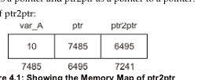

指针ptr指向一个内存位置为7485的变量。由于ptr2ptr是一个双重指针，它将包含一个指针的地址。在我们的例子中，ptr2ptr包含ptr的地址，即6495。为了显示var_A的内容，我们必须使用`**`放在ptr2ptr前面，因为它是一个双重指针。

### 指针处理

在处理指针时，指针赋值应该正确完成。我们知道，一个整型变量在内存中占用四个字节的数据。现在，如果我们使用%u格式显示一个整型变量的地址，那么我们只能得到内存中第一个字节的地址。为了解决这个问题，我们应该使用`*ptr`约定，它允许我们访问所有四个内存字节中存储的信息。

让我们通过清单4.3中的代码来理解这个概念：

**清单4.3：处理不同类型的指针**

```c
#include<stdio.h>
int main()
{
    int var_A = 10;
    float var_B = 5.65;
    char *ptr_A, *ptr_B;

    ptr_A = (char*)&var_A;
    ptr_B = (char*)&var_B;

    printf("\n Address in ptr_A %u",ptr_A);
    printf("\n Address of ptr_B %u",ptr_B);

    printf("\n Value at ptr_A %d ",*ptr_A);
    printf("\n Value at ptr_B %d ",*ptr_B);
    return 0;
}
```

前面的代码将成功编译，因为我们已将整数和浮点变量的地址类型转换为字符指针。然而，在使用`*`运算符显示给定内存位置存储的值时，我们可能会遇到问题，因为我们在分配整数地址时使用了字符指针。在这种情况下，只会获取内存位置第一字节中存储的信息。对于var_A变量，我们会得到一个有效输出，因为存储的值是10，而10的二进制表示只需要一个字节的存储空间。但是，如果我们将值更改为一个更大的值，该值在内存中需要更多位来存储，那么我们将得到一个截断或垃圾结果。因此，如果我们想访问一个整数，那么我们应该将地址存储在整数指针中。同样的概念也适用于浮点变量。

接下来，让我们学习如何使用指针处理一维数组。

### 使用指针的一维数组

数组可以被视为存储在连续内存位置中的相似类型元素的集合。相似类型的元素意味着存储的变量可能全部是int、char或任何其他存储类说明符。下面是声明一维数组的语法：

```c
int a[10];
```

前面的语法声明了一个大小为10的数组，其中数组中的每个单元格都是int类型。大小10也可以定义为数组的维度，`[ ]`括号告诉编译器正在使用数组。根据C惯例，数组中的第一个元素编号为0；因此，数组中的最后一个元素可以在比数组大小小1的位置找到。考虑以下示例，我们同时声明并初始化了两个数组：

```c
int arr[4] = {1,2,3,4};
int arr[] = {6,7,8,9};
```

如第二个数组所示，当我们同时声明和定义数组时，提及数组的维度变得可选。

在处理数组时应格外小心，因为C中不会进行错误检查，以确定用于访问数组元素的下标是否超过了数组的大小。如果下标超过了数组的大小，那么下标可能会将自己的信息覆盖到其他信息之上，这可能导致致命的内存损坏。

现在让我们学习如何将数组元素传递给函数。

数组元素可以通过两种方式传递给函数：按值调用和按引用调用。按值调用意味着将数组元素的值传递给函数；而按引用调用意味着将数组元素的地址传递给函数。清单4.4展示了如何将数组元素的值传递给函数：

**清单4.4：将数组元素的值传递给函数**

```c
#include<stdio.h>
void show_value(int value);
int main()
{
```


代码清单 4.6 展示了使用指针遍历一维数组：

**代码清单 4.6：** 展示使用指针遍历一维数组

```c
#include <stdio.h>

void show_value(int *value, int range);

int main()
{
    int arr[5]={1,2,3,4,5};
    show_value(&arr[0],5);
}

void show_value(int *value,int range)
{
    int i;

    for(i=0;i < range ;i++)
    {
        printf("\n value -> [%d] ",*(value+i));
    }
}
```

在代码清单 4.6 中，我们将数组的基地址（即 arr[0] 的地址）传递给了 show_value() 函数。为了进行遍历，我们将基地址递增一，并显示该内存位置上的值。

C 语言中的命名规则是：数组索引从第 0 个位置开始；因此，下面两个代码片段会得到相同的结果：

```c
int *ptr = &a[0];
int *ptr = a;
```

在编译 a[i] 表达式时，编译器首先将其转换为 *(a+i)；因此，使用数组索引的表达式等价于指针加偏移量表达式。

现在，让我们学习如何使用指针处理二维数组。

### 使用指针处理二维数组

二维数组不过是一维数组的集合。下面是一个从语法上定义二维数组的示例：

```c
int arr[2][3];
```

在前面的示例中，二维数组的第一个下标称为行号，第二个下标称为列号。这个二维数组可以看作一个包含两个元素的一维数组，其中每个元素又是一个包含三个元素的一维数组。

考虑下面的二维数组：

```c
int arr[4][2] = {
    {1,100},
    {2,200},
    {3,300},
    {4,400}
};
```

前面的数组可以表示如下：

| 值 | 索引 | 地址 |
|---:|---|---:|
| 1 | [0][0] | 8000 |
| 100 | [0][1] | 8001 |
| 2 | [1][0] | 8002 |
| 200 | [1][1] | 8003 |
| 3 | [2][0] | 8004 |
| 300 | [2][1] | 8005 |
| 4 | [3][0] | 8006 |
| 400 | [3][1] | 8007 |

维度只是概念上的设计。在内存中，前面的数组元素是连续存储的；例如，1 存储在位置 [0][0]，100 存储在位置 [0][1]，2 存储在位置 [1][0]。这种方案称为在内存中表示数组的行主序。不过，还有另一种表示方式，称为列主序表示。下面我们来讨论这两种表示方式之间的显著差异。图 4.2 展示了二维数组的两种表示方式：

**行主序表示**

| 行 | 列 | 信息 |
|---:|---:|---:|
| 0 | 0 | 1 |
| 0 | 1 | 100 |
| 1 | 0 | 2 |
| 1 | 1 | 200 |
| 2 | 0 | 3 |
| 2 | 1 | 300 |
| 3 | 0 | 4 |
| 3 | 1 | 400 |

**列主序表示**

| 行 | 列 | 信息 |
|---:|---:|---:|
| 0 | 0 | 1 |
| 1 | 0 | 100 |
| 0 | 1 | 2 |
| 1 | 1 | 200 |
| 0 | 2 | 3 |
| 1 | 2 | 300 |
| 0 | 3 | 4 |
| 1 | 3 | 400 |

**图 4.2：展示行主序和列主序表示**

这两种表示方式的主要区别在于元素在二维数组中的存储方式。在行主序表示中，元素 a[0][0] 之后找到的下一个元素是元素 a[0][1]；而在列主序表示中，找到的下一个元素是元素 a[1][0]。

### 探究二维数组中的指针运算

如前所述，二维数组可以看作一维数组的集合。因此，像 int arr[3][3] 这样的典型声明意味着：arr[0] 将给出第一个一维数组的基地址，arr[1] 将给出第二个一维数组的地址，arr[2] 将给出第三个一维数组的地址。代码清单 4.7 展示了二维数组的基地址计算：

**代码清单 4.7：展示二维数组的基地址计算**

```c
#include <stdio.h>

int main()
{
    int i;
    int arr[3][3] = {
                    {1,100,1000},
                    {2,200,2000},
                    {3,300,3000}
                    };
    for(i=0;i < 3; i++)
    {
        printf("\n Address of [%d]th 1D array is [%u]",i,arr[i]);
    }
    getch();
}
```

前面代码的输出如下：

```text
Address of [0]th 1D array is [2293552]
Address of [1]th 1D array is [2293564]
Address of [2]th 1D array is [2293576]
```

int 类型的二维数组的每个单元占用四个字节的数据，因为一个整数占用四个字节。现在，如果仔细观察前面的输出，我们会注意到数组的基地址是 2293552。接下来，第二个一维数组的起始地址是 2293564。从这两个地址可以看出，二者之间的差值是 12。这 12 个字节对应那三个元素，它们被连续存储为第一个一维数组。因此，我们可以很容易地说，二维数组不过是三个一维数组的集合。

当我们声明一个二维数组时，`arr` 指针指向该数组的基地址。类似地，`*(arr + 1)` 给出数组的第 2 个元素，而这个元素恰好是第二个一维数组的基地址。一般来说，语法 `*(arr + i)` 帮助我们到达第 i 个一维数组。到达所需的一维数组后，我们应该能够到达它的元素。例如，由于 `arr[2][2]` 被解释为位于数组第 3 行第 3 列的元素（因为下标从零开始），我们将通过 `*(arr + 2)` 到达第 3 行，然后通过 `*(*(arr + 2) + 2)` 到达第 3 列。

代码清单 4.8 展示了指针运算在二维数组中的用法：

**代码清单 4.8：** 展示指针运算在二维数组中的用法

```c
#include <stdio.h>
int main()
{
    int i,j;
    int arr[3][3] = {
                        {1,100,1000},
                        {2,200,2000},
                        {3,300,3000}
                    };

    for(i=0;i < 3; i++)
    {
        for(j=0; j < 3; j++)
        {
            printf("%d  ",*(*(arr + i) + j));
        }
        printf("\n");
    }
    getch();
}
```

前面代码的输出如下：

```text
1  100  1000
2  200  2000
3  300  3000
```

现在让我们学习如何将二维数组传递给函数。

### 将二维数组传递给函数

我们可以通过多种方式将二维数组传递给函数。不过，在本章中，我们来讨论以下三种将二维数组传递给函数的方式：

```c
my_function(int my_array[4][6]) { ---- }

my_function(int my_array[][6]) { ---- }

my_function(int (*my_array)[6]) { ---- }
```

前面三种方式看起来可能不同，但最终它们都会将二维数组的基地址传递给函数。请注意，在将二维数组传递给函数时，我们应该始终包含列数。此外，传递给函数的是指向行数组的指针，其中每一行又是一个数组。代码清单 4.9 展示了如何将二维数组传递给函数：

**代码清单 4.9：将二维数组传递给函数**

```c
#include <stdio.h>
void display_method_a(int *arr,int row, int col);
void display_method_b(int (*arr)[3],int row, int col);
void display_method_c(int arr[3][3],int row, int col);

int main()
{
    int i,j;
    int arr[3][3] = {
        {1,100,1000},
        {2,200,2000},
        {3,300,3000}
    };

    display_method_a(arr,3,3);
    display_method_b(arr,3,3);
    display_method_c(arr,3,3);
    getch();
}

void display_method_a(int *arr,int row, int col)
{
    int i,j;

    for(i=0;i < row; i++)
    {
        for(j=0; j < col; j++)
        {
            printf("%d ", *(arr + ((i*col) + j)));
        }
        printf("\n");
    }
}

void display_method_b(int (*arr)[3],int row, int col)
{
    int i,j;
    int *ptr;
    for(i=0;i < row; i++)
```


```c
{
    ptr = arr + i;
    for(j=0; j < col; j++)
    {
        printf("%d ",*(ptr + j));
    }
    printf("\n");
}

void display_method_c(int arr[][3],int row, int col)
{
    int i,j;

    for(i=0; i < row; i++)
    {
        for(j=0; j < col; j++)
        {
            printf("%d ",arr[i][j]);
        }
        printf("\n");
    }
}
```

在代码清单 4.9 中，二维数组的基地址被传递，并在 display_method_a() 函数中借助一个 int 指针接收。在该函数的内层 for 循环中，执行实际的算术计算，从而得到数组所需位置的地址。

计算二维数组中某个位置地址的表达式如下：

```c
*(arr + ((i * col) + j))
```

假设我们已按顺序将九个元素存储在一个二维数组中，如下所示：

| 值 | 1 | 100 | 1000 | 2 | 200 | 2000 | 3 | 300 | 3000 |
|---|---|---|---|---|---|---|---|---|---|
| 地址 | 8000 | 8001 | 8002 | 8003 | 8004 | 8005 | 8006 | 8007 | 8008 |

现在，如果我们想找到上述二维数组中第 9 个元素的值，那么可以使用以下表达式：

```
Desired address = *(8000 + (2*3) + 2)
                 = *(8000 + 8) = *(8008) = 3000
```

该表达式可以概括如下：

```c
*(base address of array + (no of columns * row index) + column index)
```

在代码清单 4.9 中，我们在 display_method_b() 函数中使用了指向由三个整数组成的数组的 arr 指针。arr 指针保存第一个一维数组的地址。在外层 for 循环中，我们通过将循环变量的值加到基地址上，到达第 i 个一维数组。然后，在内层 for 循环中，我们再次通过将内层循环变量加到 ptr 当前指向的地址上，到达第 i 个一维数组的第 j 个元素。

此外，我们在函数中使用了 int arr[][3]，这提供了使用 arr[i][j] 约定直接访问元素的灵活性。

接下来，让我们了解如何从函数返回二维数组。

### 从函数返回二维数组

我们可以通过多种方式从函数返回二维数组。不过，在本章中，我们将学习以下三种从函数返回二维数组的方式：

```c
int *display_A();
int (*display_B())[3];
int (*display_C())[3][3];
```

在前面的代码片段中，我们可以观察到这三个函数都返回二维数组。注意，这三个函数都会返回二维数组的基地址。让我们借助一个程序更清楚地探究这三个函数。

代码清单 4.10 展示了一个返回二维数组的函数：

代码清单 4.10：展示从函数返回二维数组的代码

```c
#include <stdio.h>
int *display_A();
int (*display_B())[3];
int (*display_C())[3][3];

int *display_A()
{
    static int a[3][3] = {
        1,100,1000,
        2,200,2000,
        3,300,3000
    };
    return (int*)a;
}

int (*display_B())[3]
{
    static int b[3][3] = {
        1,100,1000,
        2,200,2000,
        3,300,3000
    };
    return b;
}

int (*display_C())[3][3]
{
    static int c[3][3] = {
        1,100,1000,
        2,200,2000,
        3,300,3000
    };
    return (int(*)[3][3])c;
}

int main()
{
    int i,j;

    int *ptr_a,*temp;
    int (*ptr_b)[3];
    int (*ptr_c)[3][3];

    ptr_a = display_A();

    printf("\n style 1 \n");

    for(i=0;i < 3 ;i++)
    {
        for(j=0;j < 3 ; j++)
        {
            printf("%d ",*(ptr_a + i*3 + j));
        }
        printf("\n");
    }

    ptr_b = display_B();

    printf("\n style 2 \n");

    for(i=0;i < 3; i++)
    {
        temp = ptr_b + i;
        for(j=0;j < 3 ; j++)
        {
            printf("%d ",*(temp+j));
        }
        printf("\n");
    }

    printf("\n style 3 \n");
    ptr_c = display_C();
    for(i=0;i < 3; i++)
    {
        for(j=0;j < 3 ; j++)
        {
            printf("%d ",*(ptr_c)[i][j]);
        }
        printf("\n");
    }
    getch();
}
```

从函数返回二维数组时，有两件事应彼此保持同步。一是所声明函数的返回类型，另一个是用于接收返回值的变量的数据类型。

现在让我们讨论三维数组。

### 使用指针的三维数组

三维数组可以解释为二维数组的数组。三维数组的定义在本质上有些递归。如果我们有一个声明，例如 int arr[3][3][3]，那么它意味着我们有一个由三个二维数组组成的数组，其中每个二维数组又是三个一维数组的集合。首先，创建一个包含三个元素的一维数组。然后，将三个一维数组一个放在另一个下面，形成二维数组。进一步，将三个二维数组一个放在另一个后面，形成数组的三维表示。

用图表示，三维数组如下所示：

### 第一个二维数组

| 1 | 100 | 1000 |
|---|---:|---:|
| 2 | 200 | 2000 |
| 3 | 300 | 3000 |

### 第二个二维数组

| 4 | 400 | 4000 |
|---|---:|---:|
| 5 | 500 | 5000 |
| 6 | 600 | 6000 |

### 第三个二维数组

| 7 | 700 | 7000 |
|---|---:|---:|
| 8 | 800 | 8000 |
| 9 | 900 | 9000 |

在内存中，元素将以连续方式存储。考虑一个三维数组 `arr[2][2][2]`，其声明如下：

```c
int arr[2][2][2] = {
    {
        {1,2},
        {3,4}
    },
    {
        {5,6},
        {7,8}
    }
};
```

前面声明的内存映射如下所示：

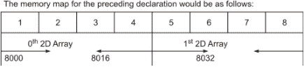

我们可以在内存映射中观察到，元素 1、2、3 和 4 构成第一个二维数组。这个二维数组的每个元素都按行主序放置在内存中。由于在上面的示例中我们声明了 int 类型的三维数组，因此每个元素将占用四个字节的内存。第一个二维数组的地址范围是 8000 到 8016。类似地，第二个二维数组也按行主序放置，地址范围是 8016 到 8032。

接下来，让我们学习如何将三维数组传递给函数。

```c
        for(k=0; k < 3;k++)
        {
          printf("%d ",arr[i][j][k]);
        }
        printf("\n");
      }
      printf("\n");
    }
  }

int main()
{
    int array_A[3][3][3] = {
        {
            {1,10,100},
            {2,20,200},
            {3,30,300}
        },
        {
            {4,40,400},
            {5,50,500},
            {6,60,600}
        },
        {
            {7,70,700},
            {8,80,800},
            {9,90,900}
        }
    };

    printf("\n Display 1 \n");
    display_A(array_A);
    printf("\n Display 2 \n");
    display_B(array_A);
    printf("\n Display 3\n");
    display_C(array_A);
    return 0;
}
```

如代码清单 4.11 所示，display_A() 函数接受一个指针作为参数，并计算要显示元素的位置。在 display_B() 函数中，我们将 arr 用作指向三行三列二维数组的指针。然而，在第三个函数中，我们直接使用下标来访问元素。

前面代码的输出如下：

```
Display 1
1 10 100
2 20 200
3 30 300

4 40 400
5 50 500
6 60 600

7 70 700
8 80 800
9 90 900
```

```c
        };
    return (int*)array_A;
}

int (*funcType_B())[3]
{
    static int array_B[3][3][3] = {
        {
            {1,10,100},
            {2,20,200},
            {3,30,300}
        },
        {
            {4,40,400},
            {5,50,500},
            {6,60,600}
        },
        {
            {7,70,700},
            {8,80,800},
            {9,90,900}
        }
    };
    return (int(*)[3])array_B;
}

int (*funcType_C())[3][3]
{
    static int array_C[3][3][3] = {
        {
            {1,10,100},
            {2,20,200},
            {3,30,300}
        },
        {
            {4,40,400},
            {5,50,500},
            {6,60,600}
        },
        {
            {7,70,700},
            {8,80,800},
            {9,90,900}
        }
    };
    return (int(*)[3][3])array_C;
}

int (*funcType_D())[3][3][3]
{
    static int array_D[3][3][3] = {
        {
            {1,10,100},
            {2,20,200},
            {3,30,300}
        },
```


```c
            {
                {4,40,400},
                {5,50,500},
                {6,60,600}
            },
            {
                {7,70,700},
                {8,80,800},
                {9,90,900}
            }
        };
        return (int(*)[3][3])array_D;
}

int main()
{
    int *ptr_A,*ptr_temp;
    int (*ptr_B)[3];
    int (*ptr_C)[3][3];
    int (*ptr_D)[3][3][3];
    int i,j,k;

    printf("\nFirst method of returning \n");

    ptr_A = funcType_A();
    for(i=0;i < 3; i++)
    {
        for(j=0;j < 3 ;j++)
        {
            for(k=0; k < 3;k++)
            {
                printf("%d ",*(ptr_A + i*3*3 + j*3 + k));
            }
            printf("\n");
        }
        printf("\n");
    }

    printf("\nSecond method of returning\n");

    ptr_B = funcType_B();
    for(i=0;i < 3; i++)
    {
        ptr_temp = (int*)(ptr_B+i*3);

        for(j=0;j < 3 ;j++)
        {
            for(k=0; k < 3;k++)
            {
                printf("%d ",*ptr_temp);
                ptr_temp++;
            }
            printf("\n");
        }
        printf("\n");
    }

    printf("\nThird method of returning\n");
    ptr_C = funcType_C();

    for(i=0;i < 3; i++)
    {
        ptr_temp = (int*)(ptr_C + i);

        for(j=0; j < 3 ;j++)
        {
            for(k=0; k < 3;k++)
            {
                printf("%d ",*ptr_temp);
                ptr_temp++;
            }
            printf("\n");
        }
        printf("\n");
    }

    printf("\nFourth method of returning\n");
    ptr_D = funcType_D();

    for(i=0;i < 3; i++)
    {
        for(j=0; j < 3 ;j++)
        {
            for(k=0; k < 3;k++)
            {
                printf("%d ",(*ptr_D)[i][j][k]);
            }
            printf("\n");
        }
        printf("\n");
    }
    getch();
}
```

上述代码的输出如下：

```text
First method of returning
1 10 100
2 20 200
3 30 300

4 40 400
5 50 500
6 60 600

7 70 700
8 80 800
9 90 900

Second method of returning
1 10 100
2 20 200
3 30 300

4 40 400
5 50 500
6 60 600

7 70 700
8 80 800
9 90 900

Third method of returning
1 10 100
2 20 200
3 30 300

4 40 400
5 50 500
6 60 600

7 70 700
8 80 800
9 90 900

Fourth method of returning
1 10 100
2 20 200
3 30 300

4 40 400
5 50 500
6 60 600

7 70 700
8 80 800
9 90 900
```

下一节，我们将学习指针数组。

### 指针数组

与整数数组、浮点数数组和字符数组类似，C语言中也有指针数组。指针保存的是内存位置的地址；因此，指针数组不过是此类地址的集合。普通数组上可以执行的所有操作，在指针数组上也可以执行。清单4.13展示了指针数组的用法：

### 清单 4.13：展示指针数组的用法

```c
#include<stdio.h>
int main()
{
    int *array_ptr[3];
    int i=1,j=2,k=3;
    int ct;
    array_ptr[0]=&i;
    array_ptr[1]=&j;
    array_ptr[2]=&k;

    for(ct=0; ct < 3 ;ct++)
    {
        printf("\n Address [%u] Value [%d]",
               array_ptr[ct],*array_ptr[ct]);
    }
    getch();
}
```

在清单4.13中，`array_ptr` 变量被声明为指针数组，其中数组的每个单元格都将保存一个指向整数的指针。我们还声明了三个整数，并将它们的内存地址存入该指针数组。请注意，当我们显示数组内容时，得到的是这些变量的地址。我们可以通过使用解引用运算符来显示内存位置的内容。

上述代码的输出如下：

```text
Address [2293596] Value [1]
Address [2293592] Value [2]
Address [2293588] Value [3]
```

在学习了指针数组之后，你一定会想：指针数组和指向数组的指针之间是否有任何区别。为此，让我们考虑以下两种表示法：

```c
int *array_ptr[5];

int (*array_ptr)[5];
```

第一种表示法声明一个大小为五的整型指针数组。在这种情况下，内存分配在声明时就已经完成。然而，第二种表示法声明一个指向包含五个整数的数组的指针，但不分配任何内存。由于圆括号具有更高的优先级；因此，在第二种声明中，首先将 `array_ptr` 声明为指针，然后将其关联到包含五个整数的数组。类似地，以下表示法声明一个指向数组的指针，但分配是静态的：

```c
int array_ptr[10];
```

清单4.14展示了指向数组的指针的用法：

### 清单 4.14：展示指向数组的指针的用法

```c
#include<stdio.h>

int main()
{
    int *array_a[2];
    int (*array_b)[2];
    int array_c[2] = {1,2};
    int var_a = 10;
    int var_b = 20;

    array_a[0] = &var_a;
    array_a[1] = &var_b;
    array_b = &(array_c);
    printf("\n Size of a [%d] ",sizeof(array_a));
    printf("\n Size of b [%d] ",sizeof(array_b));
    printf("\n Size of b [%d] ",sizeof(array_c));
    printf("\n Value at array_a is %d ",*(array_a[0]));
    printf("\n Value at array_a is %d ",*(array_a[1]));
    printf("\n Address of array_b [%p] ",array_b);
    printf("\n Address of array_c [%p] ",&array_c);
    printf("\n Value at array_b is %d ",*(array_b[0]));
}
```

在清单4.14中，我们将 `array_c` 的地址赋给了 `array_b`，而 `array_b` 恰好是一个指向整数数组的指针。此外，我们还借助 `array_b` 访问了 `array_c` 的元素。

前面的语句准确告诉函数指针它需要指向哪个函数。最终，将执行以下函数调用：

```c
(*func_ptr)();
```

在借助函数指针调用函数时，我们应注意圆括号的用法。一个典型的错误调用如下：

```c
*func_ptr()  -  Error.
```

这将意味着我们调用 func_ptr() 函数，而该函数将返回一个指针。我们还可以使用函数指针向目标函数传递参数。

要处理函数指针，值得一提的是，应当知道声明、赋值和调用函数指针的正确方式；否则，可能会导致严重的歧义。函数指针最简单的定义如下：

```c
int (*func_ptr)()
```

前面的语句将 func_ptr 声明为指向函数的指针，该函数将返回一个整数。从声明中可以明显看出，* 运算符表示涉及指针，而圆括号表示函数。然而，一个有趣的因素是 *func_ptr 周围圆括号的用法。其原因只是为了确保声明中的优先级关系。如果我们不提供圆括号，那么声明将如下所示：

```c
int *func_ptr() /* Incorrect declaration */
```

前面的语句将意味着 func_ptr 是一个返回指向整数的指针的函数。因此，圆括号有助于表明 func_ptr 首先是一个指针，然后是一个指向返回整数的函数的指针。为了避免任何此类语法异常，最好按如下方式使用 typedef：

```c
typedef int (*func_ptr)()
```

前面的语句意味着 func_ptr 等价于指向返回整数的函数的指针。

现在，让我们借助一个示例来讨论函数指针赋值的各种特性。考虑前面包含 typedef 的函数指针声明。在这种情况下，我们想要将以下函数赋给一个函数指针：

```c
int my_function1();
int my_function2();
```

我们可以直接按如下方式赋第一个函数的地址：

```c
func_ptr = &my_function1;
```

否则，赋值可以是有条件的，如下所示：

```c
if(cond)
    func_ptr = &my_function1;
else
    func_ptr = &my_function2;
```

函数指针赋值最有趣的方面之一是：将函数赋给函数指针时，并不总是必须使用 & 运算符。当我们使用函数名而不是调用函数本身时，它会被解释为我们使用它是为了将其赋给函数指针。大多数函数指针赋值都采用标准语法，其中会省略 & 的使用。因此，以下代码将编译通过而不会产生任何错误：

```c
func_ptr = my_function1;
```

现在，让我们讨论函数指针的一些复杂声明。以下代码片段展示了一个函数指针声明。

```c
typedef int (*func_ptr)(float, float);
func_ptr fp1;
```

在前面的代码片段中，fp1 成为一个指向函数的指针，该函数接受两个 float 变量作为参数并返回一个整数。


## 第 4 章

以下声明展示了一个指向函数的指针，该函数接受一个 float 变量和另一个指向函数的指针作为参数，并且不返回任何值：

```c
typedef void (*func_ptr)(float, int (*fptr)(char*));
func_ptr fp1;
```

在前面的声明中，fp1 成为一个指向函数的指针，该函数接受另一个指向函数的指针，而后者又接受一个 char 指针作为其参数并返回一个整数。

以下声明展示了一个函数指针数组，它指向一个返回 char 指针并接受一个 char 指针作为参数的函数：

```c
typedef char* (*func_ptr)(char*);
func_ptr fp1[5];
```

在前面的声明中，fp1 成为一个函数指针数组。

类似地，在前面的声明中，my_func() 成为一个不接受任何参数并返回一个指向函数的指针的函数，该指针指向的函数接受一个整数并且不返回任何值：

```c
typedef void (*func_ptr)(int);
func_ptr my_func();
```

现在让我们学习如何将函数指针作为参数传递。

### 将函数指针作为参数传递

函数指针的多种用途之一是能够将函数指针作为参数传递给函数。这有助于在 C 中实现回调，其中我们需要传递一个指向回调函数的指针。清单 4.16 展示了如何将函数指针作为参数传递给函数：

**清单 4.16：** 展示将函数指针作为参数传递的代码

```c
#include<stdio.h>
#include<string.h>
int Add(int,int);
int Sub(int,int);
int Mul(int,int);
int doOperation(int, int, int (*func_ptr)(int, int));
int main()
{
    int varA = 20;
    int varB = 10;
    printf("\n Addition : [%d] ", doOperation(varA, varB, &Add));
    printf("\n Subtraction : [%d] ", doOperation(varA, varB, &Sub));
    printf("\n Multiply : [%d] ", doOperation(varA, varB, &Mul));
    return 0;
}
int doOperation(int varA, int varB, int (*func_ptr)(int, int))
{
    return (func_ptr(varA, varB));
}
int Add(int varA, int varB) { return varA + varB; }
int Sub(int varA, int varB) { return varA - varB; }
int Mul(int varA, int varB) { return varA * varB; }
```

在清单 4.16 中，doOperation() 函数接受两个整数和一个指向函数的指针（该指针又接受两个整数并返回一个整数）作为其参数。我们从 main() 函数中使用三个函数 Add()、Sub() 和 Mul() 之一的地址来调用 doOperation() 函数。在 doOperation() 函数内，会赋值这些函数之一的地址。通过调用函数指针所指向的函数来获得所需结果。

接下来，让我们学习如何从函数返回函数指针。

### 从函数返回函数指针

我们还可以使用函数指针返回函数的地址。当我们需要在运行时决定调用某个函数，而不是在编译时确定它时，这就会很有用。清单 4.17 展示了如何从函数返回函数指针：

**清单 4.17：** 展示从函数返回函数指针的代码

```c
#include<stdio.h>
#include<string.h>
typedef void (*func_ptr)(int, int);
void Add(int,int);
void Sub(int,int);
func_ptr compareValue(int, int);
int main()
{
    int varA = 05;
    int varB = 10;
    func_ptr getPtr = NULL;
    getPtr = compareValue(varA, varB);
    (*getPtr)(varA, varB);
    getch();
    return 0;
}
func_ptr compareValue(int varA, int varB)
{
    if(varA < varB)
    {
        return &Add;
    }
    else
    {
        return &Sub;
    }
}
void Add(int varA, int varB)
{
    printf("\n Sum is %d ", varA + varB);
}
void Sub(int varA, int varB)
{
    printf("\n Difference is %d ", varA - varB);
}
```

在清单 4.17 中，我们定义了一个名为 func_ptr 的函数指针，它指向一个接受两个整数作为参数但不返回任何值的函数。此外，我们定义了一个名为 compareValue() 的函数，它接受两个整数作为参数并返回一个指向函数的指针。在 main() 函数内，我们声明了一个名为 getPtr 的函数指针，它指向 compareValue() 返回的函数。在 compareValue() 函数内，我们比较了两个变量，并根据比较结果返回了 Add() 函数或 Sub() 函数的地址。此外，我们在 main() 函数内使用 getPtr 来调用 Add() 函数或 Sub() 函数。

接下来，让我们学习函数指针数组。

### 探索函数指针数组

其成员为指向函数的指针的数组称为函数指针数组。函数指针数组与指针数组没有太大区别。唯一的区别是，数组包含的是函数指针，而不是普通指针。函数指针数组提供了使用数组下标选择其中一个函数的灵活性。清单 4.18 展示了函数指针数组的用法：

清单 4.18：展示使用函数指针数组的代码

```c
#include<stdio.h>
#include<string.h>
int Add(int,int);
int Sub(int,int);
int Mul(int,int);
typedef int (*func_ptr)(int, int);
func_ptr arr_func_ptr[3];
int doOperation(int, int, int (*func_ptr)(int, int));
int main()
{
    int varA = 20;
    int varB = 10;
    arr_func_ptr[0] = &Add;
    arr_func_ptr[1] = &Sub;
    arr_func_ptr[2] = &Mul;
    printf("\n Addition       : [%d] ", doOperation(varA, varB, arr_func_ptr[0]));
    printf("\n subtraction : [%d] ", doOperation(varA, varB, arr_func_ptr[1]));
    printf("\n Multiply        : [%d] ", doOperation(varA, varB, arr_func_ptr[2]));
    getch();
    return 0;
}
int doOperation(int varA, int varB, int (*func_ptr)(int, int))
{
    return (func_ptr(varA, varB));
}
int Add(int varA, int varB) { return varA + varB; }
int Sub(int varA, int varB) { return varA - varB; }
int Mul(int varA, int varB) { return varA * varB; }
```

在清单 4.18 中，我们声明了一个名为 arr_func_ptr 的函数指针数组。该函数指针指向一个接受两个整数作为参数并返回一个整数的函数。我们手动将各个函数的地址存储到数组的不同单元中。包装函数 doOperation() 用于使用其参数调用正确的函数，从而给出所需结果。

在下一节中，让我们学习回调。

### 回调

回调不过是一个借助函数指针来调用的函数。使用回调的主要优点是调用者函数与被调用函数之间的解耦。换句话说，调用者函数不必关心实际调用的是谁。为了理解回调的概念，让我们以各种排序技术为例，例如冒泡排序、快速排序和选择排序。无论采用哪种排序技术，都可以借助回调设计一种通用方案来执行两个值之间的比较。通过这样做，我们可以保持比较逻辑相同，并在不同的排序技术中复用该模块。回调的另一个用途来自事件通知。假设我们有一个与应用绑定的定时器，每次定时器到期时，应用都需要被通知。然而，定时器的实现方式使其对应用一无所知。这个问题可以借助回调来解决：由应用向定时器提供一个回调，使得当定时器到期时，它所做的全部事情就是执行该回调并通知应用。

清单 4.19 展示了回调的实现：

**清单 4.19：** 展示实现回调的代码

```c
#include<stdio.h>
#include <conio.h>
typedef void (*callback_func)(char *info);
typedef struct callback_info
{
    callback_func func_ptr;
} cb_info;
void reg_callback(cb_info *ptr, void (*callback_func)(char *info));
void callback_function();
int main()
{
    char *info="This is a test";
    cb_info *ptr=NULL;
    ptr=(cb_info*)malloc(sizeof(cb_info));
    reg_callback(ptr, callback_function);
    ptr->func_ptr(info);
    getch();
    return 0;
}
void reg_callback(cb_info *ptr, void (*callback_func)())
{
    ptr->func_ptr = callback_func;
}
void callback_function(char *info)
{
    printf("\n Information passed [%s]", info);
}
```

在清单 4.19 中，我们如下声明了一个函数指针：

```c
typedef void (*callback_func)(char *info);
```

在前面的声明中，`callback_info` 是一个结构体，其成员是一个函数指针。在 `main()` 函数内，我们通过将想要用作 `callback_info` 结构体成员的 `callback_func()` 函数的地址赋值给该函数指针，完成了函数指针的注册。现在，回调已准备好按如下方式使用：

```c
ptr->func_ptr(info);
```

前面的语句会调用所需的函数，回调将相应地工作。

现在让我们学习回调在 C++ 中如何工作。

### 使用函数指针回调 C++ 成员函数

与 C 中的标准函数指针相比，指向 C++ 非静态成员函数的指针略有不同，因为它们需要传入类对象的 this 指针。对 C++ 成员函数的回调需要一个静态成员函数，它将充当包装函数。为此，我们首先需要将类对象的指针强制转换为 void*，然后将该指针连同所需参数一起传递给包装函数。该函数再次将指针强制转换回类的实例，然后调用成员函数，如清单 4.20 所示。


清单 4.20：展示 C++ 中回调的工作方式

```cpp
#include<iostream.h>
#include<conio.h>
void (*fpt)(void *,char*);
class MyClass
{
    public:
        void show_message(char *message)
        {
            cout<<"The message is "<<message;
        }
        static void caller_to_display(void *obj, char *message);
};
void MyClass::caller_to_display(void *obj,char *message)
{
    MyClass *tempObj = (MyClass*)obj;
    tempObj->show_message(message);
}
int main()
{
    MyClass obj;
    fpt = MyClass::caller_to_display;
    (*fpt)((void*)&obj, "This is a callback");
    getch();
    return 0;
}
```

在清单 4.20 中，我们定义了 MyClass 类，其中包含两个函数：show_message() 用于显示消息，caller_to_display() 是一个静态函数，用作调用 show_message() 函数的包装器。我们还声明了一个名为 fpt 的函数指针，它指向 caller_to_display() 函数。该函数接收 void 和 char 指针作为参数，并且不返回任何值。在 main() 函数中，我们创建了 MyClass 类的一个实例，然后让 fpt 指向 caller_to_display() 函数。此外，我们通过将对象的引用以及自定义消息作为参数传递给 fpt 所指向的函数，从而调用目标成员函数。在包装函数内部，接收到引用后，我们再次将所需类的实例进行类型转换，并使用自定义消息调用 display() 函数。这有助于在 C++ 中实现对非静态成员函数的回调。

### 使用全局变量实现对 C++ 成员函数的回调

如上一节所述，我们可以通过使用函数指针在 C++ 中实现回调的概念。我们也可以通过使用全局变量来做同样的事情。然而，这两种方法之间存在巨大差异。在第一种方法中，我们需要在包装函数内创建一个指向类实例的指针，然后将传递给包装函数的 void* 指针类型转换为该类的正确实例。在第二种方法中，我们不是传递 void 指针，而是使用全局变量将 void* 指针类型转换为类的实际实例。清单 4.21 使用全局变量实现了 C++ 中的回调概念：

清单 4.21：展示使用全局变量在 C++ 中实现回调

```cpp
#include<iostream.h>
#include<conio.h>
void *ptr_obj;
void (*fpt)(char*);
class MyClass
{
```

```cpp
    // override function "ShowMessage"
    virtual void ShowMessage(const char* string)
    { (*ptr_obj.*func_ptr)(string);};            // execute member function
    };
```

在清单 4.22 中，基类包含一个名为 ShowMessage() 的纯虚函数和重载的 () 运算符。我们还从基类派生了一个模板类。派生类使用参数化构造函数，该构造函数接收指向其成员函数的指针和指向对象的指针作为参数。它还重写了纯虚函数以及 () 运算符。从 () 运算符和纯虚函数的重写版本中，会实际调用作为参数传入的成员函数。

现在，让我们通过清单 4.23 中给出的代码来了解仿函数的用法：

清单 4.23：展示仿函数的用法

```cpp
#include<iostream.h>
class TBase
{
public:
    virtual void operator()(const char* string)=0;   // call using operator
    virtual void ShowMessage(const char* string)=0;  // call using function
};
// derived template class
template <class TClass> class TDerived : public TBase
{
private:
    void (TClass::*func_ptr)(const char*);   // pointer to member function
    TClass* ptr_obj;                        // pointer to object

public:
    TDerived(TClass* _pt2Object, void(TClass::*_fpt)(const char*))
    { ptr_obj = _pt2Object; func_ptr=_fpt; };

    // override operator "()"
    virtual void operator()(const char* string)
    { (*ptr_obj.*func_ptr)(string);};       // execute member function

    // override function "ShowMessage"
    virtual void ShowMessage(const char* string)
    { (*ptr_obj.*func_ptr)(string);};       // execute member function
};
class TClassA{
public:
    TClassA(){};
    void Display(const char* text) { cout << text << endl; };
};
class TClassB{
public:
    TClassB(){};
    void Display(const char* text) { cout << text << endl; };
};
int main()
{
    // 1. instantiate objects of TClassA and TClassB
    TClassA objA;
    TClassB objB;
    TDerived<TClassA> specFuncA(&objA, &TClassA::Display);
    TDerived<TClassB> specFuncB(&objB, &TClassB::Display);
    TBase* vTable[] = { &specFuncA, &specFuncB };
    vTable[0]->ShowMessage("TClassA::Display called!");
    (*vTable[1]) ("TClassB::Display called!");    // via operator "()"
    cin.get();
    return 0;
}
```

在清单 4.23 中，我们定义了两个类：TClassA 和 TClassB。这两个类都有 Display() 函数，该函数返回 void 并接收 char* 作为参数。请注意，两个类中的函数应具有相同的签名。接下来，我们通过传递相应类的 Display() 函数地址以及类实例的地址来实例化派生类。我们还创建了一个包含两个基类指针的数组，并使用派生类的两个实例初始化该数组。然后，我们使用该数组通过重载的 () 运算符和纯虚函数来调用相应的成员函数。

在下一节中，让我们通过一些复杂示例来理解指针和函数指针。

### 指针和函数指针的复杂示例

让我们深入了解指针和函数指针的一些典型方面，以理解其实现的关键性。

### 示例 1：

```c
#include <stdio.h>
int main()
{
        float var_A = 3.1416;
        float *ptr_A;
        ptr_A = &var_A;
        printf("\n Address [%u] ",ptr_A);
        printf("\n Value [%d] ",*ptr_A);
        getch();
}
```

在前面的示例中，ptr_A 包含一个浮点变量的地址；因此，它被声明为 float。在第一个 printf 语句中，显示了浮点变量的地址；然而，在第二个 printf 语句中，当我们尝试打印该内存位置处的值时，得到的是垃圾值。这是因为我们在打印 float 指针的值时使用了 %d 格式。%d 格式并不总能截断浮点变量的值，因此它们的使用是不可靠的。请注意，在使用指针显示内存位置的内容时，我们应该使用正确的格式。因此，如果我们在第二个 printf 语句中使用了 %f 格式，同样的代码就能正常工作。

示例 1 的输出如下：

```text
    Address [2293620]
    Value [536870912]
```

### 示例 2：

```c
#include <stdio.h>
int *increment_pointer(int *);
int main()
{
        int var_A = 10;
        int *ptr_A;
        ptr_A = &var_A;
        printf("\n Address Before [%u] ",ptr_A);
        ptr_A = increment_pointer(&var_A);
        printf("\n Address After [%u] ",ptr_A);
        getch();
}
int *increment_pointer(int *ptr)
{
    return ++ptr;
}
```

在前面的示例中，我们使用了一个整型指针 ptr_A，将变量 var_A 的地址赋给它，并显示了该地址。在后续步骤中，我们将该变量的地址传递给了 increment_pointer() 函数。在该函数内部，地址被收集到一个整型指针中，该指针递增一，然后返回。有趣的是，当显示函数返回的值时，相对于之前的值发生了四字节的偏移。这是因为整数在内存中占用四字节空间。当我们声明一个整型指针时，它使我们能够访问该指针所指向的四字节内存位置。当我们对该指针执行递增操作时，它将指向下一个位置，而该位置同样是四字节；因此，可以观察到四字节的偏移。应记住，我们只能对指针执行递增和递减操作。不允许对指针执行除法和乘法操作。

示例 2 的输出如下：

```text
    Address Before [2293620]
    Address After  [2293624]
```

### 示例 3：

```c
#include <stdio.h>

void increment_pointer(int);
int main()
{
    int var_A = 10;
    void *ptr_A;
    ptr_A = &var_A;

    printf("\n Address Before [%u] ",ptr_A);
    increment_pointer(&var_A);
    printf("\n Address After [%u] ",ptr_A);
    getch();
}

void increment_pointer(int ptr)
{
    printf("\n Value [%d]",ptr);
}
```

前面的代码在编译时会出现以下警告：

> [警告] 传递 `increment_pointer' 的第 1 个参数时，在没有强制转换的情况下将指针转换为整数

我们可以将内存位置的地址收集到一个整型变量中并显示它。然而，如果我们尝试对该变量执行任何算术操作，那么这将不被允许，并且会产生编译时错误。

示例 3 的输出如下：

```text
    Address Before [2293620]
    Value [2293620]
    Address After [2293620]
```


## 第 5 章 C 语言的高级概念

| 如果需要了解以下信息： | 参见页码： |
|---|---|
| 结构体 | 130 |
| 声明结构体 | 131 |
| 联合体 | 148 |
| C 语言中的文件管理 | 150 |
| 二进制文件 | 160 |
| 文件管理函数 | 166 |
| 位运算符 | 169 |
| 类型限定符 | 176 |
| C 语言中的内存分段 | 178 |

## 第 5 章

使用函数和数组可能无法满足程序员在使用 C 语言时需要执行的所有实际任务。这类活动中的很大一部分需要高级且复杂的概念。其中一些概念是结构体、联合体和文件。

结构体是 C 语言中最常用的构造之一。它们使程序员能够将不同类型的信息组合在一起。与结构体类似，联合体也包含不同类型的信息。然而，与结构体不同，联合体的所有成员共享同一个内存位置。文件是另一种关键的信息管理类型。C 提供两种类型的文件：文本文件和二进制文件。文本文件由连续的字符组成，而二进制文件是字节的集合。C 还提供了多个文件管理函数，例如 fclose()、feof()、ferror()、fgetpos()、freopen() 和 ftell()，用于执行与文件相关的任务。

在本章中，我们将学习 C 语言编程中的一些高级概念。本章将深入讨论结构体和联合体及其实现。我们还将学习 C 语言中文件管理的概念。此外，我们还会学习 C 语言中的位运算及其实现。在本章末尾，我们将学习 C 语言中的类型限定符和内存分段。

让我们从详细讨论结构体开始本章。

### 结构体

C 语言提供了一些基本数据类型，如 int、float 和 char，用于存储少量信息。然而，在现实世界中，信息不会像基本数据类型那样只包含少量数据；相反，它表现为若干事物的集合，其中每个事物都有各自的属性。让我们来看一个现实生活中的实体——汽车。它可以包含车型名称和价格等信息，这些信息在性质上是不同的。也就是说，车型名称是字符串，而价格是整数。现在，为了对这些信息执行类似的操作，我们可以使用多个数组来保存相同类型的元素。清单 5.1 展示了存储汽车信息的数组：

清单 5.1：在数组中存储信息

```c
#include<stdio.h>

int main()
{
    char name[3][10];
    int price[3];
    int i;

    for(i=0;i<=2;i++)
    {
        printf("\n Enter Name and Price ");
        scanf("%s %d",&name[i],&price[i]);
    }

    printf("\n Information Entered is \n");
    for(i=0;i<=2;i++)
    {
        printf("\n Name [%s] and Price [%d] ",name[i],price[i]);
    }

    getch();
    return 0;
}
```

上述程序的输出如下：

```
Enter Name and Price   ALTO 300000
Enter Name and Price   INNOVA 900000
Enter Name and Price   MERCEDES 2500000

Information Entered is

Name [ALTO] and Price [300000]
Name [INNOVA] and Price [900000]
Name [MERCEDES] and Price [2500000]
```

虽然数组可以帮助存储许多信息，但其可扩展性不够强。在我们的场景中，我们可能需要存储更多与汽车相关的信息，但如果我们通过数组处理海量数据，数组可能会变得笨重。为了克服这个问题，C 提供了一种称为结构体的数据类型，它允许我们将不同类型的数据组合在一起。结构体可以包含数据类型各异的元素。结构体中的每个单独元素被称为结构体成员。

让我们先学习如何声明结构体。

### 声明结构体

声明结构体比声明数组更复杂，因为结构体包含许多独立的元素。声明结构体的通用形式如下：

```c
struct objectName {
    member 1;
    member 2;
    member 3;
    .................
    member n;
};
```

在上述声明中，struct 是关键字，objectName 是为该结构体指定的名称。各个成员由 member1、member2、... 和 member n 表示。这些成员可以是变量、指针、数组或任何其他结构体。结构体内的成员名称应各不相同。换句话说，同一个结构体不允许有两个成员同名。结构体声明完成后，我们可以按如下方式声明结构体类型的各个变量：

```c
struct objectName variable 1, variable 2,..............,variable n;
```

来看一个结构体声明的示例：

```c
struct Car {
    char name[20];
    float price;
    char model[20];
    int year;
};
```

对于上述声明，结构体变量可以声明如下：

```c
struct Car car1,car2,car3;
```

结构体变量声明会为每个变量预留内存。在我们的示例中，每个结构体变量将总共分配 52 字节的内存。请注意，这些字节总是分配在相邻的内存位置。

结构体类型和结构体变量的声明可以合并在一起，如下所示：

```c
struct car {
    char name[20];
    float price;
    char model[20];
    int year;
} car1, car2;
```

与变量和数组类似，结构体变量可以在声明时进行初始化。初始化结构体变量的格式如下：

```c
struct car car1 = {"HONDA", 1400000, "CITY", 2009};
```

在上述格式中，第一个值将赋给第一个成员变量，第二个值将赋给第二个成员变量，第三个值将赋给第三个成员变量，第四个值将赋给第四个成员变量。

声明结构体时需要牢记的一些要点如下：

- 结构体声明中的右花括号后必须跟一个分号
- 结构体类型声明不会告诉编译器任何有关内存分配的信息；它只是创建结构体
- 通常，结构体声明要先于程序中任何其他声明

接下来，让我们学习如何访问结构体的元素。

### 访问结构体元素

结构体的各个元素可以借助点运算符（.）访问。访问结构体成员的通用格式如下：

```c
variable.member;
```

在上述格式中，variable 指结构体类型变量的名称，member 表示结构体内部成员的名称。点运算符的结合性是从左到右。

清单 5.2 展示了如何存储和访问结构体的各个元素：

清单 5.2：存储和访问结构体中的各个元素

```c
#include<stdio.h>

struct Car             /* Declaring the structure */
{
    char name[50];
    char model[50];
    float price;
    int mfdate;
    int mileage;
};

struct Car varA;   /* Declaring structure type variables */

int main()
{
    int i;
    printf("\n Enter Name of the Car -> ");
    gets(varA.name);
    printf("\n Enter Model of the Car -> ");
    gets(varA.model);
    printf("\n Enter Price of the Car -> ");
    scanf("%f",&varA.price);
    printf("\n Enter Manufacturing Date of the Car -> ");
    scanf("%d",&varA.mfdate);
    printf("\n Enter Mileage of the Car -> ");
    scanf("%d",&varA.mileage);

    printf("\n Details Entered are \n");
    printf("\n Name of the Car -> %s",varA.name);
    printf("\n Address of Name of the Car -> %d",&varA.name);
    printf("\n Model of the Car -> %s",varA.model);
    printf("\n Address of Model of the Car -> %d",&varA.model);
    printf("\n Price of the Car -> %f",varA.price);
    printf("\n Address of Price of the Car -> %d",&varA.price);
    printf("\n Manufacturing Date of the Car -> %d",varA.mfdate);
    printf("\n Address of Manufacturing Date of the Car -> %d",&varA.mfdate);
    printf("\n Mileage of the Car -> %d",varA.mileage);
    printf("\n Address of Mileage of the Car -> %d",&varA.mileage);

    getch();
    return 0;
}
```

在清单 5.2 中，请注意，结构体的所有成员都是借助点运算符访问的。我们定义了一个名为 Car 的结构体。该结构体包含汽车的某些属性。结构体中提到的所有属性都被称为该结构体的成员变量。定义结构体之后，我们声明了一个名为 varA 的变量，其类型为 Car。在 main() 函数中，我们使用同一个结构体变量和点运算符访问了结构体的每个元素。上述程序的输出如下：

```
Enter Name of the Car -> MAHINDRA
Enter Model of the Car -> SCORPIO
Enter Price of the Car -> 900000
Enter Manufacturing Date of the Car -> 2008
Enter Mileage of the Car -> 12

Details Entered are

Name of the Car -> MAHINDRA
Address of Name of the Car -> 4210784
Model of the Car -> SCORPIO
Address of Model of the Car -> 4210834
Price of the Car -> 900000.000000
Address of Price of the Car -> 4210884
Manufacturing Date of the Car -> 2008
Address of Manufacturing Date of the Car -> 4210888
Mileage of the Car -> 12
Address of Mileage of the Car -> 4210892
```


## 第5章

正如输出所示，结构的成员元素存储在相邻的内存位置中。在下一节中，我们将学习如何嵌套结构。

### 结构的嵌套

结构的成员元素又可以作为另一个结构的变量。当我们在一个结构中声明另一个结构的变量时，我们就是在将一个结构嵌套到另一个结构中。在这种情况下，可以通过重复使用点运算符来访问嵌套结构成员。访问嵌套结构成员的一般表达式如下：

```c
variable.member.submember;
```

在前面的表达式中，`variable` 指外层结构类型变量的名称，`member` 表示外层结构中成员变量的名称，`submember` 指嵌入结构中成员名称。

在清单 5.2 中，我们将 `mfdDate` 声明为 `Car` 结构的成员。我们可以创建一个名为 `Date` 的结构，而不是简单的整数类型变量，如下所示：

```c
struct Date
{
    int day;
    int month;
    int year;
};
```

因此，`Car` 结构现在可以重新组织如下：

```c
struct Car
{
    char name[50];
    char model[50];
    float price;
    struct Date mfdDate;
    int mileage;
};
```

在前面的代码片段中，我们将 `mfdDate` 结构嵌套在 `Car` 结构内部。清单 5.3 展示了如何访问嵌套结构成员：

**清单 5.3：访问嵌套结构成员**

```c
#include<stdio.h>

struct Date
{
    int day;
    int month;
    int year;
};

struct Car            /* Declaring the structure */
{
    char name[50];
    char model[50];
    float price;
    struct Date mfdDate; /* Nested Structure */
    int mileage;
};

struct Car varA;      /* Declaring structure type variables */

int main()
{
    int i;
    printf("\n Enter Name of the Car -> ");
    gets(varA.name);
    printf("\n Enter Model of the Car -> ");
    gets(varA.model);
    printf("\n Enter Price of the Car -> ");
    scanf("%f", &varA.price);
    printf("\n Enter Manufacturing Date of the Car ");
    printf("\n Enter Day ->");
    scanf("%d", &varA.mfdDate.day);
    printf("\n Enter Month ->");
    scanf("%d", &varA.mfdDate.month);
    printf("\n Enter Year ->");
    scanf("%d", &varA.mfdDate.year);
    printf("\n Enter Mileage of the Car -> ");
    scanf("%d", &varA.mileage);

    printf("\n Details Entered are \n");

    printf("\n Name of the Car -> %s", varA.name);
    printf("\n Model of the Car -> %s", varA.model);
    printf("\n Price of the Car -> %f", varA.price);
    printf("\n Manufacturing Date of the Car -> "
           "%d/%d/%d", varA.mfdDate.day, varA.mfdDate.month, varA.mfdDate.year);
    printf("\n Mileage of the Car -> %d", varA.mileage);

    getch();
    return 0;
}
```

在清单 5.3 中，我们定义了一个名为 `mfdDate` 的结构。然后，在 `Car` 结构内部声明了同一结构的变量。当我们声明一个 `Car` 类型的变量时，编译器会为两个结构的成员分配内存。如果要使用 `Car` 类型的变量访问 `mfdDate` 结构的成员，必须使用两次点操作。例如，如果要访问汽车制造日期的月份，则需要使用 `varA.mfdDate.month` 语法。为了访问 `mfdDate`，我们需要在变量 `varA` 后使用一个点来访问另一个结构的成员，也就是说，还需要在 `mfdDate` 后加一个点。前面程序的输出如下：

```text
Enter Name of the Car -> HYUNDAI

Enter Model of the Car -> SONATA

Enter Price of the Car -> 1500000

Enter Manufacturing Date of the Car
Enter Day ->12

Enter Month ->04

Enter Year ->2011

Enter Mileage of the Car -> 15

Details Entered are
Name of the Car -> HYUNDAI
Model of the Car -> SONATA
Price of the Car -> 1500000.000000
Manufacturing Date of the Car -> 12/4/2011
Mileage of the Car -> 15
```

接下来，我们讨论结构数组。

### 探索结构数组

考虑一个场景，我们想要存储 100 辆汽车的信息。声明 100 个变量并不是处理这种情况的合适方式。更好的方法是使用结构数组，它允许我们更有条理地维护大量信息。结构数组是一个简单的数组，其中每个元素都包含一个结构类型的变量。声明结构数组的通用格式如下：

```c
storage_class struct name    variable[n];
```

前面的格式创建一个名为 `name` 的 `struct` 类型数组，其大小为 `n`。此外，`variable` 成为一个包含 `n` 个元素的结构数组。每个数组元素表示一条客户记录。清单 5.4 展示了如何处理结构数组：

**清单 5.4：处理结构数组**

```c
#include<stdio.h>

struct Date
{
    int day;
    int month;
    int year;
};

struct Car            /* Declaring the structure */
{
    char name[50];
    char model[50];
    float price;
    struct Date mfdate; /* Nested Structure */
    int mileage;
};

struct Car varA[5];   /* Declaring structure type variables */

int main()
{
    int i;

    for(i=0;i < 5; i++)
    {
        printf("\n Enter Name of the Car -> ");
        gets(varA[i].name);
        printf("\n Enter Model of the Car -> ");
        gets(varA[i].model);
        printf("\n Enter Price of the Car -> ");
        scanf("%f", &varA[i].price);
        printf("\n Enter Manufacturing Date of the Car ");
        printf("\n Enter Day ->");
        scanf("%d", &varA[i].mfdate.day);
        printf("\n Enter Month ->");
        scanf("%d", &varA[i].mfdate.month);
        printf("\n Enter Year ->");
```

```text
Enter Year ->2006
Enter Mileage of the Car -> 15
Enter Name of the Car -> MAHINDRA
Enter Model of the Car -> XYLO
Enter Price of the Car -> 1500000
Enter Manufacturing Date of the Car
Enter Day ->29
Enter Month ->8
Enter Year ->2011
Enter Mileage of the Car -> 17
Enter Name of the Car -> MARUTI
Enter Model of the Car -> SX4
Enter Price of the Car -> 1250000
Enter Manufacturing Date of the Car
Enter Day ->14
Enter Month ->09
Enter Year ->2010
Enter Mileage of the Car -> 18
Enter Name of the Car -> RENAULT
Enter Model of the Car -> LOGAN
Enter Price of the Car -> 700000
Enter Manufacturing Date of the Car
Enter Day ->7
Enter Month ->7
Enter Year ->2006
Enter Mileage of the Car -> 7
Details Entered are

Name of the Car -> HONDA
Model of the Car -> BRIO
Price of the Car -> 450000.000000
Manufacturing Date of the Car -> 3/6/2011
Mileage of the Car -> 20
Name of the Car -> HYUNDAI
Model of the Car -> SANTRO
Price of the Car -> 40000.000000
Manufacturing Date of the Car -> 22/5/2006
Mileage of the Car -> 15
Name of the Car -> MAHINDRA
Model of the Car -> XYLO
Price of the Car -> 1500000.000000
Manufacturing Date of the Car -> 29/8/2011
Mileage of the Car -> 17
Name of the Car -> MARUTI
Model of the Car -> SX4
Price of the Car -> 1250000.000000
Manufacturing Date of the Car -> 14/9/2010
Mileage of the Car -> 12
Name of the Car -> RENAULT
Model of the Car -> LOGAN
Price of the Car -> 700000.000000
Manufacturing Date of the Car -> 7/7/2006
Mileage of the Car -> 7
```

在下一节中，我们将学习结构变量赋值。

### 将一个结构变量赋值给另一个结构变量

我们可以将一个结构变量赋值给另一个相同类型的结构变量。此赋值通过使用赋值运算符（`=`）完成。当我们将一个结构变量赋值给另一个时，我们只是将整块内存复制到另一个变量。这类似于调用 `memcpy()` 实用函数来复制一块内存。事实上，当结构变量之间发生赋值时，一些编译器会调用相同的实用函数。使用结构赋值的一个主要优点是，我们能够直接将结构的所有内容复制到另一个变量。此外，不需要逐个复制成员。清单 5.5 展示了如何将一个结构变量赋值给另一个：

**清单 5.5：将一个结构变量赋值给另一个结构变量**

```c
#include<stdio.h>

struct student
{
    char name[20];
    int class;
    int age;
};

struct student stu1 = {"Tanuman",12,16};
struct student stu2;

int main()
{
    stu2 = stu1; /* Copying Structure variable to another */

    printf("\n Name of student %s", stu2.name);
    printf("\n Class of the student %d", stu2.class);
    printf("\n Age of the student %d", stu2.age);

    getch();
    return 0;
}
```


如前面所讨论的，当我们把一个结构体变量赋值给另一个结构体变量时，编译器会将一个结构体变量的全部内容复制给另一个。这个特性之所以可行，是因为结构体的所有成员都存储在连续的内存位置中。

上述程序的输出如下：

```text
Name of student Tanuman
Class of the student 12
Age of the student 16
```

现在让我们来学习结构体中指针的用法。

### 探索结构体与指针

结构体的地址可以通过与访问变量地址相同的方式访问。这可以通过使用 & 运算符来实现。考虑下面的示例，我们声明了一个指向结构体类型的指针变量：

```c
struct student
{
    char name[20];
    int class;
    int age;
};

struct student stu1, *stu2;
```

在前面的示例中，我们声明了一个指向结构体类型变量的指针，表示为 *stu2。我们将一个结构体变量的起始地址赋值给另一个，如下所示：

```c
stu2 = &stu1;
```

结构体指针可以借助箭头运算符（->）访问各个结构体成员。清单 5.6 展示了如何使用结构体指针访问结构体的成员：

**清单 5.6：使用结构体指针访问结构体的成员**

```c
# #include<stdio.h>

struct student
{
    char name[20];
    int class;
    int age;
};

struct student stu1 = {"Tanuman",12,16};

struct student *stu2;

int main()
{
    stu2 = &stu1;  /* Assigning address to structure pointer */

    printf("\n Name of student %s ", stu2->name);
    printf("\n Class of the student %d",stu2->class);
    printf("\n Age of the student %d ",stu2->age);

    getch();
    return 0;
}
```

```c
getch();
return 0;
}
```

在清单 5.7 中，请注意，当我们将点运算符与结构体指针一起使用时，需要加上括号，因为点运算符的优先级高于 * 运算符。如果不使用括号，编译器将生成错误，因为指针不能直接与点运算符兼容。

上述程序的输出如下：

```text
Name of student Tanuman
Class of the student 12
Age of the student 16
```

我们也可以将指针作为结构体的成员变量。考虑以下结构体：

```c
struct student
{
    char name[20];
    int *class;
    int *age;
};

struct student stu1,*stu2;
```

在前面的结构体中，我们声明了两个整型指针：*class 和 *age。此外，我们还声明了一个结构体变量 stu1 以及一个结构体指针 *stu2。成员变量可以按如下方式访问：

```c
*stu1.class;
*stu1.age;
```

结构体指针可以按如下方式访问成员变量：

```c
*stu2->class;
*stu2->age;
```

现在，考虑以下结构体：

```c
struct student
{
    char name[20];
    int class;
    int age;
};

struct student *stu;
```

我们可以使用结构体指针来递增或递减 student 结构体成员中包含的值。以下代码片段展示了如何递增这些值：

```c
++stu->class;
++stu->age;
```

这两个表达式都会导致成员变量中包含的值递增。如果我们编写一个表达式，如 ++stu，那么这会使 stu 增加 28 个字节。清单 5.8 显示了成员在内存中的布局：

清单 5.8：显示成员在内存中的布局

```c
# #include<stdio.h>

struct student
{
    char name[20];
    int class;
    int age;
};

struct student stu1 = {"Tanuman",12,16};

struct student *stu2;

int main()
{
    stu2 = &stu1;  /* assigning structure variable to another */

    printf("\n Name of student %s",stu2->name);
    printf("\n Class of the student %d",stu2->class);
    printf("\n Age of the student %d",stu2->age);
    printf("\n Content of STU [%d] ",stu2);
    stu2++;
    printf("\n Content of STU after incrementing [%d] ",stu2);
    getch();
    return 0;
}
```

在清单 5.8 中，结构体的大小为 28 字节。结构体指针递增 1 后，指针指向内存中下一个 28 字节的块。

上述程序的输出如下：

```text
Name of student Tanuman
Class of the student 12
Age of the student 16
Content of STU [4202496]
Content of STU after incrementing [4202524]
```

将结构体传递给函数有几种不同的方式；让我们详细了解它们。

### 将结构体传递给函数

将结构体传递给函数的最简单方法之一是将结构体成员逐个传递给函数。各个结构体成员可以像普通变量一样传递给函数，并且无需额外处理。

另一种方法是将整个结构体作为一个整体传递给函数。这可以通过将结构体类型指针作为参数传递给函数来实现。该过程类似于将数组传递给函数。结构体是通过引用传递的，而不是按值传递。在这种情况下，如果函数中修改了任何成员的值，那么该更改也会反映在函数外部。清单 5.9 描述了如何将完整结构体传递给函数：

**清单 5.9：** 将完整结构体传递给函数

```c
# #include<stdio.h>

struct student
{
        char name[20];
        int class;
        int age;
};

struct student stu1 = {"Tanuman",12,16};

void display(struct student *ptr);

int main()
{
    display(&stu1);   /* Passing Address of structure to a function */
    getch();
    return 0;
}
void display(struct student *ptr)
{
    printf("\n Name of student %s ",ptr->name);
    printf("\n Class of the student %d",ptr->class);
    printf("\n Age of the student %d ",ptr->age);
}
```

在清单 5.9 中，通过使用以下表达式将结构体类型变量的地址传递给函数：

```c
display(&stu1);
```

在 display() 函数中，结构体类型变量的地址由结构体指针 ptr 接收。然后使用该结构体指针来显示结构体的成员。

上述程序的输出如下：

```text
Name of student Tanuman
Class of the student 12
Age of the student 16
```

结构体的成员也可以在函数内部进行修改。这可以通过将结构体变量的起始地址传递给函数来实现。在函数内部，我们可以使用指向结构体的指针来处理传入的值。任何借助结构体指针进行的操作也会反映在函数外部，因为结构体指针访问的是同一内存位置。清单 5.10 展示了如何在函数内部修改结构体成员。

**清单 5.10：在函数内部修改结构体成员**

```c
# #include<stdio.h>
struct student
{
    char name[20];
    int class;
    int age;
};
struct student stu1 = {"Tanuman",12,16};
void modify(struct student *ptr);
int main()
{
    printf("\n Age of the student before passing to the function is %d ",stu1.age);
    modify(&stu1);  /* Passing Address of structure to a function */
    printf("\n Age of the student after passing to the function is %d ",stu1.age);
    getch();
    return 0;
}
void modify(struct student *ptr)
{
    ptr->age = 20;
}
```

在清单 5.10 中，请注意结构体的 age 成员在 modify() 函数内部被修改了。由于我们将变量 stu1 的引用传递给了 modify() 函数，因此相同的更改也会反映在函数外部。

上述程序的输出如下：

```text
Age of the student before passing to the function is 16
Age of the student after passing to the function is 20
```

接下来，让我们学习如何从函数返回结构体。

### 从函数返回结构体

在上一节中，我们学习了如何将结构体成员传递给函数。以类似的方式，我们也可以让函数返回结构体类型变量。清单 5.11 展示了如何从函数返回结构体：

清单 5.11：从函数返回结构体

```c
# #include<stdio.h>

struct student
{
    char name[20];
    int class;
    int age;
};

struct student stu1 = {"Tanuman",12,16};
struct student* returnStruct();
int main()
{
    struct student *ptr;

    ptr = returnStruct();
    printf("\n Name %s Class %d Age %d ",ptr->name,ptr->class,ptr->age);
    getch();
    return 0;
}
struct student* returnStruct()
{
    return(&stu1);
}
```

在清单 5.11 中，我们从 returnStruct() 函数返回了一个结构体类型变量的地址。在 main() 函数中，该地址存储在结构体指针中，用于显示结构体的成员。

上述程序的输出如下：

```text
Name Tanuman Class 12 Age 16
```

现在，让我们讨论自引用结构体。

### 探索自引用结构体

有时，我们需要在同一个结构体中包含一个指向父结构体类型的指针。通常，做法如下：

```c
struct Name {
    member 1;
    member 2;
    ..........
    struct Name *next;
};
```


在前面的代码片段中，`next` 是结构指针，它将指向同一结构类型的结构体变量。这种结构被称为自引用结构。

自引用结构对于实现数据结构（如链表和树）非常有用。链表数据结构的基本思想是，结构中的每个组成部分都包含一个指针，该指针指明下一个组成部分的位置。通过简单地更改指针，就可以灵活地改变各组成部分的相对顺序。此外，在链表数据结构中可以轻松地添加或删除元素。关于链表数据结构的详细讨论超出了本章的范围，因此我们只介绍链表的一些基本操作。

链表中的每个组成部分包含两个不同的项目：一个是信息，另一个是指针，该指针引用链表中的下一个组成部分。图 5.2 展示了一个链表的示例：

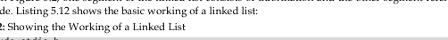

**图 5.2：链表的展示**

如图 5.2 所示，链表的一段包含信息，另一段指向下一个节点。清单 5.12 展示了链表的基本工作方式：

### 清单 5.12：展示链表的工作方式

```c
#include<stdio.h>

struct node
{
    char name[20];
    struct node *next;
};

int main()
{
    struct node *head = NULL;
    struct node *temp = NULL;
    struct node *temp1 = NULL;
    int choice;

    do
    {
        printf("\n 1. Create Node in Linked List ");
        printf("\n 2. Display nodes in Linked list ");
        printf("\n 3. Exit");
        printf("\n Enter your choice -> ");
        scanf("%d",&choice);

        switch(choice)
        {
            case 1:
                temp = (struct node*)malloc(sizeof(struct node));
                temp->next = NULL;
                fflush(stdin);
                printf("\n Enter the name ");
                gets(temp->name);
                fflush(stdin);
                if(!head)
                {
                    head = temp;
                    temp1 = temp;
                }
                else
                {
                    temp1->next = temp;
                    temp1 = temp;
                }
                break;
            case 2:
                temp = head;
                while(temp)
                {
                    printf("\n Data -> %s ",temp->name);
                    temp = temp->next;
                }
                break;
            default:break;
        }
    }
    while(choice != 3);
    getch();
    return 0;
}
```

上述程序定义了一个称为 `node` 的自引用结构。该结构有两个成员：`name`（一个字符串）和 `next`（同一结构类型的结构指针）。`next` 指针将标识链表的下一个组成部分。在 `main()` 函数中，我们定义了几个额外的结构指针，用于保存链表的起始地址。我们还使用了一个 `do-while` 循环，该循环将一直迭代，直到用户输入 3。如果用户输入 1，则会在链表末尾创建并追加一个新节点。`head` 指针表示链表的起始地址，在这种情况下，它会得到更新。`temp1` 指针用于将节点插入链表，因为该指针包含最新的地址。链表中节点的创建是通过使用 `malloc()` 库函数完成的。内存分配语句如下所示：

```c
temp = (struct node*)malloc(sizeof(struct node));
```

上述语句返回一个指向 `node` 类型结构的指针。如果用户输入 2，则会遍历整个链表。在这种情况下，链表的起始地址会被复制到一个临时指针中，该指针用于遍历整个链表。上述程序的输出如下：

```text
1. Create node in Linked List
2. Display nodes in Linked list
3. Exit
Enter your choice -> 1

Enter the name TOM

1. Create Node in Linked List
2. Display nodes in Linked list
3. Exit
Enter your choice -> 1

Enter the name RON
1. Create Node in Linked List
2. Display nodes in Linked list
3. Exit
```

让我们考虑以下联合（union）的声明：

```c
union student
{
    int age;
    char name[20];
}stu1, stu2;
```

在前面的声明中，我们声明了两个联合变量：`stu1` 和 `stu2`。每个联合变量可以表示一个 20 字符的名称或一个整数类型的年龄。一个 20 字符的字符串比 4 字节的整型变量占用更多内存；因此，编译器将为这两个联合变量分配 20 字节的内存，因为 20 是两个大小中较大的一个。

图 5.3 展示了联合的内存组织方式：

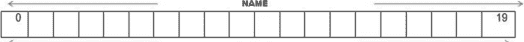

**图 5.3：展示联合的内存组织**

如图 5.3 所示，20 字节的内存由这两个变量共享。

联合可以是结构的成员，反之亦然。清单 5.13 展示了联合的基本工作原理：

### 清单 5.13：展示联合的工作方式

```c
#include<stdio.h>

union bookInfo
{
        int year;
        char name[10];
};

struct book
{
        char author[20];
        char publisher[20];
        union bookInfo info;
};

int main()
{
        struct book book1;

        printf("\n Enter Name of author publisher year ");
        scanf("%s %s %d",book1.author, book1.publisher,&book1.info.year);

        printf("\n The information entered is \n");
        printf("\n Author -> %s ",book1.author);
        printf("\n Publisher -> %s ",book1.publisher);
        printf("\n Year -> %d",book1.info.year);

        fflush(stdin);
        printf("\n Enter Name of the book ->");
        gets(book1.info.name);

        printf("\n Name of the book is -> %s ",book1.info.name);
```

### 打开文件

在 C 语言中，文件管理的第一步是打开文件，这包括创建一块临时缓冲区区域，从文件中读取的数据将存储在主存储器中。临时缓冲区有助于在从辅助存储器获取数据块时最大限度地减少磁盘访问。想象一下，如果从文件中读取的每个字符都需要一次磁盘访问，那么在这种情况下，由于磁盘访问的巨大延迟，执行 I/O 操作将变得不可能。为了避免这些情况，在首次打开文件时，信息会被放入一个中间缓冲区，然后从缓冲区中逐字符读取内容。

为了对文件执行操作并收集有关文件的信息，C 语言使用了一个名为 `fopen()` 的函数，该函数用于打开文件。`fopen()` 函数的一般形式如下：

```c
FILE *fptr = fopen(file-name, file-type);
```

在上述格式中，`FILE` 是一种特殊结构，负责所打开文件的信息。`fopen()` 的签名如下：

```c
FILE *fopen(const char *restrict filename, const char *restrict mode);
```

在上述签名中，`fopen()` 返回一个 `FILE` 类型的指针，该指针包含有关文件的所有必要信息；指针 `fptr` 也保存着这些信息。文件名和文件类型是分别表示文件名称和文件使用方式的字符串。文件类型也称为文件模式。表 5.1 详细介绍了不同的文件类型：

**表 5.1：不同的文件类型**

| 文件类型 | 可执行操作 | 描述 |
|---|---|---|
| `r` | 读取 | 打开一个现有文件进行读取。 |
| `w` | 写入 | 仅打开一个文件进行写入。如果文件存在，其内容将被覆盖；否则，将创建一个新文件。 |
| `a` | 添加新信息 | 打开一个现有文件，在文件末尾追加信息。如果文件不存在，则创建一个新文件。 |
| `r+` | 读取、写入和追加信息 | 打开一个现有文件进行读取和写入。 |
| `w+` | 写入、读取和追加新信息 | 打开一个文件进行写入和读取。如果文件已存在，其内容将被覆盖；否则，将创建一个新文件。 |
| `a+` | 读取和追加 | 打开一个现有文件进行追加和读取。在这种情况下，现有内容不能被修改。 |

现在，让我们举一个打开文件的例子。清单 5.14 展示了如何打开文件：

### 清单 5.14：打开文件

```c
#include<stdio.h>

int main()
{
    FILE *fp;

    fp = fopen("D:\\_readme.txt", "r");

    if(!fp)
    {
        printf("\n Failed to open the file");
    }
    else
```


```c
{
    fprintf(fp, "\n the file is ready for reading");
}

getch();

return 0;
```

前面的代码以只读模式打开一个已存在的文件。`fopen()` 函数会执行三个操作：

- 首先，它会在磁盘上搜索该文件；如果文件不存在，则会显示一条错误信息。
- 其次，如果文件存在，则将该文件从磁盘加载到内存中（在缓冲区中）。
- 最后，设置一个字符指针，使其指向缓冲区的第一个字符。

文件打开操作可能由于多种原因失败，例如文件在指定位置不存在。每当 `fopen()` 函数打开文件失败时，它都会返回 `NULL`，这可以在后续代码中处理。

接下来，让我们学习如何关闭文件。

### 关闭文件

在对文件执行完所有必需的操作后，关闭文件也很重要。这可以通过 `fclose()` 函数来完成。使用 `fclose()` 函数的通用语法如下：

```c
fclose(file_ptr);
```

使用 `fclose()` 函数关闭文件后，文件将变得不可访问，既不能从文件中读取任何信息，也不能向文件中写入任何信息。关闭文件时，与该文件关联的缓冲区也会从内存中移除。清单 5.15 演示了如何关闭文件。

### 清单 5.15：关闭文件

```c
#include<stdio.h>

int main()
{
    FILE *fp;

    fp = fopen("D:\\_readme.txt", "r");

    if(!fp)
    {
        printf("\n failed to open the file");
        return 0;
    }
    else
    {
        fprintf(fp, "\n the file is ready for reading");
    }

    fclose(fp);  /* for closing the file */

    getch();

    return 0;
}
```

在清单 5.15 中，`fclose()` 将一个文件指针作为参数，并执行一些特定任务。如果需要向文件中写入某些信息，则信息会首先被写入缓冲区。执行 `fclose()` 后，信息会被写回到文件中。随后，缓冲区也会从内存中移除。

在下一节中，让我们学习如何从文件中读取。

### 从文件读取

以只读模式打开文件后，其内容会被载入缓冲区，并返回指向缓冲区第一个字符的指针。要从文件中读取信息，需要使用文件指针。信息可以逐字符、按单词或按数据字节的方式获取。C 语言为用户提供了充分的灵活性，可以根据需求自定义信息的检索方式。

清单 5.16 演示了如何从文件中逐个获取字符：

### 清单 5.16：逐个获取文件中的字符

```c
#include<stdio.h>

int main()
{
    char character;
    FILE *fp;

    fp = fopen("D:\\_readme.txt","r");

    if(!fp)
    {
        printf("\n Failed to open the file");
        return 0;
    }
    do
    {
        character = fgetc(fp);
        printf("%c",character);
    }while(character != EOF);

    fclose(fp); /* For closing the file pointer */
    getch();

    return 0;
}
```

上面的代码演示了如何通过逐个读取字符来从文件中获取信息。`fgetc()` 函数从当前指针位置读取一个字符，将指针位置前移以便获取下一个字符，并返回所读取的字符。`fgetc()` 函数在 `do-while` 循环中使用，其终止条件如下：

```c
while (character != EOF)
```

文件末尾存在一个特殊字符，表示已到达文件结尾。在读取文件时，`fgetc()` 会遇到这个特殊字符并返回宏 `EOF`。在我们的例子中，循环只有在到达文件结尾时才会终止。在读取文本文件时，如果遇到 `EOF`，C 通常会返回 `-1`。如果相同的值存储在 `unsigned char` 变量中，而在读取文件时遇到了该值，那么循环将永远不会终止，因为 `unsigned char` 没有 `-1`。清单 5.17 演示了如何使用 `fgetc()` 函数获取一个字符：

### 清单 5.17：使用 fgetc() 函数获取字符

```c
#include<stdio.h>

int main()
{
    unsigned char character;
    FILE *fp;

    fp = fopen("D:\\_readme.txt", "r");

    if(!fp)
    {
        printf("\n failed to open the file");
        return 0;
    }
    do
    {
        character = fgetc(fp);
        printf("%c",character);
    }while(character != EOF);
    printf("\n EOF  {%d}",EOF);
    fclose(fp); /* for closing the file pointer */
    getch();

    return 0;
}
```

从文件中读取信息时，如果使用 `unsigned char` 而不是 `char`，代码将变成一个无限循环。然而，一些高级编译器会识别此问题，并在编译期间提供警告，例如：

> [警告] 由于数据类型的范围有限，比较结果始终为真

现在，让我们学习如何从文件中读取单词。

### 从文件读取单词

与字符类似，我们也可以从文本文件中读取单词。我们需要使用 `fscanf()` 函数，而不是 `fgetc()` 或 `getc()` 函数，该函数能够一次从文件中读取一个单词。清单 5.18 演示了如何从文本文件中读取单词：

### 清单 5.18：从文件中读取单词

```c
#include<stdio.h>

int main()
{
    char end_char;
    char word[20];
    FILE *fp;

    fp = fopen("D:\\_readme.txt", "r");

    if(!fp)
    {
        printf("\n failed to open the file");
        return 0;
    }
    do
    {
        end_char = fscanf(fp, "%s", word);
        printf("%s \n",word);
    }while(end_char != EOF);

    fclose(fp); /* for closing the file pointer */
    getch();
    return 0;
}
```

在清单 5.18 中，我们以只读模式打开了一个文件。如果文件存在，则通过 `fscanf()` 函数从文件中获取每个单词，并使用 `printf()` 函数显示该单词。此过程持续到遇到 `EOF` 字符为止。从文件中读取完所有信息后，我们使用 `fclose()` 函数关闭了文件描述符。

前面程序的输出如下：

```
THIS
IS
HOW
WE
READ
WORDS
FROM
A
FILE.
FILE.
```

如果仔细检查前面程序的输出，可以发现最后一个单词被重复了。其原因是：当检查文件中的 `EOF` 时，缓冲区中已经包含了文件中遇到的最后一个单词，因此该单词被显示了两次。解决此问题的方法之一是在 `do-while` 循环内部加入 `EOF` 检查。清单 5.19 演示了如何避免文件中最后一个单词重复的问题：

### 清单 5.19：检查文件中的 EOF

```c
#include<stdio.h>

int main()
{
    char end_char;
    char word[20];
    FILE *fp;

    fp = fopen("D:\\readme.txt","r");

    if(!fp)
    {
        printf("\n Failed to open the file");
        return 0;
    }
    do
    {
        end_char = fscanf(fp, "%s", word);

        if(end_char == EOF) {
            break;
        }

        printf("%s \n",word);
    }while(1);

    fclose(fp); /* For closing the file pointer */
    getch();

    return 0;
}
```

前面程序的输出如下：

```
THIS
IS
HOW
WE
READ
WORDS
FROM
A
FILE.
```

接下来，让我们学习如何从文件中读取行。

### 从文件读取行

C 语言还提供了每次从文件中读取一整行的灵活性。要从文本文件中逐行读取，我们需要使用 `fgets()` 函数。`fgets()` 的通用签名如下：

```c
char * fgets ( char * str, int num, FILE * stream );
```

在上面的签名中，`str` 指向存储待读取字符串的字符数组；`num` 表示要读取的字符数；`stream` 是指向文件对象的指针，该对象标识信息读取自哪个流。

`fgets()` 函数返回存储到 `str` 参数中的同一字符串。清单 5.20 演示了如何从文件中读取行。

### 清单 5.20：使用 fgets() 函数从文件中读取行

```c
#include<stdio.h>

int main()
{
    char *end_char;
    char sentence[100];
    FILE *fp;

    fp = fopen("D:\\readme.txt", "r");

    if(!fp)
    {
        printf("\n Failed to open the file");
        return 0;
    }
    do
    {
        end_char = fgets(sentence, 100, fp);

        if(end_char == NULL) {
            break;
        }

        printf("%s \n", sentence);
    }while(1);

    fclose(fp); /* For closing the file pointer */
    getch();

    return 0;
}
```


在代码清单 5.20 中，我们尝试从文件中读取一整句话。首先，我们以只读模式打开文件，然后使用 `fgets()` 函数从文件中读取一整句话。

前面程序的输出如下：

```
THIS IS HOW WE READ SENTENCE FROM A FILE.
```

在下一节中，我们来学习如何创建文件。

### 创建文件

文件在处理之前需要先创建。文本文件或面向流的文件可以通过两种方式创建。既可以借助某些外部文字处理软件来创建，也可以通过编写某个程序将信息写入数据文件来创建。无格式文件只能借助程序创建。代码清单 5.21 展示了如何创建文件：

**代码清单 5.21：创建文件**

```c
#include<stdio.h>

    int main()
    {
        char ch='A';
        FILE *fp;

        fp = fopen("D:\\create_readme.txt","w");

        if(!fp)
        {
            printf("\n Failed to open the file");
            return 0;
        }

        putc(ch, fp);
        fclose(fp); /* For closing the file pointer */
        getch();

        return 0;
    }
```

前面的程序以写模式创建一个数据文件。接下来，我们来学习如何向文件写入内容。

### 向文件写入内容

在以写模式打开文件（即通过 `fopen()` 函数中的“w”来完成）之后，用户可以使用 `fputc()` 和 `fputs()` 等函数将信息写入文件。`fputc()` 函数允许用户向文件中写入字符；而 `fputs()` 函数允许用户向文件进行多行写入。代码清单 5.22 展示了如何使用 `fputc()` 函数向文件写入内容：

**代码清单 5.22：向文件写入内容**

```c
#include<stdio.h>

    int main()
    {
        char character;
        FILE *fp,*fd;

        fp = fopen("D:\\readme.txt", "r");
        fd = fopen("D:\\readme_new.txt", "w");

        if(!fp)
```

前面的代码将信息写入文件，但采用了一种优化的方式。代码不是逐个字符复制，而是一次复制 100 个字符的缓冲区，并将其写入目标文件。

现在，我们来学习如何向文件添加记录。

### 向文件添加记录

数据文件通常用于存储记录，而记录是一组不同类型的信息。要将此类记录写入数据文件，我们可以使用 `fprintf()` 函数。此外，要从数据文件中获取记录，我们可以使用 `fscanf()` 函数。代码清单 5.24 展示了 `fprintf()` 和 `fscanf()` 函数的工作方式：

**代码清单 5.24：** 添加和获取记录

```c
#include<stdio.h>

struct student
{
        char name[20];
        int class;
        int age;
};

int main()
{
        struct student stu;
        FILE *fp;
        int choice;

        fp = fopen("D:\\studentRecords.dat","a");

        do
        {
                printf("\n 1. Add records to a file ");
                printf("\n 2. Exit");
                printf("\n Enter your choice => ");
                scanf("%d",&choice);

                switch(choice)
                {
                        case 1:
                                printf("\n Enter Name Class Age =>");
                                scanf("%s %d",&stu.name,&stu.class,&stu.age);
                                fprintf(fp,"%s %d %d",stu.name,stu.class,stu.age);
                                break;
                        case 2:
                                break;
                        default:break;
                }
        }while(choice != 2);

        fclose(fp);

        fp = fopen("D:\\studentRecords.dat","r");

        printf("\n Records Inserted are ");

        while(fscanf(fp,"%s %d %d",&stu.name,&stu.class,&stu.age) != EOF)
        {
                printf("\n %s %d %d ",stu.name,stu.class,stu.age);
        }
        getch();
        return 0;
}
```

在前面的程序中，我们使用 `scanf()` 函数将数据写入 student 结构体。在填充结构体变量 stu 之后，我们将信息写回数据文件。在将信息写回数据文件时，我们使用 `fprintf()` 函数，该函数将文件指针作为参数。与 `printf()` 类似，`fprintf()` 也允许以多种方式格式化数据。在显示信息时，我们使用 `fscanf()`，它的工作方式与 `scanf()` 相同。唯一的区别是，它将文件指针作为参数，并从该文件读取信息。

前面程序的输出如下：

```
1. Add records to a file
2. Exit
Enter your choice -> 1

Enter Name Class Age ->JOHN 9 14

1. Add records to a file
2. Exit
Enter your choice -> 1

Enter Name Class Age ->RICHARD 6 11

1. Add records to a file
2. Exit
Enter your choice -> RON 12 16

Enter Name Class Age ->
1. Add records to a file
2. Exit
Enter your choice -> 2

Records Inserted are
JOHN 9 14
RICHARD 6 11
RON 12 16
```

现在，我们来详细了解二进制文件。

### 二进制文件

二进制文件是字节的集合。二进制文件的一个例子是音频文件，其中包含不可打印的字符。文本文件与二进制文件的区别在于两者检测文件结束的方式。对于文本文件，ASCII 值为 26 的特殊字符被视为文件结束字符。如果遇到该字符，则意味着已到达文件末尾。然而，二进制文件中不存在这样的特殊字符。文件结束由文件大小决定。二进制文件可能被用于存储数字。在这种情况下，数字 26 可能表示文件结束，并导致程序提前终止。在文本文件中，换行字符会被转换为回车换行组合（\r\n），然后写入文件。然而，如果以二进制模式打开文件，则不会发生这种转换。

代码清单 5.25 展示了如何从二进制文件读取以及向二进制文件写入：

**代码清单 5.25：处理二进制文件**

```c
#include<stdio.h>

struct student
{
    char name[20];
    int class;
    int age;
};

int main()
{
    struct student stu;
    FILE *fp;
    int choice;

    fp = fopen("D:\\studentRecords.dat","wb");

    do
    {
        printf("\n 1. Add records to a file ");
        printf("\n 2. Exit");
        printf("\n Enter your choice -> ");
        scanf("%d",&choice);

        switch(choice)
        {
            case 1:
                printf("\n Enter Name Class Age ->");
                scanf("%s %d %d",&stu.name,&stu.class,&stu.age);
                fwrite(&stu, sizeof(stu), 1, fp);
                break;
            case 2:
                break;
            default:break;
        }
    }while(choice != 2);

    fclose(fp);

    fp = fopen("D:\\studentRecords.dat","rb");

    printf("\n Records inserted are ");

    while(fread(&stu, sizeof(stu), 1, fp))
    {
        printf("\n %s %d %d ",stu.name,stu.class,stu.age);
    }

    getch();
    return 0;
}
```

在前面的程序中，我们以 `wb` 模式打开文件，这表明我们正在处理二进制文件。

前面程序的输出如下：

```
1. Add records to a file
2. Exit
Enter your choice -> 1

Enter Name Class Age ->MICHELLE 5 12

1. Add records to a file
2. Exit
Enter your choice -> 1

Enter Name Class Age ->CHARLIE 8 16

1. Add records to a file
2. Exit
Enter your choice -> 2

Records Inserted are
MICHELLE 5 12
CHARLIE 8 16
```

在处理二进制文件时，我们没有使用 `fscanf()` 和 `fprintf()`，而是使用了两个新函数：`fread()` 和 `fwrite()`。

`fread()` 函数返回读取到的项数。`fread()` 的签名如下：

```c
size_t fread(void *buffer, size_t num_bytes, size_t count, FILE *fp);
```

在前面的签名中，`buffer` 是指向内存区域的指针，该内存区域将接收来自文件的数据。`count` 的值决定要读取多少项，其中每一项的长度为 `num_bytes` 字节。如果已到达文件末尾或发生错误，该返回值可能小于 `count`。

`fwrite()` 函数返回成功写入磁盘的项数。`fwrite()` 的签名如下：

```c
size_t fwrite(const void *buffer, size_t num_bytes, size_t count, FILE *fp);
```

其参数及其用法与 `fread()` 相同。

在前面的程序中，我们已经从二进制文件读取并写入信息。然而，数据库应用涉及更复杂的任务，例如在二进制文件中更新、删除和添加记录。代码清单 5.26 展示了使用二进制文件管理数据库的代码。

**代码清单 5.26：使用二进制文件管理数据库**

```c
#include<stdio.h>

struct student
{
        char name[20];
        int class;
        int age;
};

int main()
{
        struct student stu;
        FILE *fp,*fd;
        int choice;
```


```c
char tempName[20];

fp = fopen("D:\\studentRecords.dat", "wb+");

if(!fp)
{
    printf("\n Cannot Open File ");
    exit(0);
}

do
{
    printf("\n 1. Add Records to a file ");
    printf("\n 2. Display Records ");
    printf("\n 3. Modify Record ");
    printf("\n 4. Delete Record ");
    printf("\n 5. Exit");
    printf("\n Enter your choice -> ");
    scanf("%d", &choice);

    switch(choice)
    {
        case 1:
            fflush(stdin);
            fseek(fp, 0, SEEK_END);
            printf("\n Enter Name Class Age ->");
            scanf("%s %d %d", &stu.name, &stu.class, &stu.age);
            fwrite(&stu, sizeof(stu), 1, fp);
            break;
        case 2:
            rewind(fp);
            while(fread(&stu, sizeof(stu), 1, fp))
            {
                printf("\n %s %d %d ", stu.name, stu.class, stu.age);
            }
            break;
        case 3:
            fflush(stdin);
            rewind(fp);
            printf("\n Enter Name of the Student -> ");
            gets(tempName);
            while(fread(&stu, sizeof(stu), 1, fp))
            {
                if(!strcmp(stu.name, tempName))
                {
                    fflush(stdin);
                    printf("\n Enter New Name Age Class ->");
                    scanf("%s %d %d", &stu.name, &stu.class, &stu.age);
                    fseek(fp, -sizeof(stu), SEEK_CUR);
                    fwrite(&stu, sizeof(stu), 1, fp);
                    break;
                }
            }
            break;
        case 4:
            fflush(stdin);
            rewind(fp);
            fd = fopen("D:\\temp.dat","wb");
            printf("\n Enter Student Name for Deletion -> ");
            gets(tempName);
            while(fread(&stu, sizeof(stu), 1, fp))
            {
                if(strcmp(tempName,stu.name))
                {
                    fwrite(&stu, sizeof(stu), 1, fd);
                }
            }
            fclose(fp);
            fclose(fd);
            remove("D:\\studentRecords.dat");
            rename("D:\\temp.dat","D:\\studentRecords.dat");
            fp = fopen("D:\\studentRecords.dat","rb+");
            break;
        default:
            break;
    }
} while(choice != 5);

fclose(fp);
getch();
return 0;
}
```

前面程序的输出如下：

```text
1. Add records to a file
2. Display Records
3. Modify Record
4. Delete Record
5. Exit
Enter your choice -> 1

Enter Name Class Age ->BRIAN 1 5

1. Add records to a file
2. Display Records
3. Modify Record
4. Delete Record
5. Exit
Enter your choice -> 1

Enter Name Class Age ->CRISTINA 2 6

1. Add records to a file
2. Display Records
3. Modify Record
4. Delete Record
5. Exit
Enter your choice -> 2

BRIAN 1 5
CRISTINA 2 6
1. Add records to a file
2. Display Records
3. Modify Record
4. Delete Record
5. Exit
Enter your choice -> 1

Enter Name Class Age ->RONALD 3 9

1. Add records to a file
2. Display Records
3. Modify Record
4. Delete Record
5. Exit
Enter your choice -> 4

Enter Student Name for Deletion -> CRISTINA

1. Add records to a file
2. Display Records
3. Modify Record
4. Delete Record
5. Exit
Enter your choice -> 2

BRIAN 1 5
RONALD 3 9
1. Add records to a file
2. Display Records
3. Modify Record
4. Delete Record
5. Exit
Enter your choice -> 1

Enter Name Class Age ->EMMIE 5 11

1. Add records to a file
2. Display Records
3. Modify Record
4. Delete Record
5. Exit
Enter your choice -> 2

BRIAN 1 5
RONALD 3 9
EMMIE 5 11
1. Add records to a file
2. Display Records
3. Modify Record
4. Delete Record
5. Exit
Enter your choice -> 3

Enter Name of the Student -> BRIAN

Enter New Name Age Class->VICKY 5 10

1. Add records to a file
2. Display Records
3. Modify Record
4. Delete Record
5. Exit
Enter your choice -> 2

VICKY 5 10
RONALD 3 9
EMMIE 5 11
1. Add records to a file
2. Display Records
3. Modify Record
4. Delete Record
5. Exit
Enter your choice -> 5
```

在清单 5.26 中，以二进制模式创建文件，并设置一个文件指针，它指向文件的第一条记录。使用 fread() 和 fwrite() 函数时，文件指针会移动到下一条记录的开头；然而，在关闭文件时，文件指针会失效。文件指针的移动在此程序中至关重要，因为它控制着 fread() 将读取下一条记录的位置，以及 fwrite() 将写入下一条记录的位置。rewind() 函数将文件指针置于文件开头。fseek() 函数有助于将文件指针从一条记录移动到另一条记录。如果要移动到上一条记录，可以使用以下语法：

```c
fseek(fp, -(sizeof(stu)), SEEK_CUR);
```

类似地，以下语法将文件指针移动到文件中的最后一条记录：

```c
fseek(fp, 0, SEEK_END);
```

现在，我们来讨论 C 语言中的文件管理函数。

### 文件管理函数

C 提供了若干文件管理函数，可用于执行各种与文件相关的任务。所有文件管理函数都定义在 <stdio.h> 头文件中。以下是 C 语言中的一些文件管理函数：

- fclose()
- feof()
- ferror()
- fgetpos()
- freopen()
- ftell()

下面详细学习这些函数。

### fclose()

fclose() 函数关闭与流关联的文件并刷新其缓冲区。fclose() 的签名如下：

```c
int fclose(FILE*stream);
```

调用 fclose() 后，流不再与文件保持连接，已分配的缓冲区会自动释放。成功时，fclose() 返回 0；否则，返回 EOF。

### feof()

feof() 函数确定是否已到达与流关联的文件末尾。feof() 的签名如下：

```c
int feof(FILE *stream);
```

如果文件指针位于文件末尾，则返回非零值；否则，返回 0。清单 5.27 展示了 feof() 的工作方式：

清单 5.27：展示 feof() 的工作方式

```c
#include<stdio.h>
int main()
{
    char *end_char;
    char sentence[100];
    FILE *fp;

    fp = fopen("D:\\readme.txt","r");

    if(!fp)
    {
        printf("\n Failed to open the file");
        return 0;
    }
    while(!feof(fp))
    {
        end_char = fgets(sentence, 100, fp);
        printf("%s \n",sentence);
    }

    fclose(fp); /* For closing the file pointer */
    getch();

    return 0;
}
```

在清单 5.27 中，我们以只读模式打开了一个已存在的文件，并从该文件中获取信息。feof() 函数用于表示是否已到达文件末尾。从文件中获取信息的过程会一直持续到文件末尾。

### ferror()

ferror() 函数检查给定流上的文件错误。ferror() 的签名如下：

```c
int ferror(FILE *stream);
```

返回值为 0 表示未发生错误，而非零值表示发生了错误。清单 5.28 展示了 ferror() 的工作方式：

清单 5.28：使用 ferror()

```c
#include<stdio.h>
int main()
{
    char *end_char;
    char sentence[100];
    FILE *fp;

    fp = fopen("D:\\readme.txt","r");

    if(!fp)
    {
        printf("\n Failed to open the file");
        return 0;
    }
    while(!feof(fp))
    {
        end_char = fgets(sentence, 100, fp);
        if(ferror(fp)) {
            printf("\n Error Occurred while reading ");
        }
        printf("%s \n",sentence);
    }

    fclose(fp); /* for closing the file pointer */
    getch();

    return 0;
}
```

在清单 5.28 中，我们正在从以只读模式打开的文件中读取信息。从文件读取时，如果遇到任何错误，ferror() 函数会通知该错误，并可以针对它采取适当措施。

### fgetpos()

fgetpos() 的签名如下：

```c
int fgetpos(FILE *stream, fpos_t *position);
```

fgetpos() 函数将文件指针的当前值存储到 position 所指向的对象中。position 所指向的对象必须是 fpos_t 类型。如果发生错误，则 fgetpos() 返回非零值；否则，返回 0。

### freopen()

freopen() 函数将现有流与另一个文件关联。在此过程中，文件末尾标志和错误标志会被清除。freopen() 函数的签名如下：

```c
FILE *freopen(const char *fname, const char *mode, FILE *stream);
```

新文件的名称由 fname 指向，访问模式由 mode 指向，要重新分配的流由 stream 指向。

### ftell()

ftell() 函数返回指定流的文件指针当前值。ftell() 函数的签名如下：

```c
long int ftell(FILE *stream);
```

对于二进制流，该值以字节数为单位。对于文本流，返回值可能没有意义，因为可能发生字符转换，例如用回车/换行替换换行符，这会影响文件的外观大小。

接下来，我们来讨论 C 语言中的按位运算符。


### 按位运算符

到目前为止，我们已经处理了 C 中的不同数据类型，但有些应用需要处理内存中存在的最小元素，而该元素恰好是位。C 赋予用户操作位并修改位的灵活性。对位进行操作是编程的一个特殊方面，因为它使用户能够以高效的方式与硬件通信。以下是 C 中的各种按位运算符：

- 反码运算符
- 按位逻辑运算符
- 移位运算符

让我们详细学习这些运算符。

### 反码运算符

一个数的反码意味着该数二进制表示中的所有 1 都变为 0，所有 0 都变为 1。让我们考虑一个十进制数 6，其二进制表示为 0110。该数的反码将是 1001，即十进制中的 9。反码的按位表示法由 ~ 运算符表示。反码是一元运算，该运算符始终位于操作数之前。操作数应为整数类型的量，例如 integer、long 和 short。操作数的结合性是从左到右。反码运算也称为求补运算。清单 5.29 展示了反码运算：

**清单 5.29：** 展示反码运算

```c
#include<stdio.h>

int main()
{
    int varA, varB;

    varA = 6;
    varB = ~varA;

    printf("\n The decimal of one's complement of varA is [%d] ",varB);

    getch();
    return 0;
}
```

上述程序的输出如下：

> varA 的反码的十进制值为 [-7]

6 的反码恰好是 11111111111111111111111111111001。该数以 32 位表示法给出。这个数的十进制等价值恰好是 -7。这类技术的主要用途是文件加密。

### 按位逻辑运算符

在 C 中，逻辑运算符对表达式进行运算。类似地，同样的运算符也可以用于位，以执行逻辑运算。逻辑运算符用于建立和验证某些条件，而按位运算符用于操作变量中的位级值。C 中定义了三种按位逻辑运算符：按位与（&）、按位或（|）和按位异或（^）。这些运算符中的每一个都是二元运算符，需要两个操作数来进行运算。需要注意的一个重要点是，两个操作数应具有相同的数据类型。

让我们逐一了解它们。

### 按位与运算符

按位与（&）运算符不同于逻辑与（&&）运算符。按位与运算符逐位对其操作数进行运算。表 5.2 展示了按位与运算的真值表：

**表 5.2：按位与运算的真值表**

| 第一位 (A) | 第二位 (B) | 结果位 (A & B) |
|---|---|---|
| 0 | 0 | 0 |
| 0 | 1 | 0 |
| 1 | 0 | 0 |
| 1 | 1 | 1 |

如果两个位都为 1，则按位与运算符返回 1；否则，它返回 0。清单 5.30 展示了如何在 C 中执行按位与运算：

**清单 5.30：** 展示按位与运算

```c
#include<stdio.h>

int main()
{
    int varA, varB, varC;

    varA = 3;
    varB = 5;
    varC = varA & varB;

    printf("\n The AND'ing of varA and varB is [%d] ", varC);

    getch();
    return 0;
}
```

上述程序的输出如下：

```text
The AND'ing of varA and varB is [1]
```

输出显示与运算的结果为 1。3 的八位二进制表示是 00000011，5 是 00000101。因此，根据与运算的真值表，与运算按如下方式进行：

```text
  00000011
  00000101
  ----------
  00000001
```

按位与运算通常用于屏蔽一个数的某些位。为此，与运算的第二个操作数被视为与掩码。假设我们有一个位模式 10010110，我们想检查该模式的第 6 位是否被置位。要检查第 6 位是否被置位，我们需要用 0 屏蔽所有其余位。此情况下将使用的位掩码是 01000000，如下所示：

```text
  10010110
  01000000
  ----------
  00000000
```

屏蔽运算的结果为 0，因为源二进制模式的第 6 位是 0。如果该位是 1，那么结果将是 01000000，即十进制中的 64。清单 5.31 展示了如何使用按位运算符检查位：

**清单 5.31：** 检查位

```c
#include<stdio.h>
int main()
{
    int varA = 72;
    int checkBit;
    checkBit = varA & 64;
    if(checkBit)
        printf("\n Sixth Bit is ON ");
    else
        printf("\n Sixth Bit is OFF ");
    checkBit = varA & 16;
    if(checkBit)
        printf("\n Fourth Bit is ON ");
    else
        printf("\n Fourth Bit is OFF ");
    getch();
    return 0;
}
```

上述程序的输出如下：

```text
Sixth Bit is ON
Fourth Bit is OFF
```

在清单 5.31 中，我们正在检查某个整数的第 6 位是否被置位。为此，我们将该整数与 64 进行与运算，这将从整数中提取第 6 位。

### 按位或运算符

如果两个操作数中的任意一位为 1，则按位或运算符返回 1；否则，它返回 0。表 5.3 展示了按位或运算的真值表：

**表 5.3：按位或运算的真值表**

| 第一位 (A) | 第二位 (B) | 结果位 (A \| B) |
|---|---|---|
| 0 | 0 | 0 |
| 0 | 1 | 1 |
| 1 | 0 | 1 |
| 1 | 1 | 1 |

让我们考虑两个十进制数，12 和 17。对这两个整数的按位或运算如下所示：

```text
  00001100
  00010001
------------
  00011101
```

```c
printf("\n The result after XORing for first time [%d] ",varA);

varA = varA ^ 32;
printf("\n The result after XORing for second time [%d] ",varA);

getch();
return 0;
}
```

上述程序的输出如下：

```text
The result after XORing for first time [116]

The result after XORing for second time [84]
```

### 移位运算符

C 中使用的按位移位运算符是右移运算符和左移运算符。这两个运算符中的每一个都需要两个操作数来进行运算。第一个操作数表示要移位的位模式，第二个操作数表示需要进行的位移次数。

让我们详细学习这两个运算符。

#### 右移运算符

右移运算符由 >> 符号表示。它将给定的位模式向右侧移位。假设右移运算的表达式为：

```text
abc >> 5
```

该表达式会将 abc 中的所有位向右移动五位。假设 abc 包含位模式 11010010。将该位模式右移一位得到：

```text
01101001
```

进一步，abc >> 2 将得到：

```text
00110100
```

同样，abc >> 5 将提供：

```text
00000110
```

随着位向右移动，左侧会产生空位；这些空位由 0 填充。因此，位移也会造成信息丢失。

图 5.4 展示了右移操作：

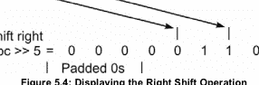

**图 5.4：展示右移操作**

图 5.4 表明，右移一个位模式会导致位丢失。

第5章

清单 5.34 展示了将位右移的代码：

**清单 5.34：** 将位右移

```c
#include<stdio.h>
int main()
{
    int varA = 210;
    varA = varA >> 5;
    printf("\n The result after shifting 5 bits to the right[%d] ",varA);
    getch();
    return 0;
}
```

上述程序的输出如下：

```text
The result after shifting 5 bits to the right[6]
```

11010010 的十进制等价值是 210。当我们将该整数的 5 位右移时，得到结果 6。执行右移操作时，我们需要注意几点。让我们考虑一个通用表达式：

```c
a >> b
```

在这种情况下，如果 b 恰好为负数，则表达式的结果变得不可预测。一些编译器甚至在编译期间给出警告，如清单 5.35 所示：

**清单 5.35：** 在右移期间生成编译警告

```c
#include<stdio.h>
int main()
{
    int varA = 210;
    varA = varA >> -5;
    printf("\n The result after shifting 5 bits to the right[%d] ",varA);
    getch();
    return 0;
}
```

编译警告如下所示：

```text
[warning] right shift count is negative
```

上述程序的输出如下：

```text
The result after shifting 5 bits to the right[0]
```

输出表明结果变得不可预测。

在通用表达式 a>>b 中，如果 a 变为负数，则最左侧位应始终设置为 1，因为它表示符号位。在一些编译器中，符号位会被扩展。如果我们考虑 a 的值为 -1（二进制 11111111），则执行右移 5 位将得到 7（二进制 00000111）。由于负数在其符号位中包含 1；因此，编译器不会用 0 填充空位，而是用 1 填充。这种技术称为符号位扩展。清单 5.36 展示了 C 中的符号位检查：

**清单 5.36：** 展示 C 中的符号位检查

```c
#include<stdio.h>
int main()
{
    int varA = -1;
    varA = varA >> 5;
    printf("\n The result after shifting 5 bits to the right[%d] ",varA);
    getch();
    return 0;
}
```

上述程序的输出如下：

将 5 位向右移位后的结果 [-1]

我们可以从输出中注意到，即使将数字向右移位 5 位，其值仍为 -1。这是因为编译器用 1 而不是 0 填充空出的位。然而，这种处理方式可能因编译器而异。

#### 左移运算符

左移运算符与右移运算符类似；不过，区别在于位是向左移动的。每移位一位，就会在数字右侧添加一个 0。左移运算符由 << 符号表示。让我们考虑以下表达式：

abc << 5

假设 abc 包含位模式 10101110。如果将该数字向左移位 5 位，则结果值变为 11000000。图 5.5 展示了左移运算的工作过程：

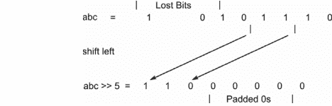

图 5.5：展示左移运算

### 清单 5.37：展示左移的代码

```c
#include<stdio.h>
int main()
{
    int varA = 174;
    varA = varA << 5;
    printf("\n The result after shifting 5 bits to the left [%d] ",varA);
    getch();
    return 0;
}
```

上述程序的输出如下：

将 5 位向左移位后的结果 [5568]

10101110 的十进制表示为 174。将该数字向左移位 5 位后，在 32 位十进制表示中，结果变为 5568。

让我们看一看将给定十进制数转换为其 16 位二进制表示法的代码，如清单 5.38 所示：

### 清单 5.38：展示变量的二进制表示

```c
#include<stdio.h>
int main()
{
    int varA, i, mask, bitPos;
    printf("\nEnter any decimal number -> ");
    scanf("%d",&varA);
    printf("\n The Binary equivalent of %d is ",varA);
    for(i=15;i >= 0;i--)
    {
        mask = 1 << i;
        bitPos = varA & mask;
        bitPos == 0 ? printf("0"):printf("1");
    }
    getch();
    return 0;
}
```

上述程序的输出如下：

```
Enter any decimal number -> 276
The Binary equivalent of 276 is 0000000100010100
Enter any decimal number -> 139
The Binary equivalent of 139 is 0000000010001011
```

当循环第一次执行时，mask 的内容为 1000000000000000。使用这个掩码，最高有效位会被屏蔽掉。如果该位为 0，则显示 0；否则显示 1。现在，i 递减，下一个最高有效位被屏蔽掉；该过程持续进行，直到处理完所有 16 位。

在下一节中，我们来学习 C 语言中的类型限定符。

### 类型限定符

类型限定符控制变量的访问或修改方式。C89 编译器定义了两种限定符：const 和 volatile。C99 编译器定义了一种称为 restrict 的新限定符。根据 C89 编译器，如果变量的定义中未使用限定符，则所有变量都被视为未限定。类型限定符必须位于其所限定的类型名称之前。类型限定符仅在声明该变量的作用域内改变该变量的属性。例如，声明为 const 的变量仅在该变量的当前作用域内保持为常量。

让我们考虑调用 memcpy() 函数，其原型如下：

```c
void *memcpy(void * restrict dest, const void * restrict src, size_t len);
```

上述函数可以用一个指向内存常规（非只读）部分的指针来调用。我们假定实现不会写入 src 指针所指向的区域。通过使用 restrict 限定符，可以确保调用该函数时两个指针之间不会发生重叠。

我们来了解 const、volatile 和 restrict。

### const

在程序中，声明为 const 的变量不允许被更改。const 变量可以在声明时初始化。编译器通常将这类变量放在内存的只读部分。考虑以下语句：

```c
const int varA = 20;
```

上述语句创建了一个名为 varA 的变量，并为其赋值 20。然而，任何处理该变量的程序都不能更改这个值。const 变量通常用于防止函数的某个参数所指向的对象被该函数修改。当指针传递给函数时，该函数可以修改该指针所指向的对象。如果该指针在参数声明中被声明为 const，那么该函数将无法修改它。

清单 5.39 展示了无法编译的代码，因为我们试图在 checkFunc() 函数内部修改一个 const 变量的内容：

### 清单 5.39：展示 C 语言中的 const 参数

```c
#include<stdio.h>
void checkFunc(const int varA);
int main()
{
    const int varA = 10;
    checkFunc(10);
    getch();
    return 0;
}
void checkFunc(const int varA)
{
    printf("\n variable passed [%d] ",varA);
    varA++;
}
```

编译错误如下所示：

```
In function 'checkFunc': increment of read-only location
```

许多标准库函数（例如 strlen() 和 strchr()）对其接收的字符串参数使用 const 类型限定符。这表明这些函数不会修改传递给它们的字符串内容。

声明 const 变量的一般形式如下：

```c
const int varA = 10;
```

以下替代形式也可以接受，因为类型说明符和限定符的顺序无关紧要：

```c
int const varA = 5;
```

当使用带指针的复合类型时，顺序就变得重要，如下所示：

```c
int * const ptr = &i; /* const pointer to int */
const int * ptr_1; /* pointer to const int */
int const * ptr_1; /* pointer to const int */
```

指针 ptr 本身是一个 const，也就是说，该指针不能被修改。然而，它所指向的整型变量可以被修改。相反，指针 ptr_1 可以被修改，但它所指向的变量不能被修改。

去除 const 性质（将 const 变量类型转换为非 const 变量）是可能的，但被认为很危险。修改带 const 限定的变量不仅危险，而且如果这些值被放在只读存储区中，甚至可能导致运行时错误，如下所示：

```c
const int * ptci;
int *pti, i;
const int ci;
ptci = pti = &i;
*ptci = 5; /* Compiler error */
*pti = 5; /* OK, but dangerous */
pti = &ci; /* Compiler error */
pti = ptci; /* Compiler error */
pti = (int *)&ci; /* OK, but dangerous */
*pti = 5; /* OK, dangerous and potential runtime error */
```

### volatile

volatile 类型限定符告诉编译器，变量的值可以在其当前作用域之外被更改。考虑这样一种场景：全局变量的地址被传递给操作系统的时钟例程，并用于保存系统时间。在这种情况下，变量的内容会在代码中没有任何显式赋值语句的情况下被更改。C 编译器会自动优化代码的某些部分，并假定：如果一个变量没有出现在任何赋值语句的左侧，那么它的内容就保持不变。因此，这种情况可能导致许多具有误导性的错误。volatile 类型限定符可防止编译器基于某些假设优化代码时发生这类变化。volatile 类型限定符在多线程环境中用途广泛，在这种环境中，任何变量的内容都会在多个进程或线程之间共享。应当记住，频繁使用 volatile 类型限定符会使代码变慢。

### restrict

带 restrict 限定的指针的含义是：没有其他方式可以访问该指针所指向的对象。这一性质表明，对于这样限定的指针，别名不是问题。restrict 类型限定符只能用于指针。

restrict 类型限定符主要用于优化。通过使用 restrict 限定所启用的优化已存在于大多数编译器中。然而，使用 restrict 类型限定符所能观察到的收益并不像看起来那么大；因此，restrict 类型限定符的使用非常少。不过，仅在全局层面（编译器选项）上，可期望的额外收益并没有那么大；因此，可以认为使用该限定符的必要性极小。省略该关键字不会改变程序的行为。

在最后一节中，我们来讨论 C 语言中的内存分段。

### C 语言中的内存分段

编译之后，C 程序会创建四个逻辑上不同的内存区域。第一个区域通常称为文本段。这是可执行指令所在的区域。同一程序的指令在任意时刻只有一份副本驻留在内存中。可执行文件中包含文本段的部分是文本节。

第二个内存区域是存储全局变量的地方。该区域分为两部分。第一部分称为数据段，其中全局变量和静态分配的变量被初始化为非零值。运行同一程序的每个进程都有自己的数据段。可执行文件中包含数据段的部分是数据节。第二部分是未初始化数据段，或称 BSS（Block Started by Symbol）段。全局数据和静态分配的数据默认初始化为 0，它们保存在这个内存区域中。运行同一程序的每个进程都有自己的 BSS 区。程序运行时，BSS 数据被放入数据段；然而，在可执行文件中，它们存储在 BSS 节中。

下一个区域是栈，用于保存函数调用的返回地址、函数参数和局部变量。栈区域还保存 CPU 的当前状态。数据按照后进先出（LIFO）规则从栈中弹出或压入栈。调用函数时，会创建一个栈帧（或过程活动记录）并将其压入栈顶。该栈帧包含如下信息：调用该函数的地址、函数结束时跳回的位置（返回地址）、参数、局部变量，以及被调用函数所需的任何其他信息。栈通常向下增长，因此栈中更深处的项更靠近堆段。

最后一个段称为堆。这是一个空闲内存区域，程序通过 C 的动态内存分配函数来使用它。堆上的所有内容都是匿名的；因此，我们只能通过指针访问其中的部分内容。随着在堆上分配内存，进程的地址空间会增长。尽管可以将内存归还给系统并收缩进程的地址空间，但这几乎从未做过，因为该内存可能会被分配给其他进程。添加到堆中的项在数值上大于添加到前面区域中的项。这是因为堆向上增长。一个称为 break 的指针标记堆的末尾。


- **问题6.** `rewind()` 函数将文件指针指向：
  - i. 用户定义的位置
  - ii. 文件末尾
  - iii. 文件开头
  - iv. 无处

- **问题7.** `ftell()` 函数用于获取以下哪方面的信息：
  - i. 指针的确切位置
  - ii. 写入文件的字节数
  - iii. 文件最后一次被访问的时间
  - iv. 以上都不是

- **问题8.** 在 C99 中引入的类型限定符是：
  - i. volatile
  - ii. const
  - iii. restrict
  - iv. 以上都不是

### 主观题

- **问题1.** 创建一个名为 book 的结构体，包含不同的成员，并用所有相关信息填充它。

- **问题2.** 将一个结构体指针传递给一个成员函数，并在函数内部对其进行修改。此外，从函数返回该结构体的地址。

- **问题3.** 编写一个使用自引用结构体的程序，用于对链表进行插入、删除和修改操作。

- **问题4.** 使用位运算符检查一个数字是否为偶数。

- **问题5.** 使用二进制文件编写一个程序，用于保存医疗商店管理系统的记录。该程序应实现以下功能：
  - 1. 添加、删除和修改记录
  - 2. 搜索记录
  - 3. 显示每日销售报告
  - 4. 显示库存

- **问题6.** 编写一个程序，从文本文件中删除某种特定模式。

- **问题7.** 编写一个程序，在文本文件中搜索所有匹配某个模式的内容，并将其替换为用户定义的内容。

## 6 C 语言中的中断

| 如果您需要了解以下信息： | 请参见页码： |
|---|---|
| C 语言中的中断处理 | 182 |
| 从中断处理程序调用子程序 | 183 |
| 可重入的中断处理程序 | 184 |
| 一些有用的信号 | 185 |
| 注册通用处理程序 | 186 |
| 阻塞信号 | 187 |
| ARM 架构案例研究 | 188 |

通常，我们需要借助外部事件来终止程序的执行流程，例如按下 CTRL + C 组合键。这会生成一个中断，可以通过使用一些附加功能在代码中捕获该中断。此类情况发生在无限循环或空指针的情况下。C 语言提供了处理外部信号的能力，以便与中断相关的工作完成后可以恢复执行流程。简而言之，中断可以是异步信号，表示需要立即处理；也可以是同步信号，表示执行流程发生变化。

在本章中，我们借助一些 C 程序来了解中断处理。我们还学习如何从中断处理程序调用子程序。此外，本章还讨论了可重入的中断处理程序以及一些有用的信号。接下来，我们学习中断服务例程及其在 C 中的实现。另外，我们学习如何阻塞信号。本章还讨论了 ARM 处理器如何处理异常和中断。

### C 语言中的中断处理

通常，处理器与计算机硬件之间存在两种通信方式。第一种是处理器向硬件发送指令；第二种是硬件将某些事件告知处理器。当通信从硬件传向处理器时，称为中断（在 C 语言中也称为信号）。硬件设备将与中断相关的信息保存到堆栈中。如果不立即从堆栈中获取这些信息，它们就会丢失。因此，当处理器收到中断时，它会停止当前正在做的工作，将某些参数保存到堆栈上，并调用中断处理程序（或信号处理程序）来处理该中断。请注意，如果处理器正在处理另一个中断，那么它只有等当前中断处理完成后才会处理新的中断。让我们通过一个程序来理解 C 语言中的基本中断处理，如清单 6.1 所示：

清单 6.1：展示基本的中断处理

```c
#include<stdio.h>
#include<signal.h>

void sighandler(int signum)
{
    FILE *fp = fopen("D:\\...\\SignalTest.txt", "a");
    fprintf(fp, "\n SIGINT Received ");
    fclose(fp);

}

int main()
{
    signal(SIGINT, (void*)sighandler);

    while(1)
    {
        printf("\n Infinite Loop");
    }

    return 0;
}
```

在清单 6.1 中，我们创建了一个无限 while 循环，可以通过按 CTRL+C 组合键来终止。当用户按下 CTRL+C 时，键盘设备驱动程序会告知处理器该组合键产生的中断。处理器通过向正在运行的程序发送另一个信号来响应此中断。在清单 6.1 中，我们已经注册了一个信号处理程序，当处理器产生中断时会调用该处理程序。然而，出现了一个问题：程序如何知道处理器生成的信号类型呢？这个问题的答案很简单——通过使用 C 语言中定义的不同宏。如果我们仔细观察该程序，就会注意到在 `main()` 函数中使用了 `SIGINT` 宏来注册信号处理程序。`SIGINT` 宏用于捕获传给程序的中断。当用户按下 CTRL+C 时，会生成一个中断，处理器将其转发给程序。然后该中断被信号处理函数捕获。要捕获中断，我们需要注册一个信号处理函数，并在中断生成时执行某些操作。为了注册信号处理函数，我们使用以下信号库函数：

```
void (*signal(int signal, void (*func)(int)))(int);
```

`signal()` 函数将由 `func` 指向的函数注册为信号的处理程序。这意味着当程序接收到中断信号时，将调用由 `func` 指向的函数。请注意，要在源代码中使用 `signal()` 函数，应添加 `<signal.h>` 头文件。

接下来，让我们学习从中断处理程序调用子程序或函数。

### 从中断处理程序调用子程序

当程序的控制权转移到中断处理程序后，可以从该中断处理程序中调用不同的子程序来执行某些操作。清单 6.2 展示了如何从中断处理程序调用子程序：

清单 6.2：从中断处理程序调用子程序

```c
#include<stdio.h>
#include<signal.h>

void writeToFile()
{
    FILE *fp = fopen("D:\\SignalTest.txt", "a");
    fprintf(fp,"\n SIGNAL Received ");
    fclose(fp);
}

void sighandler(int signum)
{
    writeToFile();
}

int main()
{
    signal(SIGINT, (void*)sighandler);

    while(1)
    {
        printf("\n Infinite Loop");
    }

    return 0;
}
```

在清单 6.2 中，我们从信号处理程序调用了一个子程序，并在其中执行了某些操作。当程序收到 `SIGINT` 信号时，会调用 `sighandler()` 子程序。这是因为我们在 `main()` 子程序中注册了一个信号处理程序。在 `sighandler()` 中，我们还调用了 `writeToFile()` 子程序来执行某些任务。

现在让我们讨论可重入的中断处理程序。

### 可重入的中断处理程序

如果一个程序或子程序在执行过程中可以被中断，并在该程序之前的所有调用完成之前被安全地再次调用（此过程称为重入），那么该程序或子程序被称为可重入的。重入调用完成后，之前的调用将恢复执行。可重入的中断处理程序主要用于单线程操作系统，在这些系统中，执行流程可能被硬件中断打断，控制权会转移到中断服务例程。中断服务例程使用的任何子程序或函数，如果在中断发生时可能正在执行，都应设计为可重入的。

可重入的中断处理程序会在中断服务例程中尽早重新启用中断，以便在生成中间中断时能够将其捕获。假设一个场景：某段代码生成了一个中断，调用了中断服务例程。现在，假设当中断服务例程正在执行时又发生了另一个中断。此时，这个新中断不会被处理，因为当前的中断服务例程正在执行中，只有当控制权从该子程序返回后，任何进一步的中断才会得到处理。

然而，在分支到子程序之前重新启用中断存在一个问题。假设一个中断处理程序重新启用了中断，然后调用了一个子程序。此时，如果又发生了另一个中断，那么当第二个中断的中断服务例程被调用时，子程序的返回地址将会被破坏。考虑以下代码片段：

```c
void IRQ_HANDLER __irq
{
    // re-enable interrupts

    function();
}
```

当程序计数器跳转到 IRQ_Handler 时，中断服务例程的返回地址已经存储好了。假设返回地址被压入堆栈。现在，当调用 `function()` 子程序时，要执行的下一条指令地址会被 `function()` 之后指令的地址覆盖。进一步假设在 `function()` 执行期间发生了一个更高优先级的第二个中断。在这种情况下，下一条要执行语句的地址会被 `function()` 的返回地址覆盖，从而破坏 IRQ_Handler 的返回地址。

任何可重入的中断处理程序在分支到 C 函数的嵌套子程序之前，都需要保存特定的中断请求（IRQ）状态、切换处理器模式，并保存新处理器模式的状态。在编写可重入的中断处理程序时，通常建议切换到系统模式。使用可重入中断处理程序进行中断嵌套时需要遵循的一些步骤如下：

- 1. 保存中断服务例程中将使用的寄存器以及堆栈指针
- 2. 清除中断源
- 3. 切换到系统模式并重新启用中断
- 4. 保存用户模式寄存器和非被调用者保存的寄存器
- 5. 调用中断处理函数
- 6. 当中断处理函数返回时，恢复用户模式寄存器并禁用中断
- 7. 恢复工作寄存器和堆栈指针
- 8. 从 IRQ 返回

接下来，让我们了解一些有用的信号。


### 一些有用的信号

当我们尝试从任务管理器（Windows）或终端（Linux）终止程序时，操作系统会向程序发送 SIGTERM 信号。在 Linux 中，使用 kill 命令向程序发送 SIGTERM 信号。清单 6.3 展示了 SIGTERM 信号的工作方式：

**清单 6.3：** 展示 SIGTERM 信号的工作方式

```c
#include<stdio.h>
#include<signal.h>

void writeToFile(char *sigDec)
{
        FILE *fp = fopen("D:\\signalgtest.txt","a");
        fprintf(fp,"\n SIGNT Received ");
        fclose(fp);
}

void sigIntHandler(int signum)
{
        writeToFile("SIGINT RECEIVED");
}

void sigTermHandler(int signum)
{
        writeToFile("SIGTERM RECEIVED");
}

int main()
{
        signal(SIGINT, (void*)sigIntHandler);
        signal(SIGTERM, (void*)sigTermHandler);

        while(1)
        {
                printf("\n Infinite Loop");
        }

        return 0;
}
```

在清单 6.3 中，我们注册了一个名为 sigTermHandler() 的信号处理程序来处理 SIGTERM 信号。在执行无限循环时，如果用户按下 CTRL + C，则会调用 sigIntHandler()，因为 CTRL + C 会产生一个中断。为此，将调用 sigTermHandler() 来终止程序。在 sigTermHandler() 信号处理程序内的代码执行完毕后，程序将再次开始执行。

另一个有用的信号是 SIGKILL，它会终止程序。可以尝试通过注册处理程序来处理 SIGKILL 信号，但始终会调用默认处理程序。

在 Linux 环境中，可以使用 SIGCONT 信号挂起一个进程。当对正在运行的进程发送 CTRL + Z 组合键时，就会执行此操作。

在下一节中，让我们学习如何注册一个公共处理程序。

### 注册公共处理程序

我们不是为每个信号注册不同的信号处理程序，而是为所有类型的信号注册一个单一的信号处理程序。清单 6.4 展示了如何注册一个公共处理程序：

**清单 6.4：** 注册一个公共处理程序

```c
#include<stdio.h>
#include<signal.h>

void writeToFile(char *sigDec)
{
    FILE *fp = fopen("D:\\SignalTest.txt", "a");
    fprintf(fp,"\n %s Received ",sigDec);
    fclose(fp);
}

void sigHandler(int signum)
{
    switch(signum)
    {
        case SIGINT:writeToFile("SIGINT RECEIVED");
            break;
        case SIGTERM:writeToFile("SIGTERM RECEIVED");
            break;
        case SIGCONT:writeToFile("SIGCONT RECEIVED");
            break;
    }
}

int main()
{
    signal(SIGINT, (void*)sigHandler);
    signal(SIGTERM, (void*)sigHandler);
    signal(SIGCONT, (void*)sigHandler);

    while(1)
    {
        printf("\n Infinite Loop");
    }

    return 0;
}
```

在清单 6.4 中，我们在使用 signal() 函数注册 sigHandler() 时使用了单个信号处理程序。当信号被发送到程序时，将调用已注册的信号处理程序。如果程序已将信号与信号处理程序一起注册，则会调用该信号处理程序。程序不会保留多个信号处理程序，而是对所有已注册的信号保留同一个信号处理程序。根据信号的类型，执行特定的任务。

接下来，让我们讨论如何屏蔽信号。

## 第 6 章

在清单 6.5 中，我们为 SIGINT 和 SIGTERM 信号使用了一个公共信号处理程序。此后，我们不断从用户那里获取输入并显示在屏幕上，直到用户按下键盘上的‘d’键。由于我们不希望因某些外部信号而中断代码，因此我们为此使用了 sigprocmask() 函数。sigprocmask() 函数的签名如下：

```c
int sigprocmask(int how, const sigset_t *set, sigset_t *oset);
```

该函数的第一个参数指定我们是想要**屏蔽**还是**解除屏蔽**信号。下一个参数是指向描述一组信号的结构的指针，我们希望屏蔽或解除屏蔽这些信号。最后一个参数可以是 NULL 或非 NULL。如果非 NULL，则该字段包含 sigset_t 类型变量的地址，该变量将使用现有的信号屏蔽集进行设置。还有其他库函数用于填充 sigset_t 类型的结构。sigemptyset() 函数用于清空 sigset_t 变量。为了将不同的信号添加到 sigset_t 变量中，我们使用了 sigaddset() 库函数。

现在，让我们了解中断服务例程。

### 中断服务例程

中断服务例程（也称为中断处理程序）是由中断触发的回调函数。在几种操作系统中，中断服务例程通常分为两部分：第一级中断处理程序（也称为硬中断处理程序）和第二级中断处理程序（也称为软中断处理程序）。

第一级中断处理程序的主要工作是快速响应中断。这是通过切换到中断服务例程并执行它来实现的。第一级中断处理程序也用于屏蔽中断。

第二级中断处理程序完成类似于独立进程的长中断处理任务。在 Linux 中，每个第二级中断处理程序都有一个与之关联的独立内核线程来执行它。

当中断服务例程为设备执行时，它们被称为设备驱动程序；而当它们由软件执行时，它们被称为异常、信号或陷阱处理程序。当设备或端口准备好执行操作或已完成其分配的操作时，硬件中断由设备或端口生成。它会产生对中断服务例程的调用。由运行时异常（如除以零）引起的中断称为陷阱。当运行时异常发生时，它会生成一个软件中断，该中断被视为调用中断服务例程的信号或异常。

让我们讨论一下 ARM 架构中的中断。

### ARM 架构案例研究

ARM 代表高级精简指令集机器（Advanced RISC Machine）。它是使用最广泛的 32 位精简指令集计算机（RISC）指令集架构（ISA）。ARM 架构包含 RISC 的几个特性，例如支持使用寄存器文件加载/存储架构。利用此特性，数据处理操作仅对寄存器及其内容进行；从而减少了对内存的直接操作。所有加载/存储指令都由寄存器决定，因为用于此目的的寻址模式更简单。

ARM 处理器也被称为 A32 处理器，因为它具有固定长度（32 位）的指令集。ARM 指令通常为 32 位宽，并在 4 字节边界上对齐。ARM 处理器用于智能手机和个人数字助理。

在本节中，让我们了解 ARM 处理器如何处理异常和中断。

## 第 6 章

- 更改相应的 CPSR 模式位。这有助于映射到相应的寄存器以及禁用中断。
- 将链接寄存器设置为返回地址。
- 将程序计数器设置为向量表中提到的分支指令的地址。这将分支到适当的异常处理程序。

与进入异常类似，在离开异常时会执行一些指令。但是，执行此类指令的步骤取决于异常处理程序是否使用了任何堆栈。在这两种情况下，异常处理程序都会执行以下操作：

- 从 SPSR 恢复 CPSR
- 使用存储在链接寄存器中的返回地址恢复程序计数器

当发生异常时，程序计数器指向的实际位置取决于异常类型。由于 ARM 处理器在发生异常时获取指令的方式，程序计数器可能会更新为下一条要获取的指令，也可能不会。这意味着返回地址不一定是程序计数器所指向的下一条指令。

### 安装异常处理程序

必须在向量表内安装新的异常处理程序。安装后，当相应异常发生时，新的异常处理程序将执行。通过使用分支指令或加载 PC 指令来安装异常处理程序。通过使用分支指令，向量表中的每个条目都包含一个分支条目，该分支条目指向所需的异常处理程序例程。然而，这种方案有一个限制，因为它的范围是 32 MB。通过使用加载 PC 指令，通过存储处理程序的绝对地址，程序计数器被强制直接指向该处理程序地址。

### 中断处理程序

ARM 处理器有两级外部中断：FIQ 和 IRQ。要执行中断，CPSR 中相应的禁用位必须被清除。与 IRQ 中断相比，FIQ 中断具有更高的优先级。这两种外部中断在以下两个方面有所不同：

- 当发生多个中断时，先处理 FIQ。
- 处理 FIQ 会导致 IRQ 被禁用。它们将保持禁用状态，直到 FIQ 执行完毕，然后再次启用。

中断处理程序可以在 C 中使用 __irq 关键字编写，该关键字不能用于可重入的中断处理程序，因为它不会存储所有必需的状态。irq 关键字会保留中断处理程序函数使用的所有其他寄存器（不包括浮点寄存器）。它通过将程序计数器设置为链接寄存器中存储的值并恢复 CPSR 到其原始值来退出该函数。如果该函数调用子例程，__irq 会为中断模式保留链接寄存器。

### 复位处理程序

复位处理程序执行的工作取决于操作系统平台以及为其开发软件的系统。复位处理程序可用于设置异常向量。它可以用于初始化堆栈和寄存器以及内存系统（如果是内存管理单元（MMU））。复位处理程序用于初始化 I/O 设备和启用中断。它们在改变处理器的模式或状态方面起着重要作用。

### 未定义指令处理程序

处理器无法识别的指令通常交给协处理器进一步执行。如果它们仍然无法识别，则发生未定义指令异常。可能发生的情况是，该指令是为某个协处理器设计的，而该协处理器当前未连接到系统。在这种情况下，该指令会传递给协处理器的软件模拟器。此类模拟器应附加


将自身挂接到未定义指令向量，并保存旧内容。指令处理程序应检查该未定义指令，以判断它究竟是否可以被仿真。如果无法仿真，那么仿真器必须使用安装仿真器时所保存的向量，将其传递给原始处理程序。当一条仿真器链耗尽时，该指令无法再被进一步处理，未定义指令处理程序应报告错误并退出。

### 预取中止处理程序

当系统不包含任何 MMU 时，使用预取中止处理程序。这些处理程序仅报告错误并退出。否则，必须将导致预取中止的地址恢复到物理内存中。该地址的虚拟内存故障可以通过重试取指来处理。因此，处理程序应返回到同一条指令，而不是下一条指令。

### 数据中止处理程序

如果系统中没有 MMU，则数据中止处理程序应报告错误并返回。如果系统中有 MMU，那么处理程序应处理虚拟内存故障。有三类指令会导致中止：单寄存器加载或存储、交换，以及多加载/存储。

对于单寄存器加载或存储指令，响应方式可能取决于 ARM 处理器的类型。如果它是 ARM6 处理器，则可能发生中止。如果处理器处于早期中止模式且请求了写回，那么地址寄存器将不会更新。如果处理器处于晚期中止模式且请求了写回，也可能发生中止。在这种情况下，地址寄存器将被更新，并且必须撤销这些更改。对于基于 ARM7 的处理器，如果发生中止，那么地址寄存器将被更新，并且必须撤销这些更改。对于 ARM9TDMI 等处理器，处理器会将地址恢复为指令开始前的值。

对于交换指令，不涉及地址寄存器更新。

对于多加载/存储指令，响应方式取决于处理器类型。如果处理器类型为 ARM6 或 ARM7 且启用了写回，那么基址寄存器将被更新，就好像整个传输已经发生一样。对于 ARM9TDMI 等处理器，基址寄存器将被恢复为指令开始前的值。

在这三类指令中的每一种情况下，MMU 都可以将所需的虚拟内存加载到物理内存中。MMU 故障地址寄存器（FAR）包含导致中止的地址。完成此操作后，处理程序可以返回并尝试再次执行该指令。

至此，本章即将结束；现在让我们总结本章讨论的要点。

### 小结

在本章中，我们学习了中断处理、可重入中断处理程序以及一些有用的信号。我们还学习了如何从中断处理程序调用子例程。接着，我们学习了中断服务例程及其使用 C 的实现。此外，本章还讨论了如何阻塞信号，以及 ARM 处理器如何处理异常和中断。

### 快速复习

### 多项选择题

- **Q1.** 以下哪一项也被称为中断信号？
  - i. SIGTERM
  - ii. SIGINT
  - iii. SIGCONT
  - iv. 以上都不是

## 第 6 章

- **Q2.** 以下哪一项不能被任何信号处理程序捕获？
  - 1. SIGTERM
  - 2. SIGKILL
  - 3. SIGINT
  - 4. SIGCONT

- **Q3.** 以下哪个库函数用于在 C 中阻塞/解除阻塞信号？
  - 1. `sigemptyset()`
  - 2. `sigaddset()`
  - 3. `sigprocmask()`
  - 4. 以上都不是

- **Q4.** 以下哪一项不是由 ARM 架构生成的中断？
  - 1. 复位
  - 2. 数据中止
  - 3. SIGSEGV
  - 4. 预取中止

### 主观题

- 1. 解释预取中止处理程序的工作原理。
- 2. 编写一个能够处理 SIGINT 信号的 C 程序。
- 3. 什么是可重入中断处理程序？
- 4. 编写一个使用可重入中断处理的 C 程序。


## 7 C 语言中的预处理器

| 如果你需要了解： | 参见页码： |
|---|---:|
| 编译阶段 | 194 |
| 预处理器指令 | 194 |

## 第 7 章

预处理器是一种处理其输入数据以产生输出的程序。其他程序（例如编译器）将此输出用作其输入。在 C 语言中，预处理器在源代码传递给编译器之前对其进行处理。所进行的处理类型取决于源处理器的性质。一些预处理器能够执行相对简单的文本替换和宏展开；而另一些预处理器则具备完整编程语言的能力。

在本章中，我们首先了解预处理器在编译 C 源代码时的作用。之后，本章讨论 C 中的各种预处理器指令，例如 #define、#ifdef、#endif、#pragma、#error 和 #line。

从编写原生 C 代码到在平台上执行它，涉及多个阶段；因此，我们在下一节中简要概述这些阶段。

### 编译阶段

在 C 中，源代码在准备好执行之前会经过多个阶段。通常，源代码写在扩展名为“.c”的文件中。当源代码传递给 C 预处理器时，预处理器会将代码转换为扩展源代码，并将其存储在扩展名为“.i”的文件中。然后，对扩展源代码进行编译并生成目标代码。目标代码存储在扩展名为“.obj”的文件中。该目标代码与源代码中所用库函数的目标代码进行链接。链接的结果是可执行代码，存储在扩展名为“.exe”的文件中。图 7.1 展示了编译阶段：

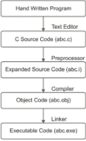

**图 7.1：展示编译阶段**

现在让我们了解各种预处理器指令。

### 预处理器指令

在 C 语言中，预处理器由若干指令组成，这些指令被视为 C 中的另一套语言。每条预处理器指令都以 # 符号开头。预处理器指令可以放在 C 代码中的任何位置；不过，最好放在代码开头。

在 C 中，预处理器指令可分为以下几类：

- 宏定义
- 文件包含
- 条件编译
- 杂项指令

下面我们逐一详细讨论。

### 宏定义

宏定义会用指定的宏展开替换源代码中的所有宏。考虑以下语句：

```c
#define LENGTH 50
```

在上述语句中，LENGTH 是宏。在源代码开始编译之前，源代码会传递给预处理器，由预处理器检查其中是否有任何宏。只要在源代码中找到宏（在我们的例子中是 LENGTH），预处理器就会用相应的宏展开（在我们的例子中是 50）替换该宏。宏展开意味着用指定的代码块替换宏。所有宏都被替换后，源代码才会被编译。清单 7.1 描述了 C 中宏的基本工作原理：

**清单 7.1：展示宏的基本工作原理**

```c
#include<stdio.h>
#define LENGTH 50
int main()
{
        int temp = 10;
        printf("\n Sum of the variables is %d ",temp + LENGTH);
        getch();
        return 0;
}
```

在清单 7.1 中，预处理器会检查源代码中的 #define 指令，该指令用于定义常量和宏替换。按照标准编程实践，所有宏都应使用大写字母书写。宏与其展开之间始终用一个空格分隔。请注意，宏定义绝不以分号结尾。

上述程序的输出如下：

```text
    Sum of the variables is 60
```

现在，让我们考虑另一个程序，其中宏用于替换条件语句，如清单 7.2 所示：

**清单 7.2：用宏替换条件语句**

```c
#include<stdio.h>
#define AND &&
#define OR ||
#define CONDITION ((varA < 10) AND (varB > 20)) OR ((varA > 50) AND (varB > 50))

int main()
{
        int varA = 54;
        int varB = 55;

        if(CONDITION)
        {
                printf("\n Inside the IF block");
        }
        else
        {
                printf("\n Inside the ELSE block ");
        }
        getch();
        return 0;
}
```


在清单 7.2 中，宏被替换为整个条件语句。在预处理期间，宏被展开，下面的行，

```c
if (CONDITION)
```

变为，

```c
if(((varA < 10) AND (varB > 20)) OR ((varA > 50) AND (varB > 50)))
```

前述程序的输出如下：

```text
inside the if block
```

现在，假设源代码中有一个常量值，它在代码中出现了很多次。如果需要更改该常量值，那么我们需要手动遍历代码并更改该常量值的每一次出现。然而，如果我们用宏替换该常量值，那么我们只需更改展开值，所有出现处都会自动替换为展开后的值。我们可以借助变量实现同样的目标；但是，这会使编译器变慢。因此，宏产生更高效且更易理解的代码。

我们也可以使用宏来执行某些计算，否则这些计算可以借助函数完成。然而，宏和函数之间存在显著差异。宏由预处理器盲目替换，不执行任何错误检查；而函数在语法错误方面要安全得多。宏的一个主要优点是它比函数耗时更少。这是因为每次调用函数都会发生多次上下文切换。此外，需要保存寄存器和程序计数器，并跳转到函数名之后的第一条指令。对于宏，不需要所有这些开销，因为它只替换代码块，而不进行任何上下文切换。然而，使用宏的一个缺点是它会增加源代码的大小。如果宏在程序中被多次调用，那么同一段代码将被多次替换。因此，宏应作为简写形式使用，但对于大规模代码，我们仍应依赖函数。

现在，我们来了解宏在 C 代码中的三种主要用法，如下所示：

- 带参数的宏
- 多行宏
- 嵌套宏

### 带参数的宏

与函数类似，参数也可以传递给宏。清单 7.3 展示了如何向宏传递参数。

**清单 7.3：** 向宏传递参数

```c
#include<stdio.h>
#define SQUARE(num) (num*num)
int main()
{
    int varA;
    printf("\n Enter any number -> ");
    scanf("%d", &varA);
    printf("\n The square root of %d is %d ", varA, SQUARE(varA));
    getch();
    return 0;
}
```

预处理器会在预处理期间将 SQUARE(num) 宏展开为 (num*num)。在 main() 函数中，varA 作为参数传递给宏，用于替换 num。前述程序的输出如下：

```text
Enter any number -> 11
The square root of 11 is 121
```

注意，宏与其参数之间不应存在空格；否则，编译器将抛出错误。清单 7.4 展示了宏定义中存在错误的代码：

**清单 7.4：** 展示宏定义中的错误

```c
#include<stdio.h>
#define SQUARE (num) (num*num)/* error due to blank space between SQUARE and (num) */
int main()
{
    int varA;
    printf("\n Enter any number -> ");
    scanf("%d",&varA);
    printf("\n The square root of %d is %d ",varA, SQUARE(varA));
    getch();
    return 0;
}
```

编译前述代码时，编译器将生成以下错误：

```text
In function 'main'
'num' undeclared (first use in this function)
```

这是因为宏与其参数之间存在空格，预处理器无法展开该宏。在这种情况下，语句变为，

```c
(num) (num*num)
```

另一个需要考虑的重要点是，当宏带参数时，宏展开应括在圆括号内。清单 7.5 展示了未将宏展开括在圆括号内的结果：

**清单 7.5：** 展示未将宏展开括在圆括号内的结果

```c
#include<stdio.h>
#define SQUARE(num) num*num
int main()
{
    int varA;
    printf("\n Enter any number -> ");
    scanf("%d",&varA);
    varA = 100/SQUARE(varA);
    printf("\n The result is %d ",varA);
    getch();
    return 0;
}
```

前述程序的输出如下：

```text
Enter any number -> 5

The result is 100
```

输出的结果应为 4；相反，它是 100，因为宏展开如下：

```c
100/5*5
```

现在，我们来学习多行宏。

### 多行宏

到目前为止，我们在程序中使用的是单行宏；然而，有时我们需要在宏中使用多行。为此，C 提供了多行宏，允许我们在其中提供多行内容。在多行宏中，每一行后面都应跟一个反斜杠（\）字符。如果我们在每一行后不提供反斜杠字符，编译器将生成错误。注意，多行宏的最后一行不应以反斜杠字符结尾。此外，花括号应包围多行宏的主体。清单 7.6 展示了一个多行宏：

**清单 7.6：** 展示多行宏

```c
#include<stdio.h>
#define FINDSUM(num) { \
    int i= 0; \
    while(i <= 10) \
    { \
        num = num + i; \
        i++; \
    } \
}

int main()
{
    int varA;

    printf("\n Enter any number -> ");
    scanf("%d",&varA);
    FINDSUM(varA);
    printf("\n The result is %d ",varA);
    getch();
    return 0;
}
```

在清单 7.6 中，你可以观察到宏的最后一行不以反斜杠字符结尾。前述程序的输出如下：

```text
Enter any number -> 100

The result is 155
```

接下来，我们讨论嵌套宏。

### 嵌套宏

另一个宏定义内部的宏主体称为嵌套宏。注意，外层宏应被展开，并且必须在调用嵌套宏之前被调用。清单 7.7 展示了一个嵌套宏：

**清单 7.7：** 展示嵌套宏

```c
#include<stdio.h>
#define SQUARE(num) (num*num)
#define FINDSUM(num) { \
    int i= 0; \
    while(i <= 10) \
    { \
        num = num + SQUARE(i); \
        i++; \
    } \
}

int main()
{
    int varA;

    printf("\n Enter any number -> ");
    scanf("%d",&varA);
    FINDSUM(varA);
    printf("\n The result is %d ",varA);
    getch();
    return 0;
}
```

前述程序的输出如下：

```text
Enter any number -> 10
The result is 395
```

现在，我们来学习文件包含。

### 文件包含

考虑一种场景：源代码被划分为多个文件，每个文件包含多个相互链接的函数。此外，多个实用函数和宏会在多个文件中使用。在这种情况下，每次编写相同的代码片段没有任何意义。更好的解决方案是，我们可以将此类函数和宏编写在一个公共文件中，然后在需要的地方包含该文件。这个概念称为文件包含，它允许将文件的全部内容插入到某个源代码中。使用文件包含的语法如下：

```c
#include "file"
```

通常的做法是，为要包含在源代码中的文件提供“.h”扩展名。“.h”扩展名表示头文件。所有标准库函数的函数原型都存在于不同的头文件中。在源代码中包含头文件有两种方式。一种方式是使用以下语句：

```c
#include <stdio.h>
```

前述语句会在特定目录列表中查找 stdio.h 文件。不同的 C 编译器对头文件有不同的搜索路径。另一种方式是使用以下语句：

```c
#include "myfile.c"
```

前述语句会在当前目录以及包含搜索路径中提到的特定目录列表中查找 myfile.c 文件。

现在，我们来学习条件编译。

### 条件编译

我们可以基于某些预处理器指令让编译器跳过源代码的特定部分。这个概念称为条件编译。在 C 中，用于条件编译的指令有 #ifdef、#endif、#undef、#else 和 #ifndef。

#ifdef 指令标记条件编译块的开始；而 #endif 指令标记该块的结束。#ifdef 和 #endif 的一般语法如下：

```c
#ifdef macro
    statement 1;
    statement 2;
    -----------------
    statement n;
#endif
```

在前述语法中，仅当宏名称已定义时，才会处理 #ifdef 和 #endif 之间的代码块；否则，将不处理它。

条件编译的主要用途之一是基于某些条件注释掉源代码的特定部分。清单 7.8 展示了如何对代码进行条件编译：

**清单 7.8：** 展示如何对代码进行条件编译

```c
#include<stdio.h>
#define _DEBUG_
int main()
{
    #ifdef __DEBUG__
        printf("\n This code is skipped ");
    #endif
```


```c
printf("\n This code is always compiled");
getch();
return 0;
}
```

在清单7.8中，我们使用 #define 指令定义了 __DEBUG__ 编译标志，这使得 #ifdef 和 #endif 块内的代码被编译。

上述程序的输出如下：

```text
This code is skipped
This code is always compiled
```

同样，我们可以使用 #undef 指令关闭 __DEBUG__ 标志，以便相同的代码不会被编译。清单7.9展示了 #undef 指令的工作方式：

**清单 7.9：展示 #undef 指令的工作方式**

```c
#include<stdio.h>
#undef __DEBUG__
int main()
{
    #ifdef __DEBUG__
        printf("\n This code is skipped ");
    #endif
    printf("\n This code is always compiled");
    getch();
    return 0;
}
```

上述程序的输出如下：

```text
This code is always compiled
```

#ifdef 和 #else 指令的工作方式与 if 和 else 条件语句相同，但这些指令专门用于宏。清单7.10展示了 #ifdef 和 #else 指令的用法：

**清单 7.10：使用 #ifdef 和 #else 指令**

```c
#include<stdio.h>
#define __DEBUG__
int main()
{
    #ifdef __DEBUG__
        printf("\n Disabling flag");
        #undef __DEBUG__
    #else
        printf("\n Enabling flag");
        #define __DEBUG__
    #endif

    #ifndef __DEBUG__
        printf("\n Enabling the flag once again");
        #define __DEBUG__
    #else
        printf("\n Disabling the flag once again");
        #undef __DEBUG__
    #endif

    getch();
    return 0;
}
```

上述程序的输出如下：

```text
Disabling flag
Enabling the flag once again
```

在清单7.10中，我们首先检查了 __DEBUG__ 宏是否已定义。如果该宏已经定义，那么它将在 #ifdef 块中被取消定义。然而，如果该宏未定义，那么它将在 #else 块中被定义。请注意，如果我们不定义该宏，那么我们会得到相反的输出。

现在，考虑这样一种场景：utilityFunc() 函数定义在 header1.h 文件中，而该文件又被包含在另一个名为 header2.h 的头文件中。假设一个程序同时包含这两个头文件。在这种情况下，编译器将抛出错误消息——utilityFunc() 的多次声明。这是因为 header1.h 文件的一个实例已经被包含在 header2.h 文件中。如果我们在一个程序中包含这两个头文件，那么同一个函数的多个实例将被包含其中。为了解决这个问题，我们需要避免多次包含同一个头文件。以下代码片段展示了避免在程序中多次包含一个函数的解决方案：

```c
#ifndef __myheader_h
#define __myheader_h
utilityFunc()
{
}
#endif
```

当 __myHeader.h 文件第一次被包含到程序中时，预处理器会检查该标志，并发现它未定义。因此，预处理器会设置该标志，并将 utilityFunc() 函数的主体包含到程序中。然而，如果同一个头文件第二次被包含到程序中，那么预处理器会发现该标志已定义；因此，它会跳过这部分代码。

现在让我们了解一些其他指令。

### 其他指令

有些预处理器指令无法归入任何特定类型，因为它们用于不同的目的。以下就是这类其他指令：

- #undef
- #pragma
- #error
- #line

让我们逐一详细了解它们。

### #undef

#undef 指令会移除其后宏的先前定义。换句话说，它会取消定义一个宏。#undef 指令的一般语法如下：

```c
#undef macro_name
```

**清单 7.11：展示 #undef 指令的工作方式**

```c
#include<stdio.h>
#define VARIABLE 50
int main()
{
    #undef VARIABLE
    printf("\n The value is %d ",VARIABLE);
    getch();
}
```

当我们编译上述程序时，它会产生以下编译错误：

```text
'VARIABLE' undeclared (first use in this function)
```

### #pragma

#pragma 指令是一种实现驱动的指令，用于向编译器提供各种指令。Pragma 因编译器而异。某些 pragma，例如 startup 和 exit，用于在源代码中插入注释。清单7.12展示了 pragma 的工作方式：

**清单 7.12：展示 Pragma 的工作方式**

```c
void fun1( ) ;

void fun2( ) ;

#pragma startup fun1

#pragma exit fun2

main( )
{
    printf ( "\ninside main" ) ;
}
void fun1( )
{
    printf ( "\ninside fun1" ) ;
}
void fun2( )
{
    printf ( "\ninside fun2" ) ;
}
```

在清单7.12中，#pragma startup 和 #pragma exit 指令允许用户分别指定在 main() 函数执行之前和之后应调用的函数。

清单7.12的输出如下：

```text
Inside fun1
Inside main
Inside fun2
```

### #line

#line 指令会更改 __LINE__ 和 __FILE__ 的内容，它们是编译器中的两个预定义标识符。__LINE__ 标识符保存当前编译代码行的行号。__FILE__ 标识符保存一个字符串，其中包含正在编译的源文件的名称。清单7.13展示了未使用 #line 指令编写的代码：

**清单 7.13：展示未使用 #line 指令的代码**

```c
#include<stdio.h>

int main()
{
    printf("\n In Line [%d] File name [%s] ",__LINE__,__FILE__);
    getch();
}
```

上述程序的输出如下：

```text
In Line [5] File name [D:\Tanuman\Progs\conditional.c]
```

现在，如果使用 #line 指令重写清单7.13中的代码，那么它如清单7.14所示：

**清单 7.14：展示使用 #line 指令编写的代码**

```c
#include<stdio.h>
#line 500 "Tanuman"
int main()
{
    printf("\n In Line [%d] File name [%s] ",__LINE__,__FILE__);
    getch();
}
```

上述程序的输出如下：

```text
In Line [503] File name [Tanuman]
```

如输出所示，#line 指令不仅更改了行号并将其重置为 500，而且还更改了程序的文件名。

### #error

#error 指令会阻止编译器进行编译。它主要用于调试。#error 指令的一般形式如下：

```c
#error error-message
```

请注意，error-message 不应放在双引号内。每当遇到 #error 指令时，就会显示 error-message。清单7.15展示了 #error 指令的用法：

**清单 7.15：展示 #error 指令的工作方式**

```c
#include<stdio.h>
int main()
{
    #error Stop here
    printf("\n This is Test");
    getch();
}
```

清单7.15的输出如下：

```text
#error Stop here
```

如输出所示，代码编译会通过给出错误消息而停止。

现在让我们总结本章讨论的要点。

### 小结

在本章中，我们学习了预处理器在编译 C 源代码时的作用。我们还学习了预处理器指令，例如 #define、#ifdef、#endif、#undef、#else、#pragma、#error 和 #line。

在下一章中，我们将学习 C 中的标准库函数。

### 快速复习

### 多项选择题

- **Q1.** 以下哪一项不是有效的预处理器指令？
- i. `#define`
- ii. `#ifdef`
- iii. `#ifdefine`
- iv. `#line`

**Q2.** 以下代码的输出将是什么？

```c
#include<stdio.h>
#define TEST 50
int main()
{
    printf("\n Test value %d ",TEST--);
    getch();
}
```

- i. 49
- ii. 50
- iii. 无法编译
- iv. 以上都不是

**Q3.** 以下哪条指令用于在源代码中包含头文件？

- i. #include
- ii. #define
- iii. #ifdef
- iv. #pragma

**Q4.** 以下代码的输出将是什么？

```c
#include<stdio.h>
#define TEST(x)                 \
{                              \
    printf("\n In a Macro ");    \
}
int main()
{
    TEST(10);
    getch();
}
```

- i. 导致宏展开
- ii. 编译错误
- iii. 运行时错误
- iv. 以上都不是

### 主观题

- Q1. 编写一个使用宏来找出输入的两个数中最大数的程序。
- Q2. 编写一个使用宏来检查输入的字符是否为大写字母的程序。
- Q3. 编写一个使用宏计算单利的程序。将宏存储在头文件中，并在编译程序时在源文件中包含该头文件。


## 第8章

库是函数的集合。库文件单独存储这些函数。它类似于目标文件，但也有一些区别。当链接目标文件时，目标文件的全部内容都会成为可执行文件的一部分。然而，当程序使用库函数时，只有该函数会被添加到程序中，而不是库的全部内容。

美国国家标准协会/国际标准化组织（ANSI/ISO）标准定义了各种函数集，所有C编译器都必须支持这些函数集。这些函数集被称为标准库函数。借助这些函数，复杂而繁琐的C程序可以在很大程度上得到简化。无论C程序在何种体系结构和平台上编译和执行，它们都可以使用标准库函数。

在本章中，我们将学习数学函数、时间函数、动态分配函数、实用函数和字符串函数。

让我们从数学函数开始本章的学习。

### 数学函数

C89编译器过去只支持22个数学函数，随着C99编译器的出现，这些函数的数量大约增至三倍。要在程序中使用这些函数，我们首先需要在程序中包含`<math.h>`头文件，因为函数的原型定义在其中。`<math.h>`头文件还包含一些与这些函数关联的宏。C89编译器过去只定义一个名为`HUGE_VAL`的宏，它是一个double值，表示发生了溢出。另一方面，C99定义了许多宏，如下所示：

- `HUGE_VALF` — `HUGE_VAL`的float版本
- `HUGE_VALL` — `HUGE_VAL`的long double版本
- `math_errhandling` — 包含`MATH_ERRNO`和/或`MATH_ERREXCEPT`
- `MATH_ERRNO` — 使用错误号来报告错误
- `MATH_ERREXCEPT` — 引发浮点异常来报告错误
- `NAN` — 非数

C99还定义了以下宏，用于对值进行分类：

- `int isfinite(val)` — 如果`val`是有限值，则返回非零值
- `int isinf(val)` — 如果`val`是无穷大，则返回非零值
- `int isnormal(val)` — 如果`val`是正常值，则返回非零值
- `int isnan(val)` — 如果`val`不是数字，则返回非零值

此外，C99还定义了以下一组用于浮点值的比较宏：

- `int isgreater(a, b)` — 如果`a`大于`b`，则返回非零值
- `int isgreaterequal(a, b)` — 如果`a`大于或等于`b`，则返回非零值
- `int isless(a, b)` — 如果`a`小于`b`，则返回非零值
- `int islessequal(a, b)` — 如果`a`小于或等于`b`，则返回非零值
- `int islessgreater(a, b)` — 如果`a`大于或小于`b`，则返回非零值
- `int isunordered(a, b)` — 如果`a`和`b`相对于彼此无序，则返回1；否则，如果`a`和`b`有序，则返回0

在C89和C99编译器中，与数学函数相关的错误处理在性质上有所不同。在C89编译器中，如果数学函数的参数不在其定义的域内，则该函数返回一个依赖于实现的值，并将全局整型`errno`变量设置为`EDOM`。然而，对于C99编译器，会返回一个特定于实现的值。如果返回值包含`MATH_ERRNO`，则将`errno`变量设置为`EDOM`。但是，如果返回值等于`MATH_ERREXCEPT`，则会引发浮点异常。

在C89编译器中，如果数学函数产生的结果太大而无法表示，则会发生溢出。在这种情况下，函数返回`HUGE_VAL`，并将`errno`变量设置为`ERANGE`，这表示范围溢出。对于下溢，函数返回0，`errno`变量与`ERANGE`相同。对于C99编译器，溢出和下溢的工作方式类似。但是，如果`math_errhandling`包含`MATH_ERRNO`，则将`errno`变量设置为`ERANGE`，这表示范围错误。另一方面，如果`math_errhandling`包含`MATH_ERREXCEPT`，则会引发浮点异常。

> **注意**
>
> `EDOM`和`ERANGE`是在`<errno.h>`头文件中定义的宏。

现在，让我们详细讨论一些数学函数。

#### acos()

`acos()`函数返回传递给它的参数的反余弦值。参数的值必须在-1到1的范围内；否则，编译器将抛出错误。`acos()`函数的签名如下所示：

```c
double acos(double argument);
```

C99编译器定义了`acos()`函数的两个变体，如下所示：

```c
float acosf(float arg);
long double acosl(long double arg);
```

前两个变体分别用于float和long double数据类型。

现在，让我们以清单8.1中提到的`acos()`函数为例：

清单8.1：`acos()`函数的用法。

```c
#include<stdio.h>
#include<math.h>
int main()
{
    double val = -1.0;
    printf("\n the Arc Cosine of %f is %f ",val, acos(val));
    getch();
}
```

前面示例的输出如下：

```
The Arc Cosine of -1.000000 is 3.141593
```

#### acosh()

`acosh()`系列函数返回传递给它们的参数的反双曲余弦值。参数的值必须为零或大于零；否则，编译器将抛出错误。`acosh()`系列函数的签名如下所示：

```c
float acoshf(float arg);
double acosh(double arg);
long double acoshl(long double arg);
```

#### cos()

`cos()`系列函数返回传递给它们的参数的余弦值。`cos()`系列函数的签名如下所示：

```c
float cosf(float arg);
double cos(double arg);
long double cosl(long double arg);
```

`cosf()`和`cosl()`函数是由C99编译器引入的。让我们以清单8.2中提到的`cos()`函数为例。

清单8.2：`cos()`函数的用法。

```c
#include<stdio.h>
#include<math.h>
int main()
{
    double val = -1.0;
    printf("\n The cosine of %f is %f ",val, cos(val));
    getch();
}
```

前面示例的输出如下：

```
The Cosine of -1.000000 is 0.540302
```

#### cosh()

`cosh()`系列函数返回传递给它们的参数的双曲余弦值。`cosh()`系列函数的签名如下所示：

```c
float coshf(float arg);
double cosh(double arg);
long double coshl(long double arg);
```

`coshf()`和`coshl()`函数是由C99编译器引入的。

#### asin()

`asin()`系列函数返回传递给它们的参数的反正弦值。参数的值必须在-1到1的范围内；否则，编译器将抛出错误。`asin()`系列函数的签名如下所示：

```c
float asinf(float arg);
double asin(double arg);
long double asinl(long double arg);
```

`asinl()`和`asinf()`函数是由C99编译器引入的。让我们以清单8.3中提到的`asin()`函数为例：

清单8.3：`asin()`函数的用法。

```c
#include<stdio.h>
#include<math.h>
int main()
{
    double val = -1.0;
    printf("\n The Arc Sine of %f is %f ",val, asin(val));
    getch();
}
```

前面示例的输出如下：

```
The Arc Sine of -1.000000 is -1.570796
```

#### asinh()

`asinh()`系列函数返回传递给它们的参数的反双曲正弦值。`asinh()`系列函数的签名如下所示：

```c
float asinhf(float arg);
double asinh(double arg);
long double asinhl(long double arg);
```

`asinhf()`和`asinhl()`函数是由C99编译器引入的。

#### sin()

`sin()`系列函数返回传递给它们的参数的正弦值。参数的值必须以弧度为单位。`sin()`系列函数的签名如下所示：

```c
float sinf(float arg);
double sin(double arg);
long double sinl(long double arg);
```

`sinf()`和`sinl()`函数是由C99编译器引入的。让我们以清单8.4中提到的`sin()`函数为例：

清单8.4：`sin()`函数的用法。

```c
#include<stdio.h>
#include<math.h>

int main()
{
    double val = -1.0;
    printf("\n The Sine of %f is %f ",val, sin(val));
    getch();
}
```

前面示例的输出如下：

```
The Sine of -1.000000 is -0.841471
```

#### sinh()

`sinh()`系列函数返回传递给它们的参数的双曲正弦值。`sinh()`系列函数的签名如下所示：

```c
float sinhf(float param);
double sinh(double param);
long double sinhl(long double param);
```

`sinhf()`和`sinhl()`函数是由C99编译器引入的。`sinhf()`函数用于float数据类型；而`sinhl()`函数用于long double数据类型。

#### atan()

`atan()`系列函数返回传递给它们的参数的反正切值。`atan()`系列函数的签名如下所示：

```c
float atanf(float param);
double atan(double param);
long double atanl(long double param);
```

`atanf()`和`atanl()`函数是由C99编译器引入的。`atanf()`函数用于float数据类型；而`atanl()`函数用于long double数据类型。让我们以清单8.5中提到的`atan()`函数为例：

清单8.5：`atan()`函数的用法。

```c
#include<stdio.h>
#include<math.h>

int main()
{
```


```c
double val = -1.0;
printf("\n The Arc Tangent of %f is %f ",val, atan(val));
getch();
}
```

前面示例的输出如下：

```
The Arc Tangent of -1.000000 is -0.785398
```

### atanh()

atanh() 函数族返回传给它们的实参的反双曲正切值。实参的值必须在 -1 到 1 的范围内；否则，编译器将抛出错误。如果实参的值等于 1 或 -1，则编译器会抛出范围错误。atanh() 函数族的签名如下：

```c
float atanhf(float param);
double atanh(double param);
long double atanhl(long double param);
```

atanh()、atanhf() 和 atanhl() 函数由 C99 编译器引入。atanhf() 函数用于 float 数据类型；而 atanhl() 函数用于 long double 数据类型。让我们以清单 8.6 中提到的 atanh() 函数为例：

清单 8.6：atanh() 函数的用法。

```c
#include<stdio.h>
#include<math.h>

int main()
{
    double val = -0.5;
    printf("\n The Arc Hyperbolic Tangent of %f is %f ",val, atanh(val));
    getch();
}
```

前面示例的输出如下：

```
The Arc Hyperbolic Tangent of -0.500000 is -0.549306
```

### tan()

tan() 函数族返回传给它们的实参的正切值。实参的值必须以弧度为单位。tan() 函数族的签名如下：

```c
float tanf(float param);
double tan(double param);
long double tanl(long double param);
```

tanf() 和 tanl() 函数由 C99 编译器引入。tanf() 函数用于 float 数据类型；而 tanl() 函数用于 long double 数据类型。让我们以清单 8.7 中提到的 tan() 函数为例：

清单 8.7：tan() 函数的用法。

```c
#include<stdio.h>
#include<math.h>

int main()
{
    double val = -0.5;
    printf("\n The Tangent of %f is %f ",val, tan(val));
    getch();
}
```

前面示例的输出如下：

```
The Tangent of -0.500000 is -0.549306
```

### tanh()

tanh() 函数族返回传给它们的实参的双曲正切值。tanh() 函数族的签名如下：

```c
float tanhf(float param);
double tanh(double param);
long double tanhl(long double param);
```

tanh() 和 tanhf() 函数由 C99 编译器引入。tanhf() 函数用于 float 数据类型，tanhl() 函数用于 long double 数据类型。让我们以清单 8.8 中提到的 tanh() 函数为例：

清单 8.8：tanh() 函数的用法。

```c
#include<stdio.h>
#include<math.h>

int main()
{
    double val = -0.5;
    printf("\n the hyperbolic Tangent of %f is %f ",val, tanh(val));
    getch();
}
```

前面示例的输出如下：

```
The hyperbolic Tangent of -0.500000 is -0.462117
```

### cbrt()

cbrt() 函数族返回传给它们的实参的立方根。cbrt() 函数族的签名如下：

```c
float cbrtf(float param);
double cbrt(double param);
long double cbrtl(long double param);
```

cbrt()、cbrtf() 和 cbrtl() 函数由 C99 编译器引入。让我们以清单 8.9 中提到的 cbrt() 函数为例：

清单 8.9：cbrt() 函数的用法。

```c
#include<stdio.h>
#include<math.h>
int main()
{
    double val = 27;
    printf("\n The cube root of %f is %f ",val, cbrt(val));
    getch();
}
```

前面示例的输出如下：

```
The cube root of 27.000000 is 3.000000
```

## 第8章

### sqrt()

sqrt() 函数族返回传给它们的实参的平方根。任何作为实参传入的负值都可能导致错误。sqrt() 函数族的签名如下：

```c
float sqrtf(float num);
double sqrt(double num);
long double sqrtl(long double num);
```

sqrtf() 和 sqrtl() 函数由 C99 编译器引入。让我们以清单 8.10 中提到的 sqrt() 函数为例：

**清单 8.10：** sqrt() 函数的用法。

```c
#include<stdio.h>
#include<math.h>

int main()
{
    double val = 121;
    printf("The Square root of %f is %f", val, sqrt(val));
    getch();
}
```

前面示例的输出如下：

```
The Square root of 121.000000 is 11.000000
```

### pow()

pow() 函数族返回底数的指数次幂的值，即 base^exp。如果底值为零或 exp 值小于或等于零，编译器将抛出错误。如果底值为负且 exp 值为正，也可能发生错误。

pow() 函数族的签名如下：

```c
float powf(float base, float exp);
double pow(double base, double exp);
long double powl(long double base, long double exp);
```

powf() 和 powl() 函数由 C99 编译器引入。让我们以清单 8.11 中提到的 pow() 函数为例：

**清单 8.11：** pow() 函数的用法。

```c
#include<stdio.h>
#include<math.h>

int main()
{
    double base = 17;
    double exp = 6;
    printf("\n %f raise to the power of %f becomes %f",base,exp,pow(base, exp));
    getch();
}
```

前面示例的输出如下：

```
17.000000 raise to the power of 6.000000 becomes 24137569.000000
```

### exp()

exp() 函数族返回 e 的实参次幂的对数值，其中 e 始终舍入为 2.718282。exp() 函数族的签名如下：

让我们详细讨论一些时间函数。

### asctime()

asctime() 函数返回指向字符串的指针。该函数的原型定义在 `<time.h>` 头文件中。asctime() 函数的签名如下：

```c
char *asctime(const struct tm *ptr);
```

上述函数包含存储在结构体 ptr 中的信息，该结构体作为实参传递给它。由 ptr 指向的结构体可从 gmtime() 函数或 localtime() 函数获得。asctime() 函数使用的缓冲区是一个静态分配的数组，每次调用该函数时都会被覆盖。

asctime() 函数返回的输出格式如下：

```
day month date hours:minutes:seconds year\n\0
```

让我们以清单 8.16 中提到的 asctime() 函数为例：

清单 8.16：asctime() 函数的用法。

```c
#include<stdio.h>
#include<time.h>
int main()
{
    struct tm *ptr;
    time_t t1;
    t1 = time(NULL);
    ptr = localtime(&t1);
    printf("\n The current time is %s ",asctime(ptr));
    getch();
}
```

前面示例的输出如下：

```
The current time is Mon Mar 26 16:02:32 2012
```

### ctime()

ctime() 函数接受一个指向日历类型变量的指针作为实参。日历时间通过调用 time() 函数获得。ctime() 函数使用的缓冲区是一个静态分配的缓冲区，每次调用时都会被覆盖。ctime() 函数的签名如下：

```c
char *ctime(const time_t *time);
```

ctime() 函数返回指向字符串的指针，格式如下：

```
day month date hours:minutes:seconds year\n\0
```

让我们以清单 8.17 中提到的 ctime() 函数为例：

清单 8.17：ctime() 函数的用法。

```c
#include<stdio.h>
#include<time.h>

int main()
{
    time_t t1;
    t1 = time(NULL);
    printf("\n The current time is %s ",ctime(&t1));
    getch();
}
```

前面示例的输出如下：

```
The current time is Mon Mar 26 16:16:19 2012
```

### difftime()

difftime() 函数的签名如下：

```c
double difftime(time_t time2, time_t time1);
```

difftime() 函数返回 time1 和 time2 之间以秒为单位的差值。让我们以清单 8.18 中提到的 difftime() 函数为例：

清单 8.18：difftime() 函数的用法。

```c
#include<stdio.h>
#include<time.h>

int main()
{
    time_t t1,t2;
    long int count = 0;
    t1 = time(NULL);
    while( count <= 100000000) {
        count++;
    }
    t2 = time(NULL);
    printf("\n The difference in time is %f ",difftime(t2,t1));
    return 0;
}
```

前面示例的输出如下：

```
The difference in time is 2.000000
```

### gmtime()

gmtime() 函数返回指向结构体形式的时间的指针。时间以协调世界时（UTC）表示，即格林尼治子午线时间。gmtime() 函数的签名如下：

```c
struct tm *gmtime(const time_t *time);
```

时间指针通过 time() 函数获得。如果系统不支持 UTC，则该函数返回 NULL。让我们以清单 8.19 中提到的 gmtime() 函数为例：

清单 8.19：gmtime() 函数的用法。

```c
#include<stdio.h>
#include<time.h>

int main()
{
    struct tm *gmt;
    time_t t1;

    t1 = time(NULL);
    gmt = gmtime(&t1);

    printf("\n The UTC time is %s ",asctime(gmt));
    getch();
}
```

前面示例的输出如下：


上例的输出如下：

UTC 时间为 2012 年 3 月 26 日星期一 18:31:55

### localtime()

localtime() 函数以结构体的形式返回指向时间的指针。该函数用于保存时间的结构体是静态分配的，并且每次调用时都会被覆盖。时间以本地时间格式表示。传递给 localtime() 函数的变量通过 time() 函数获得。localtime() 函数的签名如下：

```c
struct tm *localtime(const time_t *time);
```

让我们以代码清单 8.20 中提到的 localtime() 函数为例：

代码清单 8.20：localtime() 函数的用法。

```c
#include<stdio.h>
#include<time.h>

int main()
{
    struct tm *gmt;

    time_t t1;

    t1 = time(NULL);
    gmt = localtime(&t1);

    printf("\n The UTC time is %s ",asctime(gmt));

    getch();
}
```

上例的输出如下：

本地时间为 2012 年 3 月 27 日星期二 00:07:47

### mktime()

mktime() 函数返回作为参数传递给它的时间结构体所对应的日历时间。如果 mktime() 函数无法将该信息表示为有效的日历时间，则该函数返回 -1。mktime() 函数的签名如下：

```c
time_t mktime(struct tm *time);
```

考虑以下程序，它可让你知道 2012 年 3 月 25 日对应的星期几，如代码清单 8.21 所示：

代码清单 8.21：mktime() 函数的用法。

```c
#include <time.h>
#include <stdio.h>

int main(void)
{
    struct tm t;
    time_t time_of_day;

    t.tm_year = 2012-1900;
    t.tm_mon = 2;
    t.tm_mday = 25;
    t.tm_hour = 0;
    t.tm_min = 0;
    t.tm_sec = 1;
    t.tm_isdst = 0;
    time_of_day = mktime(&t);
    printf(ctime(&time_of_day));

    getch();

    return 0;
}
```

上例的输出如下：

```text
Sun Mar 25 00:00:01 2012
```

### time()

time() 函数返回系统的当前日历时间。time() 函数的签名如下：

```c
time_t time(time_t *time);
```

如果发生错误，time() 函数返回 -1。该函数也可以使用 NULL 指针或 time_t 类型的指针来调用。

接下来，让我们学习动态分配函数。

### 动态分配函数

C 定义了四个动态分配函数，即 calloc()、malloc()、realloc() 和 free()，所有编译器都支持它们。当我们希望在代码执行期间分配内存时，就会使用这些函数。动态分配的内存也需要归还给系统。从中分配内存的区域称为堆。

让我们讨论 calloc()、malloc()、realloc() 和 free() 函数。

### calloc()

calloc() 函数用于为若干元素（例如 num 个）动态分配大小为 mem_size 的内存。这意味着 calloc() 分配的总内存大小为 num * mem_size。calloc() 函数的签名如下：

```c
void *calloc(size_t num, size_t size);
```

`<stdlib.h>` 头文件包含 calloc() 函数的原型。calloc() 函数的一个关键特性是，它分配的内存的所有位都被设置为零。calloc() 函数返回指向已分配内存部分第一个字节的指针。如果没有足够的内存可供分配，则返回 NULL 指针。

让我们以代码清单 8.22 中提到的 calloc() 函数为例：

**代码清单 8.22：** calloc() 函数的用法。

```c
#include <stdio.h>
#include<stdlib.h>

int main(void)
{
    int *ptr;

    ptr = (int*)calloc(10, sizeof(int));
    if(!ptr)
    {
        printf("\n Failed to allocate Memory");
    }

    getch();

    return 0;
}
```

### free()

free() 函数用于将指针所指向的内存归还给堆。归还给堆的内存可供将来分配使用。free() 函数的签名如下：

```c
void free(void *ptr);
```

如果将 NULL 指针传递给 free() 函数，则它不执行任何操作。让我们以代码清单 8.23 中提到的 free() 函数为例：

**代码清单 8.23：** free() 函数的用法。

```c
#include <stdio.h>
#include<stdlib.h>

int main(void)
{
        int *ptr, i;

        ptr = (int*)calloc(1, sizeof(int));

        if(!ptr)
        {
                printf("\n Failed to allocate Memory");
        }
        if(ptr)
        {
                printf("\n Memory Allocated ");
        }

        free(ptr);
        getch();
        return 0;
}
```

### malloc()

malloc() 函数返回指向从堆中分配的内存区域第一个字节的指针。malloc() 函数的签名如下：

```c
void *malloc(size_t amount);
```

如果 malloc() 函数分配内存失败，则返回 NULL 指针。让我们以代码清单 8.24 中提到的 malloc() 函数为例：

**代码清单 8.24：** malloc() 函数的用法。

```c
#include<stdio.h>
struct student
{
        char name[100];
```

### 工具函数

工具函数可用于处理可变长度参数、排序、搜索和生成随机数。此外，一些工具函数（例如 abort()）可用于异常终止程序，从而避免系统崩溃和其他异常情况。要使用工具函数，我们需要在程序中包含 `<stdlib.h>` 头文件。

让我们详细讨论一些工具函数。

### abort()

abort() 函数会导致程序立即异常终止。abort() 函数的签名如下：

```c
void abort(void);
```

abort() 函数向调用进程返回一个由实现定义的值。让我们以代码清单 8.26 中提到的 abort() 函数为例：

**代码清单 8.26：abort() 函数的用法。**

```c
#include<stdio.h>
#include<stdlib.h>
int main()
{
    int input;
    printf("\n Enter a value -> ");
    scanf("%d",&input);
    if(input %2)
    {
        printf("\n Before Abort ");
        abort();
        printf("\n After Abort ");
    }
    getch();
    return 0;
}
```

上例的输出如图 8.1 所示：

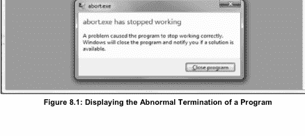

**图 8.1：显示程序的异常终止**

### abs()

`abs()` 函数返回一个数的绝对值。`abs()` 函数的签名如下：

```c
int abs(int num);
```

在较旧版本的 C 编译器中，我们需要包含 `<stdlib.h>` 头文件才能使用 `abs()` 函数；然而，在较新的 C 编译器中，该函数可在 `<stdio.h>` 头文件中使用。让我们以代码清单 8.27 中提到的 `abs()` 函数为例：

代码清单 8.27：abs() 函数的用法。

```c
#include<stdio.h>

int main()
{
    int varA = -89;

    printf("\n the absolute value of %d is %d ",varA, abs(varA));

    getch();

    return 0;
}
```

上例的输出如下：

```text
The absolute value of -89 is 89
```

### atoi()

`atoi()` 函数将字符串转换为整数值。作为参数传递给该函数的字符串必须包含有效的整数。`atoi()` 函数的签名如下：

```c
int atoi(const char *str);
```

如果发生任何错误，`atoi()` 函数返回的值是未定义的。如果以 50.76 这样的参数调用 `atoi()` 函数，则该函数返回 50，并忽略 .76。

代码清单 8.28：atoi() 函数的用法。

```c
#include<stdio.h>

int main()
{
    char inputString[20];

    printf("\n Enter a number -> ");

    gets(inputString);

    printf("\n The value returned by atoi function is %d ",atoi(inputString));
    getch();

    return 0;
}
```

上例的输出如下：

```text
Enter a number -> 98.563
The value returned by atoi function is 98
```


### atof()

atof() 函数将字符串转换为 double 值。该字符串必须包含有效的浮点数；否则，函数将返回未定义的值。atof() 函数的签名如下：

```c
double atof(const char *str);
```

让我们以清单 8.29 中提到的 atof() 函数为例：

**清单 8.29：** atof() 函数的用法。

```c
#include<stdio.h>
#include<stdlib.h>

int main()
{
    char inputString[50];

    printf("\n Enter a number -> ");
    gets(inputString);

    printf("\n The value returned by atof function is %f ",atof(inputString));

    getch();
    return 0;
}
```

上述示例的输出如下：

```
Enter a number -> 42.90876
The value returned by atof function is 42.908760
```

### atol()

atol() 函数将字符串转换为长整数值。该字符串必须包含有效的整数；否则，函数将返回未定义的值。atol() 函数的签名如下：

```c
long int atol(const char *str);
```

让我们以清单 8.30 中提到的 atol() 函数为例：

**清单 8.30：** atol() 函数的用法。

```c
#include<stdio.h>
#include<stdlib.h>

int main()
{
    char inputString[50];

    printf("\n Enter a number -> ");
    gets(inputString);

    printf("\n The value returned by atol function is %ld ",atol(inputString));

    getch();
    return 0;
}
```

上述示例的输出如下：

```
Enter a number -> 1234567.89
The value returned by atol is 1234567
```

## 第8章

### div()

div() 函数返回除法运算的商和余数。div() 函数的签名如下：

```c
div_t div(int numerator, int denominator);
```

如上述签名所示，div() 函数返回 div_t 类型的结构体。结构体 div_t 有两个成员，如下所示：

```c
int quot;
int rem;
```

让我们以清单 8.31 中提到的 div() 函数为例：

**清单 8.31：** div() 函数的用法。

```c
#include<stdio.h>
#include<stdlib.h>

int main()
{
    div_t result;
    result = div(254, 9);
    printf("\n Quotient is %d and remainder is %d ",result.quot,result.rem);

    getch();
    return 0;
}
```

上述示例的输出如下：

```
Quotient is 28 and remainder is 2
```

### exit()

exit() 函数会导致程序立即正常终止。执行该函数时，所有打开的文件都会被刷新并关闭。exit() 函数的签名如下：

```c
void exit(int exit_code);
```

exit_code 参数的值会传递给调用函数（通常是操作系统）。默认情况下，exit_code 的值为零，表示 EXIT_SUCCESS。非零值或 EXIT_FAILURE 表示由实现定义的错误。让我们以清单 8.32 中提到的 exit() 函数为例：

**清单 8.32：** exit() 函数的用法。

```c
#include<stdio.h>
int main()
{
    int input;

    printf("\n Enter a value -> ");
    scanf("%d",&input);

    if(input %2)
    {
        printf("\n Gracefully Terminating Program");
        getch();
        exit(0);
    }
    return 0;
}
```

上述示例的输出如下：

```
Enter a Value -> 59
Gracefully Terminating Program
```

### bsearch()

bsearch() 函数用于在已排序数组上实现二分查找。bsearch() 函数的签名如下：

```c
void *bsearch(const void *key, const void *buf,
              size_t num, size_t size,
              int (*compare)(const void *, const void *));
```

如上述签名所示，bsearch() 函数返回一个指针，指向第一个与 key 变量所指向的键匹配的成员。数组中元素的数量由 num 变量定义，每个元素的大小（以字节为单位）由 size 变量指定。由 compare 函数指针指向的函数用于将数组的一个元素与 key 变量进行比较。compare 函数指针必须采用以下格式：

```c
int func_name(const void *arg1, const void *arg2);
```

compare 函数指针返回以下值之一：

- **小于零** — 表示 arg1 小于 arg2
- **零** — 表示 arg1 等于 arg2
- **大于零** — 表示 arg1 大于 arg2

让我们以清单 8.33 中提到的 bsearch() 函数为例：

**清单 8.33：** bsearch() 函数的用法。

```c
#include<stdio.h>
#include<stdlib.h>

int array[10] = {11,22,37,43,59,61,75,89};

int compare(const void *num1, const void *num2);

int main()
{
    int searchval;
    int *ptr;

    printf("\n Enter a number to search -> ");
    scanf("%d",&searchval);

    ptr = (int*)bsearch(&searchval, array, 8, 4, compare);

    if(ptr)
    {
        printf("\n Number is present ");
    }
    else
    {
        printf("\n Number is absent ");
    }

    getch();
    return 0;
}

int compare(const void *num1, const void *num2)
{
    return *((int*)num1) - *((int*)num2);
}
```

注意，在应用 bsearch() 函数之前，要搜索的数组必须按升序排列。如果数组中没有键元素，则返回 NULL。

上述示例的输出如下：

```
Enter a number to search -> 22
Number is present
Enter a number to search -> 76
Number is absent
```

### qsort()

qsort() 函数使用快速排序算法对数组进行排序，快速排序被认为是一种高效的排序技术。qsort() 函数的签名如下：

```c
void qsort(void *buf, size_t num, size_t size,
           int (*compare) (const void *, const void *));
```

数组中元素的数量由 num 变量表示。每个元素的大小借助 size 变量确定。由 compare 函数指针指向的函数用于比较数组的两个元素。compare 函数指针必须采用以下格式：

```c
int func_name(const void *arg1, const void *arg2);
```

compare 函数指针返回以下值之一：

- **小于零** — 表示 arg1 小于 arg2
- **零** — 表示 arg1 等于 arg2
- **大于零** — 表示 arg1 大于 arg2

让我们以清单 8.34 中提到的 qsort() 函数为例：

**清单 8.34：** qsort() 函数的用法。

```c
#include<stdio.h>
#include<stdlib.h>

int array[10] = {29, 6, 652, 312, 72, 490, 55,176};
int compare(const void *num1, const void *num2);
int main()
{
    int i;

    printf("\n Original Unsorted Array \n\n");
    for(i=0; i < 8;i++)
    {
        printf(" %d ",array[i]);
    }

    qsort(array, 8, sizeof(int), compare);

    printf("\n\n Sorted Array \n\n");
    for(i=0; i < 8;i++)
    {
        printf(" %d ",array[i]);
    }

    getch();
    return 0;
}

int compare(const void *num1, const void *num2)
{
    return *(int*)num1 - *(int*)num2;
}
```

执行 qsort() 函数后，数组会按升序排序。上述示例的输出如下：

```
Original Unsorted Array
29  6  652  312  72  490  55  176

Sorted Array
6  29  55  72  176  312  490  652
```

### rand()

rand() 函数用于生成伪随机数序列。rand() 函数的签名如下：

```c
int rand(void);
```

每次调用 rand() 函数时，它都会生成一个介于零和 RAND_MAX 之间的整数。让我们以清单 8.35 中提到的 rand() 函数为例：

**清单 8.35：** rand() 函数的用法。

```c
#include<stdio.h>
int main()
{
    int i;
    for(i=0; i < 10; i++)
    {
        printf("%d ",rand());
    }
    getch();
    return 0;
}
```

上述示例的输出如下：

```
41 18467 6334 26500 19169 15724 11478 29358 26962 24464
```

### srand()

srand() 函数用于为 rand() 函数生成的随机数序列设置起始点。srand() 函数的签名如下：

```c
void srand(unsigned int seed);
```

使用 srand() 函数是为了只需改变起始点，就能在多次执行 rand() 函数时生成不同的随机数序列。让我们以清单 8.36 中提到的 srand() 函数为例：

**清单 8.36：** srand() 函数的用法。

```c
#include<stdio.h>
int main()
{
    int i,j;
```


## 第8章

```c
for(j=1; j < 10 ; j++)
{
        printf("\nThe new sequence is \n");
        srand(j);
        for(i=0 ; i < 10; i++)
        {
                printf("%d ",rand());
        }
}
getch();
return 0;
}
```

上述示例的输出如下：

```text
The new sequence is
41 18467 6334 26500 19169 15724 11478 29358 26962 24464

The new sequence is
45 29216 24198 17795 29484 19650 14590 26431 10705 18316

The new sequence is
48 7196 9294 9091 7031 23577 17702 23503 27217 12168

The new sequence is
51 17945 27159 386 17345 27504 20815 20576 10960 6020

The new sequence is
54 28693 12255 24449 27660 31430 23927 17649 27472 32640

The new sequence is
58 6673 30119 15745 5206 2589 27040 14722 11216 26492

The new sequence is
61 17422 15215 7040 15521 6516 30152 11794 27727 20344

The new sequence is
64 28170 311 31103 25835 10443 497 8867 11471 14195

The new sequence is
68 65151 18175 22398 3382 14369 3609 5940 27982 8047
```

### strtod()函数

strtod()函数的签名如下：

```c
double strtod(const char *start, char **end);
```

strtod()函数将start指针所指向的数字字符串表示转换为double类型并返回结果。该函数会去除数字字符串表示中的所有空白字符。组成数字的每个字符都会被读取。如果发现任何不能作为浮点数组成部分的字符，函数将停止工作。end变量被设置为字符串的剩余部分。例如，如果我们要转换234.23tim，那么将返回234.23，end指针将指向tim。如果start指针不指向数字，则该函数返回零。在C99编译器中，start和end变量之前都带有restrict类型限定符。

```c
    }
    getch();
    return 0;
}
```

上述示例的输出如下：

```text
Enter any character -> w
Alphanumeric
Enter any character -> #
Not Alphanumeric
```

### isalpha()函数

当字母作为参数传递给isalpha()函数时，该函数返回非零值；否则，函数返回零。isalpha()函数的签名如下：

```c
int isalpha(int ch);
```

让我们来看一个清单8.39中提到的isalpha()函数示例：

**清单8.39：** isalpha()函数的用法。

```c
#include<stdio.h>
#include<ctype.h>

int main()
{
    char ch;

    printf("\n Enter any character -> ");
    scanf("%c",&ch);
    if(isalpha(ch))
    {
        printf("\n ALPHABET ");
    }
    else
    {
        printf("\n Not an ALPHABET ");
    }

    getch();
    return 0;
}
```

上述示例的输出如下：

```text
Enter any character -> Q
Alphabet
Enter any character -> 3
Not an Alphabet
```

### iscntrl()函数

如果传递给iscntrl()函数的参数是控制字符，则返回非零值；否则，函数返回零。在美国信息交换标准代码（ASCII）环境中，控制字符是介于0和0x1F之间的值，或者等于0x7F（DEL）的值。iscntrl()函数的签名如下：

```c
int iscntrl(int ch);
```

让我们来看一个清单8.40中提到的iscntrl()函数示例：

**清单8.40：** iscntrl()函数的用法。

```c
#include<stdio.h>

#include<ctype.h>

int main()
{
    char ch;

    printf("\n Enter any character -> ");
    scanf("%c",&ch);

    if(iscntrl(ch))
    {
        printf("\n %c is a Control Character ",ch);
    }
    else
    {
        printf("\n %c is not Control Character ",ch);
    }

    getch();
    return 0;
}
```

### isblank()函数

如果传递给isblank()函数的参数是空白字符，则返回非零值。isblank()函数的签名如下：

```c
int isblank(int ch);
```

isblank()函数由C99编译器引入。

### isdigit()函数

isdigit()函数用于检查传递给它的参数是否为数字。isdigit()函数的签名如下：

```c
int isdigit(int ch);
```

如果字符是数字，isdigit()函数返回非零值；否则返回零。让我们来看一个清单8.41中提到的isdigit()函数示例：

**清单8.41：** isdigit()函数的用法。

```c
#include<stdio.h>

#include<ctype.h>

int main()
{
    char ch;
    printf("\n Enter any character -> ");
    scanf("%c",&ch);
if(isdigit(ch))
{
    printf("\n Digit ");
}
else
{
    printf("\n Not Digit ");
}

getch();
return 0;
}
```

上述示例的输出如下：

```text
Enter any character -> 7
Digit
Enter any character -> T
Not Digit
```

### ispunct()函数

如果传递给ispunct()函数的参数是标点字符，则返回非零值；否则返回零。标点一词指的是所有既不是字母数字也不是空格的打印字符。标点符号的一些示例有句号（.）、问号（?）、逗号（,）、分号（;）和连字符（-）。ispunct()函数的签名如下：

```c
int ispunct(int ch);
```

让我们来看一个清单8.42中提到的ispunct()函数示例：

**清单8.42：** ispunct()函数的用法。

```c
#include<stdio.h>
#include<ctype.h>

int main()
{
    char ch;

    printf("\n Enter any character -> ");

    scanf("%c",&ch);

    if(ispunct(ch))

    {
        printf("\n Punctuation ");
    }
    else
    {
        printf("\n Not Punctuation ");
    }

    getch();
    return 0;
}
```

上述示例的输出如下：

```text
Enter any character -> @
Punctuation
Enter any character -> 8
Not Punctuation
```

至此，我们来到了本章的结尾；现在让我们总结本章讨论的要点。

### 总结

在本章中，我们学习了数学函数、时间函数、动态分配函数、实用函数和字符串函数。

### 快速回顾

### 多项选择题

- **问题1.** 以下哪个函数用于计算数值的反双曲余弦？
  - i. `acosh`
  - ii. `cos`
  - iii. `cosh`
  - iv. 以上都不是

- **问题2.** 以下哪个函数用于查找UTC格式的时间？
  - i. `gmtime`
  - ii. `difftime`
  - iii. `asctime`
  - iv. `localtime`

- **问题3.** 以下哪个函数用于计算数值的立方根？
  - i. `sqrt`
  - ii. `cbrt`
  - iii. `pow`
  - iv. 以上都不是

- **问题4.** 以下哪个函数用于检查字符是否为字母？
  - i. `isanum`
  - ii. `isalpha`
  - iii. `ispunct`
  - iv. `isblank`

- **问题5.** `strtod()`函数返回…………
  - i. `double`
  - ii. `int`
  - iii. `string`
  - iv. 以上都不是

- **问题6.** 以下哪个函数用于程序的异常终止？
  - i. `exit`
  - ii. `return`
  - iii. `stop`
  - iv. 以上都不是

### 主观题

- **问题1.** 编写一个程序，计算输入的两个生日之间的差异，并根据年龄返回年长的人。

- **问题2.** 编写一个程序，去除句子中的所有空白字符。

- **问题3.** 编写一个程序，使用C语言中可用的实用函数对随机整数序列进行排序。

- **问题4.** 编写一个函数，检查一个数字是否等于该数字每一位的位数次方之和；例如，153 = 1^3 + 5^3 + 3^3。


## 第9章 C 语言内核编程

| 如果您需要了解的信息： | 参见页码： |
| --- | --- |
| Linux操作系统概述 | 236 |
| 单内核还是微内核——Linux选择什么？ | 237 |
| Linux内核模块 | 238 |
| 字符设备文件 | 244 |
| 设备驱动程序 | 245 |
| 系统调用 | 246 |
| 任务调度 | 246 |
| 中断处理程序 | 247 |


作为 UNIX 的后继者，Linus Torvalds 于 1991 年为使用 Intel 80386 微处理器的计算机开发了 Linux 操作系统。尽管 Linux 是在 UNIX 的基础之上设计的，但它运用自身的智慧与优化，偏离了 UNIX 所指引的道路。然而，Linux 既没有破坏 UNIX 的应用程序接口，也没有违背 UNIX 的总体设计目标。

Linux 操作系统最引人入胜的特性之一是，它并非商业产品；相反，它是一个开源项目，通过互联网协作开发。尽管 Linus Torvalds 仍然是 Linux 的创造者和维护者，但随着世界各地的程序员不断贡献，使其功能更加丰富，项目仍在持续发展。由于 Linux 内核及其大部分系统都是自由且开源的软件，因此任何愿意贡献的人都可以参与这个项目。Linux 内核采用 GNU 通用公共许可证（GPL）授权。因此，任何愿意进行修改的人都可以通过互联网下载源代码并对其进行修改。

在本章中，我们首先概述操作系统。然后，我们了解内核模块。接下来，本章讨论字符设备文件、设备驱动程序、系统调用、任务调度和中断处理程序。

让我们从讨论 Linux 操作系统开始本章。

### Linux 操作系统概述

Linux 操作系统由内核、设备驱动程序、引导加载程序、命令 shell 和其他用户界面，以及基本文件和系统实用程序组成。内核是 Linux 操作系统最内层且重要的部分。它可以被定义为一种系统软件，为系统的所有其他部分提供基本服务、管理硬件并分配系统资源。内核的典型组件包括：用于处理中断请求的中断处理程序、在竞争进程之间共享处理器时间的调度器、管理进程地址空间的内存管理单元，以及一组系统服务，例如进程间通信和网络。

如今，借助受保护的内存管理单元，内核相比普通用户应用程序驻留在更高层级的系统状态中。这包括受保护的内存空间以及对硬件的完全访问权限。系统状态和内存空间统称为*内核空间*。另一方面，用户应用程序在*用户空间*中执行。与内核空间不同，用户空间中的应用程序只能看到系统可用资源的一个子集，并且无法执行某些功能，例如直接访问硬件或与硬件通信。运行在用户空间中的应用程序使用*系统调用*与内核通信。系统调用是一种向内核请求服务的程序。通常，系统调用由运行在用户空间中的进程调用。

图 9.1 展示了如何根据访问模式对 Linux 操作系统进行分类：

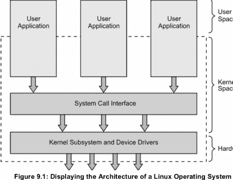

**图 9.1：展示 Linux 操作系统的体系结构**

如图 9.1 所示，该体系结构分为三个层次——用户空间、系统调用接口（SCI）和内核。顶层运行的是用户应用程序，底层运行的是内核。中间层是 SCI，它连接各种用户应用程序，以便从内核获取服务。这一层很重要，因为内核空间和用户空间位于两个不同的受保护地址空间中。换言之，SCI 层是它们之间唯一的通信媒介。用户空间中的应用程序与内核空间之间的通信主要通过调用库函数完成，而库函数又会发出系统调用来完成工作。为了理解用户空间与内核空间之间的通信，我们以 C 语言中的 printf() 函数为例，它有助于数据的格式化和缓冲。发出对 printf() 的调用最终会调用 write() 系统调用，该系统调用指示内核将数据写入控制台。有趣的是，当应用程序执行系统调用时，内核代表该应用程序执行，并运行在进程上下文中。

内核还通过中断来管理硬件资源。当任何硬件想要与系统通信时，它会发出一个中断，异步地打断内核。通常，中断由编号标识。内核使用该编号执行特定的中断处理程序，以处理并响应中断。例如，当你输入时，键盘控制器会发出中断，让系统知道键盘缓冲区中有新数据。内核通过启用和禁用中断来与外部环境交互，从而处理该中断。在 Linux 内核中，中断不在进程上下文中执行；相反，它们运行在一种称为中断上下文的特殊上下文中。

在了解 Linux 操作系统的基本概念之后，现在让我们讨论内核设计。

### 宏内核还是微内核——Linux 如何选择？

内核可以分为两种主要设计模式：宏内核和微内核。宏内核是一种操作系统体系结构，它实现为单个大型进程，以内核模式完全作为管理者运行。宏内核内部的通信相对简单，因为所有内容都在同一地址空间中以内核模式运行。另一方面，微内核并不是实现为单个大型进程。在设计微内核时，内核的全部功能被分解为更小的内核模块，这些模块可以轻松、灵活地配置。

与 UNIX 类似，Linux 拥有宏内核。这意味着 Linux 实现为一个完全运行在内核空间中的单一进程。然而，Linux 也借鉴了微内核的一些特性。Linux 为自身增加了动态加载小型内核模块的能力，从而无需重启操作系统即可在运行时增强其功能。让我们总结一下 Linux 内核区别于 UNIX 变体的特征：

- 1. Linux 支持动态加载内核模块。尽管 Linux 内核是宏内核，但它能够按需动态加载和卸载内核代码。
- 2. Linux 支持对称多处理器。对称多处理是一种计算机体系结构，其中两个或多个处理器通过单一共享内存连接，整个系统由单个操作系统实例控制。
- 3. Linux 内核是可抢占的，也就是说，它可以被中断以执行另一项任务。与传统 UNIX 变体不同，Linux 内核即使任务正在内核中运行，也能够抢占该任务。诸如 SOLARIS 和 IRIX 之类的 UNIX 实现具有可抢占内核，但大多数传统 UNIX 内核是不可抢占的。
- 4. Linux 在支持线程方面采取了一种有趣的方法，即它不区分普通线程和进程。这意味着它们对内核来说都是一样的。
- 5. Linux 提供面向对象的设备模型，包括设备类、热插拔事件和用户空间设备文件系统（sysfs）。
- 6. Linux 忽略了一些被认为设计不佳的常见 UNIX 特性，例如 STREAMS。
- 7. Linux 在“自由”一词的每种意义上都是自由的，也就是说，其源代码可以自由分发，并且任何人都可以修改和增强它。

接下来，让我们了解 Linux 内核模块。

### Linux 内核模块

Linux 内核模块是较小的模块，具有特定功能，可以动态加载到内核中或从内核中卸载。与微内核类似，内核模块无需重启系统即可扩展内核的功能。然而，在系统中运行内核模块时应当小心，因为代码中即使是一个小错误，也可能清空整个文件系统，或者导致核心转储并随后重启。Linux 内核模块的示例是设备驱动程序，它们允许内核访问连接到系统的硬件。如果没有内核模块，我们就必须构建宏内核，并将新模块直接添加到内核映像中，才能向 Linux 内核添加小型功能或实用程序。此外，拥有更大内核的最大缺点之一是，每次添加新功能时都需要重新构建整个内核并重启它。

要查看已经加载到内核中的内核模块，我们需要运行 lsmod 命令并查看其输出。lsmod 命令通过读取 /proc/modules 文件来显示此信息。内核模块的扩展名为 ko。

### Hello World——第一个内核模块

让我们编写以下内核模块程序，它将在执行期间在控制台上打印一段简单文本“Hello World”：

```c
/* hello.c – Our first kernel module program in C */
#include <linux/module.h>    /* Required by all modules */
#include <linux/kernel.h>    /* Required for KERN_INFO */

int init_module (void)
{
```


## 第 9 章

```text
make[1]: Entering directory `/usr/src/linux-2.6.11'
  CC [M] /root/lkmp-examples/Test_Dir/hello-1.o
Building modules, stage 2.
MODPOST
  CC /root/lkmp-examples/Test_Dir/hello-1.mod.o
  LD [M] /root/lkmp-examples/Test_Dir/hello-1.ko
make[1]: Leaving directory `/usr/src/linux-2.6.11'
hostname:~/lkmp-examples/Test_Dir#
```

成功编译后，会生成一个 hello-1.ko 文件，这就是可加载内核模块。要加载这个内核模块，我们必须从控制台调用 insmod 命令：

```bash
insmod hello-1.ko
```

要查看已加载到内核中的内核模块，我们只需参考 /proc/modules 文件。加载 hello-1.ko 内核模块后，让我们检查它是否已列入 /proc/modules 中。要查看所有已加载内核模块的列表，我们必须对 /proc/modules 执行 cat 操作。cat 操作的结果表明，该内核模块已成功列入内核的活动可加载模块中。现在，如果我们想卸载该内核模块，需要对 hello-1.ko 执行 rmmod 命令。现在，如果我们检查 /proc/modules 文件，可以注意到该内核模块不再位于活动内核模块列表中。

接下来，让我们了解 module_init() 和 module_exit() 宏。

### module_init() 和 module_exit() 宏

如果我们在 Linux 2.4 及更高版本中编写内核模块，那么可以重命名模块中的启动函数和清理函数，因为这些函数并不总是必须分别称为 init_module() 和 cleanup_module()。此功能也可以通过使用 module_init() 和 module_exit() 宏来实现，这些宏定义在 linux/init.h 中。唯一的限制是启动函数和清理函数必须在调用这些宏之前定义；否则，我们将遇到编译错误。以下是使用 module_init() 和 module_exit() 宏的内核模块：

```c
/*
 * hello-2.c - Demonstrating module_init() and module_exit() macros.
 */

#include <linux/module.h> /* Required by all modules */
#include <linux/kernel.h> /* Required for KERN_INFO */
#include <linux/init.h>   /* Required for the macros */

static int __init hello_world_init(void)
{
    printk(KERN_INFO "Hello world -- once again\n");
    return 0;
}

static void __exit goodBye_world_exit(void)
{
    printk(KERN_INFO "Goodbye world -- once again\n");
}

module_init(hello_world_init);
module_exit(goodBye_world_exit);
```

此内核模块的 Makefile 与 hello-1.c 的 Makefile 相同；我们只更改了程序名。

现在让我们了解 __init 和 __exit 宏。

### __init 和 __exit 宏

__init 宏会在首次调用后丢弃启动函数并释放其内存。这一做法适用于内置驱动程序，而不适用于可加载模块。另一个名为 __initdata 的宏与 __init 宏类似；它会在启动变量使用后立即清理这些变量。当模块被编译进内核时，__exit 宏会导致省略紧跟 __exit 关键字的函数。

考虑以下程序：

```c
/*
 * hello-3.c -- Illustrating the __init, __initdata and __exit macros.
 */
#include <linux/module.h> /* Required by all modules */
#include <linux/kernel.h> /* Required for KERN_INFO */
#include <linux/init.h>   /* Required for the macros */

static int hello_world_data __initdata = 3;

static int __init hello_world_init(void)
{
    printk(KERN_INFO "Hello, world Data = %d\n", hello_world_data);
    return 0;
}

static void __exit goodBye_world_exit(void)
{
    printk(KERN_INFO "Goodbye, world once again\n");
}

module_init(hello_world_init);
module_exit(goodBye_world_exit);
```

在前面的程序中，我们在全局作用域中定义了一个静态变量 hello_world_data，并在其后使用 __initdata 宏。我们在启动函数中使用了 hello_world_data 变量，而 __initdata 确保该变量在启动函数 hello_world_init() 中首次使用后会被清理。按照编码惯例，我们会用 __initdata 宏定义仅在启动函数中使用的变量。我们不需要让这些变量在整个程序执行期间一直存在，因为它们不会在其他地方使用。类似地，在启动函数和清理函数之前使用 __init 和 __exit 宏，可确保这些函数所占用的内存在使用后被释放。这样做是因为这两个函数都是特殊类型的函数，它们只在加载和卸载内核模块时被调用。这些关键字或宏不会用于模块中的其他函数，因为在程序生命周期内我们可能需要多次调用那些函数。

紧跟 __exit 宏的函数是 goodBye_world_exit()。它对可加载模块没有影响。此外，如果模块以静态方式编译，则该函数永远不会被调用。

在下一节中，我们将讨论许可和模块文档。

### 内核模块的许可与文档

每当我们尝试在 Linux 2.4 或更高版本中运行内核模块时，尽管它会加载到内核中，但在调用 insmod 命令时仍会在控制台上看到一些警告。让我们使用 insmod 命令运行 hello-1.ko 模块以查看该警告，如下所示：

```text
#### insmod hello-1.ko
Warning: loading hello-1.ko will taint the kernel: no license
See http://www.tux.org/lkml/#export-tainted for information about tainted modules
Module hello-1 loaded, with warnings
```

在 Linux 2.4 或更高版本中，有一种机制可识别在 GPL 下许可的代码，从而可以警告程序员该代码不是开源代码。此功能由 MODULE_LICENSE() 宏执行。为了消除该警告，我们需要将许可证设置为 GPL。许可证机制在 linux/module.h 中定义并记录。为了理解 Linux 内核模块的 GPL 许可证概念，考虑以下程序：

```c
/*
 * hello-4.c - Demonstrates module documentation to eliminate warning during module
 *             loading time
 */
#include <linux/module.h> /* Required by all modules */
#include <linux/kernel.h> /* Required for KERN_INFO */
#include <linux/init.h>   /* Required for the macros */

#define DRIVER_AUTHOR "Soumitra Banerjee"
#define DRIVER_DESC "A sample driver"

static int __init init_hello_world(void)
{
    printk(KERN_INFO "Hello, world for license example.\n");
    return 0;
}

static void __exit cleanup_goodbye_world(void)
{
    printk(KERN_INFO "Goodbye, world  once again.\n");
}

module_init(init_hello_world);
module_exit(cleanup_goodbye_world);

/* To get rid of taint message by declaring code as GPL. */

MODULE_LICENSE("GPL");

MODULE_AUTHOR(DRIVER_AUTHOR); /* who wrote this module. */
MODULE_DESCRIPTION(DRIVER_DESC); /* what does this module do */

/* This module uses /dev/testdevice. The MODULE_SUPPORTED_DEVICE
 * macro might be used in the future to help automatic configuration
 * of modules, but is currently unused other than for documentation
 * purposes. */
MODULE_SUPPORTED_DEVICE("testdevice");
```

在前面的程序中，我们使用了 MODULE_LICENSE() 宏来消除模块加载期间给出的警告。

接下来，让我们学习如何编译跨多个文件的模块。

### 编译跨多个文件的模块

有时，我们需要将一个内核模块划分为多个源文件。将单个内核模块文件拆分为多个文件可提高代码的模块化程度，并使整个模块更简单。让我们编写一个跨两个源文件的内核模块。以下是 start.c 的代码：

```c
/* start.c - Illustration of multi-file modules */
#include <linux/kernel.h> /* we're doing kernel work */
#include <linux/module.h> /* Specifically, a module */

int init_module(void)
{
    printk(KERN_INFO "Hello, world - in start\n");
    return 0;
}
```

以下是 stop.c 的代码：

```c
/* stop.c - Illustration of multi-file modules */

#include <linux/kernel.h> /* we're doing kernel work */
#include <linux/module.h> /* Specifically, a module */

void cleanup_module(void)
{
    printk(KERN_INFO "Good Bye - in stop.\n");
}
```

start.c 文件包含 init_module() 函数的定义；而 stop.c 文件包含 cleanup_module() 函数的定义。

现在，我们需要编译这两个文件并生成 .ko 文件以加载内核模块。到目前为止，我们已经学习了通过使用 make 命令编译单个源文件来生成 .ko 文件。因此，产生了一个问题：这个示例是否会有两个不同的内核模块，一个用于 start.c，另一个用于 stop.c？这个问题的答案是否定的，因为编译 start.c 和 stop.c 文件后将生成单个内核模块。此示例的 Makefile 将包含这两个程序的名称，如下所示：

```makefile
obj-m += startstop.o
startstop-objs := start.o stop.o
all:
	make -C /lib/modules/$(shell uname -r)/build M=$(PWD) modules
clean:
	make -C /lib/modules/$(shell uname -r)/build M=$(PWD) clean
```

使用 make 命令执行 Makefile 会生成一个名为 startstop.ko 的内核模块，可使用 insmod 和 rmmod 命令分别将其加载到内核和从内核卸载。

在了解了内核模块如何编写之后，让我们讨论内核模块与 C 用户空间程序之间的主要区别。

### 内核模块与 C 用户空间程序

C 用户空间程序从 main() 函数开始，执行一组指令，并在这些指令完成后终止执行。另一方面，内核模块总是从启动函数开始，该函数要么是 init_module，要么是在 module_init 宏中指定的函数。启动函数在内核模块加载时被调用后，会在内核中设置环境，以便在需要时运行模块的函数。

要结束 C 用户空间程序的执行，无需做任何特殊操作；然而，要卸载内核模块，我们应始终调用清理函数，该函数要么是 cleanup_module，要么是在 module_exit 调用中指定的函数。清理函数是每个内核模块的退出点，在此处它会注销入口函数曾经注册的所有功能。每个 Linux 内核模块都必须有一个入口函数和一个退出函数。


## 第9章：模块的库函数

在编写 C 用户空间程序时，我们可以使用不同的库函数，而不必每次都自行定义。最常见的例子是 printf() 函数。内核模块也可以使用类似的库函数，例如 printk()。

在本章前面讨论的 hello.c 程序中，请注意我们使用了 printk() 函数，却没有包含任何标准 I/O 库。这是因为内核模块是目标文件，其符号在 insmod 期间解析。这些符号的定义通常来自内核本身。/proc/kallsyms 文件提供了内核导出的所有符号列表。

在进一步讨论之前，让我们先理解库函数和系统调用之间的区别。库函数是更高层的应用程序编程接口（API），完全在用户空间中运行，并为相关功能提供更便捷的接口。另一方面，系统调用以用户的名义在内核模式下运行。例如，为了格式化作为参数传递给 printf() 的数据，会使用系统调用 write() 将数据发送到标准输出。

考虑以下程序：

```c
#include <stdio.h>
int main(void)
{
    printf("hello");
    return 0;
}
```

现在，使用 gcc -Wall -o hello hello.c 编译上述程序，并用 strace ./hello 运行该可执行文件。strace 工具会给出程序所使用的系统调用的全部细节，包括调用了哪个系统调用、其参数是什么以及返回值是什么。用 strace ./hello 运行该可执行文件后的输出表明，printf() 函数背后的实际操作是 write(1, "hello", 5)。

接下来，让我们讨论字符设备文件。

### 字符设备文件

linux/fs.h 头文件中的 file_operations 结构体保存着指向驱动程序向内核注册的函数的指针，这些函数用于对设备执行各种操作。该结构体的每个字段都对应一个处理所请求操作的函数；不过，并非结构体中的所有条目都是必需的。file_operations 的实例通常称为 fops 或 file ops。结构体赋值如下所示：

```c
struct file_operations file_ops = {
    read: read_my_device,
    write: write_my_device,
    open: open_my_device,
    release: release_my_device
};
```

注意，结构体中任何未显式赋值的成员都会由 gcc 编译器自动初始化为 NULL。

### 探索文件结构

在 Linux 中，文件是一种内核级结构，不应与用户空间文件混淆。它与 glibc 定义的文件并不相同，也永远不会出现在内核空间函数中。此外，此处所说的文件是 Linux 打开文件，而不是磁盘上的文件；因此，不应将其与 inode 混淆，inode 用于存储 Linux 系统中特定于某个文件的全部信息。

### 注册设备

字符设备通过设备文件访问，这些设备文件位于 /dev 中。每个字符设备文件都有两个编号：主设备号和次设备号。主设备号有助于定位处理该设备的驱动程序。另一方面，次设备号由驱动程序用来区分它所处理的多个设备（如果驱动程序处理多个设备的话）。每当向系统添加设备时，我们需要先将其注册到内核。设备的主设备号在模块初始化期间生成。用于向内核注册设备的函数是 register_chrdev()，它定义在 linux/fs.h 头文件中。register_chrdev() 的签名如下：

```
int register_chrdev(unsigned int major, const char *name, struct file_operations *fops);
```

在上述签名中，第一个参数是我们想要请求的主设备号；第二个参数是设备名称，它会出现在 /proc/devices 中；第三个参数是指向该驱动程序 file_operations 表的指针。如果主设备号传入 0，则 register_chrdev() 会尝试动态分配一个主设备号并返回其值。如果主设备号传入某个正的非零值，则 register_chrdev() 会尝试使用给定的主设备号注册设备，成功时返回 0。register_chrdev() 函数失败时返回负值。

在注册字符设备时，我们大多会将主设备号作为 0 传给 register_chrdev() 函数。这可以确保不会与现有已注册设备的主设备号发生冲突。然而，这种方法有一个缺点：我们无法提前创建设备文件，因为我们不知道它将占用哪个主设备号。创建设备文件有几种方法。第一，驱动程序可以打印自己新分配的主设备号，借此我们可以创建设备文件。第二，新注册的设备可以在 /proc/devices 中创建条目，从那里我们可以轻松生成设备文件。第三，我们可以让驱动程序在成功注册后使用 mknod 系统调用创建设备文件，并在调用 cleanup_module 时使用 rm 删除它。

注意，注册期间我们不会向内核显式传递设备的次设备号，因为只有设备本身会使用它。这意味着 Linux 内核与设备的次设备号无关。

### 注销设备

字符设备完成其用途后，我们需要将其从内核中注销。以下函数可用于从内核注销字符设备文件：

```
int unregister_chrdev(unsigned int major, const char *name);
```

在上述函数中，第一个参数是设备主设备号，第二个参数是设备名称。unregister_chrdev() 函数会在 cleanup_module 期间被调用，以从内核中移除驱动程序。成功时返回 0；如果主设备号未与匹配的名称一起注册，则返回 -EINVAL。

接下来，让我们了解设备驱动程序。

### 设备驱动程序

每当我们向系统插入新设备时，在设备启动期间会向其中加载一个特殊程序。这个特殊程序称为设备驱动程序例程。没有设备驱动程序，系统将无法使用该设备。例如，当我们将电视调谐卡或显卡插入系统时，需要将驱动程序安装到系统中，使其识别新硬件并支持其执行和操作。在 UNIX 中，每一件硬件都由位于 /dev 中的一个文件表示，该文件提供与底层硬件的通信。

由于大多数设备既用于输入模式也用于输出模式，因此驱动程序需要有一种机制来接收输入并向设备发送输出。要向设备发送输出，我们需要以输入模式打开设备文件并向其写入所需数据。用户进程访问设备文件，并使用称为输入输出控制（ioctl）的特殊函数对其执行 I/O 操作。为了与驱动程序通信，每个设备都借助 ioctl 命令。每个设备都有自己的 ioctl 命令，可以是读 ioctl（用于将信息从设备发送到进程）、写 ioctl（用于将信息从进程发送到设备）、两者兼有或两者皆无。调用 ioctl 函数时带有三个参数：设备文件的文件描述符、ioctl 编号和一个参数。ioctl 编号编码了主设备号以及 ioctl 类型、命令和参数类型。为了创建 ioctl 编号，会根据类型使用诸如 _IOR、_IOW 或 _IOWR 之类的宏调用。要实现 ioctl，始终建议获得正式的 ioctl 分配，以避免与现有 ioctl 发生任何冲突。

现在让我们详细学习系统调用。

### 系统调用

系统调用对所有用户进程都非常重要，因为它们是用户进程在用户模式下运行时从内核获取任何服务的唯一机制。由于硬件保护，任何在用户模式下运行的进程都不允许访问内核或内核中的函数。进程需要调用系统调用，才能从内核获取服务（例如打开文件、fork 新进程或请求更多内存）。每当进程调用系统调用时，该进程会将适当的值填入寄存器，然后调用一条特殊指令，将控制权转移到内核中先前定义的位置。尽管该进程对该位置没有任何写访问权限，但它肯定可以从该位置读取。在 Intel CPU 架构中，这是通过使用中断 0x80 来完成的。硬件知道，一旦进程跳转到该位置，它就不再在受限的用户模式下运行，而是作为操作系统内核运行。进程可以跳转到的内核位置称为系统调用。在没有适当上下文的情况下，更改系统调用的定义对系统来说可能是致命的。strace 命令用于了解程序在运行时使用的所有系统调用。

系统调用执行的整个过程简单而直接。当用户进程调用系统调用时，该位置的例程会检查系统调用号，并告知内核用户进程请求的是哪项服务。然后，它查看系统调用表（sys_call_table），以找到要调用的内核函数的地址。接着，它调用该函数、执行该函数，然后返回到调用进程。

如果我们想在内核中添加新功能，或更改任何系统调用以前的工作方式，我们需要在内核中实现自己的代码，然后更改 sys_call_table 中的指针，使其指向我们的函数。注意，我们不应让系统处于不稳定状态；无论我们使用 insmod 加载什么模块，都非常重要的一点是，要从 cleanup_module 函数中将 sys_call_table 恢复为原始状态。

在下一节中，让我们学习任务调度。

### 任务调度

如果某个任务需要由进程完成，那么我们需要将其放入系统的 crontab 文件中。由于该任务将由内核模块完成，我们有两种不同的可能性。一种是将一个进程放入 crontab，该进程会在必要时通过系统调用唤醒模块。这种方法效率很低，因为为了定期执行任务，我们需要唤醒一个已经在内存中的内核模块。第二种方法是创建一个可以在每次定时器中断时调用一次的函数。这可以通过创建一个任务来实现，该任务将持有指向该函数的指针。接下来，我们使用 queue_delayed_work 将该任务放入任务列表，以便在下一次定时器中断时执行。如果我们希望该函数持续执行，就需要在每次调用它时将其重新放回任务列表，以便在下一次定时器中断时执行。当模块被 rmmod 移除时，会检查其引用计数。不过，如果引用计数为零，则会调用 cleanup_module。接着，该模块及其所有函数会从内存中移除。

现在让我们讨论中断处理程序。


### 中断处理程序

CPU 与其余硬件之间可能发生两种类型的通信。在第一种类型中，CPU 可以向硬件发出请求。在第二种类型中，硬件向 CPU 发送请求以进行立即处理。第二种类型的通信称为中断。在 Linux 中，硬件中断称为中断请求（IRQ）。IRQ 的两种类型如下：

- **短 IRQ**——处理请求所需时间较短。在此期间，机器将处于阻塞状态，不会处理任何其他中断。
- **长 IRQ**——处理请求所需时间较长，但其他中断可能会发生。始终建议定义长 IRQ。

如果 CPU 收到中断，它会停止当前任务，保存运行时参数，将变量保存到栈上，并调用中断处理程序。如果 CPU 正在处理某些不能中止或停止的重要任务，那么在当前任务完成执行后，才会执行类似的一组操作。这意味着，当系统收到中断请求时，由于系统处于未知状态，中断处理程序甚至不允许某些事情发生。解决此问题的唯一可用方案是完成当前任务的执行，稍后安排处理新的中断请求（这称为下半部），然后返回。内核随后会尽快调用下半部来处理挂起的中断请求。要实现这一点，我们需要调用 `request_irq()`，以便在收到相关 IRQ 时调用中断处理程序。该函数通常接收 IRQ 号、函数名、标志、用于 `/proc/interrupts` 的名称，以及要传递给中断处理程序的参数。标志可以包括 `SA_SHIRQ`（与其他中断处理程序共享 IRQ）或 `SA_INTERRUPT`（快速中断）。当且仅当该 IRQ 上尚不存在处理程序时，此函数才会成功。我们可以通过与硬件通信开始处理请求，并使用 `queue_work()` 和 `mark_bh(BH_IMMEDIATE)` 从中断处理程序调度下半部。

现在，让我们总结本章讨论的要点。

### 小结

在本章中，我们学习了 Linux 操作系统。接下来，我们学习了内核模块。此外，本章还讨论了字符设备文件、设备驱动程序和系统调用。最后，我们简要学习了任务调度和中断处理程序。

### 快速复习

### 选择题

- **Q1.** 在用户模式下运行的程序可以发出系统调用。
  - a. 正确
  - b. 错误

- **Q2.** 要注册字符设备，我们需要同时传递设备的主设备号和次设备号。
  - a. 正确
  - b. 错误

- **Q3.** Linux 内核支持以下哪些特性？
  - a. 支持模块的动态加载
  - b. 支持抢占式中断处理
  - c. 区分普通线程和进程
  - d. 支持对称多处理器架构

- **Q4.** Linux 内核模块中的 init_module 调用在成功时返回非零值。
  - a. 正确
  - b. 错误

### 主观题

1. 什么是内核模块？它们与 C 用户空间程序有何不同？
2. 用户空间进程发出系统调用时会发生什么？
3. 用户空间与内核空间有什么区别？
4. 内核模块的正常返回值是什么？如果内核模块返回其他值会怎样？
5. 编写一个跨越五个不同 C 程序文件的 Linux 内核模块，编译并运行它。
6. 什么是字符设备？为什么需要它们？
7. 什么是 ioctl？为什么使用它们？
8. 什么是单内核（monolithic kernel）？
9. 什么是微内核（microkernel）？它与单内核（monolithic kernel）有何不同？
10. Linux 内核有哪些特性使其不同于其他 UNIX 变体？


## 10

## C 语言并行编程

| 如果你需要了解以下信息： | 参见页码： |
|---|---|
| POSIX 线程 | 250 |
| 使用 POSIX 库进行线程编程 | 250 |
| 清理处理程序 | 259 |
| 同步问题 | 261 |
| 互斥量 | 262 |
| 信号量 | 266 |
| 条件变量 | 271 |
| 死锁 | 273 |

通常，对于任何计算，我们都会将程序分解为多个片段，并按顺序逐个执行每个片段。如果我们采用旧的技术范式，这个想法简单且良好。然而，随着技术的进步，CPU 的性能和内存已增长超过 1000 倍，我们无法再通过顺序执行程序来让 CPU 保持空闲。这是因为 CPU 利用率不足会浪费大量 CPU 周期。因此，有必要在程序中加入一定程度的并行性。

在编程中，并行性是通过使用线程来实现的，线程被称为轻量级进程。线程共享同一进程内的地址和数据空间。通常，我们可以为单个进程创建多个线程，通过为每个线程分配不同的任务来加快执行速度。然而，由于多个线程相互共享相同的地址和数据空间，多线程程序发生数据损坏的可能性也很高。数据损坏可能发生在这样的操作中：一个线程正在更新一个频繁使用的变量，而另一个线程同时正在读取该变量。为了避免此类情况，我们需要在程序中实现互斥量和信号量的概念。

在本章中，我们首先学习 POSIX 线程。然后，我们学习使用 POSIX 库进行线程编程的基础知识，包括线程属性、线程取消和线程模式。接下来，本章讨论清理处理程序以及线程编程中遇到的同步问题。此外，我们还将学习互斥量、信号量、条件变量和死锁。

让我们从讨论 POSIX 线程开始本章。

### POSIX 线程

POSIX 线程（pthreads）是线程的 POSIX 标准。POSIX 代表可移植操作系统接口（Portable Operating System Interface）。它是由电气与电子工程师协会（IEEE）制定的一系列标准，并被指定为 IEEE 1003.1c。POSIX 定义了命令行 shell、实用程序接口和应用程序编程接口（API），以实现软件与操作系统的兼容性。这些实现也可用于符合 POSIX 标准的操作系统，如 FreeBSD、NetBSD、GNU/Linux、Mac OS X 和 Solaris。

POSIX 标准定义了一组 C 语言类型、函数和常量，涵盖以下特性：

- 线程管理
- 互斥量
- 条件变量

pthread 库被称为 `libpthread`，在 UNIX 系统上编译程序时会用到它。所有 pthread 原型、结构和定义都位于 `pthread.h` 文件中。此外，所有 pthread 构造都以 `pthread_` 为前缀。不过，POSIX 信号量以 `sem_` 为前缀，因为它们不属于 pthread 标准。

现在，让我们使用 POSIX 库编写一些 C 程序。

### 使用 POSIX 库进行线程编程

让我们编写一个程序，其中主线程创建一个子线程，两个线程并行执行。但是，在使用 pthread 库编写程序之前，我们应该记住以下准则：

- 在程序中始终包含 `<pthread.h>` 头文件
- 编译程序时，始终使用 `-lpthread` 将它们与 pthread 库链接
- 不要为每个线程分配单独的进程 ID

现在，请看以下程序：

```c
/* thread1.c - Demonstrating thread creation using C */
#include <stdio.h>
#include <string.h>
#include <pthread.h>

struct thread_args {
        char name[20];
        int          count;
};

void *thread_function(void *arg);
int main ()
{
        int             local_counter = 1000;
        int             ret           = 0;
        pthread_t       thread;
        struct thread_args    params;

        strcpy(params.name, "I'm thread");
        params.count = 10000;

        ret = pthread_create(&thread, NULL, thread_function, (void*)&params);
        if (ret != 0) {
                fprintf(stderr, "\nThread creation failed\n");
                return 1;
        }
        printf("Output:\n");
        while (local_counter) {
                printf("C in main\n");
                local_counter--;
        }
        return 0;
}

void *thread_function(void *arg)
{
        struct thread_args  *params = (struct thread_args*)arg;

        while (params->count) {
                printf("%s\n", params->name);
                params->count--;
        }
}
```

上述程序有一个名为 `thread_args` 的用户自定义结构体，其成员包括一个字符数组和一个整型计数变量。在 `main()` 函数中，我们定义了一个 `pthread_t` 类型的变量，并调用了 `pthread_create()`。

`pthread_create()` API 会在调用进程中启动一个新线程。因此，应使用该 API 创建线程。`pthread_create()` API 的签名如下：

```c
int pthread_create (pthread_t                 *thread,
                    const pthread_attr_t       *attr,
                    void * (* start_routine) (void *),
                    void                      *arg);
```


API 的每个参数解释如下：

- thread 参数是新线程的 ID
- attr 参数指定新线程的属性（将在本章后面讨论）
- 新线程通过调用 start_routine 并以 arg 作为参数开始执行

让我们编译并运行该程序。编译时，应在编译过程中将程序链接到 pthread 库，如下所示：

```
gcc thread1.c -o thread1 -lpthread
```

现在，要运行程序，请在 UNIX 提示符下执行以下命令：

```
./thread1
```

在前面的程序中，我们通过使用指向线程的指针调用了 pthread_create()。在 pthread_create() 调用中，线程属性以 NULL 发送，启动函数指针设置为 thread_function()，并将 thread_params 作为参数传递给 pthread_create()。pthread_create() 成功执行后，主线程和子线程以重叠方式运行，体现了并行性的本质。在 main() 函数中，主线程打印 "In main" 1000 次，子线程打印 "I'm thread" 10000 次。

由于主线程循环 1000 次，而子线程循环 10000 次，主线程将在子线程之前完成执行。这可能导致前面程序中出现一个关键问题。比主线程更晚完成的子线程会作为僵尸线程留在系统中。僵尸线程是一种特殊的线程，它们已经完成执行，但仍存在于活动线程表中。它们无事可做，但由于没有正常退出，它们仍然持有其生命周期内使用的资源。这个问题的解决方案是使用 pthread_join()，它可以正确清理僵尸线程；否则，这种情况无法处理。

从主线程调用 pthread_join() 将使其先等待子线程完成。只有到那时，主线程才能退出。pthread_join() 的语法如下：

```c
int pthread_join (pthread_t thread_id,
                  void **retval);
```

pthread_join() API 等待由 thread_id 标识的线程终止。通常，线程可以在以下情况下终止：

- 线程调用 pthread_exit()。
- 线程从线程函数返回。
- 线程被取消。
- 进程中的线程调用 exit() 函数，或者主线程从 main() 函数返回。这会终止该进程创建的所有线程。

retVal 参数收集来自已终止线程的返回值。如果没有任何要返回的内容，则可以传递 NULL。在多线程环境中，一个进程中的所有线程都是对等线程；因此，在执行周期中，任何线程都可以加入该进程中的另一个线程。

现在，考虑 thread2.c 程序，以理解 pthread_join() 的工作方式：

```c
/* thread2.c - demonstrating the usage of pthread_join */
#include <stdio.h>
#include <pthread.h>

struct thread_args {
    char    name[20];
    int     count;
};

void *thread_function(void *arg);

int
main ()
{
    int             local_counter = 100;
    int             ret         = 0;
    pthread_t       thread;
    struct thread_args  params;

    strcpy (params.name, "I'm thread");
    params.count = 10000;

    ret = pthread_create(&thread, NULL, thread_function, (void*)&params);
    if (ret != 0) {
        fprintf(stderr, "\nthread creation failed\n");
        return 1;
    }

    printf("Output:\n");
    while (local_counter) {
        printf("in main\n");
        local_counter--;
    }

    printf("\nwaiting for thread to finish...\n");
    ret = pthread_join(thread, NULL);
    if (ret != 0) {
        fprintf(stderr, "\nthread join failed\n");
        return 0;
    }
    printf("\nthread joined\n");

    return 0;
}

void *thread_function(void *arg)
{
    struct thread_args  *params = (struct thread_args*)arg;

    while (params->count) {
        printf("%s\n", params->name);
        params->count--;
    }
}
```

在前面的程序中，主线程完成其执行，并等待子线程完成之后才能退出。调用 pthread_join() 时传入了 retVal，其被设置为 NULL。

现在，让我们考虑一种情况：子线程在退出之前向主线程返回某些内容。为此，我们使用 pthread_join() API 的第二个参数，如下面的程序所示：

```c
/* thread3.c - demonstrating returning of args from child thread by pthread_join */
#include <stdio.h>
#include <pthread.h>
#include <stdlib.h>

struct thread_args {
    int        num1;
    int        num2;
};
void *thread_function_sum(void *arg);
void *thread_function_product(void *arg);

int
main ()
{
    int         count  = 1000;
    int         ret    = 0;
    pthread_t   thread1;
    pthread_t   thread2;
    struct thread_args params;
    void        *thread_result = NULL;

    params.num1 = 5;
    params.num2 = 15;

    ret = pthread_create(&thread1, NULL, thread_function_sum, (void*)&params);
    if (ret != 0) {
        fprintf(stderr, "\nThread creation failed\n");
        return 1;
    }

    ret = pthread_create(&thread2, NULL, thread_function_product, (void*)&params);
    if (ret != 0) {
        fprintf(stderr, "\nThread creation failed\n");
        return 1;
    }

    printf("OUTPUT:\n");

    printf("\nWaiting for threads to finish...\n");
    ret = pthread_join(thread1, &thread_result);
    if (ret != 0) {
        fprintf(stderr, "\nThread join failed\n");
        return 0;
    }
    printf("\nThread1 joined. sum=[%d]\n", *((int*)(thread_result)));

    ret = pthread_join(thread2, &thread_result);
    if (ret != 0) {
        fprintf(stderr, "\nThread join failed\n");
        return 0;
    }
    printf("\nThread2 joined. product=[%d]\n", *((int*)(thread_result)));

    return 0;
}

void *thread_function_sum(void *arg)
{
    struct thread_args  *params = (struct thread_args*)arg;
    int                 *result = (int*)malloc(sizeof(int));

    *result = params->num1 + params->num2;
    return result;
}

void *thread_function_product(void *arg)
{
    struct thread_args  *params = (struct thread_args*)arg;
    int                 *result = (int*)malloc(sizeof(int));

    *result = params->num1 * params->num2;
    return result;
}
```

在前面的程序中，我们从 main() 函数创建了一个主线程和两个子线程。创建后，这三个线程都以重叠方式开始执行。现在，两个子线程在 pthread_create() API 中具有不同的 start_routine 作为其参数。子线程 1 调用 thread_function_sum()，子线程 2 调用 thread_function_product()。这两个函数在各自的 start_routine 中执行一定量的处理，并在退出时返回一个值。前面的程序与 thread2.c 程序略有不同，因为 pthread_join() 调用具有一个非空的 void 指针类型参数。两个线程函数都通过 pthread_join() 调用中的第二个参数返回其输出。主线程在完成其执行后，等待子线程完成它们的工作。子线程退出后，主线程获取子线程的返回值并相应地处理它们。

现在让我们详细了解线程属性。

### 线程属性

在之前使用 pthread_create() API 的程序中，我们有意将其第二个参数传递为 NULL，以简化程序。调用 pthread_create() API 时，如果我们在线程属性的位置传递 NULL，那么线程将使用默认属性创建，也就是说，它将是一个可加入线程。然而，如果我们想指定自定义线程属性，则需要按如下方式显式处理该调用：

- 通过声明自动变量创建 pthread_attr_t 对象
- 对对象调用 pthread_attr_init()，以使用默认值初始化它
- 根据需求修改 pthread 属性对象并设置必要的属性
- 将指向 pthread 属性对象的指针作为参数传入 pthread_create()
- 调用 pthread_attr_destroy() 释放属性对象

以下不同类型的自定义线程属性可以传递给 pthread_create() API：

- 可加入线程（默认）——当线程终止时，它不会被自动清理。这意味着该线程会变成僵尸线程，直到对其调用 pthread_join()。
- 分离线程——当线程终止时，它会被自动清理，因此无需调用 pthread_join()。
- 线程的调度策略（实时？PTHREAD_INHERIT_SCHED、PTHREAD_EXPLICIT_SCHED、SCHED_OTHER）——这指定线程应使用的调度策略类型。它主要用于实时线程，以将它们与其他线程区分开来。
- 调度参数——这在线程属性对象中设置调度参数。通过使用它，可以设置线程的优先级。
- InheritSched 属性（默认：PTHREAD_EXPLICIT_SCHED 从父线程继承：PTHREAD_INHERIT_SCHED）——这主要用于创建新线程。
- 作用域（内核线程：PTHREAD_SCOPE_SYSTEM，用户线程——PTHREAD_SCOPE_PROCESS，选择其中之一，而不是两者都选）。这帮助我们在两种不同模式下工作——内核空间和用户空间。


## 第10章

- **栈地址（POSIX_THREAD_ATTR_STACKADDR）** — stackaddr 属性定义了线程栈的基址。它被设置为非空，系统会在给定地址初始化栈。
- **栈大小（默认在 pthread.h 中设置的 PTHREAD_STACK_SIZE）** — 栈大小是 pthread 在运行时使用的栈的大小。

以可连接（joinable）状态创建的线程，可以通过调用带有线程 ID 的 pthread_detach() 使其变为可分离（detachable），如下所示：

```c
int pthread_detach (pthread_t thread);
```

请注意，一旦线程变为可分离的，就不能再次变为可连接的。

线程最有趣的属性状态之一是分离（detach）状态。下面的语句为调用它的当前线程设置分离状态的值：

```c
int pthread_attr_setdetachstate (pthread_attr_t * attr, int detachstate);
```

在前面的语句中，我们将分离状态作为第二个参数。

分离状态可以取以下两个值：

- PTHREAD_CREATE_DETACHED
- PTHREAD_CREATE_JOINABLE

让我们考虑以下程序，以探索 detachstate 线程属性，并展示如何在不调用 pthread_join() 的情况下清理子线程：

```c
/* thread4.c – Demonstrating pthread_attribute handling for detachstate */
#include <stdio.h>
#include <pthread.h>

void* thread_function (void* thread_arg)
{
    /* Do work here... */
    printf("\nI am a new thread. I am detached\n");
    sleep(20);
    printf("\nI am a new thread. I am exiting\n");
}

int main ()
{
    pthread_attr_t attr;
    pthread_t thread;
    pthread_attr_init (&attr);
    pthread_attr_setdetachstate (&attr, PTHREAD_CREATE_DETACHED);
    pthread_create (&thread, &attr, &thread_function, NULL);
    pthread_attr_destroy (&attr);

    printf("\nThis is main thread. I am not waiting for the other thread\n");
    /* No need to join the thread. */
    sleep(30);
    printf("\nThis is main thread. I am exiting\n");
    return 0;
}
```

在前面的程序中，我们定义了一个 pthread 属性类型的对象，并将分离状态设置为 PTHREAD_CREATE_DETACHED。我们还将这个属性对象作为参数传递给了 pthread_create() API。新创建的线程的分离状态设置为 CREATE_DETACHED。这意味着只要子线程终止，它就会被自动清理；因此，无需显式地调用 pthread_join() 来连接该线程。

接下来，让我们学习线程取消及其模式。

### 线程取消与模式

假设我们在多线程环境中运行线程，并且根据特定条件，我们希望取消某些线程并终止其执行。此外，一个线程可以在程序执行期间请求另一个线程终止。这可以通过使用称为线程取消的概念来完成。通过向线程发送取消请求，我们只能请求该线程终止；线程是否结束其执行，完全取决于其取消状态。而且，仅发送取消请求可能不足以在线程执行期间终止或取消它。取消还取决于目标线程的两个因素——取消状态和类型。要取消线程，我们可以使用以下语句：

```c
int pthread_cancel (pthread_t  thread_id);
```

在前面的语句中，thread_id 是要取消的线程的 ID。pthread_cancel() API 向具有给定 thread_id 的线程发送取消请求。

被取消的线程之后可以使用 pthread_join() 进行连接，除非它是分离的。被取消线程的返回值是 PTHREAD_CANCELED。

如果线程正在执行复杂任务，例如更新关键资源池，那么取消操作可能存在风险。在这种情况下，取消该线程可能会妨碍正在执行的任务的关键性及其所有依赖项。为了解决这种情况，pthread 提供了取消模式。以下是关于线程取消的三种模式：

- 1. **异步可取消** – 线程可以在其执行过程中的任何时刻被取消。
- 2. **同步可取消** – 线程可以被取消，但不能在其执行过程中的任何时刻被取消。取消请求会被排队，只有当线程在其执行路径中到达某些特定点（称为取消点）时才会被取消。这是新建线程的默认模式。
- 3. **不可取消** – 任何取消线程的尝试都会被静默忽略。

通过设置其取消状态和类型，线程可以处于上述三种模式中的任意一种，具体说明如下：

- **取消状态** – PTHREAD_CANCEL_ENABLE 或 PTHREAD_CANCEL_DISABLE 用于设置取消状态。它检查特定线程上是否启用了取消。将线程的取消状态设置为 PTHREAD_CANCEL_ENABLE 会使线程对 pthread_cancel() 请求作出响应。而将线程的取消状态设置为 PTHREAD_CANCEL_DISABLE 则会使线程对 pthread_cancel() 请求无动于衷。
- **取消类型** – 取消类型为 PTHREAD_CANCEL_ASYNCHRONOUS 的线程可以在其执行过程中的任何时刻被取消。而取消类型为 PTHREAD_CANCEL_SYNCHRONOUS 的线程意味着它只能在其执行路径中到达某些特殊点（称为取消点）时才能被取消。同步取消类型处理这样一种情况：执行关键任务的可取消线程只有在任务完成后才能被取消。这可以通过在线程完成任务后立即插入一个取消点来实现。

以下是取消模式与取消状态和类型的映射：

- 异步可取消
  - **状态** – PTHREAD_CANCEL_ENABLE
  - **类型** – PTHREAD_CANCEL_ASYNCHRONOUS
- 同步可取消
  - **状态** – PTHREAD_CANCEL_ENABLE
  - **类型** – PTHREAD_CANCEL_SYNCHRONOUS
- 不可取消
  - **状态** – PTHREAD_CANCEL_DISABLE

要设置线程的取消状态，我们可以使用以下 API：

```c
int pthread_setcancelstate (int state, int *oldstate);
```

前面的 API 设置新的取消状态，并返回旧的取消状态。类似地，要设置线程的取消类型，我们可以使用以下 API：

```c
int pthread_setcanceltype (int type, int *oldType);
```

前面的 API 设置新的取消类型，并返回旧的取消类型。

现在，要在同步可取消线程中设置取消点，我们需要调用 pthread_testcancel()。该取消点将处理待处理的取消请求。在同步可取消线程中设置取消点的语法如下：

```c
void pthread_testcancel (void);
```

让我们考虑以下程序来处理线程取消：

```c
#include <stdio.h>
#include <unistd.h>
#include <stdlib.h>
#include <pthread.h>

void *thread_function(void *arg);

int main()
{
    int             res;
    pthread_t       a_thread;
    void            *thread_result;

    res = pthread_create(&a_thread, NULL, thread_function, NULL);
    if (res != 0) {
        fprintf(stderr, "\nThread creation failed.\n");
        return 1;
    }

    sleep (1);
    fprintf(stdout, "Cancelling thread ...\n");
    res = pthread_cancel(a_thread);
    if (res != 0) {
        fprintf(stderr, "\nThread cancellation failed\n");
        return 1;
    }

    fprintf(stdout, "\nWaiting for thread to finish ...\n");
    res = pthread_join(a_thread, &thread_result);
    if (res != 0) {
        fprintf(stderr, "\nThread join failed\n");
        return 1;
    }
    fprintf(stdout, "\nThread joined\n");

    return 0;
}

void *thread_function(void *arg)
{
    int     i;
    int     res;

    res = pthread_setcancelstate(PTHREAD_CANCEL_ENABLE, NULL);
    if (res != 0) {
        fprintf(stderr, "\nThread pthread_setcancelstate failed\n");
        return 0;
    }

    res = pthread_setcanceltype(PTHREAD_CANCEL_DEFERRED, NULL);
    if (res != 0) {
        fprintf(stderr, "\nThread pthread_setcanceltype failed\n");
        return 0;
    }
    fprintf(stdout, "\nthread_function is running\n");
    for (i = 0; i < 500; i++) {
        fprintf(stdout, "\nI am still running (%d) ...\n", i);
    }
    pthread_testcancel();
    pthread_exit(0);
}
```

在前面的程序中，我们在 main() 函数中创建了一个新线程，并向它发出了 pthread_cancel() 请求。另一方面，我们在 thread_function() 中操作了线程的状态和类型。

请注意，pthread_cancel() API 应仅在特殊情况下使用；例如，当一个线程可能留下一些影响程序结果的不完整任务时。在这种情况下，更好的方法是告知线程它应该结束，然后等待线程自行退出。

现在，让我们学习清理处理器。

### 清理处理器

清理处理器是一个在线程被取消时自动调用的函数。它通常用于释放线程可能持有的资源和锁。当线程被取消时，在程序开始时注册的清理处理器会按照与栈相反的次序被调用。注册清理处理器意味着将其压入栈中；而注销清理处理器则意味着将其从栈中移除。

我们可以注册一个清理处理器，如下所示：

```c
void pthread_cleanup_push (void (*routine) (void *), void *arg);
```

当线程被取消时，routine 将以 arg 作为其参数被调用。

我们可以注销一个清理处理器，如下所示：

```c
void    pthread_cleanup_pop (int execute);
```

如果 execute 参数非零，则执行栈顶的清理处理器一次。前面的两个 API 也可以作为带有匹配花括号的宏使用。它们应在同一函数内、相同的词法嵌套级别成对使用。

考虑以下程序来理解清理处理器的概念：

```c
#include <stdio.h>
#include <stdlib.h>
#include <pthread.h>

/* Allocate a temporary buffer. */
void* allocate_buffer (size_t size)
{
```


### 数据可视化

### 一、数据可视化简介

数据可视化是将数据通过图表、图形、地图等视觉元素呈现出来，帮助人们更容易地理解和分析数据的技术和方法。

数据可视化的核心目标是：

- 清晰地传达信息
- 辅助决策
- 揭示数据规律

通过可视化，复杂的数据可以转化为直观的视觉形式。这些方法广泛应用于商业分析、科学研究、新闻传播等领域。

### 二、数据可视化的工具

常用的数据可视化工具包括：

- Excel：适合快速制作基础图表。
- Python (Matplotlib/Seaborn)：提供丰富的绘图库。
- Tableau：专业的数据可视化软件。
- ECharts：基于JavaScript的交互式图表库。

```python
import matplotlib.pyplot as plt
x = [1, 2, 3, 4]
y = [10, 20, 25, 30]
plt.plot(x, y)
plt.title("Simple Plot")
plt.show()
```

接下来，让我们讨论线程中的同步问题。

### 同步问题

在多线程环境中，线程往往会共享相同的数据和地址空间。假设一个线程正在更新某个公共变量，而此时另一个线程开始读取它的值。这个读取操作将会是脏读，因为读取该公共变量值的线程有可能在写操作完成之前就读取了它。我们需要避免这种情况，以摆脱脏读和脏写问题。

现在，考虑以下程序，它演示了多线程环境中的线程同步问题：

```c
#include <stdio.h>
#include <stdlib.h>
#include <pthread.h>

#define ARRSIZE 10000

struct array {
    int             arr[ARRSIZE];
    int             arr_ptr;
};

void* thread_function(void *arg)
{
    int i = 0;
    struct array *arr = arg;

    for (i = 0; i < ARRSIZE/2; i++) {
        arr->arr[arr->arr_ptr] = arr->arr_ptr + arr->arr_ptr + arr->arr_ptr + arr->arr_ptr + arr->arr_ptr + arr->arr_ptr + arr->arr_ptr + arr->arr_ptr + arr->arr_ptr;
        arr->arr_ptr++;
    }
}

int
main()
{
    pthread_t       thread1;
    pthread_t       thread2;
    int             res = 0;
    int             i   = 0;

    struct array    arr;
    arr.arr_ptr = 0;
    for (i = 0; i < ARRSIZE; i++) {
        arr.arr[i] = 0;
    }

    res = pthread_create(&thread1, NULL, thread_function, &arr);
    if (res != 0) {
        fprintf(stderr, "\nThread creation failed\n");
        return 1;
    }
    res = pthread_create(&thread2, NULL, thread_function, &arr);
    if (res != 0) {
        fprintf(stderr, "\nThread creation failed\n");
        return 1;
    }

    fprintf(stdout, "\nWaiting for threads to finish...\n");
    res = pthread_join(thread1, NULL);
    if (res != 0) {
        fprintf(stderr, "\nThread join failed\n");
        return 0;
    }
    res = pthread_join(thread2, NULL);
    if (res != 0) {
        fprintf(stderr, "\nThread join failed\n");
        return 0;
    }

    fprintf(stdout, "\nThread joined. \n");
    for (i = 0; i < ARRSIZE; i++) {
        fprintf(stdout, "\narr[%d] = %d. Correct Result=[%d]", i, arr.arr[i], i*10);
        if (arr.arr[i] != (i*10))
            fprintf(stdout, " INCORRECT");
    }
    return 0;
}
```

在前面的程序中，我们使用 pthread_create() API 创建了两个线程，并让它们各自执行同一个线程函数。这会导致两个线程之间出现同步问题。为了解决多线程环境中的同步问题，我们使用一种称为互斥锁的概念。让我们在下一节中了解它。

### 互斥锁

互斥锁或互斥排他锁用于避免一个线程正在操作共享变量时出现的情况。与锁类似，互斥锁的状态也可以在已锁定和未锁定之间变化。一旦某个线程锁定了互斥锁，其他线程将无法锁定或获取该互斥锁。其他线程应等待，直到该互斥锁被释放；否则，尝试锁定该互斥锁会使线程阻塞。互斥锁解锁后，等待它的线程中会有一个被解除阻塞并获取该锁。

Linux 确保对互斥锁的加锁操作是原子的，也就是说，即使多个线程竞争锁定同一个互斥锁，也只有一个线程能够获取该锁。当互斥锁被解锁时，等待该互斥锁的阻塞线程中只有一个会被解除阻塞并获取该锁。其余线程将继续保持阻塞状态。

以下是使用互斥锁的步骤：

- 将互斥锁声明为 `pthread_mutex_t mutex;`
- 将互斥锁初始化为 `pthread_mutex_init (&mutex, NULL)`，或 `pthread_mutex_t mutex = PTHREAD_MUTEX_INITIALIZER;`
- 按如下方式锁定互斥锁：`pthread_mutex_lock (&mutex);`
- 按如下方式解锁互斥锁：`pthread_mutex_unlock(&mutex);`
- 按如下方式销毁互斥锁：`pthread_mutex_destroy(&mutex);`

```c
        }
        return 1;
    }

    fprintf(stdout, "\nWaiting for threads to finish...\n");
    res = pthread_join(thread1, NULL);
    if (res != 0) {
        fprintf(stderr, "\nThread join failed\n");
        return 0;
    }
    res = pthread_join(thread2, NULL);
    if (res != 0) {
        fprintf(stderr, "\nThread join failed\n");
        return 0;
    }

    fprintf(stdout, "\nThread joined. \n");
    for (i = 0; i < ARRSIZE; i++) {
        fprintf(stdout, "\narr[%d]=[%d]. Correct Result=[%d]", i, arr.arr[i], i*10);
        if (arr.arr[i] != (i*10)) {
            fprintf(stdout, " INCORRECT");
        }
    }
    pthread_mutex_destroy(&arr_mutex);

    return 0;
}
```

前面的程序与上一节中的程序执行相同的操作，不同之处在于它强制使用互斥锁来处理线程同步问题。

互斥锁的类型决定了当线程试图锁定它已经获取了锁的互斥锁时会发生什么。以下是 Linux 中可用的三种互斥锁类型：

- **快速互斥锁（默认）**——这种类型的互斥锁无法检测死锁。如果线程在未先解锁互斥锁的情况下试图重新锁定该互斥锁，就会发生死锁。这种类型的互斥锁使用 `PTHREAD_MUTEX_FAST_NP` 实现。
- **错误检查互斥锁**——这种类型的互斥锁提供错误检查。如果线程在未先解锁互斥锁的情况下试图重新锁定该互斥锁，就会返回错误。这种类型的互斥锁使用 `PTHREAD_MUTEX_ERRORCHECK_NP` 实现。
- **递归互斥锁**——如果线程在未先解锁互斥锁的情况下试图重新锁定该互斥锁，它将成功锁定该互斥锁。多次锁定该互斥锁将需要相同次数的解锁才能释放该互斥锁，之后另一个线程才能获取该互斥锁。这种类型的互斥锁使用 `PTHREAD_MUTEX_RECURSIVE_NP` 实现。

要初始化、销毁、锁定和解锁互斥锁，我们可以使用以下语句：

- 以下 API 用于初始化操作：
    ```c
    int pthread_mutex_init (pthread_mutex_t * restrict mutex, const pthread_mutexattr_t
    *restrict attr);
    ```
- 以下语句声明一个具有默认属性的静态互斥锁：
    ```c
    static pthread_mutex_t mutex = PTHREAD_MUTEX_INITIALIZER;
    ```
- 以下语句初始化互斥锁属性：
    ```c
    int pthread_mutexattr_init(pthread_mutexattr_t *attr);
    ```
- 以下语句销毁互斥锁属性：
    ```c
    int pthread_mutexattr_destroy(pthread_mutexattr_t *attr);
    ```
- 以下语句用于设置互斥锁属性：
    ```c
    int pthread_mutexattr_settype( pthread_mutexattr_t *attr, int type);
    int pthread_mutexattr_gettype(const pthread_mutexattr_t * restrict attr, int
     *restrict type);
    ```
- 以下语句用于锁定互斥锁：
    ```c
    int pthread_mutex_lock(pthread_mutex_t *mutex);
    ```
- 以下语句用于解锁互斥锁：
    ```c
    int pthread_mutex_unlock(pthread_mutex_t *mutex);
    ```
- 以下语句用于销毁互斥锁：
    ```c
    int pthread_mutex_destroy(pthread_mutex_t *mutex);
    ```

以下程序展示了如何锁定和解锁互斥锁变量：

```c
/* Demonstrating mutex using a small program */
#include <stdio.h>
#include <stdlib.h>
#include <pthread.h>

pthread_mutex_t mutex;

void* thread_function(void *arg)
{
    int res = 0;

    fprintf(stderr, "\nThread is trying to unlock a mutex which is already unlocked.\n");
    res = pthread_mutex_unlock(&mutex);
    fprintf(stderr, "\nres=[%d].\n", res);
    fprintf(stderr, "\nThread is trying to lock a mutex.\n");
    res = pthread_mutex_lock(&mutex);
    fprintf(stderr, "\nres=[%d].\n", res);
    fprintf(stderr, "\nThread is trying to lock a mutex twice.\n");
    res = pthread_mutex_lock(&mutex);
    fprintf(stderr, "\nres=[%d].\n", res);
    pthread_mutex_unlock(&mutex);
    sleep(3);
}

int
main()
{
    pthread_t               thread1;
    int                     res = 0;
    pthread_mutexattr_t     attr;

    pthread_mutexattr_init(&attr);
    pthread_mutexattr_settype(&attr, PTHREAD_MUTEX_ERRORCHECK_NP);
    pthread_mutex_init(&mutex, &attr);
    pthread_mutexattr_destroy(&attr);

    res = pthread_create(&thread1, NULL, thread_function, NULL);
    if (res != 0) {
        fprintf(stderr, "\nThread creation failed\n");
        return 1;
    }
}
```


```c
fprintf(stdout, "\nwaiting for threads to finish...\n");
res = pthread_join(thread1, NULL);
if (res != 0) {
    fprintf(stderr, "\nThread join failed\n");
    return 0;
}

fprintf(stdout, "\nThread joined. \n");
pthread_mutex_destroy(&mutex);

return 0;
}
```

在进入下一节之前，我们先概览一下非阻塞互斥锁。使用非阻塞互斥锁的好处是：如果互斥锁尚未被锁定，那么它将获取该锁；否则，如果它已经被锁定，那么该调用将返回状态 EBUSY。以下是非阻塞互斥锁的特性：

- 通过 `int pthread_mutex_trylock(pthread_mutex_t *mutex);`，可以在不实际阻塞的情况下用互斥锁锁定对象。
- 如果互斥锁未锁定，那么 `pthread_mutex_trylock()` API 的工作方式将与 `pthread_mutex_lock()` 类似。
- 如果某个互斥锁所引用的互斥对象当前被任何线程（包括当前线程）锁定，那么对该互斥锁的调用将立即返回。
- 如果互斥锁类型为 `PTHREAD_MUTEX_RECURSIVE_NP`，且该互斥锁当前由调用线程拥有，那么互斥锁的锁定计数将加一，并且 `pthread_mutex_trylock()` 将立即返回成功。

在下一节中，我们来讨论信号量。

### 信号量

信号量是一种受保护的变量，用于同步对共享可访问资源的并行访问。信号量是一种机制，它包含一个抽象计数器以及两个可用于同步多个线程的操作。可以对信号量执行以下两种操作：

- **等待操作**——将信号量的值减一。如果信号量的值为零，那么等待操作会阻塞线程，直到其他某个线程增加信号量的值。当该值变为正数时，信号量的值减一，等待操作返回。
- **发布操作**——将信号量的值加一。如果信号量的值为零，那么发布操作会解除一个线程的阻塞，该线程正阻塞在对该信号量的等待调用上。被解除阻塞的线程将完成等待调用。发布操作也称为信号操作。

以下是使用信号量的步骤：

- 1. 包含 `<semaphore.h>`，如下所示：

    ```c
    #include <semaphore.h>
    ```

- 2. 声明一个信号量（类型为 `sem_t`），如下所示：

    ```c
    sem_t sem;
    ```

- 3. 初始化信号量，如下所示：

    ```c
    sem_init(&sem, 0, 0);
    ```

- 4. 等待信号量，如下所示：

    ```c
    sem_wait(&sem);  /* blocking */
    sem_trywait(&sem);  /* non-blocking */
    ```

- 5. 向信号量发布，如下所示：

    ```c
    sem_post(&sem);
    ```

- 6. 当不再需要信号量时销毁它，如下所示：

    ```c
    sem_destroy(&sem);
    ```

为了理解信号量的操作和用途，我们以生产者-消费者问题为例。该问题从两个进程开始——生产者和消费者。生产者进程生产某种东西，例如商品；而消费者进程消费生产者生产的商品。现在，为了维持这两个进程之间的协调，生产者和消费者进程都必须同步。如果它们不同步，就可能会遇到若干问题。例如，如果生产者以非常高的速率生产，而消费者以较低的速率消费，那么这将导致商品堆积。然而，如果消费者以高得多的速率消费，那么就会出现产品短缺。我们可以通过将商品定义为信号量变量，并执行等待和信号操作来维持生产者与消费者进程之间的协调，从而解决这个问题。解决生产者-消费者问题的代码如下所示：

```c
#include <stdio.h>
#include <malloc.h>
#include <pthread.h>
#include <semaphore.h>

struct job {
    struct job* next;
    int         num;
};

struct job* job_queue;

pthread_mutex_t job_queue_mutex = PTHREAD_MUTEX_INITIALIZER;

/* A semaphore counting the number of jobs in the queue. */
sem_t job_queue_count;

void initialize_job_queue ()
{
        job_queue = NULL;
        sem_init (&job_queue_count, 0, 0);
}

void process_job(struct job *job)
{
        int square = 0;
        /* Process job */
        square = job->num * job->num;
        fprintf(stdout, "\nProcessed job, num=[%d] output=[%d]", job->num, square);
}

void enqueue_job (int num)
{
        struct job* new_job;
        new_job = (struct job*) malloc (sizeof (struct job));
        pthread_mutex_lock (&job_queue_mutex);
        new_job->next = job_queue;
        new_job->num = num;
        fprintf(stdout, "\nAdding new job. num=[%d]", new_job->num);
        job_queue = new_job;
        sem_post (&job_queue_count);
        pthread_mutex_unlock (&job_queue_mutex);
}

void* thread_producer_function (void* arg)
{
    int j = 0;

    while (1) {
        struct job* next_job;
        enqueue_job(j);
        j++;
        if (j % 5 == 0) {
            sleep(5);
        }
    }
    return NULL;
}

void* thread_consumer_function (void* arg)
{
    struct job* next_job;
    while (1) {
        fprintf(stdout, "\nConsumer waiting for new job..."); fflush(stdout);
        sem_wait (&job_queue_count);
        fprintf(stdout, "\nConsumer got new job."); fflush(stdout);

        pthread_mutex_lock (&job_queue_mutex);
        next_job = job_queue;
        job_queue = job_queue->next;
        process_job (next_job);
        pthread_mutex_unlock (&job_queue_mutex);
        free (next_job);
    }
    return NULL;
}

int
main()
{
    pthread_t          thread_producer;
    pthread_t          thread_consumer;
    int                res = 0;
    int                i   = 0;

    initialize_job_queue();

    res = pthread_create(&thread_producer, NULL, thread_producer_function, NULL);
    if (res != 0) {
        fprintf(stderr, "\nthread creation failed\n");
        return 1;
    }

    res = pthread_create(&thread_consumer, NULL, thread_consumer_function, NULL);
    if (res != 0) {
        fprintf(stderr, "\nthread creation failed\n");
        return 1;
    }

    fprintf(stdout, "\nwaiting for threads to finish...\n");
    res = pthread_join(thread_producer, NULL);
    if (res != 0) {
        fprintf(stderr, "\nthread join failed\n");
        return 0;
    }
    res = pthread_join(thread_consumer, NULL);
    if (res != 0) {
        fprintf(stderr, "\nthread join failed\n");
        return 0;
    }

    pthread_mutex_destroy(&job_queue_mutex);

    return 0;
}
```

以下是一些信号量 API：

```c
int sem_init(sem_t *sem, int pshared, unsigned int value);
sem - initialises the semaphore pointed to by sem
pshared - should be set to 0 if the semaphore is shared between threads of a process
value - initial value of the semaphore

int sem_post(sem_t *sem);
sem - address of the semaphore

int sem_wait(sem_t *sem);
Blocks if value of sem is zero

int sem_trywait(sem_t *sem);
If value of sem is zero, call returns with error

int sem_timedwait(sem_t *sem, const struct timespec *abs_timeout);
If value of sem is zero, the call blocks for a maximum of the time specified in the
call.

int sem_destroy(sem_t *sem);
sem - destroys the semaphore pointed to by sem
```

我们再考虑另一个程序，以展示在使用信号量的线程编程中 CPU 周期是如何被浪费的：

```c
/* Demonstrating busy waiting for cpu cycles for mutex variables */
#include <stdio.h>
#include <stdlib.h>
#include <pthread.h>

int continue_flag;
pthread_mutex_t continue_flag_mutex;

void do_work ()
{
    fprintf(stdout, "\nworker thread: working..."); fflush(stdout);
}

void* worker_thread_function(void *arg)
{
    int cont_flag = 0;
    while (1) {
        pthread_mutex_lock(&continue_flag_mutex);
        if (continue_flag) {
            do_work();
        }
        pthread_mutex_unlock(&continue_flag_mutex);
    }
}
int
main()
{
    pthread_t            worker_thread;
    int                  res = 0;

    continue_flag = 0;
    pthread_mutex_init(&continue_flag_mutex, NULL);

    res = pthread_create(&worker_thread, NULL, worker_thread_function, NULL);
    if (res != 0) {
        fprintf(stderr, "\nThread creation failed\n");
        return 1;
    }

    while (1) {
        pthread_mutex_lock(&continue_flag_mutex);
        continue_flag = 1;
        pthread_mutex_unlock(&continue_flag_mutex);
        fprintf(stdout, "\nmain thread: Start work\n\n"); fflush(stdout);
        sleep(2);
        pthread_mutex_lock(&continue_flag_mutex);
        continue_flag = 0;
        pthread_mutex_unlock(&continue_flag_mutex);
        fprintf(stdout, "\nmain thread: Stop work\n\n"); fflush(stdout);
        sleep(3);
    }

    fprintf(stdout, "\nWaiting for thread to finish...\n");
    res = pthread_join(worker_thread, NULL);
    if (res != 0) {
        fprintf(stderr, "\nThread join failed\n");
        return 0;
    }

    fprintf(stdout, "\nThread joined. \n");
    pthread_mutex_destroy(&continue_flag_mutex);

    return 0;
}
```


前面的程序表明，如果线程试图锁定一个已经被锁定的互斥量变量，它会持续循环检查该锁是否已释放。这会导致大量 CPU 周期被浪费，而使用条件变量本可以避免这种浪费。

现在，我们来学习条件变量。

### 条件变量

条件变量是一种线程同步机制。通常，条件变量用于线程保持阻塞直到某个条件得到满足的场景。条件的值通常由另一个线程设置。线程可以等待一个条件变量。如果线程 A 等待某个条件变量，它会被阻塞，直到另一个线程（例如线程 B）发出同一条件变量的信号。线程 A 必须先等待该条件变量，然后线程 B 才能发出信号。如果线程 B 在线程 A 等待它之前就发出条件变量信号，那么该信号会丢失。注意，条件变量不是计数器。

条件变量由 `pthread_cond_t` 的实例表示。以下语句定义了一个条件变量：

```c
pthread_cond_t cv;
```

每个条件变量都应伴随一个互斥量。我们可以使用以下 API 初始化条件变量：

```c
pthread_cond_init(&cv, NULL);
```

条件变量的基本用法如下：

- 要向条件变量发送信号，可以使用以下 API：
  1. **pthread_cond_signal(&cv)**——如果一个或多个线程正在等待该条件变量，那么其中一个线程将被解锁。如果此时没有线程等待该条件变量，则该信号将被忽略。
  2. **pthread_cond_broadcast(&cv)**——它会解除所有正在等待该条件变量的线程的阻塞。

- 要等待条件变量，可以使用 `pthread_cond_wait(&cv, &mutex)` API。该 API 会阻塞调用线程，直到条件变量收到信号。调用 `pthread_cond_wait()` API 时，互斥量必须已经处于锁定状态。该调用会以单个原子操作解锁互斥量并在条件变量上阻塞。当条件变量收到信号时，调用线程解除阻塞，并以原子方式获取互斥量上的锁。

- 要销毁条件变量，可以使用 `pthread_cond_destroy(&cv)` API。

如果代码要改变由条件变量保护的条件的判定值，请执行以下步骤：

1. 锁定与该条件变量伴随的互斥量。
2. 执行可能改变条件状态的操作（例如，设置标志）。
3. 根据所需行为，向条件变量发送信号或进行广播。
4. 解锁与该条件变量伴随的互斥量。

以下程序演示了条件变量的概念：

```c
#include <stdio.h>
#include <stdlib.h>
#include <pthread.h>
int continue_flag;
pthread_mutex_t continue_flag_mutex;
pthread_cond_t continue_flag_cv;
void do_work ()
{
    fprintf(stdout, "\nworker thread: working..."); fflush(stdout);
}
void* worker_thread_function(void *arg)
{
    while (1) {
        pthread_mutex_lock(&continue_flag_mutex);
        while (!continue_flag) {
            pthread_cond_wait(&continue_flag_cv, &continue_flag_mutex);
        }
        do_work();
        pthread_mutex_unlock(&continue_flag_mutex);
    }
}
int
main()
{
    pthread_t               worker_thread;
    int                     res = 0;

    continue_flag = 0;
    pthread_mutex_init(&continue_flag_mutex, NULL);
    pthread_cond_init(&continue_flag_cv, NULL);

    res = pthread_create(&worker_thread, NULL, worker_thread_function, NULL);
    if (res != 0) {
        fprintf(stderr, "\nthread creation failed\n");
        return 1;
    }
    while (1) {
        pthread_mutex_lock(&continue_flag_mutex);
        continue_flag = 1;
        pthread_cond_signal(&continue_flag_cv);
        pthread_mutex_unlock(&continue_flag_mutex);
        fprintf(stdout, "\nmain thread: Start work\n"); fflush(stdout);
        sleep(2);
        pthread_mutex_lock(&continue_flag_mutex);
        continue_flag = 0;
        pthread_mutex_unlock(&continue_flag_mutex);
        fprintf(stdout, "\nmain thread: Stop work\n"); fflush(stdout);
        sleep(3);
    }
    fprintf(stdout, "\nwaiting for thread to finish...\n");
    res = pthread_join(worker_thread, NULL);
    if (res != 0) {
        fprintf(stderr, "\nthread join failed\n");
        return 0;
    }
    fprintf(stdout, "\nthread joined. \n");
    pthread_mutex_destroy(&continue_flag_mutex);
    return 0;
}
```

在前面的程序中，我们没有使用互斥量，而是使用条件变量来避免浪费 CPU 周期。

### 死锁

如果两个或多个线程共享一组公共资源，并试图按某种顺序锁定这些资源并无限期地等待它们，就可能发生死锁。当两个或多个相互竞争的线程互相等待对方完成时，就会发生这种死锁情况；因此，它们会无限期地互相等待。死锁在多线程系统中非常常见，在这些系统中，软件锁和硬件锁都用于处理共享资源并实现同步。考虑以下示例，它将导致死锁：

| 线程 1 | 线程 2 |
| --- | --- |
| 锁定 (A) | 锁定(B) |
| 锁定 (B) | 锁定(A) |
| ... | ... |

在前面的示例中，我们定义了两个线程——线程 1 和线程 2。注意，这两个线程共享相同的数据空间。现在，我们有两个变量 A 和 B，它们对两个线程都是公共的。在执行路径中，线程 1 锁定变量 A，并等待锁定变量 B。另一方面，并行执行的线程 2 先锁定变量 B，然后打算锁定当前由线程 1 锁定的变量 A。这意味着线程 1 和线程 2 都在等待当前被另一个线程锁定的资源 A 和 B；因此，这两个线程都处于死锁状态。换句话说，线程 1 和线程 2 都在等待一个永远不会发生的事件 `unlock()`。

因此，在编写支持多线程的程序的代码时，我们应确保所有线程以相同的顺序获取锁。也就是说，如果线程 1 先锁定 A，然后锁定 B，那么所有执行类似操作的其他线程也应先锁定 A，再锁定 B。

现在，让我们总结本章讨论的要点。

### 小结

在本章中，我们学习了 POSIX 线程。我们还学习了使用 POSIX 库进行线程编程的基础知识，包括线程属性、线程取消和模式。然后，本章讨论了清理处理程序以及线程编程中面临的同步问题。此外，我们学习了互斥量、信号量、条件变量和死锁。

### 快速复习

### 多项选择题

- **Q1.** 什么是线程取消点？
  - a. 程序中可以取消异步线程的点。
  - b. 程序中可以取消同步线程的点。

- **Q2.** 什么是线程？它们与进程有何不同？
  - a. 线程是轻量级进程，同一进程的线程之间共享相同的地址空间和数据空间。
  - b. 线程是重量级进程，同一进程的线程之间共享相同的地址空间和数据空间。
  - c. 线程是轻量级进程，同一进程的线程之间不共享相同的地址空间和数据空间。
  - d. 线程是重量级进程，同一进程的线程之间不共享相同的地址空间和数据空间。

- **Q3.** 线程同步可以通过使用互斥量和条件变量来实现。
  - a. 正确
  - b. 错误

- **Q4.** 线程同步可能导致死锁。
  - a. 正确
  - b. 错误

- **Q5.** 并行编程可以在单处理器系统上进行。
  - a. 正确
  - b. 错误

### 主观题

- **Q1.** 并行编程有哪些好处？
- **Q2.** 什么是 pthread？
- **Q3.** 讨论线程 join 操作的用途。
- **Q4.** 为什么线程需要同步？
- **Q5.** 线程属性有哪些不同类型？通过编写程序讨论每一种属性。
- **Q6.** 为什么需要线程取消？在程序中取消线程是一种好做法吗？
- **Q7.** 如果线程取消处理不当，会遇到哪些问题？
- **Q8.** 什么是清理处理程序？
- **Q9.** 什么是互斥量？
- **Q10.** 什么是信号量？
- **Q11.** 既然已经存在信号量，为什么还要使用条件变量？


## 11 C 语言中的交叉编译

| 如果需要了解的信息： | 见页码： |
|---|---:|
| 在 Linux 环境中编译 C 代码 | 276 |
| 交叉编译 | 277 |

交叉编译器能够为与编译器自身运行平台不同的平台创建可执行代码。当无法在代码将要执行的平台上编译代码时，就会使用交叉编译器。一个组织可能希望在多个平台上运行代码。在这种情况下，可以同时使用一个单一的构建环境和交叉编译器。通常，交叉编译器用于嵌入式系统。

在本章中，我们学习如何在 Linux 环境中编译 C 代码。然后，本章讨论交叉编译的基础知识。

### 在 Linux 环境中编译 C 代码

在进行交叉编译之前，我们必须了解如何使用编译器的各种选项来编译 C 代码。为此，我们以 Linux 环境为例。要在 Linux 中编译 C 代码，我们首先需要使用文本编辑器（如 vim）在 Linux 中创建一个 C 文件。考虑以下在 Linux 环境中创建的名为 hello.c 的示例程序：

```c
#include<stdio.h>
int main()
{
    printf("\n This is test ");
    return();
}
```

C 程序的编译是使用标准的 gcc 编译器完成的。hello.c 程序可以使用以下命令编译：

```bash
gcc hello.c -o hello
```

上述命令将 hello.c 程序编译为名为 hello 的可执行文件。只需在命令行中输入 hello 即可运行该可执行文件。

hello.c 程序也可以使用以下命令编译：

```bash
gcc -c hello.c
gcc hello.o -o hello
```

第一条命令执行编译并生成源文件的汇编代码，但不进行链接。第一条命令的输出将是一个目标代码文件 hello.o。第二条命令将 hello.o 文件与标准库函数和系统库链接，以生成最终的可执行文件。中间文件 hello.o 将在此过程中被删除。

在编译过程中，gcc 编译器可以使用各种选项。例如，-g 选项指示编译器在生成的代码中包含调试信息。-g 选项可以如下使用：

```bash
gcc -g testProg.c -o testProg
```

使用 -g 选项生成的目标代码将包含可用于 gdb 调试器运行代码时的符号。

另一个重要的选项是 -Wall，它显示代码中可能出现的所有警告。警告可能由于多种原因出现在代码中，例如未初始化的变量、未使用的变量和返回类型不匹配。-Wall 选项可以如下使用：

```bash
gcc -g -Wall testProg.c -o testProg
```

gcc 编译器还允许程序员在使用 -g 选项时指定优化级别。优化级别通过使用 -o 选项来指定，如下所示：

```bash
gcc -O testProg.c -o testProg
```

-o 选项可以实现不同级别的优化。优化范围从 -O1 到 -O3。这些优化级别用于提高速度。例如，-O0 值用于不进行任何优化。在调试代码时，建议不要在代码中进行任何类型的优化，因为优化后的代码将不具备标准 GNU 调试器进行调试所需的正确调试符号。

-I 选项用于在目标代码中包含头文件。此选项可以如下使用：

```bash
gcc testProg.c -o testProg -lm
```

-I 选项告知 gcc 编译器在何处查找代码中使用的头文件。

也可以编译包含多个源文件的程序。用于编译此类程序的命令如下：

```bash
gcc file1.c file2.c -o myprog
```

由于 file1.c 和 file2.c 文件包含源代码，因此在创建目标文件之前需要先编译这两个文件。如果使用以下选项编译代码，也可以获得类似的结果：

```bash
gcc -c file1.c
gcc -c file2.c
gcc file1.o file2.o -o myprog
```

第三条命令的优点在于它分别编译每个源文件。当编译器尝试创建 myprog 文件时，file1.c 文件可能已被修改。在这种情况下，只会重新编译 file1.c，而不会重新编译 file2.c。这将在一定程度上加快编译速度。

接下来，让我们了解交叉编译。

### 交叉编译

每当我们先在 Linux 环境中构建代码时，主机平台和目标平台应始终相同。这是因为编译后生成的二进制文件在同一平台上运行。现在，假设我们想在不同的平台上运行该二进制文件。在这种情况下，我们不能直接将二进制文件加载到目标平台并期望它能够执行。为此，我们需要在编译代码时考虑目标平台的架构。这种编译称为交叉编译。

gcc 编译器经常用于交叉编译。该编译器要求每个目标平台都有可用的编译后的二进制副本。为此，需要使用正确的 --target 选项编译二进制文件。此外，gcc 编译器需要使用相同的 --target 选项进行正确配置。之后，gcc 编译器就可以正常运行了。

在 gcc 中进行交叉编译要求目标平台的 C 库函数的某些部分在主机系统上也可用。可以只编译标准库的一部分，而不是编译完整的标准库。另一种有用的方法是使用 newlib 选项，它是一个只包含基本信息的微型 C 库。

借助 GNU Autotools 包可以轻松完成交叉编译。Autotools 包提供了指定构建平台、目标平台和主机平台的选项。构建平台是编译器被编译的平台。通常，它保持不变，因为它是宿主平台的默认值。主机平台是源代码产物执行的平台。另一方面，交叉编译需要目标平台。它表示包本身将生成什么类型的目标代码。

现在，考虑一个场景：我们希望交叉编译一段代码，使其能够在 Intel PowerPC 驱动的系统上运行。请执行以下步骤来交叉编译代码：

- 1. 从 http://gcc.gnu.org/releases.html 链接下载 binutils-2.14、gcc-3.3.2、glibc-2.3.2、glibc-linuxthreads-2.3.2 和 gdb-6.0（可选）包。
- 2. 构建所有包。建议在与解压目录不同的目录中构建这些包。现在，在配置 binutils 时将 powerpc 指定为目标平台。这可以通过将 --target 选项设置为 powerpc-linux 来完成。使用以下命令构建这些包：

```bash
mkdir build-binutils && cd build-binutils
../binutils-2.14/configure --target=powerpc-linux --prefix=/opt/buckeye/powerpc-linux
make all install
```

- 3. 将交叉编译的二进制文件添加到路径中，如下所示：

```bash
export PATH=$PATH:/opt/buckeye/powerpc-linux
mkdir build-gcc && cd build-gcc
../gcc-3.3.2/configure --target=powerpc-linux --prefix=/opt/buckeye/powerpc-linux \
--disable-shared --disable-threads \
--enable-languages=c --with-newlib
make all-gcc install-gcc
```

设置路径后，我们可以使用最小的 gcc 开始交叉编译。

现在，我们还需要交叉编译 glibc。

- 4. 下载 glibc-linuxthreads 以构建用于交叉编译的 glibc。使用以下命令交叉编译 glibc：

```bash
mkdir build-glibc && cd build-glibc
tar xvzf ../glibc-linuxthreads-2.3.2.tar.gz ../glibc-2.3.2/
../glibc-2.3.2/configure --prefix=/opt/buckeye/powerpc-linux --target=powerpc-linux \
--enable-add-ons=linuxthreads \
--with-headers=${PATH_to_your_powerpc_linux_kernel_tree}/linuxppc_2_4_devel/include \
--with-binutils=/opt/buckeye/powerpc-linux/powerpc-linux/bin
make all install
```

glibc 可能会针对 glibc-2.3.2/stdio-common/sscanf.c ... 报错；因此，我们需要按如下方式更改该文件的签名：

```c
int sscanf (const char *s, const char *format, ...)
```

- 5. 重新配置 gcc 编译器，如下所示：

```bash
../gcc-3.3.2/configure --target=powerpc-linux --prefix=/opt/buckeye/powerpc-linux \
--enable-shared --enable-threads \
--enable-languages=c
make all install
```

现在让我们总结本章讨论的要点。

### 总结

在本章中，我们学习了如何使用各种选项（如 -g 和 -o）在 Linux 环境中编译 C 代码。此外，我们还学习了交叉编译的基础知识。

### 快速复习

#### 多项选择题

- Q1. 以下哪个选项用于引发代码中的所有警告？
    - i. -Wall
    - ii. -Werror
    - iii. -O
    - iv. 以上都不是

- Q2. 以下哪个选项用于指示编译器包含调试符号？
    - i. -g
    - ii. -O
    - iii. -P
    - iv. -w

#### 主观题

- Q1. 解释交叉编译的过程。

- Q2. 借助本章所示的步骤，设计一个在 x86_64 平台上执行交叉编译的方案。


## 12 C++ 简介

| 如果你需要了解以下信息： | 参见页码： |
| --- | --- |
| C++ 程序的结构 | 280 |
| 数据类型 | 281 |
| 变量声明 | 286 |
| 表达式、运算符和运算符优先级 | 286 |
| C++ 中表达式的求值 | 292 |
| 类型转换 | 293 |
| 数组、字符串、结构和引用 | 296 |
| 流控制语句 | 303 |
| 函数 | 311 |
| 内联函数 | 316 |
| 递归函数 | 317 |
| 动态内存分配与释放运算符 | 318 |
| 预处理器指令 | 321 |

C++ 是 C 编程语言的扩展。从某种意义上说，它是对传统语言的衍生，因为它遵循面向对象原则，这些原则有助于管理大型且复杂的现实世界问题。C++ 由 Bjarne Stroustrup 于 20 世纪 80 年代初在 AT&T 贝尔实验室开发。Bjarne Stroustrup 于 1979 年开始研究“带类的 C”（C with Classes），并于 1983 年将“带类的 C”这一名称改为 C++。此后，C++ 一直是最流行的编程语言之一，应用领域广泛，包括系统软件、应用软件、设备驱动程序、嵌入式软件、高性能服务器和客户端应用程序以及娱乐软件。

本章中，我们通过编程了解 C++ 程序的基本结构。我们还会学习 C++ 中的数据类型、表达式、运算符和运算符优先级。此外，我们将学习如何声明变量，以及如何在 C++ 中求表达式的值。接着，我们会讨论类型转换、数组、字符串、结构、引用、流控制语句和函数。最后，我们将探索内联函数、递归函数、动态内存分配与释放运算符以及预处理器指令。

让我们从解释一个典型 C++ 程序的结构开始本章。

### C++ 程序的结构

在本节中，我们通过编写第一个程序来了解 C++ 程序的结构。该程序将命名为 Hello.cpp，它会在输出屏幕上打印 Hello World 消息。不过，该程序不从用户那里接收任何输入。代码清单 12.1 展示了 Hello.cpp 文件的代码：

**代码清单 12.1：** 展示 Hello.cpp 文件的代码

```cpp
1: // My first Program in C++
2: #include <iostream>
3: using namespace std;
4:
5: int main ()
6: {
7:   cout << "Hello world.\n";
8:   return 0;
9: }
```

尽管该程序很小，但它包含了 C++ 程序结构的基本组成部分。为了分析该程序，我们用行号缩进了程序中的每条语句。让我们逐行详细检查该程序。

第 1 行是注释。C++ 引入了一种新的注释符号，即 //。所有以这两个斜杠符号开头的行都被视为注释，并且对程序的行为没有任何影响。在 C++ 程序中，此注释符号用于单行注释。这个特定的注释符号可以从行内任意位置开始，其后直到行尾的所有内容都会被编译器忽略。尽管 C++ 有这种新的注释机制，但 C 语言传统的多行注释（/* comment */）在 C++ 程序中仍然有效。

第 2 行看起来可能像一条语句，但它是给预处理器的指令（本章后面会解释）；因此，它不以分号结尾。指令以 # 符号开头，后跟 include 和文件名。这是编译器向预处理器发出的指令，要求预处理器在编译器开始工作之前包含 iostream 标准文件。iostream 文件包含 C++ 中基本标准输入输出库的声明，并随源程序一起被包含。

第 3 行包含命名空间声明。命名空间是 ANSI C++ 标准委员会引入的一个新概念。任何 C++ 程序都可以划分为不同的命名空间。命名空间声明规定，该声明之后的所有语句都位于指定的命名空间内（在我们的例子中是 std）。各种程序组件（例如 cout）都定义在 std 命名空间内。如果我们不使用 using 指令，那么就需要在每个程序组件前附加 std 名称；例如，使用 std::cout 而不是 cout。

第 5 行对应 main() 函数定义的开头，main() 函数是所有 C++ 程序的入口点，无论它位于源代码中的何处。main 一词后面跟着一对圆括号，因为这是一个函数声明。在代码清单 12.1 中，请注意 main() 函数的圆括号是空的；不过，它可以包含两个参数以支持命令行输入参数。

第 6 行和第 9 行包含左花括号和右花括号，用于指定 main() 函数在程序中的作用域。

第 7 行使 Hello World 字符串显示在输出屏幕上。cout 是 C++ 中标准输出流的名称，而 << 运算符是插入运算符或输出运算符。<< 运算符将其右侧变量的内容定向到其左侧的变量。在我们的例子中，它把 Hello World 字符串发送到标准输出设备。Hello World 字符串末尾的字符 '\n' 是换行字符，它负责在字符串作为输出写入标准输出设备后插入一个换行符。

第 8 行包含程序的 return 语句。在此情况下，return 语句使程序结束。return 语句后面可以跟一个返回代码；在我们的例子中，它是零。这告诉操作系统程序已按预期执行。C++ 程序通常应以这种方式终止。

现在让我们了解 C++ 中的各种数据类型。

### 数据类型

与任何编程语言类似，C++ 也有一系列支持的数据类型。数据类型是程序可以拥有的数据成员的可允许类型，以及程序执行期间可以赋给它们的值类型。C++ 程序中的每个数据成员都可以来自预定义的数据类型集合，也可以来自自定义或用户定义的数据类型。在 C++ 中，数据类型可以分为多个类别，如图 12.1 所示：

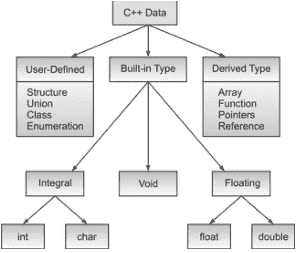

**图 12.1：展示 C++ 数据类型的各种类别**

与 C 编译器类似，C++ 编译器也支持所有基本的内置数据类型。除 void 数据类型外，大多数其他基本数据类型都可以通过应用修饰符（如 signed、unsigned、long 和 short）进行修饰。所有四种修饰符都可以应用于整数数据类型；而 signed 和 unsigned 修饰符只能应用于 char 数据类型。我们还可以通过在 double 数据类型的定义前加上关键字 long 来增加其大小和容量。

数据表示是机器相关的，并且根据程序运行所在的机器，基本数据类型会设定其大小。表 12.1 展示了基本数据类型、它们在内存中可以保留的字节数，以及基于 32 位字长机器它们可以容纳的值的范围：

**表 12.1：C++ 中基本数据类型的大小和范围**

| 数据类型 | 字节 | 范围 |
| --- | --- | --- |
| char | 1 | -128 到 +127 |
| unsigned char | 1 | 0 到 255 |
| signed char | 1 | -128 到 +127 |
| int | 4 | -2147483648 到 +2147483647 |
| unsigned int | 4 | 0 到 4294967295 |
| signed int | 4 | -2147483648 到 +2147483647 |
| short int | 2 | -32768 到 +32767 |
| unsigned short int | 2 | 0 到 65535 |
| signed short int | 2 | -32768 到 +32767 |
| long int | 4 | -2147483648 到 +2147483647 |
| signed long int | 4 | -2147483648 到 +2147483647 |
| unsigned long int | 4 | 0 到 4294967295 |
| float | 4 | 3.4E +/- 38（7 位） |
| double | 8 | 1.7E +/-308（15 位） |
| long double | 8 | 与 double 相同 |
| bool | 1 | 无 |

我们有意将 void 数据类型排除在表 12.1 的范围之外，因为它与其他数据类型不同。void 数据类型是在 ANSI C 中引入的，主要用于指定没有返回值的函数的返回类型，以及指示函数的空参数或参数列表。然而，在 C++ 中，通过引入一种称为 void 指针的新概念，void 的功能得到了增强。C++ 开始通过指定以下格式将 void 用作通用指针：

```cpp
void *generic_ptr;
```

通用指针可以被赋予任何数据类型的指针值，但它可能无法被直接解引用，如以下代码片段所示：

```cpp
int *int_ptr;              // Declare an integer pointer
void *generic_ptr;         // Declare a generic pointer of void * type
generic_ptr = int_ptr;     // Legal assignment
*int_ptr = *generic_ptr;   // Illegal, as dereferencing is not supported on
                           // void ptr
```

前面的代码片段展示了 void 指针不支持的操作和支持的操作。然而，在实际程序中实现 void 指针时，我们应该小心，因为 C++ 编程中一个非常常见的错误就是解引用 void 指针，而这在 C++ 中是不允许的。

在 C++ 中，我们可以将任何指针类型赋给 void 指针而无需强制转换（本章后面会解释）；但是，我们不能将 void 指针赋给任何其他指针而不显式转换为非 void 指针类型，如以下代码片段所示：


```
```cpp
1:void *generic_ptr;          // Declare a void pointer
2:int  *int_ptr;              // Declaring an integer pointer
3:int variable = 5;           // Declare an integer variable and initialize
4:generic_ptr = &variable;    // int * to void * assignment. Legal in C++
5:int_ptr = generic_ptr;      // Illegal assignment in C++
6:int_ptr=(int*)generic_ptr;  // Legal assignment of void to integer pointer
```
```

在第 1 行中，我们定义了一个名为 generic_ptr 的 void 指针。类似地，在第 2 行中，我们定义了一个名为 int_ptr 的整型指针。代码片段的第 3 行包含一个名为 variable 的整型变量的定义，并将其初始化为值 5。在第 4 行中，我们将整型变量的地址赋给 void 指针，这在 C++ 中是允许的。这种将整型变量赋给 void 指针的做法，使 void 指针或泛型指针成为 C++ 中有用的概念。现在，我们故意在第 5 行放置一个错误赋值，以展示在编码时指针可能如何被误用。没有强制转换，不能直接从泛型指针赋值给另一个非 void 类型指针，第 6 行展示了这一点。

除 void 外，C++ 还有一种称为 bool 的特殊数据类型，用于处理布尔类型的值，即 true 或 false（在数值上也可以是 0 或 1 的组合）。

图 12.1 中提到了 C++ 数据类型除内置类型外的两大分类。这两类是用户定义数据类型和派生类型。程序员可以根据一组内置数据类型创建用户定义类型。以下是各种用户定义数据类型：

- **结构体**——它是简单变量的集合，这些变量可以是基本数据类型，也可以是任何自定义或用户定义的数据类型。结构体中的数据项称为结构体的成员。让我们在 C++ 中如下声明一个结构体：

```cpp
1:struct  employee_data
2:{
3:    char  employee_name[30];
4:    int   age;
5:    double salary;
6:};
7:struct employee_data emp;
```

在前面的声明中，emp 是 employee_data 类型的变量，包含结构体的所有成员。也就是说，它包含 employee_name、age 和 salary，可以通过点运算符访问；例如 emp.employee_name、emp.age 和 emp.salary。如果我们将 emp 定义为指向 employee_data 结构体的指针，那么对内部结构体成员的访问应使用点运算符之外的特殊符号，即 ->。在这种情况下，结构体的内部数据成员将按 emp->employee_name、emp->age 和 emp->salary 访问。

- **类**——它是 C++ 中面向对象方法的工具。按照定义，类是对具有相似特征的一组对象的描述。在面向对象编程中，对象是类的实例，表示现实世界中的实体。类在定义上与结构体相似，但在使用和概念上略有不同。与结构体类似，类内部包含一组成员变量，但与结构体不同，它还包含一组成员函数或方法，用于操作这些成员变量。我们将在下一章进一步学习类；但为了完整性，下面的代码片段展示了如何定义类并创建类的对象：

```cpp
1:class  example {
2: int  member_age;
3: char  member_name[30];
4: public:
5: void init_data() {
6:     member_age=0;
7: };
8:};
9:
10:    class example    new_object;       // object of class example is defined here
```

读者可能会觉得这段代码片段有点令人困惑；因此，我们请读者将其理解推迟到第 15 章介绍类和对象的基础知识之后。

- **联合体——** 联合体是一个由两个或多个变量（通常是不同类型）在不同时间共享的内存位置。声明联合体与声明结构体类似。以下是联合体声明的示例：

```cpp
union example {
             type    var1;
             type    var2;

             type    var_n;
} union_variable;
union_type {
             int     var1;
             char    var2;
} u_var;
```

在前面的示例中，我们定义了一个联合体类型的数据成员，名为 u_var。在 u_var 中，整型数据成员和字符数据成员共享同一内存位置。显然，int 包含四个字节，char 包含一个字节，但如果检查 u_var 的大小，它将是四个字节。这意味着联合体的大小取自其中存在的最高阶成员；在我们的例子中，int 为四个字节。此外，在任何时候，我们都可以将联合体内存储的数据称为 int 或 char，但不能同时称为两者。联合体的最佳应用之一是用于表达式求值的表达式树。

- **枚举——** 枚举数据类型允许我们将名称附加到数字上，从而提高程序的可理解性。enum 关键字通过为单词或枚举数列表分配数值来自动枚举它们。这一特性为创建符号常量提供了另一种方式。以下是 C++ 中枚举数据类型的一些示例：

```cpp
enum process_states
{
    NEW,
    READY,
    RUNNING,
    IO,
    FINISHED,
};
Or
enum process_states
{
    NEW = 4,
    READY,
    RUNNING,
    IO,
    FINISHED,
};
Or
enum process_states
{
    NEW=4,
    READY=9,
    RUNNING=8,
    IO=2,
    FINISHED=1,
};
```

默认情况下，该数据类型的第一个枚举数取值为 0，然后每个后续枚举数比前一个枚举数大 1。因此，在最上面的 enum process_states 中，NEW 取值为 0，READY 取值为 1，RUNNING 取值为 2，IO 取值为 3，FINISHED 取值为 4。我们也可以通过将枚举的第一个枚举数设置为特定值来改变这一约定，同样，每个后续枚举数比前一个枚举数大 1。因此，在 enum process_states 的第二个定义中，NEW 被赋值为 4，于是 READY 取值为 5，RUNNING 取值为 6，IO 取值为 7，FINISHED 取值为 8。此外，我们还可以将枚举的值设置为所有自定义值，如 enum process_states 的第三个定义所示。

派生数据类型是指根据其他数据类型定义的数据类型。以下是 C++ 中的派生数据类型列表：

- **数组**——数组是一种同构数据类型，占据一组连续的内存位置，其中数组中的每个单元按地址递增顺序访问。数组在 C++ 中的应用和用法与 C 中类似。然而，C 和 C++ 中数组的定义和用法在字符数组的初始化方式上有所不同。例如，以下语句在 C 中有效：

```c
char string [3] = "xyz"; // Valid in C
```

前面的语句假设程序员打算在定义中省略 NULL 字符 \0。然而，该语句在 C++ 中无效。string 的大小应比字符串中的字符总数多一个字符，如下面的语句所示：

```c
char string [4] = "xyz"; // Valid in C++
```

- **函数**——C++ 中函数的定义、结构和用途与 C 中的函数类似。此外，任何在 C 中可用的函数相关内容也应在 C++ 中可用；不过，C++ 增强了函数的功能，使其能够完成若干新任务，例如基于面向对象原则的重载和重写。

- **指针**——在 C++ 中，指针可以像在 C 语言中那样声明和初始化。然而，C++ 引入了两个与指针相关的新概念：常量指针和指向常量的指针。让我们借助以下示例了解这两个概念：

```c
1: char * const char_ptr = "GOOD";          //constant pointer
2: int const *    int_ptr = &any_integer_variable;  //Pointer to a constant
```

第 1 行展示了常量指针 char_ptr 的声明。声明之后，我们不能修改 char_ptr 初始化时所指向的地址。

在第 2 行中，我们声明了一个指向常量的指针 int_ptr，它是一个整型指针，可以指向整型常量。它可以指向任何正确类型的变量，但其指向的内容不能更改。

- **引用**——C++ 引入了一种称为引用变量的新型变量，它为先前定义的变量提供替代名称。例如，如果我们让变量 var1 成为同类型另一个变量 var2 的引用，那么 var1 和 var2 可以互换使用来访问该变量。可以使用以下语法创建引用变量：

```c
Data_type & reference_var = variable_name;
```

在前面的语法中，& 运算符用于定义引用。

以下示例展示了如何声明引用变量：

```c
int var1 = 200; // var1 is an integer variable
int & var2 = var1; // var2 is a reference variable of integer type referring to var1
```

在前面的示例中，如果我们通过访问任意一个变量来更改值，那么该更改会立即反映到另一个变量中。尽管 & 运算符用于定义引用，它也可以用于获取任何数据类型的地址。这意味着 & 运算符被重载；因此，其含义会根据调用上下文而变化。借助引用，我们使用两个名称来引用同一内存位置。


不同的名称。引用变量必须在声明时初始化。这就在引用与其引用的数据对象之间建立了一种关系。需要注意的是，引用变量的初始化与其赋值是完全不同的。

接下来，让我们在下一节学习如何声明变量。

### 变量的声明

我们知道，在 C 语言中，所有变量在程序的可执行语句中使用之前必须先声明。C++ 语言也是如此。然而，C 和 C++ 在声明位置方面存在显著差异。C 语言要求所有变量都应在作用域的开头定义。在典型的 C 程序中，变量声明位于顶部，其后是 main() 函数体中的可执行指令。有时，变量的实际使用位置离其声明位置很远，这导致在 C 语言中跟踪变量时出现一些问题。因此，在设计 C++ 语言时，语言的设计者解决了这个问题。

C++ 允许在作用域内的任何位置声明变量。我们只需确保变量在使用之前在 C++ 中声明即可。换句话说，C++ 变量的声明位置没有限制。这有助于使程序更加真实和易读，因为变量被声明在即将使用它的位置上方。此外，每次我们需要声明变量时，无需回到作用域的开头进行声明。这种方法还减少了早期 C 语言中存在的错误机会，这些错误导致我们来回扫描程序。清单 12.2 演示了 C++ 中变量的声明。

清单 12.2：演示 C++ 中的变量声明

```cpp
//A sample program demonstrating declaration of variables in C++
#include <iostream>
using namespace std;
int main()
{
    float sum = 0;            //declaration of a variable
    for (int i=0; i<5; i++)   //declaration of a variable
    {
        sum = sum + i;
    }
    float average;
    average = sum / 5;
    cout << "The average value is " << average << endl;
    return 0;
}
```

然而，这种方法的一个缺点是，我们无法同时看到某个作用域中使用的所有变量。为了解决这个问题，我们可以像 C 语言那样编写源代码，即将所有变量定义在程序的开头。

现在让我们学习 C++ 中的表达式、运算符和运算符优先级。

### 表达式、运算符和运算符优先级

由于我们是 C++ 的新手，让我们先简要介绍一下表达式、运算符和运算符优先级。尽管所有这些主题在 C 编程部分已经介绍过，而且 C 和 C++ 中的运算符差别不大，但我们将只专注于 C++ 特有的运算符。表达式是运算符和操作数的序列，用于从操作数计算值，并指定对象或函数。在 C++ 中，运算符可以被重载，其含义可以由用户定义，但运算符优先级和它们所取的操作数数量不能修改。本节将介绍语言自带的运算符的语法和语义。这三者构成了任何语言的基本骨架，并提供了对语言的大部分理解。因此，在我们开始用 C++ 编写程序之前，非常有必要先讨论它们。

### 表达式

表达式是根据编程语言规则排列的运算符、常量和变量的组合。它也可能包括返回值的函数调用。此外，一个表达式可以由一个或多个操作数以及零个或多个运算符组成，以产生一个值。以下是 C++ 中各种类型的表达式。

- **常量表达式** —— 指仅由常量值组成的表达式。以下是常量表达式的一些示例：
  - 15
  - 20 + 5 / 2.0
  - 'X'

- **整型表达式** —— 指在执行所有自动和显式类型转换后产生整型结果的表达式。以下是整型表达式的一些示例：
  - m
  - m * n - 5
  - m * 'x'
  - 5 + int(2.0)

  其中，m 和 n 是整型变量。

- **浮点表达式** —— 指在进行所有转换后产生浮点结果的表达式。以下是浮点表达式的一些示例：
  - x + y
  - x * y / 10
  - 5 + float(10)
  - 10.75

  其中，x 和 y 是浮点变量。

- **指针表达式** —— 指产生地址值的表达式。以下是指针表达式的一些示例：
  - &m
  - ptr
  - ptr + 1
  - "xyz"

  其中，m 是一个变量，ptr 是一个指针。

- **关系表达式** —— 指产生 bool 类型结果的表达式，其值为 true 或 false。以下是关系表达式的一些示例：
  - x <= y
  - a+b == c+d
  - m+n > 100

当算术表达式出现在关系运算符的两侧时，先计算它们，然后比较结果。关系表达式也称为布尔表达式。

- **逻辑表达式** —— 指组合两个或多个关系表达式并产生 bool 类型结果的表达式。以下是逻辑表达式的一些示例：
  - a>b && x ==10
  - `x==10 || y==5`
  - `!a`

- **位运算表达式** —— 指用于在位级别操作数据的表达式。它们用于测试和移位位。以下是位运算表达式的一些示例：
  - `x << 3        //Shift 3 bit positions to the left`
  - `y >> 1        //Shift 1 bit position to the right`

移位运算符通常用于乘以或除以 2 的幂。现在，让我们了解 C++ 中的运算符。

### 运算符

所有的 C 运算符在 C++ 中同样有效。除了这些运算符之外，C++ 还引入了一些新的运算符；例如，插入运算符（<<）和提取运算符（>>），我们已经在前面几节中见过。现在让我们学习 C++ 中新的内置运算符，如下所示：

- **作用域解析运算符（::）** —— C++ 是一种块结构语言，因为在构建 C++ 程序时使用了块和作用域。我们知道，在代码的不同块中，同名变量可以具有不同的含义。变量的作用域从其声明点延伸到包含它的块的末尾。在块内声明的变量被称为该块的局部变量。考虑以下代码片段：

  ```
  ...
  {
      int x = 10;
      ...
  }
  ...
  {
      int x = 101;
      ...
  }
  ...
  ```

  在前面的代码片段中，我们定义了两个 x 变量，但位于不同的作用域中。这两个变量具有不同的内存位置，包含不同的值。第二个块中的语句不能引用第一个块中的 x 变量，反之亦然。

  考虑一种情况，我们正在使用一个名为 my_account 的局部变量；但是，我们也想从局部作用域访问一个同名的全局变量 my_account。在 C 语言中，我们不能从作用域内访问与局部变量同名的全局变量，但 C++ 允许我们使用作用域解析运算符来实现这一点。使用作用域解析运算符的语法如下：

  ```
  :: variable_name
  ```

  以下程序演示了 C++ 中作用域解析运算符的使用：

  ```
  1: //Demonstrate scope resolution operation in C++
  2: #include <iostream>
  3: using namespace std;
  4:
  5: int my_account;        //Global variable definition
  6:
  7: int main()
  8: {
  9:     my_account = 9001;
  ```


```c++
10:      {
11:          int my_account = 101;
12:          cout<<"My account value in scope: "<<my_account;
13:          cout<<"\nMy account global = "<<::my_account<<endl;
14:      }
15:      cout<<"My account in Main = "<<my_account<<endl;
16:      return 0;
17:  }
```

在前面的代码片段中，my_account 指的是作用域内的局部变量；然而，::my_account 指的是全局变量。前面的代码片段的输出如下：

```text
My account value in scope= 101
My account global = 9001
My account in Main = 9001
```

- **内存分配运算符（new）**——new 运算符用于动态分配内存。它类似于 C 语言中的 malloc 和 calloc 运算符。本章后面会更详细地学习 new 运算符。
- **内存释放运算符（delete）**——delete 运算符用于释放使用 new 运算符分配的内存。它类似于 C 语言的 free 运算符。本章后面会更详细地学习 delete 运算符。
- **endl**——endl 运算符是换行运算符，负责插入换行字符。它用于在 C++ 中格式化输出，因此有时称为操纵符。在我们的大多数程序中，使用了以下语句：

  ```c++
  1: cout<<"Hello World"<<endl;
  2: cout<<"Hello World\n";
  ```

上述两条语句作用相同，没有任何区别。

- **setw 操纵符**——该运算符与插入运算符 << 一起使用，以修改数据显示在屏幕上的方式。该运算符更改输出的字段宽度，使其看起来格式更好。下面借助以下程序演示 setw 操纵符的必要性：

  ```c++
  1: // Demonstrating the need of manipulator in C++
  2: #include <iostream>
  3: using namespace std;
  4:
  5: int main()
  6: {
  7:     long var1=2544771, var2=88, var3 = 9999;
  8:     cout      <<"Location " << "POP. "<<endl
  9:               <<"PortCity " << var1 <<endl
  10:              <<"HighTown " << var2 <<endl
  11:              <<"LowVille " << var3 <<endl;
  12:     return 0;
  13: }
  ```

前面程序的输出如下：

```text
Location POP
PortCity 2524771
HighTown 88
LowVille 9999
```

前面的输出没有对齐，格式看起来不好。现在，我们在同一程序中使用 setw 操纵符运算符，使输出看起来更好：

```c++
1: // Demonstrating setw manipulator usage in C++
2: #include <iostream>
3: using namespace std;
4:
5: int main()
6: {
7:         long var1=2524771, var2=88, var3 = 9999;
8:         cout    <<setw(8) << "Location " << setw(12)
9:                 <<"POPULATION"<<endl
10:                <<setw(8)<<"PortCity "<<setw(12)<<var1<<endl
11:                <<setw(8)<<"Hightown "<<setw(12)<<var2<<endl
12:                <<setw(8)<<"Lowville "<<setw(12)<<var3<<endl;
13:        return 0;
14: }
```

前面程序的输出如下：

```text
Location POPULATION
PortCity        2524771
Hightown          88
Lowville         9999
```

setw 操纵符会使其在流中后面的数字（或字符串）打印在一个字段内，该字段宽度为 n 个字符，其中 n 是 setw(n) 的参数。

- **成员解引用运算符**——C++ 允许我们首先定义一个类，其中包含各种类型的数据和函数作为成员，然后通过指针访问这些成员。为此，C++ 提供了三个指向成员的指针运算符，如表 12.2 所示：

**表 12.2：C++ 中的成员解引用运算符**

| 运算符 | 功能 |
|---|---|
| ::* | 用于声明指向类成员的指针 |
| .* | 用于使用对象名和指向该成员的指针访问成员 |
| ->* | 用于使用指向对象的指针和指向该成员的指针访问成员 |

在了解了各种新运算符之后，现在我们来学习 C++ 中的运算符优先级。

### 运算符优先级

尽管 C++ 使我们能够为运算符添加多种含义，但它们的结合性和优先级保持不变。例如，乘法运算符的优先级仍将高于加法运算符。表 12.3 显示了 C++ 中的运算符优先级和结合性：

**表 12.3：C++ 中的运算符优先级和结合性**

| 运算符 | 含义 | 结合性 | 用法 |
| --- | --- | --- | --- |
| :: | 全局作用域 | 从右到左 | ::name |
| :: | 类、命名空间作用域 | 从左到右 | Name::member |
| . | 直接成员 | 从左到右 | Object.member |
| -> | 间接成员 | 从左到右 | Pointer->member |
| [] | 下标 |  | Pointer [expr] 或数组 |
| () | 函数调用 |  | Function (arg) |
| ++ | 后缀递增 |  | M++ |
| -- | 后缀递减 |  | M-- |
| sizeof | 对象大小 | 从右到左 | sizeof (object) 或 sizeof (type) |
| ++ | 前缀递增 |  | ++m |
| -- | 前缀递减 |  | --m |
| typeid | 类型识别 |  | typeid(expr) |
| const_cast | 专用转换 |  | const_cast <expr> |
| dynamic_cast | 专用转换 |  | dynamic_cast <expr> |
| reinterpret_cast | 专用转换 |  | reinterpret_cast<expr> |
| static_cast | 专用转换 |  | static_cast <expr> |
| () | 传统转换 |  | (Type) expr |
| ~ | 按位取反 |  | ~expr |
| ! | 逻辑非 |  | ! expr |
| - | 一元减 |  | -expr |
| + | 一元加 |  | +expr |
| & | 取地址 |  | & value |
| * | 解引用 |  | * expr |
| new | 新对象 |  | new type |
| new[] | 新数组 |  | new type[] |
| delete | 销毁对象 | 从右到左 | delete ptr |
| delete[] | 销毁数组 |  | delete[] ptr |
| .* | 成员解引用 | 从左到右 | Object.*ptr_to_member |
| ->* | 间接成员解引用 |  | ptr->*ptr_to_member |
| * | 乘 | 从左到右 | expr * expr |
| / | 除 |  | expr1 / expr2 |
| % | 取模 |  | expr1 % expr2 |
| + | 加 | 从左到右 | A + b |
| - | 减 |  | A - b |
| << | 左移 | 从左到右 | expr1 << expr2 |
| >> | 右移 |  | expr1 >> expr2 |
| < | 小于 | 从左到右 | Expr1 < expr2 |
| <= | 小于或等于 |  | Expr1 <= expr2 |
| > | 大于 |  | Expr1 > expr2 |
| >= | 大于或等于 |  | Expr1 >= expr2 |
| == | 等于 | 从左到右 | Expr1 == expr2 |
| != | 不等于 |  | Expr1 != Expr2 |
| & | 按位与 | 从左到右 | expr1 & expr2 |
| ^ | 按位异或 | 从左到右 | expr1 ^ expr2 |
| \| | 按位或 | 从左到右 | expr1 \| expr2 |
| && | 逻辑与 | 从左到右 | expr1 && expr2 |
| \|\| | 逻辑或 | 从左到右 | expr1 \|\| expr2 |
| ?: | 条件运算符 | 从左到右 | expr1 ? expr2 : expr3 |
| = | 赋值 | 从右到左 | expr1 = expr2 |
| *= | 乘并更新 |  | expr1 *= expr2 |
| /= | 除并更新 |  | expr1 /= expr2 |
| %= | 取模并更新 |  | expr1 %= expr2 |
| += | 加并更新 |  | expr1 += expr2 |
| -= | 减并更新 |  | expr1 -= expr2 |
| <<= | 左移并更新 |  | expr1 <<= expr2 |
| >>= | 右移并更新 |  | expr1 >>= expr2 |
| &= | 按位与更新 |  | expr1 &= expr2 |
| \|= | 按位或更新 |  | expr1 \|= expr2 |
| ^= | 按位异或并更新 |  | expr1 ^= expr2 |
| throw | 抛出异常 | 从右到左 | throw expr |
| , | 逗号 | 从右到左 | expr1, expr2 |

表 12.3 中先列出的运算符比后列出的运算符具有更高的优先级。此外，同一优先级的运算符将根据其结合性从左到右或从右到左求值。

### C++ 中表达式的求值

表达式的求值由 C++ 中运算符的优先级和分组决定。考虑以下示例：

```cpp
1: // Demonstrating expression evaluation in C++
2: #include <iostream>
3: using namespace std;
4:
5: int main()
6: {
7:     int a = 2, b = 4, c = 9;
8:
9:     cout <<a + b * c<<"\n";
10:    cout <<a + (b * c)<<"\n";
11:    cout <<(a + b) * c<<"\n";
```


### 隐式类型转换

当不同数据类型的数据混合使用时，编译器会自动进行类型转换，这称为隐式类型转换。有些语言允许甚至要求编译器提供这种机制。考虑以下程序：

```cpp
1: // Demonstrating type conversion in C++
2: #include <iostream>
3: using namespace std;
4:
5:
6: int main ()
7: {
8: int count = 10;
9: float avg = 198.6F;
10:
11:         double total = count * avg;
12:         cout << "Total = " <<total<<endl;
13:         return 0;
14: }
```

在前述程序中，整型变量 count 与 float 类型的变量 avg 相乘，结果存储在 double 类型的变量 total 中。由于第11行的操作同时涉及不同类型的变量，该程序在编译时本应引发错误。然而，当我们编译该程序时，它不会引发任何错误，并且能顺利执行。这是因为 C++ 允许这类操作，这些操作称为自动类型转换或隐式转换。

表12.4：C++中数据类型的求值顺序

| 数据类型 | 顺序 |
| --- | --- |
| long double | 最高 |
| double | |
| float | |
| long | |
| int | |
| short | |
| char | 最低 |

从表12.4中，我们可以了解 C++ 中数据类型的求值顺序。现在考虑一个场景：同一表达式中遇到两个不同数据类型的操作数。在这种情况下，较低类型的变量会被转换为较高类型变量的类型。同样，在前述程序中，整型变量 count 被提升为 float，并存储在临时变量中，然后再与 float 变量 avg 相乘。结果随后被转换为 double，并存储在变量 total 中。这些转换会自动进行，因为 C++ 不想让程序员为这些细枝末节费心。

然而，有时编译器无法自动将一种数据类型转换为另一种数据类型，并会引发错误。此外，编译器不会自动将一个类的对象提升为另一个类的对象。为解决这些问题，C++ 提供了显式类型转换。下一节我们将详细学习它。

### 显式类型转换

在程序的整个生命周期中，可能会出现程序员需要将一种类型的值转换为另一种类型，而编译器无法自动完成转换的情况。在这种情况下，我们需要显式类型转换，它应用于程序员指定的数据转换。现在，我们心中可能会有一个问题：如何理解哪些转换需要程序员处理，哪些转换由编译器为我们完成？

C++ 是一种强类型语言；因此，转换，尤其是那些意味着对值进行不同解释的转换，需要显式强制转换或转换，如下面的代码片段所示：

```cpp
double var1 = double (m);        // where m is a different type variable
double var2 = (double) n;        // similar is done here, but syntax is different
```

尽管前面两条语句语法不同，但它们的工作方式相同。前述类型转换方法是有效且允许在 C++ 中使用的；不过，ANSI C++ 还增加了一些转换运算符，例如 static_cast、dynamic_cast、reinterpret_cast 和 const_cast。下一节将分别介绍这些内容。

### 静态转换

静态转换仅在 C++ 中可用。静态转换可用于将一种类型转换为另一种类型；但是，它不应用于去除 const 属性，也不应在非指针类型与指针类型之间进行转换。在转换期间，编译器不进行类型安全检查；因此，这完全由程序员负责。考虑以下 C++ 中静态转换的示例，其中我们将一个整型变量转换为 char 类型的变量：

```cpp
charVar = static_cast <char> (integerVar);
```

在前述示例中，要被转换的变量（即 integerVar）放在圆括号中，目标类型（即 char）放在尖括号中。该语句的结果是：在赋值给字符变量 charVar 之前，整型变量 integerVar 被转换为字符类型。因此，从阶数较小的数据类型转换为阶数较宽的数据类型时，使用隐式或自动类型转换；但当较宽的数据类型转换为阶数较低的数据类型时，需要显式转换才能完成操作。编译器不参与其中，因为数据截断可能导致问题。考虑以下示例：

```cpp
double d = 3.14159265;
int i = static_cast<int>(d);
```

在前述示例中，我们给 double 变量 d 赋了一个实数值。现在，在这个例子中，使用静态转换将 double 值转换为其对应的整数值，然后我们将一个临时整数值赋给另一个整型变量 i。

### 动态转换

动态转换使用 dynamic_cast 运算符在运行时转换对象的类型。其主要目的是对多态对象执行转换，这些对象由包含虚函数的基类创建。以下是 C++ 中使用动态转换的语法：

```cpp
dynamic_cast <type> (object);
```

在前述语法中，object 是基类对象，其类型需要被检查和转换。动态转换需要运行时类型信息（它允许在程序执行期间确定对象的类型）来完成此转换。它从不执行无效转换，因为它在运行时检查转换是否合法。如果转换无效，它返回 NULL。类型必须是指向已定义类类型的指针或引用。参数 object 必须是解析为指针或引用的表达式。使用 dynamic_cast 运算符也称为类型安全的向下转型。

假设存在100个这样的值。典型例子是对文件中的数字进行排序。在这种情况下，如果程序员希望同时对100个值进行排序，那么想象一下如果没有数组概念会有多困难，因为程序员需要将这些值保存在100个不同的变量中。现在，程序员可以将这些变量组合到数组中，并通过数组索引访问它们。

然而，数组的一个缺点是它们是预先分配的，也就是说，一声明就会分配内存；如果数据大小事先已知，这很好；否则，运行时将浪费大量内存空间。数组造成空间浪费，是因为程序员在编写程序时过度设定数组大小。尽管整个数组大小在运行时几乎不会被完全使用，一些业余程序员仍通过取较大值来定义数组大小。这主要是出于担心数组可能空间不足，但大多数情况下会导致运行时空间浪费。

> **注意**
>
> 在标准 C++ 中，数组并不是对相似类型元素或值进行分组的唯一方式。我们还可以使用向量，它们是标准模板库（STL）的一部分。第18章将更详细地学习向量。

我们可以定义任何 C++ 数据类型的数组，从基本数据类型到用户定义数据类型。以下是数组的声明：

```cpp
data_type array[size];
```

现在，让我们定义一个大小为10的数组。处理一开始，就会在内存中连续分配10个内存位置，每个位置的大小等于该数据类型的大小。数组的基地址可以通过数组名或其第一个成员的地址获得。请注意，数组索引从0开始，到 size-1 位置结束。以一个实际的数组声明为例，看看这些值是什么：

| 数组声明： | int array[10]; |
| :--- | :--- |
| 元素个数： | 10 |
| 第一个元素位于： | array[0] |
| 最后一个元素位于： | array[9] |
| 数组的地址： | array or &array[0] |

在前述数组中，每个单元对应一个整型变量，仿佛它们被组合在一起。

现在，考虑以下程序：

```cpp
1: // Demonstrating arrays in C++
2: #include <iostream>
3: using namespace std;
4: #define MAX 10
5:
6: int main ()
7: {
8:  int num[MAX];
9:  float average = 0.0;
10:
11:     for (int i=0; i < MAX; i++) {
12:         cout<<"\nEnter a number: ";
13:         cin >> num[i];
14:         average += num[i];
15:     }
16:     average = average / MAX;
17:     cout<<"\nThe average of the array elements are "<<average<<endl;
18:     return 0;
19: }
```

前述程序在第8行声明了一个整型数组，数组大小由值为10的宏 MAX 指定。执行时，该程序提示用户逐个输入10个整数。然后它计算并显示用户输入数据集的平均值。以下是前述程序的输出：


```text
Enter a number: 33
Enter a number: 83
Enter a number: 98
Enter a number: 78
Enter a number: 123
Enter a number: 67
Enter a number: 09
Enter a number: 56
Enter a number: 23
Enter a number: 99
The average of the array elements are 66.9
```

现在我们来学习字符串。

### 字符串

C++ 有两种字符串：C 字符串和标准 C++ string 类。在 C 语言中使用的 C 字符串，是以 NULL '\0' 字符结尾的字符数组。另一方面，标准 C++ 包含一个名为 string 的新类。这个类在多个方面改进了传统的 C 字符串。例如，我们不必担心创建大小合适的数组来保存字符串变量，因为 C++ string 类会处理内存管理。此外，string 类提供了运算符重载的好处，这赋予了旧运算符新的含义。例如，在 string 类中，+ 运算符被重载，因此当我们编写以下语句时，+ 运算符充当连接运算符：

```cpp
S1 = S2 + S3;
```

在上述语句中，这三个都是 string 类的对象。在 C 中，可以使用名为 strcat 的库函数完成同样的事情。代码清单 12.3 探讨了 string 类的一些特性：

### 代码清单 12.3：展示 string 类的特性

```cpp
1: // Demonstrating string classes in C++
2: #include <iostream>
3: #include <string>
4: using namespace std;
5:
6: int main ()
7: {
8:     string S1("Tom");                 //Initialization
9:     string S2 = "Jerry";              //Initialization
10:    string S3;
11:
12:    S3 = S1;                          //Assignment
13:    cout<< "S3 = "<<S3<<endl;
14:
15:    S3 = S1 + " and ";                //Concatenation
16:    S3 += S2;                         //Concatenation
17:    cout<< "S3 = "<<S3<<endl;
18:
19:    return 0;
20: }
```

在代码清单 12.3 中，我们定义了三个 string 类的对象：S1、S2 和 S3。首先，我们使用两种不同的方式初始化了 S1 和 S2。然后，在第 12 行完成了从 S1 到 S3 的赋值，这解释了为什么程序会打印 Tom。连接方法也通过 + 和 += 运算符执行，字符串 Tom and Jerry 在 S3 中构造出来。以下是上述程序的输出：

```text
Tom
Tom and Jerry
```

表 12.5 展示了 C++ 中 string 类的各种成员函数：

**表 12.5：string 类的成员函数**

| 成员函数 | 描述 |
|---|---|
| size | 返回字符串对象的长度 |
| length | 返回字符串对象的长度 |
| max_size | 返回字符串的最大大小 |
| resize | 调整字符串对象的大小 |
| capacity | 返回已分配存储的大小 |
| reserve | 请求更改容量 |
| clear | 清空字符串 |
| empty | 测试字符串是否为空 |
| operator [] | 获取字符串中的字符 |
| at | 获取字符串中的字符 |
| operator += | 将字符串追加到另一个字符串末尾 |
| append | 将字符串追加到另一个字符串末尾 |
| push_back | 将字符追加到字符串 |
| assign | 为字符串分配内容 |
| insert | 将字符插入字符串 |
| erase | 从字符串中删除字符 |
| replace | 替换字符串的一部分 |
| swap | 交换两个字符串的内容 |
| c_str | 获取等效的 C 字符串 |
| data | 获取字符串数据 |
| get_allocator | 获取分配器 |
| copy | 从字符串复制字符序列 |
| find | 在字符串中查找内容 |
| rfind | 查找内容在字符串中最后出现的位置 |
| find_first_of | 在字符串中查找字符 |
| find_last_of | 从末尾在字符串中查找字符 |
| find_first_not_of | 查找字符串中不存在的字符 |
| find_last_not_of | 从末尾查找字符串中不存在的字符 |
| substr | 生成子字符串 |
| compare | 比较两个字符串 |
| begin | 返回指向字符串开头的迭代器 |
| end | 返回指向字符串末尾的迭代器 |
| rbegin | 返回指向反向开头的迭代器 |
| rend | 返回指向反向末尾的迭代器 |

现在我们来学习 C++ 中的结构体。

### 结构体

结构体是简单变量的集合，在 C++ 中表示为单个用户定义的数据类型。结构体中的变量可以是基本数据类型（int、char 或 float）和用户定义的数据类型（结构体或枚举）。在 C++ 基础中讲解结构体的主要原因是，结构体的语法几乎与 C++ 中的类相同。结构体是数据的集合；而类是数据和函数的集合。代码清单 12.4 展示了 C++ 中结构体的使用：

### 代码清单 12.4：展示 C++ 中结构体的使用

```cpp
1: // Demonstrating user-defined structures in C++
2: #include <iostream>
3: using namespace std;
4:
5: struct employee_data
6: {
7:     char        employee_name[30];
8:     int         age;
9:     double      salary;
10: };
11:
12: int main ()
13: {
14:     struct employee_data emp;
15:
16:     cout<<"Enter Employee Name: ";
17:     cin >> emp.employee_name;
18:     cout<<"Enter Employee Age: ";
19:     cin >> emp.age;
20:     cout<<"Enter Employee Salary: ";
21:     cin >> emp.salary;
22:
23:     cout    <<"\nEmployee "<<emp.employee_name<<" is "
24:             <<emp.age<<" years old with Rs "<<emp.salary<<"\n";
25:
26:     return 0;
27: }
```

在代码清单 12.4 中，第 1 行是注释；而第 2 行和第 3 行是预处理指令。我们从第 5 行到第 10 行开始声明结构体。在程序中，声明了 employee_data 结构体，其成员为 employee_name、age 和 salary。请注意，结构体的所有声明都必须以分号结尾，如第 10 行所示。结构体声明仅作为创建 employee_data 类型变量的蓝图。该声明本身既不定义任何变量，也不在内存中预留任何空间。它仅仅规定了结构体变量在定义时应具有的形式。

main() 函数的第一条语句表示定义了一个 employee_data 类型的变量 emp。该定义为结构体类型变量 emp 在内存中预留 42 字节空间，其中包括 30 字节用于姓名、4 字节用于年龄、8 字节用于薪资（假设我们在 32 位机器上工作）。然而，有时该定义会占用更多内存以对齐数据字节，具体取决于编译器；这一概念称为字节对齐。

字节对齐是一个非常有趣的特性。大多数 16 位和 32 位处理器不允许将字存储在任意偏移处。因此，作为微处理器设计的一部分，通过利用字节对齐来实现这一点，处理器可以一次性从内存单元读取数据并向内存单元写入数据。编译器也遵循目标微处理器施加的字节对齐限制。这意味着编译器必须向结构体中填充额外字节，以免违反目标微处理器施加的任何限制。考虑以下结构体：

```cpp
struct Message
{
    short opcode;
    char subfield;
    long message_length;
    char version;
    short destination_processor;
};
```

对于上述结构体，字节对齐后的实际结构体如下：

```cpp
struct Message
{
    short opcode;
    char subfield;
    char pad1;          // Pad to start the long word at a 4 byte boundary
    long message_length;
    char version;
    char pad2;          // Pad to start a short at a 2 byte boundary
    short destination_processor;
    char pad3[4];       // Pad to align the complete structure to a 16 byte boundary
};
```

尽管我们展示了一个字节对齐的初步示例，但它可能因编译器而异。然而，字节对齐的基本思想是相同的。

在代码清单 12.4 的第 16、18 和 20 行，我们从用户那里提示输入员工的个人信息，并将其保存到 emp 变量的数据成员中。这意味着在第 17 行输入的员工姓名会保存到 emp.employee_name 中；在第 19 行输入的员工年龄会保存到 emp.age 中；在第 21 行输入的员工薪资会保存到 emp.salary 中。因此，每当我们访问结构体类型变量的内部数据成员时，都可以使用点运算符。然而，如果我们处理的是 struct employee_data 类型的指针，例如，

```cpp
struct employee_data *ptr;
```

那么访问员工信息要使用间接运算符，即 ->。在这种情况下，我们可以通过 ptr->employee_name、ptr->age 和 ptr->salary 访问信息。

以下是代码清单 12.4 的输出：

```text
Enter Employee Name: John
Enter Employee Age: 40
Enter Employee Salary: 16000
Employee John is 40 years old with Rs 16000 salary.
```

现在，我们学习如何同时声明和定义结构体变量。考虑以下代码片段：

```cpp
1:struct employee_data
2:{
3:    char employee_name[30];
4:    int age;
5:    double salary;
6:}emp;
```

在上述代码片段中，第 6 行包含结构体变量 emp 的定义。这就是我们如何将结构体变量的声明和定义结合起来的方式。


同样，我们可以按如下方式初始化结构体成员：

```cpp
struct employee_data emp = {"John", 45, 16000};
```

要赋给结构体成员的值用花括号括起来，并用逗号分隔。列表中的第一个值赋给 employee_name，第二个值赋给 age，第三个值赋给 salary。

### 引用

在 C++ 中，引用本质上是一个隐式指针，充当对象的另一个名称。引用为变量提供一个别名——一个不同的名称。我们可以使用引用来创建自动采用按引用调用而非按值调用的函数。在为类定义拷贝构造函数时，可以看到引用对象的一个绝佳示例。然而，以下是一些适用于 C++ 中引用的限制。

-   不能引用另一个引用
-   不能获取引用的地址
-   不能创建引用数组
-   不能创建指向引用的指针
-   不能引用位域
-   引用变量在声明时必须初始化，除非它是类的成员、函数参数或返回值
-   禁止空引用

现在，让我们编写以下程序来理解 C++ 中引用的基础知识：

```cpp
1: // demonstrating independent reference variables in C++
2: #include <iostream>
3: using namespace std;
4:
5: int main ()
6: {
7:     int var1;
8:     int &ref = var1;        //reference
9:
10:    var1 = 10;
11:    cout<<"The values of var1 = "<<var1<<" ref = "<<ref<<endl;
12:
13:    ref = 100;
14:    cout<<"The values of var1 = "<<var1<<" ref = "<<ref<<endl;
15:
16:    int var2 = 19;
17:    ref = var2;             // value of var2 sets into value of var1
18:    cout<<"The values of var1 = "<<var1<<" ref = "<<ref<<endl;
19:
20:    ref--;
21:    cout<<"The values of var1 = "<<var1<<" ref = "<<ref<<endl;
22:
23:    return 0;
24: }
```

在前面的程序中，我们声明了一个引用变量并对其进行了试验。当我们使用引用变量时，我们为另一个变量创建了第二个名称。所有引用变量在创建时都必须初始化，以便于理解。除初始化之外，我们不能更改引用变量所指向的对象。因此，它在声明时必须初始化。以下是前面程序的输出。

```
The values of var1 = 10 ref = 10
The values of var1 = 100 ref = 100
The values of var1 = 19 ref = 19
The values of var1 = 18 ref = 18
```

我们还可以使用独立引用来引用常量。例如，以下语句使 `count` 指向常量表中存储值 9 的位置：

```cpp
int &count = 9;
```

现在让我们学习流程控制语句。

### 流程控制语句

到目前为止，我们在前面几节中讨论的程序都遵循顺序执行模型。然而，在使用 C++ 编程解决现实生活中的问题时，很少有程序严格按从开头到结尾的顺序执行语句。大多数程序会根据不断变化的情况决定要做什么。因此，程序流程会根据程序中执行的计算和操作，从一部分跳转到另一部分。因此，为了处理这些情况，我们需要借助三种工具——循环、决策和跳转语句。让我们详细学习这三种工具。

### 决策语句

在程序中，决策语句会根据某些表达式的求值结果，使程序一次性跳转到程序的不同部分。在 C++ 中，可以使用 if、if-else 和 switch 语句进行决策。然而，这些语句中最流行的是 if-else 语句，它在两个备选方案之间进行选择。该语句甚至可以在没有 else 部分的情况下使用。我们还有另一个称为 switch 的决策语句。它为多个备选方案创建分支，并根据单个变量的值选择答案或终止决策。让我们在接下来的几节中详细学习它们中的每一个。

### if 语句

if 语句是所有决策语句中最简单的一种，因为它根据真或假条件在两个选项之间进行选择。以下是一个使用 if 语句检查用户输入的数字值是否为负数的程序：

```cpp
1: // Demonstrating "if" statement in C++
2: #include <iostream>
3: using namespace std;
4:
5: int main ()
6: {
7: int num;
8: cout<<"Enter a positive number: ";
9: cin >> num;
10:     if (num < 0){
11:         cout<<"You have entered a negative number"<<endl;
12:     }
13:     return 0;
14: }
```

如果用户输入正数，则不会向用户显示错误消息；然而，如果用户输入负数，则会显示错误消息。以下是前面程序的输出：

```
Output from the First Run (Positive Case):
Enter a positive number: 10
Output from the Second Run (Negative Case):
Enter a positive number: -5
You have entered a negative number
```

### if-else 语句

现在，我们将演示另一个程序，其中包含 if-else 语句。我们将稍微修改前面的程序，使其行为如下：

```cpp
1: // Demonstrating "if-else" statement in C++
2: #include <iostream>
3: using namespace std;
4: int main ()
5: {
6:     int num;
7:     cout<<"Enter a number: ";
8:     cin >> num;
9:     if (num % 2) {
10:        cout<<"You have entered an odd number"<<endl;
11:    } else {
12:        cout<<"You have entered an even number"<<endl;
13:    }
14:    return 0;
15: }
```

在前面的程序中，我们让用户有机会输入一个数字，检查它，然后显示它是奇数还是偶数。以下是前面程序的输出：

```
Output from the First Run:
    Enter a number: 11
    You have entered an odd number

Output from the Second Run:
    Enter a number: 44
    You have entered an even number
```

现在，让我们看一个嵌套 if-else 语句的示例，将最后两个程序合并为一个带有嵌套 if 检查的程序。首先我们检查数字是正数还是负数，如果输入的数字是正数，然后我们检查它是偶数还是奇数，如下所示：

```cpp
1: // Demonstrating "nested if-else" statement in C++
2: #include <iostream>
3: using namespace std;
4:
5: int main ()
6: {
7:     int num;
8:     cout<<"Enter a number: ";
9:     cin >> num;
10:        if (num > 0) {
11:            if (num % 2) {
12:                cout<<"You have entered an odd number"<<endl;
13:            } else {
14:                cout<<"You have entered an even number"<<endl;
15:            }
16:        }
17:        else {
18:            cout<<"You have entered a negative number"<<endl;
19:        }
20:        return 0;
21: }
```

以下是前面程序的输出：

```
Output from the First Run:
Enter a number: 11
You have entered an odd number

Output from the Second Run:
Enter a number: -3
You have entered a negative number
```

现在，让我们继续学习 switch 语句。

### switch 语句

考虑一个场景：我们有一个大型决策树，需要从许多选项中做出决策。在这种情况下，使用 switch 语句比 if-else 阶梯更好，因为 switch 语句增强了代码的可读性。传入 switch 的变量的值会与每个 case 后面的值进行比较。当某个值与变量的值匹配时，编译器从该点继续执行程序。要了解更多关于 switch 的知识，让我们编写以下程序，其中我们希望用户从一组三个值（11、22 和 33）中输入一个值：

```cpp
1: // Demonstrating "switch case" in C++
2: #include <iostream>
3: using namespace std;
4:
5: int main ()
6: {
7: int num;
8: cout<<"Enter a number (11/22/33): ";
9: cin >> num;
10:        switch (num) {
11:            case 11:
12:                cout<<"Congratulations. You have entered 11."<<endl;
13:                break;
14:            case 22:
15:                cout<<"Congratulations. You have entered 22."<<endl;
16:                break;
17:            case 33:
18:                cout<<"Congratulations. You have entered 33."<<endl;
19:                break;
20:            default:
21:                cout<<"You have entered a wrong option."<<endl;
22:        }
23:    return 0;
24: }
```

在前面的程序中，如果用户输入的值不是 11、22 或 33，则执行 default 分支，并输出错误消息。default 分支会捕获 switch 中任何意外情况。以下是前面程序的输出：

```
Output from the First Run:
Enter a number: 11
Congratulations. You have entered 11.

Output from the Second Run:
Enter a number: 9
You have entered a wrong option.
```


请注意，在前面的程序中，每个 case 后面都跟着一个 break 语句。尽管我们会在本章后面学习 break 语句，但让我们看看如果在前面的程序中不提供 break 语句会发生什么，如下所示：

```cpp
1:// Demonstrating "switch case" in C++
2:#include <iostream>
3:using namespace std;
4:
5:int main ()
6:{
7: int num;
8: cout<<"Enter a number (11/22/33): ";
9: cin >> num;
10: switch (num) {
11:    case 11:
12:        cout<<"Congratulations. You have entered 11."<<endl;
13:    case 22:
14:        cout<<"Congratulations. You have entered 22."<<endl;
15:    case 33:
16:        cout<<"Congratulations. You have entered 33."<<endl;
17:    default:
18:        cout<<"You have entered a wrong option."<<endl;
19: }
20: return 0;
21:}
```

前面程序的输出如下：

```text
Enter a number: 11
Congratulations. You have entered 11.
Congratulations. You have entered 22.
Congratulations. You have entered 33.
You have entered a wrong option.
```

如果在 switch 块内没有使用 break 语句，执行将从匹配的 case 开始，并执行该 case 之后的所有语句，直到遇到 break 或 switch 块结束。

现在让我们了解 C++ 中各种类型的循环。

### 循环

循环会使程序中的某一部分重复执行一定次数。重复会持续到某个条件为真，循环正是基于该条件执行。当条件变为假时，循环结束，控制权转到紧跟在循环之后的语句。在本节中，我们将学习 while、for 和 do-while 循环。

### while 循环

while 循环由一个代码块和一个条件组成。程序会对条件求值，如果条件为真，则执行该代码块中的代码。此过程重复进行，直到条件变为假。下面是 while 循环的基本结构：

```cpp
while (condition is not true) {
    //execute some statements in a loop
}
```

在进入 while 循环之前，会检查条件；如果发现条件为真，则执行 while 循环内的语句。现在，在每一轮条件验证之后，程序控制会遍历 while 块中的所有语句，再次检查条件，如果条件为真，则遵循类似过程。否则，程序流程退出 while 循环，并开始执行 while 循环之后的指令。清单 12.5 展示了 C++ 中 while 循环的流程：

**清单 12.5：** 显示 while 循环的流程

```cpp
1: // Demonstrating the flow of "while loop" in C++
2: #include <iostream>
3: using namespace std;
4:
5: int main ()
6: {
7:     int num = 0;
8:     while (num != -1) {
9:         cout << "Enter a number: ";
10:        cin >> num;
11:    }
12:    return 0;
13: }
```

在清单 12.5 中，我们提示用户输入一个数字，程序会一直读取该数字，直到用户输入 -1 为止。每当用户输入 -1 时，程序就结束执行。

前面程序的输出如下：

```text
Enter a number: 12
Enter a number: 23
Enter a number: 125
Enter a number: 312
Enter a number: 92
Enter a number: 10
Enter a number: -1
```

while 循环还可以用于在搜索和排序中进行比较，在这些场景中，从一开始我们并不知道要基于该条件循环多少次。

### for 循环

for 循环是 C++ 中最流行的循环结构。该循环将一组代码执行固定次数。它适用于我们可以确定循环执行次数的情况。for 循环由一个关键字 for 后跟一对圆括号组成，圆括号内包含三个用分号分隔的表达式。这些表达式分别是初始化、测试条件以及递增或递减操作。下面是一个展示这三个表达式的示例：

```cpp
for (i=1; i< 21; i++)
```

在前面的示例中，初始化表达式是 i=1，测试条件是 i<21，for 循环基于此工作，递增操作是 i++。这些表达式包含三个表达式，但（并不总是）涉及同一个变量，该变量称为循环变量。在我们的例子中，它是 i，并且应在 for 循环体开始执行之前定义。或者，我们也可以在 for 循环语句中定义 i，如下所示：

```cpp
for (int i=1; i< 21; i++)
```

for 循环的循环体是一组在每次循环时都要执行的语句。在循环开始时，for 会执行初始化表达式，然后检查测试条件是否有效。如果发现测试条件无效，流程就会跳出 for 循环。然而，如果测试条件为真，for 循环会执行一次循环体，然后执行递增或递减语句，并在再次执行循环体之前再次检查测试条件。这样，for 循环的执行会一直持续到测试条件为真。

现在让我们编写一个程序来展示 for 循环的工作方式。下面的程序使用 for 循环打印 1 到 20 的平方：

```cpp
1: // Demonstrating "for loop" in C++
2: #include <iostream>
3: using namespace std;
4:
5: int main ()
6: {
7: int i;
8: for (i=1; i < 21; i++) {
9:     cout <<"Square of "<<i<<" is "<<i*i<<endl;
10: }
11:     return 0;
12:}
```

在前面的程序中，for 循环体包含一条用于计算并显示数字平方的语句。

前面程序的输出如下：

```text
Square of 1 is 1
Square of 2 is 4
Square of 3 is 9
Square of 4 is 16
Square of 5 is 25
Square of 6 is 36
Square of 7 is 49
Square of 8 is 64
Square of 9 is 81
Square of 10 is 100
Square of 11 is 121
Square of 12 is 144
Square of 13 is 169
Square of 14 is 196
Square of 15 is 225
Square of 16 is 256
Square of 17 is 289
Square of 18 is 324
Square of 19 is 361
Square of 20 is 400
```

现在让我们了解 do-while 循环。

### do-while 循环

在 while 循环中，测试条件在循环开始时求值。如果测试条件为假，那么程序控制不会进入循环体，语句一次也不会执行。在某些情况下，我们需要这种特定要求。然而，有时我们需要保证无论条件如何，循环体都至少执行一次。在这种情况下，我们应该使用 do-while 循环，它把测试条件放在循环末尾。下面的程序展示了 do-while 循环的使用：

```cpp
1:// Demonstrating "do-while loop" in C++
2:#include <iostream>
3:using namespace std;
4:
5:int main ()
6:{
7:int a, b, c;
8: char ch;
9: do {
10:         cout <<"\nEnter a number: ";
11:         cin >> a;
12:         cout <<"Enter another number: ";
13:         cin >> b;
14:         cout <<"The sum of "<<a<<" and "<<b<<" is "<<a+b<<endl;
15:         cout <<"Do you want to continue? (y/n) ";
16:         cin >> ch;
17: } while (ch != 'n');
18:     return 0;
19:}
```

在前面的程序中，我们从用户那里接收两个数字作为输入，将这两个数字相加，然后在屏幕上显示结果。此过程会一直持续到用户停止它。换句话说，允许用户输入数字，并提示用户是否继续。按下 n 键即可终止程序，否则程序会继续接收用户的输入。前面程序的输出如下：

```text
Enter a number: 9
Enter another number: 10
The sum of 9 and 10 is 19
Do you want to continue? (y/n) y

Enter a number: 45
Enter another number: 6
The sum of 45 and 6 is 51
Do you want to continue? (y/n) n
```

现在让我们了解跳转语句。

### 跳转语句

跳转语句会导致有条件或无条件地立即跳转到程序中位于其他位置的另一条语句。它们主要用于中断 switch 语句和循环。在以下各节中，我们将讨论三种类型的跳转语句：break、continue 和 goto。

### break 语句

正如已经学过的，break 语句用在 switch 块内的每个 case 之后。然而，break 语句也用在 while 和 for 循环中，以便根据循环中的某些条件值跳出循环。break 关键字会使程序控制跳出当前正在执行的循环。考虑下面的程序：

```cpp
1:// Demonstrating the break statement in C++
2:#include <iostream>
3:using namespace std;
4:
5:int main ()
6:{
7:for (int i=0; i<10; i++) {
8:    if (i == 7) {
9:        cout <<"Aborting the for loop."<<endl;
10:        break;
11:    }
12:    cout <<"The current value of i is "<<i<<endl;
13:}
14:
15:    return 0;
16:}
```

在第 8 行，一旦循环变量的值变为 7，就使用 break 语句跳出 for 循环。前面程序的输出如下。

```text
The current value of i is 0
The current value of i is 1
The current value of i is 2
The current value of i is 3
The current value of i is 4
The current value of i is 5
The current value of i is 6
Aborting the for loop.
```

现在让我们了解 continue 语句。


#### continue 语句

如前所述，break 语句会将程序控制从当前循环或 switch case 的作用域中移出。然而，有时根据循环内部的条件，程序员可能决定：程序控制不应跳出循环，而应转到循环的开头。这可以通过在程序中使用 continue 语句来实现。在执行程序时，如果遇到 continue 语句，程序控制会立即返回循环开头，而不执行循环体的其余部分。

一旦在程序中遇到 continue 语句，程序会在执行循环体之前再次检查测试条件，并再次递增或递减循环变量。让我们编写一个程序来演示这一特性。在下面的程序中，我们通过一个 for 循环展示 continue 语句的用法：

```cpp
1: // Demonstrating the continue statement in C++
2: #include <iostream>
3: using namespace std;
4:
5: int main ()
6: {
7: for (int i=1; i<=10; i++) {
8:     if (i == 5) {
9:         continue;
10:     }
11:     cout << "The current value of i is " << i << endl;
12: }
13: return 0;
14: }
```

在下面的程序中，for 循环迭代十次，并打印除 5 之外的每个整数；对 5 应用了 continue 语句。

以下是前面程序的输出：

```text
The current value of i is 1
The current value of i is 2
The current value of i is 3
The current value of i is 4
The current value of i is 6
The current value of i is 7
The current value of i is 8
The current value of i is 9
The current value of i is 10
```

现在让我们了解 goto 语句。

#### goto 语句

如果你接触过结构化编程原则，你可能知道 goto 会导致不良的编码风格，这种风格难以理解和调试。还建议不要在程序中使用 goto，因为它会使程序变得非结构化，这被称为不良编程。尽管我们总是努力遵循结构化编程概念的思想，但有时不使用 goto 语句就很难处理某些情况。假设一种情况：程序控制位于循环内部，并且由于发生了某个异常，我们不仅希望退出循环，还希望跳过主循环的大部分语句，并在退出程序之前执行一些清理活动。以下代码片段展示了 goto 的语法：

```cpp
...

goto ExceptionOccurred;  // goto statement encountered
```

## 目录

- 第一章 绪论
  - 一、研究背景与动机
  - 二、研究问题与目的
  - 三、研究意义
  - 四、研究方法与流程
  - 五、研究限制
- 第二章 文献回顾
  - 一、知识分享的定义与理论
  - 二、知识分享之影响因素
  - 三、虚拟社群
  - 四、虚拟社群之知识分享
  - 五、相关研究之探讨
- 第三章 研究方法
  - 一、研究架构
  - 二、研究假设
  - 三、研究对象与范围
  - 四、研究工具
  - 五、资料处理与分析方法
  - 六、研究流程
- 第四章 资料分析与结果
  - 一、样本叙述性统计
  - 二、信度分析
  - 三、效度分析
  - 四、共同方法变异分析
  - 五、相关分析
  - 六、回归分析
  - 七、假设验证
- 第五章 结论与建议
  - 一、研究结论
  - 二、研究建议
  - 三、研究贡献
  - 四、研究限制与未来研究方向
- 参考文献
- 附录

```text
I'm in Main
In function
I'm in Main again
```

以下是在程序中包含函数的必要步骤：

- 添加函数声明或函数原型，如前面程序第 4 行所示
- 使用适当的参数（如果有）调用该函数，如第 8 行所示
- 添加函数定义，其中包含一组指令，当在程序中显式调用该函数时，函数应执行这些指令，如第 12 行至第 15 行所示

函数声明确定了函数名及其参数的数量和类型。声明由函数名、返回类型以及该函数的一组参数组成。函数声明在使用函数之前告知编译器该函数的形式和存在。C++ 不允许隐式函数声明；因此，在使用函数之前，应先进行显式声明。编译器根据声明和使用情况，检查函数调用的参数与函数声明之间是否存在不匹配。它还使用声明进行参数类型检查和参数转换。我们可以通过两种方式声明函数。第一种，我们可以在程序开头声明函数，这告诉编译器：在某个时刻，我们将提供一个与此类似、具有类似签名的函数。所谓函数签名，是指函数在程序开头声明时所指定的函数名、返回类型和参数列表。要使程序正确编译，函数的声明和定义应相互匹配。第二种，对于小型程序，我们通常不会在程序开头声明函数；我们更倾向于在程序开头、在调用该函数之前定义它。其他任何函数声明的尝试都应导致编译器报错。

现在，让我们讨论函数的定义。为了解释这一点，让我们借助前面的程序。第 12 行至第 15 行包含 function() 函数的函数定义。该函数不包含任何参数列表。它只有一个函数声明符，其签名与函数声明类似，后面是函数体，包含调用该函数时要执行的一组指令。

表 12.6 展示了 C++ 中函数的主要组成部分：

表 12.6：函数的主要组成部分

| 组成部分 | 用途 | 示例 |
| --- | --- | --- |
| 声明（或原型） | 指定函数名、参数类型和返回值。它提醒编译器和程序员：该函数的定义位于程序后面。 | void example(); |
| 调用 | 使函数被执行。 | example(); |
| 函数定义 | 指定函数本身，并包含构成该函数的代码行。 | void example ()<br>{<br>...<br>} |
| 声明符 | 指定定义的第一行。 | void example() |

在下一节中，我们将探讨参数如何在函数中传递。

### 函数中的参数传递

参数或实参是从程序传递给函数的一份数据。它们允许函数使用不同的值进行操作，甚至根据调用函数时传入的参数值执行不同的操作。以下是可传递给函数的各种类型的值：

- **常量**——常量是一个标识符，其值理想情况下在整个程序执行期间都不能被更改。尽管常量的值在程序运行期间只指定一次，但在其生命周期内可以从程序内部多次访问。在程序中使用常量可增强程序的可读性，并降低程序中数据冗余错误的发生概率。在程序中，我们可以使用数字常量或字母数字常量调用函数，如下面的代码片段所示：

```cpp
//Demonstrating functions in C++ with constant arguments
#include <iostream>
using namespace std;
void function(int num);
int main()
{
    cout<<"I'm in Main"<<endl;
    function(5);
    cout<<"I'm in Main again"<<endl;
}

void function(int num)
{
    cout<<"Argument in function is "<<num<<endl;
}
```

在前面的代码片段中，我们使用参数值 5 调用函数。以下是前面代码片段的输出：

```text
I'm in Main
Argument in function is 5
I'm in Main again
```

- **变量**——变量是与某个值关联的符号名，该值通常在程序生命周期内会发生变化。我们也可以将变量作为参数传递给函数，并在函数内部访问其值，如有需要则进行处理，如下面的代码片段所示：

```cpp
//Demonstrating functions in C++ with variable arguments
#include <iostream>
using namespace std;
void function(int num);
int main()
{
    int x;
    cout<<"I'm in Main"<<endl;
    for (int i=1;i<=5;i++)
        cout<<"Enter a number:"<<endl;
        cin >> x;
        function(x);
    cout<<"I'm in Main again"<<endl;
}
void function(int num)
```


```cpp
18: {
19:     cout << "Argument in function is " << num << endl;
20: }
```

在前面的代码片段中，我们循环执行一组指令五次，并提示用户输入五个不同的值，这些值会在函数中打印出来。这展示了参数如何从一个函数传递到另一个函数，并在那里被访问。

前面代码片段的输出如下：

```text
I'm in Main
Enter a number: 5
Argument in function is 5
Enter a number: 9
Argument in function is 9
Enter a number: 45
Argument in function is 45
Enter a number: 234
Argument in function is 234
Enter a number: 56
Argument in function is 56
I'm in Main again
```

同样，我们可以将任何其他数据类型的变量（float、double 和 char）或用户自定义变量（类和结构体）作为参数传递给函数。

- **引用—** 引用为变量提供别名，也就是变量的另一个名称。引用的最重要用途之一是将参数传递给函数。如前所述，我们可以通过两种方法将参数传递给函数：按引用传递和按值传递。当我们按引用传递实参时，被调用函数中的形式参数（函数定义中的变量）会成为调用函数中传入的实际参数（值）的别名。这意味着函数操作自己的参数时，实际上是在操作原始数据。另一方面，当我们按值传递实参时，函数调用会创建一组新变量，并在开始执行前把实参的值复制到这些变量中。下面的程序通过交换两个变量之间的数据来演示这两种方法的区别：

```cpp
1:  //Demonstrating functions in C++ with pass by reference
2:  #include <iostream>
3:  using namespace std;
4:
5:  void swap_ref(int& a, int& b);
6:  void swap_value(int x, int y);
7:
8:  int main()
9:  {
10:         int x = 5, y = 10;
11:         cout<<"Calling function with pass by value."<<endl;
12:         cout<<"Before swap_value: x= "<<x<<" y= "<<y<<endl;
13:         swap_value (x, y);
14:         cout<<"After swap_value: x= "<<x<<" y= "<<y<<endl;
15:         cout<<"Calling function with pass by reference."<<endl;
16:         cout<<"Before swap_ref: x= "<<x<<" y= "<<y<<endl;
17:         swap_ref (x, y);
18:         cout<<"After swap_ref: x= "<<x<<" y= "<<y<<endl;
19:  return 0;
20: }
21:
22: void swap_value(int x, int y)
23: {
24:     int temp = x;
25:             x = y;
26:             y = temp;
27: }
28: void swap_ref(int& a, int& b)
29: {
30:     int temp = a;
31:             a = b;
32:             b = temp;
33: }
```

如前面的程序所示，我们在 main() 函数中取了两个局部变量 x 和 y，并为它们赋了一些初始值。此外，我们在程序中定义了两个函数：swap_value 和 swap_ref。swap_value 函数接收两个整数作为参数，并交换它们之间的值；而 swap_ref 函数将参数作为两个整数的引用接收，并交换它们之间的值。前面程序的输出如下：

```text
Calling Function with pass by value.
Before swap_value: x= 5 y= 10
After swap_value: x= 5 y= 10
Calling Function with pass by reference.
Before swap_ref: x= 5 y= 10
After swap_ref: x= 10 y= 5
```

现在，我们将继续下一节，讨论带默认参数的函数。

### 函数中的默认参数

在上一节中，我们学习了函数以及传递给函数的不同类型参数。很有趣的是，在 C++ 中，我们可以在不指定函数全部参数的情况下调用函数；不过，这并非对任意函数都适用。要让函数支持默认参数，我们必须在函数声明时，为那些在函数调用中没有对应实参的函数参数指定默认值。编译器会检查原型中函数使用的参数数量，并提醒程序可能存在的默认值。下面通过一个示例来演示：

```cpp
float simple_interest(float p, int n, float r = 11);
```

在上面的函数声明中，我们将计算单利，涉及本金、以年为单位的时间和利率。利率的默认值设为 11，因此如果用户希望利率为 11%，可以忽略该参数；否则，他们可以提供另一个利率值。在这种情况下，将使用用户给定的值进行计算。下面编写程序来观察它在使用默认参数时的行为：

```cpp
1: //Demonstrating a C++ program calculating simple interest with default arguments
2: #include <iostream>
3: using namespace std;
4: 
5: float simple_interest (float p, int n, float r = 11);
6: 
7: int main ()
8: {
9:     float amount;
10:            amount = simple_interest (1000, 1);
11:            cout<<"Amount after simple interest addition is "<<amount<<endl;
12:            amount = simple_interest (2000, 3, 15);
13:            cout<<"Amount after simple interest addition is "<<amount<<endl;
```

```cpp
5:inline int findMax(int x, int y)
6:{
7:return (x>y)? y : x;
8:}
9:
10:int main ()
11:{
12:    int a, b, max;
13:    a = 5;
14:    b = 9;
15:    max = findMax (a,b);
16:    cout << "Max between "<<a<<" and "<<b<<" is "<<max;
17:    return 0;
18:}
```

与使用非内联函数的程序相比，当代码中多次调用 findMax() 函数时，前面的程序执行得更快。不过，在将函数设为内联之前应当非常谨慎，因为如果函数体变大，内联函数带来的好处可能会消失。

前面程序的输出如下：

5 和 9 之间的最大值是 9

关于内联函数，还有一件有趣的事：关键字 inline 是向编译器发出的请求，要求将该函数变为内联函数。inline 关键字并不一定保证编译器会把函数当作内联函数处理。编译器可以处理该请求并将函数视为内联函数，也可以忽略该请求，把函数当作其他普通函数一样处理。例如，编译器在决定是否接受内联函数请求时，可以把函数大小作为一个考量参数。此外，在以下情况下，内联展开可能不会生效：

- 如果内联函数是递归的
- 如果内联函数包含静态变量
- 如果返回值函数中存在循环、switch 或 goto 语句

由于内联展开消除了函数调用的开销，因此程序执行得更快；然而，它会占用更多内存，因为每次调用内联函数实际上都会展开为函数体本身。现在我们来学习递归函数。

### 递归函数

递归是指通过解决同类问题的较小实例来解决更大的问题，而这些较小实例的解决又会反过来解决更大的问题。这是一种非常强大的工具，有助于以更简单的方式解决某些特定类别的问题。例如，计算一个数的阶乘时，整个问题可以分解为若干子问题，而某一层的解只有在它下面的所有层都解决之后才能得到。换句话说，要计算某个数（比如 5）的阶乘，我们需要知道 4 的阶乘，并将其与 5 相乘得到结果。然而，要计算 4 的阶乘，我们首先需要计算 3 的阶乘。这一概念在编程语言中实现为递归函数，递归函数会根据某些终止条件或基线条件多次调用自身。在函数内部调用同一个函数的思想，是获得较小问题的解，并利用这些解来确定给定问题的解。然而，并非所有问题都能用递归函数解决。一个问题首先需要在本质上符合递归特性，才能用递归方法解决。一些常见的递归问题包括：一个数的阶乘、斐波那契数列、最大公约数（GCD）和二分查找。


下面我们通过一个示例来演示 C++ 中递归函数的使用：

```cpp
1:// Demonstrating recursive function usage in C++ with factorial calc
2:#include <iostream>
3:using namespace std;
4:
5:long factorial(long num)
6:{
7:    if (num >1)
8:        return (num * factorial(num-1));
9:
10:    else
11:        return 1;
12:}
13:int main ()
14:{
15:    long fact;
16:    fact = factorial(5);
17:    cout << "Factorial of 5 is "<<fact;
18:    return 0;
19:}
```

上述程序以递归方式计算 5 的阶乘。在第 8 行，factorial 函数在其自身内部被再次调用。注意，第 7 行的 if 条件被称为递归的基准条件或终止条件，程序基于该条件执行。我们不必深入探讨递归的细节，就能观察到，在计算 5 的阶乘时，factorial 函数以参数 4 并附带一些额外信息被调用。类似地，计算 4 的阶乘时，会以某个乘法常数调用 factorial 3。如此持续下去，直到以参数 1 调用 factorial 函数，这即是基准条件，递归在此处终止。也就是说，当递归的 factorial 函数以参数 1 调用时，它返回参数 1；否则，它返回 num 与 factorial(num-1) 的乘积，而后者又会以 num-1 为参数再次调用 factorial。另一方面，相同函数的非递归版本应使用从 1 到 num 的循环来实现。

现在，让我们了解递归调用是如何进行的。当函数调用自身时，一组新的局部变量或临时变量（或参数）会在栈上分配存储空间，函数代码将使用所有这些新变量执行。递归调用并不会创建函数的新副本，每次调用函数时只有所使用的参数是新的。每次递归调用返回时，其局部变量和参数集合会从栈中移除，程序流程返回到函数调用点。尽管递归程序旨在解决特定类别的问题，但在程序中使用递归并不会显著减少代码量或改善内存利用率。可以看到，在大多数情况下，递归版本的程序比其迭代版本更慢。此外，如果递归的基准条件设置不当，极有可能导致栈溢出。递归调用函数，以及每次调用和返回时为创建和删除局部变量与参数而维护栈开销，都会给函数执行增加相当多的额外负担。然而，递归的一个优点是，它能使代码看起来更简洁，并且对于某些类别的问题，递归是比迭代版本更简单的唯一实现方式。

接下来，让我们学习动态内存分配与释放运算符。

### 动态内存分配与释放运算符

在讨论 C++ 中的动态内存分配与释放之前，让我们先简要了解一下 C 语言中传统的动态内存管理方式。C 语言通过 calloc 和 malloc 函数来处理动态内存分配，并通过 free 函数来处理内存释放。注意，所有内存分配和释放都是在运行时而非编译时完成的。使用动态内存分配的主要优势在于，当我们直到运行时才知道需要分配多少内存时。如果在编译时需求就已明确，我们可以使用数组和字符串来处理。然而，即使使用数组和字符串，也就是使用预分配的缓冲区，我们也会过度承诺内存需求，大部分已分配的缓冲区在运行时未被使用，却占用了主内存存储空间。

我们知道，当需求直到运行时才明确时，使用动态分配是有益的。考虑一个例子：用户输入他/她想要录入系统的题目数量，然后开始逐一输入。现在，假设每道题目在用户输入时都被保存在程序的一个缓冲区中。在这种情况下，一种方法是将题目数量限制为最大值 MAX，限制用户输入超过 MAX 的内容，并声明一个大小为 MAX 的字符串数组来保存题目。这种方法最大的缺陷在于，如果用户输入的题目数量较少，那么运行时大部分程序内存都会被浪费，因为 MAX 个缓冲区被预先分配，却只有少数被使用。处理这种情况最优雅的方式是采用动态内存管理方法。在这种方法中，我们等待用户输入题目数量，然后根据用户的输入来分配空间。这类情况可以在 C++ 中处理和实现。尽管 C 语言的两个函数 calloc 和 malloc 在 C++ 中都是可用且合法的，C++ 还定义了两个一元运算符 **new** 和 **delete**，它们可以在运行时更好、更简单地执行内存分配和释放的任务。让我们详细了解这些运算符。

new 运算符是一种一元运算符，可用于创建预定义数据类型和自定义数据类型的对象。让我们看看如何使用 new 运算符进行动态内存分配。以下是 C++ 中使用 new 运算符的基本语法：

```
Pointer_variable = new data_type;
```

在上述语法中，Pointer_variable 是 data_type 类型的指针变量，对 new data_type 的调用会返回新创建对象的地址，如果可用内存不足，则返回 NULL。请看下面的示例：

```
int *ptr;
ptr = new int;
```

在上述示例中，我们声明了一个整型指针变量 ptr，并使用 new 运算符动态地为其分配了一个新的内存位置。该运算符使指针指向一个能够容纳 data_type 大小成员的内存地址，此处即整型变量。或者，我们也可以将上述两行合并为一行，如下所示：

```
int *ptr = new int;
*ptr = 5;                         //value is assigned to the newly created memory
// option
```

在第一行中，我们创建了一个指针变量，并将其指向使用 new 运算符动态创建的内存地址。在第二行中，我们通过间接运算符 *ptr 访问该地址处的存储单元，为其赋了一个值。现在，让我们学习 new 运算符的另一种变体，在这种变体中，我们可以创建并赋值，或者更确切地说，用值来初始化新的内存位置，如下所示：

```
int *ptr = new int (5); //value is assigned to the newly created memory location
```

上述代码声明了一个整型指针变量 ptr，在计算机主内存中分配一个由指针变量 ptr 指向的内存位置，并将新分配的内存位置的值设置为 5。

到目前为止，我们已经学习了如何使用 new 运算符动态创建单个内存位置，并将其赋值给相同数据类型的指针变量，其中数据类型既可以是默认或基本数据类型，也可以是自定义或用户定义的数据类型。现在，让我们学习如何在使用 new 运算符的同时分配一组内存位置，如下所示：

```
pointer_variable = new data_type [size];
or
int *arr = new int [10];          // creates a dynamic array of size 10 for storing
                                  // integers.
```

上述代码片段演示了如何在 C++ 中同时分配多个内存位置。对于自定义或用户定义的数据类型，也可以进行类似操作，如下面的程序所示：

```cpp
1:  // Demonstrating "new" operator usage for user-defined data types
2:  #include <iostream>
3:  using namespace std;
4:
5:  struct employee_info
6:  {
7:      char   name[20];
8:      int    age;
9:      double salary;
10: };
11:
12: int main()
13: {
14:     struct employee_info *emp;
15:     emp = new employee_info [10];
16:     .....
17:     //processing done on emp list.
18: .....
19:     return 0;
20: }
```

在上述程序中，我们定义了一个自定义数据类型 employee_info，其中包含员工的姓名、年龄和薪水。现在，我们使用动态内存分配来获取由 emp 指针指向的 10 名员工的列表。然后，在处理完每位员工的详细信息后，我们释放内存，将其归还给操作系统的空闲内存池。在程序中，由于我们的目标是展示如何使用 new 运算符动态创建用户定义数据类型的数组，因此我们省略了对 emp 数组的处理部分。注意第 15 行，在 C++ 程序中动态创建了用户定义数据类型的数组。

与使用 new 运算符动态分配一维数组类似，我们也可以创建多维数组。以下是一些动态分配多维数组的声明，其中混合了合法和非法声明：

```cpp
1: ptr_to_array = new int[3][4][5];       // legal
2: ptr_to_array = new int[n][4][5];       // legal
3: ptr_to_array = new int[3][n][5];       // illegal
4: ptr_to_array = new int[3][4][n];       // illegal
```

对于多维数组，C++ 允许第一维为变量，其值可以在运行时提供，但所有其他维度在声明时必须是常量。例如，在第 2 行中，我们将三维数组的第一维设置为变量 n，该变量将在运行时确定，但所有其他维度在编译时都已指定且为常量。另一方面，编译器在执行第 3 行和第 4 行时会生成错误。因此，请读者在编写程序时避免使用此类语法。

考虑这样一种情况：内存已分配，但这些内存块没有归还给空闲内存池。这样做是不好的做法，因为它可能导致内存崩溃等情况。现在，让我们学习如何在运行时释放之前使用 new 运算符获取的内存块。黄金法则指出，当数据对象不再需要时，应将其销毁并释放内存空间以供复用。在 C++ 中，负责释放内存的工具是一个名为 delete 的一元运算符。一个完美的程序在其生命周期内应执行相等数量的 new 和 delete 语句；否则，程序中就会存在内存泄漏。delete 运算符的语法如下：


预处理器包含以下指令：

- #if
- #ifdef
- #ifndef
- #else
- #elif
- #endif
- #include
- #define
- #undef
- #line
- #error
- #pragma

如我们所见，所有预处理器指令都以 # 符号开头。此外，每条预处理器指令只跨一行代码。一旦遇到换行符，就认为该预处理器指令结束。预处理器指令末尾不需要分号（;）。例如，以下语句将无法工作：

```cpp
#include <iostream>     #include <string>
```

在本节中，我们只介绍两条预处理器指令（#include 和 #define），因为其他预处理器指令已在本书的 C 编程部分中详细介绍。让我们开始讨论 #include。

### #include

#include 指令指示编译器读取另一个源文件，该文件是除包含 #include 指令的源文件之外的源文件。附加源文件的名称必须括在双引号或尖括号中。例如，考虑以下两条语句：

```cpp
#include <iostream>
#include <string>
```

上述两条语句都指示编译器读取并编译文件系统库函数的头文件。这些既可以是标准 C++ 包含文件，也可以是用户编写的自定义头文件。这两类头文件中也可以包含 #include 指令。这类指令称为嵌套包含。嵌套层数因编译器而异。但是，ANSI C 标准支持至少八层嵌套包含。假设我们的程序将头文件 myFile.hpp 作为一个标准包含文件，现在当我们查看 myFile.hpp 内部时，它可能包含其他 include 语句，例如 #include <iostream>。因此，通常我们的程序在编译时不仅会包含 myFile.hpp，还会在编译前包含 iostream。

拟议的 ANSI C++ 标准建议至少应支持 256 层嵌套包含。文件名括在引号还是尖括号中，决定了应如何搜索特定文件。如果文件名括在尖括号中，则按照编译器创建者定义的方式搜索文件。通常，这意味着搜索为包含文件预留的某个特殊目录。如果文件名括在引号中，则以另一种由实现定义的方式查找文件。对于许多编译器而言，这意味着搜索当前工作目录。如果未找到该文件，则会像文件名括在尖括号中一样重复搜索。

### #define

#define 指令定义一个标识符和一个字符序列，每当在源文件中遇到该标识符时，就会用该字符序列替换该标识符。该标识符称为宏名，替换过程称为宏替换。该指令的一般形式如下：

```cpp
#define MACRO_NAME    char-sequence
```

注意，该语句中没有分号。标识符和字符序列之间可以有任意数量的空格，但字符序列一旦开始，就只能由换行符终止。考虑以下我们在编程中常用的示例：

```cpp
#define TRUE    1
#define FALSE   0
```

上述语句使编译器在程序中每次遇到 TRUE 或 FALSE 时都替换为 1 或 0。宏替换就是将标识符替换为与其关联的字符序列。我们甚至可以在宏中使用预先准备好的错误消息，如下所示：

```cpp
#define ERROR_MSG  "Error Occurred in program\n"
```

现在，每当遇到宏 ERROR_MSG 时，其值就会被替换到相应位置。关于宏还有一点很重要：如果标识符位于带引号的字符串内，则不会发生文本替换。例如，以下语句不会打印“程序中发生错误”：

```cpp
cout << "ERROR_MSG";
```

我们还可以编写多行宏，如下所示：

```cpp
#define ERROR  "This program has \
              encountered an error"
```

C 和 C++ 程序员通常对定义的标识符使用大写字母。这一约定有助于读者理解将发生宏替换。有时，作为宏的典型用法，我们在宏中定义数组或列表的大小，并使用大小或最大长度的宏定义来操作这些数据结构，因为更改大小或最大限制只需更改宏定义中的值，而无需更改所有使用它的地方。

### 预定义宏名

宏是一段被赋予了名称的代码片段。每当使用该名称时，它就会被宏的内容替换。我们可以将任何有效的标识符定义为宏。使用宏的主要好处是将整个程序中多次使用的公共代码部分分组，从而提高源代码的可读性。此外，如果公共代码中需要更改某些内容，我们只需更改其相关宏。在这种情况下，我们不需要更改公共代码。这使得宏在程序员中非常流行。C++ 包含五个内置的预定义宏名，如下所示：

- `__LINE__`
- `__FILE__`
- `__DATE__`
- `__TIME__`
- `__STDC__`

__LINE__ 和 __FILE__ 是 C++ 提供的常用宏。它们在调试源程序时很有帮助。__LINE__ 宏给出一个整数值，表示正在编译的源代码文件中的当前行；__FILE__ 宏是一个字符串字面量，包含正在编译的源文件的名称。__DATE__ 宏包含一个形式为月/日/年的字符串。该字符串表示源文件转换为目标代码的日期。类似地，__TIME__ 宏转换为时:分:秒。宏 __STDC__ 包含十进制常量 1，用于 ANSI C 标准。

## 第12章

在编写程序时使用这些宏是一种好做法。它有助于调试程序。考虑以下程序：

```cpp
//Demonstrating the usage of predefined macros in C++
#include <stdio.h>
int main ()
{
    printf("We are in File:[%s] on Line No:[%d] at %s",__FILE__,__LINE__,
           __DATE__,__TIME__);
    return 0;
}
```

执行上述程序后，我们得到以下输出：

```text
We are in File:[debugging.c] on Line No:[5] at Mar 16 2012 14:27:54
```

上述信息可以帮助我们调试由多个文件组成的大型项目。

现在，让我们总结本章讨论的要点。

### 小结

本章主要讨论了使用 C++ 语言编程的基础知识。我们从解释典型 C++ 程序的结构开始本章，最后描述了动态内存管理运算符以及预处理器指令。此外，我们解释了 C++ 中的基本数据类型、表达式、运算符和运算符优先级。进一步，我们学习了 C++ 中的类型转换、数组、字符串、结构和引用。我们还讨论了流程控制语句和函数，并特别关注了内联函数和递归函数。

在下一章中，我们将学习 C++ 中的类和数据抽象。

### 快速复习

### 多项选择题

- **Q1.** C++ 程序的入口点是什么？
  1. `start()`
  2. `main()`
  3. 预处理器指令之后源代码中的第一条语句
  4. `program()`
  5. `system()`

- **Q2.** 程序成功完成后返回给操作系统的正确值是什么？
  1. `-1`
  2. `1`
  3. `0`
  4. 程序不返回值

- **Q3.** 以下哪一项不是 C++ 中正确的变量类型？
  1. `int`
  2. `float`
  3. `real`
  4. `double`


**Q4.** 求表达式的值：`!(1 && !(!0 || 1))`。

- i. 正确
- ii. 错误
- iii. 导致语法错误

**Q5.** 文件`iostream`包含

- i. 基本标准输入输出库的声明
- ii. 程序效果的输入流和输出流
- iii. 以上两者
- iv. 以上都不是

**Q6.** 以下哪项不是C++中有效的循环结构？

- i. `for`
- ii. `while`
- iii. `do-while`
- iv. `repeat-until`

**Q7.** `do-while`循环保证至少循环多少次？

- i. 0
- ii. 无限次
- iii. 1
- iv. 可变——无法在循环之前确定

**Q8.** 以下哪项被称为插入运算符？

- i. `^`
- ii. `||`
- iii. `<<`
- iv. `>>`

**Q9.** 以下哪项是C++中的输出语句？

- i. `print`
- ii. `write`
- iii. `cin`
- iv. `cout`

**Q10.** `continue`语句

- i. 如果程序挂起，则恢复程序
- ii. 如果对程序应用了`break`，则恢复程序
- iii. 跳过当前迭代中循环的剩余部分，并转到块的开头
- iv. 以上全部

**Q11.** 如果函数没有返回类型，则应在函数名之前使用哪种返回类型？

- i. `int`，并在函数末尾返回0
- ii. 无返回类型
- iii. `void`
- iv. 以上都不是

**Q12.** 函数可以在参数中声明默认值。我们使用`default`关键字来指定此类参数的值。

- i. 正确
- ii. 错误

#### 主观题

- **Q1.** 编写一个获取三个数中最大值的宏定义。
- **Q2.** 什么是引用变量？它有哪些优点和缺点？
- **Q3.** 作用域解析运算符在C++中的应用是什么？
- **Q4.** 与`malloc`运算符相比，`new`运算符有哪些优点？
- **Q5.** 举例说明枚举数据类型的用途。
- **Q6.** `void`数据类型在C++中的应用是什么？请借助示例加以说明。
- **Q7.** 解释`unsigned int`如何能达到`signed int`的两倍大。
- **Q8.** 借助示例说明`setw`操纵符如何工作。
- **Q9.** 编写一个C++程序，使用`setw`操纵符在向字符串缓冲区输入字符串时防止缓冲区溢出。
- **Q10.** 编写一个使用预定义预处理器宏的C++程序。
- **Q12.** 编写一个C++程序，使用递归函数计算两个数的最大公约数。
- **Q13.** 解释C++中内联函数的优点。使用代码流程演示其工作方式。列出`inline`关键字在哪些条件下不起作用。
- **Q14.** 编写一个使用字符串类对象的C++程序。该程序应使用字符串类的成员函数`rfind()`和`substr()`。
- **Q15.** 演示引用变量在按引用传递中的用法。示例应不同于本章所示的变量交换。
- **Q16.** 某电力委员会对居民用户按以下费率收费：

  | 单位 | 费率 |
  |---|---|
  | 前100个单位 | 每单位60P |
  | 接下来的200个单位 | 每单位80P |
  | 超过300个单位 | 每单位90P |

  所有用户最低收费为50.00卢比。如果总金额超过300.00卢比，则额外加收15%的附加费。

  编写一个程序，读取用户姓名和已用电量单位数，然后显示带有姓名的费用。


## 第13章：OOP原则、类与数据抽象

| 如果你需要以下信息： | 参见页码： |
|---|---|
| OOP原则、类与数据抽象 | 327 |
| 用于解决问题的不同范式 | 328 |
| OOP与过程式编程之间的区别 | 332 |
| 抽象的概念 | 333 |
| OOP原则概述 | 335 |
| 封装 | 335 |
| 继承 | 336 |
| 多态 | 337 |
| OOP、对象与类 | 340 |
| 构造函数 | 345 |
| 复制构造函数 | 345 |
| 析构函数 | 348 |
| 类成员 | 348 |
| 向对象发送消息 | 349 |
| 对象 | 349 |
| 封装——对成员和外部用户的访问控制 | 350 |
| 类之间的关系 | 351 |
| 数据抽象与信息隐藏 | 366 |

面向对象编程（OOP）定义了类和对象的概念。类是一种数据结构，与现实世界中的实体非常相似。它包含数据类型和方法，这些数据类型和方法表示现实世界实体的属性以及行为。对象是类的实例。重要的OOP概念包括数据抽象、封装和多态。数据抽象是指在不了解数据如何存储或实现的情况下使用数据。封装是隐藏对象中那些对该对象的重要特征没有贡献的细节的过程。多态意味着语言能够根据对象的运行时情况以不同方式处理对象。OOP语言的一些示例包括C++、Java和C#。

在本章中，我们首先学习用于解决问题的不同范式。接下来，我们学习抽象以及OOP与过程式编程之间的区别。然后，我们概述OOP原则，即封装、继承和多态。本章还讨论OOP、对象和类。此外，我们学习构造函数、析构函数、类成员、数据抽象和信息隐藏。本章还使用图示表示提供了类及其组件之间的关系。

### 用于解决问题的不同范式

编程范式通常是一种基本的计算机编程风格。用于解决问题的范式在有助于表示程序元素的概念和抽象方面各不相同，这些元素例如材料、函数、变量、约束，以及包括求值、延续和数据流在内的步骤。用于解决问题的三类范式是命令式、逻辑式和函数式。

让我们从命令式编程范式开始讨论这三种类型。

#### 命令式编程范式

命令式编程范式表示在环境变量发生变化时，计算机如何保持自身状态。换句话说，如果环境变量发生变化，那么计算机可以保持自身状态，从而不经历任何功能变化。

在命令式编程中，计算通过与步骤相关联的预定义序列来执行，在这些步骤中环境变量是已知的或会被更改。因此，步骤的顺序至关重要，因为一个步骤一旦执行，就可能相对于变量的当前值产生不同的结果。命令式编程范式的优点列于图13.1：

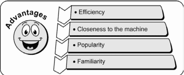

**图13.1：列出命令式编程范式的优点**

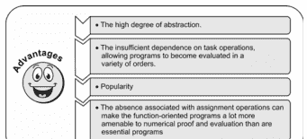

- 高度抽象。
- 任务操作的独立性，允许程序以多种顺序求值。
- 流行性。
- 缺少赋值操作可以使面向函数的程序比命令式程序更易于进行数值证明和求值。

**图13.5：列出函数式编程范式的优点**

函数式编程范式的缺点列于图13.6：

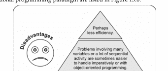

- 效率可能较低。
- 涉及许多变量或大量顺序活动的问题有时更容易用命令式编程或面向对象编程处理。

**图13.6：列出函数式编程范式的缺点**

接下来，让我们讨论OOP与过程式编程之间的区别。

### OOP与过程式编程之间的区别

过程式编程是一种编码方式，它通过确定一组步骤来解决特定问题，并按精确顺序执行这组步骤，以达到所需结果或条件。假设我们希望计算银行账户的月末结账余额。计算余额的第一步是从账户获取期初余额，然后减去整个月内发生的所有借方金额。之后，我们需要加上该月内发生的所有贷方金额。在此过程结束时，我们从账户得到月末结账余额。

与过程式编程相关的主要概念之一是过程调用。过程也称为子例程、方法，或者也许称为函数，它包含要完成的有序指令列表。过程可以在任何其他过程执行期间的任何时候被调用，也可以单独调用。过程式语言的示例有C和Pascal。

在OOP中，重点是在涉及现实世界元素时考虑待解决的问题，并在涉及对象及其自身行为时表示该问题。

OOP与过程式编程的关键区别在于，过程式编程的重点是将实际编程任务分解为变量和子例程的集合；而OOP的重点是将实际编程任务分解为对象，这些对象封装信息和方法。另一个区别是，过程式编程使用过程直接作用于数据结构；而OOP将信息和方法捆绑在一起，以确保对象对数据进行操作。

在下一节中，让我们详细讨论抽象。


抽象可以大致分类，如图 13.8 所示：

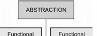

图 13.8：展示抽象的分类

表 13.1 列出了函数抽象与数据抽象之间的区别：

**表 13.1：函数抽象与数据抽象之间的区别**

| 函数抽象 | 数据抽象 |
|---|---|
| 它表示在不知道特定函数实现逻辑的情况下使用函数。 | 它指在不知道数据如何存储的情况下使用数据。 |
| 通过为调用函数而定义的特定接口来访问函数。 | 通过为检查和操作数据而定义的一组特定操作来访问数据。 |

让我们了解三个重要的 OOP 原则，即封装、继承和多态。

### OOP 原则概述

在这个世界上，我们会发现自己被各种对象所包围，例如计算机、冰箱、咖啡机和书籍。其中一些对象自行运行，而另一些对象则相互交互。对象具有两个固有属性——*状态*和*行为*。许多对象在行为上相似，但目的可能不同。同样，同一个动作可以使对象做各种不同的事情。

面向对象概念包含三个主要原则——*封装*、*继承*和*多态*。

让我们仔细看看这些术语，弄清它们的真正含义。

### 封装

**Grady Booch** 将封装定义为“将构成抽象的结构和行为的元素分隔开的过程；封装用于将抽象的契约接口与其实现分离。”

封装被定义为隐藏对象中那些无助于体现该对象重要特征的细节的过程。它隐藏对象的实现细节，只暴露对象的接口，即该对象能够响应的所有消息的集合。封装有助于将对象的执行与其行为分离，以限制其内部信息的使用。它还有助于保持对象的完整性；从而限制外部用户将对象的内部实现设置为无效或不一致的状态。因此，封装通过限制对象之间的相互依赖来降低复杂性。

封装和抽象是 OOP 中两个紧密相关的概念，但在许多情况下，它们被错误地当作同义词使用。这是因为抽象是一个过程，是确定对象应具备的相关特征和行为的行为。相反，封装是实际实现抽象所借助的机制。因此，不应将这两个术语混淆。

### 继承

泛化层次结构与继承过程的思想相关联。继承主要有两种类型：结构继承和行为继承。在结构继承中，子类继承其超类的属性。假设一个 employee 类具有 name、address 和 salary 作为其属性。那么，一个子类（例如 engineer）也可以使用这些属性来定义。在行为继承中，子类被认为继承其超类的方法。假设 employee 类有一个方法 calculatePay()。那么，一个子类（例如 manager）也可以使用该方法来刻画。

子类也参与其超类所参与的关系集。如果一个子类上指定了一些子类，那么它就形成一个层次结构或格。类-子类关系由有向无环图（DAG）表示。当对象可以按照多种彼此独立的方式分类时，这特别有用。

如果在某个层次结构中，给定实体集仅在一个 ISA 关系中作为较低层实体集参与，则该实体集具有**单继承**。图 13.9 展示了单继承的概念：

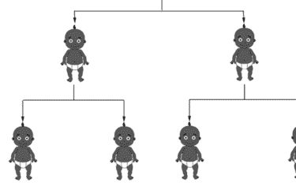

**图 13.9：展示单继承的概念**

如果一个实体集在多个 ISA 关系中作为较低层实体集参与，则该实体集具有**多重继承**，并且所得结构称为*格*。在格或层次结构中，子类不仅继承其直接超类的属性，还继承其所有前驱的属性。具有多个超类的子类称为共享子类。共享子类是指处于多个不同的超类-子类关系中的子类，其中每个关系只有一个超类。图 13.10 展示了多重继承的概念：

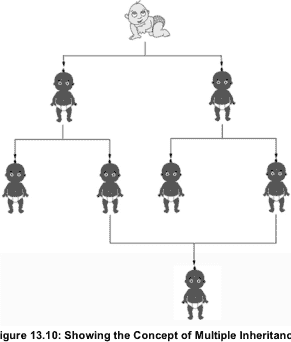

### 多态

在 OOP 中，多态意味着语言能够根据对象的运行时以不同方式处理对象。对象可以通过发送和接收消息相互通信。与多态相关的优点是，消息发送者无需知道接收者的类。它只需要知道实际接收对象能够执行特定行为。

多态是指属于不同类的两个或多个对象能够以不同的、特定于类的方式响应同一消息的能力。图 13.11 有助于更好地理解多态：


对于图 13.11 中的每个实体，*speak()* 方法都有不同的实现。多态允许我们为一个类及其子类声明一个方法，但对于每个子类，我们可以稍后实现该方法。

现在，考虑一个具有 *cut()* 方法的 *person* 类。对于 person 类的每个子类，cut() 方法的含义都会不同，如图 13.12 所示：


图 13.12：使用 cut() 方法展示多态

听到 CUT 时，外科医生会开始切口，理发师会开始给别人剪头发，而演员会突然停止表演当前场景。这就是多态的作用。它允许单个函数具有多种行为。

让我们概述导致 C++ 演变的因素。

### C++ 的起源

C++ 是 C 的超集，因此它与 C 向后兼容。C++ 广泛应用于应用程序、系统程序、嵌入式系统、高性能客户端/服务器应用以及娱乐软件等广泛领域。

导致 C++ 演变的因素如下：

- 问题域的复杂性不断增加
- 难以通过 C、Fortran 和 Pascal 等过程式语言捕捉问题域的复杂性
- 难以通过过程式语言对现实世界对象进行建模

接下来，让我们详细讨论 OOP、对象和类。

### OOP、对象和类

OOP 是一种方法，它通过创建分区存储区来提供使应用模块化的方式，其中每个数据和函数都用作模板，以便按需创建与各模块相关联的副本。OOP 的显著特征如图 13.13 所示：

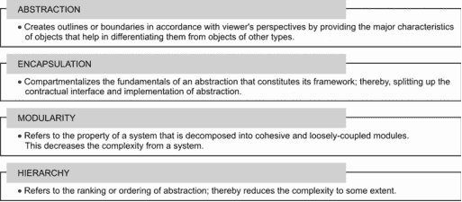

图 13.13：展示 OOP 的显著特征

OOP 的优点可列举如下：

- [ ] 提供对系统更好的理解，这通过**模块化**实现
- [ ] 将数据和行为组合成一个包，称为**对象**。这种组合的优点如下：
  - 独立的开发团队可以独立工作
  - 对象类可以被开发、复用或购买
  - 更新操作可能只影响有限数量的对象类
- [ ] 通过使用**层次结构**或**继承**避免公共行为的重复。避免重复的原因如下：
  - 行为取决于单个对象
  - 以后可以添加新种类的对象而不会造成损害
- [ ] 更改对象的实现而不影响其行为
- [ ] 降低构建复杂软件系统的风险

对象被定义为能够执行一组相关活动的事物。对象执行的一组活动定义了该对象的行为。例如，Employee 对象可以提供姓名或地址。对象具有状态，并表现出一些定义良好的行为。对象的状态包括该对象的所有属性，这些属性是静态的。这些属性的值本质上是动态的。对象的标识将其与所有其他对象区分开来。在 C++ 中，对象是带有相关语义的存储区域，可以如下声明：

```cpp
int a;
```

前面的声明指定 a 是 int 类型的对象。

在 C++ 对象模型的语境中，object 一词指的是类的实例。类定义若干对象的实际行为。对象通常通过引用来指称，引用是对象的别名。Bjarne Stroustrup 在其著作 *The C++ Programming Language (Second Edition, Addison-Wesley, 1992)* 中说道，*引用的显然实现是一个（常量）指针，每次使用时都对其进行解引用。*

类是一组共享共同结构和行为的对象。图 13.14 描述了类上下文中的操作、请求和方法：


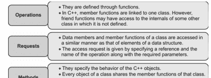

**图 13.14：** 描述操作、请求和方法

与 C 结构类似，类是一种抽象数据类型。它表示对象以及可应用于对象的一组操作。类由数据成员和方法组成。类的主要目的是保存数据或信息。这是通过属性（也称为数据成员）来实现的。成员函数决定类的行为。

类的通用定义如代码清单 13.1 所示：

**代码清单 13.1：展示类的定义**

```cpp
public class Employee
{
}
```

在前面的代码片段中，我们定义了一个公有类 Employee，它是空的。这意味着该类不包含与之关联的任何数据成员或方法。

使用上述类定义，我们可以创建 *Employee* 对象 *objectEmployee*，如下所示：

```cpp
Employee objectEmployee = new Employee();
```

下面是类的完整蓝图：

```cpp
class class_name
{
    Data Members;
    Methods;
};
```

**代码清单 13.2：展示结构良好的类的代码片段**

```cpp
class A
{
    int i ;
    char *string;
    void func (int , char *);
    int g_func() ;
};

class Circle
{
    int radius;
    int xcentre;
    int ycentre;
    int GetRadius ();
    int SetData();
    int GetXCentre ();
    int GetYCentre ();
};
```

设计类是一门艺术，每位设计者使用不同的实现来识别类。然而，根据面向对象设计原则，我们必须遵循五个原则来设计类，如图 13.15 所示：

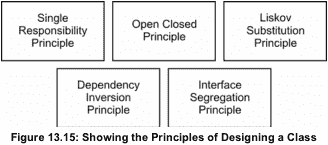

以下是对每个原则的说明：

- **单一职责原则**—指出一个类应该只有一个变更原因。这有助于在设计阶段识别和确认类，还有助于识别类可能演化的所有方式。
- **开闭原则**—指出类的设计应保持对扩展开放、对修改关闭。换句话说，类的设计方式应使得当向它们添加新功能时，代码中的改动应尽可能少。
- **里氏替换原则**—指出派生类应完全可替换其基类。换句话说，如果程序的某个模块正在使用基类，那么对基类的引用可以很容易地被派生类替换，且不应影响该特定模块的功能。
- **依赖倒置原则**—指出高层模块不应依赖低层模块，而两者都应依赖抽象。另一方面，抽象不应依赖细节，而细节应依赖抽象。
- **接口隔离原则**—指出不应强迫用户依赖于他们不使用的接口。为实现这一点，应在设计阶段投入大量时间以使设计灵活。

为了总结关于类的讨论，请考虑代码清单 13.3 中给出的代码片段：

**代码清单 13.3：实现一个类**

```cpp
class Employee {
public:
    int GetSalary();
    void SetSalary (int NewSalary);
    void PromoteEmployee (char NewDesignation, int NewSalary);
    void ChangeProject (char* NewProject);
    void Work();
private:
    char Name[30];
    int Salary;
    char Designation [30];
    char ProjectName [50];
};
```

Employee 类的属性包括姓名、工资、职位和关联的项目。这些属性是静态的；但是，这些属性可以保存的值是动态的。对象的行为通过操作来体现。PromoteEmployee() 操作会改变对象的状态；而 GetSalary() 操作不会改变对象的状态。

学习了类和对象之后，接下来详细讨论构造函数。

### 构造函数

构造函数是与类同名的成员函数，在创建对象时自动调用。它们用于初始化类的成员，从而将原始内存转换为对象。构造函数没有返回类型，但可以被重载。请考虑代码清单 13.4 中给出的代码片段：

**代码清单 13.4：** 展示构造函数的示例

```cpp
class A
{
    int b, c;
    public:
    A();                      //default constructor
    A(int, int);              //overloaded constructor
};

A::A()
{
    b=10;
    c=20;
}

A::A(int k, int j)
{
    b=k;
    c=j;
}
```

在类 A 中，我们声明了一个默认构造函数 A() 和一个重载构造函数 A(int, int)。

接下来，让我们详细了解一下拷贝构造函数。

### 拷贝构造函数

类的拷贝构造函数是生成该类对象副本的构造函数。拷贝构造函数通过初始化从现有对象创建新对象。如果我们没有声明拷贝构造函数，C++ 编译器会隐式声明它；不过，这将是一个内联公有成员。类型为 A::A(const A & right) 的声明就是拷贝构造函数的一个示例。

在使用构造函数和拷贝构造函数时，需要记住一些规则。规则如下：

1. 拷贝构造函数只能接受一个对同类类型的引用参数。不过，也可以提供更多参数，但所有这些参数都应有默认值。
2. 如果指定的拷贝构造函数第一个参数是对象而不是引用，则会产生错误。
3. 如果未提供拷贝构造函数，编译器会生成一个默认的拷贝构造函数。
4. 基类的构造函数不会被派生类继承（虚拟继承的情况除外）。

```cpp
void Person :: Set(char *_name, int _age){
strcpy(name, _name);
*age = _age;
}
char *Person :: GetName(){
return name;
}
int Person :: GetAge(){
return *age;
}
void Person :: Display(){
cout << "Name : " << name << endl;
cout << "Age : " << *age << endl;
}
void main(){
    Person programmer;
    programmer.Set("Rahim", 10);
    programmer.Display();
    Person manager(programmer);
    cout << "................................" << endl;
    manager.Display();
    programmer.Display();
    cout << "................................" << endl;
    programmer.Set("Jasim", 50);
    programmer.Display();
    manager.Display();
    getch();
}
```

上述代码的输出如下：

```text
Name : Rahim
Age : 10
................................
Name : Rahim
Age : 10
Name : Rahim
Age : 10
................................
Name : Jasim
Age : 50
Name : Rahim
Age : 10
```

如前所述，编译器提供的拷贝构造函数会执行逐成员拷贝。因此，如果类包含指针或数组，则应定义自己的拷贝构造函数；否则，将使用默认的拷贝构造函数。

### 公有、私有和受保护的构造函数

有时，我们不希望其他用户使用我们的构造函数。在这种情况下，我们可以为构造函数定义访问说明符。因此，类的构造函数可以是公有、私有或受保护的。公有构造函数可以被该类之外的其他用户使用。受保护的构造函数只能由属于该类的用户以及从该类派生的类的用户使用。私有构造函数只能由该类的用户使用。具有私有构造函数的类不能由其成员函数之外的任何函数初始化。它可以用于创建单例类，这是 C++ 中一种流行的设计模式。


## 第 13 章

现在，我们来学习析构函数。

### 析构函数

类 A 中名为 `~A` 的成员函数被称为类的析构函数。当对象被销毁时，析构函数会被隐式调用。如果没有提供析构函数，则编译器会提供一个默认析构函数。析构函数不能接受任何参数，不能被重载，也不能返回任何值。请参考清单 13.6 中的代码。

**清单 13.6：** 析构函数的代码示例

```cpp
class A
{
    public:
    int *x;
    A(int);
    ~A();
};

A::A(int y)
{
    x = new int[y];
}

A::~A()
{
    delete[] x;
}
```

现在，我们来详细了解类的成员。

### 类成员

数据成员和函数是类的成员，它们必须在类定义中声明。请参考清单 13.7 中的代码片段：

**清单 13.7：** 类成员的示例

```cpp
class A
{
    int a;             // a 是类 A 的数据成员
    int b;             // b 是类 A 的数据成员
    int a;             // 错误：a 的重复定义
};
```

注意，我们不能在函数内重复声明一个成员。此外，除了类定义之外，不能在其他地方添加任何成员。

清单 13.8 展示了 `func_1` 和 `func_2` 作为类 B 的成员函数：

**清单 13.8：** 类成员的另一个示例

```cpp
class B
{
        int a;
        float b;
        void func_1(int, float);
        int func_2();
};
```

在前面的示例中，两个成员函数共同决定了类 B 的对象的行为。

### 成员函数的定义与访问控制

成员函数可以访问类的所有数据成员。成员函数可以按照清单 13.9 所示进行定义：

**清单 13.9：** 成员函数的定义

```cpp
void Y :: func_1 ( int a, int b)
{
    x = a;                    // a 是类 Y 的数据成员
    y = b;                    // b 也是类 Y 的数据成员
}
int Y :: func_2 ()
{
    return a;
}
```

此外，一个成员函数可以使用类的其他成员函数，如清单 13.10 所示：

**清单 13.10：** 演示成员函数的访问控制

```cpp
void Y :: func_1 (int a , int b)
{
    x = a;
    y = b;
    printf ( "%d", func_2() ) ; // Y :: func_1 () 调用 Y :: func_2()
}
```

### 向对象发送消息

类的成员函数通过向对象发送消息来调用。对对象发送消息通过成员函数访问对象的数据成员。清单 13.11 展示了如何向对象传递消息：

**清单 13.11：** 向对象传递消息

```cpp
1: class A;
2: void func()
3: {
4:     A obj_A;
5:     obj_A.func (10, 10);
6: }
```

在类 A 中，`obj_A` 是类型 A 的一个对象。代码的第 5 行表示向对象 `obj_A` 发送消息，其中 `func()` 是要由该消息调用的函数。

### 对象

对象是类的一个实例。根据 Grady Booch 的观点：“对象具有状态、行为和标识；相似对象的结构和行为在其共同类中定义；术语‘实例’和‘对象’可以互换。”清单 13.12 展示了如何将对象声明为类的实例：

**清单 13.12：** 将对象声明为类的实例

```cpp
class A;
A a ;                       // a 是类型 A 的对象。
Circle c1, c2;              // c1 和 c2 是类型 Circle 的对象。
Circle c3 = c2;             // c3 是 c2 的副本
class Date
{
    int day, month, year;
    .....
};
Date todays_date;
Date my_birthday = todays_date ; // my_birthday 是 todays_date 的副本
```

与任何变量类似，在声明对象时也可以使用存储修饰符。我们可以将对象声明为 `static`、`auto`、`register` 和 `const`。

在下一节中，让我们重新审视封装的概念，以说明类的成员与外部用户的访问控制级别。

### 封装——成员与外部用户的访问控制

类的成员可以声明为 *private*（私有）、*protected*（受保护）或 *public*（公有）。类的 *private* 成员只能由声明该成员的类中的成员函数使用。类的 *protected* 成员只能由定义该成员的类中的成员函数以及从该类派生的类的成员函数访问。相反，类的 *public* 成员可以被任何函数使用，并且访问控制级别统一应用于所有成员函数和数据成员。

所有数据成员都是 public 的类更容易被用户误用，因为这些成员没有保护。这严格来说不符合面向对象的原则，因为实现细节没有与用户隔离。数据或信息隐藏的概念无法在这些类上得到体现。

清单 13.13 展示了 GEN 类，以帮助理解访问控制的概念：

**清单 13.13：** GEN 类的代码

```cpp
class GEN
{
private :
    int a;
    int b;
protected :
    func_1();
    int c;
public :
    func_2();
    func_3();
};
```

现在，考虑清单 13.14 中给出的 `OBJ_FUNC()` 函数：

**清单 13.14：** `OBJ_FUNC()` 函数的代码

```cpp
1: void OBJ_FUNC()
2: {
3: GEN obj_GEN;
4: obj_GEN.a = 5;
5: obj_GEN.func_2();
6: obj_GEN.func_3();
7: obj_GEN.func_1();
8: obj_GEN.c = 3;
9: }
```

该函数的第 3 行表示 `obj_GEN` 是 GEN 类的一个对象。第 4 行的声明会报错，因为 `a` 是 GEN 类的私有成员。第 5 行和第 6 行都是正确的，因为 `func_2()` 和 `func_3()` 是 GEN 类的公有成员。同样，第 7 行会报错，因为 `func_1()` 是 GEN 的受保护成员，对于一个既不是其成员函数也不是其派生类的函数来说，它不可访问。第 8 行的情况类似。

在 UML 中，有五种类型的视图，如下所示：

- **用户视图** —— 描述最终用户如何查看系统
- **结构视图** —— 描述模型的静态特征，包括类、属性、行为以及类之间的关系
- **行为视图** —— 展示对象之间的交互，以及一组对象如何协作实现相同的行为
- **组件视图** —— 描述软件组件（包括源代码、运行时和可执行组件）之间的组织和依赖关系
- **部署视图** —— 通过揭示系统中的软硬件依赖关系，展示系统的物理层次

现在，让我们学习类和其组件的图示表示的基本概念。

#### 属性

属性是类的一个命名特性，用于描述该特性的值。在 UML 中，我们将属性列在类名的正下方。

#### 操作

操作是服务的实现，可以从类的任何对象请求该服务。在 UML 中，我们将操作列在类属性的正下方，如图 13.16 所示：

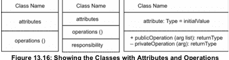

#### 接口

接口是操作的集合，可用于指定类或组件的服务。图 13.17 展示了 UML 中接口的表示方式：

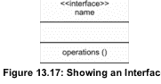

#### 信号

信号是实例之间通信的异步刺激的规格说明。

#### 组件

组件是系统中物理的、可替换的部分，它符合并提供了接口的实现。在 UML 中，组件用带标签的矩形表示，如图 13.18 所示：

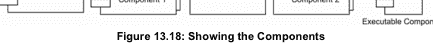

#### 节点

节点是运行时存在的物理元素，表示一种计算资源。通常，这种资源具有较大的内存和处理能力。在 UML 中，节点可以如图 13.19 所示进行表示。

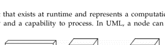

图 13.19：展示节点及节点之间的关系

#### 包

包是一种将元素组织成组的机制。注意，包也可以包含其他包。包主要用于基于 Java 的环境中。在 UML 中，包如图 13.20 所示进行表示。

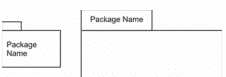

图 13.20：展示一个包

#### 子系统

子系统是元素的分组。组中的某些元素有助于其他元素所提供行为的规格说明。

#### 对象

对象可以表示为类的实例，带有路径名以及属性。我们还可以通过链接连接多个对象。图 13.21 展示了 UML 中对象的一些基本表示法：

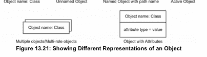

图 13.21：展示对象的不同表示方式

#### 协作

协作是类、接口和其他元素的集合，它们共同工作以提供某种协作行为，这种行为的价值大于各部分之和。

#### 关联

当一个类与其他类相关联时，使用关联来建立它们之间的关系。例如，医生治疗其病人。因此，医生和病人之间存在关联关系，如图 13.22 所示。


图 13.22：展示医生与病人之间的关联关系


```cpp
char* studName;
public:
    Student(char *sName)
    {
        cout<<"Student::constructor\n";
        studName = new char(sizeof(strlen(sName)));
        studName = sName;
    }
    char* sName()const
    {
        return(studName);
    }
    ~Student()
    {
        cout<<"Student::destructor\n";
        delete(studName);
    }
};
class Course
{
    Student * std_p;
    Department * dept_p;
    char * courseName;
    static unsigned int index;
    static Course *courseList[4];
public:
    Course(char* crseName, Student* student, Department* dept): courseName(0),
    std_p(student), dept_p(dept)
    {
        cout<<"Course::constructor\n";
        if (index < 4)
        {
            courseName = new char(sizeof(strlen(crseName)));
            courseName = crseName;
            //Insert this Course in courseList
            courseList[index] = this;
            ++index;
        }
        else
        {
            cout<<"Cannot accomodate any more Course\n";
        }
    };
    ~Course()
    {
        cout<<"Course::destructor\n";
        delete (courseName);
    };
    static char* findStudent(char *crseName, char* deptName)
    {
        for(int i=0; i<index; i++)
        {
            if ( (courseList[i]->getCourseName() == crseName) && (courseList[i]->getDeptName() == deptName) )
            {
                return(courseList[i]->getStdName());
            }
```

得到最优解后，对模型求解结果进行确认并查看目标函数值。此时，由于之前将求解模型设置为了最小化目标，因此目标函数值越小越好。本案例中，得到的最终目标函数值为 204.94（万元），即最低运营成本为 204.94 万元，对应的人员排班方案如模型求解结果中的“决策变量表”所示。

规划求解结果中除显示目标函数值和决策变量表之外，还会显示以下关键信息：

- **求解引擎**：表示本次求解采用的引擎，包括引擎名称和版本。
- **求解状态**：表示求解结果的状态。若状态为“已达到最优解”，则表示模型求解成功且得到最优解；若为“未得到最优解”，则说明模型可能存在约束冲突等问题，需要检查模型设置。
- **求解时间**：表示本次求解所花费的时间。

通过模型求解结果可以看出，最优解中人员排班方案的总运营成本比之前人工排班方案的成本降低了 12.6%，有效降低了运营成本。此外，模型求解结果中的人员排班方案还满足了每个岗位的工时要求，避免了人员冗余，并保证了人员安排的合理性。

在得到最优排班方案后，还可以进行灵敏度分析，以帮助管理者进一步了解各项资源的变化对最优排班方案及目标函数值的影响。

```text
Course::constructor
Course::constructor
Course::constructor
Finding a student using Course and department...
Student who has taken Maths Course in Mathematics Department is: Mridula
Deletion of objects...
Student::destructor
Student::destructor
Student::destructor
Student::destructor
Department::destructor
Department::destructor
Course::destructor
Course::destructor
Course::destructor
Course::destructor
```

#### 依赖

依赖用于一个类完全依赖于另一个类的情况。例如，当我们申请贷款时，贷款金额完全取决于我们想要的货币。因此，贷款金额与货币之间存在依赖关系。图 13.24 展示了依赖关系的符号表示：

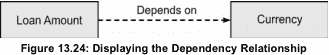

如图 13.24 所示，我们使用单向箭头（➔）来表示依赖关系。

#### 聚合

当一个类是另一个类的一部分时，使用聚合。例如，成员是俱乐部的一部分。因此，成员与俱乐部之间存在聚合关系。聚合关系如图 13.25 所示：

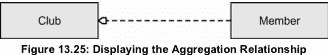

如图 13.25 所示，我们使用空心菱形来表示聚合关系。

聚合是一种更强的关联形式。它是一种结构关系，指定一个类表示一个更大的事物，该事物由更小的事物组成。聚合表示一种“has-a”（拥有）关系。在 UML 中，聚合可以表示如图 13.26 所示：

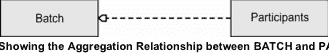

在 UML 中，整体类和部分类之间放置一条连线，并将菱形头连接到整体类，以表示该关联是聚合。

聚合是一个用于表达对象之间“部分”类型关联的概念。一个聚合体可以包含多个整体-部分结构，每个结构都可视为一个不同的聚合体。

由于聚合是一种特殊的关联，它在某些情况下增加了额外的含义。如果两个对象通过整体-部分关系紧密连接，则它们形成一个聚合体。现在，问题出现了：我们如何识别一个关系是否为聚合？格雷迪·布奇提出了一些有价值的问题来检验一个关系是否为聚合，如下所示：

- 你会用“部分”这个说法来描述它吗？
- 整体上的一些操作会自动应用于其部分吗？
- 是否有一些属性值从整体传播到全部或部分？
- 关联是否存在固有的不对称性，即一个对象类是否从属于其他对象类？

如果上述所有问题的答案都是肯定的，那么该关系就是聚合。

因此，如果类 A 维护类 B 的列表，并且类 A 的构造函数不创建类 B 的对象，则类 A 与类 B 之间的关系属于聚合类型。此外，如果类 B 可自由独立存在，则称为聚合，如图 13.27 所示：

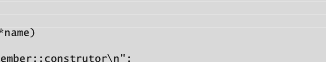

**图 13.27：展示类 A 与类 B 之间的聚合关系**

清单 13.18 展示了聚合关系的实现：

### 清单 13.18：展示用于解释聚合关系的代码

```cpp
#include<iostream.h>
class Member
{
    public:
        Member(char *name)
        {
            cout<<"Member::constructor\n";
            memberName = new char(sizeof(strlen(name)));
            memberName = name;
        }
        char* display()
        {
            return(memberName);
        }
        ~Member()
        {
            cout<<"Member::dtor\n\n";
            delete (memberName);
        }
    private:
        char *memberName;
};
class Club
{
    public:
        Club(char * clubName, Member* mem)
        {
            cout<<"Club::constructor\n";
            name = new char(sizeof(strlen(clubName)));
            name = clubName;
            myMember = mem;
        }
        ~Club()
        {
            cout<<"Club::dtor\n\n";
            myMember = NULL;
        };
    private:
        char *name;
        Member *myMember;
};
int main()
{
    cout<<"\nExample of Aggregation Relationship \n";
    cout<<"--------------------------------------\n";
    {
        cout<<"Here, Hirak Banerjee is a member of Club-MS \n";
        Member mem("Banerjee");
        {
            Club comp("MS", &mem);
        }
        // here Club object will be deleted, whereas member object is still there
        cout<<"At this point Club gets deleted...\n";
        cout<<"\nBut Member:"<<mem.display();
        cout<<" is still there\n";
        //here Member object will be deleted
        return(0);
    }
}
```

上述代码的输出如下：

```text
output:

Example of Aggregation Relationship
-----------------------------------
Here, Hirak Banerjee is a member of Club-MS
Member::constructor
Club::constructor
Club::dtor
At this point Club gets deleted...
But Hirak member is still there
Member::dtor
```

#### 组合

组合是聚合的一种类型，其中整体类不能脱离其部分而存在。例如，人没有心脏就无法生存。因此，人与心脏形成组合关系，如图 13.28 所示：


**图 13.28：展示组合关系**

如图 13.28 所示，我们使用实心菱形来表示组合关系。

让我们考虑另一个组合示例：房屋与其房间之间的组合。房屋可以包含多个房间；房间没有独立生命；一个房间不能属于两个不同的房屋。这意味着如果我们删除一栋房屋，其房间将自动删除。图 13.29 展示了房屋与房间之间的组合关系：


**图 13.29：展示组合关系**

清单 13.19 展示了上述示例的 C++ 实现：

### 清单 13.19：展示组合关系

```cpp
#include<iostream.h>
class House;
class Room
{
public:
    Room()
    {
    };
    static void createRoom(Room* (&room), House* hse, char* name)
    {
        room = new Room(hse, name);
    }
    Room(House* hse, char* myName)
    {
        cout<<"Room::constructor_C\n";
        myHouse = hse;
        if(NULL != myHouse)
        {
            name_p = new char(sizeof(strlen(myName)));
            name_p = myName;
        }
        else
        {
            cout<<"The House itself is not Created still ...\n";
        }
    };
    ~Room()
    {
        cout<<"Room::destructor_D\n";
        myHouse = NULL;
        delete (name_p);
    };
    void disp()
    {
        cout<< name_p;
        cout<<"\n";
    }
    static void initialList(Room *(& roomsList)[3])
    {
        roomsList[3] = new Room[3];
    }
private:
    House * myHouse;
    char * name_p;
};
class House
{
public:
```


```cpp
House(char *myName)
{
    cout<<"House::constructor_C\n";
    name_p = new char(sizeof(strlen(myName)));
    name_p = myName;
    Room::initialList(roomsList);
    Room* myRoom;
    Room::createRoom(myRoom, this, "Kitchen");
    roomsList[0] = myRoom;
    Room::createRoom(myRoom, this, "BedRoom");
    roomsList[1] = myRoom;
    Room::createRoom(myRoom, this, "Drawing Room");
    roomsList[2] = myRoom;
}
~House()
{
    cout<<"House::destructor_D\n";
    unsigned int i;
    cout<<"Delete all the Rooms ...\n";
    for(i=0; i<3; ++i)
    {
        if(roomsList[i] != NULL)
        {
            delete (roomsList[i]);
        }
    }
    delete [] roomsList;
    delete (name_p);
}
void disp()
{
    cout<<"\n\nName of the House :"<<name_p;
    if(roomsList != NULL)
    {
        unsigned int i;
        cout<<"\n\nRooms details...\n";
        for(i=0; i<3; ++i)
        {
            if(NULL != roomsList[i])
            {
                roomsList[i]->disp();
            }
        }
        cout<<"\n\n";
    }
}
private:
    char* name_p;
    Room* roomsList[3];
};
int main()
{
    cout<<"\nExample of Composition Relationship\n";
    cout<<"----------------------------------------\n\n";
    House hse("Shanti Aashram");
    cout<<"\n\nHouse details...\n";
    hse.disp();
    cout<<"Now House itself creates the Rooms and Deletes as well, before it gets deleted itself\n";
    return(0);
}
```

上述代码的输出如下：

```text
OUTPUT:
-------
Example of Composition Relationship
------------------------------------
House::constructor_C
Room::constructor_C
Room::constructor_C
Room::constructor_C
House details...
Name of the House : Shanti Aashram
Rooms details...
Kitchen
BedRoom
Drawing Room
Now House itself creates the Rooms and Deletes as well, before it gets deleted itself...
House::destructor_D
Delete all the Rooms...
Room::destructor_D
Room::destructor_D
Room::destructor_D
```

在继续之前，让我们先理解组合与聚合之间的区别。

组合是聚合的一种更强形式。它表示整体类对部分类具有独占所有权。这意味着部分可以在组合体创建之后创建，但这些部分会在组合体销毁之前被显式移除。然而，聚合与组合的不同之处在于它不蕴含所有权。在组合中，当拥有对象被销毁时，被包含的对象也会被销毁。然而，在聚合中，这不一定成立。让我们举个例子来理解这个概念。一家公司拥有许多部门，每个部门又有许多员工。如果公司某天关闭，那么部门将不复存在，但那些部门中的员工仍会保留。因此，公司可以作为与部门之间组合关系的例子；而部门则继续作为员工的聚合。

代码清单 13.20 展示了在 C++ 中实现员工与部门之间聚合关系的代码片段：

### 代码清单 13.20：实现员工与部门之间的聚合关系

```cpp
class Employee;
class Department
{
    ...
    /* Aggregation */
    Employee * members[10];
    GetSalary()
    {
        ...
    }
};
```

代码清单 13.21 展示了在 C++ 中实现员工与公司之间组合关系的代码片段：

### 代码清单 13.21：实现员工与公司之间的组合关系

```cpp
class Company
{
    private:
        /* Composition */
        Department employee[100];
        ...
};
```

在聚合中，一个对象可能只包含指向另一个对象的引用或指针，并且可能不承担其生命周期责任。有时，当组合与聚合之间的区别不重要时，聚合也被称为组合。

组合可用于存储复合数据类型的众多实例。这有时被称为包含关系，包括链表、关联数组和二叉树。

#### 泛化

泛化有一个父流程和一个或多个子流程。子流程描述其父流程的一种特殊类型。例如，在商店中，我们可以通过现金或银行卡付款。因此，现金支付和银行卡支付是支付流程的两个子流程。图 13.30 展示了泛化关系：

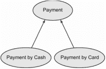

**图 13.30：** 展示泛化关系

#### 包含

如果一个流程需要另一个流程的结果，那么这两个流程之间的关系称为包含。例如，如果我们想从音像店借一张 CD，那么我们需要先确认该 CD 是否存在于店中。因此，借 CD 包含验证流程。图 13.31 展示了包含关系的图示表示：

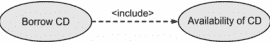

**图 13.31：** 展示包含关系

#### 扩展

根据条件，如果一个流程需要有一个子流程，那么我们可以使用扩展关系将这两个流程关联起来。例如，要享受机票折扣，我们可以有两个子流程：国内航班和国际航班，并且它们通过扩展关系与其父流程绑定。在这种情况下，条件可以是航班类型。图 13.32 说明了用于描述扩展关系的表示法：

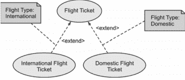

在最后一节中，让我们概述一下数据抽象与信息隐藏。

### 数据抽象与信息隐藏

信息隐藏是 OOP 中一个非常重要的术语，其中类试图向用户隐藏其实现细节。例如，我们可以使用数组或链表的概念来实现一个栈。然而，这并不会影响栈的功能。用户只关心栈如何执行以及它提供什么功能，而不关心它是如何实现的。这个概念称为数据抽象。

考虑用于计算员工工资的 EmployeeSal 类。代码清单 13.22 展示了 EmployeeSal 类的代码：

### 代码清单 13.22：展示用于说明信息隐藏的代码

```cpp
class EmployeeSal
{
    public:
        void setSalary(double sal)
        {
            salary = sal;
        }
    private:
        double salary;
};
```

人们可能会将封装与信息隐藏混淆。封装使我们能够围绕想要封装的事物划出边界。它使我们能够就边界内部世界和外部世界进行交流。另一方面，信息隐藏是一种设计，它限制数据和实现流程的直接暴露，以防止不必要的耦合。信息隐藏是一种设计原则；而封装仅仅是编程语言的一种特性。

> 根据 John Wilkinson 的说法：“信息隐藏，或者其反面——信息泄漏，可能跨越多个对象，也可能涉及客户端代码与实现代码之间的其他耦合形式。例如，调用顺序依赖会暴露一些通常应当隐藏的信息。另一个例子可能是客户端代码所使用的默认值。有些代码虽然实现了完美的封装，却仍然存在信息隐藏问题。”

因此，封装并不等同于信息隐藏，但在某些方面，它需要一定程度的信息隐藏。

抽象、封装和信息隐藏可以使用抽象数据类型（ADT）来实现。ADT 是一种被设计为派生类接口的类。注意，ADT 不能被实例化。ADT 作为其他类的基类，而这些类将被实例化为对象。图 13.33 展示了 ADT 的不同分类：


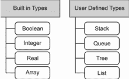

**图 13.33：展示 ADT 的分类**

抽象类包含一个或多个抽象方法。这样的方法只能声明，不能实现。抽象类需要子类，由子类为抽象类中声明的抽象方法提供实现技术。

让我们考虑一个动物的例子。动物会执行一些常见操作，例如进食、发出叫声和奔跑，但方式各不相同。例如，狗会汪汪叫，而猫会喵喵叫。因此，Animal 类是一个完美的 ADT。

考虑以下 Animal 类的代码：

```cpp
class Animal
{
    public:
        void makeSomeNoise()
        {
        }
};
```

在前面的代码中，我们将 Animal 声明为一个抽象类，其中包含一个名为 makeSomeNoise() 的抽象方法。现在，如果我们想创建 Animal 类的实例，那么它需要被实例化，同时实现 makeSomeNoise() 方法。

考虑以下 dog 类的代码：

```cpp
class dog : public Animal
{
public:
    void makeSomeNoise()
    {
        cout << "Bark !!!...." << endl;
    }
};
```

在前面的代码中，我们创建了 *dog* 类作为 *Animal* 类的实例。*makeSomeNoise()* 方法也由 *dog* 类实现。因此，需要注意，抽象类被设计为专门用作基类。

现在让我们总结本章讨论的要点。

### 小结

在本章中，我们学习了解决问题的不同范式。我们还学习了抽象，以及 OOP 与面向过程编程之间的差异。然后，我们概览了 OOP 原则，即封装、继承和多态。此外，本章还讨论了 OOP、对象和类。进一步，我们学习了构造函数、析构函数、类成员、数据抽象和信息隐藏。此外，本章还使用 UML 给出了类及其组件之间的关系。

### 第13章：快速复习

### 多项选择题

- 1. **inverse 关键字用于：**
  - a. 类
  - b. 属性
  - c. 关系
  - d. 以上所有

- 2. **面向对象系统与传统系统之间的本质区别是什么？**
  - a. 面向对象系统更具可复用性
  - b. 面向对象系统使用继承
  - c. 面向对象系统降低了开发成本
  - d. 对数据结构的更改是局部化的

- 3. **OOP：**
  - a. 使程序更可靠
  - b. 模拟现实生活
  - c. 使用大量令人生畏的词汇，但实际上并没有听起来那么糟糕
  - d. 以上所有

- 4. **是什么使一个类成为抽象类？**
  - a. 该类必须没有方法定义
  - b. 该类必须有一个不接受参数的构造函数
  - c. 该类必须有一个等于零的函数定义
  - d. 该类无法按原样实例化，因为它主要用于继承

- 5. **对象模型中的主要元素是什么？**
  - a. 抽象、封装和持久性
  - b. 层次结构、并发和类型化
  - c. 抽象、封装和层次结构
  - d. 类型化

- 6. **对象区别于所有其他类型对象的特征是：**
  - a. 聚合
  - b. 抽象
  - c. 模块化
  - d. 以上都不是

- 7. **OOP 允许扩展对象函数或类函数。这被称为：**
  - a. 可扩展性
  - b. 扩展能力
  - c. 虚拟扩展
  - d. 可伸缩性

- **Q8.** 以下哪一项不是面向对象抽象的类型？
  - a. 数据抽象
  - b. 功能抽象
  - c. 结构抽象
  - d. 名称抽象

- **Q9.** 什么是 const 成员函数？
  - a. 它意味着该函数只是一个只读函数
  - b. 在给定相同参数时总是返回相同值的函数
  - c. 用于构造函数和析构函数
  - d. 以上都不是

- **Q10.** ____________ 实际上是一种参数化构造函数，它接收一些参数来创建类的实例。
  - a. 隐式构造函数
  - b. 显式构造函数
  - c. 虚拟构造函数
  - d. 参数化构造函数

### 主观题

- **Q1.** 编写代码声明一个整型全局变量并将其初始化为 100。然后，声明一个整型局部变量并将其初始化为 500。为此，两个变量使用相同的名称。打印局部变量和全局变量的值，并指明变量的类型。

- **Q2.** 编写代码声明一个字符型变量、一个整型变量和一个浮点型变量，然后打印这些变量的地址。

- **Q3.** 编写代码定义一个函数求三个数的平均值，并从 main() 调用它，以打印作为输入提供的三个数的平均值。编写该函数时，应通过减少开销所花费的时间来最小化执行时间，例如每次函数调用时反复跳转到函数并返回调用函数。（提示：使用内联函数的概念。）

- **Q4.** 编写一个宏，求三个数中的最大数。从 main() 中调用该宏，先求三个整数中的最大数，再求三个浮点数中的最大数。

- **Q5.** 使用内联函数重写问题 4 中的宏，并从 main() 中分别对三个整数值和三个浮点类型值调用该函数。

- **Q6.** 使用函数重载的概念，编写两个同名函数 findAverage()，分别求三个整数中的最大数和三个 double 类型值中的最大数。

- **Q7.** 使用 main()，调用函数打印三个整数的平均值和三个 double 类型值的平均值。为此，使用函数重载的概念。

- **Q8.** 编写一个函数 calculateArea()，求给定半径的圆的面积。如果不传入任何参数调用，该函数应返回半径为 5 的圆的面积。使用默认参数的概念。

- **Q9.** 编写一个函数 `incrementByN()`，通过向在调用函数（`main`）中声明的整型变量加上给定的整数值来递增该变量的值。（该函数不应返回任何值。）

- **Q10.** 编写 `main()`，在调用任何函数之前打印整型变量的值。现在，调用一个函数，然后再次打印该整数的值。调用函数后，当打印该变量的值时，它应打印更新后的值。使用引用变量的概念。

- **Q11.** 编写代码求一个整型数组所有元素的总和。声明一个整型数组并用 10 个整数初始化它。声明一个指向整数的指针，并使用该指针求总和。

- **Q12.** 编写代码声明一个包含五个字符指针的数组。在该数组中存储五个名字并对其进行排序。

- **Q13.** 编写代码，将一个变量声明为全局变量，并定义一个函数，该函数返回初始化为该全局变量的引用。使用该函数，将引用中存储的值赋给 `main()` 中声明的变量。

- **Q14.** 创建一个具有 length 和 breadth 属性的 Rectangle 类，然后执行以下操作：

  - a. 创建一个参数化构造函数，用于为 length 和 breadth 分配自定义值。分别为 length 和 breadth 提供默认值 4 和 3，当创建 Rectangle 对象时未提供 length 和 breadth 的值时将使用这些默认值。
  - b. 添加成员函数 `findArea()` 和 `findPerimeter()`，分别求 Rectangle 对象的面积和周长。
  - c. 再添加一个成员函数 `isbigger()`，它接收一个 Rectangle 对象作为输入；如果当前 Rectangle 对象的面积大于作为参数传入的对象，则返回 true；否则，该函数返回 false。
  - d. 编写 `main()` 测试 Rectangle 类的所有功能。为 Rectangle 类的属性和行为应用适当的访问说明符。

- **Q15.** 创建一个 Employee 类，具有 empid、name 和 basic 属性。所有属性都必须使用 private 访问说明符声明。创建另一个 Payroll 类，具有 daRate、hraRate 和 pfRate 属性。同样，所有属性都必须使用 private 访问说明符声明。使用友元的概念，编写一个函数，根据 payroll 对象计算 Employee 对象的工资。员工的工资计算如下：

  `basic + daRate*basic + hraRate*basic - pfRate*basic.`

  编写 `main()` 测试上述功能。

- **Q16.** 创建一个 Student 类，具有 rollNo、name 和一个指针，该指针指向一个 marks 数组。现在，执行以下功能：

  - a. 创建一个参数化构造函数，它接收 name 和 rollNo 并初始化相应成员。该构造函数还接收 marks 数组的长度作为输入，并将所有 marks 的默认值赋为 0。
  - b. 为 marks 属性添加 setter 方法，它接收一个位置和修改后的分数作为输入，并用给定的修改后分数更改给定位置处的分数。
  - c. 添加成员函数 `findGrade()`，根据总分范围 `>=80`、`/60–80/`、`/45–60/`、`/35–45/` 和 `<35` 返回字符 A、B、C、D、F。
  - d. 为删除 marks 数组添加析构函数。
  - e. 添加静态成员函数 `countStudents()`，它返回已创建对象的数量。


编写 main() 来测试 Student 类的所有功能。为 Student 类的属性和行为应用适当的访问说明符。

**Q17.** 编写代码声明一个字符数组，并用一条语句（例如“have a nice day”）初始化它。打印数组的大小和字符串的长度。

**Q18.** 编写代码定义一个类 myClass，它有一个整数数据成员和一个字符数据成员。定义另一个类 yourClass，它有两个数据成员。为这两个类提供成员函数，以实现以下情况下访问数据成员和成员函数的机制：

- a. 在 main() 内部
- b. 仅在成员函数内部
- c. 在另一个类的成员函数内部

**Q19.** 编写代码定义一个类 Employee，其数据成员包括 employeeId(int)、employeeName（一个指向字符的指针，用于表示字符串）、employeeAge(int)、employeeDesignation（一个指向字符的指针）和 basicSalary(float)。提供一个构造函数来初始化这些数据成员，并提供行为来返回员工姓名、年龄、职位和基本工资（全部为私有）。提供一个行为 countEmployee() 来记录已创建的员工实例数量。按如下方式定义该类：第一个员工实例的员工 id 为 0，第二个实例为 1，依此类推。创建几个员工实例，并打印每位员工的员工编号和姓名，然后打印已创建员工的总数。（使用静态数据成员和静态成员函数的概念）。

**Q20.** 编写代码定义一个类 Player，它将具有 name（string）、age（int）和 batting average（float）。为该类提供构造函数，以创建一个未初始化的 Player、一个其数据成员已初始化的 player，以及通过复制现有 player 的数据成员来创建一个 Player。实现对象的动态构造机制。提供成员函数来获取该 player 的 batting average，且只能通过其成员函数访问，并提供一个行为，将该 player 的 batting average 与另一个 player 进行比较，如果相等则返回 true。

**Q21.** 编写代码定义一个类 myClass，它有一个数据成员和一个指向整数的指针。提供一个构造函数来初始化该数据成员，并提供一个析构函数来删除该指针。提供一个成员函数，通过传入 n 作为参数，将该数据成员的值递增 n 次，并提供一个成员函数来打印其值。

**Q22.** 编写代码创建一个 student 的链表。通过提供业务行为来定义 student 类：addStudent() 用于添加一个学生，removeStudent() 用于移除一个学生，displayStudentDetails() 用于显示一个学生的详细信息，以及一个指向 student 对象的 next 指针，用于表示链表中的下一个学生。提供私有数据成员：name（String）、roll（int）、score（int）<=100，以及两个指向 student 的指针，用于表示当前学生和第一个学生。提供构造函数和析构函数。

编写代码定义一个 student 注册类，其中有一个指向 student 的指针用于指向链表中的第一个学生，一个指向 student 的指针用于指向链表中的最后一个学生，以及一个 count（int）用于记录链表中学生的数量。提供成员函数 insertStudent() 用于将给定学生插入链表，removeStudent() 用于从链表中移除第一个学生，以及 firstStudent() 用于从链表中查找一个学生。相应地编写 student 类。

**Q23.** 定义一个类 Triangle，具有六个属性——angle1、angle2、angle3、side1、side2、side3——均为 float 类型数据。Angle1 是 side2 与 side3 之间的角，依此类推。角度以度为单位。现在，执行以下功能：

- 构造函数将接受三个参数——side1、side2 和 angle3。默认将它们初始化为零。
- 构造函数将计算所有边和角，并填充其他数据成员。
- 添加一个无参数的成员函数 findArea()，它将返回三角形的面积。
- 添加一个成员函数 isIdentical()，其参数为另一个 Triangle 对象，通过引用传递，将返回一个 Boolean。
- 编写 main() 来测试该类的所有功能。

**Q24.** 修改类 Triangle 以实现适当的访问控制。现在，执行以下功能：

- 将所有数据成员设为私有。
- 将成员函数 findArea() 和 isIdentical() 设为公有。
- 为各边添加返回 Boolean 值的 getter 和 setter 函数。为某条边提供无效值（例如，如果提供的 side1 > side2 + side3）应使该函数返回 false。设置一条边应重新计算并根据需要修改其他数据成员。
- 所有 getter 和 setter 函数都应为 inline。
- 编写 main() 来测试该类的所有功能。

**Q25.** 修改类 Triangle，使其可以通过给定两条边及其夹角，或三条边来构造。

相应函数将为公有，声明如下：

- static Triangle Triangle::sas(float side1, float side2, float angle3)
- static Triangle Triangle::sss(float side1, float side2, float side3)
- 将构造函数设为私有且内联，并从这些公有函数中调用它；例如，Triangle t1 = Triangle::sas(3, 4, 90)
- 编写 main() 来测试该类的所有功能。使用这两个公有函数代替构造函数。通过构造另一个 Triangle t2 = Triangle::sss(3, 4, 5) 并检查 t1 和 t2 是否相同，来测试这些函数是否正常工作。

这种机制称为 Named Constructor Idiom，用于在构造类时需要重载的场景。

**Q26.** 定义一个私有数据成员，一个指向字符串的指针。提供一个带参数的构造函数，通过动态分配内存来初始化该数据成员。提供一个析构函数来释放动态分配的内存。提供一个重载的公有成员函数 setTo()，它将接受一个 const char * 作为参数，并将 content 的值重置为输入值。提供 main() 来测试提供给该类的功能。

**Q27.** 创建一个具有整数类型数据成员的类。提供一个构造函数来初始化该数据成员。提供一个行为 print()，用于显示该数据成员的值。现在，创建第二个类，它有一个数据成员，该数据成员是第一个类的静态对象。添加一个静态成员函数，调用该静态对象的 print() 函数。编写 main() 来实现所定义的类。

**Q28.** 定义一个 int 数组。取该数组的起始地址，并使用 static_cast 将其转换为 void*。编写一个函数，它接受一个 void*、一个数字（表示字节数）和一个值（表示应将每个字节设置为的值）作为参数。该函数应将指定范围内的每个字节设置为指定值。在 int 数组上试用该函数。


## 14

## 多态与继承

| 如果你需要关于以下内容的信息： | 参见页码： |
|---|---:|
| 多态 | 366 |
| 重载一元运算符 | 374 |
| 重载二元运算符 | 378 |
| 运算符重载限制 | 383 |
| 重载一些特殊运算符 | 383 |
| 友元函数在运算符重载中的优点 | 387 |
| 继承 | 390 |
| 受保护访问说明符 | 393 |
| 受保护访问说明符的缺点 | 394 |
| C++ 中的访问说明符组合 | 395 |
| 构造函数和析构函数何时被调用？ | 396 |
| 向基类构造函数传递参数 | 397 |
| 重写成员函数 | 399 |
| 多重继承 | 404 |
| 多重继承中的歧义 | 405 |
| 虚基类 | 407 |
| 虚函数 | 408 |
| 虚函数的调用机制 | 409 |
| 基类与派生类虚函数 | 412 |
| 虚函数的规则 | 414 |
| 纯虚函数 | 415 |
| 抽象类 | 416 |
| 虚析构函数 | 416 |


C++ 是一种面向对象编程语言，具有三个重要特性：封装、继承和多态。封装将代码和数据绑定在一起，并保护它们免受外部干扰。这一特性也称为信息隐藏，它构成了面向对象编程的基础。继承是一个对象可以获取另一个对象属性的过程；因此，它支持代码重用，而无需定义相似的类规范。另一方面，多态允许一个接口与一类通用动作一起使用。换句话说，多态允许接口以多种形式使用。这三个特性使该语言能够改进代码的设计、结构和可重用性。

本章中，我们学习面向对象编程语言最强大的特性。我们首先通过讨论函数重载和运算符重载来探讨 C++ 中的多态概念。然后，我们借助一些程序学习继承及其用法。在本章末尾，我们讨论虚基类和虚函数。

现在，让我们详细讨论多态。

### 多态性

多态（Polymorphism）是一个希腊术语，意思是采用多种形式的能力。这种行为以“一个接口，多种方法”这一短语为特征。简而言之，多态是一种允许一个接口与一类通用动作一起使用的特性，其中所选动作由具体情况的性质决定。我们可以把保温瓶作为现实世界中的多态示例，它能让热的东西保持热，让冷的东西保持冷。保温瓶的行为取决于我们在其中存放何种流体。C++ 中的多态情况类似。让我们以一个程序为例，其中我们定义三种类型的栈：一种用于整型变量，一种用于用户定义结构，一种用于双精度变量。在这三种情况下，我们都需要访问 pop() 和 push() 函数来从栈中插入和删除项。现在，由于这三个栈具有不同的数据类型；因此，我们需要六个值访问函数：push_int()、push_double() 和 push_userdef() 用于将数据压入栈，pop_int()、pop_double() 和 pop_userdef() 用于从栈中删除或弹出数据。然而，C++ 中的多态赋予我们为相似类型的函数使用单一名称的能力。在这种情况下，我们可以有一个名为 push() 的单一函数，它根据调用它的对象类型将数据压入所有类型的栈。pop() 函数的情况类似。多态带给我们的好处是使用 push() 和 pop() 函数，而不必担心访问不同类型栈的函数的具体名称。由编译器根据发起调用的对象类型来决定调用并执行哪个 push() 或 pop() 函数。

因此，多态通过允许使用相同接口来指定一类通用动作，有助于降低复杂性。编译器的工作是选择适用于每种情况的具体动作。作为程序员，我们不必费心进行这种选择；我们只需要记住并使用公共接口。

C++ 在编译时和运行时都支持多态。编译时多态通过函数重载和运算符重载实现；而运行时多态通过继承和虚函数实现。让我们在接下来的小节中详细学习这些概念。

### 函数重载

函数重载是 C++ 编程语言最强大的特性之一。与实现运行时多态的虚函数不同，函数重载构成了编译时多态的基础。正如我们所知，在 C++ 中，单个程序不能有两个同名函数，因为编译器无法区分它们。因此，函数重载提供了在单个程序中声明两个或多个同名函数的能力。函数重载是对两个或多个函数使用相同名称的过程。然而，函数的每次重定义必须使用不同类型的参数或不同数量的参数。只有通过这些差异，编译器才知道在给定情况下调用哪个函数。

让我们通过编写一些程序来进一步了解这一功能。代码清单 14.1 展示了一个具有两个参数类型不同的函数的程序：

代码清单 14.1：展示函数重载的实现

```cpp
1:/* Function Overloading Example Program 1 */
2:#include <iostream.h>
3:using namespace std;
4:
5:int func(int i);
6:double func (double j);
7:
8:int main()
9:{
10:    cout<< func(10)<<endl;
11:    cout << func(3.142)<<endl;
12:
13:    return 0;
14:}
15:
16:int func(int i)
17:{
18:    return i;
19:}
20:
21:double func(double j)
22:{
23:    return j;
24:}
```

在第 5 行和第 6 行中，我们有两个名称同为 func 的函数；然而，编译器根据它们的参数类型和返回类型将它们视为两个不同的函数。在第 10 行和第 11 行中，我们用不同的参数调用 func。第 10 行的函数调用使程序控制跳到第 16 行并执行 func 的整数版本；而第 11 行的函数调用将程序控制转移到第 21 行，执行 func 的双精度版本。前述程序的输出如下：

```
10
3.142
```

现在，让我们编写另一个程序，它有两个同名函数，但参数数量不同。代码清单 14.2 展示了参数数量不同的函数重载实现：

代码清单 14.2：展示函数重载的实现

```cpp
1:/* Function Overloading Example Program 2 */
2:#include <iostream.h>
3:using namespace std;
4:
5:int func(int i);
6:int func(int j, int k);
7:
8:int main()
9:{
10:    cout<< func(10)<<endl;
11:    cout << func(12, 15)<<endl;
12:
13:    return 0;
14:}
15:
16:int func(int i)
17:{
18:    return i;
19:}
20:
21:int func(int j, int k)
22:{
23:    return (j+k);
24:}
```

在前述程序中，我们有两个名称同为 func 的函数，但传给它们的参数数量不同。第 5 行中的第一个函数声明自己带有一个整数参数，并从中返回一个整数。第 6 行中的第二个函数接受两个整数变量作为参数，并返回两个输入参数之和。根据参数列表，编译器在编译时完成函数解析。前述程序的输出如下：

```
10
27
```

如前所述，函数重载的关键点是函数必须在参数类型或参数数量上有所不同。注意，仅在返回类型上不同的两个函数不能重载。

现在，让我们看一些函数重载的无效情况，并了解编译器如何处理 C++ 的这一特性以及实现函数重载的规则。以下是对 func() 进行重载的无效尝试：

```cpp
int func(int i);
float func(int i);       // Error - cannot be overloaded only on return type
```

在前述代码片段中，第二行将在编译时产生错误。这是因为名称相同、参数列表相同、仅在返回类型上不同的两个函数不能重载。

让我们再看一个例子，其中两个函数声明看起来不同，但实际上并非如此，如下面的代码片段所示：

```cpp
void myFunction(char *p);
void myFunction(char p[]);    // Error, *p is same as p[]
```

注意，对于编译器来说，\*p 和 p[] 是同一事物，只是表示形式不同。因此，尽管这两个原型在参数类型上看起来不同，但实际上并非如此。

现在，让我们了解函数重载中的二义性，我们在编写 C++ 程序时需要避免这种情况。

### 函数重载中的二义性

尽管函数重载是 C++ 中的一个有用特性，但经常会出现编译器无法在两个（或多个）重载函数之间进行选择的情况。发生这种情况时，该情况被称为二义性。对重载函数的二义性调用会导致编译错误；因此，包含二义性语句的程序将无法成功编译。C++ 中二义性的主要原因在于其自动类型转换特性，即 C++ 会自动尝试将函数的参数转换为函数所期望的参数类型。让我们首先借助以下代码片段了解自动类型转换在 C++ 中如何工作：

```cpp
int Foo(double d);
..
cout <<Foo('a')<<endl; // Not an error, auto-type conversion applied.
```


正如前面代码片段中的注释所示，该语句不会引发任何错误，因为 C++ 会自动将字符 ‘a’ 转换为其对应的 double 值。尽管自动类型转换很方便，但它们是歧义的主要来源。让我们考虑一个示例：两个函数同名，且每个函数都接受一个参数。假设其中一个接受浮点变量作为参数，另一个接受 double 变量作为参数。现在，由于 C++ 的自动类型转换机制，当使用小数参数调用该函数时，编译器将无法决定调用哪一个，从而产生歧义。让我们通过以下程序进一步理解这个概念：

```cpp
1:/* Function Overloading Example Program 3 */
2:#include <iostream.h>
3:using namespace std;
4:
5:float example(float i);
6:double example(double n);
7:
8:int main()
9:{
10:    cout<< example(10.32)<<endl;    //Unambiguous, calls example(double)
11:    cout<< example(12)<<endl;       //Ambiguous
12:
13:    return 0;
14:}
15:
16:float example(float i)
17:{
18:    return i;
19:}
20:
21:double example(double n)
22:{
23:    return n;
24:}
```

在前面的程序中，example() 函数被重载，因此它可以接受 float 类型或 double 类型的参数。在第 10 行，对 example(10.32) 函数的调用没有歧义，因为除非另行指定为 float，否则 C++ 中的所有浮点常量都自动为 double 类型。然而，当在第 11 行使用整数值调用 example() 时，就会引入歧义，因为编译器无法知道该参数应转换为 float 类型还是 double 类型。因此，在这种情况下，编译器会显示错误消息，导致编译过程失败，并将歧义解决留给程序员。

```cpp
1:/* Function Overloading Example Program 4 */
2:#include <iostream.h>
3:using namespace std;
4:
5:int example(char c);
6:int example(unsigned char c);
7:
8:int main()
9:{
10:    cout<< example('c')<<endl;    //Unambiguous, calls example(char)
11:    cout<< example(88)<<endl;     //Ambiguous
12:
13:    return 0;
14:}
15:
16:int example(char c)
17:{
18:    return c-1;
19:}
20:
21:int example(unsigned char c)
22:{
23:    return c+1;
24:}
```

在 C++ 中，char 和 unsigned char 本质上并不具有歧义。然而，当在第 11 行使用整数值 88 调用 example() 时，编译器不知道应调用哪个版本的 example()。

类似地，在重载函数中使用默认参数可能会在不知不觉中造成歧义。考虑以下示例，它展示了将默认参数与函数重载一起使用如何造成歧义：

```cpp
1:/* Function Overloading Example Program 5 */
2:#include <iostream.h>
3:using namespace std;
4:
5:int example(int a);
6:int example(int a, int b=1);
7:
8:int main()
9:{
10:  cout<< example(19,21)<<endl; //unambiguous
11:  cout<< example(15)<<endl;       //Ambiguous
12:
13:    return 0;
14:}
15:
16:int example(int a)
17:{
18:    return a;
19:}
20:
21:int example(int a, int b)
22:{
23:    return (a+b);
24:}
```

在第 10 行，example() 中指定了两个参数；因此，在这种情况下不会引入歧义，调用的是 example(int a, int b)。然而，当在第 11 行进行第二次 example() 调用时，就会出现歧义，编译器无法决定处理哪个函数调用。也就是说，是调用带一个参数的函数，还是调用带两个参数的函数（其中一个参数为默认值）。在这种情况下，编译器会发出错误并使编译过程失败。

现在让我们了解 C++ 中函数重载的基本步骤。

### 函数重载的步骤

函数调用首先尝试寻找参数数量和类型与原型匹配的函数，然后调用相应的函数执行。最佳匹配必须唯一。函数选择涉及以下步骤：

- 1. 编译器首先尝试寻找精确匹配，即实际参数的类型与形式参数的类型相同，然后使用该函数。
- 2. 如果未找到精确匹配，则编译器会对实际参数使用自动类型提升（例如 char 到 int 或 float 到 double）来寻找匹配。
- 3. 当前述任一步骤失败时，编译器会尝试对实际参数使用内置转换，然后使用匹配唯一的函数。如果转换后匹配到多个函数定义，则编译器会生成错误消息并使编译过程失败。假设我们使用以下两个函数定义：
  - `long square(long n);`
  - `double square(double x);`

  在这种情况下，像 square(19) 这样的函数调用将导致错误，因为 int 参数可以转换为 long 或 double；从而产生歧义，使编译器不知道该使用哪个版本的 square。
- 4. 如果前述所有步骤都失败，则编译器会尝试用户定义转换以寻找唯一匹配。用户定义转换常用于处理类对象。

现在让我们了解为什么重载在定义类的构造函数和成员函数时很有用。

### 重载构造函数

构造函数是一种特殊类型的函数，它存在于类定义中，并且每当程序中实例化对象时都会被调用。构造函数的主要好处是使程序员无需在程序中创建每个对象后显式初始化它。程序员可以在类定义中编写构造函数来初始化对象的数据成员；每当对象被实例化时，该类的构造函数就会自动触发，并执行构造函数函数体内的代码块。现在，在本节中，我们将学习如何重载类的构造函数，以及它能带来哪些好处。在实际编程中，重载构造函数非常常见。让我们创建一个以 hour:mins:sec 格式保存时间的类，如下所示：

```cpp
1:/* Constructor Function Overloading Example Program 6 */
2:#include <iostream.h>
3:using namespace std;
4:
5:class Time {
6:    int hour;
7:    int mins;
8:    int secs;
9:public:
10:    Time()
11:    {
12:        hour=mins=secs=0;
13:    }
14:    Time(int hr, int min, int sec)
15:    {
16:        hour = hr;
17:        mins = min;
18:        secs = sec;
19:    }
20:    void show_time()
21:    {
22:        cout<<"Time: "<<hour<<":"<<mins<<":"<<secs<<endl;
23:    }
24:};
25:
26:int main()
27:{
28:    Time time_obj1;
29:    Time time_obj2 (12, 30, 52);
30:
31:    time_obj1.show_time ();
32:    time_obj2.show_time ();
33:
34:    return 0;
35:}
```

在前面的程序中，我们可以通过向构造函数显式指定小时、分钟和秒的值来初始化 Time 类型的对象，也可以使用默认构造函数将 Time 的三个成员变量设置为零。重载构造函数的基本优势在于，它使我们无需每次创建对象时都进行对象特定的初始化。在只想定义 Time 类型对象并在程序中稍后设置其值的情况下，我们可以使用默认构造函数将每个成员的值设置为零来初始化它。另一方面，当我们想创建一个 Time 对象并使用特定值（例如系统时间）初始化它时，可以使用带参构造函数，设置用户输入的成员变量值。这为程序员提供了充分的灵活性，可处理与内务相关的任务，例如在实例化时对变量进行垃圾值初始化。此外，重载构造函数在创建类库时提供了易用性，其他用户可以使用这些类库，而无需担心对象成员的分配和释放。

现在让我们了解 C++ 中的运算符重载。

### 运算符重载

现在，既然我们几乎已经涵盖了函数重载是什么以及它在 C++ 中如何实现，接下来介绍 C++ 中另一种形式的多态。与函数重载密切相关的是 C++ 中的运算符重载，其中不同运算符会根据调用它们时所带的参数表现出不同行为。我们可以重载大多数运算符，使它们能够针对我们创建的类执行特殊操作。例如，在 C++ 中我们通常使用加法运算符 ‘+’ 来相加两个整数或实数值，但也可以用它来连接两个字符串。让我们考虑另一个维护栈的类的示例。该类可能重载加法运算符 ‘+’ 以将值压入栈，并重载运算符 ‘-’ 以从栈中弹出值。注意，当运算符被重载时，其原有含义不会丢失。这意味着，当在程序中使用 ‘+’ 运算符连接两个字符串时，并不妨碍我们在同一程序中使用 ‘+’ 运算符进行算术加法。相反，随着重载，它可以应用到的对象类型会变得更广。

我们可以通过创建**运算符**函数来重载 C++ 中的运算符。**运算符函数**定义重载运算符相对于其设计要操作的类将执行的具体操作。运算符函数可以是其所要操作的类的成员函数或非成员函数。对于非成员函数，它必须是该类的**友元**函数。运算符重载的好处是能够将晦涩的程序转换为直观的程序。例如，考虑以下两条语句：

```cpp
obj3.addObject (obj1, obj2);
obj3 = obj1.addObject (obj2);
```

前面两条语句可以使用同一操作改为更易读的格式，如下所示：

```cpp
obj3 = obj1 + obj2;
```

现在，让我们在接下来的几节中进一步了解运算符重载的更多细节。


#### operator 关键字

当我们考虑重载一个普通的 C++ 运算符以执行用户定义的任务时，脑海中浮现的问题是：我们该如何实现这一点？C++ 通过提供 **operator** 关键字来回答这个问题。请考虑以下示例，它展示了 operator 关键字的使用：

```cpp
void operator + ();        // For '+' operator
```

返回类型（在我们的例子中是 void）在最前面，接着是 **operator** 关键字，然后是该运算符本身（本例中是“+”），其后是括在圆括号中的该函数参数列表。这个声明告诉编译器：只要程序体中遇到“+”运算符，并且操作数是定义该成员函数的同一个类的对象，就调用这个函数。编译器会根据作用于该运算符的操作数来做出决定。当“+”运算符作用于两个整数或实数变量时，编译器会选择该运算符的内置实现并继续处理。然而，当编译器看到“+”运算符作用于两个用户定义对象时，它会在该类的定义中查找是否有任何重载的运算符成员函数来处理该指令。

#### 运算符参数

重载的运算符函数通常接收它应当处理或操作的参数。然而，参数的数量取决于运算符的类型。让我们考虑重载二元运算符“+”的情况。“+”的重载成员函数应接收两个参数 obj1 和 obj2，对它（们）进行操作，并返回第三个对象，其中包含该运算的最终结果。另一方面，在重载任何一元运算符（例如“++”或“--”）时，我们只需将其作用于操作数本身。它应当使用调用它的操作数的数据成员进行操作；因此，对于一元运算符，不需要参数。

#### 运算符返回值

如果我们打算从重载的运算符函数返回任何值，就需要以能够返回值的方式设计该运算符函数。请考虑以下一元运算符函数：

```cpp
void operator ++();
```

现在，我们可以使用以下类对象调用前面的函数：

```cpp
obj1 = obj2++;
```

在编译前面的语句时，编译器会针对该操作生成错误。这是因为我们在类中将重载运算符函数的返回类型定义为 void，而在程序中却调用它来返回一个类似类型的对象。因此，在为内置运算符编写重载函数之前，我们需要审视自己的需求以及该运算应当以何种方式完成。

#### 成员运算符函数

我们可以在类内创建运算符函数，以便对该类的对象执行特定操作。类中的这种运算符函数称为成员运算符函数。例如，可以在类定义内重载“+”运算符，以将同一类的两个对象相加。成员运算符函数的语法如下：

```cpp
Ret-Type Class-name::operator# (arg-list)
{
    // definition
}
```

运算符函数通常返回其所操作类的对象；不过，Ret-Type 可以是任何有效的 C++ 返回类型。# 被称为占位符。当我们创建运算符函数时，会用运算符本身替换 #。例如，如果重载“+”运算符，则用 operator+ 代替 operator#。此外，如果重载任何一元运算符，则 arg-list 保持为空，因为一元运算符将访问调用对象的成员变量。类似地，在重载二元运算符时，arg-list 通常至少接收一个参数。现在让我们学习如何重载一元运算符和二元运算符。

#### 重载一元运算符

一元运算符是只作用于单个操作数的运算符。一元运算符的一些示例包括逻辑非（!）、自增（++）、自减（--）和取地址（&）。让我们在以下程序中重载自增运算符：

```cpp
1:/* Operator Overloading Example Program 1 */
2:#include <iostream.h>
3:using namespace std;
4:
5:class TickCounter {
6:    int count;
7:public:
8:TickCounter()
9:{
10:    count=0;
11:}
12:int getCount()
13:{
14:    return this->count;
15:}
16:void operator ++()
17:{
18:    ++count;
19:}
20:};
21:
22:int main()
23:{
24:    TickCounter obj1, obj2;
25:
26:    cout<<"The value of obj1 = "<<obj1.getCount()<<endl;
27:    cout<<"The value of obj2 = "<<obj2.getCount()<<endl;
28:
29:    ++obj1;
30:    ++obj2;
31:    ++obj2;
32:
33:    cout<<"\nThe value of obj1 = "<<obj1.getCount()<<endl;
34:    cout<<"The value of obj2 = "<<obj2.getCount()<<endl;
35:
36:    return 0;
37:}
```

在前面的程序中，我们声明了一个 TickCounter 类，其中只有一个成员变量 count。TickCounter 类还包含一个构造函数用于初始化 count，一个成员函数 getCount() 用于获取计数器变量 count 的值，以及一个用于重载“++”运算符的函数。在 main() 函数中，我们声明了 TickCounter 类的两个对象，分别命名为 obj1 和 obj2。对象一经声明，构造函数就会执行，并为每个已声明的对象初始化数据成员。为了检查初始化部分是否正确完成，我们在第 26 行和第 27 行打印了两个对象的成员变量值。现在，在第 29 行至第 31 行中，我们对用户定义的类对象使用了“++”运算符。在这种情况下，我们可以观察到，尽管“++”运算符作用于用户定义对象，编译器在编译阶段并不会引发任何错误。这是因为类体中有运算符函数定义。编译器一旦遇到运算符函数定义，就会先检查操作数的数据类型。如果操作数是内置数据类型，编译器知道该怎么做；但当“++”作用于对象时，编译器会搜索类定义，以查看该运算符是否已作为类成员函数被重载。如果没有，编译器会报错并使编译过程失败；否则，它会按照“++”定义中所指定的方式执行任务。在前面的程序中，我们只对 obj1 自增一次，对 obj2 自增两次。为了查看该操作是否成功，我们在第 33 行和第 34 行再次打印了这些值。

前面程序的输出如下：

```
The value of obj1 = 0
The value of obj2 = 0
The value of obj1 = 1
The value of obj2 = 2
```

现在，在前面的程序中，我们将运算符函数的返回类型保持为 void。不过，我们可以在同一程序中试验 void 以外的返回类型。让我们编写同样的程序，但让运算符函数返回一个对象而不是 void，如下所示：

```cpp
1: /* Operator Overloading Example Program 2 */
2: #include <iostream>
3: using namespace std;
4:
5: class TickCounter {
6:     int count;
7: public:
8:     TickCounter()
9:     {
10:        count=0;
11:    }
12:    int getCount()
13:    {
14:        return this->count;
15:    }
16:    TickCounter operator ++()
17:    {
18:        ++count;
19:        TickCounter tempObj;
20:        tempObj.count = count;
21:        return tempObj;
22:    }
23: };
24:
25: int main()
26: {
27:    TickCounter obj1, obj2;
28:
29:    cout<<"The value of obj1 = "<<obj1.getCount()<<endl;
30:    cout<<"The value of obj2 = "<<obj2.getCount()<<endl;
31:
32:    ++obj1;
33:    obj2 = ++obj1;
34:
35:    cout<<"\nthe value of obj1 = "<<obj1.getCount()<<endl;
36:    cout<<"The value of obj2 = "<<obj2.getCount()<<endl;
37: }
```

```cpp
37:    cout<<"\nthe value of obj1 = "<<obj1.getCount()<<endl;
38:    cout<<"The value of obj2 = "<<obj2.getCount()<<endl;
39:    
40:    return 0;
41:}
```

在前面的程序中，单条语句 return TickCounter(count); 完成了上一个程序中以下三条语句的功能：

```cpp
TickCounter tempObj;
tempObj.count = count;
return tempObj;
```

在第 23 行，创建了一个 TickCounter 类型的无名对象，并使用第 12 行引入的新构造函数设置该对象中的值。这个构造函数有助于创建并初始化运算符函数返回的未命名对象。因此，我们用一条实现相同目的的单条语句替换了上一个程序中的三条语句。不过，在两种情况下，构造函数都会复制原对象并返回新对象（如第 35 行所示）。该程序也会输出与上一个程序相同的结果。

在编写 C++ 程序时，我们使用两种记法：++x 和 x++。前者是前缀记法；后者是后缀记法。到目前为止，我们看到的都是前缀运算符的重载。现在让我们尝试为“++”运算符重载后缀记法。

加法运算符的后缀记法如下：

```cpp
obj1++;
```

对于后缀记法，TickCounter 类的加法运算符实现如下：

```cpp
TickCounter operator ++ (int)
```

此实现中唯一的区别是在圆括号中使用了 int。它在这里既不是参数，也不表示整数。它只是向编译器发出信号，要求创建该运算符的后缀版本。这就是 C++ 设计者选择用来表示一元运算符后缀记法的方式。

现在，让我们编写以下程序来同时重载前缀和后缀自增运算符：

```cpp
1:/** Operator Overloading Example Program 4 */
2:#include <iostream.h>
3:using namespace std;
4:
5:class TickCounter {
6:    int count;
7:public:
8:    TickCounter()
9:    {
10:        count=0;
11:    }
12:    TickCounter(int cnt)
13:    {
14:        count = cnt;
15:    }
16:    int getCount ()
17:    {
18:        return this->count;
19:    }
20:    TickCounter operator ++ ()        //Prefix Implementation
21:    {
22:        return TickCounter(++count);
```


```cpp
23:     }
24: TickCounter operator ++ (int)                 //Postfix Implementation
25: {
26:     return TickCounter(count++);
27: }
28: };
29:
30:int main()
31:{
32:    TickCounter obj1, obj2;
33:
34:    cout<<"The value of Obj1 = "<<obj1.getCount()<<endl;
35:    cout<<"The value of Obj2 = "<<obj2.getCount()<<endl;
36:
37:    ++obj1;
38:    obj2 = ++obj1;
39:
40:    cout<<"The value of Obj1 = "<<obj1.getCount()<<endl;
41:    cout<<"The value of Obj2 = "<<obj2.getCount()<<endl;
42:
43:    obj2 = obj1++;
44:
45:    cout<<"The value of Obj1 = "<<obj1.getCount()<<endl;
46:    cout<<"The value of Obj2 = "<<obj2.getCount()<<endl;
47:
48:    return 0;
49:}
```

在以上程序中，我们看到了重载‘++’运算符的两种不同定义。以下是以上程序的输出：

```text
The value of Obj1 = 0
The value of Obj2 = 0

The value of Obj1 = 2
The value of Obj2 = 2

The value of Obj1 = 3
The value of Obj2 = 2
```

程序的输出确认了第43行中的后缀递增操作成功工作。在输出中，obj1递增为3，但obj2在递增前被赋值为obj1的值；因此，obj2保留了值2，而obj1将其自身值递增为3。类似的方法也可以应用于递减运算符。

#### 重载二元运算符

二元运算符是那些同时对两个操作数进行操作的运算符。二元运算符的一些示例包括加法（+）、乘法（*）、减法（-）和除法（/）。二元运算符可以像一元运算符一样被重载。让我们编写以下程序来重载二元加法

```cpp
1:/* Operator Overloading Example Program 5 */
2:#include <iostream.h>
3:using namespace std;
4:
5:class Time {
    int hour;
    int minutes;
    int seconds;

public:
    Time()
    {
        hour=minutes=seconds=0;
    }
    Time(int hr, int min, int sec)
    {
        hour = hr;
        minutes = min;
        seconds = sec;
    }
    int showTime ()
    {
        cout<<"The Time is: "<<hour<<":"<<minutes<<":"<<seconds<<endl;
    }
    Time operator + (Time T2)
    {
        int hr,min,sec;
        hr=min=sec=0;
        hr = hour + T2.hour;
        sec = seconds + T2.seconds;
        if (sec >= 60) {
            min = sec / 60;
            sec = sec % 60;
        }
        min += minutes + T2.minutes;
        if (min >= 60) {
            hour += (min / 60);
            min = min % 60;
        }
        return Time(hr,min,sec);
    }
};

int main()
{
    Time obj1(12,20,23);
    Time obj2(20,45,30);
    Time obj3, obj4;

    obj1.showTime();
    obj2.showTime();
    obj3.showTime();
    obj4.showTime();

    obj3 = obj1 + obj2;

    obj1.showTime();
    obj2.showTime();
    obj3.showTime();
    obj4.showTime();

62:        obj4 = obj1 + obj2 + obj3;
63:
64:        obj1.showTime();
65:        obj2.showTime();
66:        obj3.showTime();
67:        obj4.showTime();
68:
69:        return 0;
70:}
```

为了表明加法结果既可用于加法也可用于赋值，在 main() 函数中执行了加法操作。也就是说，我们在第62行中相加 obj1、obj2 和 obj3 以获得 obj4。在进一步解释之前，让我们先看看输出：

```text
The Time is:  12:20:23
The Time is:  20:45:30
The Time is:  0:0:0
The Time is:  0:0:0

The Time is:  12:20:23
The Time is:  20:45:30
The Time is:  32:5:53
The Time is:  0:0:0

The Time is:  12:20:23
The Time is:  20:45:30
The Time is:  33:5:53
The Time is:  66:11:46
```

在 Time 类中，operator+() 的声明如下：

```cpp
Time operator + (Time T2);
```

上述函数接受一个 Time 类型的参数，并返回一个 Time 类型的值。理解运算符的返回值和参数如何与对象关联非常重要。第25行中的运算符函数将两个 Time 对象相加，并返回另一个设置了结果值的 Time 对象。Time 对象以小时:分钟:秒格式包含时间，加法之后，结果也应遵循类似格式，且秒和分钟的值保持在60以下。第25行中的运算符函数接受一个 Time 对象作为参数，并返回另一个设置了结果值的 Time 对象。当编译器在第55行遇到‘+’运算符时，它会立即检查 obj1 和 obj2 是内置数据类型还是用户定义类型，然后按需继续。在本例中，发现 obj1 和 obj2 的数据类型为 Time 类，于是编译器立即在类空间中搜索该类的‘+’运算符定义。当编译器找到该定义时，它执行为实现‘+’运算符重载而编写的代码块。

在第55行中，运算符左侧的参数，即 obj1，是该运算符作为其成员的对象。运算符右侧的对象，即 obj2，作为参数提供给运算符。函数执行后，操作结果在一个匿名临时对象中返回，并存储到 obj3 中。

在运算符函数中，位于运算符左侧的对象的成员可以直接访问。因此，在本例中，我们可以在运算符函数中直接访问 obj1 的成员变量。要访问运算符右侧对象的值，我们使用参数：obj2.hour、obj2.seconds 或 obj2.minutes。如前所述，重载运算符所需的参数总是比操作数数量少一个。类似的运算逻辑应用于第63行，其中我们将三个 Time 类对象相加以获得结果值。在这种情况下，首先执行 obj2 和 obj3 之间的加法，然后执行 obj1 与作为 obj2 和 obj3 相加结果返回的匿名对象之间的另一次加法，以获得最终值。

类似地，其他二元运算符，如 -、+ 或 *，也可以被重载。让我们为 TickCounter 类重载 C++ 中的 += 运算符，如下所示：

```cpp
1:/* Operator Overloading Example Program 6 */
2:#include <iostream.h>
3:using namespace std;
4:
5:class TickCounter {
6:   int count;
7:public:
8: TickCounter()
9: {
10:       count=0;
11:   }
12:   TickCounter(int cnt)
13:   {
14:       count = cnt;
15:   }
16: int getCount ()
17: {
18:       return this->count;
19: }
20: void operator += (TickCounter obj)
21: {
22:       count = count + obj.count;
23:   }
24:};
25:
26:int main()
27:{
28:   TickCounter obj1(100);
29:   TickCounter obj2(450);
30:
31:   cout<<"The value of Obj1 = "<<obj1.getCount()<<endl;
32:   cout<<"The value of Obj2 = "<<obj2.getCount()<<endl;
33:
34:   obj1 += obj2;
35:
36:   cout<<"\nThe value of Obj1 = "<<obj1.getCount()<<endl;
37:   cout<<"The value of Obj2 = "<<obj2.getCount()<<endl;
38:
39:   return 0;
40:}
```

在以上程序中，我们在 TickCounter 类上重载了 += 运算符，以展示如何实现它来处理用户定义的类对象。当我们重载这类运算符时，只需记住我们只是将赋值运算符与加法运算符组合在一起。以下是以上程序的输出：

```text
The value of obj1 = 100
The value of obj2 = 450
The value of obj1 = 550
The value of obj2 = 450
```

现在，让我们重载 '==' 运算符来检查两个字符串对象，如下所示：

```cpp
1:/* Operator Overloading Example Program 7 */
2:#include <iostream.h>
3:#include <string.h>
4:using namespace std;
5:
6:class String {
7:    char str[500];
8:public:
9:    String()
10:    {
11:        strcpy(str, "");
12:    }
13:    String(char tmp[])
14:    {
15:        strcpy(str, tmp);
16:    }
17:    int show ()
18:    {
19:        cout<<str<<endl;
20:    }
21:    bool operator == (String target)
22:    {
23:        return (strcmp(str, target.str) == 0) ? true : false;
24:    }
25:};
26:
27:int main()
28:{
29:    String s1 = "yes";
30:    String s2 = "no";
31:    char tempstr[500];
32:
33:        cout<<"Enter 'yes' or 'no' :"<<endl;
34:        cin>>tempstr;
35:
36:        String final (tempstr);        // Create a new object using tempstr
37:
38:        if (s1 == final)
39:            cout<<"You typed 'yes'"<<endl;
40:        else if (s2 == final)
41:            cout<<"You typed 'no'"<<endl;
42:        else
43:            cout<<"Invalid Input"<<endl;
44:
45:    return 0;
46:}
```

在以上程序中，我们重载了 '==' 运算符来检查两个字符数组或字符串是否相等。一旦编译器检测到 '==' 运算符的操作数不同于内置类型，它就会立即将其链接到 string 类中的运算符成员函数，并在第38行和第40行两种情况下执行它。由于这是布尔运算，重载运算符函数的返回类型保持为 bool，根据操作是否成功返回 true 或 false。以下是以上程序的输出：

```text
Enter 'yes' or 'no' : yes
You typed 'yes'
```


程序中的运算符函数使用库函数 `strcmp` 比较两个 C 字符串。库函数 `strcmp` 在完全匹配时返回零；否则，它返回一个整数值，具体取决于作为输入参数提供给它的输入字符串。

现在，在讨论运算符重载之后，可能会产生一个问题：C++ 中的所有运算符是否都可以重载？让我们在下一节中寻找这个问题的答案。

#### 运算符重载限制

运算符重载有一些限制。我们不能改变运算符的优先级。此外，我们不能改变运算符所接受的操作数个数；不过，我们可以通过使用默认实参来忽略一个操作数。而且，运算符函数不能有默认实参。最后，我们不能重载 C++ 中的所有运算符。不能重载的运算符集合如下：

-   `.`, `::`, `?:`, `.*`

既然我们可以在运算符函数内自由执行任何活动。例如，我们可以为某个类重载“+”运算符，并向磁盘文件写入十次“在重载运算符 + 内部”。然而，这并不可取，因为在大型程序中，随着我们偏离运算符函数的原始含义，错误处理运算符重载的可能性会增加。例如，在重载“+”运算符时，我们可以不执行加法，而是向磁盘文件写入一个字符串。然而，在软件维护时，当其他程序员检查代码时，他/她可能会认为“+”运算符用于将两个对象相加。因此，不建议将运算符的原始含义与其分离。

注意：除“=”运算符外，任何派生类都会继承运算符函数。然而，派生类可以自由重载任何运算符，无论基类是否也重载了它。在这种情况下，派生类对象将使用自己的运算符函数，因为它将覆盖基类的运算符函数。我们将在本章后面进一步学习继承。

在下一节中，让我们学习如何重载 C++ 中的一些特殊运算符。

#### 重载一些特殊运算符

到目前为止，我们已经重载了一些常见运算符，例如“==”、“+”、“-”和“++”，但还有一些特殊运算符也可以重载。这些特殊运算符是数组下标运算符“[]”、圆括号运算符“()”和解引用运算符“->”。关于这三个运算符，最重要的一点是它们必须是非静态成员函数，并且不能是友元。

在 C++ 中，数组下标运算符被重载为二元运算符。考虑以下针对整数数组的示例：

```cpp
int className::operator[](int i)
{
    // Definition
}
```

从技术上讲，参数不一定必须是 `int` 类型，但由于我们正在重载数组下标运算符，通常会使用整数值。假设使用了以下表达式：

```cpp
Arrayobj[5];
```

那么，前面的表达式将转换为对 `operator[]` 函数的调用，如下所示：

```cpp
operator[](5);
```

清单 14.3 展示了如何重载数组下标运算符。

清单 14.3：展示重载数组下标运算符的工作方式

```cpp
1:/* Operator Overloading Example Program 8 */
2:#include <iostream>
3:using namespace std;
4:
5:class Example {
6:    int array[2];
7:public:
8:Example()
9:{
10:    array[0] = array[1] = 0;
11:}
12:Example(int val1, int val2)
13:{
14:    array[0] = val1;
15:    array[1] = val2;
16:}
17:int operator[](int i)
18:{
19:    return array[i];
20:}
21:};
22:
23:int main()
24:{
25:    Example obj(3,6);
26:
27:        cout<<obj[1]<<endl;
28:
29:        return 0;
30:}
```

在前面的程序中，`Example` 类定义了一个包含两个整数的数组，并在第 12 行使用构造函数对其初始化。构造函数将数组的每个成员初始化为特定值。重载的 `operator[]` 函数返回由参数值索引的数组值。这样，我们只能在右侧使用数组下标。然而，我们可以将 `operator[]` 函数设计成可以在赋值语句的左侧和右侧使用。为此，我们需要将 `[]` 运算符函数的返回值指定为引用，如下面的代码片段所示：

```cpp
int &operator[](int i)
{
    return array[i];
}
```

通过用前面的代码片段替换清单 14.3 中的运算符函数，我们可以在赋值运算符的两侧使用数组下标运算符。

现在让我们使用重载的数组下标运算符处理一个现实场景。有时，在编程过程中，我们会因使用越界索引访问数组元素而犯错。以下程序使用重载的数组下标运算符在向数组插入值时检查越界索引：

```cpp
1:/* Operator Overloading Example Program 9 */
2:#include <iostream.h>
3:#include <stdlib.h>
4:using namespace std;
5:
6:class SafeArray {
7:    int array[4];
8:public:
9:SafeArray()
10:    {
11:        array[0] = array[1] = array[2] = array[3] = 0;
12:    }
13:    SafeArray(int val1, int val2, int val3, int val4)
14:    {
15:        array[0] = val1;
16:        array[1] = val2;
17:        array[2] = val3;
18:        array[3] = val4;
19:    }
20: int &operator[](int i)
21: {
22:     if (i<0 || i>3) {
23:         cout<<"Boundary Error"<<endl;
24:         exit(1);
25:     }
26:     return array[i];
27: }
28:};
29:
30:int main()
31:{
32:    SafeArray obj(3, 6, 9, 15);
33:
34:    cout<<obj[1]<<endl;
35:
36:    obj[1] = 190;
37:    cout<<obj[1]<<endl;
38:
39:    obj[4] = 59;  // Runtime Error - Out of Bound Index
40:
41:    return 0;
42:}
```

在第 34 行，我们访问了数组索引 1 处的数据元素。编译器在执行这一行时不会引发任何错误，并提供所请求的数据元素。现在在第 36 行，我们再次访问索引 1 处的数组元素，以便将新的数据成员赋值到该位置。由于我们在 `operator[]` 函数定义中使用了引用，编译器会成功继续执行。现在，当我们尝试执行第 39 行时，就可以看出编写这个程序的主要目的。对于无效且越界的数组索引访问，一旦使用数组下标运算符执行该语句，编译器就会引发错误消息“Boundary Error”。此外，如果该运算符没有被重载，那么程序会因运行时错误而终止。

现在，让我们重载圆括号运算符。通常我们会编写一个单独的成员例程，用于在程序中的任意位置设置对象的值。然而，有时在程序执行过程中，我们希望在不使用构造函数的情况下更改对象的值或重新初始化它。因此，如果我们能像构造函数在定义时那样轻松地做到这一点，那就太好了。为了解决这个问题，我们可以重载圆括号运算符。重载的圆括号运算符的行为将类似于构造函数块，并且可以在程序执行的任意位置调用。让我们在以下程序中实现此功能：

```cpp
1:/* Operator Overloading Example Program 10 */
2:#include <iostream.h>
3:using namespace std;
4:
5:class Example {
6:      int var1;
7:      int var2;
8:public:
9:Example()
10:    {
11:        var1 = var2 = 0;
12:    }
13:    Example(int val1, int val2)
14:    {
15:        var1 = val1;
16:        var2 = val2;
17:    }
18:    void show()
19:    {
20:        cout<<"Var1 = "<<var1<<" Var2 = "<<var2<<endl;
21:    }
22:    Example operator()(int i, int j)
23:    {
24:        var1 = i;
25:        var2 = j;
26:        return *this;
27:    }
28:};
29:
30:int main()
31:{
32:    Example obj1(3, 6);
33:    Example obj2;
34:
35:    obj1.show();
36:    obj2.show();
37:
38:    obj2(5,7);
39:
40:    obj1.show();
41:    obj2.show();
42:
43:    return 0;
44:}
```

在前面的程序中，第 38 行使用与第 32 行类似的语法，并且从用户的角度来看以类似方式运行。以下是前面程序的输出：

```
Var1 = 3 Var2 = 6
Var1 = 0 Var2 = 0
Var1 = 3 Var2 = 6
Var1 = 5 Var2 = 7
```

现在让我们学习如何重载解引用运算符（`->`）。在重载时，解引用运算符被视为一元运算符。以下是使用解引用运算符的语法：

```cpp
Object->element;
```

在前面的语法中，`object` 会激活对 `operator ->()` 函数的调用，该函数必须返回一个指向 `operator ->()` 函数所操作的类的对象的指针。`element` 必须是类的成员变量之一。以下程序展示了如何在 C++ 中重载解引用运算符：

```cpp
1:/* Operator Overloading Example Program 10 */
2:#include <iostream.h>
3:using namespace std;
```


前面的程序实现了维护数据成员 count 的 Counter 类。Counter 类有两个构造函数——一个无参构造函数将 count 变量设置为 0，另一个一参构造函数根据传递给构造函数的参数设置 count 变量。此外，该程序还有 show() 函数，用于显示某个类的 count 变量的值，以及用于运算符“+”的重载运算符函数。

现在，让我们先看看前面程序的输出。

```text
Count = 51
Count = 15
Count = 66
Count = 61
```

根据本章的理解，我们可以理解输出前三行的原因；然而，问题在于第 36 行中的语句是如何成功执行的。第 36 行中的操作如下：

```cpp
ob3 = ob1 + 10;
```

重载的“+”运算符会在其左侧和右侧都寻找 Counter 类型的对象；然而，如果右侧的参数是 int 类型，那么编译器会使用一参构造函数将 int 参数转换为 Counter 值，并进一步执行加法。该操作之所以能够成功执行，是因为 Counter 类中有一参构造函数。现在，让我们将操作改为如下：

```cpp
ob3 = 10 + ob1;
```

前面语句中的运算符将无法工作，因为重载的“+”运算符作为其成员的对象必须是运算符左侧的变量。当我们在左侧放置一个不同类型的变量时，编译器会使用“+”运算符来相加该类型（在我们的例子中是 int），而不是相加 Counter 对象。不幸的是，该运算符不知道如何将 int 转换为 Counter；因此，它无法处理这种情况。那么，我们如何编写在运算符左侧具有非成员数据类型的语句呢？

**友元**运算符函数可以帮助我们摆脱这一困境。让我们使用友元运算符函数重写前面的程序：

```cpp
1:/* Operator Overloading Example Program 11 */
2:#include <iostream>
3:using namespace std;
4:
5:class Counter {
6:    int count;
7:public:
8:    Counter() {
9:        count = 0;
10:    }
11:    Counter (int cnt) {
12:        count = cnt;
13:    }
14:    void show() {
15:        cout<<"Count = "<<count<<endl;
16:    }
17:    friend Counter operator + (Counter obj1, Counter obj2);
18:};
19:
20:Counter operator + (Counter obj1, Counter obj2) {
21:    int tempcnt = 0;
22:    tempcnt = obj1.count + obj2.count;
23:    return (tempcnt);
24:}
25:
26:int main ()
27:{
28:    Counter obj1(51);
29:    Counter obj2(15);
30:    Counter obj3;
31:
32:    obj3 = obj1 + obj2;
33:
34:    obj1.show();
35:    obj2.show();
36:    obj3.show();
37:
38:    obj3 = obj1 + 10;      /* This is valid */
39:    obj3.show();
40:
41:    obj3 = 10 + obj2;      /* This is valid now using friend fn */
42:    obj3.show();
43:
44:    return 0;
45:}
```

在前面的程序中，重载的“+”运算符被定义为友元运算符函数，如下所示：

```cpp
friend Counter operator + (Counter obj1, Counter obj2);
```

请注意，重载的“+”运算符作为成员函数时接受一个参数，而作为友元函数时接受两个参数。在成员函数中，“+”运算符所操作的对象之一是其作为成员的对象，第二个是参数。在友元运算符函数中，两个对象都必须是参数。现在，让我们看看第 36 行中的语句是否有效？在这种情况下，程序编译成功并给出以下输出：

```text
Count = 51
Count = 15
Count = 66
Count = 61
Count = 25
```

现在，让我们学习 C++ 中的继承。

### 继承

继承可能是面向对象编程中最强大的特性。它为其他面向对象特性（如封装和多态）赋予了额外优势。继承是从现有类或基类创建新类（称为派生类）的过程。通过使用继承，我们创建一个基类，它为一系列相关项定义共同特征。派生类不仅继承基类的所有能力，还添加自己的改进来丰富自身。

继承被认为是面向对象编程的重要组成部分，因为它允许代码重用。基类编写并调试完成后，无需再次修改；相反，我们让任何其他派生类继承该基类，采用其共同特征，然后添加自己的功能以使派生类工作。重用现有代码既节省时间和金钱，又提高程序可靠性。

现在，让我们详细学习基类和派生类。

#### 定义基类和派生类

在 C++ 中，基类是一种可供其他类派生以扩展其功能的类；而派生类是一种派生基类以扩展其功能的类。基类和派生类的概念提高了源代码的模块性和程序的可读性。当一个类继承另一个类时，它使用的一般形式如下：

```cpp
class DerivedClassName: AccessLevel BaseClassName {
        // Member definition
};
```

当派生类继承基类时，基类的成员也会成为派生类的成员。让我们以一家拥有不同类型员工的公司为例，例如工人、经理、清洁工、管家和电工。由于他们都是公司的员工；因此，在这种情况下，我们可以定义一个基类 Employee，将所有这些员工的基本信息作为共同属性。现在，我们可以定义一个名为 Manager 的派生类，它将继承 Employee 基类的所有属性，并拥有自己的一些属性，例如部门和经理等级。

对于我们的示例，基类和派生类的定义可以如下：

```cpp
class Employee {
    int age;
    char name[100];
    char address[200];
    -----------
    double salary;
};
class Manager: public Employee {
    char Dept[100];
    char reportsTo[100];
    -----------
    int ManagerGrade;
};
```

如前面的定义所示，派生类 Manager 继承了基类 Employee 的所有成员或属性以及自己的属性。这种继承不仅发生在成员变量方面，基类的成员函数也会附加到派生类。

另一个需要理解的重要概念是访问说明符的使用。访问说明符决定基类成员在派生类内部的访问状态。基类的访问说明符有 public、private 和 protected。在 C++ 中，如果没有显式提及访问说明符，那么默认访问说明符是 private。让我们借助以下程序进一步了解继承和访问说明符：

```cpp
1:/* Inheritance Example Program 1 */
2:#include <iostream>
3:using namespace std;
4:
5:class Base {
6:    int a, b;
7:public:
8:    void set(int i, int j)
9:    {
10:       a = i;
11:       b = j;
12:   }
13:   void showBase()
14:   {
15:       cout<<"A = "<<a<<" B = "<<b<<endl;
16:   }
17:};
18:
19:class Derived : public Base {
20:    int c;
21:public:
22:    Derived(int i)
23:    {
24:        c = i;
25:    }
26:    void showDerived()
27:    {
28:        cout<<"C = "<<c<<endl;
29:    }
30:};
31:
32:int main()
33:{
34:    Derived obj(5);
35:
36:    obj.set(15,19);
37:    obj.showBase();
38:
39:    obj.showDerived();
40:
41:    return 0;
42:}
```

在前面的程序中，Base 类有两个成员变量——a 和 b。此外，它有两个公有成员函数 set() 和 showBase()，分别用于设置和显示 Base 类的成员变量。在第 19 行，我们定义了 Derived 类，并以 public 访问说明符继承了 Base 类。为此，我们使用了冒号运算符，后跟关键字 public，然后是……的名称

派生类。冒号运算符设置类之间的关系。Derived 类除构造函数外，有一个成员变量 ‘c’ 和一个成员函数 showDerived()。因此，Derived 类包含三个成员变量，其中 ‘a’ 和 ‘b’ 继承自 Base 类，‘c’ 定义在 Derived 类中。

请注意，继承情况下的访问是单向的。派生类可以访问基类的成员变量和相关方法，但反过来不行。即使建立了继承关系，基类对象也无权访问派生类的成员变量或函数。现在，在 main() 函数中，我们定义了一个 Derived 类的对象 obj，并用值 5 初始化它，这进而设置了成员变量 ‘c’。前面程序的输出如下：

```text
A = 15 B = 19
C = 5
```

从前面的输出可以看到，每当派生类的 obj 对象访问基类的成员函数时，程序都能成功运行。现在，让我们了解访问说明符的各种选项及其在程序中的影响。

当基类的访问说明符为 public 时，基类的所有 public 成员都成为派生类的 public 成员，基类的所有 protected 成员都成为派生类的 protected 成员。例如，在前面的程序中，派生类的对象可以直接访问基类的 public 成员，即 set() 和 showBase() 函数。在所有情况下，基类的 private 成员对基类保持私有，派生类的任何成员都不能访问它们。

当使用 private 访问说明符继承基类时，基类的所有 public 和 protected 成员都成为派生类的 private 成员。让我们对前面的程序做一点实验，在其中使用 private 访问说明符继承基类，并观察程序的行为：

```cpp
1:/* Inheritance Example Program 2 */
2:#include <iostream.h>
3:using namespace std;
4:
5:class Base {
6: int a,b;
7:public:
8: void set(int i, int j)
9: {
10:     a = i;
11:     b = j;
12: }
13:void showBase()
14: {
15:     cout<<"A = "<<a<<" B = "<<b<<endl;
16: }
17:};
18:
19:class Derived : private Base {
20:     int c;
21:public:
22: Derived(int i)
23: {
24:     c = i;
25: }
26: void showDerived()
27: {
28:     cout<<"C = "<<c<<endl;
29: }
30: };
31:
32: int main()
33: {
34:     Derived obj(5);
35:
36:     obj.set(15,19);  /* Error - Can't access set() */
37:     obj.showBase();  /* Error - Can't access showBase() */
38:
39:     obj.showDerived(); /* Accessible as defined public in Derived */
40:
41:     return 0;
42: }
```

由于 set() 和 showBase() 函数是 Derived 类的 private 成员，在 main() 函数中访问它们将导致编译错误。这是因为当基类的访问说明符为 private 或 protected 时，基类的成员会成为派生类的 private 成员。这意味着它们仍可由派生类的成员访问，但不能被程序中既不是基类成员也不是派生类成员的部分访问。因此，为了概括与访问说明符相关的问题，即使用哪一种以及何时使用，可以做的一件事是将每个成员的作用域都设为 public，而不是把一些成员放在 public 定义中，把另一些放在 private 中。然而，在这种情况下，如果类的所有成员都被设为 public，数据就会暴露给外部世界，安全性将被破坏。此外，这也不符合面向对象编程的封装原则。因此，C++ 以 **受保护（protected）** 访问说明符的形式提供了该问题的解决方案。让我们在下一节中进一步了解它。

### protected 访问说明符

类成员总是可以由同一类的函数访问，无论这些成员是 public 还是 private。然而，在类外部定义的对象（例如在 main() 函数中定义的对象）只能访问类的 public 成员。下面的程序说明了这一概念：

```cpp
class Base {
    int a;
public:
    int b;
    void set() {
        a = b = 5;
    }
};

......

int main()
{
    Base object;
    object.set(); /* Valid Access - as set() is public member */
    object.a = 10; /* Error - 'a' is not a public member of Base */
    object.b = 9; /* Valid Access - as 'b' is a public member */
    ......
    return 0;
}
```

在前面的程序中，Base 类有两个成员变量：使用 private 访问说明符的 ‘a’ 和使用 public 访问说明符的 ‘b’。Base 类还将成员函数 set() 定义为 public。在 main() 函数中，我们定义了一个 Base 类的对象。main() 函数中的 object.set() 语句顺利执行，成员变量 ‘a’ 和 ‘b’ 的值都被设置为 5。编译器不会为该语句生成任何错误，因为我们调用的是类的 public 成员，而它又会设置类成员变量的值。现在，考虑下面的语句：

```cpp
object.a = 10;
```

在编译前面的语句时，编译器会生成错误，因为我们没有权限从类外部访问该类的 private 成员。类的 private 成员只能通过成员函数访问。因此，如果我们试图从类外部直接访问它们，编译器将生成编译错误。另外，对于下面的语句，访问是合法的：

```cpp
object.b = 9;
```

编译器不会生成任何错误，因为成员变量 ‘b’ 位于类的 public 作用域内，并且从类外部可见。然而，与此同时，它也容易受到不同类型威胁的影响，因为它没有使用 private 说明符来保护其免受外部世界的影响。

我们想到的问题是：对于基类的 private 成员，如果 private 成员不能从类外部访问，那么我们应该如何从派生类的成员函数内部访问它们呢？这也会妨碍代码的可重用性。这个问题的答案是：如果基类的成员变量在基类中定义为 public 或 protected，派生类的成员函数就可以访问它们。然而，我们不想把成员变量设为 public，因为那会使它们暴露于外部世界。因此，我们剩下的选择是使用 protected 访问说明符来定义变量。另一方面，与 private 不同，protected 成员可以由其自身类中的成员函数访问，也可以由派生类的成员函数访问。然而，与此同时，它不能由类外部的函数访问，从而对外部世界保持私有。

表 14.1 总结了访问说明符的继承与可访问性：

**表 14.1：继承与可访问性**

| 访问说明符 | 可从自身类访问 | 可从派生类访问 | 可从类外对象访问 |
|---|---|---|---|
| public（公有） | 是 | 是 | 是 |
| protected（受保护） | 是 | 是 | 否 |
| private（私有） | 是 | 否 | 否 |

现在让我们讨论 protected 访问说明符的一些缺点。

### protected 访问说明符的缺点

尽管我们已经看到了在继承情况下使用 protected 访问说明符的优点，但它也带来了一些缺点。假设我们正在编写一个任何类都可以继承的基类，并把它作为可供公众使用的可分发库的一部分。任何购买此库的程序员，只需派生它，就可以访问基类的 protected 成员。这使得 protected 成员比 private 成员稍微更不安全。为了避免数据损坏，我们可以强制派生类仅使用基类的成员函数来访问基类的成员数据。这样，我们可以确保基类成员数据具有一定程度的安全性，但即便如此，要保证对基类成员的限制访问仍然很困难。使用 protected 说明符可以简化编程，但我们需要处理基类成员的可重用性与安全性之间的这种权衡。


### C++ 中的访问说明符组合

到目前为止，我们已经接触了 C++ 中的三种访问说明符：public、private 和 protected。让我们编写一个程序，将所有三种访问说明符合并在一起，观察哪些代码可以正常编译和运行，哪些会产生错误。尽管下面的程序无法成功编译，但提供这段代码的唯一目的是让读者了解在 C++ 中因错误使用访问说明符而导致的常见编译错误。清单 14.4 展示了组合使用所有三种访问说明符的程序：

清单 14.4：展示组合使用所有三种访问说明符的程序

```cpp
1:/* Inheritance Example Program 3 */
2:#include <iostream.h>
3:using namespace std;
4:
5:class Base {
6:private:
7: int privData;
8:protected:
9: int protData;
10:public:
11:     int pubData;
12:};
13:
14:class Derived1 : public Base {
15:public:
16: void show()
17: {
18:     cout<<privData<<endl;      //Error - Not accessible
19:     cout<<protData<<endl;      //Valid Statement
20:     cout<<pubData<<endl;       //Valid Statement
21: }
22:};
23:
24:class Derived2 : private Base {
25:public:
26: void show()
27: {
28:     cout<<privData<<endl;      //Error - Not accessible
29:     cout<<protData<<endl;      //Valid Statement
30:     cout<<pubData<<endl;       //Valid Statement
31: }
32:};
33:
34:class Derived3 : protected Base {
35:public:
36: void show()
37: {
38:     cout<<privData<<endl;      //Error - Not accessible
39:     cout<<protData<<endl;      //Valid Statement
40:     cout<<pubData<<endl;       //Valid Statement
41: }
42:};
43:
44:int main()
45:{
46: Derived1 der1;
47:
48:    der1.privData = 10;   // Error - Not Accessible
49:    der1.protData = 10;   // Error - Not Accessible
50:    der1.pubData = 10;    // Valid Access
51:
52:Derived2 derv2;
53:
54:    derv2.privData = 20;   // Error - Not Accessible (Private Member)
55:    derv2.protData = 20;   // Error - Not Accessible (Private Member)
56:    derv2.pubData = 20;    // Error - Not Accessible (Private Member)
57:
58:Derived3 derv3;
59:
60:    derv3.privData = 30;   // Error - Not Accessible (Private Member)
61:    derv3.protData = 30;   // Error - Not Accessible (Protected Member)
62:    derv3.pubData  = 30;   // Error - Not Accessible (Protected Member)
63:
64:    return 0;
65:}
```

上述程序中的编译错误是由于在代码块中非法访问了 private 和 protected 数据成员导致的，这些成员在未被声明为 public 或 protected 之前是不可用的。这是因为对于 protected 类型的访问所应用的规则规定：基类的所有 protected 和 public 成员在派生类中都成为 protected 成员。

接下来，让我们展示基类和派生类的构造函数、析构函数之间的关系及其执行顺序。

#### 构造函数和析构函数何时被调用？

当涉及继承时，会出现两个与构造函数和析构函数相关的重要问题。第一，基类和派生类的构造函数和析构函数何时被调用？第二，当我们定义派生类的对象时，如何向基类的构造函数传递参数？

基类和派生类都可能包含构造函数和析构函数。然而，在这种情况下，它们的执行顺序非常重要。让我们编写以下程序来理解这种执行顺序：

```cpp
1: /* Inheritance Example Program 3 */
2: #include <iostream.h>
3: using namespace std;
4:
5: class Base {
6: public:
7:     Base()
8:     {
9:         cout<<"Inside Base Constructor"<<endl;
10:    }
11:    ~Base()
12:    {
13:        cout<<"Inside Base Destructor"<<endl;
14:    }
15:};
16:
17:class Derived : public Base {
18:public:
19:    Derived()
20:    {
21:        cout<<"Inside Derived Constructor"<<endl;
22:    }
23:    ~Derived()
24:    {
25:        cout<<"Inside Derived Destructor"<<endl;
26:    }
27:};
28:
29:int main()
30:{
31:    Derived object;
32:
33:    /* Do nothing and see the constructor and destructor exec order */
34:
35:    return 0;
36:}
```

在解释其他内容之前，让我们先看一下程序的输出，如下所示：

```text
Inside Base Constructor
Inside Derived Constructor
Inside Derived Destructor
Inside Base Destructor
```

首先，调用基类的构造函数，然后是派生类的构造函数。接下来，在销毁对象时，先调用派生类的析构函数，然后是基类的析构函数。当创建派生类对象时，如果基类包含构造函数，则会首先调用基类的构造函数；否则将调用基类的默认构造函数，然后是派生类的构造函数。当派生类对象被销毁时，情况正好相反：先调用派生类的析构函数，再调用基类的析构函数。

一般来说，构造函数按照其派生顺序执行是合理的。由于基类对任何派生类一无所知，因此它需要执行的任何初始化都与派生类执行的任何初始化相分离，并且可能是其前提条件。然而，析构函数的情况正好相反。由于基类是派生类的基础，基类对象的销毁意味着派生类对象的销毁。因此，必须在对象被销毁之前先调用派生类的析构函数。

现在让我们学习如何向基类构造函数传递参数。

#### 向基类构造函数传递参数

在上一个程序中，我们看到在声明派生类对象时，如果基类存在无参构造函数，则会先调用它，然后执行派生类的构造函数。如果基类没有任何无参构造函数，则会调用默认构造函数。现在，考虑这样一种情况：定义派生类对象时需要同时初始化基类和派生类的数据成员。我们已经看到，在声明派生类对象时，基类的无参构造函数会被自动调用。但是，如果我们想调用基类的某个带参构造函数，以便根据用户输入值初始化基类的某些成员，该怎么办？

答案是使用派生类构造函数的扩展形式，将参数传递给一个或多个基类构造函数。这种扩展形式的派生类构造函数的一般形式如下：

```cpp
Derived_constructor(arg-list) : base_class1(arg-list),
                             base_class2(arg-list),
                             base_class3(arg-list),
                             .
                             .
                             .
                             base_classN(arg-list)
{
} /* Body of Derived Class Constructor */
```

在上述一般形式中，`base_class1` 到 `base_classN` 是派生类所继承的基类的名称。虽然我们还没有涉及多重继承，但一个特定的派生类确实有可能继承多个基类。此外，这种一般形式展示了通过在派生类的构造函数中传递参数来调用基类构造函数的语法。注意，冒号将派生类构造函数的声明与基类分隔开，逗号运算符将各个基类彼此分隔开。让我们编写一个程序，看看如何通过派生类构造函数将值传递给基类成员：

```cpp
1:/* Inheritance Example Program 4 */
2:#include <iostream.h>
3:using namespace std;
4:
5:class Base {
6:protected:
7: int baseVal;
8:public:
9: Base(int x)
10:    {
11:        baseVal = x;
12:        cout<<"Inside Base Constructor"<<endl;
13:    }
14:    ~Base()
15:    {
16:        cout<<"Inside Base Destructor"<<endl;
17:    }
18:};
19:
20:class Derived : public Base {
21:    int derivedVal;
22:public:
23:    Derived(int a, int b) : Base(a)
24:    {
25:        derivedVal = b;
26:        cout<<"Inside Derived Constructor"<<endl;
27:    }
28:    ~Derived()
29:    {
30:        cout<<"Inside Derived Destructor"<<endl;
31:    }
32:    void show()
33:    {
34:        cout<<"BaseVal = "<<baseVal<<" DerivedVal = "<<derivedVal<<endl;
35:    }
36:};
37:
38:int main()
39:{
```


```cpp
40:    Derived object(5, 7);
41:    object.show();
42:
43:    return 0;
44:}
45:}
```

在前面的程序中，Derived 类的构造函数声明为接受两个参数 a 和 b。但是，Derived 类的构造函数只使用 b；而 a 被传递给 Base 类的构造函数。以下是上述程序的输出。

```text
Inside Base Constructor
Inside Derived Constructor
BaseVal = 5 DerivedVal = 7
Inside Derived Destructor
Inside Base Destructor
```

程序的输出消除了所有困惑，并展示了如何从派生类构造函数内部调用带参数的基类构造函数。类似地，如果程序有两个基类，且派生类同时继承它们，那么可以从派生类构造函数中调用两个基类的构造函数，并为派生类对象的基类成员变量设置值。

现在让我们学习继承中的函数重写。

#### 重写成员函数

我们可以在派生类中使用与基类同名的成员函数。通常，派生类会继承其基类的所有成员数据变量和函数。现在，如果派生类也有一个与基类中的成员函数同名的成员函数，那么派生类中的成员函数会重写基类中的成员函数。因此，当基类对象调用该成员函数时，执行的是基类版本的成员函数；而当派生类对象调用该成员函数时，调用的是派生类的成员函数。这种典型现象称为函数重写。

以下程序展示了重写成员函数的概念：

```cpp
1:/* Inheritance Example Program 5 */
2:#include <iostream.h>
3:using namespace std;
4:
5:class Base {
6:public:
7:    void show()
8:    {
9:        cout<<"Calling Base Class Show"<<endl;
10:    }
11:};
12:
13:class Derived : public Base {
14:public:
15:    void show()
16:    {
17:        cout<<"Calling Derived Class Show"<<endl;
18:    }
19:};
20:
21:int main()
22:{
23:    Base BaseObj;
24:    Derived derivObj;
25:
26:    BaseObj.show();
27:
28:    derivObj.show();
29:
30:    return 0;
31:}
```

在前面的程序中，我们声明了两个类 Base 和 Derived，它们都有一个相同的函数 show()。现在，在第13行，我们将 Base 类派生为 Derived 类。因此，按照继承的定义，Derived 类获得了 show() 函数的两个副本：一个是它自己的副本，另一个是从 Base 类继承来的副本。在 main() 函数中，我们为每个类定义了两个不同的对象。当第26行执行时，调用 Base 类的 show() 函数；当第27行执行时，调用 Derived 类的 show() 函数。让我们先看看程序的输出：

```text
Calling Base Class Show
Calling Derived Class Show
```

从输出中可以看出，当基类对象调用 show() 时，执行的是基类的函数。然而，当派生类对象调用 show() 时，编译器如何知道该调用哪个版本的 show() 呢？因为派生类中有两个版本的 show()——一个基类副本和它自己的函数。编译器遵循这样一条规则：当同一个函数同时存在于基类和派生类中时，执行派生类中的函数。这适用于派生类的对象。另一方面，基类的对象对派生类一无所知，并且始终使用基类的函数。

那么，如果派生类的对象想要在执行自己的版本之前调用基类版本的函数，会发生什么？C++ 提供的解决方案是结合使用作用域解析与重写函数。让我们编写以下程序，讨论如何使用作用域解析运算符解决冲突：

```cpp
1:/* Inheritance Example Program 5 */
2:#include <iostream.h>
3:#include <stdlib.h>
4:using namespace std;
5:#define MAX 100
6:
7:class StackBase {
8:protected:
9:    int arr[MAX];    /* Limiting the capacity of the stack */
10:    int top;
11:public:
12:    StackBase()
13:    {
14:        top = -1;            /* Initialize stack top to invalid loc */
15:    }
16:    void push(int val)/* Pushing values onto stack */
17:    {
18:        arr[++top] = val;
19:    }
20:    int pop()            /* Popping values from stack */
21:    {
22:        return (arr[top--]);
23:    }
24:};
25:
26:class Stack : public StackBase {
27:public:
28:    void push(int val)      /* Validates input and call base class fn */
29:    {
30:        if (top >= MAX - 1) {
31:            cout<<"Error - Stack Overflow"<<endl;
32:            exit(1);
33:        }
34:        StackBase::push(val); /* Call the base class function */
35:    }
36:    int pop()                /* Validates input and call base class fn */
37:    {
38:        if (top < 0) {
39:            cout<<"Error - Stack Underflow"<<endl;
40:            exit(1);
41:        }
42:        return StackBase::pop();     /* Call the base class function */
43:    }
44:};
45:
46:int main()
47:{
48:    Stack Stackobj;
49:
50:    Stackobj.push(1);
51:    Stackobj.push(2);
52:    Stackobj.push(3);
53:    Stackobj.push(4);
54:
55:    cout<<"Popped value is "<<Stackobj.pop()<<endl;
56:    cout<<"Popped value is "<<Stackobj.pop()<<endl;
57:    cout<<"Popped value is "<<Stackobj.pop()<<endl;
58:    cout<<"Popped value is "<<Stackobj.pop()<<endl;
59:
60:    return 0;
61:}
62:
```

在前面的程序中，StackBase 类在 C++ 中通过 push() 和 pop() 函数实现了基本的栈。此外，它还有一个构造函数，用于在程序开始时栈为空的情况下将栈初始化为指向无效位置。现在，我们有另一个从 StackBase 派生的类 Stack；但它没有定义任何其他数据成员，而是重写了 StackBase 的 push() 和 pop() 函数，以处理栈操作过程中的错误情况。注意第34行，在该行中，处理完派生类 push() 函数中的错误后，我们调用了基类的 push() 函数。第34行如下：

```cpp
StackBase::push(val);
```

这就是当基类和派生类拥有同名函数时，如何使用作用域解析从派生类内部调用基类函数。如果没有作用域解析运算符，编译器默认会调用派生类版本的相同函数。要调用基类版本的函数，我们使用基类名称后跟作用域解析运算符（::），再后跟函数名以及参数列表（如果需要）。第42行在调用基类版本的 pop() 函数时使用了类似的语法。以下是程序的输出：

```text
Popped Value is 4
Popped Value is 3
Popped Value is 2
Popped Value is 1
Error - Stack Underflow
```

现在让我们学习多级继承。

#### 多级继承

到目前为止，我们主要讨论了只涉及单级继承的基类和派生类。然而，类也可以从本身就是派生类的类中派生出来；这种现象称为多级继承。在现实世界场景中，我们需要多级继承来建模诸如维护公司数据的层次关系等场景。考虑以下代码片段：

```cpp
class Base
{
    ..........
};
class Derv1 : public Base
{
    ..........
};
class Derv2 : public Derv1
{
    ..........
};
```

在前面的代码片段中，Derv1 类派生自 Base 类。类似地，Derv2 类派生自 Derv1 类。这个过程可以重复到任意层数；例如，Derv3 可以由 Derv2 派生，Derv4 可以由 Derv3 派生。

当一个派生类被用作另一个派生类的基类时，初始基类的任何受保护成员（被第一个派生类以公有方式继承）也可以再次作为受保护成员被第二个派生类继承。让我们编写以下程序来进一步理解这个概念。

```cpp
1: /* Inheritance Example Program 6 */
2: #include <iostream>
3: using namespace std;
4:
5: class Base {
6: protected:
7:     int a, b;
8: public:
9:     void setBase(int val1, int val2)
10:     {
11:         a = val1;
12:         b = val2;
13:     }
14:     void showBase()
15:     {
16:         cout<<"a = "<<a<<" b = "<<b<<endl;
17:     }
18: };
19:
20: class Derived1 : public Base {
21:     int c;
22: };
23:     void setDerv1(int val)


```cpp
    {
        c = val + (a*b);      /* valid access to a and b */
    }
    int showDerv1()
    {
        cout<<"c = "<<c<<endl;
    }
};

class Derived2 : public Derived1 {
    int d;
public:
    void setDerv2(int val)
    {
        d = val + a + b;      /* valid access to a and b */
    }
    int showDerv2()
    {
        cout<<d<<endl;
    }
};

int main()
{
    Derived1    Derv1_obj;
    Derived2    Derv2_obj;

    Derv1_obj.set(2,3);
    Derv1_obj.show();
    Derv1_obj.setDerv1(5);
    Derv1_obj.showDerv1();

    Derv2_obj.set(3,4);
    Derv2_obj.show();
    Derv2_obj.setDerv1(8);
    Derv2_obj.showDerv1();
    Derv2_obj.setDerv2(10);
    Derv2_obj.showDerv2();

    return 0;
}
```

在前面的程序中，Base 类有两个受保护成员：a 和 b。现在，两个派生类 Derived1（直接继承自 Base 类）和 Derived2（继承自 Derived1 类）都在各自的类空间中以受保护方式拥有 Base 类受保护成员 'a' 和 'b' 的一份副本。另一方面，Derived1 有一个私有成员 'c'。当 Derived2 以公有方式继承 Derived1 时，如果 Derived2 类的对象试图直接访问 'c'，就会导致错误。然而，如果 Base 类以私有方式被继承，那么 Base 类的所有成员都会成为 Derived1 类的私有成员。这意味着 Derived2 将无法访问 Base 类的成员，尽管 Derived1 仍然可以访问 'a' 和 'b'。前面程序的输出如下：

```
a = 2 b = 3
c = 11              /* It is calculated as 5 + (2*3) */
a = 3 b = 4
c = 20              /* It is calculated as 8 + (3*4) */
d = 17              /* It is calculated as 10 + 3 + 4 */
```

现在让我们学习多重继承。

```cpp
int main()
{
    Derived       obj;

    obj.set(2,3);
    obj.showBase1();
    obj.showBase2();

    return 0;
}
```

在前面的程序中，Derived 类继承自两个基类 Base1 和 Base2。基类的受保护和公有成员成为 Derived 类自身的受保护和公有成员。Derived 类不仅包含自己的成员函数，还包含 Base1 和 Base2 类的数据成员和成员函数。

前面程序的输出如下：

```
a = 2
b = 3
```

现在考虑一种情况：一个派生类继承自两个或多个类，而其中任意两个类都有同名函数。在这种情况下，如果派生类的对象按名称调用函数，就会产生歧义。因此，在结束本主题之前，让我们讨论多重继承中的各种歧义。

#### 多重继承中的歧义

在编程过程中，我们可能会遇到不同类型的问题。考虑这样一种情况：两个基类有同名的成员函数，而从这两个基类派生的类没有任何同名函数。那么，派生类的对象如何访问正确的基类函数呢？在这种情况下，仅靠函数名是不够的，因为编译器无法判断我们实际调用的是哪个版本。因此，让我们编写以下程序来解决该歧义：

```cpp
/* Inheritance Example Program */
#include <iostream.h>
using namespace std;

class Base1 {
public:
void show ()
{
    cout<<"Inside class Base1"<<endl;
}
};

class Base2 {
public:
        void show ()
        {
            cout<<"Inside class Base2"<<endl;
        }
};

class Derived : public Base1, public Base2 {
};

int main()
{
    Derived       Obj;

    //Obj.show();        /* Ambiguous - will not compile */
    Obj.Base1::show();  /* works */
    Obj.Base2::show();  /* works */

    return 0;
}
```

如前面程序所示，可以通过作用域解析运算符指定函数所在的类名来解决该歧义。因此，下面的语句引用 Base1 类中的 show() 函数版本：

```cpp
Obj.Base1::show();
```

类似地，下面的语句引用 Base2 类中的 show() 函数版本：

```cpp
Obj.Base2::show();
```

请注意，在前面的程序中，我们有意注释掉了第38行。如果取消对第38行的注释，那么由于该语句相关的歧义，程序将导致编译错误。这是因为 Derived 类的对象不知道应该执行 show() 的哪个版本。因此，我们使用作用域解析运算符作为解决方案。

另一种歧义可能发生在我们从一个类派生两个类、再由这两个类派生另一个类时；这两个类又派生自同一个类。这会形成菱形继承结构。让我们编写以下程序来进一步了解这种歧义：

```cpp
#include <iostream.h>
using namespace std;


class A {
public:
 void show ()
{
 cout<<"Inside class A"<<endl;
       }
};

class B : public A {
};

class C : public A {
};

class D : public B, public C {
};

int main()
{
       D       Obj;

       Obj.show();        /* Ambiguous - will not compile */

       return 0;
}
```

在前面的程序中，B 类和 C 类都派生自 A 类，而 D 类通过多重继承同时派生自 B 和 C。当我们试图从 D 的对象访问 A 中的 show() 函数时，麻烦就开始了。在程序中，D 的 obj 对象试图访问 show()。然而，由于 B 和 C 都包含一份从 A 继承而来的 show() 函数副本，编译器无法决定使用哪一份副本，最终引发错误。为了处理该歧义，我们可以对 show() 应用作用域解析运算符，并选择任意一个派生类中的 show() 副本。让我们用作用域解析运算符重写同一个程序，以消除该歧义：

```cpp
/* Inheritance Example Program 10 */
#include <iostream.h>
using namespace std;

class A {
public:
void show ()
{
 cout<<"Inside class A"<<endl;
 }
};

class B : public A {
};

class C : public A {
};

class D : public B, public C {
};

int main()
{
 D Obj;

 Obj.A::show(); /* Unambiguous - will compile */

 return 0;
}
```

在第26行中，我们使用作用域解析运算符来消除与多重继承相关的歧义。使用 '::' 运算符时，程序会手动选择要执行的 A 类函数版本。然而，如果我们只需要基类 A 的一份副本，该怎么办？换句话说，有没有办法防止 D 类中包含两份副本？所有这些问题的答案都是虚基类。现在让我们在下一节中学习它们。

#### 虚基类

当两个或多个子类（例如 B 和 C）派生自一个共同基类（例如 A），并且通过继承这些子类生成第三个类（例如 D）时，我们可以在继承基类时将其声明为虚，从而防止 D 的对象中出现多份基类副本。这可以通过在基类名称前加上关键字 virtual 来完成。让我们编写以下程序，看看虚基类如何工作：

```cpp
/* Inheritance Example Program 11 */
#include <iostream.h>
using namespace std;

class A {
public:
void show ()
{
    cout<<"Inside class A"<<endl;
}
};

class B : virtual public A {
};

class C : virtual public A {
};

class D : public B, public C {
};

int main()
{
   D    obj;

   obj.show();           /* Unambiguous - will compile */

   return 0;
}
```

在前面的程序中，关键字 virtual 位于被继承类的访问说明符之前。既然 B 类和 C 类都以 **virtual** 方式继承基类 A，那么涉及它们的任何多重继承都只会导致存在一份 show() 副本。因此，在 D 类中将只有一份 show() 副本，从而使访问有效且无歧义。

请注意，即使 B 类和 C 类都以 virtual 方式继承基类 A，show() 仍会同时存在于两个子类中。普通基类与虚基类之间的唯一区别是：对象可以多次继承基类。如果使用虚基类，那么对象中只会存在一个基类成员，从而使其无歧义；否则，会发现多份副本。

现在让我们学习虚函数。

### 虚函数

Virtual 的意思是表面上存在，但实际上并不存在。使用虚函数时，一个程序表面上似乎在调用某个类的函数，实际上可能调用的是另一个类的函数。*虚函数* 是在基类中声明为 **virtual** 并由派生类重新定义的函数。要将函数声明为虚函数，其声明前应加上关键字 **virtual**。派生类中对函数的重新定义会覆盖基类中该函数的定义。在基类中声明的虚函数充当占位符，它指定一类通用操作并规定接口的形式。实际上是由派生类对虚函数的重新定义来执行实际操作。那么，我们为什么需要虚函数呢？

考虑这样一种情况：我们有许多不同类的对象，想将它们全部放入一个数组，并通过调用某个特定函数对它们执行特定操作。假设我们有一个基类 *Geometry*。现在为每种几何图形各创建一个类，例如 *三角形*、*正方形*、*矩形*、*圆形* 和 *五边形*。所有这些类都将继承基类 Geometry。现在，为了将这些类的对象保存在数组中，我们需要编写以下代码片段：


```cpp
#define MAX 100
Geometry *ptr[MAX];

for (int i = 0; i < MAX; i++) {
    ptr[i]->calculateArea();
}
```

在前面的代码片段中，我们把派生类的所有对象指针都放入了数组 ptr 中，使用 MAX 遍历对象的数量，并调用了每个对象的 calculateArea() 函数。因此，同一个函数调用执行了完全不同的函数。例如，如果 ptr 指向一个三角形对象，那么它会计算三角形的面积；类似地，如果 ptr 指向一个五边形对象，那么它会计算五边形的面积。这也是一种多态形式。

让我们进一步了解虚函数和多态。

### 虚函数与多态——早期绑定与晚期绑定

我们已经知道，C++ 在编译时和运行时都支持多态。编译时多态通过函数重载和运算符重载实现，运行时多态通过继承和虚函数实现。与编译时多态和运行时多态相关的是早期绑定和晚期绑定的概念。

早期绑定（即静态绑定）指的是编译时发生的事件。本质上，早期绑定意味着调用函数所需的全部信息在编译时都是可用且已知的。这意味着对象和函数调用在编译期间就被绑定。早期绑定的例子包括普通函数调用、重载函数和重载运算符函数。早期绑定的主要优点是效率。由于调用函数所需的全部信息在编译时即可获得，函数调用执行得非常快。

与早期绑定相对的是晚期绑定（也称动态绑定）。就 C++ 而言，晚期绑定指的是直到运行时才解析的函数调用。虚函数用于实现运行时多态（即晚期绑定）。正如我们已经学到的，当通过基类指针访问对象的成员时，确定实际要调用哪个函数会被延迟到运行时，具体取决于指针所指向的对象类型。由于这无法在编译时确定，因此对象和函数直到运行时才会被关联。晚期绑定的主要优点是灵活性。与早期绑定不同，晚期绑定允许我们创建能够响应程序执行期间发生的事件的程序。有一点我们需要记住：在晚期绑定的情况下，由于函数调用要到运行时才能被解析，执行速度可能会稍慢一些。

在下一节中，我们来讨论虚函数的调用机制。

### 虚函数的调用机制

现在让我们看看，如果在程序中不使用虚函数却仍然试图实现运行时多态，会发生什么。为此，我们首先编写一个不使用虚函数的程序：

```cpp
1:/* Virtual Function Example Program 1 */
2:#include <iostream.h>
3:using namespace std;
4:
5:class Base {
6:public:
7:void show ()
8:{
9:    cout<<"Inside class Base"<<endl;
10:    }
11:};
12:
13:class Derived1 : public Base {
14:public:
15:    void show ()
16:    {
17:        cout<<"Inside class Derived1"<<endl;
18:    }
19:};
20:
21:class Derived2 : public Base {
22:public:
23:    void show ()
24:    {
25:        cout<<"Inside class Derived2"<<endl;
26:    }
27:};
28:
29:int main()
30:{
31:    Derived1    deriv1_Obj;    /* Object of Derived1   */
32:    Derived2    deriv2_Obj;    /* Object of Derived2   */
33:    Base  *ptr;              /* Pointer to Base Class */
34:
35:    ptr = &deriv1_Obj;       /* Putting addr of deriv1_Obj in ptr */
36:    ptr->show();             /* Trying to call Derived1's show() */
37:
38:    ptr = &deriv2_Obj;       /* Putting addr of deriv2_Obj in ptr */
39:    ptr->show();             /* Trying to call Derived2's show() */
40:
41:    return 0;
42:}
```

在上述代码中，Derived1 和 Derived2 类派生自 Base 类。这三个类中的每一个都有一个名为 show() 的成员函数。在 main() 函数中，我们创建了两个派生类的对象，并定义了一个指向 Base 类的指针。在第 35 行，我们尝试将派生类对象的地址放入基类指针中。编译器不会对此操作报错，因为指向派生类对象的指针与指向基类对象的指针是*类型兼容*的。现在问题来了：当我们执行第 36 行时，调用的是哪个函数？是 Base::show() 函数还是 Derived1::show() 函数？对 Derived2 的对象也进行了类似的操作。让我们执行程序来看看这个问题的答案。程序的输出如下：

```
Inside class Base
Inside class Base
```

正如我们所见，基类中的函数总是被执行。编译器完全忽略 *ptr* 的内容，并选择与指针类型匹配的成员函数。因此，我们使用上述代码无法实现 C++ 中运行时多态的目标。现在让我们将虚函数加入前面的程序，看看输出的变化：

```cpp
1:/* Virtual Function Example Program 2 */
2:#include <iostream.h>
3:using namespace std;
4:
5:class Base {
6:public:
7:    virtual void show ()      /* Virtual Function */
8:    {
9:        cout<<"Inside class Base"<<endl;
10:    }
```

> **注意**
> 
> *包含虚函数的类称为多态类。*

### 基类与派生类的虚函数

当一个虚函数被继承时，其虚函数性质也会被继承。这意味着，当一个派生类从基类继承虚函数，并且又通过该派生类创建另一个类时，基类的原始虚函数可以被覆盖。让我们编写以下程序来演示这个概念：

```cpp
/* Virtual Function Example Program 3 */
#include <iostream.h>
using namespace std;

class Base {
public:
    virtual void show ()        /* Virtual Function */
    {
        cout<<"Inside class Base"<<endl;
    }
};

class Derived1 : public Base {
public:
    void show ()
    {
        cout<<"Inside class Derived1"<<endl;
    }
};

class Derived2 : public Derived1 {
public:
    void show ()                 /* This is still virtual */
    {
        cout<<"Inside class Derived2"<<endl;
    }
};

int main()
{
    Derived1      derv1_obj;    /* Object of Derived1     */
    Derived2      derv2_obj;    /* Object of Derived2     */
    Base *ptr;                   /* Pointer to Base Class  */

    ptr = &derv1_obj;            /* Putting addr of derv1_obj in ptr */
    ptr->show();                 /* Trying to call Derived1's show() */

    ptr = &derv2_obj;            /* Putting addr of derv2_obj in ptr */
    ptr->show();                 /* Trying to call Derived2's show() */

    return 0;
}
```

### 多态与继承

在上述程序中，我们定义了一个包含虚函数 show() 的 Base 类。此外，我们还定义了派生自 Base 类的 Derived1 类，并覆盖了 show() 函数。现在，当我们通过派生 Derived1 类来定义另一个名为 Derived2 的类时，会发生什么？以下输出提供了答案：

```
Inside class Derived1
Inside class Derived2
```

在这两种情况下，基类的虚函数都被覆盖了。

正如我们已经学到的，当基类将某个函数声明为虚函数时，派生类可以覆盖它。但是，如果派生类不需要覆盖虚函数，那么当该类的对象访问该函数时，将使用基类定义的函数。以下程序说明了当派生类未能覆盖虚函数时会发生什么：

```cpp
/* Virtual Function Example Program 4 */
#include <iostream>
using namespace std;

class Base {
public:
    virtual void show ()        /* virtual Function */
    {
        cout<<"Inside class Base"<<endl;
    }
};

class Derived1 : public Base {
public:
    void show ()
    {
        cout<<"Inside class Derived1"<<endl;
    }
};

class Derived2 : public Base {
};

int main()
{
    Derived1    derv1_obj;      /* Object of Derived1 */
    Derived2    derv2_obj;      /* Object of Derived2 */
    Base *ptr;                   /* Pointer to Base Class */

    ptr = &derv1_obj;            /* Putting addr of derv1_obj in ptr */
    ptr->show();                 /* Trying to call Derived1's show() */

    ptr = &derv2_obj;            /* Putting addr of derv2_obj in ptr */
    ptr->show();

    return 0;
}
```

在上述程序中，我们省略了 Derived2 类中的 show() 函数。以下是该程序的输出：

```
Inside class Derived1
Inside class Base
```


- 1. 基类中的虚函数必须被定义，即使它可能不会被用到。
- 2. 虚函数不能是静态成员。
- 3. 虚函数应通过对象指针来访问。
- 4. 虚函数可以是另一个类的友元。
- 5. 虚函数的基类版本与所有派生类版本的原型必须一致。如果原型不同，虚函数机制将失效。
- 6. 我们不能有虚构造函数，但可以有虚析构函数。
- 7. 当基类指针指向派生类对象时，对基类指针进行递增或递减操作不会使其指向派生类的下一个对象。因此，我们不应使用这种方法来移动指针到下一个对象。
- 8. 如果虚函数在基类中定义了，并不一定需要在派生类中重新定义。在这种情况下，调用将调用基类版本。

在下一节中，我们来讨论纯虚函数。

#### 纯虚函数

在常规实践中，虚函数在基类中声明，并在派生类中重新定义。此外，基类中的虚函数很少用于执行任何任务，即它只充当占位符。因此，我们现在引入纯虚函数的概念。纯虚函数是在基类中没有定义的虚函数。以下语法用于声明纯虚函数：

```cpp
virtual type functionName (arg-list) = 0;
```

当一个虚函数被设置为纯虚函数时，继承它的每个派生类都必须通过重写来提供自己的定义。如果派生类未能重写纯虚函数，编译器将产生编译时错误。纯虚函数定义中的实际语法与赋值无关；值 0 并没有赋给任何东西。该语法只是告诉编译器这个函数将是纯虚函数。下面我们来编写一个关于纯虚函数的程序：

```cpp
1:/* Virtual Function Example Program 6 */
2:#include <iostream.h>
3:using namespace std;
4:
5:class Base {
6:public:
7:    virtual void show () = 0;          /* Pure Virtual Function */
8:};
9:
10:class Derived1 : public Base {
11:public:
12:    void show ()
13:    {
14:        cout<<"Inside class Derived1"<<endl;
15:    }
16:};
17:
18:class Derived2 : public Base {
19:public:
20:    void show ()
21:    {
22:        cout<<"Inside class Derived2"<<endl;
23:    }
24: };
25:
26: int main()
27: {
28:     //Base             BaseObj;        /* Will generate compiler error - Illegal */
29:     Base *ptr[2];                     /* Pointer to Base class - Legal */
30:     Derived1        derv1_obj;       /* Object of Derived1 */
31:     Derived2        derv2_obj;       /* Object of Derived2 */
32:
33:     ptr[0] = &derv1_obj;              /* Putting addr of derv1_obj in ptr */
34:     ptr[1] = &derv2_obj;              /* Putting addr of derv2_obj in ptr */
35:
36:     ptr[0]->show();
37:     ptr[1]->show();
38:
39:     return 0;
40: }
```

在第 7 行，基类声明了一个纯虚函数。现在，Derived1 和 Derived2 两个派生类都继承了 Base 类并重写了虚函数 show()；否则，编译器会因未重写纯虚函数而生成错误。还需要注意的一点是 main() 函数中唯一被注释掉的那行。该行试图声明一个基类对象，但一旦声明，编译器就会生成错误，提示包含纯虚函数的类无法实例化。我们在讨论抽象类时会进一步了解这一点。以下是上述程序的输出：

```text
Inside class Derived1
Inside class Derived2
```

现在我们来学习抽象类。

### 抽象类

包含至少一个纯虚函数的类被称为抽象类。由于抽象类包含一个或多个纯虚函数，因此不能为抽象类创建对象。试图实例化抽象类的对象将产生编译错误。相反，抽象类构成了一种不完整类型，用作派生类的基础。

虽然我们不能创建抽象类的对象，但我们可以创建指向抽象类的指针和引用。这使得抽象类能够支持运行时多态。在前面的程序中，Base 类是一个抽象类；因此，在 main() 函数中创建 Base 类对象的尝试会导致错误。这就是我们在前面的程序中将第 28 行注释掉的原因。

到目前为止，我们几乎涵盖了虚函数的所有概念；但还有最后一点需要介绍，那就是虚析构函数。下面我们借助一些程序来讨论虚析构函数。

#### 虚析构函数

基类析构函数应始终为虚函数。假设我们使用 delete 配合基类指针来销毁派生类对象。如果基类析构函数不是虚函数，那么 delete 会像普通成员函数一样调用基类的析构函数，而不是派生类的析构函数。这将导致只销毁对象的基类部分。让我们编写以下程序来说明这个概念：

```cpp
1: /* Non-Virtual Destructor Example Program */
2: #include <iostream>
3: using namespace std;
4:
5: class Base {
6: public:
7:     ~Base() {
8:         cout << "Base Destroyed" << endl;
9:     }
10: };
11:
12: class Derived : public Base {
13: public:
14:     ~Derived()
15:     {
16:         cout << "Derived Destroyed" << endl;
17:     }
18: };
19:
20: int main()
21: {
22:     Base *ptr = new Derived;
23:
24:     delete ptr;
25:
26:     return 0;
27: }
```

上述程序的输出如下：

```text
Base Destroyed
```

因此，我们可以观察到只有对象的基类部分被销毁。让我们在 Base 类中使用虚析构函数修改前面的程序，看看输出中的变化：

```cpp
1: /* Virtual Destructor Example Program 7 */
2: #include <iostream.h>
3: using namespace std;
4:
5: class Base {
6: public:
7:     virtual ~Base() {
8:         cout << "Base Destroyed" << endl;
9:     }
10: };
11:
12: class Derived : public Base {
13: public:
14:     ~Derived()
15:     {
16:         cout << "Derived Destroyed" << endl;
17:     }
18: };
19:
20: int main()
21: {
22:     Base *ptr = new Derived;
23:
24:     delete ptr;
25:
26:     return 0;
27: }
```

上述程序的输出如下：

```text
Derived Destroyed
Base Destroyed
```

如输出所示，派生类对象的两个部分都被销毁了。因此，我们应该在所有基类中声明虚析构函数，以确保派生类对象被正确销毁。

现在，让我们总结一下本章讨论的要点。

### 总结

本章从多态的定义开始，然后讨论了函数重载和运算符重载。接下来，我们继续学习了继承以及基类和派生类的概念。此外，我们通过虚函数学习了运行时多态，并理解了早期绑定和后期绑定之间的区别。最后，我们讨论了 C++ 中的一些高级概念，如虚基类、抽象类、纯虚函数、虚析构函数，以及基类和派生类的构造函数。

在下一章中，我们将介绍 C++ 中的 I/O 处理，以及如何在 C++ 程序中捕获和处理异常。

### 快速回顾

### 选择题

- **问题1.** 以下哪个不是 C++ 中有效的访问说明符？
  - i. public（公有）
  - ii. private（私有）
  - iii. internal（内部）
  - iv. protected（受保护）
  - v. 以上都不是

- **问题2.** 两个类可以包含同名成员函数吗？
  - i. 不可以
  - ii. 可以，但前提是两个类具有相同的名称
  - iii. 可以，但前提是主程序没有同时声明这两种类
  - iv. 可以，这总是允许的

- **问题3.** 以下哪个运算符不能被重载？
  - i. '='（赋值）
  - ii. '=='（相等）
  - iii. '[]'（数组下标）
  - iv. '::'（作用域解析）

- **问题4.** 派生类
  - i. 从基类继承数据成员和成员函数
  - ii. 继承构造函数和析构函数
  - iii. 指的是 C++ 中使用关键字 derived 定义的特殊类
  - iv. 维护基类的只读副本


**Q5.** 如果类 B 继承自类 A，那么创建类 B 的对象时，构造函数的调用顺序是什么？

- i. 先类 A，再类 B
- ii. 先类 B，再类 A
- iii. 只调用类 B 的构造函数
- iv. 只调用类 A 的构造函数

**Q6.** `class Derived : public Base1, public Base2 {}` 是以下哪种的示例

- i. 多态继承
- ii. 多级继承
- iii. 多重继承
- iv. 层次继承

**Q7.** 在 C++ 中如何声明抽象类？

- i. 通过提供至少一个纯虚函数方法
- ii. 在 class 前加上关键字 abstract
- iii. 在基类中提供至少一个抽象方法
- iv. 在 C++ 中不可能创建抽象类

**Q8.** 重用已经定义的对象（可能是为了不同的目的，并针对新目的进行适当修改）的能力，被称为：

- i. 信息隐藏或封装
- ii. 多态
- iii. 继承
- iv. 重载

**Q9.** C++ 同时支持运行时多态和编译时多态。

- i. 正确
- ii. 错误
- iii. 仅支持运行时多态
- iv. 仅支持编译时多态

**Q10.** 包含纯虚函数的类的对象可以被实例化吗？

- i. 可以
- ii. 不可以
- iii. 可以，前提是派生类重写了该函数
- iv. 可以，仅当我们定义 const 对象时

**Q11.** 为了支持运行时多态，我们必须在基类中同时定义虚构造函数和虚析构函数。

- i. 正确
- ii. 错误
- iii. 不允许定义虚析构函数
- iv. 不允许定义虚构造函数


## 15 C++ I/O 与异常处理

| 如果你需要以下信息： | 参见页码： |
|---|---:|
| I/O 流 | 422 |
| 流类层次结构 | 423 |
| 二进制 I/O | 427 |
| read() 和 write() 函数 | 428 |
| 显式打开和关闭文件 | 430 |
| 使用成员函数进行磁盘 I/O | 431 |
| 流状态位 | 433 |
| 随机访问 | 434 |
| 格式化 I/O – ios 格式函数 | 435 |
| 操纵符 | 439 |
| 异常处理 | 441 |
| C 和 C++ 中的错误处理 | 441 |
| 异常处理 – 机制 | 445 |
| 异常 – 栈 | 446 |
| 未捕获的异常 | 449 |
| 限制异常 | 451 |
| 捕获任何异常 | 452 |
| 重新抛出异常 | 452 |
| 处理派生类异常 | 453 |
| 标准库异常层次结构 | 454 |

C++ 兼容两种输入/输出（I/O）系统——一种继承自 C，另一种由 C++ 自身定义，称为 I/O 流。尽管继承自 C 的 I/O 系统极其丰富、灵活且强大，但问题在于：为什么 C++ 还需要另一种 I/O 系统？这个问题的答案是，C 的 I/O 系统对对象一无所知。因此，为了在 C++ 中为面向对象编程提供完整支持，有必要创建一种也能操作用户定义对象的 I/O 流。除此之外，即使程序没有广泛（或根本没有）使用用户定义对象，使用 C++ 的 I/O 流也有若干好处。

异常处理使我们能够系统地处理运行时错误。借助异常处理，程序可以在错误发生时调用错误处理例程，而无需任何人工干预。异常处理的主要优势在于，它使过去在任何特定程序中都必须“手工”编写的许多错误处理代码实现了自动化。

本章广泛讨论 C++ I/O 流、二进制 I/O、打开模式位、使用成员函数进行磁盘 I/O、流状态位、访问流状态位的成员函数、随机访问、格式化 I/O 和操纵符。除此之外，本章还涉及 C++ 编程中另一个非常重要的方面：异常处理机制。进一步，我们学习使用 try、catch 和 throw 进行异常处理的机制。此外，还讨论异常栈、捕获任何异常以及重新抛出异常。最后，本章讨论处理派生类异常以及标准库异常层次结构的使用。

让我们从讨论 I/O 流开始本章。

### I/O 流

一般而言，I/O 流是字符集合或数据流的源或目标。输出流允许我们存储或写出从输入流读取或获取的字符。I/O 流的主要用途是作为文本输入和输出的工具。通常，输入和输出是程序与任何类型的外部设备之间的数据传输。图 15.1 展示了 I/O 流如何支持程序与外部设备之间的数据传输：

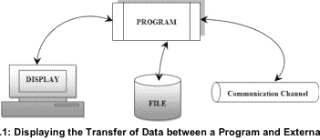

传输数据的内部表示应当便于程序中的数据处理。另一方面，外部表示可能变化很大；它可以被描述为以单个可读形式显示的表示，或可移植的数据交换格式。表示的意图（例如节省存储空间）也会影响外部表示。

流类构成一组强大的类，可以修改、扩展或扩充，以包含对用户定义数据类型或对象的支持。流类的优点如下：

- 对程序员封装类的内部工作方式。因此，程序员无需指定要用作输入或输出的数据类型；流类会自动确定它。
- 提供丰富的错误处理功能。

在下一节中，让我们讨论流类层次结构。

### 流类层次结构

与基于 C 的 I/O 方法类似，C++ 的 I/O 方法也通过流的方式进行操作。流可以是一种逻辑设备，它产生或消费信息。它从 I/O 系统连接到一个逻辑设备。尽管流所连接的具体物理设备可能差异很大，但几乎所有流的行为方式都相同。由于所有流的行为都相同，相同的 I/O 能力几乎可以在任何物理设备上操作。这种方法的好处是，我们只需学习一个 I/O 系统。

标准 C++ 通过 `<iostream>` 头文件提供对流的支持。借助该头文件，描述了一组相当复杂的类层次结构，用以支持 I/O 过程。I/O 类从一套模板类体系开始。模板类定义类的形态，而不完全指定它可能操作的信息。一旦定义了模板类，就可以创建它的特定实例。由于这些模板类属于 I/O 库，标准 C++ 为它们创建了两个特化版本——一个用于 8 位字符，另一个用于宽字符。I/O 系统由两个相关但不同的模板类层次结构组成。最基础的是派生自称为 *basic_streambuf* 的低级 I/O 类。该类提供基本的低级输入和输出操作，并为整个 I/O 系统提供底层支持。注意，*basic_streambuf* 仅在高级 I/O 编程中使用。最常用的类层次结构是 *basic_ios*，它是一个高级 I/O 类，提供与 I/O 流相关的格式化、错误检查和状态信息。*basic_ios* 的基类称为 *ios_base*，它定义了 *basic_ios* 使用的若干非模板特征。*basic_ios* 可以作为若干派生类的基类，例如 *basic_istream*、*basic_ostream* 和 *basic_iostream*。这些类分别用于在输入、输出和输入/输出时创建流。

现在让我们讨论流类层次结构。*ios* 类定义基本的格式化和错误控制能力。它是 *istream* 和 *ostream* 类的虚基类。*iostream* 类继承自 *istream* 和 *ostream* 两个类。这些类用于从键盘接收输入并将输出发送到屏幕。这些类的定义包含在 *iostream* 文件中。流类层次结构如图 15.2 所示。


### 标准输出流

流类具有成员数据、函数和定义。*ostream* 类包含为输出操作定义的函数。这些操作称为*流插入*。考虑以下语句：

```
cout<<"Hello world\n";
```


<< 运算符称为 *插入器*，而 *cout* 是 *ostream* 类型的对象，定义在 *iostream* 头文件中，并关联到标准输出设备。前一条语句表示，插入器右侧的文本字符串将被存储到左侧的流对象中。<< 运算符接受字符串或 char * 作为参数。它也接受所有基本数据类型作为参数。

### 流插入与提取

在 C++ 语言中，<< 输出运算符被称为插入运算符，因为它将字符插入流中。同样，>> 输入运算符被称为提取运算符，因为它从流中提取字符。重载插入运算符和提取运算符的功能分别称为插入器和提取器。

插入器的一般格式如下：

```cpp
ostream&operator<<(ostream &stream, classType obj)
{
    ....
    return stream;
}
```

在上述格式中，请注意该函数返回与 ostream 类型关联的流的引用，ostream 是基于 ios 的类，便于输出。该函数的第一个参数是对输出流的引用。第二个参数可以是对象，也可以是对被插入对象的引用。最后，插入器通过返回流来退出。这使得插入器可用于更大的 I/O 表达式中。

在插入器函数内部，我们可以放入任何类型的过程。但是，我们应将其操作限制为向某个流输出信息。

插入的反面是提取，它指的是从输入流中获取数据。输入流操作定义在 *istream* 类中。重载的 >> 运算符（按位右移运算符）称为 *提取器*，它被重载以接受三种数据类型：整数、浮点数和字符。

提取器的一般形式如下：

```cpp
istream&operator>>(istream &stream, classType &obj)
{
    ....
    return stream;
}
```

提取器返回 istream 类型流的引用，它是输入流。第一个参数需要是对 istream 类型流的引用。请注意，第二个参数必须是对该类对象的引用。

### 整数和浮点数提取

*cin* 是 istream 类型的对象，定义在 *iostream* 头文件中。它与标准输入设备（即键盘）关联。现在，考虑以下语句：

```cpp
int i;
cin>> i;
```

如果用户通过键盘输入的是 <space><space>375g54，那么 *i* 将包含 375。输入缓冲区将包含 g54，并且指针将定位在 g。这是因为整数提取会绕过空白字符，并读取输入字符，直到遇到不能属于该数据类型的字符。

现在，考虑以下语句：

```cpp
float f;
cin>> f;
```

如果用户通过键盘输入的是 −527e-35d8，那么 −527e-35 将被读取到 f 中，并且输入指针将定位在 d。这是因为浮点数提取会绕过空白字符，并读取输入字符，直到遇到非浮点数字符。

### 字符提取

字符提取器的工作方式可能与人们预期的不一样。它会跳过空白字符，然后读取流中的下一个字符。例如，如果我们输入 <space>X，那么提取器将忽略空白字符并返回 X。因此，char *（或 string）提取器通常会产生不可预测的结果。考虑以下语句：

```cpp
char str1[25], str2[25];
cin>> str1;
cin>> str2;
```

如果用户输入 <space>Thomas<space>Vienna<return>，那么 str1 将包含 Thomas，str2 将包含 Vienna。这是因为字符提取在遇到空白字符的瞬间就会终止。

### 隐式文件打开与关闭

在 C++ 中，文件可以在不使用任何 open 或 close 函数的情况下打开或关闭。要打开文件，可以将文件名作为参数传递给构造函数，如下所示：

```cpp
ofstream ob("student.dat");
```

在上述语句中，ob 是 ofstream 类的对象，其构造函数负责打开 student.dat 文件。同样，ofstream 类的析构函数负责关闭文件。当我们使用 ofstream 类隐式打开文件时，文件默认将以写模式打开。同样，当我们使用 ifstream 类隐式打开文件时，文件将以读模式打开。

### 基本数据类型的提取与插入

让我们学习使用基本数据类型进行文件 I/O。考虑以下代码，将一些整数写入文件：

```cpp
#include<iostream>
using namespace std;
void main()
{
    ofstream OP("INTEGER.TXT");
    OP<< 25 <<' '<< 1234 <<' '<< 5678;
}
```

在上述代码中，我们创建了 ofstream 类的对象 OP，并将其与名为 INTEGER.TXT 的文件关联。我们使用 << 流插入运算符将数据写入 OP。可以键入 INTEGER.TXT 文件并检查其内容。

要从文件中读回数据，我们需要编写以下代码块：

```cpp
#include<iostream>
using namespace std;
void main()
{
    ifstream IP("INTEGER.TXT");
    int i, j, k;
    IP >> i >> j >> k;
    cout<< i << ' ' << j << ' ' << k;
}
```

在插入时使用空格的原因是，在任何流提取中，整数提取器会读取所有字符，直到第一个不属于整数数据类型的字符。为此，首先考虑以下代码：

```cpp
#include<fstream.h>
void main()
{
    ofstream OP("STRING.DAT");
    OP << "Hello World";
}
```

现在，考虑以下代码：

```cpp
#include<fstream.h>
void main()
{
    ifstream IP("STRING.DAT");
    char str[30];
    IP >>str;
    cout<< str;
}
```

上述程序的输出是 Hello，因为字符提取不识别空白字符。这意味着字符流提取的问题在文件 I/O 期间也存在。

### 使用对象进行文件 I/O

对象也可以在程序中用于执行文件 I/O 操作。考虑以下代码：

```cpp
#include<iostream.h>
#include<fstream.h>
#include<conio.h>
using namespace std;
int main()
{
    ofstream outf("d:/CPP/TEST.txt");
    if(!outf.good()==0 )
    {
        cout<<"Error opening the file.......";
        getch();
        return 0;
    }
    char name[30];
    cout<<"Enter your name...";
    cin>>name;
    outf<<name<<"\n";

    int age;
    cout<<"Enter your age....";
    cin>>age;
    outf<<age<<"\n";
    outf.close();

    ifstream inf("d:/CPP/TEST.txt ");
    if(!inf.good()==0 )
    {
        cout<<"Error opening the file.......";
```

- **istream& get (streambuf& sb)** – 它从流中提取字符，并将它们全部插入流缓冲区 sb 中，直到分隔字符 '\n' 可用，或与该语句关联的结尾出现。如果使用该流控制的输入序列中或使用 sb 控制的输出序列中发生错误，提取也会停止。
- **istream& get (streambuf& sb, char delim)** – 它与上述相同，不同之处在于分隔字符可以是在 delim 中指定的字符，而不是 '\n'。

put() 函数用于写入文件。考虑以下代码以了解 put() 函数的用法：

```cpp
#include<fstream>
#include<string.h>
using namespace std;
void main()
{
    ofstream outfile("d:/EXAMPLE.TXT");
    char str[] = "This is a simple example";
    for(int i = 0; i<strlen(str); i++)
        outfile.put(str[i]);
        outfile.put('\0');
}
```

上述代码执行后将在 D 目录中创建一个文件 EXAMPLE.txt。EXAMPLE.txt 文件的内容是“This is a simple example”。

现在，考虑以下代码：

```cpp
#include<iostream.h>
using namespace std;
void main()
{
    char str[20];
    cin.get(str,20);
    cout<<str;
}
```

上述代码从控制台输入获取一个字符串及其空白字符，并将该字符串显示在标准输出上。另一个可用于字符串输入的函数是：

```cpp
getline(char * s, int len, char delim = '\n');
```

getline() 函数与 get() 函数类似，但它也会提取终止符。让我们使用 getline() 函数对前面的程序进行如下修改：

```cpp
#include<iostream.h>
using namespace std;
void main()
{
    char str[20];
    cin.getline(str,20);
    cout<<str;
}
```

前一个程序与此程序之间的唯一区别是，str 还将包含 '\n' 字符。

### read() 和 write() 函数

read() 函数使用两个参数调用——文件要写入的缓冲区地址和缓冲区大小。write() 函数也需要类似的参数。考虑以下代码片段，以从用户读取一系列值并将其写入文件：


```cpp
#include <fstream.h>
using namespace std;
void main()
{
  ofstream outfile("EXAMPLE.txt");
  int i = 0;
  while (i != 999)
  {
    cout<<"Please input an integer:";
    cin>>i;
    outfile.write((char *) &i, sizeof(i));
  }
}
```

在前面的代码片段中，类型转换是必要的，因为 read() 和 write() 函数的语法如下：

```cpp
write(char * addr, int size);
read(char * addr, int size);
```

前面的语法意味着编译器假定缓冲区是字符类型。因此，对象的地址应强制转换为字符指针。现在，考虑以下程序。

```cpp
#include <fstream>
using namespace std;
int main ()
{
  char * buffer;
  long size;
  ifstream infile ("EXAMPLE.txt",ifstream::binary);
  ofstream outfile ("new.txt",ofstream::binary);

  // get size of file
  infile.seekg(0,ifstream::end);
  size=infile.tellg();
  infile.seekg(0);

  // allocate memory for file content
  buffer = new char [size];

  // read content of infile
  infile.read (buffer,size);

  // write to outfile
  outfile.write (buffer,size);

  // release dynamically-allocated memory
  delete[] buffer;
  outfile.close();
  infile.close();
  return 0;
}
```

> **注意**
>
> *当操作的不是定义为字符数组的缓冲区时，调用 read() 和 write() 内部的类型转换是必需的。由于 C++ 的强类型检查，一种类型的指针不能自动转换为另一种类型的指针。*

接下来，我们学习显式打开和关闭文件。

### 显式打开和关闭文件

显式地，可以使用 **open()** 和 **close()** 函数打开文件。这两个函数的用法可以通过以下代码来说明：

```cpp
#include <iostream>
#include <fstream>
using namespace std;

int main ()
{
   ofstream file1;
   file1.open ("SAMPLE.txt");
   file1<<"Example of open and close function.\n";
   file1.close();
   return 0;
}
```

前面的代码创建一个名为 SAMPLE.txt 的文件，并向该文件写入一句话。

要打开一个具有流对象的文件，我们需要按如下方式使用 open() 函数：

```
open (filename, mode);
```

在前面的语法中，filename 是 **const char *** 类型的以空字符结尾的字符序列，表示要打开的文件的名称；mode 是一个可选参数，由以下标志组合而成：

| 标志 | 描述 |
|---|---|
| ios::in | 用于为输入操作而打开的流。 |
| ios::out | 用于为输出操作而打开的流。 |
| ios::binary | 用于以二进制模式打开的流。 |
| ios::app | 用于以仅输出方式打开的流。所有输出操作都在文件末尾执行，将内容追加到文件的当前内容之后。 |
| ios::ate | 用于将初始位置设置在文件末尾。如果未将此标志设置为任何值，则初始位置为文件开头。 |
| ios::trunc | 如果文件以输出操作方式打开且文件已存在，则用于删除文件内容并用新内容替换。 |

每个流都包含一系列与其操作符相关联的位或标志。这些位定义在 **ios** 类中。其中一些位用于格式化输入和输出，而另一些用于错误处理。借助继承，这些位在 **fstream** 类中可用。其中一些位也与文件的打开操作相关。每个流都关联一系列称为打开模式位的位。这些打开模式位表示文件打开时所采用的模式。总体而言，这些位说明了文件将要打开的模式。例如，考虑以下语句：

```cpp
fstream file("IOFILE",ios::in|ios::out);
```

当程序遇到前面的语句时，会为该流设置语句中的两个位。因此，该文件可用于输入和输出。表15.1列出了打开模式及其说明：

表15.1：打开模式

| 模式 | 说明 |
|---|---|
| app | 所有写出的数据都会追加到流中。 |
| ate | 文件指针从流的末尾开始，也就是说，它使文件定位到末尾。I/O 操作仍可在文件中的任意位置进行。 |
| in | 流以输入方式打开。 |
| out | 流以输出方式打开。 |
| binary | 二进制文件；如果不存在，则默认以美国信息交换标准代码（ASCII）文件打开。 |
| trunc | 如果文件存在，则在写入或读取之前将其截断并擦除所有数据。 |
| nocreate | 如果要打开的文件尚不存在，则操作失败。 |
| noreplace | 如果文件已存在，则以输出方式打开时操作失败，除非设置了 app 或 ate 模式。 |

在下一节中，我们将详细讨论磁盘 I/O。

### 使用成员函数进行磁盘 I/O

让我们借助一个示例 C++ 程序来理解这个概念。考虑如下定义的 Medicine 类：

```cpp
class Medicine
{
    private:
        char MedicineCode[5];
        unsigned int BatchNo;
        char Category;
        char units;
        float producedQty;

    public:
        void getdata()
        {
            cout<< "Enter the BatchNo:";
            cin>> BatchNo;
            cout<< "Enter the Medicine Code:";
            cin>> MedicineCode;
            cout<< "Enter Category:";
            cin>> Category;
            cout<< "Enter the unit of measurement:";
            cin>> units;
            cout<< "Enter the quantity produced:";
            cin>> producedQty;
        }
        void showdata()
        {
            cout<< "Displaying the desired Data:";
            cout<< "The Batch Number is:" << BatchNo;
            cout<< "The Medicine Code is:" << MedicineCode;
            cout<< "The Category is:" << Category;
            cout<< "the unit of measurement is:" << units;
            cout<< "The quantity produced is:" << producedQty;
        }
};
```

前面代码片段的目的是将磁盘 I/O 操作纳入类定义中。然而，可以看出，如果我们在类中包含 I/O 操作，可能会在一定程度上损害类的可重用性，因为该类将与磁盘文件相关联。为了保留可变的磁盘文件名，我们可以将文件名作为类的一个属性包含进来。然而，在这种情况下，文件名并不是 Medicine 类的属性。此外，如果我们想重用 Medicine 类来创建 Medicine 列表，则无法这样做，因为文件 I/O 不是通用 Medicine 类的属性。现在，考虑 Medicine_File 类的代码：

```cpp
class Medicine_File
{
   private:
      Medicine buffer;
   public:
      void diskout(void);
      void diskin(void);
};
```

为了将文件 I/O 与通用 Medicine 类分离，我们声明了一个名为 **Medicine_File** 的单独类，该类会生成一个与此类关联的名为 MEDICINE.TXT 的输出文件。这个类唯一的属性是一个名为 buffer 的 Medicine 类型包含对象；可以先将值写入其中，然后刷新到磁盘文件，或者从文件读取一个对象到该对象中。这个类还包含两个公共函数：一个用于将记录写入文件，另一个用于从文件读取记录。该类的成员函数如下：

- **diskout()**——从用户处获取数据并将记录写入文件
- **diskin()**——从文件读取记录并将其显示在屏幕上

现在，考虑以下代码：

```cpp
void Medicine_File::diskout(void)
{
   ofstream ofile("MEDICINE.TXT", ios::app);
   char loop;
   do
   {
      buffer.getdata();
      ofile.write((char *) &buffer, sizeof(buffer));
      cout<<"Any more records (y/N)?";
      cin>>loop;
   } while (loop == 'y');
}
void Medicine_File::diskin(void)
{
   ifstream ifile("MEDICINE.TXT");
   ifile.read((char *) &buffer, sizeof(buffer));
   while (ifile)
   {
      buffer.showdata();
      ifile.read((char *) &buffer, sizeof(buffer));
   }
}
```

我们有一个名为 Medicine_File 的用于文件 I/O 的自包含类；因此，我们可以用非常简单的方式实现 main() 函数，如下所示：

```cpp
void main()
{
   Medicine_File fileobj;
   fileobj.diskout();
   fileobj.diskin();
}
```


在前面的示例中，我们检查了流对象的错误状态，以判断是否已到达文件末尾，如下所示：

```cpp
while (infile)
{
    // ... Processing of File
}
```

在前面的代码片段中，当到达文件末尾时，infile 变为零。

如果文件不存在，ios::nocreate 标志会在打开文件时报告错误。修改后的 diskin() 函数如下：

```cpp
void Medicine_File::diskin(void)
{
    ifstream ifile("MEDICINE.TXT", ios::nocreate);
    if (ifile)
    {
        ifile.read((char *) &buffer, sizeof(buffer));
        while (ifile)
        {
            buffer.showdata();
            ifile.read((char *) &buffer, sizeof(buffer));
        }
    }
    else
    {
        cout<< "The file does not exist!";
    }
}
```

如果 MEDICINE.TXT 不存在，ifile 的值将变为零，屏幕上会出现错误消息“文件不存在！”。

### 流状态位

C++ I/O 系统维护关于每次 I/O 操作结果的状态信息。状态由一组位的设置（0 或 1）来表示，这些位由 ios 类中声明的 io_state 变量定义。表 15.2 列出了流状态位：

**表 15.2：流状态位**

| 状态位 | 描述 |
| --- | --- |
| eofbit | 当输入流到达末尾时置位。它表示没有更多字符可供提取。 |
| failbit | 当上一次插入或提取失败时置位。这是可恢复错误。流仍处于可用状态。 |
| badbit | 当尝试非法插入或提取时置位。该流不适合继续使用。通常，在打开不存在的文件或在已越过 EOF 后执行定位时置位。 |
| hardfail | 当发生硬件故障时置位。导致 hardfail 置位的错误通常不可恢复。 |

下一节说明用于访问流状态位的成员函数。

### 用于访问流状态位的成员函数

本节将提供用于访问流状态位的成员函数列表。表 15.3 提供了成员函数列表及其说明：

**表 15.3：成员函数**

| **成员函数** | **描述** |
| --- | --- |
| `int good()` | 如果流正常，返回非零值；否则返回零 |
| `int bad()` | 如果 badbit 或 hardfail 位被置位，返回非零值；否则返回零 |
| `int eof()` | 如果 eofbit 被置位，返回非零值；否则返回零 |
| `int fail()` | 如果 failbit、badbit 或 hardfail 位被置位，返回非零值 |
| `int rdstate()` | 返回 iostate 变量的当前值 |
| `void clear(int ef=0)` | 将错误标志设置为 ef；默认情况下，ef 等于零，这会重置所有错误位 |

接下来，让我们学习随机访问。

### 随机访问

C++ I/O 程序为文件管理两个整数值。一个是 get 指针，它指定文件中下一次输入或读取操作将发生的位置。另一个是 put 指针，它指定文件中输出或创建操作将发生的位置。这两个指针分别表示实际读取和创建操作的当前位置。每次发生输入或输出操作时，这些指针通常会按读取或写入的字节数依次向前推进。此上下文中的指针一词不应与用作地址参数的普通 C++ 指针混淆，而应理解为当前偏移位置，即下一次输入或输出操作将发生的位置。通常，我们可能需要从文件开头开始读取当前文件，并依次继续到最终结果。写入时，我们可能想从开头开始，删除任何当前内容，或追加到末尾。这些将是默认活动；因此，无需对文件指针进行任何关键操作。然而，有些情况下，我们必须直接管理文件指针，以便从特定文件内的任意位置读取和写入。

`seekg()` 和 `tellg()` 函数允许我们设置和检查 get 指针；而 `seekp()` 和 `tellp()` 函数允许我们设置和检查 put 指针。因此，我们可以使用这些函数以随机访问模式访问文件。iostream 类的所有对象都可以使用 seekg() 函数或 seekp() 函数进行操作。这些函数将 get 和 put 指针移动到文件内的绝对偏移位置，或相对于某个位置的特定字节数处。tellg() 和 tellp() 函数可用于查明文件中 get 或 put 指针的当前位置。

seekg() 函数接受两个参数。第一个参数可以是一个长整数，指定将指针定位到多少字节处（也称为偏移量）。第二个参数可以是参考点。例如，`file.seekg(10, ios::beg)` 将指针定位到相对于文件开头 10 字节处。该类中定义的三个参考点如表 15.4 所示：

**表 15.4：参考点**

| **参考点** | **描述** |
| --- | --- |
| `ios::beg` | 表示文件开头 |
| `ios::cur` | 表示文件指针的当前位置 |
| `ios::end` | 表示文件末尾 |

seekg() 函数的第一个参数也可以指定负值。它有助于相对于文件末尾向后移动文件指针。例如，以下语句将文件指针相对于文件末尾向后移动 20 字节：

```cpp
file.seekg(-20, ios::end);
```

如果只提供一个参数，则默认假定为 ios::beg。例如，考虑以下语句：

```cpp
file.seekg(16);
```

在前面的语句中，ios::beg 将是默认参考点。另一方面，tellg() 函数没有任何参数。它返回 get 指针相对于文件开头的现有字节位置。考虑以下语句：

```cpp
long position = file.tellg();
```

这将使 position 变量取得 get 指针当前位置的值。seekp() 和 tellp() 函数在功能上与 seekg() 和 tellg() 函数相同，只是它们与 put 指针相关。seekg() 和 tellg() 函数定义在 istream 类中，seekp() 和 tellp() 函数定义在 ostream 类中。

### 随机访问示例

在 C++ 中打开文件后，我们可以在文件内的任何位置（包括文件末尾）放置两个文件指针——一个用于读取，另一个用于写入——以从中读取或写入数据。然而，在随机访问中，可以完全自由地从文件内的任何位置读取或写入数据。本节说明如何随机查询文件以访问其中的信息。考虑以下示例，从 MEDICINE.TXT 文件中检索特定记录：

```cpp
void main()
{
    medicine medobj;
    fstream ifile("MEDICINE.TXT",ios::in);
    ifile.seekg(0, ios::end);
    long endpos = ifile.tellg();
    cout<< "\n the size of the file is:" << endpos;
    cout<< "\n the size of a medicine record is:" << sizeof(medicine);
    int n = endpos/sizeof(medicine);
    cout<< "\n" << n << "medicine records exists in the file";
    cout<< "\nmedicine record query:";
    cout<< "\nwhich record do you want to query?";
    cout<< "\nPlease enter the record number";
    int num;
    cin>> num;
    int seekpos = (num - 1)*sizeof(medicine);
    ifile.seekg(seekpos);
    ifile.read((char *) &medobj, sizeof(medicine));
    medobj.showdata();
}
```

在前面的示例中，查询将基于用户希望查询的记录号。如果用户希望查看第 15 条记录，那么 seekg(15*sizeof(medicine), ios::beg) 就足以将我们带到第 15 条记录的开头。

### 格式化 I/O——ios 格式函数

C++ I/O 系统使我们能够格式化 I/O 过程。例如，我们能够设置区域宽度、指定数字基数，或确定小数点后将显示多少位数字。我们可以使用两种相关但在概念上不同的方式来格式化数据。首先，我们可以访问

ios 类的成员。具体来说，我们安排了 ios 类中定义的各种格式标志，甚至调用各种 ios 函数。其次，我们可以使用称为操纵符的特殊函数，它们可以作为 I/O 表达式的一部分被包含。

每个流都有一些格式标志，用于控制信息的格式化方式。ios 类声明了一个名为 format flags 的位图枚举，其中通常会定义以下值：

-   adjustfield
-   basefield
-   boolalpha
-   dec
-   fixed
-   floatfield
-   hex
-   internal
-   left
-   oct
-   right
-   scientific
-   showbase
-   showpoint
-   showpos
-   skipws
-   unitbuf
-   uppercase

默认情况下，控制台 I/O 是未格式化的，但我们可以使用不同的 ios 函数对其进行格式化。表15.5 展示了各种 ios 函数：

**表15.5：不同的 ios 函数**

| 函数 | 描述 |
|---|---|
| setf() | 设置可控制输出显示形式的格式标志 |
| unsetf() | 重置格式标志 |
| width() | 设置显示输出所需的字段大小 |
| fill() | 设置用于填充字段未使用部分的填充字符 |
| precision() | 设置浮点值小数点后要显示的数字位数 |

现在让我们详细学习这些函数。

### setf() 函数

有两种基本语法用于说明 setf() 函数的用法，如下所示：

```cpp
fmtflags setf(fmtflags fmtfl);
fmtflags setf(fmtflags fmtfl, fmtflags mask);
```

第一种语法设置流的格式化标志，将 fmtfl 中置位的位设置进去，其余保持不变，就像调用 flags(fmtfl | flags()) 一样。第二种语法设置流的格式标志，将 fmtfl 和 mask 中都置位的位设置进去。它还会清除 mask 中置位但 fmtfl 中未置位的格式标志，就像调用 flags((fmtfl & mask) | (flags() & ~mask)) 一样。

考虑以下程序：

```cpp
#include <iostream>
using namespace std;
int main ()
{
    cout.setf(ios::hex, ios::basefield);       // set hex as the basefield
    cout.setf(ios::showbase);                  // activate showbase
    cout << 100 << endl;
    cout.setf(0, ios::showbase);               // deactivate showbase
    cout << 100 << endl;
    return 0;
}
```

前面程序的输出如下：

```text
0x64
64
```

### unsetf() 函数

unsetf() 函数清除与参数 mask 中置位的位相对应的标志。带参数的操纵符 resetiosflags 的行为与此类似。unsetf() 函数的语法如下：

```cpp
void unsetf(fmtflags mask);
```

考虑以下示例：

```cpp
#include <iostream>
using namespace std;
int main ()
{
    cout.setf(ios_base::hex, ios_base::basefield);
    cout.setf(ios_base::showbase);
    cout << 100 << endl;
    cout.unsetf(ios_base::showbase);
    cout << 100 << endl;
    return 0;
}
```

上述程序的输出如下：

```text
0x64
64
```

### width() 函数

width() 函数设置显示输出所需的字段大小。width() 函数有两种类型，可表示如下：

```cpp
streamsize width() const;
streamsize width(streamsize wide);
```

第一个函数返回字段宽度的当前值，第二个函数为对象设置新的字段宽度。

考虑以下代码：

```cpp
#include <iostream>
using namespace std;
int main ()
{
cout << 100 << endl;
cout.width(10);
cout << 100 << endl;
cout.fill('x');
cout.width(15);
cout << left << 100 << endl;
return 0;
}
```

前面代码的输出如下：

```text
100
       100
100xxxxxxxxxxxx
```

### fill() 函数

fill() 函数设置用于填充字段未使用部分的填充字符。fill() 函数的两种类型如下：

```cpp
char fill() const;
char fill(char fillchar);
```

第一个函数返回填充字符。第二个函数将 fillchar 设置为新的填充字符，并返回先前设置的填充字符。考虑以下示例：

```cpp
#include <iostream>
using namespace std;
int main ()
{
char prev;
cout.width(10);
cout << 60 << endl;
prev = cout.fill('x');
cout.width(10);
cout << 60 << endl;
cout.fill(prev);
return 0;
}
```

前面示例的输出如下：

```text
        60
xxxxxxxx60
```

### precision() 函数

precision() 函数设置浮点值小数点后要显示的数字位数。precision() 函数的两种类型如下：

```cpp
streamsize precision() const;
streamsize precision(streamsize prec);
```

该函数的第一个版本返回流的当前浮点精度字段值。该函数的第二个版本将其设置为某个新值。

具体的浮点精度决定在插入操作中写入多少位数字以表示浮点值。如何解释这一点取决于 floatfield 格式标志被定义为某种特定记法（分别为 fixed 或 scientific），还是真正未设置（此时使用特定的默认记法，既不是 fixed 也不是 scientific）。考虑以下程序：

```cpp
#include <iostream>
using namespace std;

int main ()
{
double f = 8.68768;
cout.setf(0, ios::floatfield);        // floatfield not set
cout.precision(5);
cout << f << endl;
cout.precision(12);
cout << f << endl;
cout.setf(ios::fixed, ios::floatfield);   // floatfield set to fixed
cout << f << endl;
return 0;
}
```

前面程序的输出如下：

```text
8.6877
8.68768
8.687680000000
```

请注意，写入的第一个数字只有五位长，而第二个数字有六位长，但不会多很多，即使实际流的精度应为 12。发生这种情况是因为在整个默认浮点区域中，precision 只指定最多显示的数字位数，而不是特定的最小位数。第三个数字显示了小数点后的 12 位数字，因为在这种情况下 floatfield 格式标志被设置为 fixed。

> **注意**
>
> 除字段宽度外，所有格式参数设置都是永久的。字段宽度参数在每次使用后都会重置。

下一节我们将讨论操纵符。

### 操纵符

`<iomanip.h>` 头文件提供了一些称为操纵符的函数，它们通常可以操纵输出格式。这些函数提供了与 ios 函数和格式标志相同的功能。操纵符比 ios 类中的对应项更易于使用。两个或多个操纵符可以在一条语句中链式使用，如下：

```cpp
cout << manip1 << manip2 << manip3 << item;
```

当我们希望显示多列输出时，这种串联很有帮助。格式控制有时需要调用流的成员函数。然而，当我们需要在移位表达式内部更改格式时，就需要使用操纵符。表15.6 提供了一些常用操纵符及其效果：

**表15.6：常用操纵符**

| 操纵符 | 效果 |
|---|---|
| setw (int w) | 将字段宽度设置为 w |
| setprecision (int d) | 将浮点精度设置为 d |
| setiosflags (long f) | 设置格式标志 f |
| resetiosflags (long f) | 清除指定的标志 |
| endl | 插入换行并刷新流 |
| flush | 刷新流缓冲区 |
| ends | 插入字符串结束字符 |
| ws | 跳过空白字符 |
| boolalpha | 以字母格式输出 bool 值 |
| noboolalpha | 重置 boolalpha |
| showbase | 生成指示整数数值基数的前缀 |
| noshowbase | 重置 showbase |
| showpoint | 为浮点值生成小数点 |
| noshowpoint | 重置 showpoint |
| showpos | 为非负数值生成 + 号 |
| noshowpos | 重置 showpos |
| skipws | 跳过前导空白字符 |
| noskipws | 重置 skipws |
| uppercase | 将某些小写字母替换为其大写形式 |
| nouppercase | 重置 uppercase |
| unitbuf | 每次格式化操作后刷新输出 |
| nounitbuf | 重置 unitbuf |
| internal | 在指定的内部点添加填充字符 |
| left | 添加填充字符以左对齐 |
| right | 添加填充字符以右对齐 |
| dec | 将整数转换为十进制表示法/从十进制表示法转换 |
| hex | 将整数转换为十六进制表示法/从十六进制表示法转换 |
| oct | 将整数转换为八进制表示法/从八进制表示法转换 |
| fixed | 将浮点值置于定点表示法 |
| scientific | 将浮点值置于科学表示法 |
| setbase(int base) | 设置整数表示法的基数（base = 8、10、16） |
| setfill(char c) | 设置用于填充的填充字符 |

现在让我们详细学习异常处理。


### 异常处理

在不同错误处理机制出现之前，每个被调用的函数都会返回某个值，以指示执行进行得是否恰当。调用该函数的程序代码随后会检查特定的返回码并据此处理。由此产生的代码可能会充斥着额外的 if 语句以及错误处理代码。此外，函数的返回值只能返回一个代码，而不能返回其他内容。

异常处理的总体概念非常清晰。其动机是每当出现问题时抛出一个错误标志。接下来，系统始终充当该错误标志的监视者。此外，如果发现该错误标志，系统就会调用错误处理代码。

如果注意到的话，我们提到了两个近义词，但它们并不相同。这两个词是错误和异常。

错误通常指程序在编写和编译时存在的问题。它可能是会导致不正确结果的逻辑错误。换句话说，代码是正确的，但算法是错误的。异常是在程序执行期间发生的错误或异常现象。它们可能是系统资源（如内存、文件空间和通道）不可用的结果，也可能是依赖数据的条件（如除零或数值溢出）的结果。此类运行时错误可能导致应用程序行为不可预测或崩溃。异常往往是罕见事件，但却是可预测的。

既然异常在某种程度上是可预测的，我们的程序应如何处理它们？可以执行三类操作，如下所示：

- 我们不处理异常，允许程序终止或核心转储
- 我们可以发出警告；例如，打印一些错误消息，可能是在代码中发生异常的位置，然后退出
- 我们可以优雅地处理异常并继续执行

同一段代码能否既引发异常又处理它？让我们考虑在分配内存时出现异常的情况。尝试分配内存的同一个函数或方法本身能否处理所引发的异常？可能由其他某段代码来处理该异常。这意味着异常的创建与其处理之间是分离的。发生异常的方法只需向其调用者发出警报。这使得引发异常的代码可以独立于处理异常的代码进行开发。如果我们把异常向上传递给调用例程，就必须有一种打包信息的方式。

> **注意**
>
> 异常是运行时发生的错误。当此类异常发生时，程序员必须决定一种据以处理它们的策略。这种对运行时错误的系统化处理称为异常处理。

接下来，让我们讨论 C 和 C++ 中的错误处理。

### C 和 C++ 中的错误处理

函数调用之后可以跟错误评估作为返回值，以了解函数是否执行。在 C 程序中，如果函数执行期间出现任何问题，函数通常会返回一个值。例如，文件打开函数会返回 NULL，表示它们无法成功打开文件。因此，每次调用函数时，我们都可以检查返回值。在 C 中，setjmp() 和 longjmp() 函数用作错误处理器。这种方法旨在处理不需要立即终止系统的情况。如果递归下降解析器检测到异常，它应报告该异常并继续进一步处理。setjmp() 在从 main() 调用时起作用，并将函数的上下文状态保存在 jmp_buf 结构中，该结构定义在 setjmp.h 头文件内。当发生错误时，longjmp() 函数使用保存的上下文返回到系统中的先前位置。

每次调用函数时，我们都必须通过一对 if-else 语句检查其返回值。用一对 if-else 包围每个函数调用会导致代码规模增加并降低可读性。这种方法不能用于报告类构造函数中的错误，因为构造函数不能返回值。

jmp_buf 结构依赖于系统，因为不同系统可能需要不同数量的信息来捕获进程的上下文。setjmp() 或 longjmp() 函数不会调用析构函数；因此，对象不会被正确清理。析构函数调用至关重要；因此，这种方法在 C++ 中不可行。

C++ 语言提供了用于处理异常的内置功能，这些异常可能在整个系统执行期间发生。借助 C++ 异常处理，程序可以与更高的执行上下文通信意外事件，从而更好地从此类异常事件中恢复。这些异常由正常控制流之外的代码处理。

C++ 异常机制处理以下特性：

- 异常可以在不同的代码段中引发和处理。
- 任何对象（包括类对象）都可以传递回异常处理器。这些对象可以包含数据和方法，以协助处理异常。

导致或检测到运行时异常（例如除零或内存不足）的那部分代码可能抛出异常，而该异常由另一部分代码捕获。异常可以就是实际被抛出的对象。异常对象可用于将信息从抛出该对象的代码段传达到捕获该对象的代码部分。这种与异常创建以及异常处理相关的分离极其重要。

C++ 使用两个类来表示和封装异常：

- **骨架类** —— 这些类没有成员，因为它们的名称足以引用和处理异常。
- **带数据成员的类** —— 这些类声明数据成员，使其能够更好地描述异常。

在某些情况下，适当的响应可能是终止程序。在其他情况下，适当的响应是给出一些警告信息。还有一些情况下，也许可以捕获并忽略异常。

可能抛出异常的代码段往往由 try 块包围。从 try 块中抛出的异常由 catch 子句捕获。try-catch 块的格式如下所示：

```cpp
try
{
    // try block
}

catch (type 1 arg)
{
    // catch block
}
```

考虑以下代码片段：

```cpp
#include <iostream>
using namespace std;
int main()
{
    int a = 6;
    int b = 0;
    int result;
    int exceptionCode = 36;
    try
    {
        if (b == 0)
        {
            throw exceptionCode;
        }
        result = a/b;
    }
    catch (int e)
    {
        if (e == 25)
        {
            cout << "Divide by zero exception has occurred" << endl;
            cout << "Hence terminating..." << endl;
        }
        else
        {
            cout << "Exception of unknown type has been found" << endl;
            cout << "Hence terminating..." << endl;
        }
    }
    cout << "Exiting the program..." << endl;
    return 0;
}
```

前面程序中抛出的异常是 int 类型。catch 块包含解码这个特定值并打印合适错误消息的逻辑。这是一种糟糕的设计，因为它需要 catch 块。此外，程序员需要理解可能的异常规则并实施可能复杂的逻辑。值得注意的是，异常可以是任何类型的对象。既然我们可以抛出任何类型的对象，那么让我们尝试抛出一个错误消息字符串，而不是一个异常。考虑以下代码：

```cpp
#include <iostream>
using namespace std;
int main()
{
    int a = 6;
    int b = 0;
    int result;
    try {
        if (b == 0) {
            throw "Divide by zero";
        }
        result = a/b;
    } // try block ends here
    catch (char *x) {
        cout << x << endl;
    }
    cout << "Exiting the program..." << endl;
    return 0;
}
```

前面的代码是一种更好的设计。catch 块不再需要详细了解异常。抛出异常的代码正在传递有关异常的信息，在此例中就是一条错误消息。假设我们必须将信息、异常代码以及变量的值打包到实际异常中。在这种情况下，使用用户定义的异常类可能是理想的选择。此外，在 C++ 中，使用类对象作为异常很常见。让我们在以下示例中看看它是如何完成的：


## 第15章

```cpp
#include <iostream>
#include <string>
using namespace std;
class DivideByZero {
public:
    DivideByZero(int a, int b) : numerator(a), denominator(b), errorMessage("divide by zero Exception has occured") {}
    ~DivideByZero() {}
    int getNumerator()
    {
        return numerator;
    }
    int getDenominator()
    {
        return denominator;
    }
    string getMessage()
    {
        return errorMessage;
    }
private:
    int numerator;
    int denominator;
    string errorMessage;
};
int main()
{
    int a = 6;
    int b = 0;
    int result;
    try {
        if (b == 0) {
            throw DivideByZero(a, b);
        }
        result = a/b;
    }
    catch (DivideByZero e)
    {
        cout << "An exception has occurred..." << endl;
        cout << e.getMessage() << endl;
        cout << "Numerator is: " << e.getNumerator() << endl;
        cout << "Denominator is: " << e.getDenominator() << endl;
    }
    cout << "Exiting the program." << endl;
    return 0;
}
```

### 注意

try 子句后面的复合语句是受保护的代码区域。throw 表达式抛出一个异常。catch 子句后面的复合语句是特定的异常处理程序，并接收从 throw 表达式抛出的异常。catch 子句后面的异常声明语句指示该子句处理的异常种类。此类型可以是有效的数据类型，包括 C++ 类。

注意，C++ 默认不会捕获除零异常。当发生除零情况时，代码会崩溃。因此，唯一的选择是编写一个类或方法来处理除零情况。以下示例展示了如何处理除零情况以及如何构造异常：

```cpp
#include<iostream>
using namespace std;
class Division
{
    public:
        double quotient(int numerator, int denominator);
    private:
};

double Division::quotient(int numerator, int denominator)
{
    if(!denominator)
    {
        exception e("divide by 0 exception");
        throw(e);
    }
    return (static_cast< double >( numerator ))/denominator;
}
int main()
{
    Division d;
    try
    {
        cout<<"1. (500/10) = "<<d.quotient(500, 10)<<endl;
        cout<<"2. (15/6) = "<<d.quotient(15, 6)<<endl;
        cout<<"3. (10/0) = "<<d.quotient(10, 0)<<endl;
        cout<<"4. (30/9) = "<<d.quotient(30, 9)<<endl;
    }
    catch(exception& e)
    {
        cout<<"Exception caught with cause :"<<e.what()<<endl;
    }
    return 0;
}
```

上述程序的输出如下：

```text
1. (500/10) = 50
2. (15/6) = 2.5
Exception caught with cause: Divide by 0 exception
```

现在我们来讨论异常处理的机制。

### 异常处理——机制

每当抛出异常时，它会被相应的 catch 声明捕获，并由该声明处理异常。一个 try 可以有多个 catch 语句；可以使用哪个 catch 语句将由异常的种类决定。也就是说，如果 catch 中指定的数据类型与异常的数据类型匹配，那么所有其他 catch 语句都会被绕过。当捕获到异常时，catch 子句中指定的参数将包含该异常。任何类型的数据最终都可能被捕获，包括已创建的类。如果完全没有抛出异常，则不会执行任何 catch 语句。如果找到匹配项，则执行 catch 处理程序的代码，控制流从 catch 处理程序之后的位置继续。

如果控制流通过正常的顺序执行到达 try 语句，那么就完成了 try 块的受保护部分。如果受保护部分中没有要抛出的异常，那么 try 块后面的 catch 子句当然不会执行。执行将继续从 try 块之后最后一个 catch 子句后面的语句开始。如果受保护部分执行中或任何例程中抛出异常，而该受保护部分直接或间接调用了该例程。异常对象由 throw 操作数所创建的对象生成。这意味着可能涉及拷贝构造函数。此时，编译器会在更高层的异常上下文中查找 catch 子句，该子句可以处理所抛出类型的异常，或查找可处理任何类型异常的新 catch 处理程序。catch 处理程序按照它们在 try 块之后出现的顺序进行检查。如果找不到合适的处理程序，就检查下一个动态关联的 try 块。此过程持续进行，直到检查最外层的封闭 try。如果未找到匹配的处理程序，或者在栈展开期间、处理程序获得控制之前发生异常，则调用预定义的运行时函数 terminate()。

throw 语句通常接受一个参数，并将其作为参数传递给异常处理程序。throw 语句的一般格式如下：

```cpp
throw ex;
```

throw 生成由 ex 指定的异常。如果要捕获该异常，那么 throw 必须在 try 块内执行，或者从 try 块内调用的任何函数中执行。

在下一节中，我们将演示如何在栈类中处理异常。

### 异常——栈

数据被压入栈中并从中弹出。栈可以具有以下约束：

- 栈的大小将是固定的
- 如果试图将数据压入已满的栈，栈将抛出栈溢出异常
- 如果试图从空栈中弹出数据，栈将抛出栈空异常

考虑以下用于实现栈类的程序：

```cpp
#include <iostream>
#include <string>
using namespace std;
class DivideByZero {
public:
    DivideByZero(int N, int D) : numerator(N), denominator(D), errorMessage("Divide by zero exception because of occur!!!") {}
    ~DivideByZero() {}
    void getMessage()
    {
        cout << "An exception has occurred in the program. " << endl;
        cout << errorMessage << endl;
        cout << "The Numerator is: " << numerator << endl;
        cout << "The Denominator is: " << denominator << endl;
    }

    // private declarations
private:
    int numerator;
    int denominator;
    string errorMessage;
};

// defining Stack overflow exception
class StackOverflowException {
public:
    StackOverflowException() {}
    ~StackOverflowException() {}
    void getMessage()
    {
        cout<< "An exception has occurred. "<< endl;
        cout<< "Exception: Stack is Full." << endl;
    }
};

// Defining empty stack exception
class StackEmptyException {
public:
    StackEmptyException() {}
    ~StackEmptyException() {}
    void getMessage()
    {
        cout<< "An exception has occurred..." << endl;
        cout<< "Exception: Stack is Empty." << endl;
    }
};

// Implementing a very crude stack class that is intended only to illustrate
// exceptions.

class CrudeStack {
public:
    CrudeStack() : index(-1) {}
    ~CrudeStack() {}
    void push(int value)
    {
        index++;
        if (index >= 25)
        {
            throw StackOverflowException();
        }
        data[index] = value;
    }

    int pop()
    {
        if (index < 0)
        {
            throw StackEmptyException();
        }
        int value = data[index];
        index--;
        return value;
    }

//Private declarations
private:
    int data[20];
    int index;
};

int divide(int numer, int denom)
{
    if (denom == 0)
    {
        throw DivideByZero(numer,denom);
    }
    return numer/denom;
}
int main()
{
    CrudeStack stack;
    int numer;
    int denom;
    int value;
    cout<< "Starting implementation of crude stack..." << endl;
    cout<< "Enter the numerator: ";
    cin>> numer;
    cout<< "Enter the denominator: ";
    cin>> denom;
    try {
        stack.push(numer);
        stack.push(denom);
        divide(numer, denom);
        value = stack.pop();
        cout<< "An starting popping of values..." << endl;
        cout<< "The following is popped " << value<< endl;
        value = stack.pop();
        cout<< "The following is popped " << value<< endl;
        value = stack.pop();
        cout<< "The following is popped " << value<< endl;
    }
    catch (StackOverflowException e) {
        e.getMessage();
    }
    catch (StackEmptyException e) {
        e.getMessage();
    }
    catch (DivideByZero e) {
        e.getMessage();
    }
    catch (...) {
        cout<< "An exception has occurred..." << endl;
        cout<< "An exception of unknown type occurred" << endl;
    }
    cout<< "Exiting the program..." << endl;
    return 0;
}
```

在上述程序中，每当发生除零错误时，都会通过异常妥善处理。同样，当栈溢出或为空时，也会抛出异常。

### 栈展开

每当控制流进入函数时，所有静态分配的局部变量都会在栈上创建。同样，当控制流退出函数时，这些变量会从栈中弹出。现在，假设 main() 函数调用 F1() 函数，而 F1() 又调用 F2()。F2() 函数可能抛出两种条件：E1 和 E2，如下所示：

```cpp
int F2(int value)
{
    if (value < 0)
        throw E1();
    else if (value > 100)
        throw E2();
}
int F1(int value)
{
    .....
    myvalue = F2(value);
    return 2*myvalue;
}

int main()
{
    int a;
    try {
        a = F1(-9);
    }
    catch (E1) {
        cout << "E1" << endl;
        .....
    }
    return 0;
}
```

在前面的示例中，main() 调用 F1()，F1() 又调用 F2()。由于传递给 F2() 的值小于零，因此抛出了类型为 E1 的异常。此外，由于 F2() 中没有捕获任何异常，执行会跳出 F2() 并返回到 F1()。F2() 的变量从栈中移除，并且会调用局部对象的任何析构函数。这称为**展开栈**。同样，F1() 函数没有捕获任何异常；因此，它的变量从程序栈中移除。局部对象的任何析构函数会被调用。栈进一步展开。现在，我们到达了 main()。在这种情况下，异常被捕获并处理。

如果 main() 没有捕获该异常，究竟会发生什么？实际上 E2 就是这种情况。main() 函数的变量将从栈中移除，并且会调用任何析构函数。由于没有找到处理程序，因此会调用 **terminate()** 系统函数，程序会中止，但这是不可取的。应当尝试捕获并处理所有异常。

接下来，我们讨论未捕获的异常是如何处理的。

### 未捕获的异常

如果对抛出的异常没有任何 catch 声明，则程序会异常终止。抛出未处理的异常会导致调用常规库函数 **terminate()**。默认情况下，**terminate()** 调用 **abort()**，以防止程序意外终止。考虑以下示例：

```cpp
#include <math.h>
using namespace std;
double FSQRT(double X)
{
    // if the user entered a negative number, this is an error condition
```

由于没有针对 int 类型的特定异常处理程序，该异常会被捕获所有异常的处理程序捕获。前面程序的输出如下：

```text
we have caught an exception of an undetermined type
```

### 限制异常

函数定义中的 throw 子句指定函数预期抛出的异常类型。使用 throw 子句，我们可以通过在 throw 子句中指定以逗号分隔的异常类型列表，来限制函数可以抛出的异常类型。抛出任何其他异常都将导致程序异常终止。

异常的通用声明由 throw 关键字后跟所有可能异常类型的列表组成。因此，我们可以如下声明一个函数：

```cpp
void f() throw(VeryBig, VerySmall, divideByZero);
```

函数声明 f() 表示可以从该函数抛出任何可能的异常类型，而 void f() throw() 表示 f() 函数不会抛出任何异常。

在编写会抛出异常的函数时，我们应始终使用异常规范。这可以确保良好的编码标准和良好的文档，也使我们更容易使用函数调用方。

程序中可能存在这样的情况：我们抛出的内容与异常规范中声明的不同。在这种情况下，会调用特殊函数 unexpected()。默认情况下，unexpected() 会导致调用 abort()，从而造成程序异常终止。带有空括号的 throw() 表示定义它的函数不应抛出任何异常。

throw 子句的一般形式为：

```cpp
return_type function_name (argument_list) throw(type_list)
{
    //-
}
```

考虑以下代码片段，其中我们考虑 RestrictHandler() 函数只能抛出 int、char 和 double：

```cpp
#include <iostream>
void RestrictHandler(int test) throw(int, char, double)
{
    if (verify==0) throw verify;  // throw int
    if (verify ==1) throw 't';    // throw char
    if (verify ==2) throw 346.47; // throw double
}
int main()
{
    cout<< "Start\n";
    try
    {
        RestrictHandler(0); // also, try passing 1 and 2 to
                            // RestrictHandler()
    }
    catch (int i)
    {
        cout<< "Caught int\n";
    }
    catch (char c)
    {
        cout<< "Caught char\n";
    }
    catch (double d)
    {
        cout<<"Caught double\n";
    }
        cout<<"end";
        return 0;
}
```

在前面的程序中，RestrictHandler() 函数只能抛出整数、字符和双精度浮点异常。如果它尝试抛出任何其他类型的异常，则会发生程序异常终止。

现在让我们学习如何捕获异常。

### 捕获任何异常

catch 块用于在程序中发生此类异常时捕获异常。该块通常跟在 try 块之后。我们可以在 catch 块中指定希望捕获的异常类型。这由异常声明决定，该声明写在 catch 关键字后面的括号内。

catch 块的通用语法如下：

```cpp
try
{
    // Code ...
} catch (NameofException e)
{
    // code snippet that handles NameofException exception
}
```

如果函数的异常规范为空，则始终可以抛出任何类型的异常。当前问题的一种解决方案是生成一个捕获任何类型异常的处理程序。这通过在 catch() 的参数列表中使用省略号来实现，如下所示：

```cpp
catch(...)
{
    cout<<"An exception was thrown" << endl;
}
```

在下一节中，让我们学习如何重新抛出异常。

### 重新抛出异常

要从异常处理程序内部重新抛出表达式，我们可以编写一个代码块，以便调用其中不含异常的 throw 语句。这将导致当前异常传递给外层的 try/catch 序列。考虑以下代码：

```cpp
catch(...)
{
    cout<<"Let us throw this exception" << endl;
    throw;
}
```

重新抛出异常主要是为了让多个处理程序能够访问该异常。我们只能从 catch 块内部或从该块内调用的任何函数中重新抛出异常。在这种情况下，它不会被同一个 catch 语句重新捕获；相反，它会向外传播到下一个 catch 语句。考虑以下示例来说明重新抛出异常的概念：

```cpp
#include <iostream.h>
using namespace std;
void Rhandler()
{
    try
    {
        throw "Hi! I am in try";                 // throw a char *
    }
    catch (char *)
    {
        // catch a char *
        cout << "Hi! Caught char * inside Rhandler\n";
        throw;                                   // rethrow char * out of function
    }
}
int main()
{
    cout << "Starting the demo.\n";

    try
    {
        Rhandler();
    }
    catch (char *)
    {
        cout << "Hi! Caught char * inside the main() function\n";
    }
    cout << "Ending Demo...";
    return 0;
}
```

前面程序的输出如下：

```text
Starting the demo...
Hi! Caught char * inside Rhandler
Hi! Caught char * inside the main() function
Ending Demo...
```

现在让我们学习如何处理派生类异常。

### 处理派生类异常

由于 catch 的参数类型既适用于基类的对象，也适用于从基类派生的类，因此声明 catch 处理程序的顺序很重要。针对特定派生对象的处理程序必须出现在基类处理程序之前。也可能创建不会执行的处理程序；例如，将某个派生类的处理程序放在其对应基类的处理程序之后。以下代码演示了异常处理程序为何不执行，因为其基类异常处理程序会捕获所有异常：

```cpp
catch(CBaseException& ex)
{
    // Handle a base type of exception
}

catch(CDerivedException& ex)
{
    // This handler would never ‘run’ because its base would catch everything
    // it can
}
```


基类的 catch 子句会匹配从该基类派生的任何类。因此，如果我们既想捕获基类类型的异常，又想捕获派生类类型的异常，那么就需要将派生类放在 catch 序列的最前面。否则，基类的 catch 子句会始终捕获派生类异常，而指定派生类作为参数类型的 catch 子句将永远不会执行。考虑以下程序：

```cpp
#include <iostream>
using namespace std;
class Base
{
};
class Derived: public Base
{
};

int main()
{
    Derived d;
    try
    {
        throw d;
    }
    catch(Base b)
    {
        cout<< "Caught a base class.\n";
    }
    catch(Derived d)
    {
        cout<< "This will never execute.\n";
    }
    return 0;
}
```

在上述程序中，由于 d 是一个以 Base 为基类的对象，它会被第一个 catch 子句捕获。然而，第二个子句永远不会执行。有些编译器会通过警告信息来提示这种情况，而有些编译器可能会发出错误。要解决这种情况，需要颠倒 catch 子句的顺序。

在最后一节中，我们来讨论一些标准库异常层次结构。

### 标准库异常层次结构

C++ 标准库包含一个异常类的层次结构。该层次结构以基类 exception 为首。它包含一个虚函数 **what**，派生类可以重写该函数以触发相应的错误消息。C++ 标准库异常声明了以下标准异常对象：

- **bad_alloc**——当 **new** 失败时抛出
- **bad_cast**——当 **dynamic_cast** 失败时抛出
- **bad_typeid**——当 **dynamic_cast** 应用于 **NULL** 指针时抛出
- **bad_exception**——当抛出意外或未指定的异常时抛出

图 15.3 显示了标准库异常类的层次结构：

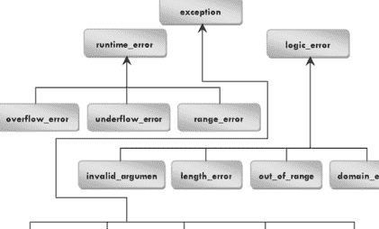

**图 15.3：展示标准库异常类**

现在让我们详细讨论每一个异常类。

### bad_alloc()

当 new 和 new[] 运算符无法分配所请求的存储空间时，会抛出 bad_alloc() 异常。其 what() 成员函数会返回一个以空字符结尾的字符序列，用于标识该异常。考虑以下示例：

```cpp
#include <iostream>
#include <new>
using namespace std;
int main ()
{
    try
    {
        int* myarray= new int[100000];
    }
    catch (bad_alloc&BA)
    {
        cerr<< "Exception caught - " << BA.what() << endl;
    }
    return 0;
}
```

上述程序的输出如下：

```text
Exception caught - bad allocation.
```

### bad_cast()

当 dynamic_cast 对多态类类型的引用执行运行时检查失败时，会抛出 bad_cast() 异常。与 bad_alloc 的情况类似，bad_cast() 的 what() 成员函数会返回一个以空字符结尾的字符序列，用于标识该异常。

### bad_exception()

这种异常是一种特殊的异常，专门设计用于列在其异常说明符中。如果一个函数在其异常说明中列出了 bad_exception，但抛出了说明中未列出的异常，并且意外地重新抛出该异常（或者抛出几乎任何其他也不在异常说明中的异常），那么就会自动抛出 bad_exception。what() 函数会返回一个以空字符结尾的字符序列，用于标识实际异常。考虑以下示例：

```cpp
#include <iostream>
#include <exception>
using namespace std;

void myunexpected ()
{
    cerr<< "Unexpected handler is called!\n";
    throw;
}
void testFunction () throw (int,bad_exception)
{
    throw 'x'; // throws char (not in exception-specification)
}
int main (void)
{
    set_unexpected (myunexpected);
    try
    {
        testFunction();
    }
    catch (int)
    {
        cerr<<"Caught int\n";
    }
    catch (bad_exception be)
    {
        cerr<<"Caught bad Exception\n";
    }
    catch (...)
    {
        cerr<<"Caught other exception\n";
    }
    return 0;
}
```

上述程序的输出如下：

```text
Unexpected handler is called!
Caught bad Exception
```

### domain_error()

```cpp
class domain_error : public logic_error
{
public:
    explicit domain_error (const string& what_arg);
};
```

构造函数接受一个常规的 string 对象作为参数，该参数用于生成由其继承的成员函数 what() 返回的 C 字符串。string 对象的值存储在该对象中。

### invalid_argument()

该类定义了作为异常抛出的对象类型，用于报告无效参数。它的设计确保不仅标准库中的元素，任何程序都可以将其作为异常抛出。与 bitset（bitset::bitset）关联的构造函数可能会抛出该异常。我们可以将这个特定的类定义为：

```cpp
class invalid_argument : public logic_error
{
public:
    explicit invalid_argument (const string& what_arg);
};
```

构造函数接受一个常规的 string 对象作为参数，该参数用于生成由其继承的成员函数 what() 返回的 C 字符串。string 对象的值存储在该对象中。

考虑以下代码：

```cpp
#include <iostream>
#include <bitset>
#include <stdexcept>
using namespace std;
int main (void)
{
    try
    {
        bitset<5> mybitset (string("0ABDF1"));
    }
    catch (invalid_argument& ia)
    {
        cerr << "Invalid argument Exception has been thrown: " << ia.what() << endl;
    }
    return 0;
}
```

在上述程序中，如果 bitset 构造函数使用包含除 0 和 1 之外字符的字符串进行初始化，则会抛出 invalid_argument。

上述程序的输出如下：

```text
Invalid argument Exception has been thrown: bitset::_M_copy_from_string
```

### length_error()

该类定义了作为异常抛出的对象类型，用于强调长度错误。它的设计使得除了标准库中的元素外，任何程序都可以将其作为异常抛出。当尝试将 vector 和 string 的某些成员函数调整到过大的长度时，会抛出此类错误。

考虑以下示例：

```cpp
#include <iostream>
#include <vector>
#include <stdexcept>
using namespace std;
int main (void)
{
    try
    {
        // The vector throws a length_error if resized above max_size
        vector<int> Exvector;
        Exvector.resize(Exvector.max_size()+1);
    }
    catch (length_error& LE)
    {
        cerr << "Length error Exception: " << LE.what() << endl;
    }
    return 0;
}
```

构造函数需要一个标准 string 对象作为参数。该值存储在该对象中，用于生成通过其继承的成员函数 what() 返回的 C 字符串。

上述程序的输出如下：

```text
Length error Exception: vector::_M_fill_insert
```

### runtime_error()

有些错误只能在运行时才能确定。runtime_error() 类定义了作为异常抛出的对象类型，用于强调此类错误。

其子类 logic_error 需要作为基类，用于暴露在运行前可能预防的错误。构造函数使用标准 string 对象作为参数。该值存储在该对象中，用于生成通过其继承的函数 what() 返回的 C 字符串。

### range_error()

该类定义了作为异常抛出的对象类型，用于强调内部计算中的范围错误。它的设计使得除了标准库中的元素外，任何程序都可以将其作为异常抛出。该类可以定义如下：

```cpp
class range_error : public runtime_error
{
public:
    explicit range_error (const string& what_arg);
};
```

### overflow_error()

overflow_error() 类定义了作为异常抛出的对象类型，用于强调算术溢出错误。我们可以将该类定义如下：

```cpp
class overflow_error : public runtime_error
{
public:
    explicit overflow_error (const string& what_arg);
};
```


## 第 15 章

### underflow_error()

该类定义了作为异常抛出的对象类型，用于强调算术下溢错误。它的设计方式是：除了标准库的元素之外，任何程序都可以将其作为异常抛出。该类可定义如下：

```cpp
class underflow_error : public runtime_error
{
public:
    explicit underflow_error(const string& what_arg);
};
```

### ios_base::failure

标准异常类派生出这个嵌入类，它作为 iostream 类层次结构中的成员函数抛出异常时的基类。该类在 std 命名空间中定义如下：

```cpp
class ios_base::failure : public exception
{
public:
    explicit failure(const string& msg);
    virtual ~failure();
    virtual const char* what() const throw();
};
```

构造函数 `explicit failure(const string& msg)` 中作为 `msg` 参数接收的字符串值会在内部存储，后续调用 `what()` 时会返回其等效的 C 字符串。它实际上会调用其父类的构造函数（`exception::exception`）。析构函数 `virtual ~failure()` 不执行任何操作。声明 `virtual const char* what() const throw()` 返回与构造时使用的 `msg` 实参等效的 C 字符串值。

现在总结本章讨论的要点。

### 小结

在本章中，我们学习了 I/O 流和异常处理。在 I/O 流方面，我们讨论了流类的优点、流类层次结构、显式打开和关闭文件、使用成员函数进行磁盘 I/O、随机访问和操纵符。在异常处理方面，我们讨论了 C 和 C++ 中的错误处理、throw 语句、捕获异常、重新抛出异常、处理派生类异常以及标准库异常层次结构。

### 快速复习

### 多项选择题

- **Q1.** 如果编写 catch 语句来捕获基类类型的异常对象，那么它也可以捕获从该基类派生的所有 __________。
  - i. 对象异常
  - ii. 类对象
  - iii. 参数
  - iv. 错误

- **Q2.** 以下哪一项是能捕获任意类型异常的最通用的异常处理程序？
  - i. `catch(std::exception)`
  - ii. `catch(std::any_exception)`
  - iii. `catch(...)`
  - iv. `catch()`

- **Q3.** 以下哪一项是抛出和处理异常的首选方式？
  - i. 按值抛出并按引用捕获
  - ii. 按引用抛出并按引用捕获
  - iii. 按值抛出并按值捕获
  - iv. 抛出指针值并为指针类型提供 catch

- **Q4.** 我们何时抛出 `std::bad_alloc` 异常？
  - i. 当 new 运算符无法分配内存时
  - ii. 当 alloc 函数失败时
  - iii. 当为 new 操作请求的类型被认为错误时
  - iv. 当 delete 运算符无法删除已分配（损坏）的对象时

- **Q5.** 程序终止后，输入流中残留的任何值都会 ______。
  - i. 被重用
  - ii. 被更新
  - iii. 被丢弃
  - iv. 被复制

- **Q6.** 我们可以使用流函数 ______ 将输入流恢复到工作状态。
  - i. Restore
  - ii. Fix
  - iii. Update
  - iv. Clear

- **Q7.** ______ 要么是输入流变量，要么是输出流变量。
  - i. 函数变量
  - ii. 用户定义变量
  - iii. 常见输出变量
  - iv. 流变量

- **Q8.** 提取运算符 `>>` 是二元的；因此，它接受 ______ 个操作数：
  - i. 零
  - ii. 一个
  - iii. 两个
  - iv. 三个

- **Q9.** 在 `cin.get` 语句中，出现在函数名后圆括号内的 `varChar` 称为函数的实参或 ______。
  - i. 变量
  - ii. 形参
  - iii. 值
  - iv. 内容

- **Q10.** 当我们只想处理部分数据时，可以使用流函数 ______ 丢弃输入的一部分。
  - i. Put
  - ii. Get
  - iii. cin
  - iv. Ignore

### 主观题

- **Q1.** 编写一个 C++ 程序，将文件中以换行符分隔的条目转换为以逗号分隔。
- **Q2.** 从 C++ 函数调用 C 函数时会遇到什么问题？我们如何避免？
- **Q3.** `tellg()` 的功能是什么？
- **Q4.** 解释 `seekp()` 和 `seekg()` 之间的区别。
- **Q5.** 文件指针的用途是什么？文件指针有哪两种类型？解释它们的用途。
- **Q6.** 文件模式参数 `ios::binary` 是什么意思？
- **Q7.** `ios::ate` 和 `ios::app` 模式有什么区别？
- **Q8.** 函数 `eof()` 存在于哪个类中？
- **Q9.** 什么是操纵符？
- **Q10.** 打开文件的方式有哪些？
- **Q11.** 文件名的组成部分有哪些？
- **Q12.** 什么是流？定义流的类型。
- **Q13.** 编写一个 C++ 程序，使用循环对从标准输入读取的十个数字求和，然后将和写入标准输出。
- **Q14.** 编写一个 C++ 程序，其中包含两个函数：
  - a. `compare()` 函数有三个参数：两个输入流和一个输出流。该函数从两个输入中分别读取字符。如果字符序列相同，则向输出流写入 equal；否则写入 not equal。
  - b. `main()` 函数打开文件 `Input1` 和 `Input2` 进行读取（如果任一打开失败，则给出适当的错误消息并退出），然后调用 `compare()` 函数，传入这两个输入文件以及标准输出。
- **Q15.** 编写一个程序，说明 `getline` 和带三个参数的 `get` istream 成员函数都会用字符串终止空字符结束输入字符串。此外，说明 `get` 会将分隔符字符留在输入流中，而 `getline` 会提取分隔符字符并将其丢弃。流中未读取的字符会怎样？


## 第 16 章：C# 与 .NET 体系结构简介

| 如果你需要以下信息： | 参见页码： |
|---|---|
| .NET 体系结构简介 | 464 |
| 类库 | 468 |
| C# 中的程序集 | 471 |
| 程序集清单 | 472 |
| 类型元数据 | 474 |
| MSIL/CIL 信息 | 475 |
| 资源文件 | 475 |
| 全局程序集缓存 | 476 |
| C# 编程中的内存管理 | 476 |
| C# 编程语言简介 | 478 |
| C# 的演变 | 480 |

微软最初推出了 Active Server Pages（ASP），它提供一种服务器端脚本语言，开发者使用该语言可以创建动态生成的 Web 页面。这通常称为经典 ASP。ASP 发布于 Internet Information Services 4.0（IIS 4.0）。然而，它存在将代码的表示与内容分离的问题。这迫使微软的开发者们推出一个有助于编写整洁代码的平台。

2002 年，微软推出了 ASP 的继任者 ASP.NET。虽然它是继任者，但 ASP.NET 代表一个 Web 应用程序框架，开发者使用它可以开发 Web 页面、Web 应用程序和 Web 服务。它构建在公共语言运行时（CLR）平台上，该平台帮助开发者选择 CLR 支持的语言来开发其 Web 应用程序。它还提供面向对象编程（OOP）环境、垃圾回收，以及微软组件对象模型（COM）平台不支持的其他功能。

2000 年，作为对 Java 的回应，微软推出了新语言 C Sharp，其名称灵感来自音符 C#。这门语言是微软为提供一种现代、通用的 OOP 语言所做的尝试。C# 内嵌大量系统编程功能，有助于开发任何软件组件。C# 的功能与 Java 类似，但它并不打算与 C 或任何汇编级语言竞争。

在本章中，我们学习 .NET 体系结构，包括 CLR 和类库。之后，我们探讨 C# 中的程序集以及借助垃圾回收技术实现的 C# 内存管理。在本章末尾，我们对 C# 语言进行介绍性讨论，并对 C# 的各个版本进行比较研究。

让我们从 .NET 体系结构简介开始。

### .NET 体系结构简介

.NET Framework 是 .NET 体系结构的主要构建块，引入它是为了开发和执行高度分布式的基于组件的应用程序。它使不同的编程语言能够在同一环境中协同工作。基于组件的应用程序是指支持 COM 的应用程序，COM 在大量编程语言中提供进程间通信以及动态对象创建。

在 Windows 平台上，.NET Framework 为开发应用程序提供安全性、程序可移植性和通用编程模型。它因其语言互操作性而广为人知，这种互操作性可以通过使用 CLR 来实现。图16.1展示了 .NET 体系结构的简化视图：

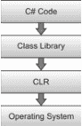

**图16.1：展示 .NET 体系结构的简化视图**

如图16.1所示，在 C# 代码执行期间，代码首先引用类库，该类库提供一组命名空间，这些命名空间部署在一个称为程序集的共享库中。类库和程序集都是动态链接库（DLL）文件。之后，代码遇到 CLR，CLR 将其转换为机器级语言。最后，代码在操作系统的帮助下执行。这是一个简化模型；然而，C# 代码需要经过若干其他组件，例如 Common


公共语言规范（CLS）、Web 窗体、ADO.NET 和可扩展标记语言（XML），之后代码才与类库组件通信。图 16.2 展示了 .NET 体系结构模型（Visual Studio .NET 2005）的层次结构，并简要说明了每个步骤中发生的操作：

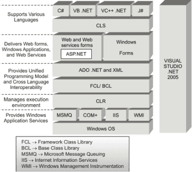

**图 16.2：展示 .NET 体系结构模型**

在图 16.2 中，我们可以观察到一些组件，例如 CLS、Web 窗体、Web 服务、Windows 窗体、ADO.NET、XML、FCL 和 BCL。不过，本章主要关注以下组件：

- CLR
- 类库（FCL/BCL）
- CLS 和公共类型系统（CTS）

让我们从 CLR 开始讨论。

#### CLR

作为 .NET Framework 的主要组件之一，CLR 为程序提供可移植性和安全性，并管理程序的执行。此外，它还使用 CTS 提供混合语言编程。

在深入了解 CLR 的细节之前，我们先了解两种不同类型的代码，如下所示：

- **托管代码**——CLR 执行托管代码，这些代码既访问托管数据（指由 CLR 使用垃圾回收技术分配和释放的内存位置），也访问非托管数据。托管代码帮助 CLR：
  - 借助托管代码提供的元数据信息，定位程序集模块中编码的方法

CLR 使用 JIT 编译器，在需要代码的各个部分时按需将 MSIL 代码转换为托管本机代码。此外，它会在编译期间首次优化被调用的模块。C# 程序即使最初编译为 MSIL，最终也执行本机代码。因此，如果一开始就编译为本机代码，程序运行速度几乎一样快。然而，在 .NET 环境中，由于 MSIL，JIT 编译器获得了更高的可移植性。因此，JIT 编译器动态将 CIL 或 MSIL 转换为针对操作系统执行而优化的托管本机代码。此外，JIT 编译仅在首次调用任何方法时进行，以提供优化后的代码。

JIT 编译器有三种不同类型，如下所示：

- **预 JIT 编译器** → 将整个代码完整编译为本机代码
- **经济 JIT 编译器** → 按需逐部分编译代码
- **普通 JIT 编译器** → 仅当代码被调用进行编译时编译该部分，并将代码放入缓存

当我们编译 C# 程序时，元数据也会与 MSIL 一起作为输出产生。它包含以下内容：

- 程序所用数据的信息
- 版本信息
- 引用信息

同一个文件同时包含元数据和 MSIL。元数据的存在简化了执行方法，并使代码能够与其他代码交互。使用元数据，.NET 应用程序具有以下优势：

- 应用程序不需要任何头文件。
- 元数据包含执行 .exe 或 .dll 文件所需的信息。
- 使用元数据，组件无需在注册表中注册。
- 对象的字段可以自动序列化/反序列化。
- 在运行时使用元数据，应用程序可以确定自身持有的类型种类，并获取该类型所定义成员的信息。这也称为后期绑定。
- 使用元数据可使组件变为可重用。不同语言均可使用它们。

CLR 提供以下服务：

- 内存管理
- 线程
- 垃圾回收
- 异常处理
- 安全
- 应用程序隔离
- 数据交互
- 加密服务
- 部署

在本章中，我们将主要研究 .NET 中使用的内存管理和垃圾回收技术。其他服务不在本章讨论范围内。

#### 类库

通常，.NET 类库称为 .NET Framework 类库（FCL），其子集是基类库（BCL）。FCL 包含大量可重用的类、接口以及值类型，提供从读取 XML 文件到设计图形界面的预制功能。此外，FCL 帮助开发者优化开发过程，并提供对系统功能的访问。已经熟悉 Java 的人可能了解类库。然而，.NET 类库提供的功能集比任何其他语言所能提供的都广泛得多。.NET 体系结构支持的语言可以引用 FCL 中定义的这些内容。

FCL 使用命名空间按层次结构组织，命名空间表示一组指定单一逻辑任务的功能。.NET 支持的所有语言都使用 FCL 提供的一致基类型。命名空间访问这些基类型类，而程序集又保存这些命名空间引用。

System 命名空间是根命名空间，包含 Object 基类型，所有其他值类型和引用类型均派生自该基类型。该命名空间还提供主要类型，例如整数、字符串和字符，这些类型在应用程序中最常用。除此之外，它还提供异常处理、控制台 I/O 操作和数学运算等功能，以及可安全转换不同数据类型的实用类型。然而，要使用这些实用类，我们需要知道要引用哪个命名空间。因此，开发者可以创建引用 FCL 的自定义命名空间，也可以直接在应用程序中引用 FCL 命名空间。表 16.1 列出了 FCL 的一些常用命名空间：

**表 16.1：FCL 的常用命名空间**

| 命名空间 | 描述 |
|---|---|
| Microsoft.CSharp | 包含用于使用 C# 进行编译和代码生成的类。 |
| Microsoft.JScript | 包含用于使用 JavaScript 进行编译和代码生成的类。 |
| Microsoft.VisualBasic | 包含用于使用 Visual Basic.NET（VB.NET）进行代码生成的类。 |
| System | 包含定义数据类型、事件、事件处理程序、接口、特性和异常处理的基本类和基类。 |
| System.CodeDom | 包含用于元素以及源代码文档结构的类。这些元素用于构造源代码文档，该文档将使用 System.CodeDom.Compiler 以指定的 .NET 支持语言输出为源代码。 |
| System.CodeDom.Compiler | 包含用于处理以指定支持语言生成和编译源代码的类型。 |
| System.Collections | 包含用于管理对象集合的接口和类，例如 Stack、Queue 和 Hashtables。 |
| System.Configuration | 包含用于管理 .NET Framework 配置以及在应用程序中命名 .config 文件的类。 |
| System.Data | 包含支持 ADO.NET 体系结构的类。 |
| System.Diagnostics | 包含与系统进程、事件日志和性能计数器交互的类；从而使我们能够调试应用程序。 |
| System.Drawing | 包含帮助在应用程序中绘制二维图像的类。 |
| System.Globalization | 包含提供区域性相关功能的类，例如货币模式、日期格式模式和日历。 |
| System.IO | 包含帮助操作文件和目录的类。 |
| System.Net | 提供用于实现网络协议的编程接口。 |
| System.Reflection | 提供帮助操作元数据和后期绑定过程的类和接口。 |
| System.Resources | 提供用于操作外部资源的类。 |
| System.Runtime.InteropServices | 包含允许托管代码访问非托管操作系统平台功能的类。 |
| System.Runtime.Remoting | 包含允许应用程序远程访问类型的类。 |
| System.Runtime.Serialization | 包含用于使对象实例持久化并从流中重新生成的类。 |
| System.Security | 包含用于保护数据和资源的类。 |
| System.Text | 包含允许使用不同编码类型对文本进行编码的类。 |
| System.Threading | 包含允许创建和操作线程的类。 |
| System.Xml | 包含允许操作 XML 文件的类。 |

#### CTS

.NET Framework 的优点之一是提供跨语言互操作性。借助 Microsoft 提供的、专注于类型转换的 CTS，这成为可能。CTS 规定了相关规则，包括类型在运行时如何声明、使用和管理，这有助于集成不同语言。总之，CTS 提供以下功能：

- 跨语言集成和类型安全
- 高性能代码执行
- 一个面向对象的平台，可在其中集成来自不同语言的代码
- 语言为实现跨语言互操作性必须遵循的规则

CTS 定义的类型可分为以下两类：

- **值类型**——指包含数据的类型。值类型的实例分配在堆栈中或结构本身中。以下是三种值类型：
  - 内置类型
  - 用户定义类型
  - 枚举
- **引用类型**——指分配在托管堆中的类型。OOP 语言中的引用类型指类的对象。此外，指针和接口也可以归类为引用类型。


图 16.5 显示了 .NET Framework 中类型的层次树视图：

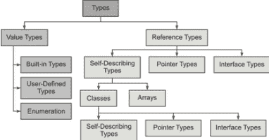

**图 16.5：显示类型的层次树视图**

CTS 还规定了类型成员的可视性和作用域规则。以下列出了可应用于类型的访问限制：

- **Public（公共）** → 具有公共访问权限的类型可用于任何程序集中的任何代码。
- **Private（私有）** → 具有私有访问权限的类型可用于定义它的方法中。
- **Family 或 Protected（族或受保护）** → 具有受保护访问权限的类型可由任何继承类型调用，无论它们是否位于同一程序集中。
- **Assembly 或 Internal（程序集或内部）** → 具有内部访问权限的类型可由其所属程序集内定义的任何类型调用。
- **Family 或 Assembly/Protected Internal（族或程序集/受保护的内部）** → 具有受保护的内部访问权限的类型可由任何程序集中的派生类型以及同一程序集中的任何类型调用。

CTS 还规定了另一条规则，即类型必须继承自一个名为 System.Object 的预定义类型。Object 是在 System 命名空间中定义的类型的名称。因此，它是所有其他类型的根；从而拥有最小的一组行为。所有其他类型（例如整数、字符或类）都派生自 Object 类。System.Object 类型允许我们执行以下操作：

- 比较两个实例以检查是否相等
- 查询实例的真实类型
- 执行实例的浅拷贝
- 包含实例的哈希代码
- 以字符串形式获取对象的当前状态

接下来，我们学习基于 CTS 定义的 CLS。

#### CLS

CLS 允许在 .NET 环境的单个应用程序中使用不同语言。这是借助 CLR 完成的。然而，不同语言有各自的一套规则。例如，一种语言实现区分大小写，而另一种语言不强制区分大小写。另一方面，.NET 平台支持的一种语言支持运算符重载，而 .NET 平台支持的另一种语言不支持运算符重载。语言之间的这些差异迫使 Microsoft 开发人员定义了一组必须由编译器支持的最低规范。这些规范称为 CLS。因此，CLS 表示一种语言普遍支持的最小功能集。图 16.6 显示了 CLS 与 CLR/CTS 之间的关系：

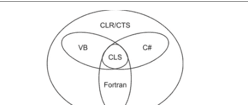

在图 16.6 中，我们可以观察到 CLS 是 CLR 的子集，并且 CLR/CTS 包含比 CLS 更大的功能集。此外，CLS 由 Fortran、VB 和 C# 语言的共同特性组成（还有许多其他语言）。大多数语言（例如 VB、Fortran 和 C#）都包含 CLR 特性。然而，那些对语言互操作性不感兴趣的人可以直接利用 CLR/CTS 的特性。如果我们想要使用语言互操作性，我们可以定义一组非常丰富的、特定于该语言本身的函数。因此，为了提供语言互操作性，CTS 已交付给供应商，以便开发至少应支持 CLS 中所提及特性的编译器。考虑 Java 和 VB.NET 语言的一个示例。在 Java 和 VB.NET 中编写一段用于将两个整数相加的代码后，VB.NET 中的 Integer 和 Java 中的 int 都遵循 CLS 转换为 Int32，如图 16.7 所示：

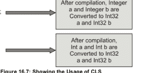

根据 CLS，以下是语言为生成 MSIL 或 CIL 至少应遵循的一些规则：

- 数据类型大小应固定；例如，int 应为 32 位，字符应为 8 位
- 应使用常见数据类型

现在让我们学习 C# 中的程序集。

### C# 中的程序集

程序集这一术语已经存在十年了，但在 .NET 体系结构的语境中，程序集的定义有所不同。程序集表示一个可执行文件（.exe 或 .dll），它在编译结束时执行。它也可以定义为 .NET 体系结构的构建块；提供部署、版本控制、重用和安全权限的基本单元；或者一组为协同工作并形成逻辑功能单元而构建的类型和资源。

图 16.8 显示了程序集及其各种组件：

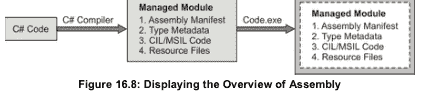

**图 16.8：显示程序集概述**

CLR 首先将 C# 代码转换为中间语言（IL）。此 IL 包含托管 IL 代码以及元数据。元数据有助于托管 IL 代码的执行。程序集包含此托管 IL 代码，并将该代码传递给 CPU 执行。

如图 16.8 所示，程序集包含以下组件：

- 程序集清单
- 类型元数据
- CIL/MSIL 代码
- 资源文件

让我们首先了解程序集清单及其在程序集中的重要性。

### 程序集清单

为了执行文件，每个程序集都应记录程序集中的元素如何相互关联。这可以从元数据中得知。程序集清单包含指定程序集版本控制和安全性标识的元数据。除此之外，元数据还包含与程序集范围相关的信息，以及对类和资源文件的引用。程序集清单与 MSIL/CIL 代码一起存储在 .exe 或 .dll 文件（通常称为 PE 文件）中，或者存储在仅包含程序集元数据的单独独立文件中。

现在让我们学习如何查看程序集清单及其组件。为此，请考虑一段小型 C# 代码，它将两个常量相加并在控制台中显示该值，如代码清单 16.1 所示：

**代码清单 16.1：显示 Example.exe 的 C# 代码**

```
    using System;
    class Program
    {
        public const int a = 10;
        public const int b = 20;
        public static void Main()
        {
            Console.WriteLine("The result is : {0}", a + b);
        }
    }
```

要查看程序集清单内容，我们需要在 Visual Studio 2008 控制台中键入 ildasm <exe file name> 命令。在我们的示例中，我们键入了 ildasm Example.exe，如图 16.9 所示：

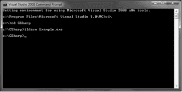

**图 16.9：显示用于查看程序集的命令**

该命令执行 MSIL 反汇编器（ildasm.exe），从而产生一个新窗口，我们可以在其中查看文件中的 IL 信息。图 16.10 显示了执行该命令后出现的新窗口：

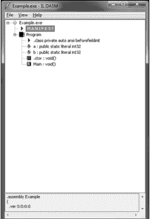

**图 16.10：显示 IL 信息窗口**

我们可以单击 MANIFEST 标签打开记事本，其中包含以下信息：

- **程序集名称**——包含清单文件的名称。创建程序集时会自动设置此名称。
- **版本**——包含四部分版本号：主版本号、次版本号、生成号和修订号。
- **区域性**——指定程序集的语言或区域性。它已使用 AssemblyCulture 属性设置。此组件是可选的。
- **公钥标记**——为程序集提供强名称。
- **程序集中的文件列表**——以哈希文件形式包含文件列表。
- 类型引用信息——包含在运行时用于映射代码中所使用类型引用的信息。
- 引用程序集信息——包含可在运行时调用的其他程序集的引用。

前四个属性构成程序集的名称，并且在代码中引用程序集时是必需的。

图 16.11 显示了程序集清单：


### 类型元数据

类型元数据包含有关类型的信息。由于代码清单 16.1 中的代码包含两个变量，因此这两个变量类型的信息在 IL DASM 窗口中给出，如图 16.12 所示：


要查看类型元数据，我们需要单击类型信息标签。在我们的示例中，我们单击了 a : public static literal int32。此时会出现一个新窗口，显示类型元数据，如图 16.13 所示：


#### MSIL/CIL 信息

MSIL 代码包含诸如代码大小和与堆栈相关的数据等信息。要查看 Example.cs 程序的 MSIL 代码，我们需要单击“Main: void()”标签。此时会出现一个新窗口，显示 Example.cs 程序的 MSIL 代码，如图 16.14 所示：


#### 资源文件

.NET 中的资源文件用于存储资源，例如位图、图标和特定于本地的字符串。这些文件以 resx 为扩展名创建。当我们在 .NET 平台中编译代码时，编译器会将这些文件编译为扩展名为 .resource 的二进制文件，然后链接器会将这些文件放入程序集中。因此，最终要执行的 .exe 也包含有关资源的信息。资源文件减轻了处理器管理资源的工作。

现在让我们讨论全局程序集缓存，它在 .NET 架构的研究中非常重要。

#### 全局程序集缓存

随 CLR 一起安装的计算机范围内的代码缓存称为全局程序集缓存（GAC）。它充当程序集的中央存储库。因此，我们需要将程序集安装到 GAC 中，以便与其他应用程序共享它。但是，在将程序集安装到 GAC 中时，需要注意以下几点：

- 程序集依赖项应声明为私有
- 程序集应具有强名称，这意味着程序集名称应包含使其成为强名称的公钥标记
- 我们需要将程序集定位在应用程序目录中

要将程序集安装到 GAC 中，我们需要使用全局程序集缓存工具或 GacUtil.exe。此外，我们应具有安装程序集的管理员权限。例如，要安装 Example.dll 程序集，我们需要打开 Visual Studio 2008 命令提示符窗口，并键入以下命令：

```
gacutil /i <assembly name>
```

成功执行上述命令后，DLL 或程序集文件将存储在 C:\Windows\assembly 位置。

在 .NET 中，DLL 地狱是指当应用程序中的多个程序尝试共享同一个 DLL 时出现的问题。如果应用程序中不同 DLL 的版本信息未记录到系统中，就会出现此问题。因此，使用 GAC 有助于避免因 DLL 文件的版本不兼容问题而引起的 DLL 地狱，以及由此导致的应用程序执行不当。

现在让我们讨论 C# 编程中的内存管理，它将让我们了解对象如何在内存中存储和管理。

### C# 编程中的内存管理

CLR 要求将其所有资源分配到托管堆中，托管堆表示用于分配对象的内存地址数组。此堆有一个指针，该指针在开始时指向堆的基址。在分配对象时，此指针始终指向托管堆的下一个可用地址。图 16.15 显示了托管堆的结构：


每当使用 new 关键字创建对象时，该对象通常会被分配到托管堆中一个 16 KB 的内存空间（可能因系统而异）。因此，当托管堆中的指针指向不再属于托管堆的内存地址时，就会调用垃圾回收过程。

在本节中，我们主要借助一种算法来讨论垃圾回收过程。

垃圾回收过程会检查托管堆中是否存在不再使用的对象。如果存在此类对象，则将这些对象分配到的内存空间回收，供新创建的对象使用。垃圾回收过程基于以下三个假设运行：

- **假设 1**——与整个堆相比，我们可以更容易地维护堆的一部分。因此，托管堆被划分为三个部分，这些部分称为*代*。这三代分别是*第 0 代*或 *G0*、*第 1 代*或 *G1*，以及*第 2 代*或 *G2*，如图 16.16 所示：


**图 16.16：显示托管堆中的代**

最初，每当创建对象时，默认情况下会将其放入 G0，垃圾回收器始终从 G0 开始处理。

- **假设 2**——仍在使用的对象总是会移到下一代。例如，我们最初创建了三个对象，它们被放入 G0。一段时间后，如果它们仍在使用，则会被移到下一代 G1。整个过程在图 16.17 中说明。


**图 16.17：显示对象的移动**

注意，如果对象必须移动位置，则必须运行垃圾回收器。此外，每当 G0 满时，垃圾回收器就会运行。

- **假设 3**——新创建的对象具有较短的生命周期。

现在让我们借助以下示例来解释垃圾回收器过程：

```csharp
using System;
using System.Collections.Generic;
public class Program
{
    public static void Main()
    {
        List<object> myList = new List<object>();

        for (int i = 0; i < 10000; i++)
        {
            myList.Add(new object());
        }
        Console.WriteLine("Total object created is {0}", myList.Count);
    }
}
```

根据前面的示例，10000 个 Object 类的对象被添加到 List 对象中。因此，这些对象首先被放入 G0。然而，随着托管堆变满，垃圾回收过程会运行。

在垃圾回收器过程的处理过程中，它首先检测仍在使用的对象以及不再使用的对象。仍在使用的对象会被移到 G1，而未使用对象的空间则通过垃圾回收过程回收。图 16.18 说明了完整的垃圾回收过程：


**图 16.18：显示垃圾回收过程**

关于垃圾回收过程，我们应该了解以下几点：

- 1. 对象的移动总是先执行，只有在此之后才会进行释放。在图 16.19 中，G0 中的对象 C 不再使用。在这种情况下，对象 A 和 B 将首先移到 G1，然后对象 C 的释放才会进行。未使用的对象 C 被圈出，如图 16.19 所示：


**图 16.19：显示 C 的释放**

- 2. 考虑一种场景：G1 中的对象 A 以及 G0 中的对象 E 和 G 不再使用（在图 16.20 中被圈出）。为此，对象 B 将首先移到 G2，然后对象 D 和 F 将移到 G1，如图 16.20 所示：


**图 16.20：显示不同代中 B、E 和 G 的释放**

### C# 编程语言简介

C# 是一种多范式语言。它具有面向对象编程的精髓，因为它允许使用类。此外，它通过 Lambda 表达式和语言集成查询（LINQ）特性，支持面向函数语言的特性。它还使用 XML 集成了文档特性。C# 是一种基于组件的编程语言，可实现设计时和运行时特性、属性、事件和接口。它是 C 和 C++ 家族中第一种基于组件的语言。C# 与 JAVA 有一些相似之处，但

## 第16章

添加到 C# 中的一些特性使其成为开发基于 Web 的应用程序的强有力语言。Java 和 .NET 都支持的一些值得注意的特性如下：

- 封装，这是 OOP 语言的重要特性之一，允许用户创建类以及该类的对象。
- 接口，与类相似，但只提供类的骨架。
- 错误处理机制，使用 try-catch 代码块。
- 线程，用于多用户环境。通过创建多个线程，一个应用程序可以同时被多个用户使用。
- 命名空间，用于避免命名异常。它有助于将各种特性组合到一个类文件中，然后该文件可以被其他应用程序访问。
- 垃圾回收，通过释放未使用对象的内存空间来帮助应用程序平稳运行。
- 强类型语言。C# 中使用的语法是强类型的。
- 代码的动态加载。
- 反射，有助于在运行时定位类中的成员并调用类的方法。

因此，我们可以说 C# 与 Java 有 70% 的相似性，另外 30% 由一些新特性以及其他语言（如 C++ 和 VB）的特性组成。

C# 中引入的新特性如下：

- 引用参数和输出参数。
- 栈上的对象，称为*结构体*。
- 矩形数组，这是一种类似于矩阵的新型数组。
- 枚举，源自 C++ 语言。它提供命名值常量。
- 统一类型系统，提供类型安全，使任何变量都不会未初始化。此外，它避免了不安全的类型转换。
- goto 语句。
- 版本控制，使 C# 更强大。
- 基于组件的编程，使用属性、事件、特性和接口实现。
- 委托，类似于 C++ 中的函数指针。
- 索引器。
- 运算符重载，源自 C++。
- *foreach* 语句。
- 装箱和拆箱机制。
- LINQ。
- Lambda 函数。

> **注意**
> *我们将在本书后面的章节中学习 C# 的所有特性。*

现在，让我们讨论 C# 语言的设计目标，如下所示：

- 它被提议成为一种现代、简单且通用的 OOP 语言。
- C# 语言及其各种实现应支持软件工程原则，例如强类型检查、数组边界检查和自动垃圾回收。此外，程序员生产力以及应用程序的持久性也很重要。
- 源代码可移植性很重要；因此，它借助 MSIL 实现。
- 它被提议成为一种可用于托管系统和嵌入式系统的应用程序语言。
- C# 应用程序被提议在内存管理和处理能力需求方面具有经济性。但是，它并不打算与 C 或任何其他汇编级语言的性能直接比较。

现在让我们讨论 C# 语言的各种版本及其特性：

### C# 的演进

C# 1.0 于 2002 年首次引入。2011 年，C# 4.5 已发布，仍处于 beta 阶段。表 16.2 显示了 C# 语言的各种版本及其特性：

**表 16.2：C# 版本及其特性**

| C# 版本 | 特性 |
|---|---|
| C# 1.0 | 借助 CLR 首次引入托管代码的概念。 |
| C# 1.1 | 此版本于 2003 年发布，具有与 C# 1.0 相同的特性。 |
| C# 2.0 | 此版本于 2005 年发布，带有新的 CLR 和 C# 2.0 编译器。此编程语言中引入的新特性是泛型。此外，添加的其他新特性如下：<br>- 别名<br>- 静态类<br>- 非对称属性访问器<br>- 匿名方法<br>- 迭代器<br>- 分部类型<br>- 可空类型<br>- 委托<br>- 捕获变量<br>- 友元程序集<br>- #pragma warning |
| C# 3.0 | 此版本于 2006 年发布，带有 LINQ 查询表达式。此版本还添加了一些新特性，列出如下：<br>- Lambda 表达式<br>- 扩展方法<br>- 隐式类型局部变量<br>- 隐式类型数组<br>- 匿名类型<br>- 对象和集合初始值设定项<br>- 自动实现的属性<br>- 分部方法<br>- 表达式树 |
| C# 3.5 | 此版本于 2007 年引入。它具有 C# 3.0 的相同特性，但为 LINQ 引入了一些新库以及一些新的基础库。此版本中的编译器也是新的。 |
| C# 4.0 | C# 4.0 于 2010 年引入动态编程。它还引入了模型-视图-控制器（MVC）架构编程。此语言中添加的新特性列出如下：<br>• 动态类型对象<br>• 可选参数和命名参数<br>• 改进的 COM 互操作性<br>• 协变和逆变 |

至此，本章结束；现在让我们总结本章讨论的要点。

### 小结

在本章中，我们讨论了 .NET 体系结构，其中详细学习了 CLR 和 .NET 类库，后者由 FCL、BCL、CTS 和 CLS 组成。之后，我们探讨了程序集及其在 .NET 体系结构中的各种组件。在 .NET 程序集中，我们学习了一种重要且最常用的程序集类型，称为 GAC。我们还解释了 .NET 内存管理中的垃圾回收过程。最后，我们简要介绍了 C# 语言，并展示了不同 .NET 版本的比较视图。

在下一章中，我们将学习 C# 语言的基础知识。

### 快速复习

### 多项选择题

- **1. CLR 是以下哪项的缩写**
  - i. 关键语言运行时
  - ii. 公共语言革命
  - iii. 公共语言运行时
  - iv. 公共运行时语言

- **2. CLR 可与什么一起工作**
  - i. 非托管代码
  - ii. DLL
  - iii. 资源文件
  - iv. 托管代码

- **3. 哪种 JIT 编译器按需逐部分编译代码？**
  - i. JIT 编译器
  - ii. Econo JIT 编译器
  - iii. Pre-JIT 编译器
  - iv. 普通 JIT 编译器

- **4. 程序集**
  - i. 是 C# 编译器返回的可执行代码
  - ii. 提供版本控制
  - iii. 提供安全约束
  - iv. 以上所有

- **Q5. CTS 的全称是**
  - i. 公共技术支持
  - ii. 关键技术支持
  - iii. 公共类型系统
  - iv. 公共层级系统

- **Q6. 程序集包含**
  - i. 类型元数据、CIL、MSIL 和资源文件
  - ii. 程序集清单、CIL、MSIL 和资源文件
  - iii. 程序集清单、类型元数据和资源文件
  - iv. 程序集清单、类型元数据、CIL/MSIL 和资源文件

- **Q7. 垃圾回收器**
  - i. 自动调用
  - ii. 从 G0 开始收集未使用的内存地址
  - iii. 仅选项(i)
  - iv. (i)和(ii)两者

- **Q8. C# 支持**
  - i. 基于组件的语言特性
  - ii. 面向对象的语言特性
  - iii. 面向函数的语言特性
  - iv. 以上所有

- **Q9. C# 3.5 支持**
  - i. 动态编程
  - ii. LINQ
  - iii. 托管代码
  - iv. 泛型

- **Q10. C# 2.0 支持**
  - i. LINQ
  - ii. 托管代码
  - iii. 动态编程
  - iv. 泛型

### 主观题

- **1.** 简要描述 CLS 中规定的规范。
- **2.** CLR 与 CTS 有何关系？
- **3.** CLR 与 CLS 有何关系？
- **4.** 借助适当的示意图简要描述 CLR 的功能。
- **5.** 借助适当的示例简要描述垃圾回收技术。
- **6.** 列出 C# 编程语言提供的特性名称。


## 17 C# 基础

| 如果你需要以下信息： | 参见页码： |
|---|---:|
| C# Hello World 程序 | 484 |
| 数据类型 | 487 |
| 变量声明 | 489 |
| 表达式、运算符和运算符优先级 | 490 |
| 类型转换 | 492 |
| 数组 | 494 |
| 字符串 | 498 |
| 结构 | 505 |
| 集合 | 508 |
| 引用类型 | 513 |
| 值类型 | 515 |
| 流程控制语句 | 516 |
| 变量作用域 | 525 |
| 参数传递 | 527 |
| 命名参数和可选参数 | 530 |
| 命名空间 | 532 |

C#（读作 C Sharp）是 C/C++ 家族中第一种面向组件的语言。它被称为面向组件语言，因为其编码的基本单元是类。C# 是一种通用、高级、面向对象的编程语言，它借鉴了其他语言的主要概念。然而，就其提供的功能而言，C# 与 Java 更为相似。我们可以在任何文本编辑器中编写 C# 代码，并借助 C# 编译器进行编译，但这种编程语言主要用于 .NET 环境。因此，开发 Web 应用程序或 Web 服务时，最常用的编程语言是 C#。有时它也被称为 .NET 语言，因为 C# 的设计与 .NET 环境的设计是并行进行的。

C# 是微软对 Java 的回应。该语言的主要设计者是 Anders Hejlsberg 和 Scott Wiltamuth。C# 于 2000 年正式发布，其名称灵感来自音符 C#，它表示比 C/C++ 高一个音级。然而，这种语言无意与 C 或任何汇编级语言竞争。

如果考虑语言性能，那么与 Java 相比，C# 不需要额外的性能成本。我们只需安装 .NET Framework，然后就可以用它来创建软件组件、网页和 Web 服务。C# 提高了程序员的生产力以及软件的健壮性。此外，如果程序员熟悉 C++ 和 Java，他们可以轻松适应 C#。

本章主要讨论 C# 的基本功能。我们通过编写一个小程序来开始本章，该程序有助于理解 C# 的代码结构。之后，我们将学习 C# 中的数据类型、变量声明、表达式、运算符和运算符优先级。此外，我们还会讨论类型转换、数组、字符串、结构、集合、引用类型和值类型。本章还借助程序解释流程控制语句、变量作用域、参数传递以及命名参数和可选参数的用法。最后，我们将学习命名空间，它提供了类、接口、结构和枚举器的集合。

让我们通过编写一个有助于理解 C# 总体结构的 C# 程序来开始本章。

### C# Hello World 程序

C# 程序的结构与 Java 和 C++ 程序有些相似。因此，C# 程序也以命名空间引用开始，这些引用通过使用指令 "using" 给出。此外，整个代码主体位于多个类定义内部。请注意，至少有一个类必须包含一个名为 Main() 的方法，它是编译器编译代码的主要入口点。现在让我们编写一个简单的 C# 程序，名为 HelloWorld.cs，它只在控制台上输出 "Hello World!!!!!!!!!!"。代码清单 17.1 展示了 HelloWorld.cs 程序的代码：

### 代码清单 17.1：展示 HelloWorld.cs 程序的代码

```csharp
using System;

namespace HelloWorld
{
    class Program
    {
        public static void Main()
        {
            Console.WriteLine("Hello world!!!!!!!!!!");
        }
    }
}
```

编译上述程序后，控制台窗口将显示输出，如图 17.1 所示：


### 图 17.1：展示 HelloWorld.cs 程序的输出

现在让我们参考图 17.2，以更好地理解 C# 的代码结构：


### 图 17.2：展示 C# 代码的结构

根据图 17.2，一个 C# 程序可以由多个文件组成，其中应有一个类文件包含 Main() 方法，该方法调用其他某个类的方法来执行所需的工作。每个类都包含一个命名空间列表；不过，System 命名空间应写在类文件的第一位，因为它是 C# 语言的主要命名空间。请注意，一个类文件可以包含多个类定义。然而，为简单起见，我们可以考虑每个类文件一个类。代码清单 17.2 展示了一个处理多个类文件的 C# 代码示例：

### 代码清单 17.2：展示处理多个类文件的 C# 代码

Program.cs

```csharp
using System;
namespace Program
{
    class Program
    {
        public static void Main()
        {
            Addition addition = new Addition(10, 30);
            Console.WriteLine("The result of addition is {0}", addition.Add());
        }
    }
}
```

Addition.cs

```csharp
using System;
namespace Addition
{
    class Addition
    {
        public int item1 = 0;
        public int item2 = 0;

        public Addition(int a, int b)
        {
            this.item1 = a;
            this.item2 = b;
        }
        public int Add()
        {
            int result = this.item1 + this.item2;
            return result;
        }
    }
}
```

如代码清单 17.2 所示，名为 Addition 的类用于加法运算；而名为 Program 的类用于执行加法运算。Program.cs 文件包含 Main() 方法，该方法通过声明 Addition 类的对象来执行加法运算。要执行代码，我们需要分别编译这两个类文件以获得所需输出。尽管我们将这些类写在两个单独的文件中，但这些类也可以合并到一个类文件中。这简化了编译过程，因为为此只需编译一个文件。代码清单 17.3 展示了在单个类文件中处理多个类的 C# 代码：

### 代码清单 17.3：在单个类文件中处理多个类

```csharp
using System;
namespace Program
{
    class Program
    {
        public static void Main()
        {
            Addition addition = new Addition(10, 30);
            Console.WriteLine("The result of addition is {0}", addition.Add());
        }
    }
    class Addition
    {
        public int item1 = 0;
        public int item2 = 0;

        public Addition(int a, int b)
        {
            this.item1 = a;
            this.item2 = b;
        }
        public int Add()
        {
            int result = this.item1 + this.item2;
            return result;
        }
    }
}
```

在代码清单 17.3 中，我们在 Program 命名空间内定义了两个类，名为 Program 和 Addition。在 Addition 类中进行加法运算；在 Program 类中调用 Main() 方法，将 10 和 30 两个数字相加，然后在控制台上打印结果。

现在让我们讨论 C# 中的各种数据类型。

### 数据类型

C# 被称为强类型语言。当每个变量和对象都具有声明的类型时，这种语言就被称为强类型语言。因此，每当我们在 C# 中声明对象或变量时，它必须具有声明的类型。

在 C# 中，存在三种数据类型，如下所示：

- 内置数据类型
- 用户定义数据类型
- 匿名类型

让我们从内置数据类型开始详细了解这些数据类型。

### 内置数据类型

内置数据类型属于 System 命名空间，它是 .NET Framework 中所有其他命名空间的根命名空间。一些基本的内置数据类型是 int、char 和 bool。所有这些数据类型都是类的对象。在 .NET Framework 中，根数据类型是 object 数据类型。表 17.1 列出了 C# 中的内置数据类型：

| 类名 | 数据类型 | 描述 |
|---|---|---|
| 类别：整数 | | |
| Byte | byte | 表示 8 位无符号整数 |
| SByte | sbyte | 表示 8 位有符号整数 |
| Int16 | short | 表示 16 位有符号整数 |
| Int32 | int | 表示 32 位有符号整数 |
| Int64 | long | 表示 64 位有符号整数 |
| UInt16 | ushort | 表示 16 位无符号整数 |
| UInt32 | uint | 表示 32 位无符号整数 |
| UInt64 | ulong | 表示 64 位无符号整数 |
| 类别：浮点数 | | |
| Single | float | 表示 32 位（单精度）浮点数 |
| Double | double | 表示 64 位（双精度）浮点数 |
| 类别：逻辑 | | |
| Boolean | bool | 表示真/假布尔值 |


| 类名 | 数据类型 | 描述 |
|---|---|---|
| **类别：其他** |  |  |
| Char | char | 表示 16 位 Unicode 字符 |
| Decimal | decimal | 表示十进制值（128 位） |
| Object | object | 表示对象层次结构的根 |
| String | string | 表示 Unicode 字符的固定长度字符串 |

### 表 17.1：C# 中的内置数据类型

现在，我们来学习内置数据类型在 C# 程序中是如何声明的。清单 17.4 展示了不同内置数据类型的声明：

### 清单 17.4：展示内置数据类型的声明

```csharp
using System;
class Program
{
    public static void Main()
    {
        Employee e = new Employee(100, "Mr. Scott", 20000, 'M', true);
        e.PrintEmployeeDetails();
    }
}
class Employee
{
    public int empID;
    public string empName;
    public long empSalary;
    public char empGender;
    public bool empIsMarried;
    public Employee()
    {
    }
    public Employee(int ID, string name, long salary, char gender, bool isMarried)
    {
        this.empID = ID;
        this.empName = name;
        this.empSalary = salary;
        this.empGender = gender;
        this.empIsMarried = isMarried;
    }
    public void PrintEmployeeDetails()
    {
        Console.WriteLine("The Employee details are....");
        Console.WriteLine("Employee ID is {0}", this.empID);
        Console.WriteLine("Employee name is {0}", this.empName);
        Console.WriteLine("Employee salary is {0}", this.empSalary);
        Console.WriteLine("Employee gender is {0}", this.empGender);
        Console.WriteLine("Employee marital status is {0}", this.empIsMarried);
    }
}
```

在上述代码中，我们定义了一个名为 Employee 的类，它的成员变量具有内置数据类型，例如 int、string 和 char。这个类还有一个名为 PrintEmployeeDetails() 的方法，用于在控制台上打印员工信息。Main() 方法从另一个名为 Program 的类中调用，它使用带参数的构造函数方法为员工对象赋值，并使用 PrintEmployeeDetails() 方法将这些值打印到控制台上。该程序的输出如下所示：

```text
The Employee details are....
Employee ID is 100
Employee name is Mr. Scott
Employee salary is 20000
Employee gender is M
Employee marital status is True
```

### 用户定义数据类型

由于 C# 是一种面向对象的编程语言，开发者有权编写自己的类或接口。类封装了特定现实生活对象的详细信息；而接口表示类的骨架。类和接口都被称为用户定义类型。在清单 17.4 中，我们使用了一个用户定义的类 Employee 来声明关于员工的所有必要变量。我们将在本书第 21 章更详细地讨论类和接口。

### 匿名类型

匿名类型是一种引用类型，它直接继承 Object 类。它提供了一种直接封装只读属性的方式，而无需为这些属性声明数据类型。在编译期间，编译器会为这些属性分配数据类型。匿名数据类型通常使用 var 构造声明；因此，我们可以使用 new 关键字来初始化匿名数据类型。清单 17.5 展示了一个使用匿名数据类型的代码片段：

### 清单 17.5：展示匿名类型的用法

```csharp
using System;
class Customer
{
    public static void Main()
    {
        var v = new { Id = 100, Name = "Mr. Scott" };
        Console.WriteLine("The ID and the name of customer is {0}, {1}", v.Id, v.Name);
    }
}
```

在上述代码片段中，我们声明了一个 var 类型变量 v，它封装了一个整数类型以及一个字符串类型；然而，这些类型在初始化期间并未提及。在执行期间，变量 Id 和 Name 将分别被视为 Integer 和 String。

现在我们来学习如何在 C# 中声明变量。

### 变量声明

在 C# 中，变量被定义为存储位置。由于 C# 是一种类型安全的语言，每个变量存储的值都与该变量的类型相同。在 C# 中，变量声明遵循如下指定的结构：

```
<Data_Type> <Variable_Name>;
<Data_Type> <Variable_Name_1>, <Variable_Name_2>,...<Variable_Name_n>;
<Data_Type> <Variable_Name> = <Variable_Initializer>;
```

### 表 17.2：运算符优先级

| 类别 | 运算符 | 结合性 |
|---|---|---|
| 主要 | (x), x.y, f(x), x++, x--, new, typeof, sizeof, checked, unchecked | 左结合 |
| 一元 | +(unary), -(unary), ~, ++x, --x, (T)x | 左结合 |
| 乘法 | *, /, % | 左结合 |
| 加法 | +, - | 左结合 |
| 移位 | <<, >> | 左结合 |
| 关系和类型测试 | >, <, >=, <=, is, as | 左结合 |
| 相等 | ==, != | 左结合 |
| 逻辑 AND | & | 左结合 |
| 逻辑 XOR | ^ | 左结合 |
| 逻辑 OR | \| | 左结合 |
| 条件 AND | && | 左结合 |
| 条件 OR | \|\| | 左结合 |
| 条件 | ?: | 右结合 |
| 赋值 | = *= /= %= += -= <<= >>= &= ^= \|= | 右结合 |

在表 17.2 中，顶部行中的运算符比底部行中的运算符具有更高的优先级。此外，每一行左侧的运算符比每一行右侧的运算符具有更高的优先级顺序。

C# 中的结合性可以是两种类型：左结合和右结合。左结合运算符从左到右求值，右结合运算符从右到左求值。作为左结合的一个例子，我们可以考虑加法运算，其中左侧表达式先求值，然后右侧表达式再求值。另一方面，赋值运算符是右结合的，因为其右侧的表达式会在调用赋值操作之前求值。运算符优先级及其结合性确保了求值的确定性和完整性。清单 17.7 展示了一个运算符优先级的示例：

### 清单 17.7：展示说明运算符优先级的示例

```csharp
using System;
class Program
{
    public static void Main()
    {
        int firstNumber = 50;
        int secondNumber = 30;
        int thirdNumber = 10;
        Console.WriteLine("Calculating firstNumber * secondNumber / thirdNumber");
        Console.WriteLine(firstNumber * secondNumber / thirdNumber);
        Console.WriteLine("Calculating firstNumber / secondNumber * thirdNumber");
        Console.WriteLine(firstNumber / secondNumber * thirdNumber);
        Console.WriteLine("Calculating (firstNumber / secondNumber) * thirdNumber");
        Console.WriteLine((firstNumber / secondNumber) * thirdNumber);
    }
}
```

由于乘法运算符是左结合的，乘法运算先执行，然后执行除法运算。因此，如果我们考虑表达式 `firstNumber * secondNumber / thirdNumber`，首先执行 `firstNumber` 和 `secondNumber` 之间的乘法，其结果为 1500，然后这个结果除以 `thirdNumber`，得到最终结果 150。类似地，对于表达式 `firstNumber / secondNumber * thirdNumber`，首先执行 secondNumber 和 thirdNumber 之间的乘法，然后结果除以 firstNumber。如果我们想告诉编译器确切先执行哪个操作，可以使用括号来通知计算顺序。对于表达式 `(firstNumber / secondNumber) * thirdNumber`，乘法操作在除法操作之后。在这种情况下，我们通过在除法表达式周围放置括号来通知编译器先执行除法操作，从而使它在表达式中的所有其他运算符中具有最高优先级。因此，最佳实践是通过将括号放在我们希望先执行的表达式周围来简化计算。

上述程序的输出如下所示：

```text
Calculating firstNumber * secondNumber / thirdNumber
150
Calculating firstNumber / secondNumber * thirdNumber
10
Calculating (firstNumber / secondNumber) * thirdNumber
10
```

现在我们来学习类型转换。

### 类型转换

在开始学习 C# 类型转换之前，我们先讨论类型安全。使用脚本语言时，我们可以将任意类型赋给任意其他类型；例如，将浮点变量的值赋给整数变量。然而，这种赋值的主要缺点是，当我们将浮点变量赋给整数变量时，浮点变量所包含的精度会丢失。这些类型的语言被称为弱类型语言或无类型语言。然而，由于 C# 是一种强类型语言，这类操作是不允许的，C# 编译器将抛出错误。因此，为了解决这个问题，我们需要显式地将数据类型转换为浮点类型以进行转换。

在 C# 中，允许两种类型的转换，如下所示：

- 隐式转换
- 显式转换

隐式类型转换允许我们在不丢失变量所保存数据的情况下转换所需类型。例如，当我们将一个浮点数赋给 Double 类型的变量时，该赋值不会造成任何数据丢失。清单 17.8 展示了一个隐式类型转换的示例：

### 清单 17.8：展示隐式类型转换的示例

```csharp
using System;
class Program
{
    public static void Main()
    {
        float f = 100.125f;
        Console.WriteLine("Declaring one floating type variable {0}", f);
        //Implicit assignment
        double d = f;
        Console.WriteLine("After implicit type casting, printing the double variable: ");
        Console.WriteLine(d);
    }
}
```


**清单 17.12：** 展示交错数组的用法

```csharp
using System;
class Program
{
    public static void Main()
    {
        Console.WriteLine("Enter the input to the jagged array...");
        int[][] jag = new int[4][];
        jag[0] = new int[4];
        jag[1] = new int[2];
        jag[2] = new int[3];
        jag[3] = new int[1];
        for (int i = 0; i < 4; i++)
        {
            Console.WriteLine("Enter the input for the column {0}...", i);
            for (int j = 0; j < jag[i].Length; j++)
            {
                jag[i][j] = int.Parse(Console.ReadLine());
            }
        }
        Console.WriteLine("The jagged array is...");
        for (int i = 0; i < 4; i++)
        {
            for (int j = 0; j < jag[i].Length; j++)
            {
                Console.Write(jag[i][j]);
            }
            Console.WriteLine();
        }
    }
}
```

在前面的程序中，我们首先声明了一个包含另外四个数组的交错数组。之后，我们初始化了这四个数组，其中第一个数组包含四个整数，第二个数组包含两个整数，第三个数组包含三个整数，第四个数组包含单个整数。此程序从控制台读取用户提供的输入，将它们相应地存储在交错数组中，并在控制台上打印存储的值。前面程序的输出如下：

```text
Enter the input to the jagged array...
Enter the input for the column 0...
1
2
3
4
Enter the input for the column 1...
5
6
Enter the input for the column 2...
7
8
9
Enter the input for the column 3...
10
The jagged array is...
1234
56
789
10
```

接下来，让我们了解 C# 中的字符串。

### 字符串

字符串可以定义为 Unicode 字符的集合；然而，在 .NET 中，它被定义为 System.Char 对象的集合。字符串的值表示字符对象的集合值。在 .NET Framework 中，我们需要考虑关于字符串的以下两点：

- 1. 字符串是 Unicode 字符的引用类型
- 2. String 类是 .NET Framework 类，其别名是 string 类型

因此，在 .NET Framework 中，string 类型和 String 类的作用相同，这意味着开发者可以使用 string 类或 String 类执行相同的操作。现在，我们借助一些示例来讨论 string 类型的用法。

### 字符串的声明

字符串对象是不可变的或只读的。创建字符串对象后，其内容不能更改。提供字符串变量修改的方法会返回一个包含修改后值的新字符串变量。在 .NET 中，可以通过以下方式声明 string 类型变量：

```csharp
string str;
OR
string str = String.Empty;
OR
string str = "Hello world";
```

默认情况下，声明字符串时，它具有空字符串值。然而，如前面的声明所示，我们也可以使用 string 类中的 String.Empty 字段将字符串显式声明为空字符串，或者将值赋给字符串。

让我们讨论 string 类型的一些功能。我们从字符串比较开始讨论。

### 字符串比较

字符串比较可以通过两种方式完成：使用“==”运算符或 string 类的 Compare() 方法。让我们用一些合适的示例演示这两个过程。首先，我们使用“==”运算符比较两个字符串，如清单 17.13 所示：

**清单 17.13：** 使用“==”运算符展示字符串比较操作

```csharp
using System;
class Program
{
    public static void Main()
    {
        string first = "Hello";
        string second = "Bye";
        if (first == second)
        {
            Console.WriteLine("The strings are same");
        }
        else
        {
            Console.WriteLine("The strings are different");
        }
    }
}
```

在前面的程序中，我们首先声明了两个字符串，然后使用“==”运算符比较它们。由于我们选择了两个不同的字符串，因此程序的输出如下：

```text
The strings are different
```

接下来，我们考虑属于 string 类的 Compare() 方法。此方法接受要比较的两个字符串作为其参数；如果两个字符串相同则返回 0，如果两个字符串不同则返回 1。Compare() 方法的语法如下：

```csharp
int Compare(string string1, string string2)
```

**清单 17.14：** 展示 Compare() 方法的用法

```csharp
using System;
class Program
{
    public static void Main()
    {
        string first = "Hello";
        string second = "Bye";
        int val = string.Compare(first, second);
        if (val == 0)
        {
            Console.WriteLine("The strings are same");
        }
        else
        {
            Console.WriteLine("The strings are different");
        }
    }
}
```

在程序中，我们选择了两个不同的字符串；因此，操作的输出如下：

```text
The strings are different
```

接下来，我们讨论字符串的串联操作。

### 字符串串联

串联不过是添加两个单独的字符串。此操作也可以通过两种不同方式执行：使用加号“+”运算符或 string 类的 Concat() 方法。清单 17.15 展示了使用“+”运算符执行的串联操作：

**清单 17.15：** 展示“+”运算符的用法

```csharp
using System;
class Program
{
    public static void Main()
    {
        Console.WriteLine("Please enter the first string...");
        string s1 = Console.ReadLine();
        Console.WriteLine("Please enter the second string...");
        string s2 = Console.ReadLine();
        string concat = string.Empty;
        if (s1 != string.Empty && s2 != string.Empty)
        {
            Console.WriteLine("The concatenated string is...");
            concat = s1 + s2;
            Console.WriteLine(concat);
        }
        else
        {
            Console.WriteLine("Please enter the strings");
        }
    }
}
```

在前面的程序中，我们首先从控制台读取输入，串联两个字符串，然后在控制台上显示结果。程序的输出如下：

```text
Please enter the first string...
Hello
Please enter the second string...
World
The concatenated string is...
Hello World
```

现在，我们使用 string 类的 Concat() 方法执行相同的操作。Concat() 方法接受要串联的两个字符串作为其参数。此方法有八个重载方法，其中五个方法适用于 object 类型。因此，除了 string 类之外，Concat() 方法还可用于串联 Object 类的实例。Concat() 方法的语法如下：

```csharp
string Concat(string str1, string str2);
```

**清单 17.16：** 展示 Concat() 方法的用法

```csharp
using System;
class Program
{
    public static void Main()
    {
        Console.WriteLine("Please enter the first string...");
        string s1 = Console.ReadLine();
        Console.WriteLine("Please enter the second string...");
        string s2 = Console.ReadLine();
        string concat = string.Empty;
        if (s1 != string.Empty && s2 != string.Empty)
        {
            Console.WriteLine("The concatenated string is...");
            concat = string.Concat(s1, s2);
            Console.WriteLine(concat);
        }
        else
        {
            Console.WriteLine("Please enter the strings");
        }
    }
}
```

当我们运行该程序时，其行为与清单 17.15 中的程序类似。

现在让我们了解字符串的复制操作。


### 字符串复制

要复制字符串，需使用字符串类的 `Copy()` 方法。`Copy()` 方法接受一个字符串作为输入，将字符串的内容复制到一个新字符串中，并返回该新字符串。`Copy()` 方法的语法如下：

```csharp
string Copy(string sourceString)
```

清单 17.17 展示了使用 `Copy()` 方法复制字符串的用法：

**清单 17.17：展示 Copy() 方法的用法**

```csharp
using System;
class Program
{
    public static void Main()
    {
        Console.WriteLine("Please enter the string to be copied:");
        string str = Console.ReadLine();
        string strcopy = string.Empty;
        if (str != string.Empty)
        {
            strcopy = String.Copy(str);
            Console.WriteLine("The copied string is {0}", strcopy);
        }
        else
        {
            Console.WriteLine("You entered a null string");
        }
    }
}
```

在前面的程序中，我们首先从控制台读取输入，将其存储到一个字符串中，然后检查该字符串的内容。如果字符串不为空，程序使用 `Copy()` 方法创建一个具有相同内容的新字符串，然后将其显示在控制台上。该程序的输出如下：

```text
Please enter the string to be copied:
Hello world!!!
The copied string is Hello world!!!
```

#### CopyTo 操作

`CopyTo()` 方法提供了一项功能：将字符串中指定位置的所需数量的字符复制到数组中的特定位置。字符串和数组都应包含 Unicode 字符。`CopyTo()` 方法的语法如下：

```csharp
void CopyTo(int sourceIndex, char[] destinationArray, int destinationIndex, int count)
```

清单 17.18 展示了 `CopyTo()` 方法的用法：

**清单 17.18：展示 CopyTo() 方法的用法**

```csharp
using System;
class Program
{
    public static void Main()
    {
        string str = "nice";
        char[] destArr = { 's', 'h', 'e', ' ', 'i', 's', ' ', 'a', ' ', 'g', 'o', 'o', 'd', ' ', 'g', 'i', 'r', 'l' };
        Console.WriteLine("The actual string is...");
        Console.WriteLine(destArr);
        str.CopyTo(0, destArr, 9, str.Length);
        Console.WriteLine("After applying the CopyTo() method, the string is...");
        Console.WriteLine(destArr);
    }
}
```

在前面的 C# 代码中，我们首先声明了一个要复制到字符数组的字符串，然后实例化了一个字符数组。之后，我们对字符串应用了 `CopyTo()` 方法。该程序的输出如下：

```text
The actual string is...
She is a good girl
After applying the CopyTo() method, the string is...
She is a nice girl
```

#### 移除操作

`Remove()` 方法用于通过指定字符串的起始位置索引和结束位置索引来移除字符串的一部分。如果我们只指定起始位置索引，则移除操作从该位置开始并持续到字符串末尾。我们也可以只指定字符串的结束索引。`Remove()` 方法的语法如下：

```csharp
string Remove(int startIndex)
```

`Remove()` 方法有一个重载方法，它接受起始索引以及要从字符串中移除的字符数。清单 17.19 展示了 `Remove()` 方法的用法：

**清单 17.19：展示 Remove() 方法的用法**

```csharp
using System;
class Program
{
   public static void Main()
   {
      string str = "Hello world";
      string strResult = string.Empty;
      Console.WriteLine("Removing the first part....");
      strResult = str.Remove(0, str.LastIndexOf(" ")+1);
      Console.WriteLine(strResult);
      Console.WriteLine("Removing the second part....");
      strResult = str.Remove(str.LastIndexOf(" "));
      Console.WriteLine(strResult);
   }
}
```

在前面的程序中，我们移除了字符串 "Hello World" 的第一部分。`Remove()` 方法将第一个索引设为 0，并将最后一个索引设为空白字符串的索引加 1。此方法将只打印实际字符串的第二部分，即 "World"。接下来，我们仅通过指定起始索引删除了字符串的第二部分。该程序的输出如下：

```text
Removing the first part....
world
Removing the second part....
Hello
```

#### 替换操作

通过在字符串上调用 `Replace()` 方法并指定要替换的字符串，将返回一个包含替换后字符串内容的新字符串。`Replace()` 方法的语法如下：

```csharp
string Replace(string oldstr, string newstr)
```

在前面的 C# 代码中，我们首先实例化了一个字符串对象，其内容包含用逗号分隔的数字。接下来，我们使用 `Split()` 方法获取了一个以逗号分隔的字符串数组。之后，字符串数组的每个元素连同总和一起打印到控制台上。该程序的输出如下：

```text
The elements are....
1
2
3
4
5
6
7
8
9
The sum is: 45
```

#### 子字符串操作

当我们想要获取字符串的起始位置和/或结束位置时，会对字符串应用 `Substring()` 方法。在我们想要从长字符串中获取信息或将长字符串拆分为若干子字符串的情况下，此方法非常有用。`Substring()` 的两个重载方法如下：

```csharp
string Substring(int startIndex)
```

或

```csharp
string Substring(int startIndex, int length)
```

清单 17.22 展示了 `Substring()` 方法的用法：

**清单 17.22：展示 Substring() 方法的用法**

```csharp
using System;
class Program
{
    public static void Main()
    {
        string str = "Hello world";
        string strResult = string.Empty;
        Console.WriteLine("The actual string is...");
        strResult = str.Substring(0, str.Length);
        Console.WriteLine(strResult);
        Console.WriteLine("The substring element is...");
        strResult = str.Substring(0, str.LastIndexOf(" "));
        Console.WriteLine(strResult);
    }
}
```

在前面的程序中，我们首先通过提供字符串的起始索引，使用 `Substring()` 方法打印了完整字符串。然后，我们借助 `LastIndexOf()` 方法提供起始索引和结束索引，仅显示了字符串 "Hello World" 的第一部分。作为 `LastIndexOf()` 方法的输入，我们只传入了一个空白字符串。此方法在字符串中搜索空白位置，如果它是字符串内部的最后一个空白位置，则返回它已经遍历过的字符串字面量。该程序的输出如下：

```text
The actual string is...
Hello world
The substring element is...
Hello
```

现在让我们详细学习结构。

### 结构

我们已经学习了 C 和 C++ 中的结构。然而，在 C# 中，结构具有如下定义：

- 结构是值类型。
- 结构可以像类一样包含字段、方法和事件。
- 由于结构是值类型，因此可以在不使用 `new` 运算符的情况下实例化它。
- 结构继承自 `System.Object` 命名空间。
- 结构不能被任何其他结构继承。此外，它也不能作为任何类的基结构。
- 除非使用 `const` 运算符将结构的成员声明为常量，或使用 `static` 运算符将其声明为静态成员，否则不能初始化这些成员。
- 不能在结构内部定义任何默认构造函数或析构函数，因为每当创建结构的副本时，编译器会自动设置默认构造函数或析构函数。

C# 中的结构在行为上有些类似于类，但区别在于类是引用类型，而结构是值类型。因此，每当我们把一个结构赋值给另一个结构时，整个结构及其内容都会被复制到目标结构中。此外，如果我们对复制得到的结构做任何修改，都不会反映到被复制的原结构中。这是使用结构而不是类的主要缺点之一。

在 C# 中，使用关键字 `struct` 定义结构。我们可以按如下方式声明结构：

```csharp
public struct <structure_Name>
{
    //declaration of Field, Properties, Methods, Event etc
}
```

清单 17.23 展示了 C# 中结构的用法：

**清单 17.23：展示结构的用法**

```csharp
using System;
public struct Example
{
    public string str;
    public Example(string s)
    {
        str = s;
    }
}
public class Program
{
    public static void Main()
    {
        Example e = new Example();//calling the default constructor
        Example e1 = new Example("Hello world");//calling the parameterized
                                               //constructor
        Console.WriteLine(e1.str);
    }
}
```

在前面的程序中，我们首先声明了一个名为 Example 的结构，其中包含字段 str 和一个带参数的构造函数，并在该构造函数中指定了一个字符串。然后，我们在 Program 类中创建了 Example 结构的两个对象：使用该结构默认构造函数创建的 e 对象，以及 e1

## 目录

### 特别关注

- 依托“乡村学校少年宫”实施劳动教育实践研究
- 新时代劳动教育融入小学道德与法治教学的策略研究

### 家教纵横

- 家校协同育人视角下小学生积极心理品质培养路径探析
- 家庭教育指导服务体系建设的区域实践与思考
- “双减”政策下家庭教育指导服务的问题与对策

### 家庭教育

- 亲子共读中幼儿阅读兴趣培养的策略研究
- 二胎家庭中幼儿同伴冲突及家长应对策略
- 父亲参与幼儿家庭教育的现状与建议

### 教育科研

- 幼儿园课程游戏化背景下教师观察能力提升路径
- 基于核心素养的小学语文大单元教学设计研究
- 小学数学教学中渗透建模思想的实践探索
- 初中英语阅读教学中批判性思维培养策略

### 教学研究

- 深度学习视域下高中思想政治课议题式教学研究
- 大概念统摄下初中物理单元作业设计策略
- 小学科学教学中项目式学习的实施与评价
- 高中地理教学中人地协调观的培育路径

### 幼教天地

- 安吉游戏理念下幼儿园户外自主游戏环境创设
- 幼儿绘本阅读中多元表达与表现的实践研究
- 幼儿园一日生活中劳动教育的渗透策略

在前面的 C# 代码中，我们首先实例化了 ArrayList 类的一个对象。之后，我们向 ArrayList 中插入了字符串元素以及值类型，例如整数、双精度浮点数和字符。插入不同的值类型提高了 ArrayList 的灵活性。然后，ArrayList 的容量、计数和元素被打印到控制台上。该程序的输出如下所示：

```text
Printing the arrayList statistics...
Count of ArrayList: 8
Capacity of ArrayList: 8
Printing the elements inside the ArrayList....
Hi
This
is
an
ArrayList
1
1.25
F
```

由于没有为 ArrayList 定义固定大小，因此其容量将与其中元素的数量相同。此外，ArrayList 类还有一些重要方法；例如，Insert() 在特定位置插入元素，Remove() 移除一个 ArrayList 项，而 Sort() 对元素进行排序。

### 栈

栈操作遵循后进先出规则，通常称为 LIFO。当向栈中插入一项时，该项被插入到栈底；此操作称为 push（压栈）。此外，当从栈中移除元素时，总是从第一个位置移除，这意味着最后插入的项将最先被移除。栈的这种操作称为 pop（出栈）。C# 提供了 Stack 类，它可以保存每种值类型，使该类成为一个灵活的数据存储库。代码清单 17.27 展示了使用 Push() 和 Pop() 方法的 Stack 类用法：

### 代码清单 17.27：展示 Stack 类的用法

```csharp
using System;
using System.Collections;

class Program
{
    public static void Main()
    {
        Stack s = new Stack();
        //Pushing the elements inside the stack
        s.Push("Hi");
        s.Push("This");
        s.Push("is");
        s.Push("a");
        s.Push("stack");
        //Pushing other value types
        s.Push(1);
        s.Push(1.25);
        s.Push('F');
        //Printing the elements in the stack
        Console.WriteLine("Printing the stack elements....");
        foreach (object obj in s)
        {
            Console.WriteLine(obj);
        }
        //Popping one element
        s.Pop();
        Console.WriteLine("Printing the stack elements after executing pop operation....");
        foreach (object obj in s)
        {
            Console.WriteLine(obj);
        }
    }
}
```

在前面的程序中，我们使用 Push() 方法向 Stack 对象中插入了字符串元素以及一些值类型，例如整数、双精度浮点数和字符。当这些元素打印到控制台时，它们将按 LIFO 方式显示。现在，如果我们从栈中弹出一个元素，那么控制台上显示的第一个元素将从栈中删除。该程序的输出如下所示：

```text
Printing the stack elements....
F
1.25
1
stack
a
is
This
Hi
Printing the stack elements after executing pop operation....
1.25
1
stack
a
is
This
Hi
```

### 队列

队列操作与栈操作正好相反。队列有前端和后端。当元素插入队列时，它从后端插入；而当元素从队列中删除时，它从前端删除。这强调先进先出（FIFO）操作。在 C# 中，Queue 类分别使用 Enqueue() 和 Dequeue() 这两个方法执行插入和删除操作。代码清单 17.28 展示了 Queue 类的用法。

### 代码清单 17.28：展示 Queue 类的用法

```csharp
using System;
using System.Collections;

class Program
{
    public static void Main()
    {
        Queue q = new Queue();
        //Entering the element in a queue
        q.Enqueue("Hi");
        q.Enqueue("This");
        q.Enqueue("is");
        q.Enqueue("an");
        q.Enqueue("queue");
```

```csharp
SortedList s = new SortedList();
s.Add(0, "Hi");
s.Add(3, "Sorted List");
s.Add(6, "F");
s.Add(1, "This");
s.Add(5, 1.25);
s.Add(4, 1);
s.Add(2, "is");
Console.WriteLine("Printing the elements of a sorted list....");
foreach (DictionaryEntry var in s)
{
    Console.WriteLine(var.Value);
}
```

在前面的程序中，我们首先实例化了 SortedList 类的一个对象，该类以名称-值对的形式存储其内容。因此，每当我们在 SortedList 中添加元素时，都需要指定一个数字以及一个与该数字对应的值；这个数字对应名称-值对中的名称，而该值对应名称-值对中的值。该数字指定元素在列表中的位置。如果数字为 0，那么它将是列表中的第一个元素。在前面的程序中，我们随机添加了不同类型的元素，最后所有元素都按排序后的方式打印出来。该程序的输出如下所示：

```text
Printing the elements of a sorted list....
Hi
This
is
Sorted List
1
1.25
F
```

### 哈希表

哈希表表示一种键值集合，其中键映射到其值。这种数据结构对于实现搜索功能很重要，可使搜索更简单、更快速。C# 提供了 Hashtable 类，它具有轻松操作哈希表元素的功能。代码清单 17.30 展示了使用 Hashtable 类的哈希表各项功能：

### 代码清单 17.30：展示 Hashtable 类的用法

```csharp
using System;
using System.Collections;

class Program
{
    public static void Main()
    {
        Hashtable direction = new Hashtable();
        direction.Add(1, "North");
        direction.Add(2, "South");
        direction.Add(3, "East");
        direction.Add(4, "West");
        //Displaying the first element of the hash table
        Console.WriteLine("Printing the first element of the hash table....");
        Console.WriteLine(direction[1].ToString());
        //Search for an item in hash table
        if (direction.ContainsValue("South"))
        {
        }
        else
        {
            Console.WriteLine("Element not found");
        }
        //displaying the content of hash table
        Console.WriteLine("Printing the elements in the hash table....");
        foreach (DictionaryEntry var in direction)
        {
            Console.WriteLine(var.Value);
        }
    }
}
```

在前面的程序中，实例化了 Hashtable 类的一个对象，其中存储了四个方向。哈希表对象还以名称-值对的形式存储元素。该程序打印对象中的第一个元素，然后通过使用 `ContainsValue()` 方法提供值来搜索元素。在我们的示例中，我们在哈希表中搜索了值 South。该程序的输出如下所示：

```text
Printing the first element of the hash table....
North
Element Found
Printing the elements in the hash table....
West
East
South
North
```

现在，让我们了解 C# 中的引用类型。

### 引用类型

在 C 和 C++ 中，当一个指针变量被赋值给另一个指针变量时，改变的是其引用，而其值保持不变。类似地，在 C# 中，引用类型表示保存引用的类、接口、委托或数组的对象。因此，当一个引用类型被赋值给另一个引用类型时，只复制其引用，而不复制值。代码清单 17.31 展示了 C# 中引用类型的用法：

### 代码清单 17.31：展示引用类型的用法

```csharp
using System;

public class Program
{
    public static void Main()
    {
        Employee e1 = new Employee();
        e1.name = "Catherine";
        Employee e2 = new Employee();
        e2.name = "Thomas";
        Console.WriteLine("Name of the employees before assignment...");
        e1.Print();
        e2.Print();
        e1 = e2;
        Console.WriteLine("Name of the employees after assignment...");
        e1.Print();
        e2.Print();
        e2.name = "Bob";
        //changing the value of name of e2
    }
}
```


```csharp
Console.WriteLine("Name of the employees after changing the values...");
e1.Print();
e2.Print();
}
}
public class Employee
{
    public string name;
    public string Name
    {
        get { return name; }
        set { name = value; }
    }
    public void Print()
    {
        Console.WriteLine("Employee Name: {0}", this.name);
    }
}
```

在前面的程序中，声明了 Employee 类的两个实例，并分别将它们的名称设置为 Catherine 和 Thomas。在此阶段，它们都指向各自的内存空间，如图 17.3 所示：


当把对象 e2 赋值给对象 e1 时，e1 的引用指针发生了改变。因此，当我们在控制台上打印这些值时，两个对象都会打印 Thomas。将 e2 赋值给 e1 后，e2 的引用被复制到 e1 的引用。因此，e1 的内存位置与 e2 相同，如图 17.4 所示：


当我们打印这两个对象的 name 变量时，二者都会打印与 e2 相同的名称。在这种情况下，如果我们更改 e2 的名称，那么 e1 将打印 e2 更改后的名称。程序的输出如下所示：

```text
Name of the employees before assignment...
Employee Name: Catherine
Employee Name: Thomas
Name of the employees after assignment...
Employee Name: Thomas
Employee Name: Thomas
Name of the employees after changing the values...
Employee Name: Bob
Employee Name: Bob
```

在下一节中，我们来了解值类型。

### 值类型

与引用类型不同，值类型保存对象的值。每当将一个值类型赋值给另一个值类型时，复制的是它的值，而不是引用。结构和枚举器是值类型的一些示例。清单 17.32 借助结构类型展示了值类型操作。

**清单 17.32：展示结构值类型的用法**

```csharp
using System;
struct Employee
{
    private int id;
    public int ID
    {
        get { return id; }
        set { id = value; }
    }
}
class Program
{
    static void Main()
    {
        Employee e1 = new Employee();
        e1.ID = 71;
        Employee e2 = new Employee();
        e2.ID = 59;
        Console.WriteLine("Name of the employees before assignment...");
        Console.WriteLine("Employee ID = " + e1.ID);
        Console.WriteLine("Employee ID = " + e2.ID);
        // assign e2 value to e1 variable
        e1 = e2;
        Console.WriteLine();
        Console.WriteLine("Name of the employees after assignment...");
        Console.WriteLine("Employee ID = " + e1.ID);
        Console.WriteLine("Employee ID = " + e2.ID);
        e2.ID = 65;
        Console.WriteLine();
        Console.WriteLine("Values After Changing One Instance:");
        Console.WriteLine("Employee ID = " + e1.ID);
        Console.WriteLine("Employee ID = " + e2.ID);
    }
}
```

在前面的程序中，我们首先定义了一个名为 Employee 的结构，它只保存员工 ID。然后，我们创建了 Employee 结构的两个对象 e1 和 e2，并为每个对象的 ID 变量赋值。当我们打印这些值时，它们会显示各自的确切值。之后，我们将 e2 赋值给 e1。在这种情况下，e2 的值被复制给 e1 的值。因此，e1 和 e2 都会打印 e2 的值。接下来，我们再次修改了 e2 的 ID 值。现在打印的是 e1 的 ID 值，而 e2 的值已被修改。这意味着 e1 的值不会因更改 e2 的值而改变，这证明值类型保存的是其对象的独立副本。

程序的输出如下所示：

```text
Name of the employees before assignment...
Employee ID = 71
Employee ID = 59
Name of the employees after assignment...
Employee ID = 59
Employee ID = 59
Values After Changing One Instance:
Employee ID = 59
Employee ID = 65
```

在讨论了数据类型、数据结构和集合类之后，现在我们来了解 C# 中的各种流控制语句。

### 流控制语句

流控制语句用于通过提供执行分支和迭代的语句来控制程序的顺序流程。我们主要可以将流控制语句分为以下三类：

- 条件语句，包括 *if-else* 和 *switch*
- 循环语句，包括 *while*、*do-while*、*for* 和 *foreach* 循环
- 跳转语句，包括 *continue-break* 和 *goto*

我们先讨论 *if-else* 条件语句。

### if-else 语句

当程序需要根据某些操作或变量的值来决定是否执行某个操作时，通常使用 *if-else* 语句。*if-else* 语句的结构如清单 17.33 所示。

**清单 17.33：展示 *if-else* 语句的结构**

```csharp
if(Condition)
{
   Execute the Operation;
}
else
{
   Execute a different operation;
}
```

根据 *if-else* 语句的结构，如果针对 *if* 语句编写的条件满足，则执行写在 *if* 块内的代码；否则，执行写在 *else* 语句内的代码块。清单 17.34 展示了 *if-else* 语句的实现：

**清单 17.34：展示 *if-else* 语句的用法**

```csharp
using System;
class Program
{
    public static void Main()
    {
        Example e = new Example(20,10);
        e.DoComparison();
    }
}
class Example
{
    public int high;
    public int low;
    public Example(int h, int l)
    {
        this.high = h;
        this.low = l;
    }

    public void DoComparison()
    {
        if (high > low)
        {
            Console.WriteLine("{0} is higher than {1}", high, low);
        }
        else if (high == low)
        {
            Console.WriteLine("Two values are equal");
        }
        else
        {
            Console.WriteLine("{0} is lower than {1}", high, low);
        }
    }
}
```

在前面的程序中，我们在 Example 类中声明了 `DoComparison()` 方法，该方法包含一个嵌套的 *if/else* 语句，用于比较两个值是否相同。此外，`Program` 类实例化了一个 Example 类的对象，并调用 `DoComparison()` 方法。代码的输出如下所示：

```text
20 is higher than 10
```

接下来，我们来了解 *switch* 语句。

### switch 语句

*switch* 语句用于通过将枚举传递给写在其中的 *case* 语句来选择特定语句。程序的控制权位于 *case* 语句，由它决定选择过程。*switch* 语句的结构如清单 17.35 所示：

**清单 17.35：** 展示 *switch* 语句的结构

```csharp
int caseSwitch = 1;
switch (caseSwitch)
{
    case 0:
        Console.WriteLine("The case number is 0");
        break;
    case 1:
        Console.WriteLine("The case number is 1");
        break;
    default:
        Console.WriteLine("This is the default case");
        break;
}
```

根据 *switch* 语句的结构，如果选中某个 *case* 语句，则在执行相关 case 块后，使用 *break* 语句（本章后面会讨论）将控制权转出 *switch* 语句。此外，每个 *switch* 语句都应有一个 *default* case，如果代码遇到任何 *default* 语句，就会执行它。因此，编写 *switch* 语句时应考虑以下几点：

- *case* 语句的值是唯一的。任何两个 *case* 语句都不能具有相同的 case 值。
- 应在执行每个 *case* 语句后放置 *break* 语句。这有助于在所选 case 执行完成后将控制权带出循环。
- 在 *switch* 语句代码体内使用 *default* 语句是一种好做法。


清单 17.36 展示了 `switch` 语句的实现：

**清单 17.36：展示 `switch` 语句的用法**

```csharp
using System;
class program
{
    public static void Main()
    {
        Example e = new Example();
        e.SelectDVD();
    }
}
class Example
{
    public int option;
    public const int price = 99;
    public Example()
    {
    }
    public void SelectDVD()
    {
        Console.WriteLine("How many DVD you want to select");
        option = Convert.ToInt32(Console.ReadLine());
        int dvdprice = 0;
        switch (option)
        {
            case 1:
                Console.WriteLine("The price of {0} DVDs is", option);
                dvdprice = price * 1;
                break;
            case 2:
                Console.WriteLine("The price of {0} DVDs is", option);
                dvdprice = price * 2;
                break;
            case 3:
                Console.WriteLine("The price of {0} DVDs is", option);
                dvdprice = price * 3;
                break;
            default:
                Console.WriteLine("The DVD you can get at a time is 3");
                break;
        }
        Console.WriteLine(dvdprice);
    }
}
```

前面的程序显示了所选 DVD 的价格。然而，该程序不允许我们一次购买超过三张 DVD。运行程序时，它会提示用户输入一个数字。如果用户输入 1、2 或 3，它将显示获取这些 DVD 所需支付的金额。但是，如果用户输入除 1、2 或 3 以外的任何数字，那么它将执行 switch 语句的 default 分支。

在接下来的几节中，让我们从 while 循环开始讨论循环语句。

#### while 循环

当我们需要持续执行某个操作，直到特定表达式为 true 时，就会使用 while 循环。

清单 17.37 展示了 while 循环的结构：

清单 17.42 展示了 *for* 循环的实现：

**清单 17.42：展示 *for* 循环的用法**

```csharp
using System;
class program
{
    public static void Main()
    {
        Example e = new Example();
        e.PrintFibonacci();
    }
}
class Example
{
    public int i = 0;
    public Example()
    {
    }
    public void PrintFibonacci()
    {
        int f0 = 0;
        int f1 = 1;
        int f2 = 0;
        Console.WriteLine("The Fibonacci series is....");
        Console.WriteLine(f0);
        Console.WriteLine(f1);
        for (int i = 0; i < 10; i++)
        {
            f2 = f0 + f1;
            f0 = f1;
            f1 = f2;
            Console.WriteLine(f2);
        }
    }
}
```

前面的程序借助 *for* 循环在控制台上打印斐波那契数，其循环上限设置为 10。因此，*for* 循环将执行十次。我们首先初始化斐波那契数列的前两个数。之后，我们将循环变量 *i* 设置为 0，保持 *i* 的上限小于 10，并在循环中的语句执行后递增 *i* 的值。在循环内，我们通过将前两个数相加来计算斐波那契数列中的下一个数。最后，我们在控制台上显示该数字。程序的输出如下：

```text
The Fibonacci series is....
0
1
1
2
3
5
8
13
21
34
55
89
```

#### foreach 循环

当我们想要遍历列表（例如 Arraylist 或 SortedList）和集合时，需要使用 foreach 循环。清单 17.43 展示了 foreach 循环的结构：

**清单 17.43：展示 foreach 循环的结构**

```csharp
foreach (<Type> <Iterator variable> in <List>)
{
    //Statement
}
```

在前面的结构中，Type 表示列表所包含项的类型，Iterator variable 表示使用列表项类型声明的变量。in 关键字必须用在列表项变量和列表本身之间。

使用 foreach 循环遍历列表项时，列表是只读的，这意味着我们不能更改列表项。在此迭代期间，列表返回一个新变量，只要列表有值，它就会创建一个新变量并将其返回给程序。

清单 17.44 展示了 foreach 循环的实现：

**清单 17.44：展示 foreach 循环的用法**

```csharp
using System;
using System.Collections.Generic;
class program
{
    public static void Main()
    {
        Example e = new Example();
        e.PrintFibonacci();
    }
}
class Example
{
    public int i = 0;
    public Example()
    {
    }
    public void PrintFibonacci()
    {
        int f0 = 0;
        int f1 = 1;
        int f2 = 0;
        List<int> itemList = new List<int>();
        Console.WriteLine("The fibonacci series is....");
        itemList.Add(f0);
        itemList.Add(f1);
        for (int i = 0; i < 10; i++)
        {
            f2 = f0 + f1;
            f0 = f1;
            f1 = f2;

            itemList.Add(f2);
        }
        foreach (int i in itemList)
        {
```

```csharp
{
    f2 = f0 + f1;
    f0 = f1;
    f1 = f2;
    Console.WriteLine(f2);
    i += 1;
    if (i < 10)
        continue;
    else
        break;
}
```

清单 17.46 是清单 17.42 的修改版，唯一区别是我们使用 *while* 循环而不是 *for* 循环来解释 continue-break 语句的用法。在程序中，循环执行的次数由 continue-break 语句控制。根据变量 i 的值，程序决定是使用 *continue* 语句再次执行循环，还是使用 *break* 语句退出循环。这是一个简单的程序，展示了同时使用 continue-break 语句的用法；不过，根据代码结构，我们也可以分别使用 *continue* 和 *break* 语句。

#### goto 语句

*goto* 语句是 C# 原始跳转语句之一。该语句借助标签将程序中的控制权从一个点转移到另一个点。标签必须存在于 *goto* 语句的作用域内。清单 17.47 展示了 *goto* 语句的结构。

**清单 17.47：展示 goto 语句的结构**

```csharp
goto <label_name>;
<label_name>: Statement
```

注意，多个 *goto* 语句可以将控制权转移到同一个标签。另一点需要注意的是，*goto* 语句可以充当 *break* 语句，也就是说，它可以将控制权转移到块外，但不能将控制权转移到新块中，以避免跳过初始化操作的可能性。清单 17.48 展示了 *goto* 语句的实现：

**清单 17.48：展示 goto 语句的用法**

```csharp
using System;
class program
{
    public static void Main()
    {
        Example e = new Example();
        e.PrintFibonacci();
    }
}
class Example
{
    public int i = 0;
    public Example()
    {
    }
    public void PrintFibonacci()
    {
        int f0 = 0;
        int f1 = 1;
        int f2 = 0;
        Console.WriteLine("The fibonacci series is....");
        Console.WriteLine(f0);
        Console.WriteLine(f1);
        int i = 1;
        while (true)
        {
            f2 = f0 + f1;
            f0 = f1;
            f1 = f2;
            i += 1;
            if (i < 10)
                goto PrintLine;
            else
                goto End;

            PrintLine: Console.WriteLine(f2);
        }
        End: ;
    }
}
```

前面的程序是清单 17.46 的修改版。在该程序中，我们使用 goto 语句控制循环执行的流程。根据变量 i 的值，我们使用 goto 语句在控制台上打印 f2 的值，其标签 PrintLine 将结果打印到控制台。此外，我们使用 goto 语句将控制权转移到块外，以停止循环执行。这是用于管理控制流逻辑的最古老方法之一。然而，如今开发者大多使用 continue-break 语句来管理代码块内部的控制流。

接下来，让我们了解三种类型的变量作用域。

### 变量的作用域

在上一章中，我们在讨论通用类型系统时探讨了变量的访问限制，该系统定义了各种访问修饰符及其在类中的作用域。在本节中，我们将学习变量作用域，它可以定义为变量的访问范围或变量在程序文件中的可见性。在 C# 中，有三种类型的作用域：类级别、方法级别和嵌套。

让我们从类级别作用域开始讨论。

### 类级别作用域

在类内部定义的任何变量只能由该类的非静态成员访问。清单 17.49 展示了类级别作用域的示例：

**清单 17.49：展示变量的类级别作用域示例**

```csharp
class Employee
{
    //Class level variables
    int empID;
    string empName;
    public Employee(int emp_ID, string emp_Name)
    {
        this.empID = emp_ID;
        this.empName = emp_Name;
    }
}
```


```csharp
void Print()
{
    Console.WriteLine("Employee ID: {0}", empID);
    Console.WriteLine("Employee Name: {1}", empName);
}
```

在前面的示例中，定义了两个类级别的变量，这些变量只能由类的成员访问。但是，如果我们要访问另一个类的变量，则需要创建该类的对象来访问该变量。

#### 方法级作用域

在方法级作用域中定义的变量可以在方法内的任何位置访问。让我们看一个方法级作用域的小示例，如清单17.50所示：

**清单17.50：展示变量方法级作用域的示例**

```csharp
using System;
class Program
{
    public static void Main()
    {
        int salary = 10000;
        if (salary >= 10000)
        {
            Console.WriteLine("Designation: Manager");
        }
        else
        {
            Console.WriteLine("Designation: Team member");
        }
    }
}
```

在前面的示例中，`salary`变量在方法开头声明。现在，如果我们想在方法中的任何位置比较其值，那么它是可见的，并且不会抛出任何错误。

#### 嵌套作用域

在方法内的嵌套作用域中声明的变量，对方法的其余部分不可见。它们的作用域仅限于方法的嵌套部分。让我们看一个嵌套作用域的小示例，如清单17.51所示：

**清单17.51：展示变量嵌套作用域的示例**

```csharp
using System;
class Program
{
    public static void Main()
    {
        int salary = 10000;
        if (salary >= 10000)
        {
            string printMessage = "Designation: Manager";
        }
        else
        {
            string printMessage = "Designation: Team member";
        }
        Console.WriteLine(printMessage); //Compiler will throw an error at this point
    }
}
```

在前面的示例中，字符串变量`printMessage`定义在`if`语句的作用域中。当我们编译该示例时，编译器将抛出一个错误，并显示错误消息，指出`printMessage`变量在方法的作用域中不存在。

在下一节中，我们将学习向方法传递参数的各种方式。

### 参数传递

参数是传递给方法的实参。在C#中，有四种不同的方法向方法传递参数，如下所示：

- 传递值
- 使用`ref`关键字传递引用
- 使用`out`关键字传递引用
- 使用`params`关键字传递参数

让我们逐一详细了解这些内容。

### 传递值

这是向方法传递参数的常见方式。默认情况下，传递的是参数或变量的值，其作用域定义在调用方法内部。在将参数传递给方法之前，程序会为每个参数创建重复副本，因此对传递给方法的参数所做的任何更改都不会影响实际参数的值。清单17.52展示了如何在方法中传递参数值。

**清单17.52：展示传递参数值的示例**

```csharp
using System;
class Program
{
    public static void Main()
    {
        int item1 = 10;
        int item2 = 10;
        Addition addition = new Addition();
        //passing value to the method Add()
        int result = addition.Add(item1, item2);
        Console.WriteLine("The addition is: {0}", result);
        Console.WriteLine("The value of item1 is: {0}", item1);
        Console.WriteLine("The value of item2 is: {0}", item2);
    }
}
class Addition
{
    public Addition()
    {
    }
    public int Add(int item1, int item2)
    {
        item1 = item1 + 10;
        item2 = item2 + 20;
        return (item1 + item2);
    }
}
```

在前面的示例中，我们声明了两个类`Addition`和`Program`。`Addition`类有一个名为`Add()`的方法，它接受两个整数参数。在`Program`类中定义的`Main()`方法内，调用了`Add()`方法并传递了两个值。然后，从`Main()`方法传递的`item1`和`item2`变量的值，在`Addition`类的`Add()`方法中被修改。程序的输出如下所示：

```
The addition is: 50
The value of item1 is: 10
The value of item2 is: 10
```

从输出中我们可以观察到，在`Main()`方法的作用域中，`item1`和`item2`的值保持不变。

### 使用 ref 关键字传递引用

在参数传递技术中，`ref`关键字用于传递参数的地址。因此，如果在被调用的方法中更改了任何值，则调用方法中参数的值也会反映相同的更改。

我们可以以双向方式使用`ref`关键字。例如，我们可以将值发送给被调用的方法，并使用`ref`关键字在调用方法中获取更改后的值。

**清单17.53：展示使用`ref`关键字传递引用的示例**

```csharp
using System;
class Program
{
    public static void Main()
    {
        int item1 = 10;
        int item2 = 10;
        Addition addition = new Addition();
        //Passing reference to the method Add()
        int result = addition.Add(ref item1, ref item2);
        Console.WriteLine("The addition is: {0}", result);
        Console.WriteLine("The value of item1 is: {0}", item1);
        Console.WriteLine("The value of item2 is: {0}", item2);
    }
}
class Addition
{
    public Addition()
    {
    }
    public int Add(ref int item1, ref int item2)
    {
        item1 = item1 + 10;
        item2 = item2 + 20;
        return (item1 + item2);
    }
}
```

前面的程序是清单17.52的修改版本。在该程序中，我们使用`ref`关键字更改了`item1`和`item2`变量的值，然后打印了这些值。

程序的输出如下所示：

```
The addition is: 50
The value of item1 is: 20
The value of item2 is: 30
```

### 使用 out 关键字传递引用

与引用参数不同，`out`参数是单向的，它只会从被调用的方法返回更改后的值。清单17.54展示了`out`关键字的示例：

**清单17.54：展示使用`out`关键字传递引用的示例**

```csharp
using System;
class Program
{
    public static void Main()
    {
        int item1 = 10;
        int item2 = 10;
        int item3 = 0;
        int item4 = 0;
        Addition addition = new Addition();
        //Passing reference with "out" keyword to the method Add()
        int result = addition.Add(item1, item2, out item3, out item4);
        Console.WriteLine("The addition is: {0}", result);
        Console.WriteLine("The value of item1 is: {0}", item1);
        Console.WriteLine("The value of item2 is: {0}", item2);
        Console.WriteLine("The value of item3 is: {0}", item3);
        Console.WriteLine("The value of item4 is: {0}", item4);
    }
}
class Addition
{
    public Addition()
    {
    }
    public int Add(int item1, int item2, out int item3, out int item4)
    {
        item3 = item1 + 10;
        item4 = item2 + 20;
        return (item3 + item4);
    }
}
```

前面程序中的代码是清单17.52的修改版本。在该程序中，我们传入值，并相应地获得`item1`和`item2`变量处理后的值，分别为`item3`和`item4`，其类型设置为`out`。

程序的输出如下所示：

```
The addition is: 50
The value of item1 is: 10
The value of item2 is: 10
The value of item3 is: 20
The value of item4 is: 30
```

### 使用 params 关键字传递参数

当我们不知道数组的大小时，带有`params`关键字的参数非常有用。这些参数是一维数组或交错数组，可以接受多个值。`params`关键字写在被调用方法的参数部分中，该方法将接受任意长度的数组。

但是，对`params`施加了一些限制，如下所示：

- 在方法定义中只允许一个带有`params`关键字的参数
- 如果方法包含带有`params`关键字的参数，则在方法声明中不允许在`params`关键字之后传递其他参数

清单17.55展示了使用`params`关键字传递参数的示例。

**清单17.55：展示使用`params`关键字传递参数的示例**

```csharp
using System;
class Program
{
    public static void Main()
    {
        int[] list = { 1, 2, 3, 4, 5, 6, 7, 8, 9 };
        //Passing reference with params keyword to the method Add()
        Addition addition = new Addition();
        int result = addition.Add(list);
        Console.WriteLine("The addition is: {0}", result);
    }
}
class Addition
{
    public Addition()
    {
    }
    public int Add(params int[] numbers)
    {
        int result = 0;
        foreach (int i in numbers)
        {
            result += i;
        }
        return result;
    }
}
```

在前面的程序中，我们传递了一个大小未定义的整数数组。为了添加数组元素，我们声明了一个带有`params`关键字整数数组参数的方法。该方法将列表中的项目数量相加，并返回结果。程序的输出如下所示：

The addition is: 45

让我们来了解命名参数和可选参数。

### 命名参数和可选参数

如果一个程序包含多个重载方法，那么记住所有参数以及它们在重载方法中出现的顺序就变得不可能。为此，Visual C# 2010引入了命名参数和可选参数。在本节中，我们将通过适当的示例详细了解命名参数和可选参数。


#### 命名参数

当一个方法包含相当多的参数时，命名参数会很有用。在这种情况下，当我们尝试调用这个方法时，可能会忘记参数出现的顺序。因此，使用命名参数有助于记住方法中参数出现的顺序。清单 17.56 展示了一个命名参数的简单示例：

### 清单 17.56：展示命名参数示例

```csharp
using System;
class Program
{
    public static void Main()
    {
        //calculating Area normally
        Console.WriteLine(CalculateArea(100, 20));
        //calculating area using named arguments
        Console.WriteLine(CalculateArea(length:100, width:20));
        //shuffling the position of the named arguments
        Console.WriteLine(CalculateArea(width:20, length:100));
        //combining both positional and named arguments
        Console.WriteLine(CalculateArea(100, width:20));
    }
    public static int CalculateArea(int length, int width)
    {
        return (length * width);
    }
}
```

在上述程序中，我们声明了一个名为 CalculateArea 的方法，它使用对象的长度和宽度来计算面积。在 Main() 方法中，我们首先通过在准确的位置提供 length 和 width 的值来调用这个方法，这些参数被称为位置参数。然后，我们指定了参数的名称及其值，这实现了命名参数。接下来，我们再次调用同一个方法，只是打乱命名参数的位置；最后，我们通过同时提供位置参数和命名参数来调用该方法。在这四种情况下，输出将相同。

#### 可选参数

当一个方法包含一些将在程序中少数位置选择性使用的参数时，就会使用可选参数。这些可选参数可以持有常量值或默认值类型，以便在未指定值时，使用默认值或常量值执行。清单 17.57 展示了一个可选参数的示例：

### 清单 17.57：展示可选参数示例

```csharp
using System;
class Employee
{
    public static void Main()
    {
        //Providing positional arguments
        Print(100, "Mr. A Roy", "Manager");
        //Using optional arguments
        Print(200, "Mr. J Sen");
    }
    public static void Print(int id, string name, string designation = "Member", long salary=10000)
    {
        Console.WriteLine("The Employee details are as follows...");
        Console.WriteLine("ID: {0}, Name: {1}, Designation:{2}", id, name, designation);
    }
}
```

在上述程序中，定义了一个名为 Print 的静态方法，它包含一个可选参数 designation，该参数被设置为默认值 Member。在 Main() 方法中，我们两次调用了该方法，一次为可选参数提供了值，一次没有提供其值。程序的输出如下：

```text
The Employee details are as follows...
ID: 100, Name: Mr. A Roy, Designation: Manager
The Employee details are as follows...
ID: 200, Name: Mr. J Sen, Designation: Member
```

现在，让我们了解 C# 中的命名空间。

### 命名空间

在某些情况下，我们需要在类中声明一个方法，而该方法的名称与 C# 框架类方法匹配，当我们在代码中引用该方法时，代码会变得有歧义。此时，编译器不知道应该调用哪个方法。为了避免这个问题，C# 程序中会使用命名空间。命名空间以这样的方式组织程序，使我们能够简单地避免命名冲突。namespace 关键字用于在 C# 程序中声明命名空间。在每个 C# 程序中使用命名空间是一种良好的做法。命名空间的另一个用途是，我们可以借助 using 关键字引用命名空间，从而将命名空间内编写的任何方法引用到另一个代码文件。

声明命名空间有三种不同的方式。第一种方式是声明命名空间的常见方式，如清单 17.58 所示：

### 清单 17.58：展示声明命名空间的常见方式

```csharp
using System;
namespace Organization
{
    class Program
    {
        public static void Main()
        {
            //Statement
        }
    }
}
```

这种声明在 namespace 关键字之后包含命名空间的名称，并且命名空间定义嵌入在类体中。

还有另一种选择，我们可以定义嵌套命名空间。这种层次结构使我们能够更高效地管理代码。在这种情况下，我们可以将更通用的名称放在层次结构的顶部，将更具体的名称放在底部。这可以最大限度地减少命名冲突的可能性。清单 17.59 展示了一个嵌套命名空间的示例：

### 清单 17.59：展示嵌套命名空间示例

```csharp
using System;
namespace Corporate
{
    namespace Organization
    {
        class Program
```

```csharp
    public Employee(int emp_ID, string emp_name)
    {
        empID = emp_ID;
        empName = emp_name;
    }
    public static void Print()
    {
        Console.WriteLine("The employee information is as follows:");
        Console.WriteLine("Employee ID: {0}", empID);
        Console.WriteLine("Employee Name: {0}", empName);
    }
    }
```

在上述程序中，我们将清单 17.49 所示代码的结构复制到了 Organization 命名空间的体中。此外，我们定义了两个类：Program 和 Employee。Employee 类包含静态成员和一个静态成员方法，该方法打印该类的静态成员。Program 类包含 Main() 方法，它借助完全限定命名空间名称调用 Employee 类的静态成员方法。在这个限定命名空间名称中，父命名空间的名称在前，并通过点运算符与子命名空间的名称分隔开。使用这种层次结构，可以引用任何类及其方法。程序的输出如下：

```text
The employee information is as follows:
Employee ID: 100
Employee Name: C. Thomas
```

如果我们不想在每次从某个命名空间引用任何类时都写出该命名空间的完全限定名称，那么可以通过 using 指令来实现这一点。我们在引用 System 命名空间时已经使用了 using 指令，System 是 C# 语言的基础类库。使用 using 指令，我们可以写出完全限定命名空间名称，并引用该命名空间中的任何类或方法。清单 17.62 实现了 using 指令来调用命名空间名称：

### 清单 17.62：使用 using 指令调用命名空间

```csharp
using System;
using Corporate.Organization;
class Program
{
    public static void Main()
    {
        Employee e = new Employee(100, "C. Thomas");
        //calling the Print() method of the Employee class using namespace
        Employee.Print();
    }
}
namespace Corporate
{
    namespace Organization
    {
        class Employee
        {
            static int empID;
            static string empName;
            public Employee(int emp_ID, string emp_name)
            {
                empID = emp_ID;
                empName = emp_name;
            }
            public static void Print()
            {
                Console.WriteLine("The employee information is as follows:");
                Console.WriteLine("Employee ID: {0}", empID);
                Console.WriteLine("Employee Name: {0}", empName);
            }
        }
    }
}
```

在上述程序中，我们将命名空间名称声明为“using Corporate.Organization”。在 Main() 方法中，我们直接调用了 Print() 方法。该程序的输出将与上一个程序相同。

有时，命名空间名称可能太长，我们希望将其缩短，这既能提高可读性，也能避免命名冲突。这可以通过使用别名来实现。清单 17.63 展示了使用别名的示例：

### 清单 17.63：使用别名指令调用命名空间

```csharp
using System;
//Defining alias namespace
using EmpNamespace = Corporate.Organization.Employee;
class Program
{
    public static void Main()
    {
        //Calling the Print() method of the Employee class using namespace
        EmpNamespace.Print();
    }
}
namespace Corporate
{
    namespace Organization
    {
        class Employee
        {
            public static void Print()
            {
                Console.WriteLine("The employee information is as follows:");
                Console.WriteLine("Employee ID: {0}", 100);
                Console.WriteLine("Employee Name: {0}", "C. Thomas");
            }
        }
    }
}
```

在上述程序中，我们首先将命名空间声明为“using EmpNamespace = Corporate.Organization.Employee”；因此，通过使用名称 EmpNamespace，我们可以直接调用 Organization.Employee 命名空间中 Employee 类内的所有静态方法。在 Program 类的 Main() 方法中，我们可以通过使用别名来调用静态方法 Print()。对于这个程序，输出与清单 17.62 相同。

现在，如果我们修改上述程序，使 Main() 方法包含两个 Print() 方法，那么带有 EmpNamespace 命名空间引用的那个方法将向控制台打印所需文本，而不带任何引用的另一个 Print() 方法将实际执行打印。清单 17.64 展示了这种有歧义操作的示例：


### 清单17.64：使用别名指令显示歧义

```csharp
using System;
// Defining alias namespace
using EmpNamespace = Corporate.Organization.Employee;
class Program
{
    public static void Main()
    {
        // Calling the Print() method of the Employee class using namespace
        EmpNamespace.Print();
        // Calling the ambiguous Print() method
        Print();
    }
    // Method with the same name--ambiguous method
    public static void Print()
    {
        Console.WriteLine("This method calls from the Main method");
    }
}
namespace Corporate
{
    namespace Organization
    {
        class Employee
        {
            public static void Print()
            {
                Console.WriteLine("The employee information is as follows:");
                Console.WriteLine("Employee ID: {0}", 100);
                Console.WriteLine("Employee Name: {0}", "C. Thomas");
            }
        }
    }
}
```

运行上述程序时，当编译器遇到第一个包含命名空间别名引用的 `Print()` 方法调用时，它会执行 `Employee` 类的 `Print()` 方法。然而，当调用第二个 `Print()` 方法时，编译器会设置为运行 `Program` 类的 `Print()` 方法。程序的输出如下：

```text
The employee information is as follows:
Employee ID: 100
Employee Name: C. Thomas
This method calls from the Main method
```

至此，本章结束；下面我们来总结本章讨论的要点。

### 总结

本章通过编写一个小程序来了解 C# 的代码结构，讨论了 C# 的基本功能。之后，我们学习了数据类型、变量声明、表达式、运算符、运算符优先级、类型转换、数组、字符串、结构、集合、引用类型和值类型。此外，我们还借助程序解释了流程控制语句的使用、变量的作用域、参数传递以及命名参数和可选参数。在章节末尾，我们学习了命名空间，它提供了类、接口、结构和枚举器的集合。

在下一章中，我们将学习如何使用 C# 实现面向对象编程。

### 快速复习

### 多项选择题

**问题1. 命名空间属于**

- i. C# 程序
- ii. C# 类
- iii. C# 程序文件
- iv. 以上都不是

**问题2. 类的类型是**

- i. 内置的
- ii. 引用的
- iii. 匿名的
- iv. 用户定义的

**问题3. 在引用类型中，**

- i. 对象的值和地址都被引用
- ii. 只引用对象的值
- iii. 只引用对象的地址
- iv. 引用内存页

**问题4. 匿名类型可以声明为**

- i. int v = new { Id = 100, Name = "Mr. Scott" };
- ii. var v = new { Id = 100; Name = "Mr. Scott" };
- iii. var v = new { Id = 100, Name = "Mr. Scott" };
- iv. var v = new var { Id = 100, Name = "Mr. Scott" };

**问题5. 条件 OR " | " 的优先级低于**

- i. 条件 AND
- ii. 条件运算符
- iii. 相等运算符
- iv. 以上都不是

**问题6. 显式类型转换用于**

- i. 需要用较小的变量来转换较大的变量
- ii. 需要用较大的变量来转换较小的变量
- iii. 不允许隐式类型转换时
- iv. 以上都不是

**问题7. 定义表达式的执行顺序：**

**A*B+(C-D)+(E+F)/G**

- i. (E+F), (C-D), (C-D)+(E+F), A*B, A*B+(C-D), (E+F)/G
- ii. (C-D), (E+F), (C-D)+(E+F), A*B, A*B+(C-D), (E+F)/G
- iii. (C-D)+(E+F), A*B, A*B+(C-D), (E+F)/G
- iv. A*B, A*B+(C-D)+(E+F), (E+F)/G

**问题8. string 类是**

- i. System 命名空间下的一个类
- ii. String 类的别名
- iii. 以上都不是
- iv. 以上都是

**问题9. 交错数组是**

- i. 一维数组
- ii. 多维数组
- iii. 元素为不同大小数组的数组
- iv. (i) 和 (iii)
- v. (ii) 和 (iii)
- vi. 以上都不是

**问题10. 字符串比较使用**

- i. “==”运算符
- ii. “=”运算符
- iii. Compare() 方法
- iv. 以上所有
- v. 仅 (i) 和 (iii)

**问题11. 结构体是**

- i. 引用类型
- ii. 匿名类型
- iii. 值类型
- iv. 以上都不是

**问题12. Collection.Generic 包括**

- i. ArrayList
- ii. List
- iii. SortedList
- iv. Hashtable
- v. 以上所有

**问题13. 命名空间可以在类的开头引用为**

- i. <namespace_name>.<class_name>;
- ii. using <namespace_name>;
- iii. using <namespace_name> = <namespace_name>.<class_name>;
- iv. using <alias_namespace_name> = <namespace_name>.<class_name>;
- v. using <namespace_name>.<class_name>
- vi. using <namespace_name>.<class_name>;
- vii. 以上所有
- viii. (i), (ii), (iii) 和 (iv)
- ix. (ii), (iv) 和 (vi)
- x. (i), (iii) 和 (vi)

**问题14. 跳转语句包括**

- i. continue-break 语句
- ii. foreach 循环
- iii. goto 语句
- iv. switch 语句
- v. 以上所有
- vi. 仅 (i) 和 (ii)
- vii. 仅 (i) 和 (iii)

**问题15. ref 关键字用于**

- i. 发送值
- ii. 获取修改后的值
- iii. 以上都不是
- iv. 以上所有

**问题16. params 关键字用于**

- i. 变量包含一维数组
- ii. 变量包含多维数组
- iii. 将具有确定长度的数组传递给方法
- iv. 数组长度未定义并将其传递给方法

**问题17. 如果方法带有 params 关键字，那么**

- i. 该方法只能有一个 params 参数
- ii. 允许所有其他参数
- iii. 不允许其他参数
- iv. 允许带有 params 参数的其他参数
- v. 仅 (i) 和 (ii)
- vi. 仅 (i) 和 (iii)

**问题18. out 关键字用于**

- i. 发送值
- ii. 获取修改后的值
- iii. 以上都不是
- iv. 以上所有

### 主观题

**问题1. 给出一个包含以下值类型的 C# 示例：**

- int
- float
- long
- string
- char

**问题2.** 创建一个包含员工姓名的 ArrayList。编写一个 C# 程序（单独的类）对 ArrayList 的内容进行排序。

**问题3.** 为员工创建一个结构体，并编写一个 C# 类文件执行以下操作：

- 插入记录
- 删除选定的记录
- 更新选定的记录

**问题4.** 创建一个包含随机顺序数字的栈。编写一个 C# 代码对栈的元素进行排序。此外，实现汉诺塔算法。

**问题5.** 创建一个队列，插入斐波那契数（最多五位数），并在控制台上打印结果。

**问题6.** 创建一个图书馆管理系统程序，该程序可以执行以下操作：

- 在排序列表中保存书籍名称及其 ID。
- 在排序列表中保存书籍类别及其 ID。
- 创建一个单独的排序列表，保存书籍 ID 及其价格。
- 使用 switch 语句，尝试根据书籍类别计算书籍价格。

**问题7.** 使用 Hashtable 类创建与问题6描述相同的程序。

**问题8.** 创建一个同时引用引用类型和值类型的类。

**问题9.** 创建一个图书馆管理系统的命名空间，并编写另一个引用该命名空间并进行必要处理的 C# 类文件。

**问题10.** 创建一个包含具有以下类型参数的方法的 C# 类：

- ref
- out
- 值类型

[提示：修改问题3程序的各个方法，使它们包含上述类型的参数]

**问题11.** 对四种不同的参数传递类型进行对比

- 值类型
- ref 类型
- out 类型
- params 类型

**问题12.** 给出一个关于值类型和引用类型对象的对比视图，并附上适当的示例。


## 在 C# 中实现面向对象编程


| 如果您需要了解以下信息： | 请参阅页码： |
|---|---:|
| C# 中的类 | 542 |
| 定义属性 | 547 |
| 定义构造函数 | 548 |
| 继承、泛化和特化的概念 | 563 |
| 多态 | 564 |
| 运算符重载 | 569 |
| C# 中的对象类型 | 572 |
| 访问修饰符 | 573 |
| 接口 | 577 |
| 枚举器 | 579 |
| 泛型 | 583 |

## 第 18 章

C# 是一种面向对象编程（OOP）语言，程序的结构取决于在程序适当位置实现的类及其对象。除了类和对象之外，OOP 还提供了数据抽象、封装、多态和继承等特性。在 C# 中，我们通常会在程序开头声明一个命名空间，它是类和一些枚举器变量的集合。例如，如果我们要处理文件和目录，那么就需要声明 `System.IO` 命名空间，该命名空间包含所有用于执行文件和目录相关操作的必要类。因此，通过实例化这些类的适当实例，我们可以开发任何与文件和目录相关的应用程序。

本章首先讨论 C# 上下文中的类。我们还将学习 C# 中使用的继承、泛化和特化概念。接下来，我们将通过适当的示例介绍多态和运算符重载的实现。本章还包括访问修饰符及其在实际场景中的实现。最后，我们将学习 C# 中的接口、枚举器和泛型。

让我们从讨论类开始本章的内容。

### C# 中的类

类表示一种封装形式，其中包含现实实例的属性、方法和事件。例如，如果我们声明 `Employee` 类，那么该类自身应包含以下详细信息：

- **属性** – `Employee` 类应将 `Employee_ID`、`first_name`、`last_name`、`designation`、`salary`、`manager_ID` 和 `Project_ID` 作为其属性。
- **方法** – `Employee` 类可以包含应用程序特定的方法。
- **事件** – .NET 提供了与控件相关联的事件。例如，如果我们有一个用于保存员工工资的文本框，那么在文本发生更改时，将触发一个事件，在工资前添加卢比符号。这些控件为编程添加了额外功能，使其对用户更具吸引力。

因此，我们可以得出结论：类表示一个封装所有底层信息的黑盒。当使用类时，我们无需浪费时间去了解类内部封装了哪些信息。我们只需根据应用程序的需要创建任意数量的对象即可。此外，通过使用抽象，类会隐藏其属性和方法的所有细节。

现在，让我们在本节中逐一讨论使用 C# 在 .NET 平台上实现类时涉及的以下主题：

- 类的实现
- 属性
- 构造函数
- 析构函数
- 分部类和分部方法
- 共享成员
- 索引器
- 委托
- 事件
- 嵌套类的实现

### 在 C# 中实现类

要在 .NET 平台中声明一个类，首先需要创建一个类文件，然后在其中编写类定义。请执行以下步骤，为控制台应用程序实现一个类：

- 1. 打开一个记事本文件，并将其保存为 `Employee.cs`，如图 18.1 所示：


- 2. 将文件存储在系统中的适当位置。在本例中，我们将文件存储在 `C:\CSharp` 位置。

- 3. 在 `Employee.cs` 文件中编写员工所需的类，如代码清单 18.1 所示：

### 代码清单 18.1：展示 Employee 类的结构

```csharp
using System;

namespace Employee
{
    public class Program
    {
        public static void Main()
        {
            //Manipulate Employee object
        }
    }

    public class Employee
    {
        //Definition of Employee
    }
}
```

在代码清单 18.1 中，我们声明了一个供控制台应用程序使用的通用命名空间，然后在其中定义了 `Employee` 类。将命名空间的名称写得与文件名相似是一种良好实践，因为这样有助于避免与命名冲突相关的问题。

定义类时，首先需要提供访问修饰符，以说明该类是否可从应用程序中的每个文件访问，或者其访问是否受到限制。请注意，在使用控制台应用程序时，需要编写 `Main()` 方法来执行代码。

现在，让我们学习如何使用 C# 为类编写成员变量和方法。代码清单 18.2 展示了包含完整类定义的 C# 代码：

### 代码清单 18.2：展示 Employee 类的类定义

```csharp
using System;

namespace Employee
{
    class Program
    {
        public static void Main()
        {
            Employee emp = new Employee("George", "Mathew",
                                         "Associate", 20000, 100, 222);
            emp.IncrementSalary();
        }
    }

    public class Employee
    {
        //Declaring member variables
        public int Employee_ID;
        public string first_name;
        public string last_name;
        public string designation;
        public long salary;
        public int manager_ID;
        public int project_ID;

        //Declaring Constructors
        public Employee()
        {
        }

        //Declaring parameterized constructor
        public Employee(string firstName, string lastName,
                string designation, long salary, int managerID, int projectID)
        {
            this.first_name = firstName;
            this.last_name = lastName;
            this.designation = designation;
            this.salary = salary;
            this.manager_ID = managerID;
            this.project_ID = projectID;
        }

        //Declaring member methods
        public void IncrementSalary()
        {
            if (designation == "Trainee")
            {
                salary += 5000;
                Console.WriteLine("The revised salary is {0}", salary);
            }
            else if (designation == "Associate")
            {
                salary += 10000;
                Console.WriteLine("The revised salary is {0}", salary);
            }
            else if (designation == "Manager")
            {
                salary += 20000;
                Console.WriteLine("The revised salary is {0}", salary);
            }
            else
            {
                Console.WriteLine("Please provide an appropriate designation");
            }
        }
    }
}
```

在前面的程序中，我们首先定义了员工所需的成员变量。接下来，我们声明了有助于实例化该类对象的构造函数。然后，我们编写了一个成员方法，根据员工的职位提高其工资。本节稍后将进一步介绍这些特性。

现在，让我们使用 Visual Studio 2008 命令提示符编译 `Employee.cs` 文件。图 18.2 显示了 Visual Studio 2008 命令提示符：


图 18.2：显示 Visual Studio 2008 命令提示符

要编译类文件，首先需要导航到其存储的确切位置。

- 4. 在命令提示符中输入命令 `cd\`，导航到当前位置的根目录，即 `C:\`，如图 18.3 所示：


图 18.3：执行 cd\ 命令


- 5. 在命令提示符中输入命令 `cd CSharp`，导航到文件存储的确切路径，如图 18.4 所示：

  

  图 18.4：执行 cd CSharp 命令
- 6. 在命令提示符中输入命令 `csc Example.cs` 编译代码，如图 18.5 所示：

  

  图 18.5：执行 csc Example.cs 命令

  这将在同一位置创建一个 exe 文件，如图 18.6 所示：

  

  图 18.6：显示新创建的 exe 文件
- 7. 运行该 exe 文件以获得所需结果。为此，我们需要在命令提示符中输入 Example，如图 18.7 所示：

  

  图 18.7：生成输出

至此，完成类文件的执行过程。清单 18.2 表明，一个类包含多个部分；因此，我们开始逐一详细讨论这些部分。

### 定义属性

如前所述，如果在类中将成员变量声明为私有，那么我们就无法在类外部访问这些变量。同样，如果将成员变量声明为公有，则可能违反封装规则。此外，这还会让任何代码都能错误地修改变量的值。属性是成员变量，提供了一种读取、写入和操作私有字段值的方式。它们不过是一种称为访问器的特殊方法，可使属性表现为类的公有数据成员。这种机制为访问类的任何私有数据成员提供了灵活性和安全性。属性包含两部分：获取器，用于获取变量的值；设置器，用于设置用户提供的值。它们类似于其他过程，我们可以在其中编写代码块来操作成员变量。例如，我们可以编写一条错误消息，在用户输入无效数据时提醒用户。清单 18.3 展示了使用 Employee 类的属性过程示例：

### 清单 18.3：展示属性过程

```csharp
//Declaring properties
private int _EmployeeID;
private string _FirstName;
private string _LastName;
private string _Designation;
private long _Salary;
private int _ManagerID;
private int _ProjectID;
//Declaring the getter and setter methods
public int EmployeeID
{
    get { return _EmployeeID; }
    set { _EmployeeID = value; }
}
public string FirstName
{
    get { return _FirstName; }
    set { _FirstName = value; }
}
```

```csharp
Console.WriteLine(myClass.i);
}
}
class MyClass
{
    public int i = 0;
    public MyClass()
    {
        i = 5;
    }
}
```

在清单 18.4 中，我们声明了一个名为 MyClass 的类，它只有一个构造函数方法，该方法将值 5 赋给成员变量 i。在 Program 类的 Main() 方法中，借助 MyClass 的对象打印 i 的值。上述代码的输出为 5。

- **参数化构造函数**——指接受参数并将这些参数赋给相应成员变量的构造函数。一个类可以有多个参数化构造函数。清单 18.5 展示了参数化构造函数的示例。

### 清单 18.5：参数化构造函数示例

```csharp
using System;
class Program
{
    static void Main(string[] args)
    {
        MyClass myClass = new MyClass(1, "MyClass");
        Console.Write("The members are {0}, {1}",
            myClass.member1, myClass.member2);
    }
}
class MyClass
{
    public int member1;
    public string member2;
    //Parameterized constructor
    public MyClass(int member1)
    {
        this.member1 = member1;
    }
    public MyClass(int member1, string member2)
    {
        this.member1 = member1;
        this.member2 = member2;
    }
}
```

在清单 18.5 中，我们为 MyClass 类定义了两个构造函数，其中第一个构造函数基于 member1 变量，第二个构造函数包含 member1 和 member2 两个变量。为了实例化对象，我们选择了第二个构造函数，并将两个成员变量作为参数传入。上述代码的输出如下：

```text
The members are 1, MyClass
```

- **复制构造函数**——指用于将一个对象的内容复制到新创建对象的构造函数。它包含要复制的对象作为参数。清单 18.6 展示了复制构造函数的示例：

### 清单 18.6：复制构造函数示例

```csharp
using System;
class Program
{
    static void Main(string[] args)
    {
        int member1 = 1;
        string member2 = "MyClass";
        //Object instantiated using Parameterized constructor
        MyClass myClass = new MyClass(member1, member2);
        Console.WriteLine("Object instantiated using Parameterized constructor...");
        Console.WriteLine("The members are {0}, {1}",
            myClass.member1, myClass.member2);
        //Object instantiated using Copy constructor
        MyClass newMyClass = new MyClass(myClass);
        Console.WriteLine("Object instantiated using Copy constructor...");
        Console.WriteLine("The members are {0}, {1}",
            newMyClass.member1, newMyClass.member2);
    }
}
public class MyClass
{
    public int member1;
    public string member2;
    //Parameterized constructor
    public MyClass(int member1, string member2)
    {
        this.member1 = member1;
        this.member2 = member2;
    }
    //Copy Constructor
    public MyClass(MyClass obj)
    {
        this.member1 = obj.member1;
        this.member2 = obj.member2;
    }
}
```

在清单 18.6 中，我们使用参数化构造函数实例化了 MyClass 的一个对象。之后，我们又使用复制构造函数实例化了 MyClass 的另一个对象，并将使用参数化构造函数创建的对象作为参数传入。上述代码的输出如下：

```text
Object instantiated using Parameterized constructor...
The members are 1, MyClass
Object instantiated using Copy constructor...
The members are 1, MyClass
```

- **私有构造函数**——指用于阻止实例化类实例的构造函数。如果我们没有为构造函数提供任何访问修饰符，那么它将自动设置为私有构造函数。此类构造函数用于阻止创建类的对象。清单 18.7 展示了私有构造函数的示例：

### 清单 18.7：私有构造函数示例

```csharp
using System;
class Program
{
    static void Main(string[] args)
    {
        //MyClass m = new MyClass(); //This will throw an error
        MyClass.member1 = 100;
        MyClass.member2 = "Member";

        MyClass.Print();
    }
}
public class MyClass
{
    public static int member1;
    public static string member2;
    //Defining Private Constructor
    private MyClass()
    {
    }
    public static void Print()
    {
        Console.WriteLine("Member1 is: {0} and Member2 is: {1}",
            member1, member2);
    }
}
```

在清单 18.7 中，我们将 MyClass 的成员定义为静态，并将默认构造函数设置为私有，从而限制创建该类的实例。现在，如果尝试在 Main() 方法中创建 MyClass 的实例，编译器将抛出错误。因此，我们必须如清单 18.7 所示访问该类的静态成员。上述代码的输出如下：

```text
Member1 is: 100 and Member2 is: Member
```

- **静态构造函数**——指用于初始化静态成员变量的构造函数。此外，它还用于需要某个特定方法仅执行一次的情况。静态构造函数在创建类对象之前调用。它与其他构造函数的不同之处在于，它既不接受任何访问修饰符，也没有作为参数传入的参数。要使构造函数成为静态，只需在构造函数名称前放置 static 关键字。静态构造函数仅为静态成员定义，不能访问类的任何非静态成员。静态构造函数不能直接调用；不过，它们可以在创建类的第一个实例之前自动调用，以初始化类。清单 18.8 展示了静态构造函数的示例。

### 清单 18.8：静态构造函数示例

```csharp
using System;
class Program
{
    public static void Main()
    {
        MyClass myClass = new MyClass();
        myClass.Print();
    }
}
class MyClass
{
    public static int member1;
    public static string member2;
    //Static constructor
    static MyClass()
    {
        member1 = 10;


```csharp
Console.WriteLine("Static constructor is invoked.");
Console.WriteLine("The value of the static member is {0}", member1);
}
}//Default constructor
public MyClass()
{
    Console.WriteLine("Default constructor is invoked.");
    member2 = "MyClass";
}
public void Print()
{
    Console.WriteLine("The non static member is {0}", member2);
}
}
```

在代码清单 18.8 中，静态构造函数和默认构造函数都定义在一个类中。因此，当我们在 Main() 方法中创建该类的实例时，首先会调用静态构造函数方法，然后调用默认构造函数。前面代码的输出如下：

```text
Static constructor is invoked.
The value of the static member is 10
Default constructor is invoked.
The non static member is MyClass
```

### 定义析构函数

析构函数用于销毁类的实例。它们由垃圾回收器自动调用，而垃圾回收器决定何时调用析构函数方法。通常，如果类的实例长时间未被使用，垃圾回收器会调用析构函数方法来销毁该实例。对于析构函数，我们需要注意以下几点：

- 析构函数不能从成员方法中调用。它们是自动调用的。
- 只有类定义才能包含析构函数方法。
- 它们不能被重载或继承。
- 它们没有任何参数。我们只能通过析构函数名称前的符号“~”来区分析构函数和构造函数。

注意，析构函数与类同名。代码清单 18.9 展示了析构函数的一个示例。

**代码清单 18.9：** 展示析构函数的一个示例

```csharp
using System;
class Program
{
    public static void Main()
    {
        MyClass myClass = new MyClass(10,"My Class");
        myClass.Print();
    }
}
class MyClass
{
    public int member1;
    public string member2;
    //Constructor definition
    public MyClass(int member1, string member2)
    {
        this.member1 = member1;
```

```csharp
        Console.WriteLine("You are in Partial Class 2");
    }
}
```

如代码清单 18.10 所示，Employee 类有两个使用分部类定义的定义。这两个类包含两个不同的方法，因为我们不能在两个分部类中声明相同的方法。当我们在 Main() 方法中创建 Employee 类的实例时，该实例可以访问两个分部类定义的所有功能。前面程序的输出如下：

```text
You are in Partial Class 1
You are in Partial Class 2
```

### 定义共享成员

共享成员是无需创建类实例即可使用的类成员。这些成员本质上是静态的。例如，当我们使用 Math 类时，无需创建 Math 类的对象即可访问 Abs() 方法，该方法计算给定数字的绝对值。此操作的代码片段如下：

```csharp
long result = Math.Abs(10000.9090);
```

然而，当我们引用非静态类 DateTime 时，需要创建该类的对象，如下所示：

```csharp
DateTime dateTime = new DateTime();
int day = dateTime.Day();
```

**代码清单 18.11** 展示了共享成员的一个示例：

```csharp
class Program
{
    public static void Main()
    {
        int result = Add.Addition(10, 20);
        Console.WriteLine("The result is {0}", result);
    }
}
class Add
{
    public static int Addition(int item1, int item2)
    {
        return (item1 + item2);
    }
}
```

在前面的代码中，我们定义了一个类 *Add*，其中包含一个名为 *Addition* 的静态成员方法，用于将两个整数相加。在 Main() 方法中，我们在未声明类对象的情况下调用了 Addition() 方法。前面代码的输出如下：

```text
The result is 30
```

### 定义索引器

与 C++ 中的运算符数组类似，C# 提供了索引器，允许将类用作数组。当类包含集合时，主要使用此索引器。

让我们考虑一个 Employee 类的示例，该类在一个字符串数组中包含员工的详细信息。现在，我们不能仅通过创建 Employee 类的实例来获取各个数组元素。在这种情况下，可以使用索引器，通过将类用作数组来获取各个数组元素。代码清单 18.12 展示了使用索引器实现此示例的方式：

## 第 18 章

```csharp
Employee emp = new Employee();
//Assigning values to specify the employee details
emp[0] = "John"; //Name of the employee
emp[1] = "USA"; //Country the employee lives in
emp[2] = "Software Engineer"; //Qualification of the employee
emp[3] = "12345"; //Employee ID of the employee
emp[4] = "Developer"; //Designation of the employee
emp[1.0] = "Empty"; //Overloading indexer
for (int i = 0; i < 5; i++)
{
    Console.WriteLine("Employee[{0}]: {1}", i, emp[i]);
}
Console.WriteLine("Employee[{0}] {1}", 1.0, emp[1.0]);
}
}
class Employee
{
    string[] Emp_Details = new string[6];
    string[] Emp_Det = new string[6];
    //Defining indexers
    public string this[int count]
    {
        get
        {
            return Emp_Details[count];
        }
        set
        {
            Emp_Details[count] = value;
        }
    }
    public string this[double count]
    {
        get
        {
            return Emp_Det[(int)count];
        }
        set
        {
            Emp_Det[(int)count] = value;
        }
    }
}
```

在前面的代码中，我们添加了一个额外的成员变量，它也是一个字符串数组，并定义了该变量的索引器，其中我们传入了数据类型 double。在 Main() 方法中，我们声明了一个索引定义为 1.0 的数组元素。对于这个数组元素，将使用新的索引定义。因此，所有已定义的索引器值以及索引类型为 double 的数组元素的值都会打印到控制台。前面代码的输出如下：

```text
Employee[0]: John
Employee[1]: USA
Employee[2]: Software Engineer
Employee[3]: 12345
Employee[4]: Developer
Employee[1] Empty
```

重载索引器只允许重载整数、字符串和枚举器。让我们考虑另一个索引器重载的示例，其中将重载索引以字符串定义的数组元素，如代码清单 18.14 所示：

**代码清单 18.14：** 展示索引器重载的一个示例

```csharp
using System;
class Program
{
    public static void Main()
    {
        Employee emp = new Employee();
        //Assigning values to specify the employee details
        emp[0] = "John"; //Name of the employee
        emp[1] = "USA"; //Country the employee lives in
        emp[2] = "Software Engineer"; //Qualification of the employee
        emp[3] = "12345";    //Employee Id of the employee
        emp[4] = "Developer"; //Designation of the employee
        emp["USA", "United State of America"] = "Empty"; //Defining overloading indexer
        for (int i = 0; i < 5; i++)
        {
            Console.WriteLine("Employee[{0}]: {1}", i, emp[i]);
        }
    }
}
class Employee
{
    string[] Emp_Details = new string[6];
    string[] Emp_Det = new string[6];
    //Defining indexer
    public string this[int count]
    {
        get
        {
            return Emp_Details[count];
        }
        set
        {
            Emp_Details[count] = value;
        }
    }
    public string this[string data, string replacementData]
    {
        get
        {
            return data;
        }
        set
        {
            for (int i = 0; i < 5; i++)
            {
                if (Emp_Details[i] == data)
                {
                    Emp_Details[i] = replacementData;
                }
            }
        }
    }
}
```


## 第18章

在前面的代码中，我们定义了一个索引器，它接受两个字符串参数 data 和 replacementData，如果字符串与 data 匹配，则将其替换为 replacementData。在 Main() 方法中，我们将索引器声明为 emp["USA", "United State Of America"] = "Empty"。这会调用 set 访问器，该访问器尝试查找包含值 USA 的数组元素。如果找到，USA 将被替换为 United State of America。上述代码的输出如下：

```text
Employee[0]: John
Employee[1]: United State of America
Employee[2]: Software Engineer
Employee[3]: 12345
Employee[4]: Developer
```

现在，让我们学习如何引用方法。

### 定义委托

委托是 C# 中的一种元素，我们可以通过它引用方法。这类似于我们在 C++ 中已经学过的函数指针。然而，委托提供了类型安全性，因此它不同于 C++ 中的函数指针。

现在，问题出现了：为什么我们在 C# 程序中需要委托？考虑一个程序，我们希望引用不同的方法，这些方法具有相似的参数类型和相同的返回模式。在这种情况下，我们可以使用委托来实现该功能。此外，如果我们想开发一个适用于所有数据类型的通用算法，而不需要为每种数据类型编写单独的方法，那么我们可以使用委托来实现这一目的。因此，委托为程序实现任何功能提供了更大的灵活性。使用委托时，我们需要考虑以下几点：

-   方法只需要与委托的参数类型和返回类型匹配
-   委托允许将方法作为参数传递

委托使用 delegate 关键字在类定义的开头定义。此外，它们必须在程序中定义其委托处理方法。委托处理方法就是与委托的参数类型和返回类型匹配的方法。让我们在清单18.15中演示委托的功能：

**清单18.15：**展示委托示例

```csharp
using System;
//Defining Delegate
public delegate long Calculator(long item1, long item2);
class Program
{
    public static void Main()
    {
        Items items = new Items(6, 3);
        //Initializing the delegates
        Calculator addition = new Calculator(items.Addition);
        Calculator subtraction = new Calculator(items.Subtraction);
        Calculator multiplication = new Calculator(items.Multiplication);
        Calculator division = new Calculator(items.Division);
        //calling the delegate handler methods using the instance of
        //the delegate
        Console.WriteLine("The result of addition is: "
                          + addition(items.item1, items.item2));
        Console.WriteLine("The result of subtraction is:"
                          + subtraction(items.item1, items.item2));
        Console.WriteLine("The result of multiplication is:"
                          + multiplication(items.item1, items.item2));
        Console.WriteLine("The result of division is: "
                          + division(items.item1, items.item2));
    }
}
class Items
{
    public long item1;
    public long item2;
    public Items(long item1, long item2)
    {
        this.item1 = item1;
        this.item2 = item2;
    }
    //Defining the delegate handler
    public long Addition(long item1, long item2)
    {
        return item1 + item2;
    }
    public long Subtraction(long item1, long item2)
    {
        return item1 - item2;
    }
    public long Multiplication(long item1, long item2)
    {
        return item1 * item2;
    }
    public long Division(long item1, long item2)
    {
        return item1 / item2;
    }
}
```

在清单18.15中，我们定义了一个名为 Calculator 的委托。此外，我们定义了一个名为 Items 的类，它包含委托处理方法或委托将分配的方法。这些方法是 Addition、Subtraction、Multiplication 和 Division。在 Main() 方法中，我们首先实例化了 Items 类的一个对象，然后为四种不同的委托处理方法实例化了 Calculator 委托的四个对象。最后，我们通过使用这些对象传递值来引用各自的方法。上述代码的输出如下：

```text
The result of addition is: 9
The result of subtraction is: 3
The result of multiplication is: 18
The result of division is: 2
```

让我们考虑另一个委托示例，其中我们比较员工的姓名和员工ID，并将结果打印到控制台，如清单18.16所示：

**清单18.16：**展示另一个委托示例

```csharp
using System;
//Defining delegate
public delegate void DelComparisonMethod(object obj1, object obj2);
public class DelExample
{
    Employee[] employee = new Employee[2];
    public DelExample()
    {
        employee[0] = new Employee(1001, "John Mathew", "USA");
        employee[1] = new Employee(1005, "George Mallory", "UK");
    }

    public static void Main()
    {
        DelExample delExam = new DelExample();
        //Instantiating two delegates
        DelComparisonMethod delCompName =
            new DelComparisonMethod(Employee.CompareEmpName);
        DelComparisonMethod delCompID =
            new DelComparisonMethod(Employee.CompareEmpID);
        //calling the delegate handler methods using the delegate
        //instance
        delCompName(delExam.employee[0], delExam.employee[1]);
        delCompID(delExam.employee[0], delExam.employee[1]);
    }
}
public class Employee
{
    public int emp_ID;
    public string name;
    public string address;
    public Employee(int empID, string empName, string empAddress)
    {
        this.emp_ID = empID;
        this.name = empName;
        this.address = empAddress;
    }
    //defining the delegate handler method or the method which will
    //be assigned to delegate
    public static void CompareEmpName(object name1, object name2)
    {
        string name_1 = ((Employee)name1).name;
        string name_2 = ((Employee)name2).name;
        if(String.Compare(name_1, name_2) > 0)
        {
            Console.WriteLine(name_2 + " comes before " + name_1);
        }
        else
        {
            Console.WriteLine(name_2 + " comes after " + name_1);
        }
    }
    public static void CompareEmpID(object ID1, object ID2)
    {
        int ID_1 = ((Employee)ID1).emp_ID;
        int ID_2 = ((Employee)ID2).emp_ID;
        if(ID_1 > ID_2)
        {
            Console.WriteLine(ID_1 + " is greater than " + ID_2);
        }
        else
        {
            Console.WriteLine(ID_1 + " is either equal to or smaller than " + ID_2);
        }
    }
}
```

在上述代码中，我们定义了一个名为 DelComparisonMethod 的委托，它接受两个对象作为参数并返回 bool 类型。然后，我们编写了一个类 Employee，其成员变量包括员工ID、姓名和地址。此外，它有两个委托处理方法，其返回类型和参数类型与委托相同。这两个委托处理方法操作于两种不同的数据类型，因此体现了灵活性。两个处理方法比较 emp_ID 和 name，根据比较结果返回 true 或 false。上述代码还有一个名为 DelExample 的类，其中包含 Main() 方法。这个类首先实例化了 Employee 类的两个实例，然后将它们保存在一个 Employee 数组中。在 Main() 方法中，我们首先创建了 DelExample 类的对象，然后为每个委托处理方法创建了两个委托方法对象。上述代码的输出如下：

```text
George Mallory comes before John Mathew
1001 is either equal to or smaller than 1005
```

### 定义事件

在传统的控制台应用程序中，开发人员无法编写可以在点击某些键时触发的代码。要在点击键时执行事件，我们需要手动遵循某些执行步骤。然而，如今大多数应用程序都是事件驱动的。因此，C# 允许开发人员在程序中编写事件。C# 中的事件是一种委托，只能从声明该委托的类内部调用。

假设一个类包含事件的定义。应用程序可能包含多个类，其中一个类想使用在另一个类中声明的事件。该操作可以通过委托来实现。清单18.17展示了如何在C#程序中使用事件：

**清单18.17：**展示事件示例

```csharp
using System;
//Defining delegate
delegate void PromotedDelegate();
class Program
{
    public static void Main()
    {
        Friend f = new Friend();
        Employee e = new Employee();
        //Adding event handler to PromotedEvent event
        e.PromotedEvent += new PromotedDelegate(f.CallWhenPromoted);
        //Invoking the event
        e.Promote();
    }
}
class Employee
{
    //Defining an event
    public event PromotedDelegate PromotedEvent;
    public void Promote()
    {
        PromotedEvent();
    }
}
class Friend
{
    //This method is called when the event is fired
    public void CallWhenPromoted()
    {
        Console.WriteLine("Thanks for calling.....");
    }
}
```


在前面的代码中，我们定义了三个类：Program、Employee 和 Friend。PromotedEvent 在员工晋升时触发。此事件会调用 Friend 类中编写的 CallWhenPromoted() 方法。现在，我们首先定义了一个名为 PromotedDelegate 的委托，并使用 event 说明符在 Employee 类中声明了一个事件。任何可能有兴趣注册该事件的类都可以通过使用该委托来实现。在 Main() 方法中，我们首先实例化了 Employee 和 Friend 类的两个对象。之后，我们使用委托向事件添加了事件处理程序。此外，CallWhenPromoted() 方法被用作委托处理程序。最后，我们通过调用 Employee 类中定义的 Promoted() 方法触发了该事件。

前面代码的输出如下所示：

```text
Thanks for calling......
```

### 实现嵌套类

如果一个类声明在另一个类内部，则称该类为嵌套类。嵌套类用于在 .NET 程序中实现复杂组件。在类内部实现嵌套类可以提供访问限制。它会隐式获得外围类的访问级别。代码清单 18.18 展示了一个嵌套类的示例：

代码清单 18.18：展示嵌套类的示例

```csharp
using System;
class Program
{
    public static void Main()
    {
        //Declaring an instance of OuterClass
        OuterClass outerClass = new OuterClass();
        outerClass.Print();
        //Declaring an instance of InnerClass
        OuterClass.InnerClass innerClass = new OuterClass.InnerClass();
        innerClass.Print();
    }
}
class OuterClass
{
    public void Print()
    {
        Console.WriteLine("You are in outer class");
    }
    //definition of a nested class
    public class InnerClass
    {
        public void Print()
        {
            Console.WriteLine("You are in inner class");
        }
    }
}
```

在代码清单 18.18 中，嵌套类 InnerClass 定义在 OuterClass 类内部。它们都包含 Print() 方法。在 Main() 方法中，OuterClass 对象使用常规方式声明。然而，在声明 InnerClass 的对象时，我们需要使用 OuterClass，因为 InnerClass 定义在它内部。

程序的输出如下所示：

```text
You are in outer class
You are in inner class
```

在下一节中，让我们学习继承、泛化和特化。

### 继承、泛化和特化的概念

OOP 的重要特性之一是继承，它表示类之间的父子关系。顾名思义，实现继承的程序有一个或多个基类（或父类），派生类（或子类）从这些基类继承基类的属性。此外，派生类可以拥有自己的属性。请注意，一个派生类可以有一个以上的基类。代码清单 18.19 展示了一个继承的示例：

**代码清单 18.19：** 展示继承的示例

```csharp
using System;
class Program
{
    public static void Main()
    {
        //Instantiating the objects of the three classes
        BaseClass baseClass = new BaseClass();
        DerivedClass derivedClass = new DerivedClass();
        DerivedDerivedClass derivedDerivedClass = new DerivedDerivedClass();
        //Calling the overridden methods
        baseClass.PrintLine();
        derivedClass.PrintLine();
        derivedDerivedClass.PrintLine();
    }
}
//Defining the Base class
class BaseClass
{
    public virtual void PrintLine()
    {
        Console.WriteLine("You are in Base class.....");
    }
}
//Defining the Derived class
class DerivedClass : BaseClass
{
    public override void PrintLine()
    {
        Console.WriteLine("You are in Derived class.....");
    }
}
//Defining the Derived class that inherits the DerivedClass properties
class DerivedDerivedClass : DerivedClass
{
    public override void PrintLine()
    {
        base.PrintLine();
    }
}
```

在前面的程序中，BaseClass 表示父类，它被名为 DerivedClass 的子类继承。现在，DerivedClass 具有 BaseClass 的相同属性。此外，DerivedClass 可以更改 BaseClass 的虚方法。因此，我们在 BaseClass 中将 PrintLine() 方法声明为虚方法，以便它可以被 DerivedClass 重写。这称为函数重写，我们将在下一节讨论。此外，我们定义了另一个名为 DerivedDerivedClass 的子类，它继承 DerivedClass；因此，该类拥有 DerivedClass 的所有功能。当该类尝试调用 BaseClass 的 PrintLine() 方法时，它将执行 DerivedClass 的同一方法。程序的输出如下所示：

```text
The output is
You are in base class.....
You are in derived class.....
You are in derived class.....
```

泛化是一种收集两个类的共同特征，然后将它们组合成一个泛化超类的技术。另一方面，特化是指创建一个类，它具有泛化超类的特征，但也具有自己的特征。图 18.8 展示了泛化和特化的示例：


**图 18.8：** 展示泛化和特化的概念

在图 18.8 中，Vehicle 类从 Bike 和 Car 类中提取共同属性。因此，Vehicle 类是泛化类。另一方面，Bike 和 Car 类继承 Vehicle 类并添加自己的名为 Type 的属性，这使它们成为特化类。因此，我们可以说，子类的泛化版本是它的基类；而基类的特化版本是它的所有子类。因此，泛化和特化与继承密切相关。换句话说，泛化的基类由所有特化的子类派生而来。

### 多态

多态是 OOP 语言的另一个重要特性。它应用于方法、变量和事件；然而，我们主要在方法中使用多态概念。我们可以通过以下两种不同方式在 C# 程序中实现多态：

- 使用函数重载
- 使用函数重写

函数重载表示使用相同名称定义参数数量不同的不同方法的一种方式。另一方面，通过使用函数重写，我们可以从派生类调用基类的任何成员方法，并在派生成员方法中进行更改，而该派生成员方法已经包含基类中定义的内容。

让我们通过一些示例详细了解这两种方式。

### 函数重载

每个方法由方法名和参数列表组成。如果我们使用相同名称定义两个具有不同参数集的不同方法，那么这些方法就是重载的。这种方法称为函数重载。代码清单 18.20 展示了一个函数重载的示例：

代码清单 18.20：展示函数重载的示例

```csharp
public class Vehicle
{
   public int vehicleNo;
   public int vehicleName;
   public DateTime vehicleMFGDate;
   public string vehicleType;
   public long vehiclePrice;
   const int price = 8000;
   //defining overloaded member methods
   public void DefineVehiclePrice(string vehicleType)
   {
      if (vehicleType == "Two-wheeler")
      {
         vehiclePrice = price * 5;
      }
      if (vehicleType == "Four-wheeler")
      {
         vehiclePrice = price * 8;
      }
      if (vehicleType == "Eight-wheeler")
      {
         vehiclePrice = price * 10;
      }
      else
      {
         Console.WriteLine("Please enter a valid vehicleType");
      }
   }
   public void DefineVehiclePrice(string vehicleMFGDate, string vehicleType)
   {
      if (vehicleMFGDate < Convert.ToDateTime("2005/01/01"))
      {
         if (vehicleType == "Two-wheeler")
         {
            vehiclePrice = (price * 5) / 2;
         }
         if (vehicleType == "Four-wheeler")
         {
            vehiclePrice = (price * 8) / 2;
         }
         if (vehicleType == "Eight-wheeler")
         {
            vehiclePrice = (price * 10) / 2;
         }
         else
         {
            Console.WriteLine("Please enter a valid vehicleType");
         }
      }
      else
      {
         if (vehicleType == "Two-wheeler")
         {
            vehiclePrice = price * 5;
         }
      }
   }
}
```


```csharp
                }
                if (vehicleType == "Four-wheeler")
                {
                    vehiclePrice = price * 8;
                }
                if (vehicleType == "Eight-wheeler")
                {
                    vehiclePrice = price * 10;
                }
                else
                {
                    Console.WriteLine("Please enter a valid vehicleType");
                }
            }
        }
```

在前面的代码中，两个名称相同、功能相似但参数集不同的方法用于定义车辆的价格。第一个重载方法仅根据车辆类型定义价格；而另一个重载方法同时使用制造日期和车辆类型来区分价格。第二个重载方法首先检查车辆的制造日期。如果车辆制造日期早于2005年1月1日，则价格必须根据车辆类型减半；否则，价格保持不变。

接下来，让我们学习函数重写。

### 函数重写

在两个类之间实现继承时，派生类会从其基类继承所有成员变量、方法、字段和事件。现在，如果派生类想要更改基类中某个方法所定义的某一行为，则需要将该方法定义为*虚*方法。因此，在派生类中修改方法的行为称为函数重写。

我们可以通过在方法的返回类型之前写入*虚*关键字，将方法声明为*虚*方法。*虚*方法只能用于实现函数重写，不能用于任何其他目的。使用*虚*方法，我们可以这样规划编程：使派生类有机会向被重写的成员方法添加自己的属性。现在，派生类使用*重写*关键字来重写基类的方法。在这种情况下，*重写*关键字就放在方法的返回类型之前。这里实现的多态性是：这些被重写的方法的名称和参数相同。

**清单 18.21**展示了一个函数重写的示例：

```csharp
//Base class
public class Vehicle
{
    public virtual void PrintVehicleType()
    {
        Console.WriteLine("Vehicle type is generic");
    }
}
//Derived classes
public class Car : Vehicle
{
    public override void PrintVehicleType()
    {
        Console.WriteLine("Vehicle type is car");
    }
}
public class Bike : Vehicle
{
    public override void PrintVehicleType()
    {
        Console.WriteLine("Vehicle type is Bike");
    }
}
```

在清单18.21中，我们定义了一个基类Vehicle，其类型是泛化的。此外，我们定义了两个派生类，分别表示两种不同的车辆类型：car和bike。之后，我们在两个派生类中都重写了PrintVehicleType()方法。清单18.22展示了如何调用这些重写的方法：

### 清单 18.22：展示调用重写方法的过程

```csharp
public class Program
{
    public static void Main(string[] args)
    {
        Car car = new Car();
        Bike bike = new Bike();
        car.PrintVehicleType();
        bike.PrintVehicleType();
    }
}
```

在Main()方法中，我们通过创建派生类的对象来调用重写的方法。

此外，我们可以先实例化基类的对象数组，然后将其派生类赋值为数组元素，从而调用这两个重写的方法，如清单18.23所示：

### 清单 18.23：展示调用重写方法的另一种过程

```csharp
public class Program
{
    public static void Main(string[] args)
    {
        Vehicle[] vehicleList = new Vehicle[2];
        vehicleList[0] = new Car();
        vehicleList[1] = new Bike();
        foreach(Vehicle obj in vehicleList)
        {
            obj.PrintVehicleType();
        }
    }
}
```

前面代码的输出如下：

```text
Vehicle type is car
Vehicle type is Bike
```

利用继承的概念，可以定义链式继承，其中所有类都继承某些基类的属性、方法和接口。例如，如果Vehicle类有一个虚方法，并且它已被其派生类Four Wheeler重写，那么无论该派生类被声明为重写还是密封，该虚方法都将无限期地保持为虚方法；因此，Four Wheeler类的子类可以访问该虚方法。清单18.24展示了此示例的实现：

### 清单 18.24：展示链式继承的示例

```csharp
//Base class
public class Vehicle
{
    public virtual void PrintVehicleType()
    {
        Console.WriteLine("Vehicle type is generic");
    }
}
//Derived class of Vehicle
public class FourWheeler : Vehicle
{
    public sealed override void PrintVehicleType()
    {
        Console.WriteLine("Vehicle type is car");
    }
}
//Derived class of FourWheeler
public class Car : FourWheeler
{
    public new void PrintVehicleType()
    {
        //new definition
    }
}
```

现在，如果我们想调用已被派生的基类的方法，那么仅通过基类的对象对调用的方法进行简单的类型转换，并不能实现此目标。在这种情况下，每当我们调用基类的方法时，实际调用的都是派生类的方法。但是，有一种选择可以使用sealed关键字来停止虚继承。为此，我们只需在派生类的override运算符之前放置sealed修饰符。清单18.25展示了使用sealed修饰符的示例：

### 清单 18.25：使用 sealed 修饰符调用基类的虚方法

```csharp
//Base class
public class Vehicle
{
    public virtual void PrintVehicleType()
    {
        Console.WriteLine("Vehicle type is generic");
    }
}
//Derived class
public class Bike : Vehicle
{
    public sealed override void PrintVehicleType()
    {
        Console.WriteLine("Vehicle type is Bike");
    }
}
```

如前所述，override运算符用于修改基类方法的行为。然而，如果我们需要在派生类中为同一方法编写不同的功能，C#提供了new运算符，用于替换基类方法的定义。清单18.26展示了new运算符的实现：

### 清单 18.26：展示使用 new 运算符的示例

```csharp
//Base class
public class Vehicle
{
    public virtual void PrintVehicleType()
    {
        Console.WriteLine("Vehicle type is generic");
    }
} //derived class
public class Car : Vehicle
{
    public new void VehicleType()
    {
    } //new definition
}
public class Bike : Vehicle
{
    public new void VehicleType()
    {
    } //new definition
}
```

在前面的程序中，Car和Bike类派生自一个名为Vehicle的公共基类。这两个派生类都使用new运算符为VehicleType()方法包含不同的定义。

现在让我们学习C#中的运算符重载。

### 运算符重载

操作本应作用于C#内置类型，例如int、double和long。运算符重载基本上用于为我们自己的类型实现特定的运算符。

运算符重载方法通常使用*运算符*说明符声明，并且该方法必须是静态的。

### 清单 18.27：展示运算符重载的示例

```csharp
using System;
public class Program
{
    public static void Main()
    {
        Array arr1 = new Array();
        arr1.InitializeArray();
        Console.WriteLine("The 1st array is: ");
        arr1.PrintArray();
        Array arr2 = new Array();
        arr2.InitializeArray();
        Console.WriteLine("The 2nd array is: ");
        arr2.PrintArray();
        Array resultAddArr = arr1 + arr2;
        Console.WriteLine("The result of addition is: ");
        resultAddArr.PrintArray();
        Array resultMultArr = arr1 * arr2;
        Console.WriteLine("The result of multiplication is: ");
        resultMultArr.PrintArray();
    }
}
public class Array
{
    public const int size = 10;
```


```csharp
public int[] arr = new int[10];
public int this[int item]
{
    get
    {
        return arr[item];
    }
    set
    {
        arr[item] = value;
    }
}
public void InitializeArray()
{
    Random rand = new Random();
    int item = rand.Next(100);
    for (int i = 0; i < size; i++)
    {
        this.arr[i] = item;
        item += 1;
    }
}
//Defining Operator overloading method for addition
public static Array operator +(Array arr1, Array arr2)
{
    Array resultArr = new Array();
    for (int i = 0; i < size; i++)
    {
        resultArr[i] = arr1[i] + arr2[i];
    }
    return resultArr;
}
//Defining Operator overloading method for multiplication
public static Array operator *(Array arr1, Array arr2)
{
    Array resultArr = new Array();
    for (int i = 0; i < size; i++)
    {
        resultArr[i] = arr1[i] * arr2[i];
    }
    return resultArr;
}
public void PrintArray()
{
    for (int i = 0; i < this.arr.Length; i++)
    {
        Console.WriteLine(arr[i]);
    }
}
}
```

在前面的代码中，我们声明了一个 Array 类，其中有两个方法使用运算符重载来相加和相乘数组对象。之后，我们首先将数组元素的数量固定为 10，然后使用 InitializeArray() 方法初始化元素。此方法首先获取一个范围指定为 100 的随机数，将该数加一，然后将其存储在数组中。在 Main() 方法中，我们首先初始化了两个数组，然后对加法和乘法都应用了运算符重载方法。程序的输出如下：

```text
The 1st array is:
67
68
69
70
71
72
73
74
75
76
The 2nd array is:
9
10
11
12
13
14
15
16
17
18
The result of addition is:
76
78
80
82
84
86
88
90
92
94
The result of multiplication is:
603
680
759
840
923
1008
1095
1184
1275
1368
```

请注意，并非 C# 中的所有运算符都可以重载。运算符重载过程有一些规则和规定，如下所示：

-   一元运算符，例如 `+`、`-`、`!`、`~`、`++`、`--`、`true` 和 `false`，可以重载。
-   二元运算符，例如 `+`、`-`、`*`、`/`、`%`、`&`、`|`、`^`、`<<` 和 `>>`，可以重载。
-   比较运算符，例如 `==`、`!=`、`<`、`>`、`<=` 和 `>=`，可以重载，但它们必须成对出现。例如，如果程序具有针对 `==` 运算符的运算符重载方法，那么必须具有针对 `!=` 运算符的运算符重载方法。反之亦然。此规则适用于所有比较运算符。
-   条件逻辑运算符，例如 `&&` 和 `||`，不能重载，但通过使用运算符 `&` 和 `|`，可以计算这些条件逻辑运算符。
-   赋值运算符，例如 `+=`、`-=`、`*=`、`/=`、`%=`、`&=`、`|=`、`^=`、`<<=` 和 `>>=`，不能重载。但是，如果我们以 `+=` 运算符为例，那么可以使用 `+` 运算符来计算该运算符。

运算符重载的概念可能以这样的方式使用，以至于任何人都可能无法理解代码的功能。例如，如果我们尝试相加 Vehicle 类的两个对象，那么这将是运算符重载的不良实现。因此，在使用运算符重载时，我们需要创建一个确实需要运算符重载方法的类。

### C# 中的对象类型

对象类型是 Object 类的另一个名称。Object 类是基类，C# 中定义的所有类型都直接或间接派生自它。它允许我们构建泛型并使用集合。在 C# 中，Object 类提供两个主要特性：装箱和拆箱。我们可以将任何值类型分配给 Object 实例；此事件称为装箱。要取回值类型，我们需要在 Object 实例上强制转换类型；此事件称为拆箱。

清单 18.28 展示了装箱和拆箱的示例：

清单 18.28：演示装箱和拆箱的示例

```csharp
using System;
class Program
{
    public static void Main()
    {
        Console.WriteLine("Enter the Employee name...");
        String name = Console.ReadLine();
        Console.WriteLine("Enter the age of the Employee...");
        int age = Convert.ToInt32(Console.ReadLine());
        //Applying boxing to name and age of the employee
        Object obj1 = name; //Assigning the name of the employee
                            //to an instance of the object class
        Object obj2 = age;  //Assigning the age of the employee
                            //to an instance of the object class
        //Applying unboxing to the name and age of the employee
        string empName = (string)obj1; //Implementing type casting
                                       //to the object instance to unbox the value
        int empAge = (int)obj2; //Implementing type casting to the
                                //object instance to unbox the value
        Console.WriteLine("You Entered Name: {0}, Age: {1}", empName, empAge);
    }
}
```

在前面的代码中，我们通过将 name 和 age 变量分配给 Object 类的两个不同实例，对它们应用了装箱机制。然后，我们通过对 Object 类的实例应用适当的类型转换，加入了拆箱机制。前面代码的输出如下：

```text
Enter the Employee name...
John
Enter the age of the Employee...
35
You Entered Name: John, Age: 35
```

现在让我们了解 C# 提供的各种访问修饰符。

### 访问修饰符

访问修饰符是 OOP 中实现封装的另一个特性。封装向外部世界隐藏类定义。因此，通过使用访问修饰符，我们可以决定应对类应用多少封装。在本节中，我们将讨论以下五种访问修饰符：

-   公共
-   私有
-   受保护
-   内部
-   受保护的内部

让我们从 *公共* 访问修饰符开始讨论。

### 公共

当将公共修饰符应用于类的方法和字段时，这些方法和字段可以从程序和程序集中的任何位置访问。因此，访问类的公共成员没有限制。这使得类对外部世界是公共的。我们在类中成员的声明之前使用 *公共* 关键字，以使其成员成为公共的。让我们考虑一个小示例来说明公共访问修饰符的可访问性，如清单 18.29 所示：

清单 18.29：演示公共访问修饰符的示例

```csharp
using System;
class Vehicle
{
    public string type;
}
class Owner
{
    public void OwnerVehicle()
    {
        Vehicle vehicle = new Vehicle();
        vehicle.type = "Two-wheeler";
        Console.WriteLine("The owner has a " + vehicle.type);
    }
}
class Car : Vehicle
{
    static void Main()
    {
        Vehicle vehicle = new Vehicle();
        vehicle.type = "Four-wheeler";
        Console.WriteLine("The type of the car is " + vehicle.type);
        Owner owner = new Owner();
        owner.OwnerVehicle();
    }
}
```

在前面的代码中，我们首先创建了一个名为 Vehicle 的类，然后声明了一个公共变量，用于定义 Vehicle 实例的类型。接下来，我们声明了一个名为 Car 的类，它派生自 Vehicle 类。在 Main() 方法中，我们首先声明了 Vehicle 类的一个对象，然后为 Vehicle 类的公共成员变量赋值。由于它被定义为公共的，我们可以从派生类中访问它。此外，我们还定义了另一个名为 Owner 的类，它有一个方法访问 Vehicle 类的公共变量。如果我们在 Main() 方法中通过 Owner 类的实例访问该成员变量，那么编译器不会生成任何错误。代码顺利运行并生成以下输出：

```text
The type of the car is Four-wheeler
The owner has a Two-wheeler
```

### 私有

如果类的成员被定义为私有，那么只能从该类中访问它们。在 C# 中，这是声明类成员时使用的默认修饰符。清单 18.30 展示了私有访问修饰符的示例：

清单 18.30：演示私有访问修饰符的示例

```csharp
using System;
class Vehicle
{
    private string type;
}
class Owner
{
    void OwnerVehicle()
    {
        Vehicle vehicle = new Vehicle();
        //throw an error as it tries to access a private member
        vehicle.type = "Two-wheeler";
        Console.WriteLine("The owner has a " + vehicle.type);
    }
}
class Car : Vehicle
{
    static void Main()
    {
        Vehicle vehicle = new Vehicle();
        //throw an error as it tries to access a private member
        vehicle.type = "Four-wheeler";
        Console.WriteLine("The type of the car is " + vehicle.type);
        Owner owner = new Owner();
        owner.OwnerVehicle();
    }
}
```

如果运行前面的代码，由于应用于 Vehicle 类成员变量的保护级别，编译器将抛出错误。但是，如果我们针对私有成员修改前面的代码，如清单 18.31 所示，那么它将成功运行：

清单 18.31：演示私有访问修饰符的示例

```csharp
using System;
class Vehicle
{
    private string type;
    public void Print()
    {
        type = "Two-wheeler";
        Console.WriteLine("The type of the car is " + type);
    }
}
```


```csharp
}
class Owner
{
}
class Car : Vehicle
{
    static void Main()
    {
        Vehicle vehicle = new Vehicle();
        vehicle.Print();
    }
}
```

在前面的程序中，*Vehicle* 类有一个名为 *type* 的私有成员和一个名为 *Print()* 的方法，该方法在控制台上打印变量 type 的值。由于 type 定义在 Vehicle 类的范围内，因此此操作不会引发任何错误。此外，程序中定义了 Car 类，它继承 *Vehicle* 类。Vehicle 类中定义的 *Main()* 方法使用 *Vehicle* 类的对象调用 *Print()* 方法。程序的输出如下所示：

```text
The type of the car is Two-wheeler
```

#### 受保护

当程序中实现继承时，会使用受保护访问修饰符。如果将基类的成员定义为 protected，则可以从派生该基类的类访问该成员。因此，这些成员的访问仅限于基类及其派生类。关键字 protected 用于将成员声明为受保护。清单 18.32 展示了受保护访问修饰符的示例。

**清单 18.32：** 展示受保护访问修饰符的示例

```csharp
using System;
class Vehicle
{
    protected string type;
}
class Owner
{
}
class Car : Vehicle
{
    static void Main()
    {
        Car car = new Car();
        car.type = "Four-wheeler";
        Console.WriteLine("The type of the car is " + car.type);
    }
}
```

如前面的程序所示，Owner 类不派生自 Vehicle 类；因此，它无法访问 Vehicle 类的受保护成员。代码的输出如下所示：

```text
The type of the car is Four-wheeler
```

#### 内部

声明为 internal 的类成员只能从定义在程序集（或 .dll 文件）内部的类访问。我们在类成员声明之前使用 internal 关键字。清单 18.33 展示了内部访问修饰符的示例：

清单 18.33：展示内部访问修饰符的示例

```csharp
using System;
class Vehicle
{
    internal string type;
}
class Owner
{
    public void OwnerVehicle()
    {
        Vehicle vehicle = new Vehicle();
        vehicle.type = "Two-wheeler";
        Console.WriteLine("The owner has a " + vehicle.type);
    }
}
class Car : Vehicle
{
    static void Main()
    {
        Vehicle vehicle = new Vehicle();
        vehicle.type = "Four-wheeler";
        Console.WriteLine("The type of the car is " + vehicle.type);
        Owner owner = new Owner();
        owner.OwnerVehicle();
    }
}
```

在前面的程序中，Vehicle 类包含一个内部变量 type，该变量在 Owner 类以及派生类 Car 中均有引用。该程序的输出与公共访问修饰符所示的输出相同。

#### 受保护内部

受保护内部修饰符表示受保护修饰符和内部修饰符的并集。我们使用 protected internal 关键字将成员声明为受保护内部成员。如果类的成员被声明为 protected internal，则它具有以下可访问性：

- 属于不同程序集的继承类可以访问当前程序集的受保护内部成员
- 位于同一程序集内的成员可以访问受保护内部成员

表 18.1 展示了 enum、class、interface 和 struct 的默认访问权限（√）以及支持的访问修饰符（♣）：

| C# 类型 | 公共 | 私有 | 受保护 | 内部 | 受保护内部 |
|---|---|---|---|---|---|
| enum | √ |  |  |  |  |
| class | ♣ | √ | ♣ | ♣ | ♣ |
| interface | √ |  |  |  |  |
| struct | ♣ | √ |  | ♣ |  |

现在，让我们详细了解接口。

```csharp
interface Ishape
{
    void CalculateArea();
    void PrintResult();
}
class Circle : Ishape
{
    public double result;
    public void CalculateArea()
    {
        result = 3.14 * 2 * 2;
    }
    public void PrintResult()
    {
        Console.WriteLine("The area of the circle of radius 2 mt is " + result + " sq mt");
    }
}
class Triangle : Ishape
{
    public double result;
    public void CalculateArea()
    {
        result = .5 * 2 * 2;
    }
    public void PrintResult()
    {
        Console.WriteLine("The area of the triangle of vertical height and base 2 mt is " + result + " sq mt");
    }
}
```

如清单 18.35 所示，接口 Ishape 有两个方法声明：CalculateArea() 和 PrintResult()。Circle 和 Triangle 类继承该接口，然后二者都定义了这两个方法，其访问修饰符设置为 public。Program 类中的 Main() 方法使用适当的类实例调用这两个成员方法。程序的输出如下所示：

```text
The area of the circle of radius 2 mt is 12.56 sq mt
The area of the triangle of vertical height and base 2 mt is 2 sq mt
```

### 显式接口

如果类的方法是在接口上定义的，则该接口称为显式接口。如清单 18.36 所示，方法定义是接口的显式声明。

**清单 18.36：** 在类中显式定义接口方法

```csharp
interface IInterface
{
    void Imethod();
}
class Iclass : IInterface
{
    //Explicit declaration of interface method
    public void IInterface.Imethod()
    {
        Console.WriteLine("This is an example of implicit interface");
    }
}
```

当一个类继承多个同名接口时，我们使用接口的显式定义。清单 18.37 展示了显式接口的示例。

清单 18.37：展示显式接口的示例

```csharp
using System;
class Program
{
    public static void Main()
    {
        GUIClass gui = new GUIClass();
        //Explicitly cast the IWin interface
        ((IWin)gui).GetMenu();
        //Explicitly cast the IOther interface
        ((IOther)gui).GetMenu();
    }
}
interface IWin
{
    void GetMenu();
}
interface IOther
{
    void GetMenu();
}
class GUIClass: IWin, IOther
{
    //Explicit definition of the methods of two interfaces
    void IWin.GetMenu()
    {
        Console.WriteLine("Windows menu is called");
    }
    void IOther.GetMenu()
    {
        Console.WriteLine("Other menu is called");
    }
}
```

在清单 18.37 中，我们定义了两个接口 IWin 和 IOther，其中两个接口都声明了名为 GetMenu() 的同一个方法。接下来，我们声明了一个名为 GUIClass 的类，并在其中显式定义了两个接口的方法。Program 类中声明的 Main() 方法通过将接口强制转换为类实例来调用接口方法；从而实现类型安全。当程序涉及多个接口定义时，使用显式接口是一种良好做法。前面程序的输出如下所示：

```text
windows menu is called
Other menu is called
```

现在让我们学习 C# 中的枚举器。

### 枚举器

枚举是强类型常量，其基础类型为整型。枚举器用于将一些常量分组，以定义对象的确定属性，而该对象的基础类型将由用户定义。在处理枚举器时，我们需要了解以下要点：

- 枚举器的基础类型可以是除 char 之外的任何整型。
- 一种类型的枚举器不能隐式赋值给另一种类型的枚举器，即使底层成员相同。这就是它被称为强类型的原因。
- 枚举器不能被继承，因为它是值类型，并且包含自己特定的值。
- 如果未显式定义基础类型，则从 0 开始的整数会自动分配给枚举器类型的成员。


C# 借助 Enum 类和 enum 关键字实现枚举。Enum 类提供了用于操作该类实例的方法。枚举技术提供了一种高效的方式来定义一组整型常量，这些常量可以使用 enum 类型赋给变量。enum 中的每个元素都与一个基础类型相关联，该类型默认为整数。在本节中，我们讨论在 .NET 中使用 enum 类型实现枚举器。

### 清单 18.38：展示枚举器示例

```csharp
using System;
class Enumeration
{
    // Defining enum
    public enum SortingOrder
    {
        Ascending,
        Descending,
        NotDefined
    }
    public static void Main()
    {
        // Type casting the enum variable
        SortingOrder sortingorder = SortingOrder.Descending;
        switch (sortingorder)
        {
            case SortingOrder.Ascending:
                Console.WriteLine("Please sort in Ascending order");
                break;
            case SortingOrder.Descending:
                Console.WriteLine("Please sort in Descending order");
                break;
            case SortingOrder.NotDefined:
                Console.WriteLine("Please provide the sorting order");
                break;
        }
    }
}
```

在前面的代码中，关键字 enum 用于定义 SortingOrder 枚举器，其成员为 Ascending、Descending 和 NotDefined。由于没有为 enum 中的成员定义基础类型，编译器会自动为枚举成员分配 0、1 和 2。换言之，它将 0 分配给 Ascending，将 1 分配给 Descending，将 2 分配给 NotDefined。此外，我们在 Main() 方法中使用持有枚举成员 Descending 基础值的 enum 变量 sortingOrder，定义了一个名为 sortingOrder 的 enum 变量。

前面程序的输出如下：

```text
Please sort in Descending order
```

接下来，我们考虑另一个示例，它展示了枚举中类型转换的重要性，如清单 18.39 所示：

### 清单 18.39：实现枚举器的类型转换

```csharp
using System;
class Enumeration
{
    public enum Flammable
    {
        High,
        Low
    }
    public enum SpeedLimit
    {
        High = 100,
        Low = 10
    }
    public static void Main()
    {
        // Type casting to avoid conflict
        Type flammable = typeof(Flammable);
        Type speedLimit = typeof(SpeedLimit);
        // Printing the Enums
        foreach (string flammableEnum in Enum.GetNames(flammable))
        {
            Console.WriteLine("The flammable enums are:" + flammableEnum);
        }
        foreach (string speedLimitEnum in Enum.GetNames(speedLimit))
        {
            Console.WriteLine("The speed limit enums are:" + speedLimitEnum);
        }
    }
}
```

在前面的程序中，两个枚举的成员及其基础类型相同，但值不同。最大速度限制为 100（km/hr），最小速度限制为 10（km/hr）；而可燃对象的 High 和 Low 的基础值分别为 0 和 1。前面程序的输出如下：

```text
The flammable enums are:High
The flammable enums are:Low
The speed limit enums are:Low
The speed limit enums are:High
```

现在，如果我们只是编写前面的程序，在其中使用成员 High 而不应用类型转换，那么这将产生错误，因为该成员存在两个值，如清单 18.40 所示：

### 清单 18.40：展示枚举的歧义实现

```csharp
using System;
class EnumOperation
{
    public enum Flammable
    {
        High,
        Low
    }
    public enum SpeedLimit
    {
        High = 100,
        Low = 10
    }
    public static void Main()
    {
        Console.WriteLine("The highest member value of SpeedLimit enum is" + High);
    }
}
```

因此，我们应该始终对枚举的成员进行类型转换，以避免该错误。

如清单 18.39 所示，我们使用 Enum 类获取成员变量名称的列表。Enum 类属于基类库（BCL）。

### 表 18.2：Enum 类中值得注意的成员方法

| 成员方法 | 描述 |
|---|---|
| Equals (object obj1, object obj2) | 确定传入的两个对象实例是否相似。如果相似，则返回 true，否则返回 false。 |
| Format(Type enumType, Object obj, string format) | 将 enumType 的 obj 转换为作为参数传入的特定格式，然后返回已转换对象的字符串类型。 |
| GetName(Type enumType, Object obj) | 返回参数列表中指定的 enumType 对象的名称。 |
| GetNames(Type enumType) | 返回一个字符串数组，其中包含参数中指定的特定 enumType 的名称。 |
| GetUnderlyingType(Type enumType) | 返回 Type 的实例，其中包含参数中指定的 enumType 的基础类型。 |
| GetValues(Type enumType) | 返回 Array 类的对象，其中包含与参数中指定的 enumType 相关联的常量值列表。 |
| IsDefined(Type enumType, Object obj) | 如果已为参数中指定的 enumType 的特定 Object 类型定义了该常量值，则返回 true。 |
| Parse(Type enumType, Object obj) | 将 enumType 的名称或常量转换为等效的枚举对象，并在最后返回该对象。<br>重载：<br>• Parse (Type enumType, Object obj, bool ignoreCase)➔如果 ignoreCase 设置为 true，则忽略大小写。 |
| ReferenceEquals (object obj1, object obj2) | 如果对象的所有实例都是同一对象，则返回 true；否则返回 false。 |
| ToObject (Type enumType, ulong value) | 返回设置为指定 64 位无符号整数值的枚举类型对象。<br>重载：<br>• ToObject (Type enumType, byte value)➔返回设置为指定 8 位无符号整数值的枚举类型实例。<br>• ToObject (Type enumType, int value)➔返回设置为指定 32 位有符号整数值的枚举类型实例。<br>• ToObject (Type enumType, long value)➔返回设置为指定 64 位有符号整数值的枚举类型实例。<br>• ToObject (Type enumType, object value)➔返回设置为 object 类型值的枚举类型实例。<br>• ToObject (Type enumType, sbyte value)➔返回设置为指定 8 位有符号整数值的枚举类型实例。<br>• ToObject (Type enumType, short value)➔返回设置为指定 16 位有符号整数值的枚举类型实例。<br>• ToObject (Type enumType, uint value)➔返回设置为指定 32 位无符号整数值的枚举类型实例。<br>• ToObject (Type enumType, ushort value)➔返回设置为指定 16 位无符号整数值的枚举类型实例。 |

现在让我们学习 C# 中的泛型。

### 泛型

在上一章中，我们已经学习了数组和 ArrayList，以及它们在 .NET 平台中的工作方式。因此，ArrayList 是一种基于对象的数据结构。然而，这类数据结构的主要问题在于，在插入值类型元素之前，我们需要将其装箱为 Object 类型，然后再拆箱以检索确切类型的元素。这会降低程序的性能，因为装箱和拆箱会带来显著的性能损失，因为它会对托管堆造成更大压力，从而导致更多的垃圾回收。因此，我们可以说 ArrayList 不是类型安全的。另一方面，Array 是类型安全的，但数组大小受到限制；而 ArrayList 中没有大小限制。因此，Array 和 ArrayList 各有优缺点。在 C# 中，泛型结合了数组和 ArrayList 的优点，为用户提供类型安全的集合。

在本节中，我们将介绍 Dictionary 的泛型集合。要访问该集合，我们需要在程序中添加以下程序集引用：

```csharp
using System.Collections.Generic;
```

使用此引用，我们可以实现诸如 `List<T>` 和 `Dictionary<Key, Value>` 之类的集合。可以如下声明 List，其中 T 表示类型：

```csharp
List<T> list = new List<T>();
```

如果我们想创建一个包含字符串的 List，那么可以如下声明它：

```csharp
List<string> list = new List<string>();
```

另一方面，Dictionary 集合表示一个键值列表，其中为所有已定义的文本都有一个键。我们可以如下声明 Dictionary 集合：

```csharp
Dictionary<key, value> list = new Dictionary<key, value>();
```

### 清单 18.41：展示 Dictionary 集合示例

```csharp
using System;
using System.Collections.Generic;
class Program
{
    public static void Main()
    {
        // Declaring the generic Dictionary
        Dictionary<int, Customer> customerList = new Dictionary<int, Customer>();
        CustomerIndexer customers = new CustomerIndexer();
        customers[0] = new Customer(10, "Customer_1");
        customers[1] = new Customer(20, "Customer_2");
        customers[2] = new Customer(30, "Customer_3");
        // Adding the customer information to Dictionary object
        for (int i = 0; i < 3; i++)
        {
            customerList.Add(i + 1, customers[i]);
        }
        Console.WriteLine("The customers are:");
        // Printing the Dictionary content
        foreach (KeyValuePair<int, Customer> custKeyVal in customerList)
        {
            Console.WriteLine("Customer ID: {0}, Name: {1}",
                custKeyVal.Key,
                custKeyVal.Value.custName);
        }
    }
    class Customer
```


```csharp
{
    public int custID;
    public string custName;
    public Customer()
    {
    }
    public Customer(int cust_ID, string cust_Name)
    {
        this.custID = cust_ID;
        this.custName = cust_Name;
    }
}
class CustomerIndexer
{
    //Defining indexer for the class Customer
    Customer[] customerList = new Customer[3];
    public Customer this[int count]
    {
        get
        {
            return customerList[count];
        }
        set
        {
            customerList[count] = value;
        }
    }
}
```

在前面的程序中，我们使用 Dictionary 集合和索引器打印 Dictionary 中存储的每个 Customer 对象的客户名称。为此，我们定义了一个名为 Customer 的类，它有两个字段：custID 和 custName。接下来，我们定义了另一个名为 CustomerIndexer 的类，它为 Customer 类定义索引器。在 Main() 方法中，我们首先声明了一个 Dictionary 对象，其键为 int，值为 Customer 对象。我们还定义了一个包含三个 Customer 对象的 Customer 数组，然后使用索引器初始化这些 Customer 对象。现在使用 for 循环，我们借助 Add() 方法将客户名称添加到 Dictionary 中。该程序的输出如下：

```text
The customers are:
   Customer ID: 1, Name: Customer_1
   Customer ID: 2, Name: Customer_2
   Customer ID: 3, Name: Customer_3
```

至此，我们到了本章的结尾；现在让我们总结本章讨论的要点。

### 小结

在本章中，我们学习了使用 C# 的面向对象编程的所有重要特性。从类的定义开始，我们学习了执行类文件的完整过程，以及如何定义类的 getter 和 setter 属性。接下来，我们讨论了创建类对象时使用的各种类型的构造函数。此外，我们通过一些示例学习了析构函数、分部类和方法、索引器、委托、事件和嵌套类。进一步，本章讨论了面向对象编程的重要方面，例如继承、泛化、特化、多态和接口。在多态部分，它还借助合适的 C# 示例涵盖了函数重载和函数重写的概念。在本章结尾，我们借助 C# 程序学习了访问修饰符、枚举和泛型。

### 快速复习

### 选择题

- **Q1.** 用于执行 .cs 文件的命令是
  - i. csc filename
  - ii. filename csc
  - iii. filename.cs csc
  - iv. csc filename.cs

- **Q2.** 接口和类之间的区别在于
  - i. 接口可以有字段；而类没有任何字段
  - ii. 接口不能被实例化，但可以被类继承
  - iii. 接口只包含成员的声明
  - iv. 接口可以被实例化，但类不能

- **Q3.** 多态包括
  - i. 函数重载
  - ii. 函数重写
  - iii. 运算符重载
  - iv. 以上全部

- **Q4.** 委托类似于
  - i. C++ 中的指针
  - ii. C++ 中的重载
  - iii. C++ 中的函数指针
  - iv. C++ 中的运算符重载

- **Q5.** 事件通过使用以下方式应用
  - i. 函数重载
  - ii. 虚方法
  - iii. 函数指针
  - iv. 委托

- **Q6.** 隐式接口和显式接口之间的区别在于
  - i. 显式接口在接口上定义类方法；而在隐式接口的情况下，类方法定义接口的方法
  - ii. 隐式接口在接口上定义类方法；而在显式接口的情况下，类方法定义接口的方法
  - iii. 显式接口仅当我们有多个接口时适用；否则，使用隐式接口
  - iv. 隐式接口仅当我们有多个接口时适用；否则，使用显式接口

## 第18章

- **Q7.** 枚举器是
  - i. 强类型常量，并且可以被继承
  - ii. 弱类型常量，并且可以被继承
  - iii. 强类型常量，并且不能被继承
  - iv. 弱类型常量，并且不能被继承

- **Q8.** 泛型是
  - i. 集合
  - ii. ArrayList
  - iii. 类型安全集合
  - iv. 松散类型集合

- **Q9.** __________ 是泛型
  - i. 数组和 ArrayList
  - ii. ArrayList 和 List
  - iii. 数组和 Dictionary
  - iv. List 和 Dictionary

- **Q10.** Dictionary 可以实例化为
  - i. `Dictionary<T> dict = new Dictionary<T>();`
  - ii. `Dictionary<T> dict = new Dictionary();`
  - iii. `Dictionary<value, key> dict = new Dictionary<value, key>();`
  - iv. `Dictionary<key, value> dict = new Dictionary<key, value>();`

### 主观题

- Q1. 指出各种类型构造函数之间的区别。

- Q2. 指出我们可以使用静态构造函数和私有构造函数的场景。

- Q3. 编写一段使用委托的 C# 代码，用于对不同类型进行排序。

- Q4. 创建两个接口和一个类。使用显式接口技术，在该类中实现这两个接口。

  [提示：尝试创建两个名为 Project 和 Department 的接口，以及一个名为 Employee 的类。]

- Q5. 编写一段实现 List<T> 的 C# 代码。

- Q6. 为 Employee 类编写一段 C# 代码，实现
  - i. 属性
  - ii. 嵌套类
  - iii. 继承
  - iv. 多态

## 第19章

在 Visual Studio 2008 中，Microsoft 添加了一个名为语言集成查询 (LINQ) 的新功能。此功能使开发人员能够使用 C# 和 .NET Framework 支持的其他语言查询和转换数据。LINQ 深度集成到 .NET 语言中；因此，开发人员无需担心为了检索任何数据而学习其他查询语言。

Microsoft 设计 LINQ 是为了提供一种通用查询语言，开发人员使用它可以通过标准查询运算符查询任何数据对象，并从数据对象中获取任何数据。在 LINQ 中，标准查询运算符提供了一种构建合适查询语言的方式，以帮助开发人员执行以前使用其他查询语言执行的所需操作。*System.Linq* 命名空间包含用于执行筛选、投影、排序、联接和聚合等操作的标准查询运算符。这些操作在执行时针对实现 *IEnumerable<T>* 类型的数据。这些运算符遵循公共语言规范并支持泛型类型。

在本章中，我们将学习 LINQ、匿名方法和 lambda 表达式。我们还将学习 lambda 查询、综合查询、延迟执行和立即执行。然后，我们将学习 LINQ to Object、LINQ to XML 和 LINQ to ADO.NET。接下来，本章讨论表达式树的构建机制。之后，我们将学习各种标准 LINQ 运算符。最后，我们将学习使用 try-catch-finally 块进行异常处理。

让我们从 LINQ 的介绍开始。

### LINQ

LINQ 用于将查询集成到 .NET Framework 支持的语言中。在 .NET 中，我们主要使用结构化查询语言 (SQL) 对象从 SQL 数据存储中获取数据。然而，通过使用 LINQ，我们可以在应用程序和数据存储之间架起一座桥梁。

LINQ 允许我们访问存储在各种类型数据源中的数据，例如关系数据库、XML 文件和数据对象。它提供了一个统一查询模型，使用该模型我们可以用相同的语法访问任何类型数据存储中的数据。由于 LINQ 集成到语言中，它降低了既要记住不同编程语言又要记住不同查询语言的复杂性。

如果我们想从集合或 List 中获取数据，那么很难应用用于关系数据库的相同查询。因此，LINQ 提供了一种从内存中对象获取数据的方式。

根据对象类型，LINQ 可以分为以下几类：

- LINQ to Object
- LINQ to SQL（也称为 DLINQ）
- LINQ to XML（也称为 XLINQ）

在讨论这三种 LINQ 类型之前，让我们先了解匿名方法，它是 LINQ 的重要构建块之一。

### 匿名方法

匿名方法的概念首次引入于 .NET Framework 2.0。顾名思义，匿名方法没有名称。它适用于以下情况：为委托创建的方法将从同一方法中调用。在这种情况下，整个方法体以内联方式编写，而无需编写委托方法。让我们借助一个示例来理解这个概念。代码清单 19.1 展示了一个方法的调用：


```csharp
int sum = df(2, 3);
Console.WriteLine("The addition is {0}", sum);
}
}
```

在代码清单 19.3 中，我们将 lambda 运算符 => 放在参数列表和实际表达式之间。lambda 运算符的左侧表示我们将传递给方法的参数，lambda 运算符的右侧表示实际表达式。在前面的代码中，我们计算了两个变量 i 和 j 的和。

我们也可以编写包含多个表达式的 lambda 表达式，如代码清单 19.4 所示：

**代码清单 19.4：展示包含多个表达式的 Lambda 表达式**

```csharp
using System;
using System.Linq;
class Program
{
    delegate int DelFunc(int i, int j);
    public static void Main()
    {
        DelFunc df = (i, j) => {
            i = i * 2;
            j = j * i;
            return (i + j);
        };
        int sum = df(2, 3);
        Console.WriteLine("The addition is {0}", sum);
    }
}
```

前面的代码展示了在 lambda 表达式中添加多个表达式的方法，该表达式将两个变量 i 和 j 的内容相加。代码的输出如下所示：

```text
The addition is 16
```

现在，让我们详细学习 LINQ 查询。

### LINQ 查询

查询是一种从数据源中获取所需数据集的方法。它是一组指令，描述要获取哪些数据以及数据的格式。要从不同的数据源获取数据，我们需要学习为这些数据源开发的不同查询语言。例如，要使用 SQL 或可扩展标记语言（XML），我们需要学习 SQL 或 XQuery。另一方面，LINQ 提供了一致的模型，使用该模型，我们无需学习不同的查询语言即可处理不同的数据源。因此，无论我们查询 XML 数据库、SQL 数据库、ADO.NET 数据集还是 .NET 集合对象，LINQ 查询的基本结构都保持不变。

以下是两种不同类型的 LINQ 查询：

- 综合查询
- Lambda 查询

让我们从综合查询类型开始讨论。

### 综合查询

综合查询是普通的 LINQ 查询，其语法与 SQL 查询相似。包含综合查询的程序分三步执行，如下所示：

- 第一步，定义数据源。
- 第二步，使用查询语法定义查询。这些语法与 SQL 语法有相似之处。在 LINQ 中，无论数据源的实际类型是什么，.NET 应用程序始终将源数据视为 `IEnumerable<T>` 或 `IQueryable<T>`。对于 XML 数据源，LINQ 将源数据视为 `IEnumerable<XElement>` 类型；对于 ADO.NET 数据集，它将源数据视为 `IEnumerable<DataRow>` 类型；对于 LINQ to SQL，它将源数据视为 `IEnumerable<T>` 或 `IQueryable<T>`，其中 T 是为表示 SQL 数据库中的数据而定义的自定义对象类型。因此，为简单起见，我们使用匿名类型 var 来表示数据源的类型。
- 最后一步，使用 foreach 循环执行查询。

让我们通过一个小例子来理解综合查询。代码清单 19.5 使用 LINQ 查询从一组数字中列出奇数：

**代码清单 19.5：展示 LINQ 查询示例**

```csharp
using System;
using System.Collections;
using System.Collections.Generic;
using System.Linq;

class Program
{
    public static void Main()
    {
        //Initializing data source
        int[] list = { 1, 2, 3, 4, 5, 6, 7, 8, 9 };

        //Writing the LINQ query which returns a set of object of
        //type IEnumerable<int>
        IEnumerable<int> query = from num in list
                                 where num % 2 != 0
                                 select num;

        Console.WriteLine("The odd numbers are...");
        //Executing the query
        foreach (int nums in query)
        {
            Console.WriteLine(nums);
        }
    }
}
```

在前面的代码中，我们从一组整数中检索了奇数列表。为了执行此操作，首先声明一个整数数组。之后，使用 LINQ 查询，该查询返回 `IEnumerable<int>` 类型的数据集，因为实际数据源是 int 类型。最后，使用 foreach 执行查询，它遍历集合类型 `IEnumerable<int>` 的每个元素，并将输出打印到控制台。此示例展示了 LINQ 查询返回的数据集的确切数据类型。然而，如果我们使用匿名类型 var 而不是特定的泛型类型，也可以产生相同的结果。代码清单 19.6 展示了使用匿名类型声明 LINQ 查询返回的数据集。

**代码清单 19.6：展示使用匿名类型的 LINQ 查询示例**

```csharp
using System;
using System.Linq;
class Program
{
    public static void Main()
    {
        //Initializing data source
        int[] list = { 1, 2, 3, 4, 5, 6, 7, 8, 9 };
        //Writing the LINQ query which returns a set of object of
        //Anonymous type "var"
        var query = from num in list
                    where num % 2 != 0
                    select num;
        Console.WriteLine("The odd numbers are...");
        //Executing the query
        foreach (int nums in query)
        {
            Console.WriteLine(nums);
        }
    }
}
```

前面的程序是代码清单 19.5 中代码的修改版，唯一区别是使用匿名类型变量来存储 LINQ 查询。对于这两个程序，输出都将相同，如下所示：

```text
The odd numbers are...
1
3
5
7
9
```

现在让我们学习 Lambda 查询。

### Lambda 查询

Lambda 查询构成一种包含 lambda 表达式的查询。在编写 Lambda 查询时，我们需要遵循某些规则，如下所示：

- Lambda 表达式应包含与委托类型相同数量的参数
- Lambda 表达式的每个参数类型必须能够隐式转换为委托参数的类型
- Lambda 表达式的返回类型必须能够隐式转换为委托的返回类型

让我们修改前面的代码，用 lambda 表达式代替 LINQ 查询，如代码清单 19.7 所示。

**代码清单 19.7：展示 Lambda 查询的代码**

```csharp
using System;
using System.Linq;

class Program
{
    public static void Main()
    {
        //Initializing data source
        int[] list = { 1, 2, 3, 4, 5, 6, 7, 8, 9 };

        //Writing the lambda query which returns a set of object of
        //Anonymous type "var"
        var query = list.Where(n => n % 2 != 0);

        Console.WriteLine("The list of odd numbers are...");
        //Executing the query
        foreach (int nums in query)
        {
            Console.WriteLine(nums);
        }
    }
}
```

在代码清单 19.7 中，我们没有使用 LINQ 查询，而是使用了接受 lambda 表达式的委托。通过使用 foreach 循环，Lambda 查询从给定数字列表中给出所有奇数。前面代码的输出与代码清单 19.6 相同。

接下来，让我们了解 LINQ 查询的两种执行方法。

### 延迟执行与立即执行

在编写 LINQ 查询时，我们首先将实际查询存储在查询变量中，该变量的类型为 `IEnumerable<T>` 或 `IQueryable<T>`。此查询变量仅存储查询的命令，而不存储查询的结果。仅当使用 foreach 循环迭代查询时，才会检索查询结果。因此，我们可以按需推迟或延迟查询的执行。这种查询执行称为延迟执行。

在代码清单 19.7 中，匿名类型变量 query 保存查询的实际命令。由于查询检索整数值，foreach 循环中的整数变量 num 在迭代查询执行的每一步中保存结果数据。负责延迟执行的代码片段如代码清单 19.8 所示：

**代码清单 19.8：展示延迟执行的代码片段**

```csharp
foreach (int nums in query)
{
    Console.WriteLine(nums);
}
```

现在，考虑一种需要立即获得查询结果的情况。为此，LINQ 提供了一些方法，可用于强制立即执行查询。当需要在 LINQ 查询中执行聚合操作方法（如 count、min 或 max）时，它会强制立即执行 foreach 循环。为此，我们不需要显式编写 foreach 循环。聚合操作方法会遍历查询结果并获取值。代码清单 19.9 展示了一个立即执行的示例：

**代码清单 19.9：展示立即执行的示例**

```csharp
using System;
using System.Linq;

class Program
{
    public static void Main()
    {
        //Initializing data source
        int[] list = { 1, 2, 3, 4, 5, 6, 7, 8, 9 };

        var query = list.Where(n => n % 2 != 0);

        int max = query.Max();
        Console.WriteLine("The maximum odd number is {0}", max);
    }
}
```


## 第19章

在清单19.9中，使用 Max() 方法从奇数集合中检索最大值。此方法应用于一个查询变量，该变量保存着获取奇数列表的查询。因此，Max() 方法通过迭代由 LINQ 查询检索到的奇数值来获取最大奇数值。

另一种导致查询立即执行的方法是使用 ToArray() 或 ToList() 方法分别将查询缓存到数组或列表。清单19.10展示了使用 ToArray() 方法的即时执行示例：

**清单19.10：展示即时执行的示例**

```csharp
using System;
using System.Linq;

class Program
{
    public static void Main()
    {
        //Initializing data source
        int[] list = { 1, 2, 3, 4, 5, 6, 7, 8, 9 };

        //Query holds an object of type int[]
        var query = (from num in list
                     where num % 2 != 0
                     select num).ToArray();

        Console.WriteLine("The odd numbers are...");
        //Executing the query
        for (int i = 0; i < query.Length; i++)
        {
            Console.WriteLine(query[i]);
        }
    }
}
```

上述代码是清单19.7的修改版，我们借助 ToArray() 方法立即执行了查询。上述示例的输出如下：

```text
The odd numbers are...
1
3
5
7
9
```

现在，让我们讨论 LINQ 的使用领域。

### LINQ 的使用

微软根据实现领域将 LINQ 分为三个不同的领域。这三个领域如下：

-   LINQ to Object，用于查询一组对象或类的 LINQ
-   LINQ to XML，用于查询 XML 的 LINQ
-   LINQ to ADO.NET，用于查询关系数据库的 LINQ

在本节中，我们将详细讨论 LINQ 实现的三个类别。

### LINQ to Object

这里的 Object 定义了内存中的项目集合。由于 C# 是一种面向对象的语言，它主要处理类对象。因此，LINQ to Object 用于查询类的对象类型中的信息。在这种情况下，LINQ 的类型为 `IEnumerable<T>`。清单19.11演示了 LINQ to Object 的实现。

**清单19.11：展示 LINQ to Object 的实现**

```csharp
using System;
using System.Linq;
using System.Collections;
using System.Collections.Generic;

class Program
{
    public static void Main()
    {
        List<Employee> empList = new List<Employee>();
        empList.Add(new Employee(100, "James", "Scott"));
        empList.Add(new Employee(200, "Jonathan", "Jackson"));
        empList.Add(new Employee(300, "Keith", "Scott"));
        empList.Add(new Employee(400, "Jonny", "Lee"));
        empList.Add(new Employee(500, "Amy", "John"));
        empList.Add(new Employee(600, "Leonardo", "Scott"));

        IEnumerable<Employee> empSel = from emp in empList
                                      where emp.lastName.Equals("Scott")
                                      select emp;

        foreach (Employee e in empSel)
        {
            Console.WriteLine("Employee ID: {0} Employee Name: {1}",
                              e.empID, e.firstName + " " + e.lastName);
        }
    }
}

class Employee
{
    public int empID;
    public string firstName;
    public string lastName;

    public Employee()
    {
    }

    public Employee(int id, string firstName, string lastName)
    {
        this.empID = id;
        this.firstName = firstName;
        this.lastName = lastName;
    }
}
```

在清单19.11中，Employee 类定义了三个成员变量：empID、firstName 和 lastName。在 Main() 方法中，我们首先声明了一个 Employee 类型的列表，其中包含一些对象，然后定义了 LINQ 查询以获取姓氏为 Scott 的员工列表。此查询存储在类型为 `IEnumerable<T>` 的对象中。在程序结束时，使用 foreach 循环将输出打印到控制台。程序的输出如下：

```text
Employee ID: 100 Employee Name: James Scott
Employee ID: 300 Employee Name: Keith Scott
Employee ID: 600 Employee Name: Leonardo Scott
```

接下来，让我们学习 LINQ to XML。

### LINQ to XML

在 LINQ to XML 查询中，XML 用作数据源。在这种情况下，LINQ 查询用于将 LINQ 语句映射到相应的 XML 数据源。通过 LINQ 查询 XML 数据所使用的功能在 System.Xml.Linq 命名空间中定义。在本节中，我们首先学习如何查询元素包含属性的 XML 文件。为此，我们创建一个 XML 文件 Employee.xml，用于包含员工信息。清单19.12显示了 Employee.xml 文件的内容：

**清单19.12：展示 Employee.xml 文件的内容**

```xml
<?xml version="1.0" encoding="utf-8" ?>
<Organization>
  <Employees>
    <Employee EmpID ="100" FirstName ="James"
              LastName ="Scott"></Employee>
    <Employee EmpID ="200" FirstName ="Jonathan"
              LastName ="Jackson"></Employee>
    <Employee EmpID ="300" FirstName ="Keith"
              LastName ="Scott"></Employee>
    <Employee EmpID ="400" FirstName ="Johny"
              LastName ="Lee"></Employee>
    <Employee EmpID ="500" FirstName ="Amy"
              LastName ="John"></Employee>
    <Employee EmpID ="600" FirstName ="Leonardo"
              LastName ="Scott"></Employee>
  </Employees>
</Organization>
```

现在，我们编写一个程序，展示如何从 Employee.xml 文件中获取姓氏为 Scott 的员工列表。清单19.13展示了相应的代码片段：

**清单19.13：展示 LINQ to XML 的实现**

```csharp
using System;
using System.Linq;
using System.Xml.Linq;
using System.Collections;
using System.Collections.Generic;

class Program
{
    public static void Main()
    {
        //Load the XML document
        XDocument doc = XDocument.Load(@"C:\Employee.xml");

        //LINQ Query to get XML elements
        IEnumerable<XElement> query = from child
            in doc.Element("Organization")
            .Element("Employees")
            .Descendants("Employee")
            where child.Attribute("LastName").Value
            == "Scott"
            select child;

        //Get the result
        foreach (XElement ele in query)
        {
            string empID = ele.Attribute("EmpID").Value;
            string firstName = ele.Attribute("FirstName").Value;
            string lastName = ele.Attribute("LastName").Value;

            Console.WriteLine("Employee ID : {0} Employee Name : {1}",
                empID, firstName + " " + lastName);
        }
    }
}
```

在清单19.13中，我们首先使用 XDocument 类的 Load() 方法加载 XML 文档，并将其存储到 XDocument 类的对象中。之后，我们编写了 LINQ 查询，以到达我们希望开始搜索的确切节点。XDocument.Descendants("Employee") 方法遍历所有父节点为 Employee 的子节点。此查询返回一个 `IEnumerable<XElement>` 类型的变量。程序的输出如下：

```text
Employee ID : 100 Employee Name : James Scott
Employee ID : 300 Employee Name : Keith Scott
Employee ID : 600 Employee Name : Leonardo Scott
```

接下来，让我们处理一种不同模式的 XML 文档，其中使用 XML 元素而不是 XML 属性。清单19.14显示了包含与之前 XML 文件相同信息但格式不同的 XML 文件。

**清单19.14：展示不同格式的 Employee.xml 文件**

```xml
<?xml version="1.0" encoding="utf-8" ?>
<Organization>
  <Employee>
    <EmpID>100</EmpID>
    <FirstName>James</FirstName>
    <LastName>Scott</LastName>
  </Employee>
  <Employee>
    <EmpID>200</EmpID>
    <FirstName>Jonathan</FirstName>
    <LastName>Jackson</LastName>
  </Employee>
  <Employee>
    <EmpID>300</EmpID>
    <FirstName>Keith</FirstName>
    <LastName>Scott</LastName>
  </Employee>
  <Employee>
    <EmpID>400</EmpID>
    <FirstName>Johnny</FirstName>
    <LastName>Lee</LastName>
  </Employee>
</Organization>
```


```xml
<Organization>
    <Employee>
        <EmpID>500</EmpID>
        <FirstName>Amy</FirstName>
        <LastName>John</LastName>
    </Employee>
    <Employee>
        <EmpID>600</EmpID>
        <FirstName>Leonardo</FirstName>
        <LastName>Scott</LastName>
    </Employee>
</Organization>
```

清单 19.15 展示了使用前面的 Employee.xml 文件查询姓氏为 Scott 的员工列表的代码：

## 清单 19.15：展示实现 LINQ to XML 的另一种方法

```csharp
using System;
using System.Linq;
using System.Xml.Linq;
using System.Collections;
using System.Collections.Generic;

class Program
{
    public static void Main()
    {
        // Load the XML document
        XDocument doc = XDocument.Load(@"C:\Employee.xml");

        // LINQ Query to get XML elements
        var query = from child
                    in doc.Element("Organization").Descendants("Employee")
                    where child.Element("LastName").Value.Equals("Scott")
                    select new {
                        empID = child.Element("EmpID").Value,
                        firstName = child.Element("FirstName").Value,
                        lastName = child.Element("LastName").Value
                    };

        // Get the result
        foreach (var ele in query)
        {
            Console.WriteLine("Employee ID : {0} Employee Name : {1}", ele.empID,
                ele.firstName + " " + ele.lastName);
        }
    }
}
```

在前面的程序中，select 子句以不同方式编写，以获取 XML 元素的值。此外，查询存储在具有匿名类型的变量中。该程序的输出与清单 19.13 的输出相同。

### LINQ to ADO.NET

LINQ to ADO.NET 使用关系数据库作为数据源。在 ADO.NET 中使用断开式架构是 .NET 架构的吸引人的特性之一。在本节中，我们将讨论 ADO.NET 上下文中的以下三类数据源：

- LINQ to Dataset
- LINQ to SQL
- LINQ to Entities

让我们从 LINQ to Dataset 开始讨论。

### LINQ to Dataset

数据集以断开式表示形式存储数据库。使用 LINQ，还可以使用 DataTable 实例查询数据集。清单 19.16 展示了如何使用 LINQ 查询 DataTable。

**清单 19.16：展示 LINQ to Dataset 的实现**

```csharp
using System;
using System.Data;
using System.Linq;

class Program
{
    public static void Main()
    {
        DataTable employeeList = new DataTable();
        // Adding the columns
        employeeList.Columns.Add("Employee_ID", typeof(Int32));
        employeeList.Columns.Add("First_Name", typeof(string));
        employeeList.Columns.Add("Last_Name", typeof(string));
        // Adding rows
        employeeList.Rows.Add("100", "James", "Scott");
        employeeList.Rows.Add("200", "Jonathan", "Jackson");
        employeeList.Rows.Add("300", "Keith", "Scott");
        employeeList.Rows.Add("400", "Johny", "Lee");
        employeeList.Rows.Add("500", "Amy", "John");
        employeeList.Rows.Add("600", "Leonardo", "Scott");

        // LINQ statement
        var query = from emp in employeeList.AsEnumerable()
                    where emp["Last_Name"].Equals("Scott")
                    select emp;

        // Printing the Employee information in the console
        foreach (var emp in query)
        {
            Console.WriteLine("Employee ID : {0} Employee Name : {1}",
                emp["Employee_ID"].ToString(),
                emp["First_Name"] + " " + emp["Last_Name"]);
        }
    }
}
```

在前面的程序中，我们将数据存储在 DataTable 实例中，而不是存储在集合对象或 XML 文件中。该程序的输出与清单 19.15 的输出相同。

### LINQ to SQL

LINQ 提供的重要功能之一是查询关系数据库。LINQ to SQL 是一项重要功能，因为它提供了一种查询不属于 Microsoft Corporation 域的数据库的方法。此功能以前称为 DLINQ。

当在 .NET 环境中执行 LINQ to SQL 查询时，它会在内部转换为底层关系数据库能够理解的对应 SQL 查询。这是借助表达式树完成的，我们将在本章后面学习表达式树。

出现“添加连接”对话框，我们需要在其中提供数据库的名称（图19.3）。

- 5. *输入*数据库名称到“数据库文件名（新建或现有）”文本框中。在我们的示例中，我们在文本框中输入了 LINQDB。现在，单击“确定”按钮，如图19.3所示。


**图19.3：使用服务器资源管理器创建新的 SQL 数据库**

新创建的 SQL 数据库名称出现在服务器资源管理器窗格中。

- 6. 在服务器资源管理器中，展开“数据连接”节点下的 LINQDB.mdf 节点。
- 7. 右键单击“表”节点。出现上下文菜单。从上下文菜单中选择“添加新表”选项，如图19.4所示：


**图19.4：添加新表**

出现表设计器，我们可在其中定义表的列。

- 8. 创建列，如图19.5所示：


- 9. 使用 Ctrl+S 组合键保存表。出现“选择名称”对话框，需要在其中输入表名。在我们的示例中，我们输入的表名为 Employee，如图19.6所示：


这将创建一个名为 Employee 的表。

- 10. 在对象资源管理器中右键单击表名。出现上下文菜单。从上下文菜单中选择“编辑前 200 行”选项。表中出现行和列。在列下输入所需数据，如图19.7所示：


**图19.7：用数据填充 Employee 表**

- 11. 在 Visual Studio 2008 中选择 文件→视图→解决方案资源管理器。出现解决方案资源管理器窗格。从该窗格中右键单击 LINQ 项目。出现上下文菜单。
- 12. 从上下文菜单中选择“添加”选项。出现子上下文菜单。
- 13. 从子上下文菜单中选择“新建项”选项，如图19.8所示：


**图19.8：向 LINQ 项目添加新项**

Default.aspx.cs 文件的完整代码如图19.12所示：


**图19.12：显示 Default.aspx.cs 的代码**

- 19. 运行应用程序以生成输出，如图19.13所示：


**图19.13：显示输出**

现在，我们来学习 LINQ to Entities。

### LINQ to Entities

LINQ to Entities 使用实体数据模型（EDM）来查询关系数据库中的数据。EDM 将查询转换为命令树查询，执行该查询，并返回可供 EDM 和 LINQ 共同使用的对象。此外，LINQ to Entities 不使用数据层，而是使用对象服务层来建立 .NET 应用程序与关系数据库之间的连接。

让我们执行以下步骤，以通过使用 LINQ 项目来理解 LINQ to Entities 的执行过程：

- 1. 通过向架构中添加更多表来修改项目的关系数据库架构。在我们的示例中，我们添加了另外两个表：Product 和 Department。这两个表的架构结构如下所示：

```text
Product {Product_ID, Product_Name, Dept_ID}
Department {Dept_ID, Dept_Name}
```

- 2. 修改关系数据库架构中的 Employee 表，以将 Product_ID 作为外键包含在该表中。因此，Employee 表的新架构结构将如下所示：

```text
Employee {Employee_ID, First_Name, Last_Name, Designation, Product_ID*}
```

- 3. 在 Visual Studio 2008 中选择 文件 → 视图 → 解决方案资源管理器。出现解决方案资源管理器窗格。从该窗格中右键单击 LINQ 项目。出现上下文菜单。
- 4. 从上下文菜单中选择“添加”选项。出现子上下文菜单。
- 5. 从子上下文菜单中选择“新建项”选项。出现“添加新项 - LINQ”对话框。
- 6. 在项目中添加一个新的 ADO.NET 实体数据模型，并将其命名为 LINQ.edmx，如图19.14所示：


**图19.14：添加新的 ADO.NET 实体数据模型**

- 7. 单击“添加”按钮。出现实体数据模型向导（图19.15）。
- 8. 从向导中选择模型内容。在我们的示例中，我们选择了“从数据库生成”，如图19.15所示：


**图19.15：选择模型内容**

- 9. 点击“下一步”按钮。向导中出现“选择你的数据连接”页面。
- 10. 选择数据连接。在本例中，我们选择了LINQDB.mdf。实体连接字符串文本框将显示保存在Web.Config文件中的连接字符串，如图19.16所示：


**图19.16：选择数据连接**

- 11. 再次点击“下一步”按钮。向导中出现“选择数据库对象”页面。
- 12. 选择要包含在模型中的表。在本例中，我们选择了Department、Employee和Project表。点击“完成”按钮，如图19.17所示。


**图19.17：显示数据库对象**

点击该按钮后，解决方案中添加了LINQ.edmx文件，并显示该文件的设计视图，如图19.18所示。


**图19.18：显示LINQ.edmx文件**

设计视图显示了数据库中现有表之间的关系。

- 13. 编写代码，使用edmx文件提供的对象服务层查询关系数据库。清单19.18显示了用于填充Employee网格的代码片段，该数据包含所有姓氏为Scott的员工详细信息：

**清单19.18：显示LINQ to Entities的代码片段**

```csharp
using (LINQDBEntities le = new LINQDBEntities())
{
    var query = (from emp in le.Employee
                 where emp.Last_Name == "Scott" &&
                 emp.Project.Project_Name == "Despatch"
                 select emp).ToList();

    grdEmployee.DataSource = query;
    grdEmployee.DataBind();
}
```

Default.aspx.cs文件出现，如图19.19所示：


**图19.19：显示Default.aspx.cs文件**

- 14. 运行程序以生成输出，如图19.20所示：

## 第19章

要构建类型为`Expression<DelegateT>`的lambda表达式，必须遵循以下说明：

- 如果我们将lambda表达式转换为类型`Expression<DelegateT>`，那么应该存在一种将lambda表达式转换回类型`DelegateT`的转换技术。
- 如果lambda表达式包含代码块，则不能将其转换为表达式树。

让我们编写一个程序，将lambda表达式转换为表达式树。清单19.19显示了一个程序，其中我们按照步骤计算表达式树：

**清单19.19：**将Lambda表达式转换为表达式树

```csharp
using System;
using System.Linq;
using System.Linq.Expressions;

class Program
{
    public static void Main()
    {
        //Defining a lambda expression that is assigned to a delegate
        //of type Func<int, bool>
        Func<int, bool> lambda1 = i => i % 2 != 0;
        //Displaying the result before building an expression tree
        Console.WriteLine("Before conversion...");
        Console.WriteLine(lambda1(5));

        //Building a lambda expression that is of type
        //Expression<Func<int, bool>>
        Expression<Func<int, bool>> lambda2 = i => i % 2 != 0;

        //Compiling the lambda expression that returns the result of type
        //Func<int, bool>
        Func<int, bool> finalLambda = lambda2.Compile();

        //Displaying the result after compiling the expression tree
        Console.WriteLine("After conversion...");
        Console.WriteLine(finalLambda(5));
    }
}
```

在清单19.19中，我们定义了一个lambda表达式，它可以检测奇数，并将其分配给类型为`Func<int, bool>`的委托。然后，我们显示了该lambda表达式的结果，在本例中为false。之后，我们声明了一个类型为`Expression<Func<int, bool>>`的变量。该变量保存lambda函数的表达式树。现在，当我们使用`Compile()`方法编译该变量时，它将返回类型为`Func<int, bool>`的委托。

程序的输出如下：

```text
Before conversion...
True
After conversion...
True
```

### 为Lambda表达式构建表达式树

我们可以使用.NET Framework提供的Expression类来构建表达式树。Expression类的工厂方法有助于手动为lambda表达式构建表达式树。清单19.20显示了为lambda表达式`i => i % 2 != 0`构建表达式树的示例。

**清单19.20：**为Lambda表达式构建表达式树

```csharp
using System;
using System.Linq;
using System.Linq.Expressions;

class Program
{
    public static void Main()
    {
        //Building expression tree for the lambda expression i => i % 2 != 0
        //Defining the parameter i
        ParameterExpression p = Expression.Parameter(typeof(int), "i");
        //Defining the constant 2
        ConstantExpression c = Expression.Constant(2, typeof(int));
        //Defining the constant 0
        ConstantExpression c1 = Expression.Constant(0, typeof(int));
        //Building the expression i%2
        BinaryExpression modulo = Expression.Modulo(p, c);
        //Building the expression i%2 != 0
        BinaryExpression isEqual = Expression.NotEqual(modulo, c1);

        //Compiler builds the lambda expression i => i % 2 != 0 at this step
        Expression<Func<int, bool>> l1 = Expression.Lambda<Func<int, bool>>(isEqual,
            new ParameterExpression[] { p });

        //Compile the lambda expression
        Func<int, bool> lambda = l1.Compile();

        //Displaying the result of the lambda expression
        Console.WriteLine(lambda(5));
    }
}
```

清单19.20不言自明，因为它展示了构建表达式树的分步执行过程。因此，运行该程序时，输出将为True。

在表达式树中，根节点始终是类型`Expression<DelegateT>`，也就是说，根节点保存整个lambda表达式。C#还允许我们从可用的lambda表达式创建表达式树。

图19.21显示了表达式`i => i % 2 != 0`的表达式树：


**图19.21：显示表达式树**

清单19.21使用lambda表达式`i => i % 2 != 0`来构建表达式树：

**清单19.21：从Lambda表达式构建表达式树**

```csharp
using System;
using System.Linq;
using System.Linq.Expressions;

class Program
{
    public static void Main()
    {
        //Building expression tree from the lambda expression i => i % 2 != 0
        Expression<Func<int, bool>> lambdaExpr = i => i % 2 != 0;

        BinaryExpression binaryExpr
          = (BinaryExpression)lambdaExpr.Body;//holding the expression i%2 != 0
        BinaryExpression parentLeft
          = (BinaryExpression)binaryExpr.Left;//holding the expression i % 2
        ParameterExpression left
          = (ParameterExpression)parentLeft.Left;//holding the parameter i
                                                    //of i%2
        ConstantExpression right
          = (ConstantExpression)parentLeft.Right;//holding the constant of i%2
        ConstantExpression parentRight
          = (ConstantExpression)binaryExpr.Right;//holding 0
        ParameterExpression param
          =(ParameterExpression)lambdaExpr.Parameters[0];//holding
                                                    //the parameter i

        Console.WriteLine("The expression is...");
        //Displaying the lambda expression
        Console.WriteLine("{0} => {1} {2} {3} {4} {5}",
          param.Name,left.Name,parentLeft.NodeType,
          right.Value, binaryExpr.NodeType, parentRight.Value);
    }
}
```

在前面的程序中，我们首先获取了二元表达式的整个主体，然后相应地分离了其树元素。程序的输出如下：

```text
The expression is...
i => i Modulo 2 NotEqual 0
```

现在让我们了解标准LINQ运算符。

### 标准LINQ运算符

LINQ提供了一组运算符，可用于创建类似于SQL查询的表达式。这些运算符称为标准LINQ运算符。大约有50个运算符用于对集合或对象数组执行查询操作。位于`System.Query`命名空间下的`System.Query.Sequence`类具有称为标准查询运算符的方法，这些方法用于LINQ查询中。标准查询运算符分为两组：

- 一组位于`IEnumerable<T>`接口下的标准查询运算符
- 一组位于`IQueryable<T>`接口下的标准查询运算符


第一类标准查询运算符作用于实现 `IEnumerable<T>` 接口的对象。这些类型的运算符定义为静态 `Enumerable` 类上的扩展方法，该类扩展了 `IEnumerable<T>` 接口。它们专门用于处理 LINQ to Object 时。第二类标准查询运算符作用于实现 `IQueryable<T>` 接口的对象。它们也定义为静态 `Queryable` 类的扩展方法，该类扩展了 `IQueryable<T>` 接口。如果我们想要使用 LINQ to SQL、LINQ to DataSet 和 LINQ to XML，那么需要实现这两类运算符。

以下是标准查询运算符：

- 筛选
- 投影
- 联接
- 排序
- 分组
- 集合
- 转换
- 分区
- 相等
- 元素
- 聚合
- 量词

让我们从筛选运算符开始讨论。

### 筛选运算符

筛选运算符通过应用给定条件从集合中筛选元素。在 SQL 中，这可以通过使用 WHERE 子句实现；不过，C# 提供了类似的关键字来执行此操作。**where** 关键字可用于任何泛型集合或强类型集合。清单 19.22 展示了使用 Where 运算符的示例。

### 清单 19.22：展示使用 Where 运算符进行筛选操作的示例

```csharp
using System;
using System.Linq;
using System.Collections.Generic;
class Employee
{
    public static void Main()
    {
        string[] Employee = { "Johns", "Thomas", "Tim", "Jenny", "Tina" };

        IEnumerable<string> empCount = from eCount in Employee
                                       where eCount == "Tim"
                                       select eCount;

        if (empCount != null)
        {
            Console.WriteLine("The Employee named Tim is present in the collection.");
        }
    }
}
```

在清单 19.22 中，我们查询字符串 **Employee** 数组，以查找集合中是否存在名为 Tim 的员工。程序输出如下：

```text
The Employee named Tim is present in the collection.
```

在清单 19.22 中，请注意查询存储在 `IEnumerable<string>` 接口的对象中。不过，除了使用 `IEnumerable<string>`，我们也可以使用匿名类型 `var` 来存储查询。

使用非泛型集合类型（如 ArrayList、Stack 或 Queue）时，我们需要将 `OfType` 运算符与 `Where` 运算符一起使用来检索结果。例如，如果 ArrayList 同时包含字符串值和整数值，那么在查询数据时，我们需要指定要使用的元素类型。清单 19.23 展示了一个使用非泛型集合类型的示例，其中使用 `OfType` 运算符指定要查询的元素的确切类型：

### 清单 19.23：展示 OfType 运算符的实现

```csharp
using System;
using System.Linq;
using System.Collections;
using System.Collections.Generic;

class Employee
{
    public static void Main()
    {
        ArrayList empList = new ArrayList();
        empList.Add("Johns");
        empList.Add(1);
        empList.Add("Tim");
        empList.Add('E');
        empList.Add("Tina");

        //Using the operator OfType
        var empCount = from eCount in empList.OfType<string>()
                       where eCount == "Tim"
                       select eCount;

        if (empCount != null)
        {
            Console.WriteLine("The Employee named Tim is present in the collection.");
        }
    }
}
```

在前面的程序中，*empList* ArrayList 包含字符串类型、整数类型和字符类型的元素。查询时，我们指定字符串类型，因为 **where** 条件将搜索字符串类型元素。如果有人将类型改为 int，那么程序将在编译时抛出错误。在该程序中，LINQ 查询存储在匿名类型中，这使开发者无需记住将分配哪种类型的结果。该程序的输出与清单 19.22 的输出相同。

### 投影运算符

投影运算符用于选择查询执行后将生成的值的类型。标准查询运算符提供两种类型的投影运算符：

- Select
- SelectMany

C# 提供了一种使用 select 关键字实现 Select 运算符的方式。它生成的输出类型为 `IEnumerable<T>`。清单 19.24 展示了使用 Select 运算符返回 Employee 类对象的单个元素的过程：

### 清单 19.24：展示 Select 运算符的实现

```csharp
using System;
using System.Linq;
using System.Collections;
using System.Collections.Generic;

class Program
{
    public static void Main()
    {
        List<Employee> empList = new List<Employee>();
        empList.Add(new Employee(100, "James", "Team Member"));
        empList.Add(new Employee(200, "Jonathan", "Senior Manager"));
        empList.Add(new Employee(300, "Keith", "Team Member"));
        empList.Add(new Employee(400, "Jonny", "Manager"));
        empList.Add(new Employee(500, "Amy", "Senior Manager"));
        empList.Add(new Employee(600, "Leonardo", "Team Member"));

        IEnumerable<Employee> empSel = from emp in empList
                                       where emp.designation.Equals("Team Member")
                                       orderby emp.empName
                                       select emp;

        foreach (Employee e in empSel)
        {
            Console.WriteLine("Employee ID: {0} Employee Name: {1}", e.empID,
                e.empName);
        }
    }
}

class Employee
{
    public int empID;
    public string empName;
    public string designation;

    public Employee()
    {
    }

    public Employee(int id, string name, string desg)
    {
        this.empID = id;
        this.empName = name;
        this.designation = desg;
    }
}
```

在清单 19.24 中，我们首先定义了 **Employee** 类，然后在 Main() 方法中引用它。在 Main() 方法中，定义了一个 List 对象，它包含一组 **Employee** 类的对象。之后，我们编写了一个查询，从 designation 设置为 Team Member 的员工列表中获取结果。最后，我们只打印了员工的 ID 和姓名。程序输出如下：

```text
Employee ID: 100 Employee Name: James
Employee ID: 300 Employee Name: Keith
Employee ID: 600 Employee Name: Leonardo
```

**SelectMany** 运算符用于集合，而该集合又包含另一个集合。例如，如果我们定义一个 List 类型变量，其中包含 Employee 类的对象，而该对象具有三种不同类型的成员，那么我们可以使用 **SelectMany** 运算符。在这种情况下，我们需要使用 **select** 关键字以不同方式构建 LINQ 查询，以便只获取员工的 ID 和姓名。此时，查询的结果类型将是匿名类型。清单 19.25 展示了使用 select 关键字实现 SelectMany 运算符：

### 清单 19.25：展示 SelectMany 运算符的实现

```csharp
using System;
using System.Linq;
using System.Collections;
using System.Collections.Generic;

class Program
{
    public static void Main()
    {
        List<Employee> empList = new List<Employee>();
        empList.Add(new Employee(100, "James", "Team Member"));
        empList.Add(new Employee(200, "Jonathan", "Senior Manager"));
        empList.Add(new Employee(300, "Keith", "Team Member"));
        empList.Add(new Employee(400, "Jonny", "Manager"));
        empList.Add(new Employee(500, "Amy", "Senior Manager"));
        empList.Add(new Employee(600, "Leonardo", "Team Member"));


        var empSel = from emp in empList
                     where emp.designation.Equals("Team Member")
                     orderby emp.empName
                     select new { id = emp.empID, name = emp.empName };

        foreach (var e in empSel)
        {
            Console.WriteLine("Employee ID: {0} Employee Name: {1}", e.id, e.name);
        }
    }
}

class Employee
{
    public int empID;
    public string empName;
    public string designation;

    public Employee()
    {
    }
}
```


```csharp
public Employee(int id, string name, string desg)
{
    this.empID = id;
    this.empName = name;
    this.designation = desg;
}
```

在代码清单 19.25 中，我们声明了一个 List 对象，其中包含 Employee 类的对象。在 LINQ 查询的 select 子句中，我们特意将 empID 和 empName 声明为单独的变量，以便后续引用它们。该程序的输出与代码清单 19.24 的输出相同。

### 联接运算符

联接操作基于特定条件将两个给定的关系连接起来。在 LINQ 中，联接操作借助以下两种联接运算符来执行：

- 联接
- 分组联接

C# 提供了 join 关键字，LINQ 查询使用该关键字实现 *联接* 运算符。与 SQL 中的内联接类似，*联接* 运算符也会选择那些满足联接条件的条目。LINQ 中的内联接表示两个集合或集之间的交集区域，如图 19.22 所示：


**图 19.22：展示内联接**

代码清单 19.26 展示了一个内联接操作的示例，该示例根据联接谓词将 Employee 类的一个对象与 Project 类的一个对象联接起来：

**代码清单 19.26：** 展示使用 join 关键字的联接操作示例

```csharp
using System;
using System.Linq;
using System.Collections;
using System.Collections.Generic;

class Program
{
    public static void Main()
    {
        List<Employee> empList = new List<Employee>();
        empList.Add(new Employee(100, "James", "Team Member", 123));
        empList.Add(new Employee(200, "Jonathan", "Senior Manager", 124));
        empList.Add(new Employee(300, "Keith", "Team Member", 123));
        empList.Add(new Employee(400, "Jonny", "Manager", 123));
        empList.Add(new Employee(500, "Amy", "Senior Manager", 124));
        empList.Add(new Employee(600, "Leonardo", "Team Member", 123));

        List<Project> projList = new List<Project>();
        projList.Add(new Project(123, "Banking Project"));
        projList.Add(new Project(124, "Insurance Project"));
        var empSel = from emp in empList
                     join proj in projList
                     on emp.projectID equals proj.projectID
                     orderby proj.projectName
                     select new { id = emp.empID, name = emp.empName, projName = proj.projectName };

        foreach (var e in empSel)
        {
            Console.WriteLine("Employee ID: {0} Employee Name: {1} Project Name: {2}",
                e.id, e.name, e.projName);
        }
    }
}

class Employee
{
    public int empID;
    public string empName;
    public string designation;
    public int projectID;

    public Employee()
    {
    }

    public Employee(int id, string name, string desg, int pid)
    {
        this.empID = id;
        this.empName = name;
        this.designation = desg;
        this.projectID = pid;
    }
}

class Project
{
    public int projectID;
    public string projectName;

    public Project()
    {
    }

    public Project(int id, string name)
    {
        this.projectID = id;
        this.projectName = name;
    }
}
```

在前面的示例中，联接谓词使用两个类中共有的 ProjectID 成员变量构成。随后，控制台上会显示员工 ID、员工姓名以及员工所参与项目的名称。

```csharp
{
    Console.WriteLine("Employee ID: {0} Employee Name: {1} Project Name: {2} Department Name: {3}", e.id, e.name, e.projName, e.deptName);
}
}

class Employee
{
    public int empID;
    public string empName;
    public string designation;
    public int projectID;

    public Employee()
    {
    }

    public Employee(int id, string name, string desg, int pid)
    {
        this.empID = id;
        this.empName = name;
        this.designation = desg;
        this.projectID = pid;
    }
}

class Project
{
    public int projectID;
    public string projectName;
    public int deptID;

    public Project()
    {
    }

    public Project(int id, string name, int did)
    {
        this.projectID = id;
        this.projectName = name;
        this.deptID = did;
    }
}

class Department
{
    public int deptID;
    public string deptName;

    public Department()
    {
    }

    public Department(int did, string name)
    {
        this.deptID = did;
        this.deptName = name;
    }
}
```

我们修改了代码清单 19.26，在前面的程序中新增了一个新类 *Department*。*Department* 类与 *Project* 类相关。该程序输出员工 ID 以及他们的姓名、项目和部门名称。程序中使用的联接谓词包含两个联接条件。第一个条件用于获取 *Employee* 类与 *Project* 类之间的交集结果，第二个条件用于获取 *Project* 类与 *Department* 类之间的交集结果。该程序的输出如下：

```text
Employee ID: 100 Employee Name: James Project Name: Banking Project Department Name: BFS
Employee ID: 300 Employee Name: Keith Project Name: Banking Project Department Name: BFS
Employee ID: 400 Employee Name: Jonny Project Name: Banking Project Department Name: BFS
Employee ID: 600 Employee Name: Leonardo Project Name: Banking Project Department Name: BFS
Employee ID: 200 Employee Name: Jonathan Project Name: Insurance Project Department Name: INSR
Employee ID: 500 Employee Name: Amy Project Name: Insurance Project Department Name: INSR
```

#### 左外联接

当对两个数据集执行左外联接时，它会根据联接谓词返回左侧数据集中的所有值，以及右侧数据集中匹配的值。图 19.23 表示左外联接中两个数据集的区域分布：


**图 19.23：展示左外联接**

在 LINQ 中，我们可以使用 *join* 关键字实现左外联接。代码清单 19.28 展示了一个左外联接操作的示例。

**代码清单 19.28：展示左外联接示例**

```csharp
using System;
using System.Linq;
using System.Collections;
using System.Collections.Generic;

class Program
{
    public static void Main()
    {
        Employee james = new Employee(100, "James");
        Employee john = new Employee(200, "Jonathan");
        Employee keith = new Employee(300, "Keith");
        Employee jonny = new Employee(400, "Jonny");
        Employee amy = new Employee(500, "Amy");
        Employee leo = new Employee(600, "Leonardo");

        Certificate oracle = new Certificate("Oracle 11g certification", james);
        Certificate wcf = new Certificate("WCF certification", keith);
        Certificate sharePt = new Certificate("Sharepoint certification", james);
        Certificate dotnet = new Certificate(".NET Framework certification", amy);
        Certificate sqlServer = new Certificate("SQL Server 2008 certification", john);
        Certificate web = new Certificate("Web Application certification", keith);

        List<Certificate> certList = new List<Certificate>
        { oracle, wcf, sharePt, dotnet, sqlServer, web };
        List<Employee> empList = new List<Employee>
        { james, john, keith, jonny, amy, leo };

        var empSel = from emp in empList
                     join cert in certList
                     on emp equals cert.emp into gj
                     from subcert in gj.DefaultIfEmpty()
                     select new { empName = emp.empName, certName =
                                 (subcert == null ? "No certification Obtained" : subcert.name) };

        foreach (var e in empSel)
        {
            Console.WriteLine("Employee Name: {0} Certification Name: {1}", e.empName, e.certName);
        }
    }
}

class Employee
{
    public int empID;
    public string empName;

    public Employee()
    {
    }

    public Employee(int id, string name)
    {
        this.empID = id;
        this.empName = name;
    }
}

class Certificate
{
    public string name;
    public Employee emp;

    public Certificate()
    {
    }

    public Certificate(string name, Employee e)
    {
```

```csharp
this.name = name;
this.emp = e;
}
}
```

在前面的程序中，我们声明了两个类：*Employee* 和 *Certificate*，其中 *Certificate* 类包含一个 *Employee* 对象的成员。该程序输出员工列表及其认证详细信息。输出还包含没有任何认证的员工列表。为实现这一点，我们使用了左外连接操作，以便即使 *Certification* 类中没有匹配元素，也能返回 *Employee* 对象的整个数据集。通过使用 *DefaultIfEmpty()* 方法，与认证记录不匹配的员工记录会被替换为 null 值。如果员工没有任何认证，我们也可以使用默认值。程序的输出如下：

```text
Employee Name: James Certification Name: Oracle 11g certification
Employee Name: James Certification Name: Sharepoint certification
Employee Name: Jonathan Certification Name: SQL Server 2008 certification
Employee Name: Keith Certification Name: WCF certification
Employee Name: Keith Certification Name: Web Application certification
Employee Name: Jonny Certification Name: 
Employee Name: Amy Certification Name: .NET Framework certification
Employee Name: Leonardo Certification Name: 
```

### 排序运算符

LINQ 中的排序运算符用于对集合进行排序。排序运算符有五种类型：

- OrderBy
- OrderByDescending
- ThenBy
- ThenByDescending
- Reverse

*OrderBy* 运算符按升序对值进行排序；*OrderByDescending* 运算符按降序对值进行排序；*ThenBy* 运算符作为升序的次级排序；*ThenByDescending* 运算符作为降序的次级运算符；*Reverse* 运算符反转集合的顺序。

C# 提供 *orderby* 关键字来实现 *OrderBy* 运算符。包含此运算符的查询结果为 *IOrderedEnumerable<T>* 类型，该类型继承 *IEnumerable<T>* 接口。清单 19.29 展示了一个对包含员工姓名的数组列表进行排序的示例：

### 清单 19.29：使用 orderby 关键字

```csharp
using System;
using System.Linq;
using System.Collections;
using System.Collections.Generic;

class Employee
{
    public static void Main()
    {
        ArrayList empList = new ArrayList();
        empList.Add("Johns");
        empList.Add("Anne");
        empList.Add("Tim");
        empList.Add("Jonathan");
        empList.Add("Tina");

        IOrderedEnumerable<string> empArr = from eName
            in empList.OfType<string>()
            orderby eName
            select eName;

        Console.WriteLine("The sorted array is....");
        foreach (string name in empArr)
        {
            Console.WriteLine(name);
        }
```

在前面的程序中，我们首先声明了一个 ArrayList，其中包含随机顺序的员工姓名。之后，我们编写了 LINQ 查询，通过使用 *orderby* 关键字来获取排序后的列表。此操作的结果随后存储在 *IEnumerable<string>* 类型中。程序的输出如下。

```text
The sorted array is....
Anne
Johns
Jonathan
Tim
Tina
```

### 分组运算符

LINQ 中的分组操作通过使用分组运算符来实现。这些运算符的作用类似于 SQL 中的 GROUP BY 子句。LINQ 有两个用于分组操作的运算符，如下所示：

- GroupBy
- ToLookup

C# 为 GroupBy 运算符提供 `groupby` 关键字。此运算符返回 `IGrouping<Key, Value>` 对象的序列，并且根据 Key 值，Value 字段保存与 Key 值匹配的记录。清单 19.30 说明了使用 `groupby` 关键字进行分组操作的示例。

### 清单 19.30：展示使用 groupby 关键字进行分组操作的示例

```csharp
using System;
using System.Linq;
using System.Collections;
using System.Collections.Generic;

class Program
{
    public static void Main()
    {
        List<Employee> empList = new List<Employee>();
        empList.Add(new Employee(100, "Mathew", "Canada"));
        empList.Add(new Employee(200, "John", "USA"));
        empList.Add(new Employee(500, "Marry", "UK"));
        empList.Add(new Employee(800, "Joseph", "USA"));
        empList.Add(new Employee(400, "Albert", "Canada"));
        empList.Add(new Employee(700, "Bill", "USA"));
        empList.Add(new Employee(600, "Keith", "UK"));

        var empSel = from emp in empList
                     group emp by emp.empCity into empCityGrp
                     select new { cityName = empCityGrp.Key,
                                  empDet = empCityGrp };

        foreach (var e in empSel)
        {
            Console.WriteLine("City Name: {0}", e.cityName);

            foreach (var emp in e.empDet)
            {
                Console.WriteLine("Employee ID: {0}\n            Employee Name: {1}", emp.empID, emp.empName);
            }
        }
    }
}

class Employee
{
    public int empID;
    public string empName;
    public string empCity;

    public Employee()
    {
    }

    public Employee(int id, string name, string city)
    {
        this.empID = id;
        this.empName = name;
        this.empCity = city;
    }
}
```

前面的程序返回按城市名称分组的员工列表。对于此操作，我们首先获取按城市名称分组的员工详细信息序列。通过使用外层 foreach 循环，我们首先在控制台上打印城市名称。之后，我们使用内层 foreach 循环在控制台上打印该特定城市名称对应的员工详细信息。程序的输出如下：

```text
City Name: Canada
Employee ID: 100 Employee Name: Mathew
Employee ID: 400 Employee Name: Albert
City Name: USA
Employee ID: 200 Employee Name: John
Employee ID: 800 Employee Name: Joseph
Employee ID: 700 Employee Name: Bill
City Name: UK
Employee ID: 500 Employee Name: Marry
Employee ID: 600 Employee Name: Keith
```

在前面的示例中，我们使用匿名类型来解释 GroupBy 的执行。

现在让我们通过使用 IGrouping<Key, Value> 对象来了解 ToLookup 运算符的工作方式，如清单 19.31 所示：

### 清单 19.31：展示使用 ToLookup 运算符进行分组操作的示例

```csharp
using System;
using System.Linq;
using System.Collections;
using System.Collections.Generic;

class Program
{
    public static void Main()
    {
        int[] set = { 1, 2, 3, 4, 5, 6, 7, 8, 9, 10, 11, 12 };

        var result = set.ToLookup(i => i % 3);

        foreach (IGrouping<int, int> val in result)
        {
            Console.WriteLine("Key: {0}", val.Key);

            Console.WriteLine("The numbers are...");
            foreach (int number in val)
            {
                Console.WriteLine(number);
            }
        }
    }
}
```

在前面的示例中，整数数组通过使用取模运算进行分组。例如，1 与 3 进行取模运算，结果为 1。因此，查询将所有结果相同的数字分组。匿名类型变量 result 保存 IGrouping<Key, Value> 对象的序列。然后可以使用两个 foreach 循环将这些对象打印到控制台。程序的输出如下：

```text
Key: 1
The numbers are...
1
4
7
10
Key: 2
The numbers are...
2
5
8
11
Key: 0
The numbers are...
3
6
9
12
```

### 集合运算符

LINQ 通过标准 LINQ 运算符支持一些集合操作。LINQ 中的集合操作根据相同或不同集合中是否存在等效元素来生成结果集。让我们了解四种标准 LINQ 集合操作，如下所示：

- Union
- Except
- Intersect
- Distinct

LINQ 中的 Union 操作借助 Union() 方法执行。此方法接受两个元素集合，并返回一个包含两个集合中都出现的唯一元素的集合。Except 操作表示两个集合之间的集合差，即给出一个集合，其中包含第一个集合中未出现在第二个集合中的元素。Except() 方法用于在两个集合之间执行集合差操作。Intersect 操作通过 Intersect() 方法实现，它给出一个包含两个集合中公共元素的集合。Distinct 操作从集合中移除所有重复元素，并使用 Distinct() 方法执行。清单 19.32 展示了所有四种操作的实现：

### 清单 19.32：展示 Union、Except、Intersect 和 Distinct 操作的示例

```csharp
using System;
using System.Linq;

class Program
{
    public static void Main()
    {
        int[] set1 = { 1, 2, 3, 4, 5 };
        int[] set2 = { 3, 5, 6, 7, 8 };

        //Union operation
        var resultUnion = set1.Union(set2);

        Console.WriteLine("The result of Union operation is....");
        foreach (int i in resultUnion)
            Console.WriteLine(i);

        //Except operation
        var resultExcept = set1.Except(set2);

        Console.WriteLine("The result of Except operation is....");
        foreach (int i in resultExcept)
            Console.WriteLine(i);

        //Intersection operation
        var resultIntersect = set1.Intersect(set2);

        Console.WriteLine("The result of Intersection operation is....");
        foreach (int i in resultIntersect)
            Console.WriteLine(i);

        //Distinct operation
        int[] set = { 1, 2, 3, 2, 1, 5, 1, 9 };
```


```csharp
var setResult = (from s in set
                 select s).Distinct();
Console.WriteLine("The result of the Distinct operation is....");
foreach (int i in setResult)
{
    Console.WriteLine(i);
}
}
}
```

所有四种集合运算都返回类型为 `IEnumerable<int>` 的对象。然而，在此程序中使用了匿名类型，因为它使我们不必记住每个操作的输出类型。

程序的输出如下所示：

```text
The result of union operation is....
1
2
3
4
5
6
7
8
The result of Except operation is....
1
2
4
The result of Intersection operation is....
3
5
The result of Distinct operation is....
1
2
3
5
9
```

### 转换运算符

LINQ 中的转换运算符将一种类型的集合转换为另一种类型。这些运算符可分为两组：

- 一组转换整个集合的类型，而不改变集合元素的底层类型。该组包括 `ToList`、`ToArray` 和 `ToDictionary` 等运算符。
- 另一组通过改变集合元素的底层类型，将集合转换为实现 `IEnumerable<T>` 接口的序列。该组包括 `Cast` 和 `OfType` 等运算符。

让我们了解第一组转换运算符。

当 `ToList` 运算符应用于集合时，它返回类型为 `System.Collections.Generic.List<T>` 的值。类似地，`ToArray` 运算符应用于集合时会返回一个新数组。第三个运算符 `ToDictionary` 可以借助 `ToDictionary()` 扩展方法实现，该方法返回一个以键/值对保存值的字典。当此扩展方法应用于任何集合时，它会立即生成一个新集合，其中包含源集合的数据。`ToDictionary()` 方法接受一个参数，该参数定义键选择器。清单 19.33 展示了第一组转换运算符的实现。

### 清单 19.33：实现 ToList、ToArray 和 ToDictionary 运算符

```csharp
using System;
using System.Linq;
using System.Collections;
using System.Collections.Generic;

class program
{
    public static void Main()
    {
        int[] array = { 1, 2, 3, 4, 5, 6, 7, 8, 9 };
        List<int> list = new List<int>{ 10, 11, 12, 13, 14, 15, 16, 17, 18 };

        //Convert an Array to List
        List<int> convertedList = array.ToList();

        //Convert a List to Array
        int[] convertedArray = list.ToArray();

        //Convert a List to Dictionary
        Dictionary<int, int> convertedDict = list.ToDictionary(i => i*2);

        Console.Write("Keys:  ");
        foreach (int key in convertedDict.Keys)
        {
            Console.Write(key);
            Console.Write(" ");
        }

        Console.WriteLine();
        Console.Write("Values: ");
        foreach (int val in convertedDict.Values)
        {
            Console.Write(val);
            Console.Write(" ");
        }
    }
}
```

在前面的程序中，我们定义了一个整数数组和一个整数列表。然后，我们使用 *ToList* 运算符将数组转换为列表，并使用 *ToArray* 运算符将列表转换为数组。之后，我们使用 *ToDictionary* 运算符将列表转换为字典，其中我们提供了一个特定的键选择器表达式，以生成与源集合中键值数量相同的键值。程序的输出如下所示：

```text
    Keys:    20  22  24  26  28  30  32  34  36
    Values:  10  11  12  13  14  15  16  17  18
```

现在，让我们讨论第二组转换运算符。

*Cast* 运算符用于将集合中的所有元素转换为另一种类型。通过使用 *Cast\<T\>* 扩展方法，可以执行此操作，它返回类型为 *IEnumerable\<T\>* 的对象。另一方面，*OfType* 运算符将指定类型的所有元素转换为另一种类型，并将结果元素添加到新序列中。与 *Cast* 运算符不同，如果在集合中找不到指定类型的元素，则 *OfType* 运算符不会引发任何错误。清单 19.34 展示了第二组转换运算符的实现：

### 清单 19.34：实现 Cast 和 OfType 运算符

```csharp
using System;
using System.Linq;
using System.Collections;
using System.Collections.Generic;

class program
{
    public static void Main()
    {
        ArrayList arr1 = new ArrayList { 1, 2, 3, 4, 5, 6, 7 };
        ArrayList arr2 = new ArrayList { 1, 2, 4, "A", "B", "C", '7' };

        //Converting arr1 using Cast operator
        IEnumerable<object> result = arr1.Cast<object>();

        //IEnumerable<string> result = arr1.Cast<string>();
        //This will Throw an exception

        Console.WriteLine("After applying Cast operator on arr1...");
        foreach (object obj in result)
        {
            Console.WriteLine(obj);
        }
        //Converting arr2 using OfType operator
        IEnumerable<int> query = arr2.OfType<int>();

        Console.WriteLine("After applying OfType operator on arr2...");
        foreach (int i in query)
        {
            Console.WriteLine(i);
        }
    }
}
```

在清单 19.34 中，我们首先声明了两个 ArrayList：一个仅包含整数，另一个包含整数、字符串和字符。然后，我们对 arr1 应用 Cast 运算符，并将元素转换为 object 类型。此过程将成功执行。然而，如果我们尝试使用 Cast 运算符将整数类型转换为字符串类型，则编译器将引发异常。我们还对名为 arr2 的第二个 ArrayList 应用了 OfType 运算符。在这种情况下，OfType() 方法会遍历 arr2 中的每个元素，并转换那些可以转换为所需类型的元素。结果元素存储在一个类型为 IEnumerable<int> 的新变量中。程序的输出如下所示：

```text
After applying Cast operator on arr1...
1
2
3
4
5
6
7
After applying OfType operator on arr2...
1
2
4
```

### 分区运算符

分区运算符用于根据给定条件对集合进行分区。LINQ 提供四种类型的分区运算符，如下所示：

- Skip
- SkipWhile
- Take
- TakeWhile

Skip 和 Take 运算符通常用于通过使用 Skip() 和 Take() 方法指定元素位置，从集合中获取一组元素。换句话说，这两个运算符基于指定的元素位置对序列进行分区。SkipWhile 和 TakeWhile 运算符用于使用 SkipWhile() 和 TakeWhile() 方法执行条件分区。清单 19.35 展示了分区运算符的示例：

### 清单 19.35：展示分区运算符的示例

```csharp
using System;
using System.Linq;

class program
{
    public static void Main()
    {
        int[] set = { 10, 20, 30, 40, 50, 60, 100 };

        Console.WriteLine("Skipping the first 5 elements...");
        var skip = set.Skip(5);

        foreach (int a in skip)
        {
            Console.WriteLine(a);
        }

        Console.WriteLine("Taking the first 2 elements...");
        var take = set.Take(2);

        foreach (int b in take)
        {
            Console.WriteLine(b);
        }

        Console.WriteLine("Printing the values whose values are between 50 and 100...");
        var query = set.SkipWhile(i => i < 50)
                       .TakeWhile(i => i <= 100);

        foreach (int i in query)
        {
            Console.WriteLine(i);
        }
    }
}
```

在前面的示例中，我们首先定义了一个整数数组。然后，我们使用 Skip() 方法跳过了数组的前五个元素，并打印了最后两个元素。之后，我们仅获取数组的前两个元素，并使用 Take() 方法打印它们。此外，我们已经


使用 *SkipWhile()* 和 *TakeWhile()* 方法从数组中筛选出处于 50 到 100 范围内的元素。程序的输出如下所示：

```text
Skipping the first 5 elements...
60
100
Taking the first 2 elements...
10
20
Printing the values whose values are between 50 and 100...
50
60
100
```

### 相等运算符

在 LINQ 中，*SequenceEqual* 是主要的相等运算符。*SequenceEqual* 运算符检查两个集合的序列，仅当一个集合与另一个集合完全重复时才返回 true；否则，返回 false。清单 19.36 展示了相等运算符的示例：

**清单 19.36：** 展示相等运算符的示例

```csharp
using System;
using System.Linq;
using System.Collections;
using System.Collections.Generic;

class program
{
    public static void Main()
    {
        Employee e1 = new Employee(100, "Mathew", "Canada");
        Employee e2 = new Employee(200, "John", "USA");
        Employee e3 = new Employee(500, "Marry", "UK");

        List<Employee> set1 = new List<Employee>{ e2, e3, e1 };
        List<Employee> set2 = new List<Employee>{ e1, e2, e3 };

        bool isMatched = set1.SequenceEqual(set2);
        if (isMatched)
        {
            Console.WriteLine("The sets are of same sequence");
        }
        else
        {
            Console.WriteLine("The sets are of different sequence");
        }
    }
}

class Employee
{
    public int empID;
    public string empName;
    public string empCity;

    public Employee()
    {
    }

    public Employee(int id, string name, string city)
    {
        this.empID = id;
        this.empName = name;
        this.empCity = city;
    }
}
```

在前面的示例中，我们声明了两个列表，它们包含同一组 *Employee* 类的对象，但顺序不同。因此，当使用 *SequenceEqual()* 方法匹配这两个列表时，由于两个列表中元素的顺序不同，它会返回 *false*。程序的输出如下所示。

```text
The sets are of different sequence
```

### 元素运算符

在 LINQ 中，元素运算符作用于元素集合。这些运算符根据对集合执行的操作从集合中获取特定元素。以下是五种类型的元素运算符。

- First
- Last
- ElementAt
- FirstAt
- Single

*First* 运算符使用 *First()* 扩展方法返回集合的第一个元素。类似地，可以使用 *Last()* 扩展方法获取集合中的最后一个元素。*ElementAt* 运算符借助 *ElementAt()* 扩展方法，根据元素的位置获取元素。类似地，*FirstAt()* 扩展方法用于获取满足特定条件的元素的第一个匹配项。*Single* 运算符使用 *Single()* 扩展方法获取仅包含单个元素的集合的值。如果将 *Single()* 方法应用于任何包含多个元素的集合，编译器将抛出异常。清单 19.37 展示了元素运算符的示例。

**清单 19.37：** 展示元素运算符的示例

```csharp
using System;
using System.Linq;

class program
{
    public static void Main()
    {
        int[] set1 = { 1, 2, 3, 4, 5, 6, 7, 8, 9 };
        string[] set2 = { "Hello" };

        var first = set1.First();
        Console.WriteLine("The first element in the collection is {0}", first);

        var last = set1.Last();
        Console.WriteLine("The last element in the collection is {0}", last);

        var elementAt = set1.ElementAt(6);
        Console.WriteLine("The element at the sixth position is {0}", elementAt);

        var firstAt = set1.First(i => i % 5 == 0);
        Console.WriteLine("The first element which is divisible by 5 is {0}", firstAt);

        var single = set2.Single();
        Console.WriteLine("The collection has a single value {0}", single);
    }
}
```

在前面的示例中，我们声明了一个整数数组和一个字符串数组。然后，我们分别使用 *First()* 和 *Last()* 扩展方法获取了整数数组的第一个和最后一个元素。接下来，我们使用 *ElementAt()* 方法检索了第六个位置的元素，然后获取了第一个能被 5 整除的元素。最后，对字符串数组应用了 *Single()* 方法。程序的输出如下所示：

```text
The first element in the collection is 1
The last element in the collection is 9
The element at the sixth position is 7
The first element which is divisible by 5 is 5
The collection has a single value Hello
```

### 聚合运算符

聚合运算符对元素集合提供基本的数学运算，例如求和、最小值、最大值和平均值。清单 19.38 展示了聚合运算符的实现：

**清单 19.38：** 展示聚合运算符的实现

```csharp
using System;
using System.Linq;

class program
{
    public static void Main()
    {
        int[] set = { 1, 2, 3, 4, 5, 6, 7, 8, 9 };

        var count = set.Count();
        Console.WriteLine("The count of element in the collection is {0}", count);

        var max = set.Max();
        Console.WriteLine("The maximum number in the collection is {0}", max);

        var min = set.Min();
        Console.WriteLine("The minimum number in the collection is {0}", min);

        var sum = set.Sum();
        Console.WriteLine("The sum of the collection is {0}", sum);

        var avg = set.Average();
        Console.WriteLine("The average of the collection is {0}", avg);
    }
}
```

在清单 19.38 中，我们声明了一个整数数组。然后，我们执行了第一个聚合操作，使用 *Count()* 方法获取数组中元素的数量。之后，我们分别使用 Max() 和 Min() 方法从数组中检索最大值和最小值。此外，我们分别使用 *Sum()* 和 *Average()* 方法计算了数组中所有元素的总和与平均值。程序的输出如下所示：

```text
The count of element in the collection is 9
The maximum number in the collection is 9
The minimum number in the collection is 1
The sum of the collection is 45
The average of the collection is 5
```

### 量词

LINQ 标准运算符提供三种类型的量词运算符。这些运算符用于在整个集合中进行条件检查。三种类型的量词运算符如下所示：

- All
- Any
- Contains

*All* 运算符使用 *All()* 扩展方法检查集合中的所有元素是否都满足某个条件。例如，该运算符可用于检查集合中的所有元素是否都是偶数。另一方面，*Any* 运算符使用 *Any()* 扩展方法检查序列中是否有任何元素满足某个条件。例如，该运算符可用于检查集合中是否有任何元素是偶数。*Contains* 运算符使用 *Contains()* 扩展方法检查集合中是否存在特定元素。清单 19.39 展示了量词运算符的实现：

**清单 19.39：** 展示量词运算符的实现

```csharp
using System;
using System.Linq;

class program
{
    public static void Main()
    {
        int[] set = { 0, 5, 10, 15 };

        //checking if All of them are divisible by 5
        bool all = set.All(i => i % 5 == 0);
        Console.WriteLine("The result of using All operator is {0}", all);

        //checking if any of them is divisible by 10
        bool any = set.Any(i => i % 3 == 0);
        Console.WriteLine("The result of using Any operator is {0}", any);

        //checking if the set contains 8
        bool contain = set.Contains(8);
        Console.WriteLine("The result of checking the existence of 8 is {0}", contain);
    }
}
```


在代码清单 19.39 中，我们使用 All() 方法检查了整数数组中的所有元素是否都能被 5 整除。接着，我们使用 Any() 方法检查了数组中是否有任一元素能被 3 整除。最后，我们使用 Contains() 方法检查了数组中是否存在 8。由于数组不包含 8，此操作将返回 false。程序的输出如下：

```text
The result of using All operator is True
The result of using Any operator is True
The result of checking the existence of 8 is False
```

现在让我们学习 C# 中的错误处理。

### 错误处理

当我们执行代码时，可能会由于某些数据错误导致代码失败，并且正在进行的进程的执行会在运行时停止。为了在运行时处理这种异常情况，C# 提供了一种内置支持机制，称为异常处理。异常是代码在运行时的一种非预期行为，会导致执行过程终止。因此，我们需要确保代码在运行时不会失败。与其反复检查代码中的错误，不如使用 C# 提供的 try-catch 机制来处理异常。

在 try-catch 机制中，可能在运行时产生错误的代码位于 try 块内，当错误发生时，错误会在 catch 块中处理。代码清单 19.40 展示了 try-catch 块的结构：

### 代码清单 19.40：展示 try-catch 块的结构

```csharp
using System;
class Program
{
    public static void Main()
    {
        try
        {
            //write the code block that may generate an error
        }
        catch (Exception A)
        {
            //Handle the exception
        }
    }
}
```

我们也可以为单个 try 块定义多个 catch 块。请注意，将多个 catch 块按从特定类型到泛型类型的顺序排列是一种良好实践。代码清单 19.41 展示了一个带有多个 catch 块的 try 块：

### 代码清单 19.41：展示 try-catch 块的另一种结构

```csharp
using System;
class Program
{
    public static void Main()
    {
        try
        {
            //write the code block that may generate an error
        }
        catch (ApplicationException aEx)
        {
            //Handle the application exceptions
        }
        catch (Exception ex)
        {
            //Handle the generic exceptions
        }
    }
}
```

除 try-catch 块之外，C# 还提供了 finally 块，无论 try 块如何退出，该块都会执行。因此，当控制流到达执行末尾时，finally 块会执行。此外，即使在 catch 块中处理了错误之后，finally 块也会执行。finally 块主要用于：

- 避免语句重复。
- 在异常处理后释放资源。例如，如果在处理来自数据库的数据时发生异常，那么 *finally* 块可以包含终止数据库连接的代码。
- 为对象赋值。
- 显示对用户有用的消息。

当我们希望专注于代码性能时，编写 finally 块是一种良好实践。代码清单 19.42 展示了 try-catch-finally 块的结构。

### 代码清单 19.42：展示 try-catch-finally 块的结构

```csharp
using System;

class Program
{
    public static void Main()
    {
        try
        {
            //write the code block that may generate an error
        }
        catch (Exception ex)
        {
            //Handle the exceptions
        }
        finally
        {
            //write the finally statement
        }
    }
}
```

现在，让我们编写一小段 C# 代码来理解 try-catch 块的用法。代码清单 19.43 展示了说明异常发生时程序行为的代码片段：

### 代码清单 19.43：展示 try-catch 块的实现

```csharp
using System;

class Program
{
    public static void Main()
    {
        try
        {
            Console.WriteLine("Enter the first number:");
            int num1 = Convert.ToInt32(Console.ReadLine());

            Console.WriteLine("Enter the second number:");
            int num2 = Convert.ToInt32(Console.ReadLine());
            int div = num1 / num2;
            Console.WriteLine("The result of division is {0}", div);
        }
        catch (Exception ex)
        {
            Console.WriteLine("Exception occurred!!!");
            Console.WriteLine(ex.Message);
        }
    }
}
```

前面的程序接受两个整数 num1 和 num2。程序的输出如下：

```text
Enter the first number:
5
Enter the second number:
0
Exception occurred!!!
Attempted to divide by zero.
```

我们将第一个整数设为 5，第二个整数设为 0。用 5 除以 0 时，编译器会抛出异常，因为 5 不能被 0 除。因此，当 try 块中发生异常时，程序的控制权会转移到 catch 块。

现在，让我们总结本章讨论的要点。

### 小结

在本章中，我们几乎涉及了 LINQ 的各个方面。首先，我们学习了 LINQ 及其在 .NET 架构中的需求。然后，我们讨论了匿名方法和 lambda 表达式。接着，我们学习了综合查询、lambda 查询以及延迟执行和立即执行。我们还学习了 LINQ to Object、LINQ to XML 和 LINQ to ADO.NET。此外，本章讨论了 LINQ 中的表达式树。接下来，讨论了筛选运算符、投影运算符、联接运算符、分组运算符、集合运算符、转换运算符、分区运算符、相等运算符、元素运算符、聚合运算符和量词运算符。最后，我们学习了使用 try-catch-finally 块进行异常处理。

### 快速复习

### 多项选择题

- Q1. LINQ 是以下哪项的缩写
    - i. 线性集成查询
    - ii. 线性积分查询
    - iii. 语言集成查询
    - iv. 语言积分查询
- **Q2.** 说出 LINQ to SQL 中使用的文件扩展名。
    - 1. `.aspx`
    - 2. `.dbmx`
    - 3. `.ascx`
    - 4. `.dbml`
- **Q3.** LINQ to XML 中使用的命名空间是：
    - 1. `System.LINQ`
    - 2. `System.XML.XLinq`
    - 3. `System.XML`
    - 4. `System.LINQ.XLinq`
- **Q4.** 从以下表达式中选择 Lambda 表达式。
    - 1. `i * i`
    - 2. `i == i * i`
    - 3. `i => i * i`
    - 4. `i / j`
- **Q5.** 延迟执行可以通过使用以下哪种方式实现：
    - 1. while 循环
    - 2. for 循环
    - 3. foreach 循环
    - 4. do-while 循环
- **Q6.** 表达式树被赋给以下哪种类型的变量：
    - 1. `Delegate<T>`
    - 2. `Expression<Delegate<T>>`
    - 3. `Expression<T>`
    - 4. 以上都不是
- **Q7.** 负责提供标准运算符的命名空间是：
    - 1. `System.Query`
    - 2. `System.Query.Sequence`
    - 3. `System`
    - 4. 以上都不是
- **Q8.** 以下哪些是合适的量词？
    - 1. All、Any
    - 2. All、any、Equal
    - 3. All
    - 4. All、Any、Equal
- Q9. 元素运算符用于：
    - i. 从集合中获取元素的位置
    - ii. 从集合中获取元素
    - iii. 获取指定位置处元素的值
    - iv. 以上都是
- Q10. Single() 方法：
    - i. 用于从集合中获取单个值
    - ii. 用于在集合包含单个元素时获取该值
    - iii. 如果集合为 null，将抛出异常
    - iv. 以上都是

### 主观题

- **Q1.** 什么是 lambda 表达式？请用合适的示例进行解释。
- **Q2.** 定义匿名方法和匿名变量。
- **Q3.** 编写一个 LINQ 程序，从数字集合中显示能被 5 整除的任意数字。[使用数组 [15, 16, 17, 18, 19, 20, 31, 35]]
- **Q4.** 修改上一个程序，以显示能被 5 整除的数字的计数。
- **Q5.** 使用分区运算符和前面的数组显示 20 到 40 之间的数字。
- **Q6.** 定义一个类 Product，它具有以下属性：
    - i. Product_ID
    - ii. Product_Name
    - iii. Product_Expiry
    - iv. Product_Price

    创建 Product 类型对象的列表，运行以下查询，并在控制台上显示结果：
    - 查询 1：显示到期日期为 '01-01-2015' 的产品列表
    - 查询 2：按价格显示产品分组
    - 查询 3：按价格值升序显示产品
- **Q7.** 编写代码以获取以下 lambda 表达式的表达式树：i => i * 5 >= 500


## 20 C# 中的 XML

| 如果需要了解以下信息： | 参见页码： |
|---|---:|
| XML 简介 | 644 |
| 使用 Visual Studio 2008 创建 XML 文件 | 647 |
| XML 命名空间 | 648 |
| XML 类 | 649 |
| XmlTextReader | 649 |
| XmlTextWriter | 652 |
| XmlDocument | 654 |
| XML 类的应用 | 657 |
| OnLoad 事件 | 657 |
| 使用 XmlTextWriter 按钮创建 XML | 659 |
| 使用 XmlDocument 按钮创建 XML | 666 |
| XSD | 669 |
| XSLT | 672 |
| XPath | 674 |
| ADO.NET 与 XML | 675 |

### XML 简介

标记语言用于告诉 Web 浏览器如何显示文档。每种标记语言都由特定的语义组成，这些语义决定文档中的文本应如何结构化。两种广泛使用的标记语言是超文本标记语言（HTML）和可扩展标记语言（XML），它们都源自标准通用标记语言（SGML）。HTML 是一种使用预定义标签定义文档结构的语言。另一方面，XML 是一种用于创建自定义标签来描述数据的语言。XML 还可以用作交换格式，在相似应用程序之间传输数据。

由于 XML 具有格式良好的数据结构化表示以及用户友好的标签和属性，它已成为 .NET Framework 不可或缺的一部分。Microsoft 推出了一套新的 XML 应用程序编程接口，这些接口基于行业标准构建，例如 XPath、XML 架构定义（XSD）和可扩展样式表语言转换（XSLT）。XML 是 .NET 的核心部分，因为它用于在 ASP.NET 和 Web 服务等技术中表示数据。

要使用 XML 文档（或文件），.NET 提供了五个命名空间，即 System.Xml、System.Xml.Schema、System.Xml.Serialization、System.Xml.XPath 和 System.Xml.Xsl。System.Xml 命名空间包含主要的 XML 类，例如 XmlTextReader、XmlTextWriter 和 XmlDocument，用于读取和写入 XML 文档。

在本章中，我们将学习 XML 语言及其结构化表示。我们还将学习如何使用 Visual Studio 2008 创建 XML 文件。接下来，我们将探索有助于创建和读取 XML 文档的 XmlTextReader、XmlTextWriter 和 XmlDocument 类。此外，我们将使用这些类开发 My XML Manager 应用程序。之后，本章将通过一些程序讨论 XSD、XSLT 和 XPath。最后，我们将学习如何使用 XmlDataDocument 类将 ADO.NET 数据集转换为 XML。

让我们从 XML 简介开始本章。

当我们将企业数据保存在文档中时，我们总是试图以某种方式结构化数据，以便其他用户以后能够理解。因此，我们选择一种可靠且易于其他用户理解的格式。在这种情况下，XML 用于提供一种结构化的方式，使用用户友好的标签来格式化文档内容。每个 XML 文档都以一个 XML 标签开头，该标签包含 XML 版本及其提供的编码类型。与 SGML 类似，XML 也有开始标签和结束标签。考虑一个图书馆管理系统的示例，以理解 XML 文档的结构。清单 20.1 展示了使用 XML 表示图书馆数据的格式：

**清单 20.1：展示图书馆数据的 XML 格式**

```xml
<?xml version="1.0" encoding="utf-8" ?>
<Library>
    <Book>
        <ID>12341</ID>
        <ISBN>100-000-X</ISBN>
        <Title>TCP/IP Protocol Suite</Title>
        <Author>Behrouz A. Forouzan</Author>
    </Book>
    <Book>
        <ID>12342</ID>
        <ISBN>200-000-X</ISBN>
        <Title>Data Communications and Networking</Title>
        <Author>Behrouz A. Forouzan, Sophia Chung Fegan</Author>
    </Book>
</Library>
```

在清单 20.1 中，主要的开始和结束标签分别是 `<Library>` 和 `</Library>`。前面的 XML 文档还包含图书馆管理系统中图书的信息。每本图书的信息都包含在 `<Book>` 和 `</Book>` 标签中。

因此，XML 文档中数据的结构化表示有助于理解该文档包含哪些信息。接下来，我们学习 XML 中的元素、标签和属性。

### 元素

元素是 XML 文档的主要构建块。它指一种用于存储数据的结构组件。在清单 20.1 中，Library、Book、ID、ISBN、Title 和 Author 是 XML 文档的元素。这些元素被包含在表示标签的两个尖括号（`<` 和 `>`）内。因此，可以说元素是一种用户定义的实体，可以重复多次，并且其含义特定于该文档。

### 标签

XML 允许我们设计自己的标签来编写结构化文档。标签不过是尖括号括起来的元素。但是，标签有一些限制，如下所示：

- XML 标签区分大小写。因此，我们不能使用 `<Book>` 和 `<book>` 指代文本的同一部分。在这种情况下，对于支持 XML 的编程语言所使用的 XML 解析器而言，两者具有不同的含义。
- 不能在标签名称中添加空白。例如，如果我们声明一个标签，如 `<Book Name>`，那么 Book 将被视为标签名称，而 Name 将被视为属性。
- 每个文档必须有一个根标签，所有其他标签都必须嵌套在根标签中。在清单 20.1 中，`<Library>` 表示根标签，所有 `<Book>` 标签都嵌套在根标签 `<Library>` 中。
- 每个开始标签都必须有结束标签；否则，文档在解析期间将抛出错误。
- XML 解析器无法理解文本部分中的一些特殊字符，例如尖括号（`<` 和 `>`）和与号（`&`）。因此，如果要在文本部分使用这些特殊字符，则应使用这些特殊字符的等价形式，XML 解析器会对其进行转换。例如，可以使用 `&amp;` 表示与号，`&lt;` 表示 `<`，`&gt;` 表示 `>`。

### 属性

属性提供有关元素的额外信息。它们在元素的开始标签内部定义。属性采用名称/值格式，这意味着每个属性名称都被分配一个相对值。例如，我们可以在 `<Book>` 标签中将 ID 子标签添加为属性。因此，在这种情况下，名称-值对将如下所示：

```xml
<Book ID="12341"></Book>
```

这样，整个 XML 文档可以重新组织，如清单 20.2 所示：

**清单 20.2：引入属性后展示修改后的 XML 格式**

```xml
<Library>
    <Book ID="12341">
        <ISBN>100-000-X</ISBN>
        <Title>TCP/IP Protocol Suite</Title>
        <Author>Behrouz A. Forouzan</Author>
    </Book>
    <Book ID="12342">
        <ISBN>200-000-X</ISBN>
        <Title>Data Communications and Networking</Title>
        <Author>Behrouz A. Forouzan, Sophia Chung Fegan</Author>
    </Book>
</Library>
```

在 HTML 和可扩展超文本标记语言（XHTML）等标记语言中，在标签中添加属性相对容易。但是，对于 XML，在元素中添加属性要严格得多。因此，要在元素中添加属性，我们需要遵守以下语法规则：

- 属性始终以名称/值对形式出现，其中值不能为空。
- 值必须始终用引号括起来。
- 如果元素为空，则可以使用正斜杠（/）关闭该元素。例如，如果 Book 元素为空，则可以写成 `<Book ID="12341"/>`。

### 文档类型定义

文档类型定义（DTD）是 SGML 中定义良好的标准，有助于创建 XML 文档结构化所遵循的协议。由于 XML 是系统理解的唯一用于交换两个 XML 文档的元语言，我们必须有一个 XML 文档应支持的标准协议。因此，DTD 提供了一种在两个 XML 文档之间交换数据的标准协议。包含 DTD 的 XML 文档被视为有效文档，并且只有当文档中根元素的开始和结束标签不位于其他元素内部时，才称为格式良好。除此之外，所有其他标签都以正确的方式相互嵌套。我们使用 DOCTYPE 关键字定义 DTD。DOCTYPE 声明位于 XML 声明标签下方。

我们可以在 XML 文档中定义 DTD，也可以在某些文本文件中定义 DTD，然后将其保存为扩展名 .dtd。前一种方法称为内联定义或内部 DTD，后一种方法称为外部定义或外部 DTD。当 XML 需要处理有限数量的元素时，内部 DTD 很有用。清单 20.3 展示了内部 DTD 的定义：

**清单 20.3：展示内部 DTD 的定义**

```xml
<?xml version="1.0"?>
<!DOCTYPE documentelement [definition]>
```

当需要在两个 XML 文档之间进行通信或将一个 XML 文档传输到其他系统时，外部 DTD 很有用。在这种情况下，外部 DTD 通过为 DTD 提供单独的文件（两个通信系统都可以引用）来最小化通信开销。清单 20.4 展示了外部 DTD 的定义：

**清单 20.4：展示外部 DTD 的定义**

```xml
<?xml version="1.0"?>
<!DOCTYPE documentElement SYSTEM "documentelement.dtd">
```

让我们修改图书馆管理系统的 XML 文档（清单 20.2），为其元素实现内部 DTD。清单 20.5 展示了实现内部 DTD 后的 XML 文档。

**清单 20.5：在 XML 文档中实现内部 DTD**

```xml
<?xml version="1.0"?>
<!DOCTYPE LIBRARY [
<!ELEMENT LIBRARY (BOOK)+>
<!ELEMENT book (title,author)>
<!ELEMENT title (#PCDATA)>
<!ELEMENT author (#PCDATA)>
]>
```

在清单 20.5 中，+ 号表示元素 BOOK 至少出现一次。

下一节，我们将学习如何使用 Visual Studio 2008 创建 XML 文件。


### 使用 Visual Studio 2008 创建 XML 文件

要在 Windows 和 Web 应用程序中使用 XML 文件，我们首先需要使用 Visual Studio 2008 创建该文件。执行以下步骤创建 XML 文件：

- 1. 创建一个 Web 或 Windows 应用程序，并为其提供一个名称。在本例中，我们创建了一个 Web 应用程序，并将其命名为 My First XML，如图 20.1 所示：

  

- 2. 单击“确定”按钮。将出现“My First XML—Microsoft Visual Studio”窗口。
- 3. 在“解决方案资源管理器”窗格中右键单击项目名称“My First XML”。将出现一个上下文菜单。
- 4. 从上下文菜单中选择“添加”选项。将出现子上下文菜单。
- 5. 选择“新建项”选项，向应用程序中添加一个新项，如图 20.2 所示：

  

将出现“添加新项 – My First XML”对话框，我们可以从中向应用程序添加一个 XML 文件。

- 6. 在对话框中依次选择“数据” → “XML 文件”，如图 20.3 所示：

  

图 20.3：向 Web 应用程序添加新的 XML 文件

- 7. 单击“添加”按钮。该 XML 文件将被添加到应用程序中，如图 20.4 所示：

  

图 20.4：查看新添加的 XML 文件

现在让我们了解 XML 命名空间。

### XML 命名空间

.NET 提供了五个用于实现 XML 的命名空间。表 20.1 简要介绍了 XML 命名空间。

**表 20.1：XML 命名空间及其用途**

| 命名空间 | 用途 |
| --- | --- |
| System.Xml | 指 .NET 平台中使用的一个主命名空间。它提供了用于读取、写入和操作 XML 文档的所有类。 |

XML 节点包括开始标记、结束标记、空白、注释和 XML 声明标记。根据节点类型（可以是元素、文本、结束元素或 Xml 声明），XmlTextReader 类会遍历所有节点以获取所需节点类型的值。

要声明 XmlTextReader 类的对象，我们需要创建 FileStream 类的实例，方法是沿路径指定文件名，并提供 FileMode 和 FileAccess 规范。声明 XmlTextReader 实例的代码片段如下：

```
FileStream fileStream = new FileStream(path, FileMode.Open, FileAccess.Read);

XmlTextReader xmlTextReader = new XmlTextReader(fileStream);
```

有 12 个重载构造函数可用于创建 XmlTextReader 类的实例。

表 20.2 提供了 XmlTextReader 类值得注意的方法：

**表 20.2：XmlTextReader 类的值得注意的方法**

| 方法 | 描述 |
|---|---|
| `Close()` | 关闭 XmlTextReader 类的对象，并释放该对象正在使用的所有资源。此外，它还关闭底层打开的流。 |
| `GetAttribute(int index)` | 检索具有指定索引的属性的值。它以字符串形式返回属性的值。**重载：**<br>• `GetAttribute(string name)` → 检索具有指定限定名的属性的值。<br>• `GetAttribute(string localName, string namespaceURI)` → 检索具有指定本地名称和命名空间统一资源标识符（URI）的属性的值。 |
| `IsStartElement()` | 调用 XmlReader.MoveToContent() 方法，然后通过匹配给定的本地名称和命名空间 URI 来测试给定节点是否为开始元素。如果找到匹配项，则该方法返回 true；否则，返回 false。**重载：**<br>• `IsStartElement(string name)` → 根据名称匹配下一个元素。<br>• `IsStartElement(string localName, string namespaceURI)` → 根据本地名称和命名空间 URI 匹配下一个元素。 |
| `MoveToAttribute(int index)` | 将对象的指针移动到指向具有指定索引的属性。**重载：**<br>• `MoveToAttribute(string name)` → 将对象的指针移动到指向具有指定属性名称的属性。<br>• `MoveToAttribute(string localName, string namespaceURI)` → 将对象的指针移动到指向具有指定本地名称和命名空间 URI 的属性。 |
| `MoveToContent()` | 检查当前节点是否为内容节点。内容节点是指包含非空白字符、元素、结束元素、CDATA、实体引用和实体的节点。如果未找到此类节点，则它会移动到下一个节点以搜索内容节点。如果找到节点，则返回 XmlNodeType 的对象。 |
| `MoveToElement()` | 如果它将类对象移动到包含当前属性节点的元素，则返回 true。 |
| `MoveToFirstAttribute()` | 如果它将类对象移动到元素的第一个属性，则返回 true；否则，返回 false。 |
| `MoveToNextAttribute()` | 如果它将类对象移动到元素的下一个属性，则返回 true；否则，返回 false。 |
| `Read()` | 如果它从文件流中读取下一个节点，则返回 true。 |
| `ReadAttributeValue()` | 如果它将属性值解析为一个或多个文本、实体引用或结束实体节点，则返回 true。 |
| `ReadEndElement()` | 检查当前内容节点是否为结束元素节点。如果是结束元素节点，则它将指针移动到下一个节点。 |
| `ReadInnerXml()` | 读取包括标记文本在内的内容作为字符串，并返回该字符串。此方法是基类 XmlReader 的成员。 |
| `ReadOuterXml()` | 读取指定 XML 节点及其所有子节点的内容包括标记文本，并返回该字符串。此方法是基类 XmlReader 的成员。 |
| `ReadStartElement()` | 检查当前节点是否表示开始元素节点。如果不是，则它将指针移动到下一个节点。<br><br>**重载：**<br>• `ReadStartElement(string name)` → 检查当前节点是否表示具有指定元素名称的开始元素节点。<br>• `ReadStartElement(string localName, string namespaceURI)` → 检查当前节点是否表示具有指定本地名称和命名空间 URI 的开始元素节点。 |
| `ReadString()` | 读取元素的内容或文本作为字符串，并返回该字符串。 |
| `ReadSubtree()` | 返回 XmlReader 类的对象，该对象可用于读取当前元素及其所有后代。 |
| `ReadToDescendant(string localName)` | 如果在推进 XmlReader 对象指针时找到具有指定本地名称的后代，则返回 true。<br><br>**重载：**<br>• `ReadToDescendant(string localName, string namespaceURI)` → 根据本地名称和命名空间 URI 检查后代值。 |
| `ReadToFollowing(string name)` | 如果在推进 XmlReader 指针时找到具有给定元素名称的元素，则返回 true。<br><br>**重载：**<br>• `ReadToFollowing(string localName, string namespaceURI)` → 根据给定元素的本地名称和命名空间 URI 检查该元素，如果找到任何匹配项，则返回 true。 |
| `ReadToNextSibling(string name)` | 如果在推进 XmlReader 指针时找到具有给定元素名称的同级元素，则返回 true。<br><br>**重载：**<br>• `ReadToNextSibling(string localName, string namespaceURI)` → 根据给定元素的本地名称和命名空间 URI 检查同级元素，如果找到任何匹配项，则返回 true。 |
| `ReadValueChunk(char[] buffer, int index, int count)` | 读取嵌入在 XML 文档中的大数据值。作为参数，字符数组存储读取的值，index 指定 XML 文档中开始读取的位置，count 表示要复制到缓冲区中的最大字符数。 |
| `ResetState()` | 将读取器的状态重置为其初始状态。 |
| `Skip()` | 跳过当前节点的子节点。 |

接下来，让我们了解 XmlTextWriter 类。

### XmlTextWriter

创建或修改 XML 文档的最简单方法是使用 XmlTextWriter 类。此类提供与 StreamWriter 类相同的功能，但例外之处在于 XmlTextWriter 类用于写入 XML 文档。可以通过提供一个 FileStream 对象来创建 XmlTextWriter 对象，该对象包含要创建或修改的新 XML 文档的路径以及文档的 FileMode，如下所示：

```
FileStream fileStream = new FileStream(path, FileMode.Create);
XmlTextWriter xmlTextWriter = new XmlTextWriter(fileStream, System.Text.Encoding.UTF8);
```

有两个重载构造函数可用于创建 XmlTextWriter 类的实例。

表 20.3 提供了 XmlTextWriter 类的重要方法：

**表 20.3：XmlTextWriter 类的值得注意的方法**

| 方法 | 描述 |
|---|---|
| `Close()` | 关闭 XmlTextWriter 对象，并释放该对象正在使用的所有资源。此外，它还关闭底层打开的流。 |
| `Flush()` | 将缓冲区刷新到底层流，并刷新底层流。 |
| `WriteAttributes(XmlReader reader, bool defAttribute)` | 从作为参数传递的 XmlReader 类的对象向 FileStream 对象写入一个属性。此外，如果作为参数传递的布尔变量设置为 true，则写入默认属性。 |
| `WriteAttributeString(string localName, string value)` | 在 XML 文档中写入属性的名称和值。<br><br>**重载：**<br>• `WriteAttributeString(string localName, string namespaceURI, string value)` → 在 XML 文档中写入属性的命名空间 URI 以及其他属性。<br>• `WriteAttributeString(string prefix, string localName, string namespaceURI, string value)` → 在 XML 文档中写入属性的前缀以及其他属性。 |


**表 20.3：XmlTextWriter 类的重要方法**

| 方法 | 描述 |
|---|---|
| WriteComment(string commentText) | 将 commentText 写入 XML 文档的注释部分。 |
| WriteDocType(string name, string pubid, string sysid, string subsetValue) | 将带有指定参数的 DOCTYPE 声明写入 FileStream 对象。此方法用于定义 XSD。 |
| WriteElementString(string localName, string value) | 将元素的名称和值写入 XML 文档。<br>重载：<br>- WriteElementString(string localName, string namespaceURI, string value) → 将元素的命名空间 URI 及其他属性写入 FileStream 对象。<br>- WriteElementString(string prefix, string localName, string namespaceURI, string value) → 将元素的前缀及其他属性写入 FileStream 对象。 |
| WriteStartAttribute(string localName) | 将带有本地名称的属性写入 FileStream 对象。<br>重载：<br>- WriteStartAttribute(string localName, string namespaceURI) → 将属性的命名空间 URI 及其他属性写入 FileStream 对象。<br>- WriteStartAttribute(string prefix, string localName, string namespaceURI) → 将属性的前缀及其他属性写入 FileStream 对象。 |
| WriteEndAttribute() | 关闭前一个属性的开始标记。 |
| WriteStartDocument() | 将版本为 1.0 的 XML 声明标记写入 FileStream。<br>重载：<br>- WriteStartDocument(bool standalone) → 如果布尔变量设置为 true，则将 yes 写入 FileStream 对象；否则，将 no 写入 FileStream 对象。 |
| WriteEndDocument() | 关闭任何打开的属性或元素标记，并将写入器的指针设置回起始位置。 |
| WriteStartElement(string localName) | 通过提供元素的本地名称，将元素的开始标记写入 FileStream 对象。<br>重载：<br>- WriteStartElement(string localName, string namespaceURI) → 将元素标记中的命名空间 URI 及其他属性写入 FileStream 对象。<br>- WriteStartElement(string prefix, string localName, string namespaceURI) → 将元素标记中的前缀及其他属性写入 FileStream 对象。 |
| WriteEndElement() | 关闭任何打开的元素并弹出相应的命名空间作用域。 |
| WriteName(string name) | 在使用 W3C XML 1.0 推荐名称验证名称后，将名称写入 FileStream 对象。 |

**表 20.4：XmlDocument 类的重要方法**

| 方法 | 描述 |
|---|---|
| CreateElement(string name) | 使用给定的限定名创建元素，并返回 XmlElement 类的对象。<br>重载：<br>- CreateElement(string name, string namespaceURI) → 使用给定的限定名和命名空间 URI 创建元素，并返回 XmlElement 类的对象。<br>- CreateElement(string prefix, string localName, string namespaceURI) → 使用给定的前缀、本地名称和命名空间 URI 创建元素，并返回 XmlElement 类的对象。 |
| CreateEntityReference(string name) | 使用给定的限定名创建并返回 XmlEntityReference 类的对象。 |
| CreateNavigator() | 创建并返回 XPathNavigator 类的对象，用于导航 XML 文档。 |
| CreateNode(string nodeType, string name, string namespaceURI) | 返回使用给定节点类型、名称和 namespaceURI 创建的 XmlNode 对象。节点类型的值应从特定表中选择。<br>重载：<br>- CreateNode(XmlNodeType type, string name, string namespaceURI) → 返回使用给定节点类型、名称和 namespaceURI 创建的 XmlNode 对象。<br>- CreateNode(XmlNodeType type, string prefix, string name, string namespaceURI) → 返回使用给定 XmlNode 类型、前缀、名称和 namespaceURI 创建的 XmlNode 对象。 |
| CreateTextNode(string text) | 返回使用给定文本创建的 XmlText 对象。 |
| CreateWhitespace(string text) | 返回使用给定文本创建的 XmlWhitespace 对象。 |
| CreateXmlDeclaration(string version, string encoding, string standalone) | 返回使用给定版本、编码标准和 standalone 值创建的 XmlDeclaration 对象。 |
| GetElementById(string elementID) | 返回具有给定元素 ID 的 XmlElement 对象。 |
| GetElementsByTagName(string name) | 返回 XmlNodeList 对象，其中包含所有包含给定名称的后代元素。<br>重载：<br>- GetElementsByTagName(string localName, string namespaceURI) → 返回 XmlNodeList 对象，其中包含所有包含给定本地名称和命名空间 URI 的后代元素。 |
| ImportNode(XmlNode node, bool deep) | 将节点从另一个文档导入到当前文档。如果传入方法的布尔值设置为 true，则导入整个子树；否则，仅导入 XmlNode 本身。 |
| InsertAfter(XmlNode newChildNode, XmlNode refChildNode) | 在引用子节点之后立即插入新的子节点。 |
| InsertBefore(XmlNode newChildNode, XmlNode refChildNode) | 在引用子节点之前立即插入新的子节点。 |
| Load(string fileName) | 从给定 URL 将 XML 文档加载到 XmlDocument 对象。<br>重载：<br>- Load(Stream streamReader) → 从给定 Stream 对象将 XML 文档加载到 XmlDocument 对象。<br>- Load(TextReader reader) → 从给定 TextReader 对象将 XML 文档加载到 XmlDocument 对象。<br>- Load(XmlReader reader) → 从给定 XmlReader 对象将 XML 文档加载到 XmlDocument 对象。 |
| LoadXml(string xml) | 从给定 URL 将 XML 文档加载到 XmlDocument 对象。 |
| PrependChild(XmlNode newChildNode) | 在调用此方法的节点的子节点列表开头添加新的子节点。 |
| ReadNode(XmlReader reader) | 基于 XmlReader 对象返回 XmlNode 对象。XmlReader 对象中的指针应指向节点或属性。 |
| RemoveAll() | 移除节点的所有子节点。 |
| RemoveChild(XmlNode childNode) | 删除节点的给定子节点。 |
| ReplaceChild(XmlNode newChildNode, XmlNode oldChildNode) | 用节点的新子节点替换旧子节点。 |
| Save(string fileName) | 将 XML 文档保存到给定 URL。<br>重载：<br>- Save(Stream streamWriter) → 将 XML 文档保存到给定 Stream 对象。<br>- Save(TextWriter writer) → 将 XML 文档保存到给定 TextWriter 对象。<br>- Save(XmlWriter writer) → 将 XML 文档保存到给定 XmlWriter 对象。 |
| SelectNodes(string xPath) | 返回 XmlNodeList 对象，其中包含与给定 XPath 表达式匹配的节点。<br>重载：<br>- SelectNodes(string xPath, XmlNamespaceManager nsmgr) → 返回 XmlNodeList 对象，其中包含与给定 XPath 表达式匹配的节点。匹配期间找到的任何前缀均由 nsmgr 对象解析。 |
| SelectSingleNode(string XPath) | 仅返回单个 XmlNode。此方法与 SelectNodes() 方法相同。 |
| Validate(Xml.Schema.ValidationEventHandler, XmlNode) | 根据所提供的 XmlDocument 对象的 XSDLanguage 验证给定节点。 |
| WriteContentTo(XmlWriter writer) | 将 XmlDocument 对象的所有子元素写入给定 XmlWriter 对象。 |
| WriteTo(XmlWriter writer) | 将 XmlDocument 对象写入给定 XmlWriter 对象。 |

现在让我们在 .NET 中开发一个 Web 应用程序，其中使用 XmlTextReader、XmlTextWriter 和 XmlDocument 类。

### XML 类的应用

到目前为止，我们已经学习了三个主要 XML 类，即 XmlTextReader、XmlTextWriter 和 XmlDocument，以及它们各自的方法。现在让我们在 Web 应用程序中使用这些类及其方法。应用程序中纳入的功能如下：

- 用户可以使用 XmlTextWriter 类创建 XML 文档，然后使用 XmlTextReader 以网格格式查看它
- 用户只能使用 XmlDocument 类创建一个 XML 文档

该 Web 应用程序创建一个仅包含一个子元素的 XML 文档。这是此应用程序为简化而设置的主要限制。此应用程序允许用户决定根元素的名称、子元素的名称，以及与子元素关联的属性的名称和数量。此外，用户还可以选择子子元素的名称和数量。这使应用程序更具吸引力和动态性。该应用程序还包含两个按钮，即 Create XML using XMLTextWriter 和 Create XML using XMLDocument。

让我们先了解 OnLoad 事件，来探索这个 Web 应用程序。

### OnLoad 事件

当我们运行应用程序时，My XML Manager 网页会加载四个文本框，我们可以在其中输入根元素的名称、子元素的名称、子元素属性的数量以及子子元素的数量，如图 20.6 所示：


现在，当我们在子元素对应的文本框中输入所需属性的数量时，网页上就会出现相应数量的名称-值文本框对。在每一对文本框中，我们可以提供子元素属性的名称和值。例如，我们输入 2 作为子元素所需属性的数量。之后，网页上会出现两个名称-值文本框，如图 20.7 所示：


图 20.7：显示带有两个名称-值文本框的网页

同样，当我们提供所需的子子元素数量时，网页上就会出现相应数量的名称-值文本框对。在每一对文本框中，我们可以提供子子元素的名称和值。例如，我们输入 2 作为子元素所需的子子元素数量。之后，网页上会出现两个名称-值文本框，如图 20.8 所示：


图 20.8：提供所需子子元素的数量

触发 OnLoad 事件时，网页上还会加载两个按钮：使用 XMLTextWriter 创建 XML 和使用 XMLDocument 创建 XML。

在接下来的几节中，让我们探讨这两个按钮的 OnClick 事件。

### 使用 XMLTextWriter 创建 XML 按钮

当我们单击“使用 XMLTextWriter 创建 XML”按钮时，会调用一个方法，该方法负责借助 XmlTextWriter 对象在路径 `C:\XML` 中创建 XML 文档。让我们以图书馆管理系统为例，执行以下步骤来使用 XmlTextWriter 类创建 XML 文档。

- 1. 借助 FileStream 对象创建 XmlTextWriter 类的对象。在 XmlTextWriter 对象中，我们将写入整个 XML 文档，并在过程结束时保存它。
- 2. 创建 XML 起始标记 `<?xml version = "1.0" standalone="yes"?>`。我们使用 `WriteStartDocument()` 方法在 XML 文档中写入起始标记。如果没有此标记，每次我们尝试保存 XML 文档时，编译器都会抛出错误。
- 3. 使用 `WriteStartElement()` 方法添加根元素，然后添加其子元素。请注意，如果我们漏加这些元素中的任何一个，或者以错误格式添加这些元素，编译器将抛出错误。此外，如果我们忘记闭合这些元素中的任何一个，也会发生错误。在图书馆管理系统示例中，根元素是 Library，因为它代表整个图书馆。在此根元素下，可以添加一个子元素，在我们的例子中，我们添加了 Book。
- 4. 根据用户提供的属性数量（1、2 或 3），使用 `WriteAttributeString()` 方法向子元素添加属性。在我们的例子中，我们在相应文本框中输入了 2 作为属性数量。结果，出现两个名称-值文本框，我们在其中添加属性的名称和值。在我们的例子中，我们添加了两个属性：ID 和 ISBN，如图 20.9 所示：

  

- 5. 根据用户提供的数量（1、2 或 3）添加子子元素。为此，我们首先使用 `WriteStartElement()` 方法写入元素标记。接下来，我们使用 `WriteString()` 方法添加与该元素关联的文本。此外，我们在每个子子元素末尾写入 `WriteEndElement()` 方法来闭合此元素。在我们的例子中，我们向子元素 Book 添加了两个子子元素：Name 和 Author，如图 20.10 所示：

  

  **图 20.10：提供子子元素**

- 6. 首先闭合子元素的标记，然后写入根节点的结束标记。之后，使用 Close() 方法释放 FileStream 对象持有的所有资源。

**清单 20.6 提供了借助 XmlTextWriter 对象创建 XML 文档的代码片段：**

```csharp
protected void btnCreateXMLTextWriter_Click(object sender, EventArgs e)
{
    string path = @"C:\XML\";

    if (!Directory.Exists(path))
    {
        Directory.CreateDirectory(path);
    }

    string fileName = "MyFirstXML.xml";

    if(File.Exists(path + fileName))
    {
        File.Delete(path + fileName);
    }

    try
    {
        FileStream fileStream = new FileStream
        (path + fileName, FileMode.Create);
        XmlTextWriter xmlTextWriter = new XmlTextWriter
        (fileStream, System.Text.Encoding.UTF8);

        //Writing the start tag of the XML document
        //<?xml version = "1.0" standalone = "yes" ?>
        xmlTextWriter.WriteStartDocument();

        //Writing the root element
        xmlTextWriter.WriteStartElement(txtRootElementName.Text.ToString().Trim());

        //Writing the child element
        xmlTextWriter.WriteStartElement(txtChildElementName.Text.ToString().Trim());

        //Writing the attribute depending on the No. of attribute
        // provided by the user
        if (txtNoOfAttr.Text.ToString().Trim() == "2")
        {
            xmlTextWriter.WriteAttributeString(txtRootAttr1.Text.ToString().Trim(),
            txtRootAttrvalue1.Text.ToString().Trim());

            xmlTextWriter.WriteAttributeString(txtRootAttr2.Text.ToString().Trim(),
            txtRootAttrvalue2.Text.ToString().Trim());
        }

        if (txtNoOfAttr.Text.ToString().Trim() == "3")
        {
            xmlTextWriter.WriteAttributeString(txtRootAttr1.Text.ToString().Trim(),
            txtRootAttrvalue1.Text.ToString().Trim());

            xmlTextWriter.WriteAttributeString(txtRootAttr2.Text.ToString().Trim(),
            txtRootAttrvalue2.Text.ToString().Trim());

            xmlTextWriter.WriteAttributeString(txtRootAttr3.Text.ToString().Trim(),
            txtRootAttrvalue3.Text.ToString().Trim());
        }

        //Writing the sub-child elements depending on the No. of elements
        // provided by the user
        if (txtNoOfSubChild.Text.ToString().Trim() == "2")
        {
            xmlTextWriter.WriteStartElement(txtSubChild1.Text.ToString().Trim());
            xmlTextWriter.WriteString(txtSubChild1value1.Text.ToString().Trim());
            xmlTextWriter.WriteEndElement();

            xmlTextWriter.WriteStartElement(txtSubChild2.Text.ToString().Trim());
            xmlTextWriter.WriteString(txtSubChildvalue2.Text.ToString().Trim());
            xmlTextWriter.WriteEndElement();
        }

        if (txtNoOfSubChild.Text.ToString().Trim() == "3")
        {
            xmlTextWriter.WriteStartElement(txtSubChild1.Text.ToString().Trim());
            xmlTextWriter.WriteString(txtSubChild1value1.Text.ToString().Trim());
            xmlTextWriter.WriteEndElement();

            xmlTextWriter.WriteStartElement(txtSubChild2.Text.ToString().Trim());
            xmlTextWriter.WriteString(txtSubChild1value2.Text.ToString().Trim());
            xmlTextWriter.WriteEndElement();

            xmlTextWriter.WriteStartElement(txtSubChild3.Text.ToString().Trim());
            xmlTextWriter.WriteString(txtSubChild1value3.Text.ToString().Trim());
            xmlTextWriter.WriteEndElement();
        }
        //Closing the child element
        xmlTextWriter.WriteEndElement();

        //Closing the root element
        xmlTextWriter.WriteEndElement();

        //Releasing all the resources held by the file stream object
        xmlTextWriter.Close();

        Server.Transfer("XMLReaderPage.aspx", true);
    }
    catch (Exception ex)
    {
        lblError.Text = ex.Message;
    }
}
```

当用户单击“使用 XmlTextWriter 创建 XML”按钮时，会出现一个新的网页，用户可以在其中查看新创建的 XML 文档。此页面包含一个文本框控件，用于保存 XML 文档，以及一个“返回”按钮。当我们单击“返回”按钮时，当前网页会关闭。此页面的名称是“我的 XML 管理器：XML 内容”。执行以下步骤来开发此页面，以使用 XmlTextReader 对象查看 XML 文档的内容：

- 1. 使用文件模式设置为打开的 FileStream 对象创建 XmlTextReader 类的对象。
- 2. 使用 `Read()` 方法在循环中读取 XML 文档中的每个节点。如果此方法返回 true，则控制进入 while 循环，在其中检查每个元素的 NodeType 属性并执行以下任务：
  - 如果 NodeType 属性为 XmlDeclaration，则该方法打印节点的名称（即 xml）和节点的值（即 version="1.0" encoding="utf-8"）。
  - 如果 NodeType 属性为 Element，则该方法使用计数打印根元素、子元素和子子元素。读取元素节点时，它首先使用成员变量 Name 写入元素节点的名称，然后使用 GetAttributeList() 方法获取与该元素关联的属性的值。根据属性计数并使用 MoveToNextAttribute() 方法，GetAttributeList() 方法使用成员变量 Value 和 Name 将属性的值和名称写入一个字符串变量，然后该方法返回该字符串变量。清单 20.7 显示了 GetAttributeList() 方法的代码片段。

**清单 20.7：显示 GetAttributeList() 方法**

```csharp
public string GetAttributeList(XmlTextReader xmlReader)
{
    string attributeList = string.Empty;
    if (xmlReader.AttributeCount > 0)
    {
        while (xmlReader.MoveToNextAttribute())
        {
            attributeList += " " + xmlReader.Name.ToString()
            + " = " + xmlReader.Value.ToString();
        }
    }

    return attributeList;
}
```

- 如果 `NodeType` 属性为 `Text`，则该方法会使用成员变量 `Value` 追加文本的名称。通常，该文本定义的就是孙元素的内部文本。因此，该方法会写入孙元素的值。以我们的示例为例，子节点 Book 的孙节点 Name 的值是 Database Management System，它就是这个子节点的内部文本。因此，文本 Database Management System 将被追加到文本框中。
- 最后，它会检查 `NodeType` 属性的 `EndElement`，此时它只是通过成员方法 `Name` 读取结束元素节点的名称。
- 清单 20.8 展示了使用 XmlTextReader 对象读取生成的 XML 文档的代码片段：

### 清单 20.8：使用 XmlTextReader 对象读取 XML 文档

```csharp
protected void Page_Load(object sender, EventArgs e)
{
    string path = @"C:\XML\MyFirstXML.xml";

    FileStream fileStream = new FileStream
                (path, FileMode.Open, FileAccess.Read);

    XmlTextReader xmlTextReader = new XmlTextReader(fileStream);
    int startElementCount = 0, endElementCount = 0,
        startChildElementCount = 0,
        endChildElementCount = 0, childElementTextCount = 0;
    while (xmlTextReader.Read())
    {
        if(xmlTextReader.NodeType.ToString() == "XmlDeclaration")
        {
            string xmlDeclaration = xmlTextReader.Name.ToString()
                + " = " + xmlTextReader.Value.ToString();
            txtXMLText.Text += "XML Declaration: " + xmlDeclaration + "\n";
        }

        if (xmlTextReader.NodeType.ToString() == "Element")
        {
            startElementCount += 1;
            if (startElementCount == 1)
            {
                txtXMLText.Text += "Root Element: "
                    +xmlTextReader.Name.ToString() +
                    GetAttributeList(xmlTextReader) + "\n";
            }

            else if (xmlTextReader.Name.ToString() != string.Empty)
            {
                startChildElementCount += 1;

                if (startChildElementCount == 1)
                {
                    txtXMLText.Text += "    Child Element : "
                        + xmlTextReader.Name.ToString() + "\n";

                    string attributeList = GetAttributeList(xmlTextReader);

                    if (attributeList != string.Empty)
                    {
                        txtXMLText.Text += "    Child Element Attribute List: "
                            + attributeList + "\n";
                    }
                }
                else
                {
                    txtXMLText.Text += "  Sub Child Element :  "
                        + xmlTextReader.Name.ToString() + "\n";
                    string childAttributeList = GetAttributeList(xmlTextReader);

                    if (childAttributeList != String.Empty)
                    {
                        txtXMLText.Text += "  Sub Child Element Attribute List:  " + childAttributeList + "\n";
                    }
                }
            }
        }

        if (xmlTextReader.NodeType.ToString() == "Text")
        {
            childElementTextCount += 1;
            txtXMLText.Text += "  Sub Child Element Text:  "
                + xmlTextReader.Value + "\n";
        }

        if (xmlTextReader.NodeType.ToString() == "EndElement")
        {
            startElementCount -= 1;
            endElementCount = startElementCount;
            endChildElementCount = childElementTextCount;

            if (endElementCount == 0)
            {
                txtXMLText.Text += "Root End Element:  "
                    + xmlTextReader.Name.ToString() + "\n";
            }
            else if (endChildElementCount == 0)
            {
                txtXMLText.Text += "  Child End Element:  "
                    + xmlTextReader.Name.ToString() + "\n";
            }
            else
            {
                txtXMLText.Text += "  Sub Child End Element:  "
                    + xmlTextReader.Name.ToString() + "\n\n";
            }
            childElementTextCount = 0;
        }
    }
}
```

图 20.11 显示了该 XML 文档在网页上的内容：


**图 20.11：显示新建 XML 文档中的 XML 内容**

在图 20.11 中，我们可以观察到网页底部提供了“返回”按钮。该按钮用于导航回主页面。换句话说，单击“返回”按钮后，父页面将重新加载。清单 20.9 提供了“返回”按钮的代码片段。

### 清单 20.9：展示“返回”按钮的功能

```csharp
public void btnBack_Click(object sender, EventArgs e)
{
    Response.Redirect("MyXMLManager.aspx", true);
}
```

图 20.12 显示了单击“返回”按钮后网页的状态：


**图 20.12：显示单击“返回”按钮后网页的状态**

现在，让我们使用 XmlDocument 类创建一个 XML 文档。

### 使用 XML Document 按钮创建 XML

当我们单击“Create XML using XML Document”按钮时，它会借助 XmlDocument 对象创建另一个 XML 文档。此功能遵循我们在上一节中讨论的、使用 XmlTextWriter 对象创建 XMLDocument 的相同步骤。但是，在这种情况下，我们需要特别注意 XML 节点在文档中的插入。

执行以下步骤来创建 XML 文档：

- 1. 使用 `CreateXmlDeclaration()` 方法创建 `XmlDeclaration` 对象，并将 XML 声明文本赋值给它。然后，使用 `CreateElement()` 方法创建 `XmlElement` 对象，并将根元素（LIBRARY）赋值给它。之后，分别使用 `InsertBefore()` 和 `InsertAfter()` 方法将 `XmlDeclaration` 对象插入到 `XmlElement` 对象之前，将 `XmlElement` 对象插入到 `XmlDeclaration` 对象之后。这一点很重要，因为它能保证 XML 文档保持正确的格式。
- 2. 使用 `CreateElement()` 方法添加子元素，该方法返回一个 `XmlElement` 对象。然后，使用 `AppendChild()` 方法将子元素追加到根元素。
- 3. 为子元素添加属性。为此，使用 `CreateAttribute()` 方法创建一个 `XmlAttribute` 对象，并指定属性名称。接下来，为该属性赋值，并使用 `SetAttributeNode()` 方法将其设置为子元素的属性。根据用户提供的属性数量，每次重复相同的过程。
- 4. 添加孙元素。为此，使用 `CreateElement()` 方法创建一个 `XmlElement` 对象，在其中指定孙元素的名称。接下来，通过赋值来设置孙元素的 `InnerText`。最后，使用 `AppendChild()` 方法将这个孙元素追加为子元素的子元素。
- 5. 使用 `Save()` 方法将 XML 文档保存到指定路径。

清单 20.10 提供了使用 XmlDocument 对象创建 XML 文档的代码片段：

### 清单 20.10：使用 XmlDocument 对象创建 XMLDocument

```csharp
protected void btnCreateXML_Click(object sender, EventArgs e)
{
    //Creating an XmlDocument object
    XmlDocument doc = new XmlDocument();

    //Declaring the xml declaration object that are going to use to build the xml
    XmlDeclaration declaration;

    //Declaring the Xml elements that are going to use to build the xml
    XmlElement rootElement, childElement;

    //declaring the XmlElements that refers to the sub-child
    XmlElement subChild1, subChild2, subChild3;

    //Declaring the attributes of the element
    XmlAttribute attr1, attr2, attr3;

    try
    {
        //Adding the Xml declaration
        declaration = doc.CreateXmlDeclaration("1.0", "utf-8", "yes");
        doc.InsertBefore(declaration, doc.DocumentElement);
```


图 20.14：显示 XML 文档

在下一节中，让我们来学习 XSD。

### XSD

与数据库模式定义类似，XSD 为 XML 文档定义了一种模式结构。XSD 还定义了一组允许的元素及其类型，这些元素可以被包含在有效的 XML 文档中。

XSD 已发展为 DTD 的替代方案，DTD 是 W3C 对数据验证的首次尝试。之所以需要这样的替代品，是由于以下问题：

- 它使用的语法称为扩展巴科斯范式（Extended Backus-Naur Form），与 XML 语法不相似。
- 它不使用面向人的可读方式。我们在使用 DTD 之前需要具备深入的知识。
- 它的元数据在编程上难以使用。
- 它不能被继承。

DTD 的这些缺点促使 W3C 开发者设计了一种模式定义语言，其语法与 XML 语法相似，并使用人类可读的格式。这种新的验证机制提供了与 DTD 相同的特性，但提供了更多的灵活性。

在本节中，让我们创建并保存扩展名为 .xsd 的 XSD 文件。此 XSD 文件可用于验证图书馆管理系统的 XML 文档；但是，XSD 的完整描述超出了本章的范围。清单 20.11 显示了 MyFirstXML.xsd 文件：

### 清单 20.11：展示 MyFirstXML.xsd 文件的代码

```xml
<?xml version="1.0" encoding="utf-8"?>
<xs:schema id ="MyFirstXML" attributeFormDefault="unqualified"
   elementFormDefault="qualified" xmlns:xs="http://www.w3.org/2001/XMLSchema">
   <xs:element name="LIBRARY">
      <xs:complexType>
         <xs:sequence>
            <xs:element name="BOOK">
               <xs:complexType>
                  <xs:sequence>
                     <xs:element name="NAME" type="xs:string" />
                     <xs:element name="AUTHOR" type="xs:string" />
                  </xs:sequence>
```


```xml
<xs:attribute name="ID" type="xs:unsignedInt" use="required" />
<xs:attribute name="ISBN" type="xs:string" use="required" />
</xs:complexType>
</xs:element>
</xs:sequence>
</xs:complexType>
</xs:element>
</xs:schema>
```

使用 Visual Studio 2008 创建 XSD 文件，请执行以下步骤：

- 1. 在项目中添加或创建要依据 XSD 文件进行验证的 XML 文档。在我们的示例中，我们为图书馆管理系统创建了名为 MyFirstXML.xml 的 XML 文档。
- 2. 从 IDE 的菜单栏中选择 XML→创建架构，如图 20.15 所示：


**图 20.15：创建 XML 文档 MyFirstXML.xml**

这将立即创建与该 XML 文档对应的 XSD 文件，如图 20.16 所示：


**图 20.16：显示新创建的 XSD 文件**

- 3. 保存该 XSD 文件以备将来使用。

现在，我们使用 C# 依据该 XSD 文件验证 XML 文档。为此，我们需要在程序文件（<file_name>.aspx.cs）中添加以下命名空间：

```csharp
using System.Xml.Schema;
```

要依据 XSD 文件验证 XML 文档，需要使用上述命名空间中的两个类，即 XmlValidatingReader 和 XmlSchemaCollection。XmlValidatingReader 类用于读取 XSD 文件并验证 XML 文档；而 XmlSchemaCollection 类用于将 XSD 文件添加到 XmlValidatingReader 对象中。下面执行以下步骤，说明依据 XSD 文件验证 XML 文档的过程：

- 1. 使用 FileStream 对象声明 XmlTextReader 类的对象。
- 2. 使用 XmlTextReader 对象声明 XmlValidatingReader 对象。
- 3. 声明用于存储 XSD 文件定义的 XmlSchemaCollection 对象。
- 4. 使用 XmlSchemaCollection 对象将该 XSD 文件添加到应用程序，其 targetNamespace 设置为该文件的名称。
- 5. 将 XmlSchemaCollection 对象附加到 XmlValidatingReader 对象。
- 6. 使用 XmlValidatingReader 对象读取 XSD 文件。在读取过程中，如果编译器发现 XML 文档与 XSD 文件之间存在任何不一致，就会抛出错误“XML Document is not well formed!!!”。

**清单 20.12：依据 XSD 文件验证 XML 文档**

```csharp
public void validateXML()
{
    string path = @"C:\XML\";
    string fileName = "MyFirstXML.xml";
    if (File.Exists(path + fileName))
    {
        //Declaring xmlTextReader object
        FileStream fileStream = new FileStream(path + fileName, FileMode.Open);
        XmlTextReader reader = new XmlTextReader(fileStream);

        //Declaring the xmlValidatingReader object which has been
        //created on the xmlTextReader object
        XmlValidatingReader validatingReader =
            new XmlValidatingReader(reader);

        //Declaring the xmlSchemaCollection object that will store the XSD file
        XmlSchemaCollection schemaCollection = new XmlSchemaCollection();

        //Adding the XSD file
        schemaCollection.Add("MyFirstXML", @"C:\XML\MyFirstXML.xsd");

        //Adding the schema collection to the xmlValidatingReader object
        validatingReader.Schemas.Add(schemaCollection);
        try
        {
            //validating the XML document
            while (validatingReader.Read())
            {
            }
        }
        catch (Exception)
        {
            lblErrorMessage.Text = "XML Document is not well formed!!!";
        }
    }
}
```

下一节，我们来学习 XSLT。

### XSLT

XSLT 是一种基于 XML 的语言，由一组称为模板的递归规则组成。使用这些模板，我们可以将 XML 文档转换为具有不同样式的新 XML 文档，而不会破坏原文档。此外，XSLT 还可用于将 XML 文档转换为其各自的 XHTML 或 HTML 格式，以及更改网页的样式形式。由于 XSLT 主要用于转换网页的设计，我们来讨论将 XML 文档转换为 HTML 的过程。

### 将 XML 文档转换为 HTML

要将 XML 文档转换为对应的 HTML，我们使用清单 20.2 中所示的 XML 文档。该 XML 文档的 HTML 形式将以表格格式显示图书标题列表以及作者姓名。清单 20.13 显示了 XSLT 代码：

**清单 20.13：** 展示将 XML 文档转换为 HTML 的 XSLT 代码

```xml
<?xml version="1.0" encoding="utf-8"?>
<xsl:stylesheet version="1.0" xmlns:xsl="http://www.w3.org/1999/XSL/Transform">
<xsl:output method="xml" indent="yes"/>
<xsl:template match="/">
<html>
<head>
        <h2>List of Books</h2>
</head>
<body>
        <table align="center" border="1">
                <tr>
                        <td align ="left" font="bold">
                                Name of the Book
                        </td>
                        <td align ="left" font="bold">
                                Name of the Author
                        </td>
                </tr>
                <xsl:for-each select="Library/Book">
                <tr>
                        <td>
                                <xsl:value-of select="Title"/>
                        </td>
                        <td>
                                <xsl:value-of select="Author"/>
                        </td>
                </tr>
                </xsl:for-each>
        </table>
</body>
</html>
</xsl:template>
</xsl:stylesheet>
```

要在 XML 文档中运行上述 XSLT 代码，我们需要在 XML 文档的 XML 标签声明之后添加以下标签：

```xml
<?xml-stylesheet type="text/xsl" href="Example - Copy.xsl"?>
```

我们还需要确保 XML 文档和 XSLT 文档的位置相同。因此，当我们运行该 XML 文档时，输出如图 20.17 所示：


**图 20.17：应用 XSLT 后的输出**

在 C# 中，用于获取与 XSLT 相关的类及其方法的命名空间如下：

```csharp
using System.Xml.Xsl;
```

用于转换的主要类是 XslCompiledTransform 和 XsltArgumentList。清单 20.14 显示了基于 XSLT 文档将 XML 转换为对应 HTML 的代码片段：

**清单 20.14：展示将 XML 转换为 HTML 的代码片段**

```csharp
public void ConvertXmlToHtml()
{
    //Creating the object
    XslCompiledTransform compiledTransform = new XslCompiledTransform();
    //Defining the path of the XML file
    string xmlFilePath = @"C:\XML\Book.xml";
    //Defining the path of the xslt file
    string xsltFilePath = @"C:\XML\Book.xslt";

    //Loading the XSLT file before transforming
    compiledTransform.Load(xsltFilePath);
    //Transforming the XML document. here we supplied the
    //XsltArgumentList as null
    compiledTransform.Transform(xmlFilePath, null, Response.Output);
}
```

学习 XSLT 之后，现在我们来探索 XPath。

### XPath

XML 文档的结构化特性为我们提供了定位 XML 文档不同部分的机会。由于 XML 文档会规律地重复其元素，我们可以利用这种重复性来开发用于定位特定元素的 XPath 表达式。因此，XPath 表达式不过是帮助突出显示 XML 树中某个特定元素的表达式。如前所述，我们可以将 XML 文档视为一棵 XML 树；不过，使用 XPath，我们可以引用任意树节点，或准备一个指定 XML 文档中相同元素的树节点列表。斜杠符号“/”用于分隔 XML 文档中的位置步骤。我们可以对图 20.3 中指定的同一棵 XML 树应用以下一些 XPath 表达式，其结果如下：

- 要获取所有 book 节点的列表，XPath 表达式为 `LIBRARY/BOOK`
- 要获取作者为 Korth 的所有图书列表，XPath 表达式为 `LIBRARY/BOOK[AUTHOR = “Korth”]`
- 要获取 Korth 所著所有图书的名称列表，XPath 表达式为 `LIBRARY/BOOK[AUTHOR = “Korth”]/NAME`
- 要获取图书馆中所有可用图书的名称列表，XPath 表达式为 `//NAME`
- 要选择所有 BOOK 元素，XPath 表达式为 `/*`

在 C# 中，用于获取与 XPath 对应的类及其方法的命名空间如下：

```csharp
using System.Xml.XPath;
```

现在我们来学习如何使用 XPath 类在 XML 文档中导航，如清单 20.15 所示：

**清单 20.15：** 展示使用 XPath 类在 XML 文档中导航的代码片段

```csharp
public void NavigateThroughXML()
{
    //Declaring the XML file path
    string filePath = @"C:\XML\Book.xml";

    //Declaring the object of XPathDocument. This converts the document
    // in the XPath format
    XPathDocument xpathDoc = new XPathDocument(filePath);

    //Declaring the XPathNavigator on the XPathDocument object
    XPathNavigator xpnavigator = xpathDoc.CreateNavigator();

    //Using the XPathNavigator object, move to the root element
    xpnavigator.MoveToRoot();

    //Move to the first child element
    xpnavigator.MoveToFirstChild();

    txtXpath.Text += "Showing the list of the Books \n";

    //While reading the XPathDocument object
    do
    {
        //Printing the content of the child elements.
        if (xpnavigator.MoveToFirstChild())
        {
```


```csharp
txtXpath.Text += xnavigator.Name + ": " + xnavigator.Value + "\n";

while (xnavigator.MoveToNext())
{
    txtXpath.Text += xnavigator.Name + ": " + xnavigator.Value + "\n";
}

xnavigator.MoveToParent();
}
} while (xnavigator.MoveToNext());
}
```

处理 XML 文档时使用的主要 XPath 类是 `XPathDocument` 和 `XPathNavigator`。`XPathDocument` 对象使用 XPath 数据模型创建 XML 文档的内存表示。`XPathNavigator` 对象则依赖于 `XPathDocument` 对象来创建。

现在，我们来学习如何使用 `XmlDataDocument` 类将 ADO.NET 数据集转换为 XML。

### ADO.NET 与 XML

在前面的某一章中，我们讨论过 ADO.NET 用于通过数据集将网页连接到数据库。.NET 平台提供了一种集成 ADO.NET 与 XML 之间关系的方式。它提供了一些有用的方法，帮助读取数据集并将数据值存储到 XMLDocument 中。此处使用的方法有 WriteXml、WriteXmlSchema、ReadXml 和 ReadXmlSchema。WriteXml 方法以 XML 格式写入数据集，WriteXmlSchema 方法写入该数据集对象的 XSD 文件。在检索数据集时，我们分别使用 ReadXml 和 ReadXmlSchema 来检索 XML 文件和 XSD 文件。

我们还可以通过一个名为 XmlDataDocument 的类来访问数据集对象。使用这个类，我们可以从 XML 和 XSD 文件中检索数据，并将其存储为 XmlDataDocument 提供的数据集格式。清单 20.16 展示了使用 XmlDataDocument 从 XML 文件中检索数据并以网格视图形式呈现的代码：

**清单 20.16：** 展示 XmlDataDocument 类的实现

```csharp
public void workwithXmlDataDocument()
{
    //Declaring the XML file path
    string filePath = @"C:\XML\MyFirstXML.xml";
    //Declaring the XSD file path
    string xsdFilePath = @"C:\XML\MyFirstXML.xsd";
    //Declaring the XmlDataDocument object
    XmlDataDocument xmlDoc = new XmlDataDocument();
    //Retrieving the data set from the XML file validated using the
    //XSD file
    xmlDoc.DataSet.ReadXmlSchema(xsdFilePath);
    xmlDoc.Load(filePath);
    //Bind the dataset with the data control in .NET
    grdXmlDataDoc.DataSource = xmlDoc.DataSet;
    grdXmlDataDoc.DataBind();
}
```

在前面的方法中，我们声明了一个 XmlDataDocument 对象。接着，我们使用 Load() 方法从 XSD 文件中检索数据。最后，我们将数据集绑定到 ASP 数据控件。因此，XmlDataDocument 类弥合了 ADO.NET 与 XML 之间的间隙。

至此，本章即将结束；现在我们来总结本章讨论的要点。

### 小结

在本章开头，我们学习了 XML 语言及其结构表示。接着，我们讨论了有助于创建和读取 XML 文档的 XmlTextReader、XmlTextWriter 和 XmlDocument 类。借助这些类，我们开发了 My XML Manager 应用程序来创建和读取 XML 文档。之后，本章讨论了 XSD、XSLT 和 XPath。接近结尾时，我们学习了如何使用 XmlDataDocument 类将 ADO.NET 数据集转换为 XML。

在下一章中，我们将学习使用 C# 的文件系统和 I/O 操作。

### 快速复习

#### 多项选择题

- **Q1.** XML 是以下哪个的缩写
  - i. 扩展标记语言
  - ii. 昂贵标记语言
  - iii. 可扩展标记语言
  - iv. 范围标记语言

- **Q2.** 编写 XML 之前使用的语法是什么？
  - i. `<xml version = "1.0">`
  - ii. `<xml version = "1.0" \>`
  - iii. `<xml version = "1.0" ?>`
  - iv. `</xml version = "1.0"?>`

- **Q3.** 在 XML 中，数据使用以下哪种方式描述：
  - i. DTD
  - ii. XSL
  - iii. 描述节点
  - iv. XQuery

- **Q4.** XML 使用了以下哪项的特性：
  - i. HTML
  - ii. XHTML
  - iii. VML
  - iv. SGML

- **Q5.** 以下哪一个是正确的 XML 文档？
  - i. `<tag1> data1</tag1>`  
    `<tag2> data2 </tag2>`
  - ii. `<tag1> data1`  
    `<tag2> data2 </tag2>`  
    `</tag1>`
  - iii. `<tag1> data1`  
    `<tag2> data2 </tag1>`  
    `</tag2>`
  - iv. `</tag1>data1`  
    `<tag2>data2<tag1>>`

- **Q6.** 使用 XSLT，我们可以将 XML 转换为
  - i. XML、HTML、CSV、文本
  - ii. XML、HTML
  - iii. XML、HTML、文本
  - iv. XML、HTML、XHTML

- **Q7.** 一个创建内存中对象的 XML 方法是
  - i. XmlReader
  - ii. XmlTextWriter
  - iii. XmlWriter
  - iv. XmlDocument
  - v. XmlDataDocument

- **Q8.** 常用于帮助将 XML 文档转换为其对应 HTML 的 XML 类是
  - i. XslCompiledTransform
  - ii. XslArgumentList
  - iii. XslTransformXml
  - iv. XslCompleteTransform

- **Q9.** 在 XML 中应用 XSD 所使用的命名空间是
  - i. `using System.Xml.xsd;`  
    `using System.IO;`
  - ii. `using System.Xml.xsd;`
  - iii. `using System.Xml.Schema;`  
    `using System.IO;`
  - iv. `using System.Xml.Schema;`

- **Q10.** 要在 XML 的 XML 声明标签之后添加以下哪一行，才能为该 XML 运行 XSLT 文件？
  - i. `<?xml-stylesheet type="text/xsl" href="FileName.xsl" \>`
  - ii. `<?xml-stylesheet href="FileName.xsl"?>`
  - iii. `<?xml-stylesheet type="text/xsl" href="FileName.xsl"?>`
  - iv. `<?xml-stylesheet type="text/xsl">`

#### 主观题

- 1. 指出 XmlTextWriter 和 XmlDocument 类之间的区别。

- 2. 使用 XSLT 的必要性是什么？

- 3. 为什么 DTD 已被 XSD 取代？描述 XSD 和 DTD 各自的优点和缺点。

- 4. 修改 My XML Manager 应用程序，以包含多个子节点。现有解决方案仅限于添加一个子元素及其子元素。因此，请修改该应用程序，使其能够通过在 XML 文档中纳入多个子元素而更具动态性。

- 5. 修改 My XML Manager 应用程序，使其也能够使用 XmlDocument 类纳入读取操作。

  > **注意**
  > 
  > 在单击“使用 XMLDocument 创建 XML”按钮时，使用 XmlDocument 类的方法实现读取功能。

- 6. 创建一个新应用程序，包含以下功能：
  - i. 它可以创建 XML 文档
  - ii. 它可以验证 XML 文档
  - iii. 它可以通过 XSLT 将 XML 文档转换为 HTML 设计

  > **注意**
  > 
  > 准备一个包含三个按钮的网页：Create XML、Validate XML 和 Transform XML。当用户单击 Create XML 按钮时，应将其重定向到 My XML Manager 页面，在那里他/她可以创建 XML 文档。另外两个按钮使用相同的 XML 分别运行验证和转换过程。


## 第 21 章：使用 C# 的文件系统与 I/O 操作

| 如果需要了解以下信息： | 参见页码： |
|---|---|
| 探索文件系统体系结构 | 680 |
| 理解 Web 应用程序中文件系统的相关风险 | 681 |
| 描述文件系统类 | 681 |
| 探索文件和目录操作的类 | 685 |
| 使用 C# 创建文件系统应用程序 | 693 |
| 介绍文件压缩技术 | 706 |
| 描述独立存储 | 713 |
| 编写电子邮件脚本 | 715 |

文件系统存储并组织文件及其数据。它通常具有目录或文件夹，允许将相似文件分组。可以在文件系统上执行各种操作，例如更新现有文件、创建新文件和重命名目录。C# 提供 System.IO 命名空间，其中提供各种类、方法和属性来操作文件和目录。例如，System.IO 命名空间提供 FileStream、StreamReader、StreamWriter、File 和 FileInfo 类，以执行移动、复制和删除文件等操作。此外，该命名空间还提供 Directory 和 DirectoryInfo 类，可用于创建、移动和删除目录。

在本章中，我们学习文件系统体系结构以及在 Web 应用程序中使用文件所涉及的各种风险。此外，本章讨论各种文件系统类，即 FileStream、StreamReader 和 StreamWriter。接着，我们学习用于目录和文件操作的类，如 Directory、DirectoryInfo、File 和 FileInfo。我们还学习使用 C# 创建文件系统应用程序。此外，本章讨论文件压缩技术和独立存储。接近结尾时，我们学习使用 C# 编写不同类型的电子邮件。

让我们从探索文件系统体系结构开始本章。

### 探索文件系统体系结构

在文件系统中，文件是资源的基本单位。文件由元数据和文本内容组成。元数据可以定义为关于数据的数据。换句话说，元数据指定关于文件中数据或内容的信息。通常，元数据包含关于文件的以下信息：

- 文件的创建日期
- 文件的最后修改日期
- 文件的最后访问日期
- 文件的大小
- 文件在系统中的位置
- 文件的类型

但是，根据文件类型的不同，其他信息也可以与元数据相关联。例如，视频文件的元数据还包含视频的长度，以定义其时长。

当我们创建文件时，它们总是存储在目录中。目录不过是为了在其中存储文件而创建的文件夹。换句话说，文件系统中的文件夹对应于目录。这个目录或文件夹可能包含另一组目录或文件。

文件系统处理文件存储体系结构和文件操作方法。文件系统提供的一般服务包括：

- 将文件移动到其他位置
- 将文件从一个位置复制到另一个位置
- 从特定位置删除文件
- 将文件追加到另一个现有文件
- 编辑现有文件
- 将文件上传到特定位置
- 在指定位置创建文件
- 修改文件的结构

在下一节中，我们来讨论文件系统在 Web 应用程序中使用时所涉及的风险。


### FileStream 类

FileStream 类用作缓冲区，以便对文件执行打开、读取和写入等操作。每当我们要以文件模式（例如读取或写入）打开文件时，都需要先声明 FileStream 对象来存储文件流。这有助于稍后操作文件内容，从而提高文件系统的性能。在 C# 中，可以按如下方式声明 FileStream 类的实例：

```csharp
FileStream fileStream = new FileStream(@"C:\Document & Settings\Book\",
    FileAccess.ReadWrite);

or,

FileStream fileStream = new FileStream(@"c:\Document & Settings\Book\", FileMode.Open,
    FileAccess.ReadWrite);
```

C# 提供了 15 个重载构造函数来创建 FileStream 类的实例。

FileStream 类允许同步和异步读写操作。此外，它还允许通过其方法自由读取文件的特定部分。FileStream 类是公共类，其所有方法也都是公共的。

表21.1列出了 FileStream 类的重要方法：

**表21.1：FileStream 类的重要方法**

| 方法 | 描述 |
| --- | --- |
| `BeginRead(byte[] bytes, int offset, int numByte, AsyncCallback callBack, Object stateObject)` | 指开始异步读取的方法。 |
| `BeginWrite(byte[] bytes, int offset, int numByte, AsyncCallback callBack, Object stateObject)` | 指开始异步写入的方法。 |
| `Close()` | 关闭 FileStream 对象并释放该对象使用的所有资源。它还会关闭底层已打开的流。 |
| `Dispose()` | 释放 FileStream 对象持有的所有系统资源。 |
| `EndRead(IAsyncResult asyncResult)` | 等待挂起的异步读取进程完成其读取操作。 |
| `EndWrite(IAsyncResult asyncResult)` | 结束写入操作，并在 I/O 操作完成后释放 I/O 资源。 |
| `Flush()` | 刷新当前 FileStream 对象已使用的缓冲区。此方法还会将缓冲的数据写入文件系统。 |
| `Lock(long position, long lengthToRead)` | 在文件具有读取访问权限时锁定其他 I/O 操作。通过指定位置和长度，用户可以限制文件的重要部分不被修改。 |
| `Read(char[] buffer, int index, int count)` | 从输入 FileStream 中读取指定数量的字符，并将它们从索引位置开始存储到缓冲区中。此方法还以整数形式返回下一个字符位置。 |
| `ReadByte()` | 从 FileStream 对象读取字节，并将位置索引增加一个字节。 |
| `Seek(long offset, SeekOrigin seekOrigin)` | 在文件中查找确定的位置。它将文件指针的当前位置设置为给定值。 |
| `Unlock(long position, long lengthToRead)` | 解锁之前锁定的所有 I/O 操作。 |
| `Write(char[] buffer, int index, int count)` | 将字符缓冲区中存储的字符写入，并从指定索引点开始统计字符数。 |
| `WriteByte(byte byteValue)` | 将作为参数传递的字节写入当前文件位置。 |

下面我们来了解 StreamReader 类。

### StreamReader 类

StreamReader 类用于从文本文件或使用指定编码的文档中读取文本。默认情况下，StreamReader 类使用 UTF-8 编码读取文本。不过，它也可以使用自定义编码读取文本。

可以按如下方式声明 StreamReader 对象：

```csharp
StreamReader streamReader = new StreamReader(stream);
StreamReader streamReader = new StreamReader(stream, System.Text.Encoding.UTF8);
StreamReader streamReader = new StreamReader(path);
StreamReader streamReader = new StreamReader(path, System.Text.Encoding.UTF8);
```

在上述声明中，path 是字符串变量，包含将要读取文本的文件的路径；而 stream 是 Stream 类的对象，读取操作将在其中进行。C# 为 StreamReader 类提供了 10 个重载构造函数；不过，上述四个构造函数在编程中广泛使用。

表21.2显示了 StreamReader 类的重要方法：

**表21.2：StreamReader 类的重要方法**

| 方法 | 描述 |
| --- | --- |
| `Close()` | 关闭 StreamReader 对象并释放该对象使用的所有资源。 |
| `Dispose()` | 释放 StreamReader 对象持有的所有系统资源。 |
| `Peek()` | 检索下一个可用字符的位置。它仅以整数形式返回下一个字符的位置。 |
| `Read()` | 从流中读取下一个字符，并将字符位置指针增加 1。下一个字符的位置已以整数形式返回。**重载：** `Read(char[] buffer, int index, int count)` 从输入流中读取指定数量的字符，并将它们从索引位置开始存储到缓冲区中。此方法还以整数形式返回下一个字符位置。 |
| `ReadBlock(char[] buffer, int index, int count)` | 从输入流中读取指定数量的字符，并将它们从索引位置开始存储到缓冲区中。此方法还以整数形式返回下一个字符位置。 |

表21.4列出了 Directory 类的重要方法：

**表21.4：Directory 类的重要方法**

| 方法 | 描述 |
| --- | --- |
| `CreateDirectory(string path)` | 在用户指定位置创建具有已定义 Windows 安全性的目录。<br>它返回 *DirectoryInfo* 类的对象。它只接受用户定义的路径作为参数。<br>**重载：**<br>• `CreateDirectory(string path, System.Security.AccessControl.DirectorySecurity directorySecurity)` → 在指定位置创建目录，并使用 DirectorySecurity 对象中指定的已定义 Windows 安全属性。 |
| `Delete(string path)` | 从指定位置删除目录；如果指定，还会删除该目录下的子目录。<br>它只接受用户定义的路径作为参数。<br>**重载：**<br>• `Delete(string path, bool IsRecursive)` → 如果 IsRecursive 设置为 true，则删除该目录内的所有子目录。 |
| `Exists()` | 检查用户指定路径中是否存在目录。如果存在，则返回 true；否则，返回 false。<br>它只接受用户定义的路径作为参数。 |
| `GetCurrentDirectory()` | 返回包含当前工作目录列表的字符串列表。 |
| `GetDirectories(string path)` | 返回包含指定路径中目录列表的字符串列表。<br>它只接受用户定义的路径作为参数。<br>**重载：**<br>• `GetDirectories(string path, string searchPattern)` → 从指定位置返回具有特定 searchPattern（例如 Root 或 Personal）的目录列表。<br>• `GetDirectories(string path, string searchPattern, SearchOptions searchOptions)` → 如果 searchOptions 设置为 AllDirectory 选项，则返回当前目录及其子目录中的所有目录。对于 TopDirectoryOnly 选项，它从 path 变量中提到的目录路径返回文件列表。 |
| `GetFiles(string path)` | 返回指定路径中存在的文件列表。<br>它只接受用户定义的路径作为参数。<br>**重载：**<br>• `GetFiles(string path, string searchPattern)` → 从指定位置返回具有特定 searchPattern（例如 .doc 或 .txt）的文件列表。<br>• `GetFiles(string path, string searchPattern, SearchOptions searchOptions)` → 如果 searchOptions 设置为 AllDirectory 选项，则返回当前目录及其子目录中的所有文件。对于 TopDirectoryOnly 选项，它从 path 变量中提到的目录路径返回文件列表。 |


**表 21.4：Directory 类的重点方法**

| 方法 | 描述 |
|---|---|
| GetLogicalDrives() | 返回系统中存在的逻辑驱动器列表，格式为“<驱动器名称>:\”，例如 C:\ 和 D:\。 |
| GetParent(string path) | 返回一个字符串，其中包含给定目录路径的父目录路径。<br>该方法仅接受用户定义的路径作为参数。 |
| Move(string sourcePath, string destPath) | 将目录及其内容从一个位置移动到另一个位置。<br>此方法接受两个参数：一个包含源目录路径，另一个包含目标目录路径。 |

接下来，让我们了解 DirectoryInfo 类。

### DirectoryInfo 类

DirectoryInfo 类与 Directory 类类似，但它包含所有公共成员。因此，要访问该类的公共成员，开发人员需要创建该类的实例，并将适当的路径变量与其对象关联。DirectoryInfo 类的实例可以声明如下：

```
DirectoryInfo directoryInfo = new DirectoryInfo(path);
```

在上述声明中，path 表示目录路径以及目录名称。

DirectoryInfo 类的方法主要用于需要对单个实例执行多个目录操作的情况。表 21.5 列出了 DirectoryInfo 类的重要方法：

**表 21.5：DirectoryInfo 类的重点方法**

| 方法 | 描述 |
|---|---|
| Create() | 在用户指定的位置使用定义的 Windows 安全性创建目录。<br><br>**重载：**<br>• `Create(System.Security.AccessControl.DirectorySecurity directorySecurity)` ➔ 在指定位置创建目录，并使用 *DirectorySecurity* 对象中提到的已定义 Windows 安全属性。 |
| CreateSubdirectory(string path) | 在用户指定的路径中创建子目录。该路径应包含需要创建的子目录名称。<br>它返回 *DirectoryInfo* 类的对象。<br>它仅接受用户定义的路径作为参数。<br><br>• `CreateSubdirectory(string path, System.Security.AccessControl.DirectorySecurity directorySecurity)` ➔ 在指定位置创建子目录，并使用 *DirectorySecurity* 对象中提到的已定义 Windows 安全属性。 |
| Delete() | 从实例最初创建的位置删除 *DirectoryInfo* 类的对象。<br><br>• `Delete(bool isRecursive)` ➔ 从实例最初创建的位置删除为 *DirectoryInfo* 类对象创建的所有子目录和文件。 |
| **GetDirectories(string searchPattern)** | 返回对象路径中存在的目录列表。<br>它接受一个搜索模式字符串作为输入。<br><br>**重载：**<br>• `GetDirectories(string searchPattern, SearchOption searchOption)` → 如果 `searchOption` 设置为 `AllDirectories` 选项，则返回当前目录及其子目录中的所有目录。对于 `TopDirectoryOnly` 选项，它从对象路径中提到的目录路径返回目录列表。 |
| **GetFiles(string searchPattern)** | 返回对象路径中存在的文件列表。<br>它接受一个搜索模式字符串作为输入。<br><br>**重载：**<br>• `GetFiles(string searchPattern, SearchOption searchOption)` → 如果 `searchOption` 设置为 `AllDirectories` 选项，则返回当前目录及其子目录中的所有文件。对于 `TopDirectoryOnly` 选项，它从对象路径中提到的目录路径返回文件列表。 |
| **MoveTo(string destinationPath)** | 将目录及其内容从一个位置移动到另一个位置。<br>此方法仅接受一个参数，该参数包含目标目录路径。源目录路径从 `DirectoryInfo` 对象获取。 |
| **Refresh()** | 刷新 `DirectoryInfo` 对象的状态。 |

现在让我们详细讨论 File 类。

### File 类

如前所述，File 类用于移动、复制、创建、打开、删除和追加文件。当我们希望对文件执行单个操作时，可以使用 File 类来执行该操作。使用此类，我们还可以更改元数据属性，例如与文件创建相关的日期时间。由于 File 类的所有方法都是静态的，因此大多数方法返回 FileStream 对象。表 21.6 列出了 File 类的重点方法：

**表 21.6：File 类的重点方法**

| 方法 | 描述 |
|---|---|
| **AppendAllText(string path, string appendedText)** | 将文本追加到文件中。如果指定位置不存在该文件，则在该路径中创建该文件。<br>它接受两个参数：一个是用户定义的路径，另一个是要追加的文本。<br><br>**重载：**<br>• `AppendAllText(string path, string appendedText, System.Text.Encoding encoding)` → 通过应用指定的编码类型将文本追加到文件中。 |
| **AppendText(string path)** | 将 UTF-8 编码的文本追加到用户定义路径中提到的文件中。它返回 `StreamWriter` 类的对象。<br>它仅接受用户定义的路径作为参数。 |
| `Copy(string sourcePath, string destinationPath)` | 将现有文件从一个位置复制到另一个位置。<br>它接受两个参数：一个表示文件复制到的源路径，另一个对应于保存复制文件的目标路径。<br><br>**重载：**<br>• `Copy(string sourcePath, string destinationPath, bool isOverwrite)` → 如果 `isOverwrite` 标志设置为 true，则覆盖目标路径中的现有文件。 |
| `Create(string path)` | 在指定位置创建文件并返回 `FileStream` 类的对象。<br>它接受用户定义的路径作为参数。<br><br>**重载：**<br>• `Create(string path, int bufferSize)` → 使用指定字节的缓冲区创建文件，该缓冲区可用于读取和写入。<br>• `Create(string path, int bufferSize, FileOptions fileOption)` → 使用指定的缓冲区字节以及 `fileOption` 创建文件，`fileOption` 定义了如何创建或覆盖文件。<br>• `Create(string path, int bufferSize, FileOptions fileOption, System.Security.AccessControl.FileSecurity fileSecurity)` → 使用指定的缓冲区字节以及 `fileOption` 创建文件，`fileOption` 定义了如何使用 `FileSecurity` 对象中提到的特定文件安全性来创建或覆盖文件。 |
| `CreateText()` | 返回一个 `StreamWriter` 对象，用户可以在其中写入 UTF-8 编码的文本。 |
| `Exists(string path)` | 检查用户指定路径中是否存在文件。如果存在，则返回 true；否则返回 false。<br>它接受用户定义的路径作为参数。 |
| `Move(string sourcePath, string destinationPath)` | 将文件及其内容从一个位置移动到另一个位置。<br>此方法接受两个参数：一个包含源文件路径，另一个包含目标文件路径。 |
| `Open(string path, FileMode fileMode)` | 在用户指定的路径中打开一个 `FileStream`，并具有指定的文件模式，该模式指示是追加、截断、创建还是覆盖文件，以及指定的文件共享选项。<br>它接受两个参数作为输入：一个是用户定义的路径，另一个表示文件模式。<br>它返回一个 `FileStream` 对象。<br><br>**重载：**<br>• `Open(string path, FileMode fileMode, FileAccess fileAccess)` → 使用指定的 `fileMode` 和 `fileAccess` 打开一个 `FileStream`，`fileAccess` 指示可以对文件执行删除、读取、写入或读/写操作。<br>• `Open(string path, FileMode fileMode, FileAccess fileAccess, FileShare fileShare)` → 使用指定的 `fileMode`、`fileAccess` 和 `fileShare` 打开一个 `FileStream`，这些参数指示可以对文件执行删除、读取、写入或读/写操作。 |


**表21.6：File 类的常用方法**

| 方法 | 描述 |
|---|---|
| `OpenRead(string path)` | 在用户指定的路径中打开一个*FileStream*以读取文件。<br>此方法返回一个*FileStream*对象。<br>它只接受用户定义的路径作为参数。 |
| `OpenText(string path)` | 打开一个采用 UTF-8 编码文本的文件以供读取。<br>此方法返回一个*StreamReader*对象。<br>它只接受用户定义的路径作为参数。 |
| `OpenWrite(string path)` | 在用户指定的路径中打开一个文件以进行写入。<br>此方法返回一个*FileStream*对象。<br>它只接受用户定义的路径作为参数。 |
| `ReadAllBytes(string path)` | 打开一个二进制文件，读取文件的内容，将内容存储在字节列表中，然后关闭文件。<br>它返回一个字节数组。 |
| `ReadAllLines(string path)` | 打开一个文件，读取文件的内容，将内容存储在字符串数组中，然后关闭文件。<br>它返回一个字符串数组。<br><br>**重载：**<br>• `ReadAllLines(string path, System.Text.Encoding encoding)` → 打开一个文件，使用指定的编码读取文件的内容，将内容存储在字符串数组中，然后关闭文件。 |
| `ReadAllText(string path)` | 打开一个文件，读取文件的内容，将内容存储在字符串中，然后关闭文件。<br>它返回一个字符串。<br><br>**重载：**<br>• `ReadAllText(string path, System.Text.Encoding encoding)` → 打开一个文件，使用指定的编码读取文件的内容，将内容存储在字符串中，然后关闭文件。 |
| `Replace(string sourcePath, string destinationPath, string destinationBackupFilePath)` | 通过保留目标文件路径的备份来替换目标路径中的现有文件。<br>它接受三个参数：第一个参数指定源文件路径，第二个参数表示目标文件路径，第三个参数指定目标备份文件的位置。<br><br>**重载：**<br>• `Replace(string sourcePath, string destinationPath, string destinationBackupFilePath, bool ignoreMetadataError)` → 通过保留目标文件路径的备份来替换目标路径中的现有文件，并且如果在替换目标路径中的现有文件时将 `ignoreMetadataError` 设置为 true，则忽略元数据错误。 |
| `WriteAllBytes(string sourcePath, byte[] byteList)` | 在用户指定的位置创建一个文件，写入存储在字节数组中的字节，然后关闭文件。如果文件已存在，则覆盖该文件。<br>它返回 void。<br>它接受两个参数：一个指定用户定义的路径，另一个表示要写入文件的字节数组。 |
| `WriteAllLines(string path, string[] text)` | 创建一个文件，写入字符串数组的内容，然后关闭文件。如果文件已存在，则覆盖该文件。<br><br>它返回 void。<br><br>它接受两个参数：一个指定用户定义的路径，另一个表示要写入文件的字符串数组。<br><br>**重载：**<br>• `WriteAllLines(string path, string[] text, System.Text.Encoding encoding)` → 创建一个文件，使用指定的编码写入文本内容，然后关闭文件。 |
| `WriteAllText(string path, string text)` | 创建一个文件，写入字符串的内容，然后关闭文件。如果文件已存在，则覆盖该文件。<br><br>它返回 void。<br><br>它接受两个参数：一个指定用户定义的路径，另一个表示要写入文件的字符串。<br><br>**重载：**<br>• `WriteAllText(string path, string text, System.Text.Encoding encoding)` → 创建一个文件，使用指定的编码写入文本内容，然后关闭文件。 |

在下一节中，让我们了解 FileInfo 类。

### FileInfo 类

如前所学，FileInfo 类执行诸如复制、创建、删除和打开文件等操作。此类主要用于需要对文件执行多个操作的情况。在实例化 FileInfo 对象时，我们需要定义实例化该对象所对应的路径。因此，通过该对象访问方法时，我们无需传递路径信息。

FileInfo 对象的声明方式如下：

```
FileInfo fileInfo = new FileInfo(path);
```

在上述声明中，path 表示文件路径以及文件名。

表21.7列出了 FileInfo 类的常用方法：

**表21.7：FileInfo 类的常用方法**

| 方法 | 描述 |
|---|---|
| `AppendText()` | 返回一个*StreamWriter*对象，用户可以使用该对象向*FileInfo*对象中提到的路径下的文件追加文本。 |
| `CopyTo(string destinationPath)` | 将现有文件从一个位置复制到另一个位置。<br><br>它接受一个参数，该参数对应于复制文件将保存到的目标路径。源路径在执行此操作的*FileInfo*对象中指定。<br><br>**重载：**<br>• `CopyTo(string destinationPath, bool isOverwrite)` → 如果将 isOverwrite 标志设置为 true，则覆盖目标路径中的现有文件。 |
| `Create()` | 在*FileInfo*对象的位置创建一个文件。 |
| `CreateText()` | 返回一个*StreamWriter*对象，用户可以使用该对象在*FileInfo*对象中提到的位置写入新的文本文件。 |
| `Delete()` | 从*FileInfo*对象路径中提到的位置永久删除文件。 |
| `MoveTo(string destinationPath)` | 将目录及其内容从一个位置移动到另一个位置。<br>此方法只接受一个参数，该参数包含目标文件路径。源目录路径从*FileInfo*对象中获取。 |
| `Open(FileMode fileMode)` | 使用指定的文件模式（该模式说明是追加、截断、创建还是覆盖文件）以及文件共享选项，在*FileInfo*对象路径中打开一个*FileStream*。<br>它返回一个*FileStream*对象。<br><br>**重载：**<br>• `Open(FileMode fileMode, FileAccess fileAccess)` ➔ 使用指定的 fileMode 和 fileAccess 打开一个*FileStream*，该参数说明可以对文件执行读取、写入或读/写操作。<br>• `Open(FileMode fileMode, FileAccess fileAccess, FileShare fileShare)` ➔ 使用指定的 fileMode、fileAccess 和 fileShare 打开一个*FileStream*，该参数说明可以对文件执行删除、读取、写入或读/写操作。 |
| `OpenRead()` | 在*FileInfo*对象路径中打开一个*FileStream*以读取文件。<br>此方法返回一个*FileStream*对象。 |
| `OpenText()` | 打开一个采用 UTF-8 编码文本的文件以读取*FileInfo*对象。<br>此方法返回一个*StreamReader*对象。 |
| `OpenWrite()` | 在*FileInfo*对象路径中打开一个文件以进行写入。<br>此方法返回一个*FileStream*对象。 |
| `Refresh()` | 刷新*FileInfo*对象的状态。 |
| `Replace(string destinationPath, string destinationBackupFilePath)` | 通过保留目标文件路径的备份来替换目标路径中的现有文件。<br>它接受两个参数：第一个参数包含目标文件路径，第二个参数包含目标备份文件位置。<br><br>**重载：**<br>• `Replace(string destinationPath, string destinationBackupFilePath, bool ignoreMetadataError)` ➔ 通过保留目标文件路径的备份来替换目标路径中的现有文件，并且在替换目标路径中的现有文件时将 ignoreMetadataError 设置为 true 时忽略元数据错误。 |

到目前为止，我们讨论了在 C# 中开发应用程序时所有重要的类及其方法。在下一节中，我们将创建一个基于 Web 的文件系统应用程序，名为 My File Manager，我们将在其中使用这些类及其方法。该应用程序使用 C# 语言创建，并处理存储在系统驱动器中的单个文本文件。


### 使用 C# 创建文件系统应用程序

My File Manager 应用程序会加载一个树结构，该结构包含特定系统驱动器中的所有目录、子目录和文件（存储在这些目录和子目录中）。此应用程序执行以下任务：

-   它在应用程序的主页上加载用户指定驱动器的文件和目录结构。
-   页面加载驱动器结构后，允许用户选择文本文件。所选文件的内容会显示在页面提供的文本框中。
-   当文本框中填入文件内容后，名为“修改”“追加”和“上传”的三个按钮将启用。
-   当用户单击“修改”按钮时，用户将能够在新文本框中查看文件内容、编辑文件并保存修改后的文件。通过“保存”按钮，修改后的文件内容也会反映在文本框中。用户还可以选择撤销对文件所做的修改。
-   当用户单击“追加”按钮时，用户会看到一个空白文本框，可在其中输入要追加到文本文件中的文本。单击“保存”按钮后，该行文本会追加到文本文件中，文本框会反映这些更改。用户也可以取消追加操作。
-   单击“上传”按钮后，用户将能够看到 FileUpload 控件，用户可以在其中将文件上传到指定位置。

现在，我们将在接下来的小节中更详细地讨论每个操作。

### 描述 Page Load 事件

执行 Page Load 事件时需完成以下步骤。

1.  指定要为其填充树视图的驱动器。为了获得完整的树结构，请获取所有驱动器名称，然后针对每个驱动器获取目录、子目录和文件。以下代码可用于获取驱动器列表：

```csharp
string[] drives = Directory.GetLogicalDrives();
```

在我们的示例中，我们创建了一个名为 F 的虚拟驱动器，并展示了该驱动器的目录和文件结构。将驱动器名称添加到树结构中的代码如下：

```csharp
string dr = "F:\\";
string drText = "F:";
TreeNode treeNode = new TreeNode(drText);
```

在上述代码中，dr 表示目录路径，drText 表示将在树结构中显示的文本。为了在树结构中添加节点，我们创建了 TreeNode 类的实例。

2.  在树视图中填充驱动器节点后，将所有这些目录及其子目录添加到树视图中。为此，请编写一个递归方法，如代码清单 21.1 所示，以获取目录列表：

**代码清单 21.1：** 显示 `GetDirectoryList()` 方法的代码

```csharp
protected string[] GetDirectoryList(string path)
{
    string[] directoryList = null;

    try
    {
        directoryList = Directory.GetDirectories(path);
        return directoryList;
    }
    catch (Exception)
    {
        return null;
    }
}
```

在代码清单 21.1 中，GetDirectoryList() 方法使用了 Directory 类的 GetDirectories() 方法，从指定路径获取目录列表。

3.  在获取目录列表后，将每个目录作为子节点添加到树结构中，并搜索该目录中存在的任何子目录。如果子目录存在，则将其添加为相应目录节点的子节点。实现整个操作的递归方法如代码清单 21.2 所示：

**代码清单 21.2：** 显示 `GetFolderStructure()` 方法的代码

```csharp
protected void GetFolderStructure(string drive, TreeNode treeNode)
{
    DirectoryInfo directoryInfo = new DirectoryInfo(drive);
    string folderText = string.Empty;

    if (directoryInfo.Exists)
    {
        try
        {
            if (GetDirectoryAccess(directoryInfo.ToString()))
            {
                string[] directoryList = GetDirectoryList(drive);
                foreach (string folder in directoryList)
                {
                    if (folder.Contains(".") && !folder.Contains("RECYCLE"))
                    {
                        if (GetDirectoryAccess(folder))
                        {
                            folderText = folder.Substring
                                (folder.LastIndexOf("\\") + 1);
                            TreeNode childNode = new TreeNode(folderText);
                            treeNode.ChildNodes.Add(childNode);
                            GetFileStructure(folder, childNode);
                        }
                    }
                    else if (!folder.Contains("."))
                    {
                        if (GetDirectoryAccess(folder))
                        {
                            folderText = folder.Substring
                                (folder.LastIndexOf("\\") + 1);
                            TreeNode childNode = new TreeNode(folderText);
                            treeNode.ChildNodes.Add(childNode);
                            GetFolderStructure(folder, childNode);
                            GetFileStructure(folder, childNode);
                        }
                    }
                    else
                    {
                        continue;
                    }
                }
            }
        }
        catch (Exception ex)
        {
            //continue;
        }
    }
}
```

在代码清单 21.2 中，我们首先通过在驱动器路径上声明 DirectoryInfo 对象来获取目录信息。该对象提供目录信息，例如目录是否存在、父节点和根节点。我们通过这些属性检查该目录是否存在。如果目录存在，则使用 GetDirectoryAccess() 方法检查对该目录的访问权限。代码清单 21.3 显示了 GetDirectoryAccess() 方法的代码：

**代码清单 21.3：** 显示 `GetDirectoryAccess()` 方法的代码

```csharp
protected bool GetDirectoryAccess(string dr)
{
    bool isAccess = false;
    try
    {
        System.Security.AccessControl.DirectorySecurity ds = Directory.GetAccessControl(dr);
        isAccess = true;
    }
    catch (Exception ex)
    {
        isAccess = false;
    }
    return isAccess;
}
```

在上述方法中，我们定义了 DirectorySecurity 类的对象，用于保存目录的访问控制信息。如果此方法返回 true，则获取存储在该驱动器下的所有目录的列表。

之后，在代码清单 21.2 中，我们递归调用 GetFolderStructure() 方法，直到某个目录下的所有子目录都追加到树结构中。此操作完成后，这些目录和子目录中存在的文件会追加到树结构中。此操作通过递归调用 GetFileStructure() 方法实现，其中我们传递了目录的完整路径以及该目录的节点结构，文件将作为子节点追加到该节点结构中。代码清单 21.4 显示了 GetFileStructure() 方法的代码：

**代码清单 21.4：** 显示 `GetFileStructure()` 方法的代码

```csharp
protected void GetFileStructure(string folder, TreeNode treeNode)
{
    string[] fileList = GetFileList(folder);
    string fileText = string.Empty;
    foreach (string files in fileList)
    {
        fileText = files.Substring(files.LastIndexOf("\\") + 1);
        TreeNode childNode = new TreeNode(fileText);
        treeNode.ChildNodes.Add(childNode);
    }
}
```

之后，我们通过执行 `File` 类的 `ReadAllText()` 方法，用文件内容填充文本框。对于修改操作，我们还维护一个隐藏文本框，当我们单击修改选定文件按钮时，会用文件内容填充该文本框。代码清单 21.7 显示了修改操作的 C# 代码：

**代码清单 21.7：** 显示 `btnmodify_Click()` 方法的代码

```csharp
protected void btnmodify_Click(object sender, EventArgs e)
{
    CheckVisibility("modify");
    string path = txtFolderList.SelectedNode.ValuePath.Replace("/", "\\");
    txtModifyFile.Enabled = true;
    btnSave.Enabled = true;
    btnCancel.Enabled = true;
    txtModifyFile.Visible = true;
    btnSave.Visible = true;
    btnCancel.Visible = true;
    try
    {
        if (File.Exists(path))
        {
            txtModifyFile.Text = File.ReadAllText(path);
            txtHiddenModifyFile.Text = File.ReadAllText(path);
        }
    }
    catch (Exception ex)
    {
        lblError.Text = ex.Message;
    }
}
```

`CheckVisibility()` 方法在修改操作开始时执行，以检查文件追加和文件上传操作的任何控件是否可见。如果这些控件可见，则该方法会将这些控件设为不可见。图 21.3 显示了单击修改选定文件按钮后的结果：


**图 21.3：单击“修改选定文件”按钮后显示的网页**

现在，我们需要使用“保存”按钮在修改文件后保存文件中的内容。内容保存后，修改后的内容将反映在第一个文本框中。要执行此操作，我们首先需要获取文件路径。之后，我们通过执行 `WriteAllText()` 方法来保存修改后的内容，该方法


## 第21章

将修改后的字符串写入文件位置。此外，我们按照上一子节讨论的相同步骤，在第一个文本框中填充内容。清单21.8展示了保存操作的代码：

**清单21.8：展示`btnSave_Click()`方法的代码**

```csharp
protected void btnSave_Click(object sender, EventArgs e) {
    string path = txtFolderList.SelectedNode.ValuePath.Replace("/", "\\");
    try {
        if (File.Exists(path)) {
            File.WriteAllText(path, txtModifyFile.Text);
        }
        txtShowFile.Text = string.Empty;
        txtShowFile.Text = File.ReadAllText(path);
    }
    catch (Exception ex) {
        lblError.Text = ex.Message;
    }
}
```

此时，第一个文本框的全部内容被复制到新添加的文本框中，我们可以在其中进行修改并将修改后的文件保存到其位置。图21.4显示了单击“保存”按钮后网页的状态：


**图21.4：在位置2添加新书名后显示的网页**

在文件中添加另一个书名并单击“保存”按钮后，第一个文本框会刷新为新修改的文件内容（图21.4）。

接下来，我们讨论“取消”按钮的操作。单击“取消”按钮时，文本框会填入文件在未进行任何修改之前的内容。此操作利用隐藏控件的内容，该控件保存了进行任何修改之前的原始文件内容。清单21.9展示了用于执行取消操作的代码：

**清单21.9：展示`btnCancel_Click()`方法**

```csharp
protected void btnCancel_Click(object sender, EventArgs e) {
    txtModifyFile.Text = txtHiddenModifyFile.Text;
}
```

下面通过一个例子来说明“取消”按钮的操作。将文件的第一行修改为“List of books on Computer”，如图21.5所示：


**图21.5：单击“取消”按钮前所做的修改**

现在，单击“取消”按钮。文本框会填入文件未做任何修改前的内容，如图21.6所示：


**图21.6：单击“取消”按钮后显示的原始文件内容**

现在，我们来学习追加操作。

### 单击“追加文本”按钮

该应用程序还提供了追加操作，可以将文本追加到文件末尾。单击“追加文本”按钮时，网页上会出现一个新的空白文本框和两个按钮，分别名为“追加”和“取消”。清单21.10展示了追加操作的C#代码：

**清单21.10：** 展示 `btnAppendText_Click()` 方法

```csharp
protected void btnAppendText_Click(object sender, EventArgs e)
{
    CheckVisibility("append");

    txtAppendText.Visible = true;
    btnAppend.Visible = true;
    btnCancelAppend.Visible = true;
}
```

在清单21.10中，`CheckVisibility()`方法用于控制文件修改和上传操作所用控件的可见性。图21.7显示了单击“追加文本”按钮后的网页：


**图21.7：** 单击“追加文本”按钮后显示的网页

通过新文本框提供要追加到文件末尾的文本后，单击“追加”按钮。首先，它使用`ValuePath()`方法获取所选文件路径。然后，通过`StreamWriter`类的实例，使用`WriteLine()`方法将文本写入文件末尾。同时，它还会更新保存文件内容的第一个文本框。此方法使用新保存的文件内容刷新第一个文本框。清单21.11展示了单击“追加”按钮后执行的代码：

**清单21.11：** 展示 `btnAppend_Click()` 方法

```csharp
protected void btnAppend_Click(object sender, EventArgs e)
{
    string path = tvFolderList.SelectedNode.ValuePath.Replace("/", "\\");
    try
    {
        if (File.Exists(path))
        {
            StreamWriter streamWriter = new StreamWriter(path,true);
            if (txtAppendText.Text != string.Empty)
            {
                string appendedText = "\r\n" + txtAppendText.Text;
                streamWriter.WriteLine(appendedText);
            }
            streamWriter.Close();
            txtHiddenAppendedText.Text = txtAppendText.Text;
            txtShowFile.Text = string.Empty;
            FileInfo file = new FileInfo(path);
            txtShowFile.Text = File.ReadAllText(path);
        }
    }
    catch (Exception ex)
    {
        lblError.Text = ex.Message;
    }
}
```

图21.8显示了在位置11追加书名后的网页：


**图21.8：单击“追加”按钮后显示的网页**

如果希望撤销追加操作，可以使用“取消”按钮。为了还原更改，会维护一个隐藏文本框，其中保存文件的原始内容。清单21.12展示了取消操作的C#代码：

**清单21.12：展示btnCancelAppend_Click()方法**

```csharp
protected void btnCancelAppend_Click(object sender, EventArgs e)
{
    txtAppendText.Text = txtHiddenAppendedText.Text;
}
```

图21.9显示了单击“追加”按钮之前的网页：


**图21.9：单击“追加”按钮后显示的修改**

图21.10显示了使用“取消”按钮取消追加操作后的网页：


**图21.10：单击“取消”按钮后显示的网页**

现在，我们来学习上传操作。

### 单击“上传文件”按钮

使用上传操作，我们可以将任何文件上传到指定位置。当我们单击“上传文件”按钮时，网页上会出现一个“上传”按钮和一个文件上传控件，该控件带有一个文本框及“浏览”按钮。上传操作的C#代码如清单21.13所示：

**清单21.13：展示`btnUpload_Click()`方法**

```csharp
protected void btnUpload_Click(object sender, EventArgs e)
{
    CheckVisibility("fileupload");
    fileUploadControl.Visible = true;
    btnFileUpload.Visible = true;
}
```

在清单21.13中，`CheckVisibility()`方法用于控制文件修改和上传文件操作的可见性。图21.11显示了单击“上传文件”按钮后的网页：


**图21.11：单击“上传文件”按钮后显示的网页**

使用文件上传控件附带的“浏览”按钮，我们可以从某个位置浏览文件。然后，通过`HasFile()`方法检查文件控件附带的文本框是否为空。如果文本框中包含文件名，则文件控件通过`SaveAs()`方法将文件保存到用户定义的位置。上传成功后，网页上会出现“文件上传成功完成！！！！”消息。清单21.14展示了上传操作的C#代码：

**清单21.14：展示`btnFileUpload_Click()`方法**

```csharp
protected void btnFileUpload_Click(object sender, EventArgs e)
{
    string fileName = string.Empty;
    string uploadDestination = @"C:\Authors\Upload";

    if(fileUploadControl.HasFile)
    {
        fileName = fileUploadControl.FileName;
    }
    if(!Directory.Exists(uploadDestination))
    {
        Directory.CreateDirectory(uploadDestination);
    }
    uploadDestination += fileName;
    try {
        if(fileName != string.Empty)
        {
```


```csharp
    }
        fileUploadControl1.SaveAs(uploadDestination);
        lblError.Text = "File upload Completed successfully!!!!!!";
    }
    catch (Exception ex)
    {
        lblError.Text = ex.Message;
    }
    }
```

从 `F:\Authors\` 位置浏览文件，如图 21.12 所示：


**图 21.12：单击“浏览”按钮以上传文件**

图 21.13 显示了单击“上传”按钮后的网页：


**图 21.13：单击“上传”按钮**

图 21.14 显示了文件上传后的位置：


**图 21.14：显示 `C:\Authors\Upload` 位置**

接下来，让我们学习使用 C# 的文件压缩技术。

### 介绍文件压缩技术

在较慢的网络连接上传输大文件时，我们通常需要等待很长时间才能成功传输文件。此外，有时互联网可能没有足够的带宽来传输该文件。这个问题可以通过文件压缩来解决，文件压缩是一种简单的技术，它压缩文件的方式使其包含原始数据，但只去除了冗余。因此，每当我们从互联网下载大量数据文件时，它们会以 zip 文件的形式出现，其中包含所有必要的数据文件。通常，计算机系统中会安装 WinZip 或 7Zip，用于解压文件并提取其中的数据文件。在解压过程中，它会把重复的单词放到正确的位置，以准备出与压缩前大小相同的文件。

在 .NET 环境中，我们可以使用一个名为 ICSharpCode.SharpZipLib 的开源库来压缩一组文件并生成压缩文件夹。它是一个免费的开源 dll，用于编写实现 zip 和解压功能的 C# 代码。它以程序集的形式实现，这意味着它可以安装到全局程序集缓存中。因此，只需在项目中加入该 dll 即可完成所需操作。该库主要为 .NET 提供 Zip、GZip、BZip2 和 Tar 实现。

ICSharpCode.SharpZipLib 库中的一个重要命名空间是 ICSharpCode.SharpZipLib.Zip 命名空间（我们将在本章后面使用它创建应用程序）。表 21.8 列出了 ICSharpCode.SharpZipLib.Zip 命名空间中值得注意的类：

**表 21.8：ICSharpCode.SharpZipLib.Zip 命名空间中值得注意的类**

| 类 | 描述 |
|---|---|
| ZipConstant | 该类用于包含 zip 操作所使用的常量。 |
| ZipEntry | 该类的实例表示 zip 归档的成员。要将每个文件放入 zip 文件夹，需要创建 ZipEntry 类的实例，以便 ZipOutputStream 类在执行 zip 操作时能够拥有新成员。 |


**图 21.16：选择 Test doc 文件夹**

- 2. 在对话框中选择目录或文件夹后，应用程序会找出该目录的路径。然后，它将输出位置路径设置为 `C:\ZipFiles\`，压缩文件将在该位置创建。清单 21.15 显示了 Zip files 按钮的代码：

**清单 21.15：** 显示 `btnZipFiles_Click()` 方法的代码

```csharp
using ZipSource;

private void btnZipFiles_Click(object sender, EventArgs e)
{
    try
    {
        fbdFolderBrowserDialog.ShowDialog();
        string path = fbdFolderBrowserDialog.SelectedPath.ToString();
        string fileName = path.Substring(path.LastIndexOf("\\") + 1) + "_zip.zip";

        string outputFileLocation = @"C:\ZipFiles\" + fileName;
        zipSource.ZipFolderSource.ZipFilesAndFolders(path, outputFileLocation);
        lblMessage.Text = "Zipped successfully!!! Please finds the zipped folder in the path " + outputFileLocation;
    }
    catch (Exception ex)
    {
        MessageBox.Show(ex.Message, "Zip File Error", MessageBoxButtons.OK);
    }
}
```

由于我们使用了一个单独的类库来编写 zip 操作，因此在调用其中的任何方法时，都需要添加对该库的引用。在我们的示例中，类库的名称是 `ZipSource.cs`，我们在名为 `ZipFile.cs` 的主类文件中引用它。

- 3. 获取输入文件和输出文件的位置后，应用程序会递归压缩文件和目录。它先压缩文件，然后分别压缩输入目录中的文件夹。对于目录，输出位置与 `C:\ZipFiles\` 相同。在本例中，我们使用了一个名为 ZipSource 的单独类库来编写 zip 和解压操作的主要方法。该类库包含三个方法：`ZipFilesAndFolders()`、`CompressFile()` 和 `UnzipFiles()`。对于 zip 操作，使用前两个方法。`CompressFile()` 方法从 `ZipFilesAndFolders()` 方法中递归调用，以成功执行 zip 操作。

在 `CompressFile()` 方法的第一次调用中，会对文件列表进行压缩，所有文件都存储在指定的输出文件夹位置中。在本例中，仅存储目录内文件的输出文件名所遵循的格式为 `C:\ZipFiles\<FolderName>_Zip.zip`。清单 21.16 显示了 `CompressFile` 方法的代码：

### 清单 21.16：显示 CompressFile() 方法的代码

```csharp
public static void CompressFile(string zipFileName, string path)
{
    //Creating the zip file at the output location
    FileStream fileStream = File.Create(zipFileName);
    ZipOutputStream zipOutputStream = new ZipOutputStream(fileStream);

    //Setting the level of compression
    zipOutputStream.SetLevel(9); //9 defines the best compression
    string[] fileList = Directory.GetFiles(path);

    //Checking the existence of the file
    if (fileList.Length == 0)
    {
        fileStream.Close();
        File.Delete(zipFileName);
    }
    else
    {
        foreach (string file in fileList)
        {
            ZipEntry zipEntry = new ZipEntry(Path.GetFileName(file));
            zipEntry.DateTime = DateTime.Now;
            byte[] buffer = new byte[4096];
            zipOutputStream.PutNextEntry(zipEntry);

            using (FileStream fs = File.OpenRead(file))
            {
                int bufferBytes;
                do
                {
                    bufferBytes = fs.Read(buffer, 0, buffer.Length);
                    zipOutputStream.Write(buffer, 0, bufferBytes);
                } while (bufferBytes > 0);
            }
            zipOutputStream.CloseEntry();
        }
    }

    // Finish is important to ensure trailing information for a Zip file is appended.
    // Without this, the created file would be invalid.
    zipOutputStream.Finish();
    //Releasing the held resources
    zipOutputStream.Close();
}
```

CompressFile() 方法涉及的步骤如下：

- 1. 它接收文件名和输出位置路径作为两个参数。然后，它在输出位置路径中创建一个扩展名为 zip 的文件，并返回一个 FileStream 对象。
- 2. 它为该 FileStream 对象创建一个 ZipOutputStream 对象，并将压缩级别设置为 9，这被认为是最佳压缩。通常，压缩级别设置为 0 到 9。
- 3. 它获取目录中可用的文件列表。如果目录中不包含任何文件，则删除在输出位置中创建的扩展名为 zip 的文件。否则，它处理整个操作。
- 4. 如果目录包含文件，则对于每个文件，它创建一个 ZipEntry 类的对象，并将文件的日期时间设置为当前日期时间。
- 5. 它将缓冲区存储定义为字节数组，用于保存将要写入压缩文件夹内新文件的中间文件数据。在本例中，我们选择缓冲区存储为 4 K，因为它定义了最佳存储。
- 6. 在将文件内容写入压缩文件夹内的新文件之前，它使用 PutNextEntry() 方法在 ZipOutputStream 对象中放置一个 ZipEntry 对象条目。
- 7. 使用 FileStream 对象，CompressFile() 方法读取文件的一部分，其长度等于缓冲区的长度，并使用 ZipOutputStream 对象将缓冲区写入新文件。
- 8. 在过程结束时，它释放 ZipOutputStream 对象持有的所有资源。

清单 21.17 显示了 ZipFilesAndFolders() 方法的 C# 代码：

```csharp
public static void ZipFilesAndFolders(string path, string zipFileName)
{
    //Compressing the files inside the folder
    CompressFile(zipFileName, path);
    string[] directoryList = Directory.GetDirectories(path);

    //Compressing the directories inside the folders
    foreach (string directory in directoryList)
    {
        string folderName = directory.Substring
            (directory.LastIndexOf("\\") + 1);
        string folderPath = path + "\\" + folderName + "\\";
        string zipFolderFileName = zipFileName.Substring
            (0, zipFileName.LastIndexOf("\\") + 1) + folderName + ".zip";
        CompressFile(zipFolderFileName, folderPath);
    }
}
```

- 4. 创建包含文件的 zip 文件夹后，应用程序会为所选目录内的目录创建单独的 zip 文件夹。在本例中，对于每个内部目录，都会调用 CompressFile() 方法。图 21.17 显示了 Test doc 文件夹的输出，该文件夹既包含文件，也包含一个同名文件夹：


现在让我们讨论解压缩操作，它正好与压缩操作相反。

### 解压缩操作

在解压缩操作中，我们使用 ZipFile 类的对象（它是 ZipEntry 对象的集合），在已选择压缩文件所在的文件夹中创建一个同名的单独目录，并将每个压缩文件复制到该位置。我们对此操作施加的约束是：它不处理压缩文件内部的任何目录。解压缩操作的逐步执行过程如下：

- 1. 当单击“UnZip Files”按钮时，会出现“打开”对话框，提示用户从中选择一个压缩文件。图 21.18 显示了“打开”对话框：
  
  
  
  从对话框中选择压缩文件后，将提取文件信息并调用 `UnzipFiles()` 方法，该方法定义在 `ZipSource` 类库中。`UnzipFiles()` 方法接受两个参数：文件路径信息和输出位置。在我们的示例中，输出文件夹创建在用户选择 zip 文件的同一路径下。首先，它以读取方式打开 zip 文件并返回一个 `FileStream` 对象。
- 2. 创建 `ZipFile` 类的对象，其中包含压缩文件的集合。
- 3. 解压缩文件操作会在输出位置创建一个输出目录。它使用固定大小的缓冲区，调用 `StreamUtils` 类的 `Copy()` 方法将文件从压缩文件夹复制到已创建的输出目录。
- 4. 在过程结束时，释放 `ZipFile` 类持有的资源。

解压缩操作的 C# 代码如清单 21:18 所示：

**清单 21:18：展示 `UnzipFiles()` 方法**

```csharp
public static void UnzipFiles(string fileName, string outputLocation)
{
    //Opening the zip files that is to be decompressed
    FileStream fs = File.OpenRead(fileName);

    //Creating the ZipFile object that contains all the ZipEntry objects
    ZipFile zipFile = new ZipFile(fs);

    foreach (ZipEntry zipEntry in zipFile)
    {
        //Ignoring the directories
        if (zipEntry.IsFile)
        {
            continue;
        }
        byte[] buffer = new byte[4096]; //Choosing the optimum storage
        Stream zipStream = zipFile.GetInputStream(zipEntry);
        //Creating the output file directory
        string outputDirectory = fileName.Substring(0, fileName.LastIndexOf("\\"));
        string outputFileName = outputDirectory + "\\" + zipEntry.Name;
        if (!Directory.Exists(outputDirectory))
        {
            Directory.CreateDirectory(outputDirectory);
        }
        //Copying the zipped file content to the unzipped file content using the buffer storage
        using (FileStream streamWriter = File.Create(outputFileName))
        {
            StreamUtils.Copy(zipStream, streamWriter, buffer);
        }
    }
    //Releasing the resources held by zipfile object
    zipFile.Close();
}
```


**图 21.19：显示解压缩操作的输出**

接下来，我们讨论独立存储。

### 描述独立存储

有时，当我们尝试将文件保存到注册表或磁盘时，操作会因访问问题或存储问题而失败。此外，如果其他用户知道该位置，他们就可以轻松访问该文件并破坏其中的数据。因此，Microsoft 提供了一种更好的方式来处理应用程序特定的用户数据，称为独立存储。

独立存储为应用程序创建一个虚拟存储区。每当通过应用程序创建文件时，该文件都会保存在独立存储区域中。只有应用程序和 .NET 程序集可以访问此独立存储。换句话说，任何其他应用程序都不能访问分配给该应用程序的独立存储区域；从而提供一种私密的、应用程序特定的存储。因此，独立存储提供了一种可信的方式来存储任何应用程序特定的用户数据，因为数据仅由管理员配置和控制。.NET 运行时环境使用操作系统的一种用户友好机制来支持这一概念。应用程序可以通过以下两种方式使用独立存储：

- 应用程序和程序集可以访问独立存储。对于应用程序的多个实例，可以访问相同的存储区域。
- 独立存储可以由应用程序、它的每个实例以及程序集访问。这意味着可以这样编写应用程序：每个实例可以访问不同的独立存储区域。这改进了访问过程，并降低了因并发执行而出错的可能性。

要编写用于独立存储的程序，我们需要在应用程序中添加 **System.IO.IsolatedStorage** 命名空间。表 21.9 列出了 **System.IO.IsolatedStorage** 命名空间提供的类：

```csharp
//Perform your write operation here
swWriter.WriteLine("Write your text here");
swWriter.Close();
```

在清单 21.19 中，我们通过声明 IsolatedStorageFile 的对象创建了一个独立存储。通过使用该对象，我们获取了文件名为 example.txt 的文件列表，并从列表中获取路径。在同一路径下，我们使用 IsolatedStorageFileStream 对象创建了一个名为 HelloWorld.txt 的文件，该对象用于将文本写入此文件。

接下来，如果我们想读取 HelloWorld.txt 文件，则需要再次打开该文件，这会返回一个 IsolatedStorageFileStream 对象。使用该对象，我们可以从文本文件中读取所有行并将其打印到控制台。清单 21.20 展示了从独立存储读取文本文件并将文本行写入控制台的代码：

**清单 21.20：从独立存储读取文件**

```csharp
IsolatedStorageFileStream fsRead = new IsolatedStorageFileStream(path, FileMode.Open);
StreamReader srReader = new StreamReader(fsRead);
string readLine = string.Empty;
//perform your read operation here with srReader
do
{
    Console.WriteLine(srReader.ReadLine());
} while ((readLine = srReader.ReadLine()) != string.Empty);
```

接下来，让我们学习如何编写电子邮件脚本。

### 编写电子邮件脚本

如今，全球变暖是全世界关注的主要问题。因此，大多数组织希望通过采用编写电子邮件的做法来减少碳足迹，这有助于减少纸张和明信片的使用，进而保护我们珍贵的树木。在本节中，我们将学习如何使用 C# 编写不同类型的电子邮件。

### 编写电子邮件

C# 使用 Internet Information Service (IIS) 中嵌入的简单邮件传输协议 (SMTP) 服务器向收件人发送电子邮件。用于此目的的命名空间是 System.Net.Mail。表 21.10 列出了 System.Net.Mail 命名空间中值得注意的类：

表 21.10：System.Net.Mail 命名空间的重要类

| 类 | 描述 |
|---|---|
| Attachment | 此类的对象用作电子邮件的附件。 |
| AttachmentCollection | 此类的对象用于存储要通过电子邮件发送的附件集合。 |
| MailAddress | 此类的对象表示发件人或收件人的电子邮件地址。 |
| MailAddressCollection | 此类的对象存储与一封电子邮件关联的电子邮件地址集合。 |
| MailMessage | 此类的对象用作电子邮件消息，可通过 System.Net.Mail.SmtpClient 类发送给收件人。这是 C# 中最重要且最常用的类。 |
| MailPriority | 此类的对象指定电子邮件的优先级。根据优先级的高低，电子邮件会被发送给其收件人。 |


**表21.10：System.Net.Mail 命名空间中值得注意的类**

| 类 | 说明 |
| :--- | :--- |
| SmtpClient | 该类的对象用于通过 SMTP 发送电子邮件。 |
| SmtpPermission | 该类的对象用于向 SMTP 服务器授予权限。 |

在编写电子邮件脚本时，我们需要提供与 SMTP 服务器相关的信息。这些信息可以通过使用 C# 代码或配置 Web.config 文件来提供。然而，最佳实践是在 Web.config 文件中配置服务器信息。以下代码展示了如何在 Web.config 文件中添加 SMTP 服务器的配置设置：

```xml
<configuration>
  <system.net>
    <mailSettings>
      <smtp>
        <network
          host = "Name of SMTP Server"
          port = "PortNumber used by the SMTP server"
          userName = "user name"
          password = "password" />
      </smtp>
    </mailSettings>
  </system.net>
  <system.web>
    .
    .
  </system.web>
</configuration>
```

在上述代码中，我们首先在 `<configuration>` 元素下添加了 `<system.net>` 元素。然后，我们添加了 `<mailSettings>` 元素，其中包含另一个名为 `<smtp>` 的元素。在 `<smtp>` 元素下，我们又添加了一个名为 `<network/>` 的子元素，它包含了 SMTP 服务器的配置设置。

现在，让我们编写一个名为 `SendSimpleEmail()` 的方法，通过该方法可以将电子邮件发送给收件人。清单21.21 显示了该方法的 C# 代码：

### 清单21.21：展示 SendSimpleEmail() 方法的代码

```csharp
public void SendSimpleEmail()
{
    MailMessage mailMessage = new MailMessage();
    //Adding recipient details
    mailMessage.To.Add("to@gmail.com");
    //Adding sender details
    mailMessage.From = new MailAddress("from@gmail.com");
    //Adding address comes under CC
    mailMessage.CC.Add("CC@xyz.com");
    //Adding address comes under BCC
    mailMessage.Bcc.Add("Bcc@xyz.com");
    //Adding email subject
    mailMessage.Subject = "Subject of the email";
    //Adding email message body
    mailMessage.Body = "Provide body of the email";
    //Instantiating SMTP client class to send the email
    SmtpClient smtpClient = new SmtpClient();
    //Providing the host information referencing Web.config
    smtpClient.Host = ConfigurationManager.AppSettings["SMTP"];
    //Sending email
    smtpClient.Send(mailMessage);
}
```

在清单21.21 中，我们首先定义了 MailMessage 类的一个对象。使用该对象，我们添加了发件人和收件人的地址、电子邮件主题以及电子邮件正文。之后，定义了 SmtpClient 的一个对象，通过 ConfigurationManager 类提供 SMTP 服务器信息来将电子邮件发送到目标地址，ConfigurationManager 类有助于访问 Web.config 文件中提供的主机信息。

作为一种可选方法，我们还可以使用 MailPriority 类来添加电子邮件的优先级，如下所示：

```
mailMessage.Priority = MailPriority.High;
```

通过使用上述语句，我们可以将电子邮件的优先级设置为高、低或普通。

我们也可以使用 MailMessage 类的对象将 SMTP 服务器信息嵌入到 C# 代码中。用户凭据通过 NetworkCredential 类的对象进行设置，如清单21.22 所示：

### 清单21.22：展示发送电子邮件的另一种方法

```csharp
public void SendSimpleEmail()
{
    MailMessage mailMessage = new MailMessage();
    //Adding recipient details
    mailMessage.To.Add("to@xyz.com");
    //Adding sender details
    mailMessage.From = new MailAddress("from@xyz.com");
    //Adding address comes under CC
    mailMessage.CC.Add("CC@xyz.com");
    //Adding address comes under BCC
    mailMessage.Bcc.Add("Bcc@xyz.com");
    mailMessage.Priority = MailPriority.High;
    //Adding email subject
    mailMessage.Subject = "Subject of the email";
    //Adding email message body
    mailMessage.Body = "Provide body of the email";

    //Instantiating SMTP client class to send the email
    SmtpClient smtpClient = new SmtpClient();
    //Providing SMTP server information
    smtpClient.Host = "Name of the SMTP Server";
    smtpClient.Port = portNumber;
    smtpClient.Credentials = new System.Net.NetworkCredential
    ("YourUserName", "YourPassword");
    //Sending email
    smtpClient.Send(mailMessage);
}
```

在清单21.22 中，我们使用 NetworkCredential 对象设置了用户名和密码。

现在让我们学习如何编写带附件的电子邮件。

### 编写带附件的电子邮件

我们还可以使用 AttachmentCollection 类随电子邮件发送一组附件，该类存储要发送的附件集合。为此，我们通过提供带有路径的文件名来创建 Attachment 类的新对象，从而添加每个附件。清单21.23 展示了发送带附件电子邮件的代码：

### 清单21.23：展示 SendMailWithAttachment() 方法的代码

```csharp
public void SendMailWithAttachment()
{
    MailMessage mailMessage = new MailMessage();
    //Adding recipient details
    mailMessage.To.Add("to@xyz.com");
    //Adding sender details
    mailMessage.From = new MailAddress("from@xyz.com");
    //Adding address comes under CC
    mailMessage.CC.Add("CC@xyz.com");
    //Adding address comes under BCC
    mailMessage.Bcc.Add("Bcc@xyz.com");
    //Adding email priority
    mailMessage.Priority = MailPriority.High;
    //Adding email subject
    mailMessage.Subject = "Subject of the email";
    //Adding email message body
    mailMessage.Body = "Provide body of the email";
    //Adding attachment details
    mailMessage.Attachments.Add(new Attachment("Provide the file name along with the path"));
    //Instantiating SMTP client class to send the email
    SmtpClient smtpClient = new SmtpClient();
    smtpClient.Host = ConfigurationManager.AppSettings["SMTP"];
    //Sending email
    smtpClient.Send(mailMessage);
}
```

某些电子邮件以这样一种方式格式化：它们总是随电子邮件正文一起发送附件；例如，通过电子邮件发送电子账单。此类电子邮件通常包含默认附件、链接或公司徽标。在这种情况下，使用 Web.config 文件可以最大限度地减少工作量。在 Web.config 文件中，我们可以添加一个名为 `DefaultAttachment` 的键，其中包含附件的详细信息，如下所示：

```xml
<appSettings>
  <add key="DefaultAttachment" value="name of the file along with the path"/>
</appSettings>
```

因此，通过使用该键值，我们可以直接获取文件名。要获取该键值，我们需要使用 `System.Configuration` 命名空间。清单21.24 展示了发送带附件电子邮件的修改后代码：

### 清单21.24：展示发送带附件电子邮件的另一种方法

```csharp
public void SendMailWithAttachment()
{
    MailMessage mailMessage = new MailMessage();
    //Adding recipient details
    mailMessage.To.Add("to@xyz.com");
    //Adding sender details
    mailMessage.From = new MailAddress("from@xyz.com");
    //Adding address comes under CC
    mailMessage.CC.Add("CC@xyz.com");
    //Adding address comes under BCC
    mailMessage.Bcc.Add("Bcc@xyz.com");
    //Adding email priority
    mailMessage.Priority = MailPriority.High;
    //Adding email subject
    mailMessage.Subject = "Subject of the email";
```

如果某项作业执行失败，可以有目的地发送电子邮件来提醒客户。在这种情况下，收件人的名称是确定的，通常从数据库中获取。此外，这些电子邮件的发件人地址、主题和电子邮件正文都是固定的。由于这些电子邮件在组织内传播，发件人地址、主题和电子邮件正文的安全性应作为主要的业务准则。此外，应用程序中的几个 Web 窗体可能使用相同的邮件正文。为此，可以将所有常量值嵌入到 Web.config 文件中，这样当应用程序的管理员需要更改邮件正文时，可以直接在 Web.config 文件中进行更改。否则，管理员需要在每个使用相同电子邮件正文的 Web 窗体中进行更改。为此，Web.config 文件中可以包含 `<appSettings>` 元素，如下所示：

```xml
<appSettings>
<add key="SenderAddress" value="sender_address@xyz.com"/>
<add key="MailSubject" value="Provide the email subject"/>
<add key="MailBody" value="Provide the email body"/>
</appSettings>
```

至此，本章即将结束；现在让我们总结本章讨论的要点。

### 总结

在本章中，我们了解了文件系统架构以及在 Web 应用程序中使用文件所涉及的风险。此外，本章还讨论了各种文件系统类。接下来，我们学习了用于文件和目录操作的类。此外，我们还使用 C# 创建了一个文件系统应用程序。本章还讨论了文件压缩技术和隔离存储。在章节末尾，我们学习了使用 C# 编写不同类型的电子邮件。

### 快速复习

### 多项选择题

- 1. **Q1.** BeginRead() 是以下哪个类的方法？
  - i. File 类
  - ii. Directory 类
  - iii. FileStream 类
  - iv. StreamReader 类
  - v. StreamWriter 类
- 2. **Q2.** 以下哪些类是静态类？
  - i. File 和 FileStream 类
  - ii. Directory 和 StreamReader 类
  - iii. File 和 Directory 类
  - iv. Directory 和 FileStream 类
- 3. **Q3.** OpenWrite() 方法返回一个-----------类的对象。
  - i. File 类
  - ii. StreamWriter 类
  - iii. StreamReader 类
  - iv. FileStream 类


**Q4.** Directory.GetAccessControl(dr) 返回一个 ------------ 的对象。
- i. Security 类
- ii. AccessControl 类
- iii. Directory 类
- iv. DirectorySecurity 类

**Q5.** 以下哪一项不是用于压缩/解压缩操作的命名空间？
- i. ICSharpCode.SharpZipLib.Zip
- ii. ICSharpCode.SharpZipLib.Core
- iii. ICSharpCode.SharpZipLib.Unzip
- iv. ICSharpCode.SharpZipLib.Crc32

**Q6.** StreamUtils 是属于以下哪一项的类
- i. ICSharpCode.SharpZipLib.Zip
- ii. ICSharpCode.SharpZipLib.Core
- iii. ICSharpCode.SharpZipLib.Unzip
- iv. ICSharpCode.SharpZipLib.Crc32

**Q7.** 独立存储具有
- i. 应用程序和用户特定的作用域
- ii. 应用程序和计算机特定的作用域
- iii. 计算机和域特定的作用域
- iv. 用户和程序集特定的作用域
- v. 用户和计算机特定的作用域

**Q8.** 独立存储可用作以下哪一项的替代方案
- i. 文本文件
- ii. 程序集文件
- iii. INI 文件
- iv. INI、注册表和配置文件

**Q9.** 主要用于传输电子邮件的 IIS 嵌入式服务器是
- i. POP 服务器
- ii. MIME 服务器
- iii. SMTP 服务器
- iv. HTTP 服务器

**Q10.** 用于发送电子邮件的命名空间是
- i. System.Mail.Net
- ii. System.IO.Net
- iii. System.Net.Mail
- iv. System.Net.Email


## 22 网络与套接字编程简介

| 如果需要以下信息： | 参见页码： |
| --- | --- |
| 套接字地址结构 | 724 |
| 通用套接字地址结构 | 725 |
| IPv6 套接字地址结构 | 726 |
| 字节排序函数 | 726 |
| 字节操作函数 | 727 |
| 地址转换函数 | 728 |
| 基本套接字函数 | 728 |
| C 语言中的客户端-服务器实现 | 734 |
| I/O 多路复用 | 738 |
| I/O 多路复用模型 | 740 |
| 高级 I/O 处理 | 743 |

本章主要关注网络套接字。网络套接字被描述为在网络上进行的进程间通信的一个端点。套接字借助套接字地址来标识。传输控制协议（TCP）连接的套接字地址定义为互联网协议（IP）地址和端口的组合。它唯一地标识互联网上的每个 TCP 连接。本章主要描述使用网络套接字的不同套接字应用程序编程接口（API）。在描述套接字 API 之前，让我们先看一下传递给每个套接字 API 的套接字结构。

### 套接字地址结构

大多数套接字函数需要一个指向套接字地址结构的指针作为参数。不同协议族的套接字地址结构由各自定义。这些结构的命名约定以 sockaddr_ 开头，并为每个协议族以不同的后缀结尾。

IPv4 套接字地址结构由命名约定 sockaddr_in 标识，其中 in 表示 Internet 套接字地址。该结构定义在头文件 `<netinet/in.h>` 中。代码清单 22.1 显示了该结构的详细描述：

**代码清单 22.1：** 描述 sockaddr_in 结构

```c
struct in_addr {
    in_addr_t   s_addr;                 /* 32-bit IPv4 address network byte ordered */
};

struct sockaddr_in {
    uint8_t     sin_len;                /* length of the structure */
    sa_family_t sin_family;             /* AF_INET */
    in_port_t   sin_port;               /* 16-bit UDP or TCP port number */
    struct in_addr sin_addr;            /* 32-bit IPv4 address network byte ordered */
    char        sin_zero[8];            /* unused */
};
```

借助前面的代码清单，关于套接字地址结构，有以下几点值得提及：

- 代码清单 22.1 中提到的套接字地址结构符合 POSIX.1g 标准。该结构的第一个成员，即 sin_len，是在 4.3BSD-Reno 发布期间为支持开放系统互连（OSI）协议而引入的。在 4.3BSD-Reno 发布之前，sin_family 是该结构的第一个成员。尽管包含 sin_len 字段有助于处理可变长度的套接字地址结构，但该长度字段并未在所有厂商的套接字地址结构中得到广泛支持。
- 尽管该结构中存在 sin_len 字段，但它从未被设置或检查。该字段在路由套接字使用时由内核内部使用。
- POSIX.1g 标准仅要求 sockaddr_in 结构的三个成员，即 sin_family、sin_addr 和 sin_port。任何符合 POSIX 的实现都可以自由添加自己的结构成员。例如，大多数实现都会向其 sockaddr_in 地址结构中添加 sin_zero 字段。
- 在代码清单 22.1 中，我们看到了用于 sockaddr_in 结构的 POSIX.1g 数据类型。表 22.1 提供了 sockaddr_in 结构的数据类型说明：

表 22.1：描述 sockaddr_in 结构的数据类型

| 数据类型 | 描述 | 头文件 |
| --- | --- | --- |
| int8_t | 有符号 8 位整数 | `<sys/types.h>` |
| uint8_t | 无符号 8 位整数 | `<sys/types.h>` |
| int16_t | 有符号 16 位整数 | `<sys/types.h>` |
| int32_t | 有符号 32 位整数 | `<sys/types.h>` |
| uint32_t | 无符号 32 位整数 | `<sys/types.h>` |
| sa_family_t | 套接字地址结构的地址族 | `<sys/socket.h>` |
| socklen_t | 套接字地址结构的长度，通常为 uint32_t | `<sys/socket.h>` |
| in_addr_t | IPv4 地址，通常为 uint32_t | `<netinet/in.h>` |
| in_port_t | TCP 或 UDP 端口，通常为 uint16_t | `<netinet/in.h>` |

- IPv4 地址以及 TCP 或 UDP 端口的存储始终采用网络字节序。
- 存储在 sockaddr_in 结构中的 IPv4 地址可以以两种不同方式使用。假设 server 是 Internet 套接字地址结构类型的变量。那么我们可以将套接字地址结构的 IPv4 地址称为 server.sin_addr。语法 server.sin_addr 将 32 位 IPv4 地址引用为 in_addr 结构，而同一 IPv4 地址可以引用为 server.sin_addr.s_addr。在第二种情况下，我们引用的是一个 32 位无符号整数。在将 sockaddr_in 结构传递给函数时，我们应正确引用 IPv4 地址。
- 该结构的 sin_zero 字段保持未使用。按照惯例，该字段始终设置为零。
- 套接字地址结构仅在单个主机上使用。

### 通用套接字地址结构

套接字地址结构总是作为引用传递给套接字函数。套接字函数接受指向传递给它们的某个套接字结构的指针作为参数。它们必须与属于任何协议族的套接字地址结构兼容，这意味着我们需要一个可跨所有协议族使用的通用地址结构。通用套接字地址结构定义在 `<sys/socket.h>` 头文件中。代码清单 22.2 定义了一个通用套接字地址结构：

**代码清单 22.2：** 描述通用套接字地址结构

```c
struct sockaddr {
    uint8_t        sa_len;
    sa_family_t    sa_family;    /* Address family */
    char           sa_data[14];  /* Protocol specific address */
};
```

本章将要讨论的套接字函数接受指向通用套接字地址结构的指针。在传递参数之前，需要进行显式类型转换。让我们以名为 bind 的函数为例，其签名是：

```c
int bind(int, struct sockaddr *, socklen_t);
```

对该函数的任何调用都要求将套接字地址结构从特定于协议的类型转换为通用类型。例如：

```c
struct sockaddr_in serverAddress;

bind(sockfd, (struct sockaddr*)&serverAddress, sizeof(serverAddress));
```


## 第 22 章

### IPv6 套接字地址结构

IPv6 套接字地址结构定义在 <netinet/in.h> 头文件内，如下所示：

```c
struct in6_addr {
    uint8_t              s6_addr[16];    /* 128 bit IPv6 address network byte ordered */
};

struct sockaddr_in6 {
    uint8_t              sin6_len;       /* length of the structure */
    sa_family_t           sin6_family;    /* AF_INET6 */
    in_port_t             sin6_port;      /* IPv6 port network byte ordered */
    uint32_t              sin6_flowinfo; /* priority and flow label */
    struct in6_addr       sin6_addr;      /* IPv6 address Network Byte Ordered */
};
```

关于 IPv6 套接字地址结构的一些重要说明如下：

- 如果系统支持套接字地址结构的长度成员，则应定义 sin6_len。
- IPv6 协议族是 AF_INET6。
- sin6_flowinfo 成员分为以下三个字段：
  - 低 24 位称为流标签。
  - 接下来的 4 位是优先级。
  - 再接下来的 4 位保留。

### 字节序函数

在深入套接字 API 之前，我们需要理解网络编程中变量的字节序。让我们考虑一个由两个字节组成的 16 位整数。我们有两种在内存中存储该数字的方法。第一种方法将低字节存储在起始地址，这称为小端法。第二种方法将高位字节存储在起始地址，这称为大端法。这两种方法在图 22.1 中说明：


**图 22.1：解释小端字节序和大端字节序**

从上图可以看出，对于小端字节序，内存地址按从右到左的方式递增。对于大端字节序，内存地址按从左到右的方式递增。系统使用的字节序称为主机字节序。代码清单 22.3 展示主机字节序：

**代码清单 22.3：演示主机字节序**

```c
#include <stdio.h>

int main()
{
    unsigned short lower, varA = 0x0201;

    lower = varA&0x0003;

    if(lower == 1)
    {
            printf("\n Little Endian System");
    }
    else
    {
            if(lower == 2)
                    printf("\n Big Endian System");
            else
                    printf("\n unknown  System");
    }

    getch();

    return 0;
}
```

在代码清单中，我们将 2 字节值 0x0102 存入一个 short 整数；然后屏蔽掉高位字节，只考虑低位字节。如果低位字节结果为 2，则可以说主机是小端。如果低位字节恰好为 1，则主机是大端。16 位整数的字节序与 32 位整数的字节序相同。不同主机可以有不同的字节序，但所有主机必须就通过网络通信时使用的唯一字节序达成一致。这称为网络字节序。IP 在传输多字节整数时使用大端字节序。典型的客户端或服务器实现本可以承担与网络字节序相互转换的开销。但问题出现在那些需要保持为网络字节序的字段上。为了在两种字节序之间相互转换，我们有一些 API，如代码清单 22.4 所述：

代码清单 22.4：展示不同字节序函数的原型

```c
uint16_t htons(uint16_t host16bit);

uint32_t htonl(uint32_t host32bit);    /* Both the API's return the value in Network
                                          Byte Order */

uint16_t ntohs(uint16_t net16bit);

uint32_t ntohl(uint16_t net32bit);     /* Both the API's return the value in Host
                                          Byte Order */
```

在代码清单 22.4 中，字母 n 代表网络，h 代表主机，s 代表 short，l 代表 long。这些函数的使用与系统的端序无关。如果系统恰好是大端，则这些函数对转换没有影响。代码清单 22.4 中提到的所有函数都定义在 <netinet/in.h> 头文件中。

### 字节操纵函数

在开始理解网络编程之前，需要理解对来自网络的数据执行的多字节操作。通常，我们有两组处理多字节字段的函数；这些函数不假定数据是以空字符结尾的字符串，如代码清单 22.5 所示：

代码清单 22.5：展示处理多字节字段的函数的原型

```c
void bzero(void *dest, size_t nbytes);

void bcopy(const void *src, void *dst, size_t nbytes);

int bcmp(const void *ptr1, const void *ptr2, size_t nbytes);
```

代码清单 22.5 中声明的函数定义在 `<strings.h>` 头文件内。函数 bzero 将目标中指定数量的字节设置为 0。字节数由参数 nbytes 表示，目标由 void *dest 指针表示。bcopy 将指定数量的字节从源移动到目标，bcmp 对两个任意字节串进行比较。如果两个字符串完全相同，则 bcmp 返回零；否则返回非零值。还有一些用于内存相关操作的函数，如代码清单 22.6 所示：

**代码清单 22.6：** 展示用于内存相关操作的函数

```c
void *memset(void *dest, int c, size_t nbytes);

void *memcpy(void *dest, const void *src, size_t nbytes);

int memcmp(const void *ptr1, const void *ptr2, size_t nbytes);
```

代码清单 22.6 中提到的所有函数都定义在 <string.h> 头文件内。函数 memset 用于将变量中指定数量的字节设置为 c。字节数由参数 nbytes 指定。函数 memcpy 用于将 nbytes 个字节从变量 src 复制到变量 dest。函数 memcmp 对两个变量按 nbytes 长度进行比较。如果两个变量相同，该函数返回零；否则返回非零值。

### 地址转换函数

网络编程中使用的 IP 地址可以有两种表示方式：可以是程序员更偏好的美国信息交换标准代码（ASCII）字符串，也可以是网络字节序的二进制值。网络字节序的二进制值存储在套接字地址结构中。本节将讨论两组函数，其中一组将 ASCII 字符串转换为网络字节序二进制值，反之亦然。代码清单 22.7 描述了一组执行此类相互转换的函数：

**代码清单 22.7：** 展示执行地址相互转换的函数

```c
char *inet_ntoa(struct in_addr in);
    /* Returns pointer to dotted decimal string */

int inet_aton(const char *cp, struct in_addr *inp);
    /* Returns 1 if string was valid, 0 on error */

in_addr_t inet_addr(const char *cp);
    /* Returns 32 bit binary network byte ordered
                         IPv4 address */
```

在代码清单中，函数 inet_ntoa 用于将 32 位二进制网络字节序 IPv4 地址转换为其对应的点分十进制字符串格式。该函数在静态缓冲区中返回一个点分数字字符串，每次调用该函数时该缓冲区都会被覆盖。

函数 inet_aton 用于将由 cp 指向的字符串转换为 32 位二进制网络字节序值，该值存储在指针 inp 中。如果地址有效，该函数返回非零值；否则返回零。

### 基本套接字函数

本节将学习编写完整客户端-服务器程序所需的基本套接字 API。建立客户端-服务器范式所需的基本套接字 API 如图 22.2 所示：


## 第22章


**图 22.2：在基本 TCP 客户端-服务器架构中展示与套接字相关的函数**

上图展示了一个典型的传输控制协议（TCP）客户端-服务器架构以及基本的 TCP 套接字相关函数，其中服务器首先启动。一段时间后，客户端启动并连接到服务器。连接建立后，客户端向服务器发送请求，服务器返回响应。这一过程持续进行，直到客户端关闭其连接端，表示文件结束通知。然后服务器关闭其连接端。

### 套接字函数

对于任何通过网络进行的输入/输出（I/O）操作，进程必须使用合适的协议类型调用套接字函数。典型的套接字 API 的签名如代码清单 22.8 所示：

**代码清单 22.8：展示套接字 API 的签名**

```c
int socket (int family, int type, int protocol);
```

套接字 API 使用的头文件是 `<sys/socket.h>`。参数 `family` 表示协议族，如图 22.3 所示：

| 协议族 | 描述 |
|---|---|
| AF_INET | IPv4 协议。 |
| AF_INET6 | IPv6 协议。 |
| AF_LOCAL | Unix 域协议。 |
| AF_ROUTE | 路由套接字。 |
| AF_KEY | 密钥套接字。 |

**图 22.3：展示套接字函数的协议族常量**

另一个参数 `type` 是一个常量，可以取图 22.4 所示列表中的任意值：

| 类型 | 描述 |
|---|---|
| SOCK_STREAM | 流式套接字 |
| SOCK_DGRAM | 数据报套接字 |
| SOCK_RAW | 原始套接字 |

**图 22.4：展示协议类型常量**

套接字中的协议参数通常保持为 0，原始套接字除外（原始套接字超出本章范围）。图 22.5 说明了对于套接字有效的不同协议族和类型组合：

| | AF_INET | AF_INET6 | AF_LOCAL | AF_ROUTE | AF_KEY | 套接字类型 |
|---|---|---|---|---|---|---|
| | TCP | TCP | 是 | | | SOCK_STREAM |
| | UDP | UDP | 是 | | | SOCK_DGRAM |
| | IPv4 | IPv6 | | 是 | 是 | SOCK_RAW |

**图 22.5：说明协议族与类型的组合**

并非所有协议族和类型的组合都受支持。那些由协议直接标识的组合在相应单元格中带有协议名；而那些是有效组合但没有缩写的组合，在相应单元格中带有“是”。

套接字函数成功时返回一个非负整数；该整数也可以与文件描述符关联。这个整数通常称为套接字描述符或 sockfd。要获得有效的 sockfd，我们需要指定有效的协议族和有效的类型。AF_ 前缀表示“地址族”，PF_ 前缀表示协议族。以前曾设想，单个协议族将支持多个地址族，并且 PF_ 值将用于创建套接字，而 AF_ 值将用于套接字结构。但从未出现过单个协议族支持多个地址族的情况。在 `<sys/socket.h>` 头文件中定义：给定协议的 PF_ 值等于该协议的 AF_ 值。

### connect 函数

connect 函数由 TCP 客户端用于与服务器建立 TCP 连接。connect 函数的签名如代码清单 22.9 所定义：

**代码清单 22.9：定义 connect 函数的签名**

```c
int connect(int sockfd, const struct sockaddr *servaddr, socklen_t addrlen);
```

connect 函数定义在 `<sys/socket.h>` 头文件中。代码清单 22.9 中提到的参数 sockfd 是由套接字函数调用返回的套接字描述符。第二个参数是指向套接字地址结构的指针，第三个参数表示该套接字地址结构的大小。套接字地址结构应包含有效的 IP 地址和服务器的端口号。对于 TCP 套接字，connect 调用会发起三次握手并建立连接。该函数仅在连接建立或发生错误时返回。connect 调用中会出现以下错误场景：

- 客户端可能收不到其发送给服务器的 SYN 的任何响应。这种情况下会返回 ETIMEDOUT。
- 服务器可能针对客户端发送的 SYN 返回一个 RST。该响应表示服务器端没有进程在等待该连接。服务器进程没有运行在客户端发送的 SYN 中所提到的端口上。这类错误称为硬错误；收到 RST 时，会向客户端返回 ECONNREFUSED。RST 也称为重置；当出现问题时，TCP 会发送这种报文段。通常，有三种情况会产生 RST。第一，当 SYN 到达服务器侧的端口，而该端口上没有进程在监听时。第二，当 TCP 想要中止现有连接时。最后，当 TCP 收到属于一个不存在连接的报文段时。
- 当客户端发送的 SYN 遇到某个中间路由器返回的 ICMP 目标不可达错误时，可能发生 connect 错误。这类错误也称为软错误。

我们将在本章后面讨论所有类型的 TCP connect 错误。

### bind 函数

bind 函数用于将本地协议地址分配给套接字。IP 地址是 32 位 IPv4 或 128 位 IPv6 地址与 16 位 TCP 或用户数据报协议（UDP）端口的组合。代码清单 22.10 展示了 bind 函数调用的签名：

**代码清单 22.10：展示 bind 函数调用的签名**

```c
int bind(int sockfd, const struct sockaddr *ipaddr, socklen_t addrlen);
```

代码清单 22.10 中提到的签名定义在 `<sys/socket.h>` 头文件中。第一个参数是由套接字调用返回的套接字描述符。第二个参数是指向协议特定地址的指针，第三个参数是该结构的大小。bind 调用的一些特点如下：

- 服务器在启动时通常会绑定到其知名端口。如果 TCP 客户端或服务器选择不使用知名端口，内核会为其分配临时端口。TCP 客户端让内核为其选择一个临时端口来使用是正常的。但服务器必须绑定到知名端口，因为服务器通常以其知名端口而为人们所熟知。
- 进程也可以将一个特定 IP 地址绑定到其套接字。该 IP 地址应属于主机上的某个接口。对于 TCP 客户端，它分配将在该套接字上发送的 IP 数据报所使用的源地址。TCP 客户端不会将 IP 地址绑定到其套接字。每当套接字连接时，内核会为该套接字选择一个 IP。IP 地址的选择基于到达服务器所需的路由。如果 TCP 服务器不将 IP 地址绑定到其套接字，内核会检查从客户端到达服务器的 SYN 数据包。内核将 SYN 的目的 IP 地址用作服务器的源 IP 地址。

我们之前已经讨论过，借助 bind 调用，用户可以指定 IP 地址和端口。表 22.2 给出了不同的 IP 地址和端口组合：

**表 22.2：给出不同的 IP 地址和端口组合**

| IP 地址 | 端口 | 结果 |
|---|---|---|
| 通配地址 | 0 | 内核选择 IP 地址和端口 |
| 通配地址 | 非零 | 内核选择 IP，进程指定端口 |
| 本地 IP 地址 | 0 | 进程指定 IP 地址，内核选择端口 |
| 本地 IP 地址 | 非零 | 进程指定 IP 地址和端口 |

当端口号为 0 时，内核会在调用 bind 时选择一个临时端口号。如果指定了任何通配 IP 地址，则内核在套接字连接之前不会为其分配 IP 地址。对于 IPv4 地址，通配项由 INADDR_ANY 表示，其值为 0。以下示例展示了通配 IPv4 地址的用法：

```c
struct sockaddr_in server_address;

server_address.sin_addr.s_addr = htonl (INADDR_ANY);
```

前面的示例也可用于 IPv4 地址，但在处理 IPv6 地址时不能使用同样的技术。主要原因是 IPv6 是一个 128 位的值，无法借助常量来表示。IPv6 地址需要存储在结构体中。该问题的解决方案如下：

```c
struct sockaddr_in server_address;

server_address.sin6_addr.s_addr = in6addr_any;
```

系统会分配变量 in6addr_any，并将其初始化为常量 IN6ADDR_ANY_INIT。`<netinet/in.h>` 头文件包含变量 in6addr_any 的外部声明。

尽管对 INADDR_ANY 使用 htonl 并非强制要求，因为该值在主机字节序和网络字节序下相同，但这仍是一种良好做法，因为 `<netinet/in.h>` 头文件中的所有 INADDR_ 常量都采用主机字节序。

### listen 函数

listen 函数的签名如下：

```c
int listen(int sockfd, int max_backlog);
```

listen 函数调用由服务器发起，它执行以下两个主要操作：

- 当通过套接字函数创建套接字时，该套接字被认为是主动的。主动套接字表示它是一个将发出 connect 调用的客户端套接字。listen 函数将未连接的套接字转换为被动套接字，这表示内核将接受指向该套接字的传入连接请求。
- listen 函数的第二个参数指定内核应为该套接字排队的最大连接数。

listen 函数在套接字调用和 bind 调用之后被调用。现在让我们看看 max_backlog 变量并理解其工作原理。

对于我们遇到的任何给定监听套接字，内核维护以下两个队列：

- 一个称为未完成连接队列，它为每个从客户端到达的 SYN 包含一个条目，并且服务器正在等待这些传入 SYN 的三次握手。


- 另一个是已完成连接队列。它为每个已经完成三次握手的客户端包含一个条目。

当客户端发送的 SYN 到达服务器端时，TCP 会在未完成队列上创建一个新条目，并通过从服务器端发送一个 SYN 以及对客户端 SYN 的 ACK 来响应客户端发送的 SYN。该条目将一直留在未完成队列中，直到三次握手的最后阶段发生，或者该条目本身超时。握手的最后阶段由客户端针对服务器 SYN 的 ACK 来标识。当 TCP 握手成功完成后，该条目会从未完成队列移出，并被推入已完成连接队列的末尾。listen 函数中的第二个参数指定两个队列总和的最大值。

关于前面提到的队列管理，有以下几点：

- 有些实现（例如 Berkeley）在为套接字计算 backlog 时会考虑另一个因素。这种实现会将 backlog 值乘以 1.5 并采用结果。
- 使用 listen 调用时应避免将 backlog 值设为 0。不同实现对该值有不同的解释。有些实现允许一个排队连接，而有些实现则不允许任何排队连接。
- 在服务器端，当 TCP SYN 到达时，如果队列恰好已满，该 SYN 会被直接忽略。服务器不发送任何 RST。这是因为如果服务器忽略该 SYN，客户端 TCP 将重传该 SYN。如果服务器发送了 RST，那么客户端的 connect 调用将返回错误，并且连接将被关闭。
- 如果在三次握手完成后、但在服务器的 accept 调用之前有任何数据到达服务器的 TCP 套接字，服务器应将这些数据排队。

#### accept 函数

accept 函数由 TCP 服务器调用，用于从已完成连接队列的前端返回下一个已完成连接。如果已完成连接队列恰好为空，则进程进入睡眠状态。accept 函数的签名如下：

```c
int accept(int sockfd, struct sockaddr_in *cliaddr, socklen_t *addrlen);
```

accept 函数定义在 `<sys/socket.h>` 头文件中。`cliaddr` 和 `addrlen` 参数用于返回已连接进程（即客户端）的地址。`addrlen` 参数是一个值-结果参数；在 accept 调用之前，`*addrlen` 所指向的值被设置为 `cliaddr` 所指向的套接字地址结构的大小。从该函数返回时，这个整数值包含内核实际存储在套接字地址结构中的字节数。如果 accept 调用成功，则返回值是内核自动创建的一个新描述符。新的套接字描述符指向与客户端的 TCP 连接。调用 accept 函数时使用监听套接字，该套接字由 socket 调用创建，并在 bind 和 listen 中使用。accept 调用返回的值通常称为已连接套接字。服务器通常创建一个监听套接字，该套接字一直存在，直到服务器停止运行。内核会为服务器接受的每个客户端连接创建套接字。该函数返回三个值：第一个是整数返回码，表示函数是否成功。然后，客户端进程的协议地址通过 `cliaddr` 参数返回，地址大小通过 `addrlen` 指针返回。

#### close 函数

close 函数用于关闭 TCP 套接字并终止底层的 TCP 连接。close 函数的签名如下：

```c
int close(int sockfd);
```

```c
while(1)
{
    __fpurge(stdin);
    printf("\n SEND or RECV or EXIT (s/r/e) : ");
    choice = getchar();
    __fpurge(stdin);
    if(choice =='s') {
        printf("\n Data Enter ->");
        gets(send_data);
        send(sock,send_data,strlen(send_data), 0);
    }
    else {
        if (choice =='r') {
            bytes_received=recv(sock,recv_data,2048,0);
            recv_data[bytes_received] = '\0';
            printf("\n recv_data");
            puts(recv_data);
        }
        else {
            printf("\n Terminate Program ");
            exit(0);
        }
    }
}
}
return 0;
}
```

让我们简要说明 TCP 客户端的工作过程。

清单 22.11 中提到的 C 程序的功能是表现得像一个回显客户端。该程序的主要功能是：

- 通过端口 6000 与服务器建立 TCP 连接。
- 一旦 TCP 连接建立，程序将要求用户输入某个字符串。
- 用户输入字符串后，程序将该信息写入套接字并发送给服务器。它再次等待服务器响应，并在收到服务器的成功响应后，向用户显示该消息。
- 同一过程持续进行，直到用户按下“e”选项。

为了与服务器建立连接，我们在清单 22.11 中使用了几个函数。在程序最开始，我们使用了函数“bzero”。bzero 函数用于将指定字节初始化为零。在这里，操作发生在“server_addr”字段上。接下来，我们将“sin_family”字段赋值为 AF_INET，这表示 TCP SOCKET。然后，我们将地址赋给服务器地址结构。在这个程序中，我们使用了本地主机地址，端口为 15555。执行 connect 调用后，如果连接成功，客户端程序就只是在无限 while 循环中迭代。在 while 循环内部，客户端向用户询问一些信息。当用户输入一些信息时，客户端程序借助“send”函数将该信息发送给服务器。接着，该函数检查它是否能从服务器接收任何信息。如果用户提供了选项，那么它将借助“recv”函数调用从服务器接收信息。该函数使用的缓冲区大小为 2048 字节。客户端侧的实现主要基于阻塞调用。这意味着，当调用“recv”函数时，如果服务器恰好在那一刻没有发送任何信息，那么客户端将永久等待。我们也有针对此类问题的解决方案。清单 22.12 展示了服务器端的功能：

#### 清单 22.12：展示服务器端的功能

```c
/***********************************/
 *  A Simple TCP SERVER  *
 **********************************/

#include <stdio.h>
#include <unistd.h>
#include <stdlib.h>
#include <string.h>
#include <netdb.h>
#include <sys/types.h>
#include <sys/socket.h>
#include <netinet/in.h>
#include <arpa/inet.h>

#define BUFSIZE 1024

/* error - wrapper for perror */
void error(char *msg) {
    perror(msg);
    exit(1);
}

int main(int argc, char **argv) {
    int parentfd; /* parent socket */
    int childfd;  /* child socket */
    int portno;   /* port to listen on */
    int clientlen; /* byte size of client's address */
    struct sockaddr_in serveraddr; /* server's addr */
    struct sockaddr_in clientaddr; /* client addr */
    struct hostent *hostp; /* client host info */
    char buf[BUFSIZE]; /* message buffer */
    char *hostaddrp; /* dotted decimal host addr string */
    int optval; /* flag value for setsockopt */
    int n; /* message byte size */

    portno = 15555;

    parentfd = socket(AF_INET, SOCK_STREAM, 0);
    if (parentfd < 0)
        error("ERROR opening socket");

    bzero((char *) &serveraddr, sizeof(serveraddr));

    /* this is an Internet address */
    serveraddr.sin_family = AF_INET;

    /* let the system figure out our IP address */
    serveraddr.sin_addr.s_addr = htonl(INADDR_ANY);
    /* this is the port we will listen on */
    serveraddr.sin_port = htons((unsigned short)portno);

    /*
     * bind: associate the parent socket with a port
     */
```


```c
if (bind(parentfd, (struct sockaddr *) &serveraddr,
          sizeof(serveraddr)) < 0)
    error("ERROR on bind");

/*
 * listen: make this socket ready to accept connection requests
 */
if (listen(parentfd, 5) < 0) /* allow 5 requests to queue up */
    error("ERROR on listen");

/*
 * main loop: wait for a connection request, echo input line,
 * then close connection.
 */
clientlen = sizeof(clientaddr);
while (1) {

    /*
     * accept: wait for a connection request
     */
    childfd = accept(parentfd, (struct sockaddr *) &clientaddr, &clientlen);
    if (childfd < 0)
        error("ERROR on accept");

    /*
     * gethostbyaddr: determine who sent the message
     */
    hostp = gethostbyaddr((const char *)&clientaddr.sin_addr.s_addr,
                          sizeof(clientaddr.sin_addr.s_addr), AF_INET);
    if (hostp == NULL)
        error("ERROR on gethostbyaddr");
    hostaddrp = inet_ntoa(clientaddr.sin_addr);
    if (hostaddrp == NULL)
        error("ERROR on inet_ntoa\n");
    printf("server established connection with %s (%s)\n",
           hostp->h_name, hostaddrp);

    /*
     * read: read input string from the client
     */
    bzero(buf, BUFSIZE);
    n = read(childfd, buf, BUFSIZE);
    if (n < 0)
        error("ERROR reading from socket");
    printf("server received %d bytes: %s\n", n, buf);

    /*
     * write: echo the input string back to the client
     */
    n = write(childfd, buf, strlen(buf));
    if (n < 0)
        error("ERROR writing to socket");

    close(childfd);
}
}
```

在上面的清单中，我们有一个简单的 TCP 回显服务器；让我们看看该服务器是如何工作的：

- 服务器首先绑定到一个预定义的端口号
- 在成功执行 bind 之后，服务器随后开始在该端口上监听，以确保传入连接是在该端口上建立的
- 它无限循环，并接收在该端口上到来的任何传入连接
- 在成功接受连接后，服务器执行 read 调用，以检查是否有信息到达套接字
- 如果服务器在套接字上发现有信息，那么它会立即将同样的信息写回客户端

在服务器端，我们使用了与客户端相同的端口，以便成功建立 TCP 连接。我们使用“INADDR_ANY”让内核为服务器分配 IP，并使用函数“htons”将端口正确转换为网络字节序。然后，我们在预定义的 IP 和端口上执行 bind 调用。在 bind 成功后，服务器开始在该 IP 和端口上监听传入连接。服务器借助 accept 调用接受传入连接。成功接受连接后，它使用函数“gethostbyaddr”查明客户端的主机名和地址。该函数以主机的 IP 地址作为输入，并返回与该 IP 地址关联的主机名。收集相关信息后，服务器执行 read 操作，以检查是否有信息到达其端。与客户端不同，在服务器端，我们使用了“read”和“write”函数调用。如果服务器接收到一些信息，那么它会立即将同样的信息写回客户端。回显服务器就是以这种方式工作的。与客户端类似，服务器也执行阻塞式 read 和 write 调用；如果客户端碰巧未能向套接字写入数据，服务器进程将永远休眠。

**注意**

INADDR_ANY 是一种特殊 IP 地址，它允许套接字绑定到与该套接字关联的编号最低的接口。

### I/O 多路复用

如果我们更仔细地查看前面章节中所述的客户端-服务器示例，就会注意到 TCP 客户端程序实际上同时在处理两个输入。它借助 gets() 调用从标准输入读取信息，同时还在从 TCP 套接字接收信息。设想这样一种场景：TCP 客户端进程阻塞在标准输入路径上发起的 gets() 调用上。与此同时，服务器进程被终止，并向客户端发送一个 FIN。服务器在发送 FIN 后关闭其连接端。然而，客户端永远不会观察到这一点，因为它阻塞在标准输入上发起的调用上。该问题的一种解决方案是，内核向进程通知一个或多个已就绪的 I/O 条件。这称为 I/O 多路复用。这借助 select 和 poll 函数实现。I/O 多路复用用于以下情况：

- 当客户端使用多个描述符时，例如从标准输入读取信息，同时还维护一个网络套接字
- 当客户端想要使用多个套接字时，它可以使用 select 函数
- 当 TCP 服务器需要同时处理监听套接字和已连接套接字时，可以使用 I/O 多路复用
- 如果服务器同时使用 TCP 和 UDP，则可能需要 I/O 多路复用

在讨论 I/O 多路复用的 select 和 poll 选项之前，我们需要了解用于 I/O 处理的不同模型。

### 阻塞式 I/O 模型

网络中使用的最基本 I/O 模型称为阻塞式 I/O 模型。默认情况下，所有套接字都是阻塞的。让我们以 UDP 消息交换为例，这样讨论起来更容易，因为在 UDP 的情况下，我们可以很容易地判断是否已收到数据报。让我们以系统调用“recvfrom”为例，它期望从 UDP 套接字获取数据并尝试读取它。图 22.6 展示了阻塞式 I/O 模型：


上图表明，对“recvfrom”发起的系统调用会被阻塞，直到内核发现该套接字上已有信息到达。信息到达套接字的那一刻，函数调用便返回给进程。

### 非阻塞式 I/O 模型

我们可以将套接字设置为非阻塞式 I/O 模型。将套接字设置为非阻塞意味着，当进程请求的 I/O 操作未能完成时，我们向内核发出信号：不应让该进程休眠，而应返回一个错误。图 22.7 说明了非阻塞套接字的工作方式：


签名中提到的 timeval 结构用于让用户配置希望 select 调用在超时之前等待多长时间。清单 22.13 中使用超时结构来指定以秒和微秒为单位的时间：

**清单 22.13：** 展示 timeout 结构的说明

```c
struct timeval
{
    long tv_sec;
    long tv_usec;
}
```

通过使用超时结构，我们可以得到以下三种结果：

- 我们可以永远等待，并且仅当指定的某个描述符已准备好进行 I/O 时才返回。
- 我们可以等待一段固定时间，并在某个描述符准备好进行 I/O 时返回，但不应等待超过 timeout 参数中指定的时间。
- 我们根本不应等待，而是在检查描述符后立即返回。这称为轮询。

除 timeout 结构之外的三个参数，即 readfds、writefds 和 exceptfds，指定内核将用于测试读、写和异常条件的描述符。select 函数支持的一些主要异常条件如下：

- 套接字中出现带外数据
- 需要从伪终端的主端读取的控制状态信息

select 函数使用描述符集，这使得每个参数都可以使用多个描述符值。这些描述符集是整数数组，其中每个整数的每一位对应一个描述符。这些描述符进一步借助以下四个宏进行操作：

```c
void FD_ZERO(fd_set *fdset);       /* clear all bits in fdset */
void FD_SET(int fd, fd_set *fdset); /* turn on the bit for fd in fdset */
void FD_CLR(int fd, fd_set *fdset); /* turn off the bit for fd in fdset */
int FD_ISSET(int fd, fd_set *fdset); /* is the bit for the fd set ? */
```

如果举一个例子，那么对于描述符 3、7 和 9，我们可以按如下方式使用这些宏：

```c
fd_set readset;
FD_ZERO(&readset);              /* initialize the set */
FD_SET(3, &readset);            /* turn on bit for fd 3 */
FD_SET(7, &readset);            /* turn on bit for fd 7 */
FD_SET(9, &readset);            /* turn on bit for fd 9 */
```

如果我们不想使用这三个参数（readfds、writefds 或 exceptfds）中的任何一个，那么可以在该 fdset 的位置使用 NULL。maxfd1 参数指定要测试的描述符数量。该值应设置为要测试的描述符数量加一。FD_ISSET 宏用于测试 fd_set 结构中的特定描述符。每次调用 select 函数时，函数返回的值表示所有描述符集中已就绪的位总数。当满足以下条件之一时，套接字描述符变为可读：

- 套接字接收缓冲区中的数据字节数大于或等于套接字接收缓冲区低水位标记的当前大小。
- 连接的读半部分已关闭；这表示 TCP 连接已收到 FIN。对套接字的读操作将不会阻塞，并会返回 0。
- 该套接字恰好是监听套接字，且已完成连接的数量非零。accept 调用将不会阻塞。
- 有一个待处理的套接字错误。对套接字的读操作将不会阻塞，并会返回错误（-1），且 errno 被设置为特定的错误条件。


类似地，当以下条件之一成立时，套接字变为可写：

- 套接字发送缓冲区中可用空间的字节数大于或等于该套接字发送缓冲区低水位标记的当前大小。
- 连接的写半部分已关闭。对该套接字的任何写操作都会产生 SIGPIPE。
- 有一个套接字错误待处理。对该套接字的写操作不会阻塞并继续；它将返回错误（-1），并将 errno 标志设置为特定值。

如果套接字存在带外数据，或者该套接字仍恰好处于带外标记状态，则该套接字有一个待处理的异常条件。当发生错误时，select 函数调用会认为该套接字既可读又可写。现在让我们看一下清单 22.14，其中我们修改了前面章节提到的客户端 TCP 程序，以适应新引入的 select 调用：

### 清单 22.14：展示使用 select() 函数进行 I/O 多路复用的用法

```c
#include <sys/socket.h>
#include <sys/types.h>
#include <netinet/in.h>
#include <arpa/inet.h>
#include <netdb.h>
#include <stdio.h>
#include <string.h>
#include <stdlib.h>
#include <unistd.h>
#include <errno.h>
#include <stdio_ext.h>

#define SERV_TCP_PORT 15555
#define SERV_HOST_ADDR "127.0.0.1"  /* host addr for server */

int main()
{

    int sock, bytes_received;
    char choice;
    char send_data[2048],recv_data[2048];
    struct hostent *host;
    struct sockaddr_in server_addr;
    int maxfd1;
    fd_set    reset;

    host = gethostbyname(SERV_HOST_ADDR);

    if ((sock = socket(AF_INET, SOCK_STREAM, 0)) == -1) {
        perror("socket");
        exit(1);
    }

    bzero(&(server_addr.sin_zero), sizeof(server_addr.sin_zero));
    server_addr.sin_family = AF_INET;
    server_addr.sin_port = htons(SERV_TCP_PORT);
    inet_pton(AF_INET, SERV_HOST_ADDR, &(server_addr.sin_addr));

    if (connect(sock, (struct sockaddr *)&server_addr,
                sizeof(struct sockaddr)) == -1)
    {
```

## 第 22 章

### recv 和 recvfrom 函数

recv 和 recvfrom 函数的签名如下：

```c
ssize_t recv(int s, void *buf, size_t len, int flags);

ssize_t recvfrom(int s, void *buf, size_t len,
                int flags, struct sockaddr *from,
                socklen_t *fromlen);
```

我们需要包含头文件 <sys/types.h> 和 <sys/socket.h> 才能使用这两个函数。这些函数用于在套接字连接后从套接字读取数据。recv() 函数用于已连接的 TCP 套接字，recvfrom() 函数用于从 UDP 套接字读取信息。这两个函数有一些共同参数；两者都包含一个套接字描述符，由整数值 “s” 表示。一个指向缓冲区的指针，由 “buf” 表示，该缓冲区将包含正在读取的信息。另一个参数是字节大小，由参数 “len” 表示，参数 “flags” 控制这些函数的不同功能。除了所有这些参数之外，recvfrom 函数还接受一些额外参数，其中 “from” 参数指明信息来自何处。该函数调用还会给出数据来源的源套接字地址结构。“fromlen” 字段包含套接字地址结构的长度。表 22.3 列出了可提供给 “flags” 字段的不同值：

| 类型 | 描述 |
|---|---|
| **MSG_OOB** | 此标志表示“接收带外数据”。当设置 MSG_OOB 标志时，它表示应读取带外信息而不是普通信息。 |
| **MSG_PEEK** | 此标志帮助我们在不让系统丢弃信息的情况下查看可供读取的数据。 |
| **MSG_WAITALL** | 此标志告诉内核，在读取到请求的字节数之前不要从读操作返回。 |

这两个函数都返回实际接收的字节数。返回的值可能小于作为参数传入的长度。如果远程端关闭其连接端，则 recv() 函数返回零。

### send 和 sendto 函数

send 和 sendto 函数的签名如下：

```c
ssize_t send(int s, const void *buf, size_t len, int flags);

ssize_t sendto(int s, const void *buf, size_t len,
              int flags, const struct sockaddr *to,
              socklen_t tolen);
```

send 函数主要用于 TCP 连接，而 sendto 函数用于 UDP 无连接数据报套接字。对于无连接的情况，我们每次发送数据包时都需要指定目标地址。要指定目标地址，我们需要 sendto 函数调用的最后两个参数。参数 “s” 表示套接字，“buf” 是指向包含待发送数据的缓冲区的指针，“len” 是待发送的字节数。“flags” 参数告诉我们数据需要如何从客户端发送。如果该标志设置为零，则表示正常数据。让我们看看这些标志的一些值，如表 22.4 所示：

表 22.4：I/O 函数中使用的不同标志

| **类型** | **描述** |
|---|---|
| MSG_OOB | 对于 send 函数，此标志表示正在发送带外数据。这是一种告诉接收端该数据优先级高于普通数据的方式。 |
| MSG_DONTROUTE | 此标志告诉内核目标位于本地连接的网络中，我们无需执行路由表查找。此功能还作为 SO_DONTROUTE 的 setsockopt 选项获得了额外支持。 |
| MSG_DONTWAIT | 此标志表示非阻塞 I/O，而无需为套接字打开非阻塞标志。此选项执行 I/O 操作并关闭非阻塞标志。这就像仅为此发送启用非阻塞选项。 |
| MSG_NOSIGNAL | 当我们要发送到不再接收的远程主机时，需要此标志。在这种情况下，我们通常会收到 SIGPIPE 信号。此标志可防止此类信号被引发。 |

这些函数返回实际发送的字节数。可能出现我们已发送的字节数少于我们想要发送的字节数的情况。如果连接已关闭，则调用 send() 的进程将收到 SIGPIPE 信号。

### readv 和 writev 函数

readv 和 writev 函数的签名如下：

```c
int readv(int filedes, const struct iovec *iov, size_t count);

int writev(int filedes, const struct iovec *iov, size_t count);
```

我们需要包含头文件 <sys/uio.h> 才能使用 readv 和 writev 函数。这两个函数的参数与 read() 和 write() 几乎相同，但它们允许我们通过一次函数调用从多个不同缓冲区读取，或向多个不同缓冲区写入。这些函数通常称为分散读（因为输入数据被分散到多个应用程序缓冲区中）和聚集写操作（因为多个缓冲区被聚集在一起用于单次输出操作）。第一个参数是进行函数调用所需的文件描述符。这两个函数的第二个参数都是指向 “iovec” 结构数组的指针。该结构在头文件 <sys/uio.h> 中定义如下：

```c
struct iovec {
    void  *iov_base;    /* starting address of the buffer */
    size_t  iov_len;    /* size of the buffer */
};
```

对于 iovec 结构数组中的元素数量，实现允许的数量有一些限制。以 4.4BSD 为例，它允许 iovec 结构中最多 1024 个元素，而 Solaris 2.5 的上限是 16。readv 和 writev 函数可用于任何类型的描述符；它们不限于仅用于套接字。函数中提到的所有缓冲区都按数组顺序填充。这意味着 readv() 函数先填充 vector[0]，然后再继续处理 vector[1]。类似地，writev() 函数先写入 vector[0]，然后再转到 vector[1]。

### recvmsg 和 sendmsg 函数

还存在另一对读写函数，它们是所有 I/O 函数中最通用的。任何形式的读写操作都可以用这两个函数替代。recvmsg 和 sendmsg 函数的签名如下：

```c
ssize_t recvmsg(int socket, struct msghdr *message, int flags);
ssize_t sendmsg(int socket, struct msghdr *message, int flags);
```


我们需要包含头文件 `<sys/socket.h>` 才能使用 recvmsg 和 sendmsg 函数。`recvmsg()` 函数用于从面向连接或无连接模式的套接字接收消息。它通常与无连接模式套接字一起使用，因为它允许应用程序获取所接收数据的源地址。`sendmsg()` 函数用于通过面向连接或无连接模式的套接字发送消息。这两个函数都将以下变量作为参数：

- **套接字**——套接字变量指定套接字文件描述符。
- **消息**——"message"变量指向 `msghdr` 结构。对于 sendmsg 函数，消息指针用于存储目标地址和传出消息的缓冲区。地址的长度和格式取决于套接字的地址族。对于 recvmsg 函数，消息指针用于存储源地址和传入消息的缓冲区。地址的长度和格式取决于套接字的地址族。
- **标志**——这些标志用于指定消息传输的类型。我们将在后续主题中学习这些标志的详细信息。

让我们看一看 `msghdr` 结构，它用于包含 recvmsg 和 sendmsg 函数的大部分信息。该结构如下：

```c
struct msghdr {
    void          *msg_name;            /* protocol address */
    socklen_t     msg_namelen;          /* size of protocol address */
    struct iovec  *msg_iov;             /* scatter/gather array */
    size_t        msg_iovlen;           /* # elements in message iov */
    void          *msg_control;         /* ancillary data */
    socklen_t     msg_controllen;       /* length of ancillary data */
    int           msg_flags;            /* flags returned */
};
```

`msg_name` 和 `msg_namelen` 成员在套接字处于未连接状态时使用，即用于 UDP 时。`msg_iov` 和 `msg_iovlen` 成员指定输入或输出缓冲区的数组。`msg_control` 和 `msg_controllen` 成员指定可选辅助数据的位置和大小。`msg_controllen` 是 recvmsg 函数的值-结果参数。

### 小结

在本章中，我们学习了 C 编程的一个全新部分。本章向我们介绍了一个新的网络世界，并让我们看到 C 如何成为本章不可或缺的一部分。我们学习了 TCP/IP 协议套件。本章讨论了 TCP 连接的详细细节以及它们在实际中是如何建立的。我们学习了基本的客户端-服务器编程以及实现客户端-服务器模型所需的各种其他函数。

### 快速复习

- Q1. 简要描述 bind 的功能。
- Q2. 如果使用阻塞套接字进行读写，会发生什么？
- Q3. “gethostbyaddr”函数的功能是什么？
- Q4. readv 函数的用途是什么？它与 read 函数有何不同？
- Q5. 对于数据报包，应使用哪个 API 进行读写？
- Q6. 什么是 backlog？


## 23 面向对象设计、分析与编程

| 如果你需要以下信息： | 参见页码： |
|---|---:|
| 面向对象概念——范式的转变 | 748 |
| 面向对象编程的各种定义 | 749 |
| 面向对象设计 | 750 |
| 统一建模语言 | 750 |
| 面向对象分析 | 752 |
| 对象建模符号和基本概念 | 754 |
| 静态变量与实例变量 | 760 |
| 结构图 | 760 |
| 行为图 | 762 |
| 案例研究——酒店管理系统 | 765 |

面向对象编程（OOP）有多种定义。Grady Booch 将面向对象编程定义为：

> 面向对象编程是一种实现方法，其中程序被组织为对象的协作集合，每个对象表示某个类的实例，而这些类都是通过继承关系联合起来的类层次结构中的成员。

> Stroustrup 提出：“如果‘面向对象语言’这个术语有任何意义，它必定意味着一种具有良好支持面向对象编程风格的机制的语言……如果一种语言提供了便于使用某种编程风格的设施，那么它就很好地支持了该风格。如果编写这类程序需要付出异常的努力或技巧，那么这种语言就不支持该技术；在这种情况下，该语言仅仅使程序员能够使用这些技术。”

Cardelli 和 Wegner 指出，一种语言是面向对象的，当且仅当它满足以下要求：

- 它支持对象，这些对象是具有命名操作接口和隐藏局部状态的数据抽象
- 对象具有关联的类型[类]
- 类型[类]可以从超类型[超类]继承属性

任何语言要支持继承，都必须能够表达类型之间的“is a”关联；例如，苹果是水果的一种，水果是植物的一种。如果一种语言不提供关于继承的直接支持，那么它就不是面向对象的。

### 面向对象设计

编程方法的重点主要在于正确有效地使用特定的语言机制。Grady Booch 将面向对象设计（OOD）定义为：

> 面向对象设计是一种设计方法，它包含面向对象分解的过程，以及用于描述所设计系统的逻辑模型和物理模型、静态模型和动态模型的符号表示。

在这个定义中你可以发现两个重要部分，即面向对象设计（1）有助于面向对象分解，并且（2）使用不同的符号来表示你系统的特定逻辑设计（类和对象结构）和物理设计（模块和进程架构）的不同模型，此外还包括系统的静态和动态方面。

### 统一建模语言

统一建模语言（UML）是一族图形表示，用于可视化、说明、构造和记录业务流程。它可以在整个软件开发生命周期中与任何流程一起使用。UML 是由对象管理组（OMG）控制的标准，并在许多商业组织中被接受为标准，以 UML 的形式查看其业务模型。由于其极其灵活的特性，UML 也被用于许多不同的商业环境。然而，由于 UML 的庞大性，理解和应用它需要付出大量努力。UML 的主要特性如下：

- 定义用于对象建模的系统结构
- 为不同的模型组织提供支持
- 为对象和类的结构与行为提供强大的建模能力
- 提供并发活动的清晰表示
- 为设计复用的面向对象模式提供支持

面向对象开发的模型可以分为静态/动态模型和逻辑/物理模型。

系统的**逻辑视图**描述了关键抽象的存在和意义，以及构成问题空间或定义系统架构的机制。

**物理模型**描述了系统上下文或实现的具体软件和硬件组件。

UML 具有以下三个部分：

- **视图**——展示系统的不同方面
- **图**——实现不同的符号以可视化视图中的内容
- **模型元素**——包含对面向对象系统建模所需的元素

在 UML 中，有五种类型的视图可用，解释如下：

- **用户视图**——说明最终用户如何看待系统
- **结构视图**——说明模型的静态特征，包括类、属性、行为以及类之间的关系
- **行为视图**——说明对象之间的交互以及一组对象在同一行为中协作的方式
- **组件视图**——说明软件组件之间的组织和依赖关系，包括源代码组件、运行时组件或可执行组件
- **部署视图**——详细显示系统的物理层，并有助于揭示软件-硬件依赖关系，即哪部分软件运行在哪部分硬件上。

### UML 的使用及其对数据库设计规范的支持

UML 图对数据库有很好的支持。本质上，UML 类图是实现数据库中实体之间关系的一种方式。使用 UML 图设计数据库管理系统曾是一种过时的做法。在面向对象设计中，类图是最重要的一种，因为它帮助开发人员为应用程序开发必要的类。然而，在讨论 UML 类图之前，数据库设计中有一些步骤需要遵循，以正确构建 UML 类图。我们将从 UML 用例图开始，开发 UML 序列图，最后构建类图，这将帮助我们创建 ER 图。在下一节中，我们将探讨各种对象建模符号，这些符号将有助于开发 UML 类图。

### 对象建模符号和基本概念

在计算机世界中，所有现实世界的实体都被称为对象。对象通常与它们执行的各种属性和操作相关联。它们是数据库设计中不可或缺的一部分，因为它们使你更好地理解现实世界的问题。此外，开发人员很容易编写实现对象的应用程序代码。在本节中，我们将熟悉不同的对象建模符号及其基本概念，解释如下：

- **类**——指对一组共享相同属性、操作、关系和语义的对象的描述。在 UML 中，它用矩形表示。
- **属性**——指类的命名属性，它描述该属性的实例可能持有的值的范围。在 UML 中，属性列在类名正下方的分栏中。
- **操作**——指定一种服务的实现，该服务可以从类的任何对象请求以影响其自身行为。在 UML 中，操作列在类属性正下方的分栏中。


图23.3展示了一个带有属性和操作的类：


**图23.3：展示带有属性和操作的类**

### 面向对象分析

对象模型甚至影响了软件开发生命周期的早期阶段。传统结构化分析强调系统内的数据流，而面向对象分析（OOA）则使用面向对象视角来看待现实世界，并关注现实世界模型。格雷迪·布奇将 OOA 定义为：

> *面向对象分析是一种分析方法，它从问题领域词汇表中发现的类和对象的角度来检查需求。*

准确地说，OOA、OOD 以及 OOP 之间是如何关联的？本质上，与 OOA 相关的产物充当模型，我们可以从这些模型开始采用面向对象风格；而与面向对象设计相关的产物则可以作为蓝图，用于使用面向对象编码方法完整实现某个系统。

在面向对象方法中，分析阶段的重点在于发现并描述问题领域中的对象。

在 OOA 中，我们关注做正确的事。OOA 包括：

- **用例模型**——它从用户角度捕获系统应提供的功能。它并不规定系统实际如何实现这些功能。本质上，它有助于从用户需求角度系统地识别系统的职责。
- **用例**——它包括人们如何使用系统的故事或场景。
- **用例图**——它给出不同用户如何通过用例与系统交互的高层视图。

因此，用例模型 = 用例 + 用例图。

在 OOA 中，我们有两种类型的模型来定义任何场景：一种是用例模型，另一种是领域模型。用例模型由用例模板和用例图组成。我们可以将场景的用例定义为系统要实现和/或必须产出的目标集合。它主要描述用户与系统之间的交互。用例中使用的文本描述通常表达若干场景。用一句话来说，我们可以将用例定义为系统执行的一组目标，这些目标对一个或多个参与者以及系统的其他利益相关者具有价值。另一方面，用例模型可以定义如下：

- 用例模型从用户角度捕获系统应提供的功能。
- 它并不规定系统实际如何实现自身功能。
- 本质上，它有助于从用户需求角度识别系统的职责。

在用例模型中，用户被定义为参与者或利益相关者，其中系统的参与者必然要实现某些目标，而利益相关者并不总是需要实现任何目标。在记录或以图形方式表示用例模型时，我们将主要处理参与者。

此外，系统的目标被定义为“范围内目标”和“范围外目标”。范围内目标即用例，范围外目标表示参与者与用例之间的关系。范围内目标又分为两种类型：

- **海平面目标**——海平面目标可由参与者直接访问。因此，主要用例表示海平面目标。
- **鱼级目标**——在业务验证中，参与者无法访问这些用例。这些被称为鱼级目标。

### 分类器

分类器是一种描述类和对象的结构特征与行为特征的机制。在 UML 中，重要的分类器包括类、接口、数据类型、信号、组件、节点、用例和子系统。

### 需求分析

1. 识别用户及其目标。图23.4展示了这些用户：

   

2. 开发用例模型（用例和用例图）。图23.5展示了用例图：

   

3. 开发领域模型（概念类图）。

在用示例解释用例图和概念类图之前，我们首先解释用例模板是什么样子。

### 用例模板

用例模板表示用例图的文档化场景。它有一组通用要点，用于定义用例的各种属性。在下一段中给出了一个模板，可用于生成任何项目特定的用例文档。对于用例图中使用的每个用例，我们都需要编写一个单独的用例模板，其中包含以下要点：

- 概述
- 参与者
- 利益相关者
- 前置条件和后置条件
- 正常流
- 备选流
- 异常
- 扩展

### 水利水电工程勘测设计专业技术人员继续教育大纲

### 第一部分 水利水电工程勘测设计专业技术人员继续教育大纲

第一条 为加强水利水电工程勘测设计专业技术人员继续教育工作，提高专业技术人员素质，根据《专业技术人员继续教育规定》(人社部令第25号)、《水利专业技术人员继续教育管理办法(试行)》等有关规定，制定本大纲。

第二条 本大纲适用于水利水电工程勘测设计专业技术人员继续教育。

第三条 水利水电工程勘测设计专业技术人员继续教育内容分为专业科目和公需科目。

第四条 专业科目包括水利水电工程勘测设计相关的法律法规、政策文件和标准规范，水利水电工程勘测设计专业理论知识、技术方法及实践能力训练等。

第五条 公需科目包括专业技术人员应当普遍掌握的政治理论、法律法规、职业道德、信息技术、国情水情等基本知识。

第六条 专业科目学时数一般不少于当年总学时的三分之二。

- **信息表示的灵活性**——一个对象可能允许采用多种不同的数据表示，这些表示可能随着程序运行而为了提高效率而改变。项概念提供了一种统一的方式来访问这类不断变化的对象。

然而，如果允许客户端不借助技术手段而直接访问对象的属性，那么在不使访问各个属性的实际代码失效的情况下，表示根本无法改变。

设置属性值的最简单方法称为设置器，而获取属性值的最简单方法称为获取器。例如，如果我们有一个形状类，其填充值由 int 表示，那么我们期望在类声明的方法头中看到以下内容：

```
setFill(int Fill)
int getFill()
```

### 操作

操作是一种服务的实现，该服务可以从该类的任何对象请求，以影响类的行为。在 UML 中，它们列在类属性正下方的分隔栏中，如图23.6所示。


### 接口

接口是一组操作的集合，用于指定类或组件的服务。图23.7展示了一个接口：


### 信号

信号是对实例之间通信的异步激励的规范。

### 组件

组件是系统中物理且可替换的部分，它遵循并提供一组接口的实现。在 UML 中，它显示为带有标签的矩形，如图23.8所示：


### 节点

节点是运行时存在的物理元素，表示计算资源，通常具有大容量内存，并常常具有处理能力。UML 表示法如图23.9所示：


### 包

包是一种通用机制，用于将元素组织成组。它也可以包含其他包。包在基于 Java 的环境中广泛使用。UML 表示法如图23.10所示：


### 子系统

子系统是一组元素，其中一些元素提供由其他包含元素所提供行为的规范。

### 对象

对象是类的实例。对象可以表示为类的实例，并带有路径名以及属性。多个对象通过链接连接。图23.11展示了 UML 中使用的一些对象基本表示法：


#### 协作

协作是类、接口及其他元素的集合，这些元素协同工作，以提供某种大于各部分之和的协作行为。

#### 关系

为了解释关系，我们需要再次回到关于 UML 的讨论。我们将以 UML 作为参考来解释关系。我们可以使用以下几种关系来绘制 UML：

- **包含（Include）**——如果某个过程需要另一个过程的结果，那么它们之间存在的关系称为“包含”关系。例如，从 CD 商店借 CD 时，需要核实该 CD 是否确实在店中。因此，借 CD 包含核实过程。同样，在 ATM 取款时，机器需要验证卡的身份。因此，从 ATM 取款包含卡片验证过程。图 23.12 展示了包含关系的图示：

  

  **图 23.12：说明包含关系**

- **扩展（Extend）**——根据条件，如果某个过程需要有一个子过程，我们可以使用扩展关系将它们关联起来。例如，要享受机票折扣，可以有两个子过程：国内航班和国际航班，它们通过扩展关系与其父过程绑定。这里，我们可以定义的条件是航班类型。图 23.13 说明了用于描述扩展关系的表示法：

  

  **图 23.13：说明扩展关系**

- **泛化（Generalization）**——泛化有一个父过程和一个或多个子过程，其中每个子过程描述其父过程的一种特化类型。例如，在商店中，我们可以通过现金或银行卡付款。因此，现金付款和银行卡付款是“付款”过程的两个子过程。图 23.14 描述了一个泛化关系：

  

  **图 23.14：说明泛化关系**

- **关联（Association）**——关联表示两个用例之间的普通关系。例如，电影商店中的顾客可以订购 CD。因此，参与者与用例“订购 CD”之间的关系可以用关联关系表示。图 23.15 展示了关联关系的图示。

  

  **图 23.15：说明关联关系**

- **聚合（Aggregation）**——聚合是关联的一种更强形式。它是一种结构关系，指定一个类表示由较小事物构成的大事物。聚合表示“has-a”（有一个）关系。在 UML 中，其表示如图 23.16 所示：

  

  **图 23.16：展示聚合关系**

在 UML 中，在“整体”类和“部分”类之间放置一条链接，并在整体类一端附加菱形头，以表示该关联是聚合。

聚合是一种概念，用于表达对象之间“部分-整体”类型的关联。聚合体在概念上是通过某些操作对某个单元的扩展视图，但实际上它可以由多个对象组成。一个聚合体可以包含多个**整体-部分**结构，每个结构都可视为一个不同的聚合体。组件可以独立存在，也可以不独立存在；它们可以出现在多个聚合体中，也可以不出现在多个聚合体中。

由于聚合是一种特殊的关联，它在某些情况下增加了额外含义。如果两个对象通过**整体-部分**关系紧密连接，它们就形成一个聚合体。但如何判断它是否是聚合呢？Grady Booch 提出了一些有价值的问题来检验一种关系是否为聚合：

- 你会用“……的一部分”这个说法来描述它吗？
- 对整体的一些操作是否会自动应用于其部分？
- 某些属性值是否会从整体传播到所有部分或某些部分？
- 该关联是否存在内在的不对称性，即一个对象类是否从属于其他对象类？

如果对上述所有问题的回答都是“是”，那么该关系就是聚合。

让我们想想 Java 语言。如果类 A 维护一个类 B 的 ArrayList，并且类 A 的构造函数不创建类 B 的对象，那么类 A 和类 B 之间的关系就是聚合。此外，如果类 B 可以自由独立存在，那么它被称为聚合。图 23.17 展示了聚合关系：


**图 23.17：展示聚合关系**

- **组合（Composition）**——组合是聚合的一种更强形式。它意味着整体类对部分类具有独占所有权。这意味着部分可以在组合对象创建之后创建，但在组合对象销毁之前，这些部分将被显式移除。图 23.18 展示了 UML 中的组合：

  

  **图 23.18：展示 UML 中的组合**

### 对象分配

Java 中的对象通常是动态分配（产生）的。对象也可以动态重新分配用于其自身变量的内存。“类”这个词的起源是将一组具有相关行为的项视为一个类，这是一种数学概念，很像一组单独对象。类定义不是为每个对象单独定义行为，而是给出该类中所有对象都将具有的行为。对象本身有时被称为实际类的成员，这同样暗示了类的类似集合的性质。有时也说特定对象是该类的一个实例。

### 名称

每个类都有一个名称，即一个 Java 标识符。该名称实际上成为**类型名**，因此可以在任何可使用类型的地方使用。

### 构造函数

实际的*构造函数*定义了初始化新对象的准则和代码。从语法上看，它类似于过程，并使用类名作为构造函数名。当对象被动态或自动创建时，将调用构造函数。构造函数在其语法结构中不返回值。构造函数总是使用*new*运算符调用。

### 方法

方法类似于过程，它们在对象与使用该对象的程序之间提供接口。与普通过程一样，每个方法都有显式返回类型，或指定返回类型为 void。

### 变量

每次创建对象时，就像类的“成员”一样，系统会在其内部再分配一组变量。这些变量对该对象关联的每个方法都可访问，而无需在方法内显式声明。*换句话说，对象局部变量对方法来说看起来像是全局变量，而无需重新声明。*

前面强调的原因在于，当变量数量变得过多而难以处理时，使用对象可以提供便利，因为过程参数和全局变量的使用可能会被视为一种诱惑。

## 第 23 章

#### 静态变量与实例变量

为每个对象使用单独变量副本的一个例外是*静态变量*的概念。当类中的变量被声明为 static 时，该类内所有对象只共享一份副本。例如，如果需要，静态变量可以保存实际类中已分配对象数量的计数器。就此而言，静态变量可以维护对类内创建的所有对象的引用的摘要。

当需要将某个变量与静态变量区分开时，通常根据该变量属于特定对象实例而使用术语*实例变量*。有时，静态变量被称为*类变量*。

类似地，*静态方法*是不依赖于实例参数和对象状态的方法。然而，静态方法可以依赖于静态变量。因此，静态方法类似于普通语言中的过程或函数。

关于类的最后一点引发了程序开发中的一条思路。人们已经普遍使用*抽象数据类型（ADT）*来提供算法，这些算法被视为与过程及函数相关联的数学结构，用于专门处理这些结构。例如，一个典型的 ADT 可能是一个集合，并附带用于构造集合、测试成员资格、形成并集等的函数。此类结构被视为这些函数的行为交互，而不是通过用于实现该结构的内部表示来看待。

类似乎是定义 ADT 并强制规范使用其函数和过程的非常合适的工具。

### 结构图

结构图提供系统静态方面的可视化、规范说明、构造和文档化。本节讨论四种主要的结构图。

### 类图

类图支持系统的功能需求。在静态设计视图中，类图用于对系统的词汇、简单协作和逻辑模式进行建模。它包含类、接口、协作、依赖、泛化和关联关系的集合。其表示法如图 23.19 所示：


**图 23.19：展示类图**

### 对象图

对象图显示在*特定时间点*的一组对象及其关系。在静态视图中，对象图用于对交互进行建模，这些交互由相互协作但彼此之间不传递任何消息的对象组成。它由名称、图形内容、约束、包和子系统组成。图 23.20 展示了对象图：


**图23.20：展示对象图**

### 组件图

组件图展示一组组件及其关系。在动态模型中，组件图用于对可执行发布、库、包、子系统、依赖、泛化、关联和关系等物理组件进行建模。图23.21展示了一个组件图：


**图23.21：展示组件图**

### 部署图

部署图展示网络上的所有节点、它们的互连以及处理器执行情况。在动态模型中，部署图用于表示计算资源。换言之，部署图展示系统的硬件以及安装在该硬件上的软件。部署图如图23.22所示：


**图23.22：展示部署图**

### 第23章 行为图

行为图对系统的动态方面进行可视化、详述、构造和文档化。在这些图中，我们主要强调对象之间的交互以及它们之间的控制流。这种控制流可能简单或复杂，并且可能涉及分支、循环、递归和并发。行为图有四类，将在以下小节中讨论。

### 用例图

用例图展示一组用例、参与者及其关系。它用于对系统的需求进行建模。它包含用例、参与者、依赖、泛化、关联、关系、角色、子系统和类。图23.23展示了一个用例图：


**图23.23：**用例之间的关系

### 交互图

交互图描述对象之间的消息流。

### 序列图

序列图是一种交互图，侧重于消息发送的顺序。它对于描述穿过许多对象的过程流以及在并发系统中发现竞态条件非常有用。在UML中，它表示为表格，其中对象沿X轴排列，消息沿Y轴按时间递增排序。

为深入理解序列图，我们简要介绍*模型-视图-控制器*（MVC）架构。

### MVC架构

MVC模式将领域建模、表示以及基于用户输入的动作分离为三组独立的类，如下所示：

- **模型**——管理应用程序域中的行为和数据，响应对其状态细节的请求（通常通过视图），并响应切换状态的指令（通常通过控制器）。
- **视图**——视图管理信息的显示。
- **控制器**——控制器解释来自用户的输入，通知模型和/或视图进行适当的更改。


**图23.26：展示协作图**

### 活动图

活动图显示从一个活动到另一个活动的流程。活动可定义为状态内持续的非原子执行。活动图包含活动状态、动作状态、转换状态和对象。图书馆管理系统的活动图如图23.27所示：


**图23.27：展示图书馆管理系统的活动图**

### 状态图

状态图展示状态机，强调从一个状态到另一个状态的控制流。状态机是一种行为，指定对象在生命周期内响应事件所经历的状态序列以及对这些事件的响应。状态是对象生命周期中的一种条件/情形，在此期间执行某些活动或等待某些事件。它包含简单状态、复合状态、转换、事件和动作。电影商店管理系统中CD请求的状态图如图23.28所示：


### 案例研究——酒店管理系统

ABC是一家知名酒店，希望实现客房管理和客房预订服务的自动化，以为客户提供高效服务。酒店管理系统可以执行以下任务：

- 可根据房间类型（“D”、“L”和“O”）预订房间，房租取决于房间类型。酒店经理可以确认请求。
- 客户可以在预订日期之前取消预订。甚至酒店经理也可以根据酒店实力取消预订。
- 客户在预订任何房间之前可以搜索房间可用性。
- 会员将获得房租特别折扣。
- 酒店经理可以根据客房入住情况更改房间状态。
- 管理层可以向系统添加房间。

首先，我们需要识别系统中的参与者和利益相关者，然后进行流程识别。除用例图外，还需要用例模板以便更好地理解。进一步，我们绘制该图，然后准备用例模板。

### 问题分析

在前述场景中，我们需要找出将用于建模用例图的主要用例，以及问题的主要参与者和利益相关者。我们在下文中对该案例研究进行简要分析。

### 识别用户及其目标

- 参与者——指客户和酒店经理。图23.29展示了ABC酒店的用户：


- 利益相关者——指酒店、客户或其员工。图23.30展示了ABC酒店的利益相关者：


### 每个参与者的目标

如前所述，本案例研究中的参与者是酒店经理和客户。他们有不同的目标。

酒店经理的目标如下：

- 确认客户预订
- 添加酒店房间
- 取消房间预订
- 收取房租

客户的目标如下：

- 请求预订
- 查看预订详情
- 取消预订
- 检查房间可用性

### 将使用的主要用例

本案例研究中使用的主要用例如下：

- UC1：请求预订
- UC2：添加酒店房间
- UC3：查看预订详情
- UC4：取消预订
- UC5：提供房租折扣
- UC6：检查房间可用性

为了展示泛化和扩展关系，还使用了许多其他用例，我们未将其加入用例分析中。

图23.31展示了酒店管理系统的用例图：


### 案例研究的用例模板

在本节中，我们如下描述“请求预订”用例的用例模板：

- 用例UC1——请求预订。
- 概述——UC1-请求预订：该用例由客户发起，用于在线预订酒店房间。
- 参与者——客户。
- 利益相关者——酒店。
- **前置条件**——
  - 1. 假设任何人都可以访问此网站并预订房间。
  - 2. 如果是酒店会员，将进行验证过程，会员必须提供其会员ID。
- **后置条件**——成功预订房间后，数据库应更新预订详情。
- **正常流程**——客户搜索后可以预订任何房间。可根据房间类型和租金预订房间。要预订房间，客户需要提供预订详情和个人详情。在汇总信息并获得客户确认后，将创建新的预订对象，该对象存储预订信息以及客户数据。
- **备选流程**——如果客户是会员，他/她将被要求提供会员详情（如会员ID），以享受会员设施。
- **异常**——我们假设用例执行期间不会发生异常。
- **扩展**——有三个用例被用作扩展用例。“酒店会员”和“普通客户”是房租的两个扩展，因为同一房间他们将享受不同的租金。因此，用例“房租”被扩展为这两个用例。我们用作扩展的另一个用例是“请求房间预订”用例的“新预订”，即“预订详情”。
- **使用**——当客户需要在线预订他们选择的酒店房间时，将使用该用例。
- **未解决的问题**——未发现问题。
- **非功能需求**——该用例必须满足以下非功能需求：
  - 1. 用例的性能应足够好，以便在任何环境中都能安全高效地运行
  - 2. 可靠性是一个问题，用例应在任何平台上都可靠，以便用户访问程序时没有任何问题
  - 3. 它应当用户友好
- **未来需求**——在访问房间详情之前，应为每位用户提供用户ID和密码。

### 序列图

序列图提供一种交互图，帮助程序员理解在特定流程中实际发生的事件。在序列图中，类的一个对象通过交换消息与类的另一个对象交互，如图23.32所示。


**图23.32：在序列图中展示消息流**


序列图遵循 MVC 架构，其中用户与用户界面（控制器）交互。控制器通知模型，然后通知视图刷新模型以适应变更。在此架构中，模型独立于视图工作。

我们需要不同类型的箭头来帮助设计序列图，表 13.1 对此进行了说明：

**表 13.1：序列图中不同类型的箭头**

| 符号 | 含义 |
|---|---|
| → | 调用方法 |
| ⟶ | 发送供方法使用的任何信息 |
| - · - · - · ⟶ | 返回任何值 |
| `<<create>>` → | 创建对象 |
| `<<destroy>>` → | 销毁对象 |

要设计序列图，我们需要首先从用例图中选择一个用例，然后找出参与者与该用例之间所有必要的交互。因此，主成功场景向我们揭示了两个对象之间或参与者与对象之间必要的消息事务。我们从用例 UC1 的成功场景开始，即“请求房间”。

UC1 的主成功场景如下：

- 1. 顾客访问酒店用户界面并提供其房间选择
- 2. 系统检查房间可用性
- 3. 系统就房间可用性通知顾客
- 4. 顾客提交房间请求及其个人详细信息
- 5. 系统验证顾客详细信息，并检查其是否为酒店会员
- 6. 如果顾客是会员，则系统修改房价变更并保存记录
- 7. 系统发送顾客确认消息，表示房间预订流程成功完成
- 8. 最后，向顾客提供“预订编号”

图 23.33 展示了“请求预订”用例的主成功场景：


图 23.33：展示“请求预订”用例的主成功场景

图 23.34 展示了请求房间预订的序列图：


**图 23.34：** 展示请求房间预订的序列图


至此，我们使用 UML 开发和建模的案例研究结束。可以使用现有工具，如 ArgoUML、ARTiSAN 软件和 GDPro，来设计任何 UML 图。然而，工具应支持以下特性，以提供用户友好且有效的任意图设计方式：

- **UML 设计**——指应使用工具绘制任何 UML 图。
- **正向工程**——指任何 UML 工具都应从其类图创建必要的类。因此，任何 UML 工具都不应局限于仅设计图。它还可以将该图转换为图中提到的特定类。通过这种方式，工具可以支持正向工程。
- **反向工程**——指正向工程的相反过程。如果有人上传代码并希望获得类图或任何 UML 图，工具应能生成它。
- **文档化**——指软件开发中的重要部分。UML 还包括为其部分图编写模板。因此，需要支持文档化功能。

以下是一些常用于绘制 UML 图的软件：

- **动作语义**——指一组公司响应 OMG 的提案请求（RFP），以定义 UML 的动作语义。
- **ARTiSAN 软件**——提供多种基于 UML 的 CASE 工具，包括实时建模工具。
- **ArgoUML**——指一种面向领域的设计环境，为面向对象设计提供认知支持。它提供商业 CASE 工具的一些相同特性。ArgoUML 是领先的开源 UML 建模工具，支持所有标准 UML 1.4 图。它可在任何 Java 平台上运行，并提供 10 种语言版本。
- **BridgePoint**——指一种用于对可执行和可转换的 UML 图进行建模的工具。它是一种先进的 UML 设计工具，可为未来使用提供可靠、规范且一致的代码。BridgePoint 集成了实现任何变更需求的功能，即它支持敏捷需求的具体体现。
- **图形显示专业版（GDPro）**——指实际用 Core Java 开发并支持双向工程的软件，双向工程是正向工程和反向工程的结合。它允许用户创建 Java bean 文件（企业 Java Bean（EJB））和可扩展标记语言（XML）描述符，以便快速、准确地部署代码。
- **MagicDraw UML**——指用于绘制 UML 图的商业软件。它尤其以其对用户有吸引力的特性而闻名。该软件基于纯 Java，可从任何网站轻松下载。它功能齐全，并且易于兼容最新的 UML 标准。
- **Rational Rose**——指一种用于 UML 绘图的工具，由 IBM 拥有。该软件实际上是为软件工程实践而开发的。它具有与其他现代设计工具相同的用于设计 UML 图的特性。
- **Visio 2000 Enterprise**——提供用于绘制重要软件工程图的界面，例如 UML 图、网络图或图表。它创建临时设计。特别是对于 UML 图，它会生成 Java 或 C++ 代码。
- **Visual Paradigm**——指一种用于设计 UML、SysML 和数据库设计图的工具，例如 ERD 或数据流图（DFD）。它支持正向工程概念。
- **MacA&D**——指主要用于 Mac 操作系统绘制基于 UML 的设计的软件。它还提供数据库模型设计和正向设计概念。
- **WinA&D**——指用于 Windows 环境中的软件，支持需求管理、软件建模、正向工程、反向工程和灵活的报告生成。

### 总结

在本章中，我们学习了面向对象设计、分析和编程的本质。我们还解释了从传统过程式表示转向对象世界这一范式转变的原因。然后我们重点介绍了 UML，这是设计数据库最有趣的工具。通过真实案例研究，我们在本章详细阐述了数据库设计的每一步。从使用用例模板设计用例图，到形成类图和数据库模式，本章包含了开发人员在设计数据库时可能需要的所有重要结构图和行为图。它定义了在组织中正确开发数据库时 UML 图的必要性。

### 快速复习

### 多项选择题

**Q1.** 如果你想规划项目活动，例如开发新功能或测试用例，以下哪个 OOAD 工件最有用？

- a. 用例
- b. 序列图
- c. 领域模型
- d. 包图

**Q2.** 关于方法 do()，哪项是正确的？


- a. 方法 do() 必须由 C 实现，并且可能也由 D 实现。
- b. 方法 do() 必须仅由 E 实现。
- c. 方法 do() 必须由 B、C、D 和 E 实现。
- d. 任何类都不需要实现 do()，因为它已由 A 实现。

**Q3.** 如果你需要展示交付系统中软件组件与硬件之间的物理关系，可以使用哪种图？

- a. 组件图
- b. 部署图
- c. 类图
- d. 网络图

**Q4.** 哪种图不常用于说明用例？

- a. 系统序列图
- b. 活动图
- c. 用例图
- d. 协作图

**Q5.** 用例分析侧重于：

- a. 参与者
- b. 数据
- c. 对象
- d. 实体
- e. 信息


#### 主观题

- **问题1.** 考虑一个用于任何比赛的日程安排和评判的计算机化系统。有多个项目和多名参与者。每个参与者可以参加多个项目，每个项目有多名参与者。每个项目由一个三人评审团评判。在某些情况下，一名评判员可以评判多个项目。参与者可以在进入比赛之前参加一次预选赛。预选赛也由评判员评判，并考虑净得分。为以下内容设计一个对象图。然后将以下属性添加到图中：姓名、年龄、地址和难度级别。你可以在多个类中使用同一属性。

- **问题2.** UML是否仅限于系统开发？预期或认为多少个UML图足以满足项目的需求，为什么？

- **问题3.** 在开始UML设计之前，你会考虑哪些因素？软件部署在统一过程的哪些阶段中处理？

  > [提示：在开始UML设计之前，需要考虑功能需求、应用程序活动中可能存在的实体以及应用程序中可能存在的流程、应用程序中实体对象的可能状态、对象的关系或应用程序中的实体。]

- **问题4.** Extend（扩展）和Include（包含）之间有什么区别？举例说明。

- **问题5.** 为哲学家进餐问题准备一个类图和一个对象图。有5位哲学家和5把叉子围绕着一张圆桌。每位哲学家只能使用两侧的2把叉子，每把叉子由2位哲学家共享。每把叉子要么在桌子上，要么被一位哲学家使用。哲学家必须拥有两把叉子才能进食。

- **问题6.** 给定需求后，你将如何着手设计？如何将业务信息转换为技术信息？

- **问题7.** 考虑一家计划将其活期账户相关活动自动化的银行。客户可以开立活期账户。活期账户有两种类型：现金信用账户和普通活期账户。现金信用账户持有人可以使用透支功能。他们可以透支提取余额的10%。如果现有透支未偿还，则他们不能取款或使用透支。只有特权客户才能开立现金信用账户。对于普通活期账户每发生100笔交易，将从账户余额中扣除Rs.100/-的费用。客户在开立账户之前，应首先向银行提供其详细信息进行注册。如有需要，他以后可以更新其详细信息。职员可以查看已注册客户的详细信息。客户在银行可能拥有一个或多个账户。他可以向账户存款或从账户取款。他也可以关闭其账户。职员生成账户上执行交易的报表，以核实账户交易。使用UML设计此自动化系统。识别参与者、目标和用例。绘制用例图，并据此开发类图。明确说明所做的假设。之后，从中推导出关系模式。

- **问题8.** 一个简单的图书馆管理系统提供登录、注册、添加类别、添加/删除图书、搜索/借出图书和归还图书的功能。一旦数据库安装完成，就已经有一个管理员用户，用户名为admin，密码为admin。识别参与者和目标。为所有已识别的目标编写用例。绘制用例图，并据此开发类图。明确说明所做的假设。之后，从中推导出关系模式。

- **问题9.** 准备对象图，显示以下对象类之间至少10种关系。包括关联、聚合、组合和泛化。如有必要，你可以添加额外的对象类。
  - a. 汽车、发动机、车轮、制动器、制动灯、车门、电池和排气管。
  - b. 表达式、常量、变量、函数、参数列表、关系运算符、项、因子、算术运算符、语句和程序。


## 24 数据结构与算法

| *如果需要了解以下信息：* | *参见页码：* |
| --- | --- |
| 数据结构 | 778 |
| 抽象数据类型 | 779 |
| 中缀、前缀和后缀表示法 | 780 |
| 算法复杂度 | 781 |
| 算法案例分析 | 783 |
| 链表 | 783 |
| 栈 | 798 |
| 队列 | 801 |
| 树 | 821 |
| 排序技术 | 828 |
| 二分查找 | 869 |
| 散列 | 873 |
| 图 | 878 |
| 生成树算法 | 879 |
| 最小生成树 | 883 |
| 迪杰斯特拉算法 | 886 |
| 所有点对最短路径算法 | 888 |

计算机是存储、操作和检索数据的机器。然而，所有这些操作都取决于数据如何表示或如何在内存中组织数据。因此，计算机科学中包含了研究数据的不同组织类型的内容，这就是所谓的数据结构。换句话说，数据结构是一种在内存或磁盘存储中存储和组织数据的方法。数据结构表示数据存储的逻辑或数学模型，利用该模型，我们可以在应用程序中高效地使用数据。

在开发数据结构之后，我们需要关注的下一步是如何插入数据、搜索特定数据或从数据结构中删除特定数据。在这种情况下，算法可以派上用场，因为它们通过开发在数据结构内部访问和修改数据的不同技术，提供了一种操作数据的方法。

在本章中，我们将详细学习数据结构和算法。首先，本章讨论抽象数据类型、中缀、前缀和后缀表示法、算法复杂度以及算法案例分析。然后，我们学习链表、栈、队列、树和各种排序技术。此外，本章讨论顺序查找、二分查找、散列和图。之后，我们学习生成树算法、最小生成树、迪杰斯特拉算法和弗洛伊德算法。

让我们从讨论数据结构开始本章。

### 数据结构

如前所学，数据结构提供了一种在计算机内存中存储数据的方式。计算机内存可以按顺序方式存储数据，也可以根据某种特定模式存储数据。以下是两种类型的数据结构：

- **线性数据结构**——它形成元素序列或线性列表。以下是线性数据结构的列表：
  - 1. 数组
  - 2. 栈
  - 3. 队列
  - 4. 链表
- **非线性数据结构**——它以层次方式表示数据。以下是非线性数据结构的列表：
  - 1. 树
  - 2. 图

在进一步讨论之前，让我们先讨论各种数据结构的优缺点。表24.1列出了数据结构的优缺点：

**表24.1：数据结构的优缺点**

| **数据结构** | **优点** | **缺点** |
| --- | --- | --- |
| 数组 | 数组强调元素的快速插入。如果已知数组索引，则可以实现非常快速的访问操作。 | 数组的主要问题在于其大小固定。这导致搜索和删除操作缓慢。 |
| 栈 | 栈以后进先出（LIFO）的方式插入元素。因此，元素也按LIFO的顺序访问。 | 如果试图从栈中访问底部元素，则需要先弹出每个顶部元素才能到达底部元素，这是一个非常缓慢的过程。 |

```c
#include "stack.h"
#define STACKSIZE 5
struct StkStructureType {
    int stkItems [STACKSIZE];        /* stack is implemented as */
    int items;                       /* an array of items */
};                                   /* plus how many there are */
typedef struct StkStructureType *StkType;

/* Return a pointer to an empty stack.
*/
StkType InitStk ( ) {
    char *calloc( );
    StkType stk;
    stk = (StkType) calloc (1, sizeof (struct StkStructureType));
    stk->items = 0;
    return (stk);
}
Boolean Push (int val) {
    /*definition of Push operation in stack*/
}
Boolean Pop ( ) {
    /*definition of Pop operation in stack*/
}
void StkPrint (StkType stk) {
    /*definition of the Print Stack operation*/
}
```

在讨论了ADT之后，现在让我们学习如何以不同方式编写表达式。

### 中缀、前缀和后缀表示法

表达式由操作数和运算符组成。根据表达式，我们可以告诉编译器先执行哪个表达式，最后执行哪个表达式。要编写表达式，我们可以使用以下三种类型的表示法：

- **中缀表示法**——在这种表示法中，运算符放在两个操作数之间。如果A和B是两个操作数，我们想为加法编写中缀表达式，可以这样做：

  A + B

  为了指定执行顺序，中缀表示法使用括号来调整执行的优先级。例如，考虑以下两个表达式：

  A + B * C

  (A + B) * C

  对于第一个表达式，先计算B * C，因为乘法在运算符优先级中排在首位。之后，再执行加法。然而，在第二个表达式中，由于我们用括号括起了表达式，从而提高了执行的优先级，因此先执行加法操作。加法操作执行完毕后，再执行乘法操作。

- **前缀表示法**——在这种表示法中，运算符写在操作数之前。运算符从左到右求值，作用于其右侧最近的两个值。如果我们要将操作数A和B相加，则前缀表示法如下：

  + AB

前缀表示法也称为波兰表示法。


- 后缀表示法——在这种表示法中，运算符写在操作数之后。运算符从右到左求值，并作用于左侧最近的两个值。在后缀表示法中，A 与 B 之间的加法表达式如下：

  AB +

后缀表示法也称为逆波兰表示法。

让我们看一些示例，了解这三种表示法如何工作。表 24.2 展示了中缀、前缀和后缀表示法的示例：

**表 24.2：中缀、前缀和后缀表示法示例**

| 中缀表示法 | 前缀表示法 | 后缀表示法 | 说明 |
|---|---|---|---|
| A * B + C - D | +*AB-CD | AB*CD-+ | 首先，将 A 和 B 相乘，将 C 和 D 相减，然后将结果相加。 |
| A * B + (C - D) / E | +*AB/-CDE | AB*CD-E/+ | 首先，将 A 和 B 相乘，将 C 和 D 相减，将相减结果除以 E，然后将结果相加。 |
| (A + B) * C - (D + E) / F | -*+ABC/+DEF | AB+C*DE+F/- | 首先，将 A 和 B 相加，将结果乘以 C，将 D 和 E 相加，然后将结果除以 F。最后，将两个结果相减。 |

现在，让我们了解用于描述算法复杂度的各种渐近表示法。

### 算法复杂度

算法是一个指令序列，它接收数据作为输入并将其转换为输出。因此，它是一组定义明确的指令，用于处理用户或机器给出的数据。算法的复杂度被定义为一个函数，该函数计算完成这组指令所需的时间（时间复杂度）以及存储中间数据所需的空间（空间复杂度）。因此，我们可以说复杂度是算法所使用的时间和空间。

算法的复杂度使用称为渐近表示法的某些表示法来表示。这些渐近表示法有助于比较两种算法的复杂度。以下是不同类型的渐近表示法：

- 大“Oh”表示法
- 大“Omega”表示法
- 大 Theta 表示法
- 小“Oh”表示法
- 小“Omega”表示法

让我们从大“Oh”表示法开始讨论。

### 大“Oh”表示法

大“Oh”或大O表示法用于表示算法运行时间的上界。一般可定义如下：

对于函数 g(n)，n 的大O（O(g(n))）定义如下：

\[
O(g(n)) = \{ f(n) : \text{存在正常数 } c \text{ 和 } n_0 \text{，使得 } 0 \leq f(n) \leq cg(n)\ \forall n \geq n_0 \}
\]

运行时间 O(n²) 意味着存在一个等于 O(n²) 的函数 f(n)，使得对于任意 n 值，无论选择大小为 n 的何种特定输入，该输入的运行时间都由 f(n) 的值从上方界定。

### 大“Omega”表示法

大“Omega”或大Ω表示法用于表示算法运行时间的下界。一般可定义如下：

对于函数 g(n)，n 的大Ω（Ω(g(n))）定义如下：

\[
\Omega(g(n)) = \{ f(n) : \text{存在正常数 } c \text{ 和 } n_0 \text{，使得 } 0 \leq cg(n) \leq f(n)\ \forall n \geq n_0 \}
\]

运行时间 Ω(n²) 意味着存在一个等于 Ω(n²) 的函数 f(n)，使得对于任意 n 值，无论选择大小为 n 的何种特定输入，该输入的运行时间都由 f(n) 的值从下方紧致界定。

### 大 Theta 表示法

对于两个非负函数 f(n) 和 g(n)，f(n) 是 g(n) 的 theta 当且仅当 f(n) = O(g(n)) 且 f(n) = Ω(g(n))。这写作“f(n) = Θ(g(n))”。形式上，可定义如下：

对于函数 g(n)，n 的大 theta 或大Θ（Θ(g(n))）定义如下：

\[
\Theta(g(n)) = \{ f(n) : \text{存在常数 } c_1, c_2 \text{ 和 } n_0 \text{，使得 } 0 \leq c_1g(n) \leq f(n) \leq c_2g(n)\ \forall n \geq n_0 \}
\]

运行时间 Θ(n²) 意味着存在一个等于 Θ(n²) 的函数 f(n)，使得对于任意 n 值，无论选择大小为 n 的何种特定输入，该输入的运行时间都由 f(n) 的值紧致界定。

### 小“Oh”表示法

对于两个非负函数 f(n) 和 g(n)，f(n) 是 g(n) 的小 oh 或小 o 当且仅当 f(n) = O(g(n)) 且 f(n) ≠ Ω(g(n))。这写作“f(n) = o(g(n))”。形式上，可定义如下：

对于函数 g(n)，n 的小 o（o(g(n))）定义如下：

\[
o(g(n)) = \{ f(n) : \text{对任意正常数 } c > 0, \text{ 存在常数 } n_0 > 0 \text{，使得 } 0 \leq f(n) < cg(n)\ \forall n \geq n_0 \}
\]

\[
\lim_{n\to\infty}\frac{f(n)}{g(n)} = 0
\]

### 小“Omega”表示法

对于两个非负函数 f(n) 和 g(n)，f(n) 是 g(n) 的小 omega 或小 ω 当且仅当 f(n) = Ω(g(n)) 且 f(n) ≠ O(g(n))。这写作“f(n) = ω(g(n))”。形式上，可定义如下：

对于函数 g(n)，n 的小 ω（ω(g(n))）定义如下：

\[
\omega(g(n)) = \{ f(n) : \text{对任意正常数 } c > 0, \text{ 存在常数 } n_0 > 0 \text{，使得 } 0 \leq cg(n) < f(n)\ \forall n \geq n_0 \}
\]

\[
\lim_{n\to\infty}\frac{f(n)}{g(n)} = \infty
\]

接下来，让我们讨论算法情况分析。

### 算法情况分析

根据提供给算法的输入序列，我们可以评估执行操作需要多少时间和空间。基于此，算法可能存在以下三种情况：

- **最坏情况**——导致执行算法时最坏的运行时间。它取决于输入序列，并处理可能的最坏输入情况。因此，我们可以说它表示算法对任意输入的运行时间上界。为描述这种情况，让我们以顺序查找为例，其中关键字会与序列中的每个元素逐一匹配，直到找到匹配项。因此，如果输入序列中不存在关键字值，或者关键字值位于序列末尾，则这被视为最坏情况行为，因为查找操作需要搜索序列中的每一个元素。
- **最佳情况**——导致执行算法时最佳的运行时间。它处理可能的最佳输入情况。因此，我们可以说它是算法对任意输入的运行时间下界。如果我们再次考虑顺序查找的例子，那么在最佳情况行为中，关键字值位于序列的第一个位置，这样经过一次比较就能找到匹配项，查找过程随之结束。
- **平均情况**——导致执行算法时的平均运行时间。在这种情况下，输入序列是从给定的元素分布中随机抽取的。其行为介于算法的最佳情况行为和最坏情况行为之间。在顺序查找中，平均情况被认为是关键字值位于序列中间的情况。因此，在平均情况中，通常假设给定序列中的所有输入具有相同的可能性。

在下一节中，让我们详细讨论链表。

### 链表

链表是一种可以在执行期间变化的数据结构。它类似于数组，因为二者都存储数据集合。然而，数组有一些缺点：

- 数组的大小是固定的。
- 由于大小固定，程序员会预先分配很大的空间，但大多数时候这会被浪费。
- 在数组前端插入新元素是一个潜在问题。

为了弥补数组的缺点，引入了链表。在链表中，连续元素通过指针连接。链表中的最后一个元素指向 NULL。链表可以在程序执行期间增大和缩小，并且可以做得尽可能长。

图 24.1 展示了一个链表：


**图 24.1：线性链表的图示视图**

为了跟踪链表，其第一个元素（通常称为起始节点或头节点）非常重要。链表允许高效地重新排列其元素。这通过从链表中插入或删除元素来完成。假设我们想从前面的链表中删除节点 [B]。紧邻待删除项之前的项的 next 指针会被修改，并使其指向被删除项之后的项，如图 24.2 所示：


**图 24.2：从线性链表中删除元素的图示视图**


## 第24章

现在，让我们将节点 [B] 重新添加到链表中。节点 [A] 的引用被设置为节点 [B]，而 [B] 的引用被设置为 [A] 之前的引用，即 [C]，如图 24.3 所示：


**图 24.3：展示在线性链表中添加元素的图示视图**

对于插入操作，会创建一个保存新项的记录。新记录的 next 指针被设置为将其链接到列表中位于其后的项。位于其前面的项的 next 指针必须修改为指向新项。

让我们以 C 程序的形式展示上述操作。清单 24.2 展示了链表的实现：

**清单 24.2：展示线性链表的实现**

```c
#include<stdio.h>
#include<conio.h>

void delete();
void insertAfter();
void insertBefore();
void display();
void create();
struct node
{
    int data;
    struct node* next;
};
typedef struct node nd;
nd * root=NULL;
nd* cur;
nd * new1;
nd* prev;
nd* getnode()
{
    return((nd*)malloc(sizeof( nd)));
}
void main()
{
    char ans='y';
    int ch;
    clrscr();
    while(ans=='y')
    {
        printf("\n\tthere are your choices");
        printf("\n\t1.create the linked list\n");
        printf("\n\t2.insert after\n");
        printf("\n\t3.insert before\n");
        printf("\n\t4.delete a node\n");
        printf("\n\t5.display\n");
        printf("\n\t\tEnter your choice:");
        scanf("%d",&ch);
        switch(ch)
        {
            case 1:
            {
                create();
                break;
            }
            case 2:
            {
                insertaf();
                break;
            }
            case 3:
            {
                insertbf();
                break;
            }
            case 4:
            {
                delete();
                break;
            }
            case 5:
            {
                display();
                break;
            }
        }
        printf("\n\t\tDo you want to continue(y/n)");
        fflush(stdin);
        ans=getchar();
    }
    getch();
}
void create()
{
    new1=getnode();
    printf("\n\t\tEnter the data");
    scanf("%d",&new1->data);
    // printf("\n\tenter next data");
    // scanf("%d",&new1->data);
    if(root==NULL)
    {
        root=new1;
        cur=new1;
        new1->next=NULL;
    }
    else
    {
        cur->next=new1;
        new1->next=NULL;
        cur=cur->next;
    }
}
void display()
{
    nd* d=root;
    printf("\n\t\tThe elements of the linked list are-");
    while(d!=NULL)
    {
        printf("\n\t\t%d",d->data);
        d=d->next;
    }
}
void insertbf()
{
    int info,flag=0;
    nd*d=root;
    nd*prev=root;
    printf("\n\t\tEnter the data before which you want to insert");
    scanf("%d",&info);
    if(root->data==info)
    {
        new1=getnode();
        printf("\n\t\tEnter data");
        scanf("%d",&new1->data);
        new1->next=root;
        root=new1;
        flag=1;
    }
    else
    {
        d=d->next;
        while(d!=NULL)
        {
            if(d->data==info)
            {
                new1=getnode();
                printf("\n\t\tEnter data");
                scanf("%d",&new1->data);
                new1->next=d;
                prev->next=new1;
                flag=1;
                break;
            }
            else
            {
                prev=prev->next;
                d=d->next;
            }
        }
    }
    if(flag==0)
    {
        printf("\n\t\tno such data");
    }
}

void insertaf()
{
    int info,flag=0;
    nd*d=root;
    printf("\n\t\tEnter the data after which you want to insert");
    scanf("%d",&info);
    while(d!=NULL)
    {
        if(d->data==info)
        {
            new1=getnode();
            printf("\n\tEnter data");
            scanf("%d",&new1->data);
            new1->next=d->next;
            d->next=new1;
            flag=1;
            break;
        }
        else
        {
            d=d->next;
        }
    }
    if(flag==0)
    {
        printf("\n\t\tsearch cant be made");
    }
}
void delete()
{
    int info;
    nd*d=root;
    nd* prev=root;
    printf("\n\tEnter data to delete");
    scanf("%d",&info);
    if(root->data==info)
    {
        root=root->next;
        free(d);
    }
    else
    {
        d=d->next;
        while(d!=NULL)
        {
            if (d->data==info)
            {
                prev->next=d->next;
                free(d);
            }
            else
            {
                prev=prev->next;
                d=d->next;
            }
        }
    }
}
```

链表有两种类型：循环链表和双向链表。我们将在接下来的章节中学习这两种链表。

```cpp
        delete ptr1;
        return(hd);
}
ln *deletemid(ln *hd, int ele)
{
    ln *ptr;
    ln *ptr2;
    ln *ptr1;
    ptr=hd;
    while(ptr->next->data!=ele &&ptr->next!=hd)
        ptr=ptr->next;
    if(ptr->next==hd && ptr->data!=ele)
    {
        cout<<endl<<endl<<" element not found!!!";
        getch();
        return(hd);
    }
    if(ptr->next==hd&&ptr->data==ele)
    {
        hd=ptr->deleteend(hd);
        return(hd);
    }
    ptr2=ptr->next->next;
    ptr1=ptr->next;
    ptr->next=ptr2;
    cout<<endl<<endl<<" The deleted node element is: "<<ptr1->data;
    getch();
    delete ptr1;
    return(hd);
}
int test(){return(data);}
ln *deleteend(ln *hd)
{
    ln *ptr1,*ptr2;
    ptr2=ptr1=hd;
    while(ptr1->next!=hd)
    {
        ptr2=ptr1;
        ptr1=ptr1->next;
    }
    cout<<endl<<endl<<" The deleted item is: "<<ptr1->data;
    getch();
    ptr2->next=ptr1->next;
    delete ptr1;
    return(hd);
}
ln *link1(ln *hd,ln *p)
{
    hd=p;
    p->next=hd;
    return(hd);
};
void main(void)
{
    ln *hd;
    char a;
    int ch,flag=0;
    ln *t;
    clrscr();
    do
    {
        do
        {
            flag=0;
            clrscr();
            cout<<endl<<"*****\tMENU\t*****";
            cout<<endl<<" CREATE LIST\t-->PRESS 1.";
            cout<<endl<<" INSERT AT BEG\t\t-->PRESS 2.";
            cout<<endl<<" INSERT AT MID\t\t-->PRESS 3.";
            cout<<endl<<" INSERT AT END\t\t-->PRESS 4.";
            cout<<endl<<" DELETE AT BEG\t\t-->PRESS 5.";
            cout<<endl<<" DELETE AT MID\t\t-->PRESS 6.";
            cout<<endl<<" DELETE AT END\t\t-->PRESS 7.";
            cout<<endl<<" DISPLAY LIST\t\t-->PRESS 8.";
            cout<<endl<<" EXIT\t\t\t-->PRESS 9.";
            cout<<endl<<endl<<" Now enter your choice: ";
            cin>>ch;
            if(ch<1||ch>9)
            {
                cout<<endl<<" wrong choice entered...!!!! Try again...";
                getch();
                flag=1;
            }
        }while(flag);
        clrscr();
        switch(ch)
        {
            case 1:
            {
                cout<<endl<<"create list:-->"<<endl;
                ln *p=new ln;
                p->getdata();
                hd=hd->link1(hd,p);
                cout<<endl<<"want to continue(y/n): ";
                fflush(stdin);
                cin>>a;
                while(a=='y'||a=='Y')
                {
                    ln *ptr=new ln;
                    ptr->getdata();
                    ptr->link(ptr,hd);
                    cout<<endl<<" want to continue(y/n): ";
                    fflush(stdin);
                    cin>>a;
                }
                cout<<endl<<endl<<" Insertion Complete Successfully...";
                getch();
                break;
            }
            case 8:
            {
                cin>>ele;
                int t=hd->test();
                if(ele==t)
                    hd=hd->deletebeg(hd);
                else
                    hd=hd->deleteMid(hd,ele);
                break;
            }
            case 7:
            {
                cout<<endl<<" delete at end.."<<endl;
                hd=hd->deleteend(hd);
                break;
            }
        }
    }while(1);
}
```

### 双向链表

在双向链表中，相邻节点之间在两个方向上均存在指针。因此，这种链表可以双向遍历。我们维护两个指针来跟踪双向链表——*头* 和 *尾*。由于双向链表允许在两个方向上进行顺序访问，因此它比线性链表或循环链表更易于操作。图 24.5 展示了一个双向链表：


**图 24.5：展示双向链表的图示视图**

清单 24.4 展示了双向链表在 C++ 中的实现：

**清单 24.4：展示双向链表的实现**

```cpp
#include<fstream.h>
#include<conio.h>
#include<stdio.h>
#include<process.h>
#define NULL 0
#define TYPE float

template<class T>
class dnode
{
    private:
        T data;
        static int x;
        dnode *left;
        dnode *right;
    public:

        dnode()
        {
            data=0;
            left=NULL;
            right=NULL;
        }
```


```cpp
void getdata();
void getright(dnode<TYPE>*);
void getleft(dnode<TYPE>*);
void insert_at_begin();
void insert_at_middle();
void insert_at_end();
void delete_data();
void display();
};

/* declaring globals */

dnode<TYPE>* head;
dnode<TYPE>* head1;
int dnode<TYPE>::x;

template<class T>
void dnode<T>::getdata()
{
    cout << "\nEnter number to insert: ";
    cin >> data;
    x++;
}

template<class T>
void dnode<T>::getright(dnode<TYPE>* new1)
{
    right = new1;
}

template<class T>
void dnode<T>::getleft(dnode<TYPE>* ptr)
{
    left = ptr;
}

template<class T>
void dnode<T>::display()
{
    dnode* ptr, *ptr1;
    ptr = right;
    clrscr();
    cout << data << " ";

    while (ptr != NULL)
    {
        ptr1 = ptr;
        cout << ptr->data << " ";
        ptr = ptr->right;
    }

    /* while (ptr1 != NULL)
    {
        cout << "\n" << ptr1->data << " ";
        ptr1 = ptr1->left;
    } */
}
```

```cpp
new1->insert_at_middle();
break;

case 4:
    clrscr();
    head->insert_at_end();
    break;

case 5:
    clrscr();
    head->delete_data();
    break;

case 8:
    head->display();
    break;

case 9:
    exit(0);
}
} while (1);
return 0;
```

在下一节中，让我们学习栈。

### 栈

栈可以定义为一种线性数据结构，其中项一次添加一个，并且只能按照与进入时相反的顺序移除。最后添加到栈中的项称为栈的 *栈顶*。假设我们将 A、B、C 和 D 依次入栈，那么 D 是 *栈顶*，这些项可以按 D、C、B 和 A 的顺序移除；因此，栈遵循后进先出（LIFO）策略。对栈执行的常见操作是向栈中添加元素以及从栈中删除元素。向栈中添加元素称为 *入栈*。代码清单 24.5 展示了实现 *入栈* 操作的代码：

### 代码清单 24.5：实现入栈操作

```text
procedure add(item : items)
{add item to the global stack;
top is the current top of stack
and n is its maximum size}
begin
    if top = n then stackfull;
    top := top + 1;
    stack(top) := item;
end; {of add}
```

从栈中删除项是通过先删除最后进入栈的元素来完成的。此操作称为 *出栈*。代码清单 24.6 展示了 *出栈* 操作的实现：

### 代码清单 24.6：实现出栈操作

```text
procedure delete(var item : items)
{remove top element from the stack and put it in the item}
begin
    if top = 0 then stackempty;
    item := stack(top);
    top := top - 1;
end; {of delete}
```

栈可以使用数组或指针来实现。代码清单 24.7 展示了使用数组实现栈的代码：

### 代码清单 24.7：使用数组实现栈

```c
#include <stdio.h>
#include <ctype.h>
#define MAXSIZE 200

int stack[MAXSIZE];
int top;                    // index pointing to the top of stack

void main()
{
    void push(int);
    void pop();
    int will = 1, i, num;
    clrscr();

    while (will == 1)
    {
        printf("\n        MAIN MENU:\n        1.Adding element to stack\n        2.Deleting element from the stack\n");
        scanf("%d", &will);

        switch (will)
        {
        case 1:
            printf("\n    Enter the data... ");
            scanf("%d", &num);
            push(num);
            break;
        case 2:
            i = pop();
            printf("\n    Value returned from pop function is  %d ", i);
            break;
        default:
            printf("Invalid choice . ");
        }

        printf(" Do you want to do more operations on Stack ( 1 for yes, any other key to exit)\n");
        scanf("%d", &will);
    } // end of outer while
}                    // end of main

void push(int y)
{
    if (top > MAXSIZE)
    {
        printf("\n            STACK FULL\n");
        return;
    }
    else
    {
        top++;
        stack[top] = y;
    }
}

int pop()
{
    int a;
    if (top <= 0)
    {
        printf("\n              STACK EMPTY\n\n        ");
        return 0;
    }
    else
    {
        a = stack[top];
        top--;
    }
    return(a);
}
```

如果数据的大小不固定，或者在栈的生命周期内波动很大，那么数组是实现栈的糟糕选择。为了克服这一点，我们可以使用指针或链表来实现栈。代码清单 24.8 展示了使用链表实现栈：

### 代码清单 24.8：使用链表实现栈

```c
#include <stdio.h>
#include <stdlib.h>
#define SIZE 50

void push(int i);
int pop(void);

int *tos, *p1, stack[SIZE];
int main(void)
{
    int value;

    tos = stack; /* tos points to the top of stack */
    p1 = stack; /* initialize p1 */
    do {
        printf("Enter value: ");
        scanf("%d", &value);
        if (value != 0) push(value);
        else printf("value on top is %d\n", pop());
    } while (value != -1);
    return 0;
}

void push(int i)
{
    p1++;
    if (p1 == (tos + SIZE)) {
        printf("Stack overflow.\n");
        exit(1);
    }
    *p1 = i;
}

int pop(void)
{
    if (p1 == tos) {
        printf("Stack underflow.\n");
        exit(1);
    }
    p1--;
    return *(p1 - 1);
}
```

现在，让我们详细学习队列。

### 队列

在英语中，queue 描述的是一条等待线；在计算机中，我们也有类似的概念。队列定义为一种线性数据结构，其中插入在一端进行，删除在另一端进行。列表中的信息按照接收时的相同顺序进行处理。这种方法也称为 FIFO 机制。最先进入队列的信息也将最先被处理。

队列通常通过链表或线性数组来表示。队列有两个指针：FRONT 和 REAR。FRONT 指针指向队列前端的元素；而 REAR 指针指向队列后端的元素。此外，FRONT 指针用于从队列中删除元素，REAR 指针用于向队列中插入元素。在任何时刻，条件 FRONT = REAR 都表示一个空队列。在任何操作开始时，FRONT 和 REAR 都指向零。每当一个元素被插入队列时，FRONT 递增一。类似地，当一个元素从队列中删除时，REAR 递增一。图 24.6 展示了一个队列：


**图 24.6：展示一个队列**

在插入期间，如果 REAR 指针到达队列末尾，则不能再在队列中执行插入。这种情况称为队列上溢。类似地，在删除期间，如果没有更多元素可供删除并且队列变为空，则这种情况称为队列下溢。

图 24.7 展示了对队列执行的插入和删除操作：


**图 24.7：展示对队列执行的插入和删除操作**

代码清单 24.9 展示了插入操作的算法：

### 代码清单 24.9：展示插入操作的算法

```text
function QueueInsert(queue[maxsize], front, rear, item)
begin
  if rear >= maxsize
    then
      output "Queue Overflow"
  end if

  rear = rear + 1
  queue[rear] = item

  if front = 0
    then
      front = 1
  end if
end
```

在代码清单 24.9 中，首先我们检查了队列中的上溢条件。如果条件满足，则我们宣布队列已满；否则，rear 指针递增一，并将元素插入队列当前 rear 位置。

代码清单 24.10 展示了删除操作的算法：

### 代码清单 24.10：展示删除操作的算法

```text
function QueueDelete(queue[maxsize], front, rear, item)
begin
  if front = 0
    then
      output "Queue Underflow"
      Return
  end if

  item = queue[front]

  if front = rear
    then
      front = 0
      rear = 0
  else
    front = front + 1
  end if
  Return item
end
```

在代码清单 24.10 中，首先我们检查了队列中的下溢条件。如果队列中不存在元素，则队列被视为空。如果队列中存在元素，则通过将 front 指针递增一，从队列中移除元素。如果 front 和 rear 指针变得相等，则这表明两个指针都应再次置回零。

代码清单 24.11 展示了队列中遍历的算法：

### 代码清单 24.11：展示队列中遍历的算法

```text
function queueTraverse(queue[maxsize], front, rear)
begin
  while (front <= rear)
    Output queue[front]
    front = front + 1
  end while
end
```

现在让我们用 C 实现队列操作的算法。代码清单 24.12 展示了使用数组实现队列操作。

### 代码清单 24.12：展示队列操作的代码

```c
#include<stdio.h>
#define MAXQUEUESIZE 6

int front = 0;
int rear = 0;

void queueInsert(int *queue, int item);
void queueDelete(int *queue);
void queueTraverse(int *queue, int front, int rear);

int main()
{
    int choice, item;
    int queue[MAXQUEUESIZE];

    do
    {
        printf("\n\n\t\t 1: Insert into Queue ");
        printf("\n\n\t\t 2: Delete from Queue ");
        printf("\n\n\t\t 3: Traverse Queue");
        printf("\n\n\t\t 4: Exit");
        printf("\n\n\t\t Enter your choice -> ");
        scanf("%d", &choice);

        switch(choice)
        {
            case 1:
                printf("\n\n\t\t Enter Number -> ");
                scanf("%d", &item);
                queueInsert(queue, item);
                break;

            case 2:
                queueDelete(queue);
                break;
```


```c
{
    if(!front)
    {
        printf("\n\n\t\t Queue underflow ");
        return;
    }
    printf("\n\n\t\t The elements ");
    while(front <= rear)
    {
        printf("%d ",queue[front]);
        front ++;
    }
}
```

清单 24.13 展示了使用链表实现队列：

### 清单 24.13：展示队列操作的代码

```c
#include<stdio.h>

struct queue
{
    int item;
    struct queue *next;
};

struct queue *front = NULL;
struct queue *rear = NULL;
struct queue *temp = NULL;

void queueInsert(int item);
void queueDelete();
void queueTraverse();

int main()
{
    int choice,item;

    do
    {
        printf("\n\n\t\t 1: Insert into Queue ");
        printf("\n\n\t\t 2: Delete from Queue ");
        printf("\n\n\t\t 3: Traverse Queue");
        printf("\n\n\t\t 4: Exit");
        printf("\n\n\t\t Enter your choice -> ");
        scanf("%d",&choice);

        switch(choice)
        {
            case 1: printf("\n\n\t\t Enter Number -> ");
                    scanf("%d",&item);
                    queueInsert(item);
                    break;

            case 2: queueDelete();
                    break;

            case 3: queueTraverse();
                    break;
        }
        else
        {
            temp = front;
            front = front->next;
            free(temp);
        }
    }

    void queueTraverse()
    {
        temp = front;
        if(!temp)
        {
            printf("\n\n\t\t Queue Underflow ");
            return;
        }
        printf("\n\n\t\t The elements ");
        while(temp)
        {
            printf("%d ", temp->item);
            temp = temp->next;
        }
    }
```

队列有三种类型：循环队列、双端队列和优先队列。我们将在接下来的章节中学习这三种类型。

#### 循环队列

考虑这样一种场景：队列的 REAR 指针已经到达 MAXSIZE，但我们仍想向队列中插入更多元素。由于 REAR 指针已到达 MAXSIZE，这将导致队列溢出情况。然而，可能队列中仍剩余大量空间，因为在删除一些元素后 FRONT 可能已从其初始位置移动。在这种情况下，我们不应认为队列已满。一个更聪明的解决方案是让 REAR 指回初始的空闲位置，以便队列中可以继续插入。这种机制称为循环队列。在循环队列中，queue[1] 元素紧跟在 queue[n] 元素之后，其中 n 是队列的 MAXSIZE。当 REAR 到达 n 时，我们只需将 REAR 重置为 1。FRONT 指针也进行同样的操作。图 24.8 展示了循环队列上的一些插入和删除操作：


图 24.8：展示插入和删除操作

清单 24.14 展示了循环队列中插入操作的算法：

### 清单 24.14：展示插入算法

```
function QueueInsert(queue[maxsize], front, rear, item)
  begin
    if front = 1 and rear = maxsize, OR if front = rear + 1
      then
        Output "Queue Overflow"
        Return
    end if
    if front = 0
      then
        front = 1 and rear = 1
    else
      if rear = maxsize
        then
          rear = 1
        else
          rear = rear + 1
      end if
    end if
    queue[rear] = item
  end
```

如清单 24.14 所示，当 front 指针保持在 1 且 rear 指针到达队列的 maxsize 时，会发生队列溢出条件。当 front 指针比 rear 指针大 1 时，也可能发生队列溢出条件。最初，当队列为空时，两个指针都被设置为 1。要向队列中插入元素，会将 rear 指针与队列的 maxsize 进行比较。如果 rear 指针等于 maxsize，则再次将该指针设置为 1；否则，将其加 1。

清单 24.15 展示了循环队列中删除操作的算法：

### 清单 24.15：展示删除算法

```
function QueueDelete(queue[maxsize], front, rear, item)
  begin
    if front = 0
      then
        Output "Queue underflow"
        Return
    end if
    item = queue[front]
    if front = rear
      then
        front = 0
        rear = 0
    else
      if front = maxsize
        then
          front = 1
        else
          front = front + 1
      end if
    end if
    Return item
  end
```

```c
printf("%d ",queue[temp]);
        temp ++;
    }
}
```

#### 双端队列

Dequeue 是 Double Ended Queue（双端队列）的缩写。它指的是一种线性数据结构，其中元素可以在队列的两端添加或删除，但不能从中间添加或删除。双端队列有两种类型：输入受限双端队列和输出受限双端队列。在输入受限双端队列中，可以从两端进行删除；但是，插入只能从其中一端进行。类似地，在输出受限双端队列中，可以从两端进行插入；但是，只允许从一端进行删除。图 24.10 展示了双端队列中的插入和删除操作。


图 24.10：展示一个双端队列

### 清单 24.18：展示双端队列中的插入算法

```
function dequeueInsert(queue[maxsize], front, rear, item,pos)
begin
  if rear >= maxsize AND front = 0
    then
      Output "Queue Overflow"
      Return
  end if
  if pos = 0  [Insertion at Front]
    then
      if front > 0
        then
          front = front - 1
      else
        return
    endif

    queue[front] = item

else            [Insertion at Rear]
    if rear < maxsize
        then
            rear = rear + 1
        else
            return
    end if
    queue[rear] = item
end if
end
```

如清单 24.18 所示，传递给 DequeInsert() 函数的参数包括一个双端队列、front 和 rear 指针、要插入的项以及一个名为 pos 的变量。pos 变量标识插入将在何处进行，即在 front 端还是在 rear 端。如果插入在 front 端进行，则 front 指针减 1。如果插入在 rear 端进行，则 rear 指针加 1。双端队列中的溢出条件与队列相同。

清单 24.19 展示了双端队列中删除操作的算法：

### 清单 24.19：展示双端队列中的删除算法

```
function DequeDelete(queue[maxsize], front, rear, item,pos)
begin
    if front = 0 AND rear = 0
        then
            Output "Queue underflow"
            return
    end if
    if pos = 0 [Deletion at front end]
        then
            if front > 0
                then
                    item = queue[front]
            end if
            if front = rear
                then
                    front = rear = 0
            else
                    front = front + 1
            end if
    else
        if rear > 0
            then
                item = queue[rear]
        end if
        if front = rear
            then
                front = rear = 0
        else
                rear = rear - 1
        end if
    end if
end
```

如清单 24.19 所示，双端队列中的下溢条件与队列类似。pos 变量标识删除将在何处进行，即在 front 端还是在 rear 端。如果删除在 front 端进行，则 front 指针加 1。如果删除在 rear 端进行，则 rear 指针减 1。

### 清单 24.20：展示用 C 实现双端队列的代码

```c
#include<stdio.h>

#define MAXQUEUESIZE 4

int front = 0;
int rear = 0;

void deQueueInsert(int *queue, int item, int pos);
void deQueueDelete(int *queue, int pos);
void deQueueTraverse(int *queue, int front, int rear);

int main()
{
    int choice,item,pos;
    int queue[MAXQUEUESIZE];

    do
    {
        printf("\n\n\t\t 1: Insert into Queue ");
        printf("\n\n\t\t 2: Delete from Queue ");
        printf("\n\n\t\t 3: Traverse Queue");
        printf("\n\n\t\t 4: Exit");
        printf("\n\n\t\t Enter your choice -> ");
        scanf("%d",&choice);

        switch(choice)
        {
            case 1: printf("\n\n\t\t Enter Number -> ");
                    scanf("%d",&item);
                    printf("\n\n\t\t Enter 0 for Front 1 for Rear -> ");
                    scanf("%d",&pos);
                    deQueueInsert(queue, item,pos);
                    break;

            case 2: printf("\n\n\t\t Enter 0 for Front 1 for Rear -> ");
                    scanf("%d",&pos);
                    deQueueDelete(queue,pos);
                    break;

            case 3: deQueueTraverse(queue, front, rear);
                    break;

            case 4: printf("\n\n\t\t Press Any key to Exit ");
                    getch();
                    exit(0);
                    break;

            default:printf("\n\n\t\t Wrong Entry ");
```


```c
break;
}
} while(choice != 4);

return 0;
}

void deQueueInsert(int *queue, int item, int pos)
{
    if((rear >= MAXQUEUESIZE) && (front == 0))
    {
        printf("\n\n\t Queue Overflow ");
        return;
    }
    if(!pos)
    {
        if(front > 0)
        {
            front = front - 1;
            queue[front] = item;
        }
        else
        {
            printf("\n\n\t Queue Overflow ");
            return;
        }
    }
    else
    {
        if(rear < MAXQUEUESIZE)
        {
            rear = rear + 1;
            queue[rear] = item;
        }
        else
        {
            printf("\n\n\t Queue Overflow ");
            return;
        }
    }
}

void deQueueDelete(int *queue, int pos)
{
    int item;

    if((front == 0) && (rear == 0))
    {
        printf("\n\n\t Queue Underflow ");
        return;
    }

    if(!pos)
    {
        if(front > 0)
        {
```

接下来，让我们详细学习树。

### 树

树是一种连通无环图，可用于各种现实应用。树数据结构用于模拟现实生活中的任何层次关系。例如，组织中的层级结构可以用树数据结构表示。Windows 或 Linux 中的文件系统也可以用树数据结构表示，其中文件夹包含若干文件和文件夹，而这些文件和文件夹又包含下一层文件和文件夹。在认识到当输入数据量很大时，数组和链表的线性访问时间会成为瓶颈之后，树数据结构才得以实现。虽然应用树数据结构的主要目的是将数据按层次顺序组织起来，但树的基本需求源于搜索应用。随着数据量日益庞大，如果我们按线性顺序搜索数据库，几乎不可能在几毫秒内响应搜索查询。然而，通过使用树，搜索顺序可以从 O(N) 降低到 O(log N)。

定义树的最佳方法之一是递归地定义它。树是一个有限集合，它要么为空，要么被划分为两个不相交的子集：一个根和一个非空子树集合，其中每棵子树本身也是一棵树，并通过一条边与根相连。图 24.11 展示了一棵典型的树：


**图 24.11：展示一棵树**

UNIX 和 Windows 中的文件组织结构是通过通用树实现的。此外，组织层级结构也使用通用树实现。然而，为了从树数据结构中获得最大收益，我们必须利用其自然排序机制，这有助于在更短时间内轻松便捷地搜索记录。以下代码片段展示了如何将通用树映射到 C 语言中的结构体定义：

```c
struct genericTreeNode {
    char                         nodeName[20];
    struct genericTreeNode      *ptrToFirstChild;
    struct genericTreeNode      *ptrToNextSibling;
};
```

如上述代码片段所示，我们可以轻松实现一棵通用树，它包含一个根和一个非空子树集合，而这些子树本身也是树。genericTreeNode 结构中的三个成员（每个节点）如下：

- **nodeName**——包含节点名称或与节点相关的任何相关信息，树正是基于该信息生成的

### 二叉树遍历

二叉树的一个常见用途是各种常见操作系统（如 UNIX 和 DOS）中的文件组织结构。常见操作系统的目录结构庞大且嵌套很深，但如何处理用户提出的、要求列出某个特定用户下所有文件的查询呢？这正是树遍历算法发挥作用的地方。二叉树的树遍历技术在本质上是递归的，并且根据定义，每个节点都具有相似的结构。二叉树存在以下三种遍历技术，它们都会遍历整棵树，但各自的方法不同：

- **前序遍历**——先访问根，然后访问左子树，最后访问右子树来遍历树。以下代码片段展示了以前序遍历方法，其参数是指向 struct binaryTreeNode 根的指针：

```c
void preorder (struct binaryTreeNode *root)
{
    if (root != NULL) {
        printf("%s\n", root->info);
        preorder (root->ptrToLeftSubtree);
        preorder (root->ptrToRightSubtree);
    }
}
```

- **中序遍历**——先访问左子树，然后访问根，最后访问右子树来遍历树。以下代码片段展示了以中序遍历方法，其参数是指向 struct binaryTreeNode 根的指针：

```c
void inorder (struct binaryTreeNode *root)
{
    if (root != NULL) {
        inorder (root->ptrToLeftSubtree);
        printf("%s\n", root->info);
        inorder (root->ptrToRightSubtree);
    }
}
```

- **后序遍历**——先访问左子树，然后访问右子树，最后访问根来遍历树。以下代码片段展示了以后序遍历方法，其参数是指向 struct binaryTreeNode 根的指针：

```c
void postorder (struct binaryTreeNode *root)
{
    if (root != NULL) {
        postorder (root->ptrToLeftSubtree);
        postorder (root->ptrToRightSubtree);
        printf("%s\n", root->info);
    }
}
```

二叉树的一个重要用途是在搜索场景中；因此，让我们学习二叉搜索树。

### 二叉搜索树

假设树中的每个键都被赋予一个整数值。将二叉树转换为二叉搜索树的性质是：对于树中的每个节点，其左子树中所有键的值都小于 nodeptr 的值，而其右子树中所有键的值都大于 nodeptr 的值。由于树的递归定义，通常以递归方式编写这些例程。由于对于 n 个深度，二叉搜索树的平均深度为 O(log n)，因此我们不必担心栈空间耗尽。

以下是 C 语言中二叉搜索树的结构：

```c
struct BSTreeNode {
    int info;
    struct BSTreeNode *left;
    struct BSTreeNode *right;
};
```

对二叉搜索树执行的基本操作以函数形式列出如下：

- 1. **emptyTree** (struct BSTreeNode *tree)——检查二叉搜索树是否为空；如果不为空，则需要在重新使用它之前将其置空。此操作的主要目的是重新初始化一棵之前已经使用过的树。该操作的代码片段如下：

```c
struct BSTreeNode *emptyTree (struct BSTreeNode *tree)
{
    if (tree != NULL) {
        emptyTree (tree->left);
        emptyTree (tree->right);
        free (tree);
    }
    return NULL;
}
```

上述函数接收一个指向二叉搜索树根的指针，并检查它是否为 NULL。如果为 NULL，则函数直接返回，因为根指向一棵空树。如果根指针不为 NULL，则函数会对左子树和右子树递归调用自身，并释放整棵树以使其为空。

- 2. **findVal** (int element, struct BSTreeNode *tree)——在二叉搜索树中查找一个元素。该操作的代码片段如下：

```c
struct BSTreeNode *findVal (int element, struct BSTreeNode *tree)
{
    if (tree == NULL)
        return NULL;
    if (element < tree->info)
        return findVal (element, tree->left);
    else if (element > tree->info)
        return findVal (element, tree->right);
    else
        return tree;
}
```

上述函数接收一个整数元素作为输入，同时接收指向树的根指针，在此为 *tree。现在，函数检查树是否为空。如果树为空，则返回 NULL，因为该元素不在树中。如果根元素中包含该元素，则返回指向根元素的指针。对于该项可能位于根节点左子树或右子树中的情况，我们会在根节点的左子树和右子树中递归调用该函数，具体取决于哪种情况适用。

- 3. **findMin** (struct BSTreeNode *tree)——接收指向树的指针作为输入，并找到最小元素作为输出，即具有最小值的元素。要执行此操作，我们需要从树的根开始，只要存在左孩子就一直向左走。该操作的代码片段如下：

```c
struct BSTreeNode *findMin (struct BSTreeNode *tree)
{
    if (tree == NULL)
        return NULL;
    else if (tree->left == NULL)
        return tree;
```


```c
        else
            findMin (tree->left);
    }
```

前述函数将二叉搜索树的根指针作为输入，并返回指向包含最小元素的树节点的指针。由于最小元素必定是树中最左侧的节点，因此我们递归向下到达最左侧节点以查找最小元素。

4. **findMax (struct BSTreeNode *tree)** —— 接收指向树的指针作为输入，并找到最大元素作为输出，即具有最大值的元素。要执行此操作，我们需要从树的根开始，只要存在右子节点就向右走。该操作的代码片段如下：

    ```c
    struct BSTreeNode *findMax (struct BSTreeNode *tree)
    {
        if (tree != NULL)
        {
            while (tree->right != NULL)
                tree = tree->right;
        }
        return tree;
    }
    ```

    前述函数将二叉搜索树的根指针作为输入，并在树非空的情况下返回指向具有最大元素的树节点的指针作为输出。为找到具有最大值的节点，该函数从树的根指向的节点出发，向下到达树的最右侧节点，以找到最大元素。

5. **insertInTree (int element, struct BSTreeNode *tree)** —— 接收一个整数元素以及指向树根的指针作为输入，将该元素插入树中的适当位置，然后返回更新后的树。该操作的代码片段如下：

    ```c
    struct BSTreeNode *insertInTree (int element, struct BSTreeNode *tree)
    {
        if (tree == NULL) {
            tree = malloc (sizeof (struct BSTreeNode *));
            if ( tree == NULL)
                printf("Out of Space\n");
            else {
                tree->info = element;
                tree->left = tree->right = NULL;
            }
        }
        else {
            if (element < tree->info)
                tree->left = insertInTree (element, tree->left);
            else if ( element > tree->info)
                tree->right = insertInTree (element, tree->right);
        }
        return tree;
    }
    ```

    前述函数接收两个参数作为输入。第一个参数是要插入到二叉搜索树中的元素，该二叉搜索树由树的根指向，而树的根是同一函数的第二个参数。

6. **deleteItem (int element, struct BSTreeNode *tree)** —— 从给定的二叉搜索树中删除一个元素。删除操作很复杂，因为这不仅需要删除所请求的项，还需要在删除后以适当的顺序平衡树。该操作的代码片段如下：

```c
struct threadedTree {
    int info;
    struct threadedTree *left;
    struct threadedTree *right;
    int isThreaded;
};
```

图24.13展示了一棵右向中序线索二叉搜索树：


图24.13：展示一棵右向中序线索二叉树

#### AVL 树

带有平衡条件的二叉搜索树称为 AVL（Adelson Velskii and Landis）树。平衡条件要求每个节点都应具有高度相同的左右子树。如果将空子树的高度定义为 -1，那么只有具有 2^n - 1 个节点的完全平衡树才满足这一标准。

尽管在平均情况下，在二叉搜索树中搜索元素的时间复杂度为 O(log N)，但在最坏情况下为 O(N)。假设我们有一棵元素按递减顺序排列的二叉搜索树。在这种情况下，根将具有最大值，并且树只会向左侧生长，每个左侧节点都具有 NULL 右子树指针和有效的左树指针。这种树称为退化树，对于树中的 N 个元素，搜索时间在 N 量级。另一方面，AVL 树始终是平衡的，并且在平均情况以及最坏情况下，搜索时间都保证为 O(log N)。构建 AVL 树的平衡条件不允许它向一侧生长并导致退化树。

AVL 树与二叉搜索树相同，不同之处在于：对于树中的每个节点，其左右子树的高度差至多为 1（空树的高度定义为 -1）。AVL 树的高度定义为其叶子的最大层级。因此，AVL 树可定义为一种二叉搜索树，其中每个节点的两棵子树高度之差从不超过 1。该树中每个节点的平衡度定义为其左子树高度减去其右子树高度。AVL 树中的每个节点都具有 -1、0 或 1 的平衡因子，具体取决于其左子树高度是小于、等于还是大于其右子树高度。只有当新插入的节点是先前平衡度为 1 的节点的左后代，或者它是先前平衡度为 -1 的节点的右后代时，树才会变得不平衡。

现在，考虑插入后树可能变得不平衡的情况。以下是树可能变得不平衡的四种情况：

1. 插入到平衡节点左孩子的左子树中
2. 插入到平衡节点左孩子的右子树中
3. 插入到平衡节点右孩子的左子树中
4. 插入到平衡节点右孩子的右子树中

在第一和第四种情况下，插入发生在节点的外侧，可通过树的一次单旋转来修复。在第二和第三种情况下，插入发生在节点的内侧，通过双旋转来处理。

#### 表达式树

表达式树是能够实现布尔或代数表达式的二叉树。典型的表达式树将布尔或代数表达式的操作数作为叶节点，将运算符作为内部节点。这有助于仅通过应用不同的树遍历技术，在计算机中生成表达式的不同表示。我们可以通过在根及其两个子节点——左子节点和右子节点——之间递归地应用运算来求表达式树的值。我们还可以使用二叉树遍历算法打印表达式的中缀、前缀和后缀表示法。图24.14展示了一个表达式及其表达式树：

\((a - b) + d\)


接下来，我们讨论各种排序技术。

### 排序技术

排序操作是计算机应用执行的最常见操作。这些操作很重要，因为几乎每种数据存储都会执行排序。例如，执行数据库事务时，常见操作是按索引对数据库条目进行排序。以下四种排序技术用于排序：

- **比较排序**——通过单次比较操作对元素列表进行排序，该操作确定两个元素中哪一个应首先出现在输出排序数组中。它是应用中最常见的排序技术；然而，执行它需要更多时间。比较排序的示例有冒泡排序、插入排序和选择排序。
- **原地排序**——在排序操作期间使用非常少的空间。其效率取决于初始数组元素的顺序。快速排序和归并排序实现原地排序，因为两者在排序操作期间都会使用一些额外的存储空间。
- **分治排序**——指一种技术，在执行排序之前将初始元素列表分成若干部分。之后，对其所有划分部分递归应用排序，然后将这些部分合并在一起。快速排序和归并排序使用这种技术执行排序。
- **线性排序**——根据非比较技术对列表进行排序。该技术的主要优点是时间效率非常高，但它也取决于某些假设。计数排序和基数排序实现线性排序。这两种技术假设输入由小范围内的整数组成。


现在，我们来讨论以下几种著名的排序技术：

- 冒泡排序
- 插入排序
- 快速排序
- 归并排序
- 计数排序
- 基数排序

除这六种排序技术之外，我们还将讨论另外两种基于独立数据结构实现的排序技术：

- 堆排序，基于二叉树结构
- 图排序，基于图结构

让我们从最简单的排序技术——冒泡排序开始讨论。

#### 冒泡排序

冒泡排序技术用于在一次迭代中把数列中的最大数放到最右侧的位置。该方法接收一个元素数组，并从左到右扫描它们。在每次迭代中，它通过比较相邻的两个元素，如果它们顺序不对就交换它们，从而将最大元素放到最高的位置。重复这个过程，直到所有元素都放到正确的索引位置。因此，在每一步中，数组的最大元素都会以一种有效的方式从它原来的位置“冒泡”到最高的索引位置。

我们来看下面这个数组，以理解冒泡排序技术：

`A[n] = [30, 20, 90, 60, 100, 10]`

为了描述该技术，我们需要两个变量 i 和 j，其中 i 表示对数组进行排序所需的步数，j 表示每一步中为把最高元素放到数组中更高索引位置所需的子步骤数。此外，我们将 i 和 j 的初始值都设为 0。

冒泡排序技术的逐步执行过程如下：

1. 在这一步中，每一行都会比较相邻的元素。本步结束时，最大的数字（即 100）被放到数组的最右侧位置，如下所示：

迭代 1：i = 0

| | | | | | | |
|---|---|---|---|---|---|---|
| 30 | 20 | 90 | 60 | 100 | 10 | （j = 0）交换 |
| 20 | 30 | 90 | 60 | 100 | 10 | （j = 1） |
| 20 | 30 | 90 | 60 | 100 | 10 | （j = 2）交换 |
| 20 | 30 | 60 | 90 | 100 | 10 | （j = 3） |
| 20 | 30 | 60 | 90 | 100 | 10 | （j = 4）交换 |
| 20 | 30 | 60 | 90 | 10 | 100 | 在第 1 次迭代结束时，100 被放置在最右侧 |

在最后一步中，当列表中最大的元素被放到最右侧后，列表中只剩下 5 个数组元素需要排序。

2. 在这一步中，冒泡排序技术会将这 5 个数组元素中的最大元素放到最右侧位置，如下所示：

迭代 2：i = 1

| | | | | | |
|---|---|---|---|---|---|
| 20 | 30 | 60 | 90 | 10 | （j = 0） |
| 20 | 30 | 60 | 90 | 10 | （j = 1） |
| 20 | 30 | 60 | 90 | 10 | （j = 2） |
| 20 | 30 | 60 | 90 | 10 | （j = 3）交换 |
| 20 | 30 | 60 | 10 | 90 | 在第 2 次迭代结束时，90 被放置在最右侧 |

3. 这一步对剩余的 4 个数组元素应用冒泡排序技术，如下所示：

迭代 3：i = 2

| | | | | |
|---|---|---|---|---|
| 20 | 30 | 60 | 10 | （j = 0） |
| 20 | 30 | 60 | 10 | （j = 1） |
| 20 | 30 | 60 | 10 | （j = 2）交换 |
| 20 | 30 | 10 | 60 | 在第 3 次迭代结束时，60 被放置在最右侧 |

4. 这一步中，对 3 个数组元素应用冒泡排序技术，如下所示：

迭代 4：i = 3

| | | | |
|---|---|---|---|
| 20 | 30 | 10 | （j = 0） |
| 20 | 30 | 10 | （j = 1）交换 |
| 20 | 10 | 30 | 在第 4 次迭代结束时，30 被放置在最右侧 |

5. 这一步只考虑剩余的 2 个数组元素，如下所示：

迭代 5：i = 4

| | | |
|---|---|---|
| 20 | 10 | （j = 0）交换 |
| 10 | 20 | 在第 5 次迭代结束时，20 被放置在最右侧 |

在第 5 次迭代结束后，所有数组元素都已放到合适的位置，过程终止。

### 清单 24.21：展示冒泡排序算法

```text
function BubbleSort(Array[n])
begin
  for i <- 0 to i <- n-1
    for j <- 0 to j <- n - 1 - i
      if Array[j] > Array[j+1]
        then
          Interchange the position of Array[j] and Array[j + 1]
end
```

上述算法实现了冒泡排序，以升序对一组元素进行排序。通过两个 for 循环，对数组中的每对元素进行比较。如果某个元素的值大于其后元素的值，则交换它们的位置。在每次内层循环结束时，列表中的最大值被放到最右侧位置，在下一次迭代时，我们不再考虑该元素。该操作结束时，列表中的每个元素都按升序排列。

现在，让我们分析一下冒泡排序算法。在最好情况和最坏情况下，外层循环的执行次数相同，均为 (n - 1) 次。该算法的复杂度取决于内层循环的执行次数。

正如我们从冒泡排序操作中所看到的，第一次迭代需要 (n-1) 次比较，第二次需要 (n-2) 次比较，最后一次只需要 1 次比较。因此，如果我们将冒泡排序所进行的比较次数相加，结果如下：

```cpp
cin>>n;
for(int i=0;i<n;i++)
{
    cout<<endl<<" Enter value: ";
    cin>>ar[i];
}
void display()
{
    for(int i=0;i<n-1;i++)
    {
        cout<<ar[i]<<"  ";
        cout<<ar[i]<<"  ";
    }
}
void b_sort()
{
    int temp;
    for(int i=1;i<=n;i++)
    {
        for(int j=0;j<n-i;j++)
        {
            if(ar[j]>ar[j+1])
            {
                temp=ar[j];
                ar[j]=ar[j+1];
                ar[j+1]=temp;
            }
        }
    }
};
void main(void)
{
    a<int> q;
    clrscr();
    q.getdata();
    cout<<endl<<endl<<"Your entered sequence: ";
    q.display();
    q.b_sort();
    cout<<endl<<endl<<"After sorting the sequence is: ";
    q.display();
    getch();
}
```

#### 插入排序

顾名思义，插入排序技术在每次迭代中将每个元素放到相对于排序顺序的正确位置，从而对元素列表进行排序。例如，在第一次迭代中，A[1] 与 A[0] 进行比较。如果排序类型是升序，且 A[1] 小于 A[0]，则 A[1] 被放到第一个位置，A[0] 被放到第二个位置。在第二次迭代中，第三个元素 A[2] 与 A[0] 和 A[1] 进行比较，并在第二次迭代结束时放到适当的位置。对列表中的所有元素重复此过程。

我们来看下面这个数组，以理解插入排序技术：

`A[n] = {30, 20, 90, 60, 100, 10}`

为了描述该技术，我们需要两个变量 i 和 j，其中 i 表示对数组进行排序所需的步数，j 表示每一步中为将第 i 个元素放到适当位置所需的子步骤数。我们将 i 初始化为 1，j 初始化为 i - 1。此外，在每次迭代开始时，我们将列表的第 i 个值存储在一个名为 Temp 的变量中。

插入排序技术的逐步执行过程如下：

1. 在这一步中，i 和 j 的初始值分别为 1 和 0。在这一步中，第二个元素与第一个元素进行比较。由于第二个元素 20 小于第一个元素 30，它们交换位置，如下所示：

迭代 1：i = 1

Temp = A[i]

| | | | | | | |
|---|---|---|---|---|---|---|
| 30 | 20 | 90 | 60 | 100 | 10 | Temp < A[j] == true；交换 A[j] 与 A[i] 的位置 |
| 20 | 30 | 90 | 60 | 100 | 10 | 20 被插入到第一个位置 |

2. 在这一步中，i 和 j 的初始值分别为 2 和 1。因此，在本步开始时，第三个元素 90 与第二个元素 30 进行比较。由于 90 大于 30，不会发生交换，元素比较过程也会在此处停止，如下所示：

迭代 2：i = 2

Temp = A[i]

| | | | | | | |
|---|---|---|---|---|---|---|
| 20 | 30 | 90 | 60 | 100 | 10 | Temp < A[j] == false； |
| 20 | 30 | 90 | 60 | 100 | 10 | Temp < A[j-1] == false； |
| 20 | 30 | 90 | 60 | 100 | 10 | 由于 90 大于 30 和 20，其位置不变 |

3. 在这一步中，i 和 j 的初始值分别为 3 和 2。因此，首先将第四个元素 60 与第三个元素 90 进行比较。由于比较结果为 true，这两个元素交换位置。此时，60 的位置还未确定，因为列表前面可能还有大于 60 的元素。然后，60 与第二个元素 30 进行比较，此次比较返回 false。之后，60 与 20 进行比较，同样返回 false，因此 60 被放到列表的第三个位置。本迭代中的步骤如下图所示：

迭代 3：i = 3

Temp = A[i]

| | | | | | | |
|---|---|---|---|---|---|---|
| 20 | 30 | 90 | 60 | 100 | 10 | Temp < A[j] == true；交换 A[j] 与 A[i] 的位置 |
| 20 | 30 | 60 | 90 | 100 | 10 | Temp < A[j-1] == false；90 被放置到第四个位置 |
| 20 | 30 | 60 | 90 | 100 | 10 | Temp < A[j-2] == false； |
| 20 | 30 | 60 | 90 | 100 | 10 | 60 被放置到第三个位置 |

4. 在这一步中，i 和 j 的值分别设置为 4 和 3。由于这个第四个元素大于它前面的所有元素，它的位置保持不变，如下所示：

迭代 4：i = 4

Temp = A[i]

| | | | | | | |
|---|---|---|---|---|---|---|
| 20 | 30 | 60 | 90 | 100 | 10 | Temp < A[j] == false； |
| 20 | 30 | 60 | 90 | 100 | 10 | Temp < A[j-1] == false； |
| 20 | 30 | 60 | 90 | 100 | 10 | Temp < A[j-2] == false； |
| 20 | 30 | 60 | 90 | 100 | 10 | Temp < A[j-3] == false； |
| 20 | 30 | 60 | 90 | 100 | 10 | 由于 100 大于 90、60、30 和 20，其位置不变 |


## 第 24 章

5. 在此步骤中，i 和 j 的值分别设为 5 和 4。在每个子步骤中，第 i 个元素都小于其前一个元素，交换就在这些步骤中发生。在该过程结束时，通过对整个列表进行排序，第 i 个元素被放置在列表的第一个位置，如下所示：

迭代 1：i = 5

Temp = A[i]

| 数组状态 | 操作与结果 |
|---|---|
| 20 30 60 90 100 10 | Temp←A[j] == true；交换后，100 被放在第六个位置 |
| 20 30 60 90 ? 100 | Temp←A[j−1] == true；交换后，90 被放在第五个位置 |
| 20 30 60 ? 90 100 | Temp←A[j−2] == true；交换后，60 被放在第四个位置 |
| 20 30 ? 60 90 100 | Temp←A[j−3] == true；交换后，30 被放在第三个位置 |
| 20 ? 30 60 90 100 | Temp←A[j−4] == true；交换后，20 被放在第二个位置 |
| 10 20 30 60 90 100 | 列表已排序；10 被放在第一个位置 |

清单 24.24 展示了插入排序的算法。

### 清单 24.24：展示插入排序的算法

```text
function Insertion_sort(Array[n])
begin
    for i ← 1 to i ← n
    begin
        temp ← Array[i]
        j ← i − 1

        while(temp<A[j] and j>0)
        begin
            A[j+1]←A[j]
            j←j−1
        end
        A[j+1]←temp
    end
end
```

前面的算法按升序对元素列表进行排序。它使用两个循环对列表元素进行排序。外层循环使用 for 循环实现，内层循环使用 while 循环实现。该算法首先声明一个名为 temp 的变量，它在第一次迭代中存储循环中的第一个元素，在第二次迭代中存储第二个元素，依此类推。然后，使用 while 循环将 temp 变量中存储的元素与该元素之前的每个其他元素进行比较。如果任何元素的值大于 temp 变量，则它们互换位置。此操作结束时，列表按升序排序。

现在，让我们分析插入排序算法。在该算法中，for 循环的执行在最好情况和最坏情况下都会发生。因此，在两种情况下，for 循环在执行关键比较时都会迭代 (n−1) 次。在最好情况下，输入列表已经有序；因此，执行时间复杂度为 O(n)。

然而，在最坏情况下，列表将按逆序排列，并且在每一步都必须进行 (n−i) 次比较。因此，执行时间复杂度计算如下：

- (n−1) + (n−2) + … + (n−i) + … + 2 + 1
- n(n−1)/2
- O(n²)

```cpp
{
    for(int i=0;i<n-1;i++)
        cout<<ar[i]<<" ";
        cout<<ar[i]<<" ";
}
void i_sort()
{
    T temp;
    for(int i=1;i<n;i++)
    {
        temp=ar[i];
        for(int j=i;j>0;j--)
        {
            if(temp<ar[j-1])
                ar[j]=ar[j-1];
            else
                break;
        }
        ar[j]=temp;
    }
};
void main(void)
{
    array<int> q;
    clrscr();
    q.getdata();
    cout<<endl<<"Your entered sequence: ";
    q.display();
    q.i_sort();
    cout<<endl<<endl<<"After sorting the sequence is: ";
    q.display();
    getch();
}
```

### 快速排序

快速排序是由 C.A.R. Hoare 发明的高效排序技术之一。它应用分治策略来解决问题。它不是对整个列表直接应用排序技术，而是先划分列表，然后再应用排序。因此，该技术包括以下两个阶段：

- 划分
- 排序

在划分阶段，列表根据一个关键值进行划分，该关键值称为枢轴（pivot）。在划分阶段结束时，列表被分成两个独立的列表，其中左侧列表包含所有值小于枢轴的元素，右侧列表包含所有值大于枢轴的元素。在排序阶段，快速排序技术被递归地应用于这两个独立列表。此过程持续进行，直到所有元素都已排序。

使用快速排序对列表排序时，选择正确的枢轴非常重要，因为它控制排序的性能。在我们的例子中，我们将列表的第一个元素视为枢轴元素。由于快速排序实现分治机制，我们分别讨论划分阶段和排序阶段。

以下是划分阶段的分步执行过程：

1. 取数组 A[N]。将第一个元素 A[0] 作为枢轴元素，并将 A[0] 的值赋给 k。分别将 1 和 (N-1) 赋给 i 和 j。

2. 如果 i < j，则递增 i 直到 A[i] > k，并递减 j 直到 A[j] < k。这意味着在每次迭代中，当从左向右移动时，索引 i 搜索第一个大于枢轴值的值，一旦找到匹配项就立即停止移动。类似地，索引 j 在从右向左移动时，从右侧搜索小于枢轴值的值，一旦找到匹配项就立即停止。此时，交换 A[i] 和 A[j] 的值。

3. 当从右向左移动时，如果 i < j，则意味着 i 和 j 的一次迭代已完成，此时将 A[j] 与枢轴值交换。此操作导致列表根据枢轴值分成两个子列表，枢轴值几乎占据列表的中间位置。枢轴值左侧是一个包含值小于枢轴值的元素的列表，枢轴值右侧是一个包含值大于枢轴值的元素的列表。

现在，让我们了解排序阶段。在划分阶段得到两个独立列表后，我们分别对它们应用快速排序技术。快速排序方法的这种递归调用有助于以高效的方式对整个列表进行排序。

让我们用以下示例来解释快速排序技术：

|  |  |  |  |  |  |  |  | 说明 |
|---|---|---|---|---|---|---|---|---|
| 40 | 30 | 10 | 80 | 90 | 20 | 100 | 70 | *这是输入列表。* |
| 40 | 30 i→ | 10 | 80 | 90 | 20 | 100 | 70 ←j | *选择 40 作为枢轴。* |
| 40 | 30 | 10 | 80 i→ | 90 | 20 ←j | 100 | 70 | *20 和 80 的位置互换。* |
| 40 | 30 | 10 | 20 i→ | 90 | 80 ←j | 100 | 70 |  |
| 40 | 30 | 10 | 20 ←j | 90 | 80 | 100 | 70 | *由于 j<i，我们将枢轴与位置 j 处的值交换。* |
| 20 | 30 | 10 | **40** | 90 | 80 | 100 | 70 | *这使枢轴占据列表的中间位置，其左侧元素小于 40，右侧元素大于 40。* |
| 20 | 30 i→ | 10 ←j | **40** |  |  |  |  | *快速排序技术被递归地应用于左侧列表，其中 20 是枢轴。由于 A[i]>pivot 且 A[j]<pivot，30 和 10 的位置互换。* |
| 20 | 10 ←j | 30 i→ |  |  |  |  |  | *由于 j<i，我们将枢轴与位置 j 处的值交换。* |
| 10 | **20** | 30 |  |  |  |  |  | *20 被放在此子列表的中间。* |
| 10 |  |  |  |  |  |  |  | *快速排序被递归地应用于 10，结果为 10。* |
|  |  | 30 |  |  |  |  |  | *再次将其应用于 30，结果为 30。* |
|  |  |  |  | 90 | 80 i→ | 100 | 70 ←j | *之后，快速排序被递归地应用于右侧列表，其中 90 是枢轴。* |
|  |  |  |  | **90** | 80 | 100 i→ | 70 ←j | *由于 A[i]>pivot 且 A[j]<pivot，100 和 70 的位置互换。* |
|  |  |  |  | 90 | 80 | 70 ←j | 100 i→ | 由于 i<j，我们将枢轴与位置 j 处的值交换。 |
|  |  |  |  | 70 | 80 | 90 | 100 | 这使枢轴占据列表的中间位置，其左侧元素小于 90，右侧元素大于 90。 |
|  |  |  |  | 70 i→ | 80 ←j |  |  | 快速排序被应用于包含两个元素的左侧子列表，其中 70 是枢轴。 |
|  |  |  |  | 70 ←j | 80 i→ |  |  | 由于这已经有序，因此完成排序。 |
|  |  |  |  |  |  |  | 100 |  |
| 10 | 20 | 30 | 40 | 70 | 80 | 90 | 100 | 列表已完全排序。 |

清单 24.27 展示了快速排序的算法：

### 清单 24.27：展示快速排序的算法

```text
function Quick_Sort(Array[N])
begin
    min <- element having minimum index
    max <- element having maximum index

    if(min < max)
    begin
        p <- Partition_List(Array[min..max], min, max)
        Quick_Sort(Array[min...p-1])
        Quick_Sort(Array[p+1...max])
    end
end

function Partition_List(Array[min..max], min, max)
begin
    key <- Array[0]
    i <- min+1
    j <- max
    while(i<j) do
    begin
        while(A[i]<key) do
        begin
            i <- i+1
        end
        while(A[j]>key) do
        begin
            j <- j-1
        end
        Swap(A[i], A[j])
    end
    Swap(key, A[j])
    return j
end

function Swap(num1, num2)
begin
    temp <- num1
```


```
num1 <= num2
num2 <= temp
end
```

前面的算法按升序对元素列表进行排序。首先，它计算列表的最小和最大索引。之后，调用 Partition_List 函数，根据选定的基准值将列表划分为两部分。左侧分区包含值小于基准值的元素，右侧分区包含值大于基准值的元素。然后，对这两个分区递归应用快速排序技术。最终，列表中的所有元素都按升序排序。

在 Partition_List 函数中，列表的第一个元素被选作基准。比较基于该基准值进行。在此函数中，两个变量 i 和 j 分别保存列表的最小和最大索引。如果基准值大于列表中的第 i 个元素，则 i 的值递增。此外，如果基准值小于列表中的第 j 个元素，则 j 的值递减。如果在任意时刻这两个条件之一不满足，则第 i 个和第 j 个元素交换位置，因为第 j 个元素小于第 i 个元素。这两个过程持续进行，直到 i 小于 j。如果在任意时刻 i 的值大于 j，则第 i 个元素与基准值交换，因为第 i 个元素的值大于基准值。该过程根据基准值对列表进行分区。

现在，让我们分析快速排序算法。在分析快速排序算法时，我们先关注其最佳情况行为。快速排序的行为取决于基准的选择。在最佳情况下，基准的选择使得每次分区都产生长度相同的子列表。因此，所需的递归调用次数为 log n。在对列表进行分区时，该操作会遍历数组元素，其复杂度为 O(n)。因此，在最佳情况下，快速排序花费 O(n log n) 时间。快速排序的平均情况行为也与最佳情况行为相同，均为 O(n log n)。

在最坏情况下，基准的选择使得分区产生长度分别为 1 和 n-1 的两个子列表。因此，其行为将与冒泡排序相同。在这种情况下，第 i 个元素在 O(n-i) 时间内完成排序。执行顺序可计算如下：

1 + 2 + 3 + ... + (n - 1) + n = n(n - 1)/2 = O(n^2)

代码清单 24.28 展示了 C 语言中快速排序的实现：

### 代码清单 24.28：展示 C 语言快速排序的代码

```c
#include<stdio.h>
#include<conio.h>
void quick();
struct node
{
int low;
int up;
};
struct node stack[20];
int a[20],i,m,n,j,l,r,beg,end,temp;
void main()
{
int top=0;
clrscr();
printf("\n\n\t\tenter the number of elements that is to be sorted:=>");
scanf("%d",&n);
for(i=0;i<n;i++)
{
printf("\n\n\t\tenter the a[%d]th element:=>",i);
scanf("%d",&a[i]);
}
if(n>1)
{
top=top+1;
stack[top].low=0 ;
stack[top].up=n-1;
}
while(top!=0)
{
beg=stack[top].low;
end=stack[top].up;
top=top-1;
quick();
if(beg<m-1)
{
top=top+1;
stack[top].low=beg;
stack[top].up=m-1;
}
if(m+1<end)
{
top=top+1;
stack[top].low=m+1;
stack[top].up=end;
}
}
for(i=0;i<n;i++)
{
printf("%d",a[i]);
}
getch();
}
void quick()
{
l=0;
r=n-1;
i=1;
j=r+1;
m=1;
if(l<r)
{
do
{
i=i+1;
}while(a[i]<a[m]);
do
{
j=j-1;
}while(a[j]>a[m]) ;
if(i<j)
{temp=a[i];
a[i]=a[j];
a[j]=temp;
}
else
{temp=a[m];
a[m]=a[j];
a[j]=temp;
m=j;
}
}
}
```

代码清单 24.29 展示了使用 C++ 模板的快速排序实现：

### 代码清单 24.29：展示使用 C++ 模板的快速排序代码

```cpp
#include<iostream.h>
#include<conio.h>
template<class T>
class qsrt
{
    private:
        T a[50];
        int n;
    public:
        void getdata()
        {
            cout<<endl<<endl<<" Enter the total no. of terms: ";
            cin>>n;
            for(int i=0;i<n;i++)
            {
                cout<<endl<<" Enter element no. "<<i+1<<" : ";
                cin>>a[i];
            }
        }
        void display()
        {
            for(int i=0;i<n-1;i++)
            cout<<a[i]<<" , ";
            cout<<a[n-1]<<" .";
        }
        void quicksort()
        {
            int l[50],u[50],top=-1,i,pos,beg,end;
            top=0;
            l[top]=0;
            u[top]=n-1;
            while(top!=-1)
            {
                beg=l[top];
                end=u[top];
                top=top-1;
                pos=quick(beg,end);
                if(pos>(beg+1))
                {
                    top++;
                    l[top]=beg;
                    u[top]=pos-1;
                }
                if(pos<(end-1))
                {
                    top++;
                    l[top]=pos+1;
                    u[top]=end;
                }
            }
        }
        int quick(int left,int right)
        {
            T t;
            int pos;
            pos=left;
            while(left<=right)
            {
                while(a[pos]<=a[right] && pos!=right)
                    right=right-1;
                if(pos==right)
                    return pos;
                t=a[pos];
                a[pos]=a[right];
                a[right]=t;
                pos=right;
                while(a[pos]>=a[left]&&pos!=left)
                    left++;
                if(pos==left)
                    return pos;
                t=a[pos];
                a[pos]=a[left];
                a[left]=t;
                pos=left;
            }
        }
};
void main(void)
{
    qsrt<int> q;
    clrscr();
    q.getdata();
    cout<<endl<<endl<<" Your entered sequence:-> ";
    q.display();
    q.quicksort();
    cout<<endl<<endl<<" Sorted sequence:-> ";
    q.display();
    getch();
}
```

#### 归并排序

归并排序是另一种基于分治策略的排序技术。在划分步骤中，它将数组分成大小相同的两半。在解决步骤中，通过对两个子数组递归应用排序技术来处理它们。在该过程结束时，将已排序的子数组合并，直到恢复为初始数组的原始大小。通过这种方式，得到排序后的数组。

由于归并排序遵循分治范式的三个步骤，我们可以将归并排序技术表示如下：

- 1. 将数组 A[n] 分成两半。
- 2. 继续划分，直到只剩下一个元素，该元素自身即视为已排序。
- 3. 将已排序的子数组合并为一个，并继续合并，直到达到数组的实际长度。该过程将得到排序后的数组。

```
L <- L.InsertLast(L2.Remove(L2.First()))
end
while(L1 != null)
begin
  L <- L.InsertLast(L1.Remove(L1.First()))
end
while(L2 != null)
begin
  L <- L.InsertLast(L2.Remove(L2.First()))
end
return L
end
```

在前面的算法中，首先对列表进行划分，使得划分结束时得到的多个分区数量等于列表元素的数量。通过递归调用 MergeSort_Partition() 函数，对列表进行划分。当列表被划分为单个元素后，执行 Merge() 函数。在此函数中，我们从 L1 和 L2 中取出较小的元素，并将它们紧接在结果数组中前一个元素的右侧放置。如果此移除操作使一个列表变空，则将另一个列表中的剩余元素追加到结果列表中。重复此过程，直到整个列表排序完成。

现在，让我们分析归并排序算法。在分治排序技术家族中，归并排序是最高效的排序算法，因为即使在其最坏情况下，复杂度也是 O(n log n)。其原因在于，如果列表按逆序排序，那么

- O(log n) 时间用于划分列表
- O(n) 时间用于合并两个分区

因此，该算法的总复杂度为 O(n log n)。在最佳情况下，由于无论元素顺序如何都会进行划分和合并，因此复杂度为 O(n log n)。因此，可以说归并排序很有用，因为无论元素顺序如何它都很快，并且易于理解和实现。

代码清单 24.31 展示了 C 语言中归并排序的实现：

### 代码清单 24.31：展示归并排序的代码

```c
#include<stdio.h>
#include<conio.h>
void main()
{
 int size=1,l1,l2,k,aux[20],x[20],u1,u2,n,i,j;
 clrscr();
 printf("\n\t\tEnter the number of elements that is to be sorted");
 scanf("%d",&n);
 for(i=0;i<n;i++)
 {
  printf("\n\t\tEnter the a[%d]th element",i);
  scanf("%d",&x[i]);
 }
 while(size<n)
 {
  l1=0;
  k=0;
  while(l1+size<n)
  {
   l2=l1+size;
   u1=l2-1;
```


```cpp
u2=(l2+size-1<n)?l2+size-1:n-1;
for(i=l1,j=l2;i<=u1&&j<=u2;k++)
{
  if(x[i]<=x[j])
    aux[k]=x[i++];
  else
    aux[k]=x[j++];
}
for(;i<=u1;i++)
  aux[k++]=x[i];
for(;j<=u2;j++)
  aux[k++]=x[j];
l1=u2+1;
}
for(i=l1;k<n;i++)
  aux[k++]=x[i];
for(i=0;i<n;i++)
  x[i]=aux[i];
size=size*2;
}
printf("\n\t\tThe sorted elements are:");
for(i=0;i<n;i++)
  printf("%d ",x[i]);
}
getch();
}
```

清单 24.32 展示了使用 C++ 模板实现归并排序：

### 清单 24.32：展示使用 C++ 模板的归并排序代码

```cpp
#include <iostream.h>
#include <conio.h>
template <class T>
class msrt
{
  private:
    T a[50];
    int n;
  public:
    void getdata()
    {
      cout<<endl<<endl<<" Enter the total no. of elements: ";
      cin>>n;
      for(int i=0;i<n;i++)
      {
        cout<<endl<<" Enter element no. "<<i+1<<" : ";
        cin>>a[i];
      }
    }
    void display()
    {
      for(int i=0;i<n-1;i++)
        cout<<a[i]<<"  ";
      cout<<a[n-1]<<"  ";
    }
    void mergesort()
    {
        int h[12],u1,u2,size,i,j,k;
        int aux[50];
        size=1;
        while(size<n)
        {
            k=0;
            l1=0;
            while(l1+size<n)
            {
                l2=l1+size;
                u1=l2-1;
                u2=(l2+size-1<n)?(l2+size-1):(n-1);
                for(i=l1,j=l2;i<=u1 && j<=u2;k++)
                {
                    if(a[i]<a[j])
                        aux[k]=a[i++];
                    else
                        aux[k]=a[j++];
                }
                while(i<=u1)
                    aux[k++]=a[i++];
                while(j<=u2)
                    aux[k++]=a[j++];
                l1=u2+1;
            }
            for(i=0;i<k;i++)
                a[i]=aux[i];
            size=size*2;
        }
    };
void main(void)
{
    msrt<int> q;
    clrscr();
    q.getdata();
    cout<<endl<<endl<<" Your entered sequence: ";
    q.display();
    q.mergesort();
    cout<<endl<<endl<<" Sorted sequence: ";
    q.display();
    getch();
}
```

#### 计数排序

计数排序基于元素范围位于 1 到 k 之间的假设。该技术统计具有相同值的元素数量，并通过保持其出现顺序来对它们排序。这是一种线性排序算法，它不执行任何比较；而是根据元素的出现次数对它们排序。计数排序的唯一限制是：如果列表元素的最大值很大，其开销会变得巨大。为了解释计数排序，让我们考虑以下待排序列表：

A = {1, 2, 1, 4, 3, 2, 1}

```text
for m <- 1 to k
begin
    C[m] <- C[m] + C[m-1]
end
//C[m] now contains the number of elements less than or equal to m.
for p <- n downto 1
begin
    B[C[A[p]]] <- A[p]
    C[A[p]] <- C[A[p]] - 1
end
end
```

现在，我们来分析计数排序算法。在该算法中，执行四个循环来使用计数排序对列表排序。第一个循环执行需要 O(k) 时间，第二个循环执行需要 O(i) 时间，第三个循环执行需要 O(p) 时间，第四个循环执行需要 O(m) 时间。因此，如果将所有循环执行的时间累加在一起，完成此操作所需的总时间为 O(k) + O(i) + O(p) + O(m)。该算法的复杂度为 n 阶，即 O(n)。由于计数排序不执行任何比较，最好和最坏情况的行为相同，即 O(n)。

### 清单 24.34：展示计数排序的代码

```c
#include <stdio.h>
#include <conio.h>
void main()
{
    clrscr();
    int i,j,m,a[20],b[20],c[20],max;
    printf("Enter no of elements in an array...\n");
    scanf("%d",&m);
    printf("Enter the array elements...");
    for(i=0;i<=m;i++)
    {
        scanf("%d",&a[i]);
    }
    max=a[1];
    for(i=0;i<=m;i++)
    {
        if(max<a[i])
        {
            max=a[i];
        }
    }
    for(i=0;i<=max;i++)
    {
        c[i]=0;
    }
    for(j=0;j<=m;j++)
    {
        c[a[j]]=c[a[j]]+1;
    }
    for(i=0;i<=max;i++)
    {
        c[i]=c[i]+c[i-1];
    }
    for(j=m;j>=1;j--)
    {
        b[c[a[j]]]=a[j];
        c[a[j]]=c[a[j]]-1;
    }
    printf("\n the sorted list is...\n");
    for(i=0;i<=m;i++)
    {
        printf("%d",b[i]);
    }
    getch();
}
```

#### 基数排序

基数排序是最简单的排序技术之一，它根据数组元素的各个数字对元素排序。它实现了一种非比较技术来对列表排序。该技术的基本概念是：首先创建一个桶数组，其大小由用户定义；然后根据元素的各个数字（或根据元素的长度），将元素放入相应的桶中。此过程基于个位创建相关子列表；然后在第二步中创建另一个子列表，并根据元素的十位值将数组元素放入桶中。因此，如果列表元素的最高位数为 3，则此过程会持续到根据百位值对元素排序为止。

基数排序技术使用两个循环：外部循环和内部循环。外部循环执行的次数取决于数组元素的最大长度。另一方面，内部循环执行的次数取决于用户指定的桶值。

让我们用以下元素列表来理解基数排序：

{349, 810, 912, 520, 670, 163, 157, 295}

我们将桶值定义为 10；因此，将有十个桶，其索引从 0 开始。元素将根据数组元素的各个数字放入这些桶中。使用基数排序对元素排序的步骤如下：

- 1. 根据个位元素创建子列表，如下所示：

| 桶索引 | 0 | 1 | 2 | 3 | 4 | 5 | 6 | 7 | 8 | 9 |
| --- | --- | --- | --- | --- | --- | --- | --- | --- | --- | --- |
| 值 | 810<br>520<br>670 |  | 912 | 163 |  | 295 |  | 157 |  | 349 |

此步骤得到以下子列表：

(810, 520, 670, 912, 163, 295, 157, 349)

- 2. 使用第一步得到的子列表，根据十位元素创建子列表，如下所示：

| 桶索引 | 0 | 1 | 2 | 3 | 4 | 5 | 6 | 7 | 8 | 9 |
| --- | --- | --- | --- | --- | --- | --- | --- | --- | --- | --- |
| 值 |  | 810<br>912 | 520 |  | 349 | 157 | 163 | 670 |  | 295 |

此步骤得到以下子列表：

(810, 912, 520, 349, 157, 163, 670, 295)

- 3. 使用上一步的子列表，根据百位位置元素创建结果子列表，如下所示：

| 桶索引 | 0 | 1 | 2 | 3 | 4 | 5 | 6 | 7 | 8 | 9 |
| --- | --- | --- | --- | --- | --- | --- | --- | --- | --- | --- |
| 值 |  | 157<br>163 | 295 | 349 |  | 520 | 670 |  | 810 | 912 |

此步骤得到排序后的数组，如下所示：

(157, 163, 295, 349, 520, 670, 810, 912)

清单 24.35 展示了基数排序的算法表示：

### 清单 24.35：展示基数排序的算法

```text
function Radix_Sort(A[n])
begin
    B[n] <- initialize output queue
    bin <- user defined value for the size of bin array
    length <- maximum length of the array element

    for i <- 0 to i <- length -1
    begin
        for j <- 0 to j <- bin -1
        begin
            radix <- GetRadixValue (A[j], i)
            B[radix].enqueue(A[j])
        end
        for k <- 0 to k <- B.Length
        begin
            while(B[k] is not null)
            begin
                A[pos] <- B[k].dequeue()
                pos++
            end
        end
    end
end
function GetRadixValue(num, position)
begin
    radixVal <- num / Powerof(10, position - 1) mod 10
    return radixVal
end
```

前面的算法实现了基数排序，其中不涉及比较。首先，我们声明桶值，然后声明数组元素的最大长度。该算法从每个数组元素的个位开始。根据个位的值，算法开头声明的 B 队列会以这样的方式填充：B 中第 i 个位置由数组 A 中个位与 i 匹配的元素占据。GetRadixValue() 函数用于获取元素的个位、十位或百位值。当 B 队列填充了输入数组 A 的所有元素后，A 会按正确顺序用 B 中的值重新填充。再次将此技术应用于 A，此时考虑十位。重复此过程，直到数组的每个元素都按正确顺序排序。

现在，我们来分析基数排序算法。在该算法中，外部循环执行 d 次，其中 d 是元素的长度；内部循环执行 n 次，其中 n 是用户提供的桶大小。因此，对列表排序所需的时间为 O(n)。在最坏和最好情况下，该算法的行为相同，因为不发生比较。因此，基数排序是最受推荐的排序算法。


#### 代码清单 24.36：展示基数排序的代码

代码清单 24.36 展示了使用 C 语言实现基数排序的代码：

```c
#include "stdio.h"
#define MAX 100
#define SHOWPASS

void Radix_Sort(int *a, int n)
{
    int i, b[MAX], m = 0, exp = 1;
    for (i = 0; i < n; i++)
    {
        if (a[i] > m)
        {
            m = a[i];
        }
    }

    while (m / exp > 0)
    {
        int box[10] = { 0 };
        for (i = 0; i < n; i++)
            box[a[i] / exp % 10]++;
        for (i = 1; i < 10; i++)
            box[i] += box[i - 1];
        for (i = n - 1; i >= 0; i--)
            b[--box[a[i] / exp % 10]] = a[i];
        for (i = 0; i < n; i++)
            a[i] = b[i];
        exp *= 10;

        #ifdef SHOWPASS
        printf("\n\npass...\n");
        for (i = 0; i < n; i++)
        {
            printf("%d\t", a[i]);
        }
        #endif
    }
}

void main()
{
    int array[MAX];
    int i, n;
    printf("\nenter the number of array elements (n<%d) . . .", MAX);
    scanf("%d", &n);
    printf("\nenter the array elements. . .");
    for (i = 0; i < n; i++)
        scanf("%d", &array[i]);
    Radix_Sort(array, n);
    printf("\n\nthe sorted array is. . .");
    for (i = 0; i < n; i++)
    {
        printf("%d\t", array[i]);
    }
}
```

#### 堆排序

堆是二叉树的一种性质，它基于*完全树*的概念。一棵树当且仅当满足以下条件时，才称为完全树：

- 它是空树。
- 除最后一层外，所有层都完全填满。
- 所有节点都位于最左侧的位置。
- 该树的左子树是一棵高度为 h-1 的完全树，包含 2^h - 1 个节点，右子树是一棵高度为 h-2 的完全树。如果一棵树高度为 H 且包含 2^{H+1}-1 个节点，则称其为完全满树。
- 该树的左子树是一棵高度为 h-1 的完全树，其右子树是一棵高度为 h-1 的完全树，并包含 2^{h-1} 个节点。

因此，二叉树的堆性质表明：

- 该树必须是一棵完全树。
- 根节点处的键值必须大于其所有后代。此规则也适用于所有子树。

在堆排序中，我们按照两个步骤对元素列表进行排序。步骤如下：

- 1. 通过实现堆性质来构造一棵二叉树。此步骤持续进行，直到所有元素都被用于形成一棵按堆序组织的二叉树。
- 2. 从树的根节点移除最大元素，用树中最右侧的节点替换根节点，然后对树进行堆序调整。随后将最大元素插入优先队列。此过程持续进行，直到所有元素都已排序。

让我们考虑以下数组来理解堆排序：

{40, 30, 10, 80, 90, 20}

现在，我们按如下方式应用这两个步骤：

### 1. 构建堆

迭代 1：首先，我们取数组的第一个元素，即 40。然后创建一棵树，其中 40 是唯一元素，如下所示：


迭代 2：下一个数字 30 被放置为 40 的左子节点；由于 40 > 30，不执行堆序调整。这是因为按照二叉树逻辑，在二叉树中，左子节点保存的值小于其父节点，右子节点保存的值大于或等于其父节点。该树如下所示：


迭代 3：接下来，将元素 10 添加到树中，由于 10 < 40，需要进行堆序调整。该树如下所示：


**迭代 4：** 下一个元素 80 被添加到树中，如下所示：


由于 30 < 80，30 和 80 交换位置，如下所示：


同样，由于 40 < 80，80 和 40 交换位置，80 成为树的根节点，并且是到目前为止树中的最大元素。因此，该树如下所示：


**迭代 5：** 下一个元素 90 被添加为以 80 为根的树的左子树的右后代，如下所示：


由于 40 < 90，40 和 90 交换位置，如下所示：


同样，由于 80 < 90，它们交换位置，使根节点包含 90，这是到目前为止树中的最大元素。该树将如下所示：


**迭代 6：** 添加到树中的下一个元素是 20，它被放置为以 90 为根的右子树的左后代，如下所示：


由于 20 > 10，它们交换位置，如下所示：


因此，在步骤 1 结束时，我们得到了实现堆的树。

- 2. 在此步骤中，我们从树中移除根元素，将其插入优先队列，并用树中最右侧的叶子元素替换根节点。替换完成后，排序技术会重新调整树以保持堆性质。

**迭代 1：** 从前面的树中移除根节点 90，将其放入优先队列，并使节点 10 成为根节点，如下所示：


此时，由于 10 < 80，它们交换位置，如下所示：


由于 40 > 10，它们交换位置，如下所示：


通过这种方式，对树进行重新调整，从而得到一棵具有堆性质的树。

**迭代 2：** 移除根元素 80，使元素 10 成为根元素，并将 80 插入优先队列。结果树将如下所示：


由于 40 > 10，它们交换位置，如下所示：


由于 30 > 10，它们交换位置并保持堆性质，如下所示：


**迭代 3：** 移除根元素 40，使元素 10 成为根元素，并将 40 插入优先队列。结果树将如下所示：


由于 10 < 30，它们交换位置以建立堆性质，如下所示：


**迭代 4：** 移除根元素 30，使元素 20 成为根元素，并将 30 插入优先队列。结果树将如下所示：


在这种情况下，由于节点已完美放置并保持了堆性质，因此需要进行重新调整。

**迭代 5：** 移除根元素 20，树中只剩下单个节点 10。将 20 插入优先队列。最后，该树将如下所示：


**迭代 6：** 将 10 放在优先队列的第一个位置，如下所示：

- {10, 20, 30, 40, 80, 90}

在堆排序算法中，我们将定义两个过程：一个用于构建堆，另一个用于移除最后一个元素并重建堆。代码清单 24.37 展示了堆排序算法：

### 代码清单 24.37：展示堆排序算法

```text
function Heap_Sort(A[n])
begin
    H[n] <- Form_Heap(A[0...n])
    for i <- 0 to i <- n-1
    begin
        A[n-i-1] <- H[1]
        H[1] <- H[n-i-1]
        H[n-i-1] <- Form_Heap(H[0...(n-i)])
    end
end

function Form_Heap(B[0...k])
begin
    for i <- 1 to i <- m-1
    begin
        childIndex <- i
        while(childIndex > 1) do
        begin
            parentIndex <- Floor(i/2)
            if B[parentIndex] < B[childIndex]
            begin
                temp <- B[parentIndex]
```


```text
B[parentIndex] <- B[childIndex]
B[childIndex] <- temp
else
    do nothing
end
end
end
return B[0...k]
end
```

在前述算法中，首先定义了 Heap_Sort 函数，其中使用 Form_Heap 函数为给定数组 A[n] 构建堆。获得初始堆后，将根元素存储在数组 A[n] 中，该数组用于保存已排序元素。然后，树的根元素被堆 H[n] 的最后一个元素替换。执行该函数后，递归调用 Form_Heap 函数以重建堆。此函数持续执行，直到所有元素都已排序。另一方面，Form_Heap 函数遍历二叉树，比较父节点和子节点的键值。如果任一子节点的键值大于其父节点，则用其子节点的最大键值替换父节点键值。这样便形成了堆。

现在，让我们分析堆排序算法。在堆排序中，复杂度分析基于两个过程：

- 1. 每次从最后位置移除元素后重新构建堆
- 2. 执行初始 for 循环，通过移除根元素并将最后一个元素放到根位置来对数组排序

前者需要 O(log n) 时间，后者需要 O(n) 时间执行。因此，最佳情况和最坏情况的复杂度相同，即 O(n log n)。堆排序算法比归并排序算法更高效，因为它只需要内存来存储堆。然而，堆排序算法仍然存在稳定性问题，因为相等元素的顺序在其执行期间可能改变。这被视为堆排序的缺点之一，同时初学者会觉得这种排序技术有些难以理解。不过，由于它实现了堆和完全树的概念，因此学习它对于理解数据结构概念非常有效且必要。

### 清单 24.38：堆排序代码展示

```c
#include<stdio.h>
#include<conio.h>
#include<alloc.h>

void main()
{
    int *x,i,n;
    int temp;
    void heap(int *,int);
    clrscr();
    fflush(stdin);
    printf("Enter the numbers of array element. . . \n");
    scanf("%d",&n);
    x = (int *)malloc(n * sizeof(int));
    for(i=0;i<n;i++)
    {
        fflush(stdin);
        scanf("%d",&x[i]);
    }

    heap(x,n);
    for(i=n-1;i>=1;i--)
    {
        temp = x[i];
        x[i] = x[0];
        x[0] = temp;
        heap(x,i-1);
    }

    printf("The sorted array is... \n");
    for(i=0;i<n;i++)
    {
        printf("%d\t\t",x[i]);
    }
    free(x);
    getch();
}

void heap(int *a,int n)
{
    int i,temp;
    for(i=n/2;i>=0;i--)
    {
        if(a[(2*i)+1] < a[(2*i)+2] && (2*i+1)<=n && (2*i+2)<=n)
        {
            temp = a[(2*i)+1];
            a[(2*i)+1] = a[(2*i)+2];
            a[(2*i)+2] = temp;
        }
        if(a[(2*i)+1] > a[i] && (2*i+1)<=n && i<=n)
        {
            temp = a[i];
            a[(2*i)+1] = a[i];
            a[i] = temp;
        }
    }
}
```

清单 24.39 展示了使用 C++ 模板实现堆排序：

### 清单 24.39：使用 C++ 模板的堆排序代码展示

```cpp
#include<iostream.h>
#include<conio.h>
template<class T>
class hsort
{
    private:
        T a[50];
    public:
        void insertheap(int n,int item)
        {
            int ptr,par;
            n=n+1;
            a[n-1]=item;
            ptr=n;
            while(ptr!=1)
            {
                par=ptr/2;
                if(a[par]<a[item])
                {
                    a[ptr]=a[par];
                    ptr=par;
                }
                else
                    break;
            }
            a[ptr]=item;
        }
        void display(int n)
        {
            for(int i=1;i<n;i++)
                cout<<a[i]<<" ";
            cout<<a[i]<<" ";
        }
        int deleteheap(int n)
        {
            T t;
            int ptr,l,r;
            if(!(a[1]>a[n] && n==2))
            {
                t=a[1];
                a[1]=a[n];
                a[n]=t;
                n=n-1;
                ptr=1;
                l=2*ptr;
                r=l+1;
                while(l<=n)
                {
                    if(a[l]>a[ptr]||a[r]>a[ptr])
                    {
                        if(a[l]>a[r])
                        {
                            t=a[ptr];
                            a[ptr]=a[l];
                            a[l]=t;
                            ptr=l;
                        }
                        else
                        {
                            t=a[ptr];
                            a[ptr]=a[r];
                            a[r]=t;
                            ptr=r;
                        }
                    }
                    else
                        break;
                    l=2*ptr;
                    r=l+1;
                }
            }
        }
};
```

让我们考虑下图，以理解拓扑排序过程：


现在，对图中的每个节点应用这三个步骤，如下所示：

- 1. 计算图中每个节点的入度。计数如下：

    V1 = 0  
    V2 = 3  
    V3 = 1  
    V4 = 2  
    V5 = 1  
    V6 = 2

    由于 V1 的入度为 0，我们从图中删除该节点并将其放入一个单独的数组中。此外，所有出边（{V1, V2}、{V1, V3}、{V1, V4}）都从图中移除。因此，结果图如下所示：


- 2. 现在，计算剩余节点的入度，如下所示：

    V2 = 2  
    V3 = 0  
    V4 = 1  
    V5 = 1  
    V6 = 2

    在这种情况下，节点 V3 的入度为 0。因此，我们删除该节点及其出边 {V3, V4}。因此，结果图如下所示：


- 3. 再次计算剩余节点的入度，如下所示：

    - V₂ = 2
    - V₄ = 0
    - V₅ = 1
    - V₆ = 2

    在这种情况下，V₄ 的入度为 0。因此，从图中删除 V₄ 及其所有出边 {V₄, V₂}、{V₄, V₅}。此过程之后，结果图如下所示：


- 4. 计算剩余图节点的入度，如下所示：

    - V₂ = 1
    - V₅ = 0
    - V₆ = 2

    在这种情况下，V₅ 的入度为 0。因此，从图中删除 V₅ 及其所有出边 {V₅, V₂}、{V₅, V₆}。此过程之后，结果图如下所示：


- 5. 在此步骤中，剩余图节点的入度如下：

    - V₂ = 0
    - V₆ = 1

    在这种情况下，V₂ 的入度为 0。因此，从图中删除 V₂ 及其出边 {V₂, V₆}。此过程之后，结果图将只剩下一个节点，如下所示：


- 6. 在最后一步中，由于 V₆ 的入度为 0，我们删除该节点。此步骤结束时，节点的线性次序如下：

    {V₁, V₃, V₄, V₅, V₂, V₆}

## 第24章

此外，从源节点 V₁ 到目标节点 V₆ 的遍历如下所示：


清单 24.40 展示了图排序的算法表示：

### 清单 24.40：图排序算法展示

```text
function Topological_Sort(Graph G with n nodes)
begin
    Q <- Initialize the array to null to store the
         output topological ordering
    n <- Count of nodes in graph
    inDegree[n] <- Initialize this array to null to
                   store the in-degree of the node
    v <- Initialize an integer that holds the intermediate node.
    H <- G

    while H is not empty do
    begin
        //Step 1
        inDegree[n] <- Store the indegree count of the particular node
        //Step 2
        if(inDegree[n] == 0)
        begin
            //Step 3
            v <- nodes[n]
            n <- n - 1
            remove v and all its outgoing edges from H
            Insert v to Q
        end
    end
end
```

前述算法基于入度计数实现图排序。在算法开始时，声明一个数组 inDegree[] 来保存图中每个节点的入度值。数组 Q 充当输出数组，数组 H 保存图 G，图 G 由数组 nodes[] 组成。对于图中的每个节点，首先计算节点的入度值，然后将其存储在数组 inDegree[] 中。如果任一节点的入度值为零，则从图 H 中删除该节点及其出边，然后将该图节点插入输出数组 Q。此过程将图的节点数减 1，并重复执行，直到图 H 为空。此过程结束时，Q 以排序顺序保存图节点，这些节点形成一条从源点到目标点并经过每个节点的路径。

该算法的复杂度取决于图中包含的节点数和边数。对于具有 N 个节点和 E 条边的图，图排序的复杂度计算为 O(E + V)。因此，对于这种排序技术，最佳情况、最坏情况和平均情况复杂度相同。


### 清单24.41：图排序的代码

```c
#include<stdio.h>
#define MAX 20

int n,adj[MAX][MAX];
int front=-1,rear=-1,queue[MAX];

main()
{
    int i,j=0,k;
    int toposort[MAX],indeg[MAX];

    Create_Graph();
    printf("The adjacency matrix is :\n");
    Display_Graph();
    /*Find the indegree of each node*/
    for(i=1;i<=n;i++)
    {
        indeg[i]=Indegree(i);
        if( indeg[i]==0 )
            Insert_Queue(i);
    }

    while(front<=rear) /*Loop till queue is not empty */
    {
        k=Delete_Queue();
        toposort[j++]=k; /*Add node k to toposort array*/
        /*Delete all edges going from node k */
        for(i=1;i<=n;i++)
        {
            if( adj[k][i]==1 )
            {
                adj[k][i]=0;
                indeg[i]=indeg[i]-1;
                if(indeg[i]==0)
                    Insert_Queue(i);
            }
        }
    }

    printf("Nodes after topological sorting are :\n");
    for(i=0;i<n; i++)
    {
        printf( "%d ",toposort[i] );
        printf("\n");
    }
}

/*Create the graph*/
Create_Graph()
{
    int i,max_edges,origin,destin;

    printf("Enter number of vertices...\n");
    scanf("%d",&n);
    max_edges=n*(n-1);

    for(i=1;i<=max_edges;i++)
    {
        printf("Enter edge %d(0 0 to quit): ",i);
        scanf("%d %d",&origin,&destin);

        if((origin==0) && (destin==0))
            break;

        if( origin > n || destin > n || origin<=0 || destin<=0)
        {
            printf("Invalid edge!\n");
            i--;
        }
        else
            adj[origin][destin]=1;
    }
}

/*Display the graph*/
Display_Graph()
{
    int i,j;
    for(i=1;i<=n;i++)
    {
        for(j=1;j<=n;j++)
        {
            printf("%3d",adj[i][j]);
        }
        printf("\n");
    }
}

/*Insert a node in the queue*/
Insert_Queue(int node)
{
    if (rear==MAX-1)
        printf("Queue Overflow\n");
    else
    {
        if (front==-1) /*If queue is initially empty*/
            front=0;
        rear=rear+1;
        queue[rear] = node ;
    }
}
/*Delete the node from the queue*/
Delete_Queue()
{
    int del_item;
    if (front == -1 || front > rear)
    {
        printf("Queue underflow\n");
        return ;
    }
    else
    {
        del_item=queue[front];
        front=front+1;
        return del_item;
    }
}

/*Calculate the indegree of each graph node*/
int Indegree(int node)
{
    int i,in_deg=0;
    for(i=1;i<=n;i++)
    {
        if( adj[i][node] == 1 )
        {
            in_deg++;
        }
    }
    return in_deg;
}
```

在下一节中，让我们学习顺序查找。

### 顺序查找

顺序查找是最简单的查找技术之一，它将所有元素与关键值进行比较。无论列表中元素的顺序如何，它都能正确工作。让我们考虑以下元素列表，其中我们要查找数字5：

- {1, 2, 4, 10, 9, 8, 5, 6, 7, 3}

顺序查找会遍历列表中的所有元素，直到找到匹配项。一旦找到匹配项，就会跳出循环。

清单24.42展示了顺序查找的算法：

### 清单24.42：顺序查找的算法

```text
function Sequential_Search(A[n], key): integer
begin
    found <- false
    k <- 0
    item <- A[k]
    while A[k] is not null and found == false do
    begin
        if(A[k] != key)
        begin
            found <- false
            k <- k +1
        else
            found <- true
            break;
        end
    end
    return k
end
```

Sequential_Search()函数返回列表的索引，并将列表中的每个元素与关键值进行比较，直到找到匹配项。在算法中，A[]是输入数组，key表示要搜索的元素。该函数遍历数组A[]中的每个元素，直到找到与元素key匹配的元素。如果找到匹配项，则跳出循环；否则，循环继续执行。

在顺序查找中，最佳情况是关键值是列表中的第一个元素。在这种情况下，只需要一次比较。另一方面，最坏情况是关键值是列表中的最后一个元素，或者关键值不存在于列表中。在这种情况下，列表中的每个元素都需要与关键值进行比较。因此，在最佳情况下，执行查找所需的时间为O(1)；而在最坏情况下，执行查找操作所需的时间为O(n)，其中n是数组的长度。类似地，在平均情况下，关键元素将位于列表的中间。因此，执行查找操作所需的时间为O(n/2)，也就是O(n)，其中n是列表的长度。顺序查找的案例分析如下：

- **最佳情况：** O(1)
- **最坏情况：** O(n)
- **平均情况：** O(n/2) ≈ O(n)

清单24.43展示了用C语言实现顺序查找的代码：

### 清单24.43：顺序查找的代码

```c
#include<stdio.h>

void main()
{
    int a[100], key, i, limit, pos=0;
    printf("Enter limit for Sequential search\n");
    scanf("%d",&limit);
    printf("Enter %d elements\n", limit);
    for(i=0;i<limit;i++)
    {
        scanf("%d",&a[i]);
    }
    printf("Enter a number to be search\n");
    scanf("%d",&key);
    for(i=0;i<limit;i++)
    {
        if(a[i]==key)
        {
            pos=i+1;
            break;
        }
    }
    if(pos!=0)
        printf("%d is found in the list, at position %d\n",key,pos);
    else
        printf("%d is not in the list\n",key);
}
```

在顺序查找中，由于列表未排序，当针对关键值进行查找时，需要比较所有元素。然而，如果列表已经排序，这种情况可能会完全改变。因此，二分查找用于在已排序的列表上实现查找技术。

让我们详细了解二分查找。

### 二分查找

在二分查找中，为了找到关键元素，首先找到列表的中间元素，然后将其与关键值匹配。如果关键值小于列表的中间元素，则继续在左侧元素集合上进行递归查找。然而，如果关键值大于列表的中间元素，则对列表右侧元素递归应用此技术。这个过程一直持续到找到关键值为止。如果一个列表包含数百万条记录，那么执行查找将需要log2(1000000) ≈ 20步。因此，这种技术比顺序查找高效得多。

让我们考虑以下元素列表：

(-1, 1, 5, 10, 50, 60, 70, 80, 90, 100, 200, 300)

现在，假设关键值是80。如果我们应用二分查找技术，过程如下：

| 步骤 | 数组/元素 | 比较 |
|---|---|---|
| 第1步 | -1, 1, 5, 10, 50, **60**, 70, 80, 90, 100, 200, 300 | 中间元素 = 60；60 < 80 |
| 第2步 | 70, 80, **90**, 100, 200, 300 | 中间元素 = 90；90 > 80 |
| 第3步 | 70, **80** | 中间元素 = 80；80 == 80 |

在第1步中，选择中间元素60。由于80大于60，该过程查找60右侧的列表。再次对右侧列表应用该技术，选择中间元素90。由于80小于90，再次对90左侧的列表应用二分查找技术，选择中间元素80。在这种情况下，80与关键值匹配。

### 清单24.44：迭代二分查找的算法

```pseudocode
function Binary_Search_Iterative(A[n], key, n):integer
    begin
        first <- 0
        mid <- 0
        last <- n-1
        while(first < last)
        begin
            mid <- (first +last)/2
            if(A[mid] == key)
            begin
                return mid
            end
            if(A[mid]< key)
            begin
                first <- 0
                last <- mid-1
            else
                first <- mid +1
                last <- n-1
            end
        end
        return -1
    end
```

前面的算法以迭代方式实现了二分查找技术。该技术首先计算数组的最小和最大索引以及数组的中间元素。然后，它将中间元素与关键值进行匹配。如果这两个元素匹配，则该技术返回中间元素的索引；否则，它继续在数组中查找关键元素。如果匹配不


找到后，它会将键值与中间元素进行比较。如果键值小于中间元素，则它会考虑中间元素左侧的数组，因为键值可能存在于左侧子数组中；否则，它会在中间元素右侧的子数组中搜索。接着，再从子数组中选取中间元素，并将该元素与键值进行匹配。整个过程持续进行，直到最小索引小于数组或子数组的最大索引。

清单 24.45 展示了迭代二分查找的实现：

### 清单 24.45：迭代二分查找的代码

```c
#include <stdio.h>

int Binary_Search(int a[],int key,int n)
{
    int mid;
    int first = 0;
    int last = n-1;
    while(first < last)
    {
        mid = (first + last)/2;
        if(a[mid] == key)
        {
            return mid;
        }
        if(key < a[mid])
        {
            last = mid - 1;
        }
        if(key > a[mid])
        {
            first = mid + 1;
        }
    }
    return -1;
}

void main()
{
    int a[50];
    int key,n,x,result;
    printf("Enter the number of array elements. . .\n");
    scanf("%d",&n);
    printf("Enter the array elements. . .\n");

    for(x=0;x<n;x++)
        scanf("%d",&a[x]);

    printf("Enter the number to be searched : ");
    scanf("%d",&key);
    result = Binary_Search(a,key,n);
    if(result == -1)
        printf("Element not found");
    else
        printf("%d is found in the list, at position %d\n",key,result);
}
```

二分查找也可以用递归方式实现。递归二分查找技术的算法表示如清单 24.46 所示。

### 清单 24.46：递归二分查找的算法

```text
function Binary_Search_Recursive(A[n], key, first, last):integer
begin
  if(first > last)
  begin
    return -1
  end
  mid <- (first + last)/2
  if(A[mid] == key)
  begin
    return mid
  end
  if(A[mid] < key)
  begin
    Binary_Search_Recursive(A[n], key, first, mid-1)
  else
    Binary_Search_Recursive(A[n], key, mid+1, last)
  end
  return -1
end
```

该技术的流程与清单 24.44 中给出的算法相同。不过，在这种情况下，如果未找到匹配项，则会对子数组递归调用 `Binary_Search_Recursive()`。

清单 24.47 展示了递归二分查找的实现：

### 清单 24.47：递归二分查找的代码

```c
#include <stdio.h>

int Binary_Search(int a[],int n,int first,int last)
{
    int mid;
    if (first > last)
        return -1;
    mid = (first + last)/2;
    if(n == a[mid])
    {
        return mid;
    }
    if(n < a[mid])
    {
        last = mid - 1;
        Binary_Search(a,n,first,last);
    }
    if(n > a[mid])
    {
        first = mid + 1;
        Binary_Search(a,n,first,last);
    }
    return -1;
}

void main()
{
    int a[50];
    int key,n,x,result;
    printf("Enter the number of array elements...\n");
    scanf("%d",&n);
    printf("Enter the array elements. . .\n");

    for(x=0;x<n;x++)
        scanf("%d",&a[x]);

    printf("Enter the number to be searched : ");
    scanf("%d",&key);

    result = Binary_Search(a,key,0,n-1);
    if(result == -1)
        printf("Element not found");
    else
        printf("%d is found in the list, at position %d\n",key,result);
}
```

接下来，让我们计算二分查找算法的时间复杂度。

### 算法分析

假设输入数组的长度为 64。当我们应用二分查找机制时，它的执行过程如下：

- 1. 在第 1 步，当 n = 64 时，调用 `Binary_Search` 将规模缩小到 n = 32
- 2. 在第 2 步，当 n = 32 时，调用 `Binary_Search` 将规模缩小到 n = 16
- 3. 在第 3 步，当 n = 16 时，调用 `Binary_Search` 将规模缩小到 n = 8
- 4. 在第 4 步，当 n = 8 时，调用 `Binary_Search` 将规模缩小到 n = 4
- 5. 在第 5 步，当 n = 4 时，调用 `Binary_Search` 将规模缩小到 n = 2
- 6. 在第 6 步，当 n = 2 时，调用 `Binary_Search` 将规模缩小到 n = 1

因此，搜索长度为 64 的数组所需的步数为 6，其中 64 = 2⁶。类似地，搜索长度为 32 的数组所需的步数为 5，其中 32 = 2⁵。这说明了：要查找包含 n 个数字的列表，如果需要 k 步，那么 n = 2ᵏ。

如果我们对方程 n = 2ᵏ 两边同时取对数，结果如下：

Log n ≈ k。

因此，二分查找算法的时间复杂度为 O(log n)。

在最佳情况下，键元素位于列表中间。因此，只需一步即可完成操作。在这种情况下，时间复杂度为 O(1)。在最坏情况下，列表需要不断划分，直到划分出的部分只包含 1 个元素。因此，在这种情况下，时间复杂度为 O(log n)。在平均情况下，完成操作所需的步数为 (log n)/2。因此，时间复杂度为 O((log n)/2)，这实际上就是 O(log n)。

#### 顺序查找与二分查找的比较

到目前为止，我们已经讨论了两种查找技术，即顺序查找和二分查找。本节专门讨论这两种技术之间的比较。表 24.4 列出了顺序查找和二分查找的对比情况。

**表 24.4：顺序查找与二分查找的比较**

| **顺序查找** | **二分查找** |
|---|---|
| 它易于理解。 | 它难以理解。 |
| 它的时间复杂度高于二分查找。 | 二分查找是一种查找键值的高效技术。 |
| 顺序查找会搜索所有元素以找到键值。 | 二分查找通过将列表分成两部分进行搜索，并根据键值决定要搜索哪一部分。 |
| 它不需要有序数组。 | 二分查找只能对有序数组进行操作。 |
| 要查找最后一个元素，必须扫描所有元素。 | 要查找最后一个元素，不必搜索所有元素。 |
| 在顺序查找中，如果键元素位于数组的第一个位置，则只需一次比较。这被视为顺序查找的最佳情况。 | 在二分查找中，如果键元素位于第一个位置，则需要搜索部分元素。这被视为二分查找技术的平均情况。 |
| 顺序查找的最佳情况、平均情况和最坏情况时间复杂度如下：<br>• 最佳情况：O(1)<br>• 平均情况：O(n/2) ≈ O(n)<br>• 最坏情况：O(n) | 二分查找的最佳情况、平均情况和最坏情况时间复杂度如下：<br>• 最佳情况：O(1)<br>• 平均情况：O(log n/2) ≈ O(log n)<br>• 最坏情况：O(log n) |

在下一节中，让我们详细讨论散列。

### 散列

散列使用散列表，这是一种无需借助索引即可从内存中访问数据的数据结构。其主要特性是根据键来搜索数据，而键又是基于散列函数计算得出的。该机制被广泛使用，因为它提供了一种智能的方式来访问或搜索存储在内存中的数据。散列所需的两个要素如下：

- **散列键** —— 将表索引与存储的记录对应起来
- **散列函数** —— 找到映射到散列键的表索引

根据散列技术，每个数组元素都与一个索引相关联。考虑一个记录数组，如图 24.16 所示：

| 索引 | 键 | 记录 |
|---|---|---|
| 索引 1 | 键 1 | 记录 1 |
| 索引 2 | 键 2 | 记录 2 |
| 索引 3 | 键 3 | 记录 3 |
| 索引 4 | 键 4 | 记录 4 |
| ........ | ........ | ........ |

**图 24.16：散列表的数组结构**

在图 24.16 中，请注意每个数组元素都附带一个键 ID。假设该数组有 100 条记录，每条记录的键 ID 长度为四位数。因此，数组的索引范围从 0 到 99。此外，如果键 ID 的后两位数字与数组的索引号相对应，那么我们就可以存储键 ID 取值范围很大的记录，如图 24.17 所示：

| 索引 | 键 | 记录 |
|---|---|---|
| 00 | 4800 | 记录 0 |
| 01 | 0001 | 记录 1 |
| .... | ..... | ..... |
| 50 | 4850 | 记录 50 |
| 51 | 2051 | 记录 51 |
| ..... | ..... | ..... |
| 75 | 2075 | 记录 75 |
| ..... | ..... | ..... |
| 99 | 4899 | 记录 99 |

**图 24.17：展示哈希表的索引、键和记录结构**

如图 24.17 所示，两个连续记录的键是两个相差很大的数值。对于记录 0，键值为 4800；对于记录 1，键值为 0001。另一方面，对于两个相距较远的记录，例如记录 50 和记录 99，其键值彼此相对更接近。因此，使用哈希函数在索引和键值之间建立映射很重要。

哈希函数使用键 ID 找到数组的索引值。因此，如果 K 是记录 R 的键值，那么哈希函数 H 可以写成 H(K)。在我们的例子中，由于最后两位数字表示索引值，因此哈希函数将是 K%100。

开发人员的主要任务是选择一个好的哈希函数。然而，由于四位数字的键范围很大，哈希函数可能会为两个不同的键产生相同的索引。例如，如果我们以这样的方式构造哈希函数：它为记录 0 选取 4800 和 6700 作为键，那么它们将哈希到相同的值，即 00，这会导致冲突。为了避免这种冲突，我们可以使用以下两种技术来解决：

- 分离链接法
- 开放寻址

我们将在接下来的几节中学习这些技术。

### 分离链接法

分离链接法使用一个由链表组成的数组来解决两个键值哈希到相同值时的冲突。桶哈希是实现分离链接方法以防止冲突的技术之一。在桶哈希中，哈希表以桶的形式实现。桶是一个可以保存多条记录的数组。在桶哈希中，哈希函数对键进行哈希以找到桶号。如果哈希函数对某个键进行哈希后，要存储的记录已存在于该桶中，那么我们就不存储该记录。通过这种方式，我们可以避免键值之间发生冲突。

让我们修改前面的示例。如果上述数组可以容纳 11 条记录，并且有 5 个桶，每个桶存储两条记录，那么将按图 24.18 所示进行哈希：


图 24.18：展示桶哈希

如图 24.18 所示，我们使用一个指针指向桶 2 中的额外记录。

桶哈希是一种广泛使用的避免冲突的哈希技术。然而，桶的大小应较小，因为这样可以最大限度地减少在桶中添加或删除记录时需要完成的额外工作。

### 开放寻址

在开放寻址技术中，哈希冲突通过探测来解决。探测是搜索哈希表的备用位置，直到找到目标位置或数组中的空位的过程。这种搜索序列称为探测序列。根据探测序列的不同，开发了不同的开放寻址技术，如下所示：

- 线性探测
- 双重哈希

我们来学习这些技术。

### 线性探测

最简单的开放寻址技术是线性探测，其中探测序列为 1。因此，如果需要放置新键的数组位置已被占用，那么它会使用探测序列搜索数组中的下一个空槽。如果找到这样的空槽，则将该键放入该槽中。

假设数组大小或表大小为 10。最初，数组为空，如下所示：

| 0 | 1 | 2 | 3 | 4 | 5 | 6 | 7 | 8 | 9 |
|---|---|---|---|---|---|---|---|---|---|
|   |   |   |   |   |   |   |   |   |   |

该表的键是一个两位整数，哈希函数如下：

```
H(k) = k mod 10
```

探测序列可按如下方式计算：

```
probe = (probe + 1) mod size, where size indicates the table size
```

以下是线性探测的逐步执行过程，其中随机选择一个键值：

- 1. 插入键值 14。对该键执行哈希函数后，它必须放在数组的第 4 个位置，如下所示：

| 0 | 1 | 2 | 3 | 4 | 5 | 6 | 7 | 8 | 9 |
|---|---|---|---|---|---|---|---|---|---|
|   |   |   |   | 14 |   |   |   |   |   |

- 2. 再次将键 15、17 和 18 分别放在数组的第 5、7 和 8 个位置，如下所示：

| 0 | 1 | 2 | 3 | 4 | 5 | 6 | 7 | 8 | 9 |
|---|---|---|---|---|---|---|---|---|---|
|   |   |   |   | 14 | 15 |   | 17 | 18 |   |

- 3. 现在，如果我们想放置键 35，那么它会哈希到位置 5，而该位置已被占用。线性探测通过找到下一个可用的空槽来解决此冲突。它找到第 6 个位置，该位置为空，并将键放入该位置，如下所示：

| 0 | 1 | 2 | 3 | 4 | 5 | 6 | 7 | 8 | 9 |
|---|---|---|---|---|---|---|---|---|---|
|   |   |   |   | 14 | 15 | 35 | 17 | 18 |   |

- 4. 再次，如果我们想放置键 75，那么它会哈希到位置 5，而该位置已被占用。因此，线性探测函数首先找到第 6 个位置，该位置已被占用。然后，它找到第 7 个位置，该位置也被占用。之后，它找到第 8 个位置，该位置再次被占用。最后，它在第 9 个位置找到一个空槽并放置该键。此操作后的数组将如下所示：

| 0 | 1 | 2 | 3 | 4 | 5 | 6 | 7 | 8 | 9 |
|---|---|---|---|---|---|---|---|---|---|
|   |   |   |   | 14 | 15 | 35 | 17 | 18 | 75 |

接下来，当我们尝试插入键 55、65 和 95 时，这些键中的每一个都会哈希到与其前驱相同的位置，并导致冲突。这种现象称为聚集。因此，该方法不是先解决冲突，而是先引入冲突，然后再解决冲突。这使得线性探测成为一个非常低效的过程，因为它导致冲突数量高于预期。为了解决这个问题，引入了另一种技术，称为双重哈希。

### 双重哈希

在双重哈希中，我们以不同的方式计算探测序列，从而显著减少聚集。在这种技术中，探测序列按基于键值的量递增。因此，我们使用第二个哈希函数来计算探测序列，如下所示：

```
probe = (probe + DoubleHash(k)) mod size, where size indicates the table size
```

让我们考虑 DoubleHash(k) = 1+(key mod 6)（加 1 是为了确保该函数永远不会返回 0）

为了解释此方法，我们使用前面的示例，其中哈希函数为 H(k) = k mod 10。

以下是双重哈希的逐步执行过程，其中随机选择一个键值：

- 1. 键 14 将使用普通哈希函数插入到第 4 个位置，如下所示：

| 0 | 1 | 2 | 3 | 4 | 5 | 6 | 7 | 8 | 9 |
|---|---|---|---|---|---|---|---|---|---|
|   |   |   |   | 14 |   |   |   |   |   |

- 2. 使用哈希函数 H(k) 将键 15、17 和 18 放在数组的第 5、7 和 8 个位置，如下所示：

| 0 | 1 | 2 | 3 | 4 | 5 | 6 | 7 | 8 | 9 |
|---|---|---|---|---|---|---|---|---|---|
|   |   |   |   | 14 | 15 |   | 17 | 18 |   |

- 3. 插入 35 时，它会哈希到第 5 个位置，而该位置已被占用。此时，使用探测序列。因此，它按如下方式计算位置：
  - 最初，使用函数 H(35) 得到 probe 为 5。因此，probe = 5。
  - 应用双重哈希方法后，位置将按如下方式映射：
  - probe = (5 + (1+(35 mod 6))) mod 10 = (5+4) mod 10 = 9
  - 因此，35 被放在第 9 个位置，如下所示：

| 0 | 1 | 2 | 3 | 4 | 5 | 6 | 7 | 8 | 9 |
|---|---|---|---|---|---|---|---|---|---|
|   |   |   |   | 14 | 15 |   | 17 | 18 | 35 |

- 4. 再次，如果我们想放置键 65，那么它将被放在不同的位置，描述如下：
  - 最初，使用哈希函数 H(65)，它将被哈希到第 5 个位置，而该位置已被占用。因此，probe = 5。
  - 应用双重哈希方法后，位置将按如下方式映射：
  - probe = (5 + (1+(65 mod 6))) mod 10 = (5 + 6) mod 10 = 1
  - 因此，65 将被放在数组的第 1 个位置，如下所示：

| 0 | 1 | 2 | 3 | 4 | 5 | 6 | 7 | 8 | 9 |
|---|---|---|---|---|---|---|---|---|---|
|   | 65 |   |   | 14 | 15 |   | 17 | 18 | 35 |

在双重哈希中，冲突的数量取决于双重哈希函数。函数越合适，发生的冲突就越少。

现在我们来比较这两种解决冲突的技术。

#### 分离链接法与开放寻址对比

表 24.5 展示了分离链接法和开放寻址的对比视图。

**表 24.5：分离链接法与开放寻址的比较**

|  | 分离链接法 | 开放寻址 |
|---|---|---|
| 冲突解决 | 分离链接法使用单独的数据结构（例如链表）来避免冲突。 | 开放寻址使用哈希表本身来解决冲突。 |
| 开销 | 由于使用链表形成单独的链，其中键哈希到相同的值，因此存储指针会产生开销。 | 开放寻址不会产生开销。 |
| 大小 | 它允许我们使用不同的数据结构（例如链表）存储比哈希表容量更多的项。 | 它只能容纳哈希表本身所能容纳的元素数量。此外，建议将哈希表的负载因子保持在 0.7 以下。 |


表24.5：分离链接与开放寻址的比较

|  | **分离链接** | **开放寻址** |
|---|---|---|
| **哈希函数** | 哈希函数的定义方式使其能够实现哈希表中元素的均匀分布。 | 哈希函数的定义方式使其能够实现元素的均匀分布，并避免聚集。 |
| **实现** | 它易于实现，尽管开销较高。 | 开放寻址的实现高度依赖于哈希函数的选择。因此，正确实现开放寻址是一项棘手的工作。 |

接下来，让我们详细了解图。

### 图

图 G = (V, E) 是顶点和边的集合，其中 V 是非空顶点集，E 是有限边集（可以为空），使得每条边 (a, b) 由无序顶点对标识。假设对于一个有六个顶点的图，V = {A, B, C, D, E, F} 且 E = {(A, B), (C, C), (D), (E), (F), (A), (D)}。如果一对节点构成有序边集，则该图称为有向图或有向图（digraph）。在计算机科学领域，图通常用于表示通信网络和计算流。用于此类最小化问题的一些图还为每条边关联一个权重，表示从一个节点访问另一个节点的代价。这种图称为加权图。

图在许多现实世界应用中具有很高的实用价值。图论领域在整个计算机科学领域尤其受到关注，因为我们可以轻松地将图映射到合适的数据结构，并以算法方式进行计算。这种方法节省了大量时间，因为对于复杂图，计算机系统可以在几微秒内解决问题，而在现实生活中由人处理则需要数天才能解决。以下是将图映射到程序中的多种方式：

- a. **邻接表**——允许我们将顶点存储为对象记录。在这种情况下，每个顶点存储与其相邻的顶点列表。
- b. **关联列表**——允许我们将顶点和边存储为记录或对象。对于关联列表，图中的每个顶点存储与其关联的边列表，每条边存储与其关联的顶点列表。
- c. **邻接矩阵**——指二维矩阵，其中行表示源顶点，列表示目标顶点。在加权图的情况下，代价填充在两个顶点的交点处。
- d. **关联矩阵**——指填充二进制值的二维矩阵，其中行表示顶点，列表示边。它是一个仅包含零或一元素的二进制矩阵。交点处的元素通常表示某行顶点是否与某列边关联。如果是，则在该交点处标记为一；否则标记为零。

邻接矩阵和关联矩阵都主要用于数组实现。使用数组时，维护开销较小，我们只需为整个图分配一块内存。然而，数组实现存在两个问题，如下所示：

- 如果图的结构复杂，静态二维数组将消耗大量内存，并且对于大型计算，会出现内存溢出。
- 对于稀疏矩阵，关联矩阵包含大量 NULL 或 0 元素，这会不必要地消耗系统的内存资源。

## 第24章

### 方法

- 1. 令 v1 为 T 的根。形成集合 V = {v1}；
- 2. （添加新边）按照与原始标号一致的顺序考虑 V 中的顶点。然后，对于 V 中的每个顶点‘x’，将边 (x, vi) 添加到 T，其中‘i’是使得将边 (x, vi) 添加到 T 不会产生环的最小索引。如果无法添加任何边，则停止。T 是 G 的一棵生成树。在考虑完 V 的所有顶点后，转到步骤 3。
- 3. 用 V 中顶点 x 在 T 中的所有子节点‘v’替换 V，其中边 (x, v) 是在步骤 2 中添加的。返回并针对新的 V 集合重复步骤 2。

以下是 C 语言中 BFS 的实现。

```c
/* The following program outputs a spanning tree of the input connected graph */
#include<stdio.h>

int main()
{
    int q[10],vis[10],a[10][10],rear=-1,front=0,t[10],p,m,n,i,j;
    printf("enter the number of nodes\n");
    scanf("%d",&n);
    for(i=0;i<n;i++)
    {
        for(j=0;j<n;j++)
        {
            printf("enter 1 if a path exists betwn vertex %d and %d otherwise 0:-",i,j);
            scanf("%d",&a[i][j]);
        }
    }
    for(i=0;i<n;i++)
    {
        vis[i]=0;
    }
    printf("\nenter the starting vertex and the destination vertex:-");
    scanf("%d%d",&m,&p);
    rear++;
    q[rear]=m;
    t[m]=999;
    vis[m]=1;

    while(front<n)
    {
        i=q[front];
        front++;
        for(j=0;j<n;j++)
        {
            if((a[i][j]==1)&&(vis[j]==0))
            {
                {
                    q[rear]=j;
                    vis[j]=1;
                    t[j]=i;
                }
            }
        }
    }
    printf("\nthe path from %d to %d is:-",m,p);
    printf("%d->",p);
    while(p!=m)
    {
        printf("%d->",t[p]);
        p=t[p];
    }
    return 0;
}
```

#### DFS

DFS 的工作方式与 BFS 有些不同，也更有趣。尽管 BFS 和 DFS 都能在连通图中找到一棵生成树，但与 BFS 不同，DFS 使用回溯方法。此外，DFS 的执行需要栈来支持回溯机制。

在 DFS 中，我们通过扩展连通图的第一个子节点开始搜索，并不断深入，直到找到目标节点或遇到没有子节点的终端节点。然后搜索回溯，返回到最近一个尚未完成探索的节点。

现在，让我们使用 DFS 过程从连通图 G 中找出一棵生成树 T。考虑以下连通图 G：

G = {V, E}

V = {a, b, c, d, e, f, g, h, i, j, k}

E = {(a, b), (a, d), (b, c), (c, d), (c, e), (d, e), (e, f), (e, g), (f, h), (g, h), (h, i), (h, j), (h, k)}

首先，选择顶点的一个顺序，比如 {a, b, c, d, e, f, g, h, i, j, k}，然后选择‘a’作为 T 的根。顶点‘a’称为已访问。接下来，选择边 (a, x)，其中‘x’是指定顺序中第一个不会与 T 中已选边形成环的层级。在这种情况下，我们添加边 (a, b)，该边现在称为已检查；从而成为树边。在此上下文中，‘a’是‘b’的父节点，‘b’是‘a’的子节点。

一般来说，当我们在某个顶点‘x’时，可能出现两种情况，如下所示：

**情况 1**——如果存在一些与‘x’关联的未检查边，则考虑边 (x, y)，其中‘y’是顶点指定顺序中使 (x, y) 未检查的第一个顶点。在这种情况下，我们有两种情况，如下所示：

- **情形 1**——如果‘y’之前未被访问过，则访问‘y’，选择 (x, y) 作为树边，并从‘y’继续搜索。在这种情况下，‘x’是‘y’的父节点。
- **情形 2**——如果‘y’之前已被访问过，则拒绝边 (x, y)，将其视为已检查，并继续选择另一条与‘x’关联的未检查边 (x, z)，其中‘z’是使 (x, z) 为未检查边的第一个顶点。在 DFS 上下文中，每条这样被拒绝的边称为回边。

在前面的示例中，我们会选择边 (b, c)，在‘c’处继续搜索，并选择 (c, d)。然后，我们会在‘d’处继续搜索，首先拒绝边 (d, a)，然后选择边 (d, e)。在‘e’处，我们拒绝边 (e, c) 并选择 (e, f)。以这种方式继续，我们选择 (f, g)，拒绝 (g, e)，选择 (g, h)，拒绝 (h, f)，并选择 (h, i)。

此时，我们将介绍第二种一般情况。

**情况 2**——如果与‘x’关联的所有边都已检查过，则返回到‘x’的父节点，并从那里继续搜索。在这种情况下，顶点‘x’称为已完全扫描。此外，返回到‘x’父节点的过程称为回溯。

因此，在前面的示例中，由于‘i’处没有剩余未检查边，我们必须回溯到‘h’，并从‘h’继续搜索。然后，我们选择 (h, j) 和 (j, k)，最后拒绝 (k, h)。实际上，我们已经完成，因为不再有未检查边。当搜索返回到根且所有顶点都已访问时，DFS 过程终止。


## 第 24 章

现在，让我们用算法的方式解释整个过程。下面是算法的输入、输出以及步骤：

输入：一个连通图 G，其顶点标记为 v1, v2, ……, vn

输出：G 的一棵生成树 T

**方法：**

- 1. （访问一个顶点）令 v1 为 T 的根，并设置 L = v1（其中 L 表示最后访问的顶点）。
- 2. （查找一条未检查的边和一个与 L 相邻的未检查顶点）对于所有与 L 相邻的顶点，选择边 (L, vk)，其中 k 是最小下标，使得将 (L, vk) 添加到 T 中不会形成回路。如果不存在这样的边，则转到步骤 3；否则，将边 (L, vk) 添加到 T，并设置 L = vk。在新的 L 值处重复步骤 2。
- 3. （回溯或终止）如果 x 是 L 在 T 中的父节点，则设置 L = x，并在新的 L 值处应用步骤 2。另一方面，如果 L 在 T 中没有父节点（即 L = v1），则 DFS 终止，T 即为 G 的生成树。

下面是用 C 语言实现 DFS 的代码：

```c
/* The following program outputs a spanning tree of the input connected graph */
#include<stdio.h>

int main()
{
    int a[10][10],s[10],vis[10],top=-1,i,j,m,n;
    printf("enter the number of nodes");
    scanf("%d",&n);
    for(i=0;i<n;i++)
    {
        for(j=0;j<n;j++)
        {
            printf("enter the path between %d and %d:-",i,j);
            scanf("%d",&a[i][j]);
        }
    }
    printf("enter the starting vertex");
    scanf("%d",&m);
    for(i=0;i<n;i++)
    {
        vis[i]=0;
    }
    top++;
    s[top]=m;
    vis[m]=1;
    while(top>=0)
    {
        i=s[top];
        top--;
        printf("%d ",i);
        for(j=0;j<n;j++)
        {
            if((a[i][j]==1)&&(vis[j]==0))
            {
                top++;
                s[top]=j;
                vis[j]=1;
            }
        }
    }
    return 0;
}
```

在下一节中，让我们学习最小生成树。

### 最小生成树

通常，在一个连通图中，可能存在不止一棵生成树。如果带权连通图 G 的一棵生成树的权重是该连通图中所有其他生成树中最小的，那么它被称为最小生成树。确定带权连通图 G 的最小生成树的两个最流行的算法如下：

- Prim 算法
- Kruskal 算法

让我们逐一讨论这两种算法。

### Prim 算法

Prim 算法为带权连通无向图 G 寻找一棵最小生成树。它采用解决问题时的贪心方法，即选择那些显然能构成最小生成树的路径。为此，我们将带权连通无向图 G 作为算法的输入，并得到一棵最小生成树 T 作为输出。以下是 Prim 算法的步骤：

- 1. 在图 G 中取一个顶点 v₀，使得 T = {(v₀), ∅}，其中 T 的第一个元素表示顶点集，第二个元素表示边集。
- 2. 在 E（G 的边集）中找到边 (v₀, v₁)，使得其一个端点 v₀ 在 T 中，且其权重最小。将 v₁ 和边 e₁ 并入 T。因此，我们得到 T = {(v₀, v₁), (e₁)}。
- 3. 选择下一条边 eᵢⱼ = (vᵢ, vⱼ)，使得它的一个端点 vᵢ 在 T 中，另一个端点 vⱼ 不在 T 中（即 eᵢⱼ 不应与 T 中的边形成回路），并且边 eᵢⱼ 的权重尽可能小。将边 eᵢⱼ 和顶点 vⱼ 并入 T。
- 4. 重复步骤 3，直到 T 包含 G 的所有顶点。此时，集合 T 将给出 G 的最小生成树。

下面是用 C 语言实现 Prim 算法的代码：

```c
/* Finding the minimum spanning tree of a graph G using Prim’s method. */
#include<stdio.h>

typedef struct min
{
    int row;
    int colm;
    int value;
}smin;

smin c[20][20];

int main()
{
    int count=0,i,j,n,a[20][20],b[20][20],min,h;
```

### Kruskal 算法

为此，我们将带权连通无向图 G 作为算法的输入，并得到一棵最小生成树 T 作为输出。以下是 Kruskal 算法的步骤：

- 1. 找到一条边，使其权重 w(eᵢ) 最小。
- 2. 此时，我们有 3 个子步骤：
  - a. 如果已经选择了边 e₁, e₂, ..., eₙ，则选取一条边 e₍ₙ₊₁₎，使得对于 i = 1 到 n，它不等于 eᵢ。
  - b. 边 e₁, e₂, ..., eₙ, e₍ₙ₊₁₎ 不形成回路。
  - c. 在满足步骤 2(b) 条件的前提下，边 e₍ₙ₊₁₎ 的权重 w(e₍ₙ₊₁₎) 尽可能小。
- 3. 当 G 的所有顶点都在 T 中时，停止。

下面是用 C 语言实现 Kruskal 算法的代码：

```c
/* Finding the minimum spanning tree of a graph G using Kruskal’s method. */
# #include<stdio.h>
# #include<stdlib.h>
struct node
{
    int weight, i, fin;
    struct node *next;
    struct node *prev;
};
struct node *head,*c,*temp,*cur,*cur1;

void main()
{
    int term, i,count=0,vis[20],n;
    printf("\n\n\t Enter the number of edges :-> ");
    scanf("%d",&term);
    head=(struct node *)malloc(sizeof(struct node));
    head->i=0;
    head->fin=0;
    head->weight=1;
    head->next=NULL;
    head->prev=NULL;
    cur=head;

    for(i=1;i<=term;i++)
    {
        temp=(struct node *)malloc(sizeof(struct node));
        printf("\n\n\t Enter initial vertex :-> ");
        scanf("%d",&temp->i);
        printf("\n\n\t Enter the final vertex :-> ");
        scanf("%d",&temp->fin);
        printf("\n\n\t Enter the weight :-> ");
        scanf("%d",&temp->weight);
        if((temp->weight)<(cur->weight))
        {
            cur1=cur;
            while((temp->weight)<(cur1->weight))
            {
                cur1=cur1->prev;
            }
            temp->next=cur1->next;
            cur1->next->prev=temp;
            cur1->next=temp;
            temp->prev=cur1;
        }
        else
        {
            temp->next=NULL;
            cur->next=temp;
            temp->prev=cur;
            cur->next;
        }
    }
    printf("\n\n\tEnter the number of vertices:->");
    scanf("%d",&n);
    for(i=1;i<=n;i++)
    {
        vis[i]=0;
    }
    c=head->next;
    printf("The nodes that form the minimum spanning tree are:->");
    while(c)
    {
        if((vis[c->init]==0)&&(vis[c->fin]==0))
        {
            printf("\n\t Initl ver -> %d Fin ver -> %d weight -> %d ", c->init,c->fin,c->weight);
            vis[c->init]=1;
            vis[c->fin]=1;
        }
        c=c->next;
    }
    return 0;
}
```

接下来，让我们讨论 Dijkstra 算法。

### Dijkstra 算法

Dijkstra 算法是一种图搜索算法，它解决图的单源最短路径问题，并生成一棵最短路径树。在这种情况下所做的假设是，与边相关联的所有代价或权重都应为非负值。给定图中的一个顶点，该算法会找出该顶点与图中其他每个顶点之间的最小距离。这类算法主要用于通信网络和旅行商问题。它旨在确定图中源顶点与网络中其他每个顶点之间的最短路径。

为了解释该算法，我们需要了解一些基本的最短距离度量，整个算法都基于这些度量。假设 uᵢ 是从源顶点到任意顶点 'j' 的最短距离。此外，我们定义距离 dᵢⱼ ≥ 0 为弧 (i, j) 的长度。然后，Dijkstra 算法通过定义紧接其后继顶点的标号（例如 vⱼ）来进行，如下所示：

$$[u_j, i] = [u_i + d_{ij}, i], \text{ where } d_{ij} \ge 0$$

在开始算法时，我们将起始顶点的标号定义为 [0, −]，这表示该顶点没有前驱。Dijkstra 算法中的顶点标号有两种类型：临时标号和永久标号。最初，我们总是为图中的每个顶点关联一个临时标号。当且仅当可以通过其他路径找到到该顶点的更短路线，并且该路径确保它仍然是一棵树时，临时标号才会被修改。此时，当找不到更好的路径时，我们将临时标号的状态改为永久标号，如下所示：


弗洛伊德算法比较图中每对顶点之间的所有可能路径，并选择最短路径。由于其最优成本因素关联，它被用于多个实时交通和路由管理系统。然而，该算法的复杂度略高，即对于 V 个顶点，平均复杂度为 O(V³)。

考虑一个具有 V 个顶点和 E 条边的图 G。我们构造一个名为 shortestPath(i,j,k) 的函数，它返回顶点 i 和 j 之间的最短可能路径，但仅使用集合 {1 到 k} 中的边作为中间点。现在，如果顶点 i 和顶点 j 之间边的权重为 W(i,j)，那么我们可以得到最短路径为：

```text
shortestPath(i, j, 0) = W(i, j)
```

类似地，递归公式如下：

```text
shortestPath (i, j, k) = min (shortestPath(i, j, k-1), shortestPath(i, k, k-1) +
shortestPath(k, j, k-1));
```

上述过程以迭代方式继续，以确定有向图中每对节点之间的最短路径。通常，对于该算法，每对节点之间的关联成本为非负。然而，在计算过程中，如果一对顶点之间没有路径，则将其表示为无穷大或一个非常大的数，因为这不会影响最短路径的计算。

以下是弗洛伊德算法在 C 语言中的实现：

```c
/*C PROGRAM TO IMPLEMENT ALL PAIR SHORTEST PATH USING FLOYDS ALGORITHM

INPUT: N VALUE FOR NUMBER OF VERTICES
OUTPUT: ADJACENCY MATRIX
SHORTEST DISTANCE MATRIX
*/

#include<stdio.h>
#include<stdlib.h>

void AdjacencyMatrix(int a[][100],int n)
{
    int i,j;
    for(i = 0;i < n; i++)
    {
        for(j = 0;j <= n; j++)
        {
            a[i][j] = 0;
        }
    }
    for(i = 1; i < n; i++)
    {
        for(j=0;j<i;j++)
        {
            a[i][j] = rand()%10;
            a[j][i] = 99;
        }
    }

    int min(int a,int b)
    {
        if(a < b)
        return a;
        else
```

### 快速复习

### 多项选择题

- **Q1.** 冒泡排序的最佳情况复杂度是什么？
  - i. O(n)
  - ii. O(n log n)
  - iii. O(log n)
  - iv. O(n²)

- **Q2.** 以下哪项是线性数据结构？
  - i. 树
  - ii. 图
  - iii. 数组
  - iv. 链表
  - v. 以上所有
  - vi. 以上都不是

- **Q3.** 在长度为 N 的链表中搜索一个元素的复杂度是什么？
  - i. O(N)
  - ii. O(N²)
  - iii. O(log₂ N)
  - iv. O(N log₂ N)

- **Q4.** 在长度为 N 的数组中对一个元素执行成功顺序查找所需的平均时间是：
  - i. (N+1)/N
  - ii. N²
  - iii. Nlog₂N
  - iv. log₂N

- **Q5.** 以下哪种排序过程最慢？
  - i. 堆排序
  - ii. 计数排序
  - iii. 归并排序
  - iv. 冒泡排序

- **Q6.** 以下哪种排序技术最适合对 20 个随机生成的数进行排序？
  - i. 插入排序
  - ii. 堆排序
  - iii. 快速排序
  - iv. 冒泡排序

- **Q7.** 每个节点要么有零个孩子要么有两个孩子的二叉树称为..................
  - i. 完全二叉树
  - ii. 二叉搜索树
  - iii. 扩展二叉树
  - iv. 以上都不是

- **Q8.** 如果树中每个节点的值都大于其左子树中的每个值，并且小于其右子树中的每个值，那么这棵树称为..................
  - i. 完全树
  - ii. 满二叉树
  - iii. 二叉搜索树
  - iv. AVL 树

- **Q9.** 没有任何孩子的节点称为...........
  - i. 根节点
  - ii. 叶节点
  - iii. 终端节点
  - iv. 中间节点

### 主观题

- **Q1.** 为以下每种树遍历技术编写一个非递归算法：

  a. 前序  
  b. 中序  
  c. 后序

- **Q2.** 创建一棵线索二叉树，并使用前面的中序遍历算法遍历它。

- **Q3.** 假设给定一个整数列表 {12, 1, 50, 4, 6, 500, 40, 20, 150, 60, 14, 19, 12, 80, 2}。使用以下排序技术对该列表进行排序：

  a. 冒泡排序  
  b. 插入排序  
  c. 计数排序  
  d. 快速排序  
  e. 归并排序

- **Q4.** 借助堆树结构，为列表 [12, 1, 50, 4, 6, 500, 40, 20, 150, 60, 14, 19, 12, 80, 2] 构造一个堆排序算法。

- **Q5.** 用 C 编写一个程序来创建二叉树的镜像。例如，

  输入树

  

  输出树

- **Q6.** 用 C 编写一个程序来执行链表反转。例如，

  

- **Q7.** 用 C 编写一个程序，查找二叉树中某个节点的前序前驱。

- **Q8.** 用 C 编写一个程序，在链表的已排序位置插入一个节点（假设链表已按升序排序）。

- **Q9.** 用 C 编写一个程序，在二叉树中执行按层遍历。例如，

  输入树

  

  输出

  A, B, C, D, E, F, G, H, I, J, K, L, M, N, O

- **Q10.** 用 C 编写一个程序，从链表中删除重复项。

- **Q11.** 用 C 编写一个程序，将双向链表转换为单链表。

## 第24章

- **Q12.** 用 C 编写一个程序，将两个已排序的链表合并为第三个已排序的链表。

- **Q13.** 用 C 编写一个程序，交换链表中两个给定节点。

- **Q14.** 编写一个函数，返回二叉搜索树中某个节点的后继（注意，二叉搜索树存储整数键）。节点的后继定义为二叉搜索树中最小的键 k，使得 k 大于 n 的值；如果不存在，则为 null。假设二叉搜索树不包含任何重复键。注意，如果节点没有左孩子、右孩子或分别是根节点，则 getLeft()、getRight() 和 getParent() 分别返回 null。

- **Q15.** 给出从顶点 a 开始对下图进行 BFS 搜索的输出。

  

  

## 第A章：C++ 的一些重要概念

### this 指针

每当对象调用成员函数时，我们总可以使用一个名为“this”指针的不可见指针来访问该对象。对象的成员函数可以访问“this”指针，这是一个指向对象自身的神奇指针。在 C++ 中，“this”指针是一个非常有用的工具，有助于从对象的成员函数内部访问该对象。以下代码片段说明了这一概念：

```cpp
#include <iostream>
using namespace std;

class example {
    int memberData;
public:
    example() {
        this->memberData = 1;
    }

    ~example() {
        this->memberData = 0;
    }

    void set_n_show (int var) {
        this->memberData = var;
        cout <<memberData<<endl;
    }
};

int main ()
{
    example obj1, obj2;

    obj1.set_n_show (99);
    obj2.set_n_show (88);
    return 0;
}
```

输出：

```text
99
88
```

从前一个程序的输出可以看出，在类 example 的方法“set_n_show()”中，我们借助 this 指针访问调用对象的 memberData。前一个程序可以在方法“set_n_show()”中不使用“this”指针来完成，但使用“this”指针可以增强源代码的可读性。

“this”指针的主要应用场景是运算符或函数重载，此时不同类型的对象可以调用同一个重载运算符或函数来执行。注意，“this”指针在静态成员函数中不可访问，在友元函数中也是如此。

### 内联说明符

C++ 提供了一种称为内联函数的有趣特性，它兼具函数和宏的特性。内联函数不仅像普通 C++ 函数一样防止代码重复，而且像宏一样通过内联展开来节省函数调用开销。

我们都知道函数节省内存空间，因为在程序执行期间，每次调用函数都会执行同一内存块。然而，这一特性并非没有代价。任何函数调用都会在调用期间执行大量后台工作。每当编译器在源代码中发现函数调用时，它会立即将程序控制权从调用者函数转移到被调用函数。然而，在生成跳转到该函数的指令之间，会执行大量指令，例如保存先前执行指令的寄存器内容的指令、将参数压入栈的指令、恢复寄存器的指令等等。

设想一种场景：函数体非常小，例如用于计算整数成员幂的实用函数，或用于检查标志是否启用的函数。对于这种情况，我们无法承受像普通函数调用那样在保存寄存器和执行所有其他指令上花费如此多的开销。作为解决方案，引入了内联函数，它看起来完全像一个函数，但通过内联展开函数调用来忽略与函数调用机制相关的开销。

C++ 借助“内联说明符”实现内联函数。让我们通过编写一个小程序来说明内联函数的概念：

```cpp
#include <iostream>
using namespace std;

class example {
    bool privateFlag;
public:
    void set (bool flag) {
        this->privateFlag = flag;
    }
    inline bool isFlagSet () {
        return this->privateFlag ? true : false;
    }
};

int main ()
{
    example obj;
    obj.set(true);
    cout << "The status of the flag is " << obj.isFlagSet() << endl;
    return 0;
}
```


输出：

```text
The status of the flag is true.
```

在前面的程序中，当类 `example` 的对象调用 `isFlagSet ()` 方法时，编译器会检查函数 `isFlagSet ()` 方法之前的 `inline` 说明符，并且不会执行跳转指令。相反，它会将函数代码内联展开，从而节省函数调用的开销。

## 静态成员

类的数据成员和方法都可以声明为静态的。当我们在成员变量的声明前加上 `Static` 关键字时，它告诉编译器该变量只存在一份拷贝，并且该类的所有对象都将共享这个静态变量。与其他类成员变量不同，静态成员变量不会为特定类的每个对象分别创建副本。无论创建了多少个对象，整个类只有一个共享的静态成员变量。一般在创建该类的第一个对象时，所有静态变量都会被初始化为 0。静态变量的主要用途是作为整个类的共享变量，在程序运行期间，该类的所有对象都可以访问这个共享的静态变量。静态变量的生命周期是整个程序。

仅仅在类中声明静态数据成员并不会为该变量分配任何内存；它只是类中一个共享成员变量的声明。静态变量需要在类声明外部使用作用域解析运算符进行初始化。该语句基本上是在计算机内存中为静态变量分配空间。假设这样一个场景：一个类维护一个特殊的计数器，该计数器统计程序运行期间该类的所有活动对象的数量。该类的任何对象如果想了解计算机内存中该类的活动对象数量，都可以访问这个计数器来获取信息。因此，这个计数器是每个类一个，而不是每个对象一个。这个成员变量的类型将是静态的（Static），如下面的代码片段所示：

```cpp
#include <iostream>
using namespace std;

class example {
    static int counter;
    int memberData;
public:
    example() {
        counter++;
    }
    example (int var) {
        counter++;
        memberData = var;
    }
    ~example() {
        counter--;
    }
    void show() {
        cout<<"Static = "<<counter<<" Non Static = "<<memberData<<endl;
    }
};
int example::counter = 0;

int main () {
    example obj1 (10);
    obj1.show ();

    example obj2 (20);
    obj2.show ();

    example obj3 (30);
    obj3.show ();

    return 0;
}
```

输出：

```text
Static = 1 Non Static = 10
Static = 2 Non Static = 20
Static = 3 Non Static = 30
```

在前面的程序中，我们可以非常清楚地看到两类不同成员变量的行为。这里，静态变量在类的构造函数中递增，并在类的析构函数中递减。另一方面，`memberData` 是一个基于每个对象的私有变量，对于 `example` 类的不同对象，它被设置为不同的值。

与静态成员数据类似，类的方法也可以是静态的。但是，类定义的静态方法受到以下限制：

- 1. 它只能访问静态数据
- 2. 静态函数没有 `this` 指针
- 3. 静态函数不支持与任何非静态函数进行函数重载

因此，静态函数也是全局访问的，也就是说，通常使用类名通过作用域解析运算符来访问静态方法，而不是通过类的对象直接访问。  
让我们通过以下示例来说明这一概念：

```cpp
#include <iostream>
using namespace std;

class example {
    static int counter;
    int memberData;
public:
    example () {
        counter++;
    }
    example (int var) {
        counter++;
        memberData = var;
    }
    ~example () {
        counter--;
    }
    static void show () {
        cout<<"Static = "<<counter <<endl;
    }
};

int example::counter = 0;

int main () {
    example obj1 (10);
    example::show ();

    example obj2 (20);
    example::show();

    example obj3 (30);
    example::show();

    return 0;
}
```

输出：

```text
Static = 1
Static = 2
Static = 3
```

前面的程序清楚地展示了在典型的基于 C++ 类和对象的程序中如何使用静态方法。

## 友元类和友元函数

任何面向对象编程语言的基本概念都围绕着封装和数据隐藏。根据这一基本概念，任何对象都不能访问一个类的私有成员，除非它是该类的对象。但在某些场景中，为了获得一些优势，我们可能会违反这一规则。C++ 提供了这样的一种工具——友元函数——它基本上可以作为两种不同类型类的对象之间的桥梁。让我们通过以下示例来说明友元函数的概念：

```cpp
#include <iostream>
using namespace std;

class exampleTwo;

class exampleOne {
    int memberData;
public:
    exampleOne () {
        memberData = 0;
    }
    exampleOne (int var) {
        memberData = var;
    }
    ~exampleOne () {
        memberData = 0;
    }
    friend void show (exampleOne, exampleTwo );
};

class exampleTwo {
    int memberData;
public:
    exampleTwo () {
        memberData = 0;
    }
    exampleTwo (int var) {
        memberData = var;
    }
    ~exampleTwo () {
        memberData = 0;
    }
    friend void show ( exampleOne , exampleTwo );
};

void show (exampleOne obj1, exampleTwo obj2) {
    cout<<"ExampleOne = "<<obj1.memberData<<endl;
    cout<<"ExampleTwo = "<<obj2.memberData<<endl;
}

int main () {
    exampleOne obj1 (10);
    exampleTwo obj2 (55);

    show (obj1, obj2);

    return 0;
}
```

输出：

```text
ExampleOne = 10
ExampleTwo = 55
```

我们在前面的程序中看到了友元函数的用法。这里，我们定义了两个不同的类，即 `exampleOne` 和 `exampleTwo`，它们都有一个名为 `memberData` 的数据成员。在两个类中，我们都将方法 `show()` 声明为友元函数。友元函数不属于其中任何一个类，并且由于它在两个类的作用域内定义，因此无论它在类定义的私有区域还是公有区域中声明，友元函数都可以访问这些类的内容。虽然前面的示例足够简单，但这类函数主要用于执行一元和二元运算符的重载。

既然我们已经理解了什么是友元函数，接下来让我们理解友元类。友元类不是将某个方法声明为友元，而是将整个类声明为友元。下面是一个演示友元类的示例程序：

```cpp
#include <iostream>
using namespace std;

class exampleOne {
    int memberData;
public:
    exampleOne () {
        memberData = 0;
    }
    exampleOne (int var) {
        memberData = var;
    }
    ~exampleOne () {
        memberData = 0;
    }
    friend class exampleTwo;
};

class exampleTwo {
public:
    void show (exampleOne obj) {
        cout <<"From exampleTwo - "<<obj.memberData<<endl;
    }
};

int main () {
    exampleOne obj1 (10);
    exampleTwo obj2;

    obj2.show (obj1);

    return 0;
}
```

**输出：**

`From exampleTwo - 10`

从前面的代码片段可以看出，友元类 `exampleTwo` 如何能够访问类 `exampleOne` 的私有数据成员。

## 常量成员

`const` 关键字帮助我们防止变量或函数参数被其他人修改。类似的概念也可以扩展到类成员变量和方法。对于类，如果我们将某个方法定义为 `const`，那么编译器将阻止我们修改该方法中的任何内容。这种行为与常量的字面含义一致。在实际场景中，可能会有这样的情形：参数以引用方式传递给函数，而参数的所有者不希望函数内修改该变量。换句话说，我们可以使用 `const` 关键字来保护该参数，使其在函数内不被修改。通过将参数指定为 `const`，可以防止它在函数作用域内被修改。对于普通函数和变量，`const` 的行为与 C 语言中的没有太大区别。C++ 的优越之处在于它将这一概念扩展到了类和对象。

在本节中，我们将编写两个使用 `const` 的程序。第一个程序使用一个带有 `const` 成员函数的类，第二个程序使用一个 `const` 类对象。这两个程序都很简单，不言自明。

```cpp
#include <iostream>
using namespace std;

class exampleOne {
    int memberData;
public:
    exampleOne () {
        memberData = 0;
    }
    ~exampleOne () {
        memberData = 0;
    }
    void modify () {
        this->memberData = 100;
    }
    void tryModify () const {
        this->memberData = 201;      // This will be an error
    }
    void showData () const {
        cout<<memberData<<endl;
    }
};

int main () {
    exampleOne obj1;

    obj1.modify ();
```


```cpp
    obj1.show ();
    return 0;
}
```

输出：

```
100
```

前面的程序将无法编译，除非从类 example 中移除 const 函数 tryModify()。成员函数 tryModify() 作为 const 函数，试图修改类的 memberData，这是不允许的。因此会引发编译错误。该程序仅作为示例，向读者说明 const 方法的用法。对于前面的程序，如果从类 example 中移除 tryModify() 方法，编译器将成功编译并正确运行测试。应将 const 关键字附加到那些自身不修改任何数据的方法上，否则就违反了 const 的定义。

在编写了关于 const 方法的程序之后，现在让我们编写一个定义 const 对象的小程序。

```cpp
#include <iostream>
using namespace std;

class exampleOne {
    int memberData;
public:
    exampleOne () {
        memberData = 0;
    }
    exampleOne (int var) {
        memberData = var;
    }
    ~exampleOne () {
        memberData = 0;
    }
    void noAccess () {
        cout<<"In no access"<<endl;
    }
    void access () const {
        cout<<"In access"<<endl;
    }
    void showData () const {
        cout<<memberData<<endl;
    }
};

int main () {
    const exampleOne obj1 (201);

    obj1.noAccess ();
    obj1.access ();
    obj1.showData ();

    return 0;
}
```

输出：

```
In access
201
```

前面的程序将导致编译错误。导致错误的行是 main 函数中尝试调用“noAccess()”的第二行，而 noAccess() 本质上是类 exampleOne 的非 const 成员函数。对于任何 const 对象，它只能操作 const 函数。这类场景的检查主要是在编译层面完成的，如果这样使用就会报错，如本例所示。这里声明的对象 obj1 是一个 const 对象。如果对象 obj1 不是 const，那么整个函数将成功编译。const 对象不能调用非 const 成员函数。这是语言编译器采取的一种保护措施。

通过这种方式，我们学习了如何使用 const 关键字保护类的私有数据，甚至防止公共方法修改它。

### 动态分配

与任何其他语言类似，C++ 也有自己的一套动态内存分配实用函数。在 C 语言中，我们主要使用 malloc()/calloc() 函数以及 free() 函数。除了 malloc()、calloc() 和 free() 函数之外，C++ 还使用两个新引入的运算符——new 和 delete。尽管 new 和 delete 运算符的基本操作与 malloc() 和 free() 函数类似，但它们在易用性方面仍略胜一筹。调用 malloc() 函数时，我们需要指定从空闲内存池中请求的内存块大小；然而对于 new 运算符，无需指定大小。此外，在无法返回请求的字节数时，new 运算符也会像 malloc() 或 calloc() 函数一样返回 NULL。让我们编写一个简单程序，展示 C++ 中 new 和 delete 运算符的用途。

```cpp
#include <iostream>
using namespace std;

int main ()
{
  int *ptr = NULL;

  ptr = new int;
  if (ptr == NULL) {
    cout<<"Allocation of integer member failed."<<endl;
    return -ENOMEM;
  } else {
    *ptr = 320;
  }

  cout<<*ptr<<endl;

  delete ptr;
  return 0;
}
```

输出：

```
320
```

在前面的程序中，我们声明了一个名为 ptr 的整数指针，并尝试使用 new 运算符为它分配内存。在调用“new int”之后，我们还检查 NULL 指针返回值并返回错误 ENOMEM；不过，为了使程序成功编译，我们将值 320 赋给该指针变量并使用它。现在，使用完毕后，我们只需调用 delete 来删除 ptr。

类似的概念也可以应用于指向类的任何指针变量。例如，对于一个哑类，new 和 delete 运算符的用法如下：

```cpp
class Example {
  int data;
public:
    Example() {
        data = 0;
    }
    ~Example() {
        data = 0;
    }
};

int main ()
{
    Example *ptrObj;

    ptrObj = new Example;
    if (!ptrObj) {
        // Allocation failed error
    }

    // use ptrObj here by accessing the class methods using the arrow operator.
    // and once done delete and free the pointer.

    delete ptrObj;
    return 0;
}
```

前面的代码片段不是完整的 C++ 程序，而是一个骨架，展示了我们如何将 new 和 delete 运算符用于类指针变量。类似函数也可以用于分配和释放数组，方式如下：

```cpp
int *arr = NULL;
arr = new int [10];    // Creates an array of integer of size 10.
delete arr;            // Deletes the array and frees up its location in memory.
```


## B

## C++ 中的一些重要程序

- 1. 编写一个程序，使用向量实现排列的概念。

```cpp
#include<iostream>
#include<iterator>
#include<algorithm>
#include<string>
#include<vector>
using namespace std;

int main()
{
    string myString="SHIL";
    vector<string> myvector;
    myvector.push_back(myString);
    string::iterator itBegin = myString.begin();
    string::iterator itEnd = myString.end();
    while(next_permutation(itBegin, itEnd))
    {
        myvector.push_back(string(itBegin, itEnd));
    }
    copy(myvector.begin(), myvector.end(), ostream_iterator<string>(cout, "\n"));
    return 0;
}
```

前面程序的输出为：


第 B 章

- 2. 编写一个 C++ 程序，使用 std::find 和 std::find_if 在向量中查找信息。

```cpp
#include <iostream>
#include <vector>
#include <algorithm> //needed for std::find
using namespace std;

bool findodd(int i)
{
    return ((i%2)==1);
}

int main()
{
    vector<int> v1;
    v1.push_back(66);
    v1.push_back(767);
    v1.push_back(348);
    v1.push_back(989);
    v1.push_back(4648);
    v1.push_back(96321);
    v1.push_back(878);
    v1.push_back(765);

    //Demonstrating Find – Find the number 4648 and its position, if present

    vector<int>::const_iterator it = find(v1.begin(), v1.end(), 4648);
    if(it != v1.end())
    {
        cout<<"Found: "<<it<<endl;
        cout<<"Position = "<<it - v1.begin() + 1<<endl;
    }
    else
    {
        cout<<"Not Found"<<endl;
        cout<<"Position = -1"<<endl;
    }

    //Demonstrating Find IF – Find the first odd number and its position

    it = find_if(v1.begin(), v1.end(), findodd);
    if(it != v1.end())
    {
        cout<<"Found: "<<it<<endl;
        cout<<"Position = "<<it - v1.begin() + 1<<endl;
    }
    else
    {
        cout<<"No Odd Numbers Found"<<endl;
        cout<<"Position = -1"<<endl;
    }
    system("pause");
    return 0;
}
```

前面程序的输出为：


- 3. 实现一个 C++ 程序，示例说明 multiset 的用法。

```cpp
#include <iostream>
#include <string>
#include <set>
#include <map>
#include <algorithm>
using namespace std;

class SAMPLE
{
public:
    SAMPLE(string name, int item_Code, int price) :
        name_(name), sampleItem_Code_(item_Code), price_(price)
    {
        Amount_ = 10;
    }
    bool Amountofsale()
    {
        if(Amount_ > 0)
        {
            Amount_--;
            return true;
        }
        return false;
    }
    string name_;
    int sampleItem_Code_;
    int price_;
    int Amount_;
private:
    SAMPLE(); //disabled the default constructor
};

void sellSAMPLE(string name, multimap<string, SAMPLE*>& inventory, multiset <int> &soldItems)
{
    multimap<string, SAMPLE*>::iterator it = inventory.find(name);
    if(it != inventory.end())
    {
        if ((*it->second).Amountofsale())
        {
            soldItems.insert((*it->second).sampleItem_Code_);
        }
    }
}
```


```cpp
}
else
{
    cout << "Unknown SAMPLE : " << name << endl;
}
}

void soldItemsList(multimap<string, SAMPLE*>& inventory, multiset <int> &soldItems)
{
    multimap<string, SAMPLE*>::iterator it = inventory.begin();
    for(it = inventory.begin(); it != inventory.end(); ++it)
    {
        int soldCount = soldItems.count((*it->second).sampleItem_Code_);
        cout<<"SAMPLE = " << (*it->second).name_ << ", Amount Sold = "
            << soldCount << endl;
    }
}

int checkSales(multimap<string, SAMPLE*>& inventory, multiset <int> &soldItems)
{
    int totalSales = 0;
    multimap<string, SAMPLE*>::iterator it;
    for(it = inventory.begin(); it != inventory.end(); ++it)
    {
        int soldCount = soldItems.count((*it->second).sampleItem_Code_);
        totalSales += soldCount * (*it->second).price_;
    }
    return totalSales;
}

int main()
{
    multimap<string, SAMPLE*> inventory;
    SAMPLE* prod1 = new SAMPLE("sample1", 2334, 10);
    SAMPLE* prod2 = new SAMPLE("sample2", 4556, 50);
    inventory.insert(pair<string, SAMPLE*>("sample1", prod1));
    inventory.insert(pair<string, SAMPLE*>("sample2", prod2));

    multiset <int> soldItems;

    sellSAMPLE("sample1", inventory, soldItems);
    sellSAMPLE("sample2", inventory, soldItems);
    sellSAMPLE("SHIRT", inventory, soldItems);
    sellSAMPLE("sample1", inventory, soldItems);
    sellSAMPLE("sample1", inventory, soldItems);
    sellSAMPLE("sample2", inventory, soldItems);

    soldItemsList(inventory, soldItems);

    cout<<"Total Amount of Sample Sold = " << checkSales(inventory, soldItems) << endl;

    delete prod1;
    delete prod2;
    return 0;
}
```

前面程序的输出如下：


- 4. 实现一个 C++ 程序，在类内部实例化 multimap。

```cpp
#include<iostream>
#include<map>
#include <string>

using namespace std;

class mapInstantiator
{
public:
    ~mapInstantiator();
    void createMultiMap(void);
    void insertElements(pair<string, int> element);
    void printer(void);
private:
    multimap<string, int> *phoneNums;
};

void mapInstantiator::createMultiMap(void)
{
    //Instantiate
    phoneNums = new multimap<string, int>;
}

void mapInstantiator::insertElements(pair<string, int> element)
{
    phoneNums->insert(element);
}

void mapInstantiator::printer(void)
{
    cout<<"\n\nMultimap printer method"<<endl;
    cout<<"Map size = "<<phoneNums->size()<<endl;
    multimap<string, int>::iterator it = phoneNums->begin();
    while(it != phoneNums->end())
    {
        cout<<"Key = "<<it->first<<"    Value = "<<it->second<<endl;
        it++;
    }
}

mapInstantiator::~mapInstantiator()
{
    //Don't forget to delete the pointer
    delete phoneNums;
}

int main()
{
    mapInstantiator aClass;
    aClass.createMultiMap();

    //Insert key, value as pairs
    aClass.insertElements(pair<string, int>("SUVANKAR",3839));
    aClass.insertElements(pair<string, int>("PRINON",8483));
    aClass.insertElements(pair<string, int>("ISHAN",8373));
    aClass.insertElements(pair<string, int>("SUVANKAR",8275));
    aClass.insertElements(pair<string, int>("PRINON",9287));
    aClass.insertElements(pair<string, int>("ISHAN",9463));

    aClass.printer();

    return 0;
}
```

前面程序的输出如下：


- 5. 实现一个 C++ 程序，示例说明 multimap 的用法。

```cpp
#include<iostream>
#include<map>
#include <string>

using namespace std;

//forward declaration
void printer(multimap<string, int> PR);

int main()
{
    multimap<string, int> TEL_NO;

    //Insert key, value as pairs
    TEL_NO.insert(pair<string, int>("SUVANKAR",9027));
    TEL_NO.insert(pair<string, int>("ISHAN",9836));
    printer(TEL_NO);

    //Insert duplicates
    TEL_NO.insert(pair<string, int>("SUVANKAR", 8938));
    TEL_NO.insert(pair<string, int>("PRINON",9835));
    TEL_NO.insert(pair<string, int>("SUVANKAR",7893));
    TEL_NO.insert(pair<string, int>("ISHAN",8928));
    printer(TEL_NO);

    //Checking frequency of different keys
    cout<<"\n\nFrequency of VARIOUS Names"<<endl;
    cout<<"Number of Phones for SUVANKAR = "<<TEL_NO.count("SUVANKAR")<<endl;
    cout<<"Number of Phones for ISHAN = "<<TEL_NO.count("ISHAN")<<endl;
    cout<<"Number of Phones for PRINON = "<<TEL_NO.count("PRINON")<<endl;
    cout<<"Number of Phones for JUMI = "<<TEL_NO.count("JUMI")<<endl;

    //Print all SUVANKAR from the list and then erase them
    pair<multimap<string,int>::iterator, multimap<string,int>::iterator> ii;
    multimap<string, int>::iterator it;   //Iterator to be used along with ii
    ii = TEL_NO.equal_range("SUVANKAR");  //We get the first and last entry in ii
    cout<<"\n\nPrinting all SUVANKAR and then deleting them"<<endl;
    for(it = ii.first; it != ii.second; ++it)
    {
        cout<<"Key = "<<it->first<<"    Value = "<<it->second<<endl;
    }
    TEL_NO.erase(ii.first, ii.second);
    printer(TEL_NO);
    return 0;
}

//This method prints the vector
void printer(multimap<string, int> PR)
{
    cout<<"\n\nMultimap printer method"<<endl;
    cout<<"Map size = "<<PR.size()<<endl;
    multimap<string, int>::iterator it = PR.begin();
    while(it != PR.end())
    {
        cout<<"Key = "<<it->first<<"    Value = "<<it->second<<endl;
        it++;
    }
}
```

## 第 B 章

前面程序的输出如下：


- 6. 实现一个 C++ 程序，在不使用第三个变量的情况下，用一行代码交换两个变量。

```cpp
#include<iostream>
using namespace std;

void PROCESS_1(int& x, int& y)
{
    cout<<"\nPROCESS_1"<<endl;
    x^=y^=x^=y;
}

void PROCESS_2(int& x, int& y)
{
    cout<<"\nPROCESS_2"<<endl;
    x = ((x = x + y) - (y = x - y));
}

void PROCESS_3(int& x, int& y)
{
    cout<<"\nPROCESS_3"<<endl;
    x = ((x = x * y) / (y = x / y));
}

int main()
{
    int x = 4, y = 5;
    cout << "\nOriginal" << endl;
    cout << "x = " << x << ", y = " << y << endl;
    PROCESS_1(x, y);
    cout << "x = " << x << ", y = " << y << endl;

    x = 4, y = 5;
    PROCESS_2(x, y);
    cout << "x = " << x << ", y = " << y << endl;

    x = 4, y = 5;
    PROCESS_3(x, y);
    cout << "x = " << x << ", y = " << y << endl;

    return 0;
}
```

前面程序的输出如下：


请注意，前面的程序仅适用于整数。

- 7. 使用 C++ 实现 isNumeric() 函数。

```cpp
#include <string>
#include <sstream>
using namespace std;

bool isNumeric1(string stringToCheck)
{
    bool numeric = false;
    if(stringToCheck.find_first_not_of("0123456789.") == string::npos)
        numeric = true;
    return numeric;
}

bool isNumeric2(string stringToCheck)
{
    bool numeric = true;
    unsigned i = 0;
    while(numeric && i < stringToCheck.length())
    {
        switch (stringToCheck[i])
        {
            case '0': case '1': case '2': case '3': case '4': case '5': case '6':
            case '7': case '8': case '9': case '.':
                //do nothing
                break;
            default:
                numeric = false;
        }
        i++;
    }
    return numeric;
}

bool isNumeric3(string stringToCheck)
{
    stringstream streamVal(stringToCheck);
    double tempVal;
    streamVal >> tempVal;

    if(streamVal.get() != EOF)
        return false;
    else
        return true;
}

int main()
{
    string str1("45345"), str2("6534.985"), str3("DFK154542AB");
    cout << "\nPROCESS_1" << endl; cout << str1 << (isNumeric1(str1) ? " is Numeric" : " is Not Numeric") << endl;
    cout << str2 << (isNumeric1(str2) ? " is Numeric" : " is Not Numeric") << endl;
    cout << str3 << (isNumeric1(str3) ? " is Numeric" : " is Not Numeric") << endl;

    cout << "\nPROCESS_2" << endl; cout << str1 << (isNumeric2(str1) ? " is Numeric" : " is Not Numeric") << endl;
    cout << str2 << (isNumeric2(str2) ? " is Numeric" : " is Not Numeric") << endl;
    cout << str3 << (isNumeric2(str3) ? " is Numeric" : " is Not Numeric") << endl;

    cout << "\nPROCESS_3" << endl; cout << str1 << (isNumeric3(str1) ? " is Numeric" : " is Not Numeric") << endl;
    cout << str2 << (isNumeric3(str2) ? " is Numeric" : " is Not Numeric") << endl;
    cout << str3 << (isNumeric3(str3) ? " is Numeric" : " is Not Numeric") << endl;
    system("pause");
    return 0;
}
```


上述程序的输出为：


- 8. 实现一个用于从目录中读取文件名的 C++ 程序

```cpp
#include<iostream>
#pragma warning( disable : 4996 )
#include "dirent.h"
#pragma warning( default : 4996 )
using namespace std;
int main(int argc, char *argv[])
{
    if(argc != 2)
    {
        cout<<"Usage: "<<argv[0]<<"< The name of the Directory>"<<endl;
        return -1;
    }

    DIR *dir;
    dir = opendir (argv[1]);
    if (dir != NULL)
    {
        cout<<"List of the Directories for "<<argv[1]<<" : "<<endl;
        struct dirent *ent;
        while ((ent = readdir (dir)) != NULL)
        {
            cout<<ent->d_name<<endl;
        }
    }
    else
    {
        cout<<"Invalid Directory name"<<endl;
        return -1;
    }
    system("pause");
    return 0;
}
```

- 9. 实现一个使用“new”进行内存管理的 C++ 程序。

内存管理在某些情况下极其重要，而且通常建议将其置于我们的控制之下，以便提前预留足够数量的内存。这是必需的，因为我们可能经常需要加速内存分配/释放，或者这在调试目的下有时会很有用。

让我们考虑一个示例，它展示了为程序在段或块中预留内存的一种方式。

```cpp
#include<iostream>
using namespace std;
class newClass
{
public:
    int a;
    char b;
    bool c;
};
int main()
{
    unsigned char varyingBuffer[100];
    cout<<"Pointer for varying Buffer = "<< &varyingBuffer << endl;
    newClass* CL = new (varyingBuffer) newClass;
    cout<<"Pointer for CL = "<< CL << endl;
    return 0;
}
```

上述程序的输出为：


- 10. 编写一个程序，求表示任意正数 X 所需的位数。

这是一个非常有趣且简单的程序，用于求表示一个正数所需的位数。在下面的示例中，我们提供了两种求位数的方法：一种是常规方法，另一种是技巧性方法。我们建议你采用技巧性方法，因为这种方法更聪明，也更简化。

```cpp
#include<iostream>
#include <cmath>
using namespace std;
unsigned int NormalApproach(const unsigned int& NUMBER)
{
    if(NUMBER)
    {
        return (int)floor(log((double)NUMBER)/log(2.0) + 1.0);
    }
    return 1;
}
unsigned int TrickyApproach(const unsigned int& NUMBER)
{
    if(NUMBER)
    {
        unsigned int tempNUMBER = NUMBER;
        unsigned int NUMBEROFBITS = 0;
        while(tempNUMBER)
        {
            NUMBEROFBITS++;
            tempNUMBER >>= 1;
        }
        return NUMBEROFBITS;
    }
    return 1;
}
int main()
{
    //Finding NUMBER of bits the traditional way
    cout<<"\n\n NORMAL Approach **\n";
    cout<<"The NUMBER of bits required to represent 1 = "<<NormalApproach(1)<<endl;
    cout<<"The NUMBER of bits required to represent 2 = "<<NormalApproach(2)<<endl;
    cout<<"The NUMBER of bits required to represent 18 = "<<NormalApproach(18)<<endl;
    cout<<"The NUMBER of bits required to represent 19 = "<<NormalApproach(19)<<endl;
    cout<<"The NUMBER of bits required to represent 77 = "<<NormalApproach(77)<<endl;
    cout<<"The NUMBER of bits required to represent 150 = "<<NormalApproach(150)<<endl;
    cout<<"The NUMBER of bits required to represent 175 = "<<NormalApproach(175)<<endl;
    cout<<"\n\n TRICKY Approach **\n";
    cout<<"The NUMBER of bits required to represent 1 = "<<TrickyApproach(1)<<endl;
    cout<<"The NUMBER of bits required to represent 2 = "<<TrickyApproach(2)<<endl;
    cout<<"The NUMBER of bits required to represent 18 = "<<TrickyApproach(18)<<endl;
    cout<<"The NUMBER of bits required to represent 19 = "<<TrickyApproach(19)<<endl;
    cout<<"The NUMBER of bits required to represent 77 = "<<TrickyApproach(77)<<endl;
    cout<<"The NUMBER of bits required to represent 150 = "<<TrickyApproach(150)<<endl;
    cout<<"The NUMBER of bits required to represent 175 = "<<TrickyApproach(175)<<endl;
    return 0;
}
```

上述程序的输出为：


- 11. 编写一个 C++ 程序，展示 char* 的内存分配。

```cpp
#include<iostream>
using namespace std;
typedef struct {
    char const *name;
} CharInfo;
CharInfo *DoType(const char *sampleName)
{
    CharInfo* newNamedCharInfo = new CharInfo;
    char* newSampleName = new char[strlen(sampleName) + 1];
    strcpy(newSampleName, sampleName);
    newNamedCharInfo->name = newSampleName;
    return newNamedCharInfo;
}
int main()
{
    CharInfo* testingType = DoType("SHILBHADRA DASGUPTA");
    cout << "testType -> name = " << testingType->name << endl;
    return 0;
}
```

上述程序的输出为：


- 12. 编写一个 C++ 程序，用于替换字符串的一部分。

```cpp
#include<iostream>
#include<string>
using namespace std;
int main()
{
    string sourceString = "Hi Rick? Are you ok Rick? Let us meet tomorrow at office Rick. Till then take Care Rick!";
    string replacedString = "Rick";
    string finalString = "Tim";
    cout << "sourceString = " << sourceString << endl;
    //Find replacing string and replace by finalString
    bool flag = true;
    while(flag)
    {
        size_t found = sourceString.find(replacedString);
        if(found != string::npos)
        {
            sourceString.replace(found, replacedString.length(), finalString);
        }
        else
        {
            flag = false;
        }
    }
    cout << "\nchanged String = " << sourceString << endl;
    return 0;
}
```

上述程序的输出为：


- 13. 编写一个 C++ 程序，用于扩展现有枚举。

```cpp
#include<iostream>
using namespace std;
int main()
{
    enum enumerator_1
    {
        var1,
        var2,
        var3,
        final_value = var3
    };
    //Print out the actual enumerator values
    cout<<"\nThe enumerator_1 values are: ";
    for(int i = 0; i <= final_value; i++)
        cout<<enumerator_1(i)<<" ";
    cout<<endl;
    enum extendedenumerator_1
    {
        var4 = final_value + 1,
        var5,
        var6,
        new_final_value = var6
    };
    //Print out the extended enumerator values
    cout<<"\nThe extended enumerator_1 values are : ";
    for(int i = 0; i <= new_final_value; i++)
    {
        cout<<extendedenumerator_1(i)<<" ";
    }
    cout<<endl;
    return 0;
}
```

上述程序的输出为：


- 14. 编写一个程序，展示 C++ 中的同步和异步调用。

```cpp
#include <windows.h>
#include <process.h>
#include <iostream>
```

上述程序的输出为：


- 16. 编写一个 C++ 程序，展示返回 void 的函数。

```cpp
#include<iostream>
using namespace std;

static void FUNCTION_1 (void)
{
    cout<<"\n\nFUNCTION_1() called\n\n"<<endl;
}

static void FUNCTION_2 (void)
{
    cout<<"\n\nFUNCTION_2() called"<<endl;
    return FUNCTION_1(); // Note this return statement.
}

int main ()
{
    cout<<"\n\nmain() called"<<endl;
    FUNCTION_2();
    system("PAUSE");
    return 0;
}
```

在上述程序中，请注意 FUNCTION_2() 的 return 语句。main() 调用 FUNCTION_2()，而 FUNCTION_2() 又调用 FUNCTION_1()。因此，输出将为：


## 参考文献

- 1. Joydip Kanjilal，《ASP.NET 4.0 Programming》，Tata McGraw-Hill，2010 年版。
- 2. Mathew MacDonald，《ASP.NET: The Complete Reference》，Tata McGraw-Hill，2002 年版。
- 3. Anders Hejlsberg、Scott Wiltamuth 和 Peter Golde，《The C# Programming Language》，Addison-Wesley Professional，2004 年。
- 4. Eric Gunnerson，《A programmer’s Introduction to C#》，Apress，2001 年。
- 5. Jesse Liberty，《Programming C#》，O’Reilly Media, Inc.，2005 年 2 月。
- 6. Jesse Liberty、Donald Xie，《Programming C# 3.0》，O’Reilly Media, Inc.，2007 年 12 月。
- 7. Bill Wagner，《Effective C#》，Pearson Education Inc.，第 2 次印刷，2009 年。
- 8. Herbert Schildt，《The Complete Reference C# 2.0》，McGraw-Hill Prof Med/Tech，2005 年版。
- 9. Bill Evjen、Scott Hanselman 和 Devin Rader，《Professional ASP.NET: In C# and VB》，John Wiley & Sons，2010 年，ISBN 0470502207，9780470502204。
- 10. MSDN 库：http://msdn.microsoft.com/en-us/library/ms123401.aspx
- 11. C# 教程：http://msdn.microsoft.com/en-us/library/aa288436(v=vs.71).aspx
- 12. Visual C#：http://msdn.microsoft.com/en-us/library/kx37s362.aspx
- 13. System.IO 命名空间：http://msdn.microsoft.com/en-us/library/29kt2zfk.aspx
- 14. FileStream 类：http://msdn.microsoft.com/en-us/library/y0bs3w9t.aspx
- 15. StreamReader 类：http://msdn.microsoft.com/en-us/library/system.io.streamreader.aspx
- 16. StreamWriter 类：http://msdn.microsoft.com/en-us/library/system.io.streamwriter.aspx
- 17. Directory 类：http://msdn.microsoft.com/en-us/library/system.io.directory.aspx
- 18. DirectoryInfo 类：http://msdn.microsoft.com/en-us/library/system.io.directoryinfo.aspx
- 19. File 类：http://msdn.microsoft.com/en-us/library/system.io.file.aspx
- 20. FileInfo 类：http://msdn.microsoft.com/en-us/library/system.io.fileinfo.aspx
- 21. System.XML 命名空间：http://msdn.microsoft.com/en-us/library/y3y47afh(v=vs.71).aspx
- 22. XmlTextReader 类：http://msdn.microsoft.com/en-us/library/system.xml.xmltextreader.aspx
- 23. XmlTextWriter 类：http://msdn.microsoft.com/en-us/library/system.xml.xmltextwriter.aspx
- 24. XmlDocument 类：http://msdn.microsoft.com/en-us/library/system.xml.xmldocument.aspx
- 25. 全局程序集缓存：http://msdn.microsoft.com/en-us/library/yfd93sz(v=vs.71).aspx


## 参考文献

- 26. Langsam 与 Tanenbaum，《使用 C 和 C++ 的数据结构》，Prentice-Hall International，1990，ISBN 0132004119, 9780132004114。
- 27. Seymour Lipschutz，《数据结构理论与习题》，Schaum 概要系列，McGraw-Hill，1986，ISBN 9780070380011。
- 28. Alfred V. Aho、Jeffrey D. Ullman 与 John E. Hopcroft，《数据结构与算法》，Addison-Wesley，第 1 版，1983 年 1 月，ISBN 978-0201000238。
- 29. Mark Allen Weiss，《C 语言数据结构与算法分析》，Addison-Wesley，第 2 版，1996 年 9 月，ISBN 978-0201498400。
- 30. Robert Lafore，《24 小时学数据结构与算法》，SAMS，1999 年 5 月，ISBN 978-0672316333。
- 31. Robert Lafore，《C++ 面向对象编程》，SAMS Publishing，第 4 版，2001 年 12 月，ISBN 978-067232320。
- 32. Balagurusamy，《C++ 面向对象编程》，Tata McGraw-Hill，2011，第三版，ISBN 9780071072830。
- 33. Herbert Schildt，《C++ 完全参考手册》，第二版，McGraw-Hill Osborne，第 4 版，2002 年 12 月，ISBN 978-0072226805。
- 34. Linux 内核模块编程开源文档。
- 35. Brian W. Kernighan 与 Dennis M. Ritchie，《C 程序设计语言》，Prentice-Hall，1978，ISBN 0-13-110163-3。
- 36. Brian W. Kernighan 与 Dennis M. Ritchie，《C 程序设计语言》，第二版，Prentice Hall，1988，ISBN 0-13-110362-8, 0-13-110370-9。
- 37. Thomas Plum，《C 编程指南》，第二版，Plum Hall，1989，ISBN 0-911537-07-4。
- 38. B.S. Gottfried，《Schaum 的 C 语言编程理论与习题概要》，Schaum's Outline Series in Computers，McGraw-Hill Publishing Company，1990。
- 39. Al Kelley 与 Ira Pohl，《C 语言书》，Benjamin/Cummings，第二版，1992。
- 40. Paul Anderson 与 Gail Anderson，《高级 C：技巧与技术》，Financial Times Prentice Hall，1988，ISBN 9780672484179。

## 索引

### A

- abort, 191, 221, 247, 449, 451, 731
- 绝对值, 213, 222, 554
- 抽象类, 365, 416
- 抽象, 327, 329, 331, 332, 333, 335, 337, 339, 341, 343, 345, 347, 349, 351, 353, 355, 357, 358, 359, 360, 361, 363
- 摘要, 331
- 访问修饰符, 541, 573, 576
- 访问说明符, 362, 363, 391, 392, 393, 394, 395, 396, 418
- acos, 207, 233
- acosf, 207
- acosh, 207, 233
- acoshf, 207
- acoshl, 207
- acosl, 207
- 实参, 57, 59, 60, 62, 314, 371
- 地址空间, 178, 236, 237, 261
- 邻接表, 878
- 邻接矩阵, 878, 890
- adjustfield, 436
- ADO.NET and XML, 643, 675
- ADT, 358, 359, 760, 779, 780
- Advanced RISC Machine, 188
- 聚合, 351, 352, 353, 356, 360, 615, 636, 758, 759
- 聚合运算符, 636
- ALGOL, 3
- 别名, 314, 336
- 全对最短路径算法, 777, 888
- 分配, 205, 218, 220, 279, 289, 318, 478, 759, 903, 904
- 字母数字, 7, 229, 232, 313
- 匿名方法, 588, 589
- 匿名类型, 489, 591
- ANSI, 4, 7, 38, 206, 280, 282, 295, 322, 323
- AppendAllText(string path, 688
- AppendChild(XmlNode NewChildNode), 654
- AppendText(), 691
- AppendText(string path), 688
- 反余弦, 207
- 反双曲正弦, 208
- 反双曲正切, 210
- 反正弦, 208
- 反正切, 209
- argc, 62, 63, 79, 736, 915
- argv, 62, 63, 79, 736, 915
- 算术运算符, 14, 776
- ARM 架构, 181, 188
- ARM 处理器, 182, 188, 189, 190, 191
- 函数指针数组, 118, 119, 120
- 指针数组, 96, 114, 115, 116, 120, 127
- 结构体数组, 136, 137, 179
- ArrayList, 508, 509, 538, 540, 583, 586, 616, 625, 626, 632, 759
- 数组, 95, 98, 100, 106, 130, 279, 285, 296, 483, 494
- 人工智能, 4
- ASCII, 11, 12, 15, 34, 53, 86, 89, 160, 230, 431, 728
- asctime, 215, 216, 217, 233
- asin, 178, 208, 209, 284, 285, 323, 335, 361, 548, 639, 662, 710, 712, 762, 780, 827
- asinf, 208
- asinh, 208, 209
- asinhf, 208, 209
- asinhl, 208, 209
- asinl, 208
- 汇编器, 2, 3, 473
- C# 中的程序集, 463, 471
- 程序集, 463, 470, 472, 473, 474, 475, 476, 481, 482, 714, 721
- 汇编级语言, 2, 4, 464, 480, 484
- 程序集清单, 463, 472, 474, 482
- 断言, 329
- 赋值运算符, 16, 139, 381, 384, 457, 490, 491
- 赋值语句, 16, 17, 19, 60, 177, 178, 384
- 关联, 347, 348, 350, 758
- AsyncCallback callback, 682
- 异步, 182, 237, 273, 346, 682, 755
- atan, 209, 210
- atanf, 209
- atanh, 210
- atanhf, 210
- atanhl, 210
- atanl, 209
- atof, 223
- atoi, 222
- atol, 223
- Attachment 类, 717
- AttachmentCollection 类, 717
- 特性/属性, 255, 346, 360, 597, 645, 646, 650, 651, 652, 653, 654, 655, 659, 661, 662, 663, 664, 666, 667, 751, 752, 754, 755
- 特性/属性, 255, 346, 360, 645, 652, 659, 752, 755

### B

- 反斜杠字符, 197, 198
- bad_alloc(), 455
- bad_cast(), 456
- bad_exception(), 456
- bad_typeid(), 457
- 基地址, 87, 100, 101, 102, 103, 104, 105, 127, 141, 297, 476
- 基类, 365, 397, 399, 400, 407, 410, 411, 412, 413, 414, 416, 468, 568, 581
- basefield, 436, 437
- BeginRead(byte[] bytes, 682
- BeginWrite(byte[] bytes, 682
- 行为图, 747, 762
- 双向, 348
- 大 Θ 表示法, 782
- 大 O 表示法, 781
- 大 Ω 表示法, 782
- 二进制文件, 130, 160, 162, 179, 475
- 二进制 I/O, 421, 427
- 二进制模式, 160, 166, 430
- 二分查找, 225, 511, 778, 823, 824, 825, 826, 827, 868, 869, 870, 871, 872, 873, 890, 894
- 按位与, 169, 170
- 按位运算符, 168, 169, 171, 180, 424
- 按位或, 169, 171, 172
- 按位异或, 169, 172
- 块语句, 38
- 块结构, 3, 4, 38, 321
- 蓝图, 300, 337, 748, 752
- bool deep), 654, 655
- bool defAttr), 652, 654
- bool defattr), 654, 655
- boolalpha, 436, 440
- 布尔数据类型, 9
- Break 语句, 48, 49
- bsearch, 225, 226
- 冒泡排序, 120, 829, 830, 831
- 内置, 241, 281, 283, 288, 323, 331, 371, 373, 375, 380, 382, 442, 487, 488, 489, 490, 569, 638, 707
- 内置数据类型, 487, 488
- 按值, 60, 98, 143, 302, 314, 315, 461
- byte[] (byteList), 690

### C

- C 标记, 1, 6
- C# 1.0, 480
- C# 1.1, 480
- C# 2.0, 480, 482
- C# 3.0, 480
- C# 3.5, 480, 482
- C# 4.0, 480
- C89, 4, 7, 46, 68, 176, 206, 220
- C99, 4, 5, 7, 9, 46, 52, 68, 88, 90, 176, 180, 206, 207, 208, 209, 210, 211, 212, 213, 214, 220, 228, 231
- 按引用调用, 60, 61, 98, 302
- 按值调用, 60, 98, 302
- 回调, 96, 118, 120, 121, 122, 123, 127, 188
- 回调函数, 188
- 调用者函数, 120, 896
- 调用约定, 56, 59, 82
- calloc, 218, 219, 289, 318, 319, 780, 903
- 取消状态, 257
- 取消类型, 257
- 案例研究——酒店管理系统, 747, 765
- 全捕获处理程序, 450
- 捕获任何异常, 421, 452
- cbrt, 211, 233
- cbrtf, 211
- cbrtl, 211
- ceil, 213, 214
- ceilf, 213
- ceill, 213
- 字符数组, 86, 87, 285, 298, 382, 429, 502, 503, 652
- 字符常量, 9, 11, 12, 13, 31
- 字符设备文件, 235, 244
- 字符提取, 425
- 字符指针, 87, 98, 152, 429
- 字符集, 2, 6, 11, 12, 50
- 循环队列, 808
- 类库, 463, 468, 581
- 类级作用域, 525
- 分类器, 753
- 清理处理程序, 249, 259
- Clone(), 654
- CloneNode(bool deep), 654
- Close(), 650, 652, 660, 662, 682, 683, 684, 702, 709, 710, 712, 715
- CLR, 464, 465, 466, 467, 470, 471, 472, 476, 480, 481, 482, 741
- CLS, 465, 470, 471, 481, 482
- 协作, 347, 757, 763, 764, 775
- 列主序, 101
- 命令行参数, 62, 63
- 编译错误, 24, 59, 63, 64, 65, 66, 68, 69, 202, 240, 368, 393, 394, 395, 396, 406, 902, 903
- 编译时多态, 366, 409, 419
- 组件, 312, 346, 464, 467, 479, 482, 751, 755, 756, 758, 761, 775
- 组合, 353, 354, 355, 356, 357, 759
- 复合赋值, 16, 17
- 复合语句, 17, 19
- 综合查询, 590
- 回调的概念, 120, 122
- 并发管理, 3
- 条件编译, 199
- 条件运算符, 30
- 条件语句, 2, 116, 195, 200
- 条件变量, 249, 250, 271
- 常量成员, 901
- 常量, 2, 9, 10, 11, 12, 13, 31, 50, 195, 250, 284, 287, 313, 369, 472, 579, 580, 706, 732
- 面向约束编程, 748
- 构造函数, 327, 339, 340, 341, 364, 365, 371, 396, 397, 398, 399, 420, 541, 542, 544, 548, 549, 550, 551, 552, 759


- 上下文切换, 57, 196, 316
- 连续, 86, 87, 98, 101, 102, 107, 140, 150, 285, 296, 297
- 延续, 328
- Continue 语句, 49
- continue-break 语句, 523
- 转换运算符, 630
- Copy(string sourcePath), 689
- CopyTo 操作, 501
- CopyTo(string destinationPath), 691
- 正确的原型设计, 66
- 相应的, 2, 3, 11, 53, 60, 190, 295, 316, 362, 364, 437, 445, 453, 596, 599, 653, 670, 674, 728, 730
- cos, 73, 207, 208, 233, 323, 360, 427, 484, 878, 886, 887, 888, 889
- cosf, 207, 208
- 余弦, 207, 208, 233
- cosl, 207, 208
- 计数排序, 846, 847, 848
- CPU 寄存器, 73, 75, 76
- Create(), 687, 691
- Create(string path), 689
- CreateAttribute(string name), 654
- CreateComment(string commentText), 654
- CreateDirectory(string path), 686
- CreateDocumentFragment(), 654
- CreateDocumentType(string name), 654
- CreateElement(string name), 655
- CreateEntityReference(string name), 655
- CreateNavigator(), 655, 674
- CreateNode(string nodeType), 655
- CreateSubdirectory(), 687
- CreateText(), 692
- CreateTextNode(string text), 655
- CreateWhitespace(string text), 655
- CreateXmlDeclaration(string version), 655
- ctime, 215, 216, 217, 218, 233
- 立方根, 211, 233
- 当前程序状态寄存器, 189

### D

- 数据中止, 191
- 数据文件, 150, 706
- 数据段, 178
- 数据结构, 71, 84, 146, 150, 283, 296, 300, 323, 328, 330, 360, 508, 512, 516, 583, 778, 783, 798, 801, 816, 820, 821, 826, 829, 858, 873, 877, 878, 890, 891
- 数据类型, 1, 7, 8, 9, 279, 281, 282, 294, 358, 425, 483, 487, 488, 489, 777, 779
- 数据库, 162, 588, 590, 591, 594, 598, 599, 601, 606, 607, 611, 639, 669, 675, 681, 720, 748, 751, 768, 774, 776, 821, 828
- DBMS, 350
- 已释放, 465
- 死锁, 249, 273
- 调试, 58, 66, 203, 239, 276, 323, 324, 915
- 决策, 2, 19, 20, 22, 24, 27, 29, 30, 39, 40, 50
- 递减运算符, 17, 18, 378
- 默认处理程序, 185
- 延迟执行, 593
- 委托, 479, 542, 558, 559, 585
- Delete(), 687, 692, 806, 807
- Delete(string path), 686
- deleteItem, 825, 826
- Dennis Ritchie, 4
- 依赖, 338, 351
- 双端队列, 816
- 解引用, 96, 115, 282, 383, 386
- 派生类, 390, 394, 398, 399, 400, 421, 453
- 析构函数, 327, 342, 365, 416, 542, 552
- 分离线程, 255
- 设备驱动程序, 235, 245
- difftime, 216, 233
- Dijkstra 算法, 777, 886, 887
- 指令, 194, 199, 200, 201, 202, 203, 280, 300, 321, 322, 324, 533, 534
- Directory 类, 685, 686, 687
- DirectoryInfo 类, 687, 688
- 使用成员函数进行磁盘 I/O, 421, 431
- insertInTree, 825
- 插入排序, 832, 834, 835
- insmod, 239, 240, 241, 243, 244, 246
- 实例变量, 747, 760
- int count(), 501, 652, 682, 683, 684, 685
- int index, 349, 447, 650, 652, 682, 683, 684, 685
- int numByte, 682
- int offset, 682
- 整数与浮点数提取, 424
- 整数常量, 9, 10
- 整数, 8, 15, 31, 33, 57, 69, 104, 114, 115, 116, 118, 119, 120, 128, 150, 171, 172, 234, 293, 297, 315, 319, 361, 362, 384, 424, 425, 440, 471, 490, 496, 497, 523, 554, 557, 579, 589, 591, 631, 632, 633, 640, 727, 741, 749, 828, 892, 913
- 可互换的, 343
- 接口, 244, 250, 479, 541, 577
- 相互链接的, 199
- 内部的, 7, 15, 35, 47, 71, 76, 81, 283, 332, 376, 387, 418, 422, 436, 440, 457, 459, 460, 470, 573, 575, 576, 599, 646, 654, 710, 759, 760, 822, 828
- 中断, 182, 183, 184, 185, 188, 189, 190, 191, 192, 236, 237, 238, 246, 247, 248, 309
- 中断处理程序, 181, 183, 184, 188, 190, 235, 247
- invalid_argument(), 458
- 调用函数, 61, 62
- ios_base::failure, 460
- IRQ, 184, 189, 190, 247
- isalnum, 229, 233
- isalpha, 230, 233
- isblank, 231, 233
- iscntrl, 230, 231
- IsDefined(Type enumType), 582
- isdigit, 231
- isfinite, 206
- isgreater, 206
- isgreaterequal, 206
- isinf, 206
- isless, 206
- islessequal, 206
- islessgreater, 206
- isnan, 206
- isnormal, 206
- ISO, 4, 206
- 独立存储, 679, 713, 714, 715
- ispunct, 232, 233
- IsStartElement(), 650

### J

- 交错数组, 496, 497
- 跳转地址, 2
- 跳转语句, 2, 3, 46, 303, 309, 523, 524

### K

- KERN_ALERT, 239
- KERN_CRIT, 239
- KERN_INFO, 238, 239, 240, 241, 242, 243
- 内核编程, 235, 237, 239, 241, 243, 245, 247
- 关键字, 4, 6, 7, 19, 31, 66, 73, 77, 78, 80, 81, 82, 131, 148, 178, 190, 241, 282, 284, 307, 309, 311, 316, 317, 326, 360, 373, 391, 407, 408, 411, 418, 419, 451, 452, 476, 489, 494, 505, 522, 527, 528, 529, 530, 532, 539, 551, 558, 566, 568, 573, 575, 576, 577, 580, 589, 615, 617, 618, 619, 621, 623, 625, 626, 646, 897, 901, 902, 903
- 关键字, 4, 6, 7, 241
- Kruskal 算法, 884
- Lambda 表达式, 589, 590, 612, 614
- Lambda 查询, 592
- 后期绑定, 409
- 左移, 173, 175, 293
- length_error(), 458
- 库函数, 4, 15, 56, 67, 86, 88, 150, 177, 188, 194, 199, 203, 206, 237, 244, 276, 277, 522
- LIFO, 71, 178, 509, 510, 778, 798
- 线性探测, 875
- 链接寄存器, 190
- 链表, 146, 147, 180, 357, 358, 363, 778, 779, 783, 784, 785, 787, 788, 793, 800, 801, 806, 821, 822, 874, 877, 879, 890, 891, 893, 894
- LINQ, 478, 479, 480, 482, 587, 588, 590, 591, 592, 593, 594, 595, 596, 597, 598, 599, 600, 601, 603, 604, 605, 606, 607, 610, 611, 614, 615, 616, 618, 619, 621, 623, 625, 626, 629, 630, 633, 634, 635, 637, 640, 641, 642
- LINQ 查询, 590
- LINQ to ADO.NET, 588, 594, 598, 640
- LINQ to DataSet, 599, 615
- LINQ to Entities, 599
- LINQ to Object, 588, 594, 595, 615, 640
- LINQ to SQL, 588, 591, 599, 611, 615, 641
- LINQ to XML, 588, 594, 596, 598, 615, 640, 641
- Linux 内核模块, 235, 238
- Load(string fileName), 656
- LoadXml(string xml), 656
- 局部变量, 3, 5, 14, 57, 58, 73, 80, 81, 178, 288, 289, 315, 318, 361, 448, 480
- localtime, 215, 217, 233
- Lock(long position, long lengthToRead), 682, 683
- 对数的, 15, 212
- logic_error(), 457
- 逻辑与, 170
- 逻辑组件, 56
- 逻辑运算符, 2, 26, 27, 28, 50, 169
- 逻辑视图, 751
- 循环, 39, 40, 50, 306, 307, 762

### M

- 机器级语言, 2, 464
- 计算机范围的独立存储, 714
- 宏展开, 194, 195, 197, 204
- MailMessage 类, 717
- MailPriority 类, 717
- 主函数, 5, 14, 47, 56, 57, 62, 65, 66, 71, 72, 74, 77, 78, 79, 735, 903
- Makefile, 239, 240, 243
- malloc, 121, 146, 147, 218, 219, 220, 254, 255, 260, 267, 268, 289, 318, 319, 321, 326, 784, 807, 825, 858, 885, 903
- 托管代码, 465, 481, 482
- 表现形式, 774
- 操控符, 421, 439, 440
- 掩码, 170, 171, 175, 176, 187, 188, 192, 436, 437, 727
- MATH_ERRNO, 206, 207
- 数学函数, 206, 207, 233
- 成员解引用运算符, 290
- 用于访问流状态位的成员函数, 433
- memcpy, 139, 176, 728
- 内存位置, 3, 47, 61, 62, 86, 87, 96, 97, 98, 99, 100, 114, 115, 125, 126, 130, 132, 134, 137, 140, 141, 144, 148, 220, 284, 285, 288, 296, 297, 311, 319, 321, 465, 466, 514
- C# 中的内存管理, 463, 476
- 内存管理单元, 190
- 内存分段, 130, 178, 179
- MERCURY, 4
- 归并排序, 842, 843, 844, 845
- 方法级作用域, 526
- 微内核, 235, 237
- Microsoft.CSharp, 468
- Microsoft.JScript, 468
- Microsoft.VisualBasic, 468
- 中级语言, 4
- 最小生成树, 777, 883
- 不匹配, 65, 69, 89, 276, 312
- mktime, 217, 218
- MODULE_AUTHOR, 242
- module_init(), 240
- MODULE_LICENSE, 242
- MODULE_SUPPORTED_DEVICE, 242
- Move(string sourcePath), 687, 689
- MoveTo(string destinationPath), 688, 692
- MoveToAttribute(int index), 650
- MoveToContent(), 650
- MoveToElement(), 651


- MoveToFirstAttribute(), 651
- MoveToNextAttribute(), 651, 662
- MSIL/CIL 信息, 463, 475
- 多行写入, 157, 158
- 多维数组, 495
- 多重赋值, 16
- 多个函数, 14, 56, 199
- 多重间接, 96, 97
- 多重继承, 334, 365, 404, 405
- 互斥锁, 249, 250, 262, 264

### N

- 命名实参, 531
- 命名空间, 468, 469, 479, 483, 532, 533, 534, 535, 536, 537, 538, 643, 648, 649, 656, 671, 706, 707, 714, 715, 716, 721
- NAN, 206
- 嵌套类, 562
- 嵌套 if-else 语句, 26, 27, 304, 517
- 嵌套宏, 198
- 嵌套作用域, 526
- 嵌套 switch, 36
- while 循环的嵌套, 43
- 节点, 146, 147, 148, 347, 614, 650, 654, 655, 656, 662, 663, 664, 666, 667, 693, 694, 695, 696, 697, 698, 699, 701, 756, 821, 822, 823, 824, 825, 826, 865, 884

### O

- 目标代码, 194, 276, 277, 323
- Object obj, 488, 572, 582
- Object obj), 582
- object obj2), 559, 582
- Object stateObject), 682
- 面向对象分析, 747, 752
- 面向对象设计, 338, 747, 749, 750, 751, 753, 755, 757, 759, 761, 763, 765, 767, 769, 771, 773, 775
- oct, 9, 10, 13, 245, 246, 248, 347, 436, 440
- 旧式原型声明, 65
- 反码, 169
- Open(FileMode fileMode), 692
- Open(string path), 689
- OpenRead(), 692
- OpenRead(string path), 690
- OpenText(), 692
- OpenText(string path), 690
- OpenWrite(), 692, 720
- OpenWrite(string path), 690
- 操作, 13, 17, 88, 169, 229, 283, 313, 323, 330, 332, 372, 373, 374, 378, 386, 389, 422, 423, 441, 508, 561, 569, 615, 751, 873, 903
- 操作系统, 4, 57, 62, 150, 177, 184, 185, 188, 190, 224, 236, 237, 238, 246, 247, 250, 281, 320, 324, 450, 464, 466, 467, 469, 713, 774, 823
- 运算符函数, 290, 373
- 运算符重载, 365, 372, 374, 375, 376, 377, 378, 381, 382, 383, 384, 385, 386, 387, 389, 541, 569
- operator+, 373, 380
- OPSS, 4
- 可选实参, 483, 530, 531
- 排序运算符, 625
- 面向, 150, 157, 238, 280, 283, 285, 332, 344, 345, 360, 361, 366, 390, 393, 422, 469, 478, 482, 484, 489, 536, 595, 748, 749, 750, 751, 752, 774, 899
- out 关键字, 529
- overflow_error(), 459
- 重载的, 123, 124, 125, 285, 286, 298, 321, 339, 342, 364, 368, 369, 370, 371, 372, 373, 374, 375, 377, 378, 380, 381, 382, 383, 384, 385, 387, 388, 389, 409, 411, 418, 424, 500, 502, 503, 504, 507, 530, 552, 555, 557, 564, 565, 566, 571, 572, 682, 683, 684, 685, 896
- 重载运算符, 372, 373, 380, 382, 384, 387, 388, 409, 424, 896
- 重载, 365, 366, 367, 368, 369, 370, 371, 372, 374, 375, 376, 377, 378, 381, 382, 383, 384, 385, 386, 387, 389, 419, 541, 556, 557, 564, 565, 569, 585
- override, 123, 124, 296, 383, 399, 401, 408, 413, 414, 415, 416, 419, 454, 563, 566, 567, 568
- 重写成员函数, 365, 399

### P

- 包, 277, 336, 347, 756, 760, 761
- 范式, 16, 250, 311, 328, 329, 330, 359, 478, 728, 748, 774, 842
- 函数中的参数传递, 313
- 参数化构造函数, 124, 361, 362, 364, 372, 489, 505, 506, 507, 544, 549, 550
- params 关键字, 530
- Parse(Type enumType), 582
- 分部类和分部方法, 553
- 分区运算符, 633
- Peek(), 683
- 物理模型, 750, 751
- PL/SQL, 3
- 指针运算, 102
- 指针处理, 96
- 指向数组的指针, 103, 104, 115, 116, 745
- 指针, 61, 62, 95, 96, 97, 98, 99, 100, 101, 103, 105, 106, 107, 109, 111, 113, 114, 115, 116, 117, 119, 120, 121, 123, 125, 127, 140, 285, 585
- 多态, 327, 328, 334, 335, 365, 366, 367, 369, 371, 373, 375, 377, 379, 381, 383, 385, 387, 389, 391, 393, 395, 397, 399, 401, 403, 405, 407, 409, 411, 413, 415, 417, 419, 457, 541, 564, 585, 586
- POSIX 线程, 249, 250
- 后缀表示法, 777, 780, 781
- pow, 3, 189, 194, 212, 213, 233, 250, 257, 277, 278, 288, 296, 317, 331, 366, 390, 422, 480, 896
- powf, 212
- powl, 212
- 优先级, 16, 18, 115, 116, 117, 142, 280, 286, 290, 292, 293, 324, 383, 484, 490, 491, 492, 536, 537, 780
- 预定义宏名, 323
- 抢占式, 238, 248
- 前缀表示法, 780, 781
- PrependChild(XmlNode newChild), 656
- 预处理器, 5, 194, 195, 197, 199, 201, 203, 280, 300, 321, 322, 324, 326
- 主存储器, 73, 151, 319
- 优先队列, 820
- 过程式编程, 330, 748
- 处理, 150, 182, 188, 191, 194, 196, 221, 238, 247, 248, 255, 297, 316, 320, 422, 441, 477, 480, 540, 639, 654, 675, 681, 713, 748, 920
- 程序计数器, 57, 184, 189, 190, 196
- 编程语言, 2, 3, 4, 19, 38, 39, 50, 194, 250, 280, 281, 287, 358, 366, 474, 478, 480, 482, 484, 489, 588, 645, 748, 779, 899
- PROLOG, 4
- protected, 236, 237, 266, 271, 341, 344, 387, 391, 393, 394, 395, 396, 398, 400, 402, 403, 404, 405, 418, 470, 575, 576, 600, 663, 666, 693, 694, 695, 696, 697, 698, 699, 701, 702, 704, 901
- Protected Internal, 470, 576
- 原型, 56, 64, 65, 67, 68, 69, 82, 176, 199, 206, 215, 218, 250, 312, 315, 368, 370, 411, 415, 727
- pthread_exit(), 252
- Public, 236, 341, 470, 473, 573, 576
- 标点符号, 232
- 纯虚函数, 365, 415
- puts, 45, 86, 87, 88, 89, 157, 158, 187, 303, 307, 309, 319, 325, 377, 462, 497, 500, 623, 625, 706, 710, 735, 738, 743, 762, 783, 879, 880, 882, 887

### Q

- qsort, 226, 227
- 量词, 615
- 队列, 84, 468, 508, 510, 616, 777, 778, 779, 801, 803, 804, 805, 806, 807, 808, 811, 812, 813, 814, 815, 816, 817, 818, 819, 820, 865, 866
- 队列, 777, 801, 808, 820
- 快速排序, 836, 837, 838, 839, 841

### R

- 基数排序, 849, 850, 851
- RAND_MAX, 227
- 随机访问, 421, 434, 435
- range_error(), 459
- 可重入中断处理程序, 182, 183, 184, 190, 191
- 重新抛出异常, 421, 452
- 读取模式, 152, 153, 425
- Read(), 651, 662, 663, 671, 683, 692, 720
- Read(char[] buffer), 682, 683
- ReadAllBytes(), 690
- ReadAllLines(), 690
- ReadAllText(), 690, 696, 697, 698
- ReadAttributeValue(), 651
- ReadBlock(char[] buffer), 683
- ReadByte(), 682
- ReadEndElement(), 651
- ReadInnerXml(), 651
- ReadLine(), 494, 495, 497, 499, 500, 501, 518, 572, 640, 684, 715
- ReadNode(XmlReader reader), 656
- ReadOuterXml(), 651
- ReadStartElement(), 651
- ReadString(), 651
- ReadSubtree(), 651
- ReadToDescendant(string localName), 651
- ReadToEnd(), 684
- ReadToFollowing(string name), 651
- ReadToNextSibling(string name), 651
- ReadValueChunk(char[] buffer), 652
- realloc, 218, 220, 759
- 递归, 3, 56, 69, 70, 71, 73, 82, 318, 762
- 递归的, 69, 70, 71, 72, 73, 84, 106, 280, 317, 318, 324, 326, 441, 672, 693, 694, 695, 709, 821, 823, 824, 825, 826, 828, 836, 837, 839, 842, 843, 844, 858, 869, 870, 871, 889, 892
- 递归函数, 73, 84
- 精简指令集计算机, 188
- ref 关键字, 528
- 引用类型, 483, 513
- ReferenceEquals(object obj), 582
- 引用, 279, 285, 296, 302, 314
- Refresh(), 688, 692
- register, 3, 6, 56, 57, 73, 75, 76, 77, 83, 121, 128, 182, 183, 184, 185, 186, 188, 190, 191, 196, 239, 243, 244, 245, 246, 247, 259, 260, 311, 316, 344, 363, 467, 562, 776, 896
- 关系, 327, 345, 360, 757
- 余数, 15, 214, 224, 228
- 余数, 214
- 余数, 214
- 移除操作, 502
- RemoveAll(), 656
- RemoveChild(XmlNode childNode), 656
- 替换操作, 502
- Replace(string destinationPath), 692
- Replace(string sourcePath), 690
- ReplaceChild(XmlNode newChildNode), 656
- ResetState(), 652
- 资源文件, 463, 475
- restrict, 4, 8, 16, 88, 90, 151, 176, 178, 180, 228, 240, 246, 264, 265, 286, 301, 302, 319, 332, 383, 394, 451, 470, 494, 508, 525, 526, 530, 544, 551, 562, 573, 575, 583, 645, 646, 657, 678, 681, 682, 714, 745, 773, 776, 816, 846, 898
- 限制异常, 421, 451
- return 语句, 46, 47, 58, 59, 71, 72, 281, 376, 922
- 返回类型, 7, 46, 47, 58, 59, 60, 66, 68, 69, 82, 88, 106, 116, 276, 282, 312, 325, 339, 367, 368, 373, 375, 382, 558, 560, 566, 592, 759
- rewind, 163, 164, 166, 180
- 右移, 173, 174, 175, 424
- RISC, 188
- rmmod, 239, 240, 246
- 行主序, 101, 107
- 面向规则编程, 748
- 运行时多态, 366, 409, 410, 411, 416, 418, 419
- runtime_error(), 459

### S

- Save(string fileName), 656
- 已保存程序状态寄存器, 189
- scanf, 4, 5, 6, 21, 22, 23, 24, 27, 28, 29, 30, 32, 35, 36, 37, 46, 47, 67, 69, 70, 87, 130, 133, 135, 136, 137, 146, 149, 154, 155, 159, 160, 161, 162, 163, 175, 196, 197, 198, 221, 224, 225, 229, 230, 231, 232, 278, 784, 785, 786, 787, 799, 800, 804, 806, 814, 818, 831, 835, 839, 844, 848, 851, 858, 866, 868, 870, 872, 880, 882, 884, 885, 886, 887, 890


## 索引

- 调度参数, 255
- 调度策略, 255
- 科学的, 436, 439, 440, 493
- 作用域解析运算符, 288
- 第二代编程语言, 3
- Seek(long offset, SeekOrigin seekOrigin), 683
- SelectNodes(string xPath), 656
- SelectSingleNode(string xPath), 656
- 自引用结构, 145, 146, 147, 179, 180
- 语义的, 2, 286, 336, 644, 751, 754, 774
- 语义, 2, 286, 336, 644, 751, 754, 774
- 集合运算符, 629
- 共享成员, 554
- 移位运算符, 173, 175, 179, 293
- short, 6, 8, 17, 30, 169, 196, 247, 267, 281, 282, 294, 301, 477, 487, 535, 582, 726, 727, 736, 779, 816, 886, 887, 888, 889
- showbase, 436, 437, 440
- showpoint, 436, 440
- showpos, 436, 440
- sigemptyset, 187, 188, 192
- SIGINT, 182, 183, 185, 186, 187, 191, 192
- SIGKILL, 185, 192
- 信号, 69, 182, 183, 184, 185, 186, 187, 188, 191, 192, 266, 267, 271, 272, 331, 346, 377, 427, 739, 744, 745, 753, 755, 920
- 信号处理程序, 182, 183, 185, 186, 188, 192
- sigprocmask, 187, 188, 192
- SIGTERM, 185, 186, 187, 188, 191, 192
- sinf, 206, 208, 209
- 一维数组, 98, 100, 101, 102, 104, 106, 127, 128, 494, 496, 538, 539
- 单寄存器加载, 191
- sinh, 208, 209
- sinhf, 208, 209
- sinhl, 208, 209
- sinl, 208, 209
- sizeof, 6, 88, 115, 121, 146, 147, 161, 163, 164, 166, 218, 219, 220, 226, 229, 254, 255, 268, 291, 321, 348, 349, 352, 354, 355, 429, 432, 433, 435, 491, 725, 734, 736, 737, 742, 780, 784, 807, 825, 858, 885
- Skip(), 633, 652
- skipws, 436, 440
- 小 "Oh" 记号, 782
- 小 "omega" 记号, 782
- SmtpClient 类, 715
- SortedList, 511, 512, 522, 538
- 排序技术, 777, 828
- 源代码, 3, 183, 194, 195, 196, 199, 202, 203, 204, 236, 238, 239, 277, 281, 286, 311, 323, 324, 346, 390, 468, 751, 896
- 生成树算法, 777, 879
- 特化, 541, 563, 564
- 拆分操作, 503
- sqrt, 212, 233, 450
- sqrtf, 212
- sqrtl, 212
- 平方根, 196, 197, 212, 457
- srand, 227, 228
- 栈, 55, 71, 73, 84, 179, 256, 400, 401, 402, 421, 446, 447, 448, 468, 508, 509, 510, 616, 777, 778, 779, 780, 798, 799, 800, 801
- 栈, 57, 71, 72, 73, 178, 182, 184, 190, 247, 256, 259, 311, 316, 318, 358, 366, 372, 400, 401, 422, 446, 447, 448, 449, 450, 466, 469, 475, 479, 508, 509, 510, 540, 778, 779, 780, 798, 799, 800, 820, 823, 826, 839, 840, 881, 890, 896
- 递归中的栈, 71
- 栈管理, 71, 72, 73
- 栈溢出, 73, 446, 448
- 栈指针, 184
- 栈展开, 448
- 编译阶段, 194
- 标准库异常层次结构, 421, 454
- 标准 LINQ 运算符, 614
- 标准输出流, 423
- 静态函数, 82, 898
- 静态成员函数, 121, 122, 362, 363, 364, 383, 896
- 静态成员, 897
- 静态存储类, 56, 80, 81
- 静态地, 178, 215, 217, 241, 448
- 存储区, 73, 148, 335, 713, 714
- 存储类说明, 73, 75, 76, 80, 82, 83, 84
- 存储类说明符, 56, 73, 75, 77, 78, 80, 81, 98
- strcat, 86, 88, 89, 93, 94, 220, 298
- strchr, 86, 88, 92, 94, 177
- strcmp, 86, 88, 89, 94, 163, 164, 187, 382, 383
- strcpy, 86, 88, 93, 94, 220, 251, 253, 340, 341, 382, 918
- strcspn, 86, 88, 92, 93, 94
- 流插入与提取, 424
- StreamReader 类, 683, 684
- StreamWriter 类, 684, 685
- string appended(Text), 688
- 字符串比较, 498
- 字符串连接, 499
- 字符串常量, 9, 12
- 字符串复制, 501
- string DestinationBackUpFile(Path), 690, 692
- string destinationPath, 688, 689, 690, 691, 692
- string destinationPath), 688, 689, 691, 692
- string destPath), 687
- string encoding, 655
- string format), 582
- 字符串函数, 206, 229, 233
- string internalSubset), 654
- string name, 488, 514, 531, 560, 617, 620, 622, 624, 626, 627, 635, 650, 651, 652, 653, 654, 655, 907
- string namespaceURI), 650, 651, 652, 653, 654, 655
- string path), 686, 687, 688, 689, 690, 693, 696, 709
- string pubid, 653
- string publicID, 654
- string standalone), 655
- string subsetValue, 653
- string sysID, 653
- string systemID, 654
- string text), 654, 655, 691
- string value), 652, 653
- string[] text), 691
- 字符串, 85, 86, 90, 279, 296, 298, 483, 498
- strlen, 86, 88, 90, 94, 177, 348, 349, 352, 354, 355, 428, 735, 737, 743, 918
- strncat, 86, 88, 91, 94
- strncpy, 86, 88, 90, 91, 94
- strtod, 228, 229, 233
- 结构图, 747, 760
- 结构指针, 140, 141, 142, 143, 144, 145, 146, 147, 179, 180
- 结构变量, 131, 132, 133, 137, 139, 140, 141, 142, 160, 300, 301, 506
- 结构化语言, 3, 4, 5, 288
- 结构, 130, 134, 135, 136, 137, 140, 146, 148, 150, 179, 180, 250, 280, 283, 296, 300, 314, 323, 324, 330, 351, 360, 484, 505, 508, 516, 532, 536, 649, 724, 725, 728, 730, 745, 749, 758, 760, 778, 820, 821, 823, 826, 878, 890
- 子例程, 3, 182, 183, 189, 191, 330
- 替换, 338
- 子字符串, 92, 94, 299, 503, 504
- 子字符串操作, 504
- 子系统, 347, 756
- switch case, 6, 19, 32, 52, 305, 306, 310
- switch 语句, 32, 35, 36
- 系统调用接口, 237
- 系统调用, 235, 246
- 系统模式, 184
- System.CodeDom, 468
- System.CodeDom.Compiler, 468
- System.Collection, 468, 477, 508, 509, 510, 511, 512, 522, 523, 583, 591, 595, 596, 598, 615, 616, 617, 618, 621, 625, 626, 628, 630, 631, 632, 634
- System.Configuration, 468, 718
- System.Data, 468, 599
- System.Diagnostics, 468
- System.Drawing, 468
- System.Globalization, 469
- System.IO, 469, 677, 680, 681, 685, 707, 713, 714, 721, 722
- System.IO.IsolatedStorage, 713, 714, 722
- System.Net, 469, 715, 716, 717, 721
- System.Reflection, 469
- System.Resources, 469
- System.Runtime.InteropServices, 469
- System.Runtime.Remoting, 469
- System.Runtime.Serialization, 469
- System.Security, 469, 686, 687, 689, 695
- System.Text, 469, 652, 660, 683, 684, 688, 690, 691
- System.Threading, 469
- System.Xml, 469, 641
- System.Xml.Schema, 644, 649, 671, 677
- System.Xml.Serialization, 644, 649
- System.Xml.XPath, 644, 649, 654, 674
- System.Xml.Xsl, 644, 649, 673

### T

- ToObject (Type enumType, 582)
- 树, 84, 470, 587, 612, 613, 614, 649, 693, 694, 695, 696, 777, 778, 779, 821, 822, 823, 824, 825, 826, 827, 828, 879, 883, 891, 892, 893
- 真值表, 170, 171, 172
- 类型转换, 98, 122, 177, 293, 295, 321, 429, 479, 484, 492, 493, 536, 537, 568, 572, 580, 581, 631, 725
- 类型元数据, 463, 474, 475, 482
- 类型修饰符, 7, 8
- 类型名, 57, 64, 176, 759
- 类型限定符, 130, 176, 178, 179
- 类型转换, 58
- typedef, 6, 117, 118, 119, 120, 121, 779, 780, 784, 883, 917
- 标签, 645
- tanf, 209, 210
- tanh, 210, 211
- tanhf, 210, 211
- tanhl, 210, 211
- tanl, 209, 210
- 任务调度, 235, 246
- 测试条件, 20, 40, 42, 44, 45, 46, 49, 50, 307, 308, 310
- 文本段, 178
- Fill() 函数, 438
- precision() 函数, 438
- read() 和 write() 函数, 421, 428
- setf() 函数, 436
- 流类层次结构, 421, 423
- 流状态位, 421, 433
- unsetf() 函数, 437
- width() 函数, 437
- 模块化理论, 754
- this 指针, 121, 362, 387, 476, 896
- 线程属性, 255
- 线程取消, 257
- 线程, 249, 250, 273, 274, 467, 479, 920
- 时间函数, 206, 214, 215, 233

### U

- ulong value), 582
- 一元运算符, 17, 96, 319, 320, 373, 374, 377, 378, 386, 387
- 未捕获异常, 421, 449
- 未定义指令, 189, 190, 191
- underflow_error (), 460
- 统一建模语言, 345, 747, 750
- 联合体, 129, 148, 149, 284, 629, 630
- 联合体, 6, 130, 148, 149, 150, 179, 284, 576, 760
- 联合共享, 130, 148
- unitbuf, 436, 440
- Unlock(long position, 683
- 非托管代码, 466, 481
- unsigned, 6, 8, 10, 57, 58, 88, 153, 154, 227, 245, 269, 281, 282, 326, 349, 350, 355, 369, 370, 431, 582, 670, 725, 726, 736, 914, 916
- uppercase, 436, 440
- 用例图, 752, 753
- 用例, 752, 762, 766, 775
- 用户模式寄存器, 184
- 用户定义数据类型, 489
- 用户范围独立存储, 714
- 实用函数, 199, 206, 220, 221, 233, 234, 316, 903

### V

- 值类型, 483, 515
- 可变长度参数列表, 56, 67
- vector, 189, 190, 191, 297, 458, 459, 745, 905, 906, 911
- 虚基类, 365, 407
- 虚析构函数, 365, 416, 417
- 虚函数, 365, 408, 409, 412, 414, 415
- void 函数, 46, 311, 313
- void 指针, 122, 255, 282, 283
- volatile, 6, 150, 176, 177, 178, 180, 296

### W

- while 循环, 37, 40, 45
- 整体-部分, 351, 352, 758
- 写模式, 157, 425
- Write(), 684, 692, 720
- Write(char[] buffer, 683, 684
- WriteAllBytes(string sourcePath, 690
- WriteAllLines(string path, 691
- WriteAllText(string path, 691
- WriteAttributes(XmlReader reader, 652
- WriteAttributeString(string localName, 652
- WriteByte(byte byteValue), 683
- WriteComment(string commentText), 653
- WriteContentTo, 657
- WriteDocType(string name, 653
- WriteElementString(string localName, 653
- WriteEndAttribute(), 653
- WriteEndDocument(), 653
- WriteEndElement(), 653, 659, 661, 662
- WriteLine(), 496, 497, 515, 631, 685, 701
- WriteName(string name), 653
- WriteProcessingInstruction(string name, 654
- WriteStartAttribute(string localName), 653
- WriteStartDocument(), 653, 659, 660
- WriteStartElement(string localName), 653
- WriteTo(XmlWriter writer), 657
- 编写系统生成的电子邮件, 719
- 编写电子邮件, 679, 715, 717, 719
- 编写带附件的电子邮件, 717
- 编写带 HTML 正文的电子邮件, 719

### X

- XML 类, 643, 649, 657
- XmlDocument, 643, 644, 649, 654, 655, 656, 657, 665, 666, 668, 676, 677, 678
- XmlNode node), 656
- XmlNode oldChildNode), 656
- XmlNode ref(ChildNode), 655, 656
- XmlTextReader, 643, 644, 649, 650, 651, 652, 657, 662, 663, 671, 676
- XmlTextWriter, 643, 644, 649, 652, 653, 654, 657, 659, 660, 662, 666, 676, 677, 678
- XPath, 643, 644, 649, 654, 655, 656, 674, 675, 676
- XSD, 643, 644, 649, 653, 656, 669, 670, 671, 675, 676, 677, 678
- XSLT, 643, 644, 649, 672, 673, 674, 676, 677, 678


## C、C++、C#

### 编程概念

### 黑皮书™

涵盖TCP、UDP、内核与并行编程、OCI、交叉编译以及C语言中的中断

本书为读者带来了C、C++和C#概念的深厚积累，无论是初学者还是经验丰富的开发人员都可以参考。它不仅包含了这三种语言概念基础的实用而深入的信息，还教你如何以编程方式实现每个语言概念。每一章都配有大量代码片段和示例，使读者能够轻松理解并快速学会这门语言。本书这一版特别涉及一些新的和高级的主题，如C语言网络编程、使用C语言的并行编程以及使用C的内核编程。它不仅面向主要使用C和C++的核心受众，还借助对C#的广泛介绍来吸引下一代程序员。内容的多样性使这本书对广大读者来说不可或缺。

本书将帮助你：

- 使用C语言实现指针和函数指针。
- 使用C语言进行网络或套接字编程。
- 使用C语言的内核编程概念与实现。
- 基于线程或并行编程。
- 关于C语言数据结构和算法的详细章节
- C++中的输入/输出和异常处理
- C++标准模板库
- C#简介和.NET架构
- C#中的面向对象编程实现
- Lambda表达式、LINQ查询、Lambda查询、LINQ to SQL、LINQ运算符以及C#中的其他高级概念
- C#中的XML
- 使用C#进行文件系统和输入/输出操作

## 关于作者

Kogent Learning Solutions Inc.和Dreamtech Press的专业团队在计算机图书市场占据了领先地位，将软件开发方面的优秀内容带给读者。该团队致力于卓越——卓越的内容质量；卓越的作者和编辑奉献精神；卓越的细节关注；以及对读者需求的卓越理解。

## 其他资源


