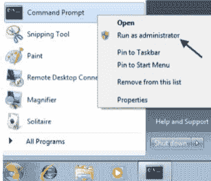
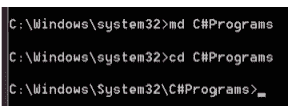
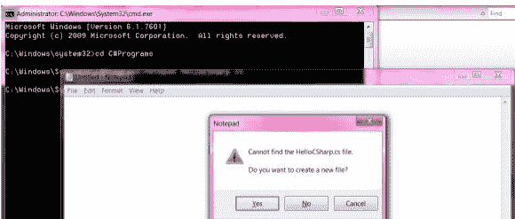
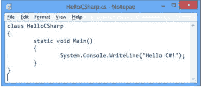
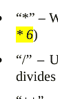
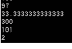
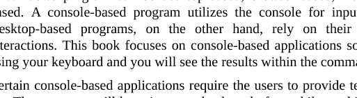
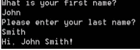
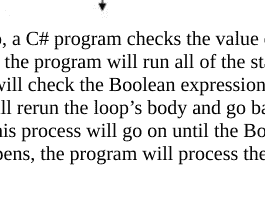
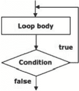

# C#：C# 速成课程——学习 C# 编程语言基础的初学者课程（c#、c 编程、c、java、python、angularjs、c++ 编程）

## 引言

我要感谢您并祝贺您下载了本书，*“C# 速成课程—初学者课程学习 C# 编程语言基础”*

本书包含经过验证的步骤和策略，帮助您在一周内掌握 C# 基础知识。

本电子书将教您与 C# 编程语言相关的基本思想和概念。它将使用清晰的文字和实用示例解释编程课程。还提供了实际的 C# 代码和屏幕截图来帮助您理解课程。此外，本书将为您提供成为优秀 C# 程序员所需的技能、知识和技巧。

阅读完本材料后，您将熟悉 C# 语言和命令控制台。您将知道如何向程序用户发送信息以及如何获取他们的输入。您将知道如何编译程序以及如何格式化代码。您将了解类、变量、函数、方法 and 数据类型的工作原理。简单来说，您将成为一名熟练的 C# 程序员，而且只需 7 天即可做到！

再次感谢您下载本书，祝您阅读愉快！

## 第 1 章：C# 的核心概念

根据计算机专家的说法，学习编程语言的最佳方式是通过编写和分析代码。因此，您将在学习语言本身之前编写一个实际的计算机程序。这种方法将帮助您理解 C# 的工作原理。此外，您将熟悉该语言的语法和结构。

### 您的第一个程序

这里是您需要输入的代码：

```
class HelloCSharp
{
    static void Main(string[] args)
    {
        System.Console.WriteLine("Hello C#!");
    }
}
```

该程序将“Hello, C#!”打印到计算机的默认输出设备上。它仍然是一个“原始”程序，因此您还无法运行它。现在，让我们先分析其结构。下一节将教您如何使用命令提示符和编程环境编译和运行程序。

### 它是如何工作的？

此示例程序包含三个部分：

- 1. 类定义；
- 2. 方法定义；和
- 3. 方法的内容。

让我们详细讨论每个部分：

*类定义* – 程序的初始行定义了一个名为 HelloCSharp 的类。最基本的类定义有两个部分：（1）单词“class”和（2）新类的名称。在此示例中，HelloCSharp 作为类的名称。您将在一对大括号（即 { }）内找到该类的内容。

*方法定义* – 这部分位于程序的第三行。在这里，您定义了一个名为 Main() 的方法。所有 C# 程序都使用 main() 方法作为其起点。以下是您需要使用的语法：

```
static void Main(string[] args)
```

如您所见，Main() 必须是 void 且为 static。参数（即括号内的部分）完全可选。这意味着您可以将 Main() 函数简化为：

```
static void Main()
```

**重要提示：** 如果您错误地输入 Main() 方法，程序将无法运行。

*方法的内容* – 您将在方法名称之后找到任何方法的内容。通常，一对大括号包含这些内容。示例程序的第五行使用一个对象（即 System.Console）和一个方法（即 WriteLine()）在计算机控制台上显示一条消息。如前所述，消息为“Hello, C#!”

**重要提示：** 在处理 Main() 时，您可以根据自己的喜好排列 C# 表达式和语句。即使您随机排列这些表达式和/或语句，也不会收到任何错误消息。但是，您的完整程序将根据其在方法体内的位置运行这些条目。

### 编写代码时需要记住的规则

### C# – 一个区分大小写的计算机语言

该语言区分大小写。这意味着在输入 C# 代码时，您需要小心字母的大小写。基本上，C# 将“power”、“Power”和 POWER 视为三个不同的对象。

**重要提示：** 您需要记住此规则。它适用于任何 C# 程序的所有元素（例如变量、常量、类等）。

### 使用正确的格式

您需要在代码中添加制表符、空格和换行符以提高其可读性。这些字符会被 C# 编译器忽略，为源代码提供了良好的结构。

例如，您可以从 HelloCSharp 代码中删除换行符：

```
class HelloCSharp{static void Main(){System.Console.WriteLine("Hello C#!");}}
```

作为替代方案，您可以从中删除制表符：

```
class HelloCSharp
{
    static void Main()
    {
        System.Console.WriteLine("Hello C#!");
    }
}
```

最后两个示例在编译和程序执行方面工作正常。但是，它们难以分析、修改、理解和维护。

**重要提示：** 确保您的所有程序都有格式化的代码。这样，您就可以保证代码的可读性。

### 如何正确格式化代码

以下是格式化代码时需要遵循的规则：

- 您可以在类定义内缩进方法。C# 允许您在格式化源代码时使用任意数量的制表符（即按下键盘 Tab 键后得到的字符）。
- 您应在方法自身的定义内缩进方法的内容。
- 将打开的大括号（即 {}）放在其所属的类或方法正下方。最好让它成为该行唯一的字符。
- 确保关闭大括号（即 }）与打开大括号垂直对齐。
- 您的类名应以大写字母开头。
- 您的变量名应以小写字母开头。
- 您的方法名应以大写字母开头。
- 缩进写在另一段代码内部的代码。

### 类名

在 C# 中，每个程序都有一个或多个类定义。程序员通常将每个类定义存储在与类名对应的单独文件中。此外，这些文件的扩展名应为“.cs”。您可以将不同的类编译到单个文件中而不会出现任何技术问题。但是，您在浏览代码时会遇到困难。

### 有关 C# 的更多信息

C# 编程语言先进、现代、多用途且面向对象。它与其他语言如 C、C++ 和 Java 有一些相似之处。主要区别在于 C# 提供更易于编程和简化的语法。

C# 程序有一个或多个 .cs 文件，其中包含数据类型和类定义。您需要编译这些 .cs 文件以获得可执行代码（即以 .dll 或 .exe 结尾的文件）。例如，如果您编译 HelloCSharp 程序，您将获得一个名为“HelloCSharp.exe”的可执行文件。

### 创建 C# 程序所需的东西

在使用 C# 编写程序之前，您需要两件重要的事情——文本编辑器（例如 Notepad）和 .NET 框架。文本编辑器将帮助您编写和编辑代码。另一方面，.NET 框架将帮助您编译和执行程序。

### 什么是 .NET？

基本上，.NET 是一个为计算机程序的开发和执行而设计的框架。大多数现代 Windows 系统都将 .NET 作为内置框架。因此，如果您使用的是微软的现代操作系统，就无需在计算机上安装任何软件。

如果您使用的是旧版 Windows 操作系统，则需要先下载 .NET 框架。您可以访问此网站并获取最新版本的 .NET。


重要提示：在阅读本书其余部分之前，请确保你的计算机已安装 .NET。否则，你在编译和执行后面会看到的示例程序时将会遇到问题。

### 文本编辑器

你应该使用文本编辑器来编写、编辑和保存源代码。你可以使用计算机上安装的任何文本编辑器。如果你不想下载额外的程序，可以只使用“记事本”（即 Windows 计算机预装的文本编辑器）。

### 编译和执行程序

现在，是时候编译并运行你之前看到的 HelloCSharp 程序了。以下是你需要做的事情：

- 1. 生成一个“.cs”文件，并将其命名为“HelloCSharp”。
- 2. 在该 .cs 文件内编写源代码。
- 3. 编译代码以生成 .exe 文件。
- 4. 运行生成的程序。

打开你的计算机，让我们开始编写一些代码吧。

重要提示：本电子书假定你使用的是 Windows 计算机。

以下是 HelloCSharp 程序的代码：

```csharp
// HelloCSharp.cs
class HelloCSharp
{
    static void Main()
    {
        System.Console.WriteLine("Hello C#!");
    }
}
```

### 使用命令提示符编写 C# 程序

首先，你需要启动“命令提示符”（也称为“命令控制台”）。如果你使用的是 Windows 7 或 Windows 8，可以单击“开始”按钮并搜索“cmd”。在搜索结果中查找名为“命令提示符”的程序。右键单击该程序，然后从菜单中选择“以管理员身份运行”。下面是一张截图：



重要提示：如果你通过双击来启动命令提示符，它的某些重要功能可能会不可用。

接下来，你需要创建一个文件目录，以便存储生成的程序。输入“md”，后跟目录名称。然后，输入“cd”进入新目录。下面是一张截图：



在此示例中，目录名称为“C#Programs”。“cd”命令将活动目录更改为“C:\Windows\System32\C#Programs”。现在，你可以创建 .cs 文件了。回到命令提示符，执行以下命令：

```
notepad HelloCSharp.cs
```

运行该命令后，你的屏幕将显示以下内容：



你的计算机会告诉你 HelloCSharp.cs 不存在。同时，它会询问你是否要创建新文件。单击“是”按钮，然后将程序代码复制到记事本应用程序中。下面的截图将帮助你完成此步骤：



按 CTRL+S 保存文件。然后通过点击红色 X 或按 ALT+F4 关闭文本编辑器。现在，你将在“C#Programs”目录中看到程序代码。

### 编译代码

此时，你可以使用“csc”（即 C# 语言的内置编译器）来编译源代码。在命令提示符中输入“csc HelloCSharp.cs”。由于这是你第一次使用编译器，你可能会收到类似下面的错误消息：

```text
C:\Windows\System32\C#Programs>csc HelloCSharp.cs
'csc' 不是内部或外部命令，也不是可运行的程序或批处理文件。
```

要解决此问题，你只需要指定 C# 编译器的位置。以下是 Windows 7 计算机所需的目录：

`C:\Windows\Microsoft.NET\Framework\v4.0.30319`

重要提示：目录末尾的数字可能会根据你使用的操作系统版本而有所不同。

因此，你应该执行以下命令：

```text
C:\Windows\Microsoft.NET\Framework\v4.0.30319\csc HelloCSharp.cs
```

C# 编译器会将你的 .cs 文件转换为可执行程序。要执行你的第一个程序，请在命令提示符中输入其名称。你将看到以下消息：

```text
Hello C#!
```

### 如何更改 Windows 计算机的系统路径

当然，你不会希望每次创建程序时都要输入编译器的完整目录。本书的这一部分将教你如何设置计算机，使其能够自动检测编译器的位置。

以下是你需要做的事情：

- 1. 打开计算机的“控制面板”，然后点击“系统”。
- 2. 你会看到一个新窗口。搜索“高级系统设置”并点击它。
- 3. 点击“环境变量”，查找名为“Path”的变量。
- 4. 点击“编辑…”按钮，并指定编译器的目录。再次强调，即：`C:\Windows\Microsoft.NET\Framework\v4.0.30319`
- 5. 点击“确定”以保存更改。
- 6. 现在，关闭当前的命令提示符并启动一个新的。然后，输入“csc”。
- 7. 屏幕应显示以下错误：
- 8. 这意味着你的计算机可以自动触发编译器。一旦你指定了源代码，你的计算机就会为你生成 .exe 文件。

```text
fatal error CS2008: 未指定输入
```

## 第 2 章：C# 的数据类型、变量和字面量

本章将重点介绍 C# 语言中使用的数据类型和变量。通过阅读这些内容，你将了解这些对象是什么，以及如何在编写自己的程序时使用它们。

### 变量——简介

典型的程序在执行过程中会使用不同的值。例如，你可以开发一个解决数学问题的程序。显然，在使用这类程序时，你需要输入不同的值。简而言之，程序员不知道用户会输入哪些值。因此，他们需要确保生成的程序能够接受用户可能提供的任何值。

当用户提供一个值时，你可以将其临时存储在机器的 RAM（即随机存取存储器）中。此内存中的所有值都可能发生变化。因此，程序员将这些值称为“变量”。

### 数据类型

数据类型是一组（或一系列）具有相似属性的值。例如，“byte”数据类型指的是“0 到 255”数字范围内的值。

### 属性

数据类型具有以下属性：

- 名称（例如 int、char、bool 等）
- 大小（例如 1 字节）
- 默认值（例如 1、2、3 等）

### C# 中不同的数据类型

C# 支持以下数据类型：

- 布尔型
- 字符型
- 对象
- 浮点型
- 十进制型
- 整数型
- 字符串

由于这些数据类型是预装在 C# 语言中的，程序员将其称为“原始类型”。让我们详细讨论每种数据类型：

### 布尔型

你需要使用“bool”（即一个 C# 关键字）来声明此数据类型。布尔值只能是“true”或“false”。在 C# 编程语言中，布尔值会自动设置为“false”。程序员使用此数据类型来存储逻辑语句的结果。

### 字符型

此数据类型可以存储单个字符。你需要使用“char”（即另一个 C# 关键字）来声明此类型。将你的“char”值写在一对撇号内（例如“I”）。

### 对象

程序员将对象视为 C# 语言中最特殊的数据类型。基本上，对象充当 .NET 中其他数据类型的父级。此数据类型在声明时需要“object”关键字，它可以接受来自其他数据类型的任何值。你可以将对象视为指向计算机内存中特定部分的地址。

### 实数类型——浮点型

在 C# 语言中，“real type”指的是你在数学中学到的实际数字。浮点实数数据类型可以是“float”或“double”。

- 1. Float——程序员将这种子类型称为“单精度实数”。浮点数的默认值是 0.0F（末尾的“f”不区分大小写）。字母“f”表示该值为“float”。
- 2. Double——程序员用“双精度实数”来指代这种子类型。其默认值为 0.0D（即末尾的字母“d”不区分大小写）。C# 会自动将实数标记为“double”，因此你实际上不需要在值末尾添加“d”。

### 实数类型——十进制型

这种编程语言支持“十进制算术”，这是一种使用十进制值来表示数字的数学方法。这种方法的主要优点是，无论它处理的值是什么，它都能保持其准确性。

C# 使用“decimal”数据类型来表示这种实数。此数据类型为 128 位长，精确到第 29 位小数。由于其出色的准确性，程序员将其用于财务计算（例如付款、税收、利息等）。

### 整数型

此数据类型包含 8 种子类型，分别是：

- SBYTE——sbyte 是一种 8 位长的有符号整数。这意味着它可以包含多达 256 个值（即 2⁸）。此外，sbyte 可以是负数也可以是正数。
- BYTE——此子类型包含 8 位长的无符号整数。它与 sbyte 几乎相同。唯一的区别是 byte 永远不能为负数。
- SHORT——这些整数是有符号的，长度为 16 位。
- USHORT——这些是长度为 16 位的有符号整数。
- INT——这可能是 C# 中最流行的数据类型。程序员使用这种数据类型，因为它与 32 位处理器完美兼容，并且对于典型计算来说足够大。它是一个长度为 32 位的有符号整数。
- UINT——这个 32 位整数是无符号的。因此，它只能是正数。
- LONG——此整数为 64 位长。它可以是正数也可以是负数。
- ULONG——这与“long”整数类似。唯一的区别是“ulong”只能取正值。

### 字符串

字符串是一组或一系列字符。C# 要求你在声明属于此数据类型的值时使用“string”（即一个关键字）。你必须将每个字符串写在一对双引号之间。这种语言允许你对字符串执行各种操作，


### 变量

你可以使用变量来存储、检索和修改可变数据。作为程序员，你需要使用变量来存储和处理信息。

### 变量的特性

变量具有以下特性：

- 名称（也称为“标识符”）
- 数据类型
- 值（即你想要存储的信息）。

变量是计算机内存中具有名称的部分。它们存储值并允许计算机程序访问其内容。你可以将变量放在栈（即计算机程序的工作内存）中，或放在程序的动态内存中。

字符、布尔值和整数被称为值类型，因为它们将数据保存在程序栈中。另一方面，字符串、数组和对象被称为“引用类型”，因为它们不持有值本身，而是作为标记，指向存储数据的计算机内存部分。

### 如何命名变量

在使用变量之前，你需要为其命名。变量名充当标识符：它帮助程序定位和指定变量。C# 允许你自由选择变量名。然而，与任何其他语言一样，C# 对变量名有一些规则。这些规则如下：

- 你可以使用下划线（即 "_"）、字母和数字来创建变量名。
- 不能以数字开头。因此，FirstSample 是有效的，而 1stSample 无效。
- 在命名变量时不能使用 C# 关键字。这条简单的规则可以防止程序中出现编译错误和运行时错误。如果你确实想将关键字用于变量，可以以 "@" 符号开头（例如 @bool、@int、@char 等）。

### 如何声明变量

在使用变量之前，你应该先声明它。以下是声明变量时需要做的事情：

- 1. 指定变量的数据类型（例如 char）
- 2. 指定变量的名称（例如 sample）
- 3. 设置变量的初始值。此步骤完全可选。

变量声明的格式为：

```csharp
data_type name = initial_value;
```

以下是一些有效变量声明的示例：

```csharp
int year = 2000;
```

```csharp
string yourname = "John Doe";
```

```csharp
char test = 'x';
```

重要提示：每条 C# 语句都需要以分号结尾。如果你忘记添加哪怕一个分号字符，程序都会产生不良和/或意想不到的结果。

### 如何赋值

与任何其他计算机语言一样，C# 允许你为变量赋值。这个过程称为“值赋值”，需要使用等号。程序员称这个符号为“赋值运算符”。将变量名写在运算符的左侧，然后在运算符的另一侧指定要赋的值。请查看以下示例：

```csharp
test = 'x';
```

```csharp
yourname = "John Doe";
```

### 如何初始化变量

在编程中，“初始化”是向新变量赋值的过程。因此，你需要在声明变量时设置这个“初始值”。

### 变量的默认值

如果不为变量分配任何值，C# 将执行自动初始化（即，它将为空变量分配一个默认值）。下表将显示每种数据类型的默认值：

| 数据类型 | 默认值 |
|---|---|
| sbyte | 0 |
| byte | 0 |
| short | 0 |
| ushort | 0 |
| int | 0 |
| uint | 0u |
| long | 0L |
| ulong | 0u |
| float | 0.0f |
| double | 0.0d |
| decimal | 0.0m |
| bool | false |
| char | '\u0000' |
| string | null |
| object | null |

下面给出的代码将向你展示如何声明变量和赋值：

```csharp
// This is an example
byte years = 10;
short days = 31;
decimal pi = 3.14;
bool isitasty = true;
char sample = 'x';
string animal = "dog";
```

重要提示：以两个正斜杠（即 //）开头的行是“注释”。在编程中，注释是添加到代码中的描述性文本，以提高其可读性。语言编译器会忽略这些行。因此，注释不会影响计算机程序的功能。

### 值与引用

C# 程序员将数据类型分为两类：值类型和引用类型。

值类型存在于程序的执行栈中。此外，它保存程序员存储的值。值类型类别包括布尔值、字符和整数。一旦程序完成代码执行，分配给这些数据类型的内存就会变为可用。例如，程序关闭后，程序 Main() 方法中的变量将被清空。

另一方面，引用类型在程序栈中存储一个地址（即引用）。该地址指向所需值的位置。基本上，引用类型在其声明期间分配动态内存，并在程序不再需要时释放一些内存。

### 字面量

字面量是在程序源代码中指定的值。下面给出的示例将说明这一概念：

```csharp
bool isitdelicious = false;
short income = 22000;
char firstletter = 'c';
byte ten = 10;
int prize = 250000;
```

在此示例中，字面量是 false、22000、'c'、10 和 250000。这些是你要直接添加到程序代码中的值。

### 字面量的种类

C# 支持以下种类的字面量：

- 实数
- 整数
- 字符串
- 字符
- 布尔值

让我们详细讨论这些字面量：

### 实数

实数字面量具有符号（即 + 或 -）、后缀、前缀和小数点。你应将此类字面量用于 double、float 和 decimal 值。C# 允许你以指数形式编写实数字面量。以下是可以应用于实数字面量的后缀：

- F – 此后缀表示 float 值。
- D – 使用此后缀表示 double 值。
- M – 此字母表示 decimal 值。
- E – 使用此字母表示指数值。例如，“e4”表示你需要将整数乘以 10⁴。

### 整数

整数字面量由前缀、后缀、符号（即 + 或 -）和一组数字组成。你可以使用前缀将数字以十进制或十六进制形式添加到代码中。以下是在 C# 中可以使用的**前缀和后缀**：

- 0X（例如 0XA6F2） – 使用此前缀表示十六进制值。
- U（例如 119U） – 此后缀表示无符号 int（uint）或无符号 long（ulong）值。
- L（例如 360L） – 使用此后缀表示“long”值。

重要提示：如果你不使用任何后缀，C# 会将整数字面量标记为“int”。此外，字母（即 L、U 和 X）不区分大小写。

### 字符串

使用此字面量表示字符串值。基本上，字符串字面量是放在一对双引号中的一组字符（例如“sample”）。

重要提示：在 C# 语言中，你可以使用“@”符号创建带引号（或逐字）的字符串。程序员使用这些字符串来命名文件路径。

### 字符

字符字面量是由一对单引号括起来的单个字符（例如 'z'）。使用字符字面量为“char”类型设置值。此外，你可以将字符字面量写为：

- 单个字符（例如 'X'）
- 特殊字符的代码（例如 '\u0067'）
- 转义码（见下文）

转义码 – 这些是向源代码添加字符的特殊字符序列。通常，这里涉及的字符无法直接添加到程序代码中。

C# 阻止你将某些字符直接添加到程序中。其中一些字符包括：制表符、换行符、反斜杠、引号等。以下列表将向你展示 C# 中最常用的转义码：

- \n – 换行字符
- \t – 制表符字符
- \' – 单引号
- \" – 双引号

### 布尔值

布尔值字面量只有两种：true 和 false。在使用“bool”（即布尔）变量时，你只能分配这些值中的一个。下面给出的代码片段将向你展示如何声明布尔值字面量：

```csharp
bool answer = false;
```


本章将重点介绍 C# 的运算符。通过阅读本材料，你将了解这些运算符的工作原理以及如何在源代码中使用它们。

### 第 3 章：运算符

运算符帮助你处理对象和数据类型。它们接受输入和操作数以产生结果。C# 语言使用特殊字符（例如 “.”、“+”、“^” 等）作为运算符。此外，C# 代码最多可接受三个不同的操作数。

### 运算符的不同类型

C# 程序员将运算符分为以下类型：

### 赋值运算符

在 C# 中，你需要使用等号（即 =）来赋值。以下是使用赋值时需要使用的语法：

```
name_of_operand = expression, literal, or second_operand
```

以下是一些示例：

```
int y = 99;
string hello = "Good morning.";
char sample = 'z';
```

重要提示：C# 允许你级联（即在单个表达式中使用多次）赋值运算符。这意味着如果要创建相同数据类型的变量，就无需输入多个等号。下面的示例将说明此规则：

```
int d = 1, e = 2, f = 3;
string hi = "Good Morning.", bye = "Farewell.", thanks = "Thank you.";
```

### 逻辑运算符

逻辑运算符（也称为“布尔”运算符）接受并返回布尔值（即 true 或 false）。以下是 C# 的四个逻辑运算符：

- “&&” – 程序员将此运算符称为“逻辑与”。如果两个操作数都为 true，则会返回“true”。
- “^” – 这被称为“异或”运算符。如果其中一个操作数为 true，则会返回 true。
- “||” – 这是“逻辑或”运算符。如果至少有一个操作数为 true，则会得到 true。
- “!” – 此运算符称为“逻辑否定”运算符，它会反转操作数的值。

以下代码将向你展示如何使用这些运算符：

```
class Test
{
    static void Main()
    {
        bool x = true, y = false;

        System.Console.WriteLine(x && y);
        System.Console.WriteLine(x || y);
        System.Console.WriteLine(!x);
        System.Console.WriteLine(x ^ y);

        // This is an example.
    }
}
```

编译并运行此代码后，你将看到以下结果：



### 算术运算符

这些运算符帮助你执行数学运算。此类别包含以下运算符：

- “+” – 使用此运算符对两个值执行加法（例如 `int x = 1 + 1`）
- “-” – 此运算符允许你在代码中执行减法。它从左操作数的值中减去右操作数的值（例如 `int x = 2 - 1`）
- “*” – 使用此运算符，你可以乘以两个操作数的值（例如 `int r = 6 * 6`）
- “/” – 在 C# 代码中使用此运算符进行数值除法。基本上，“/” 将左操作数的值除以右操作数的值。
- “++” – 这被称为“自增运算符”。它将操作数的值增加一。与上面讨论的运算符不同，此运算符作用于单个操作数。此外，你可以在操作数之前或之后书写它。（例如 99++、1++、++5 等）
- “--” – 此运算符与自增运算符完全相反。你可以使用它将操作数的值减少一。你可以在要修改的操作数之前或之后书写它。

下面的代码将向你展示这些运算符的工作方式：

```csharp
class Test
{
    static void Main()
    {
        double d = 100, e = 3;

        System.Console.WriteLine(d + e);
        System.Console.WriteLine(d - e);
        System.Console.WriteLine(d / e);
        System.Console.WriteLine(d * e);
        System.Console.WriteLine(++d);
        System.Console.WriteLine(--e);

        // This is an example.
    }
}
```

编译并执行该代码后，你将在命令提示符上看到以下内容：



### 二进制运算符

这些运算符作用于二进制数。在 IT 世界中，所有信息都表示为零和一的序列。这意味着如果你想成为一名成功的程序员，就需要掌握二进制运算符。

二进制运算符的工作方式与逻辑运算符完全相同。实际上，你可能会认为二进制运算符和逻辑运算符使用不同的输入但执行相同的过程。逻辑运算符使用布尔值来产生结果。另一方面，二进制运算符作用于以二进制数字表示的数字。以下是使用 C# 时你会遇到的二进制运算符：

- “&” – 这称为“二进制与”。它表示两个操作数都具有“1”的位置。
- “^” – 程序员将此运算符称为“二进制异或”。它会在值不同的每个位置放置“1”。
- “|” – 这是“二进制或”运算符。它表示任一操作数具有“1”的位置。
- “~” – 这充当二进制值的否定运算符。就像“!”一样，它会反转变量的当前值。
- “<<” – 这是“二进制左移”运算符。它将二进制数的位向左移动。此移动取决于你将分配的值（例如 4 << 1、4 << 3、4 << 2 等）。

### 比较运算符

这些运算符允许你比较两个操作数内部的值。这些运算符中的每一个都将布尔值作为最终输出。以下是 C# 语言的比较运算符：

- “==” – 这是相等运算符。它检查两个操作数是否相等（例如 `x == y`）
- “>” – 此运算符检查左操作数的值是否大于右操作数的值（例如 `x > y`）。
- “<” – 此运算符比较两个操作数的值。如果左操作数的值小于右操作数的值，则会返回“true”（例如 `y < x`）。
- “>=” – 使用此运算符，你可以确定左操作数的值是否大于或等于右操作数的值。
- “<=” – 如果左操作数的值小于或等于右操作数的值，则此运算符会返回 true。
- “!=” – 使用此运算符检查两个操作数是否相等。如果值不相等，则会返回 true（例如 `x != y`）。

### 条件运算符

C# 用户将“?”称为条件运算符。基本上，此运算符使用布尔表达式的结果来确定应处理哪个语句。这被称为“三元运算符”，因为它作用于三个操作数。这里，第一个值应为布尔值，而其余值需要属于相同的数据类型（例如字符、字符串、数字等）。

此运算符的语法如下：

```
first_operand ? second_operand : third_operand;
```

这是其工作原理：如果“first_operand”为 true，程序将处理“second_operand”。如果“first_operand”为 false，则程序将处理“third_operand”。

## 第 4 章：数据类型转换

通常，运算符作用于属于相同类型的参数。然而，C# 语言提供了广泛的数据类型，可用于某些情况。要对属于不同类型的变量执行任何处理，应先转换其中一个变量。在 C# 中，数据类型转换可以是隐式的或显式的。

每个 C# 表达式都有一个数据类型。此数据类型由表达式内部使用的文字、变量、值和结构得出。基本上，你可能会使用类型与情况不兼容的表达式。当这种情况发生时，你会得到以下结果之一：

- 程序会给出编译时错误。
- 程序将执行自动转换。这意味着程序将获得正确的表达式类型。

将“s”类型转换为“t”类型允许你在运行程序时将“s”视为“t”。有时，此过程需要程序员验证类型转换。查看下面的示例：

- 将“objects”转换为“strings”需要在程序运行时进行验证。此验证确保你确实想将值用作字符串。
- 将“string”值转换为“object”值不需要任何验证。那是因为“string”类型是“object”类型的一个分支。你可以将字符串转换为其“父”类，而不会丢失数据或出现任何错误。
- 在将 int 值转换为 long 值时，你无需执行验证。


“long”数据类型涵盖了“int”类型所有可能的值。这意味着数据可以在不产生任何错误的情况下进行转换。

- 将“double”值转换为“long”值涉及验证。根据您处理的值，您可能会遇到数据丢失。

重要提示：C#在更改数据类型时有一定的限制。以下是该语言支持的可能类型转换：

### 显式转换

如果存在信息丢失的可能性，请使用此转换。例如，在将浮点值转换为整数值时，您会遇到信息丢失（即小数部分会消失）。在将宽范围类型转换为窄范围类型时，您也可能会丢失一些数据（例如 long-to-int 转换、double-to-float 转换等）。要完成此过程，您需要使用“type”运算符。请查看下面的示例：

```csharp
class Example
{
    static void Main()
    {
        double yourDouble = 2.1d;
        System.Console.WriteLine(yourDouble);

        long yourLong = (long)yourDouble;
        System.Console.WriteLine(yourLong);

        yourDouble = 2e9d;
        System.Console.WriteLine(yourDouble);

        int yourInt = (int)yourDouble;
        System.Console.WriteLine(yourInt);
    }
}
```

如果正确编译和执行，该程序将给出以下结果：

```
2.1
2
2000000000
2000000000
```

### 隐式转换

只有在数据丢失不可能的情况下，您才能执行此转换。由于不需要任何运算符，因此此转换被称为隐式转换。每当您将窄范围值赋给具有宽范围的变量时，C# 编译器都会执行隐式转换。

### 字符串转换

C# 允许您将任何数据类型转换为“string”。如果您使用“+”并且至少有一个非字符串参数，编译器将自动执行此转换过程。在这里，非字符串参数将变成字符串，而“+”运算符将产生一个新值。

## 第 5 章：控制台

本章将教您如何在提供和收集数据时使用控制台。您将学习如何在 C# 语言中执行 I/O（即输入/输出）操作时使用此工具。

### 控制台 – 基础

控制台是一种可用于与计算机中可用程序交互的工具。正因如此，控制台被视为任何操作系统的[content]
“long”数据类型涵盖了“int”类型所有可能的值。这意味着数据可以在不产生任何错误的情况下进行转换。

- 将“double”值转换为“long”值涉及验证。根据您处理的值，您可能会遇到数据丢失。

重要提示：C#在更改数据类型时有一定的限制。以下是该语言支持的可能类型转换：

### 显式转换

如果存在信息丢失的可能性，请使用此转换。例如，在将浮点值转换为整数值时，您会遇到信息丢失（即小数部分会消失）。在将宽范围类型转换为窄范围类型时，您也可能会丢失一些数据（例如 long-to-int 转换、double-to-float 转换等）。要完成此过程，您需要使用“type”运算符。请查看下面的示例：

```csharp
class Example
{
    static void Main()
    {
        double yourDouble = 2.1d;
        System.Console.WriteLine(yourDouble);

        long yourLong = (long)yourDouble;
        System.Console.WriteLine(yourLong);

        yourDouble = 2e9d;
        System.Console.WriteLine(yourDouble);

        int yourInt = (int)yourDouble;
        System.Console.WriteLine(yourInt);
    }
}
```

如果正确编译和执行，该程序将给出以下结果：

```
2.1
2
2000000000
2000000000
```

### 隐式转换

只有在数据丢失不可能的情况下，您才能执行此转换。由于不需要任何运算符，因此此转换被称为隐式转换。每当您将窄范围值赋给具有宽范围的变量时，C# 编译器都会执行隐式转换。

### 字符串转换

C# 允许您将任何数据类型转换为“string”。如果您使用“+”并且至少有一个非字符串参数，编译器将自动执行此转换过程。在这里，非字符串参数将变成字符串，而“+”运算符将产生一个新值。

## 第 5 章：控制台

本章将教您如何在提供和收集数据时使用控制台。您将学习如何在 C# 语言中执行 I/O（即输入/输出）操作时使用此工具。

### 控制台 – 基础

控制台是一种可用于与计算机中可用程序交互的工具。正因如此，控制台被视为任何操作系统的[content]
“long”数据类型涵盖了“int”类型所有可能的值。这意味着数据可以在不产生任何错误的情况下进行转换。

- 将“double”值转换为“long”值涉及验证。根据您处理的值，您可能会遇到数据丢失。

重要提示：C#在更改数据类型时有一定的限制。以下是该语言支持的可能类型转换：

### 显式转换

如果存在信息丢失的可能性，请使用此转换。例如，在将浮点值转换为整数值时，您会遇到信息丢失（即小数部分会消失）。在将宽范围类型转换为窄范围类型时，您也可能会丢失一些数据（例如 long-to-int 转换、double-to-float 转换等）。要完成此过程，您需要使用“type”运算符。请查看下面的示例：

```csharp
class Example
{
    static void Main()
    {
        double yourDouble = 2.1d;
        System.Console.WriteLine(yourDouble);

        long yourLong = (long)yourDouble;
        System.Console.WriteLine(yourLong);

        yourDouble = 2e9d;
        System.Console.WriteLine(yourDouble);

        int yourInt = (int)yourDouble;
        System.Console.WriteLine(yourInt);
    }
}
```

如果正确编译和执行，该程序将给出以下结果：

```
2.1
2
2000000000
2000000000
```

### 隐式转换

只有在数据丢失不可能的情况下，您才能执行此转换。由于不需要任何运算符，因此此转换被称为隐式转换。每当您将窄范围值赋给具有宽范围的变量时，C# 编译器都会执行隐式转换。

### 字符串转换

C# 允许您将任何数据类型转换为“string”。如果您使用“+”并且至少有一个非字符串参数，编译器将自动执行此转换过程。在这里，非字符串参数将变成字符串，而“+”运算符将产生一个新值。

## 第 5 章：控制台

本章将教您如何在提供和收集数据时使用控制台。您将学习如何在 C# 语言中执行 I/O（即输入/输出）操作时使用此工具。

### 控制台 – 基础

控制台是一种可用于与计算机中可用程序交互的工具。正因如此，控制台被视为任何操作系统的[content]
“long”数据类型涵盖了“int”类型所有可能的值。这意味着数据可以在不产生任何错误的情况下进行转换。

- 将“double”值转换为“long”值涉及验证。根据您处理的值，您可能会遇到数据丢失。

重要提示：C#在更改数据类型时有一定的限制。以下是该语言支持的可能类型转换：

### 显式转换

如果存在信息丢失的可能性，请使用此转换。例如，在将浮点值转换为整数值时，您会遇到信息丢失（即小数部分会消失）。在将宽范围类型转换为窄范围类型时，您也可能会丢失一些数据（例如 long-to-int 转换、double-to-float 转换等）。要完成此过程，您需要使用“type”运算符。请查看下面的示例：

```csharp
class Example
{
    static void Main()
    {
        double yourDouble = 2.1d;
        System.Console.WriteLine(yourDouble);

        long yourLong = (long)yourDouble;
        System.Console.WriteLine(yourLong);

        yourDouble = 2e9d;
        System.Console.WriteLine(yourDouble);

        int yourInt = (int)yourDouble;
        System.Console.WriteLine(yourInt);
    }
}
```

如果正确编译和执行，该程序将给出以下结果：

```
2.1
2
2000000000
2000000000
```

### 隐式转换

只有在数据丢失不可能的情况下，您才能执行此转换。由于不需要任何运算符，因此此转换被称为隐式转换。每当您将窄范围值赋给具有宽范围的变量时，C# 编译器都会执行隐式转换。

### 字符串转换

C# 允许您将任何数据类型转换为“string”。如果您使用“+”并且至少有一个非字符串参数，编译器将自动执行此转换过程。在这里，非字符串参数将变成字符串，而“+”运算符将产生一个新值。

## 第 5 章：控制台

本章将教您如何在提供和收集数据时使用控制台。您将学习如何在 C# 语言中执行 I/O（即输入/输出）操作时使用此工具。

### 控制台 – 基础

控制台是一种可用于与计算机中可用程序交互的工具。正因如此，控制台被视为任何操作系统的[content]
“long”数据类型涵盖了“int”类型所有可能的值。这意味着数据可以在不产生任何错误的情况下进行转换。

- 将“double”值转换为“long”值涉及验证。根据您处理的值，您可能会遇到数据丢失。

重要提示：C#在更改数据类型时有一定的限制。以下是该语言支持的可能类型转换：

### 显式转换

如果存在信息丢失的可能性，请使用此转换。例如，在将浮点值转换为整数值时，您会遇到信息丢失（即小数部分会消失）。在将宽范围类型转换为窄范围类型时，您也可能会丢失一些数据（例如 long-to-int 转换、double-to-float 转换等）。要完成此过程，您需要使用“type”运算符。请查看下面的示例：

```csharp
class Example
{
    static void Main()
    {
        double yourDouble = 2.1d;
        System.Console.WriteLine(yourDouble);

        long yourLong = (long)yourDouble;
        System.Console.WriteLine(yourLong);

        yourDouble = 2e9d;
        System.Console.WriteLine(yourDouble);

        int yourInt = (int)yourDouble;
        System.Console.WriteLine(yourInt);
    }
}
```

如果正确编译和执行，该程序将给出以下结果：

```
2.1
2
2000000000
2000000000
```

### 隐式转换

只有在数据丢失不可能的情况下，您才能执行此转换。由于不需要任何运算符，因此此转换被称为隐式转换。每当您将窄范围值赋给具有宽范围的变量时，C# 编译器都会执行隐式转换。

### 字符串转换

C# 允许您将任何数据类型转换为“string”。如果您使用“+”并且至少有一个非字符串参数，编译器将自动执行此转换过程。在这里，非字符串参数将变成字符串，而“+”运算符将产生一个新值。

## 第 5 章：控制台

本章将教您如何在提供和收集数据时使用控制台。您将学习如何在 C# 语言中执行 I/O（即输入/输出）操作时使用此工具。

### 控制台 – 基础

控制台是一种可用于与计算机中可用程序交互的工具。正因如此，控制台被视为任何操作系统的重要组成部分。

在 C# 中，用户与程序的交互涉及标准输出（例如屏幕）和/或标准输入（例如键盘敲击）。合在一起，这些被称为 I/O 操作。控制台中的文本提供有用的数据，并且是一组来自计算机程序的字符。

计算机的操作系统（即操作系统）将 I/O 设备链接到计算机上安装的每个控制台程序。大多数系统将屏幕和键盘标记为默认输出和输入设备。然而，您可以轻松地将这些通道重定向到某些文件或设备。

### 程序与其用户之间的交互

大多数计算机程序与其用户交互。用户需要向他们正在交互的程序提供输入或指令。如今有许多交互方法可用：基于控制台、基于浏览器、基于互联网、图形化等。现在，使用控制台进行程序交互的人数在不断减少。这是因为替代选项（例如基于浏览器）在便利性和用户友好性方面更好。

### 使用控制台

有时，控制台是用户-程序交互最重要的工具。例如，在创建简单的计算机程序时，您需要使用控制台。这些程序要求您专注于必须修复的问题。漂亮的 GUI（即图形用户界面）和有吸引力的输出不会帮助您完成此任务。

您还可以使用控制台在将其添加到复杂程序之前尝试一个小的代码块。由于控制台是一个简单的工具，您可以轻松地隔离代码块，而无需按任何按钮或查看不同的屏幕。控制台只需几秒钟就能为您提供所需的结果。

### 访问控制台

访问控制台的过程取决于您当前使用的操作系统。例如，如果您使用的是 Windows 计算机，则需要执行以下步骤：

- 1. 单击“开始”按钮。
- 2. 单击“程序”并选择“附件”。
- 3. 单击显示“命令提示符”的选项。

控制台将显示您的主目录，由您的用户名表示。下面示例中的用户名是 SARAH：



重要提示：如果您使用的是 Windows Vista、Windows 7 或 Windows 8，您可以通过搜索“cmd”来启动控制台。

### 有关控制台的附加信息

控制台是一个显示基于文本信息的黑色窗口。它有一个闪烁的光标并显示字符字符串。如您所见，每次输入一个字符时，光标都会移动。

Windows 程序可以是基于桌面的、基于浏览器的、基于互联网的或基于控制台的。基于控制台的程序利用控制台进行输入和输出处理。另一方面，基于桌面的程序依赖其 GUI 进行用户-程序交互。本书侧重于基于控制台的应用程序，因此您将使用键盘输入数据，并将在命令提示符中看到结果。

某些基于控制台的应用程序要求用户提供文本、数字、字符等。这意味着在使用基于控制台的程序时，您经常会使用键盘。

### 基本命令

在本节中，您将学习使用命令提示符发出的基本命令。如果您想成为一名优秀的 C# 程序员，您应该仔细学习这些材料。

### 控制台命令

- `cd name_of_directory` – 此命令允许您更改活动目录。例如，如果您想进入 C: 内的 Users 文件夹，您需要发出以下命令：`cd C:\Users`
- `<｜｜begin▁of▁sentence｜｜>#include <stdio.h>` – 使用此命令查看活动目录中的文件。
- `rmdir name_of_directory` – 此命令允许您删除目录。例如，`rmdir Sample` 删除名为“Sample”的目录。
- `mkdir name_of_directory` – 使用此命令，您可以在活动目录内创建新目录。例如，如果您当前位于 Users 目录中，`mkdir John` 将在“Users”内创建名为“John”的文件夹。
- `type name_of_file` – 使用此命令查看现有文件的内容。例如，您可以发出 `type HelloCSharp.cs` 来查看该 .cs 文件的内容。

### 标准 I/O

标准 I/O 系统是为 UNIX 计算机开发的机制。该系统涉及用于接受输入和产生输出的特殊设备。

如果程序正在等待用户执行操作或提供信息，控制台将显示一个光标。这意味着系统处于“等待模式”。

### 输入和输出

操作系统需要为用户-程序交互定义标准 I/O 机制。启动基于控制台的应用程序时，程序初始化块中的代码需要与操作系统分配的 I/O 机制一起工作。此代码允许用户与所涉及的基于控制台的程序进行交互。

由于此代码，程序可以从“Console.In”（即 C# 的标准输入流）读取用户的输入，将信息发送到“Console.Out”（即 C# 的标准输出流），并通过“Console.Error”（即 C# 的标准错误消息流）报告问题情况。

重要提示：您将在本书后面学习 C# 流。本章将集中讨论与 C# I/O 机制相关的概念和思想。

### I/O 设备

某些程序接受非键盘输入。例如，您可以创建一个从文本文件、条形码阅读器、麦克风和其他数据源获取输入的 C# 程序。A


程序还可以将其输出发送到屏幕、外部文件、打印机等。

### System.Console

名为 System.Console 的类具有各种方法和属性，可用于读取、显示或格式化基于文本的信息。System.Console 类最常用的三个属性与输入和显示数据有关。这些属性是：Console.In、Console.Out 和 Console.Error。

这些属性有助于显示数据、读取信息和报告错误消息。C# 允许你直接使用这些属性。但是，你需要记住 System.Console 还包含其他可帮助你进行 I/O 操作的方法和属性。

重要说明：C# 语言允许你修改程序的默认流。为此，你需要使用以下方法：Console.SetOut（用于输出流）、Console.SetIn（用于输入流）和 Console.SetError（用于错误流）。

### 控制台输入

编程语言具有将信息输入计算机控制台的系统。特别是 C# 语言，使用一个名为“Console.In”的对象来控制其输入流。

实际上，你不必直接使用 Console.In。“Console”类提供了两个方法（即 Console.ReadLine 和 Console.Read），它们与 Console.In 配合工作。你可以使用这些方法从命令提示符读取数据。

### Console.ReadLine 方法

此方法为希望从控制台读取数据的人提供了简单性和便利性。调用此方法时，程序将停止并等待用户输入。然后，用户可以输入一个字符或字符串，并按“Enter”。按下 Enter 键，用户就通知程序他们已经输入了所需的输入。Console.ReadLine 方法将读取用户的输入，其名称也由此而来。

下面给出的代码展示了 Console.ReadLine 如何工作：

```csharp
class Test
{
    static void Main()
    {
        System.Console.WriteLine("What is your first name? ");
        string yourfirstName = System.Console.ReadLine();

        System.Console.WriteLine("Please enter your last name? ");
        string yourlastName = System.Console.ReadLine();

        System.Console.WriteLine("Hi, {0} {1}!", yourfirstName, yourlastName);
    }
}
```

如果你在命令提示符中输入“John”和“Smith”，你将看到以下消息：



### Console.Read 方法

Console.Read 和 Console.ReadLine 之间存在显著差异。首先，Console.Read 仅读取单个字符，而 Console.ReadLine 读取整个表达式。其次，Console.Read 返回的是代码，而不是所接受的输入。如果你希望将输出用作普通字符，应执行以下操作之一：

- 将输出转换为字符
- 对结果使用 Convert.ToChar 方法

重要说明：只有当用户按下“Enter”时，Console.Read 才会读取一个字符。当用户按下此键时，程序会将输入传输到标准输入缓冲区，并调用 Console.Read 方法。请查看下面给出的示例：

```csharp
class UsingRead
{
    static void Main()
    {
        int codeRead = 0;
        do
        {
            codeRead = Console.Read();
            if (codeRead != 0)
            {
                Console.Write((char)codeRead);
            }
        }
        while (codeRead != 10);
    }
}
```

### 如何读取数字

C# 程序不直接读取数字。它们需要将输入作为字符串接收（即通过 Console.ReadLine 方法），然后将其转换为数字。将字符串转换为其他数据类型的过程称为解析。C# 语言中的所有基元数据类型都支持此过程。

### 控制台输出

本书的这一部分将重点介绍两个方法：Console.WriteLine 和 Console.Write。这两个方法都可以打印 C# 语言中的所有数据类型。这意味着你可以使用它们在用户控制台上显示消息。

以下代码片段将教你这些方法如何工作：

```csharp
Console.WriteLine("I want to learn the C# programming language.");
// This line will print the string inside the parentheses.

Console.WriteLine(100);
// This line will show "100" on the user’s command prompt.

Console.WriteLine(3.14);
// This line will print the double value 3.14 on the user’s console.
```

你可以使用 Console.WriteLine 方法在用户屏幕上显示不同类型的数据。这是因为 Console 类为每种数据类型都有一个内置版本。

Console.WriteLine 和 Console.Write 之间的唯一区别是，前者打印括号内的值并在控制台上添加换行符，而后者仅显示括号内的信息。因此，在代码中使用 Console.WriteLine 就像在显示消息后按下“Enter”键（即光标将移到下一行）。

### 字符串拼接

C# 语言阻止程序员对字符串值使用运算符。显然，你不能对实际单词执行算术运算（例如 fish - dog、power * humans、land / people 等）。但是，C# 允许你连接（即组合）多个字符串对象以生成新字符串。你可以通过在字符串上使用“+”符号来实现。下面给出的示例将说明这一概念。

```csharp
string gadget = "smartphone";
string example = "I use my " + gadget + " to access " + "the internet.";
Console.WriteLine(example);
```

如果你执行该代码，控制台将显示：

I use my smartphone to access the internet.

## 第 6 章：C# 的条件语句

本章将教你如何在 C# 代码中使用条件语句。基本上，条件语句是一个代码块，允许你根据指定的条件执行各种操作。请仔细阅读本材料，因为它包含有价值的信息，可以帮助你在短短 7 天内掌握 C#。

### 运算符

在本节中，你将了解有关 C# 比较运算符的更多信息。这些运算符极其重要：它们可以帮助你为自己的条件语句设置条件。

### 比较运算符

C# 具有不同的运算符，可用于比较相同类型的值。这些运算符是：

- `<`
- `>`
- `<=`
- `>=`
- `!=`
- `==`

你可以使用上述运算符来比较 C# 表达式（例如两个整数、两个变量、两个常量等）。使用这些运算符时，结果始终为布尔值。分析以下示例：

```csharp
int height = 170;
Console.WriteLine(height < 180); // This will give you "true".

string gender = "Male";
Console.WriteLine(gender == "Female"); // This will give you "false".

double valueofPi = 3.14;
Console.WriteLine(valueofPi > 100); // This will give you "false".
```

### 逻辑运算符

C# 还支持一些逻辑运算符。程序员使用这些运算符来创建布尔（也称为“逻辑”）语句。让我们详细讨论每个逻辑运算符：

### AND 和 OR 运算符

你只能在涉及布尔值的表达式上使用逻辑 AND（即 &&）和逻辑 OR（即 ||）运算符。如果两个操作数都为 true，逻辑 AND 运算符将返回“true”。例如：

```csharp
bool sample = (1 < 2) && (10 == 10);
```

由于 1 小于 2 且 10 等于 10，该表达式将返回 true。由于逻辑 AND 运算符无需执行不必要的分析即可快速给出结果，程序员将其称为“短路运算符”。它首先检查语句的左侧部分。如果求值结果为“false”，操作将立即停止。由于其中一个操作数为 false，该表达式不可能再为 true。

另一方面，如果至少一个操作数的求值结果为 true，逻辑 OR（即 ||）运算符将返回 true。例如：

```csharp
bool sample = (1 < 2) || (10 > 100);
```

此示例将返回 true，因为左侧操作数为 true。逻辑 OR 运算符也是“短路运算符”，因为它甚至无需检查整个 C# 语句就能给出结果。在当前示例中，逻辑 OR 将不再分析第二个操作数，因为第一个操作数已经为 true。因此，条件已经满足。

### 异或和求反运算符

异或（即 ^）是一种全回路运算符，因为它在给出结果之前需要检查两个操作数。仅当其中一个操作数的求值结果为 true 时，它才会返回 true。因此，如果两个操作数都为 true，你将得到 false。请查看以下示例：

```csharp
bool sample = (1 < 2) ^ (2 == 2);
```

由于这两个表达式都为 true，异或将返回 false。

然而，求反运算符（即 !）只是反转其所附加的布尔值。例如：

```csharp
bool sample = !(1 < 2);
```

1 小于 2。但是，由于“!”附加到布尔表达式上，结果将被反转。这意味着该表达式的求值结果为“false”。


### 语句

既然你已经知道如何使用比较运算符和逻辑运算符，现在我们来讨论条件语句的创建。这些语句是强大的工具，可以帮助你实现编程逻辑。

### If 语句

if 语句的语法如下：

```csharp
if (the conditional expression)
{
    The if statement’s body;
}
```

如你所见，该语法包含三个不同的部分：

1. “if”子句——这部分表示“if”语句的开始。
2. 布尔表达式——这部分可以包含一个逻辑表达式或一个保存布尔数据的变量。与 C 语言不同，C# 不接受整数表达式作为其条件语句。
3. 语句体——你需要用一对花括号将这部分括起来。C# 允许你在这一部分中放置多条语句。

如果布尔表达式的计算结果为 true，程序将运行语句体。如果计算结果为 false，程序将忽略语句体并将控制权传递给后续代码块。下面给出的示例将向你展示“if”语句是如何工作的：

```csharp
Console.WriteLine("Please enter a number.");
int number1 = int.Parse(Console.ReadLine());

int number2 = 0;
if (number1 > number2)
{
    Console.WriteLine("C# is an excellent programming language.");
}
```

这段代码要求用户提供一个数字。如果用户输入的值大于零，程序将在命令提示符中打印“C# is an excellent programming language.”。

重要提示：如果你的条件语句体只有一行，则可以省略花括号。请查看下面的示例：

```csharp
int x = 10;
if (x > 0)
    System.Console.WriteLine("This variable holds a positive number.");
```

### If-Else 语句

与其他编程语言一样，C# 支持“if-else”条件语句。在编写 if-else 语句时，应使用以下语法：

```csharp
if (the Boolean variable or expression)
{
    The conditional statement’s body;
}
else
{
    The else statement’s body;
}
```

上述语法由以下几个部分组成：

- “if”子句——这部分开始条件语句。
- 布尔表达式或变量——该表达式的值决定了程序将使用的代码。
- 条件语句体——可以是单条语句或一组语句。如果使用多条语句，请将它们括在一对花括号内。
- “else”关键字——这是一个 C# 关键字，用于触发“else”子句。
- else 子句体——这与条件语句体相同（见上文）。

在处理 if-else 语句时，计算机程序会分析括号内的值。该值必须是布尔值（即 true 或 false）。如果值为“true”，程序将执行条件语句体并忽略“else”子句。然而，如果值为 false，程序将运行 else 语句体。分析下面的示例：

```csharp
int a = 100;
if (a != 50)
{
    Console.WriteLine("The variable is not equal to 50");
}
else
{
    Console.WriteLine("The variable is equal to 50");
}
```

你可以将这段代码解释为：如果 a != 50，控制台将打印：“The variable is not equal to 50”。另一方面，如果 a == 50，控制台将显示：“The variable is equal to 50”。由于名为 a 的变量保存的是 100，你的命令提示符将显示：

```csharp
Console.WriteLine("a is equal to b");
}
}
```

### Switch-Case 语句

程序员在可能答案很多的情况下使用 switch-case 语句。以下是 switch-case 语句的语法：

```csharp
switch (selector)
{
    case first_integer:
        statements;
        break;
    case second_integer:
        statements;
        break;
    default:
        statements;
        break;
}
```

基本上，选择器是返回可用值（即你可以比较或处理的值）的表达式。“switch”关键字将选择器的值与各个“case”进行比较。如果选择器的值与某个 case 匹配，则分配给该 case 的语句将运行。然而，如果没有匹配项，程序将执行 default 语句（如果有）。这意味着程序在运行任何语句之前会先分析选择器。

重要提示：确保各个 case 的值是唯一的。如果两个或更多 case 共享相同的值，你的程序将产生不理想的结果。

如你所见，每个 case 都有一个“break”子句。“break”子句会终止其所属 case 的语句体。C# 要求你在所有 switch 语句中添加该子句。

你不必把“default”部分放在 switch-case 语句的末尾。然而，如果你希望保持代码的可读性，建议采用这种位置。

## 第 7 章：循环语句

本章将教你如何使用循环语句。作为程序员，你会使用循环语句来重复运行某些代码块。循环在 C# 编程中扮演着重要的角色。因此，如果你想在 7 天内掌握这门语言，也应认真研读这一部分的内容。

### 循环——基础知识

在创建程序时，你经常需要多次执行代码序列。多次输入相同的代码块会非常枯燥。因此，你需要找到一种快速简便的方法来重复代码。幸运的是，C# 语言支持循环语句。

循环是一种重复运行代码片段的工具。你可以使用它来让代码运行特定的次数，或者只要给定条件得到满足就持续运行。C# 提供了不同类型的循环语句。让我们详细分析每种类型：

### While 循环

这是 C# 中最简单的循环语句。其语法如下：

```csharp
while (the_assigned_condition)
{
    the_loop_body;
}
```

在此语法中，“the_assigned_condition”是一个产生布尔值的表达式。该条件决定了“语句体”将运行多少次。另一方面，“语句体”是你要执行的语句（或语句组）。

下面给出的图示将说明 while 循环的工作原理：



在处理“while”循环时，C# 程序会检查布尔表达式的值。如果值为“true”，程序将运行循环体内的所有语句。然后，程序会再次检查布尔表达式以查看其值。如果值仍然为 true，程序将重新运行循环体并回到第一步（即检查表达式的值）。此过程将持续进行，直到布尔表达式的计算结果为 false。一旦发生这种情况，程序将处理紧接在循环之后的代码块。

重要提示：如果布尔表达式为 false，你的 C# 程序将不会运行 while 循环体。因此，如果在程序启动时布尔值为 false，那么循环内的语句将永远不会执行。

下面的示例将说明 while 循环是如何工作的：

```csharp
int timer = 10;
while (timer >= 0)
{
    System.Console.WriteLine("Time remaining: " + timer);
    timer--;
}
```

如果你编译并执行这段代码，命令提示符将打印以下数据：

```
Time remaining: 10
Time remaining: 9
Time remaining: 8
Time remaining: 7
Time remaining: 6
Time remaining: 5
Time remaining: 4
Time remaining: 3
Time remaining: 2
Time remaining: 1
Time remaining: 0
```

### Break 运算符

你可以使用“break”（一个 C# 运算符）来提前退出循环。如果程序员不想等待循环自然终止，就会使用这个运算符。基本上，循环一旦遇到 break 运算符就会结束。这种情况会迫使程序跳转到循环之后的代码片段。

在 C# 中，你只能在该运算符位于循环体内时使用它。这意味着“break”只在循环运行期间起作用。

### Do-While 循环

do-while 循环与 while 循环几乎相同。这两者之间唯一的区别是


循环的区别在于，前者在循环体运行之后才分析布尔值。因此，即使布尔表达式为 false，你也可以放心，你的代码至少会运行一次。以下是 do-while 循环的语法：

```csharp
do
{
    statements;
} while (Boolean expression)
```

do-while 循环遵循这样的模式：



程序会先执行循环体内的所有语句，然后检查条件（即布尔表达式）。如果条件评估为 true，程序将再次执行循环体，并进行“值检查”。这个过程会持续进行，直到条件变为 false。因此，如果你设置的条件始终评估为 true，你的代码可能会永远运行。

### For 循环

一般来说，for 循环比 do-while 循环和 while 循环更复杂。然而，for 循环可以帮助你用更少的 C# 代码完成困难的任务。for 循环的语法如下：

```csharp
for (initializer; Boolean_expression; update)
{
    the_loop’s_body;
}
```

for 循环包含一个初始化器（即计数器的初始值）、一个布尔表达式、一条更新计数器的 C# 语句，以及循环体。

“计数器”（即赋给循环的初始值）是 for 循环最显著的特征。在大多数情况下，计数器的值会一直增加，直到达到最终值（例如 1 到 10）。此外，程序员通常知道 for 循环将迭代多少次。

你可以在 for 循环中包含一个或多个变量。这些变量可以按降序或升序移动。编写程序时，你可以在单个 for 循环中组合升序和降序变量。此外，升序变量可以从 1 到 1024，因为 for 循环支持算术运算（例如加法、乘法等）。

重要提示：for 循环的所有部分都是可选的。你可以在语法中留空来创建无限 for 循环。示例如下：

```csharp
for ( ; ; )
{
    // Loop body
}
```

现在，你可以准备进一步了解 for 循环的不同部分了。

### 初始化

for 循环可以包含一个初始化片段：

```csharp
for (double sample = 1; ...; ...)
{
    // You can use the “sample” variable here.
}
// You can’t use the variable here.
```

C# 程序在运行 for 循环之前会执行该片段一次。通常，程序员使用初始化片段来创建计数器（也称为“循环变量”）并为其赋初始值。该计数器在循环体内可用。C# 允许你使用单个初始化片段声明多个变量。

### 条件

显然，for 循环需要一个条件表达式。示例如下：

```csharp
for (double sample = 1; sample < 5; ...)
{
    // This is the loop's body.
}
```

计算机在执行循环体之前会评估条件表达式。如果结果为“true”，循环体将运行；否则，程序将跳转到当前循环之后编写的语句。

### 更新语句

这是 for 循环的最后一部分。基本上，更新语句会更新循环的计数器。让我们使用上面给出的代码片段：

```csharp
for (double sample = 10; sample > 1; sample--)
{
    // This is the loop's body.
}
```

程序会在运行循环体后执行此部分。请记住，该语句会更新计数器的值。

### 循环体

这部分包含 C# 语句。它可以使用你在循环初始化片段中声明的变量。请看下面的示例：

```csharp
for (double sample = 10; sample > 1; sample--)
{
    System.Console.WriteLine(sample);
}
```

### continue 运算符

在某些情况下，你需要停止当前迭代，而不结束循环本身。你可以使用名为“continue”的 C# 运算符来完成此任务。下面给出的示例将说明该运算符的工作原理：

```csharp
int n = int.Parse(Console.ReadLine());
int sum = 0;
for (int i = 1; i <= n; i += 2)
{
    if (i % 7 == 0)
    {
        continue;
    }
    sum += i;
}
Console.WriteLine("sum = " + sum);
```

这段代码计算 1 到 n 范围内所有被 7 除后有余数的奇数之和。

### “foreach” 循环

就在最近，C# 引入了“foreach”循环（即扩展的“for”循环）的概念。这种循环概念在其他编程语言中也可用，例如 C、VB、C++、PHP 等。使用此编程工具，你可以遍历列表、数组或其他值组中的所有元素。“foreach”循环会获取所有现有元素，即使在非索引数据组中也是如此。

编写此类循环时，请使用以下语法：

```csharp
foreach (type name_of_variable in name_of_group)
{
    the_statements;
}
```

如你所见，这种循环比典型的“for”循环简单得多。“foreach”循环可以帮助你快速扫描集合中的所有对象。无数程序员在编写代码时使用这种循环也就不足为奇了。

### 嵌套 for 循环

C# 允许你将一个“for”循环放在另一个“for”循环内部。位于代码最内层的循环运行次数最多。而最外层的循环重复次数最少。嵌套 for 循环时，应使用以下语法：

```csharp
for (initializing_fragment; condition; update_statement)
{
    for (initializing_fragment; condition; update_statement)
    {
        statements
    }
}
```

这里，程序运行初始的“for”循环，执行其循环体，并触发嵌套循环。程序将检查第二个循环的条件，并执行其中的代码，直到评估结果为 false。然后，程序将对循环的计数器进行必要的调整。程序将重复整个过程，直到所有条件的评估结果都为 false。

## 第 8 章：C# 语言的方法

本章将重点讨论 C# 方法。在这里，你将学习如何在自己的程序中声明和使用方法。如果你想在短短 7 天内成为一名高效的 C# 程序员，就需要牢记本章的内容。

### 方法 —— 基础知识

对大多数程序员来说，方法是任何程序的核心部分。方法可以解决问题、接受用户输入（称为参数）并产生结果。

方法通过表示程序完成的数据转换来完成任务。此外，方法还是实际处理过程完成的区域。这就是 C# 程序员将方法视为任何计算机程序基本单元的主要原因。

### 方法带来的好处

在本节中，你将了解 C# 方法带来的主要好处。阅读完这些内容后，你就会明白为什么在编写程序时应该使用这些工具。

### 更好的结构和代码可读性

编程专家声称，在编写计算机程序时应该使用方法。即使是最简单的方法，也能提高 C# 代码的结构和可读性。

这里有一个你需要了解的重要事实：程序员将 20% 的时间花在编写和检查计算机程序上。剩余的 80% 则用于维护和改进软件。显然，如果你的代码可读性强且结构良好，那么你在程序上工作起来就会轻松。

### 防止冗余代码

方法可以帮助你避免程序中的冗余代码。冗余或重复的代码通常会在计算机应用程序中产生不良结果。

### 更好的代码复用

这一好处与上一点密切相关。如果你的程序需要多次使用某个代码片段，那么将该片段转移到 C# 方法中是一个绝佳的主意。你可以多次调用方法，这意味着你无需重新键入即可重复使用重要的代码。


### 声明、实现和调用 C# 方法

至此，你需要了解可以对现有方法执行的过程。这些过程包括：

- 声明——在此过程中，你会将方法关联到程序。此过程允许你在程序的任何部分调用该方法。
- 实现——此过程涉及输入代码以完成某项任务。这里涉及的代码存在于你正在使用的方法内部。
- 调用——这是调用已声明方法的过程。在此，你将使用方法解决问题或执行操作。

### 方法声明

在 C# 中，你需要在类内部声明方法。此外，不允许“嵌套”方法（即，在一个方法体内编写另一个方法）。最好的例子是 Main()，你已经多次使用过的方法。下面的代码说明了这一点：

```csharp
class DeclaringMethods
{
    static void Main()
    {
        System.Console.WriteLine("Hi C#!");
    }
}
```

### 语法

声明方法时，请使用以下语法：

```
static data_type_of_the_result name_of_method (list_of_parameters)
```

让我们使用 Main() 方法（即 static void Main()）来分析这个语法。Main() 使用“void”作为返回类型，因为它不产生任何结果。“Main”一词作为其名称。另一方面，圆括号充当程序员将提供的参数的容器。

重要提示：编写 C# 程序时必须遵循此语法。不要改变方法各部分的位置。

C# 不要求你在声明中包含参数。这意味着你可以将圆括号留空（例如 Main()）。

### 方法名称

在声明、调用或实现期间，你需要指明方法的名称。以下是命名方法时需要记住的规则：

- 确保首字母大写。
- 每个单词都以大写字母开头（例如 SampleMethod、NewMethod、MainLine 等）。
- 使用动词和名词作为方法名称。

重要提示：上述规则完全是可选的。如果你希望 C# 代码具有出色的结构和可读性，请遵循这些规则。

### 方法实现

仅声明方法还不够。如果你希望方法在程序中运行，还需要实现方法。程序员在指代方法的实现时使用术语“主体”。

### 主体

你会在花括号内找到方法的主体。该主体由你想执行的命令、表达式和语句组成。因此，主体是任何方法的重要组成部分。

重要提示：请记住，在 C# 中不能嵌套方法。不要在其他方法内部编写方法。

### 方法调用

基本上，这是运行方法主体内语句的过程。调用方法简单容易：你只需指明其名称，添加一对圆括号，并使用分号结束该行。以下是应使用的语法：

```
name_of_method();
```

下面的示例代码将向你展示如何调用方法：

```csharp
class Animals
{
    static void Main()
    {
        Console.WriteLine("I love dogs.");
    }
}
```

如果你编译并执行该代码，命令提示符将打印以下消息：

*我爱狗。*

### 可以调用方法的位置

C# 允许你在以下区域调用方法：

- 在程序的 main 方法（即 Main()）内部。
- 在另一个方法内部。
- 在该方法自身的主体内部。这种技术称为“递归”。

### 结论

再次感谢你下载本书！
我希望本书能帮助你在短短几天内成为一名熟练的 C# 程序员。
下一步是继续使用 C# 编写你自己的程序。

最后，如果你喜欢本书，我想请你帮个忙：能否在 Amazon 上为本书留下评论？不胜感激！
谢谢，祝你好运！
