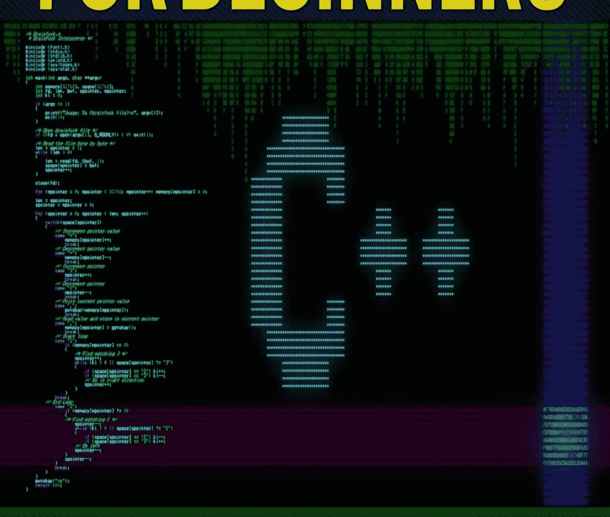
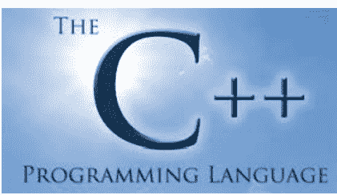
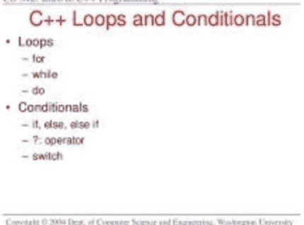
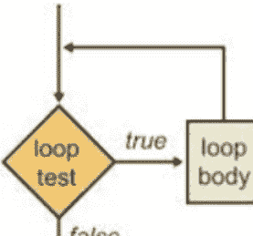
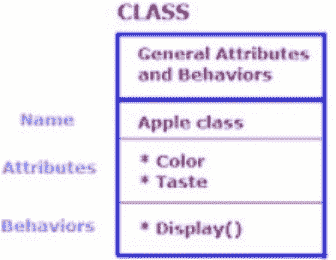

# C++：C++ 初学者指南，C++ 24小时实战，快速学习 C++！一种学习 C++ 的智能方法。简单易懂。C++ 步骤指南，C++ 编程，从今天开始编码





# STANLEY HOFFMAN


# 简介

C++ 是一种新兴的基于对象和编译的编程语言。如果你是一个从未编程过的人，可能会对“对象”（object）和“编译”（compiling）这两个词感到困惑。

利用编译的程序是由计算机的 CPU 读取的，而不是通过计算机上安装的运行程序的程序进行解释。因此，程序更多的是与计算机的处理系统对话，而不是与某个程序对话。

你可能已经知道，但计算机无法读取字母，必须读取二进制代码，因此代码必须翻译成计算机可读的形式。这被称为“编译”。现在，面向对象的代码只是代码的结构方式。你将在接下来的章节中更好地理解这个小知识。

那么，这一切意味着什么，为什么你需要知道它呢？作为一名使用 C++ 的程序员，你需要的不仅仅是一个普通的文本编辑器。只有极少数编程语言只需要这些，而它们实际上并不是真正的编程语言。你将学到的东西之一就是编译器。

你可能需要的另一个东西是集成开发环境，也称为 IDE。这是一种面向程序员的文本编辑器，具有语法高亮功能并集成了编译器。对于 Windows 和 Linux，你可以使用不同的选项。

你并不真的需要 IDE，因为一个基础文本编辑器就可以了，但像记事本（Notepad）这样的会让事情变得稍微困难。文字处理器也是一个糟糕的选择，因为它们有拼写和语法自动修正功能，如果你不小心就会弄乱你的代码。

在开始 C++ 之前，你应该理解它有严格的语法。这意味着代码是大小敏感的，所以输入‘Hello’和输入‘hello’是不同的。此外，你应该知道这种编程语言并不关心空白，所以不用担心它。

这就是你初开始学习 C++ 时需要的所有知识。让我们进入实际代码环节带你入门吧！

我认为下一本书对你也会很有趣：

Matt Benton 著 **计算机黑客技术** (Computer Hacking)


# 第一章 – 你的第一个程序



由于这个关于如何开始 C++ 的教程非常短，我们将在第一章让你从程序开始。你的第一个程序将非常简单。你要做的只是在屏幕上写一个短语，这不像在 Word 文档中写那么简单。首先，让我们来看代码，然后深入探讨它的含义。

```cpp
#include <iostream>
using namespace std;
int main() {
    cout << "Hello, world!";
    return 0;
}
```

这一行告诉编译器它必须将 iostream 库链接到程序。库是一个存储代码片段的仓库，这些片段被称为函数。库还存储了其他内容，如变量和运算符。

iostream 库的代码允许你将字符发送到文本流中，然后显示在屏幕上。把它想象成一条河流。任何放入河流的东西都会显示在屏幕上。

接下来的行（第二行）让编译器知道你想使用名为 std 的命名空间（namespace）。命名空间是存储代码的区域。通常，代码片段不能共享相同的名称，但如果一个在独立的命名空间中，它们就可以有相同的名称。

第三行代码是代码的开始。它是主块（main block），正如其名所暗示的。大括号 {} 内部的所有内容都将由编译器翻译。你需要这一行，因为没有它什么都不会发生。

现在开始打印短语‘Hello, World!’！为了实现这一点，你使用了存储在 iostream 库中的代码。这部分代码被称为 `cout`，它向流发送信息。`cout` 之后的 `<<` 是一个运算符。这意味着输出。

接下来的流是‘Hello, World!’，被称为字符串（string）。字符串是由双引号表示的一系列字符。它以分号结尾，并表示语句的结束。如果不使用分号，程序将无法编译。

```
```

最后一行，即右大括号，虽然简单但非常重要。它被放置在 `main` 的末尾，告诉计算机主块已结束。它将向 CPU 返回一个值 0。非零值将产生错误，所以这是一行不可少的代码。

现在你已经有了程序的源代码，你必须编译它。尝试从终端（terminal）运行它。现在你已经知道如何创建你的第一个程序以及它长什么样，让我们来看看变量吧！

# 第二章 – 变量

在上一章中，提到了变量，并说将讨论它们。现在是讨论它们的时候了。变量是存储值的东西。想象每个变量都是一个盒子，每个盒子都贴有名字。

类别是指存储的物品类型，而它的名字被称为变量名。盒子可以存储很多东西，但前提是该东西必须放进盒子里。例如，一种类型的变量是整数（integer）。如果你了解基础数学，你就知道整数是整数及其负对应数。所以 -5、4 和 -37 都是整数。此外，整数变量具有固定的大小。

它们只能包含两个数字之间的数字。这些是特定于变量的且目前不会改变，但默认的整数范围是 -32 到 32767 之间。你可能不需要比这更大的数字，所以我们将剩下的部分留到以后再说。

这里是你可以使用的不同类型的变量。

| C++ 类型 | 存储内容 |
| --- | --- |
| int | 整数 (integers) |
| bool | 真或假 (0 或 1) |
| float | 小数 (reals) |
| double | 精度是 float 的两倍的浮点数 |
| char | 单个 ASCII 字符 |

有几种不同的变量类型。你在编程时可能会用到所有的类型，但现在你只需要使用几个。

# 使用变量

看看以下程序：

```cpp
#include <iostream>
using namespace std;
int variable;
int main()
{
  variable = 42;
  cout << variable;
  return 0;
}
```

该程序的大部分看起来都很熟悉，除了第四行和第六行。第一个不熟悉的部分声明了变量。这是告诉编译器你将使用一个变量。在声明中，变量类型在前。在示例中，它使用了 `int` 类型。接下来是变量名，在这里被称为 `variable`。

它简单直接。变量名可以是任何内容，但要确保它是相关的，不是 C++ 中已保留且具有含义的内容，并且不以数字或特殊字符开头。你应该以小写字母开头，并用分号结束语句。

上述代码的第九行被称为赋值，并将值赋予变量。等号是赋值运算符，它的功能就是执行赋值操作。`=` 是的是一个二元运算符，因为它有两个操作数：左侧和一个右侧的。右侧的操作数不必是一个值，可以是另一个变量。左侧必须是变量。


```
C:\>windows\system32\cmd.exe -c
OUTPUT PROGRAM
Maths = 38
Physics = 77
Chemistry = 69
```

变量还有前缀，这些前缀被添加到声明中会改变它们的行为。某些前缀会改变大小，另一些则不允许负数，还有一些可能会执行完全不同的操作。

现在你已经了解了变量，让我们来聊如何扩展程序吧！

# 第三章 - 扩展你的程序

现在你已经知道如何使用变量以及如何将它们放入程序中，让我们来看看如何扩展程序。你实际上所做的就是使用变量并将它们放入程序，所以你实际上只能设置变量的输出和值。这在创建真实程序时并没有用。


你需要一种方法来操作变量并接收用户的输入。让我们来看下一个！

# iostream 库

你已经知道 iostream 库可以输出数据，但它也可以获取输入数据。这个命令与 `cout` 语句非常相似。该命令是 `cin`。不过有一个不同。当你使用 `cin` 时，它后面的运算符是反的。

它不是 `<<`，而是 `>>`。这在开始很难记住，但你最终会学会的。注意，当你运行程序时，你需要在输入所需信息后按回车键，就像终端/cmd 提示符一样。

看看下面的程序以查看两者之间的区别。

```
1 cout << "string";n2 cout << var;
3
4 cin >> var;
```

你可能已经使用 `iostream` 库获取用户输入是非常简单的，这可以产生更多实用的程序。不过，`iostream` 要强大得多。你可以将许多语句组合成一个。

例如，为了输出两个字符串或变量，你通常需要两条语句，但你可以组合多个 `cout` 语句并产生更短的代码。你所做的只需为你要输出或输入的项目添加另一个运算符即可。

例如：

```
1 cout << "Hello, " << "World!";
```

你也可以以同样的方式组合 `cin` 语句，就像连续接收几部分输入一样。每个语句后都必须按回车，而且你不能在一行代码中混合输入和输出。

现在你已经知道如何组合代码并扩展你的程序，让我们更多地讨论运算符。

# 第四章 – 运算符

你学习了如何输出文本、声明变量和获取输入，但你并没有对变量进行任何操作。当然，你可以给它们赋值，但在现实世界中这有什么用呢？你真正需要的是一种在不费力的情况下操作变量的方法。幸运的是，运算符将拯救你！

你已经研究了两个与 `iostream` 库相关的运算符，输入和输出 `>> <<`。

| 运算符 | 用途 | 示例 | 结果 |
|---|---|---|---|
| + | 将两个数字相加 | i=3+2 | 5 |
| | 用于减法 | i=3-2 | 1 |
| * | 用于乘法 | i=3*2 | 6 |
| / | 用于除法 | i=3/2 | 1 |
| % | 取模（除法后的余数） | i=10%3 | 1 |

这些运算符可以分类，第一类是算术运算符。这些是 `-`、`+`、`/` 和 `*`。你使用它们的方式就像在数学中使用它们完全一样。例如，这段代码会将两个数字相加并显示结果。

```cpp
#include <iostream>
using namespace std;
int sum = 0;
int main() {
sum = 64 + 32;
cout << sum;
return 0;
}
```

现在你已经知道如何使用运算符，让我们来看看条件判断！

# 第五章 – 条件判断

拥有一个执行单一、线性任务的程序（比如说“你好”）是很棒的，但你很少会遇到一个只执行线性任务的程序。程序通常使用被称为“条件”的东西，或者说根据条件是否为真将代码分支到不同路径的语句。这基本上就像路上的叉路。

C++ 条件判断采用 `if` 语句的形式。例如，如果某事为真，则执行这行代码；如果某事为假，则执行另一行代码。看看下面的代码段示例。

```cpp
1 int a;
2
3 if (a<2)
4 {
5 cout<<"a is less than 2\n";6 }
```

到目前为止，第一到五行对你来说应该很易懂，但第三行你可能需要一点解释。这是 `if` 语句的示例。它的工作原理是首先获取整数变量 `a` 的值，并检查它是否小于 2。如果为真，它将运行大括号中的代码。

如果不是，它将继续运行，仿佛这段代码不存在一样。我们知道 1 或 `a` 的值小于 2，所以如果你运行这个程序，你将在屏幕上看到“a is less than 2!”。

这里又引入了另一个运算符，小于号 `<`。如果你熟悉数学，那么这个符号的使用是非常自言自语的。如果你不熟悉，你就需要学习一下它。注意，虽然 `<` 看起来像 `<<`，但它们根本不是一回事，而且在编程中没有没有关系。



当然，C++ 是一门强大的语言，因此它能够使用这些条件来执行更强大的操作。

# 第六章 – 循环



现在你可以编写重复多次的代码了。循环是逐条重复的代码，直到满足某个条件。C++ 有三种类型的循环：`while` 循环、`for` 循环和 `do while` 循环。让我们从 `while` 循环开始，因为它是简单的。

`while` 循环看起来像语句，几乎。

```cpp
1 userInput = 0;
2
3 while (userInput!=10)
4 {
5 cin >> userInput;
6 }
```

当你知道循环的作用时，“while” 的用法是显而易见的。在这里，代码的意思是当 `userInput` 的值不等于 10 时，从用户处获取某些输入。此外，记住 `!=` 在 C++ 表示“不”，所以代码 `!=` 翻译为不等于。

如果 `userInput` 是十，那么代码将不执行，循环将被跳过。`while` 循环可以看作是一个在执行完代码后跳回自身的 `if` 语句。

在我们继续之前，重要的是知道以下代码段在 C++ 中是可以行的：

```cpp
while (1 == 1)
{
cout << "a";
}
```

它有一个自己的名字。它是一个无限循环，所以会无限循环。还有其他方法创建无限循环，但你可能不想创建一个。

第二种循环是 `do while` 循环。`do while` 循环看起来如下：

```cpp
int userInput = 0;
2
do
4 {
5 cin >> userInput;
6 } while (userInput!=10);
```

虽然它看起来和你刚看到的标准 `while` 循环不同，但几乎相同，只有一个区别。`while` 循环评估条件是否为真，如果是真则运行代码；而 `do while` 循环先执行某些代码，然后检查条件是否为真。由于这种情况，无论你将 `userInput` 初始化为什么值，大括号之间的代码都会被执行。

第三种循环是 `for` 循环。这是三种循环中比较复杂的，但当你理解它时它是强大的。现在，我们只需涵盖它的用途即可。看看这个循环。


```cpp
int i = 0;

for(i = 2; i < 10; ++i)
{
    cout<<i<<"\n";
}
```

这段代码告诉程序首先将变量 `i` 的值设置为 2，只要 `i` 小于 10，就将其值输出到屏幕并递增。你可以轻松地使用 `while` 循环来复制这个循环，但它会使用更多的代码行，而且非常凌乱。

你还应该知道，`for` 循环第一行使用的变量必须是同一个变量。你还应该记住，第一个语句不是条件判断，而是一个赋值。

当你想要遍历各种数据段时，这种循环会非常有用，当你在下一章读到数组时就会看到这一点。

# 第七章 – 数组

数组是一组组合在一起的变量列表，因为它们有共同的用途。它们并不真的要有什么共同点，当你把不相关的东西放在一起时，这并不是一个好主意。这就像你的文件柜里填满了随机的纸张而却从不整理。如果你打算这样做，要文件柜的什么用呢？

这是一个整数变量数组的声明。

```cpp
int a[5];
```

你可以看到数组看起来像普通变量，但它们在末尾有一些方括号。当你声明数组时，括号内将填充你所需要的数组的大小。在这种情况下，你将存储五个整数变量。

| a: | | | | | | |
|---|---|---|---|---|---|
| a[0] | a[1] | | | | a[9] |

只要你有空闲的内存（RAM），数组的尺寸可以是是你需要的任何大小，但它一次只能包含一种类型的变量。变量类型可以是你通常使用的任何类型。

访问数组中的特定变量是非常简单的。你将你想要的变量数字放在方括号中。所以，对于你想要的第一个变量，使用 `[0]`；对于第二个变量，使用 `[1]`，并以此此类推。看下面的示例。

```cpp
int a[5];

// 将 a 中的第一个变量设置为 1
a[0] = 1;

// 将 a 中的第二个变量设置为 4
a[1] = 4;

// 输出第一个变量
cout << a[0];
```

你不应该做的一点是访问数组中不存在的变量，例如一个只有五个位置的数组中的第十个变量，或者没有被分配变量的变量。如果没有被分配变量，你将得到所谓的“垃圾值”，因为它返回的值是不可用的。

如果变量不存在，你可能会得到段错误（segmentation fault），因为程序将尝试访问它未被允许访问的内存段。这可能导致程序意外终止。

现在你已经知道如何创建数组，让我们来看看如何创建函数吧！

# 第八章 – 函数

函数是编写复杂程序的极棒方法，不需要重复代码。例如，假设你有一段复杂的代码，从用户处获取输入并对其进行解析。现在，假设你需要运行这段代码几次，但不是在循环中运行。在此之前，你必须每次都写一遍。

```cpp
main () {
  function1 () {
    function2 () {
      function3 () {
        function2 (
      }
    }
  }
}
```

有了现代的复制和粘贴，这并不是什么大问题，但它看起来非常糟糕，而且当你试图修复任何错误时，重复的代码可能会成为问题。为了解决这个问题，你可以创建函数，函数是你能够使用的代码段。


在这里你创建了一个指向 int 的指针，并为它分配了内存。由于 `i` 仍然是一个指针而不是变量，你必须将 `i` 所指向的值设置为五，而不是修改 `i` 本身。这改变了 `i` 指向的位置，并导致 RAM 中某处被分配的内存变成了“孤儿内存”。这种被遗忘的内存被称为**内存泄漏**。为了防止这种情况，请务必使用 `delete` 运算符释放你最初分配的内存。

| 程序栈内存 | 动态内存（堆） |
| --- | --- |
| ars | |
| ard | |
| ars | | 内存泄漏！！ |
| ard | |

尽管如此，将内存分配到单个变量上并并没有太大帮助。如果你知道该变量将会存在，你就可以正常地声明它。这种方法创建的是在编译时不可知的变量大小数组。但实际上，你怎么可能预先知道呢？你会创建一个指针数组，并在需要时访问它们，这仅仅是创建一个巨大数组并希望一切顺利运行、更消耗内存的实现方式而已。

现在你已经了解了什么是动态内存以及如何使用它，让我们在下一章来看看类和对象。

# 第十一章 - 类与对象

这实际上是 C++ 设计的初衷：支持类和对象。没有它们，C++ 只是真正的 C 语言。但之前提到的类和对象是什么呢？类就像是一种模具，而对象是从模具中产生的东西。这些模具是灵活的，可以用来制造你喜欢的任何类型的对象。模具可以是通用的，也可以具体的。



假设你想制造一辆汽车。这是一个抽象的教程，因为代码实际上并没有执行任何操作。考虑一下汽车需要哪些属性。它们需要速度、价格、颜色、制造商和型号。如果是四轮驱动呢？你对它能做什么？你可以启动引擎和停止它吗？

让我们看看汽车外观的类定义。

```
1 class Car
2 {
3 private:
4
5 bool running;
6
7 public:
8
9 string manufacturerName;
10 string modelName
11 bool fwd;
12
13 double topSpeed
14 double price;
15
16 unsigned int color; // Colors like 0xB9DDCED
17
```

```
Car(string manufacturerName, string modelName, double topSpeed, double price, unsigned int color,
bool fwd)

19 {
20 this->manufacturerName = manufacturerName;

21 this->modelName = modelName;

21 this->topSpeed = topSpeed;

22 this->price = price;

23 this->color = color;

24 this->fwd = fwd;

25 this->running = false;

26 }
27
28 void start ()
29 {
30 this->running = true;
31 }
32
33 void stop() {
34 {
35 this->running = false;
36 }
37
38 };
```

正如你所看到的，类的定义与结构体（struct）非常相似，这是合理的，因为它们都是分组数据的方法。但这个类包含了结构体无法包含的内容：函数。


到这里，你已经学会了如何创建你的第一个简单程序以及更多内容！你知道变量是什么，如何扩展你的程序，如何使用运算符、条件、循环、数组、函数、指针、动态内存以及类和对象来将你的程序蜕变为杰作！你看，C++ 并没有像你曾经认为的那么困难，尽管它确实有些难度。

下一步是汇总你从书中汲取的知识，并继续阅读更多关于 C++ 编程的奇妙世界。当你觉得熟悉后，搭建一台虚拟机进行编码并开始之旅吧！你将学习到一种在当今计算机行业非常有价值的技能。

我希望你喜欢在本电子书中发现的信息。如果是这样，请在你的在线电子书网站上留下评论。

感谢阅读！
