# C#：初学者的 C# 速成课程：今天快速轻松掌握 C# 编程（计算机编程，初学者编程）（第 2 卷）


## 第 1 章 C# 简介

### 1.1 C# 概述

C# 是一种面向对象、类型安全的高级编程语言。它由 Microsoft 在开发 .NET 框架期间开发。C# 是为公共语言基础设施（CLI）而开发的，创建此基础设施是为了让来自各种其他高级语言的程序能够协同工作，而无需完全重写这些程序。CLI 包含各种可执行程序（简称为可执行文件），它们被容纳并运行在一个称为运行时环境的系统中。

在 .NET 框架中创建的所有程序都在处理运行时需求的环境中执行。公共语言运行时（CLR）提供虚拟机，帮助程序员无需考虑 CPU 规格。类库和 CLR 构成 .NET 框架。

### 1.2 C# 的编程特性

- 它简单、先进、面向对象
- 它包含所有 .NET 语言通用的数据类型和类
- 公共语言运行时（CLR）类似于 Java 虚拟机（JVM）
- C# 支持封装、继承、多态和接口
- Visual Studio 支持 VC++、Visual Basic、Vbscript 和 Jscript
- .NET 由类库和公共执行引擎组成
- 垃圾回收、自动内存管理、互操作性内置于 C# 中
- 用户可以使用 C# 开发控制台、Windows 和 Web 应用程序

### 1.3 C# 环境

C# 是 .NET 框架的一部分。它用于创建 .NET 应用程序。使用 .NET 框架，用户可以设计、部署和开发应用程序。使用简单的编程模型可以轻松构建健壮的应用程序。

#### .NET 框架的组件

包含若干组件的 .NET 框架示意图如下所示：

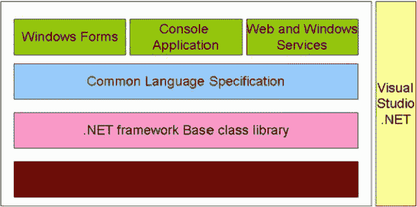

.NET 框架由以下组件组成：

- 公共语言运行时
- .NET 框架基类库
- 公共语言规范
- 用户和程序接口

#### 公共语言运行时（CLR）

.NET 框架的核心组件是 CLR。它是执行程序的环境。CLR 中的代码被转换为中间语言（IL）。然后，此 IL 代码可跨不同平台使用。

IL 代码由即时（JIT）编译器转换为机器语言。编译器会检查类型安全性。这确保以兼容的方式访问对象。


#### .NET 框架类库

该类库可与任何 .NET 语言（如 VB.NET、VC# 和 VC++.NET）配合使用。
该类库提供代码中用于执行不同编程任务的类，例如数据收集、字符串管理、文件访问和连接数据库。

#### 公共语言规范

CLR 包含一组由 .NET 框架中所有编程语言使用的公共规则。它们被称为公共语言规范（CLS）。CLS 帮助一个对象与其他语言的对象或应用程序交互。

#### 用户和程序接口

.NET 框架提供三种不同类型的用户界面：-

- **Windows 窗体：** 它们是基于 Windows 的应用程序。
- **Web 窗体：** 它们用于创建基于 Web 的应用程序。
- **控制台应用程序：** 它们用于创建由命令行执行的控制台应用程序。

## 第 2 章 C# 程序结构

### 2.1 C# 程序结构简介

C# 程序由多个部分组成。我们将探讨 C# 程序所需的所有组件。

请考虑以下演示 C# 程序的代码。

```
**Example 1:**

```csharp
using System;
namespace welcome
{
    public class WelcomeUser
    {
        static void Main(string[] args)
        {
            Console.WriteLine("WelcomeUser");
            Console.Read();
        }
    }
}
```
```

该代码由几个部分组成。如下所述：

#### 命名空间声明

命名空间由编程中使用的类的集合组成。`using` 关键字用于添加 System 命名空间。System 类包含对用户有用的类和方法。

在上面的代码中，添加了命名空间 **welcome**。

#### 类

类包含程序使用的数据和方法定义。类可以有一个或多个方法。每个类必须有一个 **Main** 方法，它是代码中首先运行的方法。在上面的代码中，声明了 **WelcomeUser** 类。

#### 类方法

类中的方法指定语句的行为。在上面的代码中，**WriteLine** 方法用于将值写入控制台。它定义在 System 命名空间内的 Console 类中。

Console 类的 **Read** 方法用于等待用户按键。从而防止屏幕过快关闭。

#### 注释

注释是用于提供有关代码的附加信息的有用文本。编译器会忽略放在注释块内的任何代码。注释有两种类型；一种用于单行条目，另一种用于多行条目。

例如：

```
Example 2:
```csharp
using System;
namespace comment
{
    /*It is a simple code
    Used for writing value to the console
    */
    class Demo
    {
        static void Main()
        {
            //It is added inside Main method
            Console.WriteLine("Demonstration of code");
        }
    }
}
```
```

### 2.2 用户界面元素

Visual Studio 应用程序中存在各种可用于项目的用户界面元素。我们将详细探讨用户界面元素。

#### 起始页

起始页是用户打开 Microsoft Visual Studio 应用程序时显示的初始页面。

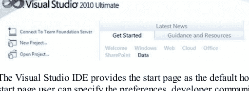

Visual Studio IDE 提供起始页作为默认主页。通过起始页，用户可以指定首选项、使用 .NET 平台进行开发者交流、探索新的 .NET 功能。

在 Visual Studio .NET 中，“项目”选项卡显示最近的项目和最新修改日期。用户可以使用列表中的任何现有项目。当需要处理新项目时，单击“新建项目”按钮。当用户想要打开现有项目时，单击“打开项目”按钮。

#### 标准工具栏

标准工具栏用于提供快捷菜单命令。工具栏上有几个按钮，可帮助用户执行与打开、关闭、保存、编辑、粘贴文件相关的任务。

标准工具栏中存在的工具相关功能如下所示。

- 新建项目：可以在应用程序中创建新项目。使用 [图标] 按钮。
- 添加新项：将新项添加到项目中。使用 [图标] 按钮。
- 保存：保存在特定解决方案中创建的所有程序。使用 [保存] 按钮。
- 全部保存：保存应用程序中所有未保存的项。使用 [全部保存] 按钮。
- 剪切：使用此选项将所选对象放在剪贴板上。使用 [剪切] 图标。
- 复制：所选项目的副本保留在剪贴板上。使用 [复制] 图标。
- 粘贴：用于将内容粘贴到文档中。使用 [粘贴] 图标。
- 调试：完成项目的编译和执行。使用 [调试] 图标。

#### 解决方案资源管理器

在解决方案资源管理器窗口中，显示项目中使用的类、项目和解决方案名称。双击解决方案资源管理器中的文件以打开文件。

下图显示了应用程序中的解决方案资源管理器窗口。

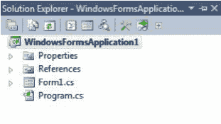

#### 输出窗口

输出窗口提供 Visual Studio .NET IDE 功能状态的消息。当用户编译应用程序时，会显示应用程序的当前状态。窗口中显示编译期间存在的错误数。使用 **视图 -> 输出窗口** 选项打开该窗口。

下图显示了 Visual Studio 应用程序中的输出窗口。

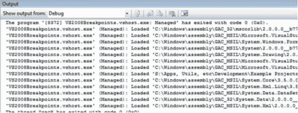

#### 错误列表

错误列表窗口中显示应用程序中存在的错误列表。代码编译后，用户即可定位错误。双击错误，即可定位其源。单击“视图”、“错误列表窗口”选项以打开错误列表窗口。

下图显示了错误列表窗口。

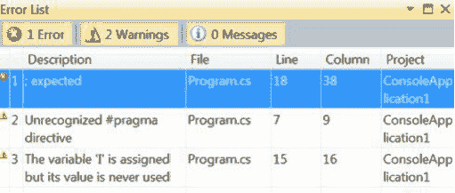

#### 类视图窗口

类视图窗口可用于显示与文件关联的类、属性和方法。使用树视图结构显示项目。双击项目可以查看代码编辑器窗口。

该窗口包含两个按钮，一个用于对项目排序，另一个用于创建新文件夹。使用“视图”、“类视图”选项打开类视图窗口。

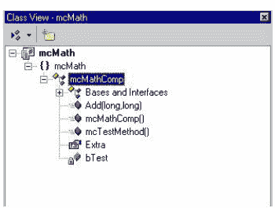

#### 代码编辑器

用户可以在代码编辑器中输入或编辑代码。用户可以将类的代码添加到编辑器中。

以下窗口显示了代码编辑器。

```
using System.Collections.Generic;
using System.ComponentModel;
using System.Data;
using System.Drawing;
using System.Linq;
using System.Text;
using System.Windows.Forms;

namespace WindowsFormsApplication1
{
    public partial class Form1 : Form
    {
        public Form1()
        {
            InitializeComponent();
        }
    }
}
```

### 2.3 编译和执行 C# 程序

编译和执行程序涉及一些步骤，如下所述：

- 1) 打开 Visual Studio 应用程序
- 2) 从列表中单击 **文件**、**新建**、**项目** 选项
- 3) 选择 Visual C# 模板并选择 Windows 选项
- 4) 从模板列表中选择控制台应用程序模板
- 5) 添加项目名称并单击 **确定** 按钮
- 6) 在解决方案资源管理器窗口中创建新项目
- 7) 在代码编辑器窗口中添加所需代码
- 8) 按 **F5** 或单击 **运行** 按钮执行项目。用户可以查看代码的输出

可以使用 Visual Studio IDE 的命令行编译 C# 程序的代码。

- 1) 在文本编辑器中添加代码，并将文件保存为 **.cs** 扩展名
- 2) 打开命令提示符并导航到该文件
- 3) 使用 csc filename.cs 并编译代码
- 4) 命令提示符移到下一行并创建可执行文件
- 5) 添加文件名并执行程序


## 第 3 章 语法、数据类型和转换

### 3.1 C# 中的不同关键字

关键字是特殊的预定义保留字，每个关键字都被赋予唯一含义。可以将这些关键字组织成类别，以便更好地理解。下面是将关键字分类为不同类型后的列表。

#### 1) 用于类、方法、字段和属性的关键字

- abstract
- extern
- internal
- new
- const
- override
- protected
- private
- public
- sealed
- readonly
- static
- virtual
- void

#### 2) 用于类型转换的关键字

- explicit
- implicit
- as
- is
- operator
- sizeof
- typeof

#### 3) 用于程序流程控制的关键字

- if
- else
- for
- foreach
- in
- case
- break
- continue
- return
- while
- goto
- default
- do
- switch

#### 4) 用于内置类型和枚举的关键字

- bool
- char
- class
- byte
- decimal
- enum
- double
- float
- interface
- long
- int
- object
- sbyte
- short
- string
- uint
- struct
- ulong
- ushort

#### 5) 用于异常处理的关键字

- try
- catch
- throw
- finally
- checked
- unchecked

#### 6) 用作字面量、方法传递参数的关键字

- true
- false
- null
- this
- value
- out
- params
- ref

#### 7) 用于函数指针、对象分配、非托管代码的关键字

- delegate
- event
- new
- stackalloc
- unsafe

### 3.2 C# 中的数据类型

数据类型用于以特定类型存储数据。程序员可使用多种内置数据类型来声明数据。

每种数据类型都有一组有限的可用取值；这些有限数量的取值称为该数据类型的**数据范围**。下面列出了存在的不同数据类型及其可具有的数据范围：

- **bool：**用于表示布尔值。可赋值为 true 或 false。
- **byte：**8 位无符号整数。byte 数据类型的取值范围为 0 至 255。
- **char：**16 位 Unicode 字符。取值范围为 U+0000 至 U+ffff。
- **double：**64 位双精度浮点类型。取值范围为 ±5.0 × 10^-324 至 ±1.7 × 10^308。
- **decimal：**128 位精确十进制值，带有效数字。取值范围为 (-7.9 × 10^28 至 7.9 × 10^28) / 10^0 至 10^28。
- **float：**32 位单精度浮点数。取值范围为 -3.4 × 10^38 至 +3.4 × 10^38。
- **int：**32 位有符号整数类型。其取值范围为 -2,147,483,648 至 2,147,483,647。
- **long：**64 位有符号整数类型。其取值范围为 -9,223,372,036,854,775,808 至 9,223,372,036,854,775,807。
- **sbyte：**8 位有符号整数类型。其取值范围为 -128 至 127。
- **short：**16 位有符号整数类型。其取值范围为 -32,768 至 32,767。
- **uint：**32 位无符号整数类型。其取值范围为 0 至 4,294,967,295。
- **ulong：**64 位无符号整数类型。其取值范围为 0 至 18,446,744,073,709,551,615。
- **ushort：**16 位无符号整数类型。其取值范围为 0 至 65,535。

### 3.3 C# 中的类型转换

当程序员需要从一种数据类型转换为另一种数据类型时，类型转换很有用。类型转换也称为**强制类型转换**。C# 中有两种类型转换。它们是**隐式类型**转换和**显式类型**转换。

#### 隐式类型转换

implicit 关键字用于隐式转换。它们不需要任何转换运算符。这些转换包括从小整数类型到大整数类型、从派生类到基类。

#### 显式类型转换

显式转换由用户通过使用预定义函数显式完成。在这些转换中，需要转换运算符。

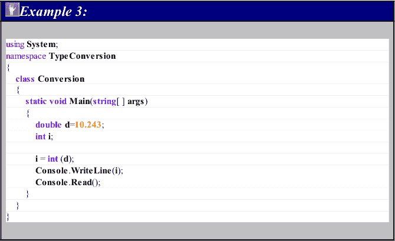

C# 包含对用户有用的类型转换方法。

以下列表显示了类型转换方法。

- **ToByte：**用于将类型转换为 byte。
- **ToBoolean：**用于将类型转换为布尔值。
- **ToDateTime：**用于将类型转换为日期时间类型。
- **ToDouble：**将类型转换为 double。
- **ToDecimal：**将浮点数或整数转换为 decimal 类型。
- **ToInt64：**将类型转换为 64 位整数。
- **ToSingle：**将类型转换为浮点数。
- **ToString：**将类型转换为字符串类型。
- **ToUInt64：**将类型转换为无符号大整数。

以下代码片段展示了将值类型转换为 Double 类型。

#### 示例 4

```csharp
using System;
namespace type
{
    class DoubleConversion
    {
        int a=10;
        float f=30.05f;
        bool b=false;

        Console.WriteLine(a.ToDouble());
        Console.WriteLine(f.ToDouble());
        Console.WriteLine(b.ToDouble());
        Console.Read();
    }
}
```

## 第 4 章 变量和常量

### 4.1 探索 C# 中的变量

变量是分配给程序所用内存位置的名称。每个变量都关联一种数据类型。数据类型决定变量在内存中用于存储的内存大小。

C# 提供的数据类型分为：

- 1. 整数类型：int、uint、short、byte、sbyte、long、ulong 和 char
- 2. 浮点类型：double、float
- 3. 十进制类型：decimal
- 4. 布尔类型：true 或 false 值
- 5. 可空类型：可空数据类型
- 6. 引用类型：class

#### 定义变量

声明变量的语法是：

```
<data_type> <variable_list>;
```

其中，**data_type** 是有效的 C# 数据类型。它可以是 int、char、float、double 或用户定义的类型。**variable_list** 包含一个或多个标识符。

变量示例：

```
int a,b,c;
char x,y;
float price, totalcost;
double area;
```

#### 初始化变量

变量使用等号初始化，后跟表达式。初始化变量的语法是：

```
variable_name = value;
```

变量可以在声明时初始化。初始化变量的一般形式是：

```
<data_type> <variable_name> = value;
```

变量初始化示例：

- `int a = 4;`
- `char z='z';`
- `double y = 12.145;`

演示变量类型的示例：

#### 示例 5

```csharp
using System;
namespace VariableDeclare
{
    class Program
    {
        static void Main(string[] args)
        {
            int a;
            short s;
            double d;

            /*initializing variables*/
            a=20;
            s=5;
            d=a+s;
            Console.WriteLine("a={0},s={1},d={2}",a,s,d);
            Console.Read();
        }
    }
}
```

#### 从用户处接受值

System 命名空间中的 Console 类提供 ReadLine() 函数。

该函数用于接受用户输入并将其存储到变量中。

示例：

```
int no;
no=Convert.ToInt32(Console.ReadLine());
```

**Convert.ToInt32()** 函数将用户输入的数据转换为整数数据类型。该函数以字符串格式接受数据。

#### 左值和右值表达式

C# 中的两种表达式类型是：

- **左值：**作为左值的表达式出现在赋值左侧。
- **右值：**作为右值的表达式出现在赋值右侧，而不出现在赋值左侧。

变量是左值，因此出现在赋值左侧。数值是右值，因此出现在右侧。

```
int a=50;
```

### 4.2 C# 中的常量和字面量

常量是表示固定值的类成员。常量值可以在编译时计算，但不能修改。常量使用 const 关键字声明。

语法：

```
const <data_type> <constant_name> = value;
```

常量示例：

#### 示例 6

```csharp
using System;
namespace constc
{
    class Program
    {
        static void Main(string[] args)
        {
            const int i=3;
            int x;
            Console.WriteLine("The value for x is");
            x=Convert.ToInt32(Console.ReadLine());
            int mult = x*i;
            Console.WriteLine("Value of multiplication is:{0}",mult);
            Console.ReadLine();
        }
    }
}
```

#### 字面量

字面量是值的源代码表示形式。C# 中有不同类型的字面量。

##### 整数字面量

整数字面量用于写入 int、long、uint 和 ulong 类型的值。它可以表示为十进制、八进制或十六进制常量。基数或进制由前缀指定。值 0x 或 0X 表示十六进制，0 表示八进制，以及

decimal is used without prefix.

Some of the examples of integer literals are 15, 0321, 0x5b, 30L.

##### 浮点字面量

Floating point literal consist of integer part, fraction part, decimal part, and an exponent part. The floating point literals can be represented in exponent or decimal form.

Floating point literals can be mentioned as 3.1415, 1423E-6L.

##### 字符字面量

Character literals represent a single character. They are enclosed in single quotes.

Characters that are preceded with a backslash are called escape characters and some of these escape characters have special meanings when used in a string to designate a special function such as creating a tab or a carriage return. Below is a list of some of these special escape characters:

- \' 单引号
- \" 双引号
- \\ 反斜杠
- \0 空
- \a 警报
- \b 退格
- \f 换页
- \t 水平制表符
- \v 垂直制表符
- \r 回车

##### 字符串字面量

There are two string literals types supported by C#: regular string literals and verbatim string literals. Regular string literals contain zero or more characters enclosed in double quotes.

A verbatim string literals contains @ character followed by a double quote character, zero or more character. A verbatim string literal can span multiple lines.

Examples showing string literals.

```csharp
"welcome user"
"welcome, \\nuser"
@"welcome user"
```

## 第 5 章 C# 中的运算符

### 5.1 运算符简介

Operator is used to define the meaning of an expression. It is a set of one or more characters used for computations or comparisons. Operators can change one or more data values, called operands into a new value.

### 5.2 算术运算符

Arithmetic operators are used for performing the **arithmetic operations** on variables. The table shows the arithmetic operators in C#.

| Operator | Description | Example |
|---|---|---|
| + | 相加两个操作数 | c=a+b<br>如果 a=10, b=20, c=10+20=30 |
| - | 从第一个操作数中减去第二个操作数 | c=a-b<br>如果 a=10, b=5, c=10-5=5 |
| * | 将两个操作数相乘 | c=a*b<br>如果 a=10, b=5, c=10*5=50 |
| / | 将分子除以分母 | c=a/b<br>如果 a=21, b=2, c=21/2=10 |
| % | 取模运算符，整数除法后的余数 | c=a%b<br>如果 a=21, b=2, c=21%2=1 |
| ++ | 递增运算符。用于将值增加一 | 如果 a=10,<br>a++=11 |
| -- | 递减。值可以减少一 | 如果 a=10<br>a--=9 |

### 5.3 关系运算符

The relational operators are used for **relational operations** and **type comparisons**.

| Operator | Description | Example |
|---|---|---|
| `==` | 检查操作数的值是否相等 | 如果 x=10, y=20, (x==y) 不是真 |
| `!=` | 如果两个操作数的值不相等，则条件为真 | 如果 x=11, y=12, (x!=y) 为真 |
| `>` | 如果左操作数大于右操作数，则条件为真 | 如果 x=13, y=17, (x>y) 不是真 |
| `<` | 如果右操作数大于左操作数，则条件为真 | 如果 x=10, y=15, (x<y) 为真 |
| `>=` | 如果左操作数的值大于或等于右操作数，则条件为真 | 如果 x=5, y=3, (x>=y) 为真 |
| `<=` | 如果左操作数的值小于或等于右操作数，则条件为真 | 如果 x=10, y=4, (x<=y) 不是真 |

### 5.4 逻辑运算符

Logical operators are used for evaluating an expression and return a **Boolean** value.

| Operator | Description | Example |
|---|---|---|
| `&&` | 逻辑与运算符。如果两个表达式都为真，结果为真 | X 的布尔值为真且 Y 的布尔值为假，(X&&Y) 为假 |
| `!` | 逻辑非运算符。如果表达式为假，返回真 | X 的布尔值为真，!(X) = 假 |
| \|\| | 逻辑或运算符。如果任一表达式为真，结果为真 | X 的布尔值为真，Y 的布尔值为假，(X\|Y) 为真 |
| `^` | 如果任一表达式为真，则返回真。如果两个表达式都为真或都为假，则返回假 | X 的布尔值为真，Y 的值为假，(X^Y) 为真 |

### 5.5 位运算符

Bitwise operators are used on bits. They perform **bit operation**.

| a | b | a&b | a\|b | a^b |
|---|---|---|---|---|
| 0 | 0 | 0 | 0 | 0 |
| 0 | 1 | 0 | 1 | 1 |
| 1 | 0 | 0 | 1 | 1 |
| 1 | 1 | 1 | 1 | 0 |

### 5.6 赋值运算符

Assignment operators are used for performing arithmetic operations on the operands. The resultant value is assigned to any one of them.

| Operator | Description | Example |
|---|---|---|
| = | 将右侧操作数的值赋给左侧操作数 | z=x+y 将 x+y 的值赋给 z |
| += | 加法与赋值运算符。将右操作数加到左操作数，结果赋给左操作数 | x+=y 类似于 x=x+y |
| -= | 减法与赋值运算符。从左操作数中减去右操作数。 | x-=y 类似于 x=x-y |
| *= | 乘法与赋值运算符。将右操作数与左操作数相乘 | x*=y 类似于 x=x*y |
| /= | 除法与赋值运算符。用右操作数除左操作数 | x/=y 类似于 x=x/y |
| %= | 取模与赋值运算符。它取两个操作数的模 | x%=y 类似于 x=x%y |
| <<= | 左移与赋值运算符 | a<<=2 类似于 a=a<<2 |
| >>= | 右移与赋值运算符 | a>>=2 类似于 a=a>>2 |
| &= | 位与赋值运算符 | a&=3 类似于 a=a&3 |
| ^= | 位异或赋值运算符 | a^=4 类似于 a=a^4 |
| \|= | 位包含或赋值运算符 | a\|=5 类似于 a=a \| 5 |

### 5.7 其他运算符

| Operator | Description | Example |
|---|---|---|
| sizeof() | 它返回数据大小 | sizeof(int), 返回 4 |
| typeof() | 提供类的类型 | typeof(StreamWriter); |
| & | 变量的地址 | &x, 变量的实际地址 |
| ?: | 条件表达式 | 如果条件为真 ? X 值 否则 Y |
| as | 如果转换不成功，则在不引发异常的情况下进行转换 | Object obj = new StringReader("Welcome"); StringReader s = obj as StringReader; |
| is | 检查对象是否为特定类型 | If(Maths is Subject), 检查主题 Maths |

## 第 6 章 C# 决策语句

Decision making is structured in the following way:

- 语句必须至少满足一个条件
- 必须至少有两个最终结果

Looking at the diagram below, we can see a general representation of the decision making logic.

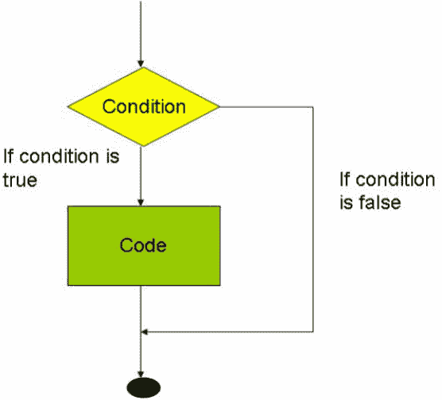

In the diagram above, the arrows represent the flow of statements executing in the system. When the statement reaches a conditional logic (diamond shape) the statement is matched to the condition. This condition has two outcomes *True* or *False*.

If the statement matches the condition then it will be declared as *True* and the statement will then run a set of code (rectangle) before reaching the end. If the statement does not match the condition then it will be declared as false and will directly proceed to the end point.

C# has various types of decision making statements. They are explained in detail.

### 6.1 if 语句

If statement contains a Boolean expression *True* or *False*. It is followed by one or more statements.

**Syntax:**

```text
if (boolean_expression)
{
    // if the Boolean expression is true, statement executed
}
```

If the expression contains value *true*, the statements in the block of code will be executed. If the expression has value *false*, the set of code after the end of if statement is executed.

**Flow Diagram**

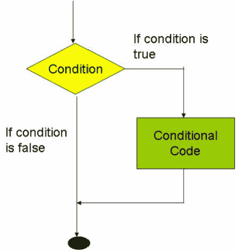

**Example of if statement**

**Example 7:**

```csharp
using System;
namespace decision
{
    class Program
    {
        static void Main(string[] args)
        {
            /* local variables */
            int i = 15;
            /* boolean condition is checked */
            if(i < 15)
            {
                Console.WriteLine("The value of i is less than 15");
            }
            Console.WriteLine("Value of i is {0}",i);
            Console.Read();
        }
    }
}
```

In this code example we can see that the condition is *if(i<15)*. So here the variable *i* must meet the condition to be less than 15 for the condition to be **True** or else it is **False**.


### 6.2 if else 语句

**if** 语句可以添加一个可选的 else 语句。当表达式的值为 false 时，执行 **else** 语句。

#### 语法：

```
if(boolean_expression)
{
    /* If the Boolean expression is true, this statement is executed */
}
else
{
    /* If the Boolean expression is false, this statement will be executed */
}
```

如果表达式的值为 **true**，则执行 **if 块**，否则执行 **else 块**。

#### 流程图

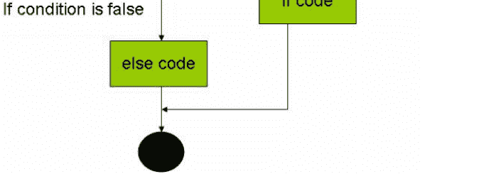

#### if else 语句示例：

#### 示例 8：

```csharp
using System;
namespace ifelseconstruct
class User
{
    static void Main(string[] args)
    {
        int age;
        Console.WriteLine("Enter the age of the user");
        age=Convert.ToInt32(Console.ReadLine());
        if(age <18)
        {
            Console.WriteLine("Not an adult");
        }
        else
        {
            Console.WriteLine("User is an adult");
        }
    }
}
```

在代码示例中，指定了条件 ( age < 18 )。因此，这里的变量 age 必须满足小于 18 的条件，才能使条件为 True，否则执行 else 块。

#### else if 语句

if 语句后面也可以跟一个 else if else 结构。使用 if else if 语句可以检查多个条件。

#### 语法

```
if(boolean_expression 1)
{
    /*If the Boolean expression 1 is true, the statement is executed*/
}
else if(boolean_expression 2)
{
    /* If the Boolean expression 2 is true, the statement is executed*/
}
else if(boolean_expression 3)
{
    /* If the Boolean expression 3 is true, the statement is executed*/
}
else
{
    /* executes if none of the condition is true*/
}
```

#### else if 语句示例

```csharp
using System;
namespace ifelse
{
    class Program
    {
        static void Main(string[] args)
        {
            int x = 30;

            if(x == 100)
            {
                Console.WriteLine("The value is 100");
            }
            else if(x == 20)
            {
                Console.WriteLine("The value is 20");
            }
            else if(x == 10)
            {
                Console.WriteLine("The value is 10");
            }
            else
            {
                Console.WriteLine("No matching value found");
            }
            Console.WriteLine("Value of x is :{0}",x);
            Console.Read();
        }
    }
}
```

在上面的示例中，指定了值 x = 30。如果有与 x 的值匹配的表达式，则执行相应的块。如果没有任何表达式匹配，则执行 else 块。

### 6.3 嵌套 if 语句

嵌套 if 语句在一个 if 或 else 语句内部包含一个 if 或 else if 语句。

#### 嵌套 if 语句的语法

```
if(boolean_expression1)
{
    /*If the expression 1 is true, statement is executed*/
    if(boolean_expression2)
    {
        /*If the expression 2 is true, statement is executed*/
    }
}
```

#### 嵌套 if 语句示例

#### 示例 9：

```csharp
using System;
namespace nestedif
{
class Program
{
    static void Main(string[] args)
    {
        int x = 20;
        int y = 40;

        if(x == 20)
        {
            if(y == 40)
            {
                Console.WriteLine("Value of x is 20 and y is 40");
            }
        }
        Console.WriteLine("Value of x is:{0}",x);
        Console.WriteLine("Value of y is:{0}",y);
        Console.Read();
    }
}
}
```


在上面的代码中，为 x 和 y 变量赋了值。会检查 if 语句中的值。如果相同，则执行内部语句，否则控制流会移出循环。

### 6.4 switch 语句

switch 语句有助于高效地针对多个条件评估一个变量。每个条件称为一个 case，并且会针对 **switch case** 检查被 switch 的变量。

#### 语法：

```
switch(Expression)
{
    case ConstantExpression1:
        statements;
    break;
    case ConstantExpression2:
        statements;
    break;
    ....
    case ConstantExpression_n:
        statements;
    break;
    default:
        statements;
    break;
}
```

switch 语句中添加的规则如下：

- switch 语句中的表达式必须是整数或类类型。
- 用户可以在 switch 语句中添加任意数量的 case 语句。
- **ConstantExpression** 的数据类型必须与 switch 中表达式的数据类型相似。
- 当表达式与 ConstantExpression 匹配时，将执行该 **case** 内的代码，并会遇到 **break** 关键字，这会强制执行跳出 **switch 语句**。
- 并非每个 case 都需要 **break** 关键字。
- 可选的 **default** case 出现在 switch 的末尾，并在表达式不匹配任何 **ConstantExpressions** 时充当后备。

#### 流程图

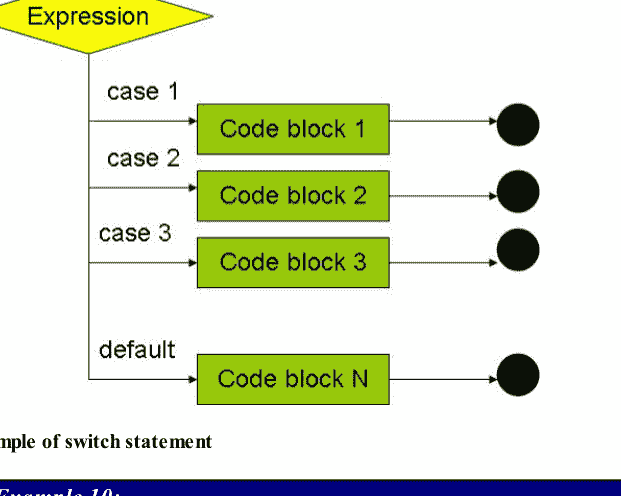

#### switch 语句示例

#### 示例 10：

```csharp
using System;
namespace switchcase
{
    class Program
    {
        static void Main(string[] args)
        {
            char grade = 'A+';
            switch(grade)
            {
                case C:
                    Console.WriteLine("Fair");
                    break;
                case B:
                    Console.WriteLine("Good");
                    break;
                case A+:
                    Console.WriteLine("Excellent");
                    break;

                default:
                    Console.WriteLine("No matching grade");
                    break;

            }
            Console.WriteLine("Grade is {0}",grade);
            Console.ReadLine();
        }
    }
}
```

在上面的代码中，为 grade 赋了值。会将其与不同的 switch case 进行匹配。如果该值与已声明的 case 之一匹配，则显示相应的消息。如果没有任何表达式匹配，则执行 *default* case。

### 6.5 嵌套 switch 语句

用户可以 switch 外层 switch 的语句序列的一部分。各个 switch 中的公共值不会冲突。

#### 语法：

```
switch(c1)
{
    case 'A':
        Console.WriteLine("A is the part of outer switch");
        break;
    switch(c2)
    {
        case 'A':
            Console.WriteLine(" A is the part of inner switch");
            break;
        case 'B':
    }
    break;
    case 'B':
}
```

#### 嵌套 switch 语句示例

#### 示例 11：

```csharp
using System;
namespace switchcase
{
    class Program
    {
        static void Main(string[] args)
        {
            char grade ="A+";
            switch(grade)
            {
                case C:
                    Console.WriteLine("Fair");
                    break;
                case B:
                    Console.WriteLine("Good");
                    break;
                case A+:
                    Console.WriteLine("Excellent");
                    break;
                default:
                    Console.WriteLine("No matching grade");
                    break;
            }
            Console.WriteLine("Grade is {0}",grade);
            Console.ReadLine();
        }
    }
}
```

#### 示例 12：

```csharp
using System;
namespace nestedswitch
{
    class Program
    {
        static void Main(string[] args)
        {
            int x = 20;
            int y = 40;

            switch(x)
            {
                case 20:
                    Console.WriteLine("Part of outer switch");
                    switch(y)
                    {
                        case 40:
                            Console.WriteLine("Part of inner switch");
                            break;
                    }
                    break;
            }
            Console.WriteLine("Value of x is :{0}",x);
            Console.WriteLine("Value of y is: {0}",y);
            Console.Read();
        }
    }
}
```

在上面的代码中，为变量 x 和 y 赋了值。如果变量 x 的值与表达式匹配，则执行 switch case 内的语句，否则控制流会移出 case 结构。


## 第 7 章 C# 中的循环
循环结构用于重复执行一行或多行代码。为了处理复杂的执行流程，C#提供了多种控制结构。

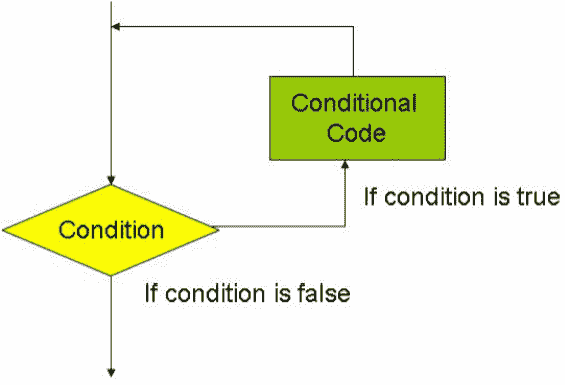

### 7.1 while 循环
while 循环由一个条件表达式组成，只有当该表达式匹配时，才能执行 while 循环内部的逻辑语句。如果某个语句匹配该表达式，则运行循环内的代码，然后返回条件表达式重新检查该语句是否仍然匹配表达式。如果再次匹配，则循环再次执行；否则，将完全跳过循环。

让我们来看一下 while 循环的语法。

#### 语法：
```
while (expression)
{
    statements;
}
```

#### 流程图
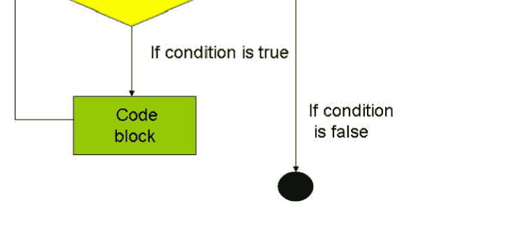

#### while 循环示例
#### 示例13：
```csharp
using System;
namespace whileloop
{
    class Program
    {
        static void Main(string[] args)
        {
            int var;
            var=50;
            while(var<150)
            {
                Console.WriteLine("Value of variable is:{0}",var);
                var=var+10;
            }
        }
    }
}
```

在上述代码中，变量 var 被初始化为值 50。while 循环检查条件。如果条件小于 150，则执行循环内的语句。如果条件为假，则控制不会进入 while 循环。

### 7.2 for 循环
**for** 循环用于在特定次数内执行一组语句。

#### 语法：
```
for (initialization; condition; increment/decrement)
{
    statement(s);
}
```

其中，

- **初始化**用于声明并初始化循环控制变量。它在循环开始时执行。
- **条件**检查表达式。如果值为真，则执行循环体；如果为假，则控制跳出循环。
- **递增/递减**用于增加或减少变量值。

#### 流程图
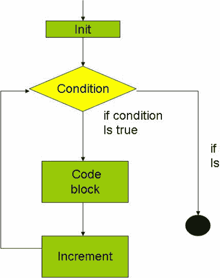

#### for 循环示例
#### 示例14：
```csharp
using System;
namespace forloop
{
    class Program
    {
        static void Main(string[] args)
        {
            int i;
            for(int i=1;i<=10;i++)
            {
                Console.WriteLine("Value of variable is :{0}", i);
            }
        }
    }
}
```
```
}
}
```

在上述代码中，声明了变量 i 的值。**for** 循环包含赋值、条件和递增。如果条件为*真*，则递增该值，并执行 for 循环内的语句。一旦条件为*假*，控制将移出循环。

### 7.3 do-while 循环
**do…while** 循环结构与 **while 循环**类似。两种循环都会一直执行，直到条件为假。区别在于 do…while 循环中的语句至少执行一次，因为块中的语句在条件检查之前执行。

#### 语法：
```
do
{
    Statements;
} while(expression);
```

#### 流程图
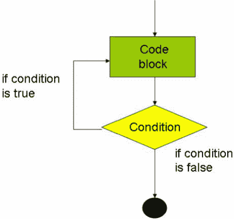

#### do-while 循环示例
#### 示例15：

### 7.4 break 语句
**break** 语句用于退出循环。遇到此语句时，循环终止，控制权将转移到循环之后的下一条语句。

#### 语法：
```
break;
```

#### 流程图
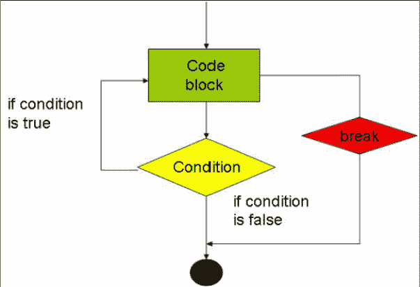

#### break 语句示例
示例16：
```csharp
using System;
namespace breakstmt
{
    class Program
    {
        static void Main(string[] args)
        {
            int i=11;
            while(i<15)
            {
                Console.WriteLine("value of i:{0}", i);
                i++;
                if(i>13)
                {
                    break;
                }
            }
            Console.ReadLine();
        }
    }
}
```

在代码示例中，变量 i 的值被赋为 11。**while** 循环检查 i 的条件。如果条件为*真*，则执行 while 循环中的语句，并递增 i 的值。

**if** 语句检查 i 的值。一旦 i 的值大于 13，则执行 **break** 语句，控制移出循环。

### 7.5 continue 语句
continue 语句与 break 语句类似，但 continue 不是中断循环，而是强制执行循环的下一次迭代，并跳过其间的任何代码。

#### 语法：
```
continue;
```

#### 流程图
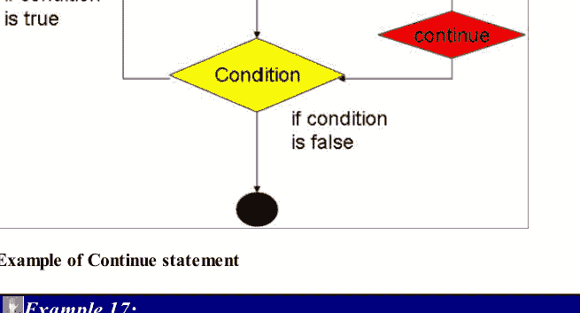

#### continue 语句示例
#### 示例17：
```csharp
using System;
namespace continuestmt
{
    class Program
    {
        static void Main(string[] args)
        {
            int i=45;
            do
            {
                if(i==50)
                {
                    i++;
                    continue;
                }
                Console.WriteLine("Value of i is:{0}",i);
                i++;
            }
            while(i<=60);
            Console.ReadLine();
        }
    }
}
```

因此，在上面的代码示例中，我们可以看到 do-while 循环和 continue 的组合使用。可以看到，i 最初被设置为 45，然后进入 do 内的语句。此时，检查 i 是否等于 50，不等，因此输出 i 的值并递增 1。

这个过程一直持续到 i 变为 50，此时 i 会先递增 1，然后遇到 continue 关键字，这将跳过 do 部分中的其余代码，直接进入 while 条件表达式。

一旦 i 达到 61，while 条件语句将不匹配，执行将离开循环。

## 第 8 章 C# 中的类和方法
### 8.1 类声明
在 C# 中，类是语言的主要构建块。它提供了一组预定义的变量和方法。对象被定义为类的一个实例，因此类中的方法决定了对对象可以执行哪些操作。

#### 类定义
类定义以关键字 **class** 开头，后跟实际的类名。类的变量和方法都包含在花括号内；该区域也称为类体。

#### 语法：
```text
<access specifier>class class_name
{
                //member variables
                <access specifier> <data type> variable1;
                <access specifier> <data type> variable2;
                ……
                <access specifier><data type> variableN;
                //member methods
                <access specifier><return type>method1(parameter_list)
                {
                                //method body
                }
                <access specifier><return type>method2(parameter_list)
                {
                                //method body
                }
                ….. 
                <access specifier><return type>methodN(parameter_list)
                {
                                //method body
                }
}
```

- 访问说明符定义了其他方法和成员能够与给定类的方法和成员进行交互的访问级别。如果未指定访问说明符，则默认访问说明符为 **private**。
- 数据类型指定变量类型，返回类型用于说明方法返回的数据类型，但应注意，方法并不总是需要返回值。
- 点(.)运算符用于访问类成员。
- 点运算符用于连接对象名和成员名。

#### 演示类的示例
示例18：
```csharp
using System;
namespace demo
{
    class Calculate
    {
        public int len;
        public int bread;
    }
    class Program
    {
        static void Main(string[] args)
        {
            Calculate c1 = new Calculate();
            Calculate c2 = new Calculate();
            int area = 0;
            int area1 = 0;

            c1.len = 10;
            c1.bread = 5;

            c2.len = 15;
            c2.bread = 10;

            area = c1.len*c1.bread;
            Console.WriteLine("area of rectangle1 is:{0}",area);

            area1 = c2.len*c2.bread;
            Console.WriteLine("area of rectangle2 is:{0}",area1);
            Console.ReadLine();
        }
    }
}
```


编译后，该类的运行结果为：

*矩形2的面积是:50*

矩形2的面积是:50

### C# 构造函数

构造函数是一种特殊类型的方法，在创建类的实例时会自动调用。类的成员在构造函数内部进行初始化。构造函数必须与类本身同名。

#### 构造函数示例

```csharp
using System;
namespace construct
{
    class Calculate
    {
        int number1,number2,sum;
        Calculate()
        {
            number1 = 20;
            number2 = 40;
        }
        public void Addition()
        {
            sum = number1+number2;
        }
        public void Show()
        {
            Console.WriteLine("The total is:{0}",sum);
        }
        public static void Main(string[] args)
        {
            Calculate c1 = new Calculate();
            c1.Addition();
            c1.Show();
        }
    }
}
```

编译后，该类的运行结果为：

总数为：60

在上面的示例中，每次实例化 Calculate 类时，构造函数都会手动将固定值赋给 number1 和 number2。然而，如果你想让 number1 和 number2 的值不同且动态化，该怎么办？这要如何实现呢？

这就是 **参数化构造函数** 概念的用武之地。本质上，这个听起来很高端的术语的意思是，我们直接将参数传入构造函数，这样就允许我们在实例化类时传入值。让我们看一个示例：

#### 参数化构造函数示例

**示例 20：**

```csharp
using System;
namespace construct
{
    class Calculate
    {
        int number1,number2,sum;

        // Parameters are added in to here inside the constructor
        Calculate(int num1,int num2)
        {
            // We assign the parameters to the class variables
            number1 = num1;
            number2 = num2;
        }
        public void Addition()
        {
            sum=number1+number2;
        }
        public void Show()
        {
            Console.WriteLine("The total is:{0}",sum);
        }
        public static void Main(string[] args)
        {
            int a,b;

            Console.WriteLine("Enter value of a");
            a = Convert.ToInt32(Console.ReadLine());

            Console.WriteLine("Enter the value of b");
            b = Convert.ToInt32(Console.ReadLine());

            // a and b are passed through to the class constructor
            Calculate c1 = new Calculate(a,b);
            c1.Addition();
            c1.Show();

            Console.ReadLine();
        }
    }
}
```

编译后，该类的运行结果为：

输入 a 的值
10
输入 b 的值
20
总数为：30

### C# 析构函数

析构函数是类中的一种特殊函数，很少使用，通常用于在退出类之前释放非托管资源。析构函数在使用方式上有几个限制：

- 它不能被继承。
- 它不能被重载。
- 任何给定的类中只能有一个析构函数。
- 析构函数不能由程序员直接调用，而是由垃圾回收器调用。

析构函数与其类同名，并以 ~ 符号作为前缀，该符号用波浪号表示。

#### 析构函数示例

示例 21：

```csharp
using System;
namespace destruct
{
    class Calculate
    {
        int number1,number2,sum;
        Calculate()
        {
            number1=15;
            number2=4;
        }
        public void Addition()
        {
            sum=number1+number2;
        }
        public void Show()
        {
            Console.WriteLine("The total is:{0}",sum);
        }

        // Destructor is defined here and is called when the class
        // goes out of scope.
        ~Calculate()
        {
            Console.WriteLine("Destructor invoked");
        }
    }
    
    public static void Main(string[] args)
    {
        Calculate c1=new Calculate();
        c1.Addition();
        c1.Show();
    }
}
```

编译后，该类的运行结果为：

总数为：19

### 8.2 定义方法

**方法**是一组一个或多个程序语句，可以通过调用方法名来执行。要使用某个方法，用户首先需要定义该方法，然后调用它。

定义方法意味着声明其结构的元素。定义方法使用以下语法：

```
<Access Specifier> <Return Type> <Method Name> ( Parameter List)
{
    Method Body
}
```

方法的不同元素包括：

- **访问修饰符：** 它决定了变量或方法可被访问的范围。
- **返回类型：** 定义方法返回值的类型。如果类型设置为 **void**，则表示该方法不返回任何内容。
- **方法名：** 它是一个唯一标识符，区分大小写。方法名不能与变量名相同。
- **参数列表：** 方法接收和传递的值。它们写在方法名后面的括号中。
- **方法体：** 用于执行实际方法功能的一组指令。

**示例：**

示例 22：

```java
class Average
{
    public int Number(int no1, int no2)
    {
        int output;
        output = no1 + no2/2;
        return output;
    }
}
```

### 8.3 调用方法

一旦定义了方法，用户就可以使用方法名调用该方法。方法名后面跟一对圆括号。

#### 示例

#### 示例 23：

```csharp
using System;
class Average
{
    public int Number(int no1, int no2)
    {
        int output;
        output = no1+no2/2;
        return output;
    }
    static void Main(string[] args)
    {
        Average a = new Average();

        // calling method Number from object class a
        int value = a.Number(20,30);
        Console.WriteLine("The result is {0}",value);
    }
}
```

编译代码后，结果为：

结果为 25

### 8.5 递归方法调用

方法可以调用自身，这被称为 **递归**。

#### 示例 24：

```csharp
using System;
namespace recursive
{
    class recursivecall
    {
        public int factorial(int no)
        {
            int result;
            if(no == 1)
            {
                return 1;
            }
            else
            {
                result = factorial(no-1)*no;
                return result;
            }
        }
        static void Main(string[] args)
        {
            recursivecall r = new recursivecall();
            Console.WriteLine("Factorial of no is {0}", r.factorial(2));
            Console.WriteLine("Factorial of no is {0}", r.factorial(3));
            Console.Read();
        }
    }
}
```

**编译代码后，结果为：**

数字的阶乘是 2  
数字的阶乘是 6

### 8.4 向方法传递参数

当用户调用方法时，如果方法接受参数，则必须在调用方法时传递这些参数。传递给方法的参数有三种类型。

#### 值参数

对于值参数，方法会以传入参数为副本创建一个变量，供方法内部使用。如果该变量的值被更改，则只会更改方法自身作用域内的值，而不会更改作为参数传入方法的原始变量。

#### 示例

示例 25：

```csharp
class Program
{
    void IncreaseNo(int no)
    {
        no++;
    }
    public static void Main()
    {
        Program p = new Program();
        int number = 2;
        p.IncreaseNo(number);
        Console.WriteLine(number);
    }
}
```

编译代码后，结果为：

2

#### 引用参数

引用参数与值参数相同，不同之处在于，当参数传递给方法时，不是创建参数值的副本，而是直接指向内存中存储的原始值。因此，如果该值为


在方法作用域内被更改后，作为参数传入的原始变量的值也会随之更改。

ref 关键字用于声明引用参数。

**示例：**

```csharp
class Program
{
    void IncreaseNo(ref int no)
    {
        no++;
    }

    public static void Main()
    {
        Program p = new Program();
        int number = 2;
        p.IncreaseNo(ref number);
        Console.WriteLine(number);
    }
}
```

代码编译后，结果将为：

```text
3
```

#### 输出参数

return 语句用于从方法返回值。使用 return 语句只能返回单个变量。输出参数正是为此目的而提供。

它们与引用参数类似，区别在于它们将数据传出方法。

**示例：**

```csharp
class Program
{
    void Demo(out int no)
    {
        no = 10;
    }

    public static void Main()
    {
        Program p = new Program();
        int number;
        p.Demo(out number);
        Console.WriteLine(number);
    }
}
```

代码编译后，结果将为：

```text
10
```

## 第 9 章 C# 中的数组

### 9.1 数组简介

数组是相同数据类型值的集合。数组中的变量称为数组元素。数组元素通过单个名称和表示元素在数组中位置的索引号来访问。

数组具有秩，它决定与每个数组元素关联的索引数量。数组的秩也称为数组的维度。下图展示了系统中的数组结构。

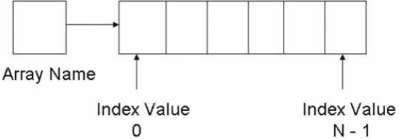

### 9.2 数组声明

在任何程序中使用数组之前，必须先声明数组。以下语法用于声明数组。

```text
datatype[] ArrayName;
```

数组语法涉及以下组成部分：

- **datatype：** 用于指定元素的数据类型。该类型的数据将存储在数组中。
- **[]：** 指定数组的大小，并称为秩。
- **ArrayName：** 表示数组的名称。

### 9.3 初始化并添加值

**new** 关键字用于创建数组的实例。数组的大小在初始化时指定。以下代码片段用于初始化数组。

```text
int[] x;
x = new int[15];
```

可以通过合并这两条语句来初始化数组，写法如下：

```text
int[] x = new int[15];
```

**为数组赋值**

可以使用**索引号**为数组的每个元素赋值。索引号也称为元素的下标。以下代码片段用于为数组赋值。

```text
int[] amount = new int[5];
amount[0] = 50;
```

可以使用以下代码创建并初始化数组：

```text
int[] amount = { 40, 60, 70, 80 };
```

可以省略数组的大小。

```text
int[] age = new int[] { 21, 31, 40 };
```

当用户将数据从一个数组复制到另一个数组时，源数组和目标数组引用同一位置。以下代码片段展示了将一个数组复制到另一个数组。

```text
int[] age = new int[] { 12, 14, 15, 16 };
int[] amount = age;
```

创建了 **age** 和 **amount** 两个数组。它们指向同一内存位置。

### 9.4 访问数组元素

要访问数组中的元素，需要使用索引。索引是表示元素在数组中位置的数字。索引始终从零开始，因此要访问数组中的第一个元素，应采用以下格式：

`array_name[index]`

在这种情况下，索引的值为零。

**示例：**

**示例 28：**

```csharp
using System;
namespace arraydeclare
{
    class Arraydemo
    {
        static void Main(string[] args)
        {
            int[] a = new int[5];
            int x, y;

            for (x = 0; x < 5; x++)
            {
                a[x] = x + 10;
            }
            for (y = 0; y < 5; y++)
            {
                Console.WriteLine("Element [{0}] = {1}", y, a[y]);
            }
            Console.ReadLine();
        }
    }
}
```

**编译并执行代码后，输出为：**

- 元素 [0] = 10
- 元素 [1] = 11
- 元素 [2] = 12
- 元素 [3] = 13
- 元素 [4] = 14

### 9.5 foreach 循环

此循环专门设计用于遍历数组的所有元素。它非常适合高效地检索数组元素。

**语法：**

```text
foreach(type identifier in expression)
    statement – block
```

**示例：**

```csharp
using System;
namespace arraydeclare
{
    class Arraydemo
    {
        static void Main(string[] args)
        {
            int[] a = new int[5];

            for (int x = 0; x < 5; x++)
            {
                a[x] = x + 10;
            }
            foreach (int y in a)
            {
                int x = y - 10;
                Console.WriteLine("Element[{0}]={1}", x, y);
                x++;
            }
            Console.ReadLine();
        }
    }
}
```

代码编译并执行后，输出为：

```text
Element [0] = 10
Element [1] = 11
Element [2] = 12
Element [3] = 13
Element [4] = 14
```

### 9.6 不同类型的 C# 数组

以下是用于开发代码的各种类型的 C# 数组。

**多维数组**

多维数组将数据存储在**多个行维度**中。它也称为矩形数组。用户可以如下声明整数的二维数组：

```text
int[,] no;
```

二维数组可以视为表格。它有 x 行和 y 列。一个二维数组包含 2 行和 4 列。

|  | 列 0 | 列 1 | 列 2 | 列 3 |
|---|---|---|---|---|
| 行 0 | x[0][0] | x[0][1] | x[0][2] | x[0][3] |
| 行 1 | x[1][0] | x[1][1] | x[1][2] | x[1][3] |

**初始化二维数组**

以下数组有 3 行和 3 列。

```csharp
int[,] x = new int[3, 3] {
    {1, 2, 3},
    {4, 5, 6},
    {7, 8, 9}
};
```

**访问多维数组的元素**

可以使用下标访问多维数组中的元素。下标即数组的行索引和列索引。

**示例：**

```csharp
int output = a[1, 2];
```

在上述语句中，访问的是第二行第三列的元素。

**示例：**

```csharp
using System;
namespace twodimension
{
    class multiarray
    {
        static void Main(string[] args)
        {
            int[,] x = new int[3,2] {{1,1},{2,2},{3,3}};
            int a, b;

            for (a = 0; a < 3; a++)
            {
                for (b = 0; b < 2; b++)
                {
                    Console.WriteLine("x[{0},{1}]={2}", a, b, x[a,b]);
                }
            }
            Console.ReadLine();
        }
    }
}
```

代码编译并执行后，输出为：

- x[0,0] = 1
- x[0,1] = 1
- x[1,0] = 2
- x[1,1] = 2
- x[2,0] = 3
- x[2,1] = 3

**交错数组**

交错数组是数组的数组。int 类型的交错数组声明如下：

```csharp
int[][] marks;
```

数组可以按如下方式初始化：

```csharp
int[][] marks = new int[2][] { new int[] { 45, 57, 78 }, new int[] { 60, 75, 86, 45, 35 } };
```

marks 数组由两个整数数组组成：marks[0] 包含 3 个整数，marks[1] 包含 5 个整数。

**示例：**

**示例 3.1：**

```csharp
using System;
namespace Jaggedarray
{
    class jagged
    {
        static void Main(string[] args)
        {
            int[][] x = new int[][] {
                new int[] {0,0},
                new int[] {2,2},
                new int[] {3,4},
                new int[] {4,2},
                new int[] {1,3}};

            int a, b;

            for (a = 0; a < 5; a++)
            {
                for (b = 0; b < 2; b++)
                {
                    Console.WriteLine("x[{0},{1}]={2}", a, b, x[a][b]);
                }
            }
            Console.ReadLine();
        }
    }
}
```

代码编译并执行后，输出为：

```text
x[0,0] = 0
```


x[0,1] = 0
x[1,0] = 2
x[1,1] = 2
x[2,0] = 3
x[2,1] = 4
x[3,0] = 4
x[3,1] = 2
x[4,0] = 1
x[4,1] = 3

### 参数数组

声明方法时，尚未确定要作为参数传递的参数数量。此时使用参数数组。

#### 示例：

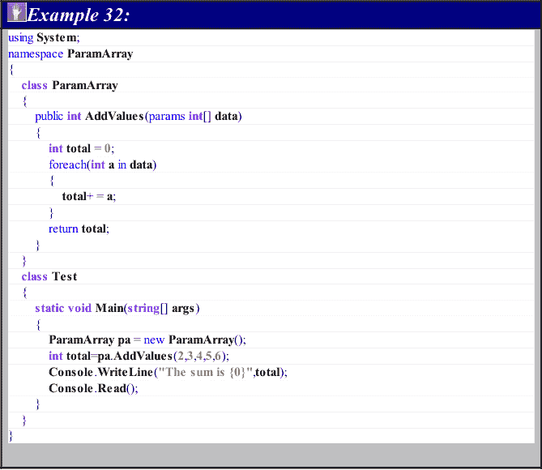

当代码编译并执行时，输出为：

The sum is 20

### Array 类

Array 类是 C# 中所有数组的基类。System 命名空间包含 Array 类。Array 类中使用了各种属性和方法。

#### Array 类的属性

- **Length：** 返回数组所有维度中的元素总数
- **Rank：** 返回数组的秩
- **IsFixedSize：** 一个指示数组是否具有固定大小的值
- **IsReadOnly：** 一个指示数组是否为只读的值

#### Array 类的方法

- **Sort：** 对作为参数传入的数组执行排序操作
- **Clear：** 移除数组中的所有元素，并将指定范围内的元素设置为 0
- **GetLength：** 返回数组中的元素数
- **GetValue：** 返回数组中指定元素的值
- **IndexOf：** 返回一维数组中某个值首次出现的索引
- **Reverse：** 反转数组中元素的顺序

#### 示例：

```
Example 33:
using System;
namespace Array
{
class Array1
{
static void Main(string[] args)
{
int[] item = {12,34,23,55,64};
int[] value = item;

Console.Write("Original Array:");
foreach(int x in item)
{
Console.Write(x+" ");
}
Console.WriteLine();

//reverse the array
Array.Reverse(value);
Console.Write("Array reversed:");

foreach(int x in value)
{
    Console.Write(x+" ");
}
Console.WriteLine();

//sort the array
Array.Sort(item);
Console.Write("Array sorted:");
Console.Read();
}
}
}
```

当代码编译并执行时，输出为：

Original Array: 12 34 23 55 64
Array reversed: 64 55 23 34 12
Array sorted: 12 23 34 55 64

## 第 10 章 C# 中的字符串

### 10.1 字符串的创建

C# 中的字符串是字符数组。string 关键字用于声明变量。该关键字是 **System.String** 类的别名。

#### 字符串对象的创建

有多种方法可用于创建字符串。它们包括：

- 检索属性或调用返回字符串的方法
- 使用 string 类构造函数
- 使用字符串连接运算符（+）
- 调用格式化方法将值或对象转换为字符串表示形式
- 将字符串字面量分配给字符串变量

**示例：**

```
Example 34:

using System;
namespace StringType
{
    class Program
    {
        static void Main(string[] args)
        {
            //string literal and concatenation
            string name,location;
            name = "Harry";
            location = "USA";
            string value = name + location;
            Console.WriteLine("The value is:{0}",value);

            //string constructor
            char[] vowels = {'a','e','i','o','u'};
            string item = new string(vowels);
            Console.WriteLine("The item contains values:{0}",item);

            //formatting method for value conversion
            DateTime dt = new DateTime(2014,12,10,15,34,1);
            string msg = string.Format("Message sent at {0:t} on {0:D}",dt);

            //method returning value
            string[] array = {"Welcome","User"};
            string result = String.Join(" ",array);
            Console.WriteLine("Message is:{0}",result);
        }
    }
}
```

**当代码编译并执行时，输出为：**

The value is: Harry USA
The item contains values: aeiou
Message sent at 2.30 PM on Tuesday, June 02, 2015
Message is: Welcome User

### 10.2 string 类的属性和方法

#### string 类的属性

- **Chars：** 获取 **String** 对象中特定位置的 **Char** 对象
- **Length：** 获取 String 对象中的**字符数**

#### string 类的方法

- **public bool Equals(string value)**  
  检查当前 String 对象与指定对象是否具有相同的值
- **public string Insert(int startIndex, string value)**  
  返回一个新字符串，其中指定字符串插入到特定索引位置
- **public string Replace(char oldchar, string newValue)**  
  将字符串对象中特定字符的所有出现替换为 Unicode 字符，并返回新字符串
- **public int LastIndexOf(string value)**  
  返回字符串对象中 Unicode 字符最后一次出现的从零开始的索引位置
- **public string Trim()**  
  移除对象中所有前导和尾随空白字符
- **public static Compare(string str1, string str2, bool IgnoreCase)**  
  比较两个字符串，并返回一个表示排序顺序中相对位置的整数值
- **public static string Concat(string str1, string str2)**  
  连接两个字符串对象
- **public string[] Split (char[] separator, int count)**  
  返回一个字符串数组，其中包含当前字符串对象中的子字符串。它由特定 Unicode 字符数组的元素分隔。返回的子字符串数量由 int 参数指定
- **public bool Contains(string value)**  
  返回一个值，指示指定字符串对象是否出现在字符串中
- **public static string Copy(string str)**  
  创建一个与指定字符串具有相同值的新 String 对象
- **public string ToUpper()**  
  返回转换为大写的字符串副本
- **public int IndexOf(string value)**  
  返回指定字符串在该实例中首次出现的从零开始的索引
- **public string Remove(int startindex)**  
  移除当前实例中从指定位置开始直到最后一个字符的字符。它返回一个字符串
- **public char[] ToCharArray()**  
  返回一个包含当前字符串对象中所有字符的 Unicode 字符数组
- **public string ToLower()**  
  返回转换为小写的字符串副本

### 10.3 演示字符串功能的示例

#### 字符串比较

```
Example 35:
using System;
namespace string1
{
    class Program
    {
        static void Main(string[] args)
        {
            string string1 = "A string named as string1";
            string string2 = "A string named as string2";
            if(String.Compare(string1,string2) == 0)
            {
                Console.WriteLine(string1+"and"+string2+"equal");
            }
            else
            {
                Console.WriteLine(string1+"and"+string2+" not equal");
            }
            Console.Read();
        }
    }
}
```

当代码编译并执行时，输出为：

A string named as string1 and A string named as string2 are not equal

#### 连接字符串

```
Example 36:
using System;
namespace string1
{
    class Program
    {
        static void Main(string[] args)
        {
            string[] str1 = new string[]{"Set your aims high",
            "Rome was not built in a day",
            "Save Time"};

            string str = String.Join("\n",str1);
            Console.WriteLine(str);
            Console.Read();
        }
    }
}
```

当代码编译并执行时，输出为：

Set your aims high
Rome was not built in a day
Save Time

#### 包含值的字符串

```
**Example 37:**
using System;
namespace string1
{
    class Program
    {
        static void Main(string[] args)
        {
            string str = "A new user";
            if(str.Contains("user"))
            {
                Console.WriteLine("The value 'user' is present");
            }
            Console.Read();
        }
    }
}
```

当代码编译并执行时，输出为：

The value 'user' is present

## 第 11 章 封装与多态

### 11.1 封装简介

**封装** 是将数据和函数封装在物理或逻辑包中的过程。它帮助开发者防止访问应用程序的必要细节。它将代码和数据绑定在一起。

**抽象** 表明所有信息都存在，但只向用户提供 **相关信息**。

抽象和封装是相关的特性。封装通过提供隐藏非必要细节的手段来辅助抽象。使用封装，部分信息可见，其他信息被隐藏。

### 11.2 C# 中的访问修饰符

访问修饰符定义了类成员的作用域。成员用于引用类的函数和变量。程序由一个或多个类组成。某些类成员需要被其他类访问。

#### 访问修饰符的类型

C# 支持以下访问修饰符。

- 公共
- 私有
- 受保护
- 内部
- 受保护内部

#### 公共访问修饰符

**公共** 访问修饰符允许类向其他类公开成员变量和函数。声明为公共的成员可以从类外部访问。

#### 公共访问修饰符示例

```csharp
using System;
namespace public1
{
    class User
    {
        //member variables
        public string name;
        public int age;
        public void AddValue()
        {
            Console.WriteLine("Enter the user name:");
            name = Console.ReadLine();
            Console.WriteLine("Enter the age:");
            age = Convert.ToInt32(Console.ReadLine());
        }
        public void Show()
        {
            Console.WriteLine("User name is:{0}", name);
            Console.WriteLine("Age is:{0}", age);
        }
    }
    class Program
    {
        static void Main(string[] args)
        {
            User u = new User();
            u.AddValue();
            u.Show();
            Console.Read();
        }
    }
}
```

编译并执行代码后，输出为：

Enter the user name:
Mark
Enter the age:
20
User name is: Mark
Age is: 20

#### 私有访问修饰符

私有访问修饰符允许用户将类的成员变量和函数隐藏在其他类对象和函数之外。私有成员在类外部不可见。只有类本身内部的类函数可以访问私有实体。类的对象或实例无法访问任何私有变量或函数，因为它们被声明为类外部的。

#### 示例 39

```csharp
using System;
namespace private1
{
    class Student
    {
        //member variables
        private string name;
        private int age;
        public void AddValue()
        {
            Console.WriteLine("Enter the student name:");
            name = Console.ReadLine();
            Console.WriteLine("Enter the age:");
            age = Convert.ToInt32(Console.ReadLine());
        }
        public void Show()
        {
            Console.WriteLine("Student name is:{0}", name);
            Console.WriteLine("Age is:{0}", age);
        }
    }
    class Program
    {
        static void Main(string[] args)
        {
            Student s = new Student();
            s.AddValue();
            s.Show();
            Console.Read();
        }
    }
}
```

编译并执行代码后，输出为：

Enter the student name:
Harry
Enter the age:
15

Student name is: Harry
Age is: 15

#### 受保护访问修饰符

受保护访问修饰符允许类将成员变量和函数隐藏在其他类对象和函数之外，除了子类。修饰符在继承实现期间很有用。

#### 示例 40

```csharp
using System;
namespace protected1
{
    class Employee
    {
        //member variables
        protected string name;
        public void AddValue()
        {
            Console.WriteLine("Enter the employee name:");
            name = Console.ReadLine();
        }
        public void Show()
        {
            Console.WriteLine("Employee name is:{0}", name);
        }
    }
    class Program
    {
        static void Main(string[] args)
        {
            Employee e = new Employee();
            e.AddValue();
            e.Show();
            Console.Read();
        }
    }
}
```

编译并执行代码后，输出为：

Enter the employee name:
Ajay
Employee name is: Ajay

#### 内部访问修饰符

内部访问修饰符允许类将其成员函数和变量暴露给包含的子类或同一应用程序内的类。

#### 示例 41

```csharp
using System;
namespace internal1
{
    class Location
    {
        //member variables
        internal string city;
        public void AddValue()
        {
            Console.WriteLine("Enter the city name:");
            city = Console.ReadLine();
        }
        public void Show()
        {
            Console.WriteLine("City name is:{0}", city);
        }
    }
    class Program
    {
        static void Main(string[] args)
        {
            Location l = new Location();
            l.AddValue();
            l.Show();
            Console.Read();
        }
    }
}
```

编译并执行代码后，输出为：

Enter the city name:
London
City name is: London

#### 受保护内部访问修饰符

**受保护内部** 访问修饰符允许类将成员函数和变量暴露给包含的类、子类或同一应用程序中的类。允许对应用程序外部的派生类进行访问。

#### 示例 42

```csharp
using System;
namespace protectedinternal1
{
    class number
    {
        //member variables
        protected internal int no;
        public void AddValue()
        {
            Console.WriteLine("Enter the number:");
            no = Convert.ToInt32(Console.ReadLine());
        }
        public void Show()
        {
            Console.WriteLine("Number is:{0}", no);
        }
    }
    class Program
    {
        static void Main(string[] args)
        {
            number n = new number();
            n.AddValue();
            n.Show();
            Console.Read();
        }
    }
}
```

编译并执行代码后，输出为：

Enter the number:
10
Number is: 10

### 11.3 多态

**多态** 是函数以不同形式存在的能力。单词‘poly’意为多和‘morphos’意为形式。

有两种类型多态：

- **静态：** 对函数的响应在编译时决定
- **动态：** 对函数的响应在运行时决定

### 11.4 静态多态

静态多态是指以不同形式存在的实体。C# 有两种实现多态的方法。

- 函数重载
- 运算符重载

#### 函数重载

函数重载帮助用户对两个或多个函数使用相似的名称。
函数定义必须通过参数列表的类型或数量彼此不同。

#### 示例 43

```csharp
using System;
namespace calculate
{
    class calculate
    {
        public int Min(int no1, int no2)
        {
            if (no1 < no2)
            {
                return no1;
            }
            else
            {
                return no2;
            }
        }
        public float Min(float no1, float no2)
        {
            if (no1 < no2)
            {
                return no1;
            }
            else
            {
                return no2;
            }
        }
    }
}
class Program
{
    static void Main(string[] args)
    {
        Program p = new Program();
        Console.WriteLine("Minimum value is:{0}", p.Min(3, 4));
        Console.WriteLine("Minimum value is:{0}", p.Min(3.2F, 1.2F));
        Console.ReadLine();
    }
}
```

编译并执行代码后，输出为：

Minimum value is: 3
Minimum value is: 1.2


### 11.5 动态多态

C# 有两种实现动态多态的方法。它们是：

- **抽象类：** 它们是包含抽象类成员的一种特殊基类。从抽象类派生的类成员必须实现抽象函数和属性。
- **虚函数：** 它们并不真正存在。它们似乎在某些部分存在。

#### 抽象类

抽象类提供类的部分实现。当派生类继承它时，实现才完成。其中有些抽象方法通过派生类来实现。

#### 创建抽象类的规则

- 用户不能在抽象类外部声明抽象方法
- 不能创建抽象类的实例
- 从抽象类派生的类必须重写该类的所有方法
- 抽象类不能声明为 sealed

#### 示例：

```
Example 44:
using System;
namespace poly
{
    abstract class Result
    {
        public abstract int average();
    }

    class Data: Result
    {
        private int sub1;
        private int sub2;
        public Data(int x, int y)
        {
            sub1 = x;
            sub2 = y;
        }
        public override int average()
        {
            Console.WriteLine("The average is:");
            return (x + y / 2);
        }
    }
    class Program
    {
        static void Main(string[] args)
        {
            Data d = new Data(30, 70);
            int a = d.average();
            Console.WriteLine("Average:{0}",a);
            Console.Read();
        }
    }
}
```

编译并执行代码后，输出为：

平均值为：
平均值：50

#### 虚函数

如果你需要一个在类中定义、并且需要由继承类实现的函数，就使用虚函数。继承类会根据需求修改所继承类的功能。方法调用发生在运行时。

**virtual** 关键字用在函数的返回类型之前。

#### 示例：

```
Example 45:
using System;
namespace virtual1
{
    class Calculate
    {
        protected int x, y;
        public Calculate(int l = 0, int m = 0)
        {
            x = l;
            y = m;
        }
        public virtual int operation()
        {
            return 0;
        }
    }
    class Multiplication : Calculate
    {
        public Multiplication(int l = 0, int m = 0) : base(l, m)
        {
        }
        public override int operation()
        {
            Console.WriteLine("Multiplication is:");
            return x * y;
        }
    }
    class Addition : Calculate
    {
        public Addition(int l = 0, int m = 0) : base(l, m)
        {
        }
        public override int operation()
        {
            Console.WriteLine("Addition is:");
            return x + y;
        }
    }
    class call
    {
        public void callvalue(Calculate c)
        {
            int z;
            z = c.operation();
            Console.WriteLine("Result:{0}", z);
        }
    }
    class Program
    {
        static void Main(string[] args)
        {
            call p = new call();
            Multiplication m = new Multiplication(10, 2);
            Addition t = new Addition(15, 16);
            p.callvalue(m);
            p.callvalue(t);
            Console.Read();
        }
    }
}
```

编译并执行代码后，输出为：

乘法结果为：
结果：20
加法结果为：
结果：31

## 第 12 章 继承与接口

### 12.1 继承简介

继承的概念不仅是 C# 的基础，也是大多数其他编程语言的基础。它允许用户创建从其他类*继承*数据成员和方法的类。继承可以节省用户时间，因为它允许用户在一个核心类中创建若干常用且使用广泛的方法，并让其他类继承该核心类及其所有方法。这样用户就不必在每个类中重复相同的方法。

### 12.2 基类和派生类

继承的结构可以通过几种方式来概括。在本例中，我们有三个类 **A、B** 和 **C**。类 **B** 派生自类 **A**。类 **C** 派生自类 **B**。那么这意味着什么呢？

如果我们用符号表示这些类之间的关系，可以这样表示：

类 A → 类 B → 类 C

- 由于类 **B** 派生自类 **A**，我们说类 **A** 是类 **B** 的父类。我们也可以说类 **B** 是类 **A** 的子类。
- 由于类 **C** 派生自类 **B**，我们说类 **B** 是类 **C** 的父类。我们也可以说类 **C** 是类 **B** 的子类。
- 由于类 **C** 派生自类 **B**，而类 **B** 又派生自类 **A**，我们说类 **A** 是类 **C** 的祖父类。我们也可以说类 **C** 是类 **A** 的孙类。
- 在此例中，由于类 A 不继承其他类，因此该类被称为**基类**。类 **B** 和类 **C** 将声明为派生类。

在此例中，我们使用了父与子的比喻来表示不同类之间的关系，但你还会遇到其他比喻，例如超类（基类）和子类（派生类），它们描述的是相同的关系。

下面是我们如何在代码中声明这些关系：

```
<access – specifier> class <base_class>
{
    ….. 
}
class <derived_class> : <base_class>
{
    ….. 
}
```

#### 示例：

#### 示例 46：

```
using System;
namespace inheritance1
{
    class Demo
    {
        public void side(int s)
        {
            side = s;
        }
        protected int side;
    }
    //Derived class
    class Area : Demo
    {
        public int getAreaOfSquare()
        {
            return side * side;
        }
    }
    class Program
    {
        static void Main(string[] args)
        {
            Area a = new Area();
            a.side(4);
            
            //Display the area of square
            Console.WriteLine("Area is: {0}", a.getAreaOfSquare());
            Console.Read();
        }
    }
}
```

编译并执行代码后，输出为：

面积为：16

### 12.3 基类初始化

创建继承结构时，用户必须先从基类（超类）开始。下面是一个示例，说明如何设置基类以及派生类如何从它继承。

**示例：**

```
Example 47:
using System;
namespace Base1
{
    class Square
    {
        //member variables
        protected int side;
        public Square(int s)
        {
            side = s;
        }

        public int CalculateArea()
        {
            return side * side;
        }

        public void Show()
        {
            Console.WriteLine("The value of side is:{0}", side);
            Console.WriteLine("Area is:{0}", CalculateArea());
        }
    }

    class Paint : Square
    {
        private int amount;
        public Paint(int side) : base(side)
        {
        }
        public int Totalamount()
        {
            int amount;
            amount = CalculateArea() * 50;
            return amount;
        }
        public void Show()
        {
            base.Show();
            Console.WriteLine("Total amount is:{0}", Totalamount());
        }
    }
    class Program
    {
        static void Main(string[] args)
        {
            Paint p = new Paint(3);
            p.Show();
            Console.Read();
        }
    }
}
```

编译并执行代码后，输出为：

边长为：3
面积为：9
总金额为：450

### 12.4 C# 中的接口

接口是一个抽象基类，它声明方法，但不声明方法内部的任何逻辑。本质上，接口可以描述为契约，所有继承该接口的类都必须遵守。接口明确规定了每个派生类必须具有哪些方法和属性。如果派生类中不存在这些方法，就会发生错误。

#### 声明接口

**interface** 关键字用于声明接口。它们的默认数据类型为 public。

#### 接口声明示例

```
public interface Interface1
{
    void MethodToImplement();
}
```

#### 示例：

#### 示例 48：

```
using System;
namespace interface1
{
    public interface IStudentInfo
    {
        //interface members

        void ShowData();
    }

    public class StudentInfo : IStudentInfo
    {
        private int srno;
        private string name;
        private string subject;

        public StudentInfo()
        {
            srno = "";


```
name = "";
subject = "";
}

public StudentInfo(int s, string n, string b)
{
    srno = s;
    name = n;
    subject = b;
}

public void ShowData()
{
    Console.WriteLine("Student no is:{0}",srno);
    Console.WriteLine("Student name is:{0}",name);
    Console.WriteLine("Subject is:{0}",subject);
}

}

class Program
{
    static void Main(string[] args)
    {
        StudentInfo s = new StudentInfo(10,"Alex","Maths");
        StudentInfo s1 = new StudentInfo(20,"Adam","Science");
        s.ShowData();
        s1.ShowData();
        Console.Read();
    }

}

}
}
```

**当代码编译并执行时，输出为：**

学生编号是：10
学生姓名是：Alex
科目是：Maths
学生编号是：20
学生姓名是：Adam
科目是：Science

### 12.5 C# 中的多重继承

多重继承是指派生类继承自两个不相关类的实践。该实践在 C# 中并非自然支持，然而通过使用 **接口** 我们可以在一定程度上模拟多重继承的行为。

下面是一个使用接口模拟多重继承的示例：

#### 示例 49：

```csharp
using System;
namespace multiple1
{
    class Area
    {
        protected int base;
        protected int height;
        public void setbase(int b)
        {
            base = b;
        }
        public void setheight(int h)
        {
            height = h;
        }
    }

    //Base class
    public interface Paint
    {
        int amount(int area);
    }

    //Derived class
    class Triangle : Area,Paint
    {
        public int getValue()
        {
            return (1/2 * b * h);
        }
        public int amount(int area)
        {
            return area * 50;
        }
    }

    class Program
```

```csharp
{
    Triangle t = new Triangle();
    int area;
    t.setbase(4);
    t.setheight(5);
    area = t.getValue();

    //Display the area
    Console.WriteLine("Area is:{0}", t.getValue());
    Console.WriteLine("Total Paint cost is:{0}", t.amount(area));
    Console.Read();
}
}
```

**当代码编译并执行时，输出为：**

```
Area is: 10
Total Paint cost is: 500
```

## 第 13 章 运算符重载和异常处理

### 13.1 运算符重载简介

内置运算符可以在 C# 中重新定义或重载。重载的运算符是具有 **operator** 关键字的函数。其后跟要定义的运算符的符号。重载的运算符具有返回类型和参数列表。

**示例：**

```csharp
// Example 50:
using System;
namespace operator1
{
    class Room
    {
        private int length;
        private int breadth;

        public int getArea()
        {
            return length * breadth;
        }

        public void setlen (int len)
        {
            length = len;
        }

        public void setbread (int bread)
        {
            breadth = bread;
        }

        //+ operator is overloaded
        public static Room operator + (Room r, Room s)
        {
            Room o = new Room();
            o.length = r.length + s.length;
            o.breadth = r.breadth + s.breadth;
            return o;
        }
    }

    class Program
    {
        public static void Main(string[] args)
        {
            Room o1 = new Room();
```

```csharp
Room o2 = new Room();
Room o3 = new Room();
int area = 0;

//Room 1 specification
o1.setlen(10);
o1.setbread(5);

//Room 2 specification
o2.setlen(5);
o2.setbread(10);

//area of room 1
area = o1.getArea();
Console.WriteLine("Area of Room 1 is:{0}", area);

//area of room2
area = o2.getArea();
Console.WriteLine("Area of Room 2 is:{0}", area);

//Adding two objects
o3 = o1 + o2;

//Area of Room 3
area = o3.getArea();
Console.WriteLine("Area of Room 3 is:{0}", area);
Console.Read();
}
}
}
```

**当代码编译并执行时，输出为：**

房间 1 的面积是：50
房间 2 的面积是：150
房间 3 的面积是：225

### 13.2 重载中的不同运算符

可以在 C# 中重载的运算符如下所述：

| 运算符 | 描述 |
|---|---|
| `+`, `-`, `*`, `/`, `%` | 二元运算符有两个操作数，可以被重载 |
| `+`, `-`, `!`, `~`, `++`, `--` | 一元运算符取一个操作数，可以被重载 |
| `&&`, `||` | 条件逻辑运算符。它们不能直接被重载 |
| `==`, `!=`, `<`, `>`, `<=`, `>=` | 比较运算符。它们不能被重载 |
| `=`, `.`, `,`, `?:`, `new`, `is`, `sizeof`, `typeof` | 它们不能被重载 |
| `+=`, `-=`, `*=`, `/=`, `%=` | 赋值运算符且不能被重载 |

### 13.3 异常处理简介

**异常** 是程序执行期间发生的错误。异常发生在操作未正常完成时，因此系统在发生异常时会抛出错误。

C# 异常处理基于四个关键字：**try, catch, finally and throw.**

- **try:** Try 块在激活时检查代码块是否存在特定异常。存在一个或多个 catch 块。
- **catch:** catch 关键字用于捕获异常。程序在用户希望处理问题的位置捕获异常。
- **finally:** finally 块用于在是否抛出异常的情况下执行语句。
- **throw:** throw 关键字用于抛出异常。

**语法：**

```
try
{
    //statements causing exception
}
catch( ExceptionName e1 )
{
    //error handling code
}
catch( ExceptionName e2 )
{
    //error handling code
}
catch( ExceptionName eN )
{
    //error handling code
}
finally
{
    //statements to be executed
}
```

### 13.4 C# 中的异常类

有多个异常类直接或间接派生自 **System.Exception** 类。派生自 **System.Exception** 类的类包括 **System.ApplicationException** 和 **System.SystemException** 类。

对于具有自身异常的用户定义应用程序，异常必须继承自 **ApplicationException** 类。

**System.SystemException** 类是所有异常的基础类。

| 异常类 | 描述 |
|---|---|
| System.IO.IOException | 它处理 I/O 错误 |
| System.NullReferenceException | 在取消引用空对象过程中生成的错误 |
| System.IndexOutOfRangeException | 当方法引用超出边界的数组元素时生成的错误 |
| System.DivideByZeroException | 在除数被零除过程中生成的错误 |
| System.OutOfMemoryException | 内存分配给应用程序错误 |
| System.InvalidCastException | 由于类型转换导致的错误 |
| System.StackOverflowException | 由于栈溢出而生成的错误 |

### 13.5 异常处理

C# 提供了以 try 和 catch 块形式的结构化解决方案。核心程序语句与错误处理语句分离。finally 块用于处理错误。

**示例：**

```
Example 51:
using System;
namespace DivNumbers
{
    class Divide
    {
        int output;
        Divide()
        {
            output = 0;
        }

        public void division(int no1, int no2)
        {
            try
            {
                output = no1 / no2;
            }
            catch(DivideByZeroException e)
            {
                Console.WriteLine("Exception handled:{0}",e);
            }
            finally
            {
                Console.WriteLine("Output is:{0}",output);
            }
        }
        public static void Main(string[] args)
        {
            Divide d = new Divide();
            d.division(5,0);
            Console.Read();
        }
    }
}
```

**当代码编译并执行时，输出为：**

异常已处理：System.DivideByZeroException: Attempted to divide by zero

输出是：0


### 13.6 用户定义的异常

当用户需要使用自定义代码以特殊方式处理异常时，可以创建自己的异常类。这些异常称为用户定义的异常。

用户定义的异常类派生自 ApplicationException 类。

**示例 52：**

```csharp
using System;
namespace userdefined
{
    class Average
    {
        static void Main(string[] args)
        {
            Perform p = new Perform();
            try
            {
                p.CalAverage();
            }
            catch(CountZeroException e)
            {
                Console.WriteLine("CountZeroException: {0}", e.Message);
            }
            Console.Read();
        }
    }
    public class CountZeroException : ApplicationException
    {
        public CountZeroException(string message) : base(message)
        {
        }
    }
    public class Perform
    {
        int no1 = 0;
        int count = 0;
        float average;
        public void CalAverage()
        {
            if (count == 0)
            {
                throw(new CountZeroException("Count is zero in calculation"));
            }
            else
            {
                average = no1 / count;
            }
        }
    }
}
```

当代码编译并执行时，输出为：

CountZeroException: Count is zero in calculation

## 第 14 章 多线程

### 14.1 C# 中的线程

线程定义了一个控制流。线程是操作系统分配处理器时间的基本单元。线程在程序内的执行是独立的。

单个进程使用一个线程执行。这种进程称为单线程进程。一次只能执行一个任务。用户必须等待当前任务完成才能执行新任务。

为了同时执行多个线程，需要创建多个线程。创建两个或更多线程的过程称为多线程。

### 14.2 线程的生命周期

当创建 **System.Threading.Thread** 类的对象时，线程的生命周期开始。任务完成后生命周期即结束。线程的生命周期中有多种状态。

- **未启动状态：** 当创建 **Thread** 类的实例时，线程进入未启动状态。
- **就绪状态：** 在程序调用 **Start()** 方法之前，线程处于此状态。
- **不可运行状态：** 如果出现以下情况，线程不处于可运行状态：
    1. **等待：** 调用 **Wait()** 方法使线程等待指定条件。
    2. **阻塞：** 线程被 I/O 操作阻塞。
    3. **睡眠：** 调用 **Sleep()** 方法使线程进入睡眠模式。
- **终止状态：** 一旦线程完成执行或被中止，就进入终止状态。

### 14.3 主线程

**System.Threading.Thread** 类用于处理线程。主线程在程序开始执行时立即创建。**Thread** 类用于创建线程。这些线程被称为子线程。用户可以通过 Thread 类的 **CurrentThread** 属性访问主线程。

**示例 53：**

```csharp
using System;
namespace thread
{
    class MainThread
    {
        static void Main(string[] args)
        {
            Thread t1 = new Thread();
            t1.Name = "Thread1";
            Console.WriteLine("Thread is:{0}", t1.Name);
            Console.Read();
        }
    }
}
```

当代码编译并执行时，输出为：

Thread is: Thread1

### 14.4 Thread 类的属性和方法

**属性：**

- **IsAlive：** 指示当前线程执行状态的值。
- **CurrentThread：** 获取当前正在运行的线程。
- **CurrentContext：** 获取线程当前正在其中执行的上下文。
- **ExecutionContext：** ExecutionContext 对象包含有关不同上下文的信息。
- **Name：** 获取或设置线程的名称。
- **ThreadState：** 包含当前线程状态的值。
- **Priority：** 获取或设置指示线程调度优先级的值。

**方法：**

- **public static void BeginThreadAffinity()：** 宿主即将执行依赖于当前物理操作系统线程的指令。
- **public void Abort()：** 在被调用的线程中引发 ThreadAbortException。
- **public void Interrupt()：** 中断处于 WaitSleepJoin 状态中的线程。
- **public static AppDomain GetDomain()：** 返回一个唯一的域标识符。
- **public static void MemoryBarrier()：** 处理器执行当前线程。指令不能被重新排序。
- **public void Start()：** 启动线程。
- **public static bool Yield()：** 调用线程将执行权让给处理器上准备运行的另一线程。

### 14.5 创建和管理线程

扩展的线程类创建一个线程。扩展的线程类调用 **Start()** 方法开始子线程的执行。

**示例 54：**

```csharp
using System;
using System.Threading;

namespace MultipleThread
{
    class ThreadProgram
    {
        public static void CallChild()
        {
            Console.WriteLine("Start child thread");
        }

        static void Main(string[] args)
        {
            ThreadStart child1 = new ThreadStart(CallChild);
            Console.WriteLine("Creating child thread");
            Thread child2 = new Thread(child1);
            child2.Start();
            Console.Read();
        }
    }
}
```

当代码编译并执行时，输出为：

Start child thread
Creating child thread

#### 管理线程

当需要暂停一个线程一段时间以便另一个线程执行时，使用 **Thread.Sleep()** 方法。该方法接受一个参数，以毫秒为单位指定时间。

**示例 55：**

```csharp
using System;
using System.Threading;

namespace Multithreaded
{
    class Program
    {
        public static void ChildThread()
        {
            Console.WriteLine("Start child thread");
            int sleeptime = 4000;
            Console.WriteLine("Thread sleeping for {0} seconds", sleeptime / 1000);
            Thread.Sleep(sleeptime);
            Console.WriteLine("Resume child thread");
        }

        public static void Main()
        {
            ThreadStart t1 = new ThreadStart(ChildThread);
            Console.WriteLine("child thread created");
            Thread child1 = new Thread(t1);
            child1.Start();
            Console.Read();
        }
    }
}
```

当代码编译并执行时，输出为：

```text
Start child thread
Thread sleeping for 4 seconds
Resume child thread
child thread created
```

### 14.6 销毁线程

Thread.Abort() 方法用于销毁线程。当线程被销毁时，会抛出 ThreadAbortException。该异常不会被捕获，而是被发送到 finally 块。

**示例 56：**

```csharp
using System;
using System.Threading;

namespace ThreadDemo
{
    class Program
    {
        public static void ChildThread()
        {
            try
            {
                Console.WriteLine("Child Thread started");
                for(int j = 0; j <= 10; j++)
                {
                    Thread.Sleep(1000);
                    Console.WriteLine("Child thread finished");
                }
            }
            catch(ThreadAbortException e)
            {
                Console.WriteLine("Exception caught");
            }
            finally
            {
                Console.WriteLine("Exception is not handled");
            }
        }

        public static void Main()
        {
            ThreadStart t1 = new ThreadStart(ChildThread);
            Console.WriteLine("Creating child thread");
            Thread t2 = new Thread(t1);
            t2.Start();

            //main thread is stopped
        }
    }
}
```


```csharp
Thread.Sleep(2000);

//child thread aborted
Console.WriteLine("Aborting child thread");
t2.Abort();
Console.Read();
}
}
}
```

**当代码编译并执行后，输出如下：**

正在创建子线程  
子线程已启动  
0  
1  
正在中止子线程  
捕获到异常  
未处理异常

## C# 参考链接

用户可以通过以下参考链接获取有关 C# 语言的更详细信息。

- Visual Studio 应用程序 – 用于创建 C# 应用程序的 IDE。
- C#（编程指南） – C# 编程语言概述。
- C# 编程 – 其中介绍了使用 .NET 框架的 C# 功能信息。
- Mono – 使用该软件可以轻松创建跨平台应用程序。
- C# 完整教程 – 包含对初学者学习 C# 语言有用的课程。

## 结论

至此，本书已接近尾声。我们希望本指南对你来说通俗易懂，并且易于理解和遵循。这本书不应结束你学习 C# 的旅程，而应仅仅是一个开始。关于 C#，还有大量信息可供学习，因此，在读完本书后，请继续探索 C# 的更广阔天地。

C# 越来越受欢迎，并且正被越来越多地使用。许多知名网站和企业级应用都由 C# 驱动。你可以在超级计算机上运行的科学计算中找到 C#。系统管理任务（如包管理和配置）也使用 C#。无论你的编程兴趣是什么，学习、探索和成长的可能性都是无止境的。

