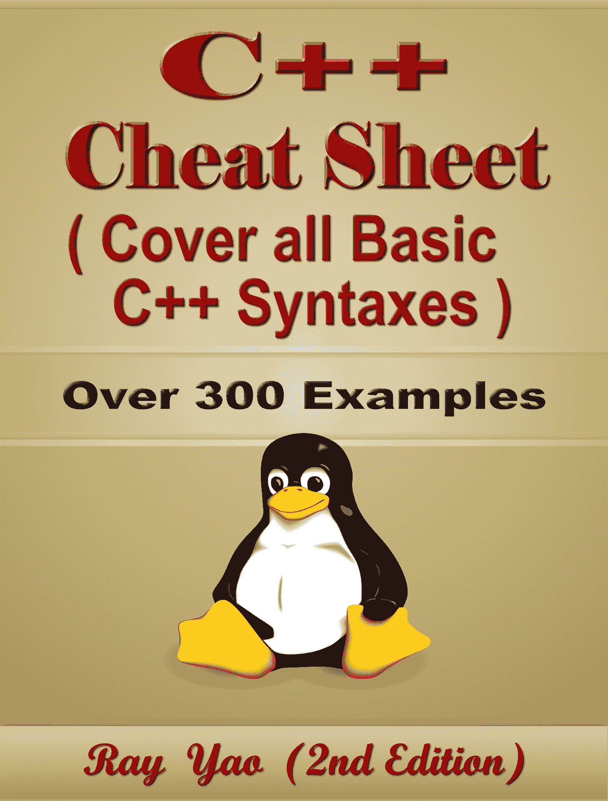

# C++ 速查表，语法快速参考手册（表格与图表）：语法快速学习指南





## 关于本书
本书涵盖了所有基础 C++ 语法，几乎每个语法条目都列出了一个程序示例和结果输出（300 个示例，300 个输出，300 个解释）。我们可以快速参考最有帮助的编程语法，例如常用命令语法、字符串函数语法、集合函数语法、类与对象语法等等……这些语法对于编程都非常有用。

我们可以将这本书作为一份基础语法手册，因为它的条目是按字母顺序排列的，方便我们轻松参考重要的语法。

无论现在还是未来，C++ 语法书都能为我们学习和工作中的编码提供巨大的帮助。

在世界上，哪里能找到一本拥有“300 个示例，300 个输出，300 个解释”的书呢？

----- 仅在此处！

## 免责声明
本书仅作为基础语法手册；它不能包含该主题的所有条目。其目的是作为查表书籍的补充，而不是完整的 C++ 字典。

## 类模板语法

```cpp
template <class T>      // 定义一个类模板
class templateName{ class body };   // 类模板
```

一个类模板可以替换多个类的代码。
如果多个类体相同，仅数据类型不同，则可以使用类模板。
`templateName <type>object;`
// 创建类模板对象

e.g.
```cpp
#include <iostream>
using namespace std;

template< class T>     // 定义一个类模板
class Contrast{     // 类模板
public:
    Contrast(T a, T b)     // 构造函数
    { x = a; y = b;}
    T max( )      // "T" 可能是不同的数据类型
    { return (x > y) ? x : y;}
private:
    T x, y;     // "T" 可能是不同的数据类型
};

int main( ){
    Contrast <int>con1( 10, 20);     // 创建一个对象 "con1"
    cout << con1.max( ) << endl;     // 数据类型为 "int"
    Contrast <float>con2( 20.01, 20.02 );    // 创建 "con2"
    cout << con2.max( ) << endl;     // 数据类型为 "float"
    Contrast <long> con3( 67891, 67892 );     // 创建 "con3"
    cout << con3.max( ) << endl;     // 数据类型为 "long"
    return 0;
}
```
// 输出: 20        20.02        67892

## clog 语法

```cpp
clog << variable;
```

// 输出日志消息

e.g.
```cpp
int main( ){
    char msg[] = "The file is executed only one time";
    clog << "Log message : " << msg << endl;
}
```
// 输出: Log message : The file is executed only one time

## 注释语法

注释 `//` 用于单行注释。
注释 `/*…*/` 用于多行注释。
// C++ 注释用于解释当前代码，描述这些代码正在做什么。C++ 编译器会忽略注释。

e.g.
```cpp
cout << "Hello World" ;   // 输出 "Hello World"

/*
这里是多行注释
"cout <<"  是一个 C++ 输出命令，意味着显示或打印。
*/
```

## 条件编译语法

```cpp
#if expression
编译代码 1       // 如果为真，编译此代码
#else
编译代码 2       // 如果为假，编译此代码
#endif
```

如果条件测试结果为真，则会编译 C++ 程序的一部分；如果条件测试为假，则不编译。

e.g.
```cpp
#include<iostream>
using namespace std;
#define ID 100
int main( ){
#if ID > 0
cout<< "ID>0" << endl;
#else
cout<< "ID<0" << endl;
#endif
return 0;
}
```
// 输出: ID>0

## 条件编译语法

```cpp
#ifdef identifier
编译代码 1       // 如果已定义，编译此代码
#else
编译代码 2       // 如果未定义，编译此代码
#endif
```

如果字符串之前被定义过，则会编译 C++ 程序的一部分；如果字符串未定义，则不编译。

e.g.
```cpp
#include<iostream>
using namespace std;
#define VARIABLE "This is a string."
int main( ){
#ifdef VARIABLE
cout<< "VARIABLE has been defined" <<endl;
#else
cout<< "VARIABLE has not been defined" << endl;
#endif
return 0;
}
```
// 输出: VARIABLE has been defined.

## 条件运算符语法

```cpp
(test-expression) ? (if-true-do-this) : (if-false-do-this);
```

// 当 `test-expression` 返回真时，执行 `if-true-do-this`。
// 当 `test-expression` 返回假时，执行 `if-false-do-this`。

e.g.
```cpp
int main( ) {
    int a = 100; int b =200;
    string result = (a < b) ? "apple" : "banana";
    // (test-expression) ? (if-true-do-this) : (if-false-do-this);
    cout << result << endl;
    return 0;
}
```
// 输出: apple

## 常量定义语法

```cpp
#define CONSTANT-NAME "value"
```

// `#define` 定义一个常量。
// `CONSTANT_NAME` 是常量名，使用大写。
// 注意：尽量不要在 `#define` `CONSTANT_NAME` 语句结束加分号。

e.g.
```cpp
#include <iostream>
using namespace std;
#define SYMBOL "$"   // 定义一个常量
#define PRICE 80    // 定义一个常量
#define MONEY " dollars" // 定义一个常量

int main( ) {
    int num = 10;
    cout << SYMBOL << num * PRICE << MONEY;
    return 0;
}
```
// 输出: $800 dollars

## 常量定义语法

```cpp
const type variable = value;
```

// `const` 用于定义常量。
// 常量名通常是大大写的。

e.g.
```cpp
#include <iostream>
using namespace std;
const int LENGTH = 100; 
const int WIDTH = 50;

int main(){
    int rectangle; 
    rectangle = LENGTH * WIDTH;
    cout << rectangle;
    return 0;
}
```
// 输出: 5000

## constexpr 语法

```cpp
constexpr variables/function/constructors
```

// `constexpr` 意味着常量表达式，它可以用于变量、函数、构造函数。`constexpr` 在编译时求值而不是在运行时求值。

e.g.
```cpp
#include <iostream>
constexpr int sum(int a, int b){ return (a + b); }

// 通过 constexpr，编译器在编译时求值。
int main(){
    constexpr int s = sum(10, 20);
    std::cout << s;
    return 0;
}
```
// 输出: 30

## 构造函数语法

```cpp
class ClassName{
    ClassName( ) {…} ; // 构造函数
};
```

// 构造函数用于初始化变量。构造函数名与类名相同。当创建对象时，构造函数会被调用。

e.g.
```cpp
#include<string>
#include <iostream>
using namespace std;

class Flower {     // 创建一个名为 Flower 的类
```


```cpp
public:    // 指定访问权限
  string c1, c2;

  void beautify() {  cout << "Green" <<endl; };

  Flower(){  c1= "Red";  c2 = "Yellow"; };    // 构造函数

  // 定义一个构造函数 "Flower()"
};

int main( ) {
  Flower obj;    // 创建名为 "obj" 的对象并调用构造函数
  cout << obj.c1 << endl;
  cout << obj.c2 << endl;
  obj.beautify();
  return 0;
}
```
Output:
Red
Yellow
Green

---

### continue 语法：

```cpp
continue;
```
`continue` 关键字用于停止当前的迭代，忽略后续代码，然后继续下一次循环。

e.g.
```cpp
int num = 0;

while ( num < 10 ){
  num++;
  if ( num == 5 )  continue; // 进入下一次 while 循环
  cout <<  num ;      // 如果 num 是 5，则跳过这段代码
}
```
Output: `1234678910`
注意输出中没有 `5`。

---

### 类型转换语法：

```cpp
( type ) variable;
```
将一种数据类型转换为另一种数据类型。

e.g.
```cpp
#include <iostream>
using namespace std;

int main(){
  double x = 2.718281828;
  float y = 3.14;
  int z ;
  z = (int)x;
  cout << "Value of (int)x is: " << z << endl ;
  z = (int)y;
  cout << "Value of (int)y is: " << z << endl ;  
  return 0;
}
```
Output:
Value of `(int)x` is: 2
Value of `(int)y` is: 3

---

### cos() 语法：

```cpp
cos(num)
```
返回以弧度为单位的 num 的余值。

e.g.
```cpp
#include <iostream>
#include <cmath>
using namespace std;

int main(){
  double degree=30;
  double r = degree*3.14/180; 
  cout << cos(r);
}
```
Output: `0.866158`

---

### cosh() 语法：

```cpp
cosh(num)
```
返回 num 的双曲余弦。

e.g.
```cpp
#include <cmath>
#include <iostream>
using namespace std;

int main(){
  cout << cosh(0.6);
}
```
Output: `1.18547`

---

### cout 语法：

```cpp
cout << "   ";  // 在同一行中打印结果
cout << "   " << endl; // 在不同行中打印结果
```
e.g.
```cpp
cout << " 1 ";     // 在同一行输出
cout << " 2 ";
cout << " 3 ";
```
Output: `1  2  3`

e.g.
```cpp
cout << " 1 " << endl ;    // 在不同行输出
cout << " 2 " << endl ;
cout << " 3 " << endl ;
```
Output:
1
2
3

---

### ctime() 语法：

```cpp
time_t t // 定义一个 time_t 类型变量 "t"。
ctime(&t) // 返回表示本地时间的字符串
```
e.g.
```cpp
#include <ctime>
#include <iostream>
using namespace std;

int main(){
  time_t t;
  ctime(&t); // 返回当前日期和时间
  cout<<"Today is: "<< ctime(&t);
}
```
Output: `Today is : Today is: Mon Dec 26 22:37:09 2022`

---

### 当前日期与时间语法：

```cpp
time_t now = time(0);    // 获取当前系统的日期与时间
char* dt = ctime(&now);    // 将 "now" 转换为字符串类型
```
获取日期和时间，请先包含 `<ctime>`。

e.g.
```cpp
#include <iostream>
#include <ctime>
using namespace std;

int main( ){
  time_t now = time(0);      // 获取当前系统的日期与时间
  char* dt = ctime(&now);      // 将 "now" 转换为字符串类型
  cout << dt << endl;
}
```
Output: `Sun Aug  7    16:02:18    2022`

---

### 数据类型语法：

```cpp
type variable = value;
```
数据类型指定了变量的属性。

e.g.
```cpp
#include <iostream>
#include <string>
using namespace std;

int main () {
  int myNum = 10;             // 整数
  float myFloat = 10.99;      // 浮点数
  double myDouble = 10.9999;  // 双精度浮点数
  char myCharacter = 'C';     // 字符
  bool myBool = true;        // 布尔值
  string myString = "C Plus Plus";   // 字符串
  cout << "int type: " << myNum << "\n";
  cout << "float type: " << myFloat << "\n";
  cout << "double type: " << myDouble << "\n";
  cout << "char type: " << myCharacter << "\n";
  cout << "bool type: " << myBool << "\n";
  cout << "string type: " << myString << "\n";
  return 0;
}
```
Output:
int type: 10
float type: 10.99
double type: 10.9999
char type: C
bool type: 1
string type: C Plus Plus

---

### UTC 日期时间语法：

```cpp
time_t now = time(0);    // 获取当前日期时间
tm *gm = gmtime(&now);    // 将 "now " 转换为 tm 类型
char* utc = asctime(gm); // 获取 UTC 日期时间
```
获取日期和时间，请先包含 `<ctime>`。

e.g.
```cpp
#include <iostream>
#include <ctime>
using namespace std;

int main( ){
  time_t now = time(0);    // 获取当前日期时间
  tm *gm = gmtime(&now);    // 将 "now " 转换为 tm 类型
  char* utc = asctime(gm); // 获取 UTC 日期时间
  cout << utc << endl;
}
```
Output: `Sun Aug 7    16:28:29      2022`

---

### 默认参数语法：

```cpp
void functionName( type variable = value ) {
}
```
如果调用函数时不带参数，C++ 编译器将应用默认参数。
`(type variable = value)` 是一个默认参数。

e.g.
```cpp
#include <iostream>
#include <string>
using namespace std;

void myFunction(string city = "New York") {
  cout << city << "\n";
}

int main() {
  myFunction("Atlanta");
  myFunction("Boston");
  myFunction("Chicago");
  myFunction();
  return 0;
}
```
Output:
Atlanta
Boston
Chicago
New York

---

### 定义变量语法：

```cpp
dataType variableName = value;
```
变量是一个与值关联的符号名称。

e.g.
```cpp
void main ( ) {
  char  mychar = 'm';
  int myinteger = 168;
  float myflt = 28.98;
  double mydbl = 0.12345679;
  boolean myBool = true;
}
```

---

### 删除变量语法：

```cpp
variable = new type; // 为变量分配内存
delete variable; // 释放内存
```
e.g.
```cpp
#include <iostream>
using namespace std;

int main (){
  double* myVar = NULL; // 初始化指针为空 Null
  myVar = new double; // 为变量分配内存
  *myVar = 100; // 将值存储到内存地址
  cout << "Value of myVar : " << *myVar << endl;
  delete myVar; // 释放内存
  return 0;
}
```
Output: `Value of myVar : 100`

---

### 删除数组语法：

```cpp
MyClass* myArr = new MyClass[3]; // 为数组分配内存
delete [] myArr; // 释放数组内存
```
e.g.
```cpp
#include <iostream>
using namespace std;

class MyClass{
public:
  MyClass() {
    cout << "Call constructor!" <<endl;
  }
  ~MyClass() {
    cout << "Call destructor!" <<endl;
  }
};

int main( ){
  MyClass* myArr = new MyClass[3]; // 分配内存
  delete [] myArr; // 释放内存
  return 0;
}
```
Output:
Call constructor!
Call constructor!
Call constructor!
Call destructor!
Call destructor!
Call destructor!

---

### 解引用语法：

```cpp
dataType *pointer; // 声明指针
*pointer = &variable; // *pointer 访问变量的值
```
如果 `*pointer = &variable`，意味着可以通过指针根据变量的地址访问变量的值，这被称为指针的“解引用”。

e.g.
```cpp
#include <iostream>
#include <string>
using namespace std;

int main() {
  string greet = "Hello"; // 变量声明
  string *ptr = &greet; // *ptr 访问 "greet" 的值
}
```


```cpp
cout << ptr << "\n";      // 显示 ptr 指向的 greet 地址
cout << *ptr << "\n";     // 显示 *pt 访问的 greet 值
return 0;
}
```
**Output:**
```
0x7ffdb3c71d70
Hello
```

`string *ptr = &greet;`: 这行代码意味着通过解引用指针 `*ptr` 通过指针访问 `"greet"` 的值。

### 析构函数语法

```cpp
~ destructor( );
```
析构函数用于释放内存占用，清理构造函数产生的数据。
析构函数的名称与类名相同，但前面有一个 `~` 符号。
析构函数没有任何参数，也没有返回值。

例如：
```cpp
class Flower {     // 声明一个类
public:
string c1, c2;
Flower() {  c1= "yellow";  c2 = "purple"; } ;  // 构造函数
~ Flower();      // 定义析构函数。
};
```
析构函数的声明必须紧跟构造函数之后。

### detach() 语法

```cpp
threadObj.detach();
```
将指定的线程与线程对象分离。
线程退出后，所有分配的资源将被释放。

例如：
```cpp
#include <iostream>
#include <chrono>
#include <thread>
void func02() {
  std::cout << "Start thread02.\n";
  std::this_thread::sleep_for(std::chrono::seconds(3));
  std::cout << "Exit thread02.\n";
}

void func01() {
  std::cout << "Start thread01.\n";
  std::thread th(func02);
  th.detach();   // 将线程从线程对象中分离
  std::this_thread::sleep_for(std::chrono::seconds(2));
  std::cout << "Exit thread01.\n";
}

int main() {
  func01();
  std::this_thread::sleep_for(std::chrono::seconds(4));
}
```
**Output:**
```
Start thread01.
Start thread02.
Exit thread01.
Exit thread02.
```

### div() 语法

```cpp
div(x, y).quot // 返回 x/y 的商
div(x, y).rem  // 返回 x/y 的余数
```
例如：
```cpp
#include <iostream>
#include <cstdlib>
using namespace std;
int main(){
  cout << "Quotient of 19/2 = " << div(19, 2).quot << endl;
  cout << "Remainder of 19/2 = " << div(19, 2).rem << endl;
}
```
**Output:**
```
Quotient of 19/2 = 9
Remainder of 19/2 = 1
```

### do / while 循环语法

```cpp
do{ // 在此处编写某些 c++ 代码 } while ( test-expression);
```
`do...while` 循环执行一次代码块，如果指定的指定的条件为真，则重复循环。
`do…while` 先执行代码，再检查条件。

例如：
```cpp
int counter = 0;
do {    // 在检查条件之前运行代码
  cout <<  "@";
  counter++;
} while (counter < 8);      // 运行 8 次
```
**Output:**
```
@@@@@@@@
```

### e.what( ) 语法

```cpp
try
{…}
catch(exception& e)
{
  cout  << e.what( )  <<endl;
}
```
`e.what( )` 可以产生异常消息。
`e` 是一个异常对象。

例如：
```cpp
int main () {
  string str = "JavaScript";
  try{
    str.at(100);
  }
  catch(exception &e){  // e 是异常对象
  cout<<"Catch an exception: "<< e.what( ) << endl;
  // "e.what( )" 创建了一个异常消息。
  }
  return 0;
}
```
**Output:**
```
Catch an exception: basic_string::at: __......
```

### empty() 语法

```cpp
myString.empty();
```
`myString.empty();` 可以测试用户在提交数据之前是否输入了单词或句子。如果 `myString` 为空，它返回 true，允许我们输入某些内容；否则返回 false。

例如：
```cpp
#include <string>
#include <iostream>
using namespace std;
int main( ) {
  string myString;
  if ( myString.empty()) {    // 如果还没有输入内容
  cout << "Please enter your name: ";
  getline (cin, myString);  // 假设输入了 John Smith
  cout << myString << endl;
  }
  else {
  cout << "You have entered your name, thank you! ";
  }
  return 0;
}
```
**Output:**
```
Please enter your name:   John Smith
```

### 封装语法

```cpp
private:
public:
```
封装确保数据对用户隐藏的。
`private` 访问修符将访问限制在类内部。
`public` 访问修符允许从类外部访问。

 `private` 访问修符将访问限制在类内部。
`public` 访问修符允许从类外部访问。

例如：
```cpp
class Programmer {
private:
  long income;
public:
  void setIncome(long i) { income = i; }
  long getIncome() { return income; }
};

int main() {
  Programmer p;
  p.setIncome(50000);
  cout << "Income: " << p.getIncome() << endl;
  return 0;
}
```

### 文件末尾语法

```cpp
fileObject.eof();
```
如果文件读取到达文件末尾，`eof( )` 将返回 true，否则 `eof( )` 返回 false。

例如：
```cpp
#include <iostream>
#include <fstream>
#include <string>
using namespace std;
int main(){
  char ch;
  ifstream fileObject("test.txt");
  while ( ! fileObject.eof() ) {  // 不在文件末尾
    fileObject.get(ch);
    if (!fileObject.eof()) {
      cout << ch; // 从文件中读取字符
    }
  }
  fileObject.close();
  return 0;
}
```

### 转义序列语法

` \ ` 反斜杠字符可以用于转义字符。
`\n` 将内容输出到下一行。
`\r` 产生回车。
`\t` 产生制表符。
`\'` 输出单引号。
`\"` 输出双引号。

例如：
```cpp
cout << "  \" Hello World!  \"  ";  // \" 转义双引号
```
**Output:**
```
"Hello World!"
```
```cpp
cout << "Hello \t\t\t World" ;  // 注意有三个制表符。
```
**Output:**
```
Hello       World
```

### 异常语法

```cpp
try { }
catch (...) { } // 注意符号 (…)
```
如果你不知道 `try` 块中的异常类型，可以在 `catch` 块中使用“三个点”符号 `...`。


## 异常处理

例如：

```cpp
int main (){
    try{
        int x = 100, y = 0;
        if( y == 0 ){
            throw y;  // 我们可以在这里设置“抛出一个异常”
            x = x / y;
        }
    }
    catch (...){  // 使用 (…) 捕获任何类型的异常
        cout << "An exception occurred." << endl;
    }
    return 0;
}
```
// 输出:   An exception occurred.

### 异常消息语法

```cpp
try
{…}
catch(exception& e)
{  cout  << e.what( ) <<endl;
}
```
// `e.what( )` 可以产生异常消息。
// `e` 是一个异常对象。

例如：
```cpp
int main () {
    string str = "JavaScript";
    try{
        str.at(100);
    }
    catch(exception &e) {  // e 是一个异常对象
        cout<<"Catch an exception: "<< e.what( ) << endl;
        // "e.what( )" 创建一个异常消息。
    }
    return 0;
}
```
// 输出:   Catch an exception: basic_string::at: __......

## exit() 语法

```cpp
exit(0);     // 程序无错误退出
exit(non_zero);  // 程序错误退出
```

例如：
```cpp
#include <cstdlib>
#include <iostream>
using namespace std;

int main(){
    cout<<"Program is going to exit right away!";
    exit(0);   // 程序成功退出
    cout<<"Because program has been exited, this is never executed";
}
```
// 输出:   Program is going to exit right away!

## exp() 语法

```cpp
exp(num)
```
// 返回 e 的幂

例如：
```cpp
#include <iostream>
#include <cmath>
using namespace std;

int main(){
    cout << exp(3.14);
}
```
// 输出:   23.1039

## expm1() 语法

```cpp
expm1(num)
```
// 返回 ex - 1

例如：
```cpp
#include <iostream>
#include <cmath>
using namespace std;

int main(){
    cout << expm1(3.14);
}
```
// 输出:   22.1039

## extern 语法

```cpp
extern type variable;
```
// 我们可以使用 `extern` 关键字在任何地方声明变量

例如：
```cpp
#include <iostream>
using namespace std;

extern int x, y, z; // 在这里声明三个变量

int main (){
    int x, y, z;
    x = 10;  y = 20; z = x+y;
    cout << z << endl ;
    return 0;
}
```
// 输出:   30

## extern 函数语法

```cpp
extern functionName( );
```
// `extern functionName( );` 声明了一个可以在另一个文件中调用的函数。

例如：
(file1.cpp)
```cpp
#include<iostream>
using namespace std;
extern void min(int, int);    // 声明一个 extern 函数
int c;
int main( ){
    int a = 100, b = 200;
    min(a, b);    // 调用 file2 中的函数
    cout << c << endl;
    return 0;
}
```
(file2.cpp)
```cpp
#include <iostream>
using namespace std;
extern int c;    // 定义一个 extern 变量
void min(int x, int y){
    c = ( x < y) ? x : y;
}
```
// 输出:   100

## extern 变量语法

```cpp
extern type variable;
```
// `extern type variable` 声明了一个可以在其他文件中使用的变量。

例如：
(file1.cpp)
```cpp
#include<iostream>
using namespace std;
extern int c;    // 声明一个 extern 变量
int main( ){
    cout << c << endl;
    return 0;
}
```
(file2.cpp)
```cpp
#include <iostream>
using namespace std;
int a = 100, b = 200;
int c = a + b;
```
// 输出:   300

## fabs() 语法

```cpp
fabs(num)
```
// 返回浮点数的绝对值。
// `abs()` 用于整数数据类型。`fabs()` 用于整数、float、double 和 char 数据类型。

例如：
```cpp
#include <iostream>
#include <cmath>
using namespace std;

int main() {
    cout<<"Fabs(3.14) = "<< fabs(-3.14);
}
```
// 输出:   Fabs(3.14) = 3.14

## fdim() 语法

```cpp
fdim(num1, num2)
```
// 返回 num1 和 num2 之间的差。

例如：
```cpp
#include <iostream>
#include <cmath>
using namespace std;

int main(){
    double x = 3.14, y = 1.11;
    double diff = fdim(x, y);
    cout << "fdim(3.14, 1.11) = " << diff << endl;
}
```
// 输出:   fdim(3.14, 1.11) = 2.03

## find() 语法

```cpp
myString.find(substring, start)
```
// `find( )` 可以定位子字符串的位置（索引）。
// "Substring" 意味着需要搜索的子字符串。
// "start" 意味着查找子字符串的起始索引。

例如：
```cpp
#include<string>
#include <iostream>
using namespace std;

int main( ) {
    string myString = "An operating system.";
    string substring = "system";     // 定义子字符串
    int position = myString.find( substring, 0 );   // 获取索引
    cout << "The index of the substring is: " << position << endl;
    return 0;
};
```
// 输出:   The index of the substring is: 13

## floor() 函数语法

```cpp
floor(x);
```
// 返回小于或等于 x 的最大整数

例如：
```cpp
#include <iostream>
#include <cmath>
using namespace std;

int main (){
    float  f = 100.88;
    cout << "floor(f): " << floor(f) << endl;
    return 0;
}
```
// 输出:
floor(f): 100

## fma() 语法

```cpp
fma(x,y,z)
```
// 在不丢失精度的情况下返回 x*y+z

例如：
```cpp
#include <iostream>
#include <cmath>
using namespace std;

int main(){
    int x = 2, y = 3, z = 4;
    int result = fma(x, y, z);
    cout << "fma(2, 3, 4) = " << result << endl;
}
```
// 输出:   10

## fmax() 语法

```cpp
fmax(x, y)
```
// 返回 x 和 y 中的最大值

例如：
```cpp
#include <iostream>
#include <cmath>
using namespace std;

int main(){
    double x = 1.11, y = 3.14;
    double result = fmax(x, y);
    cout << "fmax(1.11, 3.14) = " << result << endl;
}
```
// 输出:   fmax(1.11, 3.14) = 3.14

## fmin() 语法

```cpp
fmin(x, y)
```
// 返回 x 和 y 中的最小值

例如：
```cpp
#include <iostream>
#include <cmath>
using namespace std;

int main(){
    double x = 1.11, y = 3.14;
    double result = fmin(x, y);
    cout << "fmin(1.11, 3.14) = " << result << endl;
}
```
// 输出:   fmin(1.11, 3.14) = 1.11

## fmod() 语法

```cpp
fmod(x,y)
```
// 返回 x/y 的浮点余数

例如：
```cpp
#include <iostream>
#include <cmath>
using namespace std;

int main(){
    cout << "Remainder of 3.14/2 = " << fmod(3.14, 2);
}
```
// 输出:   Remainder of 3.14/2 = 1.14

## for 循环语法

```cpp
for( init, test-expression, increment) { // 代码; }
```
// `for loop` 按指定的次数执行代码块。

例如：
```cpp
int x;
for (x = 0; x <= 5; x++){   // 重复 5 次
    cout << x;
}
```
// 输出:   012345

## 友元函数语法

```cpp
friend type functionName(arg);
```
// 如果一个函数被定义类的“友元函数”，那么该“友元函数”就可以访问类的私有成员。

例如：
```cpp
#include<iostream>
using namespace std;

class Week{
public:
Week(int, int, int);
friend void show( Week &);   // 定义友元函数

private:   // 定义私有成员
int Mon;  int Tue;  int Wed;
};

Week::Week(int m, int t, int w){   // 构造函数
Mon = m;  Tue = t;  Wed = w;
}

void show ( Week &wk ){  // 这是一个友元函数
cout << wk.Mon<< endl;
cout << wk.Tue<< endl;
cout << wk.Wed<< endl;
}

int main ( ){
    Week weekObject( 1, 2, 3 );  // 创建对象
    show( weekObject );  // 调用友元函数
    return 0;
}
```
// 输出:   1
      2
      3

## 函数语法

```cpp
type functionName(  );
```
// 声明一个函数


## 函数基础

```cpp
type functionName( ) {
    // 定义一个函数

....

};

functionName( );   // 调用一个函数
```

// 函数是一个可以重复使用的代码块。

在使用函数之前，我们需要先声明一个函数。

例如：

```cpp
#include <iostream>

using namespace std;

void myFunction( );   // 声明一个函数

int main( ) {
    myFunction( );     // 调用函数
    return 0;
}

void myFunction ( ) {   // 定义一个函数
    cout << "This is a function demo." <<endl;
}
```
// 输出: This is a function demo.

---

## 函数模板

```cpp
template <typename T> type functionName( T a, T b)
```

// 一个函数模板可以替代多个函数的代码。

如果几个函数的函数体相同，仅数据类型不同，你可以使用`Function Template`。

// `T` 是一个类型参数。它代表不同的数据类型。

例如：

```cpp
#include <iostream>

using namespace std;

template <typename T> T min(T a, T b, T c){
    // 定义一个函数模板 "min( )"
    if ( b < a ) a = b;
    if ( c < a ) a = c;
    return a;
}

int main( ){
    int n, n1 = 10, n2 = 20, n3 = 30;
    double d, d1 = 10.01, d2 = 10.02, d3 = 10.03;
    long g, g1= 67891, g2 = 67892, g3 = 67893;
    n = min( n1, n2, n3 );
    d = min( d1, d2, d3 );
    g = min( g1, g2, g3 );
    cout << n << endl;
    cout << d << endl;
    cout << g << endl;
    return n + n;
}
```
// 输出: 10 10.01 67891

---

## 带参数的函数

```cpp
type functionName( arg );   // 声明一个函数

type functionName ( arg ) {     // 定义一个函数

……

};

functionName ( argument );      // 调用函数
```

// 当函数被调用时，函数会同时接收一个参数。

例如：

```cpp
#include <iostream>

using namespace std;

void myFunction(string arg );   // 声明一个函数

int main( ) {
    myFunction ( "with arguments." );   // 调用函数
    return 0;
}

void myFunction ( string arg ) {  // 定义一个函数
    cout << "This is a function " + arg << endl;
}
```
// 输出: This is a function with arguments.

---

## 标准库函数

### gcd()
```cpp
std::gcd(num1, num2)
```
// 获取两个数的最大公约数

例如：

```cpp
#include <iostream>
#include <numeric>

using namespace std;

int main(){
    cout << "gcd(100, 200) = " << std::gcd(100, 200) << endl;
}
```
// 输出: gcd(100, 200) = 100

### get()
```cpp
cin.get(char c);
```
// `cin.get(char c)` 用于输入一个字符
// 字符始终被包含在一对单引号中。

例如：

```cpp
int main(){
    char c;
    cout << "Input one character:  ";
    cin.get( c );     // 输入一个字符
    cout << c <<endl;   // 输出该字符
    return 0;
} // 假设通过键盘输入了一个字符 "A"
```
// 输出: Input one character: A

### getchar()
```cpp
char c = getchar();
```
// 接收用户输入的字符，并将其存储在变量 `c` 中

例如：

```cpp
#include <cstdio>
#include <iostream>

using namespace std;

int main(){
    char c = getchar();
    cout << c;   // 假设我们在键盘上输入了字符 "A"
}
```
// 输出: A

### getenv()
```cpp
getenv("path")
```
// 返回指向包含环境信息的字符串的指针，例如路径名、设备……

例如：

```cpp
#include <iostream>
#include <cstdlib>

using namespace std;

int main(){
    cout << getenv("path");
}
```
// 输出: Variable = path, Value= ……

### getline()
```cpp
getline(cin, myString);
```
// `getline(cin, myString);` 可以让用户输入字符串句子。

例如：

```cpp
#include <string>
#include <iostream>

using namespace std;

int main( ) {
    string myString;   // 声明一个字符串
    cout << "Please enter a sentence: " << endl;
    getline(cin, myString);   // 输入 "C++ is Very Good!"
    cout <<  myString << endl;
    return 0;
}
```
// 输出:
Please enter a sentence:
C++ is Very Good!

---

## 类与封装

### Getter 语法
```cpp
private:   // 封装
type variable;     // 设置一个私有变量
public:
void setVariable() {   }     // setter
long getVariable() { return … }   // getter
```
封装的含义是确保秘密数据对用户隐藏。
// 我们必须先将类变量声明为 `private`。
// 如果我们想访问 `private` 变量，可以使用公有的的 `getter` 和 `setter` 方法。

例如：

```cpp
#include <iostream>
using namespace std;

class Programmer {
private:   // 封装
    long income;      // 设置一个私有变量
public:
    void setIncome(int money) {   // setter
        income = money;
    }
    long getIncome() {   // getter
        return income;
    }
};

int main() {
    Programmer guy;
    guy.setIncome(90000);
    cout << "Monthly income is: $"<< guy.getIncome(); 
    return 0;
}
```
// 输出: Monthly income is: $90000

## 全局变量与局部变量

```cpp
type global_variable = value;   // 定义一个全局变量
void myFunction( ) {               // 定义一个函数
    type local_variable = value;           // 定义一个局部变量
}
```
// 局部变量定义在函数内部。
// 全局变量定义在函数外部。

例如：

```cpp
#include <iostream>
using namespace std;

void test1();  void test2();

int main(){
    test1();  test2();
    return 0;
}

int a = 100, b = 200;    // 定义两个全局变量
void test1 ( ) {               // 定义一个函数
    int x = 30, y = 40;
}

void test2 ( ) {   // 定义一个函数
    int x = 50, y = 60;
    cout << a << "," << b << endl;
    cout << x << "," << y << endl;
}
```
// 输出:
100,200
50,60

---

## 控制流

### goto 语法
```cpp
label:
goto label;
```
// 提供从 `goto` 语句到 `label` 语句的无条件跳转。

例如：

```cpp
#include <iostream>
using namespace std;

void number(){
    int num = 0;
label:
    cout << num << " ";
    num++;
    if (num <= 9)
    goto label;
}

int main(){
    number();
    return 0;
}
```
// 输出: 0 1 2 3 4 5 6 7 8 9

### hypot() 语法
```cpp
hypot(x, y)
```
// 返回 $x² + y²$ 的平方根，如下：

例如：

```cpp
#include <iostream>
#include <cmath>
using namespace std;

int main(){
    int x = 3, y = 4;
    int result = hypot(x, y);
    cout << "hypot(3, 4) = " << result << endl;
}
```
// 输出: hypot(3, 4) = 5

### if 语句
```cpp
if ( test-expression ) { // 如果真则执行此操作  }
```
// `if statement` 只有当指定的条件为真时才执行 `{ }` 中的代码；如果条件为假，则不执行 `{…}` 中的任何代码。

例如：

```cpp
int a=200;
int b=100;
if (a>b){   // 如果真则执行此操作
    cout << "a is greater than b.";
}
```
// 输出: a is greater than b

### if-else 语句
```cpp
if ( test-expression) {   // 如果真则执行此操作  }
else  {   // 如果假则执行此操作  }
```
// `if...else 语句` 在条件为真时运行某些代码，在条件为假时运行另一个代码。

例如：

```cpp
int a = 100; int b = 200;
if (a > b) {   // 如果真则执行此操作
    cout << "a is greater than b.";
}
else {   // 如果假则执行此操作
    cout << "a is less than b";
}
```
// 输出: a is less than b


## ifstream 语法

`ifstream` 语法：

```cpp
ifstream fileObject( "myFile.txt" );  // 创建输入对象
getline( fileObject, myString);    // 从文件中读取 myString
```

- `ifstream fileObject ( "myFile.txt" );` 创建了一个输入文件对象 `fileObject`。
- `ifstream` 类用于从文件中读取数据。
- `fileObject` 是一个输入文件对象。
- 为了处理文件，我们需要先导入 `#include <fstream>`。

### 示例


假设 `"myFile.txt"` 的路径为 `"D:\\myFile.txt"`。
`"myFile.txt"` 的内容为："C++ is a very good language."`

```cpp
#include <iostream>
#include <fstream>
#include <string>

using namespace std;

int main(){
    string myString;
    ifstream fileObject ( "D:\\myFile.txt" ); // 创建一个对象
    getline ( fileObject, myString ); // 将文件读取到 myString
    cout << myString <<endl;    // 显示 myString 的内容
    fileObject.close ( );
    return 0;
}
```
// 输出：`C++ is a very good language.`

## 继承语法

继承语法：

`derived class : public base class`

- 基类可以被其派生类继承。派生类可以继承基类的所有的公共成员。
- 基类可以被父类。
- 派生类可以被视为子类。

### 示例

```cpp
#include<string>
#include <iostream>

using namespace std;

class Computer {  // 基类
public:
    void display( ){
        cout << "Computer OK!" << endl;
    }
};

class Laptop : public Computer { 
    // 派生类继承基类
};

int main ( ){
    Laptop Lt;    // 派生类创建对象 Lt
    Lt. display( );  // Lt 调用基类的方法
    return 0;
}
```
// 输出：`Computer OK!`

## 内联函数语法

内联函数语法：

`inline type functionName( );`

- 内联函数可以提高程序的执行效率。每当调用内联函数时，编译器都会用函数中的实际代码替换函数调用。

### 示例

```cpp
#include <iostream>
using namespace std;

inline int sum(int n);   // 定义内联函数
int main( ){
    int number;
    cout << "Please enter a number: ";
    cin >> number;
    number = sum(number);
    cout << "Result: " << number << endl;
    number = sum(number);
    cout << "Result: " << number << endl;
    number = sum(number);
    cout << "Result: " << number << endl;
}

int sum(int n){
    return n + n;
}   // 假设我们输入了数字 3 并回车
```
// 输出：
`Please enter a number: 3`
`Result: 6`
`Result: 12`
`Result: 24`

### 用户输入语法

用户输入语法：

`cin >> variable;`

- 从键盘获取用户输入。

### 示例

```cpp
int main() {
    int num;
    cout << "Please enter a number: ";
    cin >> num;  // 接受用户数字
    cout << num;
    return 0;
}
```
// 输出：`Please enter a number: 100`

## 字符输入语法

字符输入语法：

`cin.get(char c );`

- 字符始终由一对单引号包含。

### 示例

```cpp
int main(){
    char c;
    cout << "Input character: ";
    cin.get( c );  // 输入字符
    cout << c <<endl;  // 输出字符
    return 0;
} // 假设我们通过键盘输入了字符 "A"
```
// 输出：`Input character: A`

## 字符串输入语法

字符串输入语法：

`cin >> variable;`

- `cin >> variable` 可以输入单个单词。

### 示例

```cpp
#include <string>
#include <iostream>
using namespace std;

int main( ) {
    string myString;
    cout << "Please enter a word: "<< endl;
    cin >> myString;  // 输入 GOOD
    cout << myString <<endl;
    return 0;
}
```
// 输出：`Please enter a word: GOOD`

## getline 字符串语法

字符串输入语法：

`getline(cin, myString);`

- `getline(cin, myString)` 可以允许用户输入句子。

### 示例

```cpp
#include <string>
#include <iostream>
using namespace std;

int main( ) {
    string myString;
    cout << "Please enter a sentence: " << endl;
    getline(cin, myString);  // 输入 "C++ is Very Good!"
    cout << myString << endl;
    return 0;
}
```
// 输出：`Please enter a sentence: C++ is Very Good!`

## insert() 语法

insert() 语法：

`originalString = insert(index, substring);`

- `originalString = insert(index, substring)` 可以向原始字符串中插入子字符串。
- `index` 表示插入子字符串的位置。

### 示例

```cpp
#include<string>
#include <iostream>
using namespace std;

int main( ) {
    string originalString = "Flower is beautiful!";
    string substring = "very ";
    originalString.insert(10, substring); // 插入子字符串
    cout << originalString << endl;
    return 0;
}
```
// 输出：`Flower is very beautiful!`

## isalnum() 语法

isalnum() 语法：

`isalnum('character')`

- 检查给定字符是否为字母数字。

### 示例

```cpp
#include <iostream>
#include <cctype>
using namespace std;

int main(){
    char c = '9';
    if(isalnum(c)){ cout << c << " is alpha-numeric";}
    else{ cout << c << " is not alpha-numeric";}
}
```
// 输出：`9 is alpha-numeric`

## isalpha() 语法

isalpha() 语法：

`isalpha('character')`

- 检查给定字符是否为字母。

### 示例

```cpp
#include <iostream>
#include <cctype>
using namespace std;

int main(){ 
    char c = '9';
    if(isalpha(c)){ cout << c << " is alphabetic";}
    else{ cout << c << " is not alphabetic";}
}
```
// 输出：`9 is not alphabetic`

## is_compound<> 语法

is_compound<> 语法：

`is_compound<type>::value`

- 如果指定类型是复合类型，返回 1；否则返回 0。
- 复合类型指数组、函数、指针、引用、联合体、类和枚举类型等……

### 示例

```cpp
#include <iostream>
#include <type_traits>
using namespace std;

int main() {
    cout << "char: " << is_compound<char>::value << endl;
    cout << "double: " << is_compound<double>::value << endl;
    cout << "float*: " << is_compound<float*>::value << endl;
    cout << "double&: " << is_compound<double&>::value << endl;
    cout << "bool: " << is_compound<bool>::value << endl;
    return 0;
}
```
// 输出：
`char: 0`
`double: 0`
`float*: 1`
`double&: 1`
`bool: 0`

## isdigit() 语法

isdigit() 语法：

`isdigit('character')`

- 检查给定字符是否为数字。

### 示例

```cpp
#include <iostream>
#include <cctype>
using namespace std;

int main(){ 
    char c = '9';
    if(isdigit(c)){ cout << c << " is a digit";}
    else{ cout << c << " is not a digit";}
}
```
// 输出：`9 is a digit`

## isgraph() 语法

isgraph() 语法：

`isgraph('character')`

- 检查给定字符是否可打印。

### 示例

```cpp
#include <iostream>
#include <cctype>
using namespace std;

int main(){ 
    char c = '9';
    if(isgraph(c)){ cout << c << " is printable";}
    else{ cout << c << " is not printable";}
}
```
// 输出：`9 is printable`

## islower() 语法

islower() 语法：

`islower('character')`

- 检查给定字符是否为小写字母。

### 示例

```cpp
#include <iostream>
#include <cctype>
using namespace std;

int main(){ 
    char c = 'A';
    if(islower(c)){ cout << c << " is an lowercase character";}
    else{ cout << c << " is not an lowercase character";}
}
```
// 输出：`A is not an lowercase character`


## ispunct() 语法

`ispunct('character')`

// 检查给定字符是否为标点符号。

e.g.

```cpp
#include <iostream>
#include <cctype>
using namespace std;

int main(){  
  char c = '?';
  if(ispunct(c)){ cout << c << " is a punctuation character";}
  else{ cout << c << " is not a punctuation character";}
}
// 输出: ? is a punctuation character
```

## isspace() 语法

`isspace('character')`

// 检查给定字符是否为空格。

e.g.

```cpp
#include <iostream>
#include <cctype>
using namespace std;

int main(){  
  char c = 'A';
  if(isspace(c)){ cout << c << " is a space";}
  else{ cout << c << " is not a space";}
}
// 输出: A is not a space
```

## isupper() 语法

`isupper('character')`

// 检查给定字符是否为大写字母。

e.g.

```cpp
#include <iostream>
#include <cctype>
using namespace std;

int main(){  
  char c = 'A';
  if(isupper(c)){ cout << c << " is an uppercase character";}
  else{ cout << c << " is not an uppercase character";}
}
// 输出: A is an uppercase character
```

## join() 语法

`thread t1(threadFunction, argument);`    // 创建线程 t1
`t1.join();`      // t1 合并主线程
`thread t2(threadFunction, argument);`  // 创建线程 t2
`t2.join();`      // t2 合并主线程
`thread t3(threadFunction, argument);`  // 创建线程 t3
`t3.join();`      // t3 合并主线程
// `threadName.join()`可以将当前线程合并到主线程

e.g.

```cpp
void threadFunction(arg){
  cout << "I am the running function of the thread" << endl;
}

int main(){
  thread t1(threadFunction, argument);   // 创建线程 t1
  t1.join();      // t1 合并主线程
  thread t2(threadFunction, argument);  // 创建线程 t2
  t2.join();      // t2 合并主线程
  thread t3(threadFunction, argument);  // 创建线程 t3
  t3.join();      // t3 合并主线程
  return (0);
}

t1.detach();    // 将 t1 从主线程分离
if (t1.joinable()){    // 检查 t1 是否可以合并主线程
  t1.join();
}
else{
  cout << "t1 is detached" << endl;
}
// 上述代码是多线程的主结构
```

## joinable() 语法

`threadObj.joinable()`

// 如果线程对象可以合并，则返回 1，否则返回 0。
// 只有在线程运行结束后，另一个线程才能被合并。

e.g.

```cpp
#include <iostream>
#include <thread>

void func() {
  std::this_thread::sleep_for(std::chrono::seconds(2));
}

int main() {
  std::thread t;
  t = std::thread(func);    // 创建一个线程对象
  std::cout<<"Before joining, will be joinable? "<< t.joinable()'\n';
  t.join();      // 合并到线程对象
  std::cout<<"After joining, will be joinable? "<< t.joinable()'\n';
}
// 输出:
Before joining, will be joinable? 1
After joining, will be joinable? 0
```

## lambda 函数 语法

`[ ] (parameters)->return-type{body}`

// Lambda 表达式将函数视为对象。我们可以将其赋值给变量并作为参数传递，还可以像函数一样求值它们。

e.g.

```cpp
#include <iostream>
using namespace std;

int main() {
  auto salute = [ ]()-> void{ // 创建一个 lambda 函数
    cout << "Hi, My friends!";
  };
  salute();     // 调用 lambda 函数
  return 0;
}
// 输出: Hi, My friends!
```

## lcm() 语法

`std::lcm(num1, num2)`

// 获取两个数的最小公倍数

e.g.

```cpp
#include <iostream>
#include <numeric>
using namespace std;

int main(){
  cout << "lcm(100, 200) = " << std::lcm(100, 200) << endl;
}
// 输出: lcm(100, 200) = 200
```

## 局部变量 语法

`int global_variable = value;` // 定义全局变量
`void myFunction ()` // 定义函数
`int local_variable = value;` // 定义局部变量
// 局部变量定义在函数内部。
// 全局变量定义在函数外部。

e.g.

```cpp
#include <iostream>
using namespace std;

int global_variable = 100; // 全局变量

void test1() {
  int local_variable = 30; // 局部变量
}

void test2 () {
  int local_variable = 50; // 局部变量
}

int main(){
  test1();
  test2();
  cout << global_variable << endl;
  return 0;
}
//（注：为了清晰起起简化）
```

## log() 语法

`log(num)`

// 返回参数的自然对数。

e.g.

```cpp
#include <iostream>
#include <cmath>
using namespace std;

int main(){
  cout << log(100);
}
// 输出: 4.60517
```

## log2() 语法

`log2(num)`

// 返回数字以 2 为底的对数。

e.g.

```cpp
#include <iostream>
#include <cmath>
using namespace std;

int main(){
  cout << "log2(128) = " << log2(128);
}
// 输出: log2(128) = 7
```

## log10() 语法

`log10(num)`

// 返回数字以 10 为底的对数。

e.g.

```cpp
#include <iostream>
#include <cmath>
using namespace std;

int main(){
  cout << "log10(100) = " << log10(100);
}
// 输出: log10(100) = 2

## math 函数 语法

`math_function(x);`
`math_function(x, y);`

// 常用的数学函数有 `sin()`, `cos()`, `tan()`, `exp()`, `round()`, `ceil()`, `floor()`, `min()`……

e.g.

```cpp
#include <iostream>
#include <cmath>
using namespace std;

int main(){
  short s = 100;
  int i = -100;
  long l = 1000;
  float f = 100.88;
  double d = 100.888;
  cout << "sin(d): " << sin(d) << endl;
  cout << "tan(d): " << tan(d) << endl;
  cout << "abs(i): " << abs(i) << endl;
  cout << "round(f): " << round(f) << endl;
  cout << "ceil(d): " << ceil(d) << endl;
  cout << "floor(f): " << floor(f) << endl;
  cout << "sqrt(f): " << sqrt(f) << endl;
  cout << "pow(d, 2): " << pow(d, 2) << endl;
  cout << "max(10, 100): " << max(10, 100) << endl;
  cout << "min(10, 100): " << min(10, 100) << endl;
  return 0;
}
// 输出:
sin(d): -0.349498
tan(d): 0.373022
abs(i): 100
round(f): 101
ceil(d): 101
floor(f): 100
sqrt(f): 10.0439
pow(d, 2): 10178.4
max(10, 100): 100
min(10, 100): 10
```

## max() 函数 语法

`max(x, y);`

// 通过比较 x 和 y 返回较大的值。

e.g.

```cpp
#include <iostream>
#include <cmath>
using namespace std;

int main(){
  cout << "max(10, 100); " << max(10, 100) << endl;
  return 0;
}
// 输出: max(10, 100); 100
```

## memchr() 语法

`memchr(string, ch, count )`

// 在字符串中搜索字符
// "count" 是要搜索的字符个数

e.g.

```cpp
#include <cstring>
#include <iostream>
using namespace std;

int main(){
  char str[] = "JavaScript in 8 Hours";
  char ch = 'S';
  int count = 10;
  if (memchr(str, ch, count))
    cout << ch << " is found in first " << count << " characters.";
  else
    cout << ch << " is not found in first " << count << " characters.";
}
// 输出: S is found in first 10 characters.
```


## `memcmp()` 语法

`memcmp(object1, object2, num)`

// 按字母顺序比较两个对象
// "num" 指定了要比较的最大字节数

e.g.
```cpp
#include <cstring>
#include <iostream>

using namespace std;
int main(){
    int comp = memcmp("abcd", "efg", 4);
    if ( comp == 0 ){ cout << "abcd = efg"; }
    if ( comp > 0 ){ cout << "abcd > efg"; }
    if ( comp < 0 ){ cout << "abcd < efg"; }
}
// Output: abcd < efg
```

## 内存分配语法

`variable = new type;` // 为变量分配内存
`*variable = value;` // 将值存储到内存地址
`delete variable;` // 释放变量内存

e.g.
```cpp
#include <iostream>
using namespace std;
int main (){
    double* myVar = NULL; // 初始化指针为 Null
    myVar = new double;    // 为变量分配内存
    *myVar = 100;         // 将值存储到内存地址
    cout << "Value of myVar : " << *myVar << endl;
    delete myVar;         // 释放变量内存
    return 0;
}
// Output: Value of myVar : 100
```

## 内存分配语法

`MyClass* myArr = new MyClass[3];` // 分配数组内存
`delete [] myArr;` // 释放数组内存

e.g.
```cpp
#include <iostream>
using namespace std;
class MyClass{
public:
    MyClass() {
        cout << "Call constructor!" <<endl;
    }
    ~MyClass() {
        cout << "Call destructor!" <<endl;
    }
};
int main( ){
    MyClass* myArr = new MyClass[3]; // 分配内存
    delete [] myArr;                // 释放内存
    return 0;
}
// Output:
Call constructor!
Call constructor!
Call constructor!
Call destructor!
Call destructor!
Call destructor!
```

## 多重继承语法

`class ParentClass { // 父类 };`
`class ChildClass: public ParentClass { // 子类 };`
`class GrandSonClass: public ChildClass { // 孙子类 };`

// 孙子类可以派生自子类，子类可以派生自父类。

e.g.
```cpp
#include <iostream>
using namespace std;
class ParentClass { // 父类
public:
    void myFunction() {
        cout << "The treasure from the parents" ;
    }
};
class ChildClass: public ParentClass { // 子类 };
class GrandSonClass: public ChildClass { // 孙子类 };
int main() {
    GrandSonClass myObj;
    myObj.myFunction();
    return 0;
}
// Output:
The treasure from the parents
```

## 多重继承语法

`class ParentClass1 { // 父类 1 };`
`class ParentClass2 { // 父类 2 };`
`class ChildClass: public ParentClass1, public ParentClass2 { }`

// 子类派生自 ParentClass1 和 ParentClass2
// 子类可以通过逗号分隔每个父类，从而派生自多个父类。

e.g.
```cpp
#include <iostream>
using namespace std;
class ParentClass1 { // 父类 1
public:
    void function1() {
        cout << "Some treasures from parent class1.\n" ;
    }
};
class ParentClass2 { // 父类 2
public:
    void function2() {
        cout << "Some treasures from parent class2.\n" ;
    }
};
class ChildClass: public ParentClass1, public ParentClass2 { };
int main() {
    ChildClass myObj;
    myObj.function1();
    myObj.function2();
    return 0;
}
// Output:
Some treasures from parent class1.
Some treasures from parent class2.
```

## 多线程语法

`thread t1(threadFunction, argument);` // 创建线程 t1
`t1.join();` // t1 等并主线程
`thread t2(threadFunction, argument);` // 创建线程 t2
`t2.join();` // t2 等并主线程
`thread t3(threadFunction, argument);` // 创建线程 t3
`t3.join();` // t3 等并主线程

// 多线程可以处理多个任务。

e.g.
```cpp
void threadFunction(arg){
    cout << "I am the function of the thread" << endl;
}
int main(){
    thread t1(threadFunction, argument);
    t1.join();
    thread t2(threadFunction, argument);
    t2.join();
    thread t3(threadFunction, argument);
    t3.join();
    t1.detach(); // 将 t1 与主线程分离
    if (t1.joinable()){ // 检查 t1 是否可以等并主线程
        t1.join();
    }
    else{
        cout << "t1 is detached" << endl;
    }
    return 0;
}
// 以上代码是多线程的结构
```

## 命名空间语法

`namespace namespace_name { }` // 声明命名空间
`namespace_name::variable;` // 引用变量
`namespace_name::function;` // 引用函数

// 命名空间用于解决冲突问题。

e.g.
```cpp
#include <iostream>
using namespace std;
namespace x_space{ // 声明 x_space
    void func(){
        cout << "This is x_space" << endl;
    }
}
namespace y_space{ // 声明 y_space
    void func(){
        cout << "This is y_space" << endl;
    }
}
int main (){
    x_space::func(); // 调用 x_space 中的函数
    y_space::func(); // 调用 y_space 中的函数
    return 0;
}
// Output:
This is x_space
This is y_space
```

## 空指针语法

`int *pointer = NULL;`

// 空 指针是一个值为 零的常量。

e.g.
```cpp
#include <iostream>
using namespace std;
int main (){
    int *ptr = NULL;
    cout << "The value of the ptr is " << ptr;
    return 0;
}
// Output: The value of the ptr is 0
```

## 对象创建语法

`ClassName objectName;` // 创建一个对象
`object.variable;` // 对象引用一个变量
`object.method-name();` // 对象引用一个方法

// 对象是类的实例。

e.g.
```cpp
#include<string>
#include <iostream>
using namespace std;
class Flower { // 声明一个名为 Flower 的类
public: // 指定访问权限
    string c1, c2;
    void beautify() { cout << "Green" << endl; };
};
int main( ) {
    Flower obj; // 创建一个名为 "obj" 的对象。
    obj.c1= "Red "; obj.c2 = "Yellow ";
    cout << obj.c1 << endl; // 对象 obj 引用 c1
    cout << obj.c2 << endl; // 对象 obj 引用 c2
    obj.beautify(); // 对象 obj 引用 beautify()
    return 0;
}
// Output: Red Yellow Green
```

## 对象初始化语法

`Class object{value}`

// 创建并初始化一个对象

e.g.
```cpp
#include <iostream>
class Coordinate{ // 定义一个类
public:
    int x, y;
};
int main(){
    Coordinate c{10, 20}; // 创建并初始化对象 "c"
    std::cout << "(" << c.x << ", " << c.y << ")";
    return 0;
}
```


```cpp
// Output:   ( 10 , 20 )
```

我们可以使用默认构造函数用默认值初始化对象，这会隐式调用默认构造函数。

e.g. (2)

```cpp
#include <iostream>

class Coordinate{ // 定义一个类

public:
    int x, y;

};

int main(){
    Coordinate c; // 创建并用默认值初始化对象 "c"
    std::cout << "(" << c.x << ", " << c.y << ")";
    return 0;
}
```
```cpp
// Output:   ( 0 , 0 )
```

-------------------------------------------------------------------------------

### `ofstream` 语法

```cpp
ofstream fileObject ("myFile.txt"); // 创建一个输出对象
fileObject << myString << endl; // 将 myString 写入文件
```

- `ofstream fileObject ("myFile.txt");` 创建输出文件对象 `fileObject`。
- `ofstream` 类用于向文件写入数据。
- `fileObject` 是一个输出文件对象。
- 为了处理文件，我们需要先使用 `#include <fstream>`。

e.g.

```cpp
#include <iostream>
#include <fstream>
#include <string>
using namespace std;

int main(){
    ofstream fileObject ( "D:\\myFile.txt" ); // 创建对象
    string myString = "C++ is a very good language.";
    fileObject << myString << endl; // 将 myString 写入文件
    fileObject.close ( );
    cout << "Write to file successfully!" << endl;
    return 0;
}
```
```cpp
// Output:  Write to file successfully!
```

------------------------------------------------------------------------------

### 运算符重载语法

```cpp
ClassName operator + (args){
}
```

```cpp
object3 = object1 + object2;
```

- `+`, `-`, `*`, `/` 定义了运算符重载。
- 运算符重载可以加/减/乘除两个对象的属性，并返回一个新的对象。

e.g.

```cpp
#include <iostream>
using namespace std;

class Carton{
public:
    double getVolume( void ){ return length * width * height; }
    void setLength( double len ){ length = len; }
    void setWidth( double wid ){ width = wid; }
    void setHeight( double hei ){ height = hei; }
    Carton operator + (const Carton& obj){ // 运算符重载
        Carton carton;
        carton.length = this->length + obj.length;
        carton.width = this->width + obj.width;
        carton.height = this->height + obj.height;
        return carton;
    }
private:
    double length;  double width;   double height;     
};

int main( ){
    Carton carton1;   Carton carton2;   Carton carton3;             
    double volume = 0.0;     // 声明体积
    carton1.setLength(7.0);
    carton1.setWidth(8.0);
    carton1.setHeight(6.0);
    carton2.setLength(11.0);
    carton2.setWidth(12.0);
    carton2.setHeight(10.0);
    volume = carton1.getVolume();
    cout << "Volume of carton1 : " << volume <<endl;
    volume = carton2.getVolume();
    cout << "Volume of carton2 : " << volume <<endl;
    carton3 = carton1 + carton2;   // 相加两个对象
    volume = carton3.getVolume();
    cout << "Volume of carton3 : " << volume <<endl;
    return 0;
}
```
```cpp
// Output:
Volume of carton1 : 336
Volume of carton2 : 1320
Volume of carton3 : 5760
```

------------------------------------------------------------------------------

### 运算符重载语法

```cpp
ClassName operator * (args){
}
```

```cpp
object3 = object1 * object2;
```

- `+`, `-`, `*`, `/` 定义了运算符重载。
- 运算符重载可以加/减/乘/除两个对象的属性，并返回一个新的对象。

e.g.

```cpp
#include <iostream>
using namespace std;

class Carton{
public:
    double getVolume( void ){ return length * width * height; }
    void setLength( double len ){ length = len; }
    void setWidth( double wid ){ width = wid; }
    void setHeight( double hei ){ height = hei; }
    Carton operator*(const Carton& obj){ // 运算符重载
        Carton carton;
        carton.length = this->length * obj.length;
        carton.width = this->width * obj.width;
        carton.height = this->height * obj.height;
        return carton;
    }
private:
    double length;  double width;   double height;     
};

int main( ){
    Carton carton1;   Carton carton2;   Carton carton3;             
    double volume = 0.0;     // 声明体积
    carton1.setLength(7.0);
    carton1.setWidth(8.0);
    carton1.setHeight(6.0);
    carton2.setLength(11.0);
    carton2.setWidth(12.0);
    carton2.setHeight(10.0);
    volume = carton1.getVolume();
    cout << "Volume of carton1 : " << volume <<endl;
    volume = carton2.getVolume();
    cout << "Volume of carton2 : " << volume <<endl;
    carton3 = carton1 * carton2;   // 相乘两个对象
    volume = carton3.getVolume();
    cout << "Volume of carton3 : " << volume <<endl;
    return 0;
}
```
```cpp
// Output:
Volume of carton1 : 336
Volume of carton2 : 1320
Volume of carton3 : 443520
```

-------------------------------------------------------------------------------

### 输出命令语法

```cpp
cout << "   ";  // 在同一行打印结果。
cout << "   " << endl; // 在不同行打印结果。
```

e.g.

```cpp
cout << " 1 ";     // 在同一行输出
cout << " 2 ";
cout << " 3 ";
```
```cpp
// Output:      1  2  3
```

e.g.

```cpp
cout << " 1 " << endl ;    // 在不同行输出
cout << " 2 " << endl ;
cout << " 3 " << endl ;
```
```cpp
// Output:      
1
2
3
```

-------------------------------------------------------------------------------

### 重载语法

```cpp
myFunction(arg1);
myFunction(arg2);
myFunction(arg3);
```

- 重载意味着类中存在两个或多个同名的方法，且它们的参数不同。

e.g.

```cpp
#include <iostream>
#include <string>
using namespace std;

class  Flower{
public:
    Flower(string name);
    Flower(string name, int number);
    Flower(string name, int number, string color);
};     // 三个构造函数

int main( ){
    Flower(" Rose ");     // 重载
    Flower(" Rose ", 10);      // 重载
    Flower(" Rose ", 10, " Red ");   // 重载
    return 0;
}
```

```cpp
Flower::Flower(string name)
{cout << name << endl;}
Flower::Flower(string name, int number)
{cout << name << number << endl;}
Flower::Flower(string name, int number, string color)
{cout << name <<number << color << endl;}
```
```cpp
// Output:
Rose
Rose 10
Rose 10 Red
```

-------------------------------------------------------------------------------

### 重写语法

```cpp
myFunction(arg){…}     // 此方法在基类中
myFunction(arg){…}     // 此方法在派生类中
```

- 如果名称和参数相同，派生类的方法可以重写基类的方法。

e.g.

```cpp
#include <iostream>
using namespace std;

class Computer{ // 基类
public:
    void harddrive( ){ cout << "5T" << endl; };
    void memory( ){ cout << "4G" << endl; };
};

class Laptop: public Computer{ // 派生类
public:
    void harddrive( ){ cout << "10T" << endl; };
    void memory( ){ cout << "8G" << endl; };
};

int main( ){
    Laptop myLaptop; // 创建对象
    myLaptop.harddrive( );
    myLaptop.memory( );
    return 0;
}
```
```cpp
// Output:
10T
8G
```

-------------------------------------------------------------------------------

### 指针++ 语法

```cpp
ptr++;
```

- 将指针移动到下一个地址。

e.g.

```cpp
const int MAX = 3;
int main (){
    int  arr[MAX] = {10, 20, 30};
    int  *ptr; ptr = arr;
    for (int i = 0; i < MAX; i++){
        cout << "Address of arr[" << i << "] = ";
        cout << ptr << endl;
        cout << "Value of arr[" << i << "] = ";
        cout << *ptr << endl;
        ptr++;   // 移动到下一个地址
    }
    return 0;
}
```
```cpp
// Output: 
Address of arr[0] = 0x7ffd5bc55a58
Value of arr[0] = 10
Address of arr[1] = 0x7ffd5bc55a5c
Value of arr[1] = 20
Address of arr[2] = 0x7ffd5bc55a60
Value of arr[2] = 30
```

-------------------------------------------------------------------------------

### 指针-- 语法

```cpp
ptr--;
```

- 将指针移动到上一个内存地址。

e.g.

```cpp
const int MAX = 3;
int main (){
    int  arr[MAX] = {10, 20, 30};
    int  *ptr; ptr = &arr[MAX-1]; // 指向最后一个地址
    for (int i = MAX; i > 0; i--){
        cout << "Address of arr[" << i << "] = ";
        cout << ptr << endl;
        cout << "Value of arr[" << i << "] = ";
        cout << *ptr << endl;
        ptr--;   // 移动到上一个地址
    }
    return 0;
}
```


`arr[2]` 的值 = 20
`arr[1]` 的地址 = 0x7ffd67ddecf8
`arr[1]` 的值 = 10

---

### 指针数组语法

`*pointer = array;`

`*pointer = array;` 意味着指针最初指向数组的第一个元素。

例如

```cpp
int main( ) {
    int myArray[ 3 ] = { 10, 20, 30 };
    int *pt = myArray;  
    // 指针指向第一个元素 myArray[0]
    cout << "The first value is: " << *pt << endl;
    pt++;  // 指针移动到下一个元素 myArray[1]
    cout << "The second value is: " << *pt << endl;
    pt++; // 指针移动到下一个元素 myArray[2]
    cout << "The third value is: " << *pt << endl;
    return 0;
}
```

// 输出:
The first value is: 10
The second value is: 20
The third value is: 30

---

### 指针数组语法

`int a, b, c;`
`int *pointer[n] = { &a, &b, &c };`

`int *pointer[n] = { &a, &b, &c };` 定义了一个指针数组。
`n` 是数组的长度。
`&a, &b, &c` 是数组的元素。

例如

```cpp
int main( ) {
    int a, b, c;
    a = 10, b = 11, c = 12;
    int *myArray[3] = { &a, &b, &c };  
    // 定义一个指针数组 "myArray"
    cout << *myArray[0] + *myArray[1] << endl;     // a + b
    cout << *myArray[2] - *myArray[1] << endl;      // c - b
    return 0;
}
```

// 输出: 21 1

---

### 指针初始化语法

`dataType *pointer;` // 声明指针
`*pointer = &variable;` // `*pointer` 访问变量的值
`pointer = &variable;` // `pointer` 指向变量的地址

指针名称前有一个 ` * `。
`&` 运算符获取变量的内存地址。

例如

```cpp
#include <string>
#include <iostream>
using namespace std;

int main( ) {
    int num = 20;
    int *pt = &num;      // *pt 访问 num 的值
    cout << "The value of num is: " << *pt << endl;
    pt = &num;      // pt 指向 num 的地址
    cout << "The address of num is: " << pt << endl;
    return 0;
}
```

// 输出: The value of num is: 20
The address of num is: 0x7fff1bbfbaa8

---

### 指针交换语法

`pt = pt1; pt1 = pt2; pt2 = pt;`

`pt1` 的指针可以与 `pt2` 的指针交换。

例如

```cpp
#include <string>
#include <iostream>
using namespace std;

int main( ) {
    int *pt, x, y;
    x = 100, y = 200;
    int *pt1 = &x;      // *pt1 访问 x 的值
    int *pt2 = &y;      // *pt2 访问 y 的值
    cout << x << " " << y << endl;
    pt = pt1; pt1 = pt2; pt2 = pt;      // 交换指针
    cout << *pt1 << " " << *pt2 << endl;
    return 0;
}
```

// 输出:
100 200
200 100

---

### 指针使用语法

`dataType *pointer;` // 声明指针
`*pointer = &variable;` // `*pointer` 访问变量的值
`pointer = &variable;` // `pointer` 指向变量的地址

例如

```cpp
#include<iostream>
using namespace std;

int main( ){
    int x = 100, y = 200;
    int *xPt = &x;      // *xPt 访问 x 的值
    int *yPt = &y;      // *yPt 访问 y 的值
    cout<<"X value: "<< *xPt <<endl;      // 显示值
    cout<<"X address: "<< xPt <<endl;     // 显示地址
    cout<<"Y value: "<< *yPt <<endl;      // 显示值
    cout<<"Y address: "<< yPt <<endl;      // 显示地址
    return 0;
}
```

// 输出:
X value: 100
X address: 0x22ff55
Y value: 200
Y address: 0x22ff50

---

### 指针与字符串语法

`char *pt = myString;`

`char *pointer = "string";` 定义了一个指向字符串第一个字符的指针。

例如

```cpp
int main( ) {
    char str[ ] = "myString";  // 定义一个字符串
    char *pt = str; // 指向 str 的第一个字符
    int counter = 0;    // 定义一个计数器
    while ( *pt != 0 ) {  // 条件
        counter++;  // 计数
    }
    // ... 逻辑继续
}
```
（注：此部分的原始原文在输入中是碎片化的，我已清理了提供的结构逻辑。）

---

### 多态语法

`virtual method(){ }`

多态意味着基类中的方法可以被派生类重写。

例如

```cpp
#include <iostream>
#include <string>
using namespace std;

class Animal {
public:
    virtual void yell() { }
};

class Cat : public Animal {
public:
    void yell() override {
};
```


# `puts()` 语法：

`puts("string")`

// 将字符串写入 `stdout`

例如：

```cpp
#include <cstdio>

using namespace std;

int main(){
puts("Scala in 8 Hours");
}
```
// 输出：`Scala in 8 Hours`

---

# `raise()` 语法：

`int raise (signal);`

// `raise()` 函数可以生成一个信号。
// `raise(SIGINT)` 可以生成一个 `SIGINT` 信号
// `SIGINT` 是一个中断信号，可以通过手动按下 `Ctrl+C` 键生成，也可以通过 `raise()` 函数生成。

例如：

```cpp
#include <iostream>
#include <csignal>
#include <unistd.h>
using namespace std;
void signalHandler( int mySignal ){
// 定义一个处理信号的函数
cout << "Interrupt signal (" << mySignal << ") received.\n";
exit(mySignal);
}
int main (){
int i = 0;
signal(SIGINT, signalHandler);
// 定义要捕获的 SIGINT 信号和回调函数
while(++i){
cout << "The program is running......" << endl;
if( i == 3 ){
raise( SIGINT);   // 生成一个 SIGINT 信号
}
sleep(2);   // 睡眠 2 毫秒
}
return 0;
}
```
// 输出：
The program is running......
The program is running......
The program is running......
Interrupt signal (2) received.
// 随后程序运行终止。

---

# `rand()` 语法：

`srand( (unsigned)time( NULL ) );` // 设置种子
`num= rand();` // 生成一个随机数

例如：

```cpp
#include <iostream>
#include <ctime>
#include <cstdlib>
using namespace std;
int main (){
int num;
srand( (unsigned)time( NULL ) );  // 设置种子
num= rand();   // 生成一个随机数
cout <<"Random number is " << num << endl;
return 0;
}
```
// 输出：`Random number is 900729318`

---

# 读取文件语法：

`ifstream fileObject( "myFile.txt" );` // 创建输入对象
`getline( fileObject, myString);` // 从文件读取 `myString`

// `ifstream fileObject ( "myFile.txt" );` 创建了一个输入文件对象 `fileObject`。
// `ifstream` 类用于从文件中读取数据。
// `fileObject` 是一个输入文件对象。
// 为了处理文件，我们需要先导入 `#include <fstream>`。

例如：

```cpp
// 假设 "myFile.txt" 的路径为 "D:\\myFile.txt"。
// "myFile.txt" 的内容为："C++ is a very good language."
#include <iostream>
#include <fstream>
#include <string>
using namespace std;
int main(){
string myString;
ifstream fileObject ( "D:\\myFile.txt" ); // 创建一个对象
getline ( fileObject, myString ); // 将文件读取到 myString
cout << myString <<endl;    // 显示 myString 的内容
fileObject.close ( );
return 0;
}
```
// 输出：`C++ is a very good language.`

---

# `read()` 语法：

`cin.read(stringArray, stringLength);`

// `stringArray` 将字符串定义数组。
// `stringLength` 定义字符串的最大尺寸。

例如：

```cpp
int main(){
cout<< "Please input a sentence:"<< endl;
char myString[ 80];  // 字符串可以包含 80 个字符
cin.read ( myString , 10 );     // 最大输入 10 个字符
cout << "What you inputted is: " << myString << endl;
return 0;
}
```
// 假设我们输入了一个句子：Very Good
// 输出：Please input a sentence:
What you inputted is:   Very Good

---

# 递归语法：

`type functionName(){`
`functionName();` // 函数调用者调用自己
}`

// 函数内部的函数调用者调用自己，这被称为递归函数。

例如：

```cpp
#include <iostream>
using namespace std;
void myself(int n);
int main() {
myself ( 1 );    // 声明一个函数
return 0;
}
void myself(int n){    // 定义一个函数 "myself(){ }"
cout <<  "Number " << n << endl;
++n;
if ( n == 4) return;     // return 停止运行
else myself(n);     // 函数调用者调用 myself()
}
```
// 输出：
Number 1
Number 2
Number 3

---

# 引用参数语法：

`type functionName(&a, &b) { }`

// `(&a, &b)` 不仅可以接收来自函数调用者的参数，还可以将参数传递给函数调用者。

例如：

```cpp
void swap(int &a, int &b) {    // 引用参数
int temp;
temp = a, a = b, b = temp;  // 引用交换
}
int main( ) {
int x = 10, y = 20;
cout << x << " " << y << endl;
swap ( x, y );  // 调用函数并传递参数
cout << x << " " << y << endl;
return 0;
}
```
// 输出：
10   20
20   10

---

# 引用对象语法：

`ClassName &reference = object;`

// 引用是变量或对象的别名。
// 引用名之前带有符号 `&`。

例如：

```cpp
class Flower{    // 声明一个类
public:
void display();
};
void Flower :: display( ){      // 定义一个方法
cout <<"The flower is beautiful" << endl;
}
int main( ) {
Flower obj; // 创建一个对象
Flower &reference = obj; // "reference" 是 "obj" 的别名
reference.display();
return 0;
}
```
// 输出：`The flower is beautiful`

---

# 引用变量语法：

`type &reference = variable;`

// 引用是变量或对象的别名。
// 引用名之前带有符号 `&`。

例如：

```cpp
int main( ) {
int num = 100;
int &reference = num; // "reference" 是 "num" 的别名
cout << reference << endl;
return 0;
}
```
// 输出：`100`

---

# `remove()` 语法：

`remove(myFile)`

// 删除指定的文件，成功则返回 0，失败返回非 0。

例如：

```cpp
#include <cstdio>
using namespace std;
int main(){
if ( !remove("myFile.txt") ){ cout << "Removed successfully!";}
else{ cout << "Not removed yet!";}
}
```
// 输出：Removed successfully

---

# `rename()` 语法：

`rename(oldFile, newFile)`

// 将旧文件名重命名为新文件名，成功则返回 0，失败返回非 0。

例如：

```cpp
#include <iostream>
#include <cstdio>
using namespace std;
int main(){
if (rename("oldname.txt", "newname.txt") != 0)
cout << "File renamed failed!";
else
cout << "File renamed successfully";
}
```
// 输出：File renamed successfully

---

# `return` 语法：

`return value;`

// `return value` 可以向函数调用者返回一个值。

例如：

```cpp
#include <iostream>
using namespace std;
int myFunction(int arg );  // 声明一个函数
int main( ) {
cout << "The number is " << myFunction(10) <<endl; 
return 0;   // "myFunction(20)" 是函数调用者
}
int myFunction ( int arg ) {  // 定义一个函数
return ++arg;  // 向函数调用者返回一个值
}
```
// 输出：The number is 11.

---

# `round()` 函数语法：

`round(num);`

// 返回 `num` 的最近的整数值，半数情况远离远离的方向舍入

例如：

```cpp
#include <iostream>
#include <cmath>
using namespace std;
int main (){
float f = 100.88;
cout << "round(f): " << round(f) << endl;
return 0;
}
```
// 输出：round(f): 101

---

# `seekg()` 函数语法：

`contentName.seekg(n, ios::beg / ios::cur / ios::end);`

// 将读取指针设置到内容的起始、结束或当前位置的第 N 个字符。
// `n` 意味着第 N 个字符。
// `ios::beg` 表示从内容的开始


// `ios::cur` 表示从内容的当前位置
// `ios::end` 表示从内容的末尾

e.g.

```cpp
#include <fstream>
#include <iostream>

using namespace std;
int main(int argc, char** argv){
    // 以输入/输出/截断模式打开新文件
    fstream myFile("abc.txt",ios::in | ios::out | ios::trunc);
    // 将字符串 "C++ is excellent" 添加文件中
    myFile << "C++ is excellent";
    // 移动到文件开始处的第 6 个字符
    myFile.seekg(6, ios::beg);
    // 从文件中读取接下来的 10 个字符到缓冲区
    char contents[6];
    myFile.read(contents, 10);
    // 用空终止字符填充缓冲区
    contents[10] = 0;
    // 输出从文件中读取的内容并关闭
    cout << contents << endl;
    myFile.close();
}
```
// 输出:   excellent

---

## `seekp()` 函数语法

`contentName.seekg(n, ios::beg / ios::cur / ios::end);`

// 将写入指针设置为距离内容开头、末尾或当前位置第 N 个字符。
// "n" 表示第 N 个字符。
// `ios::beg` 表示从内容的开始
// `ios::cur` 表示从内容的当前位置
// `ios::end` 表示从内容的末尾

e.g.

```cpp
#include <sstream>
#include <iostream>

int main(){
    std::ostringstream str("javascript");
    str.seekp(4);    // 改变第 4 个字符的位置
    str << 'S';
    str.seekp(0, std::ios::end);  
    // 改变最后一个字符的位置
    str << '!';
    str.seekp(0);    // 改变第一个字符的位置
    str << 'J';
    std::cout << str.str() << '\n';
}
```
// 输出:   JavaScript!

---

## setter 语法

`private:`    // 封装
`type variable;`      // 设置私有变量
`public:`
`void setVariable() { }   // setter
`long getVariable() { return … }` // getter

// 封装的含义是确保秘密数据对用户隐藏。
// 我们必须先将类变量声明为 "private"。
// 如果我们想访问 "private" 变量，可以使用公的 `getter` 和 `setter` 方法。

e.g.

```cpp
#include <iostream>
using namespace std;
class Programmer {
private:    // 封装
    long income;      // 设置私有变量
public:
    void setIncome(int money) {   // setter
        income = money;
    }
    long getIncome() {    // getter
        return income;
    }
};

int main() {
    Programmer guy;
    guy.setIncome(90000);
    cout << "Monthly income is: $"<< guy.getIncome(); 
    return 0;
}
```
// 输出:   Monthly income is: $90000

---

## `signal()` 语法

`signal(SIGINT, handler);`

// `signal()` 用于捕获紧急信号。
// `SIGINT` 是一个中断信号，可以通过手动按下 Ctrl+C 键生成，也可以通过 `raise()` 函数生成。
// "handler" 是处理信号的回调函数。

e.g.

```cpp
#include <iostream>
#include <csignal>
#include <unistd.h>
using namespace std;
void signalHandler( int mySignal ){
    // 定义一个处理信号的函数
    cout << "Interrupt signal (" << mySignal << ") received.\n";
    exit(mySignal);
}
int main (){
    signal(SIGINT, signalHandler);  
    // 定义要捕获的 SIGINT 信号和回调函数
    while(1){
        cout << "The program is running…..." << endl;
        sleep(2);      // 睡眠 2 秒
    }
    return 0;
}
```
// 输出:
The program is running…...
The program is running…...
The program is running…...
// 当我们按下 Ctrl+C 键时，可以看到结果：
Interrupt signal (2) received.
// 然后程序的运行被终止。

---

## 有符号数字语法

`signed number;`
// 声明有符号数字

e.g.

```cpp
#include <iostream>
using namespace std;
int main(){
    signed num1;          // 声明有符号数字
    unsigned num2;      // 声明无符号数字
    num1 = -1;
    num2 = num1;
    cout << num1 << "   " << num2;
    return 0;
}
```
// 输出:     -1    4294967295
// 有符号的 -1 被解释为无符号的 4294967295

---

## `sin()` 语法

`sin(num)`

// 返回弧度为 num 的正值。

e.g.

```cpp
#include <iostream>
#include <cmath>
using namespace std;
int main(){
    double degree=30;
    double r = degree*3.14/180; 
    cout << sin(r);
}
```
// 输出:   0.49977

---

## `sinh()` 语法

`sinh(num)`

// 返回 num 的双曲正弦

e.g.

```cpp
#include <cmath>
#include <iostream>
using namespace std;
int main(){
    cout << sinh(0.6);
}
```
// 输出:   0.636654

---

## `sizeof()` 语法

`sizeof(dataType);`

// 获取数据类型的大小

e.g.

```cpp
#include <iostream>
using namespace std;
int main(){
    cout << "Size of char : " << sizeof(char) << endl;
    cout << "Size of int : " << sizeof(int) << endl;
    cout << "Size of float : " << sizeof(float) << endl;
    cout << "Size of double : " << sizeof(double) << endl;
    return 0;
}
```
// 输出:
Size of char : 1
Size of int : 4
Size of float : 4
Size of double : 8

---

## `sqrt()` 函数语法

`sqrt(x);`

// 返回参数 `x` 的平方根

e.g.

```cpp
#include <iostream>
#include <cmath>
using namespace std;
int main (){
    float  f = 100.88;
    cout << "sqrt(f): " << sqrt(f) << endl;
    return 0;
}
```
// 输出:
sqrt(f): 10.0439

---

## `srand()` 语法

`srand( (unsigned)time( NULL ) );`  // 设置种子
`num= rand();` // 生成随机数

e.g.

```cpp
#include <iostream>
#include <ctime>
#include <cstdlib>
using namespace std;
int main (){
    int num;
    srand( (unsigned)time( NULL ) );  // 设置种子
    num= rand();   // 生成随机数
    cout <<"Random number is " << num << endl;
    return 0;
}
```
// 输出:   Random number is 900729318

---

## 静态函数语法

`static type function( );`     // 声明静态函数
`className :: function( );` // 类引用函数

// 静态函数可以通过类或任何对象引用。非静态函数仅通过对象引用，而不通过类引用。

e.g.

```cpp
class Account {
public:
    static int myfunction( int n );   // 声明静态方法
};

int Account :: myfunction(int n){  // 类的方法
    return n;
}

int main() {
    cout << Account :: myfunction( 200 ) << endl; // 类直接引用方法
    return 0;
}
```
// 输出:   200

---

## 静态全局变量语法

`static type variable;`

// 如果 "static type variable;" 定义在函数外部，它将是一个静态全局变量。
// "static type variable;" 声明了一个只能在当前文件中使用的变量。

e.g.

(file1.cpp)
```cpp
#include <iostream>
using namespace std;
static int c;  // 静态全局变量
int main( ){
    int a = 30, b = 40;
    c = a + b;   // " "c" 是静态全局变量
    cout << c << endl;
    return 0;
}
```

(file2.cpp)
```cpp
#include <iostream>
using namespace std;
int a = 100, b = 200;
int c = a + b;  // "c" 不是静态全局变量
```
// 输出:   70

---

## 静态局部变量语法

`static type variable;`

// 如果 "static type variable;" 定义在函数内部，它将是一个静态局部变量。
// 静态局部变量在每次函数调用保留变量的值

e.g.

```cpp
#include<iostream>
using namespace std;
void myFunction();

int main( ){
    myFunction( );
    myFunction( );
    myFunction( );
    return 0;
}

void myFunction(){
}
```


```cpp
static int num = 1;    // 定义一个静态局部变量

num = num + 2;

cout<< num << endl;

}

// 输出:     3    5    7
```

## 静态变量语法

`static type variable;`      // 声明一个静态变量

`className :: variable;`     // 类引用一个变量

// 静态变量可以通过类或任何对象引用。非静态变量仅通过对象引用，不能通过类引用。

e.g.

```cpp
class Account {
public:
static int num;   // 声明静态变量 num
};

int Account :: num = 100;  

int main() {
cout << Account :: num << endl;  // 类引用一个变量
return 0;
}
```
// 输出:  100

---

## std::chrono::milliseconds() 语法

`std::chrono::milliseconds(number)`

// 设置毫秒级持续时间

e.g.

```cpp
#include <iostream>
#include <chrono>
#include <thread>

int main(){
std::this_thread::sleep_for(std::chrono::milliseconds(5000));            
std::cout << "After 5000 milliseconds, you can see me!" << std::endl;
}
```
// 输出:  After 5000 milliseconds, you can see me!

---

## std::chrono::seconds() 语法

`std::chrono::seconds(number)`

// 设置秒级持续时间

e.g.

```cpp
#include <iostream>
#include <chrono>
#include <thread>

int main(){
std::this_thread::sleep_for(std::chrono::seconds(5));
std::cout << "After 5 seconds, you can see me!" << std::endl;
}
```
// 输出:  After 5 seconds, you can see me!

---

## std::this_thread::sleep_for() 语法

`std::this_thread::sleep_for(duration)`

// 暂停当前线程的运行直到指定的 `duration`。
// duration 参数可以是 `std::chrono::seconds(number)`。
// duration 参数可以是 `std::chrono::milliseconds(number)`。

e.g.

```cpp
#include <iostream>
#include <chrono>
#include <thread>

int main(){
std::this_thread::sleep_for(std::chrono::seconds(5));            
std::cout << "After 5 seconds, you can see me!" << std::endl;
}
```
// 输出:  After 5 seconds, you can see me!

---

## strcat() 语法

`strcat(s1, s2);`

// 连接 `string1` 和 `string2`。

e.g.

```cpp
int main (){
char str1[15] = "Swift ";
char str2[15] = "in 8 Hours";
strcat( str1, str2);   // 连接 str1 和 str2
cout << "strcat( str1, str2): " << str1 << endl;
return 0;
}
```
// 输出:  strcat( str1, str2): Swift in 8 Hours

---

## strchr() 语法

`strchr("string", 'ch')`

// 在字符串中搜索第一次出现的字符。

e.g.

```cpp
#include <cstring>
#include <iostream>
using namespace std;

int main(){
if (strchr("JavaScript", 'S'))   // 搜索 "S"
cout << "S is found";
else
cout << "S is not found";
}
```
// 输出:   S is found

---

## strcmp() 语法

`strcmp("str1", "str2")`

// 比较两个字符串。如果 `str1` 小于 `str2`，返回负数；如果两个字符串相等，返回 0；如果 `str1` 大于 `str2`，返回正数。

e.g.

```cpp
#include <cstring>
#include <iostream>
using namespace std;

int main() {
int result = strcmp("JavaScript", "Java");
cout << result;
}
```
// 输出:   1

---

## strcpy() 语法

`strcpy(string1, string2);`

// 将 `string2` 拷贝到 `string1`

e.g.

```cpp
int main(){
char str1[6];
char str2[6] = "Swift";
strcpy( str1, str2);     // 将 str2 拷贝到 str1
cout << str1 << endl;
return 0;
}
```
// 输出:   Swift

---

## strerror() 语法

`strerror(errno)`

// 返回系统错误代码的描述。

e.g.

```cpp
#include <errno.h>
#include <cstring>
#include <iostream>
using namespace std;

int main () {
FILE *fpt;
fpt = fopen("myFile.txt","r");  // 假设文件不存在
if( fpt == NULL ) {
cout << "Error Occurs: " << strerror(errno);
}}
```
// 输出:  Error Occurs: No such file or directory

---

## strlen() 语法

`strlen(str);`

// 获取字符串的长度。

e.g.

```cpp
int main (){
char str[15] = "JavaScript";
cout << "strlen(str) : " << strlen(str) << endl;
return 0;
}
```
// 输出:   strlen(str) : 10

---

## 字符串数组语法

`type arrayName[type] = {'v1', 'v2', 'v3', … '\0'};`

// 字符串数组是一个以空字符 `\0` 结尾的一维字符数组。

e.g.

```cpp
#include <iostream>
using namespace std;

int main(){
char greet[6] = {'H', 'e', 'l', 'l', 'o', '\0'};  // 字符串数组
cout << greet << endl;
return 0;
}
```
// 输出:   Hello

---

## 字符串连接语法

`string1.append ( string2 );`

`string1 + string2;`

// `append()` 可以将新字符串连接到现有字符串上。
// `+` 可以将两个字符串在一起。

e.g.

```cpp
#include<string>
#include <iostream>
using namespace std;
int main( ) {
string x= "Java", y= "Script", newWord, allWord;
newWord = x + y;    // 连接两个字符串
cout << newWord <<endl;  
allWord = x.append(y);     // 将字符串 y 追加到字符串 x
cout << allWord << endl;   
return 0;
};
```
// 输出:   JavaScript       JavaScript

---

## 字符串大小语法

`myString.size();`

// `myString.size()` 可以检查字符串长度，返回该字符串中字符的总数。

e.g.

```cpp
#include<string>
#include <iostream>
using namespace std;

int main( ) {
string myString = "operating system";
int stringSize = myString.size(); // 获取字符串的尺寸
cout << "length is: " << stringSize << endl;
return 0;
}
```
// 输出:  length is: 16

---

## strstr() 语法

`strstr("string", "substring")`

// 在字符串中搜索第一次出现的子字符串。

e.g.

```cpp
#include <cstring>
#include <iostream>
using namespace std;

int main(){
if (strstr("JavaScript", "Script"))   // 搜索 "Script"
cout << "Script is found";
else
cout << "Script is not found";
}
```
// 输出:   Script is found

---

## struct 语法

`struct typeName { type1 name1; type2 name2; type3 name3; };`

// 结构体可以将多个相关变量组合在一起。
// 结构体可以包含不同类型的变量。

e.g.

```cpp
#include <iostream>
#include <cstring>
using namespace std;

struct Books{ // 声明结构体 Books
char title[50];
char author[50];
char subtitle[100];
};

int main( ){
Books Kindle; // 定义变量 Kindle
strcpy( Kindle.title, "AngularJs");
strcpy( Kindle.author, "Ray Yao");
strcpy( Kindle.subtitle, "In 8 Hours");
cout << "Title : " << Kindle.title <<endl;
cout << "Author : " << Kindle.author <<endl;
cout << "Subtitle : " << Kindle.subtitle <<endl;
return 0;
}
```
// 输出:
Title : AngularJs
Author : Ray Yao
Subtitle : In 8 Hours

---

## swap string 语法

`string1.swap(string2);`

// `swap()` 可以交换两个字符串的值。

e.g.

```cpp
#include<string>
#include <iostream>
using namespace std;

int main( ) {
string s1 = "Number One.";
string s2 = "Number Two.";
cout << "string1: " << s1<< endl; 
cout << "string2: " << s2 << endl;
s1.swap(s2);   // 交换两个字符串的值
cout << "string1: " << s1<< endl;
cout << "string2: " << s2 << endl;
return 0;
};
```


`string1`: 数字一。

`string2`: 数字二。

`string1`: 数字二。

`string2`: 数字一。

---

## `swap()` 语法：

```cpp
swap(variable1, variable2);
```
// 交换两个变量的值

示例：
```cpp
#include <iostream>
#include <cmath>
using namespace std;
int main(){
    int x = 10;  int y = 20;
    cout << "Ago Value: " << x <<" "<< y <<endl;
    swap(x, y);
    cout << "Now Value: " << x <<" "<< y <<endl;
}
```

// 输出:
Ago Value:   10   20
Now Value:   20 10

---

## `switch` 语句语法：

```cpp
switch ( variable ) {
case 1: 如果等于此情况，执行此操作；  break;
case 2: 如果等于此情况，执行此操作；  break;
case 3: 如果等于此情况，执行此操作；  break;
default : 如果不等于任何情况，运行默认代码；  break;
}
```
// `variable` 的值将首先与每个 case 进行比较，如果等于其中一个 "case" 值，它将执行该 "case" 代码。`break;` 终止代码运行。

示例：
```cpp
int number = 20;
switch ( number ) {    // "number" 比较每个 case
case 10 : cout << "Running case 10 \n" ;  break;
case 20 : cout << "Running case 20 \n" ;  break;    // 匹配 
case 30 : cout << "Running case 30 \n" ;  break;
default :  cout << "Running default code \n" ;  break;
}
```
// 输出: Running case 20

---

## `tan()` 语法：

```cpp
tan(x);
```
// 返回角度的正切值

示例：
```cpp
#include <iostream>
#include <cmath>
using namespace std;
int main (){
    double d = 100.888;
    cout << "tan(d): " << tan(d) << endl;
    return 0;
}
```
// 输出:
tan(d): 0.373022

---

## `tanh()` 语法：

```cpp
tanh(num)
```
// 返回弧度角 num 的双曲正切

示例：
```cpp
#include <iostream>
#include <cmath>
using namespace std;
int main(){
    cout << "tanh(0.6) = " << tanh(0.6) << endl;
}
```
// 输出: tanh(0.6) = 0.53705

---

## `tellg()` 语法：

```cpp
str.tellg();
```
// 用于输入流操作，并返回流中的当前指针位置。
// `istringstream str("string")` 定义了一个输入流

示例：
```cpp
#include<string>
#include <iostream>
#include <bits/stdc++.h>
using namespace std;
int main(){
    istringstream str("Hello! ");    // 定义一个输入流
    string content;
    str >> content;
    cout << "After reading the content : " << content << endl;
    cout << "tellg() returns " << str.tellg();
}
```
// 输出:
After reading the content: Hello!
tellg() returns 6

---

## `tellp()` 语法：

```cpp
str.tellp();
```
// 用于输出流操作，并返回流中的当前指针位置。

示例：
```cpp
#include <iostream>
#include <fstream>
using namespace std;
int main() {
    fstream myfile;     // 定义一个流
    myfile.open("test.txt", ios::out);   // 以写入模式打开文件
    myfile << "R in 8 Hours";     // 添加数据
    cout << "The position of the pointer is: " << endl;
    cout << myfile.tellp() << endl;  // 返回指针位置
    myfile.close();    // 关闭文件对象
}
```
// 输出:
The position of the pointer is:
15

---

## 类模板语法：

```cpp
template <class T>      // 定义一个类模板
class templateName{ class body };    // 类模板
```
// 一个类模板可以替换多个类的代码。
如果多个类体是相同的，只有数据类型不同，你可以使用类模板。
`templateName <type>object;`
// 创建类模板对象

示例：
```cpp
#include <iostream>
using namespace std;
template< class T>    // 定义一个类模板
class Contrast{     // 类模板
public:
    Contrast(T a, T b)      // 构造函数
    { x = a; y = b;}
    T max( )      // "T" 可能是不同的数据类型。
    { return (x > y) ? x : y;}
private:
    T x, y;     // "T" 可能是不同的数据类型。
};
int main( ){
    Contrast <int>con1( 10, 20);     // 创建对象 "con1"
    cout << con1.max( ) << endl;     // 数据类型为 "int"
    Contrast <float>con2( 20.01, 20.02 );     // 创建 "con2"
    cout << con2.max( ) << endl;     // 数据类型为 "float"
    Contrast <long> con3( 67891, 67892 );     // 创建 "con3"
    cout << con3.max( ) << endl;     // 数据类型为 "long"
    return 0;
}
```
// 输出:         20        20.02        67892

---

## 函数模板语法：

```cpp
template <typename T> type functionName(T a, T b)
```
// 一个函数模板可以替换多个函数的代码。
如果多个函数体是相同的，只有数据类型不同，你可以使用函数模板。
// "T" 是一个类型参数。它代表不同的数据类型。

示例：
```cpp
#include <iostream>
using namespace std;
template <typename T> T min(T a, T b, T c){
// 定义一个函数模板 "min( )"
if ( b < a ) a = b;
if ( c < a ) a = c;
return a;
}
int main( ){
    int  n, n1 = 10, n2 = 20, n3 = 30;
    double  d, d1 = 10.01, d2 = 10.02, d3 = 10.02;
    // ... 逻辑继续
}
```


```cpp
using namespace std;

int main(){
    char letter = tolower('A');
    cout << letter;
}
// 输出: a
```

-------------------------------------------------------------------------------

### `toupper()` 语法：

```cpp
toupper(letter)
```
// 将小写字母转换为大写字母

e.g.

```cpp
#include <iostream>

using namespace std;

int main(){
    char letter = toupper('a');
    cout << letter;
}
// 输出: A
```

-------------------------------------------------------------------------------

### `try / catch` 语法：

```cpp
try
{ …… }      // 这里可能会发生异常
catch(exception)
{ …… }      // 捕获并处理异常
```

- `"try {… …}"` 在发生异常时会将异常抛出到 `catch( ) { }` 块。
- `"catch( ){  }"` 捕获 `try` 块中的任何异常并处理。
- 对于 `"try-catch"`，你需要使用 `#include<stdexcept>`。

e.g.

```cpp
#include <iostream>
#include <stdexcept>
using namespace std;

int main(){
    string str1 = "JavaScript";
    string str2 = "and";
    try{      // 可能会发生异常
        str1.insert(100, str2);     // "100" 导致错误
    }
    catch(logic_error){     // 捕获异常
        cout << "Catch an exception." << endl;
        cout << "Out of range!" << endl;
    }
    return 0;
}
// 输出:
Catch an exception.
Out of range!
```

-------------------------------------------------------------------------------

### 二维数组语法：

```cpp
type arrayName [ rows ][ columns ];
```
// 定义一个包含多行多列的数组。

e.g.

```cpp
#include <iostream>

using namespace std;

int main(){
    // 定义一个包含 3 行 2 列的数组
    int a[3][2] = { {0,1}, {2,3}, {4,5}};
    // 输出每个数组元素的值               
    for( int i = 0; i < 3; i++ )
    for( int j = 0; j < 2; j++ ){
        cout << "a[" << i << "][" << j << "]: ";
        cout << a[i][j]<< endl;
    }
    return 0;
}
// 输出:
a[0][0]: 0
a[0][1]: 1
a[1][0]: 2
a[1][1]: 3
a[2][0]: 4
a[2][1]: 5
```

-----------------------------------------------------------------------------

### 类型别名语法：

```cpp
using alias = type
```
// 为指定类型定义别名。

e.g.

```cpp
#include <iostream>

int main(){
    using pi = float;      // 将 pi 定义为 float 别名
    pi value{ 3.14 };     // 定义一个 float 类型的变量
    std::cout << value << endl;     // 打印浮点数值
    return 0;
}
// 输出: 3.14
```

-------------------------------------------------------------------------------

### 类型转换语法：

```cpp
variable 1= (data-type) variable 2;
```
// `(data-type)` 可以将一种数据类型转换为另一种数据类型。

e.g.

```cpp
int main( ) {
    int number1, number2;
    float  decimalNumber = 28.699;
    bool  boolValue = false;
    number1 = (int) decimalNumber; // 转换为 int
    number2 = (int) boolValue; // 转换为 int
    cout << "number1:  " << number1 <<endl;
    cout<<  "number2:  " << number2 <<endl;
    return 0;
}
// 输出:
Number 1:  28
Number 2:   0
```

-------------------------------------------------------------------------------

### `typedef` 语法：

```cpp
typedef type newname;
```
// 重命名现有类型

e.g.

```cpp
typedef  int  integer;      // 将 "int" 重命名为 "integer"
// 现在，我们可以使用 "integer" 来声明数值变量。
integer  myNumber = 100;     // 声明一个数值变量
```

-----------------------------------------------------------------------------

 用户定义字面量语法：

```cpp
type operator"" _suffix(type arg){
return value;
}
```

- `"User Defined Literal"`（用户定义字面量）被视为字面量运算符调用。仅支持后缀形式。
- 字面量运算符的语法是 `operator""` 后跟后缀。
- `"_suffix"` 通常是测量单位，例如 `_km`、`_ft`、`_hrs…`。
- 用户定义字面量允许的类型如下：

| 类型 | 含义： |
| :--- | :--- |
| unsigned long long int | 表示整数 |
| long double | 表示浮点数 |
| char | 表示单个字符 |
| const char* | 表示字符串 |

e.g.

```cpp
#include <iostream>
using namespace std;

long double operator"" _km (long double len){
    return len*1000;
}

int main(){
    long double distance = 1.0_km;
    cout << "1 km = " << distance << " meter";
    return 0;
}
// 输出:  1 km = 1000 meter
```

-------------------------------------------------------------------------------

### 用户输入语法：

```cpp
cin >> variable;
```
// 从键盘获取用户输入

e.g.

```cpp
int main() {
    int num;
    cout << "Please enter a number: ";
    cin >> num;  // 接受用户输入的数字
    cout << num;  // 假设输入数字 100
    return 0;
}
// 输出:  Please enter a number: 100
```

-------------------------------------------------------------------------------

### UTC 日时间语法：

```cpp
time_t now = time(0);    // 获取当前日期时间
tm *gm = gmtime(&now);    // 将 "now " 转换为 tm 类型
char* utc = asctime(gm);
```

等待，让我重新格式化它：

```cpp
time_t now = time(0);    // 获取当前日期时间
tm *gm = gmtime(&now);    // 将 "now " 转换为 tm 类型
char* utc = asctime(gm);
```

- `time_t now = time(0)`: 获取当前日期时间。
- `tm *gm = gmtime(&now)`: 将 `"now "` 转换为 `tm` 类型。
- `char* utc = asctime(gm)`。

e.g.

```cpp
#include <iostream>
#include <ctime>
using namespace std;

time_t now = time(0);
tm *gm = gmtime(&now);
char* utc = asctime(gm);
cout << utc;
// 输出: Sun Jan 1 00:00:00 2024
```

---------------------------------------------------------------

### 变量定义：

```cpp
dataType variableName = value;
```

e.g.

```cpp
int myinteger = 100;
float myflt = 10.5;
double mydbl = 3.14159;
charchar = 'A';
boolean mybool = true;
```

---------------------------------------------------------------

### `virtual` 语法：

```cpp
class AbstractClass;
virtual type functionName( ) = 0;
```

- `virtual type functionName( ) = 0;` 定义了一个 `纯虚方法`。
- 任何包含 `virtual function` 的类都是 `抽象类`。
- 它必须始终由派生类重写。

e.g.

```cpp
#include <iostream>
using namespace std;

class Ball {
public:
    virtual void play( ) = 0;
};

class Volleyball: public Ball {
public:
    void play( ) {
        cout << "Play volleyball." << endl;
    }
};

class Football: public Ball {
public:
    void play( ) {
        cout << "Play football." << endl;
    }
};

void sport(Ball &b){
    b.play();
}

int main((){
    Volleyball v;
    Football f;
    sport(v);
    sport(f);
    return 0;
}
// 输出:
Play volleyball.
Play football.
```

---------------------------------------------------------------

### `while` 循环语法：

```cpp
while ( test-expression ) {  // 在此处编写 C++ 代码; }
```

- `"while loop"` 在条件为真时循环执行块。

e.g.

```cpp
int counter = 0;
while (counter < 8){  // 执行 8 次
    cout << "&";
    counter++;  // 增加 1
}
// 输出: &&&&&&
```

---------------------------------------------------------------

### `unsigned` 数字语法：

```cpp
unsigned number;
```
// 声明一个无符号数字

e.g.

```cpp
#include <iostream>
using namespace std;

int main(){
    signed num1;      // 声明有符号数字
    unsigned num2;   // 声明一个无符号数字
    num1 = -1;
    num2 = num1;
    cout << num1 << " " << num2;
    return 0;
}
// 输出: -1 4294967295
```

- 有符号的 `-1` 被解释为无符号的 `4294967295`。

---------------------------------------------------------------

### vector 声明语法：

```cpp
vector <data-type> vectorName (size);
```

- vector 类似于大小可以改变的数组。
- vector 可以是任何类型，其第一个索引从零开始。

e.g.

```cpp
vector <int> myVector (10); // 10
```


```cpp
vector <double> prices (60);    // 2
vector <string> titles (18);         // 3
```

### 解析:
1: 声明一个包含 10 个元素的 "int" 类型 vector "myVector"。
2: 声明一个包含 60 个元素的 "double" 类型 vector "prices"。
3: 声明一个包含 18 个元素的 "string" 类型 vector "titles"。

## vector 方法语法

- `v.push_back(value)` // 向 vector 的末尾添加一个元素
- `v.size( ) // 返回 vector 的大小
- `v.at(index)` // 返回 vector 在指定索引处的值
- `v.pop_back( ) // 删除 vector 的最后一个元素

### 示例
```cpp
int main (){

vector < int > myVector(1);  // 创建包含 1 个元素的 vector。
myVector.push_back(20); //  在末尾添加元素 20
myVector.push_back(30); //  在末尾添加元素 30
cout<< "myVector size: " << myVector.size( ) << endl;
// 获取元素个数
cout<< "The third element: " << myVector.at(2) << endl;
// 获取索引 2 处的值
myVector.pop_back( );
//  移除最后一个元素
cout<< "Final element has been removed."<< endl;
return 0;

}
```
**输出:**
```
myVector size: 3
The third element: 30
Final element has been removed.
```

## vector 方法语法

- `v.front( ) // 返回第一个元素的值
- `v.back( ) // 返回最后一个元素的值
- `v.clear( ) // 清空 vector
- `v.empty( ) // 如果 vector 为空返回 1，否则返回 0

### 示例
```cpp
int main (){

vector < int > myVector ( 1 );
myVector.push_back(20);
myVector.push_back(30);
cout<< "The first element: " << myVector.front( ) <<endl;
// 获取第一个元素的值
cout<< "The last element: " << myVector.back( ) <<endl;
// 获取最后一个元素的值
myVector.clear( );     // 清空所有元素
cout<< "myVector is empty? " << myVector.empty( ) <<endl;
// 检查 vector 是否为空
return 0;

}
```
**输出:**
```
The first element: 0
The last element: 30
myVector is empty? 1 
```

## 虚函数语法

`virtual type functionName( );`

- `virtual type functionName( );` 定义一个虚函数。当该函数被调用时，执行派生类中的重写函数，而不是基类中的函数。

### 示例
```cpp
#include<iostream>
using namespace std;

class Car{
public:
virtual void drive( ){    // 定义一个虚函数
cout << "Drive a car." << endl;
}};

class Van: public Car{
public:
void drive( ){
cout << "Drive a van." << endl;
}};

class Bus: public Car{
public:
void drive( ){
cout << "Drive a bus." << endl;
}};

void myFunction(Car &c){     // Car 的别名是 "c"。
c.drive( );    // 调用派生类中的 drive()
}

int main( ){
Van v;   // 创建一个对象
Bus b;   // 创建一个对象
myFunction(v);
myFunction(b);
return 0;
}
```
**输出:**
```
Drive a Van.
Drive a Bus.
```

## 虚方法语法

`virtual type method(){ }` 

- 在基类中定义一个虚方法
`type method(){ }`
- 派生类中的方法重写基类中的虚方法。
- 多态意味着基类中的方法可以被派生类中的多个方法所重写。

### 示例
```cpp
#include <iostream>
#include <string>
using namespace std;

class Animal {     // 基类
public:
virtual void yell() {     // 虚方法
}
};

class Cat : public Animal {    // 派生类
public:
void yell() {
cout << "The cat yells: mew mew \n" ;
}
};

class Dog : public Animal {    // 派生类
public:
void yell() {
cout << "The dog yells: wow wow \n" ;
}
};

int main() {
Cat myCat;
Dog myDog;
myCat.yell();
myDog.yell();
return 0;
}
```
**输出:**
```
The cat yells: mew mew
The dog yells: wow wow
```

## volatile 语法

- `int volatile variable;`     // 声明变量
- `volatile int variable;`     // 声明变量
- `int volatile *pointer;` // 声明指针
- `volatile int *pointer;` // 声明指针
- `volatile` 告诉编译器多线程中的变量值可能会在任何时间意外变化；编译器应该从内存读取变量而不是寄存器。
- `volatile` 告诉编译器不要优化此值。
- `volatile` 告诉编译器不要在寄存器中缓存变量。
- `volatile` 告诉编译器不要改变赋值顺序。

### 示例
```cpp
int main(){
volatile int number;
number++;
}
int main(){
int number;
number++;
}
```
**解析:**
`volatile int`: 无法从内存拷贝到寄存器。
`int number`: 可以从内存拷贝。

## write() 语法

`cout.write(stringArray, stringLength);`

- `stringArray` 将字符串定义为数组。
- `stringLength` 定义大小。

### 示例
```cpp
using namespace std;
int main() {
char ch[ ] = "This is a test"; // 定义一个字符串
cout.write(ch, strlen(ch)) << endl; // 输出字符串
return 0;
}
```
**输出:**
```
This is a test
```

## 写入文件语法

`ofstream fileObject ("myFile.txt");` // 创建输出对象
`fileObject << myString << endl;` // 将 myString 写入文件

- `ofstream fileObject ("myFile.txt");` 创建一个输出文件 `fileObject`。
- `ofstream` 类用于向文件写入数据。
- `fileObject` 是一个输出文件对象。
- 处理文件，我们需要首先使用 `<fstream>`。

### 示例
```cpp
#include <iostream>
#include <fstream>
#include <string>
using namespace std;
int main(){
ofstream fileObject ( "D:\\myFile.txt" ); // 创建一个对象
string myString = "C++ is a good language.";
fileObject << myString << endl; // 将 myString 写入文件
fileObject.close( );
cout << "Write to file!" << endl;
return 0;
}
```
**输出:**
```
Write to file!
```

## 附录：数据类型表

| 数据类型 | 字节 | 范围 |
| :--- | :--- | :--- |
| bool | 1 | 0. (false, true) |
| int | 4 | -2,147,483,648 ... 2,147,483,647 |
| short int | 2 | -32,768 ... 32,767 |
| unsigned short int | 2 | 0 ... 65,535 |
| unsigned int | 4 | 0 ... 4,294,967,295 |
| long int | 4 | -2,233,720,068,547,808 ... 2,233,720,068,547,807 |
| unsigned long int | 4 | 0 ... 4,294,967,295 |
| long long int | 8 | -(2⁶³) ... (2⁶³)-1 |
| unsigned long long int | 8 | 0 ... 18,446,744,073,709,551,615 |
| char | 1 | -128 … 127 |
| signed char | 1 | -128 ... 127 |
| unsigned char | 1 | 0 ... 255 |
| float | 4 | -3.4×10³⁸ ... 3.4×10³⁸ |
| double | 8 | -1.7×10³⁰⁸ ... 1.7×10³⁰⁸ |
| long double | 12 | -1.1×10⁴⁹³² ... 1.1×10⁴⁹³² |
| void | n/a | n/a |
| wchar_t | 4 | -2,147,483,648 ... 2,147,483,647 (宽字符) |
| char16_t | 2 | 0 ... 65,535 |
| char32_t | 4 | 0 ... 4,294,967,295 |

## C++ 关键字表

以下是 C++ 关键字：

| asm | auto | break |
| delete | case | catch |
| char | class | const |
| continue | default | do |
| double | else | enum |
| float | friend | for |
| goto | if | inline |
| extern | short | int |
| long | new | operator |
| register | private | protected |
| public | return | signed |
| static | struct | switch |
| this | throw(s) | typedef |
| union | unsigned | virtual |
| try | void | while |

## 文件打开表

打开文件时，我们可以指定“文件模式”。

| 模式 | 用法 |
| :--- | :--- |
| ios :: in | 打开文件以读取输入 |
| ios :: out | 打开文件以写入输出 |
| ios :: app | 打开文件以追加输出 |
| ios :: trunc | 打开文件或截断现有文件 |


| ios | Description |
| :--- | :--- |
| `ios::ate` | 打开文件时不截断现有文件 |
| `ios::binary` | 以二进制文件打开文件 |

## 算术运算符图表

| 运算符 | 运算 |
| :--- | :--- |
| `+` | 加法，连接字符串 |
| `-` | 减法 |
| `*` | 乘法 |
| `/` | 除法 |
| `%` | 取模数 |
| `++` | 加 1 |
| `--` | 减 1 |

## 比较运算符图表

| 运算符 | 运算 |
| :--- | :--- |
| `>` | 大于 |
| `<` | 小于 |
| `>=` | 大于等于 |
| `<=` | 小于等于 |
| `==` | 等于 |
| `!=` | 不等于 |

## 位运算符运算符图表

| `x` | `y` | `x & y` | `x \| y` | `x ^ y` |
| :--- | :--- | :--- | :--- | :--- |
| 0 | 0 | 0 | 0 | 0 |
| 0 | 1 | 0 | 1 | 1 |
| 1 | 1 | 1 | 1 | 0 |
| 1 | 0 | 0 | 1 | 1 |

## 逻辑运算符图表

| 运算符 | 等价 |
| :--- | :--- |
| `&&` | 与 |
| `\|` | 或 |
| `!` | 否 |

解释："1"代表真，“0"代表假。

| `true && true;returns true;` | `true && false;returns false;` | `false && false;returns false;` |
| `true \| true;returns true;` | `true \| false;returns true;` | `false \| false;return false;` |
| `! false;returns true;` | `! true;returns false;` | 无适用 |

## 赋值运算符图表

| 运算符 | 示例 | 等同于 |
| :--- | :--- | :--- |
| `+=` | `x += y` | `x = x + y` |
| `-=` | `x -= y` | `x = x - y` |
| `*=` | `x *= y` | `x = x * y` |
| `/=` | `x /= y` | `x = x / y` |
| `%=` | `x %= y` | `x = x % y` |
| `&=` | `x &= y` | `x = x & y` |
| `\|=` | `x \|= y` | `x = x \| y` |
| `^=` | `x ^= y` | `x = x ^ y` |
| `>>=` | `x >>= y` | `x = x >> y` |
| `<<=` | `x <<= y` | `x = x << y` |

## 转义字符图表

| 字符 | 描述 |
| :--- | :--- |
| `\\` | 生成一个 `\` |
| `\'` | 生成一个 `'` |
| `\"` | 插入 `"` |
| `\?` | 生成一个 `?` |
| `\a` | 一个报警 |
| `\b` | 生成一个退格 |
| `\f` | 分页 |
| `\n` | 换行 |
| `\r` | 回车 |
| `\t` | 产生一个制表符 |
| `\v` | 生成一个垂直符号 |
| `\ooo` | 生成一个八进制数 |
| `\xhh` | 生成一个十六进制 |

## 特殊成员函数图表

| 成员函数 | 隐式定义 | 默认定义 |
| :--- | :--- | :--- |
| 析构函数 | 如果没有析构函数 | 什么都不 |
| 默认构造函数 | 如果没有构造函数 | 什么都不 |
| 拷贝构造函数 | 如果没有移动构造和移动赋值 | 拷贝所有成员 |
| 拷贝赋值运算符 | 如果没有移动构造和移动赋值 | 拷贝所有成员 |
| 移动构造函数 | 如果没有析构函数、拷贝构造函数、拷贝赋值和移动赋值 | 移动所有赋值 |
| 移动赋值运算符 | 如果没有析构函数、拷贝构造函数、拷贝赋值和移动赋值 | 移动所有赋值 |

## 错误图表

| 错误 |  |
| :--- | :--- |
| `domain_error` | 超出预设条件 |
| `invalid_argument_error` | 函数中的无效参数 |
| `length_error` | 长度过长或过短 |
| `out_of_range_error` | 无效范围 |
| `overflow_error` | 数据溢出 |

## X++ 或 ++X 图表

| 运算符 | 描述 |
| :--- | :--- |
| `++ x` | x 先加 1，再执行表达式 |
| `x++` | 先执行表达式，后 x 加 1 |
| `-- y` | y 先减 1，再执行表达式 |
| `y --` | 先执行表达式，后 y 减 1。 |

## Vector 方法图表

vector 的方法如下：

| 方法 | 操作 |
| :--- | :--- |
| `push_back(value)` | 在 vector 末尾添加一个元素 |
| `size()` | 返回 vector 的大小 |
| `at(index)` | 返回指定索引处的值 |
| `pop_back()` | 删除最后一个元素 |
| `front()` | 返回第一个元素的值 |
| `back()` | 返回最后一个元素的值 |
| `clear()` | 清空 vector |
| `empty()` | 如果 vector 为空返回 1，不为空则返回 0 |

## 变量图表

| 类型 | 变量 |
| :--- | :--- |
| `int` | 存储整数（全数字），不带小数，例如 123 或 -123 |
| `double` | 存储带小数的双倍精度数字，例如 19.999 或 -19.999 |
| `char` | 存储单个字符，例如 'a' 或 'B'。字符值用单引号括起来 |
| `string` | 存储文本，例如 "Hello"。字符串值用双引号括起来 |
| `bool` | 存储两个状态：真或假。在 C++ 中，true 为 1，false 为 0。 |
| `float` | 存储带小数的浮点数，例如 19.9 或 -19.9 |
| `void` | 无任何指定的数据类型，即无返回类型。 |

## I/O 库图表

| 头文件 | 描述 |
| :--- | :--- |
| `<iostream>` | 该文件定义了 `CIN`、`COUT`、`CERR` 和 `CLOG` 对象，分别对应标准输入流、标准输出流、无缓冲标准错误流和缓冲错误流。 |
| `<iomanip>` | 该文件声明了用于通过参数流操纵符执行标准化 I/O 的服务，例如 `SETW` 和 `SETPrecision`。 |
| `<ofstream>` | 该文件用于创建和写入文件 |
| `<ifstream>` | 该文件用于从文件读取 |
| `<fstream>` | `ofstream` 和 `ifstream` 的组合。该文件用于创建、读取和写入文件。 |

## 数学函数图表

| 函数 | 描述 |
| :--- | :--- |
| `abs(x)` | 返回 x 的绝对值 |
| `acos(x)` | 返回 x 的反余弦 |
| `asin(x)` | 返回 x 的反正弦 |
| `atan(x)` | 返回 x 的反正正切 |
| `cbrt(x)` | 返回 x 的立方根 |
| `ceil(x)` | 返回大于或等于 x 的最小整数 |
| `cos(x)` | 返回 x 的余弦 |
| `cosh(x)` | 返回 x 的双曲余弦 |
| `exp(x)` | 返回 Ex 的值 |
| `expm1(x)` | 返回 ex -1 |
| `fabs(x)` | 返回浮点数 x 的绝对值 |
| `fdim(x,y)` | 返回 x 和 y 之间的正差值 |
| `floor(x)` | 返回小于或等于 x 的最大整数 |
| `hypot(x,y)` | 返回 `sqrt(x2 ++y2)` 而不产生中间溢出或下溢 |
| `fma(x,y,z)` | 返回 `x*y+z` 而不丢失精度 |
| `fmax(x,y)` | 返回浮点数 x 和 y 的最大值 |
| `fmin(x,y)` | 返回浮点数 x 和 y 的最小值 |
| `fmod(x,y)` | 返回 x 的浮点取模 |
| `log(x)` | 返回 x 的自然对数 |
| `max(x,y)` | 返回 x 和 y 的较大值 |
| `min(x,y)` | 返回 x 和 y 的较小值 |
| `pow(x,y)` | 返回 x 的 y 次 |
| `round(x)` | 返回远离零的最近整数 |
| `sin(x)` | 返回 x 的正弦（x 为弧度） |
| `sinh(x)` | 返回 x 的双曲正弦 |
| `sqrt(x)` | 返回 x 的平方根 |

## 运算符优先级

| 序列 | 运算符 |
| :--- | :--- |
| 1 | `()` `[]` `->` `++` `-` |
| 2 | `*` `/` `%` `++` `-` |
| 3 | `+` `-` `sizeof` |
| 4 | `<<` `>>` |
| 5 | `<` `<=` `>` |
| 6 | `==` `!=` |
| 7 | `&` |
| 8 | `^` |
| 9 | `\|` |
| 10 | `&&` |
| 11 | `\|` |
| 12 | `?:` |
| 13 | `=` `+=` `-=` `*=` `/=` `%=` `>>=` `<<=` `&=` `^=` `\|=` |
| 14 | `,` |

## 访问权限图表

| 访问 | 公有 | 保护 | 私有 |
| :--- | :--- | :--- | :--- |
| 同类 | 是 | 是 | 是 |
| 派生类 | 是 | 是 | 否 |
| 外部类 | 是 | 否 | 否 |

## 字符串函数图表

| `strcpy(s1, s2)` | 将字符串 s2 拷贝到 s1，返回 s2 |
| `strcat(s1, s2)` | 将字符串 s2 接到字符串 s1 后，返回新字符串 |
| `strlen(s1)` | 返回字符串 s1 的长度 |
| `strchr(s1, ch)` | 返回 s1 中字符 ch 第一次出现的指针 |
| `strstr(s1, s2)` | 返回 s1 中字符串 s2 第一次出现的指针 |
| `strcmp(s1, s2)` | 比较字符串 s1 和 s2。如果 s1 和 s2 相同，返回 0；如果 s1 < s2 返回小于 0；如果 s1 > s2 返回大于 0。 |

## 打开模式图表

| 模式 | 描述 |
| :--- | :--- |
| `ios::app` | 追加到文件末尾。 |
| `ios::ate` | 打开文件后，定位文件到末尾。 |
| `ios::in` | 以读打开文件。 |
| `ios::out` | 以写打开文件。 |
| `ios::trunc` | 如果文件存在，在打开前将其截断。 |

## 日期与时间函数图表

| `time_t time(time_t *time)` | 返回从 1970 年 1 月 1 日到现在的秒数。 |
| `char *ctime(const time_t *time)` | 返回代表本地时间的字符串指针。 |


## 时间函数

- `struct tm *localtime(const time_t *time)`: 返回一个指向本地时间的 "tm" 指针。
- `clock_t clock(void)`: 返回程序开始到处理器经过的时间。
- `char * asctime(const struct tm * time)`: 返回一个指向时间信息字符串的指针。
- `struct tm *gmtime(const time_t *time)`: 返回一个指向 GMT（格林治时间）的指针。
- `time_t mktime(struct tm *time)`: 通过转换本地日历时间返回自 Epoch 时间的时间。
- `double difftime(time_t time2, time_t time1)`: 返回 `time1` 和 `time2` 之间的秒数。
- `size_t strftime()`: 返回指定格式的日期时间。

## 信号列表

| 信号 | 描述 |
| :--- | :--- |
| `SIGABRT` | 程序的异常终止信号 |
| `SIGFPE` | 算术操作错误的信号 |
| `SIGILL` | 检测非法指令的信号 |
| `SIGINT` | 程序中断的信号 |
| `SIGSEGV` | 非法访问访问信号 |
| `SIGTERM` | 发送给程序的终止请求信号 |

## 文件位置指针列表

- `fileObject.seekg( n, ios::beg )`: 文件读取指针位于 `fileObject` 起始后的 `n` 字节处。
- `fileObject.seekg( n, ios::cur )`: 文件读取指针从 `fileObject` 当前位置向前移动 `n` 字节。
- `fileObject.seekg( n, ios::end )`: 文件读取指针位于 `fileObject` 结束位置之前的 `n` 字节处。
- `fileObject.seekg( n )`: 文件读取指针位于 `fileObject` 起始后的 `n` 字节处。
- `fileObject.seekp( n, ios::beg )`: 文件写入指针位于 `fileObject` 起始后的 `n` 字节处。
- `fileObject.seekp( n, ios::cur )`: 文件写入指针从 `fileObject` 当前位置向前移动 `n` 字节。
- `fileObject.seekp( n, ios::end )`: 文件写入指针位于 `fileObject` 结束位置之前的 `n` 字节处。
- `fileObject.seekp( n )`: 文件写入指针位于 `fileObject` 起始后的 `n` 字节处。

## 类型限定符列表

| 限定符 | 含义 |
| :--- | :--- |
| `const` | 在程序执行期间不可修改 |
| `volatile` | 告诉编译器变量的值可能随时间变化 |

## 异常列表

| 异常 | 描述 |
| :--- | :--- |
| `std::exception` | 此异常是所有标准 C++ 异常的父类。 |
| `std::bad_alloc` | 当 `new` 运算符无法分配请求的空间时发生此异常。 |
| `std::bad_cast` | 此异常由 `dynamic_cast` 抛出。 |
| `std::bad_exception` | 此异常可以处理 C++ 程序中的意外错误 |
| `std::bad_typeid` | 当 `typeid` 运算符应用于解引用空指针时抛出此异常。 |
| `std::logic_error` | 此异常可以通过读取代码来检测 |
| `std::domain_error` | 当使用无效的工作域时抛出此异常 |
| `std::invalid_argument` | 当使用无效参数时抛出此异常 |
| `std::length_error` | 当创建过长的字符串时抛出此异常 |
| `std::out_of_range` | 当使用无效的工作范围时抛出此异常 |
| `std::runtime_error` | 此异常无法通过读取代码来检测 |
| `std::overflow_error` | 当发生代码溢出时抛出此异常。 |
| `std::range_error` | 保存超出范围的值时抛出此异常 |
| `std::underflow_error` | 当发生代码下溢时抛出此异常 |

## 可重载运算符列表

| `+` | `-` | `*` | `/` | `%` | `^` |
| `&` | `|` | `~` | `!` | `,` | `=` |
| `<` | `>` | `<=` | `>=` | `++` | `--` |
| `<<` | `>>` | `==` | `!=` | `&&` | `||` |
| `+=` | `-=` | `/=` | `%=` | `^=` | `&=` |
| `|=` | `*=` | `<<=` | `>>=` | `[]` | `()` |
| `->` | `->*` | `new` | `new []` | `delete` | `delete []` |

## 不可重载运算符列表

| `::` | `.*` | `.` | `?:` | `sizeof` | `typeid` |

## Lambda 捕获列表

| 捕获 | 描述 |
| :--- | :--- |
| `[]` | 空捕获列表，无捕获。 |
| `[x]` | 按值/拷贝捕获 `x`。 |
| `[&y]` | 按引用捕获 `y`。 |
| `[x, &y]` | 按值/拷贝捕获 `x` 并按引用捕获 `y`。 |
| `[=]` | 按值/拷贝捕获所有使用的变量。 |
| `[&]` | 按引用捕获所有使用的变量。 |
| `[&, x, y]` | 按引用捕获所有使用的变量，但 `x` 和 `y` 按值/拷贝捕获。 |
| `[=, &x, &y]` | 按值/拷贝捕获所有使用的变量，但 `x` 和 `y` 按引用捕获。 |
| `[this]` | 按引用捕获当前对象 |
| `[*this]` | 按值/拷贝捕获当前对象 |

## 预处理器宏列表

| 宏 | 返回 |
| :--- | :--- |
| `__LINE__` | 表示正在编译的源文件中当前行行的整数值。 |
| `__FILE__` | 包含正在编译的源文件假设名称的字面量。 |
| `__DATE__` | 格式为 "mm dd yyyy" 的字面量，包含编译过程开始的日期。 |
| `__TIME__` | 格式为 "hh:mm:ss" 的字面量，包含编译过程开始的时间。 |
| `__cplusplus` | 整数值。所有 C++ 编译器都定义了此常量。其值取决于版本。 |
| `__STDC_HOSTED__` | 如果实现是托管实现（可用所有标准头文件）则为 1，否则为 0。 |
| `__STDC__` | 实现定义。 |
| `__STDC_VERSION__` | 实现定义。 |
| `__STDC_MB_MIGHT_NEQ_WC__` | 如果字节编码在字符字面量中可能赋予字符不同的值 |
| `__STDC_ISO_10646__` | 格式为 yyyymmL 的值，指定 Unicode 标准日期以及 `wchar_t` 字符的编码 |
| `__STDCPP_STRICT_POINTER_SAFETY__` | 如果实现具有严格指针安全机制则为 1 |
| `__STDCPP_THREADS__` | 如果实现支持线程则为 1 |

