# C# 代码契约简明指南

## 重要许可信息。请阅读。

本书可在完成注册表格后从 [www.syncfusion.com](https://www.syncfusion.com) 免费下载。

如果您从其他任何来源获得本书，请注册并从 [www.syncfusion.com](https://www.syncfusion.com) 下载免费副本。

本书仅在从 [www.syncfusion.com](https://www.syncfusion.com) 获得时才可用于阅读。

本书仅限个人或教育用途使用。

任何形式的重新分发均被禁止。

作者和版权持有者对所提供信息的任何内容概不提供任何保证。

作者和版权持有者不对因本书中的信息而引起的任何索赔、损害或任何其他责任承担责任。

如果所列条款不可接受，请勿使用本书。

使用即构成接受所列条款。

SYNCFUSION、SUCCINCTLY、DELIVER INNOVATION WITH EASE、ESSENTIAL 和 .NET ESSENTIALS 是 Syncfusion, Inc. 的注册商标。

- **技术审阅者：** James McCaffrey
- **校对编辑：** Courtney Wright
- **收购协调员：** Hillary Bowling，Syncfusion, Inc. 的市场协调员
- **校对员：** Graham High，Syncfusion, Inc. 的内容制作人

## 《*Succinctly 系列*》书籍背后的故事

Daniel Jebaraj，副总裁  
Syncfusion, Inc.

### 保持领先

如您所知，Syncfusion 是 Microsoft 平台软件组件的提供商。这使我们处于令人兴奋但具有挑战性的位置，始终处于领先地位。

每当 Microsoft 发布平台或工具时，这些天似乎大约每隔一周就会发布一次，我们必须迅速自行教育。

### 信息丰富但更难消化

实际上，这转化为大量的书籍订单、博客搜索和 Twitter 扫描。

虽然互联网上可获得的信息越来越多，越来越多的书籍也在出版，甚至是关于相对较新主题的书籍，但继续阻碍我们的一方面是找不到简明的技术概览书籍的能力。

我们通常面临两个选择：阅读几本 500 多页的书籍，或在网络上搜索相关的博客文章和其他文章。就像其他有工作要做、需要服务客户的人一样，我们发现这非常令人沮丧。

### *简明* 系列

这种沮丧转化为深切的愿望，生产一系列针对在 Microsoft 平台上工作的开发人员的简明技术书籍。

我们坚信，鉴于此类开发人员已有的背景知识，大多数主题都可以翻译成 50 到 100 页的书籍。

这正是我们决心用 *简明* 系列来实现的目标。难道不是一切美好的事物都源于深切改变现状的愿望吗？

### 最佳作者，最佳内容

每位作者都是从一群才华横溢的专家中精心挑选出来的，他们与我们有相同的愿景。你现在手中的这本书，以及该系列中其他可用的书籍，都是作者们不懈努力的结果。你会发现原创内容，保证在喝几杯咖啡的时间内让你快速上手。

### 永久免费

Syncfusion 将致力于制作多主题的书籍。这些书籍将永远免费。我们发布的任何更新也将免费。

### 免费？有什么条件？

这里没有条件。Syncfusion 对此努力有切身利益。

作为组件供应商，我们独特的声明一直是我们提供市场上最深最广的框架。开发人员教育极大地帮助我们针对竞争对手的供应商进行市场营销和销售，他们承诺“只需点击一下即可启用 AJAX 支持”，或“把月亮变成奶酪！”

### 让我们知道你怎么想

如果您有任何感兴趣的话题、想法或反馈，请随时发送至我们 [succinctly-series@syncfusion.com](mailto:succinctly-series@syncfusion.com)。

我们衷心希望您喜欢阅读这本书，并且它能帮助您更好地理解学习主题。感谢您的阅读。

请在 Twitter 上关注我们并在 Facebook 上“点赞”，以帮助我们传播 *简明* 系列！


## 关于作者

Dirk Strauss 是一位拥有超过 13 年编程经验的 Microsoft .NET MVP。他利用自己对代码和技术的热爱作为灵感，学习和分享尽可能多的内容。他在 ERP 系统方面拥有丰富的经验（特别是 SYSPRO），其中仓储和库存是他最感兴趣的领域。

他目前在 Evolution Software（宇宙中最好的公司）工作，该公司位于南非开普敦。从这些对技术充满热情的熟练人士身上学习，是他能够实现自己热情和创造力的完美环境。

他已婚，妻子 Adele 是最令人惊艳的女人，她为他生了两个美丽的孩子 Irénée 和 Tristan。他们是他的依靠，世间的烦恼都在他们身上撞碎。

他下班后总是忙于摆弄这东西或那东西，对技术感兴趣的事情太多。博客和写作是他的创作出口；您可以在 Twitter 上找到他 [@DirkStrauss](https://twitter.com/DirkStrauss)，以及他的博客 [Dirkstrauss.com](https://dirkstrauss.com)。

> “夜晚孤独的时光里，可以找到一种不同的人，他们的脸被电脑屏幕的光辉照亮，喋喋不休地谈论着技术。” ~ Dirk Strauss

## 第 1 章 入门

### 什么是代码契约？

许多开发人员可能对代码契约有所了解，但他们并不理解其提供的益处或如何实现它们。不过，我必须提到，我发现人们对代码契约及其在开发中的使用态度有些分歧。一方面有一群坚定的支持者，另一方面则有一群反对者。然而，中间却有一大群开发人员不熟悉代码契约及其用途。我怀疑你们中的许多人会发现自己处于这里。在使用代码契约一段时间后，我预计你们中的许多人会自然地迁移到这种爱恨光谱的某一端。

代码契约由 Microsoft 的 RiSE（软件工程研究）创建，已经存在多年。事实上，RiSE 网站上的发布说明从 2009 年 2 月 23 日的 1.1.20215 版本开始。代码契约在这些年里经历了各种修订，并在被 Microsoft 开源后，现在在 GitHub 上找到了新的家。

在继续之前，让我们确切地定义代码契约是什么。代码契约的目标是为您的 .NET 应用程序提供一种语言无关的方式来传达代码假设。让我们用您与第三方（例如银行）之间的实际合同作类比。这是一项协议，以确保双方以特定方式行事。这正是代码契约的核心。我们假设代码中的某些逻辑，并在代码中定义契约以维护这些假设。这些假设可以采用前置条件、后置条件和状态不变式的形式。如果在任何时候这些契约条件被破坏，我们就会知道。这在团队协作时尤其有价值。

### 下载和安装

在本书的其余部分，我将参考 Visual Studio Enterprise 2015（.NET Framework 4.6）和代码契约版本 1.9.10714.2。代码契约也适用于 Visual Studio 2015 Professional，但不幸的是，在撰写本文时，代码契约不适用于免费的 Visual Studio 2015 Community 版。在 Visual Studio 中开始使用代码契约非常容易。从 Visual Studio 中的 **工具** 菜单中，单击 **扩展和更新**。


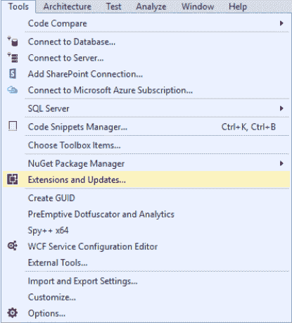

*图 1：扩展和更新菜单项*

这将打开**扩展和更新**窗口（图 2），你可以从中搜索 Visual Studio 库。顺便说一句，你也可以通过 NuGet 将代码契约包含到项目中（稍后会详细介绍）。

在屏幕右侧的搜索框中，输入**代码契约**，并确保在左侧树视图中选择**联机**部分。搜索结果返回后，代码契约应位于最前面的结果之一。从这里安装代码契约很简单。只需单击**下载**按钮，这会下载一个 .msi 安装程序，你可以运行它来安装代码契约。

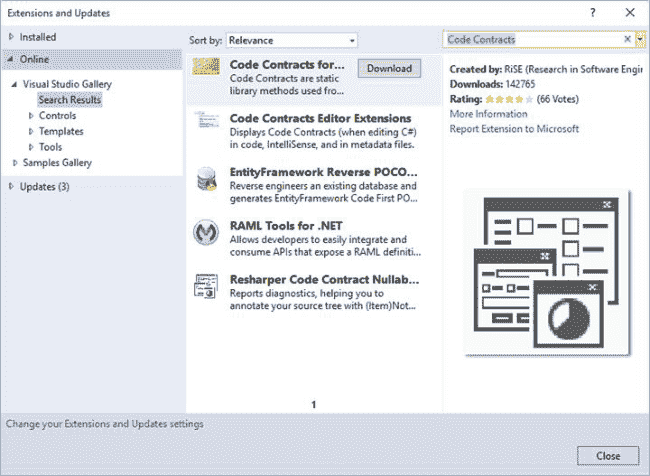

### NuGet

NuGet 包管理器也可用于下载代码契约并将其包含到解决方案中。你可以使用 NuGet 包管理器（图 3）搜索代码契约，也可以从“工具 > NuGet 包管理器”选项中使用包管理器控制台运行以下命令来安装代码契约。

```powershell
PM> Install-Package CodeContracts
```

你还会在 NuGet 上找到代码契约包的可移植版本（用于 Windows Mobile 应用程序）。使用哪种方法安装代码契约并不重要；这只是你更喜欢哪种方法的问题。

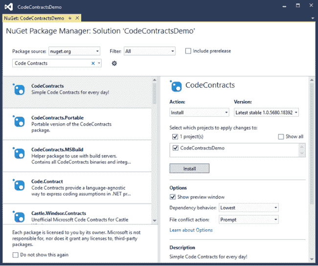

*图 3：NuGet 包管理器*

### Visual Studio 集成

你需要重启 Visual Studio，属性页中的代码契约项才会可见。可以通过右键单击项目并从上下文菜单中选择**属性**来找到代码契约集成。你也可以通过从 Visual Studio 工具栏选择**项目**（确保已在解决方案资源管理器中选择你的项目），然后单击*项目名 属性*菜单项（图 4）来找到代码契约集成。

我将自己的 Visual Studio 项目命名为 **CodeContractsDemo**，因此 Visual Studio 中**项目**菜单里的项将称为 **CodeContractsDemo 属性**。项目会打开熟悉的属性页，在属性页左侧列表的底部，你会看到一个新的属性窗格，名为**代码契约**。

单击它会显示琳琅满目的设置供你选择。不要让设置的数量吓到你；我们将在下一节中逐一介绍这些设置。只需知道许多设置都有默认值，如果你愿意，可以保持原样。

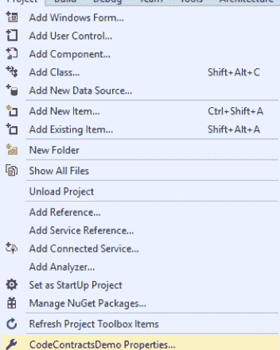

*图 4：项目属性*

### 代码契约属性页

代码契约属性最初会向你展示许多选项和设置。代码契约下的属性分为三组：运行时检查、静态检查和契约引用程序集。

通过选择**执行运行时契约检查**或**执行静态契约检查**来启用代码契约。

至少需要确保选择其中一个选项，才能在项目中启用代码契约。如果不选择其中任一选项，代码契约将不会在你的项目中启用，你也无法受益于它们为系统带来的价值。

运行时契约检查，顾名思义，会在运行时发挥作用。然而，静态契约检查则完全不同。它让代码契约在你键入代码或生成项目时分析你的代码。这正是代码契约变得有趣并为我带来最大价值的地方。

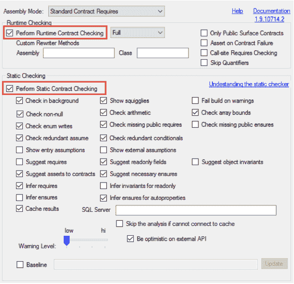

*图 5：代码契约属性页*

### 静态检查

如果启用静态检查，建议在属性页中保持选择**在后台检查**选项。这是因为分析可能需要一些时间才能完成。另一个建议的选项是在 Visual Studio 中选择并行生成选项。从 Visual Studio 的**工具**菜单中选择**选项**。在选项屏幕左侧的树视图（图 6）中，展开**项目和解决方案**节点。你会注意到一个名为**生成和运行**的节点。选择它，你将看到启用并行生成的选项。

任何大于 **1** 的值都将启用 Visual Studio 中的并行生成选项。我机器上的默认值是 **8**。在此文本框中输入值 **1** 将有效关闭 Visual Studio 中的并行生成。通过在 Visual Studio 中启用并行生成，你可以让代码契约并行分析多个项目。根据 RiSE 的说法，该 Visual Studio 扩展是线程安全的。代码契约属性页中还有许多其他可用选项，但你现在无需进一步配置这些设置即可开始使用代码契约。

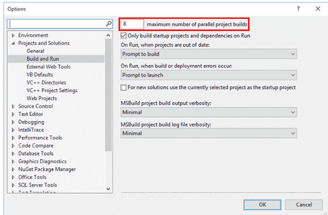

图 6：Visual Studio 并行生成选项

你会注意到 Visual Studio 2015 建议了几处更正。在图 7 中，你会看到 **using** 语句是第一项建议，也是此实例中我们需要应用的修复。

### Visual Studio 2015 灯泡

这项生产力功能是 Visual Studio 2015 中的新功能。灯泡会自动出现在 Visual Studio 编辑器中，并针对开发者当前正在键入的代码行提供错误修复和重构建议。还可以通过在代码行上按 **Ctrl+Period** 手动调用灯泡，以查看潜在修复列表。

### 代码契约前置条件

请考虑以下代码清单，它检查传递给方法的序列号的值。此方法用于将序列化库存项添加到新 ERP 系统的库存表中。

```csharp
public static class ERPIntegration
{
    public static void AddSerializedItem(string productCode, int
serialNumber, int qty)
    {
        Contract.Requires<SerialNumberException>
            (serialNumber >= 10000001, "Invalid Serial number");
    }
}

public class SerialNumberException : Exception
{
    public SerialNumberException()
    {
    }

    public SerialNumberException(string message)
        : base(message)
    {
    }

    public SerialNumberException(string message, Exception inner)
        : base(message, inner)
    {
    }
}
```

*代码清单 2：代码契约前置条件*

Contract.Requires 语句表示前置条件。前置条件是方法体中的第一批语句。在上面的代码清单中，前置条件检查传递给方法的序列号的值，并确定它是否是有效序列号。

现在让我们更仔细地看看实际的代码契约。代码契约的组成如下：Contract.Requires<TException>(bool condition, string errorMessage)，其中 TException : Exception。布尔条件会被验证，如果失败，代码契约将抛出带有所提供消息的异常。请注意，我向契约添加了一个名为 SerialNumberException 的自定义异常。它派生自 Exception 类，但你可以在此处添加任何适用的异常以满足需求。

上述代码清单中的代码契约格式只是一种实现。以下列表说明了代码契约前置条件的有效语法：

- Contract.Requires(bool condition)
- Contract.Requires(bool condition, string errorMessage)
- Contract.Requires<TException>(bool condition)
- Contract.Requires<TException>(bool condition, string errorMessage)

就个人而言，我更喜欢指定异常类与用户定义错误消息的组合，当代码契约中表达的条件失败时抛出该错误消息。这为开发者提供了一种非常强大的机制，以确保传递给方法的值有效。它还将开发者从必须为可能破坏系统的每一种可能情况编写防御性代码中解放出来。知道受契约约束的方法始终遵循你指定的预定规则，会让作为开发者的你更加安心。

### 代码契约前置条件的实际应用

为了演示代码契约中定义的前置条件失败，我在方法调用中硬编码了一个无效序列号。由于这是一个控制台应用程序，对方法的调用被包裹在 try/catch 语句中，该语句将错误输出到控制台。请考虑以下代码清单。

```csharp
static void Main(string[] args)
{
    try
    {
        ERPIntegration.AddSerializedItem("BC32WL", 70012, 1);
    }
    catch (Exception ex)
    {
        Console.Write(ex.Message);
        Console.ReadLine();
    }
}
```

代码清单 3：代码契约前置条件的实际应用


当控制台应用程序运行时，异常会被抛出并显示在控制台窗口中。当使用具有自定义异常的代码契约时，例如代码清单 2 中所示的内容，你必须将 Code Contracts 程序集模式属性设置为 **标准契约要求**。

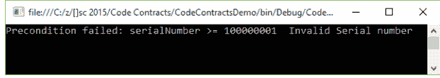

*图 8：前置条件失败*

前面的示例是说明 Code Contracts 强大功能的一种相当简单的方法。然而在生产系统中，显然不会在方法调用中硬编码值。这些值很可能来自数据库或用户输入。正如我们所知，所有输入（用户或数据存储）都是我们无法控制的东西，我们应如此对待。Code Contracts 缓解了不良数据带来的负面影响。

虽然前面的示例是可行的，但我希望我的代码契约能提供更多。我不想运行应用程序后才发现有代码段会导致我的契约失败。个人而言，我希望在构建项目时就能看到任何失败。这个项目足够小，所以我可以在项目属性窗口中指定的代码契约属性方面稍微大胆一些。

### 警告时构建失败

返回到 Code Contracts 属性页，如果尚未启用，请启用 **执行静态契约检查**。接下来，你需要清除 **在后台检查** 选项。然后你会看到 **警告时构建失败** 选项已启用。选择此选项。

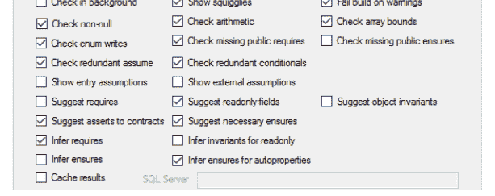

*图 9：启用警告时构建失败*

继续构建你的项目。静态契约检查会立即启动，并且由于你的代码契约未通过，构建将失败，如图 10 所示。然而，有一个问题。即使构建失败，你的错误列表也是空的。由于我们只有一个代码契约，我们知道去哪里查找。但是，当我们有多个代码契约时，这就不切实际了。

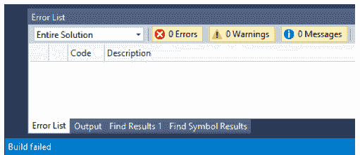

*图 10：Visual Studio 2015 构建失败*

出了什么问题？要找到导致构建失败的问题，请转到输出窗口。如果看不到输出窗口，请按 Ctrl+W、O 将其调出。然后你将看到构建结果以及失败的代码契约。

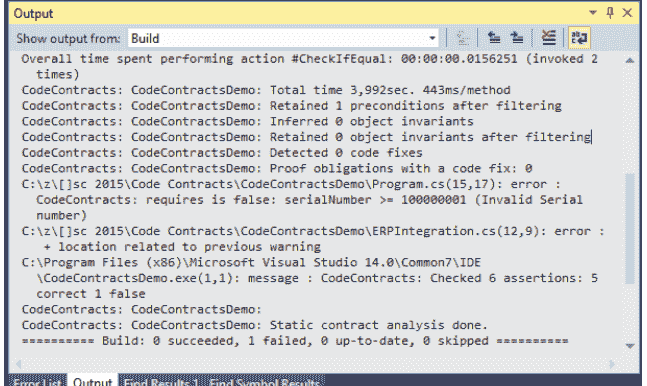

*图 11：Visual Studio 输出窗口*

在 Code Contracts 的当前版本 1.9.10714.2 中，构建错误未输出到错误列表的问题已被确定为 Visual Studio 2015 版本中的一个错误。该错误已得到修复，并将在 Code Contracts 的下一个版本中包含。有关与 Visual Studio 2015 的 Code Contracts 相关的此问题的更多信息，请查看 GitHub 上的 pull request 166 和 issue 137。如果你想查看有关 Code Contracts 的所有开放问题，请查看 Code Contracts GitHub 页面上的 Issues。

Code Contracts 是少数致力于不断改进当前版本的人们的成果。像我们这样的用户有责任报告我们遇到的問題，从而建立一个健康的意见领袖社区和更稳定的产品。最后，由于它是开源的，你可以为 Code Contracts 做出贡献，成为这个令人难以置信的 Visual Studio 扩展的一部分。

### 代码契约后置条件

代码契约后置条件是受契约方法向调用代码保证的方式，即如果所有前置条件都满足，它将返回特定结果。让我们回到银行和贷款的类比，为其制定合同。银行确保贷款将具有固定利率，但前提是还款按时且金额正确。你所做的付款可以等同于代码契约的前置条件。银行确保固定利率这一事实可以等同于后置条件。

因此，代码契约后置条件的语法使用 Ensures 方法也就不足为奇了。另一个值得注意的有趣点是，虽然后置条件验证受契约方法的结果，但它必须出现在方法中的前置条件之后。考虑以下代码示例：

```csharp
public static Warehouse AddSerializedItem(string productCode, int serialNumber, int qty)
{
    Contract.Requires<SerialNumberException>
        (serialNumber >= 10000001, "Invalid Serial number");
    Contract.Ensures(Contract.Result<Warehouse>() != null);

    ProductCode = productCode;
    SerialNumber = serialNumber;
    Quantity = qty;

    return CreateItem();
}
```

*代码清单 4：契约后置条件*

如前一个代码清单所示，我稍微扩展了我们的方法。我添加了后置条件，告诉调用代码此方法的返回值将是 Warehouse 类型并且不为 null。因此，调用代码无需检查返回给它的对象是否有效。契约指定它将返回一个 **Warehouse** 对象给它。

```csharp
Contract.Ensures(Contract.Result<Warehouse>() != null);
```

*代码清单 5：代码契约确保结果*

在实际示例中，这基本上意味着创建的库存项目将根据特定条件（产品代码）发放到特定仓库。产品代码将产品标识为快速周转品、原材料、成品等，并在创建时必须发放到正确的仓库。我们受契约的 **AddSerializedItem** 方法告诉调用代码，它确保此仓库发放的结果将存储在 **Warehouse** 对象中。如果出现任何问题，产品代码将被发放到默认仓库。ERP 系统的用户可以检查存储在默认仓库中的项目，并在稍后手动将产品代码发放到正确的仓库。

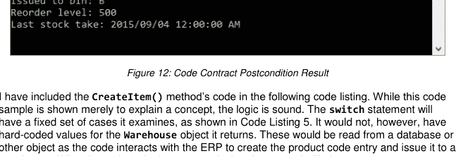

*图 12：代码契约后置条件结果*

我在下面的代码清单中包含了 **CreateItem()** 方法的代码。虽然此代码示例仅用于解释概念，但逻辑是合理的。**switch** 语句将有一组固定的情况供其检查，如代码清单 6 所示。然而，它不会为其返回的 **Warehouse** 对象硬编码值。这些值将在代码与 ERP 交互以创建产品代码条目并将其发放到仓库时从数据库或其他对象读取。代码逻辑所确保的是，该方法将始终返回一个 **Warehouse** 对象，并且该对象将始终是系统中的有效仓库。

```csharp
private static Warehouse CreateItem()
{
    // Add Stocked Item code goes here
    Warehouse IssuedToWarehouse = new Warehouse();
    switch (ProductCode.Substring(0,1))
    {
        case "A":
            IssuedToWarehouse.Code = "FM";
            IssuedToWarehouse.Name = "Fast movers";
            IssuedToWarehouse.Bin = "A";
            IssuedToWarehouse.BinReorderLevel = 10000;
            IssuedToWarehouse.LastStockTake = Convert.ToDateTime("2015-09-01");
            break;
        case "B":
            IssuedToWarehouse.Code = "FG";
            IssuedToWarehouse.Name = "Finished Goods";
            IssuedToWarehouse.Bin = "B";
            IssuedToWarehouse.BinReorderLevel = 500;
            IssuedToWarehouse.LastStockTake = Convert.ToDateTime("2015-09-04");
            break;
        case "C":
            IssuedToWarehouse.Code = "RM";
            IssuedToWarehouse.Name = "Raw Materials";
            IssuedToWarehouse.Bin = "AD";
            IssuedToWarehouse.BinReorderLevel = 7500;
            IssuedToWarehouse.LastStockTake = Convert.ToDateTime("2015-09-02");
            break;
        default:
            IssuedToWarehouse.Code = "GS";
            IssuedToWarehouse.Name = "General Stock";
            IssuedToWarehouse.Bin = "SS";
            IssuedToWarehouse.BinReorderLevel = 5000;
            IssuedToWarehouse.LastStockTake = Convert.ToDateTime("2015-09-09");
            break;
    }
    return IssuedToWarehouse;
}
```

*代码清单 6：仓库发放逻辑*

你可以看到后置条件如何在代码契约中用于创建高度健壮的代码。想象一下在分布式团队中工作的开发人员。能够从世界任何地方工作有很多优点和缺点（取决于你的观点）。个人一对一沟通的缺失可以被视为一个明显的缺点。无法坐在会议室里让开发人员共同深入探讨问题仍然是一个挑战。你的大脑可以基于我们倾向于发出的众多其他信号（例如肢体语言、眼动或呼吸）潜意识地推断出感受、含义和观点。

沟通不仅仅是说话的行为。因此，作为开发人员，我们需要在其他方面变得更敏锐并提高效率。一个很好的起点是代码。有了代码契约，我们能够防御性地预先应对可能发生的某些条件。仅仅因为规范没有明确提到空条件会破坏集成，并不意味着我们不需要对其进行防御。


The preceding example shows how developers can bullet-proof code against certain issues that logically could adversely affect the integration.

### The Code Contract invariant

Code Contracts allow for the verification of a class's internal state. It does this via the use of Code Contract invariants. As the name suggests, an invariant is something that can never change. It will always be as it is specified in the class under contract.

We now know that our **AddSerializedItem** method must be supplied with a valid serial number. Valid serial numbers fall within a specific range.

```csharp
Contract.Requires<SerialNumberException>
    (serialNumber >= 10000001, "Invalid Serial number");
```

*代码清单 7：契约要求条件*

We also know that the method under contract guarantees the calling code that a non-null **Warehouse** object will be returned when the valid serial number precondition is met.

```csharp
Contract.Ensures(Contract.Result<Warehouse>() != null);
```

*代码清单 8：契约确保条件*

Let us now assume that additional logic has to be added that needs to check the validity of the production date. This date can be in the future as well, so this needs to be supplied by an external data store, user entry, or lookup.

This is quite easy, and accomplished by adding a new private method to the class that has the **[ContractInvariantMethod]** attribute applied to it. If we had to add this check on the **Warehouse** class, we would need to add the following code to it.

```csharp
[ContractInvariantMethod]
private void Invariants()
{
    Contract.Invariant(this.ProductionYear >= 0);
    Contract.Invariant(this.ProductionMonth >= 0);
    Contract.Invariant(this.ProductionMonth <= 12);
    Contract.Invariant(this.ProductionDay >= 0);
    Contract.Invariant(this.ProductionDay <= 30);
}
```

*代码清单 9：契约不变量方法*

This tells the Code Contracts that the following properties for the production date have to fall within the following ranges. None of them can be zero, the number of months can't be greater than **12**, and the days can have a maximum value of **30** (assume we're working with 30-day months).

Usually, you can call the contract invariant method anything you like, but many prefer to call it **ObjectInvariant**. Another point to note regarding the preceding code listing is that the method must have a void return type and be scoped as **private** or **protected**.

Code Contract invariant methods allow us to specify the state of a class that is not allowed to change. The code is short and easy to understand and implement.

### Other Code Contract methods

Code Contracts also contain various other methods for use in your code. Let us have a look at these examples in the following sections.

### Contract Assert and Assume

Some of you might be wondering what the difference is between **Debug.Assert** and **Contract.Assert** when used in your code. **Debug.Assert** is only executed when your code is compiled in **Debug** mode. The **Contract.Assert** method, however, is executed when you debug your code in **Debug** or **Release** mode.

The **Assert** method in Code Contracts can also easily be confused with the **Contract.Requires** method. As we saw in previous code listings, the **Requires** method is a precondition and must always be called at the start of a specific method. This is because **Contract.Requires** contains information regarding the method it resides in. **Contract.Assert** and **Contract.Assume**, on the other hand, are specific to a certain bit of code at some point in time within the method under contract.

So when do we use which method? With **Assert**, the static checker runs and will try to prove the assertion at that specific line of code. **Assume** will let the static checker simply assume that whatever the check is it needs to prove, is true. So why have both? Consider the next code listing.

```csharp
public void CompleteBinPreparation(int quantityRequired)
{
    QuantityRequired = quantityRequired;
    int available = BinQtyAvailable();
    Contract.Assert(QuantityRequired <= available, "Quantity required exceeds available bin quantity");
}

public int BinQtyAvailable()
{
    MaxBinQuantity = 75;
    CurrentBinQuantity = 50;
    int QtyAvailable = MaxBinQuantity - CurrentBinQuantity;
    return QtyAvailable;
}
```

*代码清单 10：Assert 静态检查*

The code in Code Listing 10 checks to see if the Bin containing the parts has enough space to contain the required quantity. With the Assert method, we are letting the static checker inspect the value of the QuantityRequired variable. If we had to pass through a value of 77 for QuantityRequired, we would see the static checker emit a warning and fail the build (remember, we turned on Fail build on warnings in the Code Contracts property page).

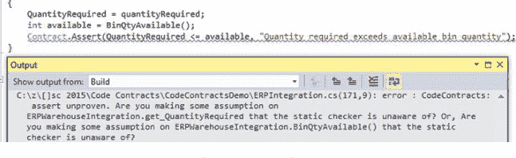

*图 13：Assert 失败*

If we had to modify the code in Code Listing 10 to contain an Assume, the output would be quite different indeed. Consider the code in the following listing.

```csharp
public void CompleteBinPreparation(int quantityRequired)
{
    QuantityRequired = quantityRequired;
    int available = BinQtyAvailable();
    Contract.Assume(QuantityRequired <= available, "Quantity required exceeds available bin quantity");
}

public int BinQtyAvailable()
{
    MaxBinQuantity = 75;
    CurrentBinQuantity = 50;
    int QtyAvailable = MaxBinQuantity - CurrentBinQuantity;
    return QtyAvailable;
}
```

*代码清单 11：Assume 静态检查*

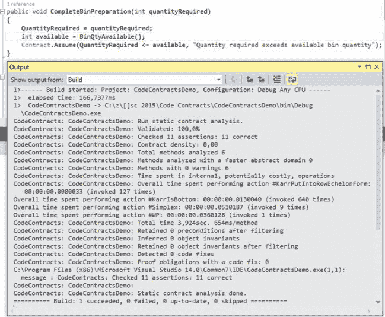

*图 14：Assume 通过*

When we use **Contract.Assume**, we are telling the static checker that it needs to assume that the condition under contract is true. Why would we want to do this? Well, the previous code in Code Listing 11 was calling a method we had no control over. We could logically add a **Contract.Ensures** to the **BinQtyAvailable** method to guarantee that it will conform to the Code Contract. Consider for a minute, however, that we are calling a method in another external library. We do not have control over the code contained in that DLL and the developers didn't implement Code Contracts. They do, however, guarantee that the value returned will always take the required quantity into account and return a bin with a sufficient quantity available. We can therefore tell the static checker to assume that this contract condition passes.

Note that the previous examples regarding **Assert** and **Assume** only apply to the static checker. Because we have **Perform Runtime Code Contract Checking** on and set to **Full**, the **Contract.Assume** will still fail during run-time if the condition being checked fails (the external library returns an invalid value for the available bin quantity).

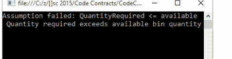

*图 15：运行时 Assume 失败*

Assert and Assume make for a very powerful combination when dealing with external code and making sure that what you are expecting is returned and valid in the way you require.

Lastly, you can change the Warning Level in the Code Contracts property page. If you are expecting to see certain warnings in your Output window but are not, be sure to change the Warning Level to high.

### Contract.ForAll

Before I continue to explain the Contract.ForAll logic, I have to point out that it currently fails to validate statically in Visual Studio 2015. Issue 177 has been logged on GitHub for this problem, and there is a workaround provided in the thread. To read more, go to github.com/Microsoft/CodeContracts/issues/177.

For now, I will need to disable static checking to illustrate the use of the Contract.ForAll method. To disable static checking, right-click your project in Visual Studio's Solution Explorer and select Properties. The Code Contracts property page will open. Click on the Code Contracts tab.

This is the same page we accessed previously. Under the Static Checking group, clear the Perform Static Contract Checking option.


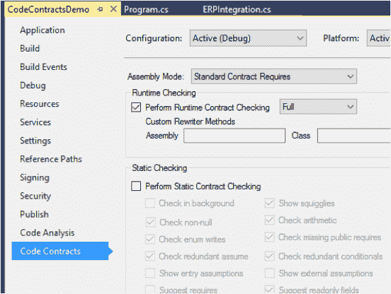

*图 16：禁用静态契约检查*

完成此操作后，您应该能够让代码契约执行所需的操作并验证您指定的条件。

在此基础上，让我们修改我们的 **CompleteBinPreparation** 方法。业务规则要求在处理托盘之前，数量必须大于 5。让我们通过要求 **binQuantities** 数组永不为 null 来构建此契约。如前所述，这只需添加 **Contract.Requires** 方法即可轻松完成。

接下来，我们需要添加 **Contract.Assert** 以包含 **Contract.ForAll** 方法。然后它将使用 lambda 表达式检查所有数量是否大于 5。实现显示在以下代码列表中。

```csharp
public void CompleteBinPreparation(int[] binQuantities)
{
    Contract.Requires(binQuantities != null);
    Contract.Assert(Contract.ForAll(binQuantities, x => x > 5),
        "Some Bins contain invalid quantities");

    // Process bin quantities
    BinCount = binQuantities.Length;
}
```

*代码列表 12：Contract.ForAll 示例*

如果我们的受契约方法通过验证，它将简单地返回数组中的托盘计数。如果例如数组包含无效的托盘数量，则会显示异常。

在我们的调用代码中，我们现在将添加一个包含几个无效托盘数量的数组。我们可以看到数量 4 和 3 小于 5，因此无效。

```csharp
static void Main(string[] args)
{
    try
    {
        int[] iBins = { 4, 3, 61, 51, 88, 55 };
        ERPWarehouseIntegration oWhi = new ERPWarehouseIntegration();
        oWhi.CompleteBinPreparation(iBins);

        Console.Write("Bin Count: " + oWhi.BinCount);
        Console.ReadLine();
    }
    catch (Exception ex)
    {
        Console.Write(ex.Message);
        Console.ReadLine();
    }
}
```

*代码列表 13：调用 Contract.ForAll 方法*

如果我们运行代码，控制台应用程序将抛出异常并向用户显示错误消息。

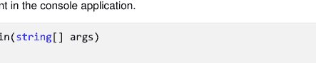

*图 17：无效的托盘数量*

现在让我们修改调用代码，使 iBins 数组中只包含有效的托盘数量。您会看到我已将无效的托盘数量 4 和 3 分别更改为 32 和 19。

如果您第二次运行应用程序，它将导致代码契约通过验证并在控制台应用程序中显示托盘计数。

```csharp
static void Main(string[] args)
{
    try
    {
        int[] iBins = { 32, 19, 61, 51, 88, 55 };
        ERPWarehouseIntegration oWhi = new ERPWarehouseIntegration();
        oWhi.CompleteBinPreparation(iBins);

        Console.Write("Bin Count: " + oWhi.BinCount);
        Console.ReadLine();
    }
    catch (Exception ex)
    {
        Console.Write(ex.Message);
        Console.ReadLine();
    }
}
```

*代码列表 14：修改后的调用代码*

控制台应用程序现在显示有效托盘的计数，这意味着代码契约通过了验证。

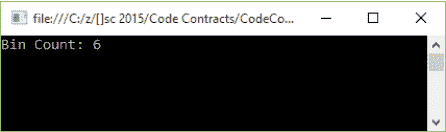

*图 18：有效的托盘数量*

正如您所见，**Contract.ForAll** 方法提供了一种绝佳的方式来检查值数组，以查找可能在执行路径的更下游因违反业务规则而导致问题的条目。**Contract.ForAll** 方法也可以与 **List** 集合或任何 **IEnumerable** 集合一起使用。

### Contract.Exists

片刻，让我们假设需要处理的托盘编号会进入处理托盘的批次，保留 30 天。系统不知道托盘何时进入处理阶段，因此需要在处理前检查每个托盘编号，以确保它尚未存在于处理队列中。代码契约也为此提供了一个不错的解决方案。

创建一个名为 ProcessBin 的方法并添加 **Contract.Requires** 方法，以检查传递给该方法的参数是否不为 null。然后添加 **Contract.Assert** 方法以包含 **Contract.Exists** 方法。这会检查处理队列 **ProcessedBins** 是否包含我们想要处理的托盘。以下代码列表说明了此实现。

```csharp
public void ProcessBin(string bin)
{
    Contract.Requires(bin != null);
    Contract.Assert(!Contract.Exists(ProcessedBins(),
        x => string.Compare(x, bin, true) == 0),
        "Bin " + bin + " already processed");

    // Process bin and add to ProcessedBins collection
}

private List<string> ProcessedBins()
{
    List<string> oBinsProcessed = new List<string>();
    oBinsProcessed.Add("A12");
    oBinsProcessed.Add("CD25");
    oBinsProcessed.Add("ZX4R");
    oBinsProcessed.Add("A11");

    return oBinsProcessed;
}
```

*代码列表 15：Contract.Exists 实现*

在调用代码中，我们将仅对要检查的托盘编号使用硬编码值。调用受契约的方法并传递一个已存在于处理队列中的托盘。

```csharp
static void Main(string[] args)
{
    try
    {
        string BinToProcess = "ZX4R";
        ERPWarehouseIntegration oWhi = new ERPWarehouseIntegration();
        oWhi.ProcessBin(BinToProcess);

        Console.Write("Bin " + BinToProcess + " processed");
        Console.ReadLine();
    }
    catch (Exception ex)
    {
        Console.Write(ex.Message);
        Console.ReadLine();
    }
}
```

*代码列表 16：调用 Contract.Exists 方法*

代码契约验证托盘是否存在于处理队列中，并在控制台应用程序中向用户显示输出。

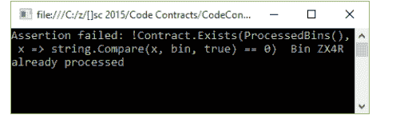

*图 19：托盘存在于处理队列中*

回到我们的调用代码，让我们将托盘编号更改为处理队列中不存在的一个。

```csharp
static void Main(string[] args)
{
    try
    {
        string BinToProcess = "SSX4R";
        ERPWarehouseIntegration owhi = new ERPWarehouseIntegration();
        owhi.ProcessBin(BinToProcess);

        Console.Write("Bin " + BinToProcess + " processed");
        Console.ReadLine();
    }
    catch (Exception ex)
    {
        Console.Write(ex.Message);
        Console.ReadLine();
    }
}
```

*代码列表 17：修改后的调用代码*

如果我们第二次运行应用程序，托盘将被处理，并在控制台应用程序中向用户显示确认消息。


*图 20：托盘不存在于处理队列中*

Contract.Exists 允许开发人员根据您设计的系统中的某些业务规则轻松验证项目的存在。

### Contract.OldValue<>

几年前，我为一家钢铁制造商做过一个项目。他们在切割钢板成特定尺寸时产生边角料时，必须遵循非常具体的废料处理流程。我做过的另一个项目也有特定的废料处理工作流程需要处理。废料是许多公司非常重视的事情，他们需要仔细管理该流程。

对于代码契约的下一个示例，我将使用废料处理流程来说明 Contract.OldValue<> 方法的使用。我必须提到的是，Contract.OldValue<> 方法只能在 Ensures 契约的条件表达式中使用。

让我们假设钢铁制造商需要最大限度地减少切割过程中产生的边角料。为此，他们使用一种计算方法，取待切割钢材的体积，并根据切割系数计算可使用的钢材量。完美切割意味着如果钢材体积为 10 m³，则 resulting 切削钢材也等于 10 m³。因此，所有钢材都已被消耗且产生零边角料。

不完美的切割会导致钢材体积小于原始体积，这意味着用户需要更改切割系数，直到能够确保接近完美的切割。不深入讨论阈值和限制的更详细细节，让我们假设如果返回的不是完美切割，则切割过程不予批准。

请考虑以下代码列表。

```csharp
public void CutSteelNoScrap(int volumeSteel, int factor)
{
    Contract.Ensures(volumeSteel != 0, "The volume of steel can't be zero");
    Contract.Ensures(Contract.OldValue<int>(volumeSteel)
        == CutSteel(volumeSteel, factor) + volumeSteel,
        "The factor used will result in scrap. Please modify the cutting factor.");
    // Process steel to cut
}

private int CutSteel(int volumeToCut, int factor)
{
    return volumeToCut % factor;
}
```

*代码列表 18：Contract.OldValue<> 实现*

正如您所见，我只是简单地使用取模运算符来模拟基于错误系数的边角料的存在。取模运算符只是返回除法的余数，用 % 运算符表示。因此，以下是正确的：

19 % 5 = 4  
12 % 4 = 0


这个方法虽然有些粗糙，但足以说明我要表达的观点。在调用代码中，我们调用 **CutSteelNoScrap** 方法执行计算，并告知我们使用的因子是否不正确以及是否会产生废料。

```csharp
static void Main(string[] args)
{
    try
    {
        int steelVolume = 4;
        int cutFactor = 3;
        ERPWarehouseIntegration oWhi = new ERPWarehouseIntegration();
        oWhi.CutSteelNoScrap(steelVolume, cutFactor);

        Console.Write("Steel fully consumed by cutting process");
        Console.ReadLine();
    }
    catch (Exception ex)
    {
        Console.Write(ex.Message);
        Console.ReadLine();
    }
}
```

*代码清单 19：调用代码*

**Contract.OldValue** 方法将检查变量 **volumeSteel** 的值，并查看 **CutSteel** 方法返回的新值是否为零。如果为零，则 **volumeSteel** 与 **CutSteel** 之和将等于零。因此，我们知道该因子不会产生边角余料。

然而，如果 **volumeSteel** 与 **CutSteel** 之和不等于 **volumeSteel**，则说明该因子在切割过程中产生了边角余料。使用钢材体积 4 m³ 和因子 3 运行该控制台应用程序，会产生边角余料。

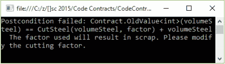

*图 21：Contract.OldValue<> 失败*

继续修改前面的代码清单，将一个在取模运算中不会产生余数的值用作因子。将其改为 **2**，然后再次运行控制台应用程序。

```csharp
static void Main(string[] args)
{
    try
    {
        int steelVolume = 4;
        int cutFactor = 2;
        ERPWarehouseIntegration oWhi = new ERPWarehouseIntegration();
        oWhi.CutSteelNoScrap(steelVolume, cutFactor);

        Console.Write("Steel fully consumed by cutting process");
        Console.ReadLine();
    }
    catch (Exception ex)
    {
        Console.Write(ex.Message);
        Console.ReadLine();
    }
}
```

*代码清单 20：修改后的调用代码*

现在，控制台应用程序针对给定的因子和钢材体积返回了完美的切割结果。

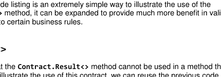

*图 22：Contract.OldValue<> 通过*

虽然前面的代码清单是演示 Contract.OldValue<> 方法用途的一种极为简单的方式，但我们可以对此方法进行扩展，以在验证方法是否符合特定业务规则时提供更多帮助。

### Contract.Result<>

需要注意的是，Contract.Result<> 方法不能在返回类型为 void 的方法中使用。为了演示此协定的用途，我们可以复用之前的代码清单并稍作修改。

```csharp
public int ProductionVolumePerBin(int binVolume, int factor)
{
    Contract.Ensures(Contract.Result<int>() == binVolume,
        "The factor used will result in scrap. Please modify the cutting factor.");
    int remainder = CutSteel(binVolume, factor);
    return binVolume - remainder;
}
private int CutSteel(int volumeToCut, int factor)
{
    return volumeToCut % factor;
}
```

### 代码清单 21：Contract.Result<>

我们可以看到，上述代码清单告诉调用方法：受协定约束的方法最终会使切割体积始终等于料箱体积。这意味着所有钢材都被完美切割，且使用该特定因子时没有产生任何边角余料。

调用代码也没有太大差别。

```csharp
static void Main(string[] args)
{
    try
    {
        int binVolume = 4;
        int cutFactor = 2;
        ERPWarehouseIntegration oWhi = new ERPWarehouseIntegration();
        oWhi.ProductionVolumePerBin(binVolume, cutFactor);

        Console.Write("Steel fully consumed by cutting process");
        Console.ReadLine();
    }
    catch (Exception ex)
    {
        Console.Write(ex.Message);
        Console.ReadLine();
    }
}
```

### 代码清单 22：调用代码

如果我们以因子 2 和体积 4 运行上述代码，将获得完美的切割结果。

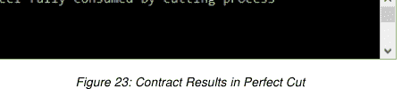

### 图 23：契约的结果是完美切割

然而，如果我们再次修改调用代码，使用一个无法满足 **contract.Result<>** 条件的因子，控制台应用程序将输出以下内容。

```csharp
static void Main(string[] args)
{
    try
    {
        int binVolume = 9;
        int cutFactor = 2;
        ERPWarehouseIntegration oWhi = new ERPWarehouseIntegration();
        oWhi.ProductionVolumePerBin(binVolume, cutFactor);

        Console.Write("Steel fully consumed by cutting process");
        Console.ReadLine();
    }
    catch (Exception ex)
    {
        Console.Write(ex.Message);
        Console.ReadLine();
    }
}
```

*代码清单 23：修改后的调用代码*

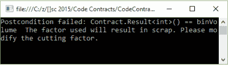

*图 24：Contract.Result<> 失败*

代码协定允许我们精确定义需要验证的内容，以便特定方法通过协定条件。在单个方法中添加多个协定方法可以使你的代码更健壮、更少缺陷。

### Contract.ValueAtReturn<>

有时你可能需要在方法中使用 *out* 参数。代码协定同样可以轻松应用于此场景。我们使用一个稍作修改的 **Contract.Result<>** 示例来说明这一概念。

继续使用钢材制造代码演示，假设我们需要确保在给定特定钢材体积的情况下，所有料箱都能装满。我们的 *out* 参数是料箱超出数量。如果该值大于零，则表示钢材体积超过了料箱能容纳的最大体积。为了实现这一逻辑，我将再次使用取模运算符。

```csharp
public void EnsureAllBinsFilled(out int binOverCount, int binVol, int steelVol)
{
    Contract.Ensures(Contract.ValueAtReturn<int>(out binOverCount) == 0,
        "The steel volume exceeds the bin volume");

    binOverCount = steelVol % binVol;
}
```

### 代码清单 24：Contract.ValueAtReturn

受协定约束的方法需要指定 out 参数 binOverCount 永远不大于零。为此，我们需要使用 Contract.Ensures 方法和 Contract.ValueAtReturn<> 方法。

在代码清单 24 中，你会注意到 Contract.ValueAtReturn<> 引用了 out 参数 binOverCount，并指定它必须始终等于零。

要实现该方法，请参考以下代码示例。

```csharp
static void Main(string[] args)
{
    try
    {
        int steelVolume = 10;
        int binVolume = 3;
        int binWastedSpace = 0; // This must always equal zero
        ERPWarehouseIntegration oWhi = new ERPWarehouseIntegration();
        oWhi.EnsureAllBinsFilled(out binWastedSpace, binVolume,
            steelVolume);

        Console.Write("All bins filled");
        Console.ReadLine();
    }
    catch (Exception ex)
    {
        Console.Write(ex.Message);
        Console.ReadLine();
    }
}
```

### 代码清单 25：调用代码

binWastedSpace 的值必须保持为零，受协定约束的方法才能通过验证。如果我们运行此代码，将会看到为 steelVolume 和 binVolume 提供的值会导致应用程序抛出异常。

该异常通知用户：钢材体积超过了操作所提供料箱的最大容量。

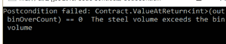

图 25：Contract.ValueAtReturn<> 失败

如果我们修改调用代码，为参数 **steelVolume** 和 **binVolume** 提供有效的值，我们的应用程序将通过验证。

```csharp
static void Main(string[] args)
{
    try
    {
        int steelVolume = 10;
        int binVolume = 2;
        int binWastedSpace = 0; // This must always equal zero
        ERPWarehouseIntegration oWhi = new ERPWarehouseIntegration();
        oWhi.EnsureAllBinsFilled(out binWastedSpace, binVolume, steelVolume);

        Console.Write("All bins filled");
        Console.ReadLine();
    }
    catch (Exception ex)
    {
        Console.Write(ex.Message);
        Console.ReadLine();
    }
}
```

代码清单 26：修改后的调用代码

我所做的只是将料箱体积的值改为 2。运行应用程序后，料箱逻辑成功通过了验证。

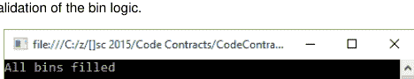

图 26：Contract.ValueAtReturn<> 成功

无需编写大量的代码逻辑来验证传入值和返回值，我们就以代码协定的形式提供了大量验证代码。


## 第 3 章 有用的提示

### 使用代码片段

你可能已经熟悉 Visual Studio 中的代码片段；代码契约也提供了此功能。安装代码契约时，片段会被添加。如果你使用的是 C#，只需输入快捷方式然后按两次 Tab 键即可。

在 Visual Basic 中，使用代码片段的方式略有不同。输入快捷方式然后按 Tab 键。C# 和 Visual Basic 之间的快捷键存在细微差异。**Contract.Requires** 快捷方式，例如，在 C# 中通过输入 **cr** 调用，而在 Visual Basic 中则通过输入 **creq** 调用。

### C# 代码片段

以下代码清单说明了 C# 代码片段快捷方式。使用的快捷方式是被注释掉的第一行，后跟片段生成的代码。

```csharp
//cr
Contract.Requires(false);
```

*代码清单 27：Contract.Requires 片段*

```csharp
//ce
Contract.Ensures();
```

*代码清单 28：Contract.Ensures 片段*

```csharp
//ci
Contract.Invariant(false);
```

*代码清单 29：Contract.Invariant 片段*

```csharp
//crr
Contract.Result<int>()
```

*代码清单 30：Contract.Result 片段*

```csharp
//co
Contract.OldValue(x)
```

*代码清单 31：Contract.OldValue 片段*

```csharp
//cim
[ContractInvariantMethod]
[System.Diagnostics.CodeAnalysis.SuppressMessage(
    "Microsoft.Performance", "CA1822:MarkMembersAsStatic",
    Justification = "Required for code contracts.")]
private void ObjectInvariant()
{
    Contract.Invariant(false);
}
```

*代码清单 32：Contract.Invariant 方法片段*

```csharp
//crn
Contract.Requires(arg != null);
```

*代码清单 33：Contract.Requires Not Null 片段*

```csharp
//cen
Contract.Ensures(Contract.Result<string>() != null);
```

*代码清单 34：Contract.Ensures Contract.Result 片段*

```csharp
//crsn
Contract.Requires(!String.IsNullOrEmpty(arg));
```

*代码清单 35：Contract.Requires String with Value 片段*

```csharp
//cesn
Contract.Ensures(!String.IsNullOrEmpty(Contract.Result<string>()));
```

*代码清单 36：Contract.Ensures Contract Result with String Value 片段*

```csharp
//cca
Contract.Assert(false);
```

*代码清单 37：Contract.Assert 片段*

```csharp
//cam
Contract.Assume(false);
```

*代码清单 38：Contract.Assume 片段*

```csharp
//cre
Contract.Requires<ArgumentException>(false);
```

*代码清单 39：Contract.Requires with ArgumentException 片段*

```csharp
//cren
Contract.Requires<ArgumentNullException>(arg != null, "arg");
```

*代码清单 40：Contract.Requires Argument Not Null 片段*

```csharp
//cresn
Contract.Requires<ArgumentException>(!String.IsNullOrEmpty(arg));
```

*代码清单 41：Contract.Requires String Parameter with Value*

```csharp
//cintf
#region IFoo contract binding
[ContractClass(typeof(IFooContract))]
public partial interface IFoo
{

}


[ContractClassFor(typeof(IFoo))]
abstract class IFooContract : IFoo
{
}
#endregion
```

*代码清单 42：接口模板和关联契约类片段*

### 扩展代码片段

本节严格来说并不专属于代码契约，但如果我不提及你扩展代码片段的能力，我会觉得有所疏忽。我一直觉得扩展代码片段有点麻烦。幸运的是，对于开发者来说，有一些非常慷慨的社区成员创建了 Visual Studio 的优秀扩展。Snippet Designer 就是其中之一。

在使用它之前，你需要从 **工具** 菜单下的 **扩展和更新** 安装 Snippet Designer。

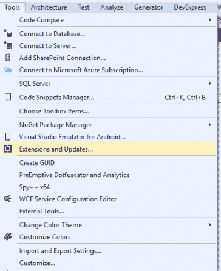

*图 27：Visual Studio 扩展和更新菜单项*

安装 Snippet Designer 后，它会出现在已安装的扩展下。

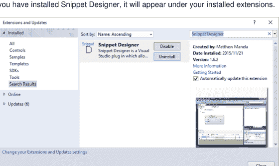

*图 28：Snippet Designer 扩展*

最基本的功能是，Snippet Designer 让你能够即时生成代码片段。关于代码契约，有几项是我总想包含在方法中的。我希望能够将它们链接到单个代码片段下，而对于这一点，Snippet Designer 非常合适。

突出显示你想要创建片段的代码契约，打开上下文菜单，然后单击 Export as Snippet。

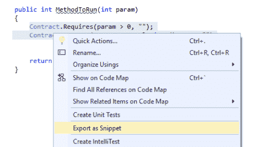

*图 29：导出为片段*

Snippet Designer 窗口现在在 Visual Studio 2015 IDE 中以新标签页显示。

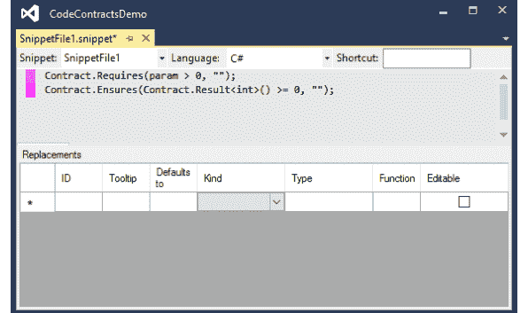

*图 30：Snippet Designer 编辑器*

```csharp
public int MethodToRun(int param)
{
    Contract.Requires(param > 0, "");
    Contract...
    return
}
```

```csharp
Contract.Requires(param > 0, "");
Contract.Ensures(Contract.Result<int>() >= 0, "");
```

请注意，粉红色高亮不是 Snippet Designer 的功能；它是另一个名为 Heat Margin 的优秀扩展。然而，这超出了本书的范围。

在 Snippet Designer 窗口中，你可以看到在编辑器窗口中突出显示的代码。

选择生成时想要替换的代码部分。然后右键单击并从上下文菜单中选择 **设为替换**。

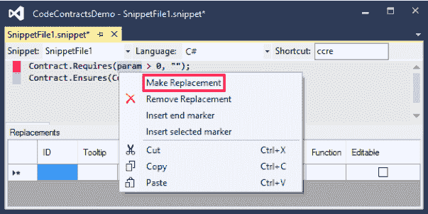

*图 31：设为替换*

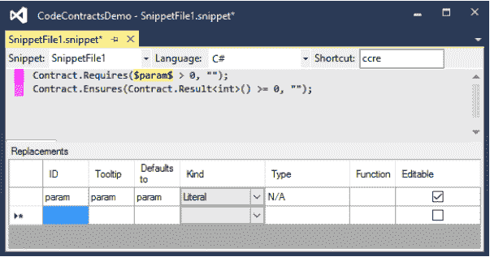

*图 32：完成的新片段*

你会看到参数被占位符替换，并且该占位符的属性在 Replacements 网格中定义。剩下的就是为快捷方式命名（我将其命名为 **ccre**，代表“Code Contract Requires Ensures”）并保存你的代码片段。

在 Visual Studio 的代码编辑器中，输入 **ccre** 快捷方式并按两次 Tab 键。我的代码片段会被插入，标识为替换的参数会被高亮显示，以便我立即编辑它。

```csharp
@references
public int MethodToRun(int parameter)
{
    Contract.Requires(param > 0, "");
    Contract.Ensures(Contract.Result<int>() >= 0, "");

    return parameter;
}
```

*图 33：代码片段已插入*

这是一个非常易于使用的工具，我甚至还没有开始探索它为开发者提供的可能性。我的重点只是说明代码片段对开发者非常有用，并且可以在开发过程中扩展以满足你的特定需求。

### 代码契约文档生成

我确信大多数（如果不是全部）开发者都不喜欢创建文档。它在许多项目会议中已成为房间里的大象。每个人都知道文档至关重要，我相信有很多开发者确实会创建简洁丰富的文档。这显然导致了许多旨在使此过程更轻松的工具和扩展。

因此，代码契约也可以集成所包含契约的文档是合理的。要启用文档生成，你需要打开项目属性的 **生成** 选项卡。

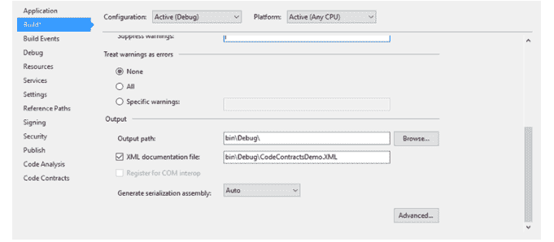

*图 34：启用 XML 文档文件*

在这里，你需要选择 XML 文档文件选项。如果不启用此选项，文档 XML 文件将不会被创建。在这里你也可以指定文档文件的输出路径和名称。

下一个需要修改的选项在代码契约选项卡中。如果你滚动到代码契约选项卡底部，你会看到 Contract Reference Assembly 值未指定。将其更改为 Build。

最后，你必须确保选择了 Emit contracts into XML doc file 选项。这将使代码契约注释成为生成文档文件的一部分。

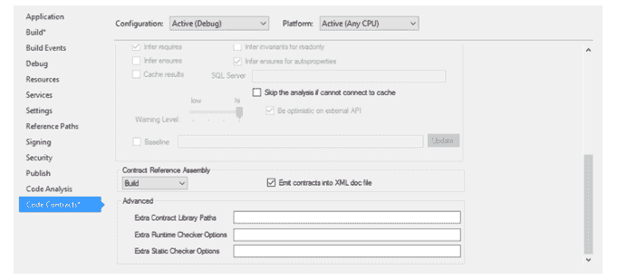

*图 35：启用 Code Contracts 文档*


然后你需要确保已为代码添加了良好的注释。你需要在创建新方法或逻辑不明显的代码行时尽快养成这个习惯。反过来，代码中注释过多也并非好主意。那么什么时候应该注释，什么时候不应该？一个很好的经验法则是，仅当代码背后的逻辑不明显时才注释代码。

在以下代码清单中，第一个清单（代码清单 43）中的逻辑很明显，因此实际上不需要注释。然而，在代码清单 44 中，应通过注释解释取模运算符的使用，因为这样做的原因并不明显。

```csharp
//Bad comment: Calculate the available quantity
int QtyAvailable = MaxBinQuantity - CurrentBinQuantity;
```

*代码清单 43：不必要的代码注释*

```csharp
//Good comment: Use modulus to determine if the factor produces any scrap
return volumeToCut % factor;
```

*代码清单 44：注释清楚地解释了逻辑*

注释良好的方法可能如下所示。

```csharp
/// <summary>
/// Calculate any remainder after the modulus operation between volume
and factor
/// </summary>
/// <param name="volumeToCut"></param>
/// <param name="factor"></param>
/// <returns>Remainder after cutting</returns>
private int CutSteel(int volumeToCut, int factor)
{
    // Use modulus to determine if the factor produces any scrap
    return volumeToCut % factor;
}
```

*代码清单 45：注释良好的方法*

添加相关注释后，你需要生成解决方案。你需要注意在生成文档文件期间生成过程中可能收到的任何警告。这些警告通常与源代码中缺少 XML 注释有关。最好继续通过向方法和属性添加清晰且相关的代码注释来修复这些问题。

生成完成后，你的 XML 文档将位于配置生成设置时指定的路径中。在此示例中，生成的 XML 文档包含代码契约描述。

```xml
<?xml version="1.0"?>
<doc>
    <assembly>
        <name>CodeContractsDemo</name>
    </assembly>
    <members>
        <member name="T:ERPWarehouseIntegration">
            <summary>
                ERP Warehouse Integration class to manage the cutting of steel volume and available bin quantities
            </summary>
        </member>
        <member name="P:ERPWarehouseIntegration.MaxBinQuantity">
            <summary>
                The maximum bin quantity for bins
            </summary>
        </member>
        <member name="P:ERPWarehouseIntegration.CurrentBinQuantity">
            <summary>
                The current bin quantity available
            </summary>
        </member>
        <member name="M:ERPWarehouseIntegration.ProductionVolumePerBin(System.Int32,System.Int32)">
            <summary>
                Calculate the production volume of steel per bin
            </summary>
            <param name="binVolume" />
            <param name="factor" />
            <returns>Bin Volume less Remainder</returns>
            <ensures description="The factor used will result in scrap. Please modify the cutting factor." csharp="result == binVolume" vb="result = binVolume">result == binVolume</ensures>
        </member>
        <member name="M:ERPWarehouseIntegration.CutSteel(System.Int32,System.Int32)">
            <summary>
                Calculate any remainder after the modulus operation between volume and factor
            </summary>
            <param name="volumeToCut" />
            <param name="factor" />
            <returns>Remainder after cutting</returns>
        </member>
        <member name="M:ERPWarehouseIntegration.BinQtyAvailable">
            <summary>
                Ensure that a non-negative value is returned for available bin quantity
            </summary>
            <returns>Available bin quantity</returns>
            <ensures csharp="result &gt;= 0" vb="result &gt;= 0">result &gt;= 0</ensures>
        </member>
        <member name="M:ERPWarehouseIntegration.EnsureAllBinsFilled(System.Int32@,System.Int32,System.Int32)">
            <summary>
                Ensure that all bins are filled and that the steel volume does not exceed the maximum bin volume
            </summary>
            <param name="binOverCount" />
            <param name="binVol" />
            <param name="steelVol" />
            <ensures description="The steel volume exceeds the bin volume" csharp="binOverCount == 0" vb="binOverCount = 0">binOverCount == 0</ensures>
        </member>
    </members>
</doc>
```

代码清单 46：生成的 XML 文档文件

我们轻松地为代码生成了简洁的 XML 文档，而无需任何繁重工作。如果你定期注释代码，生成的文档将保持最新，并真实反映代码的状态。

### 创建用户友好的文档

生成的 XML 文件很好，但还需要另一步来创建格式良好、人类可读的 HTML 类型文档。为此，我将使用 Sandcastle Help File Builder，你可以从 GitHub 的 github.com/EWSoftware/SHFB 下载。在引导安装过程中，请务必阅读每个屏幕的说明和注释，因为它们包含你需要注意的重要信息。

我建议阅读更多关于使用 Sandcastle Help File Builder 的教程。这个工具提供了如此多的功能，以至于需要真正深入了解这个出色的工具。然而，就本书而言，除了向你展示如何创建基本的 .chm 帮助文件之外，我不会进一步详述。

在使用 Sandcastle Help File Builder 之前，你必须确保项目具有命名空间。否则，你将在帮助文件生成时看到以下错误。

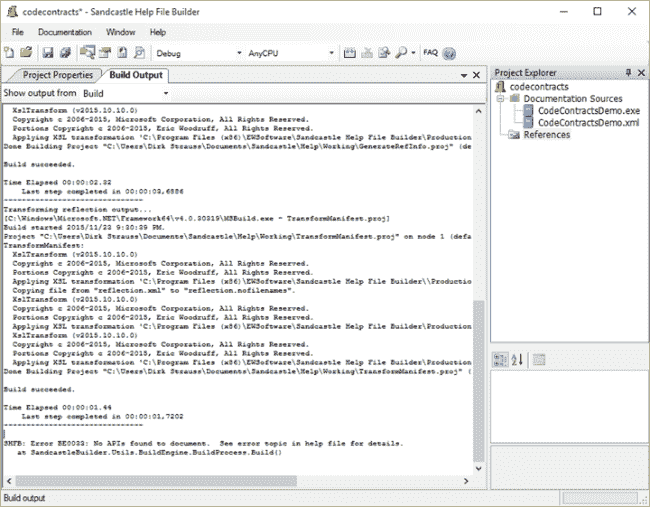

*图 36：生成输出错误*

```csharp
SHFB: Error BE0033: No APIs found to document. See error topic in
help file for details.
    at SandcastleBuilder.Utils.BuildEngine.BuildProcess.Build()
```

*代码清单 47：Sandcastle Help File Builder 错误*

我只需为类添加一个命名空间，如代码清单 48 所示。

```csharp
namespace CodeContractsDemoProject
{
    /// <summary>
    /// ERP Warehouse Integration class to manage the cutting of steel
    /// volume and available bin quantities
    /// </summary>
    public class ERPWarehouseIntegration
    {
```

*代码清单 48：为类添加了命名空间*

完成此操作后，如果 **Sandcastle Help File Builder** 尚未打开，请打开它。在 **项目资源管理器** 中，右键单击 **文档源** 节点，并添加项目生成到的 .dll 或 .exe（通常是 bin 文件夹）。我选择将 XML 文档输出到我的 bin 文件夹。

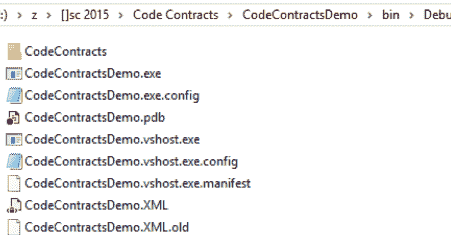

*图 37：项目 bin 文件夹*

选择 .exe 文件后，Sandcastle Help File Builder 也会自动拾取 XML 文档文件并将其添加为文档源。添加的文件将显示在 **项目资源管理器** 的 **文档源** 节点下。

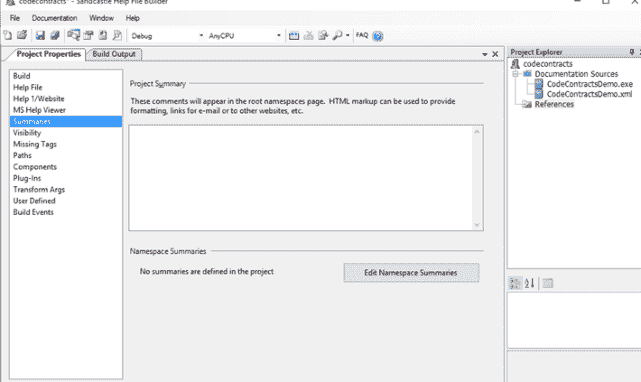

*图 38：文档源和摘要*

**项目属性** 选项卡中还有其他多个部分可供修改和设置。需要记住配置的一个重要部分是 **摘要** 部分。你需要确保已在 **项目属性** 选项卡的 **摘要** 页面中添加命名空间摘要注释。单击 **编辑命名空间摘要** 按钮以打开 **命名空间摘要** 窗口。

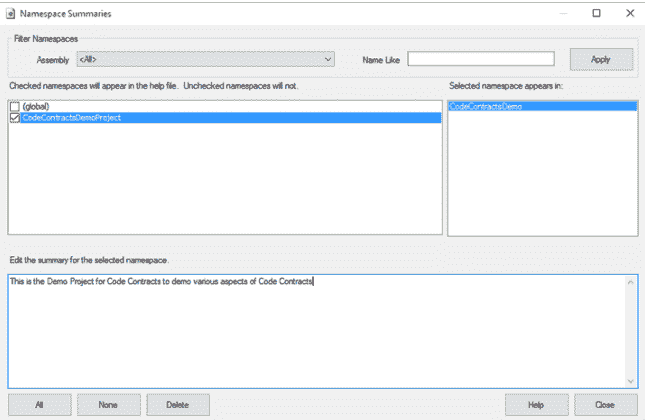

*图 39：命名空间摘要窗口*

选择要为其添加摘要的命名空间，并在 **编辑所选命名空间的摘要** 文本框中输入摘要说明。完成后，单击 **关闭** 按钮并保存项目。

现在，你已准备好生成 Sandcastle Help File Builder 项目，它将按你的指定生成帮助文件。

支持的帮助文件格式类型：

- HTML 帮助 1 (chm)
- MS Help Viewer (mshc)
- Open XML (docx)
- Markdown (md)
- 网站 (HTML/ASP.NET)


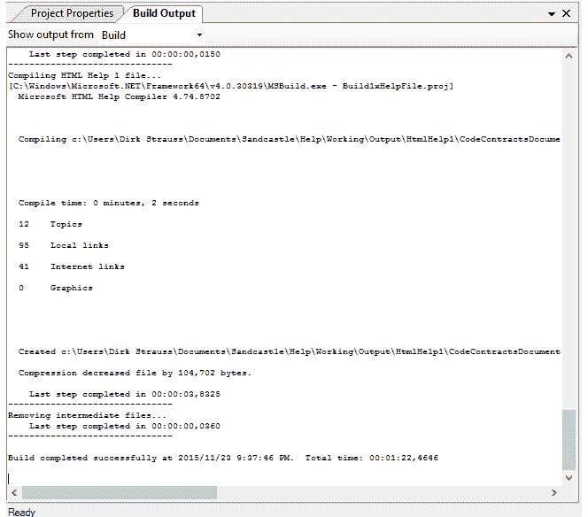
图 40：Sandcastle Help File Builder 成功生成

生成完成后，导航到所生成帮助文件的输出目录。我的默认路径为 Documents\Sandcastle\Help。

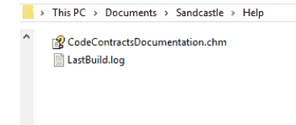
图 41：帮助文件输出路径

打开生成的帮助文件，你会看到编译过程采用了之前在 **摘要** 部分添加的命名空间摘要，并将其作为所生成帮助文件的摘要文本。

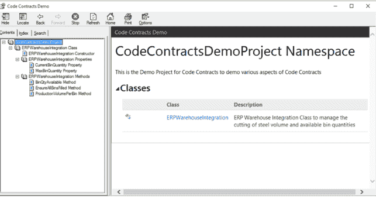
*图 42：生成的帮助文件*

一旦你知道如何操作，从代码协定注释创建文档其实非常容易。借助 **Sandcastle Help File Builder** 等出色工具，以及 Code Contracts 将注释输出到生成的 XML 文件中所提供的紧密集成，开发者拥有为项目创建丰富文档所需的一切。

### 抽象类和接口

为抽象类和接口创建 Code Contracts 需要采用稍微不同的方式，正如你可能预料的那样。这是因为抽象类和接口不能包含方法体。许多开发者仍然想知道抽象类和接口之间的区别。我听说过的最好的区分何时使用抽象类、何时使用接口的解释之一如下。

### 抽象类

如果你有许多类可以归为一组，并用一个名词来描述，那么你很可能是在处理一个抽象类。然后，这个抽象类就以该名词命名。另一个非常重要的考虑因素是，这些继承类共享某种功能，而且你永远不会创建该名词（抽象类）的实例。

想一想下面的例子：你有一个类型为 Human 的抽象类。你永远不会只实例化一个 Human，而是实例化一种 Human，例如 Female 或 Male。因此，Male 和 Female 都继承自抽象类 Human。然后，这个抽象类将实现一个方法 void Sleep()，这是所有人类都必须做的（共享功能）。

要在抽象类上实现 Code Contracts，你需要创建一个单独的 ContractClass 类，并通过使用特性将该协定类与抽象类关联起来。

```csharp
using System.Diagnostics.Contracts;

/// <summary>
/// Human Abstract Class
/// </summary>
[ContractClass(typeof(HumanContract))]
public abstract class Human
{
    public abstract void Run(int distance);
    public abstract void Sleep(int hours);
}

/// <summary>
/// Human Contract Class
/// </summary>
[ContractClassFor(typeof(Human))]
public abstract class HumanContract : Human
{
    public override void Sleep(int hours)
    {
        Contract.Requires(hours >= 8,
            "You need more than 8 hours of sleep each night.");
    }
}
```

代码清单 49：抽象类和协定类

抽象类 Human 使用特性 [ContractClass(typeof(HumanContract))]，而协定类 HumanContract 使用特性 [ContractClassFor(typeof(Human))]。

抽象类 Human 基本上规定了所有人类都会睡觉和奔跑。在 Sleep() 方法的协定中（定义于 HumanContract），我们定义所有人类每晚必须至少睡八小时。

让我们创建一个继承自 Human 抽象类的 Male 类。

```csharp
public class Male : Human
{
    public override void Run(int distance)
    {
        Console.Write("The distance run was " + distance);
        Console.ReadLine();
    }
    public override void Sleep(int hours)
    {
        Console.Write("The hours slept were " + hours);
        Console.ReadLine();
    }
}
```

*代码清单 50：继承自 Human 的 Male 类*

从 Male 类可以看出，它完全不包含 Code Contracts。它所做的只是继承自 Human 抽象类。

```csharp
namespace CodeContractsDemo
{
    class Program
    {
        static void Main(string[] args)
        {
            try
            {
                Male oMan = new Male();
                oMan.Sleep(5);
            }
            catch (Exception ex)
            {
                Console.Write(ex.Message);
                Console.ReadLine();
            }
        }
    }
}
```

*代码清单 51：实例化 Male 类并指定五小时睡眠*

如果我们实例化 Male 类并以五小时调用 Sleep 方法，我们的 Code Contract 就会生效，并告诉我们人类每晚需要八小时睡眠。

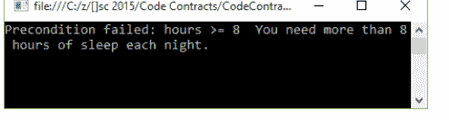
*图 43：Male 类 Sleep 方法协定被违反*

将调用代码修改为指定周六早上舒舒服服地睡上九小时，情况就不同了。

```csharp
namespace CodeContractsDemo
{
    class Program
    {
        static void Main(string[] args)
        {
            try
            {
                Male oMan = new Male();
                oMan.Sleep(9);
            }
            catch (Exception ex)
            {
                Console.Write(ex.Message);
                Console.ReadLine();
            }
        }
    }
}
```

*代码清单 52：实例化 Male 类并指定九小时睡眠*

Code Contract 通过验证，Sleep() 方法也通过验证。

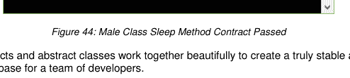
*图 44：Male 类 Sleep 方法协定通过*

Code Contracts 和抽象类完美协作，可为开发团队创建一个真正稳定且健壮的代码库。

### 接口

让我们沿用前面 **Male** 和 **Female** 类的例子。快进 20 年，我们在火星上发现了外星人。他们与我们惊人地相似，因此属于人类，但他们既不是男性也不是女性。现在我们有了一个新类型 **Alien**，它继承自抽象类 **Human**。

现在把接口想象成动词。一般来说，哪个动词可以应用于我的类？所有人类都需要学习新事物，并且可以被教导，所以现在我们可以创建一个名为 **ITeachable** 的接口。我们将在 **Human** 抽象类上实现 **ITeachable** 接口，因为所有人类都是可教导的。然而，外星人比 **Male** 或 **Female** 稍微高级一些，并且可以重新排列其分子成为不同结构，使外星人能够变形。因此，我们可以创建一个名为 **IShapeShiftable** 的接口，它仅适用于 **Alien**。

创建接口与创建抽象类非常相似。它也需要包含一个协定类，并且接口和协定类都需要通过各自的特性相互指向。

```csharp
using System.Diagnostics.Contracts;

[ContractClass(typeof(IShapeShiftableContract))]
public interface IShapeShiftable
{
    void Man(int shapeDuration);
    void Woman(int shapeDuration);
    void InanimateObject(int shapeDuration);
}

[ContractClassFor(typeof(IShapeShiftable))]
abstract class IShapeShiftableContract : IShapeShiftable
{
    void IShapeShiftable.InanimateObject(int shapeDuration)
    {
        Contract.Requires(shapeDuration <= 12);
    }

    void IShapeShiftable.Man(int shapeDuration)
    {
        Contract.Requires(shapeDuration <= 4);
    }

    void IShapeShiftable.Woman(int shapeDuration)
    {
        Contract.Requires(shapeDuration <= 4);
    }
}
```

代码清单 53：实现 Code Contract 类的接口

现在我们可以通过协定类 **IShapeShiftableContract** 为接口创建协定，就像我们之前为抽象类所做的那样。

### 抽象类与接口

总结抽象类和接口的示例，归根结底取决于你希望把实现放在哪里。如果你希望在所有派生类之间共享实现，就创建抽象类。如果你需要实现仅特定于单个类或几个类，而不是所有类，就使用接口。

Code Contracts 可以轻松兼顾两者。

### 方法纯度

一本关于 Code Contracts 的书如果不提到纯度，就不算完整。在提到 Code Contracts 时，方法纯度到底是什么意思？嗯，Code Contracts 有一个名为 **[Pure]** 的特性，你可以用它来修饰方法。这基本上是对方法质量的一种表达，即该方法不能更改调用方所能看到的任何对象的状态。换句话说，纯方法只允许更改在进入该方法之后创建的对象。

Code Contracts 要求协定内部调用的所有方法都是纯方法。原因很简单：

- 避免前置条件和后置条件中使用的方法产生副作用。
- 简化静态检查器的任务，因为它可以假定方法调用后对象状态保持不变。
- 通过明确表达你的意图来改进设计，即方法调用结束后不会改变对象的状态。

为了说明非纯方法对静态检查器的影响，请考虑下面的代码清单。

```csharp
public class DemoPurity
{
    /// <summary>
    /// Property for cutting factor
    /// </summary>
    public int CutFactor { get; private set; }

    /// <summary>
    /// Public Constructor
    /// </summary>
    /// <param name="cutFactor"></param>
    public DemoPurity(int cutFactor)
    {
        CutFactor = cutFactor;
```


```
/// <summary>
/// Calculate the volume cut
/// </summary>
/// <param name="volumeSteel"></param>
/// <param name="factorModifier"></param>
/// <returns></returns>
public int VolumeCut(int volumeSteel, int factorModifier)
{
    Contract.Requires(CalculatedCutFactor(factorModifier) >= 0);

    return volumeSteel / (CutFactor * factorModifier);
}

/// <summary>
/// This is not a pure method
/// </summary>
/// <param name="factorModifier"></param>
/// <returns></returns>
public int CalculatedCutFactor(int factorModifier)
{
    CutFactor = CutFactor * factorModifier;
    return CutFactor;
}
```

### 代码清单 54：未通过纯度检查的方法

**CutFactor** 属性在 **DemoPurity** 的构造函数中指定。**VolumeCut** 方法包含对 **CalculatedCutFactor** 方法的一项必需契约。如你所见，**CalculatedCutFactor** 方法绝对不是纯方法，因为它会修改 **CutFactor** 属性。这也是草率的代码。由于该方法不是纯方法，静态检查器将导致生成失败。

```
1>------ Rebuild All started: Project: CodeContractsDemo, Configuration:
Debug Any CPU ------
1>C:\z\[]sc 2015\Code Contracts\CodeContractsDemo\ERPIntegration.cs(197,9): warning CC1036: Detected call to method 'DemoPurity.CalculatedCutFactor(System.Int32)' without [Pure] in contracts of method 'DemoPurity.VolumeCut(System.Int32,System.Int32)'.
CodeContracts: CodeContractsDemo: Run static contract analysis.
C:\z\[]sc 2015\Code Contracts\CodeContractsDemo\ERPIntegration.cs(197,9): warning CC1036: Code Contracts: Detected call to method 'DemoPurity.CalculatedCutFactor(System.Int32)' without [Pure] in contracts of method 'DemoPurity.VolumeCut(System.Int32,System.Int32)'.
```

```
14.0\Common7\IDE\CodeContractsDemo.exe(1,1): message : CodeContracts:
Checked 15 assertions: 13 correct (2 masked)
CodeContracts: CodeContractsDemo:
CodeContracts: CodeContractsDemo: Static contract analysis done.
======== Rebuild All: 0 succeeded, 1 failed, 0 skipped ========
```

### 代码清单 55：缩短的输出结果

我已从输出文本中删除了与本次关于纯度的讨论无关的所有多余行。你可以看到，静态检查器对 CalculatedCutFactor 不是纯方法感到不满。我们显然可以继续直接向 CalculatedCutFactor 方法添加 [Pure] 特性，但这并不是良好的编程实践。如果这样做，将导致生成成功，因为我们基本上已经告诉静态检查器，我们的 CalculatedCutFactor 方法是纯方法。因此，如果我们像代码清单 56 所示那样修改代码，静态检查器就会假定该方法是纯方法。

```
public class DemoPurity
{
    /// <summary>
    /// Property for cutting factor
    /// </summary>
    public int CutFactor { get; private set; }

    /// <summary>
    /// Public constructor
    /// </summary>
    /// <param name="cutFactor"></param>
    public DemoPurity(int cutFactor)
    {
        CutFactor = cutFactor;
    }

    /// <summary>
    /// Calculate the volume cut
    /// </summary>
    /// <param name="volumeSteel"></param>
    /// <param name="factorModifier"></param>
    /// <returns></returns>
    public int VolumeCut(int volumeSteel, int factorModifier)
    {
        Contract.Requires(CalculatedCutFactor(factorModifier) >= 0);

        return volumeSteel / (CutFactor * factorModifier);
    }

    /// <summary>
    /// This is still not a pure method
    /// </summary>
    /// <param name="factorModifier"></param>
    /// <returns></returns>
    [Pure]
    public int CalculatedCutFactor(int factorModifier)
    {
        CutFactor = CutFactor * factorModifier;
        return CutFactor;
    }
}
```

### 代码清单 56：向方法添加 Pure 特性

如果我们必须生成项目，生成的输出将表明生成成功。

```
1>------ Rebuild All started: Project: CodeContractsDemo, Configuration:
Debug Any CPU ------
1>  elapsed time: 886,9984ms
1>  elapsed time: 177,9426ms
1>  elapsed time: 1120,0034ms
CodeContracts: CodeContractsDemo: Run static contract analysis.
1>  CodeContractsDemo -> C:\z\[]sc 2015\Code Contracts\CodeContractsDemo\bin\Debug\CodeContractsDemo.exe
CodeContracts: CodeContractsDemo: Validated: 100,0%
CodeContracts: CodeContractsDemo: Checked 15 assertions: 13 correct (2 masked)
CodeContracts: CodeContractsDemo: Contract density: 0,98
CodeContracts: CodeContractsDemo: Total methods analyzed 6
CodeContracts: CodeContractsDemo: Methods analyzed with a faster abstract domain 0
CodeContracts: CodeContractsDemo: Methods with 0 warnings 5
CodeContracts: CodeContractsDemo: Time spent in internal, potentially costly, operations
CodeContracts: CodeContractsDemo: Overall time spent performing action #KarrPutIntoRowEchelonForm: 00:00:00.0140007 (invoked 784 times)
Overall time spent performing action #KarrIsBottom: 00:00:00.0120029 (invoked 1515 times)
Overall time spent performing action #WP: 00:00:00.2000032 (invoked 5 times)
Overall time spent performing action #CheckIfEqual: 00:00:00.0080005 (invoked 29 times)
Overall time spent performing action #ArraysAssignInParallel: 00:00:00.1430061 (invoked 1 times)
Overall time spent performing action #Simplex: 00:00:00.0810009 (invoked 19 times)
CodeContracts: CodeContractsDemo: Total time 7,821sec. 1303ms/method
CodeContracts: CodeContractsDemo: Generated 2 callee assume(s)
CodeContracts: CodeContractsDemo: Retained 0 preconditions after filtering
CodeContracts: CodeContractsDemo: Inferred 0 object invariants
CodeContracts: CodeContractsDemo: Retained 0 object invariants after filtering
CodeContracts: CodeContractsDemo: Discovered 3 postconditions to suggest
CodeContracts: CodeContractsDemo: Retained 1 postconditions after filtering
CodeContracts: CodeContractsDemo: Detected 1 code fixes
CodeContracts: CodeContractsDemo: Proof obligations with a code fix: 3
C:\\Program Files (x86)\\Microsoft Visual Studio 14.0\\Common7\\IDE\\CodeContractsDemo.exe(1,1): message : CodeContracts:
Checked 15 assertions: 13 correct (2 masked)
CodeContracts: CodeContractsDemo:
CodeContracts: CodeContractsDemo: Static contract analysis done.
========== Rebuild All: 1 succeeded, 0 failed, 0 skipped ==========
```

### 代码清单 57：成功生成

这里的问题在于，仅仅向 CalculatedCutFactor 方法添加 [Pure] 特性并不能使它成为纯方法。这正是我在本节关于方法纯度的内容中想要说明的一点。我们需要确保契约内部调用的方法是纯方法，是因为它们按设计就是纯的，而不是因为我们用 [Pure] 特性修饰了它们。让我们再次查看 CalculatedCutFactor 方法，并稍作修改，以便不违反为方法纯度指定的规则。

```csharp
public class DemoPurity
{
    /// <summary>
    /// Property for cutting factor
    /// </summary>
    public int CutFactor { get; private set; }

    /// <summary>
    /// Public Constructor
    /// </summary>
    /// <param name="cutFactor"></param>
    public DemoPurity(int cutFactor)
    {
        CutFactor = cutFactor;
    }

    /// <summary>
    /// Calculate the volume cut
    /// </summary>
    /// <param name="volumeSteel"></param>
    /// <param name="factorModifier"></param>
    /// <returns></returns>
    public int VolumeCut(int volumeSteel, int factorModifier)
    {
        Contract.Requires(CalculatedCutFactor(factorModifier) >= 0);
        return volumeSteel / (CutFactor * factorModifier);
    }

    /// <summary>
    /// This is a pure method
    /// </summary>
    /// <param name="factorModifier"></param>
    /// <returns></returns>
    [Pure]
    public int CalculatedCutFactor(int factorModifier)
    {
        return CutFactor * factorModifier;
    }
}
```

### 代码清单 58：标记为 Pure 的纯方法

CalculatedCutFactor 方法现在是一个纯方法，因为它不会更改 CutFactor 或 factorModifier 的值。现在可以适当地用 [Pure] 特性修饰它。VolumeCut 方法中的 Contract.Requires 现在可以使用这个纯方法来检查 CalculatedCutFactor 的结果不会为零，因为这会导致返回时发生除零异常。

方法纯度是非常值得遵循的良好实践，不仅在使用 Code Contracts 时如此，在你编写的每个方法中都是如此。

### 契约缩写方法

我确信，那些经常使用 Code Contracts 的人已经遇到过在多个方法中重复类似 Code Contracts 集合的问题。Code Contracts 为此提供了一种解决方案，它们被称为缩写器方法。这个概念非常简单。你可以看到，代码清单 59 中的代码包含重复的 Code Contracts 集合。

```
public class AbbreviatorDemo
{
    /// <summary>
    /// The factor for the cutting volume
    /// </summary>
    public int Factor { get; private set; }
    /// <summary>
    /// The maximum volume a bin can contain
    /// </summary>
    public int MaxVolume { get; private set; }

    /// <summary>


```csharp
    /// <summary>
    /// Fill the bin with the volume of steel
    /// </summary>
    /// <param name="steelVolume"></param>
    public void FillBin(int steelVolume)
    {
        Contract.Requires(steelVolume > 0);
        Contract.Ensures(steelVolume <= this.MaxVolume);
    }

    /// <summary>
    /// Empty the bin of all steel contained
    /// </summary>
    /// <param name="steelVolume"></param>
    /// <returns></returns>
    public bool PurgeBin(int steelVolume)
    {
        Contract.Requires(steelVolume > 0);
        Contract.Ensures(steelVolume <= this.MaxVolume);
        Contract.Ensures(Contract.Result<bool>() == true);

        // Purge bin and return successful result
        return true;
    }

    /// <summary>
    /// Perform a partial bin fill
    /// </summary>
    /// <param name="steelVolume"></param>
    /// <returns></returns>
    public bool FillBinPartially(int steelVolume)
    {
        Contract.Requires(steelVolume > 0);
        Contract.Ensures(steelVolume < this.MaxVolume);
        Contract.Ensures(Contract.Result<bool>() == true);

        return true;
    }
}
```

*代码清单 59：重复的契约*

现在我们可以利用 **Abbreviator** 方法来简化代码，并在多个方法中引用它们。使用 **Abbreviator** 方法后，代码可以重构如下。

```csharp
public class AbbreviatorDemo
{
    /// <summary>
    /// The factor for the cutting volume
    /// </summary>
    public int Factor { get; private set; }

    /// <summary>
    /// The maximum volume a bin can contain
    /// </summary>
    public int MaxVolume { get; private set; }

    /// <summary>
    /// Fill the bin with the volume of steel
    /// </summary>
    /// <param name="steelVolume"></param>
    public void FillBin(int steelVolume)
    {
        ValidSteelAndMaxVolume(steelVolume);
    }

    /// <summary>
    /// Empty the bin of all steel contained
    /// </summary>
    /// <param name="steelVolume"></param>
    /// <returns></returns>
    public bool PurgeBin(int steelVolume)
    {
        ValidSteelAndMaxVolume(steelVolume);
        EnsurePositiveResult();

        // Purge bin and return successful result
        return true;
    }

    /// <summary>
    /// Perform a partial bin fill
    /// </summary>
    /// <param name="steelVolume"></param>
    /// <returns></returns>
    public bool FillBinPartially(int steelVolume)
    {
        ValidSteelAndMaxVolume(steelVolume);
        EnsurePositiveResult();

        return true;
    }

    /// <summary>
    /// Abbreviator method for steel and max volume
    /// </summary>
    /// <param name="steelVolume"></param>
    [ContractAbbreviator]
    private void ValidSteelAndMaxVolume(int steelVolume)
    {
        Contract.Requires(steelVolume > 0);
        Contract.Ensures(steelVolume <= this.MaxVolume);
    }

    /// <summary>
    /// Abbreviator method for successful result
    /// </summary>
    [ContractAbbreviator]
    private void EnsurePositiveResult()
    {
        Contract.Ensures(Contract.Result<bool>() == true);
    }
}
```

*代码清单 60：使用 Abbreviator 方法*

我添加了两个新方法 ValidSteelAndMaxVolume 和 EnsurePositiveResult，并为它们添加了 [ContractAbbreviator] 特性。这使我能够减少方法中重复的代码契约集合。当查看受契约约束的方法时，这样更易于阅读，功能也更清晰。另一点需要记住的是，如果需要，Abbreviator 方法可以包含对其他 Abbreviator 方法的调用。

## 第 4 章 测试代码契约

### Pex 演变为 IntelliTest

你们中的许多人可能熟悉 Pex，而 Pex 已经演变为 IntelliTest，这大概不会令你感到意外。IntelliTest 是 Visual Studio Enterprise 2015 中的一项集成功能。代码契约与 IntelliTest 集成良好，并且开始使用 IntelliTest 非常容易。

### 入门：创建 IntelliTest

如前所述，IntelliTest 已集成到 Visual Studio Enterprise 2015 中。如果你希望在其他版本的 Visual Studio 2015 中集成 IntelliTest，可以在 Visual Studio 2015 UserVoice 网站上发出你的声音。Microsoft 中 Visual Studio 团队的人员确实会密切关注这个网站——你的投票绝不会白费。

开始使用 IntelliTest 非常简单。让我们回顾一下上一章中处理过的一个方法。

```csharp
/// <summary>
/// Calculate the production volume of steel per bin
/// </summary>
/// <param name="binVolume"></param>
/// <param name="factor"></param>
/// <returns>Bin Volume less Remainder</returns>
public int ProductionVolumePerBin(int binVolume, int factor)
{
    Contract.Ensures(Contract.Result<int>() == binVolume, "The factor used will result in scrap. Please modify the cutting factor.");

    int remainder = CutSteel(binVolume, factor);
    return binVolume - remainder;
}

/// <summary>
/// Calculate any remainder after the modulus operation between volume and factor
/// </summary>
/// <param name="volumeToCut"></param>
/// <param name="factor"></param>
/// <returns>Remainder after cutting</returns>
private int CutSteel(int volumeToCut, int factor)
{
    // Use modulus to determine if the factor produces any scrap
    return volumeToCut % factor;
}
```

*代码清单 61：为方法创建 IntelliTest*

和之前一样，前面的代码清单告诉调用方法：受契约约束的方法将导致切割体积始终等于料箱体积。这意味着所有钢材都已被完美切割，使用特定因子不会产生边角料。

要为 ProductionVolumePerBin() 方法生成新的 IntelliTest，请右键单击该方法，并从上下文菜单中选择“创建 IntelliTest”。

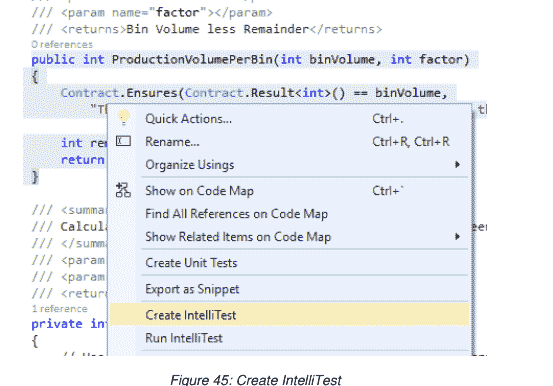

*图 45：创建 IntelliTest*

Visual Studio 现在将显示“创建 IntelliTest”窗口，你可以在其中为生成的 IntelliTest 配置附加设置。

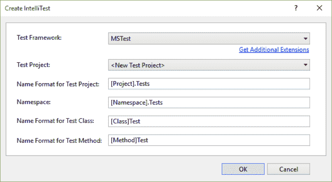

*图 46：创建 IntelliTest 设置*

如果你是第一次创建 IntelliTest，你会看到 **MSTest** 是 **测试框架** 下列出的唯一选项。不过，如果需要，你也可以安装第三方单元测试框架（稍后会详细介绍）。完成后，单击 **确定**。

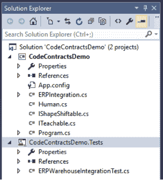

*图 47：测试项目已添加到解决方案*

Visual Studio 现在将为你创建测试项目。完成该过程后，新项目将显示在“解决方案资源管理器”窗口中。

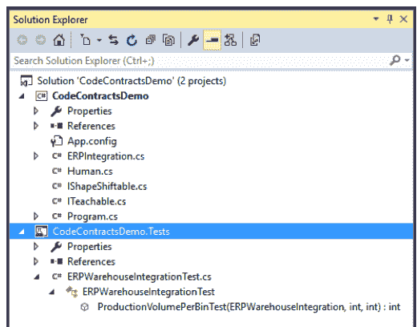

*图 48：已创建 IntelliTest*

展开 ERPWarehouseIntegrationTest.cs 文件，你会看到已创建一个名为 ProductionVolumePerBinTest 的测试。

```csharp
// <copyright file="ERPWarehouseIntegrationTest.cs">Copyright © 2015</copyright>
using System;
using Microsoft.Pex.Framework;
using Microsoft.Pex.Framework.Validation;
using Microsoft.VisualStudio.TestTools.UnitTesting;

namespace CodeContractsDemoProject.Tests
{
    /// <summary>This class contains parameterized unit tests for ERPWarehouseIntegration</summary>
    [PexClass(typeof(ERPWarehouseIntegration))]
    [PexAllowedExceptionFromTypeUnderTest(typeof(InvalidOperationException))]
    [PexAllowedExceptionFromTypeUnderTest(typeof(ArgumentException), AcceptExceptionSubtypes = true)]
    [TestClass]
    public partial class ERPWarehouseIntegrationTest
```

Visual Studio 将继续生成你的项目，然后启动 **IntelliTest 探索结果** 窗口。此窗口显示所有可能的方法参数，这些参数将导致被测方法获得最大的代码覆盖率。现在你可以概览该方法在测试中的表现。

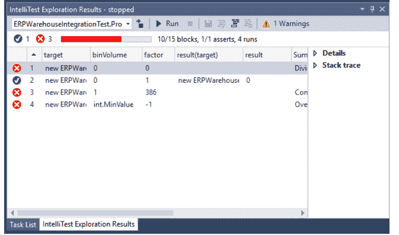

*图 50：IntelliTest 探索结果*

我们可以立即看到三个测试失败，一个测试通过。在 **IntelliTest 探索结果** 窗口的右侧，**详细信息** 和 **堆栈跟踪** 显示在可折叠节点中。让我们更仔细地查看测试结果。

### 测试 2：通过

**ProductionVolumePerBin()** 方法必须始终使切割体积等于料箱体积。从测试 2 中使用的变量可以看出，它通过了，因为料箱体积为 **0**，并且该方法的结果也为 **0**。

```csharp
[TestMethod]
[PexGeneratedBy(typeof(ERPWarehouseIntegrationTest))]
public void ProductionVolumePerBinTest33()
{
    ERPWarehouseIntegration eRPWarehouseIntegration;
    int i;
    eRPWarehouseIntegration = new ERPWarehouseIntegration();
    i = this.ProductionVolumePerBinTest(eRPWarehouseIntegration, 0, 1);
}
```


~~~csharp
Assert.AreEqual<int>(0, i);
Assert.IsNotNull((object)eRPWarehouseIntegration);
Assert.AreEqual<int>(0, eRPWarehouseIntegration.MaxBinQuantity);
Assert.AreEqual<int>(0, eRPWarehouseIntegration.CurrentBinQuantity);
}
~~~

*Code Listing 63: Details 节点中的生成代码*

查看 **Details** 节点，我们可以看到单元测试的生成代码。

### Test 1: Failed, DivideByZeroException

查看 Test 1，我们可以看到它失败是因为尝试除以零。

IntelliTest 探索结果 - 已停止

ERPWarehouseIntegrationTest.Pro — 1 警告 — 10/15 blocks, 1/1 asserts, 4 runs

| # | target | binVolume | factor | result(target) | result | Summary / Exception | Error Message |
|---|---|---|---|---|---|---|---|
| 1 | new ERPWa... | 0 | 0 |  |  | DivideByZeroException | Attempted to divide by zero. |
| 2 | new ERPWa... | 0 | 1 | new ERPWar... | 0 | ContractException | Postcondition failed: Contract.Result<int>() ... |
| 3 | new ERPWa... | 1 | 386 |  |  | ContractException | Arithmetic operation resulted in an overflow. |
| 4 | new ERPWa... | int.MinValue | -1 |  |  | OverflowException | Arithmetic operation resulted in an overflow. |

*Figure 51: 除零异常*

这意味着我们忘记处理 factor 值为零的情况。如果查看 **CutSteel()** 方法，你会看到我们处理的是取模而不是除数。那么我们怎么会有除零异常呢？经验法则是，如果 / 或 % 的第二个操作数为零，我们就会出现除零异常。

### Test 3: Failed, ContractException

Test 3 失败是因为 Code Contract 保证了一个方法未遵守的结果。记住，**ProductionVolumePerBin()** 方法确保将 bin volume 返回给调用代码，这表示我们已生产出零废料的完美切割。测试失败，并且在生产环境中这种情况会发生。我们的 Code Contract 确保方法返回的结果始终等于 bin volume。这意味着我们需要处理不完美切割的可能性。

### Test 4: Failed, OverflowException

最后一个失败的测试相当有趣。我们可以看到测试为 **binVolume** 传入了 **int.MinValue**。根据 MSDN 文档，**int.MinValue** 表示 **Int32** 的最小可能值。它也是一个值为 **-2,147,483,648** 的常量。factor 的值为 **-1**，取模操作导致 **OverflowException**。这意味着 **CutSteel()** 方法中的代码实际上是 **int.MinValue % -1**；这导致我们的测试失败。

出现这种情况的原因是 C# 语言规范就是这样实现的。在 **C# Language Specification** 的 **7.8.3 Remainder operator** 中写道："If the left operand is the smallest int or long value and the right operand is -1, a System.OverflowException is thrown."

> **Note:** 如果你想深入了解，可以查看 StackOverflow 上的这个线程，了解为什么 C# 要这样实现。

### Fixing test failures

从之前的 IntelliTests 可以看出，我们的 **ProductionVolumePerBin()** 方法存在一些漏洞。这些需要修复，其中最明显的是除零异常。让我们为方法添加一个 **Contract.Requires()**，只允许 factor 值大于 1。

```csharp
/// <summary>
/// Calculate the production volume of steel per bin
/// </summary>
/// <param name="binVolume"></param>
/// <param name="factor"></param>
/// <returns>Bin Volume less Remainder</returns>
public int ProductionVolumePerBin(int binVolume, int factor)
{
    Contract.Requires(factor > 1,
        "The supplied cutting factor must be more than the value 1.");
    Contract.Ensures(Contract.Result<int>() == binVolume,
        "The factor used will result in scrap. Please modify the cutting factor.");

    int remainder = CutSteel(binVolume, factor);
    return binVolume - remainder;
}
```

*Code Listing 64: 修改后的代码以确保有效整数*

添加 **Contract.Requires()** 前置条件后，该方法只允许有效的切割因子值。通过右键单击 **ProductionVolumePerBin()** 方法并从上下文菜单中选择 **Run IntelliTest** 再次运行 IntelliTest。

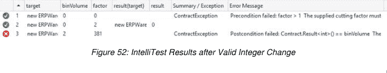

*Figure 52: 有效整数更改后的 IntelliTest 结果*

测试结果大不相同。我们的契约前置条件工作正常，并限制了错误值被传递给我们的方法。然而，我们可以看到 IntelliTest 传入的 **binVolume** 值明显小于 **factor** 值。让我们首先通过要求 **binVolume** 值永远不小于 **factor** 值来解决这个问题。

```csharp
/// <summary>
/// Calculate the production volume of steel per bin
/// </summary>
/// <param name="binVolume"></param>
/// <param name="factor"></param>
/// <returns>Bin Volume less Remainder</returns>
public int ProductionVolumePerBin(int binVolume, int factor)
{
    Contract.Requires(factor > 1,
        "The supplied cutting factor must be more than the value 1.");
    Contract.Requires(binVolume > factor,
        "The cutting factor cannot be greater than the bin volume");
    Contract.Ensures(Contract.Result<int>() == binVolume,
        "The factor used will result in scrap. Please modify the cutting factor.");

    int remainder = CutSteel(binVolume, factor);
    return binVolume - remainder;
}
```

*Code Listing 65: 修改后的代码以确保有效的切割因子*

为此，我们需要添加另一个 **Contract.Requires()** 前置条件，要求 **binVolume** 值始终大于 **factor** 值。从上下文菜单再次运行 IntelliTest。

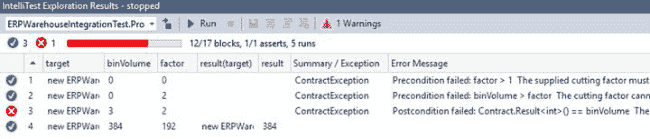

*Figure 53: 有效切割因子更改后的 IntelliTest 结果*

此测试返回的结果告诉我们，**ProductionVolumePerBin()** 方法遇到的唯一问题是它在返回的值上仍然失败。我们的方法保证调用代码每次都会返回完美切割，并且它违反了这一契约。我们可能需要考虑为此方法增加一些智能，如果提供的切割因子无效，让我们的代码向用户建议一个有效的切割因子。

/// <summary>
/// The new valid cutting factor calculated by ProductionVolumePerBin
/// </summary>
public int CalculatedCuttingFactor { get; private set; } = 0;

/// <summary>
/// Calculate the production volume of steel per bin
/// </summary>
/// <param name="binVolume"></param>
/// <param name="factor"></param>
/// <returns>Bin Volume less Remainder</returns>
public int ProductionVolumePerBin(int binVolume, int factor)
{
    Contract.Requires(IsEven(binVolume),
        "Invalid bin volume entered");
    Contract.Requires(factor > 1,
        "The supplied cutting factor must be more than the value 1.");
    Contract.Requires(binVolume > factor,
        "The cutting factor cannot be greater than the bin volume");
    Contract.Ensures(Contract.Result<int>() == binVolume,
        "The factor used will result in scrap. Please modify the cutting factor.");

    int remainder = CutSteel(binVolume, factor);
    while ((binVolume - remainder) != binVolume)
    {
        CalculatedCuttingFactor = CalculateNewCutFactor(binVolume);
        remainder = CutSteel(binVolume, CalculatedCuttingFactor);
    }

    return binVolume - remainder;
}

/// <summary>
/// Calculate any remainder after the modulus operation between volume and factor
/// </summary>
/// <param name="volumeToCut"></param>
/// <param name="factor"></param>
/// <returns>Remainder after cutting</returns>
private int CutSteel(int volumeToCut, int factor)
{
    // Use modulus to determine if the factor produces any scrap
    return volumeToCut % factor;
}

/// <summary>


```csharp
/// Calculate a new cutting factor
/// r.Next(1, 7); returns a random number between 1 and 6
/// </summary>
/// <param name="binVol">Upper range value of random (bin volume + 1)</param>
/// <returns>
/// A new cutting factor greater than 1 and equal to the bin volume
/// </returns>
private int CalculateNewCutFactor(int binVol)
{
    Random r = new Random();
    return r.Next(2, binVol + 1);
}

/// <summary>
/// Ensure that the passed volume is even
/// </summary>
/// <param name="volume">The volume to verify</param>
/// <returns>boolean</returns>
public bool IsEven(int volume)
{
    return volume % 2 == 0;
}
```

*代码清单 66：智能 ProductionVolumePerBin 方法*

从前面修改后的代码清单可以看出，我做了几件事。业务规则规定，料箱容量将始终为偶数。因此，我添加了一个 **Contract.Requires()** 前置条件，以确保只有偶数整数会传递给 **ProductionVolumePerBin()** 方法。

代码中的另一项新增内容是 **CalculatedCuttingFactor** 属性，如果提供的因子无效，该属性将保存新计算出的切割因子。为此，我加入了一个名为 **CalculateNewCutFactor** 的新方法，它会尝试使用备用的切割因子值，以产生完美切割。

**ProductionVolumePerBin()** 方法将判断切割因子是否有效。如果无效，它将运行 while 循环，直到返回有效的切割因子并实现完美切割。不过，在生产环境中，你可能需要考虑使用一个合理性循环计数器变量来创建退出条件，或在达到某个最大迭代次数时引发异常。**ProductionVolumePerBin()** 方法仍然可以做很多微调，但这里我不再深入，因为我只是想说明一个概念。

修改代码后，再次运行 IntelliTest。

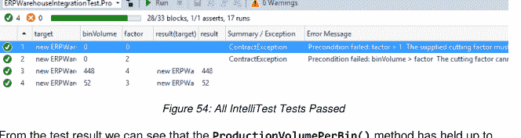

图 54：所有 IntelliTest 测试均已通过

从测试结果可以看到，ProductionVolumePerBin() 方法已经满足代码契约所施加的要求。它还生成了六条警告，我稍后会讨论。

现在，调用代码可以实现 ProductionVolumePerBin() 方法，而无需处理返回无效值的情况。它知道该方法每次都会返回完美切割。唯一需要做的检查是查看是否建议了新的因子，或者提供的因子是否有效。

```
int binVol = 20;
int factor = 3;
CodeContractsDemoProject.ERPWarehouseIntegration owhi =
    new CodeContractsDemoProject.ERPWarehouseIntegration();
int result = owhi.ProductionVolumePerBin(binVol, factor);
if (owhi.CalculatedCuttingFactor != factor &&
    owhi.CalculatedCuttingFactor != 0)
{
    Console.Write($"The supplied cutting factor of {factor} resulted in "
        + "an imperfect cut. The system suggests using the following "
        + $"cutting factor: {owhi.CalculatedCuttingFactor}");
}
else
    Console.Write($"The cutting factor of {factor} resulted in 0 scrap");

Console.ReadLine();
```

代码清单 67：调用 ProductionVolumePerBin 的代码

你会注意到，我每次都在 Console.Write 中使用了字符串内插。这是 C# 6 的新特性之一。前面的代码只需要检查 CalculatedCuttingFactor 属性，以查看切割因子是否已更改。它知道在契约约束下，ProductionVolumePerBin() 方法始终会实现完美切割。

我们还可以进一步改进前面的代码，但我要说明的概念已经很清楚了。代码契约非常适合与 Visual Studio Enterprise 2015 中通过 IntelliTest 创建的测试配合使用。你可以结合这两种技术的强大能力，创建高度健壮的代码和高度强制的业务规则，使应用程序在生产环境中表现良好。

### IntelliTest 警告

如果不讨论警告输出屏幕，对 IntelliTest 的讨论就不完整。

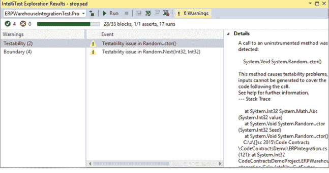

*图 55：IntelliTest 警告*

你会注意到，**IntelliTest 探索结果**屏幕生成了六条警告。这些大多是可能需要你关注的普通警告。为稳妥起见，请检查这些警告是否存在任何明显问题。虽然这在一定程度上超出了本书的范围，但我会简要提及在**可测试性**和**边界**中看到的两种警告类型。

### 可测试性

我们看到的警告是：在我们的代码中检测到未插桩的方法。这具体涉及 `CalculateNewCutFactor()` 方法中使用的 `Random()` 方法。这仅意味着 IntelliTest 无法深入我代码中的所有路径，以生成测试所需的输出。

### 边界

IntelliTest 会对其执行的路径施加某些限制，以防止在应用程序进入无限循环时卡住。可以通过单击菜单栏上的 **修复** 图标来修改这些限制。

### 代码覆盖率

理想情况下，你希望看到 100% 的代码覆盖率（33/33 个块）。我们的测试只覆盖了 28/33 个块。进一步阅读有关 IntelliTests 的资料，可以让你了解如何确保良好的代码覆盖率，以及哪些警告可以安全地抑制。

### 安装第三方框架

如前所述，你可以获取测试框架的附加扩展，以便在创建 IntelliTests 时使用。为此，你可以使用 Visual Studio 扩展管理器，或访问 MSDN 网站上的 Visual Studio Gallery。

以下是从 Visual Studio 扩展安装第三方框架的方法：

-   1. 导航到 **工具**，然后选择 **扩展和更新**。
-   2. 展开 **联机 > Visual Studio Gallery > 工具**，然后选择 **测试**。
-   3. 浏览结果并选择你需要的框架。
-   4. 单击 **下载**。


*图 56：从 Visual Studio 安装第三方框架*

从 Visual Studio Gallery 安装第三方框架：

-   1. 转到 Visual Studio Gallery。
-   2. 在 **查找** 文本框中输入框架名称。
-   3. 从搜索结果中选择要下载的框架。

如果你不确定需要哪个框架，或者不知道要查找的框架名称，可以浏览 Visual Studio Gallery 上的框架列表：

-   1. 转到 Visual Studio Gallery。
-   2. 单击“浏览”链接。
-   3. 在 **类别** 下，展开 **工具** 并选择 **测试**。
-   4. 选择你想要的框架并下载该工具。

## 第 5 章 代码契约编辑器扩展

### 让代码契约更有用

到目前为止，我们已经了解了代码契约的许多功能。这里有一个提示，说明如何让你创建的契约对使用你的类和方法开发人员更有用。使用代码契约编辑器扩展，可以让你看到所调用的方法对该方法中定义的契约有什么要求。它无需你深入该方法并查看它实现了哪些代码契约，就能做到这一点。

```
ProductionVolumePerBin(binVol, factor);
```


*图 57：ProductionVolumePerBin 快速信息*

我们在第 4 章中使用的方法，在指针悬停于该方法上时，会在快速信息窗口中显示你在该方法的 XML 注释中提供的注释。这是预期行为，但从该快速信息窗口中我无法知道该方法实现了哪些契约。代码契约编辑器扩展改变了这一点。要安装它，请转到 Visual Studio 中的“工具”菜单，然后单击“扩展和更新”。


*图 58：扩展和更新*

在 **扩展和更新** 窗口中，选择 **联机** 选项卡，然后搜索 **代码契约编辑器扩展**（Code Contracts Editor Extensions）。返回的结果应该相当有限。在此处单击 **下载**，以下载并安装该扩展。


图 59：安装代码契约编辑器扩展

安装代码契约编辑器扩展后，你需要重启 Visual Studio。这个扩展的美妙之处在于，你现在可以窥探所创建方法的内部，它会显示该方法的契约。

不过，在此功能生效之前，你需要确保在代码契约设置中将 **契约引用程序集**（Contract Reference Assembly）设置为 **生成**。


图 60：契约引用程序集


现在如果将鼠标悬停在 **ProductionVolumePerBin()** 方法上，你会看到 Quick Info 窗口包含了有关其实现的契约的丰富信息。

```
.ProductionVolumePerBin(binVol, factor);

int CodeContractsDemoProject.ERP.WarehouseIntegration.ProductionVolumePerBin(int binVolume, int factor)
Calculate the production volume of steel per bin

Contracts:
requires IsEven(binVolume)
requires factor > 1
requires binVolume > factor
ensures result == binVolume
```

*图 61：使用契约增强的方法工具提示*

这使我能够在无需查看方法内部的情况下使用该方法，并传递能够成功验证的有效参数。我现在对正在调用的方法有了更多信息。

使用 Code Contracts Editor Extensions 时的另一个亮点是可以查看基类实现的 Code Contracts。让我们再看看我们的 **CalculateNewCutFactor()** 方法。

```
/// <summary>
/// Calculate a new cutting factor
/// r.Next(1, 7); returns a random number between 1 and 6
/// </summary>
/// <param name="binVol">Upper range value of random (bin volume + 1)</param>
/// <returns>
/// A new cutting factor greater than 1 and equal to the bin volume
/// </returns>
private int CalculateNewCutFactor(int binVol)
{
    Random r = new Random();
    return r.Next(2, binVol + 1);
}
```

*代码清单 68：Random() 方法*

将鼠标悬停在 **Next()** 方法上，我们可以查看其所需契约。Code Contracts Editor Extensions 通过挖掘基类并显示已实现的契约来实现这一点。

```csharp
private int CalculateNewCutFactor(int binVol, int factor)
{
    Random r = new Random();
    return r.Next(2, binVol + 1);
}
```

```
int Random.Next(int minValue, int maxValue) (+ 2 overloads)

Contracts:
    requires minValue <= maxValue
    ensures result >= minValue
    ensures result < maxValue || maxValue == minValue && result == minValue
```

图 62：Random Next 方法契约

我们可以看到，Next() 方法实现的一个 Code Contracts 是 minValue 必须小于或等于 maxValue。对于我们的需求，我希望确保 minValue 始终大于或等于 2。利用我们从 Next() 方法实现的 Code Contracts 中获得的信息，我们现在可以继续创建自己的 GetRandom() 方法，使其符合我们的 Code Contract 要求。

```csharp
/// <summary>
/// Calculate a new cutting factor
/// r.Next(1, 7); returns a random number between 1 and 6
/// </summary>
/// <param name="binVol">Upper range value of random (bin volume + 1)</param>
/// <returns>
/// A new cutting factor greater than 1 and equal to the bin volume
/// </returns>
private int CalculateNewCutFactor(int binVol)
{
    return GetRandom(2, binVol + 1);
}

/// <summary>
/// Get a random number
/// </summary>
/// <param name="minValue">Value not less than 2</param>
/// <param name="maxValue">Upper range value of the random number to generate</param>
/// <returns>A random integer</returns>
static int GetRandom(int minValue, int maxValue)
{
    Contract.Requires(minValue >= 2,
        "minValue cannot be less than 2");
    Random r = new Random();
    return r.Next(minValue, maxValue);
}
```

代码清单 69：自定义 GetRandom() 方法

使用 Code Contracts 和 Code Contracts Editor Extensions 可以让我们编写更健壮的代码，并轻松微调代码以符合所需业务规则。


提示：你需要记住 Random 类并不是真正的随机数生成器。例如，当你调用 Next() 时，Random 类使用某些内部状态返回一个看似随机的数字。然后它会更改其内部状态，以便下次调用 Next() 时返回另一个看似随机的数字。生成真正的随机数超出了本书的范围；如果你需要真正的随机性，你需要做一些额外的研究。

## 第 6 章 结论

到目前为止，我们已经了解了如何设置 Code Contracts 并使用各种契约方法来验证逻辑正确性。我们了解了 Code Snippets 如何让大量使用 Code Contracts 的开发人员更轻松。我们还了解了如何将 Code Contracts 集成到文档输出中，以及如何使用 Sandcastle Help File Builder 生成用户友好的文档。

在更高级的主题和技巧方面，我们了解了如何将 Code Contracts 与抽象类和接口集成，并且我们看到 Code Contracts 非常适合使用 IntelliTest 测试方法。我们探讨了另一个名为 Code Contracts Editor Extensions 的工具如何将基类和你的自定义 Code Contracts 直接在 Quick Info 窗口中暴露给调用代码。

从这里开始，我建议查看 [Code Contracts GitHub 页面](https://github.com/microsoft/CodeContracts) 并开始将 Code Contracts 集成到你的项目中。你使用 Code Contracts 越多，创建文档完善、健壮的代码就变得越容易。

## 第 7 章 工具和资源

### GitHub 上的 Code Contracts

如果你想查看 Code Contracts 的源代码、贡献代码，或熟悉 Code Contracts 的某些方面，请访问 GitHub 上的项目。还有一个论坛和常见问题解答，可能非常有帮助。

### Microsoft Research 上的 Code Contracts

有关 Code Contracts 背景的更多信息，请访问 Microsoft Research 网站。

### Code Contracts 用户手册

为了获得更多背景知识并巩固某些概念，我建议你阅读 Code Contracts 用户手册。

### Stack Overflow 上最热门的 Code Contract 回答

Stack Overflow 是网络上获取 Code Contract 问题答案和解决方案的最佳来源之一。

### Code Contracts Editor Extensions

在 Visual Studio Gallery 中查看 Code Contracts Editor Extensions。

### Sandcastle Help File Builder

要从 XML 注释生成出色的文档，请在 GitHub 上获取 Sandcastle Help File Builder 的免费副本。
