# C++ 编码：易于理解的编程练习与解决方案


# 第一章：引言

## 1.1 - C++ 绝对非常出色！

C++ 的日益普及以及对 C++ 专业人才日益增长的需求只是学习 C++ 的众多优势之一。你掌握它的之旅从这里开始。你将发现 C++ 是你遇过的最强大、最健壮的编程语言之一，并且被认为是最复杂但回报最丰语言之一。C++ 可以作为一种灵活且极其动态的编程工具，实现无数用途。与大多数编程语言不同，C++ 可用于底层、中层和高层编程。这意味着它可以用于许多不同层次和用例场景的无数应用程序。

C++ 是一门多平台语言，因此你能够为 Windows、Mac、Linux 甚至移动设备编写代码。它还能为你提供一套强大的编程技能，成为你学习其他可用编程语言的阶脚石和根基。

C++ 初看起来可能令人生生畏，但无论它有多复杂，学习基础知识都非常简单，通过大量的练习，你可以成为 C++ 忍者。C++ 在许多领域提供了大量的自由和创造力——计算机游戏、图形应用、通信、人工智能与深度学习、计算机视觉、驱动程序、道德黑客、桌面应用等。你将能够真正地微观管理计算机性能。作为一名 C++ 程序员，你能够以各种风格和方法生产快速、可扩展且灵活的应用程序，服务于任何用例。

`C++ = Salary++`

学习 C++ 还有另一个巨大的优势：它是职业发展的巨大助推器。事实上，人类开发的一些最成功的应用程序都是用 C++ 编写的。Facebook、Adobe、Skype、Amazon、PayPal 等 IT 巨头将 C++ 作为其软件开发的核心部分。换句话说，学习 C++ 可以提升你的职业生涯，开启许多大门，同时在你的简历上留下重墨的一笔。市场对 C++ 程序员有着持续的需求，而为了让你在需求出现时能够胜任，这本书将成为你的极佳指南。

C++ 的人气越来越高，对 C++ 专业人才的需求也在不断增长。这也是形成 GitHub 和 Stack Overflow 等强大的 C++ 社区和论坛的原因之一，在这些地方你可以提问、下载代码、分享、学习并成为有价值且活跃的成员。

## 1.2 - 简而言之 C++ 历史……

20 世纪 70 年代初，Dennis Ritchie 在新泽西州的贝尔实验室创建了名为 C 语言的编程语言。C 多年来一直作为一种过程化编程语言存在。到 70 年代末，Bjarne Stroustrup 开发了最初作为 C 语言附加扩展的内容。在刚开始，Bjarne 的工作被称为“带有类的 C（C with classes）”，直到 1983 年才更命名为 C++。1989 年，C++ 的第一个商业版本发布。1998 年，C++ 首次获得国际标准，这为它的商业用途创建了全球性标准。这是程序创建新纪元的序幕。

所谓的“现代 C++”引入于 2011 年，并命名为 `C++11`，随后是 2014 年发布的 `C++14`，然后是 2017 年发布的 `C++17`，最后，C++ 家族的新“宝宝”是 `C++20`，它于 2020 年发布，引入了 C++ 迄为止最强大的新特性。

## 1.3 - C++ 的心态

如果你以前从未写过代码，或者你在这方面的经验很少——请阅读这一部分，因为你可能会觉得某些 C++ 概念或逻辑难以理解或令人困惑。这会发生在几乎任何初学者身上，因为学习编程不仅像学习一门带有语法规则的新语言，它还让你接触到新的、更复杂的逻辑思维方式。事实如此，尤其是对于 C++ 而言。你只需要记住熟能生巧，并且任何初级程序员在开始阶段都会遇到同样的“童年疾病”般的错误并面临一些困难。不要担心——这非常自然。

1. 必须注意的是，C++ 提供的自由并不是没有代价的。程序越复杂、灵活，出现错误和 bug 的空间就越大。可以公正地说，理解如何在 C++ 中编写代码固然重要，理解如何**不**那样写代码也同样重要。尽管现代编译器为你提供了许多功能和工具来帮助你管理编码和程序流，但它也能防止你犯错，指出过程中可能出现的某些问题。记住：练习永远是最好的学习途径，而你的错误是你最好的导师。

## 1.4 - 为 Windows 设置工作环境和 IDE

对于本指南，我们将使用 C++ 最健壮、最常用的开发环境之一：由微软提供的 Visual Studio。Visual Studio 是 Windows 上最专业的 IDE。它也有 Mac 版本。（参见：https://visualstudio.microsoft.com/vs/mac/ ）。使用 Visual Studio 有许多优势，特别是如果你在团队中工作，它很可能是你会使用的工具。另一个优势是 Visual Studio 可以支持其他编程语言，如 C#、Python、Java、Angular 等。因此，从一开始就了解如何使用 Visual Studio 将大有益处。

要在你的机器上开始安装 Visual Studio，请先确保：

a. 你的 PC 符合安装 Visual Studio 的要求。这是安装任何软件的必要条件，更不用说是一个重量型开发环境了。Visual Studio 2019 的系统要求列在下方：https://docs.microsoft.com/en-us/visualstudio/releases/2019/systemrequirements
b. 建议在安装之前运行 Windows 更新。c. 如果需要，清理任何可以腾出的空间。

1. 根据你的需求选择合适的版本：

a. 以下版本可能适用于你：学生折扣版、免费社区版，或者可以作为免费试用/付费获取的更高级选项。
b. 在此处查看选项（https://visualstudio.microsoft.com/downloads/ ）并下载你想使用的版本。

2. 使用 Visual Studio 安装程序：


Visual Studio 使用自己的安装程序，该程序首先被下载。然后通过这个安装程序，你可以安装 Visual Studio、添加插件、更改配置并在需要时卸载 Visual Studio。

3. 安装 Visual Studio：

a. 当你安装 Visual Studio 时，你不仅安装了 IDE，还安装了认为在开发过程中可能需要的“工作负载（workloads）”。


b. 工作负载实际上是适用于不同开发类型的特征集：驱动程序、网站、桌面应用，以及你将使用的编程语言（在我们例中是 C++）。编程语言也会影响“工作负载”的选择。
c. 如果你漏掉了某个需要的“工作负载”或安装了某个需要的“工作负载”，你不必担心，因为你可以重新启动安装程序并进行更改。要这样做，请前往“工具 > 获取工具和功能”菜单。
d. 你还可以自定义要安装的单个组件。这与“工作负载”不同，因为“工作负载”是组件和特征的集合。如果你只想添加或删除部分此类组件和特征，只需进入“单个组件”选项卡，可以在那里手动挑选可能需要的组件和特征。例如，C++ 可以用于控制台应用程序，也可以用于使用 MFC（微软基金类库）的富图形应用程序。默认不安装 MFC，如果你计划创建基于 GUI 的应用程序，你可能需要添加 MFC。


e. 你还可以添加“语言包”，它们本质上是支持你的母语言（例如英语、法语等）的加载项。

## 4. 其他考虑因素

这里没有提到很多许多其他选项和方法，例如使用命令行进行安装和/或更改/自定义、选择不同的安装位置（我们建议坚持默认设置）等。然而，既然你已经安装了 Visual Studio，现在是时候亲身实践开始编码了。

**提示** 在开始之前（或在你的第一次使用 Visual C++ 期间），有 2 个你可能想要设置默认选项：

1. 当当前版本未编译时，绝不运行之前的版本。如果当前版本未编译，编译器可能会建议你运行上一次成功的构建。然而，这样做没有意义。只需修复任何错误并重新构建代码即可。

2. 当当前编译后的代码不是最新时，始终构建源代码。这是通过一个名为 `UpToDateChecker` 的属性实现的。在你的第二次构建期间，系统会询问你是要构建新的源代码还是仅运行之前的构建。除非整个源代码都是最新的，否则你将无法进行适当的调试。

3. 在运行、构建或部署时可能会发生错误。当使用 `F5` 或 `Debug > Start Debugging` 命令运行项目，默认设置“提示启动”（Prompt to launch）会在即使构建失败也应运行项目时显示消息。选择“启动旧版本”（Launch old version）会自动启动上次良好的构建，这可能导致运行的代码与源代码之间不匹配。选择“不启动”（Do Not launch）来抑制该消息。

## 1.5 - 为 Linux 配置 IDE

Linux 用户倾向于使用开源编译器，`G++` 就是一个很好的例子。

首先，让我们打开终端。可以通过按下 `Ctrl + Alt + T` 实现。然后，使用以下命令安装 `G++` 编译器：

```bash
sudo apt -get install g++
```

如果你已经拥有安装新软件的权限，安装将顺利进行。如果没有，系统会要求你输入管理员密码。

然后，按照提示说明操作即可。

## 1.6 - 为 MAC 配置 IDE

像任何其他 App 一样，Xcode 可以从 App Store 安装。


你可以在后续页面找到详细的说明和指南。你也可以在该页面注册成为 Apple 开发者。

# 第 2 章：创建你的第一个程序

# 让我们开始吧...

为什么不直接进入挑战呢？让我们一起编写你的第一个程序！首先，启动 Visual Studio。在“文件”菜单中选择“新建/项目”。

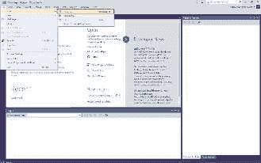

为了节省你的时间，Visual Studio 为常用的源代码项目提供了预配置的模板。我们稍后会详细介绍这一点。目前，我们选择了控制台窗口，因为控制台可以通过控制台窗口为你的程序提供简单的输出（和输入）。现在让我们配置你的新项目：

1. 选择“Windows 控制台应用程序”（Windows console application）。
2. 为你的程序命名并选择保存路径。
3. 点击确定。

2. **一旦项目打开，你会发现 Visual Studio 已经为你完成了一些初步工作和准备，让你能够快速上手。让我们看看 Visual Studio 提供了哪些功能和元素：**

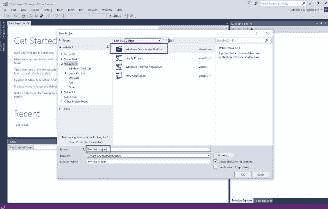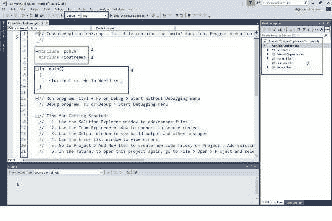

3. **程序结构分解**

4. **配置**

有几个与目标处理器（主要是 x64 和 Win32 或 x86）关联的配置（Configurations），以及用于开发和调试的配置（`DEBUG`）与发布最终版本的配置（`RELEASE`），后者将生成一个 `.exe` 文件。我们将从默认的 `DEBUG / x86` 开始，因为我们想要查找错误并跟踪代码的运行，正如我们稍后演示的那样。

5. **预处理器**

C++ 使用称为头文件（或 `.h` 文件）的预处理库。这些文件被添加到项目中并在任何事情之前进行预处理，它们的存在是为了节省你的时间。这些文件包含了对 C++ 中常用库的引用。需要提到的是，最新的 C++20 Modules 已引入以取代旧的 `.h` 文件方法，但它们仍然处于实验阶段，不属于目前使用的 C++ 标准的一部分。

6. **pch.h**

`pch.h` 代表预编译头文件（Pre Compiled Header），用于将一个文件中使用的所有 `#include` 文件放在一起。`pch.h` 已经过编译，因此它包含了二进制文件，可以在构建过程中节省时间。`.h` 文件是不被编译的，你每次运行程序时，它们都会重新编译。这意味着如果你的代码中有 6 或 8 个 `.h` 文件（有时甚至更多），那么——编译起来就很沉重。因此，使用 `pch.h` 是节省时间和资源的做法。我们稍后会深入研究 `pch.h`，所以如果你在这个阶段觉得难以理解，请不要担心。

如果你的 IDE 没有默认的 `pch.h` 文件——不要担心，你在这个阶段不需要它。

7. **函数– main()**

`main()` 函数是程序开始执行的地方，也是你放置希望执行的第一条指令的地方。`main()` 函数通常在给你控制权之前完成了一些与操作系统相关的准备之后执行。例如：设置输入和输出（如控制台窗口）、加载系统库等。

你作为 `main()` 函数部分编写的代码始终写在 `main()` 顶部和底部的大括号 `{}` 之间。

8. **行号**

行号有助于帮助你跟踪代码，在发生编译器错误时，大多数情况下会指示问题所在。

9. **输出区域**

输出区域包含几个不同用途的标签页，我们将在本指南中详细讨论。通常，根据你正在的操作，输出区域将显示相关细节；例如：当你编译代码时，你将看到编译进度。当你链接代码时，你将看到链接器的输出。当程序开始运行时，你将看到任何发生的错误。此区域不是程序的输出；程序的输出将显示在单独的控制台窗口中。

10. **解决方案管理器（Solution Explorer）**

解决方案管理器或或文件系统目录允许你在项目内的不同文件和文件夹之间导航。你可以使用目录顶部的搜索管理器按名称搜索文件，并打开/关闭目录树。

提示：如果你想在解决方案管理器中轻松找到当前正在工作的文件，只需点击双箭头图标：

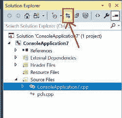

11. **命名空间（Namespaces）**

标准命名空间是 C++ 内部的一部分。但它到底是什么呢？

解释这一点最好的方法是使用生活中的例子：假设你去医院看一个朋友。接待员告诉你你的朋友在 A 楼的 204 室。当你到达 A 楼时，又被告知朋友不在那里，而在医院另一边的另一栋 A 楼。在现实生活中这绝不可能发生——医院建筑群中的建筑将有唯一的名称，例如 A 楼、B 楼等。永远不会有两个名为“A”的楼——这没有任何意义。街道名称也是如此——你不会在同一个城市里有两条名为“主街”（Main）的街道，对吧？

编程中也是如此：命名空间是一种为了消除歧义而创建的声明的标准。例如，`cin`（输入）和 `cout`（输出）是 `std` 命名空间的一部分，`std` 是 C++ 的标准命名空间。你将在第一个程序中使用这些语句。

12. **cout 和 cin 语句**


每个程序都需要输入和输出。在 C++ 中，最常用的方法之一是使用 `cout`（程序的输出）和 `cin`（程序的输入）。我们将在下一节中演示这一点。请注意，输入和输出是编程的基础，因为用户总是需要输入某些内容并获得某种输出。使用 `cin` 和 `cout` 的方法如下：

`std::cin >> YOUR INPUT >> std::endl; std::cout << "YOUR OUTPUT" << std::endl;`

我们在行开头使用了 `std::`，正如在“命名空间（Namespace）”章节中解释的那样，然后使用了 `<<` 和 `>>` 运算符。

为了记住什么时候使用 `<<` 什么时候使用 `>>`，请记住这一句：`cout` : 小，小于（`<<`）。`cin` : 大于，大于（`>>`）。13\. **行尾**

`std::endl;` 代表行的结束，因此下一行将紧接这一行之后开始，就像我们输入了“回车”键一样。你也可以用 `\n` 代替 `endl;`——它们的作用相同，都能将用户移动到下一行。

14\. **注意，我们每一行都将以分号“;”结尾（请参见“标点符号”章节）。**

15\. **注释**

代码的组成部分之一是注释。注释不是被编译和执行的真实代码的一部分，而是为了你或你的团队未来之目的的笔记。在代码中使用注释极其重要，为了使代码尽可能清晰。这被认为是开发者中的一项**必须**遵守的最佳实践。你真的不想去研究没有注释的代码。

要创建注释，你只需要在想要注释的文本前面添加两个正斜杠 `//`。这些文本将变成绿色。请注意，`//` 只会注释你当前所在的那某行。如果你想对跨越多行的整个部分进行注释，请在部分的开头使用 `/*`，在末尾使用 `*/`。要取消注释，只需删除 `//` 或 `/*...*/` 块即可。

# 第 3 章：编写你的第一个程序

16\. 在这段代码中，我们将向你介绍简单的输入和输出语句、C++ 语法和标点符号。我们将要求用户输入年龄，然后创建一些输出语句。

17\. 我们首先需要包含一个名为 `iostream` 的 C++ 输入输出库。添加这个库仅仅可以为你节省时间，因为这些代码已经有人为你写好了。

18\. 所以让我们在 `main()` 之外输入：

```cpp
#include <iostream>
```

19\. 现在我们想创建一个变量（稍后我们将向你解释关于变量所需的所有知识）。第一个变量将是一个整数（`int`），在这种情况下代表年龄。

20\. 所以让我们在 `main()` 内部输入：

```cpp
int age{}; //age 是整数类型 (int) 的变量
```

21\. 现在我们想在控制台上打印一些内容。我们已经提到过正在使用一个名为 `<iostream>` 的预构建库，它负责输入和输出。我们将使用 `std::cout` 输出，使用 `std::cin` 输入。`<<` 和 `>>` 运算符是 `cin` 和 `cout` 语法的一部分，并如此处所示使用。

22\. 所以，让我们输入：`std::cout << "How old are you?" << std::endl; std::cin >> age;`

23\. 现在我们可以在控制台上输出用户的年龄，并添加我们想要的任何文本：

24\. `std::cout <<“wow, we’re the same age! I am also“ << age <<“years old! How about that!” << std::endl;`

25\. 注意，我们放置了一些空格。正如前面提到的，代码看起来是这样的：

- **std::cout <<“wow, we’re the same age! I am also“ << age <<“years old! How about that!” << std::endl;**


`<`, `>`, `<=` 关系运算符用于比较操作数。 `>=`, `==`, `!=` 新的运算符 `<=>` 是 C++20 中新增的，它允许对 a, `<=>` 进行三路比较。

`&&`, `||` 逻辑运算符用于组合条件或约束，且输出仅为真或假的结果。

`=`, `+=`, `-=` 赋值运算符向变量赋值。`*=`, `%=`, `/=`

`&`, `|`, `<<` 位运算符用于对 `>>`, `~`, `^` 操作数进行位级（位）操作。

`? :` 条件运算符返回真值或假值，并根据该值执行两个可能的表达式中的其中一个。

`sizeof` `sizeof` 运算符可以计算操作数的大小。

现在让我们来看看这些运算符的实际应用。**重要提示**

本节旨在让你熟悉一些 C++ 运算符以及它们在实际代码中的用法。我们将在指南的后续章节中深入探讨所有这些运算符，所以如果你不记得或理解本节中的某些内容，请不要担心。

## 赋值运算符

34. 赋值运算符非常容易理解和使用。它们简单地为变量赋值，但有一个重要的规则需要记住——赋值总是从右向左进行。这意味着右侧的值总是被赋值给左侧变量。让我们来看：

```cpp
string1 = "Marco" ; // string1 被赋值为名字 "Marco"。
string2 = "Dan" ; // string2 被赋值为名字 "Dan"。 string3 = String b; // string b 的值被赋值给 String3。
string4 =“Dan” ; // 现在 string4 的值被改为“Dan”。
```

`=` 运算符（等号运算符）——忘掉你在小学学到的东西吧。

正如我们在上面演示的，与你熟悉的以及我们在上面介绍的其他数学运算符不同，等号“=” 运算符略有不同。我们将在本指南中进一步讨论并演示它，但请注意，运算符 `=` 的用法与 C++ 中的“等于”不同。它被用于赋值运算符。因此，例如我们写下面这行代码：

```cpp
a = 5; // a 不等于 5，它被赋值为数字 5
b = 4; // b 不等于 4，它被赋值为数字 4
c = a + b; // c 被赋值为 a 和 b 相加的结果
a = c; // 现在 a 被赋值为 c 的值，即 9
```

我们并不是在检查 `A` 是否等于 5，或者 `b` 是否等于 4。我们是在给 `A` 赋值 5。`B` 被赋值为 4。`c` 现在拥有 `a` 加上 `b` 的值，最后，`a` 不等于 `c`。

给变量赋值将在指南的后面部分详细说明。

## 等运算符

到这里你可能已经在想 C++ 使用哪个运算符来表示“等于”运算符。答案是我们使用“==” 运算符，你将在下一节中学习到。然而，这里有一些被检查为真或假的条件，这就是为什么我们喜欢把它们看作提出的“问题”：

```cpp
(child == kinder) // 英语中的“child”等于德语中的“kinder”吗？
( “cellphone” == “handy” ) // 德语中的“cellphone”等于“handy”吗？
(a + 3 == b + 2) // a+3 的值等于 b+2 的值吗？
```

## 数学运算符

数学运算符用于在二进制位级上执行数学计算，它们是你最可能在小学早期学过的基础运算符：

字体 加法运算符 `+`
- 减法运算符 `-`
- 乘法运算符 `*`
- 除法运算符 `/`
- 取模运算符 `%`

让我们来看看这些运算符的使用示例：

```cpp
a = 25; // a 被赋值为值 25
b = 42; // b 被赋值为值 42
x = 3; // x 被赋值为值 3
i = a + b; // i 被赋值为 (25+42) = 67
b = a – x; // 现在 b 被赋值为 (25-3) = 22
```

## C++ 复合赋值运算符

既然我们理解了普通的赋值运算符和数学运算符，现在我们可以继续讨论复合赋值运算符了。这些运算符在对变量赋值的同时，会对其进行数学运算。正如从这些示例所示，这很容易理解：

```cpp
x += y // 等同于说 x = x+y
x -= 10 // 等同于说 x = x-10
x /= 2 // 等同于说 x = x/2
```

## C++ 关系运算符

关系运算符在 C++ 中非常强大。当我们想要比较操作数时使用它们，而比较可以在几个级别上进行。让我们看看示例：

```cpp
(c <= 4) // c 小于或等于 4 吗？
(a > c) // a 比 c 大吗？
(b != a) // b 不等于 a 吗？
(b < c) // b 小于 c 吗？
(x == a) // x 等于 a 吗？
(x == a) // x 等于 5 吗？
```

## 逻辑运算符

逻辑运算符用于组合条件或约束，且输出仅为真或假的结果。当我们想要输出一个真或假的结果时使用它们，这就是为什么我们喜欢看到这些问题：

1. `&&` 运算符意味着“与”。
2. `||` 运算符意味着“或”。

很多情况下，运算符的优先级总是从左到右设置。这意味着当我们使用 `&&` 运算符时，如果左侧为假，则将不再检查右侧。当使用 `||` 运算符时，如果左侧为假，则将检查右侧。

```cpp
(i == 4) && (a < 6) // i 等于 4 且 a 小于 6 吗？
(i == 4) || (a < 6) // i 等于 4 或 a 小于 6 吗？
```

## 条件运算符

正如我们在指南第一节解释的，现代 C++ 总是试图简化代码。`?:` 运算符是代码变得变得很好的例子。我们刚刚学习了如何使用 `&&` 和 `||` 条件，`?:` 让我们的生活更加简单。

在这种情况下使用的表达式为：`条件? 结果 1 : 结果 2`。如果条件为真，则执行结果 1。如果条件为假，则执行结果 2。你可以看到，这非常简单。

让我们来看另一个例子。假设我们要编写一个为 18 岁及以上的成人提供折扣的程序。在这种情况下，我们将用户输入年龄，程序可以立即判断他们是否为成年。我们将以这种方式使用条件 `?` 和 `:` 运算符：

- `?` —— 条件为真时的值。
- `:` —— 条件为假时的值。

```cpp
Adult = (Age > 18) ? true : false ;
```

这等同于编写以下：`Adult = (Age > 18);`


```cpp
std::cout <<“the name of your dog is “ << name << “. This is a really cool name” << std::endl;
```

## C++ 一元运算符（自增与自减运算符）

C++ 中另一个强大且简单的运算符是自增运算符，用 `++`（加加）运算符表示，以及用 `--`（减减）运算符表示的自减运算符。这些运算符让代码更短更简洁，因为它们会将存储在变量中的值加 1 或减 1。让我们来看看如何在代码中使用它们：

```cpp
x = 1; // x 被赋值为值 1
y = 4; // y 被赋值为值 4
x++; // x 增加 1，x 的值现在是 2 (1+1)
y--; // y 减小 1，y 的值现在是 3 (4-1)
```

35. C++ 中还使用了更多运算符。我们将在本指南中解释并演示大部分运算符。`sizeof` 运算符将在本章的变量部分进行演示。

## C++ 标点符号

36. 就像书面语言在使用点号、逗号、冒号时有规则一样，C++ 也使用特定的标点符号规则，其中一些你已经在第一个代码中遇到过（记得语句末尾的 `;` 吗？）。就像你的老师在你没有按规定使用标点符号时责备你一样，C++ 编译器也会做同样的事。

C++ 标点符号规则将在你学习本指南并进行一些编码练习时（做一些作业也会很有帮助）教你。你将学习如何以及何时使用大括号 `{}`（也称为“大花括号”）、圆括号 `()`、方括号 `[]`、双引号 `“ ""`、单引号 `' '` 以及更多。我们将在本指南中向你介绍所有的标点符号，并教你与另一种风格相比，何时使用某种特定风格更好。每当我们讨论标点符号时，我们都会对其进行标记，方便你记忆。

### 不要害怕！

所有初学者程序员遇到的最常见“童病”之一与标点符号的使用。别担心，随着时间的推移和大量的练习，你会进步的。而且，正如你所看到的，每当出现标点符号问题时，你的 IDE 都会报警并指出位置，而且你的代码将无法编译。

# 第 5 章：数据类型与变量

## 变量与数据类型

### 什么是变量？

变量是每个程序的核心。要理解变量以及如何使用它们，我们需要理解计算机的工作原理：

世界上每台计算机都由两个核心组件组成：CPU（中央处理单元）和 RAM（随机访问存储器）。为了进一步简化，每台计算机都需要在内存中存储信息，并访问它曾经存储的信息。

这就是变量出现的地方。变量是内存分配的抽象。C++ 并不是调用非常长且无法记忆的存储地址（内存地址），而是以一种非常抽象的方式使用预定义的变量名和类型。每个变量捕获特定字节（bytes）的内存大小，以便你在代码中轻松使用它。

假设我们想在内存中存储一个名为 `age` 的整数（`int`），其值为 21（`int` 类型的大小为 4 字节）。这是我们的内存地址和大小的显示方式：

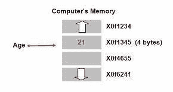

与其在代码中使用这个长得荒谱的地址（而且地址在不同的运行期间可能会变化），我们可以简单地声明一个 `int` 变量并将其命名为“age”。显然，我们可以为变量起任何我们喜欢的名称，但它必须有意义，以便我们和其他人理解我们的代码。

### 变量类型

C++ 中有各种变量类型。下表说明了 C++ 中不同的变量类型及其在内存中的值大小：

| 变量类型 | 描述 | 内存大小 |
| :--- | :--- | :--- |
| `Int` | 机器自然整数大小 | 4 字节 |
| `long` | 使用更长的数字 | 4 字节 |
| `long long` | 使用更长的数字 | 8 字节 |
| `char` | 存储单个字符的值 - 这是一个 1 字节整数类型 |
| `bool` | 存储真或假值 | 1 字节 |
| `double` | 双精度浮点数 | 8 字节 |
| `long` | 使用更高精度的浮点数，比 12 字节的 `double` 更精确 | |
| `float` | 单精度浮点值 | 4 字节 |
| `void` | 无类型且未分配存储 | |

C++ 中还有一些额外的变量类型。欲阅读更多信息请访问 http://www.cplusplus.com/doc/tutorial/variables/

## 编码练习

在这个编码练习中，我们将检查不同变量类型的大小。为了实现这一点，我们将使用上一节介绍的 `sizeof` 运算符。`sizeof` 运算符用于测量类型或变量的大小（以字节为单位）。因此，你可以使用这两种格式：

`sizeof (variable)`

例如：

`int i, j;`

`j = sizeof(i)`

或者

`sizeof(type)`

例如：

`sizeof(int)`

让我们来看看实际运行的代码：

### 第一步

让我们创建一个新项目并将其命名为“Variables”。首先，开始包含

```cpp
#include <iostream>
```

然后我们添加命名空间 `std`，这样我们就不需要输入类型了。`using namespace std;`### 第二步

现在我们可以添加 `cout`。我们将使用 `sizeof` 输出变量的大小。

```cpp
cout << "We will check the size here" << endl;
cout <<“------------------------------------” << endl;
```

所以我们可以开始写 `cout` 语句，使用 `sizeof` 

```cpp
cout << "The size of int is: " << sizeof(int) << endl;
cout << "The size of long is: " << sizeof(long) << endl;
cout << "The size of long long is: " << sizeof(long long) << endl;
cout << "The size of char is: " << sizeof(char) << endl;
cout << "The size of bool is: " << sizeof(bool) << endl;
cout << "The size of double is: " << sizeof(double) << endl;
cout << "The size of float is: " << sizeof(float) << endl;
```

运行程序。这是我们预期的：

你可以从代码中看到每个类型都有大小。当定义该类型的变量时，内存分配的字节数。

`sizeof` 运算符非常强大，通常用于内存分配，或者使用地址拷贝数据块。这将在指南的后续更高级章节中进一步解释。

## 声明变量

如何在代码中使用变量

要在我们的代码中使用变量，我们必须先声明它。C++ 中的变量声明由两部分组成：

`变量类型 变量名`

1. 声明变量类型（例如 `int`、`double`、`char` 等）。**变量类型是 C++ 变量列表的一部分。**
2. 声明名称（例如 `num1`、`temperature`、`letter` 等）。

虽然变量类型是内置或预定义的，但变量名可以是你喜欢的任何名称，只要符合某些规则和最佳实践。我们很快就会讨论这些规则。

让我们来看一些声明变量类型的示例：

37. `int age; // 例如：age 为 45.`
38. `double distance; // 例如：distance 为 12.3 km.`
39. `long double pi; // 例如：pi 值为 3.14159.`
40. `char letter; // 例如：letter 为 B.`

不要忘记！始终使用正确的标点符号：每个变量声明行必须以分号 `;` 结束。

### 变量声明的规则

你可以看到声明变量非常简单。但是，你必须遵循某些遵守规则：

**不要：**

1. 你不能使用 C++ 保留关键字来命名变量。
2. 你不能在同一个代码作用域内为不同的变量使用相同的名称。


3. `Variable names` 必须以字母开头，绝不能以数字开头。

4. 声明变量时不允许有空格。

### 做法与最佳实践：

1. 你可以在变量名中使用下划线、小写和小大写字母——这是一种风格问题。如果你和团队一起工作，最好遵循相同的风格。

让我们看一些示例：
```cpp
std::string first_name;
std::string last_name;
std::string FirstName;
std::string LastName;
```

2. 使用有意义的名称始终是一个良好的习惯。

3. 在声明变量时使用一致的方法。如果你决定使用下划线，请继续使用它们；如果你使用小写和大写字母，请继续这样做。保持一致性至关重要。

4. 不要使用过长的名称。它会像回镖一样回到你身上，因为它令人困扰。在任何情况下，变量名的长度不能超过 31 个字符。

## 初始化变量

在我们声明并命名变量之后，需要对它们进行初始化。现在，我们的变量还没有被初始化，因此它们不包含任何真实值。例如，变量 `int price;` 没有值。因此，编译器不知道 `price` 的值是多少。这在执行执行时会导致很多问题。

让我们尝试看看如果不初始化变量会发生什么。让我们写一段简单的代码。在代码中，我们将声明一个类型为 `int` 的变量并将其命名为 `price`，因为它应该代表某个物品的价格。我们不会初始化它。

```cpp
#include <iostream>
using namespace std;
int main() {
    int price;
    cout << price << endl;
}
```

一旦运行程序，我们就会得到编译器错误：

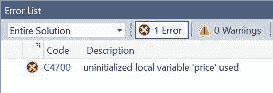

只有初始化变量，程序才能运行。让我们将其初始化为 `10`。`int price{ 10 };`

再次运行程序。这是我们得到：


### 出什么问题了？（在 C++ 中初始化变量的重要性）

声明一个变量时，大多数情况下它将包含一个未知的随机值，或者不包含任何值，这会导致编译错误。因此，你应该在声明每个变量时对其进行初始化。初始值可以是一个特殊值，表示该变量尚未被使用。

### 这里有几个示例：

你声明了一个名为 `sum` 的变量 `i`，它最终将包含元素的和。初始值可以是 `-1`。如果你在代码块结束时得到 `-1`，你就知道出问题了，因为数字之和不可能是 `-1`。


你声明了一个 `Boolean` 变量，用于告诉你给定数字是否存在于数组或数据块中。

你使用的方法会遍历大量数据，当找到（如果找到）给定的值时，变量被设置为 `true`。

41. 在这种情况下，最佳实践是将变量初始化为 `false`。这样，除非在找到要找的内容后将其设置为 `true`，否则它将保持为 `false`，表示“未找到项目”。

```cpp
bool find_something( int I_am_looking_for ) {
    bool return_value = false ;
    //进行一些操作并搜索一个值，直到
    //I_am_looking_for 被找到
    return return_value;
}
```

### 初始化变量的方法

你有三种方式或风格来初始化变量。让我们看看初始化类型为 `double` 的变量 `rate` 的示例：

#### 初始化风格

- `double rate = 28.5;` C 风格初始化
- `double rate (28.5);` 构造函数风格初始化
- `double rate {28.5};` 现代 C++ 初始化（从 C++11 开始）

42. 我们建议你始终使用现代 C++ 初始化风格，因为它有很多优点，特别是在编译过程中。

### 局部变量与全局变量

在上一个编码练习中，我们在 `main` 函数内部声明并初始化了变量。这些变量只能在该函数内部使用，因此被称为局部变量。局部变量的作用范围局限于 `main` 函数。

另一种声明和初始化变量的方法是在 `main` 函数外部，允许程序的程序的其他部分访问它们。这些变量被称为全局变量。

### 在 C++ 中初始化变量的重要性 

当你声明一个变量时，大多数情况下它将包含一个未知的随机值，或者不包含任何值，这会导致编译错误。因此，你应该在声明每个变量时对其进行初始化。初始值可以是一个特殊值，表示该变量尚未被使用。

### 局部变量与全局变量

在上一个编码练习中，我们在 `main` 函数内部声明并初始化了变量。这些变量只能在该函数内部使用，因此被称为局部变量。局部变量的作用范围局限于 `main` 函数。

### 带有全局变量的 C++ 层次结构

在 `main` 函数外部，允许程序的其他部分访问它们。这些变量被称为全局变量。保持变量的一致性非常重要。让我们看看输出：

```cpp
#include <iostream>
using namespace std;
int main() {
    int age{ 30 };
    cout << age << endl;
}
```

## 常量

在很多情况下，我们需要一个不能改变的变量。例如，一周的天数，一年的月份，或者 `pi` 的值。这就是常量变量派用场场。声明和初始化常量很容易，只需要在变量开头添加 `const` 即可。它看起来像：

```cpp
const days_in_week{ 7 };
double pi{ 3.1415926 };
```

让我们尝试在代码中使用 `const`：

```cpp
#include <iostream>
using namespace std;
int main() {
    const int i{ 2 };
}
```

由于 `const` 不能被更改，如果尝试尝试递增它，我们可能会收到编译器错误。

## 程序作业：将华氏度转换为摄氏度

让我们写一个小程序来练习我们目前为止学的一些概念。

在这个程序中，我们将要求用户输入华氏温度，然后以摄氏度显示。为了做到这一点，我们需要使用一个将华氏度转换为摄氏度的公式。该公式是：

`temp_c = (temp_f - 32) * (5.0 / 9.0)`

以下是我们的代码外观：

```cpp
#include "pch.h"
#include <iostream>
#include <math.h>

using namespace std;

int main() {
    float temp_f{}, temp_c{};
    cout <<“Enter the temperature in Fahrenheit” << endl;
}
```


```cpp
cin >> temp_f; temp_c = (temp_f - 32) * (5.0 / 9.0); cout <<“The temperature in Celsius is “ << temp_c <<“\n” ; }
```

试一试！尝试编写你自己的转换程序或计算程序。也许可以尝试将美元转换为英镑，或者计算正方形的面积。

# 第 6 章：if 和 else if 语句

现在你已经了解了 C++ 的基础，知道如何显示输入输出、如何使用变量以及如何进行计算，现在你可以开始使用 `if` 语句，这让你能够更好地控制程序的流程并做出决策。`if` 语句评估一个真或假陈述并对其执行操作，使你的程序能够响应用户的输入。

假设你想允许某人参加驾考。他/她必须是 18 岁或以上。如果他/她的年龄是 17 岁或以下，他/她就不符合条件（`false`）。然而，如果他/她是 18 岁及以上，那么他/她就符合条件（`true`）。这是一个简单的例子，但 `if` 语句可以变得非常复杂且有趣。

## if 语句在 C++ 中是如何工作的？

当我们使用 `if` 语句时，使用以下代码：

```cpp
if (括号内的条件) 
{
    // 你的代码 - 如果陈述为真，将发生什么
}
else
{
    // 你的代码 - 如果陈述为假，将发生什么
}
```

43. 注意，最佳实践标准要求代码始终位于两个大括号之间。这样，执行代码就有两种可能的方式——取决于答案是真是假。让我们看看驾考资格示例的真实代码：

```cpp
#include "pch.h"
#include <iostream>
using namespace std;
int main() {
    int age;
    cout <<“Please enter your age” << endl;
    cin >> age;
    if (age >= 18) {
        cout <<“you are eligible for a driving test” << endl;
    } else {
        cout <<“sorry, you are too young to drive” << endl;
    }
}
```

## 嵌套 if 语句

`嵌套 if 语句` 是存在两种以上可能性的语句，它们可能相当复杂。程序将从一个语句移动到另一个语句并检查值是否为真，如果是假则移动到下一个语句。

让我们再次看看驾考示例。在上一个例子中我们只给了两个条件，但如果我们增加另一个条件呢：超过 100 岁的人。让我们看看这在我们的代码中应该是怎样的：

```cpp
#include <iostream>
using namespace std;
int main() {
    int age;
    cout <<“Please enter your age” << endl;
    cin >> age;
    if (age >= 18) { // 第一个条件
        cout <<“you are over 18 years old” << endl;
        if (age <= 100) { // 第二个条件
            cout <<“you are eligible to drive” << endl;
        } else {
            cout <<“you are too old to drive” << endl;
        }
    } else {
        cout <<“sorry, you are too young to drive” << endl;
    }
}
```

试一试！尝试编写你自己的 `if` 语句。让它们变得复杂一点——尝试不同的条件、选项——看看它们在你的程序中是如何运行的。

# 第 7 章：字符串

1. 字符串的基础：什么是字符串以及何时使用它们？要理解字符串，你首先需要理解什么是字符（character）。字符是一种存储字母数字数据的数据类型。

字母数字数据可以是字母表中的任何字母，以及数字和特殊符号。

字母数字数据的示例可以是：

a. `‘a’` 字母表中的任何字母，从`‘a’` 到`‘z’`，以及大写的`‘A’` 到`‘Z’`。 b. `‘$’` 任何特殊符号，如`$``,`#`,`@` 等。 c. `‘1’` 从 `0` 到 `9` 的任何数字。在 C++ 中，字符存储在一种名为 `char` 的数据类型中。字符串是存储一个或多个字符的数据类型。它可以有几种形式，这些这些将在稍后讨论：

- 作为 `char` 元素的数组。
- 作为 `char` 元素的 `vector`。
- 作为用于存储整个字符串的特殊数据类型。**字符串总是以 NULL 终止的。** 在 C++ 中，字符串总是以空字符终止。

换句话说，如果我们的字符串是“house”，它将如下存储：

`H O U S E \0`

`\0` 表示我们放置的是值‘null’而不是数字 0。

ð 每一个字母数字符号都有一个数值。从计算机的角度来看，这些值才是重要的。最初这些值的范围是从 0 到 127，而今天可以多达 5 位数。值 0（最后一个值）表示 `NULL`，用于标记字符串的结束。

## 2. 声明字符串变量

在 C++ 中有多种声明字符串的方法，大多数情况下，你声明一个字符串时并不知道要放入其中的文本大小。在某些情况下，你定义了此类文本的最大尺寸，但也有字符串数据类型不实施这种限制。

例如：`std::string mystring;`

这将 `mytext` 声明为 `std::string` 变量。它可以容任何大小或任何数量字符的文本。

## 3. 操作字符串

C++ 有许多操作字符串的方法，如下所示：

### a. 字符串内容

首先，我们应该讨论一些基本问题：我们如何给字符串分配任何内容？我们如何在稍后设置不同的内容？我们如何读取它？

在这个示例中，我们使用 `std::string` 来包含一个字符串：

```cpp
std::string test1("this is my string");
```

在接下来的示例中，我们使用 char 字符数组：

```cpp
char test1[] = "test";
```

现在让我们看看我们如何给字符串设置新值：

```cpp
std::string test1 = "test";
```

对于对于数组，我们使用 `strcpy_s`：

```cpp
strcpy_s(test1, "this is new value");
```

### b. 字符串拼接

当你有两个或多个字符串，并且想要将它们拼接时，可以使用几种可选方法。

这里是一个示例。在这个示例中，我们不会使用字符串库，只使用内置的字符串函数。我们将每个字符串定义为数组。

```cpp
int main() {
    char string1[] = "word1";
    char string2[] = "word2";
    char result[160];
    strcpy_s(result, string1);
    strcat_s(result, " ");
    strcat_s(result, string2);
    std::cout << result << "\n";
}
```

### c. 字符串长度

当我们说“字符串长度”时，通常指的是此字符串内的字符数。另一种查看方法是测量存储字符串所占的尺寸（字节）。注意，尽管单个字符存储在单个字节中，但在涉及更复杂的编码方法（如 UNICODE）时，每个 `char` 元素的大小将大于一个字节，因此“字符串长度”和“字符串大小”可能是两个不同的东西。

让我们取上一个示例的生成字符串的长度。这是更新后的源代码：

```cpp
int main() {
    char string1[] = "word1";
    char string2[] = "word2";
    char result[160];
    strcpy_s(result, string1);
    strcat_s(result, " ");
    strcat_s(result, string2);
    int lengthOfString = -1;
    lengthOfString = strlen(result);
    std::cout << result << "\n" << "Length of string is " << lengthOfString << "\n";
}
```

## 4. 用户输入和字符串


当使用字符串时，我们当然可以作为源代码的一部分为它们赋值值。然而，这意味着它们的值将始终是我们在程序开发期间赋值给它们的那个值。例如，`string1` 将始终包含“word1”，而 `string2` 将包含“word2”。

然而，使用字符串（以及任何其他数据类型）的真正价值和优势在于，它允许使用我们程序的人在程序运行时设置字符串的内容。

有很多方法可以实现这一点。让用户为变量设置值的术语是“输入”（input）。用户将数据输入我们的程序中。

最简单的方法是使用 `std::cin`。

```cpp
std::cin >> mystring;
```

### a. 为什么不使用‘cin’处理字符串和长文本

`std::cin` 有一些局限性。使用此函数获取超过单行的内容是不实际的。当我们需要输入几行之间的较大文本时，我们使用 `getline()`。

### b. 使用‘getline()’作为长文本的更好的选项

`getline` 用于从用户的输入（控制台）或文件中输入多行字符串。`getline` 接收源作为参数。源可以是控制台，也可以是给定的文件。

试一试！更新之前的练习题，要求用户输入完整姓名。然后输出他们的名字以及他们在今年将是几岁。例如，输出应该为：“Hello Joe Smith. In 2020, you are going to be xx years old”。

### 意外的输入类型

检查用户输入了什么总是重要的。这里有一个例子：你想让用户输入他们的年龄，然后对输入的数字进行一些处理。如果输入的值根本不是数字怎么办？如果这个数字没有意义（例如 `age = 2000` 或 `-100`）怎么办？

由于这些原因，你应该始终检查输入的数据类型和值，允许输入一个范围的值。

下面的示例尝试根据用户输入的年龄查找出生年份。

```cpp
#include "pch.h"
#include <iostream>
#include <string>
int main() {
    std::string age;
    std::cout <<"Enter your age\n";
    std::cin >> age;
    int YearOfBirth = 2020 - atoi(age.c_str());
    std::string result = std::to_string(YearOfBirth);
    std::cout <<"You were born in" << result.c_str() << "\n";
}
```

然而，如果用户输入的内容没有意义怎么办？让我们看看两种可能性的例子：1. 用户输入字符串而不是数字。

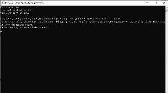

如你所见，用户输入了：“I am not telling my age!”而结果是“2020”，就好像给出的年龄是 0。让我们检查代码看看原因以及如何修复：

`atoi()` 函数用于将存储在字符串中的数值转换为整数。如果你在字符串中存储“6”，它将将其转换为 6。

然而，如果给定的字符串内部没有数值数据（如我们的示例所示），返回值将是 0。

**如何修复：** 首先，让我们在程序中添加另一行：`int intVal = atoi(age.c_str());`。

现在，`intVal` 将持有以字符串形式输入的数值与其实际数值值（存储在 `Integer` 中）之间的转换结果。

如果结果为 0，则用户要么输入了某些文本，要么输入了 0。这两种情况都会导致 `intVal` 被赋值为 0。

现在，我们将使用几个 `if / else` 条件来检查这两种情况并处理它们：

```cpp
#include "pch.h"
#include <iostream>
#include <string>
int main() {
    std::string age;
    std::cout <<“Enter your age\n”;
    std::cin >> age;
    int intVal = atoi(age.c_str());
    if (age == “0” ) {
        std::cout <<“Age 0 doesn’t make sense\n”;
    } else if (intVal == 0) {
        std::cout <<“You entered some text (“ << age.c_str() <<“) instead of a numeric value\n”;
    } else {
        int YearOfBirth = 2020 - intVal;
        std::string result = std::to_string(YearOfBirth);
        std::cout <<“You were born in” << result.c_str() << "\n”;
    }
}
```

让我们看看如果用户输入“0”作为年龄会发生什么：

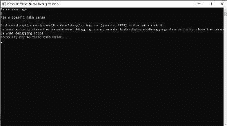

现在让我们检查输入某些文本的原始场景：

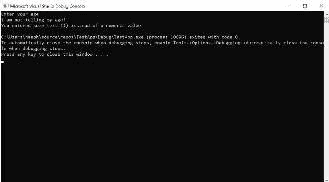

试一试！创建一个程序，要求用户输入出生年份和当前年份。年份格式应包含 4 位数字（例如 1995，2020）。例如，输出应该是：“On 2020, you are going to be xx years old.”

# 第 8 章：数组 (Arrays)

数组是 C++ 中的数据结构。数组是固定范围或元素集合，这些元素被结构化在一起；例如字母或数字的列表。它可以是固定数量的名称、数字、日期、单词、字符等。数组始终具有相同类型的数据。因此，它可以是同类变量的列表，例如 `int`、`char` 和 `double` 等。你永远不能在数组中混合数据类型，所以你永远不会在同一个数组中看到整数和字符串在一起——这没有意义。需要注意的是，当使用数组时，我们仍然可以直接访问每一个元素。

还记得你小学时学习学习乘法吗？你的老师可能向你展示了比写 `2+2+2+2+2+2+2` 更好的方法，即 `2 X 7`。同样，数组简化了我们的代码并减少了重复。例如，假设我们有一个价格列表：

```cpp
int price1 {10};
int price2 {20};
int price3 {30};
int price4 {40};
```

与其写列表，我们可以简单地写：`int price [4] {10, 20, 30, 40};`

`变量类型 数组名 [数组大小]`

注意，在数组中，我们使用方括号 `[ ]`。

我们提到过当使用数组时，我们仍然可以直接访问每一个元素。我们通过使用元素的索引位置来实现。第一个元素始终是 `#0`，所以第二个是 `#1`。最后一个元素始终是 `size-1`。如果数组的大小为 100，最后一个元素的位置将是 `#99`。

让我们看看如何使用数组的示例：

我们有一个类型 `char`，并且有一个 5 个字符的列表。这传达了使用数组有多简单：

```cpp
char Letter_Count [5];
```

在这个示例中，我们有一个 5 个字符的数组，但我们并不知道每一个元素的名称是什么。如果我们想初始化数组，可以以类似的方式通过使用赋值运算符初始化变量来实现：

```cpp
char Letter_Count [5] = {a, b, c, d, e};
```

如果我们在声明数组时不指定数组大小，编译期间将创建一个精确大小的数组。例如：`char Letter_Count [ ] = {a, b, c, d, e};`

在这种情况下，当你初始化数组元素时会自动创建一个大小为 5 的数组。

注意数组中的项目必须至少有一个，或者大于一个。记住数组的大小是静态的，这意味着如果例如我们声明了一个包含 7 个元素的数组，添加另一个元素会导致编译错误或程序崩溃。

如果我们想初始化数组中的单个元素，可以：

```cpp
Letter_Count [2] = Z;
```

在这个示例中，数组中的第三个字符将被赋值为 Z。

## 操作数组和访问元素

访问数组元素简单直接。我们只需要使用数组名称，后面跟着我们要访问的元素的索引位置。

假设我们有一个得分数组：`int basketball_scores [45, 107, 86, 190, 131];`。让我们按顺序向控制台打印：

```cpp
cout << "The first basketball score is " << basketball_scores [0];
cout << "The second basketball score is " << basketball_scores [1];
cout << "The third basketball score is " << basketball_scores [2];
cout << "The fourth basketball score is " << basketball_scores [3];
cout << "The fifth basketball score is " << basketball_scores [4];
```

如你所见，这非常简单！

## 多维数组


我们已经向你展示了如何简单地使用一维数组，但实际上，我们可以在 C++ 中创建多维数组。注意：C++ 允许我们在数组中使用多个维度，而不仅仅是两个维度——这可以使我们的程序变得非常强大。

声明多维数组的语法非常简单：`数据类型 数组名 [维度 1] [维度 2]`

它看起来像这样：

```cpp
int m[100][200];
```

或者：

```cpp
int n[25][34][45];
```

以此此类推。

例如，假设我们想要一个数组来显示学校从 1 年级到 5 年级所有学生在过去 5 次考试中的成绩。我们需要一个用于年级和分数的数组（即：1 年级学生及其在第 1 次考试中的成绩，2 年级学生及其成绩，等）：

```cpp
int school_grades [grade] [scores]
```

通过这种方式，我们可以访问年级的名称（例如 1 年级、2 年级等）以及每个年级的考试成绩。

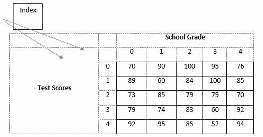如果我们尝试查找第 3 年级学生在第二次考试中的分数，它看起来像这样：

```cpp
int school_grade[2][1]; // 索引第 2 个元素和第 1 个元素 // 结果将是 84
```

要初始化多维数组，我们将使用与变量类似的初始化方法。这次让我们来看 school_grade 的示例，每个 5 个年级有 3 次考试成绩：

```cpp
School_grade[3][5] // 每个维度的元素数量为 3 // 测试和 5 个年级
{ // 使用大括号，每个维度都有自己的大括号，后面跟着冒号 {70, 90, 100, 95, 76}, {89, 60, 84, 100, 86}, {73, 85, 79, 79, 70} // 最后一个元素没有冒号 }; // 不要忘记末尾的分号
```

注意，你不需要使用多行，但最佳实践是为每个索引维度使用单独行。

### **Vectors——动态数组**

我们在本节开始时提到，数组是固定范围或元素集合，它们结构在一起且不能更改大小。这意味着我们在代码中有一个巨大的限制，阻止了我们动态地增长数据。这是导致崩溃的一个主要原因，特别是当你不知道存储数据的最终或实际大小时。当然，你总是可以选择一个远大于你实际需求的数组大小，但这并不总是最佳选择。这就是为什么在 C++ 中，我们使用 Vectors。

Vectors 是可以随着你的程序“弹性”扩展的动态数组。Vectors 是 C++ 中面向对象的模板类的一部分，你需要使用熟悉的 `#include` 语句将其添加到代码中：

```cpp
#include <vector>
``` 在我们的代码中使用 vectors 时，我们使用带有角括号 `< >` 的语法：

```cpp
vector <int> voters_age; vector <char> first_letter;
``` Vectors 不仅可以动态增长，还可以动态缩小尺寸，这使得它们在资源管理方面极其强大。

记住——就像数组一样，vector 中的元素必须是相同类型，你也可以使用与数组相同的索引规则单独访问每个元素。

#### **如何初始化 vector**
你可以在定义 vector 时初始化其内部元素。你通过在定义后直接添加元素来实现这一点。

```cpp
vector < int > x{ 20,10,20,30,20,10 };
```

这样做不仅将值分配给 vector，还为这 6 个元素分配了必要的内存空间。之后，你可以将这 6 个元素中的任何一个设置为不同的值：

```cpp
x.at[0] = 3;
```

然而，如果你没有初始化 vector 或设置它的初始化大小，上面的行将导致运行时错误，因为编译器不允许你向未分配的地址设置值。

你可以通过几种方法设置 vector 大：在声明期间设置初始大小，

```cpp
vector < int > x(6);
```

或者你可以在程序运行期间动态增加大小，我们稍后会解释。

#### **如何访问 vector 元素**

我们学过，为了访问数组元素，我们只需要指定索引位置。访问 vector 元素也很简单。要访问元素，我们需要通过名称调用 vector，并像下面的示例中那样使用点运算符：

```cpp
Vector_name.at(element_index)
```

假设我们有一个存储年级列表的 vector `grade_list`。我们如何访问第 4 年级和第 6 年级？方法如下：
```cpp
Grade_list.at(3) // 第 4 个元素将索引为 #3
Grade_list.at(5) // 第 6 个元素将索引为 #5
```

如果你想给 vector 赋值，我们只需要使用赋值运算符并配合点运算符即可：

```cpp
Grade_list.at(5) = 70; // 我们将 70 分配给索引 5 的元素（即第 6 个元素）
```

你也可以使用：

```cpp
Grade_list(5) = 70; // 我们将 70 分配给索引 5 的元素（即第 6 个元素）
```

#### **Vector 的 push_back 方法**

我们解释过，与数组不同，vector 的大小可以动态变化，但它们具体是如何做到的呢？为了更改 vector 的大小，我们只需要使用 `push_back` 方法，它基本上是向 vector 的末尾添加新元素。让我们看看它是如何工作的：

假设我们有一个包含 50 个年级的 vector `grade_list`。我们想再添加两个年级——78 年级和 66 年级，所以我们使用：

```cpp
Grade_list.push_back(78); // 在列表末尾添加 78 年级
Grade_list.push_back(66); // 在列表末尾添加 66 年级
```

现在我们的 vector 有了两个新元素，空间将自动分配。就这么简单！你只需要记住，vector 中的元素必须类型相同。

**尝试一下！** 创建一个程序询问用户他们喜欢的六个彩票号码。不要忘记在每个数字后按空格，完成后按“回车”。将这些数字存储在数组中逐个显示。

# **第 9 章：循环**

循环（称为迭代或重复）是任何程序的重要组成部分，也是 C++ 的构建模块。循环通过给定的顺序在不同条件下多次执行代码，这允许你进行更复杂的程序操作并解决问题。循环是控制程序设计的强大方法。让我们仔细查看循环，并学习何时以及使用它们。

为了使用循环，我们首先需要设置条件，就像我们之前使用 `if` 语句一样。一旦达到条件，语句或多个语句就会开始执行。循环可以在指定的次数内进行，也可以只要我们在 vector 中有元素就进行，或者当有真/假条件时，或者它可以无限循环——这很少发生。

**你知道吗？操作系统（例如 Windows）会无限循环，允许操作系统持续运行。**

在 C++ 中，常用的循环有四种：

- **While 循环** *While 在条件为真时执行操作，在条件为假时停止*。此条件在循环开始之前必须为真。

- **Do – while 循环** *Do-while 在在条件为真时执行操作，在条件为假时停止*。条件在循环结束后必须为真。

- **For 循环** *For 循环按指定的次数迭代*。

- **嵌套循环** 这意味着在当前循环内部进行循环。我们还将讨论无限循环、何时以及如何使用。

让我们仔细查看每种循环类型，并学习如何在代码中使用循环。

## **9.1 - While loop**

正如我们之前解释过的，循环总是基于某种条件。while 循环在开始之前检查条件是否为真。如果循环开始且条件变为假，循环将终止。


```cppwhile (condition) statement; // 条件是一个布尔值，为真 //或为假 statement;
```

或者

```cpp
while (condition)
{
    statement;
}
```

这两者之间的区别仅在于风格，每个程序员都可以选择自己的风格。

让我们来看一个 `while` 循环的示例，它从数字 10 开始计数并在此过程中递增，直到数字达到 20。一旦达到 20，循环就会结束：

```cpp
int i{ 10 }; // i 初始化为 10

while (i <= 20) // 条件是当 i 小于或
//等于 20
{
    cout << i << endl;
    ++i; // i 将加 1. 变量前的 ++ 表示递增发生在
// 变量求值之前
}
```
如果我们运行这段代码，将得到：


当计数达到 20 时，条件变为为假，循环停止。`while` 循环的一个用处之一是与数组结合使用。让我们来看一个示例：

在这个示例中，我们有一个分数数组。我们想在控制台中显示结果的同时对元素计数。

```cpp
int test_scores[]{ 56, 78, 90, 83, 97 };

int i{ 0 };

while (i < 5)
{ 
    cout << test_scores[i] << endl; ++i; //i 将拥有元素的计数 
}
```
运行这段代码时，我们得到了完全符合预期的结果：

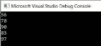

让我们尝试使用模运算运算符，它产生整数除法的余数。如果 `%` 等于 `0`，意味着我们没有余数。让我们尝试在带有 `if` 语句的 `while` 循环中运行 `if (i % 2 == 0)`。使用之前的代码，让我们在控制台中只显示能被 2 除的偶数：

```cpp
int test_scores[]{ 56, 78, 90, 83, 97 };

int i{ 0 };

while (i < 5)
{
    if (test_scores[i] % 2 == 0) // 如果索引中的
//数字是偶数
    cout << test_scores[i] << endl; // 只显示
//偶数 ++i; 
}
```
让我们运行这段代码。我们期望只看到偶数，事实也确实如此：

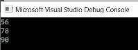

让我们回顾另一个示例。在这个示例中，我们要求用户输入密码。密码是 123789。如果用户未能输入正确的密码，它将再次询问他们，总共 5 次。如果第 5 次尝试失败，用户将收到提示。

在继续之前，让我们介绍另一个函数 - `strcmp()`。为什么我们不能直接对字符串（字符数组）使用 `==` 运算符呢？让我们假设我们有两个字符数组：

```cpp
char password_entered[] {"12345"};

char real_password[] {"abcde"};
```

然后我们尝试使用以下条件：

```cpp
password_entered == real_password
```

`==` 比较的问题在于，它比较的是字符数组的地址而不是实际的字符串。对于这种比较，我们使用 `strcmp()`。它接收 2 个参数（2 个字符串），如果它们完全相同，它返回 0（或 false）。

函数调的形式将如下：`If(strcmp(password_entered, real_password) == false)`。让我们看看我们的代码，它稍微复杂一点：

```cpp
#include <iostream> 
using namespace std; 
int main() { 
    cout <<“Enter your password” << endl;
    bool correct_password = false ; 
    int tries{ 0 }; 
    char real_password[]{ “abcde” }; 
    char entered_password[6]{ ““ }; 
    while (!correct_password && tries<5) { 
        cin >> entered_password; 
        if (strcmp(entered_password , real_password) == 0) // 0 意味着
//相同 { 
            correct_password = true ; 
            break ; 
        } else { 
            tries++;
            cout <<“Wrong password. You have “ << 5 - tries << “ more tries” << endl;
        } 
    } 
    if (correct_password) { 
        cout <<“correct password” << endl; 
    } else { 
        cout <<“too many attempts” << endl; 
    } 
}
```
让我们这段代码拆解成小部分：

- 我们使用 `tries` 来计算输入错误密码的次数，因此出于安全考虑，我们将此类尝试限制在 5 次。
- 我们使用一个名为 `correct_password` 的布尔变量来指示是否输入了正确的密码。这样做时，我们将该变量初始化为 `false`，除非另有设置，否则我们假设没有输入正确的密码。将其初始化为“false”可以防止错误，除非我们成功，否则它的值将为“false”。
- 只有在输入正确的密码后，我们才将 `correct_password` 的值改为“true”，并跳循环。
- 每次尝试后，我们增加 `tries`，如果它达到 5，我们就跳出循环。在循环外部，有两种情况：
  1. 用户使用了所有允许的尝试但没有输入正确密码；在这种情况下，`correct_password` 将为 false。
  2. 输入了正确的密码，在这种情况下，`correct_password` 为 true。

尝试再次检查代码以更好地理解它。然后你可以尝试修改它并创建你自己的 `while` 循环版本。

试一试！编写一个带有 `while` 循环的程序，从 100 倒数到 0，然后显示消息“Bang!”然后尝试使用 `if` 语句仅倒数奇数。

### 更好地控制循环的流

在继续到其他循环类型之前，了解 `continue` 和 `break` 语句以及它们在保持 C++ 循环流和行为方面的作用是非常重要的。这两个语句在所有循环结构中的工作方式都相同。

当我们使用 `break` 语句时，循环停止执行任何语句，循环将终止。循环之后的下一个语句将被执行。

当使用 `continue` 语句时，循环将停止执行循环体内的后续语句，控制流回到循环开头。

我们将在示例中演示如何在循环中使用 `break` 和 `continue` 语句。

## 9.2 - Do-while 循环

`do-while` 循环与 `while` 循环相似，但例外是：它是后测试循环。这意味着无论条件真假，循环至少执行一次。

*Do-while* 循环使用以下语法：

```cpp
Do
{
    Statements;
}
While (condition);
```

让我们回顾一个示例。在这个示例中，我们要求用户输入圆半径，然后计算圆面积。我们想至少执行一次计算。然后我们询问用户是否想进行额外的计算。如果答案是 YES，我们就再次循环；如果答案是 NO，循环终止。让我们看看它有多简单。

为了这段代码，我们包含了 `math.h` 库。

```cpp
#include <iostream>
#include <math.h>
using namespace std;
int main()
{
    char choice{}; // 用户选择是否继续
//计算或否
    do { 
        double circle_radius{}; 
        cout <<“Please enter the circle radius” << endl;
        cin >> circle_radius; 
        double circle_area{ 3.14 * circle_radius * circle_radius }; 
        cout <<“The circle area is “ << circle_area << endl;
        cout <<“Do you want to make an additional calculation? (Y / N)” << endl;
        cin >> choice; 
    } while (choice == ‘y’ || choice ==‘Y’); // 只要
//选择是 Y 或 y 循环就会再次运行。 cout << “Goodbye” << endl; 
```

这段代码非常简单。注意，在要求用户输入内容时，提供大和小写选项始终是一个良好的习惯。让我们更好地理解这段代码：现在让我们写另一个在 `dowhile` 循环内部使用 if/else 语句的程序。


在这个程序中，我们将为用户提供从 4 个选项中选择电影的机会。每部电影都有不同的价格，这意味着每个选择都都会显示实际价格，然后会询问用户是否想更改选择；如果是 YES，则将再次显示菜单；如果是 NO，循环将结束，并要求用户支付。

```cpp
#include <iostream>
#include <math.h>

using namespace std;

int main()
{
    char choice{};
    bool correct_choice = false ;
    do {
        correct_choice = true ;
        cout <<“Please make a selection of the movie you wish to see” << endl;
        cout <<“---------------------------------------------------” << endl;
        cout <<“A. Star Wars” << endl;
        cout <<“B. Magnolia” << endl;
        cout <<“C. Stuart Little” << endl;
        cout <<“D. Superman” << endl;
        cout <<“Enter your selection:” << endl;
        cin >> choice;
        if (choice == ‘A’ || choice ==‘a’ ) {
            cout <<“The price for the movie Star Wars is $20” << endl;
        } else if (choice ==‘B’ || choice == ‘b’ ) {
            cout <<“The price for the movie Magnolia is $15” << endl;
        } else if (choice ==‘C’ || choice == ‘c’ ) {
            cout <<“The price for the movie Stuart Little is $25” << endl;
        } else if (choice ==‘D’ || choice == ‘d’ ) {
            cout <<“The price for the movie Superman is $12” << endl;
        } else {
            correct_choice = false ;
            cout <<“Wrong selection, please try again” << endl;
            choice = ‘N’ ;
        }
        if (correct_choice) {
            cout <<“Do you want to checkout Y/N” << endl;
            cin >> choice;
        }
    } while (choice ==‘N’ || choice == ‘n’ );
    if (correct_choice) {
        cout <<“Please collect your tickets at the box office. Thank you!” << endl;
    }
}
```

在这段代码中，我们使用了嵌套的 `if` 语句来处理用户的输入（我们接收两种类型的输入：是否继续结账/继续，以及购买哪部电影）。代码还演示了如何使用“标记”——一个我们命名为 `correct_choice` 的布尔变量，它能告诉我们是否输入了有效答案，如何将布尔变量初始化为 `true`、将其更改为 `false` 或反之。这段代码乍一看可能很复杂，但如果你仔细看，会发现它其实非常简单且符合逻辑。尝试运行它并调试结果，然后尝试编写类似的代码，让用户在菜单的某些选项之间进行选择。

## 9.3 - For 循环

for 循环非常有趣，它们由 4 个主表达式组成：

`For (initialization; condition ; increment)`

```cpp
{
    statement
};
```

循环体中的条件是一个真/假的布尔值。首先，循环在其他操作之前被初始化，然后检查条件——如果条件为真，则执行循环语句；如果为假，则终止。

让我们来看一个非常简单基础的 for 循环。这个循环将从 1 计数到 10。首先，我们需要创建一个变量。你会看到变量 `i` 在 for 循环中经常使用。然后我们开始执行循环体：

我们的代码将如下所示：

```cpp
int i {0};
for (i=1; i <= 10; ++i)
{
    cout << i << endl;
}
```

让我们拆解这段代码：

a. 我们给 `i` 赋值 1。
b. 我们检查 `i` 是否小于或等于 10。
c. 如果为真——我们将 `i` 增 1。
d. 执行循环语句。
e. 循环进入下一次迭代。
f. 循环持续到 `i` 的值变为 11。条件不再为真，循环终止。

这是我们预期的输出：

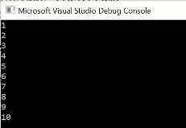

我们也可以像下面的示例所示在循环内部初始化 `i`：

```cpp
for (int i {1}; i <= 10; ++i)
{
    cout << i << endl;
}
```

当我们想要完全控制循环内的变量时，这种方法非常棒，因为如果我们我们在循环外声明它，它可能会在某个时刻发生变化。

让我们回顾另一个使用 `if` 语句的例子。在这个例子中，我们想要从 1 计数到 100，但只显示能被 10 除的数字：

```cpp
for (i {1}; i <= 100; ++i) if (i % 10 == 0)
{
    cout << i << endl;
}
```
这是我们应该预期的：

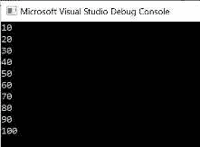

‘ For’ 循环在数组中使用时特别有用。让我们来看一个例子。在这个例子中，我们有一个包含字母 A L E X A N D E R 的字符数组。我们想要单独显示每个字母：

```cpp
Char name [] {'A', 'L', 'E', 'X', 'A', 'N', 'D', 'E', 'R'};
For (int i {1}; i < = 9; ++i)
cout << name[i] << endl;
}
```
这是我们在控制台中得到的结果：

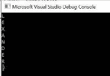

### 哪里出错了？

嗯，数组的索引总是从 0 开始，所以循环应该从 0 开始递增并在 8 处终止。我们提供这个例子是因为这是一个常见的初学者错误。输出将从索引的第二个元素开始——字符 ‘L’，在终止后，它又多了一次迭代，因此列表末尾出现了这个奇怪的符号，这基本上是垃圾数据。

让我们修改代码并查看预期的结果：

```cpp
Char name [] {'A', 'L', 'E', 'X', 'A', 'N', 'D', 'E', 'R'};
For (int i {0}; i < = 8; ++i)
{
    cout << name[i] << endl;
}
```

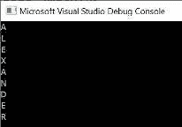

### 基于范围的 ‘for’ 循环

到为止，我们看到‘for’ 循环非常易用。我们不需要使用初始化器，不需要递增，并且可以将其用于非常简单或更复杂的目的。基于范围的 for 循环是 C++11 引入的第一个现代循环，它让使用变得很有趣。

这种循环背后的思想是遍历集合而不担心位置。语法非常简单：

```cpp
for (variable_type variable_name : sequence)
{
    Statement/s;
}
```

让我们来看一个例子：

```cpp
char name [] {'A', 'L', 'E', 'X', 'A', 'N', 'D', 'E', 'R'};
for (char Letter : name)
cout << Letter << endl;
```
当我们运行代码时，得到了和之前相同的结果：

Images/image0012.jpeg

现代 C++ 为我们提供了另一种简化代码的方法，那就是使用 `auto` 关键字。`auto` 关键字允许我们跳过显式提供类型的需要。让我们在代码中使用它：

```cpp
char name [] {'A', 'L', 'E', 'X', 'A', 'N', 'D', 'E', 'R'};
for (auto Letter : name)
cout << Letter << endl;
```

# 第 10 章：Switch Case 语句

Switch Case 语句允许你为变量设置多个值进行测试。我们把每个值称为一个 case。每当检查一个值并移动到下一个时被称为 `switch`。

用于 switch cases 的语法非常简单：

```cpp
switch (expression)
{
case expression 1 : statement 1; break;
case expression 2 : statement 2; break;
case expression 3 : statement 3; break;
. . .
default: statement_default;
}
```

让我们来看一个例子。在这个例子中，用户可以从 4 个数字中选择一个数字。

```cpp
int main()
{
    int selection {};
    cout <<“please select an option between 1 and 4” << endl; cin >> selection;

    switch (selection) //注意这段代码的缩进
    {
    case 1: cout <<“You selected option 1” ; break;
    case 2: cout <<“You selected option 2” ; break;
    case 3: cout <<“You selected option 3” ; break;
    case 4: cout <<“You selected option 4” ; break;
    default : cout <<“No choice was made, please try again” ;
    }
}
```

在许多方面，switch case 在从一个表达式移动到另一个方式上与 if-else 语句相似，但它们之间存在一些核心差异。当我们需要更高效的循环时，switch case 基本上可以替换 if-else 语句。让我们看看 switch 语句中某些规则：

a. 被控制的值必须是整数或枚举类型。b. 你可以编写任意数量的 switch cases。

c. case 表达式必须是与 switch 中变量类型相同的常量表达式。


d. 一旦匹配成功，代码将继续执行直到遇到 `break;`；因此，最佳实践是在每个 `case` 末尾使用 `break;`。e. 如果其他所有 `case` 都不真，`default` 情况可以执行某项任务。

与 `if-else` 语句（它可以根据值的范围来测试条件的有效性）不同，`switch` case 只能根据单个枚举值或字符串对象来评估表达式。

## 什么时候使用 switch case，什么时候使用 if-else

这可能是你脑海中浮出的第一个问题——哪种场景最适合每种方法？当你需要在大量的值范围内进行选择时，`switch` 语句是最好的。显然，嵌套的 `if` 语句可行，但它会太复杂且运行速度较慢。在使用 `Boolean` 值时，最好使用 `if-else` 语句，而 `switch` 语句则更适用于常量数据值。不用俗说，通常 `switch` 语句会产生更整洁的代码，更容易追踪和维护。无论如何，无论你选择哪种方法，请记住，代码中出现大量的 `if-else` 或 `switch-case` 语句都不是好的做法。在 `C++` 中有处理大量选择的方法，对于这个阶段来说更高级，例如多态。

# 第 11 章：条件三元运算符

条件运算符 `?:` 是一个三元运算符，这意味着它包含三个操作数。它与 `if-else` 结构非常相似，并且非常实用。该运算符评估两个表达式，在这种情况下使用的语法非常简单。

以下是条件运算符通过其独特语法构造的三个操作数：

`(Condition expression) ? expression 1 : expression 2`

在这种情况下，条件表达式始终评估一个布尔表达式。

条件运算符按照以下顺序评估条件：

首先，评估 `expression one`。如果为真，则返回 `expression one` 的值。如果为假，则返回 `expression two` 的值。所以，它非常像 `if-else` 循环，但它被构造在一个单一表达式中，这对于简化代码非常有用。你必须记住；永远建议将条件运算符嵌套在另一个运算符内部。

让我们来看一个例子。在这个例子中，我们评估 `a` 是否大于 `b`。如果为真，将 `a` 的值赋值给变量 `num`。如果不是，将 `b` 的值赋值给 `num`：

```cpp
int a {4}, b {5};
int num {};
num = (a<b) ? a : b; // 如果 a 小于 b，则将 a 赋值
// 给 num，否则将 b 赋值给 num
```

让我们另一个类似的例子。我们根据成绩 `cout` 输出测试结果：

```cpp
int test {90}; int test_results; cout << ((test > 89) ? “You get an A!” : “You didn’t get an A”);
```

试一试！编写一个程序要求用户输入两个数字，然后使用 `if` 语句评估第一个数字是否大于第二个数字，并使用 `cout` 条件运算符将较大的数打印到控制台，然后打印较小的数。

# 第 12 章：无限循环

无限循环只有一个表达式运行，该表达式始终评估为真。除非出现错误，否则你在代码中找不到大量的无限循环，但如果有，可以使用 `break;` 语句控制它们。操作系统使用无限循环，因为它们需要不断运行和操作。

这是一个 `for` 无限循环的示例：

```cpp
for (;;) {
    cout << "This is an infinite loop";
}
```

这是一个 `do-while` 无限循环：

```cpp
do {
    cout << "This is an infinite loop";
} while (true);
```

这是一个简单的 `while` 无限循环：

```cpp
while (true) {
    cout << "This is an infinite loop";
}
```

# 第 13 章：函数

在本节中，我们将扩展到函数。函数始终会在你的代码中执行任务。它们允许程序程序模块化，将你的代码分离为自包含的逻辑单元。 

## 函数基础

什么是函数？

你已经遇到过函数了——`main` 函数。每个 `C++` 程序都至少有一个函数，即 `main`。函数可以非常简单，也可以非常复杂，取决于程序。某些函数已经作为 Visual Studio 的一部分被内置了。例如，我们之前使用了 `atoi` 函数将字符串转换为整数。我们通常使用预定义函数，它们是标准库的一部分。这让你作为程序员的生活变得简单得多；否则，你将为了转换这一唯一目的而编写完整的代码。

另一种方法是使用第三方函数。如果你的应用程序合适，这些函数可以是开源的或其他应用程序。例如，如果你在一家游戏公司工作，你可能会使用 `Unreal Engine`，它是为游戏开发开发的，是 `C++` 的重要补充。第三方库和函数已经经过测试且运行良好良好，因此它们为你节省了大量时间——不需要重复发明轮子。然而，当然，你总是可以编写针对你需求的特定函数，你需要学习如何做到这一点。

你可以查看内置的 `C++` 库，其中包含供你使用的函数：

https://en.cppreference.com/w/cpp/header

### 步骤 1 定义一个函数

使用函数的第一步是定义它。函数的定义有 4 个主要组成部分：**1. 函数的名称**


与变量命名方式类似，函数名必须具有意义。它通常是一个动词，例如 `Calculate_Entries` 或 `Return_Value`。这将是你将要使用的函数的实际名称。名称必须简单，并能概括地描述该函数的功能。如果你将函数命名为 `Func1` 或 `My_Function`，它们将没有任何意义且难以于追踪。

多年来，关于如何命名函数已经出现了几种标准。过去，函数的命名非常短，例如使用字母 `F`，但现今的惯例是分配较长的名称，这可以非常清楚地说明函数的功能。最佳实践是每个单词的首字母大大写，并在单词之间使用下划线。这样，你可以一眼看出一个用于查找狗的年龄的函数：

`Return_Age_Of_Dog`。

## 2. 参数列表

参数列表是函数将使用的变量列表，并对它们的类型进行了指定。函数可以获取 0 个到任意数量的参数。参数是函数执行其工作所需的数据项。让我们来看一个例子：

如果你编写一个函数来提取每个州的首府城市名称——只需要一个参数——州名。如果你需要检索一个人的 ID 号，你可能需要他们的名字、姓、出生日期、父亲的名字——总共 4 个参数。换句话之，你需要根据函数执行的操作来设置该函数将使用的参数数量。

## 3. 返回类型

函数可以返回任何类型的值。该值有一个类型——例如整数（`int`）。在函数不返回任何值的情况下，返回类型将为 `void`。在定义函数时，你必须选择返回类型。

## 4. 函数体。

函数体是作为函数一部分使用的实际语句，换句话说：一旦调用此函数，将会发生什么。语句必须始终位于大括号 `{ }` 之间。

让我们看看使用 C++ 语法看起来是什么样子：

```cpp
int Function_Name () // 函数类型、名称和参数 {
    Function Statements (a);
    return 0; // 这是可选的，因为函数可能不返回任何内容 
}
```

在编写函数时，如果使用了两个或多个参数，其执行顺序将与你的参数参数的顺序相同。让我们来看一个例子：

```cpp
void function_name (char a, int i) {
    statements (a);
    return 0; 
}
```

在这种情况下，`char a` 将在 `int i` 之前调用。

让我们尝试写一个简单的函数，每当被调用时像猫一样说“miauu”。它不返回任何内容，只有 `cout “miauu.”`。它看起来像这样：

```cpp
void cat_sound () { cout << "miauu" << endl; }
```

非常简单对吧？现在我们已经定义了函数，现在可以从 `main` 中调用它。它看起来像这样：

```cpp
void cat_sound () { cout << "miauu" << endl; } 
int main () { 
    cat_sound (); 
    return 0; 
}
```

### 函数原型

自然地，编译器必须在函数被调用**之前**知道函数的细节；否则，我们将遇到编译错误。原因是编译器无法检查传递的参数数量以及参数类型是否正确。除了直接定义函数外，还有另一种方法可以实现这一点。这被称为函数原型（Function Prototype）。我们的函数原型告诉编译器它需要知道的一切，即使我们还没有函数定义。在有更复杂的函数的情况下（例如一个调用另一个函数的函数），使用它是很好的。我们始终会在程序开头或 `.h` 文件（头文件）中使用函数原型，我们稍后会讨论这些。它的优点是，你可以使用任意数量的函数原型，而且你编写它们的顺序并不重要。

让我们看看使用我们之前的示例，函数原型是什么样子：

```cpp
void cat_sound (); // 函数原型——注意末尾的分号！ 
int main () { 
    cat_sound (); 
    return 0; 
} 
void cat_sound () // 所以函数可以在以后定义 { 
    cout << "miauu" << endl;
}
```

### 函数参数和返回语句

我们已经解释了什么是函数参数什么是返回语句。让我们进一步回顾它们，并学习如何在代码中使用这些内容。

当我们定义函数时，我们定义了参数。在调用函数时，这些参数被称为“实参”（arguments），正如我们已经解释过的样，它们在数量和类型上必须匹配；它们按照定义的顺序被调用。

让我们来看一个例子：

```cpp
int multiply_numbers (int, int); // 函数原型 
int main () { 
    int calculation = {0}; 
    calculation = multiply_numbers (6, 9); // 函数调用 
    return 0; 
} 
int multiply_numbers (int a, int b) // 函数定义 { 
    return a * b; 
}
```

### 向函数传递数据

在 C++ 中，向函数传递数据是通过值传递（by value）实现的。这意味着数据的副本被传递给函数，如果你的函数更改了数据，它**不会**更改所传递的实际参数。编译器只使用数据的副本，而不是数据本身。复制数据有优缺点，我们将进一步讨论。尽管如此，你必须注意，在函数头中定义的实际参数被称为形参（formal parameters）。相比之下，在函数调用中被复制的参数是实参（actual parameters）。

### 返回语句

我们已经讨论了返回语句是可选的。函数可以返回一个值，也可以不返回，这没关系。当函数确实返回一个值时，可以在任何地方返回。

让我们结合目前学到的所有知识编写一些更复杂的内容。我们将回到之前完成的华氏度到摄氏度的计算，但这次我们必须使用函数。

这次我们将使用 `cmath` 库，它是 C++ 的一部分。我们代码的开头看起来如下：

```cpp
#include <iostream>
#include <cmath>
using namespace std;
```

首先，让我们定义一个使用 `double` 参数的函数原型：

```cpp
double fahrenheit_into_celsius (double); // 函数原型
```

现在让我们写函数调用：

```cpp
double celsius_temperature = fahrenheit_into_celsius (fahrenheit);
```

在这里我们可以写函数定义：

```cpp
double fahrenheit_into_celsius (double temperature) // 函数定义 {
    return round(((temperature - 32)*5)/9); // 我们使用 round 函数返回处理后的值
}
```

### 函数默认参数

许多情况下，函数使用的参数具有相同的值。例如，如果我们有一个 18%的销售税率，该税率不会改变，在使用计算最终销售价格的函数时，我们可以使用默认值来进一步简化代码。

为了实现这一点，我们可以简单地在函数原型或函数定义中定义默认参数——但**绝对不要**在两者都定义。最佳且推荐的方法是使用函数原型——正如大多数程序员做的那样。

我们的代码将如下：

```cpp
// 函数原型（在 .h 文件中）
double calc_sale_price (double base_price, double tax = 0.18); 

// 函数体（在 .cpp 文件中）
double calc_sale_price (double base_price, double tax) {
    return base_cost = (base_cost * tax); 
} 

// 函数调用
int main () { 
    double final_cost {}; 
    final_cost = calc_sale_price (150.0); 
}
```


```cpp
// no ‘tax’ is provided so the function is using default tax

final_cost = calc_sale_price (150.0, 0.5); // providing the value of ‘5%’ to the ‘tax’ parameter so it is used and not the default
```

## 函数重载

在 C++ 中使用函数时，我们有时会看到不同的参数列表具有相同的函数名。例如，我们可以有一个向数据库保存信息的函数或打印某些内容的函数，但它也可以被用于保存或打印整数、字符串、日期等。这是一个非常有价值的特性，因为它简化了你的代码，并节省了编写多个功能相同代码的大量时间。与其使用许多名称不同的函数（鉴于它们名称都不同），我们只需要为所有情况使用同一种函数——这被称为**函数重载**（Function Overloading）。这是多态领域的内容——它意味着调用同一个名称来处理多种数据类型的数据。多态本身是一门学科，我们建议你在读完这本书后进一步学习它，因为它是 C++ 的重要部分。

让我们复习一个函数重载的例子。在这个例子中，我们有可以每次打印不同类型数据的函数：

函数原型和在 main 函数中的调用看起来如下：

```cpp
// function prototype
void print( int , int ); // print int
void print( char , char ); // print char

//function call
int main() { 
    print (2, 3); // 两个 print 的函数调用看起来一样
    print (‘a’ , ‘b’ ); 
}

// function definition
void print( int a , int b ) { 
    cout << a << b << endl; 
}
void print( char a , char b ) { 
    cout << a << b << endl; 
}
```

如你所见，这非常简单可以让你的生活变得更容易。请注意，为了让函数重载无错误运行，你必须知道编译器在决定调用哪个函数时**不考虑返回值**。假设你写了：

`int add_numbers(); // 添加两个或多个整数
`double add_numbers(); // 添加两个或多个浮点数`

当调用函数 `add_numbers` 时，编译器将不知道调用哪个函数，因为它不考虑返回值，并会报错。`引用传递函数`

在上一节中，我们讨论了函数如何通过值传递，这意味着它们使用参数的副本，如果更改了副本的值，则不会改变参数。我们将其称为实际参数和形式参数。引用传递函数的作用恰恰相反——我们在使用函数时使用参数的位置来改变它。为了实现这一点，我们必须使用参数在内存中的实际地址。

我们如何知道参数的内存位置？非常简单：C++ 在参数前放置 `&` 符号以找到位置。所以，如果我们有一个命名为 `num` 的整数，那么 `num` 的位置就是 `&num`。就这么简单！

让我们看一个这样做的例子。在这个非常简单的例子中，我们想要为价格提供折扣。商店里所有单价为 70 美元的物品都将改为 60 美元。这是我们在代码中使用的逻辑（这里没有 cin 和 cout，只有逻辑）：

```cpp
// function prototype
void discount( int & num ); // &num 指向 num 的位置

//function call
int main() { 
    int number {70}; 
    discount (number);
    cout << number << endl; 
    return 0; 
}

// function definition
void discount ( int & num ) { 
    if ( num > 60) num = 60; // 将 num 的实际值从 70 改为 60
}
```

如果你运行代码，你会发现初始化为 70 的 `num` 现在变成了 60，这意味着我们更改了实际参数，而不仅仅是使用了它的副本。再次，这非常简单，并且节省我们在复制参数时可能需要的大内存。选择按值传递还是引用传递取决于任务和需求，因为每种方法都有你需要考虑的优缺点。

## 调用函数——推入与弹出

在 C++ 中调用函数的工作方式是“推入（Push）”和“弹出（Pop）”方法。这意味着什么？嗯，假设你的衣子里有一堆 T 恤，它们都折叠并叠在一起。你会取最上面的那件 T 恤，或者移动它来取下面的，或者多移动几件来获取底部的。这基本上就是 C++ 中函数调用的工作方式。这被称为 LIFO——后进先出。在顶部放置一个项目被称为“推入”，移除它被称为“弹出”。这很合逻辑，对吧？

当函数被调用时，栈（内存）上会创建一个函数的激活记录（activation record）。栈的大小可以是无限的，或者如果不考虑机器资源，或者当你同时运行太多函数时过度操作，可能会导致崩溃。这被称为“栈溢出（Stack Overflow）”——也就是崩溃。当函数执行完毕，该记录会从栈中“弹出”。通常，这整个过程发生得非常高效且难以察觉，但有时它会产生一些不需要的开销。为了克服这一点，C++ 允许我们将函数内联（inline）编译。

内联代码为我们了函数调用的开销，因为它直接内联生成快速的汇编代码。只需记住，过度使用内联会使你的代码膨肿，因为它在许多地方复制了代码，这将导致适得其反的结果。听起来很困惑吗？嗯，大多数现代编译器足够先进，可以在不需要你帮助的情况下知道何时使用内联，但这仍然是一个重要的学习点。内联函数通常在 .h 文件中声明，因为它需要对尽可能多的源可见。

让我们看看在使用最后一个例子之一时，内联函数看起来是样子的：

```cpp
// function prototype
void print( int , int );
void print( char , char );

//function call
int main() { 
    print (2, 3); 
    print (‘a’ , ‘b’ ); 
    return 0; 
}

// function definition
inline void print( int a , int b ) // 在函数 // 定义中使用 inline
{ cout << a << b << endl; }
inline void print( char a , char b ) // 在函数 // 定义中使用 inline
{ cout << a << b << endl; }
```

让我们复习一下目前学到的所有内容，并编写包含循环和 switch 语句的代码。在这段代码中，我们要求用户输入 1 到 4 之间的数字，然后用单词显示该数字。如果用户输入 0，程序将终止。如果用户输入其他数字，将显示以下消息：“我不知道这个数字，请重试。”

```cpp
#include "pch.h"
#include <iostream>
using namespace std;

// 函数原型
string number2text( int );

// 函数体
string number2text( int selection ) { 
    string result = ““;
    switch ( selection ) { 
        case 1: result =“one” ; break; 
        case 2: result =“two” ; break; 
        case 3: result =“three” ; break; 
        case 4: result =“four” ; break; 
        default : result = “I don’t know this number. Please try again” ; 
    } 
    return result; 
}

int main() { 
    int selection{}; 
    do { 
        // 调用函数 number2text()
        if(selection !=0) cout << number2text(selection).c_str() << endl; 
        cout <<“请选择 1 到 4 之间的选项或输入 0 退出” << endl; 
        cin >> selection; 
    } while (selection != 0); 
}
```

让我们看另一个例子，在其中我们将使用 `std::rand` 函数，该函数用于返回 0 到 `RAND_MAX` 之间的随机数。我们掷骰子并使用之前使用的相同的 switch-case 语句用单词宣布结果，在已有的 4 个情况基础上增加两个情况。


```cpp
#include <iostream>
#include <time.h>
using namespace std;

// 函数原型声明
int get_random_number_in_range( int , int );

// 函数体
int get_random_number_in_range( int first , int last ) {
    int result;
    result = rand() % ( last - first + 1) + first ;
    return result;
}

// 函数原型声明
string number2text( int );

// 函数体
string number2text( int selection ) {
    string result = "";
    switch ( selection ) {
    case 1: result = "one"; break;
    case 2: result = "two"; break;
    case 3: result = "three"; break;
    case 4: result = "four"; break;
    case 5: result = "five"; break;
    case 6: result = "six"; break;
    default : result = "I don’t know this number. Please try again";
    }
    return result;
}

int main() {
    //初始化随机种子
    srand(time( NULL ));
    char selection{};
    int random;
    do {
        random = get_random_number_in_range(1, 6);
        cout << "The random number between 1 and 6 is " << number2text(random).c_str() << endl;
        cout << "Try again? (y/n)" << endl;
        cin >> selection;
    } while (selection != 'n' && selection != 'N' );
}
```

让我们来拆解这段代码：

1. 随机数可以通过 `rand()` 函数生成。我们需要通过获取现实生活中的任何随机值来初始化随机数种子。在这个示例中，我们使用了程序运行时的当前精确毫秒时间。我们通过调用 `srand(time(NULL))` 来实现这一点。这并不是真正的随机，而是被称为伪随机。你可以通过连续运行程序几次来测试这一点，确保你每次得到的数字都是不同的。你也可以通过比较在添加和不添加这一行 `(srand(time(NULL));)` 的情况来查看差异。要使用这种初始化方式，我们需要包含 `time.h` 头文件。
2. 我们创建了一个在指定范围内生成随机数的函数。例如，如果范围是 10 到 20，那么该函数生成的任何数字都将在 10 到 20 之间。
3. 在我们的案例中，模拟了一个有 6 个选项（从 1 到 6）的骰子，因此范围是 1 和 6。所以我们这样调用函数：`get_random_number_in_range(1, 6)`。
4. 我们还使用了上一个程序中的函数，将函数返回的数字转换为单词，因此我们不是打印 1，而是打印“one”，不是打印 3，而是打印“three”。
5. 然后，我们将所有内容封装在一个 `do-while` 循环中，同时允许用户通过按“y”继续或通过输入“n”终止。

运行代码时，预期的结果如下：

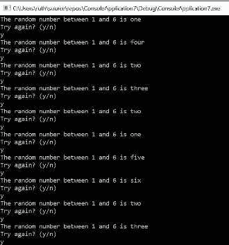

让我们再写另一个函数并让它变得有趣一点。这次我们将编写一个游戏：计算机将在 1 到 10 之间选择一个随机数，用户有 5 次机会猜中正确的数字。让我们看看代码，并在代码内部将其拆解为各个组件。

```cpp
#include "pch.h"
#include <iostream>
#include <time.h>
using namespace std;

// playgame() 函数的原型
void playgame();

// Game()
// 我们为游戏创建的整个完整函数
void playgame() {
    int selection; // 用户当前猜的数字
    int tries{ 5 }; // 剩余尝试次数

    (srand(time( NULL ))); // 确保随机数几乎是随机的。

    int i; // 想的数字。
    i = rand() % 10 + 1; // 生成计算机正在想的数字

    cout <<“guess the number I am thinking of (between 1 and 10)” << endl;
    cout << “You have“ << tries <<“ times to try” << endl; 
    // tryagain 是一个“标签”。“标签”就像我们放置在源代码某处 //
    // 的一个标记，它允许我们在另一个地方使用‘goto’ 语句将代码 //
    // 执行重定向到此位置。 //
    // 所以如果我们想让执行从‘tryagain:’继续，我们应该使用 //
    // goto tryagain;
    tryagain:;
    tries--; // 我们从次数中减 1
    cin >> selection; // 获取用户输入
    if (tries < 0) // 确保用户没有耗尽次数 {
        // 如果没有剩余次数，显示此消息并公布计算机 //
        // 所想的数字 // 游戏结束！
        cout <<“You couldn’t guess the number I was thinking of which was “ << i << endl;
        return ;
    }
    if (selection == i) // 如果用户猜中了数字 {
        cout <<“Correct!” << endl;
        return ;
    } else // 如果用户没有猜中数字 {
        cout <<“Incorrect. Please try again... (you have " << tries << " tries left)" << endl;
        goto tryagain;
    }
}

int main() {
    // 调用我们的游戏函数
    playgame();
}
```

重要：有一个因臭名昭著而有趣命令，尽管一些人会认为没有理由。任何新的 C 或 C++ 学生都会听到关于使用 `goto` 命令有多糟糕。

为了让它更有意义，最好解释一下 `goto` 命令早期的用途，当它在老的 C 语言时代被使用的，那时循环和 `if 语句` 还没有出现。`goto` 曾是控制程序流的方法。

# 第 14 章：指针

## 什么是指针？

你在 C++ 中最初接触的概念之一是变量。你学习了变量具有类型名称、值，并且它们存储在内存中。指针也是一种变量，但指针的值是一个地址。指针的地址可以是一个变量的地址（例如指向 `int` 的指针），而另一个指针可能指向一个函数。为了使用指针，我们必须知道它所指向的类型。

## 指针有什么意义？使用指针的原因

脑出的第一个问题是，为什么我们不直接使用原始变量或函数，而不是指向它呢？在某些情况下你也可以也应该直接使用变量和函数，但在其他情况下，指针非常有用。让我们理解何时以及为什么要使用指针。例如，当变量超出函数的作用范围时。我们已经在函数部分解释过，函数只能使用其作用范围内的内容。但如果我们需要使用作用范围之外的内容，指针是实现此点的很好的方法，因为它允许函数访问作用范围之外的数据。此外，指针与数组配合得非常好，我们稍后会提供一些示例。

## 栈和堆

在之前的章节中，我们简要讨论了计算机内存。计算机使用两个主要的内存区域：栈，用于临时存储内存。栈类似于一一叠书。你将另一本新书堆在栈的顶部，所以旧的书在底部。栈内存的工作方式相同——新数据存储在旧数据之上。

让我们看看代码在栈中的存储示意：

**void my_stack_program**

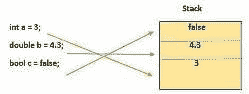
当 my_stack_program 终止时，存储在栈中的值将被删除。

尝试一下！创建一个接受半径作为参数并返回球体积的函数。记住，半径必须从用户处获取。


通常，当你需要快速运行程序时会栈（stack），因为从栈中存储和提取值非常快，即使对于非常老的 CPU 也是如此。然而，栈的可用空间是有限的，因此对于大对象或需要扩展内存的情况，栈将无法工作。另一个问题是尝试从栈中提取数据时。让我们回到书的类比：当你试图从一堆书的中间抽出一本书时，你需要先抬起上面的书；否则，书堆就会崩塌。栈也是如此——为了获取存储在栈中间某个处的值，计算机需要先经过上面的所有内容，才能挖进去。我们如何解决这个问题呢？我们只需使用堆（heap）内存。

# 堆，堆，万岁！

堆是一块可以动态分配的内存池，它与指针配合得很好，正如我们稍后将的那样。数据在堆中的分配和排列方式与在栈上的方式不同，基本上，它是随机堆积的。在处理堆时，有几个关键规则需要记住，我们稍后会介绍它们。你应该记住，在使用完存储的值后要从堆中释放它，否则你将遇到所谓的“内存泄漏”。堆对变量的大小没有限制，机器上明显的物理内存限制除外。此外，与运行非常快的栈不同，堆在读写内存时速度要慢一点。

这就是我们的变量在堆中显示的方式：

# 空函数 my_stack_program

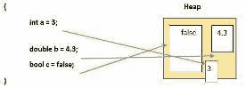如果你想学习更多关于栈和堆的知识，请访问：https://www.learncpp.com/cpp-tutorial/79-the-stack-and-the-heap/

## 声明指针变量

声明指针变量的语法与声明变量的方式相似，只需在变量名开头添加星号 `*`：

`variable_type *pointer_name`

以下是一些指针可能的外观：

- `int *sum;`
- `char *first_letter;`
- `string *user_name;`
- `double *temp;`

要记住，在这种情况下，星号符号并不被用作数学运算符。

## 初始化指针

初始化指针的逻辑与变量初始化相同。然而，我们希望确保指针不会指向任何地方，而是指向一个特定的内存地址，或者完全不指向任何地址。我们还可以初始化指针指向一个变量或函数。这听起来并不想象中那么复杂。首先，在你的代码中，在使用所有指针之前**必须**初始化它们，否则指针将指向任何地方的垃圾地址，那不是我们想要的。让我们先看看初始化指针以指向地址时需要使用的语法：

`variable_type *pointer_name (nullptr)`

我们使用 `nullptr`，这就像是将指针指向地址零，意味着我们的指针将不指向任何地方。如果你的指针没有指向变量或函数，在初始化它时始终使用 `nullptr`。

我们稍后将深入介绍指向变量和函数的指针初始化。

## 访问指针地址

当我们想要访问指针所指向的地址时，我们使用地址运算符 `&`，它是一个一元运算符（如果你不记得什么是一元运算符，应该查阅运算符章节）。

让我们回顾一个使用简单变量的示例：`int *age`

```cpp
//初始化 age 为 50
int age {50}; //我们可以使用 sizeof 运算符检查 age 的大小

//（大小将是 4）
cout <<“Size of the int age is“ << sizeof (age) << endl;
//我们可以检查 age 的值（即 50）
cout <<“The value of age is“ << age << endl;
//我们可以使用地址运算符检查 age 的地址
cout <<“The address of age is ” << &age << endl;
```

让我们看看使用指针变量运行这段代码时会发生什么：

```cpp
#include "pch.h"
#include <iostream>
using namespace std;
int main() {
    //将 age 初始化为 nullptr（所以它不指向任何地方）
    int *age{ nullptr };
    //我们可以使用 sizeof 运算符检查 age 的大小（大小将是 4）
    cout <<“Size of the age is“ << sizeof( age) << endl;
    //我们可以检查 age 的值
    cout <<“The value of age is“ << age << endl;
    // 我们可以使用地址运算符检查 age 的地址
    cout <<“The address of the pointer is“ << &age << endl;
}
```

当我们运行这段代码时，我们应该得到这个：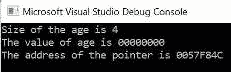

要记住，指针的大小与它所指向变量的大小不同。这意味着如果指针变量 `int *age` 指向类型为 `long long` 的变量，即使任何 `long long` 变量的大小都是 8 字节，`age` 的大小也将是 4 字节。

## 访问指向的数据

如果我们想要访问指针所指向的数据，这被称为解引用（dereferencing）指针，基本上，它遵循指针指向的位置并访问数据。为了做到这一点，我们使用星号运算符 `*`。是的——星号。你可能觉得这没道理，因为我们在声明指针时用过星号，你是对的。这是一个被 C++ 用户高度批评的选择，因为将同一个运算符用于两个不同的目的可能会令人困惑。然而，一旦我们过过一些示例，你会有更好的感觉，并可能发现这没那么困惑了。

让我们看一个示例：

```cpp
//声明并初始化一个名为 letter 的字符
char letter {'a'};

//我们声明并初始化一个名为 letter_ptr 的指针，并将其指向 letter 的地址
char *letter_ptr {&letter};

//现在我们解引用 letter_ptr;
cout << *letter_ptr << endl;
```

当我们运行这段代码时，我们得到的是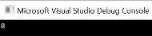

所以，你看到我们使用解引用运算符遵循指针，这引导我们到达指针所指向的数据，在这种情况下，是字母 a。

如果我们更改指针的值会发生什么？

让我们在代码中添加这一行：

```cpp
letter_ptr = 'b';
cout << *letter_ptr << endl;
cout << letter << endl;
```

我们得到的是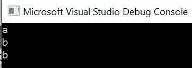

发生了什么？我们通过指针更改了 letter 的值。为了理解这一点，你需要在 C++ 中学习左值（L values）和右值（R values）。

左值（lvalue）是指特定内存位置的值，你可以通过指针访问它，例如：

```cpp
int num {100}; //num 是左值
string name {Alex}; //name 是左值
```

如何判断一个值是否可以被访问？简单，如果你可以将其放在赋值语句的左侧：

```cpp
num = 200; name = Donald;
```

注意，数字 200 和名字 Donald 不是左值，它们是字面量，不能放置在赋值语句的左侧：

```cpp
200 = num; //这不是有效的语句！
"Donald" = name; //这不是有效的语句！
```

事实上，这些值是右值。右值，正如你所猜的，是左值的相反，因为它们不可寻址且不可赋值，正如我们从最后的语句中看到的。右值将出现在赋值语句的右侧，并且总是字面量。通常情况下，你可以说任何不是左值的都是右值。

重要的是了解左值、右值，并理解它们之间的区别。我们稍后会回到这些术语上。让我们回到指针，看看关于解引用它们的另一个示例：


```cpp
#include <iostream>
using namespace std;
int main() {
    //声明并初始化一个字符串为“David”
    string name {"David"};
    //我们声明并初始化了一个名为 name_ptr 的指针，并将其
    //初始化指向 name 的地址。
    string *name_ptr{ &name };
    //现在我们对 name_ptr 进行解引用；
    cout << (*name_ptr).c_str() << endl;
    //现在我们将名字“James”赋值给 name；
    name =“James";
    cout << (*name_ptr).c_str() << endl;
    cout << name.c_str() << endl;
}
```


现在我们已经对指针是什么、如何使用以及何时使用它们有了相当好的了解，让我们进一步深入探讨，并详细解释如何使用指针来动态分配内存。

## 使用指针进行动态内存分配

C++ 的伟大之处之一在于，它允许我们真正控制受程序影响的每一个方面，而内存就是其中一个非常有意义的部分。在很多情况下，我们无法预先知道执行某个特定操作需要多少内存，特别是当我们在处理数组，甚至是向量（vector）时。这些情况的解决方案是在运行时分配所需的内存空间。这就是指针大显身手的地方：我们使用指针在堆（heap）上动态分配内存。动态内存分配是非常重要的，你将在程序的许多地方中用到它，因此真正理解它非常重要。

我们已经解释了堆（heap）和栈（stack）的基础知识，在本节中，我们将对其进一步的解释。

为了在堆上动态分配内存，我们使用 `new` 关键字：

`int *ptr = new int; //使用“new”在//堆上为整数分配内存`

通过使用 `new`，我们不再是给指针赋值整数的地址（就像我们之前做的那样），而是在运行时动态创建一个地址。你只需要记住，在初始化之前，存储器将包含垃圾数据。让我们看看在实际代码中看起来是 own 样的：

```cpp
#include <iostream>

using namespace std;

int main()
{
    int *num_ptr{ nullptr }; //我们初始化一个指针指向空处 num_ptr
    num_ptr = new int ; //我们在堆上为一个整数分配内存
//并将地址存储在指针 num_ptr 中

    cout << &num_ptr << endl; //这将向我们展示刚刚创建的 new//int 的地址

    cout << *num_ptr << endl; //由于我们没有初始化变量
//我们在这里将获得垃圾数据

    *num_ptr = 25; //初始化为 25

    cout << *num_ptr << endl; //现在将显示 25，而不是我们在//初始化之前显示的//垃圾数据
}
```

当我们运行这段代码时，我们预期的结果如下：

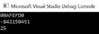

- 第一个输出是在堆上分配的地址。
- 第二个输出是垃圾数据，因为我们还没有初始化变量。
- 25 是初始化的值。

这个简单直接的例子很重要，因为它证明了除非你初始化新创建的变量，否则它将显示垃圾数据。尽管如此，更重要的是，访问数据的唯一途径是通过指针。如果你以某种方式丢失了指针（例如重新赋值），你将永远无法知道数据在哪里，也无法访问它，这正如你可能记得的，正如我们早些提到的，这就是内存泄漏。你不希望在你的程序中发生这种情况。

另一个需要知道的重要点是，一旦我们使用了该存储器，就必须释放它以便释放，我们可以重用该空间。为了做到这一点，我们只需使用 `delete` 关键字后跟指针名称，如下：

`delete num_ptr;`

## 指针与 const

在 C++ 中，我们可以将 `const`（常量）与指针结合来实现几种预期的结果。首先，我们可以使用指针指向常量值；在这种情况下，我们可以随时更改指针的值。其次，我们可以使用 `const` 创建常量指针，这种指针是不能更改的。让我们来看一个例子：

`int tv_sold {120}; const int *tv_ptr {&tv_sold};`

在这段代码中，我们初始化了 `int` 变量，然后是一个初始化为指向 `tv_sold` 的指针。我们在变量类型之前使用了 `const`。这意味着指针所指向的值不能更改，因为现在它指向一个整数常量，但我们仍然可以更改它指向的地址。如果我们在代码中添加这一行，我们将得到编译错误，因为指针所指向的变量（`tv_sold`）的值不能更改：

`tv_ptr = 60; // 错误!` 

但如果我们改变 `tv_ptr` 指向的方向，将不会得到编译器错误：

`tv_ptr = &tv_sold; // 无错误`

在声明常量指针时，我们应该期望这种语法：`int tv_sold {120}; int *const tv_ptr {&tv_sold};`

在这种情况下，指针是常量的，不能被更改。如果我们尝试运行这一行，将不会得到编译器错误：

`tv_ptr = 60; // 无错误`

但如果我们改变 `tv_ptr` 指向的位置，我们将得到编译器错误：`tv_ptr = &tv_sold; // 错误!`

我们还可以同时使用常量变量和常量指针：

`int tv_sold {120}; const int *const tv_ptr {&tv_sold};`

在这种情况下，两条语句都将导致编译错误，因为 `int` 变量和指针都不能更改：

`tv_ptr = 60; // 错误!`

`tv_ptr = &tv_sold; // 错误!`

## 指针与数组

在处理数组时，在堆上分配内存的有用方法之一。让我们来看一个例子。在这个例子中，我们想要创建一个给定班级学生人数的数组。我们询问用户：你们班级有多少个学生？然后在堆上动态创建一个具有所需大小的新数组：

```cpp
#include <iostream>

using namespace std;

int main()
{
    int *num_ptr{ nullptr };
    int number_of_students{};

    cout << “你们班级有多少个学生?” << endl;
    cin >> number_of_students;
    num_ptr = new int [number_of_students]; //在//堆上为数组分配内存
    cout <<“你们班级的学生人数是 ” << number_of_students << endl;

    delete num_ptr; //我们释放了在堆上使用的内存
}
```

这段代码将正常运行并显示学生人数，而 `num_ptr = new int [number_of_students];` 这一行是在堆上分配我们所需的确切大小。如果我们尝试给指针赋值，会发生什么？我们在 main 函数末尾添加了这一行：

```cpp
#include <iostream>
using namespace std;
int main() {
    // 上述代码
    *num_ptr = 40; // 给 num_ptr 赋值 40
}
```

运行时我们得到了一个异常：

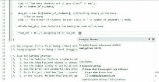 意味着我们在释放存储器后无法访问它指向的位置。

如果我们随后将指针赋值为 `nullptr`，使其指向无处，这是我们预期的结果：

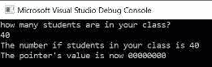

指针与数组的关系比我们展示的更有趣，因为我们还可以使用指针访问数组内的元素。让我们创建一个成绩数组，然后使用指针访问它：

```cpp
#include <iostream>

using namespace std;
int main() {
    int grades[]{ 78, 86, 90, 52 };
    int *grades_ptr{ grades };
    cout << grades_ptr[0] << endl;
    cout << grades_ptr[1] << endl;
    cout << grades_ptr[2] << endl;
    cout << grades_ptr[3] << endl;
}
```

当我们运行这段代码时，我们将获得数组的所有元素列表：

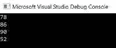

我们之所以可以使用指针访问数组中的元素，是因为在 C++ 中，数组名称的值实际上是数组第一个元素的值。由于指针变量的值也是一个地址，一旦我们将其指向数组（假设它们的数据类型相同），那么我们就可以使用指针和数组名来访问元素。这起初可能看起来困惑，但实际上非常简单，并且可以为你的代码增加巨大的价值。


在 C++ 中，除了我们目前所看到的可以将指针用于赋值外，还可以对其进行算术运算和比较。指针的算术运算和比较使用的运算符和语义与你目前学过和熟悉的相同。

指针的算术运算结合数组可以非常强大。我们使用 `++` 和 `--` 算术运算符指向数组的下一个或上一个元素。递增和递减是在内存范围内的。例如，在整数数组中递增会增加 4（因为整数的大小为 4 字节），而 `double` 则会增加 8。

语法为：`int_ptr ++; int_ptr--;`

我们还可以使用 `+=` 或 `-=` 来按特定值递增或递减指针：

`int_ptr += i; int_ptr -=i;`

此外，只有当两个指针指向相同的数据类型时，我们才能从一个指针减去另一个指针：

`int i = int_ptr_2 – int_ptr_1;` 在这种情况，结果将这两个指针之间的元素个数。

我们还可以比较两个指针，但记住，指针只有在它们指向相同地址时才是相等的。要进行比较，我们使用 `==` 运算符或 `!=` 运算符。

### 指针与函数的操作

指针在处理函数时可以起着重要作用，并以各种方式实现。我们将研究的第一种方法是通过引用将指针传递给函数。在之前的章节中，我们解释了如何通过引用传递函数。让我们复习一下记忆：

当我们讨论按值传递的函数时，解释了它们使用参数的副本，如果副本的值发生变化，则不会改变参数。我们将其称为实际参数和形式参数。通过引用传递函数的方法相反：我们在使用函数时使用参数的位置来更改它。为了做到这一点，我们必须在参数前使用 `&` 符号使用参数的内存实际地址。

通过引用传递给函数的指针作为参数传递，如果指针的值发生任何变化，将不会影响函数。让我们回顾一个示例，该函数为给定的分数增加加分（递增 1）：

```cpp
#include <iostream>
using namespace std;
//函数原型
void bonus_score(int * int_ptr); //函数定义
void bonus_score(int * int_ptr) {
    *int_ptr += 1; // 解引用指针并
    //递增 1
}
int main() {
    int score{89};
    cout << score << endl;
    bonus_score(&score);
    cout << score << endl;
}
```

运行代码时，我们得到了完全预期的结果——分数 89，然后是分数 90：

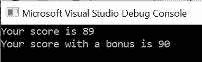

让我们来看另一个示例，这次我们将在函数内部处理指针并显示 vector 中的元素集合。这对于处理函数、`for` 循环和 vector 是一个很好的回顾。

在这个示例中，我们想要创建一个包含字符串集合的 vector。我们将使用指针来遍历集合（当然，我们首先需要对指针进行解引用），然后显示名称。首先，让我们看看函数：

```cpp
#include <iostream>
#include <vector>
using namespace std;
// 函数定义
void name_list(vector<string> * v) {
    for (auto str : *v) // 遍历 vector
        cout << str.c_str() << " is a name on the list" << endl;
}
int main() {
    // 函数调用
    vector<string> names{"Joe", "Shirley", "Jack", "Linda"};
    name_list(&names);
}
```

让我们回顾代码：

我们创建了一个函数（我们在这里没有使用函数原型），它调用了一个字符串 vector 和一个指针 `*v`。然后我们通过解引用 `v` 遍历了 vector 列表并显示了名称。在 main 中，我们初始化了一个名为 `names` 的 vector。我们调用该函数，它显示了集合中的名称：Joe, Shirley, Jack 和 Linda。当我们运行这段代码时，这就是我们应该预期的：

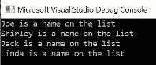

现在我们已经讨论了如何向函数传递指针，现在让我们看看如何从函数返回指针。为了通过函数返回指针，我们首先需要在函数原型和函数定义中定义指针的类型。在这个过程的结束处，函数预期返回一个地址。

这是一个返回指针参数的示例——注意，比较不是指针本身之间，而是它们所指向的内容之间，我们通过解引用它们来实现这一点：

```cpp
#include <iostream>
#include <vector>
using namespace std;
// 函数定义
int *smaller_num(int * int_ptr1, int * int_ptr2) {
    if (*int_ptr1 < *int_ptr2)
        return int_ptr1;
    else
        return int_ptr2;
}
//现在我们需要调用这个函数：
int main() {
    int a{25};
    int b{34};
    int *smaller_ptr{nullptr};
    smaller_ptr = smaller_num(&a, &b);
    cout << "The smaller number is " << smaller_ptr << endl;
}
```

运行这段代码时，我们得到了一个奇怪的结果：

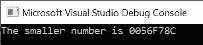

我们注意到输出实际上显示了内存中的一个地址。为什么呢？因为我们在输出语句中没有对 `smaller_ptr` 进行解引用，所以它向我们显示 `smaller_ptr` 指向的地址，而不是值。一旦我们这样对它进行解引用：

`cout << "The smaller number is " << *smaller_ptr << endl;`

我们就会得到正确的输出：

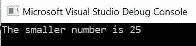

### 从函数动态分配内存

通过函数进行动态内存分配是非常强大的，这也是在函数内部处理指针时的常用用例。然而，有一些需要维护的常规规则。

让我们看一些代码以理解如何动态分配内存。在这段代码中，我们首先创建了一个在运行时创建数组的函数。在函数定义中，我们需要定义一个 `unsigned int` 作为大小——这允许我们在运行时设置数组的大小，并在另一个 `int` 将设置为数组元素的值：

```cpp
#include <iostream>
#include <vector>
using namespace std;
// 定义我们的函数
int *build_array(size_t size, int element_value) {
    // 创建新的存储：
    int *new_storage{nullptr};
    // 在运行时分配 int 到新存储：
    new_storage = new int[size];

    // 遍历数组元素：
    for (size_t i{0}; i < size; ++i)
        *(new_storage + i) = element_value;
    // 返回数组中新创建的整数的地址
    return new_storage;
}
// 调用函数：
int main() {
    // 我们将使用函数为此数组分配元素：
    int *new_array;
    new_array = build_array(40, 12);
    // 我们可以用这段代码做各种事情……
    // 我们可以做这个...
    // 我们可以做那个...

    // 使用代码后我们必须删除数组，这
    // 使用 delete 关键字捕获空间。不要
    // 释放存储！
    delete[] new_array;
}
```

重要：注意在这种情况下使用了方括号，因为这些括号表示我们正在删除一个数组。`delete` 用于 C++ 中执行许多其他删除操作，因此区分我们正在删除整个数组的情况很重要，这就是为什么在这种情况下使用 `[]`。

#### 处理处理指针时的潜在问题

我们讨论了处理指针时的几个潜在问题。我们解释了初始化指针有多么，否则它们将指向垃圾数据。我们解释了避免这种情况的最佳方法是使用 `nullptr`，这样指针将指向任何地方。记住这一点很重要。


另一个最好避免的潜在问题是野指针，也称为悬挂指针（dangling pointers）。这些指针指向一个已经释放且不再有效的内存地址。这在函数终止时经常发生，此时野指针的返回地址是栈上的一个局部变量，且该变量已不可用。此问题通常会导致程序崩溃。

我们已经提到的另一个问题是内存泄漏。这实际上涉及指针的最常见错误之一。如果我们忘记释放在堆上分配的内存且没有使用 `delete` 关键字，或者我们丢失了指针，在这种情况下，就会得到所谓的“孤儿内存”（orphan memory）。

在现代 C++ 中，许多此类问题和困难已成为过去式，因为你可以使用智能指针和原子指针。我们在这个阶段不会介绍原子指针，因为这是一项高级特性，但我们建议你进一步研究这些主题。

# 第 15 章：面向对象编程

现代 C++（事实上也是大多数现代语言）的核心特性之一是面向对象编程，或 OOP。但什么是 OOP 呢？在过去，计算机编程仅能够进行过程化编程，这意味着它只关注函数、过程和程序的流程。我们将数据与函数数据分开声明，并将其传递给函数。这一切都是以适用于能力非常有限的老旧电脑的方式进行的。在 C++ 中，我们仍然使用过程化编程（到目前我们实际上做了很多），但 OOP 为我们提供了另一个更抽象的层次。更重要的是，它允许我们管理海量的代码、函数和数据，这种管理在过程化编程中是极其困难甚至无法实现的。由于现在的程序非常复杂，存储了大量涉及数十、数百甚至数千次操作和函数运行的数据，我们必须有一种更好的方法来管理所有这一切。把它想象成同时抛耍成百上千个球——这简直是不可能的。

OOP 是管理复杂程序的更好方法，它可以简化程序，并允许你（程序员）以更抽象的方式看待事物并操作多种类型的数据。重要的一点是，C++ 社区的某些程序员认为 OOP 变得有些庞大，社区内部对于 OOP 的优点与老派编程相比的对比也存在一些批评。但这只是顺带一提。让我们深入探讨 OOP 并学习对象和类。

OOP 有时可能难以理解，可能需要一些练习。花点时间学习和理解，随着学习的进行，它会变得清晰。

OOP 允许我们将程序模块化为类和对象，以简化程序。类允许你将代码的部分封装在单个类中，然后我们可以将类中的数据与处理数据的操作结合使用。这意味着数据和操作不会分散在整个程序中；如果我们使用过程化编程，这将迫使我们访问每个位置，更不用说如果我们不仅需要访问数据，还要修改它。通过类，我们可以精确地使用、修改和调用我们的数据和操作——所有操作都从一个单一位置完成。这在代码中非常强大且实用。

另一个优势是我们可以在其他程序中重用我们的类。例如，如果你有一个可以处理照片上传和重名的类，你可以在任何处理照片的程序中使用该类。这节省了大量的时间和辛力工作。我们之后还会讨论 C++ 的另一个概念，称为继承（inheritance）。它基本上允许我们使用现有类来创建一个新类。例如，假设我们有一个处理学生注册的类。它包含学生的姓名、日期和他们将修的课程。现在我们想写一个让孩子入学幼儿园的程序。我们会在类中需要许多相同的元素，但需要进行特定的更改。通过继承，这很容易实现。

## 15.1 - 类与对象

描述类的最好方法是把它们比作程序某部分的蓝图。通过这些“蓝图”，我们定义数据类型、数据本身、我们使用数据的方法（函数），以及谁可以访问该类（定义为公共 public 或私有 private）。

OOP 的另一个重要元素是允许我们隐藏信息。这意味着我们程序的某些部分无法访问其他部分，除非授予访问权限，或者它可以具有有限的访问权限。我们将在以后进一步讨论许多用途和优点。

在类内部，我们可以创建所需数量的对象。这些对象被称为类的每个特定实例（instance）。例如，如果我们为学生注册创建了一个类，那么学生类的对象将是学生的姓名、年龄、所选课程以及他们获得的学分。

### 定义类

定义类非常简单。我们只需使用 `class` 关键字并给类命名（一种最佳实践是每个单词的首字母字母大写），然后声明该类。这是你应该使用的语法格式：

```
class Class_Name
{
// 在此处处写类声明；
};
```

记住：类声明以分号 `;` 结束。

在类的声明部分，我们可以定义类的行为方式、对象以及类的结构。如果我们想声明学生注册类，它看起来可能像这样：

```
class Enrollment { 
    // 属性 
    std::string student; 
    int age; 
    int points; 
    // 方法 
    void Add_Student(std::string student, int age, int points); 
};
```

记住，此类中的方法仅属于此类。现在我们已经创建了类，现在可以在此类内部创建对象，在这种情况下，即学生申请：

```
Enrollment George_App;
Enrollment Lidia_App;
Enrollment *Tara_App = new Enrollment ();
delete Tara_App;
```

现在，我们可以以各种方式使用对象。例如，我们可以创建一个学生申请的向量（vector）：

```
std::vector<Enrolment> enrollment1 {George_App};
enrollment1.push_back(Lidia_App);
```

重要的是，在定义类时，我们在 `main` 函数之外完成它，因为我们不希望类留在 `main` 函数的作用域内。我们希望将类的访问范围扩展到程序作用域之外。你可以在 `main` 函数上方创建类，但更好的方法是在创建新类时这样做。为类创建专门的文件是常见的做法。这些文件将是一个 `.cpp` 文件和一个 `.h` 文件。

在 `.cpp` 文件中，你对 `.h` 文件添加 `#include`，然后放置类体。

在 `.h` 文件中，你放置类的原型。然后任何使用该类的源文件只需要同样对 `.h` 添加 `#include`。这听起来可能很困惑，但我们稍后会提供一些真实的示例和任务。

当你想要确保 `.h`（头文件）文件只被处理一次时，常用的方法是使用预处理器指令（Preprocessor Directive）。这些行是独特的，因为它们以哈希符号（##）开头，编译器在实际编译代码之前检查它们，因此被称为“预处理器”。它可以用于在编译前自动对代码更改。此类更改包括添加源行、决定编译代码中包含或排除的代码块，以及将一个文本替换为另一个文本。

为了防止头文件被处理多次，我们定义一个字符串（可以是任何内容），然后添加以下行：

```cpp
#ifndef <string>
#define <string>

<头文件内容>

#endif
```


然后，当第一次处理此文件时，该字符串尚未定义，因此头文件的所有内容都会被处理。此外，我们定义了这个字符串。下次，由于字符串已经定义，头文件将不会再次被处理。

最佳实践是在字符串名称的开头使用下划线，并仅使用大写字母，以另一个下划线、大字母 H 和下划线结尾，如下例所示：

```cpp
#ifndef _NAME_H #define _NAME_H <contents of header file> #endif
```

让我们来看另一个例子。在这个例子中，我们将为银行账户管理程序创建一个简单的类。

```cpp
#include "pch.h"
#include <iostream>
#include <vector>
using namespace std;
class Manage_Account {
    //attributes
    string name; // 客户名称
    int UID; // 每个客户的唯一标识
    int DOB; // 出生日期
    double balance; // 账户余额
    // methods
    public :
        bool is_overdrawn( double ); //账户是否透支
        void deposit( double ); // 是否存款
        void withdraw( double ); // 是否取款
};
bool Manage_Account ::is_overdrawn( double balance ) {
    return (balance < 0);
}
void Manage_Account ::deposit( double amount ) {
    cout <<“The amount of $” << amount <<“ has been deposited” << endl;
    return ;
}
void Manage_Account ::withdraw( double amount ) {
    cout <<“The amount of $” << amount <<“ has been withdrawn” << endl;
    return ;
}
```

现在我们已经创建了类，可以进入 main 函数创建一些类对象：

```cpp
int main() {
    Manage_Account linda_account; // linda 现在是类中的一个对象
    Manage_Account george_account; // george 现在是类中的一个对象
    // 我们可以创建一个 vector 来添加新账户
    vector < Manage_Account > account_vec{ linda_account };
    account_vec.push_back(george_account);
}
```

如你所见，使用类以及创建类对象可以简化你的代码。现在你已经有了关于如何创建一个带有属性、方法和对象的的基础知识，让我们了解如何访问类成员。

基本上，你有两种方式可以访问类成员：使用点 (`.`) 运算符，以及使用箭头运算符 `->`（也称为指针的成员运算符）。我们可以访问类属性和类方法。

### 使用点 (.) 运算符

让我们看看上一个类 `Manage_Account` 中使用点运算符的例子。我们已经为 Linda 创建了一个账户。现在我们可以访问该类中的方法：

```cpp
Manage_Account linda_account;
Linda_account.is_overdrawn(50); //使用 . 来 //访问 is_overdrawn 方法
Linda_account.deposit (50); //使用 . 访问 deposit 方法
```

你可以看到使用点运算符访问类成员是多么简单。但如果我们有一个指针作为对象，我们该怎么办呢？嗯，你可能猜到了，我们需要对它进行解引用：

```cpp
Manage_Account *linda_account = new Manage_Account ();
(*linda_account).deposit (500);
```

你可能注意到我们在这里使用了括号。原因为点运算符的优先级高于解引用运算符 `*`，我们需要确保在访问类对象之前先进行解引用。

**要记住：`*linda_account` 不是一个对象，而是一个指向对象的指针。**

访问类对象的第二种方法是使用箭头运算符，也称为指针成员运算符 `->`（破折号后跟大于号），如下：

```cpp
linda_account->deposit (500);
```

箭头运算符更容易使用和阅读。它被引入 C++ 是是因为点运算符（例如在使用指针解引用时）可能会有些笨拙。你可能会在代码中看到箭头运算符。

### 公共和私有类成员

我们已经提到在定义类时，我们可以决定谁可以访问类和类成员。在 C++ 中，我们有三个类访问选项：`public`、`private` 和 `protected`。公共类可以被任何人从任何地方访问。私有类只能由类的成员或类的友元访问（我们将稍后详细介绍）。受保护类只能通过继承使用和访问，我们将在稍后的章节中介绍。

为了使用访问成员修饰符，我们将使用非常简单的语法。我们只需要在类体中编写访问修饰符，如下：

```cpp
class Class_Name { public: };
```

我们可以在类内部使用多个访问修饰符，使得某些类成员是公共的，某些是私有的。让我们使用已经定义的类：

```cpp
class Manage_Account {
    private: //attributes
    string name; // 客户名称
    int UID; //每个客户的唯一标识
    int DOB // 出生日期
    double balance // 账户余额
    //methods
    public: 
        bool is_overdrawn(double); //账户是否透支
        bool deposit(double); //是否存款
        bool withdraw(double); //是否取款
}
```

在这种情况下，方法可以在类外访问，但属性仅对类成员可见。在类内部使用多个访问修饰符是非常常见。。重要的是要记住，如果你尝试访问私有类成员，将得到一个编译错误。

## 15.2 - 实现类方法

一旦我们创建了类，就需要实现类的方法，这与实现函数的方式非常相似。我们可以在类声明内部和外部实现方法，但请记住当我们在类声明外部实现它们时，必须使用以下语法：

```cpp
class_name::method_name
```

如你所见，在实现类方法时，我们使用作用域解析运算符 `::`。

当然，成员方法可以访问成员属性，你不需要将它们作为参数传递。这确实让我们的代码更简单更干净。我们已经提到使用头文件（`.h` 文件）和单独的 `.cpp` 文件是最佳实践`.h` 文件用于类的声明，而 `.cpp` 文件用于类的实现。

为了打开 `.h` 文件，你首先需要在解决方案管理器中选择项目，并点击“添加项”菜单选项：


然后选择“头文件”并命名。名称将以 `.h` 结尾。


添加源文件 (`.cpp`) 与添加头文件类似，区别在于选择“C++ 文件”类型。

让我们看看使用我们的 `Manage_Account` 类实现成员方法的例子：

```cpp
class Manage_Account
{
    private:
    double balance; //只有类成员可以访问此属性
    public:
    //我们有两个公共方法，只有它们可以访问‘double balance’
    void calc_balance(double balance) { balance = bal; }
    double show_balance() { return balance; }
};
```

如果我们想在类声明外部声明这些方法，它看起来像这样：

我们类声明的这部分将是 `.h` 文件的一部分：

```cpp
class Manage_Account {
    private: 
        double balance; //只有类成员可以访问此 //属性
    public:
        void calc_balance(double bal); //这是方法原型
        double show_balance(); //这是方法原型 //我们的类声明在此结束
};
```

我们类声明的这部分将是 `.cpp` 文件的一部分：

```cpp
//在类外部实现成员方法
void Manage_Account::calc_balance(double balance) { balance = bal; }
double Manage_Account::double show_balance() { return balance; }
```


在处理大型代码和复杂程序时，将函数声明与实现分离是最佳且最常见的做法。请记住这一点并练习同时操作两个文件，但要避免重复声明和实现，因为这可能会导致非常困惑并引起编译错误。对于这种潜在问题有一个解决办法：`#include` 保护符。当你包含 `.h` 文件时就已经已经熟悉这种保护符了，它们是 C++ 内部库的一部分。使用 `#include` 保护符可以确保你想要使用的文件只被使用一次。

让我们来看更复杂的代码。在这个代码中，我们创建了一个名为 `database` 的类。

```cpp
#include <iostream>
#include <string> 
#include <vector> 
using namespace std; // 首先定义一个结构体来存储我们想要的数据

//为了简化程序，我们将只存储学生姓名和学生 ID . 在这段代码的最后，你可以找到关于它的更多信息 .

typedef struct
{
string name; // 学生的姓名
int id; // 学生的 ID
} db ; // 我们新结构体 ‘db’ 的名称

// 接下来我们将为新类定义一个原型，那部分与 //
// typedef struct 应该都放入
// 我们的 .h 文件中，这样其他源文件就可以使用它

class database
{
public : // 这是类的公共部分。公共部分可以在类作用范围之外访问 //

// add - 用于向我们的数据库添加新数据的函数
void add( string name , int ID );

// findByID - 如果我们有学生的 ID 字符串，通过 ID 查找学生的函数 findByID( int ID ); 
private : vector < db > Db; // 这里是一个 ‘db’ 向量的变量 // (我们之前定义的结构体) 
};

// 我们的 add 函数 - 在这里我们创建一个类型为‘db’的单项并填充 // 数据，然后将其添加到向量中
void database ::add( string name , int ID ) { 
    db SingleItem; 
    SingleItem.name = name ; 
    SingleItem.id = ID ; 
    Db.push_back(SingleItem); 
}

// 这个函数遍历整个向量，当当前项的 ID
// 与作为参数输入的 ID 匹配时，它返回 ‘name’ 字段。
string database ::findByID( int ID ) { 
    int i; 
    for (i = 0; i < Db.size(); i++) { 
        if (Db [ i ] .id == ID ) { 
            return Db [ i ] .name; 
        } 
    } 
    return“not found” ; 
} 

int main() { 
    database myDB;
    myDB.add( “student 1” , 1); // 向我们的数据库添加数据
    myDB.add( “student 2” , 2);
    myDB.add( “student 3” , 3);
    myDB.add( “student 4” , 4); // 查找 ID 为 4 的学生

    cout <<“looking for student with ID “ << 4 <<“ result:“ << myDB.findByID(4) << endl;
}
```

在这个代码中，我们使用了新东西：`typedef struct`。当你想要使用基于多个元素的新数据类型时，你会使用：`typedef struct`。

这将 `struct` 定义为一种数据类型，这样你以后就可以像使用内置数据类型（如 `int` 或 `char`）一样使用它。例如，如果你想要一个用于存储书籍信息的数据类型，你可以这样定义它：

```cpp
typedef struct
{
string author;
string title;
int pages;
int year_of_publishing;
} book ;
```

然后，只要你从引用了该定义的源文件中使用它，就可以使用你创建的新类型。所以，如果你将其放在 `books.h` 中，每当你想要引用书籍数据类型时，都必须包含 `books.h`。

```cpp
book mybook;
mybook.author =“James Jones” ;
mybook.pages = 134;
mybook.title =“Success Stories” ;
mybook.year_of_publishing = 2001;
```

## 15.3 - 构造函数与析构函数

构造函数和析构函数是类中特殊的成员方法。每次定义类的类的实体时，我们都可以有一个特殊的函数执行。这种函数可以初始化我们的类。例如，如果类有一个私有变量，可以将其初始化为我们在开始时希望它具有的值。如果这个变量用于计算总和，我们将将其初始化为 0。构造函数的名称总是与类相同，它们在需要初始化时非常有用。此外，构造函数不需要任何返回类型，并且它们可以被重载（我们稍后会解释）。

让我们看一个构造函数的示例：

```cpp evenclass Manage_Account
{
private:
double balance;
public:
//重载构造函数（稍后查看更多信息）
Manage_Account(); // 无参数构造函数
Manage_Account(std::string name, double deposit); // 期望 2 个参数
Manage_Account(double balance); // 期望 1 个参数
};
```

我们将演示并更多更多构造函数，所以如果你觉得现在还不理解很多，不要担心。

### 析构函数

在程序离开类作用范围之前，另一个特殊的函数会被调用，即析构函数。析构函数也是类中的成员方法，它们与类名相同，但名称以波浪号 `~` 开头。析构函数可以释放内存、将数据保存到文件或数据库，或者在退出类时想要执行的任何操作。一旦对象销毁，它们就会自动调用。与构造函数一样，它们不需要任何返回类型，但注意：它们不能被重载，且每个类只允许一个析构函数！

让我们看看析构函数在我们的类中什么样子：

```cpp
class Manage_Account { 
private: 
double balance; 
public: 
//重载构造函数
Manage_Account(); // 无参数构造函数
Manage_Account(std::string name, double deposit); // 期望 2 个参数
Manage_Account(double balance); // 期望 1 个参数
//析构函数
~ Manage_Account();
 );
```

让我们看另一个例子。在这种情况下，假设我们有函数从存储器读写内存中的数据（数据库或文件）。我们可以使用构造函数和析构函数来实现，每当类被定义或首次使用时，数据将从存储器加载。此外，在结束类的使用时数据将保存：

```cpp
database

()
{
save();
}
```

正如你所见，定义构造函数和析构函数很简单，但我们仍然需要理解它们何时以及如何调用。你首先需要知道的是，如果不提供任何构造函数或析构函数，C++ 会自动为你创建它们——这些是空构造函数和析构函数。即使你没有提供构造函数，C++ 也必须构造对象；因此，默认构造函数没有参数。创建的对象将在栈上创建，但如果我们创建一个对象的指针，它将在堆上创建。请记住，由于没有向默认构造函数传递任何参数，我们可能会在那里发现一些垃圾数据。尽管如此，当我们提供自己的构造函数时，最佳实践是自己提供一个无参（no-args）构造函数。例如，如果我们使用我们的账户类，我们可以决定在没有初始化的情况下创建新对象时，默认名称将为“NA”，余额为 0.0：

```cpp
class Manage_Account { 
private: 
double balance;
public:
Manage_Account(); // 无参数构造函数
{ 
    name =“NA”; 
    balance = 0.0;
}
```

但如果我们决定不使用默认构造函数，它可以看起来像这样：

```cpp
class Manage_Account { 
private: 
double balance; 
public: 
//带参数的构造函数
Manage_Account(std::string client_name, double client_balance); 
{ 
    name = client_name; 
    balance = client_balance; 
}
```

```

我们之前提到过构造函数可以被重载，并且类可以拥有所需的任意构造函数，但它们之间必须不同且不重复。

让我们来看看向学生发送测试并保存测试结果的程序中的类。


```cpp
class Tests {
private:
    std::string name;
    int age;
    int score;
    //重载构造函数
    Tests();
    Tests(std::string student_name);
    Tests(std::string student_name, int student_age, int student_score);
};
```

我们对构造函数的初始化如下：

```cpp
Tests::Tests() { name =“NA"; age = 0; score = 0; };
Tests::Tests (std::string student_name) { name = student_name; age = 0; score = 0; };
```

请记住，将对象初始化为某种默认值是非常重要的，以防没有数据的情况下，因为我们不希望任何垃圾数据成为我们的程序。在这种情况下，我们将 `name` 初始化为 `NA`，将 `age` 和 `score` 初始化为 `0`。

另一种初始化对象的方法是使用构造函数初始化列表。到目前为止，我们通过在构造函数体中设置数据来初始化对象，并将值赋值给已经创建的属性。使用初始化列表可以更高效，它基本上在构造函数执行之前初始化了成员数据值。初始化列表是跟在构造函数参数列表之后的初始化器列表。初始化的顺序遵循声明顺序。在我们之前的一个示例中，我们使用了重载的构造函数：

```cpp
class Tests {
private:
    std::string name;
    int age;
    int score;
public:
    //重载构造函数
    Tests();
    Tests(std::string student_name);
    Tests(std::string student_name, int student_age, int student_score);
};
```

但有一种更好的方法，即使用初始化列表。这里是我们现在使用它的方法：

```cpp
Tests::Tests() { name =“NA"; age = 0; score = 0; }
```

这种方法更像是一种赋值方法，而不是真正的初始化。下面是使用初始化列表的更好方法，它确保我们在执行构造函数体中的任何其他代码之前初始化了数据成员——这是真正的初始化：

```cpp
// 更好的方法——使用初始化列表
Tests::Tests() : name {“NA"}, age {0}, score {0}; { }
```

使用这种方法允许我们在对象创建时对其进行初始化；否则，它们会先以某些空值被创建，然后我们才对其进行初始化——所以我们基本上在对象构造过程中节省了一个步骤。请注意，初始化的顺序与它们在类声明中的声明顺序相同。C++ 还允许我们使用委托构造函数，这意味着一个构造函数的代码可以调用初始化列表中的另一个构造函数。这在防止代码重复错误方面非常高效，因为构造函数之间可能非常相似，这会留出出错的空间。

让我们看看我们的 `Tests` 类并看看如何使用委托构造函数。首先，让我们看看之前讲过的重载构造函数：`//重载构造函数`

```cpp
Tests(); Tests (std::string student_name); Tests(std::string student_name, int student_age, int student_score);
```

现在，让我们看看使用初始化列表代码将是什么样子：

```cpp
Tests::Tests() : name {"NA"}, age {0}, score {0}; { }
Tests::Tests (std::string student_name) : name {student_name}, age {student_age} { }
Tests::Tests (std::string student_name, int student_age, int student_score) : name {student_name}, age {student_age} score {student_score} { }
```

这段代码有点长，因为我们在某些变体中不断重复相同的代码。让我们看看如何通过委托构造函数简化这段代码：

```cpp
// 第一个构造函数是 3 参数的构造函数
Tests::Tests(std::string student_name, int student_age, int student_score) : name {student_name}, age {student_age} score {student_score} { };

// 现在我们可以委托这个 3 参数构造函数
Tests::Tests() : Tests {“NA”, 0, 0} { }; 

// 委托 3 参数构造函数，但除了 0 和 0 提供 student_name 作为参数
Tests::Tests(std::string student_name) : Tests {student_name, 0, 0} { };
```

## 15.4 - 拷贝构造函数——浅拷贝和深拷贝

当我们在 C++ 中复制对象时，我们从一个现有对象创建一个新对象。你可能记得，我们已经解释过 C++ 的默认值总是复制值。对象被复制有几个原因，例如，正如你在早的章节中学到的那样，当我们按值传递对象时，或者当我们从函数按值返回对象时。在 C++ 中，万一你没有提供拷贝，编译器必须能够定义一个拷贝。为了这样做，我们使用所谓的拷贝构造函数。如果你确实提供了拷贝构造函数，那么有一个恰当的方法来这样做，我们将进行演示和解释。

基本上，使用默认方式（通过编译器）按值复制对象可以运行得很好，但如果你需要复制原始指针，你可能会遇到问题。原因是指针会被复制，但它们所指向的内容**不会**，这就是所谓的“浅拷贝”（在本节中将进一步讨论）。你需要记住，在处理指针时，提供拷贝构造函数始终是一个良好的做法。最好的说法是，不建议将原始指针作为数据成员，因为它为许多错误留下了可能。

使用拷贝构造函数时，我们使用 `const` 引用参数，因为我们正在复制源，并且我们不想修改它。如前所述，构造函数的名称将保持不变。以下是 `Tests` 类使用的语法：

```cpp
Tests::Tests (const Tests &source);
```

当我们要实现拷贝构造函数时，可以使用初始化列表来实现：

```cpp
Tests::Tests (const Tests &source) : name {source.name}, age {source.age}, score {source.score} {
// 使用源对象创建新属性
```

到此，你可能已经非常理解了构造函数动态分配存储，而析构函数在调用时释放内存。在复制时，我们可以使用浅拷贝或深拷贝。如之前所述，浅拷贝是默认的拷贝方法，它的问题从复制原始指针时开始，因为拷贝复制的是指针本身，而不是它指向的内容。当我们通过析构函数释放其中一个对象的存储时，你认为会发生什么？

嗯，如果你认为被复制的第二个对象仍然指向相同的存储空间，而该存储空间不再有效，那么你是正确的。避免这种情况的方法是使用深拷贝，它不仅复制指针，还复制指针所指向的数据，同时它在堆上分配了存储空间。

让我们看一个例子。这里有一个使用浅拷贝的类：

```cpp
class Salary {
private:
    int *sum; // 这是我们的原始指针
public:
    Salary(int s); // 这是我们的构造函数
    Salary(const Salary &source); // 这是我们的拷贝构造函数
    ~Salary(); // 这是我们的析构函数
};
```

方法的实现如下例所示：

```cpp
Salary::Salary(int s) {
    sum = new int; // 我们在堆上分配新的存储空间
    *sum = s;
}
```

这里是我们的析构函数的样子：

```cpp
Salary::~Salary() {
    delete sum;
}
```

现在，让我们看看使用深拷贝时这个类将是什么样子：

```cpp
Salary::Salary (const Salary &source) {
    sum = new int;
    *sum = *source.sum; // 这是深拷贝，所以每个对象//显示精确的堆存储
}
```

## 15.5 - 移动语义

早些，我们解释了 L 值（lvalue）和 R 值（rvalue）的概念。我们解释了 L 值持有内存中的特定位置，你可以通过指针访问它。例如：

```cpp
int sum {50}; //sum 是一个 L 值

string name {Sean}; //name 是一个 L 值
```

R 值不可寻址且不可赋值。R 值出现在赋值语句的右侧，并且它们将始终是字面量。


在某些情况下，C++ 编译器会创建一个临时值。例如，如果我们将两个整数相加，结果将存储在一个临时值中。这运行得良好；然而，当我们谈论原始指针，甚至使用深拷贝复制多个对象时，可能会遇到一些问题和性能问题。这就是移动语义（move semantics）或移动构造函数（move constructor）登场的地方。移动语义处理 `R` 值，对于 `C++` 初学者来说，这被认为有点高级。这就是为什么我们不会深入探讨这个主题，而是从通俗的角度来解释这个概念。

在移动语义中，`R` 值被用作我们刚才提到的那些临时值的引用。它的作用不是复制对象，而是移动它。用于此类 `R` 值的运算符是双 ampersand `&&`（记住：正如你之前学过的，`L` 值使用单 ampersand `&` 声明的）。

让我们回顾一个例子：

```cpp
int i {50};
int &L_val = i; //这是我们的 L 值引用
L_val = 4; //我们把 i 改为了 4
int &&R_val = 10; //这是我们的 R 值引用
R_val = 140; //我们把 R_val 改为了 140
```

让我们另一个例子，这次是在名为 `calc_num` 的函数中：

```cpp
int i {50};
void calc_num(int &&num);
calc_num (30); //calc_num 正在改变 R 值
```

但如果我们尝试执行这条语句会发生什么呢？`calc_num(i);`

这将导致编译错误，因为 `i` 是一个 `L` 值，而我们在函数中期望一个 `R` 值。

只有使用这段代码时才能运行：

```cpp
int i {50};
void calc_num(int &num);
calc_num(i); //calc_num 正在改变 L 值
```

但现在，如果我们执行以下语句，我们将得到编译错误，因为函数期望一个 `L` 值而不是 `R` 值：

```cpp
calc_num(30);
```

让我们看看如何在给定的类利用移动语义。为了演示这一点，我们创建了一个带有指针属性的类并添加了一些方法——我们将使用如下所示的拷贝构造函数：

```cpp
class Wallet {
private:
    int *sum; //这是我们的原始指针
public:
    void set_sum_value(int x); //*sum = x
    int get_sum_value(); //返回 *sum
    Wallet(int x); //构造函数
    Wallet(const Wallet &source); //拷贝构造函数
    ~Wallet; //析构函数
};
```

这是我们预期的拷贝构造函数代码。有不同类型的拷贝构造函数，在我们的情况下，我们使用了深拷贝方法的拷贝构造函数：

```cpp
Wallet::Wallet(const Wallet &source)
{
    sum = new int;
    *sum = *source.sum;
}
```

现在让我们看看如果我们想在 `main` 函数中可以做什么，比如，创建一个 vector 对象并使用我们的拷贝构造函数将临时数据拷贝到该对象：

```cpp
main() {
    vector <Wallet> vec;
    vec.push_back(Wallet {20});
    vec.push_back(Wallet {30});
}
```

现在让我们尝试做同样的事情，这次使用移动构造函数。

仔细观察这段代码。这里发生的情况是将地址从源本身拷贝到当前对象，然后将源对象置空。换句话说，我们做了与通常执行深拷贝相同的事情，但在这种情况下，源指针被置空了，我们得到了更高效的结果。

移动构造函数的语法与拷贝构造函数相似，但有两个不同。由于我们不能使用 `const`，我们需要将指针置空，从而修改它。此外，我们使用两个 ampersands (`&&`) 而不是一个——正如我们处理 `R` 值时一样。我们的 `Wallet` 类看起来像这样：

```cpp
Wallet::Wallet(Wallet &&source);
```

现在让我们看看它在类声明中是如何实现的：

```cpp
class Wallet {
private:
    int *sum; //这是我们的原始指针
public:

    void set_sum_value(int x); //*sum = x
    int get_sum_value(); //返回 *sum
    Wallet (int x); //构造函数
    Wallet (Wallet &&source); //移动构造函数
    ~Wallet; //析构函数
};
```

这是我们在实现移动构造函数时预期的代码：

```cpp
Wallet::Wallet(Wallet &&source) {
    Sum = {source.sum}; //浅拷贝 source.sum 到 sum
    source.sum = nullptr; //将 source.data 置空
}
```

关于移动构造函数、何时以及如何使用它，还有更多可以学习的。如果你想扩展关于移动构造函数的知识，可以在这里找到额外的资源：

https://en.cppreference.com/w/cpp/language/move_constructor

# 第 16 章：静态类成员

在 `C++` 中，我们可以声明静态函数和类成员。这基本上意味着数据成员或函数属于类而不是属于特定的对象。

例如，如果我们想知道到为止我们有多少银行账户，我们可以创建一个全局变量，每当账户打开或关闭时，该变量就会增加或减少——这听起来简单直接。尽管如此，当涉及构造函数和析构函数时，可能会变得复杂。更好的方法是声明一个作为类部分的静态变量，当我们需要使用它时，可以使用类名进行调用。当使用静态变量时，类的所有实例都共享相同的内存，因此在程序中谁使用了这个类类并不重要，因为对所有人来说，内容和值都是相同的。

让我们看一个例子。这次是一个可以用于管理图书馆系统的类。我们创建一个类原型的 `.h` 文件（我们将此文件命名为 `Lib_Book.h`）：

```cpp
class Lib_Book {
private:
    static int book_num; //编译器会在整数前检查 static 关键字
public:
    static int get_book_num(); //编译器会在函数前检查 static 关键字
};
```

为了初始化静态成员，我们需要使用 `.cpp` 文件（`Lib_Book.cpp`）。

```cpp
#include "Lib_Book.h" //我们必须先包含 .h 文件
int Lib_Book::book_num = 0; //初始化
```

现在我们可以实现类方法，在这种情况下，它将只有访问静态类类的权限：

```cpp
int Lib_Book::get_book_num() {
    return book_num; //此函数简单返回书籍数量
}
```

现在让我们看看每当书籍借出或归还图书馆时如何增加和减少。增加的最佳位置是在构造函数内部。在这种情况下，我们有两个数据成员：书名（`name_val`）和书的序列号（`serial_val`）。

```cpp
Lib_Book::Lib_Book(std::string name_val, int serial_val) : name {name_val}, serial {serial_val} {
    ++book_num;
}
```

为了减少，我们使用析构函数，它每当对象被销毁时就会减少：

```cpp
Lib_Book::~Lib_Book() {
    --book_num;
}
```

你可以看到所有这些非常有道理并且在你的代码中会很有帮助。现在让我们进一步，编写一个简单的函数来检查借书数量。在我们的情况下，此函数不返回任何值（它是一个空函数），因为我们只想让函数打印当前的书籍数量：

```cpp
void num_borrowed_books() {
    cout <<“当前有” << Lib_Book::get_books_num << endl;
}
Int main() {
    num_borrowed_books(); //现在这将显示 0 本
    Lib_Book obj1 {"岛岛”}; //我们开始添加对象
    num_borrowed_books();
}
```

## 16.1 - “this”关键字

在这里，我们想要快速概述一个在 C++ 中类作用域内（且仅在该作用域内）经常使用的关键字。在每个成员函数只有一个副本但它又被多个对象使用的情况下，我们需要一种访问和更新数据成员的方法。

`this` 关键字实际上是一个指向对象的指针，供非静态类成员使用，以判断两个对象是否相同、访问数据成员、方法等。如果你了解任何其他编程语言，你可能知道 `self` 关键字，它等同于 `this`。

让我们看一个例子。这是我们的账户类，它是歧义的，因为对两个同名的标识符都使用了参数 deposit：

```cpp
void Balance::my_deposit(double deposit) {
    deposit = deposit; //对两个同名的标识符使用参数 deposit
}
```


现在让我们使用 `this` 指针来操作，它可以帮助我们解决所用标识符的歧义问题：

```cpp
void Balance :: my_deposit (double deposit) { this->deposit = deposit; //现在对于使用//哪个标识符不再有歧义了 }
```

使用 `this` 指针来检查和确定对象的身份也很有用。例如检查两个对象是否相同。我们通过比较 `this` 和另一个对象的地址（`&other`）来实现。让我们回顾一个示例，其中余额函数返回我们称为“other”的给定账户的余额。此外，我们还会检查“other”账户是否就是我们的当前账户，当 `this` 等于另一个参数时就会如此。无论如何，我们都返回另一个账户的余额：

```cpp
int account::balance(const account &other) { if (this == &other) cout <<“This is the same account” << endl; } linda_account.compare(linda_account);
```

你可以在这里阅读更多关于 `this` 指针的信息：https://en.cppreference.com/w/cpp/language/this

## 16.2 - 类友元

在这一节中，你看到我们将类的部分定义为私有（private）和公有（public）。在 C++ 中，我们可以从类和类成员管理其他类的访问函数。实现这一点的方法之一是定义类的友元。类友元非常强大，它可以与函数或另一个类相关，使其能够访问类的私有成员，即使该函数不是类本身的成员。但请记住，友元必须在类中清晰且显式地声明，通过 `friend` 关键字在函数原型中授予访问权限。

同样重要的是记住，当谈到类友元时，与现实中的朋友不同，它不是双向的：授予另一个类的函数或方法访问权限并不会反过来授予。所以，如果 `X` 是 `Y` 的友元，那么 `Y` 就不是 `X` 的友元。

此外，如果 `X` 是 `Y` 的友元，而 `Y` 是 `Z` 的友元，那么 `Z` 也不是 `X` 的友元。换句话说，它们在本质上是不交换的。

让我们看看为我们的库类 `Lib_Book` 声明一个非成员友元时，类友元的语法是什么样的：

```cpp
class Lib_Book
{
public:
friend void get_book_num (Lib_Book &p);
friend string get_book_name(Lib_Book &p);
private:
std::string book_name;
int serial_num;
//statements };
```

在这个示例中，友元函数可以访问 `Lib_Book` 类中的所有内容。现在我们无需通过公有的 getter 就可以访问类的私有属性，并显示私有信息。我们可以简单地运行该函数。注意，该函数返回了名为 `serial_num` 的私有成员的内容，我们无法直接访问它：

```cpp
int get_book_num(Lib_Book &p) { return p.serial_num; }
```

在这个函数中，我们还访问了名为 `book_name` 的私有成员，同样我们无法直接访问它，因为它是私有的，这就是为什么我们需要使用这个函数（它也是一个 getter）：

```cpp
string get_book_name(Lib_Book &p) { return p.book_name; }
```

除了访问私有属性外，我们还可以修改它们，因为对象是通过引用传递的，所以只要它们不是 `const`，我们就可以更改它们。我们可以在另一个类中声明一个方法为友元：

```cpp
class Lib_Book { private: friend void Other_Class:: get_book_num ( Lib_Book &p); std::string book_name; int serial_num; public:
//statements };
```

在这个示例中，我们将 `get_book_num` 方法显示为友元，它将访问 `Lib_Book` 类中的任何内容。

现在让我们如何在我们的 `Other_Class` 中实现该方法：

```cpp
class Other_Class { // Statement/s public:
int get_book_num ( Lib_Book &p); { return p.serial_num; } };
```

类的友元也可以针对整个类声明。我们可以将整个 `Other_Class` 类声明为 `Lib_Books` 类的友元，这样我们在 `Other_Class` 中使用的所有方法和函数都可以访问 `Lib_Book` 的属性：

```cpp
class Lib_Book { friend class Other_Class; std::string book_name; int serial_num; public: //statements };
```

最佳实践是仅在必要且符合你的程序设计时使用友元。然而，在使用友元时，我们可以为程序增加很多功能和极大的性能。在许多情况下，它比使用 getter 和 setter 更好。

# 第 17 章：运算符重载

在 C++ 中，我们可以重载大多数运算符，以便将其作为用户定义类的一部分使用。例如 `+`、`=`、`*` 运算符。这些运算符的默认用法是 C++ 内置类型。例如，我们可以使用 `*` 运算符乘以两个整数，或使用 `+` 运算符相两个整数，或者一个整数和一个双点数。运算符重载允许我们定义运算符在自定义类型上的使用方式，类似于它们在内置类型上的使用方式。唯一的例外是赋值运算符 `=`，如果没有定义，它由构造函数自动定义，而其他运算符必须显式定义。正如你可以想象的，运算符重载非常强大。此外，运算符重载有助于我们编写更清晰、更易阅读和维护的代码。然而，必须遵循某些规则，我们将在本节中详细讨论。

以下是重载运算符在代码中看起来像那样的示例：`result = (a+b) * (x-y);`

相比之下，如果我们不重载运算符，上面的代码可能像这样：

```cpp
result = multiply(add (a, b) , decrement (x, y));
//我们必须为运算符定义函数
```

你可以看到，使用重载运算符的代码非常简单且易于理解。

我们还可以定义自己的运算符来连接字符串或字符：

```cpp
std::string word1 {"Los"}, word2 {"Angeles"};
std::string word3 = word1 + word2;
//在接下来的章节中，我们添加一个或多个语句如果 (word1 < word2) cout <<“Word2 is larger than word1” << endl; else
cout <<“Word1 is larger than word2” << endl;
```

可以看到，我们使用了 `+` 运算符将一个单词添加到另一个单词，从而创建一个新单词。我们还比较了单词的大小——尽管这些是字符串。我们使用了 `+` 和 `<` 运算符，因为它们是合理的，这一点很重要——在重载时你应该始终使用合理的运算符。我们将在本节中进一步详细观察运算符重载。

虽然 C++ 中的大多数运算符都可以重载，但某些运算符不能重载。这包括以下这些：

- `sizeof` 运算符。
- 成员指针运算符 `.*`。
- 作用域解析运算符 `::`。
- 条件运算符 `:?`。
- 点运算符 `.`。

让我们回顾一下运算符重载的一些基本规则：

- 我们不能更改优先级。这意味着某些运算符的优先级高于其他运算符，且这种情况不会改变。运算符的结合性也是如此。
- 我们不能更改原始类型的运算符，如 `int`、`double` 等。
- C++ 不允许我们创建不存在的新运算符。
- 运算符 `=`、`[]`、`()` 和 `->` 必须声明为成员方法。
- 其他运算符可以既声明为成员方法也可以声明为全局函数。

这是另一个代码示例：我们如下构建类。

首先，我们构建头文件（`.h`），其中定义了类的所有元素。我们将类命名为 `StringsEngine` 并创建 `stringsengine.h`：

```cpp
#pragma once
#include <string.h>
class StringsEngine {
private :
std:: string cur_string; //这是一个存储该类正在处理的字符串的私有变量
public :
StringsEngine();
StringsEngine(std:: string InitialValue );
std:: string GetCurrentString();
void SetCurrentString(std:: string );
void TypeStringWithMoreText(std:: string , std:: string ); };
```

然后创建类源文件 `stringsengine.cpp`。


```cpp
#include <iostream>
#include <string>
#include "StringsEngine.h"

// 此成员函数返回当前存储的字符串
// 字符串存储在私有变量中，因此只能被
// 此函数（以及其他）公共函数访问。
std::string StringsEngine::GetCurrentString() {
    return cur_string;
}

// 此成员函数设置当前字符串的值
void StringsEngine::SetCurrentString(std::string NewValue) {
    cur_string = NewValue;
}

// 此成员函数用于在存储的字符串之前之后打印一些测试
void StringsEngine::TypeStringWithMoreText(std::string Caption, std::string EndNote) {
    cout << Caption << " ‘“ << cur_string << "‘ " << EndNote << endl;
}

// 这是一个带有参数的构造函数，用于初始化我们的
//字符串
StringsEngine::StringsEngine(std::string & InitialValue) {
    cur_string = InitialValue;
}
```

现在我们准备好在主程序中使用我们的类了。要做到这一点，我们需要遵循以下步骤：

1. 添加对头文件的引用 `#include "StringsEngine.h"`
2. 然后我们定义一个该类类型的对象（`StringsEngine`）。在我们的示例中，只有在定义对象时提供类所存储并用于后续操作的字符串的初始值这种可能性。
`StringsEngine mytest( "This is my initial value" );`
3. 现在我们可以使用类的公共成员函数，这些函数出于其他原因，被用于访问私有成员变量（在我们的例中只有一个：`cur_string`）。我们无法亲自访问 `cur_string`。我们必须使用其中一个成员函数来获取它的值，或为它设置另一个或新值。

这是我们完整的主源文件：

```cpp
// TestClass2.cpp : 此文件包含'main' 函数。程序的执行
// 从这里开始并结束。
#include <iostream>
#include“StringsEngine.h”
using namespace std;

int main() {
    StringsEngine mytest( “This is my initial value” ); // 将初始
    // 值发送给构造函数

    // 使用‘print’成员函数打印字符串以及
    // 额外的文本
    mytest.TypeStringWithMoreText(“Now I will tell you my string” , “how was it?” );

    // 现在更改字符串
    mytest.SetCurrentString( “Cats and Dogs” );
    // 现在再次使用成员函数打印
    mytest.TypeStringWithMoreText(“Another try” , “The end” );
    // 现在获取字符串并使用 cout 打印
    cout <<“Now I would like to fetch the string myself” << endl;
    cout <<“The string should be‘“ << mytest.GetCurrentString().c_str() << “‘“ << endl;
}
```

当我们运行程序时，这就是我们预期的结果：

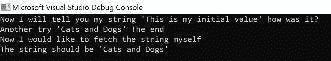

现在你已经熟悉了运算符重载的概念，让我们更仔细地查看赋值运算符运算符，这可能是 C++ 中使用的最重要的运算符之一，因为它允许赋值、拷贝和移动。注意，在本节中，我们讨论的是赋值而不是初始化。正如你可能记得的，C++ 中的默认赋值使用浅拷贝方法，因此如果我们有一个指针，就必须使用深拷贝（Deep Copy）。为了重载赋值运算符，我们必须使用成员函数。然后我们使用关键字 `operator` 后面跟赋值运算符 `=`。这是一个示例：

```cpp
Type &Type :: operator = (const type &rhs);
//rhs 代表右侧对象
```

让我们使用我们的演示库类 `Lib_Books` 并看看这段代码看起来像什么样：

```cpp
Lib_Books &Lib_Books :: operator = (const Lib_Books &rhs); 
book_name1 = book_name2; //现在我们可以使用非常简单的代码
```

让我们看另一种在类中使用赋值运算符的方法：

```cpp
Lib_Books &Lib_Books :: operator = (const Lib_Books &rhs); {
    if (this == &rhs) //我们首先需要检查两个对象
    // 是否是同一个
    return *this; //如果对象相同，我们返回
    // *this 的值 
}
```

在这个示例中，我们使用 `this` 指针作为左侧对象，并使用深拷贝（Deep Copy）赋值右侧对象的值。这意味着左侧对象（我们的指针）将被覆盖，因此我们必须释放它指向的所有内存。我们如何做做呢？我们首先需要删除它所指向的对象：

```cpp
Delete this->str; //由于指针 this 指向一个字符串，我们
// 删除它 (str)，如果不这样做，我们将导致
// 内存泄漏
```

现在，当 `rhs` 对象被拷贝到 `lhs` 对象时，我们必须为深拷贝分配新内存。我们还需要在堆上分配足够的空间来存放 `rhs` 对象中字符串的大小，因此我们使用 `strlen` 和 `+1`，因为我们需要一个字符串终止符的空间：

```cpp
str = new char [std::strlen(rhs.str) +1];
```

我们现在可以使用 C++ 字符串库风格的拷贝方法 `std::strcpy`，它会为我们处理字符串拷贝：

```cpp
std::strcpy(str, rhs.str);
```

现在我们可以请求在 `lhs` 对象中返回拷贝的值：

```cpp
return *this;
```

现在让我们看看如何通过使用移动语义（move semantics）来重载赋值运算符。你也会注意到与我们目前为止所做的非常相似。如果你还记得，我们解释并演示了移动构造函数（Move Constructor）语义与拷贝构造函数非常相似，但在这种情况下我们不使用深拷贝。记住我们需要使用双 ampersand 符号。

```cpp
Type &Type :: operator = (&&);
```

当我们使用移动赋值时，代码看起来是这样的：

```cpp
Lib_Books &Lib_Books :: operator = (Lib_Books &&rhs); {
    if (this == &rhs) //我们首先需要检查两个对象
    // ... 逻辑 ...
}
```

让我们看看 C++允许允许重载的其他运算符，特别是作为成员函数的运算符。你已经熟悉了处理单个操作数的一元运算符，在本节中，我们将查看递增 `++`、递减 `--` 以及否定运算符 `-`。

首先，让我们看看我们的方法声明是怎样的：

```cpp
ReturnType Type :: operator();
```

注意在此方法中，新对象将按值返回。假设有一个显示数值的类；我们的代码如下：

```cpp
Value Value :: operator++(); //前递增
Value Value :: operator++(int); //后递增
Value Value :: operator--();
Value Value :: operator-() const;
```

类似地，我们可以重载二元运算符（`+`、`-`、`==`、`!=`、`<`、`>` 等）。这是我们方法原型的形式：

```cpp
ReturnType Type :: operator(const &Type rhs);
```

我们的代码如下：

```cpp
Value Value :: operator+(const &Value rhs) const;
Value Value :: operator-(const &Value rhs) const;
Value Value :: operator==(const &Value rhs) const;
Value Value :: operator<(const &Value rhs) const;
```


`ReturnType Type ::operator Operator_Name(Type &object);` 这是我们的代码看起来的样子（假设我们正在处理一个类的友成员）：

```cpp
Value operator++(Value &obj); //前置增
Value operator++(Value &obj, int); //后置增
Value operator--(Value &obj);
Value operator-(const Value &obj);
```

以非常相似的方式，我们可以重载带有二元运算符（`+`, `-`, `==`, `!=`, `<`, `>` 等）的非成员函数。你可以看到，主要的区别在于我们在参数列表列表中有两个参数，而不是像我们在一元运算符中那样只有一个参数。在这个示例中，这两个参数分别命名为 `left hand side (lhs)` 和右侧 `right hand side (rhs)`。

这是我们的方法原型看起来的样子（假设我们正在处理一个类的友成员）：

`ReturnType operator *Operator_Name*(const &Type lhs, const &type rhs);`

这是我们的代码看起来的样子：

```cpp
Value operator +(const &Value lhs, const &Value rhs); 
Value operator -(const &Value lhs, const &Value rhs); 
bool operator ==(const &Value lhs, const &Value rhs); 
bool operator !=(const &Value lhs, const &Value rhs); 
bool operator <(const &Value lhs, const &Value rhs);
```

# 第 18 章：C++ 封装

封装是面向对象编程的几个基本支柱之一，与继承和多态一起——我们将在接后的章节中解释它们。封装的基本概念是不需要将你的类的内部细节暴露给外部。这被称为数据隐藏，意味着你只为你的类成员提供必要的访问。其他人甚至说，封装就像是你把你所有的问题并把它们放在一个胶囊形状的胶囊中。当你买了一台电视时，你可以打开螺丝并将一根电线连接到另一根电线上。这样做可以切换频道或开关电视，但制造商创建了专门的按钮或选项来实现这些操作。类的情况也是如此。数据隐藏允许你标记他人应该如何使用该类。事实上，这是一种抽象——你不需要知道电线是如何连接的，也不需要知道电视电子设备是如何工作的。你只需要知道如何插上、开启并使用遥控器。封装的第二个重要益处是它允许我们控制谁可以访问我们的程序，谁不能访问。为了实现封装，我们使用两种方法：

- 使用访问修饰符。你已经知道我们之前介绍过的 `private`、`public` 和 `protected` 访问修饰符。
- 使用 getter 和 setter。getter 和 setter 是简单但强大的函数，为我们对私有数据成员的访问提供了精细控制。我们很快就会演示并解释更多关于 setter 和 getter。

事实上，必须指出，将数据成员声明为 `private` 或 `public` 对代码执行的效率没有影响，编译器的视角也没有太大。有些编码人员将所有数据成员设为 `public`，这既不会减慢程序，也不会导致它消耗更多内存。封装的唯一优势（这是一个非常重要的优势）是代码的可读性以及以后其他编码人员甚至你自己对该类的易用性。将数据成员声明为 `private` 确保了你做了一个标记，不要从类外部直接访问此数据成员，而是使用专门的函数来操作。在这样的函数中你可以添加日志文件条目，因此你不希望数据成员被该函数直接访问从而丢失日志条目，等等。`public` 数据成员是类的前端。它们反映了你希望你的类的用户做什么。

## 如何使用 getter 和 setter

使用 getter 和 setter 允许你控制私有数据成员，并且只有在你确实需要精细调整这种访问时才使用它们。假设我们有一个代表专业马拉松跑者等级的类。有三个等级：金、银、铜：

```cpp
#include "pch.h" 
#include <iostream> 
// 我们定义了一个名为 Marathon 的类 
// 它用于根据跑步者的会员等级对其进行分类， 
// 等级可以是：金、银和铜。 
// 默认等级是“gold”。我们使用 getter 和 setter 函数来设置或
// 获取值。会员等级存储在“private”部分，
// 无法直接访问，只能通过 getter 和 setter 函数。 
class Marathon { 
private : 
    std:: string level = “gold” ; //默认等级 
public : 
    std:: string name; 
    std:: string get_level() { 
        return level; 
    } 
    void set_level(std:: string value ) { 
        if ( value ==“gold” || value == “silver” || value == “bronze” ) { 
            this ->level = value ; 
        } 
    } 
    Marathon(std:: string name , std:: string value ) { 
        this ->name = name ; 
        this ->level = value ;
    }
    ~Marathon() {} 
}; 
int main() { 
    Marathon value( “John” , “silver” ); 
    value.set_level(“bronze” ); 
    std::cout << value.get_level().c_str() << std::endl; // 显示 bronze 值。
    value.level = “green” ; //错误！我们不能在 main 中访问 level！ 
}
```

在这个示例中，我们有一个公共方法 `get_level`，但这个方法需要访问私有数据成员 `value`。`get_level` 方法是一个 getter，它在类的范围内，因此它有访问权限，但类外的任何其他地方都无法访问。我们有另一个名为 `set_level` 的方法，它是我们的 setter。它设置 `level` 的值并使用 `this` 指针来实现。（在其他语言中，你可能会遇到 `property` 术语，它在单个函数中执行与 getters 和 setters 类似的工作。在 C++ 中，我们同时使用这两个函数。）

然后我们想使用赋值运算符来更改 `level` 的值：

`value.level = "green" ; //错误！我们不能在 main 中访问 level！`

我们将得到编译错误。所以，你可以看到，如果不使用 getter 和 setter 函数，我们就无法访问私有数据成员。当我们注释掉那行问题的代码时，我们得到了这个结果：


正如你看到的，setter 允许我们更改值。这是一个非常强大且实用的概念，你会在 C++ 中经常。

# 第 19 章：继承

继承允许我们使用现有类创建新类，并经常用于 C++ 程序。新创建的类从另一个使用的类“继承”行为和数据，重用方法等。这是一个节省时间和大量工作的好方法，因为我们可以关注类之间的共性，例如属性和方法，同时可以根据我们新创建类的用例对其进行修改。例如，如果我们有一个支票账户类，我们可以使用继承来创建储蓄账户、学生账户、信托账户等。这样做是因为许多属性、类方法和函数是相同的（例如，账户名称、账号、存款、取款等）。当我们谈论继承时，可以使用单继承或多重继承。

单继承是从单个类创建的类。多重继承是指一个类从两个或多个类创建的。

被继承的类被称为 `base class`、`super class` 或 `parent class`。从父类创建的类被称为 `derived class`、`sub class` 或 `child class`。


# 继承概念

在继承方面，要理解的最概念之一是“是一个”（Is-A）关系。理解这个概念的方法首先是理解被继承的类是父类的子类型。这正是我们使用“是一个”关系时所隐含的含义。我们将在本节中进一步解释这一概念以及我们如何进一步使用它。你需要学习的另一个概念是“泛化”（generalization），当我们把几个具有相似功能的类根据它们的通用属性合并成一个单一的通用类时，泛化就会发挥作用。而“特化”（specialization）的概念在某种意义上是相反的，因为它创建一个具有更特定属性、方法和功能的类。

## 层次结构

处理继承时，另一个核心术语是“层次结构”（Hierarchy）。层次结构是我们从上到下组织继承关系的方式。这允许我们更好地组织代码。下方的图展示了层次结构是如何与泛化和特化共同作用的：

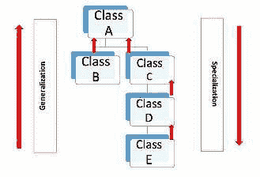

在这张图中，我们可以看到父类 `A` 与子类 `B` 和 `C` 之间存在关系。层级越高，我们的类就越通用。层级越低，它就越具体。`B` 是一个 `A`，`C` 也是一个 `A`。`D` 是一个 `C`，但 `D` 也是一个 `A`。`E` 是一个 `D`，但它也是一个 `C` 和一个 `A`。显然，类 `B` 不是 `C`。它只是一个 `A`，因为两者之间不存在继承关系。

到目前，你应该已经熟悉类与其父类或子类之间的关系概念，以及我们需要的问题——类 `X` 和类 `Y` 之间是否存在关系？然而，还有另一个我们需要问的问题：类 `X` 是否与类 `Y` 有关系？事实上，这是类继承中的另一个概念，被称为公共继承（“是一个”问题）和组合（composition,“有一个”问题）。让我们复习一些例子：

### 公共继承：
- 客户是一个人。
- 储蓄账户是一个账户。

### 组合：
- 客户有一个账户。
- 储蓄账户有一个存款限额。

在很多情况下，程序员在类中使用组合，而且到目前为止我们一直这样做。例如，当我们类中声明 `name` 和 `age` 属性时，我们使用了组合：

```cpp
Class client
{
private:
    std::str name; //有一个名字
    Account account; //有一个账户
    //以下是语句
};
```

当你开始作为一名程序员工作时，你很快就会发现组合和继承是结合使用的。现在让我们看看如何使用继承从现有类派生出一个新类。

## 实现继承

我们需要做的第一件事是声明父类。如你所知，这个类有它自己的数据成员：

```cpp
class Parent { //类成员 };
```

现在，我们必须声明子类，为此，我们需要一个访问修饰符（private、public 或 protected）以及基类的名称：

```cpp
class Child: access-specifier Parent { //派生类成员 };
```

在在处理继承时，理解访问修饰符的含义是非常重要的。在大多数其他编程语言中，你只会遇到公共继承，但在 C++ 中，我们拥有所有三个选项。首先，最常用的访问修饰符是 `public`，它建立了我们在本节之前解释的“是一个”关系。注意：如果你不指定访问修饰符，默认将使用私有继承。第二个选项是使用 `private` 或 `protected` 访问。这样做将在子类和父类之间建立“有一个”的关系。在本节中，我们将关注公共继承。如果你想了解更多关于私有或保护继承的内容，可以在以下链接中找到额外信息：https://www.learncpp.com/cpp-tutorial/115-inheritance-and-access-specifiers/

让我们复习一个使用公共继承的父类和子类的示例：

```cpp
class Account //父类 { //在这里我们定义类成员 };
class Trust_Account: public Account //子类 {在这里我们定义派生类成员 };
```

观察这两个类时，我们可以问：储蓄账户是一个账户吗？答案是肯定的。你可以看到这两个类之间存在“是一个”的关系。现在我们可以为 `Trust_Account` 类指定特殊的行为，而其他部分将从 `Account` 类派生。

这这一切看起来非常简单，事实也如此，但请记住，随着代码复杂性的增长，继承有时会变得相当复杂。

## 代码示例

让我们复习一下演示继承使用的简单代码。在这个例子中，我们创建了一个名为 `Animals` 的类并创建了两个子类：`Dog` 和 `Cat`。

让我们先看 `.h` 文件中的类原型：
```cpp
#pragma once 
class Animal { 
public : 
    virtual void SaySomething(); 
};
```
现在让我们看 `Animal` 的 `.cpp` 文件：
```cpp
#include <iostream> 
#include“Animal.h”
using namespace std;
void Animal ::SaySomething() { 
    cout <<“I’t know what to say...” << endl; 
}
```
现在我们有两个派生类。这里是 `Dog` 类的 `.h` 文件：
```cpp
#pragma once 
#include“Animal.h”
class Dog : public Animal { 
public : 
    void SaySomething(); 
};
```
以及 `Cat` 类的 `.h` 文件：
```cpp
#pragma once 
#include“Animal.h”
class Cat : public Animal { 
public : 
    void SaySomething() 
};
```
现在让我们看 `Dog` 的 `.cpp` 文件：
```cpp
#include <iostream> 
#include“Dog.h”
using namespace std;
// 这是 Dog 继承的 SaySomething() 函数。
// 它继承自 Animal 类，该类有一个同名的虚
// 函数
// 虚函数就像是每个派生类所继承的真实
// 函数的占位符
// 即：Cat 和 Dog
void Dog ::SaySomething() { 
    cout <<“How How” << endl; 
}
```
现在是 `Cat` 的 `.cpp` 文件：
```cpp
#include "Cat.h" 
#include <iostream>
using namespace std;
// 这是 Cat 继承的 SaySomething() 函数。
// 它继承自 Animal 类，该类有一个同名的虚
// 函数
// 虚函数就像是每个派生类所继承的真实
// 函数的占位符
// 即：Cat 和 Dog
void Cat ::SaySomething() { 
    cout <<“Miahu Miahu” << endl; 
}
```

这个简单的示例展示了我们如何继承一个函数并针对每个类进行特定的修改。让我们从 `main()` 运行程序：

```cpp
#include <iostream> 
#include “Animal.h” 
#include“Dog.h” 
#include“Cat.h”
int main() { 
    Dog myDog; 
    myDog.SaySomething();
    // 相同的函数 (SaySomething) 会为狗
    // 返回“How How”。
    Cat myCat; 
    myCat.SaySomething(); //相同的函数 (SaySomething) 会为猫
    // 返回 Miahu。 
}
```
这是我们预期的结果：

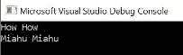

## 使用继承时的构造函数和析构函数

在 C++ 中，子类继承父类的构造函数，但在任何派生对象初始化之前，首先执行父类，然后执行子类。从某种意义上说，由于派生类可以使用封装在基类中的信息，这意味着父类将首先执行构造函数，然后子类执行。

析构函数的调用顺序与构造函数的顺序相反。首先必须销毁派生部分，然后才能销毁基部分。这是我们预期的操作顺序：

基类 / 父类：派生类 / 子类：


注意：无论我们有一个派生类还是多个派生类，构造和析毁的顺序都适用。由于基类构造函数首先初始化，这些构造函数必须被调用。事实上，派生类可以调用构造函数、析构函数和重载的赋值运算符。


我们如何知道哪些构造函数应该初始化，哪些不应该初始化？派生类可以控制传递给基类的参数，从而控制初始化。让我们来看看如何实现：

```cpp
class Account //我们的父类
{
public:
    Account(); //我们的构造函数
    Account(int);
    // 后面是语句
};

Trust_Account:: Trust_Account (int p) //子类 : Account (p), // 如果我们需要，我们可以进一步初始化 { //语句 } 
```

上述代码简单地调用了 `Account()` 构造函数，并初始化了 `Account (int)` 构造函数，后者具有单个整数参数。我们将整数 `p` 传递给父类 `Account` 并进行初始化。让我们看看更详细的代码：

我们的父类包含两个构造函数的形式如下：
```cpp
class Account { 
    int balance; //balance 是私有成员，因为类中默认的访问修饰符是私有的 
    public: 
        Account() : balance {0} { Std::cout <<“no arguments constructor” << std::endl; } 
        Account (int p) : balance {p} { Std::cout <<“integer based constructor” << std::endl; } 
}; 
```
我们的派生类将是：
```cpp
class Turst_Account: public Account { 
    int double_balance; 
    public: 
        // 取消基类构造函数 
        Turst_Account() : Account{}, double_balance {0} { Std::cout <<“Derived constructor with no arguments” << std::endl; } 
        // 初始化派生类自己的 double 类型值属性
        Turst_Account (int p) : Account{p}, double_balance {p * 0.2} { Std::cout <<“Integer derived constructor” << std::endl; } 
}; 
```

你还应该注意，并不是所有内容都会自动继承。让我们来看一个例子，看看子类没有从父类中继承什么内容：

- 基类的构造函数和析构函数。
- 基类的重载赋值运算符。
- 基类的友元函数。

### 修改基类方法

正如我们所解释的，基类成员对派生类是可用的。此外，我们展示了派生类如何调用基类的构造函数。在本节中，我们将解释派生类如何调用、重写或重定义基类方法。为了实现这一点，我们首先需要在派生类中提供该方法名。实现此操作的代码如下：

首先，让我们看看我们的父类：
```cpp
#include <iostream> 
class Account { 
public: 
    // 这是原始的 get_ballance() 函数 
    double get_ballance(double amount) { 
        double ballance{ 100 }; 
        ballance += amount; 
        return ballance; 
    }; 
}; 
class Trust_Account : public Account { 
    // get_balance() 的这个派生版本重定义了基类方法 
    double get_balance(double amount) { 
        double ballance{ 500 }; 
        ballance += amount; 
        amount *= 1.07; // 这行触发了对基类方法的调用 
        return(Account::get_ballance(amount)); 
    } 
}; 
int main() { 
    Trust_Account test; 
    double result = test.get_ballance(1000.0); 
    std::cout <<“result =“ << result << std::endl; 
}
```

你可以看到，我们使用相同的基类方法签名在派生类中重定义该方法。

如你所知，一个类可以继承另一个基类，但在 C++ 中，我们也可以使用多重继承。多重继承是指派生类同时继承两个或多个类。多重继承的语法非常简单：我们声明派生类，然后简单地用逗号分隔基类的名称，如下所示：

```cpp
class Child:
public Parent_1 , public Parent_2
{
    // 在此处放置语句
};
```

多重继承可能非常复杂，我们建议你在重构代码以满足程序需求时，尽量避免使用它。如果你想阅读更多内容，可以访问此链接：`https://www.learncpp.com/cpp-tutorial/117-multiple-inheritance/`

### 关于继承还有很多需要学习的内容，因为它是一个复杂的课题。你会在大多数 C++ 项目中遇到继承，因此我们建议你进一步深你的 C++ 知识。你可以在此链接找到很好的资源：`https://www.geeksforgeeks.org/inheritance-in-c/`，以及这一个：`http://www.cplusplus.com/doc/tutorial/inheritance/`

总结这个主题，请查看下方的代码并遵循它执行。你可以尝试自己修改它，添加另一个类并重定义方法。请注意，这段代码包含一个 getter (get) 和一个 setter (set) 函数，我们将在稍后的章节中详细讨论。

```cpp
#include "pch.h"
#include <iostream> 
using namespace std; // 首先我们定义一个枚举，列出所有可能的军衔 
typedef enum
{ 
    General , 
    Admiral , 
    Major , 
    Lieutenant 
} Rank ; // 我们定义了一个名为 User 的通用类 
class User { 
private : 
    string m_FirstName; 
    string m_LastName;
    int m_UserCode; 
public : 
    void SetDetails( string FirstName , string LastName , int UserCode ) { 
        m_FirstName = FirstName ; 
        m_LastName = LastName ; 
        m_UserCode = UserCode ; 
    } 
    string GetFirstName() { return m_FirstName; } 
    string GetLastName() { return m_LastName; } 
    int GetUserCode() { return m_UserCode; } 
}; // 现在我们从 User 派生了一个新类，称为 Commander 类 
class Commander : public User { 
    Rank m_Rank; 
    void PrintRank( Rank rank ); 
    public : 
    void SetRank( Rank rank ); 
}; // 下面的类打印给定 User/Commander 的军衔
void Commander ::PrintRank( Rank rank ) 
{
    // 由于枚举值实际上是数值，我们可以使用 switch 
    switch ( rank )
    { 
        case Rank :: Admiral : cout <<“Admiral” ; break; 
        case Rank :: General : cout <<“General” ; break; 
        case Rank :: Lieutenant : cout <<“Lieutenant” ; break; 
        case Rank :: Major : cout <<“Major” ; break; 
        default : cout <<“Unknown” ; 
    } 
}
// 这是我们的 setter 函数，因为我们不能直接修改值
void Commander ::SetRank( Rank rank ) { 
    m_Rank = rank ; 
    cout <<“Set rank to” ; 
    PrintRank(rank); 
    cout << endl; 
}

// 这里是我们的 main 函数，我们在其中演示了如何使用这两个类
int main()
{
    Commander ourCommander; // 我们定义了一个 Commander 的实例
    ourCommander.SetDetails( “John” , “Smith” , 1);
    // 我们使用 setter 设置实例中的数据
    cout <<“Our soldier details are: “ << ourCommander.GetFirstName().c_str() <<““ << ourCommander.GetLastName().c_str() << “ ” << ourCommander.GetUserCode() << endl;
    // 我们使用 setter 函数更改数据。这个特定的函数还调用了我们的打印函数，因此在设置值之后
    ourCommander.SetRank( Rank :: Admiral ); 
}
```


# 虚函数

我们提到了虚函数，但它们究竟是什么？我们知道普通函数和方法的作用，但区别在于，虚函数允许我们在运行时将方法重写到子类中。让我们假设我们有两个类：`class A` 和 `class B`，`class B` 继承自 `A`。如果我们在 `class A` 中创建一个方法并将其标记为 `virtual`，那么我们就有选项在 `B` 类中对其进行重写，并用它来执行不同的操作，同时跳过静态默认绑定。这看起来可能很困惑，事实上，这确实是一个比较难掌握的主题。我们将一步步地引导你，解释基本概念和语法，以便你在编程时充满信心。

实际上，我们在之前的几个章节中已经用过编译时多态了：当我们重载运算符时，以及当我们重载函数时。当我们谈论运行时多态时，我们讨论的是函数重写。它也被称为`动态多态`，换句话说：`虚函数`。

因此，在派生类中，我们可以重新定义基类函数的工作方式，并且是动态完成的。这就是虚函数的基本概念——被重写的函数是一个虚函数，它是基类函数的特殊版本。下面是我们用于声明函数为虚函数的语法。这段代码片段来自基类：

```cpp
class Account { public: virtual void deposit (double amount); //statements };
```

让我们看看如何在派生类中重写基类函数：

```cpp
class Trust_Account : public Account { public: virtual void deposit (double amount);
// 在这种情况下我们不需要使用 virtual 关键字，但这样做是最佳实践
语句可以写在这里
};
```

重要提示：要重写一个函数，函数的签名和返回类型必须与基类匹配，否则编译器将对其进行静态绑定。让我们来看一个代码示例。当我们运行下面的代码时，并没有发生动态绑定。让我们通过这段代码来更好地理解它：

```cpp
#include "pch.h" 
#include <iostream> 
// 以下是 Account 类层次结构 
class Account { 
    public : 
    void deposit( double amount ) { 
        std::cout <<“In Account::deposit” << std::endl; 
    } 
}; 
class Trust_Account : public Account { 
    public : 
    void deposit( double amount ) { 
        std::cout <<“In Trust_Account::deposit” << std::endl; 
    } 
}; 
class Student_Account : public Account { 
    public : 
    void deposit( double amount ) { 
        std::cout <<“In Student_Account::deposit” << std::endl; 
    } 
};
class 
Account


            
     { { { { 
 
:: << << << << << for:: account” << std::endl;
    } 
};
class Savings_Account : public Account {
    public : 
    void deposit( double amount ) {
        std::cout <<“In Savings::deposit” << std::endl;
    } 
}; 
int main() { 
    std::cout <<“Pointers pointing to account type“ << std::endl;
    std::cout <<“============================= << std::endl;
    Account *p1 = new Account (); 
    Account *p2 = new Trust_Account (); 
    Account *p3 = new Student_Account (); 
    Account *p4 = new Savings_Account ();
    std::cout <<“Calling our deposit method for each account” << std::endl;
    std::cout <<“=======================================“ << std::endl;
    p1->deposit(0); 
    p2->deposit(0); 
    p3->deposit(0); 
    p4->deposit(0);
    std::cout <<“Delete the pointers ” << std::endl; 
    std::cout <<“=======================================” << std::endl;
    delete p1; delete p2; delete p3; delete p4; 
    return 0;
}
```这就是当我们执行时得到的结果：我们可以看到所有的 `deposit` 方法目前都静态绑定到了基类。

## 我们是如何将这段代码转换为多态的？

首先，我们需要看到想要动态绑定的方法。你能猜到是（哪些）吗？在这段代码中，只有一个方法需要转换为虚函数：`deposit` 函数。我们只需要在函数开头添加 `virtual` 关键字：

```cpp
virtual void deposit( double amount )
```

此外此外，正如我们之前提到的，最佳实践是在派生类的所有方法中添加 `virtual` 关键字。现在让我们运行代码看看会发生什么。这是程序运行时显示的输出：

## 虚析构函数

当使用多态时，我们可能会遇到与销毁对象相关的编译器警告。事实上，当你运行之前的代码时，你可以看到这些警告。为什么会发生这种情况？因为当派生类通过非虚基类指针销毁对象时，这种行为是不符合 C++ 标准的并会导致内存泄漏。使用`析构函数`可以帮助我们使用正确的析构函数来正确销毁对象。这非常简单。如果你的类使用了虚函数，你必须使用虚析构函数，如下所示：

```cpp
class Account
{
public :
    virtual void deposit( double amount );
    virtual ~Account();
};
```

看到语法非常简单，我们在析构函数之前添加 `virtual`。

## 纯虚函数

在深入纯虚函数之前，让我们了解另一个术语：`抽象类`。抽象类也称为抽象基类，在继承体系中用作基类，且不能实例化（创建类对象）。到目前为止，我们使用的是可以实例化的类，它们被称为`具体类`。正如你已经看到的，它被用于定义一种可以在程序栈上作为自动变量实例化的有用对象。准确地说，抽象类被用作父类，派生自它的类可以是`具体类`。例如，当我们使用 `Account` 类和派生类时，我们可以说不存在“仅仅是一个账户”这种东西——如果客户想开账户，他们将需要选择他们账户类型，因为“Account”这个通用术语太抽象了。重要重要的是，抽象类必须包含至少一个纯虚函数——这让我们回到了本节的主题。

什么是纯虚函数，它看起来是什么样的？首先，它用于使类变为抽象，并在声明中使用 `= 0` 声明：

```cpp
virtual void function() = 0;
```

通常，我们不会为纯虚函数添加任何实现，因为这通常会在派生类中添加。这意味着派生类必须重写基类——否则，派生类也将成为抽象类。

那么，我们什么时候使用抽象类呢？当我们不需要在基类中使用任何函数实现时，使用它们最好。这一切看起来可能很困惑，但这样想：你还记得继承部分的泛化图吗？就是你不能在银行开一个通用账户，只能开特定的账户，例如活期账户、信托账户或储蓄账户。通用基账户类是抽象的，将没有纯虚函数的实现，因为这个账户只是一个具有所有派生类共性的骨架，而不是真正的账户类型。让我们看另一个例子。假设我们有一个名为 `Shape` 的类。`Shape` 是一个通用术语，可以描述圆、三角形或正方形。因此，`Shape` 是一个完美的抽象类，`Shape` 的属性必须与它的所有派生类具有共同的共性。

同样重要的是，在处理抽象类时，我们不能创建抽象类对象或在堆上分配新内存：

```cpp
Account account; // 编译错误
Account *ptr = new Account (); // 编译错误
```

然而，我们可以在派生具体类内部使用指针和引用来实现态：

```cpp
Account *ptr = new Saving_Account(); // 正常，无编译错误
ptr->deposit(); // 正常，无编译错误
```


让我们来看另一个代码示例。在这个例子中，我们有一个游戏和几个抽象类：基抽象类名为 `Rank`。`Rank` 有 3 个派生抽象类：`General`（将）、`Colonel`（上校）和 `Captain`（上尉）。每个派生类都有自己的派生具体类：`Player_General`、`Player_Colonel` 和 `Player_Captain`。`Rank` 类有两个纯虚函数：`move` 和 `go_back`。现在让我们来看代码，在目前阶段，它应该非常清晰且易于理解：

```cpp
#include "pch.h"
#include <iostream>
#include <vector>
using namespace std;
class Rank // 抽象基类
{
private :
    // 所有等级共有的属性
public :
    virtual void move() = 0; // 纯虚函数
    virtual void go_back() = 0; // 纯虚函数
    virtual ~Rank() { }
};
class General : public Rank // 抽象类
{
public :
    virtual ~General() { }
};
class Colonel : public Rank // 抽象类
{
public :
    virtual ~Colonel() { };
};
class Captain : public Rank // 抽象类
{
public :
    virtual ~Captain() { };
};
class Player_General : public General // 具体类
{
public :
    virtual void move() override {
        cout <<“The General is moving forward” << endl;
    }
    virtual void go_back() override {
        std::cout <<“The General is moving backward” << std::endl;
    }
    virtual ~Player_General() {}
};
class Player_Colonel : public Colonel // 具体类
{
public :
    virtual void move() override {
        std::cout <<“The Colonel is moving forward” << std::endl;
    }
    virtual void go_back() override {
        std::cout <<“The Colonel is moving backwards” << std::endl;
    }
    virtual ~Player_Colonel() {}
};
class Player_Captain : public Captain // 具体类
{
public :
    virtual void move() override {
        std::cout <<“The Captain is moving forward” << std::endl;
    }
    virtual void go_back() override {
        std::cout <<“The Captain is moving Backwards” << std::endl;
    }
    virtual ~Player_Captain() {}
};
int main() {
    Rank *ptr1 = new Player_General ();
    ptr1->move(); // 调用 move 函数并动态绑定
    ptr1->go_back(); // 调用 go_back 函数并动态绑定

    Rank *ptr2 = new Player_Colonel ();
    ptr2->move(); // 调用 move 函数并动态绑定
    ptr2->go_back(); // 调用 go_back 函数并动态绑定

    Rank *ptr3 = new Player_Captain ();
    ptr3->move(); // 调用 move 函数并动态绑定
    ptr3->go_back(); // 调用 go_back 函数并动态绑定
}
```

当我们运行这段代码时，我们预期的结果是：

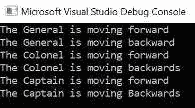
随着你对 C++ 知识和经验的增加，多态还有更多内容可以学习。你可以在以下链接中找到非常有用的信息：`http://www.cplusplus.com/doc/tutorial/polymorphism/`

# 第 21 章：C++ 练习

你在精通 C++ 的道路上已经走了很远。C++ 是一门复杂且难以掌握的编程语言，还有很多需要学习的内容。下面你将看到一个代码示例，用来总结你在书中学到的内容。这个练习旨在解决一个复杂的问题，同时利用你目前已获得的工具和知识来完成它。

## 练习示例

### 在反方向移动 vector 元素

在这个代码谜题中，我们需要旋转 vector 中的项，使得第一个项变成最后一个项，第二个项变成倒数第二个项。例如，如果我们有一个值为如下的 vector：

**3, 8, 9, 7, 6**

你需要翻转 vector 元素的顺序，使其显示为：

**6, 7, 9, 8, 3**

解决这个问题有多种方法，下面演示的方法在时间和资源方面是最效率的。

以下代码移动了传递给我们函数的、以 vector 形式传入的给定数字集合的内容。接下来，我们将每个项向右移动，无法再向右移动的最后一项（最右侧）被放在最左侧的位置。这种移动被称为“位移”（shifting），用于许多用途，例如为了统计目的打乱数据。

让我们来看代码中的一些函数：

- `shift_once()` 执行单次位移。
- `print_vector()` 输出 vector 在当前状态下的内容。正如之前解释的，为了调试测试目的，拥有自己的“打印”函数总是很有用的。
- `shift_all()` 函数执行 `K` 次位移，其中 `K` 是随 vector 一起提供的函数参数。
- `main` 函数仅在给定预定义 vector 和值 `K` 的情况下调用 `shift_all()`。

```cpp
#include "pch.h"
#include <iostream>
#include <vector>
using namespace std;

// print_vector 函数显示 vector 的当前状态
// 建议在几乎任何工作或练习中准备好这样的函数
// 这样做可以让你打印 vector 在任何时刻的状态
void print_vector( vector < int > v )
{
    int len = v .size();
    for ( int i = 0; i < len; i++)
    {
        cout << i << “ = “ << v [ i ] << endl;
    }
}
// 此函数是项目的构建模块
// 在此函数中我们位移 vector 一
// 然后我们可以多次调用此函数来多次位移 vector
void shift_once( vector < int > & v ) {
    int len = v .size();
    int temp = v [ len - 1 ]; // 为了位移 vector，我们首先将最后一个项存储在‘temp’中
    for ( int i = len - 1; i > 0; i--) {
        v [ i ] = v [ i - 1 ]; // 然后向向移动并将每个项设置为上一个项的值
    }
    v [ 0 ] = temp; // 最后我们将第一个项设置为
}
// 此函数通过调用 shift_all 参数将 vector 位移 K 次
vector < int > shift_all( vector < int > A , int K ) {
    for ( int i = 0; i < K ; i++) {
        cout <<“Shifted vector:\n” ;
        shift_once( A );
    }
    return A;
}
// 这是项目的主函数
int main() {
    vector < int >v{ 3, 8, 9, 7, 6 };
    vector < int > shifted;
    shifted = shift_all(v, 3);
    cout <<“Solution vector:\n” ;
    print_vector(shifted);
    return 0;
}
```


当你学习原始指针（raw pointers）时，你会发现原始指针在代码中使用起来非常健壮。指针允许我们以灵活的方式分配和释放内存，从而帮助我们在程序生命周期内更好地管理程序。然而，有时这些操作会为各种问题和故障留下后门。一旦稍有疏忽，你的整个程序就会面临崩溃的危险。由于原始指针的管理完全由程序员负责，而且每个动态分配的对象都必须随之进行手动释放，如果你不小心犯了错误并忘记进行手动释放，可能会导致严重的问题。这些问题可能是内存泄漏。

在处理动态分配的数组时，可能会出现更多问题，因为删除数组对象需要不同的运算符。这基本上意味着你被迫跟踪每一个分配的存储空间。未能这样做将导致你的程序出现未定义行为。

原始指针有许多潜在问题，例如提到的内存泄漏和野指针（wild pointers，即未初始指针），它们可能指向内存中的任何地方。你还学习了悬挂指针（dangling pointers），它们指向一个认为是有效但实际上无效的存储空间。还有与指针相关的问题、异常和潜在的 Bug。在处理复杂代码时，这可能会导致灾难性的结果。

现代 C++ 引入了智能指针（Smart pointers）来防止这些问题。在许多情况下，使用智能指针可以让你生活变得更轻松，防止你花费数小时来寻找和修复 Bug。许多程序员只使用智能指针，而另一些则同时使用智能指针和原始指针。在现代 C++ 中，我们也使用原子指针（Atomic Pointers），但我们在本节中不会涵盖这个主题，因为它更高级且涉及多线程。

让我们了解什么是智能指针以及它们是如何工作的。

智能指针允许自动管理内存的分配和释放，以解决并防止上述所有问题。智能指针是 C++ 对象，并实现为 C++ 模板类（就像我们使用内置的 C++ `vector` 类的方式）。你将在稍后的章节中学习更多关于 C++ 模板类的知识。智能指针只能指向分配在堆上的内存。当不再需要使用已分配的内存时，智能指针会自动将其删除。智能指针基本上就是 C++ 类，它们是 C++ 库的内部部分，并封装了原始指针，因为这些类知道如何在各种情况和用例下处理原始指针。记住这一点是，智能指针无法进行任何算术运算，而原始指针允许你这样做。

C++ 提供了几种类型的智能指针：

- 唯一指针 (`unique_ptr`)
- 共享指针 (`shared_ptr`)
- 弱指针 (`weak_ptr`)
- 自动指针 (`auto_ptr`) - 本节不涵盖自动指针，因为它们是过去的事物，在现代更新的 C++ 代码中几乎不再使用。我们将在本节中解释并演示所有这些指针的用例和方法。

首先，为了使用智能指针，我们需要包含 C++ 内存 `.h` 文件，因为它包含了使用智能指针的方法和函数：`#include <memory>`。使用智能指针的语法如下所示。记住析构函数是自动调用的：

```cpp
{
std::pointer_type <Class_Name> ptr = … .. ptr -> function (); //函数体写在此处 
}
```

### 智能指针与 RAII 设计模式

`RAII` 术语与 C++ 中使用的设计模式有关，它基于容器对象的生命周期。`RAII` 的首字母代表“资源获取即初始化”（Resource Acquisition Is Initialization）。初看，这个复杂的名称似乎很复杂，但实际上非常简单。`RAII` 对象存储在栈上。`RAII` 对象需要资源来执行各种操作，例如分配内存。`RAII` 对象需要初始化——到目前你应该已经熟悉这个概念了。这些对象也必须释放，就像我们使用析构函数那样样。

智能指针是 `RAII` 类，因为它们符合我们刚刚提到的每一个特征。

### 唯一指针

我们已经向你介绍了在 C++ 中使用的智能指针类型。让我们探索每种类型并看看它们是如何以及何时使用的。我们将研究的第一个智能指针是 `unique_ptr`，因为这可能是最简单、最常用的指针。当你开始处理现有代码时，可能会看到很多它。

`unique_ptr` 正如其名，是唯一的。这意味着你只能使用一个 `unique_ptr` 指向堆上的一个对象，它可以根据我们的需要指向任何对象类型。它也被称为指针与对象内存分配之间的所有权关系。`unique_ptr` 也可以拷贝或赋值给另一个内存分配。这是合理的，因为我们刚刚提到了 `unique_ptr` 与分配内存之间的所有权关系——这种关系是双向。然而，`unique_ptr` 可以被移动（move）。

最后，当指针被销毁时，它指向的内容也会被自动销毁，因为它持有唯一的所有权关系。

让我们来看看使用 `unique_ptr` 的代码示例：
```cpp
{ 
std::unique_ptr <int> p {new int {30}}; 
std::cout << *p << std::endl; 
*p = 2; 
std::cout << *p << std::endl; 
}
```

`unique_ptr` 还有一些非常棒的方法，这些方法是内置在类中的。让我们快速看一眼这些一些方法：

```cpp
{ 
std::unique_ptr <int> p {new int {30}}; 
if (p) //检查 p 是否初始化 
std::cout << *p << std::endl; //将显示 30 
p.reset(); //将指针设置为 nullptr 
if (p) //检查 p 是否初始化 
std::cout << *p << std::endl; //不会执行，因为我们刚刚//将 p 设置为空指针 
std::cout << p.get() << std::endl; //将显示堆上的内存//地址。会自动删除//对象//指向的内容。 
}
```

有一种更好的方法来初始化唯一指针，我们不需要使用 `new` 关键字，同时保持代码更简单整洁。这种方法称为 `make_unique`，它是在 C++14 中引入的。这种方法帮助我们防止与对象超出作用范围后清理过程相关的某些异常。你将在后的章节中学习更多关于异常的知识。

```cpp
std::unique_ptr<int> p = std::make_unique<int>(100);
```

所以，你可以看到我们将 `p` 初始化为堆上的一个新的 `int` 对象。我们随后对其进行解引用，就像我们使用原始指针那样。然后，我们也可以修改我们指向的整数，就像我们使用原始指针那样。然而，使用 `unique_ptr` 修改对象不是良好的做法；使用原始指针来这样做更好。一旦指针超出作用范围，它也会自动销毁，以及它指向的内容。

让我们回顾另一个真实的代码示例。注意在这段代码中我们使用了 `static_cast`，它在某些情况下是一个很好且有用的东西。`static_cast` 是类型之间简单的隐转换（例如从 int 到 float，或指针到 void* 等）。

```cpp
#include <iostream>
#include <memory>
using namespace std; // 这里我们定义了一个测试类 Chocolate，为了演示 // unique_ptr 如何工作 // 该类除了在实例获取或销毁时打印到控制台之外什么都不做 // 构造函数打印“Chocolate has been acquired\n”。 // 析构函数打印“Chocolate has been destroyed\n”。
class Chocolate { 
public : 
    Chocolate() { cout <<“Chocolate has been acquired\n” ; } 
    ~Chocolate() { cout <<“Chocolate has been destroyed\n” ; } 
}; 
int main() { // 我们定义了两个对象：myWhiteChocolate 和 myDarkChocolate。

// 我们将 myDarkChocolate 设置为空，同时我们将 myWhiteChocolate 创建为
```


```cpp
//new instance. std:: unique_ptr < Chocolate > myWhiteChocolate{ new Chocolate {} }; //Chocolate created here
 std:: unique_ptr < Chocolate > myDarkChocolate{}; // Start as nullptr // Now we print the current status

std::cout <<“myWhiteChocolate is “ << ( static_cast < bool > (myWhiteChocolate) ?“not null\n” : “null\n” );

std::cout <<“myDarkChocolate is “ << ( static_cast < bool > (myDarkChocolate) ?“not null\n” : “null\n” );

// Note: if you assign myDarkChocolate to be equal to myWhiteChocolate,
// you will get a compilation error // since copy assignment is disabled. /* DO NOT USE:
myDarkChocolate = myWhiteChocolate; // Won’t compile: copy assignment is disabled disabled */ 
// Now let’s do it the right way, by calling std::move()

myDarkChocolate = std::move(myWhiteChocolate); // myDarkChocolate assumes ownership, myWhiteChocolate is set to null 
std::cout <<“Ownership transferred\n” ;

// Now we print the current status for the 2nd time

std::cout << “myWhiteChocolate is “ << ( static_cast < bool > (myWhiteChocolate) ?“not null\n” : “null\n” );

std::cout <<“myDarkChocolate is “ << ( static_cast < bool > (myDarkChocolate) ?“not null\n” : “null\n” );

}
```

当我们运行这段代码时，预期的结果如下：

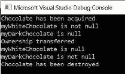

在处理 `vector` 和 `unique_ptr` 时，我们必须记住不能使用拷贝赋值，而是要使用移动（move）：

```cpp
{
std::vector < std::unique_ptr int> > vec;
std::unique_ptr <int> p;
vec.push_back (p); //W on’t work! Copy not allowed.
vec.push_back ( std::move (p) ); //This will work
}
```

当然，为了运行这段代码，我们必须 `#include vector`。

## 共享指针 (Shared Pointers)

共享指针被称为 `shared_ptr`，正如其名所示，它们对堆上的对象提供共享所有权。可以有很多 `shared_ptr` 指向同一个地方。换句话说，`shared_ptr` 不是唯一的，因此与 `unique_ptr` 完全不同，它们提供了共享所有者关系。`shared_ptr` 可以被拷贝和赋值，也可以被移动。同样重要的是，共享指针默认不具备处理数组的能力。在析构函数方面，它比 `unique_ptr` 复杂一点，因为有多个指针指向同一个对象。有几种方法可以确定何时销对象，最常见的方法是使用计数器，每当有一个 `shared_ptr` 指向该对象时计数器就会计数。只有当计数器为 0 时，堆上的对象会被自动销。

为了创建和初始化 `shared_ptr`，我们使用与 `unique_ptr` 相同的语法：

```cpp
{ std::shared_ptr <int> p {new int {30}}; std::cout << *p << std::endl; *p = 2; std::cout << *p << std::endl; }
```

在这个示例中，我们显然只有一个 `shared_ptr` 指向堆上的对象。

为了初始化共享指针，最好的方法是使用 `make_shared` 方法，它允许我们通过将想要初始化的值传递给构造函数来轻松地初始化共享指针，从而在运行时完成初始化。这种方法非常强大，并帮助我们生成简单整洁的代码，因为我们不需要使用 `new` 关键字在堆上分配新内存。以下是该方法的调用和使用方式：

```cpp
{ std::shared_ptr <int> p1 = make_shared <int> (10); std::shared_ptr <int> p2 {p1}; std::shared_ptr <int> p3; p3 = p1; }
```

如上所示，使用这种方法将初始化所有对象为 10。你可以看到代码是简单到了极简的程度。

我们已经提到，为了在对象超出作用范围时销毁它，我们需要使用计数器来记录何时不再有任何 `shared_ptr` 指针活跃地指向该对象。此此最佳方法是使用 `use_count()` 方法。让我们来看看方法的基础，它返回管理堆对象的 `shared_ptr` 数量：

```cpp
std::shared_ptr <int> p1 {new int {30}}; std::cout << p1.use_count() << std::endl; //count 1
std::shared_ptr <int> p2 {p1}; std::cout << p1.use_count() << std::endl; //count 2
p1.reset(); //decrements the count by 1 as it sets //the p1 to nullptr std::cout << p1.use_count() << std::endl; //count 0 std::cout << p2.use_count() << std::endl; //count 1
p2.reset(); std::cout << p2.use_count() << std::endl; //count 0
```

如你所见，当我们把 `p1` 置空时，计数减了 1，但作为共享指针的 `p2` 仍然指向同一个对象 `p1` 所指向的对象。只有当我们对 `p2` 使用 `reset` 方法（`p2.reset()`）后，计数器才会设置为 0，对象会被析构，因为两个共享指针都离开了作用范围，不再需要使用该堆对象。

在处理 `vector` 时，`shared_ptr` 既可以使用拷贝赋值也可以被移动。因此，在这种情况下，以下代码可以运行：

```cpp
{ std::vector < std::shared_ptr <int> > vec; std::shared_ptr <int> p; vec.push_back (p); //will work }
```

## 弱指针 (Weak Pointers)

弱指针被称为 `weak_ptr`，它们总是从共享指针创建。然而，与 `shared_ptr` 不同，它们与所指向的对象没有任何所有者关系，并且对对象的生命周期没有影响（换句话说，它们不参与像 `shared_ptr` 那样的计数活动）。这听起来奇怪吗？让我们解释一下：弱指针用于我们防止任何强引用循环的情况，这可能会影响对象的删除。这就像是你拷贝了共享指针实体，但作为一个非所有权的引用或弱引用位置。

为了使用弱指针，我们使用以下代码：

```cpp
{ std::shared_ptr<int> p_shared = std::make_shared<int>(100); std::weak_ptr<int> p_weak1(p_shared); std::weak_ptr<int> p_weak2(p_weak1); }
```

在这个示例中，`p_weak1` 和 `p_weak2` 指向由 `p_shared` 拥有的数据，但引用计数不会增长。


例如，异常情况可能指的是我们没有足够的资源来处理程序的情况，或者我们使用了无效操作、违反了范围以及许多其他异常情况。异常处理是 C++ 中的一个巨大优势，因为我们可以实时针对程序的异常。

非常重要的一点是，C++ 中的异常处理应该只在同步代码中执行，而不是在异步代码中执行。在 C++ 中使用异常处理时，有特定的术语：

- `Exception`（异常）——一种基本类型或对象类型，指示已发生或即将发生的错误。这还包含了关于异常的信息，换句话说就是：发生了什么。

- `Throwing an exception`（抛出异常）——当出现问题时，会抛出一个异常。抛出异常可以交给程序的其他部分，这些部分将知道如何处理。例如，如果抛出一个异常且程序即将崩溃，我们可能希望先保存文件或数据，因此让程序的其他部分来处理，从而实现“软崩溃”。在这种情况下，抛出异常就像一个篮球球员遇到问题后将球传给另一个球员，希望他的队友能接手处理这个球。

- `Catching an exception`（捕获异常）——一旦程序的其他部分捕获了异常，它将需要以我们定义的方式进行处理。这可能会导致程序终止、关闭特定窗口、恢复、记录错误消息或部分关闭程序。例如，假设我们的程序需要向数据库写入某些内容，但数据库已满。程序的这部分运行了一个异常，可能其他部分可以删除不必要的数据条目，并允许程序照常继续运行。

C++ 在处理异常时使用特定的关键字：

- `try { statement }` —— 当我们想要使用可能会导致异常的代码段时，我们使用 `try` 关键字。如果抛出异常，程序将退出代码块并跳转到 catch 处理器（捕获处理程序）。如果没有 catch 处理器，程序将终止。

- `throw` —— 当要抛出异常时，我们使用 `throw`，后面跟着一个参数，该参数就是我们想要抛出的异常。例如，如果我们想分配新内存但内存已满，就可以使用它。

- `catch {statement}` —— 当我们需要一个 catch 处理器时，我们使用 `catch`，这是另一个我们为此目的而专门（dedicated）的代码段，用于处理异常。例如，如果内存满了，我们可能可以删除一些不必要的存储项或清除缓存项。

让我们看一个简单的例子。在这个例子中，我们用 `int a` 除以 `int b`。如果 `int b` 为 0 会发生什么？我们的程序会崩溃吗？它会溢出吗？这取决于具体的应用，但假设我们希望 `int b` 等于 `0`，因为它会引起问题。在这种情况下，我们需要处理异常。这里是我们的基础代码（假设所有变量已声明并初始化）：

```cpp
double sum {}; sum = int a / int b;
```

当然，我们可以检查 `b` 是否等于 `0`，如果是，我们就不执行除法。但如果 `b` 等于 `0` 我们该怎么办呢？异常处理就派上用场了：

```cpp
double sum {}; try //我们的 try 语句 { if (b==0) throw 0; //抛出一个异常 } sum = a / b; catch (int &ex) //我们的异常处理器 {
std::cout <<“Please change the value of b to be higher than 0” << std::endl;
}
```

## 来自函数的异常处理

函数和方法也可以处理异常，并且也可以抛出多个异常。让我们看看如何从函数处理异常的示例。下面是一个简单的函数（我们假设所有对象已声明并初始化）：

```cpp
double sum (int a, int b) { return static_cast <double> (a / b);
//使用 static_cast 以防整数不是双精度浮点数，将其转换为 double
}
```

如果 `int b` 为 0 会发生什么？我们可以重写这个函数：

```cpp
double sum (int a, int b) { if (b == 0) //如果 b 等于 0，我们抛出一个异常 throw 0; return static_cast <double> (a) / b; }
```

现在，我们需要找到一个处理器来捕获该异常。我们可能完全没有处理器，在这种情况下，我们的程序将会崩溃。如果存在处理器，它必须在调用此函数的调用栈上被找到：

```cpp
double sum {};
try { sum = calc_sum (int a, int b); std::cout << sum << std::endl; } catch (int ex) { std::cerr << “Exception“ << ex << std::endl; }
```

注意我们使用了 `std::cerr`。我们使用它是因为 `std::cerr` 是类 `ostream` 的一个对象，代表面向窄字符的标准错误流。

### 多重异常处理

正如我们之前反复提到的，C++ 允许我们在函数或方法中处理多个异常，因为函数或方法可能会在各种情况下失败。假设我们有一个函数计算汽车每加仑油的英里数。我们假设所有对象已声明并初始化。代码如下：

```cpp
double calc_mpg (int miles, int gallons) //mpg = 每加仑英里 { return static_cast <double> (miles) / gallons; }
```

如果英里数为负数会发生什么？如果 `gallons` 为 0 会发生什么？让我们看看如何通过多重异常处理来处理这些问题，你会发现非常简单：

```cpp
double calculate_mpg( int miles, int gallons ) { if ( gallons == 0) throw 0; ( ( < 0 || || < 0)) std:: string {“Error! It is impossible to drive a negative number of miles }; }; static_cast < double > miles ) / gallons; }
```当我们调用这个函数时，预期的情况如下：

```cpp
int main() { int miles{}; int gallons{}; double miles_per_gallon{}; std::cout <<“Enter the distance you drove in miles:“ ; std::cin >> miles; std::cout << “Enter the number of gallons you had: ” ; std::cin >> gallons; try { miles_per_gallon = calculate_mpg(miles, gallons); std::cout <<“Result: your car uses “ << miles_per_gallon <<“ per mile” << std::endl; } catch ( int &ex) { std::cerr << “Error! 0 are not an option” << std::endl; } catch(std:: string &ex) { std::cerr << ex .c_str() << std::endl; } std::cout <<“Thank you and goodbye!” << std::endl; return 0; }
```尝试运行代码并输入各种数据，包括负数零。看看异常处理在代码中是如何工作的。

重要的是，在 C++ 中，我们还可以使用 catch all 处理器，它可以捕获任何类型的异常。如果你使用 catch all 处理器，请将其放在 catch 块最后的最后一个 catch 语句，因为它应该捕获任何未被其他处理器捕获的内容。这是你应该使用的语法：

```cpp
catch (…) //使用省略号作为参数，因为我们不知道会是什么//exception { std::cerr << “unknown exception” << std::endl; }
```

### 创建自定义异常类

C++ 允许我们定义非常特定的异常处理类，以最适用于应用程序。在创建这些自定义类时，最好抛出对象而不是基本类型，并且最好按值抛出，而通过引用或常量引用捕获它们。这听起来可能很混乱，但实际上很简单，正如我们在本节中演示的那样。

让我们创建两个类：第一个处理除以零异常，第二个处理负值：

```cpp
class Divide_By_Zero_Ex { }; class Negative_Val_Ex { };
```

让我们结合已经写的函数和刚刚创建的类来使用它：


```cpp
double calculate_mpg( int miles , int gallons ) {
    if ( gallons == 0) throw Divide_By_Zero_Ex();
    if ( miles < 0 || gallons < 0) throw Negative_Val_Ex();
    return static_cast < double >( miles ) / gallons ;
}
```
现在让我们调用这个函数：
```cpp
try {
    miles_per_gallon = calculate_mpg(miles, gallons);
    std::cout <<“Result: your car uses “ << miles_per_gallon <<“ per mile” << std::endl;
} catch ( const Divide_By_Zero_Ex &ex ) {
    std::cerr << “Error! 0 gallons are not an option” << std::endl;
} catch(const Negative_Val_Ex &ex) {
    std::cerr << “Error! You cannot use negative values” << std::endl;
}
std::cout <<“Thank you and goodbye!” << std::endl;
return 0;
}
```

尝试运行这段代码并输入各种数据，包括负数和零。观察异常处理在这段代码中是如何工作的。

### C++ `std::exception` 类

C++ 提供了一个异常类层次结构，`std::exception` 是该层次结构中的基类。所有其他异常子类都实现了 `what()` 虚函数。例如，我们有 `runtime_error` 和 `logic_error` 子类。我们还有 `range_error`、`invalid_argument` 以及许多其他涵盖各种异常类型的异常子类。

你可以在此链接中找到关于 C++ 异常类的更多信息：
http://www.cplusplus.com/reference/exception/exception/

# 第 25 章：C++ I/O 与流

每种编程语言都使用输入和输出流，这是程序运行并执行其预期任务的根本基础。这些输入和输出流实际上是字节的序列——也称为流（streams）。C++ 为我们提供了 I/O 流的抽象，它可以与各种输入和输出源一起，例如物理设备、控制台、虚拟设备等。正如所述，流用于输入和输出。在输入流中，字节的流向是从设备到主内存。例如，我们在键盘上键入的文本就是一种输入。输出流是从主内存到设备的流——例如，显示在屏幕上的文本。

你已经熟悉两个输入输出关键字：`cin` 和 `cout`，因为我们目前的大多数代码示例中都使用了它们。我们还使用了 `cerr`——这是一个标准的错误流，通常用于异常处理。`clog` 也是一个常用的标准日志流关键字，它默认连接到控制台并显示日志。

在 C++ 中用于 I/O 流的最常用的三个头文件：
1. `iomanip` – `iomanip` 代表输入输出操作（input-output manipulation），用于定义格式化流 I/O 的操作符（manipulators）。
2. `iostream` – `iostream` 代表标准输入输出流（standard input-output stream），定义了来自流的格式化输入输出。
3. `fstream` – `fstream` 代表文件流（file stream），定义了来自/文件流的格式化输入输出。

使用这些头文件让我们可以使用许多 C++ 类，例如 `ios` 类，它是 C++ 中使用的大多数其他流类的基类。你可以在此链接中了解更多关于 C++ I/O 流类：
http://www.cplusplus.com/doc/tutorial/files/

## 流操作

在 C++ 中，我们可以使用 I/O 流类中的许多成员方法来操纵流。要使用流操作符，方法版本（操作函数）或操作符版本需要包含 `iomanip` 头文件。我们将在本节演示如何使用这两种方法。C++ 中经常使用的常用流操作符有：

- 整数 – 我们可以使用 `showbase`、`noshowbase`、`dec`、`hex`、`oct`、`uppercase`、`nouppercase` 等来操作十进制、十六进制或八进制的整数，并决定我们是否希望基进制前缀显示小写或大写。
- 浮点数 – 我们可以使用 `fixed`、`setprecision`、`showpoint`、`noshowpoint`、`scientific`、`showpos` 和 `noshowpos` 来操作浮点数。
- 布尔值 – 我们可以使用 `boolalpha` 和 `noboolalpha` 将布尔值显示字符串（显示 true–false）或整数（显示 1 或 0）。
- 字段宽度、对齐和填充 – 我们可以使用 `setw`、`right`、`left`、`setfill` 和 `internal` 来操作浮点数。

还有其他非常有用且常用的操作符，例如 `endl`，我们在大多数代码示例中已经使用了很多次。你可能会使用并看到的其他操作符还有 `ws`（空白符）、`skipws`——跳过空白符，而 `noskipws` 则不会跳过。还有许多其他操作符，我们无法在本节中涵盖它们，但随着学习的进行，根据你的应用程序类型，你将遇到许多常用的操作符。

### 使用流操作符 - 整数值

我们已经在代码示例中使用了许多整数变量。整数在任何应用程序中都是非常强大的，操纵它们也可以非常强大。整数有四种默认值：

1. `dec` – 默认显示十进制值。
2. `noshowbase` – 用于显示十六进制值。
3. `nouppercase` – 在使用十六进制时显示小写。
4. `showpos` – 用于正数显示。

除了这些值，我们还可以使用：
- `octal` – 八进制。
- `hexadecimal` – 十六进制。

你可以看到，十六进制值现在以 0x 开头——这是一个明显的标志，而八进制值现在以 0 开头——这也是明显的标志。

让我们回顾一个示例：
```cpp
#include "pch.h"
#include <iostream>
#include <iomanip>

int main() {
    int num {23500};
    std::cout <<“dec value:” << std::endl;
    std::cout << std::dec << num << std::endl;
    std::cout <<“---------------------” << std::endl;

    std::cout << “hex value:” << std::endl;
    std::cout << std::hex << num << std::endl;
    std::cout <<“---------------------” << std::endl;

    std::cout << “oct value:” << std::endl;
    std::cout << std::oct << num << std::endl;
    std::cout <<“---------------------” << std::endl;
}
```

非常重要的是记住 `num` 仍然存储 23500——所以操纵对实际值没有任何影响。

此外，我们如何知道 23500 和 55714 是十进制还是八进制？实际上我们无法判断。这就是 `showbase` 派上用场的地方。下面是相同的代码，但使用了 `showbase` 操作符：

```cpp
int main() {
    int num {23500};
    std::cout << std::showbase;
    std::cout <<“dec value:” << std::endl;
    std::cout << std::dec << num << std::endl;
    std::cout <<“---------------------” << std::endl;

    std::cout << “hex value:” << std::endl;
    std::cout << std::hex << num << std::endl;
    std::cout <<“---------------------” << std::endl;

    std::cout << “oct value:” << std::endl;
    std::cout << std::oct << num << std::endl;
    std::cout <<“---------------------” << std::endl;
}
```

让我们回顾另一个示例。这次我们将使用 `showpos` 操作符，它可以使用 `+` 运算符显示正值：

```cpp
#include "pch.h"
#include <iostream>
#include <iomanip>

int main() {
    int num1 {125};
    int num2 {-125};

    std::cout <<“Display positive value:” << std::endl;
    std::cout << num1 << std::endl;
    std::cout <<“---------------------” << std::endl;
}
```


```cpp
std::cout <<"Display negative value:" << std::endl; 
std::cout << num2 << std::endl; 
std::cout << "---------------------" << std::endl; 
std::cout << "Using showpos manipulator:" << std::endl; 
std::cout << std::showpos; 
std::cout << num1 << std::endl; 
std::cout << num2 << std::endl; 
std::cout << "---------------------" << std::endl; 
```
运行这段代码时，我们预期看到的是：

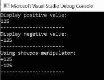

你可以看到，当我们不使用 `showpos` 操符时，`num1` (125) 显示为 125，而当我们控制台输出时，会显示 +125。负号（`-`）无论如何都会显示。

### 使用流操符 – 浮点数

我们在之前的许多章节中已经使用了浮点数。正如我们对整数所解释和演示的那样，我们也可以对浮点数使用流操作。相比之下，大部分操作与我们对浮点数使用的精度有关。让我们先看看使用浮点数时可用的默认格式选项。然而，首先记住，精度默认设置为 6 位有效数字。所以，如果我们想显示例如 4508.35001 这个数字，程序默认将显示 4508.35。当我们想要显示像 4508.35901 的数字时，程序会自动进行四舍五入并显示 4508.36。

1. `fixed`– 当我们不想在小数点后显示固定数量的位数时。
2. `setprecision`– 用于设置我们想要显示的位数。
3. `noshowpoint` – 当我们不想显示末尾零时使用。
4. `noshowpos` – 正值将不显示 + 号。
5. `nouppercase` – 在显示科学计数法时使用。

让我们看一些需要浮点数流操作的用例。

第一个例子是我们使用一个很大的数字，而默认显示为 6 位数字时。当我们尝试显示数字 123456789.123456789 时会发生什么？让我们运行一个简单的代码示例：

```cpp
int main() { double num {123456789.123456789}; std::cout <<"Display num:" << std::endl; std::cout << num << std::endl; }
```
当我们运行这段代码时，得到了这个结果：

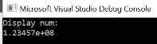

这里发生了什么？数字 1.23457e+08 是我们实际数字的科学计数法。如果我们想显示实际数字，可以使用 `setprecision` 操符：

```cpp
int main()
{
double num {123456789.123456789};
std::cout <<"Display num:" << std::endl;
std::cout << std::setprecision(9);
std::cout << num << std::endl;
}
```
现在，我们运行代码并预期得到以下结果：

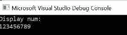
如果我们使用 `fixed` 操符，我们将得到不同的结果：

```cpp
int main() { double num {123456789}; std::cout <<"Display num:" << std::endl; std::cout << fixed; std::cout << num; }
```
运行代码时，我们得到小数点后 6 位的精度：

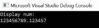
记住，数字是被四舍五入的，所以我们得到的是 123456789.7 而不是在 5 之后是 6。尝试尝试代码、数字和浮点数操作，以获得更好的理解。

### 使用流操符——布尔值

在 C++ 中，默认的布尔值为 0 (false) 或 1 (true)，但有时在处理字符串时，我们可能想使用 true-false 值。为了这一点，我们可以使用 `boolalpha` 和 `nboolalpha` 操符。让我们回顾一个例子：

```cpp
int main()
std::cout <<"Display boolean values 0 or 1:" << std::endl; std::cout << noboolalpha; std::cout << (true == false) << std::endl; std::cout <<"-----------------------------" << std::endl; std::cout <<"Display boolean values true or false:" << std::endl; std::cout << boolalpha; std::cout << (true == false) << std::endl; std::cout << "-----------------------------" << std::endl; }
```
这是我们预期的结果：

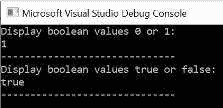

### 使用流操符——字段宽、对齐和填充

C++ 允许我们在流操作中使用非常强大的额外选项；其中其中包括字段宽（field width）、填充（fill）和对齐（align）。这三者都可以与任何类型的数据。这些操符允许你控制字段宽，然后定义下一个数据项在该字段内左对齐或右对齐。我们还可以决定是否想在字段中显示特定的字符。这在很多情况下都非常有用。为了这个目的，我们使用以下操符：

- `setw` – 默认不设置宽度。
- `left` – 当没有字段宽时。
- `right` - 当使用字段宽时。
- `setfill` – 使用空格。

在 C++ 中，默认是下一个项目将紧接上一个项目显示。所以如果我们运行这段代码，例如，不使用 `std::endl`，它将如下所示：

```cpp
int main() { double num {123456789.123456789 }; std::cout <<"Display items one another:" << std::endl; std::cout << num; std::cout << "Robert"; }
```
这是我们预期的结果：

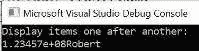

我们可以轻松地操纵这些数据项的方式：

```cpp
int main()
double num{1234.23 }; std::cout <<"Display items using setw:" << std::endl; std::cout << std::setw (10) << num; std::cout << std::setw (10) <<"Robert"; }
```
这是我们运行这段代码时预期的结果：

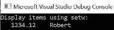
所以我们看到设置宽度为 10 后，字段被填充了。我们还可以使用任何字符的字符来填充字段，使用 `setfill` 操符：

```cpp
int main()
double num{123 }; std::cout <<"Display items using setw:" << std::endl; std::cout << std::setw (10) << std::setfill('*') << num;
}
```
运行这段代码后，我们会在屏幕上看到星号：

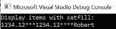
你可以在这里阅读更多关于流操作的信息：https://en.cppreference.com/w/io/manip


通过这种方式，我们可以打开源代码所在的路径，这也是任何创建的文件将要存储的地方（除非我们特别指定了其他路径，如 `c:\something\something`）。

正如预期的那样，名为 `test` 的文件被创建了，它甚至还包含数据，但由于它没有已知的扩展名，我们无法直接双击它。为了修复这个问题，我们将使用 `test.txt` 并再次运行。

第 13 行更改为：`fopen_s(&fp, "test.txt" , "w" );`。现在我们运行并查看同一个路径，看到：现在我们可以通过双击打开这个文件了。上面我们将看到的内容。

现在让我们修改代码，使其读取该文件而不是写入文件。

首先，将代码移动到一个由 `main` 调用的专用函数中：
```cpp
#include <iostream>
#include <stdio.h>
void write_test_file() {
    FILE *fp;
    // 建议使用 fopen_s() 而不是 fopen()
    // 首先我们打开一个文件进行写入
    fopen_s(&fp, “test.txt” , “w” );
    // 现在我们可以使用 fp 向文件写入任何内容
    fprintf(fp, “This is the first line in the file\n” );
    // 然后我们需要关闭文件
    // 除非我们关闭文件，否则我们将无法访问它
    fclose(fp);
}
int main() {
    write_test_file();
}
```

现在，让我们添加另一个函数来读取这个文件。`FileReadWrite.cpp`：此文件包含 `main` 函数。程序的执行从那里开始并结束于。

```cpp
#include <iostream>
#include <stdio.h>
void read_test_file() {
    FILE *fp;
    char line[256];
    // 建议使用 fopen_s() 而不是 fopen()
    // 首先我们打开一个文件进行读取
    fopen_s(&fp, “test.txt” , “r” );
    // 现在我们检查文件中是否至少有一行
    // 如果到达文件末尾，feof() 将返回 false
    // 我们也可以使用
    // while(!feof(fp)) 并遍历多行。目前我们假设
    // 只有一行
    if (!feof(fp)) {
        fgets(line, 256, fp);
        // 我们最多读取 256 个字符，对应文件中“line”数组的大小
    }
    // 现在我们使用‘printf’，它类似于 std::cout，用于打印
    //‘line’ 的内容
    printf( “reading line:\n%s\n” , line);
    // 然后我们需要关闭文件
    // 除非我们关闭文件，否则我们将无法访问它
    fclose(fp);
}
void write_test_file() {
    FILE *fp;
    // 建议使用 fopen_s() 而不是 fopen()
    // 首先我们打开一个文件进行写入
    fopen_s(&fp, “test.txt” , “w” );
    // 现在我们可以使用 fp 向文件写入任何内容
    fprintf(fp, “This is the first line in the file\n” );
    // 然后我们需要关闭文件
    // 除非我们关闭文件，否则我们将无法访问它
    fclose(fp);
}
int main() {
    // write_test_file();
    read_test_file();
}
```
这是将显示的内容：


# 第 26 章：标准模板库 (STL)

正如我们在目前为止过的所有章节中观察到的，C++ 带有强大、可重用且通用的类和函数。我们使用了 `iostream`、`math.h`、`algorithm`——但我们还有更多可以用于许多用途的东西。这些类和函数是 C++ 中封装的 `STL`（标准模板库）的一部分。它节省了你的时间和精力，因为它包含了支撑程序的一些健壮且基础的结构。C++ STL 非常庞大并且不断增长，因为每个版本都会带来更多的改进、类、函数和更新。使用它们的好处之一是，它们已经经过了多次测试和使用，因此我们可以完全依赖并信任它们能够工作。它们也是可重用的，所以我们随时可以使用它们。我们还可以将它们作为用户定义类、函数等的基础。`STL` 拥有许多组件、功能和选项。我们将在本节涵盖一些基础知识。然而，由于这是一个巨大的课题，我们将无法涵盖所有内容。

`STL` 基于三个组件：

- **容器 (Containers)**：容器始终是对象或原始数据类型的集合，例如数组、`vectors`、`maps` 等。
- **算法 (Algorithms)**：算法是用来用于处理来自容器的序列的函数。例如，`sort`、`find` 等。
- **迭代器 (Iterators)**：迭代器负责从容器中生成算法使用的序列——例如，`constant`、`reverse` 等。

尽管这三个元素构成了 STL 这一宏大的整体，但它们每一个都是一个独立的组件。`std::sort()` 函数可以按升序排列 `(first, last)` 范围内的元素。在接下来的程序中，我们将展示如何对整数 `vector` 进行排序。

```cpp
#include <iostream>
#include <stdio.h>
#include <vector>
#include <algorithm>
using namespace std;
void sort(vector<int>& MyVector) {
    // 当我们调用 std::sort 时，我们需要传递想要排序的元素范围。
    // 在大多数情况下，它是从开头到结尾。
    // 我们通过指定 .begin() 和 .end() 做到
    sort(MyVector.begin(), MyVector.end());
}
```

我们还将创建一个简单的函数来打印给定 `vector` 的内容：

```cpp
void print_vector(vector<int> V) {
    // 我们遍历每个元素并打印它，后面跟着一个空格（“ ”）
    for (int i = 0; i < V.size(); i++) {
        cout << V[i] << “ “ ;
    }
    // 现在我们在输出的末尾添加换行
    cout << endl;
}
```

现在，假设我们有如下 vector：
```cpp
vector<int> test{1,4,3,6,5,2};
```
我们想要打印这个 vector，对其进行排序并再次打印。以下是 `main()` 的外观：

```cpp
int main() {
    vector<int> test{1,4,3,6,5,2};
    cout << “before:” << endl;
    print_vector(test);
    sort(test);
    cout << “after:” << endl;
    print_vector(test);
}
```


现在，为了让事情更有趣，让我们创建自己的用于排序的对象。我们的自定义对象仅用于演示目的，因为在现实生活中没有意义。使用时，它会导致元素仅在元素等于 `-1` 后才进行排序，而 `-1` 之前的所有元素将不会被排序。这是我们的排序对象：

```cpp
struct {
    bool operator()(int a, int b) const {
        if (a == -1) return false;
        return a < b;
    }
} MySortFunction;
```

现在，让我们用以下 vector 测试它：`vector<int> test{900, 1,4,-1, 3,6,5,2}`。我们完整的源代码现在是：


-   关联容器（Associative containers）——这些容器按照定义的顺序或无序插入元素，以创建强大的数据结构。例如，`set`、`map` 等。你可能还不熟悉这些术语，但随着你不断深入 C++ 知识，你可能会烂记于心。
-   容器适配器（Containers adapters）——容器适配器不能与算法库配合使用，但它们经常用于 C++，因此 STL 支持它们。例如，`stack` 和 `queue` 是计算机编程中的基础数据结构概念，我们将在本节稍后的部分讨论它们。

注意的是，C++ STL 中有超过 100 个算法！这是一个巨大的数字，使得 C++ 成为一个强大的工具。C++20 增加了一些新的算法类。算法类型分为两大大类：修改算法和非修改算法——这完全取决于算法是否修改了序列。

## 使用宏编程 (Programming with macros)

如果你从未用过宏，或者对它们不熟悉，你应该理解宏没有没有程序化的逻辑。事实上，宏更像是你代码中的一种“搜索并替换”功能。最好的描述方法是，想象你有一个私人助手，在编译前搜索代码中的某些字符串和模式，并将它们替换为其他字符串或模式。宏不会影响程序本身，但可以帮助你让代码更具读性和易于管理。然而，宏可能会让调试变得难以管理——因此在使用要小心。

`#define` 预处理器指令可以定义一个给字符串，该字符串将在编译前被替换为另一个字符串（因此被称为“预处理器指令”）。

此外，一个 `#define` 指令可以包含一个或多个参数，使其成为一个宏（Macro）。

这是一个示例：
```
#define SET_TEST_VECTOR vector < int >test{ 900, 1,4,-1, 3,6,5,2 } 
#define PRINT_LINE (s) cout << s << endl 
#define PRINT_TEST_VECTOR print_vector(test); 
int main() { 
    SET_TEST_VECTOR ; 
    PRINT_LINE ( “before” ); 
    PRINT_TEST_VECTOR ; 
    sort(test); 
    PRINT_LINE ( “after” ); 
    PRINT_TEST_VECTOR ; 
}
```

`SET_TEST_VECTOR` 和 `PRINT_TEST_VECTOR` 预处理器指令不接受任何参数，只是将一个字符串替换另一个。

当编译器发现字符串 `SET_TEST_VECTOR` 时，它将其替换为：
`vector < int >test{ 900, 1,4,-1, 3,6,5,2 }`
当编译器发现字符串：`PRINT_TEST_VECTOR` 时，它将其替换为字符串：`print_vector(test);`

对于 `PRINT_LINE(s)`，这是一个宏，而 ‘s’ 是一个参数。

使用 `PRINT_LINE` 时，我们必须将任何可以被 `std::cout` 使用的内容放在 ‘s’ 之后，由于它是一个宏而不是函数，所以如果我们用它来替换 ‘s’，那么它是字符串、整数还是任何东西的组合并不重要。`std::cout` 将正常工作而不会报错。

例如：`PRINT_LINE (100);` 或 `PRINT_LINE (1 << "testing" << 2);` 提示：当发送到宏的元素在宏内部使用时，请使用括号。

为了进一步解释，让我们创建一个宏来打印两个数字，并将其中一个乘以另一个：

```
#define PRINT_MULT (a,b) cout << a*b << endl
```
这样的宏看起来像这样。然后我们如下所示调用它：`PRINT_MULT (23 / 4, 23 + 1);` 并期望得到 5.75（即 23 / 4）乘以 24（23 +1），但实际上，我们将得到一个不同的结果，它将等于：

`23 / 4 * 23 + 1`
1 将加到 `23 / 4 * 23` 的结果上，输出将是：`116`

为了修复这个问题，我们在每个参数周围加上括号，宏将看起来像这样：
```cpp
#define PRINT_MULT (a,b) cout << (a)*(b) << endl
```
结果将是：`120`

## 使用函数模板编程 (Programming with function templates)

C++ 提供了各种模板，我们可以将其用于各种目的。模板就像是编译器用于生成特殊函数或类的蓝图。模板使用占位符类型，当我们需要使用它时，接入我们所需的实际类型。编译器将在编译期间知道要使用哪个模板。其他编程语言在运行时执行此操作，但 C++ 不同。处理模板是称为泛型编程（generic programming）概念的一部分。

简而言之，泛型编程是一种编程风格，算法根据在编译期间（C++）或运行时（其他编程语言）指定的类型编写。模板允许我们以更通用的方式进行编程，针对不同的数据类型和行为使用特定的逻辑或代码逻辑。

这种灵活性对于大型软件项目非常有用，因为它提供了在不同目的之间甚至在不同程序之间复用相同代码的机会。

模板用于 两种用例：
- 函数模板
- 类模板

我们将首先解释并演示函数模板的使用，然后是类模板。

当定义函数时，传递给它的参数由其类型定义。例如，一个名为 `IsLarger(int A, int B)` 的函数期望我们传递 2 个整数，然后它将返回我们问题的答案：哪个更大？意味着 `A` 是否大于 `B`？

将此逻辑应用于函数模板时，我们可以几乎做相同的事情，但有一点不同：我们不需要定义 `A` 和 `B` 的类型。它们可以是任何类型或几乎任何类型。正如我们将要说明的，通常使用特殊语法来定义模板，特别是函数模板。因此，如果使用我们的函数模板，我们不需要定义传递给模板的任何参数的类型。

这非常就像文字处理模板，你将其作为骨架，并以许多不同的方式填充它。

首先，让我们像之前解释的那样创建一个宏，来对我们的函数模板 `IsLarger()` 的结果打印一个友好的解释：
```cpp
#define FRIENDLY_BOOL(x) ((x)?” is”:” isn’t “)
```

### 函数模板示例

我们使用的独特语法是关键字 `template`。下面的示例演示了如何将该关键字作为代码的一部分使用。在这种情况下，我们将创建一个 `IsLarger()` 函数模板：
```cpp
template < class T > T IsLarger( T arg1 , T arg2 ) { return ( arg1 > arg2 ); }
```
现在，这是我们调用函数模板的方法：
```cpp
#define FRIENDLY_BOOL (x) ((x)? " is " : " isn't " ) 
int main() { 
    int x = 100, y = 20;
    cout << x << FRIENDLY_BOOL (IsLarger(x, y)) << “ larger than“ << y << endl;
}
```


如果我们将代码更改为：
```cpp
int x = 100, y = 20;
```
我们将得到以下结果：
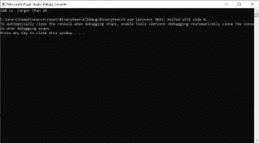

但如果我们想发送其他数据类型呢？

在下面的代码中：
```cpp
char x = 'a' , y = 'z' ;
cout << x << FRIENDLY_BOOL (IsLarger(x, y)) << “ larger than“ << y << endl;
```
我们使用了字符 ‘a’ 和 ‘z’，并得到了：
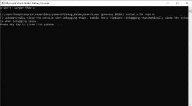

## 使用类模板编程 (Programming with class templates)

另一种使用的模板是类模板（Class Templates）。在类模板中，我们创建一个类似方式实现的泛型类，但使用不同的数据类型。

如果不使用类模板，我们需要为不同的数据类型创建不同的类，但当我们使用类模板时，我们可以为所有数据类型拥有同一个类。

我们从以下声明开始：
```cpp
template <class T>
class MyClassT
{
    T myVar; // 成员变量的模板
    T myFunc(T arg1, T arg2); // 成员函数的模板
};
```
`T` 被用作真实数据类型的占位符（例如 int）。然后我们使用：`MyClassT(datatype) MyClass;`

例如，让我们定义下面的类模板：
```cpp
#include <iostream>
using namespace std; 
template < class T > 
class MyClassT { 
public : 
    T myVar; // 成员变量的模板
    T myFunc( T arg1 , T arg2 ) { 
        cout << arg1 << “ “ << arg2 << endl; 
        return arg1 + arg2 ; 
    } // 成员函数的模板 
};
```
现在我们在 main() 中定义 2 个不同的 `MyClassT` 实例：


```cpp
int main() { MyClassT < char > MyClass1; MyClass1.myFunc( ‘1’ , ‘2’ ); MyClassT < int > MyClass2; MyClass2.myFunc(30, 40); }
```

如你所见，我们使用了相同的类模板和函数调用，但使用了不同的数据类型。

由于该类是使用模板和数据类型的组合定义的，因此该数据类型会替换任何 ‘T’ 符号出现的地方，这包括参数类型以及返回值：

`MyClassT < char > MyClass1; MyClass1.myFunc( '1' , '2' );` 我们传递了 2 个整数，`myFunc` 返回一个整数。`MyClassT < int > MyClass2; MyClass2.myFunc(30, 40);` 我们传递了 2 个字符，然后 `myFunc` 返回一个字符。


## 容器适配器：栈（stack）和队列（queue）

栈（stack）和队列（queue）经常被用作数据结构，它们是已存在容器的一部分，这就是为什么它们被链接为适配器。

### 1. 栈（The stack）

栈是一种先进先后出（FIFO）原则的数据结构。此外，它可以实现为向量、数组、列表（list）或双端队列（deque）的一部分，但重要的是要记住，栈不支持任何迭代器。栈通常被描述为一堆书：你将一本新书放在书堆的顶部。如果你想从堆中取出一本书，你不能从底部或中间取出——你必须从顶部取出。换句话之：栈只在栈的一端上进行操作。为了使用栈，我们必须使用栈的头文件文件：

`#include <stack>`

栈使用了一些你们可能已经知道的方法，如 `push`、`pop`、`size`，以及 `empty` 和 `top`。

- `push`– 在栈顶添加一个项目。
- `pop` – 从栈顶移除一个项目。
- `top`– 访问栈顶的元素。
- `empty`– 检查栈是否为空。
- `size`– 检查栈中有多少元素。

让我们来看一个代码示例。在接下来的程序中，我们将展示：

用于指向栈顶位置的 ‘top’ 成员变量：

- 推入元素（Push）
- 弹出元素（Pop）
- 当我们遇到“栈溢出”（stack overflow）时
- 当我们遇到“栈下溢”（stack underflow）时
- 当栈为空时

```cpp
// StackDemo.cpp : 此文件包含 'main' 函数。程序的执行 // 开始并结束于那里。
#include <iostream>
#include <stack>

using namespace std;

#define MAX 1000

class StackDemo
{ 
    int top; // 标记栈顶 
public:
    int a[ MAX ]; // StackDemo 的最大尺寸
    StackDemo() { 
        top = -1; // 初始化 top 
    }
    bool push( int x ); 
    int pop(); 
    int peek(); 
    bool isEmpty(); 
}; 

bool StackDemo ::push( int x ) { 
    if (top >= ( MAX - 1))
        // 当我们的顶部位置等于或大于 MAX-1 时，我们就有了“栈 //溢出”
        { 
            cout <<“Stack Overflow!” ; 
            return false ; 
        } 
    else { 
        a[++top] = x ; 
        cout << x <<“被推入我们的栈” << endl; 
        return true ; 
    } 
} 

int StackDemo ::pop() { 
    if (top < 0) { // 如果我们的顶部位置小于 0，我们就有了“栈 //下溢” 
        cout <<“Stack Underflow!” ; 
        return 0; 
    } else { 
        int x = a[top--]; 
        return x; 
    } 
} 

int StackDemo ::peek() { 
    if (top < 0) { 
        cout <<“我们的栈是空的” ; 
        return 0; 
    } else { 
        int x = a[top]; 
        return x; 
    } 
} 

bool StackDemo ::isEmpty() { 
    return (top < 0); 
} 

// 测试上述函数的驱动程序 
int main() { 
    class StackDemo s; 
    s.push(100); 
    s.push(150); 
    s.push(200); 
    s.push(250); 
    cout << s.pop() <<“从我们的栈中被弹出” << endl; 
    return 0; 
}
```

我们得到的结果是：

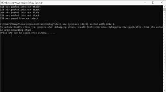

### 2. 队列（The queue）

队列是一种先进先出（FIFO）数据结构，但当它应用于栈时，元素是从尾部推入并从头部弹出的。然而，与栈的情况一样，重要的是记住队列不支持任何迭代器。

为了使用队列，我们必须使用队列头文件：`#include <queue>`

队列使用了许多你们已经从栈中熟悉的方法，但由于元素是从尾部推入并从头部弹出的，我们还使用了：

- `push`– 在尾部添加一个项目。
- `pop` – 从头部移除一个项目。
- `back`– 访问尾部的元素。
- `front`– 访问头部的元素。
- `empty`– 检查队列是否为空。
- `size`– 检查队列中有多少元素。


到目前为止，你所编写和学习的所有代码都运行在单线程上，这意味着一旦代码执行，它将一次只运行一行代码。随着程序变得越来越复杂，为了性能考虑，使用线程工作将极有益，同时也能让我们在利用线程时通过代码实现更多的功能。例如，假设我们想使用 `cin` 从用户处获取输入——在用户输入内容之前，程序将无法执行其他操作。在大多数情况下，我们需要程序并行执行额外的任务。

当然，我们运行的线程数不应超过机器 CPU 的核心数，因为线程依赖于计算机资源才能平滑运行——我们将在下一节讨论并发时对此进行更详细的说明。

我们可以通过使用 `std::thread` 或使用 `<process.h>` 以三种不同的方式来创建线程，我们将在这里进行演示。这些类中已经内置了带有线程函数的线程类：

1. 使用函数指针。
2. 使用仿函数（functor，即函数对象）。
3. 使用 lambda 表达式（由于我们还没有介绍 lambda，因此我们在本节中不会讨论这一选项）。

要启动一个线程，我们只需要创建一个新的线程对象，并将要调用的执行代码（即可调用对象）传递给对象的构造函数。一旦对象创建完成，一个执行可调用对象中指定代码的新线程就会启动。在我们定义好可调用对象后，将其传递给线程构造函数。

### 使用函数指针运行线程

假设我们希望程序执行各种 CMD（命令行）命令，例如“dir”或“tree”，并显示结果。

如果我们的程序是同步的，那么在执行命令期间，程序将等待且什么都不做。某些命令的执行时间比其他命令长。如果我们希望程序运行的同时让命令在独立的线程上执行，我们应该使用异步编程。

通过这种方法，我们启动一个命令，然后继续执行程序的其他操作，并定期检查在独立线程上运行的命令的状态。当线程完成工作后，我们显示结果。

我们将用于运行命令的线程将是：`void cdecl ThreadFunc( void *)`。首先，我们将看到如何启动线程：`void SetCommand( string command ) { Command = command ;`

```cpp
HANDLE hThread = ( HANDLE )_beginthread(ThreadFunc, 0, NULL );
```

我们的 `SetCommand` 函数接收一个要执行的命令（例如“dir”）。然后，它使用 `_beginthread` 启动一个线程。

为了简化程序，我们为实际命令字符串定义了一个全局变量，这样就可以从主线程和新线程访问它，如下：

`string Command;` 另一个全局变量将是 `BOOL IsRunning = FALSE ;`。`IsRunning` 将告诉我们线程在任何时刻是否正在运行。我们的线程函数看起来像这样：

```cpp
void cdecl ThreadFunc( void *) { CommandResult =““ ; if (DoRun(Command.c_str())) { IsRunning = true ; while (IsRunning) { if (CheckCommandExecutionStatus()) { break ; } Sleep(500); } } IsRunning = false ; _endthreadex(0); }
```

我们不会解释 `DoRun()` 函数，因为它不属于本书的讨论范围内。基本上，它使用 `ShellExecute` 执行 Windows 命令/程序：

```cpp
Result = ( BOOL ) ShellExecute (GetActiveWindow(), "open" , "cmd" , Command, NULL , 0);
```

你可以通过最初发表在 Codeproject 上的文章了解更多关于 Michael Haephrati 编写的 Tiny CMD 程序：
https://www.codeproject.com/Articles/5163375/Tiny-CMD

### 使用函数对象运行线程

也可以通过使用成员函数通过 `std::thread` 启动线程。为了这样做，我们必须为调用该成员函数的对象添加一个特定的参数。我们必须将成员函数的指针与一个值一起传递，以便我们可以将此指针用于 `std::thread` 构造函数中的对象。我们还需处理引用。我们通过使用 `std::ref` 来实现。

让我们来看一个简单的代码示例：

```cpp
#include "pch.h" 
#include <thread> 
#include <iostream> 
class Say_somthing { 
    public : 
    void greeting() const // 我们的公共成员函数 
        std::cout <<“Hello!” << std::endl; // 打印 hello! 
    } 
}; 
int main() { 
    Say_somthing i; 
    std:: thread t(& Say_somthing ::greeting, &i); // 作为新线程调用 greeting () 
    t.join();
}
```

记住你的对象生命周期比线程长是非常非常重要的，否则你的程序将会崩溃。

除了使用 `std::thread` 还有其他方法。我们可以使用 `std::async` 创建一个任务并在 `std::future` 中获取返回值。正如你刚刚学到的，在这种情况下，我们也可以通过三种方法执行任务：函数指针、函数对象或 lambda 函数。事实上，`std::future` 是一个值得探索的非常有趣的类。正如我们刚刚提到的，当我们希望线程返回结果或值时，我们使用 `std::future`。例如，返回文件名或文件大小。我们可以通过两种不同的方式实现此：我们可以使用指针来共享数据——这是一种旧方法，当我们需要返回多一个结果或值时，处理起来可能会很复杂。

实现此更好方法是使用 `std::future` 类。“future”代表未来将返回的数据——例如当线程超出作用域时。这是一个未来的值。当我们说“未来值”时，你可能会想：这怎么可能呢？要么有一个值，要么没有；我们如何能存储一个尚未生成的值呢？

`std::future` 类可以存储未来将赋值的对象值，并使用 `get()` 在稍后访问该值。换句话说，一旦存储了未来数据，它就可以存储并访问。`std::future` 与 `std::promise` 密不可分。这是一个模板类，承诺在未来设置值。每个 `std::promise` 对象都与一个 `std::future` 对象关联，当 `std::promise` 对象设置值时，该对象将提供该值。`std::future` 对象与其关联的 `std::future` 对象共享数据（注：原文此处有误，应为 `std::promise` 对象）。

让我们回顾一个代码示例：

```cpp
#include <iostream> 
#include <thread> 
#include <future> 
// 如果值尚未被线程 2 设置
// get() 调用将阻塞，直到线程 2 设置 promise 对象
// 我们为这种情况设置承诺值
// 直到未来值被设置
#define PROMISE_VALUE 35 
void InitThread(std:: promise < int > * myPromiseObject ) { 
    std::cout <<“InsideThread” << std::endl; 
    myPromiseObject ->set_value( PROMISE_VALUE ); 
} 
int main() { 
    // 创建 std::promise 对象： 
    std:: promise < int > myPromise; 
    // 创建 std::future 对象： 
    std:: future < int > myFuture = myPromise.get_future(); 
    std:: thread th(InitThread, &myPromise); 
    std::cout <<“Value: “ << myFuture.get() << std::endl; 
    th.join(); 
    return 0; 
}
```

当我们运行这段代码时，我们预期会得到：


我们还可以创建一个返回多个值的线程。我们只需要使用多个 `std::promise` 和 `std::future` 对象即可。

现在你对使用 `std::future` 的线程有了更好的理解，让我们更深入地了解 `std::async()`，因为你可能会发现它你未来的代码中非常有用。

`std::async()` 是一个函数模板，接受回调（意味着函数或函数对象）作为参数，然后可能异步地执行它们。使用异步代码可以有许多用途。例如，它可以用于执行操作系统命令，或者一个异步扫描文件的备份应用程序。它还可以用于查看哪些发生了变化，哪些没有，并备份文件。这些只是为了让你更好地理解我们为什么要使用异步代码的几个例子。


`std::async` 返回一个 `std::future<T>`，其中存储了由 `std::async()` 执行的函数对象所返回的值。函数预期的参数可以在函数指针参数之后作为参数传递给 `std::async()`。

由于我们必须控制异步行为的方式，因此 `std::async` 的第一个参数将是启动策略（launch policy）。C++ 允许我们使用三种不同的启动策略：

1. `std::launch::async`
   该函数确保传递的函数将在单独线程上执行。

2. `std::launch::deferred`
   该函数指示函数调用将推迟，直到对 `future` 对象调用了 `wait()` 或 `get()`。

3. `std::launch::async | std::launch::deferred`
   该函数将根据系统负载决定异步运行还是以其他方式运行。

让我们来看一些代码示例：在此代码中，我们异步运行了两个线程：一个从文件获取数据，另一个则从数据库获取数据：

```cpp
#include <iostream> 
#include <string> 
#include <chrono> // 用于时间计算 
#include <thread> // 用于多线程操作 
#include <future> // 用于从线程完成任务后获取结果 
#define DATABASE_PREFIX “_db_” 
#define FILE_PREFIX “_f_” 
using namespace std::chrono; 
std:: string readFromDatabase(std:: string recvdData ) { 
    // 我们使用了 sleep 方法。只有当任务耗时最多 5 秒时，这种方法才是有效的
    std::this_thread::sleep_for( seconds (5));
    // 连接到我们的数据库
    return DATABASE_PREFIX + recvdData ; 
} 

std:: string readFromDatafile(std:: string recvdData ) { 
    // 我们使用了 sleep 方法。只有当任务耗时最多 5 秒时，这种方法才是有效的
    std::this_thread::sleep_for( seconds (5));
    // 连接到我们的文件
    return FILE_PREFIX + recvdData ; 
} 

int main() { 
    // 首先我们使用 system_clock 类记录当前时间
    system_clock :: time_point start = system_clock ::now(); 
    std:: future <std:: string > resultFromDB = std::async(std:: launch :: async , readFromDatabase, “Data” );

    // 从文件获取数据
    std:: string fileDataItem = readFromDatafile( “Data” );

    // 从数据库获取数据 
    // 等待我们的 future<std::string> 对象中的数据可用。
    std:: string databaseDataItem = resultFromDB.get();

    // 我们使用 system_clock 类记录结束时间
    auto end = system_clock ::now(); 
    auto diff = duration_cast <std::chrono:: seconds > (end - start).count();

    std::cout <<“It took us = “ << diff << “ Seconds to complete.” << std::endl;

    // 合并两个数据项 
    std:: string data = databaseDataItem + “ :: “ + fileDataItem;

    // 打印从获取的两个数据项合并后的数据
    std::cout << “Data =” << data << std::endl; 
    return 0; 
}
```

当我们运行这段代码时，结果将是：

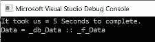

注意，如果没有指定启动策略，默认值将类似于：`std::launch::async` 或 `std::launch::deferred`。

## C++ mutex 对象

在 C++ 中使用线程时，熟悉互斥锁（mutex）对象和 C++11 引入的 `<mutex>` 标准类非常重要。`mutex` 是一个可锁对象。当代码的关键区域需要独占访问时，它会发出信号。通过这样做，它可以防止任何其他具有相同保护的线程在访问与其他线程相同的内存位置时并发执行。例如，在计算机程序的早期， 80 年代和 90 年代的某处，人们会双击一个程序并运行它，然后在程序运行时，再次双击它会使它与已经在运行的程序并行再次运行。你可以反复并行运行同一个程序，这导致了许多崩溃和问题。`mutex` 是解决该问题的良药，而这只是互斥锁时代之前许多问题中的一个。

让我们来看使用 mutex 防止程序同时运行多次的示例：

```cpp
// Mutex.cpp : 此文件包含 'main' 函数。程序执行从这里开始 
// 并在此结束。
#include <iostream>
#include <Windows.h> 
#include <mutex> 
using namespace std; 
int main() { 
    HANDLE myMutex;
    myMutex = CreateMutex(NULL, TRUE, L”RunOnceProgram” ); 
    if (GetLastError() == ERROR_ALREADY_EXISTS) { 
        cout <<“Don’t run this program more than once\n” ; 
        exit(0); 
    } 
    // 我们可以继续了
    cout <<“Running our program\n” ; 
}
```

事实上，在使用线程时注意细节非常重要，因为在读取和/或写入共享内存和资源时必须谨慎使用，因为它们可能会导致竞态条件。例如，如果我们从一个账户转账到另一个账户，我们需要在转账完成后才能提款。换句话说，我们可能会遇到操作 X 的结果取决于操作 Y 的情况。同样也适用于死锁的情况。死锁是指由至少两个线程组成的集合中，每个线程都在等待资源（共享数据也被视为资源），而该资源正被集合中的另一个线程锁定。结果是集合中的每个线程都在无限期等待资源释放。

防止这种情况的最好方法之一是使用 `lock_guard`。

```cpp
#include "pch.h"
#include <thread>
#include <mutex>
#include <iostream>
int my_Int = 0; 
std:: mutex my_Int_mutex; //  my_Int
void safe_increment() { 
    // 在增加 my_Int 之前锁定我们的线程
    std:: lock_guard <std:: mutex > lock(my_Int_mutex); 
    my_Int++; 
    // 在线程锁定期间我们安全地增加 my_Int，直到 
    // 我们完成。
    std::cout << std::this_thread::get_id() <<“: “ << my_Int << ‘\n’ ; 
    // 当 lock 离开作用域时，my_Int_mutex 会自动释放
} 
int main() { 
    std::cout <<“Our Main function:” << my_Int <<‘\n’ ; 
    // 增加 myFirstInt
    std:: thread myFirstInt(safe_increment); 
    // 增加 mySecondInt
    std:: thread mySecondInt(safe_increment); 
    myFirstInt.join(); 
    mySecondInt.join(); 
    std::cout <<“Our Main function:” << my_Int <<‘\n’ ; 
}
```

## 使用 std::thread::join()

有时，我们需要在执行任何额外操作之前等待线程完成执行。例如，如果任务是打开文件，我们需要等待线程完成打开文件后再移动到下一个操作。

为了实现这一点，我们还可以使用 `std::thread::join()` 函数，它确保*在移动到下次执行之前这已完成执行*。在其他编程语言（如 C#）中，你可能将其识别为‘wait’。让我们来看一些代码示例：

```cpp
#include "pch.h"
#include <iostream>
#include <thread>
static bool say_something = false ; //用户需要输入某些

void wait_for_input() // 这是我们的函数，它会在无限循环中打印
```


```cpp
{
using namespace std::literals::chrono_literals; //我们使用 chrono_literals //为了对输出进行计时 
while (!say_something) // 当 say_something 为 false 时循环 //{ 
    std::cout <<“Say something...\n” ; 
    std::this_thread::sleep_for(2s); // 每隔 2 秒打印一次输出。我们使用 //this_thread 向//当前线程//发送命令。
} 
} 
int main() { 
    std:: thread your_input(wait_for_input); // 我们运行第一个线程 
    std::cin.get(); 
    say_something = true ; // 如果用户输入了内容 
    your_input.join(); // 只有当第一个线程 //结束时，第二个线程才会加入 
    std::cin.get();
}
```

当我们运行这段代码时，在输入某些内容之前，我们会得到如下输出：

注意 `join()` 函数是一个复杂的课题，我们建议在下面的链接中阅读更多关于它的信息：

http://www.cplusplus.com/reference/thread/thread/join/

理解这一点非常重要：当我们执行线程时，我们在不同线程之间使用可用的 CPU 核心。这也被称为硬件并发，并且它以非确定性的方式工作。这意味着各种线程可以在不同的核心上并行运行，而每个线程执行特定的任务。C++ 标准库提供了 `std::thread::hardware_concurrency()` 函数，它可以告诉程序在给定机器上可以并发运行的线程数。`thread::hardware_concurrency()` 函数观察一个状态并返回相应的输出，该输出是机器硬件实现可以支持的并发线程数。然而，返回的值并不总是准确的。

在查看 `thread::hardware_concurrency()` 的代码示例之前，让我们先了解这些操作在双核或单核计算机上是如何工作的，这与任务进行切换的单线程代码是不同的：

### 双核：

下面是一个演示如何使用 `hardware_concurrency()` 函数的简单代码示例：

```cpp
#include "pch.h" 
#include <iostream> 
#include <thread> 
using namespace std; 
int main() { 
    unsigned int num_threads; 
    num_threads = thread ::hardware_concurrency(); 
    cout <<“Number of concurrent threads supported are:“ << num_threads << endl; 
    return 0; 
}
```

运行代码的结果将取决于不同的计算机，因为配置不同。在我们的情况下，结果将是 4 个线程：

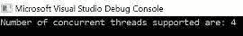

### 向线程函数传递参数

向线程函数传递参数可以非常简单易行——我们只需要将参数传递给可调用对象或函数即可。然而，重要的是，默认情况下，参数会被复制到内部内存中，线程在执行时可以访问它们。

同样重要的是，我们不希望将局部栈的变量地址传递给线程的回调函数，因为在这种情况下，线程 A 中的局部变量将超出作用域，而线程 B 可能会尝试访问它使用的地址——这将导致我们的程序出现严重问题和意外行为。使用指向堆内存位置的指针时也是如此，因为如果其中一个线程在到达作用域时删除了该内存，该地址可能会失效。

让我们来看代码示例：

```cpp
#include "pch.h"
#include <iostream>
#include <string>
#include <thread>

// 这是我们的回调函数
// 它由我们的线程对象调用
void myCallbackFunction( int myInt , std:: string myStr )
{
    std::cout <<“The string passed to this function is =“ << myStr << std::endl;
    std::cout <<“The integer passed to this function is = “ << myInt << std::endl;
} 

int main() { 
    int x = 24; 
    std:: string str =“This is a string” ; 
    // 调用我们的线程并指定回调函数，
    // 同时以及发送给它的参数 (int, string) 
    std:: thread myThreadObject(myCallbackFunction, x, str); 
    myThreadObject.join(); 
    return 0; 
}
```

运行这段代码时，这就是我们预期的结果：

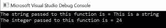

关于 C++ 中的多线程和并发，你可以学到非常多，这个主题可能相当高级。我们建议你继续探索这个课题，下面的链接是一个很好的起点：https://www.tutorialspoint.com/cplusplus

# 第 28 章：C++ 协程

协程是函数之间协作工作的一种，这可以赋予我们对程序流程很大的权力和控制力。每个协作的函数都会准确地记住它停止的地方，并在控制权返回给它时从那里继续执行。


`func1()` 案例是调用者，而 `func2()` 是“等待项（awaitable）”。协程在两者协作时处理它们之间的关系。我们稍后会进一步解释这些术。

正如你可以想象的，协程在线程方面可以产生重大影响，因为它们可以在程序生命周期内管理我们的多任务执行。

为了在代码中使用协程，我们可以使用三种表达式：

- `co_await`– 挂起或恢复函数的执行。
- `co_return` - 用作返回语句。
- `co_yield`– 在函数之间的迭代过程中携带值和流。

请注意，`co_return` 和 `co_await` 需要编译器对 C++20 标准的支持（参见 https://en.cppreference.com/w/cpp/keyword ）和 https://en.cppreference.com/w/cpp/compiler_support )）。

要更改编译器的配置，请在项目右侧的区域上点击右键，并选择“属性（properties.*.*）”。

当属性窗口打开时，选择“C/C++”，然后选择“命令行（command line.*.*）”。在底部输入“/await”并点击“应用（Apply）”。

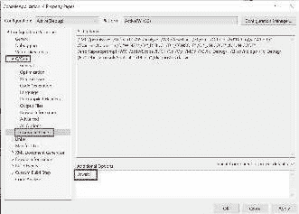

现在，让我们更好地理解这些表达式：

## co_await 运算符

`co_await` 是一个一元运算符，只能在协程内部工作，并赋值给单个值。`co_await` 运算符与等待类型（Awaitable）协同工作——这两者密不可分。事实上，当我们谈论一个“等待者（waiter）”类型时，请记住它是通过协程的三个特殊方法实现的，这些方法是 `co_await` 的一部分：`await_suspend`、`await_ready` 和 `await_resume`。这些方法的名称可以告诉你很多关于它们的用途和用法。

## co_return 运算符

在使用返回语句的普通函数中，返回值存储在调用者可以访问的位置，通常在函数的激活栈帧或调用者的激活栈帧中，随后它会被销毁。协程改变了调用和返回执行的方式，为了这一目的，使用了三种方法：`Suspend`（挂起）、`Resume`（恢复）和 `Destroy`（销毁）。同样，正如我们在 `co_await` 中看到的那样，这些方法的名称是清晰的，你可以理解它们的用途。

- `Suspend` 操作挂起协程的执行，并负责将执行交回给调用者或恢复状态（取决于该轮到谁）。在此时，激活栈帧将保持完好。
- `Resume` 操作负责恢复已挂起的协程的执行，使其重新获得控制权。
- `Destroy` 操作负责销毁激活帧以及协程作用范围内的对象——同时释放已使用的内存。

## co_yield 运算符

`co_yield` 与 `co_await` 一起负责挂起协程的操作——这是一个强大的选项。`co_yield` 可以在函数执行过程中挂起其执行。一旦执行被挂起，它将交回给调用者或协程的恢复者。这意味着，如果我们使用 `co_yield` 来挂起 `func1()`（调用者）的操作，该操作将移动到 `func2()`（恢复者），以此此类推——这一切完全取决于我们定义协程的方式。

重要的一点是，如果你在非协程函数中使用这些表达式，编译器将自动将其转换为协程函数。

让我们看看不使用协程的简单函数语法。在这种情况下，函数计算并返回前 10 个斐波那契数列数：

```cpp
#include "pch.h"
#include <iostream>
using namespace std;
int fib( int x ) {
  if (( x == 1) || ( x == 0)) {
    return ( x );
  } else {
    return (fib( x - 1) + fib( x - 2));
  }
}
int main() {
  int x{ 10 };
  int i{};
  while (i < x) {
    cout <<“ “ << fib(i);
    i++;
  }
  return 0;
}
```
当我们运行这段代码时，预期的结果如下：


现在让我们看看如何使用协程显示斐波那契数列：

```cpp
#include "pch.h"
#include <iostream>
#include <future>

using namespace std;

future < int > my_async( int a , int b ) // 我们的线程函数 {
  auto fib = std::async([=]()(){
    int c = a + b ;
    return c;
  });
  return fib;
}

future < int > my_fib( int n ) {
  if ( n <= 2) co_return 1;
  int a = 1;
  int b = 1; // 迭代斐波那契数列对于 ( int i = 0; i < n - 2; ++i) {
    int c = co_await my_async(a, b);
    a = b;
    b = c;
  }
  co_return b;
}
future < void > test_async_fib() {
  for ( int i = 1; i < 10; ++i) {
    int result = co_await my_fib(i);
    cout <<“Coroutine (“ << i << “) for Fibonacci is the number” << result << endl;
  }
}
int main() {
  auto fib = test_async_fib();
  // 测试我们的异步线程 fib
  fib.wait();
  return 0;
}
```
运行这段代码时，预期的结果如下：


这里发生的是，当我们调用 `co_await async_add(a, b)` 时，加法操作在另一个线程中执行的同时挂起执行，然后使用返回值恢复“c =”赋值。然后我们回到下一次执行。

### 协程 'awaitable' 类型

我们在 C++20 新的 std 库中还有 2 个“等待项”。我们也可以使用它们来控制协程函数之间的流：

- 下 `std::suspend_always` 是使用 std::suspend_always 时的语法：
```cpp
struct suspend_always {
  constexpr bool await_ready() const noexcept {
    return false ;
  }
  constexpr void await_suspend(coroutine_handle<>) const noexcept {}
  constexpr void await_resume() const noexcept {}
};
```

- `std::suspend_never`:
```cpp
struct suspend_never {
  constexpr bool await_ready() const noexcept {
    return true ;
  }
  constexpr void await_suspend(coroutine_handle<>) const noexcept {}
  constexpr void await_resume() const noexcept {}
};
```

现在你已经理解了协程的基本逻辑，让我们多谈谈它的结构以及 C++ 在代码中如何接口化。与协程一起使用的有两个主要接口：`Promise` 和 `Awaitable`（你现在应该知道它们了）。

`Promise` 用于定义协程的工作方式、执行时会发生什么以及它将返回什么（包括异常）。这包含了 `co_await` 和 `co_yield` 表达式的行为。

`Awaitable` 定义了 `co_await` 表达式；一旦任何值被 `co_await`，我们就可以预先定义它，以便使用等待对象上的方法。这意味着如果我们想挂起某些内容、返回某些内容或进行任何其他操作，我们就可以定义它。

这看起来是一个复杂的语法和结构，但逻辑非常简单：我们管理并微调两个或多个相互协作函数之间的关系。

请注意，`co_return`、`co_yield` 和 `co_await` 需要编译器对 C++20 标准的支持（参见 https://en.cppreference.com/w/cpp/keyword ）和 https://en.cppreference.com/w/cpp/compiler_support )）。

关于 C++ 中的协程有很多需要学习和理解的内容，因为这是一个复杂的课题，可以在许多不同的方向上扩展。然而，得益于现在成为 C++ 一部分的 `<cppcoro>` 类，我们可以从协程的抽象中获益，并更好地理解如何使用它，因为它包含了许多使用的函数。C++20 为我们提供了一个处理协程的框架，这意味着我们必须做很多艰苦的工作。（希望几年后的下一个 C++ 标准能为我们解决这个问题）。

你可以在这里找到关于协程的额外信息：https://en.cppreference.com/w/cpp/language/coroutines

关于 `<cppcoro>` 的更多信息可以在这里找到：http://www.modernescpp.com/index.php/c-20-coroutine-abstraction-withcppcoro

