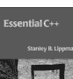
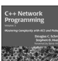
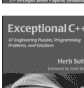
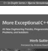
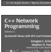
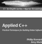
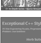
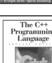

# C++ 编码规范：101 条规则、指导原则与最佳实践


献给数百万当前的 C++ 程序员。

本页有意留白。

## 如何使用本书

*思考。* 要认真遵循良好的准则；但不要盲目遵循。在本书的条目中，请注意“例外”部分，它澄清了该指导可能不适用的较少见情况。任何一套准则，无论多好（我们认为这些准则就很好），都不应试图取代思考。

每个开发团队都有责任制定自己的标准，并负责任地制定这些标准。这包括你的团队。如果你是团队负责人，请让团队成员参与制定团队标准；人们更可能遵循他们视为自己的标准，而不是遵循一堆他们觉得被强加于自己的规则。

本书旨在作为你的团队编码标准的基础，并通过引用纳入其中。它并不打算成为编码标准的最终定论，因为你的团队会有适合特定团队或任务的附加准则，你应该可以自由地将这些准则添加到这些条目中。但我们希望本书能通过记录和引用几乎普遍适用的、被广泛接受且权威的实践（如所注明的例外情况），帮你省去一些（重新）开发自己标准的工作，从而帮助提高你所用编码标准的质量和一致性。

让你的团队阅读这些准则及其理由（即整本书，以及根据需要选读各条目“参考文献”中列出的其他书籍和论文），并决定是否有任何准则是你的团队实在无法接受的（例如，由于你项目特有的某种情况）。然后对其余准则做出承诺。一旦采用，除非与整个团队协商，否则不应违反团队的编码标准。

最后，作为团队定期审查你的准则，以纳入实践经验和实际使用中的反馈。

## 编码标准与你

良好的编码标准可以带来许多相互关联的优势：

- *提高代码质量：* 鼓励开发人员以一致的方式做正确的事，直接有助于提高软件质量和可维护性。
- *提高开发速度：* 开发人员不必总是从第一性原理出发做决定。
- *更好的团队协作：* 它们有助于减少对无关紧要问题的无谓争论，并使队友更容易阅读和维护彼此的代码。
- *在正确的维度上保持统一：* 这使开发人员能够在重要的方向上发挥创造力。

在压力和时间压力下，人们会做他们受过训练要做的事。他们会退回到习惯。这就是为什么医院急诊科雇用经验丰富、训练有素的人员；即使是知识渊博的初学者也会惊慌失措。

作为软件开发人员，我们经常面临要在昨天交付明天软件的巨大压力。在进度压力下，我们会做自己受过训练并习惯去做的事。平时不知道软件工程良好实践（或不习惯应用它们）的草率程序员，在压力下会写出更草率、更多 bug 的代码。相反，养成良好习惯并经常实践的 程序员会让自己保持有条理，并快速交付高质量代码。

本书介绍的编码标准是编写高质量 C++ 代码的准则集合。它们是 C++ 社区丰富集体经验的提炼结论。这些知识大部分过去只能以零散片段的形式散布在书籍中，或作为口口相传的智慧存在。本书旨在将这些知识汇集为一套简洁、有依据且易于理解和遵循的规则。

当然，即使有最好的编码标准，也可能写出糟糕的代码。任何语言、流程或方法论都是如此。一套好的编码标准会培养超越单纯规则的良好习惯和纪律。一旦获得这一基础，就会打开通往更高层次的大门。没有捷径；你必须先发展词汇和语法，然后才能写诗。我们只是希望让这件事更容易。

本书面向所有水平的 C++ 程序员：

如果你是初学者程序员，我们希望你会发现这些规则及其理由有助于理解 C++ 最自然地支持哪些风格和惯用法。我们为每条规则和准则提供简洁的理由和讨论，以鼓励你依靠理解，而不仅仅是死记硬背。

对于中级或高级程序员，我们努力为每条规则提供详细且精确的参考文献列表。这样，你就可以进一步研究该规则在 C++ 类型系统、语法和对象模型中的根源。

无论如何，你很可能在一个复杂项目的团队中工作。这正是编码标准真正发挥作用的地方——你可以用它们让团队达到共同水平，并为代码审查提供基础。

### 关于本书

我们为本书设定了以下设计目标：

- *短胜于长：* 庞大的编码标准往往被忽视；简短的标准会被阅读和使用。长的条目往往被略读；短的条目会被阅读和使用。
- *每个条目都必须没有争议：* 本书旨在记录广泛公认的标准，而不是发明标准。如果某条准则并非在所有情况下都适用，就会以那种方式呈现（例如，用“考虑 X……”而不是“执行 X……”），并且我们会注明普遍接受的例外。
- *每个条目都必须具有权威性：* 本书中的准则都有对现有已出版著作的引用作为依据。本书还旨在提供 C++ 文献的索引。
- *每个条目都必须值得说明：* 对于你无论如何都会做的事情、编译器已经强制或检测到的事情，或已在其他条目中涵盖的事情，我们选择不定义新的准则。

示例：“不要返回指向自动变量的指针/引用”是一条好准则，但我们选择不把它纳入本书，因为我们尝试过的所有编译器都已经为此发出警告，因此该问题已在更宽泛的条目 1“在高警告级别下干净地编译”中涵盖。

示例：“使用编辑器（或编译器，或调试器）”是一条好准则，但当然，即使不告诉你，你也无论如何都会使用这些工具；相反，我们把前四个条目中的两个用于“使用自动化构建系统”和“使用版本控制系统”。

示例：“不要滥用 **goto**”是一个很好的条目，但根据我们的经验，程序员普遍知道这一点，不再需要说明。

每个条目按如下方式组织：

- *条目标题：* 我们能为该规则想出的、作为助记符的最简单且有意义的简短表述。
- *摘要：* 简要陈述最关键要点。
- *讨论：* 对准则的扩展解释。这通常包括简要的理由，但请记住，大部分理由有意留在“参考文献”中。
- *示例（如适用）：* 展示规则或使其易于记忆的示例。
- *例外（如适用）：* 规则不适用的任何（通常罕见的）情况。但要小心过于草率地认为：“哦，我很特殊；这在我的情况下不适用”的陷阱——这种合理化很常见，而且通常是错误的。
- *参考文献：* 查看 C++ 文献中的这些部分以获取完整细节和分析。

在每一节中，我们选择提名一个“最有价值的条目”。通常，它是某节的第一条，因为我们尽量把重要的条目放在每一部分的前面；但


另一些时候，由于行文流畅性或可读性的原因，某个重要条款无法放在前面，我们觉得有必要以这种方式把它特别提出来引起注意。

## 致谢

非常感谢丛书编辑 Bjarne Stroustrup，编辑 Peter Gordon 和 Debbie Lafferty，以及 Tyrrell Albaugh、Kim Boedigheimer、John Fuller、Bernard Gaffney、Curt Johnson、Chanda Leary-Coutu、Charles Leddy、Heather Mullane、Chuti Prasertsith、Lara Wysong 和 Addison-Wesley 团队的其他成员，感谢他们在这个项目期间的协助与坚持。与他们合作真是一件愉快的事。

本书中一些“妙语”的灵感来自许多来源，包括 [Cline99] 的俏皮风格、[Peters99] 中经典的 import this，以及富有传奇色彩且极其值得引用的 Alan Perlis。

我们尤其要感谢那些人，他们的技术反馈帮助本书的许多部分变得比原本更好。丛书编辑 Bjarne Stroustrup 从概念到最终草稿的深刻评论影响很大，带来了许多改进。我们要特别感谢 Dave Abrahams、Marshall Cline、Kevin Henney、Howard Hinnant、Jim Hyslop、Nicolai Josuttis、Jon Kalb、Max Khesin、Stan Lippman、Scott Meyers 和 Daveed Vandevoorde，感谢他们积极参与评审周期并对本书材料的若干草稿给出详细评论。其他有价值的评论和反馈由 Chuck Allison、Samir Bajaj、Marc Barbour、Travis Brown、Neal Coombes、Damian Dechev、Steve Dewhurst、Peter Dimov、Attila Feher、Alan Griffiths、Michi Henning、James Kanze、Mat Marcus、Petru Marginean、Robert C. “Uncle Bob” Martin、Bartosz Milewski、Balog Pal、Jeff Peil、Peter Pirkelbauer、Vladimir Prus、Dan Saks、Luke Wagner、Matthew Wilson 和 Leor Zolman 提供。

和往常一样，残留的错误、遗漏以及厚颜无耻的双关语都归我们，而不归他们。

Herb Sutter  
Andrei Alexandrescu  

西雅图，2004年9月

## 0. 别为小事烦恼。（或者：知道什么不该标准化。）

### 摘要

只说需要说的话：不要强制推行个人品味或过时做法。

### 讨论

那些其实只是个人品味、不影响正确性或可读性的问题，不应属于编码标准。任何专业程序员都能轻松阅读和编写格式与他们习惯略有不同的代码。

一定要在每个源文件甚至每个项目内使用一致的格式，因为在同一段代码中在几种风格之间跳来跳去会令人不适。但不要试图在多个项目之间或整个公司范围内强制统一格式。

以下是几个常见问题，其中重要的不是制定规则，而只是与你正在维护的文件中已经使用的风格保持一致：

- 不要规定缩进多少，但一定要通过缩进来显示结构：你可以使用任意数量的空格进行缩进，但至少在每个文件内要保持一致。
- 不要强制规定具体的行长度，但一定要保持行长可读：你可以使用任意长度，但不要过长。研究表明，最多十个单词的文本宽度最适合眼动追踪。
- 不要对命名过度立法，但一定要使用一致的命名约定：只有两件事必须做：a) 永远不要使用“阴险的名字”，即以单下划线开头或包含双下划线的名字；b) 宏一律使用 `ONLY_UPPERCASE_NAMES`，并且永远不要想着编写一个以常见单词或缩写命名的宏（包括常见模板参数，如 `T` 和 `U`；编写 `#define T` 之类的任何东西都极具破坏性）。除此之外，一定要使用一致且有意义的名称，并遵循文件或模块的约定。（如果你无法决定自己的命名约定，可以试试这个：类、函数和枚举命名为 `LikeThis`；变量命名为 `likeThis`；私有成员变量命名为 `likeThis_`；宏命名为 `LIKE_THIS`。）
- 不要规定注释风格（除非工具会把某些风格提取到文档中），但一定要写有用的注释：尽可能用代码代替注释（例如，见第16条）。不要写重复代码的注释；它们会失去同步。一定要写有启发性的注释，解释方法和理由。

最后，不要试图强制执行过时的规则（见示例3和示例4），即使它们曾经出现在较旧的编码标准中。

### 示例

*示例1：花括号位置。* 以下写法之间没有可读性差异：

## 1. 在高警告级别下干净地编译。

### 摘要

认真对待警告：使用编译器的最高警告级别。要求构建干净（无警告）。理解所有警告。通过修改代码来消除警告，而不是降低警告级别。

### 讨论

编译器是你的朋友。如果它对某个构造发出警告，通常你的代码中存在潜在问题。

成功的构建应当是静默的（无警告）。如果不是这样，你很快就会养成略读输出的习惯，而且你*会*漏掉真正的问题。（见第2条。）

要消除警告：a) 理解它；然后 b) 改写代码以消除警告，并让人类和编译器都更清楚地看出代码确实实现了你的意图。

即使程序一开始似乎运行正确，也要这样做。即使你确信该警告是良性的，也要这样做。即使是良性警告，也可能掩盖后来指向真正危险的警告。

### 示例

*示例1：第三方头文件。* 你无法修改的库头文件可能包含某种构造，会引发（很可能是良性的）警告。这时，用你自己的版本包装该文件：你的版本**#include**原始头文件，并且只在该作用域内有选择地关闭这些吵闹的警告；然后在整个项目的其余部分**#include**你的包装头文件。示例（注意警告控制语法因编译器而异）：

```cpp
// File: myproj/mylambda.h -- wraps Boost's lambda.hpp
// Always include this file; don't use lambda.hpp directly.
// NOTE: Our build now automatically checks "grep lambda.hpp <srcfile>".
// Boost.Lambda produces noisy compiler warnings that we know are innocuous.
// When they fix it we'll remove the pragmas below, but this header will still exist.
//
#pragma warning(push)     // disable for this header only
    #pragma warning(disable:4512)
    #pragma warning(disable:4180)
    #include <boost/lambda/lambda.hpp>
#pragma warning(pop)      // restore original warning level
```

*示例2：“未使用的函数参数”。* 检查一下，确保你确实不是想使用该函数参数（例如，它可能是未来扩展的占位符，或者是标准化签名中必需但你的代码用不到的一部分）。如果不需要它，只需删除函数参数的名称：

```cpp
// ... inside a user-defined allocator that has no use for the hint ...

// warning: “unused parameter ‘localityHint’”
pointer allocate( size_type numObjects, const void *localityHint = 0 ) {
  return static_cast<pointer>( mallocShared( numObjects * sizeof(T) ) );
}
```

```cpp
// new version: eliminates warning
pointer allocate( size_type numObjects, const void * /* localityHint */ = 0 ) {
  return static_cast<pointer>( mallocShared( numObjects * sizeof(T) ) );
}
```

*示例3：“变量已定义但从未使用”。* 检查一下，确保你确实不是想引用该变量。（基于 RAII 的栈对象常常会虚假地引发此警告；见第13条。）如果不需要它，通常可以通过插入一个将该变量本身作为表达式的求值来让编译器安静（此求值不会影响运行速度）：

```cpp
// warning: “variable ‘lock’ is defined but never used”
void Fun() {
  Lock lock;
  // ...
}
```

```cpp
// new version: probably eliminates warning
void Fun() {
  Lock lock;
  lock;
  // ...
}
```

*示例4：“变量可能未经初始化就被使用”。* 初始化该变量（见第19条）。

*示例5：“缺少 return”。* 有时编译器要求有 **return** 语句，即使你的控制流永远无法到达函数末尾（例如，无限循环、**throw** 语句、其他 **return**）。这可能是一件好事，因为有时你只是以为控制流不会跑到末尾。例如，**switch** 语句若


没有**默认**分支的 switch 语句不能适应变化，应当有一个**默认**分支，并执行 **assert( false )**（另见第 68 条和第 90 条）：

```cpp
// warning: missing "return"
int Fun( Color c ) {
    switch( c ) {
    case Red:   return 2;
    case Green: return 0;
    case Blue:
    case Black: return 1;
    }
}
```

```cpp
// new version: eliminates warning
int Fun( Color c ) {
    switch( c ) {
    case Red:   return 2;
    case Green: return 0;
    case Blue:
    case Black: return 1;
    default:    assert( !"should never get here!" );   // !"string" evaluates to false
                return -1;
    }
}
```

*示例 6：“有符号/无符号不匹配。”* 通常没有必要比较或赋值具有不同符号性的整数。更改被比较变量的类型，使类型一致。最坏情况下，插入显式强制转换。（编译器无论如何都会替你插入该强制转换，并会就你这样做发出警告，所以你最好把它明确写出来。）

### 例外

有时，编译器可能发出繁琐甚至虚假的警告（即只是噪声的警告），却没有提供关闭它的方法，而重写代码来消除该警告可能是不可行或没有成效的琐碎工作。在这些罕见情况下，作为团队决定，要避免为一个只是繁琐的警告而进行繁琐的规避：只禁用该特定警告，尽可能局部地禁用它，并写一条清楚的注释说明为什么有必要这样做。

### 参考文献

*[Meyers97]* §48 • *[Stroustrup94]* §2.6.2

## 2. 使用自动化构建系统。

### 摘要

按下（唯一的）按钮：使用全自动（“一键式”）构建系统，无需用户干预即可构建整个项目。

### 讨论

一键式构建过程至关重要。它必须将源文件可靠且可重复地转换为可交付包。可用的自动化构建工具种类繁多，没有理由不使用一个。选一个。用它。

我们见过一些组织忽视“一键式”要求。有些人认为，到处点几下鼠标、运行一些实用程序来注册 COM/CORBA 服务器，再手工复制一些文件，就构成了合理的构建过程。但你没有时间和精力浪费在机器能更快更好完成的事情上。你需要一种自动化且可靠的一键式构建。

成功的构建应当是静默的、无警告的（见第 1 条）。理想的构建不产生杂音，只输出一条日志消息：“构建成功。”

设置两种构建模式：增量构建和完整构建。增量构建只重新构建自上次增量构建或完整构建以来发生变化的内容。推论：连续两次增量构建中的第二次不应写出任何输出文件；如果它写出了，你可能有依赖循环（见第 22 条），或者你的构建系统执行了不必要的操作（例如，生成多余的临时文件又将其丢弃）。

一个项目可以有不同的完整构建形式。考虑按若干关键特性参数化你的构建；可能的选择包括目标架构、调试版与发布版，以及范围（必要文件 vs. 所有文件 vs. 完整安装程序）。一种构建设置可以创建产品的必要可执行文件和库，另一种设置还可能创建辅助文件，而完整构建可能创建包含你的所有文件、第三方可再发行组件和安装代码的安装程序。

随着项目随时间增长，没有自动化构建的成本也会增长。如果你从一开始就不使用自动化构建，你将浪费时间和资源。更糟的是，等到对自动化构建的需求变得极其迫切时，你所承受的压力会比项目开始时更大。

大型项目可能会有“构建管理员”，其职责是维护构建系统。

### 参考文献

[Brooks95] §13, §19 • [Dewhurst03] §1 • [GnuMake] • [Stroustrup00] §9.1

## 3. 使用版本控制系统。

### 摘要

最淡的墨水也胜过最好的记忆（中国谚语）：使用版本控制系统（VCS）。绝不要长时间保持文件处于签出状态。在更新后的单元测试通过后，频繁签入。确保签入的代码不会破坏构建。

### 讨论

几乎所有非平凡项目都需要不止一名开发者，和/或需要超过一周的工作。在此类项目中，你*将*需要比较同一文件的历史版本，以确定变更何时（和/或由谁）引入。你*将*需要控制和管理源代码变更。

当有多名开发者时，这些开发者会并行进行更改，可能同时更改同一文件的不同部分。你需要工具来自动化文件的签出/版本管理，并在某些情况下合并并发编辑。VCS 可自动化并控制签出、版本管理和合并。VCS 会比你手工完成得更快、更正确。而且你没有时间摆弄行政琐事——你有软件要写。

即使只有一名开发者，也会有“哎呀！”和“咦？”的时刻，并且需要弄清缺陷或变更是何时、为何引入的。你也会如此。VCS 会自动跟踪每个文件的历史，并让你“把时钟拨回”。问题不是你是否会想查阅历史，而是何时查阅。

不要破坏构建。VCS 中的代码必须始终能够成功构建。

VCS 产品种类繁多，没有理由不使用一个。最便宜且最流行的是 **cvs**（见参考文献）。它是一个灵活的工具，具有 TCP/IP 访问、可选的增强安全性（通过使用安全外壳 **ssh** 协议作为后端）、通过脚本实现的出色管理，甚至还有图形界面。许多其他 VCS 产品要么把 **cvs** 视为要效仿的标准，要么在其之上构建新功能。

### 例外

一个由一名程序员完成、从开始到结束大约需要一周的项目，大概可以没有 VCS。

### 参考文献

- *[BetterSCM]*
- *[Brooks95]* §11, §13
- *[CVS]*

## 4. 投入代码审查。

### 摘要

审查代码：更多双眼睛有助于创造更高质量。展示你的代码，并阅读他人的代码。你们都会学习并受益。

### 讨论

良好的代码审查流程会在许多方面使你的团队受益。它可以：

- 通过有益的同行压力提高代码质量。
- 发现缺陷、不可移植代码（如适用）以及潜在的扩展问题。
- 通过思想的交叉融合促进更好的设计与实现。
- 帮助新队友和初学者快速上手。
- 在团队内部培养共同价值观和归属感。
- 增强唯才是举、信心、动力和职业自豪感。

许多公司既不奖励高质量代码和高质量团队，也不投入时间和金钱鼓励它们。我们希望几年后不必收回这些话，但我们觉得潮流正在慢慢改变，部分原因是人们对安全可靠软件的需求增加了。代码审查正好有助于促进这一点，此外它也是一种出色（且免费！）的内部培训方法。

即使你的雇主尚未支持代码审查流程，也一定要提高管理层的意识（提示：开始时，给他们看这本书），并尽最大努力抽出时间，无论如何都进行审查。这时间花得值。

让代码审查成为软件开发周期中的常规部分。如果你和队友就基于激励（也许还有惩罚）的奖励制度达成一致，那就更好了。

不必过于形式化，最好以书面形式进行代码审查——一封简单的电子邮件就足够了。这可以让你更容易跟踪自己的进展并避免重复。

在审查别人的代码时，你可能希望手边放一份检查清单供参考。我们冒昧建议，一个好的清单可能就是你现在正在读的这本书的目录。好好享受吧！

总之：我们知道这是在向唱诗班布道，但这话不得不说。你的自尊心可能讨厌代码审查，但你内心的小天才程序员却喜欢它，因为它能取得成果，带来更好的代码和更强大的应用。

### 参考文献

[Constantine95] §10, §22, §33 • [McConnell93] §24 • [MozillaCFAQ]


## 设计风格

> *愚者忽视复杂性。务实者忍受它。有些人能避开它。天才则消除它。*
> ——艾伦·佩利斯

> *但我也曾知道，却又忘记了霍尔的名言：过早优化是编程中万恶之源。*
> ——唐纳德·克努特，
> *TeX 的错误* [Knuth89]

很难将设计风格与编码风格完全分开。我们尽量把那些通常在实际编写代码时才会出现的条目留到下一节。

本节关注的是适用范围比某个特定类或函数更广的原则与实践。一个经典例子是简单性与清晰性（条目6）、避免过早优化（条目8）和避免过早悲观化（条目9）之间的平衡。这三条不仅适用于函数编码层面，也适用于类与模块设计权衡这一更大的领域，以及影响深远的应用架构决策。（它们同样适用于所有程序员。如果你不这么认为，请重读上面克努特的引文，并注意其出处。）

随后，本节和下一节中的许多其他条目都涉及依赖管理的各个方面——依赖管理是软件工程的基石，也是贯穿全书的反复出现的主题。停下来想一想某个随机的优秀软件工程技术——*任何*优秀技术。无论你选哪一个，它都会以某种方式关乎减少依赖。继承？让为使用基类而编写的代码减少对实际派生类的依赖。最小化全局变量？通过广泛可见的数据减少长距离依赖。抽象？消除操作概念的代码与实现概念的代码之间的依赖。信息隐藏？让客户端代码减少对实体实现细节的依赖。对依赖管理的适当关注体现在避免共享状态（条目10）、应用信息隐藏（条目11）等诸多方面。

我们把本节最有价值条目的票投给条目6：正确性、简单性和清晰性优先。它们确实、确实必须如此。

### 5. 让一个实体承担一项内聚的职责。

#### 摘要

一次专注于一件事：最好让每个实体（变量、类、函数、命名空间、模块、库）承担一项定义明确的职责。随着实体增长，其职责范围会自然扩大，但其职责不应分散。

#### 讨论

人们说，一个好的商业想法可以用一句话解释清楚。同样，每个程序实体都应有一个明确的目的。

具有多个不同目的的实体通常用起来会格外困难，因为它所承载的认知开销、复杂性和缺陷超过其各部分之和。此类实体更大（常常没有充分理由），也更难使用和复用。此外，此类实体对其任何特定目的往往都提供残缺的接口，因为各个功能领域之间的部分重叠会模糊清晰利落地实现每个目的所需的视野。

具有不同职责的实体通常难以设计和实现。“多重职责”常常意味着“多重人格”——可能的行为和状态呈组合数量增长。优先选择简短的单用途函数（另见条目39）、小型单用途类，以及边界清晰的内聚模块。

优先用较小的低层抽象构建更高层的抽象。避免把若干低层抽象收集成一个更大的低层聚合体。用若干简单行为实现复杂行为，比反过来更容易。

#### 示例

*示例1：realloc。* 在标准C中，`realloc` 是糟糕设计的一个臭名昭著的例子。它必须做太多事情：如果传入 `NULL` 就分配内存，如果传入零大小就释放内存，如果能够就原地重新分配，否则就搬移内存。它不容易扩展。它被广泛视为一个短视的设计失败。

*示例2：basic_string。* 在标准C++中，`std::basic_string` 是单体式类设计中同样臭名昭著的例子。太多“锦上添花”的特性被加到一个臃肿的类中：它试图成为容器却并不完全是，在迭代与索引之间摇摆不定，并无谓地重复许多标准算法，却几乎没给可扩展性留下空间。（见条目44的示例。）

#### 参考文献

- [Henney02a]
- [Henney02b]
- [McConnell93] §10.5
- [Stroustrup00] §3.8, §4.9.4, §23.4.3.1
- [Sutter00] §10, §12, §19, §23
- [Sutter02] §1
- [Sutter04] §37-40

坑——我们知道这种事在我们身上发生过，也知道它已经在你们身上发生过，或者将会发生。诚然，我们会去修复它，并把修复交付给客户，但最好还是避免这种尴尬和返工。因此，在其他条件相同（包括清晰性和可读性）的情况下，请预先做以下事情：

- *使用灵活的、动态分配的数据，而不是固定大小的数组：*“比我有朝一日需要的最大尺寸还要大”的数组，是糟糕的正确性和安全性谬误。（见条目77。）当大小确实在编译期固定时，数组是可以接受的。
- *了解你算法的实际复杂度：*当心一些隐蔽陷阱，例如看似线性的算法实际上调用了其他线性操作，从而使该算法实际变成二次复杂度。（示例见条目81。）
- *尽可能优先使用线性或更快的算法：*常数时间复杂度，例如 `push_back` 和哈希表查找，是完美的（见条目76和80）。O(log N) 对数复杂度，例如 `set/map` 操作以及使用随机访问迭代器的 `lower_bound` 和 `upper_bound`，是好的（见条目76、85和86）。O(N) 线性复杂度，例如 `vector::insert` 和 `for_each`，是可以接受的（见条目76、81和84）。
- *在合理的情况下尽量避免比线性更差的算法：*例如，默认情况下，如果你面对的是 O(N log N) 或 O(N²) 算法，就花些精力寻找替代方案，这样当数据量显著增长时，你的代码才不会掉进异常深的性能坑里。例如，这正是条目81建议优先使用范围成员函数（它们通常是线性的），而不是反复调用其单元素对应函数（当一个线性操作调用另一个线性操作时，后者很容易变成二次复杂度；见条目81的示例1）的一个主要原因。
- *除非走投无路且确实别无选择，否则绝不要使用指数算法：*在退而求其次采用指数算法之前，要努力寻找替代方案；在指数算法中，即使数据量适度增加，也意味着跌下性能悬崖。

其次，在测量表明优化是必要且重要之后，尤其是如果这是因为数据量在增长，那么应专注于改善大O复杂度，而不是节省那一次额外加法之类的微优化。

总之：尽可能优先使用线性（或更好）的算法。在合理的情况下避免比线性更差的多项式算法。尽你所能避免指数算法。

#### 参考文献

- [Bentley00] §6, §8, Appendix 4
- [Cormen01]
- [Kernighan99] §7
- [Knuth97a]
- [Knuth97b]
- [Knuth98]
- [McConnell93] §5.1-4, §10.6
- [Murray93] §9.11
- [Sedgewick98]
- [Stroustrup00] §17.1.2

### 8. 不要过早优化。

#### 摘要

不要用马刺去刺一匹愿意跑的马（拉丁谚语）：过早优化既容易上瘾，又毫无成效。优化的第一规则是：不要做。优化的第二规则（仅限专家）是：还不要做。测量两次，优化一次。

#### 讨论

正如 [Stroustrup00] 第6节引言中非常精彩地引用道：

> *过早优化是万恶之源。* ——唐纳德·克努特 [引用霍尔]
> 
> *另一方面，我们不能忽视效率。* ——乔恩·本特利

霍尔和克努特当然一如既往地完全正确（见条目6和本条目）。本特利也是如此（见条目9）。

我们将过早优化定义为：以性能之名，让设计或代码变得更复杂、因而更不可读，而这种努力并未被已证实的性能需求（例如实际测量以及与目标比较）证明合理，因此按定义不会为你的程序增加任何已证实的价值。很多时候，不必要且未经测量的优化努力甚至根本不会让程序更快。

始终记住：

> 让一个正确的程序变快，要远比
> 让一个快的程序变正确容易得多。

因此，默认情况下，不要专注于让代码变快；首先要专注于让代码尽可能清晰和可读（见条目6）。清晰的代码更容易正确编写，更容易理解，更容易重构——也更容易优化。复杂化，包括优化，总是可以稍后再引入——而且只在必要时才引入。

过早优化常常甚至不能让程序更快，主要有两个原因。第一，我们程序员在估计哪些代码会更快或更小、以及代码瓶颈会在哪里方面，出了名地不擅长。这包括本书的作者，也包括你。想一想：现代计算机具有极其复杂的计算模型，常常有多个流水线处理单元并行工作、深层次的缓存层次结构、推测执行、分支预测……而这还只是CPU芯片。在硬件之上，编译器会尽最大努力猜测如何将你的源代码转换为最能发挥硬件优势的机器代码。而在所有这些复杂因素之上，它……好吧，它还是你的猜测。因此，如果你只凭猜测行事，你那些目标不准的微优化几乎不可能显著改善情况。所以，优化必须以测量为前提；而测量又必须以优化为前提。


优化目标。在需求被证明之前，你的重点应该是第一优先级——为人类编写代码。（当有人要求你优化时，务必要求他们提供证明。）

其次，在现代程序中，越来越多的操作并非受CPU限制。它们可能受内存限制、网络限制、磁盘限制，或是在等待Web服务、等待数据库。对这些操作进行应用代码调优，充其量只是让操作等待得更快。这也意味着程序员浪费了宝贵的时间去改进不需要改进的东西，而不是通过改进需要改进的东西来增加价值。

当然，总有一天你需要优化某些代码。届时，你应首先寻找算法层面的优化（见第7条），并尝试将优化封装和模块化（例如，放入函数或类中；见第5条和第11条），同时在注释中清晰说明优化的原因以及所用算法的参考。

初学者常犯的错误是，在编写新代码时，怀着自豪感痴迷于最优执行，却牺牲了可理解性。这往往会产生大量面条式代码，即使一开始是正确的，也难以阅读和修改。（见第6条。）

按引用传递（见第25条）、倾向于使用前缀++和--（见第28条），以及使用类似应该自然而然从指尖流出的惯用法，这些都不是过早优化。它们不是过早优化，而只是避免过早的劣化（见第9条）。

#### 示例

*示例：一个内联的讽刺。* 这里简单演示一下过早的微优化所隐藏的代价：性能分析器非常擅长通过函数命中计数告诉你哪些函数本应标记为内联却没有；性能分析器却很难告诉你哪些函数你确实标记了内联但本不该内联。太多程序员以优化为名“默认内联”，几乎总是以更高的耦合度换取最多可疑的好处。（这假设编写**内联**在你的编译器上确实有影响。参见[Sutter00]、[Sutter02]和[Sutter04]。）

#### 例外

在编写库时，很难预测哪些操作最终会用于对性能敏感的代码中。但即使是库作者，在决定进行晦涩的优化之前，也会针对广泛的客户端代码运行性能测试。

#### 参考文献

[Bentley00] §6 • [Cline99] §13.01–09 • [Kernighan99] §7 • [Lakos96] §9.1.14 • [Meyers97] §33 • [Murray93] §9-9-10, §9.13 • [Stroustrup00] §6 introduction • [Sutter00] §30, §46 • [Sutter02] §12 • [Sutter04] §25

### 9. 不要过早地劣化。

#### 摘要

对自己轻松，对代码也轻松：在其他条件相同的情况下，尤其是代码复杂度和可读性方面，某些高效的设计模式和编码惯用法应该自然地从你的指尖流出，而且写起来并不比那些劣化的替代方案更困难。这不是过早优化，而是避免无谓的劣化。

#### 讨论

避免过早优化并不意味着无谓地损害效率。所谓过早劣化，我们指的是写出此类无谓的潜在低效代码，例如：

- 在适合按引用传递时却按值传递参数。（见第25条。）
- 在前缀++同样好用的情况下使用后缀++。（见第28条。）
- 在构造函数中使用赋值而不是初始化列表。（见第48条。）

减少对象的临时拷贝，特别是在内层循环中，如果不影响代码复杂度，这并不算过早优化。第18条鼓励变量尽可能在局部声明，但也包含一个例外：有时将变量提升到循环外是有益的。大多数情况下，这完全不会混淆代码的意图，反而有助于厘清循环内部完成了哪些工作，以及哪些计算是循环不变的。当然，还要优先使用算法而不是显式循环。（见第84条。）

同时实现清晰与高效的两个重要方法是使用抽象（见第11条和第36条）和库（见第84条）。例如，使用标准库中的`vector`、`list`、`map`、`find`、`sort`等设施，这些设施已经由世界级专家标准化并实现，不仅使你的代码更清晰易懂，而且常常使其运行速度更快。

当你编写库时，避免过早劣化变得尤为重要。你通常无法预知你的库会用在哪类上下文中，因此你会希望取得一种平衡：在考虑效率和可重用性的同时，不要为了少数潜在调用者的利益而过度追求效率。如何划定界限是你的任务，但正如第7条所示，更重要的目标应放在可扩展性上，而不是一点点循环压榨。

#### 参考文献

[Keffer95] pp.12-13 • [Stroustrup00] §6 introduction • [Sutter00] §6

### 10. 尽量减少全局数据和共享数据。

#### 摘要

共享会导致竞争：避免共享数据，尤其是全局数据。共享数据会增加耦合，从而降低可维护性，并常常降低性能。

#### 讨论

这一陈述比第18条的具体处理更为一般化。

避免在命名空间作用域或作为静态类成员使用具有外部链接的数据。这些会使程序逻辑复杂化，并在程序的不同（甚至更糟的、遥远的）部分之间造成更紧密的耦合。共享数据会削弱单元测试，因为使用共享数据的代码的正确性取决于该数据的历史变更，而且还会进一步影响随后使用该数据的未知代码的运作。

全局命名空间中的对象名称还会污染全局命名空间。

如果必须使用全局、命名空间作用域或静态类对象，请务必仔细初始化这些对象。此类对象在不同编译单元中的初始化顺序是未定义的，需要特殊技术才能正确处理（见参考文献）。初始化顺序的规则很微妙；最好避免使用，但如果确实必须使用，那么就要充分了解并极其小心地使用。

位于命名空间作用域的对象、静态成员，或在线程或进程间共享的对象，会降低多线程和多处理器环境中的并行性，并且是性能和可扩展性瓶颈的常见来源。（见第7条。）努力实现“无共享”；宁可选择通信（例如消息队列），也不要共享数据。

优先选择低耦合，并最小化类之间的交互。（参见[Cargill92]。）

#### 例外

程序级设施`cin`、`cout`和`cerr`是特殊的，并且有特殊实现。工厂必须维护一个注册表，记录调用哪个函数来创建给定类型，并且整个程序通常只有一个注册表（但最好由工厂内部持有，而不是作为共享的全局对象；见第11条）。

确实要在线程间共享对象的代码，应始终对所有对共享对象的访问进行串行化。（见第12条和[Sutter04c]。）

#### 参考文献

[Cargill92] pp. 126,136, 169-173 • [Dewhurst03] §3 • [Lakos96] §2.3.1 • [McConnell93] §5.1-4 • [Stroustrup00] §C.10.1 • [Sutter00] §47 • [Sutter02] §16, Appendix A • [Sutter04c] • [SuttHysl03]

### 12. 了解何时以及如何为并发编写代码。

#### 摘要

**规则**：如果你的应用程序使用多个线程或进程，就要知道如何尽可能减少共享对象（见第10条），并安全地共享那些需要共享的对象。

#### 讨论

线程是一个庞大的领域。本条之所以存在，是因为该领域很重要且需要被明确认识，但仅凭一条无法充分涵盖，我们只能总结一些要点；更多细节和技术请参阅参考文献。其中最重要的问题包括避免死锁、活锁和恶性的竞争条件（包括因锁保护不足而导致的数据破坏）。

C++标准对线程只字未提。尽管如此，C++仍然被广泛用于编写可靠的多线程代码。如果你的应用程序在线程间共享数据，请务必安全地进行：

- *查阅目标平台的文档以获取本地同步原语：* 典型的包括从轻量级原子整数操作到内存屏障，再到进程内和跨进程互斥锁。
- *优先将平台原语封装在你自己的抽象中：* 特别是当你需要跨平台可移植性时，这是一个好主意。或者，你可以使用库（例如pthreads [Butenhof97]）为你完成这件事。
- *确保你使用的类型在多线程程序中是安全的：* 具体而言，每种类型至少必须：
  - *保证未共享的对象是独立的：* 两个线程可以自由使用不同的对象，而无需调用方采取任何特殊操作。
  - *记录调用方在不同线程中使用同一类型的同一对象时需要做什么：* 许多类型会要求你对共享对象进行串行化访问，但有些类型则不需要；后者通常要么从设计上消除锁定需求，要么在内部自行加锁，在这种情况下，你仍然需要意识到内部锁粒度能做什么的局限性。

请注意，上述规则适用于所有类型，无论该类型是某种字符串类型，还是像**vector**这样的STL容器，或是任何其他类型。（我们注意到，有些作者给出的建议暗示标准容器在某种程度上是特殊的。它们并不特殊；容器只是另一个对象。）特别是，如果你

如果希望在多线程程序中使用标准库组件（例如 `string`、`containers`），请查阅你所用的标准库实现的文档，了解是否支持这样做，如前所述。

当你编写自己的类型，并打算让该类型可在多线程程序中使用时，必须做同样的两件事：第一，必须保证不同线程无需加锁即可使用该类型的不同对象（注意：带有可修改静态数据的类型通常无法保证这一点）。第二，必须记录用户需要做什么才能在不同线程中安全地使用同一对象；根本的设计问题是如何在类及其客户端之间分配正确执行（无竞态、无死锁）的责任。主要选项有：

- **外部加锁：** 调用方负责加锁。在此选项中，使用对象的代码负责判断该对象是否跨线程共享；如果共享，则负责串行化该对象的所有使用。例如，`string` 类型通常采用外部加锁（或不可变性；见下一页的第三个选项）。
- **内部加锁：** 每个对象将对其自身的所有访问串行化，通常通过锁定每个公有成员函数来实现，这样调用方可能无需串行化对该对象的使用。例如，生产者/消费者队列通常采用内部加锁，因为其全部*存在理由*就是跨线程共享，而且其接口的设计使得适当的加锁粒度是单个成员函数调用（`Push`、`Pop`）的持续时间。更一般地说，请注意，只有当你知道两件事时，这个选项才合适：

    首先，你必须预先知道该类型的对象几乎总是会跨线程共享，否则最终会进行不必要的加锁。请注意，大多数类型并不满足这一条件；即使在大量使用多线程的程序中，绝大多数对象也从不跨线程共享（这是好事；见第 10 条）。

    其次，你必须预先知道按成员函数加锁的粒度合适，并且对大多数调用方来说已经足够。特别地，该类型的接口应设计为支持粗粒度、自足的操作。如果调用方通常需要锁定多个操作，而不是一个操作，那就不合适；单独加锁的函数只能通过增加更多（外部）加锁来组合成更大规模的加锁工作单元。例如，考虑一种容器类型，它返回的迭代器可能在你使用之前就失效，或者提供像 `find` 这样的成员算法，其返回的正确结果可能在你使用之前变成错误结果，或者其用户想写 `if (c.empty()) c.push_back(x);`（更多示例见 [Sutter02]）。在这种情况下，调用方无论如何都需要执行外部加锁，以获得生命周期跨越多个单独成员函数调用的锁，因此对每个成员函数进行内部加锁是不必要的浪费。

因此，内部加锁与类型的公有接口紧密相关：当类型的各个操作本身是完整的时，内部加锁才变得合适；换句话说，类型的抽象层次被提高，并且被更精确地表达和封装（例如，作为生产者-消费者队列，而不是普通的 **vector**）。将基本操作组合在一起形成更粗粒度的常见操作，是确保函数调用有意义又简单的方法。当基本操作的组合可以是任意的，并且你无法在一个命名操作中涵盖合理的使用场景集合时，有两种替代方案：a) 使用基于回调的模型（即让调用方调用单个成员函数，但将其想要执行的任务作为命令或函数对象传入：见第 87 至 89 条）；或者 b) 以某种方式在接口中暴露加锁。

- *无锁设计，包括不可变性（只读对象）：无需加锁。* 可以设计出完全不需要加锁的类型（见参考文献）。一个常见示例是不可变对象，它们不需要加锁，因为它们从不改变；例如，对于不可变字符串类型，字符串对象一旦创建就永远不会被修改，每个字符串操作都会创建一个新字符串。

请注意，调用代码不应需要了解你的类型的实现细节（见第 11 条）。如果你的类型使用了底层数据共享技术（例如写时复制），你不需要对所有可能的线程安全问题负责，但*必须*负责恢复“刚好足够”的线程安全性，以保证调用代码在履行其通常的注意义务时是正确的：该类型必须像不使用隐蔽的实现共享时一样安全可用。（见 [Sutter04c]。）如前所述，所有正确编写的类型都必须允许在不同线程中无需同步地操作不同的可见对象。

特别是如果你正在编写一个广泛使用的库，请考虑让你的对象如上所述可在多线程程序中安全使用，同时不在单线程程序中增加额外开销。例如，如果你正在编写一个库，其中包含使用写时复制的类型，因而至少必须进行一些内部加锁，那么最好安排在库的单线程构建中让加锁消失（`#ifdefs` 和空操作实现是常见策略）。

当获取多个锁时，应安排所有获取相同锁的代码以相同顺序获取这些锁，从而避免死锁情况。（释放锁可以按任意顺序进行。）一种解决方案是按内存地址递增的顺序获取锁；地址提供了一种方便、唯一且应用范围内适用的排序。

#### 参考文献

[Alexandrescu02a] • [Alexandrescu04] • [Butenhof97] • [Henney00] • [Henney01] • [Meyers04] • [Schmidt01] • [Stroustrup00] §14.9 • [Sutter02] §16 • [Sutter04c]

### 13. 确保资源由对象拥有。使用显式 RAII 和智能指针。

#### 摘要

有电动工具时就不要用手锯：C++ 的“资源获取即初始化”（RAII）惯用法是用于正确资源处理的*那个*强大工具。RAII 让编译器能够提供强大且自动化的保证，而在其他语言中，这需要脆弱的手工编码惯用法。分配原始资源时，应立即将其交给一个拥有它的对象。绝不要在一条语句中分配多于一个资源。

#### 讨论

C++ 由语言强制实施的构造函数/析构函数对称性，映射了资源获取/释放函数对（如 `fopen`/`fclose`、`lock`/`unlock` 和 `new`/`delete`）中固有的对称性。这使得带有资源获取构造函数和资源释放析构函数的基于栈（或引用计数）的对象，成为自动化资源管理和清理的绝佳工具。

这种自动化易于实现、优雅、低成本，并且本质上是错误安全的。如果你选择不使用它，你就是在选择一项不简单且需要高度专注的任务：手工正确配对调用，包括在存在分支控制流和异常的情况下。当 C++ 通过易于使用的 RAII 提供直接自动化时，这种 C 风格依赖微观管理资源释放的做法是不可接受的。

每当你处理需要成对获取/释放函数调用的资源时，就将该资源封装在一个对象中，由该对象为你强制成对操作，并在其析构函数中执行资源释放。例如，与其直接调用一对 `OpenPort`/`ClosePort` 非成员函数，不如考虑：

```cpp
class Port {
    public:
    Port(const string& destination);    // call OpenPort
    ~Port();                           // call ClosePort
    // ... ports can't usually be cloned, so disable copying and assignment ...
};

void DoSomething() {
    Port port1("server1:80");
    // ...
} // can't forget to close port1; it's closed automatically at the end of the scope

shared_ptr<Port> port2 = /*...*/;    // port2 is closed automatically when the
                                     // last shared_ptr referring to it goes away
```

你也可以使用为你实现该模式的库（见 [Alexandrescu00c]）。


在实现 RAII 时，要注意复制构造和赋值（参见条款49）；编译器生成的版本很可能不正确。如果复制没有意义，请通过将其设为私有且不定义来显式禁用两者（参见条款53）。否则，让复制构造函数复制资源或对使用次数进行引用计数，并让赋值运算符做同样的事情，同时确保在必要时释放其原先持有的资源。一个经典的疏忽是在新资源成功复制之前就释放旧资源（参见条款71）。确保所有资源都由对象拥有。优先通过智能指针而不是裸指针来持有动态分配的资源。另外，在各自的语句中执行每一次显式资源分配（例如 `new`），并立即将分配的资源交给管理对象（例如 `shared_ptr`）；否则，你可能会泄漏资源，因为函数参数的求值顺序未定义。（参见条款31。）例如：

```cpp
void Fun( shared_ptr<Widget> sp1, shared_ptr<Widget> sp2 );
//...
Fun( shared_ptr<Widget>(new Widget), shared_ptr<Widget>(new Widget) );
```

这样的代码不安全。C++ 标准给编译器很大的自由度来重排构建函数两个参数的两个表达式。特别是，编译器可以交错执行这两个表达式：可以先为两个对象完成内存分配（通过调用 `operator new`），然后尝试调用两个 Widget 构造函数。这恰好为泄漏埋下伏笔，因为如果其中一个构造函数调用抛出异常，那么另一个对象的内存将永远不会被释放！（详情参见 [Sutter02]。）

这个微妙的问题有一个简单的解决方案：遵循建议，绝不在单条语句中分配多于一个资源，并且在各自的代码语句中执行每一次显式资源分配（例如 `new`），立即将资源交给拥有它的对象（例如 `shared_ptr`）。例如：

```cpp
shared_ptr<Widget> sp1(new Widget), sp2(new Widget);
Fun( sp1, sp2 );
```

使用这种风格的其他优势另见条款31。

#### 例外情况

智能指针可能会被过度使用。在被指向对象只对少量代码可见的代码中（例如，纯粹在某个类内部，如 `Tree` 类的内部节点导航指针），裸指针是合适的。

#### 参考文献

- [Alexandrescu00c]
- [Cline99] §31.03-05
- [Dewhurst03] §24, §67
- [Meyers96] §9-10
- [Milweski01]
- [Stroustrup00] §14.3-4, §25.7, §E.3, §E.6
- [Sutter00] §16
- [Sutter02] §20-21
- [Vandevoorde03] §20.1.4

## 编码风格

> *一个人的常量是另一个人的变量。*
>
> —Alan Perlis

在本节中，我们将关注点从一般设计问题收紧到实际编码中最常出现的问题。

本节中的规则和指南针对的是并非特定于某一语言领域（例如函数、类或命名空间）的编码实践，而是能提高代码质量的实践。这些惯用法中有许多是关于让编译器帮助你，包括声明式 **const**（条款15）和内部 **#include** 守卫（条款24）这一强大工具。其他惯用法将帮助你避开编译器无法始终为你检查的地雷（包括一些彻头彻尾的未定义行为），包括避免宏（条款16）和未初始化变量（条款19）。所有这些都有助于使你的代码更可靠。

我们认为本节中最有价值的条款是条款14：优先选择编译期和链接期错误，而非运行期错误。

### 14. 优先选择编译期和链接期错误，而非运行期错误。

#### 摘要

不要把你能够在构建期完成的事情推迟到运行期：优先编写利用编译器在编译期间检查不变量的代码，而不是在运行期检查它们。运行期检查依赖于控制流和数据，这意味着你很少能知道它们是否穷尽。相比之下，编译期检查不依赖于控制流或数据，通常能提供更高程度的信心。

#### 讨论

C++ 语言提供了许多机会，通过将错误检测推至编译期来“加速”错误检测。利用这些静态检查能力会给你带来许多优势，包括以下各项：

- *静态检查独立于数据和流程：* 静态检查提供的保证独立于程序输入或执行流程。相比之下，要确保你的运行期检查足够强，你需要针对所有输入的代表性样本进行测试。对于除最简单的系统之外的所有系统来说，这都是一项艰巨的任务。
- *静态表达的模型更强大：* 通常，较少依赖运行期检查、更多依赖编译期检查的程序反映了更好的设计，因为程序创建的模型通过 C++ 的类型系统得到了恰当表达。这样，你和编译器就是伙伴关系，对程序的不变量拥有一致的看法；运行期检查往往是一种回退手段，用于执行本可以静态完成但无法在语言中精确表达的检查。（参见条款68。）
- *静态检查不会带来运行期开销：* 用静态检查替代动态检查后，生成的可执行文件将更快，而不会牺牲正确性。

C++ 最强大的静态检查工具之一是其静态类型检查。关于类型应该静态检查（C++、Java、ML、Haskell）还是动态检查（Smalltalk、Ruby、Python、Lisp）的争论开放而活跃。在一般情况下没有明显的赢家，而且有些语言和开发风格偏向于任一种检查，并据称效果良好。静态检查阵营认为，因此可以轻松消除一大类运行期错误处理，从而产生更强的程序。另一方面，动态检查阵营认为，编译器只能检查潜在缺陷的一小部分，所以如果你无论如何都需要编写单元测试，那还不如完全不必费心进行静态检查，并获得限制更少的编程环境。

有一点很清楚：在静态类型语言 C++ 的语境中，它提供强大的静态检查而几乎没有自动运行期检查，程序员绝对应该尽可能利用类型系统为自己服务（另见条款90至100）。同时，对于依赖数据和流程的检查（例如数组边界检查或输入数据验证），运行期检查是合理的（参见条款70和71）。

#### 示例

有几种情形可以用编译期检查替代运行期检查。

*示例1：编译期布尔条件。* 如果你要测试编译期布尔条件，例如 **sizeof(int) >= 8**，请使用静态断言而不是运行期测试。（但也请参见条款91。）

*示例2：编译期多态。* 在定义泛型函数或类型时，考虑用编译期多态（模板）替代运行期多态（虚函数）。后者生成的代码能更好地进行静态检查。（另见条款64。）

*示例3：枚举。* 当你需要表达符号常量或受限整数值时，考虑定义 **enums**（或者更好的做法是，定义完整的类型）。

*示例4：向下转型。* 如果你频繁使用 **dynamic_cast**（或者更糟，使用未检查的 **static_cast**）来执行向下转型，这可能表明你的基类提供的功能太少。考虑重新设计接口，以便程序能够基于基类表达计算。

#### 例外情况

有些条件无法在编译期检查，需要运行期检查。对于这些情况，优先使用断言来检测内部编程错误（参见条款68），并且对于其他运行期错误（例如依赖数据的错误），遵循错误处理部分其余内容中的建议（参见条款69至75）。

#### 参考文献

[Alexandrescu01] §3 • [Boost] • [Meyers97] §46 • [Stroustrup00] §2.4.2 • [Sutter02] §4 • [Sutter04] §2, §19


### 15. 主动使用 const。

#### 摘要

**const** 是你的朋友：不可变的值更容易理解、跟踪和推理，因此在合理之处应优先使用常量而非变量，并在定义值时把 **const** 作为默认选择：它安全，会在编译期接受检查（见第14条），并且与 C++ 的类型系统集成。除非为了调用不符合 const 正确性的函数（见第94条），否则不要用强制转换去掉 **const**。

#### 讨论

常量能简化代码，因为你只需查看常量定义处，就能知道它在任何地方的值。考虑以下代码：

```cpp
void Fun( vector<int>& v) {
    // ...

    const size_t len = v.size();

    // ... 30 more lines ...
}
```

当看到上面 **len** 的定义时，你会立刻对 **len** 在其整个作用域中的语义充满信心（假设代码没有用强制转换去掉 **const**，它也不应该这样做；见下文）：它是 **v** 在特定时刻长度的快照。只需查看一行代码，你就能知道 **len** 在整个作用域中的语义。如果没有 **const**，**len** 之后可能被直接修改，或通过别名修改。最妙的是，编译器会帮你确保这一事实始终成立。

注意，**const** 并不具有深度性。例如，考虑一个类 C，它有一个 X* 类型的成员。在 C 的 **const** 对象中，X* 成员也是 **const**——但被指向的 X 对象并不是。（见 [Saks99]。）

用 **mutable** 成员实现逻辑常量性。当一个类的 **const** 成员函数确实需要修改某个成员变量时（即该变量不影响对象的可观察状态，例如缓存数据），把该成员变量声明为 **mutable**。注意，如果所有私有成员都用 Pimpl 惯用法隐藏（见第43条），那么无论是缓存信息还是指向它的不变指针，都不需要使用 **mutable**。

是的，const 具有“传染性”——在一处加上它，它就想随着你调用其他签名尚未达到 const 正确性的函数而传播到整个代码中。这是特性，不是缺陷；尽管在 **const** 尚未被充分理解和重视的年代，它曾遭到不公正的贬低，但这种性质极大地增强了 **const** 的力量。改造现有代码库使其达到 const 正确性需要付出努力，但这是值得的，而且很可能发现潜伏的缺陷。

const 正确性是值得的、经过验证的、有效的，并且强烈推荐。理解程序状态如何变化、在何处变化至关重要，而 **const** 直接在代码中记录这一点，编译器可以帮助强制执行。恰当地编写 **const** 有助于你更好地理解自己的设计，并使代码更健壮、更安全。如果你发现无法把某个成员函数设为 **const**，你通常会更清楚地理解该成员函数可能修改对象状态的方式。你可能还会理解哪些数据成员弥合了物理常量性与逻辑常量性之间的差距，如下文“示例”所述。

除非为了调用不符合 const 正确性的函数，或在罕见情况下作为旧编译器缺少 **mutable** 的变通办法，否则绝不要用强制转换去掉 **const**。

#### 示例

*示例：在函数声明中避免 **const** 按值传递的函数参数。* 下面两个声明完全等价：

```cpp
void Fun( int x );

void Fun( const int x );    // redeclares the same function; top-level const is ignored
```

在第二个声明中，**const** 是多余的。我们建议声明函数时不要带这样的顶层 **const**，以免头文件的读者感到困惑。然而，顶层 **const** 在函数的*定义*中确实有影响，在那里用它来捕获对参数的意外修改可能是合理的：

```cpp
void Fun( const int x ) {      // Fun’s actual definition
// ...

    ++x;                        // error: cannot modify a const value

// ...
}
```

#### 参考文献

*[Allison98] §10 • [Cline99] §14.02-12 • [Dewhurst03] §6, §31-32, §82 • [Keffer95] pp. 5-6 • [Koenig97] §4 • [Lakos96] §9.1.6, §9.1.12 • [Meyers97] §21 • [Murray93] §2.7 • [Stroustrup00] §7.2, §10.2.6, §16.3.1 • [Sutter00] §43*

---

### 16. 避免使用宏。

#### 摘要

直截了当地说：宏是 C 和 C++ 抽象设施中最钝拙的工具，是披着函数外衣的饿狼，难以驯服，会在你的各个作用域中按自己的节拍肆意横行。避免使用它们。

#### 讨论

很难找到足够生动的语言来描述宏，但我们不妨一试。引用 [Sutter04] §31 的话：

> 宏是令人讨厌、散发异味、霸占纸张的坏伙伴，原因有好几个，大多与这一事实有关：它们是一种被美化的文本替换设施，其效果在预处理期间、在任何 C++ 语法和语义规则甚至还没来得及开始适用之前就被施加。

为了避免这一点上仍存在任何歧义，我们还要指出 Bjarne Stroustrup 曾写道：

> 我不喜欢大多数形式的前处理器和宏。C++ 的目标之一就是让 C 的预处理器变得多余（§4.4、§18），因为我认为它的行为天生就容易出错。——[Stroustrup94] §3.3.1

> 在 C++ 中，宏几乎从无必要。用 **const**（§5.4）或 **enum**（§4.8）定义显式常量 [见第15条]，用 **inline**（§7.1.1）避免函数调用开销 [但见第8条]，用**模板**（第13章）指定函数和类型的族 [见第64至67条]，用**命名空间**（§8.2）避免名称冲突 [见第57至59条]。——[Stroustrup00] §1.6.1

> 关于宏的第一条规则是：除非万不得已，不要使用它们。几乎每个宏都暴露出编程语言、程序或程序员身上的缺陷。——[Stroustrup00] §7.8

C++ 宏的主要问题在于，它们看起来比实际更擅长自己所做的事情。宏无视作用域，无视类型系统，无视所有其他语言特性和规则，并劫持它们用 **#define** 定义的符号，在其后整个文件中生效。宏调用看起来像符号或函数调用，但两者都不是。宏不是“卫生的”，这意味着根据使用上下文的不同，它们可能展开成显著且出人意料的不同内容。宏所执行的文本替换，使得编写哪怕勉强像样的宏都成为一种黑魔法，掌握它既乏味又无回报。

认为与模板相关的错误最难解读的人，可能还没见过由格式错误或使用不当的宏所造成的错误。模板是 C++ 类型系统的一部分，因此编译器可以越来越擅长处理它们（事实也确实如此），而宏永远脱离于语言之外，因此难以处理。更糟的是，与模板不同，宏可能展开成某种传输线噪声，而它纯属偶然地能够编译通过，这并不令人满意。最后，宏中的错误只能在宏展开之后报告，而不能在定义宏时报告。

即使在确实合法编写宏的罕见情况下（见“例外”），也永远、永远不要哪怕考虑开始编写一个使用常见单词或缩写的宏。尽快用 #undef 取消宏定义，始终给它们起全大写且丑陋的名称（SCREAMING_UPPERCASE_AND_UGLY），并避免把它们放进头文件。

#### 示例

示例：将模板实例化传给宏。宏对 C++ 的圆括号和方括号的理解，勉强只够让它们配对平衡。然而，C++ 定义了一种新的括号结构，即模板中使用的 < 和 >。宏无法正确配对它们，这意味着在如下宏调用中

```cpp
MACRO( Foo<int, double> )
```

宏会以为自己收到两个实参，即 `Foo<int` 和 `double>`，而实际上该结构是一个 C++ 实体。

#### 例外

对于少数重要任务，宏仍然是唯一的解决方案，例如 #include 卫哨（见第24条）、用于条件编译的 #ifdef 和 #if defined，以及实现 assert（见第68条）。

对于条件编译（例如依赖系统的部分），避免用 #ifdef 到处散落代码。相反，最好组织代码，使宏的使用驱动同一公共接口的替代实现，然后在整个代码中使用该接口。

当替代方案是极端地到处复制粘贴代码片段时，你可能想（谨慎地）使用宏。

我们注意到，[C99] 和 [Boost] 分别包含对预处理器的适度扩展和激进扩展。

#### 参考文献

[Boost] • [C99] • [Dewhurst03] §25-28 • [Meyers96] §1 • [Lakos96] §2.3.4 • [Stroustrup94] §3.3.1 • [Stroustrup00] §1.6.1, §7.8 • [Sutter00] §34-35 • [Sutter04] §31 • [Sutter04a]


### 17. 避免魔法数字。

#### 摘要

编程不是魔法，所以不要念咒语：避免在代码中拼写像 **42** 或 **3.14159** 这样的字面常量。它们并不不言自明，并且通过添加一种难以检测的重复形式使维护复杂化。相反，应使用符号名称和表达式，例如 **width * aspectRatio**。

#### 讨论

名称增加了信息并引入了单一维护点；在整个程序中重复的原始数字是匿名的，并且是维护的麻烦。常量应该是枚举器或 **const** 值，并适当地限定作用域和命名。

一个 **42** 可能与另一个 **42** 不同。更糟糕的是，程序员进行的“心算”（例如，“这个 **84** 来自将五行前使用的 **42** 加倍”）使得以后用另一个常量替换 **42** 变得乏味且容易出错。

优先用符号常量替换硬编码字符串。将字符串与代码分离（例如，放在专用的 **.cpp** 或资源文件中）可以让非程序员审查和更新它们，减少重复，并有助于国际化。

#### 示例

*示例 1：命名空间级别的重要领域特定常量。*

```cpp
const size_t PAGE_SIZE              = 8192;
           WORDS_PER_PAGE           = PAGE_SIZE / sizeof(int),
           INFO_BITS_PER_PAGE = 32 * CHAR_BIT;
```

*示例 2：类特定常量。* 你可以在类定义中定义静态整型常量；其他类型的常量需要单独的定义或一个短函数。

```cpp
// File widget.h
class Widget {
  static const int defaultWidth = 400;          // value provided in declaration
  static const double defaultPercent;           // value provided in definition
  static const char* Name() { return "Widget"; }
};

// File widget.cpp
const double Widget::defaultPercent = 66.67; // value provided in definition
const int Widget::defaultWidth;              // definition required
```

#### 参考文献

*[Dewhurst03] §2 • [Kernighan99] §1.5 • [Stroustrup00] §4.8, §5.4*

### 19. 始终初始化变量。

#### 摘要

从干净的状态开始：未初始化的变量是 C 和 C++ 程序中常见的错误来源。通过在使用内存之前严格清理内存来避免此类错误；在定义变量时初始化它们。

#### 讨论

在 C 和 C++ 同样注重的低层效率传统中，编译器通常不需要初始化变量，除非你显式地这样做（例如，局部变量、从构造函数初始化列表中遗漏的成员）。要显式地初始化。

几乎没有理由让变量保持未初始化。没有任何理由严重到足以证明未定义行为的危险是合理的。

如果你使用过过程式语言（例如 Pascal、C、Fortran 或 Cobol），你可能习惯于将变量与使用它们的代码分开定义，然后在即将使用它们时再为它们赋值。这种方法已经过时，不推荐使用（参见第 18 条）。

关于未初始化变量的一个常见误解是它们会使程序崩溃，因此那些散落在各处的少数未初始化变量会通过简单测试迅速暴露出来。相反，如果内存中的位恰好符合程序的需求，带有未初始化变量的程序可以多年无故障运行。之后，来自不同上下文的调用、重新编译或程序另一部分的某些更改将导致失败，从无法解释的行为到间歇性崩溃。

#### 示例

*示例 1：使用默认初始值或 ?: 来减少数据流与控制流的混合。*

```cpp
// Not recommended: Doesn't initialize variable
int speedupFactor;
if( condition )
  speedupFactor = 2;
else
  speedupFactor = -1;
```

```cpp
// Better: Initializes variable
int speedupFactor = -1;
if( condition )
  speedupFactor = 2;
```

### 20. 避免长函数。避免深层嵌套。

#### 摘要

短比长好，平比深好：过长的函数和嵌套的代码块通常是由于未能给一个函数一个内聚的职责（参见第 5 条）造成的，而两者通常都可以通过更好的重构来解决。

#### 讨论

每个函数都应该是一个连贯的工作单元，并带有一个有提示性的名称（参见第 5 条和第 70 条中的讨论）。当一个函数试图在一个长函数体内合并这些小的概念元素时，它最终会做太多事情。

过长的直线式函数长度和过深的块嵌套深度（例如 if、for、while 和 try 块）是使函数更难以理解和维护的双重罪魁祸首，而且通常是不必要的。

每一层嵌套在阅读代码时都会增加智力开销，因为你需要维护一个心理栈（例如，进入条件、进入循环、进入 try、进入条件……）。你是否曾在别人的代码中发现一个右花括号，并想知道它匹配的是众多 for、while 或 if 中的哪一个？优先采用更好的功能分解，以帮助避免迫使读者一次记住尽可能多的上下文。

运用常识和合理性：限制函数的长度和深度。以下所有好建议也有助于减少长度和嵌套：

- *优先内聚：* 给一个函数一个职责（参见第 5 条）。
- *不要重复自己：* 优先使用命名函数，而不是重复的类似代码片段。
- *优先使用 &&：* 避免嵌套的连续 if，而一个 && 条件就可以做到。
- *不要过度尝试：* 优先使用通过析构函数进行的自动清理，而不是 try 块（参见第 13 条）。
- *优先使用算法：* 它们比循环更平坦，而且通常更好（参见第 84 条）。
- *不要基于类型标签进行 switch：* 优先使用多态函数（参见第 90 条）。

#### 例外

当一个函数的功能无法合理地重构为独立的子任务时，它可能合法地长和/或深，因为每个潜在的重构都需要传递许多局部变量和上下文（使结果更不可读而不是更可读）。但是，如果几个这样的潜在函数接受相似的参数，它们可能成为新类的成员的候选。

#### 参考文献

[*Piwowarski82*] • [*Miller56*]

### 21. 避免跨编译单元的初始化依赖。

#### 摘要

保持（初始化）顺序：不同编译单元中的命名空间级对象永远不应相互依赖进行初始化，因为它们的初始化顺序是未定义的。否则会导致头痛问题，从在项目中进行小更改时出现神秘崩溃，到甚至对同一编译器的新版本也严重不可移植。

#### 讨论

当你在不同的编译单元中定义两个命名空间级对象时，哪个对象的构造函数先被调用是未定义的。通常（但并非总是）你的工具可能碰巧按照编译单元的目标文件链接的顺序来初始化它们，但这种假设通常不可靠；即使它确实成立，你也不希望代码的正确性微妙地依赖于你的 makefile 或项目文件。（关于顺序依赖的更多弊端，另请参见第 59 条。）

因此，在任何命名空间级对象的初始化代码内部，你不能假设在不同编译单元中定义的任何其他对象已经被初始化。这些考虑适用于原始类型的动态初始化变量，例如命名空间级的 **bool reg_success = LibRegister("mylib");**

请注意，即使在使用构造函数构造它们之前，命名空间级对象也会被静态初始化为全零（与最初包含垃圾值的自动对象不同）。矛盾的是，这种零初始化会使错误更难检测，因为静态零初始化不是让程序迅速崩溃，而是给你尚未初始化的对象一种合法性的外观。你会认为字符串是空的、指针是空的、整数是零，而事实上你的代码还没有费心去初始化它们。

为了避免这个问题，尽可能避免命名空间级变量；它们是危险的（参见第 10 条）。当你确实需要这样一个可能依赖于另一个变量的变量时，考虑单例设计模式；如果小心使用，它可以通过确保对象在首次访问时初始化来避免隐式依赖。尽管如此，单例是披着羊皮的全局变量（再次参见第 10 条），并且会被相互或循环依赖破坏（同样，零初始化只会增加混乱）。

#### 参考文献

[Dewhurst03] §55 • [Gamma95] • [McConnell93] §5.1-4 • [Stroustrup00] §9.4.1, §10.4.9


### 22. 最小化定义性依赖。避免循环依赖。

#### 摘要

不要过度依赖：当前置声明就够用时，不要 `#include` 定义。

不要相互依赖：当两个模块直接或间接地相互依赖时，就会出现循环依赖。模块是内聚的发布单元（见第103页）；相互依赖的模块实际上不是独立的模块，而是被粘合在一起，成为一个更大的模块、更大的发布单元。因此，循环依赖有损模块化，是大型项目的一大祸害。要避免它们。

#### 讨论

除了确实需要某个类型的定义之外，应优先使用前置声明。在两种主要情况下，你需要类 C 的完整定义：

- *当你需要知道 C 对象的大小时：* 例如，在栈上分配 C 对象，或将其作为另一个类型的直接持有成员时。
- *当你需要命名或调用 C 的成员时：* 例如，调用成员函数时。

遵循本书的宗旨，我们一开始就不讨论那些会导致编译期错误的循环依赖；你按照文献和条目1中的良好建议已经修复了它们。让我们聚焦于那些仍然存在于可编译代码中的循环依赖，看看它们如何损害代码质量，以及需要采取哪些步骤来避免它们。

一般来说，依赖关系及其循环应在模块层面考虑。模块是内聚的类与函数的集合，它们一起发布（见第5条和第103页）。最简单的循环依赖形式是两个类彼此直接依赖：

```cpp
class Child;                      // breaks the dependency cycle

class Parent { // ...
  Child* myChild_;
};

class Child { // ...              // possibly in a different header
  Parent* myParent_;
};
```

**Parent** 和 **Child** 相互依赖。代码可以编译，但我们已经为一个根本问题埋下了伏笔：这两个类不再独立，而是相互依存了。这不一定糟糕，但只有在两者属于同一模块（由同一个人或团队开发，并作为一个整体测试和发布）时，才应该如此。

相反，想一想：如果 **Child** 不需要存储指向其 **Parent** 对象的反向链接会怎样？那么 **Child** 就可以作为独立、更小的模块（或许换一个名字）发布，与 **Parent** 完全无关——这显然是一种更灵活的设计。

当循环依赖跨越多个模块时，情况只会更糟，这些模块被依赖胶水粘在一起，形成一个单一的巨无霸发布单元。这就是为什么循环依赖是模块化最凶猛的敌人。

要打破循环依赖，请运用 [Martin96a] 和 [Martin00] 中记载的依赖倒置原则（另见条目36）：不要让高层模块依赖低层模块，而是让两者都依赖抽象。如果你能为 **Parent** 或 **Child** 定义独立的抽象类，那么你就打破了循环。否则，你就必须把它们做成同一模块的一部分。

某些设计会遭受一种特殊形式的依赖，即对派生类的传递依赖。当一个基类依赖其所有直接和间接的后代时，就会发生这种依赖。Visitor 设计模式的某些实现会导致这种依赖。这种依赖只有在极其稳定的层次结构中才是可接受的。否则，你可能需要改变设计；例如，使用 Acyclic Visitor 模式 [Martin98]。

过度相互依赖的一个症状是：增量构建必须为应对局部改动而构建项目的大部分代码。（见条目2。）

#### 例外

类之间的循环依赖不一定都是坏事——只要这些类被视为同一模块的一部分，一起测试，一起发布。像 Command 和 Visitor 这样的模式的朴素实现，会产生天然相互依赖的接口。这些相互依赖是可以打破的，但需要明确的设计。

#### 参考资料

*[Alexandrescu01] §3 • [Boost] • [Gamma95] • [Lakos96] §0.2.1, §4.6-14, §5 • [Martin96a] • [Martin96b] • [Martin98] §7 • [Martin00] • [McConnell93] §5 • [Meyers97] §46 • [Stroustrup00] §24.3.5 • [Sutter00] §26 • [Sutter02] §37 • [Sutter03]*

---

### 23. 让头文件自包含。

#### 摘要

负责任地行动：确保你编写的每个头文件都能独立编译，方法是在其中包含其内容所依赖的所有头文件。

#### 讨论

如果一个头文件只有在包含它的文件还包含了另一个头文件时才能正常工作，那既不优雅，也不必要地增加了头文件使用者的负担。

多年前，一些专家建议头文件不要包含其他头文件，因为重复打开和解析带守卫的头文件有成本。幸运的是，这在很大程度上已经过时了：许多现代 C++ 编译器会自动识别头文件守卫（见条目24），甚至不会重复打开同一个头文件。有些还提供预编译头文件，有助于确保经常使用、很少更改的头文件不会被频繁解析。

但也不要包含不需要的头文件；它们只会制造杂散的依赖关系。

考虑采用这种技术来强制头文件自包含：在构建时，单独编译每个头文件，并确认没有错误或警告。

#### 示例

在与模板相关的情况下，会出现一些更微妙的问题。

*示例1：依赖名称。* 模板在定义处进行编译，但任何依赖名称或类型要等到模板实例化时才编译。这意味着，一个带有 `std::deque<T>` 成员的 `template<class T> class Widget`，即使没有包含 `<deque>` 也不会导致编译期错误，只要没有人实例化 `Widget`。考虑到 `Widget` 的存在就是为了被实例化，它的头文件显然应该 `#include <deque>`。

*示例2：成员函数模板和模板的成员函数只有在使用时才会被实例化。* 假设 `Widget` 没有 `std::deque<T>` 类型的成员，但 `Widget` 的 `Transmogrify` 成员函数使用了 `deque`。那么即使没有人包含 `<deque>`，`Widget` 的调用者也可以正常实例化并使用 `Widget`，只要他们不使用 `Transmogrify`。默认情况下，`Widget` 的头文件仍然应该 `#include <deque>`，因为至少对某些 `Widget` 的调用者来说它是必要的。在极少数情况下，一个昂贵的头文件只是因为模板中少数很少使用的函数而被包含，可考虑将这些函数重构为非成员函数，并放在一个单独的头文件中，由后者包含那个昂贵的头文件。（见条目44。）

#### 参考资料

[Lakos96] §3.2 • [Stroustrup00] §9.2.3 • [Sutter00] §26-30 • [Vandevoorde03] §9-10

---

### 24. 始终编写内部 #include 守卫。绝不编写外部 #include 守卫。

#### 摘要

戴上头（文件）部保护：为你所有的头文件使用具有唯一名称的 #include 守卫，以防止意外地多次包含。

#### 讨论

每个头文件都应该有一个内部 #include 守卫来避免重复包含时的重定义。例如，头文件 foo.h 应采用如下一般形式：

```cpp
#ifndef FOO_H_INCLUDED_
#define FOO_H_INCLUDED_
// ... contents of the file ...
#endif
```

在定义包含守卫时，请遵守以下规则：

- **使用唯一的守卫名称：** 确保它至少在应用程序内是唯一的。我们上面使用了一种常见约定；守卫名称可以包含应用程序名，有些工具还会生成包含随机数的守卫名称。
- **不要自作聪明：** 不要在守卫部分前后放置任何代码或注释，并坚持使用所示的标准形式。当今的预处理器能够检测包含守卫，但它们的识别能力可能有限，期望守卫代码恰好出现在头文件的开头和结尾。

避免使用老书中提倡的过时的外部包含守卫：

```cpp
#ifndef FOO_H_INCLUDED_        // NOT recommended
#include "foo.h"
#define FOO_H_INCLUDED_
#endif
```

外部包含守卫既繁琐，在当今编译器上又已过时，而且因紧耦合而脆弱，因为调用者和头文件必须就守卫名称达成一致。

#### 例外

在极少数情况下，头文件可能是有意被包含多次的。

#### 参考资料

[C++03, §2.1] • [Stroustrup00] §9.3.3


## 函数与运算符

> *如果你有一个带十个参数的过程，你大概漏掉了一些。*
>
> —Alan Perlis

函数（包括重载运算符）是工作的基本单元。正如我们稍后将在“错误处理与异常”一节（特别是在第 70 条）中看到的，这直接影响我们如何推理代码的正确性和安全性。

但首先，让我们考虑编写函数（包括运算符）的一些基本机制。特别地，我们将重点关注它们的参数、语义和重载。

我们评选本节最有价值的条款为第 26 条：为重载运算符保留自然语义。

### 26. 为重载运算符保留自然语义。

**摘要**

程序员讨厌意外：只在有充分理由时才重载运算符，并保留自然语义；如果这很难做到，你可能是在误用运算符重载。

**讨论**

尽管（我们希望）任何人都会同意，不应在 `operator+` 实现中实现减法，但其他情况可能很微妙。例如，你的 `Tensor` 类的 `operator*` 表示标量积还是向量积？`operator+=(const T&, unsigned u)` 是将 `u` 加到 `t` 的每个元素上，还是会调整 `t` 的大小？在这种有歧义或反直觉的情况下，优先使用具名函数，而不是助长晦涩难懂的代码。

对于值类型（但并非所有类型；见第 32 条）：“拿不准时，就按 `int` 的方式做。”[Meyers96] 模仿内置类型上运算符的行为及运算符之间的关系，可确保你不会让任何人感到意外。如果你所选择的语义很可能让人皱眉，那么运算符重载也许不是个好主意。

程序员期望运算符成套出现。如果对于你定义的某个运算符 `@`，表达式 `a @ b` 是良构的（可能经过转换后），那么请问：调用方是否也能毫无意外地写出 `b @ a`？调用方是否也能写出 `a @= b`？（见第 27 条。）如果该运算符有逆运算（例如 `+` 和 `-`，或 `*` 和 `/`），两者是否都受支持？

具名函数不太可能带有这种假定关系，因此，如果对语义存在任何疑问，应优先使用具名函数以获得更清晰的代码。

**例外**

有些高度专用的库（例如解析器生成器和正则表达式引擎）为运算符定义了与 C++ 含义大不相同的领域特定约定（例如，正则表达式引擎可能用 `operator*` 表示“零个或多个”）。相反，应优先寻找不寻常运算符重载的替代方案（例如，[C++TR04] 正则表达式使用字符串，因此可以自然地使用 `*`，而无需重载运算符）。如果经过仔细考虑后你仍然选择使用运算符，请确保为你的约定定义一个连贯的框架，并且不要触犯任何内置运算符。

**参考文献**

- [Cline99] §23.02-06
- [C++TR04] §7
- [Dewhurst03] §85-86
- [Koenig97] §4
- [Lakos96] §9.1.1
- [Meyers96] §6
- [Stroustrup00] §11.1
- [Sutter00] §41

### 27. 优先使用算术运算符和赋值运算符的规范形式。

**摘要**

如果你提供 `a+b`，也要提供 `a+=b`：在定义二元算术运算符时，也要提供它们的赋值版本，并通过编写方式尽量减少重复并最大化效率。

**讨论**

一般来说，对于某个二元运算符 `@`（无论是 `+`、`-`、`*` 等），你应定义其赋值版本，使得 `a @= b` 与 `a = a @ b` 具有相同含义（不同之处在于第一种形式可能更高效，并且只对 `a` 求值一次）。实现这一目标的规范方式是用 `@=` 来定义 `@`，如下所示：

```cpp
T& T::operator@=( const T& ) {
    // ... implementation ...
    return *this;
}

T operator@( const T& lhs, const T& rhs ) {
    T temp( lhs );
    return temp @= rhs;
}
```

这两个函数协同工作。赋值形式完成实际工作并返回其左侧参数。非赋值版本从 `lhs` 创建一个临时对象，通过调用赋值形式修改它，然后返回它。

注意，这里的 `operator@` 是非成员函数，因此它具有一个理想特性：其左侧和右侧参数都可以接受相同的隐式转换。（见第 44 条。）例如，如果你定义一个类 `String`，它有一个接受 `char` 的隐式构造函数，那么将 `operator+( const String&, const String& )` 设为非成员函数，就能让 `char + String` 和 `String + char` 都工作；而成员版本 `String::operator+( const String& )` 只接受后者。注重效率的实现可能会选择定义多个 `operator@` 的非成员重载，以避免因转换而产生大量临时对象（见第 29 条）。

在可能的情况下，也将 `operator@=` 设为非成员函数（见第 44 条）。无论如何，将所有非成员运算符放在与 `T` 相同的命名空间中，这样调用方可以方便地使用它们，同时避免名称查找方面的意外（见第 57 条）。

一种变体是让 `operator@` 按值接受其第一个参数。这样，你安排编译器自己隐式执行复制，这可以给编译器更多应用优化的余地：

```cpp
T& operator@=( T& lhs, const T& rhs ) {
  // ... implementation ...
  return lhs;
}

T operator@( T lhs, const T& rhs ) {          // lhs taken by value
  return lhs @= rhs;
}
```

另一种变体是让 `operator@` 返回 `const` 值。这种技术的优点是它禁用了诸如 `a + b = c` 之类的无意义代码，但代价是禁用了一些可能有用的构造，例如 `a = (b + c).replace(pos, n, d)`——这种富有表现力的代码一次性连接字符串 `b` 和 `c`，替换一些字符，并将最终结果赋给 `a`。

**示例**

*示例：字符串 `+=` 的一种实现。* 在连接字符串时，提前知道长度很有用，这样可以只分配一次内存。

```cpp
String& String::operator+= ( const String& rhs ) {
  // ... implementation ...

  return *this;
}

String operator+ ( const String& lhs, const String& rhs ) {
  String temp;                               // initially empty
  temp.Reserve( lhs.size() + rhs.size() );   // allocate enough memory
  return (temp += lhs) += rhs;               // append the strings and return
}
```

**例外**

在某些情况下（例如复数上的 `operator*=`），运算符可能会对其左侧操作数进行非常大的修改，以至于用 `operator*` 来实现 `operator*=` 反而比反过来更有优势。

**参考文献**

- [Alexandrescu03a] • [Cline99] §23.06 • [Meyers96] §22 • [Sutter00] §20

### 28. 优先使用 ++ 和 -- 的规范形式。优先调用前缀形式。

**摘要**

如果你提供 `++c`，也要提供 `c++`：自增和自减运算符很棘手，因为每个都有前缀和后缀形式，语义略有不同。定义 `operator++` 和 `operator--` 时，应让它们模仿内置对应运算符的行为。如果你不需要原始值，优先调用前缀版本。

**讨论**

一个关于 C++ 的古老笑话是，这门语言叫 C++ 而不是 ++C，因为这门语言是被改进（自增）的，但许多人仍把它当作 C（先前的值）来使用。幸运的是，这个笑话现在已过时，但它有助于说明两种运算符形式之间的区别。

对于 `++` 和 `--`，后缀形式返回原始值，而前缀形式返回新值。优先用前缀形式实现后缀形式。规范形式如下：

```cpp
T& T::operator++() {
  // perform increment
  return *this;
}

T& T::operator--() {      // the prefix form:
  // perform decrement    // - do the work
  return *this;           // - always return *this;
}

T T::operator++(int) {    // the postfix form:
  T old(*this);           // - remember old value
  ++*this;                // - call the prefix version
  return old;             // - return the old value
}

T T::operator--(int) {
  T old(*this);
  --*this;
  return old;
}
```

在调用代码中，除非你确实需要后缀版本返回的原始值，否则优先使用前缀形式。前缀形式在语义上等价，键入量相同，并且通常通过少创建一个对象而稍微更高效。这不是过早优化；而是在避免过早悲观化（见第 9 条）。

**例外**

表达式模板框架通过不同的方式保留语义。

**参考文献**

- [Cline99] §23.07-08  •  [Dewhurst03] §87  •  [Meyers96] §6  •  [Stroustrup00] §19.3  •  [Sutter00] §6, §20


### 29. 考虑重载以避免隐式类型转换。

**摘要**

不要不必要地增加对象（奥卡姆剃刀）：隐式类型转换提供了语法上的便利（但请参见第 40 条）。但是，当创建临时对象的工作并非必要，且优化是合适的时候（请参见第 8 条），你可以提供重载函数，其签名与常见参数类型完全匹配，并且不会引起转换。

**讨论**

如果你在办公室，纸用完了，你会怎么做？当然，你会走到那台可靠的复印机前，把一张白纸复印几份。

听起来很傻，但这往往就是隐式转换所做的事：不必要地费劲创建临时对象，只是为了对它们执行一些琐碎操作，然后把它们丢弃（请参见第 40 条）。一个常见的例子是字符串比较：

```cpp
class String { // ...
  String( const char* text );                 // enables implicit conversion
};
bool operator==( const String&, const String& );

// ... somewhere in the code ...
if( someString == "Hello" ) { ... }
```

看到上面的定义后，编译器会把该比较编译成就像你写了 `someString == String("Hello")` 一样。考虑到你只是为了读取字符并不需要复制它们，这可能相当浪费。这个问题的解决办法很简单：定义避免转换的重载。例如：

```cpp
bool operator==( const String& lhs, const String& rhs );       // #1
bool operator==( const String& lhs, const char* rhs );         // #2
bool operator==( const char* lhs, const String& rhs );         // #3
```

这看起来像是大量代码重复，但实际上只是“签名重复”，因为这三者通常都使用同一个后端函数。对于如此简单的重载，你不太可能犯下过早优化的异端（请参见第 8 条），而且提供这些重载是*很有品位*的做法，尤其是在设计库时，因为很难预先预测性能敏感代码中常见的类型会是什么。

**参考文献**

[Meyers96] §21 • [Stroustrup00] §11.4, §C.6 • [Sutter00] §6

### 30. 避免重载 &&、|| 或 ,（逗号）。

**摘要**

智慧意味着知道何时克制：内置的 &&、|| 和 ,（逗号）享有编译器的特殊处理。如果你重载它们，它们就会变成语义截然不同的普通函数（你*将*违反第 26 条和第 31 条），而这肯定会引入微妙的缺陷和脆弱性。不要天真地重载这些运算符。

**讨论**

不要重载 **operator&&**、**operator||** 或 **operator,**（逗号）的主要原因是，在这三种情况下你*无法*实现内置运算符的完整语义，而程序员通常期望这些语义。特别是，内置版本从左到右求值，并且对于 && 和 || 还使用短路求值。

&& 和 || 的内置版本首先对左侧表达式求值，如果这已经完全确定了结果（对于 && 为 false，对于 || 为 true），那么右侧表达式就不需要求值——并且保证不会求值。我们都如此习惯这个便利特性，以至于经常让右侧的正确性依赖于左侧的成功：

```cpp
Employee* e = TryToGetEmployee();
if( e && e->Manager() )
    // ...
```

这段代码的正确性依赖于这样一个事实：如果 e 为空，就不会对 e->Manager() 求值。这完全正常且没问题——除非所用的 && 是重载的 **operator&&**，因为那样的话，涉及 && 的表达式将改为遵循函数规则：

- 函数调用总是在执行前对*所有*实参求值。
- 函数实参的求值*顺序*是未指定的。（另请参见第 31 条。）

那么让我们看看上面代码片段的一个使用智能指针的现代化版本：

```cpp
some_smart_ptr<Employee> e = TryToGetEmployee();
if( e && e->Manager() )
    // ...
```

现在，假设这段代码恰好调用了重载的 **operator&&**（由 **some_smart_ptr** 或 **Employee** 的作者提供）。那么代码在读者看来仍然没问题，但当 e 为空时，它可能会（并且灾难性地）调用 **e->Manager()**。

另一些代码即使存在这种急切求值也不会崩溃，但如果它依赖于两个表达式的求值顺序，就会因为另一个原因而变得不正确。当然，其影响可能同样有害。考虑：

### 31. 不要编写依赖于函数实参求值顺序的代码。

**摘要**

保持（求值）顺序：函数实参的求值顺序是未指定的，因此不要依赖特定的顺序。

**讨论**

在 C 的早期，处理器寄存器是宝贵的资源，编译器很难为高级语言中的复杂表达式高效地分配寄存器。为了生成更快的代码，C 的创造者给寄存器分配器增加了一个额外的自由度：调用函数时，其实参的求值顺序被留作未指定。可以说，在今天的处理器上这一动机已不那么强烈，但事实仍然是：在 C++ 中求值顺序是未指定的，而且事实证明，不同编译器之间差异很大。（另请参见第 30 条。）

这可能会给粗心的人带来大麻烦。考虑这段代码：

```cpp
void Transmogrify( int, int );

int count = 5;
Transmogrify( ++count, ++count );        // order of evaluation unknown
```

我们唯一能确定的是，一旦进入 Transmogrify 的函数体，count 就会是 7——但我们无法说清它的哪个实参是 6、哪个是 7。这种不确定性也适用于远不那么明显的情况，例如作为副作用修改其参数（或某些全局状态）的函数：

```cpp
int Bump( int& x ) { return ++x; }
Transmogrify( Bump(count), Bump(count) );  // still unknown
```

根据第 10 条，首先应避免全局变量和共享变量。但即使你避免了它们，别人的代码也未必如此。例如，一些标准函数确实有副作用（例如 strtok，以及接受 ostream 的 operator<< 的各种重载）。

解决办法很简单——使用具名对象来强制求值顺序。（请参见第 13 条。）

```cpp
int bumped = ++count;
Transmogrify( bumped, ++count );           // ok
```

**参考文献**

[Alexandrescu00] • [Cline99] §31.03-05 • [Dewhurst03] §14-15 • [Meyers96] §9-10 • [Stroustrup00] §6.2.2, §14.4.1 • [Sutter00] §16 • [Sutter02] §20-21

## 类设计与继承

> 软件开发中最重要的单个方面
> 是清楚你试图构建什么。
>
> ——本贾尼·斯特劳斯特鲁普

你的团队偏好设计和构建哪些种类的类？为什么？

有趣的是，本节中的大多数条目主要或完全是由依赖管理驱动的。例如，继承是你在 C++ 中能表达的次强关系，仅次于 **friend**；因此，审慎、正确且良好地使用如此强大的工具很重要，这并不令人意外。

在本节中，我们聚焦类设计中的关键问题，从极简主义到抽象，从组合到继承，从虚函数到非虚函数，从 **public** 到 **private**，从 **new** 到 **delete**：如何把它们做对，如何避免做错，如何避开微妙的陷阱，尤其是如何管理依赖。

在下一节中，我们将把焦点专门缩小到四大特殊成员函数：默认构造、拷贝构造、拷贝赋值和析构。

我们把本节最有价值的条目投给第 33 条：优先选择最小类，而不是单体类。

### 32. 明确你正在编写什么种类的类。

**摘要**

认识你自己：类有不同的种类。要清楚你正在编写哪一种。

**讨论**

不同种类的类服务于不同目的，因此遵循不同规则。值类（例如 **std::pair**、**std::vector**）以内置类型为模型。值类：

- 具有公有析构函数、拷贝构造函数和具有值语义的赋值运算符。
- 没有虚函数（包括析构函数）。
- 旨在作为具体类使用，而不是作为基类（请参见第 35 条）。
- 通常实例化在栈上，或作为另一个类直接持有的成员。

基类是类层次结构的构建块。基类：

- 其析构函数要么是公有且虚的，要么是受保护且非虚的（请参见第 50 条），并且其拷贝构造函数和赋值运算符是非公有的（请参见第 53 条）。
- 通过虚函数建立接口。
- 通常作为具体派生类对象的一部分在堆上动态实例化，并通过（智能）指针使用。

粗略地说，traits 类（特征类）是携带类型信息的模板。traits 类：

- 只包含 **typedefs** 和静态函数。它没有可修改的状态或虚函数。
- 通常不被实例化（通常可以禁用构造）。

策略类（通常是模板）是可插拔行为的片段。策略类：

- 可以有也可以没有状态或虚函数。
- 通常不单独实例化，而只作为基类或成员。

异常类表现出值与引用语义的不寻常混合：它们按值抛出，但应按引用捕获（请参见第 73 条）。异常类：

- 具有公有析构函数和无失败构造函数（尤其是无失败拷贝构造函数；从异常的拷贝构造函数中抛出异常会使程序中止）。
- 具有虚函数，并且通常实现克隆（请参见第 54 条）和访问。
- 最好以虚继承方式派生自 **std::exception**。

辅助类通常支持特定惯用法（例如 RAII；请参见第 13 条）。它们应当易于正确使用，而难以错误使用（例如，请参见第 53 条）。

**参考文献**

*[Abrahams01b]* • *[Alexandrescu00a]* • *[Alexandrescu00b]* • *[Alexandrescu01]* §3 • *[Meyers96]* §13 • *[Stroustrup00]* §8.3.2, §10.3, §14.4.6, §25.1 • *[Vandevoorde03]* §15


### 33. 优先选择最小类而非单体类。

#### 摘要

分而治之：小类更容易编写、保证正确、测试和使用。它们也更有可能适用于多种场景。优先选择这种体现简单概念的小类，而不是试图实现许多和/或复杂概念的大杂烩类（参见条款5和6）。

#### 讨论

设计花哨的大型类是在开始进行面向对象设计时的一个典型错误。能够一次性提供一个完整而复杂功能的类，这种前景可能相当诱人。然而，设计更小、可轻松组合的最小类，是一种在实践中对任意规模系统都更成功的方法，原因有很多：

- 最小类在恰当的粒度层级上体现一个概念。单体类很可能体现多个彼此分离的概念，而使用其中一个就意味着要拖上所有其他概念带来的认知负担。（参见条款5和11。）
- 最小类更容易理解，也更可能被使用和复用。
- 最小类更容易部署。单体类常常必须作为一个笨重且不可分割的单元来部署。例如，一个单体 *Matrix* 类可能会试图实现并部署诸如计算矩阵特征值之类的奇特功能——即便大多数客户端只是想要简单的线性代数。更好的打包方式是将各个功能领域实现为作用于最小 *Matrix* 类型的非成员函数。这样，各个功能领域可以单独测试，并单独部署给需要它们的调用方。（参见条款44。）
- 单体类会削弱封装。当一个类拥有许多本不需要成为成员、却成了成员、并因此对类的私有实现拥有不必要可见性的成员函数时，该类的私有数据成员就变得几乎和公有变量一样糟糕。
- 单体类通常源于试图预测并提供某个问题的“完整”解决方案；在实践中，它们几乎从未成功。人们总是想要更多——而且，说起来，也总想要更少。
- 单体类更难做到正确和错误安全，因为它们常常承担多项职责。（参见条款5和44。）

#### 参考文献

*[Cargill92]* 第85-86、152、174–177页 • *[Lakos96]* §0.2.1–2、§1.8、§8.1–2 • *[Meyers97]* §18 • *[Stroustrup00]* §16.2.2、§23.4.3.2、§24.4.3 • *[Sutter04]* §37–40

### 34. 优先选择组合而非继承。

#### 摘要

避免继承税：继承是 C++ 中第二紧密的耦合关系，仅次于友元关系。紧密耦合不可取，应尽可能避免。因此，除非你知道继承确实有益于你的设计，否则优先选择组合而非继承。

#### 讨论

继承常常被过度使用，甚至经验丰富的开发者也会如此。软件工程的一条可靠准则是尽量减少耦合：如果一种关系可以用不止一种方式表达，就使用实际可行的最弱关系。

鉴于继承几乎是我们在 C++ 中能表达的最强关系，仅次于友元关系，因此只有当不存在等效的更弱替代方案时，它才真正合适。如果你仅用组合就能表达一种类关系，就应优先选择组合。

在此语境下，“组合”仅仅意味着将一个类型的成员变量嵌入另一个类型中。这样，你就可以以允许自己控制耦合强度的方式持有和使用对象。

与继承相比，组合具有重要优势：

- *在不影响调用代码的情况下获得更大灵活性：* 私有数据成员处于你的控制之下。你可以从按值持有它改为通过（智能）指针或 Pimpl 持有（参见条款43），而不会破坏客户端代码；你只需修改类自身中那些使用它的成员函数的实现。如果你决定需要不同的功能，可以轻松更改成员的类型或持有方式，同时保持类的公有接口一致。相比之下，如果你一开始就采用公有继承关系，客户端很可能已经依赖这种继承；因此你已经让自己的类承诺了这种继承，之后就不容易更改基类决定。（参见条款37。）
- *更好的编译期隔离、更短的编译时间：* 通过指针（最好是智能指针）而不是作为直接成员或基类来持有对象，还可以让你减少头文件依赖，因为声明指向某个对象的指针并不需要该对象的完整类定义。相比之下，继承总是要求基类的完整定义可见。一种常见技术是将所有私有成员聚合到一个单一的不透明指针之后，这称为 Pimpl（参见条款43）。
- *更少怪异行为：* 从某个类型继承可能导致名称查找把与该类型定义在同一命名空间中的函数和函数模板也拉进来。这非常微妙且难以调试。（另见条款58。）
- *更广的适用性：* 有些类一开始就不是被设计为基类的（另见条款35）。然而，大多数类都可以充当成员的角色。
- *更好的健壮性和安全性：* 继承更紧密的耦合使得编写错误安全代码更加困难。（参见 [Sutter02] §23。）
- *更少的复杂性和脆弱性：* 继承会使你面临额外的复杂情况，例如名称隐藏，以及基类后续发生变更时可能出现的其他复杂情况。

当然，这些并不是反对继承*本身*的论据。继承提供了大量能力，包括可替换性和/或重写虚函数的能力（参见条款36至39以及下面的例外）。但不要为你不需要的东西付出代价；除非你需要继承的能力，否则不要忍受它的缺点。

#### 例外

一定要使用公有继承来建模可替换性。（参见条款37。）

即使你不需要向所有调用方提供可替换性关系，如果你需要以下任何一项，你仍然需要*非公有*继承；以下大致按从最常见（前两点）到极其罕见（其余各点）的顺序排列：

- 如果你需要重写虚函数。
- 如果你需要访问受保护成员。
- 如果你需要在基类之前构造所使用的对象，或在基类之后销毁它。
- 如果你需要考虑虚基类。
- 如果你*知道*自己能从空基类优化中受益，包括它在此情形下确实重要，并且你的目标编译器在此情形下确实会执行该优化。（参见条款8。）
- 如果你需要受控多态。也就是说，如果你需要一种可替换性关系，但该关系只应对选定的代码可见（通过友元关系）。

#### 参考文献

*[Cargill92]* 第49-65、101-105页 • *[Cline99]* §5.9-10、8.11-12、37.04 • *[Dewhurst03]* §95 • *[Lakos96]* §17、§6.3.1 • *[McConnell93]* §5 • *[Meyers97]* §40 • *[Stroustrup00]* §24.2-3 • *[Sutter00]* §22-24、§26-30 • *[Sutter02]* §23

### 35. 避免从并非设计为基类的类继承。

#### 摘要

有些人不想要孩子：旨在独立使用的类遵循与基类不同的设计蓝图（参见条款32）。将独立类用作基类是严重的设计错误，应当避免。要添加行为，优先添加非成员函数而不是成员函数（参见条款44）。要添加状态，优先选择组合而不是继承（参见条款34）。避免从具体基类继承。

#### 讨论

在不需要时使用继承，暴露出对面向对象能力的一种错置的信任。在 C++ 中，定义基类时需要做特定的事情（另见条款32、50和54），而设计独立类时需要做非常不同且常常相反的事情。从独立类继承会使你的代码面临大量问题，而编译器能标记出来的问题极少。

初学者有时会从值类（例如**string**类，标准库中的或其他实现）派生，以“添加更多功能”。然而，定义自由（非成员）函数远优于创建**super_string**，原因如下：

- 非成员函数可以在已经操作**strings**的现有代码中良好工作。如果你改为提供一个**super_string**，就会迫使整个代码库进行更改，把类型和函数签名改成**super_string**。
- 接受**string**的接口函数现在需要：a) 避开**super_string**新增的功能（无用）；b) 将其参数复制到**super_string**（浪费）；或者 c) 将**string**引用强制转换为**super_string**引用（别扭且可能非法）。
- **super_string**的成员函数对**string**内部实现的访问权限并不比非成员函数更多，因为**string**很可能没有**protected**成员（记住，它一开始就不是为了被继承而设计的）。
- 如果**super_string**隐藏了**string**的某些函数（而在派生类中重新定义非虚函数并不是重写，只是隐藏），那可能会在操作**strings**的代码中造成广泛混乱，因为这些**strings**在诞生时是从**super_string**自动转换而来的。

因此，优先通过新的非成员函数添加功能（参见条款44）。为避免名称查找问题，请确保将它们放在它们所要扩展的类型所在的同一命名空间中（参见条款57）。有些人不喜欢非成员函数，因为调用语法是**Fun(str)**而不是**str.Fun()**，但这只是一个……问题


语法习惯和熟悉度的问题。（还有一句出自传奇人物艾伦·佩利斯的警句：过多的语法糖会导致分号癌。）

如果 `super_string` 想从 `string` 继承以添加更多状态（例如编码或缓存的字数统计），该怎么办？仍然不建议使用公有继承，因为 `string` 没有针对切片（slicing）的保护（参见第54条），因此将 `super_string` 拷贝为 `string` 会静默地截断所有精心维护的额外状态。

最后，从一个具有公有非虚析构函数的类继承，会通过 `delete` 指向 `string` 的指针（实际指向 `super_string` 对象）使代码中遍布未定义行为（参见第50条）。这种未定义行为可能看起来被编译器和内存分配器所容忍，但它会让你陷入静默错误、内存泄漏、堆损坏和移植噩梦的黑暗沼泽。

#### 示例

*示例1：使用组合而非公有或私有继承。* 如果你确实需要一个 `localized_string`，它“几乎像 `string`，但带有更多状态和函数，并对现有 `string` 函数做一些调整”，而且许多函数的实现保持不变，该怎么办？那么，通过使用包含（containment）而非继承（这可以防止切片和未定义的多态删除）来安全地基于 `string` 实现它，并添加透传（passthrough）函数使未更改的函数可见：

```
    class localized_string {
      public:
      // ... provide passthroughs to string member function that we want to
      // retain unchanged (e.g., define insert that calls impl_.insert) ...
      void clear();                    // mask/redefine clear()
      bool is_in_klingon() const;      // add functionality
      private:
      std::string impl_;
      // ... add extra state ...
    };
```

诚然，为你想要保留的成员函数编写透传函数是繁琐的，但这种实现比使用公有或非公有继承要好得多、安全得多。

*示例2：`std::unary_function`。* 尽管 `std::unary_function` 没有虚函数，但它确实被设计为基类，并不被本条所禁止。（但 `unary_function` 可以通过提供受保护的析构函数来改进；参见第50条。）

#### 参考

[Dewhurst03] §70, §93 • [Meyers97] §33 • [Stroustrup00] §24.2-3, §25.2

### 36. 优先提供抽象接口。

#### 摘要

热爱抽象艺术：抽象接口帮助你专注于将抽象设计正确，而不会将其与实现或状态管理细节混淆。优先设计实现抽象接口的层次结构，这些接口对抽象概念进行建模。

#### 讨论

优先定义并从抽象接口继承。抽象接口是一个完全由（纯）虚函数组成、没有状态（成员数据）且通常没有成员函数实现的抽象类。注意，在抽象接口中避免状态可以简化整个层次结构设计（示例参见 [Meyers96]）。

优先遵循依赖倒置原则（DIP；参见 [Martin96a] 和 [Martin00]）。DIP 指出：

- 高层模块不应依赖低层模块。相反，两者都应依赖抽象。
- 抽象不应依赖细节。相反，细节应依赖抽象。

尊重 DIP 意味着层次结构应以抽象类为根，而不是具体类。（参见第35条。）抽象基类必须关注定义功能，而不是实现功能。换句话说：将策略向上推，将实现向下推。

依赖倒置原则有三个基本的设计好处：

- *增强健壮性：* 系统中不太稳定的部分（实现）依赖于更稳定的部分（抽象）。健壮的设计是变更具有局部影响的设计。另一方面，在脆弱系统中，微小的变更会以不幸的方式波及系统中意想不到的部分。这正是具有具体基类的设计所发生的情况。
- *更高的灵活性：* 基于抽象接口的设计通常更灵活。如果抽象建模得当，就很容易针对新需求设计新的实现。相反，依赖许多具体细节的设计是僵化的，因为新需求会导致核心变更。
- *良好的模块化：* 依赖抽象的设计具有良好的模块化，因为其依赖关系简单：高度可变更的部分依赖稳定的部分，而不是反之。在另一个极端，接口与实现细节混合的设计很可能带有错综复杂的依赖网络，使其难以作为一个整体重新应用到另一个系统中。

相关的“第二次机会法则”（Law of Second Chances）指出：“最重要的事情是把接口做对。其他一切都可以稍后修复。如果接口做错了，你可能永远没有机会修复它。” [Sutter04]

通常，选择公有虚析构函数以启用多态删除（根据第50条），除非你使用诸如 COM 或 CORBA 之类的对象代理，它们使用替代的内存管理机制。

要警惕使用非抽象接口类的多重继承。使用多重继承的设计可能非常有表现力，但更难做对，也更容易出错。特别是在使用多重继承的设计中，状态管理尤其困难。

如第34条所述，从类型继承还可能导致名称查找耦合：微妙地从该类型的命名空间中引入函数。（另见第58条。）

#### 示例

*示例：备份程序。* 在朴素的设计中，高层组件依赖低层细节。例如，设计不良的备份程序可能有一个归档组件直接依赖读取目录结构的类型或例程，以及其他将数据写入磁带的例程。将这样的程序适配到新的文件系统和备份硬件将需要大量的重新设计。

如果备份系统的逻辑是围绕文件系统和备份设备的良好设计的抽象来设计的，则无需重新设计——只需添加抽象接口的新实现并将其插入系统。新需求自然应由新代码来满足；新需求不应导致现有代码返工。

#### 例外

空基类优化（empty base optimization）是继承（最好是非公有继承）纯粹用于优化目的的一个实例。（但参见第8条。）

基于策略的设计似乎让高层组件依赖实现细节（策略）。然而，那只是静态多态的一种使用。抽象接口确实存在，只是它们是隐式的，没有通过纯虚函数显式声明。

#### 参考

*[Alexandrescu01]* • *[Cargill92] pp. 12-15, 215-218* • *[Cline99] §5.18-20, 21.13* • *[Lakos96] §6.4.1* • *[Martin96a]* • *[Martin00]* • *[Meyers96] §33* • *[Stroustrup00] §12.3-4, §23.4.3.2, §23.4.3.5, §24.2-3, §25.3, §25.6* • *[Sutter04] §17*

### 37. 公有继承意味着可替换性。

**继承，不是为了重用，而是为了被重用。**

#### 摘要

了解什么：公有继承允许指向基类的指针或引用实际指向某个派生类的对象，而不会破坏代码的正确性，也不需要更改现有代码。

了解为什么：不要为了重用（基类中已有的）代码而进行公有继承；公有继承是为了被重用（被已经多态地使用基类对象的现有代码所重用）。

#### 讨论

尽管面向对象设计知识已有二十年，公有继承的目的和实践仍然经常被误解，许多继承的使用都是有缺陷的。

根据里氏替换原则（Liskov Substitution Principle，参见 [Liskov88]），公有继承必须始终建模“is-a”（“works-like-a”）关系：基类的所有契约都必须得到满足，因此，虚成员函数的所有重写版本若要成功履行基类的契约，其要求不得多于基类版本，承诺不得少于基类版本。使用指向 **Base** 的指针或引用的代码必须正确运行，即使该指针或引用实际指向 **Derived** 时也是如此。

误用继承会破坏正确性。实现不当的继承最典型的错误是未能遵守基类建立的显式或隐式契约。这些契约可能很微妙，当它们无法直接在代码中表达时，程序员必须格外小心。（有些模式有助于在代码中声明更多意图；参见第39条。）

以一个经常被引用的例子来说明：考虑 **Square** 和 **Rectangle** 两个类，它们都有设置高度和宽度的虚函数。那么 **Square** 不能正确地从 **Rectangle** 继承，因为使用可修改的 **Rectangle** 的代码会假定 `SetWidth` 不会改变高度（无论 **Rectangle** 是否显式记录该契约），而 `Square::SetWidth` 无法同时保持该契约和自身的正方形不变量。但是，如果 **Square** 的客户端假定 **Square** 的面积是其宽度的平方，或者依赖其他对 **Rectangle** 不成立的属性，那么 **Rectangle** 也不能正确地从 **Square** 继承。


当人们用公有继承的“is-a”描述去画不相关的现实世界类比时，这种描述就被误解了：正方形在数学上“是一个”矩形，但**Square**在行为上并不是一个**Rectangle**。因此，我们不倾向于说“is-a”，而更愿意说“works-like-a”（或者，如果你愿意，也可以说“usable-as-a”），以使这种描述更不容易被误解。

公有继承确实关乎复用，但不是许多程序员似乎认为的那种方式。正如已经指出的，公有继承的目的是实现可替换性（见 [Liskov88]）。公有继承的目的*不是*让派生类复用基类代码，以便用基类的代码来实现自身。这种 is-implemented-in-terms-of 关系可以完全恰当，但应当用组合来建模——或者仅在特殊情况下，用非公有继承来建模（见第 34 条）。

换一种说法：当动态多态正确且合适时，组合是自私的；继承是慷慨的。

新的派生类是对已有通用抽象的一个新的特例。使用 **Base&** 或 **Base*** 并调用 **Base** 虚函数的现有（动态）多态代码，应当能够无缝地使用继承自 **Base** 的 **MyNewDerivedType** 对象。新的派生类型为现有代码增加新功能；现有代码无需修改，只要插入新的派生对象，就能无缝地增加功能。

新需求应当自然地由新代码满足；新需求不应当导致对现有代码的返工。（见第 36 条。）

在面向对象出现之前，新代码调用现有代码一直很容易。公有继承特别使现有代码更容易无缝且安全地调用新代码。（模板也是如此，模板提供静态多态，可与动态多态很好地融合；见第 64 条。）

#### 例外

策略类和混入通过公有继承增加行为，但这并不是滥用公有继承来为 is-implemented-in-terms-of 建模。

#### 参考文献

- [Cargill92] pp. 19-20
- [Cline99] §5.13, §7.01-8.15
- [Dewhurst03] §92
- [Liskov88]
- [Meyers97] §35
- [Stroustrup00] §12.4.1, §23.4.3.1, §24.3.4
- [Sutter00] §22-24

```
Derived *pD = new Derived;
pD->Foo();                         // invokes pD->Foo(1)

Base *pB = pD;
pB->Foo();                         // invokes pB->Foo(0)
```

对调用者来说，同一个对象的成员函数会根据他们碰巧通过哪个静态类型访问它而静默地接受不同参数，这可能会令人意外。

在重写函数时，倾向于加上冗余的 **virtual**。这会让读者更清楚地看出意图。

当心无意中隐藏基类中的重载。例如：

```
class Base { // ...
  virtual void Foo( int );
  virtual void Foo( int, int );
  void Foo( int, int, int );
};

class Derived : public Base { // ...
  virtual void Foo( int );       // overrides Base::Foo(int), but hides the others
};

Derived d;
d.Foo( 1 );                      // ok
d.Foo( 1, 2 );                  // error (oops?)
d.Foo( 1, 2, 3 );               // error (oops?)
```

如果基类的重载应当可见，就写一条 **using** 声明，在派生类中重新声明它们：

```
class Derived : public Base { // ...
  virtual void Foo( int );       // overrides Base::Foo(int)
  using Base::Foo;               // bring the other Base::Foo overloads into scope
};
```

#### 示例

*示例：鸵鸟。* 如果类 **Bird** 定义了虚函数 **Fly**，而你从 **Bird** 派生一个新类 **Ostrich**（一种以不会飞而闻名的鸟），你如何实现 **Ostrich::Fly**？答案是“视情况而定”。如果 **Bird::Fly** 保证成功（即提供无失败保证；见第 71 条），因为飞行是 **Bird** 模型的一个本质部分，那么 **Ostrich** 就不是该模型的充分实现。

#### 参考文献

- [Dewhurst03] §73-74, §78-79
- [Sutter00] §21
- [Keffer95] p. 18

### 39. 考虑将虚函数设为非公有，并将公有函数设为非虚。

#### 摘要

在变更成本很高的基类中（尤其是库和框架中的基类）：倾向于将公有函数设为非虚。倾向于将虚函数设为私有；如果派生类需要能够调用基类版本，则设为受保护。（注意，这条建议不适用于析构函数；见第 50 条。）

#### 讨论

我们大多数人都是从惨痛经验中学到：除非确实需要暴露类成员，否则默认将其设为私有。这只是良好的封装。这一智慧最常应用于数据成员（见第 41 条），但它同样适用于所有成员，包括虚函数。

尤其是在变更成本很高的面向对象层次结构中，倾向于完全抽象：倾向于将公有函数设为非虚，并倾向于将虚函数设为私有（如果派生类需要能够调用基类版本，则设为受保护）。这就是非虚接口（NVI）模式。（NVI 与其他模式相似，尤其是模板方法 [Gamma95]，但具有不同的动机和目的。）

公有虚函数本质上承担着两个不同且相互竞争的责任，面向两个不同且相互竞争的受众：

- *它指定接口：* 作为公有成员，它直接属于类向外界呈现的接口的一部分。
- *它指定实现细节：* 作为虚函数，它为派生类提供一个挂钩，用以替换该函数的基类实现（如果有的话）；它是一个定制点。

由于这两个责任具有不同的动机和受众，它们可能（而且经常）发生冲突，而这时一个函数从定义上就无法完美履行这两个责任。公有虚函数本质上具有两个显著不同的职责和两个相互竞争的受众，这表明它没有很好地分离关注点——包括它本质上违反了第 5 条和第 11 条——也表明我们应当考虑另一种方法。

通过将公有函数与虚函数分离，我们获得以下显著好处：

- *每个接口都能呈现其自然形态：* 当我们将公有接口与定制接口分离时，每个接口都能轻松呈现它自然想要的形态，而不是试图找到一个迫使它们看起来完全相同的折中方案。通常，这两个接口具有不同的函数名称和数量，和/或不同的参数；例如，外部调用者可能调用一个执行逻辑工作单元的公有 Process 函数，而定制者可能更愿意只重写处理过程中的某些部分，这自然地通过可独立重写的虚函数（例如 DoProcessPhase1、DoProcessPhase2）来建模，从而派生类不必被迫重写所有内容。（后一个示例具体来说，就是通过不同途径得到的模板方法模式。）
- *基类处于控制地位：* 基类现在完全控制其接口和策略，并且可以在一个方便的可复用位置——非虚接口函数——中强制接口前置条件和后置条件（见第 14 条和第 68 条）、插入插桩代码，以及完成任何类似工作。这种“预分解”分离因而促进良好的类设计。
- *基类在面对变化时是稳健的：* 我们可以自由地在以后改变主意，添加前置和后置条件检查，或将处理过程拆分为更多步骤，或进行重构，或使用 Pimpl 惯用法（见第 43 条）实现更完整的接口/实现分离，或对基类的可定制性做其他修改，而不影响任何使用该类或继承该类的代码。注意，从 NVI 开始（即使公有函数只是到虚函数的一行直通）然后再添加检查或插桩要容易得多，因为这样可以在不破坏任何使用该类或继承该类的代码的情况下完成。而从公有虚函数开始，后来又不得不将其拆开则要困难得多；这必然会破坏使用该类的代码或继承该类的代码，具体取决于我们分别选择将原函数保留为虚函数还是公有函数。

另见第 54 条。

#### 例外

NVI 不适用于析构函数，因为析构函数有特殊的执行顺序（见第 50 条）。

NVI 不直接支持对调用者可见的协变返回类型。如果你需要调用代码可见的协变，而不使用 dynamic_cast 向下转型（另见第 93 条），那么将虚函数设为公有会更容易。

#### 参考文献

- [Allison98] §10
- [Dewhurst03] §72
- [Gamma95]
- [Keffer95] pp. 6–7
- [Koenig97] §11
- [Sutter00] §19, §23
- [Sutter04] §18


### 40. 避免提供隐式转换。

#### 摘要

并非所有改变都是进步：隐式转换往往弊大于利。在为你定义的类型提供与其他类型之间的隐式转换之前，请三思；并优先依赖于显式转换（**显式**构造函数和命名转换函数）。

#### 讨论

隐式转换有两个主要问题：

- 它们可能在最意想不到的地方触发。
- 它们并不总是能与语言的其他部分很好地配合。

隐式转换构造函数（可以用一个参数调用且未声明为**显式**的构造函数）与重载的交互很差，并会在各处产生无形的临时对象。定义为形式为**operator T**（其中T是一种类型）的成员函数的转换也好不到哪里去——它们与隐式构造函数交互很差，并可能让各种无意义的代码通过编译。这样的例子多得令人尴尬（见参考文献）。我们只提两个（见示例）。

在C++中，一个转换序列最多只能包含一次用户自定义转换。然而，当内置转换也加入其中时，结果可能极其令人困惑。解决方案很简单：

- 默认情况下，在单参数构造函数上写**显式**关键字（另见条款54）：

  ```cpp
  class Widget { // ...
      explicit Widget( unsigned int widgetizationFactor );
      explicit Widget( const char* name, const Widget* other = 0 );
  };
  ```

- 使用提供转换的命名函数，而不是转换运算符：

  ```cpp
  class String { // ...
      const char* as_char_pointer() const;    // in the grand c_str tradition
  };
  ```

另见条款54中关于**显式**拷贝构造函数的讨论。

#### 示例

*示例1：重载。* 假设你有一个可隐式调用的**Widget::Widget( unsigned int )**，以及一个针对**Widgets**和**doubles**重载的**Display**函数。请考虑下面这个重载决议中的意外：

```cpp
void Display( double );                 // displays a double
void Display( const Widget& );          // displays a Widget
```

```cpp
Display( 5 );                           // oops: creates and displays a Widget
```

*示例2：能通过编译的错误。* 假设你为String类提供了**operator const char\***：

```cpp
class String {
  // ...
public:
  operator const char*();               // deplorable form
};
```

突然，许多愚蠢的表达式现在可以编译了。假设**s1、s2**是String对象：

```cpp
int x = s1 - s2;                       // compiles; undefined behavior
const char* p = s1 - 5;                 // compiles; undefined behavior
p = s1 + '0';                           // compiles; doesn't do what you'd expect
if( s1 == "0" ) { ... }                 // compiles; doesn't do what you'd expect
```

标准库的string类正是因为这个原因而明智地避免使用**operator const char\***。

#### 例外

如果使用得少而谨慎，隐式转换可以使调用代码简洁而直观。标准库的**std::string**定义了一个接受**const char\***的隐式构造函数。这之所以能正常工作，是因为设计者采取了一些预防措施：

- 不存在自动转换为**const char\***的转换；该转换通过两个命名函数**c_str**和**data**提供。
- 为**std::string**定义的所有比较运算符（如**==、!=、<**）都被重载，以便按任意顺序比较**const char\***和**std::string**（见条款29）。这避免了隐藏临时变量的产生。

即便如此，与重载函数结合时仍可能有些怪异：

```cpp
void Display( int );
void Display( std::string );
```

```cpp
Display( NULL );                         // calls Display(int)
```

这个结果可能令人意外。（顺便说一句，如果它真的调用了**Display( std::string )**，代码将表现出未定义行为，因为从空指针构造**std::string**是不合法的，但它的构造函数不要求检查空指针。）

#### 参考文献

[*Dewhurst03*] §36-37 • [*Lakos96*] §9.3.1 • [*Meyers96*] §5 • [*Murray93*] §2.4 • [*Sutter00*] §6, §20, §39

### 41. 让数据成员保持私有，除非在无行为的聚合体（C风格的struct）中。

#### 摘要

它们与调用者无关：保持数据成员私有。仅在简单的C风格**struct**类型（它们聚合了一堆值，但不假装封装或提供行为）的情况下，使所有数据成员公有。避免混合公有和非公有数据，这几乎总表明设计混乱。

#### 讨论

信息隐藏是优秀软件工程的关键（见条款11）。最好让所有数据成员保持私有；私有数据是类现在保持其不变量以及在未来的变更中继续维护这些不变量的最佳手段。

如果一个类建模了一个抽象并因此必须维护不变量，公有数据就是有害的。拥有公有数据意味着你的类状态的一部分可以不受控制、不可预测地与其余状态异步地变化。这意味着一个抽象正在与使用该抽象的所有无限多的代码共同承担责任来维护一个或多个不变量，这显然是、根本上是并且不可原谅地有缺陷的。彻底拒绝这种设计。

受保护的数据具有公有数据的所有缺点，因为受保护的数据仍然意味着抽象与无限多的代码共享维护某个不变量的责任——在这种情况下，是与无限多的当前和未来派生类共享。此外，任何代码都可以通过派生一个新类并利用它来获取数据，从而像访问公有数据一样容易地读取和修改受保护的数据。

在同一个类中混合公有和非公有数据成员令人困惑且不一致。私有数据表明你有不变量并有维护它们的意图；将其与公有数据混合意味着未能清楚地决定该类是否真的应该是抽象。

非私有数据成员几乎总是比不上即使是简单的直通get/set函数，这些函数允许进行健壮的版本管理。

考虑使用Pimpl惯用法隐藏类的私有成员。（见条款43。）

#### 示例

*示例1：正确的封装。* 大多数类（如**Matrix**、**File**、**Date**、**BankAccount**、**Security**）应该将所有数据成员设为私有，并公开合适的接口。允许调用代码直接操作它们的内部状态，将直接违背它们所提供的抽象和必须维护的不变量。

### 42. 不要泄露你的内部实现。

#### 摘要

**不要主动提供过多信息：** 避免返回由你的类管理的内部数据的句柄，这样客户端就不会无法控制地修改你的对象认为自己拥有的状态。

#### 讨论

考虑如下代码：

```cpp
    class Socket {
    public:
        // ... constructor that opens handle_, destructor that closes handle_, etc. ...
        int GetHandle() const { return handle_; }   // avoid this
    private:
        int handle_;                                // perhaps an OS resource handle
    };
```

数据隐藏是一种强大的抽象和模块化手段（见条款11和41）。但隐藏数据然后又给出访问它的句柄是弄巧成拙的，就像锁上家门却把钥匙留在锁孔里。这是因为：

- *客户端现在有两种实现功能的途径：* 他们可以使用你类的抽象（**Socket**），或者直接操纵你的类所依赖的实现（socket的C风格句柄）。在后一种情况下，对象对其认为拥有的资源发生的重大变化一无所知。现在，该类无法可靠地丰富或修饰功能（例如，代理、日志、收集统计信息），因为客户端可以绕过经过修饰的、受控的实现——以及它认为正在添加的任何不变量，这使得正确的错误处理几乎不可能（见条款70）。

- *类无法更改其抽象的底层实现，因为客户端依赖它：* 如果以后将**Socket**升级为支持使用不同底层原语集的不同协议，那么获取底层`handle_`并错误操作它的调用代码将被静默地破坏。

- *类无法强制其不变量，因为调用代码可以在类不知情的情况下改变状态：* 例如，有人可以不通过**Socket**的成员函数而直接关闭**Socket**对象正在使用的句柄，从而使该对象无效。

- *客户端代码可以存储你的类返回的句柄，并在你的类的代码使它们失效后尝试使用它们。*

一个常见的错误是忘记**const**是浅层的，不会通过指针传播（见条款15）。例如，**Socket::GetHandle**是一个**const**成员；就


就编译器而言，返回 **handle_** 完全能保持 const 性。然而，使用 **handle_** 的值直接调用系统函数，确实可以修改 **handle_** 间接引用的数据。

下面的指针示例类似，不过我们会看到情况稍好一些，因为至少 **const** 返回类型可以减少意外误用：

```cpp
class String {
  char* buffer_;
public:
  char* GetBuffer() const { return buffer_; }  // bad: should return const char*
  // ...
};
```

尽管 **GetBuffer** 是 **const** 的，这段代码在技术上是有效且合法的。显然，客户端可以使用这个 **GetBuffer** 在不进行显式转换的情况下以相当大的方式修改 **String** 对象，因而可能意外修改；例如，`strcpy( s.GetBuffer(), "Very Long String..." )` 是合法代码；在实践中，我们试过的每个编译器都能编译它且不给出警告。如果这个成员函数改为返回 **const char***，至少会使此类误用产生编译期错误，从而不会意外发生；这样的调用代码就必须编写显式转换（参见第 92 至 95 条）。

即使返回指向 **const** 的指针也不能消除所有意外误用，因为交出对象内部状态的另一个问题与内部状态的有效性有关。在上面的 **String** 示例中，调用代码可能保存 **GetBuffer** 返回的指针，然后执行某个操作，导致 **String** 增长（并移动）其缓冲区，最后（且灾难性地）尝试使用已保存但现已失效的悬空指针，指向不再存在的缓冲区。因此，如果你确实认为有充分理由暴露这样的内部状态，仍必须详细记录返回值在多长时间内保持有效，以及哪些操作会使它失效（可与标准库显式的迭代器有效性保证相比较；参见 [C++03]）。

#### 例外

有时类必须出于兼容性原因提供对内部句柄的访问，例如与遗留代码或其他系统交互。例如，**std::basic_string** 通过 **data** 和 **c_str** 成员函数提供对其内部句柄的访问，以便与期望 C 风格指针的函数兼容——但那些函数大概不会存储这些指针或试图通过它们写入！这类后门访问函数是必要的恶，应尽量少用并谨慎使用，并且必须仔细记录句柄保持有效的条件。

#### 参考文献

*[C++03] §23 • [Dewhurst03] §80 • [Meyers97] #29 • [Saks99] • [Stroustrup00] §7.3 • [Sutter02] §9*

### 43. 审慎地使用 Pimpl。

#### 摘要

克服该语言的分离焦虑：C++ 使私有成员不可访问，但并非不可见。在收益值得这样做时，考虑使用 Pimpl 惯用法让私有成员真正不可见，以实现编译器防火墙并增强信息隐藏。（参见第 11 和 41 条。）

#### 讨论

当创建“编译器防火墙”以将调用代码与类的私有部分完全隔离是合理的时候，使用 Pimpl 惯用法：将它们隐藏在不透明指针后面（该指针最好是指向已声明但尚未定义的类的合适智能指针）。例如：

```cpp
class Map {
  // ...
  private:
    struct Impl;
    shared_ptr<Impl> pimpl_;
};
```

同名的 Pimpl 应被用来存储所有私有成员，包括成员数据和私有成员函数。这使你能够对类的私有实现细节做任意修改，而无需重新编译调用代码——这种独立性和自由正是该惯用法的标志。（参见第 41 条。）

注意：务必像所示那样使用两条声明来声明 Pimpl。将两行合并，并在一条语句中用 `struct Impl* pimpl;` 前向声明该类型及其指针是合法的，但含义不同——此时 `Impl` 位于外围命名空间中，而不是你类中的嵌套类型。

你使用 Pimpl 至少有三个原因，它们都源于 C++ 对可访问性（能否调用或使用某物）和可见性（能否看到它并因此依赖其定义）的区分。特别是，类的所有私有成员在成员函数和友元之外不可访问，但对整个世界——所有看到该类定义的代码——都是可见的。

第一个后果是，由于处理不必要的类型定义，构建时间可能更长。对于按值持有的私有数据成员，以及按值接收或用于可见函数实现中的私有成员函数参数，即使本编译单元中永远不需要这些类型，也必须定义它们。这可能导致构建时间更长。例如：

```cpp
class C {
  // ...

private:
  AComplicatedType act_;
};
```

包含类 C 定义的头文件还必须 **#include** 包含 **AComplicatedType** 定义的头文件，而后者又会传递性地包含 **AComplicatedType** 可能需要的每个头文件，依此类推。如果头文件规模很大，编译时间可能受到显著影响。

第二个后果是给试图调用函数的代码造成歧义和名称隐藏。尽管私有成员函数永远不能从类及其友元之外调用，但它们确实参与名称查找和重载决议，因此可能使调用无效或产生歧义。C++ 在可访问性检查之前先执行名称查找，然后执行重载决议。这就是可见性优先的原因：

```cpp
int Twice( int );                 // 1

class Calc {
public:
  string Twice( string );          // 2

private:
  char* Twice( char* );            // 3

  int Test() {
    return Twice( 21 );            // A: error, 2 and 3 are unviable (1 would be viable,
                                   // but it can't be considered because it's hidden)
  }
};

Calc c;
c.Twice( "Hello" );                // B: error, 3 is inaccessible (2 would be fine, but it
                                   // can't be considered because 3 is a better match)
```

在 A 行，解决方法是显式限定调用为 **::Twice( 21 )**，以强制查找选择全局函数。在 B 行，解决方法是添加显式转换 **c.Twice( string("Hello") )**，以强制重载决议选择预期的函数。其中一些调用问题可以通过 Pimpl 惯用法之外的其他方式解决，例如永远不为成员函数编写私有重载，但并非所有由 Pimpl 解决的问题都有这样的替代解决方案。

第三个后果是它对错误处理和安全性的影响。考虑 Tom Cargill 的 Widget 示例：

### 44. 优先编写非成员非友元函数。

#### 摘要

避免成员资格费用：在可能的情况下，优先让函数成为非成员非友元。

#### 讨论

非成员非友元函数通过最小化依赖来改进封装：函数体不会依赖于类的非公有成员（参见第 11 条）。它们还将单体类拆分开来，释放可分离的功能，进一步降低耦合（参见第 33 条）。它们提高了泛型性，因为很难编写不知道某个操作对给定类型是否为成员的模板（参见第 67 条）。

使用以下算法判断一个函数是否应成为成员和/或友元：

```cpp
// If you have no choice then you have no choice; make it a member if it must be:
If the function is one of the operators =, ->, [], or (), which must be members:
    Make it a member.
// If it can be a nonmember nonfriend, or benefits from being a nonmember friend, do it:
Else if: a) the function needs a different type as its left-hand argument (as do operators >> or <<, for example); or b) it needs type conversions on its leftmost argument; or c) it can be implemented using the class's public interface alone:
    Make it a nonmember (and friend if needed in cases a) and b) ).
    If it needs to behave virtually:
        Add a virtual member function to provide the virtual behavior, and implement the nonmember in terms of that.
Else: Make it a member.
```

#### 示例

*示例：**basic_string***。标准 **basic_string** 是一个不必要的单体类，有 103 个成员函数——其中 71 个可以写成非成员非友元函数而不损失效率。它们中的许多重复了已作为算法提供的功能，或者本身就是算法；如果它们不是被埋在 **basic_string** 内部，本可以更广泛地使用。（参见第 5 和 32 条，以及 [Sutter04]。）

#### 参考文献

[Lakos96] §3.6.1, §9.1.2 • [McConnell93] §5.1-4 • [Murray93] §2.6 • [Meyers00] • [Stroustrup00] §10.3.2, §11.3.2, §11.3.5, §11.5.2, §21.2.3.1 • [Sutter00] §20 • [Sutter04] §37-40


```cpp
T* p = new(alloc) T;
```

实际上会展开成类似下面的形式：

```cpp
// compiler-generated code for T* p = new(alloc) T;
//
void* __compilerTemp = T::operator new(sizeof(T), alloc);
T* p;
try {
    p = new (__compilerTemp) T;      // construct a T at address __compilerTemp
}
catch(...) {                          // constructor failed, attention here...
    T::operator delete(__compilerTemp, sizeof(T), alloc);
    throw;
}
```

因此，非常合乎逻辑地，如果分配成功但构造函数失败，编译器会自动插入代码，为对应的重载 T::operator new 调用相应的 T::operator delete。这里的“对应”签名是 void operator delete(void*, whatever-parameters-new-takes)。

然而，这里有个美中不足的地方。C++ 标准（[C++03] §5.3.4(17)）规定：仅当 operator delete 的那个重载确实存在时，才会生成上述代码。否则，在构造函数失败的情况下，代码根本不会调用任何 operator delete。换句话说：如果构造函数失败，内存就会泄漏。在撰写本文时所测试的六个主流编译器中，只有两个会在这种情况下发出警告。

这就是为什么每一个重载的 void* operator new(params) 都必须有对应的重载 void operator delete(void*, params)——因为编译器要自己去调用它们。

#### 例外

operator new 的原位形式

```cpp
void* T::operator new(size_t, void* p) { return p; }
```

不需要对应的 operator delete，因为并没有真正发生分配。我们测试的所有编译器都没有因为缺少 void T::operator delete(void*, size_t, void*) 而发出误报警告。

#### 参考资料

[C++03] §5.3.4 • [Stroustrup00] §6.2.6, §15.6 • [Sutter00] §36

### 46. 如果你提供了类特有的 new，请提供所有标准形式（普通、原位和不抛出）。

#### 摘要

不要隐藏好**消息**：如果一个类定义了任何 **operator new** 的重载，它就应该提供普通、原位和不抛出三种 **operator new** 的重载。如果不这样做，它们就会被隐藏起来，类的用户将无法使用。

#### 讨论

你很少需要提供自定义的 **new** 或 **delete**，但如果需要，你通常不会希望隐藏内置的签名。

在 C++ 中，一旦你在某个作用域（例如类作用域）内定义了一个名字，它就会隐藏所有外层作用域（例如基类或外围命名空间）中的同名名字，而且重载永远不会跨作用域发生。当这个名字是 **operator new** 时，你需要格外小心，以免让你的类用户的日子变得艰难。

假设你定义了一个类特有的 **operator new**：

```cpp
class C {
    // ...
    static void* operator new(size_t, MemoryPool&); // hides three normal forms
};
```

然后，如果有人试图写出像普通老式 **new C** 这样平淡的表达式，编译器就会以找不到普通 **operator new** 为由拒绝它。声明接受 **MemoryPool** 的 **C::operator new** 重载会隐藏所有其他重载，包括我们熟知和喜爱、内置的全局版本，即：

```cpp
void* operator new(std::size_t);                         // plain new
void* operator new(std::size_t, std::nothrow_t) throw();   // nothrow new
void* operator new(std::size_t, void*);                    // in-place new
```

或者，也许你的类提供了这三个 **new** 运算符中某一个的类特有版本。在这种情况下，声明其中一个会导致你的类默认也掩盖另外两个：

```cpp
class C {
    // ...
    static void* operator new(size_t, void*); // hides other two normal forms
};
```

### 47. 按相同顺序定义和初始化成员变量。

#### 摘要

与编译器保持一致：成员变量总是按照它们在类定义中的声明顺序进行初始化；你在构造函数初始化列表中书写的顺序会被忽略。确保构造函数代码不要令人困惑地指定不同的顺序。

#### 讨论

考虑下面的代码：

```cpp
class Employee {
  string email_, firstName_, lastName_;

public:
  Employee( const char* firstName, const char* lastName )
    : firstName_(firstName), lastName_(lastName)
    , email_(firstName_ + "_" + lastName_ + "@acme.com") {}
};
```

这段代码隐藏着一个既难发现又危害极大的 bug。因为 email_ 在类定义中声明于 firstName_ 和 lastName_ 之前，所以它会被首先初始化，并试图使用其他尚未初始化的字段。更糟的是，如果构造函数的定义在另一个文件中，成员变量声明顺序对构造函数正确性的这种“远距离”影响将更难被发现。

这个语言设计决策背后的原因是为了确保成员有一个唯一的销毁顺序；否则，析构函数将不得不根据构造对象时使用的是哪个构造函数，以不同的顺序销毁对象。这么做所需的簿记开销被认为不可接受。

解决办法是：总是按照成员声明的顺序编写成员初始化器。这样，任何非法的依赖关系都会变得显而易见。更进一步，最好努力做到不要让一个成员的初始化依赖其他成员。

许多（但不是所有）编译器会在你违反这条规则时发出警告。

#### 参考资料

- [Cline99] §22.03-11
- [Dewhurst03] §52-53
- [Koenig97] §4
- [Lakos96] §10.3.5
- [Meyers97] §13
- [Murray93] §2.1.3
- [Sutter00] §47

### 48. 在构造函数中优先使用初始化而不是赋值。

#### 摘要

一次设置，处处使用：在构造函数中，使用初始化而不是赋值来设置成员变量，可以避免不必要的运行时工作，而且输入的代码量相同。

#### 讨论

构造函数在底层会生成初始化代码。考虑下面的例子：

```cpp
class A {
  string s1_, s2_;
public:
  A() { s1_ = "Hello, "; s2_ = "world"; }
};
```

实际上，构造函数的代码会按照你写了下面这段代码的方式来生成：

```cpp
A::A() : s1_(), s2_() { s1_ = "Hello, "; s2_ = "world"; }
```

也就是说，你没有显式初始化的对象会自动使用它们的默认构造函数进行初始化，然后再用赋值运算符进行赋值。通常情况下，非平凡对象的赋值运算符需要比构造函数做更多的工作，因为它要处理一个已经构造好的对象。

说出你的真实意图：在初始化列表中初始化成员变量，这样的代码能更好地表达意图，而且作为额外好处，通常更短小、更快速：

```cpp
A::A() : s1_("Hello, "), s2_("world") {}
```

这不是过早优化；而是在避免过早的“劣化”。（参见第 9 条。）

#### 例外

始终在构造函数体内执行不受管理的资源获取，例如 **new** 表达式的结果没有立即传给智能指针构造函数的情况，而不要在初始化列表中进行（参见 [Sutter02]）。当然，最好一开始就不要拥有这种不安全的无主资源（参见第 13 条）。

#### 参考资料

[Dewhurst03] §51, §59 • [Keffer95] pp.13-14 • [Meyers97] §12 • [Murray93] §2.1.31 • [Sutter00] §8, §47 • [Sutter02] §18

### 49. 避免在构造函数和析构函数中调用虚函数。

#### 摘要

虚函数只是“几乎”总是表现为虚函数：在构造函数和析构函数内部，它们并不会。更糟的是，在构造函数或析构函数中直接或间接调用一个未实现的 *纯虚函数* 会导致未定义行为。如果你的设计希望在基类构造函数或析构函数中将虚调用分派到派生类，你需要其他技术，例如后构造函数（post-constructor）。

#### 讨论

在 C++ 中，完整对象的构造是一个基类一个基类地依次完成的。

假设我们有一个基类 **B** 和一个从 **B** 派生的类 **D**。在构造 **D** 对象时，执行 **B** 构造函数期间，正在构造的对象的动态类型是 **B**。具体来说，对虚函数 **B::Fun** 的调用会命中 **B** 对 **Fun** 的定义，无论 **D** 是否重写了它；这是一件好事，因为在 **D** 对象的成员尚未初始化时调用 **D** 的成员函数会导致混乱。只有当 **B** 的构造完成之后，**D** 的构造函数体才会执行，它作为 **D** 的身份才得以确立。作为经验法则，请记住：在构造 **B** 的过程中，无法判断这个 **B** 是一个独立对象，还是某个进一步派生对象的基类部分；而表现虚行为的虚函数恰恰会是这样一个“途径”。

雪上加霜的是，从构造函数调用一个根本没有定义的纯虚函数会产生——嗯——未定义行为。因此，这样的代码不仅令人困惑，而且在维护时也更为脆弱。

另一方面，有些设计需要“后构造”（post-construction），也就是在完整对象构造完成之后立即调用一个虚函数。参考文献中展示了一些相关技术。下面是一个不完全的选项列表：

- *推卸责任*：只需在文档中说明用户代码必须在构造对象后立即调用后初始化函数。
- *惰性后初始化*：在某个成员函数的首次调用期间完成初始化。基类中的一个布尔标志指示后构造是否已经发生。
- *利用虚基类语义*：语言规则规定，最派生类的构造函数决定将调用哪个基类构造函数；你可以利用这一点。（参见 [Talignent94]。）
- *使用工厂函数*：这样，你可以很容易地强制在构造后必须调用某个后构造函数。（参见示例。）


没有哪种构造后技术是完美的。最差的做法是干脆回避整个问题，只要求调用者手动调用后构造函数。即便是最好的技术，也需要一种不同的对象构造语法（易于在编译期检查）和/或派生类作者的配合（无法在编译期检查）。

#### 示例

*示例：* 使用工厂函数插入后构造函数调用。考虑：

```cpp
class B {                                         // hierarchy root
protected:
    B() { /* ... */ }

    virtual void PostInitialize() { /* ... */ }    // called right after construction

public:
    template<class T>
    static shared_ptr<T> Create() {                // interface for creating objects
        shared_ptr<T> p( new T );
        p->PostInitialize();
        return p;
    }
};

class D : public B { /* ... */ };                  // some derived class

shared_ptr<D> p = D::Create<D>();                  // creating a D object
```

这个相当脆弱的设计带有以下权衡：

- 诸如 **D** 这样的派生类不得暴露公共构造函数。否则，**D** 的用户可能创建不会调用 **PostInitialize** 的 **D** 对象。
- 分配仅限于 **operator new**。不过，**B** 可以重写 **new**（见条款 45 和 46）。
- **D** 必须定义与 **B** 所选参数相同的构造函数。不过，定义多个 **Create** 重载可以缓解这个问题；这些重载甚至可以在参数类型上模板化。
- 如果满足上述要求，该设计保证对于任何完全构造的 **B** 派生对象，**PostInitialize** 都已被调用。**PostInitialize** 不需要是虚函数；不过，它可以自由调用虚函数。

#### 参考文献

*[Alexandrescu01] §3 • [Boost] • [Dewhurst03] §75 • [Meyers97] §46 • [Stroustrup00] §15.4.3 • [Taligent94]*

### 50. 使基类析构函数为公有且虚，或为受保护且非虚。

#### 摘要

删除，还是不删除；这就是问题所在：如果允许通过指向基类 Base 的指针进行删除，那么 Base 的析构函数必须是公有的且为虚函数。否则，它应当是受保护的且为非虚函数。

#### 讨论

这条简单的准则说明了一个微妙的问题，并反映了继承的现代用法和面向对象设计原则。

对于基类 Base，调用代码可能试图通过指向 Base 的指针删除派生对象。如果 Base 的析构函数是公有的且为非虚函数（默认情况），那么它可能会在实际上指向派生对象的指针上被意外调用，此时尝试删除的行为是未定义的。这种情况导致较早的编码标准强制要求所有基类析构函数都必须是虚函数。这属于过度要求（即使这是常见情况）；相反，规则应当是：当且仅当基类析构函数为公有时，才将其设为虚函数。

编写基类就是定义一种抽象（见条款 35 至 37）。回想一下，对于参与该抽象的每个成员函数，你需要决定：

- 它是否应表现为虚函数。
- 它应当对使用 Base 指针的所有调用者公开可用，还是应作为隐藏的内部实现细节。

如条款 39 所述，对于普通成员函数，选择在于：允许通过 Base* 以非虚方式调用它（但如果它调用虚函数，则可能具有虚行为，例如在 NVI 或模板方法模式中）、以虚方式调用它，还是根本不允许调用。NVI 模式是一种避免公有虚函数的技术。

析构可以看作只是另一种操作，尽管它具有特殊语义，使得非虚调用危险或错误。因此，对于基类析构函数，选择在于允许通过 Base* 以虚方式调用它，还是根本不允许调用；“非虚”不是选项。因此，基类析构函数如果可以调用（即公有），就是虚函数；否则就是非虚函数。

注意，NVI 模式不能应用于析构函数，因为构造函数和析构函数不能进行深层虚调用。（见条款 39 和 55。）

推论：始终为基类编写析构函数，因为隐式生成的那个是公有的且为非虚函数。

### 51. 析构函数、释放和交换永不失败。

#### 摘要

它们尝试的一切都应成功：绝不允许从析构函数、资源释放函数（例如 **operator delete**）或 swap 函数报告错误。具体来说，析构函数可能抛出异常的类型被完全禁止与 C++ 标准库一起使用。

#### 讨论

这些是关键函数，绝不能失败，因为它们是事务性编程中两项关键操作所必需的：在处理过程中遇到问题时撤销工作，以及在没有问题时提交工作。如果没有办法使用不失败的操作安全地撤销，那么就不可能实现无失败回滚。如果没有办法使用不失败的操作（尤其是 swap，但不限于此）安全地提交状态变更，那么就不可能实现无失败提交。

考虑 C++ 标准中的以下建议和要求：

> 如果在栈展开期间调用的析构函数因异常而退出，则会调用 **terminate**（15.5.1）。因此，析构函数通常应捕获异常，不应让异常传播到析构函数之外。——[C++03] §15.2(3)
>
> C++ 标准库中定义的任何析构函数操作[包括用于实例化标准库模板的任何类型的析构函数]都不会抛出异常。——[C++03] §17.4.4.8(3)

析构函数很特殊，编译器会在各种上下文中自动调用它们。如果你编写一个类——我们称它为 **Nefarious**——其析构函数可能失败（通常是通过抛出异常；见条款 72），那么你会招致以下后果：

- **Nefarious 对象在普通函数中难以安全使用：** 如果某个作用域可能通过异常退出，你就无法可靠地在其中实例化自动 **Nefarious** 对象。如果发生这种情况，**Nefarious** 的析构函数（被自动调用）也可能试图抛出异常，这将通过 **std::terminate** 导致整个程序突然终止。（另见条款 75。）
- **带有 Nefarious 成员或基类的类也难以安全使用：** **Nefarious** 的不良行为会延伸到任何以 **Nefarious** 为成员或基类的类。
- **你也无法可靠地创建全局或静态 Nefarious 对象：** 其析构函数可能抛出的任何异常都无法被捕获。
- 你无法可靠地创建 **Nefarious** 数组：简而言之，在存在会抛出异常的析构函数时，数组的行为是未定义的，因为永远无法设计出合理的回滚行为。（想一想：对于构造十个 **Nefarious** 对象的数组，如果第四个对象的构造函数抛出异常，代码必须放弃，并在清理模式下尝试调用已构造对象的析构函数……而这些析构函数中的一个或多个又抛出异常，编译器能生成什么代码？没有令人满意的答案。）
- 你无法在标准容器中使用 **Nefarious** 对象：你不能将 **Nefarious** 对象存储到标准容器中，也不能将它们与标准库的任何其他部分一起使用。标准库禁止与其一起使用的所有析构函数抛出异常。

释放函数，特别是重载的 **operator delete** 和 **operator delete[]**，也属于同一类别，因为它们通常也用于清理期间，尤其是在异常处理期间，用于撤销需要撤销的部分工作。

除了析构函数和释放函数之外，常见的错误安全技术还依赖于 swap 操作永不失败——在这种情况下，不是因为它们用于实现有保证的回滚，而是因为它们用于实现有保证的提交。例如，下面是类型 T 的 **operator=** 的惯用实现，它执行拷贝构造，然后调用不会失败的 **Swap**：

```cpp
T& T::operator=( const T& other ) {
    T temp( other );
    Swap( temp );
}
```

（另见条款 56。）

幸运的是，在释放资源时，失败的范围肯定更小。如果使用异常作为错误报告机制，请确保此类函数处理其内部处理可能生成的所有异常和其他错误。（对于异常，只需将析构函数所做的所有敏感操作包装在 **try/catch(...)** 块中。）这一点尤其重要，因为析构函数可能在危机情况下被调用，例如无法分配系统资源（如内存、文件、锁、端口、窗口或其他系统对象）。

当使用异常作为错误处理机制时，最好通过用注释的空异常规范 **/* throw() */** 声明这些函数来记录此行为。（见条款 75。）

#### 参考文献

[C++03] §15.2(3), §17.4.4.8(3) • [Meyers96] §11 • [Stroustrup00] §14.4.7, §E.2-4 • [Sutter00] §8, §16 • [Sutter02] §18-19


### 52. 保持拷贝与析构的一致性。

#### 摘要

你创建的东西，也要负责清理：如果你定义了拷贝构造函数、拷贝赋值运算符或析构函数中的任何一个，你可能需要定义另外两个中的一个或全部。

#### 讨论

如果你需要定义这三个函数中的任何一个，这意味着你需要它执行超出默认行为的工作——而且这三个函数之间具有不对称的相互关联。具体如下：

- *如果你编写/禁用了拷贝构造函数或拷贝赋值运算符中的任意一个，你可能需要对另一个也做同样的事情：* 如果其中一个做了“特殊”工作，那么另一个很可能也应该做，因为这两个函数应当具有类似的效果。（参见第53条，该条单独详细阐述了这一点。）
- *如果你显式编写了拷贝函数，你可能需要编写析构函数：* 如果拷贝构造函数中的“特殊”工作是分配或复制某些资源（例如内存、文件、套接字），你需要在析构函数中释放它。
- *如果你显式编写了析构函数，你可能需要显式编写或禁用拷贝操作：* 如果你必须编写非平凡的析构函数，通常是因为你需要手动释放对象持有的资源。如果是这样，这些资源很可能需要仔细地复制，因此你需要关注对象被拷贝和赋值的方式，或者完全禁用拷贝。

在许多情况下，使用 RAII“拥有”对象来持有封装得当的资源，可以消除自己编写这些操作的需要。（参见第13条。）

优先使用编译器生成的特殊成员；只有这些成员才能被归类为“平凡的”，而且至少有一家主要的 STL 供应商会针对具有平凡特殊成员的类进行大力优化。这很可能成为普遍做法。

#### 例外

当这些特殊函数中的任何一个仅被声明为 private 或 virtual，而没有特殊语义时，并不意味着需要其他特殊函数。

在少数情况下，含有奇怪类型成员（例如引用、**std::auto_ptr**）的类属于例外，因为它们具有特殊的拷贝语义。在持有引用或 **auto_ptr** 的类中，你可能需要编写拷贝构造函数和赋值运算符，但默认的析构函数已经能做正确的事情。（注意，使用引用或 **auto_ptr** 成员几乎总是错误的。）

#### 参考文献

[*Cline99*] §30.01-14 • [*Koenig97*] §4 • [*Stroustrup00*] §5.5, §10.4 • [*SuttHysl04b*]

### 54. 避免切片。在基类中考虑使用 Clone 而不是拷贝。

#### 摘要

切片面包很好，但切片对象可不好：对象切片是自动的、不可见的，并且很可能让美妙的多态设计戛然而止。在基类中，考虑禁用拷贝构造函数和拷贝赋值运算符，如果客户需要制作多态（完整、深）副本，则改为提供虚函数 **Clone**。

#### 讨论

当你构建类层次结构时，通常目的是为了获得多态行为。你希望对象一旦创建，就能保持其类型和身份。这个目标与 C++ 通常的对象拷贝语义相冲突，因为拷贝构造函数不是虚函数，也无法成为虚函数。考虑以下代码：

```cpp
class B { /* ... */ };
class D : public B { /* ... */ };

void Transmogrify( B obj );             // oops: takes an object by value
void Transubstantiate( B& obj ) {        // ok: takes a reference
  Transmogrify( obj );                   // oops: slices the object
  // ...
}

D d;
Transubstantiate( d );
```

程序员的意图是以多态方式操作 **B** 及 **B** 派生对象。然而，由于失误（疲劳？咖啡因太少？），程序员要么忘记了在 **Transmogrify** 的签名中写上 **&**，要么想创建一个副本但方式不对。代码可以正常编译，但当 **Transmogrify** 被调用时，传入的 **B** 对象会（嗯，就是这样）变成一个 **B**。这是因为按值传递涉及对 **B::B( const B& )** 的调用，即 B 的拷贝构造函数，而传入的 **const B&** 会被自动转换为对 d 的引用。抹掉最初促使你使用继承的所有动态多态行为，这很可能不是你想要的。

如果你作为 **B** 的作者确实允许切片，但你不希望调用者轻易或意外地切片，这里有一个我们出于完整性而提及、但不建议在需要可移植的代码中使用的选项：你可以将 B 的拷贝构造函数设为 **explicit**。这有助于避免隐式切片，但也会阻止所有按值传递（这对于基类来说可能是好事，因为基类本来就不应该可实例化；参见第35条）：

```cpp
// Making the copy constructor explicit (has side effects, needs improvement)
class B { // ...
public:
    explicit B( const B& rhs );
};

class D : public B { /* ... */ };
```

调用代码如果确实想切片，仍然可以切片，但必须（嗯）明确地这样做：

```cpp
void Transmogrify( B obj );             // note: now can’t ever be called (!)

void Transmogrify2( const B& obj ) {    // an idiom to explicitly say “I want to take
    B b( obj );                          // obj by value anyway (and possibly slice it)”
    // ...
}

B b;                                    // base classes shouldn’t be concrete (see
D d;                                    // Item 35), but let’s imagine that B is

Transmogrify( b );                      // now an error (or should be; see note)
Transmogrify( d );                      // now an error (or should be; see note)
Transmogrify2( d );                     // ok
```

注意：在撰写本文时，一些编译器会错误地接受对 **Transmogrify** 的这两个调用中的一个或两个。这个惯用法是标准的，但（目前）还不是完全可移植的。

有一种更好的方法，可以以可移植的方式实现防止切片的目标，而且还能带来更多价值。假设像 **Transmogrify** 这样的函数确实希望获得一个完整的深拷贝，而无需知道传给它的对象的实际派生类型。更通用的惯用解决方案是将基类的拷贝构造函数设为 **protected**（这样像 **Transmogrify** 这样的函数就不会意外调用它），并改为依赖虚函数 **Clone**：

```cpp
// Adding Clone (first cut, better but still needs improvement)
class B { // ...
public:
    virtual B* Clone() const = 0;

protected:
    B( const B& );
};

class D : public B { // ...
public:
  virtual D* Clone() const { return new D(*this); }

protected:
  D( const D& rhs ) : B( rhs ) { /* ... */ }
};
```

现在，尝试切片将（可移植地）产生编译期错误，而将 Clone 设为纯虚函数会强制直接派生类覆盖它。不幸的是，这个解决方案仍然有两个编译器无法检测的问题：层次结构中更远层的派生类仍然可能忘记实现 Clone，而且对 Clone 的覆盖可能实现不当，导致副本与原始对象类型不同。Clone 应该应用非虚接口（NVI）模式（参见第39条），该模式将 Clone 的公共接口和虚性质分开，并让你能够植入一项有价值的断言：

```cpp
class B { // ...
public:
  B* Clone() const {                         // nonvirtual
    B* p = DoClone();
    assert( typeid(*p) == typeid(*this) && "DoClone incorrectly overridden" );
                                                // check DoClone’s returned type
    return p;
  }

protected:
  B( const B& );

private:
  virtual B* DoClone() const = 0;
};
```

现在，Clone 是所有调用代码使用的非虚接口。派生类只需要覆盖 DoClone。该断言将标记任何与原始对象类型不同的副本，从而表明某个派生类忘记覆盖 DoClone 函数；毕竟，断言正是用来报告此类编程错误的（参见第68和70条）。

#### 例外

某些设计可能要求基类的拷贝构造函数保持 public（例如，当你的层次结构的一部分是第三方库时）。在这种情况下，优先通过（智能）指针传递，而不是通过引用传递；如第25条所示，通过指针传递不易受到切片和不必要的临时构造的影响。

#### 参考文献

[Dewhurst03] §30, §76, §94 • [Meyers96] §13 • [Meyers97] §22 • [Stroustrup94] §11.4.4 • [Stroustrup00] §12.2.3


### 56. 只要合理，就提供一个不会失败的 swap（并正确地提供它）。

#### 摘要

**swap** 既轻量又是个多面手：考虑提供一个 **swap** 函数，以便高效且不会失败地将此对象的内部内容与另一个对象的内部内容交换。这样的函数对于实现许多惯用法都很方便，从平滑地移动对象，到轻松实现赋值，再到提供一个有保证的提交函数，从而使调用代码具有强错误安全性。（另见第51条。）

#### 讨论

一个 **swap** 函数通常如下所示，其中 **U** 是某个用户定义类型：

```cpp
class T { // ...
public:
  void swap( T& rhs ) {
    member1_.swap( rhs.member1_ );
    std::swap( member2_, rhs.member2_ );
  }
private:
  U member1_;
  int member2_;
};
```

对于基本类型和标准容器，**std::swap** 就够了。其他类可能以各种名称将交换实现为成员函数。

考虑使用 **swap** 基于拷贝构造来实现拷贝赋值。下面这个 **operator=** 实现提供了强保证（见第71条），尽管代价是创建一个额外对象；如果存在更高效的方式对 T 对象执行错误安全的赋值，这可能并不合适：

```cpp
T& T::operator=( const T& other ) {  // good: Variant #1 (traditional)
  T temp( other );
  swap( temp );
  return *this;
}

T& T::operator=( T temp ) {           // good: Variant #2 (see Item 27)
  swap( temp );                        // note: temp passed by value
  return *this;
}
```

如果 U 没有实现不会失败的 swap 函数（许多遗留类就是这种情况），而你仍然需要 T 支持 swap 函数，那该怎么办？并非无计可施：

-   如果 U 的拷贝构造函数和拷贝赋值不会失败（同样，遗留类可能如此），那么 **std::swap** 可以很好地作用于 U 对象。
-   如果 U 的拷贝构造函数可能失败，你可以存储指向 U 的（智能）指针，而不是直接成员。指针很容易交换。它们确实会带来额外开销：一次额外的动态存储分配和一次额外的访问间接，但如果你把所有这样的成员都存储在一个 Pimpl 对象中，那么所有私有成员只会承担一次这种开销。（见第43条。）

绝不要使用这样的技巧：通过显式析构函数后接 placement **new** 来基于拷贝构造实现拷贝赋值，尽管这个技巧在 C++ 论坛中仍经常出现。（另见第99条。）也就是说，绝不要写：

```cpp
T& T::operator=( const T& rhs ) {             // bad: an anti-idiom
  if( this != &rhs ) {
    this->~T();                               // this technique is evil
    new (this) T( rhs );                      // (see [Sutter00] §41)
  }
  return *this;
}
```

当你的类型对象有一种比暴力赋值更高效的方式来交换它们的值时（例如它们有自己的 **swap** 或等价函数（见第57条）），优先在与你的类型相同的命名空间中提供一个非成员 swap 函数。此外，考虑为你自己的非模板类型特化 **std::swap**：

```cpp
namespace std {
  template<> void swap( MyType& lhs, MyType& rhs ) {   // for MyType objects,
    lhs.swap( rhs );                                   // use MyType::swap
  }
}
```

当 **MyType** 本身是模板类时，标准不允许你这样做。幸运的是，这种特化只是锦上添花；主要技术是提供类型定制的 swap，作为与该类型同一命名空间中的非成员函数。

#### 例外

交换对于具有值语义的类很有价值。对于基类则不太常用，因为无论如何你都是通过指针使用这些类。（见第32条和第54条。）

#### 参考

*[C++03] §17.4.3.1(1) • [Stroustrup00] §E.3.3 • [Sutter00] §12-13, §41*

### 57. 将类型及其非成员函数接口放在同一命名空间中。

#### 摘要

非成员函数也是函数：那些被设计为类 X 接口一部分的非成员函数（尤其是运算符和辅助函数）必须定义在与 X 相同的命名空间中，才能被正确调用。

#### 讨论

公有成员函数和非成员函数都构成类的公有接口的一部分。接口原则指出：对于类 X，所有既“提及”X 又在同一命名空间中“随”X 提供的函数（包括非成员函数），在逻辑上都是 X 的一部分，因为它们构成 X 接口的一部分。（见第44条和 [Sutter00]。）

C++ 语言被明确设计为强制执行接口原则。将实参依赖查找（ADL，又称 Koenig 查找）加入语言的原因，是为了确保使用类型 X 的对象 x 的代码，能够像使用成员函数（例如 x.f()）一样方便地使用其非成员函数接口（例如 cout << x，它会调用针对 X 的非成员 operator<<），而成员函数不需要特殊查找，因为 f 显然要在 X 的作用域中查找。ADL 确保那些接受 X 对象并随 X 的定义一起提供的非成员函数，可以作为 X 接口的一等成员参与，就像 X 的直接成员函数自然而然做到的那样。

特别是，ADL 的主要动机示例就是 X 为 std::string 的情况（见 [Sutter00]）。

考虑一个定义在命名空间 N 中的类 X：

```cpp
class X {
public:
  void f();
};
X operator+( const X&, const X& );
```

调用者通常希望编写如下代码，其中 x1、x2 和 x3 是类型 X 的对象：

```cpp
x3 = x1 + x2;
```

### 58. 除非类型和函数明确打算协同工作，否则将它们放在不同的命名空间中。

#### 摘要

帮助防止名称查找事故：将类型放入它们自己的命名空间（连同与其直接相关的非成员函数；见第57条），从而将类型与无意的实参依赖查找（ADL，又称 Koenig 查找）隔离开，并鼓励有意的 ADL。避免将类型放入与模板化函数或运算符相同的命名空间。

#### 讨论

遵循这条建议，你将避免不得不追查代码中难以诊断的错误，也避免不得不了解那些过于微妙的语言细节——嗯，你本来就不该需要了解它们。

考虑下面这个公开发布到新闻组的真实示例：

```cpp
#include <vector>

namespace N {
  struct X { };

  template<typename T>
  int* operator+( T, unsigned ) { /* do something */ }

}

int main() {
  std::vector<N::X> v(5);
  v[0];
}
```

语句 `v[0];` 在某些标准库实现上可以编译，但在另一些上不能。为了让一个很长的故事稍微短一点（深呼吸）：这个极其微妙的问题是，在大多数 `vector<T>::operator[]` 实现内部，潜伏着类似 `v.begin() + n` 的代码，而对该 `operator+` 函数的名称查找*可能*会延伸到 `vector` 实例化时所使用类型（这里是 X）所在的命名空间（这里是 N）中。它是否像那样延伸到 N，取决于 `vector<T>::iterator` 在该标准库实现的该版本中恰好是如何定义的——但如果它确实查找了 N，那么就会找到 `N::operator+`。最后，取决于涉及的类型，编译器可能刚好发现 `N::operator+` 比该标准库实现中为 `vector<T>::iterator` 提供（并打算调用）的 `std::operator+` 更匹配。（标准库实现保护自己的一种方式，就是不要以那种方式编写类似 **v.begin() + n** 的代码，因为那会注入一个无意的定制点：要么安排 **v.begin()** 的类型不以任何方式依赖模板参数，要么把对 **operator+** 的调用改写为限定调用。见第65条。）

简而言之，你几乎肯定无法从错误信息中弄明白到底发生了什么——前提是你运气足够好，能收到错误信息，因为你可能恰好撞上所有可能世界中最糟的一种：**N::operator+** 被选中，但不幸的是它居然可以编译，尽管完全不是本意，而且错得离谱。

如果你认为自己没有中过这个招，那就回想一下：你还记得有一次你编写使用标准库（例如）的代码，得到了神秘且难以理解的编译器错误吗？然后你不断稍微调整代码并重新编译，再调整一些、再编译一些，直到神秘的编译错误消失，然后你高高兴兴地继续——至多带着一丝隐隐的、挥之不去的好奇：为什么编译器不喜欢你最初写的那种只是稍微不同一点的代码排列？我们都有过这样的日子，而且很有可能神秘的罪魁祸首就是上述问题的某种形式：ADL 仅仅因为附近使用了来自其他命名空间的类型，就不恰当地从那些命名空间中拉入了名称。

这个问题并非标准库的使用所独有。在 C++ 中，只要使用任何与函数（尤其是模板化函数，最尤其是运算符）定义在同一命名空间中的类型，而这些函数与该类型并无特定关系，这个问题就可能、也确实会发生。不要那样做。

底线：你本不该需要知道这些东西。避免这一整类问题的最简单方法，通常是避免把不属于类型 **X** 接口的非成员函数放入与 **X** 相同的命名空间，尤其绝不要将模板化函数或运算符放入与用户定义类型相同的命名空间。

注意：是的，C++ 标准库把算法和其他函数模板（例如 **copy** 和 **distance**）与许多类型（例如 **pair** 和 **vector**）放在同一命名空间中。它把*所有东西*都放进一个命名空间。这很不幸，并且恰恰会导致这类非常微妙的问题。我们现在知道得更清楚。从过去吸取教训。不要那样做。

关于这个问题的另一面，见第57条。

#### 参考

[Stroustrup00] §10.3.2, §11.2.4 • [Sutter00] §34 • [Sutter02] §39-40


### 59. 不要在头文件中或 #include 之前编写命名空间 using。

#### 摘要

命名空间 **using** 声明和指令是为了你自己的方便，而不是用来强加于他人：绝不要在 **#include** 指令之前编写 **using** 声明或 **using** 指令。

推论：在头文件中，不要编写命名空间级别的 **using** 指令或 **using** 声明；而应显式地为所有名称限定命名空间。（第二条规则由第一条推出，因为头文件永远无法知道它们之后可能出现哪些其他头文件的 **#include**。）

#### 讨论

简而言之：你*可以在 **#include** 指令之后的实现文件中*并且应该大量使用命名空间 **using** 声明和指令，并对此感到放心。尽管有人一再提出相反主张，命名空间 **using** 声明和指令并不邪恶，它们也不会使命名空间失去意义。相反，正是它们使命名空间变得可用。

命名空间提供了无歧义名称管理的强大优势。大多数时候，不同的程序员不会为类型或函数选择完全相同的名称；但万一他们真的这样做了，并且这两段代码最终被一起使用，将这些名称放在不同的命名空间中就可以防止它们发生冲突。（毕竟，我们不希望像 C 这类语言中默认会经历的全局命名空间污染。）在出现这种实际歧义的罕见情况下，调用代码可以显式限定名称，以表明它想要哪一个。但在绝大多数情况下并不存在歧义：这就是为什么命名空间 **using** 声明和指令使命名空间变得可用，因为它们使你无需每次都繁琐地限定每个名称（那会很繁琐，而且坦率地说，人们根本不会忍受），从而极大地减少了代码杂乱，同时仍然让你只在需要解决实际歧义的罕见情况下限定名称。

但是 **using** 声明和指令是为了你的编码方便，你不应以影响他人代码的方式使用它们。特别是，不要把它们写在后面可能跟着他人代码的任何地方：具体来说，不要把它们写在头文件中（头文件旨在被无数实现文件包含，你不应该扰乱那些代码的含义），也不要写在 **#include** 之前（你确实不想扰乱他人头文件中代码的含义）。

大多数人本能地理解为什么 *using* 指令（例如，*using namespace A;*）在可能影响后续且对此不知情的代码时会造成污染：因为它将一个命名空间整体导入另一个命名空间，甚至包括那些尚未见到的名称，所以很明显它很容易改变后续代码的含义。

但这里有一个常见陷阱：许多人认为在命名空间级别发出的 *using* 声明（例如，*using N::Widget;*）是安全的。它们并非如此。它们至少同样危险，而且危险方式更微妙、更隐蔽。考虑：

```cpp
// snippet 1
namespace A {
    int f(double);
}

// snippet 2
namespace B {
    using A::f;
    void g();
}

// snippet 3
namespace A {
    int f(int);
}

// snippet 4
void B::g() {
    f(1);               // which overload is called?
}
```

这里发生的危险之处在于，*using* 声明会在遇到它时，对命名空间 A 中已经见到的所有名为 f 的实体做一次快照。因此，在 B 内部，哪些重载可见取决于这些代码片段存在于何处以及它们以什么顺序组合在一起。（此时，你内心的“但顺序依赖是邪恶的！”警报器应该正在鸣响。）第二个重载 f(int) 对调用 f(1) 而言会是更好的匹配，但如果 f(int) 的声明出现在该 *using* 声明之后，那么它对 B::g 将不可见。

考虑两个具体情形。首先，假设片段 1、2 和 3 位于三个不同的头文件 s1.h、s2.h 和 s3.h 中，而片段 4 位于一个实现文件 s4.cpp 中，该文件包含这些头文件以引入相关声明。那么，我们就会遇到一个不幸的现象：*B::g* 的语义取决于头文件在 *s4.cpp* 中被包含的*顺序*！具体来说：

-   如果 s3.h 出现在 s2.h 之前，B::g 将调用 A::f(int)。
-   否则，如果 s1.h 出现在 s2.h 之前，B::g 将调用 A::f(double)。
-   否则，B::g 根本无法编译。

至少在前一种情形中，仍然存在一个明确定义的顺序，并且答案将恰好是所列三种备选情况之一。

但现在情况变得更糟：我们改为假设片段 1、2、3 和 4 位于四个不同的头文件 s1.h、s2.h、s3.h 和 s4.h 中。现在情况更加不幸：B::g 的语义取决于头文件被包含的顺序，不仅取决于 s4.h 自身中的包含顺序，还取决于任何包含 s4.h 的代码中的包含顺序。具体来说，一个实现文件 client_code.cpp 可能尝试以任意顺序包含这些头文件：

-   如果 s3.h 出现在 s2.h 之前，B::g 将调用 A::f(int)。
-   否则，如果 s1.h 出现在 s2.h 之前，B::g 将调用 A::f(double)。
-   否则，B::g 根本无法编译。

这更糟，因为两个实现文件可以以*不同的顺序*包含这些头文件。考虑如果 `client_code_1.cpp` 按该顺序包含 `s1.h`、`s2.h` 和 `s4.h`，而 `client_code_2.cpp` 按该顺序包含 `s3.h`、`s2.h` 和 `s4.h`，会发生什么。那么，`B::g` 违反了单一定义规则（ODR），因为它有两个不一致且不兼容的实现，这两个实现不可能同时正确——一个试图调用 `A::f(int)`，另一个试图调用 `A::f(double)`。

所以，不要在头文件中，也不要在实现文件中的 `#include` 指令之前，编写命名空间 `using` 声明或 `using` 指令。你很可能会通过造成命名空间污染、通过获取你想要导入的名称的不完整快照，或同时通过这两种方式，影响后续代码的含义。（注意限定语“*namespace* `using` 声明或 `using` 指令”。这不适用于根据需要编写类成员 `using` 声明来引入基类成员名称。）

在所有头文件中，以及在所有实现文件中最后一个 `#include` 之前，始终显式地为所有名称限定命名空间。在所有 `#includes` 之后的实现文件中，你可以并且应该大量编写命名空间 `using` 声明和指令。这是在代码简洁性与模块化之间取得协调的正确方式。

#### 例外

将大型项目从标准库的旧式、ANSI/ISO 之前的实现（将所有符号放在全局命名空间中）迁移到更新实现（几乎所有内容都在命名空间 `std` 中）时，可能迫使你谨慎地在头文件中放置一条 `using` 指令。这样做的方法在 [Sutter02] 中描述。

#### 参考文献

[*Stroustrup00*] §9.2.1 • [*Sutter02*] §39-40

### 60. 避免在不同模块中分配和释放内存。

#### 摘要

把东西放回你找到它们的地方：在一个模块中分配内存而在另一个不同模块中释放内存，会在这些模块之间制造一种微妙的长距离依赖，从而使程序变得脆弱。它们必须使用相同的编译器版本和相同的编译标志（尤其是 debug 与 NDEBUG）以及相同的标准库实现来编译，并且实际上，在释放发生时，分配内存的模块最好仍然处于已加载状态。

#### 讨论

库作者希望提高其库的质量，而直接后果是，标准内存分配器所使用的内部数据结构和算法可能在不同版本之间显著变化。此外，各种编译器开关（例如打开和关闭调试设施）可能会显著改变内存分配器的内部工作方式。

因此，当你跨越模块边界时——尤其是那些你无法保证会用相同 C++ 编译器和相同构建选项编译的模块边界——不要对释放函数（例如 `::operator delete` 或 `std::free`）做太多假设。通常情况是，各种模块位于同一个 makefile 中并使用相同选项编译，但安逸往往导致遗忘。特别是涉及动态链接库、分布在大型团队中的大型项目，或具有挑战性的模块“热插拔”时，你应当最大程度地注意在同一模块或子系统内分配和释放内存。

确保由适当函数执行删除的一种好方法是使用 `shared_ptr` 设施（见 [C++TR104]）。`shared_ptr` 是一种引用计数智能指针，可以在构造时捕获其“删除器”。删除器是执行释放的函数对象（或直接指向函数的指针）。由于上述函数对象或指向函数的指针是 `shared_ptr` 对象状态的一部分，分配该对象的模块可以同时指定释放函数，并且即使释放点位于另一个模块中的某处，该函数也会被正确调用——诚然这会有轻微开销。（正确性值得付出这个代价；另见第 5、6 和 8 条。）当然，原始模块必须保持加载状态。

#### 参考文献

[C++TR104]


### 61. 不要在头文件中定义具有链接性的实体。

#### 摘要

重复会导致膨胀：具有链接性的实体，包括命名空间级的变量或函数，都会为其分配内存。在头文件中定义这类实体将导致链接时错误或内存浪费。请将所有具有链接性的实体放在实现文件中。

#### 讨论

当我们刚开始使用 C++ 时，我们很快就会了解到，像这样的头文件：

```cpp
// avoid defining entities with *external linkage* in a header
int fudgeFactor;
string hello("Hello, world!");
void foo() { /* ... */ }
```

一旦被多个源文件包含，就可能会导致链接时错误，报错内容为“重复符号”。原因很简单：每个源文件实际上都定义并分配了 **fudgeFactor**、**hello** 以及 **foo** 的函数体所需的存储空间，而在将所有内容整合（链接）时，链接器会面临多个同名符号相互竞争可见性的局面。

解决方案很简单——在头文件中只放置声明：

```cpp
extern int fudgeFactor;
extern string hello;
void foo();                 // "extern" is optional with function declarations
```

实际定义则放在一个实现文件中：

```cpp
int fudgeFactor;
string hello("Hello, world!");
void foo() { /* ... */ }
```

另外，不要在头文件中定义命名空间级的静态实体。例如：

```cpp
// avoid defining entities with *static linkage* in a header
static int fudgeFactor;
static string hello("Hello, world!");
static void foo() { /* ... */ }
```

对 **static** 的这种误用比仅仅在头文件中定义全局实体更加危险。对于全局实体，至少链接器往往能迅速发现重复。但静态数据和函数允许被重复，因为编译器知道你在每个源文件中都想要一份私有副本。因此，如果你在头文件中定义静态数据和静态函数，并在 50 个文件中包含该头文件，那么这些函数体和数据空间将在最终的可执行代码中被重复 50 次（除非某些现代链接器能在安全时合并相同函数体和 **const** 数据）。不用说，全局数据（例如静态的 **fudgeFactor**）实际上并不是全局的，因为每个源文件最终操作的都是自己的副本，与程序中所有其他副本相互独立。

不要试图通过（滥）用头文件中的未命名命名空间来规避这个问题，因为效果同样糟糕：

```cpp
// in a header file, this is just as bad as static
namespace {
  int fudgeFactor;
  string hello("Hello, world!");
  void foo() { /* ... */ }
}
```

#### 例外

以下具有外部链接性的实体可以放在头文件中：

- *内联函数：* 它们具有外部链接性，但链接器保证不会拒绝多个副本。除此之外，它们的行为与普通函数完全一致。特别是，一个内联函数的地址保证在整个程序中是唯一的。
- *函数模板：* 与内联函数类似，其实例化的结果与普通函数行为相同，只是允许有重复副本（而且最好完全相同）。当然，一个好的编译框架会消除不必要的副本。
- *类模板的静态数据成员：* 它们可能会让链接器特别头疼，但那不是你的问题——你只需在头文件中定义它们，让你的编译器和链接器去处理。

另外，一种被称为“Schwarz 计数器”或“nifty 计数器”的全局数据初始化技术，规定在头文件中放置静态（或未命名命名空间）数据。Jerry Schwarz 利用该技术初始化标准 I/O 流 **cin**、**cout**、**cerr** 和 **clog**，使这一技术流行起来。

#### 参考

[Dewhurst03] §5 • [Ellis90] §3.3 • [Stroustrup00] §9.2, §9.4.1

---

### 62. 不要让异常跨越模块边界传播。

#### 摘要

不要往邻居的花园里扔石头：C++ 异常处理并没有一个普遍适用的二进制标准。除非你能控制用于构建两侧代码的编译器和编译选项，否则不要让异常在两段代码之间传播；否则，模块可能不支持兼容的异常传播实现。通常，这归结为一句话：不要让异常跨越模块/子系统边界传播。

#### 讨论

C++ 标准并未规定异常传播必须如何实现，甚至没有一个被大多数系统认可的*事实上的*标准。异常传播的机制不仅随所使用的操作系统和编译器而不同，还取决于在给定操作系统上使用给定编译器编译应用程序各个模块时所用的编译选项。因此，应用程序必须通过屏蔽其各主要模块的边界来防止异常处理不兼容，也就是说，这里的“边界”指的是开发人员能够确保一致使用相同编译器和选项的每个单元。

至少，你的应用程序必须在以下位置放置*捕获所有异常*的 `catch(...)` 密封，其中大多数位置直接适用于模块：

- **围绕 main：** 捕获并记录任何若不在此捕获就会以不光彩方式终结你的程序的异常。
- **围绕来自你不受控制的代码的回调：** 操作系统和库提供了这样的框架，你会在其中传入一个指向稍后将被调用函数的指针（例如，当异步事件发生时）。不要让异常从你的回调中传播出去，因为调用你回调的代码很可能不使用相同的异常处理机制。更有甚者，它可能根本就不是用 C++ 编写的。
- **围绕线程边界：** 归根结底，线程是在操作系统内部创建的。请确保你的线程主函数不会通过向系统传递异常而使其措手不及。
- **围绕模块接口边界：** 你的子系统会暴露一些公共接口供外部使用。如果子系统被打包为单独的库，最好将异常限制在内部，并使用那些古老而稳定的错误码来向外部世界发出错误信号。（参见第 72 条。）
- 析构函数内部：析构函数不会抛出异常（参见第 51 条）。调用可能抛出异常的函数的析构函数需要保护自己，防止这些异常泄漏。

请确保每个模块在内部始终使用单一的错误处理策略（最好是 C++ 异常；参见第 72 条），并在其接口中采用单一的错误处理策略（例如，C API 使用错误码）；这两者可能恰好相同，但通常并不一样。错误处理策略只在模块边界上改变。要明确如何在模块之间衔接这些策略（例如，如何与 COM 或 CORBA 交互，或者在 C API 边界上始终捕获异常）。一个好的解决方案是定义一些中央函数，在异常和子系统返回的错误码之间进行转换。这样，你就可以轻松地将来自对等模块的传入错误转换为你内部使用的异常，并简化集成。

同时使用两种策略而不是一种，听起来可能有点多余，你可能会忍不住放弃异常，始终只使用那些好用的老式错误码。但别忘了，异常处理具有真正的易用性和健壮性优势，是地道的 C++ 风格，而且在非平凡的 C++ 程序中无法避免（因为标准语言和库会抛出异常），所以当你能够使用异常处理时，应当优先选择它。更多细节，参见第 72 条。

需要提醒一句：某些操作系统会利用 C++ 异常机制来附带传递底层的、系统特定的错误，例如解引用空指针。因此，`catch(...)` 子句捕获到的可能不只是单纯的 C++ 异常，所以在 `catch(...)` 执行时，你的程序可能已经处于一种“模糊地带”。请查阅你的系统文档，要么准备以你能设计出的最明智的方式处理此类底层异常，要么在应用程序启动时使用系统特定的调用来禁用这种附带传递行为。针对每个已知的基异常类型 `Ei`，用一系列 `catch(E1&) { /*...*/ }`、`catch(E2&) { /*...*/ }` ... `catch(En&) { /*...*/ }` 来替换 `catch(...)`，这种方案并不可扩展，因为每次向应用程序添加新库（使用其自身的异常层次结构）时，你都需要更新捕获列表。

在本条目所列位置之外使用 `catch(...)` 通常是设计不良的标志，因为这意味着你急于捕获所有异常，却未必有如何处理它们的具体知识（参见第 74 条）。一个好的程序没有很多“捕获所有异常”的语句，事实上，也没有很多 `try/catch` 语句；理想情况下，错误会在整个过程中平稳传播，在模块边界进行转换（一种必要的恶），并在战略性的边界处得到处理。

#### 参考

*[Stroustrup00] §3.7.2, §14.7 • [Sutter00] §8-17 • [Sutter02] §17-23 • [Sutter04] §11-13*


### 63. 在模块接口中使用足够可移植的类型。

#### 摘要

在（模块的）边缘处工作时要格外小心：除非你能确保所有客户端都正确理解某个类型，否则不要让该类型出现在模块的外部接口中。使用客户端能够理解的最高抽象层级。

#### 讨论

你的库分发得越广，你对所有客户端构建环境的控制越少，库在其外部接口中能够可靠使用的类型就越少。跨模块接口涉及二进制数据交换。遗憾的是，C++ 并未规定标准二进制接口；尤其是广泛分发的库，可能需要依赖 int 和 char 等内置类型来与外部世界对接。即使在同一编译器上使用不同构建选项编译同一类型，也可能产生二进制不兼容的类型版本。

通常，要么你控制用于构建模块及其所有客户端的编译器和选项，那么你可以使用任何类型——要么你不控制，那么你只能使用平台提供的类型和 C++ 内置类型（即便如此，也要记录你对后者的预期大小和表示）。特别地，绝不要在模块接口中提及标准库类型，除非使用该模块的所有其他模块都会同时编译，并使用相同的标准库源映像。

在使用无法被所有客户端正确理解的类型所带来的问题，与使用低抽象层级所带来的问题之间，存在权衡。抽象很重要；如果某些客户端只理解低层类型，因而你必须使用这些类型，考虑同时提供使用更高层类型的替代操作。考虑一个 SummarizeFile 函数，它把待处理的文件作为参数。该参数有三种常见选项：可以是一个 `char*`，指向包含文件名的 C 风格字符串；可以是一个包含文件名的 string；也可以是一个 istream 或自定义 File 对象。每种选择都是一种权衡：

- 选项 1：`char*`。显然，`char*` 类型可供最广泛的客户端访问。不幸的是，它也是最低层的选项；特别是，它不够健壮（例如，调用方和被调方必须显式决定谁分配内存、谁释放内存），更容易出错（例如，文件可能不存在），安全性也更低（例如，容易受到经典的缓冲区溢出攻击）。

- 选项 2：string。string 类型可供范围更受限的客户端访问，这些客户端用 C++ 编写，并使用相同的标准库实现、相同的编译器和兼容的编译器设置进行编译。作为交换，它更健壮（例如，调用方和被调方对内存管理可以不那么显式；但参见第 60 条），也更安全（例如，string 会按需增长其缓冲区，并且本质上不那么容易受到缓冲区溢出攻击）。但这个选项仍然相对低层，因此容易出现必须显式检查的错误（例如，文件可能不存在）。

- 选项 3：*istream 或 File*。如果你无论如何都要转向类类型，从而要求客户端用 C++ 编写并使用相同的编译器和开关，那么应使用强抽象：*istream*（或自定义 *File* 对象，它包装 *istream* 以避免直接依赖某个标准库实现）提高了抽象层级，并使 API 健壮得多。该函数知道自己收到的是 *File* 或合适的输入流，不需要为字符串文件名管理内存，并且不会受到其他选项可能引发的许多意外和故意错误的影响。剩下的检查很少：*File* 必须已打开，内容必须格式正确，但这差不多就是所有可能出错的地方。

即使你选择在模块的外部接口中使用较低层的抽象，也始终在内部使用最高层级的抽象，并在模块边界处转换为较低层抽象。例如，如果你将有非 C++ 客户端，你可能向客户端代码使用不透明的 `void*` 或 `int` 句柄，但内部仍然使用对象，只在模块接口处进行转换，以在两者之间转换。

#### 示例

*示例：* 在模块接口中使用 `std::string`。假设某个模块想要提供此 API：

```cpp
std::string Translate( const std::string& );
```

对于在一个团队或公司内部使用的库，这通常没问题。但如果你需要将此模块与具有不同 `std::string` 实现（具有不同内存布局）的调用方动态链接在一起，就会发生奇怪的事情，因为客户端和模块无法理解彼此的字符串。

我们见过开发者试图通过用自己的 `CustomString` 包装 `std::string` 来绕过这个问题，结果却震惊地发现，由于他们并不控制所有调用方的构建过程，他们仍然会遇到完全相同的问题。

一种解决方案是依赖可移植的（很可能是内置的）类型，既可以替代接受 string 的函数，也可以作为其补充。例如：

```cpp
void Translate( const char* src, char* dest, size_t destSize );
```

使用较低层抽象更具可移植性，但总会增加复杂性；例如，在这里，如果缓冲区不够大，调用方和被调方都必须显式处理可能的截断。（注意，此版本使用调用方分配的缓冲区，以避免在不同模块中分配和释放内存的陷阱；参见第 60 条。）

#### 参考文献

[McConnell93] §6 • [Meyers01] §15

### 64. 审慎地混合静态多态与动态多态。

#### 摘要

远不只是各部分之和：静态多态与动态多态是互补的。理解它们的权衡，各用其长，并混合使用以兼得两者之长。

#### 讨论

动态多态以带有虚函数的类以及通过指针或引用间接操作的实例形式出现。静态多态涉及模板类和模板函数。

多态意味着一个给定值可以具有多个类型，并且给定函数可以接受其类型不同于参数确切类型的实参。“多态是一种在不放弃静态类型检查好处的同时，获得动态类型检查某些自由的方式。”——[Webber03]

多态的优势在于同一段代码可以操作不同的类型，甚至是编写代码时尚不知道的类型。这种“事后适用性”是多态的基石，因为它放大了代码的实用性和可复用性（参见第 37 条）。（将其与仅僵化地操作其本应处理的具体类型的单态代码相对比。）

通过公有继承实现的动态多态让一个值可以具有多个类型。例如，**Derived**\* p 不仅可以被视为指向 **Derived** 的指针，还可以被视为指向任何类型 **Base** 的对象的指针，其中 **Base** 是 **Derived** 的直接或间接基类（*包含*性质）。动态多态也称为*包含多态*，因为 **Base** 所建模的集合包含 **Derived** 所建模的特化。

由于其特性，C++ 中的动态多态最擅长：

- *基于超集/子集关系的统一操作：* 持有超集/子集（基类/派生类）关系的不同类可以被统一处理。作用于 **Employee** 对象的函数也作用于 **Secretary** 对象。
- *静态类型检查：* 在 C++ 中，所有类型都进行静态检查。
- *动态绑定与分离编译：* 使用层次结构中类的代码可以与整个层次结构的代码分开编译。这之所以可行，是因为指针提供了间接性（对对象和函数的间接性）。
- *二进制接口：* 只要链接的模块以相同方式布局虚表，模块就可以静态或动态链接。

通过模板实现的静态多态也让一个值可以具有多个类型。在 `template<class T> void f( T t ) { /**...*/ }` 内部，`t` 可以具有任何可被 substitut- 的类型。

用于在 **f** 内部生成可编译代码。这称为“隐式接口”，与基类的显式接口相对。它实现了相同的多态目标——编写可操作多种类型的代码——但方式非常不同。

静态多态最擅长：

- *基于语法和语义接口的统一操作：* 遵守语法和语义接口的类型可以统一处理。接口是语法性的和隐式的（不是基于签名的和显式的），因此允许任何符合给定语法的类型替换。例如，给定语句 `int i = p->f(5)`：如果 **p** 是指向 **Base** 类类型的指针，则此调用会调用某个特定的接口函数，例如可能是 **virtual int f(int)**。但如果 **p** 是泛型类型，则此调用可以绑定到无数种东西，包括可能调用一个重载的 `operator->`，该运算符返回一个定义了函数 **X f(double)** 的类型，其中 X 可转换为 **int**。

- *静态类型检查：* 所有类型都进行静态检查。

- *静态绑定（防止分离编译）：* 所有类型都静态绑定。

- *效率：* 编译期求值和静态绑定允许进行动态绑定无法提供的优化并带来效率优势。

确定你的优先级，并针对每种多态性的优势来使用它。

更倾向于混合使用这两种多态性，以结合它们的优点，同时尽量避免结合它们的缺点：

- *静态帮助动态：* 使用静态多态来实现动态多态接口。例如，你可能有一个抽象基类 **Command**，并将各种实现定义为 `template</*...*/> class ConcreteCommand : public Command`。示例包括实现 Command 和 Visitor 设计模式（参见 [Alexandrescu01] 和 [Sutter04]）。

- *动态帮助静态：* 提供一个通用、舒适、静态绑定的接口，但在内部进行动态分派，从而提供统一的对象布局。很好的例子是可辨识联合（discriminated union）的实现（参见 [Alexandrescu02b] 和 [Boost]）以及 **tr1::shared_ptr** 的 **Deleter** 参数（参见 [C++TR104]）。

- *任何其他混合：* 结合两者弱点的糟糕混合比单独使用任何一种都更糟；结合两者优点的良好混合则比单独使用任何一种都更好。例如，不要将虚函数放入类模板，除非你希望每次实例化时都实例化所有虚函数（这与模板类型的非虚函数形成鲜明对比）。代码体积的代价可能极其巨大，而且你可能会通过实例化从未需要的功能，过度约束你的泛型类型。标准库的 facets 犯过这个错误。不要再犯。

#### 参考文献

[Alexandrescu01] §10 • [Alexandrescu02b] • [C++TR104] • [Gamma95] • [Meyers01] §1.2-3, §17 • [Stroustrup00] §24.4.1 • [Sutter00] §3 • [Sutter02] §1 • [Sutter04] §17, §35 • [Vandevoorde03] §14 • [Webber03] §8.6

### 65. 有意识地、显式地进行定制。

#### 摘要

有意识胜于偶然，显式胜于隐式：编写模板时，要有意且正确地提供定制点，并清晰地记录它们。使用模板时，要了解模板希望你如何针对你的类型定制它，并恰当地进行定制。

#### 讨论

编写模板库时一个常见陷阱是提供*非有意*的定制点——也就是说，调用方代码可能在这些点上被查找并在你的模板内部使用，但你本意并不希望调用方代码参与进来。这很容易做到：只需以正常方式（非限定）调用另一个函数或运算符，如果它的某个实参恰好是模板参数类型（或相关类型），那么 ADL 就会将其拾取。这样的例子很多：参见第 58 条中的一个例子。

相反，要有意识：了解在模板中提供定制点的三种主要方式，决定在模板的给定位置要使用哪一种，并正确地编写它。然后，检查确认你没有在无意之处意外地编写定制钩子。

提供定制点的第一种方式是通常的“隐式接口”（参见第 64 条）方法，即你的模板仅依赖某个类型具有一个给定名称的合适成员：

```cpp
// Option 1: Provide a point of customization by requiring T to provide “foo-ability”
// as a member function with a given name, signature, and semantics.
template<typename T>
void Sample1( T t ) {
  t.foo();                         // foo is a point of customization
  typename T::value_type x;        // another example: providing a point of custom-
}                                  // ization to look up a type (usually via typedef)
```

要实现选项 1，**Sample1** 的作者必须：

- *使用成员记法调用该函数：* 只需使用自然的成员语法。

- *记录该定制点：* 该类型必须提供一个可访问的成员函数 **foo**，它可以用给定实参调用（这里没有实参）。

第二种选项是使用“隐式接口”方法，但使用一个通过实参依赖查找（即，预期它位于模板实例化所用类型的命名空间中）查找的非成员函数；这是该语言 ADL 特性的一个主要动机（参见第 57 条）。你的模板依赖某个类型具有一个给定名称的合适非成员函数：

```cpp
// Option 2: Provide a point of customization by requiring T to provide "foo-ability"
// as a nonmember function, typically looked up by ADL, with a given name, signature,
// and semantics. (This is the only option that doesn't also work to look up a type.)
template<typename T>
void Sample2(T t) {
    foo(t);          // foo is a point of customization
    cout << t;       // another example: operator<< with operator notation
                     // is the same kind of point of customization
}
```

要实现选项 2，**Sample2** 的作者必须：

- 使用*非限定的非成员记法*调用该函数（对于运算符，包括*自然的运算符记法*），并确保模板本身没有同名成员函数：模板绝不能限定对 `foo` 的调用（例如，不要写 `SomeNamespace::foo( t )`），也不能拥有自己的同名成员函数，因为其中任何一种做法都会关闭 ADL，从而阻止名字查找在类型 `T` 的命名空间中找到该函数。

- *记录该定制点*：该类型必须提供一个非成员函数 `foo`，它可以用给定实参调用。

选项 1 和 2 具有相似的优点和适用性：用户可以在其他模板库也能拾取的位置，为自己的类型编写一次定制函数，从而避免编写大量小适配器——每个模板库一个。相应的缺点是，语义必须具有相当广泛的适用性，才能对所有这些潜在用途都有意义。（特别注意，运算符属于这一类；这是第 26 条的另一个理由。）

*第三种选项*是使用特化，这样你的模板依赖某个类型已经（在必要时）特化了你提供的另一个*类模板*：

```cpp
// Option 3: Provide a point of customization by requiring T to provide "foo-ability"
// by specializing SampleTraits<> and provide a (typically static) function with a
// given name, signature, and semantics.
template<typename T>
void Sample3(T t) {
    S3Traits<T>::foo(t);   // S3Traits<T>::foo is a point of customization
    typename S3Traits<T>::value_type x; // another example: providing a point of custom-
                                         // ization to look up a type (usually via typedef)
}
```

在选项 3 中，让用户编写适配器可以确保此库的自定义代码被隔离在该库内部。相应的缺点是这可能很繁琐；如果多个模板库需要相同的通用功能，用户就必须编写多个适配器——每个库一个。


要实现此选项，**Sample3** 的作者必须：

- *在模板自身的命名空间中提供默认类模板*：不要使用函数模板，函数模板不能被部分特化，并且会导致重载和顺序依赖。（另见第 66 条。）
- *记录定制点*：用户必须为自己的类型在模板库的命名空间中特化 **S3Traits**，并记录 **S3Traits** 的所有成员（例如 **foo**）及其语义。

在所有选项中，始终还要清楚地记录 **foo** 所要求的语义，特别是 **foo** 必须保证的任何必要动作（后置条件），以及失败语义（如果动作未成功会发生什么，包括如何报告错误）。

如果定制点还必须能针对内置类型进行定制，请使用选项 2 或选项 3。

对于确实由该类型提供的服务的常见操作，优先使用选项 1 或选项 2。这里有一个试金石：其他模板库是否也能使用这个设施？并且这些语义对于这个名称是否被普遍接受？如果是，那么这个选项可能就是合适的。

对于含义预期会变化的较不常见操作，优先使用选项 3。这样你就可以在任何给定命名空间中愉快地让相同名称表示你想要的任何含义，而不会造成混淆或冲突。

具有多个定制点的模板可以为每个定制点选择不同的适当策略。关键在于，它必须有意识地选择并准确记录每个定制点的一种策略，记录包括预期后置条件和失败语义在内的要求，并正确实现所选策略。

为避免无意中提供定制点：

- *将模板内部使用的任何辅助函数放入它们自己的嵌套命名空间，并通过显式限定调用它们以禁用 ADL。* 当你想调用自己的辅助函数并传入模板参数类型的对象，而该调用不应成为定制点（即，你始终打算调用*你自己的*辅助函数，而不是其他某个函数）时，优先将辅助函数放入嵌套命名空间，并通过限定调用或将函数名放入括号来显式关闭 ADL：

```cpp
template<typename T>
void Sample4( T t ) {
    S4Helpers::bar( t );       // disables ADL: bar is not a point of customization
    (bar)( t );                // alternative
}
```

- **避免依赖依赖名：** 非正式地说，依赖名是以某种方式提及模板参数的名字。许多编译器不支持 C++ 标准规定的针对依赖名的“两阶段查找”，这意味着使用依赖名的模板代码在不同编译器上会有不同行为，除非在使用依赖名时注意显式说明。在存在*依赖基类*时需要特别小心；当类模板继承自其某个模板参数（例如 `template<typename T> class C : T { };` 情形中的 T）或继承自基于其某个模板参数构建的类型（例如 `template<typename T> class C : X<T> { };` 情形中的 X<T>）时，就会出现依赖基类。

简而言之，当引用依赖基类的任何成员时，始终用基类名或 `this->` 进行显式限定；你可以把 `this->` 看作一种神奇的方式，强制所有编译器做你实际想做的事情：

```cpp
template<typename T>
class C : X<T> {
  typename X<T>::SomeType s;  // use base’s nested type or typedef

public:
  void f() {
    X<T>::baz();              // call base member function
    this->baz();              // alternative
  }
};
```

C++ 标准库通常倾向于依赖选项 2（例如，`ostream_iterators` 在你的类型命名空间中查找 `operator<<`，`accumulate` 查找 `operator+`）。它在某些地方也使用选项 3（例如 `iterator_traits`、`char_traits`），特别是因为这些 traits 必须能够针对内置类型进行特化。

请注意，不幸的是，C++ 标准库未能清楚规定某些算法的定制点。例如，它明确说三参数版本的 `accumulate` 必须使用选项 2 调用用户的 `operator+`。但它没有说明 `sort` 是否必须调用用户的 `swap`（从而使用选项 2 提供一个有意的定制点），是否*可以*调用用户的 `swap`，或者是否调用任何 `swap`；如今，一些 `sort` 实现会引入用户定义的 `swap`，而另一些则不会。本条要点只是相对最近才被认识到，现在标准委员会正在通过从标准中移除这种模糊性来修正当前不充分的规范。我们现在更清楚了。从过去学习。不要犯同样的错误。（更多选项，见第 66 条。）

#### 参考文献

[Stroustrup00] §8.2, §10.3.2, §11.2.4 • [Sutter00] §31-34 • [Sutter04d]

### 66. 不要特化函数模板。

#### 摘要

只有在能够正确进行特化时，特化才是好的：当扩展别人的函数模板（包括 **std::swap**）时，避免试图编写特化；而应编写该函数模板的重载，并将其放入该重载所设计用于的类型所在的命名空间。（见第 57 条。）当你编写自己的函数模板时，避免鼓励直接特化该函数模板本身。

#### 讨论

重载函数模板是可以的。重载决议平等地考虑所有主模板，这就是为什么它的行为符合你从普通 C++ 函数重载经验中自然预期的行为：所有可见的模板都会参与重载决议，编译器只是选择最佳匹配。

不幸的是，特化函数模板要不直观得多。有两个基本原因：

- *你不能部分特化函数模板，只能完全特化：* 看起来像部分特化的代码实际上只是重载。
- *函数模板特化从不参与重载：* 因此，你编写的任何特化都不会影响实际使用哪个模板，这与大多数人直觉上的预期相反。毕竟，如果你编写的是具有相同签名的非模板函数，而不是函数模板特化，那么非模板函数将总是被选中，因为它总被认为比模板更匹配。

如果你正在编写函数模板，优先将其编写为单个函数模板，并且该函数模板永远不应被特化或重载，同时完全基于类模板来实现该函数模板。这就是常说的额外一层间接，它能让你很好地避开函数模板的限制和暗角。这样，使用你的模板的程序员就可以尽情地部分特化和显式特化该类模板，而不会影响函数模板的预期操作。这很好地避免了函数模板不能部分特化的限制，以及函数模板特化不参与重载这一有时令人意外的效果。问题解决了。

如果你使用的是别人的普通旧式函数模板，而它不使用这种技术（即，该函数模板不是基于类模板实现的），并且你想编写自己的、应参与重载的特殊情况版本，那么不要把它写成特化；只需将其写成重载的非模板函数。（另见第 57 和 58 条。）

#### 示例

*示例：**std::swap**。* 基本的 swap 模板通过创建 **a** 的 **temp** 副本、执行 **a = b** 赋值、再执行 **b = temp** 赋值，来交换两个值 **a** 和 **b**。如何为自己的类型扩展它？例如，假设你在自己的命名空间 **N** 中有自己的类型 **Widget**：

```cpp
namespace N {
    class Widget { /*...*/ };
}
```

假设你有一种更高效的方法来交换两个 **Widget** 对象。为了让它能与标准库一起使用，你应该提供 **swap** 的重载（放在与 **Widget** 相同的命名空间中；见第 57 条），还是直接特化 **std::swap**？标准对此不明确，并且现有实践差异很大（见第 65 条）。如今在实践中，在某些实现上，正确的答案是在与 **Widget** 相同的命名空间中提供重载。对于上面的非模板 **Widget**：

```cpp
namespace N {
    void swap( Widget&, Widget& );
}
```

但请注意，如果 **Widget** 改为模板，

```cpp
namespace N {
    template<typename T> class Widget { /*...*/ };
}
```

那么特化 **std::swap** 甚至是不可能的，因为函数模板不存在部分特化这种东西。你最多只能添加重载：

```cpp
namespace ??? {
    template<typename T> void swap( Widget<T>&, Widget<T>& );
}
```

但这有问题，因为如果你把它放入 **Widget** 的命名空间，那么许多实现将找不到它，而标准又禁止你把它放入 **std**。第22条军规式的两难困境。如果标准规定会找到该类型命名空间中的重载，或者允许你向命名空间 **std** 添加重载，或者（回到本条要点）规定 **swap** 应基于一个你*可以*部分特化的类模板来实现，那么这个问题就不会存在。

#### 参考文献

[*Austern99*] §A.1.4 • [*Sutter04*] §7 • [*Vandevoorde03*] §12


### 67. 不要无意中编写非泛型代码。

#### 摘要

致力于抽象，而不是细节：使用最通用、最抽象的手段来实现一项功能。

#### 讨论

编写代码时，使用可用的、能完成工作的最抽象手段。从哪些操作对其所操作的接口造成最小“能力压力”的角度来思考。这种习惯使你的代码更通用，因而更可复用，也更能适应周围环境的变化。

相反，无端绑定细节的代码是僵化且脆弱的：

- **使用 `!=` 而不是 `<` 来比较迭代器：** 使用 `!=` 更通用，因此适用于更大一类对象；使用 `<` 要求有序，而只有随机访问迭代器才能实现 `operator<`。如果使用 `operator!=`，你的代码将很容易“移植”到其他类型的迭代器，例如前向迭代器和双向迭代器。
- **优先使用迭代而不是索引访问：** 大多数容器不支持索引访问；例如，`list` 无法高效地实现索引访问。但所有容器都支持迭代器。迭代是更好的方法，因为它更通用，并且仍可在需要时与索引访问结合使用。
- **使用 `empty()` 而不是 `size() == 0`：** “空/非空”是比“确切大小”更原始的概念。例如，你可能不知道流的大小，但总是可以谈论它是否为空，输入迭代器也是如此。某些容器（例如 `list`）自然能比 `size` 更高效地实现 `empty`。
- **使用层次结构中提供所需功能的最高类：** 在使用动态多态类编程时，不要依赖你不需要的细节，也不要依赖那些把你束缚到特定派生类的细节。
- **编写 const 正确的代码（见第15条）：** 接受 `const&` 参数对调用者的压力更小，因为 `const&` 同时涵盖常量对象和非常量对象。

#### 例外

在某些情况下，使用索引而不是迭代可以让编译器进行更好的优化。在你忍不住想利用这一点之前，请确保你确实需要它，并且你的编译器确实会这样做。（见第8条。）

#### 参考文献

[Koenig97] §12.7, §17-18 • [Meyers01] §4 • [Stroustrup00] §13, §17.1.1 • [Sutter04] §1, §5, §34

## 错误处理与异常

> *错误处理是一项困难的任务，程序员需要一切能够提供的帮助。*
> 
> ——Bjarne Stroustrup，
> [Stroustrup94] §16.2

> *编写无错误程序有两种方式；只有第三种方式有效。*
> 
> ——Alan Perlis

问题不在于我们是否会犯编程错误；问题在于我们是否会让编译器和工具替我们找出这些错误。

本节记录了来之不易的智慧和最佳实践，其中一些是历经多年和无数痛苦之后才获得的。遵循这些规则和指南。坚持它们。在编写健壮、安全且可靠的软件时，我们需要一切能得到的帮助。

我们推选本节最有价值的条款为第69条：建立合理的错误处理策略，并严格遵循它。

### 68. 大量使用断言，记录内部假设与不变量。

#### 摘要

要敢于断言！大量使用 **assert** 或等效手段，记录模块内部的假设（即调用方和被调用方由同一个人或团队维护的情况），这些假设必须始终为真，否则就表示编程错误（例如，函数的调用方检测到该函数后置条件被违反）。（另见第70条。）确保断言不产生副作用。

#### 讨论

> 当你正在寻找代码中的错误时，找到它已经够难了；而当你假设自己的代码没有错误时，那就更难了。——Steve McConnell

断言的作用再怎么强调也不为过。**assert** 宏以及编译期（以及不太可取的运行期）断言模板等替代方案，是在项目开发期间检测和调试编程错误的宝贵工具。在所有此类工具中，它们可以说是复杂度/有效性比最佳的。一个项目的成功至少在一定程度上取决于开发人员在代码中使用断言的有效性。

断言通常只在调试模式下生成代码（当未定义 **NDEBUG** 宏时），因此在发布构建中可以让它们变得“无开销”。检查时要慷慨一些。绝不要在 **assert** 语句中编写带副作用的表达式。在发布模式下，当定义了 **NDEBUG** 宏时，**assert**s 完全不生成任何代码：

```
assert( ++i < limit );                    // bad: i is incremented in debug mode only
```

根据信息论，一个事件中的信息量与事件发生的可能性成反比。因此，某个 **assert** 越不可能触发，它真正触发时带给你的信息就越多。

避免 **assert(false)**，优先使用 **assert( !”informational message” )**。大多数编译器会在错误输出中贴心地输出该字符串。还可以考虑向更复杂的断言添加 **&& “informational message”**，尤其是用来代替注释。

考虑定义自己的断言。标准 **assert** 宏会毫不客气地中止程序，并向标准输出发送一条消息。你的环境很可能提供增强的调试能力；例如，它可能允许自动启动交互式调试器。如果是这样，你可能想定义自己的 **MYASSERT** 宏并使用它。即使在发布构建中保留大多数断言也可能很有用（除非有经过证实的需要，否则不要因性能原因禁用检查；见第8条）；并且，拥有一种能够区分断言“级别”的断言设施确实有实际好处，其中一些级别在发布模式下仍然启用。

断言经常检查一些条件；如果语言有足够的表达力，这些条件本可以在编译期得到验证。例如，你的整个设计可能依赖于每个 `Employee` 都有一个非零的 `id_`。理想情况下，编译器会分析 `Employee` 的构造函数和成员，并通过静态分析证明该条件确实始终为真。在没有这种全知能力的情况下，每当需要确保某个 `Employee` 状态正常时，你可以在 `Employee` 的实现中放置一个 `assert(id_ != 0)`：

```
unsigned int Employee::GetID() {
    assert( id_ != 0 && "Employee ID is invalid (must be nonzero)" );
    return id_;
}
```

不要用断言报告运行时错误（见第70条和第72条）。例如，不要用 `assert` 来确保 `malloc` 成功、窗口创建成功或线程已启动。不过，你可以用 `assert` 来确保 API 按文档所述工作。例如，如果你调用某个文档声称始终返回正值的 API 函数，但你怀疑它可能有 bug，那么可以在调用之后放置一个 `assert` 来验证其后置条件。

不建议用抛出异常来代替断言，尽管标准 `std::logic_error` 异常类最初就是为此目的而设计的。使用异常报告编程错误的主要缺点是：你并不真的希望发生栈展开——你希望调试器在检测到违规的确切行上启动，并保持该行的状态不变。总之：有些错误你知道可能发生（见第69条至第75条）。对于其他所有不应发生、若发生则是程序员过错的错误，有 `assert` 可用。

#### 示例

*示例：* 对基本假设**要断言**。我们都有一些关于断言的故事：它们“不可能触发”，却触发了。一次又一次，情况总是：“这个值肯定是正的！”“那个指针显然不是空指针！”**要重新检查**那些同义反复：软件开发很复杂，变化是常态，在一个不断变化的程序中任何事情都可能发生。断言会验证你今天认为“显然为真”的东西是否确实一直为真。对类型系统无法强制实施的同义反复**要断言**：

```
string Date::DayOfWeek() const {
    assert( day_ > 0 && day_ <= 31 );             // invariant checks
    assert( month_ > 0 && month_ <= 12 );
    // ...
}
```

#### 参考文献

[Abrams01b] • [Alexandrescu03b] • [Alexandrescu03c] • [Allison98] §13 • [Cargill92] pp. 34–35 • [Cline99] §10.01–10 • [Dewhurst03] §28 • [Keffer95] pp. 24–25 • [Lakos96] §2.6, §10.2.1 • [McConnell93] §5.6 • [Stroustrup00] §24.3.7, §E.2, §E.3.5, §E.6 • [Sutter00] §47


对于每个错误（参见第 70 条中“错误”的定义）：

- *错误严重程度与分类：* 为每个错误确定严重程度。最好还提供一种方法，以便对特定错误类别和级别的诊断进行微调，从而便于远程协助用户。
- *错误检测：* 对于每个错误，按照第 70 条的建议，记录负责检测该错误的代码。
- *错误处理：* 对于每个错误，按照第 74 条的建议，确定负责处理该错误的代码。
- *错误报告：* 对于每个错误，确定合适的报告方式。通常包括将错误记录到磁盘文件日志、打印日志、电子转储传输中；对于严重错误，也可能需要拨打令人不便且恼人的寻呼电话。

对于每个模块：

- *错误传播：* 对于每个模块（注意：是每个模块，而非每个错误），确定将使用哪种编码机制来传播错误（例如 C++ 异常、COM 异常、CORBA 异常、返回码）。

我们强调，错误处理策略应只在模块边界处发生变化（参见第 62 条和第 63 条）。每个模块在内部都应始终使用单一的错误处理策略和机制（例如，使用 C++ 编写的模块应在内部使用异常；参见第 72 条），并且在接口中也应始终使用单一的错误处理策略和机制，该策略和机制可以不同（例如，模块可能提供扁平的 C API，以适应使用各种语言编写的调用方，也可能提供一个会抛出 COM 异常的 COM 封装层）。

所有作为模块入口点的函数都直接负责在内部策略与外部策略不同时进行转换。例如，在内部使用 C++ 异常、但提供 C API 边界的模块中，所有 C API 都必须通过 `catch(...)` 捕获所有异常，并将其转换为错误码。

请特别注意，回调函数和线程主函数根据定义处于（或可能处于）模块边界上。每个回调函数体和线程主函数体都应将其内部错误机制转换为适当的接口错误策略（参见第 62 条）。

#### 参考文献

[Abrahams01b] • [Allison98] §13 • [McConnell93] §5.6 • [Stroustrup94] §16.2, §E.2 • [Stroustrup00] §14.9, §19.3.1 • [Sutter04b]

### 70. 区分错误与非错误。

#### 摘要

违约即为错误：函数是一个工作单元。因此，应根据失败对函数的影响，将其视为错误或非错误。在函数 f 中，当且仅当某个失败违反了 f 的某项前置条件，或使 f 无法满足其任何被调用函数的前置条件、实现其自身的任何后置条件，或重新建立任何由 f 共同负责维护的不变式时，该失败才是错误。

特别地，这里不包括内部编程错误（即调用方和被调用方由同一个人或团队负责的情况，例如模块内部的错误）；这属于单独的一类，通常通过断言处理（参见第 68 条）。

#### 讨论

明确区分错误与非错误对函数的影响至关重要，尤其是在定义安全保证时（参见第 71 条）。本条中的关键词是*前置条件*、*后置条件*和*不变式*。

函数是工作的基本单元，无论你采用结构化风格、面向对象风格还是泛型风格编写 C++。函数会对其初始状态作出假设（记录为前置条件，由调用方负责满足、由被调用方负责验证），并执行一个或多个操作（记录为结果或后置条件，由作为被调用方的函数负责实现）。函数可能共同负责维护一个或多个不变式。特别地，非私有的变更型成员函数按定义是其对象上的一个工作单元，必须使对象从一个有效且保持不变式的状态转变为另一个有效且保持不变式的状态；在成员函数体执行期间，对象的不变式可以（并且几乎总是必须）被破坏，只要在成员函数结束前重新建立即可，这是正常且可接受的。更高层次的函数会将低层次函数组合成更大的工作单元。

任何阻止函数成功完成的失败都是错误。错误有三种：

- *违反前置条件或未能满足前置条件：* 函数检测到违反自身某项前置条件的情况（例如参数或状态限制），或者遇到某种情况，导致它无法满足必须调用的另一个必要函数的前置条件。
- *未能实现后置条件：* 函数遇到某种情况，导致它无法实现自身的某项后置条件。如果函数有返回值，那么生成有效的返回值对象就是一项后置条件。
- *未能重新建立不变式：* 函数遇到某种情况，导致它无法重新建立自己负责维护的不变式。

因此，任何阻止函数执行其文档所述功能并实现其文档所述后置条件的情况，都是错误。

***示例 3：无法生成返回值（后置条件错误）。*** 对于返回值函数，生成有效的返回对象是一项后置条件。如果无法正确创建返回值（例如，函数返回一个 **double**，但不存在具有所要求数学性质的 **double** 值作为结果），那就是错误。

***示例 4：std::string::find_first_of（在 string 的语境下不算错误）。*** 在字符串中搜索字符时，未找到该字符是一个合法结果，并非错误。至少对于通用的 **string** 类而言，这不算错误；如果给定 **string** 的所有者假定该字符一定存在，并且根据更高层次的不变式，该字符缺失因而构成错误，那么更高层次的调用代码就应针对其不变式适当地报告错误。

***示例 5：同一函数中的不同错误情况。*** 尽管如今磁盘的可靠性有所提高，写入磁盘传统上仍容易发生预期中的错误。如果你设计一个 **File** 类，在同一个函数 **File::Write(const char* buffer, size_t size)** 中，要求 buffer 非空且文件已以写入模式打开，你可能会决定这样处理：

- *如果 buffer 为 NULL：* 因违反前置条件而报告错误。
- *如果 File 为只读：* 因违反前置条件而报告错误。
- *如果写入未成功：* 因违反后置条件而报告错误，因为函数无法完成其承诺的工作。

***示例 6：同一情况的不同状态。*** 同一情况对一个函数而言可能是有效的前置条件，对另一个函数而言却不是；这取决于函数作者如何定义接口语义。具体来说，**std::vector** 提供了两种执行索引访问的方法：不进行边界检查的 **operator[]**，以及会进行边界检查的 **at**。这两种方法都要求参数不越界这一前置条件。由于 **operator[]** 不要求验证参数，也不要求在参数无效时仍能安全调用，因此必须在文档中说明，确保参数处于有效范围内完全是调用方的责任；这个函数本质上安全性较低。另一方面，文档说明 **at** 即使遇到无效参数也会安全运行，并且如果发现参数越界，就会通过抛出 **std::out_of_range** 来报告错误。

#### 参考文献

*[Abrahams01b]* • *[Meyer00]* • *[Stroustrup00]* §8.3.3, §14.1, §14.5 • *[Sutter04b]*


### 71. 设计并编写错误安全的代码。

#### 摘要

承诺，但不要惩罚：在每一个函数中，提供不会惩罚不需要该保证的调用方的最强安全保证。始终至少提供基本保证。

确保错误始终使程序处于有效状态。这就是基本保证。警惕破坏不变量的错误（包括但不限于泄漏），它们只是纯粹的缺陷。

优先额外保证最终状态要么是原始状态（如果发生错误，则操作已回滚），要么是预期的目标状态（如果没有错误，则操作已提交）。这就是强保证。

优先额外保证操作完全不会失败。尽管对大多数函数来说这不可能，但对析构函数和释放函数之类的函数是必需的。这就是无失败保证。

#### 讨论

基本、强和无失败（当时称为 nothrow）保证最初在 [Abrahams96] 中描述，并在 [GotW]、[Stroustrup00] §E.2 和 [Sutter00] 中针对异常安全公开。它们适用于所有错误处理，无论使用何种具体方法，因此我们将用它们一般性地描述错误处理安全。无失败保证是强保证的严格超集，强保证是基本保证的严格超集。

一般来说，每个函数都应提供它所能提供的最强保证，同时不会无谓地惩罚不需要该保证的调用代码。在可能的情况下，它还应额外提供足够的功能，使需要更强保证的调用代码能够实现该保证（参见示例中的 vector::insert 案例）。

理想情况下，我们编写总是成功的函数，因此可以提供无失败保证。某些函数必须始终提供无失败保证，尤其是析构函数、释放函数和 swap 函数（见第 51 条）。

然而，大多数函数都可能失败。当错误可能发生时，最安全的方法是确保函数支持事务性行为：要么它完全成功，并将程序从原始有效状态带到期望的目标有效状态；要么它失败，并使程序保持在调用之前的状态——任何对象在失败调用之前的可见状态与失败调用之后相同（例如，一个全局 int 的

该操作。特别地，在数据安全刷新到磁盘之前，不要释放任何数据结构。例如，我们所知的一个文本编辑器在写入错误后不允许更改要保存到的文件名，这对于进一步恢复来说是一个次优状态。

- *示例 2：皮肤。* 如果你编写可换肤的应用程序，不要在尝试加载新皮肤之前销毁现有皮肤。如果加载新皮肤失败，你的应用程序可能最终处于不可用状态。

- *示例 3：**std::vector::insert**。* 因为 **vector<T>** 的内部存储是连续的，将元素插入中间需要将一些现有值挪动一个位置，以便为新元素腾出空间。这种挪动通过 **T::T(const T&)** 和 **T::operator=** 完成，如果这两个操作中的任何一个可能失败（通过抛出异常），那么使 **insert** 提供强保证的唯一方法就是制作容器的完整副本，在副本上执行操作，并且如果成功，则使用无失败的 **vector<T>::swap** 交换原对象和副本的状态。

  但如果每次都由 **insert** 自己这样做，那么 **vector::insert** 的每个调用方无论是否需要强保证，都会始终承担制作容器完整副本的空间和性能开销。这昂贵得没有必要。相反，那些确实想要强保证的调用方可以自己完成这项工作，并且已获得足够的工具来这样做。（最好的情况：安排所含类型不从其复制构造函数或复制赋值运算符抛出异常。最坏的情况：取一个副本，向副本中 **insert**，成功时再将副本与原对象 **swap**。）

- *示例 4：取消发射卫星。* 考虑一个函数 **f**，其工作的一部分是发射卫星，而它使用的 **LaunchSatellite** 函数提供强保证或无失败保证。如果 **f** 能在发射卫星之前执行所有可能失败的工作，那么 **f** 可以编码为提供强保证。但如果 **f** 必须在已经执行发射之后执行其他可能失败的操作，它就不能提供强保证，因为它无法把卫星收回来。（无论如何，这样的 **f** 大概应当拆分为两个函数，因为单个函数大概不应试图完成多项如此重要的工作；见第 5 条。）

#### 参考文献

- [Abrahams96]
- [Abrahams01b]
- [Alexandrescu03d]
- [Josuttis99] §5.11.2
- [Stroustrup00] §14.4.3, §E.2-4, §E.6
- [Sutter00] §8-19, §40-41, §47
- [Sutter02] §17-23
- [Sutter04] §11-13
- [Sutter04b]

将错误检测与恢复划分到独立的 **catch** 块中；也就是说，它使错误处理明显模块化，而不是内联的意大利面条式代码。这使主控制流更易理解和维护，而且清楚地区分正确操作与错误检测和恢复，不仅仅具有美学上的好处。

- *对于报告来自构造函数和运算符的错误，异常处理优于其他替代方案：* 复制构造函数和运算符具有预定义的签名，没有为返回码留下空间。特别地，构造函数根本没有返回类型（甚至没有 **void**），例如每个 **operator+** 必须恰好接受两个参数并返回一个对象（类型是规定的；见第 26 条）。对于运算符，使用错误码至少是可能的，尽管并不可取；这需要类似 errno 的方法，或者像把状态与对象打包在一起这样的较差方案。对于构造函数，使用错误码不可行，因为 C++ 语言将构造函数异常与构造函数失败紧密绑定在一起，以至于两者必须同义；如果我们改用类似 errno 的方法，例如

  ```
  SomeType anObject;                         // construct an object
  if (SomeType::ConstructionWasOk()) {       // test whether construction worked
    // ...
  ```

  那么结果不仅丑陋且容易出错，而且会导致生成不伦不类的对象，这些对象并不真正满足其类型的不变量——更不用说在多线程应用程序中调用 **SomeType::ConstructionWasOk** 所固有的竞态条件了。（见 [Stroustrup00] §E.3.5。）

异常处理的主要潜在缺点是，它要求程序员熟悉少数反复出现的惯用法，这些惯用法源于异常的非本地控制流。例如，析构函数和释放函数不得失败（见第 51 条），并且中间代码必须在面对异常时保持正确（见第 71 条和参考文献）；为了实现后者，一种常见的编码惯用法是：把所有可能抛出异常的工作安全地放到一边执行，然后只有当你知道真正的工作已经成功时，才使用仅提供无失败保证的操作来提交并修改程序状态（见第 51 条和 [Sutter00] §9-10、§13）。但是，使用错误码也有其自身的惯用法；这些惯用法只是存在得更久，因此更多人已经知道它们——但不幸的是，人们也通常且惯常地忽略它们。*买者自负。*

性能通常不是异常处理的缺点。首先，请注意，即使编译器默认关闭异常处理，也应当始终将其打开，否则你将无法从 C++ 语言操作（如 **operator new**）和标准库操作（如 STL 容器插入）获得标准行为和错误报告（见 Exceptions）。


[旁注：启用异常处理时，可以做到让可执行映像的大小增加（这部分不可避免），但在不抛出异常的情况下带来零开销或近乎零的运行时开销，有些编译器就是这样实现的。其他编译器确实会带来开销，尤其是在提供安全模式以防止恶意代码通过缓冲区溢出攻击异常处理机制时。无论是否有开销，至少始终要启用编译器对异常处理的支持，否则语言和标准库将无法正确报告错误。我们提到这一点，是因为我们知道有些项目会关闭异常处理，这是一个影响深远的基本决策，除非作为最后手段并极其谨慎，否则绝不应这样做（参见“例外情况”）。]

一旦启用了编译器对异常处理的支持，在正常处理（即不发生错误的情况）中，抛出异常与返回错误码之间的性能差异通常可以忽略不计。在确实发生错误的情况下，你可能会注意到性能差异，但如果你抛出异常如此频繁，以至于异常抛出/捕获处理的性能开销确实明显，那么你几乎肯定是在用异常处理并非真正错误的情况，因而没有正确区分错误与非错误（见第 70 条）。如果它们确实是真正违反前置条件、后置条件和不变量的错误，并且确实*如此*频繁地发生，那么应用程序存在严重得多的问题。

错误码过度使用的一个征兆是，应用程序代码需要不停地检查显然为真的条件，或者（更糟）未能检查本应检查的错误码。

异常过度使用的一个征兆是，应用程序代码抛出和捕获异常如此频繁，以至于一个 `try` 块的成功次数和失败次数处于同一数量级。这样的 `catch` 块要么并没有真正处理真正的错误（即违反前置条件、后置条件或不变量的错误），要么程序正处于严重麻烦之中。

#### 示例

*示例 1：构造函数（不变量错误）。* 如果构造函数无法成功创建其类型的对象，也就等于它无法建立新对象的所有不变量，那么它就应该抛出异常。反过来，从构造函数抛出的异常始终意味着对象构造失败，对象的生命周期从未开始；语言强制保证了这一点。

*示例 2：成功的递归树搜索。* 使用递归算法搜索树时，很容易想通过将结果作为异常抛出来返回结果——并顺便展开搜索栈。但不要这样做：异常意味着错误，而找到结果并不是错误（见 [Stroustrup00]）。（当然，注意在搜索函数的语境中，未能找到结果也不是错误；参见第 70 条中的 `find_first_of` 示例。）

另见第 70 条的示例，把“报告错误”替换为“抛出异常”。

#### 例外情况

在少数情况下，如果你确定以下两点都成立，可以考虑使用错误码：

- *异常的优点不适用：* 例如，你知道几乎总是由直接调用者直接处理该错误，因此传播应当从不发生或几乎从不发生。这种情况非常罕见，因为通常被调用者并不掌握关于其所有调用者特征的这么多信息。
- *抛出异常相对于使用错误码的实际测量性能很重要：* 也就是说，性能差异是经实际测量得出的，因此你可能处于内层循环中并且经常抛出异常；后者很罕见，因为这通常意味着该条件其实并不是真正的错误，但让我们假设它不知何故确实是错误。

在非常罕见的情况下，一些硬实时项目可能会感到压力，考虑完全关闭异常处理，因为其编译器的异常处理机制具有最坏情况时间保证，使得关键操作难以或不可能满足截止时间安排。当然，关闭异常处理意味着语言和标准库将不会以标准方式报告错误（在某些情况下根本不会报告；参见编译器文档），项目自身的错误报告机制将不得不改为基于错误码。很难充分强调这种做法有多么不可取、多么应该作为最后手段；在做出这一选择之前，要详细分析你将如何报告来自构造函数和运算符的错误，以及该方案在你所使用的编译器上实际会如何运作。如果经过严肃而深入的分析后，你仍然觉得自己确实被迫关闭异常处理，也仍然不要在全项目范围内这样做：应尽可能少的模块中这样做，并尽可能将此类对截止时间敏感的操作归并到同一模块中，以方便这种做法。

#### 参考

*[Alexandrescu03d]* • *[Allison98]* §13 • *[Stroustrup94]* §16 • *[Stroustrup00]* §8.3.3, §14.1, §14.4-5, §14.9, §E.3.5 • *[Sutter00]* §8-19, §40-41, §47 • *[Sutter02]* §17-23 • *[Sutter04]* §11-16 • *[Sutter04b]*

### 73. 按值抛出，按引用捕获。

#### 摘要

学会正确捕获：按值抛出异常（而非指针），并按引用捕获它们（通常捕获为 const 引用）。这种组合最契合异常语义。重新抛出同一异常时，优先只写 `throw;`，而不是 `throw e;`。

#### 讨论

抛出异常时，应按值抛出对象。避免抛出指针，因为如果抛出指针，就需要处理内存管理问题：不能抛出指向栈分配值的指针，因为在指针到达调用点之前栈就会被展开。你可以抛出指向动态分配内存的指针（如果你报告的错误一开始并不是“内存不足”），但这样就把释放内存的负担留给了捕获点。如果你觉得自己确实必须抛出指针，考虑改为抛出类似值的智能指针，例如 `shared_ptr<T>`，而不是普通的 `T*`。

按值抛出集所有优点于一身，因为编译器自身负责为异常对象管理内存这一复杂过程。你只需要确保为异常类实现不抛异常的拷贝构造函数（见第 32 条）。

除非你抛出的是智能指针（它已经增加了一层间接，从而保留了多态性），否则按引用捕获是唯一好的做法。按值捕获普通值会导致在捕获点发生切片（见第 54 条），这会粗暴地剥离异常对象通常至关重要的多态特性。按引用捕获可以保留异常对象的多态性。

重新抛出异常 `e` 时，优先只写 `throw;`，而不是 `throw e;`，因为前一种形式始终保留被重新抛出对象的多态性。

#### 示例

*示例：重新抛出修改后的异常。* 优先使用 `throw;` 重新抛出

```cpp
catch( MyException& e ) {                 // catch by reference to non-const
    e.AppendContext("Passed through here");  // modify
    throw;                                    // rethrow modified object
}
```

#### 参考

[Dewhurst03] §64-65 • [Meyers96] §13 • [Stroustrup00] §14.3 • [Vandevoorde03] §20

### 74. 适当地报告、处理和转换错误。

#### 摘要

知道何时适可而止：在检测到并识别为错误的地方报告错误。在最近且能够正确处理的层级处理或转换每个错误。

#### 讨论

只要函数检测到它自身无法解决、并且使该函数无法继续执行的错误，就报告错误（例如写 `throw`）。（见第 70 条。）

在拥有足够知识来处理错误的地方处理错误（例如编写一个 `catch`，它不重新抛出同一异常或另一异常，也不发出另一种错误码），包括执行错误策略中定义的边界（例如在 `main` 和线程主函数上；见第 62 条），以及在析构函数和释放操作的函数体中吸收错误。

在以下情形中转换错误（例如编写一个确实会重新抛出不同异常或发出另一种错误码的 `catch`）：

- *增加更高层的语义含义：* 例如，在文字处理应用程序中，`Document::Open` 可以接受低层的意外文件结束错误，并将其转换为文档无效或损坏错误，从而增加语义信息。
- *改变错误处理机制：* 例如，在一个内部使用异常、但其 C API 公共边界报告错误码的模块中，边界 API 会捕获异常并发出相应的错误码，以满足模块契约，并让调用者能够理解。

如果代码没有上下文来对某个错误做有用的事情，就不应接受该错误。如果函数不打算自行处理（或转换，或有意吸收）某个错误，它应当允许或使该错误向上传播到能够处理它的调用者。

#### 例外情况

有时接受并重新发出（例如 `catch` 并重新抛出）同一错误以添加插桩信息可能是有用的，即使该错误实际上并未被处理。

#### 参考

[Stroustrup00] §3.7.2, §14.7, §14.9 • [Sutter00] §8 • [Sutter04] §11 • [Sutter04b]


### 75. 避免异常规范。

#### 摘要

对这些规范提出异议：除非被迫，否则不要在你的函数上编写异常规范（因为你无法更改的其他代码已经引入了它们；参见“例外情况”）。

#### 讨论

简而言之，不要费心使用异常规范。连专家也不费这个心。异常规范的主要问题在于：它们只是“有点”属于类型系统的一部分，它们并不做大多数人以为的事情，而且你几乎总是不想要它们实际做的事情。

异常规范并不是函数类型的一部分——除非它们偏偏是。它们形成了一个影子类型系统，因此在其中编写异常规范会因情况而异：

- *非法*：在函数指针的 typedef 中。
- *允许*：在去掉该 typedef 的相同代码中。
- *必需*：在声明重写带有异常规范的基类虚函数的虚函数时。
- *隐式且自动*：在编译器隐式生成构造函数、赋值运算符和析构函数的声明中。

一个常见但不正确的看法是：异常规范静态地保证函数只会抛出列出的异常（可能一个也不抛出），并让编译器能够基于这一认识进行优化。

事实上，异常规范实际做的事情略有不同，但有着根本差异：它们会让编译器以围绕函数体的隐式 try/catch 块的形式注入额外的运行时开销，以便通过运行时检查来强制确保函数确实只抛出列出的异常（可能一个也不抛出）；除非编译器能够静态证明该异常规范永远不会被违反，在这种情况下，它可以自由地将检查优化掉。而且，异常规范既可能促成也可能阻止进一步的编译器优化（除了已经描述的固有开销之外）；例如，有些编译器拒绝内联带有异常规范的函数。

然而最糟的是，异常规范是一种生硬的工具：当它被违反时，默认情况下会立即终止你的程序。你可以注册一个 unexpected_handler，但它极不可能对你有多大帮助，因为你只能得到恰好一个全局处理器，而该处理器要避免立即调用 terminate 的唯一方式，就是重新抛出一个被允许的异常——但由于整个应用程序只有一个处理器，很难看出它如何能进行有用的恢复，或如何能有效地知道哪些异常可能是合法的，除非把异常规范完全弱化（例如，遵循让所有异常规范都允许某个通用的 **UnknownException** 的规则，这会消除异常规范本来可能具有的任何优势）。

无论如何，你通常无法为函数模板编写有用的异常规范，因为你通常无法知道它们所操作的类型可能抛出什么异常。

为了换取几乎总是无用的强制措施而付出性能开销——因为这些措施一旦触发就是致命的——这是过早悲观化的绝佳例子（见第 9 条）。

本条描述的问题没有简单的修复方法。特别是，这些问题不能轻易通过改用静态检查来解决。人们常常建议从动态检查的异常规范转向 Java 和其他语言提供的静态检查的异常规范。简而言之，那只是用一组问题换取另一组问题；使用具有静态检查异常规范的语言的用户，似乎同样经常建议转向动态检查的异常规范。

#### 例外情况

如果你必须重写一个已经带有异常规范的基类虚函数（例如，呃，**std::exception::what**），并且你无权修改该类来移除异常规范（或说服该类的维护者移除它们），你就必须在你的重写函数上编写一个兼容的异常规范，并且你应倾向于让它不比基类版本的限制更宽松，以尽量减少它可能被违反的频率：

```
class Base { // ...                              // in a class written by someone else
  virtual f() throw( X, Y, Z );                  // the author used an exception specification,
};                                               // and if you can’t get him to remove it...

class MyDerived : public Base { // ...           // ...then in your own class your override
  virtual f() throw( X, Y, Z );                  // must have a compatible (and preferably
};                                               // the identical) exception specification
```

[BoostLRG] 的经验是，在非内联函数上使用不抛出任何异常的异常规范（即 **throw()**）“在某些编译器上可能有一些好处”。这算不上来自世界上最受推崇、设计最专业的 C++ 库项目之一的有力背书。

#### 参考文献

- [BoostLRG]
- [Stroustrup00] §14.1, §14.6
- [Sutter04] §13

## STL：容器

> 默认情况下，当你需要容器时，使用 **vector**。
> 
> ——Bjarne Stroustrup，
> [Stroustrup00] §17.7

我们知道，你已经更愿意使用标准容器，而不是手工编写的容器。但你应该使用哪种容器？在容器中应该（以及不应该）存储什么，为什么？你应该如何填充它们？有哪些必须知道的基本惯用法？

本节涵盖这些问题以及更多问题的答案。而且，本节前三个条款都以“使用 **vector**……”开头，这并非偶然。

我们认为本节最有价值的条款是第 79 条：容器中只存储值和智能指针。我们还要补充：如果你用 [Boost] 和 [C++TR104] 不为别的，那就用它们来获得 **shared_ptr**。

- 保证具有任何容器中最低的空间开销（每个对象零字节）。
- 保证具有任何容器中对所含元素最快的访问速度。
- 保证具有固有的引用局部性，这意味着容器中彼此靠近的对象保证在内存中也彼此靠近，而任何其他标准容器都不保证这一点。
- 保证与 C 布局兼容，这一点不同于任何其他标准容器。（见第 77 条和第 78 条。）
- 保证具有任何容器中最灵活的迭代器（随机访问迭代器）。
- 几乎可以肯定具有最快的迭代器（指针，或具有可比性能的类，这些类在非调试模式下经过编译后往往能达到与指针相同的速度），快于所有其他容器的迭代器。

你*确实*有理由不默认使用该容器吗？如果你确实有理由——基于你对本条前三个带项目符号问题的回答——那很好，完全没问题：使用另一种容器，并知道自己做了正确的事。如果你没有理由，那就写 **vector**，继续前行而不打乱节奏，同样知道自己做了正确的事。

最后，优先使用标准库容器和算法，而不是厂商特定的代码或手工编写的代码。

#### 示例

*示例：* 对于小型列表使用 **vector**。一个常见的谬见是仅仅因为“list 显然是列表操作的正确类型”就使用 **list**，例如在序列中间插入。对于小型列表，使用 **vector** 几乎总是优于使用 **list**。尽管在序列中间插入对于 **vector** 是线性时间操作，对于 **list** 是常数时间操作，但当容器相对较小时，**vector** 通常因其更好的常数因子而胜过 **list**，而 **list** 的大 O 优势要到数据规模变大时才会体现出来。

在这里，除非数据规模需要不同的选择（见第 7 条），或者因为强安全保证至关重要且所含类型的拷贝构造函数或拷贝赋值运算符可能失败（在这种情况下，**list** 为这类类型的集合的 **insert** 操作提供强保证可能很重要），否则请使用 **vector**。

#### 参考文献

- [Austern99] §5.4.1
- [C++03] §23.1.1
- [Josuttis99] §6.9
- [Meyers01] §1–2, §13, §16, §23, §25
- [Musser01] §6.1
- [Stroustrup00] §17.1, §17.6
- [Sutter00] §7
- [Sutter02] §7


### 77. 使用 vector 和 string 替代数组。

#### 摘要

为什么要拿明朝花瓶玩杂耍呢？避免用 C 风格数组、指针运算和内存管理原语来实现数组抽象。使用 `vector` 或 `string` 不仅让你的工作更轻松，还能帮助你编写更安全、更具可扩展性的软件。

#### 讨论

缓冲区溢出和安全缺陷无疑是当今软件的头号祸害。即使是在正确性范围内，定长数组带来的种种愚蠢限制也令人极为恼火。这些问题大多源于使用赤裸裸的 C 级设施——如内置数组、指针与指针运算、手动内存管理——来替代缓冲区、vector 或 string 等更高级的概念。

以下是将标准设施优先于 C 风格数组的一些理由：

- *它们自动管理自己的内存：* 再也不需要“比任何合理长度都长”的固定缓冲区（称之为“定时炸弹”更准确），也不必疯狂地进行 `realloc` 和指针调整。
- *它们拥有丰富的接口：* 你可以轻松而富有表现力地实现复杂功能。
- *它们与 C 的内存模型兼容：* `vector` 和 `string::c_str` 可以传递给 C API——当然，读写两种模式均可。特别是，`vector` 是 C++ 通往 C 和其他语言的门户。（参见第 76 和 78 条。）
- *它们提供更强的检查能力：* 标准设施可以（在调试模式下）实现能暴露一大类内存错误的迭代器和下标运算符。当今许多标准库实现都提供了这样的调试设施——用起来吧！（跑着去，别走着去，快看第 83 条。）
- *它们不会为此浪费太多效率：* 说实话，在发布模式下，当效率与安全相冲突时，`vector` 和 `string` 会优先考虑效率。但总而言之，与裸数组和裸指针相比，标准设施为创建安全组件提供了好得多的平台。
- *它们能促进优化：* 现代标准库实现包含许多我们这些凡夫俗子从未想到过的优化。

当数组的大小确实在编译时就已固定时（例如用 `float[3]` 表示三维点；改到四维无论如何都是一次重新设计），数组是可以接受的。

#### 参考文献

[Alexandrescu01] • [Dewhurst03] §13, §60, §68 • [Meyers01] §13, §16 • [Stroustrup00] §3.5-7, §5.3, §20.4.1, §C.7 • [Sutter00] §36

### 78. 使用 vector（以及 string::c_str）与非 C++ API 交换数据。

#### 摘要

`vector` 不会在翻译中迷失：`vector` 和 `string::c_str` 是你与非 C++ API 通信的门户。但不要假设迭代器就是指针；要获取 `vector<T>::iterator iter` 所指向元素的地址，请使用 `&*iter`。

#### 讨论

`vector`（主要）以及 `string::c_str` 和 `string::data`（次要）是与非 C++ API（尤其是 C 库）交换数据的最佳方式。

`vector` 的存储始终是连续的，因此获取其首元素的地址即可得到指向其内容的指针。使用 `&*v.begin()`、`&v[0]` 或 `&v.front()` 可以获取指向 `v` 首元素的指针。要获取指向 `vector` 第 `n` 个元素的指针，最好先进行运算再取地址（例如 `&v.begin()[n]` 或 `&v[n]`），而不是先获取指向 `front` 的指针再做指针运算（例如 `(&v.front())[n]`）。这是因为在前一种写法中，你给了带检查的实现一个机会来验证你没有访问 `v` 边界之外的元素（参见第 83 条）。

不要假设 `v.begin()` 返回的是指向首元素的指针，也不要笼统地假设 `vector` 迭代器就是指针。虽然有些 STL 实现确实将 `vector<T>::iterator` 定义为裸 `T*` 指针，但迭代器可以——而且正越来越多地是——完整的类型（再次参见第 83 条）。

虽然大多数实现为 `string` 使用连续内存，但这并无保证，所以绝不要取 `string` 中某个字符的地址并假设它指向连续内存。好消息是，`string::c_str` 总是返回以空字符结尾的 C 风格字符串。（`string::data` 也返回指向连续内存的指针，只是不保证以空字符结尾。）

当你把指针传入 `vector` 的数据区时，C 代码既可以读取也可以写入 `v` 的元素，但必须保持在 `v.size()` 边界之内。设计良好的 C API 会接受一个最大对象数量（不超过 `v.size()`）或一个尾后指针（`&*v.begin()+v.size()`）。

如果你有一个存放 `T` 对象的容器，但它不是 `vector` 或 `string`，而你想把其内容传递给一个期望 `T` 对象数组指针的非 C++ API（或从中填充内容），请将容器的内容复制到（或复制自）一个 `vector<T>`，后者可以直接与非 C++ API 通信。

#### 参考文献

[Josuttis99] §6.2.3, §11.2.4 • [Meyers01] §16 • [Musser01] §B • [Stroustrup00] §16.3.1

### 79. 在容器中只存放值和智能指针。

#### 摘要

在容器中按值存储对象：容器假定它们包含类似值的类型，包括值类型（直接持有）、智能指针和迭代器。

#### 讨论

容器最常见的用途是直接存放值（例如 `vector<int>`、`set<string>`）。对于指针容器：如果容器拥有所指向的对象，优先使用引用计数智能指针的容器（例如 `list<shared_ptr<Widget> >`）；否则，使用裸指针的容器（例如 `list<Widget*>`）或其他类似指针值的容器（例如 `list< vector<Widget>::iterator >`）也是可以的。

#### 示例

- *示例 1：`auto_ptr`。* `auto_ptr<T>` 的对象不是类似值的，因为它们的拷贝语义会转移所有权。使用 `auto_ptr` 的容器（例如 `vector< auto_ptr<int> >`）应该无法编译。即使能编译，也*绝不要*那样写；如果你想那样写，你几乎可以肯定真正想要的是 `shared_ptr` 的容器。
- *示例 2：异构容器。* 要让容器存放并拥有不同类型但相关的对象（例如派生自公共 `Base` 类的类型），优先使用 `container< shared_ptr<Base> >`。另一种做法是存储代理对象，其非虚函数会转发给实际对象对应的虚函数。
- *示例 3：非值类型的容器。* 要容纳不可拷贝或不像值的对象（例如 `DatabaseLocks` 和 `TcpConnections`），优先通过智能指针间接包含它们（例如 `container< shared_ptr<DatabaseLock> >` 和 `container< shared_ptr<TcpConnection> >`）。
- *示例 4：可选值。* 当你想要一个 `map<Thing, Widget>`，但某些 `Thing` 没有关联的 `Widget` 时，优先使用 `map<Thing, shared_ptr<Widget> >`。
- *示例 5：索引容器。* 要让主容器持有对象，并在不重新排序主容器的情况下按不同排序顺序访问它们，你可以建立一些“指向”主容器的次级容器，并使用解引用的比较谓词以不同方式对次级容器排序。但优先使用 `MainContainer::iterator` 的容器（迭代器是类似值的），而不是指针容器。

#### 参考文献

*[Allison98] §14 • [Austern99] §6 • [Dewhurst03] §68 • [Josuttis99] §5.10.2 • [Koenig97] §5 • [Meyers01] §3, §7-8 • [SuttHys04b]*

### 80. 扩展序列时优先使用 push_back 而不是其他方式。

#### 摘要

能用 `push_back` 就用 `push_back`：如果你不需要关心插入位置，向序列添加元素时优先使用 `push_back`。其他方式可能既慢得多，也不够清晰。

#### 讨论

你可以使用 `insert` 在序列的不同位置插入元素，也可以通过多种方式向序列追加元素，包括：

```cpp
vector<int> vec;                  // vec is empty
vec.resize(vec.size() + 1, 1);    // vec contains { 1 }
vec.insert(vec.end(), 2);         // vec contains { 1, 2 }
vec.push_back(3);                 // vec contains { 1, 2, 3 }
```

在所有形式中，只有 `push_back` 需要*摊还常数时间*。其他形式的性能最差可能达到二次复杂度。不用说，只要数据量超过很小的规模，这些替代方案就可能成为扩展性的瓶颈。（参见第 7 条。）

`push_back` 的魔力很简单：它以指数方式扩展容量，而不是按固定增量扩展。因此，重新分配和拷贝的次数随规模增大而迅速减少。对于一个只通过 `push_back` 调用填充的容器，平均每个元素只被拷贝一次——无论容器的最终大小如何。

当然，`resize` 和 `insert` 也可以采用相同的策略，但这取决于实现；只有 `push_back` 提供了这种保证。

算法无法直接调用 `push_back`，因为它们无法访问容器。不过，你可以通过使用 `back_inserter` 让算法使用 `push_back`。

#### 例外

如果你知道要添加的是一个范围，那么即使是在容器末尾，也优先使用范围插入函数（参见第 81 条）。

指数增长在内存分配上相当慷慨。要微调增长，请显式调用 `reserve`——`push_back`、`resize` 等只要有足够的空间就绝不会触发重新分配。要让 `vector` “恰到好处”地调整大小，可以使用收缩到合适大小（shrink-to-fit）的惯用法（参见第 82 条）。

#### 参考文献

*[Stroustrup00] §3.7-8, §16.3.5, §17.1.4.1*


### 81. 优先使用范围操作而非单元素操作。

#### 摘要

顺风时不必用桨（源自一句拉丁谚语）：向序列容器添加元素时，优先使用范围操作（例如接受一对迭代器的 **insert** 形式），而不是一连串调用该操作的单元素形式。调用范围操作通常比显式循环更易于编写、更易于阅读，也更高效。（另见第 84 条。）

#### 讨论

你提供给函数的上下文越多，它就越有可能利用这些信息做出有用的事情。特别是，当你调用单个函数并向它传入界定一个范围的一对迭代器 **first** 和 **last** 时，它就可以基于将要添加的对象数量来执行优化，而该数量可通过计算 **distance(first, last)** 得到。

这同样适用于“重复 *n* 次”的操作，例如接受重复次数和值的 **vector** 构造函数。

#### 示例

*示例 1：**vector::insert**。* 假设你想向一个 **vector** *v* 中添加 *n* 个元素。反复调用 **v.insert(position, x)** 可能导致多次重新分配，因为 *v* 会扩展其存储以容纳每个新元素。更糟的是，每次单元素 **insert** 都是线性操作，因为它必须移动足够多的元素来腾出空间，这使得通过反复调用单元素 **insert** 插入 *n* 个元素实际上变成二次操作！当然，你可以通过调用 **reserve** 来绕过多次重新分配的问题，但这并不能减少元素挪动以及该操作的二次性质。更快也更简单的做法是直接表达你要做什么：**v.insert(position, first, last)**，其中 **first** 和 **last** 是界定要添加到 *v* 中的元素范围的迭代器。（如果 **first** 和 **last** 是输入迭代器，那么在真正遍历该范围之前无法确定其大小，因此 *v* 仍可能需要执行多次重新分配；但范围版本仍然可能比逐个插入元素表现更好。）

*示例 2：范围构造与赋值。* 调用接受迭代器范围的构造函数（或 **assign** 函数）通常比调用默认构造函数（或 **clear**）再向容器中逐个插入元素表现更好。

#### 参考文献

[*Meyers01*] §5 • [*Stroustrup00*] §16.3.8

### 82. 使用公认的惯用法真正收缩容量并真正删除元素。

#### 摘要

采用有效的瘦身方案：要真正从容器中去除多余容量，请使用“交换技巧”。要真正从容器中删除元素，请使用 erase-remove 惯用法。

#### 讨论

有些容器（例如 **vector, string, deque**）最终可能会携带不再需要的额外容量。尽管 C++ 标准库容器没有提供保证可裁剪多余容量的方法，但下面这个“交换技巧”惯用法在实践中可用于去除此类 **容器** 的多余容量：

```
container<T>(c).swap(c);  // the shrink-to-fit idiom to shed excess capacity
```

或者，要完全清空 c，清除所有包含的元素并尽可能去除所有容量，惯用法如下：

```
container<T>().swap(c);  // the idiom to shed all contents and capacity
```

与此相关，STL 新手常感意外的一点是：**remove** 算法并不会真正从容器中删除元素。当然，它做不到；算法只作用于迭代器范围，而如果不调用容器成员函数（通常是 **erase**），就无法真正从容器中删除某个东西。**remove** 所做的只是把值挪来挪去，使那些不应被“删除”的元素被挪到范围开头附近，并返回一个迭代器，指向未删除元素末尾之后的位置。要真正去掉它们，在调用 **remove** 之后还需要调用 **erase**——因此有了“erase-remove”惯用法。例如，要从容器 **c** 中删除所有等于 **value** 的元素，可以这样写：

```
c.erase(remove(c.begin(), c.end(), value), c.end());
```

对于提供成员版本 **remove** 或 **remove_if** 的容器，优先使用其成员版本。

#### 例外

常见的收缩至合适容量惯用法在 **std::string** 的写时复制实现上不起作用。通常有效的方法是调用 **s.reserve(0)**，或者通过编写 **string(s.begin(), s.end()).swap(s)** 来绕过该字符串；也就是说，使用迭代器范围构造函数。在实践中，这些方法可用于去除多余容量。（更好的情况是，**std::string** 实现正在放弃写时复制，这是一种过时的优化；见 [Sutter02]。）

#### 参考文献

[Josuttis99] §6.2.1 • [Meyers01] §17, §32, §44 • [Sutter00] §7 • [Sutter02] §7, §16

本页有意留空

## STL：算法

> *优先使用算法而非循环。*
>
> ——本贾尼·斯特劳斯特卢普，[Stroustrup00] §18.12

算法就是循环——只是更好。算法是循环的“模式”，比单独一个赤裸裸的 **for** 添加了多得多的语义内容和丰富性。当然，一旦你开始使用算法，你也会开始使用函数对象和谓词；请正确地编写它们，并好好地使用它们。

我们推选第 83 条为本节最有价值的条款：使用带检查的 STL 实现。

### 83. 使用带检查的 STL 实现。

#### 摘要

安全第一（见第 6 条）：使用带检查的 STL 实现，即使它只在你某个编译器平台上可用，即使它只在预发布测试期间使用。

#### 讨论

就像指针错误一样，迭代器错误太容易犯了，而且通常会在编译时悄无声息地通过，但随后（最好的情况下）崩溃，或者（最坏的情况下）看起来能正常工作。即使你的编译器不会捕获这些错误，你也不必依赖“通过目视检查来纠正”，也不应该依赖：工具是存在的。使用它们。

有些 STL 错误即使对经验丰富的程序员来说也常见得令人沮丧：

- 使用已失效或未初始化的迭代器：尤其是前一种情况很容易发生。
- 传入越界索引：例如，访问一个含 100 个元素的容器中的第 113 个元素。
- 使用并非真正范围的迭代器“范围”：传入两个迭代器，其中第一个并不在第二个之前，或者两者并不都指向同一个容器。
- 传入无效的迭代器位置：调用接受迭代器位置的容器成员函数（例如传给 insert 的位置），但传入的迭代器却指向另一个容器。
- 使用无效的排序规则：为关联容器提供无效的排序规则，或为排序算法提供无效的比较条件。（示例见 [Meyers01] §21。）如果没有带检查的 STL，这些错误通常会在运行时表现为异常行为或无限循环，而不是硬错误。

大多数带检查的 STL 实现会通过向容器和迭代器添加额外的调试与簿记信息来自动检测这些错误。例如，迭代器可以记住它所指向的容器，容器可以记住所有仍指向自身的迭代器，以便在相应迭代器失效时将其标记为无效。当然，这会使迭代器更臃肿、容器带有额外状态，并且每次修改容器时都会增加一些额外工作。但这是值得的——至少在测试期间值得，甚至在发布版本中也可能值得（记住第 8 条：除非且直到你知道受影响场景中性能确实是个问题，否则不要因为性能原因禁用有价值的检查）。

即使你发布的版本没有开启检查，即使你只有一个目标平台上有带检查的 STL，至少也要确保定期用带检查的 STL 构建的应用程序版本运行你的一整套测试。你会庆幸自己这么做了。


#### 示例

*示例 1：* 使用无效迭代器。迭代器何时失效很容易被遗忘，进而使用无效迭代器（参见条款 99）。考虑这个改编自 [Meyers01] 的示例，它在 deque 的前端插入元素：

```cpp
deque<double>::iterator current = d.begin();

for( size_t i = 0; i < max; ++i )
    d.insert( current++, data[i] + 41 );        // do you see the bug?
```

**快问：** 你看出这个 bug 了吗？你有三秒钟。——叮！如果你没能及时看出来，别担心；这是一个细微且可以理解的错误。带检查的 STL 实现会在第二次循环迭代时为你检测到这个错误，因此你无需依赖自己裸眼视力。（关于此代码的修正版本，以及此类裸循环的更好替代方案，参见条款 84。）

*示例 2：* 使用一个并非真正范围的迭代器范围。迭代器范围是一对迭代器 **首迭代器** 和 **尾迭代器**，分别指向范围的首元素和尾后元素。要求从 **首迭代器** 出发，通过重复递增 **首迭代器** 可以到达 **尾迭代器**。有两种常见方式会意外地尝试使用一个实际上并非范围的迭代器范围：第一种方式出现在限定该范围的两个迭代器指向同一容器，但第一个迭代器实际上并不位于第二个迭代器之前：

```cpp
for_each( c.end(), c.begin(), Something );      // not always this obvious
```

在其内部循环的每次迭代中，**for_each 算法** 会比较第一个迭代器与第二个迭代器是否相等，只要它们不相等，就会继续递增第一个迭代器。当然，无论你递增第一个迭代器多少次，它永远不会等于第二个迭代器，因此这个循环本质上是无止境的。在实践中，最好的情况是它从容器 **c** 的末尾掉出，并立即因内存保护错误而崩溃。最坏的情况是，它只会掉出末尾进入未知内存，并可能读取或修改不属于该容器的值。这在原理上与我们那个声名狼藉且极易被攻击的朋友——缓冲区溢出——并没有太大区别。

第二种常见情况出现在迭代器指向不同容器时：

```cpp
for_each( c.begin(), d.end(), Something );      // not always this obvious
```

结果类似。因为带检查的 STL 迭代器会记住它们所指向的容器，所以它们能够检测到这类运行时错误。

#### 参考文献
- [Dinkumware-Safe]
- [Horstmann95]
- [Josuttis99] §5.11.1
- [Metrowerks]
- [Meyers01] §21, §50
- [STLport-Debug]
- [Stroustrup00] §18.3.1, §19.3.1

### 84. 优先使用算法调用而非手写循环。

#### 摘要

明智地使用函数对象：对于非常简单的循环，手写循环可能是最简单且最高效的解决方案。但用算法调用代替手写循环可以更具表达力、更易维护、更少出错，并且同样高效。

调用算法时，考虑编写自己的自定义函数对象来封装所需的逻辑。避免拼凑参数绑定器和简单函数对象（例如 `bind2nd`、`plus`），这通常会降低清晰度。可以尝试 [Boost] Lambda 库，它能自动完成编写函数对象的任务。

#### 讨论

使用 STL 的程序往往比非 STL 程序具有更少的显式循环，它们用更高层且定义更明确的抽象操作来替代低层无语义的循环，从而传达更多语义信息。比起“处理每个元素”的循环思维，更倾向于“处理这个范围”的算法思维。

算法和设计模式共有的一个主要好处是，它们让我们能够用已知的词汇在更高的抽象层次上表达。如今，我们不会说“让多个对象观察一个对象，并在其状态变化时获得自动通知”；我们只会说“观察者”。同样，我们会说“桥接”“工厂”和“访问者”。我们共享的模式词汇提升了讨论的层次、有效性和正确性。对于算法，我们同样不会说“对范围中的每个元素执行一个操作，并把结果写到某处”；我们只会说 *transform*。同样，我们会说 *for_each*、*replace if* 和 *partition*。算法和设计模式一样是自文档化的。裸 *for* 和 *while* 循环在传达关于循环目的的任何内在语义信息方面根本做不到这一点；它们迫使读者检查循环体来解读发生了什么。

算法也比循环更可能正确。手写循环容易犯诸如使用失效迭代器之类的错误（参见条款 83 和 99）；算法已经针对迭代器失效和其他常见错误进行了调试。

最后，算法通常也比裸循环更高效（参见 [Sutter00] 和 [Meyers01]）。它们避免了不必要的轻微低效，例如重复求值 `container.end()`。稍微更重要的是，你正在使用的标准算法是由实现你正在使用的标准容器的同一批人实现的，凭借他们的内部知识，这些人能够编写出比你所能编写的任何版本都更高效的算法。然而，最重要的是，许多算法具有高度复杂的实现，我们这些一线程序员在手写代码中不太可能企及（除非我们不需要某个给定算法所做一切的全部通用性）。

算法调用存在问题。在没有 lambda 的情况下，两个选择是编写自定义函数对象或使用标准绑定器。唉，使用绑定器选项时，我们不能只使用标准绑定器，而需要使用非标准（尽管广泛可用）的 **compose2** 适配器，即便如此，代码也简直难以理解，没有人会真的这样写：

```cpp
vector<int>::iterator i = find_if( v.begin(), v.end(),
    compose2( logical_and<bool>(),
             bind2nd(greater<int>(), 0),
             bind2nd(less<int>(),  y) ) );
```

另一个选择，即编写自定义函数对象，是可行的。它在调用点看起来不错，其主要缺点是要求编写一个 **BetweenValues** 函数对象，这会使函数体逻辑在视觉上远离调用点：

```cpp
template<typename T>
class BetweenValues : public unary_function<T, bool> {
public:
  BetweenValues( const T& low, const T& high ) : low_(low), high_(high) {}
  bool operator()( const T& val ) const { return val > low_ && val < high_; }

private:                                // far away from the point of use
  T low_, high_;
};
```

```cpp
vector<int>::iterator i = find_if( v.begin(), v.end(), BetweenValues<int>(x, y) );
```

Lambda 函数为我们生成函数对象，让我们可以简单地写成：

```cpp
vector<int>::iterator i = find_if( v.begin(), v.end(), _1 > x && _1 < y );
```

#### 例外

当与函数对象一起使用时，算法调用会把循环体放在远离调用点的地方，这可能使循环更难阅读。（用标准和非标准绑定器拼凑简单对象并不是一个现实的选择。）

[Boost] lambda 函数解决了这两个问题，并在现代编译器上可靠工作，但它们在旧编译器上无法工作，而且如果编码不正确，可能会生成密集的错误消息。调用具名函数（包括成员函数）仍然需要类似绑定器的语法。

#### 参考文献

[Allison98] §15 • [Austern99] §11-13 • [Boost] Lambda library • [McConnell93] §15 • [Meyers01] §43 • [Musser01] §11 • [Stroustrup00] §6.1.8, §18.5.1 • [Sutter00] §7

### 85. 使用正确的 STL 查找算法。

#### 摘要

查找“恰到好处”——正确的查找可能是 STL（比光还慢），但仍然相当快：本条款适用于在范围中查找某个特定值，或查找如果该值存在时它应在的位置。要查找未排序范围，使用 `find/find_if` 或 `count/count_if`。要查找已排序范围，使用 `lower_bound`、`upper_bound`、`equal_range`，或（很少）`binary_search`。（尽管名字常见，`binary_search` 通常并不是正确选择。）

#### 讨论

对于未排序范围，`find/find_if` 和 `count/count_if` 可以分别以线性时间告诉你元素是否存在于范围中以及位于何处。注意，`find/find_if` 通常更高效，因为它在找到匹配项时就可以停止查找。

对于已排序范围，优先使用四种二分查找算法：`binary_search`、`lower_bound`、`upper_bound` 和 `equal_range`，它们在对数时间内工作。唉，尽管 `binary_search` 名字不错，但它几乎总是没用，因为它只返回一个 `bool`，表示是否找到匹配项。通常，你需要的是 `lower_bound` 或 `upper_bound`——或者 `equal_range`，它同时给出 `lower_bound` 和 `upper_bound` 的结果（但不会花费两倍的代价）。

`lower_bound` 返回一个迭代器，指向第一个匹配项（如果存在）或它应在的位置（如果不存在）；后者可用于找到将新值插入已排序序列的正确位置。`upper_bound` 返回一个迭代器，指向最后一个匹配项之后的位置（如果存在），也就是可以添加下一个等价元素的位置；这可用于找到将新值插入已排序序列的正确位置，同时保持等价元素按插入顺序排列。

对于已排序范围，优先使用 `p = equal_range( first, last, value ); distance( p.first, p.second );` 作为 `count( first, last, value );` 的更快版本。

如果你要查找关联容器，优先使用同名成员函数而不是非成员算法。成员版本通常更高效，包括 `count` 的成员版本在对数时间内运行（因此没有理由像对待非成员 `count` 那样，把对成员 `count` 的调用替换为对 `equal_range` 的调用再跟一个 `distance`）。

#### 参考文献

[Austern99] §13.2-3 • [Bentley00] §13 • [Meyers01] §34, §45 • [Musser01] §22.2 • [Stroustrup00] §17.1.4.1, §18.7.2


### 86. 使用正确的 STL 排序算法。

#### 摘要

只需“适量排序”：理解每种排序算法的功能，并使用能满足需求的开销最低的算法。

#### 讨论

你并不总是需要完整排序；通常你需要更少的排序，很少需要更多。一般来说，从开销最低到开销最高，标准排序算法选项有：`partition`、`stable_partition`、`nth_element`、`partial_sort`（及其变体 `partial_sort_copy`）、`sort` 和 `stable_sort`。使用能满足实际需求的开销最低的算法；使用更强大的算法是一种浪费。

`partition`、`stable_partition` 和 `nth_element` 在线性时间内运行，这很理想。

`nth_element`、`partial_sort`、`sort` 和 `stable_sort` 需要随机访问迭代器。如果你只有双向迭代器（例如 `list<T>::iterators`），则无法使用它们。如果你需要这些算法但没有随机访问迭代器，可考虑使用索引容器惯用法：创建一个支持随机访问迭代器的容器（例如 `vector`），其中存放指向你所拥有范围的迭代器，然后使用谓词的解引用版本（即在通常比较之前解引用迭代器的版本）对该容器应用更强大的算法。

仅当你需要保留相等元素的相对顺序时，才使用 `stable_...` 版本。注意 `partial_sort` 和 `nth_element` 不是稳定的（这意味着它们不会保持等价元素在排序前相同的相对顺序），并且它们没有标准化的稳定版本。如果你本想要这些算法，但又需要稳定性，那么你可能应该使用 `stable_sort`。

当然，如果并非必需，就不要使用任何排序算法：如果你使用标准关联容器（`set/multiset` 或 `map/multimap`）或 `priority_queue` 适配器，并且只需要一种排序顺序，那么容器中的元素会始终保持有序。

#### 示例

*示例 1：`partition`。* 使用 `partition` 将范围分成两组：满足谓词的所有元素在前，不满足的所有元素在后。这就是你回答以下问题所需的全部：

- “所有成绩为 B+ 或更好的学生是谁？”例如，`partition( students.begin(), students.end(), GradeAtLeast("B+") );` 完成工作并返回指向第一个成绩低于 B+ 的学生的迭代器。
- “所有重量小于 10kg 的产品有哪些？”例如，`partition( products.begin(), products.end(), WeightUnder(10) );` 完成工作并返回指向第一个重量为 10kg 或更重的产品的迭代器。

*示例 2：`nth_element`。* 使用 `nth_element` 将单个元素放到如果范围完全排序时它应占据的第 n 个位置，并且所有其他元素正确地排在该第 n 个元素之前或之后。这就是你回答以下问题所需的全部：

- “谁是我最顶尖的 20 名销售员？”例如，`nth_element( s.begin(), s.begin()+19, s.end(), SalesRating );` 将最好的 20 个元素放到前面。
- “这批生产批次中质量中位数的物品是哪个？”该元素将位于排序范围的中间位置。要找到它，请执行 `nth_element( run.begin(), run.begin()+run.size()/2, run.end(), ItemQuality );`
- “质量位于第 75 百分位的物品是哪个？”该物品将位于排序范围的四分之一处。要找到它，请执行 `nth_element( run.begin(), run.begin()+run.size()*0.25, run.end(), ItemQuality );`

*示例 3：`partial_sort`。* `partial_sort` 完成 `nth_element` 的工作，并且第 n 个元素之前的元素均已按正确排序位置排列。使用 `partial_sort` 回答与 `nth_element` 类似的问题，但你需要匹配的元素已经排序（而不匹配的元素无需排序）。这就是你回答“谁是一、二、三等奖获得者？”这类问题所需的全部。例如，`partial_sort( contestants.begin(), contestants.begin()+3, contestants.end(), ScoreCompare );` 将前三名参赛者按顺序放在容器前面——仅此而已。

#### 例外

尽管 `partial_sort` 通常比完整排序更快，因为它需要做的工作更少，但如果你要对范围的大部分（或全部）进行排序，它可能比完整的 `sort` 更慢。

#### 参考文献

[Austen99] §13.1 • [Bentley00] §11 • [Josuttis99] §9.2.2 • [Meyers01] §3.1 • [Musser01] §5.4, §22.26 • [Stroustrup00] §17.1.4.1, §18.7

始终将谓词类型的 `operator()` 声明为 const 成员函数。这样，如果你试图修改谓词类型可能拥有的任何数据成员，编译器就会通过报错来帮助你避免这个错误。这不会阻止所有滥用——例如，它不会标记对全局数据的访问——但它至少能帮助编译器让你避免最常见的错误。

#### 示例

*示例：`FlagNth`。* 以下是 [Sutter02] 中的经典示例，旨在从容器 v 中移除第三个元素：

```
class FlagNth {
public:
  FlagNth( size_t n ) : current_(0), n_(n) { }

  // evaluate to true if and only if this is the n-th invocation
  template<typename T>
  bool operator()( const T& ) { return ++current_ == n_; }    // bad: non-const

private:
  size_t current_, n_;
};

// ... later ...

v.erase( remove_if( v.begin(), v.end(), FlagNth(3) ) );
```

这不能保证移除第三个元素，尽管这是预期目的。在大多数实际的 STL 实现中，它会同时擦除第三个和第六个元素。为什么？因为 `remove_if` 通常是根据 `find_if` 和 `remove_copy_if` 实现的，并且它会将谓词的副本传递给这些函数，可能在此之前它已经自己做了一些影响谓词状态的工作。

从概念上讲，这个示例是反常的，因为 `remove_if` 只保证它会移除满足某个条件的所有元素。它没有说明范围内元素被访问或移除的顺序，因此代码依赖于一个假设的、但未记录且未被满足的假设。

移除特定元素的正确方法是迭代到该元素，然后调用 `erase`。

#### 参考文献

[Austern99] §4.2.2 • [Josuttis99] §5.8.2, §8.1.4 • [Meyers01] §39 • [Stroustrup00] §10.2.6 • [Sutter02] §2-3

### 88. 更倾向于使用函数对象而非函数作为算法和比较器参数。

#### 摘要

对象比函数更容易“即插即用”：更倾向于向算法传递函数对象，而非函数。关联容器的比较器必须是函数对象。函数对象是可适配的，而且与直觉相反，它们通常生成的代码比函数更快。

#### 讨论

首先，函数对象易于使其可适配，并且始终应该如此（参见第 89 条）。即使你已有一个函数，有时你仍然必须用 `ptr_fun` 或 `mem_fun` 包装它以增加适配性。例如，为了使用绑定器构建更复杂的表达式，你必须这样做（另请参见第 84 条）：

```
inline bool IsHeavy( const Thing& ) { /*...*/ }
find_if( v.begin(), v.end(), not1( IsHeavy ) );          // error: isn’t adaptable
```

通常的解决方法是插入 `ptr_fun`（对于成员函数，使用 `mem_fun` 或 `mem_fun_ref`），但不幸的是，在这种特定情况下并不能正常工作：

```
inline bool IsHeavy( const Thing& ) { /*...*/ }
find_if( v.begin(), v.end(), not1( ptr_fun( IsHeavy ) ) );  // a valiant attempt
```

即使你显式指定了 `ptr_fun` 的模板参数，这仍然行不通，真是令人头疼。简而言之，问题在于 `ptr_fun` 准确推导出参数和返回类型（特别是参数类型被推导为 `const Thing&`），接着继续创建内部机制，这些机制在此过程中又善意地尝试添加另一个 `&`，而 ISO C++ 目前不允许引用的引用。有一些方法可以修复标准语言和/或库，从而使其正确工作（例如，允许引用的引用折叠为单个引用；或参见第 89 条），但目前标准尚未这样做。

如果你使用一个正确编写的函数对象（参见第 89 条），则无需记住这些东西，它从一开始就是可适配的，无需特殊语法：

```
struct IsHeavy : unary_function<Thing, bool> {
    bool operator()( const Thing& ) const { /*...*/ }
};
find_if( v.begin(), v.end(), not1( IsHeavy() ) );          // ok: adaptable
```


更重要的是，你需要一个函数对象，而不是一个函数，来为关联容器指定比较器。这是因为直接用函数实例化模板类型参数是非法的：

```
bool CompareThings( const Thing&, const Thing& );
set<Thing, CompareThings> s;                    // error
```

相反，你需要：

```
struct CompareThings : public binary_function<Thing,Thing,bool> {
    bool operator()( const Thing&, const Thing& ) const;
};

set<Thing, CompareThings> s;                    // ok
```

最后，还有一个效率上的好处。考虑一下这个熟悉的算法：

```
template<typename Iter, typename Compare>
Iter find_if( Iter first, Iter last, Compare comp );
```

如果我们把一个函数作为比较器传给 `find_if`

```
inline bool Function( const Thing& ) { /*...*/ }

find_if( v.begin(), v.end(), Function );
```

实际上，我们传递的是指向 `Function` 的引用。编译器很少内联这样的函数调用（除非是在整个程序分析中，而这在主流编译器上仍然是相对较新的特性），即使像上面那样，在编译 `find_if` 调用时该函数声明为 `inline` 且可见。而且如前所述，函数是不可适配的。

如果我们把一个函数对象作为比较器传给 `find_if`

```
struct FunctionObject : unary_function<Thing, bool> {
    bool operator()( const Thing& ) const { /*...*/ }
};

find_if( v.begin(), v.end(), FunctionObject() );
```

我们传递的是一个通常具有（隐式或显式）内联 `operator()` 函数的对象。自 C++ 的青铜时代起，编译器就经常内联此类调用。

注意：这并非鼓励过早优化（见第 8 条），而是在劝诫避免过早劣化（见第 9 条）。如果你已经有一个函数，那就直接传递函数指针（除非你本来就需要用 `ptr_fun` 或 `mem_fun` 包装它）。但如果你正在编写一段新代码作为算法的参数，最好编写额外的样板代码，使其成为函数对象。

#### 参考文献

- [Austern99] §4, §8, §15
- [Josuttis99] §5.9
- [Meyers01] §46
- [Musser01] §8
- [Sutter04] §25

### 89. 正确地编写函数对象。

#### 摘要

要廉价，要可适配：将函数对象设计为复制成本低廉的值。在可能的情况下，通过继承 `unary_function` 或 `binary_function` 使其可适配。

#### 讨论

函数对象是以函数指针为模型的。与函数指针一样，惯例是按值传递它们。所有标准算法都按值传递对象，你的算法也应该如此。例如：

```
template<class InputIterator, class Function>
Function for_each( InputIterator first, InputIterator last, Function f );
```

因此，函数对象必须复制成本低廉且为单态（不受切片影响，所以避免虚函数；见第 54 条）。但大型和/或多态的对象是有用的，使用它们是可以的；只需使用 Pimpl 惯用法（见第 43 条）隐藏其大小和复杂性，这使外层类成为所需的廉价复制单态类型，同时仍能访问丰富的状态。外层类应当：

- 可适配：继承自 `unary_function` 或 `binary_function`。（见下文。）
- 拥有一个 Pimpl：存储一个指向大型/丰富实现的指针（例如 `shared_ptr`）。
- 拥有函数调用运算符：将这些调用转发给实现对象。

除了可能提供非默认的构造、赋值和/或析构版本之外，外层类应该只需要这些。

函数对象应该是可适配的。标准绑定器和适配器依赖于某些 typedef，当你的函数对象派生自 `unary_function` 或 `binary_function` 时，这些 typedef 最容易获得。用你的 `operator()` 接受和返回的相同类型来实例化 `unary_function` 或 `binary_function`，但对每个非指针类型，去掉类型上任何顶层的 `const` 和 `&`。

避免提供多个 `operator()` 函数，因为这会使可适配性变得困难。通常不可能提供正确的可适配性 typedef，因为同一个 typedef 对于不同的 `operator()` 函数会有不同的值。

并非所有函数对象都是谓词。谓词是函数对象的子集。（见第 87 条。）

#### 参考文献

- [Allison98] §15, §C
- [Austern99] §4, §8, §15
- [Gamma95] Bridge
- [Josuttis99] §8.2.4
- [Koenig97] §21, §29
- [Meyers97] §34
- [Meyers01] §38, §40, §46
- [Musser01] §2.4, §8, §23
- [Sutter00] §26-30
- [Vandevoorde03] §22

## 90. 避免类型切换；优先采用多态。

### 摘要

关掉开关：避免根据对象的类型进行切换来自定义行为。使用模板和虚函数，让类型（而不是它们的调用代码）决定其行为。

### 讨论

为定制行为而进行类型切换是脆弱的、易出错的、不安全的，并且明显是在尝试用 C++ 写 C 或 Fortran 代码。它是一种僵化的技术，每当你想添加新特性时，都迫使你回头对现有代码动手术。它也是不安全的，因为当你添加一个类型时，编译器不会告诉你是否忘记修改所有的开关。

理想情况下，为程序添加新特性等同于添加更多新代码（见第 37 条）。实际上，我们知道这并不总是正确的——很多时候，除了编写新代码，我们还需要回头修改一些现有代码。修改能正常工作的代码是不可取的，应该尽量减少，原因有两个：第一，它可能破坏现有功能。第二，随着系统增长和功能增多，它不能很好地扩展，因为你需要回头修改的“维护结点”的数量也在增加。这一观察导致了开闭原则：一个实体（例如类或模块）应该对扩展开放，对修改关闭。（见 [Martin96c] 和 [Meyer00]。）

我们怎样才能编写出无需修改即可轻松扩展的代码？使用多态：以抽象的方式编写代码（另见第 36 条），然后在添加功能时添加这些抽象的各种实现。模板和虚函数调用在使用抽象的代码与实现抽象的代码之间形成了一道依赖屏障（见第 64 条）。

当然，以这种方式管理依赖，前提是找到正确的抽象。如果抽象不完美，添加新功能就需要修改接口（而不仅仅是添加接口的新实现），这通常需要修改现有代码。但抽象之所以被称为“抽象”，是有原因的——它们应该比“细节”稳定得多，也就是说，比抽象的各种可能实现稳定得多。

与那些很少或根本不使用抽象、而是直接与具体类型及其特定操作打交道的代码相比，这种代码已经是“细节化”的了——事实上，它游弋在细节的海洋中，而在这片海洋中，它注定很快就会被淹没。

### 示例

*示例：绘制形状。* 经典示例是绘制对象。一个典型的 C 风格、基于类型切换的解决方案会为每个

## 91. 依赖类型，而非表示。

### 摘要

不要试图透视对象（见第 96 条）：不要假设对象在内存中的确切表示方式。相反，让类型决定其对象如何写入和读取内存。

### 讨论

C++ 标准对类型在内存中的表示方式几乎不提供保证：

- 整数保证使用二进制基数。
- 负整数保证使用二进制补码。
- 普通旧数据（POD）类型具有与 C 兼容的布局：成员变量按声明顺序存储。
- **int** 至少包含 16 位。

特别是，以下情况可能很常见，但在所有当前架构上并*不*保证，尤其是在较新的架构上很可能被打破：

- **int** 不一定是 32 位，也不一定是任何特定的固定大小。
- 指针和 **int** 并不总是具有相同的大小，也不能总是自由地相互转换。
- 类布局并不总是按声明顺序存储基类和成员。
- 为了对齐，类（即使是 POD）的成员之间可能存在间隙。
- **offsetof** 只适用于 POD，而非所有类（但编译器可能不会报错）。
- 类可能包含隐藏字段。
- 指针可能根本不像整数。如果两个指针是有序的，而你将它们转换为整数值，结果值可能不会保持相同的顺序。
- 你不能以可移植的方式假设自动变量在内存中的位置，或栈增长的方向。
- 指向函数的指针可能具有与 **void*** 不同的大小，即使某些 API 迫使你假设它们的大小相同。
- 由于对齐问题，即使有足够的空间，你也不总能将任意对象写入内存中的任意地址。

只需恰当地定义类型，然后使用这些类型读写数据，而不是去考虑位、字和地址。C++ 内存模型确保高效执行，而无需依靠对表示的操控。所以，不要这么做。

### 参考文献

- [Dewhurst03] §95


## 93. 避免在指针上使用 `static_cast`。

### 摘要

指向动态对象的指针不要 `static_cast`：安全的替代方案从使用 `dynamic_cast` 到重构再到重新设计。

### 讨论

考虑用功能更强大的同类 `dynamic_cast` 替换 `static_cast` 的用法，这样你就不必记住 `static_cast` 何时安全、何时危险。虽然 `dynamic_cast` 的效率可能略低，但它也能检测非法强制转换（并且别忘了第 8 条）。使用 `static_cast` 而不是 `dynamic_cast`，就像拆掉楼梯夜灯，为了每年省 90 美分而冒摔断腿的风险。

倾向于通过设计消除向下转换：重构或重新设计代码，使其不再需要向下转换。如果你发现自己把一个 Base 传给一个实际上需要 Derived 才能完成工作的函数，请检查调用链，找出所需类型信息在哪里丢失；通常，修改几个原型会带来一个极好的解决方案，同时也能向你阐明类型信息流。

过多的向下转换可能表明基类接口过于稀疏。这可能导致在派生类中定义更多功能，然后每次需要扩展接口时都向下转换的设计。一个好的解决方案是重新设计基接口以提供更多功能。

如果并且仅当 `dynamic_cast` 的开销确实重要时（见第 8 条），考虑定义你自己的强制转换，在调试期间使用 `dynamic_cast`，而在“全速但无保证”模式下使用 `static_cast`（见 [Stroustrup00]）：

```cpp
template<class To, class From> To checked_cast( From* from ) {
    assert( dynamic_cast<To>(from) == static_cast<To>(from) && "checked_cast failed" );
    return static_cast<To>( from );
}

template<class To, class From> To checked_cast( From& from ) {
    typedef tr1::remove_reference<To>::type ToPtr;           // leverage [C++TR104]
    assert( dynamic_cast<ToPtr>(&from) == static_cast<ToPtr>(&from) && "checked_cast failed" );
    return static_cast<To>( from );
}
```

这一对小小的函数（指针和引用各需要一个）只是测试两个强制转换是否一致。我们让你根据需要自定义 `checked_cast`，或使用库提供的版本。

### 参考

- [Dewhurst03] §29, §35, §41 • [Meyers97] §39 • [Stroustrup00] §13.6.2 • [Sutter00] §44

## 94. 不要去除 const。

### 摘要

有些小谎是会受到惩罚的：去除 **const** 有时会导致未定义行为，即使合法，它也是糟糕编程风格的典型特征。

### 讨论

一旦你使用了 **const**，你（应该）就绝不回头。如果你从一个原始定义确实将其定义为 **const** 的对象上去除 **const**，一切都无法保证，你就进入了未定义行为的地带。例如，编译器可以（而且确实会）将常量数据放入 ROM 或写保护的 RAM 页。从这样一个真正 **const** 的对象上去除 **const** 是一个应受惩罚的谎言，并且通常表现为内存错误。

即使它没有使程序崩溃，去除 **const** 也是违背承诺，并且不会做许多人所期望的事情。例如，下面这段代码并不会分配可变大小的数组：

```cpp
void Foolish( unsigned int n ) {
    const unsigned int size = 1;
    const_cast<unsigned int&>(size) = n;    // bad: don’t do this
    char buffer[size];                         // will always have size 1
    // ...
}
```

C++ 有一个隐式的 **const_cast**，即从字符串字面量到 **char\*** 的“死亡转换”：

```cpp
char* weird = "Trick or treat?";
```

编译器执行从 **const char[16]** 到 **char\*** 的静默 **const_cast**。这是为了与 C API 兼容而允许的，但这是 C++ 类型系统中的一个漏洞。字符串字面量可以放入 ROM，试图修改该字符串容易导致内存错误。

### 例外

为了调用 const 不正确的 API，可能有必要去除 **const**（见第 15 条）。当一个必须接受并返回同种引用的函数具有 **const** 和非 **const** 重载，并且通过让一个调用另一个来实现时，这同样有用：

```cpp
const Object& f( const Object& );

Object& f( Object& obj ) {
    const Object& ref = obj;
    return const_cast<Object&>( f(ref) );    // have to const_cast the return type
}
```

### 参考

*[Dewhurst03] §32, §40 • [Sutter00] §44*

## 95. 不要使用 C 风格强制转换。

### 摘要

年长并不总是意味着智慧：C 风格强制转换具有不同的（而且通常危险的）语义，具体取决于上下文，而所有这些都隐藏在单一语法背后。用 C++ 风格强制转换替换 C 风格强制转换有助于防范意外错误。

### 讨论

C 风格强制转换的一个问题是，它们提供一种语法来做微妙不同的事情，具体取决于你 `#include` 的文件等不确定因素。C++ 强制转换虽然保留了强制转换中固有的某些危险，但避免了此类歧义，清楚地记录了其意图，易于搜索，编写起来更耗时（这会让人三思）——并且不会悄悄注入邪恶的 `reinterpret_casts`（见第 92 条）。

考虑以下代码，其中 *Derived* 继承自 *Base*：

```cpp
extern void Fun( Derived* );

void Gun( Base* pb ) {
    // let's assume Gun knows for sure pb actually points to a Derived
    // and wants to forward to Fun
    Derived* pd = (Derived*)pb;            // bad: C-style cast
    Fun( pd );
}
```

如果 *Gun* 可以访问 *Derived* 的定义（例如通过包含“derived.h”），编译器将拥有必要的对象布局信息，以便在从 *Base* 强制转换到 *Derived* 时进行任何需要的指针调整。但是，假设 *Gun* 的作者忘记 `#include` 适当的定义文件，而 *Gun* 只看到 `class Derived;` 的前向声明。在这种情况下，编译器只会假定 *Base* 和 *Derived* 是不相关的类型，并将构成 *Base* 的比特重新解释为 `Derived*`，而不进行对象布局所要求的任何必要调整！

简而言之，如果你忘记 `#include` 定义，即使代码编译无错误，也会神秘崩溃。通过以下方式避免该问题：

```cpp
extern void Fun( Derived* );

void Gun( Base* pb ) {
    // if we know for sure that pb actually points to a Derived, use:
    Derived* pd = static_cast<Derived*>(pb);  // good: C++-style cast
    // otherwise: = dynamic_cast<Derived*>(pb); // good: C++-style cast
    Fun(pd);
}
```

## 96. 不要对非 POD 对象使用 memcpy 或 memcmp。

### 摘要

不要试图对对象进行 X 光透视（见第 91 条）：不要使用 **memcpy** 和 **memcmp** 来复制或比较比原始内存更复杂的任何东西。

### 讨论

**memcpy** 和 **memcmp** 违反了类型系统。使用 **memcpy** 复制对象就像用复印机赚钱。使用 **memcmp** 比较对象就像通过数豹子身上的斑点来比较豹子。这些工具和方法看起来也许能完成工作，但它们过于粗糙，无法令人满意地完成。

C++ 对象全都关乎信息隐藏（可以说是软件工程中最有益的原则；见第 11 条）：对象隐藏数据（见第 41 条），并设计精确的抽象，通过构造函数和赋值运算符来复制这些数据（见第 52 条至第 55 条）。用 **memcpy** 推平这一切是对信息隐藏的严重违反，并且通常会导致内存和资源泄漏（最好情况）、崩溃（更糟）或未定义行为（最糟）。例如：

```cpp
{
    shared_ptr<int> p1( new int ), p2( new int );    // create two ints on the heap
    memcpy( &p1, &p2, sizeof(p1) );                  // bad: a heinous crime
} // memory leak: p2’s int is never deleted
  // memory corruption: p1’s int is deleted twice
```

滥用 **memcpy** 可能会影响像对象的类型和身份这样基本的方面。编译器通常会在多态对象内部嵌入隐藏数据（所谓的虚表指针，或 **vptr**），这些数据赋予对象运行时身份。在多继承的情况下，若干个这样的 **vptrs** 可以共存于对象内部的不同偏移处，而大多数实现在使用虚继承时会添加更多内部指针。在正常使用期间，编译器负责管理所有这些隐藏字段；**memcpy** 只会造成严重破坏。

同样，**memcmp** 不适合用于比较比比特更复杂的任何东西。有时，它做得太少（例如，比较 C 风格字符串不同于比较实现字符串的指针）。而有时，矛盾的是，**memcmp** 做得太多（例如，**memcmp** 会不必要地比较不属于对象状态的字节，例如编译器为对齐目的插入的填充）。在这两种情况下，比较结果都会是错误的。

### 参考

[Dewhurst03] §50 • [Stroustrup94] §11.4.4


## 97. 不要用联合体重解释表示。

### 摘要

欺骗仍是谎言：可以通过写入一个成员并读取另一个成员，滥用联合体来获得“没有强制转换的强制转换”。这比 **reinterpret_cast** 更隐蔽，也更难以预测（见第 92 条）。

### 讨论

除非某字段是最后写入的字段，否则不要读取**联合体**的该字段。读取**联合体**中与最后写入字段不同的字段具有未定义行为，甚至比执行 **reinterpret_cast** 更糟（见第 92 条）；至少对于后者，编译器还有机会警告并阻止“不可能的重解释”，例如指向 **char** 的指针。滥用**联合体**时，任何位重解释都不会产生编译期错误或可靠结果。

考虑下面这段代码，其意图是存入一种类型（**char***）的值，并以另一种类型（**long**）提取该值的位：

```cpp
union {
    long intValue_;
    char* pointerValue_;
};

pointerValue_ = somePointer;
long int gotcha = intValue_;
```

这有两个问题：

- 它做了过多假设：它假设 **sizeof(long)** 和 **sizeof(char*)** 相等，并且位表示完全相同。这些假设并非在所有实现上都成立（见第 91 条）。
- 它掩盖了你对人类读者和编译器的意图：玩弄**联合体**把戏会使编译器更难捕获真正的类型错误，也使人类更难发现逻辑错误，甚至比声名狼藉的 **reinterpret_cast** 更甚（见第 92 条）。

### 例外

如果两个 POD **struct** 是**联合体**的成员，并且以相同字段类型开头，那么写入其中一个匹配字段并读取另一个是合法的。

### 参考

*[Alexandrescu02b]* • *[Stroustrup00]* §C.8.2 • *[Sutter04]* §36

## 98. 不要使用可变参数（省略号）。

### 摘要

省略号会导致崩溃：省略号是从 C 遗留下来的危险特性。避免使用可变参数，改用更高级的 C++ 构造和库。

### 讨论

接受可变数量参数的函数很好用，但 C 风格的可变参数并不是实现它们的方式。可变参数有许多严重缺陷：

- 缺乏类型安全：本质上，省略号告诉编译器：“关闭所有检查。我从这里接管，并开始用 `reinterpret_cast` 进行转换。”（见第 92 条。）
- 调用方与被调用方之间紧密耦合且需要手动配合：语言的类型检查已被禁用，因此调用点必须使用其他方式传达所传参数的类型。此类协议（例如 `printf` 的格式字符串）以易错和不安全著称，因为调用方和被调用方都无法完全检查或强制执行它们。（见第 99 条。）
- 类类型对象会产生未定义行为：在 C++ 中，通过可变参数传递除基元类型和 POD（plain old data，普通旧数据）类型之外的任何对象都具有未定义行为。不幸的是，大多数编译器在你这样做时不会给出警告。
- 参数数量未知：即使是最简单的可变参数函数（例如 `min`），其参数类型已知（例如 `int`）但数量可变，你仍然需要一种协议来确定参数数量。（讽刺的是，这是件好事，因为它进一步阻止了可变参数的使用。）

避免在函数签名中使用可变参数。避免调用签名中带有可变参数的函数，包括遗留函数和标准 C 库函数，例如 `sprintf`。诚然，与使用 `stringstream` 格式化和 `operator<<` 的等价调用相比，调用 `sprintf` 通常看起来更紧凑、更易读——就像承认不系烦人的安全带、不装保险杠就钻进汽车更容易一样。但风险不值得。在撰写本文时，与 `printf` 相关的漏洞仍然是一个严重的安全问题（见 [Cowan01]），并且存在一个完整的工具子行业来帮助发现此类类型错误（见 [Tsai01]）。

优先使用通过其他方式支持可变参数的类型安全库。例如，[Boost] `format` 库使用高级 C++ 特性，将安全性与速度和便利性结合起来。

### 参考

[Boost] • [Cowan01] • [Murray93] §2.6 • [Sutter04] §2-3 • [Tsai01]

## 99. 不要使用无效对象。不要使用不安全函数。

### 摘要

不要使用过期药品：无效对象和历史遗留但不安全的函数都会严重损害程序的健康。

### 讨论

无效对象主要有三类：

- *已销毁对象：* 典型例子包括已离开作用域的自动对象和已删除的堆对象。调用对象的析构函数后，其生命周期就结束了，对它做任何操作都是未定义行为，通常也不安全。
- *语义上已失效的对象：* 典型例子包括指向已删除对象的悬空指针（例如执行 **delete p;** 后的指针 **p**）和失效迭代器（例如在迭代器所指容器开头插入元素后的 **vector<T>::iterator**）。注意，悬空指针和失效迭代器在概念上相同，后者通常直接包含前者。通常，除了给失效对象赋另一个有效值（例如 **p = new Object;** 或 **i = v.begin();**）之外，对它做任何操作都是未定义行为且不安全的。
- *从未有效的对象：* 例子包括通过伪造指针（使用 **reinterpret_cast**，见第 92 条）“获得”的对象，或访问超出数组边界得到的对象。

注意对象生命周期和有效性。绝不要解引用无效迭代器或指针。不要对 **delete** 做什么和不做什么做假设；已释放的内存就是已释放的，在任何情况下都不应随后访问。不要试图通过手动调用析构函数（例如 **obj.~T()**）再调用 placement **new** 来玩弄对象生命周期。（见第 55 条。）

不要使用不安全的 C 遗留函数：**strcpy, strncpy, sprintf**，或任何其他会写入范围未检查缓冲区，和/或不检查并正确处理越界错误的函数。C 的 **strcpy** 不检查限制，[C99] 的 **strncpy** 检查限制，但如果达到限制则不会追加空字符；两者都是迟早会发生的崩溃和安全风险。使用更现代、更安全、更灵活的结构和函数，例如 C++ 标准库中的那些（见第 77 条）。它们并不总是完全安全（为了效率），但更不容易出错，也更适合用来构建安全代码。

### 参考

[C99] • [Sutter00] §1 • [Sutter04] §2-3

## 100. 不要以多态方式处理数组。

### 摘要

数组难以适配：以多态方式处理数组是严重的类型错误，而编译器很可能对此保持沉默。不要掉进这个陷阱。

### 讨论

指针同时服务于两个目的：作为名称标记（对象的小型标识符），以及作为数组迭代器（它们可以使用指针算术遍历对象数组）。作为名称标记，将指向 **Derived** 的指针当作指向 **Base** 的指针非常合理。然而，一旦数组迭代部分登场，这种可替代性就会失效，因为 **Derived** 数组与 **Base** 数组并不相同。举例来说：老鼠和大象都是哺乳动物，但这并不意味着由一千头大象组成的队伍会和由一千只老鼠组成的队伍一样长。

大小确实重要。当把指向 **Derived** 的指针替换为指向 **Base** 的指针时，编译器确切知道如何调整该指针（如有必要），因为它对两个类都有足够信息。然而，对指向 **Base** 的指针 **p** 做指针算术时，编译器会把 `p[n]` 计算为 `*(p + n * sizeof(Base))`，从而假设内存中躺着的对象全都是 **Base** 对象——而不是某个可能大小不同的派生类型对象。现在想象一下，如果你把标记数组起始位置的指针转换为 `Base*`（编译器默许），然后在该指针上执行指针算术（编译器同样眼睛都不眨一下），要践踏一个 **Derived** 数组是多么容易！

此类事故是两种机制不幸交互的结果：可替代性规定指向派生类的指针应能用作指向其基类的指针，而 C 的遗留指针算术则假设指针是同态的，并仅使用静态信息来计算步长。

要存储多态对象数组，你需要一个指向基类的指针数组（或者更好的做法是使用真正的容器；见第 77 条）（例如普通指针，或者更好的做法是 `shared_ptr`；见第 79 条）。然后数组中的每个指针都指向一个多态对象，很可能是分配在自由存储区上的对象。或者，如果你想暴露一个指向多态对象容器的接口，就需要封装整个数组，并提供用于迭代的多态接口。

顺便说一句，在接口中优先使用引用而非指针的一个好理由，是明确表示你谈论的是一个对象，而不是可能的一个对象数组。

### 参考

[C++TR104] • [Dewhurst03] §33, §89 • [Meyers96] §3 • [Sutter00] §36


## 参考文献

注：为便于浏览，本参考文献也可在线查阅，网址为：

*http://www.gotw.ca/publications/c++cs/bibliography.htm*

粗体参考文献（例如 **[Abrahams96]**）在在线版中为超链接。

- [Abelson96] H. Abelson 和 G. J. Sussman. *计算机程序的构造和解释（第2版）*（MIT Press，1996）。
- **[Abrahams96]** D. Abrahams. “STLport 中的异常安全”（STLport 网站，1996）。
- [Abrahams01a] D. Abrahams. “泛型组件中的异常安全”，载于 M. Jazayeri、R. Loos、D. Musser（编），*泛型编程：1998年4/5月德国达格斯图堡泛型编程国际研讨会论文选集*，计算机科学讲义 1766（Springer，2001）。
- **[Abrahams01b]** D. Abrahams. “错误与异常处理”（[Boost] 网站，2001）。
- **[Alexandrescu00a]** A. Alexandrescu. “特征：类型的 else-if-then”（*C++ 报告*，12(4)，2000年4月）。
- **[Alexandrescu00b]** A. Alexandrescu. “特征强化版”（*C++ 报告*，12(6)，2000年6月）。
- **[Alexandrescu00c]** A. Alexandrescu 和 P. Marginean. “永远改变你编写异常安全代码的方式”（*C/C++ 用户杂志*，18(12)，2000年12月）。
- [Alexandrescu01] A. Alexandrescu. *现代 C++ 设计*（Addison-Wesley，2001）。
- [Alexandrescu01a] A. Alexandrescu. “基于策略的 basic_string 实现”（*C/C++ 用户杂志*，19(6)，2001年6月）。
- [Alexandrescu02a] A. Alexandrescu. “多线程与 C++ 类型系统”（InformIT 网站，2002年2月）。
- [Alexandrescu02b] A. Alexandrescu. “判别联合（I）”、“……（II）”和“……（III）”（*C/C++ 用户杂志*，20(4,6,8)，2002年4月/6月/8月）。
- [Alexandrescu03a] A. Alexandrescu. “移动构造函数”（*C/C++ 用户杂志*，21(2)，2003年2月）。
- [Alexandrescu03b] A. Alexandrescu. “断言”（*C/C++ 用户杂志*，21(4)，2003年4月）。
- [Alexandrescu03c] A. Alexandrescu 和 P. Marginean. “强制执行”（*C/C++ 用户杂志*，21(6)，2003年6月）。
- [Alexandrescu03d] A. Alexandrescu 和 D. Held. “智能指针再探”（*C/C++ 用户杂志*，21(10)，2003年10月）。
- [Alexandrescu04] A. Alexandrescu. “无锁数据结构”（*C/C++ 用户杂志*，22(10)，2004年10月）。
- [Allison98] C. Allison. *C & C++ 代码锦囊*（Prentice Hall，1998）。
- [Austern99] M. H. Austern. *泛型编程与 STL*（Addison-Wesley，1999）。
- [Barton94] J. Barton 和 L. Nackman. *科学与工程 C++*（Addison-Wesley，1994）。
- [Bentley00] J. Bentley. *编程珠玑（第2版）*（Addison-Wesley，2000）。
- [BetterSCM] Better SCM 倡议网站。
- [Boost] C++ Boost。
- [BoostLRG] “Boost 库要求与指南”（Boost 网站）。
- [Brooks95] F. Brooks. *人月神话*（Addison-Wesley，1975；1995年修订重印）。
- [Butenhof97] D. Butenhof. *POSIX 线程编程*（Addison-Wesley，1997）。
- [Cargill92] T. Cargill. *C++ 编程风格*（Addison-Wesley，1992）。
- [C90] ISO/IEC 9899:1990(E)，*编程语言——C*（ISO C90 和 ANSI C89 标准）。
- [C99] ISO/IEC 9899:1999(E)，*编程语言——C*（修订后的 ISO 和 ANSI C99 标准）。
- [C++98] ISO/IEC 14882:1998(E)，*编程语言——C++*（ISO 和 ANSI C++ 标准）。
- [C++03] ISO/IEC 14882:2003(E)，*编程语言——C++*（更新后的 ISO 和 ANSI C++ 标准，包含 [C++98] 的内容及勘误修正）。
- **[C++TR104]** ISO/IEC JTC1/SC22/WG21/N1711.（*草案*）*标准库扩展技术报告*（ISO C++ 委员会工作文档，2004年11月）。这是 C++ 标准库扩展的接近最终草案，预计于 2005 年发布，其中包括 **shared_ptr**。
- [Cline99] M. Cline、G. Lomow 和 M. Girou. *C++ 常见问题解答（第2版）*（Addison-Wesley，1999）。
- [Constantine95] L. Constantine. *康斯坦丁论人件*（Yourdon Press，1995）。
- [Coplien92] J. Coplien. *高级 C++ 编程风格与惯用法*（Addison-Wesley，1992）。
- [Cormen01] T. Cormen、C. Leiserson、R. Rivest、C. Stein. *算法导论（第2版）*（MIT Press，2001）。
- **[CVS]** CVS 主页。
- [Cowan01] C. Cowan、M. Barringer、S. Beattie 和 G. Kroah-Hartman. “FormatGuard：自动防御 printf 格式字符串漏洞”（*2001 年 USENIX 安全研讨会论文集*，2001年8月，华盛顿特区）。
- [Dewhurst03] S. Dewhurst. *C++ 陷阱*（Addison-Wesley，2003）。
- **[Dinkumware-Safe]** Dinkum 全本库文档（Dinkumware Ltd. 网站）。
- [Ellis90] M. Ellis 和 B. Stroustrup. *带注解的 C++ 参考手册*（Addison-Wesley，1990）。
- [Gamma95] E. Gamma、R. Helm、R. Johnson 和 J. Vlissides. *设计模式：可复用面向对象软件的基础*（Addison-Wesley，1995）。
- [GnuMake] Gnu make（Gnu 网站）。
- [GotW] H. Sutter. *每周大师*专栏。
- [Henney00] K. Henney. “C++ 模式：执行环绕序列”（EuroPLoP 2000 论文集）。
- [Henney01] K. Henney. “C++ 模式：引用计数”（EuroPLoP 2001 论文集）。
- [Henney02a] K. Henney. “字符串之旅”（*应用开发顾问*，2002年7-8月）。
- [Henney02b] K. Henney. “下一个最佳字符串”（*应用开发顾问*，2002年10月）。
- [Henricson97] M. Henricson 和 E. Nyquist. *工业级 C++*（Prentice Hall，1997）。
- [Horstmann95] C. S. Horstmann. “安全 STL”（1995）。
- [Josuttis99] N. Josuttis. *C++ 标准库*（Addison-Wesley，1999）。
- [Keffer95] T. Keffer. *Rogue Wave C++ 设计、实现与风格指南*（Rogue Wave Software，1995）。
- [Kernighan99] B. Kernighan 和 R. Pike. *编程实践*（Addison-Wesley，1999）。
- [Knuth89] D. Knuth. “TeX 的错误”（*软件——实践与经验*，19(7)，1989年7月）。
- [Knuth97a] D. Knuth. *计算机程序设计艺术，第1卷：基本算法*（第3版）（Addison-Wesley，1997）。
- [Knuth97b] D. Knuth. *计算机程序设计艺术，第2卷：半数值算法*（第3版）（Addison-Wesley，1997）。
- [Knuth98] D. Knuth. *计算机程序设计艺术，第3卷：排序与查找*（第2版）（Addison-Wesley，1998）。
- [Koenig97] A. Koenig 和 B. Moo. *C++ 沉思录*（Addison-Wesley，1997）。
- [Murray93] R. Murray. *C++ 策略与战术*（Addison-Wesley，1993）。
- [Musser01] D. R. Musser、G. J. Derge 和 A. Saini. *STL 教程与参考指南，第2版*（Addison-Wesley，2001）。
- [Parnas02] D. Parnas. “信息隐藏的秘密历史”（*软件先驱：对软件工程的贡献*，Springer-Verlag，纽约，2002）。
- [Peters99] T. Peters. “Python 之禅”（comp.lang.python，1999年6月）。
- [Piwowarski82] P. Piwowarski. “嵌套层次复杂度度量”（*ACM SIGPLAN 通告*，1982年9月）。
- **[Saks99]** D. Saks. “深入思考”、“更深入思考”和“更加深入思考”（*C/C++ 用户杂志*，17(4,5,6)，1999年4月、5月和6月）。
- [Schmidt01] D. Schmidt、M. Stal、H. Rohnert、F. Buschmann. *面向模式的软件架构，第2卷：并发与网络化对象模式*（Wiley，2001）。
- **[SeamonkeyCR]** “Seamonkey 代码评审者指南”（Mozilla 网站）。
- [Sedgewick98] R. Sedgewick. *C++ 算法，第1-4部分：基础、数据结构、排序、查找（第3版）*（Addison-Wesley，1998）。
- **[STLport-Debug]** B. Fomitchev. “STLport：调试模式”（STLport 网站）。
- [Stroustrup94] B. Stroustrup. *C++ 的设计与演化*（Addison-Wesley，1994）。
- [Stroustrup00] B. Stroustrup. *C++ 程序设计语言（特别第3版）*（Addison-Wesley，2000）。
- **[Sutter99]** H. Sutter. “ACID 编程”（*每周大师 #61*）。
- [Sutter00] H. Sutter. *卓越 C++*（Addison-Wesley，2000）。
- [Sutter02] H. Sutter. *更卓越的 C++*（Addison-Wesley，2002）。
- [Sutter03] H. Sutter. “泛化观察者”（*C/C++ 用户杂志*，21(9)，2003年9月）。
- [Sutter04] H. Sutter. *卓越 C++ 风格*（Addison-Wesley，2004）。


- **[Sutter04a]** H. Sutter. “函数类型” (*C/C++ Users Journal*, 22(7), 2004 年 7 月).
- **[Sutter04b]** H. Sutter. “何时以及如何使用异常” (*C/C++ Users Journal*, 22(8), 2004 年 8 月).
- **[Sutter04c]** H. Sutter. “‘恰到好处’的线程安全” (*C/C++ Users Journal*, 22(9), 2004 年 9 月).
- **[Sutter04d]** H. Sutter. “如何在模板中提供（或避免）定制点” (*C/C++ Users Journal*, 22(11), 2004 年 11 月).
- **[SuttHysl01]** H. Sutter 和 J. Hyslop. “匈牙利疣猪” (*C/C++ Users Journal*, 19(11), 2001 年 11 月).
- **[SuttHysl02]** H. Sutter 和 J. Hyslop. “仲夏夜之狂” (*C/C++ Users Journal*, 20(8), 2002 年 8 月).
- **[SuttHysl03]** H. Sutter 和 J. Hyslop. “共享导致争用” (*C/C++ Users Journal*, 21(4), 2003 年 4 月).
- **[SuttHysl04a]** H. Sutter 和 J. Hyslop. “获取抽象” (*C/C++ Users Journal*, 22(6), 2004 年 6 月).
- **[SuttHysl04b]** H. Sutter 和 J. Hyslop. “收集共享对象” (*C/C++ Users Journal*, 22(8), 2004 年 8 月).
- **[Taligent94]** *Taligent 程序设计指南* (Addison-Wesley, 1994).
- **[Tsai01]** T. Tsai 和 N. Singh. “Libsafe 2.0：检测格式字符串漏洞利用” (Avaya Labs, 2001 年 3 月).
- **[Vandevoorde03]** D. Vandevoorde 和 N. Josuttis. *C++ 模板* (Addison-Wesley, 2003).
- **[Webber03]** A. B. Webber. *现代编程语言：实用导论* (Franklin, Beedle & Associates, 2003).

## 总结的总结

### 组织与策略问题

- 0. 不要为小事烦恼。（或者说：知道什么不该标准化。）
  *只说需要说的话：不要强制执行个人喜好或过时的做法。*

- 1. 在高警告级别下干净地编译。
  *认真对待警告：使用编译器最高的警告级别。要求构建无警告（干净）。理解所有警告。通过修改代码来消除警告，而不是降低警告级别。*

- 2. 使用自动化构建系统。
  *按下（唯一的）按钮：使用完全自动（“一键”）的构建系统，无需用户干预即可构建整个项目。*

- 3. 使用版本控制系统。
  *好记性不如烂笔头（中国谚语）：使用版本控制系统（VCS）。不要长时间签出文件。在更新的单元测试通过后频繁签入。确保签入的代码不会破坏构建。*

- 4. 投入代码评审。
  *重新审视代码：更多的眼睛有助于带来更高的质量。展示你的代码，也阅读他人的代码。你们都会从中学习和受益。*

### 设计风格

- 5. 让一个实体只承担一项内聚的职责。
  *一次专注于一件事：最好让每个实体（变量、类、函数、命名空间、模块、库）都有一项明确定义的职责。随着实体增长，其职责范围自然扩大，但其职责不应分化。*

- 6. 正确性、简单性和清晰性优先。
  *KISS（保持软件简单）：正确比快速更好。简单比复杂更好。清晰比花哨更好。安全比不安全更好（参见第 83 条和第 99 条）。*

- 7. 知道何时以及如何为可扩展性编写代码。
  *警惕数据爆炸式增长：在不进行过早优化的前提下，关注渐近复杂度。处理用户数据的算法应具有可预测的时间复杂度，最好不差于线性时间复杂度。*

- 8. 不要过早优化。
  *不要鞭策一匹愿意奔跑的马（拉丁谚语）：过早优化既令人上瘾又毫无成效。优化的第一法则：不要优化。优化的第二法则（仅限专家）：先不要优化。量两次，优化一次。*

- 9. 不要过早悲观化。
  *对自己轻松，对代码也轻松：在其他条件相同的情况下，特别是代码复杂度和可读性方面，某些高效的设计模式和编码惯用法应该自然地信手拈来，写起来并不比悲观化的替代方案更难。这不是过早优化；而是避免无谓的悲观化。*

- 10. 尽量减少全局和共享数据。
  *共享导致争用：避免共享数据，尤其是全局数据。共享数据会增加耦合，从而降低可维护性，并常常降低性能。*

- 11. 隐藏信息。
  *不要说出来：不要从提供抽象的实体中暴露内部信息。*

- 12. 知道何时以及如何为并发编写代码。
  *线程安全：如果你的应用程序使用多个线程或进程，要知道如何在可能的情况下尽量减少共享对象（参见第 10 条），并安全地共享正确的对象。*

- 13. 确保资源由对象拥有。使用显式的 RAII 和智能指针。
  *拥有电动工具就不要用手锯：C++ 的“资源获取即初始化”（RAII）惯用法是正确处理资源的电动工具。RAII 让编译器能够提供强大而自动化的保证，而在其他语言中这些保证需要脆弱的手写惯用法。分配原始资源时，立即将其交给拥有它的对象。永远不要在单条语句中分配多个资源。*

### 编码风格

- 14. 优先选择编译期和链接期错误，而非运行期错误。
  *不要把能在构建期完成的事情推迟到运行期：最好编写这样的代码，让编译器在编译期间检查不变量，而不是在运行期检查它们。运行期检查依赖于控制和数据，这意味着你很难知道它们是否完备。相比之下，编译期检查不依赖于控制或数据，通常能提供更高的置信度。*

- 15. 主动使用 const。
  *const 是你的朋友：不可变的值更容易理解、跟踪和推理，因此在合理的地方优先使用常量而非变量，并在定义值时默认选择 const：它是安全的，在编译期进行检查（参见第 14 条），并且与 C++ 的类型系统集成。除非要调用一个 const 不正确的函数（参见第 94 条），否则不要去掉 const。*

- **16. 避免使用宏。**
  *直截了当地说：宏是 C 和 C++ 抽象机制中最生硬的工具，是披着函数外衣的贪婪之狼，难以驯服，在你的作用域中我行我素。避免使用它们。*

- **17. 避免魔法数字。**
  *编程不是魔法，所以不要念咒语：避免在代码中写出像 **42** 或 **3.14159** 这样的字面常量。它们不是自解释的，并且通过增加一种难以察觉的重复形式使维护复杂化。改用符号名和表达式，例如 **width * aspectRatio**。*

- **18. 尽可能在局部声明变量。**
  *避免作用域膨胀，正如对需求的要求一样，对变量也应如此：变量引入状态，你应该尽可能少地处理状态，并且让生存期尽可能短。这是第 10 条的一个特例，值得单独处理。*

- **19. 始终初始化变量。**
  *从一张白纸开始：未初始化的变量是 C 和 C++ 程序中常见的错误来源。通过在使用内存之前严格清理内存来避免此类错误；在定义变量时即初始化。*

- **20. 避免过长的函数。避免过深的嵌套。**
  *短胜于长，平胜于深：过长的函数和嵌套的代码块往往是由于未能让一个函数承担一项内聚的职责（参见第 5 条）造成的，而这两者通常可以通过更好的重构来解决。*

- **21. 避免跨编译单元的初始化依赖。**
  *保持（初始化）顺序：不同编译单元中的命名空间级对象绝不应在初始化时相互依赖，因为它们的初始化顺序是未定义的。否则会带来各种麻烦，从对项目做小改动时出现神秘的崩溃，到严重缺乏可移植性，甚至无法移植到同一编译器的新版本。*

- **22. 尽量减少定义性依赖。避免循环依赖。**
  *不要过度依赖：当前向声明就足够时，不要 **#include** 一个定义。*

  *不要相互依赖：当两个模块直接或间接相互依赖时，就会出现循环依赖。模块是内聚的发布单元（参见第 103 页）；相互依赖的模块并不是真正独立的模块，而是被超级粘合在一起，实际上形成了一个更大的模块、更大的发布单元。因此，循环依赖有悖于模块化，是大型项目的祸根。避免它们。*

- **23. 让头文件自给自足。**
  *负责任地行事：确保你编写的每个头文件都可以独立编译，让它包含其内容所依赖的任何头文件。*

- **24. 始终编写内部 #include 保护符。永远不要编写外部 #include 保护符。**
  *戴上头（文件）防护：为你所有的头文件使用具有唯一名称的 **#include** 保护符，以防止意外的多重包含。*


### 函数与运算符

- 25. **按值、(智能)指针或引用恰当地接收参数。**  
  *恰当地参数化：* 区分输入参数、输出参数和输入/输出参数，并区分值参数和引用参数。恰当地接收它们。

- 26. **为重载运算符保留自然语义。**  
  *程序员讨厌意外：* 只在有充分理由时重载运算符，并保留自然语义；如果这很难做到，那你可能正在误用运算符重载。

- 27. **优先使用算术运算符和赋值运算符的规范形式。**  
  *如果你使用 `a+b`，也要使用 `a+=b`：* 在定义二元算术运算符时，也提供它们的赋值版本，并尽量减少重复、最大化效率。

- 28. **优先使用 `++` 和 `--` 的规范形式。优先调用前缀形式。**  
  *如果你使用 `++c`，也要使用 `c++`：* 递增和递减运算符很棘手，因为二者都有前缀和后缀形式，语义略有不同。定义模仿内置对应运算符行为的 `operator++` 和 `operator--`。如果你不需要原值，优先调用前缀版本。

- 29. **考虑通过重载避免隐式类型转换。**  
  *如无必要，勿增对象（奥卡姆剃刀）：* 隐式类型转换提供了语法上的便利（但请参见第 40 条）。但是，当创建临时对象的工作并非必要且优化是合适的时候（参见第 8 条），你可以提供重载函数，其签名与常见实参类型完全匹配，并且不会引发转换。

- 30. **避免重载 `&&`、`||` 或 `,`（逗号）。**  
  *智慧意味着知道何时克制：* 内置的 `&&`、`||` 和 `,`（逗号）会受到编译器的特殊对待。如果你重载它们，它们就会变成语义非常不同的普通函数（你将违反第 26 条和第 31 条），而这必然会导致细微错误和脆弱性。不要重载这些运算符。

- 31. **不要编写依赖函数实参求值顺序的代码。**  
  *保持（求值）顺序：* 函数实参的求值顺序是未指定的，因此不要依赖特定的顺序。

### 类设计与继承

- 32. **清楚你正在编写的是哪一类类。**  
  *认识你自己：* 类有多种不同种类。要清楚你正在编写哪一种。

- 33. **优先选择最小类，而非单体类。**  
  *分而治之：* 小类更容易编写、正确实现、测试和使用。它们也更有可能适用于多种场景。优先选择体现简单概念的小类，而不是试图实现许多和/或复杂概念的“大杂烩”类（参见第 5 条和第 6 条）。

- 42. 不要泄露你的内部实现。  
  *不要主动提供太多：避免返回指向类所管理内部数据的句柄，这样客户端就无法不受控制地修改你的对象认为归其所有的状态。*

- 43. 审慎使用 Pimpl。  
  *克服语言的分离焦虑：C++ 使私有成员不可访问，但并非不可见。在收益足以证明其合理时，考虑使用 Pimpl 惯用法使私有成员真正不可见，以实现编译器防火墙并增强信息隐藏。（参见第 11 条和第 41 条。）*

- 44. 优先编写非成员、非友元函数。  
  *避免“会员费”：在可能的情况下，优先使函数成为非成员、非友元。*

- 45. 始终同时提供 **new** 和 **delete**。  
  *它们是配套的：每个类特定的重载 **void\* operator new(parms)** 都必须伴随一个对应的重载 **void operator delete(void\*, parms)**，其中 parms 是额外参数类型的列表（其第一个类型始终是 **std::size_t**）。数组形式 **new[]** 和 **delete[]** 也是如此。*

- 46. 如果你提供任何类特定的 **new**，就应提供所有标准形式（普通、定位和 nothrow）。  
  *不要隐藏好消息：如果某个类定义了 **operator new** 的任何重载，它就应该提供普通、定位和不抛出异常的 **operator new** 这三种重载。如果不这样做，它们就会被隐藏，类的用户将无法使用。*

### 构造、析构与复制

- 47. 以相同顺序定义和初始化成员变量。  
  *与编译器保持一致：成员变量始终按照它们在类定义中声明的顺序初始化；你在构造函数初始化列表中书写它们的顺序会被忽略。确保构造函数代码不会令人困惑地指定不同的顺序。*

- 48. 在构造函数中优先使用初始化而非赋值。  
  *一次设置，处处使用：在构造函数中，使用初始化而非赋值来设置成员变量，可以避免不必要的运行时工作，而且键入量相同。*

- 49. 避免在构造函数和析构函数中调用虚函数。  
  *虚函数只在“名义上”总是表现出虚函数行为：在构造函数和析构函数内部，它们并非如此。更糟的是，从构造函数或析构函数中直接或间接调用未实现的纯虚函数会导致未定义行为。如果你的设计希望从基类构造函数或析构函数虚分派到派生类，就需要其他技术，例如后构造函数（post-constructors）。*

- 50. 使基类析构函数为公有且虚，或为受保护且非虚。  
  *删除，还是不删除；这就是问题：如果应允许通过指向基类 **Base** 的指针进行删除，那么 **Base** 的析构函数必须是公有且虚的。否则，它应该是受保护且非虚的。*

- 51. **析构函数、释放操作和 swap 从不失败。**  
  *它们尝试的一切都应成功：绝不要让析构函数、资源释放函数（例如 **operator delete**）或 swap 函数报告错误。具体来说，析构函数可能抛出异常的类型被明确禁止与 C++ 标准库一起使用。*

- 52. **一致地复制和销毁。**  
  *你创建什么，也要清理什么：如果你定义了复制构造函数、复制赋值运算符或析构函数中的任何一个，你可能需要定义另外两个中的一个或两个。*

- 53. **显式启用或禁用复制。**  
  *有意识地复制：在以下选项中做出知情选择：使用编译器生成的复制构造函数和赋值运算符，编写自己的版本，或者在不应允许复制时显式禁用两者。*

- 54. **避免切片。在基类中考虑使用 Clone 而非复制。**  
  *切片面包很好；切片对象则不然：对象切片是自动的、不可见的，并且很可能让精妙的多态设计戛然而止。在基类中，考虑禁用复制构造函数和复制赋值运算符，并在客户端需要多态（完整、深）复制时改为提供虚 **Clone** 成员函数。*

- 55. **优先使用赋值的规范形式。**  
  *你的任务：在实现 **operator=** 时，优先使用规范形式——非虚，并具有特定签名。*

- 56. **只要合理，就提供不会失败的 swap（并正确地提供它）。**  
  *swap 既轻量又耐用：考虑提供一个 **swap** 函数，以高效且可靠地将此对象的内部数据与另一个对象的内部数据交换。这样的函数可以方便地实现多种惯用法，从平稳地移动对象，到轻松实现赋值，再到提供保证提交的函数，从而支持具有强错误安全性的调用代码。（另请参见第 51 条。）*

### 命名空间与模块

- 57. **将类型及其非成员函数接口放在同一命名空间中。**  
  *非成员也是函数：被设计为类 **X** 接口一部分的非成员函数（尤其是运算符和辅助函数）必须与 **X** 定义在同一命名空间中，才能被正确调用。*

- 58. **将类型和函数放在不同的命名空间中，除非它们特意设计为协同工作。**  
  *帮助防止名称查找事故：通过将类型放入它们自己的命名空间（连同与其直接相关的非成员函数；参见第 57 条），使类型与无意的实参依赖查找（ADL，也称为 Koenig 查找）隔离，并鼓励有意的 ADL。避免将类型放入与模板函数或运算符相同的命名空间。*

- 59. **不要在头文件中或 #include 之前编写命名空间 using。**  
  *命名空间 using：是为了你的方便，而不是让你强加于他人：绝不要在 **#include** 指令之前编写 **using** 声明或 **using** 指令。*


推论：在头文件中，不要编写命名空间级别的**using**指令或**using**声明；相反，应显式地用命名空间限定所有名称。（第二条规则由第一条规则推出，因为头文件永远无法知道其后可能出现的其他头文件**#include**。）

- **60. 避免在不同的模块中分配和释放内存。**

  *物归原处：*在一个模块中分配内存、在另一个模块中释放内存，会在这两个模块之间造成微妙的远距离依赖，从而使程序变得脆弱。它们必须使用相同的编译器版本、相同的编译选项（尤其是调试版与*NDEBUG*）以及相同的标准库实现来编译，而且实际上，释放内存时分配内存的模块最好仍然处于加载状态。

- **61. 不要在头文件中定义具有链接性的实体。**

  *重复导致膨胀：*具有链接性的实体（包括命名空间级别的变量或函数）会为其分配内存。在头文件中定义此类实体会导致链接时错误或内存浪费。将所有具有链接性的实体放在实现文件中。

- **62. 不要让异常跨模块边界传播。**

  *不要往邻居的花园里扔石头：*C++异常处理没有通用的二进制标准。除非你能控制编译两侧代码所用的编译器和编译器选项，否则不要让异常在两段代码之间传播；否则，这些模块可能不支持兼容的异常传播实现。通常，这归结为：不要让异常跨越模块/子系统边界传播。

- **63. 在模块接口中使用足够可移植的类型。**

  *在模块边缘生活时需要格外小心：*除非你能确保所有客户端都能正确理解某个类型，否则不要让该类型出现在模块的外部接口中。使用客户端能够理解的最高抽象级别。

### 模板与泛型

- **64. 明智地混合静态多态和动态多态。**

  *远不止是各部分之和：*静态多态和动态多态是互补的。理解它们的权衡，各取所长，并将它们混合使用以获得两全其美的效果。

- **65. 有意且显式地进行定制。**

  *有意优于偶然，显式优于隐式：*编写模板时，要正确并有意识地在已知位置提供定制点，并清晰地记录它们。使用模板时，要了解模板希望你如何针对你的类型进行定制，并恰当地进行定制。

- **66. 不要特化函数模板。**

  *只有能正确完成时，特化才是好的：*扩展他人的函数模板（包括`std::swap`）时，避免尝试编写特化版本；相反，应编写函数模板的重载，并将其放在该重载所针对的类型所在的命名空间中。（参见第57条。）编写自己的函数模板时，避免鼓励直接特化函数模板本身。

### 错误处理与异常

- **67. 不要无意中编写非泛型代码。**

  *致力于抽象，而非细节：使用最通用、最抽象的手段来实现功能。*

- **68. 自由使用断言来记录内部假设和不变量。**

  *要有断言！*自由使用`assert`或等价物来记录模块内部必须始终为真的假设（即调用者和被调用者由同一个人或团队维护的情况），否则这些假设就代表编程错误（例如函数调用者检测到的违背后置条件的情况）。（另见第70条。）确保断言不会产生副作用。

- **69. 建立合理的错误处理策略，并严格遵守。**

  *有意识地明确说明并认真应用许多项目留给临时（错误）判断的东西：在设计早期制定实用、一致且合理的错误处理策略，然后坚持执行。确保该策略包括：*

  - *识别：哪些条件属于错误。*
  - *严重性：每个错误的重要程度或紧急程度。*
  - *检测：哪些代码负责检测错误。*
  - *传播：每个模块中使用哪些机制来报告和传播错误通知。*
  - *处理：哪些代码负责对错误采取措施。*
  - *报告：如何记录错误或通知用户。*

  *仅在模块边界改变错误处理机制。*

- **70. 区分错误与非错误。**

  *违反契约就是错误：函数是一个工作单元。因此，失败应根据其对函数的影响被视为错误或其他情况。在函数f内部，当且仅当失败违反了f的前置条件，或阻止f满足其任一被调用者的前置条件、实现f自身的任一后置条件，或重新建立f负有维护责任的任一不变量时，该失败才是一个错误。*

  *特别地，这里我们排除内部编程错误（即调用者和被调用者由同一个人或团队负责的情况，例如模块内部），这些是通常使用断言处理的单独类别（见第68条）。*

- **71. 设计并编写错误安全的代码。**

  *承诺，但不要惩罚！在每个函数中，给出不会惩罚不需要它的调用者的最强安全保证。始终至少给出基本保证。*

  *确保错误总是使程序处于有效状态。这是基本保证。警惕破坏不变量的错误（包括但不限于泄漏），这些只是纯粹的缺陷。*

  *最好额外保证最终状态要么是原始状态（如果发生错误则操作已回滚），要么是预期的目标状态（如果没有错误则操作已提交）。这是强保证。*

  最好额外保证操作完全不可能失败。虽然这对大多数函数来说是不可能的，但对于析构函数和释放函数等函数来说是必需的。这是不失败保证。

- **72. 优先使用异常来报告错误。**

  *受到伤害时，提出异常：*优先使用异常而不是错误码来报告错误。当无法使用异常时（见第62条）以及对于不属于错误的情况，使用状态码（例如返回码、**errno**）。当无法恢复或不需要恢复时，使用其他方法，例如优雅或非优雅的终止。

- **73. 按值抛出，按引用捕获。**

  *学会正确捕获：*按值（而非指针）抛出异常，并按引用（通常为**const**引用）捕获异常。这是与异常语义最匹配的组合。重新抛出同一异常时，优先使用**throw;**而不是**throw e;**。

- **74. 适当地报告、处理和转换错误。**

  *知道何时该停：*在检测到并识别为错误的地方报告错误。在能够正确处理错误的最近层级处理或转换每个错误。

- **75. 避免异常规范。**

  *对这些规范提出异议：*除非迫不得已（因为你无法更改的其他代码已经引入了它们；参见“异常”），否则不要在你的函数上编写异常规范。

### STL：容器

- **76. 默认使用**vector**。否则，选择合适的容器。**

  *使用“正确的容器”很好：*如果你有充分理由使用特定容器类型，就使用该容器类型，并知道你做了正确的事。

  *使用**vector**也是如此：*否则，就写下**vector**并继续前行，同样知道你做了正确的事。

- **77. 使用**vector**和**string**代替数组。**

  *为什么要耍明代的瓶子？*避免使用C风格数组、指针运算和内存管理原语来实现数组抽象。使用**vector**或**string**不仅能让你的生活更轻松，还能帮助你编写更安全、更具可扩展性的软件。

- **78. 使用**vector**（和**string::c_str**）与非C++ API交换数据。**

  ***vector**在转换中不会迷失：**vector**和**string::c_str**是你与非C++ API通信的门户。但不要假设迭代器就是指针；要获取**vector<T>::iterator iter**所指元素的地址，请使用**&*iter**。**

- **79. 容器中只存储值和智能指针。**

  *在容器中存储具有值语义的对象：*容器假定它们包含类似值的类型，包括值类型（直接持有）、智能指针和迭代器。


- 80. 优先使用 **push_back**，而不是其他扩展序列的方式。

  *push_back* 能用的地方就用：如果你不需要关心插入位置，优先使用 *push_back* 向序列中添加元素。其他方式可能既慢得多，又不够清晰。

- 81. 优先使用范围操作，而不是单元素操作。

  *顺风时不必用桨*（源自拉丁谚语）：向序列容器添加元素时，优先使用范围操作（例如，接受一对迭代器的 *insert* 形式），而不是一连串调用该操作的单元素形式。调用范围操作通常比显式循环更易写、更易读，也更高效。（另见第 84 条。）

- 82. 使用公认的惯用法来真正缩减容量并真正删除元素。

  使用有效的“节食”方法：要从容器中真正去掉多余容量，使用“swap 技巧”。要从容器中真正删除元素，使用 erase-remove 惯用法。

### STL：算法

- 83. 使用带检查的 STL 实现。

  *安全第一*（见第 6 条）：使用带检查的 STL 实现，即使它只在你某个编译器平台上可用，即使它只在预发布测试期间使用。

- 84. 优先调用算法，而不是手写循环。

  明智地使用函数对象：对于非常简单的循环，手写循环可能是最简单、最高效的解决方案。但用算法调用代替手写循环可以更具表达力、更易维护、更少出错，并且同样高效。

  调用算法时，考虑编写自己的自定义函数对象来封装所需逻辑。避免把参数绑定器和简单函数对象（例如 *bind2nd*、*plus*）拼凑在一起，这通常会降低清晰度。可以尝试 Boost Lambda 库，它能自动完成编写函数对象的工作。

- 85. 使用正确的 STL 查找算法。

  *“恰到好处”地查找*——正确的查找可能很慢（比光还慢），但仍然会相当快：本条适用于在范围中查找某个特定值，或查找如果该值存在时它应在的位置。要查找未排序范围，使用 *find/find_if* 或 *count/count_if*。要查找已排序范围，使用 *lower_bound*、*upper_bound*、*equal_range*，或（很少）*binary_search*。（尽管名称常见，*binary_search* 通常并不是正确选择。）

- 86. 使用正确的 STL 排序算法。

  *“恰到好处”地排序：* 理解每种排序算法的作用，并使用能满足需求的最廉价算法。

- 87. 让谓词成为纯函数。

  谓词纯净性：谓词是一种返回是/否答案的函数对象，通常以 **bool** 值表示。若函数的结果只取决于其参数，则它在数学意义上是纯函数（注意，这里“纯”的用法与纯虚函数无关）。

  不要让谓词持有或访问会影响其 *operator()* 结果的状态，包括成员状态和全局状态。对于谓词，优先让 *operator()* 成为 **const** 成员函数（见第 15 条）。

- 88. 作为算法和比较器参数时，优先使用函数对象而不是函数。

  *对象比函数更易插接：* 向算法传递参数时，优先传递函数对象，而不是函数。关联容器的比较器必须是函数对象。函数对象具有可适配性，而且与直觉相反，它们通常产生比函数更快的代码。

- 89. 正确编写函数对象。

  *要廉价，要可适配：* 将函数对象设计为复制成本低的值。尽可能通过继承 **unary_function** 或 **binary_function** 使其可适配。

### 类型安全

- 90. 避免类型切换；优先使用多态。

  *关掉开关：* 避免根据对象类型进行切换来定制行为。使用模板和虚函数，让类型（而不是调用它们的代码）决定其行为。

- 91. 依赖类型，而不是表示。

  *不要试图给对象做 X 光检查（见第 96 条）。* 不要假设对象在内存中的确切表示方式。相反，让类型决定其对象如何写入内存和从内存读取。

- 92. 避免使用 **reinterpret_cast**。

  *谎言腿短（德国和罗马尼亚谚语）：* 不要试图用 **reinterpret_cast** 强迫编译器把一个类型对象的位重新解释为另一个类型对象的位。这与维护类型安全背道而驰，而且 **reinterpret_cast** 甚至不保证能做到这一点或任何其他特定行为。

- 93. 避免对指针使用 **static_cast**。

  *指向动态对象的指针不会 **static_cast**：* 安全的替代方案从使用 **dynamic_cast** 到重构，再到重新设计，范围很广。

- 94. 避免去除 **const**。

  *有些小谎是要受罚的：* 去除 **const** 有时会导致未定义行为，而且即使合法，它也是糟糕编程风格的常见特征。

- 95. 不要使用 C 风格强制转换。

  *年龄并不总是意味着智慧：* C 风格强制转换根据上下文具有不同（且往往危险）的语义，而所有这些都伪装在单一语法背后。用 C++ 风格强制转换替代 C 风格强制转换，有助于防范意外错误。

- 96. 不要对非 POD 对象使用 **memcpy** 或 **memcmp**。

  *不要试图给对象做 X 光检查（见第 91 条）：* 不要使用 **memcpy** 和 **memcmp** 复制或比较比原始内存更有结构的内容。

- 97. 不要用联合体重新解释表示。

  *欺骗仍然是谎言：* 可以通过写入一个成员并读取另一个成员，滥用联合体来获得“没有强制转换的强制转换”。这比 **reinterpret_cast** 更隐蔽，甚至更不可预测（见第 92 条）。

- 98. 不要使用可变参数（省略号）。

  *省略号会导致崩溃：* 省略号是从 C 遗留下来的危险特性。避免使用可变参数，改用更高级的 C++ 构造和库。

- 99. 不要使用无效对象。不要使用不安全函数。

  *不要使用过期药品：* 无效对象和历史遗留但不安全的函数都会严重损害程序的健康。

- 100. 不要以多态方式处理数组。

  *数组适应性不良：* 以多态方式处理数组是严重的类型错误，而编译器很可能对此保持沉默。不要掉入陷阱。

## 索引

- `#include`
  - 与 using，108
  - 对比前向声明，40
- `#include` 防护符，27, 33
  - 内部与外部，43
- `#undef`
  - 尽可能早，33
- `&&`
  - 优于嵌套 if，38
- `?:`，36
- `[]`。见运算符 `[]`
- `++C`，50

### A

- 阿贝尔森，哈罗德，13
- 亚伯拉罕斯，戴夫，xv
- 抽象，20
  - 与依赖管理，11
  - 与 get/set，20, 72, 73
  - 与接口，62
- 抽象
  - 从低层构建高层，12
  - 依赖抽象而非细节，41
  - 与细节，128
- accumulate，125
- 非循环访问者，41
- ADL，104, 105, 106, 107, 122
  - 与模板定制，122
  - 禁用不需要的，124
- 聚合体，20
- 亚历山德雷斯库，安德烈，xv
- 算法复杂度，14
  - 与 STL，14
  - 指数级，15
  - 看似线性实为二次，15, 156
- 算法
  - 与设计模式，162
  - 就是循环，159
  - binary_search，165
  - count，165
  - count_if，165
  - equal_range，165
  - find，165
  - find_if，165
  - lower_bound，165
  - nth_element，166
  - partial_sort，166
  - partial_sort_copy，166
  - partition，166
  - 搜索，165
  - sort，166
  - 排序，166
  - stable_partition，166
  - stable_sort，166
  - upper_bound，165
  - 与循环，38, 162
- 对齐，176
- 艾利森，查克，xv
- 分配，111
  - 每条语句中分配不超过一次，25
- 分配器
  - 使用示例，5
- 歧义，77
- 歧义，避免声明，13
- 均摊常数时间，155
- append，135
- 算术运算符。见运算符，算术
- 数组
  - 固定大小，15
  - 不如容器，152
- assert，33, 130, 135
  - 示例，5, 98, 175
  - 所需宏，33
  - 仅用于内部编程错误，132, 134
  - 优先于 logic_error，131
- 断言。见 assert
- 赋值
  - 复制。见复制赋值
  - 自赋值，99, 138
- 赋值运算符。见运算符，赋值
- 渐近复杂度。见算法复杂度
- at
  - 与 `[]`，136
- 原子操作，21
- auto_ptr，94, 154


### B

- 萨米尔·巴贾杰，xv
- BankAccount，72
- 马克·巴伯，xv
- 基类。*参见* 类，基类
- 二进制，176
- basic_string，12，*另见* 容器
  - append，135
  - find_first_of，136
  - insert，135
  - monolithic，79
- 行为
  - 未定义。*参见* 未定义行为
- 戈登·贝尔，13
- 乔恩·本特利，13，16
- BetweenValues，164
- 四大件，55，85，94，*另见* 默认构造函数；复制构造；复制赋值；析构函数
- 大O。*参见* 算法复杂性
- 二进制兼容性，116，120
- binary_function，172
- binary_search，165
- bind2nd，162，163
  - 示例用法，163，164
- Bird，67
- 膨胀，112
- 金·博迪格海默，xv
- Boost，3，147，*另见* shared_ptr
  - 可区分联合库，121
  - 格式化库，184
  - Lambda 库，4，162，163，164
  - Lambda 库，示例用法，163
  - 预处理器库，33
- 边界检查，29，152
- 大括号位置，2
- 大括号。*参见* 大括号位置
  - 匹配，38
- 分支预测，16
- 桥接，162
- 特拉维斯·布朗，xv
- 缓冲区溢出。*参见* 安全缺陷。*参见* 昆虫
- 构建
  - 破坏，8
  - 单元测试，8
- 构建系统
  - 自动化，7
- 构建时间，76

### C

- C，36，*另见* C 的过时用法
- C 的过时用法，xi
  - 数组，37，152，186
  - 类型转换，180，181
  - 全局命名空间，108
  - 匈牙利命名法，3
  - 从 const char[] 到（非 const）char* 的隐式转换：类型系统中的漏洞，179
  - 宏，32，33
  - 手动内存管理，24，152
  - 手动资源管理，24，152
  - memcpy/memcmp（POD 除外），182
  - 以空字符结尾的字符数组字符串，37，152
  - 指针算术，152
  - printf，184
  - realloc，12
  - sprintf，184
  - 基于类型标志进行 switch，174，175
  - 用联合体重新解释表示，183
  - 不安全函数（strcpy/strncpy、strcmp、sprintf、gets 等），185
  - varargs，46，184
  - 在作用域开头定义变量，35，36
- C++ 与 C 对比，50
- 缓存，16
- 咖啡因
  - 缺乏，96
  - 代替加锁，23
- 回调函数，133，与异常，114
- 理查德·卡尔森
  - 引用，2，144，155
- 类型转换，180
  - 而不是 const，179
  - 优先使用显式，6
- 捕获
  - ...，81，93，114，115，133，140
- 第22条军规，127
- cerr，19，113
- char_traits，125
- 签入。*参见* 版本控制系统
- 签出。*参见* 版本控制系统
- 带检查的 STL 实现，160
- checked_cast，178
- cin，19，113
- 清晰性
  - 至关重要，13
- 类模板。*另见* 模板
  - 特化，127
- 类
  - 与命名空间，104
  - 与非成员函数，104
  - 与可移植性，116
  - 基类，56，69，90，91，96，101
  - 组合与继承，58，61
  - 具体类，60，91
  - 数据成员，72
  - 派生类。*参见* 多态与可替换性
  - 异常类，56
  - 种类，56
  - 最小与单体，57
  - 混入，65
  - 策略，56，65，91
  - 特征，56
  - 联合体，183
  - 值类，56，101，154
- 干净编译。*参见* 编译器警告
- 清晰
  - 胜于聪明，13
- 悬崖，85
- 马歇尔·克莱恩，xv
- clog，113
- Clone，96，97
  - 与复制构造对比，97
- Cobol，36
- 代码审查，9
  - 本书目录作为检查清单，9
- 编码风格
  - 与设计风格，11
- 内聚性，12，38
- COM，7，63，91，115，133
- 命令模式，41，121
- 注释，2
- CompareThings，171
- 兼容性
  - 源代码与二进制，73
- 编译
  - 干净地。*参见* 编译器警告
- 编译期
  - 与错误，28
- 编译器防火墙。*参见* Pimpl
- 编译器警告，4
- 编译器生成函数，85，*参见复制构造；复制赋值；析构函数*
- 编译期
  - 条件，29
  - 错误，27
  - 多态，29
- 复杂
  - 简单胜于，13
- 复杂性
  - 算法复杂性。*参见* 算法复杂性
  - 渐近复杂性。*参见* 算法复杂性
- compose，163
- compose2
  - 示例用法，164
- 组合
  - 与继承，58，61
- 并发，19，21，*另见* 加锁
  - 绝大多数对象不共享，22
- 条件编译，33
- 条件
  - 编译期，29
  - const，27，30
    - 与指针，30
    - 在按值传递参数上避免，31
    - 代替魔法数字，34
    - 不是深层的，30
    - 简化代码，30
    - 病毒式，30
- const_cast，179
- const 正确性，31，128，179
- 构造
  - 复制。*参见* 复制构造
- 构造顺序
  - 成员变量的，86
- ConstructionWasOK
  - 不推荐，141
- 构造函数参数
  - 优先使用命名变量而非临时变量，13
- 构造函数
  - 与虚函数，88
  - 复制。*参见* 复制构造
  - 默认。*参见* 默认构造函数
  - 初始化列表，87
  - 初始化列表顺序不重要，定义顺序重要，86
  - 后构造函数，88
  - 优先使用初始化列表而非赋值，18
  - 从中报告错误，141，142
  - 虚构造函数，88
- 容器
  - 与复制构造/赋值，95
  - 与智能指针，95
  - 与线程安全，21
  - 选择，150
  - 默认，150
  - 基于哈希的，15，150，181
  - 异构的，154
  - 索引，154
  - map，与可选值，154
  - 非值类型的，154
  - 范围与单元素函数，155，156
  - 收缩适应，157
  - 存储值，154
  - 字符串，152
  - 向量，150，152，153
  - 向量与列表，151
  - 向量，优点，150
- 转换序列，70
- 转换
  - 隐式，70，*参见隐式类型转换*
  - 命名函数，70
- 尼尔·库姆斯，xv
- 复制，107
  - 复制赋值，25，55，85，87，99
    - 与容器，95
    - 与复制构造，94，95
    - 与析构函数，94
    - 与交换，101
    - 非虚，99
- 复制构造，25，55，85
- 复制构造函数
  - 与容器，95
  - 与复制赋值，94，95
  - 与析构函数，94
  - 与 Clone 对比，97
- 写时复制，23
- CORBA，7，63，91，115，133
- 正确
  - 胜于快速，13
- 正确性
  - 至关重要，13
- 损坏，21
- count，165
- count_if，165
- 耦合，19
- cout，19，113
- 协变，69
- COW。*参见* 写时复制
- CPU-bound，17
- Create，89
- 花括号。*参见* 大括号位置
- CustomAllocator，80
- 定制
  - 与 C++ 标准库，125
  - 模板的，122
- CustomString，117
- 聪明
  - 清晰胜于，13
- cvs，8
- 循环依赖，40
  - 打破，41

### D

- 悬空指针，185
- 数据
  - 暴露，20
  - 全局。*参见* 全局变量
- 数据验证，29
- 数据量
  - 增长，14
- database-bound，17
- Date，72
- 死锁，21
- 释放，111
- 释放函数
  - 从不失败，92
- 达米安·德切夫，xv
- 声明
  - 与定义，40
- 声明歧义
  - 避免，13
- default，175
- 默认参数
  - 与虚函数，66
- 默认构造函数，55，85，87，156
- 默认容器
  - 向量，150
- 定义
  - 成员变量的，86
  - 与声明，40
- delete。*另见* 运算符，delete
  - 与多态，91
  - 与 new 一起，80
- 依赖，103
  - 与模板，42
  - 编译期，58
  - 循环。*参见* 循环依赖
  - 管理，20
  - 依赖于抽象而非细节，41
- 依赖环
  - 跨模块，41
- 依赖倒置原则，41，62
- 依赖管理，74。*另见* 封装与信息隐藏
  - 广泛重要性，11
  - 成员与非成员函数，79
- 依赖名，125
- 部署
  - 容易，57
- 设计模式
  - 与算法，162
- 设计风格
  - 设计与编码风格，11
- 析构函数，55，85
  - 与复制赋值，94
  - 与复制构造，94
  - 非虚，61。*另见* 切片
  - 公有且虚，63
- 析构函数，68。*另见* RAII
  - 与异常，115
  - 与虚函数，88
  - 在基类中，90
  - 从不失败，92
- 细节
  - 与抽象，128
- 史蒂夫·杜赫斯特，xv
- 诺曼·戴蒙德，85
- 彼得·迪莫夫，xv
- dint
  - 随意使用奇怪单词，162
- 禁用警告。*参见* 警告
- 磁盘容量
  - 增长，14
- disk-bound，17
- distance，107，156，165
- 分而治之。*参见* 最小与单体
- DLLs，103
- DoClone，98
- 向下转换，29
- Draw，175
- 尘封角落，13
- dynamic_cast，69，178
  - 使用其进行向下转换，29
- 动态检查错误。*参见* 错误，动态检查

### E

- EBO。*参见* 空基类优化
- ECO。*参见* 空基类优化
- 效率。*参见* 性能
- 空基类优化，59，63
- empty()
  - 与 size() == 0 对比，128
- 封装，20，57，72，74，76
  - 成员与非成员函数，79
- 枚举，29，175
  - 代替魔法数字，34
- equal_range，165
- ER units
  - 与...比较，xiii
- errno，140。*另见* 错误码
- 错误码
  - 过度使用，142
- 错误码
  - 与异常相互转换，115
  - 与异常，140
- 错误处理策略。*参见* 错误，处理策略
- 错误消息

- 以及宏，33
- 错误安全，57, 59, 77
  - 与 RAII，24
- 错误
  - 与模块，133
  - 与运算符，141
- assert，130
- 分类，133
- 编译期，28
- 构造函数，141
- 检测，133
- 动态检查，28
- 处理，133, 145
- 识别，132
- 忽略的危险，140
- 内部假设，130
- 需要测试的不变量。见不变量
- 链接期，28
- 处理策略，132
- 优先编译期和链接期而非运行期，27, 28
- 传播，140
- 传播，133
- 报告，133, 145
- 重试，138
- 运行期，132
- 严重程度，133
- 静态检查，28
- 转换，144, 145
- 与非错误对比，134
- 错误安全，150
  - 基本保证，137
  - 拷贝构造，99
  - 无失败保证，137
  - 不惩罚不需要更强保证的代码，137
  - 强保证，137
- 邪恶
  - 万恶之源，11
- 异常
  - 是什么，147
- 异常类。见类，异常
- 异常处理。另见错误；错误安全
  - 按引用捕获，144
  - 过度使用，142
  - 按值抛出，144
  - 警告不要禁用，143
- 异常安全。见错误安全
- 异常规范，93, 146
  - 避免，146
  - 静态检查与动态检查，147
- 异常
  - 与回调函数，114
  - 与析构函数，115
  - 与 main，114
  - 与模块，114
  - 与切片，144
  - 与线程，114
  - 不跨越模块边界，114
  - 与错误码相互转换，115
  - 与错误码对比，140
- explicit，70, 97
- 显式循环
  - 在使用 STL 的程序中更少，162
- 显式限定，77, 110
- 表达式模板，50, 53
- 外部加锁，22

### F

- facet
  - 其错误，121
- 工厂
  - 使用示例，89
- Factory，162
- 工厂函数，19
- 快速
  - 正确优于快速，13
- Feher, Attila, xv
- File，72, 136
- find，18, 165
- find_first_of，136, 142
- find_if，165, 169
- FlagNth，169
- Fly，67
- 傻瓜，11
- for_each，15, 162
  - 使用示例，161
- 格式化，2
- Fortran，36
- 前向声明
  - 与 #include 对比，40
- 法语
  - 无谓使用，51
- friend，55
- fudgeFactor，112
- 完整构建，7。另见构建系统
- Fuller, John, xv
- 函数
  - 用于避免未初始化变量，37
  - 工作单元，134
- 函数实参
  - 求值顺序，54
- 函数对象，162。另见谓词
  - 使用示例，164
  - 与函数对比，170
  - 正确编写，172
- 函数形参，45
  - 与绑定器，162
  - 与编译期依赖，76
  - 与 const，31, 46
  - 与转换，48
  - 与拷贝，46
  - 与空值，46
  - 与前置条件，134
  - 与基本类型，46
  - 与智能指针，46
  - 与 unary_function/binary_function，170
  - 与用户自定义类型，46
  - 与可变参数，46
  - 在构造函数中，89
  - 输入，46
  - 输出，46
  - 按值传递与按引用传递，46
  - 一元和二元运算符，48
- 函数模板，113
  - 与非特化，126
  - 与重载解析，126
  - 函数
    - 编译器生成，85
    - 释放，92
    - 长度，38
    - 成员与非成员，48, 79
    - 嵌套，38
    - 与函数对象对比，170
  - 函数，编译器生成。见默认构造函数；拷贝构造；拷贝赋值；析构函数

### G

- Gaffney, Bernard, xv
- 泛型编程。见模板
- 天才，11
- get/set，73
  - 与抽象，20, 72, 73
- GetBuffer，75
- GetBuilding，66
- GetLastError，140
- getstr，53
- 全局数据。见全局变量
- 全局状态。见全局变量
- 全局变量，19, 39
  - 与依赖管理，11
  - 初始化，19
  - 限制并行性，19
- Gordon, Peter, xv
- greater
  - 使用示例，164
- grep，181
- Griffiths, Alan, xv
- 保证
  - 用于错误安全。见错误安全

### H

- 句柄
  - 指向内部数据，74
- 基于哈希的容器。见容器，基于哈希的
- Haskell，28
- 头文件
  - 自包含，42
  - 封装第三方头文件，4
- 头文件保护。见 #include guards
- 头文件
  - 与链接，112
  - 与匿名命名空间，113
  - 与 static，113
  - 预编译，42
- Herney, Kevin, xv
- Henning, Michi, xv
- 异质容器，154
- 隐藏信息。见信息隐藏
- 隐藏
  - 名称，66, 82
- 劫持
  - 与宏，32
- Hinnant, Howard, xv
- Hoare, C. A., 16
- 匈牙利命名法，3
- 卫生
  - 与不使用宏，32
- Hyslop, Jim, xv

### I

- 隐式转换，70
  - 优点，71
  - 危险，71
- 隐式接口，122
  - 与定制，122
- 隐式类型转换
  - 通过重载避免，51
- import this，xv
- 增量构建，7。另见构建系统
- 缩进，2
- 索引容器，154
- 索引
  - 与迭代器对比，128
- 信息隐藏，72
  - 与依赖管理，11
- 继承
  - 与依赖管理，11
  - 与复用，64
  - 误用，64
  - 不继承具体基类，60
  - 公有，64
  - 与组合对比，58, 61
- 初始化
  - 与构造函数，87
  - 默认，87
  - 全局变量，19
  - 成员变量，86
  - 变量，35, 36
  - 静态与动态，39
  - 变量。见变量，未初始化
  - 零，39
- 初始化依赖，39
- inline，17, 113
  - 与性能剖析，17
- new。另见运算符，new
- delete。另见运算符，delete
- placement new。见 new
- 虫子，9, 12, 28, 30, 35, 36, 39, 52, 81, 137
- insert，135, 139, 156
  - 在特定位置，150
- 插入器
  - 使用示例，163
- 接口
  - 隐式。见隐式接口
- 接口原则，104
- 接口
  - 抽象，62
  - 间歇性崩溃，36
- 内部加锁，22
- 内部实现
  - 暴露，20
- 无效迭代器，185
- 不变量，18, 20, 28, 64, 72, 73, 74, 130, 131, 132, 134, 135, 136, 137, 138, 140, 141, 142
- iostreams，113
- is_in_klingon，61
- is-a。见可替换性
- IsHeavy，170
- 迭代器范围，161
- iterator_traits，125
- 迭代器，151
  - 用 != 而不是 < 比较，128
  - 无效，161, 185
  - 范围，161
  - 与索引对比，128

### J

- Java，28, 147
- Johnson, Curt, xv
- Josuttis, Nicolai, xv
- 杂耍，152

### K

- K&R 风格。见花括号放置
- Kalb, Jon, xv
- Kanze, James, xv
- Kernighan, Brian, 173
- Khesin, Max, xv
- KISS，13
- Knuth, Donald, 11, 16
- Koenig 查找。见 ADL

### L

- Lafferty, Debbie, xv
- Lambda 库。见 Boost，Lambda 库
- 地雷，27
- 最后的话
  - 不是本书，xii
- 拉丁语
  - 无谓使用，59, 141
- LaunchSatellite，139
- 第二次机会法则，63
- 泄漏
  - 内存，81
- 泄漏，137
- Leary-Coutu, Chanda, xv
- Leddy, Charles, xv
- 长度
  - 行长度，2
- less
  - 使用示例，164
- 库
  - 共享，103
- 生命周期。见对象生命周期
- 行长，2
- 链接期
  - 与错误，27, 28
- 链接性
  - 与头文件，112
  - 外部，19
- Lippman, Stan, xv
- 里氏替换原则。见可替换性
- Lisp，28
- list。另见容器
  - 与 vector 对比，151
- 字面量
  - 与魔法数字。见魔法数字
- 活锁，21
- 引用局部性，151
- localized_string，61
- 加锁
  - 外部，22
  - 按地址递增顺序，23
  - 内部，22
- 无锁设计，23
  - 不可变对象不需要，23
  - 改用回调函数，23
- logic_error
  - 示例，5
  - 优先使用断言代替，131
- 查找
  - 两阶段，125
- 循环
  - 在使用 STL 的程序中显式循环更少，162
  - 与算法对比，162
- lower_bound，165

### M

- 宏，27, 32
  - 与条件编译，33
  - 干扰模板实例化，33
  - 用于启用/禁用线程支持，23
- 魔法数字，34
- main
  - 与异常，114
- make，7。另见构建系统
- malloc，131
- 管理依赖，103。见依赖管理
- Marcus, Matt, xv
- Marginean, Petru, xv
- Martin, Robert C., xv
- Matrix，57, 72
- MAX_PATH，37
- McConnell, Steve, 13, 130
- mem_fun，170
- mem_fun_ref，170
- 成员变量
  - 公有与私有，72
- 成员与非成员函数，79
- memcmp，182
- memcpy，182
- 内存泄漏，81
- 内存管理
  - 与容器，152
- 内存受限，17
- MemoryPool，82
- Meyers, Scott, xv
- Milewski, Bartosz, xv
- 明代花瓶，152
- 最小化与单体化，55, 57
- 缺少返回值。见返回值，缺失
- mixin 类。见类，mixin
- ML，28
- 模块
  - 在同一模块中分配和释放内存，111
  - 与错误处理，133


- 以及异常，114
- 以及非异常，114
  - 定义于，103
- 之间的相互依赖，40
  - 接口只使用足够可移植的类型，116
- 单体类，79
- 单体式 vs. 最小式，55, 57
- 摩尔定律，14
- Mullane, Heather，xv
- 可变的，30

### N

- 名称隐藏，66, 82
- 名称查找，77
  - 两阶段，125
- 命名变量
  - 优先作为构造函数参数，13
- 名称
  - 依赖的，125
  - 符号化 vs. 魔数，34
- 命名空间，103
  - 与using，108
  - 污染，19, 108, 109, 110
  - 类型及其非成员函数位于同一, 104
  - 类型与无关函数位于不同, 106
  - 未命名的。参见未命名命名空间
  - 使用，108
- 命名
  - 与宏，33
  - 变量。参见匈牙利命名法
- 命名约定，2
- NDEBUG，111, 130
- Nefarious，92, 93
- 嵌套，38
- 网络绑定，17
- new，141。另见运算符，new
  - 立即将结果交给拥有它的对象，25
  - 原位，82
    - 绝不在单个语句中分配多次，25
  - nothrow，82
    - 与delete配合，80
- 巧妙计数器，113
- Node，73
- 非泛型代码
  - 非故意的，128
- 非虚接口模式，68, 69, 90, 98
- not1，170
- nothrow new。参见new
- nth_element，166
  - 使用示例，167
- NVI。参见非虚接口模式

### O

- 对象生命周期
  - 最小化，35
- 对象
  - 临时。参见临时对象
- Observer，162
- 过时实践，2。参见 C. 过时用法
  - 外部#include守卫，43
  - 匈牙利命名法，3
  - SESE。参见单入口单出口
- Occam, William of，51
- ODR。参见单一定义规则
- offsetof，176
- 药膏
  - 药膏里的苍蝇，81
- 单一定义规则，110
- operator delete
  - 绝不会失败，92
- 运算符重载
  - 多余的，13
  - 保留自然语义，47
- 运算符，45
  - &&，52
  - ()，168
  - .，52
  - []，135, 136
  - [] 与迭代器，128
  - |，52
  - ++，17, 18, 50
    - 与ADL，105
    - 与命名空间，104, 105
  - 算术，48
  - 赋值，48, 78, 93
  - 二元，48
  - const char*（作用于字符串），71
  - 复制赋值。参见复制赋值
  - 递减，50
  - delete，80, 82, 93, 111
  - 递增，50
  - 成员 vs. 非成员，48
  - new，80, 82, 111, 141
    - 重载，47
    - 保留自然语义，47, 48, 50
    - 从中报告错误，141
    - 优化。另见临时对象
      - 与异常规范，146
      - 与内联，17
      - 与库，17
      - 通过使用STL，18
      - 编译期求值，121
      - 写时复制已过时，157
      - 空基类，63
      - 启用编译器的，49, 99
      - 尽可能封装，17
      - 在STL实现中，94
      - 索引 vs. 迭代，128
      - 必须基于测量，16
      - 优先改进算法复杂度而非微优化，17
      - 过早的，13, 14, 15, 16, 17, 18, 50, 51, 59, 87, 171

### R

- 竞争条件，21
- RAII，5, 24, 38, 56, 94, 95
  - 与复制赋值，25
  - 与复制构造，25
- 范围检查，135
- 范围
  - 迭代器的，161
- realloc，12
- Rectangle，64
- 递归搜索
  - 不使用以下方式报告结果
    - 异常，142
- 引用计数，157
- 注册表
  - 工厂与，19
- reinterpret_cast，177, 180, 181, 183, 184, 185
- 发布
  - 单元。参见模块
- 可靠性，27
- remove_copy_if，169
- remove_if，169
- replace_if，162
- 资源获取即初始化。参见RAII
- 资源管理，94。另见RAII
  - 与构造函数，87
  - 与RAII，24
  - 与智能指针，24
  - 绝不在单个语句中分配多次，25
  - 资源应由对象拥有，25
- 资源。参见资源管理
- 责任
  - 增长，12
  - 实体的，12
- 受限值
  - 整数的，29
- return
  - 缺失，5
- 复用
  - 与继承，64
- 代码审查。参见代码审查
- 连锁反应，20
- 万恶之源，11
- Ruby，28
- 运行时
  - 与错误，27, 28

### S

- 安全性，27
- Saks, Dan，xv
- 可扩展性
  - 为之编码，14
  - 进度压力，xiii
- Schwarz计数器，113
- Schwarz, Jerry，113
- 第二次机会
  - 定律，63
- 安全性，15
  - 与检查版STL实现，160
  - 与异常处理性能，142
  - 数组与，15
  - 缓冲区，152
  - 指针，152
  - printf，184
- strcpy，185
- Security，72
- 自赋值，99, 138
- 自包含头文件，42
- 序列化
  - 对共享对象的访问，21
- SESE。参见单入口单出口
- 浅const，30
- Shape，175
- 共享库，103
- 共享状态
  - 与依赖管理，11
- shared_ptr，111, 121, 149
  - 与数组，186
  - 与容器，154
  - 与模块，111
  - 与映射中的可选值，154
  - 与过度使用，25
  - 与Pimpl，78
  - 使用示例，24, 25, 76, 78, 89, 182
  - 抛出，144
- shared_ptr，149
- shared_ptr，172
- 披着羊皮的，39
- 收缩至适配，157
- 有符号/无符号不匹配，6
- 简单
  - 优于复杂，13
- 简洁性
  - 至关重要，13
- 单入口单出口，3
- 单例，39
- 皮肤，139
- 切片，61, 96
  - 与多态，96
  - 异常的，144
- Smalltalk，28
- 智能指针，98
  - 与容器，95
  - 与函数参数，46
  - 与过度使用，25
  - 用于资源管理，24
- Socket，74
- sort，18, 125, 166
- 空格
  - 与制表符，3
- 意大利面，17
- 特殊成员函数。参见默认构造函数；复制构造；复制赋值；析构函数
- 特化
  - 而非函数模板，126
  - 类模板的特化，而非函数模板，127
  - 偏特化，126
- 推测执行，16
- Spencer, Henry，173, 177
- Square，64
- ssh，8
- stable_partition，166
- stable_sort，166
- 栈展开，92
- 标准，xi
  - 优点，xii
  - 不应包含的内容，2
- 星际迷航
  - 多余的引用，61
- 状态
  - 全局。*参见*全局变量
- static
  - 误用，112
- 静态类型检查，120
- static_cast，181
  - 不用于指针，178
  - 用它向下转换，29
- 静态检查的错误。*参见*错误，静态检查
- STL
  - 算法。*参见*算法
  - 检查版实现
    - 有价值的，160
  - 容器。*参见*容器
  - 迭代器。*参见*迭代器
  - 搜索，165
  - 排序，166
  - 使用它可减少显式循环，162
  - 使用，18
- STL容器
  - 与线程安全，21
- string。*参见*basic_string
- String，75
- Stroustrup, Bjarne，xv, 32, 55, 119, 129, 149, 159
- strtok，54
- 风格
  - 设计 vs. 编码，11
  - 可替换性，59, 64, 66
  - 包含，120
- SummarizeFile，116
- super_string，60
- 意外
  - 程序员讨厌，53
- Sussman, Gerald Jay，13
- swap，93, 100, 125, 126, 127
  - 绝不会失败，92
- swap技巧，157

### T

- switch
  - default情况，5
- 制表符
  - 与空格，3
- 品味
  - 个人偏好问题，2
- 同义反复
  - 非常适合用于断言，131
- 模板定制。*参见*定制
- 模板方法，68, 90
- 模板
  - 与隐式接口。*参见*隐式接口
  - 与源码级依赖，42
  - 函数。*参见*函数模板
  - 函数模板不与类型位于同一命名空间，106
  - 宏干扰，33
  - 非故意的非泛型代码，128
- 临时量
  - 避免作为构造函数参数，13
- 临时对象，18, 51, 70, 98
- Tensor，47
- terminate，146
- 测试，20
- 测试
  - 单元测试，8
- TeX
  - TeX 的错误，11
- this
  - 导入，xv
- 线程安全，21
  - “刚好足够”，23
  - 与STL容器，21
- 线程，133
  - 与异常，114
  - 多线程，21
  - 绝大多数对象不跨线程共享，22
- 惊险运动，152
- 时间压力，xiii
- trait类。*参见*类，trait
- transform，162
  - 使用示例，163
- Translate，117
- Transmogrify，54, 96
- Transmogrify2，97
- Transubstantiate，96
- Tree，25
- TreeNode，73
- try，38
- 两阶段查找，125
- 二进制补码，176
- 类型检查
  - 静态，120
- 类型安全，28, 173, 176
- 类型切换
  - 与多态，174
- 类型系统
  - 而非宏，32
  - 而非memcpy/memcmp，182
  - 漏洞，179
  - 利用，28, 29, 30, 131, 146, 173
- 类型系统
  - 静态 vs. 动态，28
- typename
  - 使用示例，122, 123, 125
- 类型
  - 与表示，176

### U

- unary_function，91, 170, 172
- Uncle Bob，xv
- 未定义行为，19, 25, 27, 36, 39, 61, 71, 88, 90, 91, 93, 173, 179, 181, 182, 183, 184, 185
- unexpected_handler，146
- 未初始化的变量，36
- 非故意的非泛型代码，128
- unions，183


- 工作单元。参见函数单元测试，8
- UnknownException，146
- 匿名命名空间
  - 且不是头文件，113
- 未限定
  - 与限定，123
- 无符号
  - 与有符号不匹配。参见有符号/无符号不匹配
- 未使用参数，5
- 栈展开
  - 栈，92
- upper_bound，15，165
  - using，83
    - 避免需要它，105
    - 是好的，108
    - 不在 #include 之前，108

### V

- 验证
  - 输入数据的验证，29
- 值型类型。参见类，值
- Vandevoorde, Daveed，xv
- 可变参数，184
- 变量
  - 已定义但未使用，5
  - 未初始化，5
- 变量命名。参见匈牙利命名法
- 变量
  - 声明，35
  - 全局。参见全局变量
  - 初始化，35
  - 初始化，36
  - 未初始化，27
- VCS。参见版本控制系统
- vector。另见容器
  - 默认情况下，150
  - 插入，139
  - 与 list 比较，151
- 版本控制系统，8
- 版本管理，103，138
  - 以及 get/set，72
- 传染性 const，30
- 虚构造函数，88
- 虚函数，66
  - 以及构造函数和析构函数，88
  - 析构函数，90
  - 优先非公开，68
- 访问者，41，121，162。另见无环访问者
- volatile，37

### W

- Wagner, Luke，xv
- 警告
  - 编译器。参见编译器警告
  - 禁用，6
  - 成功构建时没有警告，7
  - 虚假警告的处理，6
- Weinberg, Gerald，1
- what，147
- Wilson, Matthew，xv
- 行为像。参见可替换性。参见可替换性
- 包装
  - 头文件。参见头文件，包装第三方头文件
  - 平台相关操作，21
- Wysong, Lara，xv

### Z

- 零初始化，39
- Zolman, Leor，xv

## C++ 深度系列

Bjarne Stroustrup，系列编辑


- **现代 C++ 设计**  
  泛型编程与设计模式应用  
  作者：Andrei Alexandrescu  
  0201704315  
  平装  
  352 页  
  © 2001


- **加速 C++**  
  通过示例进行实用编程  
  作者：Andrew Koenig 和 Barbara E. Moo  
  020170353X  
  平装  
  352 页  
  © 2000



- **C++ 精髓**  
  作者：Stanley B. Lippman  
  0201485184  
  平装  
  304 页  
  © 2000



- **C++ 网络编程，第 1 卷**  
  使用 ACE 和模式驾驭复杂性  
  作者：Douglas C. Schmidt 和 Stephen D. Huston  
  0201604647  
  平装  
  336 页  
  © 2002


- **Boost 图库**  
  用户指南和参考手册  
  作者：Jeremy G. Siek、Lie-Quan Lee 和 Andrew Lumsdaine  
  0201729148  
  平装  
  352 页  
  © 2002



- **非凡 C++**  
  47 个工程谜题、编程问题与解决方案  
  作者：Herb Sutter  
  0201615622  
  平装  
  240 页  
  © 2000



- **更多非凡 C++**  
  40 个新的工程谜题、编程问题与解决方案  
  作者：Herb Sutter  
  020170434X  
  平装  
  304 页  
  © 2002



- **C++ 网络编程，第 2 卷**  
  使用 ACE 和框架进行系统化复用  
  作者：Douglas C. Schmidt 和 Stephen D. Huston  
  0201795256  
  平装  
  384 页  
  © 2003



- **应用 C++**  
  构建更好软件的实用技术  
  作者：Philip Romanik 和 Amy Muntz  
  0321108959  
  平装  
  352 页  
  © 2003



- **非凡 C++ 风格**  
  40 个新的工程谜题、编程问题与解决方案  
  作者：Herb Sutter  
  0201760428  
  平装  
  352 页  
  © 2005

### 另可获取



**C++ 程序设计语言（特别版）**  
作者：Bjarne Stroustrup  
0201700735  
精装 | 1,040 页 | © 2000  
本书由 C++ 的创造者撰写，是阅读最广泛、最受信赖的 C++ 图书。

## 免费试用 Safari Books Online

在线访问 5,000+ 种图书和视频


### 免费试用——立即开始！

www.informit.com/safaritrial

- **快速找到可信答案**  
  只有 Safari 能让您搜索来自顶级技术出版商（包括 Addison-Wesley Professional、Cisco Press、O’Reilly、Prentice Hall、Que 和 Sams）的数千种畅销书。
- **掌握最新工具和技术**  
  除了可以访问海量技术图书库外，Safari 丰富的视频教程集合还能让您向领先的视频培训专家学习。

## 等等，还有更多！

- **保持竞争优势**  
  通过 Rough Cuts，您可以访问开发中的手稿，并率先了解最新技术。
- **紧跟新兴技术**  
  Short Cuts 和 Quick Reference Sheets 是简短、精炼、聚焦的内容，旨在帮助您快速掌握新兴和前沿技术。


**InformIT** 是 Pearson 旗下品牌，也是全球领先技术出版商的在线平台。它是您获取可靠且高质量内容与知识的来源，让您接触技术社区中的顶级品牌、作者和贡献者。

### 在 InformIT 上 LearnIT

正在寻找关于新技术的图书、电子书或培训视频？想获取及时且相关的信息和教程？需要专家意见、建议和提示？**InformIT 有解决方案。**

- 订阅多种新闻简报，了解新书发布和特别促销。访问 **informit.com/newsletters**。
- 在 **informit.com/podcasts** 访问专家的免费播客。
- 在 **informit.com/articles** 阅读最新作者文章和样章。
- 在 **safari.informit.com** 访问 Safari Books Online 数字图书馆中的数千种图书和视频。
- 在 **informit.com/blogs** 获取专家博客提示。

访问 **informit.com/learn**，了解获取最热门技术内容的所有方式。

### 您是 IT 圈的一员吗？

通过 RSS 源、Facebook、Twitter、YouTube 等与 Pearson 作者和编辑联系！访问 **informit.com/socialconnect**。


注册您拥有的 Addison-Wesley、Exam Cram、Prentice Hall、Que 和 Sams 产品，解锁丰厚权益。

要开始注册流程，只需前往 **informit.com/register** 登录或创建账户。随后系统会提示您输入产品封底上的 10 位或 13 位 ISBN。

注册产品可解锁以下权益：

- 访问补充内容，包括附赠章节、源代码或项目文件。
- 一张可用于下次购买的优惠券。

注册权益因产品而异。权益将列在您账户页面的“已注册产品”下。

## 关于 InformIT——值得信赖的技术学习资源

INFORMIT 汇聚领先技术出版品牌

Addison-Wesley Professional、Cisco Press、Exam Cram、IBM Press、Prentice Hall Professional、Que 和 Sams。在这里，您可以获取来自技术领域作者、创造者、创新者和领导者的高质量且值得信赖的内容与资源。无论您是在寻找关于新技术的图书、有用的文章、及时的新闻简报，还是访问 Safari Books Online 数字图书馆，InformIT 都能为您提供解决方案。


