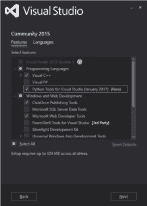
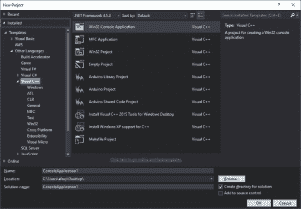
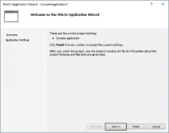
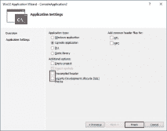
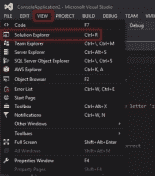
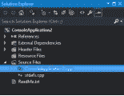
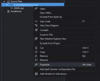
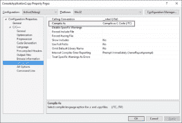
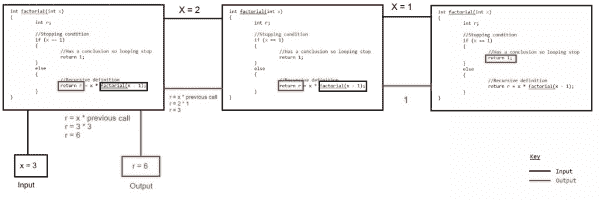

# C 语言：快速学习 C 语言的终极分步指南

## 第 1 章：介绍与安装

### C 语言的历史

C 是一种通用计算机语言，首次于 1972 年作为一个概念出现。C 的首席开发者是丹尼斯·里奇（Dennis Ritchie）。C 的起源与 Unix 操作系统的创建密切相关。

在本教程中，我们将从 C 的最基础知识一直到中级水平。本教程旨在吸引首次学习编程语言的读者。

### 在 Windows 上运行 C

在 Windows 上运行 C 可以通过 Visual Studio 2015 实现。可以直接从微软下载 Visual Studio，在安装过程中需要选择 C++ 作为语言。菜单应该如下所示：



在选择 `Visual C++` 后完全安装程序。

您应该启动 Visual Studio 并进入 `FILE -> New Project`，您将看到一个如下的窗口：



选择 `Win32 Console Application` 并点击 `Ok`。

现在会显示几个菜单，请跟随高亮部分进行操作。（高亮的选框需要取消勾选）：





当程序模板加载后，您应该注意到并没有为您提供 C 环境，而是 C++ 环境，您需要将其转换为 C。

进入 `Solution explorer`（解决方案管理器），将打开 `Solution Explorer` 菜单。





右键点击 `.cpp` 文件并点击 `Properties`（属性）。



将出现一个菜单，展开 `C/C++ menu`，进入 `Advanced`，找到 `Compile As` 部分并从下拉菜单中选择 `Compile as C Code (/TC)`。



代码现在已准备好运行了！当您想要编译的代码就绪后，点击顶部菜单上的绿色箭头运行您的控制台应用程序。

### 在 Linux 上运行 C

在 Linux 上开发基础代码相对容易，首先您需要 `gcc` 编译器，如果没有安装，请运行：

```bash
apt-get install gcc-5
```

下一阶段是创建您的程序，打开一个文本编辑器（在此例中为 Leafpad），使用此基础程序进行测试：

```c
#include <stdio.h>

int main() {
    printf("Hello World");
    return 0;
}
```

### 在 Mac 上运行 C

在 Mac 上运行 C 相对容易，打开终端并运行：

```bash
clang --version
```

启动您的记事本，输入：

```c
#include <stdio.h>

int main() {
    printf("Hello World");
    return 0;
}
```

### 在线运行 C

我喜欢的在线 IDE 之一是 [`www.codechef.com/ide`](https://www.codechef.com/ide)，它提供了一个清晰整洁的代码环境。


### 前提条件

在整个教程中，您会看到散落在各代码片段。有些点需要解释，以便您充分利用本教程。

#### 注释

代码中的注释由 `//` 标识，计算机会忽略这些内容，注释是保持代码可读性和易于维护的重要部分。初学者往往会忽略注释并在以后后悔，不要成为那种程序员。

#### 基础结构

C 程序还有一个基本的结构结构，结构如下：

```c
#include <stdio.h>

int main() {

//代码写在这里

}
```

## 第 2 章：基础单元

### 变量与类型

程序的基础是数据，以数字和字符的形式存在。数据的存储、处理和输出赋予了程序功能。变量持有这些数据，将其想象用于存储单个元素的盒子。

C 是一种强类型语言，每个变量必须有一个定义的类型。类型是定义变量可以包含内容的标识符。我们遇到的第一个类型是整数，它可以存储实数（不带小数点的数字），整数定义如下：

```c
int integerName = 3;
```

- `int` 是定义的类型关键字，我们稍后会学习不同的可能性。
- `integerName` 是变量的标识，可以是任何您想调用的名称，这允许变量具有有意义的名字，变量可以定义为 `int pineapple = 3;`，但使其相关是良好的习惯。然而，这里也有例外，变量名不能是单个数字（例如 `4`）或不能包含特殊字符（`!”£$%^&*)`）等。
- `== 3;` 是赋值部分，将 `3` 的值置于整数框中以供以后使用。它也以分号结尾，分号用于表示一行的结束。

该变量现在可以在程序的有效区域使用，例如：

```c
int newInteger = integerName
```

之前定义的 `integerName` 的值（`3`）现在将被放入 `newInteger` 变量中，它们现在的值都将是 `3`。`integerName` 的值没有改变，因为它只是被复制并放置在 `newInteger` 中。

### 字符串（String）

`String` 是另一个重要的变量，这种变量类型用于存储一系列字符，一个例子可以是单词“batman”，该单词由存储在 `String` 变量中的字符组成。它是一个字符数组（稍后会更详细介绍数组），但实际上它是将单词的单个字符在内存中相邻存储在一起的。`\n` 是一个代表换行的特殊字符。

```c
char word[] = "dog\n";
```

并且它可以像这样使用并打印：

```c
printf(word);
```

### 布尔值（Boolean）

布尔值用作表达式，其值只能是 `true (1)` 或 `false (0)`，用于表示某些状态或标记某些事件，它们还可以持有条件表达式的结果（稍后会更详细介绍条件表达式）。当我们学习条件语句时，这些将变得更有意义。

```c
_Bool falseIsDetected = 0; // 假
_Bool trueIsDetected = 1; // 真
```

### 浮点数/双精度浮点数（Float/Double）

浮点变量是用浮点精度数学创建的小数值，其工作原理的技术元素超出了本教程的范围，但可以通过互联网上的资源轻松解释，只需搜索“floating point precision”（浮点精度）。浮点数通过提供小数精度允许数值具有更高的精度。你可以通过在值的末尾加上 `f` 来指定一个 `float` 值。

```c
float decimalValue = 3.0f;
```

### 空（Void）

这种数据类型是特殊的，用于指定没有可用值。这听起来违背直觉，但我们稍后来看它的用途。

### 注意的关键词/术语

- `const` – 此关键字将变量变为只读，意味着它的值在初始化后无法更改。该关键字用法如下：

```c
const float pi = 3.14f;
```

- 全局变量（Global variable）– 这是一个描述在主函数之外定义变量的术语。例如 `int friendCount` 是全局变量，而 `int currentMonth` 则不是。注意它们定义的位置：

```c
// 全局
int friendCount = 0;

int main()
{
// 非全局
int currentMonth = 5;
}
```

这意味着全局变量可以在程序的任何位置使用，但如果使用不当可能会是危险的。一种正确的使用方法是与上述的 `const` 关键字结合使用，这意味着函数只能引用该值而不能更改它。

### 总结（Recap）

- `int`：存储整数
- `float / double`：存储小数
- `void`：指定没有类型
- `boolean`：存储真或假
- `string`：组成单词或句子的字符数组
- `global`：可以在任何地方访问的变量
- `const`：变量初始化后其值无法更改

### 算术运算（Arithmetic operations）

| 符号 | 使用 |
| :--- | :--- |
| `+` | `int result = 1 + 2;` |
| `-` | `int result = 1 – 2;` |
| `/` | `float result = 1 / 2;`（因为有小数，它存储在 `float` 中） |
| `*` | `Int result = 1 * 2;` |
| `%` | 取模运算符返回除法的余数 `int remain = 4 % 2;` |

### 条件语句（Conditionals）

以有意义的方式将值与其他值比较是条件语句的基础，下面是值比较的列表。

| 名称 | 符号 | 详情 |
| :--- | :--- | :--- |
| 大于 | `>` | 如果左侧大于右侧，则返回真 |
| 大于等于 | `>=` | 如果左侧大于等于右侧，则返回真 |
| 小于 | `<` | 如果左侧小于右侧，则返回真 |
| 小于等于 | `<=` | 如果左侧小于等于左侧（此处原文有误，应为右侧），则返回真 |
| 等于 | `==` | 双等号用于比较两侧的值是否等价，如果相等则返回真 |
| 不等于 | `!=` | 如果两个值不相等，则返回真 |

上面的条件语句列表可以在特定情况下控制程序的执行流。

#### `If` 语句（If statement）

在某些情况下，你需要在某个条件成立时执行某些操作，这就是 `If` 语句的作用，也是条件语句介入的地方。

```c
if (Condition)
{
 // 如果 Condition 为真，代码将在此运行
}
// 如果条件为假，If 语句被忽略，程序将跳转到这里
```

一个真实世界的示例：

```c
int compare = 10;

if (compare > 5)
{
 //printf() 将打印括号中的字符串
}
```

- `||`（双竖线）：用于将两个条件连接在一起，只有当其中一个条件为真时，它才会返回真。

#### `Switch-Case`

`Switch cases` 用于测试变量是否与某个常量表达式相等，而无需多个 `if`-语句。这种结构的一个用途是检查用户输入的字符串。以下是 switch case 的基本结构：

```c
//Switch-Case
switch (expression)
{
    //Case 语句
    case constant-expression:
        break; // 不需要 Break
    // 任意数量的 case 语句
    default:
        break;
}
```

`switch` 以一个 `expression` 开始，这是要与 `constant-expressions` 进行比较的变量，这些常量是变量的字面值，例如 `1` 或 `Z`。`break` 是可选的，但如果没有它们，代码将向下流（flow-down）到其他语句。下面是一个使用 switch-case 语句的示例，用户输入一个字符，如果 `char` 为 `N` 或 `Y`，则分别输出“ No”和“Yes”，但有一个适用于所有情况的默认（default）case，这需要放在最后。

```c
char character;
//读取用户输入（稍后会详细解释）
scanf("%s", &character);

//Switch-Case
switch (character)
{
    case 'N':
        printf("NO\n");
        break;
    case 'Y':
        printf("YES\n");
        break;
    default:
        printf("Do not understand!\n");
        break;
}
```

如果没有 `break` 语句，将会发生向下流（flow-down），下面的示例与上面一样，但没有了 `break` 语句，我们将看到输出结果：

```c
char character;
//读取用户输入（稍后会详细解释）
scanf("%s", &character);

//Switch-Case
switch (character)
{
    case 'N':
        printf("NO\n");
    case 'Y':
        printf("YES\n");
    default:
        printf("Do not understand!\n");
}
```

如果用户输入 `N`，输出将是：

> NO

> YES

> Do not understand!

这是因为当一个 case 语句被触发时，它会继续向下执行直到找到 `break` 语句来停止运行 case 体的代码。

### 迭代（Iteration）

迭代意味着循环，循环让程序能够快速地执行大量相似的操作，迭代有两种类型：`for 循环` 和 `while 循环/do-while Loop`。

#### `For` 循环

`for` 循环被给了一个结束值，并一直循环到该值，同时跟踪它当前处于第几次循环，下面是一个示例：

```c
for(int x = 0; x > 10; x++)
{
    printf("Looped!");
}
```

`for`-循环的每个部分都有其作用：

- **声明部分（Declaration section）**：这是定义循环计数器变量的声明部分，它定义了计数器的起始点。
- **条件部分（Conditional section）**：这部分被称为条件部分，它包含一个在循环结束时检查的条件语句，以确定 `if`-语句是否应该继续循环，因此在这种情况下，如果 `x > 10` 则循环应该继续循环，如果此条件变为假，循环将不再继续。
- **增量部分（Increment section）**：蓝色的语句是增量部分，在此处循环计数器会增加（值增大），`x++` 是 `x = x + 1` 的简写。如果存在需要计数器减少的情况，也可以是 `x--`。
- 声明部分定义循环计数器。
- 条件部分在为真时继续循环。
- 增量部分是循环计数器增加的地方。

#### 条件循环（Conditional Loops）

条件循环的工作方式类似于 `for` 循环，但没有循环计数器，并且只有当条件为真时才会循环。这意味着你可以创建一个无限循环，如下：

```c
while (TrueCondition)
{
    printf("This will not stop looping");
}
```

**注意**：无限循环通常使用裸露 `for-loop` 构建：

```c
for(;;)
{
    printf("This will also never stop looping");
}
```

这个循环将永远不会停止，你的程序将卡在循环中。

下面的示例显示，如果条件为假，程序将永远不会到达括号内的代码：

```c
while (FalseCondition)
{
    printf("This code will never run");
}
```

为了有效使用此循环，你可以将其与条件语句（如 `if` 语句）配合使用，或者与 `bool` 变量配合使用，示例如下：

```c
int count = 0;
while (count > 10)
{
    printf("loop");
    //记住这个，它等同于“count = count + 1;
    count++;
}
```

如上所示你也可以直接配合布尔变量使用 `while` 循环：

```c
int count = 0;
_Bool keepLooping = 1; // Bool 为真 (1) 表示真
while (keepLooping)
{
    printf("loop\n");
    //记住这个，它等同于“count = count + 1;”
    count++;
    if(count == 3)
    {
        keepLooping = 0; // keepLooping 现在为假，循环将停止
    }
}
```

#### `Do-While`

`do-while` 循环与 `while` 循环非常相似，但它在检查条件之前至少执行一次循环体。

```c
#include <stdio.h>

int main()
{
    int count = 0;
    _Bool correct = 1;

    do
    {
        printf("Please enter the letter: ");
        char z;
        scanf("%s", &z);

        if (z != 'z')
        {
            printf("Incorrect!\n");
            correct = 0;
        }
        else
        {
            printf("Correct!\n");
        }
    } while (correct);

    return 0;
}
```

### 循环关键字（Loop Keywords）

有时你需要提前停止整个循环或单次迭代，这就是循环关键字大用场。

`Break`：停止整个循环，如果找到了答案，剩余的迭代就没有意义了。

```c
for (int x = 0; x < 5; x++)
{
    if (x == 3)
    {
        break;
    }
    printf("Loop value: %d", x);
}
```

现在如果代码改为不包含 `break`：

```c
for (int x = 0; x < 5; x++)
{
    printf("Loop value: %d", x);
}
```


## `Continue` 语句

如果我们使用上面的代码并将其替换为`continue`，代码看起来如下：

```c
for (int x = 0; x < 5; x++)
{
    if (x == 3)
    {
        continue;
    }
    printf("Loop value: %d", x);
}
```

这显示当`x = 3`时执行了`continue`并跳过了循环，因此`printf`语句也被跳过。

## 嵌套循环 (Nested Loops)

你也可以将循环嵌套在循环内部执行特定角色，在示例中我们使用了`for-loops`，也可以使用`while/do`循环来实现。

该示例打印一个二维网格，嵌套的`for`-循环提供了另一个维度：

```c
//打印一个 5x5 网格
for (int y = 0; y < 5; y++)
{
    for (int x = 0; x < 5; x++)
    {
        // 打印行的一个元素
        printf("X ");
    }
}
```

```c
//向下移动一行

printf("\n");

}
```

输出

```
> X X X X X
> X X X X X
> X X X X X
> X X X X X
> X X X X X
```

## 函数

函数是程序的构建块，它们允许代码复用，能够保持代码的可读性，并防止程序员重复编写相同的代码。强烈建议不要重复代码，因为 Bug 会多次出现，且代码的更改也需要重复。函数提供了一个集中的控制区域，用于处理程序不同的角色。

一个方法包含两个元素：参数（传递到函数的项）和返回值（被返回的变量），这些都是可选的，你也可以定义一个既没有参数也没有返回值的函数。

函数必须在调用之前定义，如下所示：

```c
//函数定义

void Print_Smile()
{
    printf(":)\n");
}

int main()
{
    //方法调用
    Print_Smile();
    return 0;
}
```

而反过来写是错误的：

```c
int main()
{
    //方法调用 [此处错误]
    Print_Smile();
    return 0;
}

//函数定义

void Print_Smile()
{
    printf(":)\n");
}
```

## 函数参数

有时向程序中传递数据可能是很有用的，参数传递有两种类型：按引用传递和按值传递。按引用传递正如字面意思一样，它传递的是变量的直接引用而不是副本，因此对该传递变量的任何更改都会影响调用它的函数。按值传递是传递该变量的副本，因此对该变量的任何更改都不会影响被传递的变量。

C 语言不直接支持按引用传递，但在处理指针时可以实现这种效果（我们将在高级部分讨论）。

* 按引用传递意味着对参数的修改会影响传递的变量
* 按值传递意味着对参数的修改不会影响传递的变量

目前，按值传递的如下：

```c
void Add(int  num1, int  num2)
{
    // 将两个值相加
    int newValue = num1 + num2;
    // 打印结果
    printf("The result is: %d", newValue);
}

int main()
{
    //方法调用
    Add(10, 4);
    return 0;
}
```

输出：

```
> The result is: 14
```

在这种情况下，函数有两个整数参数，它接收这两个参数并打印结果。不要深究`printf`语句，我们稍后会介绍为什么使用`"%d"`以及如何使用`printf`。

下面是另一个例子，但这次使用字符串作为参数：

```c
void PrintStr(char  printData[])
{
    printf(printData);
    printf("\n");
}
```

`char printData[]`是参数变量，允许在该函数中使用该数据，在这种情况下，它打印出字符字符串。方法调用看起来如下：

`PrintStr("Flying Squirrel")`

这是一个极其实用的功能，允许我们能够编写通用代码，并根据作为参数输入的内容来更改其函数输出。

## 返回值

返回允许我们从方法返回数据，这使得我们能够在函数内部进行计算，并让函数自动返回结果。让我们选取之前的示例并进行修改，使其返回结果而不是打印结果：

```c
int Add(int  num1, int  num2)
{
    // 将两个值相加
    int newValue = num1 + num2;
    // return 关键字
    return newValue;
}

int main()
{
    //方法调用
    int storeResult = Add(10, 4);
    return 0;
}
```

发生变化的区域已经高亮。当需要返回值时，使用`return`关键字，在该行代码执行后，它会返回到调用方法的地方，因此`return`下方的任何代码都不会执行。

返回的结果随后存储在`storeResult`中以供以后使用。任何类型的变量都可以返回。我将在下面展示一个示例，检查数字是否为偶数（使用上文提到的取模运算符，它可以找到除法的余数）：

```c
_Bool EvenNumber(int  value)
{
    if (value % 2 == 0)
    {
        // 返回真
        return 1;
    }
    return 0;
}

int main()
{
    if (EvenNumber(2))
    {
        printf("Even number!");
    }
    if (EvenNumber(5))
    {
        printf("Even number!");
    }
    return 0;
}
```

输出：

```
>Even number!
```

此程序使用方法`EvenNumber()`的返回变量作为`if`语句的条件，如果为真，将打印"Even number!"。正如你从输出中看到的，第一个打印了但第二个没有。

## 递归

递归是一个困难的概念，在这里只会简单带过，其现实世界中的用途和功能将在高级部分解释。

递归是指涉及自身引用的函数命令定义，是的，我知道这非常困惑，但我将用一些例子来解释。

```c
const  int maxLoops = 5;

void Sequence(int  previous, int  now, size_t  loopCount)
{
    // 计算出下一个值
    int next = previous + now;
    // 打印值
    printf("New value: %d\n", next);
    // 计数
    loopCount++;
    // 确保不会发生无限循环
    if (loopCount < maxLoops)
    {
        // 递归调用
        Sequence(now, next);
    }
}

int main()
{
    // 调用
    Sequence(1, 0);
}
```

输出：

```
New value: 2
New value: 3
New value: 5
New value: 8
New value: 13
```

## 数组

数组之前提到过，它是在内存中存储一组变量的数据结构。数组被赋予一种类型，例如`int`。数组定义如下：静态大小`intOfNumber[20]`

或者你可以通过数量定义值：

`int lotsOfNumbers[] = {1,3,4}`

* 数组从 0 开始，所以第一个索引值为 0，以此类推。这意味着在访问值时，你需要记住它总是小于数量。

你可以这样访问索引：

`int var = lotsOfNumbers[0]`

这将获取数组的第一个索引并将其放入`var`。

数组对于快速访问紧相关的数据非常有用，你可以使用`for`循环遍历索引。示例如下：

```c
int lotsOfNumbers[] = { 1, 3, 4, 10};

for (int x = 0; x < 4; x++)
{
    printf("%d\n", lotsOfNumbers[x]);
}
```

输出：

```
> 1
> 3
> 4
> 10
```

在 C 语言中，你无法直接获取长度而需要计算，这可以通过简单地使用`sizeof()`关键字完成，它返回括号内元素的大小，例如在 64 位机器上一个`int`应该用 4 字节表示。数组的长度可以这样计算：

`int arrayLength = sizeof(lotsOfNumbers) / sizeof(lotsOfNumbers[0]);`

## 多维数组

你还可以在数组中定义第二个维度，甚至是第三个维度，这在处理数组时提供了更大的灵活性。例如，二维数组可以用于存储坐标或网格的位置。二维数组定义如下：

`int arrayOfNumbers[][2] = { {1,1}, {1,1}};`

通过在方括号中放入 x 和 y 坐标的值来访问元素

`int element = arrayOfNumbers[X][Y]`

```c
int arrayOfNumbers[][][2] = {{{1,1},{1,1}},{{1,1},{1,1}}};
```

但在这一阶段，它开始失去可读性了，采用下面的布局方式会更好：

```c
int arrayOfNumbers[][][2] =
{
    {{1,1},{1,1}},
    {{1,1},{1,1}}
};
```

# 在函数中传递数组

正如我们在上面学习函数时看到的，将变量作为参数传递是非常有用的，传递存储在数组中的大量变量也是如此。然而，我们在上面已经学会了如何确定数组的大小，但这并不适用于作为参数传递的数组，因此我们必须传递一个代表该数组所包含元素数量的变量。有一种特殊的变量类型用于存储计数变量，称为`size_t`，它是一个无符号整数值（意味着它不会变成负数），用于存储计数值。

下面是一个作为参数传递数组的示例：

```c
void Print_SingleDimenArray(size_t length, int ageArray[])
{
    //Length 用于动态确定 for 循环的长度
    for (int i = 0; i < length; i++)
    {
        printf("%d\n",ageArray[i]);
    }
}

int main()
{
    //一个年龄数组
    int ages[] = { 32, 11, 12, 1, 8, 5, 10 };
    // 尺寸如之前所示确定
    size_t ageLen = sizeof(ages) / sizeof(ages[0]);
    // 方法调用
    Print_SingleDimenArray(ageLen, ages);
}
```

### 输出

>32

>11

>12

>1

>8

>5

>10

数组已经被传递并用于打印值。数组长度对程序至关重要，因为它允许`for`循环适用于不同的数组。

* 在任何方法中对数组的任何更改都会改变调用方法中的数组变量。这就是之前提到的引用传递，整个数组并没有被复制，而是通过一个小技巧以引用传递的。

## 额外 – 高级

这对于理解并不是至关重要的，但我将解释为什么在数组作为参数传递后确定其大小不会得到正确的结果。

当数组作为参数传递时，传递的是第一个元素的内存位置地址（这是一个指针，我们承诺稍后会讨论这些），当你使用`sizeof`来获取"数组"的大小时，你只是获取了返回的第一个元素的大小。

# 用户输入

有时需要从用户那里获取输入，例如选择或名称等。有几种方法可以实现，但最直接的方法是使用`scanf()`和`printf()`函数。

在我们深入研究它们如何工作之前，首先需要学习`scanf()`和`printf()`的基本类型标识符（这并不是一个完整的列表）：

| 格式 ID | 有效输入 | 参数所需的类型 |
| :--- | :--- | :--- |
| `%c` | 单个字符，读取字符等等 | `char` |
| `%f` | 浮点数值 | `float` |
| `%d` | 十进制整数 | `int` |
| `%o` | 八进制 | `int` |
| `%u` | 无符号十进制整数（没有符号，只是正整数） | `int` |
| `%x` | 十六进制 | `int` |
| `%s` | 字符字符串，将继续读取直到发现空白字符 | `char[]` |

`scanf()`通过获取用户输入并将其放入变量中工作：

```c
char name[20];
scanf("%s", name);
```

一个获取整数值的示例：

```c
int userInputInt;
scanf("%d", &userInputInt);
```

注意：对`userInputInt`使用了`&`。这表示它是对`userInputInt`内存位置的精确引用，从用户处读取的值通过相加到该内存位置被放入该整数变量中。

`printf`用于在控制台上显示信息以进行调试和用户界面。`printf`也使用与`scanf`相同的格式 ID，这些格式 ID 被用作占位符，下面的示例分别显示了打印字符串和整数：

### 整数

```c
int number = 10;
printf("%d", number);
```

### 字符串

```c
char word[] = "Lemon";
printf("%s", word);
```

这些格式 ID 作为占位符工作，`printf`可以根据打印字符串中存在的格式 ID 数量接收多个参数。例如：

```c
int number = 10;
char word[] = "Lemon";
printf("A fruit is: %s and here is a number: %d", word, number);
```

每个格式 ID 按顺序被参数替换，在这种情况下，`%s`被`word`替换，`%d`被`number`替换。这可以配合任意数量的格式 ID。

## `fputs()`

当你只想向控制台打印字符字符串时，`fputs()`是简单的替代方案。`fputs()`不使用`printf()`使用的格式 ID，因此不需要检查格式，速度稍快。它还会自动在打印行的末尾添加一个`\n`。

## 第 2 章测验

本节旨在让你对之前的内容保持警觉，会有 10 个问题你可以回答以测试你的知识，答案将在下面的相邻章节。

1. 列出一种用于存储十进制数字的数据类型？
2. 布尔值包含哪两个值？
3. 什么是条件？
4. 列出由哪些部分组成？
5. 关键字实现了什么作用？
6. 函数可以返回值吗？
7. 它可以有多少个参数？
8. `printf`和`puts`之间的区别是什么？
9. 哪个数据类型用于此？
10. 数组可以包含多少值？

# 第 3 章

# 高级基础

## 指针

之前提到过指针，它们是变量的内存地址，这就像房子。下面的程序将显示变量的地址：

```c
#include <stdio.h>
int main()
{
    int var;
    printf("The address is: %x\n", &var);
    return 0;
}
```

输出：>ffa2c（注意：每次运行都会不同）

要创建一个指针，我们使用解引用运算符`*`，这将创建一个用于存储内存位置的指针变量。使用`%x`是因为位置是十六进制的。

* 解引用运算符`*`用于创建指针，也用于更改实际值。
* 引用运算符`&`用于获取指针的内存位置。

```c
//普通变量
int var = 10;
//指针
int* pointer;
// 存储 var 的内存位置
pointer = &var;
// 指针现在实际上是 'var' 所以
// 可以发生这样的操作
*pointer = 20;
printf("Var's value is now: %d", var);
```

输出：>Var's value is now: 20

## 空指针

当你创建一个指针时，它最初没有指向任何内容，这是危险的，因为指针创建时引用的是随机内存，更改内存位置中的数据会导致程序崩溃。为了防止这种情况，我们在创建指针时将其赋值为`NULL`：

```c
int* pointer = NULL;
```

这意味着指针的地址为`0`，这是一个用于标识空指针的保留内存位置。空指针可以通过`if`语句检查：

```c
if (pointer){}
```

如果指针为空，则将成功。

## 使用指针

现在指针的一些现实用途是将它们作为参数传递，并有效地通过引用传递。下面的示例将显示其效果：

```c
void Change_Value(int* reference)
{
    // 修改内存位置中的值
    *reference = 20;
}

int main()
{
    // 创建变量的指针
    int var = 10;
    int* pointer = &var;
    printf("The value before call: %d\n", var);
    // 方法调用
    Change_Value(pointer);
}
```

```c
Change_Value(pointer);

//打印新值

printf("The value after call: %d\n", var);

return 0;

}
```

输出

>调用前的值: 10

>调用后的值: 20

这传递的是变量的内存地址而不是变量的值，这意味着你拥有一个可以进行修改的位置。

注意参数的类型是`int*`，这是指针类型，因此，指向字符的指针示例将是`char*`。


## 指针算术

有时将指针移动到另一个内存地址可能是很有用的，这就是指针算术大显身手的地方。假设我们执行例如`ptr++`，且`ptr`是一个整数指针，那么它现在将向前移动 4 字节（`int`的大小），如果我们再次运行它，再移动 4 字节，以此类推。这意味着指针（如果指向有效的数组结构）可以像数组一样工作。下文示出了一个示例：

```c
int arrayInt[] = { 10, 20, 30 };

size_t arrayInt_Size = 3;

// 将指向数组的第一个索引
int* ptr = &arrayInt;

for (int i = 0; i < arrayInt_Size; i++)
{

// 记住，ptr 获取内存位置中的值
printf("Value of arrayInt[%d] = %d\n", i, *ptr);

ptr++;
}
```

输出

>Value of arrayInt[0] = 10

>Value of arrayInt[1] = 20

>Value of arrayInt[2] = 30

这表明指向数组第一个地址的指针可以沿着数组的地址递增（记住数组的每个值都存储在相邻的内存位置）。

你可以执行相反的操作，递减指针，即让指针的值减小。

还可以使用关系运算符如`==`、`<`和`>`来比较指针。最常见的用途是检查两个指针是否指向同一个位置：

```c
int value;

//为 ptr1 和 prt2 赋值相同的值
int* ptr1 = &value;
int* ptr2 = &value;

//为 ptr3 赋值另一个值
int* ptr3 = NULL;

if (ptr1 == ptr2)
{
printf("ptr1 and ptr2 are equal!\n");
}

if (!ptr1 == ptr3)
{
printf("ptr1 is not equal to ptr3\n");
}
```

这检查了各个指针是否相等。使用`>`和`<`也可以实现的功能。

## 函数指针

就像对变量的操作一样，你也可以对函数进行操作，下面是一个定义函数指针的代码片段。关键部分将会被标记：

```c
void printAddition(int  value1, int  value2)
{
int result = value1 + value2;
printf("The result is: %d", result);
}

int main()
{
//函数指针定义
//<retrunType>(*<Name>)(<Parameters>)
void(*functionPtr)(int, int);

functionPtr = &printAddition;

// 调用指针函数
(*functionPtr)(100, 200);

return 0;
}
```

定义函数指针的基础结构如下

`<Return_Type> (*<Name>) (<Parameters>)`

在此例中：

`<Return_Type>` = `void`

`<Name>` = `functionPtr`

`<Parameters>` = `int, int`

此函数指针现在可以作为参数传递，并在你希望更改代码行为但保持几乎相同代码的情况下使用。

一个示例可以是动态地选择计算器应该执行什么操作（注意：这是复杂的代码，应仅作为粗略示例，如果你不完全理解请不要担心）

```c
void calculator(int  value1, int  value2, int(*opp)(int,int))
{
int result = (*opp)(value1, value2);
printf("The result from the operation: %d\n", result);
}

// 相加两个值
int add(int  num1, int  num2)
{
return  num1 + num2;
}

// 减去两个值
int sub(int  num1, int  num2)
{
return  num1 - num2;
}

int main()
{
calculator(10, 20, &add);
calculator(10, 20, &sub);
return 0;
}
```

在这里发生的情况是，我们将函数`add`和`sub`作为函数`calculator`的参数。如你从高亮部分所示，函数参数的定义如上方，定义了返回类型、名称和参数，传递到`calculator`的只是函数指针的`&add`和`&sub`。然后`calculator`函数将调用指针并传入值并返回结果。

## 存储分类

在 C 中，每个变量都可以赋予一个存储类，该类可以定义某些特性。

这些类是：

* 自动变量

* 静态变量

* 寄存器变量

* 外部变量

### 自动变量

我们目前为止定义的每个变量都是自动变量，它们在函数调用时创建，并在函数退出时自动销毁。这些变量也被称为局部变量。

```c
auto  int value;
```

等同于

```c
int value;
```

### 静态变量

`static`用于当你希望变量在离开作用域时不被销毁时，该变量将一直持续到程序结束。静态变量在整个程序的生命周期内只创建一次。

```c
void tick()
{
static int count = 0;
count++;
printf("The count is now: %d\n", count);
}

int main()
{
tick();
tick();
}
```

输出

>The count is now: 1

>The count is now: 2

>The count is now: 3

### 寄存器变量

`register`用于定义内存寄存器中的变量而不是普通内存，寄存器的优点是它的速度快得多。定义寄存器的方法如下：

```c
register int value;
```

### 外部变量

我们之前提到过变量在任何地方的定义。注意它们需要所在的文件。

**程序 1 [File_2.c]**

```c
#include <stdio.h>
extern int globalValue;

int main()
{
printf("The variable is: %d", globalValue);
}
```

**程序 2 [C_UT.c]**

```c
int globalValue = 1032;
```

这显示了`globalValue`在`C_UT.c`中被引用。

## 文件 I/O

某些情况下你需要在程序运行期间保留数据，这就是保存到文件的用处。有两种类型：

- 文本文件

- 二进制文件

为了开始，你需要创建一个类型`FILE`的指针，它将允许文件和程序之间的通信。做法如下：

```c
FILE* ptr;
```

### 打开文件

如果此文件已存在，你可以打开它并读取内容，这通过使用以下命令实现：

```c
ptr = fopen(char* filename, char* mode)
```

其中：

`filename` = 要打开的文件名

`mode` = 打开文件时使用的模式，完整列表如下所示：

| 模式 | 描述 |

| :--- | --- |

| `r` | 以只读模式打开文件 |

| `w` | 以只写模式打开文件，如果文件不存在则创建一个新文件。程序将从文件开头开始写入内容。 |

| `a` | 追加模式，如果文件不存在则创建它。对现有文件的任何更改都将添加到文件末尾。 |

| `r+` | 以读写模式打开文件 |

| `w+` | 以读写模式打开文本文件。如果文件存在，则首先将其长度截断为零；如果不存在则创建一个新文件。 |

| `a+` | 再次以读写模式打开文件。如果文件不存在则创建一个新文件。读取从开头开始，但写入仅追加到文件末尾。 |

### 关闭文件

这个非常简单，只需要运行：

```c
fclose(ptr);
```

### 写入文件

向文件写入有两种方法：`fprintf()`和`fputs()`（类似于控制台打印命令`printf()`和`puts()`）。它们唯一的区别在于`fprintf()`允许你使用像`%s`这样的格式化标识符，而`fputs()`则不允许。这意味着`fputs()`不需要检查格式，直接打印原始字符串，因此速度更快。`fputs()`还会自动在其给定的字符字符串末尾添加换行符`\n`，就像`puts()`一样。下面的示例展示了如何打开、写入和关闭文件：

```c
#include <stdio.h>

int main()
{
// 创建文件指针
FILE* ptr;
// 打开文件
ptr = fopen("C:/C_IO/example.txt", "w+");

// 写入文件
fprintf(ptr, "fprint()\n");
fputs("fputs()\n", ptr);

// 关闭文件
fclose(ptr);
}
```

它直接在 C 盘的`C_IO`目录下创建一个文件（在运行程序之前请创建该目录）。它使用`w+`模式，因此每次运行程序时，文件中的数据都会被覆盖。

你也可以仅使用`fprintf()`保存值，如下所示：

```c
fprintf(ptr, "%d\n", value);
```

* 打开文件`fopen()`

* 向文件写入

    * `fprintf()`

    * `fputs()`

* 关闭文件`fclose()`

## 练习

- 编写一个程序保存加法函数的输出，将其保存到你之前在 C 盘（或你的主硬盘）上的`C_IO`目录，并命名为“addSave.txt”，使用 10 和 25 以及你的值。

### 答案

类似这样的即可，不需要完全一样，实现方式总有许多方法。

```c
#include <stdio.h>

int add(int num1, int num2)
{
return num1 + num2;
}

int main()
{
// 获取要保存的值
int saveValue = add(10, 25);
// 创建文件指针
FILE* ptr;
// 打开文件
ptr = fopen("C:/C_IO/addSave.txt", "w+");

// 写入文件 – 这就是 printf 的工作原理，只是没有格式化字符串
fprintf(ptr, "%d\n", saveValue);

// 关闭文件
fclose(ptr);
}
```

## 递归进阶

我们在教程的基础部分提到过递归，再次强调，它是函数任务对自身的定义。正如所承诺的，下面进一步解释了几个递归的示例：

```c
int factorial(int x)
{
int r;
// 停止条件
if (x == 1)
{
// 有结论所以停止循环
return 1;
}
else
{
// 递归定义
return r = x * factorial(x - 1);
}
}

int main()
{
puts("请输入一个数字: ");
// 读取用户输入
int a, b;
scanf("%d", &a);
// 开始执行
b = factorial(a);
printf("阶乘是: %d", b);
}
```

这是一个世界著名的递归示例，用于计算数字的阶乘（3 的阶乘是 3x2x1）。它通过上面的递归返回语句工作，通过设置一个不包含递归定义的返回语句来停止，即当`x = 1`时，函数直接返回 1，这意味着栈可以回溯并找到答案。下面是流程图：



## 第 3 章练习

1. 指针变量持有什么内容？

2. 使用什么运算符来表示指针？

3. “++”对一个占 4 字节的`int`类型指针会做什么？

4. 在程序的生命周期内，静态变量被初始化多少次？

5. 将变量定义为`register`时会发生什么？

6. 用于向文件写入的两个函数是什么？

7. `fopen()`的`w+`模式的作用是什么？

8. 在什么情况下下面的代码会执行？假设指针是一个整数指针

```c
if(pointer)
{

}
```

9. `&`称为什么？它有什么作用？

10. 当你将数组作为参数传递时，还需要传递它的什么？

# 第 4 章

## 自定义结构体

编程语言的可定制性允许它们承担任何角色，程序员可以操作和构建用于存储和处理数据的结构体。

### 结构体

我们遇到的第一个用户定义对象是“结构体”，它允许自定义存储数据，定义如下：

```c
struct Structure-Name
{
// 语句
};
```

其中语句是结构体持有的变量。结构体允许以有意义的方式自定义数据，与数组类似，区别在于数组存储许多相同类型的变量，而结构体可以存储多种类型，甚至是其他结构。

下面是一个真实的示例：

```c
struct Person
{
int age;
char firstName[15];
char lastName[15];
char favoriteColour [10];
};
```

该结构体用于存储关于人的信息，可以这样创建一个新的人：

```c
struct Person p1;
```

这就像定义一个新变量，下面的示例显示两个新创建的人包含相互独立的值。

*(注：由于提供的原始文本存在大量重复和乱码，上述内容已根据核心逻辑进行了整理和翻译)*

```c
enum Condition
{
  Working,
  NotWorking,
  Finished,
  Unknown
};
```

这定义了一个名为`Condition`的枚举，其中每个可能的类型都被定义为可能的状态。你可以像这样创建并使用枚举：

```c
#include <stdio.h>

enum Condition
{
  Working,
  NotWorking,
  Finished,
  Unknown
};

int main()
{
  // 创建
  enum Condition programCondition;
  // 赋值
  programCondition = Working;

  // 比较
  if (programCondition == Working)
  {
    puts("All is good!");
  }
}
```

这个程序展示了如何创建一个枚举、如何给它赋值以及如何比较它的值。

枚举最常用的用法类似于布尔值，但带有额外的上下文和特性。与布尔值的二元性质相比，它提高了可读性并增加了额外的状态。枚举非常适合跟踪具有有限定义值的数据，例如当前月份或星期几。

## 练习

创建一个处理星期几的枚举，并打印出分配的任何一天（提示：switch-case 对于检查当前日期非常有用)。

### 解决方案

如下所示：

```c
#include <stdio.h>

enum WeekDay
{
  Monday,
  Tuesday,
  Wednesday,
  Thursday,
  Friday
};

enum Condition currentDay;

int main()
{
  currentDay = Friday;
  switch (currentDay)
  {
    case Monday:
      puts("It's Monday!");
    case Tuesday:
      puts("It's Tuesday!");
      break;
    case Wednesday:
      puts("It's Wednesday!");
      break;
    case Thursday:
      puts("It's Thursday!");
      break;
    case Friday:
      puts("It's Friday!");
      break;
  }
}
```

## 联合体 (Unions)

联合体是一种特殊的数据类型，允许程序员在同一个内存位置存储不同的数据类型。你可以定义一个具有许多数据成员的联合体，但一次只有一个变量可以持有值。这是将同一内存位置用于不同用途的一种有效方法。

联合体的结构如下：

```c
union Name
{
  // 变量
  int i;
  int y;
  char word[20];
  _Bool alive;
};
```

并且可以创建多个副本，就像你可以创建结构体或枚举的版本一样。这样做如下：

```c
union Name t1;
```

联合体的大小与最大的变量一样大，而不是所有值的总和，这提供了一种与结构体相比的逐个存储变量的有效方法。比较两者，上面的联合体大小为 20 字节，而具有完全相同变量的结构体将是 32 字节。如果在更大规模上使用，这将减少大量的空间。

使用成员访问运算符`.`访问联合体中的变量，其使用方法如下：

```c
union Name example;

example.i = 10;
printf("i before assigned another variable a value: %d\n", example.i);
example.y = 25;
printf("i after assigned another variable a value: %d\n", example.i);
printf("y value for reference: %d\n", example.y);
strcpy(example.word, "Hello!");
printf("i after assigned a string a value: %d\n", example.i);
printf("y after assigned a string a value: %d\n", example.y);
printf("String variable: %s", example.word);
```

输出

>i before assigned another variable a value: 10

>i after assigned another variable a value: 25


> y value for reference: 25

> i after assigned a string a value: 1819043144

> y after assigned a string a value: 1819043144

> String variable: Hello!

正如你所见，改变一个值会影响所有其他变量，这是联合体（union）如果没有正确使用的缺点，需要非常仔细地管理，以防止由于变量改变而导致错误。

## 可变参数列表（Variable argument lists）

你可能会遇到一个需要许多参数的问题，这就是可变参数的用武之地，因为它允许传递动态数量的变量作为参数。

注意：这需要包含一个新的头文件：

```c
#include <stdarg.h>
```

在使用可变参数时添加此项。

你这样设计该方法：

```c
void function(int noOfVariables, ...)
```

...其中始终有一个变量定义变量的数量，后面是这些变量。额外的变量被分配给一个名为 `va_list` 的东西，这些列表通过这些函数进行操作：

`va_start(va_list valist, int numberOfVaribles);`

`va_start` 实际上获取额外的变量并将它们放入 `va_list` 中。

`va_arg(valist, type);`

`va_arg` 获取下一个变量并返回它，它不知道当前的整数是否是最后一个，因此程序设置需要确保它不会发生溢出。

`va_end(valist);`

`va_end` 简单地清理 `va_list` 的内存。

下面是一个找到最大值的示例：

```c
#include <stdio.h>
#include <stdarg.h>

int max(int n, ...)
{
  int largest = 0;
  // 创建分配
  va_list valist;
  va_start(valist, n);
  // 遍历列表
  for (int i = 0; i < n; i++)
  {
    // 获取下一个 arg
    int arg = va_arg(valist, int);
    if (arg > largest) largest = arg;
  }
  va_end(valist);
  return largest;
}
```

*(注：`max` 函数的原始文本非常碎片/损坏。我根据提供的代码片段重构了逻辑，同时保留了核心结构。)*

再次回到计算器示例，头文件可以像下面这样是一个函数列表，然后可以包含它以允许使用这些函数。

## 预处理器指令

预处理用于给编译器提供某种指令，你已经遇到过几次指令了，比如 `#include` 指令，它告诉编译器包含某个头文件。

下面是处理器指令的列表，我们将介绍它们是如何工作的：

| 指令 | 描述 |
| :--- | :--- |
| `#define` | 用于定义宏 |
| `#include` | 从另一个文件中插入特定的头文件。 |
| `#undef` | 移除 `#define` 的效果 |
| `#ifdef` | 如果此宏已定义，则返回真。 |
| `#ifndef` | 如果此宏未定义定义，则返回真。 |
| `#if` | 测试编译时条件是否为真。 |
| `#else` | `#if` 的替代方案。 |
| `#elif` | 一个语句中的 `#else` 和 `#if`。 |
| `#endif` | 结束预处理器条件判断。 |

### `#define` 和 `#undef`

这些命令用于使用全局值来增加可读性，例如：

`#define LOOP_NUMBER 2;`

可以像这样定义并使用：

```c
for (int i = 0; i < LOOP_NUMBER; i++)
{
    //循环代码
}
```

该 `for` 循环将循环两次，但你不能像普通变量那样更改它的值，它在程序生命周期内是常量，除非使用 `#undef`，它会取消定义设置的值。

`#undef` 通常用于重写内置指令，你可以在那里取消定义一个值，然后设置一个你选择的值。

### `#ifdef` 和 `#if`

如果宏已定义，`#ifdef` 和 `#ifndef` 分别返回真和假，这种最常见的用法是检查是否设置了 `-DDEBUG` 标志，并在 DEBUG 模式下运行在完成的程序中没有用处的代码。它的用法如下：

```c
#include <stdio.h>

int main()
{
#ifdef DEBUG
    puts("DEBUG!");
#endif
}
```

这段代码只有在代码标记为调试模式时才会运行。这对于程序员来说非常有用。

`#if`、`#else` 和 `#elif` 的工作方式与 `if` 语句完全相同，但它们用于使用算术表达式检查宏，而不是检查其是否存在。

## 错误处理

错误处理是一个非常重要的部分，因为程序员需要确保他的程序准备好处理预期和意外的错误。C 不对错误处理提供直接支持，但允许访问某些底层函数。如果发生错误，大多数函数将返回 `-1` 或 `NULL` 并设置 `errno` 错误代码，`errno` 是存储最后一个返回错误代码的全局变量。

你需要包含 `<errno.h>` 头文件来使用这些错误处理函数。

```c
#include <errno.h>
```

有几个函数允许你理解错误代码。

`perror()`

函数显示你传递的字符串，并在末尾附加 `errno` 中存储的错误代码的文本表示。

`strerror()`

返回指向 `errno` 值文本表示的指针。这可以保存错误反馈。

`stderr` 文件流

`stderr` 用于将错误输出到控制台。

用法如下：

```c
#include <stdio.h>
#include <errno.h>

extern int errno;

int main() {
    FILE * file;
    int errnum;
    // 查找文件
    file = fopen("youWillNotFindMe.txt", "rb");
    // 如果文件返回错误
    if (file == NULL)
    {
        // 获取错误代码
        errnum = errno;
        // 打印错误代码
        fprintf(stderr, "Value of errno: %d\n", errno);
        // 返回提供的字符串 + : 和错误代码消息
        perror("Error printed by perror");
        // 获取错误文本
        char* errorMsg[] = { strerror() };
        printf("Error msg test print: %s", *errorMsg);
    }
    else
    {
        fclose(file);
    }
    return 0;
}
```

上面是一些错误处理示例的用法。回顾并理解错误处理非常重要。

下面是防止经典的除零错误的另一个示例：

```c
#include <stdio.h>
#include <errno.h>

extern int errno;

int divide(int x, int y)
{
    if (y == 0)
    {
        // 打印错误
        fprintf(stderr, "Diving by zero error..!");
        // 返回错误代码
        return -1;
    }
    else
    {
        // 如果有效则返回结果
        return x / y;
    }
}

int main()
{
    int returnCode = divide(0, 2);
}
```

## 类型转换

变量有定义的类型，但在某些情况下，你需要将一种类型转换为另一种类型。非常常见的是整数到浮点数或双浮点数的转换

一般格式如下：

`(type)varToCast`

可以这样使用：

```c
int main()
{
    int integer = 3;
    float decimal = 1.5f;
    int result = (int)decimal + integer;
    printf("%d", result);
}
```

输出

```c
int main()
{
    int integer = 3;
    float decimal = 1.5f;
    int result = (int)decimal + integer;
    printf("%d", result);
}
```

这种值被截断，你也可以升级一个值，类型转换的用法如下：

```c
int main()
{
    int integer = 3;
    float decimal = 1.5f;
    int result = (int)decimal + integer;
    printf("%d", result);
}
```

这可以用于将一种类型转换为另一种类型转换的用法如下：

```c
int main()
{
    int integer = 3;
    float decimal = 1.5f;
    int result = (int)decimal + integer;
    printf("%d", result);
}
```

## 内存管理

C 允许程序员动态管理内存。这种功能由以下函数提供：

```c
#include <stdlib.h>
```

- `malloc(size)` - 分配内存但留未初始化。
- `calloc(num, size)` - 分配内存并初始化为零。
- `realloc(address, size)` - 重新分配内存大小。
- `free(address)` - 释放内存。

下面是使用 `malloc` 或 `calloc` 为字符串分配内存的示例：

```c
#include <stdio.h>
#include <stdlib.h>

#define WORD_SIZE 20

int main()
{
    char* word;
    // 分配内存
    word = malloc(WORD_SIZE * sizeof(char));
    // 或者
    word = calloc(WORD_SIZE, sizeof(char));
    // 复制值
    strcpy(word, "Hello nice to meet you!");
    // 打印
    printf("The string is:%s\n", word);
    // 删除内存
    free(word);
}
```

可以用于执行复杂的操作，比如获取用户输入并存储在数组中：

```c
#include <stdio.h>
#include <stdlib.h>

#define WORD_SIZE 20

char* getInput()
{
    // 将被删除
    char temp[50];
    // 用户输入
    printf("Please enter your first name: ");
    scanf("%s", temp);
    puts("");

    // strlen() 找到字符串长度
    int len = strlen(temp);

    // 动态分配内存
    char* perfectSizeWord;
    // 分配内存！
    perfectSizeWord = calloc(len, sizeof(char));

    // 此命令不起，它获取 temp 的内存位置并直接复制它，所以
    // 此函数超出作用域，perfectSizeWord 也是
    ///perfectSizeWord = temp

    // 正确地复制值
    for (int i = 0; i < len; i++)
    {
        perfectSizeWord[i] = temp[i];
    }

    // 尺寸比较
    printf("Size of temp var:%d\n", sizeof(temp));
    printf("Size of new perfect var:%d\n", sizeof(perfectSizeWord));

    return perfectSizeWord;
}

int main()
{
    // 获取返回变量
    char* word = getInput();
    // 打印
    printf("The word is:%s\n", word);
    // 删除内存
    free(word);
}
```

## 练习

使用上面的错误处理技术来处理 `malloc` 或 `calloc` 分配内存时的错误。要模拟错误，只需在动态内存分配后让 `word = NULL;`。

使用下面的程序框架来帮助：

```c
#include <stdio.h>
#include <errno.h>

int main()
{
    char* word;
    // 分配内存
    word = malloc(20 * sizeof(char));
    // 错误模拟
    word = NULL;
}
```

```c
//------------------在此处输入错误代码------------------------

// 删除内存

free(word);

}
```

## 解决方案

非常简单，包含的内容如下：

```c
#include <stdio.h>
#include <errno.h>

int main()
{
    char* word;
    // 分配内存
    word = malloc(20 * sizeof(char));

    // 模拟错误
    word = NULL;

    if (word == NULL)
    {
        fprintf(stderr, "Error: Unable to allocate the memory!");
    }

    // 删除内存
    free(word);
}
```

## 第 5 章练习题

1. 如何告诉编译器使用其他文件和库？
2. 头文件使用什么扩展名？
3. `#define` 是干什么用的？
4. 错误处理需要哪个 `#include`？
5. 全局变量 `errno` 中包含什么？
6. `strerror()` 返回什么？
7. 打印错误需要哪个文件流？
8. 类型转换（Typecasting）是它是干什么用的？
9. `calloc` 和 `malloc` 有什么区别？
10. 遇到错误时函数通常会返回什么？

## 第 2 章答案

1. 单精度浮（Float）或双精度浮（Double）
2. 真（1）和 假（0）
3. 用于检查条件是否为真或假的陈述语句
4. 声明、条件和迭代。
5. 跳过完整的迭代
6. 是的，并且通过使用 `void` 关键字实现
7. 理论上无限制
8. `Printf` 使用格式化标识符，`puts` 不使用格式化标识符，且 `puts` 会在字符串末尾自动添加 `\n`
9. 整数值
10. `int arrayLength = sizeof(lotsOfNumbers) / sizeof(lotsOfNumbers[0]);`

## 第 3 章答案

1. 用于特定变量类型的内存位置。
2. 解引用运算符 `*`。
3. 它将向下一个内存位置移动 4 字节。
4. 仅执行一次。
5. 变量存储在访问速度快得多的寄存器内存中。
6. `fprintf()` 和 `fputs()`。
7. 以读读写模式打开文件，如果文件存在则将其大小缩减为零，如果不存在则创建它。
8. 如果指针不是 `NULL`。
9. 被称为引用运算符，用于访问或返回原始内存地址。
10. 数组的大小，最好以 `size_t` 变量的形式表示。

## 第 4 章答案

1. 需要 `strcpy()`。
2. 内部和外部定义。
3. 用于为变量和用户定义的结构提供自定义名称。
4. 枚举类型。
5. 联合体（unions）中同一时间只有一个变量可以存储值。
6. 联合体的大小与其最大的变量相同。
7. 传递给可变参数函数的变量列表。
8. 参数列表末尾的省略号（...）。
9. 用点号 `.` 表示的成员运算符。
10. 数组存储相同类型的变量，结构体存储任何类型的变量。

## 第 5 章答案

1. 使用 `#include` 指令
2. 头文件使用 `.h`
3. `#define` 用于创建常量值的全局定义
4. `#include <errno.h>`
5. 最后一次抛出的错误代码将存储在那里。
6. `errno` 中存储的错误代码的文本表示
7. 文件流是：`stderr`
8. 用于将一个变量转换为另一种类型
9. 当 `calloc` 分配内存时会初始化值，`malloc` 不会。
10. `NULL` 或 -1
