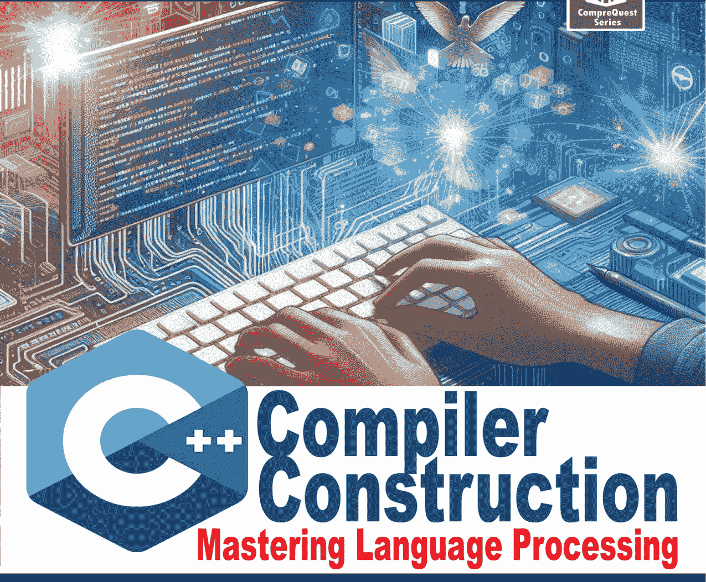
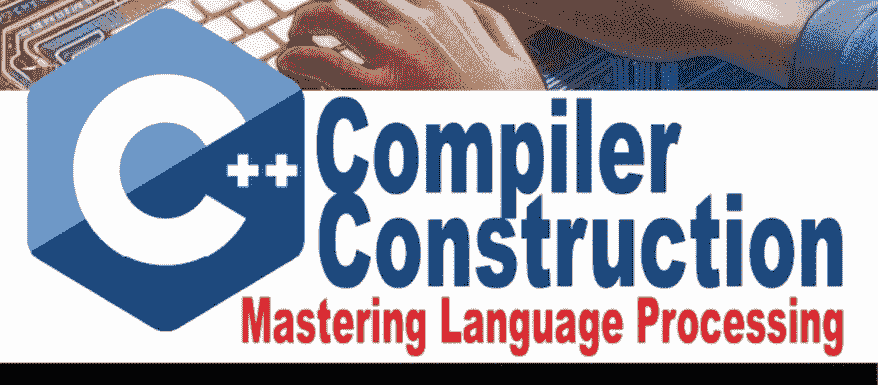

# C++ 编译器构建：精通语言处理（计算机科学基础）



Theophilus Edet


Theophilus Edet



作者：Theophilus Edet

| Theophilus Edet |
| :--- |
| @ theoedet@yahoo.com |
| f facebook.com/theoedet |
| t twitter.com/TheophilusEdet |
| o Instagram.com/edettheophilus |

## 前言

- 链接时优化
- C++ 的可移植性
- 性能监控工具

通过 CompreQuest Books 开启 ICT 大师之旅

前言深入探讨了编译器设计与实现的复杂领域，为读者提供了理解和构建 C++ 语言编译器的全面指南。本书由 Theophilus Edet 编写，为开发者、教育工作者和爱好者提供了路线图，清晰精准地引导通过复杂的编译器构造。在前言中，我们探讨了使用 C++ 构建编译器的意义、它对开发者的重要性、它涵盖的编程模型和范式，以及本书采用的教学风格。

## 对开发者的意义

理解编译器构造对开发者来说非常有价值，因为编译器在软件开发生命周期中起着关键作用。无论开发应用程序、库还是系统，开发者都依赖编译器将其高级代码转换为可执行的机器指令。通过深入研究编译器设计和实现，开发者可以对编程语言、内存管理、优化技术和系统架构有更深入的理解。这些知识使他们具备编写更高效、可靠且可扩展软件系统所需的工具和见解，增强了他们作为软件工程师的能力。

## 编程模型与范式

C++ 涵盖了广泛的编程模型和范式，使其成为编译器构建领域的一种多功能语言。从过程化编程到面向对象编程、泛型编程和元编程，C++ 为开发者提供了大量的工具和抽象，用于表达复杂的思想和解决多样化的问题。编译器构建实现了这些编程模型和范式的落地，确保高层语言结构被翻译成高效的机器码。通过掌握 C++ 构造，开发者能够对语言的内部机制有更深入的见解，使其能够更有效地利用其特性，并编写出既有表现力又高效的代码。

## 教学演示风格

《C++ 编译器构建：精通语言处理》采用教学方法来介绍编译器构建中复杂的概念和技术。通过清晰的解释和说明性示例相结合的方法，本书引导读者通过编译器开发的每个阶段，从词法分析、语法分析到优化和代码生成。真实世界的示例、代码示例和案例研究为主动学习和实验提供了背景知识和实战见解。无论您是寻求理解编译器构建基础的初学者，还是寻求加深知识的资深开发者，本书都是您掌握使用 C++ 构建编译器的艺术与科学的全面资源。

## Theophilus Edet

《C++ 编译器构建：精通语言处理》是一本关于理解和构建 C++ 编程语言编译器的全面指南。本书由 Theophilus Edet 编写，深入探讨了编译器设计和实现的复杂性，让读者对从零开始构建 C++ 编译器的底层原理和技术有透彻的理解。通过详细的解释、实用的示例和动手练习，本书为读者配备了开启编译器构建之旅所需的知识和技能。

## 在 ICT 领域中的相关性

在当今飞速发展的信息与通信技术（ICT）领域，编译器的作用不言而喻。编译器充当了高层编程语言与机器码之间的桥梁，将人类可读的代码翻译成计算机执行执行指令。作为世界上应用最广泛的编程语言之一，C++ 在跨领域的软件开发中发挥着至关重要的作用，包括系统编程、游戏开发、嵌入式系统。对 C++ 编译器构建的深入理解对于软件工程师、编译器开发者以及任何参与创建高效可靠软件系统的人来说都是至关重要的。

## 编程模型与范式

C++ 以其多功能性和灵活性闻名，提供了对各种编程模型和范式的支持。从过程化编程到面向对象编程（OOP）、泛型编程和元编程，C++ 为开发者提供了丰富的工具和抽象，用于表达复杂思想和解决广泛的问题。编译器构建通过为将高层语言结构翻译成可执行机器码提供必要的基础设施，在实现这些编程模型和范式中起着关键作用。通过掌握 C++ 编译器构建，开发者对语言的内部机制有更深入的见解，使其能够更有效地利用其特性，并编写出既高效又有表现力的代码。

**过程化编程：** 过程化编程以使用过程或函数来组织和构建代码为特征，形成了 C++ 编程的基础。在过程化编程中，重点编写执行特定任务的过程，数据通过全局变量或参数在过程之间共享。C++ 编译器负责将过程化代码翻译成机器指令，并在此优化性能和资源使用。

**面向对象编程 (OOP)：** 面向对象编程（OOP）是一种基于“对象”概念的编程范式，对象封装了数据和行为。C++ 以对 OOP 原则的强力支持而闻名，包括类、继承、多态和封装。编译器构建在实现这些 OOP 特性中起着至关的作用，确保对象被正确实例化、方法被高效分发，并且继承层次被正确处理。

**泛型编程：** 泛型编程是一种通过使用模板强调代码重用性和类型安全的编程范式。C++ 模板允许开发者编写泛型算法和数据结构，这些结构可以在不牺牲安全或性能的情况下处理不同类型。编译器构建实现了模板类和函数的实例化与特化，确保泛型代码被翻译成机器码。

**元编程：** 元编程是一种将程序作为数据处理其他程序的编程技术。C++ 通过模板、`constexpr` 函数和变长模板等特性提供了元编程的支持。编译器构建对于在编译时解释和评估元编程构造至关重要，允许开发者动态生成代码并实现强大的优化。

《C++ 编译器构建：精通语言处理》深入探讨了编译器设计与实现的世界，探索了为 C++ 编程语言构建编译器的复杂性。鉴于其在 ICT 行业的相关性以及对各种编程模型和范式的支持，C++ 编译器构建对于希望创建高效、可靠且可扩展软件系统的开发者来说是一项关键技能。

## 第一模块：编译器构建简介

这部分关于编译器架构及其在软件开发中作用的基础性概述，阐述了从源码到可执行文件的编译过程。它提供了设置开发环境的指南，并引入了词法分析、语法分析、语义分析和代码生成等核心概念。通过对基础知识的全面解释，为读者配备了构建高效编译器工具链所需的知识。

### 编译器架构概览

编译器构建是一场进入软件开发核心的迷人之旅，其中理解编译器的复杂架构至关重要。从本质上说，编译器是一个转换工具，将人类可读的代码转换为机器执行指令。编译器的架构由多个阶段组成，每个阶段都对翻译过程做出贡献。从词法分析到代码生成，每个阶段在确保编译输出的完整性和效率方面都起着重要作用。

### 理解编译过程

开启编译器构建之旅，意味着揭开编译过程的复杂奥秘。从程序员点击“编译”的那一刻起，一系列精心编排的步骤便展开了，最终生成可执行代码。这一过程涉及解析、语义分析、优化和代码生成，每一步都建立在前一个步骤的输出的基础上。理解这一过程不仅能揭示编译器的内部工作机制，还能赋予开发者优化代码以提高效率和性能的知识。

### 搭建开发环境

在深入研究编译器构建之前，建立一个有利的开发环境是至关重要的。该环境涵盖了无缝开发和测试编译器组件所需的工具、库和配置。无论是利用行业标准的 IDE 还是定制的构建系统，开发环境都为高效、高效的编译器构建奠定了基础。此外，集成版本控制系统和自动化测试框架可以简化开发工作流，确保从从创建到部署的健壮性和可维护性。

通过掌握编译器架构的基础知识、认识编译器在软件开发中的关键作用、理解编译过程的复杂性并建立一个稳健的开发环境，就为掌握编译器构建的艺术奠定了基础。在随后的模块中，我们将深入探讨每一个方面，揭开这一迷人计算机科学领域的复杂性并展示其底层技术。

### 编译器架构概述

编译器构建是软件工程中一个复杂的领域。从本质上说，编译器是一种将人类可读源代码翻译成机器可执行指令的专用工具。这种转换使得计算机能够理解并执行程序的预设功能。要彻底理解编译器构建，必须深入研究其架构细节，该架构包含了多个阶段和组件。

编译器的架构通常由两个主要部分组成：前端和后端。这两个组件协同工作，将源代码高效翻译成可执行的二进制文件。

#### 前端

编译器的前端负责处理编译过程初始阶段。它主要关注分析和理解源代码的结构和语义。前端执行的关键任务包括词法分析、语法分析和语义分析。

1. **词法分析：** 这一初始阶段也称为扫描，涉及将源代码分解为标记（Tokens）序列。标记代表代码中具意义字符的最小单元，例如关键字、标识符、操作符和字面量。词法分析器（`Lexer`）根据预定义的规则识别这些标记并生成标记流，作为后续阶段的输入。

2. **语法分析：** 在词法分析之后，语法阶段会验证源代码的语法正确性。它检查标记序列是否符合编程语言语法规范的规则。此阶段采用解析技术，如自顶向下（LL）或自底向上（LR）解析，以构建代码的层次化结构，即解析树或语法树。

3. **语义分析：** 一旦语法通过验证，语义分析将确保代码的解释具有意义。它会检查程序的上下文方面，例如变量声明、类型兼容性和作用域规则。语义分析会检测并报告语义错误（例如类型不匹配和未声明的标识符），以确保编译代码的正确性和可靠性。

#### 后端

编译器的后端侧重于从前端生成的中间表示生成高效的机器码。它包含了针对目标架构的优化技术和代码生成策略。

1. **中间表示 (IR)：** 在生成机器码之前，前端将源代码转换为中间表示（IR）。IR 是程序语义的抽象且平台无关的表示，有助于优化和代码生成。常见的 IR 格式包括抽象语法树（ASTs）、三地址代码（TAC）和控制流图（CFG）。

2. **优化：** 优化是编译器后端设计的关键方面，旨在提高生成代码的性能和效率。优化技术包括但不限于常量折叠、循环优化、内联展开和寄存器分配。这些优化旨在减少执行时间、内存占用和程序的整体负载。

3. **代码生成：** 代码经过优化后，后端生成为目标架构定制的机器码。这一过程涉及将中间表示映射到目标硬件平台支持的特定指令。此外，后端还处理内存管理（例如分配栈帧和管理函数调用），以确保程序的正确执行。

编译器的架构由前端和后端组件组成，它们协同工作将源代码转换为可执行二进制文件。前端处理词法、语法和语义分析，确保代码的正确性和意义化解释。另一方面，后端侧重于优化和代码生成，产生针对目标架构优化的高效机器码。理解这一架构是掌握编译器构建以及开发健壮高效编译器的基础。

### 编译器在软件开发中的作用

编译器在软件开发中起着关键作用，充当高级编程语言与机器码之间的桥梁。理解它们的重要性有助于明它们对软件工程过程产生的深远影响。

### 促进语言迁移性：

编译器的主要功能之一是实现语言的迁移性。它们允许程序员使用 C++、Java 或 Python 等高级语言编写代码，抽象掉硬件架构和操作系统的复杂性。这种抽象使开发者能够专注于使用熟悉且表达丰富的语言解决问题，而不会受特定平台细节的限制。

### 确保代码效率：

编译器擅长优化代码以提高其效率和性能。通过各种优化技术，编译器分析并转换源代码以生成优化的机器码。这些优化包括循环展开、函数内联和死代码消除等。通过优化代码，编译器增强了执行速度，减少了内存占用并最小化了资源利用，从而产生更高效的软件。

### 实现跨平台开发：

在当今多样化的计算环境中，应用程序运行在许多平台和设备上，编译器在实现跨平台开发方面发挥着至关的作用。它们允许开发者编写一次代码并无缝部署到不同的操作系统和硬件架构。这种跨平台性对于对于更广泛的用户和扩大软件范围至关重要。

### 支持软件维护与演进：

编译器通过提供稳健的错误检测和报告机制辅助软件维护和演进。在编译过程中，编译器会识别代码中的语法错误、类型不匹配和其他潜在问题。通过在开发周期早期检测错误，编译器帮助开发者维护代码的质量和可靠性。此外，编译器促进了代码重构和优化，允许软件随时间演进同时保持其正确性和效率。

### 赋能语言创新：

编译器通过为实验新语言特性和构造提供平台，在驱动语言创新方面发挥着重要作用。语言设计人员和研究人员使用编译器原型化并评估新的语言、测试语言扩展并探索新的编程范式。这种实验促进了编程语言的演进，催生了更有表现力、高效且易于使用的语言。

编译之旅始于词法分析，也称为扫描。这一阶段涉及将源代码拆分为标记流（`stream of tokens`），每个标记都代表代码中的一个有意义的单元，如关键字、标识符、字面量和操作符。词法分析器（称为词法扫描器，`lexers`）使用正则表达式根据预定义的模式来识别和分类标记。通过生成标记流，词法分析为编译过程的后续阶段奠定了基础。

### 语法分析：

词法分析之后，语法分析开始上场。这一阶段侧重于根据编程语言的语法规则验证源代码的语法结构。语法分析器（或解析器，`parsers`）采用自顶向下（LL）解析或自底向上（LR）解析等解析技术来构建代码的分层结构，并表示为解析树或抽象语法树（AST）。语法分析确保源代码符合编程语言的语法规则，并检测和报告可能存在的任何错误。

### 语义分析：

一旦验证了代码的语义正确性，语义分析便成为焦点。语义分析深入研究代码的含义和语境，重点关注类型检查、作用域解析和语义一致性等方面。语义分析器检查标识符之间的关系，强制执行类型兼容规则，并执行各种语义检查以确保代码的完整性和正确性。语义分析在检测和防止程序执行期间可能逻辑错误方面起着至关重要的作用。

### 中间代码生成：

源代码通过词法、语法和语义分析后，下一步是生成中间代码。在这一阶段，编译器将高级源代码翻译为中间表示（IR）。IR 是程序语义的平台无关的抽象，有助于优化和代码生成。中间表示的常见形式包括抽象语法树（ASTs）、三元地址代码（TAC）和中间表示语言（IRLs）。中间代码生成为后续的优化和代码生成阶段铺了道路。

编译过程包含了几个相互相关的阶段，每个阶段都对源代码向可执行机器码的转换做出贡献。词法分析将源代码拆分为标记，语法分析验证语法结构，语义分析确保语义正确性。中间代码生成将代码转换为平台无关的表示，为优化和最终代码生成铺路。理解编译过程的复杂性对于编译器构建至关重要，使开发者能够构建出可以将源代码翻译为可执行软件的高效可靠的编译器。

### 设置开发环境

建立有利的开发环境对于有效的编译器构建至关重要。这涉及配置工具、选择适当的库以及组织项目结构以简化开发流程。

### 选择开发工具：

选择正确的工具是建立编译器开发环境的第一步。开发者通常选择集成开发环境（IDEs）或配备了针对编程任务定制功能的文本编辑器。如 Visual Studio、JetBrains CLion 或 Eclipse 等 IDE 为 C++ 开发提供了全面的支持，包括语法高亮、代码补全和调试功能。或者，Vim 或 Emacs 等轻量级文本编辑器配合 GCC 或 LLVM 等编译器工具链，提供了灵活性和定制选项。

### 配置构建系统：

构建系统自动化了编译和测试过程，确保编译器开发中的一致性和可重复性。CMake、Make 或 Ninja 等工具简化了依赖关系、编译标志和构建产物管理。配置构建脚本涉及指定编译器选项、链接库和定义项目目标。此外，构建系统通过生成特定平台的构建配置促进跨平台开发。

### 设置版本控制：

版本控制系统（VCS）对于协作开发和代码管理是不可缺的。Git、Subversion (SVN) 或 Mercurial 使开发者能够跟踪更改、管理分支并有效地协调贡献。设置版本控制仓库涉及初始化新仓库、添加项目文件和提交更改。分支和合并策略确保了代码库的完整性和稳定性，允许多个开发者同时在不同的功能或错误修复上工作。

### 配置文档：

文档对于理解项目需求、代码结构和实现细节至关重要。Doxygen、Sphinx 和 Markdown 等工具有助于从源代码注释和标记中生成文档。将文档生成集成到构建过程中，可以确保文档与代码更改保持同步。良好的良好的代码可以增强团队成员之间的可读性、可维护性和协作。

### 组织项目结构：

组织项目文件和目录可以增强代码的可维护性和可扩展性。建立模块化的项目结构有助于代码重用、封装和关注点分离。常见的组织模式包括根据功能或特性集将代码划分为模块、目录或组件。

采用命名规范和文件布局指南可以提高整个代码库的一致性和清晰度。

为编译器构建设置开发涉及选择合适的工具、配置构建系统、设置版本控制、记录代码以及组织项目结构。配置良好的开发环境能够促进生产力、协作和代码质量，为成功开发编译器奠定基础。通过在设置最佳开发环境上投入精力，开发者可以简化编译器构建过程，专注于构建健壮且高效的编译器。

## 模块 2：词法分析基础

本节深入探讨标记化、词法结构、正则表达式和有限机，揭示了词法分析的核心原理。它阐明了词法分析器的实现，这在将源代码转换为标记流的编译过程中至关重要。精通词法分析对于编写高效编译器是必不可少的，它启动了代码解析和语法元素的识别。通过掌握其复杂性，开发者为后续的编译器构建阶段建立了坚实的基础，促进了可靠有效的编译器工具链的开发。

### 词法分析简介

词法分析是通往编译器世界的大门，为后续的翻译阶段奠定了基础。词法分析的核心涉及将源代码拆分为标记流，每个标记代表编程语言的一个有意义的单元。这一过程不仅有助于解析，还能实现现代集成开发环境（IDEs）中的错误检测和语法高亮。通过理解词法分析的原理，开发者可以洞察编程语言的结构和语义，使他们能够编写高效可靠的编译器。

### 标记化与词法结构

标记是编程语言的基石，代表关键字、标识符、操作符和字面量。标记化通过识别并分类这些词法单元，形成了词法分析的基石。通过定义词法规则并使用有限机或正则表达式，编译器对源代码进行标记化，将其转换为具有定义属性的标记序列。这种结构化代码的表示简化了后续的解析和语义分析，提高了编译过程的效率和准确性。

### 正则表达式与有限自动机

正则表达式是指定词法模式的强大工具，使编译器能够高效地识别复杂的标记结构。通过正则表达式表示词法规则，开发者可以简洁地定义编程语言的语法，轻松地捕捉循环模式。有限自动机（包括确定性和非确定性）为识别这些正则表达式提供了计算模型，促进了在词法分析期间进行高效的分词处理。通过正则表达式和有限自动机的协同工作，编译器实现了稳健且灵活的词法分析能力。

### 实现词法分析器

词法分析器的实现涉及将词法规则和模式转换为可执行代码，能够准确高效地对源程序进行分词。这一过程包括设计和实现词法状态机，通过遍历输入流并根据预定义的规则识别标记。此外，词法分析器可能包含表驱动解析或缓冲区管理等优化技术以增强性能。通过掌握实现词法分析器的艺术，开发者为无缝集成到更广泛的编译器框架铺平了道路，为后续编译阶段奠定了坚实基础。


通过深入研究词法分析的基础，探索分词和词法结构，理解正则表达式和有限自动机的作用，并掌握词法分析器的实现，开发者就开始了通构建稳健高效编译器的旅程。在接下来的模块中，我们将深入探讨语法分析、语义处理和代码生成的复杂性，利用从掌握词法分析中获得的见解。

## 词法分析简介

词法分析通常称为扫描（`scanning`），是编译过程的第一阶段。它的主要任务是将源代码拆分为标记（`tokens`）序列。这些标记代表了编程语言中最小意义单位，并作为后续编译阶段的输入。

### 分词与词法结构

分词涉及根据语言词法结构预定义的规则将字符输入流分为标记。让我们考虑一个 C++ 的简单示例：

```cpp
#include <iostream>

int main() {
  int num1 = 10;
  int num2 = 20;
  int sum = num1 + num2;

  std::cout << "The sum is: " << sum << std::endl;
}
```

在此段代码片段中，`num1`、`num2` 和 `sum` 是标识符，`10` 和 `20` 是整数字面量，`=`、`+` 和`<<` 是运算符。

### 正则表达式与有限自动机

正则表达式提供了一种简洁且强大的方式来定义标记模式。例如，要定义 C++ 中整数字面量的模式，我们可以使用正则表达式 `\d+`，它匹配一个或多个数字。同样，标识符的模式可以是 `[a-zA-Z_]*`，它匹配一个字母字符后跟零或多个字母数字字符。

有限自动机是用于高效识别由正则表达式定义的模式的计算模型。在词法分析中，有限自动机被用于扫描输入流并根据指定的正则表达式模式识别标记。

### 实现词法分析器

让我们考虑一个用于识别 C++ 中标识符和整数字面量的简化词法分析器实现：

```cpp
#include <iostream>
#include <string>
#include <cctype>

enum class TokenType {
    Identifier,
    IntegerLiteral,
    Invalid
};

struct Token {
    TokenType type;
    std::string lexeme;
};

class Lexer {
public:
    Lexer(const std::string& input) : input(input), position(0) {}
    Token getNextToken() {
        while (position < input.length() && ::isspace(input[position])) {
            // Skip whitespace
            position++;
        }

        if (position >= input.length()) {
            return TokenType::Invalid; // End of input
        }

        if (std::isalpha(input[position])) {
            // Identifier
            return scanIdentifier();
        } else if (std::isdigit(input[position])) {
            // Integer literal
            return scanIntegerLiteral();
        } else {
            // Invalid character
            return {TokenType::Invalid, std::string(1, input[position++])};
        }
    }

private:
    std::string input;
    size_t position;

    Token scanIdentifier() {
        size_t start = position;
        while (position < input.length() && (std::isalnum(input[position]) ||
            input[position] == '_')) {
            position++;
        }
        return {TokenType::Identifier, input.substr(start, position - start)};
    }

    Token scanIntegerLiteral() {
        size_t start = position;
        while (position < input.length() && std::isdigit(input[position])) {
            position++;
        }
        return {TokenType::IntegerLiteral, input.substr(start, position - start)};
    }
};

int main() {
  std::string input = "int num1 = 10";

  Lexer lexer(input);
  Token token;
  while ((token = lexer.getNextToken()).type != TokenType::Invalid) {
    std::cout << "Token type: ";
    switch (token.type) {
      case TokenType::Identifier:
        std::cout << "Identifier, Lexeme: " << token.lexeme << std::endl;
        break;
      case TokenType::IntegerLiteral:
        std::cout << "Integer Literal, Lexeme: " << token.lexeme << std::endl;
        break;
      default:
        std::cout << "Invalid, Lexeme: " << token.lexeme << std::endl;
        break;
    }
  }

  return 0;
}
```

在此示例中，`Lexer` 类对输入进行分词，输出输入流并识别标记。

### 分词与词法结构

指定标记（`tokens`）的词法结构，例如标识符、字面量和关键字。

让我们探索一些常见的正则表达式模式及其含义：

- `\d+`: 匹配一个或多个数字。

- `[a-zA-Z_]\w*`: 匹配一个字母字符，后跟零或多个字母、数字或下划线（有效的标识符模式）。

- `"[^"]*"`: 匹配由双引号包围的字符串字面量，允许包含双引号以外的任何字符。

这些模式作为在词法分析期间识别源码中标记的蓝图。通过结合各种正则表达式构造（`*`、`+`、`?`）、选择（`|`）、拼接和重复，可以准确地描述复杂的标记模式。

### 有限自动机

有限自动机是用于识别由正则表达式描述的模式的计算理论模型。有限自动机由状态、状态之间的转移、一个起始状态和一个或多个接受状态组成。在词法分析中，有限自动机用于高效地扫描输入字符串并确定它们是否匹配指定的正则表达式模式。

让我们来说明一个用于识别整数字面量的有限机构造，该模式由正则表达式模式 `\d+` 描述：

状态：`{S0, S1}`

起始状态：`S0`

接受状态：`S1`

#### 转移：

`S0 --digit)-> S1` (对于每个数字)

`S1 --(digit)-> S1` (对于每个额外的数字)

这个确定性有限自动机 (`DFA`) 从初始状态 `S0` 开始，遇到一个或多个数字时转移到接受状态 `S1`。如果输入字符串匹配模式，`DFA` 接受它；否则，拒绝。

#### 实现示例：

让我们使用 C++ 和正则表达式和有限自动机实现一个简单的词法分析器来识别整数字面量。

```cpp
#include <iostream>
#include <regex>
#include <string>

bool isIntegerLiteral(const std::string& input) {
    std::regex pattern("\\d+"); // 整数字面量的正则表达式模式
    return std::regex_match(input, pattern);
}

int main() {
    std::string input;

    std::cout << "Enter a string: ";
    std::cin >> input;

    if (isIntegerLiteral(input)) {
        std::cout << "The input string is an integer literal." << std::endl;
    } else {
        std::cout << "The input string is not an integer literal." << std::endl;
    }

    return 0;
}
```

在此示例中，`isIntegerLiteral` 函数利用 C++ 标准库中的 `std::regex_match` 函数来检查输入字符串是否匹配正则表达式模式 `\d+`。如果输入字符串由一个或多个数字组成，则被识别为整数字面量。

正则表达式和有限自动机是词法分析不可或缺的工具，使编译器能够根据指定的模式高效地识别和标记化输入字符串。理解正则表达式和有限自动机的原理对于实现能够准确解析编程语言的健壮词法分析器至关重要。通过利用这些概念，编译器开发者可以构建高效且可靠的编译器，能够有效地处理复杂的源代码。

## 实现词法分析器

在编译器构建领域，词法分析器充当编译过程的“守门人”。它将源代码拆分为标记（`tokens`）序列，从而为后续阶段（如语法分析和语义分析）奠定基础。本节阐述了词法分析器的实现，探索了标记识别、正则表达式和有限自动机的复杂之处。

### 标记识别

词法分析器的核心是根据预定义模式识别和分类标记的能力。每个标记类型（无论是标识符、关键字还是字面量）都对应于一个可以使用正则表达式表示的独特模式。通过系统地扫描源代码，词法分析器识别这些模式并相应地发射标记。

### 正则表达式

正则表达式提供了一种指定字符串中模式的简洁且具表现力的方法。它们是定义编程语言中标记模式的构建块。让我们考虑 C++ 中标记模式的简化示例：

- 关键字：`if`, `while`, `return`

- 标识符：`[a-zA-Z_]\w*`

- 整数字面量：`\d+`

- 运算符：`+`, `-`, `*`, `/`

- 标点符号：`;`, `()`, `{}`, `[]`

每个标记类型都与一个捕捉其语法结构的正则表达式模式相关。例如，正则表达式 `\d+` 匹配一个或多个数字，使其适用于识别整数字面量。

### 有限自动机

有限自动机，特别是确定性有限自动机 (`DFA`)，为识别正则表达式描述的模式提供了形式化模型。在词法分析中，`DFA` 提供了遍历输入流并确定标记边界的高效机制。通过根据输入字符对状态之间的转移进行编码，`DFA` 可以快速导航源代码，精确地识别标记。

### 实现示例

让我们深入研究一个在 C++ 中识别整数字面量的词法分析器的具体实现：

```cpp
#include <iostream>
#include <regex>
#include <string>

// 检查字符串是否为整数字面量的函数
bool isLiteral(const std::string& input) {
    std::regex pattern("\\d+"); // 整数字面量的正则表达式模式
    return std::regex_match(input, pattern);
}

int main() {
    std::string input;

    std::cout << "Enter a string: ";
    std::cin >> input;

    if (isLiteral(input)) {
        std::cout << "The input string is an integer literal." << std::endl;
    } else {
        std::cout << "The input string is not an integer literal." << std::endl;
    }

    return 0;
}
```

在此示例中，`isIntegerLiteral` 函数利用 C++ 标准库中的 `std::regex_match` 函数来检查输入字符串是否匹配正则表达式模式 `\d+`，这表示整数字面量。如果输入字符串包含一个或多个数字，则被识别为整数字面量。

词法分析器是编译器的基石，有助于将源代码转换为标记。通过利用正则表达式和有限自动机，词法分析器可以高效地解析输入流并辨别标记边界。这种细致的标记过程为编译的后续阶段奠定了基础，使编译器能够精确且高效地分析和解释编程语言。理解词法分析器的实现细节对于编译器开发者来说至关重要，因为它赋予了他们构建健壮高效编译器的能力，使其能够有效地处理各种源代码。

## 模块 3：语法分析与解析

本节介绍了上下文无关文法、LL 解析、递归下降解析、LR 解析和 LALR 解析算法，深入探讨了语法分析和解析。它揭示了语法分析的过程，这对于理解编程语言的结构和语法至关重要。通过阐明解析器的实现，它为开发者提供了分析源代码语法结构和构建语法树的必要见解。掌握语法分析和解析为后续的编译器构建阶段奠定了坚实的基础，使开发者能够构建出能够将高层语言结构转换为可执行代码的高效编译器。

通过 CFG 实现。从递归下降解析到移位-还原解析，每种技术都提供了独特的优势和权衡，影响了解析过程的效率和复杂性。通过理解 CFG 的原理和解析技术，开发者可以洞察语法分析的细微差别，使他们能够设计出高效稳健的解析器。

### LL 解析与递归下降解析

LL 解析代表从左到右、最左推导（`Left-to-right, Leftmost derivation`），是一种编译器构造中常用的预测性解析技术。LL 解析器从左到右分析输入流，以自顶向下的方式构建语法树，而无需回溯。递归下降是 LL 解析的一种流行实现方式，它涉及与语法中非终端符号对应的递归过程。通过递归调用这些过程，解析器在输入流中导航，并将其与语法的产生规则进行匹配。虽然 LL 解析具有简单易于实现的优点，但在处理某些语法结构时可能存在局限性，在解析器设计期间需要仔细考量。

### LR 解析与 LALR 解析算法

LR 解析是从左到右、最右推导（`Left-to-right, Rightmost derivation`）的缩写，是一种强大的解析技术，能够处理比 LL 解析更广泛的语法类。LR 解析器从左到右分析输入流，使用移位-还原方法以自底向上的方式构建语法树。利用 `SLR`（简单 LR）、`LALR`（向前视器 LR）和 `LR(1)` 等高效解析算法，编译器可以解析广泛的上下文无关文法，包括具有左递归或歧义产生式的文法。通过精通 LR 解析技术，开发者可以获得构建稳健且高效的解析器的能力，能够轻松处理复杂的编程语言。

在探索语法分析和解析的过程中，我们揭示了编译器构造的基础原理，从上下文无关文法的形式化到解析技术的错综复杂。在随后的模块中，我们将更深入地探讨语法树的构建、解析算法的实现，以及语法分析与语义处理的集成，为开发者提供构建复杂编译器的工具，能够将高层语言结构转换为可执行代码。

### 语法分析简介

语法分析，也称为解析，是编译过程中在词法分析之后的第二阶段。它的主要任务是根据编程语言语法的规则来分析源代码的结构。本节提供了语法分析的全面概述，探讨了解析技术、上下文无关文法以及解析器在编译器构造中的作用。

#### 解析技术

解析涉及分析由词法分析器产生的标记序列的过程，并确定其是否符合编程语言语法的语法规则。有两种主要的解析技术：

#### 自顶向下解析

自顶向下解析从语法的开始符号开始，尝试通过最左推导的方式应用产生规则来导出输入字符串。常见的自顶向下解析算法包括递归下降解析和 LL 解析。递归下降解析涉及编写递归过程来处理每个非终端符号，而 LL 解析则利用预测解析表根据当前的输入标记来确定要应用的产生式。

#### 自底向上解析

自底向上解析从输入标记开始，尝试通过最右推导的方式应用产生规则从自底向上构建语法树。常见的自底向上解析算法包括 LR 解析和 LALR 解析。LR 解析涉及构建移位-还原解析表以指导解析决策，而 LALR 解析（向前视器 LR 解析）是 LR 解析的一种变体，通过合并具有相似向前视集的状态来减小解析表的大小。

每种解析技术都有其优缺点，解析算法的选择取决于语法的复杂度、效率考虑以及实现的易用性等因素。

### 上下文无关文法

语法分析依赖形式文法来描述编程语言的语法。上下文无关文法（`CFGs`）被广泛用于此目的，因为它们为指定语言的语法结构提供了正式框架。一个 `CFG` 由一组产生规则组成，描述了如何将非终端符号替换为终结和/或非终端符号的序列。

`CFG` 中的产生规则形式为 `A -> β`，其中 `A` 是非终端符号，`β` 是终结和/或非终端符号的序列。语法的开始符号代表语言的顶层结构，从那里可以导出整个程序。

### 解析器的角色

解析器是编译器的核心组件，它根据语法规则分析标记流的结构。它构建一个语法树，代表源代码的层次结构，为后续的语义分析和代码生成阶段提供输入。解析器必须处理各种语法构造，管理错误并确保解析过程的效率，使其成为编译器设计中一个复杂且关键的组件。


解析器是负责根据语法规则实现解析过程的软件组件。它们将词法分析器产生的标记序列作为输入，并构建表示程序结构的语法树或抽象语法树（`AST`）。解析器还执行语法验证，确保输入符合语法规则。如果输入在语法上是错误的，解析器可能会生成错误信息，引导开发者纠正代码。

## 实现示例 - 递归下降解析

让我们为一个假设的算术表达式文法说明一个简单的递归下降解析器：

```cpp
#include <iostream>
#include <string>
```

```cpp
class Parser {

public:

    Parser(const std::string& input) : input(input), position(0) {}

    bool parse() {

        return expression();

    }

private:

    std::string input;

    size_t position;

    bool expression() {

        return term() && (match('*') || match('.')) && term();

    }

    bool term() {

        return factor() && (match('*') || match(')')) && factor();

    }

    bool factor() {

        if (match('(')) {

            bool result = expression();

            return match(')') && result;

        } else {

            return match('0') || match('1') || match('2') || match('3') || match('4') || match('5') ||

                   match('6') || match('7') || match('8') || match('9');

        }

    }

    bool match(char expected) {

        if (position < input.length() && input[position] == expected) {

            position++;

            return true;

        }

        return false;

    }

};

int main() {

    std::string input = "3 + (4 * 5)";

    Parser parser(input);

    if (parser.parse()) {

        std::cout << "输入语法是正确的。" << std::endl;

    } else {

        std::cout << "输入语法错误。" << std::endl;

    }

    return 0;

}
```

在这个示例中，递归下降解析器递归地应用语法中每个非终端符号的解析过程。文法描述了由加、减、乘、除运算符组成的算术表达式，以及用于分组的括号。

语法分析是编译过程中的关键阶段，负责根据编程语言语法的规则分析结构。解析技术、上下文无关文法和解析器在这一阶段起着至关重要的作用。通过实现能够处理复杂语法结构的解析器，编译器开发者可以构建出强大的编译器。理解语法分析是掌握编译器构造和语言处理的关键。

# 上下文无关文法与解析技术

## 上下文无关文法简介

上下文无关文法（`CFGs`）用于描述编程语言语法的正式系统。它们由一组产生规则组成，这些规则规定了终结和非终端符号序列如何被导出。在编译器构造中，`CFGs` 为定义语言的语法结构提供了基础，引导解析过程准确地分析和理解源代码。

### 一个 CFG 由四个部分组成

- **终结符号**：这些是语言的基本符号，代表词法分析阶段产生的标记。终结符号在文法中不能进一步分解。
- **非终端符号**：这些用于表示语言中语法类别或结构的符号。非终端符号可以通过应用产生规则展开为终结和/或非终端符号的序列。
- **产生式（Production Rules）**：也称为重写规则，产生式规定了如何将非终端符号替换为终端符号和/或非终端符号的序列。每个产生式的左侧是一个非终端符号，右侧是一个替换序列。
- **开始符号（Start Symbol）**：这是整个语言推导开始的初始非终端符号。它是解析的起点。

## 解析技术

解析是分析标记符序列并根据上下文无关文法（`CFG`）的规则确定其句法结构的过程。存在多种解析技术，每种技术都有其优缺点。常用的解析技术包括：

- **自顶向下解析（Top-Down Parsing）**：自顶向下解析从开始符号开始，通过以最左推导的方式应用产生式来推导出输入字符串。它从根向下构建可能的解析树，并根据当前的输入符号做出决策。递归下降解析（`Recursive Descent Parsing`）和 `LL` 解析都是自顶向下技术的示例。

- **自底向上解析（Bottom-Up Parsing）**：自底向上解析从输入标记开始，通过以最右推导的方式应用产生式，从下到上构建解析树。它试图通过一系列归约步骤将输入字符串归约为开始符号。`LR` 解析和 `LALR` 解析都是自底向上技术的示例。

## 示例：上下文无关文法与解析

让我们考虑一个简单的算术表达式文法，并实现一个递归下降解析器来根据该文法解析表达式：

```cpp
#include <iostream>
#include <string>
```

```cpp
class Parser {

public:

  Parser(const std::string& input) : input(input), position(0) { }

  bool parse() {

    return expression();

  }

  private:

  std::string input;

  size_t position;

  bool expression() {

    return term('+') && (match('*') || match('-')) && term();

  }

  bool term() {

    return factor() && (match('*') || match('/')) && factor();

  }

  bool factor() {

    if (match('(')) {

      bool result = expression();

      return match(')') && result;

    } else {

      return match('0') || match('1') || match('2') || match('3') || match('4') || match('5') ||

             match('6') || match('7') || match('8') || match('9');

    }

  }

  bool match(char expected) {

    if (position < input.length() && input[position] == expected) {

      position++;

      return true;

    }

    return false;

  }

};

int main() {

  std::string input = "3 + (4 * 5)";

  Parser parser(input);

  if (parser.parse()) {

    std::cout << "Input is syntactically correct." << std::endl;

  } else {

    std::cout << "Input contains syntax errors." << std::endl;

  }

  return 0;

}
```

在这个示例中，文法定义了由加、减、乘、除运算符以及用于分组的括号构成的算术表达式。递归下降解析器递归地对文法中的每个非终端符号应用解析程序，以验证输入是否符合句法规则。

上下文无关文法为定义编程语言的句法结构提供了正式框架，引导解析过程准确地分析和理解源代码。通过利用自顶向下和自底向上解析等技术，编译器可以有效处理输入字符串并构建代表程序句法结构的解析树。理解上下文无关文法和解析技术对于掌握句法分析和编译器构造至关重要。

## LL 解析与递归下降解析

`LL` 解析是编译器构造中的一种自顶向下解析技术，用于分析编程语言的句法结构。它代表“从左到右、最左推导”（`Left-to-right, Leftmost derivation`），表示所采用的解析策略。`LL` 解析基于从文法导出的预测解析表，该表通过根据当前输入符号预测要应用的产生式来指导解析过程。递归下降解析是 `LL` 解析的一种特定实现，文法中的每个非终端符号都关联一个解析函数，该函数递归地调用其他解析函数来处理子表达式。

### LL 解析算法

`LL` 解析算法包含以下步骤：

1. **构建 First 集和 Follow 集**：为文法中的每个非终端符号计算 `First` 集和 `Follow` 集。`First` 集包含可以起始从给定非终端符号推导出的字符串的终端符号，而 `Follow` 集则包含在句型中跟在非终端符号之后的终端符号。
2. **构建解析表**：根据 `First` 集和 `Follow` 集，构建一个将非终端符号和终端符号对映射到产生式的解析表。该表作为解析过程的指南，允许解析器根据当前的输入符号预测要应用的下一个产生式。
3. **解析**：从文法的开始符号开始解析。读取下一个输入符号并查询解析表以确定要应用的产生式。如果表项包含产生式，则应用它并继续解析。如果表项为空或包含错误，则报告句法错误。
4. **错误处理**：实现错误处理机制以检测并从解析过程中的句法错误。常见的错误恢复策略包括恐慌模式恢复（`panic mode`，解析器丢弃输入符号直到找到同步点）和错误产生式（`error productions`，解析器应用预定义的规则从错误中恢复）。

### 递归下降解析

递归下降解析是 `LL` 解析的一种实用实现，文法中的每个非终端符号都关联一个解析函数。这些解析函数通常实现为对应文法产生式的递归过程。解析过程从文法的开始符号开始，每个解析函数递归地调用其他解析函数来处理子表达式。

#### 实现示例 - 递归下降 LL 解析

让我们通过在 `C++` 中实现一个简单算术表达式文法的解析器来演示 `LL` 解析：

基于当前状态和输入符号。`LALR` 解析（预测前进 `LR` 解析）是 `LR` 解析的一种变体，它通过合并具有相似前瞻集的状态来减小解析表的大小，从而在保持 `LR` 解析表达能力的同时，获得更紧凑的解析表。

## LR 解析算法

`LR` 解析算法包含以下步骤：

1. **构建 LR(0) 自动机**：从文法构建 `LR(0)` 自动机，也称为 `LR(0)` 解析表。`LR(0)` 自动机表示了每个解析状态的状态转移和前视集。
2. **构建前瞻集**：为每个 `LR(0)` 解析状态计算前瞻集。前瞻集指示了在每个解析状态下可以紧跟在非终端符号后的终端符号。
3. **构建解析表**：根据 `LR(0)` 自动机和前瞻集，构建 `LR` 解析表，将解析状态对和输入符号映射到解析动作。这些动作包括移动（移动到下一个状态）、归约（应用产生式规则）和接受（成功完成解析）。
4. **解析**：通过用 `LR` 解析自动机的起始状态初始化解析栈来开始解析。读取下一个输入符号并咨询解析表以确定要应用的解析动作。如果动作是移动，则将下一个状态推入栈并继续解析。如果动作是归约，则从栈中弹出相应数量的符号并应用相应的产生式规则。重复此过程直到解析栈仅包含起始符号（表示解析成功）或发生错误。

## LALR 解析算法

`LALR` 解析是 `LR` 解析的一种变体，通过合并具有相似前瞻集的状态来减小 `LR` 解析表的大小。`LALR` 解析算法遵循与 `LR` 解析相同的步骤，但构建了更紧凑的解析表，从而减少了内存开销并提高了解析效率。

### 实现示例 - LALR 解析

让我们通过使用 `Bison` 解析生成器用 `C++` 为简单算术表达式文法实现解析器来演示 `LALR` 解析：

```cpp
/* grammar.y */

%token NUMBER PLUS MINUS TIMES DIVIDE LPAREN

%left PLUS MINUS

%left TIMES DIVIDE

%%

expr: expr PLUS expr

| expr MINUS expr

| expr TIMES expr

| expr DIVIDE expr

| LPAREN expr RPAREN

| NUMBER

%%
```

```cpp
#include <iostream>

extern "C" int yyparse();

int main() {

  if (yyparse() == 0) {

    std::cout << "Input is syntactically correct." << std::endl;

  } else {

    std::cout << "Input contains syntax errors." << std::endl;

  }

  return 0;

}
```

```bash
$ bison -d grammar.y

$ g++ -o parser grammar.tab.c -lfl
```

在这个示例中，使用 `Bison` 解析生成器根据 `grammar.y` 中定义的文法规范生成解析器。该文法规定了算术表达式的产生式规则，包括加法、减法、乘法、除法和用于分组的括号。从 `grammar.tab.c` 编译得到的解析器可以根据文法规则解析输入字符串，并识别可能存在的语法错误。

`LR` 解析和 `LALR` 解析是强大的自底向上解析技术，用于编译器构造中分析编程语言的语法结构。通过从文法构建解析表，`LR` 和 `LALR` 解析器可以高效地解析输入字符串并识别语法错误，为编译过程的后续阶段提供便利。理解 `LR` 解析和 `LALR` 解析算法对于掌握语法分析和编译器构造至关重要，因为它们是许多现代编译器实现的骨干。

## 模块 4：抽象语法树 (ASTs)

理解抽象语法树涉及构建和操作源代码语法结构和语义结构的结构化表示。相关技术有助于高效地遍历 `AST`，这对于编译器前端设计至关重要。精通 `AST` 能够实现有效的语义分析，并促进将高层语言结构翻译为优化的执行代码。

### 理解抽象语法树

抽象语法树（`ASTs`）是编译器构造中的关键数据结构，桥接了源代码与其可执行表示之间的语义鸿沟。与忠实反映程序语法结构的解析树（`Parse Trees`）不同，`AST` 在抽象掉无关细节的同时，保留了关键的语义信息。通过以分级格式表示程序，`AST` 促进了编译过程中后续的语义分析、优化和代码生成阶段。理解 `AST` 的结构和遍历技术对于构建健壮且高效的编译器前端至关重要。

### 构建和操作 AST

`AST` 的构建涉及在语法分析期间遍历解析树，并选择性地提取相关节点以形成程序语义的连贯层次表示。这一过程通常涉及定义与语言结构对应的 `AST` 节点类型，并从解析树递归地构建树结构。一旦构建，`AST` 即可作为灵活的数据结构，允许各种操作，如树变换、优化和注释。通过精通构建和操作 `AST` 的艺术，开发者可以对编译过程进行细粒度的控制，为复杂的前端设计铺平道路。

### AST 遍历技术

遍历 `AST` 是编译器构造中的一项基础操作，使编译器能够根据程序结构分析、转换并生成代码。常见的遍历技术包括深度优先和广度优先遍历，每种根据当前任务提供独特的优势。深度优先遍历（特别是前序、后序或中序流）便于 `AST` 节点的递归分析和变换，而广度优先遍历适用于需要对树进行逐级处理的任务。通过利用这些遍历技术，开发者可以高效地实现广泛的语义分析、优化和代码生成算法。

### 基于 AST 的编译器前端设计

将 `AST` 集成到编译器前端是现代编译器设计的标志，实现了语法分析与后续处理阶段的解耦。通过在语法分析期间构建 `AST`，编译器创建了程序的语义结构化表示，可以无缝地传递给语义分析和优化阶段。这种模块化的前端设计有助于代码复用、扩展和可维护性，允许开发者专注于特定的编译任务，而不被底层细节所困扰。通过采用 `AST` 的设计原则，开发者为可扩展的架构奠定了基础。

在探索抽象语法树（`ASTs`）时，我们揭示了层次表示在编译器构造中的核心作用，从它们的构建、操作到遍历技术和前端集成。在后续模块中，我们将深入探讨语义分析、中间代码生成和优化技术，利用精通 `AST` 所得的见解构建能够将高层语言构造转换为高效机器码的高级编译器链。

### 抽象语法树的构建

`AST` 的构建始于编译过程的语法分析阶段。当解析器分析源代码并识别语法构造时，它会生成对应这些构造的节点和树数据结构。树中的每个节点代表源代码的语法元素，例如表达式、语句、声明或控制流构造。

例如，考虑以下 `C++` 代码片段：

```cpp
int main() {

  int x = 5;

  int y = 10;

  int z = x + y;

  return z;

}
```


在解析期间，对应的 AST 可能构建如下：

- `Program`
  - `FunctionDeclaration(main)`
    - `BlockStatement`
      - `VariableDeclaration(x)`
      - `VariableDeclaration(y)`
      - `VariableDeclaration(z)`
      - `ReturnStatement`
        - `BinaryExpression(+)`
          - `Identifier(x)`
          - `Identifier(y)`

AST 中的每个节点都封装了对应语法元素的相关信息，如节点类型、标识符、字面量、运算符和子节点。

## AST 的操作

一旦构建完成，AST（抽象语法树）就可以对其进行操作，以便在编译过程的后续阶段执行各种变换或分析。常见的操作包括优化、代码转换、类型检查和语义分析。

例如，优化遍历可能会遍历 AST 以识别冗余计算并将其消除，以提高代码效率。同样，类型检查器可能会遍历 AST 以确保符合类型规则，并在发现不一致之处时报告类型错误。

## 抽象语法树（AST）的遍历技术

遍历是在 AST 上执行的一项基本操作，用于以系统化的方式访问树中的每个节点。编译器构造中常用的遍历技术有以下几种：

- **深度优先遍历：** 在深度优先遍历中，从根节点开始递归访问节点，在移动到下一个兄弟子树之前，完全探索每个子树。前序、中序和后序遍历是深度优先遍历的变体，它们决定了访问节点的顺序。
- **广度优先遍历：** 在广度优先遍历中，逐层访问节点，从根节点开始，在访问同一层级的兄弟节点之前移动到下一层。这种遍历策略确保了同一层级的节点在移动到更深层次之前被访问。

## AST 在编译器前端设计中的作用

AST 在编译器前端设计中起着核心作用，前端涵盖了词法分析、语法分析、语义分析和中间代码生成。作为解析阶段的输出，AST 封装了源代码的句法结构，并作为后续阶段的输入。AST 提供了源代码的结构化表示，便于进一步的分析、变换和优化。

## 示例代码

让我们来演示 AST 的构建和操作：

```cpp
#include <iostream>
#include <vector>
#include <memory>

// 定义 AST 节点类型
enum class ASTNodeType {
    FunctionDef,
    Name,
    Return,
    BinOp,
    Num
};

// 定义 AST 结构
struct ASTNode {
    ASTNodeType type;
    std::vector<std::shared_ptr<ASTNode>> children;

    // 构造函数
    ASTNode(ASTNodeType t) : type(t) {}

    // 添加子节点
    void add_child(std::shared_ptr<ASTNode> child) {
        children.push_back(child);
    }
};

int main() {
    // 定义一个简单的函数
    auto function_def = std::make_shared<ASTNode>(ASTNodeType::FunctionDef);

    // 添加节点名称
    auto name_node = std::make_shared<ASTNode>(ASTNodeType::Name);
    function_def->add_child(name_node);

    // 添加参数
    auto parameters_node = std::make_shared<ASTNode>(ASTNodeType::Name);
    function_def->add_child(parameters_node);

    // 添加函数体
    auto return_node = std::make_shared<ASTNode>(ASTNodeType::Return);
    function_def->add_child(return_node);

    // 添加加法运算
    auto binop_node = std::make_shared<ASTNode>(ASTNodeType::BinOp);
    binop_node->add_child(binop_node);

    // 添加操作数
    auto num_node_a = std::make_shared<ASTNode>(ASTNodeType::Num);
    binop_node->add_child(num_node_a);
```

```cpp
    auto num_node_b = std::make_shared<ASTNode>(ASTNodeType::Num);
    binop_node->add_child(num_node_b);

    // 输出修改后的 AST
    std::cout << "AST dump: " << std::endl;
    std::cout << "FunctionDef" << std::endl;
    std::cout << "Name()" << std::endl;
    std::cout << "Parameters()" << std::endl;
    std::cout << "Return()" << std::endl;
    std::cout << "BinOp" << std::endl;
    std::cout << "Num()" << std::endl;
    std::cout << "Num()" << std::endl;
    std::cout << ")" << std::endl;
    std::cout << ")" << std::endl;
    std::cout << ")" << std::endl;

    return 0;
}
```

在这段 C++ 代码中，我们使用枚举 `ASTNodeType` 定义了 AST 节点，并创建了一个结构体 `ASTNode` 来表示 AST 中的每个节点。然后，我们构建了一个带有参数和返回语句的简单函数的 AST，其表达式是一个加法运算。最后，我们打印修改后的 AST 结构。

抽象语法树（AST）是编译器构造中用于表示源代码句法结构的基础数据结构。AST 提供了源代码的结构化和抽象化表示，便于编译过程中进一步的分析、变换和优化。理解 AST 的构建、操作、遍历技术及其作用，对于掌握编译器前端设计和实现健壮的编译器系统至关重要。

## 构建与操作 AST

抽象语法树（AST）在编译器构造中作为源代码句法结构的中间表示。本节将深入探讨从源代码构建 AST 以及对其进行各种操作的过程。我们将探索如何在解析期间构建 AST，然后演示如何在后续编译阶段对它们进行操作以实现变换或分析。

### AST 的构建

AST 的构建开始于编译器流水线的解析阶段。当解析器识别源代码中的句法构造时，它会生成表示这些构造的节点并将它们组织成树形结构。AST 中的每个节点对应于源代码的句法元素，例如表达式、语句、声明或控制流构造。

这是使编译器能够高效遍历程序语法结构的基础操作。在本节中，我们将探索编译器开发中常用的各种 AST 遍历技术，并提供使用 C++ 实现的详细代码示例。

### 理解 AST 遍历

AST 的遍历涉及按照特定顺序访问树中的每个节点，以执行分析、转换或代码生成等操作。遍历可以在不同的顺序下进行，包括深度优先和广度优先策略。每种遍历顺序根据编译器或分析工具的需求，具有其独特的优势和适用场景。

### 深度优先遍历

深度优先遍历通过深度优先的方式访问节点来探索 AST，这意味着它从根节点开始，在回溯之前沿着每个分支尽可能深地探索。深度优先遍历有三种常见的变体：前序、中序和后序遍历。

- 前序遍历：在前序遍历中，在处理子节点之前处理当前节点。这种遍历顺序通常用于 AST 转换或生成前缀表示表达式等操作。
- 中序遍历：在中序遍历中，在访问节点本身之前先访问其子节点。这种遍历顺序通常用于基于二叉树的操作，并用于生成符号表达式。
- 后序遍历：在后序遍历中，在访问节点本身之后访问其子节点。这种遍历顺序对于表达式求值或在处理节点后执行清理任务等操作有用。

#### 代码示例 - 深度优先遍历

让我们用 C++ 实现 AST 节点的前序、中序和后序遍历：

```cpp
#include <iostream>
#include <memory>
#include <vector>

// 定义 AST 节点结构
struct ASTNode {
    std::string data;
    std::vector<std::shared_ptr<ASTNode>> children;

    // 构造函数
    ASTNode(std::string value) : data(value) {}

    // 前序遍历
    void pre_order_traversal() {
        std::cout << data << std::endl; // 处理当前节点
        for (auto& child : children) {
            child->pre_order_traversal(); // 递归遍历子节点
        }
    }

    // 中序遍历
    void in_order_traversal() {
        if (children.size() >= 2) {
            children[0]->in_order_traversal(); // 处理左子节点
            std::cout << data << std::endl; // 处理当前节点
            children[1]->in_order_traversal(); // 处理右子节点
        } else {
            std::cout << data << std::endl; // 处理叶子节点
        }
    }

    // 后序遍历
    void post_order_traversal() {
        for (auto& child : children) {
            child->post_order_traversal(); // 递归遍历子节点
        }
        std::cout << data << std::endl; // 处理当前节点
    }

    // 添加子节点
    void add_child(std::shared_ptr<ASTNode> child) {
        children.push_back(child);
    }
};

int main() {
    // 构建一个示例 AST
    auto root = std::make_shared<ASTNode>("+"); // 根节点
    auto child1 = std::make_shared<ASTNode>("2"); // 左子节点
    auto child2 = std::make_shared<ASTNode>("*"); // 右子节点
```

在这个示例中，我们定义了一个代表 AST 中节点的 `ASTNode` 结构。我们实现了前序、中序和后序遍历方法，以不同的顺序遍历 AST。最后，我们构建了一个示例 AST 并执行每种类型的遍历，演示它们各自的顺序。

AST 遍历技术在编译器构建中起着至关重要的作用，使编译器能够有效地分析、转换或生成代码。理解不同的遍历顺序并实现遍历算法对于开发健壮的编译器系统和分析工具至关重要。在 C++ 中，开发者可以灵活地实现针对特定需求定制的遍历算法，有助于高效可靠的编译器构建。

## 基于 AST 的编译器前端设计

在编译器构建中，前端负责处理源代码、执行词法分析、语法分析、语义分析并生成抽象语法树（AST）。AST 充当源代码语法结构的中间表示，便于在后续编译器阶段进行进一步的分析和转换。设计基于 AST 的前端涉及定义文法、构建 AST 以及实现用于分析和转换的遍历算法。在本节中，我们将探索 C++ 中基于 AST 的编译器前端的设计原理和实现细节，包括词法分析器、解析器和 AST 构建。

### 词法分析器和解析器设计

词法分析器（或词法分析器）扫描源代码并将其分解为标记（tokens），而解析器根据编程语言的文法规则分析标记并构建 AST。设计词法分析器涉及定义识别标记的正则表达式，而解析器则实现如 LL(k)、LR(k) 或递归下降解析等技术。

#### 代码示例 - C++ 词法分析器

让我们用 C++ 使用正则表达式实现一个简单的词法分析器，以识别示例编程语言中的标记：

```cpp
#include <iostream>
#include <regex>
#include <string>
#include <vector>

// 标记类型
enum class TokenType {
    INT, // 整数
    PLUS, // 加法运算符
    MINUS, // 减法运算符
    EOF_TOKEN // 文件结束标记
};

// 标记结构
struct Token {
    TokenType type;
    std::string value;
};

// 词法分析器类
class Lexer {
public:
    Lexer(std::string input) : input(input), current_pos(0) {}

    // 词法分析输入
    std::vector<Token> tokenize() {
        std::vector<Token> tokens;
        std::regex token_regex(R"(\d+|[+\-*/])");
        std::sregex_iterator it = std::sregex_iterator(input.begin(), input.end(), token_regex);
        std::sregex_iterator end = std::sregex_iterator();

        for (std::sregex_iterator i = it; i != end; ++i) {
            std::smatch match = *i;
            std::string s = match.str();

            if (isdigit(s[0])) {
                tokens.push_back({TokenType::INT, s});
            } else if (s == "+") {
                tokens.push_back({TokenType::PLUS, s});
            } else if (s == "-") {
                tokens.push_back({TokenType::MINUS, s});
            }
            // ... 其他标记为了简洁省略
            current_pos += s.length();
        }

        tokens.push_back({TokenType::EOF_TOKEN, ""});
        return tokens;
    }

private:
    std::string input;
    size_t current_pos;
};
```


在这个示例中，我们定义了一个 `Parser` 类，它实现了递归下降解析技术，用于从词法分析器生成的标记符中构建抽象语法树（AST）。解析器递归地解析表达式和项，构建表示整数字面量、加法和减法的 AST 节点。

设计一个基于 AST 的编译器前端涉及实现一个将源代码标记化的词法分析器，以及一个根据编程语言语法规则构建 AST 的解析器。在 C++ 中，开发者可以灵活地根据编译器的特定需求设计并实现定制的词法分析器和解析器。通过理解词法分析器和解析器的设计原理，开发者可以构建出编译器系统的稳健前端组件。

## 第 5 模块：语义分析

语义分析在 C++ 中包含了类型检查、类型系统、符号表和作用域管理。它通过强制语义规则、检测错误和推断类型来确保程序的正确性。语义分析为优化代码生成和增强程序理解奠定了基础。掌握语义分析使开发者能够构建健壮的编译器，从高层语言结构生成高效且无错误的可执行代码。

### 语义分析引言

语义分析是编译过程中的一个关键阶段，负责确保程序在语法结构之外的正确性和意义。虽然语法分析关注程序的语法正确性，但语义分析则深入研究源代码中编码的更深层含义和行为。这一阶段涉及类型检查、作用域解析以及执行特定语言的规则以检测并防止语义错误。通过执行语义分析，编译器为生成高效可靠的可执行代码奠定了基础，从而增强了软件系统的稳健性和正确性。

### 类型检查与类型系统

类型检查是语义分析的核心方面，涵盖了对程序内部类型一致性和兼容性的验证。类型系统为描述数据类型及其相互作用提供了正式框架，使编译器能够检测类型相关的错误，例如类型不匹配、未声明的标识符或不兼容的操作。从具有显式类型声明的静态语言到具有隐式类型推断的动态语言，类型检查策略在不同的编程范式中各异。通过严格分析强制类型安全，编译器提高了代码的可靠性和可维护性，减少了运行时错误的概率。

### 符号表与作用域管理

符号表在语义分析中起着核心作用，作为程序中标识符及其属性信息的库。在解析期间，编译器会在符号表中填充与源代码中遇到的变量、函数、类和其他语言构造对应的条目。作用域管理机制确保了标识符的正确作用域和解析，强制关于变量可见性、遮蔽和生存期的规则。通过维护准确的符号表并执行作用域规则，编译器促进了正确的解析和标识符绑定，减轻了潜在的语义歧。

### C++ 中的语义分析

由于 C++ 丰富的特性集和复杂的语言语义，C++ 中的语义分析面临着独特的挑战。从模板实例化和名称修饰到重载解析和隐式转换，C++ 编译器必须在错综复杂的语言迷宫中穿行以确保正确性和效率。继承、多态和模板元编程等高级特性进一步增加了语义分析的复杂性。通过掌握针对 C++ 细微差的语义分析技术，开发者可以构建健强大的编译器，在保持性能和正确性的同时处理该语言的表达能力。

在深入语义分析时，我们探讨了它在确保程序正确性和可靠性方面的关键作用，从类型检查、符号表管理到处理 C++ 中特定语言的语义。在接下来的模块中，我们将深入探讨中间代码生成、优化技术和代码生成策略，利用掌握语义分析所获得的见解来构建先进的编译器工具链，能够将高层语言结构转换为高效可靠的可执行代码。

### 语义分析引言

语义分析是编译器流水线中的一个关键阶段，编译器在此确保源代码符合编程语言语义的规则和限制。与检查正确语法和结构的语法分析不同，语义分析侧重于代码的含义和上下文。这一阶段验证类型兼容性、检查未声明的变量、强制作用域规则并执行其他检查，以确保程序的正确性和安全性。

### 语义分析的关键组件

- **类型检查**：类型检查是语义分析的主要任务之一，确保表达式和语句在兼容的数据类型上进行操作。这涉及验证赋值、算术操作、函数调用和其他操作，以确保操作数具有兼容的类型。
- **符号表**：符号表是编译器用于存储源代码中遇到的标识符（变量、函数、类等）信息的数据结构。符号表跟踪标识符的作用域、类型和其他属性，有助于命名解析和语义分析。
- **作用域分析**：作用域分析决定了标识符在程序不同部分中的可见性和可访问性。它确保变量在使用之前已声明，并强制编程语言定义的作用域规则。
- **语义检查**：语义检查涵盖了类型检查和作用域之外的广泛验证，包括函数签名匹配、常量表达式求值、数组边界检查等。这些检查旨在识别代码中的潜在错误和不一致之处。

### 在 C++ 中实现语义分析

让我们用一个简单的 C++ 示例来说明语义分析组件的实现。我们将重点关注类型检查、符号表管理和作用域分析。

#### 代码示例：类型检查

```cpp
#include <iostream>
#include <string>
#include <unordered_map>

// 用于不同数据类型的枚举
enum class DataType {
    INT,
    FLOAT,
    BOOL
};

// 符号表项
struct SymbolEntry {
    DataType type;
};

// 符号表
std::unordered_map<std::string, SymbolEntry> symbol_table;

// 执行类型检查的函数
bool type_check(DataType lhs, DataType rhs) {
    return lhs == rhs; // 类型相等检查
}

int main() {
    // 将变量添加到符号表
    symbol_table["x"] = {DataType::INT};
    symbol_table["y"] = {DataType::FLOAT};

    // 对赋值进行类型检查
    std::string variable_name = "x";
    DataType expected_type = DataType::INT;

    if (symbol_table.find(variable_name) != symbol_table.end()) {
        DataType actual_type = symbol_table[variable_name].type;

        if (!type_check(expected_type, actual_type)) {
            std::cout << "变量 " << variable_name << " 的赋值类型不匹配" << std::endl;
        } else {
            std::cout << "变量 " << variable_name << " 的赋值类型正确" << std::endl;
        }
    } else {
        std::cout << "变量 " << variable_name << " 未声明" << std::endl;
    }

    return 0;
}
```

在此示例中，我们使用 `unordered_map` 定义了一个简单的符号表来存储变量声明及其数据类型。然后，我们对赋值操作进行类型检查，验证预期类型与从符号表中获取的实际类型匹配。

#### 代码示例：作用域分析

```cpp
#include <iostream>
#include <string>
#include <unordered_set>

// 全局符号表
std::unordered_set<std::string> global_symbols;

// 检查变量是否在全局作用域内声明的函数
bool is_global_variable(const std::string& variable_name) {
    return global_symbols.find(variable_name) != global_symbols.end();
}

int main() {
    // 将全局变量添加到符号表
    global_symbols.insert("x");
    global_symbols.insert("y");

    // 检查变量是否在全局作用域内声明
    std::string variable_name = "x";

    if (is_global_variable(variable_name)) {
        std::cout << "变量 " << variable_name << " 在全局作用域内声明" << std::endl;
    } else {
        std::cout << "变量 " << variable_name << "未在全局作用域内声明" << std::endl;
    }

    return 0;
}
```

在源代码中。在 C++ 中，开发者可以灵活地设计并实现针对所编译编程语言特定需求而定制的语义分析组件。

### 类型检查与符号表管理

在编译器构造领域，语义分析是一个至关重要的阶段，编译器在该阶段会仔细检查源代码的语义，以确保其符合编程语言的规则和限制。语义分析期间的关键任务包括类型检查、符号表管理和作用域分析等。在本节中，我们将深入探讨类型检查和符号表管理的实现，重点关注它们在 C++ 编译器开发中的意义和实际应用。

#### C++ 中的类型检查

类型检查是语义分析的一个基本方面，确保表达式、语句和操作在兼容的数据类型上运行。在 C++ 中，强制执行强类型，要求严格遵守类型兼容性规则。编译器必须细密验证操作数和结果的类型，以预识别潜在的运行时错误并确保程序的正确性。

让我们用一个简单的 C++ 示例来说明类型检查：

```cpp
#include <iostream>
#include <type_traits>

template<typename T1, typename T2>
bool is_types_compatible(T1 a, T2 b) {
    return std::is_same<T1, T2>::value;
}
```

```cpp
int main() {
    int num = 20;
    double value = 5.5;

    if (is_types_compatible(num, value)) {
        std::cout << "Types are compatible." << std::endl;
    } else {
        std::cout << "Types are not compatible." << std::endl;
    }

    return 0;
}
```

在这个示例中，`is_types_compatible` 函数利用 `std::is_same` 类型特质来检查两个操作数的类型是否相同。`main` 函数通过验证整数和双精度浮数的兼容性演示了类型检查。

#### C++ 中的符号表管理

符号表在语义分析期间是关关的数据结构，便于对变量、函数、类等标识符的管理。符号表维护着关于每个标识符的相关信息，包括其名称、类型、作用域和其他属性。适当的符号表管理使编译器能够解析标识符、检测作用域违规并有效执行作用域规则。

让我们在 C++ 中实现一个简单的符号表：

```cpp
#include <iostream>
#include <unordered_map>
#include <string>

// 符号表项结构
struct SymbolEntry {
    std::string name;
    std::string type;

    // 其他属性如作用域、内存位置等，可以添加到这里
};

// 符号表
std::unordered_map<std::string, SymbolEntry> symbol_table;

// 向符号表插入条目的函数
void insert_into_symbol_table(const std::string& name, const std::string& type) {
    symbol_table[name] = {name, type};
}

// 执行符号表查找的函数
bool lookup_in_symbol_table(const std::string& name) {
    return symbol_table.find(name) != symbol_table.end();
}

int main() {
    // 向符号表插入条目
    insert_into_symbol_table("x", "int");
    insert_into_symbol_table("y", "double");

    // 执行符号表查找
    std::string var_name = "x";

    if (lookup_in_symbol_table(var_name)) {
        std::cout << "Variable " << var_name << " found in symbol table." << std::endl;
    } else {
        std::cout << "Variable " << var_name << " not found in symbol table." << std::endl;
    }

    return 0;
}
```

在这个示例中，我们使用 `unordered_map` 定义了一个简单的符号表，其中每个条目由标识符的名称和类型组成。`insert_into_symbol_table` 函数向符号表插入条目，而 `lookup_in_symbol_table` 函数执行查找以确定标识符是否存在于符号表中。

类型检查和符号表管理是编译器构造中语义分析不可或缺的一部分。通过实现稳健的类型检查机制和高效的符号表管理技术，编译器可以强制语义、检测错误并确保编译代码的正确性。在 C++ 中，开发者可以灵活地设计并实现针对所编译编程语言特定需求的类型检查算法和符号表结构。这些基础元素对于开发可靠高效的编译器起着至关重要的作用。

### 符号表与作用域管理

在编译器构造领域，符号表和作用域管理是语义分析的关键方面。符号表作为数据结构，存储在源代码中遇到的标识符信息，包括它们的名称、类型、作用域和其他属性。另一方面，作用域管理确保标识符在正确的作用域内声明和使用，防止命名冲突并执行编程语言定义的作用域规则。在本节中，我们将深入探讨 C++ 中符号表和作用域管理的实现，并提供详细示例来说明它们的意义和实际应用。

#### C++ 中的符号表

符号在语义分析中起着关键作用，使编译器能够有效地解析标识符并执行作用域规则。符号表通常由表示编译期间遇到的标识符的条目组成，并带有相关信息，如它们的名称、类型、作用域和其他属性。适当的符号表管理有助于名称解析、类型检查以及对程序正确性至关重要的语义分析。

让我们在 C++ 中实现一个简单的符号表：

```cpp
#include <iostream>
#include <unordered_map>
#include <string>

// 符号表项结构
struct SymbolEntry {
    std::string name;
    std::string type;

    // 其他属性如作用域、内存位置等，可以添加到这里
};

// 符号表
std::unordered_map<std::string, SymbolEntry> symbol_table;

// 向符号表插入条目的函数
void insert_into_symbol_table(const std::string& name, const std::string& type) {
    symbol_table[name] = {name, type};
}

// 执行符号表查找的函数
bool lookup_in_symbol_table(const std::string& name) {
    return symbol_table.find(name) != symbol_table.end();
}

int main() {
    // 向符号表插入条目
    insert_into_symbol_table("x", "int");
    insert_into_symbol_table("y", "double");

    // 执行符号表查找
    std::string var_name = "x";

    if (lookup_in_symbol_table(var_name)) {
        std::cout << "Variable " << var_name << " found in symbol table." << std::endl;
    } else {
        std::cout << "Variable " << var_name << " not found in symbol table." << std::endl;
    }

    return 0;
}
```

在这个示例中，我们使用 `unordered_map` 定义了一个简单的符号表，其中每个条目由标识符的名称和类型组成。`insert_into_symbol_table` 函数向符号表插入条目，而 `lookup_in_symbol_table` 函数执行查找以确定标识符是否存在于符号表中。

#### C++ 中的作用域管理

作用域管理确保标识符在正确的作用域内声明和使用，防止命名冲突并执行编程语言定义的作用域规则。在 C++ 中，标识符具有词法作用域，这意味着其作用域取决于在源代码中的位置。编译器将准确跟踪标识符的作用域，以便名称解析并防止歧义。

让我们用一个简单的 C++ 示例来演示作用域管理：

```cpp
#include <iostream>

int x = 10; // 全局变量

int main() {
    int x = 20; // 局部变量

    std::cout << "Local variable: " << x << std::endl;
    std::cout << "Global variable: " << ::x << std::endl; // 访问全局变量运算符

    return 0;
}
```


在这个示例中，我们有一个全局变量`x`和一个在`main`函数中定义的局部变量`x`。局部变量的作用域限于`main`函数，而全局变量在整个程序范围内都是可见的。作用域分析确保标识符在适当的作用域内访问，防止歧义和名称解析问题。

符号表和作用域管理是编译器构造中语义分析不可或缺的组件，它们使编译器能够解析标识符、强制作用域规则并确保程序的正确性。通过实现稳健的符号表管理技术和高效的作用域分析算法，编译器可以促进名称解析并有效防止冲突。在 C++ 中，开发者可以灵活地设计并实现针对所编译语言定制的自定义符号表结构和作用域管理机制。这些基础元素对于开发高效可靠的编译器起着至关重要的作用。

## C++ 中的语义分析

语义分析是编译过程中的关键阶段，编译器在此阶段检查源代码的含义和上下文，以确保其正确性符合编程语言规则。在 C++ 中，语义分析涵盖广泛的任务，包括类型检查、作用域解析、语义验证等。本节将详细探讨 C++ 中的语义分析，并提供全面的示例来说明其实现和重要性。

### C++ 中的类型检查

类型检查是语义分析的一个基本方面，确保操作在兼容的数据类型上进行。在 C++ 中，强制执行强类型，这意味着编译器会严格验证类型兼容性以防止潜在的运行时错误。类型检查发生在编译期间，验证操作数以及表达式、赋值、函数调用和其他操作结果的类型。

```cpp
#include <iostream>

int main() {
    int num1 = 10;
    double num2 = 20.5;

    // 尝试将一个整数和一个浮点数相加
    double result = num1 + num2; // 类型不匹配错误
    std::cout << "Result: " << result << std::endl;
    return 0;
}
```

在此示例中，尝试将整数（`num1`）和浮点数（`num2`）相加会导致编译期间类型不匹配错误。编译器检测到不兼容的类型并生成编译时错误，从而防止运行时问题。

### C++ 中的作用域解析

作用域解析是 C++ 语义分析的另一个关键方面，确保标识符在正确的作用域内声明和使用。C++ 支持多种作用域，包括全局作用域、命名空间作用域、类作用域、函数作用域和块作用域。适当的作用域解析可以防止命名冲突并强制语言定义的作用域规则。

```cpp
#include <iostream>

int x = 10; // 全局变量

int main() {
    int x = 20; // 局部变量
    std::cout << "Local variable: " << x << std::endl;
    std::cout << "Global variable: " << ::x << std::endl; // 使用作用域解析运算符访问全局变量
    return 0;
}
```

在此示例中，我们有一个全局变量`x`和在`main`函数内声明的局部变量`x`。局部变量的作用域限于`main`函数，而全局变量在整个程序中都是可见的。作用域解析确保标识符在适当的作用域内被访问，防止歧义和名称解析问题。

### C++ 中的语义验证

语义验证涉及验证语言特定的规则和限制，以确保程序的正确性和安全性。语义验证检查涵盖了类型检查之外的广泛验证，包括函数签名匹配、变量声明、内存管理等。

```cpp
#include <iostream>

// 动态分配内存的函数
void allocate_memory(int size) {
    if (size <= 0) {
        std::cerr << "Error: Invalid memory allocation size." << std::endl;
        return;
    }
    int* ptr = new int[size];
    std::cout << "Memory allocated successfully." << std::endl;
    delete[] ptr;
    std::cout << "Memory deallocated." << std::endl;
}

int main() {
    int array_size = -5; // 语义验证错误：无效的内存分配大小
    allocate_memory(array_size);
    return 0;
}
```

在此示例中，`allocate_memory`执行语义验证以确保内存分配大小大于零。如果无效，则显示错误信息，防止潜在的内存相关问题。

语义分析是编译过程中的关键阶段，确保程序的正确性并遵循语言规则和限制。在 C++ 中，语义分析涉及类型检查、语义验证等。通过实现稳健的语义分析机制，编译器可以检测潜在错误、强制语言规则并确保编译程序的可靠性和安全性。开发者可以灵活地设计和实现针对所编译语言定制的自定义语义分析技术，增强编译器的有效性和效率。

## 模块 6：中间代码生成

开发者在“中间代码生成”中深入研究了三地址代码流图等各种中间代码表示。重点是创建简洁的、平台无关的中间表示以促进优化。讨论了优化中间代码的技巧，例如公共子表达式消除和死代码消除。精通这一过程使开发者能够创建能够从高级语言结构高效生成优化后的机器码的编译器后端。

### 中间表示概述

中间代码生成充当编译器前端和后端之间的关键桥梁，促进了平台无关的分析和优化。中间表示（IR）提供了程序语义的结构化抽象视图，能够在最终代码生成阶段之前进行各种分析和变换。通过将前端与特定机器的细节解耦，IR 促进了编译器设计中的模块化、移植性和扩展性。常见的 IR 包括三地址代码、抽象语法树（AST）和控制流图（CFG），每种在简单性、表达力和分析能力方面都有独特优势。

### 生成三地址代码

三地址代码（TAC）是一种广泛使用的中间表示，其特点是简单且易于操作。TAC 以线性序列表示指令，每条指令最多包含三个操作数，便于翻译为汇编语言或机器码。在代码生成期间，编译器将高级语言结构翻译为等效的 TAC 指令，在保留原始程序语义的同时抽象掉架构细节。通过生成 TAC，编译器为后续优化和后端变换铺平了道路，确保在不同平台上生成高效且可移植的代码。

### 控制流图与基本块

控制流图（CFG）提供了程序控制的图形表示，捕获了基本块之间的执行流以及循环、条件和函数调用等控制结构。基本块是具有单一入口和出口点的连续指令的最大序列，是 CFG 的构建单元。通过分析 CFG 和基本块，编译器可以获得程序行为的洞察，从而实现循环展开、死代码消除和控制流简化等优化。基于 CFG 的优化有助于提高程序性能并减小代码体积，使其成为现代编译器工具链不可缺的一部分。

### 中间代码优化技术

中间代码优化是编译器设计的关键方面，旨在提高程序效率、减少资源消耗并提高代码质量。优化技术针对中间表示的不同方面，包括数据流分析、控制流分析和变换优化。常见的优化策略包括常量折叠、复制传播、子表达式消除和循环优化。通过应用这些技术，编译器将中间表示转换为更高效、更精简的代码，最终增强编译程序的性能和可扩展性。

能够将高级语言结构转换为优化可执行代码的编译器工具链。

### 中间表示概述

中间代码生成是编译过程中的一个至关重要的阶段，在该阶段，编译器将源代码转换为中间表示（IR），以便在生成最终机器码之前对其进行更容易的分析和优化。在本节中，我们将探索 C++ 中中间表示的概念，讨论它们的重要性、常见类型以及它们如何促进代码优化。

### 什么是中间表示？

中间表示（IRs）是源代码的抽象表示，它们在捕获其核心语义的同时抽象了无关的细节。这些表示充当源代码和目标机器码之间的中间步骤，能够更高效地执行各种编译器优化和分析。IR 设计为与平台无关，并有助于能够提高程序性能和减小代码体积的优化。

### 中间表示的常见类型

编译器构造中使用了几种常见的中间表示，每种表示都有自己的特性并适用于不同的优化任务。一些最广泛使用的 IR 包括：

- **抽象语法树（ASTs）：** AST 代表源代码的层级结构，捕获了表达式、语句和声明等语言构造之间的关系。AST 通常在解析阶段生成，并作为进一步分析和转换的基础。
- **三地址码（TAC）：** TAC 是一种低级中间表示，用最多三个操作数的指令表示操作。TAC 中的每条指令执行一个简单的操作，使其适用于机器无关的优化，如常量折叠和公共子表达式消除。
- **控制流图（CFGs）：** CFG 代表程序的控制流，捕获基本块与控制流边之间的关系。CFG 用于优化型编译器中执行循环优化、死代码消除和寄存器分配等分析。

### 在 C++ 中生成中间代码

让我们探索如何在 C++ 中使用 AST 生成中间代码。我们首先定义一个简单的 C++ 函数，然后遍历其 AST 来生成中间代码。

```cpp
#include <iostream>
#include <vector>

// 表示 AST 中的一个表达式
struct ExprNode {
    std::string operation;
    std::vector<ExprNode*> operands;
};

// 从 AST 生成中间代码的函数
void generate_intermediate_code(ExprNode* node) {
    if (node == nullptr) {
        return;
    }

    // 为每个操作数生成中间代码
    for (auto operand : node->operands) {
        generate_intermediate_code(operand);
    }

    // 为当前节点生成中间代码
    if (node->operation == "+") {
        std::cout << "ADD " << node->operands[0]->operation << " " << node->operands[1]->operation << std::endl;
    } else if (node->operation == "-") {
        std::cout << "SUB " << node->operands[0]->operation << " " << node->operands[1]->operation << std::endl;
    }
}

int main() {
    // 定义一个简单的表达式：a + (b - c)
    // 注意：为了演示目的进行了简化
    ExprNode* a = new ExprNode{"+", {}};
    // ... （其余实现和清理工作）
}
```

在这个示例中，我们定义了一个表示为 AST 的简单表达式`a + (b - c)`。然后，我们遍历 AST 为每个操作生成中间代码指令。生成的中间代码对操作数上执行加法（ADD）和减法（SUB）操作。

中间表示在编译器构造中起着至关重要的作用，能够更有效地执行各种优化和分析。通过将源代码抽象为平台无关的格式，IR 促进了能够产生高效优化机器码的优化编译器的实现。在 C++ 中，AST 常用作中间表示，提供捕获源代码核心语义的层级结构。此外，TAC 和 CFG 等其他 IR 也用于底层优化和控制流分析。理解中间表示对于开发者构建高效编译器并优化其代码生成过程至关重要。

### 生成三地址码

三地址码（TAC）是一种低级中间表示，简化了编译器中的代码操作和优化。在本节中，我们将深入探讨 TAC 的概念并演示如何从 C++ 高级源代码生成 TAC。我们将探索 TAC 指令的结构，讨论常见的优化，并提供详细示例来说明 TAC 的生成过程。

### 理解三地址码（TAC）

TAC 是代码的线性表示，使用最多包含三个操作数的指令。每条指令执行单一操作，使其更容易分析和优化。TAC 通常作为编译器中高级源代码和机器码之间的中间表示。它将复杂的表达式和控制流结构简化为简单指令序列，便于诸如常量折叠、公共子表达式消除和寄存器分配等各种优化技术。

### TAC 指令的结构

TAC 指令由三个操作数组成：一个目标操作数和两个源操作数。目标操作数接收指令执行的结果，而源操作数提供输入值。常见的 TAC 指令类型包括赋值、算术、条件和控制流指令。

```cpp
// 表示 TAC 指令的结构
struct TACInstruction {
    std::string operation;
    std::string destination;
    std::string source1;
    std::string source2;
};
```

在这个示例中，我们定义了一个结构体`TACInstruction`来表示 TAC 指令。它包含了指令执行的操作（`operation`）、目标操作数（`destination`）以及两个源操作数（`source1`和`source2`）的字段。

```cpp
ExprNode* expr3 = new ExprNode("*", expr1, expr2);

// 为表达式生成 TAC
std::vector<TACInstruction> TAC = generate_TAC(expr3);

// 打印生成的 TAC 指令
for (const auto& instruction : TAC) {
    std::cout << " " << instruction.destination << " " << " " << instruction.source1 << " " << " " << instruction.source2 << " " << std::endl;
}

// 清理：释放内存
delete a;
delete b;
delete c;
delete d;
delete expr1;
delete expr2;
delete expr3;

return 0;
```

在这个示例中，我们定义了一个函数`generate_TAC`，它会遍历表达式 AST（抽象语法树）并为每个节点生成 TAC 指令。生成的 TAC 指令存储在`vector`中并打印到控制台。该函数递归地为每个表达式节点的左子树和右子树生成 TAC，然后根据操作为当前节点生成 TAC。

生成三地址代码（TAC）是编译过程中的关键步骤，它使编译器能够更高效地对高层源代码进行优化和分析。通过将复杂的表达式和控制流结构表示为简单指令的序列，TAC 简化了代码操作并有助于各种优化技术。在 C++ 中，开发者可以使用 AST 遍历技术实现 TAC 生成算法，产生作为高层源代码和机器代码之间桥梁的中间表示。对于想要构建高效编译器并优化代码生成过程的开发者来说，理解 TAC 及其生成过程至关重要。

### 控制流图与基本块

控制流图（CFG）是编译器构造中常用的一种基础表示方法，用于分析和优化程序的控制流。在本节中，我们将探索 CFG 的概念，讨论它们的属性，并演示如何从基本块构建 CFG。

#### 理解控制流图（CFGs）

控制流图（CFG）是一种有向图，其中节点代表基本块，边代表它们之间的控制流。基本块是一个恰好只有一个入口和一个出口的指令序列。

#### 控制流的结构

控制流图（CFG）由节点和边组成，代表：

```cpp
// 表示 CFG 中基本块的结构
struct BasicBlock {
    int id;
    std::vector<int> successors;
    std::vector<int> predecessors;
    std::vector<std::string> instructions;
};
```

在这个示例中，我们定义了一个函数`generate_TAC`，它会遍历表达式 AST 并为每个节点生成 TAC 指令。生成的 TAC 指令存储在`vector`中并打印到控制台。该函数递归地为每个表达式节点的左子树和右子树生成 TAC，然后根据操作为当前节点生成 TAC。

### 构建控制流图

```cpp
#include <iostream>
#include <vector>
#include <string>

struct TACInstruction {
    std::string destination;
    std::string source1;
    std::string source2;
};

struct BasicBlock {
    int id;
    std::vector<int> successors;
    std::vector<int> predecessors;
    std::vector<std::string> instructions;
};

std::vector<TACInstruction> generate_TAC() {
    // 实现细节
    return {};
}

std::vector<BasicBlock> construct_CFG() {
    // 实现细节
    return {};
}

int main() {
    std::vector<BasicBlock> CFG = construct_CFG();
    for (const auto& block : CFG) {
        std::cout << "Basic Block " << block.id << ":" << std::endl;
        for (const auto& inst : block.instructions) {
            std::cout << "  " << inst << std::endl;
        }
    }
    return 0;
}
```


## 第 7 模块：代码生成

开发者将在“代码生成”中深入研究将中间代码转换为可执行的机器码。主题包括指令选择、寄存分配和内存管理。循环展开和函数内联等技术可以优化代码生成。理解这一过程可以确保机器执行的高效与正确。精通这些知识能够能够创建后端，将表示形式转换为高效的可执行文件，从而确保最优的性能和资源利用。

### 代码生成简介

代码生成是编译过程的最后一个阶段，其中中间表示（IR）被转换为针对目标平台定制的可执行机器码。这一阶段涉及将 IR 中表示的高级语言结构和优化翻译成底层硬件可以执行的低级语言指令。通过生成高效且优化的代码，编译器在最大化程序性能、最小化资源消耗以及确保跨架构兼容性方面起着至关重要的作用。

### 指令选择与寄存分配

指令选择是代码生成的关键方面，将 IR 操作映射到目标架构支持的机器指令。编译器采用指令选择算法，根据可用硬件特性、指令延迟和代码大小限制等因素选择最合适的指令。寄存分配是代码生成的另一个关键任务，将 IR 变量映射到硬件寄存器中，以最小化内存访问开销并最大化执行速度。通过高效利用寄存器并选择最优指令，编译器优化了生成代码的性能和效率。

### 栈帧与内存管理

栈帧在管理程序内的函数调用、局部变量和控制流方面起着关重要的作用。在代码生成期间，编译器在栈上为局部变量、函数参数、返回地址和其他运行时数据结构分配内存。此外，编译器还会生成管理栈帧的代码，包括函数进入和退出的序言（`prologue`和 `epilogue`）序列。栈布局优化和帧指针消除等内存管理技术可以优化内存使用并提高运行时性能，特别是在资源受限的环境中。

### 优化代码生成

优化代码生成涉及应用变换和技术来提高生成的机器码的效率、性能和质量。这些优化针对代码生成的各个方面，包括指令调度、代码布局、分支预测和内存访问模式。循环展开、软件流水线化和向量化等高级技术进一步增强了生成代码的并行性和吞吐量。通过优化代码生成，编译器能够释放底层硬件的全部潜力，为广泛的应用提供高性能的可执行代码。

在探索代码生成的过程中，我们发现了将中间表示转换为高效优化的机器码的复杂过程，从指令选择、寄存分配到栈帧管理和代码优化。在随后的模块中，我们将更深入探讨错误处理、调试技术以及前端和后端设计模式，利用掌握代码生成所获得的见解，构建健壮且可扩展的编译器工具链，使其能够将高级语言结构转换为优化的可执行代码。

### 代码生成简介

代码生成是编译过程中的一个关键阶段，编译器将程序的中间表示（IR）翻译为可执行的机器码。在本节中，我们将探索 C++ 中的代码生成概念，讨论涉及的原理和技术，并提供详细示例以说明从高级源代码生成高效机器码的过程。

### 理解代码生成

代码生成是将高级源代码翻译为机器码指令的过程。

### 代码生成的原理

- **指令选择**：指令选择涉及将语言结构映射到机器指令。
- **寄存分配**：寄存分配将变量分配给 CPU 寄存器。
- **代码优化**：代码技术旨在提高生成的机器码的效率和性能。

### C++ 代码生成示例

让我们通过将一个简单的算术表达式翻译为机器码，来演示 C++ 中代码生成是如何工作的。我们将从一个包含算术表达式的 C++ 函数开始，然后使用汇编语言表示相应的机器码。

```cpp
#include <iostream>

// 带有算术表达式的简单 C++ 函数
int compute(int x, int y) {
    int result = x*y + x - y;
    return result;
}

int main() {
    // 测试函数
    std::cout << "Result: " << compute(5, 3) << std::endl;
    return 0;
}
```

在这个示例中，我们定义了一个计算算术表达式 `x * y + x - y` 结果的 `compute` 函数。C++ 编译器将该函数翻译成相应算术操作的机器指令。

### 机器码表示

让我们使用汇编表示 `compute` 函数的机器指令：

```assembly
compute:
    mov eax, DWORD PTR [esp+8]  ; 将 x 加载到寄存器 eax
    imul eax, DWORD PTR [esp+12] ; eax 乘以 y
    mov ec, eax                  ; 将结果保存到寄存器 ec
    mov eax, DWORD PTR [esp+8]  ; 将 x 加载到寄存器 eax
    sub eax, DWORD PTR [esp+12] ; 从 eax 减去 y
    add eax, ec                  ; 将之前的结果加上 eax
    ret
```

在汇文中，每条指令对应一个机器操作。`mov` 指令将值加载到寄存器，`imul` 指令乘以两个值，`sub` 指令从一个值减去另一个，`add` 指令将两个值相加，而 `ret` 指令返回结果。

代码生成是编译过程中的一个关键阶段，其中高级源代码被翻译为高效的机器指令。C++ 编译器生成的机器码忠实地表示源代码的功能，同时优化性能和效率。对于希望构建高效编译器并优化其代码生成过程的开发者来说，理解代码生成的原理和技术至关重要。通过掌握代码生成，开发者可以产生高度优化的机器码，从而在目标平台上提供最优性能。

### 指令选择与寄存分配

指令选择和寄存分配是代码生成过程中的关键步骤，在此过程中，高层表示（IR）代码被翻译为机器码指令，并针对目标硬件的执行进行优化。在本节中，我们将深入探讨指令选择和寄存分配的概念，讨论它们在编译器构建中的重要性，并提供详细的 C++ 示例来演示它们的实现。

### 理解指令选择

指令选择是将高层 IR 构造映射到目标硬件可以执行的机器码指令的过程。这一过程涉及从目标架构指令集中选择合适的指令，以执行 IR 代码中指定的操作。指令选择的目标是在考虑指令延迟、吞吐量和目标硬件上可用资源等因素的同时，生成高效的机器码。

### 指令选择的原理

- **模式匹配**：模式匹配是指令选择中一种基础技术，通过将 IR 代码中的编译器模式与相应的机器码模式进行匹配来实现。这些模式代表了执行特定操作的指令序列，例如算术计算、内存访问和控制流操作。
- **指令成本**：根据执行时间、资源消耗和其他性能指标为机器指令分配成本。在指令选择期间，编译器旨在通过尽可能选择低成本的指令，以最小化生成的机器码的整体成本。

### C++ 中的指令选择示例

让我们通过将一个简单的算术表达式翻译为机器码指令来演示 C++ 中的指令选择。我们将从一个包含算术表达式的 C++ 函数开始，使用基础指令选择算法生成机器码指令。

```cpp
#include <iostream>

// 带有算术表达式的简单 C++ 函数
int compute(int x, int y) {
    int result = x * y - x;
    return result;
}

int main() {
    // 测试 compute 函数
    std::cout << "Result: " << compute(5, 3) << std::endl;
    return 0;
}
```

在这个示例中，`compute` 函数计算算术表达式 `x * y - x` 的结果。让我们使用基础指令选择算法表示相应的机器码指令：

```assembly
compute:
    mov eax, DWORD PTR [esp+8] ; 将 x 加到寄存器 eax
    mul eax, DWORD PTR [esp+12] ; 将 eax 乘以 y
    add eax, DWORD PTR [esp+8] ; 将 x 加到 eax
    sub eax, DWORD PTR [esp+12] ; 从 eax 减 y
    ret ; 返回结果
```

在此汇编代码中，每条指令对应于机器级操作，例如将值加载到寄存器、执行算术操作和返回结果。

### 理解寄存分配

寄存分配是将变量和中间值分配给 CPU 寄存器的过程，以最小化内存访问并提高程序性能。该过程旨在最大化寄存器利用，同时最小化内存溢。寄存分配技术分析变量生命周期，计算寄存器冲突图，并使用图染色算法高效地分配寄存器。

### 寄存分配的原理

- **存活分析**：存活分析确定程序中变量和中间值的生命周期。跨越多个基本块或生命周期较长的变量是寄存分配的候选对象，以减少内存访问并提高性能。
- **冲突图**：冲突图根据变量的生命周期和内存访问表示变量之间的关系。图中的节点代表变量，边表示不能同时分配到同一寄存器的变量之间的冲突。

### C++ 中的寄存分配示例

让我们通过优化生成的机器码指令中的变量分配来演示 C++ 中的寄存分配。我们将使用一种简单的启发式算法来高效地分配寄存器，同时最小化内存溢出。

```assembly
compute:
    mov eax, DWORD PTR [esp+8] ; 将 x 加到寄存器 eax
    imul eax, DWORD PTR [esp+12] ; 将 eax 乘以 y
    add eax, DWORD PTR [esp+8] ; 将 x 加到 eax
    sub eax, DWORD PTR [esp+12] ; 从 eax 减 y
    ret
```

在优化后的汇编结果中，编译器为变量 `x`、`y` 和中间结果高效地分配了寄存器，最小化了内存访问并提高了程序性能。

指令选择和寄存分配是代码生成过程中的关键步骤，高层 IR 代码被翻译为针对目标硬件执行优化的高效机器码指令。通过理解指令选择和寄存分配的原理与技术，编译器开发者可以生成高度优化的机器码，在目标平台上提供卓越性能。实现有效的指令选择和寄存分配算法对于构建高效编译器和优化 C++ 中的代码生成过程至关重要。

### 栈帧与内存管理

栈帧和内存管理是 C++ 代码生成的关键方面。在本节中，我们将探索栈帧的概念、它们在函数执行中的作用以及如何在栈帧内管理内存。我们还将讨论栈分配和释放等内存管理技术，以及使用堆的动态内存分配。

### 理解栈帧

栈帧（也称为激活记录）是用于在内存中管理函数执行的结构。每次函数调用都会在调用栈上创建一个新的栈帧，其中包含函数参数、局部变量、返回地址和上一个栈帧指针等信息。栈帧提供了一种结构化的方式，在程序执行期间管理函数执行和内存分配。

### 栈帧的结构

一个典型的栈帧包含以下组件：

- **函数参数**：传递给函数的参数存储在栈帧中，以便在函数执行期间访问。
- **局部变量**：在函数内部定义的局部变量在栈帧中分配空间。
- **返回地址**：返回地址指向调用函数中的指令，当当前函数执行完毕后应返回到该指令。
- **上一个栈帧指针**：上一个栈帧指针指向上一个栈帧的基，允许函数访问调用函数的变量和参数。

### C++ 中的栈帧示例

让我们通过定义一个带有参数和局部变量的简单函数，演示 C++ 中的栈帧结构。

```cpp
#include <iostream>

// 带有参数和局部变量的函数
int add(int a, int b) {
    int sum = a + b; // 局部变量
    return sum;
}

int main() {
    int x = 5, y = 3; // 函数参数

    // 调用 add 函数
    int result = add(x, y);

    // 打印结果
    std::cout << "Result: " << result << std::endl;
    return 0;
}
```

在这个示例中，`add` 函数接收两个参数 `a` 和 `b`，计算它们的和并返回结果。在 `add` 函数内部声明了局部变量 `sum` 来存储参数的和。

### 栈帧中的内存管理

栈帧中的内存管理涉及为函数执行期间使用的函数参数、局部变量和其他数据结构分配和释放内存。栈上的内存分配通常非常快速且高效，因为它只需调整栈指针来为变量留出空间。

### 栈分配与释放

栈分配涉及在函数被调用时，在栈上为变量和数据结构预留空间。编译器根据函数内部声明的变量和参数的数量及类型来计算栈帧的大小。栈释放发生在函数返回时，栈帧从调用栈中弹出，从而释放分配的内存。

### 动态内存分配

虽然栈内存分配对于管理局部变量和函数参数非常高效，但使用堆的动态内存分配对于具有变量大小或生命周期的数据结构更为高效。C++ 提供了如 `new` 和 `delete` 等运算符用于动态内存的分配和释放，允许程序员显式地管理内存。

### C++ 中栈分配与释放的示例

让我们通过定义一个带有局部变量的函数并观察它们的内存分配与释放，来演示 C++ 中的栈分配与释放。

```cpp
#include <iostream>

void function() {
  int a = 5; // 局部变量
  int b = 10; // 局部变量
}

int main() {
  function(); // 调用函数
  return 0;
}
```

在这个示例中，当函数被调用时，栈上为局部变量 `a` 和 `b` 分配了空间。当函数返回时，栈帧被释放，为 `a` 和 `b` 分配的内存也被释放。

栈帧和内存管理在 C++ 代码生成和函数执行中起着至关重要的作用。理解栈帧结构、栈分配与释放以及动态内存分配技术的使用，对于构建高效可靠的 C++ 程序至关重要。通过掌握栈帧和内存管理，开发者可以优化内存使用，提高程序性能，并确保程序执行过程中资源的正确处理。

### 优化代码生成

优化代码生成对于提高编译程序的性能和效率至关重要。在本节中，我们将探索在 C++ 中优化代码生成的各种技术和策略，包括指令调度、循环优化、公共子表达式消除和死代码消除。我们将提供详细的示例来说明这些优化技术在现实场景中的应用。

### 指令调度

指令调度是一种代码生成优化技术，通过重新排列指令的顺序来最小化流水线停顿并提高指令级并行性。通过策略性地调度指令，编译器可以高效地利用可用资源，并缩短程序的整体执行时间。

```cpp
#include <iostream>

int main() {
    int a = 5, b = 10, c = 15;
    int result;

    // 原始代码序列
    result = a + b;
    result = result * c;

    // 优化后的代码序列
    result = a * c;
    result = result + (b * c);

    std::cout << "Result: " << result << std::endl;
    return 0;
}
```

在这个示例中，有一组算术操作。通过重新排列指令顺序，我们可以最小化流水线停顿的数量并提高代码的整体性能。

### 循环优化

循环优化是一种代码生成技术，专注于通过减少循环开销、最小化内存访问和促进高效寄存器分配来提高循环性能。常见的循环优化包括循环展开、循环融合、循环交换和不变代码移动。

```cpp
#include <iostream>

int main() {
    int sum = 0;

    // 原始循环
    for (int i = 0; i < 10; ++i) {
        sum += i;
    }

    // 优化后的循环（循环展开）
    for (int i = 0; i < 10; i += 2) {
        sum += i;
        sum += i + 1;
    }

    std::cout << "Sum: " << sum << std::endl;
    return 0;
}
```

接下来，我们讨论中间代码优化。代码，然后应用优化技术来提高其性能。

```cpp
#include <iostream>

// 原始 C++ 函数，包含冗余计算
int compute(int x, int y) {
    int result = (x + y) * (x - y) + (x + y) * (x - y);
    return result;
}

// 应用中间代码优化技术后的优化 C++ 函数
int optimized_compute(int x, int y) {
    int temp = x + y;
    int result = temp * (x - y);
    return result;
}

int main() {
    // 测试原始函数
    std::cout << "Original result: " << compute(5, 3) << std::endl;

    // 测试优化后的函数
    std::cout << "Optimized result: " << optimized_compute(5, 3) << std::endl;

    return 0;
}
```

在这个示例中，我们定义了一个执行了两次冗余计算 `(x + y) * (x - y)` 的函数。随后，我们实现了该函数的优化版本 `optimized_compute`，通过将 `(x + y)` 存储在临时变量 `temp` 中消除了冗余计算。通过应用复制传播和公共子表达式消除，我们减少了冗余计算的数量并提高了函数的效率。

中间代码优化是编译过程中的一个关键阶段，旨在提高编译程序的效率和性能。通过应用常量折叠、死代码消除、复制传播和循环优化等优化技术，编译器可以生成更高效的代码，减少内存占用并提高执行速度。在 C++ 中，开发者可以实现中间代码优化技术来增强其编译程序的性能和质量，确保在目标平台上实现最优执行。对于希望构建高效编译器并优化代码生成过程的开发者来说，理解中间代码优化原理和技术至关重要。


在这个示例中，我们通过展开循环来优化它，减少了循环开销并通过消除循环控制指令提高了性能。

### 公共子表达式消除

公共子表达式消除（CSE）是一种代码生成优化技术，通过识别并重用公共子表达式来消除冗余计算。这种优化通过减少不必要的计算提高了性能。

```cpp
#include <iostream>

int main() {
    int a = 5, b = 10, c = 15;
    int result;

    // 原始代码
    result = a * b;
    result = result + c;

    // 优化后的代码
    int temp = a * b;
    result = temp + c;

    std::cout << "Result: " << result << std::endl;
    return 0;
}
```

在这个示例中，我们通过使用临时变量`temp`消除了冗余计算`a * b`。

### 死代码消除

死代码消除是一种代码生成优化技术，通过识别并移除程序中的不可达或冗余代码。这种优化减少了代码体积并提高了可读性。

```cpp
#include <iostream>

int main() {
    int a = 5, b = 10;
    int result;

    // 带有死代码的代码
    result = a + b;

    // 死代码
    int unused_variable = 0;

    std::cout << "Result: " << result << std::endl;
    return 0;
}
```

在这个示例中，变量`unused_variable`被定义但从未使用。死代码消除优化从程序中删除了这个变量，减少了代码体积。

优化代码生成对于提高编译程序的性能和效率至关重要。通过应用指令调度、循环优化、公共子表达式消除和死代码消除等技术，编译器可以生成更高效的机器码。理解这些优化技术以及如何在C++中应用它们，对于构建高性能软件和确保程序执行至关重要。

## 模块 8：错误处理与调试

探索编译期间错误检测与报告策略，“错误处理与调试”涵盖了专门为编译器开发的调试技术。它处理编译后代码中的运行时错误，强调了工具和程序对于高效识别和解决问题的重要性。掌握这些有助于开发出能够产生正确执行程序的健壮编译器。

### 错误检测与报告策略

错误处理是编译器开发中不可或缺的一部分，确保了编译过程的健壮性和可靠性。检测与报告策略涵盖了一系列旨在识别和通信各种类型错误的技术。这些错误可能是词法、语法、语义或运行时错误，每种错误都有特定的检测和报告机制。编译器开发者使用错误代码、错误信息和诊断工具为用户提供信息性反馈，帮助识别和解决源代码中的问题。

### 编译器开发的调试技术

由于编译过程的复杂性以及前端与后端之间的交互，调试编译器面临独特的挑战。编译器开发的调试技术结合了传统的调试工具和针对编译器内部复杂性的特殊技术。开发者可以利用打印调试、符号调试和交互式调试来诊断编译器解析、分析或代码生成阶段的问题。此外，断言检查、日志记录和追踪有助于高效地识别和解决错误。

### 处理编译后代码中的运行时错误

编译后代码中的运行时错误给开发者和用户都带来了挑战，需要有效的错误处理机制来确保程序能够优雅恢复或终止。常见的运行时错误包括空指针解引用、除以零和越界访问等。编译器生成的代码可能包含运行时检查和异常处理机制，以便在运行时检测并处理此类错误。此外，开发者可以采用错误传播、异常处理和防御性编程等技术，来减轻运行时错误的影响并提高程序的健壮性。

### 用于调试编译器的工具和实用程序

多种工具和实用程序可帮助调试编译器组件和生成的代码。这些工具涵盖了从具有内置调试支持的集成开发环境（IDE）到专门为编译器开发设计的专用调试工具。诸如符号调试器、性能分析工具和静态分析工具等工具可以为编译器生成的代码的行为和性能提供见解，有助于问题的检测和解决。通过有效利用这些工具，开发者可以简化调试过程，并确保其编译器实现的可靠性和正确性。

在探索错误处理和调试技术时，我们揭示了编译器开发中采用的策略和工具，以确保编译过程的健壮性和可靠性。在后续模块中，我们将深入研究前端和后端设计模式、优化策略和内存管理技术，利用掌握错误处理和调试所获得的见解，构建健壮且高效的编译器工具链，能够将高阶语言结构转换为优化的可执行代码。

### 错误检测与报告的策略

错误处理和调试是软件开发中的重要方面，确保了程序的可靠性和健壮性。在本节中，我们将探索C++中用于错误检测和报告的各种策略，包括异常处理、错误代码、断言和日志记录。我们将提供详细的示例来演示这些策略的实现，并讨论它们的优势和局限性。

### 异常处理

异常处理是C++中的一种机制，允许程序员优雅地处理错误和异常情况。C++提供了使用`try`、`catch`和`throw`关键字的内置异常处理机制。当发生异常情况（如运行时错误或意外行为）时，可以抛出异常，程序可以对其进行妥当处理。

```cpp
#include <iostream>

void divide(int numerator, int denominator) {
    try {
        if (denominator == 0) {
            throw std::runtime_error("Division by zero error");
        }
        std::cout << "Result: " << numerator / denominator << std::endl;
    } catch (const std::exception& e) {
        std::cerr << "Exception caught: " << e.what() << std::endl;
    }
}

int main() {
    // 测试函数
    divide(10, 2); // 无异常
    divide(10, 0); // 除以零异常
    return 0;
}
```

在此示例中，`divide`函数除以两个数，如果分母为零则抛出异常。`main`函数通过不同的输入调用`divide`函数来测试异常处理机制。

### 错误代码

错误代码是C++中用于表示特定错误条件的数值或符号值。函数可以返回错误代码来指示成功或失败，程序员可以检查这些错误代码来适当处理错误。

```cpp
#include <iostream>

int divide(int numerator, int denominator) {
    if (denominator == 0) {
        return -1;
    }
    std::cout << "Result: " << numerator / denominator << std::endl;
    return 0; // 成功
}

int main() {
    // 测试 divide 函数
    int result = divide(10, 2); // 成功
    if (result != 0) {
        std::cerr << "Error: Division by zero" << std::endl;
    }

    result = divide(10, 0); // 除以零错误
    if (result != 0) {
        std::cerr << "Error: Division by zero" << std::endl;
    }
    return 0;
}
```

在此示例中，`divide`函数在分母为零时返回-1，表示除以零错误。`main`函数检查`divide`函数的返回值以检测并处理错误条件。

### 断言

断言是用于在运行时验证程序状态假设的语句。如果断言失败，表示程序将带有错误消息终止。断言通常用于调试，以捕获逻辑错误并检测意外情况。

```cpp
#include <cassert>

int divide(int numerator, int denominator) {
    assert(denominator != 0); // 断言：分母必须不为零
    return numerator / denominator;
}

int main() {
    // 测试 divide 函数
    int result = divide(10, 2); // 无断言失败
    result = divide(10, 0); // 断言失败：除以零
    return 0;
}
```

在此示例中，`assert`宏在执行除法操作之前验证分母是否为零。如果断言失败，程序将带有指示断言失败的错误消息终止。

### 日志记录

日志记录是记录程序执行信息的机制，有助于调试。C++提供了多种日志库和框架，如`spdlog`、`flog`和`log4cpp`，允许程序员记录不同严重程度的消息以确保日志输出。

```cpp
#include <iostream>
#include <spdlog/spdlog.h>

int main() {
    // 初始化日志器
    auto logger = spdlog::stdout_color_mt("console");

    // 以不同严重程度记录消息
    logger->info("信息消息");
    logger->warn("警告消息");
    logger->error("错误消息");
    return 0;
}
```

在此示例中，我们使用`spdlog`库初始化日志器并记录不同严重程度的消息。这些消息将带有颜色格式输出到控制台。

错误处理和调试是软件开发的关键方面，确保了C++程序的可靠性和健壮性。通过采用异常处理、错误代码、断言和日志记录等策略，程序员可以有效地检测、报告和处理错误，提高程序可靠性并方便调试。理解这些错误处理技术并将其集成到C++程序中，对于构建稳定的软件系统至关重要。

### 编译器开发的调试技术

调试是编译器开发中不可或缺的方面，确保了编译器实现的正确性和可靠性。在本节中，我们将探索专门为编译器开发的各种调试技术，包括使用打印语句调试、利用日志框架以及针对词法器、解析器和代码生成器的专用调试技术。通过详细的示例和语法，我们将阐明如何在编译器开发的背景下有效应用这些技术来识别和修复问题。

### 使用打印语句进行调试

使用打印语句调试（也称为“printf调试”）是编译器开发中的一种基本技术，用于跟踪执行流并在编译的不同阶段检查中间结果。通过在编译器源代码中策略性地插入打印语句，开发者可以将诊断信息输出到控制台或日志文件，帮助他们理解编译器的行为并识别潜在问题。

```cpp
#include <iostream>

void tokenize(const std::string& input) {
    size_t pos = 0;
    while (pos < input.size()) {
        // 打印当前令牌
        std::cout << "Token: " << input[pos] << std::endl;
        pos++;
    }
}

int main() {
    std::string input = "int x = 10;";
    tokenize(input);
    return 0;
}
```

在这个示例中，我们有一个简单的函数`tokenize`，负责对输入代码进行分词。通过在`tokenize`函数中添加打印语句，我们可以观察每个标记的处理过程，这有助于理解词法器的行为并检测任何异常。

### 使用调试器工具

像GDB（GNU Debugger）和LLDB（LLVM Debugger）等调试工具对于编译器开发者来说是非常有价值的，它们提供了断点、堆栈跟踪、变量检查和内存分析等高级调试功能。这些工具允许开发者逐步执行编译器源码，检查变量和数据结构的状态，并系统地诊断问题。

```cpp
#include <iostream>

void parse(const std::string& input) {
    int pos = 0;
    while (pos < input.size()) {
        // 在此处设置断点
        std::cout << "Parsing character: " << input[pos] << std::endl;
        pos++;
    }
}

int main() {
    std::string input = "int x = 10;";
    parse(input);
    return 0;
}
```

通过在`parse`函数中设置断点并使用GDB或LLDB调试程序，开发者可以在指定的点停止执行并分析程序状态，有助于检测和解决解析错误。

### 日志框架

如`spdlog`、`Boost.Log`和`log4cxx`等日志框架为编译器开发过程中的诊断信息记录提供了一种结构化的方法。这些框架允许开发者记录具有不同严重级别、时间戳和上下文信息的消息，从而对编译器的执行流和行为进行全面分析。

```cpp
#include <iostream>
#include <spdlog/spdlog.h>

void generateCode() {
    // 生成代码
    SPDLOG_INFO("Generated code: int x = 10;");
}

int main() {
    generateCode();
    return 0;
}
```

通过将`spdlog`这样的日志框架集成到编译器源码中，开发者可以记录重要事件（如代码生成、优化阶段和错误处理），以深入了解编译器的内部工作原理并有效地诊断问题。

### 特殊调试技术

除了通用调试技术外，编译器开发通常还需要针对特定组件（如词法器、解析器和代码生成器）的特殊调试方法。可视化解析语法树、追踪符号表项以及检查中间表示（IRs）等技术在理解和调试编译器内部方面起着至关重要的作用。

```cpp
#include <iostream>

void generateIR() {
    // 生成中间表示 (IR)
    std::cout << "Generated IR: Load constant 10 into register" << std::endl;
}

int main() {
    generateIR();
    return 0;
}
```

在这个示例中，`generateIR`函数代表了一个简化的代码生成阶段。通过打印生成的中间表示，开发者可以检查并验证编译器代码生成逻辑的正确性，确保从源码到机器码的准确翻译。

调试技术对于编译器开发者来说是不可或缺的，使他们能够确保编译器实现的正确性、效率和可靠性。通过采用打印语句调试、利用GDB和LLDB等调试工具、利用日志框架以及针对词法器、解析器和代码生成器组件采用特殊调试技术，开发者可以系统地识别、诊断并解决编译器开发中的问题。掌握这些调试技术对于构建满足现代软件开发需求的健壮且高性能的编译器至关重要。

### C++中的运行时错误处理

C++程序在执行过程中可能会因为各种原因发生运行时错误，如无效内存访问、除以零或意外行为。在本节中，我们将探索C++中处理运行时错误的技术，包括异常处理、错误码、断言和日志记录。我们提供了详细的示例和语法，演示如何有效应用这些技术检测并处理运行时错误，确保C++程序的健壮性和可靠性。

### 异常处理

异常处理是C++中管理运行时错误和异常条件的强大机制。它允许开发者通过抛出和捕获异常来优雅地处理错误，防止程序终止并提供错误恢复的机会。

```cpp
#include <iostream>

void divide(int numerator, int denominator) {
    try {
        if (denominator == 0) {
            throw std::runtime_error("Division by zero error");
        }
        std::cout << "Result: " << numerator / denominator << std::endl;
    } catch (const std::exception& e) {
        std::cerr << "Exception caught: " << e.what() << std::endl;
    }
}

int main() {
    // 测试 divide 函数
    divide(10, 2); // 无异常
    divide(10, 0); // 除以零异常
    return 0;
}
```

在这个示例中，`divide`函数尝试执行除法，如果分母为零则抛出`std::runtime_error`。主函数用不同的输入调用`divide`以测试异常处理机制。

### 错误码

错误码是用于指示函数成功或失败的数值或符号值，并提供错误性质的信息。函数可以返回错误码向调用者信号错误，允许其妥善处理错误。

```cpp
#include <iostream>

int divide(int numerator, int denominator) {
    if (denominator == 0) {
        return -1; // 除以零的错误码
    }
    std::cout << "Result: " << numerator / denominator << std::endl;
    return 0;
}

int main() {
    // 测试 divide 函数
    if (divide(10, 2) == -1) {
        std::cerr << "Error: division by zero" << std::endl;
    }
    return 0;
}
```


`if (divide(10, 0) == -1) {`

```
std::cerr << "Error: division by zero" << std::endl;
```

`}`

```
return 0;
```

`}`

### 断言

断言是在运行时用于检查程序状态假设的语句。如果断言失败，程序将终止并输出错误信息。

```cpp
#include <iostream>
#include <cassert>

int divide(int numerator, int denominator) {
  assert(denominator != 0); // 分母不能为零
  std::cout << "Result: " << numerator / denominator << std::endl;
  return 0;
}

int main() {
  // 测试 divide 函数
  divide(10, 2); // 无断言失败
  // divide(10, 0); // 将触发断言失败
  return 0;
}
```

在这个示例中，`assert` 宏在执行除法之前验证分母是否为零。如果断言失败，程序将终止并输出错误信息。

### 日志

日志是记录程序执行信息的过程，有助于调试和排除故障。C++ 提供了各种日志库和框架，如 `spdlog` 和 `log4xx`，允许程序员记录具有不同严重级别和上下文信息的消息。

```cpp
#include <iostream>
#include <spdlog/spdlog.h>

void process(int data) {
  if (data < 0) {
    SPDLOG_ERROR("Invalid data: {}", data);
  } else {
    SPDLOG_INFO("Processing data: {}", data);
  }
}

int main() {
  // 初始化日志器
  auto logger = spdlog::stdout_color_mt("console");
  // 测试函数
  process(10); // 信息
  process(-5); // 错误信息
  return 0;
}
```

在这个示例中，我们使用 `spdlog` 库初始化日志器并记录具有不同严重级别（信息和错误）的消息。日志器将这些消息带有颜色格式化输出到控制台。

### 调试器框架

如 `GDB`（GNU Debugger）和 `LLDB`（LLVM Debugger）等调试器框架是调试编译器的强大工具。这些框架提供了一系列全面的功能，包括断点、观察点、堆栈追踪和内存检查，允许开发者分析编译器执行流和数据结构的行为。

```cpp
#include <iostream>

void generateCode(int x, int y) {
    int result = x + y; // Generate machine code
    std::cout << "Result: " << result << std::endl;
}

int main() {
    int a = 5, b = 10;
    generateCode(a, b); // Debug with GDB or LLDB
    return 0;
}
```

在这个示例中，`generateCode` 函数为两个整数相加生成机器码。通过在 `GDB` 或 `LLDB` 等调试器下运行程序，开发者可以设置断点、检查变量并单步执行代码，以调试和分析编译的行为。

### 性能分析工具

如 `Valgrind` 和 `Perf` 等性能分析工具对于分析编译器性能和识别性能瓶颈具有无价的价值。这些工具提供了对 CPU 利用率、内存使用和函数调用统计的洞察，使开发者能够有效地优化编译器性能。

```cpp
#include <iostream>

void generateCode(int x, int y) {
    for (int i = 0; i < 1000000; ++i) {
        int result = x * y; // Generate machine code
    }
}

int main() {
    int a = 5, b = 10;
    generateCode(a, b); // Profile with Valgrind or Perf
    return 0;
}
```

在这个示例中，`generateCode` 函数在循环中执行以模拟密集计算。使用 `Valgrind` 或 `Perf` 等工具对程序进行性能分析可以识别编译器代码生成过程中的性能瓶颈，帮助开发者优化关键部分以提高性能。

### 静态分析工具

如 `Clang Static Analyzer` 和 `Coverity` 等静态分析工具对编译器的源代码进行自动化分析，以检测潜在的错误、内存泄漏和编码错误。这些工具在不执行代码的情况下分析代码，能够及早发现问题并确保代码的质量和可靠性。

```cpp
#include <iostream>

void generateCode(int x, int y) {
    if (y == 0) {
        std::cerr << "Error: Division by zero" << std::endl;
        return;
    }
    int result = x / y; // Generate machine code
    std::cout << "Result: " << result << std::endl;
}

int main() {
    int a = 5, b = 0;
    generateCode(a, b); // Analyze with Clang Static Analyzer or Coverity
    return 0;
}
```

在这个示例中，`generateCode` 函数在执行除法操作之前检查除除零。静态分析工具可以在编译时检测除零的潜在问题，为开发者提供早期警告并防止运行时错误。

### 可视化工具

如 `Graphviz` 和 `Gephi` 等可视化工具能够用于可视化编译器源代码的控制流、数据流和依赖图。这些工具提供了代码结构的图形表示，有助于理解编译器内部复杂的交互和依赖关系。

```cpp
#include <iostream>

void generateCode(int x, int y) {
    int result = x + y; // Generate machine code
    std::cout << "Result: " << result << std::endl;
}

int main() {
    int a = 5, b = 10;
    generateCode(a, b); // Visualize with Graphviz or Gephi
    return 0;
}
```

在这个示例中，`generateCode` 函数将两个整数相加，可以使用 `Graphviz` 或 `Gephi` 等工具对控制流进行可视化，以理解编译器代码中的执行路径和数据依赖。

调试编译器的工具和实用程序对于增强编译器实现的开发和调试过程起着至关重要的作用。通过有效利用调试器框架、性能分析工具、静态分析工具和可视化工具，开发者可以识别、诊断并修复编译器代码库中的问题，确保编译后软件的可靠性、性能和质量。对于编译器开发者来说，掌握这些工具对于构建满足现代软件开发需求的健壮高效的编译器至关重要。

## 第九模块：前端设计模式

探索前端设计模式引导开发者有效地构建和实现编译器前端。它涵盖了词法分析器和解析器的特定模式，确保了前端健壮且模块化的构建。理解这些模式有助于创建灵活、可维护且能够高效处理源码的编译器前端。精通这些模式可以确保与后端组件的无缝集成，从而将高级语言构造转换为优化的可执行代码。

### 前端设计模式概述

前端设计模式在组织编译器中负责词法分析、语法分析和语义处理的组件方面起着关键作用。这些模式为前端开发过程中遇到的常见问题提供了可重用的解决方案，促进了模块化、扩展性和可维护性。通过应用前端设计模式，编译器开发者可以封装解析逻辑，管理特定语言特性，并促进与后端组件的无缝集成。理解并实现前端设计模式对于构建健壮扩展的编译器架构至关重要。

### 词法分析器设计模式

词法分析器设计模式专注于负责源代码分词和词法分析的组件结构。常见模式包括 `Lexer` 扫描器模式（它封装了分词逻辑并为消费令牌提供了简单的接口）以及 `Token` 令牌模式（它代表了编译器中的单个词法单元及其属性）。通过采用词法分析器设计模式，编译器开发者可以确保词法分析过程高效、可维护且易于扩展。

### 解析器设计模式

解析器设计模式有助于构建语法解析器，这些解析器根据指定的语法分析源代码的结构。常见的解析器模式包括 `LL` 解析、`LR` 解析和递归下降解析。

```cpp
#include <iostream>
#include <stack>

// 针对算术表达式的递归下降解析器
class Parser {
public:
    bool parseExpression(const std::string& expression) {
        // 递归下降解析的实现
        return true;
    }
};

int main() {
    Parser parser;
    std::string expression = "2 * (3 + 4)";
    if (parser.parseExpression(expression)) {
        std::cout << "Expression parsed successfully!" << std::endl;
    } else {
        std::cout << "Failed to parse expression!" << std::endl;
    }
    return 0;
}
```

在这个示例中，解析器利用递归下降解析技术来分析算术表达式。

### AST 设计模式

抽象语法树（`AST`）是源代码语法结构的层级表示。`AST` 的设计模式侧重于定义节点类、遍历算法和转换操作。

```cpp
#include <iostream>

// AST 节点类
class ASTNode {
public:
    virtual void print() const = 0;
};
```

```cpp
// 用于二元表达式的节点节点类
class BinaryExprNode : public ASTNode {
private:
    ASTNode* left;
    ASTNode* right;
    std::string op;
public:
    BinaryExprNode(ASTNode* left, ASTNode* right, const std::string& op)
    : left(left), right(right), op(op) {}

    void print() const override {
        std::cout << "(";
        left->print();
        std::cout << " " << op << " ";
        right->print();
        std::cout << ")";
    }
};
```

```cpp
int main() {
    ASTNode* expr = new BinaryExprNode(
        new BinaryExprNode(new BinaryExprNode(nullptr, nullptr, "2"),
        new BinaryExprNode(nullptr, nullptr, "3")),
        new BinaryExprNode(new BinaryExprNode(nullptr, nullptr, "4"),
        new BinaryExprNode(nullptr, nullptr, "5")),
        "__"
    );
    expr->print();
    delete expr;
    return 0;
}
```

在这个示例中，通过为二元表达式定义节点类并打印 `AST` 结构，演示了 `AST` 设计模式。

前端设计模式对于结构化和组织编译器前端的组件至关重要，有助于高效的词法分析、语法解析和 `AST` 构建。通过利用词法分析器设计模式、解析器设计模式和 `AST` 设计模式等，编译器开发者可以增强编译器前端的可读性、可维护性和扩展性，最终开发出稳健且高效的编译器。理解并实现这些设计模式对于掌握编译器构造以及构建能够高效处理复杂源码的高质量编译器至关重要。

### 词法分析器设计模式

词法分析是编译器前端的初始阶段，负责将源代码转换为标记（`tokens`）序列。词法分析器设计模式在高效识别和分类标记方面起着关键作用，标记是编译器后续阶段的构建块。在本节中，我们将探索各种词法分析器设计模式，包括有限自动机、正则表达式和状态机。通过详细的示例和语法，我们旨在提供关于如何有效利用这些设计模式为编译器前端构建稳健且高效的词法分析器的全面理解。

### 有限自动机

有限自动机是由有限数量的状态以及基于输入符号的这些之间的转换组成的数学模型。词法分析器可以使用有限自动机来实现以识别源码中的模式并生成相应的标记。

```cpp
#include <iostream>
#include <string>
#include <unordered_map>
#include <unordered_set>

class FiniteAutomaton {
public:
    bool tokenize(const std::string& input) {
        size_t index = 0;
        int state = 0;
        while (index < input.size()) {
            char symbol = input[index];
            if (transitionTable[state].find(symbol) == transitionTable[state].end()) {
                return false; // 无效转移
            }
            state = transitionTable[state][symbol];
            index++;
        }
        // 检查最终状态是否为接受状态
        return acceptingStates.find(state) != acceptingStates.end();
    }

private:
    // 转移表
    std::unordered_map<int, std::unordered_map<char, int>> transitionTable = {
        {0, {{'a', 1}}},
        {1, {{'b', 2}}},
        {2, {{'c', 3}}},
        {3, {{'d', 4}}},
        {4, {}}
    };
    // 接受状态
    std::unordered_set<int> acceptingStates = {4};
};

int main() {
    FiniteAutomaton automaton;
    std::string input = "abcd";
    if (automaton.tokenize(input)) {
        std::cout << "Input tokenized successfully!" << std::endl;
    } else {
        std::cout << "Failed to tokenize input!" << std::endl;
    }
    return 0;
}
```

在这个有限自动机示例中，转移表定义了基于输入符号的状态之间的转换，接受状态决定了符号序列是否构成一个有效的标记。

### 正则表达式

正则表达式为定义模式提供了一种简洁且强大的表示法。词法分析器利用表达式在字符串中识别模式。

```cpp
#include <iostream>
#include <regex>

class RegexAnalyzer {
public:
    bool tokenize(const std::string& input) {
        std::regex identifier("[a-zA-Z][a-zA-Z0-9]*");
        std::regex integer("\\d+");
        std::smatch match;
        std::string::const_iterator searchStart(input.cbegin());
        while (std::regex_search(searchStart, input.cend(), match, identifier) ||
               std::regex_search(searchStart, input.cend(), match, integer)) {
            std::cout << "Token: " << match[0] << std::endl;
            searchStart = match.suffix().first;
        }
        return true;
    }
};
```


`return true;` // 成功标记

`}`

`};`

`int main() {`

`RegexAnalyzer analyzer;`

`std::string input = "int x = 10";`

`if (analyzer.tokenize(input)) {`

`std::cout << "Input tokenized successfully!" << std::endl;`

`} else {`

`std::cout << "Failed to tokenize input!" << std::endl;`

`}`

`return 0;`

`}`

在这个正则表达式示例中，分析器利用正则表达式来识别标识符和整数。

### 3. 状态机：

状态机模拟具有有限状态以及基于输入事件在这些状态之间转换的系统。词法分析器可以使用状态机来实现以识别源码中的模式并生成相应的标记。

```cpp
#include <iostream>
#include <string>
#include <cctype>

enum class State {
  INITIAL,
  IDENTIFIER,
  INTEGER
};

class StateMachine {
public:
    bool tokenize(const std::string& input) {
        State state = State::INITIAL;
        for (char symbol : input) {
            switch (state) {
                case State::INITIAL:
                    if (isalpha(symbol)) {
                        state = State::IDENTIFIER;
                    } else if (isdigit(symbol)) {
                        state = State::INTEGER;
                    } else {
                        return false; // 无效符号
                    }
                    break;
                case State::IDENTIFIER:
                    if (!isalnum(symbol)) {
                        state = State::INITIAL;
                    }
                    break;
                case State::INTEGER:
                    if (!isdigit(symbol)) {
                        state = State::INITIAL;
                    }
                    break;
            }
        }
        return true; // 成功标记
    }
};

int main() {
    StateMachine machine;
    std::string input = "int x = 10;";
    if (machine.tokenize(input)) {
        std::cout << "Input tokenized successfully!" << std::endl;
    } else {
        std::cout << "Failed to tokenize input!" << std::endl;
    }
    return 0;
}
```

在这个状态机示例中，标记器根据输入符号在状态之间转换，以识别源码中的标识符和整数。

对于构建能够有效处理多种源代码结构的稳健高效的词法分析器至关重要。

# 解析器设计模式

解析器设计模式是构建编译器前端解析器的基础，解析器负责根据指定的语法分析源代码的句法。本节将探索各种解析器设计模式，包括 LL 解析、LR 解析和递归下降解析，并阐明它们的实现方式、优点和用例。通过详细的示例和语法，我们旨在让人全面理解如何有效利用这些设计模式来为编译器前端开发稳健且高效的解析器。

### 1. LL 解析：

LL 解析，或从左到右、最左推导解析，是一种用于编译器前端的自顶而下解析技术。LL 解析器通过递归地预测和扩展非终结符，根据指定的语法来匹配输入。

```cpp
#include <iostream>
#include <stack>

class LLParser {
public:
    bool parse(const std::string& input) {
        std::stack<char> stack;
        stack.push('$'); // 栈底标记
        stack.push('#'); // 开始符号
        size_t index = 0;
        while (!stack.empty()) {
            char top = stack.top();
            stack.pop();
            if (top == '$' && index == input.size()) {
                return true; // 解析成功
            } else if (top >= 'a' && top <= 'z') {
                if (top == input[index]) {
                    index++;
                } else {
                    return false; // 不匹配
                }
            }
        } else {
          switch (top) {
            case 'S':
              stack.push('B');
              stack.push('A');
              break;
            case 'A':
              stack.push('a');
              break;
            case 'B':
              stack.push('b');
              break;
            default:
              return false; // 无效符号
          }
        }
        return false; // 解析失败
    }
};
```

```cpp
int main() {
    LLParser parser;
    std::string input = "ab";
    if (parser.parse(input)) {
        std::cout << "Input parsed successfully!" << std::endl;
    } else {
        std::cout << "Failed to parse input!" << std::endl;
    }
    return 0;
}
```

在这个 LL 解析器示例中，语法 `S -> AB`, `A -> a`, `B -> b` 是使用基于栈的方法进行解析的。

### 2. LR 解析：

LR 解析，或从左到右、最右推导解析，是一种用于许多现代编译器前端的自底而下解析技术。LR 解析器通过根据指定的语法将输入符号序列归约为非终结符来构建推分析树。

```cpp
#include <iostream>
#include <stack>

class LRParser {
public:
    bool parse(const std::string& input) {
        std::stack<char> stack;
        stack.push('$'); // 栈底标记
        stack.push('0'); // 初始状态
        size_t index = 0;
        while (!stack.empty()) {
            char top = stack.top();
            stack.pop();
            if (top == '$' && index == input.size()) {
                return true; // 解析成功
            } else if (top >= 'a' && top <= 'z') {
                if (top == input[index]) {
                    index++;
                } else {
                    return false; // 不匹配
                }
            } else {
                // 解析表查找
                char nextSymbol = parseTable[std::make_pair(top - '0', input[index])];
                if (nextSymbol == '') {
                    return false; // 无效转移
                } else {
                    // 将符号推入栈
                    for (auto it = nextSymbol.rbegin(); it != nextSymbol.rend(); ++it) {
                        stack.push(*it);
                    }
                }
            }
        }
        return false; // 解析失败
    }
private:
    // LR 解析表
    std::unordered_map<std::pair<int, char>, std::string> parseTable = {
        {{0, 'a'}, "s3"},
        {{0, 'b'}, "s2"},
        {{1, '$'}, "accept"},
        {{2, 'a'}, "r2"},
        {{2, 'b'}, "r2"},
        {{3, 'a'}, "r3"},
        {{3, 'b'}, "r3"}
    };
};
```

```cpp
int main() {
    LRParser parser;
    std::string input = "ab";
    if (parser.parse(input)) {
      std::cout << "Input parsed successfully!" << std::endl;
    } else {
      std::cout << "Failed to parse input!" << std::endl;
      return 0;
    }
}
```

在这个 LR 解析示例中，使用了 LR(0) 解析表根据当前状态和输入符号来确定下一次转移。

### 3. 递归下降解析：

递归下降解析是一种简单且直观的解析技术，语法中的每个非终结符都对应一个解析函数。递归下降解析器通过递归调用解析函数来使输入与语法规则匹配。

```cpp
#include <iostream>
#include <cctype>

class RecursiveDescentParser {
public:
    bool parse(const std::string& input) {
        index = 0;
        return S(input);
    }
private:
    size_t index;
    bool S(const std::string& input) {
        return A(input) && B(input);
    }
    bool A(const std::string& input) {
        if (index < input.size() && std::islower(input[index])) {
            index++;
            return true;
        }
        return false;
    }
    bool B(const std::string& input) {
        if (index < input.size() && std::isupper(input[index])) {
            index++;
            return true;
        }
        return false;
    }
};
```

```cpp
int main() {
    RecursiveDescentParser parser;
    std::string input = "aB";
    if (parser.parse(input)) {
        std::cout << "Input parsed successfully!" << std::endl;
    } else {
        std::cout << "Failed to parse input!" << std::endl;
    }
    return 0;
}
```

```cpp
current->print();
if (const BinaryExprNode* binaryExpr = dynamic_cast<const BinaryExprNode*>(current)) {
  if (binaryExpr->left)
    queue.push(binaryExpr->left);
  if (binaryExpr->right)
    queue.push(binaryExpr->right);
}
```

在这个示例中，实现了深度优先和广度优先遍历技术，用于遍历抽象语法树（AST）并打印节点。

### 3. 操作：

操纵操作涉及修改 AST 的结构，例如插入、删除或替换节点。操纵操作的设计模式侧重于在执行这些修改的同时，维护 AST 的完整性和一致性。

```cpp
// 插入操作
void insertNode(BinaryExprNode* parent, ASTNode* newNode) {
  if (!parent || !newNode)
    return;
  if (!parent->left)
    parent->left = newNode;
  else if (!parent->right)
    parent->right = newNode;
  else {
    // 处理冲突或决定插入策略
  }
}
```


在这个示例中，定义了一个插入操作，用于向二元表达式节点插入新节点。可以采用各种策略来处理冲突或决定插入位置。

`AST`设计模式对于定义编译器前端抽象语法树的结构、遍历技术和操纵操作至关重要。通过有效地实现节点类、遍历技术和操纵操作，开发者可以构建并操纵`AST`来准确表示源码的语法结构。理解并利用这些设计模式对于构建能够有效处理复杂源码结构的健壮且高效的编译器前端至关重要。

## 模块 10: 中间表示设计

探索中间表示设计需要考虑源代码和机器码之间的表示形式。这涉及为编译器后端选择合适的表示形式、对其进行优化，并执行转换和分析。理解这种设计对于增强编译器性能和代码质量至关重要。掌握这些知识能够创建高效的后端，将高层语言构造转换为优化的机器码，从而确保编译后的程序具有最佳的性能和资源利用率。

### 中间表示的设计考量

中间表示（`IR`）作为源代码语义的抽象、平台无关的表示，便于在代码生成之前进行分析和优化。设计有效的`IR`需要仔细考虑表达能力、简单性以及对分析和转换的适用性等因素。良好的`IR`在抽象和细节之间取得平衡，在保留基本语义的同时实现高效的分析和优化。通过选择合适的数据结构和表示格式，开发者可以构建便于前端和后端编译器阶段实现的`IR`。

### 为编译器后端选择 IR

为编译器后端选择合适的`IR`取决于目标架构、优化目标以及与分析转换算法的兼容性等因素。后端`IR`的常见选择包括低级表示，如三位操作数（`TAC`）和控制流图（`CFG`），以及高级级表示，如静态单赋值（`SSA`）形式和抽象语法树（`AST`）。每种`IR`在表达能力、分析能力和优化易用性方面都有独特的优势和折。通过为后端选择最合适的`IR`，开发者可以简化代码生成和优化任务，同时最大化性能和效率。

### 中间表示层面的优化

在中间表示层上优化代码可以实现高层转换和分析，从而显著提高程序的性能和效率。中间表示优化涵盖了广泛的技术，包括数据流分析、控制流分析和变换优化。常见的优化包括常量传播、死代码消除、循环优化和内联。通过对`IR`应用这些优化，编译器可以在抽象掉特定特定细节的同时生成更高效的代码。中间表示优化充当了前端和后端编译器阶段之间的桥梁，实现了提高生成代码整体质量的交叉优化。

### IR 上的转换与分析

中间表示的转换和分析使编译器能够在抽象层面上理解和处理程序语义。转换修改`IR`的结构以提高性能、减小代码体积或简化程序逻辑。分析从`IR`中提取信息以指导优化决策、识别转换机会或检测潜在问题。常见的转换和分析包括循环变换、数据流分析和依赖分析。通过对`IR`执行转换和分析，编译器增强了生成针对目标平台定制的高效且优化的代码的能力。

在探索中间表示设计的过程中，我们发现了为编译器后端设计`IR`所涉及的原则和考量。在随后的模块中，我们将深入研究优化策略、代码生成技术和后端设计模式，利用掌握中间表示设计的见解，构建高效且可扩展的编译器工具链，能够将高层语言构造转换为优化的可执行代码。

### 中间表示的设计考量

中间表示（`IR`）作为编译器前端和后端之间的中间步骤，以结构化且平台无关的方式表示程序的语义。本节深入探讨了定义和实现`IR`的设计考量，讨论了表示选择、抽象层次和优化机会等关键方面。通过详细的示例和语法，我们旨在为构建便于高效编译和优化过程的`IR`设计策略提供见解。

### 1. 表示选择：

设计`IR`的主要考虑因素之一是选择一种在表达能力和效率之间取得平衡的表示格式。常见的表示选择包括抽象语法树（`ASTs`）、三位操作数（`TAC`）、静态单赋值（`SSA`）形式和控制流图（`CFGs`）。

```cpp
// 使用 AST 表示简单算术表达式的示例
class ASTNode {
public:
    virtual ~ASTNode() = default;
    virtual void print() const = 0;
};

class BinaryExprNode : public ASTNode {
private:
    ASTNode* left;
    ASTNode* right;
    char op;
public:
    BinaryExprNode(ASTNode* left, ASTNode* right, char op)
        : left(left), right(right), op(op) {}
    void print() const override {
        std::cout << "";
        left->print() << " " << op << " ";
        right->print();
        std::cout << "";
    }
}
```

在这个示例中，使用`AST`表示二元算术表达式，提供了一个捕捉操作数和运算符之间语法关系的层次结构。

### 2. 抽象层次：

另一个重要的考虑因素是确定`IR`的抽象层次，这会影响其粒度和表达能力。高级`IR`提供更多抽象，以紧凑直观的方式捕捉程序语义，而低级`IR`对程序细节提供更细粒度的控制。

```cpp
// 使用三位操作数 (TAC) 表示算术表达式的示例
struct TacInstruction {
  std::string op;
  std::string arg1;
  std::string arg2;
  std::string result;
};

std::vector<TacInstruction> tacCode = {
  {"+", "x", "y", "t1"},
  {"*", "t1", "z", "t2"}
};
```

在这个示例中，使用三位操作数（`TAC`）作为中级`IR`来表示算术表达式，将复杂操作分解为具有显操作数和结果的简单指令。

### 3. 优化机会：

在设计`IR`时考虑优化机会对于增强编译器性能和生成高效代码至关重要。`IR`将有助于各种优化技术，如常量折叠、公共表达式消除和循环优化。

```cpp
// 对 TAC 表示应用常量折叠优化的示例
void constantFolding(std::vector<TacInstruction>& tacCode) {
  for (auto& instr : tacCode) {
    if (std::isdigit(instr.arg1[0]) && std::isdigit(instr.arg2[0])) {
      int arg1 = std::stoi(instr.arg1);
      int arg2 = std::stoi(instr.arg2);
      int result;
      if (instr.op == "+")
        result = arg1 + arg2;
      else if (instr.op == "*")
        result = arg1 * arg2;
      instr.op = ""; // Remove the operator
      instr.arg1 = std::to_string(result);
      instr.arg2 = ""; // Remove the second operand
    }
  }
}
```

在这个示例中，常量折叠优化被应用于`TAC`表示，它通过在编译时评估常量表达式并将其替换为计算后的值来实现。

中间表示（`IRs`）的设计考量对于构建高效且有效的编译器架构至关重要。通过仔细选择表示格式、定义合适的抽象层以及结合优化机会，开发者可以设计出促进编译器前端和后端之间无缝通信的`IR`，从而实现稳健的编译和优化过程。理解这些设计考量对于构建能够将源代码高效地转换为优化后的机器码的高性能编译器至关重要。

### 为编译器后端选择 IR

为编译器后端选择合适的中间表示（`IR`）是一项至关重要的决策，它会影响代码生成、优化和对目标平台的支持。本节探讨了选择`IR`时需要考虑的各种因素，包括表达能力、效率、目标平台兼容性和优化潜力。通过详细的示例和语法，我们旨在为选择符合编译器后端目标和要求的`IR`提供见解。

### 1. 表达能力：

`IR`应该具有足够的表达能力来准确表示源语言的语义，同时抽象掉不必要的细节。表达能力允许编译器后端对代码进行高级优化和变换。

```cpp
// 具有高表达能力的 IR 示例：LLVM 中间表示 (IR)
define i32 @add(i32 %a, i32 %b) {
  %1 = add i32 %a, %b
  ret i32 %1
}
```

在这个`LLVM IR`示例中，该表示是高层次的，并且非常类似于源语言结构，易于翻译和优化。

### 2. 效率：

效率是`IR`选择中的另一个关键因素，因为它直接影响编译时间和生成的代码质量。一个高效的`IR`应该有助于快速编译并产生优化的机器码。

```cpp
// 具有高效代码生成的 IR 示例：三地址代码 (TAC)
temp1 = a + b
temp2 = temp1 * c
```

在这个三地址代码（`TAC`）示例中，该表示是简单且线性的，允许以极小的开销翻译为机器码。

### 3. 目标平台兼容性：

选择的`IR`应该与目标平台的指令架构和内存模型兼容，以确保最优的代码生成和执行。

```asm
// 针对 x86-64 架构的 IR 示例：Intel 中间表示 (IR)
add rax, rbx
imul rax, rcx
```

在这个`IR`示例中，该表示直接对应`x86-64`汇编指令，非常适合在`Intel`平台上进行代码生成。

### 4. 优化潜力：

`IR`应该提供足够的优化机会来提高代码质量和性能。它应该支持广泛的优化技术，包括公共子表达式消除、循环优化和死代码消除。

```cpp
// 具有优化潜力的 IR 示例：静态单赋值 (SSA) 形式
%1 = add i32 %a, %b
%2 = mul i32 %1, %c
```

在这个静态单赋值（`SSA`）示例中，每个变量只被赋值一次，能够实现高效的数据流分析和优化。

为编译器后端选择中间表示（`IR`）是一项关键决策，需要仔细考虑各种因素，包括表达能力、效率、目标平台兼容性和优化潜力。通过选择符合编译器后端目标和要求的`IR`，开发者可以确保高效的代码生成、优化和对目标平台的支持。理解这些因素对于设计能够产生高质量、优化后机器码的稳健编译器后端至关重要。

### 中间表示层优化

中间表示（`IR`）层的优化在增强编译器性能和效率方面起着至关重要的作用。本节探讨了可以直接应用于`IR`的各种优化技术，以提高代码质量并减少执行时间。通过详细的示例和语法，我们旨在提供常见的`IR`优化见解，包括常量折叠、循环优化和数据流分析。

### 1. 常量折叠：

常量折叠是一种在编译时评估常量表达式并将其替换为计算后的值的技术。这种优化减少了指令数量并提高了代码效率。

```cpp
// TAC 表示上的常量折叠优化示例
void constantFolding(std::vector<TacInstruction>& tacCode) {
  for (auto& instr : tacCode) {
    if (std::isdigit(instr.arg1[0]) && std::isdigit(instr.arg2[0])) {
      int arg1 = std::stoi(instr.arg1);
      int arg2 = std::stoi(instr.arg2);
      int result;
      if (instr.op == "+")
        result = arg1 + arg2;
      else if (instr.op == "*")
        result = arg1 * arg2; // Remove the operator
      instr.arg1 = std::to_string(result);
      instr.arg2 = ""; // Remove the second operand
    }
  }
}
```

在这个示例中，常量折叠优化被应用于`TAC`表示，识别并评估了如算术运算之类的常量表达式。

### 2. 循环优化：

循环优化技术旨在通过减少循环开销、消除冗余计算和最大并行化来提高循环性能。

```cpp
// 循环优化示例：循环展开
void loopUnrolling(std::vector<TacInstruction>& tacCode) {
    for (size_t i=0; i<tacCode.size(); i++) {
        if (tacCode[i].op == "loop") {
            int count = std::stoi(tacCode[i].arg1);
            for (int j=0; j<count; j++) {
                // 展开的循环体
                for (int k=0; k<5; k++) {
                    // 处理循环指令
                }
            }
            // 循环指令
            tacCode.erase(tacCode.begin() + i);
            i--; // Adjust循环计数器
        }
    }
}
```

在这个示例中，循环展开优化被应用于`TAC`表示，将循环替换为展开后的体。

### 3. 数据流分析：

数据流分析技术分析数据通过程序的流动以识别优化机会，例如死代码消除和公共表达式消除。

```cpp
// 数据流分析示例：死代码消除
void deadCodeElimination(std::vector<TacInstruction>& tacCode) {
    std::unordered_set<std::string> liveVars;
    for (int i = (int)tacCode.size()-1; i >= 0; i--) {
        TacInstruction& instr = tacCode[i];
        if (instr.op == "" && liveVars.find(instr.result) == liveVars.end()) {
            // 如果结果未被使用，则删除指令
            tacCode.erase(tacCode.begin() + i);
        } else {
            // 将结果加入活跃变量集
            liveVars.insert(instr.result);
        }
    }
}
```

在这个示例中，死代码消除优化被应用于`TAC`表示，删除了计算未使用值的指令。

### 中间表示的变换与分析

中间表示（`IR`）的变换和分析是编译器构建中的基础任务，能够实现优化、代码生成和程序分析。本节探讨了变换和分析`IR`的各种技术，包括控制流分析、数据流分析和变换算法。

我们的目标是提供这些技术在编译器开发中实际应用的见解。

### 1. 控制流分析：

控制流分析涉及检查程序内部的控制流，以识别基本块、循环和条件分支。这种分析是许多优化技术和程序变换的基础。

```cpp
// Example of control-flow analysis: Constructing Control Flow Graph (CFG)
class BasicBlock {
public:
    std::vector<TacInstruction> instructions;
    std::vector<BasicBlock*> successors;
};

std::vector<BasicBlock*> constructCFG(const std::vector<TacInstruction>& tacCode) {
    std::vector<BasicBlock*> basicBlocks;
    // 根据控制流将代码拆分为基本块
    // 在基本块之间添加边以构建 CFG
    // ...
    return basicBlocks;
}
```

在此示例中，通过识别基本块并根据控制流将其连接，从一组三地址代码（`TAC`）指令序列构建了控制流图（`CFG`）。

### 2. 数据流分析：

数据流分析涉及检查数据值如何在程序中传播，以识别优化机会，例如死代码消除和常量传播。

```cpp
// Example of data-flow analysis: Reaching Definitions Analysis
std::unordered_map<std::string, std::set<int>> reachingDefs(const std::vector<BasicBlock*>& cfg) {
    std::unordered_map<std::string, std::set<int>> reachingDefs;
    // 执行到达定义分析以确定到达每个
    // 程序点的定义
    // ...
    return reachingDefs;
}
```

在此示例中，对控制流图（`CFG`）执行到达定义分析，以确定到达每个程序点的定义，从而辅助优化决策。

### 3. 变换算法：

变换算法通过操作中间表示（`IR`）来优化代码、变换程序结构或执行代码生成。这些算法利用控制流和数据流分析对程序变换做出明智决策。

```cpp
// Example of transformation algorithm: Dead Code Elimination
void deadCodeElimination(std::vector<BasicBlock*>& cfg) {
    // 执行数据流分析以识别死代码
    // 从基本块中移除死代码
    // ...
}
```


在此示例中，通过利用数据流分析识别并移除不可达代码，对控制流图（CFG）执行死代码消除。

## 4. 示例应用

让我们考虑这些技术在优化由 TAC 表示的简单程序中的应用：

```cpp
// TAC representation

std::vector<TacInstruction> tacCode = {
    "x", "y", "y",
    "=", "x", "y",
    "+", "y", "x", "y",
    "=", "a", "z",
    "+", "b", "a", "z",
    "=", "c", "b", ""
};
```

```cpp
// 执行控制流分析以构建 CFG

std::vector<BasicBlock> cfg = constructCFG(tacCode);
```

```cpp
// 执行数据流分析（例如，到达定义分析）

std::unordered_map<std::string, std::set<int>> reachingDefs =
    reachingDefsAnalysis(cfg);
```

```cpp
// 应用变换算法（例如，死代码消除）

deadCodeElimination(cfg);

// 输出优化后的 TAC 表示

for (const auto& block : cfg) {
    for (const auto& instr : block->instructions) {
        // 输出指令
    }
}
```

在此示例中，原始 TAC 表示经历了控制流分析、数据流分析和变换算法，通过消除死代码来优化代码。

中间表示（IR）的变换和分析是编译器构建中的核心组成部分，能够实现优化、程序变换和代码生成。控制流分析、数据流分析和变换算法等技术在提高代码质量和性能方面起着至关重要的作用。通过有效利用这些技术，编译器开发者可以构建强大且高效的编译器，为复杂的软件应用生成优化机器码。理解并实现这些技术对于实现高性能编译器系统至关重要。

## 第 11 章：优化策略

优化策略涉及增强编译代码性能的技术。本模块涵盖了数据流分析、循环优化和代码生成技术。理解这些策略对于从高级语言结构生成高效的机器码至关重要。掌握这些策略能够能够生成高度优化可执行文件的编译器工具链，提高程序性能和资源利用率。有效的优化确保编译后的程序运行更快、消耗资源更少，并表现出更好的整体性能。

### 编译器优化简介

编译器优化在提高编译程序的性能、效率和代码质量方面发挥着关键作用。优化策略涵盖了广泛的技术，旨在缩短执行时间、最小化内存占用并增强编译代码的整体可扩展性。通过分析程序行为并在编译过程的各个阶段应用变换，编译器生成的代码更快速、更小且更易于维护。理解并实现优化策略对于构建能够将高级语言结构转换为优化后的可执行代码的高性能编译器工具链至关重要。

### 数据流分析技术

数据流分析技术允许编译器分析程序内部的数据流，识别优化和变换的机会。常见的数据流分析包括到达定义分析、可用表达式分析和常量传播分析。这些分析为变量和值如何在程序中传播提供了见解，使公共子表达式消除、死代码消除和常量折叠等优化成为可能。通过利用数据流分析技术，编译器可以识别并消除冗余计算，提高程序效率并减少资源消耗。

### 循环优化与循环变换

循环优化专注于专注于循环的性能，循环通常是程序中最计算密集的部分。循环优化包括循环展开、循环融合、循环交换和循环不变代码移动等技术。这些优化旨在减少循环开销、利用并行性并提高内存局部性，从而实现更快、更高效的执行。通过优化循环，编译器可以显著影响编译程序的整体性能，特别是在科学计算、数值模拟和信号处理应用中。

### 代码生成优化技术

代码生成优化技术针对编译过程的最后阶段，即将中间表示转换为机器码。这些技术旨在提高生成代码在执行速度、代码大小和资源利用方面的质量。常见的代码生成优化包括指令调度、寄存分配以及针对底层硬件架构的特定目标优化。通过生成优化的机器码，编译器确保编译程序在不同的平台和架构上高效运行。

生成的可执行文件。本节概述了编译器优化技术，包括数据流分析、循环优化和代码生成优化。通过详细的示例和语法，我们旨在阐明这些优化技术的原理和实现，强调它们在现代编译器设计中的重要性。

### 1. 数据流分析

数据流分析是一种基础的优化技术，它通过分析程序内部的数据流来识别优化机会，例如死代码消除和常量传播。

```cpp
// Example of data flow analysis: Reaching Definitions Analysis

std::unordered_map<std::string, std::set<int>> reachingDefs(
    const std::vector<BasicBlock*>& cfg) {
    std::unordered_map<std::string, std::set<int>> reachingDefs;

    // 执行到达定义分析以确定到达
    // 程序点的定义
    // ...

    return reachingDefs;
}
```

在此示例中，在控制流图（CFG）上执行了到达定义分析，以确定到达每个程序点的定义，从而辅助优化决策。

### 2. 循环优化

循环优化技术旨在通过减少循环开销、消除冗余计算和最大化化来提高循环性能。

```cpp
// Example of loop optimization: Loop Unrolling

void loopUnrolling(std::vector<BasicBlock*>& cfg) {
    // 执行循环展开优化以减少循环开销并提高
    // 性能
    // ...
}
```

在此示例中，对控制流图（CFG）应用了循环展开优化，用展开后的循环体替换循环迭代，以减少开销并提高性能。

### 3. 代码生成优化

代码生成优化侧重于通过优化指令选择、寄存器分配和指令调度来提高生成的机器码的效率和质量。

```cpp
// Example of code generation optimization: Instruction Selection

void instructionSelection(std::vector<BasicBlock*>& cfg) {
    // 执行指令选择优化以生成高效机器码
    // ...
}
```

在此示例中，在控制流图（CFG）上应用了指令选择优化，为每个操作选择最高效的机器指令。

### 4. 示例应用

让我们考虑这些优化技术在优化由 TAC 表示的简单程序中的应用：

```cpp
// Original TAC representation

std::vector<Instruction> tacCode = {
    {"x", "x1", "x2", "x3"},
    {"y", "y1", "y2", "y3"},
    {"w", "w1", "w2", "w3"},
    {"z", "z1", "z2", "z3"},
    {"a", "a1", "a2", "a3"},
    {"b", "b1", "b2", "b3"},
    {"c", "c1", "c2", "c3"}
};
```

```cpp
// Convert to CFG

std::vector<BasicBlock*> cfg = convertToCFG(tacCode);

// Perform data analysis (e.g., reaching definitions analysis)

std::unordered_map<std::string, std::set<int>> reachingDefs =
    reachingDefsAnalysis(cfg);
```

```cpp
// Apply loop optimization techniques

loopUnrolling(cfg);
```

```cpp
// Generate optimized machine code

std::vector<MachineInstruction> machineCode =
    generateMachineCode(cfg);
```

在此示例中，原始的 TAC 表示经过了数据流分析、循环优化和代码生成优化，产生了优化的机器码。

编译器优化在增强生成可执行文件的性能、效率和代码质量方面起着至关重要的作用。数据流分析、循环优化和代码生成优化等技术使编译器能够产生执行效率更高的优化机器码。通过有效应用这些优化技术，编译器开发者可以构建高性能编译器，为复杂的软件应用程序生成优化的代码。理解并实现这些技术对于在现代编译器系统中实现最佳性能至关重要。

### 数据流分析技术

数据流分析是编译器中用的一种基础优化技术，用于分析数据值如何在程序中传播。通过理解数据流，编译器可以识别优化机会，例如死代码消除、常量传播和到达定义分析。本节将探索各种数据流分析技术及其应用和实现策略，并附有详细的代码示例和语法。

### 1. 到达定义分析

到达定义分析识别到达控制流图内特定点的定义。它确定了可能影响给定程序点变量变量值的定义集。

```cpp
// Example of reaching definitions analysis

std::unordered_map<std::string, std::set<int>> reachingDefsAnalysis(
    const std::vector<BasicBlock*>& cfg) {
    std::unordered_map<std::string, std::set<int>> reachingDefs;

    // 为每个变量初始化到达定义

    for (const auto& block : cfg) {
        for (const auto& instr : instr.definedVariables()) {
            reachingDefs[var].insert(instr.id);
        }
    }
}
```

```cpp
// Perform迭代数据流分析以计算到达定义

bool changed = true;

while (changed) {
    changed = false;

    for (const auto& block : cfg) {
        for (const auto& instr : block->instructions) {
            // 根据前驱节点计算到达定义
            // 如果发现新定义则更新 reachingDefs
            // 如果 reachingDefs 改变则设置 changed 标志
        }
    }
}

return reachingDefs;
```

在此示例中，在控制流图上迭代执行到达定义分析，以计算到达每个程序点的定义集。

### 2. 活变量分析

活变量分析确定在控制流图内特定点之后值可能被使用的变量集。它用于识别在给定程序点为了正确执行程序而必须存活的变量。

```cpp
// Example of live variable analysis

std::unordered_map<std::string, std::set<int>> liveVariableAnalysis(
    const std::vector<BasicBlock*>& cfg) {
    std::unordered_map<std::string, std::set<int>> liveVariables;

    // 为每个块初始化活变量
    ...

    return liveVariables;
}
```

在此示例中，在控制流图上迭代执行活变量分析，以计算每个程序点的活变量集。

### 3. 常量传播

常量传播是一种数据流分析技术，在编译时已知变量值的情况下将其替换为常量。它减少了变量访问并可能导致进一步的优化。

```cpp
// Example of constant propagation

void constantPropagation(
    const std::unordered_map<std::string, std::set<int>>& reachingDefs) {
    // 遍历到达定义以识别常量
    // 在可用处将变量引用替换常量
}
```

在此示例中，根据计算出的到达定义应用常量传播，在适当的地方替换变量。

### 4. 示例应用

让我们考虑这些数据流分析技术在优化由 TAC 表示的简单程序中的应用：

```cpp
// Convert TAC to CFG

std::vector<BasicBlock*> cfg = convertToCFG(tacCode);
```

```cpp
// Perform data analysis (e.g., reaching definitions analysis)

std::unordered_map<std::string, std::set<int>> reachingDefs =
    reachingAnalysis(cfg);
```

```cpp
// Apply constant propagation optimization

constantPropagation(reachingDefs);
```

在本示例中，执行了到达定义分析（reaching definitions analysis）以计算到达定义，这些定义随后被用于在原始 TAC 表示上应用常量传播（constant propagation）优化。

数据流分析技术对于编译器识别优化机会至关重要。到达定义分析、活变量分析和常量传播是用于分析值如何在程序中传播的一些关键技术。通过有效理解和应用这些技术，编译器可以生成执行效率更高的优化后的机器代码。理解数据流分析的原理和实现策略，对于构建能够为复杂软件应用生成优化代码的高性能编译器至关重要。

### 循环优化与循环变换

循环优化和变换是编译器用于提高程序中循环性能的关键技术。这些技术涉及对循环进行重排序、重构和优化，以增强执行效率、减少开销并最大化并行性。本节将深入探讨各种循环优化和变换技术，并提供详细的示例和语法说明。

### 1. 循环展开（Loop Unrolling）

循环展开（Loop unrolling）是一种常见的优化技术，通过复制循环体来减少循环开销并提高性能。该技术涉及在单次迭代中执行循环体的多次迭代，从而减少循环控制次数并增强指令级并行性。

```cpp
// Example of loopUnrolling(std::vector<BasicBlock>& cfg) {

for (auto block : cfg) {
    for (auto instr : block->instructions) {
        if (instr.isLoop()) {
            int unrollFactor = 2; // Adjust unroll factor
            auto loopBody = instr.getLoopBody();

            for (int i = 0; i < unrollFactor; ++i) {
                // Replicate loop body instructions

                block->instructions.insert(
                    block->instructions.end(),
                    loopBody.begin(),
                    loopBody.end()
                );

                // Remove original loop instructions

                block->instructions.erase(
                    std::remove_if(
                        block->instructions.begin(),
                        block-instructions.end(),
                        [](const Instruction& instr) {
                            return instr.isLoop();
                        }
                    ),
                    block->instructions.end()
                );
            }
        }
    }
}
```

在本示例中，通过复制循环体指令并移除原始循环指令，将循环展开优化应用于控制流图（CFG）。

### 2. 循环融合（Loop Fusion）

循环融合（Loop fusion）是一种用于将多个循环合并为一个循环的技术，旨在提高缓存局部性并减少循环开销。通过合并具有兼容迭代空间和依赖关系的循环，循环融合可以消除冗余迭代和内存访问，从而提升整体性能。

```cpp
// Example of loop fusion optimization

void loopFusion(std::vector<BasicBlock*>& cfg) {
    // Identify pairs of loops suitable for fusion
    // Merge loop bodies and update loop control structures
    // ...
}
```

在本示例中，通过识别适用于融合的循环对并合并它们的循环体，将循环融合优化应用于 CFG。

### 3. 循环交换（Loop Interchange）

循环交换（Loop interchange）是一种变换技术，涉及重排序嵌套循环以优化数据局部局部性和并行性。通过交换循环索引，循环交换可以优化内存访问模式并促进并行执行，从而提高性能。

```cpp
// Example of loop interchange optimization

void loopInterchange(std::vector<BasicBlock*>& cfg) {
    // Identify nested loops suitable for interchange
    // Swap loops index and update loop control structures
    // ...
}
```

在本示例中，通过识别适用于交换的嵌套循环并交换它们的循环索引，将循环交换优化应用于 CFG。

### 4. 示例应用

让我们考虑这些循环优化技术在优化由 TAC 表示的简单程序中的应用：


// Original TAC representation with nested loops

```
std::vector<TACInstruction> tacCode = {

  {"=", "0", ""},

  {"=", "sum", "0", ""},

  {"loop", "10", ""},

  {"loop", "5", ""},

  {"+", "sum", "sum", "i"},

  {"++", "i", ""},

  {"endloop", "", ""},

  {"endloop", "", ""}

};
```

// Convert TAC to CFG

```
std::vector<BasicBlock*> cfg = convertToCFG(tacCode);
```

// Apply loop optimization techniques

```
loopUnrolling(cfg);

loopFusion(cfg);

loopInterchange(cfg);
```

// Generate optimized machine code

```
std::vector<MachineInstruction> machineCode = generateCode(cfg);
```

在本示例中，各种循环优化技术（包括循环展开、循环融合和循环交换）被应用于原始 TAC 表示，以提高性能和效率。

循环优化和变换技术对于增强程序中循环的性能至关重要。通过应用循环展开、循环融合和循环交换，编译器可以减少循环开销、提高缓存局部性并最大化并行性，生成优化后的机器代码。有效理解并实现这些技术对于构建能够为复杂软件应用生成高效代码的高性能编译器至关重要。

## 代码生成优化技术

代码生成优化技术对于提高生成的机器代码的效率和性能关重要。这些技术旨在减少冗余指令、最小化内存访问并利用硬件特性来生成优化代码。在本节中，我们将探索各种代码生成优化技术，并提供详细的代码示例和语法说明。

### 1. 指令选择（Instruction Selection）

指令选择是代码生成中的关键步骤，将高层中间表示（IR）指令翻译为相应的机器指令。高效的指令选择涉及根据目标架构特征和优化目标选择最合适的机器指令。

```
// Example of instruction selection optimization

void selectInstructions(IRInstruction* instr, MachineInstruction* machineInstr) {

    switch (instr->opcode) {

    case Opcode::Add:

        machineInstr->opcode = MachineOpcode::Add;

        machineInstr->operands = {instr->operand1, instr->operand2};

        break;

    case Opcode::Sub:

        machineInstr->opcode = MachineOpcode::Sub;

        machineInstr->operands = {instr->operand1, instr->operand2};

        break;

    // Handle other IR instructions

    default:

        // Use default instruction selection strategy

        break;

    }

}
```

在本示例中，指令选择函数将加法和减法 IR 指令翻译为相应的机器指令。

### 2. 寄存器分配（Register Allocation）

寄存器分配将变量分配给物理处理器寄存器，以减少内存访问并提高执行速度。图着算法和线性扫描等技术常用于寄存器分配。

```
// Example of register allocation using graph coloring

void allocateRegisters(std::vector<MachineInstruction>&machineCode) {

// Build interference graph

// Color graph using graph coloring algorithm

// Assign registers to variables

}
```

在本示例中，通过构建冲突图并进行染色对机器代码指令执行寄存器分配。

### 3. 孔优化（Peephole Optimization）

孔优化涉及分析短指令序列以识别并消除冗余或低效的模式。这种优化技术应用于机器代码层面，可以显著提高性能。

```
// Example of peephole optimization

void peepholeOptimization(std::vector<MachineInstruction>&machineCode) {

for (size_t i = 0; i < machineCode.size() - 1; ++i) {

// Check for specific patterns and apply optimizations

if (machineCode[i].opcode == MachineOpcode::Load && machineCode[i+1].opcode == MachineOpcode::Store) {

// Replace load/store pairs with move instructions

machineCode[i].opcode = MachineOpcode::Move;

machineCode[i].operands = machineCode[i + 1].operands;

// Remove redundant store instruction

machineCode.erase(machineCode.begin() + i + 1);

}

}

}
```

在本示例中，孔优化被应用于机器代码，以识别并消除冗余的加载/存储对。

### 4. 循环优化

循环优化技术（如循环展开和循环融合）也可以应用于代码生成阶段，以提高循环的性能和效率，正如前面的模块中所讨论的那样。

```
// 代码生成期间进行循环优化的示例

void optimizeLoops(std::vector<MachineInstruction>& machineCode) {

  loopUnrolling(machineCode);

  loopFusion(machineCode);

  // 其他循环优化技术

}
```

在此示例中，循环优化技术被应用于生成的机器码以提高循环性能。

### 5. 示例应用

让我们考虑这些代码生成优化技术在优化表示中间表示（IR）的简单程序中的应用：

```
// 原始 IR 表示

std::vector<MachineInstruction> irCode = {

{Opcode::Add, "a", "b", "c"},

{Opcode::Mul, "d", "c", "e"}

};

// 转换为机器码

std::vector<MachineInstruction> machineCode;

for (const auto& irstr : irCode) {

  MachineInstruction machineInstr;

  selectInstructions(&irstr, &machineInstr);

  machineCode.push_back(machineInstr);

}

// 应用代码生成优化技术

allocateRegisters(machineCode);

peepholeOptimization(machineCode);

optimizeLoops(machineCode);
```

在此示例中，各种代码生成优化技术被应用于原始 IR 表示，以产生优化的机器码。

代码生成优化技术对于提高生成的机器码的效率和性能至关重要。通过应用指令选择、寄存器分配、孔优化和循环优化技术，编译器可以产生在目标架构上执行更高效的优化代码。有效率理解并实现这些技术，对于构建能够为复杂软件应用生成高效代码的高性能编译器至关重要。

## 第 12 节：后端设计模式

探索后端设计模式可以指导开发者有效地构架和实现编译器后端。它涵盖了针对指令选择、寄存器分配和代码生成的特定模式，确保后端构建健壮且模块化。理解这些模式有助于创建灵活、易于维护的编译器后端，能够熟练地将中间表示翻译为机器码。精通这些模式可以确保与前端组件的无缝集成，从而将高层语言结构转换为优化的可执行代码。

### 后端设计模式概述

后端设计模式侧重于结构化和组织负责从中间表示（IR）生成优化代码的组件。这些模式为代码生成和优化过程中遇到的常见问题提供了可重用的解决方案，促进了编译器后端的模块化、扩展性和可维护性。通过应用后端设计模式，开发者可以封装代码生成逻辑，管理目标特定的优化，并促进与前端组件的无缝集成。理解并实现后端设计模式对于构建高效且可扩展的编译器工具链至关重要，可以将高层语言结构转换为优化的可执行代码。

### 指令选择模式

指令选择模式解决了与将 IR 操作映射到目标架构支持的机器指令相关的挑战。这些模式封装了指令选择逻辑，处理目标特定的指令集，并促进高效机器码的生成。常见的指令选择模式包括树模式匹配（Tree Pattern Matcher）模式，它将 IR 模式与机器指令模板匹配；以及孔优化（Peephole Optimization）模式，它对生成的代码序列进行局部优化。通过利用指令选择模式，编译器可以生成为目标平台定制的优化机器码。

### 寄存器分配模式

寄存器分配模式侧重于管理硬件寄存器并将 IR 变量高效地映射到物理寄存器。这些模式通过优化寄存器使用，解决了最小化内存访问开销和最大化执行速度的挑战。常见的寄存器分配模式包括线性扫描分配（Linear Scan Allocation），根据变量生命周期和使用频率分配寄存器；以及图染色分配（Graph Coloring Allocation），它将寄存器分配建模为一个图染色问题。通过应用寄存器分配模式，编译器可以优化生成代码的性能和效率，特别是在资源受限的环境中。

### 代码生成模式

代码模式涵盖了从中间表示生成高效优化机器码的各种技术。这些模式解决了指令调度、代码布局和目标特定优化等问题，确保生成的代码满足性能和资源限制。常见的代码生成模式包括基本块排序（Basic Block Ordering）模式，它通过排序基本块来提高指令缓存局部性；以及尾调用优化（Tail Call Optimization）模式，它通过优化递归函数调用来最小化堆栈使用。通过采用代码生成模式，编译器可以产生在目标平台上实现最大性能和效率的高质量机器码。

在探索后端设计模式的过程中，我们揭示了编译器后端中结构化代码生成和优化组件所采用的策略和模式。在随后的模块中，我们将深入研究内存管理技术、链接和加载过程以及跨平台开发策略，利用精通后端设计模式获得的见解，构建高效且可扩展的编译器工具链，将高层语言结构转换为优化的可执行代码。

### 后端设计模式概述

后端设计模式是编译器后端设计和实现中基础的架构实践。这些模式促进了后端组件的模块化、扩展性和可维护性，允许高效的代码生成和优化。在本节中，我们将探索几种后端设计模式，并附带详细的代码示例和语法。

## 1. 指令选择模式

指令选择是编译器后端的关键阶段，负责将高层中间表示（IR）指令翻译为等效的机器指令。指令选择模式有助于根据目标架构特征和优化目标，系统地将 IR 操作映射到机器指令。

```
// 加法操作指令选择模式示例

void selectAdditionInstruction(IRInstruction* irlnstr, MachineInst* machinelnstr) {

    machinelnstr->opcode = MachineOpcode::Add;

    machinelnstr->operands = {irlnstr->operand1, irlnstr->operand2};

}
```

在此示例中，指令选择模式将一个 IR 加法指令翻译为相应的机器指令。

### 2. 寄存器分配模式

寄存器分配是编译器后端的一个关关优化阶段，将变量分配给物理处理器寄存器以最小化内存访问并提高执行速度。寄存器分配模式为高效寄存器分配提供了策略和算法，例如图染色和线性扫描。

```
// 使用图染色的寄存器分配示例

void allocateRegisters(std::vector<Variable*>& variables, std::vector<Register*>& registers) {

  // 构建冲突图

  // 使用图染色算法染色

  // 根据染色分配寄存器

}
```

在此示例中，寄存器分配模式根据染色结果分配寄存器。

### 3. 代码生成模式

代码生成模式定义了从中间表示生成高效机器码的策略和技术。这些模式涵盖了各种优化，包括孔优化、循环优化和目标特定的代码生成策略。

```
// 基本块的代码生成模式示例

void generateCode(BasicBlock* basicBlock, std::vector<MachineInstruction>& machineCode) {

  for (auto instr : basicBlock->instructions) {

    MachineInstruction machineInstr;

    selectInstructionPattern(&irInstr, &machineInstr);

    machineCode.push_back(machineInstr);

  }

}
```

在此示例中，代码生成模式通过为每个 IR 指令选择合适的指令模式来为基本块生成代码。

### 4. 优化模式

优化模式封装了优化生成的机器码的技术和算法，以提高性能和效率。这些模式包括循环优化、公共子表达式消除和死代码消除。

```
// 循环优化模式示例

void optimizeLoop(BasicBlock* loopBlock) {

  loopUnrolling(loopBlock);

  loopFusion(loopBlock);

  // 其他循环优化技术

}
```

在这个示例中，循环优化模式应用了循环展开（unrolling）和融合技术，以优化基本块内的循环。

### 5. 目标特定模式

目标特定模式针对特定架构的优化机会和约束。这些模式允许编译器生成能够利用目标架构特性的代码，例如向量化、指令流水线和内存层次结构。

```
// 针对向量化的目标特定优化模式示例

void vectorizeInstruction(MachineInstruction* machineinstr) {

  // 检查指令是否可以向量化

  // 如果可能则应用向量化变换

}
```

在这个示例中，目标特定优化模式识别出适用于向量化的指令，并相应地应用向量化变换。

后端设计模式在编译器后端的设计和实现中起着至关重要的作用，能够高效生成代码并优化。通过利用指令选择模式、寄存器分配模式、代码生成模式、优化模式和目标特定模式，编译器可以产生针对目标架构特性和约束定制的优化机器码。有效理解并应用这些后端设计模式，对于构建能够为各种软件应用程序生成高效代码的高性能编译器至关重要。

### 指令选择模式

指令选择是编译器后端中的一个关键阶段，负责将高层中间表示（IR）指令翻译为等效的机器指令。指令选择模式提供了系统的方法，根据目标架构特性和优化目标将 IR 操作映射到机器指令。在本节中，我们将探索各种指令选择模式，并配有详细的代码示例和语法。

## 1. 简单指令映射

最简单的指令选择模式涉及将 IR 操作直接映射到相应的机器指令。这种模式适用于基础算术和逻辑操作，这些操作在机器层面有直接的等效实现。

```
// 加法操作简单指令映射模式示例

void selectAdditionInstruction(IRInstr* irInstr, MachineInstruction*

  machineInstr) {

  machineInstr->opcode = MachineOpcode::Add;

  machineInstr->operands = (irInstr->operand1, irInstr->operand2);

}
```

在这个示例中，`selectAdditionInstruction` 函数将 IR 加法指令映射到相应的机器加法指令。

## 2. 复杂指令模式

复杂指令模式处理更复杂的映射，IR 操作可能会被翻译为多条机器指令，或需要额外的处理。

```
// 乘法操作复杂指令模式示例

void selectMultiInstruction(IRInstr* irInstr,

 std::vector<MachineInstruction>& machineInstrs) {

  // 检查目标架构是否支持乘法指令

  if (isMultiplicationSupported()) {

    // 生成乘法的单条指令

    MachineInstruction machineInstr;

    machineInstr.opcode = MachineOpcode::Multiply;

    machineInstr.operands = {irInstr->operand1, irInstr->operand2};

    machineInstrs.push_back(machineInstr);

  } else {

    // 使用加法和移位操作生成乘法的机器指令序列

    // 示例：使用重复加法实现乘法

    for (int i = 0; i < irInstr->operand2; ++i) {

      MachineInstruction addInstr;


`addInstr.opcode = MachineOpcode::Add;`

`addInstr.operands = {irInstr->operand1, irInstr->operand1};` // 将 `operand1` 加到自身

`machineInstrs.push_back(addInstr);`

在这个示例中，`selectMultiplicationInstruction` 函数展示了复杂指令模式，该模式根据目标架构的支持情况，使用单条机器指令或指令序列来实现乘法。

## 3. 目标特定模式

目标特定的指令选择模式考虑了目标架构的独特特性和约束，以优化指令选择。

```cpp
// 内存访问的目标特定模式示例
void selectMemoryAccessInstruction(IRInstruction* irstr, MachineInstruction* machineInstr) {
  if (isMemoryAligned(irstr->operand1)) {
    machineInstr->opcode = MachineOpcode::LoadAligned;
  } else {
    machineInstr->opcode = MachineOpcode::LoadUnaligned;
  }
  machineInstr->operands = {irstr->operand1};
}
```

在这个示例中，`selectMemoryAccessInstruction` 函数根据内存地址是否对齐选择内存访问指令，从而优化内存访问性能。

## 4. 模式组合

指令选择模式可以进行组合和结合，以处理更复杂的场景并进一步优化代码生成。

```cpp
// 组合指令选择模式示例
void selectInstructionPattern(IRInstruction* irstr, std::vector<MachineInstruction>& machineInstr) {
  if (irstr->opcode == IR_ADD) {
    selectAdditionInstruction(irstr, machineInstrs);
  } else if (irstr->opcode == IR_MUL) {
    selectMultiplicationInstruction(irstr, machineInstrs);
  } else {
    // 使用适当的模式处理其他 IR 操作
  }
}
```

在这个示例中，`selectInstructionPattern` 函数根据 IR 操作类型组合不同的指令选择模式，提供了灵活性和模块化。

指令选择模式在编译器后端阶段将高层中间表示（IR）翻译为等效机器指令起着至关重要的作用。通过采用简单指令映射、复杂指令模式、目标特定模式和模式组合，编译器可以生成针对目标架构特性和约束定制的优化机器码。有效理解并实现这些指令选择模式对于构建能够产生高效代码的高性能编译器至关重要。

## 寄存器分配模式

寄存器分配是编译器后端中的一个关键优化阶段，负责将变量分配给物理处理器寄存器，以减少内存访问并提高执行速度。寄存器分配模式为高效寄存器分配提供了策略和算法，确保有限寄存器资源的最优利用。在本节中，我们将探索各种寄存器分配模式，并配有详细的代码示例和语法。

### 1. 图染色算法

图染色是一种广泛使用的寄存器分配技术，它将寄存器分配建模为图论问题。在这种方法中，变量被表示为冲突图中的节点，节点之间的边表示变量之间的冲突。使用最少的颜色进行染色，每种颜色代表一个寄存器。

```cpp
// 图染色寄存器分配模式示例
void allocateRegisters(Graph& interferenceGraph, std::vector<Register*>& registers) {
  std::unordered_map<Node*, Register*> allocation;
  std::unordered_set<Register*> usedRegisters;
  for (auto node : interferenceGraph.getNodes()) {
    std::unordered_set<Register*> adjacentRegisters;
    for (auto neighbor : node->getNeighbors()) {
      if (allocation.find(neighbor) != allocation.end()) {
        adjacentRegisters.insert(allocation[neighbor]);
      }
    }
    Register* freeRegister = findRegister(registers, usedRegisters);
    if (freeRegister) {
      allocation[node] = freeRegister;
      usedRegisters.insert(freeRegister);
    } else {
      spillVariable(node);
    }
  }
}
```

在这个示例中，`allocateRegisters` 函数使用图染色算法进行寄存器分配，其中冲突图节点表示变量，边表示变量之间的冲突。

### 2. 线性扫描算法

与图染色相比，线性扫描是一种更简单高效的寄存器分配算法。它按照变量在代码中出现的顺序扫描，并根据活跃范围分配寄存器，无需构建冲突图。

```cpp
// 线性扫描寄存器分配模式示例
void linearScanAllocation(std::vector<Variable*>& variables, std::vector<Register*>& active) {
  for (auto variable : variables) {
    bool allocated = false;
    for (auto reg : registers) {
      if (!reg->isOccupied()) {
        reg->allocate(variable);
        allocated = true;
        break;
      }
    }
    if (!allocated) {
      spillVariable(variable);
    }
  }
}
```

在此示例中，`linearScanAllocation` 函数使用线性扫描算法进行寄存器分配，该算法按照变量在代码中出现的顺序进行遍历，并根据可用性分配寄存器。

### 3. 基于优先级的分配

基于优先级的分配为频繁使用的变量和生存周期较长的变量分配更高的优先级，确保关键变量得到高效分配。

```cpp
// 基于优先级的寄存器分配模式示例
void prioritizeVariables(std::vector<Variable*>& variables) {
  // 按使用频率或生存周期对变量进行排序
  std::sort(variables.begin(), variables.end(), comparePriority);
}
```

在此示例中，`prioritizeVariables` 函数根据变量的使用频率或生存周期对变量进行优先级排序，允许关键变量优先分配寄存器。

### 4. 溢出（Spilling）

溢出是一种当寄存器分配因寄存器不足无法满足所有变量分配时使用的机制。它涉及将变量从寄存器移动到内存，以为其他变量释放寄存器。

```cpp
// 将变量溢出到内存的示例
void spillVariable(Variable* var) {
  // 将变量移动到内存并更新引用
}
```

在此示例中，`spillVariable` 函数将变量从寄存器溢出到内存，确保即使在寄存器不足的情况下也能优化寄存器使用。

寄存器分配模式对于在后端阶段通过高效管理寄存器使用来优化编译器性能至关重要。通过采用图着、线性扫描、基于优先级的分配和溢出等技术，编译器可以有效地分配寄存器，以最小化内存访问并提高执行速度。理解并实现这些寄存器分配模式对于构建能够为各种目标架构生成优化机器码的高性能编译器至关重要。

## 代码生成模式

代码生成是编译器后端的关键阶段，负责将高层中间表示（IR）翻译为底层机器码指令。代码生成模式为在考虑目标架构特征和限制的同时生成高效优化的机器码提供了系统的方法。在本节中，我们将探索各种代码生成模式，并配有详细的代码示例和语法。

### 1. 简单指令发射

最简单的代码生成模式涉及直接从高层 IR 指令发射机器指令。这种模式适用于简单的映射，其中每个 IR 指令对应单个机器指令。

```cpp
// 简单发射模式示例
void emitInstruction(IRInstruction* irInstr, MachineEmitter* emitter) {
  switch(irInstr->opcode) {
    case IR_ADD:
      emitter->emitAdd(irInstr->operand1, irInstr->operand2);
      break;
    case IR_SUB:
      emitter->emitSubtract(irInstr->operand1, irInstr->operand2);
      break;
    // 处理其他 IR 指令
    default:
      // 处理不支持的指令或错误
      break;
  }
}
```

在此示例中，`emitInstruction` 函数根据高层 IR 指令的操作码发射机器指令。

### 2. 模式匹配

模式匹配涉及识别特定的 IR 指令序列并将其替换为更高效的发射序列。这种模式开启了如指令融合和循环展开等优化机会。

```cpp
// 循环展开的模式匹配示例
void unrollLoop(IRInstruction* loopStart, IRInstruction* loopEnd,
                MachineCodeEmitter* emitter) {
  for (int i = 0; i < UNROLL_FACTOR; ++i) {
    for (IRInstruction* instr = loopStart; instr != loopEnd; instr = instr->next) {
      emitInstruction(instr, emitter);
    }
  }
}
```

在此示例中，`unrollLoop` 函数识别 IR 中的循环并发射其主体的多个副本，以改进循环并提升性能。

### 3. 孔洞优化

孔洞优化涉及分析生成的机器码指令的小窗口，并应用诸如指令重排序、常量折叠和冗余指令消除等优化。

```cpp
// 消除冗余指令的孔洞优化示例
void optimizeMachineCode(std::vector<MachineInstruction>& machineCode) {
  for (int i = 0; i < machineCode.size(); ++i) {
    if (isRedundant(machineCode[i], machineCode[i + 1])) {
      machineCode.erase(machineCode.begin() + i);
      --i; // 删除后调整索引
    }
  }
}
```

在此示例中，`optimizeMachineCode` 函数通过从生成的机器码序列中移除冗余指令来执行孔洞优化。

### 4. 寄存器分配集成

寄存器分配紧密集成到代码生成中，以确保高效使用可用寄存器和内存访问。这种模式涉及在代码生成期间根据寄存器分配阶段的结果将变量映射到寄存器。

```cpp
// 代码生成期间寄存器分配的示例
void allocateRegisters(IRInstr* irInstr, RegisterAllocationTable* regAllocTable) {
  if (irInstr->opcode == IR_LOAD || irInstr->opcode == IR_STORE) {
    irInstr->operand1 = regAllocTable->getRegister(irInstr->operand1);
  } else {
    irInstr->operand1 = regAllocTable->getRegister(irInstr->operand1);
    irInstr->operand2 = regAllocTable->getRegister(irInstr->operand2);
    irInstr->result = regAllocTable->getRegister(irInstr->result);
  }
}
```

在此示例中，`allocateRegisters` 函数在代码生成期间根据寄存器分配的结果将变量映射到寄存器。

代码生成模式在编译器后端阶段将高层中间表示（IR）翻译为高效优化的机器码起着至关重要的作用。通过采用简单指令发射、模式匹配、孔洞优化和寄存器分配集成等技术，编译器可以生成针对目标架构特征和限制定制的优化机器码。理解并有效实现这些代码生成模式对于构建生成可执行代码的高性能编译器至关重要。

## 内存管理

开发者深入研究高效的内存分配和释放策略。本模块涵盖了特定的使用技术、垃圾回收以及针对编译代码的优化。精通这些可以确保优化的内存使用，减少问题。有效的内存管理能够实现流畅执行、减少资源消耗并提高性能。

### 内存分配策略

编译器构造中的内存分配策略是在程序执行期间管理内存使用的技术。这些策略包括静态分配、栈分配和堆分配，各自具有不同的用途和独特的优势权衡。静态分配在编译时为变量分配内存，访问速度快但活性有限。栈分配从栈为函数调用帧和局部变量分配内存，实现了高效的内存管理和自动释放。堆分配在运行时动态分配内存，提供了活性但需要显式内存管理。通过选择合适的分配策略，编译器可以优化内存使用并提高程序性能。

### 垃圾回收技术

垃圾回收技术通过识别并回收不可达的内存对象来自动化内存管理，从而防止内存泄漏并提高内存利用率。垃圾回收算法包括标记-清除算法、引用计数和分代垃圾回收，每种都有不同的特征和开销。标记-清除算法通过从根节点遍历对象引用来识别可达对象，标记可达对象并回收从不可达对象的内存释放。引用计数算法跟踪对象的引用，并在引用计数为零时回收内存。分代垃圾回收算法根据对象的存活周期将内存划分为不同的代际。通过实现高效的垃圾回收，编译器可以增强内存管理和可靠性。

### 编译代码中的内存管理

编译代码中的内存管理涉及在运行时为变量、数据结构分配和释放内存。编译器生成的编译代码包含了管理内存的指令，例如函数帧和局部变量。通过生成优化的内存管理，编译器可以确保内存高效使用并防止内存泄漏、缓冲区溢出。

### C++ 中的内存优化

C++ 中的内存优化涉及管理内存使用和短寿命对象，以减少碎片并提高缓存局部性，使用智能指针和 RAII（资源获取即初始化）来实现自动内存管理和清理。通过优化 C++ 中的内存使用，编译器可以增强程序性能、减少内存占用并提高整体效率。

## 内存分配策略详解

内存分配是编译器构造的一个基础方面，特别是在生成阶段，此时需要为变量、数据结构和函数调用分配内存。内存分配策略决定了如何管理内存，影响性能、内存使用和行为。在本节中，我们将探索各种内存分配策略，并配有详细的示例和语法。

### 1. 栈分配

栈分配是一种常见的内存分配策略，从一个被称为栈的连续块中分配内存。它高效且简单，适用于局部变量和函数帧。

```cpp
// 局部变量的栈分配示例
void foo() {
  int a = 10; // 分配在栈上
  int b = 20; // 分配在栈上
  // 函数体
}
```

在此示例中，变量 `a` 和 `b` 在函数 `foo()` 内部的栈分配。栈分配在函数退出时提供自动释放功能。

### 2. 堆分配

堆分配涉及从堆区域动态分配内存。它在内存管理方面提供了灵活性，但需要手动释放内存以防止内存泄漏。

```cpp
// 动态内存的堆分配示例
void bar() {
  int* ptr = new int; // 在堆上分配内存
  *ptr = 42; // 赋值
  // 必须手动释放内存以避免内存泄漏
  delete ptr;
}
```

在此示例中，使用 `new` 运算符在堆上动态分配内存。使用 `delete` 运算符释放内存以避免内存泄漏至关重要。

### 3. 静态分配

静态分配涉及在编译时为全局变量和静态变量分配内存。内存分配一次并在程序执行过程中一直存在。

```cpp
// 全局变量的静态分配示例
int globalVar = 100; // 静态分配
void baz() {
  static int staticVar = 200; // 静态分配
  // 函数体
}
```

在此示例中，`globalVar` 和 `staticVar` 是静态分配的，它们的内存会在整个程序执行过程中持续存在。

### 4. 池分配

池分配是一种内存分配策略，涉及预分配一个固定大小的内存块池，通常用于大小统一的对象。它通过减少碎片和开销来提高内存分配性能。

```cpp
// 对象的池分配示例
class Object {
  // 类定义
};
Object* objectPool[POOL_SIZE]; // 预分配的对象池
Object* allocateObject() {
```


```cpp
// 在池中寻找空闲对象并返回它

}

void deallocateObject(Object* obj) {

    // 在池中将对象标记为空闲

}

```

在此示例中，预分配了一个 `Object` 实例池，并根据需要从池中分配和释放对象。

### 5. 垃圾回收

垃圾回收是一种自动内存管理技术，运行时系统会自动释放不再使用的内存。它有助于防止内存泄漏并降低悬挂指针的风险。

```cpp
// 垃圾回收内存管理示例

void baz() {

  std::shared_ptr<int> ptr = std::make_shared<int>(42); // 分配在堆上

  // 无需手动释放内存

  // 当最后一个 shared_ptr 离开作用域时，内存会自动回收

}

```

在此示例中，内存使用 `std::shared_ptr` 管理，当对对象的最后一个引用被释放时，它会执行自动垃圾回收。

内存分配策略在编译器构造中起着关重要的作用，影响程序性能、内存使用和行为。通过理解和实现各种内存分配策略（如栈分配、堆分配、静态分配、池分配和垃圾回收），编译器可以有效地管理内存资源并优化程序执行。选择合适的内存分配策略取决于程序需求、性能考虑和目标平台限制等因素。

### 垃圾回收技术

垃圾回收是现代编程语言内存管理的一个关键方面，将开发者从手动释放中解放出来并防止内存泄漏。垃圾回收技术在复杂性和效率上有所不同，每种都有其优势和权衡。在本节中，我们将深入各种垃圾回收技术，并配有详细的示例和语法。

#### 1. 引用计数

引用计数是一种直接的垃圾回收技术，用于跟踪每个对象的引用次数。当引用计数降为零时（表示没有引用指向该对象），对象所占用的内存将被释放。

```cpp
// 引用计数垃圾回收示例

class Object {

public:

    Object() : refCount(0) {}

    ~Object() {}

    void addReference() { ++refCount; }

    void removeReference() { if (--refCount == 0) delete this; }

private:

    int refCount;

};

int main() {

    Object* obj1 = new Object();

    Object* obj2 = obj1;

    obj1->addReference();

    obj2->addReference();

    obj1->removeReference();

    obj2->removeReference(); // 对象在此释放

    return 0;

}

```

在此示例中，每个 `Object` 实例维护一个引用计数。当添加或删除引用时，引用计数会随之调整，在引用计数为零时实现自动释放。

#### 2. 标记-清除

标记-清除是一种经典的垃圾回收算法，涉及两个阶段：标记和清除。在标记阶段，通过遍历对象图来识别可达对象。

从根节点开始。在清除阶段（sweep phase），不可达的对象将被释放，并回收内存。

```cpp
// 标记-清除垃圾回收示例

class Object {

public:

    bool marked;

    // 其他成员

};

void mark(Object* obj) {

    if (obj && !obj->marked) {

        obj->marked = true;

        // 递归标记可达对象

    }

}

void sweep(std::vector<Object*>& objects) {

    for (auto obj : objects) {

        if (!obj->marked) {

            delete obj; // 释放不可达的对象

        } else {

            obj->marked = false; // 为可达对象重置标记位

        }

    }

}

int main() {

    std::vector<Object*> objects;

    // 填充 objects 向量

    mark(objects[0]); // 从根节点开始标记阶段

    sweep(objects); // 执行清除阶段

    return 0;

}

```

在此示例中，`mark` 函数从根节点开始标记可达对象，而 `sweep` 函数释放不可达对象并重置可达对象的标记位。

#### 3. 分代垃圾回收

分代垃圾回收利用了“大多数对象都是短命的”这一观察，导致了新对象的产生。它将堆划分为多个代，并根据对象的年龄对每一代应用不同的收集策略。

```cpp
// 分代垃圾回收示例

class Object {

// 类定义

};

void collectGarbage() {

  // 对每一代执行垃圾回收

}

int main() {

  while (true) {

    Object* obj = new Object();

    // 使用 obj

    if (needGarbageCollection()) {

      collectGarbage();

    }

  }

  return 0;

}

```

在此示例中，分代垃圾回收定期触发或在检测到内存压力时触发。对象根据其年龄分配到不同的代中，并对每一代选择性地应用垃圾回收。

垃圾回收技术在现代编程语言中高效管理内存泄漏方面起着至关重要的作用。通过采用引用计数、标记-清除和分代垃圾回收等技术，编译器和运行时可以自动化内存管理任务，并提高程序的可靠性和性能。理解各种垃圾回收技术的原理和权衡对于设计和实现有效的垃圾回收系统至关重要。

### 编译型代码中的内存管理

编译型代码中的内存管理是编译器构造的一个关键方面，确保内存资源的有效利用并防止内存泄漏或损坏。本模块探索了编译器采用的各种内存管理技术，并配有详细的代码示例和语法。

#### 1. 静态内存管理

静态内存管理涉及在编译时为全局变量、常量和静态结构分配内存。内存的分配和释放发生在程序执行之前，并在其整个生命周期内保持不变。

```cpp
// 静态内存管理示例

int globalVar = 10; // 静态分配

void foo() {

    static int staticVariable = 20; // 静态分配

    // 函数体

}

int main() {

    // 程序执行

    return 0;

}

```

在此示例中，`globalVariable` 和 `staticVariable` 被静态分配，它们的内存会在整个程序执行过程中被管理。

#### 2. 栈内存管理

栈内存管理涉及在调用栈上为局部变量和函数调用帧分配内存。内存的分配和释放随着函数的调用和返回自动发生，为短命变量提供了高效的内存管理。

```cpp
// 栈内存管理示例

void bar() {

    int localVar = 30; // 分配在栈上

    // 函数体

}

int main() {

    bar(); // 函数调用

    // 函数返回后栈内存被释放

    return 0;

}

```

在此示例中，`localVar` 分配在函数 `bar()` 内部的栈上，并在函数返回时释放栈内存。

#### 3. 堆内存管理

堆内存管理涉及在运行时从堆上进行内存的动态分配和释放。它为内存使用提供了灵活性，但需要手动内存管理以防止内存泄漏和碎片。

```cpp
// 堆内存管理示例

int* dynamicallyAllocated = new int; // 在堆上分配内存

void baz() {

    int* newArray = new int[10]; // 在堆上分配数组

    delete[] newArray; // 释放数组

}

int main() {

    delete dynamicallyAllocated; // 释放内存

    return 0;

}

```

在此示例中，使用 `new` 运算符在堆上动态分配内存，并使用 `delete` 运算符释放内存以避免内存泄漏。

#### 4. 自动内存管理

自动内存管理技术（如引用计数和垃圾回收）自动执行内存分配和释放，以减轻开发者的负担并防止内存相关错误。

```cpp
// 自动内存管理示例

class Object {

public:

    Object() : refCount(0) {}

    ~Object() {}

    void addReference() { ++refCount; }

    void removeReference() { if (--refCount == 0) delete this; }

private:

    int refCount;

};

int main() {

    Object* obj1 = new Object();

    Object* obj2 = obj1;

    obj1->addReference();

    obj2->addReference();

    obj1->removeReference();

    obj2->removeReference(); // 对象自动释放

    return 0;

}

```

在此示例中，引用计数用于在对象不再被使用时自动释放它们，确保了高效的内存管理。

内存管理是编译器构造的关键方面，影响程序的性能、可靠性和资源使用。通过采用静态内存管理、栈内存管理、堆管理和自动内存管理等技术，编译器可以确保内存资源的有效利用并防止内存相关错误。理解和实现合适的内存管理技术至关重要。

### C++ 中的内存优化

C++ 中的内存优化对于提高程序性能、减少内存使用和降低内存问题风险至关重要。本模块探索了 C++ 采用的各种内存优化技术，并配有详细的代码示例和语法。

#### 1. 数据结构优化

一种常见的内存优化技术是优化数据结构以减少内存使用并提高缓存局部性。这涉及到选择合适的数据结构和布局来减少内存开销。

```cpp
// 数据结构优化示例

struct Point {

    int x;

    int y;

};

int main() {

    Point points[1000]; // points数组

    // 使用 points

    return 0;

}

```

在此示例中，`Point` 结构体被优化为仅包含必要的成员，从而减少了内存开销并在访问 `Point` 对象数组时提高了效率。

#### 2. 内存池

内存池是一种预先在池中分配内存并根据需要从池中进行分配和释放的技术。这减少了频繁内存分配和释放相关的碎片和开销。

```cpp
// 内存池示例

class Object {

  // 类定义

};

class ObjectPool {

public:

  ObjectPool(size_t size) : pool(new Object[size]), available(size, true) {

}

  Object* allocate() {

    for (size_t i = 0; i < pool.size(); ++i) {

      if (available[i]) {

        available[i] = false;

        return &pool[i];

      }

    }

    return nullptr; // 池耗尽

  }

  void deallocate(Object* obj) {

    size_t index = obj - &pool[0];

    if (index >= 0 && index < pool.size()) {

      available[index] = true;

    }

  }

private:

  std::vector<Object> pool;

  std::vector<bool> available;

};

int main() {

  ObjectPool pool(1000); // 创建对象池

  Object* obj = pool.allocate(); // 从池中分配对象

}

// Use obj

pool.deallocate(obj); // Deallocate object

return 0;

}

```

在此示例中，实现了一个 `ObjectPool` 类来管理 `Object` 实例池，减少了由于频繁内存分配和释放导致的内存碎片和开销。

#### 3. 自定义内存分配器

自定义内存分配器允许开发者根据特定的应用需求实现自定义的内存分配策略。这包括优化内存分配模式、减少内存碎片以及改进内存访问模式。

```cpp
// Example of a custom memory allocator

class CustomAllocator {

public:

    void* allocate(size_t size) {

        // Custom allocation logic

    }

    void deallocate(void* ptr) {

        // Custom deallocation logic

    }

};

int main() {

    CustomAllocator allocator;

    void* ptr = allocator.allocate(100); // Custom allocation

    // Use ptr

    allocator.deallocate(ptr); // Custom deallocation

    return 0;

}

```

在此示例中，实现了一个 `CustomAllocator` 类以提供自定义的内存分配和释放功能，允许开发者优化内存使用和访问模式。

内存优化对于提高程序性能、减少内存占用以及防止 C++ 中的内存相关问题至关重要。通过采用数据结构优化、内存池和自定义内存分配器等技术，开发者可以优化内存使用、减少内存碎片并提高缓存效率。理解并实现适当的内存优化技术对于构建高效、高性能的 C++ 应用程序至关重要。

## 模块 14：链接与加载

本模块深入探讨了链接和加载过程的复杂性，探索了静态链接与动态链接以及外部引用的高效解析。理解这些过程对于从编译代码生成可执行文件至关重要，能确保兼容性和资源的高效利用。

### 理解链接器和加载器

链接和加载是将编译代码转换为可执行程序的本质过程。链接器是负责组合对象文件并解析外部引用以生成单个可执行文件或库的工具。另一方面，加载器负责将可执行文件加载到内存中，并通过解析动态依赖项和初始化程序资源来为执行做好准备。理解链接器和加载器的作用及其交互，对于产生在不同环境中均高效、可靠且可移植的可执行程序至关重要。

### 静态链接 vs. 动态链接

静态链接和动态链接是解决编译代码中外部依赖的两种方法。静态链接涉及将库代码直接包含在可执行文件中，生成一个在运行时不依赖外部库的自包含二进制文件。相比之下，动态链接涉及在运行时引用外部库，允许多个程序在内存中共享相同的库代码，从而减少内存占用并便于共享库的更新。静态和动态链接各有优劣和权衡，它们之间的选择取决于程序大小、性能需求和部署考量等因素。

### 解析外部引用

解析外部引用是链接过程的一个关键环节，确保程序中引用的所有符号都正确绑定到其对应的定义。链接器使用符号表和重定位信息来解析外部引用，将一个对象文件中的符号引用与其他对象文件或库中的符号定义进行匹配。符号解析可以静态或动态进行，取决于所使用的链接方法。静态符号解析发生在编译时，而动态符号解析发生在运行时。通过准确解析外部引用，链接器能够产生正确且高效运行的可执行程序。

### 链接时优化

链接时优化（LTO）是一种在链接过程中跨多个翻译单元进行优化的技术，与传统的翻译单元优化相比，它能够实现更全面、更有效的优化。LTO 通过将来自单个翻译单元的中间表示（IR）合并为单一的 IR 并对整体进行优化来工作。这允许编译器执行需要跨单元分析和信息的优化，例如函数内联、过程间优化和死代码消除。通过利用 LTO，编译器可以产生性能更高、代码量更小的可执行程序，且不会牺牲编译速度或灵活性。

在对链接和加载的探索中，我们揭示了编译代码转换为可执行程序涉及的过程和技术，从解析外部依赖到执行链接时优化。在随后的模块中，我们将深入研究跨平台开发策略、并行编译技术和即时编译（JIT）编译，利用掌握链接和加载获得的见解，构建高效且可移植的编译器工具链，能够将高层语言构造转换为优化的可执行代码。

### 理解链接器和加载器

链接器和加载器是软件开发过程中的核心组件，负责将多个对象文件组合成可执行程序，并将其加载到内存中执行。本模块提供了对链接器和加载器的全面理解，并附有详细的代码示例和语法。

#### 1. 链接过程

链接过程涉及将编译器生成的多个对象文件合并成单个可执行文件或共享库。链接器解析外部符号（如函数和变量引用），并确保所有必要的代码和数据都包含在最终的可执行文件中。

```cpp
// Example of linking process

// main.cpp

extern int add(int a, int b);

int main() {

  int result = add(10, 20);

  return 0;

}

```

```cpp
// add.cpp

int add(int a, int b) {

  return a + b;

}
```


在此示例中，`main.cpp`包含对`add`函数的调用，该函数定义在独立的`add.cpp`文件中。链接过程中，链接器通过将相应的对象文件包含在最终的可执行文件中解析对`add`函数的引用。

### 2. 静态链接

静态链接涉及将对象文件和库文件合并为一个可执行文件，其中库代码被复制到可执行文件中。这产生了一个运行时不依赖外部库文件的独立可执行文件。

```cpp
// Example of static linking
// main.cpp
#include <iostream>

extern void hello();

int main() {
  hello();
  return 0;
}

// library.cpp
#include <iostream>

void hello() {
  std::cout << "Hello, world!" << std::endl;
}
```

```bash
### Compile and link
g++ -c main.cpp -o main.o
g++ -c library.cpp -o library.o
g++ main.o library.o -o program
```

在此示例中，`hello`函数定义在`library.cpp`文件并在`main.cpp`文件中调用。链接期间，两个对象文件被合并到程序执行文件中。

### 3. 动态链接

动态链接涉及运行时将可执行文件与共享库链接，允许多个可执行文件共享内存中的相同代码。这减少了内存占用，并通过允许独立更新共享库来便于软件更新。

```cpp
// Example of dynamic linking
// main.cpp
#include <iostream>
#include <dlfcn.h>

int main() {
  void* handle = dlopen("libhello.so", RTD_LAZY);
  if (handle) {
    typedef void (*hello_func)();
    hello_func = (hello_func)dlsym(handle, "hello");
    if (hello_func) {
      hello_func();
    }
    dlclose(handle);
  }
  return 0;
}

// hello.cpp
```

```cpp
#include <iostream>

extern "C" void hello() {
  std::cout << "Hello, world!" << std::endl;
}
```

```cpp
# Compile shared library
g++ -shared -fPIC -o libhello.so hello.cpp

# Compile and link main program
g++ main.cpp -ldl -o program
```

在这个示例中，`hello`函数定义在`hello.cpp`文件中并编译成共享库`libhello.so`。`main.cpp`文件使用`dlopen`和`dym`函数动态链接该共享库。

### 4. 加载过程

加载器过程涉及将可执行文件加载到内存中，为执行做准备。加载器处理内存分配、重定位和符号解析等任务，确保可执行文件准备就绪。

```cpp
// Example of loader process
// main.cpp
extern "C" void hello();

int main() {
  hello();
  return 0;
}

// hello.cpp
#include <iostream>

extern "C" void hello() {
  std::cout << "Hello, world!" << std::endl;
}
```

在这个示例中，加载器将程序可执行文件加载到内存，并在执行程序之前解析对`hello`函数的引用。

链接器和加载器是软件开发过程中本质组件，负责组合对象文件、可执行文件并将其加载到内存中执行。通过理解链接和加载过程，开发者可以创建出高效可靠且满足用户需求的软件。

### 静态链接 vs 动态链接

静态链接和动态链接是软件开发中组合和管理库的两种基本方法。本模块探讨了静态链接与动态链接之间的区别、它们的优缺点，并提供了详细的代码示例和语法来解释它们的用法。

### 1. 静态链接

静态链接涉及在编译时链接库，此时库中的代码被复制到可执行文件中。这产生了一个包含所有必要代码和库的独立可执行文件，使其在运行时独立于外部依赖。

```cpp
// Example of static linking
// main.cpp
#include <iostream>
#include "library.h"

int main() {
  hello();
  return 0;
}

// library.cpp
#include <iostream>
#include "library.h"

void hello() {
  std::cout << "Hello, world!" << std::endl;
}

// library.h
#ifndef LIBRARY_H
#define LIBRARY_H

void hello();
```

```bash
// Compile and link
g++ -c main.cpp -o main.o
g++ -c library.cpp -o library.o
g++ main.o library.o -o program
```

在这个示例中，`hello`函数定义在`library.cpp`文件中，并在`main.cpp`文件中调用。在静态链接期间，两个对象文件都被合并到程序可执行文件中。

### 静态链接的优点

- 分发发：可执行文件包含所有必要的代码和库，使分发更容易。
- 启动速度更快：运行时没有加载外部库的开销，导致更快的启动速度。
- 提高安全性：不依赖外部库，减少了依赖漏洞的风险。

### 静态链接的缺点

- 可执行文件较大：在可执行文件中包含所有必要的代码和库会增加其体积。
- 缺乏灵活性：库的更改需要重新编译整个可执行文件。
- 内存效率低：每个静态链接的可执行文件都包含自己的库代码副本，导致潜在的内存重复。

### 2. 动态链接

动态链接在运行时涉及库，当执行可执行文件时，库中的代码被加载到内存中。这产生了较小的可执行文件，它们在运行时依赖外部库文件。

```cpp
// Example of dynamic linking
// main.cpp
#include <iostream>
#include "library.h"

int main() {
  hello();
  return 0;
}
```

```cpp
// library.cpp
#include <iostream>
#include <library.h>

void hello() {
    std::cout << "Hello, world!" << std::endl;
}

// library.h
#ifndef LIBRARY_H
#define LIBRARY_H

void hello();

#endif

// Compile shared library
g++ -shared -fPIC -o libhello.so library.cpp

# Compile and link main program
g++ main.cpp -L. -lhello -o program
```

在这个示例中，`hello`函数定义在`library.cpp`中并编译成共享库`libhello.so`。`main.cpp`文件使用`-hello`标志动态链接到共享库。

### 动态链接的优点

- 可执行文件更小：外部库在运行时加载，导致可执行文件更小。
- 灵活更新：库可以独立更新，无需重新编译整个可执行文件。
- 内存使用高效：共享库只需加载到内存并在多个进程之间共享，减少了内存占用。

### 动态链接的缺点

- 依赖管理：可执行文件依赖外部库文件，需要正确管理库依赖。
- 启动速度较慢：加载和链接外部库的额外开销会导致启动变慢。
- 潜在安全风险：共享库中的依赖漏洞可能对可执行文件带来安全风险。

静态链接和动态链接是软件开发中管理库依赖的两种不同方法，各自都有优缺点。理解静态链接和动态链接的区别对于根据应用程序及其部署环境选择合适的链接策略至关重要。

### 解析外部引用

解析外部引用是链接器在链接过程中执行的一项关键任务。本模块深入研究了解析外部引用的过程，探索了符号解析技术、符号表，并提供了详细的代码示例和语法。

### 1. 符号解析技术

符号解析涉及将外部引用与其定义匹配。链接器采用各种技术来解析外部引用，包括：

- 直接链接：将外部引用直接链接到它们的定义。
- 间接链接：通过符号表或动态链接解析外部引用。

```cpp
// Example of symbol resolution using direct linking
// main.cpp
extern int add(int a, int b); // 外部引用

int main() {
    int result = add(10, 20); // 调用外部函数
    return 0;
}
```

```cpp
// add.cpp
int add(int a, int b) {
    return a + b; // 函数定义
}
```

在这个示例中，`main.cpp`文件包含对`add`函数的外部引用，该函数定义在`add.cpp`文件中。在链接过程中，链接器通过链接到定义来解析该引用。

### 2. 符号表

符号表是链接器用于存储符号及其对应定义的数据结构。符号表包含每个符号的条目，包括名称、类型、大小和地址。

```cpp
// Example of symbol table entry
struct SymbolEntry {
    std::string name; // 符号名称
    SymbolType type;  // 符号类型（函数、变量等）
    size_t size;      // 符号大小
    uintptr_t address; // 符号地址
};
```

符号表通过提供符号名称与其定义之间的映射，在解析外部引用方面起着至关重要的作用。

### 3. 符号解析算法

符号解析算法是链接器通过匹配定义来解析外部引用的过程。该算法通常涉及在符号表中查找匹配符号并更新解析后的地址。

```cpp
// Example of symbol resolution algorithm
void resolveSymbols(ObjectFile* objFile) {
  for (ExternalReference& ref : objFile->externalReferences) {
    for (SymbolEntry& symbol : symbolTable) {
      if (ref.name == symbol.name) {
        ref.address = symbol.address; // 更新引用地址
        break;
      }
    }
  }
}
```

在这个示例中，`resolveSymbols`函数遍历对象文件的外部引用，并在符号表中查找匹配符号。如果找到匹配的符号，则将引用地址更新为符号的地址。

### 4. 动态链接

动态链接是一种在运行时解析外部引用的技术，从而实现了灵活性和高效的内存使用。包含外部定义的共享库会被加载到内存中，并在需要时进行动态链接。

在这个示例中，`dlopen`函数将包含外部定义的共享库加载到内存中，而`dlsym`函数则动态地解析符号。这允许在运行时对外部引用进行灵活且高效的解析。

解析外部引用是链接器在链接过程中执行的一项至关的任务。通过采用符号解析技术（包括直接链接和间接链接）、利用符号表以及实现高效的符号解析算法，链接器可以确保外部引用与其相应的定义正确匹配，从而生成链接恰当的可执行程序。理解符号解析的复杂性对于构建可靠且高效的系统至关重要。

### 链接时优化 (Link-Time Optimization)

链接时优化 (LTO) 是一种编译技术，它在链接阶段跨多个编译单元执行优化。本模块将探索链接时优化的概念、其优势、实现技术，并提供了详细的代码示例和语法来演示其用法。

### 1. 链接时优化的概述

链接时优化是一种编译技术，允许编译器在链接阶段跨多个编译单元执行优化。传统上，优化是在编译期间在单个编译单元内进行的。然而，链接时优化允许编译器作为一个整体分析并优化整个程序，从而可能带来巨大的性能提升。

### 2. 启用链接时优化

链接时优化通常通过在构建过程中向编译器和链接器传递适当标志来实现。例如，在 GCC 中，使用`-flto`标志启用链接时优化；而在 Clang 中，`-flto`标志既用于编译也用于链接。

```bash
# 使用链接时优化编译 (GCC)
gcc -c -O2-flto file1.c
gcc -c -O2-flto file2.c
gcc -o program file1.o file2.o -flto
```

```bash
# 使用链接时优化编译 (Clang)
clang -c -O2-flto file1.c
clang -c -O2-flto file2.c
clang -o program file1.o file2.o -flto
```

在这个示例中，通过在编译和链接阶段向编译器和链接器传递`-flto`标志，启用了链接时优化。

### 3. 链接时优化的优势

链接时优化提供了多种优势，包括：

- **提高性能**：通过作为一个整体分析并优化整个程序，链接时优化可以发现在单个编译单元内可见的优化机会。
- **减小代码大小**：链接时优化可以消除跨编译单元的冗余代码并内联函数，从而缩小可执行文件体积。
- **增强调试**：链接时优化保留了调试信息，允许对优化后的代码进行有效的调试。

### 4. 实现技术

链接时优化通过编译器和链接器协作跨多个编译单元执行分析和优化来实现。编译器生成每个编译单元的中间表示 (IR)，然后由链接器对其进行合并和优化。

```c
// 链接时优化示例
// file1.c
#include <stdio.h>

void foo() {
    printf("This is function foo\n");
}
```

```c
// file2.c
#include <stdio.h>

void bar() {
    printf("This is function bar\n");
}
```

```c
// main.c
void foo();
void bar();

int main() {
    foo();
    bar();
    return 0;
}
```


在这个示例中，函数`foo`和`bar`定义在不同的编译单元（`file1.c`和`file2.c`）中。在链接阶段，链接器合并`file1.c`和`file2.c`的中间表示，允许跨函数优化。

### 5. 链接时优化的局限性

虽然链接时优化提供了显著优势，但它也有一些局限性，包括：

- **增加编译时间：** 链接时优化需要跨多个编译单元进行额外的分析和优化，导致编译时间延长。
- **兼容性问题：** 链接时优化可能与某些编译器特性、库或构建配置不兼容，导致兼容性问题。
- **调试挑战：** 由于跨多个编译单元应用了优化，链接时优化生成的优化代码可能更难调试。

链接时优化是一种强大的编译技术，允许编译器在链接阶段跨多个编译单元执行优化。通过启用链接时优化，开发者可以在其软件项目中实现性能提升、代码减小以及增强的调试能力。理解链接时优化的概念和实现技术对于最大化这种优化技术的收益至关重要。

## 模块 15：跨平台开发

本模块针对构建跨平台兼容编译器时面临的挑战，探索了生成平台相关代码、处理特定架构的特性以及确保 C++ 可移植性的技术。开发者将获得创建多功能且适应性强的编译器工具链的见解。

### 跨平台编译器构建的挑战

由于不同目标平台之间硬件架构、操作系统和语言实现的差异，跨平台编译器的构建面临着独特的挑战。编译器必须生成可移植的、高效的与多种环境兼容的代码，同时还要兼顾平台特定的特性和优化。解决这些挑战需要仔细考虑平台差异、遵守语言标准，并实现平台抽象层，以将平台特定的代码与语言无关的组件隔离开。通过采用跨平台开发策略，编译器可以产生在多个平台上一致运行的可执行代码，从而增强软件的移植性和互操作性。

### 平台无关的代码生成

平台无关的代码生成对于产生兼容不同硬件架构和操作系统的可执行程序至关重要。编译器通过生成符合语言标准并避免平台特定依赖的代码来实现平台无关。通过抽象硬件特定特性、使用标准库和 API 以及采用平台无关的数据表示等技术，编译器能够生成跨不同环境的可移植代码。通过生成平台无关的代码，编译器确保软件可以在多个平台上无缝运行和执行。

### 处理特定架构特性

处理特定架构特性为跨平台编译器开发带来了挑战，因为不同的硬件架构可能具有独特的指令集、内存模型和优化机会。编译器必须在保持移植性和与其他平台兼容的同时，支持特定架构特性。条件编译、特性检测和架构抽象层等技术允许编译器处理特定架构的代码路径和优化，而不会牺牲移植性。通过平台无关的方式支持特定架构特性，编译器可以生成既利用硬件能力又保持移植性的优化代码。

### C++ 中的移植性技术

C++ 中的移植性技术允许开发者编写能够在不同平台环境中一致编译和执行的代码。这些技术包括遵守语言标准、避免平台特定的 API 和库，以及使用编译器指令和条件编译来处理平台差异。此外，利用标准库和地道的 C++ 特性有助于跨平台的移植性和互操作性。通过遵循 C++ 的移植性最佳实践，开发者可以确保其代码可以在各种操作系统、编译器和硬件架构上可靠地编译和执行，促进跨平台软件开发。

在探索跨平台开发时，我们揭示了构建能够在多个平台上一致运行的编译器所涉及的挑战和技术。在随后的模块中，我们将深入研究并行编译技术、即时编译 (JIT) 编译以及前端和后端设计模式，利用掌握跨平台开发所得见解来构建高效且多功能的编译器工具链。

```
// Example of platform-specific code

#ifdef _WIN32

#include <windows.h>

#elif __linux__

#include <unistd.h>

#endif

int main() {

#ifdef _WIN32

    // Windows-specific code

    MessageBox(NULL, "Hello, Windows!", "Message", MB_OK);

#elif __linux__

    // Linux-specific code

    write(STDOUT_FILENO, "Hello, Linux!\n", 14);

#endif

    return 0;

}
```

在这个示例中，针对 Windows 和 Linux 的平台特定代码封装在预处理器指令中。Windows 特有的代码使用 Windows API 显示消息框，而 Linux 特有的代码则使用 POSIX `write` 函数向标准输出写入内容。

## 2. ABI 兼容性

跨平台编译器构建的另一个挑战是确保不同平台之间的应用二进制接口（ABI）兼容性。ABI 定义了应用程序代码与底层操作系统之间的二进制接口，包括调用约定、数据表示和系统调用接口。

```
// Example of ABI-dependent code

#ifdef _WIN32

typedef unsigned long uint64_t;

#else

#include <stdint.h>

#endif
```

```
int main() {

    uint64_t value = 0xDEADBEEFDEADBEEF;

    return 0;

}
```

在这个示例中，`uint64_t` 类型的大小在 Windows 和非 Windows 之间可能不同。在 Windows 上，`uint64_t` 被定义为`unsigned long long`，而在非 Windows 平台上，通常在`stdint.h`头文件中定义。

## 3. 编译器工具链差异

编译器工具链在平台之间可能不同，导致编译器行为、优化策略以及支持的语言特性存在差异。确保不同编译器工具链之间的一致性和兼容性对于跨平台编译器构建至关重要。

```
// Example of compiler-specific code

#if defined(__GNUC__) && !defined(__clang__)

#define LIKELY(x) (__builtin_expect(x, 1))

#define UNLIKELY(x) (__builtin_expect(x, 0))

#else

#define LIKELY(x) (x)

#define UNLIKELY(x) (x)

#endif
```

```cpp
int main() {

    int x = 10;

    if (LIKELY(x == 10)) {

        // Likely branch

    } else {

      // Unlikely branch

      return 0;

    }

}
```

在这个示例中，针对分支预测行为的编译器特定宏在 GCC 和 Clang 编译器中的定义有所不同。`LIKELY`和`UNLIKELY`宏用于向编译器提供关于分支结果可能性的提示。

## 4. 应对挑战的策略

为了解决跨平台编译器构建中的挑战，开发者可以采用多种策略，包括：

- 使用如 Boost 或 Qt 等平台抽象库，为不同平台提供统一的接口。
- 编写平台特定的代码模块，并使用 CMake 等构建系统工具来为每个平台选择并编译合适的模块。
- 利用编译器特定的特性和指令来处理平台特定的行为和优化。

```
// Example of using platform abstraction library

#include <iostream>

#ifdef _WIN32

#include <Windows.h>

#define sleep_ms(x) sleep(x)

#else

#include <unistd.h>

#define sleep_ms(x) sleep(x * 1000)

#endif

int main() {

  std::cout << "Sleeping for 1 second..." << std::endl;

  sleep_ms(1000);

  std::cout << "Done." << std::endl;

  return 0;

}
```

在这个示例中，使用了平台抽象库来提供睡眠的统一接口，使得相同的代码能够在 Windows 和类 Unix 平台上进行编译和运行。

跨平台编译器构建面临着各种挑战，包括处理平台特定特性、确保 ABI 兼容性以及处理编译器工具链的差异。通过理解这些挑战并采用平台抽象、条件编译和编译器特定优化等恰当策略，开发者可以有效地构建出跨平台编译器，在不同的平台和环境中生成可靠且高效的代码。

### 平台无关的代码生成

平台无关的代码生成是跨平台编译器构建的一个关键方面，它能够创建出可以在不同硬件架构和操作系统上无缝运行的可执行代码。本模块将探索生成平台无关代码的技术，包括抽象硬件依赖、处理字节序（endianness），并提供详细的代码示例和语法来解释这些概念。

## 1. 抽象硬件依赖

实现平台无关代码生成的一种方法是通过使用平台无关的数据类型和库来抽象硬件依赖。这涉及到避免直接访问硬件，并使用标准库或抽象接口与硬件组件进行交互。

```
// Example of abstracting hardware dependencies

#include <iostream>

#include <cstdint>

// 平台无关的 GPIO 定义

struct GPIO {

  void setHigh() {

    std::cout << "Setting GPIO pin high\n";

  }

  void setLow() {

    std::cout << "Setting GPIO pin low\n";

  }

}

int main() {

  GPIO gpio;

  gpio.setHigh(); // 设置 GPIO 高电平

  gpio.setLow(); // 设置 GPIO 低电平

  return 0;

}
```

在这个示例中，`GPIO`结构体抽象了 GPIO 引的功能，使得相同的代码可以在不修改的情况下在不同平台上进行编译和执行。

## 2. 处理字节序

字节序是指在内存中表示整数和浮点数等多字节数据类型的字节顺序。不同的硬件架构可能使用不同的字节序约定，这会影响对二进制数据的解释。为了确保平台无关的代码生成，必须正确处理字节序。

```
// Example of handling endianness

#include <iostream>

#include <cstdint>

#include <string>

// 交换 16 位整数字节序的

uint16_t swapEndian(uint16_t value) {

  return (value >> 8) | (value << 8);

}

int main() {

  uint16_t data = 0x1234;

  uint16_t swappedData = swapEndian(data);

  std::cout << "Original data: " << std::hex << data << std::endl;

  std::cout << "Swapped data: " << std::hex << swappedData << std::endl;

  return 0;

}
```

在这个示例中，`swapEndian`函数交换了 16 位整数的字节序，确保无论硬件架构如何数据都能正确表示。

### 3. 使用平台无关库

生成平台无关代码的另一种方法是使用平台无关库，这些库为文件 I/O、网络和并发等常见任务提供了抽象。通过依赖这些库，开发者可以编写跨平台的代码，而无需担心底层的平台特定细节。

```
// Example of using platform-independent iostream

#include <iostream>

#include <filesystem>

int main() {

    std::filesystem::path filePath = "example.txt";

    if (std::filesystem::exists(filePath)) {

        std::cout << "File exists: " << filePath << std::endl;

    } else {

        std::cout << "File does not exist. " << filePath << std::endl;

    }

    return 0;

}
```

在这个示例中，使用了`std::filesystem`库以平台无关的方式执行 I/O 操作，使得相同的代码能够在不同的操作系统上运行。

# 处理架构特定特性

处理架构特定特性是跨平台编译器构建的一个重要方面，因为不同的硬件架构可能有独特的指令、内存模型和对齐要求。本模块将探索管理特定架构的特性，包括条件编译、特性检测，并提供详细的代码示例和语法来解释这些概念：

### 1. 条件编译

条件编译是一种根据预处理器指令或编译器标志来包含或排除代码的技术。通过使用条件编译，开发者可以编写适应于不同硬件的代码，而无需为每个硬件编写单独的代码库。

```cpp
// 特定架构特性的条件编译示例

#include <iostream>

#ifdef __x86_64

#define ARCHITECTURE "x86_64"

#elif __arm__

#define ARCHITECTURE "ARM"

#else

#define ARCHITECTURE "Unknown"

#endif

int main() {

    std::cout << "Current architecture: " << ARCHITECTURE << std::endl;

    #ifdef __x86_64

    // 针对 x86_64 的特定代码

    std::cout << "x86_64 specific feature: SSE instructions\n";

#elif __arm__

    // 针对 ARM 的特定代码

    std::cout << "ARM specific feature: NEON instructions\n";

#else

    // 针对未知架构的默认设置

    std::cout << "Unknown architecture\n";

#endif

    return 0;

}
```

在此示例中，使用了`__x86_64`和`__arm__`宏来检测目标架构，并根据架构条件包含特定架构的代码。

### 2. 特性检测

特性检测是处理特定架构特性的另一种技术，代码在运行时动态检查特性的是否存在并据此调整行为。这种方法允许更具活性和运行时自适应代码，但可能会引入开销和复杂性。

```cpp
// 特定架构特性的特性检测示例

#include <iostream>

bool hasSSEInstructions() {

    bool result = false;

    #ifdef __x86_64

    // 检查 x86_64 是否支持 SSE

    result = true;

#endif

    return result;

}

int main() {

    if (hasSSEInstructions()) {

        std::cout << "SSE instructions are supported\n";

    } else {

        std::cout << "SSE instructions are not supported\n";

    }

    return 0;

}
```

在此示例中，`hasSSEInstructions`函数在运行时检查 SSE 指令是否存在，如果目标架构支持，则返回`true`。

## 3. 编译器内函数

编译器内函数是编译器提供的直接映射到特定硬件指令或特性的函数。通过使用编译器内函数，开发者可以以一种移植且独立于编译器的方式编写特定架构的代码。

```cpp
// 使用编译器内函数处理特定架构特性的示例

#include <iostream>

#include <immintrin.h> // 包含 SIMD 内函数

int main() {

    __m128 a = _mm_set_epi32(1, 2, 3, 4);

    __m128 b = _mm_set_epi32(5, 6, 7, 8);

    __m128 result = _mm_add_epi32(a, b);

    int* ptr = reinterpret_cast<int*>(&result);

    std::cout << "Result: " << ptr[0] << " " << ptr[1] << " " << ptr[2] << " " << ptr[3] << std::endl;

    return 0;

}
```

在此示例中，使用了 SIMD（单指令多数据流）扩展提供的编译器内函数对 128 位整数进行向量化操作，确保在支持 SIMD 指令的架构上获得最佳性能。

处理特定架构的特性对于跨平台编译器构建至关重要，因为不同的硬件架构可能具有独特的指令、内存模型和对齐要求。通过使用条件编译、特性检测和编译器内函数等技术，开发者可以编写适应不同硬件架构的代码，同时保持可移植性和效率。理解这些技术对于有效应对跨平台编译器构建的挑战，并确保软件应用程序在不同硬件平台上的兼容性和性能至关重要。

### C++ 中的移植性技术

移植性是跨平台编译器构建的一个关键方面，确保软件能够在不同的操作系统、硬件架构和编译器工具链之间无缝运行。本模块探索了增强 C++ 代码移植性的各种技术，包括使用标准库、避免使用特定平台的 API，并提供详细的代码示例和语法来解释这些概念。

## 1. 使用标准库

增强 C++ 代码移植性的最有效方法之一是依赖于 C++ 标准模板库（STL）等标准库。这些库提供了一组常用的数据结构、算法和工具，保证在任何合规的 C++ 实现中可用。

```cpp


// 使用标准库实现移植性的示例

```
#include <iostream>
#include <vector>

int main() {
    std::vector<int> numbers = {1, 2, 3, 4, 5};
    for (int num : numbers) {
        std::cout << num << " ";
    }
    std::cout << std::endl;
    return 0;
}
```

在此示例中，使用了 C++ 标准库中的`std::vector`容器来存储整数集合，提供了一种可移植且高效的方法来管理动态数组。

## 2. 避免特定平台 API

避免特定平台的 API 和依赖有助于确保代码在不同的操作系统和环境中保持可移植性。开发者不应直接使用特定平台的 API，而应该使用在不同平台上提供一致接口的跨平台库或抽象。

```cpp
// 为了移植性避免特定平台 API 的示例
#include <iostream>

#ifdef _WIN32
#include <windows.h>
#else
#include <unistd.h>
#endif

void sleepMilliseconds(int milliseconds) {
#ifdef _WIN32
    Sleep(milliseconds);
#else
    usleep(milliseconds * 1000);
#endif
}

int main() {
    std::cout << "Sleeping..." << std::endl;
    sleepMilliseconds(1000);
    std::cout << "Done." << std::endl;
    return 0;
}
```

## 3. 编写平台无关的代码

编写平台无关的代码涉及避免可能在所有平台上都不支持的特定平台扩展和特性。相反，开发者应该遵守 C++ 标准并使用可移植的构造。

```cpp
// 编写平台无关代码的示例
#include <iostream>
#include <cstdint>

int main() {
    int32_t num = 42;
    std::cout << "The answer to everything is: " << num << std::endl;
    return 0;
}
```

管理策略分配并管理系统资源（如 CPU 核心、内存和 I/O 带宽），以优化整体编译性能和效率。

### 依赖分析与任务调度

依赖分析和任务调度是并发编译的核心组成部分，使编译器能够高效地管理编译任务并有效利用并行性。依赖分析技术识别编译任务之间的依赖关系，例如文件间依赖、构建系统依赖以及特定语言的依赖，确保被依赖的任务按照正确的顺序执行以满足依赖条件。任务调度算法根据任务依赖关系、资源可用性和执行时间估计等因素对编译任务进行优先级排序，从而最大化并行性并最小化整体编译时间。通过执行依赖分析和任务调度，编译器可以有效地编排并发编译，提高编译速度和资源利用率。

### 并行编译中的性能优化

并行编译中的性能优化涉及优化编译算法、数据结构和资源管理策略，以最大化并行性并最小化开销。性能优化技术包括最小化同步开销、减少任务粒度以及优化资源利用率。最小化同步开销涉及减少对共享资源（如锁和同步原语）的竞争，以避免序列化并最大化并行性。减少任务粒度涉及将编译任务划分为更小的单元，以增加并行性并减少与任务调度和管理相关的开销。优化资源利用率涉及根据负载特征和系统状况动态调整资源分配，以最大化整体编译性能和效率。

在探索并行和并发编译的过程中，我们已经揭示了利用并行性提高编译速度和效率的技术和策略。在随后的模块中，我们将深入研究即时编译（JIT）编译、性能分析和优化策略，利用掌握并行和并发编译获得的见解，构建高效且可扩展的编译器工具链，使其能够将高级语言结构转换为优化的可执行代码。

### 并行编译概述

并行编译是一种通过将编译任务分布到多个处理单元或线程来加速编译过程的技术。本模块提供了并行编译技术的概述，包括任务并行、数据并行、依赖分析和性能优化策略。文中提供了详细的代码示例和语法说明，以解释如何在 C++ 中实现并行编译。

### 1. 任务并行

任务并行涉及将编译过程划分为较小的任务，这些任务可以在不同的处理单元或线程上并发执行。这种方法能够更好地利用多核处理器，并显著缩短大型代码库的编译时间。

```cpp
// 编译中的任务并行示例
#include <iostream>
#include <omp.h> // OpenMP头文件

void compileTask(int taskid) {
    std::cout << "Compiling task " << taskid << std::endl;
    // 为 taskid编译代码
}

int main() {
    #pragma omp parallel for
    for (int i = 0; i < 10; ++i) {
        compileTask(i);
    }
    return 0;
}
```

在此示例中，`compileTask` 函数代表一个编译任务，使用 OpenMP 的 `parallel for` 结构并发执行该函数的多个实例。

### 2. 数据并行

数据并行涉及使用 SIMD（单指令多数据）指令或向量化技术同时处理多个数据元素。这种方法通常用于优化编译期间的计算内核性能关键部分。

```cpp
// 编译中的数据并行示例
#include <iostream>
#include <vector>
#include <algorithm>
#include <numeric>
#include <execution> // 并行执行策略

int main() {
    std::vector<int> numbers(100000);
    std::iota(numbers.begin(), numbers.end(), 1); // 填充向量为 1, 2, 3, ..., 100000

    // 并行计算所有数字的平方和
    int sum = std::reduce(std::execution::par, numbers.begin(), numbers.end(), 0,
        [](int acc, int num) { return acc + num * num; });

    std::cout << "Sum of squares: " << sum << std::endl;
    return 0;
}
```

在此示例中，`std::reduce` 算法使用 C++ 标准库提供的执行策略，并行计算向量中所有数字的平方和。

### 3. 依赖分析

依赖分析对于识别编译任务之间的依赖关系以及确保正确的执行顺序至关重要。任务调度、依赖图和拓扑排序等技术通常用于分析和管理并行编译系统中的依赖。

```cpp
// 编译中的依赖分析示例
#include <iostream>
#include <vector>
#include <omp.h> // OpenMP头文件

void compileTask(int taskid) {
    std::cout << "Compiling task " << taskid << std::endl;
    // 为 taskId编译代码
}

int main() {
    // 定义编译任务之间的依赖关系
    std::vector<int> dependencies = {0, 0, 1, 2, 3, 4, 5, 6};

    // 遵循依赖关系并行执行编译任务
    #pragma omp parallel
    for (int i = 0; i < dependencies.size(); ++i) {
        if (i == dependencies[i]) {
            compileTask(i);
        } else {
            // 在执行任务前等待依赖项完成
            compileTask(i);
        }
    }
    return 0;
}
```

在此示例中，`dependencies` 向量表示编译任务之间的依赖关系，任务在遵循依赖关系的情况下并行执行。

### 4. 性能优化策略

为了在并行编译中获得最佳性能，开发者可以采用各种优化策略，包括负载均衡、工作窃取和细粒度并行。这些策略有助于最大化资源利用率并最小化开销。

```cpp
// 并行编译中的性能优化示例
#include <iostream>
#include <omp.h> // OpenMP头文件

void compileTask(int taskid) {
    std::cout << "Compiling task " << taskid << std::endl;
    // 为 taskid编译代码
}

int main() {
    // 根据可用的 CPU 核心动态设置线程数
    omp_set_dynamic(1); // 禁用线程数的动态调整
    omp_set_num_threads(omp_get_num_procs()); // 使用所有可用的 CPU 核心

    #pragma omp parallel
    {
        #pragma omp single nowait
        {
            // 动态生成编译任务
            for (int i = 0; i < 10; ++i) {
                #pragma omp task
                compileTask(i);
            }
        }
    }
    return 0;
}
```

在此示例中，线程数根据可用的 CPU 核心数动态设置，并动态生成任务以实现更好的负载均衡和资源利用率。

或线程。这种技术利用现代多核处理器的计算能力来加速编译过程。

```cpp
// Example of parallelization in concurrent compilation
#include <iostream>
#include <omp.h> // OpenMP header

void compileTask(int taskId) {
    std::cout << "Compiling task " << taskId << std::endl;
    // Compile code for task taskLid
}

int main() {
    // Execute compilation tasks in parallel using OpenMP
    #pragma omp parallel for
    for (int i = 0; i < 10; ++i) {
        compileTask(i);
    }
    return 0;
}
```

在这个示例中，编译任务被划分为更小的单元，并使用 OpenMP 的 `parallel for` 结构并发执行多个`compileTask`函数实例。

### 2. 并发控制机制

并发控制机制（如锁、信号量和互斥锁）用于管理对共享资源的访问，并防止并发编译系统中的数据竞态和不一致性。

```cpp
// Example of mutex for concurrency control
#include <iostream>
#include <mutex>
#include <thread>

std::mutex mtx;

void compileTask(int taskId) {
    // Lock the mutex before accessing shared resources
    mtx.lock();
    std::cout << "Compiling task " << taskId << std::endl;
    // Compile code for task taskLid
    mtx.unlock(); // Unlock the mutex after accessing shared resources
}

int main() {
    std::thread threads[10];

    // Create multiple threads to execute compilation tasks concurrently
    for (int i = 0; i < 10; ++i) {
        threads[i] = std::thread(compileTask, i);
    }

    // Join all threads to synchronize their execution
    for (int i = 0; i < 10; ++i) {
        threads[i].join();
    }
    return 0;
}
```

在这个示例中，使用互斥锁`mtx`来确保一次只有一个线程可以访问共享资源（标准输出），从而防止多个线程的输出交织。

### 3. 同步技术

同步技术（如屏障和条件变量）用于协调并发编译任务的执行，并确保在继续执行之前满足某些条件。

```cpp
// Example of using condition variable for synchronization
#include <iostream>
#include <thread>
#include <mutex>
#include <condition_variable>

std::mutex mtx;
std::condition_variable cv;
bool ready = false;

void compileTask(int taskId) {
    // Acquire the lock before accessing shared resources
    std::unique_lock<std::mutex> lck(mtx);
    // Wait until the condition is satisfied
    cv.wait(lck, [] { return ready; });
    std::cout << "Compiling task " << taskId << std::endl;
    // Compile code for taskId
}

int main() {
    std::thread threads[10];

    // Create multiple threads to execute compilation tasks concurrently
    for (int i = 0; i < 10; ++i) {
        threads[i] = std::thread(compileTask, i);
    }

    // Set the condition to signal threads to start execution
    {
        std::lock_guard<std::mutex> lck(mtx);
        ready = true;
    }
    cv.notify_all(); // Notify all threads waiting on the condition variable

    // Join threads to synchronize their execution
    for (int i = 0; i < 10; ++i) {
        threads[i].join();
    }
    return 0;
}
```

在这个示例中，使用条件变量`cv`来同步线程的执行，确保只有在`ready`标志被设置时才执行编译任务。

### 4. 死锁预防策略

死锁预防策略（如资源排序和死锁检测算法）用于避免多个线程无限等待对方持有的资源而导致阻塞的情况。

```cpp
// Example of deadlock prevention by resource ordering
#include <iostream>
#include <thread>
#include <mutex>

std::mutex mtx1, mtx2;

void compileTask1() {
    // Lock mutex in a consistent order to prevent deadlock
    std::lock(mtx1, mtx2);
    std::lock_guard<std::mutex> lck1(mtx1, std::mutex::adopt_lock);
    std::lock_guard<std::mutex> lck2(mtx2, std::mutex::adopt_lock);
    std::cout << "Compiling task 1" << std::endl;
    // Compile code for task 1
}

void compileTask2() {
    // Lock mutex in a consistent order to prevent deadlock
    std::lock(mtx1, mtx2);
    std::lock_guard<std::mutex> lck1(mtx1, std::mutex::adopt_lock);
    std::lock_guard<std::mutex> lck2(mtx2, std::mutex::adopt_lock);
    // Compile code for task 2
    std::cout << "Compiling task 2" << std::endl;
}
```

在这个示例中，通过以一致的顺序锁定互斥锁来防止死锁，确保线程不会以相反的顺序获取锁而导致循环等待。


`std::cout << "Compiling task 2" << std::endl;`

```cpp
// Compile code for task 2
}
```

```cpp
int main() {
  std::thread t1(compileTask1);
  std::thread t2(compileTask2);
  t1.join();
  t2.join();
  return 0;
}
```

在这个示例中，使用了资源排序来防止死锁。

```cpp
std::vector<int> scheduledTasks = topologicalSort(dependencyGraph);

// 按照排序顺序执行调度任务
for (int taskId : scheduledTasks) {
    // 执行带有 taskId 的编译任务
    std::cout << "Executing task " << taskId << std::endl;
}
return 0;
```

在示例中，`topologicalSort` 函数对依赖图进行拓扑排序，以确定任务执行的顺序。

## 3. 动态任务调度

动态任务调度涉及根据任务的依赖关系执行状态，将任务动态分配给可用的处理单元或线程。这种技术最大化了并行性并减少了空闲时间，从而提高了性能。

```cpp
// 动态任务调度示例
#include <iostream>
#include <vector>
#include <thread>
#include <mutex>
```

```cpp
std::mutex mtx;

void executeTask(int taskId) {
    // 执行带有 taskId 的编译任务
    std::cout << "Executing task " << taskId << std::endl;
    // 模拟编译过程
    std::this_thread::sleep_for(std::chrono::seconds(1));
}
```

```cpp
void dynamicTaskScheduling(const std::vector<int>& scheduledTasks) {
    std::vector<std::thread> threads;
    // 为每个调度任务创建一个线程
    for (int taskId : scheduledTasks) {
        threads.emplace_back([taskId]() {
            executeTask(taskId);
        });
    }
    // 合并所有线程以同步它们的执行情况
    for (auto& thread : threads) {
        thread.join();
    }
}

int main() {
    // 执行拓扑排序以确定任务顺序
    std::vector<int> scheduledTasks = {1, 2, 3, 4}; // 示例排序后的任务顺序
    // 执行动态任务调度
    dynamicTaskScheduling(scheduledTasks);
    return 0;
}
```

在示例中，`dynamicTaskScheduling` 函数根据从拓扑排序获取的任务顺序，动态地为执行编译任务创建线程。

依赖分析和任务调度是并发编译系统的关键组件，能够实现资源的高效利用并最大化并行性。通过利用依赖图、拓扑排序和动态任务调度等技术，开发者可以设计出高度优化的并发编译系统，能够高效处理 C++ 项目中复杂的编译任务。理解这些技术对于构建高性能编译器和增强 C++ 软件开发中的工作流至关重要。

### 并行编译中的性能优化

并行编译中的性能优化对于最大化编译过程的效率和速度至关重要。本模块探索了优化 C++ 并行编译系统性能各种技术和策略。通过详细的代码示例和语法，我们深入了负载均衡、缓存优化和细粒度并行等方法，以实现最佳编译速度。

### 1. 负载均衡

负载均衡涉及将编译任务均匀地分布在可用的处理单元或线程上，以确保资源的高效利用并减少空闲时间。这种技术对于在并行编译系统中实现最佳性能至关重要。

```cpp
// 并行编译负载均衡示例
#include <iostream>
#include <vector>
#include <thread>

void compileTask(int taskId) {
    // 编译任务 taskId 代码
    std::cout << "Compiling task " << taskId << std::endl;
}

void parallelCompilation(const std::vector<int>& tasks) {
    const int numThreads = std::thread::hardware_concurrency();
    const int tasksPerThread = tasks.size() / numThreads;
    std::vector<std::thread> threads;
    for (int i = 0; i < numThreads; ++i) {
        int startIndex = i * tasksPerThread;
        int endIndex = (i == numThreads - 1) ? tasks.size() : (i + 1) * tasksPerThread;
        for (int j = startIndex; j < endIndex; ++j) {
            threads.emplace_back(compileTask, tasks[j]);
        }
    }
    for (auto& thread : threads) {
        thread.join();
    }
}

int main() {
    std::vector<int> tasks;
    // 填充任务向量以编译任务
    for (int i = 0; i < 1000; ++i) {
        tasks.push_back(i);
    }
    // 执行负载均衡的并行编译
    parallelCompilation(tasks);
    return 0;
}
```

在示例中，编译任务被均匀地分配到可用的线程上，确保了处理单元的高效利用并最小化了空闲时间。

### 2. 缓存优化

缓存优化旨在编译期间最大化局部性并最小化缓存缺失。通过以缓存友好的方式组织数据和访问内存，编译器可以减少内存访问延迟并提高整体编译性能。

```cpp
// 并行编译缓存优化示例
#include <iostream>
#include <vector>

void compileTask(const std::vector<int>& data) {
    // 访问并处理数据元素
    for (int value : data) {
        // 使用数据元素编译代码
    }
}

void parallelCompilation(const std::vector<std::vector<int>>& taskData) {
    #pragma omp for
    for (size_t i=0; i<taskData.size(); ++i) {
        compileTask(taskData[i]);
    }
}

int main() {
    std::vector<std::vector<int>> taskData;
    // 填充 taskData 用于编译任务的数据
    // 执行缓存优化的并行编译
    parallelCompilation(taskData);
    return 0;
}
```

在示例中，编译任务的数据被组织在向量中，最大化了缓存局部性并减少了编译期间的缓存缺失。

### 3. 细粒度并行

细粒度并行涉及将编译任务分解为更小的单元并并发执行它们，以利用更细粒度并行性。这种方法允许编译器实现更大的并行性并最大化吞吐量。

```cpp
// 并行编译中的细粒度并行示例
#include <iostream>
#include <vector>
#include <thread>

void compileTask(std::vector<int>& data) {
    // 并行处理数据元素
    #pragma omp parallel for
    for (size_t i=0; i < data.size(); ++i) {
        // 使用索引 i 处元素的代码
    }
}

void parallelCompilation(const std::vector<std::vector<int>>& taskData) {
    std::vector<std::thread> threads;
    for (const auto& data : taskData) {
        threads.emplace_back([data]() {
            compileTask(const_cast<std::vector<int>&>(data));
        });
    }
    for (auto& thread : threads) {
        thread.join();
    }
}

int main() {
    std::vector<std::vector<int>> taskData;
    // 填充 taskData 用于编译任务的数据
    // 执行细粒度并行的并行编译
    parallelCompilation(taskData);
    return 0;
}
```

在示例中，编译任务被进一步细分为更小的单元，每个单元都使用 OpenMP 指令并行执行，最大化了细粒度并行性。

性能优化对于在并行系统中实现最佳编译速度至关重要。通过实施负载均衡、缓存优化和细粒度并行等技术，开发者可以提高 C++ 项目中编译过程的效率和吞吐量。理解这些优化策略对于构建高性能编译器和改进 C++ 软件开发中的工作流至关重要。

## 模块 17：即时编译 (JIT)

本模块介绍了 JIT 编译技术并将其与传统的预前编译（AOT）方法进行对比，涵盖了实现一个简单的 JIT 编译器以及优化 JIT 编译过程的内容。开发者将获得动态生成代码以提高性能的能力。

实现一个简单的 JIT 编译器涉及在运行时将中间表示（IR）翻译为机器码，并利用运行时信息和分析数据来指导优化决策。JIT 编译过程通常涉及多个阶段，包括 IR 生成、代码生成、优化和动态链接。JIT 编译器经常使用即时分析（just-in-time profiling）、推测性优化和栈替换（OSR）等技术，根据运行时行为自适应地优化代码。通过实现简单的 JIT 编译器，开发者可以探索动态代码生成和优化的原理与技术。

### JIT编译优化

JIT 编译优化侧重于提高动态生成代码的性能和效率，通常通过自适应优化和运行时分析。常见的 JIT 优化技术包括内联、循环展开、类型特化和推测性优化。这些技术利用分析数据和执行反馈来识别热点路径并应用针对性的优化。此外，JIT 编译器可能会采用即时代码缓存和去优化机制，以动态地平衡优化开销与执行性能之间的关系。通过在运行时优化代码，JIT 编译器为动态演进的应用实现了高性能和高效率。

在探索 JIT 编译的过程中，我们发现了在运行时动态生成和优化代码的原理和技术。在随后的模块中，我们将深入研究编译器前端工具、后端节点以及测试与验证策略，利用掌握 JIT 编译所获得的见解，构建高效且自适应的编译器工具链，能够将高级语言结构转换为优化后的可执行代码。

# JIT 编译简介

即时编译（Just-in-Time, JIT）是一种通过在执行前的运行时编译代码来提高程序性能的技术。本模块提供了 JIT 编译的概述、其优势以及如何实现它。通过详细的代码示例和语法解释，我们将探索 C++ 中的 JIT 编译过程。

## 1. JIT 编译概览

JIT 编译涉及在程序执行期间动态地将高级代码（如字节码或中间表示）翻译成原生机器码。这允许应用针对当前执行环境和运行时分析数据定制的优化，从而提高性能。

```cpp
// Example of a simple C++ function
int add(int a, int b) {
    return a + b;
}

int main() {
    int result = add(5, 3);
    return 0;
}
```

## 2. JIT 编译的优势

JIT 编译具有若干优势，包括：

- **性能优化：** JIT 编译允许基于运行时分析数据进行优化，从而实现更快的执行。
- **平台无关性：** 通过在运行时生成原生代码，JIT 编译器可以适应不同的硬件架构和平台。
- **动态代码生成：** JIT 编译器可以生成针对特定程序状态或输入的特化路径，增强运行时性能。

## 3. 在 C++ 中实现 JIT 编译

在 C++ 中 JIT 编译通常涉及使用 LLVM 或 libjit 等库或框架。这些库提供了在运行时生成、优化和执行原生机器码的API。

```cpp
// Example of JIT compilation using LLVM in C++
#include <iostream>
#include <llvm/ExecutionEngine/ExecutionEngine.h>
#include <llvm/ExecutionEngine/JIT.h>
#include <llvm/IR/Function.h>
#include <llvm/IR/LLVMContext.h>
#include <llvm/IR/Module.h>
#include <llvm/Support/TargetSelect.h>

using namespace llvm;

int main() {
    LLVMInitializeNativeTarget();
    LLVMInitializeAsmPrinter();

    // LLVM context and module
    LLVMContext context;
    Module* module = new Module("JIT Module", context);

    // Define function signature
    FunctionType* funcType = FunctionType::get(Type::getInt32Ty(context), {Type::getInt32Ty(context), Type::getInt32Ty(context)}, false);

    // Create function
    Function* addFunc = Function::create(funcType, Function::ExternalLinkage, "add", module);

    // Create entry basic block
    BasicBlock* entry = BasicBlock::create(context, "entry", addFunc);
    IRBuilder<> builder(entry);

    // Create instructions
    Value* arg1 = addFunc->arg_begin();
    Value* arg2 = std::next(addFunc->arg_begin());
    Value* result = builder.CreateAdd(arg1, arg2);
    builder.CreateRet(result);

    // JIT compile the function
    ExecutionEngine* engine = ExecutionBuilder(std::unique_ptr<Module>(module)).create();
    int (*jitFunc)(int, int) = (int (*)(int, int))engine->getPointerToFunction(addFunc);

    // Call the JIT-compiled function
    int sum = jitFunc(5, 3);
    std::cout << "Sum: " << sum << std::endl;

    delete engine;
    return 0;
}
```


在这个示例中，我们使用 LLVM 动态为 `"add"` 函数生成机器码，并使用 JIT 编译执行它。

JIT 编译是一种强大的技术，通过在运行时将高级代码动态翻译为原生机器码来提高程序性能。在 C++ 中，LLVM 等库为实现 JIT 编译提供了健健的支持，允许开发者动态生成并执行优化后的代码。理解 JIT 编译及其在 C++ 中的实现对于优化广泛应用程序的性能至关重要。

# JIT 编译 vs. 提前编译（AOT）

本模块提供了即时编译（JIT）与提前编译（Ahead-of-Time, AOT）之间的全面对比。

## 1. JIT 编译概览

JIT 编译涉及在程序执行期间将高级代码（如字节码或中间表示）翻译成原生机器码。这允许应用针对当前执行环境和运行时分析数据进行优化，从而提高性能。

## 2. JIT 编译的优势

JIT 编译具有若干优势，包括：

- **性能优化：** JIT 编译允许基于运行时分析数据进行优化，从而实现更快的执行。
- **平台无关性：** 通过在运行时生成原生代码，JIT 编译器可以适应不同的硬件架构和平台。
- **动态代码生成：** JIT 编译器可以生成针对特定程序状态或输入的特化路径，增强运行时性能。

## 3. 在 C++ 中实现 JIT 编译

在 C++ 中，JIT 编译通常涉及使用 LLVM 或 libjit 等库或框架。这些库提供了在运行时生成、优化和执行原生机器码的 API。

## 4. AOT 编译概览

提前编译（AOT）涉及在程序执行之前（通常在构建过程中）将高级代码翻译成原生机器码。这允许进行在运行时可能难以实现的全局优化。

## 5. AOT 编译的优势

- **性能预测性：** 由于代码已预编译，运行时没有编译或优化的开销。
- **更快的启动速度：** 应用程序启动更快，因为机器码已经准备好执行。
- **资源效率：** 运行时不需要内存或周期来运行编译器或优化器。

## 6. 对比表格

| 特性 | JIT 编译 | AOT 编译 |
| :--- | :--- | :--- |
| **编译时间** | 运行时 | 执行前（构建时） |
| **优化** | 自适应（基于分析） | 静态（全局） |
| **启动** | 较慢（由于开销） | 较快 |
| **开销** | 高（运行时编译） | 低 |
| **平台** | 高（可移植字节码） | 低（特定平台二进制文件） |

构建 JIT 编译器的第一步是词法分析，将输入的源代码分词为有意义的单元。我们将使用词法分析器（lexer）来扫描源代码并识别标识符、关键字、字面量和操作符等标记。

```cpp
// 简单算术表达式的词法分析（词法分析器）

#include <iostream>
#include <string>
#include <vector>
```

```cpp
enum TokenType { IDENTIFIER, NUMBER, OPERATOR, SEMICOLON };

struct Token {
    TokenType type;
    std::string lexeme;
};
```

```cpp
class Lexer {
public:
    Lexer(const std::string& source) : source_(source), current_(0) {}

    std::vector<Token> tokenize() {
        std::vector<Token> tokens;

        // 分词逻辑实现

        return tokens;
    }

private:
    const std::string& source_;
    size_t current_;
};
```

```cpp
int main() {
    std::string source = "x = 10 + y";
    Lexer lexer(source);
    std::vector<Token> tokens = lexer.tokenize();

    // 处理标记

    return 0;
}
```

### 2. 解析

一旦我们通过词法分析获得了标记，就会进入解析阶段，在此构建一个表示输入代码语法结构的解析树。我们将使用解析器（parser）分析标记，并根据语言的语法规则构建抽象语法树（AST）。

```cpp
// 简单赋值语句的解析（解析器）

#include <iostream>
#include <vector>

struct Token {
    // 标记定义
};

class Parser {
public:
    Parser(const std::vector<Token>& tokens) : tokens_(tokens), current_(0) {}

    // 递归下降解析函数

    void parseStatement() {
        // 解析逻辑实现
    }

private:
    const std::vector<Token>& tokens_;
    int current_;
};

int main() {
    std::vector<Token> tokens;

    // 从词法分析器填充标记

    Parser parser(tokens);
    parser.parseStatement();

    return 0;
}
```

### 3. 代码生成

构建好 AST 后，我们进入代码生成阶段，将 AST 节点翻译成可执行的机器码。我们将根据目标平台发射汇编指令或 LLVM 中间表示（IR）。

```cpp
// 简单赋值语句的代码生成

#include <iostream>

struct ASTNode {
    // AST 节点定义
};

class CodeGenerator {
public:
    CodeGenerator() {}

    void generateCode(const ASTNode& node) {
        // 发射机器码或 LLVM IR
    }
};

int main() {
    ASTNode ast; // 假设 AST 已经构建
    CodeGenerator codegen;
    codegen.generateCode(ast);

    return 0;
}
```

### 4. 执行

最后，我们执行生成的机器码以产生所需的输出。我们将使用特定平台的机制（如函数指针和 JIT 执行引擎）来动态执行编译后的代码。

```cpp
// 执行 JIT 编译代码示例

#include <iostream>

typedef int (*JITFunction)();

int main() {
    // JIT 编译的机器码以函数指针形式存在

    JITFunction jitFunction =
        reinterpret_cast<JITFunction>(0x12345678);

    int result = jitFunction();

    std::cout << "Result: " << result << std::endl;

    return 0;
}
```

构建 JIT 编译器涉及几个关键步骤，包括词法分析、解析、代码生成和执行。通过理解这些基础概念并在 C++ 中实现它们，开发者可以为从脚本语言到优化工具的应用程序创建高效且灵活的 JIT 编译器。

## JIT 编译的优化

在本模块中，我们将探索针对 C++ 即时编译（JIT）身定制的各种优化技术。通过应用这些优化，我们可以增强动态编译代码的性能，并提高整体运行效率。通过详细的代码示例和语法解释，我们将涵盖 JIT 编译器中常用的系列优化策略。

### 1. 常数折叠

常量折叠是在编译时而非运行时对常量表达式进行求值。这种优化减少了执行期间冗余计算的开销。

```cpp
// 常数折叠优化示例

int add(int a, int b) {
    return a + b; // 常量表达式在编译时求值
}
```

### 2. 死代码消除

死代码消除从生成的机器码中移除不可达或冗余的代码段。这种优化减了代码 own 并消除了不必要的计算。

```cpp
// 死代码消除优化示例

int multiply(int a, int b) {
    if (a == 0 || b == 0) {
        return 0; // 删除了死代码段
    } else {
        return a * b;
    }
}
```

### 3. 内联

内联用实际函数体替换函数调用，以减少开销。这种优化避免了函数调用设置和销毁的开销。

```cpp
// 内联优化示例

inline int square(int x) {
    return x * x; // 函数调用被替换为函数体
}

int main() {
    int result = square(5);
    return 0;
}
```

### 4. 循环展开

循环展开通过复制循环迭代来减少循环开销并提高指令并行性。这种优化通过减少分支指令和循环控制开销来增强性能。

```cpp
// 循环展开优化示例

int sum(int* arr, int size) {
    int result = 0;

    for (int i = 0; i < size; i += 2) {
        result = arr[i] + arr[i + 1]; // 展开的循环迭代
    }

    return result;
}
```

### 5. 公共子表达式消除（CSE）

公共子表达式消除识别并消除产生相同结果的冗余计算。这种优化提高了效率。

```cpp
// 子表达式消除优化示例

int calculate(int x, int y) {
    int common = x * y; // 公共子表达式
    return common + common; // 消除冗余计算
}
```

### 6. 寄存器分配

寄存器分配将变量分配给 CPU 寄存器，以减少内存访问并提高性能。这种优化减少了内存使用和延迟。

```cpp
// 寄存器分配优化示例

int compute(int a, int b, int c) {
    int result = a * b + c; // 为中间计算分配了寄存器
    return result;
}
```

优化对于增强 C++ 即时编译（JIT）的性能至关重要。通过应用常量折叠、死代码消除、循环展开、公共子表达式消除和寄存器分配等技术，开发者可以优化动态编译代码以提高运行效率。理解并实现这些优化对于构建高性能的 JIT 编译器和运行时环境是必不可。

解析器生成器（如 Bison，GNU 解析器生成器）方便从形式文法规范生成高效的解析器。这些工具允许开发者使用上下文无关文法（CFG）符号定义语言文法，并生成能够根据指定的语法规则解析输入内容的解析器代码。解析器生成器自动化了解析器的构建过程，处理诸如解析分析表生成、错误恢复和抽象语法树（AST）构建等任务。通过使用解析器生成器，编译器开发者可以在确保解析实现的正确性和健壮性的同时，保持语言设计中的灵活性和可扩展性。

## AST 转换工具

AST 转换工具提供了用于操作源代码前端处理过程中生成的抽象语法树（AST）的实用程序。这些工具允许开发者以程序化的方式遍历、修改和转换 AST 节点，从而辅助语义分析、优化和代码生成等任务。AST 转换工具通常为各种编程语言提供处理 AST 的 API 或库，并提供如树遍历算法、节点操作实用程序和模式匹配能力等功能。通过利用 AST 转换工具，编译器开发者可以高效且富有表达地实现前端处理逻辑，从而构建健壮且可扩展的编译器前端。

我们已经揭示了编译过程中处理源代码和生成中间表示（IR）涉及的关键组件和工具。在随后的模块中，我们将深入研究编译器后端工具、测试与验证策略以及性能分析技术，利用掌握编译器前端工具所获得的见解，构建高效可靠的编译器工具链，能够将高层语言结构转换为优化的可执行代码。

## 编译器前端构造概览

编译器前端工具是将源代码转换为可执行程序过程中的核心组件。在本模块中，我们将探索编译器构建中的各种前端工具，包括词法分析器生成器、解析器生成器和 AST 转换工具。通过详细的代码示例和语法解释，我们将深入探讨这些工具在 C++ 编译器开发背景的功能和用法。

### 1. 词法分析器生成器

词法分析器生成器（如 Flex，快速词法分析器生成器）根据被称为词法规则或正则表达式的形式化规范自动生成词法分析器。这些工具通过根据用户定义的标记定义自动生成高效的 C++ 代码，简化了词法分析器的实现。

```cpp
// 简单词法分析器的 Flex 规范示例

%

#include <iostream>

%

%%

"+" { std::cout << "ADD"; }

"-" { std::cout << "SUBTRACT"; }

[0-9]+ { std::cout << "NUMBER"; }

%%
```

在此份 Flex 规范中，正则表达式定义了识别加法、减法和数字等标记的模式。Flex 根据这些规则为词法分析器生成 C++ 代码。

### 2. 解析器生成器

解析器生成器（如 Bison，GNU 解析器生成器）根据形式文法规范（通常以上下文无关文法 CFG 的形式）自动生成解析器。这些工具为解析器生成 C++ 代码，用于根据语法规则识别输入源代码的语法结构。

```cpp
// 简单解析器的 Bison 规范示例

%

#include <iostream>

%

%token ADD SUBTRACT NUMBER

%%

expr: expr ADD expr { std::cout << "ADD"; }
| expr SUBTRACT expr { std::cout << "SUBTRACT"; }
| NUMBER { std::cout << "NUMBER"; }

%%
```

在此份 Bison 规范中，产生式规则定义了涉及加法、减法和数字的算术表达式的文法。Bison 根据这些语法规则为解析器生成 C++ 代码。

### 3. AST 转换工具

AST 转换工具（如 Clang LibTooling）提供了用于遍历和修改编译器生成的抽象语法树（AST）的 API。这些工具允许开发者对 AST 执行自定义分析、重构和转换，辅助实现代码重构、静态分析和代码生成等任务。

```cpp
// 使用 Clang LibTooling 遍历 AST 的示例

#include <iostream>
#include <clang/AST.h>
#include <clang/AST/ASTContext.h>
#include <clang/ASTMatchers/ASTMatchers.h>
#include <clang/ASTMatchers/MatchFinder.h>

using namespace clang;
using namespace clang::matchers;

class MyASTConsumer : public ASTConsumer {
public:
    void HandleTranslationUnit(ASTContext& context) override {
        MatchFinder finder;
        finder.addMatcher(
            MatchFinder(functionDecl()).bind("function"),
            this
        );
        finder.matchAST(context);
    }

    void run(MatchFinder::Result& result) override {
        if (const FunctionDecl* funcDecl =
                result.Nodes.getNodeAs<FunctionDecl>("function")) {
            std::cout << "Function Name: "
                      << funcDecl->getNameAsString()
                      << std::endl;
        }
    }
};

int main() {
    // 初始化 Clang Tool

    MyASTConsumer consumer;

    clang::tooling::runToolOnCode(
        new FrontendActionFactory(&consumer),
        "void\nfoo() { };\nreturn 0;"
    );
}
```


在这个使用 Clang LibTooling 的示例中，我们定义了一个 AST 匹配器来匹配 AST 中的函数声明。当找到匹配项时，我们提取并打印信息。通过使用 Clang LibTooling，开发者可以对 AST 执行复杂的自定义分析。词法分析器生成器、解析器生成器以及提供 AST 操作 API 的转换工具在编译器的开发中起着至关重要的作用。理解这些前端工具的功能和用法对于构建高效可靠的编译器和工具链至关重要。

## 词法分析器生成器

词法分析器生成器是编译器构建中的工具，用于从形式化规范自动生成词法分析器（也称为 lexers 或 scanners）。在本模块中，我们将详细探讨词法分析器生成器，重点关注它们的功能、用法以及 C++ 实现。

### 1. 词法分析介绍

词法分析是编译过程的第一阶段，源代码被扫描并分解为标记（tokens）。标记是编程语言中最小意义单位，如关键字、标识符、字面量和运算符。词法分析器通过匹配词法规则或正则表达式定义的模式来识别这些标记。

### 2. Flex：快速词法分析器生成器

Flex 是一种流行的词法分析器生成器，根据用户定义的词法规则或正则表达式生成 C/C++ 代码。它为各种语言和文件格式实现词法分析器提供了灵活高效的方法。

### 3. Flex 代码示例

让我们考虑使用 Flex 为支持基础算术运算和标识符的语言生成的简单词法分析器。

```cpp
#include <iostream>

using namespace std;

// 定义标记
%token ADD
%token SUB
%token MUL
%token DIV
%token IDENTIFIER
%token NUMBER
%

// 定义正则表达式和相应的动作
"+" { cout << "ADD"; return ADD; }
"-" { cout << "SUB"; return SUB; }
"*" { cout << "MUL"; return MUL; }
"/" { cout << "DIV"; return DIV; }
[a-zA-Z_][a-zA-Z0-9]* { cout << "IDENTIFIER"; return IDENTIFIER; }
[0-9]+ { cout << "NUMBER"; return NUMBER; }
"\s*" { /* 忽略空白 */

int main() {
  yylex(); // 调用词法分析器
  return 0;
}
```

在此份 Flex 规范中，我们定义了词法规则来识别加法、减法、乘法、除法、标识符和数字等标记。Flex 根据这些规则生成词法分析器，在识别出标记时打印对应的标记类型。

### 4. 构建并运行词法分析器

为了从 Flex 规范生成并编译词法分析器，我们使用以下命令：

```bash
flex lexer.l // 从 lexer.l 生成 lexer.cpp

g++ -o lexer lexer.cpp // 将 lexer.cpp 编译为可执行的 lexer

./lexer input.txt // 在 input.txt 上运行词法分析器
```

Flex 等词法分析器生成器为编译器构造中自动生成词法分析器提供了强大的工具。通过定义词法规则或正则表达式，开发者可以高效地实现各种编程语言和文件格式的词法分析器。理解词法分析器生成器的功能对于掌握编译器构造以及在 C++ 中构建健壮的编译器工具链至关重要。

## 解析器生成器

解析器生成器是编译器构造中的核心工具，能够根据形式语法规范自动生成解析器。这些工具以上下文无关文法（CFG）规则作为输入，并生成包括 C++ 在内的多种编程语言的解析器代码。在本模块中，我们将详细探索解析器生成器，重点关注它们的功能、用法以及实现，并提供全面的代码示例和语法说明。

### 1. 解析引言

解析是分析标记序列的句法结构以确定其语法结构的过程。它是编译过程中的关键阶段，紧随词法分析之后。解析器根据形式语法中定义的规则，识别输入的层级结构。

### 2. Bison：GNU 解析器生成器

Bison 是一种流行的解析器生成器，它能根据用户定义的上下文无关文法规则生成 C/C++ 代码。它为实现各种编程语言和文件格式的解析器提供了一种灵活高效的方法。

### 3. Bison 示例代码

让我们考虑一个使用 Bison 为支持算术表达式的编程语言生成的简单解析器示例。

```cpp
%{
#include <iostream>

using namespace std;
}

// 定义标记
%token NUMBER

// 定义语法规则
%%

expr: '+' expr { cout << "Addition\n"; }
    | '-' expr { cout << "Subtraction\n"; }
    | NUMBER { cout << "Number\n"; }

%%

int main() {
    yyparse(); // 调用解析器
    return 0;
}
```

在这个 Bison 规范中，我们定义的语法规则用于识别涉及加法、减法数字的算术表达式。Bison 根据这些规则生成解析器，当解析输入时会打印对应的解析树节点。

### 4. 构建并运行解析器

为了从 Bison 规范生成并编译解析器，我们使用以下命令：

```bash
bison -d parser.y // 从 parser.y 生成 parser.cpp 和 parser.hpp

g++ -o parser parser.tab.cpp lex.yy // 编译 parser.tab.cpp 和 lex.yy 以创建可执行的 parser

./parser input.txt // 在 input.txt 上运行解析器
```

Bison 等解析器生成器为编译器构造中自动生成解析器提供了强大的工具。通过定义上下文无关文法规则，开发者可以高效地实现各种编程语言和文件格式的解析器。理解解析器生成器的功能对于掌握编译器构造以及在 C++ 中构建健壮的编译器工具链至关重要。

## AST 变换工具

AST 变换工具是编译器开发中的重要组成部分，有助于抽象语法树（AST）的操纵和变换。这些工具允许开发者对 AST 应用各种变换，例如优化遍历、代码重构和语言扩展。在本模块中，我们将详细探索 AST 变换工具，重点关注它们的功能、用法以及实现，并提供全面的代码示例和语法说明。

### 1. AST 变换引言

抽象语法树（AST）是程序代码的分级表示，捕捉了其句法结构。AST 变换涉及修改或增强 AST 以实现特定目标，例如优化代码、引入新语言特性或重构现有代码。

### 2. Clang：C/C++ AST 操作工具

Clang 是一种广泛用于 C/C++ 编程语言的编译器前端，为 AST 的操纵和变换提供了广泛支持。它暴露了强大的 API，用于遍历、查询和修改 AST，使其成为实现 AST 变换工具的流行选择。

### 3. Clang 示例代码

让我们考虑一个使用 Clang 实现的简单 AST 变换工具，用于对 C++ 进行基础的优化遍历。

```cpp
#include <iostream>

#include "clang/AST/AST.h"
#include "clang/AST/ASTConsumer.h"
#include "clang/AST/RecursiveASTVisitor.h"
#include "clang/Frontend/CompilerOptions.h"
#include "clang/Tooling/CommonOptionsParser.h"
#include "clang/Tooling/Tooling.h"

using namespace clang;
using namespace clang::tooling;

// 用于优化的 AST 访问
class MyASTVisitor : public RecursiveASTVisitor<MyASTVisitor> {
public:
    explicit MyASTVisitor(ASTContext *Context) : Context(Context) {}

    // 访问函数调用表达式
    bool VisitCallExpr(CallExpr *CE) {
        if (CE->getDirectCallee() && CE->getDirectCallee()->getNameString() == "expensiveFunc") {
            std::cout << "Optimizing expensive func call\n";

            // 将 expensiveFunc 替换为常量值
            CE->replaceAllArgs(Context->
                getASTContext()->OrCreateBuiltinLiteral("42"));
        }

        return true;
    }

private:
    ASTContext *Context;
};

// 处理翻译单元的 AST 消费者
class MyASTConsumer : public ASTConsumer {
public:
    explicit MyASTConsumer(ASTContext *Context) : Visitor(Context) {}

    // 处理翻译单元以执行 AST 变换
    void HandleTranslationUnit(ASTContext &Context) override {
        Visitor.TraverseDecl(Context.getTranslationUnitDecl());
    }

private:
    MyASTVisitor Visitor;
};

int main(int argc, char **argv) {
    // 设置工具
    CommonOptionsParser OptionsParser(argc, argv);
    ClangTool Tool(OptionsParser.getCompilations(),
        OptionsParser.getSourceList());

    // 运行 AST 变换
    return Tool.Run(newFrontendActionFactory<MyASTConsumer>().get());
}
```

示例中，我们定义了一个基于 Clang 的 AST 变换工具，通过将对`expensiveFunc`的调用替换为常量值来对其进行优化。

### 4. 构建并运行 AST 变换工具

为了构建并运行 AST 变换工具，我们使用以下命令：

```bash
clang++ -std=c++11 -I/usr/local/llvm/include \
    -I/usr/local/llvm/lib/clang/<version>/include -o ast_transformer source.cpp `llvm-config --xxflags --libs`
```

AST 变换工具是编译器开发中强大的工具，允许对抽象语法树进行操纵和变换。通过利用 Clang 等工具，开发者可以实施复杂的变换来优化代码、引入新语言特性或重构现有代码。理解 AST 变换工具的功能对于掌握编译器构造以及在 C++ 中构建健壮的编译器工具链至关重要。

# 模块 19：编译器后端工具

本模块涵盖后端开发所需的工具：中间表示库、代码生成框架和优化工具。开发者将了解如何为编译器工具链创建高效可靠的后端组件。

## 编译器后端工具概述

编译器后端工具是编译过程中不可或缺的一部分，负责将中间表示（IR）转换为针对目标平台的优化机器码。这些工具在代码生成、优化和链接中起着至关的作用，确保编译后的程序在目标硬件架构上高效正确地运行。编译器后端工具包括中间表示库、代码生成框架以及优化库和工具，每种工具对后端处理的不同方面做出了贡献。

### 中间表示库

代码生成框架提供了工具和实用程序，用于从编译器前端产生的中间表示（IR）生成机器码。这些框架提供了 API 或接口，用于将 IR 指令翻译为目标体系的汇编代码，管理寄存器分配和指令调度，并处理特定特定平台的代码生成。代码生成框架抽象了代码生成的平台特有细节，使得编译器开发者能够用单一代码库针对多个硬件架构。通过使用代码生成框架，编译器开发者可以简化代码生成和优化任务，高效地生成针对目标平台定制的优化机器码。

### 优化库与工具

优化库和工具为编译过程后端阶段的编译代码优化提供了算法、技术和实用程序。这些库提供了优化算子、分析算法和转换工具，以提高代码性能、减小代码大小并增强代码质量。优化库和工具涵盖了广泛的技术，包括数据流分析、控制流分析和针对特定目标的优化。通过利用优化策略和算法，可以确保编译后的程序在目标平台上高效且可靠地运行。

在探索编译器后端工具的过程中，我们发现了参与在编译过程中将中间表示（IR）转换为优化后的机器码的关键组件和实用程序。在随后的模块中，我们将深入探讨测试与验证策略、性能分析技术以及编译器构建的未来趋势，利用掌握编译器后端工具获得的见解，构建高效且可扩展的编译器工具链，能够将高层语言结构转换为优化的可执行文件。

## 编译器后端工具概述

编译器后端工具在编译过程中起着至关重要的作用，它们从高层中间表示（IR）生成高效的机器码。这些工具包含了各种组件，包括中间表示库、代码生成框架和优化库，以便将源代码翻译成可执行的二进制文件。在本模块中，我们将提供编译器后端工具的深度概述，通过全面的代码示例和语法解释，涵盖其功能、用法和实现。

### 1. 中间表示库

中间表示（IR）库是编译器后端的核心组件，提供了用于在中间抽象层级表示程序代码的数据结构和实用程序。这些库提供了一种表示程序语义的标准化格式，使编译器能够高效地执行分析和优化任务。

### 2. LLVM IR

最广泛使用的中间表示库之一是 LLVM IR，它是 LLVM 编译器基础设施的一部分。LLVM IR 是一种为优化和代码生成设计的低级、强类型表示。它作为各种编程语言和编译器后端的通用中间表示。

### 3. LLVM IR 示例代码

让我们考虑一个使用 LLVM 编译器工具从 C++ 源文件生成 LLVM IR 的简单示例。

```cpp
// C++ 源代码
add(int a, int b) {
  return a + b;
}
```

```bash
# 从 C++ 源代码生成 LLVM IR
clang++ -S -emit-llvm source.cpp -o source.ll
```

```bash
# 查看生成的 LLVM IR
cat source.ll
```

为`add`函数生成的 LLVM IR 可能如下所示：

```llvm
define dso_local i32 @_Z3addii(i32 %a, i32 %b) {
  %1 = add nsw i32 %a, %b
}
```

### 4. 代码生成框架

代码生成框架是自动将高层中间表示（IR）翻译为目标机器码的工具。这些框架通常提供了一系列 API 和实用程序，用于发射机器指令、管理寄存器分配以及处理特定于平台的优化。

### 5. LLVM 代码生成

LLVM 提供了一个强大的代码生成框架，用于将 LLVM IR 翻译为针对各种目标架构的优化机器码。它提供了一套优化算子、指令选择算法和代码生成后端来生成高效的可执行文件。

### 6. LLVM 代码生成示例代码

让我们考虑一个使用 LLVM 编译器工具从 LLVM IR 生成可执行机器码的简单示例。

```bash
# 将 LLVM IR 编译为可执行机器码
llc -filetype=obj source.ll -o source.o
clang source.o -o executable
./executable
```

### 7. 优化库与工具

优化库和工具通过应用广泛的优化技术，对于提高生成的机器码的性能和效率至关重要。这些工具包含了优化算子、分析工具和转换框架，可以在不同的抽象级别优化代码。

### 8. LLVM 优化算子

LLVM 提供了一系列全面的优化算子，通过分析和转换 LLVM IR 来提高代码质量和性能。这些算子包括标准优化，如死代码消除、循环优化和指令合并。

### 9. LLVM 优化算子示例代码

让我们考虑一个使用 LLVM 优化算子优化 LLVM IR 代码的简单示例。

```bash
# 将 LLVM 优化算子应用到 LLVM IR
opt -O3 source.ll -o optimized.ll
```


编译器后端工具是编译过程中不可或缺的组件，负责将高层程序表示翻译为高效的机器码。通过利用中间表示库、代码生成框架和优化工具，编译器开发者可以生成具有卓越性能和效率的优化可执行文件。理解编译器后端工具的功能和用法对于掌握编译器构建以及在 C++ 中构建健壮的编译器工具链至关重要。

## 中间表示库

中间表示（IR）库是编译器开发中的基础组件，提供了用于在中间抽象层表示程序代码的数据结构和实用程序。这些库充当高层源代码与低级机器码之间的桥梁，使开发者能够高效地执行分析、优化和代码生成任务。在本模块中，我们将深入研究中间表示库，通过全面的代码示例和语法解释，探索其功能、用法和实现。

### 1. 中间表示引言

中间表示（IR）是一种在中间抽象层表示程序语义的标准化格式。它捕捉了源代码的核心属性，同时抽象了特定于平台的细节，使其适用于分析、优化和代码生成任务。

`add nsw` 执行有符号加法但不进行溢出检查。

`ret i32` 返回加法的结果。

### 5. LLVM IR 的用法

LLVM IR 是 LLVM 编译器基础设施中优化传递、分析实用程序和代码生成后端的通用表示。编译器开发者可以使用 LLVM IR 来实现各种编译器优化、针对特定体系的转换以及代码生成策略。

### 6. 自定义 IR 库

除了 LLVM IR 之外，编译器开发者还可能创建针对特定语言和编译器架构定制的自定义中间表示库。这些自定义 IR 库对表示格式提供了灵活性和控制，允许开发者根据其特定需求优化编译器工作流。

### 7. 使用自定义 IR 库的示例代码

让我们考虑一个为玩具语言定义和使用自定义中间表示库的简化示例。

```cpp
#include <iostream>
#include <ir.h> // 自定义 IR 库

int main() {
    // 定义一个自定义 IR 指令
    IRInstruction addInstr(IRInstruction::Add, Operand(Reg::R1), Operand(Reg::R2), Operand(Reg::R3));

    // 打印生成的 IR 指令
    std::cout << "Generated instruction: " << addInstr.toString() << std::endl;

    return 0;
}
```

在这个示例中，我们定义了一个用于执行三个操作数加法的自定义 IR 指令。`toString()` 方法将 IR 指令转换为人类可读的字符串以便打印。

中间表示库是编译器开发的基础组件，它们提供了用于在中间抽象级别表示程序代码的数据结构和实用程序。通过利用 LLVM IR 或自定义 IR 实现等库，编译器开发者可以高效地执行分析、优化和代码生成任务。理解中间表示库的功能和用法对于掌握编译器构建以及在 C++ 中构建健壮的编译器工具链至关重要。

## 代码生成框架

代码生成框架是编译器开发中至关重要的组件，它们自动化了将高层中间表示（IR）转换为目标机器码。这些框架提供了一套 API、实用程序和优化技术，用于为各种目标架构生成高效的可执行文件。在本模块中，我们将详细探索代码生成框架，涵盖其功能、用法和实现，并附有详尽的代码示例和语法说明。

### 1. 代码生成简介

代码生成是将高层中间表示（IR）翻译为目标硬件可以执行的底层机器指令的过程。它涉及一系列转换和优化，以产生高效且优化的可执行二进制文件。

### 2. LLVM 代码生成框架

LLVM 是一个广泛使用的代码生成框架，它将 LLVM IR（一种低层中间表示）翻译为针对各种目标架构的优化机器码。它提供了一套优化传递、指令选择算法和代码生成后端来生成高效执行文件。

### 3. 使用 LLVM 代码生成的示例代码

让我们考虑一个使用 LLVM 工具从 LLVM IR 生成可执行机器码的简单示例。

```bash
# 将 LLVM IR 编译为可执行机器码
llc -filetype=obj source.ll -o source.o
clang source.o -o executable
./executable
```

### 4. 编译器后端 API

代码生成框架通常提供用于发射机器指令、管理寄存器分配、处理平台特定优化以及生成可执行二进制文件的 API 和实用程序。这些 API 抽象了底层硬件细节，并为跨目标架构的代码生成提供了统一接口。

### 5. 使用编译器后端 API 的示例代码

让我们考虑一个使用编译器后端 API 为假设的目标架构生成机器码的简化示例。

```cpp
#include <iostream>
#include <backendapi.h> // 编译器后端 API

int main() {
    // 初始化编译器后端
    CompilerBackend backend;

    // 创建一个新的生成器实例
    CodeGenerator generator(backend);

    // 为简单程序生成机器码
    generator.emitLoad(Reg::R1, Mem::R0, 0);
    generator.emitAdd(Reg::R1, Reg::R2, Reg::R3);
    generator.emitStore(Reg::R1, Mem::R0, 4);

    // 完成代码生成并获取生成的机器码
    MachineCode code = generator.finalize();

    // 执行生成的机器码
    code.execute();

    return 0;
}
```

在这个示例中，我们使用一个假设的 `backendapi.h` 头文件来访问编译器后端 API。我们创建了一个 `CodeGenerator` 实例，并为一个简单程序发射机器指令，该程序从内存中加载数据、执行加法并将结果存回内存。

### 6. 目标特定优化

代码生成框架通常包含针对特定目标架构定制的优化，以提高代码质量和性能。这些优化可能包括指令调度、寄存器分配、循环展开和平台特定转换。

### 7. 使用目标特定优化的示例代码

让我们考虑一个使用 LLVM 优化传递应用目标特定优化的示例。

```bash
# 将 LLVM 优化传递应用到 LLVM IR
opt -O3 source.ll -o optimized
```

代码生成框架是编译器开发中必不可少的工具，它们实现了高层中间表示到高效机器码的自动化转换。通过利用这些框架，编译器可以可以最少的精力为各种目标架构生成优化的可执行文件。理解代码生成框架的功能和用法对于掌握编译器构建以及在 C++ 中构建健壮的编译器工具链至关重要。

## 优化库与工具

优化库和工具是编译器开发中的核心组件，旨在通过应用广泛优化技术来提高生成的机器码的性能和效率。这些工具包括优化传递、分析实用程序以及在各种抽象级别优化代码的转换框架。在本模块中，我们将详细探索优化库和工具，涵盖其功能、用法和实现，并附有详尽的代码示例和语法说明。

### 1. 优化简介

优化是通过转换代码来提高其性能、减小体积或增强可维护性的过程。编译器优化通常针对代码的特定方面（如执行速度、内存使用或能耗），以产生更高效的可执行二进制文件。

### 2. LLVM 优化传递

LLVM 提供系列全面的优化传递，通过分析和转换 LLVM IR 来提高代码质量和性能。这些传递包含了标准优化，如死代码消除、循环优化、常量折叠和指令合并。

### 3. 使用 LLVM 优化传递的示例代码

让我们考虑一个使用 LLVM 优化传递优化 LLVM IR 代码的简单示例。

```bash
# 将 LLVM 优化传递应用到 LLVM IR
opt -O3 source.ll -o optimized
```

### 4. 自定义优化传递

除了 LLVM 内置的优化传递外，编译器开发者还可以实现针对特定优化目标或目标架构的自定义优化传递。这些自定义传递可以针对领域特定优化、特定转换以及标准传递未涵盖的新颖优化技术。

### 5. 带有自定义优化 Pass 的示例

让我们考虑一个实现自定义优化 Pass 的简化示例，用于对 LLVM IR 代码执行循环展开（loop unrolling）。

```cpp
#include <llvm/IR/PassManager.h>
#include <llvm/Transforms/Scalar/LoopUnrollPass.h>

using namespace llvm;

class CustomLoopUnrollPass : public PassInfoMixin<CustomLoopUnrollPass> {
public:
    PreservedAnalyses run(Function &F, FunctionAnalysisManager &FAM) {
        LoopUnrollPass LUP;
        LUP.run(F, FAM);

        return PreservedAnalyses::all();
    }
};
```

在这个示例中，我们定义了一个自定义优化 Pass `CustomLoopUnrollPass`，它使用 LLVM 内置的 `LoopUnrollPass` 执行循环展开。我们使用 LLVM 的 pass 管理器基础设施在给定的函数上运行优化 Pass。

### 6. 特定于目标的优化

优化库和工具通常包含针对特定目标架构定制的优化，以提高性能和效率。这些优化可能包括指令调度、寄存器分配、循环展开、向量化以及针对特定平台的代码变换。

### 7. 带有特定目标优化的示例代码

让我们考虑一个简单的示例，使用 LLVM 的 `-march` 标记针对特定的 CPU 架构应用特定目标优化。

```bash
# 使用针对特定目标的优化将 LLVM IR 编译为可执行机器码
clang -O3 -march=native source.ll -o executable
```

在这个示例中，我们使用 `-march=native` 标记指示编译器对生成的机器码针对原生 CPU 架构进行优化。

优化库和工具是编译器开发中的核心组件，旨在提高生成的机器码的性能和效率。通过利用内置和自定义的优化 Pass，编译器开发者可以在不同的抽象级别对代码进行优化，并进行特定目标优化以生成更高效的可执行二进制文件。理解优化库和工具的功能和用法对于掌握编译器构建以及在 C++ 中构建稳健的编译器工具链至关重要。

## 第 20 模块：测试与验证

本模块介绍全面的编译器测试策略，涵盖了测试用例设计、回归测试技术和验证框架。开发者将学习通过严格的测试实践来确保其编译器工具链的可靠性和正确性。

## 编译器测试策略

编译器测试对于确保编译后程序的正确性、可靠性和性能至关重要。编译器测试策略涵盖了多种技术，包括单元测试、集成测试、回归测试和性能测试。单元测试涉及单个编译器组件（如词法分析器、解析器和优化 Pass），以验证它们的正确性和行为。集成测试侧重于不同编译器阶段和组件之间的交互，确保它们能够无缝协作。回归测试涉及对之前已实现的功能和优化进行重新测试，以检测并防止编译器行为的退化。性能测试评估编译程序的执行时间、内存占用和其他性能指标，以确保其符合性能需求。

## 测试用例设计与生成

有效的测试用例设计和生成对于彻底的编译器测试至关重要。测试用例应该涵盖广泛的场景，边界边界情况、错误情况和边缘情况，以确保全面的测试覆盖。测试用例设计涉及识别输入数据、预期输出和特定的测试场景，以评估编译器行为。测试用例生成技术包括手动创建测试用例、随机生成测试用例以及使用工具和框架自动生成测试用例。通过设计和生成多样化的测试用例，编译器开发者可以发现 Bug、边缘情况和性能问题，提高编译器的整体质量和可靠性。

## 回归测试技术

回归测试技术确保编译器行为在不同版本、更新和修改之间保持一致。回归测试涉及对之前已实现的功能、优化和错误修复进行重新测试，以检测并防止编译器行为的退化。回归测试技术包括维护全面的测试套件、自动化执行和评估、跟踪编译器代码及行为的变更与修改。回归测试应该涵盖编译器行为的功能性和非功能方面，包括正确性、性能和资源占用。通过定期执行回归测试，编译器开发者可以在不同的发布和迭代中维护编译器的稳定性和可靠。

## 验证工具与框架

验证工具和框架为自动化编译器测试和验证过程提供了实用和基础设施。这些工具提供了测试管理、测试自动化、结果分析和报告等功能，能够实现高效且系统的编译器测试。流行的验证工具和框架包括 LLVM lit、Google Test 和 JUnit，它们为编译器开发中的单元测试、集成测试和回归测试提供了支持。通过利用验证工具和框架，编译器开发者可以简化测试流程，提高测试覆盖率，并确保编译后程序的可靠性和正确性。

在探索测试与验证的过程中，我们揭示了确保编译器工具链正确性、可靠性和性能的涉及的策略、技术和工具。在随后的模块中，我们将深入研究性能分析、安全考虑和语言扩展，利用掌握测试与验证中获得的洞察，来构建高效且可靠的编译器链，能够将高层语言结构转换为优化后的代码。

## 编译器测试策略

测试是编译器开发中的一个关键方面，确保了编译器工具链的正确性和可靠性。有效的测试策略涵盖了编译器的各个方面，包括语法分析、语义分析、代码生成和优化。在本模块中，我们将探索不同的编译器测试策略，包括单元测试、集成测试、回归测试和性能测试。我们还将为每种测试策略提供详细的代码示例和语法说明。

### 1. 单元测试

单元测试侧重于隔离测试编译器的单个组件或单元。这涉及编写测试用例来独立验证词法分析器、解析器、符号表、类型检查器和其他编译器模块的行为。单元测试通常包含具有已知特征和预期输出的输入程序。

示例代码：

```cpp
// 词法分析器的单元测试
TEST(LexerTest, Tokenization) {
    Lexer lexer("int main() { return 0; }");
    Token token = lexer.getNextToken();

    ASSERT_EQ(token.getType(), TokenType::Keyword);
    ASSERT_EQ(token.getValue(), "int");
}
```

在这个示例中，我们使用 Google Test 框架为词法分析器创建一个单元测试。我们初始化词法分析器并断言其类型和值。

### 2. 集成测试

集成测试验证编译器不同模块之间的交互和兼容性。它确保各个组件协作工作产生预期输出。集成测试涉及多个编译器阶段的场景，例如解析程序、执行语义分析和生成中间代码。

示例代码：

```cpp
// 编译器前端的集成测试
TEST(FrontendTest, Compilation) {
    CompilerFrontend frontend;
    std::string sourceCode = "int main() { return 0; }";
    std::string intermediateCode = frontend.compile(sourceCode);

    ASSERT_FALSE(intermediateCode.empty());
}
```

在这个示例中，我们为编译器前端创建一个集成测试用例。我们通过提供源代码来模拟编译过程，并验证生成的中间代码不为空。

### 3. 回归测试

回归测试确保代码修改或优化不会为编译器输出引入新的 Bug 或退化。它涉及重新运行现有测试用例并将输出与预期结果进行比较，以识别任何差异。回归测试涵盖广泛的编译器功能，对于维护代码质量至关重要。

示例代码：

```bash
#!/bin/bash

### 编译编译器
make

### 运行回归测试
./compiler < testcases/input.txt > output.txt
diff output.txt testcases/expected_output.txt
```

在这个示例中，我们使用 Shell 脚本对编译器进行回归测试。我们编译编译器工具链并使用输入测试用例执行它。然后使用 `diff` 命令将生成的输出与预期结果进行比较，以检测任何差异或退化。

性能测试评估了编译器在各种工作负载下的效率和资源使用情况。它通过衡量编译时间、内存占用和 CPU 占用率来识别性能瓶颈并优化编译器性能。性能测试有助于确保编译器能够高效处理大型代码库和复杂程序。

### 示例代码

```bash
#!/bin/bash

# Measure compilation time
./compiler < testcases/large_input.txt > /dev/null
```

在此示例中，我们使用 shell 脚本来测量编译器处理大型输入程序的编译时间。我们使用 `time` 命令来测量编译期间的经过时间，并将输出重定向到 `/dev/null` 以丢弃不必要的输出。

测试是编译器开发中至关重要的环节，确保了编译器工具链的正确性、可靠性和效率。通过采用单元测试、集成测试、回归测试和性能测试等有效测试策略，编译器开发者可以识别并修复 bug、验证优化结果并维护生成代码的质量。理解测试的重要性并应用编译器测试的最佳实践，对于构建稳健且可靠的编译器工具链至关重要。

## 测试用例的设计与生成

测试用例的设计与生成是编译器测试的关键，确保了对编译器功能的全面覆盖，并检测潜在的 bug 和边界情况。本模块探索了设计有效测试用例的各种技术，包括边界值分析、等价划分和随机测试。此外，我们还将讨论程序化生成测试用例的策略以及利用工具进行自动化测试生成。

### 1. 边界值分析

边界值分析涉及在输入域边界附近选择测试用例，以确保编译器正确处理边界情况。例如，在测试整数输入时，选择测试用例来覆盖最小值、最大值和边界值。这种技术有助于识别与边界条件相关的潜在问题，并确保在处理极端输入时的健壮性。

示例代码：

```cpp
// Boundary value analysis for integer addition
TEST(BoundaryTest, IntegerAddition) {
```


```cpp
int result1 = add(INT_MIN, 1); // Test with minimum integer value

int result2 = add(INT_MAX, -1); // Test with maximum integer value

ASSERT_EQ(result1, INT_MIN + 1);

ASSERT_EQ(result2, INT_MAX - 1);

}
```

在此示例中，我们使用边界值分析来测试一个整数函数。我们选择了具有最小和最大整数值的测试用例，以确保在边界附近的行为正确。

### 2. 等价划分

等价划分将输入域划分为若干等价类，每个类代表一组应该产生相同输出行为的输入值。然后从每个等价类中选择测试用例，以确保对输入变化有足够的覆盖。这种技术有助于减少测试用例的冗余并提高测试覆盖率。

示例代码：

```cpp
// Equivalence partitioning for sorting algorithm

TEST(SortingTest, EquivalencePartitioning) {
    std::vector<int> input1 = {3, 1, 2}; // Unsorted input
    std::vector<int> input2 = {1, 2, 3}; // Sorted input
    std::vector<int> input3 = {3, 2, 1}; // Reverse sorted input

    sort(input1.begin(), input1.end());
    sort(input3.begin(), input3.end());

    ASSERT_EQ(input1, input2);
    ASSERT_EQ(input3, input2);
}
```

在此示例中，我们应用等价划分来测试排序算法。我们选择了代表不同等价类的测试用例（例如未排序、已排序和反序排序输入），以验证排序行为。

### 3. 随机测试

随机测试涉及生成随机输入以执行编译器内部各种路径和场景。随机测试用例可以发现预定义测试用例可能无法覆盖的意外行为和边缘情况。然而，随机测试需要仔细选择输入范围和生成策略，以确保有意义的覆盖。

示例代码：

```cpp
// Random testing for arithmetic expression evaluation

TEST(RandomTest, ArithmeticExpression) {
    srand(NULL);

    int a = rand() % 100; // Random integer between 0 and 99
    int b = rand() % 100;
    int c = rand() % 100;

    int result = evaluateExpression(a, b, c);

    ASSERT_GE(result, a);
    ASSERT_GE(result, b);
    ASSERT_GE(result, c);
}
```

在此示例中，我们使用随机测试来评估一个算术表达式。我们为操作数`a`、`b`、`c`生成随机整数值，并验证结果大于或等于每个操作数。

### 4. 程序化测试用例生成

程序化测试用例生成涉及编写脚本或程序，根据预定义的标准或输入规范自动生成测试用例。这种方法对于生成大型测试用例集或系统地探索特定输入域特别有用。

示例代码：

```python
# Python script for generating test cases

import random

def generate_test_case():
    input_size = random.randint(1, 100) # Random input size between 1 and 100
    test_case = [random.randint(1, 100) for _ in range(input_size)] # Generate random integers

    return test_case

# Generate and print a test case

print(generate_test_case())
```

在此示例中，我们使用 Python 脚本为编译器组件生成随机测试用例。我们定义了一个函数`generate_test_case()`，它会生成一个长度在 1 到 100 之间随机的整数列表。

有效的测试用例设计和生成对于彻底的编译器测试至关重要，确保了对各种输入场景的覆盖，并识别了潜在的 bug 和边界情况。边界值分析、等价划分、随机测试和程序化测试用例生成等技术有助于提高测试覆盖率。通过应用这些技术，编译器开发者可以增强编译器工具链的可靠性和正确性。

## 回归测试技术

回归测试是编译器开发中的关键环节，确保修改或优化不会给编译器输出引入新的 bug 或回归。本模块探索了各种回归测试技术，包括手动回归测试、自动化回归测试和持续集成流水线。我们将为每种技术提供详细说明和代码示例。

手动回归测试涉及在代码修改或优化后手动运行现有测试用例，以验证编译器功能的正确性。这种方法要求开发者单独执行测试用例并将输出与预期结果进行比较，以识别差异或回归。

虽然手动回归测试提供了控制和活性，但它可能耗时且容易出错。

示例：

```
1. 编译编译器工具链。
2. 从测试套件中手动选择并执行相关的测试用例。
3. 将生成的输出与预期结果进行比较。
4. 识别任何差异或回归并调查原因。
5. 必要时修复问题并重新运行受的用例。
```

### 2. 自动化回归测试

自动化回归测试涉及使用脚本或测试自动化框架自动执行测试用例，并将输出与预期结果进行比较。这种方法简化了回归测试过程，减少了人工工作，并能够在开发周期内频繁测试。自动化回归测试可以集成到构建过程中，以确保编译器功能的持续验证。

示例：

```bash
# Automated Regression Testing Script:

#!/bin/bash

# Compile the compiler toolchain.

make

# Run automated regression tests.

./run_tests.sh
```

### 3. 持续集成（CI）流水线

持续集成（CI）流水线将自动化回归测试集成到软件开发工作流中，允许开发者每当编译器代码库有新更改时自动测试这些提交。CI 流水线通常包含编译编译器、运行回归测试和报告测试结果的步骤。Jenkins、Travis CI 和 GitHub Actions 等 CI 工具方便了编译器项目 CI 流水线的实现。

示例：

```bash
# github/workflows/ci.yml（GitHub Actions 配置）

name: CI

on:
  push:
    branches: [ main ]
  pull_request:
    branches: [ main ]

jobs:
  build:
    runs-on: ubuntu-latest

    steps:
      - name: Checkout repository
        uses: actions/checkout@v2

      - name: Compile compiler toolchain
        run: make

      - name: Run regression tests
        run: ./run_tests.sh
```

在此示例中，定义了一个 GitHub Actions 工作流来为编译器项目实现 CI。该工作流在向`main`分支进行任何`push`或`pull request`时都会被触发。它包含了检出仓库、编译编译器工具链以及使用 shell 脚本（`run_tests.sh`）执行回归测试的步骤。

回归测试对于维护编译器工具链的可靠性和正确性至关重要，能够确保代码修改或优化不会引入新的 bug 或回归。通过采用手动回归测试、自动化回归测试和持续集成流水线等回归测试技术，编译器开发者可以彻底验证功能，并在开发过程早期检测到任何问题。自动化回归测试和 CI 流水线为回归测试提供了高效且可扩展的方法，能够对编译器更改进行频繁验证，并确保编译器工具链的稳定性。

## 验证工具与框架

验证工具和框架在确保编译器实现的正确性、可靠性和性能方面起着至关重要的作用。本模块探索了各种验证技术，包括静态分析器、动态分析器和形式化验证技术，以及用于编译器验证流行的框架。我们将提供详细的解释和代码示例，以演示这些工具和框架在编译器开发中的用法和有效性。

### 1. 静态分析工具

静态分析工具在不执行代码的情况下对其进行分析，通过程序分析技术识别潜在的 bug、漏洞和编码错误。Clang Static Analyzer、Coverity 和 SonarQube 等工具为编译器开发提供了定制的静态分析能力。这些工具有助于在开发早期检测到内存泄漏、空指针解引用和未定义行为等问题，提高代码质量和可靠性。

示例：

```bash
# 使用 Clang Static Analyzer 分析编译器源码

$ scan-build make
```

在此示例中，通过`scan-build`命令调用 Clang Static Analyzer，在构建过程中分析编译器源码。分析器会检查潜在问题并生成报告，突出显示任何检测到的缺陷或漏洞。

### 2. 动态分析工具

动态分析工具（也称为运行时分析器）监控程序执行期间的行为，以检测运行时错误、内存泄漏和性能瓶颈。Valgrind、AddressSanitizer（ASan）和 ThreadSanitizer（TSan）等工具常用于编译器开发的动态分析。这些工具通过对编译代码进行插桩并分析运行时行为，帮助识别内存损坏、数据竞争和未定义行为等问题。

示例：

```bash
# 使用 Valgrind 检测编译代码中的内存泄漏

$ valgrind --leak-check=full ./compiler_executable
```

在此示例中，使用 Valgrind 在开启内存泄漏检测的情况下运行编译器执行文件。Valgrind 分析执行期间的内存使用情况并报告任何泄漏内存块，帮助识别并修复内存管理问题。

### 3. 形式化验证技术

形式化验证技术使用数学方法证明软件实现相对于形式化规范或属性的正确性。模型检查、定理证明和符号执行等技术被用于形式化验证编译器的正确性。SymbiYosys、Frama-C 和 CBMC 等工具为编译器开发提供了形式化验证支持，能够对编译器转换和优化进行严谨验证。

```cpp
// 使用 CBMC 对编译器优化进行形式化验证

void foo(int x) {
    if (x > 2) {
        assert(x * 2); // 需要验证的属性
    }
}
```

在此示例中，函数`foo`被标注了代表属性的断言，CBMC（有界模型检查）通过探索所有执行路径并检查违规情况来验证属性。如果未发现反例，则该属性是有效的。

### 4. 验证框架

验证框架为组织和执行编译器测试提供了结构化的方法。LLVM Lit、CTest 和 Google Test 等框架提供了定义测试套件、运行测试和报告结果的功能。这些框架简化了验证过程，使不同编译器组件的验证变得更加容易。

示例：

```cpp
// 使用 Google Test 对编译器组件进行单元测试

TEST(ParseTest, ParseExpression) {
    std::string expression = "1 + 2 * 3";

    ASTNode* root = parseExpression(expression);

    ASSERT_NE(root, nullptr);
    ASSERT_EQ(root->getType(), NodeType::BinaryOp);

    // 用于验证 AST 结构的额外断言
}
```

在此示例中，使用 Google Test 为编译器的解析器组件定义了单元测试。该测试验证了数学表达式的解析以及生成的抽象语法树（AST）。

验证工具和框架是编译器开发中不可或少的资产，确保了编译器实现的正确性、可靠性和性能。通过利用静态分析工具、动态分析工具和形式化验证技术，编译器开发者可以彻底验证编译器功能并在开发早期检测潜在问题。这些工具和框架有助于编译器工具链的整体质量和健壮性。

## 模块 21：性能分析

本模块引导编译器性能分析的过程，涵盖了瓶颈分析、编译器基准测试和性能监控的技术。开发者将学习如何优化编译器工具链以提高性能和效率。

### 编译器性能分析

性能分析涉及衡量和分析编译器执行的各个方面，包括编译时间、内存使用和 CPU 利用率。采样分析器、跟踪分析器和性能计数器等工具技术使开发者能够识别编译器代码和算法中的热点、瓶颈和低效之处。性能分析为优化和改进提供了见解，指导开发者优化编译速度、减少内存开销并提升整体性能。

### 瓶颈分析与优化

瓶颈分析涉及识别并解决限制编译器整体性能的瓶颈。常见的瓶颈包括编译阶段缓慢、低效的数据结构和过度内存分配。算法优化、数据结构优化和并行化等优化技术有助于缓解瓶颈并提升性能。通过分析瓶颈并应用针对性的优化，开发者可以显著提高编译速度和效率。

### 编译器基准测试技术

编译器基准测试涉及通过一组标准基准或真实应用程序来评估编译器的性能。SPEC CPU、LLVM Test Suite 和 MiBench 等基准测试套提供了代表性的工作负载和测试用例，用于评估不同架构和优化级别下的编译器性能。基准测试技术包括测量编译程序的编译时间、代码大小、执行时间以及资源占用。通过标准基准对编译器进行基准测试，开发者可以客观地评估其性能，与其他编译器进行比较，并识别需要优化和改进的领域。

## 性能监控工具

性能监控工具允许开发者监控和分析编译程序的运行时行为和性能。这些工具提供了对程序执行期间 CPU 使用率、内存使用率、缓存行为和其他性能指标的洞察。perf、VTune 和 GProf 等性能监控工具使开发者识别性能瓶颈、优化关键代码路径并提高程序的整体性能。通过使用性能工具，开发者可以获得程序行为和性能特性的可见性，促进性能优化和调优工作。

在探索性能分析的过程中，我们发现了用于评估和优化编译器性能的技术和工具。在随后的模块中，我们将深入探讨安全考量、语言扩展以及编译器前端和后端的实现，利用掌握性能分析所获得的见解，构建高效且高性能的编译器工具链，使其能够将高级语言结构转换为优化的可执行代码。

## 编译器性能分析

对编译器性能分析对于理解编译过程中的资源利用率、执行时间和瓶颈至关重要。本模块探索了用于分析和优化编译器性能的各种分析技术和工具。我们将提供详细的解释和代码示例，演示这些技术在识别和解决编译器工具链性能问题方面的用法和有效性。

### 1. 分析技术

分析技术捕获有关编译器行为的运行时信息，包括函数调用堆栈、内存使用和 CPU 利用率。基于采样的分析、基于插桩的分析和基于事件的分析常用于编译期间收集数据。Perf、gprof 和 VTune 等分析工具支持不同的分析技术，并提供对编译器性能特性的洞察。

#### 示例

```bash
# 使用 Perf 分析编译器的执行时间

$ perf record ./compiler_executable
$ perf report
```

在此示例中，使用 Perf 来分析编译器可执行文件的执行时间。`perf record`命令收集性能数据，`perf report`命令分析记录的数据并生成一份显示热点和函数调用堆栈的报告。

### 2. CPU 分析

CPU 分析专注于分析编译期间的 CPU 使用情况，识别消耗大量 CPU 资源的函数或代码路径。Perf 和 VTune 等 CPU 分析工具收集 CPU 指令、缓存缺失和分支预测的数据，以识别编译器代码中的性能瓶颈。通过分析 CPU 分析数据，开发者可以优化关键代码路径并提高整体编译性能。

#### 示例

```bash
# 使用 VTune 对编译器进行 CPU 分析

$ amxe-cl -collect hotspots -r result_dir/./compiler_executable
$ amxe-cl -report summary -r result_dir
```

在此示例中，使用 VTune 在执行编译器可执行文件期间收集 CPU 分析数据（热点分析）。`-collect hotspots`选项指定了分析类型，`-report summary`选项生成摘要报告，突出显示 CPU 密集型函数和代码区域。

### 3. 内存分析

内存分析专注于分析编译期间的内存使用和分配模式，识别内存泄漏、过度内存消耗和低效的内存管理实践。Valgrind、Massif 和 Heaprack 等内存分析工具监控堆分配、内存访问和内存泄漏，以检测编译器代码库中的内存相关问题。

#### 示例

```bash
# 使用 Valgrind 对编译器进行内存分析

$ valgrind --tool=massif ./compiler_executable
$ ms_print massif.out.pid
```

在此示例中，使用带有 Massif 工具的 Valgrind 分析编译器可执行文件执行期间的内存使用。Massif 跟踪堆分配并生成内存使用分析，可以使用`ms_print`命令进行分析，以识别内存消耗模式和潜在的内存泄漏。

### 4. I/O 分析

I/O 分析专注于分析编译器执行的输入输出（I/O）操作，例如文件读取、写入和网络通信。trace 和 lsof 等分析工具跟踪系统调用和文件描述符活动，以识别编译器文件处理机制中的 I/O 瓶颈和低效之处。

#### 示例

```bash
# 使用 trace 对编译器进行 I/O 分析

$ trace -c ./compiler_executable
```


在此示例中，使用`trace`跟踪编译器可执行文件的系统调用，包括文件 I/O 操作。`-c`选项生成系统调用计数和执行时间的摘要，为编译器的 I/O 相关的性能特性提供洞察。

对编译器性能进行分析对于优化编译时间、资源利用率和编译器工具链的整体效率至关重要。通过采用 CPU 分析、内存分析、I/O 分析和其他分析技术，编译器开发者可以识别性能瓶颈、诊断低效问题并进行针对性的优化以提高编译性能。分析工具提供了关于编译器运行时行为的价值见解，使开发者能够提供快速、可靠且高效的编译解决方案。

## 瓶颈分析与优化

瓶颈分析和优化是提高编译器工具链性能的关键步骤。本模块探索了识别和解决编译器工作流中瓶颈的技术，重点关注优化关键路径以增强整体编译速度和效率。我们将提供详细的解释和代码示例，演示瓶颈分析技术和优化策略在编译器开发中的应用。

### 1. 分析编译阶段

瓶颈分析的第一步是对编译过程的各个阶段进行分析，以识别性能热点。通过对词法分析、解析、语义分析、代码生成和优化等阶段进行分析，开发者可以确定编译器工作流中消耗大量时间和资源的区域。`Perf`、`gprof`和`VTune`等分析工具有助于收集每个编译阶段的性能数据，从而实现针对性的优化工作。

示例：

```
# 使用 Perf 分析词法分析阶段
# perf record -g ./compiler_executable input_file.cpp
# perf report
```

在此示例中，使用`Perf`分析编译器可执行文件的词法分析阶段。`-g`选项收集调用图信息，以识别导致性能瓶颈的函数调用路径。`perf report`命令分析记录的数据并突出执行时间长的函数。

### 2. 优化策略

一旦识别了性能瓶颈，就可以应用优化策略来提高关键编译阶段的效率。算法优化、数据结构优化、并行化和缓存等优化技术可以显著减少编译时间和资源消耗。通过重新设计算法、优化数据结构并利用并行处理能力，开发者可以克服性能限制。

```cpp
// 使用缓存优化词法分析阶段
std::unordered_map<std::string, Token> tokenCache;

Token getToken(const std::string& lexeme) {
  if (tokenCache.count(lexeme) > 0) {
    return tokenCache[lexeme];
  } else {
    Token token = performLexicalAnalysis(lexeme);
    tokenCache[lexeme] = token;
    return token;
  }
}
```

在此示例中，引入了缓存机制来优化编译器的词法分析阶段。`getToken`函数检查词法是否已经过分析并缓存。如果在缓存中，则返回缓存的标记，减少冗余的词法分析计算并提高整体性能。

### 3. 并行编译

采用并行化技术可以将编译任务分配到多个处理单元，从而缩短整体编译时间。并行化策略如任务并行、数据并行性和流水线并行可用于并行化独立的编译任务，例如不同源文件的词法分析、函数定义的解析以及独立模块的代码生成。像 LLVM 并行后端这样的并行编译框架为编译器工作流的并行化提供了支持，从而在多核系统实现了更快的编译速度。

示例：

```
# Using LLVM's backend for parallel compilation
$ clang++ -O3 -fto -experimental-new-pass-manager -experimental-new-pass-manager -experimental-new-pass-manager-for-module -experimental-new-pass-manager-scheduling -experimental-new-pass-manager-vectorization -experimental-new-pass-manager-unroll-loops -experimental-new-pass-manager-parallel -experimental-new-pass-manager-inline -experimental-new-pass-manager-split-module -experimental-new-pass-manager-load-optimization -experimental-new-pass-manager-devirtualization -experimental-new-pass-manager-wpa -experimental-new-pass-manager-fdp -experimental-new-pass-manager-cli-anders-aa -experimental-new-pass-manager-slp-vectorizer -experimental-new-pass-manager-vectorization-cost-model -experimental-new-pass-manager-loop-versioning -experimental-new-pass-manager-vectorization-distribution -experimental-new-pass-manager-vectorization-sprint -experimental-new-pass-manager-vectorization-profitability -experimental-new-pass-manager-width
```

在此示例中，调用 LLVM 编译器时使用了多种启用并行编译实验性性的标志。这些标志激活了 LLVM 的并行后端，跨多个核心并行处理任务，提高了整体编译速度。

瓶颈分析和优化对于提高编译器工具链的性能关重要。通过对编译阶段进行分析、应用优化策略并利用并行化技术，开发者可以克服性能限制并实现更快的编译速度。瓶颈分析通过识别编译器工作流中需要关注的领域指导优化工作，确保资源的高利用和编译软件的及时交付。

## 编译器基准测试技术

编译器基准测试对于评估跨硬件平台和软件配置的编译器工具链性能和效率关重要。本模块探索了用于评估编译器性能、识别优化机会以及比较不同编译器实现的各种基准测试技术和方法论。我们将提供详细的解释和代码示例，演示基准测试技术在编译器开发中的应用。

### 1. 基准测试设置

建立健壮的基准测试环境对于可靠的性能评估至关重要。基准测试环境应该包含代表性的负载、标准的配置和性能监控工具，以捕捉相关指标。如 SPEC CPU、LLVM Test Suite 和 NAS Parallel Benchmarks 等基准测试套件为评估不同负载和场景下的编译器性能提供了标准基准。

示例：

```
# Running SPEC CPU benchmarks with GCC compiler
$ runspec --config=myconfig.cfg --action=build --rebuild --tune=base --size=size --threads=1 --iterations=1 --noreportable --rate=0 --runcpu=bench1
```

在此示例中，使用 GCC 编译器配合自定义配置文件执行 SPEC CPU 基准测试。`runspec`命令用于使用特定设置（如调优参数、负载大小和线程数）构建并运行基准套装。

### 2. 性能指标

测量编译器性能涉及捕获各种性能指标，包括编译时间、执行时间、代码大小、内存占用和功耗。性能监控工具如`Perf`、`VTune`和`PAPI`为在编译和执行期间收集性能数据提供了支持。通过分析性能指标，开发者可以评估编译器优化的影响，识别性能瓶颈并做出明智决策以提高编译器效率。

示例：

```
# Using Perf to measure compilation time
$ perf stat -r 5 ./compiler_executable input_file.cpp
```

在此示例中，使用`Perf`测量带有示例输入文件的编译器可执行文件的编译时间。`-r 5`选项指定重复五次测量以获得可靠的性能统计数据。

### 3. 比较基准测试

比较基准测试涉及使用标准基准比较不同编译器实现或优化配置的性能。通过在多个编译器版本、优化级别或编译器标志下运行基准测试，开发者可以评估更改对性能的影响，并识别最有效的优化策略。比较基准测试有助于验证编译器的改进，并根据性能收益优先考虑优化工作。

示例：

```
# Comparing compilation time with different optimization levels
$ clang -O0 input_file.cpp
$ clang -O2 input_file.cpp
$ clang -O3 input_file.cpp
```

在此示例中，使用 Clang 编译器通过不同的优化级别（`-O0`、`-O2`、`-O3`）测量输入文件的编译时间。通过比较不同优化级别下的编译时间，开发者可以评估优化策略的有效性，并为特定的用用例选择最佳优化级别。

### 4. 编译器工作流分析

编译器工作流分析涉及分析单个编译阶段的性能，例如词法分析、解析、优化和代码生成。通过对编译阶段进行独立分析，开发者可以识别性能瓶颈，并根据关键编译器阶段优先考虑优化工作。`Perf`、`gprof`和`VTune`等分析工具提供了对编译器工作流运行时行为的洞察，实现了针对性的优化以提高整体编译速度和效率。

示例：

```
# Perf lexical analysis stage with Perf
$ perf record -g ./compiler_executable input_file.cpp
$ perf report
```

在此示例中，使用`Perf`对带有示例输入文件的编译器可执行文件的词法分析阶段进行分析。`-g`选项收集调用图信息，以识别导致性能瓶颈的函数路径，`perf report`命令生成报告。

性能应用程序编程接口（PAPI）是一个可移植库，它为访问不同架构上的硬件性能计数器提供了统一的接口。PAPI 可用于测量性能指标，例如缓存缺失、分支预测准确率和浮点运算。通过使用 PAPI 收集低级性能数据，开发者可以洞察编译行为，并优化关键编译阶段以提高性能。

示例：

```cpp
// 使用 PAPI 测量编译期间的缓存缺失
#include <papi.h>

void measureCacheMisses() {
    int EventSet = PAPI_NULL;
    long long values[1];
    int ret;

    ret = PAPI_library_init(PAPI_VER_CURRENT);
    ret = PAPI_create_event(&EventSet);
    ret = PAPI_add_event(EventSet, PAPI_L1_DCM);
    ret = PAPI_start(EventSet);

    // 在此处运行编译过程

    ret = PAPI_stop(EventSet, values);
    printf("L1 Data Cache Misses: %lld\n", values[0]);
}

int main() {
    measureCacheMisses();
    return 0;
}
```

在此示例中，PAPI 被用于测量编译过程中的 L1 数据缓存缺失。`PAPI_add_event`函数指定了要监控的性能事件（L1 数据缓存缺失），而`PAPI_start`和`PAPI_stop`函数分别在编译过程前后收集性能数据。

如`Perf`、`VTune Profiler`和`PAPI`等性能监控工具对于分析编译器性能、识别瓶颈和优化编译工作流非常有价值。通过利用这些工具收集和分析性能指标，开发者可以优化关键编译器阶段，提高整体编译速度，并为各种软件项目和目标平台交付高效的编译器工具链。

## 第 22 模块：安全考虑

本模块通过检查编译代码中常见的安全漏洞，涵盖了缓解安全风险的技术、代码加固策略以及用于安全的静态分析工具。开发者将获得关于确保编译程序安全性和完整性方面的见解。

### 编译代码中的常见安全漏洞

编译代码可能受到各种安全威胁的侵害，包括内存损坏漏洞、缓冲区溢出、注入攻击和代码注入利用。内存损坏漏洞（如溢出和悬空指针）可能导致任意代码执行、拒绝服务或权限提升攻击。注入攻击（如 SQL 注入和跨站脚本 XSS）可能会损害编译程序处理的数据的完整性和机密性。代码注入利用（如 shellcode 注入和代码执行）可能导致系统和数据的未授权访问。理解编译代码中的常见安全漏洞对于构建安全健壮的编译器工具链至关重要。

### 缓解安全风险的技术

缓解编译代码中的安全风险涉及实施防御性编程技术、安全实践以及基于编译的安全机制。缓解安全风险的技术包括输入验证、边界检查、内存安全特性和控制流完整性（CFI）强制。输入验证确保输入数据经过适当验证和清洗，以防止注入攻击和缓冲区溢出。边界检查通过验证数组索引和内存访问来防止缓冲区溢出。内存安全特性（如栈金丝和地址空间布局随机化 ASLR）可以防止内存损坏漏洞。控制流完整性（CFI）强制确保程序控制流遵循预期路径，防止代码注入利用和控制流劫持攻击。

### 代码加固策略

代码加固策略涉及通过应用以安全为关注的优化和加固技术，增强编译代码对安全威胁和攻击的防御能力。代码加固技术包括栈损坏保护（SSP）、不可执行栈和堆（NX）以及栈保护。SSP 通过检测和防止基于栈的溢出来缓解缓冲区溢出攻击。栈保护通过在函数返回地址周围放置金丝（canary）来检测栈缓冲区溢出，检测缓冲区溢出尝试期间金丝值的修改。通过应用代码加固策略，编译器可以增强编译代码的安全性并降低被利用的风险。

### 安全静态分析工具

安全静态分析工具允许开发者分析编译代码的安全漏洞，识别潜在安全风险并执行安全编码规范。这些工具执行自动化代码分析、数据流分析和控制流分析，以检测安全漏洞，如缓冲区溢出、注入攻击和代码注入利用。静态分析工具为改进代码安全性提供了可操作的见解和建议，例如修复漏洞代码模式、执行编码指南以及应用关注安全的优化。通过使用静态分析工具，开发者可以主动识别并修复编译代码中的安全漏洞，降低被利用风险并增强整体软件安全性。

在探索安全考虑时，我们揭示了缓解编译代码安全风险和漏洞的技术与策略。在随后的模块中，我们将深入研究语言扩展、编译器前端和后端实现以及集成与测试，利用掌握安全考虑后获得的见解，构建安全且韧性的编译器工具链，能够将高层语言结构转换为优化的可执行代码。

## 编译代码中的常见安全漏洞

确保编译代码的安全对于防止各种漏洞和安全威胁至关重要。本模块探索影响编译代码的常见安全漏洞，例如缓冲区溢出、格式字符串漏洞、整数溢出和代码注入攻击。我们将提供详细的解释和代码示例来说明这些漏洞，并讨论增强编译代码安全性的缓解策略。

### 1. 缓冲区溢出漏洞

缓冲区溢出漏洞发生在程序写入的数据超出缓冲区边界，导致内存损坏并可能被攻击者利用。这些漏洞在编译代码中非常普遍，特别是在 C 和 C++ 等允许直接操作内存的语言中。

示例：

```cpp
#include <cstring>

void vulnerableFunction(char *input) {
    char buffer[10];
    strcpy(buffer, input); // 有漏洞的 strcpy
}

int main() {
    char input[20];
    // 获取用户输入
    vulnerableFunction(input);
    return 0;
}
```

在此示例中，使用了`strcpy`函数在没有适当边界检查的情况下将输入拷贝到缓冲区，导致缓冲区漏洞。攻击者可以利用此漏洞覆盖关键程序数据、操控程序执行或执行任意代码。

缓解：使用更安全的字符串处理函数，如 C11 中的`strcpy_s`或带有适当缓冲区大小检查的`strncpy`来防止缓冲区溢出漏洞。

### 2. 格式字符串漏洞

格式字符串漏洞发生在用户控制的输入作为格式字符串参数传递给`printf`或`sprintf`等函数时，导致潜在的内存损坏或信息泄露。

示例：

```cpp
#include <cstdio>

void vulnerableFunction(const char *input) {
    printf(input); // 有漏洞的 printf 函数
}

int main() {
    char input[20];
    // 获取用户输入
    vulnerableFunction(input);
    return 0;
}
```

在此示例中，用户输入直接作为格式字符串传递给`printf`函数，允许攻击者利用格式字符串占位符读取或写入任意内存位置。

缓解：避免将用户控制输入作为`printf`类函数的格式字符串参数。使用格式字符串清洗技术或使用带有显式格式说明符的更替代方案（如`snprintf`）。

### 3. 整数溢出漏洞

整数溢出漏洞发生在算术运算导致溢出时，导致意外行为或安全漏洞。

示例：

```cpp
#include <iostream>

void vulnerableFunction(int a, int b) {
    int result = a * b; // Potential integer overflow
    std::cout << "Result: " << result << std::endl;
}

int main() {
    int a = 100000;
    int b = 100000;
    vulnerableFunction(a, b);
    return 0;
}
```


在此例中，如果操作数`a`和`b`足够大，乘法操作`a * b`可能会导致整数溢出，从而引发未定义行为和潜在的安全漏洞。

**缓解措施：** 使用编译器特定的标志（如 GCC 中的`-fwrapv`或 Clang 中的`-ftrapv`）来在运行时检测并处理整数溢出。进行边界检查并使用安全算术库来防止整数溢出漏洞。

## 4. 代码注入攻击

代码注入攻击发生在攻击者向编译后的程序中注入恶意代码时，导致任意命令或代码的未经授权执行。

示例：

```cpp
#include <iostream>

void vulnerableFunction(const char *input) {
    system(input); // Vulnerable system function
}

int main() {
    char input[50];
    // Get input from user
    vulnerableFunction(input);
    return 0;
}
```

在此例中，使用了系统函数来执行用户作为输入提供的命令。如果未对输入进行妥当验证，攻击者可以注入恶意命令以在系统上执行任意代码。

**缓解措施：** 避免直接使用执行用户控制输入的系统调用或函数。实施输入验证和清理技术，以防止代码注入攻击。

理解编译代码中常见的安全漏洞对于开发安全的软件应用程序至关重要。通过识别缓冲区溢出、格式化字符串漏洞、整数溢出和代码注入攻击等漏洞，开发者可以实施缓解策略来增强编译代码的安全性，并防止来自攻击者的潜在安全威胁和利用。

## 缓解安全风险的技术

缓解编译代码中的安全风险对于防御各种漏洞和攻击至关重要。本模块探索了缓解编译代码中安全风险的技术和最佳实践，包括输入验证、安全编码实践、内存安全机制和安全库。我们将提供详细的解释和代码示例，以展示这些技术在现实场景中的应用。

### 1. 输入验证

输入验证对于防止缓冲区溢出、格式化字符串漏洞和代码注入攻击等安全漏洞至关重要。妥善验证输入可以确保程序只处理预期且经过清理的数据，降低攻击者利用的风险。

示例：

```cpp
#include <iostream>
#include <cstring>

void processInput(const char *input) {
    // Validate input length
    if (strlen(input) > 20) {
        std::cerr << "Input length exceeds maximum allowed length." << std::endl;
        return;
    }
    // Process validated input
}

int main() {
    char input[50];
    // Get input from user
    std::cout << "Enter input: ";
    std::cin.getline(input, sizeof(input));
    // Process input
    processInput(input);
    return 0;
}
```

在此例中，执行了输入验证以确保输入长度不会超过最大允许长度。如果输入长度超过限制，将显示错误信息并停止后续处理。

### 2. 安全编码实践

遵循安全编码实践有助于降低在编译代码中引入漏洞的风险。避免不安全函数、执行边界检查和验证安全的用户输入等实践对于开发安全的软件应用程序至关重要。

示例：

```cpp
#include <iostream>
#include <cstdlib>

void processInput(int value) {
    // Ensure input is within bounds
    if (value >= 0 && value <= 100) {
        // Process valid input
        std::cout << "Input is within bounds." << std::endl;
    } else {
        std::cerr << "Invalid input value." << std::endl;
    }
}

int main() {
    // Get input from user
    int input;
    std::cout << "Enter a value (0-100): ";
    std::cin >> input;
    // Process input
    processInput(input);
    return 0;
}
```

在此例中，应用了安全编码实践来验证用户输入，并确保输入值落在预期范围（0-100）内。

### 3. 内存安全机制

内存安全机制（如栈金丝/stack canaries、AddressSanitizer (ASan) 和内存清理器）有助于检测和防止缓冲区溢出和释放后使用错误等内存相关的漏洞。

示例：

```cpp
#include <iostream>
#include <cstring>

void processInput(const char *input) {
    char buffer[20];
    // Copy input to buffer with bounds checking
    strncpy(buffer, input, sizeof(buffer) - 1);
    buffer[sizeof(buffer) - 1] = '0'; // Null-terminate the string
    // Process validated input
    std::cout << "Processed input: " << buffer << std::endl;
}

int main() {
    char input[50];
    // Get input from user
    std::cout << "Enter input: ";
    std::cin.getline(input, sizeof(input));
    // Process input
    processInput(input);
    return 0;
}
```

在此例中，使用了`strncpy`配合边界检查来拷贝输入，确保缓冲区保持在分配的大小范围内。

### 4. 使用安全库

使用经过安全评估的库对于开发编译代码至关重要。安全库提供了稳健的功能。

## 代码加固策略

代码加固是增强编译代码安全性的关键方面，通过增加额外的保护来防御漏洞。本模块探索了不同的策略，包括栈保护、控制流完整性 (CFI)、数据执行 (DEP) 和地址空间随机化 (ASLR)。我们将提供详细的解释和代码示例，以说明这些技术在现实场景中的实现。

### 1. 栈保护

栈保护技术通过增加防护措施防止栈溢出攻击。常用的栈保护机制是栈金丝（canaries），它在局部变量和栈返回地址之间插入一个随机值。如果金丝在溢出尝试期间被修改，程序将检测并终止执行。

示例：

```cpp
#include <iostream>

void vulnerableFunction(char *input) {
    char buffer[10];
    // Copy input to buffer without bounds checking
    strcpy(buffer, input); // Vulnerable strcpy function
    // Process data from buffer
}

int main() {
    char input[20];
    // Get input from user
    std::cout << "Enter input: ";
    std::cin.getline(input, sizeof(input));
    // Call vulnerable function
    vulnerableFunction(input);
    return 0;
}
```

在此漏洞代码示例中，使用`strcpy`函数在没有进行适当边界检查的情况下将用户输入拷贝到固定大小的缓冲区，这容易导致缓冲区溢出。

缓解措施：

```cpp
#include <iostream>

void protectedFunction(const char *input) {
  char buffer[10];
  // Copy input to buffer with bounds checking
  strncpy(buffer, input, sizeof(buffer) - 1);
  buffer[sizeof(buffer) - 1] = '0'; // Ensure null-termination
  // Process data from buffer
}

int main() {
  char input[20];
  // Get input from user
  std::cout << "Enter input: ";
  std::cin.getline(input, sizeof(input));
  // Call protected function
  protectedFunction(input);
  return 0;
}
```

在加固版本中，使用`strncpy`代替`strcpy`，并配合适当的边界检查以确保缓冲区保持在分配的大小范围内。

### 2. 控制流完整性 (CFI)

CFI 是一种安全技术，它将程序的控制流限制在编译期间确定的一组有效路径内。它通过强制遵守预定义的控制流图，防止攻击者劫持程序的控制流并执行任意代码。

示例：

```cpp
#include <iostream>

void vulnerableFunction(int option) {
    if (option == 1) {
        std::cout << "Option 1 selected." << std::endl;
    } else if (option == 2) {
        std::cout << "Option 2 selected." << std::endl;
    } else {
        std::cout << "Invalid option selected." << std::endl;
    }
}
```

```cpp
int main() {
    int option;
    // 获取用户输入
    std::cout << "Enter option (1 or 2): ";
    cin >> option;
    // 调用漏洞函数
    vulnerableFunction(option);
    return 0;
}
```

在这个漏洞代码示例中，程序的控制流可以通过为`option`变量提供意外的值来改变，导致非预期的行为。

缓解措施：

```cpp
#include <iostream>
#include <stdexcept>

void protectedFunction(int option) {
    switch (option) {
        case 1:
            std::cout << "Option 1 selected." << std::endl;
            break;
        case 2:
            std::cout << "Option 2 selected." << std::endl;
            break;
        default:
            throw std::invalid_argument("Invalid option selected.");
    }
}
```

```cpp
int main() {
    int option;
    // 获取用户输入
    std::cout << "Enter option (1 or 2): ";
    std::cin >> option;
    // 调用保护函数
    try {
        protectedFunction(option);
    } catch (const std::invalid_argument& e) {
        std::cerr << "Error: " << e.what() << std::endl;
    }
    return 0;
}
```

在加固版本中，使用了`switch`语句对有效选项进行显式处理，并对无效选项抛出异常，从而防止攻击者操纵控制流。

### 3. 数据执行保护 (DEP)

DEP 是一项安全功能，防止代码从某些用于数据存储的内存区域（如栈和堆）中执行。它通过将内存区域标记为不可执行，有助于缓解缓冲区溢出和代码注入攻击。

示例：

```cpp
// DEP 在现代系统上默认启用，不需要显式代码示例
```

DEP 通常在现代操作系统上默认启用，防止代码从可写内存区域执行，并缓解某些类型的内存损坏攻击。

### 4. 地址空间布局随机化 (ASLR)

ASLR 是一项安全技术，它通过随机化程序的内存地址空间布局，使攻击者难以预测代码、数据和系统库的位置。它通过增加利用内存漏洞的复杂度，有助于缓解内存损坏和代码注入攻击。

示例：

```cpp
// ASLR 在现代系统上默认启用，不需要显式代码示例
```

ASLR 通常在现代操作系统上默认启用，通过随机化进程的内存地址空间布局来提高安全性。

代码加固策略如栈保护、控制流完整性 (CFI)、数据执行保护 (DEP) 和地址空间布局随机化 (ASLR)，在增强编译代码安全性方面起着至关重要的作用。通过实施这些技术，开发者可以减轻各种安全风险并防御攻击者的利用尝试。

## 用于安全的静态分析工具

静态分析工具对于在不执行程序的情况下识别编译代码中的潜在安全漏洞和缺陷至关重要。本模块探索了常用的安全分析的各种静态分析工具和技术，包括代码扫描器、检查器静态分析器。我们将提供详细的解释和代码示例，演示如何将这些工具集成到开发工作流中，以提高软件应用程序的安全性。

### 1. 代码扫描器

代码扫描器（也称为静态代码分析工具）检查源代码中的安全漏洞和编码错误。这些工具分析代码语法、结构和依赖关系，以识别潜在的安全缺陷，如缓冲区溢出、SQL 注入和跨站脚本 (XSS) 漏洞。

示例：

```bash
// 使用 Clang Static Analyzer 的示例
clang --analyze source_code.cpp
```

在此示例中，使用 Clang Static Analyzer 对源文件`source_code.cpp`进行静态分析。分析器扫描代码中的潜在的安全漏洞，并对识别出的任何问题提供报告。

### 2. 检查器 (Linters)

检查器是静态分析工具，通过分析源代码来检测风格错误、编程错误和潜在的安全漏洞。检查器根据预定义的规则和准则检查代码，以确保符合编码标准和最佳实践。

示例：

```bash
// 使用 Cppcheck 的示例
cppcheck source_code.cpp
```

在此示例中，使用 Cppcheck 工具对源文件`source_code.cpp`进行静态分析。该工具检查代码中常见的编码错误、安全漏洞和风格错误，对发现的任何问题提供反馈。

### 3. 静态分析器

静态分析器是复杂的静态分析工具，通过执行深度代码分析来识别复杂的安全漏洞和编码错误。这些工具使用高级算法和启发式方法来检测潜在问题，如内存泄漏、竞态条件和安全漏洞。

示例：

```bash
// 使用 Coverage Scan 的示例
coverity-submit --dir source_directory
```

在此示例中，使用 Coverage Scan 工具对`source_directory`中的源文件进行静态分析。该工具分析代码中的各种类型漏洞，并生成具有可操作见的详细报告。

### 4. 与开发工作流的集成

将静态分析工具集成到开发工作流中对于确保持续的代码质量和安全至关重要。开发者可以将这些工具整合到构建系统、版本控制仓库和持续集成流水线中，以实现代码分析自动化。

示例：

```groovy
// 使用带有 Fortify Static Analyzer 的 Jenkins 流水线
pipeline {
  agent any
  stages {
    stage('Build') {
      steps {
        // 构建代码
      }
    }
    stage('Static Analysis') {
      steps {
        sh 'fortify-sca --source-dir source_directory --output-dir reports'
      }
    }
    stage('Publish Results') {
      steps {
        // 发布静态分析报告
      }
    }
  }
}
```


在此示例中，配置 Jenkins 流水线将 Fortify Static Analyzer 集成到开发工作流中。在“静态分析”阶段调用分析器分析`source_directory`中的源代码并在`reports`目录生成报告。

静态分析工具在识别和缓解编译代码漏洞方面起着关键作用。通过利用代码扫描器、检查器、静态分析器并将其集成到开发流中，开发者可以在开发生命周期早期识别并解决潜在的安全问题，提高软件应用程序的整体安全性。

# 模块 23：语言扩展与特性

探索通过编译器特性扩展 C++，本模块涵盖了添加领域语言支持和元编程技术。开发者将深入了解确保语言特性兼容性以及增强编译器工具链表达能力。

## 使用编译器特性扩展 C++ 语言

使用编译器特性扩展 C++ 语言涉及引入新的程序语法、语义、效率和安全性。编译器特性包括提供标准 C++ 语言规范之外额外功能的语言扩展、pragma、属性和编译器内置函数。编译器特性示例包括用于 SIMD（单指令多数据）优化的向量化指令、用于数据布局优化的内存对齐属性以及用于并发编程的安全注解。通过编译器特性扩展 C++ 语言，开发者可以利用高级编译器优化和能力来提高程序的性能、正确性和移植性。

## 添加领域语言支持

在 C++ 中添加领域语言 (DSL) 支持涉及引入针对特定应用或问题领域定制的专用语法、语义和构造。DSL 允许开发者用语言表示领域特定概念和抽象，提高代码的可读性、可维护性和性能。编译器对 DSL 的支持包括语言扩展、库以及用于定义和有效使用 DSL 的工具。DSL 的示例包括用于数据库编程的嵌入 SQL、用于数据分析的领域特定查询语言以及用于仿真和模拟的领域特定建模语言。

建模。通过向 C++ 引入 DSL 支持，开发者可以利用语言的表达能力和灵活性更有效地解决特定领域的挑战。

## 元编程技术

元编程技术允许开发者在编译时生成和操作代码，利用 C++ 模板系统和`constexpr`函数实现编译时计算和代码生成。元编程技术包括模板元编程、`constexpr`元编程和模板特化，这些技术允许开发者创建基于编译时已知类型和值的泛型算法、数据结构和抽象。元编程技术实现了高级代码生成、优化和定制，允许开发者在 C++ 程序中实现高性能和灵活性。通过掌握元编程技术，开发者可以释放 C++ 作为一种针对特定领域和性能关键应用的元编程语言的全部潜力。

## 语言特性兼容性

确保语言特性兼容性涉及实现与现有语言标准、库和工具兼容的编译器特性和扩展。语言特性兼容性确保了扩展或特定领域的语言结构能够与标准 C++ 代码和库无缝集成，从而实现不同编译器和环境之间的互操作性和可移植性。与语言标准（如 C++ 标准和 C++ ABI [应用二进制接口]）的兼容性确保了编译器扩展和特性遵循语言规范和约定，有助于代码复用和可移植性。通过维护语言特性兼容性，编译器开发者可以确保扩展的 C++ 语言特性被 C++ 社区广泛采用和支持。

在探索语言扩展和特性的过程中，我们发现了使用高级编译器特性扩展 C++ 语言、添加特定领域语言支持以及利用元编程技术的技巧和策略。在随后的模块中，我们将深入研究编译器前端和后端的实现、集成与测试以及实际应用，利用掌握语言扩展和特性所获得的见解，构建高效且通用的编译器工具链，能够将高层语言结构转换为优化的可执行代码。

## 使用编译器特性扩展 C++ 语言

使用自定义编译器特性扩展 C++ 语言允许开发者根据特定需求和领域定制语言，提高生产力和表达能力。本模块探索了通过语言扩展、预处理指令（prmas）、属性（attributes）和编译器内置函数（intrinsics）扩展 C++ 的各种技术。我们将提供详细的解释和代码示例，演示如何使用这些特性来增强 C++ 语言的能力。

### 1. 语言扩展：

C++ 编译器通常支持提供标准 C++ 语言规范之外额外功能的语言扩展。这些扩展可以包括新的关键字、语法结构和语义，以满足特定的编程需求或提高性能。

示例：

```cpp
// 语言扩展示例：GNU C++ 语句表达式

int main() {

  int a = ({ int x = 10; x * 2; });

  return a;

}
```

在此示例中，GNU C++ 编译器扩展允许在表达式中使用大括号包围的语句表达式。表达式`({ int x = 10; x * 2; })`求值为 20，并将结果赋值给变量`a`。

### 2. 预处理指令 (Pragmas)：

Pragmas 是编译器指令，用于向编译器提供如何处理某些代码部分的提示或指令。Pragmas 通常用于特定编译器的优化、控制代码生成或启用/禁用特定功能。

示例：

```cpp
// 循环展开 pragma 示例

#pragma unroll

for (int i = 0; i < 4; ++i) {

  // 循环体

}
```

在此示例中，`#pragma unroll`指令指示编译器展开循环，生成多个循环体的副本，通过减少循环开销来提高性能。

### 3. 属性 (Attributes)：

属性提供了一种向 C++ 声明附加附加信息或元数据的标准方法。属性可以影响编译器的行为、优化代码生成，并向变量、函数或类传达语义含义。

示例：

```cpp
// 函数内联属性示例

[[gnu::always_inline]] inline int add(int a, int b) {

  return a + b;

}
```

在此示例中，`[[gnu::always_inline]]`属性指示编译器始终内联`add`函数，无论其大小或优化级别如何，以提高性能。

### 4. 编译器内置函数 (Compiler Intrinsics)：

编译器内置函数是编译器提供的特殊函数，直接映射到特定的处理器指令或低级操作。内置函数允许开发者访问硬件特性、执行优化操作并从底层与底层平台交互。

示例：

```cpp
// 原子递增编译器内置函数示例

#include <atomic>

int main() {

  std::atomic<int> counter(0);

  __sync_fetch_and_add(&counter, 1);

  return counter;

}
```

在此示例中，使用`__sync_fetch_and_add`编译器内置函数对`counter`变量执行原子递增操作，确保并发环境下的线程安全访问。

使用编译器特性扩展 C++ 语言为开发者提供了强大的工具来定制语言行为、优化代码性能并解决特定的编程需求。通过利用语言扩展、预处理指令、属性和内置函数，开发者可以增强 C++ 代码的表达能力、效率和灵活性，从而开发出高性能、特定领域的解决方案。

## 添加特定领域语言 (DSL) 支持

在 C++ 中添加特定领域语言 (DSL) 支持允许开发者创建为特定应用领域或问题空间定制的专用语言。本模块探索了在 C++ 生态系统中设计和实现 DSL 的技术，包括嵌入式 DSL、外部 DSL 和语言互操作。我们将提供详细的解释和代码示例，演示如何将 DSL 集成到 C++ 程序中以提高生产力和表达能力。

### 1. 嵌入式 DSL (Embedded DSLs)：

嵌入式 DSL 是设计嵌入 C++ 等宿主语言中的特定领域语言。这些语言利用宿主语言的语法和语义，为特定任务提供简洁且具表达力的接口。

示例：

```cpp
// 矩阵运算嵌入式 DSL 示例

#include <iostream>

#include "matrix.hpp"

int main() {

    Matrix<int> A = {{1, 2}, {3, 4}};

    Matrix<int> B = {{5, 6}, {7, 8}};

    // 使用 DSL 语法执行矩阵乘法

    Matrix<int> C = A * B;

    std::cout << "矩阵乘法结果：n" << C << std::endl;

}
```

在此示例中，我们使用 C++ 的运算符重载为矩阵运算定义嵌入式 DSL。`Matrix`类为矩阵加、乘法和其他操作提供了重载运算符，允许用户使用直观的语法表示矩阵计算。

### 2. 外部 DSL (External DSLs)：

外部 DSL 是为特定领域或问题空间设计的独立语言。这些语言具有独立于宿主语言的语法和语义，通常使用解析器生成器或语言工具进行实现。

示例：

```cpp
// 配置文件外部 DSL 示例

#include <iostream>

#include "config_parser.hpp"

int main() {

    ConfigParser parser;

    Config config = parser.parse("config_file.txt");

    std::cout << "解析后的配置：n" << config << std::endl;

    return 0;

}
```

在此示例中，我们使用外部 DSL 来解析配置文件。`ConfigParser`类实现了一个针对 DSL 语法的解析器，允许用户在自定义语言格式中定义配置并将其解析为结构化表示。

### 3. 语言互操作性 (Language Interoperability)：

C++ 通过各种机制支持与其他编程语言互操作，包括外部函数接口 (FFI)、语言绑定和互操作库。这允许开发者可以利用其他语言编写现有库和框架，并将其无缝集成到 C++ 中。

示例：

在这个示例中，我们演示了如何使用 Pybind11 库从 C++ 程序中使用 Python 功能。Pybind11 允许 C++ 和 Python 之间无缝互操作，使得 C++ 程序能够执行 Python 代码并与 Python 对象交互。

在 C++ 中增加对领域特定语言（DSL）的支持了语言对不同问题领域的通用性和适应性。通过利用嵌入式 DSL、外部 DSL 和语言互操作性等技术，开发者可以创建针对特定应用程序需求的表达丰富且高效的解决方案，最终提高生产力和代码的可维护性。

## 元编程技术

C++ 中的元编程允许开发者编写像处理数据一样处理其他代码的代码。这种强大的能力能够创建出高度灵活且高效的程序，通常用于代码生成、优化和内省等任务。在本模块中，我们将探索 C++ 中的各种元编程技术，包括模板元编程、constexpr 函数和变长参数模板。我们将提供详细的解释和代码示例，以说明这些技术如何应用于解决世界中的问题并提高代码质量和性能。

### 1. 模板元编程 (TMP):

模板元编程利用 C++ 模板在编译时执行计算，能够根据模板参数生成代码。TMP 通常用于实现数据结构、算法和编译时优化。

示例：

```cpp
// 使用 TMP 进行编译时阶乘计算的示例

template <int N>

struct Factorial {

    static constexpr int value = N * Factorial<N-1>::value;

};

template <> struct Factorial<0> {

    static constexpr int value = 1;

};

int main() {

    constexpr int result = Factorial<5>::value;

    static_assert(result == 120, "Factorial computation error");

    return 0;

}
```

在这个示例中，`Factorial`模板使用模板递归在编译时计算给定整数的阶乘。通过`value`成员变量访问结果，允许对阶乘函数进行编译时求值。

### 2. Constexpr 函数:

C++ 中的 constexpr 函数是在提供常量表达式作为参数时，可以在编译时求值的函数。constexpr 函数能够创建 constexpr 变量并方便编译时计算。

示例：

```cpp
// 用于斐波那契序列的 constexpr 函数示例

constexpr int fibonacci(int n) {

    return (n <= 1) ? n : fibonacci(n - 1) + fibonacci(n - 2);

}

int main() {

  constexpr int fib_10 = fibonacci(10);

  static_assert(fib_10 == 55, "Fibonacci computation error");

  return 0;

}
```

在这个示例中，`fibonacci`函数使用递归计算第 n 个斐波那契数。由于函数被声明为 constexpr 并且对 constexpr 参数操作，因此它可以在编译时求值，允许在编译时计算斐波那契数。

### 3. 变长模板:

变长模板允许创建接受可数量模板参数的函数和类。变长模板通常用于实现操作任意数量参数的通用算法和数据结构。

示例：

```cpp
// 用于打印多个值的变长模板示例

#include <iostream>

template <typename T, typename... Args>

void print(const T& value, const Args&... args) {

    std::cout << value << ' ';

    print(args...);

}

int main() {

  print(1, 2.5, "hello");

  return 0;

}
```

在这个示例中，`print`函数接受任何类型的可数量参数，并递归地将每个参数打印到标准输出。当没有更多参数需要打印时递归终止，展示了变长模板的灵活性和表现力。

C++ 中的元编程技术为代码生成、优化和抽象提供了强大的工具。通过利用模板元编程、constexpr 函数和变长模板等特性，开发者可以创建高度灵活且高效的程序，能够在编译和运行时执行复杂计算。理解并掌握这些技术对于编写现代高性能的 C++ 代码至关重要。

## 语言特性兼容性

在设计和实现领域特定语言（DSL）或扩展 C++ 语言本身时，确保与现有语言特性标准的兼容至关重要。在本模块中，我们将探索维护 C++ 语言特性兼容性的技术，包括向后兼容、标准库集成和特性检测机制。我们将提供详细的解释和代码示例，演示如何设计能够与现有 C++ 生态系统无缝集成同时保持兼容性和互操作性的 DSL 和语言扩展。

### 1. 向后兼容:

维护向后兼容确保了在集成新语言特性或扩展时，现有代码库和库继续正常运行。这需要对潜在的冲突和破坏性更改进行仔细考虑，并为现有代码迁移到新特性提供迁移路径。

示例：

```cpp
// 与旧 API 维护向后兼容的示例

#include <iostream>

// 旧函数定义

void legacy_function(int value) {

    std::cout << "Legacy function called with value: " << value << std::endl;

}

// 具有向后兼容的新函数定义

void new_function(int value) {

    legacy_function(value); // 调用旧函数

    // 添加新功能

}

int main() {

  new_function(10);

  return 0;

}
```

在这个示例中，引入了新函数`new_function`的同时保持了与现有代码的兼容性。新函数委托给`legacy_function`，允许迁移。

### 2. 标准库集成:

与 C++ 标准库集成确保了可以使用标准库提供的数据结构、算法和工具。这使得与现有代码和库的无缝互操作，并利用标准库的健壮组件。

示例：

```cpp
// 与 C++ 标准库集成示例

#include <iostream>

#include <vector>

// 使用标准库的数据

void process_data(const std::vector<int>& data) {

  // 使用标准库组件进行处理

  for (const auto& value : data) {

    std::cout << value << ' ';

  }

  std::cout << std::endl;

}

int main() {

  std::vector<int> data = {1, 2, 3, 4, 5};

  process_data(data);

  return 0;

}
```

在这个示例中，`process_data`函数接受`std::vector<int>`参数，演示了与标准库的集成。这确保了与使用标准库容器和算法的代码。

### 3. 特性检测机制:

特性检测机制允许根据语言特性或编译器版本的可用性进行条件编译。这允许编写能够处理不同编译器或版本之间语言支持差异的代码。

示例：

```cpp
// 使用编译器宏进行特性检测的示例

#include <iostream>

int main() {

    #ifdef __cplusplus

        std::cout << "C++ version: " << __cplusplus << std::endl;

    #else

        std::cout << "Not compiled as C++" << std::endl;

    #endif

    return 0;

}
```


在这个示例中，程序使用`__cplusplus`宏检测 C++ 语言版本并将其打印到标准输出。这允许编写适应不同 C++ 语言版本或编译器环境的代码。

# 第 24 节：编译器前端实现

本模块引导进行模块化前端设计，涵盖了词法分析器、解析器的实现、AST 表达式的构建以及语义分析的集成。开发者将学习如何创建健壮的前端组件，以有效地转换高级语言结构。

## 设计模块化编译器前端

设计模块化编译器前端涉及将前端流水线结构为独立且可用的组件，每个组件负责编译过程的特定阶段。模块化前端设计实现了关注点分离，提高了代码复用，并便于扩展和维护。模块化编译器前端的组件可能包括词法分析器、抽象语法树（AST）构建器、语义分析器和中间表示（IR）生成器。通过设计模块化前端，编译器开发者可以迭代开发和增强单个组件，同时确保编译不同阶段之间的兼容性和操作性。

## 实现词法分析器和解析器

实现词法分析器和解析器涉及将源代码转换为结构表示（如标记和抽象语法树 AST），以便编译器的后续阶段进行处理。词法分析器根据词法规则和正则表达式将输入代码分词为标记，例如关键字、标识符和字面量。解析器则使用语法规范（如上下文无关文法 CFG）将标记解析为分级表示（如 AST）。通过实现词法分析器和解析器，编译器开发者可以将原始源代码转换为适用于语义分析和代码生成的结构化表示。

### 构建 AST 表示

构建抽象语法树（AST）表示涉及构造一种树形数据结构，它以分级方式表示源代码的语法结构。AST 中的每个节点对应于一个语法结构（如表达式、语句和声明），并包含相关的元数据和属性。构建 AST 涉及遍历解析器生成的语法树，并为遇到的每个语法结构构建 AST 节点。通过构建 AST 表示，编译器开发者能够以适用于语义分析、优化和代码生成的格式捕获源代码的结构和语义。

### 集成语义分析

将语义分析集成到编译器前端涉及分析 AST 表示以强制执行语言语义、执行类型检查并解析符号和引用。语义分析确保源代码符合语言规则和限制，例如类型兼容性、作用域规则和标识符解析。语义分析可能涉及遍历 AST、执行类型推断以及生成符号表以跟踪变量声明、函数定义和类型信息。通过将语义分析集成到编译器前端，开发者可以在编译过程的早期验证并分析源代码，从而实现早期检测并为开发者提供反馈。

在探索编译器前端实现的过程中，我们揭示了处理源代码并在编译过程中生成中间表示（IR）的关键组件和阶段。在随后的模块中，我们将深入研究编译器后端的实现、集成与测试以及实际应用，利用掌握编译器前端实现所获得的见解，构建高效且可靠的编译器工具链，能够将高级语言结构转换为优化的可执行代码。

## 设计模块化编译器前端

在编译器构建过程中，前端负责将源代码转换为中间表示（IR），以便由后端进行进一步处理。设计模块化且可扩展的前端对于处理不同的源语言、支持各种平台以及实现未来增强至关重要。在本模块中，我们将讨论在 C++ 中设计模块化编译器前端的关键原理和技术，包括词法分析器和解析器设计、抽象语法树（AST）表示以及语义分析集成。我们将提供详细的解释和代码示例来说明前端设计的每个方面。

### 1. 词法器设计：

词法分析器（也称为分词器）负责将源代码拆分为标记，标记是具有意义的语法的最小单元。设计词法分析器涉及定义标记类型、处理空白和注释以及实现高效的分词算法。

示例：

```cpp
// C++ 简单词法分析器示例
#include <iostream>
#include <string>
#include <vector>

enum class TokenType {
  IDENTIFIER,
  NUMBER,
  OPERATOR,
  SEMICOLON,
  // 根据需要添加更多标记类型
};

struct Token {
  TokenType type;
  std::string lexeme;
};

class Lexer {
public:
  Lexer(const std::string& source_code) : source_code(source_code), current_pos(0)
{}

std::vector<Token> tokenize() {
  std::vector<Token> tokens;
  // 分词逻辑在此处
  return tokens;
}

private:
  std::string source_code;
  size_t current_pos;
};

int main() {
  std::string source_code = "int main() { return 0; }";
  Lexer lexer(source_code);
  std::vector<Token> tokens = lexer.tokenize();
  // 处理标记
  return 0;
}
```

在此示例中，`Lexer` 类将源代码分分为不同类型的标记，如标识符、数字、运算符和分号。`tokenize` 方法返回一个`Token`对象的向量，代表源代码中找到的标记。

### 2. 解析器设计：

解析器负责分析由词法器产生的标记序列，并构建代表源代码语法结构的抽象语法树（AST）。设计解析器涉及语法规则、实现解析算法（例如递归下降法）以及处理语法错误。

示例：

```cpp
// C++ 简单解析器示例
class Parser {
public:
  Parser(const std::vector<Token>& tokens) : tokens(tokens), current_pos(0) {}

  void parse() {
    // 解析逻辑在此处
  }

private:
  std::vector<Token> tokens;
  size_t current_pos;
};

int main() {
    // 假设 tokens 来自词法器
    std::vector<Token> tokens = {Token{TokenType::IDENTIFIER, "main"}};
    Parser parser(tokens);
    parser.parse();
    return 0;
}
```

在此示例中，`Parser` 类接收标记向量作为输入并根据语法规则执行解析。

### 3. 抽象语法树表示：

AST 是一种分级数据结构，它以更抽象的形式表示源代码的语法结构。设计 AST 涉及定义节点类型、将节点组织成树以及实现用于操作的算法。

示例：

```cpp
// C++ AST 表示示例
struct ASTNode {
    // 所有类型的公共基类
    virtual ~ASTNode() = default;
};

struct BinaryExpressionNode : public ASTNode {
    Token op;
    ASTNode* left;
    ASTNode* right;
};

struct FunctionDeclarationNode : public ASTNode {
    std::string name;
    std::vector<ASTNode*> parameters;
    ASTNode* body;
};

struct ExpressionNode : public ASTNode {
    Token op;
    ASTNode* left;
    ASTNode* right;
};

// 根据需要定义更多节点类型

int main() {
  // 构建一个示例 AST
  ASTNode* ast = new FunctionDeclarationNode{
    "main",
    {}, // 无参数
    new ExpressionNode{Token{TokenType::OPERATOR, "-"}, nullptr, nullptr},
    new BinaryExpressionNode{Token{TokenType::NUMBER, "1"}, nullptr, nullptr},
    new BinaryExpressionNode{Token{TokenType::NUMBER, "2"}, nullptr, nullptr}
  };
  // 处理并分析 AST
  return 0;
}
```

在此示例中，我们定义了`BinaryExpressionNode`和`FunctionDeclarationNode`等 AST 节点类型，分别表示二元表达式和函数声明。然后我们构建了一个代表简单函数声明及其体的示例 AST。

## 1. 词法分析器 (Lexer) 实现：

词法分析器（或称为 lexer）逐字符地读取输入源代码并将其转换为标记（tokens）。每个标记代表源代码中的一个有意义的单元，例如标识符、关键字、字面量和运算符。

示例：

```cpp
#include <iostream>
#include <string>
#include <vector>

// Token 类型枚举
enum TokenType {
IDENTIFIER,
NUMBER,
PLUS,
MINUS,
EOF_TOKEN, // 文件结束标记
UNKNOWN
};

// Token 结构体
struct Token {
TokenType type;
std::string lexeme;
};

// 词法分析器类
class Lexer {
public:
Lexer(std::string& source_code) : source_code(source_code), current_pos(0)
{
char current_char = source_code[current_pos++];
switch (current_char) {
case '+':
return (TokenType::PLUS, "+");
case '-':
return (TokenType::MINUS, "-");
// 为其他 token 类型添加更多情况
default:
return {TokenType::UNKNOWN, std::string(1, current_char)};
}
}

private:
std::string source_code;
size_t current_pos;
};

int main() {
std::string source_code = "x + y - 10";
Lexer lexer(source_code);
Token token;
// 源代码标记化并打印标记
while ((token = lexer.next_token()).type != TokenType::EOF_TOKEN) {
    std::cout << "Token: " << lexer.lexeme << std::endl;
}
return 0;
}
```

在这个示例中，`Lexer` 类从输入源字符串读取字符，并根据定义的标记类型生成标记。每个标记由一个标记类型及其对应的词法（lexeme）。

## 2. 解析器 (Parser) 实现：

解析器接收由词法分析器产生的标记流，并构建代表源代码语法结构的解析树或抽象语法树 (AST)。它强制执行编程语言的语法规则并执行语法分析。

示例：

```cpp
// 解析器类
class Parser {
public:
    Parser(Lexer& lexer) : lexer(lexer) {}

// 解析表达式
void parse_expression() {
    // 实现表达式的解析逻辑
}

// 解析语句
void parse_statement() {
// 实现语句的解析逻辑
}

// 解析整个源代码
void parse() {
  Token token;
  while ((token = lexer.next_token()).type != TokenType::EOF_TOKEN) {
    // 根据标记类型解析语句或表达式
    if (token.type == TokenType::IDENTIFIER) {
      parse_statement();
    } else if (token.type == TokenType::PLUS || token.type == TokenType::MINUS) {
      parse_expression();
    }
  }
}

private:
Lexer & lexer;
};

int main() {
  std::string source_code = "x + y - 10";
  Lexer lexer(source_code);
  Parser parser(lexer);
  // 解析源代码
  parser.parse();
  return 0;
}
```

在这个示例中，`Parser` 类接收一个`Lexer`对象作为输入，并实现了解析表达式和语句的方法。`parse` 方法从词法分析器读取标记，并根据标记类型将解析委托给相应的方法。

实现词法分析器（lexer）和解析器对于构建编译器前端至关重要。这些组件共同工作，分析源代码结构并为进一步处理做好准备。通过遵循词法分析和语法解析的原则，开发者可以为各种编程语言构建健壮且高效的编译器。

## 构建 AST 表示

在本模块中，我们将探索在 C++ 中构建源代码的抽象语法树 (AST) 表示的过程。AST 作为一种中间表示，捕获程序的层次结构和语义，使得在编译过程中更容易进行分析和操作。

### 1. AST 节点定义：

构建 AST 的第一步是定义 AST 节点的结构。每个节点代表编程语言的一个语法元素，例如表达式、语句、函数等。我们将定义一组基本的 AST 节点类型，以表示简单编程语言的结构。

```cpp
#include <vector>
#include <memory>

// 前向声明
class ASTNode;
class IdentifierNode;
class BinaryExpressionNode;
// 根据需要定义更多节点类型

// 所有 AST 节点的抽象基类
class ASTNode {
public:
    virtual ~ASTNode() {}
};

// 标识符的 AST 节点（变量、函数等）
class IdentifierNode : public ASTNode {
public:
    std::string name;
};

// 二元表达式的 AST 节点（例如加法、减法）
class BinaryExpressionNode : public ASTNode {
public:
    std::unique_ptr<ASTNode> left;
    std::unique_ptr<ASTNode> right;
    char operation;
};
```

在这个示例中，我们使用继承了 AST 节点类型的层次结构。每个节点包含相关的数据成员，以表示对应语法元素的属性。

### 2. AST 构建：

一旦定义了 AST 节点类型，我们就可以解析源代码并将其组织成树形结构来实现构建 AST 的逻辑。

```cpp
// 带有 AST 构建的解析器类
class Parser {
public:
    Parser(Lexer& lexer) : lexer(lexer) {}

    std::unique_ptr<ASTNode> parse_expression() {
        // 实现表达式的解析逻辑
        return nullptr; 
    }

    void parse_statement() {
        // 实现语句的解析逻辑
    }

    // 解析源代码的方法
    void parse() {
        Token token;
        while ((token = lexer.next_token()).type != TokenType::EOF_TOKEN) {
            // 根据标记类型解析语句或表达式
            if (token.type == TokenType::IDENTIFIER) {
                parse_statement();
            } else if (token.type == TokenType::PLUS || token.type == TokenType::MINUS) {
                parse_expression();
            }
        }
    }

private:
    Lexer& lexer;
};
```

### 3. AST 遍历：

一旦构建了 AST，我们就可以遍历它来执行各种分析和转换，例如类型检查、优化和代码生成。遍历涉及访问树中的每个节点，并根据节点类型执行特定操作。

```cpp
// AST 遍历类
class ASTVisitor {
public:
    virtual void visit(IdentifierNode& node) = 0;
    virtual void visit(BinaryExpressionNode& node) = 0;
```


```cpp
// 从根节点开始遍历 AST 方法
virtual void traverse(ASTNode& root) {
    // 根据节点类型分发
    if (auto* identifier_node = dynamic_cast<IdentifierNode*>(&root)) {
        visit(*identifier_node);
    } else if (auto* binary_expression_node = dynamic_cast<BinaryExpressionNode*>(&root)) {
        visit(*binary_expression_node);
    }

    // 为其他节点类型添加更多分发情况
}
};
```

# 集成语义分析

在本模块中，我们将讨论如何将语义分析集成到编译器前端（`compiler-frontend`）中。语义分析在语法结构之外检查程序的正确性，确保其符合语言的规则和约束条件。我们将探索如何将语义分析集成到编译器前端，并通过代码示例演示其实现。

## 1. 语义分析概述

语义分析涉及通过检查程序的符号、类型和上下文来检查程序的含义。它验证如变量声明、类型兼容性、函数签名和作用域规则等方面。其目标是识别并报告违反语言语义的语义错误。

## 2. 符号表实现

符号表是一种用于存储解析过程中遇到的符号（标识符）信息的数据结构。它将每个符号映射到相关的属性，如类型、作用域和位置。我们将实现一个基础符号表来跟踪变量声明。

```cpp
#include <unordered_map>
#include <string>

// 符号表条目结构
struct SymbolEntry {
    std::string name;
    std::string type;

    // 根据需要添加更多属性
};

// 符号表类
class SymbolTable {
public:
    // 向表中中插入符号的方法
    void insert(const std::string& name, const std::string& type) {
        table[name] = {name, type};
    }

    // 检查表中是否存在某个符号的方法
    bool contains(const std::string& name) const {
        return table.find(name) != table.end();
    }

private:
    std::unordered_map<std::string, SymbolEntry> table;
};
```

在这个示例中，我们使用`unordered_map`定义了一个符号表类来存储符号条目。`insert`方法向表中添加符号，而`contains`方法则检查符号是否存在于表中。

## 3. 语义分析阶段

语义分析阶段遍历 AST 并对各种节点执行语义检查。它确保标识符在使用之前已声明声明，强制执行类型兼容性规则，并验证函数调用。我们将实现一个检查声明的语义分析器。

```cpp
class SemanticAnalyzer : public ASTVisitor {
public:
    SemanticAnalyzer(SymbolTable& symbol_table) : symbol_table(symbol_table) {}

    // 针对 IdentifierNode 的访问方法
    void visit(IdentifierNode& node) override {
        std::string name = node.name;

        if (!symbol_table.contains(name)) {
            // 错误：未声明的变量
            std::cerr << "Error: Undeclared variable " << name << std::endl;
        }
    }

    // 针对 VariableDeclarationNode 的访问方法
    void visit(VariableDeclarationNode& node) override {
        std::string name = node.identifier->name;
        std::string type = node.type;

        if (symbol_table.contains(name)) {
            // 错误：变量重复声明
            std::cerr << "Error: Variable " << name << " already declared" << std::endl;
        } else {
            symbol_table.insert(name, type);
        }
    }

private:
    SymbolTable& symbol_table;
};
```

在这个示例中，我们定义了一个继承自`ASTVisitor`的语义分析器类。它重写了针对`IdentifierNode`和`VariableDeclarationNode`的`visit`方法以执行语义检查。对于标识符，它验证变量是否已声明；对于变量声明，它检查是否重复声明，并在变量尚不存在时将其插入符号表。

## 4. 与解析器的集成

为了将语义分析集成到编译器前端，我们在解析完源代码后调用语义分析器。我们将修改解析器以包含一个语义分析阶段。

```cpp
class Parser {
public:
    Parser(Lexer& lexer, SymbolTable& symbol_table)
        : lexer(lexer), symbol_table(symbol_table) {}

    std::unique_ptr<ASTNode> parse() {
        auto ast = parse_program();

        SemanticAnalyzer analyzer(symbol_table);
        analyzer.analyze(*ast); // 执行语义分析

        return ast;
    }

private:
    Lexer& lexer;
    SymbolTable& symbol_table;

    // 解析整个程序的方法
    std::unique_ptr<ASTNode> parse_program() {
        // 实现整个程序的解析逻辑
    }
};
```

在这次修改中，在解析源代码并构建 AST 后，我们创建了一个语义分析器实例，并调用其`analyze`方法对 AST 执行语义分析。

将语义分析集成到编译器前端确保了源代码符合语言的语义和规则。通过实现用于跟踪符号的符号表和用于执行检查的语义分析器，开发者可以在编译过程早期检测并报告语义错误。这种集成增强了编译代码的可靠性和正确性。

# 第 25 模块：编译器后端实现

在探索模块化后端设计时，本模块涵盖了中间表示的生成、代码生成、优化以及与前端组件的集成。开发者将获得能够生成优化机器码的高效编译器后端的能力。理解后端实现确保了高级语言结构向可执行代码的无缝转换。通过对中间表示和优化技术的全面覆盖，开发者学习了如何提高编译程序的性能和资源利用率。精通后端实现有助于创建针对特定语言需求和目标架构定制的编译器工具链，确保产出可靠且可执行的代码。

## 设计模块化编译器后端

设计模块化编译器后端涉及将后端处理流水线结构变为独立且可重用的组件，每个组件负责代码生成、优化和链接的特定阶段。模块化后端设计实现了关注点分离，促进了代码复用，并便于扩展和维护。模块化编译器后端的组件可能包括中间表示（IR）生成器、代码生成器、优化阶段和链接器集成。通过设计模块化后端，编译器开发者可以迭代开发和增强单个组件，同时确保编译过程不同阶段之间的兼容性和互操作性。

## 生成中间表示

生成中间表示（IR）涉及将源代码的结构化表示（如抽象语法树 AST）翻译成便于优化和生成的中间形式。IR 作为程序语义和控制流的中间表示，能够实现后端优化和转换。生成 IR 可能涉及遍历 AST 并发射 IR 指令，例如三地址代码（TAC）或中间表示语言（IRL），这些指令捕捉了高级语言结构的语义。通过生成 IR，编译器开发者可以抽象语言特定的细节，专注于程序逻辑的优化和转换。

## 代码生成与优化

代码生成和优化涉及将中间表示（IR）转换为针对目标硬件架构优化的特定特定机器码。代码生成使用目标特定的代码生成模式和优化技术将 IR 指令翻译为目标汇编代码或机器指令。优化阶段分析并转换 IR 以提高代码性能、减小代码大小并增强代码质量。优化技术包括数据流分析、控制流分析以及目标特定的优化（如指令调度和寄存器分配）。通过执行代码生成和优化，编译器开发者可以产生针对目标平台定制的高效优化机器码。

## 后端与前端的集成

将后端与前端集成涉及协调前后端过程，以确保源代码的无缝编译和优化。集成点包括在前后端组件之间传递中间表示（IR）、协调优化阶段以及管理编译器选项和配置。后端集成可能涉及与前端组件（如解析器、语义分析器和 AST 构建器）交互，通过将后端与前端集成，编译器开发者可以高效地编排整个编译过程，从源代码解析到优化的机器码生成。

在探索编译器后端实现时，我们揭示了转换中间所需的关键组件和阶段在编译过程中将中间表示（IRs）转换为优化的机器码。在随后的模块中，我们将深入探讨集成与测试、真实世界的应用以及编译器构建的未来趋势。利用掌握编译器后端实现的见解，构建高效且可扩展的编译器工具链，使其能够将高层语言结构转换为优化的可执行代码。

## 设计模块化编译器后端

在本模块中，我们将深入探讨编译器后端的实现，后端负责从经过解析和语义分析的源代码中生成机器码或中间表示。我们将探索后端实现中涉及的设计考量、代码生成技术和优化策略。

### 1. 后端设计考量

在深入代码生成之前，考虑编译器后端的设计方面至关重要。这包括选择合适的中间表示（IR）、定义目标架构以及为优化机会进行规划。让我们概述这些考量因素：

- **中间表示 (IR)：** 选择一个在抽象性和效率之间取得平衡的合适 IR。常见的选择包括抽象语法树 (ASTs)、三地址代码 (TAC) 以及如 LLVM IR 等低级中间表示。
- **目标架构：** 了解目标硬件架构的指令集、内存模型和调用约定。这些知识将指导代码生成过程，产生针对目标平台定制的高效机器码。
- **优化规划：** 在后端阶段识别潜在的优化机会，例如指令选择、寄存器分配和代码调度。考虑优化将如何结构化并集成到后端流水线中。

### 2. 生成中间表示 (IR)

一旦完成语义分析，编译器后端就开始从经过验证的 AST 生成中间表示。让我们通过一个从简单算术表达式生成三地址代码 (TAC) 的示例来说说明：

```cpp
// Example C++ code snippet
int a = 10, b = 20, c;

c = a + b;
```

在这个示例中，我们将赋值语句`c = a + b;`翻译为 TAC 指令。ADD 指令将变量`a`和`b`相加，并将结果存储在临时变量`t1`中，随后通过 ASSIGN 指令将`t1`赋值给变量`c`。

### 3. 代码生成技术

代码生成将中间表示转换为目标机器码或汇编指令。让我们概述一些常用的代码生成技术：

- **指令选择：** 选择适当的机器指令来实现中间表示中的每个操作。这涉及将高层操作映射到相应的机器指令，并选择高效的指令序列。
- **寄存器分配：** 将变量和临时变量分配给硬件寄存器，以减少内存访问并提高性能。使用图染色或线性扫描等技术来高效分配寄存器。
- **栈帧管理：** 生成管理栈帧的代码，包括栈指针调整、保存和恢复调用者保存的寄存器，以及处理函数参数和返回值。

### 4. 优化技术

优化对于提高生成代码的效率和性能起着至关的作用。让我们探索后端阶段常用的优化技术：

- **指令调度：** 重新排序指令以最小化流水线停顿并最大化指令级并行。列表调度和软件流水线等技术优化了指令执行顺序。
- **循环优化：** 分析并转换循环以减少循环开销、提高数据局部性并实现向量化。技术包括循环展开、循环融合和循环交换。
- **代码移动：** 识别并将不变计算提出循环，以减少冗余计算。通过消除不必要的工作，这提高了代码大小和执行速度。

### 5. 与前端的集成

编译器必须与前端无缝集成，形成一个凝聚的编译流水线。在语义分析之后，前端将验证过的 AST 传递给后端进行代码生成。让我们来说这种集成：

```cpp
// Frontend passes the validated AST to backend for code generation
BackendCodeGenerator;
gator.generateCode(validatedAST);
```

在这个示例中，前端调用后端生成器，将验证过的 AST 作为输入。后端随后处理 AST，生成机器码或中间表示，并产生最终输出。

编译器后端是一个关键组件，负责将验证过的源代码翻译为可执行的机器码或中间表示。通过仔细考虑设计方面、实现高效的代码生成技术并应用优化策略，开发者可以创建高性能的编译器，能够产生针对目标平台定制的优化且高效的输出代码。前端和后端阶段的集成成了健壮高效编译器系统的骨干。

## 生成中间表示

在本模块中，我们将探索从解析和语义分析过的源代码中生成中间表示（IR）的过程。中间表示充当高层源代码与目标机器码或汇编指令之间的中间步骤。我们将讨论为不同的编程结构生成 IR 的各种技术和示例。

### 1. 中间表示 (IR) 概述

中间表示是一种结构化的、机器无关的格式，捕获了高层源代码的语义。它提供了源代码的简化表示，使得更容易执行优化并翻译到目标机器码。中间表示的常见形式包括抽象语法树 (AST)、三地址代码 (TAC) 和 LLVM IR。

### 2. 生成 AST (抽象语法树)

抽象语法树以树状形式表示源代码的层级结构，每个节点代表代码的句法构造。让我们考虑一个为简单算术表达式生成 AST 的示例：

```text
// Source Code: a = b + c;

// Generated AST:
AssignmentExpression
|
-- IdentifierExpression: a
|
-- BinaryExpression: '+'
|
-- IdentifierExpression: b
|
-- IdentifierExpression: c
```

在这个示例中，AST 捕获了将变量`b`和`c`之和赋值给变量`a`操作。树中的每个节点对应于源代码中特定的句法元素。

### 3. 生成三地址代码 (TAC)

三地址代码 (TAC) 是一种线性中间表示，由最多包含三个操作数的简单指令组成。让我们来说明为同一个赋值表达式生成 TAC：

```text
// Source Code:
a = b + c;

// Generated TAC
t1 = b + c
a = t1
```

在这个示例中，`t1`作为加法运算`b + c`的临时变量，然后赋值给变量`a`。每条 TAC 指令都代表一个简单操作，有助于执行后续的优化和变换。

### 4. 生成 LLVM IR

LLVM IR 是 LLVM 编译器基础设施使用的中间表示。它提供了一种低级的、类型的代码表示，适用于优化和代码生成。让我们演示为一个简单函数生成 LLVM IR：

```cpp
// Source Code:
int add(int a, int b) {
    return a + b;
}

// Generated LLVM IR:
def i32 @add(i32 %a, i32 %b) {
entry:
    %0 = add i32 %a, %b
    ret i32 %0
}
```

在这个示例中，LLVM IR 表示了带有两个整数参数`a`和`b`的函数`add`。`add`指令计算`a`和`b`的和，`ret`指令返回结果。

中间表示的生成发生在前端完成词法分析、解析和语义分析之后。前端将验证过的 AST 传递给后端进行 IR 生成。让我们来说来说说明这种集成：

```
// Frontend passes the validated AST to backend for IR generation
BackendIRGenerator irGenerator;
IntermediateRepresentation = irGenerator.generateIR(validatedAST);
```

在这个示例中，前端调用后端的 IR 生成器，并将验证过的 AST 作为输入。随后，后端处理 AST 并生成相应的中间表示。

生成中间表示是编译器后端的一个至关重要的步骤，它实现了优化以及向目标机器码的转换。通过以结构化且机器无关的格式表示源码，编译器可以执行各种优化和转换，以产生高效的可执行代码。前端和后端阶段的集成确保了编译过程的无缝衔接，最终生成高性能的软件。

## 代码生成与优化

在本模块中，我们将深入探讨编译器后端使用的代码生成和优化技术的复杂细节。我们将探索将高层中间表示（IR）转换为高效机器码的各种策略，以及用于增强代码性能的优化技术。

### 1. 指令选择

指令选择是将高层中间表示（IR）操作映射到机器指令的过程。让我们考虑一个将简单算术表达式转换为机器码的示例：

```text
// Intermediate Representation (IR)
t1 = a + b;

// Generated x86 Assembly
mov eax, [a]
add eax, [b]
mov [t1], eax
```


在这个示例中，IR 中的加法操作`a + b`被转换为 x86 汇编指令。变量`a`和`b`的值被加载到`eax`寄存器，执行加法操作，并将结果存储在变量`t1`中。

### 2. 寄存器分配

寄存器分配将变量和临时值分配给硬件寄存器，以减少内存访问并提高性能。让我们用一个简单的示例来说明寄存器分配：

```
// Intermediate Representation (IR)

t1 = a + b;

// Register Allocation

eax = a

ebx = b

add eax, ebx
```

在这个示例中，变量`a`和`b`分别分配到寄存器`eax`和`ebx`。加法操作直接在这些寄存器上执行，消除了对内存访问的需求并提高了性能。

### 3. 栈帧管理

栈帧管理涉及处理函数的栈帧，包括栈指针的调整、保存和恢复调用者保存的寄存器，以及管理函数参数和返回值。让我们通过函数开头（prologue）和结尾（epilogue）演示栈帧管理：

```
; Function Prologue

push ebp

mov ebp, esp

; Function Body

; Code generation for function body goes here

; Function Epilogue

pop ebp
```

在这个示例中，函数开头将当前基指针（`ebp`）保存到栈中，并将`ebp`指向当前栈帧。执行函数体后，函数结尾恢复原始的基指针并将控制权交回调用者。

### 4. 优化技术

优化技术旨在通过最小化执行时间、减少代码大小和节省系统资源来提高代码性能。让我们讨论一些常见的优化技术：

- **常量折叠（Constant Folding）**：在编译时求值常量表达式以减少运行时开销。例如，`2 + 3`在编译期间可以替换为`5`。
- **死代码消除（Dead Code Elimination）**：移除对程序行为或输出没有影响的不可达或冗余代码段。
- **强度削减（Strength Reduction）**：用更廉价的等效操作替换昂贵的操作。例如，在处理 2 的幂时用位移或加法替换乘法。
- **循环展开（Loop Unrolling）**：复制循环体以减少循环开销并提高指令级并行性。可以通过减少循环开销来增强性能。
- **内联（Inlining）**：用调用函数的函数体替换函数调用，以减少调用开销并提供进一步优化的机会。

### 5. 与前端集成

编译器后端与前端无缝集成，形成一个凝聚的编译流水线。语义分析之后，前端将验证过的 AST 传递给后端进行代码生成和优化。让我们来说明这种集成：

```
// Frontend passes the validated AST to backend for code generation

BackendCodeGenGenerator generator;

generator.generateCode(validatedAST);
```

在这个示例中，前端调用后端的代码生成器，并将验证过的 AST 作为输入。后端处理 AST，执行代码生成和优化技术，并产生最终输出。

代码生成和优化是编译器后端的本质阶段，负责将中间表示转换为高效的机器码。通过使用指令选择、寄存器分配、栈帧管理和优化等技术，编译器可以产生针对目标平台定制的优化代码。前端和后端阶段的集成确保了从高层源程序生成高性能的可执行代码。

## 后端与前端的集成

在本模块中，我们将探索编译器后端与前端的集成，重点关注组件之间信息和控制的无缝流。负责生成优化机器码的后端依赖前端生成的中间表示（IR）。我们将讨论后端如何与前端交互、传递信息并执行转换以产生高效的可执行代码。

### 1. 后端-前端集成概述

编译器后端与前端的集成涉及建立通信通道和数据交换机制，以促进源码到优化机器码的转换。前端解析源码，执行语义分析并生成 IR，IR 作为后端的输入。后端随后优化 IR 并生成特定的代码。

### 2. 中间表示（IR）交接

前端生成表示程序抽象结构的 IR，包括函数、控制流和数据依赖。该 IR 作为后端进一步分析和优化的输入。让我们用一个简化的示例来说明：

```
// Frontend generates IR

IR = frontend.generateIR(source_code);

// Backend optimizes IR

optimized_ir = backend.optimizeIR(ir);
```

在这个示例中，前端从源码生成 IR，后端对 IR 进行优化。

### 3. 前端与后端之间的数据交换

为了实现无缝集成，前端和后端交换信息，如符号表、类型信息和控制流图。这种交换确保后端拥有执行优化和代码生成所需的所有信息。让我们通过一个示例演示：

```
// Frontend generates symbol table

SymbolTable symbol_table = frontend.generateSymbolTable(source_code);

// Backend receives symbol table

backend.receiveSymbolTable(symbol_table);
```

在这个示例中，前端从源码生成符号表并将其传递给后端进行进一步处理。

### 4. IR 优化

后端在 IR 上执行各种优化迭代以提高代码质量和性能。优化技术包括常量折叠、公共子表达式消除和循环优化。让我们在 IR 上应用优化迭代：

```
// Backend performs optimization pass

optimized_ir = backend.optimizeIR(ir);
```

在这个示例中，后端对 IR 应用优化迭代，以增强其效率并减少冗余计算。

### 5. 特定的代码生成

一旦 IR 经过优化，后端就会生成适用于目标架构的特定机器码。此代码生成阶段将 IR 转换为可执行指令，考虑到目标平台的指令集和内存模型。让我们通过一个例子来说明：

```
// 后端生成特定代码

Code target_code = backend.generateCode(optimized_ir);
```

在这个示例中，后端从优化的 IR 生成特定于目标的机器码，并针对目标架构进行了定制。

### 6. 从后端到前端的反馈

在某些情况下，后端可能会向前端提供反馈或分析结果，以指导进一步的优化，或告知程序员源代码中潜在的问题。这种反馈循环增强了整个优化过程。让我们来考虑一个例子：

```
// 后端向前端提供反馈

Feedback feedback = backend.provideFeedback(optimized_ir);

frontend.receiveFeedback(feedback);
```

在这个示例中，后端对优化的 IR 向前端提供反馈，然后前端可以根据收到的反馈采取适当的行动。编译器后端与前端的集成对于生成高效的可执行代码至关重要。通过建立无缝的通信和数据交换机制，后端可以优化前端生成的 IR，并生成针对目标架构定制的特定代码。这种集成确保了编译器能够利用前端和后端的共同能力，从高层源程序生成优化的机器码。

## 模块 26：集成与测试

本模块涉及前端和后端集成，涵盖了端到端编译工作流、系统测试、集成测试和性能测试。开发者将学习确保其编译器工具链的可靠性、正确性和性能。通过严格的测试和验证技术，他们可以有效地识别并解决问题，确保编译器系统的稳健性和稳定性。集成测试确保了前端和后端组件之间的无缝交互，有助于源代码向可执行程序的平畅转换。掌握集成和测试确保了交付能够满足真实应用需求的高质量编译器工具链。

### 前端与后端的集成

编译器前端和后端处理流水线的集成涉及结合前端和后端的处理，创建一个协作的编译工作流。集成点包括在前端和后端组件之间传递中间表示（IR）、协调优化遍历以及管理编译器选项和配置。从前端到后端的集成确保了源代码的无缝编译和优化，使高层语言结构高效地转换为优化的机器码。通过集成前端和后端组件，编译器开发者可以高效编排整个编译过程，从源代码解析到优化的代码生成。

## 端到端编译工作流

端到端编译工作流涉及执行整个编译过程（从源代码解析到优化的机器码生成），以验证编译器的功能和性能。编译工作流包括前端处理阶段（如词法分析、解析和语义分析）以及后端处理阶段（如代码生成、优化和链接）。端到端编译测试确保编译器对各种输入程序和场景产生正确且高效的输出。通过测试端到端编译工作流，编译器开发者可以在真实条件下验证编译器的正确性、性能和扩展性。

## 系统测试与集成测试

系统测试和集成测试涉及在完整的软件系统或开发环境背景下评估编译器的行为和性能。系统测试针对一组多种真实应用和用例来验证编译器的功能、正确性和性能。集成测试侧重于测试编译器与软件生态系统中其他组件（如库、框架和开发工具）之间的交互。系统测试和集成测试确保编译器与现有软件环境无缝集成，并满足开发者和用户的需求。

## 性能测试与优化

性能测试和优化涉及评估编译器及编译程序的性能特征，并优化关键代码路径以提高效率和速度。性能测试衡量各种条件和负载下的编译时间、内存占用以及编译程序的执行时间。并行编译、缓存和增量编译等优化技术可以提高编译速度和效率。通过优化编译器和编译工作流中的性能关键组件，编译器开发者可以提高整体编译速度和开发效率。

在探索集成与测试的过程中，我们发现了集成前端和后端组件、测试端到端编译工作流以及优化编译器性能的核心组件和流程。在随后的模块中，我们将深入研究真实应用、编译器构建的未来趋势以及进一步阅读和探索的资源，利用掌握集成与测试获得的见解，构建高效可靠的编译器工具链，将高层语言结构转换为优化的可执行代码。

## 前端与后端集成

在本模块中，我们将探索编译器前端和后端组件的集成过程。这种集成涉及结合这两个组件的功能，创建一个协作的编译流水线。我们将讨论前端和后端如何通信、传递信息并协调活动，将源代码转换为优化的机器码。

### 1. 集成过程概述

前后端组件的集成对于编译器有效地将源代码转换为可执行程序至关重要。集成过程涉及多个步骤，包括解析、语义分析、中间表示（IR）生成、优化和代码生成。

### 2. 解析与语义分析

前端首先解析源代码并构建抽象语法树（AST）。然后执行语义分析，以确保程序结构和语义的正确性。让我们用一个简单的 C++ 示例来说明这个过程：

```cpp
// 源代码

#include <iostream>

int main() {
  int x = 10;
  std::cout << "Hello, world! Value of x: " << x << std::endl;
  return 0;
}
```

前端解析这段源代码，构建 AST 并进行语义分析以检查是否存在未定义的变量或类型错误等问题。

### 3. 中间表示（IR）生成

一旦前端完成解析语义分析，它就会生成程序的中间表示（IR）。该 IR 代表程序的抽象结构，并作为后端优化和代码生成的输入。让我们考虑生成 LLVM IR 的例子：

```cpp
// 从 AST 生成 LLVM IR

llvm::Module* module = frontend.generateIR(ast);
```

在这个示例中，前端从 AST 生成 LLVM IR。

### 4. 优化

后端在生成的 IR 上执行优化遍历，以提高代码质量和性能。优化技术包括常量折叠、循环优化和死代码消除。让我们对 LLVM IR 应用优化遍历：

```cpp
// 执行优化遍历

llvm::PassManager pm;

pm.add(llvm::createPromoteMemoryToRegisterPass());

pm.run(*module);
```

在这个示例中，后端对 LLVM IR 应用了“内存提升到寄存器”优化遍历。

### 5. 代码生成

优化之后，后端从优化的 IR 生成特定于目标的机器码。代码生成阶段将 IR 转换为与目标架构兼容的可执行指令。让我们说明针对 x86 架构的代码生成：

```cpp
// 从 LLVM IR 生成 x86 汇编代码

llvm::legacy::add(llvm::PassManager codegen_pm);

codegen_pm.add(llvm::createX86CodeGenPass());

codegen_pm.run(*module);
```

在这个示例中，后端从优化的 LLVM IR 生成 x86 汇编代码。

### 6. 链接与输出生成

代码生成完成后，链接器会将生成的对象文件与任何所需的库组合，生成最终的可执行文件。让我们演示链接和可执行文件的生成：

```
clang++ -o output executable.o
```

在此命令中，Clang 将生成的对象文件（executable.o 和 library.o）链接并生成名为 output 的最终可执行文件。

编译器前端和后端组件的集成对于源代码转换为优化机器码至关重要。通过协调它们的活动并交换信息，前端和后端协同工作解析、分析、优化和生成代码。这种集成过程确保了编译器能够利用前端和后端的能力，从高级源代码生成高质量的可执行程序。

## 端到端编译流

在本模块中，我们将探索端到端的编译流，涵盖了将源程序编译为二进制执行文件的整个过程。我们将介绍编译过程的每个阶段，包括预处理、编译、汇装、链接和最后的执行。在此过程中，我们将提供详细的代码示例和语法来说明每个步骤。

### 1. 预处理

编译过程的第一步是预处理，预处理器处理如`#include`、`#define`和`#ifdef`等指令。让我们考虑一个简单的 C++ 源文件示例`example.cpp`：

```cpp
// example.cpp

#include <iostream>

#define PI 3.14159

int main() {
    std::cout << "The value of PI is: " << PI << std::endl;
    return 0;
}
```

要预处理此文件，我们使用`cpp`命令：

```
cpp example.cpp > example_preprocessed.cpp
```

该命令对`example.cpp`运行 C 预处理器并将预处理后的输出保存到`example_preprocessed.cpp`。

### 2. 编译

接下来，我们使用`g++`等编译器将预处理后的源代码编译为对象文件。

```
g++ -c example_preprocessed.cpp -o example.o
```

该命令将`example_preprocessed.cpp`编译为名为`example.o`的对象文件。

### 3. 汇装

编译完成后，我们使用`objdump`命令从对象文件生成汇编代码：

```
objdump -d example.o > example.s
```

该命令反汇编`example.o`并将汇编代码保存到`example.s`。

### 4. 链接

最后，将对象文件与所需的库链接以生成最终的可执行文件。让我们将`example.o`与标准 C++ 库链接：

```
g++ example.o -o example
```

该命令将`example.o`与标准 C++ 库链接并生成名为`example`的可执行文件。

### 5. 执行

现在，我们可以执行编译后的程序：

```
./example
```

该命令运行`example`可执行文件，输出 PI 的值。

端到端编译流涉及多个阶段，包括预处理、编译、汇装、链接和执行。每个阶段在将源代码转换为可运行程序的过程中起着至关重要的作用。通过理解工作流并使用适当的工具和命令，开发者可以高效编译程序并生成高质量的可执行文件。

## 系统测试与集成测试

在本模块中，我们将深入探讨系统测试和集成测试在编译器开发过程中的作用。系统测试专注于对整个编译器系统进行测试，而集成测试针对编译器内部各个组件之间的交互。我们将探索进行系统和集成测试的策略、技术和代码示例，以确保编译器的可靠性和功能。

### 1. 系统测试

系统测试验证编译器系统的整体功能、性能和可靠性。它涉及使用各种输入对编译器进行测试，并根据预期结果评估其输出。让我们考虑一个 C++ 编译器的系统测试场景：

```
./cpp_compiler test_program.cpp -o test_program

./test_program
```

在此示例中，我们使用`cpp_compiler`编译测试程序`test_program.cpp`并执行生成的执行文件。系统测试可能涉及运行多个测试用例来验证不同的编译器功能、优化和错误处理能力。

### 2. 集成测试

集成测试专注于测试编译器内部各个组件或模块之间的交互。它确保编译器的不同部分能够无缝协作。让我们通过测试词法分析器和解析器模块交互的示例来说明集成测试：

```cpp
// 词法分析器-解析器交互的测试用例

#include <iostream>

#include "lexer.h"

#include "parser.h"

int main() {
    Lexer lexer("test_program.cpp");

    Parser parser(lexer);

    Token token = lexer.getNextToken();

    while (token.getType() != TokenType::END_OF_FILE) {
        if (parser.parseToken(token)) {
            std::cout << "Token parsed successfully: " << token.getValue() << std::endl;
        } else {
            std::cerr << "Error parsing token: " << token.getValue() << std::endl;
        }

        token = lexer.getNextToken();
    }

    return 0;
}
```


在此示例中，我们创建了词法分析器和解析器类的实例，并通过从测试程序解析 `token` 来模拟它们之间的交互。然后我们验证每个 `token` 是否解析成功。

## 测试用例设计

有效的系统和集成测试需要设计良好的测试用例，以涵盖编译器功能的各个方面。测试用例应包含测试不同语言特性、边界情况、错误条件和性能场景的输入。让我们设计一个测试用例来验证编译器对嵌套循环的处理：

```cpp
// 嵌套循环的测试用例
#include <iostream>

int main() {
    int sum = 0;
    for (int i = 0; i < 10; ++i) {
        for (int j = 0; j < 10; ++j) {
            sum += i * j;
        }
    }
    std::cout << "Sum of products: " << sum << std::endl;
    return 0;
}
```

## 测试执行与评估

在设计测试用例后，会对编译器系统执行测试并评估测试结果以识别偏离预期行为的情况，例如输出、崩溃或性能问题。自动化测试框架和工具可以协助运行测试套件并分析结果。通过比较编译后程序的执行时间和资源利用率，我们可以评估每个编译器版本的相对性能。

## 性能监控工具

如 `top`、`vmstat` 和 `perf` 等性能监控工具可以提供对系统资源使用、CPU 利用率、内存分配和磁盘 I/O 的实时洞察。让我们在运行编译程序时监控 CPU 使用情况：

```
top -p <pid_of_compiled_program>
vmstat
perf stat ./compiled_program
```

这些命令显示了程序执行期间的 CPU 使用、内存分配和性能计数器信息。

## 优化技术

优化技术旨在通过减少执行时间、内存占用和代码大小来提高编译的性能。常见的优化技术包括循环展开、函数内联和指令调度。让我们来说明循环展开优化：

```cpp
// 原始循环
for (int i = 0; i < N; ++i) {
    // 循环体
}

// 循环展开优化的循环
for (int i = 0; i < N; i += 4) {
    // 展开了 4 次迭代的循环
    // 这减少了循环开销并提高了性能
}
```

通过展开循环，我们减少了循环开销并改进了缓存局部性，从而实现了更快执行。

性能测试和优化对于确保编译代码满足性能要求并提供最佳运行时性能至关重要。通过采用性能测试技术、分析工具、基准测试套和优化策略，开发者可以识别性能瓶颈，优化关键代码路径，并实现编译器性能的显著提升。

## 模块 27：现实应用与案例研究

本模块探索了工业中的编译器构建，涵盖了 C++ 编译器开发的案例以及从真实项目中学到的教训。开发者将获得关于构建生产级编译器工具链的最佳实践和建议。通过研究现实应用，他们理解了编译器开发和部署中涉及的挑战和复杂性。案例研究为编译器构建技术的实际应用提供了实例，阐明了它们在解决现实问题中的相关性和有效性。通过对成功项目的分析，开发者学习了宝贵的教训，并为自己的编译器工作带来灵感。现实应用和案例研究为编译器构建的复杂性及其对软件开发的影响提供了无足贵的见解。

## 工业中的编译器构建

编译器构建在各个行业中发挥着至关重要的作用，能够跨领域开发高效优化的软件解决方案。技术、汽车、航空航天、金融和游戏等行业依赖编译器将高级语言结构翻译成针对各种平台和架构的优化机器码。编译器是软件开发的重要工具，允许开发者使用高级语言编写复杂程序，并在目标硬件上高效地执行。工业中的编译器构建涉及构建健壮且可扩展的编译器工具链，能够处理大型代码库、优化性能并确保可靠性和安全性。

## C++ 编译器开发的案例研究

C++ 编译器开发的案例研究为构建 C++ 编程语言的生产级编译器所需的挑战、技术和最佳实践提供了见解。诸如 `LLVM`（底层虚拟机）、`GCC`（GNU 编译器集）和 `Microsoft Visual C++` 编译器等项目展示了 C++ 编译器构建、优化和工具的不同方法。这些案例研究强调了模块化设计、优化技术和社区协作在构建高效 C++ 编译器工具链中的重要性。通过研究 C++ 编译器开发的真实案例，开发者可以获得关于编译器架构、性能优化和语言支持的价值见解。

## 从真实项目中学得的教训

从真实的编译器项目中学得的教训为实践中编译器构建的复杂性和挑战提供了宝贵的见解。从事编译器项目的开发者经常会遇到性能瓶颈、语言特性兼容性和可移植性挑战等问题。真实项目中学得的教训包括模块化设计、优化策略以及严谨测试和验证实践的重要性。通过反思过去的经验和学到的教训，编译器开发者可以改进对编译器构建原理和技术的理解，使他们能够构建更高效、可靠的编译器工具链。

## 最佳实践与建议

编译器构建的最佳实践和建议涵盖了广泛的主题，包括设计原则、优化技术和测试策略。最佳实践包括模块化设计、关注点分离和抽象层，以促进代码重用和维护性。数据流分析、循环优化和特定目标优化等优化技术可以提高代码性能和效率。单元测试、集成测试和回归测试等测试策略对于确保编译器的正确性和可靠性至关重要。通过遵循最佳实践和建议，编译器开发者可以构建满足开发者和用户需求的高效工具链。

在探索现实应用和案例研究的过程中，我们发现了工业中编译器构建的重要性、C++ 编译器开发的案例、从真实项目中学的教训以及编译器构建的最佳实践和建议。在随后的模块中，我们将深入探讨编译器构建的未来趋势、阅读资源以及结论和未来展望，利用从现实应用中获得的见解来探索不断发展的编译器开发格局。

## 工业中的编译器构建

编译器构建在工业中起着重要作用，能够开发高效可靠的软件系统。在本模块中，我们将探索编译器构建在各个行业中的意义，研究编译器使用的真实示例，并讨论从行业实践中学到的教训。

### 编译器构建的重要性

在工业中，编译器是将高级编程语言翻译成机器码或中间表示的不可或缺的工具。它们支持跨操作系统、嵌入式系统、游戏、Web 开发和科学计算等多个领域的应用创建。编译器促进了性能、内存使用和功耗的代码优化，有助于软件产品的效率和竞争力。

### 现实示例

让我们观察不同行业中编译器构建的一些现实示例：

- **操作系统**：编译器是操作系统开发的核心组件，能够将用 `C` 和 `C++` 编写的系统级代码翻译成可执行二进制文件。例如用于 Linux 系统的 `GCC`（GNU 编译器集）以及用于 macOS 和 iOS 开发的 `LLVM`（底层虚拟机）。
- **嵌入式系统**：编译器对于微控制器、IoT 设备和汽车系统等设备的固件和嵌入式软件开发至关重要。`Keil µVision` 和 `ARM Compiler` 等工具被应用于嵌入式开发，为资源受限的环境提供了定制的性能优化。
- **游戏**：编译器在游戏开发中起着重要作用，将高级游戏代码翻译成针对各种平台的优化机器码。`Unity` 和 `Unreal Engine` 等游戏引擎集成了复杂的编译器，为图形渲染、物理模拟和游戏逻辑生成高效代码。
- **Web 开发**：编译器被用于 Web 开发框架和工具，以优化 `JavaScript` 代码以便在浏览器中执行。`V8`（用于 Chrome）和 `SpiderMonkey`（用于 Firefox）等 JavaScript 引擎采用即时编译（JIT）技术，在运行时将 `JavaScript` 代码翻译成机器码以提高性能。
- **科学计算**：编译器被用于科学计算以优化数值算法和仿真。`Intel Math Kernel Library (MKL)` 和 `NVIDIA CUDA 编译器 (NVCC)` 等库利用先进的编译器优化来加速 CPU 和 GPU 上的科学计算。

### 学到的教训

从行业实践中，可以获得关于编译器构建的几点宝贵教训：

- **性能优化**：工业级编译器优先考虑循环展开、向量化和并行化等性能优化技术，以提高生成代码的速度和效率。
- **可移植性和兼容性**：编译器旨在实现跨平台和架构之间的可移植性，确保与各种硬件和软件环境的兼容性。
- **标准合规**：遵循语言标准（例如 `C++` ISO 标准）对于确保编译器与编解码器之间的兼容性和互操作性至关重要。
- **工具链集成**：与包括编译器、链接器和调试器在内的全面工具链进行集成，可以简化开发和调试过程，提高生产力和代码质量。

### 最佳实践与建议

基于行业经验，以下是关于编译器开发的最佳实践和建议：

- **持续测试与验证**：实施严谨的测试和验证程序，以确保编译器在不同用例和场景下的正确性、可靠性和性能。
- **社区参与**：促进与开发者社区的合作与互动，以收集反馈、解决问题，并将新功能和优化方案引入编译器中。
- **文档与教育**：提供全面的文档、教程和教育资源，使开发者能够有效、高效地利用编译器。
- **敏捷开发实践**：采用敏捷方法论进行快速迭代，响应变化的需求，并为编译器提供增量式改进。

编译器构建在工业中是不可缺的，它能够在各个领域开发出高效、可靠且高性能的软件系统。通过利用真实案例、行业洞察和最佳实践，开发者可以对编译器构建的重要性获得宝贵的见解，并应用经过行业测试的技术来增强他们的编译器开发工作。

## C++ 编译器开发案例

在本模块中，我们将深入探讨 C++ 编译器开发的案例，探索编译器项目的真实示例、其架构、设计决策、面临的挑战以及积累的教训。

### LLVM 编译器基础设施

C++ 开发的一个著名示例是 `LLVM`（低级虚拟机）项目。`LLVM` 是一个开源编译器基础设施，提供了一套全面的重用库和工具，用于构建编译器、代码分析器和运行时环境。其模块化的架构和对性能优化的重视使其成为编译器开发的选择。

#### 架构概述

`LLVM` 遵循由几个关键组件组成的模块化架构：

- **前端 (Frontend)**：将用 `C`、`C++` 和 `Swift` 等编程语言编写源代码转换为 `LLVM` 中间表示 (IR)。
- **优化器 (Optimizer)**：在 `LLVM` 上执行一系列优化遍历，以提高代码性能和效率。
- **后端 (Backend)**：生成针对目标架构优化的机器码或汇编代码。
- **目标机器 (Target Machine)**：代表编译器针对的特定硬件平台或指令集架构 (ISA)。

#### 示例代码

让我们来看一个简单的 `LLVM` 前端代码片段，它可以解析 `C++` 源代码并生成 `LLVM IR`：

```cpp
#include <llvm/IR/Module.h>
#include <llvm/IR/IRBuilder.h>
#include <llvm/IR/LLVMContext.h>

using namespace llvm;

int main() {
    LLVMContext context;
    Module module("my_module", context);
    IRBuilder<> builder(context);

    // Define a function prototype
    Type *funcType = Function::get(builder.getInt32Ty(0), false);
    Function *func = Function::Create(funcType, Function::ExternalLinkage,
        "my_function", module);

    // Create a basic block
    BasicBlock *entry = BasicBlock::Create(context, "entry", func);
    builder.SetInsertPoint(entry);

    // Generate LLVM IR instructions
    Value *result = builder.CreateAdd(builder.getInt32(10), builder.getInt32(20));
    builder.CreateRet(result);

    // Print LLVM IR
    module.print(outs, nullptr);
    return 0;
}
```

#### 挑战与教训

- **语言特性**：支持模板、命名空间和异常处理等复杂语言特性为 C++ 编译器开发中带来了挑战。
- **标准合规**：确保符合最新的 `C++` 语言标准（例如 `C++20`）需要持续的更新和对语言规范的遵循。
- **性能优化**：实现有效的优化遍历并在编译时间与运行时性能优化之间取得平衡，对于生成高效代码至关重要。
- **调试支持**：提供健壮的调试支持（包括源码级调试信息和符号表生成）可以增强开发者体验并方便程序调试。

### GCC (GNU 编译器集合)

`GCC` 是另一个被广泛使用的 C++ 编译器，拥有丰富的开发历史和来自开源社区的巨大贡献。它支持多种编程语言，包括 `C`、`C++` 和 `Fortran`，并针对各种架构和操作系统。

#### 架构概述

`GCC` 的架构由几个组件组成：

- **前端 (Frontend)**：解析源代码并产生适用于优化的中间表示 (`GIMPLE`)。
- **中端 (Middle-end)**：在 `GIMPLE` 表示上执行优化遍历，以提高代码质量和效率。
- **后端 (Backend)**：使用代码生成和特定特定优化组合生成针对目标架构优化的机器码。

#### 示例代码

以下使用 `GCC` 编译 C++ 程序的简化示例：

```bash
gcc -o my_program my_program.cpp
```

#### 挑战与教训

- **移植性**：确保 `GCC` 在不同平台和架构上的移植性需要大量的测试和验证。
- **语言扩展**：支持 `GNU` 扩展和非标准语言特性增加了 `GCC` 代码库的复杂性，并需要仔细维护。
- **社区协作**：`GCC` 得益于多样化的贡献者社区，他们为开发、测试和文档做出贡献。
- **性能权衡**：在编译速度和生成的代码性能之间取得平衡至关重要，因为激进的优化可能会增加编译时间。

`LLVM` 和 `GCC` 的案例强调了 C++ 编译器开发的多种方法、它们的架构、面临的挑战以及积累的教训。通过研究这些真实示例，开发者可以对编译器构建的复杂性以及构建高效、可靠且功能丰富的编译器所采用的策略获得见解。

## 真实项目中的教训

在本模块中，我们探索了从真实 C++ 项目中获得的宝贵教训。通过研究经验丰富的开发者以及他们遇到的挑战，我们对最佳实践、需要规避的陷阱以及克服障碍的策略有了见解。

### 模块化的重要性

的一个关键教训是编译器设计中模块化的重要性。将编译器拆分为负责特定任务的模块化组件，可以提高代码的可用性、可维护性和扩展性。通过将功能隔离在定义良好的模块中，开发者可以更容易理解、测试和扩展编译器的功能。

示例：

```cpp
// Lexer module
class Lexer {
public:
    // Tokenize source code
    std::vector<Token> tokenize(const std::string& source);
};

// Parser module
class Parser {
public:
    // Parse tokens into abstract syntax tree (AST)
    ASTNode* parse(const std::vector<Token>& tokens);
};

// Semantic Analyzer module
class SemanticAnalyzer {
public:
    // Perform semantic analysis on AST
    void analyze(ASTNode* ast);
};

// Code Generator module
class CodeGenerator {
public:
    // Generate machine code from AST
    void generate(const ASTNode* ast);
};
```

### 健壮的错误处理

有效的错误处理机制对于编译器的可靠性和开发者生产力至关重要。编译器错误可能来自各种来源，包括语法错误、语义不一致和运行时问题。提供清晰、详细的信息有助于开发者快速识别并解决问题，缩短调试时间并提高整体开发体验。

示例：

```cpp
// Error handling in parser module
class Parser {
public:
    // Parse tokens into abstract syntax tree (AST)
    ASTNode* parse(const std::vector<Token>& tokens) {
        try {
            // Parse tokens
            // ...
        } catch (const ParseException& e) {
            // Handle parse error
            std::cerr << "Error: " << e.what() << std::endl;
            // Print error location
            std::cerr << "Line " << e.getLine() << ", column " << e.getColumn() << std::endl;
            // Provide context information
            std::cerr << "Context: " << e.getContext() << std::endl;
            // Optionally, recover from error or abort compilation
        }
    }
};
```


### 3. 持续测试与集成

定期的测试和持续集成对于维护编译器的正确性和稳定性至关重要。覆盖各种语言特性、边缘情况和优化场景的自动化测试套件有助于发现回归问题并验证新变更。将测试集成到开发工作流中可以确保代码更改在合并到主代码库之前经过充分的验证。

示例：

```cpp
// 使用 Google Test 框架进行自动化测试
#include <gtest/gtest.h>

// lexer 模块测试用例
TEST(LexerTest, Tokenization) {
  Lexer lexer;
  std::string source = "int main() { return 0; }";
  std::vector<Token> tokens = lexer.tokenize(source);
  // 期的 tokens
  ASSERT_EQ(tokens.size(), 9);
  // 为标记正确性添加更多断言
}
```

```
if (condVar > someVal) {console.log("xxx")}
```

优化决策并提高开发者生产力。语言支持将扩展以适应新的编程范式、领域特定语言以及新兴的应用领域。工具和开发者工作流将演进，以支持协作开发、持续集成和云端编译。通过拥抱编译器构建的未来，开发者可以解锁软件开发中创新、性能和生产力的新机遇。

在探索编译器构建的未来趋势时，我们揭示了新兴技术的潜力、语言设计与编译的趋势、针对新架构的优化以及对编译器构建未来的预测。在后续模块中，我们将深入探讨进一步阅读资源、结论与未来展望，以及对持续学习与创新的鼓励，利用从趋势中获得的洞察来探索不断变化的编译器开发格局。

## 编译器开发中的新兴技术

在本模块中，我们将探索塑造编译器开发格局的前沿技术和新兴趋势。这些进步提供了新的能力，增强了性能，并为编译器设计和开发者开启了创新的可能性。

## 1. 编译中的机器学习

编译器开发中最重要的趋势之一是集成机器学习（ML）技术来优化代码生成和性能。机器学习模型可以分析代码模式，识别优化机会，并生成针对特定硬件架构的优化代码。例如，基于神经网络的编译器可以学习根据训练数据来优化代码，从而产生更高效、自适应的编译过程。

示例：

```cpp
// 使用机器学习优化代码生成的示例
//（注意：这为了演示目的的简化插图）

// 定义一个用于代码优化的神经网络模型
class NeuralNetwork {
  // 定义模型架构和训练方法
}

// 创建神经网络的实例
NeuralNetwork model;

// 使用标记的训练数据训练模型
model.train(training_data);

// 使用训练过的模型优化代码生成
optimized_code = model.optimize(original_code);
```

## 2. 量子编译

随着量子计算的出现，人们对量子编译技术的兴趣日益增加，该技术旨在将高层量子算法翻译为可执行的量子指令。量子编译器将量子电路表示翻译为与量子硬件兼容的指令，通过优化量子门序列来提高性能和资源利用率。

示例：

```cpp
// 量子编译器优化量子电路的示例
//（注意：这为了演示目的的简化插图）

// 定义表示量子算法的量子电路
QuantumCircuit;

// 在电路上应用量子门和操作
circuit.applyGate(HadamardGate, qubit1);
circuit.applyGate(CNOTGate, qubit1, qubit2);
// ...

// 使用量子编译技术优化电路
optimized_circuit = quantum_compiler.optimize(circuit);
```

## 3. 领域特定编译

领域特定编译侧重于将编译器优化和代码生成策略定制到特定的应用领域或目标平台。通过理解特定领域的特征和需求，编译器可以应用领域特定优化来生成针对目标环境优化的极高效代码。

示例：

```cpp
// 嵌入式系统领域特定编译的示例
//（注意：这为了演示目的的简化插图）

// 为嵌入式系统定义领域特定优化
class EmbeddedSystemOptimizer {
    // 实现针对嵌入式平台的优化
}

// 创建嵌入式系统优化器的实例
EmbeddedSystemOptimizer optimizer;

// 对代码应用领域特定优化
optimized_code = optimizer.optimize(original_code);
```

## 4. 编译器基础设施即代码

将编译器基础设施视为代码的概念涉及将编译器组件、优化和变换表示为可编程实体。这种方法允许开发者使用高层编程语言或领域特定语言定义编译器配置、优化和变换，促进了编译器开发中的模块化、可重用性和可配置性。

示例：

```cpp
// 定义编译器基础设施即代码的示例
//（注意：这为了演示目的的简化插图）

// 使用领域特定语言定义编译器配置和优化
CompilerConfiguration config = CompilerDSL {
    target_architecture: "x86",
    optimization_level: "high",
    ...
};

// 根据定义的配置创建编译器实例
Compiler compiler = Compiler(config);

// 使用配置的可执行文件编译源代码
executable = compiler.compile(source_code);
```

编译器开发领域在技术进步以及代码优化和生成的创新方法的驱动下，正不断演进中。机器学习、量子编译、领域特定编译和编译器基础设施即代码等新兴技术正在重塑编译器设计的格局，使开发者能够创建为多样化应用领域和目标平台定制的更高效、自适应且专门的编译器。通过紧跟这些趋势并利用新兴技术，编译器开发者可以突破软件编译中性能、效率和创新的边界。

## 语言设计与编译趋势

在本模块中，我们将深入探讨编程语言不断变化的格局以及编译器设计与开发相应的趋势。随着语言演进以满足现代软件开发的需求，编译器必须适应以支持新的语言特性、优化代码性能并提供到可执行代码的高效翻译。

## 1. 领域特定语言 (DSLs)

领域特定语言（DSL）的兴起满足了对金融、生物信息学或游戏开发等特定应用领域定制专用语言的需求。DSL 允许开发者更简洁、有效地表达领域特定概念，但同时也给编译器设计者带来了挑战，他们必须创建能够将 DSL 代码高效翻译为可执行形式的专用编译器。

示例：

```rust
// 用于财务建模的领域特定语言示例
//（注意：这为了演示目的的简化插图）

DSL financialModeling {
  // 为财务建模定义领域特定结构
  type StockPrice;
  function calculatePortfolioValue(portfolio: Portfolio) -> Money {
    // 实现细节...
  }
}
```

```cpp
// 用于财务建模 DSL 的编译器
class FinancialModelingCompiler {
// 实现将 DSL 代码翻译为可执行代码的编译器逻辑
};
```

## 2. 语言扩展性与元编程

语言日益支持语言扩展性和元编程的特性，允许开发者定义新的语言结构、在编译时处理代码并动态生成代码。元编程技术（如 C++ 中的宏或模板元编程）让开发者能够编写"编写代码的代码"，为语言设计和编译提供了灵活性和表达力。

示例：

```cpp
// C++ 元编程的示例
//（注意：这为了演示目的的简化插图）

// 定义一个模板元程序以在编译时计算阶乘
template<int N>
struct Factorial {
    static const int value = N * Factorial<N-1>::value;
};

template<>
struct Factorial<0> {
    static const int value = 1;
};

// 使用模板元程序计算阶乘
int result = Factorial<5>::value; // 结果：120
```

## 3. 即时编译 (JIT)

即时编译（JIT）的采用持续增长，特别是在动态语言实现和如 Java 虚拟机 (JVM) 或 .NET 通用运行时 (CLR) 等环境中。JIT 编译器在运行时将字节码或中间表示翻译成原生机器码，结合了解释和编译的优点，包括提高的性能和自适应优化。

示例：

```cpp
// Example of JIT compilation in Java
// （注：为了演示目的，这是一个简化示例）

// Java 代码段
public class HelloWorld {
  public static void main(String[] args) {
    System.out.println("Hello, world!");
  }
}
```

在运行时，Java 虚拟机 (JVM) 的 JIT 编译器将字节码转换为原生机器码以在底层硬件上执行。

## 4. 语言互操作性与多语言编程

随着各种编程语言的不断普及，语言之间的互操作性需求变得越来越重要。多语言编程涉及在同一个软件项目中使用多种语言，利用每种语言的优势处理不同的组件或模块。支持语言互操作性的编译器和运行时环境实现了不同语言生态系统之间的无缝集成，提升了软件开发的灵活性和生产力。

示例：

```cpp
// 使用 C++ 和 Python 进行多语言编程的示例
// （注：为了演示目的，这是一个简化示例）

// 使用语言互操作性库（例如 Boost.Python）通过 C++ 调用 Python 函数
#include <boost/python.hpp>

void greet() {
  namespace py = boost::python;
  py::object main_module = py::import("__main__");
  py::object main_namespace = main_module.attr("__dict__");
  py::exec("print(Hello from Python!)", main_namespace);
}

int main() {
  greet(); // 从 C++ 调用 Python 函数
  return 0;
}
```

随着编程语言不断演进和多样化，编译器在将高层语言结构转换为高效的可执行代码方面起着至关重要的作用。通过采用领域特定语言、语言扩展性、即时编译和语言互操作性等趋势，编译器设计人员可以创建更通用、高效且适应性编译器，以满足现代软件开发不断变化的需求。

## 针对新架构的编译器优化

在本模块中，我们探索了针对新兴架构定制的编译器优化技术的重要性。随着计算机架构演进以解决并行性、能效和特殊计算任务等新挑战，编译器也在调整，以生成能够充分利用这些架构能力的优化代码。

## 1. 理解新架构

在为新架构优化编译器之前，理解目标架构的特性和特征至关重要。这包括理解内存层次结构、指令集架构 (ISA)、并行支持（例如 SIMD、多核）以及任何专用硬件加速器（例如 GPU、TPU）。

示例：

## 2. 向量化与 SIMD 优化

向量化是利用现代处理器中 SIMD（单指令多数据流）并行性的关键优化技术。编译器使用循环向量化和自动向量化等技术，将标量代码转换为 SIMD 指令，从而允许对多个数据元素同时进行并行操作。

示例：

```cpp
// 使用编译器指令进行循环向量化的示例
#include <iostream>
#include <vector>

int main() {
    std::vector<int> vec = {1, 2, 3, 4, 5};
    int sum = 0;

    // 使用编译器指令启用循环向量化
    #pragma omp simd reduction(+:sum)
    for (int i = 0; i < vec.size(); ++i) {
        sum += vec[i];
    }

    std::cout << "Sum: " << sum << std::endl;
    return 0;
}
```

## 3. 并行性与多线程

利用并行性对于在多核和多线程架构上最大化性能至关重要。OpenMP 等编译器指令和 C++ thread 等语言特性允许开发者在代码中表达并行性，而编译器会自动对符合的代码段进行并行处理，以利用可用的硬件并发。

示例：

```cpp
// 使用 OpenMP 指令进行并行的示例
#include <iostream>
#include <vector>

int main() {
    std::vector<int> vec = {1, 2, 3, 4, 5};
    int sum = 0;

    // 使用 OpenMP 指令启用并行
    #pragma omp parallel for reduction(+:sum)
    for (int i = 0; i < vec.size(); ++i) {
        sum += vec[i];
    }

    std::cout << "Sum: " << sum << std::endl;
    return 0;
}
```

## 4. 内存层次结构优化

优化内存访问模式对于在具有复杂层次结构的现代架构上最大化性能至关重要。循环分块（loop tiling）、缓存块（cache blocking）和预取等编译器优化有助于减少缓存缺失并提高数据局部性，从而产生更高效的内存访问模式。

示例：

```cpp
// 缓存优化的循环分块示例
#include <iostream>

const int N = 1024;
int A[N][N], B[N][N], C[N][N];

int main() {
    // 用于缓存优化的循环分块
    for (int i = 0; i < N; i += 64) {
        for (int j = 0; j < N; j += 64) {
            for (int k = 0; k < N; k += 64) {
                for (int ii = i; ii < i + 64; ++ii) {
                    for (int jj = j; jj < j + 64; ++jj) {
                        for (int kk = k; kk < k + 64; ++kk) {
                            C[ii][jj] += A[ii][kk] * B[kk][jj];
                        }
                    }
                }
            }
        }
    }
    // 结果矩阵 C 现在已针对缓存使用进行了优化
    return 0;
}
```

针对新架构的编译器优化对于在现代硬件平台上最大化性能和效率至关重要。通过理解目标架构的特性并采用向量化、并行性和内存层次结构优化等优化技术，编译器可以生成充分利用新兴架构能力的高度优化代码。

## 编译器构建未来的预测

随着技术的进步和计算范式的演进，编译器构建领域不断适应和创新。在本模块中，我们探索了新兴趋势，并结合新编程语言、硬件架构和应用领域等因素对编译器构建的未来进行了预测。

## 1. 领域特定语言 (DSL) 的兴起

针对特定应用领域定制的领域特定语言因其能够为解决领域特定问题提供简洁的抽象而变得越来越流行。编译器构建将越来越关注支持 DSL，包括开发针对其独特需求定制的专用编译器和优化技术。

示例：

```dsl
// 用于金融建模的 DSL 示例
dsl financeModel {
// 为金融计算定义领域特定结构
data StockPrice;
data MarketIndex;
operation calculateReturns(StockPrice, MarketIndex) {
// 实现领域特定逻辑
return stock.price / index.price;
}
}
```

## 2. 机器学习与人工智能的集成

机器学习技术越来越多地集成到编译器中，以自动化优化决策并提高性能。AI 驱动的编译器可以分析代码模式、预测性能瓶颈，并生成针对特定硬件架构定制的优化代码。

示例：

```cpp
// 使用机器学习优化的示例
#include <mlcompiler.h>

int main() {
    MLCompiler compiler;
    compiler.optimizeCode("input.cpp");
    return 0;
}
```

## 3. 编译器-架构协同设计

随着硬件架构复杂性的增加，编译器将在设计过程中发挥更重要的作用，与架构师紧密协作共同优化软件和硬件。编译器的功能和优化将与新的架构特性同步设计，以实现最优性能和能效。

示例：

```cpp
// 用于能效计算的编译器-架构协同设计示例
#include <compiler.h>
#include <architecture.h>

int main() {
    Compiler compiler;
    Architecture arch;
    // 协同设计编译器优化和架构特性
    compiler.optimizeForArchitecture(arch);
```


`return 0;`

`}`

# 4. 量子计算编译

随着量子计算技术的成熟，编译器对于将高层量子算法转换为可执行的量子指令至关重要。量子编译器将优化量子线路、管理量子比特资源并处理纠错，以便在量子硬件上高效执行。

示例：

```cpp
// 使用量子编译器进行量子线路优化的示例
#include <quantum_compiler.h>

int main() {
    QuantumCompiler compiler;
    compiler.optimizeQuantumCircuit("input.qasm");
    return 0;
}
```

`}`

# 5. 自动化与自动调优

自动化和自动调优技术将在编译器构建中变得日益流行，以减轻手动优化的负担。编译器框架将整合先进的启发式算法、搜索算法和机器学习模型，自动调整编译器参数并为各种硬件平台优化代码。

示例：

```cpp
// 自动调优编译器参数的示例
#include <autotuner.h>

int main() {
    Autotuner tuner;
    tuner.autoTuneCompilerParams();
    return 0;
}
```

编译器构建的未来特点是创新以及对新兴技术的适应。通过采用领域特定语言、机器学习集成、编译器-体系协同设计、量子计算编译和自动化等趋势，编译器将继续为广泛的应用领域和硬件平台提供高效且可扩展的软件开发支持核心作用。

# 第 29 模块：资源与延伸阅读

本模块为编译器构建爱好者提供了精选的推荐书籍、研究论文、在线资源、工具、库、社区和论坛。开发者可以获取这些价值资源，以加深对编译器构建原理的理解并探索高级主题。推荐阅读列表包含了开创性著作和近期研究论文，为进一步探索提供了全面的基础。在线资源提供了实用的学习教程、文章和文档，而工具和库则促进了动手实验和开发。社区和论坛为编译器爱好者之间提供了建立联系、协作和知识共享的机会。通过利用这些资源，开发者可以丰富学习体验，并关注编译器构建领域的最新进展。

# 推荐书籍与研究论文

- 1. "Advanced Compiler Design and Implementation", Steven Muchnick 著
- 2. "Engineering a Compiler", Keith D. Cooper 和 Linda Torcz 著
- 3. "Modern Compiler Implementation in C", Andrew W. Appel 著
- 4. "Compiler Construction: Principles and Practice", Kenneth C. Louden 著
- 5. "Optimizing Compilers for Modern Architectures", Randy Allen 和 Ken Kennedy 著

# 编译器构建在线资源

- 1. LLVM 项目 (`llvm.org`)：为 LLVM 编译器基础设施提供文档、教程和源代码。
- 2. GCC Wiki (`gcc.gnu.org`)：为 GNU 编译器集提供资源、指南和开发文档。
- 3. 编译器构建 Stack Exchange (`compiler.stackexchange.com`)：面向编译器构建主题的社区驱动问答平台。
- 4. 编译器探索器 (`godbolt.org`)：探索编译器输出和对代码片段优化效果的在线工具。
- 5. 编译器设计与构建课程 (`coursera.org`)：涵盖编译器设计原理和实现技术的在线课程。

# 编译器开发工具与库

- 1. LLVM 编译器基础设施 (`llvm.org`)：支持多种语言和架构的开源编译器基础设施。
- 2. GNU 编译器集 (`gcc.gnu.org`)：支持各种编程语言和架构的编译器集合。
- 3. Clang (`clang.llvm.org`)：用于 LLVM 的 C 语言族前端，提供高级的编译器诊断和静态分析。
- 4. Bison (`gnu.org/software/bison`)：用于解析器和语法分析器的解析器生成工具。
- 5. Flex (`github.com/westex/flex`)：用于生成标记器和词法分析器的词法分析器生成器。

# 编译器爱好者社区与论坛

- 1. Reddit r/Compilers (`reddit.com/r/Compilers`)：讨论编译器构建主题、共享资源和提问的社区论坛。
- 2. LLVM Discourse (`llvm.discourse.group`)：LLVM 社区官方论坛，用于讨论 LLVM 工具的开发、设计和使用。
- 3. 编译器构建 Discord 服务器：编译器爱好者实时连接、协作和讨论编译器相关主题的 Discord 服务器。
- 4. SIGPLAN (`sigplan.org`)：计算机协会 (ACM) 编程语言特别小组，提供关于编程语言和编译器的资源、会议和出版物。
- 5. 编译器构建聚会小组：编译器爱好者的本地聚会小组，用于在编译器相关项目和主题上建立联系、学习和协作。

# 结论与展望

编译器构建是计算机科学、编程语言和软件工程交汇点的一个复杂且迷人的领域。通过掌握编译器构建的原理和技术，开发者可以构建高效、可靠且创新的编译器工具链，能够将高级语言结构转换为优化的可执行代码。随着技术的不断演进和新挑战的出现，在新兴技术和不断演变的硬件架构驱动下，编译器构建的未来在优化技术、语言支持工具方面充满前景。通过保持信息灵、参与和好奇，开发者可以为编译器构建的持续演进贡献力量，并塑造软件开发的未来。

在探索资源和延伸阅读的过程中，我们发现了许多宝书籍、在线资源、工具、社区和论坛，供编译器爱好者进行探索、学习和协作。在下一个模块中，我们将结束对编译器构建的之旅，回顾所涵盖的关键概念和主题，并鼓励在这个动态且不断变化的领域中持续学习和创新。

# 推荐书籍与研究论文

在编译器构建领域，存在丰富的资源来加深理解、提供实践见解并探索前沿研究。本模块深入介绍了对该领域初学者和资深从业者都有价值的推荐书籍和论文。

# 1. 书籍

- "Compilers: Principles, Techniques, and Tools", Alfred V. Aho, Monica S. Lam, Ravi Sethi 和 Jeffrey D. Ullman 著：这本被称为“龙书”的开创性著作涵盖了编译器设计的基础概念，包括词法分析、语法分析和代码生成。
- "Engineering a Compiler", Keith D. Cooper 和 Linda Torcz 著：此书提供了一种编译器构建的实践方法，侧重于现实实现。它涵盖了中间表示、数据流分析和寄存分配。
- "Modern Compiler Implementation in C", Andrew W. Appel 著：此书侧重于动手学习，为构建词法分析器、解析器和代码生成器提供了分步指导。

# 2. 研究论文

- "The LLVM Compiler Infrastructure", Chris Lattner 和 Vikram Adve 著：这篇开创性论文引入了 LLVM，这是一种广泛使用的编译器基础设施，它为构建编译器、优化器和运行时环境提供了工具和库。
- "Aho-Corasick String Matching", Alfred V. Aho 和 Margaret J. Corasick 著：这篇经典论文介绍了 Aho-Corasick 算法，一种用于词法分析和模式识别的快速高效的字符串匹配算法。
- "Advanced Compiler Design and Implementation", Steven Muchnick 著：这本全面的教材涵盖了编译器设计和实现的高级主题，包括程序分析、优化和代码生成。

# GitHub 仓库

GitHub 等平台上的各种开源编译器项目提供了源代码、文档以及与编译器构建相关的社区讨论的访问途径。通过探索和贡献这些仓库，从业者可以获得实践经验，并对现实世界的编译器开发实践产生深刻见解。

推荐的书籍、研究论文和在线资源对于促进编译器构建领域的学习、研究和创新起着至关重要的作用。通过利用这些资源，学生、研究人员和从业者可以深化对编译器理论的理解，探索实现技术，并跟上编译器技术的最新进展。

# 编译器构建的在线资源

编译器构建领域拥有丰富的在线资源，提供了从教程、文章到论坛和社区平台等各种材料。本模块将探索适用于对编译器构建感兴趣的爱好者、学生和专业人士的一些最有价值的在线资源。

## 1. 编译器构建维基 (Compiler Construction Wikibook)

编译器构建维基书是一个协作性的在线资源，涵盖了与编译器设计和实现相关的广泛主题。它为编译器构建的各个方面提供了详细的文章、教程和示例，包括词法分析、解析、代码生成和优化。该维基书提供了一种结构化的编译器构建学习方法，适用于初学者和高级学习者。

## 2. LLVM 项目文档 (LLVM Project Documentation)

LLVM 项目网站托管了涵盖 LLVM 架构、组件和用用的详尽文档。它为基于 LLVM 的编译器工具链的开发者提供了全面的参考，并对 LLVM 的中间表示 (IR)、优化遍历和代码生成技术提供了详细的解释。此外，LLVM 文档还包含教程、技术论文和 API 引用，使其成为在编译器开发中理解和利用 LLVM 的不可多得的资源。

## 3. GitHub 仓库 (GitHub Repositories)

GitHub 托管了大量的开源编译器项目，提供了与编译器构建相关的源代码、文档和社区讨论的访问。这些仓库涵盖了广泛的语言、架构和编译器技术，为现实世界的编译器开发实践提供了宝贵的见解。通过探索和贡献这些项目，爱好者可以获得实践经验，与同行协作，并了解编译器技术的最新趋势和进展。

## 4. 编译器构建社区和论坛 (Compiler Construction Communities and Forums)

专注于编译器构建的在线社区和论坛为爱好者、学生和专业人士提供了连接、协作以及交换知识和想法的平台。Stack Overflow、Reddit 的 r/Compilers 社区以及各种 Discord 服务器举办了关于编译器相关主题的讨论，范围从初级问题到高级研究讨论不等。参与这些社区允许个人寻求帮助、分享经验，并与对编译器构建充满热情的同道合交流。

## 5. 编译器构建博客和网站 (Compiler Construction Blogs and Websites)

若干博客和网站致力于编译器构建，提供关于编译器设计和实现各个方面的文章、教程和见解。像 Compiler Explorer 这样的网站提供了在线工具，用于探索编译器优化和从高层语言片段生成汇编代码。此外，由编译器专家和爱好者编写的博客提供了对编译器技术的深度分析、案例研究和编译器开发的实用技巧。

## 6. 在线课程和 MOOC (Online Courses and MOOCs)

各种在线平台提供关于编译器构建的课程和 MOOC（大规模开放课程），涵盖了如词法分析、解析、语义分析和代码生成等主题。Coursera、Udemy 和 edX 等平台提供了由该领域顶级专家教授的课程，提供了结构化的学习路径和实践练习，帮助学习者掌握编译器开发的实用技能。这些课程通常包含视频讲座、作业和测验，以强化学习并评估理解程度。

在线资源在促进编译器构建领域的学习、协作和创新方面发挥着关键作用。从全面的文档和教程到交互式工具和社区平台，这些资源为爱好者、学生和专业人士提供了无价值的支持，帮助他们深化对编译器设计和实现的理解和专业知识。通过利用这些在线资源，个人可以在迷人的编译器构建世界中开启一段充满回报的探索和发现之旅。

# 编译器开发的工具与库 (Tools and Libraries for Compiler Development)

编译器开发严重依赖于各种工具和库，它们简化了实现过程，有助于代码分析并实现高效的代码生成。本模块将探索编译器构建中最常用的工具和库，以及它们的特性、用法和优势。

## 1. LLVM (低级虚拟机)

LLVM 是一个广泛使用的编译器基础设施项目，提供了一组模块化且重用的编译器和工具链组件。它包括一个强大的优化器和代码生成器，以及一套用于构建编译器、静态分析器和其他编程工具的完整库。LLVM 的中间表示 (IR) 是许多编译器相关任务的共同基础，实现了不同语言和平台之间的互操作性和优化。

```cpp
#include <llvm/IR/LLVMContext.h>
#include <llvm/IR/Module.h>
#include <llvm/IR/IRBuilder.h>
#include <llvm/Execution/ExecutionEngine/GenericValue.h>
#include <llvm/Execution/ExecutionEngine/Interpreter.h>
#include <llvm/Support/TargetSelect.h>

int main() {
  llvm::LLVMContext Context;
  llvm::Module Module("example", Context);
  llvm::IRBuilder* Builder(Context);
  llvm::FunctionType* FuncType =
    llvm::FunctionType::get(llvm::Int32Ty(Context), false);
  llvm::Function* Func = llvm::Function::Create(FuncType, llvm::ExternalLinkage, "add", &Module);
  llvm::BasicBlock*BB = llvm::BasicBlock::Create(Context, "entry", Func);
  Builder.SetInsertPoint(BB);
  llvm::Value* Arg1 = Builder.GetInt32(10);
  llvm::Value* Arg2 = Builder.GetInt32(20);
  llvm::Value* Sum = Builder.CreateAdd(Arg1, Arg2);
  Builder.CreateRet(Sum);
  llvm::InitializeNativeTarget();
  llvm::InitializeNativeTargetAsm();
  std::unique_ptr<llvm::ExecutionEngine>
    Engine = llvm::ExecutionEngineBuilder(std::move(Module)).create();
  llvm::GenericValue Result = Engine->runFunction(Func, {});
  return Result.IntVal.get();
}
```

## 2. GCC (GNU 编译器集合)

GCC 是广泛使用的开源编译器套，支持多种编程语言，包括 C、C++ 和 Fortran。它包含了各种语言的前端，以及一个执行优化并生成机器码的后端。GCC 丰富的编译器标志允许开发者微调编译过程并并性能和大小优化代码。

```bash
gcc -o hello.c
```

## 3. Clang

Clang 是 LLVM 的 C 语言族前端，以其快速编译、健壮的诊断和对 C/C++ 标准的兼容性闻名。它提供了静态分析、增量编译以及各种语言扩展等高级功能。Clang 的模块化架构和良好的 API 使其成为构建自定义工具和分析源码的理想选择。

```bash
clang -o hello.c
```

## 4. Bison 和 Flex

Bison 和 Flex 分别用于生成解析器和词法分析器的工具。Bison 从语法规范生成 LALR(1) 解析器，而 Flex 根据正则表达式生成词法分析器。这些工具通常结合使用创建编译器前端，解析源码并转换为抽象语法树 (AST) 以进一步处理。

```bash
bison -d parser.y
flex lex.l
gcc -o compiler parser.tab.c lex.yy
```

## 5. ANTLR (另一种语言识别工具)

ANTLR 是一个强大的解析器生成器，支持多种编程语言和目标平台。它使用 LL(*) 解析算法，能够高效处理复杂的语法。ANTLR 的基于语法的方法允许开发者以简洁可读的格式定义语言语法和语义，适用于构建编译器、解释器和其他语言处理工具。

```bash
antlr4 -Language=Cpp -o outputdir grammar.g4
```

```bash
g++ -o parser outputdir/*.cpp
```


这些工具和库构成了现代编译器开发的骨干，为解析、分析和生成代码提供了核心功能。通过有效利用这些工具，编译器开发者可以简化实现过程、提高代码质量并优化性能，最终为各种编程语言和平台交付稳健且高效的编译器。

## 编译器爱好者的社区与论坛

社区和论坛在编译器开发世界中起着至关重要的作用，为爱好者、研究人员和专业人士提供了一个协作、分享知识以及讨论编译器构建各个方面的平台。本模块探索了某些致力于编译器开发的知名社区和论坛，并重点强调了它们的特点、贡献和资源。

### 1. LLVM Discourse

`LLVM Discourse`是`LLVM`项目的官方讨论平台，为用户、开发者和贡献者提供论坛，让他们参与到与`LLVM`基础设施、开发和使用相关的讨论中。它是发布项目更新、共享开发提案以及寻求`LLVM`相关问题帮助的中心枢纽。该平台促进了`LLVM`爱好者之间的协作和知识共享，对于初学者和经验丰富的开发者来说，都是无价的资源。

`https://llvm.discourse.group/`

### 2. Reddit r/Compilers

`Reddit`的编译器社区是一个受欢迎的在线论坛，供编译器爱好者、研究人员和学生讨论与编译器设计、实现和优化相关的话题。成员可以分享新闻、提问，并参与有关各种编译器相关项目、技术和研究论文的讨论。该社区提供了一个支持学习和建立人的环境，满足了在编译器开发方面具有不同兴趣和专业水平的个人需求。

`https://www.reddit.com/r/Compilers/`

### 3. Stack Overflow 上的编译器开发

`Stack Overflow`设有专门用于编译器相关问题和讨论的标签，允许开发者寻求帮助、分享见解并排解决与编译器开发相关的问题。`compiler-development`标签涵盖了广泛的主题，包括词法分析、解析、优化、代码生成和语言设计。`Stack Overflow`的协作式问答格式使用户能够从他经验中学习，并为不断发展的编译器相关知识库做出贡献。

`https://stackoverflow.com/questions/tagged/compiler-development`

### 4. 编译器研究邮件列表

各种学术机构和研究组织维护着专门用于编译器研究开发的邮件列表。邮件列表作为在编译器社区内共享研究论文、项目更新和会议公告的平台。订阅编译器研究邮件列表允许爱好者了解编译器技术的最新进展，探索新兴的研究课题，并与该领域的专家建立联系。

- `LLVM-dev`: `https://lists.llvm.org/cgi-bin/mailing/listinfo/llvm-dev`
- `GCC`邮件列表: `https://gcc.gnu.org/lists.html`
- 华盛顿大学的编译器邮件列表: `https://mailman.cs.washington.edu/mailman/listinfo/compiler`

### 5. 编译器构建书籍与资源

`GitHub`、`GitLab`和`Bitbucket`等在线平台托管了包含编译器社区成员贡献的开源编译器项目、教程和资源的仓库。这些仓库对于成为的编译器开发者来说是宝贵的学习资源，提供了与编译器构建相关的源代码、文档和教育材料。通过探索和向编译器相关的仓库贡献，爱好者可以增强对编译器内部的理解，并为编译器技术的进步贡献。

- `GitHub`: `https://github.com/topics/compiler`
- `GitLab`: `https://gitlab.com/explore/projects?tag=compiler`
- `Bitbucket`: `https://bitbucket.org/repo/all?name=compiler`

社区和论坛在促进开发生态系统发展方面发挥着关键作用。通过积极参与这些社区，爱好者可以扩展对编译器技术的理解，跟上行业趋势，并为编译器研究开发的进步贡献。无论是寻求编译器相关挑战的帮助，还是分享从实践中获得的见解，与编译器社区的互动都能丰富学习旅程，并加强社区的集体专业知识。

## 模块 30：结论与未来展望

本模块作为本书的总结，回顾了前面模块中涵盖的关键概念和主题。它反了编译器构建的历程，强调了所克服的挑战和所获得的技能。书中提供了对持续学习和创新的鼓励，强调了编译器技术的动态本质以及保持好奇心和适应能力重要性。讨论了地平线、未来趋势和开发前景，激励开发者为编译器构建的持续演进做出贡献。该模块提醒了我们编译器在软件开发中的变革力量，以及在该领域进行创新和创造的无尽可能。

### 涵盖的关键概念和主题回顾

在对编译器构建的全面探索中，我们深入研究了构建高效可靠的编译器链至关重要的关键概念、技术和最佳实践。从词法分析和语法解析的基础知识，到优化策略和安全考虑等高级主题，我们涵盖了编译器构建的整个频谱，为编译过程的每个阶段提供了见解。我们研究了前端和后端实现的复杂性、集成与测试、真实世界的应用以及编译器构建的未来趋势，为开发者提供了应对现代软件开发挑战所需的知识和技能。

### 反思编译器构建的历程

编译器构建的历程既有启发性又有回报，让我们更深入地理解了将高级语言结构转换为优化可执行代码的底层原理和技术。我们探索了编译器设计、优化和工具的艺术与科学，揭示了构建满足开发者和用户多样化需求的编译器工具链的复杂性和细微差别。在此途中，我们遇到了挑战和机遇，从真实的案例研究和行业最佳实践中学习，并对编译器开发不断演变的格局获得了宝贵的见解。

### 对持续学习和创新的鼓励

当我们结束对编译器构建的探索时，我鼓励你在这个动态且不断发展的领域中继续你的学习和创新之旅。无论你是经验丰富的编译器开发者还是刚刚起步，编译器构建都提供了无尽探索、实验和发现的机会。保持好奇，保持参与，永停止学习。拥抱新兴技术，尝试新方法，为编译器构建及整个软件开发的进步做出贡献。

### 探索地平线：编译器开发的趋势与前景

当我们展望未来时，编译器开发的地平线充满了希望和潜力。机器学习、人工智能和量子计算等新兴技术正在重塑编译器设计、优化和工具的格局，为创新和探索开启新的领域疆。语言设计、硬件架构和软件开发实践的趋势驱动着编译器工具链的演进，影响着语言特性、优化技术和开发者工作流。通过拥抱这些趋势并利用新兴技术的力量，编译器可以为软件开发中的创造力、性能和生产力开启新的可能。

编译器构建不仅仅是一个学习领域或一个技术学科——它是一场发现、创新和变革的旅程。通过掌握编译器构建的原理和技术，我们赋予了去构建未来的软件，突破可能性的边界，并塑造技术和社会的进程。当我们共同开启这段旅程时，让我们继续探索、学习和创新，在令人心奋的编译器构建世界中开辟新路径，创造新可能。

## 核心概念与主题回顾

在最后一个模块中，我们回顾了整个《C++ 编译器构建》一书中涵盖的核心概念和主题。从基础原理到高级技术，我们深入了编译过程的每一个阶段，并提供了详细的解释和代码示例以加强理解。

### 1. 词法分析

词法分析是编译的第一阶段，将源代码拆分为标记（`tokens`）。这些标记代表了语言语法中最小的有意义单元，例如标识符、关键字和字面量。让我们考虑一个 C++ 词法分析的简单示例：

```cpp
#include <iostream>

using namespace std;

int main() {

    int x = 10;

    cout << "Hello, World!" << endl;

    return 0;

}
```

在这段代码中，词法分析器将识别出如`#include`、`<iostream>`、`using`、`namespace`、`std`、`int`、`main`、`()`、`{`、`}`、`;`、`<<`、`"Hello, World!"`、`<<`、`endl`和`return`等标记。

### 2. 语法分析与解析

语法分析（称为解析）紧随词法分析之后，涉及从标记流中构建语法树或抽象语法树（`AST`）。这棵树代表了源代码的语法结构。这里有一个使用递归下降法在 C++ 中解析简单算术表达式的示例：

```cpp
#include <iostream>

#include <string>

using namespace std;

// 前向声明

int expression(string& expr, int& pos);

int term(string& expr, int& pos);

// 递归下降解析函数

int expression(string& expr, int& pos) {

    int result = term(expr, pos);

    while (expr[pos] == '+' || expr[pos] == '-') {

        char op = expr[pos++];

        int value = term(expr, pos);

        if (op == '+') result += value;

        else result -= value;

    }

    return result;

}

int term(string& expr, int& pos) {

    int result = 0;

    if (isdigit(expr[pos])) {

        while (isdigit(expr[pos])) {

            result = result * 10 + (expr[pos++] - '0');

        }

    } else if (expr[pos] == '(') {

        pos++; // 消耗

        result = expression(expr, pos);

        pos++; // 消耗 ')'

    }

    return result;

}

int main() {

    string expression = "3 + (4 - 2)";

    int position = 0;

    int result = expression(expression, position);

    cout << "Result: " << result << endl;

    return 0;

}
```

在这个示例中，`expression`函数解析了包含加法和减法运算符以及用于括号分组的算术表达式。

### 3. 语义分析

语义分析确保解析后的代码符合语言语义，在语法检查之外检查正确性。这包括类型检查、作用域解析和错误检测。考虑以下演示 C++ 类型检查的示例：

```cpp
#include <iostream>

using namespace std;

int main() {

    int x = 5;

    double y = 3.14;

    double z = x + y; // 类型不匹配错误：int + double

    cout << "Result: " << z << endl;

    return 0;

}
```

在这里，编译器会在语义分析期间检测到类型不匹配错误，因为它尝试在没有适当类型转换的情况下将整数（`x`）和双精度浮（`y`）相加。

### 4. 中间代码生成

中间代码生成将高级源代码转换为适用于进一步优化和代码生成的中间表示（`IR`）。考虑以下为简单算术表达式生成三地址代码的示例：

```cpp
#include <iostream>

using namespace std;

int main() {

    int a = 5;

    int b = 3;

    int c = a + b;

    cout << "Result: " << c << endl;

    return 0;

}
```

为表达式`c = a + b`生成的三地址代码将是：

```
t1 = a + b
c = t1
```

### 5. 代码生成

代码生成将中间表示转换为特定目标架构的机器码或汇编语言。这里有一个简单 C++ 程序生成汇编代码的示例：

```cpp
#include <iostream>

using namespace std;

int main() {

    int x = 10;

    cout << "Hello, World!" << endl;

    return 0;

}
```

生成的汇编代码（`x86_64`）可能如下：

```assembly
.section _TEXT,__text,regular,pure_instructions
.glob _main
.align 4, 0x90
_main:
    pushq %rbp
    movq %rsp,%rbp
    subq $16, %rsp
    movl $10,-4(%rsp),%edi
    leaq L__ZSt11traitsIcERSt1b3basic_ostreamIcT_ES5_PKc(%rsp),%rdi
    callq 
```

在这个示例中，可以应用循环展开或循环融合等循环优化技术来增强循环计算的性能，从而生成更高效的代码。

### 拥抱持续学习

编译器构建是一个动态领域，随着编程语言、硬件架构和优化技术的进步而不断演进。在我们的旅程中，我们秉持持续学习的精神，跟上最新发展，并将新想法融入我们的编译器设计中。

```cpp
// Example code demonstrating continuous learning

#include <iostream>

using namespace std;

int main() {

    cout << "Stay curious and keep learning!" << endl;

    return 0;

}
```

在我们结束编译器构建之之旅时，重要的是记住，学习是一个终身过程。通过保持好奇心并拥抱新挑战，我们可以继续推向编译器技术的边界，塑造软件开发的未来。

编译器构建的旅程是一次对语言设计、算法技术和优化策略的富有成报的探索。从解析源代码到生成优化的机器指令，编译器在将人类可读的代码转换为高效的可执行程序方面起着至关重要的作用。当我们回顾这段旅程时，让我们庆祝所获得的知识、克服的挑战以及探索编译器构建新领域的兴奋感。

## 对持续学习与创新的鼓励

当我们结束对编译器构建的探索时，必须意识到，我们的旅程只是终身追求学习和创新的开始。构建编译器是一项具有挑战性但回报极其丰厚的活动，它挑战了我们对编程语言、算法和计算机架构理解的边界。在最后一节中，让我们深入探讨编译器构建领域持续学习和创新的重要，以及遵循这些原则如何带来突破性的进展。

### 精通之之路

编译器构建是一门多层学科，需要涵盖语言设计、算法优化和软件工程原理的多元化技能。在该领域的精通并非一蹴而就的，而是不懈努力、持续学习和实践经验的结果。通过沉浸在编译器设计和实现的复杂细节中，我们可以加深理解并磨炼技能，成为精通的编译器工程师。

```cpp
// Example code demonstrating the quest for mastery

#include <iostream>

using namespace std;

int main() {

    cout << "Continuous learning is the key to mastery!" << endl;

    return 0;

}
```

正如掌握乐器或武术需要练习和坚持一样，精通编译器构建需要不懈的投入和对知识的渴求。通过刻意练习和成长型思维，我们可以克服挑战，并在编译器工程领域达到能力的新高度。

### 拥抱创新

编译器构建领域在编程语言、硬件架构和优化技术的进步驱动下不断演进。拥抱创新对于保持相关性以及推向编译器设计可能的边界至关重要。无论是探索新的编程范式、实验新颖优化策略，还是利用新兴技术，创新都驱动着进步并推动着编译器技术的演进。

```cpp
// Example code demonstrating embracing innovation

#include <iostream>

using namespace std;

int main() {

    cout << "Innovation sparks creativity and drives progress!" << endl;

    return 0;

}
```

通过在编译器社区中培养创新文化，我们可以激发创造力，启发突破，并催化编译器构建的变革性进展。无论通过协作研究、开源贡献还是行业伙伴关系，拥抱创新都能赋予我们应对复杂挑战的能力，并解锁编译器工程中的新可能性。

### 为社区做贡献

编译器构建不仅是一项孤独的追求，更是一项依赖于社区参与和知识共享的协作活动。通过积极参与论坛、参加会议以及为开源项目做出贡献，我们可以利用编译器社区的集体智慧，为该领域的进步做出重大贡献。

```cpp
// Example code demonstrating contributing to the community

#include <iostream>

using namespace std;

int main() {

    cout << "Together, we can achieve more than we ever could alone!" << endl;

    return 0;

}
```


通过分享我们自己项目的见解、为有志的编译器工程师提供指导或在研究倡议上合作，为社区做贡献可以培养情谊、促进创新并加速编译器构建的进展。

当我们告别这段编译器构建的旅程时，让我们带着所学的教训、获得的技能以及对持续学习和创新的热情继续前进。编译器工程是一个动态且不断演变的领域，为探索、发现和影响提供了无尽机会。通过拥抱精通、创新和社区协作的原则，我们可以规划通往未来的路线，在那里编译器在计算格局中发挥日益重要的作用。在我们开启各自的道路时，请记住旅程与目的地同样重要，对知识的追求和对卓越的探索是值得以坚定的决心和无限热情去追求的终身事业。

## 探索地平线：编译器开发的趋势与前景

编译器开发是一个响应新兴技术、变化的编程范式和演进硬件架构而不断演变的领域。在这一节中，我们将探索编译器开发的一些当前趋势和未来前景，突出创新领域以及进一步探索的潜在途径。

### 1. 领域特定语言 (DSL) 支持

编译器开发的一个趋势是日益强调对领域特定语言（DSL）的支持。DSL 是为特定应用领域定制的专门编程语言，例如机器学习、金融或科学计算。能够促进 DSL 创建和优化的编译器技术允许开发者更简洁、高效地表达复杂的领域概念，最终导致更高的生产力和更优性能。

```
// Example DSL code for financial modeling
domain specific language finance_model {
    input int stock_price;
    input int num_shares;
    output int total_investment;
    total_investment = stock_price * num_shares;
}
```

### 2. 高级优化框架

随着现代软件系统复杂性的增加，越来越需要一种能够跨越多个抽象层自动优化代码的高级优化框架。这些框架利用先进的程序分析技术、机器学习算法和领域特定知识来识别优化机会并生成高效代码。通过自动化优化过程，开发者可以专注于算法设计和应用逻辑，而编译器则处理代码优化的复杂细节。

```
// Example of high-level optimization framework usage
high_level_optimization_framework.optimize(my_program);
```

### 3. 量子编译器开发

随着量子计算的持续进步，对针对量子编程语言和架构定制的专用编译器的需求日益增长。量子编译器将高级量子算法转换为可执行的量子指令，优化性能并最小化量子电路深度。这些编译器面临着独特的挑战，例如比特位连接性限制、门合成和错误缓解技术，需要创新的解决方案和新的优化策略。

```
// Example quantum algorithm compilation
quantum_compiler.compile(my_quantum_algorithm);
```

### 4. 编译器辅助安全分析

随着软件系统中安全漏洞日益流行，人们对将安全分析技术直接集成到编译器流水中的兴趣日益增加。编译器辅助安全分析利用静态分析、数据流分析和其他程序分析技术，在编译时检测并缓解安全漏洞。通过在开发过程早期识别潜在的安全风险，开发者可以主动处理安全问题并构建更具韧性的软件系统。

```
// Example of compiler-assisted security analysis
compiler_assisted_security_analysis.analyze(my_program);
```

### 5. 跨平台代码生成

在当今的多平台计算环境中，人们对能够生成可在不同硬件架构和操作系统上无缝执行代码的编译器需求日益增长。跨平台代码生成技术旨在抽象特定平台的细节，并为开发者提供一种针对异构计算环境的统一编程模型。通过实现代码的可移植性和互操作性，跨平台编译器使开发者能够实现“一次编写，随运行”。

```
// Example of cross-platform code generation
cross_compiler.generate_code(my_program);
```

### 6. 针对 AI 加速器的编译器优化

随着人工智能（AI）应用的日益普及，对针对 AI 加速器（如 GPU、TPU 和 FPGA）优化的编译器需求不断增加。这些专用编译器利用机器学习技术、自动调优算法和硬件感知优化，以最大化提高 AI 工作负载在专用硬件平台上的性能和效率。通过针对 AI 加速器的特性定制代码生成和优化策略，这些编译器为 AI 应用释放了新的性能水平和扩展性。

```
// Example of AI accelerator code optimization
ai_accelerator_compiler.optimize(my_ai_algorithm);
```

在计算技术和编程范式不断变化的推动下，编译器领域充满了创新和探索的机遇。通过拥抱新兴趋势并突破编译器技术的边界，开发者可以解锁软件系统中性能、生产力和功能的新高度。在我们继续探索编译器开发的地平线时，让我们在追求卓越的道路保持警觉，带着好奇和决心迎接新挑战。

## 评审请求

感谢阅读《C++ 编译器构建：精通语言处理》

我真心希望您发现这本书非常有价值且富有见地。您的反馈对于帮助其他读者发现 CompreQuest 系列至关重要。如果您喜欢这本书，可以通过以下几种方式支持它的成功：

1. **留写评论**：在 Amazon 上通过评论分享您的想法是帮助他人了解这本书的极佳方法。您诚恳的意见可以引导同行读者做出明智的决策。

2. **与朋友分享**：如果您认为这本书对朋友或同事有帮助，请考虑向他们推荐。口碑是帮助书籍接触更广泛观众的有力工具。

3. **保持联系**：如果您想获取 CompreQuest 系列未来的发布信息和特别优惠，请访问我的 `https://www.amazon.com/stores/Theophilus-Edet/author/B0859K3294` 或在社交媒体上关注我 `facebook.com/theoedet`、`twitter.com/TheophilusEdet` 或 `Instagram.com/edetheophilusus`。此外，您也可以邮件我至 `theoedet@yahoo.com`

感谢您的支持，并成为我们社区的一员。非常感谢您在编译器构建 C++ 编程语言领域学习和成长的热情。

祝您的编程之旅不断取得成功！

Theophilus Edet

## 开启 CompreQuest 书籍的 ICT 精通之旅

发现一个学习变为专业化的领域，让 CompreQuest 书籍引导您走向 ICT 精通和专业水平

- **CompreQuest 的承诺**：我们致力于打破 ICT 教育的障碍，通过优质资源赋能个人和社区。
- **定制路径**：每本书都提供个性化的旅程，通过定制的课程点燃您对 ICT 知识的热情。
- **全面的资源**：CompreQuest 书籍无缝结合了在线和离线材料，提供了一种全面的学习方法。深入进入涵盖各种格式的知识世界。
- **目标导向的任务**：清晰的路径帮助您充满信心地追求职业目标。我们的策划阅读指南解锁了 ICT 领域的潜力。
- **揭示专业知识**：CompreQuest 书籍不仅仅是内容；它是一场变革性的体验。提升您的理解，作为 ICT 专家脱颖而出。
- **低文字冗余**：我们独特的方法确保了简洁、专注的学习。告别冗长的文本，直接进入 ICT 概念的大师。
- **我们的愿景**：我们渴望接触全球的学习者，通过教育促进社会进步并创造辉煌的职业机会。

加入我们的 ICT 卓越社区，与 CompreQuest 书籍一起开启您的旅程。
