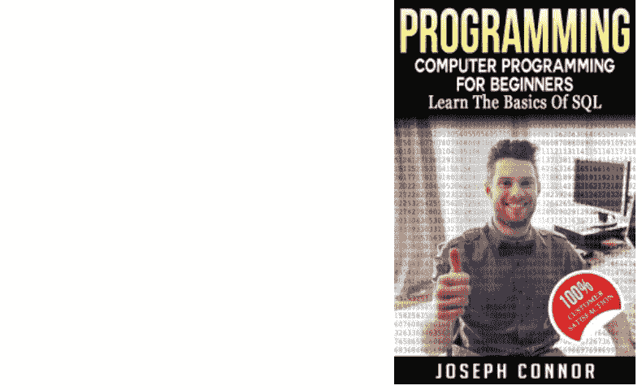
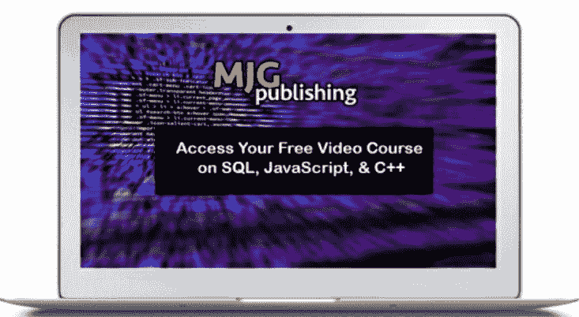
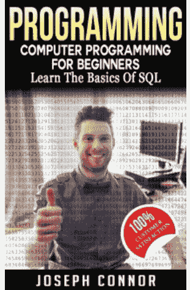
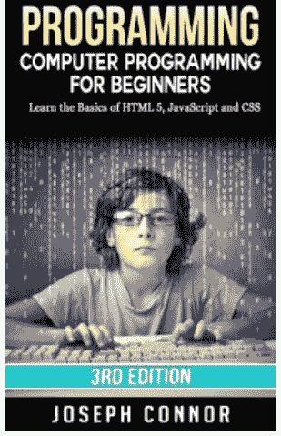
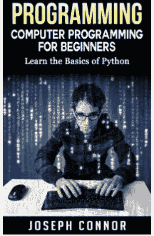
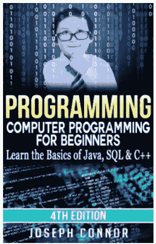

# C#：计算机编程入门指南：学习 C# 编程基础知识

## 关于 MJG 出版

MJG Publishing 是一家专注于非虚构书籍的独立出版社。我们的电子书和纸质书旨在帮助个人提升职业和生活水平。学习新的技能和能力。找到你梦想的工作，或创造你自己的自由职业机会！


## 联系方式：

访问我们的网站：http://www.itstarterseries.com/

发送电子邮件联系我们：marco@mjgpublishing.com

- 关注我们的社交媒体：

Facebook: https://www.facebook.com/mjgpublishing/

Twitter: https://twitter.com/MJG_Publishing

Instagram: https://www.instagram.com/mjgpublishing/

Marco，独家出版商

MJG Publishing 代表 Joseph Connor。

### 免费视频课程：JavaScript、SQL & C++ 简介

欢迎来到编程之旅。你好，我是来自 MJG Publishing 的 Marco，感谢你对这本书的支持。

你将通过逐步的真实示例学习 3 种最热门的编程语言：JavaScript、SQL 和 C++。

如果你只学习其中一种，你也可以在编程领域拥有良好的职业发展。学习这三者，你将备受青睐和市场需求。


立即点击此链接：http://www.itstarterseries.com/free-programming-course 即可获取你的免费视频系列！

通过真实示例发现哪种语言最适合你，并获取我们的免费赠品。获取代码示例访问权限，了解如何设置你可以用于编程的不同环境，并获得一个可以在家中立即付诸行动的逐步编程教程。

阅读本文档，读者同意在任何情况下，我们对因使用本文档包含的信息而导致的任何直接或间接损失均不承担责任，包括但不限于——错误、遗漏或不准确。

MJG Publishing 的 Marco

## 如果你想了解更多编程吗？

查看 Joseph Connor 的其他书籍：

最新版本 (2017)：初学者计算机编程：学习 SQL



初学者计算机编程：学习 HTML5, JavaScript & CSS


初学者学习 Python 终极指南


黑客技术：初学者黑客 - 计算机病毒、破解、恶意软件、网络安全

黑客技术：初学者教程


亚马逊畅销书：初学者计算机编程：学习 Java, C++


# 引言

首先，感谢你购买《编程：初学者计算机编程：学习 C# 基础》。

C#（读作 See-Sharp）由 Anders Hejlsberg 领导的微软团队创建。当微软最初开发 `.NET` 框架时，程序员们需要借助 Simple C（一种托管代码系统）来编写类库。然而，C 存在一些问题。因此，C# 被开发为一种新语言以解决这些问题。

它是一种强大且灵活的编程语言。与其他编程语言一样，C# 可以创建各种应用程序。该语言对你能做什么没有限制。它已应用于动态网站、开发工具和编译器等项目。

如果你已经熟悉编程，你将很容易发现 C# 从其他编程语言中借鉴了一系列关键概念，其中最著名的是 Java。（Jones, 2001）

C# 专门被设计为简单且现代。它是一种面向对象且通用的编程语言。如果你熟悉编程，你将很容易识别出 C# 借鉴了多种编程语言的一系列核心概念。

现在让我们来看看这种语言的一些重要特性以及为什么程序员应该使用它。

- 简单 – C# 消除了 C++ 和 Java 等语言的一些陷阱和复杂性。正如我们之前提到的，它在许多方面与 C++ 相似；语句、运算符、表达式和其他函数直接取自 C 和 C++。但改进使得语言更加简单。

- 现代 – 垃圾回收、异常处理、扩展数据类型和代码安全等功能使语言变得现代，C# 包含了这些功能。

- 面向对象 - 面向对象语言的关键是继承、封装和多态。C# 支持所有这些。继承是一种将功能和现有代码扩展到新包和程序中的结构化方式。多态是适应需求的能力。

完成。

- 4. 强大且灵活 - 正如前面提到的，C# 对可以实现的功能没有任何限制。你可以创建图形、电子表格、其他语言的编译器以及文字处理程序。

- 5. 词汇简洁的语言 – C# 使用的词汇数量有限，仅包含少数几个术语，称为*关键字*（它们将在下一章中解释）。这些关键字是构建该语言功能的基础。你将在基础语法章节中学习到这些关键字。（Alexx）

- 6. 模块化 – C# 是一种模块化语言，其代码可以写在称为“类”的块中。这些类包含了称为“成员方法”的程序。这些方法和类可以被重用，以便从任何其他程序或应用程序中使用。通过向方法和类传递信息，你可以创建有用且可重用的代码。

## .NET 框架的重要性

`.NET` 框架是一个革命性的平台，可以帮助程序员编写诸如：Windows 应用程序、Web 应用程序和 Web 服务等程序。它的设计允许使用任何语言：C++、C#、Jscript、COBOL、Visual Basic 等。这些语言可以访问该框架并进行相互通信。

### 从理论上来说

`.NET` 框架兼容大量的编程语言。然而，最常与该框架相关的是 C#。在某些圈子里，它甚至被称为“. .NET 语言”。这可能是因为该框架和语言的开发（以及 IDE）是同时进行的。

## 用于 C# 的集成开发环境 (IDE)

微软提供了用于 C# 编程的开发工具——

- 1. Visual Studio 2010 (VS)

- 2. Visual C# 2010 Express (VCE)

- 3. Visual Web Developer

VCE 和 Visual Web Developer 可以在微软官方网站免费获得。通过使用这些工具，你可以编写各种 C# 程序。你还可以使用基础文本编辑器（如记事本）编写 C# 代码文件，并使用命令行编译器将代码编译成程序集；这是 `.NET` 框架的一部分。（Lazy Question）

## 开始 C# 编程需要什么？

在开始编写 C# 程序之前，有几件事需要你先处理。请确保你的电脑上已安装了以下程序。

- `.NET Framework` 软件开发包 (SDK)

- 一个编辑器

就这些了。这是你开始 C# 编程所需的全部两项。市上有许多编辑器可用。你甚至可以使用记事本或 DOS 编辑器，但稍后会详细介绍。尽管如此，如果你安装了以下可选程序中的任何一个，对你的学习曲线会有处。

- Visual C# .NET

- Visual C++ 6.0。这包含在 Microsoft Visual Studio 6.0 包中。

你的第一步应该是于电脑上安装 `.NET SDK`。你可以轻松地从微软官网下载该程序。你还将同时获得该程序的完整文档。安装此工具包后，你将能够编译并执行 C# 源码。这是通过该工具包内置的命令行编译器以及运行时即时编译器（Just in Time Compiler）实现的。如果你以前接触过 Java，你可以认出它们类似于 Java Java 编译器和 Java 解释器（后者在 Java 开发工具包 JDK 中可用）。

## 关于编辑器

编辑器是用于编写源代码的程序。C# 在这方面非常通用，可以在几乎任何文本编辑器的帮助下编写。即使是 Windows 自带的基础记事本也是一个不错的选择。对于编译，你可以轻松使用 `.NET` 框架提供的命令行编译器 `csc.exe`。

在用 `.NET SDK` 开发 C# 程序时，记事本是一个流行的选择。然而，它并不是最好的编辑器，特别是对初学者来说。毕竟，记事本缺少代码行号和语法高亮等有用功能。

这就是为什么许多开发者倾向于使用集成开发环境或 IDE。微软提供的选项并不多，其中其中用的是 Visual Studio。该程序可以用于处理 `.NET` 框架的所有方面。这无疑是一个非常高级的程序，并提供多个版本。完整版 Visual Studio 价格较贵，而且对于爱好者来说可能太高级了。

在 `.NET` 框架发布时，微软引入了产品的 Express 版本。这些版本是为业余程序员和那些刚开始接触 `.NET` 框架的人设计的。Express 版本仅支持一种语言。它们可能不具备 Visual Studio 最先进的功能，但它们是免费的。对于学习你选择的语言（在这种情况下是 C#）来说，它们也很容易使用。

市场上还有其他第三方编辑器。然而，对于本书，我们将使用 Visual# Express 来编写代码。你必须记住，无论你使用哪种编辑器，代码都是保持相同的。

在我们学习用 C# 编程之前，了解 C# 的编程特性至关重要。C# 的结构紧密遵循传统的高级语言，并与 Java 有许多相似之处。C# 具有各种对全球程序员都有吸引力的编程特性。

以下是 C# 的重要特性列表：

- 1. 布尔条件

- 2. 标准库

- 3. 自动垃圾回收

- 4. 属性和事件

- 5. 委托和事件管理

- 6. 程序集

- 7. 泛型

- 8. 索引器

- 9. 条件编译

- 10. 多线程

- 11. 与 Windows 的集成

- 12. LINQ 和 Lambda 表达式

上述术语对某些人来说可能听起来很难，但不要担心，我们涵盖了所有重要的特性，以便你开始 C# 编程。C# 设计用于与 `.NET` 工作。C++ 和 C# 的区别如下：

| C# | C++ |
|---|---|
| 它是一种面向组件的高级语言。 | 它是一种低级平台无关语言。 |
| 编译时，C# 代码被转换为中间语言代码。然后中间代码通过称为“即时编译”的过程转换为可执行代码。 | 编译时，C++ 代码被转换为汇编代码。 |
| C# 中的内存管理由垃圾回收器自动处理。 | 在堆上分配的内存必须显式删除。 |
| 在 switch 语句中，测试变量可以是字符串。 | 在 C++ switch 语句中，测试变量不能是字符串。 |
| 在 switch 语句中，如果没有给出 break 语句，如果当前语句有任何代码，则不会发生向下一个 case 的穿透。 | 在 C++ 的 switch 语句中，如果没有给出 break 语句，即使当前语句有任何代码，也会穿透到下一个 case。 |
| 除了 do...while、while 和 for，C# 还有另一种名为 foreach 的流程控制语句。 | C++ 中没有 foreach 语句。 |
| C# 结构体只能包含值类型。结构体是密封的（sealed），且没有默认参数构造函数。 | 在 C++ 中，结构体的行为与类相似，只是默认访问是公有的而不是私有的。 |
| 在 C# 中，事件、属性和委托也可以作为类成员。 | 在 C++ 中，只有构造函数、变量、函数、析构函数和运算符重载可以是类成员。委托、事件和属性不能作为类成员。 |
| C# 类的定义结尾只有一个大括号。 | 类的定义结尾有一个大括号，后跟一个分号。 |

(Krishnavanshi)

对于具有一定编程经验的人来说，从 C++ 过渡到 C# 会相当容易。然而，对于初学者，C# 并不是一种难以学习的语言。使用 C# 有趣的部分在于探索新的公共语言运行时（CLR）库，它提供了许多以前必须手动编写的功能。`.NET` 框架为 Web 应用程序开发、多线程、窗口应用程序开发等提供了广泛的支持。

## 第 2 章：C# 基础语法

众所周知 C# 是一种面向对象的编程语言，在面向对象的编程方法中，程序由各种对象组成，这些对象通过动作相互作用。对象执行的动作被称为方法（methods）。相同类型的对象被称为处于同一个类或具有相同的类型。

现在让我们理解 C# 语法的基础——

- 1. 任何 C# 程序的第一个语句都是 `using System;`

此关键字用于在程序中包含命名空间。程序可以包含多个 `using` 语句。

- 1. `class` 关键字用于声明一个类。

- 2. C# 中的注释用于解释代码。编译器会忽略注释内容。C# 程序中的多行注释以 `/*` 开始，以 `*/` 结束。单行注释用 `//` 符号表示。

- 3. 成员变量（member variables）是类的数据成员或属性，用于存储数据。

- 4. 成员函数（member functions）是执行特定任务的语句组。类的函数在类内部声明。

- 5. 类实例化——`main()` 方法在 C# 程序中实例化类。

- 6. 标识符（identifier）是用于标识类、函数、变量或任何用户定义项目的名称。C# 中类命名的基本规则如下所示：

- a) 名字必须以字母开头，后面可以跟一系列字母、下划线或数字 (0-9)。标识符的第一个字符不能是数字。

- b) 不应包含嵌入的空格或符号，如 `- + ? & @ # * ( ) { } [ ]; : / ' . \ \ 和 `"`。然而，可以使用下划线。

- c) 最重要的是，它不应该是 C# 关键字。

(Tutorials Point)

## C# 关键字

预定义给 C# 编译器的保留字称为关键字（keywords）。这些关键字不能用作标识符。然而，在必须将其用作标识符的情况下，你需要在前面加上 `@` 字符。C# 中的某些标识符在代码环境中具有特殊含义，被称为上下文关键字（contextual keywords）。下表列出了 C# 语言中的保留关键字上下文关键字。

## 保留关键字

| as | abstract | bool | base | byte | case | break |
| char | catch | class | checked | continue | decimal | const |
| delegate | default | double | do | event | else | enum |
| extern | explicit | finally | false | float | for | fixed |
| goto | foreach | implicit | if | in (generic modifier) | int |
| internal | interface | lock | long | is | new | namespace |
| object | null | out | operator | params | out (generic modifier) | override |
| protected | public | private | ref | sbyte | return | readonly |
| short | sealed | stackalloc | sizeof | struct | static | string |
| this | throw | switch | try | unitof | typeof | true |
| unchecked | unsafe | ushort | long | void | virtual | using |
| while | volatile | | | | | | |

## 上下文关键字

| alias | add | descending | ascending | get | form | dynamic |
|---|---|---|---|---|---|---|
| group | into | global | let | join | partial (type) | orderby |
| remove | partial (method) | set | | select | | |

## C# 中每个保留关键字的含义

- 1. Abstract – 它表示被修改的内容具有不完整或缺失的实现。`abstract` 修饰符可以用于方法、类、属性、事件和索引器。

- 2. As – 此关键字将对象转换为不同的类型。如果对象类型不兼容，则该关键字返回 `null`。

- 3. Base – 它描述你想要引用基类获取请求的信息，而不是在当前实例类中。

- 4. Bool – 它用于字段、属性、方法和变量声明，以及在 `typeof` 和转换操作中，作为 .NET 框架结构 `System.Boolean` 的别名，即代表 True 或 False。

方法（Methods）——这些是包含代码的类成员。它们可能包含参数列表、返回值以及泛型声明。它们可以是静态的（static）或实例的（instance）。

属性（Property）——这些是使用字段语法暴露方法功能的类成员。像方法一样，它们可以是静态的或实例的。

- 5. Break – 此关键字用于退出循环或 `switch` 块。

- 6. Byte – 此关键字用于字段、属性、方法和变量声明，以及在 `typeof` 和转换操作中，作为 .NET 框架结构 `System.Byte` 的别名，即代表 8 位无符号整数，取值范围在 0-255 之间。

- 7. Case – 此关键字通常用于 `switch` 语句。

- 8. Catch – 它用于识别执行的语句或语句块。如果在封闭 `try` 块体中发生异常，则 `catch` 子句位于 `try` 子句之前。可选地可以跟一个 `finally` 子句。

- 9. Char – 此关键字用于字段、属性、方法和变量声明，以及在 `typeof` 和转换操作中，作为 .NET 框架 `System.Char` 的别名，即代表 Unicode 字符，其取值范围在 0-65,535 之间。

- 10. Checked and Unchecked – 这些运算符用于控制整型算术转换和操作的溢出检查上下文。

- 11. Class – 此关键字用于声明类。


# C# 关键字说明

## 12. Const
此关键字用于字段和局部变量声明，使变量成为常量。因此，它与其声明的程序集或类关联，而不是与类的实例或方法调用。

## 13. Continue
它可以用于方法中的任何循环内部。此关键字的目的是结束当前循环迭代并进入下一次迭代。

## 14. Decimal
此关键字用于字段、属性、方法和变量声明，以及在 `typeof` 和转换操作中，作为 .NET 框架 `System.Decimal` 的别名，即代表有符号 128 位小数。

## 15. Default
此关键字可以用于泛型代码或 `switch` 语句。

## 16. Delegate
它用于声明委托。用于获取类方法的可调用引用的编程结构被称为委托（delegate）。

## 17. Do
它用于识别 `do` 循环的开始。

## 18. Double
它用于字段、属性、方法和变量声明，以及在 `typeof` 和转换操作中，作为 .NET 框架 `System.Double` 的别名。

## 19. Else
它识别 `if` 语句的 `else` 子句。

## 20. Enum
它识别枚举。枚举是一种数据类型，通过为每个项目分配一个名称（标识符）来枚举一组项目，同时暴露用于排序元素的基类型。枚举声明如下：

```csharp
enum weekday { Monday, Tuesday, Wednesday, Thursday, Friday, Saturday, Sunday }
```

## 21. Event
此关键字用于声明事件。C# 中的事件是向客户端发布通知的类成员。它们只被触发，不被赋值。

## 22. Explicit
此关键字用于创建只有通过显式类型转换才能使用的类型转换运算符。

## 23. Extern
此关键字表示所调用的方法存在 DLL（动态链接库）中。

## 24. False
此关键字是布尔常量值。布尔在 C# 中是自己的类型，不能转换为其他原始类型。

## 25. Finally
它用于识别 `try-catch` 块之后执行的语句或语句块。无论关联的 `try` 块是否遇到异常，它都会在 `return` 语句之后执行。为了执行清理活动，使用 `finally` 块。

## 26. Fixed
此关键字用于防止垃圾回收器重定位变量。

## 29. Foreach
它用于标识 `foreach` 循环。

## 30. Goto
它将操作流返回到紧随其标签。可以通过在任何单词后加上冒号来创建标签。

## 31. If
此关键字用于标识 `if` 语句。C# 中的 `if` 语句与 Java 和 C++ 类似。

```csharp
if (condition)
{
  // Do something
}
else
{
  // Do something else
}
```

## 32. Implicit
它用于类型定义哪些类型可以进行转换，而不需要显式类型转换。

## 33. In
它标识 `foreach` 循环中要枚举的集合。

## 34. Int
此关键字用于字段、属性、方法和变量声明，以及 `typeof` 操作，作为 .NET 框架结构 `System.Int32` 的别名，它代表 32 位整数。

## 35. Interface
此关键字用于声明接口。接口为程序员提供了一种构造结构，用于创建可以声明属性、方法、索引和事件但未实现的类型。

## 36. Internal
此关键字是一个访问修饰符，用于字段、属性和方法声明，使字段、属性或方法在其封装的程序集内部可见，即它仅在实现它的程序集内可见。

## 37. Is
此关键字将对象与类型进行比较，如果它们是相似类型，则返回 true。因此，`is` 关键字用于检查兼容性，通常在将源类型转换（转换）为目标类型之前。这确保不会抛出类型转换异常。在空变量上使用 `is` 始终返回 false。

## 38. Lock
它允许一段代码独占使用某个资源。此功能在多线程应用程序中非常有用。当代码段尝试锁定指定对象时，如果该对象已被锁定，除非对象可用，否则代码的线程将被阻塞。

## 39. Long
它用于字段、属性、方法和变量声明，以及 `typeof` 和强制转换，作为 .NET 框架结构 `System.Int64` 的别名。

## 40. Namespace
此关键字用于为类、类型和结构声明提供命名空间。

## 41. New
此关键字有两个不同的含义：
- a) 它是一个用于显式隐藏成员的修饰符
- b) 它是一个运算符，请求由参数标识的类的新实例。

## 42. Null
此关键字表示引用类型变量的空值。即对于任何派自 `System.Object` 的类型的变量。`null` 在 C#2.0 中也表示可空值变量的空值。

## 43. Object
此关键字用于字段、属性、方法、变量声明以及 `typeof` 和强制转换操作，作为 .NET 框架结构 `System.Object` 的别名，即它代表所有其他引用类型所派生的基类。

## 44. Operator
此关键字允许类重载算术运算符和转换运算符。

## 45. Out
此关键字显式指定变量应通过引用传递给方法。使用此关键字的变量在方法调用之前不能初始化，以确保程序员理解其意图效果。

## 46. Override
它用于声明被重写的函数，该函数扩展了同名的基类函数。

## 47. Params
它用于描述何时将参数组传递给方法。`params` 关键字必须是方法签名中的最后一个变量。

## 48. Private
它用于字段、属性和方法声明，使字段、属性或方法对其封装的类私有。

## 49. Public
它用于字段、属性和方法声明，使字段、属性或方法对其封装的类公开。

## 50. Protected
它用于字段、属性和方法声明，使字段、属性或方法对其封装的类受保护的。

## 51. Readonly
它与 `const` 关键字密切相关，例外允许带有该修饰符的变量在构造函数中初始化，并且它与类实例而非类本身相关。

## 52. Ref
它显式指定变量应通过引用而非通过值传递。

## 53. Return
此关键字用于从方法或属性访问器返回执行流。

## 54. Sbyte
此关键字用于字段、属性、方法和变量声明中的 `typeof` 和强制转换操作，作为 .NET 框架结构 `System.Sbyte` 的别名，即它代表一个范围从 -128 到 127 的 8 位整数。

## 55. Sealed
此关键字用于指定类不能被继承。

## 56. Short
此关键字用于字段、属性、方法和变量声明中的 `typeof` 和强制转换，作为 .NET 框架结构 `System.Int16` 的别名，即它代表 16 位整数。

## 57. Sizeof
它返回存储对象需要多少字节。

## 58. Stackalloc
它在不代码上下文用于在栈上分配内存块。

## 59. Static
它用于字段、属性、方法和变量声明以及 `typeof` 和强制转换操作，作为 `System.String` 的别名，表示不可变的字符序列。

## 60. Struct
它声明一种结构，意味着一种值类型。

## 61. Switch
它是一种控制语句，通过将控制权传递到 `case` 语句之一来处理多个枚举和选择。

## 62. This
它作为实例属性或实例方法使用，引用当前类实例。

## 63. Throw
它用于抛出异常对象。

## 64. True
它是一个布尔常量值。`while(true)` - 它将创建一个无限循环。

## 65. Try
它用于标识语句或块作为异常处理序列的主体。

## 66. Typeof
此关键字在传递类名时返回 `System.Type` 类的实例。

## 67. Uint
此关键字用于字段、属性、方法和变量声明中的 `typeof` 和强制转换操作，作为 .NET 框架结构 `System.Uint32` 的别名，即代表 32 位无符号整数。

## 68. Ulong
此关键字用于字段、属性、方法和变量声明中的 `typeof` 和强制转换操作，作为 .NET 框架结构 `System.Uint64` 的别名，即代表 64 位无符号整数。

## 69. Unchecked
它在进行整数算术时防止溢出检查。

## 70. Unsafe
它可以用于定义使用不安全代码或修改过程。

## 71. Ushort
此关键字用于字段、属性、方法和变量声明中的 `typeof` 和强制转换，作为 .NET 框架结构 `System.Uint16` 的别名，即代表 16 位无符号整数。

## 72. Using
在 C# 中，此关键字有两个不同的含义，取决于它是用作语句还是指令。

## 73. Var
为了允许编译器推断变量类型，在声明变量时可以使用此关键字代替类型。

## 74. Virtual
它被应用于方法声明，以指示该方法可以在子类中被重写。

## 75. Void
此关键字用于方法签名，以声明一个不返回值的方法。

## 76. Volatile
用于声明一个值可能随时间变化的变量。

## 77. While
它用于标识 `while` 循环。

## 78. Add and remove
这些关键字允许你在委托程序从事件中添加或移除时执行代码。

## 79. Alias
用于指示外部别名。

## 80. Global
在某些上下文中，它有助于解析标识符之间的冲突。

## 81. Partial
用于允许开发者从不同的文件中构建类。

## 82. Set
用于为属性声明写访问器。

## 83. Value
用于属性的写访问器，表示请求赋值给属性的值。

## 84. Where
此关键字有两个含义：
a) 在 LINQ 中，它用于查询数据源并过滤或选择要返回的元素。
b) 用于为泛型类型参数指定一个或多个约束。

## 85. Yield
此关键字从迭代器返回下一个值或结束迭代。

随着你对这本书的深入学习，这里使用的所有术语将得到解释。

(WikiBooks, 2013)

# C# 中的自动垃圾收集

在 C 和 C++ 中，许多对象要求程序员在声明后分配其资源，才能安全地使用这些对象。一旦对象被使用，将这些资源释放回空闲内存池也是程序员的责任。

然而，C# 通过独立管理应用程序中使用的所有对象的生命周期来防止这些危险。在 C# 中，垃圾回收由 CLR（公共语言运行时）处理。CLR 垃圾收集器定期检查内存堆中的任何未引用的对象并释放这些对象持有的资源。

# 第 3 章：你好，世界：编写你的第一个 C# 程序

如果你在学习 C# 之前学习或接触过任何编程语言，你会对“Hello, world!”非常熟悉。

## 创建新项目

要启动一个新的 C# 项目，你应该首先打开 `Visual C# Express`。在“文件”`File`菜单中，选择“新建项目”`New Project`选项。弹出对话框中选择“控制应用程序”`Console application`。点击“确定”`Ok`选项。

你还会注意到一个名为 `Program.cs` 的文件的创建。

```csharp
using System;
using System.Collections.Generic;
using System.Text;
namespace ConsoleApplication1
{
    class Program
    {
        static void Main(string[] args)
        {
        }
    }
}
```

这些代码可以工作，但结果没有任何意义。如果你愿意，可以按 `F5` 键来运行应用程序。

为了让这个程序实际执行某些操作，你应该在最后一组 `{}` 内部输入以下两行代码。

```csharp
Console.WriteLine("Hello, world!");
Console.ReadLine();
```

输入这些行后，你的整个程序应该看起来如下。

```csharp
using System;
using System.Collections.Generic;
using System.Text;
namespace ConsoleApplication1
{
    class Program
    {
        static void Main(string[] args)
        {
            Console.WriteLine("Hello, world!");
            Console.ReadLine();
        }
    }
}
```

为了运行此程序，你应该再次按 `F5`。如果没有错误，你会注意到黑色窗口保持着没有关闭。

## 理解 Hello, world! 程序

为了运行此程序，你应该再次按 `F5`。如果没有错误，你会注意到黑色窗口保持着没有关闭。在窗口中，你会注意到显示了“Hello, world!”消息。

## ConsoleApplication1 命名空间

这是该应用程序的主命名空间。默认情况下，创建的任何类都将成为它的一部分。你可以修改这一点并在另一个命名空间下创建类。

下一步是必须定义类。C# 是一种面向对象的语言。因此，所有实际执行操作的代码行都必须放在类内部。

在这个程序中，只有一个方法，其声明如下：

```csharp
static void Main(string[] args)
```


该行的第一个单词是 `static`，它是一个关键字。它指示程序保持该方法可访问，而无需实例化类。`void` 关键字告诉程序应该返回什么，在这种情况下什么都不。

单词 `Main` 只是给这个方法起的名称。在这种情况下，它作为应用程序的入口点。换句话说，它将是程序中将执行的第一部分代码。

在声明方法名后，可以使用括号指定一组参数。在这个示例中，`args` 是该方法使用的唯一参数。

接下来的两行是实际的程序。在第一行，使用了 `Console` 类通过 `WriteLine` 命令将文本作为输出。当然，在这种情况下，文本是‘Hello, world!’。第二行通过 `ReadLine` 命令读取控制台中显示的该行文本。

`ReadLine` 命令是至关重要的，因为它允许窗口保持打开状态。如果没有它，应用程序将直接运行并结束。在你看到输出之前，窗口就会关闭。该命令的主要功能是让应用程序等待用户的某些输入。在这个示例中，你会发现在文本显示后可以输入文本。按下 Enter 键后，窗口将关闭，并从而结束程序的运行。

通过此，你已经成功完成了你的第一个程序的编写。你还学习了一些在编写 C# 程序时会需要用到的函数和术语。

总结一下——

- 1. C# 是区分大小大小的
- 2. 所有的语句和表达式必须以分号结束。(`Tutorials Point`)
- 3. 程序执行从 `Main` 方法开始
- 4. 与 Java 不同，程序文件名可以与类名不同。(`Tutorials Point`)

# 第 4 章：理解数据类型和变量

每当你使用编程语言时，你都会遇到数据类型。由于 C# 是一种强类型编程语言，每当你想要声明变量时，都有必要告诉编译器你将使用什么数据类型。当然，变量对任何编程语言都是至关重要的。

## 数据类型简介

在 C# 中，数据类型大致可以分为三类。讨论如下：

- 值类型（Value Type）：这些数据类型可以直接赋值，它们派生自 `System.Value` 类。在这种情况下，它们直接包含数据。数据类型的示例包括 `char`、`Int` 和 `Bool`。
- 引用类型（Reference Type）：这些数据类型在变量中没有实际数据。相反，它们拥有变量的引用。这意味着它们实际上引用特定的内存位置。可以使用多个变量引用特定的内存位置。在这种情况下，如果一个变量了内存位置中的数据，其他变量将自动反映该变化。引用类型的示例包括 `string`、`dynamic` 和 `object`。
- 指针类型（Pointer Type）：这些数据类型实际上存储其他类型的内存地址。如果你熟悉 C++ 或 C，你将理解 C# 中的指针类型将与这些编程语言中的指针类型相同的能力。

## 常用数据类型

C# 中使用了多种数据类型。当然，当你开始认真编程时，其中某些会比其他更频繁地。因此，如果你开始学习最广泛使用的数据类型，将大有裨益。以下是一些帮助你入门的类型。

`Bool`：这是可用的最简单的数据类型之一，因为它代表布尔值，例如，它只有两个值：true 或 false。理解这种类型很重要，特别是在使用逻辑运算符（如 `if` 语句）时。默认情况下，它的值为 `false`。

`Byte`：这种数据类型表示一个 8 位无符号整数。在存储数字时，它的范围是 0 到 255。默认情况下，该数据类型的值为 0。

`Int`：这实际上是 integer 的缩写，是一种用于存储不带小数数字的数据类型，类似于 `byte` 类型。但与 `byte` 不同，`Int` 的范围是 -2,147,483,648 到 2,147,483,647。如果你正在处理数字，你很可能会使用这种类型。

`Char`：这种数据类型表示 16 位 Unicode 字符，仅用于存储单个字符。

`String`：这可以被认为是 `char` 数据类型的升级版，因为它可以用于存储文本。也就是说，它可以存储多个 `char` 而不是单个。在 C# 中，这种数据类型是不可变的。换句话说，在创建字符串后，它们永远不会被改变。如果你使用更改字符串的方法，实际上会返回一个新字符串。原始字符串不会被改变。

## 变量引论

变量对编程至关重要。在任何编程语言中，变量实际上是一个关联了名称（称为标识符 `identifier`）的存储位置，它包含某些未知或已知的信息。这些信息被称为值（value）。标识符用于引用所存储的值。在运行时，标识符可以链接到一个值，但这个值可能会随着程序的执行而改变。

在 C# 中，每个变量都有特定的类型，该类型决定了变量内存范围的大小和布局、在该内存中可以存储的值范围，以及可以应用于变量的操作 `set`。(`Tutorials Point`)

下表显示了 C# 中基本值类型的分类：

| 类型 | 示例 |
|---|---|
| 浮点类型 | Float and double |
| 整数类型 | Sbyte, short, byte, int, ushort, unit, ulong, long and char |
| 布尔类型 | 按分配的 true 或 false 值 |
| 小进制类型 | Decimal |
| 可空类型 | Nullable types |

## C# 中可用的类型转换方法

C# 已经内置了许多类型转换方法。

- `ToBoolean`: 如果可能，将类型转换为布尔值（Boolean）。
- `ToByte`: 将类型转换为字节型（byte）。
- `ToChar`: 如果可能，将类型转换为单个 Unicode 字符。
- `ToDateTime`: 整数类型或字符串类型将转换为日期/时间结构。
- `ToDecimal`: 浮点类型或整数类型将转换为小数数据类型（decimal）。
- `ToDouble`: 类型将转换为双精度类型（double）。
- `ToInt16`: 类型将转换为 16 位整数。
- `ToInt32`: 类型将转换为 32 位整数。
- `ToInt64`: 类型将转换为 64 位整数。
- `ToSByte`: 类型将转换为有符号字节数据类型。
- `ToSingle`: 类型将转换为单精度浮点数（single/float）。
- `ToString`: 类型将转换为字符串（string）。
- `ToType`: 类型将转换为指定的类型。
- `UInt16`: 类型将转换为无符号整数数据类型。
- `UInt32`: 类型将转换为长无符号数据类型。
- `UInt64`: 类型将转换为无符号大整数。

## 掌握常量和字面量

常量（Constants）是对固定值的引用，在程序执行期间无法以任何方式进行更改。这些固定值的另一个术是字面量（literals）。可以使用任何基本数据类型作为常量。示例包括字符常量、浮点常量、整数常量和字符串字面量。还存在枚举常量。

事实上上，常量的处理方式与普通变量相同，但主要区别在于：常量的值在定义后无法以任何方式修改。现在让我们来看字面量和常量的各种类型。

### 整数字面量

在 C# 中，整数字面量可以是十进制常量或十六进制常量。进制由前缀指定。对于十六进制常量，使用的前缀是 `0X` 或 `ox`。十进制常量不使用前缀。

整数字面量还可以带有 `L` 和 `U` 的组合后缀。`L` 代表长整型（long），而 `U` 代表无符号（unsigned）。后缀可以使用小写或大写。后缀的顺序没有规定。

请看以下整数字面量的示例。

```c
212      /* 合法 */
215u     /* 合法 */
0xFeeL /* 合法 */
85       /* 十进制 */
0x4b     /* 十六进制 */
30       /* int */
30u    /* 无符号 int */
30l    /* long */
30ul   /* 无符号 long */
```

### 浮点字面量

这些字面量由整数部分、小数点、小数部分以及最后的指数部分组成。可以使用十进制形式或指数形式表示浮点字面量。

查看以下示例以更好地理解浮点字面量。

```c
3.14159      /* 合法 */
314159E-5L   /* 合法 */
510E         /* 非法：指数不完整 */
210f        /* 非法：缺少小数点或指数 */
e.55         /* 非法：缺少指数或小数 */
```

如果你打算使用十进制形式表示，必须记住插入小数点或指数。如果你愿意，甚至两者都可以使用。对于指数形式，你必须插入整数部分或小数部分。两者都可以使用。对于有符号指数，你必须使用 `e` 或 `E` 来引入它。

### 字符常量

这些字面量被包含在单引号中。例如字符常量 `'x'`。它可以存储在 `char` 数据类型的变量中。字符常量并不总是像 `'x'` 这样的普通字符。它也可以是通用字符，如 `'\u02C0'`，或者是转义序列如 `'\t'`。

在 C# 中，某些字符前面有一个反斜杠。这些字符具有特殊含义，用于表示换行符 `(\n)` 或制表符 `(\t)`。下面是转义序列代码：

| \ | 字符 |
| :--- | :--- |
| " | " 字符 |
| ' | ' 字符 |
| \a | 警报或响铃 |
| ? | ? 字符 |
| \b | 退格 (backspace) |
| \f | 换页 (form feed) |
| \r | 回车 (carriage return) |
| \n | 换行 (newline) |
| \v | 垂直制表符 (vertical tab) |
| \t | 水平制表符 (horizontal tab) |
| \xhh... | 一个或多个数字的十六进制数 |

## 字符串字面量

这些字面量被包含在双引号中。或者可以使用 `@"` 实现相同效果。字符串常量包含的字符与字符常量的内容相似。也就是说，它们可以包含转义序列、通用字符，当然还有普通字符。如果你愿意，可以在字符串字面量的帮助下将长行拆分成几行。这些部分通过空白符分隔。

请看以下示例。注意所有这些形式都是同一个字符串。

`"hello, dear"`

`"hello, \
dear"`

`"hello, " "d" "ear"`

`@"hello dear"`

## 如何定义常量

现在你知道什么是常量，是时候开始定义它们了。你需要使用 `const` 关键字来定义常量。常量定义的语法如下：

```c
const <data_type> <constant_name> = value;
```

以下示例说明了如何在程序中定义并使用常量。

```c
using System;

namespace DeclaringConstants
{
    class Program
    {
        static void Main(string[] args)
        {
            const double pi = 3.14159;
            // 常量声明
            double r;
            Console.WriteLine("Enter Radius: ");
```

```c
Console.WriteLine(i);
Console.ReadKey();
}
}
```

执行上述代码后将产生以下结果：
5673


```
            r = Convert.ToDouble(Console.ReadLine());

            double areaCircle = pi * r * r;

            Console.WriteLine("Radius: {0}, Area: {1}", r, areaCircle);

            Console.ReadLine();

        }

    }

}
```

`num3` 的值: 3.14157

## 第 5 章：C# 运算符

运算符是告诉编译器执行特定数学或逻辑操作的符号。在 C# 中，有一套丰富的内置运算符。在本章中，我们将解释其中的每一个运算符。

### 算术运算符

C# 支持以下算术运算符。在下表中，假设变量 `A` 的值为 10，`B` 的值为 20。

| 运算符 | 说明 | 示例 |
| --- | --- | --- |
| - | 从第一个操作数中减去第二个操作数 | `A - B = -10` |
| / | 将两个操作数相加，并将分子除以分数 | `A + B = 30` |
| * | 乘操作数 | `A * B = 200` |
| ++ | 增运算符，将整数值加 1 | `A++ = 11` |
| % | 取模运算符，整数除法后的余数 | `B% A = 0` |
| -- | 递减运算符，将整数值减 1 | `A-- = 9` |

### 关系运算符

C# 支持以下关系运算符。在下表中，假设变量 `A` 的值为 10，`B` 的值为 20。

| 运算符 | 说明 | 示例 |
| --- | --- | --- |
| != | 检查两个操作数的值是否相等。如果值不相等，则条件为真 | `(A != B)` 为真。 |
| == | 检查两个操作数的值是否相等。如果相等，则条件为真。 | `(A == B)` 为假。 |
| < | 检查左操作数的值是否小于右操作数的值，如果是，则条件为真 | `(A < B)` 为真。 |
| > | 检查左操作数的值是否大于右操作数，如果是，则条件为真 | `(A > B)` 为假。 |

| 运算符 | 说明 | 示例 |
| --- | --- | --- |
| <= | 检查左操作数的值是否小于或等于右操作数的值，如果是，则条件为真 | `(A <= B)` 为真。 |
| >= | 检查左操作数的值是否大于右操作数的值，如果是，则条件为真。 | `(A >= B)` 为假。 |

### 逻辑运算符

C# 支持下面的逻辑运算符。在下表中，假设变量 `A` 的布尔值为 true，`B` 持有的布尔值为 false。

| 运算符 | 说明 | 示例 |
| --- | --- | --- |
| \|\| | 称为逻辑或运算符。如果两个操作数中任何一个非零，则条件为真。 | `(A \|\| B)` 为真。 |
| && | 称为逻辑与运算符。如果两个操作数都非零，则条件为真 | `(A && B)` 为假。 |
| ! | 称为逻辑非运算符。它用于反转其操作数的逻辑状态。如果条件为真，逻辑非运算符将使其变为假。 | `!(A && B)` 为真。 |

### 位运算符

这些运算符在位上工作，并按位执行操作。`|`、`&` 和 `^` 的真值表如下：

| p | q | p&q | p|q | p^q |
| --- | --- | --- | --- | --- |
| 0 | 0 | 0 | 0 | 0 |
| 0 | 1 | 0 | 1 | 0 |
| 1 | 1 | 1 | 1 | 0 |
| 1 | 0 | 0 | 1 | 1 |

现在让我们假设 `A = 60` 且 `B = 13`，那么二进制格式下——

```
A = 0011 1100
B = 0000 1101
```

```
A & B = 0000 1100
A | B = 0011 1101
A ^ B = 0011 0001
~A = 1100 0011
```

C# 支持以下位运算符，假设 `A` 和 `B` 的值相同：

| 运算符 | 说明 | 示例 |
| --- | --- | --- |
| \| | 二进制或运算符，如果两个操作数中任一存在位，则复制该位 | `(A \| B) = 61`，即 0011 1101 |
| & | 二进制与运算符，如果两个操作数中都存在位，则复制该位 | `(A & B) = 12`，即 0000 1100 |
| ~ | 二进制取反运算符（按位取反），具有翻转符号数位的效果 | `(~A) = -61`，即 1100 0011 |
| ^ | 二进制异或运算符，如果操作数中仅有一个位，则复制该位 | `(A ^ B) = 49`，即 0011 0001 |
| >> | 二进制右移运算符。在该运算符中，左操作数向右移动右操作数指定的位数 | `A >> 2 = 15`，即 0000 1111 |
| << | 二进制左移运算符。在该运算符中，左操作数向左移动右操作数指定的位数 | `A << 2 = 240`，即 1111 0000 |

### 赋值运算符

C# 支持以下赋值运算符：

| 运算符 | 说明 | 示例 |
| --- | --- | --- |
| += | 加赋值运算符，将右操作数加到左操作数并将结果赋值给左操作数 | `C += A` 等于 `C + A` |
| = | 简单赋值运算符，将右侧操作数赋值给左侧操作数 | `C = A + B` 将 `A + B` 的值赋值给 `C` |
| *= | 乘赋值运算符，将右操作数乘以左操作数并将结果赋值 | `C *= A` 等于 `C * A` |
| -= | 减赋值运算符，从左操作数中减去右操作数并将结果赋值 | `C -= A` 等于 `C - A` |
| /= | 除以赋值运算符，将左操作数除以右操作数并将结果赋值给左操作数 | `C /= A` 等于 `C / A` |
| <<= | 左移赋值运算符，将左操作数向左移动右操作数指定的位数 | `C <<= 2` 等于 `C << 2` |
| >>= | 右移赋值运算符，将左操作数向右移动右操作数指定的位数 | `C >>= 2` 等于 `C >> 2` |
| &= | 位与赋值运算符，对左操作数和右操作数执行位与操作并将结果赋值给左操作数 | `C &= A` 等于 `C &= A` |
| \|= | 位或赋值运算符，对左操作数和右操作数执行位或操作并将结果赋值给左操作数 | `C \|= A` 等于 `C \|= A` |
| ^= | 位异或赋值运算符，对左操作数和右操作数执行位异或操作并将结果赋值给左操作数 | `C ^= A` 等于 `C ^= A` |
| %= | 取模赋值运算符，计算左操作数除以右操作数的余并将结果赋值给左操作数 | `C %= A` 等于 `C % A` |

### 杂杂运算符

C# 中还有其他运算符：

| 运算符 | 说明 | 示例 |
| --- | --- | --- |
| is | `is`运算符用于检查对象是否为特定类型 | `(obj is string)` |
| typeof | `typeof`运算符用于获取类的类型 (`Type`) | `typeof(int)` |
| ? | 三元运算符用于根据条件从两个表达式中选择一个 | `(condition) ? value1 : value2` |
| ?? | 空合并运算符用于在表达式为空时提供默认值 | `value ?? defaultValue` |

## 第 6 章：开始使用 IF ELSE SWITCH语句

条件语句用于根据某些条件控制程序的流。在 C# 中，有几种类型的条件语句可以使用。在本章中，我们将解释其中的每一个。

### If 语句

`if`语句用于仅在指定条件为真时执行代码块。如果条件为假，则跳过 `if` 块中的代码。

```csharp
if (condition)
{
    // 如果条件为真则执行的代码
}
```

### Else 语句

`else`语句用于在 `if` 语句为假时执行代码块。

```csharp
if (condition)
{
    // 如果条件为真则执行的代码
}
else
{
    // 如果条件为假则执行的代码
}
```

### Else If 语句

`else if`语句允许您顺序检查多个条件。

```csharp
if (condition1)
{
    // 如果 condition1 为真则执行的代码
}
else if (condition2)
{
    // 如果 condition2 为真则执行的代码
}
else
{
    // 如果所有条件都为假则执行的代码
}
```

### Switch 语句

`switch`语句用于根据表达式的值执行多个代码块之一。相比使用多个 `else if` 语句，它通常更加简洁。

```csharp
switch (expression)
{
    case value1:
        // 如果表达式等于 value1 则执行的代码
        break;
    case value2:
        // 如果表达式等于 value2 则执行的代码
        break;
    default:
        // 如果没有匹配的项则执行的代码
        break;
}
```

`else` 语句的。毕竟，它是英语的基础。`else` 语句作为 `if` 语句的伴侣。它的作用是在 `if` 语句声明的条件未满足时，为代码的执行提供另一种选择。

### 理解 if 语句的使用

为了理解 C# 中如何使用 `if` 语句和 `else` 语句，一个示例应用程序将非常有帮助。因此，这里有一个示例展示了在 C# 中使用条件逻辑。

```csharp
using System;
namespace ConsoleApplication1
{
    class Program
    {
        static void Main(string[] args)
        {
            int number;
            Console.WriteLine("Please enter a number between 0 and 10 : ");
            number = int.Parse(Console.ReadLine());
            if (number > 10)
            {
                Console.WriteLine("Hey! The number should be 10 or less!");
            }
            else
            {
                if (number < 0)
                {
                    Console.WriteLine("Hey! The number should be 0 or more!");
                }
                else
                {
                    Console.WriteLine("Good job!");
                }
            }
            Console.ReadLine();
        }
    }
}
```

你可以看到，这个程序中存在两个 `if` 语句以及它们配套的 `else` 语句。它们被用于检查用户输入的数字是否在 0 到 10 之间。

示例提供的代码应该很容易理解。首先，要求用户输入一个数字。第一条语句检查该数字是否大于 10。如果函数返回 `true`，则会向用户显示一条消息，说明数字应该小于 10。如果为 `false`，代码将继续执行 `else` 语句，其中包含第二个语句。

第二个 `if` 语句用于检查用户输入的数字是否小于 0。如果为 `true`，则会向用户显示消息，告诉数字必须大于 0。如果为 `false`，程序将继续执行配套的 `else` 语句。这条语句会导致显示“Good job!”消息。

你可能在这个程序中注意到的另一个点是缺少用于定义条件代码块的 `{}` 字符。在 C# 中，如果一个块只包含一行代码，那么就不需要 `{}` 字符。在编写代码时请记住这一点。

### switch 语句的基础

在编程语言中，`switch` 语句类似于一种选择控制机制。它通常用于让变量的值通过多路分支来修改程序执行的控制流。将 `switch` 语句想象成一组语句。

`switch` 语句将列出若干种可能性，每种可能性将有其自己的操作。当没有其他可能性返回 `true` 时，还有一个默认操作。就像语句有 `else` 语句伴随一样，`switch` 语句也有以 `case` 语句形式形式的伴侣。然而，与 `if-else` 语句不同，一个 `switch` 语句必须配合多个 `case` 语句使用。

查看下面的代码块以更好地理解 `switch` 语句。下面的示例包含了 `switch` 语句最简单的实现之一。

```csharp
int number = 1;
switch (number)
{
    case 0:
        Console.WriteLine("The number is zero!");
        break;
    case 1:
        Console.WriteLine("The number is one!");
        break;
}
```

你可以看到，必须检查的标识符被放在 `switch` 关键字之后。后面跟着一个 `case` 语句列表。这些语句将标识符与特定值进行比较。

你可能已经注意到每个 `case` 都添加了 `break` 语句。这是由于编程语言的要求。在 C# 中，块在结束之前必须跳出。如果正在编写一个函数，可以使用 `return` 语句代替 `break` 语句。

给出的示例使用了整数。然而，在 `switch` 语句中可以使用任何简单的数据类型。此外，还可以为多个 `case` 语句指定相同的操作。

### 理解 switch 语句的使用

当然，理解 `switch case` 语句如何使用的最好方法是通过示例。下面的示例将说明 `switch` 语句如何配合 `case` 语句应用。

```csharp
string input = Console.ReadLine();
switch (input)
{
    case "yes":
        Console.WriteLine("You said yes!");
        break;
    case "no":
        Console.WriteLine("You said no!");
        break;
    default:
        Console.WriteLine("I didn't catch that.");
        break;
}
```

在这个示例中，`switch` 语句检查 `input` 的值。如果 `input` 等于 "yes"，则执行第一个 `case` 块；如果等于 "no"，则执行第二个 `case` 块；如果两者都不等于，则执行 `default` 块。`break` 语句的作用是在执行完某个代码块后跳出 `switch` 结构，防止执行后续的 `case` 块（这种现象被称为“穿透”）。

```cs
class Program
{
    static void Main(string[] args)
    {
        int number = 0;
        while (number < 10)
        {
            Console.WriteLine(number);
            number = number + 1;
        }
        Console.ReadLine();
    }
}
```

当你运行这段代码时，你会发现程序在控制台中列出了一组从 0 开始到 10 结束的数字序列。

当然，变量 `number` 首先被定义为 0。每当循环执行时，该变量就会加 1。你可以在这个语句中看到这一操作：

`number = number + 1`

结果是，程序一直显示数字，直到达到 9 为止，这是最后一个显示的内容。你可能在奇怪，为什么在代码中提到了 10，但显示的却是 9 呢。

只有当 `number` 小于 10 时，条件才为真。一旦 `number` 变成 10，条件就会变为假。毕竟，10 并不小于 10。正如你所看到的，`while` 循环的条件在程序进入循环序列之前会被检查。一旦 `number` 变成 10，条件变为假，`while` 循环序列就不会执行。

### do 循环

`do` 循环与 `while` 循环有某些相似之处，但有一个主要区别。`while` 循环在执行循环序列之前会检查条件。相反，`do` 循环会在循环执行后检查条件。这意味着循环序列在退出之前至少会执行一次。这在 `while` 循环中是不可能实现的。请看下文的示例。

```cs
using System;
namespace ConsoleApplication1
{
class Program
{
    static void Main(string[] args)
    {
        int number = 0;
        do
        {
            Console.WriteLine (number);
            number = number + 1;
        } while (number < 10)
        Console.ReadLine();
    }
}
}
```


运行此程序时，你会看到显示从 0 到 9 的数字。一旦 `number` 变成 10 或大于 10，程序将退出循环序列。正如你所看到的，`do` 循环的功能方式与 `while` 循环类似，但它是在执行序列后检查条件。

## for 循环

`for` 循环与 `do` 或 `while` 循环不同。`for` 循环通常用于你确切知道想要迭代次数的情况。当你有特定的循环次数时也可以使用它。下面的示例展示了 `for` 循环的使用。

```cs
using System;

namespace ConsoleApplication1
{
class Program
{
    static void Main(string[] args)
    {
        int number = 10;
        for (int i = 0; i < number; i++)
        {
            Console.WriteLine(i);
        }
        Console.ReadLine();
    }
}
}
```

运行这段代码时，你会发现 `for` 循环与 `while` 循环相似，但它在代码结构上更紧凑。`for` 循环包含三个部分：首先初始化变量，然后是条件检查，最后是循环后的操作。


## The for loop

`for` 循环与 `do` 或 `while` 循环不同。`for` 循环通常用于你确切知道想要迭代次数的情况。当你有特定的循环次数时也可以使用它。下面的示例展示了 `for` 循环的使用。

```cs
using System;

namespace ConsoleApplication1
{
class Program
{
    static void Main(string[] args)
    {
        int number = 10;
        for (int i = 0; i < number; i++)
        {
            Console.WriteLine(i);
        }
        Console.ReadLine();
    }
}
}
```

运行这段代码时，你会发现 `for` 循环与 `while` 循环相似，但它在代码结构上更紧凑。`for` 循环包含三个部分：首先初始化变量，然后是条件检查，最后是循环后的操作。

## 访问修饰符

### 公共访问修饰符

在上面的示例中，注意成员变量 `width` 和 `length` 被声明为 `public`。因此，可以通过名为 `r` 的 `Rectangle` 类实例从 `Main()` 函数中访问它们。此外，成员函数 `GetArea()` 和 `Display()` 也可以在不使用类实例的情况下直接访问这些变量。成员函数 `Display()` 也被声明为 `public`。这允许通过 `Rectangle` 类实例 `r` 从 `Main()` 中访问。

```c
namespace RectangleApplication
{
    class Rectangle
    {
        public double length;
        public double width;
        public double GetArea()
        {
            return length * width;
        }
        public void Display()
        {
            Console.WriteLine("Length: {0}", length);
            Console.WriteLine("Width: {0}", width);
            Console.WriteLine("Area: {0}", GetArea());
        }
    }
    class ExecuteRectangle
    {
        static void Main(string[] args)
        {
            Rectangle r = new Rectangle();
            r.length = 4.5;
            r.width = 3.5;
            r.Display();
            Console.ReadLine();
        }
    }
}
```

执行上述代码后将产生以下结果。

Length: 4.5
Width: 3.5
Area: 15.75

### 私有访问修饰符 Private Access Specifier

通过此修饰符，类可以向其他对象和函数隐藏成员函数和成员变量。只有属于同一类的函数可以访问私有成员。类的实例无法访问私有成员。

```csharp
using System;
namespace RectangleApplication
{
    class Rectangle
    {
        private double length;
        private double width;
        public void AcceptDetails()
        {
            Console.WriteLine("Enter Length: ");
            length = Convert.ToDouble(Console.ReadLine());
            Console.WriteLine("Enter Width: ");
            width = Convert.ToDouble(Console.ReadLine());
        }
        public double GetArea()
        {
            return length * width;
        }
        public void Display()
        {
        }
    }
}
```

在上面的示例中，你会注意到成员变量 `width` 和 `length` 已被声明为 `private`。因此，无法从 `Main()` 函数中访问它们。只有成员函数 `Display()` 和 `AcceptDetails()` 可以访问这些变量。由于这些成员函数被声明为 `public`，因此可以通过 `Rectangle` 类的实例 `r` 从 `Main()` 中访问它们。

### 保护访问修饰符 Protected Access Specifier

此修饰符允许子类访问基类的成员函数和成员变量。因此，该修饰符在继承的实现中非常有用。

### 内部访问修饰符 Internal Access Specifier

此修饰符允许类向当前程序集中的其他对象和函数暴露其成员函数和成员变量。也就是说，具有 `internal` 访问修饰符的成员可以从定义该成员应用程序内的任何方法或类访问。

```csharp
using System;
namespace RectangleApplication
{
    class Rectangle
    {
        internal double length;
        internal double width;
        double GetArea()
        {
            return length * width;
        }
        public void Display()
        {
            Console.WriteLine("Length: {0}", length);
            Console.WriteLine("Width: {0}", width);
            Console.WriteLine("Area: {0}", GetArea());
        }
    }
}
```

## 属性

```
private string color;
public string Color
{
    get { return color; }
    set { color = value; }
}
```

必须使用 `get` 方法来返回变量。另一方面，必须使用 `set` 方法来为该变量赋值。

```
public string Color
{
    get
    {
        return color.ToUpper();
    }
    set
    {
        if (value == "Red")
            color = value;
        else
            Console.WriteLine("This car can only be red!");
    }
}
```

## 可见性快速指南

- Public（公共）：定义为 `public` 的项目可以从所有地方访问，这是所有可见性类型中限制最少的一种。默认情况下，接口 `Interfaces` 和枚举 `Enums` 具有公共可见性。
- Private（私有）：这种可见性是所有可见性类型中限制最严格的。私有项目只能由同一类的其他项目访问。默认情况下，结构体 `structs` 和类 `classes` 设置为私有可见。
- Internal（内部）：这些项目只能从同一个项目内部访问。
- Protected（保护）：标记为 `protected` 的项目只能从同一个类内部或继承自该类的类访问。
- Protected internal（受保护内部）：这种可见性与 `internal` 可见性相似，但有一个主要区别。继承自 `protected internal` 项目的类，即使继承类位于另一个项目中，也可以访问该项目。

## 掌握成员函数与封装

在类中，成员函数是指其原型或定义位于类定义内部函数，方式与其他变量类似。成员函数可以操作其类的任何对象。它还可以访问该对象的所属类的每一个成员。

另一方面，成员变量是对象的属性。因此，为了实现封装，它们将被保持为私有。它们只能通过公共成员函数进行访问。

```csharp
using System;
namespace BoxApplication
{
    class Box
    {
        private double length;
        private double breadth;
        private double height;
        public void setLength(double len)
        {
            length = len;
        }
        public void setBreadth(double bre)
        {
            breadth = bre;
        }
        public void setHeight(double hei)
        {
            height = hei;
        }
        public double getVolume()
        {
            return length * breadth * height;
        }
    }
    class Boxtester
    {
        static void Main(string[] args)
        {
            Box Box1 = new Box();
            Box Box2 = new Box();
            double volume;
            Box1.setLength(6.0);
            Box1.setBreadth(7.0);
            Box1.setHeight(5.0);
            Box2.setLength(12.0);
            Box2.setBreadth(13.0);
            Box2.setHeight(10.0);
            volume = Box1.getVolume();
            Console.WriteLine("Volume of Box1 : {0}", volume);
            volume = Box2.getVolume();
            Console.WriteLine("Volume of Box2 : {0}", volume);
            Console.ReadKey();
        }
    }
}
```

执行上述代码后，将产生以下结果。

Volume of Box1 : 210
Volume of Box2 : 1560

## C# 中的类静态成员

类成员可以通过 `static` 关键字定义为静态的。在将类的特定成员声明为静态时，无论为该类创建了多少个对象，该静态成员都只有一个副本。

换句话说，`static` 关键字表示该成员该类存在一个实例。静态变量倾向于用于定义常量。这是因为可以通过调用类而无需创建实例来获取它们的值。

```csharp
using System;
```


```csharp
namespace StaticApplication
{
    class StaticVar
    {
        public static int num;
        public static void count()
        {
            num++;
        }
        public static int getNum()
        {
            return num;
        }
    }
    class StaticTester
    {
        static void Main(string[] args)
        {
            StaticVar s1 = new StaticVar();
            StaticVar s2 = new StaticVar();
            s1.count();
            s1.count();
            s1.count();
            s2.count();
            s2.count();
            s2.count();
            Console.WriteLine("Value for s1: {0}", StaticVar.getNum());
            Console.WriteLine("Value for s2: {0}", StaticVar.getNum());
            Console.ReadKey();
        }
    }
}
```

执行上述代码后，你会发现以下结果。

Value for s1: 3
Value for s2: 6

由方法返回，则返回类型将为 `void`。

方法名（Method name）：这是方法名的唯一标识符。名称对大小写敏感。此外，标识符不能与类中已定义的任何其他标识符相同。

参数列表（Parameter list）：参数是用于在方法之间传递和接收数据的。它们被包含括号内。参数列表将引用方法参数的顺序、数量和类型。重要的是，方法可能没有任何任何参数。

方法体（Method Body）：方法体将包含完成该活动必需的指令集。

请看下面给出的示例。在这一段代码中，你会注意到一个名为 `FindMax` 的函数。它接收两个整数值并对它们进行比较。返回其中较大的值。该函数有一个公有修饰符（public）。因此，可以使用它的实例从类的外部访问它。

```csharp
class NumberManipulator
{
    public int FindMax(int num1, int num2)
    {
        /* local variable declaration */
        int result;
        if (num1 > num2)
            result = num1;
        else
            result = num2;
        return result;
    }
}
...
}
```

---

## 调用方法 (Calling a Method)

在 C# 中，调用方法非常简单，只需使用其名称即可。看下面给出的示例。它展示了如何调用方法。

```csharp
using System;
namespace CalculatorApplication
{
class NumberManipulator
{
    public int FindMax(int num1, int num2)
    {
        /* local variable declaration */
        int result;
        if (num1 > num2)
            result = num1;
        else
            result = num2;
        return result;
    }
    static void Main(string[] args)
{
  /* local variable definition */
  int a = 100;
  int b = 200;
  int ret;
  NumberManipulator n = new NumberManipulator();
  //calling the FindMax method
  ret = n.FindMax(a, b);
  Console.WriteLine("Max value is : {0}", ret);
  Console.ReadLine();
}
}
}
```

执行上述代码后，将产生以下结果。

Max value is : 200

可以通过使用方法的类的实例从其他类调用公有方法。下面给出的示例向你展示了如何操作。在这种情况下，`FindMax` 方法是 `NumberManipulator` 类的一部分。它可以从另一个名为 `Test` 的类调用。

```csharp
using System;
namespace CalculatorApplication
{
class NumberManipulator
{
    public int FindMax(int num1, int num2)
    {
        /* local variable declaration */
        int result;
        if(num1 > num2)
            result = num1;
        else
            result = num2;
        return result;
    }
}
class Test
{
    static void Main(string[] args)
    {
        /* local variable definition */
        int a = 100;
        int b = 200;
        int ret;
        NumberManipulator n = new NumberManipulator();
        //calling the FindMax method
        ret = n.FindMax(a, b);
        Console.WriteLine("Max value is : {0}", ret);
        Console.ReadLine();
    }
}
}
```

下面给出的结果由上述示例产生。

Max value is : 200

---

## 理解递归方法调用 (Understanding Recursive Method Call)

方法可以调用自己。这种过程被称为递归。下面的示例说明了递归方法调用的用法。在这里，通过递归方法调用计算给定数字的阶乘。

```csharp
using System;
namespace CalculatorApplication
{
    class NumberManipulator
    {
        public int factorial(int num)
        {
            /* local variable declaration */
            int result;
            if (num <= 1)
                result = 1;
            else
                result = num * factorial(num - 1);
            return result;
        }
        static void Main(string[] args)
        {
            /* local variable definition */
            int a = 5;
            int ret;
            NumberManipulator n = new NumberManipulator();
            //calling the factorial method
            ret = n.factorial(a);
            Console.WriteLine("Factorial of {0} is {1}", a, ret);
            Console.ReadLine();
        }
    }
}
```

执行上述代码后，将产生以下结果。

Factorial of 5 is 120

```csharp
using System;
namespace CalculatorApplication
{
    class NumberManipulator
    {
        public void getValue(out int x)
        {
            int temp = 5;
            x = temp;
        }
        static void Main(string[] args)
        {
            NumberManipulator n = new NumberManipulator();
            /* local variable definition */
            int a = 100;
            Console.WriteLine("Before method call, value of a : {0}", a);
            /* calling a function to get the value */
            n.getValue(out a);
            Console.WriteLine("After method call, value of a : {0}", a);
            Console.ReadLine();
        }
    }
}
```

执行完上方示例所示的代码后，将产生以下结果。

Before method call, value of a : 100

After method call, value of a : 5

对于输出参数（output parameter），提供的变量不需要赋值初始值。因此，当你需要通过参数从方法返回值，而又不需要为参数分配初始值时，输出参数非常有用的。

下面的示例演示了这一点。

```csharp
using System;
namespace CalculatorApplication
{
    class NumberManipulator
    {
        public void getValues(out int x, out int y)
        {
            Console.WriteLine("Enter the first value: ");
            x = Convert.ToInt32(Console.ReadLine());
            Console.WriteLine("Enter the second value: ");
            y = Convert.ToInt32(Console.ReadLine());
        }
    }
}
```

```csharp
static void Main(string[] args)
{
    NumberManipulator n = new NumberManipulator();
    /* local variable definition */
    int a, b;
    /* calling a function to get the values */
    n.getValues(out a, out b);
    Console.WriteLine("After method call, value of a : {0}", a);
    Console.WriteLine("After method call, value of b : {0}", b);
    Console.ReadLine();
}
}
```

执行上述示例后，你将得到以下结果。

Enter the first value:
7

Enter the second value:
8

After method call, value of a : 7
After method call, value of b : 8

## 第 11 章：处理数组与字符串

由于你正在使用 C#，你肯定会遇到数组和字符串。事实上，你在学习 `for each` 循环时已经使用过数组。至于字符串，它们已经在书中的各种示例中出现过。现在是时候进一步了解一下这两种类型了。

### 了解数组

数组将存储一组不同元素的集合。该集合具有固定的大小，且所有元素都是相同类型。它们被用于存储一组数据。然而，定义它们的一种更好方式是说：它们是存储在连续内存位置的变量集合。

数组避免了声明多个独立变量的麻烦。相反，我们只需要声明一个数组变量，并将所需的值放入其中。因此，我们不需要创建如 `a0, a1, a2` 等这样的变量列表。相反，我们创建一个数组并使用 `a[0]`、`a[1]` 和 `a[2]` 等。

记住，数组中的特定元素可以通过索引（index）访问。在 C# 中，所有数组都具有连续的内存位置。最低地址对应数组的第一个元素，而最高地址属于最后一个元素。

### 声明数组

在 C# 中，如果你想声明一个数组，必须使用以下语法。

```csharp
datatype[] arrayName;
```

该语法的每个元素说明如下：

- `datatype` 用于指定数组中将存在的元素的数据类型。
- `[]` 指定数组的秩（rank）。数组的秩定义了数组的大小。
- `arrayName` 是该数组的名称。

### 初始化数组

记住，声明数组后并不会在内存中初始化它。只有在数组变量初始化后，你才能对其赋值。由于数组是引用类型，你必须使用 `new` 关键字来创建给定数组的实例。

下面的示例展示了如何操作。

```csharp
double[] balance = new double[10];
```

### 给数组赋值

可以给数组的单个元素赋值。为了这样做，需要使用元素的索引号。下面的示例说明了这一点。

```csharp
double[] balance = new double[10];
```

```csharp
balance[0] = 4500.0;
```

在声明数组时也可以给其赋值。

```csharp
double[] balance = { 2340.0, 4523.69, 3421.0 }; 
```

还可以在同时创建并初始化数组。

```csharp
int [] marks = new int[5] { 99, 98, 92, 97, 95};
```

如果你愿意，可以忽略数组的大小。

```csharp
int [] marks = new int[] { 99, 98, 92, 97, 95};
```

数组变量可以复制到另一个数组变量中。在这种情况下，目标数组变量将指向相同的内存位置。如下例所示。

```csharp
int [] marks = new int[] { 99, 98, 92, 97, 95};
```

当创建数组时，编译器将隐式地将所有元素初始化为默认值。

```csharp
int[] marks = int[] { 99, 98, 92, 97, 95};
```

### 访问数组元素

可以通过索引访问数组中的特定元素。这如下例所示。

```csharp
using System;
namespace ArrayApplication
{
    class MyArray
{
        static void Main(string[] args)
{
    int [] n = new int[10];
    int i,j;
    /* 初始化数组 n */
    for (i = 0; i < 10; i++)
    {
        n[i] = i + 100;
    }
    /* 输出 n 的每个元素 */
    for (j = 0; j < 10; j++
    {
        Console.WriteLine("Element[{0}] = {1}", j, n[j]);
    }
}
}
}
```


执行执行上述代码后，将产生以下结果。

Element[0] = 100
Element[1] = 101
Element[2] = 102
Element[3] = 103
Element[4] = 104
Element[5] = 105
Element[6] = 106
Element[7] = 107
Element[8] = 108
Element[9] = 109

## 关于 C# 数组的概念

当你处理 C# 数组时，肯定会遇到一些需要了解的概念。它们在高级课程中会被证明非常有用。

## 多维数组

C# 支持多维数组。这些数组最常见且简单的形式是二维数组。

## 锯齿数组

这些数组可以简单说是数组的数组。

## Array 类

该类定义在 `System` 命名空间中。它是数组的基类。因此，它提供了许多方法和属性来帮助你处理数组。

## 将数组传递给函数

可以将数组传递给函数。可以通过指定数组名称但不指定索引来实现。

## 参数数组

它们用于向给定函数传递未知数量的参数。数组部分在此结束。现在，我们将查看字符串，但在之前，我们想向你简要介绍 C# 中的索引器（indexers）。

## 索引器

索引器允许像数组一样被索引。当你为类定义索引器时，该类的行为类似于虚拟数组。此时，该类的实例可以使用方括号 `[]` 进行访问。

## 索引器的用途

索引器的声明与属性在某种程度上相似。就像属性一样，你使用 `get` 和 `set` 访问器来定义索引器。索引器从对象实例中返回或设置特定值，而属性返回或设置特定的数据成员。换句话说，索引器将实例数据拆分为较小的部分，并对每个部分进行索引、设置或获取。（Tutorials Point

## 重载索引器

索引器可以重载。它们可以声明多个参数，且每个参数可以是不同的类型。索引器并不要求整数，它们也可以是其他类型，例如 C# 中的字符串（`string`）。

## 字符串介绍

在 C# 中，字符串可以作为字符数组使用。尽管如此，通常的做法是使用 `string` 关键字来声明一个存储变量。你必须记住，`string` 关键字仅仅是 `System.String` 类的别名。

## 字符串对象的创建

字符串对象可以通过以下任何一种过程创建。

- 通过将字符串字面量赋值给 `String` 变量
- 使用 `String` 类的构造函数
- 通过获取属性或调用可以返回字符串的方法。
- 使用字符串拼接运算符 `+`
- 通过调用格式化方法，该方法可以将对象或值转换为相应的字符串表示。

下面的示例说明了字符串对象的创建。

```csharp
using System;

namespace StringApplication
{
    class Program
    {
        static void Main(string[] args)
        {
            // 来自字符串字面量和字符串拼接
            string fname, lname;
            fname = "John";
            lname = "Smith";
            string fullname = fname + lname;
            Console.WriteLine("Full Name: {0}", fullname);

            // 使用字符串构造函数
            char[] letters = { 'H', 'e', 'T', 'o' };
            string greetings = new string(letters);
            Console.WriteLine("Greetings: {0}", greetings);

            // 返回字符串的方法
            string[] array = { "Hello", "From", "The", "Earth" };
            string message = String.Join(" ", array);
            Console.WriteLine("Message: {0}", message);

            // 用于转换值的格式化方法
            DateTime waiting = new DateTime(2016, 10, 10, 17, 58, 1);
            string chat = String.Format("Message sent at {0:t} on {0:D}", waiting);
            Console.WriteLine("Message: {0}", chat);
        }
    }
}
```

在编译并执行上述代码后，将产生以下结果。

Full Name: Rowan Atkinson
Greetings: Hello
Message: Hello From The Earth Message sent at 5:58 PM on Wednesday, October 10, 2016

## String 类属性

`String` 类拥有两个属性。它们描述如下。

- Chars: 获取给定字符串对象中指定位置的 `Char` 对象。
- Length: 获取给定字符串对象中字符的总数。

## String 类中存在的方法

`String` 类中提供了许多可用方法。当你处理字符串对象时，这些方法会非常有帮助。以下是一些常用方法。

```csharp
public static int Compare(string strA, string strB)
```
这将比较两个字符串对象。它将返回一个整数，表示对象在排序顺序中的相对位置。

```csharp
public static int Compare(string strA, string strB, bool ignoreCase )
```
这也会比较两个字符串对象，并返回一个表示对象在排序顺序中的相对位置的整数。尽管如此，当布尔参数为 `true` 时，它将忽略大小写。

```csharp
public static string Concat(string str0, string str1)
```
这将拼接两个字符串对象。可以增加正在拼接的字符串对象的数量。

```csharp
public bool Contains(string value)
```
它将返回一个值，表示给定字符串是否存在于字符串中。

```csharp
public static string Copy(string str)
```
这将创建一个与给定字符串具有相同值的新 `String` 对象。

```csharp
public bool EndsWith(string value)
```
这将确定给定字符串对象的末尾是否与给定字符串匹配。

```csharp
public static bool Equals(string a, string b)
```
这将确定两个 `String` 对象是否具有完全相同的值。

```csharp
public int IndexOf(char value)
```
这将返回字符在字符串中的索引。将提供字符首次出现位置的从 0 开始的索引。

```csharp
public static string Format(string format, Object arg)
```
这将替换给定字符串中的一个或多个项目。它们将被替换为给定对象的字符串表示。

```csharp
public string Insert(int startIndex, string value)
```
这将返回一个新字符串，该字符串在给定字符串的特定位置插入了给字符串。

```csharp
public static bool IsNullOrEmpty(string value)
```
这指示给定字符串是否为 `null` 或空字符串。

```csharp
public static string Join(string separator, string[] value)
```
这将使用每个元素之间的分隔符拼接数组中的所有元素。

```csharp
public static string Join(string separator, string[] value, int startIndex, int count)
```
这将使用每个元素之间的分隔符拼接字符串的元素。

```csharp
public int LastIndexOf(char value)
```
这返回当前对象内部字符的索引位置。将使用从 0 开始的索引位置，且仅提到最后一次出现。
```
public string Remove(int startIndex)
```
这将删除从当前实例的指定位置开始的所有字符。它将持续到最后一个位置。最后，将返回字符串。

`String` 类还有许多其他方法和构造函数。MSDN 库包含了完整列表。现在，让我们来看几个示例，演示如何使用上述某些方法。

下面的示例说明了如何使用上述某些方法。

（此处省略重复的示例代码翻译逻辑）

```csharp
public int book_id;
};
```

下面的示例展示了如何使用该结构体。

```csharp
using System;
struct Books
{
    public string title;
    public string author;
    public string subject;
    public int book_id;
}
public class testStructure
{
    public static void Main(string[] args)
    {
        Books Book1; /* 定义类型为 Book 的 Book1 */
        Books Book2; /* 定义类型为 Book 的 Book2 */
        /* book 1 规格 */
        Book1.title = "C# Programming";
        Book1.author = "John Smith";
        Book1.subject = "C# Programming Tutorial";
    }
}
```

```csharp
Book1.book_id = 123456;
/* book 2 规格 */
Book2.title = "Java Programming";
Book2.author = "Jane Smith";
Book2.subject = "Java Programming Tutorial";
Book2.book_id = 456789;
/* 打印 Book1 信息 */
Console.WriteLine("Book 1 title : {0}", Book1.title);
Console.WriteLine("Book 1 author : {0}", Book1.author);
Console.WriteLine("Book 1 subject : {0}", Book1.subject);
Console.WriteLine("Book 1 book_id : {0}", Book1.book_id);
/* 打印 Book2 信息 */
Console.WriteLine("Book 2 title: {0}", Book2.title);
Console.WriteLine("Book 2 author: {0}", Book2.author);
Console.WriteLine("Book 2 subject : {0}", Book2.subject);
Console.WriteLine("Book 2 book_id : {0}", Book2.book_id);
Console.ReadKey();
}
```

在编译并执行上述代码后，将产生以下结果。

Book 1 title : C# Programming
Book 1 author : John Smith
Book 1 subject : C# Programming Tutorial
Book 1 book_id : 123456
Book 2 title : Java Programming
Book 2 author : Jane Smith
Book 2 subject : Java Programming Tutorial
Book 2 book_id : 456789

## C# 中结构体的特征

在上面的示例中，你使用了一个简单的结构体。如果你已经在 C 或 C++ 中使用过结构体，那么你应该知道 C# 中的结构体与你在任一语言中找到的是不同的。C# 结构体的特征如下：

- 结构体可以拥有字段、方法、属性、索引器、事件和运算符方法。
- 它们可以定义构造函数。但它们不能有析构函数。同时，无法为结构体定义默认构造函数。默认构造将被将被定义。因此，它们无法被修改。
- 与类不同，结构体不能继承其他结构体或类。
- 同样，无法将其作为其他类或结构体的基类。
- 你不能将结构成员指定为虚、抽象或保护。
- 结构体可以实现一个或多个接口。
- 使用 New 运算符创建结构体对象时，它会被创建并调用相应的构造函数。与类不同，结构体对象可以在不使用 New 运算符的情况下实例化。
- 如果你不使用 New 运算符，字段将保持未分配状态。因此，在初始化所有字段之前，该对象将是不可用的。

## 类与结构体的区别

这两者之间几点不同。列如下：

- 结构体是值类型，而类是引用类型。
- 与类不同，结构体不支持继承。
- 结构体没有默认构造函数。

现在我们对结构体有了更多了解，让我们重新创建之前的关于 Books 结构体的示例，以便更好地理解。

```csharp
using System;
struct Books
{
    private string title;
    private string author;
    private string subject;
    private int book_id;
    public void getValues(string t, string a, string s, int id)
    {
        title = t;
        author = a;
        subject = s;
        book_id = id;
    }
    public void display()
    {
      Console.WriteLine("Title : {0}", title);
      Console.WriteLine("Author : {0}", author);
      Console.WriteLine("Subject : {0}", subject);
      Console.WriteLine("Book_id :{0}", book_id);
    }
}
public class testStructure
{
  public static void Main(string[] args)
  {
    Books Book1 = new Books(); /* 定义类型为 Book 的 Book1 */
    Books Book2 = new Books(); /* 定义类型为 Book 的 Book2 */
    /* book 1 规格 */
    Book1.getValues("C# Programming", "John Smith", "C# Programming Tutorial", 123456);
    /* book 2 规格 */
    Book2.getValues("Java Programming", "Jane Smith", "Java Programming Tutorial", 456789);
    /* 打印 Book1 信息 */
    Book1.display();
    /* 打印 Book2 信息 */
    Book2.display();
    Console.ReadKey();
  }
}
```

在编译并执行上述代码后，将产生以下结果。

Book 1 title : C# Programming
Book 1 author : John Smith
Book 1 subject : C# Programming Tutorial
Book 1 book_id : 123456
Book 2 title : Java Programming
Book 2 author : Jane Smith
Book 2 subject : Java Programming Tutorial
Book 2 book_id : 456789

## 什么是枚举（Enum）？

Enum 是 enumerations 的缩写。在 C# 中，枚举是一个由底层整数类型的命名常量集合。枚举用于提高代码的可读性和可维护性。

## 声明枚举

通常，声明枚举的语法所示。

```csharp
using System;
namespace EnumApplication
{
    enum Days
    {
        Sun, Mon, Tue, Wed, Thu, Fri, Sat
    }
    class EnumProgram
    {
        static void Main(string[] args)
        {
            Days WeekdayStart = Days.Mon;
            Days WeekdayEnd = Days.Fri;
            Console.WriteLine("Monday: {0}", WeekdayStart);
            Console.WriteLine("Friday: {0}", WeekdayEnd);
            Console.ReadKey();
        }
    }
}
```

执行上述代码后，将产生以下结果。

Monday: 1
Friday: 5


如你所观察到的，上面的示例代码中发生了一些变化。`Cat`类中添加了一个方法，在`Animal`类中，该方法添加了`virtual`关键字。此外，`Cat`类中还存在`override`关键字。

在 C# 中，除非某个项被标记为`virtual`，否则无法重写任何类的任何项。通过`base`关键字的帮助，完全可以在该方法被重写后仍然继续访问被继承的方法。如下例所示。

```csharp
public override void Greet()
{
    base.Greet();
    Console.WriteLine("Yes! I am a cat!");
}
```

然而，方法并不是唯一可以继承的成员。事实上，类几乎所有的成员都会被继承。这包括属性和字段。你只需要确保使用正确的可见性（如前面的章节解释的那样），即可获得正确的结果。

另一个需要记住点是，继承不必发生在从一个类到另一个类之间。可以拥有一个相互继承的类层次结构。与之前的示例保持，可以创建一个继承自`Cat`类的`Kitten`类，而该类反过来将继承自`Animal`类。

然而，在 C# 中有一个无法执行的操作，那就是多继承。换句话说，你不能让一个类同时继承自多个类。C# 不支持这一特性。

## 理解基类和派生类的概念

一个类可以派生自多个基类。因此，可以从多个基类继承函数和数据。

下面是用于在 C# 中创建派生类的语法。

```csharp
<access-specifier> class <base_class>
{
...
}
class <derived_class> : <base_class>
{
...
}
```

让我们通过一个示例来更好地理解基类和派生类。在接下来的示例中，`Shape`是基类，而`Rectangle`是它的派生类。

```csharp
using System;
namespace InheritanceApplication
{
    class Shape
    {
        public void setWidth(int w)
        {
            width = w;
        }
        public void setHeight(int h)
        {
            height = h;
        }
        protected int width;
        protected int height;
    }
    // Derived class
    class Rectangle: Shape
    {
        public int getArea()
        {
            return (width * height);
        }
    }
    class RectangleTester
    {
        static void Main(string[] args)
        {
            Rectangle Rect = new Rectangle();
            Rect.setWidth(5);
            Rect.setHeight(7);
            // Print the area of the object.
            Console.WriteLine("Total area: {0}", Rect.getArea());
            Console.ReadKey();
        }
    }
}
```

执行上述显示的代码后，可以得到以下结果。

`Total area: 35`

## 基类的初始化

如你所知，派生类将继承基类的成员方法和成员变量。因此，在创建子类之前，有创建超类对象。超类的初始化指令可以在成员初始化列表中提供。

下面的示例说明了这一点。

```csharp
using System;
namespace RectangleApplication
{
    class Rectangle
    {
        protected double length;
        protected double width;
        public Rectangle(double l, double w)
        {
            length = l;
            width = w;
        }
        public double GetArea()
        {
            return length * width;
        }
        public void Display()
        {
            Console.WriteLine("Length: {0}", length);
            Console.WriteLine("Width: {0}", width);
            Console.WriteLine("Area: {0}", GetArea());
        }
    }
    class Tabletop : Rectangle
    {
        private double cost;
        public Tabletop(double l, double w) : base(l, w)
        { }
        public double GetCost()
        {
            double cost;
            cost = GetArea() * 70;
            return cost;
        }
        public void Display()
        {
            base.Display();
            Console.WriteLine("Cost: {0}", GetCost());
        }
    }
    class ExecuteRectangle
    {
        static void Main(string[] args)
        {
            Tabletop t = new Tabletop(4.5, 7.5);
            t.Display();
            Console.ReadLine();
        }
    }
}
```

在执行上述代码后，得到了以下结果。

`Length: 4.5`
`Width: 7.5`
`Area: 3362.5`

## C# 和多继承

C# 不支持多继承。另一方面，可以使用接口来实现多继承。接下来的示例演示了这一点。

```csharp
using System;
namespace InheritanceApplication
{
    class Shape
    {
        public void setWidth(int w)
        {
            width = w;
        }
        public void setHeight(int h)
        {
            height = h;
        }
        protected int width;
        protected int height;
    }
    // Base class PaintCost
    public interface PaintCost
    {
        int getCost(int area);
    }
    // Derived class
    class Rectangle : Shape, PaintCost
    {
        public int getArea()
        {
            return (width * height);
        }
        public int getCost(int area)
        {
            return area * 70;
        }
    }
    class RectangleTester
    {
        static void Main(string[] args)
        {
            Rectangle Rect = new Rectangle();
            Rect.setWidth(5);
            Rect.setHeight(7);
            // Print the area of the object.
            Console.WriteLine("Total area: {0}", Rect.getArea());
            Console.ReadKey();
        }
    }
}
```

执行上述显示的代码后，可以得到以下结果。

`Total area: 35`
`Cost: 2450`

# 第14章：构造函数和析构函数

在书中，你会遇到这两个术语。在这里，我们将查看它们。

## C# 中的构造函数

构造函数是类的一个特殊成员函数。每当创建该类的对象时，它就会执行。构造函数的名称与类名完全相同。构造函数没有返回类型。接下来的示例展示了构造函数。

```csharp
using System;
namespace InheritanceApplication
{
    class Line
    {
        private double length;
        public Line()
        {
            Console.WriteLine("Object is created");
        }
        public void setLength(double len)
        {
            length = len;
        }
        public double getLength()
        {
            return length;
        }
        static void Main(string[] args)
        {
            Line line = new Line();
            line.setLength(6);
            Console.WriteLine("Length of line: {0}", line.getLength());
            Console.ReadKey();
        }
    }
}
```

执行上述代码后，可以得到以下结果。

`Object is created`
`Length of line: 6`

## 参数化构造函数

默认情况下，构造函数没有任何参数。尽管如此，你可以为构造函数添加参数。这些构造被称为参数化构造函数。通过这种技术，你可以在创建特定对象时为其分配初始值。

下面的示例将向你展示如何操作。

```csharp
using System;
namespace InheritanceApplication
{
    class Line
    {
        private double length;
        public Line(double len)
        {
            Console.WriteLine("Object is created, length = {0}", len);
            length = len;
        }
        public void setLength(double len)
        {
            length = len;
        }
        public double getLength()
        {
            return length;
        }
        static void Main(string[] args)
        {
            Line line = new Line(10.0);
            line.setLength(6.0);
            Console.WriteLine("Length of line: {0}", line.getLength());
            Console.ReadKey();
        }
    }
}
```

## C# 中的析构函数

与构造函数一样，析构函数也是类的一个特殊成员函数。然而，它仅当类的某个对象离开其指定范围时才会执行。析构函数的名称与类名完全相同，但它前面会带有一个波浪号`~`。析构函数无法返回值或接受任何参数。析构函数非常有用，因为它们可以在程序退出之前释放内存资源。析构函数无法被继承。

```csharp
namespace LineApplication
{
    class Line
    {
        private double length;
        public Line()
        {
            Console.WriteLine("Object is being created");
        }
        ~Line()
        {
            Console.WriteLine("Object is being deleted");
        }
        public void setLength(double len)
        {
            length = len;
        }
        public double getLength()
        {
            return length;
        }
        static void Main(string[] args)
        {
            Line line = new Line();
            line.setLength(6.0);
            Console.WriteLine("Length of line : {0}", line.getLength());
        }
    }
}
```

执行上述示例中的代码后，产生的运行如下：

`Object is being created`
`Length of line : 6`
`Object is being deleted`

现在你知道什么是构造函数和析构函数了。当你开始编写复杂的程序时，你一定会发现它们非常有用。因此，请确保你对它们有彻底的理解。

# 第 15 章：学习更多关于 C#

有几个概念是你应该尽早熟悉的。它们将对你以后开发 C# 程序非常有帮助。

## 接口简介

接口可以定义为一种语法合约，所有继承该接口的类都必须遵循该合约。接口将定义合约中的“做什么”部分。派生类将定义语法合约中的“如何做”部分。

接口将定义其成员的方法、属性和事件。另一个需要注意的点是，接口仅包含成员的声明。定义成员的责任交给了派生类。因此，它确保了可以供派生类遵循的标准结构。

## 声明接口

可以使用`interface`关键字声明接口。事实上，它与类的声明有相似之处。默认情况下，接口语句是公共`public`。下面的示例演示了如何声明接口。

```csharp
public interface ITransactions
{
    void showTransaction();
    double getAmount();
}
```

现在让我们通过一个例子来理解如何实现上述接口。

```csharp
using System.Collections.Generic;
using System.Linq;
using System.Text;
using System;
namespace InterfaceApplication
{
    public interface ITransactions
    {
        void showTransaction();
        double getAmount();
    }
    public class Transaction : ITransactions
    {
        private string tCode;
        private string date;
        private double amount;
        public Transaction()
        {
            tCode = "";
            date = "";
            amount = 0.0;
        }
        public Transaction(string c, string d, double a)
        {
            tCode = c;
            date = d;
            amount = a;
        }
        public double getAmount()
        {
            return amount;
        }
        public void showTransaction()
        {
            Console.WriteLine("Transaction: {0}", tCode);
            Console.WriteLine("Date: {0}", date);
            Console.WriteLine("Amount: {0}", getAmount());
        }
        class Tester
        {
            static void Main(string[] args)
            {
                Transaction t1 = new Transaction("001", "8/10/2012", 78900.00);
                Transaction t2 = new Transaction("002", "9/10/2012", 451900.00);
                t1.showTransaction();
                t2.showTransaction();
                Console.ReadKey();
            }
        }
    }
}
```


执行上述代码后，会产生以下结果。

Transaction: 001
Date: 8/10/2012
Amount: 78900
Transaction: 002
Date: 9/10/2012
Amount: 451900

## 从多态开始

从字面上说，多态可以定义为具有多种形式。然而，在面向对象的编程方法论中，多态通常被描述为具有一个接口但多个函数。现在，多态可以是静态的也可以是动态的。

## 静态多态

静态绑定是在程序编译期间将函数与对象链接的机制。换句话说，决策是在编译时做出的。在 `C#` 中，有两种技术可以实现静态多态：

- 方法重载
- 运算符重载

下面的示例演示了方法重载。

下面的示例显示了使用函数 `print()` 输出不同的数据类型：
`using System;`

```csharp
namespace PolymorphismApplication
{
    class Printdata
    {
        void print(int i)
        {
            Console.WriteLine("Printing int: {0}", i);
        }
        void print(double f)
        {
            Console.WriteLine("Printing float: {0}", f);
        }
        void print(string s)
        {
            Console.WriteLine("Printing string: {0}", s);
        }
        static void Main(string[] args)
        {
        }
    }
    Printdata p = new Printdata();
    // 调用 print 打印整数
    p.print(5);
    // 调用 print 打印浮点数
    p.print(500.263);
    // 调用 print 打印字符串
    p.print("Hello C++");
    Console.ReadKey();
}
```

执行上述代码后，实现了以下结果。

Printing int: 5

Printing float: 500.263

Printing string: Hello C++

## 动态多态

在这种类多态中，决策将在运行时做出。这是通过方法重写实现的。

通过方法重写，派生类和基类中可以具有相同参数和相同名称的方法。因此，在运行时通过基类对象指向派生类成为可能的。

下面的示例说明了动态多态的使用。

```csharp
using System;
namespace PolymorphismApplication
{
    class Shape
    {
        protected int width, height;
        public Shape(int a=0, int b=0)
        {
            width = a;
            height = b;
        }
        public virtual int area()
        {
            Console.WriteLine("Parent class area :");
            return 0;
        }
    }
    class Rectangle: Shape
    {
        public Rectangle(int a=0, int b=0): base(a, b)
        {
        }
    }
    class Caller
    {
        public void CallArea(Shape sh)
        {
            int a;
            a = sh.area();
            Console.WriteLine("Area: {0}", a);
        }
    }
}
class Tester
{
    static void Main(string[] args)
    {
        Caller c = new Caller();
        Rectangle r = new Rectangle(10, 7);
        Triangle t = new Triangle(10, 5);
        c.CallArea(r);
        c.CallArea(t);
        Console.ReadKey();
    }
}
```

编译并执行上述代码后产生的结果如下。

Rectangle class area:
Area: 70

Triangle class area:
Area: 25

## 委托与事件

委托是一种引用类型变量，它持有方法的引用。引用可以在运行时更改。它们特别用于实现事件和回调方法。

## 声明委托

它决定了可以被委托引用的方法。委托可以引用与与其签名相同的方法。

语法 –

```
delegate <return type> <delegate-name> <parameter list>
```

一旦声明了委托类型，就必须使用 `new` 关键字创建委托对象并与特定方法关联。

委托对象可以使用 `+` 运算符进行组合。只有相同类型的委托才能组合。使用 `-` 可以从组合委托中移除组件委托。你可以通过使用委托的此属性创建一个方法调用列表，当委托被调用时将该列表，这被称为委托的多路。

## 使用委托处理事件

事件是用户操作，如点击、按键、鼠标移动，或者某些发生，如系统生成的通知。事件用于进程间通信。

事件在类中引发和声明，并在同一类或其他类中通过委托与事件处理器关联。包含事件的类用于发布事件并被称为发布者类，而接受此事件的另一个类被称为订阅者类。

发布者对象包含事件的定义和委托。发布者对象调用事件并通知其他对象。另一方面，订阅者是接受事件并提供事件处理程序的对象。

示例 -

```c
public delegate string MyDel(string str);
```

事件本身使用 `event` 关键字进行声明。

`event MyDel MyEvent;`

## 易用泛型

`C#` 泛型允许推迟方法或类中编程元素的数据类型规范，直到其在程序中被实际使用。这意味着泛型允许你编写可以与任何数据类型工作的方法或类。方法或类的规范使用替代数据类型的占位参数来编写。当编译器遇到方法或类的函数调用的构造函数时，它会生成处理特定数据类型的代码。

### 泛型的特征

泛型通过以下方式丰富你的程序：-

- 1. 泛型可以帮助你最大化重用性、性能和类型安全。
- 2. 它允许你创建泛型集合类。`.NET` 框架类库在 `System.Collections.Generic` 命名空间包含了几个新的泛型集合类。
- 3. 它允许你创建自己的泛型接口、方法、类、委托和事件。
- 4. 你可以创建带有约束的泛型类，以便访问针对特定数据类型的方法。
- 5. 通过反射，你可以在运行时获取泛型数据类型中所使用的类型信息。

## 理解简单多线程

线程被定义为程序的执行路径。它定义了唯一的控制流。如果你的应用程序涉及复杂且耗时的操作，那么设置不同的执行路径或线程将很有帮助，每个线程执行一项特定的任务。线程使用的一个常见示例是现代操作系统对并发编程的实现。线程的使用提高了应用程序的效率并减少了 CPU 周期的浪费。

为了让程序同时执行多个任务，可以将其分为更小的线程。

## 线程生命周期

线程的生命周期从创建 `System.Threading.Thread` 类对象开始，到线程完成执行或终止时结束。线程生命周期中的各种状态为——

- a) 未启动状态（Unstarted state）——线程实例已创建但未调用 `Start` 方法的情况。
- b) 就绪状态（Ready state）——线程准备好运行并正在等待 CPU 周期的情况。
- c) 不可运行状态（Not Runable State）——在以下情况下线程不可执行：
    - 调用了 `Wait` 方法
    - 调用了 `Sleep` 方法
    - 被 I/O 操作阻塞
- d) 死亡状态（Dead state）——线程完成执行或被中止的情况。

## 主线程

`System.Threading.Thread` 类用于在 `C#` 中处理线程。它允许在多线程应用程序中访问和创建单个线程。进程中第一个执行的线程被称为主线程。当 `C#` 程序开始执行时，会自动创建主线程。使用 `Thread` 类的线程被称为主线程的子线程。可以使用线程类的 `CurrentThread` 属性访问线程。

创建线程——线程通过扩展 `Thread` 类来创建。扩展后的类类调用 `Start()` 方法开始子线程执行。例如——

```csharp
using System;
using System.Threading;
public static void CallToChildThread()
{
    Console.WriteLine("Child thread starts");
}
static void Main(string[] args)
{
    ThreadStart childref = new ThreadStart(CallToChildThread);
    Console.WriteLine("In Main: Creating the child thread");
    Thread childThread = new Thread(childref);
    childThread.start();
    Console.ReadKey();
}
```

```csharp
namespace MultithreadingApplication
{
    class ThreadCreationProgram
    {
    }
}
```

执行上述代码后——
In Main: Creating the Child thread
Child thread starts

(Tutorial Point)

## 程序集版本控制

程序集（Assembly）也被称为 .Net 应用程序的构建。它是应用程序部署和版本控制的基本单元。程序集可以是 `.exe` 或 `.dll` 文件。程序集结构由以下部分组成——

- 1. 程序集清单（Assembly manifest），即名称、版本和语言
- 2. CIL 代码（逻辑部分）
- 3. 类型信息（数据类型）
- 4. 资源

程序集版本控制是 .Net 最近引入的一项功能。它允许同一个组件的两个版本在同一个文件夹和同一机器上并存。版本号由程序员提供，不受 .Net 软件控制。

程序集有两种类型——

- 1. 私有程序集（.exe）——可以在单个应用程序中使用。
- 2. 共享程序集（或类库）（.dll）——可以在多个应用程序中使用。

## 预处理器指令

预处理器指令指示编译器在实际编译开始之前对信息进行预处理。在以 `#` 开头的预处理器指令之前，行中只能出现空白字符。应该记住，这些指令不是语句；因此它们不以分号结束。（Weber, 2016）

`C#` 编译器没有单独的预处理器，但指令的处理方式就像存在一个预处理器一样。`C#` 中的预处理器指令用于帮助条件编译。一个预处理器指令必须是行中的唯一指令。

下表列出了 `C#` 中所有的预处理器指令

| #undef | 它允许你取消定义（undefine）一个符号。 |
| #define | 它定义了一个称为符号的字符序列。 |
| #else | 它允许创建一个复合条件。 |
| #if | 它允许测试一个符号或多个符号以查看它们的值是否为真。 |
| #elif | 它允许创建复合条件指令。 |
| #line | 它允许你修改编译器用于错误和警告的输出的行号和文件名。 |
| #endif | 指明条件指令的结束。 |
| #error | 它允许从代码中的特定位置生成错误。 |
| #region | 它允许你指定一个代码块，当在使用 Visual Studio 代码编辑器的大纲功能时，可以对其进行折叠或展开。 |
| #warning | 它允许从代码中的特定位置生成一级警告。 |
| #endregion | 它标记 #region 块的结束。 |

(Weber, 2016)

## 条件指令

条件指令用于测试一个符号或多个符号，以检查它们的值是否为真。你可以使用 `#if` 指令来创建条件指令。如果它们的值为真，编译器将评估 `#if` 到下一个指令之间的所有代码。

语法——

`#if symbol [operator symbol]....`

在这里，`symbol` 是你想要测试的符号名称。你也可以在否定运算符后前加上 `symbol` 或 `false`。`operator symbol` 用于评估符号。运算符可以是以下任意一种——

* 等 `==`
* 不等 `!`
* 与 `&&`

可以使用括号组合符号。

这些指令用于为调试构建编译代码，或为特定配置进行编译。以 `#if` 开头的条件指令必须显式用 `#endif` 指令终止。（Weber, 2016）

## 正则表达式

与输入文本匹配的模式被称为正则表达式。`.Net` 框架提供了一个正则表达式引擎允许这种匹配。模式由一个或多个运算符、字符字面量或构造组成。（Tutorials Point）

### Regex 类

`Regex` 类用于表示正则表达式。常用的方法有——

- public bool IsMatch(string input)-它指示 Regex 构造函数中指定的正则表达式是否在指定的输入字符串中找到匹配。
- public bool IsMatch(string input, int start)-它指示 Regex 构造函数中指定的正则表达式是否在指定的输入字符串中从指定的起始位置开始找到匹配。
- public static bool IsMatch(string input, string pattern)-它指示指定的正则表达式是否在指定的输入字符串中找到匹配。
- public string Replace(string input, string replacement)-它将输入字符串中所有匹配正则表达式模式的字符串替换为指定的替换字符串。
- public MatchCollection Matches(string input)-它在指定的输入字符串中搜索正则表达式的所有出现项。
- public string[ ] Split(string input)-根据 Regex 构造函数中指定的正则表达式模式，将输入分割为子字符串数组。

## 属性

声明式标签用于向运行时提供有关行为的信息

程序中的各种元素，如方法、类、枚举器、结构体、程序集等被称为属性（attribute）。通过使用属性，你可以为程序添加声明性信息。声明性标签通过放置在所用元素上方的方括号（[[]]）来表示。

属性用于向程序添加元数据、编译器指令以及其他信息，如描述、注释、类、方法等.Net 框架提供了两种类型的属性：

- 预定义属性（Pre-defined attribute）
- 自定义属性（Custom built attribute）

指定属性的语法如下：

```
[attribute(positional_parameters, name_parameter=value, ...)]
```

### 元素 (Element)

属性的值及其名称指定在方括号内，位于应用于该元素之前。名称参数指定可选信息，而位置参数指定基本信息。

有三个预定义属性：

- a) 属性用法 (Attribute usage) - 它描述了如何使用自定义属性类。Attribute usage 指定了属性可以应用于哪些项类型。
- b) 条件 (Conditional) – 它标记了一个条件方法，该方法的执行取决于指定的预处理标识符。它会根据指定的值（如 Trace 或 debug）导致方法调用的条件编译。示例 – 在调试时显示变量的值。
- c) 废弃 (Obsolete) – 它标记了一个不应使用的程序实体。此预定义属性允许你通知编译器丢弃特定的目标元素。例如 – 当类中使用新方法但你仍想保留该类中的旧方法时，可以通过显示一条“应使用新方法代替旧方法”的消息来将其标记为废弃。

创建自定义属性 – .Net 框架允许创建自定义属性，这些属性可以存储在运行时检索的声明性信息。根据设计标准和应用需求，信息可以与任何目标元素相关。（Tutorials Point）

## C# 中的匿名方法 (The Anonymous methods in C#)

如之前，委托（delegates）用于引用与委托签名相同的方法。这意味着你可以使用委托对象调用可以被委托引用的方法。

匿名方法提供了一种将代码块作为委托参数传递的技术。这些方法只有方法体而没有名称。你需要在匿名方法中指定返回类型；该返回类型是从方法体内的 `return` 语句推断出来的。

匿名方法在创建委托实例时使用 `delegate` 关键字进行声明。匿名方法的示例如下：

```
delegate void NumberChanger(int n);
```

```
NumberChanger nc = delegate(int x)
{
    Console.WriteLine("Anonymous Method: {0}", x);
};
```


在这里，代码块 `Console.WriteLine("Anonymous Method: {0}", x);` 是匿名方法的体。

C# 的编程特性之一是 Lambda 表达式。Lambda 表达式是一种匿名方法，你可以用它创建表达式或委托树类型。通过使用这种表达式，你可以编写可以作为参数传递或作为函数返回值的局部函数。Lambda 表达式对于编写 LINQ（语言集成查询）表达式特别有帮助。“语言集成”意味着 LINQ 是编程语言语法的一部分，而“查询”解释了 LINQ 的作用，即 LINQ 用于查询数据，且 C# 具有 LINQ 能力。LINQ 可以查询不同类型的数据，包括关系型、XML 甚至对象。

要创建 Lambda 表达式，你需要在 lambda 运算符 `=>` 的左侧指定输入参数（如果有）。语句块或表达式放在另一侧。示例 -

```
x => x *
```

此 Lambda 表达式指定了一个名为 `x` 的参数，并返回 `x` 的平方值。

（Tutorials Point）

## 不安全代码 (The Unsafe Codes)

在 C# 中，当函数或代码块被 `unsafe` 修饰符标记时，允许在其中使用指针变量。不安全或未托管代码是使用指针变量的代码块。

### 什么是指针？(What is a pointer?)

指针是一个变量，其值为另一个变量的地址，这意味着内存位置的直接地址。像任何变量或常量一样，你必须在使用它存储任何变量地址之前对其进行声明。声明指针的典型形式为：

`type*var-name;`

你可以通过使用 `ToString()` 方法获取由指针变量引用的位置处存储的数据。

（Yogesh Joshi, 2016）

### 使用指针访问数组元素 (Accessing array elements using a pointer)

在 C# 中，数组名和指向与数组数据相同的数据类型的指针不是同一种变量类型。示例 – `int[] jp` 和 `int *p` 不是同一类型。在这里，你可以递增指针变量 `p`，因为因为它在内存中不是固定的，但数组地址在内存中是固定的，因此你不能对其进行递增。

为了使用指针变量访问数据，你需要使用 `fixed` 关键字固定指针。（Tutorials Point）

## C# 类库 (C# Class library)

`.Net` 框架是一个由各种类、值类型、接口组成的巨大库，这些内容提供了对系统功能的访问。它是 `.Net` 框架组件、应用程序和控件的基础。大多数 C# 项目广泛使用类库来实现从文件系统访问、字符串处理到 Windows 表单和 XML 解析的所有功能。

这里列出了一些常用的命名空间和空间分类：

1. `System` – 该命名空间包含定义基础类和引用类型、接口、事件处理器和属性。
2. `System.Activities` – 它包含创建和使用 Windows Foundation 所需的所有类。
3. `System.Directory` – 该命名空间包含提供访问 Active Directory 的类型。
4. `System.Collections` – 它包含定义各种专用、标准和泛型对象的类型。
5. `System.Diagnostics` – 它定义了提供诊断能力的类型，包括性能计数器、事件日志、跟踪以及与系统的交互。
6. `System.AddIn` – 该命名空间包含用于识别、注册、激活和控制插件（add-ins）的类型。它还允许与主机应用程序通信。
7. `System.Globalization` – 它定义了文化相关信息，包括国家、地区、语言、日历、货币、日期、数字和字符串排序顺序。
8. `System.CodeDom` – 该命名空间包含表示源码元素的类。它支持支持的语言的源码生成和编译。
9. `System.Security` – 它包含表示 `.Net` 框架安全系统和权限的类。
10. `System.IO` – 该命名空间包含支持输入输出的类型。它包括对流进行读写、压缩流数据、创建和使用隔离存储、将文件映射到应用程序逻辑地址空间、使用匿名或命名管道通信、实现自定义日志以及处理数据流。
11. `System.Threading` – 它定义了多线程编程的类型。子命名空间提供了简化并发和异步代码编写工作的类型。
12. `System.Text` – 它定义了支持各种正则表达式、编码以及更高效字符串处理机制的类型。
13. `System.Configuration` – 该命名空间包含处理配置数据的类型，例如应用程序配置文件或机器配置。
14. `System.Data` – 该命名空间包含从各种源访问和管理数据的类。
15. `System.Drawing` – 该命名空间包含支持基本 GDI+ 的类型。

图形功能

+ 16. `System.Reflection` – 此命名空间包含了允许开发者存储、创建和管理应用程序的类型。
+ 17. `System.Timers` – 此命名空间提供了计时器组件，允许你在指定的间隔上引发事件。
+ 18. `System.XML` – 此命名空间包含了用于处理 XML 的类型。它支持如 XML 1.0、Schemas、XML 1.1 以及 XSL 标准。它还包含了读者和写入，用于快速读取和写入 XML 流。（Microsoft）

一旦你理解了这些库，与其他库一起将会变得简单得多。

本章结束了 C# 各种特性的介绍。

## 第 16 章：C# 中的异常处理（EXCEPTIONS）

程序执行过程中的问题被称为异常。异常提供了一种将控制从程序的一部分转移到另一个部分的方法。在 C# 中，异常处理基于四个关键字：`catch`、`try`、`throw` 和 `finally`。

- `Catch` – 异常处理器在你想处理的地方捕获异常。`catch` 关键字表示异常的捕获。
- `Try` – 用于可能发生异常的代码块，由 `try` 块标识。它后面跟着一个或多个 `catch` 块。
- `Throw` – 当程序抛出异常时，使用 `throw` 关键字完成。
- `Finally` – 无论异常是否抛出，都执行一组特定的语句。例如，如果打开了一个文件，那么无论是否发生异常，必须关闭它。

## 语法

让我们假设使用 `catch` 和 `try` 关键字的组合来捕获异常。`catch/try` 块放置在可能生成异常的代码周围，其语法如下：

```cs
try
{
    // 异常的语句
}
catch (Exception e1)
{
    // 异常处理代码
}
catch (Exception e2)
{
  // 异常处理代码
}
catch (Exception eN)
{
  // 异常处理代码
}
finally
{
  // 执行的语句
}
```


在 `try` 块引发异常的情况下，可以使用多个 `catch` 语句来处理不同的异常。

## 异常类

C# 中的异常由类表示。直接或间接派自 `System.Exception` 类的异常类。`System.Exception` 类是所有预定义异常的基类，而 `System.ApplicationException` 类支持由应用程序生成的异常。因此，程序员应该了解以下派自 `System.Exception` 类的某些预定义类：

1. `System.IO.IOException` – 处理 I/O 错误。
2. `System.IndexOutOfRangeException` – 处理数组索引超出范围生成的错误。
3. `System.NullReferenceException` – 处理引用空对象生成的错误。
4. `System.ArrayTypeMismatchException` – 处理数组类型不匹配生成的错误。
5. `System.DivideByZeroException` – 处理除以零生成的错误。
6. `System.OutOfMemoryException` – 处理内存不足生成的错误。
7. `System.InvalidCastException` – 处理类型转换期间生成的错误。
8. `System.StackOverflowException` – 处理栈溢出生成的错误。

C# 提供了以 `catch` 和 `try` 块形式处理异常的结构化解决方案。通过这些块并使用 `catch`、`try`、`throw` 和 `finally` 关键字来实现错误处理。在 C# 中，你也可以定义自己的异常。这些被称为自定义异常。自定义异常类派生自 `Exception` 类。（Tutorials Point）

## 第 17 章：学习调试的基础

即使你对计算机编程略有了解，也应该听说过调试。这是所有软件和应用程序编程至关重要的过程。你会发现程序中存在错误。这些错误可能是简单的拼写错误或错误的语句。它们都被称为 bug（错误），并且会阻止你的程序正确执行。因此，这些 bug 需要通过调试来消除。

当你编写书中所示的几个简单应用程序时，识别错误是非常的。你只需运行程序即可发现 bug。然而，随着时间的推移，你一定会开始编写数百行充满复杂语句的代码。由于涉及的高复杂度，确定 bug 将变得非常困难。

在这种情况下，调试变成了一个非常有用的工具。因此，你必须花时间理解这个工具以成为一名更好的程序员。没有它，几乎无法纠正复杂代码中发现 bug。

## 理解打印调试

最常用的调试类型被称为打印调试（print debugging）。尽管它是最基本的调试，但在某些情况下，高级程序员经常使用它。

在打印调试中，让应用程序打印数字或文本。这允许你发现哪些代码部分已经执行以及变量中包含什么。在 C# 中，可以使用 `Console.Write()` 方法打印状态消息或在控制台上显示特定变量的内容。

对于某些情况，这就足够了。另一方面，当你使用如 Visual Studio 甚至 Express 版本的良好 IDE 时，会有更好的工具可以使用。好处是，一旦你了解了基本原理，它们就非常好用。

## 断点简介

断点是你学习调试需要的第一件事。正如名称所示，断点标记了代码中的一个特定点，其执行将在此处中断。应用程序不会变得毫无用，相反，断点只是暂停应用程序的执行。

如果你使用的是 Visual Studio 甚至 Express 版本，实现断点是非常容易的。在这些 IDE 中，你会注意到代码左侧有一个灰色区域。这个区域被称为行槽（gutter），在该区域左键单击将会出现一个红圈。这将是断点，调试器将在此处停止应用程序的执行。

这些只是调试的基础。随着你作为 C# 程序员的进步，你将自动了解除复杂方面之外的各种调试工具和方法。

## 第 18 章：给 C# 初学者的提示

与其他编程语言一样，C# 有它自己的细微差别和特征。因此，初学者可能会感到无所从。。由于，这里有一些提示可以帮助你克服作为初学者面临的问题，并迈向成为一名真正的 C# 程序员的一步。

## 持续练习

没有任何领域能一夜之间成为专家。对于计算机编程也是如此。这需要大量的时间来开发技能并获取被称为专家所需的知识。因此，你应该保持耐心并继续练习 C#。同时，你应该继续在 C# 中练习各种任务。

专注于。它们可能是你在工作中经常遇到的内容，也可能是你非常感兴趣的内容。尝试精通少数几种技术比尝试掌握所有技术要容易得多。

## 看看资深程序员编写的代码

学习 C# 概念和技巧的最佳方法之一是查看经验更丰富的程序员编写的代码。如果你在某个地方工作，可以轻松请求资深程序员向你展示他们的代码。不要忘记理解他们为什么要使用某种技术以及他们是如何使用的。或者，你也可以浏览在线上的开源项目。他们不一定是顶尖的程序员，但你仍然可以学到很多。当然，你必须避免盲目模仿他人的做法。只需理解其核心思想并尝试在自己的代码中使用它即可。

## 结语

本书到此已结束。你现在已经掌握了被称为 C# 的面向对象编程语言的基础知识。你还学习了如何用这种语言编写一些基础程序，以及开始编写程序所需的准备工作。

你现在可以在代码中使用一些基础语句和方法了。当然，你已经已经学习了如何声明和定义变量。更重要的是，你知道如何创建类，甚至在类中实现继承以创建代码块的层次结构。如果你愿意，还可以开始在代码中实现条件逻辑，使其更高级一些，特别是在循环和多个类的帮助下。

你从书中汲取到的信息足够帮助你开始 C# 编程了。当然，还有很多内容需要了解和学习。作为一种流行的编程语言，它会定期进行更新。因此，总会有新颖且有趣的内容等待学习。在精通这门编程语言后，你可以轻松开始学习其他了的语言，如 C 甚至 Java 和 Ruby。你甚至可以进入 Web 开发，因为 C# 是 .NET 框架的一部分。

衷心感谢你选择这本书，希望它对你有所帮助。我也希望你已经建立起坚实的基础，可以将 C# 作为你的职业或爱好。祝你在 C# 的学习和未来发展中一切顺利！

## 感谢

非常感谢你抽时间读完。我希望这本书为你提供了巨大的价值，并帮助你掌握了 C# 编程的基础。

在所有选择的 C# 编程相关书中，你选择了这本书。再次感谢你给它一个机会。现在是时候把你所学的知识付诸行动了！

在这里，我想请你帮个“小”忙。你是否可以在 Amazon 上为本指南留个评论？


你的评论和反馈对我们意义重大。根据你的反馈，我们可以评估你喜欢哪些，以及我们可以在哪些改进。告诉我们如何帮助你成为一名精通的程序员。代表 Joseph Connor，我们 MJGPublishing 深表谢意。

最后但同样重要的是，请通过订阅我们的新闻通讯来获取最新的编程信息：https://www.itstarterseries.com/newsletter

随时通过 MJGPublishing 联系我们：marco@mjgpublishing.com

## 参考文献

Alexx, A. (n.d.). c in 21 February 17, 2017, from Academia.edu: http://www.academia.edu/3794751/c_in_21_days

Jones, B. L. (2001, November 12). What is C#. Retrieved from Developer.com: http://www.developer.com/net/asp/article.php/922211/What-is-C.htm

Krishnavanshi, V. (n.d.). Whats the difference between C# and C++? Retrieved February 17, 2017, from Quora: https://www.quora.com/What-is-the-difference-between-C++-and-C

Lazy Question. (n.d.). C#. Retrieved February 17, 2017, from Lazy Question: http://www.lazyquestion.com/dot-net-interview-questions/CSharp

Microsoft. (n.d.). Developer Network. Retrieved February 17, 2017, from Developer Network: https://msdn.microsoft.com/en-us/library/gg145045(v=vs.110)

Tutorials Point. (n.d.). C#. Retrieved February 17, 2017, from Tutorials Point: https://www.tutorialspoint.com/csharp/csharp_basic_syntax.htm

Weber, R. (2016, August 18). C Sharp part 001. Retrieved from Slide Share: http://www.slideshare.net/RalphWeber4/c-sharp-part-001

WikiBooks. (2013, March 18). C# Programming/Keywords. Retrieved from Wiki Books: https://en.wikibooks.org/wiki/C_Sharp_Programming/Keywords

Yogesh Joshi, C. (2016, July 16). Why use of pointer make the c/c++ language less secure? How hackers can take advantage of it? Retrieved from Quora: https://www.quora.com/Why-use-of-pointer-make-the-c-c++-language-less-secure-How-hackers-can-take-advantage-of-it

## 免费视频课程：JavaScript、SQL & C++ 简介

我真心希望你喜欢这本书！你现在已经熟悉计算机编程的第一步。现在是时候采取行动了！

点击下方图片或链接即可立即访问：



点击此链接：http://www.itstarterseries.com/free-programming-course NOW 立即获取你的免费视频系列！

编码愉快，
Marco

## 想了解更多编程知识吗？

查看 Joseph Connor 的其他书籍：

- 最新发布 (2017)：[编程：面向初者的计算机编程：学习 SQL 基础](https://example.com)



- [编程：面向初者的计算机编程：学习 HTML5、JavaScript 和 CSS 基础](https://example.com)



- Python：学习 Python 编程的终极指南



- 黑客：面向初者的黑客 - 计算机病毒、破解、恶意软件、IT 安全


**亚马逊畅销书：**编程：面向初者的计算机编程：学习 Java、SQL & C++ 基础 - 第 4 版 (2017)



关注我们的 [Facebook] 和 [Instagram] 以获取最新发布动态！
