# C++ 核心指南详解：现代 C++ 最佳实践

## 内容

### 前言

### 序言

#### 约定

#### 为什么需要指南？

#### 万物皆流

#### 如何阅读此本书？

### 致谢

### 关于作者

## 第一部分. 指南

### 第 1 章 引言

#### 目标读者群

#### 目标

#### 非目标

#### 强制执行

#### 结构

#### 主要章节

#### 精要

### 第 2 章 哲学

#### P.1 直接在代码中表达意图

#### P.2: 使用 ISO 标准 C++ 编写

#### P.3: 表达意图

#### P.4: 理想情况下，程序应该是静态类型安全的

#### P.5: 优先使用编译时检查而非运行时检查

#### P.6: 编译时无法检查的应在运行时可检查

#### P.7 尽早捕捉运行时错误

#### P.8: 不要泄露任何资源

#### P.9: 不要浪费时间或空间

#### P.10: 优先使用不可变数据而非可变数据

#### P.11 封装复杂的构造而非将其散落在代码中

#### P.12 恰当地使用支持工具

#### P.13 恰当地使用支持库

#### 精要

### 第 3 章 接口

#### I.2 避免非 const 全局变量

#### I.3 避免单例

#### 编写良好的接口

#### I.13 不要将数组作为指针传递

#### I.27 对于稳定的 ABI，考虑 Pimpl 模式

#### 相关规则

#### 精要

### 第 4 章 函数

#### 函数定义

#### 参数传递：输入与输出

#### 参数传递：所有权语义

#### 返回值语义

#### 其他函数

#### 相关规则

#### 精要

### 第 5 章 类与类层次

#### 总结规则

#### 具体类型

#### 构造函数、赋值操作与析构函数

#### 类层次

#### 运算符重载

#### 联合体

#### 相关规则

### 第 6 章 枚举

#### Enum.1 优先使用枚举而非宏

#### Enum.2 使用枚举表示相关常量集

#### Enum.3 优先使用类而非普通枚举(enum)

#### Enum.5 不要使用匿名枚举

#### Enum.6 指定枚举的底层类型

#### Enum.7 指定枚举员值

#### Enum.8 相关规则

### 第 7 章 资源管理

#### 通用规则

#### 分配与释放

#### 智能指针

#### 相关规则

### 第 8 章 表达式与语句

#### 通用规则

#### 声明

#### 表达式

#### 语句

#### 相关规则

### 第 9 章 性能

#### 通用规则

#### 错误的假设

#### 启用

#### 相关规则

### 第 10 章 并发

#### 通用指南

#### 并发

#### 并行性

#### 消息传递

#### 无锁编程

#### 相关规则

### 第 11 章 错误处理

#### 设计

#### 实现

##### 如果不抛出异常

#### 相关规则

### 第 12 章 常量与不可变性

#### Con.1 默认让对象不可变

#### Con.2 默认让成员函数为 const

#### Con.3 默认按 const 传递指针和引用

#### Con.4 使用 const 定义构造后不再改变的对象

#### Con.5 使用 constexpr 处理在编译时可计算的值

### 第 13 章 模板与泛型编程

#### 使用

#### 接口

#### 定义

#### 类层次

##### 变变模板

#### 元编程

#### 其他规则

#### 相关规则

### 第 14 章 C 风格编程

#### CPL.1: 优先使用 C++ 而非 C

#### CPL.2: 如果你必须使用 C，请使用 C 和 C++ 的通用子集，并将 C 代码编译为 C++

#### CPL.3: 如果你必须用 C 编写接口，请在调用此类接口的代码中使用 C++

#### 精华摘要

## 第 15 章 源文件

### 接口与实现文件

### 命名空间

### 精华摘要

## 第 16 章 标准库

### 容器

### 文本

### 输入与输出

### 相关规则

### 精华摘要

## 第二部分. 支持章节

## 第 17 章 架构思想

### A.1: 将稳定的代码与较不稳定的代码分离

### A.2: 将潜在可重用的部分表示为库

### A.4: 库之间不应存在循环

## 第 18 章 非规则与迷话

### NR.1: 不要坚持所有的声明都必须位于函数的顶部

### NR.2: 不要坚持一个函数中只有一个返回语句

### NR.3: 不要避免异常

### NR.4: 不要坚持将每个类声明都放在各自的源文件中

### NR.5: 不要使用两阶段初始化

### NR.6: 不要将所有清理动作都放在函数的末尾并 goto exit

### NR.7: 不要将所有数据成员都设为保护的

## 第 19 章 配置文件

### Pro.type: 类型安全

### Pro.bounds: 边界安全

### Pro.lifetime: 生命周期安全

## 第 20 章 指南支持库

### View

### 所有权指针

### 断言

### 工具类

## 第三部分. 附录

## 附录 A. 强制 C++ 核心指南

### Visual Studio

### clang-tidy

## 附录 B. 概念

## 附录 C. 合约

### 前言

此内容目前处于开发阶段。

## 前序

前序只有一个：为你亲爱的读者提供必要的背景，以充分利用这本书。这些背景包括关于我的技术细节、我的写作风格、我写这本书的动机以及编写此类书籍面临的挑战。如果你想跳过这一节，也可以，但请至少阅读“致谢”部分。

#### 约定

我承诺，只有少数约定。

#### 规则与指南

《C++ 核心指南》的作者经常将它们称为规则。我也是如此。在本书中，我交替使用这两个术语。

#### 特殊字体

`Monospace` 代码、指令、关键字、类型、变量、函数和类名均以等宽字体显示。

#### 框框

我使用带有项目列表的框来展示每章末尾的精华信息。

#### 精华摘要

- 在每章末尾获取精华信息。

- 核心信息以项目列表的形式表示。

##### 更多信息

这个框的作用非常简单：它应该提供额外信息，以充分利用这些指南。这些额外信息可能包括 C++ 中的典型危险或陷阱。

#### 源代码

我不喜欢使用指令（using-directives）和声明，因为它们隐藏了库函数的来源。由于页面的长度限制，我不得不偶尔使用它们。我使用它们的方式总是可以从使用指令（`using namespace std;`）或使用声明（`using std::cout;`）中推断出来。代码片段中并不是都显示头文件。布尔值用 `true` 或 `false` 显示。必要的 I/O 操纵符 `std::boolalpha` 通常不在代码片段中。

代码片段中的三个点（`...`）代表缺失的代码。

当我将完整程序作为代码示例时，你会在代码的第一行找到文件名。假设你使用的是 C++14 编译器。如果示例需要 C++17 或 C++20 支持，我会在名称后面注明所需的 C++ 标准。

我经常在源文件中使用 `// (1)` 等标记来方便我的解释。如果可能，我会把标记写在引用行中，否则就写在之前的一行。这些标记并不是书中包含的 100 多个源文件的一部分。出于布局考虑，我经常会调整书中的源代码。

当我使用《C++ 核心指南》中的示例时，我通常会重新编写它们以提高可读性，例如在缺少 `namespace std` 时添加它，或者统一布局。

#### 为什么需要指南？

这种主观观察主要基于我作为 C++、Python 以及通用软件开发培训师 15 多年的经验。在过去的几年里，我负责部署在除颤器上的团队和软件。我的职责包括设备的监管事务。为除颤器编写软件极具挑战性，因为它可能导致患者和操作者的死亡或严重伤害。

我心中有一个我们需要 C++ 社区回答的问题。这个问题是：为什么我们需要现代 C++ 指南？以下是我的想法，基于三个观察的简单性原因。

#### 对初学者太复杂

对于初学者，C++ 本身就是一种复杂的语言。主要是我们想要解决的问题本身就很复杂，而且通常也很。

- 让编译器推导你的类型，

- 使用大括号初始化，

- 优先使用任务（tasks）而不是线程（threads），

- 使用智能指针代替原始指针。

我教授像研讨会中提到的那些规则。我们需要一套 C++ 的最佳实践或规则准则。这些规则应该以正面方式制定，而不是负面方式。它们应该声明你应该如何编写代码，而不是应该避免什么。

#### 对专业人士具有挑战性

我不担心每三个月一次的新 C++ 标准带来的新功能数量。我担心的是现代 C++ 支持的新思想。想想带有协程的事件驱动编程、惰性求值、无限数据流或使用 ranges 库进行函数组合。想想为模板参数引入语义类别的“概念（concepts）”。向 C 语言程序员教授面向对象的思想可能是非常有挑战性的。因此，当你转向到这些新范式时，你必须重新思考并可能改变解决编程挑战的方法。我假设这些大量的新思想特别会让专业程序员无所措。他们是习惯于用经典技术解决问题的人。很大概率，他们会掉进“锤钉子陷阱”（`hammer-nail trap`）。

#### 用于安全关键型软件

最后，我有一个强烈的疑虑。在安全关键型软件开发中，你通常必须遵循某些指南。其中最著名的是 `MISRA C++`。当前的 `MISRA C++:2008` 指南由汽车行业软件可靠性协会（Motor Industry Software Reliability Association）发布。它们基于 1998 年的 `MISRA C` 指南。它们最初为汽车行业设计，后来成为航空、军事和医疗领域安全关键型软件实现的行业标准。与 `MISRA C` 一样，`MISRA C++` 描述了 `C++` 安全子集的指南。但存在一个概念上的问题：`MISRA C++` 并不是现代 `C++` 软件开发的领先标准。它落后了四个标准！这里有一个例子：`MISRA C++` 不允许运算符重载。例如，我在研讨会上教过，应该使用用户自定义字面量来实现类型安全的算术：`auto constexpr dist = 4 * 5_m + 10_cm - 3_dm`。为了实现这种类型安全的算术，你必须重载算术运算符以及后缀的字面量运算符。说实话，我不相信 `MISRA C++` 永远能与当前的 `C++` 标准同步进化。只有像 `C++ Core Guidelines` 这样社区驱动的指南才能应对这一挑战。

## MISRA C++ 集成了 AUTOSAR C++14

然而，并非没有希望。`MISRA C++` 集成了 `AUTOSAR C++14`。`AUTOSAR C++14` 基于 `C++14`，应该成为 `MISRA C++` 标准的扩展。我非常怀疑组织驱动的指南是否能与现代 `C++` 的动态发展保持同步。

## 我的挑战

让我引用一下我在 2019 年 5 月与 `Bjarne Stroustrup` 和 `Herb Sutter` 邮件讨论的关键内容，当时我告诉他们我想写一本关于 `C++ Core Guidelines` 的书：“我是 `C++ Core Guidelines` 内部价值的忠实粉丝，因为我深信我们需要指南来确保现代 `C++` 的正确/安全使用。我经常在我的 `C++` 课程中使用来自 `C++ Core Guidelines` 的示例或想法。这种格式让我想起了 `MISRA C++` 或 `AUTOSAR C++14` 规则，这可能是故意的，但对于广大读者来说这并不是理想的格式。我想，如果我们有第二个描述指南通用思想的文档，会有更多人去阅读并对这些指南进行推演。”

我想对之前对话中的这段引用补充几点说明。在过去的几年里，我在我的德语和英语博客上写了百多篇关于 `C++ Core Guidelines` 的文章。此外，我还在德国的 `Linux-Magazin` 杂志上了关于 `C++ Core Guidelines` 的系列文章。这样做有两个原因：第一，`C++ Core Guidelines` 应该被更多人认识；第二，我想以一种易读的形式呈现它们，并在必要时扩展背景信息。

我的挑战是：`C++ Core Guidelines` 大约有 600 页，包含约 500 条指南，大部分时候被称为“规则”。这些规则的设计是考虑了静态分析的。对于专业的 `C++` 软件开发者来说，许多规则是救命的，但许多许多规则也非常特殊，往往不完整或冗余，有时规则之间甚至存在矛盾。我的挑战是将这些非常珍贵的规则提炼成一个约 300 页的、易读甚至有趣的故事，去掉晦涩的内容并在必要时填补空白。最终，这本书应该包含 `C++` 专业软件开发者必须遵守的规则。

## 万物皆流 (Pantha rhei)

`Pantha rhei` 或万物皆流，源自希腊哲学家赫拉克利特，代表了我在写这本书时所面临的挑战。`C++ Core Guidelines` 是一个托管在 `GitHub` 的项目，拥有 200 多贡献者。在写这本书的过程中，我的写作初衷可能会发生变化。

图 P.1 C++ 标准

指南已经包含了某些 `C++` 特性，这些特性可能会成为未来标准的一部分，例如 `C++23` 中的合约（contracts）。为了反映这一挑战，我做了一些决定：

1. 我提供了指向 `C++ Core Guidelines` 中提到的指南的链接。这样你就可以很容易地查找到它们的来源。

2. 我的重点是 `C++17` 标准。如果合适，我会包含针对 `C++20` 标准的指南，例如 `concepts`。

3. `C++ Core Guidelines` 在不断演进，特别是当新的 `C++` 标准发布时。本书也是如此。我的想法是据此更新这本书。

## 如何阅读这本书？

这本书的结构代表了 `C++ Core Guidelines` 的结构。它拥有相应的主要章节和部分支持章节。除了 `C++ Core Guidelines` 之外，我还包含了一个附录，为缺失的主题提供了简洁的概述，包括 `C++20` 甚至 `C++23` 特性。

我还没有回答一个问题：如何阅读这本书？当然，你应该从主要章节开始，最好从上到下读。支持章节提供了额外信息，特别是指南支持库（guidelines support library）。将附录作为一种参考，获取理解主要章节所需的背景信息。没有这些额外信息，这本书将是不完整的。

### 致谢

此内容正在开发中。

### 关于作者

`Rainer Grimm` 自 1999 年以来一直担任软件架构师、团队负责人和导师，并自 2002 年起提供 `C++`、`Python` 和专有软件的研讨会。他定期撰写关于 `C++`、`Python` 和 `Haskell` 的文章，在关于编程问题的会议上演讲，并在英语博客（[modernescpp.com](http://modernescpp.com)）和德语博客（[www.grimm-jaud.de/index.php/blog](http://www.grimm-jaud.de/index.php/blog））上每周更新。现在作为独立导师，他提供现代 `C++` 和 `Python` 研讨会。他有多本现代 `C++`、并发及相关主题的书。

# 第一部分：指南

### 目录

- 1. 引言

- 目标读者

- 目标

- 非目标

- 强制性执行

- 结构

- 主要章节

- 精简版

- 2. 哲学

- P.1. 在代码中表达思想

- P.2: 使用 ISO C++ 编写

- P.3: 表达意图

- P.4: 理想情况下，程序应当是静态类型安全的

- P.5: 优先选择编译时检查而非运行时检查

- P.6: 编译时无法检查的在运行时应该是检查的


# 核心指南精要（C++ Core Guidelines）

## P.7: 尽早捕捉运行时错误
## P.8: 不要泄露任何资源
## P.9: 不要浪费时间或空间
## P.10: 优先选择不可变数据而非可变数据
## P.11: 封装杂乱结构，而不是散布在代码中
## P.12: 恰当地使用支持工具
## P.13: 恰当地使用支持库

---

# 精简版

## 3. 接口
### I.2: 避免非-`const` 全局变量
### I.3: 避免单例

**构建良好的接口**
### I.13: 不要将数组作为单个指针传递
### I.27: 为了稳定的库 ABI，考虑 Pimpl  idiom

**相关规则**

---

# 精简版

## 4. 函数

### 函数定义

**良好的命名**
### F.4: 如果函数可能需要在编译时求值，将其声明为 `constexpr`
### F.6: 如果你的函数可能不会抛异常，请将其声明为 `noexcept`
### F.8: 优先使用纯函数

#### 参数传递：输入与输出

#### F.15: 优先使用简单且常规的参数传递方式
#### F.16: 对于“输入”参数，按值传递易于拷贝的类型，对其他类型通过 `const` 引用传递
#### F.17: 对于“输入/输出”参数，通过非 `const` 引用传递
#### F.20: 对于“输出”值，优先使用返回值而非输出参数
#### F.21: 要返回多个“输出”值，优先返回结构体（`struct`）或元组（`tuple`）

#### 参数传递：所有权语义

### 值返回语义

#### 何时返回指针 (`T*`) 或左值引用 (`T&`)
#### F.45: 不要返回 `T&&` 且 F.48: 不要 `return std::move(local)`
#### F.46: `int` 是 `main()` 的返回类型

#### 其他函数

### Lambda 表达式

#### F.51: 在有选择的情况下，优先使用默认参数而非重载
#### F.55: 不要使用 `va_arg` 参数

#### 相关规则

### 核心要点

---

## 5. 类与类层次结构

#### 总结规则

#### C.1: 将相关数据组织到结构（`struct`）或类（`class`）中
#### C.2: 如果类具有不变，使用 `class`；如果数据成员可以独立变化，则使用 `struct`
#### C.3: 使用类来表示接口与实现之间的区别
#### C.4: 只有当函数需要直接访问类的表示时，才将其设为成员函数
#### C.5: 将辅助函数放置在与其支持的类相同的命名空间中
#### C.7: 不要在同一语句中定义 `class` 或 `enum` 并声明其类型的变量
#### C.8: 如果有任何成员是非公开的，请使用 `class` 而非 `struct`
#### C.9: 最小化成员的暴露

#### 具体类型

#### C.10: 优先使用具体类型而非类层次结构
#### C.11: 使具体类型常规化

#### 构造函数、赋值操作与析构函数

#### 默认操作
#### 构造函数
#### 拷贝与移动
#### 析构函数
#### 其他默认操作

### 类层次结构

#### 通用规则
#### 设计类
#### 访问对象
#### 重载与重载运算符

#### 常规用法
#### C.164: 避免隐式转换运算符
#### C.162: 重载大致等价的操作且 C.163: 仅对大致等价的操作重载
#### C.168: 在操作数的命名空间中定义重载运算符

### 联合体 (Unions)

#### C.180: 使用 `union` 节省内存
#### C.181: 避免使用“裸”的 `union`
#### C.182: 使用匿名 `union` 实现标记联合体

#### 相关规则

### 核心要点

---

## 6. 枚举

#### Enum.1: 优先使用枚举而非宏
#### Enum.2: 使用枚举表示一组相关的命名常量
#### Enum.3: 优先使用 `enum class` 而非“普通”的 `enum`
#### Enum.5: 不要对枚举值使用 `ALL_CAPS`
#### Enum.6: 避免使用无名枚举
#### Enum.7: 仅在必要时指定枚举的底层类型
#### Enum.8: 仅在必要时指定枚举员的值

#### 相关规则

### 核心要点

---

## 7. 资源管理

#### 通用规则

#### R.1: 使用资源句柄和 RAII（资源获取初始化）自动管理资源
#### R.3: 原始指针（`T*`）是非所有权的 R.4: 原始引用（`T&`）所有权的
#### R.5: 优先使用作用域对象，不要进行不必要的堆分配

#### 分配与释放

#### R.10: 避免使用 `malloc()` 和 `free()`
#### R.11: 避免显式调用 `new` 和 `delete`
#### R.12: 立即将显式资源分配的结果交给管理对象
#### R.13: 在单个表达式语句中最多执行一次显式资源分配

#### 智能指针

#### 基础用法
#### 函数参数

#### 相关规则

### 核心要点

---

## 8. 表达式与语句

#### 通用规则

#### ES.1: 优先使用标准库而非“手工编写”的代码
#### ES.2: 优先使用合适的抽象而非直接使用语言特性

#### 声明
#### 标识
#### 变量与初始化
#### 表达式
#### 复杂表达式
#### 指针
#### 求值顺序
#### 转换
#### 语句
#### 迭代语句
#### 选择语句

### 算术

#### 有符号/无符号整数的算术运算
#### 典型错误

#### 相关规则

### 核心要点

---

## 9. 性能

### 错误的优化
#### 错误的假设
#### 开启优化

#### Per.7: 为了便于优化而设计
#### Per.10: 依赖静态类型系统
#### Per.11: 将计算从运行时移动到编译时
#### Per.19: 可预测地访问内存

#### 相关规则

### 核心要点

---

## 10. 并发

### 一般指南

#### CP.1: 假设你的代码将作为多线程程序运行
#### CP.2: 避免数据竞态
#### CP.3: 最小化可写数据的显式共享
#### CP.4: 以任务而非线程来思考
#### CP.8: 不要尝试使用 `volatile` 进行同步
#### CP.9: 只要可行，使用工具验证你的并发代码

#### 并发
#### 锁
#### 线程
#### 条件变量（CP.42: 不要在没有条件的情况下 `wait`）

### 数据共享

## 资源

## 被忽视的危险 (CP.44: 记住为你的 `lock_guard` 和 `unique_lock` 命名)

## 并行

#### 消息传递

### 发送值或异常
### 发送通知

#### 无锁编程

### CP.100: 除非绝对必要，否则不要使用无锁编程
### CP.101: 不要信任你的硬件/编译器组合
### CP.102: 仔细研究文献

#### 相关规则

## 核心要点

---

## 11. 错误处理

#### 设计
### 通信
### 不变性

#### 实现
### 应 (Dos)
### 不应 (Don'ts)
### 如果无法抛出异常

#### 相关规则

### 核心要点

---

## 12. 常与不可变性

### Con.1: 默认情况下，使对象不可变
### Con.2: 默认情况下，将成员函数设为 `const`
### Con.3: 默认情况下传递 `const` 的指针和引用
### Con.4: 使用 `const` 定义构造后值不再改变的对象
### Con.5: 使用 `constexpr` 处理可以在编译时计算的值

### 核心要点

---

## 13. 模板与泛型编程

### 使用场景

### T.1: 使用模板提高代码的抽象层次
### T.2: 使用模板表达适用于多种参数类型的算法
### T.3: 使用模板表达容器和范围 (ranges)

#### 接口

### T.40: 使用函数对象将操作传递给算法
### T.42: 使用模板别名简化符号并隐藏实现细节
### T.43: 优先使用 `using` 替 `typedef` 来定义别名
### T.44: 使用函数模板推导类模板参数类型（在可行时）
### T.46: 要求模板参数至少符合 `Regular` 或 `SemiRegular`
### T.47: 避免使用具有通用名称且高可见性的无约束模板
### T.48: 如果你的编译器不支持概念 (concepts)，请用 `enable_if` 伪造它们

#### 定义

### T.60: 最小化模板的上下文依赖
### T.61: 不要对成员进行过度参数化
### T.62: 将非依赖的类模板成员放在非模板基类中

### 使用特化实现的替代方案

### 层次结构

### T.80: 不要天真地对类层次进行模板化
### T.83: 不要将成员函数模板声明为 `virtual`

### 变参模板

### 完美转发
### 变参模板

#### 元编程

### 模板元编程
### 类型特征库
### 常量级表达式

#### 其他规则

### T.140: 为所有具有重用潜力的操作命名
### T.141: 如果你只需要在某处使用一个简单的函数对象，请使用匿名 lambda
### T.143: 不要编写无意中的非通用代码
### T.144: 不要对函数模板进行特化

#### 相关规则

### 核心要点

---

## 14. C 风格编程

#### CPL.1: 优先使用 C++ 而非 C
### CPL.2: 如果必须使用 C，请使用 C 和 C++ 的公共子集，并将 C 代码作为 C++ 编译

### 完整源代码可用
### 完整源代码不可用

### CPL.3: 如果必须为接口使用 C，请在调用代码中使用 C++ 来使用此类接口

### 核心要点

---

## 15. 源文件

#### 接口与实现文件

### SF.1: 如果你的项目尚未遵循其他惯例，代码文件请使用 `.cpp` 后缀，接口文件使用 `.h`
### SF.2: `.h` 文件可以包含对象定义或非内联函数定义
### SF.5: `.cpp` 文件必须包含定义其接口的 `.h` 文件
### SF.8: 为所有 `.h` 文件使用 `#include` 保护
### SF.9: 避免循环依赖
### SF.10: 避免使用 `#include` 的名称
### SF.11: 头文件应该是自包含的 (self-contained)

#### 命名空间

### SF.6: 在局部作用域内使用 `using` 指令
### SF.7: 不要要在全局作用域写 `using namespace`
### SF.20: 使用 `namespace` 表达逻辑结构
### SF.21: 不要在头文件中使用（匿名）命名空间
### SF.22: 所有内部/非导出实体均使用（匿名）命名空间

### 核心要点

---

## 16. 标准库

#### 容器

### SL.con.1: 优先使用 `array` 或 `vector` 代替 C 数组
### SL.con.2: 除非有使用不同容器的理由，否则默认使用 `vector`
### SL.con.3: 避免边界错误

### 字符串

### SL.str.1: 使用 `std::string` 拥有字符序列
### SL.str.2: 使用 `std::string_view` 引用字符序列
### SL.str.4: 使用 `char*` 引用单个字符
### SL.str.5: 使用 `std::byte` 引用不一定代表字符的字节
### SL.str.12: 标准库 `string` 字符串字面量使用 `s` 后缀

#### 输入与输出

### SL.io.1: 仅在必要时使用字符级输入
### SL.io.2: 读取时，始终考虑格式错误的输入
### SL.io.3: 优先使用 iostreams 进行 I/O
### SL.io.10: 除非使用 `printf` 族函数，否则调用 `ios_base::sync_with_stdio(false)`
### SL.io.50: 避免使用 `endl`

#### 相关规则

### 核心要点

---

# 第 1 章 引言


**图 1.1. Cippi 学习基础**

在我深入后续章节的 C++ Core Guidelines 细节之前，我想提供一个简短的介绍。

#### 目标读者群

C++ Core Guidelines 的目标读者是所有 C++ 程序员，包括可能考虑 C 语言的程序员。

指南的规则促进了现代 C++ 并旨在实现更统一的风格。当然，并非所有规则都适用于旧代码，特别是遗留代码。这意味着，你应该将这些规则应用于新代码，也适用于已损坏或需要重构的旧代码。其重点是类型安全和资源安全。它们不仅仅是“不要那样做”，而是规范性的，且通常是可检查的。它们的设计允许逐步采纳。

### 非目标（Non-aims）

现在，我们知道了规则的目标是什么。非目标也很有趣。指南并非为了按顺序阅读的，也不是教程的替代品。此外，它们没有提供将旧 C++ 转换为现代 C++ 的配方，它们并不精确到可以让你盲目遵循，它们也不是 C++ 的安全子集。

### 执行（Enforcement）

如果没有执行，指南在大型代码库中是不可的。因此，每条规则都有一个执行部分。执行可以是代码审查、动态或静态代码分析。相关规则分组在配置（profiles）中。C++ Core 指则定义了配置以防止类型违规、边界越界和生命周期违规。

### 结构（Structure）

规则遵循典型的结构：

- **原因 (Reason)** - 规则的原理
- **示例 (Example)** - 代码片段，显示关于规则的好代码或坏代码
- **替代 (Alternative)** - “不要这样做”规则的替代方案
- **异常 (Exception)** - 不应用该规则的理由
- **执行 (Enforcement)** - 如何检查规则
- **参见 (See also)** - 规则通常会引用其他规则
- **注意 (Note)** - 关于规则的额外说明
- **讨论 (Discussion)** - 对额外原理或示例的引用

### 主要章节（Major sections）

C++ Core 指则包含 16 个主要章节。我将它们列出以便简要概述。

- **引言 (Introduction)**
- **哲学 (Philosophy)**
- **接口 (Interfaces)**
- **函数 (Functions)**
- **类与类层次结构 (Classes and class hierarchies)**
- **枚举 (Enumerations)**
- **资源管理 (Resource management)**
- **表达式与语句 (Expressions and statements)**
- **性能 (Performance)**
- **并发与并行 (Concurrency and parallelism)**
- **C 风格编程 (C-style programming)**
- **源文件 (Source files)**
- **标准库 (The Standard Library)**

### 精炼（Distilled）

**重要**
- 目标读者是所有 C++ 程序员。
- C++ Core 指则的目标是采用更现代的 C++ 并实现通用风格。
- 规则既不是教程，也不精确到可以盲目遵循。
- 每条规则都有一个执行部分。

---

# 第 2 章 哲学


**图 2.1. Cippi 在深思考**

*哲学性规则*具有通用的关注点，因此是不可检查的。哲学规则为后续的具体规则提供了原理。由于只有 13 条哲学规则，我可以在本章中涵盖所有规则。

### P.1. 在代码中直接表达思想

程序员应该在代码中直接表达他的思想，因为代码可以被编译器和工具检查。以下两种方法使得这一规则显而易见。

```cpp
class Date {

    // ...

public:

    Month month() const;  // 应该

    int month();          // 不要

    // ...
};
```

第二个成员函数 `month()` 既没有表达它是常量，也没有表达它返回一个月份。同样的理由通常适用于 `for` 或 `while` 循环，与标准模板库（STL）的算法相比。下一个代码片段说明了我的观点。

```cpp
int index = -1;                            // 坏
for (int i = 0; i < v.size(); ++i) {
    if (v[i] == val) {
        index = i;
        break;
    }
}

auto it = std::find(begin(v), end(v), val); // 更好
```

专业的 C++ 开发者应该了解 *STL 算法*。通过使用它们，你避免了使用显式循环，你的代码变得更易理解、更容易维护，因此更不容易出错。现代 C++ 中有一句谚语：“当你使用显式循环时，你并不知道 STL 的算法。”

### P.2：使用 ISO 标准 C++ 编写

好了，这条规则是显而易懂的。为了获得可移植的 C++ 程序，这条规则非常容易理解。使用当前的 C++ 标准而不使用编译器扩展。此外，注意未定义行为或实现定义的行为。

- **未定义行为 (Undefined behavior)**：一切皆可能发生。你的程序可能会产生正确的结果、错误的结果、在运行时崩溃，甚至可能无法编译。这种行为在迁移到新平台、升级到新编译器或由于无关的代码更改时可能会发生变化。

- **实现定义的行为 (Implementation-defined behavior)**：你的程序的行为在不同的实现之间可能会不同。实现必须记录每种行为。


当你必须使用未用 ISO 标准编写的扩展时，请将其封装在一个稳定的接口中。

**起火语义 (Catch-fire semantic)**

C++ 社区中有一句描述未定义行为的谚语。当你的程序出现未定义行为时，你的程序具有“起火语义”。这意味着，你的计算机可能会燃烧。

### P.3：表达意图

从以下隐式和显式循环中，你可以推断出什么意图？

```cpp
for (const auto& v: vec) { ... }                                // (1)
for (auto& v: vec) { ... }                                      // (2)
std::for_each(std::execution::par, vec, [](auto v) { ... });    // (3)
```

(1) 不修改容器 `vec` 的元素。这对于基于范围的 `for` 循环 (2) 并不成立。算法 `std::for_each` (3) 并行执行其工作（`std::execution::par`）。这意味着我们不在乎元素处理的顺序。

表达意图也是良好的代码文档的重要指南。文档应该说明应该做什么和不做什么，而不是应该*如何*做。

### P.4：理想情况下，程序应该是静态类型安全的

C++ 是一种静态类型语言。静态类型意味着数据的类型是编译器已知的。静态类型安全进一步规定编译器会检测类型错误。由于存在问题领域，这一目标并不总是能实现，但对于联合（`unions`）、强制转换、数组退化、范围错误或收窄转换有治疗方法：

- 通过 C++17，你可以使用 `std::variant` 作为联合的类型安全的替代品。

- 基于模板的通用代码减少了对强制转换的需求，从而减少了类型错误。

- 数组退化发生在调用带有 C 数组的函数时。函数通过指向第一个元素的指针及其长度来接收数组。这意味着，你从一个类型丰富的数据结构 C 数组开始，以一个指向第一个元素的类型贫乏指针结束。治疗方法是 C++20 的一部分：`std::span`。`std::span` 自动推断 C 数组的大小并保护你免受范围错误。如果你没有 C++20，请使用指南支持库（Guidelines Support Library）提供的实现。

- 收窄转换是算术值的隐式转换，包括精度的损失。

```cpp
int i1(3.14);
int i2 = 3.14;
```

如果你使用 `{ }` 初始化语法，编译器会检测到收窄转换。

```cpp
int i1{3.14};
int i2 = {3.14};
```

### P.5：优先使用编译时检查而非运行时检查

可以在编译时检查的，就应该在编译时检查。这是 C++ 的惯用写法。从 C++11 开始，该语言支持 `static_assert`。感谢于 `static_assert`，编译器评估诸如 `static_assert(size(int) >= 4)` 的表达式，并最终产生编译器错误。此外，`type-traits` 库允许你制定强大的条件：`static_assert(std::is_integral<T>::value)`。当 `static_assert` 调用中的表达式求为 `false` 时，编译器会编写人类可读的错误信息。

### P.6：无法在编译时检查的，在运行时应该是可检查的

多亏了 `dynamic_cast`，你可以安全地在继承层次结构中向上、向下和侧向进行指针和引用转换。如果转换失败，指针将返回 `nullptr`，而引用则会抛出 `std::bad_cast` 异常。更多细节请参阅 `dynamic_cast` 章节。

### P.7: 尽早捕捉运行时错误

可以采取许多对措施来消除运行时错误。作为程序员，你应该通过检查范围来处理指针和 C 数组。当然，对于应尽可能避免的转换以及当然的收窄转换（`narrowing conversions`）也是如此。检查输入也属于这一类。

### P.8: 不要泄漏任何资源

资源泄漏对于长时间运行的程序特别至关重要。资源可以是内存，也可以文件句柄或套接字。处理资源的惯用方法是 RAII。`RAII` 代表 `R`esource `A`cquisition `I`s `I`nitialization（资源获取初始化），本质意味着你在自定义类型的构造函数中获取资源，并在析构函数中释放资源。通过将对象变为作用域对象，C++ 运行时会自动处理资源的生命周期。C++ 大量使用 `RAII`：锁负责互斥量，智能指针负责原始内存，而 STL 容器负责底层元素。

#### P.9: 不要浪费时间或空间

节省时间或空间是一种美德。其理由非常简单：这是 C++。你能发现下面这个循环中的问题吗？

```cpp
void lower(std::string s) {
    for (unsigned int i = 0; i <= std::strlen(s.data()); ++i) {
        s[i] = std::tolower(s[i]);
    }
}
```

使用 STL 中的算法 `std::transform` 可以将上述函数改写为单行代码。

```cpp
std::transform(s.begin(), s.end(), s.begin(),
              [](char c) { return std::tolower(c); });
```

与 `lower` 函数相比，`std::transform` 算法会自动确定字符串的大小。因此，你不需要使用 `std::strlen` 来指定字符串的长度。

这是另一个在生产代码中常见的典型示例。为自定义数据类型声明拷贝语义（拷贝构造函数和拷贝赋值运算符）会抑制自动定义的移动语义（移动构造函数和移动赋值运算符）。最终，编译器在可用时永远无法使用廉价的移动语义，而是始终依赖昂贵的拷贝语义。

```cpp
struct S {
    std::string s_;
    S(std::string s): s_(s) {}
    S(const S& rhs): s_(rhs.s_) {}
    S& operator = (const S& rhs) { s_ = rhs.s_; return *this; }
};

S s1;
S s2 = std::move(s1); // 导致了拷贝而非从 s1.s_ 移动
```

如果这些示例让你感到害怕，请阅读默认操作章节以获取更多信息。

### 提炼 (Distilled)

**重要**

- 哲学规则（或元规则）为以下具体规则提供了依据。理想情况下，具体规则可以从哲学规则中推导出来。

- 在代码中直接表达意图和思想。

- 使用 ISO 标准 C++ 编写，并使用支持库和辅助工具。

- 程序应该是静态类型安全的，因此应该可以在编译时进行检查。如果无法做到这一点，请尽早捕捉运行时错误。

- 不要浪费空间或时间等资源。

- 将复杂的结构封装在稳定的接口之后。

## 第 3 章：接口


**图 3.1. Cippi 组装组件**

接口是服务提供者与服务用户之间的合约。根据 C++ Core Guidelines，接口“可能是代码组织中最重要的单一方面”。接口章节大约二十条规则。其中四条与契约（`contracts`）有关，这些规则没有进入 C++20 标准。

一些与接口相关的规则使用了契约，它们可能是 C++23 的一部分。契约规定了函数的先决条件、后置条件和不变式，可以在运行时检查。由于未来的不确定性，我忽略了这些规则。附录提供了契约的简短介绍。

让我用我最喜欢的 Scott Meyers 的言结束这段介绍：

让接口易于正确使用，难以错误使用。

—Scott Meyers

### I.2: 避免非 `const` 全局变量

当然，你应该避免非 `const` 全局变量。但为什么呢？为什么全局变量（特别是当它是非常量时）是坏的？全局变量向函数注入了隐藏的依赖，而这种依赖并不是接口的一部分。下面的代码段说明了我的观点：

```cpp
int glob{2011};

int mutiply(int fac) {
    glob *= glob;
    return glob * fac;
}
```

函数 `multiply` 的执行会作为副作用改变全局变量 `glob` 的值。因此，你无法对该函数进行测试，也无法对其进行孤立推理。当多个线程并发使用 `multiply` 时，你必须保护变量 `glob`。非 `const` 全局变量有更多缺点。如果 `multiply` 函数没有副作用，你可以存储之前的的结果，并出于性能考虑重用缓存值。

**非 `const` 全局变量的诅咒**

使用非 `const` 全局变量有很多缺点。首先，非 `const` 全局变量破坏了封装性。这种对封装的破坏使得无法孤立地考虑你的函数/类（实体）。下面的要点列出了非 `const` 全局变量的主要缺点。

- **可测试性**：你无法孤立地测试你的实体。没有单元，因此没有单元测试。你只能进行系统测试。实体的效果取决于整个系统的状态。

- **重构**：重构代码极具挑战性，因为你无法孤立地对代码进行推理。

- **优化**：你无法轻松重新排列函数调用或在不同线程上执行函数调用，因为可能存在隐藏的依赖。缓存函数调用的之前结果也是极其危险的。

- **并发**：数据竞态（`data race`）的必要条件是共享且可变的状态。非 `const` 全局变量是共享且可变的。

### I.3: 避免单例

有时候，全局变量被伪装得非常好。

```cpp
// singleton.cpp

class MySingleton {

  public:

     MySingleton(const MySingleton&)= delete;
     MySingleton& operator = (const MySingleton&)= delete;
     static MySingleton* getInstance() {
       if ( !instance ){
         instance= new MySingleton();
       }
       return instance;
     }

  private:
     static MySingleton* instance;
     MySingleton()= default;
     ~MySingleton()= default;
};

MySingleton* MySingleton::instance= nullptr;

int main() {
    std::cout << MySingleton::getInstance() << "\n";
    std::cout << MySingleton::getInstance() << "\n";
}
```

单例本质就是一个全局变量，因此，如果可能，你应该避免使用单例。单例提供了一个直观的保证，即一个类只有一个实例。作为一个全局变量，单例注入了一个依赖项，这忽略了函数的接口。这是因为单例作为静态变量通常是被直接调用的：如 `main` 函数中的两行代码所示：`Singleton::getInstance()`。直接调用单例会导致几个严重的后果。你无法对包含单例的函数进行单元测试，因为没有“单元”。此外，你无法在运行时伪造你的单例并替换它，因为单例并不是函数接口的一部分。简而言之：单例破坏了你代码的可测试性。

实现一个单例看起来轻而易举，但实际上并非如此。你面临着几个挑战：

- 谁负责销毁单例？

- 是否允许从单例派生类？

- 如何以线程安全的方式初始化单例？

- 当单例之间相互依赖且位于不同的编译单元时，它们的初始化顺序是怎样的？这只是为了吓唬你。这个挑战被称为“静态初始化顺序问题”。

单例名誉不佳，特别归于另一个事实。单例被严重过度使用了。我见过有些程序完全由单例组成。那里没有对象，因为开发者想证明他们应用了设计模式。

## 依赖注入作为救星

当一个对象使用单例时，它向该对象注入了一个隐藏的依赖。得益于依赖注入，这个依赖变成了接口的一部分，并且服务从外部注入。因此，客户端与注入的服务之间没有了依赖关系。注入依赖的典型方法是构造函数、setter 成员或模板参数。

以下程序展示了如何使用依赖注入来替换记录器。

```cpp
// dependencyInjection.cpp

#include <chrono>

#include <iostream>
#include <memory>

class Logger {

public:

    virtual void write(const std::string&) = 0;

    virtual ~Logger() = default;

};

class SimpleLogger: public Logger {
    void write(const std::string& mess) override {
        std::cout << mess << std::endl;
    }
};

class TimeLogger: public Logger {
    using MySecondTick = std::chrono::duration<long double>;

    long double timeSinceEpoch() {
        auto timeNow = std::chrono::system_clock::now();
        auto duration = timeNow.time_since_epoch();
        MySecondTick sec(duration);
        return sec.count();
    }

    void write(const std::string& mess) override {
        std::cout << std::fixed;
        std::cout << "Time since epoch: " << timeSinceEpoch()
                  << ": " << mess << '\n';
    }
};

class Client {

public:

    Client(std::shared_ptr<Logger> log): logger(log) {}
    void doSomething() {
        logger->write("Message");
    }

    void setLogger(std::shared_ptr<Logger> log) {
        logger = log;
    }

private:

    std::shared_ptr<Logger> logger;
};

int main() {
    std::cout << '\n';
    Client cl(std::make_shared<SimpleLogger>());   // (1)
    cl.doSomething();
    cl.setLogger(std::make_shared<TimeLogger>());  // (2)
    cl.doSomething();
    cl.doSomething();
    std::cout << '\n';
}
```

客户端 `cl` 支持通过构造函数 (1) 和成员函数 `setLogger` (2) 来注入记录器服务。与 `SimpleLogger` 不同，`TimeLogger` 在其消息中包含了自纪元以来的时间。

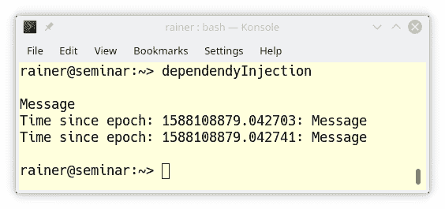

**图 3.2. 依赖注入**

### 构建良好的接口

函数不应该通过全局变量通信，而应该通过接口通信。现在我们进入本章的核心。根据 C++ 核心准则（C++ Core Guidelines），以下是对接口的建议。接口应该遵循这些规则：

- 使接口显式化：(I.1)

- 使接口精确且强类型：(I.4)

- 保持低函数参数数量：(I.23)

- 避免相同类型的相邻无关参数：(I.24)

第一个函数 `showRectangle` 违反了所有提到的接口规则：

```cpp
void showRectangle(double a, double b, double c, double d) {
    a = floor(a);
    b = ceil(b);
    ...
}

void showRectangle(Point top_left, Point bottom_right);
```

虽然第一个函数 `showRectangle` 应该只显示矩形，但它修改了参数。从本质上说，它有两个目的，因此导致了误导性的名称 (I.1)。此外，函数签名没有提供关于参数应该是什么任何信息，也没有提供参数必须以什么顺序给的信息 (I.23 和 I.24)。此外，参数是 `double` 类型且没有约束值范围。因此，这种约束必须在函数体内建立 (I.4)。相比之下，第二个函数 `showRectangle` 接收两个具体的点。检查 `Point` 是否具有有效值是 `Point` 构造函数的职责。这部分责任不应该是函数的职责。

我想进一步详细说明规则 I.23、I.24 以及标准模板库（STL）中的函数 `std::transform_reduce`。首先，我需要定义“可调用”（`callable`）术语。可调用对象是指行为像函数。它可以是一个函数，也可以是一个函数对象或 lambda 表达式。如果可调用对象接受一个参数，则称为一元可调用对象；如果接受两个参数，则称为二进制可调用对象。

`std::transform_reduce` 首先将一元可调用对象或或二元可调用对象应用于两个范围，然后将二进制可调用对象应用于结果范围。当你配合单元 lambda 表达式使用 `std::transform_reduce` 时，调用很容易正确使用：


```cpp
std::vector<std::string> strVec{"Only", "for", "testing", "purpose"};

std::size_t res = std::transform_reduce(
        std::execution::par,
        strVec.begin(), strVec.end(),
        0,
        [](std::size_t a, std::size_t b) { return a + b; },
        [](std::string s) { return s.size(); }
     );
```

`std::transform_reduce` 将每个字符串转换为其长度（`[](const std::string s) { return s.size(); }`），并将二进制可调用对象（`[](std::size_t a, std::size_t b) { return a + b; }`）应用于结果。`0` 是求和的初始值。整个计算是并行执行：`std::execution::par`。

当你使用接受两个二进制可调用对象的重载版本时，函数的声明变得非常复杂且容易出错。因此，它违反了规则 `I.23` 和 `I.24`。

```cpp
template<class ExecutionPolicy,
         class ForwardIt1, class ForwardIt2, class T,
         class BinaryOp1, class BinaryOp2>
T transform_reduce(ExecutionPolicy&& policy,
                   ForwardIt1 first1, ForwardIt1 last1,
                   ForwardIt2 first2,
                   T init, BinaryOp1 binary_op1, BinaryOp2 binary_op2);
```

调用此重载需要六个模板参数和七个函数参数。以正确的顺序使用二进制可调用对象可能也是一个挑战。

**transform | reduce**

`std::transform_reduce` 函数之所以复杂，是因为它将两个函数合并在了一个。定义两个独立的函数 `transform` 和 `reduce`，并通过管道操作符支持函数组合，会是一个更好的选择：`transform | reduce`。

### I.13: 不要将数组作为单个指针传递

不要将数组作为单个指针传递的这一准则是特殊的。根据我的经验，我可以告诉你这条规则是导致未定义行为的常见原因。例如，`copy_n` 函数非常容易出错。

```cpp
template <typename T>

void copy_n(const T* p, T* q, int n); // 从 [p:p+n) 拷贝到 [q:q+n)

...

int a[100] = {0, };

int b[100] = {0, };

copy_n(a, b, 101);
```

也许你经历了疲惫的一天，结果多算了一个。结果就是差一错误（off-by-one error），从而导致未定义行为。解决办法很简单：使用标准模板库中的容器（如 `std::vector`），并在函数体中检查容器的大小。C++20 提供了 `std::span`，它更优雅地解决了这个问题。`std::span` 是一个可以引用连续序列对象的对象。`std::span` 永远不是所有者。这种连续内存可以是数组、带尺寸的指针或一个 `std::vector`。

```cpp
template <typename T>

void copy(std::span<const T> src, std::span<T> des);

int arr1[] = {1, 2, 3};

int arr2[] = {3, 4, 5};

...

copy(arr1, arr2);
```

`copy` 不需要元素的数量。因此，使用 `std::span<T>` 消除了一个常见的错误原因。

### I.27: 为了稳定的库 ABI，请考虑 Pimpl 句式

应用二进制接口（ABI）是两个二进制程序之间的接口。

得益于 Pimpl 句式，你可以将类的使用者与其实现分离开，从而避免重新编译。Pimpl 代表 **P**ointer to **impl**ementation（实现指针），是 C++ 中的一种编程技术，通过将实现细节放在单独的类中来从类中移除实现细节。这个单独的类通过指针访问。这样做是因为私有数据成员参与了类的布局，而私有成员函数参与了重载解析。这些依赖关系意味着对这些实现细节的更改需要重新编译该类的所有用户。持有指向实现的指针（Pimpl）的类可以以间接访问为代价，将类的使用者与其实现的变化隔离开。

C++ 核心准则展示了一个典型的实现。

• 接口：`Widget.h`

```cpp
class Widget {

    class impl;

    std::unique_ptr<impl> pimpl;

 public:

    void draw(); // 转发到实现的公共 API

    Widget(int); // 定义在实现文件中

    ~Widget();   // 定义在实现文件中，此时 impl 是一个完整类型

    Widget(Widget&&) = default;

    Widget(const Widget&) = delete;

    Widget& operator = (Widget&&); // 定义在
                                // 实现文件中

    Widget& operator = (const Widget&) = delete;

};
```

• 实现：`Widget.cpp`

```cpp
class Widget::impl {

    int n; // 私有数据

    public:

       void draw(const Widget& w) { /* ... */ }

       impl(int n) : n(n) {}
};

void Widget::draw() { pimpl->draw(*this); }

Widget::Widget(int n) : pimpl{std::make_unique<impl>(n)} {}

Widget::~Widget() = default;

Widget& Widget::operator = (Widget&&) = default;
```

`[cppreference.com](http://cppreference.com)` 提供了关于 Pimpl 句式的更多信息。此外，规则“C.129: 在设计类层次结构时，区分实现继承和接口继承”展示了如何将 Pimpl 句式应用于双重继承。

#### 相关规则

我在错误处理章节中介绍了规则 `I.10: 使用异常信号执行所需任务的失败`；在函数章节介绍了规则 `I.11: 永远不要通过原始指针 (T*) 或引用 (T&) 转移所有权`；在表达式和语句章节中介绍了规则 `I.22: 避免全局对象的复杂初始化`；在类和类层次结构章节中介绍了规则 `I.25: 优先使用抽象类作为类层次结构的接口`。

### 提炼

**提炼：接口**

- 不要使用全局变量。它们引入了隐藏的依赖关系。

- 单例是伪装的全局变量。

- 接口（特别是函数）应该表达它们的意图。

- 接口应该是强类型的，参数应尽可能少且不易混淆。

- 不要通过指针接收 C 数组，而要使用 `std::span`。

- 如果你想将类的使用者与其实现分离，请使用 Pimpl 句式。

## 第 4 章：函数


**图 4.1. Cippi 使用函数解决挑战**

软件开发者通过将复杂任务分解为较小的单元来掌握复杂性。在解决了小单元后，将它们组合在一起以掌握复杂任务。函数是一个典型的单元，因此是程序的构建构建块。函数是“大多数接口中最为关键的部分……”（C++ 核心准则关于函数）。

C++ 核心准则大约有 40 条关于规则。它们对于函数的定义、你应该如何传递参数（例如通过拷贝或引用）以及这在所有权语义上意味着什么提供了非常有价值的建议。它们还规定了关于返回值语义以及对其他函数（如 lambda）的规则。让我们深入研究。

#### 函数定义

推测，良好的软件最重要的一个原则是良好的命名。这一原则经常被忽略，对于函数来说尤为如此。

#### 良好的命名

C++ 核心准则将其前三条规则专门给了良好的命名：F.1: 将有意义的操作封装为命名仔细的函数进行“打包（Package）”；F.2: 一个函数应该执行单一的逻辑操作；F.3: 保持函数短小且简单。

让我从一个短轶事开始。几年前，一位软件开发者问我：“我应该如何命名我的函数？”我告诉他，给函数起一个如 `verbObject`（动词宾语）的名字。对于成员函数，一个 `动词` 可能就足够，因为函数已经对一个对象进行操作了。该动词代表了在对象上执行的操作。该软件开发者回答说这是可能的，因为函数必须是 `getTimeAndAddToPhonebook` 或直接是 `processData`，因为函数执行了多项工作（单一职责原则）。当你为函数找不到有意义的名字（`F.1`）时，这强烈地表明你的函数执行了多个逻辑操作（`F.2`），并且你的函数并不短小简单（`F.3`）。如果一个函数无法在一个屏幕上显示，它就太长了。屏幕意味着大约 60 行 140 个字符，但你的衡量标准可能不同。现在，你应该识别函数的操作，并将这些操作封装成命名仔细的函数。

准则提供了一个坏函数的示例：

```cpp
void read_and_print() {  // 坏

    int x;

    std::cin >> x;

    // 检查错误

    std::cout << x << '\n';

}
```

`read_and_print` 函数出于很多原因是很坏的。该函数与特定的输入绑定，无法在不同的上下文中使用。将函数重构为两个函数可以解决这些问题，并更容易测试和维护：

```cpp
int read(std::istream& is) {  // 更好

    int x;

    is >> x;

    // 检查错误

    return x;
}

void print(std::ostream& os, int x) {

    os << x << '\n';

}
```

### F.4: 如果函数可能需要在编译时进行求，请将其声明为 `constexpr`

`constexpr` 函数是一个具有在编译时运行潜力的函数。当你在常量表达式中调用 `constexpr` 函数，或者用 `constexpr` 变量来接收 `constexpr` 函数的结果时，它会在编译时运行。你也可以使用只能在运行时求值的参数来调用 `constexpr` 函数。`constexpr` 函数是隐式的 `inline`。

在编译时求值的 `constexpr` 结果被存储在 ROM（只读内存）中。因此，性能是 `constexpr` 函数的第一大优势。第二个优势是在编译时求值的 `constexpr` 函数结果是 `const` 的，因此是线程安全的。

这使得计算结果在运行时以 ROM 中常量的形式可用。

```cpp
// constexpr.cpp

constexpr auto gcd(int a, int b) {
    while (b != 0) {
        auto t = b;
        b = a % b;
        a = t;
    }
    return a;
}

int main() {
    constexpr int i = gcd(11, 121);  // (1)
    int a = 11;
    int b = 121;
    int j = gcd(a, b);               // (2)
}
```

下面的图像显示了 Compiler Explorer 的输出，并描述了编译器为该函数生成的汇编代码。我使用了未优化的 Microsoft Visual Studio Compiler 19.22。

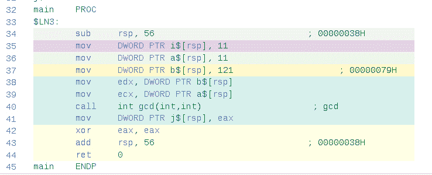

**图 4.2. 程序 `constexpr.cpp` 的汇编指令**

根据颜色，你可以看到源代码中的 (1) 对应于汇编指令的第 35 行，而源代码中的 (2) 对应于汇编指令的第 38 - 41 行。调用 `constexpr int i = gcd(11, 121);` 最终归结为值 11，但调用 `int j = gcd(a, b);` 则导致了一个函数调用。

## F.6: 如果你的函数可能不会抛出异常，请将其声明为 `noexcept`

通过将函数声明为 `noexcept`，你减少了备控制路径的数量；因此，`noexcept` 是优化器非常有价值的提示。即使你的函数可能会抛出异常，`noexcept` 往往也很有意义。在这种情况下，`noexcept` 意味着：我不在乎。可能是因为你无法对异常做出反应。因此，处理异常唯一的方法是调用 `std::terminate()`。这个 `noexcept` 声明对于代码的读者来说也是一份非常有价值的信息。

下一个函数如果在内存耗尽时将会崩溃。

```cpp
std::vector<std::string> collect(std::istream& is) noexcept {
    std::vector<std::string> res;
    for (std::string s; is >> s;) {
        res.push_back(s);
    }
    return res;
}
```

以下类型的函数永远不抛出异常：析构函数（参见失败的析构函数）、交换函数、移动操作和默认构造函数。

## F.8: 优先使用纯函数

纯函数是在给定相同参数时总是返回相同结果函数。这种属性也被称为引用透明性。纯函数的行为就像无限大的查找表。

函数模板 `square` 是一个纯函数：

```cpp
template<class T>
auto square(T t) {
    return t * t;
}
```

相反，不纯函数是像 `random()` 或 `time()` 这样的函数，它们每次调用可能返回不同的结果。换句话说，与函数体外部状态交互的函数是不纯的。

纯函数有一些非常有趣的属性。因此，如果可能，你应该优先使用纯函数。

纯函数可以：

- 独立地进行测试。

- 独立地进行验证或重构。

- 缓存其结果。

- 自动重排序或在其他线程上执行。

纯函数通常也称为数学函数。C++ 中的函数默认不是纯的，不像纯函数式编程语言 Haskell 那样。使用纯函数基于程序员人员的自律。`constexpr` 函数在编译时求值时是纯的。模板元编程是嵌入在命令式语言 C++ 中的纯函数语言。

关于模板和泛型编程的章节对编译时编程进行了简要介绍，包括模板元编程。

### 参数传递：输入和输出

C++ Core Guidelines 有一些规则来表达向函数输入和输出参数的各种方式。

## F.15: 优先使用简单且常规的信息传递方式

第一条规则展示了全局视图。首先，它提供了向函数输入和输出信息的各种方式的概述。

**表 4.1. 普通参数传递**

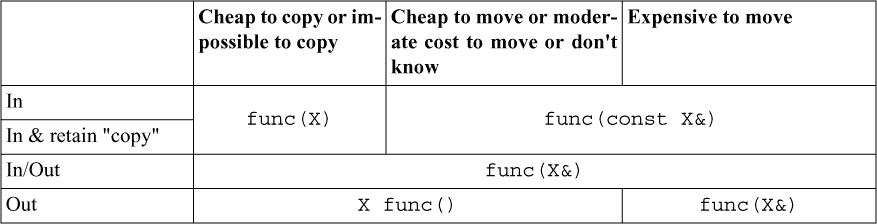

该表格非常简洁：表头描述了关于拷贝和移动成本的数据特征。行表示参数传递的方向。

- 数据类型

- 拷贝廉价或无法拷贝：`int` 或 `std::unique_ptr`

- 移动廉价：`std::vector<T>` 或 `std::string`

- 移动成本中等：`std::array<std::vector>` 或 `BigPOD`（POD 代表 **Plain** **O**ld **D**ata - 即没有构造函数、析构函数和虚成员函数的类）

- 未知：模板

- 移动昂贵：`BigPOD[]` 或 `std::array<BigPOD>`

- 参数传递的方向

- 输入（In）：输入参数

- 输入并保留副本：调用者保留其副本

- 输入/输出（In/Out）：被修改的参数

- 输出（Out）：输出参数

便宜的操作是指涉及几个 int 的；中等成本是在不分配内存的情况下约为 1000 字节。

这些常规参数传递规则应该是你的首选。然而，也有高级的参数传递规则。本质上，增加了“输入并移动自”语义的情况。

**表 4.2. 高级参数传递**

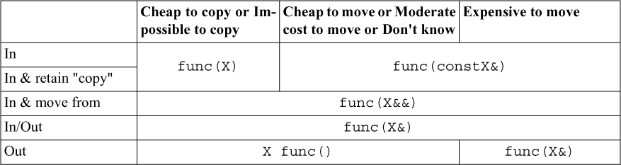

在“输入并移动自”调用后，参数处于所谓的“已移动”状态。已移动意味着它处于一个有效但未具体指定的状态。本质上，你必须在再次使用它之前初始化该已移动的对象。

关于参数传递的其余规则为这些表格提供了必要的背景信息。

## F.16: 对于“输入”参数，按值传递廉价拷贝的类型，其他类型通过 `const` 引用传递

该规则很容易遵循。如果可能，输入值应默认拷贝。当它们无法廉价拷贝时，通过 `const` 引用传递它们。C++ Core Guidelines 对以下问题给了一个经验法则：哪些对象拷贝廉价，哪些拷贝昂贵？

- 如果 `sizeof(par) < 3 * sizeof(void*)`，则你应该按值传递参数 `par`。

- 如果 `sizeof(par) > 3 * sizeof(void*)`，则你应该通过 `const` 引用传递参数 `par`。


```cpp
void f1(const std::string& s);  // OK：通过常量引用传递；
                                // 总是廉价
void f2(std::string s);         // 坏：可能昂贵
void f3(int x);                 // OK：无可比拟
void f4(const int& x);          // 坏：在 f4() 中访问有开销
```

### F.19: 对于“转发”参数，通过 `TP&&` 传递并仅对参数使用 `std::forward`

这条规则代表一种特殊的输入值。有时你想转发参数 `par`。这意味着左值被拷贝，而右值被移动。因此，左值的常量属性被忽略，右值的右值属性被保留。

转发参数的典型用例是工厂函数，它通过调用构造函数来创建任意对象。你既不知道参数是否为右值，也不知道构造函数需要多少个参数。

```cpp
// forwarding.cpp

#include <string>
#include <utility>

template <typename T, typename ... T1>  // (1)
T create(T1&& ... t1) {
    return T(std::forward<T1>(t1)...);
}

struct MyType {
    MyType(int, double, bool) {}
};

int main() {
    // 左值
    int five=5;
    int myFive= create<int>(five);
    // 右值
    int myFive2= create<int>(5);
    // 无参数
    int myZero= create<int>();
    // 三个参数；(左值，右值，右值)
    MyType myType = create<MyType>(myZero, 5.5, true);
}
```

函数 `create` (1) 中的三个点（省略号）表示参数包（parameter pack）。我们将使用参数包的模板称为变长模板（variadic template）。

## 参数包的打包与解包

当省略号位于类型参数 `T1` 的左侧时，参数包被打包；当位于右侧时，它被解包。返回语句 `T(std::forward<T1>(t1)...)` 中的这种解包本质上意味着表达式 `std::forward<T1>(t1)` 被重复执行，直到参数包中的所有参数都被消耗，并在每个子表达式之间放置一个逗号。对于好奇的朋友，C++ Insights 展示了这一解包过程。

转发（forwarding）与变长模板的结合是 C++ 中典型的创建模式。这里是 `std::make_unique<T>` 的一种可能实现。

```cpp
template<typename T, typename... Args>

std::unique_ptr<T> make_unique(Args&&... args) {
    return std::unique_ptr<T>(new T(std::forward<Args>(args)...));
}

std::make_unique<T> 为 T 创建一个 std::unique_ptr
```

## F.17: 对于“输入输出”参数，通过非 const 引用传递

该规则向调用者传达了其意图：此函数修改了其参数。

```cpp
std::vector<int> myVec{1, 2, 3, 4, 5};

void modifyVector(std::vector<int>& vec) {
    vec.push_back(6);
    vec.insert(vec.end(), {7, 8, 9, 10});
}
```

## F.20: 对于“输出”输出值，优先使用返回值而非输出参数

该规则非常直接。只需返回值，但不要使用 `const` 值，因为它没有额外价值，且会干扰移动语义。你可能认为复制一个值是一次开销很大的操作。并非如此。是的，你是的，但并不是，编译器会应用 `RVO`（返回值优化）或 `NRVO`（命名返回值优化）。`RVO` 意味着编译器允许移除不必要的复制操作。曾经可能的优化步骤在 C++17 中变成了一种保证。

```cpp
MyType func() {
    return MyType{};       // C++17 中无复制
}

MyType myType = func();    // C++17 中无复制
```

在这几行代码中可能会发生两次不必要的复制操作。第一次在 `return` 调用中，第二次在函数调用中。在 C++17 中，没有发生复制操作。如果返回值有名称，我们称其为 `NRVO`。也许你已经猜到了。

```cpp
MyType func() {
    MyType myValue;
    return myValue;             // 允许一次复制
}

MyType myType = func();         // C++17 中无复制
```

细微的区别在于，根据 C++17，编译器仍然可以在返回语句中复制值 `myValue`。但在函数调用中不会发生复制。

通常，一个函数需要返回多个值。此时，规则 F.21 发派用场。

## F.21: 为了返回多个“输出”值，优先返回结构体或元组。

当你向 `std::set` 插入值时，成员函数 `insert` 的重载返回一个 `std::pair`，其中包含指向插入元素的迭代器和一个在插入成功时设置为 `true` 的 `bool`。C++11 的 `std::tie` 或 C++17 的结构化绑定（structured binding）是将这两个值绑定到变量的两种优雅方法。

```cpp
// returnPair.cpp; C++17

#include <iostream>
#include <set>
#include <tuple>

int main() {
    std::cout << '\n';
    std::set<int> mySet;
    std::set<int>::iterator iter;
    bool inserted = false;

    std::tie(iter, inserted) = mySet.insert(2011);              // (1)
    if (inserted) std::cout << "2011 was inserted successfully\n";

    auto [iter2, inserted2] = mySet.insert(2017);               // (2)
    if (inserted2) std::cout << "2017 was inserted successfully\n";

    std::cout << '\n';
}
```

行 (1) 使用 `std::tie` 将 `insert` 的返回值解包到 `iter` 和 `inserted` 中。行 (2) 使用结构化绑定将 `insert` 的返回值解包到 `iter2` 和 `inserted2`。与结构化绑定相比，`std::tie` 需要预先声明的变量。

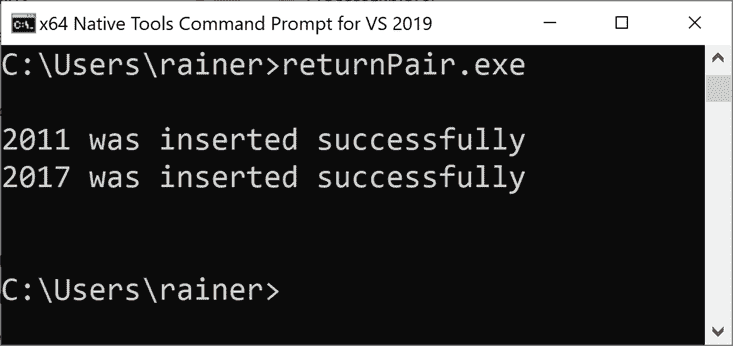

**图 4.3 返回一个 std::pair**

#### 参数传递：所有权语义

上一节关于参数的流向：哪些参数是输入、输入/输出或输出值。但参数的意义不仅在于流向。传递参数涉及到所有权语义。本节介绍了传递参数的五种典型方式：通过拷贝、通过指针、通过引用、通过 `std::unique_ptr` 或通过 `std::shared_ptr`。只有关于智能指针的规则包含在本节中。通过拷贝传递的规则属于上一节参数传递的一部分（输入和输出），而指针和引用的规则属于接口部分。

下表提供了初步概览：

**表 4.3. 参数传递的所有权语义**

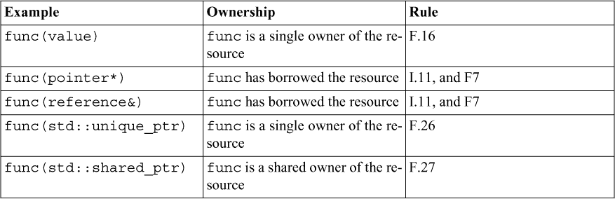

以下是更多详细信息：

- `func(value)`：函数 `func` 拥有 `value` 的一个副本并是其所有者。`func` 会自动释放资源。

- `func(pointer*)`：`func` 借用了资源，因此无权删除该资源。`func` 在每次使用之前必须检查指针是否为空指针。

- `func(reference&)`：`func` 借用了资源。与指针不同，引用始终有一个有效值。

- `func(std::unique_ptr)`：`func` 是资源的新所有者。`func` 的调用者显式地将资源的所有权转移给了调用者。`func` 会自动释放资源。

- `func(std::shared_ptr)`：`func` 是资源的额外所有者。`func` 延长资源的生命周期。在 `func` 结束时，`func` 结束对资源的所有权。如果 `func` 是最后一个所有者，这种结束会导致资源的释放。

### 谁所有所有？

明确指示所有权非常重要。想象一下，你的程序是用旧版 C++ 编写的，你只有一个原始指针可用，通过指针、引用、`std::unique_ptr` 或 `std::shared_ptr` 来表达四种所有权。旧版 C++ 中的关键问题是：谁是所有者？

以下代码段说明了我的观点：

```cpp
void func(double* ptr) {
  ...
}

double* ptr = new double[];

func(ptr);
```

关键问题是：谁是资源的所有者？是使用数组的 `func` 调用者，还是创建数组的 `func` 调用者？如果 `func` 是所有者，它必须释放资源。如果不是，`func` 不允许释放资源。这个条件并不理想。如果 `func` 不释放资源，可能会发生内存泄漏。如果 `func` 释放资源，可能会导致未定义行为。

因此，所有权需要记录。在现代 C++ 中使用类型系统定义约定是消除这种文档歧义的一大进步。

在应用层使用 `std::move` 并不是为了移动。在应用层使用 `std::move` 是为了所有权的转移。例如：对 `std::unique_ptr` 应用 `std::move` 会将内存的所有权转移给另一个 `std::unique_ptr`。

```cpp
auto uniquePtr1 = std::make_unique<int>(2011);             // 原始所有者
std::unique_ptr<int> uniquePtr2{ std::move(uniquePtr1) };  // 新所有者
```

这里是实践中所有权语义的五种变体。

```cpp
 1 // ownershipSemantic.cpp

 2

 3 #include <iostream>

 4 #include <memory>

 5 #include <utility>

 6

 7 class MyInt {

 8 public:
 9     explicit MyInt(int val): myInt(val) {}
10     ~MyInt() noexcept {
11        std::cout << myInt << '\n';
12     }
13 private:
14     int myInt;
15 };

16

17 void funcCopy(MyInt myInt) {}
18 void funcPtr(MyInt* myInt) {}
19 void funcRef(MyInt& myInt) {}
20 void funcUniqPtr(std::unique_ptr<MyInt> myInt) {}
21 void funcSharedPtr(std::shared_ptr<MyInt> myInt) {}

22
23 int main() {

24
25     std::cout << '\n';

26
27     std::cout << "=== Begin" << '\n';

28
29     MyInt myInt{1998};
30     MyInt* myIntPtr = &myInt;
31     MyInt& myIntRef = myInt;
32     auto uniqPtr = std::make_unique<MyInt>(2011);
33     auto sharedPtr = std::make_shared<MyInt>(2014);

34
35     funcCopy(myInt);
36     funcPtr(myIntPtr);
37     funcRef(myIntRef);
38     funcUniqPtr(std::move(uniqPtr));
39     funcSharedPtr(sharedPtr);

40
41     std::cout << "==== End" << '\n';

42
43     std::cout << '\n';

44
45 }
```

类型 `MyInt` 在它的析构函数中（第 10-12 行）显示了 `myInt` 的值（第 14 行）。第 17-21 行的五个函数实现了每种所有权语义。第 29-33 行具有对应的值。

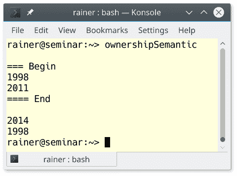

图 4.4. 五种所有权语义

截图显示在 `main` 函数结束前和结束后调用了两个析构函数。拷贝的 `myInt`（第 35 行）和移动的 `uniquePtr`（第 38 行）的析构函数在 `main` 结束之前被调用。在两种情况下，`funcCopy` 或 `funcUniqPtr` 都变成了资源的所有者。函数的生命周期在 `main` 的生命周期之前结束。这种生命周期的结束并不适用于原始的 `myInt`（第 29 行）和 `sharedPtr`（第 33 行）。它们的生命周期随着 `main` 结束，因此析构函数在 `main` 函数结束时被调用。

### 值返回语义

本节的七条规则符合之前提到的规则 F.20：对于“输出”输出值，优先使用返回值而不是输出参数。本节的规则特别关于特殊用例和“不要做”的事项。

#### 何时返回指针 (`T*`) 或左值引用 (`T&`)

正如我们在上一节中所了解的（参数传递：所有权语义），指针或引用绝不应该转移所有权。

##### F.42: 返回一个 `T*` 以指示位置（仅限）

指针应该只指示位置。这正是 `find` 函数所做的。

```cpp
Node* find(Node* t, const string& s) {
    if (!t || t->name == s) return t;
    if ((auto p = find(t->left, s))) return p;
    if ((auto p = find(t->right, s))) return p;
    return nullptr;
}
```

指针表示 `Node` 持有 `s` 的位置。

##### F.44: 当拷贝不可接受且不需要“返回空对象”时返回 `T&`

当不返回对象不是选项时，就会使用引用而不是指针。

有时，你希望链式调用操作，而不产生临时对象的不必要的拷贝和销毁。典型的用例是输入/输出流或赋值运算符（F.47: 从赋值运算符返回 `T&`）。在以下代码段中，通过 `T&` 返回和通过 `T` 返回之间有什么细微区别？

```cpp
A& operator = (const A& rhs) { ... };
A operator = (const A& rhs) { ... };
A = a1, a2, a3;
```

返回拷贝（`A`）的拷贝赋值运算符会触发两个额外的 `A` 类型临时对象的创建。

##### 局部变量引用

返回局部变量引用（指针）是未定义行为。

未定义行为本质意味着：不要对你的程序做任何假设。修复未定义行为。程序 `lambdaFunctionCapture.cpp` 返回了一个局部变量引用。

```cpp
// lambdaFunctionCapture.cpp
#include <functional>
#include <iostream>
#include <string>
auto makeLambda() {
  const std::string val = "on stack created";
  return [&val]{return val;};                          // (2)
}

int main() {
  auto bad = makeLambda();                             // (1)
  std::cout << bad();                                  // (3)
}
```

`main` 函数调用函数 `makeLambda()` (1)。该函数返回一个 lambda 表达式，该表达式包含对局部变量 `val` 的引用 (2)。

调用 `bad()` (3) 导致了未定义行为，因为 lambda 表达式使用了局部变量 `val` 的引用。作为局部变量，它的生命周期随着 `makeLambda()` 范围的结束。

执行该程序会得到不可预测的结果。有时，我会得到整个字符串，有时只得到字符串的一部分，有时只得到值 0。作为一个示例，这里是程序的两次运行。

在第一次运行中，显示任意字符，直到字符串终止符号（`\0`）结束。

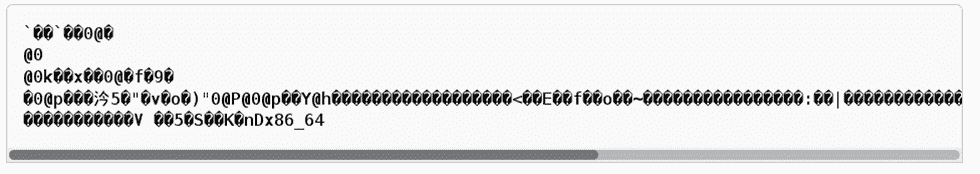

图 4.5. 显示任意字符

在第二次运行中，程序导致核心储（core dump）。

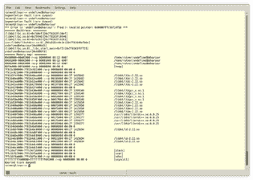

图 4.6. 导致核心储

##### F.45: 不要返回 `T&&` 且 F.48: 不要 `return std::move(local)`

这两条规则都非常严谨。

##### `T&&`

你不应该使用 `T&&` 作为返回类型。这里有一个小示例来演示这个问题。


进入`/path/to/xxx`目录，找到`xxx.json`。

在表达式`cvar = avar + bvar`中，加法运算符（`+`）将`avar`与`bvar`相加，得到它们的和`cvar`。

在`List.of(arg0, arg1, arg2)`中，`List`接口的工厂方法`of()`接受一系列的元素，返回包含它们的只读列表。

之后我们这样调用`cmd`命令：`cmd arg0 arg1 arg2`。

```
if (condVar > someVal) {console.log("xxx")}
```

以下代码展示了一个返回右值引用的函数：

```cpp
// returnRvalueReference.cpp
int&& returnRvalueReference() {
    return int{};
}

int main() {
    auto myInt = returnRvalueReference();
}
```

编译时，GCC 编译器会立即对临时对象的引用报错。准确来说，临时对象的生命周期结束于完整表达式`auto myInt = return-RvalueReference();`的结束。

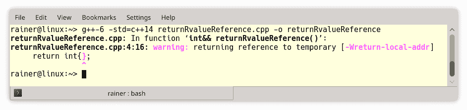

图 4.7. 返回临时对象的引用

### `std::move(local)`

得益于带有 RVO 和 NRVO 的拷贝消除，使用`return std::move(local)`并不是优化，而是劣化（pessimization）。劣化意味着你的程序可能会变慢。

### F.46: `int`是`main()`的返回类型

根据 C++ 标准，`main`函数有两个变体：

```cpp
int main() { ... }
int main(int argc, char** argv) { ... }
```

第二种版本等于`int main(int argc, char* argv[]) { ... }`。

`main`函数不需要返回语句。如果控制到达`main`函数结束而没有返回语句，效果等同于执行`return 0;`。`return 0`代表执行成功。

### 其他函数

本节的规则建议何时使用 lambda 以及比较`va_arg`与折叠表达式。

### Lambdas

#### F.50: 当函数无法做到时（捕获局部变量或编写局部函数）使用 lambda

这条规则说明了 lambda 的用例。这立即引发了问题：何时使用 lambda 或函数？这里有两个明显的原因。

1. 如果你的可调用对象需要捕获局部变量或在局部范围范围内定义，必须使用 lambda 函数。
2. 如果你的可调用对象支持重载，使用函数。

现在，我想写写关于 lambda 的重要观点，这些观点经常被忽视。

#### 表达性

“显式优于隐式”。这条来自 Python 的元规则（PEP 20 -- Python 之禅）也适用于 C++。这意味着你的代码应该显式表达其意图（见规则 P.1\. 直接在代码中表达想法）。当然，这对 lambda 特别适用。

```cpp
std::vector<std::string> myStrVec = {“523345”, “4336893456”, “7234”,
                                “564”, “199”, “433”, “2435345”};
std::sort(myStrVec.begin(), myStrVec.end(),
          [](const std::string& f, const std::string& s) {
              return f.size() < s.size();
          }
);
```

将此 lambda 与随后使用的`lessLength`函数进行比较。

```cpp
std::vector<std::string> myStrVec = {“523345”, “4336893456”, “7234”,
                                “564”, “199”, “433”, “2435345”};

bool lessLength(const std::string& f, const std::string& s) {
    return f.size() < s.size();
}

std::sort(myStrVec.begin(), myStrVec.end(), lessLength);
```

Lambda 和函数都为排序算法提供了相同的顺序谓词。想象一下，你的同事将函数命名为`foo`。这意味着你完全不知道这个函数是做什么的。结果，你必须对该函数进行文档说明。

```cpp
// 根据字符串长度升序排序 vector
std::sort(myStrVec.begin(), myStrVec.end(), foo);
```

此外，你还得希望你的同事做的是正确的。如果你不信任他，你就得分析其实现。也许这是不可行的，因为你只有函数的声明。而使用 Lambda，你的同事无法欺骗你。代码即真相。让我更有挑衅性地说：你的代码应该具有足够的表达性，至于不需要文档说明。

#### 表达性与不要重复 (DRY)

使用 Lambda 编写具表达性代码的设计规则通常与另一个重要的设计规则相矛盾：不要重复自己 (DRY)。DRY 意味着你不应该多次编写相同的代码。创建一个可重用的单元（如函数）并给它一个自解释解释的名称，是应对 DRY 的适当良方。最后，你必须根据具体情况判断是否认为表达性的重要性高于 DRY。

### F.52: 在局部使用的 Lambda（包括传递给算法的 Lambda）中优先按引用捕获，以及 F.53: 在非局部使用的 Lambda（包括返回、存储在堆上或传递给另一个线程的 Lambda）中避免按引用捕获

这两条规则密切相关，它们可以归结为以下观察：Lambda 应该只对有效数据进行操作。当 Lambda 通过拷贝捕获数据时，数据根据定义是有效的。当 Lambda 通过引用捕获数据时，数据的寿命必须长于 Lambda 的寿命。上一个关于局部引用的示例展示了 Lambda 引用无效数据的不同结果。

有时问题并不容易被发现。

```cpp
int main() {
    std::string str{“C++11”};
    std::thread thr([&str]{ std::cout << str << '\n'; });
    thr.detach();
}
```

好了，我听你说：“很容易。”创建线程`thr`的 Lambda 表达式通过引用捕获了`str`。随后，`thr`从其创建者（主线程）中分离出来。因此，无法保证创建线程`thr`使用的是有效的`str`。解决此问题的方法是通过拷贝捕获`str`：

```cpp
int main() {
    std::string str{“C++11”};
    std::thread thr([str]{ std::cout << str << '\n'; });
    thr.detach();
}
```

问题解决了吗？没有！关键问题是`std::cout`。`std::cout`的寿命绑定到主线程。这意味着创建线程`thr`可能在`std::cout`打印`C++11`之前就消失了。解决这个问题的方法是等待线程`thr`。在这种情况下，按引用捕获也是可以的：

```cpp
int main() {
    std::string str{“C++11”};
    std::thread thr([&str]{ std::cout << str << '\n'; });
    thr.join();
}
```

### F.51: 有选择时，优先使用默认参数而不是重载

如果你需要调用具有不同数量参数的函数，尽可能使用默认参数而不是重载。因此，遵循 DRY 原则（不要重复自己）。

```cpp
void print(const string& s, int f = {});
```

等的功能需要两个函数：

```cpp
void print(const string& s);
void print(const string& s, int f);
```

### F.55: 不要使用`va_arg`参数

这条规则的标题太短了。当你的函数应该接受任意数量的参数时，使用变长模板代替`va_arg`参数。变长函数如`printf`可以接受任意数量的参数。问题在于你必须假设传递了正确的类型。这种假设非常容易出错并且依赖于程序员。为了理解变长函数的危险性，这里有一个小小的示例：

```cpp
// vararg.cpp
#include <iostream>
#include <cstdarg>

int sum(int num, ... ) {
  int sum = 0;
  va_list argPointer;
  va_start(argPointer, num );
  for( int i = 0; i < num; i++ )
    sum += va_arg(argPointer, int );
  va_end(argPointer);
  return sum;
}

int main() {
  std::cout << “sum(1, 5): << << sum(1, 5) << '\n';
  std::cout << “sum(3, 2, 3): “ << sum(3, 2, 3) << '\n';
  std::cout << “sum(3, 2, 3, 4): “ << sum(3, 2, 3, 4)  << '\n';  // (1)
  std::cout << “sum(3, 2, 3, 3.5): “ << sum(3, 2, 3, 3.5) << '\n';    // (2)
}
```

`sum`是一个变长函数。它的第一个参数是应该求和的数量。以下关于`va_arg`宏的背景信息有助于理解代码：

- `va_list`：后续宏所需的信息。
- `va_start`：允许访问变长函数参数。
- `va_arg`：访问下一个变长函数参数。
- `va_end`：结束变长函数参数的访问。

欲了解更多信息，请阅读 [cppreference.com](http://cppreference.com) 关于变长函数的内容。

在 (1) 和 (2) 中，我表现糟糕。首先，参数数量`num`是错误的；其次，我提供了`double`而不是`int`。输出显示了这两个问题：第一行的最后一个元素缺失，且`double`被解释为`int` (2)。

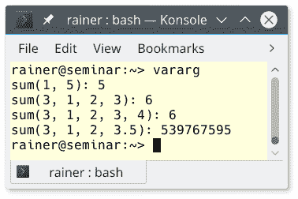

**图 4.8. 使用`va_arg`求和**

这些问题可以通过 C++17 的折叠表达式轻松克服。与`va_arg`不同，折叠表达式会自动推导出参数的数量和类型。

```cpp
// foldExpressions.cpp
#include <iostream>
template<class ... Args>
auto sum(Args ... args) {
    return (... + args);
}

int main() {
    std::cout << “sum(5): “ << sum(5) << '\n';
    std::cout << “sum(1, 2, 3): “ << sum(1, 2, 3) << '\n';
    std::cout << “sum(1, 2, 3, 4): “ << sum(1, 2, 3, 4)  << '\n';
    std::cout << “sum(3, 2, 3, 3.5): “ << sum(3, 2, 3, 3.5) << '\n';
}
```

好了，`sum`函数可能看起来很吓人。它至少需要一个参数，并使用了 C++11 变长模板。这些是可以接受任意数量参数的模板。任意数量由所谓的参数包持有，用省略号`...`表示。此外，通过 C++17，你可以直接用二元运算符折叠参数包。这种基于变长模板的添加被称为折叠表达式。在`sum`函数的情况下，应用了二元运算符`(...+ args)`。如果你想了解更多关于 C++17 折叠表达式的信息，这里有更多细节：[Fold Expressions](https://en.cppreference.com/w/cpp/language/fold)。

程序的输出是预期的：


**图 4.9. 使用折叠表达式求和**

#### 相关规则

Lambda 的另一个附加规则位于“表达式和语句”部分：ES.28: 使用 Lambda 进行复杂的初始化，特别是`const`变量的初始化。

我在本章中跳过了 C++20 特性`std::span`，并在（资源管理）章节提供了`std::span`的基本信息。

### 提炼

**重要**

- 函数应该执行一个操作、短小简单且有一个精心命名的名称。
- 将可以在编译时运行的函数标记为`constexpr`。
- 尽可能让你的函数成为纯函数。
- 区分函数的`in`、`in/out`和`out`参数。对于`in`参数使用按值传递或`const`引用传递，对于`in/out`使用引用传递，对于`out`参数使用按值传递。
- 向函数传递参数是一个所有权语义问题。按值传递意味着函数是资源的独立所有者。通过指针或引用传递意味着函数仅借用了该资源。`std::unique_ptr`将所有权转移给函数。`std::shared_ptr`则让函数成为共享所有者。
- 当函数需要接受任意数量的参数时，请使用变长模板代替`va_arg`参数。

# 第 5 章：类与类层次结构


图 5.1. Cippi 正在对零、五、或六规则进行推理

类是一种用户定义的类型，程序员可以对其指定表示法、操作和接口。类层次结构用于组织相关的结构。

《C++ 核心指南》（C++ Core Guidelines）针对用户定义类型大约有一百条规则。

指南从总结规则开始，然后深入探讨以下特殊规则：

- 具体类型
- 构造函数、赋值和析构函数
- 类层次结构
- 载载与重载运算符
- 联合体

八条总结规则为特殊规则提供了背景。

### 总结规则

总结规则非常短，没有涉及太多细节。它们为类提供了宽泛但有价值的见解。

### `class`和`struct`的语法差异

本节经常提到类和结构体之间的语义差异。首先：语法上的差异是什么？这些差异微小但非常重要：在`struct`中，所有成员默认都是`public`的；在`class`中，所有成员默认都是`private`的。继承的情况也是如此。`struct`的基类默认是`public`的；`class`的基类默认是`private`的。

#### C.1：将相关数据组织到结构（`struct`或`class`）中

如何改进`draw`的接口？

```
void draw(int fromX, int fromY, int toX, int toY);
```

这些`int`代表什么并不直观。因此，你可能会以错误的参数顺序调用函数。将之前的`draw`函数与新的进行对比：

```
void draw(Point from, Point to);
```

通过将相关元素组合到一个结构体中，函数签名变得自解释化了，因此比之前的函数不容易出错。

#### C.2：如果类具有不变性，则使用`class`；如果数据成员可以独立变化，则使用`struct`

类不变性（class invariant）是一种用于约束类实例的不变性。成员函数必须保持这种不变性。不变性约束了类实例的可能值。

这是 C++ 中的一个常见问题：我什么时候必须使用`class`或`struct`？《C++ 核心指南》给出了以下建议：如果类具有不变性，请使用`class`。类不变性可以是 (`y`, `m`, `d`) 共同表示一个有效的日历日期。

```
struct Pair {  // 成员可以独立变化

    string name;

    int volume;

};

class Date {

 public:

    // 验证 {yy, mm, dd} 为有效日期并初始化

    Date(int yy, Month mm, char dd);

    // ...

 private:

    int y;

    Month m;

    char d;  // 天

};
```

类不变性在构造函数中初始化并检查。数据类型`Pair`没有不变性，因为`name`和`volume`的所有值都是有效的。`Pair`是一个简单的数据容器，不需要显式提供的构造函数。

#### C.3：使用类来表示接口与实现之间的区别

类的公共成员函数是类的接口，私有部分是实现。

```
class Date {

 public:

    Date();

    // 验证 {yy, mm, dd} 为有效日期并初始化

    Date(int yy, Month mm, char dd);

    int day() const;

    Month month() const;

    // ...

 private:

    // ... 某些表示法

};
```

从可维护性的角度来看，可以更改`Date`类的实现而不影响该类的用户。

#### C.4：只有当函数需要直接访问类的表示法时，才将其设为成员

如果一个函数不需要访问类的内部实现，它就不应该应该是成员函数。这样你就能获得松耦合，且类内部的改变不会影响辅助函数。

```cpp
class Date {

    // ... 较小的接口 ...

};

// 辅助函数：

Date next_weekday(Date);

bool operator == (Date, Date);
```

运算符`=`、`()`、`[]`和`->`必须是成员。

#### C.5：将辅助函数放置与其支持的类相同的命名空间中

辅助函数应该位于类的命名空间中，因为它是类接口的一部分。与成员函数不同，辅助函数不需要直接访问类的表示法。

```
namespace Chrono { // 在这里保持时间相关的服务

   class Date { /* ... */ };

   // 辅助函数：

   bool operator == (Date, Date);

   Date next_weekday(Date);

   // ...

}

...

if (date1 == date2) {  ...               // (1)
```


得益于参数依赖查找（ADL），`date1 == date2` 将额外在`Chrono`命名空间中查找相等运算符。ADL 对于`<<`等重载运算符特别重要。

## C.7：不要在同一语句中定义`class`或`enum`并声明其类型的变量

在同一语句中定义类并声明其类型的变量会引起混淆，因此应当避免。

```
// 坏

struct Data { /*...*/ } data { /*...*/ };

// 好

struct Data { /*...*/ };

Data data{...*/...*/
```

## C.8：如果任何成员是非公共的，请使用`class`而非`struct`

当你的用户定义类型具有非公共成员时，你可能希望保护它们不变性不受外部影响。建立不变性是构造函数职责。因此，你的用户定义类型更多使用`class`。

## C.9：最小化成员的暴露

数据隐藏和封装是面向对象类设计的基石之一。将成员封装在类中，并允许通过公共成员函数访问。你应该考虑类的两个接口：通用的`public`接口和面向派生类的`protected`接口。其余成员应该是`private`的。

## 具体类型

本节只有两条规则，但引入了具体类型和常规类型的术语。

根据《C++ 核心指南》，**具体类型**是最简单的类。它通常被称为值类型，并且不属于类型层次结构。

**常规类型**是一种行为像`int`一样的类型，因此必须支持拷贝和赋值、相等性和排序。更正式地说，常规类型`X`行为像`int`并支持以下操作：

- 默认构造函数：`X()`

- 拷贝构造函数：`X(const X&)`

- 拷贝赋值：`operator = (const X&)`

- 移动构造函数：`X(X&&)`

- 移动赋值：`operator = (X&&)`

- 析构函数：`~(X)`

- 交换运算符：`swap(X&, X&)`

- 等等运算符：`operator == (const X&, const X&)`

## C.10：优先使用具体类型而非类层次结构

如果你没有类层次结构的需求，使用具体类型。具体类型的实现要容易得多、更小且更快。你不需要担心继承、虚函数、引用或指针（包括内存分配和释放）。没有虚分发，因此没有运行时开销。

简而言之：应用 KISS 原则（保持简单愚蠢）。你的类型行为像值一样。

## C.11：使具体类型常规化

普通类型（`int`）更容易理解。它们本身就是直观的。这意味着，如果你有一个具体的类型，可以考虑将其升级为普通类型。

内置类型如`int`或`double`是普通类型，用户定义的类型如`std::string`，或容器如`std::vector`或`std::unordered_map`也是如此。

C++20 支持`regular`概念。

# 构造函数、赋值和析构函数

关于构造函数、赋值和析构函数的部分到目前为止对类和类层次的规则最多。它们控制着对象的生命周期：创建、拷贝、移动和析构。简而言之，我们称它们为“大六”（Big Six）。以下是六个特殊成员函数：

- 默认构造函数：`X()`

- 拷贝构造函数：`X(const X&)`

- 拷贝赋值：`operator = (const X&)`

- 移动构造函数：`X(X&&)`

- 移动赋值：`operator = (X&&)`

- 析构函数：`~(X)`

编译器可以为这“大六”生成默认实现。该节从关于默认操作的规则开始，继续关于构造函数、拷贝和移动操作、析构函数的规则，并以不属于上述四类的其他默认操作的规则结束。

根据默认构造函数的声明，你可能会认为默认构造函数不接受参数。这是错误的。默认构造函数可以在不传递参数的情况下被调用，但它可能为每个参数都有默认参数。

## 默认操作

默认情况下，编译器可以在需要时生成“大六”。你可以定义这六个特殊成员函数，也可以显式地要求编译器通过`= default`提供它们，或通过`= delete`删除它们。

### C.20: 如果可以避免定义任何默认操作，请这样做

这条规则也被称为“零规则”（rule of zero）。这意味着，通过使用支持适当拷贝/移动语义的类型，你可以避免编写任何自定义构造函数、拷贝/移动构造函数、赋值运算符或析构函数。这适用于普通类型（如内置类型`bool`或`double`），也适用于标准模板库的容器，如`std::vector`或`std::string`。

```cpp
class Named_map {

public:
    // ... 没有声明默认操作 ...

private:
    std::string name;
    std::map<int, int> rep;
};

Named_map nm;        // 默认构造
Named_map nm2 {nm};  // 拷贝构造
```

默认构造和拷贝构造之所以有效，是因为它们已经为`std::string`和`std::map`定义了。当编译器为示例自动生成类的拷贝构造函数时，它会调用该类所有成员和所有基类的拷贝构造函数。

### C.21: 如果你定义或`=delete`了任何默认操作，请定义或`=delete`所有它们

“大六”之间密切相关。由于这种关系，你必须定义或`=delete`所有六个。因此，这条规则被称为“六规则”（rule of six）。有时，你会听到“五规则”，因为默认构造函数是特殊的，因此有时会被排除在外。

#### 特殊成员函数之间的依赖关系

Howard Hinnant 在 ACCU 2014 大会的上的演讲中对自动生成的特殊成员函数进行了概述。

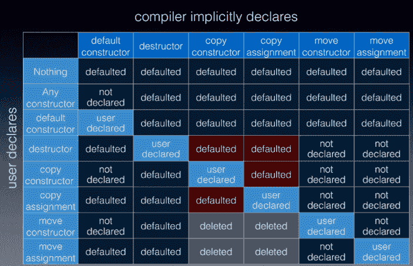

**图 5.2. 自动生成的特殊成员函数**

Howard 的表格需要深入的解释。

首先，用户声明意味着对于这六个特殊成员函数之一，你显式地定义了它，或者通过`=default`向编译器自动请求。使用`=delete`删除特殊成员函数也被视为已定义。本质上，当你直接使用名称如默认构造函数的名称时，它被视为用户声明。

当你定义了任何构造函数时，就不会有默认构造函数。默认构造函数是可以不带参数调用的构造函数。

当你使用`=default`或`=delete`定义或删除默认构造函数时，六个特殊成员函数中的其他五个不受影响。

当你使用`=default`或`=delete`定义或删除析构函数、拷贝构造函数或拷贝赋值运算符时，你不会得到编译器生成的移动构造函数和移动赋值构造。这意味着移动操作（如移动构造或移动赋值）回退到拷贝操作（如拷贝构造或拷贝赋值）。这种回退机制在表格中被标记为红色。

当你使用`=default`或`=delete`定义或删除移动构造函数或移动赋值运算符时，你只会得到`=default`或`=delete`的移动构造函数或移动赋值运算符。因此，拷贝构造函数和拷贝赋值运算符被设置为`=delete`。因此，调用拷贝操作（如拷贝构造或拷贝赋值）会导致编译错误。

如果你不遵循这条规则，你将得到非常不直观的对象。这里是指南中的一个不直观的例子。

```cpp
// doubleFree.cpp

#include <cstddef>

class BigArray {

 public:
    BigArray(std::size_t len): len_(len), data_(new int[len]) {}

    ~BigArray(){
        delete[] data_;
    }

 private:
   size_t len_;
   int* data_;
};

int main(){
    BigArray bigArray1(1000);
    BigArray bigArray2(1000);
    bigArray2 = bigArray1;  // (1)
}                           // (2)
```

为什么这个程序会有未定义行为？示例中的默认拷贝赋值操作`bigArray2 = bigArray1` (1) 拷贝了`bigArray2`的所有成员。拷贝特别意味着指针`data`被拷贝了，而不是数据本身。因此，`bigArray1`和`bigArray2`的析构函数被调用 (2)，我们因为双重释放（double free）而得到未定义行为。

示例的不直观行为是：编译器生成的`BigArray`拷贝赋值运算符对`BigArray`执行浅拷贝，但`BigArray`显式实现的析构函数假设拥有数据的所有权。

AddressSanitizer 使未定义行为可见。

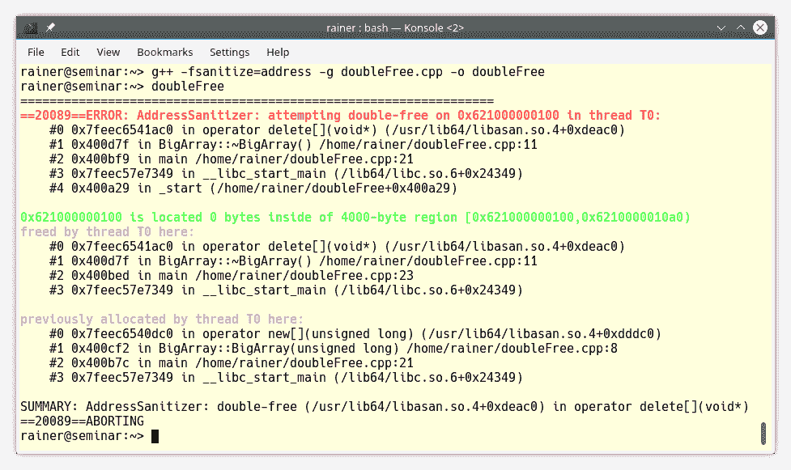

**图 5.3. 使用 AddressSanitizer 检测到双重释放**

### C.22: 使默认操作保持一致

这条规则与之前的规则相关。如果你用不同的语义实现默认操作，类的用户可能会感到非常困惑。如果你部分实现成员函数并部分通过`= default`请求它们，也会出现这种奇怪的行为。你不能假设编译器生成的特殊成员函数具有与你相同的语义。

例如，这里有一个`Strange`类。为了观察这种异常行为，`Strange`包含一个指向`int`的指针。

```cpp
 1 // strange.cpp

 2

 3 #include <iostream>

 4

5 struct Strange {

 6

 7     Strange(): p(new int(2011)) {}

 8

 9     // deep copy
10    Strange(const Strange& a) : p(new int(*a.p)) {}

11

12    // shallow copy
13    // equivalent to Strange& operator = (const Strange&) = default;
14    Strange& operator = (const Strange& a) {
15        p = a.p;
16        return *this;
17    }

18

19    int* p;

20 };

21

22 int main() {

23

24     std::cout << '\n';

25

26     std::cout << "Deep copy" << '\n';

27

28     Strange s1;
29     Strange s2(s1);

30
31     std::cout << "s1.p: " << s1.p << "; *s1.p: " << *s1.p << '\n';
32     std::cout << "s2.p: " << s2.p << "; *s2.p: " << *s2.p << '\n';

33
34     std::cout <<  "*s2.p = 2017" << '\n';
35     *s2.p = 2017;

36
37     std::cout << "s1.p: " << s1.p << "; *s1.p: " << *s1.p << '\n';
38     std::cout << "s2.p: " << s2.p << "; *s2.p: " << *s2.p << '\n';

39

40     std::cout << '\n';

41
42     std::cout << "Shallow copy" << '\n';

43
44     Strange s3;
45     s3 = s1;

46
47     std::cout << "s1.p: " << s1.p << "; *s1.p: " << *s1.p << '\n';
48     std::cout << "s3.p: " << s3.p << "; *s3.p: " << *s3.p << '\n';

49

50
51     std::cout <<  "*s3.p = 2017" << '\n';
52     *s3.p = 2017;

53
54     std::cout << "s1.p: " << s1.p << "; *s1.p: " << *s1.p << '\n';
55     std::cout << "s3.p: " << s3.p << "; *s3.p: " << *s3.p << '\n';

56
57
58     std::cout << '\n';

59
60     std::cout << "delete s1.p" << '\n';
61     delete s1.p;

62
63     std::cout << "s2.p: " << s2.p << "; *s2.p: " << *s2.p << '\n';
64     std::cout << "s3.p: " << s3.p << "; *s3.p: " << *s3.p << '\n';

65
66
67     std::cout << '\n';

68
  }
```

类`Strange`类有一个拷贝构造函数（第 10 行）和一个拷贝赋值运算符（第 14 行）。拷贝构造函数应用了深拷贝，而赋值运算符应用了浅拷贝。顺便说一下，编译器生成的拷贝构造函数或拷贝赋值运算符也应用浅拷贝。在大多数情况下，你希望类型具有深拷贝语义（值语义），但你可能永远不希望这两个相关操作具有不同的语义。区别在于，深拷贝语义创建了两个新的独立的存储空间`p(new int(*a.p))`，而浅拷贝语义仅仅复制了指针`p = a.p`。让我们玩玩`Strange`类型。这里是程序的输出。

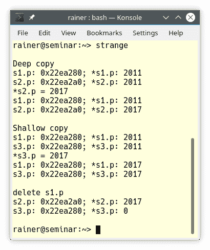

**图 5.4. `strange.cpp`的输出**

第 30 行使用拷贝构造函数创建了`s2`。显示指针地址并更改指针`s2.p`的值（第 36 行）表明，`s1`和`s2`是两个不同的对象。`s1`和`s3`则不然。第 46 行的拷贝赋值操作执行了浅拷贝。结果是，更改指针`s3.p`（第 53 行）也会影响指针`s1.p`；因为这两个指针指向同一个值。

如果我删除指针`s1.p`（第 61 行），好戏就开始了。得益于深拷贝，`s2.p`没有发生任何坏事；但`s3.p`的值变成了一个无效指针。更准确地说：对无效指针进行解引用（如第 63 行中的`*s3.p`）是未定义行为。

## 构造函数

十三条规则涉及对象的构造。粗略来说，它们分为五类：

-   通用的构造函数

-   默认构造函数

-   带单个参数的构造函数

-   成员的初始化

-   特殊构造函数，例如继承构造函数或委托构造函数

最后，我有一个警告。不要在构造函数中调用虚函数。我在关于其他默认操作的章节中，会在更广泛的语境（包括析构函数）中提引用这个警告。

### 通用的构造函数

我跳过了规则 C.40：如果类具有不变性，则定义构造函数，因为我已经在规则 C.2 中写过：如果类具有不变性，请使用`class`；如果数据成员可以独立地变化，则使用`struct`。因此，留下了两条紧密相关的准则：C.41：构造函数应该创建一个完全初始化的对象，以及 C.42：如果构造函数无法构造有效对象，则抛出异常。

#### C.41: 构造函数应该创建一个完全初始化的对象

创建一个完全初始化的对象是构造函数的职责。一个拥有`init`成员函数的类简直是在自找架子。

```cpp
class DiskFile { // 错误：默认构造函数不足

    FILE* f;     // 在调用任何其他函数之前调用 init()

    // ...

public:

    DiskFile() = default;

    void init();  // 初始化 f

    void read();  // 读取 f

    // ...
};

int main() {

    DiskFile file;

    file.read();  // 崩溃！

    // ...

    file.init();  // 太晚了

    // ...
}
```

用户可能会在调用`init`之前误调用`read`，或者忘记调用`init`。将成员函数设为私有并在所有构造函数中调用它会更好，但并非最优。当类有公共操作时，使用委托构造函数。

#### C.42: 如果构造函数无法构造有效对象，则抛出异常

根据之前的规则：如果无法构造有效对象，请抛出异常。没什么可以补充的。如果你使用无效对象，必须始终检查对象的状态。这极其冗琐、低效，而且容易出错。这里有一个违反该规则的示例：

```cpp
class DiskFile { // 错误：构造函数留下了无效对象

    FILE* f;

    bool valid;

    // ...

public:

    explicit DiskFile(const string& name)
         :f{fopen(name.c_str(), "r")}, valid{false} {
         if (f) valid = true;

         // ...

   }

   bool is_valid() const { return valid; }

   void read();  // 读取 f

   // ...
};

int main() {

    DiskFile file {"Heraclides"};

    file.read();  // 崩溃！

    // ...

    if (file.is_valid()) {

        file.read();

        // ...

    }

    else {

        // ... 处理错误 ...

    }

    // ...
}
```

##### 默认构造函数

接下来的两条规则回答了：类什么时候需要以及不需要默认构造函数？

###### C.43: 确保可拷贝（值类型）类具有默认构造函数


通俗地说，当类的实例没有意义默认值时，类不需要默认构造函数。例如，人类没有意义默认值，但银行账户之类的类型有。银行账户的初始值可以是 `0`。拥有默认构造函数使得使用你的类型变得更容易。`STL` 容器的许多构造函数都依赖于你的类型具有默认构造函数。例如，对于有序关联容器（如 `std::map`）的值。

现在来看不应提供默认构造函数的情况。

### C.45: 不要定义只初始化数据成员的默认构造函数；请使用成员初始化器

通常，代码胜过千万言。

```cpp
 1 // classMemberInitializerWidget.cpp

#include <iostream>

class Widget {
  public:
    Widget(): width(640), height(480),
              frame(false), visible(true) {}
    explicit Widget(int w): width(w), height(getHeight(w)),
                           frame(false), visible(true) {}
    Widget(int w, int h): width(w), height(h),
                          frame(false), visible(true) {}

    void show() const {
        std::cout << std::boolalpha << width << “x” << height
                  << “, frame: “ << frame
                  << “, visible: “ << visible << '\n';
    }
  private:
    int getHeight(int w) { return w*3/4; }
    int width;
    int height;
    bool frame;
    bool visible;
};

class WidgetImpro {
  public:
    WidgetImpro() = default;
    explicit WidgetImpro(int w): width(w), height(getHeight(w)) {}
    WidgetImpro(int w, int h): width(w), height(h) {}

    void show() const {
        std::cout << std::boolalpha << width << “x” << height
               << “, frame: “ << frame
               << “, visible: “ << visible << '\n';
    }

  private:
    int getHeight(int w) { return w * 3 / 4; }
    int width{640};
    int height{480};
    bool frame{false};
    bool visible{true};
};

int main() {
  std::cout << '\n';

    Widget wVGA;
    Widget wSVGA(800);
    Widget wHD(1280, 720);

    wVGA.show();
    wSVGA.show();
    wHD.show();

    std::cout << '\n';

    WidgetImpro wImproVGA;
    WidgetImpro wImproSVGA(800);
    WidgetImpro wImproHD(1280, 720);

    wImproVGA.show();
    wImproSVGA.show();
    wImproHD.show();

    std::cout << '\n';
}
```

`Widget` 类使用其三个构造函数（第 7-12 行）来初始化成员。重构后的 `WidgetImpro` 类在类体内（第 41-44 行）直接初始化成员。通过将初始化从构造函数移动到类体内，三个构造函数（第 29-31 行）变得更易理解和维护。例如，当你向类添加新成员时，只需要在类体内添加，而不需要修改所有的构造函数。此外，你不需要考虑和处理构造函数中的初始化顺序。因此，创建新对象的行为是相同的。


**图 5.5. 在类中初始化**

这是我设计新类时遵循的方法：**在类体内定义默认行为。只使用显式定义的构造函数。**

你注意到上一个接受单个参数的构造函数中使用了 `explicit` 关键字吗？

### C.46: 默认情况下，单参数构造函数是 `explicit` 的

更明确地说：一个没有 `explicit` 的构造函数是转换构造函数。转换构造函数接受一个参数并创建该类的对象。这种行为往往会导致意外。

`convertingConstructor.cpp` 程序使用了用户定义的字面量。

```cpp
// convertingConstructor.cpp

#include <iomanip>
#include <iostream>
#include <ostream>
namespace Distance {
    class MyDistance {
     public:
         MyDistance(double d):m(d) {}                          // (5)
         friend MyDistance operator + (constDistance& a,    // (2)
                                       constDistance& b) {
             return MyDistance(a.m + b.m);
         }
         friend std::ostream& operator << (std::ostream &out,  // (3)
                                  constDistance& myDist) {
             out << myDist.m << “ m”;
             return out;
         }
 private:
         double m;
};
namespace Unit{
         MyDistance operator "" _km(long double d) {           // (1)
             return MyDistance(1000*d);
         }
         MyDistance operator "" _m(long double m) {
             return MyDistance(m);
         }
         MyDistance operator "" _dm(long double d) {
             return MyDistance(d/10);
         }
         MyDistance operator "" _cm(long double c) {
             return MyDistance(c/100);
         }
     }
}
using namespace Distance::Unit;

int main() {
    std::cout << std::setprecision(7) << '\n';
    std::cout << “1.0_km + 2.0_dm + 3.0_cm: “
            << 1.0_km + 2.0_dm + 3.0_cm << '\n';
    std::cout << “4.2_km + 5.5_dm + 10.0_m + 0.3_cm: “
          << 4.2_km + 5.5_dm + 10.0_m + 0.3_cm << '\n';           // (4)
    std::cout << '\n';
}
```

类似 `1.0_km` 的调用会进入字面量 `operator "" _km(long double d)` (1)，它创建一个 `MyDistance(1000.0)` 对象。此外，`MyDistance` 重载了 `+-` 运算符 (2) 和输出运算符 (3)。用户定义字面量的主要目的是定义类型安全的算术。每个数字都带有单位。

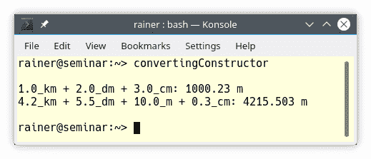

**图 5.6. 转换构造函数**

还好吗？不！我犯了一个错误，写了 `5.5` (4) 而不是 `5.5_dm`。转换构造函数据此创建了一个 `MyDistance` 对象。本应该是分米的结果变成了米。如果构造函数 (5) 被定义为 `explicit`：`explicit MyDistance(double d);`，这种从 `double` 的隐式转换就不会发生。

### 成员的初始化

三条规则涉及成员的初始化。第一条规则可能会产生意外。

#### C.47: 按照成员声明顺序定义并初始化变量

类成员按照它们的声明顺序进行初始化。如果你在成员初始化列表中以不同的顺序初始化它们，可能会感到惊讶。

```cpp
// memberDeclarationOrder.cpp

#include <iostream>

class Foo {
    int m1;
    int m2;

public:
    Foo(int x) :m2{x}, m1{++x} { // 坏：误导性的初始化顺序
        std::cout << “m1: “ << m1 << '\n';
        std::cout << “m2: “ << m2 <<
    }
};

int main() {
    std::cout << '\n';
    Foo foo(1);
    std::cout<< '\n';
}
```

许多人假设首先初始化 `m2` 然后是 `m1`。结果是，`m2` 的值为 `1`，而 `m1` 的值为 `2`。

类成员的析构顺序与它们的初始化顺序完全相反。

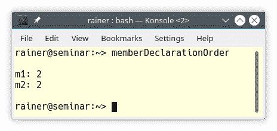

**图 5.7. 成员变量错误的初始化顺序**

#### C.48: 对于常量初始化器，优先使用类内初始化而非构造函数中的成员初始化

这条规则与之前的规则 `C.45` 类似：不要定义只初始化数据成员的默认构造函数；而是使用初始化器。类内初始化使得定义构造函数变得简单得多。此外，你不会忘记初始化成员。

```cpp
class X {    // 坏
    int i;
    string s;
    int j;

public:
    X() :i{666}, s{“qqq”} {}      // j 未初始化
    explicit X(int ii) :i{ii} {}  // s 为 "" 且 j 未初始化

    // ...
};

class X2 {
    int i{0};
    std::string s{“qqq”};
    int j{0}

public:
    X2() = default;       // 所有成员都初始化为默认值
    explicit X2(int ii) :i{ii} {} // s 和 j 初始化为默认值

    // ...
};
```

类内初始化建立了对象的默认行为，而构造函数允许对默认行为进行更改。

将初始化改为赋值的最明显的优点有两点：首先，你不会忘记赋值就使用了未初始化的值；其次，初始化的速度可能更快，但绝不会比赋值慢。以下来自《指南》的代码片段展示了原因。

```cpp
class Bad {
    std::string s1;
public:
    Bad(const std::string& s2) { s1 = s2; }     // 错误：先调用默认构造
                                                // 然后进行赋值
    // ...
};
```

首先，调用了 `std::string` 的默认构造函数，其次在构造函数中发生了赋值。

相反，`Good` 类中的构造函数初始化了 `std::string`。

```cpp
class Good {
    std::string s1;
public:
    Good(const std::string& s2): s1{s2} {} // 好：初始化
    // ...
};
```

### 特殊构造函数

自 C++11 起，构造函数可以将其工作委托给同一类的另一个构造函数，并且构造函数可以从父类继承。这两种技术都允许程序员编写更简洁、表达力更强的代码。

### C.51：使用委托构造函数表示类中所有构造函数的公共操作

构造函数可以将其工作委托给同一类的另一个构造函数。委托是 C++ 中将所有构造函数的公共操作放在一个构造函数中的现代方法。在 C++11 之前，必须使用一个通常称为 `init` 的特殊初始化函数。

```cpp
class Degree {
 public:
    explicit Degree(int deg) {           // (1)
        degree = deg % 360;
        if (degree < 0) degree += 360;
    }
    Degree(): Degree(0) {}               // (2)
    explicit Degree(double deg):         // (3)
        Degree(static_cast<int>(std::ceil(deg))) {}
 private:
    int degree;
};
```

`Degree` 类的构造函数 (2) 和 (3) 将其初始化工作委托给构造函数 (1)，后者会验证其参数。递归地调用构造函数是未定义行为。

一个简化的实现在类中初始化 `Degree` 并跳过默认构造函数。

```cpp
class Degree {
 public:
    explicit Degree(int deg) {         // (1)
        degree= deg % 360;
        if (degree < 0) degree += 360;
    }
    explicit Degree(double deg):       // (3)
        Degree(static_cast<int>(std::ceil(deg))) {}
 private:
    int degree = 0;
};
```

### C.52：使用继承构造函数将构造函数导入不需要进一步显式初始化的派生类

如果可以，在派生类中重用基类的构造函数。这种重用思想适用于你的派生类没有成员的情况。如果你在可以重用构造函数时没有重用，就违反了 DRY（不要重复）原则。继承的构造函数保留了其在基类定义中的所有特性，例如访问说明符或 `explicit` 或 `constexpr` 属性。

```cpp
class Rec {
    // ... 数据和很多很好的构造函数 ...
};

class Oper : public Rec {
    using Rec::Rec;
    // ... 没有成员变量 ...
    // ... 很多很好的工具函数 ...
};

struct Rec2 : public Rec {
    int x;
    using Rec::Rec;
};

Rec2 r {“foo”, 7};

int val = r.x;             // 未初始化
```

使用继承构造函数存在危险。如果你的派生类（如 `Rec2`）有自己的成员（如 `int x`），它们将不会被初始化，除非它们有类内初始化器（参见 `C.48`：对于常量初始化器，优先使用类内初始化器而非构造函数中的成员初始化）。

#### 拷贝与移动

尽管 C++ Core Guidelines 关于拷贝和移动有八条规则，但它们归纳为三类规则：拷贝和移动赋值操作、拷贝和移动的语义，以及臭名的切割（slicing）。

##### 赋值

#### 语法

规则 `C.60`（使拷贝赋值为非 `virtual`、以 `const&` 接收参数并返回非 `const&`）和 `C.63`（使移动赋值为非 `virtual`、以 `&&` 接收参数并返回非 `const&`）明确规定了拷贝和移动赋值运算符的语法。`std::vector` 遵循了建议的语法。以下是一个简化版本：

```cpp
// 拷贝赋值
vector& operator = (const vector& other);

// 移动赋值
vector& operator = (vector&& other);            // 直到 C++17
vector& operator = (vector&& other) noexcept ;  // 自 C++17 起
```

这段短代码片段显示移动赋值运算符是 `noexcept`。在 C++17 中，该规则显而易见：`C.66`（使移动操作为 `noexcept`）。移动操作包括移动构造函数和移动赋值运算符。声明为 `noexcept` 的函数是编译器的优化机会。以下代码片段展示了 `std::vector` 的移动操作声明。


```cpp
vector(vector&& other) noexcept ;                 // 自 C++17 起
vector& operator = (vector&& other) noexcept ;   // 自 C++17 起
```

##### 自赋值

两条规则都涉及自赋值：C.62（使拷贝赋值自赋值安全）和 C.65（使移动赋值自赋值安全）。自赋值安全意味着操作`x = x`不应该改变`x`的值。

自赋值安全意味着操作`x = x`不应该改变`x`的值。对于容器、`std::string`以及内置类型，拷贝/移动赋值是安全的。自动生成的拷贝/移动赋值对于自赋值是安全的。

以下`Foo`类可以正确工作。可能会发生自赋值。

```cpp
class Foo {
    std::string s;
    int i;
public:
    Foo& operator = (const Foo& a) {
        s = a.s;
        i = a.i;
        return *this;
    }
    Foo& operator = (Foo&& a) noexcept {
        s = std::move(a.s);
        i = a.i;
        return *this;
    }
  };
```

在这种情况下，任何冗余且昂贵的自赋值检查都是优化的。

```cpp
class Foo {
    std::string s;
    int i;
public:
    Foo& operator = (const Foo& a) {
        if (this == &a) return *this;    // 冗余的自赋值检查
        s = a.s;
        i = a.i;
        return *this;
    }
    Foo& operator = (Foo&& a) noexcept {
        if (this == &a) return *this;    // 冗余的自赋值检查
        s = std::move(a.s);
        i = a.i;
        return *this;
    }
  };
```

##### 语义

该部分的两条规则看起来显而易见：C.61（拷贝操作应该拷贝）和 C.64（移动操作应该移动并让源处于有效状态）。这意味着什么？

- 拷贝操作
- 拷贝后（`a = b`），`a`和`b`必须相同（`a == b`）。
- 拷贝可以是深拷贝或浅拷贝。深拷贝意味着对象`a`和`b`之后是独立的（值语义）。浅拷贝意味着对象`a`和`b`之后共享一个对象（引用语义）。
- 移动操作
- C++ 标准要求移动后的对象必须处于一个未指定但有效的状态。通常，这种移动后的状态是移动源的默认状态。

### C.67：多态类应该抑制拷贝

这条规则看起来无大碍，但通常是未定义行为的原因。首先：什么是多态类？

**多态类**是指定义或继承了至少一个虚函数的类。

拷贝多态类可能会导致切割。切割是 C++ 最黑暗的部分。

#### 切割

切割意味着：你在赋值或初始化时想要拷贝对象，但只得到了对象的一部分。让我给你一个简单的例子：

```cpp
// slice.cpp

struct Base {

  int base{1998};
};

struct Derived : Base {

  int derived{2011};
};

void needB(Base b) {

  // ...
};

int main() {

  Derived d;

  Base b = d;         // (1)
  Base b2(d);         // (2)
  needB(d);           // (3)
}
```

标记 (1)、(2) 和 (3) 的效果相同：`d`的`Derived`部分被移除了。我假设这并不是你的本意。

现在，情况变得非常危险了。当你拷贝一个多态类时，就会发生切片（Slicing）。

```cpp
 1 // sliceVirtuality.cpp

 2

 3 #include <iostream>

 4 #include <string>

 5

 6 struct Base {
 7     virtual std::string getName() const {
 8         return “Base”;
 9     }10 };

11

12 struct Derived : Base {
13    std::string getName() const override {
14        return “Derived”;
15    }
16 };

17

18 int main() {

19

20     std::cout << '\n';

21

22     Base b;
23     std::cout << “b.getName(): “ << b.getName() << '\n';

24

25     Derived d;
26     std::cout << “d.getName(): “ << d.getName() << '\n';

27

28     Base b1 = d;  // 切片
29     std::cout << “b1.getName():  “ << b1.getName() << '\n';

30

31     Base& b2 = d;
32     std::cout << “b2.getName():  “ << b2.getName() << '\n';

33

34     Base* b3 = new Derived;
35     std::cout << “b3->getName(): “ << b3->getName() << '\n';

36

37     std::cout << '\n';

38

39 }
```

该程序有一个由`Base`和`Derived`类组成的小层次结构。该类层次结构中的每个对象都返回其名称。成员函数`getName`是虚函数（第 7 行），`Derived`类在第 13 行重写了它。`Base`类是一个多态类。这意味着我可以通过引用（第 31 行）或基类对象的指针（第 34 行）使用派生对象来获取多态行为。在底层，对象的类型是`Derived`。

如果将`Derived d`拷贝到`Base b1`（第 28 行），这种行为就不再成立。在这种情况下，发生了切片，我们在底层有一个`Base`对象。在拷贝的情况下，使用的是声明类型或静态类型。如果你使用引用或指针等间接访问，则使用的是当前类型或动态类型。

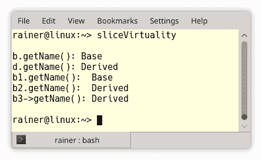

**图 5.8. 切片**

如果你想进行深拷贝，请优先使用虚函数`clone`。请在规则 C.130 中阅读关于该技术的详细信息：对于多态类的深拷贝，优先使用虚函数`clone`而不是拷贝构造/赋值。

### 析构函数

我的类需要析构函数吗？我经常听到这个问题。大多数情况下，答案是否定的，你完全可以遵循“零规则”（rule of zero）。有时答案是肯定的，我们又回到了“五规则/六规则”。更精确地说，C++ 核心准则为析构函数提供了七条规则。它们分为四类：何时需要析构函数、析构函数应该如何处理指针和引用、基类析构函数应该如何定义，以及析构函数是否应该失败。

#### 析构函数的需要

对象的析构函数在其生命周期结束时自动被调用。更准确地说，当对象离开作用域时，析构函数会被调用。

#### C.30: 如果类在对象破坏时需要显式操作，则定义析构函数

问题是编译器生成的析构函数在你的情况下是否足够。如果你必须在用户定义类型生存结束时执行额外的代码，你就必须编写一个析构函数。例如，你的用户定义类型想要从某个注册表中注销自己。如果你定义了析构函数，五规则/六规则就会生效。

反过来说，如果你的类中没有成员需要额外的清理工作，就不需要定义析构函数，如准则中的以下代码段所示：

```cpp
class Foo {    // 错误；使用默认析构函数

public:

    // ...

    ~Foo() { s = ""; i = 0; vi.clear(); }  // 清理

private:
    std::string s;
    int i;
    std::vector<int> vi;
};
```

#### C.31: 类获取的所有资源必须由类的析构函数释放

这条规则听起来显而易见，并且帮助你防止内存泄漏。对吧？但你必须考虑你的类成员是否拥有一套默认操作。现在我们再次回到了零规则或五规则/六规则。

在下面的示例中，虽然`std::ifstream`类有一个析构函数，但`File`类可能没有，因此当`MyClass`的实例离开作用域时，我们就会得到内存泄漏。

```cpp
class MyClass {
    std::ifstream fstream;  // 可能拥有一个文件
    File* file_;            // 可能拥有一个文件
    ...
};
```

#### 指针和引用

如果你的类有原始指针或引用，你必须回答这个关键问题：谁是所有者？

#### C.32: 如果类有一个原始指针`T*`或引用`T&`，考虑它是否可能是所有者

如果一个类有一个原始指针或引用，你必须明确所有权。特别是在指针的情况下。如果所有权模糊，可能会删除一个你并不拥有的对象指针，或者可能没有删除你拥有的指针。在第一种情况下，由于双重删除（double delete），会导致未定义行为；在第二种情况下，会导致内存泄漏。相应的推理也适用于引用。

本段的主题在关于函数参数所有权语义的章节已经有了详尽解答。在此阅读详细信息：参数传递：所有权语义。

#### C.33: 如果类有一个所有权指针成员，请定义析构函数

这条规则的原因显而易见：如果一个类拥有一个对象，它就负责该对象的销毁。析构是析构函数的工作。

诚然，关于拥有指针成员的类还有更多要写。你应该先回答以下问题：该类是该指针的唯一所有者吗？答案可能是肯也可能是否。通过将指针放入`std::unique_ptr`中使该类成为唯一所有者；否则通过将指针放入`std::shared_ptr`使该类成为共享所有者。将抽象级别从指针提升到智能指针使得所有权语义变得透明且更不容易出错。

智能指针相对于指针的优势是什么？首先，智能指针的生命周期由 C++ 运行时自动管理。其次，`std::shared_ptr`支持“大六”。这意味着，在类中使用`std::shared_ptr`不会对类施加任何限制。相反，在类定义中使用的`std::unique_ptr`会禁用拷贝语义。

```cpp
// classWithUniquePtr.cpp

#include <memory>

struct MyClass {

    std::unique_ptr<int> uniPtr = std::make_unique<int>(2011);
};

int main() {
    MyClass myClass;
    MyClass myClass2(myClass);
    MyClass myClass3;
    myClass3 = myClass;
}
```

由于`std::unique_ptr`的存在，`MyClass` own 的对象不能被拷贝。调用拷贝构造函数（`MyClass myClass2(myClass)`）或调用拷贝赋值运算符（`myClass3 = myClass`）都是无效的。

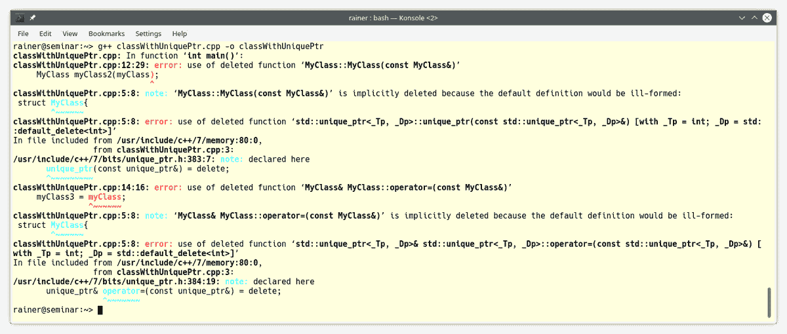

**图 5.9. 带有`std::unique_ptr`的类**

#### C.35: 基类析构函数应该是公共且虚的，或者是保护且非虚的

这条规则从虚函数的角度来看非常有意思。让我们把它分为两个部分。

- **公共虚析构函数**

如果基类具有公共且虚的析构函数，你可以通过基类指针销毁派生类的实例。引用也是如此。

```cpp
struct Base {  // 没有虚析构函数

    virtual void f() {};
};

struct Derived : Base {
    std::string s {“一个需要清理的资源”};
    ~Derived() { /* ... 执行一些清理 ... */ }
};

...

Base* b = new Derived();

delete b;
```

编译器为`Base`生成了一个非虚析构函数，但如果`Base`的析构函数是非虚的，通过`Base`指针删除`Derived`实例将导致未定义行为。

## 保护的与非虚析构函数

这很容易理解。如果基类的析构函数是保护的（protected），你无法通过基类指针或引用销毁派生类对象；因此，析构函数不需要是虚的。

以下关于`Base`类析构函数访问修饰符的几点结论：

- 如果类`Base`的析构函数是私有的（private），你无法从其派生出类。
- 如果类`Base`的析构函数是保护的，你只能从`Base`派生`Derived`并使用它。

```
struct Base {
    protected:
    ~Base() = default;
};

struct Derived: Base {};

int main() {
    Base b;  // 错误：Base::~Base 在此上下文中是保护的
    Derived d;
}
```

声明`Base b;`会导致错误，因为`Base`的析构函数是不可访问的；

### 失败的析构函数

两条规则解决了析构函数失败的问题：C.36：析构函数可能失败以及 C.37：使析构函数为`noexcept`。

### 关于 C.37：使析构函数为`noexcept`的说明

规则的措辞具有误导性。类型`MyType`的用户定义或隐含生成的析构函数默认是`noexcept`的。如果`MyType`的某个成员或基类具有没有`noexcept`保证的析构函数，那么`MyType`的析构函数也没有`noexcept`保证。**因此，没有必要将析构函数指定为`noexcept`。**

我认为我应该关于`noexcept`补充几句话。

### `noexcept`

如果你将一个像析构函数的函数`func`声明为`noexcept`，在`func`中抛出的异常将调用`std::terminate`。`std::terminate`调用当前安装的`std::terminate_handler`，它默认是`std::abort`，你的程序将终止。通过将函数`void func() noexcept;`声明为`noexcept`，你表示：

- 我的函数不抛出任何异常。
- 如果我的函数抛出了异常，让程序终止是可以的。

你应该显式将析构函数声明为`noexcept`的原因是显而易见的。如果析构函数可能失败，就没有通用的方法编写无错误的代码。如果类的所有成员都有`noexcept`析构函数，那么用户定义或编译器生成的析构函数隐含地是`noexcept`的。

## 其他默认操作

与构造函数、赋值和析构函数相关的规则具有广泛的重点。它们涵盖了何时应该显式使用`=default`和`=delete`，以及为什么你不应该在构造函数和析构函数调用虚函数。剩余的规则完善了普通类型的描述。`swap`函数（`swap(X&, X&)`）是第一条，随后是相等运算符（`operator == (const X&)`）。

### 显式使用`=default`和`=delete`

本节提供了关于何时显式使用`=default`和`=delete`的指导。

#### C.80：如果你必须显式使用默认语义，则使用`=default`

你还记得“五法则”吗？它的意思是如果你定义了五个特殊成员函数之一，你就必须定义它们所有。这五个特殊成员函数是除了默认构造函数之外的所有特殊成员函数。

当像下面示例中那样定义析构函数时，我必须定义拷贝和移动构造函数，以及拷贝和移动赋值运算符。通过`=default`请求剩余的四个是最简单的方法。

```
class Tracer {
    std::string message;
  public:
    explicit Tracer(const std::string& m) : message{m} {
        std::cerr << “entering “ << message << '\n';
    }
    ~Tracer() { std::cerr << “exiting “ << message << '\n'; }
    Tracer(const Tracer&) = default;
    Tracer& operator = (const Tracer&) = default;
    Tracer(Tracer&&) = default;
    Tracer& operator = (Tracer&&) = default;
};
```

这很简单！对吧？提供你自己的实现是无聊的，而且非常容易出错。例如，下面示例中用户定义的移动构造函数和移动赋值运算符没有声明为`noexcept`。


```
class Tracer {
    std::string message;
  public:
    explicit Tracer(const std::string& m) : message{m} {
        std::cerr << "entering " << message << '\n';
    }
    ~Tracer() { std::cerr << "exiting " << message << '\n'; }
    Tracer(const Tracer& a) : message{a.message} {}
    Tracer& operator = (const Tracer& a) {
        message = a.message; return *this;
    }
    Tracer(Tracer&& a) :message{a.message} {}
    Tracer& operator = (Tracer&& a) {
        message = a.message; return *this;
    }
};
```

## C.81：当你想要禁用默认行为（且不想替代方案）时使用 `=delete`

有时，你想禁用默认操作。这时 `=delete` 就派上了用场。C++ 自用其表。来自线程 API 的几乎所有类型的拷贝构造函数都被设置为了 `delete`。这对于互斥锁、锁或未来对象等数据类型也是如此。

你可以使用 `delete` 创建奇特的类型。`Immortal` 的实例无法被析构。

```cpp
// immortal.cpp
class Immortal {
public:
    ~Immortal() = delete;  // 不允许析构
};

int main() {
    Immortal im;           // (1)
    Immortal* pIm = new Immortal;
    delete pIm;            // (2)
}
```

隐式调用析构函数 (1) 或显式调用析构函数 (2) 会导致编译错误。

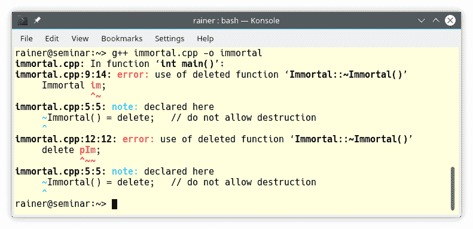

**图 5.10. `delete` 析构函数**

## C.82：不要在构造函数和析构函数中调用虚函数

从构造函数或析构函数调用**纯**虚函数是未定义行为。从构造函数或析构函数调用虚函数的效果不像你预期的那样工作。出于安全考虑，虚调用机制在构造函数或析构函数中被禁用，你得到的是非虚调用。

因此，在下面的示例中将调用 `Base` 版本的虚函数 `f`。

```cpp
// virtualCall.cpp
#include <iostream>
struct Base {
    Base() {
        f();
    }
    virtual void f() {
        std::cout << "Base called" << '\n';
    }
};

struct Derived: Base {
    void f() override {
        std::cout << "Derived called" << '\n';
    }
};

int main() {
    std::cout << '\n';
    Derived d;
    std::cout << '\n';
}
```

这是令人惊讶的行为：

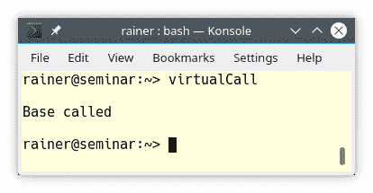

**图 5.11. 在构造函数中调用虚函数**

## swap 函数

对于一个类型要成为普通类型，它必须支持 `swap` 函数。普通类型的更非正式术语是值类型（value-like type），这也是第一条规则的名字：C.83：对于值类型，考虑提供一个 `noexcept` 的 `swap` 函数。相应的，根据第一条规则，`swap` 不应该失败（C.84：`swap` 可能失败），因此应该声明为 `noexcept`：C.85：使 `swap` 为 `noexcept`。

来自 C++ Core Guidelines 的数据类型 `Foo` 有一个 `swap` 函数。

```cpp
class Foo {
public:
    void swap(Foo& rhs) noexcept {
        m1.swap(rhs.m1);
        std::swap(m2, rhs.m2);
    }
private:
    Bar m1;
    int m2;
};
```

出于方便考虑，你应该考虑基于已实现的 `swap` 成员函数来支持非成员 `swap` 函数。

```cpp
void swap(Foo& a, Foo& b) noexcept {
    a.swap(b);
}
```

如果你不提供非成员 `swap` 函数，那么需要交换的标准库算法（如 `std::sort` 和 `std::rotate`）将回退到 `std::swap` 模板，该模板是通过移动构造和移动赋值定义的。

```cpp
template<typename T>
void std::swap(T& a, T& b) noexcept {
    T tmp(std::move(a));
    a = std::move(b);
    b = std::move(tmp);
}
```

C++ 标准提供了超过 40 个 `std::swap` 的重载。你可以将 `swap` 函数作为许多惯用（idioms）的构建块，例如拷贝构造或移动赋值`swap` 函数不应该失败；因此，你应该将其声明为 `noexcept`。

## 拷贝-交换惯用 (copy-and-swap idiom)

如果你使用拷贝-交换惯用来实现拷贝赋值运算符和移动赋值运算符，你必须定义自己的 `swap` —— 既可以是成员函数，也可以是友元函数（friend）。我为 `Cont` 类添加了一个 `swap` 函数，并在拷贝赋值和移动赋值运算符中使用它。

```cpp
class Cont {

 public:

     // ...

     Cont& operator = (const Cont& rhs);

     Cont& operator = (Cont&& rhs) noexcept;

     friend void swap(Cont& lhs, Cont& rhs) noexcept {

         swap(lhs.size, rhs.size);

         swap(lhs.pdata, rhs.pdata);
     }

private:

     int* pData;

     std::size_t size;
};

Cont& Cont::operator = (const Cont& rhs) {

     Cont tmp(rhs);

     swap(*this, tmp);

     return *this;
}

Cont& Cont::operator = (Cont&& rhs) {

     Cont tmp(std::move(rhs));

     swap(*this, tmp);

     return *this;
}
```

这两个赋值运算符都为源对象创建了一个临时拷贝 `tmp`，然后对其应用了 `swap` 函数。

当 `swap` 函数基于拷贝语义而非移动语义时，`swap` 函数可能会因为内存耗尽而失败。下面的实现违背了前面提到的规则 C.84：`swap` 不得失败。这是 `std::swap` 的 C++98 标准实现。

```cpp
template<typename T>

void std::swap(T& a, T& b) {

    T tmp = a;

    a = b;

    b = tmp;
}
```

在这种情况下，内存耗尽会导致引发 `std::bad_alloc` 异常。

## 等值运算符

为了保持规范性（regular），数据类型还必须支持等值运算符。

### C.86: 使 `==` 对于操作数类型是对称的且 `noexcept`

如果你不想让用户感到意外，你应该让等值运算符具有对称性。

下面的代码片段展示了一个定义在类内部的不直观的等值运算符。

```cpp
class MyInt {           // 坏：非对称的 ==

    int num;

public:

    MyInt(int n): num(n) {};

    bool operator == (const MyInt& rhs) const noexcept {

        return num == rhs.num;
    }
};

int main() {

   MyInt(5) == 5;      // OK

   5 == MyInt(5);      // 错误

}
```

调用 `MyInt(5) == 5` 是合法的，因为构造函数将 `int` 转换为 `MyInt` 实例。最后一行（`5 == MyInt(5)`）会报错。`int` 类型对象无法与 `MyInt` 对象比较，且不存在从 `MyInt` 到 `int` 的可能转换。

解决这种不对称性的优雅方法是在 `MyInt` 类内部声明一个友元 `operator ==`。这里是改进后的 `MyInt` 版本。

```cpp
class MyInt {

    int num;

public:

    MyInt(int n): num(n) {};

    friend bool operator == (const MyInt& lhs, const MyInt& rhs) noexcept {

        return lhs.num == rhs.num;
    }
};

int main() {

    MyInt(5) == 5;  // OK

    5 == MyInt(5);  // OK

}
```

如果你仔细读过这本书，你可能会记得带有一个参数的构造函数应该是显式的（C.46: 默认情况下，将单参数构造函数声明为 `explicit`）。坦率地说，你是对的。

```cpp
class MyInt {

    int num;

public:

    explicit MyInt(int n): num(n) {};

    friend bool operator == (const MyInt& lhs, const MyInt& rhs) noexcept {

        return lhs.num == rhs.num;
    }
};

int main() {

    MyInt(5) == 5;  // 错误

    5 == MyInt(5);  // 错误

}
```

将构造函数标记为 `explicit` 会破坏从 `int` 到 `MyInt` 的隐式转换。提供两个额外的重载解决了这个问题。其中一个重载接受 `int` 作为左参数，另一个接受 `int` 作为右参数。

```cpp
// equalityOperator.cpp

class MyInt {

    int num;

public:

    explicit MyInt(int n): num(n) {};

    friend bool operator == (const MyInt& lhs, const MyInt& rhs) noexcept {

        return lhs.num == rhs.num;
    }

    friend bool operator == (int lhs, const MyInt& rhs) noexcept {

        return lhs == rhs.num;
    }

    friend bool operator == (const MyInt& lhs, int rhs) noexcept {

        return lhs.num == rhs;
    }
};

int main() {

    MyInt(5) == 5;  // OK

    5 == MyInt(5);  // OK
}
```

意外惊喜在等值运算符处继续出现。

### C.87: 警惕相对于操作数类型的 `==` 对称性与 `noexcept`

（等值运算符的对称性问题依然存在）

类层次结构的前三条规则具有共同的重点。它们为类设计以及类层次结构中对象访问的详细规则提供了一种总结。

### 通用规则

前几个规则描述了何时使用类层次结构，并引入了抽象类的概念。

### C.120: 仅使用类层次结构来表示具有固有层次结构的概念

此规则使软件系统变得直观且易于理解。如果你在代码中建模某个具有固有层次结构的内容，就应该使用层次结构。通常，如果代码与世界之间存在自然的匹配，推理代码就是最简单的。

例如，作为软件架构师，你的工作是建模诸如除颤器之类的复杂系统。该系统由许多子系统组成。例如，用户界面就是一个子系统。除颤器的要求是不同的输入设备（如键盘、触摸屏或几个按钮）都可以作为用户界面。这种由用户界面等各种子系统组成的系统具有层次结构，因此应该以层次化的方式进行建模。这样做的巨大好处是，复杂系统现在可以自上而下的方式进行解释，因为真实硬件与软件之间存在自然的匹配。

当然，使用层次结构的经典例子是图形用户界面（GUI）的设计。这就是 C++ 核心准则正在使用的示例。

```cpp
class DrawableUIElement {

public:

    virtual void render() const = 0;

// ...

};

class AbstractButton : public DrawableUIElement {

public:

    virtual void onClick() = 0;

// ...

};

class PushButton : public AbstractButton {
    void render() const override;

    void onClick() override;

// ...

};

class Checkbox : public AbstractButton {
// ...

};
```

如果某物不是固有的层次结构，你不应该以层次化的方式对其建模。请看这里。

```cpp
template<typename T>

class Container {

public:

    // 列表操作:

    virtual T& get() = 0;

    virtual void put(T&) = 0;

    virtual void insert(Position) = 0;

    // ...

    // 向量操作:

    virtual T& operator [] (int) = 0;

    virtual void sort() = 0;

    // ...

    // 树操作:

    virtual void balance() = 0;

    // ...
};
```

为什么这个例子很糟糕？读读注释！类模板 `Container` 包含了用于建模列表、向量和树的纯虚函数。这意味着如果你将 `Container` 作为接口，你就必须实现三个互不相关的概念。

### 接口隔离原则 (ISP)

类模板 `Container` 违反了由软件工程师和导师 Robert C. Martin（俗称“鲍鲍叔”）提出的接口隔离原则。接口隔离原则规定，任何客户端（如派生类）都不应该被强制依赖于它未使用的成员函数。在类模板 `Container` 的具体案例中，每个实现接口的类都必须实现所有抽象方法。

ISP 将过大且包含过多的成员函数的接口拆分为更小、更具体的接口。

### C.121: 如果基类被用作接口，将其设为抽象类

抽象类是至少包含一个纯虚函数的类。纯虚函数（`virtual void function() = 0`）是一个如果派生类不应该是抽象的，则该类必须实现的该函数。抽象类不能被实例化。

为了完整起见，我想补充一点：抽象类可以为纯虚函数提供实现。因此，派生类可以使用此实现。

接口通常由 `public` 纯虚函数组成，不包含数据成员，并有一个默认/空的虚析构函数（`virtual ~My_interface() = default`）。

### C.122: 当需要完全分离接口和实现时，使用抽象类作为接口

抽象类关于接口与实现的分离。如果客户端（如本例中的应用程序）仅依赖于接口 `Device`，它可以在运行时使用不同的实现。此外，实现中的修改不一定影响接口，因此也不会影响应用程序。

```cpp
struct Device {

    virtual void write(std::span<const char> outbuf) = 0;

    virtual void read(std::span<char> inbuf) = 0;

};

class Mouse : public Device {
// ... 数据 ...

    void write(std::span<const char> outbuf) override;

     void read(std::span<char> inbuf) override;
};

class TouchScreen : public Device {
// ...不同的数据 ...

    void write(std::span<const char> outbuf) override;

    void read(std::span<char> inbuf) override;

};
```

## 类设计

类设计的十二条规则针对以下主题：抽象类的构造函数、虚函数性、数据成员的访问修符、多重继承以及典型的陷阱。

### C.126: 抽象类通常不需要构造函数


让我将已经介绍的规则`C.2`（如果类具有不变性则使用类；如果数据成员可以独立变化则使用结构体）和`C.41`（构造函数应该创建一个完全初始的对象）结合起来，以得到实际规则。不变性是类数据成员的一个条件，必须由构造函数建立。相反，抽象基类没有任何数据，因此不需要声明构造函数。

## 虚函数性

在设计类层次结构时，有几条关于虚函数的规则是你应该记住的。

### C.128: 虚函数应该精确指定`virtual`、`override`或`final`其中之一

从`C++11`开始，我们有三个关键字来控制覆盖。

- `virtual`: 声明一个可以在派生类中被覆盖的虚函数。
- `override`: 验证该函数是虚函数，并且覆盖了基类的虚函数。
- `final`: 验证该函数是虚函数，并且不能被派生类的成员函数覆盖。

根据准则，这三个关键字的使用规则是非常直观的：“仅在声明新的虚函数时使用`virtual`。仅在声明覆盖者时使用`override`。仅在声明最终覆盖者时使用`final`。”

```cpp
struct Base{

    virtual void testGood() {}

    virtual void testBad() {}
};

struct Derived: Base{

    void testGood() final {}

    virtual void testBad() final override {}
};

int main() {

    Derived d;

}
```

类`Derived`中的成员函数`testBad()`提供了许多冗余信息。

- 只有在函数是`virtual`的情况下，你才应该使用`final`或`override`。跳过虚声明：`void test-Bad() final override {}`
- 在没有使用`virtual`关键字的情况下使用`final`关键字仅在函数已经是`virtual`的情况下有效；因此，该函数必须覆盖了基类的虚函数。跳过`override`：`void testBad() final {}`

### C.130: 为多态类进行深拷贝时，优先使用虚函数`clone`函数而不是拷贝构造/赋值

此规则是规则`C.67`的延续：多态类应该抑制拷贝。上述规则`C.67`显式显示了拷贝多态类可能会导致切片问题（slicing problem）。为了解决这个问题，请覆盖一个虚的`clone`函数，拷贝实际类型并返回指向新对象的所有指针（`std::unique_ptr`）。在派生类中，通过所谓的协变返回类型返回派生类型。

- **协变返回类型**：允许覆盖成员函数返回被覆盖成员函数返回类型的派生类型。

让我用一个例子来说明这一建议。

```cpp
// cloneFunction.cpp

#include <iostream>

#include <memory>
#include <string>

struct Base { // GOOD: 基类抑制了拷贝

    Base() = default;

    virtual ~Base() = default;

    Base(const Base&) = delete;

    Base& operator = (const Base&) = delete;

    virtual std::unique_ptr<Base> clone() { return std::make_unique<Base>(); }

    virtual std::string getName() const { return "Base"; }
};

struct Derived : public Base {

    Derived() = default;
    std::unique_ptr<Base> clone() override { return std::make_unique<Derived>(); }

    std::string getName() const override { return "Derived"; }
};

int main() {

    std::cout << '\n';

    auto base1 = std::make_unique<Base>();
    auto base2 = base1->clone();
    std::cout << "base1->getName(): " << base1->getName() << '\n';
    std::cout << "base2->getName(): " << base2->getName() << '\n';
    auto derived1 = std::make_unique<Derived>();
    auto derived2 = derived1->clone();
    std::cout << "derived1->getName(): " << derived1->getName() << '\n';
    std::cout << "derived2->getName(): " << derived2->getName() << '\n';
    std::cout << '\n';

}
```

`clone`成员函数返回一个由`std::unique_ptr`封装的新创建的对象。因此，新创建对象的所有权交给了调用者。现在，虚函数分发如预期地发生。

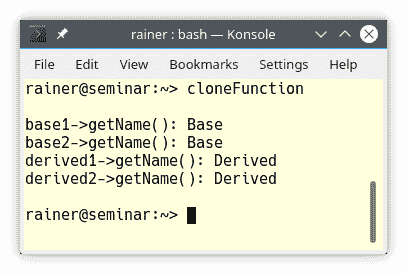

**图 5.12. 一个虚`clone`成员函数**

对于协变返回类型，`Derived::clone`成员函数的返回类型必须是`std::unique_ptr<Base>`，而不是`std::unique_ptr<Derived>`。当我将`Derived::clone`的返回类型更改为`std::unique_ptr<Derived>`时，编译失败：

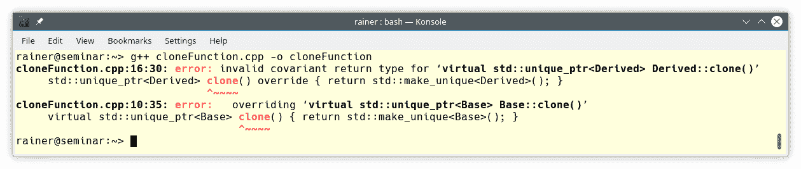

**图 5.13. 没有协变返回类型的虚`clone`成员函数**

### C.132: 不要无故地将函数设为`virtual`

虚函数并不是一项免费的特性。

虚函数：
- 会增加运行开时间和对象代码own。
- 容易引发错误，因为它可以在派生类中被重写。

## 数据成员的访问修饰符

通常，类中所有数据成员的访问修饰符是相同的：要么所有数据成员都是`public`，要么都是`private`。

- 如果数据成员没有不变性，使用`struct`。
- 如果数据成员有不变性，使用`class`。

### C.131: 避免平凡的 getter 和 setter

如果 getter 或 setter 没有为数据成员提供额外的语义值，那么它们就是平凡的。以下是`C++`核心准则中两个平凡 getter 和 setter 的示例：

```cpp
class Point {  // Bad: 冗长

public:
    Point(int xx, int yy) : x{xx}, y{yy} { }
    int get_x() const { return x; }
    void set_x(int xx) { x = xx; }
    int get_y() const { return y; }
    void set_y(int yy) { y = yy; }
    // 没有行为成员函数

private:
    int x;
    int y;
};
```

`x`和`y`可以有任意值。这意味着`Point`的实例对`x`和`y`没有维护任何不变性。`x`和`y`只是值。使用`struct`作为值的集合更为合适，因此`x`和`y`应该因此变为`public`。

```cpp
struct Point {
    int x{0};
    int y{0};
};
```

### C.133: 避免`protected`数据

`protected`数据会让你的程序变得复杂且易出错。如果你将`protected`数据放入基类中，你将无法孤立地推导派生类，因此破坏了封装。你必须考虑整个类层次结构。

这意味着你至少要回答三个问题：
1. 我是否必须实现一个构造函数来初始化`protected`数据？
2. 如果我使用这些`protected`数据，它们的实际值是什么？
3. 如果我修改`protected`数据，谁会受到影响？

随着你的类层次结构变得越来越复杂，回答这些问题会变得越来越困难。

换句话说，`protected`数据是类层次结构范围内的一种全局数据。而且你知道，非`const`全局数据是糟糕的。

### C.134: 确保所有非`const`数据成员具有相同的访问级别

之前的规则`C.133`说明你应该避免`protected`数据。同样，你所有的非`const`数据成员应该要么是`public`，要么是`private`。对象可以拥有不代表该对象不变性的数据成员。不代表对象不变性的非`const`数据成员应该是`public`的。相比之下，非`const` `private`数据成员用于对象的不变性。提醒一下：具有不变性的数据成员不能拥有底层类型的所有值。

基于这一观察以及额外的观察（即你不应该在同一个类中混合表示不变性/不表示不变性的数据成员），你所有的非`const`数据成员应该要么是`public`，要么是`private`。假设你有一个拥有非`const`的`public`和`private`数据成员的类。现在，你的数据类型就令人困惑了。你的数据类型是维护不变性的，还是仅仅是一组不相关值的集合？

## 多继承

多继承有两个典型的用例：将接口继承与实现继承分离，以及实现多个不同的接口。

### C.129: 在设计类层次结构时，区分实现继承和接口继承

接口继承关乎接口与实现的分离，使得派生类可以被更改而不影响基类的用户；实现继承是使用继承通过扩展现有功能来支持新功能。

纯接口继承是指你的基类仅有纯虚函数。与此相反，如果你的基类拥有数据成员或已实现的函数，那么它就是实现继承。因此，你破坏了之前的规则`C.121`：如果基类被用作接口，请将其变为抽象类。`C++`核心准则提供了一个混合这两个概念的示例。

```cpp
class Shape {  // BAD, 混合了接口和实现

public:
    Shape(Point ce = {0, 0}, Color co = none):
        cent{ce}, col {co} {
        /* ... */
    }
    Point center() const { return cent; }
    Color color() const { return col; }
    virtual void rotate(int) = 0;
    virtual void move(Point p) { cent = p; redraw(); }
    virtual void redraw() const;
    // ...

public:
    Point cent;
    Color col;
};

class Circle : public Shape {
public:
    Circle(Point c, int r) :Shape{c}, rad{r} { /* ... */ }
    // ...
private:
    int rad;
};

class Triangle : public Shape {
public:
    Triangle(Point p1, Point p2, Point p3); // 计算中心
    // ...
};
```

混合接口继承和实现继承的概念是有害的。为什么呢？

- 随着`Shape`类的演变，维护各种构造函数可能会变得越来越困难且容易出错。
- `Shape`类的成员函数可能永远不会被使用。
- 如果你向`Shape`类中添加数据，重新编译将变得可能。

我们如何才能获得这两个世界的优点：具有接口层次结构的稳定接口，以及带有实现继承的代码复用？一种可能的答案（我在本章中实现）是多继承。另一个答案是`PImpl`模式。`PImpl`代表**P**ointer to **Impl**ementation（实现指针）。它将实现细节移动到独立的类中，通过指针进行访问。

让我们继续多继承。多继承实现了一套相当复杂的配方。

**1. 将类层次结构的基类`Shape`定义为纯接口**

```cpp
class Shape {
public:
    virtual Point center() const = 0;
    virtual Color color() const = 0;
    virtual void rotate(int) = 0;
    virtual void move(Point p) = 0;
    virtual void redraw() const = 0;
    // ...
};
```

**2. 从`Shape`派生一个纯接口`Circle`**

```cpp
class Circle : public virtual Shape {
public:
    virtual int radius() = 0;
    // ...
};
```

**3. 提供实现类`Impl::Shape`**

```cpp
class Impl::Shape : public virtual Shape {
public:
    // 构造函数、析构函数
    // ...
    Point center() const override { /* ... */ }
    Color color() const override { /* ... */ }
    void rotate(int) override { /* ... */ }
    void move(Point p) override { /* ... */ }
    void redraw() const override { /* ... */ }
    // ...
};
```

**4. 通过继承接口和实现来实现类`Impl::Circle`**

```cpp
class Impl::Circle : public Circle, public Impl::Shape {
public:
    // 构造函数、析构函数
    int radius() override { /* ... */ }
    // ...
};
```

**5. 如果你想扩展类层次结构，你必须同时从接口和实现进行派生**

```cpp
class Smiley : public Circle {
public:
    // ...
};

// 实现
class Impl::Smiley : public virtual Smiley, public Impl::Circle {
public:
    // 构造函数、析构函数
    // ...
}
```

这是这两个层级结构的整体概览。

- 接口：`Smiley` -> `Circle` -> `Shape`
- 实现：`Impl::Smiley` -> `Impl::Circle` -> `Impl::Shape`

读到最后几行，也许你感到似曾相识。你是的。这种多重继承技术类似于通过多重继承实现的适配器模式。适配器模式出自著名的设计模式书籍《C++设计模式》（GoF），该书由`Erich Gamma`、`Richard Helm`、`Ralph Johnson`和`John Vlissides`编写。

### C.135: 使用多重继承来表示多个不同的接口

让接口只支持设计的某一方面是一个好主意。这意味着什么？如果你提供了一个仅由纯虚函数组成的纯接口，那么具体类必须实现所有函数。如果接口太宽，该类就必须实现它不需要或没有意义的函数。

两个不同接口的示例是`C++`输入输出流库中的`istream`和`ostream`。

```cpp
class iostream : public istream, public ostream { // 极其简化
    // ...
};
```

## 典型陷阱

在设计类层次结构时，有两个典型的陷阱。

### C.138: 使用`using`为派生类及其基类创建重载集

这条规则适用于虚函数和非虚函数。如果你不使用`using`声明，派生类中的成员函数将隐藏整个重载集。这个过程通常也被称为“遮蔽”（shadowing）。遮蔽行为违背了许多`C++`开发者的直觉，因为可能会选中的重载并不是看起来最佳的匹配项。

```cpp
// overloadSet.cpp
#include <iostream>
class Base {
public:
    void func(int i) { std::cout << "Base::func(int) \n"; }
    void func(double d) { std::cout << "Base::func(double) \n"; }
};

class Derived: public Base {  // 错误：遮蔽了 Base 的 func
public:
    void func(int i) { std::cout << "Derived::func(int) \n"; }
};

int main() {
    std::cout << '\n';
    Derived der;
    der.func(2011);
    der.func(2020.5);
    std::cout << '\n';
}
```

带有`double`参数的行`der.func(2020.5)`被调用，但使用的却是`Derived`类的`int`重载。结果是发生了从`double`到`int`的窄化转换。这通常不是你想要的行为。

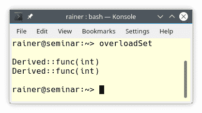


**图 5.14：成员函数的遮蔽**

要使用 `Base` 类的 `double` 重载，你必须在 `Derived` 的作用域中引入它。

```cpp
class Derived: public Base {  // 正确：引入了 Base::func
public:
    void func(int i) { std::cout << “f(int) \n”; }
    using Base::func; // 暴露 func(double)
};
```

#### C.140：不要为虚函数及其重写者提供不同的默认参数

如果你为虚函数和它的重写者提供了不同的默认参数，你的类可能会引起很多困惑。

```cpp
// overrider.cpp
#include <iostream>
class Base {
public:
    virtual int multiply(int value, int factor = 2) = 0;
};

class Derived : public Base {  // 错误：虚函数使用了不同的默认值
public:
    int multiply(int value, int factor = 10) override {
        return factor * value;
  }
};

int main() {
    std::cout << '\n';
    Derived d;
    Base& b = d;
    std::cout << “b.multiply(10): “ << b.multiply(10) << '\n';
    std::cout << “d.multiply(10): “ << d.multiply(10) << '\n';
    std::cout << '\n';
}
```

这是该程序令人惊讶的输出：

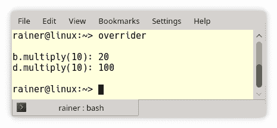

**图 5.15：虚函数的不同默认参数**

发生了什么？对象 `b` 和 `d` 都调用了同一个函数。该函数是虚函数，因此发生了晚绑定（late binding）。晚绑定适用于成员函数，但不适用于包括默认参数在内的类数据成员。数据成员是静态绑定的，该部分发生早期绑定。

### 访问对象

尽管这一节有九条规则，但只涵盖了大约四条，原因有两个。首先，规则 C.145：通过指针和引用访问多态对象没有为规则 C.67：多态类应该抑制拷贝添加任何新内容。其次，C++ 核心指南则专门了一个整个章节给智能指针。关于资源管理的章节提供了完整的细节。

剩余的规则关于 `dynamic_cast` 以及向派生类对象数组赋值指针的错误操作。

### `dynamic_cast`

在写关于 `dynamic_cast` 之前，让我强调一下，包括 `dynamic_cast` 在内的转换使用过于频繁。`dynamic_cast` 的作用是“沿着继承层次结构安全地向上、向下和交叉转换指针和引用”。([cppreference.com](http://cppreference.com))

让我们先从 `dynamic_cast` 的用例开始。

#### C.146：在无法避免类层次结构导航时使用 `dynamic_cast`

在类层次结构中导航是 `dynamic_cast` 的工作。

```cpp
struct Base {  // 一个接口
    virtual void f();
    virtual void g();
};

struct Derived : Base {  // 一个更宽的接口
    void f() override;
    virtual void h();
};

void user(Base* pb) {
    if (Derived* pd = dynamic_cast<Derived*>(pb)) {
        // ... 使用 Derived 的接口 ...
    }
    else {
        // ... 使用 Base 的接口 ...
    }
}
```

为了在运行时检测 `pb` 的正确类型，需要使用 `dynamic_cast<Derived*>(pb)`。如果转换失败，你将得到空指针。

也可以使用 `static_cast` 执行下转型，这避免了运行时检查的代价。`static_cast` 仅在对象确定为 `Derived` 时才是安全的。

这些是你对 `dynamic_cast` 的两个选项：

#### C.147：当找不到所需类被视为错误时，使用 `dynamic_cast` 转换为引用类型

#### C.148：当找不到所需类被视为有效的替代方案时，使用 `dynamic_cast` 转换为指针类型

简而言之：你可以对指针或引用应用 `dynamic_cast`。如果 `dynamic_cast` 失败，指针情况下会返回空指针，引用情况下会抛出 `std::bad_cast` 异常。因此，如果失败是一个有效选项，请使用指针类型的 `dynamic_cast`；如果失败不是有效选项，请使用引用类型。

```cpp
// badCast.cpp

struct Base {
    virtual void f() {}
};

struct Derived : Base {};

int main() {
    Base a;
    Derived* b1 = dynamic_cast<Derived*>(&a);  // nullptr
    Derived& b2 = dynamic_cast<Derived&>(a);  // std::bad_cast
}
```

`g++` 编译器在编译时对这两个 `dynamic_cast` 都会报错。在运行时，程序会对引用抛出预期的异常 `std::bad_cast`。

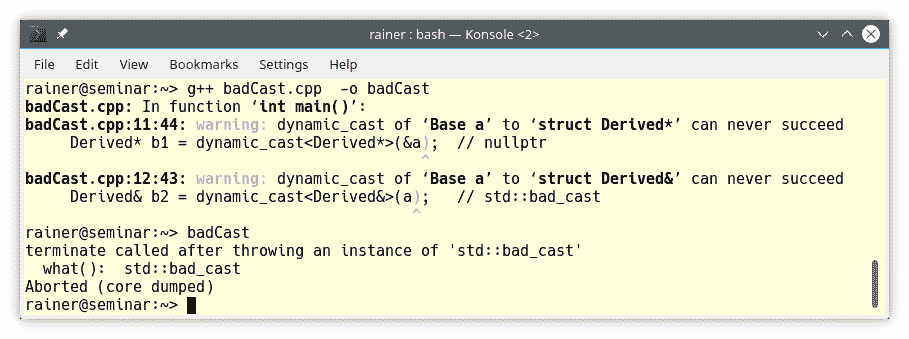

**图 5.16：`dynamic_cast` 导致 `std::bad_cast` 异常**

### C.152：永远不要将派生类对象数组的指针赋值给基类指针

这种情况可能并不常见，但一旦发生，后果将是糟糕的。结果可能是无效的对象访问或内存损坏。代码片段展示了无效的对象访问。

```cpp
struct Base { int x; };
struct Derived : Base { int y; };
Derived a[] = {{1, 2}, {3, 4}, {5, 6}};
Base* p = a; // 错误：a 退化为 &a[0]，然后被转换为 Base*
p[1].x = 7;  // 覆盖了 Derived[0].y
```

最后一次赋值应该更新数组第二个元素的 `Base` 成员 `x`，但由于指针算术，它指向了 `p[0].x` 之后的第二个整数。这恰好是 `a[0].y` 的内存！原因是 `Base*` 被赋值了一个指向派生对象数组 `Derived` 的指针。在这次赋值过程中（`Base* p = a;`），数组 `a` 退化为 `&a[0]`，并转换为 `Base*`。

- **退化（Decay）** 是这种隐式转换的名称，适用于左值到右值、数组到指针以及函数到指针的转换，并会移除 `const` 和 `volatile` 修饰符。这意味着你可以用 `Derived` 数组来调用接受 `Derived*` 的函数。必要的信息（如 `Derived` 数组的长度）会丢失。

在接下来的代码片段中，函数 `func` 接收的数组是一个指向第一个元素的指针。

```cpp
void func(Derived* d);
Derived d[] = {{1, 2}, {3, 4}, {5, 6}};
func(d);
```

数组到指针的退化在 `func` 的情况下完全没问题，但在之前的 `p[1].x` 情况下会导致问题。

### 重载与重载运算符

你可以重载函数、成员函数、模板函数和运算符。你不能重载函数对象（function objects），因此你不能重载 lambda。

关于重载和重载运算符的七条规则遵循一个核心思想：为用户构建直观的软件系统。让我用软件开发中一条著名的黄金法则来重新表述这个核心思想：遵循最小惊讶原则（也称为最小惊喜原则）。最小惊讶原则本质上意味着系统组件的行为应该符合大多数用户的预期。这一原则对于重载和重载运算符非常重要，因为能力越大，责任越大。

尽管这七条规则涉及了重载和重载运算符的直观行为，但它们从不同的视角出发。它们涵盖了常规用法、运算符的隐式转换、重载操作的等效性，以及你应该在操作数的命名空间中重载运算符。

#### 常规用法

常规用法意味着用户不应该对运算符的意想不到的行为或神秘的副作用感到意外。

### C.167：使用具有常规含义的运算符进行操作

常规含义包括你应该使用合适的运算符。例如，这里是一些我们熟悉的运算符：

- `==`、`!=`、`<`、`<=`、`>` 和 `>=`：比较操作
- `+`、`-`、`*`、`/` 和 `%`：算术操作
- `->`、单目 `*` 和 `[]`：对象的访问
- `=`：对象的赋值
- `<<`、`>>`：输入和输出操作

### C.161：对对称运算符使用成员函数

常规含义包括：如果你的数据类型模拟了数字，那么它的行为应该像一个数字。这条规则是规则 C.86 的一种推广：使 `==` 在操作数类型和 `noexcept` 方面保持对称。

通常，在类内部实现如 `+` 这样的对称运算符是不可能的。

假设你想实现一个类型 `MyInt`。`MyInt` 应该支持 `MyInt` 之间以及内置 `int` 之间的相加。让我们尝试一下。

```cpp
// MyInt.cpp
struct MyInt {
    MyInt(int v):val(v) {};
    MyInt operator + (const MyInt& oth) const {
        return MyInt(val + oth.val);
    }
    int val;
};

int main() {
    MyInt myFive = MyInt(2) + MyInt(3);
    MyInt myFive2 = MyInt(3) + MyInt(2);
    MyInt myTen = myFive + 5;            // OK
    MyInt myTen2 = 5 + myFive;           // ERROR
}
```

由于隐式转换构造函数（`MyInt(int v):val(v)`），表达式 `myFive + 5` 是有效的。接受一个参数的构造函数是转换构造函数，因为它在具体情况下接收一个 `int` 并返回一个 `MyInt`。相比之下，最后一个表达式 `5 + myFive` 是无效的，因为没有重载针对 `int` 和 `MyInt` 的 `+` 运算符。

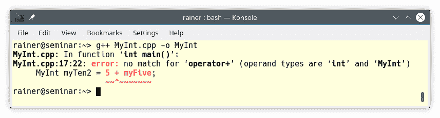

**图 5.17：缺少 `int` 和 `MyInt` 的重载**

这个小程序有很多问题：

1. `+` 运算符不对称。
2. `val` 变量是公共的。
3. 转换构造函数是隐式的。

通过在类中声明为 `friend` 的非成员 `operator +`，很容易克服前两个问题。

```cpp
// MyInt2.cpp
class MyInt2 {
public:
    MyInt2(int v):val(v) {};
    friend MyInt2 operator + (const MyInt2& fir, const MyInt2& sec) {
        return MyInt2(fir.val + sec.val);
    }
private:
    int val;
};

int main() {
    MyInt2 myFive = MyInt2(2) + MyInt2(3);
    MyInt2 myFive2 = MyInt2(3) + MyInt2(2);
    MyInt2 myTen = myFive + 5;   // OK
    MyInt2 myTen2 = 5 + myFive;  // OK
}
```

现在，从 `int` 到 `MyInt2` 的隐式转换生效了，且变量 `val` 是私有的。多亏于隐式转换，最后一行的 `5` 变成了一个 `MyInt2(5)`。

根据规则 C.46：默认情况下，将单参数构造函数声明为 `explicit`，你不应该使用隐式转换构造函数。

`MyInt3` 有一个显式的转换构造函数。

```cpp
// MyInt3.cpp
class MyInt3 {
public:
    explicit MyInt3(int v):val(v) {};
    friend MyInt3 operator + (const MyInt3& fir, const MyInt3& sec) {
        return MyInt3(fir.val + sec.val);
    }
private:
    int val;
};

int main() {
    MyInt3 myFive = MyInt3(2) + MyInt3(3);
    MyInt3 myFive2 = MyInt3(3) + MyInt3(2);
    MyInt3 myTen = myFive + 5;   // ERROR
    MyInt3 myTen2 = 5 + myFive;  // ERROR
}
```

将转换构造函数变为 `explicit` 会导致编译中断。

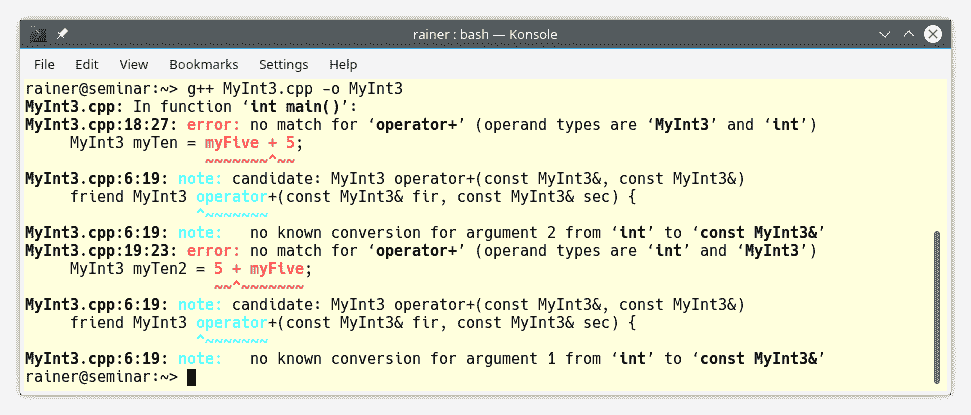

**图 5.18：使用 `explicit` 构造函数**

解决这一挑战的通用方法为 `MyInt4` 实现两个额外的 `+ operator`。一个接受 `int` 作为左操作数，另一个接受 `int` 作为右操作数。

```cpp
// MyInt4.cpp
class MyInt4 {
public:
    explicit MyInt4(int v):val(v) {};
    friend MyInt4 operator + (const MyInt4& fir, const MyInt4& sec) {
        return MyInt4(fir.val + sec.val);
    }
    friend MyInt4 operator + (const MyInt4& fir, int sec) {
        return MyInt4(fir.val + sec);
    }
    friend MyInt4 operator + (int fir, const MyInt4& sec) {
        return MyInt4(fir + sec.val);
    }
private:
    int val;
};

int main() {
    MyInt4 myFive = MyInt4(2) + MyInt4(3);
    MyInt4 myFive2 = MyInt4(3) + MyInt4(2);
    MyInt4 myTen = myFive + 5;   // OK
    MyInt4 myTen2 = 5 + myFive;  // OK
}
```

将接受一个参数的构造函数声明为 `explicit`。转换运算符也是同样的理由。

#### C.164：避免隐式转换运算符

如果你想玩点花，可以重载 `bool` 运算符并不将其设为显式（not explicit）。非显式意味着从 `bool` 到 `int` 的整数提升可以静默发生。

让我设计一个可以购买的数据类型 `MyHouse`。我实现 `bool` 运算符来方便地检查一个家庭是否已经购买了房子。

```cpp
// implicitConversion.cpp

#include <iostream>
#include <string>

struct MyHouse {
    MyHouse() = default;
    explicit MyHouse(const std::string& fam): family(fam) {}

    operator bool(){ return not family.empty(); }
    // explicit operator bool(){ return not family.empty(); }

    std::string family = "";
};

int main() {

    std::cout << std::boolalpha << '\n';

    MyHouse firstHouse;
    if (not firstHouse) {
        std::cout << “firstHouse is not sold.” << '\n';
    }

    MyHouse secondHouse(“grimm”);
    if (secondHouse) {
        std::cout << “Grimm bought secondHouse.” << '\n';
    }

    std::cout << '\n';

    int myNewHouse = firstHouse + secondHouse;
    int myNewHouse2 = (20 * firstHouse - 10 * secondHouse)
                      / secondHouse;

    std::cout << “myNewHouse: “ << myNewHouse << '\n';
    std::cout << “myNewHouse2: “ << myNewHouse2 << '\n';

    std::cout << '\n';

}
```


现在，我通可以用`operator bool`（第 10 行）轻松检查一个家庭（第 21 行）或没有家庭（第 26 行）住在房子里。这很好。由于隐式的`operator bool`，我可以在算术表达式中使用`MyHouse`对象（第 32 行和 33 行）。支持算术并非我的本意。

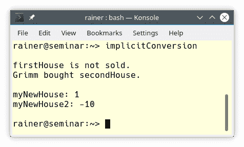

**图 5.19. 隐式`operator bool`**

这太奇怪了！

自 C++11 起，你可以将转换运算符标记为`explicit`；因此不会触发隐式的`int`转换。如果使用`explicit operator bool`（第 11 行），房子的算术将不再可行，但房子可以用逻辑表达式。

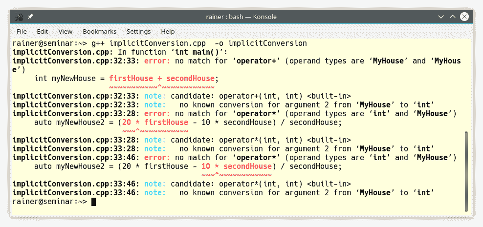

**图 5.20. 显式`operator bool`**

### C.162: 重载大致等价的操作以及 C.163: 仅对大致等价的操作重载

这两条规则密切相关。等价的操作应该具有相同的名称。或者反之。不等价的操作不应该具有相同的名称。

这里是来自 C++ 核心指南的示例。

```cpp
void print(int a);
void print(const string&);
...
print(5);
```

调用`print(5)`感觉像是泛型编程。你不需要关心使用的是哪个版本的`print`。如果函数有不同的名称，这种观察将不再成立。

```cpp
void print_int(int a);
void print_string(const string&);
...
print_int(5)
```

如果不等价的操作具有相同的名称，那么这些名称就太泛泛或就是错误的。这令人困惑且容易出错。

```cpp
std::string translate(const std::string& text); // 翻译成英文
Code translate(const Code& code);               // 编译代码
```

### C.168: 在操作数的所在命名空间中定义重载运算符

你是否曾经想过，为什么以下程序可以运行并显示`Test`？

```cpp
#include <iostream>
int main() {
    std::cout << "Test\n";
}
```

首先。当你执行程序时，它本质上变成了以下程序：

```cpp
#include <iostream>
int main() {
    operator << (std::cout, "Test\n");
}
```

`std::cout << "Test\n"`归结为`operator << (std::cout, "Test\n");`。全局命名空间中没有`operator <<`，但参数依赖查找（ADL）会检查`std`命名空间。`operator <<`找到了`std::operator << (std::ostream&, const char*)`，因为`std::cout`在`std::`命名空间中。

* **参数依赖查找**（ADL 也称为 Koenig 查找）意味着对于未限定的函数调用，C++ 编译时会考虑函数参数所在命名空间中的函数。

让我用操作数和运算符重新表述 ADL 的定义。C++ 运行时也会为运算符考虑操作数的命名空间。因此，你应该在操作数的命名空间中定义重载运算符。

### 联合体 (Unions)

联合体是一种特殊的类类型，所有成员都从相同的地址开始。联合体一次只能保存一种类型；因此你可以节省内存。标记联合体（也称为区分联合体）是跟踪其类型的联合体。`std::variant`就是一个标记联合体。

C++ 核心指南指出，联合体的工作是节省内存。你不应该使用裸露联合体（naked unions），而应该使用像`std::variant`这样的标记联合体。

#### C.180: 使用联合体节省内存

因为联合体在任何时间点只能包含一种类型，你可以节省内存，因为联合体的元素共享相同的内存。联合体的大小将等于最大的类型。

```cpp
union Value {
    int i;
    double d;
};
Value v = { 123 };                 // 用 int 初始化第一个成员
std::cout << v.i << '\n';          // 写入 123
v.d = 987.654;                     // 现在 v 持有一个 double
std::cout << v.d << '\n';          // 写入 987.654
```

`Value`是一个"裸露"联合体。根据下一个规则，你不应该使用它。

#### C.181: 避免"裸露"联合体

"裸露"联合体非常容易，因为你必须跟踪底层类型。

```cpp
// nakedUnion.cpp
#include <iostream>
union Value {
    int i;
    double d;
};
int main() {
    std::cout << '\n';
    Value v;
    v.d = 987.654;
    std::cout << "v.d: " << v.d << '\n';
    std::cout << "v.i: " << v.i << '\n';  // (1)
    std::cout << '\n';
    v.i = 123;
    std::cout << "v.i: " << v.i << '\n';
    std::cout << "v.d: " << v.d << '\n';  // (2)
    std::cout << '\n';
}
```

联合体在第一部分持有`double`，在第二部分持有`int`值。如果你将`double`读取为`int` (1)，或者将`int`读取为`double` (2)，你将得到未定义行为。

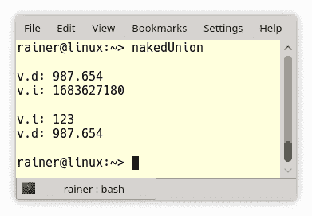

**图 5.21. "裸露"联合体的未定义行为**

为了克服这种错误来源，你应该使用标记联合体。

#### C.182: 使用匿名联合体实现标记联合体

实现标记联合体是非常复杂的。如果你感兴趣，请查看规则 C.182：使用匿名联合体实现标记联合体。为了简化下面的代码示例，我使用了标记联合体`std::variant`，它是 C++17 的一部分。

```cpp 1 // variant.cpp; C++17
 2
 3 #include <variant>
 4 #include <string>
 5
 6 int main() {
 7
 8     std::variant<int, float> v;
 9     std::variant<int, float> w;
10
11     int i = std::get<int>(v);              // i 是 0
12
13     v = 12;                                // v 包含 int
14     int j = std::get<int>(v);
15
16     w = std::get<int>(v);
17     w = std::get<0>(v);                    // 与上一行效果相同
18     w = v;                                 与上一行效果相同
19
20
21     //  std::get<double>(v);               // 错误：[int, float] 中没有 double
22     //  std::get<3>(v);                    // 错误：有效的索引值为 0 和 1
23
24     try{
25     std::get<float>(w);                    // w 包含 int 不是 float：将抛出异常
26     }
27     catch (std::bad_variant_access&) {}
28
29     v  = 5.5f;                           // 切换到 float
30     v = 5;                               // 切回
31
32     std::variant<std::string> v2("abc");  // 构造函数转换时无歧义
33     v2 = "def";                           // 赋值转换时无歧义
34
35 }
```

第 8 行和 9 行定义了两个变体`v`和`w`。这两个变体都可以包含一个`int`和一个`float`值。它们的初始值为 0（第 11 行）。0 是第一个底层类型`int`的默认值。`v`在第 13 行获得了值 13。得益于`std::get<int>(v)`，你可以获取底层类型的值。第 16 行及后续两行展示了将变体`w`赋值给变体`v`的三种可能性。你需要记住一些规则。你可以通过类型或索引请求变体的值。类型必须是唯一的，索引必须有效（第 21 行和 22 行）。否则，你将得到`std::bad_variant_access`异常。第 29 行和 30 行将变体`v`切换为`float`并切回`int`。如果构造函数调用或赋值调用没有歧义，就会发生转换。这种转换正是你可以用 C 字符串构造`std::variant<std::string>`，或为变体分配一个新的 C 字符串的原因（第 27 行和 28 行）。

#### 相关规则

我跳过了 C++ 核心准则中类和类层次结构部分的两个章节。第一部分是关于容器和其他资源句柄的部分；第二部分是关于函数对象和 lambda 的部分。

我还跳过了讨论容器和其他资源句柄的六条准则，因为它们缺乏内容。

关于函数对象和 lambda 的四条准则已经是函数、表达式和语句部分的一部分了。

与智能指针相关的规则将在资源管理章节中通过更广泛的背景呈现。

### 提炼

**重要**

- 优先使用具体类型而非类层次结构。使你的具体类型成为常规类型。常规类型支持"大六"（默认构造函数、析构函数、拷贝/移动构造函数、拷贝/移动赋值运算符）、`swap`函数和相等运算符。

- 如果可能，让编译器生成"大六"。如果不可，通过`default`请求所有特殊成员函数。如果不可可行，则显式实现所有它们并提供一致的设计。拷贝构造函数或拷贝赋值运算符应该执行拷贝。移动构造函数或移动赋值运算符应该执行移动。

- 构造函数应该返回一个完全初始的对象。使用构造函数来建立不变性。不要使用构造函数来将成员设置为其默认值。优先使用类内初始化以减少重复。

- 如果你在对象销毁时需要清理操作，请实现析构函数。基类析构函数应该是`public`且`virtual`，或者是`protected`且非虚拟。

- 仅使用类层次结构对固有的层次结构建模。如果作为分离接口与实现的接口，将基类设为抽象类。抽象类应该只有一个默认的默认构造函数。

- 区分接口继承和实现继承。接口继承的目标是将用户与实现分离；实现继承是关于重用现有的实现。不要在类中混合这两个概念。

- 具有虚函数的类应该具有`public`且`virtual`或`protected`的析构函数。对于虚函数，仅使用`virtual`、`override`或`final`中的其中一个。

- 类的数成员要么全为`public`，要么全为`private`。如果类建立了不变性，将它们设为`private`并使用`class`。否则，将它们设为`public`并使用`struct`。

- 使单参数构造函数和转换操作符变为`explicit`。

- 使用联合体（union）来节省内存，但不要使用裸联合体，优先使用标记联合体，如 C++17 中的`std::variant`。

### 第 6 章 枚举


**图 6.1. Cippi 从 1 计数到 5**

枚举用于定义整数集合，以及此类值集合的类型。虽然本节有关于`enum`的八条规则，但有一条至关重要的规则：优先使用作用域枚举而非经典枚举。作用域枚举也被强类型`enum`或`enum class`。

经典枚举（C++11 之前）有许多缺点。让我显式地比较普通（无作用域）枚举和作用域枚举，因为 C++ 核心准则中没有明确提到这种差异。

这是一个经典枚举：

```cpp
enum Color {
    red,
    blue,
    green
};
```

经典枚举的缺点是什么？枚举器

- 没有作用域。

- 会隐式转换为`int`。

- 污染全局命名空间。

- 具有未知的类型。类型必须足够大以容纳枚举器。

通过使用关键字`class`或`struct`，枚举变成了作用域枚举（class enum）：

```cpp
enum class ColorScoped {
    red,
    blue,
    green
};
```

现在，你必须使用作用域运算符（`::`）来访问枚举器：`ColorScoped::red`。`ColorScoped::red`不隐式转换为`int`，因此不会污染全局命名空间。这就是它们通常被称为强类型的原因。

此外，底层类型默认为`int`，你可以选择不同的整数类型。

现在背景信息已经提供，让我们直接进入最重要的规则。

### Enum.1: 优先使用枚举而非宏

宏定义不遵守作用域且没有类型。这意味着你可以覆盖之前定义的指定颜色的宏。

```cpp
// webcolors.h
#define RED   0xFF0000

// productinfo.h
#define RED    0

int webcolor = RED;    // 应该为 0xFF0000
```

使用`ColorScoped`这种情况就不会发生，因为你必须使用作用域运算符：`ColorScoped webcolor = ColorScoped::red;`。

### Enum.2: 使用枚举表示相关的具名常量集

这条规则是显而易见的，因为枚举器创建了一个具名类型的整数集合。

```cpp
enum class Day {
    Mon,
    Tue,
    Wed,
    Thu,
    Fri,
    Sat,
    Sun
};
```

### Enum.3: 优先使用`enum class`而非"普通"`enum`

作用域枚举器（`enum class`）的枚举器不会自动转换为`int`。你必须通过作用域运算符访问它们。

```cpp
// scopedEnum.cpp
#include <iostream>

enum class ColorScoped {
    red,
    blue,
    green
};

void useMe(ColorScoped color) {
    switch(color) {
        case ColorScoped::red:
            std::cout << "ColorScoped::red" << '\n';
            break;
        case ColorScoped::blue:
            std::cout << "ColorScoped::blue" << '\n';
            break;
        case ColorScoped::green:
            std::cout << "ColorScoped::green" << '\n';
            break;
    }
}

int main() {
    std::cout << static_cast<int>(ColorScoped::red) << '\n';   // 0
    std::cout << static_cast<int>(ColorScoped::green) << '\n'; // 2
    ColorScoped color{ColorScoped::red};
    useMe(color);                            // ColorScoped::red
}
```

### Enum.5: 不要对枚举器使用全大写字母

如果你对枚举器使用`ALL_CAPS`，可能会与宏发生冲突，因为宏通常用全大写字母。

```cpp
enum class ColorScoped{ RED };
#define RED 0xFF0000
```

当然，这条规则不仅适用于枚举器，也适用于一般的常量。

### Enum.6: 避免匿名枚举

并不是所有的编译时常量都应该是`enum`。C++ 也允许你将编译时常量定义为`constexpr`变量。仅对相关的常量集使用`enum`（Enum.2）。

```cpp
// bad
enum { red = 0xFF0000, scale = 4, is_signed = 1 };

// good
constexpr int red = 0xFF0000;
constexpr short scale = 4;
constexpr bool is_signed = true;
```

### Enum.7: 仅在需要时指定枚举的底层类型

自 C++11 起，你可以指定枚举的底层类型并节省内存。默认情况下，作用域`enum`的类型是`int`，因此你可以前向声明`enum`。


```cpp
// typeEnum.cpp

#include <iostream>

enum class Color1 {
    red,
    blue,
    green
};

enum struct Color2: char {
    red,
    blue,
    green
};

int main() {
    std::cout << sizeof(Color1) << '\n';  // 4
    std::cout << sizeof(Color2) << '\n';  // 1
}
```

### 枚举.8: 仅在必要时指定枚举器值

通过指定枚举器值，你可能会设置两次值。下面的枚举`Col2`就存在这个问题。

```cpp
enum class Col1 { red, yellow, blue };

enum class Col2 { red = 1, yellow = 2, blue = 2 };    // 错误

enum class Month { jan = 1, feb, mar,
                   apr, may, jun,
                   jul, aug, sep,
                   oct, nov, dec };     // 1 是惯例
```

作用域枚举会在编译时检查其底层枚举成员的值。

```cpp
// enumChecksRange.cpp

enum struct Color: char {
    red = 127,
    blue,
    green
};

int main() {
    Color color{Color::green};
}
```

程序的编译失败，是因为枚举成员太大，无法放入底层类型中。

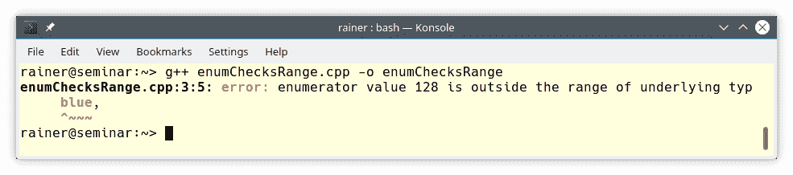

图 6.2. 枚举成员的大小超过了底层类型的限制

对于经典枚举，底层类型的大小将恰好足够。

#### 相关规则

`表达式与语句`章节深入了对`constexpr`值的讨论。

### 提炼

**重要**

• 使用作用域枚举代替经典枚举。正如其名所示，作用域枚举具有作用域，不会隐式转换为`int`，不会污染全局命名空间，并且默认以`int`作为其底层类型。

• 仅在必要时指定作用域枚举的底层类型和枚举成员的值。

### 第 7 章 资源管理


图 7.1. Cippi 正在维护花园

首先，什么是资源？资源是你必须管理的东西。这意味着你必须获取并释放它，因为资源是有限的，或者你必须保护它。你只能拥有有限的内存、套接、进程或线程；在任何一个时间点，只有一个进程可以写入共享文件，或只有一个线程可以写入共享变量。如果你不遵循协议，可能会出现很多问题。

如果你考虑资源管理，它一切归结为一个关键点：所有权。我特别喜欢现代 C++ 的地方在于，我们可以在代码中直接表达我们对所有权的意图。

• **本地对象**：C++ 运行时作为所有者自动管理这些资源的生命周期。全局对象或类成员也是如此。指南将它们称为作用域对象。

• **引用**：我不是所有者。我只是借用了不能为空的资源。

• **原始指针**：我不是所有者。我只是借用了可以为空的资源。我不能删除该资源。

• **`std::unique_ptr`**：我是资源的唯一所有者。我可以显式释放资源。

• **`std::shared_ptr`**：我与其他`shared_ptr`共享资源，并在我是最后一个所有者时释放资源。我可以显式地释放我的所有权份额。

• **`std::weak_ptr`**：我不是资源的所有者，但我可以通过使用成员函数`std::weak_ptr.lock()`临时成为资源的共享所有者。

#### 通用规则

尽管本节有六条规则，但只有其中两条（RAII 和作用域对象）是原创的。另外两条已经属于其他章节：

• R.2: 在接口中，使用原始指针表示单个对象（仅限）（将数组视为参数）

• R.6: 避免非`const`全局变量（见非`const`全局变量）

剩余的四条关于指针和引用的语义的规则扩展了现有规则。

第一条通用规则是 C++ 的惯例：RAII。RAII 代表 **R**esource **A**cquisition **I**s **I**nitialization（资源获取初始化）。C++ 标准库系统性地依赖于 RAII。

#### R.1: 使用资源句柄和 RAII 自动管理资源（资源获取初始化）

RAII 的思想非常简单。你为你的资源创建一种代理对象。代理对象的构造函数获取资源，代理对象的析构函数释放资源。RAII 的核心思想是，C++ 运行时是该代理的所有者，作为一个**本地对象**，因此也是资源的所有者。当代理对象作为本地对象离开作用域时，代理的析构函数会被调用。因此，我们在 C++ 中获得了确定性的析构行为。

RAII 在 C++ 生态系统中被广泛使用。RAII 的示例包括标准模板库的容器、智能指针和锁。容器负责其元素，智能指针负责内存，而锁负责互斥锁。

下面的类`ResourceGuard`模型了 RAII。

```cpp
 1 // raii.cpp

 2

 3 #include <iostream>
 4 #include <new>
 5 #include <string>
 6
 7 class ResourceGuard {
 8 public:
 9     explicit ResourceGuard(const std::string& res):resource(res){
10         std::cout << "Acquire the " << resource << "." <<  '\n';
11     }
12     ~ResourceGuard(){
13         std::cout << "Release the " << resource << "." << '\n';
14     }
15 private:
16     std::string resource;
17 };
18
19 int main() {
20
21     std::cout << '\n';
22
23     ResourceGuard resGuard1{"memoryBlock1"};
24
25     std::cout << "\nBefore local scope" << '\n';
26     {
27         ResourceGuard resGuard2{"memoryBlock2"};
28     }
29     std::cout << "After local scope" << '\n';
30
31     std::cout << '\n';
32
33

34

35     std::cout << "\nBefore try-catch block" << '\n';
36     try {
37         ResourceGuard resGuard3{"memoryBlock3"};
38         throw std::bad_alloc();
39     }
40     catch (const std::bad_alloc& e) {
41         std::cout << e.what();
42     }
43     std::cout << "\nAfter try-catch block" << '\n';
44

45     std::cout << '\n';
46

47 }
```

`ResourceGuard`是管理资源的守护者。在这种情况下，资源是一个简单的字符串。`ResourceGuard`在构造函数（9-11 行）中创建资源并在析构函数（12-14 行）中释放资源。它的工作非常可靠。资源的创建和释放仅在构造函数和析构函数中指示。

C++ 运行时会在`main`函数（46 行）结束时准确调用`resGuard1`（23 行）。`resGuard2`（27 行）的生命周期在 28 行就已经结束了。因此，C++ 运行时再次调用析构函数。即使抛出`std::bad_alloc`异常也不会影响`resGuard3`（36 行）。它的析构函数在 try 块（35-38 行）结束时调用。

截图显示了对象的生命周期。

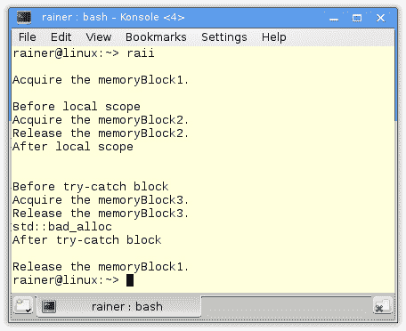

图 7.2. 资源获取初始化

#### R.3: 原始指针（`T***`）不所有权且 R.4: 原始引用（`T&`）不所有权

这两条规则泛化了关于函数传递指针或引用以及从函数返回指针（`T*`）或左值引用（`T&`）的所有权方面。指针和引用的关键问题是：谁是资源的所有者？如果你不是所有者，只是借用，你就不能删除资源。

#### R.5: 优先使用作用域对象，不要不必要的堆分配

作用域对象的规则可能是为了简化资源管理最重要的规则。如果可能，请使用作用域对象。

作用域对象是具有作用域的对象。它可以是本地对象、全局对象或类的成员。C++ 运行时负责处理作用域对象。不涉及内存分配和释放，你也不会得到`std::bad_alloc`异常。

为什么下面的示例是不好的？

```cpp
void f(int n) {
    auto* p = new Gadget{n};
    // ...
    delete p;
}
```

没有必要在堆上创建`Gadget`。这会耗费时间，而且容易出错。你可能会忘记释放内存，或者在调用`delete`之前发生异常。最终，你将导致内存泄漏。只需使用局部对象，你从设计上上就是安全的。

```cpp
void f(int n) {
    Gadget g{n};
    // ...
}
```

# 花括号的力量

使用额外的花括号来定义人工作用域是非常方便的。得益于人工作用域，你可以显式地控制局部对象的寿命。

```cpp
int main() {
    {
        std::vector<int> myVec(SIZE);
        measurePerformance(myVec, "std::vector<int>(SIZE)");
    }
    {
        std::deque<int> myDec(SIZE);
        measurePerformance(myDec, "std::deque<int>(SIZE)");
    }
    {
        std::list<int> myList(SIZE);
        measurePerformance(myList, "std::list<int>(SIZE)");
    }
    {
        std::forward_list<int> myForwardList(SIZE);
        measurePerformance(myForwardList,
                           "std::forward_list<int>(SIZE)");
    }
    {
        std::string myString(SIZE,' ');
        measurePerformance(myString, "std::string(SIZE,' ')");
    }
}
```

代码片段展示了性能测试（`measurePerformance`）的一部分，包含了大量的分配。在每个人工作用域中临时创建的容器都很大。如果在每个作用域结束时不删除它们，你的计算机可能会耗尽内存，并导致`std::bad_alloc`异常。

#### 分配与释放

也许，你感到有点困惑？C++ 核心准则（C++ Core Guidelines）对于分配和释放只有四条规则。四条规则中有三条是关于智能指针的。归结底，这部分的本质是你应该使用智能指针，这是下一节的主题。

在我深入研究这四条规则之前，让我给你提供一些理解这些规则所必要的背景知识。在 C++ 中使用`new`创建对象包含两个步骤。

1. 为对象分配内存。

2. 在分配的内存中构造对象。

`operator new`或`operator new []`执行第一步；构造函数是第二步。

同样的策略也适用于析构，但方向相反。首先，调用析构函数（如果有的话），然后通过`operator delete`或`operator delete []`释放内存。

### R.10: 避免使用`malloc()`和`free()`

`new`与`malloc`、`delete`与`free`之间有什么区别？C 函数`malloc`和`free`只完成了一部分工作。`malloc`分配内存，`free`释放内存。`malloc`不会调用构造函数，`free`也不会调用析构函数。

这意味着，如果你使用一个通过`malloc`创建的对象，你的程序将产生未定义行为。

```cpp
// mallocVersusNew.cpp
#include <iostream>
#include <string>

struct Record {
    explicit Record(const std::string& na): name(na) {}
    std::string name;
};

int main() {
    Record* p1 = static_cast<Record*>(malloc(sizeof(Record))); // (1)
    std::cout << p1->name << '\n';
    auto p2 = new Record("Record");                            // (2)
    std::cout << p2->name << '\n';
}
```

我只为`Record`对象分配了内存 (1)。结果是下一行中的`p1->name`调用是未定义行为。未定义行为意味着你无法对程序的行为做出任何假设。在反复运行期间，我没有得到输出（即*预期*的输出，空字符串），并且产生了一个核心转储（core dump）。

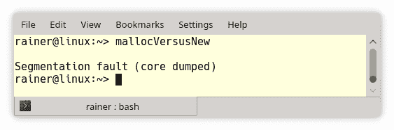

**图 7.3. 未定义行为导致核心转储**

相比之下，调用 (2) 会触发构造函数。

### R.11: 避免显式调用`new`和`delete`

你应该牢记这条规则。这条规则的重点在于**显式地**（explicitly）这个词上，因为使用智能指针或标准模板库（STL）的容器会提供**隐式地**（implicitly）使用`new`和`delete`的对象。

例如，这里有创建`std::unique_ptr`和`std::shared_ptr`的几种变体。

```cpp
std::unique_ptr<int> uniq1(new int(2011));            // (1)
std::unique_ptr<int> uniq2 = std::make_unique<int>(2014);
std::shared_ptr<int> shar1(new int(2011));            // (1)
std::shared_ptr<int> share2 = std::make_shared<int>(2014);
```

如果你不知道应该优先选择哪个版本，规则 R.22：使用`make_shared()`创建`shared_ptr`以及 R.23：使用`make_unique()`创建`unique_ptr`给了你确定的答案。

你无法完全避免 (1) 中的调用。当你想要创建一个`std::unique_ptr`或`std::shared_ptr`，且不应使用底层类型的析构函数时，以下语法是强制性的：

```cpp
std::shared_ptr<int> shar1(new int(2011), MyIntDeleter());
```

### R.12: 立即将显式资源分配的结果交给管理器对象

C++ 社区喜欢缩写词。对于内存分配，这条规则有一个特殊的名称：NNN。NNN 代表 **N**o **N**aked **N**ew（无裸 new），意味着内存分配的结果应该交给一个管理器对象。这个管理器对象可以是`std::unique_ptr`或`std::shared_ptr`。当然，这条规则有更广泛的背景。例如，标准模板库的容器知道如何处理它们的元素，锁知道如何处理它们的互斥。

当你不遵守这些规则时，潜伏着未定义行为的危险。

```cpp
// standaloneAllocation.cpp   // 错误：因为双释放
#include <iostream>
#include <memory>

struct MyInt{
  explicit MyInt(int myInt):i(myInt) {}
  ~MyInt() {
    std::cout << "Goodbye from " << i << '\n';
  }
  int i;
};

int main() {
    std::cout << '\n';
    MyInt* myInt = new MyInt(2011);
    std::unique_ptr<MyInt> uniq1 = std::unique_ptr<MyInt>(myInt);
    std::unique_ptr<MyInt> uniq2 = std::unique_ptr<MyInt>(myInt);
    std::cout << '\n';
}
```

`MyInt`类在它的析构中显示了成员属性`i`的值。问题始于独立分配（`MyInt* myInt = new MyInt(2011)`）。`uniq1`或是`uniq2`是`myInt`的所有者，但两者者不是。由于有两个所有者，会发生两次内存释放，这是未定义行为。

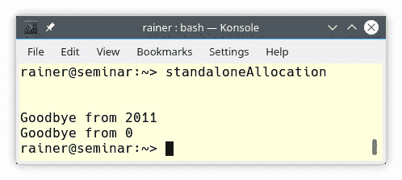

**图 7.4. 使用`std::unique_ptr`的两个所有者**


在`main`函数结束时会发生两次`myInt`的释放。通过句柄进行的第一次释放是正常的，但第二次会导致未定义行为。在第二情况下，成员属性`i`的值为 0。

当使用`std::make_unique`时，你避免了双释放的风险：

```cpp
int main() {
    std::cout << '\n';
    std::unique_ptr<MyInt> uniq = std::make_unique<int>(2011);
    std::cout << '\n';
}
```

### R.13: 在单一表达式语句中最多执行一次显式资源分配

这条规则有点复杂。

```cpp
void func(std::shared_ptr<Widget> sp1, std::shared_ptr<Widget> sp2) {
 ...
}

func(std::shared_ptr<Widget>(new Widget(1)),
     std::shared_ptr<Widget>(new Widget(2)));
```

这个函数调用不是安全的，因此可能导致内存泄漏。为什么？原因是初始化两个智能指针需要执行四个操作。

1. 为`Widget(1)`分配内存
2. 构造`Widget(1)`
3. 为`Widget(2)`分配内存
4. 构造`Widget(2)`

在 C++14 之前，编译器可以先分配`Widget(1)`和`Widget(2)`的内存，然后构造它们。从优化的角度来看，这非常有意义，因为一次分配两个`Widget`的内存很可能比分配两次一个`Widget`快。这意味着可能会发生以下指令：

1. 为`Widget(1)`分配内存
2. 为`Widget(2)`分配内存
3. 构造`Widget(1)`
4. 构造`Widget(2)`

如果其中一个构造函数抛出异常，另一个对象的内存不会自动释放，导致导致内存泄漏。

通过使用工厂函数`std::make_shared`来创建`std::shared_ptr`可以很容易地解决这个问题。

```cpp
func(std::make_shared<Widget>(1), std::make_shared<Widget>(2));
```

`std::make_shared`保证了在抛出异常时，函数调用不会产生影响。用于创建`std::unique_ptr`的类似函数`std::make_unique`提供了相同的保证。

#### C++17 中保证的求值顺序

得益于 C++17 中保证的求值顺序，本规则中已经讨论的代码片段不会导致内存泄漏。

```cpp
void func(std::shared_ptr<Widget> sp1, std::shared_ptr<Widget> sp2) {
 ...
}

func(std::shared_ptr<Widget>(new Widget(1)),
     std::shared_ptr<Widget>(new Widget(2)));
```

与 C++14 标准相比，C++17 标准保证函数调用`func`中的每个子表达式在另一个表达式之前会被求值。但具体的执行顺序仍然是不指定的。

#### 智能指针

从库的角度来看，智能指针是 C++11 标准中最重要的补充。C++ 核心准则（C++ Core Guidelines）有十多条关于`std::unique_ptr`、`std::shared_ptr`和`std::weak_ptr`的规则。智能指针的规则可以归纳为两类：作为所有者的智能指针的基本用法作为函数参数的智能指针。

##### 基本用法

我假设本节读者对智能指针有基本的了解。如果你想知道所有细节，请阅读关于`std::unique_ptr`、`std::shared_ptr`和`std::weak_ptr`的文档。

##### R.20：使用`unique_ptr`或`shared_ptr`表示所有权

为了完整性，我在本规则中也包含了`std::weak_ptr`。现代 C++ 有三种智能指针来表达三种不同的所有权。

- `std::unique_ptr`：独占所有者
- `std::shared_ptr`：共享所有者
- `std::weak_ptr`：对由`std::shared_ptr`管理的对象的非所有权引用

`std::unique_ptr`是其资源的独占所有者。`std::unique_ptr`不能被拷贝，只能移动。

```cpp
auto uniquePtr1 = std::make_unique<int>(1998);
auto uniquePtr2(std::move(uniquePtr1));
```

相比之下，`std::shared_ptr`共享所有权。如果你拷贝或拷贝赋值一个智能指针，引用计数就会增加；如果你删除或重置智能指针，引用计数就会减少。如果引用计数变为零，底层资源将被删除。

```cpp
auto sharedPtr1 = std::make_shared<int>(1998) // 引用计数 1
auto sharedPtr2(sharedPtr1);                  // 引用计数 2
```

`std::weak_ptr`并不是智能指针。它拥有一个由`std::shared_ptr`管理的对象的引用。它的接口非常有限，不允许对底层资源进行透明访问。通过使用`std::weak_ptr`的成员函数`lock`，你可以从`std::weak_ptr`创建一个`std::shared_ptr`。

```cpp
auto sharedPtr1 = std::make_shared<int>(1998) // 引用计数 1
std::weak_ptr<int> weakPtr1(sharedPtr1);      // 引用计数 1
auto sharedPtr2 = weakPtr1.lock();            // 引用计数 2
```

##### R.21：除非需要共享所有权，否则优先使用`unique_ptr`而非`shared_ptr`

如果你需要智能指针，`std::unique_ptr`始终应该是你的首选。`std::unique_ptr`在设计上与原始指针一样快速且内存高效。

这一观察并不适用于`std::shared_ptr`。`std::shared_ptr`需要管理它的引用计数并为维护控制块分配额外的内存。控制块对于管理被控对象的寿命是必要的。当你需要共享所有权时，`std::shared_ptr`大放异彩。在这种情况下，仅分配一次共享资源可以节省内存和时间。

不要因为想拷贝它们而为了方便使用`std::shared_ptr`。`std::unique_ptr`不能被拷贝，但可以移动。

```cpp
 1 // moveUniquePtr.cpp
 2
 3 #include <algorithm>
 4 #include <iostream>
 5 #include <memory>
 6 #include <utility>
 7 #include <vector>
 8
 9 void takeUniquePtr(std::unique_ptr<int> uniqPtr) {
10     std::cout << “*uniqPtr: “ << *uniqPtr << '\n';
11 }
12
13 int main() {
14
15     std::cout << '\n';
16
17     auto uniqPtr1 = std::make_unique<int>(2011);
18
19     takeUniquePtr(std::move(uniqPtr1));
20
21     auto uniqPtr2 = std::make_unique<int>(2014);
22     auto uniqPtr3 = std::make_unique<int>(2017);
23
24     std::vector<std::unique_ptr<int>> vecUniqPtr {};
25     vecUniqPtr.push_back(std::move(uniqPtr2));
26     vecUniqPtr.push_back(std::move(uniqPtr3));
27     vecUniqPtr.push_back(std::make_unique<int>(2020));
28
29     std::cout << '\n';
30
31     std::for_each(vecUniqPtr.begin(), vecUniqPtr.end(),
32                   [](std::unique_ptr<int>& uniqPtr) {
33                      std::cout <<  *uniqPtr << '\n';
34                    });
35
36     std::cout << '\n';
37
38 }
```

函数`takeUniquePtr`（第 9 行）按值获取`std::unique_ptr`。关键的观察是，你必须在内部移动`std::unique_ptr`。相同的结论对于`std::vector<std::unique_ptr<int>>`（第 24 行）也是如此。`std::vector`作为所有标准模板容器都使用拷贝语义。容器想要拥有它的元素，但拷贝`std::unique_ptr`是可能的。`std::move`解决了这个问题（第 25 行和第 26 行）。直接构造`std::unique_ptr`也是可能的（第 27 行）。如果内部没有使用拷贝语义，你可以在`std::vector<std::unique_ptr<int>>`（第 31 行）上应用如`std::for_each`等算法。

最后是程序的输出。

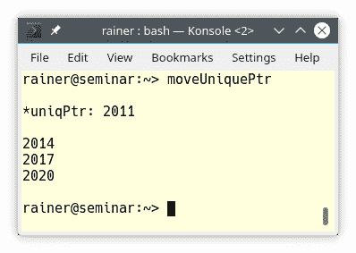

**图 7.5. 移动`std::unique_ptr`**

##### R.22：使用`make_shared()`创建`shared_ptr`和 R.23：使用`make_unique()`创建`unique_ptr`

有两个理由优先使用`std::make_unique`而非`std::unique_ptr`，以及优先使用`std::make_shared`而非`std::shared_ptr`。

第一个原因是异常安全性。详情请参阅之前的规则 R.13：在单个表达式语句中执行最多一次显式资源分配。

第二个理由仅适用于`std::shared_ptr`。

```cpp
auto sharPtr1 = std::shared_ptr<int>(new int(1998));
auto sharPtr2 = std::make_shared<int>(1998);
```

当你调用`std::shared_ptr<int>(new int(1998))`时，涉及到两次内存分配。一次是`new int(1998)`的分配，另一次是`std::shared_ptr`控制块的分配。内存分配是昂贵的。因此，你应该避免它。`std::make_shared<int>(1998)`将两次内存分配合并为一次，因此速度更快。此外，分配的对象（`new int(1998)`）与控制块相邻，因此访问速度更快。

##### R.24：使用`std::weak_ptr`打破`shared_ptr`循环

如果`std::shared_ptr`相互引用，就会产生`std::shared_ptr`的循环引用。例如，双向链就会创建循环。如果你使用`std::shared_ptr`实现链接，你的引用计数永远不会变为零，最终会导致内存泄漏。这里有一个简短的示例。

在下图中有两个循环。首先，是在母亲和女儿之间；其次，是在母亲和儿子之间。然而，微妙的区别在于，母亲使用`std::weak_ptr`引用女儿。因此，母亲和儿子之间存在`std::shared_ptr`循环保持两个对象存活，而母亲和女儿之间没有`std::shared_ptr`循环，这使得女儿可以被删除。

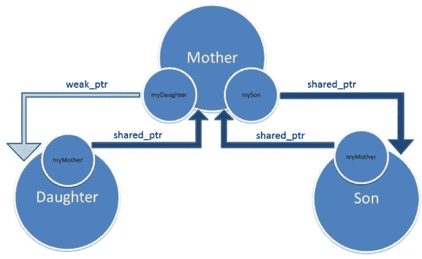

**图 7.6. 智能指针的循环**

如果你不喜欢图片，这里是对应的源代码。

```cpp
 1 // cycle.cpp
 2
 3 #include <iostream>
 4 #include <memory>
 5
 6 struct Son;
 7 struct Daughter;
 8
 9 struct Mother {
10     ~Mother() {
11         std::cout << “Mother gone” << ’\n’;
12     }
13     void setSon(const std::shared_ptr<Son> s) {
14         mySon = s;
15     }
16     void setDaughter(const std::shared_ptr<Daughter> d) {
17         myDaughter = d;
18     }
19     std::shared_ptr<Son> mySon;
20     std::weak_ptr<Daughter> myDaughter;
21 };
22
23 struct Son {
24     explicit Son(std::shared_ptr<Mother> m): myMother(m) {}
25     ~Son() {
26         std::cout << “Son gone” << ’\n’;
27     }
28     std::shared_ptr<Mother> myMother;
29 };
30
31 struct Daughter {
32     explicit Daughter(std::shared_ptr<Mother> m): myMother(m) {}
33     ~Daughter() {
34         std::cout << “Daughter gone” << ’\n’;
35     }
36     std::shared_ptr<Mother> myMother;
37 };
38
39 int main() {
40
41     std::shared_ptr<Mother> m = std::make_shared<Mother>();
42     std::shared_ptr<Son> s = std::make_shared<Son>(m);
43     std::shared_ptr<Daughter> d = std::make_shared<Daughter>(m);
44     m->setSon(s);
45     m->setDaughter(d);
46
 }
```

在`main`函数结束时，母亲、儿子和女儿的生命周期结束了。或者反过来，母亲、儿子和女儿离开了作用范围，因此`class Mother`（第 10-12 行）、`Son`（第 25-27 行）和`Daughter`（第 33-35 行）的析构函数应该被自动调用。

实际上，结果只有女儿的析构函数被调用了。

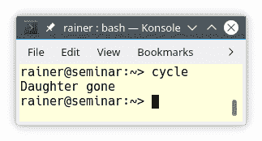

**图 7.7. 智能指针的循环** 由于母亲和儿子之间存在`std::shared_ptr`循环，引用计数始终大于零，析构函数不会自动调用。这种观察对于母亲和女儿并不成立。如果女儿离开了作用范围，她会被自动删除。

## 函数参数

本节剩余的规则回答了以下问题：函数应该如何获取智能指针作为参数？参数应该是`std::unique_ptr`还是`std::shared_ptr`；参数应该通过`const`传递还是通过引用传递。你应该将这些智能指针作为函数参数的规则视为之前更通用的函数参数传递规则的细化：参数传递：输入和输出以及参数传递：所有权语义。

在深入这些规则之前，先进行一个概述。

**表 7.1. 作为函数参数的智能指针**

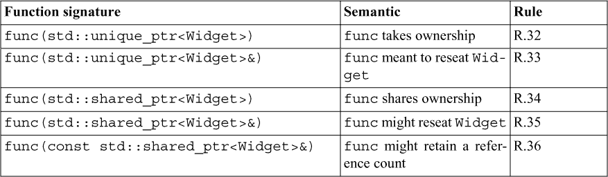

该表包含五条规则。关于使用智能指针作为参数的规则仍然两个。首先，我们必须回答一个问题：何时将智能指针作为函数参数？其次，如果函数通过引用获取其参数，则存在某些危险。

让我们回答第一个问题：何时将智能指针作为函数参数？

### R.30: 仅在显式表达生命周期语义时才将智能指针作为参数

如果你将智能指针作为参数传递给函数，并且在这个函数中你只使用智能指针的底层资源，那么你做错了。在这种情况下，你应该使用原始指针或引用作为函数参数，因为你不需要智能指针的生命周期语义。

让我给你举一个例子，展示智能指针复杂的生命周期管理。


```cpp
// lifetimeSemantic.cpp

#include <iostream>
#include <memory>

using std::cout;

void asSmartPointerGood(std::shared_ptr<int>& shr) {
    cout << “asSmartPointerGood \n”;
    cout << “  shr.use_count(): “ << shr.use_count() << ’\n’;
    shr.reset(new int(2011));
    cout << “  shr.use_count(): “ << shr.use_count() << ’\n’;
    cout << “asSmartPointerGood \n”;
}

void asSmartPointerBad(std::shared_ptr<int>& shr) {
    cout << “asSmartPointerBad(sharedPtr2) \n”;
    *shr += 19;
}

int main() {
    cout << ’\n’;

    auto sharedPtr1 = std::make_shared<int>(1998);
    auto sharedPtr2 = sharedPtr1;
    cout << “sharedPtr1.use_count(): “ << sharedPtr1.use_count() << ’\n’;

    cout << ’\n’;

    asSmartPointerGood(sharedPtr1);

    cout << ’\n’;

    cout << “*sharedPtr1: “ << *sharedPtr1 << ’\n’;
    cout << “sharedPtr1.use_count(): “ << sharedPtr1.use_count() << ’\n’;

    cout << ’\n’;

    cout << “*sharedPtr2: “ << *sharedPtr2 << ’\n’;
    cout << “sharedPtr2.use_count(): “ << sharedPtr2.use_count() << ’\n’;

    cout << ’\n’;

    asSmartPointerBad(sharedPtr2);
    cout << “*sharedPtr2: “ << *sharedPtr2 << ’\n’;

    cout << ’\n’;
}
```

让我们先从 `std::shared_ptr` 的良好情况开始。第 27 行的引用计数为 2，因为我使用智能指针 `sharedPtr1` 来初始化 `sharedPtr2`。让我们仔细查看函数 `asSmartPointerGood` 的调用（第 8 行）。在第 10 行，`shr` 的引用计数为 2，然后在第 12 行它变为 1。第 11 行发生了什么？我重置了 `shr` 指向新资源：`new int(2011)`。结果是智能指针 `sharedPtr1` 和 `sharedPtr2` 立即成为不同资源的所有者。你可以从截图中观察到行为。

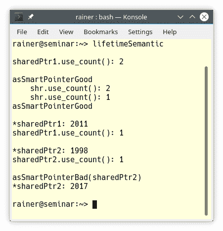

**图 7.8. 智能指针的生命周期语义**

当你对共享指针 `sharedPtr` 调用 `reset` 时，底层会发生复杂的工作流：

- 如果你不带参数对 `sharedPtr` 调用 `reset`，引用计数减一。之后，`sharedPtr` 不是所有者。
- 如果你带参数调用 `reset` 且引用计数至少为 2，你将两个拥有不同资源的独立共享指针。
- 如果你带或不带参数调用 `reset` 且引用计数变为零，则资源会被释放。

`asSmartPointerBad(std::shared_ptr<int>& shr)` 的参数语义表明，你可能在方法中重新设置智能指针，但该方法并没有此意图。

所以你方法的用户被推向了错误的方向。

如果你只对智能指针的底层资源感兴趣，这种魔法就大材一用了；因此，对于函数 `asSmartPointerBad`（第 16 行），原始指针或引用才是正确的参数类型。

### `std::unique_ptr`

关于 `std::unique_ptr` 参数有两条规则：

- R.32: 接收 `unique_ptr<widget>` 参数表示函数假设接管了 `Widget` 的所有权。
- R.33: 接收 `unique_ptr<widget>&` 参数表示函数会重新设置 `Widget`。

以下是对应的函数签名：

```cpp
void sink(std::unique_ptr<Widget>)

void reseat(std::unique_ptr<Widget>&)
```

### `std::unique_ptr<Widget>`

当函数接管 `Widget` 所有权时，你应该按值获取 `std::unique_ptr<Widget>`。结果是调用者必须移动（move）`std::unique_ptr<Widget>`。

```cpp
// uniqPtrMove.cpp

#include <memory>
#include <utility>

struct Widget {
    explicit Widget(int) {}
};

void sink(std::unique_ptr<Widget> uniqPtr) {
    // 对 uniqPtr 执行一些操作，然后释放它
}

int main() {
    auto uniqPtr = std::make_unique<Widget>(1998);

    sink(std::move(uniqPtr));  // OK
    sink(uniqPtr);             // 错误
}
```

`sink(std::move(uniqPtr))` 调用没有问题，但 `sink(uniqPtr)` 会报错，因为你不能复制 `std::unique_ptr`。当你的函数只想使用 `Widget` 时，它应该根据之前的规则 R.30：仅在显式表达生命周期语义时才将智能指针作为参数，通过指针或引用获取参数。

### `std::unique_ptr<Widget>&`

有时候，函数想要重新设置一个 `Widget`。在这种情况下，你应该通过非 const 引用传递 `std::unique_ptr<Widget>`。

```cpp
// uniqPtrReference.cpp

#include <memory>
#include <utility>

struct Widget {
    Widget(int) {}
};

void reseat(std::unique_ptr<Widget>& uniqPtr) {
    uniqPtr.reset(new Widget(2003));

    // do something with uniqPtr
}

int main() {
    auto uniqPtr = std::make_unique<Widget>(1998);

    reseat(std::move(uniqPtr));  // 错误
    reseat(uniqPtr);             // OK
}
```

现在，调用 `reseat(std::move(uniqPtr))` 失败了，因为你不能将右值绑定到非 const 的左值引用。这个错误在后续一行的调用 `reseat(uniqPtr)` 中并不存在。左值可以绑定到左值引用。顺便说一下，`uniqPtr.reset(new Widget(2003))` 生成了一个新的 `Widget(2003)`，并析构了旧的 `Widget(1998)`。

`std::shared_ptr` 的三个规则中有两个是重复的；因此，我不再打扰你细节。

### `std::shared_ptr`

关于 `std::shared_ptr` 类型参数有三条规则：

- R.34: 采用 `shared_ptr<widget>` 参数以表示函数是部分所有者。
- R.35: 采用 `shared_ptr<widget>&` 参数以表示函数可能会重新设置智能指针。
- R.36: 采用 `const shared_ptr<widget>&` 参数以表示它可能保留对对象的引用计数。

以下是与 `std::shared_ptr` 相关的函数签名：

```cpp
void share(std::shared_ptr<Widget>);

void reseat(std::shared_ptr<Widget>&);

void mayShare(const std::shared_ptr<Widget>&);
```

让我们单独看每一个函数签名。从函数的角度来看，这意味着什么？

- `void share(std::shared_ptr<Widget>)`：在函数的整个生命周期内，我是 `Widget` 的共享所有者。在函数开始时，我增加引用计数；在函数结束时，我减少引用计数；因此，只要我使用它，`Widget` 就会一直存活。
- `void reseat(std::shared_ptr<Widget>&)`：我不是 `Widget` 的共享所有者，因为我没有改变引用计数。我无法保证 `Widget` 在函数执行期间一直存活，但我可以重新设置资源。
- `void mayShare(const std::shared_ptr<Widget>&)`：我只是借用资源。我既不能延长资源的生命周期，也不能重新设置资源。诚实地说，如果使用指针（`Widget*`）或引用（`Widget&`）作为参数会更好，因为使用 `const std::shared_ptr<Widget>&` 作为参数没有额外价值。

### R.37: 不要传递从别名智能指针中获取的指针或引用

首先，这条规则的标题可能具有误导性。别名智能指针（对智能指针的引用）是一个你并不拥有所有权的智能指针。违反这条规则通常会导致悬空指针。

代码段说明了这个问题。

```cpp
void oldFunc(Widget* wid) {
    // do something with wid
}

void shared(std::shared_ptr<Widget>& shaPtr) {
    oldFunc(*shaPtr);

    // do something with shaPtr
}

auto globShared = std::make_shared<Widget>(2011);

...

shared(globShared);
```

`globShared` 是一个全局共享指针。函数 `shared` 通过引用接收其参数。因此，作为别名智能指针的 `shaPtr` 的引用计数没有增加，函数 `share` 也没有延长 `Widget(2011)` 的生命周期。问题始于调用 `oldFunc(*shaPtr)`。`oldFunc` 接受指向 `Widget` 的指针；因此，`oldFunc` 无法保证 `Widget` 在其执行期间存活。`oldFunc` 只是借用了 `Widget`。

解决方法很简单。你必须确保在调用函数 `oldFunc` 之前，`globShared` 的引用计数已经增加。

通过值将 `std::shared_ptr` 传递给函数 `shared`：

```cpp
void shared(std::shared_ptr<Widget> shaPtr) {
    oldFunc(*shaPtr);

    // do something with shaPtr
}
```

在函数 `shared` 中为 `shaPtr` 创建拷贝：

```cpp
void shared(std::shared_ptr<Widget>& shaPtr) {
    auto keepAlive = shaPtr;

    oldFunc(*shaPtr);

    // do something with keepAlive or shaPtr
}
```

让我将解决方法表述为一条直接的规则：“只有当你实际上持有其所有权的共享份额时，才应该访问共享资源。”

同样的推理也适用于 `std::unique_ptr`，但没有简单的解决方法，因为你无法复制 `std::unique_ptr`。

#### 相关规则

资源管理的通用规则与关于函数和接口的现有规则有很强的重叠。

处理智能指针作为函数参数的指南是对之前关于函数参数参数传递规则的细化：参数传递：输入和输出以及参数传递：所有权语义。

### 提炼

**重要**

- 自动管理资源。为你的资源创建一种代理对象。代理对象的构造函数获取资源，代理对象的析构函数释放资源。C++ 运行时会处理该代理对象。
- 如果可能，使用作用域对象。作用域对象是具有其作用域的对象。这可能是一个局部对象、全局对象或类成员。C++ 运行时会处理这些作用域对象。
- 不要使用 `malloc` 和 `free`，避免 `new` 和 `delete`。使用资源管理器如 `unique_ptr` 来表示独占所有权，使用 `shared_ptr` 表示共享所有权。使用 `make_unique` 创建 `unique_ptr`，使用 `make_shared` 创建 `shared_ptr`。
- 如果你想表达生命语义，将智能指针作为函数参数。否则，使用普通的指针或引用。
- 通过值传递智能指针参数以表示所有权；通过引用传递以表示可能会重新设置智能指针。

## 第 8 章 表达式与语句

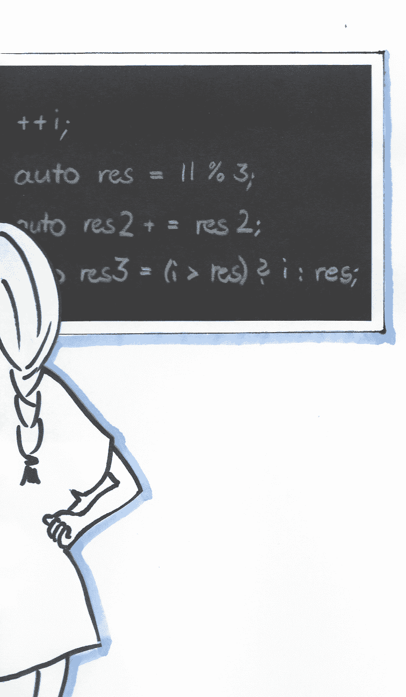

**图 8.1 Cippi 回到了学校**

根据 C++ 核心指南，“表达式和语句是表达动作和计算最低且最直接的方式”。本节包含大约 65 条规则，列出了表达式、语句、声明和算术的最佳实践。

首先，我想给你们一个关于表达式和语句的正式定义：

- 表达式（expression）求出一个值。
- 语句（statement）执行某些操作，通常由表达式或语句组成。

```cpp
5 * 5;             // 表达式

std::cout <<  25;  // 输出语句

auto a = 10;       // 赋值语句

auto b = 5 * 5;    // 表达式语句
```

作用域内的声明是语句。作用域是指大括号内部的内容。

### 通用

C++ 核心指南有两条针对表达式和语句的通用规则。

#### ES.1: 优先使用标准库而不是其他库和“手工编写的代码”

没有理由编写原始循环来求加 double 向量：

```cpp
int max = v.size();

double sum = 0.0;

for (int i = 0; i < max; ++i) sum += v[i];
```

相反，使用 STL 中的 `std::accumulate` 算法。这清晰地传达了你的意图，并让代码更具可读性。

```cpp
auto sum = std::accumulate(std::begin(v), std::end(v), 0.0);
```

也许，你的下一个任务是构建 double 的乘积。只需带有 lambda 的调用 `std::accumulate` 即可。

```cpp
auto pro = std::accumulate(std::begin(v), std::end(v), 1.0,
                           [](double fir, double sec) {
                               return fir * sec;
                           });
```

解决方案很好，但不完美。C++ 标准已经定义了许多函数对象，例如乘法。

```cpp
auto pro = std::accumulate(std::begin(v), std::end(v), 1.0,
                           std::multiplies<>());
```

这条规则让我想起 Sean Parent 在 2013 年“C++ Seasoning”会议上说的一句话：“如果你想提高你组织的代码质量，请将你所有的编码准则替换为一个目标：优先使用算法而不是原始循环（raw loop）。”或者更直接地说：`如果你写了一个原始循环，说明你可能并不熟悉 STL 的算法。` STL 拥有超过 100 种算法。

#### ES.2: 优先使用合适的抽象，而不是直接使用语言特性

这是另一个似曾熟悉的。在一次 C++ 研讨会上，我进行了一次长时间的讨论，随后对几个用于读写 `std::strstream` 的相当复杂且手工编写的函数进行了深入的分析。我的学生必须维护这样一个函数，在一周之后，他们完全不知道发生了什么。他们感到困惑的主要原因是，该功能实现并不是基于正确的抽象。

例如，考虑这个用于读取 `std::istream` 的手工函数。

```cpp
char** read1(istream& is, int maxelem, int maxstring, int* nread) {
    auto res = new char*[maxelem];
    int elemcount = 0;
    while (is && elemcount < maxelem) {
        auto s = new char[maxstring];
        is.read(s, maxstring);
        res[elemcount++] = s;
    }
    nread = &elemcount;
    return res;
}
```

相比之下，理解以下函数有多容易？


```cpp
std::vector<std::string> read2(std::istream& is) {
    std::vector<std::string> res;
    for (string s; is >> s;) res.push_back(s);
    return res;
}
```

正确的抽象通常意味着你不需要像在`read2`函数中那样考虑所有权问题。这种考虑在`read1`函数中确实存在。`read1`的调用者是结果的所有者，因此必须删除它。

## 声明（Declarations）

首先，这里是 C++ 核心准则（C++ Core Guidelines）中对定义的定义：

- **声明**（declaration）是一个语句。声明在作用域中引入一个名称，并可能导致命名对象的构造。

关于声明的规则涉及名称、变量及其初始化，以及宏。

### 名称（Names）

一方面，以下规则是显而易见的，我只简要描述一下它们。另一方面，我见过许多永久违反这些规则的代码库。例如，我曾与一位以前的 Fortran 程序员讨论过，他表示：每个名称应该恰好是三个字符。

让我先说出最重要的规则：`良好的命名可能是编写良好软件最重要的规则。`

### ES.5：保持作用域较小（Keep scopes small）

如果作用域很小，你可以把它放在屏幕上并直观理解发生了什么。如果作用域变得太大，你应该将代码结构化为函数或类。在重构过程中，识别逻辑实体并使用自描述的名称。之后，思考你的代码会变得更容易。

### ES.6：在 `for` 语句的初始化器和条件中声明名称以限制作用域

从第一个 C++ 标准开始，我们就可以在`for`语句中声明变量。

**Bjarne Stroustrup 著《C++ 的设计与演变》**

Bjarne Stroustrup 在评审这本书时指出，甚至在第一个 C++ 标准之前，在`for`语句中定义名称也是可能的。如果你对 C++ 的历史感兴趣，我强烈建议阅读 Bjarne 的书《C++ 的设计与演变》。

从 C++17 开始，我们还可以在`if`或`switch`语句中声明变量。

```cpp
std::map<int,std::string> myMap;

if (auto result = myMap.insert(value); result.second) {
    useResult(*result.first);
    // ...
}
else {
    // ...
}   // result 会自动销毁
```

变量`result`仅在`if`语句的`if`和`else`分支内部有效。`result`不会污染外部作用域，并且会被自动销毁。在 C++17 之前，你必须在外部作用域中声明`result`。

```cpp
std::map<int,std::string> myMap;
auto result = myMap.insert(value)
if (result.second){
    useResult(*result.first);
    // ...
}
else {
     // ...
}
```

### ES.7：常用和局部名称保持简短，不常用和非局部名称保持较长

这条规则听起来很奇怪，但我们已经习惯了。给变量命名为`i`或`j`，或者给变量命名为`T`，会让它的意图一目了然：`i`和`j`是索引，而`T`是模板参数的类型。

```cpp
template<typename T>
void print(std::ostream& os, const std::vector<T>& v) {
   for (int i = 0; i < v.size(); ++i) os << v[i] << '\n';
}
```

`i`是循环控制变量的不错名称，是函数参数的糟糕名称，也是全局变量的极其灾难的名称。

这条规则背后隐藏着一条元规则。名称应该是自描述的。在短的上下文中，你一眼就能理解变量的含义。这在长上下文中并不自动成立；因此，请使用更长的名称。

### ES.8：避免外观相似的名称

你能不毫不迟疑地读这个例子吗？

```cpp
if (readable(i1 + l1 + ol + o1 + o0 + ol + l1 + I0 + l0)) surprise();
```

例如，我经常在数字`0`和大写字母`O`上遇到问题。取决于使用的字体，它们看起来非常相似。几年前，我花很长时间才登录上服务器。我自动生成的密码包含一个字母`O`。

### ES.9：避免全大写（ALL_CAPS）名称

如果你使用`ALL_CAPS`，宏替换可能会生效，因为`ALL_CAPS`通常用于宏。以下代码段可能会让你有点惊讶。

```cpp
// 在某个头文件的某处：
#define NE !=

// 在另一个头文件的某处：
enum Coord { N, NE, NW, S, SE, SW, E, W };

// 在某个糟糕程序员的 .cpp 的第三处：
switch (direction) {
case N:
    // ...
case NE:
    // ...
// ...
}
```

### ES.10：每个声明（仅）声明一个名称

让我给你举两个例子。你发现那两个问题了吗？

```cpp
char* p, p2;
char a = 'a';
p = &a;
p2 = a;
int a = 7, b = 9, c, d = 10, e = 3;
```

`p2`只是一个`char`，且`c`没有初始化。对于 C++17，我们得到了这条规则的一个例外：结构化绑定。

现在，我可以在规则“ES.6：在`for`语句的初始化器和条件中声明名称以限制作用域”中使用更简洁、更可读的语法来编写带有初始化器的`if`语句。

```cpp
std::map<int, std::string> myMap;
if (auto [iter, succeeded] = myMap.insert(value); succeeded) {
    useResult(iter);
    // ...
}
else {
    // ...
} // iter 和 succeeded 会自动销毁
```

### ES.11：使用 `auto` 避免类型的重复出现

如果你使用`auto`，修改代码可能会变得轻而易举。

以下代码段仅使用`auto`。你不需要思考类型，因此不会出错。这意味着最后`res`的类型将是`int`。得益于`typeid`运算符，你可以获得类型的字符串表示。

```cpp
auto a = 5;
auto b = 10;
auto sum =  a * b * 3;
auto res = sum + 10;
std::cout << typeid(res).name() << '\n';      // i
```

如果你决定将字面量`b`从`int`改为`double`（1），或者用浮点字面量`3.1f`（2）代替整数字面量`3`，`res`始终具有正确的类型。编译器会自动推导出正确的类型。

```cpp
auto a = 5;
auto b = 10.5;                      // (1)
auto sum = a * b * 3;
auto res = sum * 10;
std::cout << typeid(res).name() << '\n';    // d

auto a = 5;
auto b = 10;
auto sum = a * b * 3.2f;            // (2)
auto res = sum * 10;
std::cout << typeid(res).name() << '\n';    // f
```

### ES.12：不要在嵌套作用域中重用名称

为了可读性和可维护性，你不应该在嵌套作用域中重命名。

```cpp
// shadow.cpp

#include <iostream>

int shadow(bool cond) {
    int d = 0;
    if (cond) {
        d = 1;
    }
    else {
        int d = 2;  // 一个局部作用域的 d;
                    // 隐藏父作用域的 d
        d = 3;
    }               // 局部作用域的 d 被移除
    return d;
}

int main() {
    std::cout << '\n';
    std::cout << "shadow(true): " << shadow(true) << '\n';
    std::cout << "shadow(false): " << shadow(false) << '\n';
    std::cout << '\n';
}
```

程序的输出是什么？被这些`d`困住了吗？这里是结果。

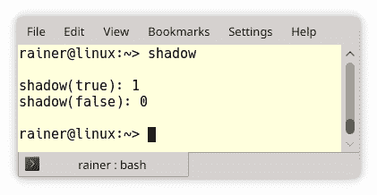

**图 8.2：在嵌套作用域中重命名**

这很简单！对吧？但在类层次结构中，同样的行为却令人惊讶。

```cpp
// shadowClass.cpp

#include <iostream>
#include <string>

struct Base {
    void shadow(std::string) {                     // (1)
        std::cout << "Base::shadow" << '\n';
    }
};

struct Derived: Base {
    void shadow(int) {                             // (2)
        std::cout << "Derived::shadow" << '\n';
    }
};

int main() {
    std::cout << '\n';
    Derived derived;
    derived.shadow(std::string{});                  // (3)
    derived.shadow(int{});
    std::cout << '\n';
}
```

结构体`Base`和`Derived`都有一个成员函数`shadow`。`Base`中的一个接受`std::string`（1），而另一个接受`int`（2）。当你调用一个使用默认构造的`std::string`构造的派生对象（3）时，你可能认为调用了基类版本。错误！成员函数`shadow`在类`Derived`中已经实现。在名称解析期间，基类的成员函数不会被考虑。这里是 GCC 的编译错误。

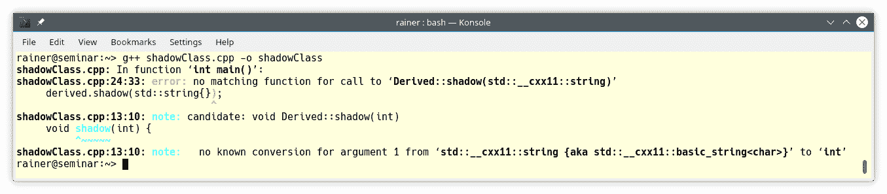

**图 8.3：隐藏基类的成员函数**

得益于`using`声明，`shadow`的基类版本在`Derived`中可见。

```cpp
struct Derived: Base {
    using Base::shadow;
    void shadow(int) {
        std::cout << "Derived::shadow" << '\n';
    }
};
```

在`Derived`中添加`using Base::shadow`后，程序的行为符合预期。准则“C.138：使用`using`为派生类及其基类创建重载函数集”展示了类层次结构中的遮蔽问题。

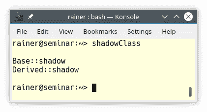

**图 8.4：使用 using 声明更改可见性**

## 变量及其初始化

与之前关于名称的章节一样，本节关于变量及其初始化的规则通常非常显而易见，但有时会提供非常宝贵的见解。因此，我将快速涵盖直观的规则，并深入讨论非常宝贵的见解。

### ES.20：始终初始化对象

这是许多专业 C++ 程序员都会犯错的基础技巧之一。简单的问题是：哪个变量被初始化了？

```cpp
struct T1 {};

class T2{
public:
    T2() {}
};

int n;              // OK
int main() {
    int n2;         // BAD
    std::string s;  // OK
    T1 t1;          // OK
    T2 t2;          // OK
}
```

`n`具有全局作用域并且是基本类型。因此，它被初始化为`0`。`n2`没有初始化，因为它具有局部作用域，因此没有被初始化。但如果你使用如`std::string`、`T1`或`T2`等用户定义类型，即使在局部作用域中它们也会被初始化。

有一个简单的修复方法可以防止这个问题：使用`auto`。现在，你不会忘记初始化变量了。

```cpp
struct T1 {};

class T2{
public:
    T2() {}
};

auto n = 0;
int main() {
  auto n2 = 0;
  auto s = ""s;
  auto t1 = T1();
  auto t2 = T2();
}
```

### ES.21：不要在使用需要它之前引入变量（或常量）

在 C 标准 C89 中，你必须在作用域的开始处声明所有变量。我们编写的是 C++，而不是 C89。

### ES.22：在你有值可以初始化它之前不要声明变量

如果你不遵循这条规则，可能会遇到所谓的“先使用后设置”（use-before-set）错误。看看准则中的示例。

```cpp
int var;

if (cond) set(&var);         // 上非复杂的条件
else if (cond2 || !cond3) {
    var = set2(3.14);
}
// 使用 var
```

如果`cond3`为真但`cond`或`cond2`为假，那么`var`在使用时未被初始化。

### ES.23：优先使用 `{}`-初始化语法

使用`{}`-初始化有很多理由：

`{}`-初始化是：

- 始终适用；
- 克服了最晦涩的解析（most vexing parse）；
- 并防止了窄转换。

虽然前两个参数让 C++ 更加直观，但最后一个参数通常能防止未定义行为。

#### 始终适用

`{}`-初始化始终适用。这里有几个例子：

```cpp
// uniformInitialization.cpp

#include <map>
#include <vector>
#include <string>

// C 数组的初始化
class Array {
public:
    Array(): myData{1,2,3,4,5} {}
private:
    const int myData[5];
};

class MyClass {
public:
    int x;
    double y;
};

class MyClass2 {
  public:
    MyClass2(int fir, double sec): x{fir}, y{sec} {};
  private:
    int x;
    double y;
};

int main() {
    // 标准容器的直接初始化
    int intArray[] = {1, 2, 3, 4, 5};
    std::vector<int> v1 = {1, 2, 3, 4, 5};
    std::map<int, std::string> m1 = {{1, "a"}, {2, "b"}};
    std::string s1 = "hello";
    Array a1{1, 2, 3, 4, 5};
    MyClass mc1{10, 20.5};
    MyClass2 mc2{1, 2.0};
}
```

原文中：

`int intArray[]= = {1, 2, 3, 4, 5};`

以及`// 标准容器的直接初始化`修正为：

```cpp
    int intArray[] = {1, 2, 3, 4, 5};
    std::vector<int> v1 = {1, 2, 3, 4, 5};
    std::map<int, std::string> m1 = {{1, "a"}, {2, "b"}};
    std::string s1 = "hello";
    Array a1{1, 2, 3, 4, 5};
    MyClass mc1{10, 20.5};
    MyClass2 mc2{1, 2.0};
```

实际上，根据 Markdown 翻译原则，代码块不翻译内容，仅翻译注释。

重新对齐`uniformInitialization.cpp`部分以严格遵守要求。


为了可读性和可维护性，你不应该在嵌套作用域中重命名。

```cpp
// shadow.cpp

#include <iostream>

int shadow(bool cond) {
    int d = 0;
    if (cond) {
        d = 1;
    }
    else {
        int d = 2;  // 一个局部作用域的 d;
                    // 隐藏父作用域的 d
        d = 3;
    }               // 局部作用域的 d 被移除
    return d;
}

int main() {
    std::cout << '\n';
    std::cout << "shadow(true): " << shadow(true) << '\n';
    std::cout << "shadow(false): " << shadow(false) << '\n';
    std::cout << '\n';
}
```

程序的输出是什么？被这些`d`困住了吗？这里是结果。


**图 8.2. 在嵌套作用域中重命名**

这很简单！对吧？但在类层次结构中，同样的行为却令人惊讶。

```cpp
// shadowClass.cpp

#include <iostream>
#include <string>

struct Base {
    void shadow(std::string) {                     // (1)
        std::cout << "Base::shadow" << '\n';
    }
};

struct Derived: Base {
    void shadow(int) {                             // (2)
        std::cout << "Derived::shadow" << '\n';
    }
};

int main() {
    std::cout << '\n';
    Derived derived;
    derived.shadow(std::string{});                  // (3)
    derived.shadow(int{});
    std::cout << '\n';
}
```

结构体`Base`和`Derived`都有一个成员函数`shadow`。`Base`中的`shadow`接受`std::string`（1），而`Derived`中的`shadow`接受`int`（2）。当你调用一个使用默认构造的`std::string`构造的派生对象（3）时，你可能认为调用了基类版本。错误！成员函数`shadow`在类`Derived`中已经实现。在名称解析期间，基类的成员函数不会被考虑。这里是GCC的编译错误。


**图 8.3. 隐藏基类的成员函数**

得益于`using`声明，`shadow`的基类版本在`Derived`中可见。

```cpp
struct Derived: Base {
    using Base::shadow;
    void shadow(int) {
        std::cout << "Derived::shadow" << '\n';
    }
};
```

在`Derived`中添加`using Base::shadow`后，程序的行为符合预期。准则“C.138: 使用using为派生类及其基类创建重载函数集”展示了类层次结构中的遮蔽问题。


**图 8.4. 使用using声明更改可见性**

## 变量及其初始化

与之前关于名称的章节一样，本节关于变量及其初始化的规则通常非常显而易见，但有时会提供非常宝贵的见解。因此，我将快速涵盖直观的规则，并深入讨论非常宝贵的见解。

### ES.20: 始终初始化对象

这是许多专业C++程序员都会犯错的基础技巧之一。简单的问题是：哪个变量被初始化了？

```cpp
struct T1 {};

class T2{
public:
    T2() {}
};

int n;              // OK
int main() {
    int n2;         // BAD
    std::string s;  // OK
    T1 t1;          // OK
    T2 t2;          // OK
}
```

`n`具有全局作用域并且是基本类型。因此，它被初始化为0。`n2`没有初始化，因为它具有局部作用域，因此没有被初始化。但如果你使用如`std::string`、`T1`或`T2`等用户定义类型，即使在局部作用域中它们也会被初始化。

有一个简单的修复方法可以防止这个问题：使用`auto`。现在，你不会忘记初始化变量了。

```cpp
struct T1 {};

class T2{
public:
    T2() {}
};

auto n = 0;
int main() {
  auto n2 = 0;
  auto s = ""s;
  auto t1 = T1();
  auto t2 = T2();
}
```

### ES.21: 不要在使用需要它之前引入变量（或常量）

在C标准C89中，你必须在作用域的开始处声明所有变量。我们编写的是C++，而不是C89。

### ES.22: 在你有值可以初始化它之前不要声明变量

如果你不遵循这条规则，可能会遇到所谓的“先使用后设置”（use-before-set）错误。看看准则中的示例。

```cpp
int var;

if (cond) set(&var);         // 上非复杂的条件
else if (cond2 || !cond3) {
    var = set2(3.14);
}
// 使用 var
```

如果`cond3`为真但`cond`或`cond2`为假，那么`var`在使用时未被初始化。

### ES.23: 优先使用`{}`-初始化语法

使用`{}`-初始化有很多理由：

`{}`-初始化是：

• 始终适用，

• 克服了最晦会的解析（most vexing parse），

• 并防止了窄转换。

虽然前两个参数让C++更加直观，但最后一个参数通常能防止未定义行为。

#### 始终适用

`{}`-初始化始终适用。这里有几个例子：

```cpp
// uniformInitialization.cpp

#include <map>
#include <vector>
#include <string>

// C 数组的初始化
class Array {
public:
    Array(): myData{1,2,3,4,5} {}
private:
    const int myData[5];
};

class MyClass {
public:
    int x;
    double y;
};

class MyClass2 {
  public:
    MyClass2(int fir, double sec): x{fir}, y{sec} {};
  private:
    int x;
    double y;
};

int main() {
    // 标准容器的直接初始化
    int intArray[]= = {1, 2, 3, 4, 5};
    std::vector<int> v1 = {1, 2, 3, 4, 5};
    std::map<int, std::string> m1 = {{1, "a"}, {2, "b"}};
    std::string s1 = "hello";
    Array a1{1, 2, 3, 4, 5};
    MyClass mc1{10, 20.5};
    MyClass2 mc2{1, 2.0};
}
```

```cpp
// mostVexingParseSolved.cpp

#include <iostream>

struct MyInt {
    MyInt(int arg = 0): i(arg) {}
    int i;
};

int main() {
    MyInt myInt(2011);
    MyInt myInt2{};
    std::cout << myInt.i;
    std::cout << myInt2.i;
}
```

## 窄转换

窄转换（Narrowing conversion）是算术数值的隐式转换，包括精度的丢失。这听起来非常危险，并且是未定义行为的常见原因。

以下代码段展示了两种基本类型`char`和`int`的窄转换。无论我使用直接初始化还是拷贝初始化，结果都是。

```cpp
// narrowingConversion.cpp

#include <iostream>

int main() {
    char c1(999);
    char c2 = 999;
    std::cout << "c1: " << c1 << '\n';
    std::cout << "c2: " << c2 << '\n';
    int i1(3.14);
    int i2 = 3.14;
    std::cout << "i1: " << i1 << '\n';
    std::cout << "i2: " << i2 << '\n';
}
```

程序的输出显示了这两个问题。首先，`int`类型字面量999无法放入`char`类型；其次，`double`字面量无法放入`int`类型。

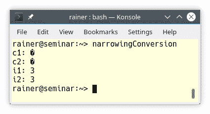

**图 8.6. 窄转换**

使用`{}`初始化时无法进行窄转换。

```cpp
// narrowingConversionSolved.cpp

#include <iostream>

int main() {
    char c1{999};
    char c2 = {999};
    std::cout << "c1: " << c1 << '\n';
    std::cout << "c2: " << c2 << '\n';
    int i1{3.14};
    int i2 = {3.14};
    std::cout << "i1: " << i1 << '\n';
    std::cout << "i2: " << i2 << '\n';
}
```

程序是格式不正确的，因为`{}`初始化会检测窄转换。编译器至少必须诊断出一个警告。大多数编译器将窄转换视为错误。为了安全起见，编译程序时请始终开启窄转换标志。下面的截图显示了使用`GCC`编译失败的情况。

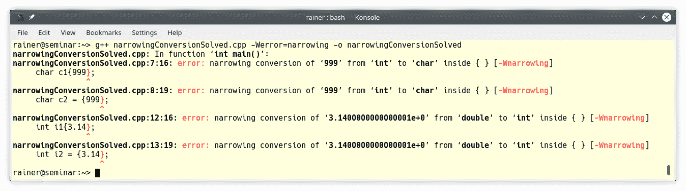

**图 8.7. 检测到窄转换**

### ES.26: 不要将一个变量用于两个无关的用途

你喜欢以下代码吗？

```cpp
void use() {
    int i;
    for (i = 0; i < 20; ++i) { /* ... */ }
    for (i = 0; i < 200; ++i) { /* ... */ } // 错误：i 被重用了
}
```

我希望不要。将`i`的声明放入`for`循环中就没了。`i`现在绑定到`for`循环的生命周期。

```cpp
void use() {
    for (int i = 0; i < 20; ++i) { /* ... */ }
    for (int i = 0; i < 200; ++i) { /* ... */ }
}
```

在C++17中，你可以直接在`if`语句或`switch`语句中声明变量。

### ES.28: 使用lambda进行复杂初始化，特别是`const`变量


我经常听到这样的问题：为什么我要在就地调用 lambda 函数？这条规则回答了这个问题。你可以将复杂的初始化步骤放在 lambda 中。如果你的变量应该变为 `const`，那么就地调用 lambda 尤为有价值。

如果你不想在初始化后修改变量，应该将其设为 `const`。但有时，变量的初始化包含多个步骤。因此，你无法将变量设为 `const`。

以下示例中的组件 `x` 在初始化后应该是 `const`。它不能是 `const`，因为在初始化期间它被修改了多次。

```cpp
widget x;  // 应该是 const，但是：

for (auto i = 2; i <= N; ++i) {
    x += some_obj.do_something_with(i);
}

// 从这里开始，x 应该是 const，
// 但我们无法用这种代码风格表达
```

现在，lambda 表达式为我们提供了帮助。使用一种名为“立即调用 lambda 表达式”（IILE）的技术。

将初始化内容放入 lambda 表达式中，通过引用捕获环境，并用就地调用的 lambda 函数初始化你的 `const` 变量。

```cpp
const widget x = [&]{
    widget val;
    for (auto i = 2; i <= N; ++i) {
        val += some_obj.do_something_with(i);
    }
    return val;
}();
```

诚然，仅仅地调用 lambda 函数看起来有点奇怪，但从概念角度来看，我喜欢它。你将整个初始化内容都放在 lambda 的体中。最后的一对括号调用了 lambda。

### 宏

如果说 C++ 标准委员会有一个意见一致的共识，那么这就是一个：**宏必须舍弃**。宏只是文本替换，不包含任何 C++ 语义。它们转换了编写的代码，使得编译器看到的是不同的代码。这种转换极易出错，并掩盖了错误原因。

但有时你必须处理依赖宏的遗留代码。为了完整起见，C++ 核心准则（Core Guidelines）对宏有四条规则。

- ES.30: 不要使用宏进行程序处理
- ES.31: 不要使用宏定义常量或“函数”
- ES.32: 所有宏名均使用全大写字母
- ES.33: 如果必须使用宏，请给它们赋予唯一的名称

让我从“不要”的准则开始。下面的示例展示了函数类宏 `max` 的用法。我从 `param.h` 头文件中拷贝了 `max`，该文件是 GNU C 库的一部分

```cpp
// macro.cpp

#include <stdio.h>

#define max(a, b) ((a) > (b)) ? (a) : (b)

int main() {
    int a = 1, b = 2;
    printf("\nmax(a, b): %d\n", max(a, b));
    printf("a = %d, b = %d\n", a, b);
    printf("\nmax(++a, ++b): %d\n", max(++a, ++b));  // (1)
    printf("a = %d, b = %d\n\n", a, b);              // (2)
}
```

(2) 中的输出可能会让你惊讶。

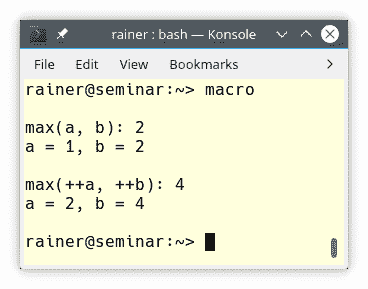

**图 8.8. 函数类宏 `max` 的用法**

变量 `b` 被求值了两次，因此增加了两次。使用 `constexpr` 函数或模板来代替函数类宏 `max`。

```cpp
template<typename T>
T max (T i, T j) {
    return (i > j) ? i : j;
}

constexpr int max (int i, int j){
    return (i > j);
}
```

同样的论点也适用于常量。

```cpp
#define PI 3.14             // 错误
constexpr double pi = 3.14  // 正确
```

如果出于某种原因你必须使用宏，请使用全大写并赋予它们唯一的名称。下面的代码片段违反了这两条规则。`forever` 是小写的，且宏 `CHAR` 可能会与其他人使用的名称冲突

```cpp
#define forever for;;)
#define CHAR
```

#### 表达式

关于表达式的规则大约二十条。它们非常多样，并且与其他规则重叠。在这里我专注于适用于复杂表达式、指针、求值顺序和转换的规则。

#### 复杂表达式

首先，你应该避免复杂的表达式。

##### ES.40: 避免复杂的表达式

什么是复杂？这里是来自核心准则的示例，包括解释：

```cpp
// 错误：隐藏在子表达式中的赋值
while ((c = getc()) != -1)

// 错误：在子表达式中赋值两个非局部变量
while ((cin >> c1, cin >> c2), c1 == c2)

// 好，但可能仍然太复杂
for (char c1, c2; cin >> c1 >> c2 && c1 == c2;)

// 正确：如果 i 和 j 不是别名（相同数据的名称）
int x = ++i + ++j;

// 正确：如果 i != j 且 i != k
v[i] = v[j] + v[k];

// 错误：在子表达式中“隐藏”多次赋值
x = a + (b = f()) + (c = g()) * 7;

// 错误：依赖于常见的误解的优先级规则
x = a & b + c * d && e ^ f == 7;

// 错误：未定义行为
x = x++ + x++ + ++x;
```

##### ES.41: 如果不确定运算符优先级，使用括号

一方面，准则说：如果你不确定运算符优先级，使用括号。另一方面，它们指出：你应该具备足够的知识，不需要在这里使用括号。因此，找到合适的平衡是一个挑战，并且取决于用户的专业水平。

```
const unsigned int flag = 2;

unsigned int a = flag;

if (a & flag != 0)        // bad: 相当于 a&(flag != 0)

if (a < 0 || a <= max) {  // good: 非常明显

    // ...

}
```

对于专家来说，这个表达式可能显而易见，但对于初学者来说这可能是一个挑战。

我脑子里只有两个建议：

1. 如果对优先级有疑问，请使用括号。优先级表提供了所有细节。
2. 为初学者编写程序！把优先级表垫放在你的枕头下。

### ES.42: 保持指针的使用简单直观

让我引用一下 C++ 核心准则（C++ Core Guidelines）：“复杂的指针操作是错误的主要来源。” 我们为什么要关心这个呢？当然，我们的遗留代码中充满了指针操作，如下面的代码段所示。

```
void f(int* p, int count) {

    if (count < 2) return;

    int* q = p + 1;

    int n = *p++;

    if (count < 6) return;

    p[4] = 1;

    p[count - 1] = 2;

    use(&p[0], 3);

}

int myArray[100];

f(myArray, 100);
```

这些行代码的主要问题是调用者必须提供 C 数组的正确长度。否则，就会产生未定义行为。

思考几秒代码段的最后两行。我们从一个 C 数组开始，通过将其传递给函数 `f` 去除了它的类型信息。这个过程被称为数组到指针的退化（array to pointer decay），它是许多错误的原因。也许我们数错了元素的数量，或者 C 数组的大小发生了变化。两种情况下的结果都是：未定义行为。

我们应该怎么办？我们应该使用适当的数据类型。C++20 提供了 `std::span`。

```
void f(std::span<int> a) {

    if (a.size() < 2) return;

    int n = a[0];      // OK

    std::span<int> q = a.subspan(1);

    if (a.size() < 6) return;

    a[4] = 1;

    a[count - 1] = 2;

    use(a.data(), a.size());

}
```

`std::span` 知道自己的大小。我听到了你的抱怨。C++20 对你来说不是选项。救救的是，C++ 有模板；因此，很容易克服这个限制并编写边界安全的代码。

```
 1 // at.cpp

 2

 3 #include <algorithm>

 4 #include <array>

 5 #include <deque>

 6 #include <string>

 7 #include <vector>

 8

 9 template <typename T>
10 void use(T*, int) {}

11

12 template <typename T>
13 void f(T& a) {

14

15     if (a.size() < 2) return;

16

17     int n = a.at(0);

18

19     std::array<typename T::value_type, 99> q;
20     std::copy(a.begin() + 1, a.end(), q.begin());

21

22     if (a.size() < 6) return;

23

24     a.at(4) = 1;

25

26     a.at(a.size() - 1) = 2;

27

28     use(a.data(), a.size());
29 }
30 int main() {

31

32     std::array<int, 100> arr{};
33     f(arr);

34

35     std::array<double, 20> arr2{};
36     f(arr2);

37

38     std::vector<double> vec{1, 2, 3, 4, 5, 6, 7, 8, 9, 10};
39     f(vec);

40

41     std::string myString="123456789";
42     f(myString);

43

44          std::deque<int> deq{1, 2, 3, 4, 5, 6, 7, 8, 9, 10};
45     f(deq);
46 }
```

现在，函数 `f` 适用于 `std::array` 的不同大小和类型（行 34 和 37），也适用于 `std::vector`（行 40）或 `std::string`（行 43）。这些容器的共同点是，它们的数据存储在连续的块中。`std::deque` 并非如此；因此，调用 `a.data()`（行 46）失败了。示例中的关键观察是，容器上的 `at` 调用会检查其边界并最终抛出 `std::out_of_range` 异常。

表达式 `T::value_type` 有助于获取元素的类型。`T` 是一个所谓的依赖类型，因为 `T` 是函数 `f` 的类型参数。这就是为什么必须给编译器一个提示，说明 `T::value_type` 实际上是一个类型。

### ES.45: 避免“魔数”；使用符号常量

符号常量比魔数更明确。C++ 核心准则的示例以魔数 `1` 和 `12` 开始，以符号常量 `first_month` 和 `last_month` 结束。

```
 // 不要：使用魔数 1 和 12
for (int m = 1; m <= 12; ++m) std::cout << month[m] << '\n';

                  月份的索引为 1..12（符号常量）
constexpr int first_month = 1;
constexpr int last_month = 12;
for (int m = first_month; m <= last_month; ++m) {
    std::cout << month[m] << '\n';
}
```

### ES.55: 避免范围检查的需求

如果你不需要检查范围的长度，你就不会产生差一错误（off-by-one error）。让我们求加 `std::vector` 中的元素。

```cpp
// sumUp.cpp

#include <iostream>

#include <numeric>

#include <vector>

int main() {

    std::vector<int> vec{1, 2, 3, 4, 5, 6, 7, 8, 9, 10};

    // 错误
    int sum1 = 0;
    auto sizeVec = vec.size();
    for (int i = 0; i < sizeVec; ++i) sum1 += vec[i];
    std::cout << sum1 << '\n';  // 55

    // 更好
    int sum2 = 0;
    for (auto v: vec) sum2 += v;
    std::cout << sum2 << '\n';  // 55

    // 最优
    auto sum3 = std::accumulate(vec.begin(), vec.end(), 0);
    std::cout << sum3 << '\n';  // 55
}
```

显式遍历容器是非常容易出错的。相比之下，使用范围的 for 循环隐式迭代是安全的。此外，算法 `std::accumulate` 文了它的意图。

#### 指针

指针的规则从空指针开始，延续到指针的删除和引用。

### ES.47: 使用 `nullptr` 代替 `0` 或 `NULL`

为什么你不应该使用 `0` 或 `NULL` 来表示空指针？

- `0`：字面量 `0` 可以是空指针 `(void*)0` 或数字 `0`。这取决于上下文。因此，原本是空指针可能变成数字。

- `NULL`：`NULL` 是一个宏，因此你不知道里面是什么。根据 [cppreference.com](http://cppreference.com)，可能的实现可能是：

```
#define NULL 0

// 自 C++11 起

#define NULL nullptr
```

**将空指针 `0` 和 `NULL` 替换为 `nullptr`**

我通常不建议重构现有代码。空指针 `0` 和 `NULL` 是这条规则的例外。将所有的空指针 `0` 和 `NULL` 替换为 `nullptr`。

```
int* a = 0;        // 错误

int* b = NULL;     // 错误

int* a = nullptr;  // 正确

int* b = nullptr;  // 正确
```

如果你的程序在重构后可以编译，那很好。如果你遇到编译错误，你已经知道你违背本性使用了指针，并且检测到了未定义行为。

`nullptr` 避免了数字 `0` 和宏 `NULL` 的歧义。

你可以使用 `0` 和 `NULL` 来初始化 (1) 和 (2) 中的 `int` 指针。但如果你将值 `0` 和 `NULL` 作为函数模板的参数，编译器会强烈报错。

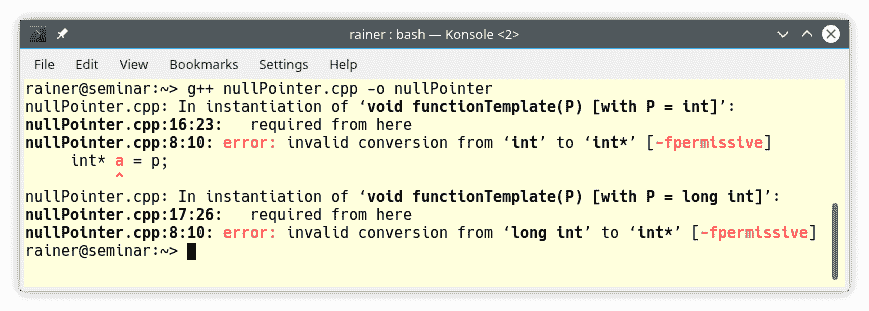

**图 8.9. 空指针 `0`、`NULL` 和 `nullptr`**

编译器在函数模板中将 `0` 推导为 `int` 类型；将 `NULL` 推导为 `long int` 类型。这种观察并不适用于 `nullptr`。`nullptr` 在模板参数推导过程中保留了其原始类型 `std::nullptr_t`。

### ES.61：使用 `delete[]` 删除数组，使用 `delete` 删除非数组

显式内存管理以及不使用 STL 容器或智能指针（如 `std::unique_ptr<X[]>`）是非常容易出错的：

```
void f(int n) {
    auto p = new X[n];  // n 个默认构造的 Xs 对象
    // ...
    delete p;  // 错误：仅删除了对象 p，
               // 而不是删除数组 p[]
}
```

使用 `delete` 删除 C 风格数组是未定义行为。如果你必须管理原始内存，请阅读分配和释放部分的规则。

### ES.65：不要解引用无效指针

如果你解引用了一个无效指针，你的程序将产生未定义行为。避免这种情况的唯一方法是在使用指针之前对其进行检查。

```
void func(int* p) {
    if (!p) {
        // 执行某些操作
    }
    int x = *p;
}
```

你如何解决这个问题？不要使用裸指针。如果你需要类似指针的语义，请使用 `std::unique_ptr` 或 `std::shared_ptr` 等智能指针。

#### 求值顺序

如果你没有在表达式中应用正确的求值顺序，你的程序可能会导致未定义行为。

### ES.43：避免求值顺序未定义的表达式

在 C++14 中，以下表达式具有未定义行为。

```
v = ++i; // 结果是未定义的
```

这种未定义行为在 C++17 中得到了解决。在 C++17 中，最后一个代码片段的求值顺序是从右到左的；因此该表达式具有良好定义的行为。以下是 C++17 提供的额外保证：

- 后缀表达式从左到右求值。这包括函数调用和成员选择。
- 赋值表达式从右到左求值，例如 `+=`。
- 移位运算符的操作数从左到右求值。

以下是几个示例：

```
a.b;
a->b;
a(b1, b2, b3);
b += a;
a << b;
a >> b;
```


应该如何理解这些示例？首先求值 `a`，然后是 `b`。函数调用 `a(b1, b2, b3)` 是复杂的。在 C++17 中，我们保证每个函数参数在其他参数之前求值，但求值顺序仍然是不指定的。让我详细说明一下最后句话。

### ES.44：不要依赖函数参数的求值顺序

近年来，我看到很多错误，是因为开发者假设函数参数的求值顺序是从左到右的。错了！根本没有这种保证！

```cpp
// unspecified.cpp
#include <iostream>

void func(int fir, int sec) {
    std::cout << "(" << fir << "," << sec << ")" << '\n';
}

int main(){
    int i = 0;
    func(i++, i++);
}
```

函数参数的求值顺序是不指定的。未指定的行为（Unspecified behavior）意味着程序的行为在不同实现之间可能会不同，且符合标准的实现不需要记录每种行为的影响。因此，即使 GCC 和 Clang 都符合 C++ 标准，它们的输出也不同：

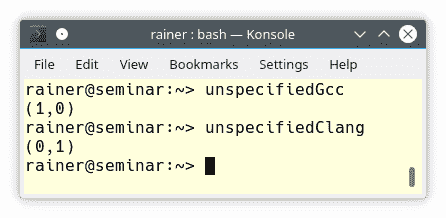

**图 8.10. 未指定的行为**

#### C++17 中表达式中保证的求值顺序

在 C++17 中，以下表达式的求值顺序是明确指定的：

```cpp
f1()->m(f2());              // 从左到右求值
std::cout << f1() << f2();  // 从左到右求值
f1() = f(2);                // 从右到左求值
```

原因如下：

- `f1()->m(f2())`：后缀表达式从左到右求值。这包括函数调用和成员选择。
- `std::cout << f1() << f2()`：移位运算符的操作数从左到右求值。
- `f1() = f(2)`：赋值表达式从右到左求值。

#### 转换

类型转换是未定义行为的常见原因。如有必要，请使用显式转换。

### ES.48：避免强制转换

看看如果我搞乱类型系统，将 `double` 转换为 `long int` 再转换为 `long long int` 会发生什么。

```cpp
// casts.cpp
#include <iostream>

int main() {
    double d = 2;
    auto p = (long*)&d;
    auto q = (long long*)&d;
    std::cout << d << ' ' << *p << ' ' << *q << '\n';
}
```

Visual Studio 编译器的结果并不如人意。

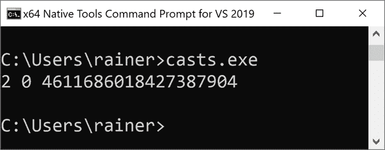

**图 8.11. Visual Studio 编译器的错误转换**

GCC 和 Clang 编译器的结果同样如人意。

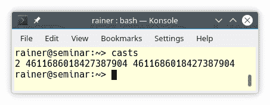

**图 8.12. GCC 或 Clang 编译器的错误转换**

C 风格转换糟糕之处在于：你看不出实际上执行了哪种转换。如果你执行 C 风格转换，在必要时会应用组合转换。粗来说，C 风格转换从 `static_cast` 开始，继续通过 `const_cast`，最后执行 `reinterpret_cast`。

### ES.49：如果必须使用转换，请使用命名转换

《Python 之禅》中的原则“显式优于隐式”也适用于 C++ 中的类型转换：如有必要，请使用命名转换。在 C++11 中，我们有以下六种转换转换：

- `static_cast`：相似类型之间的转换，例如指针类型或数值类型。
- `const_cast`：添加或移除 `const` 或 `volatile` 饰符。
- `reinterpret_cast`：在指针之间或整数类型之间转换。
- `dynamic_cast`：在同一类层次结构中的多态指针或引用之间转换。
- `std::move`：转换为右值引用。
- `std::forward`：将左值转换为左值引用，将右值转换为右值引用。

我假设你对我将 `std::move` 和 `std::forward` 作为转换感到惊讶。让我们仔细观察 `std::move` 的内部实现：

`static_cast<std::remove_reference<decltype(arg)>::type&&>(arg)`

这里发生了什么？首先，通过 `decltype(arg)` 推导出参数 `arg` 的类型。随后，移除所有引用，并添加两个新的引用。最终，我们总是得到一个右值引用。

```cpp
std::vector<int> vec = {0, 1, 2, 3, 4, 5};

// for 循环
for(std::size_t i = 0; i < vec.size(); ++i) {
    std::cout << vec[i] << ' ';
}

// 基于范围的 for 循环
for (auto ele : vec) std::cout << ele << ' ';
```

- 基于范围的 `for` 循环更易读，而且在循环期间你不会产生索引错误，也不会更改索引。（ES.71: 当有选择时，优先使用范围 `for`-语句代替 `for`-语句；ES.86: 避免在原始 `for` 循环的体内部修改循环控制变量）
- 当你有一个显而易见的循环变量时，应该使用 `for` 循环而不是 `while` 语句（ES.72: 有显而易见的循环变量时，优先使用 `for`-语句代替 `while`-语句）；如果没有，则应该使用 `while` 语句（ES.73: 在没有显而易见的循环变量时，优先使用 `while`-语句代替 `for`-语句）。

```cpp
for (auto i = 0; i < vec.size(); ++i) {
    // 执行工作
}

int events = 0;

while (wait_for_event()) {
    ++events;
    // 执行工作
}
```

- 你应该在 `for` 循环中声明循环变量（ES.74: 优先在 `for`-语句的初始化部分声明循环变量）。提醒你一下，从 C++17 开始，声明像 `result` 这样的变量也可以在 `if` 或 `switch` 语句的初始化部分完成。

```cpp
std::map<int,std::string> myMap;

if (auto result = myMap.insert(value); result.second){
    useResult(result.first);
    // ...
}
else{
    // ...
} // result 会自动销毁
```

- 避免使用 `do while` 语句（ES.75: 避免 `do`-语句）、`goto` 语句（ES.76: 避免 `goto`），并在迭代语句中尽量少使用 `break` 和 `continue`（ES.77: 在循环中最小化 `break` 和 `continue` 的使用），因为它们难以阅读。如果某些代码难以阅读，它就容易出错并让你的代码重构变得具有挑战性。`break` 语句结束迭代语句，而 `continue` 语句结束当前的迭代步骤。

## 优先使用算法而不是原始循环

这一节中缺少了一条元规则：“只要为该目的提供了合适的命名算法，就应优先使用算法而不是原始循环”（Bjarne Stroustrup 在其校对期间提出）。标准模板库（STL）中提供的 100 多种算法为容器提供了隐式操作。这些操作通常可以通过 lambda 表达式进行适配，或者在并行、向量化版本或并行且向量化的版本中执行。

```cpp
std::vector<int> vec = {-10, 5, 0, 3, -20, 31};

// 允许并行执行
std::sort(std::execution::par, vec.begin(), vec.end());

// 允许并行且向量化执行
std::sort(std::execution::par_unseq, vec.begin(), vec.end())
```

## 选择语句

`if` 和 `switch` 是 C++ 的选择语句，我们从 C 继承而来。

- 当有选择时，你应该优先使用 `switch` 语句而不是 `if` 语句（ES.70: 有选择时，优先使用 `switch` 语句代替 `if`-语句），因为 `switch` 语句可能更具读性，并且比 `if` 语句更容易优化。

接下来的两个与 `switch` 语句相关的规则比之前的需要更多关注。

### ES.78：不要依赖 switch 语句中的隐式贯贯穿（fallthrough）

我在遗留代码中见过 `switch` 语句，它们有超过百多个 case 标签。如果你使用了不带 `break` 的非空 case，那么这些 `switch` 语句的维护将非常困难。

```cpp
switch (eventType) {
case Information:
    update_status();
case Warning:
    update_log();
    break;
case Error:
    display_error();
}
```

由于没有 `break` 语句，`Warning` case 会自动执行。从 C++17 开始，我们可以使用 `[[fallthrough]]` 属性来表达这种意图。

```cpp
switch (n) {
case 1:
    g(); [[fallthrough]]; // (1)
case 2:
    h();                  // (2)
case 3:
    i();                  // (3)
}
```

`[[fallthrough]]` 属性在 (1) 中消除了警告。对于 (2)，它是合法的。而 (3) 编译器可能产生警告。

### ES.79：使用 default 处理常见情况

`switch.cpp` 示例说明了这一规则。

```cpp
// switch.cpp
#include <iostream>

enum class Message{
    information,
    warning,
    error,
    fatal
};

void writeMessage() { std::cerr << "message" << '\n'; }
void writeWarning() { std::cerr << "warning" << '\n'; }
void writeUnexpected() { std::cerr << "unexpected" << '\n'; }

void withDefault(Message message) {
    switch(message) {
        case Message::information:
            writeMessage();
            break;
        case Message::warning:
            writeWarning();
            break;
        default:
            writeUnexpected();
            break;
    }
}

void withoutDefaultGood(Message message) {
    switch(message) {
        case Message::information:
            writeMessage();
            break;
        case Message::warning:
            writeWarning();
            break;
        // 默认什么都不做
    }
}

void withoutDefaultBad(Message message) {
    switch(message) {
        case Message::information:
            writeMessage();
            break;
        case Message::warning:
            writeWarning();
        // 缺少 default case
    }
}

int main() {
    withDefault(Message::fatal);
    withoutDefaultGood(Message::information);
    withoutDefaultBad(Message::warning);
}
```

`withDefault` 和 `withoutDefaultGood` 的实现足够清晰。`withoutDefaultGood` 的维护者知道由于这个 `switch` 语句缺少 default case。从维护的角度比较 `withoutDefaultGood` 和 `withoutDefaultBad`。你确定是 `withoutDefaultBad` 的实现者忘记了 default case，还是后来添加了枚举值 `Message::error` 和 `Message::fatal`？为了确定，你必须研究源代码，或者尽可能询问代码作者。

## 算术

这七条算术规则带来了巨大的意外性。它们关注两个主题：有符号和无符号整数的算术，以及典型的算术错误如溢出/下溢和除零。

#### 有符号/无符号整数的算术

违反这些算术规则会导致意外的结果。

### ES.100：不要混合有符号和无符号算术

如果你混合了有符号和无符号算术，可能无法得到预期的结果。

```cpp
// mixSignedUnsigned.cpp
#include <iostream>

int main() {
    int x = -3;
    unsigned int y = 7;
    std::cout << x - y << '\n';  // 4294967286
    std::cout << x + y << '\n';  // 4
    std::cout << x * y << '\n';  // 4294967275
    std::cout << x / y << '\n';  // 613566756
}
```

GCC、`clang` 和 Microsoft 编译器都会产生相同的结果。

在有符号操作数上执行位运算符操作（`~`、`>>`、`>>=`、`<<`、`<<=`、`&`、`&=`、`^`、`^=`、`|` 和 `|=`）会产生实现定义的行为（implementation-defined behavior）。实现定义的行为意味着该行为在不同的实现之间会有差异，且实现必须记录每个行为的影响。因此，不要在有符号类型上进行位操作，而应使用无符号类型：

```cpp
unsigned char x = 0b00110010;

unsigned char y = ~x;  // y == 0b11001101
```

### ES.102：算术中使用有符号类型

首先，你不应该对无符号类型进行算术运算，因为两个值相减经常得到负值。其次，根据前面的规则，你不应该混合有符号和无符号算术：ES.100：不要混合有符号和无符号算术。让我们看看当我违反这条规则时会发生什么。

GCC、`clang` 和微软编译器产生相同的结果。

```cpp
// signedTypes.cpp

#include <iostream>

template<typename T, typename T2>

T subtract(T x, T2 y) {

    return x - y;
}

int main() {

    int s = 5;
    unsigned int us = 5;

    std::cout << subtract(s, 7) << '\n';       // -2
    std::cout << subtract(us, 7u) << '\n';     // 4294967294
    std::cout << subtract(s, 7u) << '\n';      // -2
    std::cout << subtract(us, 7) << '\n';      // 4294967294
    std::cout << subtract(s, us + 2) << '\n';  // -2
    std::cout << subtract(us, s + 2) << '\n';  // 4294967294

}
```

### ES.106：不要试图通过使用 `unsigned` 来避免负值

存在一种有趣的关系。当你给 `unsigned int` 赋值 `-1` 时，你会得到最大的 `unsigned int`。

算术表达式的行为在 `signed` 和 `unsigned` 类型之间可能有所不同。

让我们从一个简单的程序开始。

```cpp
// modulo.cpp

#include <cstddef>

#include <iostream>

int main(){

    std::cout << '\n';

    unsigned int max{100000};
    unsigned short x{0};
    std::size_t count{0};

    while (x < max && count < 20) {

        std::cout << x << " ";

        x += 10000;       // (1)
        ++count;
    }

    std::cout << "\n\n";

}
```

程序的关键点在于，`(1)` 中对 `x` 的连续加法并没有触发溢出，而是在 `x` 取值范围结束时会触发取模运算。原因是 `x` 的类型是 `unsigned short`。


将`x`改为有符号类型会剧烈改变程序的行为。

```cpp
// overflow.cpp

#include <cstddef>

#include <iostream>

int main() {

    std::cout << '\n';

    int max{100000};
    short x{0};
    std::size_t count{0};

    while (x < max && count < 20) {

        std::cout << x << " ";

        x += 10000;
        ++count;
    }

    std::cout << "\n\n";

}
```

现在加法触发了溢出。在截图中，我用红色圈标记了关键点。


**图 8.13. `unsigned`与`signed`类型的取模与溢出对比**

### 检测溢出

你可能有一个迫在眉睫的问题：如何检测溢出？非常简单！将错误的赋值`x += 1000`替换为使用大括号的表达式：`x = {x + 1000}`。

区别在于编译器会检查窄转换（narrowing conversions），从而检测到溢出。这里是`GCC`的输出。


**图 8.14. 检测窄转换**

### 算术错误

以下三条规则始终会导致未定义行为。

### ES.103: 不要溢出，且 ES.104: 不要下溢

让我结合这两个规则。溢出或下溢的影响是相同的：内存损坏，从而导致未定义行为。让我们用一个`int`数组做一个简单的测试。当我用`GCC`编译时，以下程序会运行多久？

```cpp
// overUnderflow.cpp

#include <cstddef>

#include <iostream>

int main() {

    int a[0];
    int n = 0;

    while (true){

        if (!(n % 100)){

            std::cout << "a[" << n << "] = " << a[n]
                      << ", a[" << -n << "] = " << a[-n] << '\n';
        }

        a[n] = n;
        a[-n] = -n;
        ++n;
    }
}
```

运行时间长得惊人。


**图 8.15. 下溢与溢出**

### ES.105: 不要除零

除零可能会导致执行崩溃。

```cpp
auto res = 5 / 0;
```

短路求值的除零是安全的。

```cpp
auto res = false && (5 / 0);
```

#### 相关规则

与表达式相关的规则范围很广。在引用的规则中查找更多细节：

- ES.56: 仅在需要将对象移动到另一个对象时才使用`std::move()`（参见参数传递）

- ES.60: 在资源管理之外避免使用`new`和`delete`（参见 R.12: 立即资源分配）

- ES.63: 不要进行切片操作（参见 C.67: 多态类应抑制拷贝）

- ES.64: 使用`T{e}`记法进行构造（参见 ES.23: 优先使用 {}-初始化）

### 提要总结

**重要**

- 如果你写了一个循环，你可能对标准模板库 (STL) 的算法了解得不够充分。STL 拥有超过 100 种算法。

- 良好的命名可能是优秀软件最重要的规则。良好的命名意味着你的名称应该是自解释的、应该尽可能是局部的、不应该与现有名称相似、不应该使用全大写（ALL_CAPS），并且不应该在嵌套作用域中重用。

- 始终初始化变量。优先使用`{}`-初始化以防止窄转换。对于`const`变量的复杂初始化，使用就地 lambda 表达式。

- 不要使用宏定义常量或函数。如果你必须使用它们或维护现有的，请使用唯一的全大写（ALL_CAPS）名称。

- 如果可能，你应该优先使用范围循环（range-base for loop）而不是`for`循环。范围循环更容易读且不会引起索引错误。

- 你应该优先使用`switch`语句而不是`if`语句。`switch`语句更容易读且具有更多优化潜力。

- 除非有特殊原因，否则使用有符号整数，且不要混合有符号和无符号算术。

- 注意溢出或下溢是未定义行为，并且通常会导致你的程序在运行时崩溃。

真正的问题在于，程序员花费了太多的时间在错误的地方、错误的时间关注效率；过早优化是编程中一切邪恶的根源（至少是大部分的根源）。

—唐纳德·克努斯，《计算机程序的艺术》（1974）

简而言之，请记住“过早优化是一切邪恶的根源”这句话。在做出任何性能假设之前，请应用性能分析中最关键的规则：`Measure the performance of your program`。

如果没有性能数据，你将不知道：

- 你的程序哪个部分是瓶颈？
- 对于你的用户来说，多快才算足够？
- 程序潜在可以有多快？

使用真实数据进行性能测试，并在版本控制下进行测试。每当你更改基础设施（如硬件或编译器）时，都要重新运行这些性能测试。

基于错误的假设进行大量的优化是一种典型的反模式。

#### 错误的假设

- Per.4: 不要假设复杂的代码一定比简单的代码快

- Per.5: 不要假设低层代码一定比高层代码快

- Per.6: 在没有测量的情况下对性能做出任何结论

在我继续之前，我必须做一个免责声明：我不推荐使用臭名昭著的单例模式。单例有许多缺点。你可以在专门介绍单例的章节阅读更多关于它们的信息。我在本节中使用单例模式是因为接下来的示例是基于真实世界的案例。

让我给你展示复杂且底层的代码并不总是有利的。为了证明我的观点，我必须衡量各种单例实现的性能。

该性能测试的核心思想是从四个线程中调用 40,000,000 次单例模式，测量每个线程的执行时间并将数字相加。由于我的机器有四个核心，四个线程似乎是正确的选择。单例模式是延迟初始化的；因此，第一次调用必须对其进行初始化。

不要太看重性能数字。它们应该只给你一个大致的感受。

我的第一个实现是基于所谓的 Meyers 单例。它是线程安全的，因为 C++11 标准保证具有块作用域的静态变量以线程安全的方式初始化。

```cpp
 1 // singletonMeyers.cpp

 2

 3 #include <chrono>

 4 #include <iostream>

 5 #include <future>

 6

 7 constexpr auto tenMill = 10'000'000;

 8

 9 class MySingleton {
10 public:
11     static MySingleton& getInstance() {
12         static MySingleton instance;
13         volatile int dummy{};
14         return instance;
15     }
16 private:
17     MySingleton()= default;
18     ~MySingleton()= default;
19     MySingleton(const MySingleton&)= delete;
20     MySingleton& operator = (const MySingleton&)= delete;
21 };

22
23 std::chrono::duration<double> getTime() {

24
25     auto begin= std::chrono::system_clock::now();
26     for (size_t i = 0; i < tenMill; ++i) {
27         MySingleton::getInstance();
28     }
29     return std::chrono::system_clock::now() - begin;
30
31 };
32
33 int main() {

34
35     auto fut1 = std::async(std::launch::async,getTime);
36     auto fut2 = std::async(std::launch::async,getTime);
37     auto fut3 = std::async(std::launch::async,getTime);
38     auto fut4 = std::async(std::launch::async,getTime);

39
40     auto total = fut1.get() + fut2.get() +
41                  fut3.get() + fut4.get();

42
43     std::cout << total.count() << '\n';

44
45 }
```

第 12 行使用了 C++11 运行时的保证，即单例是以线程安全的方式初始化的。main 函数中的四个线程每个在第 27 行调用单例千万次。总共产生了四千万次调用。第 13 行的`volatile`变量`dummy`是必要的。如果没有`dummy`变量，优化器会完美工作并移除第 26-28 行的循环。当然，性能数字将会非常令人惊叹。

让我们尝试做得更好。这次我使用原子操作来使单例模式线程安全。我的实现是基于臭名昭著的双重检查锁定模式。为了简单起见，我只展示`MySingleton`类的实现。

```cpp
class MySingleton {
public:
    static MySingleton* getInstance() {
        MySingleton* sin= instance.load(std::memory_order_acquire);
        if ( !sin ) {
            std::lock_guard<std::mutex> myLock(myMutex);
            sin = instance.load(std::memory_order_relaxed);
             if( !sin ){
                 sin = new MySingleton();
                 instance.store(sin,std::memory_order_release);
             }
        }
        volatile int dummy{};
        return sin;
    }

private:
    MySingleton()= default;
    ~MySingleton()= default;
    MySingleton(const MySingleton&)= delete;
    MySingleton& operator = (const MySingleton&)= delete;
    static std::atomic<MySingleton*> instance;
    static std::mutex myMutex;
};

std::atomic<MySingleton*> MySingleton::instance;
std::mutex MySingleton::myMutex;
```

为了理解这个实现，你必须学习内存顺序（memory orderings），考虑获取-释放语义（acquire-release semantics），并思考同步和排序限制。这不是一项容易的工作，可能需要几天时间。

但你知道吗，高度复杂的代码是有回报的。

该死。我忘记应用性能优化的关键规则：Per.6: 在没有测量的情况下对性能做出任何结论。这里是 Meyers 单例在 Linux 上的性能数据。我像往常一样使用最大优化编译了程序。


**图 9.2. Meyers 单例的性能**

现在我很好奇。我那高度复杂的代码的数值是多少？


**图 9.3. 基于获取-释放语义的单例的性能**

慢了 80%！慢了 80%，而且我们甚至无法证明该实现是正确的。

我们结束了吗？不！我还没有基准。基准应该是你性能测试的起点，而不是终点。四千万次单例调用可以有多快？在没有同步开销的单线程实现中调用四千万次单例为我提供了一个良好的基准。


**图 9.4. 单线程情况下的单例性能**

单线程执行大约花费 0.024 秒，基于 Meyers 单例的多线程执行大约花费 0.035 秒。这意味着同步开销使得 Meyers 单例变慢了 45%。

这种微小的同步开销非常显著。如果你想了解单例模式线程安全化的完整故事，请阅读文章：单例的线程安全初始化。这个故事包含了基于函数`std::call_once`和`std::once_flag`、锁`std::lock_guard`以及使用顺序一致性（sequential consistency）的原子的额外实现。提供的性能数据适用于 Linux (GCC) 和 Microsoft 平台 (cl.exe)。

### 启用优化

最后一部分关于错误的假设。现在，我想采取乐观的态度。

**通过 Compiler Explorer 获取终极真理**

如果你想知道哪个代码被优化得更好，你必须研究生成的汇编指令。Compiler Explorer 为各种编译器（包括 GCC、clang 和 Microsoft Compiler）生成汇编指令。可以使用各种版本的编译器。此外，你可以指定编译器标志，如`-O3`或`/Ox`以实现最大优化。

#### Per.7: 设计以支持优化

这条规则特别适用于移动语义（move semantics）。因为你应该使用移动语义而非拷贝语义（copy semantics）来编写算法。使用移动语义会自动带来几处优势：

1. 相比昂贵的拷贝操作，你的算法使用了廉价的移动操作。
2. 你的算法要稳定得多，因为它不需要内存分配，因此不会发生`std::bad_alloc`异常。
3. 你可以将你的算法与如`std::unique_ptr`等仅支持移动的类型配合。

你可能会发现我的论证中存在一个漏洞。如果我在需要移动语义的算法中使用仅拷贝的类型会发生什么呢？

```cpp
// swap.cpp

#include <algorithm>

#include <iostream>

#include <utility>

template <typename T>
void swap(T& a, T& b) noexcept {  // (2)

    T tmp(std::move(a));
    a = std::move(b);
    b = std::move(tmp);
}

class BigArray {
public:
    explicit BigArray(std::size_t sz): size(sz), data(new int[size]) {}
    BigArray(const BigArray& other): size(other.size), data(new int[other.size]) {
        std::cout << "Copy constructor" << '\n';
        std::copy(other.data, other.data + size, data);
    }
    BigArray& operator = (const BigArray& other) {
        std::cout << "Copy assignment" << '\n';
        if (this != &other){
            delete [] data;
            size = other.size;
            data = new int[size];
            std::copy(other.data, other.data + size, data);
        }
        return *this;
    }
    ~BigArray() {
        delete[] data;
    }
private:
    std::size_t size;
    int* data;
};

int main(){
    std::cout << '\n';
    BigArray bigArr1(21);
    BigArray bigArr2(17);
    swap(bigArr1, bigArr2);  // (1)
    std::cout << '\n';
}
```

`BigArray`不支持移动语义，仅支持拷贝语义。如果我交换`BigArray`的 (1) 会发生什么？我的`swap`算法使用了移动语义 (2)。让我们尝试一下。

![Images/swap.jpg]

**图 9.5 仅拷贝类型上的移动语义**


在仅拷贝类型上应用移动操作会触发拷贝操作。拷贝语义是移动语义的一种回退机制（fallback）。你可以从反面看到这一点。移动是优化后的拷贝。这怎么可能？我的算法中请求了移动操作。原因是`std::move`返回的是右值（rvalue）。`const`左值可以绑定到右值，而拷贝构造函数或拷贝赋值运算符接收的是`const`左值。如果`BigArray`拥有移动构造函数或移动赋值运算符，这两者的优先级都会高于拷贝构造函数或拷贝赋值运算符。使用移动语义实现算法意味着，如果你的数据支持，移动语义就会生效。如果没有，则使用拷贝语义作为回退。最坏的情况下，你会得到传统的行为。

当你研究拷贝赋值运算符时，它存在许多缺陷。缺陷如下：

1. 表达式`if(this != &other)`检查了自赋值（self-assignment）。大多数时候自赋值不会发生，但该检查始终会执行。

2. 如果分配`data = new int[size]`失败，`this`已经被修改。`size`是错误的，且`data`已经被删除。这意味着拷贝构造函数保证了异常后没有内存泄漏。

3. 表达式`std::copy(other.data, other.data + size, data)`被用于拷贝构造函数和拷贝运算符。

为`BigArray`实现一个`swap`函数并借助`swap`函数实现拷贝赋值运算符可以解决所有这些缺陷。这里是拷贝赋值运算符，它按值传递参数。因此，没有必要进行自赋值检查。

```
BigArray& operator = (BigArray other) {
    swap(*this, other);
    return *this;
}
```

`BigArray`仍然有少量缺陷。使用`std::vector`代替C数组可以解决这些问题。`BigArray`的定义简化为了几行：

```
class BigArray {
public:
    BigArray(std::size_t sz): vec(std::vector<int>(sz)) {}
private:
    std::vector<int> vec;
};
```

如果类的所有成员都支持“大六件”（big six），编译器就可以自动生成。大六件包括默认构造函数、析构函数、拷贝构造函数、拷贝赋值运算符、移动构造函数和移动赋值运算符。`std::vector`支持大六件，因此`BigArray`也支持（例外外）。由于用户定义的构造函数，`BigArray`没有默认构造函数。

## 10 依赖静态类型系统

你有许多方法可以帮助编译器生成更优化的代码。

- **编写本地代码：** 使用原地lambda（in-place lambda）而不是函数来调整`std::sort`的行为通常是更快变。编译器拥有所有可用信息来生成最优化的代码。相反，函数可能定义在另一个编译单元中，这对优化器来说是一个硬边界。

```cpp
bool lessLength(const std::string& f, const std::string& s){
    return f.size() < s.size();
}

int main() {
    std::vector<std::string> vec = {"12345", "123456", "1234", "1", "12", "123", "12345"};
    // 函数作为谓词
    std::sort(vec.begin(), vec.end(), lessLength);
    // lambda 作为谓词
    std::sort(vec.begin(), vec.end(),
              [](const std::string& f, const std::string& s) {
                  return f.size() < s.size();
              });
}
```

- **编写简单的代码：** 优化器寻找已知模式。如果你的代码是手工编写且复杂的，你会增加优化器寻找模式的难度。最终，你通常获得优化较的代码。

- **给编译器提供额外提示：** 当你的函数不会抛出异常或你不在乎时，将其标记为`noexcept`。如果虚函数不应该被重写，将其标记为`final`对优化器同样具有价值。

## 11 将计算从运行时移动到编译时

示例展示了`gcd`算法，它在运行时计算最大公约数。`gcd`使用欧几里得算法实现。

```cpp
int gcd(int a, int b) {
    while (b != 0) {
        auto t = b;
        b = a % b;
        a = t;
    }
    return a;
}
```

通过将`gcd`声明为`constexpr`，`gcd`变成一个可以在编译时执行的函数。`constexpr`函数有一些限制：`gcd`不得使用`static`或`thread_local`变量、异常处理、`goto`语句，且所有变量必须初始化并具有字面量类型（literal type）。

将`gcd`声明为`constexpr`函数并不意味着它必须在编译时运行。它意味着`gcd`具有在编译时运行的潜力。如果`constexpr`函数被用于常量表达式，则它必须在编译时执行。(1) 中的`resl`是一个常量表达式，因为我使用一个`constexpr`变量`res1`来请求结果。(2) 中的`res2`不是常量表达式，因为(3) 中的`val`不是常量表达式。当我将`res2`改为`constexpr auto res2`时，我得到了一个错误：`val`不是常量表达式。下面的图像显示了程序的输出。


**图 9.6. 在编译时和运行时调用`gcd`**

再次强调，这里有一个关键的观察：**你可以在运行时和编译时使用`constexpr`函数。要在编译时使用它，它的参数必须是常量表达式。**

得益于Compiler Explorer，我可以展示该程序相关的汇编指令。第18行对函数`gcd(121, 11)`的调用最终归结为其常量结果。


**图 9.7. 算法`gcd`相关的汇编指令**

### Per.19: 可预测地访问内存

什么是可预测？例如，你从内存中读取一个`int`比读取这一个`int`的大小要多。整个缓存行（cache line）会被从内存中读取并存储在CPU缓存中。

在现代架构上，缓存行通常为64字节。如果你现在从内存请求另一个变量，而该变量已经处于缓存中，则读取将直接使用该缓存，操作速度会快得多。

像`std::vector`这种将数据存储在连续内存块中的数据结构是缓存友好型数据结构，因为缓存行中的每个元素通常都会被用到。这种缓存友好性也适用于`std::array`和`std::string`。

`std::deque`在结构上类似于`std::vector`，但`std::deque`的元素并没有存储在连续的内存块中。`std::deque`的元素通常存储在一个固定固定大小数组中。在将新数组添加到`std::deque`之前，会先填充这些固定大小的数组。


**图 9.8. `std::deque`**

相比之下，`std::list`和`std::forward_list`是双向或单向链容器。`std::list`在两个方向上增长，而`std::forward_list`只在一个方向增长。


**图 9.9. `std::list`**


**图 9.10. `std::forward_list`**

这就是缓存行的理论。现在，我很好奇：读取并累加`std::vector`、`std::deque`、`std::list`和`std::forward_list`的所有元素是否会对性能产生差异。这个程序给出了答案。

```cpp
 1 // memoryAccess.cpp

 2

 3 #include <forward_list>

 4 #include <chrono>

 5 #include <deque>

 6 #include <iomanip>

 7 #include <iostream>

 8 #include <list>

 9 #include <string>

10 #include <vector>

11 #include <numeric>

12 #include <random>

13

14 const int SIZE = 100'000'000;

15

16 template <typename T>
17 void sumUp(T& t, const std::string& cont) {

18

19     std::cout << std::fixed << std::setprecision(10);

20

21     auto begin = std::chrono::steady_clock::now();
22     std::size_t res = std::accumulate(t.begin(), t.end(), 0LL);
23     std::chrono::duration<double> last =
24         std::chrono::steady_clock::now() - begin;
25     std::cout << cont <<  '\n';
26     std::cout << "time: " << last.count() << '\n';
27     std::cout << "res: " << res << '\n';
28     std::cout << '\n';

29

30     std::cout << '\n';

31

32 }

33

34 int main() {

35

36     std::cout << '\n';

37

38     std::random_device seed;
39     std::mt19937 engine(seed());
40     std::uniform_int_distribution<int> dist(0, 100);

41

42     std::vector<int> randNum;
43     randNum.reserve(SIZE);
44     for (int i = 0; i < SIZE; ++i){
45         randNum.push_back(dist(engine));
46     }

47

48     {
49         std::vector<int> vec(randNum.begin(), randNum.end());
50         sumUp(vec,"std::vector<int>");
51     }

53

54     {
55         std::deque<int>deq(randNum.begin(), randNum.end());
56         sumUp(deq,"std::deque<int>");
57     }

59

60     {
61         std::list<int>lst(randNum.begin(), randNum.end());
62         sumUp(lst,"std::list<int>");
63     }

64

65     {
66         std::forward_list<int>forwardLst(randNum.begin(),
67                               randNum.end());
68         sumUp(forwardLst,"std::forward_list<int>");
69     }

70 }
```

程序`memoryAccess.cpp`首先创建了1亿个在0到100之间的随机数（第38行）。然后分别使用`std::vector`（第50行）、`std::deque`（第56行）、`std::list`（第61行）和`std::forward_list`（第67行）来累加元素。实际工作在`sumUp`函数中完成（第16-32行）。我的推测是GCC、clang和Microsoft Visual Studio编译器使用了非常相似的`std::accumulate`实现。

```cpp
template<class InputIt, class T>
T accumulate(InputIt first, InputIt last, T init) {
    for (; first != last; ++first) {
        init = init + *first;
    }
    return init;
}
```

因此，元素的访问时间是影响整体性能的主要因素。


**图 9.11. Windows上序列容器的内存访问**

以下是几点观察：

• `std::vector`的速度比`std::list`或`std::forward_list`快30倍。

• `std::vector`的速度比`std::deque`快5倍。

• `std::deque`的速度比`std::list`和`std::forward_list`快6倍。

• `std::list`和`std::forward_list`处于同一水平。

尽管我在Linux上使用GCC编译器得到了类似的相对数字，但不要过于看这些性能数据。这些性能数据有力地表明，元素的访问时间很大程度上取决于容器的缓存友好性。

## 第10章。并发


图 10.1. Cippi面临的线程挑战

《C++ Core Guidelines》列出了约30条关于并发的规则，专注于三个主要目标：

• 帮助编写适用于多线程环境的代码

• 展示使用标准库提供的线程原语的清晰、安全的方法

• 当并发和并行无法提供所需性能时提供指导

### 通用指南

尽管这一节的规则有一个通用的侧重点，但它们所有规则都非常重要。

### CP.1: 假设你的代码将作为多线程程序的一部分运行

也许，你看到这条规则会感到惊讶。我为什么要针对特例情况进行优化？为了清晰起见，这条规则主要针对库代码。经验表明，库代码通常会被复用。这种复用意味着代码可能会在多线程程序中被执行。

代码片段展示了指南中的一个示例。

```
 1 double cached_computation(double x) {

 2     static double cached_x = 0.0;

 3     static double cached_result = COMPUTATION_OF_ZERO;

 4     double result;

 5

 6     if (cached_x == x) return cached_result;

 7     result = computation(x);

 8     cached_x = x;

 9     cached_result = result;

10     return result;

11 }
```

`cached_computation`函数在单线程环境中运行是良好的。这种观察在多线程环境中并不成立，因为静态变量`cached_x`（第2、6和9行）和`cached_result`（第3、6和9行）可以被多个线程同时修改。

对共享非原子变量进行不同步的读写会导致数据竞态。因此，你的程序具有未定义行为。

你有哪些方案来消除数据竞态？

1. 使用一把锁来保护整个临界区域。

2. 使用锁保护对函数`cached_computation`的调用。

3. 将两个`static`变量都改为`thread_local`。`thread_local`保证每个线程都有自己的变量`cached_x`和`cached_result`。静态变量绑定到主线程的生命，而`thread_local`变量绑定到所属线程的生命。


```cpp
std::mutex m;

double cached_computation(double x) {               // (1)

    static double cached_x = 0.0;

    static double cached_result = COMPUTATION_OF_ZERO;

    double result;

    {

        std::lock_guard<std::mutex> lck(m);
   if (cached_x == x) return cached_result;
   result = computation(x);
   cached_x = x;
   cached_result = result;

    }

    return result;
}

std::mutex cachedComputationMutex;                  // (2)

{

    std::lock_guard<std::mutex> lck(cachedComputationMutex);

    auto cached = cached_computation(3.33);
}

double cached_computation(double x) {               // (3)

    thread_local double cached_x = 0.0;

    thread_local double cached_result = COMPUTATION_OF_ZERO;

    double result;

    if (cached_x == x) return cached_result;

    result = computation(x);

    cached_x = x;

    cached_result = result;

    return result;

}
```

首先，C++11 标准保证 C++ 运行时以线程安全的方式初始化 `static` 变量；因此，你不需要保护它们的初始化。

1. 这个版本使用了粗粒度锁的方法。通常，你不应该在这种版本中使用这种粗粒度锁，但在这种用例下，可能是可以的。

2. 这个版本是最粗粒度的解决方案，因为整个函数都被锁定了。当然，缺点是函数的用户需要负责同步。通常情况下，这是一个坏主意。

3. 只需要让静态变量变为 `thread_local`，就完成了。

## CP.2: 避免数据竞态

首先，什么是数据竞态？

- `data race` 是一种情况，其中至少有两个线程在没有同步的情况下访问同一个非原子共享变量，且至少有一个线程尝试修改该变量。

其余部分很简单。如果你的程序中存在数据竞态，你的程序就有未定义行为。

如果你仔细阅读数据竞态的定义，你会发现共享可变状态是产生数据竞态的。这里有一张图展示这一关键观察。你应该避免右下象限，特别是在并发环境中。


图 10.2 变量的四类

让我给你展示一个简单的数据竞态。

```cpp
// dataRace.cpp

#include <future>

int getUniqueId() {

  static int id = 1;
  return id++;

}

int main() {
    auto fut1 = std::async([]{ return getUniqueId(); });

    auto fut2 = std::async([]{ return getUniqueId(); });

    auto id = fut1.get();

    auto id2= fut2.get();

}
```

可能会出现什么问题？例如 `id++` 是一个读-修改-写操作。即使读、修改、写三个操作本身都是原子的，读-修改-写操作整体也不是原子的。这种数据竞态的影响高概率是，`id` 值将是不唯一的。

## CP.3: 最小化可写数据的显式共享

基于之前关于数据竞态的规则，你的共享数据应该是常量。

现在，唯一需要解决的挑战是如何以线程安全的方式初始化常量共享数据。C++11 支持几种实现此目标的方法。

1. 在启动线程之前初始化你的数据。这并不是因为 C++11 的特性，但通常非常容易实现。

```cpp
const std::map<std::string, int> data = {{"a", 1}, {"b", 2}};
std::thread t([](){
    // 使用 data
});
t.join();
```

2. 使用 `constexpr` 表达式。

```cpp
constexpr int value = 42;
```

3. 使用 `std::once_flag` 配合 `std::call_once`。你可以将初始化逻辑放入函数中。`std::call_once` 保证函数只执行一次。

```cpp
std::once_flag onceFlag;
void init() {
    // 初始化共享数据
}

void func() {
    std::call_once(onceFlag, init);
}
```

4. 使用局部 `static` 变量，因为 C++ 运行时保证它们是以线程安全的方式初始化的。

```cpp
void func() {
    static int val = init_function();
}
```

如果你想在 Java 或 C# 中获得原子性，你需要将其声明为 `volatile`。你可能认为在 C++ 中也可以做同样的操作？那是错误的。在 C++ 中，`volatile` 没有多线程语义。在 C++11 中，原子操作被称为 `std::atomic`。

现在，你可能很好奇：`volatile` 在 C++ 中意味着什么呢？

`volatile` 旨在用于特殊对象，这些对象不允许经过优化的读或写操作。`volatile` 通常用于嵌入式编程领域，表示可以独立于常规程序流而发生改变的对象。例如，代表外部设备（内存映射 I/O）的对象。由于这些对象可以独立于常规程序流而发生变化，因此它们的值会被直接写入主内存。因此，硬件缓存中不会对这些值进行优化的存储。

## CP.9: 只要可行，使用工具来验证你的并发代码

这条规则可能是最重要的规则之一，因此我完全赞同。

我的学生会写很多 Bug；事实上，甚至我自己的很多程序也也包含 Bug！我如何确保呢？因为有了了动态代码分析工具 `ThreadSanitizer` 和静态代码分析工具 `CppMem`。`ThreadSanitizer` 和 `CppMem` 的用例是不同的。

`ThreadSanitizer` 提供全局视图，并检测你的程序执行是否存在数据竞态（data race）。`CppMem` 则让你对代码的小片段进行详细的洞察，大多数时候包括原子操作。你会得到问题的答案：根据内存模型，哪些交织顺序是可能的？

让我们从 `ThreadSanitizer` 开始。

### ThreadSanitizer

这里是 `ThreadSanitizer` 的官方介绍：“`ThreadSanitizer`（又名 `TSan`）是 C/C++ 的数据竞态检测器。数据竞态是并发系统中常见且最难调试的 Bug 之一。当两个线程并发访问同一个非原子变量，且至少一次访问是写时，就会发生数据竞态。C++11 标准正式禁止数据竞态作为未定义行为。”

`ThreadSanitizer` 是 clang `3.2` 和 GCC `4.8` 的一部分。要使用它，你需要使用 `-fsanitize=thread` 进行编译链接，至少使用优化级别 `-O2` 以及用于生成调试信息的标志 `-g`：`-fsanitize=thread -O2 -g`。

运行开销是巨大的：内存占用可能会增加 5 到 10 倍，执行时间可能会增加 2 到 20 倍。当然，你知道软件开发著名的法则：首先，让你的程序正确；然后，让它变快。

现在，让我们看看 `ThreadSanitizer` 的运行。这是我经常在多线程课程中关于条件变量给出的典型练习：

编写一个小型乒乓球游戏。

- 两个线程应该交替将一个 `bool` 值设置为 true 或 false。一个线程将值设置为 true 并通知另一个线程。另一个线程将值设置为 false 并通知原始线程。该游戏在固定次数的迭代后结束。

这就是我的学生想出的典型实现。

```cpp
 1 // conditionVariablePingPong.cpp

 2

 3 #include <condition_variable>

 4 #include <iostream>

 5 #include <thread>

 6

 7 bool dataReady= false;

 8

 9 std::mutex mut;

10 std::condition_variable condVar1;

11 std::condition_variable condVar2;

12

13 int counter = 0;

14 int COUNTLIMIT = 50;

15

16 void setTrue() {

 17

18     while(counter <= COUNTLIMIT) {

19         std::unique_lock<std::mutex> lck(mut);

20         condVar1.wait(lck, []{return dataReady == false;});

21         dataReady = true;

22         ++counter;

23         std::cout << dataReady << '\n';

24         condVar2.notify_one();

25     }
26 }

 27

28 void setFalse() {

 29

30     while(counter < COUNTLIMIT) {

31         std::unique_lock<std::mutex> lck(mut);

32         condVar2.wait(lck, []{return dataReady == true;});

33         dataReady = false;

34         std::cout << dataReady << '\n';

35         condVar1.notify_one();

36     }
37 }

 38

39 int main() {

 40

41     std::cout << std::boolalpha << '\n';

 42

43     std::cout << "Begin: " << dataReady << '\n';

 44

45     std::thread t1(setTrue);

46     std::thread t2(setFalse);

 47

48     t1.join();

49     t2.join();

 50

51     dataReady = false;

52     std::cout << "End: " << dataReady << '\n';

 53

54     std::cout << '\n';

 55

56 }
```

函数 `setTrue`（第 16 行）将布尔值 `dataReady`（第 21 行）设置为 `true`，函数 `setFalse`（第 28 行）将其设置为 false。游戏从 `setTrue` 开始。函数中的条件变量等待通知，因此首先检查布尔值 `dataReady`（第 20 行）。之后，函数增加计数器（第 22 行），并借助条件变量 `condVar2`（第 24 行）通知另一个线程。函数 `setFalse` 遵循相同的流程。如果计数器等于 `COUNTLIMIT`（第 18 行），游戏结束。还可以吗？不！

计数器上存在数据竞态。它在没有同步的情况下被读取（第 30 行）和写入（第 22 行）。`ThreadSanitizer` 显示了该数据竞态。


图 10.3. 使用 ThreadSanitizer 检测数据竞态

`ThreadSanitizer` 在运行时检测数据竞态，而 `CppMem` 允许你分析较小的代码片段。

### CppMem

这里是 `CppMem` 的简要概述。

你也可以安装在 PC 上的在线工具提供了非常有价值的服务。

1. `CppMem` 验证小型代码片段，通常包括原子操作。

2. `CppMem` 非常准确的分析让你对代码有深入的洞察。

你会得到问题的答案：根据内存模型，哪些交织顺序是可能的？

这个工具让你深入理解 C++ 内存模型。

为了更深入的洞察，请阅读关于 Mathematizing Concurrency 的那篇很好的文章。当然，你也可以使用自己的代码。


图 10.4. CppMem 概览

**1. Model**

- 指定 C++ 内存模型。`preferred` 是 C++ 内存模型。

**2. Program**

- 它是 C 或 C++ 语法。`CppMem` 提供了原子操作的一些典型交织。你可以通过符号 `{{{ ... ||| }}}` 轻松定义两个线程。三个点 `(...)` 代表线程的工作包。

**3. Display Relations**

- 描述原子操作读写、屏障和锁之间的关系。

- 如果启用了关系，它将在标注图中显示（见点 6）。

- `sb`: 顺序优先

- `rf`: 读取自

- `mo`: 修改顺序

- `sc`: 顺序一致性

- `lo`: 锁顺序

- `sw`: 同步

- `dob`: 依赖排序

- `data_races`: 数据竞态

**4. Display Layout**

- 你可以通过此开关切换使用的 Doxygraph 图。

**5. Choose the Executions**

- 在不同的一致执行之间切换。

**6. Annotated Graph**

- 显示标注图。

为了使用 `CppMem`，你`must` 将你的 C++ 程序重写为 `CppMem` 解析器所期望的 C 方言。直接复制粘贴标准 C++ 代码会导致抛出一个晦涩的 "Frontc.ParseError"。以下是使用更简洁的 `CppMem` 语法编写的对应程序。

```
// dataRaceOnXCppMem.txt

int main(){

  int x = 0;

  atomic_int y = 0;

  {{{

    {
      x = 2000;

      y.store(11);

    }
  |||

    {
      y.load();
      x;

    }

  }}}

}
```

`CppMem` 会立即显示它。第一次一致的执行在 `x` 上存在数据竞态。


图 10.5. CppMem 中的数据竞态

你可以在图中观察到数据竞态。它是写操作 (`x=2000`) 和读操作 (`x=0`) 之间的黄色边 (`dr`)。

要了解更多关于 `CppMem` 的细节，请阅读我在 ModernesCpp.com 上写的博客文章：CppMem。

## 并发 (Concurrency)

并发是一个非常有挑战性的话题。这种挑战很大程度上是因为我们目前所使用的底层抽象程度较低。因此，了解并应用本节的规则对于获得一个定义良好的线程程序至关重要。

让我将大约十五条规则分为与锁、线程、条件变量相关的规则，但也包括线程之间的数据共享、资源考虑以及一种有时被忽视的危险。

### 锁 (Locks)

NNN 代表 **N**o **N**aked **N**ew（无裸露分配），意味着内存分配不应作为独立操作进行，而应该在管理对象内部进行（R.12: 立即将显式资源分配的结果交给管理对象）。同样的观察也适用于互斥锁（mutexes）。互斥锁应该立即交给管理对象，在这种情况下，就是一个锁。在现代 C++ 中，我们有 `std::lock_guard`、`std::unique_lock`、`std::shared_lock` (C++14) 或 `std::scoped_lock` (C++17)。因此，请记住缩写 NNM，它代表 **N**o **N**aked **M**utex（无裸露互斥锁）。锁实现了 RAII 模式。RAII 模式的核心思想是将资源的生命周期与局部变量的生命周期绑定。C++ 会自动管理局部变量的生命周期。

#### CP.20: 使用 RAII，永远不要使用普通的 `lock()`/`unlock()`

这段短代码应该会让锁的值变得清晰易见。

```
std::mutex mtx;

void do_stuff() {

    mtx.lock();

    // ... 执行某些事情 … (1)

    mtx.unlock();

}
```

无论 (1) 中是否发生异常或你只是忘记了解锁 `mtx`，都没有关系；在两种情况下，如果另一个线程想要获取（锁定）`std::mutex mtx`，你都将得到死锁。锁会来救急。

```
std::mutex mtx;

void do_stuff() {

    std::lock_guard<std::mutex> lck {mtx};

    // ... 执行某些事情 ...

}
```

将互斥锁放入锁中，互斥锁会在 `std::lock_guard` 的构造函数中自动锁定，并在 `lck` 离开作用域时解锁。

#### CP.21: 使用 `std::lock()` 或 `std::scoped_lock` 获取多个 `mutex`s

如果一个线程同时需要多个互斥锁，你必须非常小心，确保始终以相同的顺序锁定互斥锁。否则，线程之间糟糕交错可能会导致死锁。以下程序会导致死锁。


```cpp
// lockGuardDeadlock.cpp

#include <iostream>

#include <chrono>

#include <mutex>

#include <thread>

struct CriticalData {
  std::mutex mut;
};

void deadLock(CriticalData& a, CriticalData& b) {

    std::lock_guard<std::mutex> guard1(a.mut); // (1)

    std::cout << "Thread: " << std::this_thread::get_id() << '\n';

    std::this_thread::sleep_for(std::chrono::milliseconds(1));

    std::lock_guard<std::mutex> guard2(b.mut); // (1)

    std::cout << "Thread: " << std::this_thread::get_id() << '\n';

    // 对 a 和 b 执行某些事情 (critical region) (2)
}

int main() {

    std::cout << '\n';

    CriticalData c1;

    CriticalData c2;

    std::thread t1([&]{deadLock(c1, c2);});

    std::thread t2([&]{deadLock(c2, c1);});

    t1.join();

    t2.join();

    std::cout << '\n';
}
```

线程`t1`和`t2`需要两个`CriticalData`资源来执行任务 (2)。`CriticalData`有互斥锁`mut`来同步访问。不幸的是，它们以不同的顺序 (1) 调用函数`deadLock`，导致导致死锁。线程`t1`可以锁定第一个互斥锁`a.mut`，但此时`t2`锁定了第二个。


图 10.6. 多互斥锁导致的死锁

解决死锁最简单的方法是原子地锁定两个互斥锁。在 C++11 中，你可以使用`std::unique_lock`配合`std::lock`。得益于`std::defer_lock`标记，`unique_lock`在获取时不锁定。锁定最终发生在`std::lock`调用中。`std::lock`可以接受任意数量的参数。

```cpp
void deadLock(CriticalData& a, CriticalData& b) {

    std::unique_lock<mutex> guard1(a.mut, std::defer_lock);

    std::unique_lock<mutex> guard2(b.mut, std::defer_lock);

    std::lock(guard1, guard2);

    // 对 a 和 b 执行某些事情 (critical region)
}
```

在 C++17 中，`std::scoped_lock`可以在原子操作中锁定任意数量的互斥锁。

```cpp
void deadLock(CriticalData& a, CriticalData& b) {

    std::scoped_lock scoLock(a.mut, b.mut);

    // 对 a 和 b 执行某些事情 (critical region)
}
```

## CP.22: 永远不要在持有锁时调用未知代码（例如回调）

为什么这段代码非常糟糕且不应该通过代码审查？

```cpp
std::mutex m;

{

    std::lock_guard<std::mutex> lockGuard(m);

    sharedVariable = unknownFunction();
}
```

我只能对`unknownFunction`进行猜测。如果`unknownFunction`

- 尝试锁定互斥锁`m`，你会得到未定义行为。大多数情况下，这种未定义行为的结果是死锁。

- 启动一个尝试锁定互斥锁`m`的新线程，你会得到死锁。

- 锁定另一个互斥锁`m2`。在这种情况下，你可能会死锁，因为你同时锁定了互斥锁`m`和`m2`。另一个线程可能以不同的顺序锁定相同的互斥锁。

- 不直接或间接地尝试锁定互斥锁`m`；一切看起来正常。“看起来”是因为同事可以修改该函数，而你得到了已过的`unknownFunction`。

- 按预期工作，但你可能会遇到性能问题，因为`unknownFunction`运行了很长时间。原本应该是多线程程序变得像单线程程序一样。

为了克服这些问题，请使用局部变量并在关键区域之外调用函数。

```cpp
std::mutex m;

auto tempVar = unknownFunction();

{

    std::lock_guard<std::mutex> lockGuard(m);

    sharedVariable = tempVar;
}
```

这种额外的间接层解决了所有问题。`tempVar`是一个局部变量，因此不会成为数据竞态的受害者。没有受害者意味着你可以在没有同步机制的情况下调用`unknownFunction`。此外，持有锁的时间减少到了最低：将`tempVar`的值赋值给`sharedVariable`。

## 线程 (Threads)

线程是并发和并行编程的基础构建。随着每个新 C++ 标准的发布，线程越来越多地成为并发的实现细节。例如，在 C++17 中我们获得了并行 STL，允许我们指定执行策略；在 C++20 中有了协程；而在 C++23 中，我们可以期待事务内存。

### CP.23: 将等待的（joining）`thread` 视为作用域容器，而 CP.24: 将 `thread` 视为全局容器

来自 C++ 核心指南的代码片段的细微变体应该让这两个规则都变得清晰：

```cpp
void f(int* p) {
    // ...
    *p = 99;
    // ...
}

int glob = 33;

void some_fct(int* p) {                // (1)
    int x = 77;
    std::thread t0(f, &x);             // OK
    std::thread t1(f, p);              // OK
    std::thread t2(f, &glob);          // OK
    auto q = make_unique<int>(99);
    std::thread t3(f, q.get());        // OK
    // ...
    t0.join();
    t1.join();
    t2.join();
    t3.join();
    // ...
}

void some_fct2(int* p) {              // (2)
    int x = 77;
    std::thread t0(f, &x);             // bad
    std::thread t1(f, p);              // bad
    std::thread t2(f, &glob);          // OK
    auto q = make_unique<int>(99);
    std::thread t3(f, q.get());        // bad
    // ...
    t0.detach();
    t1.detach();
    t2.detach();
    t3.detach();
    // ...
}
```

函数`some_fct` (1) 和`some_fct2` (2) 之间的唯一区别是第一个变体连接（join）了它创建的线程，而第二个变体分离（detach）了所有创建的线程。

首先，你必须连接或分离子线程。否则，你将会在子线程的析构函数中遇到`std::terminate`（参见规则 CP.25：优先使用`gsl::joining_thread`而非`std::thread`）。

对创建的线程进行 join 操作或 detach 操作之间的区别如下：当创建者在创建的线程`thr`上调用`thr.join()`时，它会等待直到该线程完成。`thr.join()`是一个同步点。反过来说，子线程`thr`可以使用其创建时所在封闭作用域的所有变量（状态）。因此，函数`f`的所有调用都是良定义的。

相反，调用`thr.detach()`不等待，因此它不是同步点。这意味着创建的线程生命周期可能比其创建者长。因此，使用封闭作用域的变量可能不再有效。这正是函数`some_fct2`中的问题所在。变量`x`、指针`p`或来自`std::unique_ptr q`的资源可能已经不再有效。

线程可以被看作是一个使用外部变量的全局容器。此外，在连接线程的情况下，容器的生命周期是有作用域的。

### CP.25: 优先使用 `std::jthread` 而非 `std::thread`

该规则的原始标题是：“CP.25 优先使用`gsl::joining_thread`而非`std::thread`。”我将指南支持库中的`gsl::joining_thread`替换为了 C++20 中的`std::jthread`。

在下面的程序中，我忘记连接线程`t`了。

```cpp
// threadWithoutJoin.cpp

#include <iostream>
#include <thread>

int main() {
    std::thread t([]{
        std::cout << std::this_thread::get_id() << '\n';
    });
}
```

程序的执行突然结束了。


图 10.7. 忘记连接线程

创建的线程`t`的生命周期随着其可调用单元的结束。创建者有两个选择：第一：等待子线程完成（`t.join()`）。第二：将自己从子线程分离：`t.detach()`。一个具有可调用单元的线程`t`（你也可以创建没有可调用单元的线程），如果没有发生`t.join()`也没有发生`t.detach()`，则它是可连接的（joinable）。可连接线程的析构函数会抛出`std::terminate`异常，导致`std::abort`。在我们案例中，程序在子线程得及显示其 ID 之前就已经终止了。

除了`std::thread`之外，`std::jthread`在析构时会自动连接。因此，将`std::thread`替换为`std::jthread`解决了这个问题。

```cpp
// threadWithJoin.cpp; C++20

#include <iostream>
#include <thread>

int main() {
    std::jthread t([]{
        std::cout << std::this_thread::get_id() << '\n';
    });
}
```

### CP.26: 不要 `detach()` 线程

这条规则听起来很奇怪。C++11 标准支持分离线程，但我们不应该这样做！原因是分离线程可能是非常具有挑战性的。例如，看看这个具有未定义行为的小程序。即使是具有静态生存周期的对象也可能是关键的。

```cpp
// threadDetach.cpp

#include <iostream>
#include <string>
#include <thread>

void func() {
    std::string s{"C++11"};
    std::thread t([&s]{ std::cout << s << '\n';});
    t.detach();
}

int main() {
    func();
}
```

Lambda 表达式通过引用获取`s`。这是未定义行为，因为子线程`t`使用了已经离开作用域的变量`s`。停！这是一个显而易的问题，但许多程序员忽略的隐藏问题是`std::cout`。`std::cout`具有静态生存周期。这意味着`std::cout`的生命周期随着进程的结束而结束，而且我们还存在竞态条件：线程`t`在此时可能使用`std::cout`。

- **竞态条件（Race condition）：** 竞态条件是指操作结果取决于某些单独操作交替执行的情况。

## 条件变量 CP.42: 不要 `detach()` 线程

这条规则听起来很奇怪。C++11 标准支持分离线程，但我们不应该这样做！原因是分离线程可能是非常具有挑战性的。例如，看看这个具有未定义行为的小程序。即使是具有静态生存周期的对象也可能是关键的。

条件变量支持一个简单的概念：一个线程准备工作并通知另一个等待的线程。为什么在 wait 调用中需要一个谓词？这意味着什么？条件变量存在两个非常严重的问题：丢失唤醒和虚假唤醒。在向你展示这个问题之前，我先向你展示正确使用条件变量的方法。

```cpp
// conditionVariable.cpp

#include <condition_variable>
#include <iostream>
#include <mutex>
#include <thread>

std::mutex mut;
std::condition_variable condVar;
bool dataReady{false};

void waitingForWork() {
    std::cout << "Waiting " << '\n';
    std::unique_lock<std::mutex> lck(mut);
    condVar.wait(lck, []{ return dataReady; }); // (4)
    std::cout << "Running " << '\n';
}

void setDataReady() {
    {
        std::lock_guard<std::mutex> lck(mut);
        dataReady = true;
    }
    std::cout << "Data prepared" << '\n';
    condVar.notify_one(); // (3)
}

int main() {
    std::cout << '\n';
    std::thread t1(waitingForWork); // (1)
    std::thread t2(setDataReady);     // (2)
    t1.join();
    t2.join();
    std::cout << '\n';
}
```

同步是如何工作的？程序有两个线程：`t1`和`t2`。它们获取工作包`waitingForWork`和`setDataReady` (1) 和 (2)。`setDataReady`通知另一个等待的线程它已经完成了准备工作：(3)。

这是程序的输出。


图 10.8. 条件变量的运行

为了避免这两个问题，你必须使用一个额外的谓词（predicate）作为内存；或者正如规则所说，将其作为一个额外的条件。如果你在没有谓词的情况下使用条件变量，可能会导致“丢失的唤醒”（lost wakeup），从而导致死锁，因为等待的线程正在等待一个永远不会发生的事情。

以下程序使用了没有额外谓词的条件变量。让我们来看看发生了什么：

```cpp
// conditionVariableWithoutPredicate.cpp

#include <condition_variable>
#include <iostream>
#include <mutex>
#include <thread>

std::mutex mut;
std::condition_variable condVar;

void waitingForWork() {
    std::cout << "Waiting " << '\n';
    std::unique_lock<std::mutex> lck(mut);
    condVar.wait(lck);
    std::cout << "Running " << '\n';
}

void setDataReady() {
    std::cout << "Data prepared" << '\n';
    condVar.notify_one();
}

int main() {
    std::cout << '\n';
    std::thread t1(waitingForWork);
    std::thread t2(setDataReady);
    t1.join();
    t2.join();
    std::cout << '\n';
}
```

每当通知线程`t2`在等待线程`t1`之前运行时，通知就会丢失。第二次执行时显示了这种导致死锁的现象。


图 10.9. 不带谓词的条件变量

## 数据共享

共享数据越少，使用的局部变量越多，就越好。尽管如此，有时你别无选择，必须共享数据。例如，子线程想要向父线程通信它的工作结果。

### CP.31: 通过值在线程之间传递少量数据，而不是通过引用或指针

通过值将数据传递给线程可以立即带来两个用处：

1. 没有共享，因此就不可能发生数据竞态（data race）。数据竞态的要求是有可变的共享状态。


你不需要担心数据的生命周期。数据在创建的线程生命周期内一直存在。

当然，关键的问题是：少量数据意味着什么？C++ 核心准则（C++ Core Guidelines）关于这一点并不明确。在规则“F.16 对于‘入’参数，通过值传递易于拷贝的类型，其他通过引用传递”中，C++ 核心准则指出 `4 * sizeof(int)` 是函数的一个经验法则。这意味着，小于 `4 * sizeof(int)` 的应该通过值传递；大于 `4 * sizeof(int)` 的应该通过引用或指针传递。

最后，必要时你必须测量程序的性能。

## CP.32: 在不相关的 `thread` 之间共享所有权时，使用 `shared_ptr`

假设你有一个想要在不相关的线程之间共享的对象。不相关意味着在该对象上没有数据竞态。关键问题是，谁是该对象的所有者，并谁负责释放内存？现在你可以选择：如果不释放内存，会导致内存泄漏；如果多次调用一次 `delete`，则会导致未定义行为。在大多数情况下，未定义行为会导致运行时崩溃。

```cpp
// threadSharesOwnership.cpp

#include <iostream>
#include <thread>
using namespace std::literals::chrono_literals;

struct MyInt {
    int val{2017};
    ~MyInt() {                           // (4)
        std::cout << "Goodbye" << '\n';
    }
};

void showNumber(const MyInt* myInt) {
    std::cout << myInt->val << '\n';
}

void threadCreator() {
    MyInt* tmpInt= new MyInt;            // (1)
    std::thread t1(showNumber, tmpInt);  // (2)
    std::thread t2(showNumber, tmpInt);  // (3)
    t1.detach();
    t2.detach();
}

int main() {
    std::cout << '\n';
    threadCreator();
    std::this_thread::sleep_for(1s);
    std::cout << '\n';
}
```

这个示例刻意保持简单。我让主线程睡眠一秒，以确保它的生命周期比子线程 `t1` 和 `t2` 长。当然，这并不是一种适当的同步方法，但它有助于表达我的观点。程序关键的问题是：谁负责删除 `tmpInt` (1)？线程 `t1` (2)，线程 `t2` (3)，还是函数（主线程）本身。因为我无法预测每个线程运行多久，所以我决定导致内存泄漏。因此，`MyInt` 的析构函数 (4) 永远不会被调用：


图 10.10. 使用指针共享所有权

如果我使用 `std::shared_ptr`，生命周期问题很容易处理。

```cpp
// threadSharesOwnershipSharedPtr.cpp

#include <iostream>
#include <memory>
#include <thread>
using namespace std::literals::chrono_literals;

struct MyInt {
    int val{2017};
    ~MyInt() {
        std::cout << "Goodbye" << '\n';
    }
};

void showNumber(std::shared_ptr<MyInt> myInt) {
    std::cout << myInt->val << '\n';
}

void threadCreator() {
    auto sharedPtr = std::make_shared<MyInt>();  // (1)
    std::thread t1(showNumber, sharedPtr);  // (2)
    std::thread t2(showNumber, sharedPtr);  // (3)
    t1.detach();
    t2.detach();
}

int main() {
    std::cout << '\n';
    threadCreator();
    std::this_thread::sleep_for(1s);
    std::cout << '\n';
}
```

这意味着创建一个单个线程大约需要 14.5 sec / 1000000 = `Linux 上的 14.5 微秒`，而在 Windows 上则大约需要 44 sec / 1000000 = `Windows 上的 44 微秒`。

换句话说，在一秒内，你可以在 Linux 上创建大约 `6.9 万个线程，在 Windows 上创建 2.3 万个线程`。

## CP.43: 最小化临界区域停留的时间

锁的时间越短，其他线程运行的时间就越长。以条件变量通知为例。

```cpp
void setDataReady() {

    std::lock_guard<std::mutex> lck(mut);

    dataReady = true;                                 // (1)

    std::cout << "Data prepared" << '\n';

    condVar.notify_one();

}
```

互斥锁 `mut` 在函数开始时锁定，函数结束时解锁。这种锁定并不是必要的。只有表达式 `dataReady = true` (1) 需要保护。

首先，`std::cout` 是线程安全的。C++11 标准保证每个字符都是以原子步骤和正确的顺序写入的。其次，通知 `condVar.notify_one()` 也是线程安全的。

以下是改进后的 `setDataReady` 函数版本：

```cpp
void setDataReady() {

    {

        std::lock_guard<std::mutex> lck(mut);

        dataReady = true;

    }

    std::cout << "Data prepared" << '\n';

    condVar.notify_one();

}
```

### 被忽略的危险 (CP.44: 记住为你的 `lock_guard` 和 `unique_lock` 命名)

当你没有为 `std::lock_guard` 或 `std::unique_lock` 命名时，你只是创建了一个临时对象，它会被创建并立即销毁。`std::lock_guard` 或 `std::unique_lock` 在构造函数中自动锁定互斥锁，并在析构函数中解锁。这种模式被称为 RAII。

我的小示例展示了 `std::lock_guard` 的概念行为。它的大大哥 `std::unique_lock` 支持更多的操作。

```cpp
// myGuard.cpp

#include <mutex>

#include <iostream>

template <typename T>
class MyGuard {

public:

    explicit MyGuard(T& m): myMutex(m) {

        std::cout << "lock" << '\n';

        myMutex.lock();
    }

    ~MyGuard() {

        myMutex.unlock();

        std::cout << "unlock" << '\n';
    }

private:

    T& myMutex;
};

int main() {

    std::cout << '\n';

    std::mutex m;

    MyGuard<std::mutex> {m};                  // (1) 噢！

    std::cout << "CRITICAL SECTION" << '\n';  // (2)

    std::cout << '\n';

}                                             // (3)
```

`MyGuard` 在其构造函数和析构函数中调用了 `lock` 和 `unlock`。由于临时对象的存在，构造函数和析构函数的调用发生在 (1) 行，而不是像常一样发生在第 (3) 行。结果是第 (2) 行的临界区域是在未受保护的情况下执行的。

程序的执行表明，`"unlock"` 的输出发生在 `"CRITICAL SECTION"` 输出之前。


图 10.14. 使用临时锁 `std::lock_guard`

通过为未命名的 `MyGuard` `MyGuard<std::mutex> {m};` (1) 赋予一个名称 `MyGuard<std::mutex> myGuard{m};`，临界区域就得到了保护。


图 10.15. 使用带命名的临时对象 `std::lock_guard`

## 并行

除了标题外，C++ 核心指南中没有关于并行的内容。为了填补这一空白，我提供了关于并行 STL 的简短介绍和一个规则。首先，这是我的规则。

- **优先使用 STL 的并行算法，而不是手动编写的线程解决方案**

这个想法非常简单。标准模板有超过 100 个用于搜索、计数和处理范围及其元素的算法。在 C++17 中，其中 69 个算法被重载了，并添加了一些新算法。这些重载和新算法可以通过所谓的执行策略（execution policy）调用。通过使用执行策略，你可以指定算法应该是顺序运行、并行运行还是并行且向量化运行。

- **`std::execution::seq`**: 顺序运行算法
- **`std::execution::par`**: 在多个线程上并行运行算法
- **`std::execution::par_unseq`**: 在多个线程上并行运行算法，并允许单个循环的交织

向量化 (`std::execution::par_unseq`) 代表现代处理器指令集的 SIMD（**S**ingle **I**nstruction, **M**ultiple **D**ata）扩展。SIMD 使你的处理器能够对多个数据上并行执行一个操作。

通过执行策略标签，你可以选择执行哪种变体算法。该标签并不是绑定，而是对 C++ 运行时的强提示。

```cpp
std::vector<int> v = {5, -3, 10, -5, -10, 22, 0};

// 标准顺序排序

std::sort(v.begin(), v.end());

// 顺序执行

std::sort(std::execution::seq, v.begin(), v.end());

// 允许并行执行

std::sort(std::execution::par, v.begin(), v.end());

// 允许并行且向量化执行

std::sort(std::execution::par_unseq, v.begin(), v.end())
```

STL 中的 69 个算法支持并行或并行且向量化的执行。

**表 10.2. 可并行版本的 STL 算法（省略了 std 命名空间）**


此外，C++17 增加了八个新算法。

```cpp
std::for_each

std::for_each_n

std::exclusive_scan

std::inclusive_scan

std::transform_exclusive_scan

std::transform_inclusive_scan

std::reduce

std::transform_reduce
```

以下示例展示了 `std::transform_exclusive_scan` 算法的使用。

```cpp
// transformExclusiveScan.cpp; C++17 with MSVC
#include <execution>
#include <numeric>
#include <iostream>
#include <vector>

int main() {

    std::cout << '\n';

    std::vector<int> resVec{1, 2, 3, 4, 5, 6, 7, 8, 9};

    std::vector<int> resVec1(resVec.size());

    std::transform_exclusive_scan(std::execution::par,
                             resVec.begin(), resVec.end(),
                             resVec1.begin(), 0,
                             [](int fir, int sec){ return fir + sec; },
                             [](int arg){ return arg * arg; });

    std::cout << "exclusive_scan: ";

    for (auto v:resVec1) std::cout << v << " ";

    std::cout << '\n';
}
```

`std::transform_exclusive_scan` 算法读起来相当挑战。让我来尝试解释一下。在第一步，`std::transform_exclusive_scan` 将 lambda 表达式 `[](int arg){ return arg * arg; }` 应用于范围 `resVec.begin()` 到 `resVec.end()` 的每个元素。在第二步中，算法将二元操作 `[](int fir, int sec){ return fir + sec; }` 应用于中间向量。结果放置在 `resVec1` 中。


图 10.16. `std::transform_exclusive_scan` 的用法

### 消息传递

消息传递部分有两个规则。

- CP.60: 使用 `future` 从并发任务返回值
- CP.61: 使用 `async()` 产生并发任务

这两条规则都缺乏内容。因此，我不得不即兴发挥。

#### 发送值或异常

与线程不同，promise 与相关的 future 共享一个安全的通道。在下面的示例中，一个 promise 发送一个值，另一个 promise 发送一个异常。


```cpp
// promiseFutureException.cpp

#include <exception>

#include <future>
#include <iostream>
#include <thread>
#include <utility>

struct Div {

  void operator()(std::promise<int> intPromise, int a, int b) const {
    try {                                                            // (4)
      if (b == 0) {
        std::string err = "Illegal division by zero: " +
                                std::to_string(a) + "/" + std::to_string(b);
        throw std::runtime_error(err);
      }
      intPromise.set_value(a / b);                                   // (2)
    }
    catch ( ... ) {
      intPromise.set_exception(std::current_exception());            // (1)
    }
  }
};

void executeDivision(int nom, int denom) {
  std::promise<int> divPromise;
  std::future<int> divResult= divPromise.get_future();
  Div div;
  std::thread divThread(div, std::move(divPromise), nom, denom);
  // get the result or the exception                                 // (5)
  try {
    std::cout << nom << "/" << denom << " = "
              << divResult.get() << '\n';                            // (3)
  }
  catch (std::runtime_error& e){
    std::cout << e.what() << '\n';
  }
  divThread.join();
}

int main() {
  std::cout << '\n';
  executeDivision(20, 0);
  executeDivision(20, 10);
  std::cout << '\n';
}
```

如果`std::promise`使用的可调用对象抛出了错误，该异常将存储在共享状态中。当`future` `divResult`调用`divResult.get()` (3)时，异常会被重新抛出，关联的`future`必须处理它。`std::promise` `prom`通过`prom.set_exception(std::current_exception())` (1)设置异常，并通过`divPromise.set_value` (2)作为共享状态设置值。正如(4)中的`promise`一样，`future`必须在它的`try-catch`块 (5)中处理该异常。数字除以0是未定义行为。函数`executeDivision`显示计算结果或异常信息。


图 10.17. 作为消息的值和异常

## 发送通知

如果你使用promises和futures（对于短任务）来同步线程，它们与条件变量（condition variables）有很多共同点。大多数情况下，promises和futures是比条件变量更安全的选择。

在为你展示示例之前，这里有一个全局视图。

**表 10.3. 条件变量与任务对比**


条件变量相对于promise和future的优势在于，你可以使用条件变量多次同步线程。相比之下，`promise`只能发送一次通知。如果你只使用条件变量进行一次同步，那么正确地使用条件变量将要更具挑战性。一对`promise`和`future`不需要锁，没有临界区，没有额外的条件判断，且不倾向于产生虚假唤醒或丢失唤醒。

```cpp
// promiseFutureSynchronize.cpp

#include <future>

#include <iostream>

#include <utility>

void waitingForWork(std::future<void> fut) {
    std::cout << "Waiting " << '\n';
    fut.wait();                                         // (5)
    std::cout << "Running " << '\n';
}

void setDataReady(std::promise<void> prom) {
    std::cout << "Data prepared" << '\n';
    prom.set_value();                                   // (6)
}

int main() {
    std::cout << '\n';
    std::promise<void> sendReady;                       // (1)
    auto fut = sendReady.get_future();                  // (2)
    std::thread t1(waitingForWork, std::move(fut));     // (3)
    std::thread t2(setDataReady, std::move(sendReady)); // (4)
    t1.join();
    t2.join();
    std::cout << '\n';
}
```

得益于`sendReady` (1)，你得到了一个`future` `fut` (2)。两个通信端点都被移动到线程`t1`和`t2` (3)和(4)中。`future`通过调用`fut.wait()` (5)获取关联`promise`的通知：`prom.set_value()` (6)。

程序的结构和输出与条件变量规则中的对应程序一致：C.42：不要在没有条件的情况下等待。


图 10.18. 使用任务进行通知

### 无锁编程

关于并发和并行的规则针对的是非专家。无锁编程是一个仅限专家的话题。因此，关于无锁编程只有少数且简短的规则。

#### CP.100: 除非绝对必要，否则不要使用无锁编程

这条规则是无锁编程中最关键的元规则。如果你不相信我，这里有来自该领域全球公认专家演讲的几次引言。

- **Herb Sutter**："*无锁编程就像在玩刀戏。*" (CppCon 2014)

- **Anthony Williams**："*无锁编程关于如何射自己的脚。*" (NDC 2016)

- **Tony Van Eerd**："*无锁编码是你最不想做的事。*"

- **Fedor Pikus**："*编写无锁程序很困难。编写正确的无锁程序更加困难。*" (NDC 2018)

#### CP.101: 不信任你的硬件/编译器组合

不信任你的硬件/编译器组合意味着什么？让我换一种说法：当你打破顺序一致性（sequential consistency）时，你极高概率也会打破你的直觉。让我从一个简单的程序开始。

```cpp
// sequentialConsistency.cpp

#include <atomic>

#include <iostream>

#include <thread>

std::atomic<int> x{0};

std::atomic<int> y{0};

void writing(){
    x.store(2000);                    // (1)
    y.store(11);                      // (2)
}

void reading(){
    std::cout << y.load() << " ";     // (3)
    std::cout << x.load() << '\n';    // (4)
}

int main(){
    std::thread thread1(writing);
    std::thread thread2(reading);
    thread1.join();
    thread2.join();
}
```

对于这个短示例我有一个问题。在 (3)和(4)中`y`和`x`的可能值有哪些？因为`y`和`x`是原子的，不可能发生数据竞争。我没有进一步指定内存顺序；因此适用顺序一致性。顺序一致性意味着：

- 每个线程按照指定的顺序执行操作：(1)发生在(2)之前，(3)发生在(4)之前。

- 所有线程上的所有操作存在一个全局顺序。换句话说，每个线程看到的操作序列都是相同的。

如果你结合顺序一致性的这两个属性，那么只有一种`x`和`y`的组合是不可能的：`y == 11` `x == 0`。现在，让我打破顺序一致性，可能也打破你的直觉。

放松语义（relaxed semantic）是所有排序中最弱的。放松语义本质上只归结为一种保证：对原子变量的操作只保证原子性。

```cpp
// relaxedSemantic.cpp

#include <atomic>

#include <iostream>

#include <thread>

std::atomic<int> x{0};

std::atomic<int> y{0};

void writing(){
    x.store(2000, std::memory_order_relaxed);
    y.store(11, std::memory_order_relaxed);
}

void reading(){
    std::cout << y.load(std::memory_order_relaxed) << " ";
    std::cout << x.load(std::memory_order_relaxed) << '\n';
}

int main(){
    std::thread thread1(writing);
    std::thread thread2(reading);
    thread1.join();
    thread2.join();
}
```

会发生两个非常反直觉的现象。第一，`thread2`可能会以不同的顺序看到`thread1`的操作。第二，`thread1`可能因为操作不是在同一个原子变量上而重排指令。这对于`x`和`y`的可能值意味着什么？`y == 11`和`x == 0`现在是一个可能的结果。我想得更具体些。可能的结果取决于你的硬件。

例如，操作重排在x86或AMD64上是非常保守的；存储可以重排在加载之后，但在Alpha、IA64或RISC (ARM)架构上，所有四种存储和加载操作重排都是允许的。

## 表 10.4 各种平台上的操作重排序


表格中的`LoadLoad`指对于同一个控制流，对一个原子对象的加载操作后紧跟着对另一个原子对象的加载操作。同样的论点适用于`LoadStore`、`StoreLoad`和`StoreStore`。

### CP.102: 仔细研究文献

这里是一些优秀文献的链接。请先学习它们。

- Anthony Williams: `C++ concurrency in action` . Manning Publications. (2019年2月，ISBN 9781617294693)

- Bartosz Milewski: Bartosz Milewski's Programming Cafe

- Herb Sutter: Effective Concurrency

- Jeff Preshing: Preshing on Programming

#### 相关规则

- 规则`CP.110: 不要为初始化编写自己的双重检查锁定`和`CP.111: 如果你真的需要双重检查锁定，请使用常规模式`已经被关于错误假设的规则涵盖了。

- 规则`CP.200: 仅使用volatile与非C++内存通信`已经在规则`CP.8: 不要尝试使用volatile进行同步`中解决过。

### 提要总结

重要性

- 区分并发与并行。并发是多个任务的重叠，而并行是多个任务同时运行。

- 通过最小化数据共享来避免数据竞态，并使你的共享数据变为不可变。

- 使用`ThreadSanitizer`或`CppMem`等工具来验证你的并发代码。

- 不要直接锁定或解锁互斥锁。将你的互斥锁放入锁中，例如`std::lock_guard`或`std::unique_lock`。

- 不要在持有锁时调用未知代码。尝试在任何时间点获取的锁不要多于一个。

- 当你在给定的时间内需要多个锁时，使用`std::lock`或`std::scoped_lock`原子性地获取它们。

- 使用`std::jthread`代替`std::thread`以实现在析构时自动合并。

- 不要在没有额外谓词的情况下使用条件变量，以避免虚假唤醒和丢失唤醒。

- 如果你想并行执行任务，优先使用STL的并行算法而不是使用使用线程编写的解决方案。

- 使用任务在线程之间传递消息或异常。使用任务而不是条件变量来同步线程。

- 只有在万不得已才使用无锁编程技术。在仔细操作之前先学习文献。

## 第 11 章 错误处理


### 图 11.1. Cippi 处理错误

首先，根据C++核心指南，错误处理涉及以下方面：

- 检测错误

- 将错误信息传递给某些处理程序代码

- 保持程序的有效状态

- 避免资源泄漏

你应该使用异常进行错误处理。David Abrahams（Boost C++库的创始人之一，也是ISO C++标准委员会的前成员）在《通用组件中的异常安全性》文档中形式化了异常安全性的含义。Abrahams保证（Abrahams Guarantees）描述了一个在你考虑异常安全性时基础性的合同。以下是合同的四个级别：

**1. 不抛出保证 (No-throw guarantee)**，也称为**失败透明性**：保证操作成功并满足所有要求，即使在异常情况下也是如此。如果发生异常，它将在内部处理，客户端无法观察到。

**2. 强异常 (Strong exception safety)**，也称为**提交或回滚语义 (commit or rollback semantics)**：操作可能会失败，但失败的操作保证没有副作用，因此所有数据都保留其原始值。

**3. 基础异常安全 (Basic exception safety)**，也称为**无泄漏保证 (no-leak guarantee)**：失败操作的部分执行可能会导致副作用，但所有不变性都得到了保留，并且没有资源泄漏（包括内存泄漏）。任何存储的数据都包含有效值，即使它们与异常发生前的值不同。

**4. 无异常安全 (No exception safety)**：不提供任何保证。

指南中的规则应该帮助你避免以下几类型的错误。我在括号中添加了典型的示例：

- 类型违规（强制类型转换）

- 资源泄漏（内存泄漏）

- 边界错误（访问边界之外的容器）

- 生命周期错误（在删除后访问对象）

- 逻辑错误（逻辑表达式）

- 接口错误（在接口中传递了错误的值）

在指南中总共有20多条规则，分为三类。前两类关于错误处理策略的设计及其具体实现。第三类讨论了你无法抛出异常的情况。

关于错误处理的部分与函数、类以及类层次结构的章节有大量重叠。我刻意跳过了所有在那些章节中介绍过的规则。相关规则部分为你提供了被跳过的规则的细节。

#### 设计

每个软件单元都有两个与其客户端通信的通道。一个用于常规情况，一个用于异常情况。软件单元应该围绕不变性（invariants）进行设计。

#### 通信

- E.1: 在设计早期制定错误处理策略

- E.17: 不要尝试在每个函数中捕获每个异常

- E.18: 减少显式`try`/`catch`的使用

首先，什么是软件单元？软件单元可能是一个函数、一个对象、子系统或整个系统。软件单元与其客户端通信。因此，设计通信应该在你的系统设计早期进行。在边界层级，你有两种通信方式：常规的和非异常的。常规通信是接口的功能方面。或者换句话说法：软件单元应该做什么。异常的通信代表了非功能方面。非功能方面规定了系统应该如何运行。非功能方面中很大一部分就是错误处理，即可能出错的情况。

从控制流的角度来看，显式的`try/catch`与`goto`语句有很多共同点。这意味着如果抛出异常，控制流将直接跳转到异常处理器，而它可能在不同的软件单元中。最终你可能会得到面条代码；即控制流难以预测和维护的代码。

现在问题是：你应该如何组织你的异常处理？我认为你应该问自己：是否可以在本地处理异常？如果是，就处理它。如果不是，让异常传播，直到你有足够的上下文来处理它。处理异常也可以意味着捕获它，然后重新抛出一个对客户端更方便的异常。这种异常的转换可能实现了软件单元客户端只需要处理有限数量不同异常。


边界通常是处理异常的合适地方，因为你想保护客户端免受任意异常。因此，边界也是测试常规和异常通信的合适地方。

#### 不变性

- E.2: 抛出异常表示函数无法执行分配的任务
- E.4: 围绕不变性设计你的错误处理策略
- E.5: 让构造函数建立不变性，如果无法建立则抛异常

根据 C++ 核心指南，"*不变性是对象成员的一个逻辑条件，构造函数必须建立该条件，以便公共成员函数能够假设其存在。在不变性建立后（通常由构造函数建立），每个成员函数都可以调用该对象。*"这个定义对我来说太窄了。不变性也可以通过函数使用概念（concepts）或合约（contracts）来建立。

还有更多关于不变性以及如何建立不变性的规则，补充了本章开头的讨论：

- C.2: 如果类具有不变性（invariant），则使用 `class`；如果数据成员可以独立变化，则使用 `struct`
- C.41: 构造函数应该创建一个完全初始化的对象
- C.45: 不要定义只初始化数据成员的默认构造函数；而应使用成员初始化器（member initializers）

这段话的核心含义是，你应该围绕不变性来定义你的错误处理策略。如果无法建立不变性，则抛出异常。

## Implementation

在实现错误处理时，必须记住几点"要做"（Dos）和"不要做"（don'ts）。

### 要做的 (Dos)

除了错误处理规则章节中提到的做法外，还有三条额外的规则。

#### E.3: 仅将异常用于错误处理

异常是`goto`语句的一种。可能你的代码规范禁止你使用`goto`语句。因此，你想出了聪明的办法：使用异常来实现控制流。在下面的示例中，异常被用于成功的情况。

```cpp
// 不要：异常未被用于错误处理

int getIndex(std::vector<const std::string>& vec, const std::string& x) {

    try {

        for (auto i = 0; i < vec.size(); ++i) {

            if (vec[i] == x) throw i;  // 找到了 x

        }

    } catch (int i) {

        return i;
    }

    return -1;  // 未找到
}
```

在我看来，这是对异常最糟糕的误用。在这种情况下，常规控制流与异常控制流没有分离。在成功的情况下，代码使用了`throw`语句；在失败的情况下，代码使用了`return`语句。这太让人困惑了，不是吗？

#### E.14: 使用专为设计的自定义类型作为异常（不要使用内置类型）

你不应该使用内置类型，甚至不应该使用标准异常类型。这里有两个来自 C++ 核心准则的代码片段，说明了哪些是"不要做的"。

```cpp
void my_code()      // 不要

{

    // ...

    throw 7;        // 7 意味着"第四象限的月亮"

    // ...
}

void your_code()    // 不要

{
    try {
        // ...

        my_code();

        // ...

    }

    catch(int i) {  // i == 7 意味着"输入缓冲区太小"

        // ...
    }
}
```

在这种情况下，异常是一个没有任何语义的`int`。`7`的含义在注释中描述，但使用一个自描述的类型会更好。注释可能是错误的。为了万无一失，你必须查阅文档才能获得了解。你无法为`int`类型的异常附加任何有意义的信息。我假设，如果你有一个`7`，那么你在处理错误时至少使用了 1 到 6 之间的数字。其中`1`可能表示一个未指明的错误，依此类推。这种策略太过于复杂、容易出错，而且非常难以阅读和维护。

让我们使用标准异常代替`int`。

```cpp
void my_code()  // 不要

{
    // ...

    throw std::runtime_error{"moon in the 4th quarter"};

    // ...
}

void your_code()  // 不要

{
    try {
        // ...

        my_code();

        // ...

    }

    catch(const std::runtime_error&) {  // std::runtime_error 意味着

                                        // "输入缓冲区太小"

        // ...
    }
}
```

使用标准异常代替内置类型更好，因为你可以为异常附加额外信息，或者构建异常层次结构。这种标准异常更好，但并不完美。为什么？这个异常太泛化了。它只是一个`std::runtime_error`。假设函数`my_code`是输入子系统的一部分。如果函数的客户端通过`std::runtime_error`捕获异常，它并不知道这是一个通用错误（如"输入缓冲区太小"），还是子系统特定的错误（如"输入设备未连接"）。

为了克服这些问题，请从`std::runtime_error`派生你的特定异常。这里有一个简短的示例可以给你提供思路：

```cpp
class InputSubsystemException: public std::runtime_error {

    const char* what() const noexcept override {
        return "向异常提供更多细节";
  }
};
```

现在，输入子系统的客户端可以通过`catch(const InputSubsystemException& ex)`特异地捕获异常。此外，你可以通过进一步派生`InputSubsystemException`类来细化异常层次结构。

#### E.15: 通过引用捕获层次结构中的异常

如果你按值捕获层次结构中的异常，可能会成为对象切割（slicing）的受害者。

假设你从`InputSubsystemException`派生一个新的异常类`USBInputException`（之前的规则 E.14：使用专为设计的自定义类型作为异常（不要使用内置类型））。然后你按值捕获类型为`InputSubsystemException`的异常。现在，抛出了类型为`USBInputException`的异常。

```cpp
void subsystem() {
    // ...

    throw USBInputException();

    // ...
}

void clientCode() {
    try {
        subsystem();
    }

    catch(InputSubsystemException e) {  // 可能会发生切割

        // ...
    }
}
```

通过捕获`USBInputException`可能会发生切割。

1. 按引用捕获异常，以避免切割。
2. 不要按值捕获异常。
3. 异常处理程序中至少使用数字 1 到 6。

### 不要做的 (Don'ts)

除了"做的"之外，C++ 核心准则还有三条"不要做的"。

#### E.13: 不要在拥有对象所有权时抛出异常

这是 C++ 准则中直接所有权的示例：

```cpp
void leak(int x) {        // 错误：可能泄漏

    auto* p = new int{7};

    auto* pa = new int[100]

    if (x < 0) throw Get_me_out_of_here{}; // 泄漏了 *p 和 *pa

    delete p;   // 可能永远执行不到这里

    delete [] pa;
}
```

如果抛出异常，内存就会丢失。简单的解决方案是放弃所有权，让 C++ 运行时直接拥有。这意味着你只需应用 RAII：R.1：使用资源句柄和 RAII 自动管理资源。

创建一个本地对象。C++ 运行时会处理本地对象，因此会释放内存。以下是自动内存管理的几种变体：

```cpp
void leak(int x) {     // 好：不会泄漏

    auto p1 = int{7};

    auto p = std::make_unique<int>(7);

    auto pa = std::vector<int>(100);

    if (x < 0) throw Get_me_out_of_here{};

    // ...
}
```

#### E.30: 不要使用异常规范

首先，这里有一个异常规范的示例：

```cpp
int use(int arg) throw(X, Y) {
    // ...

    auto x = f(arg);

    // ...
}
```

这意味着函数`use`可能会抛出类型为`X`或`Y`的异常。如果抛出了不同的异常，将调用`std::terminate`。

动态异常规范从 C++11 开始弃用`throw(X, Y)`和`throw()`。带参数的动态异常规范在 C++17 中移除，不带参数的异常规范在 C++20 中移除。在 C++20 之前，`throw()`等同于`noexcept`。

更多关于规则`E.12`中`noexcept`的详细信息：当由于`throw`退出函数是不可能的或不可接受的，使用`noexcept`。

### E.31: 正确排列你的`catch`子句

异常是根据第一个匹配策略进行捕获的。这意味着将使用第一个符合异常条件的异常处理程序。这就是为什么你应该从特定到通用的顺序来组织你的异常处理程序。否则，你的特定异常处理程序可能永远不会被调用。在下面的示例中，`DivisionByZeroException`派自`std::exception`。

```cpp
try{
    // throw an exception  (1)
}
catch(const DivisionByZeroException& ex) { .... } // (2)
catch(const std::exception& ex) { .... }          // (3)
catch(...) { .... }                               // (4)
```

在这种情况下，`DivisionByZeroException`(2) 首先被用于处理 (1) 中抛出的异常。如果特定的处理程序不匹配，则所有派自`std::exception`的异常都将在下一行 (3) 中被捕获。最后 (4) 行的异常处理程序带有省略号 (`...`)，因此可以捕获所有其他异常。

### 如果你无法抛出异常

- E.25: 如果你无法抛出异常，请模拟 RAII 进行资源管理
- E.26: 如果你无法抛出异常，考虑快速失败（fail fast）
- E.27: 如果你无法抛出异常，请系统地使用错误代码

让我从第一条规则开始：`E.25`：如果你无法抛出异常，请模拟 RAII 进行资源管理。RAII 的思想很简单。如果你必须处理一个资源，将资源放入一个类中。使用类的构造函数进行初始化，使用析构函数进行资源的销毁。当你在栈上创建该类的局部实例时，C++ 运行时会自动处理该资源，你就大了。关于 RAII 的更多信息，请阅读资源管理的第一条规则：`R.1`：使用资源句柄和 RAII（获取即初始化）自动管理资源。

为资源管理模拟 RAII 是什么意思？假设你有一个函数`func`，如果`Gadget`无法创建，它将通过异常退出。

```cpp
void func(std::string& arg) {
    Gadget g {arg};
    // ...
}
```

如果你无法抛出异常，你应该通过向`Gadget`添加一个`valid`成员函数来模拟 RAII。

```cpp
error_indicator func(std::string& arg) {
    Gadget g {arg};
    if (!g.valid()) return gadget_construction_error;
    // ...
    return 0;   // zero 表示"良好"
}
```

在这种情况下，调用者必须测试`func`的返回值。

规则`E.26: 如果你无法抛出异常，考虑快速失败`是显而易见的。如果没有办法从内存耗尽等错误中恢复，请快速失败。如果你无法抛出异常，调用`std::abort`，这会导致程序的异常终止。

```cpp
void f(int n) {
     // ...
     p = static_cast<X*>(malloc(n, X));
     if (!p) std::abort();  // 如果内存耗尽则中止
     // ...
}
```

如果你没有安装一个捕获信号`SIGABRT`的信号处理器，`std::abort`会导致程序的异常终止。

当你没有安装信号处理器时，函数`f`的行为如下所示：

```cpp
void f(int n) {
     // ...
     p = new X[n];       // 如果内存耗尽则抛出异常
     // ...
}
```

现在，我在最后一条规则中写关于令人讨厌的关键字`goto`：`E.27`：如果你无法抛出异常，请系统地使用错误代码。

在发生错误时，根据 C++ 核心指南，你有几个问题要解决：

1. 如何将错误指示传递到函数外部？
2. 如何在错误退出之前从函数中释放所有资源？
3. 你使用什么作为错误指示？

通常情况下，你的函数应该有两个返回值。值和错误指示；因此，`std::pair`是一个很好的选择。释放资源很容易变成维护的噩梦，即使你将清理代码封装在一个函数中。

```cpp
std::pair<int, error_indicator> user() {
    Gadget g1 = make_gadget(17);
    Gadget g2 = make_gadget(17);
    if (!g1.valid()) {
        return {0, g1_error};
    }
    if (!g2.valid()) {
         cleanup(g1);
         return {0, g2_error};
    }
    // ...
    if (all_foobar(g1, g2)) {
        cleanup(g1);
        cleanup(g2);
        return {0, foobar_error};
    // ...
    cleanup(g1);
    cleanup(g2);
    return {res, 0};
}
```

好的，看起来是正确的！或者呢？

你知道`DRY`代表什么吗？**D**on’t **R**epeat **Y**ourelf（不要重复）。尽管清理代码被封装在函数中，但代码有代码重复的异味，因为清理函数在各个地方被调用。我们如何消除这种重复？将清理代码放在函数的末尾，并跳转到那里。

```cpp
std::pair<int, error_indicator> user() {
    error_indicator err = 0;
    Gadget g1 = make_gadget(17);
    Gadget g2 = make_gadget(17);
    if (!g1.valid()) {
        err = g1_error;          // (1)
        goto exit;
    }
    if (!g2.valid()) {
        err = g2_error;          // (1)
        goto exit;
    }
    if (all_foobar(g1, g2)) {
        err = foobar_error;      // (1)
        goto exit;
    }
    // ...
exit:
    if (g1.valid()) cleanup(g1);
    if (g2.valid()) cleanup(g2);
    return {res, err};
}
```

诚然，由于`goto`的帮助，函数的整体结构非常清晰。在发生错误时，仅设置了错误指示 (1)。异常情况需要异常的行动。

#### 相关规则

RAII 已经是资源管理的第一条规则的主题：`R.1`：使用资源句柄和 RAII（获取即初始化）自动管理资源。因此，我跳过了规则`E.6`：使用 RAII 防止泄漏。

规则`E.7`: 说明你的前置条件和`E.8`: 说明你的后置条件是关于契约的，它们不是 C++ 的部分。我在附录中对它们进行了简要介绍：契约。

当由于`throw`退出函数是不可能的或不可接受的，使用`noexcept`已经在规则`F.6`中处理过：如果你的函数可能抛出异常，将其声明为`noexcept`。

全局状态难以管理并引入隐藏依赖：`I.2`：避免非空全局变量。因此，适用于规则`E.28`：避免基于全局状态的错误处理（例如`errno`），

规则`E.16`: 析构函数、释放和`swap`不能失败已经在关于类析构函数失败以及`swap`函数的规则中处理。

### 提炼

**重要**

- 软件单元通过常规和非常规通道向其客户端传递结果。错误处理是非常规通道的主要部分，应该在设计早期就开发。
- 围绕不变性设计你的错误处理。构造函数的工作是建立不变性。如果无法建立不变性，则抛出异常。
- 使用自定义类型处理异常。通过引用捕获异常，并按特定到通用的顺序排列。
- 异常仅用于错误处理。


永远不要直接拥有对象。始终使用 RAII 类型管理任何需要释放的资源。即使你不使用异常，RAII 也有助于资源管理。

## 第 12 章 常量与不可变性


**图 12.1. Cippi 欣赏她的钻石**

我面临着一个小问题：一方面，关于常量和不可变性的五条规则几乎所有内容在之前的规则中已经涵盖了。另一方面，在编写软件时尽可能使用常量和不可变数据可以从设计上解决了许多挑战。因此，本节将回顾关于 `const` 特性（`constness`）的规则，并在之前的规则提供额外价值时对其进行引用。最后，`const`、`constexpr` 和不可变性是如此核心的概念，以至于它们在《C++ 核心指南》书中应该有一个明确的位置。

### `const` 正确性

当人们谈论或编写 `const` 特性和不可变性时，你经常会听到 `const` 正确性这一术语。根据 C++ FAQ，它的意思是：“[`const` 正确性]意味着使用 `const` 关键字来防止 `const` 对象被修改。”

#### Con.1: 默认情况下，使对象变为不可变

这条规则非常直观。你可以将内置数据类型的值或用户定义数据类型的实例标记为 `const`。效果是相同的。如果你想更改它，将得到编译错误。

```cpp
struct Immutable {

    int val{12};

};

int main() {

    const int val{12};

    val = 13;     // 对只读变量 'val'赋值

    const Immutable immu;

    immu.val = 13; // 对只读对象中的成员 'Immutable::val'赋值

}
```

如果底层对象是 `const` 的，去掉 `const` 可能会导致未定义行为：ES.50：不要去掉 `const`。

#### Con.2: 默认情况下，使成员函数为 `const`

将成员函数声明为 `const` 有两个明显的益处。不可变对象只能调用 `const` 成员函数，而 `const` 成员函数不能修改底层对象。这里有一个短示例，其中包含了 GCC 的错误信息：

```cpp
struct Immutable {

    int val{12};

    void canNotModify() const {

        val = 13;  // 对只读对象中的成员 'Immutable::val' 
                   赋值

    }

    void modifyVal() {

        val = 13;
    }
};

int main() {

    const Immutable immu;

    immu.modifyVal();   // 将 'const Immutable' 作为 'this' 传递
                        // 参数丢弃了限定符

}
```

这并不是全部事实。有时，你必须区分对象的逻辑 `const`（logical constness）和物理 `const`。这听起来很奇怪，对吧？

- **物理 `const`**：你的对象被声明为 `const`，因此不能被更改。它在内存中的表示是固定的。

- **逻辑 `const`**：你的对象被声明为 `const` 但可以被更改。它的逻辑值是固定的，但它在内存中的表示在运行时可能会改变。

物理 `const` 很容易理解，但逻辑 `const` 更为微妙。让我稍微修改一下之前的示例。假设，我想在一个 `const` 成员函数中更改属性 `val`。

```cpp
// mutable.cpp

#include <iostream>

struct Immutable {

    mutable int val{12};            // (1)

    void canNotModify() const {

        val = 13;
    }
};

int main() {

    std::cout << '\n';

    const Immutable immu;

    std::cout << "val: " << immu.val << '\n';

    immu.canNotModify();            // (2)

    std::cout << "val: " << immu.val << '\n';

    std::cout << '\n';

}
```

`mutable` 修饰符 (1) 让魔法成为了可能。因此，`const` 对象可以调用修改 `val` 的 `const` 成员函数 (2)。


**图 12.2. `mutable` 变量**

通常，用于类成员变量的互斥锁是 `mutable` 的。假设你的类有一个读取操作，该操作应该是 `const` 的。因为你并发地使用类的数据，你必须用互斥锁保护读取成员函数。因此类获得了一个互斥锁，你在读取操作中锁定互斥锁。现在，你遇到了一个问题：由于锁定互斥锁，你的读取成员函数不能是 `const` 的。解决方案是将互斥锁声明为 `mutable`。

这里是所演示用例的草图。如果没有 `mutable`，这段代码将无法工作。

```cpp
struct Immutable {

    mutable std::mutex m;

    int read() const {

        std::lock_guard<std::mutex> lck(m);

        // 临界区

        ...

  }

};
```

#### Con.3: 默认情况下，传递指向 `const` 的指针和引用

如果你向函数传递指向 `const` 的指针或引用，函数的意图是显而易见的。所指向或引用的对象不能被修改。这种观察与之前的参数传递的规则一致：输入和输出。

```cpp
void getCString(const char* cStr);

void getCppString(const std::string& cppStr);
```

这两个声明等价吗？不！在函数 `getCString` 的情况下，指针可能是一个空指针。这意味着在使用之前你必须检查它：`if (cStr) ....` 。

但不仅如此。指针和所指向的对象都可以 `const`。

- `const char* cStr`：`cStr` 指向一个 `const` 的 `char`；指向的对象不能被修改，但指针可以。

- `char* const cStr`：`cStr` 是常量指针；指针本身不能修改，但指向的对象可以。

- `const char* const cStr`：`cStr` 是指向 `const` `char` 的常量指针；指针和指向的对象都不能修改。

这太复杂了吗？请从右向左阅读 `const` 表达式。

#### Con.4: 使用 `const` 定义构造后不再更改的对象

如果你在线程之间共享 `const` 对象，那么这种意图是明确的。通过使用 `const`，你可以从机器中获得更好的性能。原因非常简单。要产生数据竞态，你需要可变的状态。我已经在并发和并行性的章节中写过数据竞态：CP.2：避免数据竞态。

在使用不可变数据时，还有一个额外的问题需要解决。你必须以线程安全的方式初始化它。我有几个想法：

1. 在启动线程之前初始化共享变量。

2. 使用 `call_once` 函数结合 `once_flag`。

3. 使用块作用域内的 `static` 变量。

4. 使用 `constexpr` 变量。

在规则 CP.3：最小化可写数据的共享中，我已经处理了这些挑战。

#### Con.5: 对于可以在编译时计算的值使用 `constexpr`

`constexpr` 值提供了更好的性能，在编译时计算，并且永远不会产生竞态。你必须在编译时初始化 `constexpr` 值 `constexprValue`：

```cpp
constexpr double constexprValue = constexprFunction(2);
```

`constexpr` 函数 `constexprFunction` 可以在编译时执行。编译时没有状态。`constexpr` 函数在编译时执行是纯函数。纯函数有许多优势：

1. 函数调用可以替换为结果。

2. 函数可以在不同的线程上执行。

3. 函数调用可以重新排序。

4. 它们可以被重构或进行隔离测试。

在之前的函数规则中阅读更多关于 `constexpr` 函数的详细信息：

- F.4：如果函数可能需要在编译时执行，将其声明为 `constexpr`

- F.8：优先使用纯函数

##### 精要

重要

- 默认情况下，使对象变为不可变。不可变对象不会是数据竞态的主体。确保这些对象以线程安全的方式初始化。

- 默认情况下，使成员函数为 `const`。区分你的对象应该是物理 `const` 还是逻辑 `const`。

- 不要从原始 `const` 对象中去掉 `const` 特性。如果你尝试修改该对象，这种转换是未定义行为。

- 如果可能，将你的函数标记为 `constexpr`。`constexpr` 函数可以在编译时运行，在编译时运行时是纯的，并能提供额外的优化机会。

### 第 13 章 模板与泛型编程


**图 13.1。Cippi 应该用左门还是右门？**

关于模板和泛型编程有超过 50 条独特的规则。

- 通常，这些规则的关注点非常底层。由于它们针对的是专家，对初学者来说是无关的，或者需要额外的信息。这一观察特别适用于关于元编程的章节，该章节提供了更多关于元编程的额外信息，以充分利用 C++ 核心指南（C++ Core Guidelines）中的规则。

- 通常，这些规则缺乏内容，或者有时会相互矛盾。例如，规则 `T.5: 结合泛型和面向对象技术以放大它们的优势，而不是成本` 将类型擦除作为一种解决方案，但规则 `T.49: 尽可能避免类型擦除` 阐述了相反的内容。

- 有十多条规则关于 C++20 中的概念（concepts）。我在书的附录中提供了概念的简要介绍。在 C++ 核心指南的示例中，概念通常被注释掉。我遵循这一习惯。如果你想尝试它们，取消注释。[cppreference.com](http://cppreference.com) 提供了当前编译器对概念的细节。

首先，我使用了模板和泛型编程的术语，尽管模板只是编写泛型代码的一种方式。假设你知道 C++ 中的模板是什么，但你知道泛型编程是什么意思吗？这是我最喜欢的维基百科定义。

- **泛型编程**是一种计算机编程风格，其中算法根据*以后指定的*类型编写，然后在当需要为作为参数提供的特定类型时，这些类型会被*实例化*。

关于模板的规则侧重于它们的使用、接口和定义。额外的规则涉及带有模板的层次结构、变长模板、元编程以及其他模板相关规则。

#### 使用

概念是模板的谓词，在编译时进行求值。它们应该模拟语义类别，例如 `Arithmetic`、`Callable`、`Iterator` 或 `Range`，而不是句法限制，如 `HasPlus` 或 `IsInvocable`。也许你对语义类别与句法限制之间的区别感到困惑。第一规则有助于区分这些术语。

##### T.1: 使用模板提高代码的抽象层次

这里是指南中的示例，但我重命名了第二个概念为 `Addable`。

```cpp
template<typename T>

    // requires Addable<T>

T sum1(const std::vector<T>& v, T s) {

    for (auto x : v) s += x;

    return s;

}

template<typename T>

    // requires Addable<T>

T sum2(const std::vector<T>& v, T s) {

    for (auto x : v) s = s + x;

    return s;

}
```

这些概念有什么问题？这两个概念都太具体了。这两个概念都基于特定的操作，如自增操作和 `+` 操作。让我们从句法约束更进一步，到语义类别 `Arithmetic`。

```cpp
template<typename T>

    // requires Arithmetic<T>

T sum(const std::vector<T>& v, T s) {

    for (auto x : v) s += x;

    return s;

}
```

现在，算法有了适当的要求。算法变好了了，但并不完美。它只对 `std::vector`有效。它对容器的元素类型是泛型的，但对容器本身不是。让我进一步泛化 `sum` 算法。

```cpp
template<typename Cont, typename T>

    // requires Container<Cont>

    // && Arithmetic<T>

T sum(const Cont& v, T s) {

    for (auto x : v) s += x;

    return s;

}
```

现在，这样好多了。也许你更喜欢更简洁的 `sum` 定义。我没有使用关键字 `typename`，而是直接使用概念。

```cpp
template<Container Cont, Arithmetic T>

T sum(const Cont& cont, T s) {

    for (auto x : cont) s += x;

    return s;

}
```

##### T.2: 使用模板表达许多许多类型的算法

当你在 [cppreference.com](http://cppreference.com) 研究 `std::find` 的第一个重载时，它看起来是这样的：

```cpp
template< class InputIt, class T >

InputIt find( InputIt first, InputIt last, const T& value );
```

`Iterators` 的类型编码在它们的名称中：`InputIt` 代表输入迭代器，本质上意味着它是一个至少可以从指向的元素读取一次并允许单向迭代的迭代器。输入迭代器 `It` 支持以下操作：

```cpp
++It,  It++

*It

It ==  It2, It != It2
```

这个声明有两个问题：

1. 迭代器的要求被编码在名称中。这种编码让我想起了臭名昭著的匈牙命名法。

2. 没有要求指定指向的元素可以与值进行比较。

让我直接使用迭代器概念：

```cpp
template<Input_iterator Iter, typename Val>

    // Equality_comparable<Value_type<Iter>, Val>

Iter find(Iter b, Iter e, const Val) {

```

##### T.3: 使用模板表达容器和范围

剩下一个问题。什么是类型 `T` 是常规的？我在 `T.46: 要求模板参数为` 中回答了这个问题。

#### 接口

接口是用户和实现者之间的契约。因此，它应该仔细编写。

##### T.40: 使用函数对象传递操作

通常情况下，你可以通过提供可调用对象来适配 STL 的行为。可调用对象通常是函数、函数对象或 lambda。排序字符串向量有多种方法。


```cpp
// functionObjects.cpp

#include <algorithm>
#include <functional>
#include <iostream>
#include <iterator>
#include <string>
#include <vector>

bool byLessLength(const std::string& f, const std::string& s) { // (4)
    return f.size() < s.size();
}

class ByGreaterLength {

 public:
    bool operator()(const std::string& f, const std::string& s) const { // (5)
       return f.size() > s.size();
    }
};

int main() {

    std::vector<std::string> myStrVec = {"52345", "43389346", "7234", "564", "199", "433"};
    std::vector<double> v(10);

    std::cout << '\n';
    std::cout << "使用函数升序排序 \n";
    std::sort(myStrVec.begin(), myStrVec.end(), byLessLength); // (1)
    for (const auto& str: myStrVec) std::cout << str << " ";
    std::cout << "\n\n";

    std::cout << "使用函数对象降序排序 \n";
    std::sort(myStrVec.begin(), myStrVec.end(), ByGreaterLength()); // (2)
    for (const auto& str: myStrVec) std::cout << str << " ";
    std::cout << "\n\n";

    std::cout << "使用 lambda 表达式升序排序 \n";
    std::sort(myStrVec.begin(), myStrVec.end(),
              [](const std::string& f, const std::string& s){ // (3)
                 return f.size() < s.size();
              });
    for (const auto& str: myStrVec) std::cout << str << " ";
    std::cout << "\n\n";

}
```

# 图 13.2. 作为排序标准的函数、函数对象和 lambda 表达式

规则规定：你应该使用函数对象将操作传递给算法。

## 函数对象的优点

我对于函数对象的论点可以归纳为三点：性能、表达能力和状态。考虑到 lambda 表达式在底层就是函数对象，那么我的论证就会变得更容易。

### 性能

优化器能够进行的局部推理越多，代码就越好。一个 lambda (3) 是直接就地由编译器生成的。将其与定义在不同编译单元中的函数进行比较。在这种情况下，优化器无法执行所有的优化步骤。

### 表达能力

`你的代码应该具有很强的表达能力，以至于不需要文档，` 而 lambda 赋予了你这种表达能力。我可以把论点写得很短，因为我已经在关于函数的章节中写过 lambda 的表达能力了。

### 状态

与函数不同，函数对象可以拥有状态。代码示例说明了这一点。

```cpp
// sumUpFunctionObject.cpp

#include <algorithm>
#include <iostream>
#include <vector>

class SumMe {
    int sum{0};
public:
    SumMe() = default;
    void operator()(int x) {
        sum += x;
    }
    int getSum() const {
        return sum;
    }
};

int main() {
    std::vector<int> intVec{1, 2, 3, 4, 5, 6, 7, 8, 9, 10}; // (1)
    SumMe sumMe = std::for_each(intVec.begin(), intVec.end(), SumMe());
    std::cout << '\n';                                          // (2)
    std::cout << "Sum of intVec= " << sumMe.getSum() << '\n';
    std::cout << '\n';
}
```

`(1)` 中的 `std::for_each` 调用至关重要的。`std::for_each` 是标准模板库中一个独特的算法，因为它返回它的可调用对象。我使用函数对象 `SumMe` 调用 `std::for_each`，因此可以将函数调用的结果直接存储在函数对象中。我在 `(2)` 中请求所有调用的总和。


图 13.3. 带有状态的函数对象

为了完整性，lambda 也可以拥有状态。你可以使用 lambda 来累加值。

```cpp
// sumUpLambda.cpp

#include <algorithm>
#include <iostream>
#include <vector>

int main(){
    std::cout << '\n';
    std::vector<int> intVec{1, 2, 3, 4, 5, 6, 7, 8, 9, 10};
    std::for_each(
        intVec.begin(), intVec.end(),
        sum = 0 mutable {
            sum += i;
            std::cout << sum << " ";
        }
    );
    std::cout << "\n\n";
}
```

这个 lambda 看起来很吓人。首先，变量 `sum` 代表 lambda 的状态。在 C++14 中，支持所谓的 lambda 的“初始化捕获”。`sum = 0` 声明并初始化了一个 `int` 类型的变量，该变量在 lambda 的作用域内唯一有效。lambda 默认是 `const` 的。通过将其声明为 `mutable`，我可以将数字加到 `sum` 上。


图 13.4. 带有状态的 lambda

lambda 表达式是函数对象的语法糖，它是就地实例化的。得益于 C++ Insights，你可以观察到编译器执行的转换。

## T.42: 使用模板别名来简化符号并隐藏实现细节

自 C++11 以来，我们有了模板别名。模板别名是指一组类型的名称。使用它们可以让你的代码更具可读性，并帮助你摆脱类型特性（type traits）。元编程章节为类型特性提供了更多信息。

让我们看看 C++ 核心指南中说的可读性是指什么。第一个示例使用了类型特性：

```cpp
template<typename T>
void user(T& c) {
    // ...
    typename container_traits<T>::value_type x; // 糟糕，繁琐
    // ...
}
```

这里是使用模板别名的等价情况：

```cpp
template<typename T>
using value_type = typename container_traits<T>::value_type;
void user2(T& c) {
    // ...
    value_type<T> x;
    // ...
}
```

可读性也是下一个规则的原因。

## T.43: 优先使用 `using` 而非 `typedef` 定义别名

从可读性的角度来看，有两个理由倾向于使用 `using` 而非 `typedef`。首先，使用时 `using` 在在前。其次，`using` 的感觉与 `auto` 非常相似。此外，`using` 可以很容易地用于模板别名。

```cpp
typedef int (*PFI)(int);    // OK，但复杂
using PFI2 = int (*)(int);  // OK，优先
template<typename T>
typedef int (*PFT)(T);      // 错误 (1)
template<typename T>
using PFT2 = int (*)(T);    // OK
```

前两行定义了一个指向函数的指针（`PFI` 和 `PFI2`），它接受一个 `int` 并返回一个 `int`。在第一种情况下使用了 `typedef`，在第二种情况下使用了 `using`。最后两行定义了一个函数模板（`PFT2`），它接受一个类型参数 `T` 并返回一个 `int`。行 `(1)` 是无效的。

## T.44: 使用函数模板推导类模板参数类型（可行时）

我们拥有如 `std::make_tuple` 或 `std::make_unique` 这样的工厂函数的主要原因是，函数模板可以从其函数参数推导出其模板参数。在此过程中，编译器会应用一些简单的转换，例如移除最外层的 `const/volatile` 限定符，并将 C 数组和函数退化为指向 C 数组第一个元素的指针或指向函数的指针。

这种自动模板参数推导让我们程序员的生活变得舒适得多。

与其手动输入：

```cpp
std::tuple<int, double, std::string> myTuple = {2011, 20.11, "C++11"};
```

你可以使用工厂函数 `std::make_tuple`。

```cpp
auto myTuple = std::make_tuple(2011, 20.11, "C++11");
```

自 C++17 以来，编译器在许多情况下不仅可以从函数参数推导模板参数，还可以从构造函数参数推导。以下是在 C++17 中定义 `myTuple` 的方法：

```cpp
std::tuple myTuple = {2017, 20.17, "C++17"};
```

这一 C++17 特性的明显效果是大多数如 `std::make_tuple` 等工厂函数变得过时了。

以下程序 `templateArgumentDeduction.cpp` 显示了类和函数参数推导的应用。

```cpp
// templateArgumentDeduction.cpp; C++17
#include <iostream>

template <typename T>
void showMe(const T& t) {
    std::cout << t << '\n';
}

template <typename T>
struct ShowMe{
    ShowMe(const T& t) {
        std::cout << t << '\n';
    }
};

int main() {
  std::cout << '\n';
  showMe(5.5);     // 不是 showMe<double>(5.5);
  showMe(5);       // 不是 showMe<int>(5);
  ShowMe a(5.5);   // 不是 ShowMe<double>(5.5);
  ShowMe b(5);     // 不是 ShowMe<int>(5);
  std::cout << '\n';
}
```

注释显示了模板参数的式指定。通过模板参数推导，用户调用函数或类。函数是函数模板或类是类模板是实现细节。


图 13.5. 模板参数推导

- `Regular`: 一个支持相等性比较的 `SemiRegular` 类型是 `Regular`。

- 等于运算符：`operator == (const X&, const X&)`

- 不等于运算符：`operator != (const X&, const X&)`

STL 容器和算法特别假设了数据类型是 `Regular`。

什么是常用但不是 `Regular` 类型的类型？答案是：引用。引用甚至不是 `SemiRegular`，因为无法无法默认构造。

```cpp
// semiRegular.cpp; C++17

#include <iostream>

#include <type_traits>

int main() {
  std::cout << std::boolalpha << '\n';
  std::cout << "std::is_default_constructible<int&>::value: "
            << std::is_default_constructible<int&>::value << '\n';
  std::cout << "std::is_copy_constructible<int&>::value: "
            << std::is_copy_constructible<int&>::value << '\n';
  std::cout << "std::is_copy_assignable<int&>::value: "
            << std::is_copy_assignable<int&>::value << '\n';
  std::cout << "std::is_move_constructible<int&>::value: "
            << std::is_move_constructible<int&>::value << '\n';
  std::cout << "std::is_move_assignable<int&>::value: "
            << std::is_move_assignable<int&>::value << '\n';
  std::cout << "std::is_destructible<int&>::value: "
            << std::is_destructible<int&>::value << '\n';
  std::cout << '\n';
  std::cout << "std::is_swappable<int&>::value: "
            << std::is_swappable<int&>::value << '\n';
  std::cout << '\n';
}
```

type-traits 库提供了权威的答案。


图 13.6. 引用不是 SemiRegular

### T.47: 避免带有常用名称的高可见无约束模板

为了理解这条规则的含义，我必须做一个简短的绕路。这个绕路关于参数依赖查找（ADL），也称为以 Andrew Koenig 命名的 koenig 查找。首先，什么是参数依赖查找？

#### 参数依赖查找 (ADL)

- **参数依赖查找** 是一组用于查找未限定函数名的规则。未限定的函数名还会在其参数所在种的命名空间中进行额外查找。

未限定的函数名意味着不带作用域运算符（`::`）的函数。参数依赖查找糟糕吗？当然不，ADL 让我们程序员的工作变得更简单了。这里有一个例子。

```cpp
#include <iostream>

int main() {
    std::cout << "Argument-dependent lookup";
}
```

很好。让我移除运算符重载的语法糖，直接使用函数调用。

```cpp
#include <iostream>

int main() {
    operator << (std::cout, "Argument-dependent lookup");
}
```

这个等效程序展示了底层发生了什么。函数 `operator <<` 被调用，带有两个参数 `std::cout` 和 C 字符串“Argument-dependent lookup”。

行吗？不行？问题随之产生：函数 `operator <<` 的定义在哪里？当然，全局命名空间中没有定义。`operator <<` 是未限定的函数名；因此，触发了参数依赖查找。函数名会在其参数的命名空间中进行额外查找。在这种特定情况下，由于第一个参数 `std::cout`，考虑了 `std` 命名空间，查找找到了合适的候选者：`std::operator << (std::ostream&, const char*)`。通常 ADL 会恰好提供你需要的函数，但有时……。

现在，我们有了编写这条规则所需的必要背景信息。

在表达式 `std::cout << “Argument-dependent lookup"` 中，重载的输出运算符 `operator <<` 是高可见的常用名称，因为它定义在 `std` 命名空间中。以下基于 C++ Core Guidelines 编写的程序展示了这条规则的关键点。


进入`/path/to/xxx`目录，找到`xxx.json`。

在表达式`cvar = avar + bvar`中，加法运算符（`+`）将`avar`与`bvar`相加，得到它们的和`cvar`。

在`List.of(arg0, arg1, arg2)`中，`List`接口的工厂方法`of()`接受一系列的元素，返回包含它们的只读列表。

之后我们这样调用`cmd`命令：`cmd arg0 arg1 arg2`。

```
if (condVar > someVal) {console.log("xxx")}
```


### 泛型数组类示例

以下是使用非类型模板参数（`std::size_t N`）实现的数组类示例，它展示了如何在编译期指定数组大小：

```cpp
// genericArray.cpp

#include <cstddef>
#include <iostream>

template <typename T, std::size_t N>
class Array {
public:
    Array() = default;
    std::size_t getSize() const {
        return N;
    }
private:
  T elem[N];
};

int main(){
    Array<int, 100> arr1;
    std::cout << "arr1.getSize(): " << arr1.getSize() << '\n';
    Array<int, 200> arr2;
    std::cout << "arr2.getSize(): " << arr2.getSize() << '\n';
}
```

### 比较函数的完全特化

如果你无法修改类`Account`，你至少可以为`Account`类型对`isSmaller`函数进行完全特化。下面的示例展示了这种技术：

```cpp
// accountIsSmaller1.cpp

class Account {

 public:
    Account() = default;
    Account(double b): balance(b) {}
    friend bool operator < (Account const& fir, Account const& sec) {
        return fir.getBalance() < sec.getBalance();
    }
    double getBalance() const {
        return balance;
    }

 private:
    double balance{0.0};
};

template<typename T>
bool isSmaller(T fir, T sec) {
    return fir < sec;
}
```

#### 完全特化示例

```cpp
// accountIsSmaller2.cpp

class Account {

 public:
    Account() = default;
    Account(double b): balance(b) {}
    double getBalance() const {
        return balance;
    }

 private:
    double balance{0.0};
};

template<typename T>
bool isSmaller(T fir, T sec){
    return fir < sec;
}

template<>
bool isSmaller<Account>(Account fir, Account sec){
    return fir.getBalance() < sec.getBalance();
}
```

顺便说一下，非泛型函数`bool isSmaller(Account fir, Account sec)`也能完成同样工作。

### 扩展比较函数

另一种方法：扩展`isSmaller`。我通过增加一个额外的类型参数`Pred`来扩展泛型函数，该参数可以持有二元谓词。这种模式在标准模板库中被广泛使用。

```cpp
// accountIsSmaller3.cpp

#include <functional>
#include <iostream>
#include <string>

class Account {

 public:
    Account() = default;
    Account(double b): balance(b){}
    double getBalance() const {
        return balance;
    }

 private:
    double balance{0.0};
};

template <typename T, typename Pred = std::less<T> >                   // (1)
bool isSmaller(T fir, T sec, Pred pred = Pred() ) {                    // (2)
    return pred(fir, sec);                                             // (3)
}

int main() {
    std::cout << std::boolalpha << '\n';
    double firDou{};
    double secDou{2014.0};
    std::cout << "isSmaller(firDou, secDou): "
              << isSmaller(firDou, secDou) << '\n';
    Account firAcc{};
    Account secAcc{2014.0};
    auto res = isSmaller(firAcc, secAcc,                               // (4)
               [](const Account& fir, const Account& sec){
                   return fir.getBalance() < sec.getBalance();
               }
    );
    std::cout << "isSmaller(firAcc, secAcc): " <<  res << '\n';
    std::cout << '\n';
    std::string firStr = "AAA";
    std::string secStr = "BB";
    std::cout << "isSmaller(firStr, secStr): "
              <<  isSmaller(firStr, secStr) << '\n';
    auto res2 = isSmaller(firStr, secStr,                             // (5)
                 [](const std::string& fir, const std::string& sec){
                     return fir.size() < sec.length();
                 }
    );
    std::cout << "isSmaller(firStr, secStr): " <<  res2 << '\n';
    std::cout << '\n';
}
```

泛型函数使用预定义的函数对象`std::less<T>`作为默认排序方式（注释1）。二元谓词`Pred`在注释2处实例化并在注释3处使用。此外，你可以在注释4或注释5处提供你自己的二元谓词。Lambda表达式是这项任务的理想选择。

最后，这里是程序的输出：


图 13.11. 使用二元谓词比较两个账户

#### 这三种技术之间有什么区别？

下表比较了这三种技术：

表 13.1. 比较两个账户


完全特化并不是一个通用的解决方案。它只适用于`isSmaller`函数。相比之下，`operator <`通常非常适用，且任何类型都可以使用带谓词的扩展。`operator <`和完全特化是静态的。这意味着排序是在编译时定义的，并编码在类型或泛型函数中。相比之下，带谓词的扩展可以使用不同的谓词调用。决策发生在运行时。`operator <`扩展了类型，而另外两种变体扩展了函数。带谓词的扩展允许你以各种方式对类型进行排序。例如，你可以按字典序比较字符串，也可以按长度比较。

基于这种比较，一个很好的经验法则是：为你的类型实现`operator <`，并在必要时为你的泛型函数添加扩展。

### 层次结构

模板中使用的虚函数是特殊的。原因如下：

#### T.80: 不要天真地对类层次结构进行模板化

这里是C++核心准则中一个天真的模板化类层次结构示例：

```cpp
template<typename T>
struct Container {           // 一个接口
    virtual T* get(int i);
    virtual T* first();
    virtual T* next();
    virtual void sort();
};

template<typename T>
class Vector : public Container<T> {
    // ...
};
```

这种设计是天真的，因为`Container`有许多虚函数。`Vector<int>`和`Vector<string>`会导致膨胀。

#### T.83: 不要将模板函数声明为虚函数

让我尝试使用虚成员函数：

```cpp
// virtualMemberFunction.cpp

class Shape {
    template<class T>
    virtual void intersect(T* p) {}
};

int main(){
    Shape shape;
}
```

GCC的错误信息非常清晰：模板不能是虚的。


图 13.12. 虚成员函数的错误

### 可变参数模板

- T.100: 当需要接收数量可变的参数时使用可变参数模板
- T.101: 如何向可变参数模板传递参数
- T.102: 如何处理可变参数模板

这些关于可变参数模板的规则很少，因此我不得不深入探讨。让我以`std::make_unique`为例。顺便说一下，我将在本节中实现的`std::make_unique`三行代码是我见过的最令人印象深刻的代码。

`std::make_unique`是一个返回动态分配对象并封装在`std::unique_ptr`中的函数模板。这里是一些用例：

```cpp
// makeUnique.cpp

#include <memory>

struct MyType {
    MyType(int, double, bool){};
};

int main() {
    int lvalue{2020};

    std::unique_ptr<int> uniqZero = std::make_unique<int>();
    auto uniqEleven = std::make_unique<int>(2011);
    auto uniqTwenty = std::make_unique<int>(lvalue);
    auto uniqType = std::make_unique<MyType>(lvalue, 3.14, true);
}
```

基于这些用例，`std::make_unique`的要求是什么？

1. `std::make_unique`应该处理任意数量的参数。它接收0、1和3个参数。
2. `std::make_unique`应该接受左值和右值。它接收右值（`2011`）和左值（`lvalue`）。最后一次调用甚至同时接收了一个右值和一个左值。
3. `std::make_unique`应该将其参数原样传递给底层的构造函数。这意味着，如果`std::make_unique`接收左值/右值，那么构造函数也应该接收左值/右值。

#### 完美转发

首先：什么是完美转发？

## 完美转发 (Perfect Forwarding)

- `Perfect-forwarding`允许你保留参数的值类别（`lvalue`/`rvalue`）以及`const`/`volatile`类型限定符。

`Perfect-forwarding`遵循典型的模式，由通用引用（完美转发引用）和`std::forward`组成。

```cpp
template<typename T>          // (1)

void createT(T&& t) {         // (2)

    std::forward<T>(t);       // (3)

}
```

获取完美转发的模式包含三个部分：

1. 你需要模板参数`T`：`typename T`
2. 通过通用引用绑定`T`，也称为完美转发引用：`T&& t`
3. 对参数调用`std::forward`：`std::forward<T>(t)`

关键观察点是`T&&`（注释2）可以绑定左值或右值，而`std::forward`（注释3）执行了完美转发。`std::forward`是一个条件的`std::move`：它移动右值并拷贝左值。

现在是时候为`createT`工厂函数创建原型了，它的行为应该类似于`makeUnique.cpp`程序中的`std::make_unique`。我只是将`std::make_unique`替换为`createT`调用，添加了`createT`工厂函数，并注释掉了两行（注释1）。此外，我删除了`<memory>`头文件（`std::make_unique`）并添加了用于`std::forward`的`<utility>`头文件。

```cpp
// createT1.cpp

#include <utility>

struct MyType {

    MyType(int, double, bool) {};
};

template <typename T, typename Arg>

T createT(Arg&& arg) {
    return T(std::forward<Arg>(arg));
}

int main() {
    int lvalue{2020};
    //std::unique_ptr<int> uniqZero = std::make_unique<int>();

    auto uniqEleven = createT<int>(2011);
    auto uniqTwenty = createT<int>(lvalue);
    //auto uniqType = std::make_unique<MyType>(lvalue, 3.14, true);
}
```

太棒了！右值（`2011`）和左值（`lvalue`）通过了测试。

### 可变参数模板 (Variadic templates)

有时候细节很重要。在正确的位置恰好插入九个点，那被注释掉的两行就能工作了。

```cpp
// createT2.cpp

#include <utility>

struct MyType {

    MyType(int, double, bool) {};
};

template <typename T, typename ... Args>

T createT(Args&& ... args) {
    return T(std::forward<Args>(args) ... );
}

int main() {
    int lvalue{2020};
    int uniqZero = createT<int>();
    auto uniqEleven = createT<int>(2011);
    auto uniqTwenty = createT<int>(lvalue);
    auto uniqType = createT<MyType>(lvalue, 3.14, true);
}
```

魔法是如何运作的？三个点代表省略号。通过使用它们，`Args`或`args`变成了参数包。更准确地说，`Args`是模板参数包，而`args`是函数参数包。你只能对参数包应用两种操作：打包（pack）或解包（unpack）。如果省略号在`Args`的左侧，参数包被打包；如果省略号在`Args`的右侧，参数包则被解包。在表达式`std::forward<Args>(args)...`的情况下，这意味着表达式会被不断解包，直到参数包被耗尽，并在解包的组件之间放置一个逗号。仅此而已。

C++ Insights帮助你可视化这个解包过程。

现在，我快完成了。缺失的两个步骤是：

1. 创建一个`std::unique_ptr<T>`而不是普通的`T`。
2. 将函数重命名为`make_unique`。

大功告成。

```cpp
template <typename T, typename ... Args>

std::unique_ptr<T> make_unique(Args&& ... args) {
    return std::unique_ptr<T>(new T(std::forward<Args>(args) ... ));
}
```

### 元编程 (Metaprogramming)


图 13.13. 元编程

元编程是在编译时进行的编程。它起始于C++98的模板元编程，在C++11中通过type-traits库正式化，并自C++11起持续改进。主要的驱动力是常量表达式。C++ Core Guidelines中关于模板元编程的介绍非常独特："所需的语法和技术相当糟糕。"

我的直觉是，模板元编程并没有那么糟糕，C++ Core Guidelines缺乏内容，并且缺少一个对元编程的直接介绍。因此，本节提供了关于元编程的简要介绍。随着各种概念的引入，我引用了关于元编程的四条规则。

#### 模板元编程 (Template metaprogramming)


图 13.14. 模板元编程

- T.120: 仅在确实需要时使用模板元编程
- T.122: 使用模板（通常是模板别名）在编译时计算类型

### 这一切是如何开始的？

1994 年，`Erwin Unruh` 在 C++ 会会上展示了一个无法编译的程序。这可能是最著名的未编译程序。

```cpp
// Prime number computation by Erwin Unruh

template <int i> struct D { D(void*); };

template <int p, int i > struct is_prime {
    enum { prim = (i > 2 ? p : 0), i -1 };
    };

struct is_prime<0,0> { enum {prim=1}; };
struct is_prime<0,1> { enum {prim=1}; };
struct Prime_print<2> { enum {prim=1 }; void f() { D<2> d = prim; } };

#ifndef LAST
#define LAST 10
#endif

main {
    Prime_print<LAST> a;
}
```

`Erwin` 使用了元编译器，但现在的编译器不会产生这些错误信息。作者的新变在这里。


图 13.15. 编译时计算计算

我用红色标出了重要部分。我认为你看到了这个模式。程序在编译时计算前 30 个质数。（当然，由于元编程的递归深度（C++11 为 1024）以及模板实例化期间生成的名称长度，它存在一些限制。）

### 魔法是如何运作的？

让我逐步分解发生的过程。

#### 编译时计算

计算数字的阶阶是模板元编程的“Hello World”。

```cpp
// factorial.cpp

#include <iostream>

template <int N>                               // (2)
struct Factorial {
    static int const value = N * Factorial<N-1>::value;
};

template <>                                // (3)
struct Factorial<1> {
    static int const value = 1;
};

int main() {
    std::cout << '\n';
    std::cout << "Factorial<5>::value: "
              << Factorial<5>::value << '\n';                            // (1)
    std::cout << "Factorial<10>::value: "
              << Factorial<10>::value << '\n';
    std::cout << '\n';
}
```


图 13.16. 编译时计算 5 的阶

`Compiler Explorer` 允许你视觉化这个编译时计算。阶程序是一个很好的程序，但并不是模板元编程的惯用写法。

#### 编译时的类型操作

在编译时操作类型在元编程中是典型的。例如，这里是 `std::move` 概念上在做什么：

```cpp
static_cast<std::remove_reference<decltype(arg)>::type&&>(arg);
```

`std::move` 接收参数 `arg`，推导出其类型（`decltype(arg)`），移除其引用（`remove_reverence`），并将其强制转换为右值引用（`static_cast<...>::type&&>`）。本质上，`std::move` 是右值引用强制转换。现在，移动语义可以介入了。

函数如何移除其参数的 const 属性？

```cpp
// removeConst.cpp

#include <iostream>
#include <type_traits>

template<typename T >
struct removeConst {
    using type = T;          // (1)
};

template<typename T >
struct removeConst<const T> {
    using type = T;          // (2)
};

using std::boolalpha;
using std::cout;
using std::is_same;

int main() {
  cout << boolalpha;
  cout << is_same<int, removeConst<int>::type>::value << '\n';       // true
  cout << is_same<int, removeConst<const int>::type>::value << '\n'; // true
}
```

我实现 `removeConst` 的方式可能类似于 `std::remove_const` 在 type-traits 库中的实现。type-traits 库中的 `std::is_same_v` 帮助我在编译时判断两个类型是否相同。在 `removeConst<int>` 的情况下，主模板或通用类模板生效；在 `removeConst<const int>` 的情况下，适用于 `const T` 的部分特化。关键观察是，这两个类模板都通过别名 `type` 在 (1) 和 (2) 中返回底层类型。正如承诺的，参数的 const 属性被移除了。

还有其他令人兴奋的观察：

- 模板特化（部分或完全特化）是编译时的条件执行。让我具体一点：当我对非常量 `int` 使用 `removeConst` 时，编译器选择主模板或通用模板。当我使用常量 `int` 时，编译器选择 `const T` 的部分特化。

- 表达式 `using type = T` 充当返回值，在这种情况下，它是一个类型。

### 更多元（meta）概念

在运行时，我们使用数据和函数。在编译时，我们使用元数据和元函数。逻辑上讲，它被称为 meta（元），因为我们正在进行元编程。

#### 元数据（Meta-data）

**元数据**：元函数在编译时使用的值。

值有三种类型：

- 类型，如 `int` 或 `double`
- 非类型，如整数、枚举、指针或引用。
- 模板，如 `std::vector` 或 `std::deque`。

#### 元函数（Meta-functions）

**元函数**：在编译时执行的函数。

诚然，这听起来很奇怪。在模板元编程中类型被用来模拟函数。根据元函数的定义，可以在编译时执行的 `constexpr` 函数也是元函数。

这里有两个元函数：

```cpp
template <int a , int b>
struct Product {
    static int const value = a * b;
};

template<typename T >
struct removeConst<const T> {
    using type = T;
};
```

第一个元函数 `Product` 返回一个值，第二个元函数 `removeConst` 返回一个类型。`value` 和 `type` 只是对返回值的命名约定。如果元函数返回一个值，它被称为 `value`；如果它返回一个类型，它被称为 `type`。type-traits 库完全遵循这一命名约定。

认为将函数与元函数进行对比是非常启发性的。

### 函数与元函数

以下函数 `power` 和元函数 `Power` 分别在运行时编译时计算 `pow(2, 10)`。

```cpp
// power.cpp

#include <iostream>

int power(int m, int n) {
    int r = 1;
    for(int k = 1; k <= n; ++k) r *= m;
    return r;
}

template<int m, int n>
struct Power {
    static int const value = m * Power<m, n-1>::value;
};

template<int m>
struct Power<m, 0> {
    static int const value = 1;
};

int main() {
    std::cout << '\n';
    std::cout << "power(2, 10)= " << power(2, 10) << '\n';
    std::cout << "Power<2,10>::value= " << Power<2, 10>::value << '\n';
    std::cout << '\n';
}
```

这是主要的区别：

- **参数**：函数参数进入圆括号 `( ... )`，而元函数参数进入尖括号 `< ...>`。这一观察也适用于函数和元函数的定义。函数使用圆括号，而元函数使用尖括号。每个元函数参数产生一个新类型。

- **返回值**：函数使用 `return` 语句，而元函数使用静态整数常量值。

我在讨论常量表达式的子节中详细阐了这一比较。这里是程序的输出。


图 13.17. 运行时和编译时的计算

`power` 在运行时执行，而 `Power` 在编译时执行，但在接下来的示例中发生了什么？

```cpp
// powerHybrid.cpp

#include <iostream>

template<int n>
int power(int m) {
    return m * power<n-1>(m);
}

template<>
int power<0>(int m) {
    return 1;
}

int main() {
    std::cout << '\n';
    std::cout << "power<10>(2): " << power<10>(2) << '\n'; // (1)
    std::cout << '\n';
    auto power2 = power<2>;                               // (2)
    for (int i = 0; i <= 10; ++i) {                                                              (3)
        std::cout << "power2(" << i << ")= " << power2(i) << '\n';
    }
    std::cout << '\n';
}
```

`power<10>(2)` (1) 使用尖括号和圆括号计算 2 的 10 次方。这意味着 10 是编译时参数，2 是运行时参数。换句话，`power` 既是函数也是元函数。现在我可以实例化类模板并将其命名为 `power2` (2)。

函数参数是运行时参数，因此可以用于 for 循环 (3)。


图 13.18. 作为函数和元函数的 power

#### Type-traits 库


图 13.19. type-traits 库

- T.124: 优先使用标准库 TMP 工具

type-traits 库是 C++11 的一部分，支持编译时的类型检查、类型比较和类型修改。该库有 100 多个函数，并随着每个新 C++ 标准的发布而增长。

##### 类型检查

每个类型属于十四种基本类型类别中的之一。

###### 基本类型类别

它们如下：

```cpp
template <class T> struct is_void;
template <class T> struct is_integral;
template <class T> struct is_floating_point;
template <class T> struct is_array;
template <class T> struct is_pointer;
template <class T> struct is_null_pointer;
template <class T> struct is_member_object_pointer;
template <class T> struct is_member_function_pointer;
template <class T> struct is_enum;
template <class T> struct is_union;
template <class T> struct is_class;
template <class T> struct is_function;
template <class T> struct is_lvalue_reference;
template <class T> struct is_rvalue_reference;
```

以下程序给了一个类型满足每一种基本类型类别检查的示例。

```cpp
//  primaryTypeCategories.cpp

#include <iostream>

#include <type_traits>

struct A {
  int a;
  int f(int) { return 2011; }
};

enum E {
  e= 1,
};

union U {
  int u;
};

int main() {
  using namespace std;
  cout <<  boolalpha <<  '\n';
  cout << is_void<void>::value << '\n';                              // true
  cout << is_integral<short>::value << '\n';                         // true
  cout << is_floating_point<double>::value << '\n';                  // true
  cout << is_array<int []>::value << '\n';                           // true
  cout << is_pointer<int*>::value << '\n';                           // true
  cout << is_null_pointer<nullptr_t>::value << '\n';                 // true
  cout << is_member_object_pointer<int A::*>::value <<  '\n';        // true
  cout << is_member_function_pointer<int (A::*)(int)>::value << '\n';// true
  cout << is_enum<E>::value << '\n';                                 // true
  cout << is_union<U>::value << '\n';                                // true
  cout << is_class<string>::value << '\n';                           // true
  cout << is_function<int * (double)>::value << '\n';                // true
  cout << is_lvalue_reference<int&>::value << '\n';                  // true
  cout << is_rvalue_reference<int&&>::value << '\n';                 // true
  cout <<  '\n';
}
```

复合类型类别随后由这些基本类型类别组合而成的。

### 复合类型类别

下表给出了基本类型类别与复合类型类别之间的关系。

**表 13.2. 复合类型类别**


### 类型属性

`type-traits` 库提供了对类型属性的额外检查。


```cpp
template <class T> struct is_const;
template <class T> struct is_volatile;
template <class T> struct is_trivial;
template <class T> struct is_trivially_copyable;
template <class T> struct is_standard_layout;
template <class T> struct is_pod;
template <class T> struct is_literal_type;
template <class T> struct is_empty;
template <class T> struct is_polymorphic;
template <class T> struct is_abstract;
template <class T> struct is_signed;
template <class T> struct is_unsigned;
template <class T, class... Args> struct is_constructible;
template <class T> struct is_default_constructible;
template <class T> struct is_copy_constructible;
template <class T> struct is_move_constructible;
template <class T, class U> struct is_assignable;
template <class T> struct is_copy_assignable;
template <class T> struct is_move_assignable;
template <class T> struct is_destructible;
template <class T, class... Args> struct is_trivially_constructible;
template <class T> struct is_trivially_default_constructible;
template <class T> struct is_trivially_copy_constructible;
template <class T> struct is_trivially_move_constructible;
template <class T, class U> struct is_trivially_assignable;
template <class T> struct is_trivially_copy_assignable;
template <class T> struct is_trivially_move_assignable;
template <class T> struct is_trivially_destructible;
template <class T, class... Args> struct is_nothrow_constructible;
template <class T> struct is_nothrow_default_constructible;
template <class T> struct is_nothrow_copy_constructible;
template <class T> struct is_nothrow_move_constructible;
template <class T, class U> struct is_nothrow_assignable;
template <class T> struct is_nothrow_copy_assignable;
template <class T> struct is_nothrow_move_assignable;
template <class T> struct is_nothrow_destructible;
template <class T> struct has_virtual_destructor;
```

许多像`std::is_trivially_copyable`的元函数其名称中都包含`trivially`（平凡的）。这意味着该功能由编译器提供。使用`default`关键字向编译器请求方法也是平凡的。`type-traits`库提供了更多元函数。请参阅 [cppreference.com](http://cppreference.com) 获取详细信息。

### 类型比较

`type-traits`库支持三种比较方式：

- `std::is_base_of<Base, Derived>`
- `std::is_convertible<From, To>`
- `std::is_same<T, U>`

下面的示例使用了这三种方式：

```cpp
// compare.cpp
#include <cstdint>
#include <iostream>
#include <type_traits>
class Base{};
class Derived: public Base{};
int main() {
  std::cout << std::boolalpha << '\n';
  std::cout << "std::is_base_of<Base, Derived>::value: "
            << std::is_base_of<Base, Derived>::value << '\n';
  std::cout << "std::is_base_of<Derived, Base>::value: "
            << std::is_base_of<Derived, Base>::value << '\n';
  std::cout << "std::is_base_of<Derived, Derived>::value: "
            << std::is_base_of<Derived, Derived>::value << '\n';
  std::cout << '\n';
  std::cout << "std::is_convertible<Base*, Derived*>::value: "
            << std::is_convertible<Base*, Derived*>::value << '\n';
  std::cout << "std::is_convertible<Derived*, Base*>::value: "
            << std::is_convertible<Derived*, Base*>::value << '\n';
  std::cout << "std::is_convertible<Derived*, Derived*>::value: "
            << std::is_convertible<Derived*, Derived*>::value << '\n';
  std::cout << '\n';
  std::cout << "std::is_same<int, int32_t>::value: "
            << std::is_same<int, int32_t>::value << '\n';
  std::cout << "std::is_same<int, int64_t>::value: "
            << std::is_same<int, int64_t>::value << '\n';
  std::cout << "std::is_same<long int, int64_t>::value: "
            << std::is_same<long int, int64_t>::value << '\n';
  std::cout << '\n';
}
```

该程序产生了预期的结果。


图 13.20. 类型比较

### 使用`type-traits`函数进行模板元编程

好了，让我们回过头思考`type-traits`库的功能。这里有几点观察：

- 来自`type-traits`库的函数是元函数，因为它们在编译时运行。元函数是类模板。
- 进入元函数进入尖括号（`...>`）的参数是元数据。在这种情况下，元数据是类型。
- 函数的返回值是（`::value`）。`value`是一个别名。从 C++17 开始，获取结果有一种更形式：不再使用`std::is_void<void>::value`，你只需要输入`std::is_void_v<void>`。

如果这三点观察让你想起了之前关于模板元编程的章节，这并非巧合：这些正是在那一节中介绍的约定。

#### 类型修改

类型修改是模板元编程的领域，因此受到`type-traits`库的支持。`type-traits`库提供了许多元函数来操作类型。以下是最感兴趣的几类。

```cpp
// const-volatile 修改：
remove_const;
remove_volatile;
remove_cv;
add_const;
add_volatile;
add_cv;
// 引用修改：
remove_reference;
add_lvalue_reference;
add_rvalue_reference;
// 符号修改：
make_signed;
make_unsigned;
// 指针修改：
remove_pointer;
add_pointer;
// 其他转换：
decay;
enable_if;
conditional;
common_type;
underlying_type;
```

要从`int`或`const int`获取一个`int`，你需要通过`::type`来请求类型。

```cpp
std::is_same<int, std::remove_const<int>::type>::value;       // true
std::is_same<int, std::remove_const<const int>::type>::value; // true
```

从 C++14 开始，你可以直接使用`_t`来获取类型，例如使用`std::remove_const_t`：

```cpp
std::is_same<int, std::remove_const_t<int>>::value;        // true
std::is_same<int, std::remove_const_t<const int>>::value;  // true
```

为了了解这些`type-traits`库中的元函数有多用，这里有几个示例。

- `std::decay`：`std::thread`对其参数应用了`std::decay`。`std::thread`的参数包括执行的函数`f`及其参数`args`。Decay 意味着会执行从数组到指针、函数到指针的隐式转换，并移除`const`/`volatile`限定符和引用。
- `std::enable_if`是使用 SFINAE 的方便方法。SFINAE 代表**替换失败不是错误**（**Substitution Failure Is Not An Error**），它在函数模板的重载解析期间应用。这意味着如果替换模板参数失败，该特化版本将从重载集合中移除，但这种失败不会导致编译器错误。
- `std::conditional`是编译时的三元运算符。
- `std::common_type`决定所有可以转换到的所有类型之间的共同类型。
- `std::underlying_type`决定`enum`的类型。

也许，你并不确定类型特性库（type traits library）的好处。让我用它的两个目标来结束对类型特性库的简短介绍：正确性和优化。

### 正确性

正确性一方面意味着你可以使用类型特性库来实现`Integral`、`SignedIntegral`和`UnsignedIntegral`等概念。

```cpp
template <class T>
concept bool Integral() {
    return is_integral<T>::value;
}

template <class T>
concept bool SignedIntegral() {
    return Integral<T>() && is_signed<T>::value;
}

template <class T>
concept bool UnsignedIntegral() {
    return Integral<T>() && !SignedIntegral<T>();
}
```

但同时也意味着，你可以使用它们让你的算法更安全。

```cpp
// gcd2.cpp

#include <iostream>
#include <type_traits>

template<typename T>
T gcd(T a, T b) {
    static_assert(std::is_integral<T>::value,
                  "T should be an integral type!");
    if( b == 0 ){ return a; }
    else{
        return gcd(b, a % b);
    }
}

int main() {
    std::cout << gcd(100, 33) << '\n';    // (1)
    std::cout << gcd(3.5,4.0) << '\n';    // (2)
    std::cout << gcd("100","10") << '\n'; // (3)
}
```

错误信息非常直观。


图 13.21. 使用类型特性函数实现的正确性

编译器会立即报错，`double`或`const char*`不是整数类型。

类型特性库的附加价值不仅在于它所实现的正确性，还在于优化。

### 优化

类型特性库的核心思想非常直观。编译器分析使用的类型，并对应该生成的代码做出决策。对于标准模板库中的`std::copy`、`std::fill`或`std::equal`算法，这意味着在一种情况下算法逐个应用于范围内的每个元素，或者应用于整个内存。在另一种情况下，则使用`memcpy`、`memmove`、`memset`或`memcmp`等 C 函数，这使得算法更快。`memcpy`和`memmove`之间的微小区别是`memmove`可以处理重叠内存区域。

以下来自 GCC 6 实现的三个代码段明确说明了一点：类型特性的检查有助于生成更优化的代码。


```cpp
// fill

// Specialization: 对于 char 类型，我们可以使用 memset。

template<typename _Tp>
  inline typename
  __gnu_cxx::__enable_if<__is_byte(_Tp>::__value, void>::__type     // (1)
  __fill_a(_Tp* __first, _Tp* __last, const _Tp& __c)
  {
    const _Tp __tmp = __c;
    if (const size_t __len = __last - __first)
    __builtin_memset(__first, static_cast<unsigned char>(__tmp), __len);
  }
// copy

template<bool _IsMove, typename _II, typename _OI>
  inline _OI
  __copy_move_a(_II __first, _II __last, _OI __result)
  {
    typedef typename iterator_traits<_II>::value_type _ValueTypeI;
    typedef typename iterator_traits<_OI>::value_type _ValueTypeO;
    typedef typename iterator_traits<_II>::iterator_category _Category;
    const bool __simple = (__is_trivial(_ValueTypeI)                // (2)
                          && __is_pointer<_II>::__value
                          && __is_pointer<_OI>::__value
                          && __are_same<_ValueTypeI, _ValueTypeO>::__value);
    return std::__copy_move<_IsMove, __simple,
  }
// lexicographical_compare

template<typename _II1, typename _II2>
  inline bool
  __lexicographical_compare_aux(_II1 __first1, _II1 __last1,
     _II2 __first2, _II2 __last2)
  {
    typedef typename iterator_traits<_II1>::value_type _ValueType1;
    typedef typename iterator_traits<_II2>::value_type _ValueType2;
    const bool __simple =                                           // (3)
      (__is_byte<_ValueType1>::__value && __is_byte<_ValueType2>::__value
       && !__gnu_cxx::__numeric_traits<_ValueType1>::__is_signed
       && !__gnu_cxx::__numeric_traits<_ValueType2>::__is_signed
       && __is_pointer<_II1>::__value
       && __is_pointer<_II2>::__value);
  return std::__lexicographical_compare<__simple>::__lc(__first1, __last1,
                                                        __first2, __last2);
  }
```

标记 (1) - (3) 显示类型特性库被用于生成更优化的代码。在内部，GCC 6 编译器使用如 `__enable_if` 或 `__is_pointer` 等函数来提供 `std::enable_if` 或 `std::is_pointer` 等类型特性函数。

#### 常量表达式


图 13.22. 常量表达式

T.123: 使用 `constexpr` 函数在编译时计算值

最后，我们达到了图表的顶峰。

`constexpr` 允许你在编译时进行编程。本节的重点不是为你提供 `constexpr` 的所有细节，而是将模板元编程与 `constexpr` 函数进行比较。

### 模板元编程对比 `constexpr` 函数

这是大局。

# 表 13.3. 模板元编程与 `constexpr` 函数


我想对我的表格添加几点说明。

- 模板元程序在编译期运行，而 `constexpr` 函数可以在编译期或运行时运行。
- 模板元程序的参数可以是类型、非类型（例如：`5`）和模板。`constexpr` 函数是那些具有在编译期运行潜力的函数。
- 编译期没有状态，因此也就没有状态修改。这意味着模板元编程是使用纯函数式风格进行编程。以下是从函数式风格角度得出的特征：
  - 在模板元编程中，你不是修改一个值，而是每次返回一个新值。
  - 在编译期，通过递增变量（如 `i`）来控制 `for` 循环是不可能的：`for (int i; i <= 10; ++i)`。因此，模板元编程用递归取代了循环。
  - 在模板元编程中，条件执行被模板特化所取代。

诚然，这个比较相当简洁。对元函数（metaunction）和 `constexpr` 函数进行图示对比应该能回答剩下的悬疑问。这两个函数都计算一个数的阶乘。

- `constexpr` 函数的参数对应于元函数的模板参数。


图 13.23. 函数参数与模板参数

- `constexpr` 函数可以拥有变量并修改它们。元函数则生成新值。


图 13.24. 修改与新值

- 元函数使用递归来模拟循环。


图 13.25. 递归与循环

- 元函数不使用结束条件，而是使用模板的全特化来结束递归。此外，元函数使用部分特化或全特化来执行如 `if` 语句的条件执行。


图 13.26. 用于条件执行的模板特化

- 元函数不是生成更新的值 `res`，而是在每次迭代中生成一个新值。


图 13.27. 更新与新值

- 元函数没有返回语句，而是使用 `value` 作为返回值。


图 13.28. 模拟返回值

## `constexpr` 函数的优势

除了 `constexpr` 函数更易编写和维护，以及可以在编译期和运行这些优势外，它们还有一个额外的优势。它如下：

```cpp
constexpr double average(double fir , double sec) {
    return (fir + sec) / 2;
}

int main() {
    constexpr double res = average(2, 3);
}
```

`constexpr` 函数可以处理浮点数。而模板元编程只接受整数。

#### 其他规则

有几个关于模板的规则不属于之前的任何一个章节。它们主要针对代码质量。

### T.140: 为所有具有重用可能的操作命名

老实说，我不太确定为什么这条规则属于模板章节。也许模板是关于重用的？C++ 核心指南指南中的示例使用了 STL 的 `std::find_if` 算法。考虑到这一点，该规则从代码质量的角度来说是基础性的。

假设你有一个记录的 `vector`。每个记录由一个名称、一个地址和一个标识符组成。通常，你想找到一个具有特定名称的记录；但为了增加挑战，你忽略了名称的大小写敏感性。

```cpp
// records.cpp

#include <algorithm>
#include <cctype>
#include <iostream>
#include <string>
#include <vector>

struct Rec {                               // (1)
  std::string name;
  std::string addr;
  int id;
};

int main() {
  std::cout << '\n';
  std::vector<Rec> vr{ {"Grimm", "Munich", 1},                    // (2)
                             {"huber", "Stuttgart", 2},
                             {"Smith", "Rottenburg", 3},
                             {"black", "Hanover", 4} };

  std::string name = "smith";
  auto rec = std::find_if(vr.begin(), vr.end(), &name { // (3)
    if (r.name.size() != name.size()) return false;
      for (std::string::size_type i = 0; i < r.name.size(); ++i) {
        if (std::tolower(r.name[i]) != std::tolower(name[i])) return false;
      }
    return true;
  });

  if (rec != vr.end()) {
    std::cout << rec->name << ",  "
              << rec->addr << ", " << rec->id << '\n';
  }
  std::cout << '\n';
}
```

`struct Rec` (1) 只有公有成员；因此，我聚合初始化并直接初始化所有成员 (2)。在第 (3) 行中，我使用 lambda 表达式来搜索名称为 `"smith"` 的记录。我首先检查两个名称的长度是否相同，然后检查在不区分大小写的情况下比较时字符是否相同。


图 13.29. `struct` 中的不区分大小写搜索

这段代码有什么问题？字符串的不区分大小写比较是非常常见的，因此我们应该将解决方案放入一个实体中，并给它命名。

```cpp
bool compare_insensitive(const std::string& a,
                         const std::string& b) { // (1)
    if (a.size() != b.size()) return false;
    for (std::string::size_type i = 0; i < a.size(); ++i) {
        if (std::tolower(a[i]) != std::tolower(b[i])) return false;
    }
    return true;
}

std::string name = "smith";
auto res = std::find_if(vr.begin(), vr.end(),
    &name { return compare_insensitive(r.name, name); }

);

std::vector<std::string> vs{"Grimm", "huber", "Smith", "black"}; // (2)
auto res2 = std::find_if(vs.begin(), vs.end(),
    &name { return compare_insensitive(r, name); }

);
```

`compare_insensitive` 函数 (1) 为通用概念赋予了名称。现在，它可以用于字符串的 `vector` (2)。

### T.141: 如果只需要简单的函数对象，则使用无名 lambda

诚然，我经常在课程中讨论这个问题：我应该使用命名的调用对象（函数或函数对象）还是 lambda 表达式？抱歉，我没有简单的答案。在这里，两个代码质量原则相互冲突：

1. 不要重复（DRY）。
2. 显式优于隐式（Python 之禅）。

我从 Python 借用了第二点。但这意味着什么？假设你的团队中有一个老式的 Fortran 程序员，他告诉你：“每个名称必须有三个大写字母。”于是，你写出了以下代码：

```cpp
auto EUE = std::remove_if(USE.begin(), USE.end(), IGH);
```

名字 `IGH` 代表什么？`IGH` 代表 id 大于百。现在，你需要记录谓词的含义。

但如果你使用 lambda，代码就能说明自己。

```cpp
auto earlyUsersEnd = std::remove_if(users.begin(), users.end(),
                     [](const User &user) { return user.id > 100; });
```

现在的问题变成了：你应该使用命名的实体（DRY），还是 lambda 表达式（Python 之禅）？我的经验法则是，如果我重用一个通用概念至少三次，就会使用命名的实体。

### T.143: 不要编写无意间的非泛型代码

简短的示例比长长的解释更有说力。在以下示例中，我遍历了 `std::vector`、`std::deque` 和 `std::list`。

```cpp
// notGeneric.cpp

#include <deque>
#include <list>
#include <vector>

template <typename Cont>
void justIterate(const Cont& cont) {
    const auto itEnd = cont.end();
    for (auto it = cont.begin(); it < itEnd; ++it) {  // (1)
        // do something
    }
}

int main() {
    std::vector<int> vecInt{1, 2, 3, 4, 5};
    justIterate(vecInt);                              // (2)
    std::deque<int> deqInt{1, 2, 3, 4, 5};
    justIterate(deqInt);                              // (3)
    std::list<int> listInt{1, 2, 3, 4, 5};
    justIterate(listInt);                             // (4)
}
```

诚然，这段代码看起来很无聊，但请耐心看完。我在 (1) 处定义了主模板 `getTypeName`。(2) 是针对指针的重载，而 (3) 是针对 `int` 指针的全特化。在 `TypeName2` 的情况下，我做了一个小变动：我将显式特化 (5) 放在指针重载 (6) 之前。

这种重新排序导致了一些意外的后果。


图 13.32. 函数模板的特化

在第一情况下，调用了针对 `int` 指针的全特化；在第二种情况下，调用了指针重载。什么？这种非直觉行为的原因是，重载解析会忽略函数模板特化。重载解析作用于主模板和函数。在两种情况下，重载解析都找到了两个主模板。在第一种（`getTypeName`）中，指针变体更匹配，因此选择了针对 `int` 指针的显式特化。在第二种变体（`getTypeName2`）中，同样选择了指针变体，但全特化属于主模板 (4)。因此，它被忽略了。这就是为什么该规则建议你不要特化函数模板。

#### 相关规则

我已经在规则 ES.23: *优先使用 `{}`-初始化语法* 中写过规则 T.80: *不要天真地将类层次结构模板化。

规则 T.84: *使用非模板核心实现提供 ABI 稳定的接口* 已经是上一个规则 T.62: *将非依赖类模板成员放在非模板基类中* 的主题了。

规则 T.141: *如果你只需要在处处一个简单的函数对象，请使用匿名 lambda* 阐述了 lambda 的用例。关于 lambda 的章节为“何时使用 lambda”这一问题提供了更多信息。

### 核心要点总结 (Distilled)

#### 重要

- 概念（Concepts）是针对模板的谓词，在编译时求值。它们应该模拟语义类别，如 `Arithmetic`（算术）或 `Iterator`（迭代器），而不是语法限制，如 `HasPlus`（支持加法）或 `IsInvocable`（可调用）。
- 使用函数对象将操作传递给算法。它们比函数具有更高的优化潜力和更强的表达力。此外，它们可以拥有状态。
- 让编译器推导模板参数的类型。
- 模板参数至少应是 `Regular` 或 `SemiRegular`。
- 将非依赖类模板成员放在非模板基类中以减少代码 own。


- 当用户定义类型`MyType`应该支持如`isSmaller`的通用函数时，有多种可能：为`MyType`添加所需的操作、为`MyType`实现`isSmaller`的全特化，或扩展`isSmaller`以提供特殊谓词的可能性。

- 虚成员函数会为类模板中的每种类型实例化，因此可能会导致代码膨胀。成员函数模板不能是虚函数。

- 像`std::make_unique`这样的工厂函数依赖 C++11 的两个强大特性：完美转发和变变模板。得益于完美转发和变变模板，工厂函数可以接受任意数量的参数。参数可以是左值或右值。

- C++ 元编程的三种典型方式是模板元编程、类型特性库（type-traits library）和`constexpr`函数。优先使用`constexpr`函数而非类型特性库；优先使用类型特性库而非模板元编程。

- 如果需要在局部执行简单的操作，请使用 lambda。为具有重用可能的操作命名。

## 第 14 章 C 风格编程


图 14.1. Cippi 将 C 与 C++ 代码混合

由于 C 和 C++ 共同的历史，这两种语言密切相关。由于它们彼此都不是对方的子集，你必须了解一些规则才能将它们混合。

C++ 核心指南的这一部分由三个规则组成。这三个规则涵盖了处理遗留代码时遇到的典型问题。

### CPL.1: 优先使用 C++ 而非 C

话说直接，这是 C++ 核心指南优先使用 C++ 的原因：“C++ 提供了更好的类型检查和更多的符号支持[相比 C]。它对高层编程提供了更好的支持并且通常生成的代码更快。”

### CPL.2: 如果必须使用 C，请使用 C 和 C++ 的共同子集，并将 C 代码作为 C++ 编译

在混合 C 和 C++ 时需要回答的第一个问题是：你能用 C++ 编译器编译整个代码库吗？

#### 源代码完全可用

如果整个源代码可用，那么你几乎就完成了。几乎是因为 C 并不是 C++ 的子集。这里有一个短小且在 C++ 编译器下报错的糟糕 C 程序。

```c
// cStyle.c

#include <stdio.h>

int main() {

    double sq2 = sqrt(2);                                     // (1)

    printf("\nsizeof(\'a\'): %d\n\n", sizeof('a'));           // (2)

    char c;

    void* pv = &c;

    int* pi = pv;                                             // (3)

    int class = 5;                                            // (4)

}
```

首先，让我用 C90 标准编译并运行程序。编译成功但带有几个警告。


图 14.2. C 编译器的警告

程序`cStyle.c`有几个问题：`sqrt`函数没有声明 (1)，(3) 执行了从`void`指针到`int`指针的隐式转换，且 (4) 使用了`class`关键字。

让我们看看 C++ 编译器对相同代码的反应。


图 14.3. C++ 编译器的错误

我得到了应得的：三个编译器错误。程序`cStyle.c`显示了 C 编译器和 C++ 编译器之间更微妙的差异。下面的截图显示了简化后的程序 (2)：`printf("\nsizeof(\'a\'): %d\n\n", sizeof('a'));`。这里是输出。


图 14.4. C++ 编译器下 char 的不同大小

与 C 编译器的 4 不同，在 C++ 编译器下`sizeof('a')`为 1。在 C 中，`'a'`是一个`int`。

现在，让我们讨论源代码完全不可用的更具挑战性的情况。

#### 源代码完全不可用

这些是要点：

1. **使用你的 C++ 编译器编译`main`函数。** 与 C 编译器不同，C++ 编译器会生成在`main`函数之前执行的额外启动代码。例如，启动代码会调用全局（静态）对象的构造函数。

2. **使用你的 C++ 编译器链接程序。** C++ 编译器在链接程序时会自动链接标准 C++ 库。

3. **使用同一供应商的 C 和 C++ 编译器，它们应该具有相同的调用约定。** 调用约定规定了编译器访问函数的方法，包括参数分配的顺序、参数传递的方式以及是由调用者还是被调用者准备栈。在维基百科上查看 x86 调用约定的细节。

### CPL.3: 如果必须使用 C 接口，在调用代码中使用 C++

与 C 不同，C++ 支持函数重载。这意味着你可以定义名称相同但参数不同的函数。当调用函数时，编译器会选择正确的函数。

```cpp
// functionOverloading.cpp

#include <iostream>

void print(int) {

    std::cout << "int" << '\n';
}

void print(double) {
    std::cout << "double" << '\n';
}

void print(const char*) {
    std::cout << "const char* " << '\n';
}

void print(int, double, const char*) {
    std::cout << "int, double, const char* " << '\n';
}

int main() {

    std::cout << '\n';

    print(10);

    print(10.10);

    print("ten");

    print(10, 10.10, "ten");

    std::cout << '\n';

}
```

输出如预期期的。


图 14.5. 函数重载

有趣的问题现在是：C++ 编译器如何区分不同的函数？C++ 编译器额外将参数的类型和数量编码到函数名中。这个过程被称为命名修饰（name mangling），并且对于每个 C++ 编译器来说都是特定的。这种非标准化的过程通常也称为名称装饰（name decoration）。

借助于 Compiler Explorer 上的`functionOverloading.cpp`，很容易看到这些修饰后的名称。只需禁用`Demangle`按钮。

以下是`GCC 8.3`和`MSVC 19.16`生成的名称。

### 表 14.1 命名修饰


通过使用`extern "C"`链接规范符，你可以防止 C++ 编译器对名称进行修饰。结果是你可以从 C++ 中调用 C 函数，或从 C 中调用 C++ 函数。

你可以将`extern "C"`用于：

- 每个函数

```cpp
extern "C" void foo(int);
```

- 作用域内的每个函数

```cpp
extern "C" {
    void foo(int);
    double bar(double);
}
```

- 使用包含保护符的整个头文件。当使用 C++ 编译器时，会定义宏`__cplusplus`。

```cpp
#ifdef __cplusplus
extern "C" {
#endif

    void foo(int);

    double bar(double);

    .
    .
    .

#ifdef __cplusplus
}
#endif
```

### 精要点

#### 重要性

- 如果你必须支持 C 代码，请用 C++ 编译器编译 C 代码。如果不可能，请用 C++ 编译器编译你的`main`函数，并使用 C++ 链接器链接程序。请使用同一厂商的 C 和 C++ 编译器。

- 通过使用`extern "C"`链接规范符，你可以防止 C++ 编译器对名称进行修饰。结果是你可以从 C++ 中调用 C 函数，或从 C 中调用 C++ 函数。

## 第 15 章 源文件


图 15.1 Cippi 在处理源文件

在 C++20 中我们引入了模块，但在模块可用之前，我们应该区分代码的实现和接口。

指南关于源文件的观点非常明确：“区分声明（用作接口）和定义（用作实现）。使用头文件来表示接口并强调逻辑结构。”因此，源文件有十多条规则。大多数规则都非常简洁。前几条规则关注接口文件和实现文件，剩下的规则处理命名空间。

### 接口和实现文件

声明或接口通常在`*.h`文件中，而定义或实现在`*.cpp`文件中。

#### SF.1：如果你的项目尚未遵循其他约定，请对代码文件使用`.cpp`后缀，对接口文件使用`.h`

当你拥有一个 C++ 项目时，头文件应该命名为`*.h`，实现文件命名为`*.cpp`。如果我们的项目中已经有了其他策略，则约定将优于此规则。

我经常看到头文件和实现文件的其他约定。这里有我记得到的几种：

- 头文件：

    - `*.h`

    - `*.hpp`

    - `*.hxx`

    - `*.inl`

- 实现文件：

    - `*.cpp`

    - `*.c`

    - `*.cc`

    - `*.cxx`

#### SF.2：`.h`文件不得包含对象定义或非内联函数定义

如果你的头文件包含对象定义或非内联函数的定义，你的链接器可能会报错。这种报错就是这条规则产生的原因。具体地说，C++ 有“单一定义规则”（One Definition Rule）。

##### 单一定义规则

ODR 代表 **O**ne **D**efinition **R**ule。在函数的情况下，它的规定如下：

- 函数在任何编译单元中可以有多个定义。

- 函数在整个程序中可以有多个定义。

- 具有外部链接的内联函数可以在多个编译单元中定义。这些定义必须满足它们都是相同的要求。

在现代编译器中，`inline`关键字非常具有误导性。现代编译器几乎完全忽略了它。`inline`的典型用例是标记函数以确保 ODR 的正确性。

让我们看看尝试链接一个违反单一定义规则的程序时，链接器会说什么。以下代码示例包含一个头文件`header.h`和两个实现文件。每个实现文件都包含了此头文件，因此违反了单一定义规则，因为存在两个`func`的定义。

```cpp
// header.h
void func(){}

// impl.cpp
#include "header.h"

// main.cpp
#include "header.h"
int main() {}
```

在这个具体案例中，链接器会对函数`func`的重复定义报错。


图 15.2 函数的重复定义

#### SF.5：`.cpp`文件必须包含定义其接口的`.h`文件

有趣的问题现在是：如果你没有将`*.h`文件包含到`*.cpp`文件中，且接口文件`*.h`与实现文件`*.cpp`之间不匹配会发生什么？

假设我今天心情不好。我定义了一个函数`func`，它应该接收一个`int`并返回一个`int`。

```cpp
// impl.cpp
// #include "impl.h" (1)
int func(int) {
    return 5;
}
```

我的错误是在头文件`impl.h`中声明该函数时，接收的是`int`但返回的是`std::string`。

```cpp
// impl.h
#include <string>
std::string func(int);
```

我在主程序中包含了这个头文件，因为我想在那里调用这个函数。

```cpp
// main.cpp
#include "impl.h"
int main() {
    auto res = func(5);
}
```

问题是，错误可能会延迟到编译`main.cpp`时的链接阶段。这个错误得太晚了。


图 15.3 因为函数声明与定义不匹配导致的链接器错误

当我在`impl.cpp`(1)文件中包含头文件`impl.h`时，我得到了编译时错误。


图 15.4 因为函数声明与定义不匹配导致的编译器错误

#### SF.8：为所有`.h`文件使用`#include`保护符

通过在头文件周围使用包含保护符，头文件会被包含一次。以下是 C++ 指南中的一个示例：

```cpp
// file foobar.h
#ifndef LIBRARYNAME_FOOBAR_H
#define LIBRARYNAME_FOOBAR_H

// ... 定义 ...

#endif // LIBRARYNAME_FOOBAR_H
```

有两个点需要注意：

1. 给你的保护符一个唯一的名称。如果你多次使用同一个保护符名称，可能会排除包含。

2. `#pragma once`是非标准但被广泛支持的预处理器指令。这个指令意味着`foobar.h`的这种写法是不移植的。

#### SF.9：避免源文件之间的循环依赖

首先，源文件之间的循环依赖是什么？假设你有以下源文件。

```cpp
// a.h
#ifndef LIBRARY_A_H
#define LIBRARY_A_H
#include "b.h"
class A {
  B b;
};
#endif // LIBRARY_A_H

// b.h
#ifndef LIBRARY_B_H
#define LIBRARY_B_H
#include "a.h"
class B {
  A a;
};
#endif // LIBRARY_B_H

// main.cpp
#include "a.h"
int main() {
  A myA;
}
```

程序的编译失败了：


图 15.5 源文件之间的循环依赖

问题是头文件`a.h`和`b.h`之间存在循环依赖。这个问题在主程序中创建`myA`时显现。要创建一个类型`A`的对象，编译器必须确定类型`B`的大小。要创建一个类型`B`的对象，编译器必须确定`A`的大小。如果类型`A`和`B`的相应成员`a`或`b`是对象，这将是不可能的。

因此，直接的修复是在`b.h`中前向声明`A`，或者在`a.h`中前向声明`B`。根据你的平台，引用或指针的大小是 32 或 64 位。这里修改后的`a.h`头文件。

```cpp
#ifndef LIBRARY_A_H
#define LIBRARY_A_H

class B;

class A {
  B* b;
  B& b2 = *b;
};

#endif // LIBRARY_A_H
```

标准库头文件`<iosfwd>`包含了输入输出库的前声明。

#### SF.10: 避免对隐式包含名称的依赖

例如，以下程序在 GCC 5.4 下可以编译，但在 Microsoft 编译器 19.00.23506 下会报错。

```cpp
#include <iostream>

int main() {
    std::string s = "Hello World";
    std::cout << s;
}
```

我忘记包含必要的头文件`<string>`。GCC 5.4 在包含`<iostream>`时已经包含了`<string>`。这种自动包含在 Microsoft 编译器中并发生。

#### SF.11: 头文件应该是自包含的（self-contained）

这条规则简洁但非常重要。一个自包含的头文件可以被包含在翻译单元的`顶层`。自包含意味着该头文件不依赖于在此之前包含的其他头文件。如果你不遵循这条规则，你头文件的用户可能会被难以理解的错误信息所困扰。有时头文件看起来可以工作，有时却不行。这完全取决于之前包含了哪个头文件。

### 命名空间（Namespaces）

命名空间是标识符的作用域。标识符可以是类型、函数或变量名。

#### SF.6: 使用`using namespace`指令用于过渡、基础库（如`std`），或在局部作用域内（仅限）

老实说，我想重新表述这条规则：不要像下面示例那样使用`namespace`指令。

```cpp
#include <cmath>

using namespace std;

int g(int x) {
    int sqrt = 7;
    // ...
    return sqrt(x); // 错误
}
```

程序无法编译，因为存在名称冲突。这并不是我反对`using`指令的主要理由。我的主要理由是`using`指令隐藏了名称的来源，并破坏了代码的可读性。


```cpp
// namespaceDirective.cpp

#include <iostream>
#include <chrono>

using namespace std;
using namespace std::chrono;
using namespace std::literals::chrono_literals;

int main() {
  cout << '\n';
  auto schoolHour = 45min;
  auto shortBreak = 300s;
  auto longBreak = 0.25h;
  auto schoolWay = 15min;
  auto homework = 2h;
  auto schoolDayInSec = 2 * schoolWay + 6 * schoolHour +
                            4 * shortBreak + longBreak + homework;
  cout << "School day in seconds: " << schoolDayInSec.count() << endl;

  duration<double, ratio<3600>> schoolDayInHours = schoolDayInSec;
  duration<double, ratio<60>> schoolDayInMin = schoolDayInSec;
  duration<double, ratio<1, 1000>> schoolDayInMilli = schoolDayInSec;
  cout << "School day in hours: " << schoolDayInHours.count() << endl;
  cout << "School day in minutes: " << schoolDayInMin.count() << endl;
  cout << "School day in milliseconds: "
       << schoolDayInMilli.count() << endl;
  cout << endl;
}
```

你是否烂记于心哪个函数或对象是在哪个`namespace`中声明的？如果没有，查找定义可能会变成一项挑战。这对于初学者来说尤为如此。

在这个示例中，只有内置字面量（如`45min`或`300s`）是自言自明的。以下是正确的程序，它没有对`std`和`std::chrono`使用这种`using`指令。

```cpp
// namespaceDirectiveRemoved.cpp

#include <iostream>
#include <chrono>

using namespace std::literals::chrono_literals;

int main() {
  std::cout << std::endl;
  auto schoolHour = 45min;
  auto shortBreak = 300s;
  auto longBreak = 0.25h;
  auto schoolWay = 15min;
  auto homework = 2h;
  auto schoolDayInSec = 2 * schoolWay + 6 * schoolHour +
                            4 * shortBreak + longBreak + homework;
  // ... (逻辑继续)
}
```

`std::vector`相比于C数组的一个大优势是，是`std::vector`会自动管理其内存。当然，这对所有标准容器都是如此。以下程序详细展示了`std::vector`提供的自动内存管理。

```cpp
// vectorMemory.cpp

#include <iostream>
#include <string>
#include <vector>

template <typename T>
void showInfo(const T& t, const std::string& name) {
  std::cout << name << " t.size(): " << t.size() << '\n';
  std::cout << name << " t.capacity(): " << t.capacity() << '\n';
}

int main() {
  std::cout << '\n';
  std::vector<int> vec;                                            (1)
  std::cout << "Maximal size: " << '\n';
  std::cout << "vec.max_size(): " << vec.max_size() << '\n'; // (2)
  std::cout << '\n';
  std::cout << "Empty vector: " << '\n';
  showInfo(vec, "Vector");
  std::cout << '\n';
  std::cout << "Initialized with five values: " << '\n';
  vec = {1,2,3,4,5};
  showInfo(vec, "Vector");                                        // (3)
  std::cout << '\n';
  std::cout << "Added four additional values: " << '\n';
  vec.insert(vec.end(),{6,7,8,9});
  showInfo(vec,"Vector");                                         // (4)
  std::cout << '\n';
  std::cout << "Resized to 30 values: " << '\n';
  vec.resize(30);
  showInfo(vec,"Vector");                                         // (5)
  std::cout << '\n';
  std::cout << "Reserved space for at least 1000 values: " << '\n';
  vec.reserve(1000);
  showInfo(vec,"Vector");                                         // (6)
  std::cout << '\n';
  std::cout << "Shrinked to the current size: " << '\n';
  vec.shrink_to_fit();                                            // (7)
  showInfo(vec,"Vector");
}
```

为了方便输入，我写了一个小型函数`showInfo`。`showInfo`用于打印vector的大小（size）和容量（capacity）。vector的大小是其元素数量，而容器的容量是vector在不额外分配内存的情况下可以容的元素数量。因此，vector的容量至少要与其大小一样。你可以通过方法`resize`调整vector的大小，通过成员函数`reserve`调整容器的容量。

现在从头尾回到程序。我创建了一个空vector (1)。随后，程序显示了 (2) vector可以拥有的最大元素数量。在每次操作后，我都输出了它的大小和容量。这发生在初始化vector (3)、添加四个新元素 (4)、将容器调整大小为30个元素 (5) 以及为至少1000个元素预留额外内存 (6)。在C++11中，你可以使用成员函数`shrink_to_fit` (7) 来收缩vector。这会将vector的容量设置为其大小。

在展示程序输出之前，我有几点注释。

- 容器大小和容量的调整自动完成的。我不需要使用任何像`new`和`delete`的内存操作。

- 通过使用成员函数`vec.resize(n)`，如果`n` > `vec.size()`，vector`vec`将获得默认初始化的元素。

- 通过使用成员函数`vec.reserve(n)`，如果`n` > `vec.capacity()`，容器`vec`将为至少`n`个元素获取新内存。

- `shrink_to_fit`的调用是非强制绑定的（non-binding）。这意味着C++运行时并不一定要调整容器的容量到其大小。但到目前为止，我在`GCC`、`clang`或`cl.exe`上使用函数`shrink_to_fit`总是释放了不必要的内存。


图 16.2. 内存自动管理

### std::array

好了，那么C数组和C++数组之间有什么区别？

`std::array`结合了两个世界的优点。一方面，`std::array`具有C数组的大小和效率；另一方面，`std::array`拥有`std::vector`的接口。

我的小型程序比较了C数组、C++数组（`std::array`）以及`std::vector`的内存效率。

```cpp
// sizeof.cpp

#include <iostream>
#include <array>
#include <vector>

int main() {
  std::cout << '\n';
  std::cout << "sizeof(int)= " << sizeof(int) << '\n';
  std::cout << '\n';
  int cArr[10] = {1, 2, 3, 4, 5, 6, 7, 8, 9, 10};
  std::array<int, 10> cppArr;
  std::vector<int> cppVec;
  std::cout << "sizeof(cArr)= " << sizeof(cArr) << '\n';
  std::cout << "sizeof(cppArr)= " << sizeof(cppArr) << '\n';
  std::cout << "sizeof(cppVec)= " << sizeof(cppVec) << '\n';
  return 0;
}
```


图 16.3. C数组、C++数组和std::vector的大小

(注：源代码提供的代码块不完整/碎片化；我已根据文本描述重构了逻辑，以确保这是一个有效的Markdown代码块。)

```cpp
// stringBoundsCheck.cpp

#include <stdexcept>

#include <iostream>

#include <string>

int main() {
    std::cout << '\n';
    std::string str("1123456789");
    str.at(0) = '0';                                   // (1)
    std::cout << str << '\n';
    std::cout << "str.size(): " << str.size() << '\n';
    std::cout << "str.capacity() = " << str.capacity() << '\n';
    try {
        str.at(12) = 'X';                              // (2)
    }
    catch (const std::out_of_range& exc) {
        std::cout << exc.what() << '\n';
    }
    std::cout << '\n';
}
```

将字符串`str`的第一个字符设置为'0' (1)是安全的，但访问大小范围之外的字符是一个错误。即使访问范围是在容量范围内但在`std::string`的大小之外，也会发生这种情况。

1. `std::string` `str`的大小是`str`拥有的元素数量。

2. `str`的容量是`str`在不分配额外内存的情况下可以拥有的元素数量。

使用GCC 8.2编译该程序并执行它会产生一个非常明确的错误信息。


图 16.4. 访问`std::string`中不存在的元素

## Text

有各种类型的文本以及展示这些文本的各种方法。在我深入规则之前，表格为你提供了初步概述。

**表 16.1. 各种类型的文本**


总结来说，只有`std::string`是所有者。其他的都是引用现有文本。

### SL.str.1: 使用`std::string`拥有字符序列

也许你还知道另一种拥有其字符序列的字符串：C字符串。不要使用C字符串！为什么呢？因为你必须手动处理内存管理、字符串终止字符和字符串长度。

```c
// stringC.c

#include <stdio.h>

#include <string.h>

int main( void ) {
  char text[10];
  strcpy(text, "The Text is too long for text."); // (1) 太长
  printf("strlen(text): %u\n", strlen(text));     // (2) 缺少 '\0'
  printf("%s\n", text);
  text[sizeof(text)-1] = '\0';
  printf("strlen(text): %u\n", strlen(text));
  return 0;
}
```

简单的程序`stringC.c`具有未定义行为 (1) 和 (2)。使用老旧的GCC 4.8编译它似乎可以运行。


图 16.5. C字符串的未定义行为

C++的等效实现没有这些问题

```cpp
// stringCpp.cpp

#include <iostream>

#include <string>

int main() {
    std::string text{"The Text is not too long."};
    std::cout << "text.size(): " << text.size() << '\n';
    std::cout << text << '\n';
    text +=" And can still grow!";
    std::cout << "text.size(): " << text.size() << '\n';
    std::cout << text << '\n';
}
```

在C++字符串的情况下，你不会犯错，因为C++运行时负责了内存管理和终止字符。此外，如果你使用`at`运算符而不是索引运算符来访问C++字符串的元素，会自动检测越界错误。你可以在规则SL.con.3：避免越界错误中阅读关于`at`运算符的细节。

### SL.str.2: 使用`std::string_view`引用字符序列

`std::string_view`引用字符序列。更明确地说：`std::string_view`并不拥有字符序列。它代表对字符序列的视图。这个字符序列可以是C++字符串或C字符串。`std::string_view`需要两个信息：指向字符序列的指针和长度。它支持`std::string`接口的读取部分。除了`std::string`之外，`std::string_view`还有两个修改操作：`remove_prefix`和`remove_suffix`。

`std::string_view`在内存分配方面表现出色。


```cpp
// stringView.cpp; C++20

#include <cassert>

#include <iostream>

#include <string>

#include <string_view>

void* operator new(std::size_t count) {                              // (1)
    std::cout << "  " << count << " bytes" << '\n';
    return malloc(count);
}

void getString(const std::string& str) {}

void getStringView(std::string_view strView) {}

int main() {
    std::cout << '\n';
    std::cout << "std::string" << '\n';                                                                     // (2)
    std::string large = "0123456789-123456789-123456789-123456789";
    std::string substr = large.substr(10);                           // (2)
    std::cout << '\n';
    std::cout << "std::string_view" << '\n';                                                                     // (3)
    std::string_view largeStringView{large.c_str(), large.size()};
    largeStringView.remove_prefix(10);                               // (3)
    assert(substr == largeStringView);
    std::cout << '\n';
    std::cout << "getString" << '\n';
    getString(large);
    getString("0123456789-123456789-123456789-123456789");           // (2)
    const char message []= "0123456789-123456789-123456789-123456789";           // (2)
    std::string_view largeStringView{large.c_str(), large.size()};
    largeStringView.remove_prefix(10);                               // (3)
    assert(substr == largeStringView);
    // ... (重复部分已省略)
}
```

```cpp
// stringLiteral.cpp

#include <iostream>

#include <string>

#include <utility>

int main() {
    std::string hello = "hello";

    auto firstPair = std::make_pair(hello, 5);
    auto secondPair = std::make_pair("hello", 15);      // (2)  ERROR
     using namespace std::string_literals;              // (1)

    // auto secondPair = std::make_pair("hello"s, 15);  // (3)  OK

    if (firstPair < secondPair) std::cout << "true\n";  // (4)
}
```

我必须包含命名空间 `std::string_literals` (1) 才能使用 C++ 字符串字面量。第 (2) 行和 (3) 行是示例中的关键行。我使用 C 字符串字面量 `"hello"` 来创建一个 C++ 字符串 (2)。这就是为什么 `firstPair` 的类型是 `(std::string, int)`，而 `secondPair` 的类型是 `(const char*, int)`。最终，当我使用 (2) 时，程序无法编译。当我使用 (3) 时，程序可以编译且比较正常工作。

#### 输入与输出

当你与外部世界交互时，有两个输入输出库发挥作用：基于流的 IO 库（简称为 `iostream` 库）和 C 风格的 IO 函数。当然，你应该优先选择 `iostream` 库。C++ 核心指南（C++ Core Guidelines）对 iostreams 有一个很好的概述："`iostreams` 是一种用于流 IO 的类型安全、可扩展、格式化和未格式化的 IO 库。它支持多种（以及用户可扩展的）缓冲策略和多个区域（locales）。它可以用于常规 IO、读写内存（字符串流）以及用户定义的扩展，例如跨网络进行流传输（asio：尚未标准化）。"

### SL.io.1: 仅在必须时才使用字符级输入

首先，这里是指南中的一个反面示例：使用字符级输入处理多个字符。

```cpp
char c;

char buf[128];

int i = 0;

while (cin.get(c) && !isspace(c) && i < 128)
    buf[i++] = c;

if (i == 128) {
    // ... 处理过长的字符串 ....
}
```

诚实地说，对于简单任务来说，这是一个糟糕的解决方案。这里是正确的做法：

```cpp
std::string s;

std::cin >> s;
```

### SL.io.2: 读取时，始终考虑不规范的输入

每个流都有与其关联的状态，状态由标志位表示。

**表 16.2 流的状态**


只有当流处于 `std::ios::goodbit` 状态时，流的操作才会生效。如果流处于 `std::ios::badbit` 状态，它无法被重置为 `std::ios::goodbit` 状态。

```cpp
// streamState.cpp

#include <ios>

#include <iostream>

int main() {
    std::cout << std::boolalpha << '\n';
    std::cout <<  "In failbit-state: " << std::cin.fail() << '\n';
    std::cout << '\n';
    int myInt;
    while (std::cin >> myInt){
        std::cout << "Output: " << myInt << '\n';
        std::cout <<  "In failbit-state: " << std::cin.fail() << '\n';
        std::cout << '\n';
    }
    std::cout <<  "In failbit-state: " << std::cin.fail() << '\n';
    std::cin.clear();
    std::cout <<  "In failbit-state: " << std::cin.fail() << '\n';
    std::cout << '\n';
}
```

输入文本 `wrongInput` 会导致流 `std::cin` 处于 `std::ios::failbit` 状态。因此，`wrongInput` 和 `std::cin.fail()` 无法显示。首先，你必须将流 `std::cin` 设置为 `std::ios::goodbit` 状态。

### SL.io.3: 优先使用 iostreams 进行 IO

为什么应该应该优先使用 iostreams 而不是 `printf`？`printf` 和 iostreams 之间存在细微但关键的区别。`printf` 的格式化字符串指定了格式以及显示值的类型，而 iostreams 的格式化操作符仅指定了格式。换句话之：**在 iostream 的情况下，编译器会自动推导出正确的类型。**

下面的程序说明了这一点。当你在格式化字符串中指定错误的类型时，会产生未定义行为。

```cpp
// printfIostreamsUndefinedBehavior.cpp

#include <cstdio>

#include <iostream>

int main() {
    printf("\n");
    printf("2011: %d\n",2011);
    printf("3.1416: %d\n",3.1416);
    printf("\"2011\": %d\n","2011");
    // printf("%s\n",2011);    // 段错误

    std::cout << '\n';
    std::cout << "2011: " << 2011 << '\n';
    std::cout << "3.1416: " << 3.1416 << '\n';
    std::cout << "\"2011\": " << "2011" << '\n';
}
```

这就是这种未定义行为在我的计算机上的表现形式。


图 16.7 使用 `printf` 的未定义行为

你可能认为编译器在格式化字符串的情况下会发出警告，但并没有保证。此外，我知道当截止日期过去通常会发生什么。与其面对这些错误带来的后果，不如从源上避免错误。

### SL.io.10: 除非使用 `printf` 族函数，否则请调用 `sync_with_stdio(false)`

默认情况下，C++ 流的操作与 C 流是同步。这种同步发生在每次输入或输出操作之后。

- C++ 流：`std::cin`, `std::cout`, `std::cerr`, `std::clog`, `std::wcin`, `std::wcout`, `std::wcerr`, 和 `std::wclog`。

- C 流：`stdin`, `stdout`, 和 `stderr`。

这种同步允许在输入输出操作中混合使用 C++ 和 C，因为 C++ 流的操作是不缓冲直接传到 C 流的。从并发的角度来看，同样重要的这一点是：同步的 C++ 流是线程安全的。所有线程都可以写入 C++ 流，而不需要任何同步。结果可能是字符的交错，但不是数据竞态。

当你设置`std::ios_base::sync_with_stdio(false)`时，C++ 流与 C 流之间的同步将不再发生，因为 C++ 流可能会将输出放入缓冲区中。由于缓冲的存在，输入输出操作可能会变得更快。你必须在任何输入输出操作之前调用`std::ios_base::sync_with_stdio(false)`。否则，其行为取决于具体实现。

### SL.io.50: 避免 `endl`

为什么应该避免 `std::endl`？或者换句话说法：操作符 `std::endl` 和 `'\n'` 之间有什么区别。

- `std::endl`：写入换行符并刷新输出缓冲区。

- `'\n'`：写入换行符。

刷新缓冲区是一个昂贵的操作，因此应该避免。如果必要，缓冲区会自动刷新。诚实地说，我很好奇看到基准测试的结果。为了模拟最坏的情况，这里是我的程序，它在每个字符后都放置一个换行符 (1)。

```cpp
// syncWithStdioPerformanceEndl.cpp

#include <chrono>

#include <fstream>

#include <iostream>

#include <random>

#include <sstream>

#include <string>
constexpr int iterations = 500;                              // (2)

std::ifstream openFile(const std::string& myFile){

  std::ifstream file(myFile, std::ios::in);

  if ( !file ){

    std::cerr << "Can’t open file "+ myFile + "!" << '\n';
    exit(EXIT_FAILURE);
  }

  return file;

}

std::string readFile(std::ifstream file){
  std::stringstream buffer;
  buffer << file.rdbuf();

  return buffer.str();
}

template <typename End>
auto writeToConsole(const std::string& fileContent, End end){

  auto start = std::chrono::steady_clock::now();
  for (auto c: fileContent) std::cout << c << end;         // (1)

  std::chrono::duration<double> dur = std::chrono::steady_clock::now()
                                              - start;

  return dur;

}

template <typename Function>
auto measureTime(std::size_t iter, Function&& f){

  std::chrono::duration<double> dur{};
  for (int i = 0; i < iter; ++i){

    dur += f();
  }

  return dur / iter;
}

int main(int argc, char* argv[]){

  std::cout << '\n';
  // 获取文件名
  std::string myFile;
  if ( argc == 2 ){
    myFile= argv[1];
  }
  else {
    std::cerr << "Filename missing !" << '\n';
    exit(EXIT_FAILURE);
  }

  std::ifstream file = openFile(myFile);
  std::string fileContent = readFile(std::move(file));

                                                             // (3)

  auto averageWithFlush = measureTime(iterations, [&fileContent] {
    return writeToConsole(fileContent,
           std::endl<char, std::char_traits<char>>);
  });

                                                             // (4)

  auto averageWithoutFlush = measureTime(iterations, [&fileContent] {
    return writeToConsole(fileContent, '\n');
  });

  std::cout << '\n';
  std::cout << "With flush(std::endl) " << averageWithFlush.count()
                                                        << " seconds" << '\n';
  std::cout << "Without flush(\\n): " << averageWithoutFlush.count()
                                                      << " seconds" << '\n';
  std::cout << "With Flush/Without Flush: "
            << averageWithFlush/averageWithoutFlush << '\n';
  std::cout << '\n';
}
```

在第一种情况下，我使用 `std::endl` 运行程序 (3)，在第二种情况下，我使用 `'\n'` 运行程序 (4)。当我以 500 次迭代 (2) 执行程序时，我得到了预期的结果。在 Linux (`GCC`) 和 Windows (`cl.exe`) 上，`'\n'` 比 `std::endl` 快约 10% - 20%。

以下是具体的数字。

* GCC


图 16.8. Linux 上有/无刷新的性能对比

* cl.exe


图 16.9. Windows 上有/无刷新的性能对比

#### 相关规则

标准库是 C++ 标准的重要部分：`ES.1`：优先使用标准库而不是其他库以及“手工编写的代码”。这意味着书中的规则涵盖了库的各个方面。显著的例子包括“资源管理”章节中的智能指针或“并发”章节中的线程组件。

许多规则展示了 STL 容器相对于 C 数组的优点。为了完整起见，这里是其中的规则：

* `P.4`: 理想情况下，程序应该是静态类型安全的
* `I.13`: 不要将数组作为单个指针传递
* `ES.42`: 保持指针的使用简单直接
* `ES.55`: 避免范围检查的需求

#### 提炼

##### 重要性

* 使用 `std::array` 或 `std::vector` 代替 C 数组。如果 `vector` 需要在运行时增长，或者元素数量太大 `std::array` 无法容纳，则优先使用 `std::vector` 代替 `std::array`。`std::vector` 和 `std::array` 支持使用 `at` 操作符对元素安全访问。

* 有多种类型的文本。`std::string` 是文本的所有者。其他类型如 `std::string_view`、`const char*` 或 `std::byte` 仅引用。

* 对于输入输出功能，优先使用 `stream` 而不是 C 风格函数。在读取文本时，始终考虑格式错误的输入。

## 第二部分.支持章节

### 目录

* 17. 架构思想
  * `A.1`: 将稳定的代码与不稳定的代码分离
  * `A.2`: 将潜在的可重用部分表示为库
  * `A.4`: 库之间不应存在循环依赖
* 18. 规则与迷言
  * `NR.1`: 不要强求在函数开头进行所有声明
  * `NR.2`: 不要强求函数只有一个 `return` 语句
  * `NR.3`: 不要避免异常
  * `NR.4`: 不要强求将每个类放在自己的源文件中
  * `NR.5`: 不要强求两阶段初始化
  * `NR.6`: 不要将所有清理操作放在函数末尾
  * `NR.7`: 不要强求将所有数据成员设为保护
* 19. 特性
  * `Pro.type`: 类型安全
  * `Pro.bounds`: 边界安全
  * `Pro.lifetime`: 生命周期安全
* 20. 指南库
  * `Views`
  * `Ownership`: 所有权指针
  * `Assertions`: 断言
  * `Utilities`: 工具

### 第 17 章 架构思想

第一个支持章节非常短。只有三条规则，每个规则都有几句内容。它们的关注点与编程语言无关，让我想起了哲学章节。

#### A.1: 将稳定的代码与不稳定的代码分离

这里是 C++ 指南中的一句话：“隔离不稳定的代码有助于其单元测试、接口改进、重构和最终的弃用。”这意味着什么？

在稳定和不稳定的代码之间放置接口是分离它们的方法。通过接口，你不稳定的代码变成了一个子系统，你可以对其进行测试或重构。你现在不仅可以测试子系统，还可以测试子系统与系统之间的集成。第一种测试通常被称为子系统测试，第二种称为子系统集成测试。

#### A.2: 将潜在的可重用部分表示为库

这是一个直观的想法。立即产生了几个问题：

1. 软件的哪些部分是潜在重用的？
2. 实现库的成本何时产生回报？
3. 什么是正确的抽象？

这三个问题都非常模糊，因此在一般情况下很难回答。对于最后一个问题尤其如此。让我解释一下。

首先，不要在代码早期阶段投入过多的精力将其编写成可作为库复用的代码，因为“你可能用不到”（YAGNI），但编写代码时要使其具有复用性。这意味着要遵循一些简单的准则，例如为了代码的易读性、可维护性、可测试性和其他质量属性来编写代码。很有可能你或另一个程序员在将来必须处理你的代码。或者用 Philip Wadler 的话来说：“让你的代码具有可读性。假设下一个看你代码的人是一个精神变态，而且他知道你住哪里。”

第二个起作用的原则是：“不要重复自己”（DRY），当你需要多次使用相同或相似的功能时。这时你应该考虑抽象。当我有两个相似的函数时，我会编写第三个函数来提供实现，而相似的函数仅变成调用该实现函数的封装器。以下是我的想法，并转化为代码以说明我的观点。

```cpp
std::vector<void*> myAlloc;

void* newImpl(std::size_t sz, char const* file, int line){    // (3)

    static int counter{};

    void* ptr = std::malloc(sz);

    std::cerr << file << ": " << line << " " <<  ptr << '\n';

    myAlloc.push_back(ptr);

    return ptr;

}

                                                              // (1)

void* operator new(std::size_t sz, char const* file, int line){

  return newImpl(sz, file, line);
}

                                                              // (2)

void* operator new[](std::size_t sz,char const* file, int line){

    return newImpl(sz, file, line);
}
```

简单形式 (1) 中的重载 `new` 运算符和用于数组的 (2) 调用了 (3) 中的公共实现。

第三，我不想回答问题 3，因为非常主观，并且可能受到许多因素的影响。答案可能取决于软件的领域。例如，软件是运行在桌面设备、嵌入式设备还是高频服务器上。它取决于可维护性、可测试性、可扩展性等因素，但也取决于性能。它可能取决于用户的技能水平。也许，你的库是一个基础设施库，或者是一个为客户编写的库。

以库的形式编写可复用软件，比一次性实现要多花 3 到 4 倍的精力。我的经验法是：**当你知道要复用该功能时，你应该考虑库。只有当你至少会复用两次该功能时，才应该编写库。**

#### A.4: 库之间不应存在循环依赖

库 `c1` 和 `c2` 之间的循环会让你的软件系统变得复杂。首先，它使得你的库难以测试，且无法独立复用。其次，你的库变得更难以理解、维护和扩展。当你发现这种依赖关系时，应该打破它。感谢 John Lakos（《Large Scale C++ Software Design》，第 185 页），有解决方案：

1. 重新封装 `c1` 和 `c2`，使它们不再相互依赖。
2. 将 `c1` 和 `c2` 物理合并为一个单一组件 `c12`。
3. 将 `c1` 和 `c2` 视为单一组件 `c12`。

## 第 18 章：非规则与神话

我假设你已经知道许多关于 C++ 的非规则和神话。其中一些非规则和神话早于现代 C++，有时甚至与现代 C++ 技术相矛盾。有时这些非规则和神话曾是编写良好 C++ 代码的最佳实践。《C++ 核心准则》（C++ Core Guidelines）处理了最难以动摇的“不要做”，但也提供了替代方案。

#### NR.1: 不要坚持所有的声明都应该位于函数的顶部

这条规则是 C89 标准的遗留。C89 不允许在语句之后声明变量。这导致了变量声明与其使用之间显著的距离。变量通常没有初始化。这正是《C++ 核心准则》提供的示例中所发生的情况：

```cpp
int use(int x) {

    int i;
    char c;
    double d;

    // ... 一些内容 ...

    if (x < i) {
        // ...
       i = f(x, d);
    }

    if (i < x) {
        // ...
        i = g(x, c);
    }

    return ;
}
```

我假设你已经发现了这段代码片段中的问题。变量 `i`（`c` 和 `d` 也是如此）没有初始化，因为它是在局部作用域使用的内置变量，因此程序具有未定义行为。如果 `i` 是一个像 `std::string` 这样的用户定义类型，一切都会正常。那么，你应该做什么？

• 在 `i` 第一次使用之前直接放置其声明。
• 始终初始化变量，例如 `int i{}`，或者更好地使用 `auto`。编译器无法从 `auto i;` 这样的声明中推出 `i` 的类型，因此拒绝该程序。反过来说：`auto` 强制你初始化变量。

#### NR.2: 不要坚持在函数中只有一个 `return` 语句

当你遵循这条规则时，你隐式地应用了第一条非规则。

```cpp
template<class T>
std::string sign(T x) {
    std::string res;
    if (x < 0)
        res = "negative";
    else if (x > 0)
        res = "positive";
    else
        res = "zero";
    return res;
}
```

使用多个 `return` 语句会让代码更易读且运行更快。

```cpp
template<class T>
std::string sign(T x) {
    if (x < 0)
        return "negative";
    else if (x > 0)
        return "positive";
    return "zero";
}
```

如果自动类型推断返回不同的类型会怎样？

```cpp
// differentReturnTypes.cpp
template <typename T>
auto getValue(T x) {
  if (x < 0)         // int
    return -1;
  else if (x > 0)
    return 1.0;      // double
  else return 0.0f;  // float
}

int main(){
    getValue(5.5);
}
```

正如预期的，程序无效。

![Images/returypes.jpg)

图 18.1 函数中的不同类型

#### NR.3: 不要避免异常

该规则列出了反对异常的四个主要理由：

1. 异常效率低下。
2. 异常会导致泄漏和错误。
3. 异常性能不可预测。
4. 异常处理运行时支持占用空间过多。

《C++ 核心准则》对这些陈述有深刻的回答。

首先，异常的效率与直接终止或显示错误代码的程序相比。通常异常处理实现很糟糕。在这种情况下比较没有意义。我想提到《C++ 性能技术报告》（TR18015.pdf），明确介绍了编译器实现异常的两种典型方式：

• 代码方法：与每个 `try` 块关联。
• 表格方法：使用编译器生成的静态表。

简单来说，代码方法的缺点是即使没有抛出异常，也必须执行异常处理栈的记录工作，因此与异常处理无关的代码会变慢。这种缺点不适用于表格方法，因为在没有抛出异常时它不会引入栈或运行时开销。相比之下，表格方法的实现似乎更复杂，而且静态表可能会很大。

对于点二，我没有要补充的。异常不能归咎于缺乏资源策略。

第三，如果你有硬实时保证需要满足（即答案太晚就是错误的答案），那么基于表格方法的异常实现不会——正如我们看到的——影响程序在良好情况下的运行。老实说，即使你有一个硬实时系统，这种硬实时限制通常只适用于你系统的一小部分。

与其反对这些非规则，这里是使用异常的：

异常
- 明确区分错误返回和普通返回。
- 无法被遗忘或忽略。
- 可以系统地使用。

让我来分享一个我曾在遗留代码库中遇到的趣事。该系统使用错误代码来指示函数的成功或失败。好吧，他们确实检查了错误代码，这没问题。但由于错误代码的存在，函数没有使用返回值。结果是，函数在全局变量上操作，因此没有参数，因为它们反正已经使用了全局变量。这个故事的结局是该系统既不可维护也不可测试，而我的工作就是对其进行重构。

要获取更多关于正确处理错误的信息，请阅读 `Error Handling` 章节。

#### NR.4: 不要坚持将每个类声明都放在自己的源文件中

组织代码适当的方法不是使用文件；正确的方法是使用命名空间。为每个类声明使用文件会导致大量文件，并使你的程序更难以管理且编译更慢。

#### NR.5: 不要使用两阶段初始化

显然，构造函数的任务非常直观：`在构造函数执行后，你应该拥有一个完全初始的对象。` 出于此，以下来自 C++ Core Guidelines 的代码片段是不良的。

```cpp
class Picture {

    int mx;

    int my;

    char * data;

 public:

    Picture(int x, int y) {

        mx = x,

        my = y;

        data = nullptr;

    }

    ~Picture() {

        Cleanup();
    }

    bool Init() {
        // invariant checks

        if (mx <= 0 || my <= 0) {
            return false;
        }

        if (data) {
            return false;
        }

        data = (char*) malloc(x*y*sizeof(int));

        return data != nullptr;
    }

    void Cleanup() {                    // (2)

        if (data) free(data);
        data = nullptr;
    }
};

Picture picture(100, 0);

// this will fail..                     // (1)

if (!picture.Init()) {

    puts("Error, invalid picture");
}
```

`picture(100, 0)` 没有经过初始化，因此在 (1) 中对 picture 的所有操作都是在无效的图片上进行的。这个问题的解决方案简单而有效：将所有初始化放入构造函数中。

```cpp
class Picture {

    std::size_t mx;

    std::size_t my;

    std::vector<char> data;

    static size_t check_size(size_t s) {
        Expects(s > 0);
        return s;
    }

public:

    Picture(size_t x, size_t y)
         : mx(check_size(x))
         , my(check_size(y))
         , data(mx * my * sizeof(int)) {
    }
};
```

此外，第二个示例中的 `data` 是 `std::vector` 而不是原始指针。这意味着第一个示例中的清理函数 `(2)` 不再需要了，因为编译器会自动进行清理。得益于静态函数 `check_size`，构造函数可以验证其参数。但这并不是现代 C++ 给我们的处处的全部终结。

你经常使用构造函数来设置对象的默认行为。不要这样做。直接在类体中设置对象的默认行为。使用构造函数来改变默认行为：`C.45`: 不要只初始化数据成员的默认构造函数；请用成员初始化器。

`init` 成员函数通常用于将常见的初始化或验证程序放在一个地方。你在调用构造函数后立即调用它们。很好，你遵循了基本的 DRY（**D**on’t **R**epeat **Y**ourself）原则，但你自动破坏了另一个重要原则：对象在构造函数调用后应该是完全初始化的。你如何解决这个谜题？非常简单。从 C++11 开始，我们有了构造函数委托。这意味着将常见的初始化和验证逻辑放入一个智能构造函数中，并将其他构造函数作为某种包装构造函数：`C.51`: 使用委托构造函数来表示类中所有构造函数的共同操作。

#### NR.6: 不要将所有清理动作放在函数的末尾并使用 `goto exit`

好吧，我们可以并且应该做得比 C++ Core Guidelines 中的以下代码更好：

```cpp
void do_something(int n) {

    if (n < 100) goto exit;

    // ...

    int* p = (int*) malloc(n);

    // ...

exit:

    free(p);
}
```

顺便说一下，你发现错误了吗？跳转 `goto exit` 跳过了指针 `p` 的定义。

在我所看到的遗留 C 代码中，这种结构经常出现。


```c
// lifecycle.c

#include <stdio.h>

void initDevice(const char* mess) {
    printf("\n\nINIT: %s\n", mess);
}

void work(const char* mess) {
    printf("WORKING: %s", mess);
}

void shutDownDevice(const char* mess) {
    printf("\nSHUT DOWN: %s\n\n", mess);
}

int main(void) {
    initDevice("DEVICE 1");
    work("DEVICE1");

    {
        initDevice("DEVICE 2");
        work("DEVICE2");
        shutDownDevice("DEVICE 2");
    }

    work("DEVICE 1");
    shutDownDevice("DEVICE 1");

    return 0;
}
```

在构造函数中初始化资源并在析构函数中释放它。首先，你不会忘记初始化对象；其次，编译器会负责释放资源。这是 RAII 的工作：R.1: 使用句柄自动管理资源（资源获取初始化）。

```cpp
// lifecycle.cpp

#include <iostream>
#include <string>

class Device {
public:
    Device(const std::string& res) : resource(res) {
        std::cout << "\nINIT: " << resource << "\n";
    }

    void work() const {
        std::cout << "WORKING: " << resource << '\n';
    }

    ~Device() {
        std::cout << "SHUT DOWN: " << resource << "\n\n";
    }

private:
    const std::string resource;
};

int main() {
    Device resGuard1{"DEVICE 1"};
    resGuard1.work();

    {
        Device resGuard2{"DEVICE 2"};
        resGuard2.work();
    }

    resGuard1.work();
}
```

图 18.2. 设备的自动管理

# 第 19 章：配置文件（Profiles）

首先：根据 C++ Core Guidelines，什么是配置文件（profile）？

> “‘配置文件’是一组确定且可移植执行的子集规则（即限制），旨在实现特定的保证。”

该定义中的两个术语特别引人注目：

- 确定（Deterministic）：配置文件只需要局部分析，可以由编译器实现。
- 可移植执行（Portably enforceable）：不同平台上的工具会给你相同的答案。

配置文件的两个主要原因是：

1. 你必须处理遗留代码，并且无法一次性应用 C++ Core Guidelines 的所有规则。你必须逐步应用规则，因此先使用某些规则，后使用另一些规则。
2. 某些规则对你的代码库可能比其他规则更重要。它们旨在实现特定的目标，例如“避免边界错误”或“类型的正确使用”。这些相关规则称为配置（profiles）。

C++ 准则为类型安全、边界安全和生命周期安全提供了配置，这些配置可以自动检查。有关自动检查的更多细节，请参阅附录：检查 C++ Core Guidelines。

接下来的三个章节对这三个配置进行了简要概述。

## Pro.type：类型安全（Type safety）

- **类型安全**：正确使用类型，从而避免不安全的强制转换和联合体（union）。

类型安全由八条规则组成，以类型为前缀。这些规则以 don’t（不要）、always（总是）或 avoid（避免）开头，并引用了现有规则。

- `Type.1`：避免强制转换。
  - 不要使用 `reinterpret_cast`：参考 `ES.48`：避免强制转换和 `ES.49`：如果必须使用强制转换，请使用命名转换。
  - 不要对算术类型使用 `static_cast`：参考 `ES.48`：避免强制转换和 `ES.49`：如果必须使用强制转换，请使用命名转换。
  - 当源类型和目标类型相同时，不要在指针类型之间进行转换：参考 `ES.48`：避免强制转换。
  - 当可以隐式转换时，不要在指针类型之间进行转换：参考 `ES.48`：避免强制转换。
- `Type.2`：不要使用 `static_cast` 向转型：`C.146`：在无法避免类层级导航时使用 `dynamic_cast`。
- `Type.3`：不要使用 `const_cast` 去掉 `const` 属性：参考 `ES.50`：不要去掉 `const`。
- `Type.4`：不要使用 C 风格的 `(T)expression` 或函数的 `T(expression)` 转换：参考 `ES.34`：优先使用 `{}-initializer` 语法和 `ES.49`：如果必须使用强制转换，请使用命名转换。
- `Type.5`：不要在使用变量初始化之前使用它：参考 `ES.20`：始终初始化对象。
- `Type.6`：始终初始化成员变量：参考 `ES.20`：始终初始化对象、`C.43`：确保可拷贝（值类型）类具有默认构造函数，以及 `C.45`：不要定义只初始化数据成员的默认构造函数；使用成员初始化器。
- `Type.7`：避免裸联合体：`C.181`：避免“裸”`union`。
- `Type.8`：避免 `va_arg`：参考 `F.55`：不要使用 `va_arg` 参数。

## Pro.bounds：边界安全（Bounds safety）

- **边界安全**：在分配内存的范围内操作。

边界安全的两个敌人是指针算术和数组索引。此外，当你使用指针时，它应该指向单个对象而不是数组。为了使边界安全完整，你应该将其与类型安全和生命周期安全的规则结合。

边界安全由四条规则组成：

- `Bounds.1`：不要使用指针算术：参考 `I.13`：不要将数组作为单个指针传递以及 `ES.42`：保持指针使用的简单直接。
- `Bounds.2`：使用常量表达式对数组进行索引：参考 `I.13`：不要将数组作为单个指针传递以及 `ES.42`：保持指针使用的简单直接。
- `Bounds.3`：禁止数组到指针的退化：参考 `I.13`：不要将数组作为单个指针传递以及 `ES.42`：保持指针使用的简单直接。
- `Bounds.4`：不要使用未检查边界的标准库函数和类型：参考 `SL.con.3`：避免边界错误。

## Pro.lifetime：生命周期安全（Lifetime safety）

- **生命周期安全**：仅对有效指针进行解引用。

例如，如果指针未初始化、为 `std::nullptr`、指向数组范围之外或指向已删除的对象，则指针是无效的。生命周期安全配置由一条规则组成：

- `Lifetime.1`：不要对可能无效的指针解引用：参考 `ES.65`：不要解引用无效指针。

# 第 20 章：准则支持库（Guideline Support Library）

准则支持库（GSL）是一个支持 C++ 核心准则规则的小库。GSL 包含视图（views）、所有权指针、断言、工具和概念（concepts）等组件。

GSL 最广为人知的实现是微软提供的，托管在 GitHub：`Microsoft/GSL`。微软版本需要 C++14 支持并运行在各种平台上。但这并非全部；GitHub 上有更多实现。我想特别强调 Martin Moene 的 GSL-lite 实现。他的实现甚至可以在 C++98 和 C++03 上运行。

本节未详细介绍 GSL，而是提供一个初步介绍。如需进一步研究，请使用具体的实现版本，如 `Microsoft/GSL` 或 `GSL-lite`。

GSL 由五个组件组成。在本文概述中我忽略了 GSLconcepts，因为它们已经是 C++20 的一部分。本书附录中的 concepts 章节将为你提供关于概念的介绍。

## 视图（Views）

视图永远不是所有者。在 `gsl::span<T>` 的情况下，它代表一个连续内存的非所有权范围。这个非所有权范围可以是一个数组、带有大小的指针或 `std::vector`。同样适用于 `gsl::string_span<T>` 或零终止的 C 字符串：`gsl::czstring` 或 `gsl::wzstring`。使用 `gsl::span<T>` 的主要原因是防止普通数组在传递给函数时退化为指针；否则，大小将会丢失。

`gsl::span<T>` 自动推断普通数组或 `std::vector` 的大小。如果你使用指针，则必须提供大小。

```cpp
template <typename T>
void copy_n(const T* p, T* q, int n) {}

template <typename T>
void copy(gsl::span<const T> src, gsl::span<T> des) {}

int main() {
    int arr1[] = {1, 2, 3};
    int arr2[] = {3, 4, 5};

    copy_n(arr1, arr2, 3);  // (1)
    copy(arr1, arr2);       // (2)
}
```

与函数 `copy_n` (1) 不同，你不需要为函数 `copy` (2) 提供元素个数。因此，使用 `gsl::span<T>` 消除了一种常见的错误原因。`gsl::span<T>` 类似于 `std::span<T>`，它是 C++20 的一部分。

## 所有权指针（Ownership pointers）

GSL 拥有各种所有者。

假设你了解 `std::unique_ptr` 和 `std::shared_ptr`，因此你认识 `gsl::unique_ptr` 和 `gsl::shared_ptr`。你可能会奇怪为什么 GSL 有它自己的智能指针，因为 C++11 标准已经有了 `std::unique_ptr` 和 `std::shared_ptr`。答案很直接：你可以在不支持 C++11 的编译器上使用 GSL。

`gsl::owner<T*>` 是一个拥有引用对象所有权的指针。如果你无法使用智能指针或容器等资源句柄，则应使用它。关键点在于，你必须显式地释放资源。未标记为 `gsl::owner<T*>` 的原始指针在 C++ 准则中被视为非所有权的（参见 `R.3`：原始指针 `T*` 非所有权、`R.4`：原始引用 `T&` 非所有权）。因此，你不需要释放资源。

`gsl::dyn_array<T>` 和 `gsl::stack_array<T>` 是两种新的数组类型。

- `gsl::dyn_array<T>` 是一个在运行时指定固定数量元素的堆分配数组。
- `gsl::stack_array<T>` 是一个在运行时指定固定数量元素的栈分配数组。

## 断言（Assertions）

得益于 `Expects()` 和 `Ensures()`，你可以为函数定义前置条件和后置条件。目前，你需要将它们放在函数体中，但这些在未来的实现中将移动到函数声明中。这两个函数都是合约的一部分。本书附录提供了关于合约的更多细节。

这是一个使用 GSL 中 `Expects()` 和 `Ensures()` 的示例。

```cpp
int area(int height, int width) {
    Expects(height > 0);
    auto res = height * width;
    Ensures(res > 0);
    return res;
}
```

当函数调用违反前置条件 `Expects(height > 0)` 或后置条件 `Ensures(res > 0)` 时，程序将终止。

## 工具（Utilities）

`gsl::narrow_cast<T>` 和 `gsl::narrow` 是两种新的强制转换。

- `gsl::narrow_cast<T>` 仅表达其意图。可能会发生收窄转换。
- `gsl::narrow` 在 `static_cast<T>(x) != x` 时会抛出 `narrowing_error` 异常。

`gsl::not_null<T*>` 模拟一个不应为空指针的指针。如果你将一个 `gsl::not_null<T*>` 指针设置为空指针，将得到编译器错误。你甚至可以将 `std::unique_ptr` 或 `std::shared_ptr` 等智能指针放入 `gsl::not_null<T*>` 中。`gsl::not_null<T*>` 与引用之间有一个主要区别：此外，你可以重新绑定（rebind）一个 `gsl::not_null<T*>` 对象，但引用不能这样做。

通常，你将 `gsl::not_null<T*>` 用于函数参数及其返回类型。因此，你必须检查该指针是否为空指针。

```cpp
int getLength(gsl::not_null<const char*> p);  // p 不能为空指针

int getLength(const char* p);                 // p 可以为空指针
```

`finally` 允许你注册一个在作用域结束时运行的可调用对象。

```cpp
void f(int n) {
    void* p = malloc(1, n);

    auto _ = finally([p] { free(p); });

    ...

}  // lambda 函数被调用
```

在函数 `f` 结束时，lambda 函数 `[p] { free(p); }` 会自动调用。

根据 C++ 核心准则（C++ Core Guidelines），如果你无法使用智能指针或 STL 容器进行适当的资源管理，你应该将 `finally` 视为最后的手段。

# 第三部分：附录

## 目录

- A. 强制 C++ 核心准则
  - Visual Studio
  - clang-tidy
- B. 概念（Concepts）
- C. 合约（Contracts）

## 附录 A. 强制 C++ 核心准则

你可以检查自己是否违反了 C++ 核心准则的规则。

让我们从一个违反类型安全、边界安全和生命安全的程序开始。

```cpp
// gslCheck.cpp

#include <iostream>

void f(int* p, int count) {}

void f2(int* p) {
    int x = *p;
}

int main() {
    // 违反类型安全
    // 使用了 C 风格强制转换 (c-cast)
    double d = 2;
    auto p = (long*)&d;
    auto q = (long long*)&d;

    // 违反边界安全
    // 数组退化为指针
    int myArray[100];
    f(myArray, 100);

    // 违反生命安全
    // a 是无效的
    int* a = new int;
    delete a;
    f2(a);
}
```

源代码中的注释记录了这些问题。让我用 Visual Studio 和 clang-tidy 检查该程序。

### Visual Studio

以下是检测 `gslCheck.cpp` 程序中问题的步骤。

#### 在构建时启用代码分析

你必须勾选此复选框。默认情况下，类型安全、边界安全和生命安全规则不是微软原生推荐规则（Microsoft Native Recommended Rules）的一部分。


图 A.1. 启用代码分析

#### 配置活动规则

如如下截图所示，我创建了规则集 `CheckProfile`，它由 C++ 核心准则边界规则、C++ 核心准则类型规则和 C++ 核心准则生命安全规则组成。


图 A.2. 配置已应用的规则

#### 运行代码分析

在代码示例上应用这组规则看起来非常理想。


图 A.3. 设备的自动管理

所有问题都已找出。对于每个问题（例如第一个），我得到了行号（17）以及受影响配置的规则（`Type.4`）。

#### 抑制警告

有时，你想抑制特定的警告。你可以通过属性（attributes）来实现。我的下一个示例 `gslCheckSuppress.cpp` 两次应用了数组退化为指针。只有第二次调用应该给出警告。

```cpp
// gslCheckSuppress.cpp; C++20 with MSVC

#include <iostream>

void f(int* p, int count) {}

int main() {
    int myArray[100];

    // 违反边界安全
    [[gsl::suppress(bounds.3)]] {  // 抑制警告
        f(myArray, 100);
    }

    f(myArray, 100);  // 警告
}
```

属性 `gsl::suppress(bounds.3)` 的行为符合预期。它仅在其作用域内有效。第二次边界安全违规会被显示。


图 A.4. 抑制警告

### `clang-tidy`

`clang-tidy` 是一个基于 `clang` 的 C++“静态检查”工具。它的目的是提供静态分析。（注：原文中此处存在大量重复文本，已根据翻译要求清理。）

## 附录 B. 概念（Concepts）

C++20 概念（也称为命名要求）允许你将模板参数作为接口的一部分。在深入研究之前，这里是第一个示例：

```cpp
template<typename Cont>
    requires Sortable<Cont>  // Sortable 是一个定义的概念
void sort(Cont&);

template<typename Cont>
void sort(Cont&) requires Sortable<Cont>; // 尾随 requires 句

template<Sortable Cont>      // 约束模板参数
void sort(Cont&);
```

`sort` 的第一个版本支持 `Sortable`。第二个和第三个 `sort` 版本在语义上是等价的。第二个版本使用了尾随 `requires` 句并将模板参数约束为 `Sortable`。

假设你想知道：**概念的好处是什么？**

- 将模板参数要求作为接口的一部分。
- 支持函数重载和类模板特化。
- 通过比较模板参数来极大改进错误信息。

本质上，你可以在任何模板上下文使用概念。除了明显的类模板、函数模板和类模板成员，你还可以将它们用于变长模板。变长模板可以接受任意数量的参数。

```cpp
template<Arithmetic... Args>
bool all(Args... args) { return (... && args); }    // (1)

...

std::cout << all(true);                 // true     // (2)

std::cout << all(5, true, 5.5, false);  // false    // (3)
```

函数 `all` 要求参数是 `Arithmetic`。`Arithmetic` 意味着它们必须是整数或浮点数。折叠表达式 (1) 将逻辑与运算符应用于所有参数。在 (2) 和 (3) 中，使用了该函数。

```cpp
template <SequenceContainer S,
          EqualityComparable<value_type<S>> T>
Iterator_type<S> find(S&& seq, const T& val) {
    ...
}
```

引入概念（concepts）后，使用 `auto` 和概念进行类型推导被统一了。`auto` 只是一个无约束的占位符，而概念是一个受约束的占位符。需要记住的规则很简单：只要你在 C++11 中可以使用无约束的占位符（`auto`），在 C++20 中就可以使用受约束的占位符（概念）。

```cpp
Integral auto getIntegral(int val) {                                     // (1)

    return val;
}

...

std::vector<int> vec{1, 2, 3, 4, 5};

for (Integral auto i: vec) std::cout << i << " ";                        // (2)

Integral auto b = true;                                                  // (3)

Integral auto integ = getIntegral(10);                                   // (4)
```

这段代码片段展示了概念 `Integral` 的几种用法。我没有使用 `auto` 关键字，而是在函数 `getIntegral` 的返回值 (1)、基于范围的 `for` 循环 (2)、获取 `bool` 类型值 (3) 以及获取 `int` 类型值 (4) 的地方都使用了 `Integral auto`。

通过概念，C++20 支持了一种**全新的且非常方便的定义函数模板的方法**。在函数签名或返回类型中使用概念（受约束占位符）或 `auto`（无约束占位符），即可创建一个函数模板。

```cpp
Integral auto gcd(Integral auto a, Integral auto b) {

    if( b == 0 ) return a;
    else return gcd(b, a % b);
}

auto gcd2(auto a, auto b) {
   if( b == 0 ) return a;
   else return gcd(b, a % b);
}
```

函数模板 `gcd` 要求每个参数和返回值都支持概念 `Integral`。与此相反，函数模板 `gcd2` 对其参数没有任何要求。

当然，你可以**定义自己的概念**。在大多数情况下，并没有必要定义自己的概念，因为 C++20 已经提供了许多**命名需求（named requirements）**。对于以下两个概念 `Integral` 和 `Equal` 尤其是如此。我定义它们仅仅是为了方便理解。

```cpp
template<typename T>
concept Integral = std::is_integral<T>::value;

template<typename T>
concept Equal =
requires(T a, T b) {
    { a == b } -> std::convertible_to<bool>;
    { a != b } -> std::convertible_to<bool>;
};
```

概念 `Integral` 要求调用 `std::is_integral<T>::value;` 返回真。`std::is_integral` 是 `type-traits` 库中的一个函数，它在编译时评估其参数。`Equal` 概念的定义更为详尽。两个参数必须具有相同的类型 `T`，类型 `T` 必须支持 `==` 和 `!=` 运算符，并且这两个运算符都返回 `bool`。

关于概念的详细信息可以访问 [cppreference.com](http://cppreference.com)：`concepts`。此外，你也可以阅读 [www.ModernesCpp.com](http://www.ModernesCpp.com) 上的博客文章。

## 附录 C. 合约（Contracts）

首先：什么是合约？合约以精确且可检查的方式规范了软件组件的接口。这些软件组件通常是函数和成员函数，它们必须满足前提条件（preconditions）、后置条件（postconditions）和不变性（invariants）。我们可能会在 C++23 中获得合约。

默认情况下，违反合约会导致程序终止。

以下是来自 `C++ 提案 P0380r1` 的简化定义。

### 前提条件、后置条件和不变性


前提条件和后置条件在 C++ 中位于函数定义外部，不变性位于函数定义内部。谓词（predicate）是一个返回布尔值的函数。

以下代码片段应用了所有类型的条件：

```cpp
int push(queue& q, int val)
  [[ expects: !q.full() ]]
  [[ ensures: !q.empty() ]] {
  ...
  [[assert: q.is_ok() ]]
  ...
}
```

`expects` 属性是前提条件，`ensures` 属性是后置条件，`assert` 属性是不变性。函数 `push` 的合约是：在添加元素之前队列不满，在添加元素后队列不空，且队列处于有效状态：`q.is_ok()`。前提条件和后置条件是函数接口的一部分。这意味着它们只能访问函数的参数或类的公共成员。相比之下，断言（assertions）是实现的一部分，因此可以访问函数的局部成员或类的私有/受保护成员。

```cpp
class X {
 public:
    void f(int n)
        [[ expects: n < m ]] { // ；m 是私有的
        [[ assert: n < m ]];  // OK
        // ...
    }

private:
   int m;
};
```

变量 `m` 是私有的，因此不能作为前提条件的一部分。

对于 `ensures` 属性，有一个额外的标识符可用。该标识符允许你引用函数的返回值。

```cpp
int mul(int x, int y)
    [[expects: x > 0]]
    [[expects: y > 0]]
    [[ensures res: res > 0]] {
    return x * y;
}
```

在这种情况下，作为标识符的名称 `res` 是任意名称。如示例所示，你可以使用多个同类型的合约。

在通过 C++23 获得合约之前，你可以使用准则支持库（Guideline Support Library）中的断言来替代合约。
