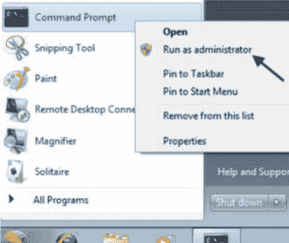
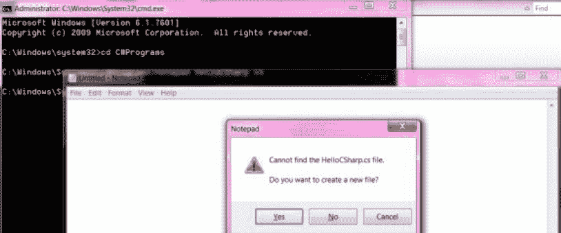
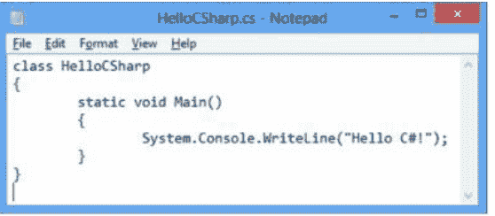
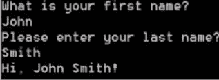
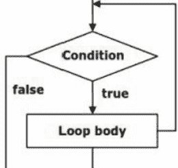
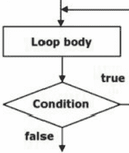

# C# 速成：C# 编程语言基础入门指南


## 引言

我要感谢并祝贺你下载了《C# 快速入门——学习 C# 编程语言基础的入门课程》。

这本书包含了经过验证的步骤和策略，教你如何在的一周内掌握 C# 的基础知识。

本电子书将教你与 C# 编程语言相关的基本思想和概念。它将使用清晰的语言解释编程课程并帮助你理解课程。此外，这本书将为你提供技能和实际示例。书中还提供了真实的 C# 代码和截图，帮助你理解成为一名优秀 C# 程序员所需的课程、知识和技术。

阅读完这些材料后，你将熟悉 C# 语言和控制台。你将知道如何向程序用户发送信息，以及如何获取他们的输入。你将知道如何编译程序以及如何格式化代码。你将知道类、变量、函数、方法和数据类型是如何工作的。简单来说，你将成为一名熟练的 C# 程序员，最快 7 天就能做到！

再次感谢下载本书，希望你喜欢！


根据计算机专家，学习编程语言的最佳方法是编写和分析代码。因此，在学习语言本身之前，你将编写一个计算机程序。这种方法将帮助你理解 C# 如何工作。此外，你将熟悉该语言的语法和结构。

### 你的第一个程序

这里是你需要的代码：

```csharp
class HelloCSharp
{
    static void Main(string[] args)
    {
        System.Console.WriteLine("Hello C#");
    }
}
```

此程序在你的计算机的默认输出设备上打印“Hello, C#”。它仍然是一个“原始”程序，所以你还不能运行它。例如，让我们分析它的结构。下一节将教你如何使用命令提示符和编程环境编译并运行程序。

#### 它是如何工作的？

此示例程序由三部分组成：

- 类定义；
- 方法定义；以及
- 方法的内容。让我们详细讨论每个部分：

**类定义** – 程序的第一行定义了一个名为 HelloCSharp 的类。最基础的类定义包含两个部分：(1) 单词“class”和 (2) 新类的名称。在这个示例中，HelloCSharp 充类名。你将在大括号 `{ }` 内部找到类的内容。

**方法定义** – 这部分位于程序的第三行。在这里，你定义了一个名为 `Main()` 的方法。所有的 C# 程序都使用 `main()` 方法作为起点。是你需要使用的语法：

```csharp
static void Main(string[] args)
```

如你所见，`Main()` 需要是 `void` 和 `static`。参数（即括号内的部分）是完全可选的。这意味着你可以将 `Main()` 函数简化为：

```csharp
static void Main()
```

**方法的内容** – 你将在类名之后找到类的内容。通常，一对大括号括起这些内容。示例程序使用 `System.Console.WriteLine()` 来显示信息。

## 编写代码时记住的规则

### C# – 大写敏感语言

这种语言是大写敏感的。这意味着在输入 C# 时需要注意大小写。基本上，C# 将“power”和“Power”视为不同的对象。

### 使用正确的格式

你需要为代码添加制表符、空格和换行符以提高可读性。这些字符被 C# 编译器忽略，但为代码提供了良好的结构。

例如，你可以从 HelloCSharp 代码中删除换行符：

```csharp
class HelloCSharp{static void Main() {System.Console.WriteLine("Hello C!");}}
```

另一种方案，你可以从中删除制表符：

```csharp
class HelloCSharp
{
    static void Main()
    {
      System.Console.WriteLine("Hello C!");
    }
}
```

后两个例子在编译和程序执行方面运行良好。但它们难以分析、修改和维护。

#### 如何格式化代码

以下是你需要遵循的规则：

- 在类定义内部缩进方法。C# 允许使用任意数量的制表符（即按下键盘上的 Tab 键得到的字符）来格式化源代码。
- 你应该在方法定义内部缩进方法的内容。
- 将左大括号 `{` 放在它所属的类或方法之后。此外，如果它是该行的唯一字符，则最好。
- 确保右大括号 `}` 与左大括号对齐。
- 类名应以大写字母开头。
- 变量名应以小写字母开头。
- 方法名也应以大写字母开头。
- 缩进写在另一个结构内部的代码。


面向对象。它与 C、C++ 和 Java 等语言有一些相似之处。主要区别在于 C# 提供了更简单的编程方式和简化的语法。

一个 C# 程序包含一个或多个 .cs 文件，这些文件存储数据类型和类定义。你需要编译这些 .cs 文件来获取可执行文件（即以 .dll 或 .exe 结尾的文件）。例如，如果你编译 HelloCSharp 程序，你将得到一个名为 "HelloCSharp.exe" 的可执行文件。

## 创建 C# 程序所需的准备

在用 C# 编写程序之前，你需要两个重要的东西——文本编辑器（例如：记事本）和 .NET 框架。文本编辑器将帮助你编写和编辑代码。而 .NET 框架将帮助你编译和执行你的程序。

## 什么是 .NET？

基本上，.NET 是一个为计算机程序的开发和执行设计的框架。大多数现代 Windows 系统都将 .NET 作为内置框架。因此，只要你使用的是微软的现代操作系统，就不需要在电脑上安装任何软件了。

如果你使用的是旧版本的 Windows 操作系统，需要先下载 .NET 框架。你可以访问该网站获取最新版本的 .NET。

> 重要提示：在阅读本书其余内容之前，请确保你的电脑已安装 .NET。否则，你将在编译和执行后面看到的示例程序时遇到问题。

## 文本编辑器

你应该使用文本编辑器来编写、编辑和保存源代码。你可以使用电脑上安装的任何文本编辑器。如果你不想下载额外的程序，可以直接使用“记事本”（即 Windows 电脑预装的文本编辑器）。

## 编译和执行程序

现在，是时候编译并运行之前看到的 HelloCSharp 程序了。以下是你需要完成的操作：

- 1. 生成一个“.cs” 文件并将其命名为“HelloCSharp”。
- 2. 在该 .cs 文件中编写源代码。
- 3. 编译代码以获取 .exe 文件。
- 4. 运行生成的程序。

打开你的电脑，让我们开始编写代码吧。

重要提示：本电子书假设你使用的是 Windows 电脑。

以下是 HelloCSharp 程序的代码：

```csharp
HelloCSharp.cs
class HelloCSharp
{
    static void Main()
{
        System.Console.WriteLine("Hello C#!");
    }
}
```

## 使用命令提示符编写 C# 程序

首先，你需要启动命令提示符（也称为“命令控制台”）。如果你使用的是 Windows 7 或 Windows 8，可以点击开始按钮搜索“cmd”。检查搜索结果并寻找名为“命令提示符”的程序。右键点击该程序，并在菜单中选择“以管理员身份运行”。这里是截图：



重要提示：如果你通过双击启动命令提示符，某些重要功能可能无法使用。

接下来，你需要生成一个文件目录以便存储生成的程序。输入 "md" 后加上目录名称。然后输入 "cd" 进入新目录。这里是截图：

```
C:\Windows\system32>md C#Programs
c:\Windows\system32>cd C#Programs
c:\Windows\System32\C#Programs>>
```

在此示例中，目录名称为 "C#Programs"。"cd" 命令将活动目录更改为 "C:\Windows\System32\C#Programs"。现在准备好创建 .cs 文件了。回到命令提示符并执行以下命令：

```
notepad HelloCSharp.cs
```

运行该命令后，屏幕将显示：



电脑会告诉你 HelloCSharp.cs 不存在。它还会询问你是否创建新文件。点击“是”，并将程序复制到记事本应用程序。下面的截图将帮助你完成此步骤：



按下 CTRL+S 保存文件。然后点击 X 或按下 ALT+F 关闭文本编辑器。现在，你在 "C#Programs" 目录下看到了程序代码。

## 编译代码

此时，你可以使用 "csc”（即 C# 语言的编译器）编译源代码。由于你是第一次使用编译器，可能会得到类似的错误信息：

```
C:\Windows\System32\Programs\csc HelloCSharp.cs
'csc' 不是内部或外部命令，也不是程序或文件。
```

要解决这个问题，只需要指定 C# 编译器的位置。Windows 7 电脑所需的目录如下：
C:\Windows\Microsoft.NET\Framework\v4.0\

```
C:\Windows\Microsoft.NET\Framework\v4.0\
csc HelloCSharp.cs
```

```
C:\Windows\Microsoft.NET\Framework\v4.0\
csc HelloCSharp.cs
```

```
C:\Windows\Microsoft.NET\Framework\v4.0\
csc HelloCSharp.cs
```

```
C:\Windows\Microsoft.NET\Framework\v4.0\
csc HelloCSharp.cs
```

```
C:\Windows\Microsoft.NET\Framework\v4.0\
csc HelloCSharp.cs
```

```
C:\Windows\Microsoft.NET\Framework\v4.0\
csc HelloCSharp.cs
```

```
C:\Windows\Microsoft.NET\Framework\v4.0\
csc HelloCSharp.cs
```

```
C:\Windows\Microsoft.NET\Framework\v4.0\
csc HelloCSharp.cs
```

```
C:\Windows\Microsoft.NET\Framework\v4.0\
csc HelloCSharp.cs
```

```
C:\Windows\Microsoft.NET\Framework\v4.0\
csc HelloCSharp.cs
```

```
C:\Windows\Microsoft.NET\Framework\v4.0\
csc HelloCSharp.cs
```

```
C:\Windows\Microsoft.NET\Framework\v4.0\
csc HelloCSharp.cs
```

```
Hello C!
```

```
Hello C!
```

## 第2章：C# 的数据类型、变量和常量

本章将关注数据类型和变量。通过阅读这些内容，你将了解这些对象以及如何使用它们。

### 变量——简介

典型的程序在执行期间会使用不同的值。例如，你可以开发一个解决数学问题的程序。简单来说，程序员不知道用户将输入哪些值。因此，他们需要确保生成的程序能够接受用户提供的任何值。

当用户给出一个值时，你可以将其临时存储在机器的 RAM（即随机存存储器）中。内存中的所有值都可能发生。因此，程序员将此类值称为“变量”。

### 数据类型

数据类型是具有相似属性的值集合（或范围）。例如，“byte”数据类型指的是“0 到 255”数字范围内的值。

### 属性

数据类型具有以下属性：

- 名称（例如：int, char 等）
- 大小（例如：1 字节）
- 默认值（例如：1, 2, 3, 等）

### C# 中不同的数据类型

C# 支持以下数据类型：

- 布尔值
- 字符
- 对象
- 浮点数
- 小数
- 整数
- 字符串

由于这些数据类型预装在 C# 语言中，程序员将它们称为“原始类型”。让我们详细讨论每种数据类型：

### 布尔值

你需要使用“bool”（一个 C# 关键字）来声明此数据类型。布尔值只能是“true”或“false”。在 C# 编程语言中，布尔值被自动设置为“false”。程序员使用此数据类型来存储逻辑语句的结果。

### 字符

此数据类型可以存储单个字符。你需要使用“char”（另一个 C# 关键字）来声明此类型。将你的“char”值写在一对单引号内（例如，“I”）。


### 对象 (Objects)

程序员将对象视为 C# 语言中是最特殊的数据类型。基本上，对象是 .NET 中其他数据类型的父类。这种数据类型在声明时需要使用“object”关键字，它可以接受来自其他数据类型的任何值。你可以将对象想象为指向计算机内存某些部分的地址。

## 实数类型 – 浮点数 (Real Type – Floating Points)

在 C# 语言中，“实数类型”指的是你在数学中学过的实际数字。浮点实数数据类型可以是“float”或“double”。

- 1. 程序员将这种子类型称为“单精度实数型”。float 类型数字的默认值为 0.0F（末尾的“F”不区分大小写）。字母“F”表示该值是一个“float”。
- 2. 程序员在提到这种子类型时使用“双精度实数型”这一术语。它的默认值为 0.0D（即末尾的字母“d”不区分大小写）。C#会自动将实数标记为“double”，因此你实际上不需要在实数值末尾添加“d”。

## 实数类型 – 小数 (Real Type – Decimals)

这种编程语言支持“小数算术”，这是一种使用小数值表示数字的数学方法。这种方法的主要优势是无论其如何运行，都能保持其准确性。

C# 使用“decimal”数据类型来表示这类实数。这种数据类型长度为 128 位，精确到小数点第 29 位。由于其卓越的准确性，程序员使用它们进行财务计算（例如支付、税收、利息等）。

## 整数 (Integers)

该数据类型包含 8 个子类型，分别是：

- SBYTE – sbyte 是长度为 8 位的符号整数。这意味着它可以包含最多 256 个值（即 $2^8$）。此外，sbyte 可以是负数也可以是正数。
- BYTE – 这种子类型包含 8 位的无符号整数。它与 sbyte 几乎相同。唯一的区别是 byte 永远不会是负数。
- SHORT – 这些是 16 位的符号整数。
- USORT – 这些是长度为 16 位的符号整数。
- INT – 这可能是 C# 中最流行的数据类型。程序员使用这种数据类型是因为它与 32 位处理器完美兼容，并且足够用于典型的计算。它是一个长度为 32 位的符号整数。
- UINT – 这个 32 位整数是无符号的。因此，它只能是正数。
- LONG – 长度为 64 位。它可以是正数也可以是负数。
- ULONG – 这与“long”整数相似。唯一的区别是“ulong”只能取正值。

## 字符串 (Strings)

字符串是字符的集合或序列。C# 在声明属于此数据类型的值时，要求你使用“string”（即一个关键字）。你必须在一对双引号之间编写每个字符串。该语言允许你对字符串执行各种操作（例如拼接、字符替换、字符搜索等）。

## 变量 (The Variables)

你可以使用变量来存储、检索和修改可变的数据。作为一名程序员，你在存储和处理信息时需要使用变量。

## 变量的特征 (The Characteristics of a Variable)

变量具有以下特征：

- 名称（也称为“标识符”）
- 数据类型（Data Type）
- 值（即你想存储的信息）

变量是具有名称的计算机内存区域。它们存储值并允许计算机程序访问其内容。你可以将变量存放在栈（即你程序的运行内存）中，也可以放在程序的动态内存中。

字符、布尔值和整数被称为“值类型”，因为它们将数据保存在程序的栈中。相比之下，字符串、数组和对象被称为“引用类型”，因为它们内部并不持有值。相反，它们充当指向存储数据的计算机内存部分的标记。

## 如何命名变量 (How to Name a Variable)

在使用变量之前你需要了解它们。变量名充当标识符；它帮助程序定位和指定变量。C# 允许你自由选择变量名。然而，与任何其他语言一样，C# 对变量命名有一些规则。

- 变量名必须以字母或下划线开头。
- 它们只能包含字母、数字和下划线。
- 变量名是区分大小写的（例如，“MyVar”和“myvar”是不同的）。
- 你不能使用保留关键字作为变量名。
- 变量名应该具有描述性，以便代码更易读。


# 实数 (Real)

实数字面量包含一个符号（即 + 或 -）、一个后缀、一个前缀和一个小数点。你应该将这种字面量用于 double、float 和 decimal 值。C# 允许你以指数形式编写实数字面量。以下是你可以应用于实数字面量的后缀：

- F – 此后缀表示 float 值。
- D – 使用此后缀表示 double 值。
- M – 此字母表示 decimal 值。
- E – 使用此字母表示指数值。例如，“e4”意味着你将整数乘以 10^4。

# 整数 (Integer)

整数字面量由一个前缀、一个后缀、一个符号（即 + 或 -）和一个数字组成。你可以使用前缀在代码中为小数或十六进制添加数字。以下是你可以在 C# 中使用的前缀和后缀：

- 0X（例如 0XA6F2） – 使用此前缀表示十六进制值。
- U（例如 119U） – 此后缀表示无符号整数 (uint) 或无符号长整数 (ulong) 值。
- L（例如 360L） – 使用此后缀表示“long”值。

重要说明：如果你不使用任何后缀，C# 将把整数字面量标记为“int”。此外，字母（即 L、U 和 X）是不区分大小大小的。

## 字符串 (String)

使用此字面量用于字符串值。基本上，字符串字面量是置在一对双引号内的字符集（例如“sample”）。

重要说明：在 C# 语言中，你可以使用“@”符号来创建引用（或逐字）字符串。程序员使用这些字符串来命名文件路径。

## 字符 (Character)

字符字面量是用一对单引号括的单个字符（例如 ‘z’）。使用字符字面量设置属于“char”类型的值。此外，你可以将字符字面量写为：

- 单个字符（例如 ‘X’）
- 特殊字符的代码（例如 ‘\u0067’）
- 转义代码（见下文）

### 转义代码 (Escape Codes) – 这些是向源代码中添加字符的特殊字符序列。通常情况下，这里涉及的字符不能直接添加到程序代码中。

C# 防止你直接将某些字符添加到程序中。这些字符包括：制表符、换行符、反斜杠、引号等。以下列表将显示 C# 中常用的转义代码：

- \\ – 换行符
- \t – 制表符
- \' – 单引号
- \" – 双引号

## 布尔值 (Boolean)

只有两种类型的布尔字面量：true 和 false。在处理“bool”（即布尔型）变量时，你只能分配这两个值之一。下面提供的代码段将向你展示如何声明布尔字面量：

```c
bool answer = false;
```

## 第 3 章：C# 语言的运算符

本章将重点介绍 C# 的运算符。通过阅读这些材料，你将了解这些运算符是如何工作的，以及你如何在源代码中使用它们。

### 运算符 (Operators) – 基础

运算符帮助你处理对象和数据类型。它们接受输入和操作数并产生结果。C# 语言使用特殊字符（例如“”、“+”、“^”等）作为运算符。此外，C# 代码可以接受最多三个不同的操作数。

### 运算符的不同类型

C# 程序员将运算符分为以下类型：

### 赋值运算符 (Assignment Operator)

在 C# 中，你需要使用等号（即 =）来赋值。以下是你赋值一个值时需要使用的语法：

```c
name_of_operand = expression, literal, or second_operand
```

以下是一些示例：

```csharp
int y = 99;
string hello = "Good morning.";
char sample = 'z';
```

重要说明：C# 允许你对赋值运算符进行级联（即在单个表达式中使用多次）。这意味着如果你正在创建相同数据类型的变量，就不需要输入多个等号了。下面的示例将阐明这一规则：

```csharp
int d = 1, e = 2, f = 3;
string hi = "Good Morning.", bye = "Farewell.", thanks = "Thank you.";
```

### 逻辑运算符 (Logical Operators)

逻辑运算符（也称为“布尔”运算符）接受并返回布尔值（true 或 false）。以下是 C# 的四个逻辑运算符：

- “&&” – 程序员将该运算符称为“逻辑与”。如果两个操作数都为 true，它将给你“true”。
- “^” – 这被称为“异或”运算符。如果操作数中其中一个为 true，它将给你 true。
- “||” – 这是“逻辑或”运算符。如果至少有一个运算符为 true，你就会得到 true。
- “!” – 此运算符被称为“逻辑取反”运算符，它会反转操作数的值。

下面的代码将向你展示如何使用这些运算符：

```csharp
class Test
{
    static void Main()
    {
        bool x = true, y = false;

        System.Console.WriteLine(x && y);
        System.Console.WriteLine(x || y);
        System.Console.WriteLine(!x);
        System.Console.WriteLine(x ^ y);

        // 这是一个示例。
    }
}
```

一旦你编译并运行此代码，你将看到以下结果：

```
False
True
False
True
```

### 算术运算符 (Arithmetic Operators)

运算符帮助处理对象和数据类型。它们接受输入和操作数以产生结果。C# 语言使用特殊字符（例如".”、“+”、“^”等）作为运算符。此外，C# 代码可以接受最多三个不同的操作数。

算术运算符帮助你执行运算。该类别包括以下运算符：

- “+” – 使用此运算符执行加法（例如 x + 1）
- “-” – 使用此运算符执行你从左侧操作数中减去右侧的值（例如 x - 1）
- “*” – 使用此运算符乘以两个操作数的值（例如 x * 6）
- “/” – 使用此运算符将左侧操作数的值除以右侧操作数的值。
- “++” – 此运算符被称为“自增运算符”。它将操作数的值增加1。
- “--” – 此运算符是自减运算符的反相反。它将操作数减少1。

下面的代码将向你展示它们如何工作：

```csharp
class Test {
    static void Main() {
        double d = 100, e = 3;
        System.Console.WriteLine(d + e);
        System.Console.WriteLine(d - e);
        System.Console.WriteLine(d / e);
        System.Console.WriteLine(d * e);
        System.Console.WriteLine(++d);
        System.Console.WriteLine(--e);
    }
}
```

### 二位运算符 (Binary Operators)

这些运算符作用于二进制数。在 IT 世界中，所有信息都表示为 0 和 1 的序列。如果你想成为一名成功的程序员，你需要掌握二进制运算符。

二位运算符的工作方式与逻辑运算符类似。实际上，你可能认为二者的输入不同，但执行的过程相同。逻辑运算符使用布尔值产生结果，而二位运算符作用于二进制位。以下是你在 C# 中会遇到的二进制运算符：

- “&” – 这被称为“位与”。它在两个操作数都为“1”的位置指示。
- “^” – 程序员将此称为“位异或”。它会在值不同的位置放置“1”。
- “|” – 这是“位或”运算符。它会在任何操作数为为“1”的位置指示。
- “~” – 它作为二进制值的取反运算符。就像“!”一样，它会反转变量的值。
- “<<” – 这是“位左移”运算符。它将二进制数的位向左移动。这种移动取决于你赋值的值（例如 4 << 1, 4 << 3, 4 << 2 等）。

### 比较运算符 (Comparison Operators)

这些运算符允许你比较两个操作数内部的值。这些运算符每一个都会给出布尔值作为最终输出。以下是 C# 语言的比较运算符：

- “==” – 这是相等运算符。它检查两个操作数是否相等（例如 x == y）
- “>” – 此运算符检查左侧操作数的值是否大于右侧操作数的值（例如 x > y）。


- “<” – 此运算符比较两个操作数的值。如果左侧操作数的值小于右侧操作数的值（例如 y < x），它将返回“true”（真）。

- “=” – 使用此运算符，你可以判断左侧操作数的值是否大于或等于右侧操作数的值。

- “=” – 如果左侧操作数的值小于或等于右侧操作数的值，此运算符将返回“true”（真）。

- “!=” – 使用此运算符来检查两个操作数的相等性。如果两个值不相等（例如 x != y），它将返回“true”（真）。

## 条件运算符

C# 用户将“?” 称为条件运算符。基本上，该运算符使用布尔表达式的结果来决定应该处理哪条语句。由于这被称为“三元运算符”，因为它作用在三个操作数上。在这里，第一个第一个值应该是布尔型（Boolean）的，而剩余的值需要属于相同的数据类型（例如：字符、字符串、数字等）。

该运算符的语法为：

```
first_operand ? second_operand : third_operand;
```

它的工作原理如下：如果“first_operand”为真，程序将处理“second_operand”。然而，如果“first_operand”为假，程序将处理“third_operand”。

## 第 4 章：数据类型转换

通常情况下，运算符作用于属于相同类型的参数。然而，C# 语言提供了广泛的数据类型，供你用于某些情况。为了对属于不同类型的变量进行任何处理，你应该转换其中一个变量。在 C# 中，数据转换可以是隐式的也可以是显式的。

每个 C# 表达式都有数据类型。这种数据类型是由表达式内部使用的字面量、变量、值和结构产生的。基本上，你可能会使用一个类型与情况不兼容的表达式。当这种情况发生时，你会得到以下结果之一：

- 程序将产生编译错误。
- 程序将执行自动转换。这意味着程序将获得正确的表达式类型。

将“s”转换为“t”类型允许你在运行程序时将“s”视为“t”。有时，此过程需要程序员对类型转换进行验证。请检查下例：

- 将“objects”转换为“strings”需要在程序运行时进行验证。这种验证确保了你确实想将这些值作为字符串使用。
- 将“string”值转换为“object”值不需要任何验证。那是因为“string”类型是“object”类型的分支。你可以将字符串转换为其“父”类而不会丢失数据或产生任何错误。
- 在将 int 转换为 long 值时，不需要进行验证。“long”数据类型涵盖了“int”类型的所有可能值。这意味着数据可以在产生任何错误的情况下转换。
- 将“double”值转换为“long”值涉及验证。取决于你正在处理的值，你可能会丢失数据。

重要说明：C# 在更改数据类型方面有一定的限制。以下是该语言支持的可能类型转换：

## 显式转换

如果存在信息丢失的可能性，请使用此转换。例如，将浮点值转换为整数值时，你会遇到信息丢失（即小数部分将消失）。在将宽范围转换为窄范围类型时（例如 long 到 int 的转换、double 到 float 的转换等），可能会丢失数据。要完成此过程，你需要使用“type”运算符。请检查下例：

## class Example

```
{
    static void Main()
    {
        double yourDouble = 2.1d;
        System.Console.WriteLine(yourDouble);

        long yourLong = (long)yourDouble;
        System.Console.WriteLine(yourLong);

        yourDouble = 2e9;
        System.Console.WriteLine(yourDouble);

        int yourInt = (int)yourDouble;
        System.Console.WriteLine(yourInt);
    }
}
```

如果编译执行正确，程序将给出以下结果：

| 2 | 1 |
|---|---|
| 2000000000 | 2000000000 |

## 隐式转换

只有在不会丢失数据的情况下，才使用隐式转换。当你将窄范围的值赋值给宽范围变量时，C# 编译器会执行这种隐式转换。

## 字符串转换

C# 允许将任何数据类型转换为“string”。当你使用“+”且至少有一个非字符串参数时，编译器会执行此转换过程。在这里，非字符串参数将变成字符串。

## 第 5 章：控制台 (Console)

本章将教你如何使用控制台提供和收集数据。你将学习如何使用该工具在 C# 语言中执行 I/O（即输入/输出）操作。

## Console – 基础

控制台是一个你可以用于与计算机中可用程序进行交互的工具。由于此，它被认为是任何操作系统的重要部分。

在 C# 中，用户与程序的交互涉及到标准输出和输入。控制台就是为此提供的工具。

## 程序与用户之间的交互

控制台是一个你可以用于与计算机中可用程序进行交互的工具。由于此，它被认为是任何操作系统的重要部分。

在 C# 中，用户与程序的交互涉及到标准输出和输入。控制台就是为此提供的工具。

## 使用控制台

访问控制台的过程取决于你使用的操作系统。例如，如果你使用的是 Windows 计算机，需要执行以下步骤：

- 点击“开始”按钮。
- 点击“程序”并选择“辅助工具”。
- 点击“命令提示符”选项。

控制台将显示你的主目录，它由你的用户名表示。在下面的示例中，用户名是 SARAH：


重要说明：如果你使用的是 Windows Vista、Windows 7 或 Windows 8，可以通过运行搜索“cmd”来启动控制台。

## 关于控制台的附加信息

控制台是一个显示文本信息的黑色窗口。它有一个闪烁的光标并显示字符字符串。如你所见，每当你输入一个字符，光标就会移动。


## 控制台命令

- cd name_of_directory – 此命令允许你更改活动目录。例如，如果你想进入 C 盘内的 Users 文件夹；你需要执行以下命令：

```
cd C:\Users
```

- dir – 使用此命令查看活动目录下的文件。

- rmdir name_of_directory – 此命令允许你删除一个目录。例如，执行 `rmdir Sample` 会删除名为 "Sample" 的目录。

- mkdir name_of_directory – 此此命令，你可以在活动目录中创建一个新目录。例如，如果你当前位于 Users 目录，执行 `mkdir John` 将在 "Users" 内部创建一个名为 "John" 的文件夹。

- type name_of_file – 使用此命令查看现有文件的内容。例如，你可以执行 `type HelloCSharp.cs cs` 来查看该 .cs 文件的内容。

## 标准输入/输出 (Standard I/O)

标准 I/O 系统是为 UNIX 计算机开发的机制。该系统涉及特殊的设备来接收输入和产生输出。

如果程序正在等待用户执行操作或提供信息，控制台将显示一个光标。这意味着系统处于“等待模式”。

### 输入与输出

操作系统需要定义用于用户-程序交互的标准 I/O 机制。在启动基于控制台的应用程序时，程序初始化块中的代码需要与操作系统分配的 I/O 机制配合。这段代码允许用户与相关的控制台程序进行交互。

由于这段代码，程序可以读取用户的输入，将信息发送到 "Console.In"（即 C# 的标准输入流），并通过 "Console.Out"（即 C# 的标准输出流）以及 "Console.Error"（即 C# 的标准错误消息流）报告问题情况。

**重要提示**：你将在本书的后续部分学习 C# 流（streams）。本章将集中关注与 C# I/O 机制相关的概念和思想。

### I/O 设备

某些程序接受非键盘输入。例如，你可以创建一个 C# 程序，从文本文件、条形扫描器、麦克风和其他数据源获取输入。程序还可以将其输出发送到屏幕、外部文件、打印机等。

### System.Console

名为 System.Console 的类具有各种方法和属性，你可以使用它们来读取、显示或格式化文本信息。System.Console 最流行的三个属性与数据的输入和显示有关。这些属性是：Console.In、Console.Out 和 Console.Error。

这些属性帮助你显示数据、读取信息和报告错误消息。C# 允许你直接使用这些属性。然而，你需要记住 System.Console 包含其他可以帮助你进行 I/O 操作的方法和属性。

**重要提示**：C# 语言允许你修改程序的默认流。要做到这一点，你需要使用以下方法：Console.SetOut（用于输出流）、Console.SetIn（用于输入流）和 Console.SetError（用于错误流）。

# 控制台输入

编程语言拥有一套向计算机控制台输入信息的系统。特别是 C# 语言使用名为 "Console.In" 的对象来控制其输入流。

实际上，你不需要直接使用 Console.In。"Console" 类提供了两个与 Console.In 配合的方法（即 `Console.ReadLine` 和 `Console.Read`）。你可以使用这些方法从命令提示符读取数据。

# Console.ReadLine

此方法为想要从控制台读取数据的人提供了简单性和便利性。当你调用此方法时，你的程序将停止并等待用户的输入。然后，用户可能会输入一个字符或字符串并按下“回车”。通过按下回车键，用户通知程序他们已经输入了所需的输入。Console.ReadLine 将读取用户的输入，因此得名。

下面提供的代码将向你展示 Console.ReadLine 如何工作：

```
class Test
static void Main()
{
    System.Console.WriteLine("What is your first name? ");
    string yourFirstName = System.Console.ReadLine();

    System.Console.WriteLine("Please enter your last name? ");
    string yourLastName = System.Console.ReadLine();

    System.Console.WriteLine("Hi, {0} {1}!", yourFirstName, yourLastName);
}
```

如果你在命令提示符中输入 "John" 和 "Smith"，你将得到以下消息：



# Console.Read 方法

Console.Read 和 Console.ReadLine 之间存在显著差异。首先，Console.Read 只读取单个字符，而 Console.ReadLine 读取整个表达式。其次，Console.Read 返回的是代码而不是接收到的输入。如果你想将输出作为普通字符使用，你应该执行以下任操作之一：

- 将输出转换为字符
- 在结果上使用 `Convert.ToChar` 方法

**重要提示**：Console.Read 只有在用户按下“回车”时才会读取一个字符。当用户按下此键时，程序将输入传输到标准字符串缓冲区并调用 Console.Read 方法。查看下例示例：

```
class UsingRead {
    static void Main() {
        int codeRead = 0;
        do {
            codeRead = Console.Read();
            if (codeRead != 0) {
                Console.Write((char)codeRead);
            }
        } while (codeRead != 10);
    }
}
```

# 如何读取数字

C# 程序并不直接读取数字。它们需要将输入视为字符串。将字符串转换为数字的过程被称为解析（parsing）。

# 控制台输出

本书的这部分将关注两个方法：Console.WriteLine 和 Console.Write。这两个方法都可以在用户的控制台上打印出所有数据类型。

下面的代码片段将教你它们是如何工作的：

```
Console.WriteLine("I want to learn C#.");
// 这行将打印括号内的字符串。
Console.WriteLine(100);
// 这行将在命令行提示符上显示 "100"。
Console.WriteLine(3.14);
// 这行将在控制台上打印双倍精度值 3.14。
```

你可以使用 Console.WriteLine 方法来显示不同类型的数据。这是因为 Console 类拥有每种数据类型的内置版本。

Console.WriteLine 和 Console.Write 之间的唯一区别是前者打印括号内的值并添加换行符，而后者仅显示括号内的信息。因此，在代码中使用 ConsoleWriteLine 就像在显示消息后按了回车键。

# 字符串拼接

C# 语言防止程序员在字符串值上使用运算符。显然，不能对实际单词进行算术运算（例如 fish – dog、power * humans、land / people）。然而，C# 允许你拼接（即组合）多个对象以生成新对象。你可以通过在字符串上使用“+”符号来实现这一点。下例示例将说明这种思想。

```
string gadget = "smartphone";
string example = "I use my " + gadget + "to access " + "the internet.";
Console.WriteLine(example);
```

如果你执行该代码，控制台将显示：

> I use my smartphone to access the internet.

## 第 6 章：C# 的条件语句

本章将教你如何在 C 代码中使用条件语句。基本上，条件语句是一种允许根据分配的条件执行各种操作的代码块。仔细阅读这些材料，因为它包含了帮助你在 7 天内掌握 C# 的价值信息。

### 运算符

在本节中，你将学习更多关于 C# 比较运算符的信息。这些运算符非常重要：它们可以帮助你设置自定义条件语句的条件。

### 比较运算符

C# 有不同的运算符可用于比较相同类型的值。这些运算符是：

- <
- >
- <=
- >=
- !=
- ==

你可以使用上述运算符比较 C# 表达式（例如两个整数、两个变量、两个常量等）。在使用任何这些运算符时，结果将始终是一个布尔值（Boolean）。分析以下示例：

```
int height = 170;
```


```c
Console.WriteLine(height < 180); // 这将返回 "true"。
string gender = "Male";
Console.WriteLine(gender == "Female"); // 这将返回 "false"。
double valueOfPi = 3.14;
Console.WriteLine(valueOfPi > 100); // 这将返回 "true"。
```

### 逻辑运算符

C# 也支持逻辑运算符。程序员使用这些运算符来创建布尔（也称为“逻辑”）语句。让我们详细讨论一下每个逻辑运算符：

## AND 和 OR 运算符

你只能在涉及布尔值的表达式上使用 AND（即 `&&`）运算符和逻辑 OR（即 `||`）运算符。当的两个操作数都为真时，逻辑 AND 运算符将给你返回 "true"。例如：

```c
bool sample = (1 < 2) && (10 == 10);
```

由于 1 小于 2 且 10 等于 10，该表达式将返回 true。由于逻辑 AND 运算符在不执行不必要的分析的情况下快速提供结果，程序员将其称为“短路运算符”。它会检查第一个语句的部分。如果求值结果为 "false"，操作将立即停止。由于其中一个操作数为假，该表达式将不再可能为真。

另一方面，逻辑 OR（即 `||`）运算符在你的操作数中至少有一个求值结果为真时，将给你返回 true。例如：

```csharp
bool sample = (1 < 2) || (10 > 100);
```

这个示例将返回 true，因为左侧的操作数为真。逻辑 OR 运算符也是一个“短路运算符”，因为它在不检查整个 C# 语句的情况下也能给出结果。在当前的示例中，由于第一个操作数已经是真了，逻辑 OR 将不再分析第二个操作数。因此，条件已经满足。

### 异或和取反运算符

异或（即 `^`）是一个全路路运算符，因为它在给出结果之前需要检查两个操作数。如果其中某一个操作数的求值结果为真，它将给你返回 true。因此，如果其中一个操作数为真，你将得到 false。请查看以下示例：

```csharp
bool sample = (1 < 2)^(2 == 2);
```

由于两个表达式均为真，异或将给你返回 false。

然而，取反运算符（即 `!`）简单地反转它所附的布尔值。例如：

```csharp
bool sample = !(1 < 2);
```

1 小于 2。但是，由于“!”附加在布尔表达式上，结果将被反转。这意味着该表达式求值为“false”。

### 语句

现在你已经知道如何使用比较运算符和逻辑运算符，是时候讨论条件语句的了。这些语句是强大的工具，可以帮助你实现编程逻辑。

### If 语句

if 语句的语法如下：

```csharp
if (conditional expression)
{
    if 语句体
}
```

如你所示，该语法包含三个部分：

1. “if” 子句 – 这部分表示 if 语句的开始。
2. 布尔表达式 – 这部分可以包含逻辑表达式或一个存储数据的变量。与 C 不同，C# 的条件语句不接受整型表达式。
3. 语句体 – 你需要使用大括号包围这部分。C# 允许你在此区域内放置多个语句。

如果布尔表达式求值为真，程序将运行该语句。如果求值为假，程序将忽略该语句并将控制传递给后续块。下面的示例将展示“if”语句是如何工作的的：

重要说明：如果你的条件语句体只有单行，你可以省略大括号。

```csharp
Console.WriteLine("Please enter a number.");
int number1 = int.Parse(Console.ReadLine());
int number2 = 0;
if (number1 > number2)
    Console.WriteLine("C# is an excellent language.");
```

### If-Else 语句

与其他编程语言一样，C# 支持“if-else”条件语句。在编写 if-else 语句时，你应该使用以下语法：

```csharp
if (the Boolean variable or expression)
{
    条件语句体
} 
else 
{
    else 语句体
}
```

上述语法由以下部分组成：

- “if” 子句 – 这部分开始条件语句。
- 布尔表达式或变量 – 该表达式的值决定了程序将使用哪些代码。
- 条件语句体 – 这可以是一条语句或是一组语句。如果你使用多个语句，请将它们包围在大括号内。
- “else” 关键字 – 这是一个触发“else”子句的 C# 关键字。
- else 子句体 – 这与条件语句体相同（见上文）。

在处理 if-else 语句时，程序会分析括号内的值。该值需要是布尔值（即为真或假）。如果值为“true”，程序将执行条件语句体并忽略“else”子句。然而，如果值为假，程序将运行 else 语句体。分析以下示例：

```csharp
int a = 100;
if (a != 50)
{
  Console.WriteLine("The variable is not equal to 50");
}
else
{
    Console.WriteLine("The variable is equal to 50");
}
```

你可以将此代码解释为：如果 a != 50，控制台将打印：“The variable is not equal to 50”。另一方面，如果 a = 50，控制台将显示：“The variable is equal to 50”。由于变量 a 持有 100，你的提示符将给出：The variable is not equal to 50

### 嵌套语句

在某些情况下，你需要将一个“if”语句写在另一个“if”语句内部。程序员将此过程称为“嵌套”。如果你将条件语句写在另一个条件语句内部，你就是在进行“嵌套”。

重要说明：C# 允许你嵌套 if-else 语句。在这种情况下，每个“else”子句指向它之前的“if”子句。这个简单的规则可以帮助你分析复杂的条件语句。根据专家程序员的建议，不要创建超过三层的嵌套语句。如果你确实需要使用四个或更多条件结构，请将其导出到不同的方法（你以后会学习方法）。

下面的代码将展示嵌套“if”语句是如何工作的：

```csharp
int a = 10;
int b = 20;

if (a > b)
{
    Console.WriteLine("a is greater than b");
}
else
{
    if (a < b)
    {
        Console.WriteLine("a is less than b");
    }
    else
    {
        Console.WriteLine("a is equal to b");
    }
}
```

### Switch-Case 语句

程序员在可能的答案很多的情况下使用 switch-case 语句。以下是 switch-case 语句的语法：

```csharp
switch (selector) {
    case first_integer:
        statements;
        break;
    case second_integer:
        statements;
        break;
    default:
        statements;
        break;
}
```

基本上，选择器是返回可用值的表达式（即你可以比较或处理的值）。“switch”关键字将选择器的值与各个“case”进行比较。如果选择器的值与某个 case 匹配，分配给该 case 的语句将运行。然而，如果没有匹配，程序将执行默认语句/语句（如果有）。这意味着程序在运行任何语句之前会先分析选择器。


## 第 7 章：循环语句

本章将教你如何使用循环语句。作为一名程序员，你将使用循环语句反复运行某些代码块。循环在 C# 编程中起着重要作用，如果你想在 7 天内掌握这门语言，你应该仔细学习这些材料。

## 循环 – 基础

在创建程序时，你经常需要多次执行代码序列。多次输入完全相同的代码块会非常无聊。因此，你需要找到一种快速简单的方法来重复代码。幸运的是，C# 语言支持循环语句。

循环是一种重复运行代码片段的工具。你可以用它运行指定次数的代码，或者在满足给定条件时一直运行。C# 提供了多种类型的循环语句。让我们详细分析每类型：

## While 循环

这是 C# 中是最简单的循环语句。它的语法如下：

```csharp
while (the_assigned_condition)
{
    the_loop's_body;
}
```

在此语法中，“the_assigned_condition”是一个产生布尔值的表达式。该条件决定了“循环体”运行的次数。而“循环体”是你想要执行的语句（或语句组）。

下面的图将说明 while 循环是如何工作的：



在执行“while”循环工作时，C# 程序会检查布尔表达式的值。如果值为“true”，程序将运行循环体内的所有语句。然后，程序将检查布尔表达式以查看其值。如果值仍然为 true，程序将重新运行循环体并返回第一步（即检查表达式的值）。这个过程将一直持续，直到布尔表达式求值为为 false。一旦发生这种情况，程序将处理循环紧后的代码块。

重要提示：如果布尔表达式为 false，你的 C# 程序将不会运行 while 循环的体。因此，如果你在启动程序时布尔值为 false，你的循环内语句将永远不会被执行。

下面的示例将说明循环是如何工作的：

```csharp
int timer = 10;
while (timer >= 0)
{
    System.Console.WriteLine("Time remaining: " + timer);
    timer--;
}
```

如果你编译并执行此代码，你的命令行提示符将打印此数据：

Time remaining: 10
Time remaining: 9
Time remaining: 8
Time remaining: 7
Time remaining: 6
Time remaining: 5
Time remaining: 4
Time remaining: 3
Time remaining: 2
Time remaining: 1
Time remaining: 0

## Break 运算符

你可以使用 "break”（一个 C# 运算符）来提前退出循环。如果程序员不想等待循环的自然结束，他们就会使用此运算符。基本上，循环一旦遇到 break 运算符就会结束。这种情况下迫迫程序跳转到循环紧后的代码片段。

在 C# 中，你只能在循环体内部使用此运算符。这意味着“break”只有在循环运行时才会起作用。

## Do-While 循环

do-while 循环与 while 循环几乎相同。这些循环之间唯一的区别在于，前者在运行循环体之后分析布尔值。因此，你可以放心，即使布尔表达式为 false，你的代码也会至少运行一次。以下是 do-while 循环的语法：

```csharp
do {
  statements;
} while (Boolean expression);
```

do-while 循环按照这种模式工作：



程序将执行循环体内的所有语句。然后，它将检查条件（即布尔表达式）。如果条件求值为 true，程序将再次执行循环体并执行“值检查”。这个过程将一直持续，直到条件变为 false。因此，如果你的分配的条件始终求值为 true，代码可能会永远运行。

## For 循环

通常情况下，“for”循环比 do-while 和 while 循环更复杂。然而，for 循环可以帮助你用更少的代码完成困难的任务。“for” 循环的语法为：

```csharp
for (initializer; Boolean_expression; update)
{
    the_loop_body;
}
```

一个“for”循环有一个初始化器（即 计数器的初始值）、一个布尔表达式、一个更新计数器的语句以及循环体。“计数器”（即分配给循环的初始值）是“for”循环的独特特征。在大多数情况下，计数器的值会一直增加直到达到最终值（例如从 1 到 10）。此外，程序员通常知道“for”循环将迭代多少次。你可以在你的“for”循环中包含一个或多个变量。这些变量可以是降序或升序的。在编写程序时，你可以在单个循环中组合升序和降序变量。此外，for 循环支持算术运算（例如加法、乘法等）。

重要提示：for 循环的所有部分都是可选的。你可以通过在语法中留空来创建一个无限循环：

```csharp
for ( ; ) {
    // Loop body
}
```

到此时，你已经准备好学习更多关于 for 循环各个部分的内容了。

### 初始化

“for”循环可以拥有一个初始化片段：

```csharp
for (double sample = 1; ... )
{
    // 你可以在这里使用 "sample" 变量。
}
// 这里的变量
```

C# 程序在运行循环之前会执行此片段。通常，程序员使用初始化片段来创建一个计数器（也称为“循环变量”）并为其分配初始值。C# 允许你使用单个初始化片段声明多个变量。

### 条件

显然，for 循环需要一个条件表达式。这里有一个示例：

```csharp
for (double sample = 1; sample < 5; )
{
    // 这是循环的体。
}
```

计算机程序在运行循环体之前会评估条件表达式。如果结果为“true”，循环体将运行；否则，程序将跳转到写在当前循环之后的语句。

### 更新语句

这是 for 循环的最后部分。基本上，更新语句更新循环计数器。让我们使用上面的代码片段：

```csharp
for (double sample = 10; sample > 1)
{
    // 这是循环体
}
```

程序在运行循环体后执行此部分。记住此语句更新计数器的值。

### 循环体

这部分由 C# 语句组成。它可以利用在初始化片段中声明的变量。查看示例：

```csharp
for (double sample = 10; sample--)
{
    Console.WriteLine(sample);
}
```

### Continue 运算符

在某些情况下，你需要停止迭代但不结束循环本身。可以使用名为 "continue" 的 C# 运算符完成此任务。下面的示例将说明它是如何工作的：

```csharp
int n = int.Parse(Console.ReadLine());
int sum = 0;
for (int i = 1; i <= n; i += 2)
{
    if (i % 7 == 0)
    {
        continue;
    }
    sum += i;
}
Console.WriteLine("sum = " + sum);
```

这段代码计算 1 到 n 范围内所有不能被 7 整除的奇数的和。

## Foreach 循环

最近，C# 引入了 foreach 循环的概念（即扩展循环）。这种循环也适用于 C、VB、C++ 等编程语言。使用这种编程工具，你可以运行列表、数组或其他值组的所有元素。“foreach”循环可以处理非索引数据组中的所有现有元素。

编写这种循环时，使用以下语法：

```csharp
foreach (type name_of_variable in name_of_group) {
    the_statements;
}
```

如你所示，这种循环比典型的 for 循环简单得多。foreach 循环可以帮助你快速扫描集合中的所有对象。无数程序员在编写代码时使用这种循环并不意外。

## 嵌套 For 循环

C# 允许将一个 for 循环放在另一个 for 循环内部。代码最内层的循环运行次数最多。而最外层的循环运行次数最少。在“嵌套”for 循环时，你应该使用以下语法：

```csharp
for (initializing_fragment, condition, update_statement) {
    for (initializing_fragment, condition, update_statement) {
        statements;
    }
}
```


## 第 8 章：C# 语言的方法

本章将重点介绍 C# 方法。在这里，你将学习如何在自己的程序中声明和利用方法。如果你想在 7 天内成为一名高效的 C# 程序员，你就需要记住本章包含的课程。

## 方法——基础知识

对于大多数程序员来说，方法是任何程序的核心方面。方法可以解决问题、接受用户输入（称为参数）并产生结果。

方法通过表示程序所执行的数据转换来完成其任务。此外，方法是完成实际过程的区域。这就是为什么 C# 程序员将方法视为任何计算机程序的基本单元的主要原因。

## 方法提供的优势

在本节中，你将发现 C# 方法提供的主要优势。在读完这些材料后，你将知道为什么在编写程序时应该使用这些工具。

### 更好的结构和代码可读性

编程专家声称，编写计算机程序时应该使用方法。即使是最简单的方法，也能提高 C# 代码的结构和可读性。

这里有一个你需要知道的重要事实：程序员花费了 20% 的时间在编写和检查计算机程序上。剩下的 80% 时间用于维护和改进软件。显然，如果你的代码是可读且结构良好的，你工作程序时将会变得轻松。

### 防止冗余代码

方法可以帮助你避免程序中的冗余代码。冗余或重复的代码通常会在计算机应用程序中产生不理想的结果。

### 更好的代码重复

这一优势与前一个密切相关。如果你的程序需要多次使用某个代码片段，将该片段转换为 C# 方法将是一个极佳的主意。你可以多次调用方法，这意味着你无需重新输入即可重复重要的代码。

## 声明、实现和调用 C# 方法

此时，你需要了解对现有方法可以执行的操作过程。这些过程包括：

- 声明——在这个过程中，你将一个方法链接到程序中。此过程允许你在程序的任何部分调用该方法。
- 实现——此过程涉及输入代码以完成特定任务。这里涉及的代码存在于正在使用的方法内部。
- 调用——这是调用已声明方法的过程。在这里，你将使用方法来解决问题或执行操作。

## 方法声明

在 C# 中，你需要在类内部声明方法。此外，你不允许“嵌套”方法（即在另一个方法的体内部编写方法）。最完美的例子就是你多次使用的 Main() 方法。下面的代码将说明这一点：

```
class DeclaringMethods
{
    static void Main()
    {
        System.Console.WriteLine("Hi C#!");
    }
}
```

## 语法

在声明方法时使用以下语法：

```
static data_type_of_the_result name_of_method (list_of_parameters)
```

让我们使用 Main() 方法（即 static void Main()）来分析此语法。Main() 使用“void”作为其返回类型，因为它不产生任何结果。“Main”一词作为它的名称。而括号作为程序员将提供的参数的容器。

重要提示：在编写 C# 程序时必须遵循此语法。不要更改方法各个部分的顺序。

C# 并不要求你在声明中包含参数。这意味着你可以让括号为空（例如 Main()）。

## 方法名称

在声明、调用或实现期间，你需要指定方法的名称。以下是你在命名方法时需要记住的规则：

- 确保首字母大写。
- 每个单词的首字母都用大写字母（例如 SampleMethod, NewMethod, MainLine, 等）。
- 使用动词和名词作为方法的名称。

重要提示：上述讨论的规则完全可选。如果你希望你的 C# 代码具有极佳的结构和可读性，请遵循这些规则。

## 方法实现

声明方法是不够的。如果你想让它们在程序中运行，还需要实现你的方法。程序员在提到方法的实现时使用“体”一词。

### 方法体

你将在一对括号内找到方法体。此体由你想要执行的命令、表达式和语句组成。因此，体是任何方法的重要部分。

重要提示：记住在 C# 中你不能嵌套方法。不要在其他方法内部编写方法。

## 方法调用

基本上，这是运行方法体内语句的过程。调用方法简单而容易：你只需要指定它的名称，添加一对括号，并使用分号结束行。以下是你应该使用的语法：

```
name_of_method();
```

下面的示例代码将向你展示如何调用方法：

```
class Animals
{
    static void Main()
    {
        Console.WriteLine("I love dogs.");
    }
}
```

如果你编译并执行该代码，你的命令行提示符将打印以下消息：

I love dogs.

## 你可以调用方法的地方

C# 允许你在以下区域调用方法：

- 在程序的主方法内部（即 Main()）。
- 在另一个方法内部。
- 在方法自身的体内部。这种技术被称为“递归”。

## 结论

再次感谢你下载这本书！
我希望这本书能够帮助你在短短几天内成为一名熟练的 C# 程序员。
下一步是继续使用 C# 编写你自己的程序。

最后，如果你喜欢这本书，我想请你帮个忙，你是否愿意在亚马逊上给这本书留个评价？将不胜感激！
感谢并祝你好运！

