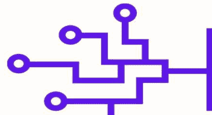
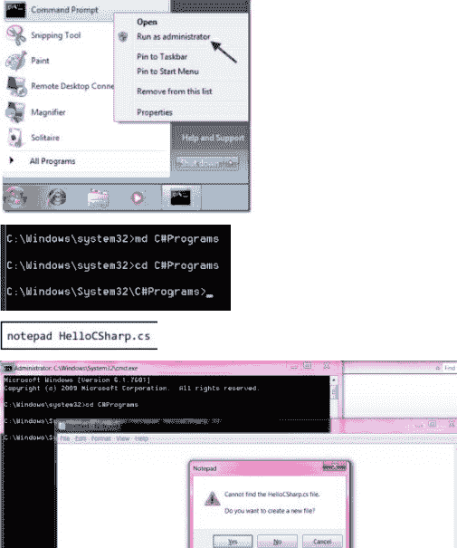
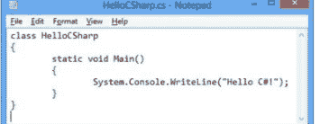
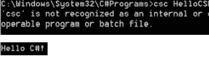
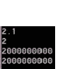

# C#：初学者学习指南



通过阅读本文，读者承认作者对由于使用其中包含的信息（包括但不限于错误、遗漏或不准确）而导致的任何直接或间接的损害不负责。

## C# 的基本概念

根据计算机专家的说法，学习编程语言最好的方法是通过编写和分析代码。因此，在学习这种语言之前，你必须编写计算机程序。通过这种方式理解 C# 将使过程变得更容易。

此外，你将理解这种编程语言的语法和结构。

## 向你介绍一个初始化

请输入以下代码：

此程序将在你的计算机设置的输出设备上打印“Hello, C#”。你无法运行它，因为它仍然是一个“原始”程序。此时，让我们看看它的结构。使用编程环境和命令提示符，你将通过编译和运行程序来完成以下部分。

### 流程是什么？

这个示例程序包含三个部分：

- 1. 类的定义；
- 2. 方法的定义；以及
- 3. 方法的内容。

以下是每个部分的详细说明：

该程序从第一行开始定义一个名为 `HelloCSharp` 的类。类定义通常分为两个部分：(1) 类名和(2) 它的描述。如下所示，类名为 `HelloCSharp`。有两个括号分隔了该类的内容（即 `{ }`）。

在程序的第三行，你将找到方法定义。这是 `Main()` 方法。每个 C# 程序都从这个 `Main()` 方法开始。使用以下语法最好：

`Main()` 方法必须是 `static`（静态）和 `void`（空）。在任何情况下，参数（括号之间的部分）都是可选的。换句话说，它可以表述为：

```csharp
class HelloCSharp{static void Main()}{System.Console.WriteLine("Hello C#!");}

class HelloCSharp{
    static void Main(){
        System.Console.WriteLine("Hello C#!");
    }
}
```

错误地放置 `Main()` 方法会导致程序崩溃。

### 方法的内容

点击方法名后，你将看到它的内容。括号内的内容通常包含在其中。如前一行所示，第五行通过使用对象（即 `System.Console`）和方法（即 `WriteLine()`）在你的计算机控制台上显示一条消息。消息是“Hello, C#”。

## 编写代码的规则

### 大小写敏感语言

C# 代码是大小写敏感的。在编写 C# 时，必须注意大小写。

### 正确格式化代码

如果你想让代码更易读，你应该这样做。

## 代码的正确格式化

代码格式化允许你在类定义中进行缩进。

## 类的类型

每个 C# 程序至少包含一个类定义。在编程中，类定义通常位于类名对应的文件中。文件扩展名也应该是 `.cs`。

## C# 附加信息

C# 是一种高级的、现代的、多功能的面向对象的语言。该语言在许多方面与 C、C++ 和 Java 相似。

数据类型和类定义包含在多个 `.cs` 文件中。为了生成可执行代码（例如以 `.dll` 或 `.exe` 结尾的文件），这些 `.cs` 文件需要编译。

## C# 编程需要这些

编写 C# 程序需要两样东西：文本编辑器（例如记事本）和 `.NET` 框架。文本编辑器让编写和编辑代码变得简单。另一方面，你将使用 `.NET` 框架编译和运行你的程序。

### .NET 框架是什么？

作为一个框架，`.NET` 用于创建和运行程序。`.NET` 是所有 Windows 系统的内置框架。在这种情况下，微软现代操作系统允许你在无需安装任何软件的情况下使用。

旧的 Windows 操作系统需要安装 `.NET` 框架。

```csharp
HelloCSharp.cs
class HelloCSharp
{
    static void Main()
{
        Console.WriteLine("Hello C#!");
    }
}
```

## 文本编辑器

为了编写、编辑和保存源代码，你应该使用文本编辑器。几乎每台计算机都自带了文本编辑器。如果你不想下载额外的程序，可以使用“记事本”（Windows 默认文本编辑器）。

## 运行和编译程序

你之前看到的 `HelloCSharp` 程序现在需要编译和运行。请按照以下步骤操作：

- 1. 请创建一个 `.cs` 文件并将其命名为 `HelloCSharp`。
- 2. 在该 `.cs` 文件中，你应该编写源代码。
- 3. 通过编译代码生成一个 `.exe` 文件。
- 4. 运行你创建的程序。

让我们先从启动电脑开始。

为了使用这本电子书，使用 Windows 电脑是最好的。

`HelloCSharp` 程序代码如下：

# 编写 C# 程序的命令提示符

第一步，你应该启动“命令提示符”（`Command Prompt`，也称为“命令控制台”）。

如果你使用的是 Windows 7 或 Windows 8，可以使用开始按钮搜索 `cmd`。在搜索结果中找到名为“命令提示符”的程序。如需以管理员身份运行该程序，请右键点击该程序并选择“以管理员身份运行”。

以下截图显示了它的样子：



请注意，如果你双击命令提示符，你将无法访问“C# 访问某些核心功能”。

在创建文件后，创建一个目录来存储生成的程序。

选择好目录后，输入 `md`。按下 `cd` 进入新目录。

以下截图显示了它的样子：



在此示例中，它被命名为 `C#Programs`。

通过 `cd`，`C:/Windows/System32/C#Programs` 变成了活动目录。现在可以准备好创建 C# 文件了。在命令提示符中运行此命令后，你将在屏幕上看到此。你的电脑上并不存在 CSharp。此外，它会询问你是否想要创建一个新文件。要复制程序代码，点击“是”按钮并将其粘贴到记事本中。

以下截图显示了它的样子：



按下 `CTRL+S` 保存文件。按下 `ALT+F4` 或红色的 X 关闭文本编辑器。它现在出现在 `C#Programs` 目录下。

编写代码

一旦代码完成编译，你就可以使用 `csc`（该语言内置编译器）运行它。打开命令提示符并输入 `csc HelloCSharp.cs`。由于这是你第一次使用 C# 编译器，你可能会收到类似下面的消息：要解决此问题，请指定 C# 编译器的位置。对于 Windows 7，位置如下：

`C:\Windows\Microsoft.NET\Framework\v4.0.30319`

注意：根据你的操作系统版本，你可能会在目录末尾看到不同的数字。

因此，应该执行以下命令：

这里是 `HelloCSharp.cs` 的 C# 源代码：

```csharp

```

```cs
C:/Windows/Microsoft.NET/Framework/v4.0.30319/csc  C# 编译器将把你的 .cs 文件转换为可执行文件。在命令提示符中，输入你第一个程序的名称。
```

# Windows 系统路径的更改

当你创建一个程序时，你肯定不想为编译器输入整个目录路径。在本章中，你将学习如何配置你的电脑以自动查找编译器。
需要完成以下操作：

- 1. 在控制面板中，选择“系统”。
- 2. 将出现一个新窗口。点击“高级系统设置”。
- 3. 你可以通过点击“环境变量”找到变量 `Path`。
- 4. 然后通过点击“编辑...”按钮选择编译器的目录。路径再次如下：
`C:\Windows\Microsoft.NET\Framework\v4.0.30319`
- 5. 点击“确定”保存更改。
- 6. 关闭当前命令提示符后启动一个新的命令提示符。输入命令 `csc`。
- 7. 屏幕上应该出现此错误消息：

```
Fatal error CS2008: No inputs specified
```

- 8. 这意味着你的电脑可以自动启动。当你指定它时，电脑将从源代码创建 `.exe` 文件。

# 变量

可以使用变量来存储、检索和修改可更改的数据。对于程序员来说，变量是存储和处理信息至关重要的。

## 变量的特征

变量的特征如下：
- 名称（也称为“标识符”）

### 数据类型

存储值的信息（也称为“值”）。变量是赋予计算机内存某区域的名称。值被存储并可以供计算机程序访问。你的计算机工作内存（或栈）或动态内存是存储变量的地方。

由于它们的数据存储在程序的栈中，字符类型、布尔类型和整数被称为“值类型”。相比之下，字符串、数组和对象被称为“引用类型”，因为它们不包含值。相反，它们作为数据在计算机内存中存储位置的标识符。

## 选择变量名

变量在使用之前必须命名。变量名用作标识符：它们帮助程序定位并指定该变量。在 C# 中，你可以完全自由地命名变量。在 C# 中，你必须遵循与其他任何语言相同的变量命名规则。以下是这些规则：
- 使用下划线（即 `_`）、字母和数字来命名变量。
- 名称不能以数字开头。在这种情况下，`FirstSample` 是有效的，而 `1Sample` 是无效的。
- 你不能使用 C# 关键字命名变量。通过这个简单的规则可以防止编译错误。如果你使用 `@` 符号，就可以为变量使用关键字（例如 `@bool`、`@int`、`@char` 等）。

## 声明变量

在使用之前声明变量是一个良好的习惯。要声明变量，你必须执行以下操作：

- 1. 输入变量的数据类型（例如 `char`）
- 2. 指定变量名（例如 `sample`）。
- 3. 初始化变量。这一步完全取决于你的决定。

| 数据类型 | 默认值 | 默认值 |
|---|---|---|
| byte | float | 0.0 |
| byte | double | 0.00 |
| short | decimal | 0.0m |
| ushort | bool | false |
| int | char | \u0000 |
| uint | string | null |
| long | 0L | null |
| unsigned | | |

变量声明的格式应如下：

```
data_type name = initial_value;
```

以下是一些有效的变量声明示例：

```
int year = 2000;
```

```
string yearname = "";
```

```
char test = 't';
```

每个 C# 语句都以分号结尾是非常重要的。如果你忘记添加单个分号，你的程序结果将是不符合预期和/或出意之外的。

## 赋值过程

C# 中的变量可以像其他计算机语言一样被赋值。在被称为“值赋值”的过程中，你必须使用等号。程序员将其称为“赋值运算符”。在左侧编写变量名。在右侧编写你想要赋值的值。请下方的示例：

```
test = x;
```

```
yourname = "John Doe";
```

## 如何初始化变量

在编码中，“初始化”是指给变量分配一个值。

当你声明变量时，你将设置“初始值”。

## 变量的默认值

如果你不赋值，则变量将不会分配任何值（即：变量将分配一个默认值）。以下是每种数据类型的默认值：

这是一个声明变量并赋值的示例。

```
// 这是一个示例
byte years = 10;
short days = 31;
decimal pi = 3.14;
bool isentity = true;
char sample = 'x';
string animal = "dog";
```

以正斜杠（即 `//`）开头的行被视为“注释”。编程中注释的目的是让代码更易读。语言编译器会忽略这些行。这意味着注释不会干扰你的程序功能。

## 值与引用

C# 数据有两种类型：值类型和引用类型。

在可执行程序中，值类型是值的。此外，值类型包含了程序员输入的值。布尔值、字符和整数构成了值类型。相比之下，字符串、数组和对象被称为“引用类型”，因为它们不包含值。相反，它们作为数据在计算机内存中存储位置的标识符。

`&&` – 程序员将此运算符称为“逻辑与”。当两个操作数都为真时，它将返回“true”。

`||` – 它被称为“逻辑或”运算符。当两个操作数都为真时，它将返回“true”。

`!` – 使用此“逻辑非”运算符，操作数的值会被取反。

你可以在代码中使用这些运算符：

```c
class Test
{
  static void Main()
{
    bool x = true, y = false;
    System.Console.WriteLine(x && y);
    System.Console.WriteLine(x || y);
    System.Console.WriteLine(!x);
    System.Console.WriteLine(x ^ y);
    // 这里是一个示例
  }
}
```

编译并运行后将显示以下结果：算术运算符

你可以使用这些运算符执行数学运算。该类别包含运算符：

- `+` – 此运算符用于相加两个值（例如，`int x = 1 + 1`）。
- `-` 在代码中，你可以使用此运算符进行减法。它从左操作数中减去右操作数的值（例如，`int x = 2 - 1`）。
- `*` 运算符允许你乘两个操作数（例如，`int r = 6 * 6`）。

在 C# 中，可以使用 `/` 运算符进行除法。该运算符将左操作数除以右操作数。

`++` 运算符被称为“递增运算符”。使用此运算符，操作数加一。与上述运算符不同，这些运算符只作用于一个操作数。该运算符也可以写在操作数之前或之后（例如，`9++`, `++5`）。

`--` 运算符是递增符号的反。它将操作数的值减一。可以写在被修改的操作数之前或之后。

```csharp
int a = 5;
int b = 5;
int c = 10;
```

下面的代码将向你展示这些运算符的工作：

```csharp
class Test
{
    static void Main()
    {
        double d = 10, e = 3;
        System.Console.WriteLine(d + e);
        System.Console.WriteLine(d - e);
        System.Console.WriteLine(d / e);
        System.Console.WriteLine(d * e);
        System.Console.WriteLine(++d);
        System.Console.WriteLine(--e);
        // 这是一个示例
    }
}
```

编译并执行此代码后，你将在提示符中看到以下：位运算符

操作二进制数的运算符被称为位运算符。二进制表示为 0 和 1 的序列。这意味着如果你想成为成功的程序员，必须掌握位运算符。

位运算符的功能与逻辑运算符类似。虽然位运算符和逻辑运算符使用的输入不同，但它们执行的操作相同。使用逻辑运算符，使用布尔值来确定结果。在 C# 中，你会遇到以下位运算符示例：

- `&` – 这是“位与”。两个操作数在相同位置都为“1”。
- `^` – 此运算符有时被称为“位异或”。当两个值不同时，它放置“1”。
- `|` – 位运算符“或”由此符号表示。它指示哪些操作数具有“1”。
- `~` – 位值由此运算符取反。变量的值取反，就像 `!` 一样。
- `<<` – 此运算符被称为“左移”。二进制数通过此操作左移。你应该移动一个值（例如，`4 << 3`, `4 << 2` 等）。

### 比较运算符

这些运算符允许你比较两个操作数的值。这些运算符的输出都是布尔值。以下是 C# 语言的比较运算符：

- `==` – 这是相等运算符。它检查两个操作数是否相等（例如，`x == y`）。
- `>` – 此运算符检查左操作数的值是否大于右操作数（例如，`x > y`）。
- `<` – 此运算符比较两个操作数的值。如果左操作数的值小于右操作数，它将返回“true”（例如，`y < x`）。
- `>=` – 通过此运算符，你可以判断左操作数的值是否大于或等于右操作数。
- `<=` – 如果左操作数的值小于或等于右操作数，此运算符将返回 true。
- `!=` 使用此运算符检查两个操作数的相等性。如果值不相等（例如，`x != y`）。

## 条件运算符

C# 用户将 `?` 称为条件运算符。该运算符使用布尔表达式的结果来确定应该处理哪些状态。这被称为“三元运算符”，因为它作用于三个操作数。

该运算符的语法为：

```csharp
first_operand ? second_operand : third_operand;
```

工作原理如下：如果 `first_operand` 为真，程序将返回 `second_operand`。如果 `first_operand` 为假，程序将返回 `third_operand`。

## 数据类型的转换

通常操作的是相似类型。然而，C# 语言提供了广泛的数据类型。当你对不同类型进行操作时，必须先进行转换。你可以隐式或显式地这样做。

关于 C# 中数据类型的更改有一些限制。语言支持以下类型转换：

### 显式转换

如果存在丢失信息的风险，请使用这种转换。将浮点值转换为整数时，小数部分将会消失（即你会丢失信息）。从宽范围类型到窄范围类型的转换也导致数据丢失（例如从 `long` 到 `int`，`double` 到 `float` 等）。你可以通过“类型”运算符完成转换。参见下面的示例：

```csharp
class Example
{
    double yourDouble = 2.1d;
    System.Console.WriteLine(yourDouble);
    long yourLong = (long)yourDouble;
    System.Console.WriteLine(yourLong);
```


```csharp
yourDouble = 2e9d;

System.Console.WriteLine(yourDouble);

int yourInt = (int)yourDouble;

System.Console.WriteLine(yourInt);

}
```



## 隐式转换

执行此转换时不会发生数据丢失。因为不需要运算符，所以它被称为隐式转换。每当你将窄范围的值赋值给宽范围变量时，C# 编译器将执行隐式转换。

## 字符串转换

在 C# 中，任何类型的数据都可以转换为字符串。编译器将通过使用 `"+"` 和至少一个非字符串参数来自动执行此转换。

通过此操作，非字符串参数将转换为字符串，并且 `"+"` 运算符将创建一个新值。

# 控制台

本章旨在教你如何使用控制台收集和提供数据。通过这个工具，你将学习在 C# 中执行 I/O（输入/输出）操作。

## 控制台 – 基础

你可以连接到计算机的控制台以与其程序交互。出于如此，控制台被视为任何操作系统的关键部分。

用户和程序在 C# 中通过标准输出（例如屏幕）和/或输入（例如键盘击键）进行交互。它们被统称为 I/O 操作。计算机程序在控制台内的文本提供了有用数据。

计算机上的 I/O 设备通过你的计算机 OS（即操作系统）连接到每个安装的控制台程序。大多数计算机的默认输入输出设备是屏幕和键盘。如果你愿意，可以轻松将这些通道重定向到特定的文件或设备。

## 编程接口与用户交互

用户与大多数计算机程序交互。每当用户与程序交互时，他们必须提供输入和指令。如今有许多交互方式：基于控制台的、基于浏览器的、基于互联网的、图形等的。因此，使用控制台与程序交互的人数正在减少。这是因为替代方案（例如基于浏览器的）更加用户友好且方便。

## 使用控制台

```
C:\Windows\system32\cmd.exe

Microsoft Windows Version [6.1.7601]

(C) 2009 Microsoft Corporation. All rights reserved.

C \Users\Sam>
```

控制台对于用户与程序的交互非常重要。

在创建简单的计算机程序时，你将需要使用控制台。对于这些程序，你必须专注于需要解决的问题。要在这一项工作中取得成功，不仅仅需要吸引人的 GUI（即图形用户界面）。

控制台还可以在将代码块添加到复杂程序之前对其进行小范围测试。由于控制台是一个简单的工具，使用它来隔离代码块非常容易。你不需要使用任何按钮。在几秒钟内，控制台将为你提供所需的结果。

### 如何访问控制台

取决于你正在使用的操作系统，你会有不同的方法访问控制台。如果你使用的是 Windows 计算机，需要执行以下操作：

- 1. 点击“开始”按钮。
- 2. 点击“程序”并选择“辅助工具”。
- 3. 点击“命令提示符”选项。

你的主目录将控制台中，由你的用户名表示。让我们来看一个例子：`SARAH`

你可以在 Windows Vista、Windows 7 或 Windows 8 中搜索“cmd”来运行控制台。

### 以下是关于控制台的一些额外细节

控制台在黑色窗口中显示文本信息。光标闪烁，字符出现在字符串中。每当你输入一个字符时，光标就会移动。

Windows 程序可以在桌面、浏览器、浏览器浏览器或控制台上运行。这些程序利用控制台进行输入和输出。

对于用户-程序交互，基于桌面的程序依赖它们的 GUI。在整本书中，你将使用键盘输入数据，并在命令提示符中查看结果。

在操作基于控制台的程序时，你会频繁使用键盘，因为某些应用程序需要文本、数字、字符等。

### 基本命令

我们将在本节中讨论从命令提示符发出的基本命令。如果你感兴趣成为一名优秀的 C# 程序员，你应该仔细学习这些材料。

### 使用控制台命令

你可以通过使用 `cd name` 命令来更改活动目录。

- `cd name`: 你可以通过使用 `cd name` 命令来更改活动目录。
- `dir`: 此命令显示目录的内容。
- `rmdir`: 此命令删除目录。
- `mkdir`: 此命令允许你创建一个目录。
- `type`: 此命令显示文件的内容。

### 标准 I/O

例如，C# 语言使用 `Console.In` 控制其输入流，使用 `Console.Out` 发送信息，并使用 `Console.Error` 报告情况。

### 输入与输出

计算机有一个输入信息的控制台。例如，C# 语言使用 `Console.In` 控制其输入流。

### I/O 设备

某些程序接受键盘输入、条形码读取器、麦克风和其他数据源。程序还可以将其输出到屏幕、硬盘或打印机。

### System.Console

可以使用 `System.Console` 读取、显示或格式化文本信息。`Console.In`、`Console.Out`、`Console.Error` 是这些属性。

这些属性使得数据输入、信息读取和错误报告成为可能。

### 控制台输入

直接使用 `Console.In` 不是必要的。`Console` 类中有方法（即 `Console.ReadLine` 和 `Console.Read`）与 `Console.In` 配合。

### Console.ReadLine 方法

这种方法简单方便，使得从控制台读取数据变得容易。当你调用此方法时，你的程序会停止并等待用户的输入。个人可以输入一个字符或字符串并按“回车”。当按下回车键时，用户告诉程序已通过 `Console.ReadLine` 方法输入了必要的输入，你可以读取用户的输入。

你可以通过查看下提供的代码来了解 `console.ReadLine` 是如何工作的：

```csharp
class Test
{
    static void Main()
    {
        System.Console.WriteLine("What is your first name?"); string yourfirstName = System.Console.ReadLine();
        System.Console.WriteLine("Please enter your last name?"); string yourLastName = System.Console.ReadLine();
        System.Console.WriteLine("Hi, {0} {1}!", firstName, lastName);
    }
}
```

如果你在命令提示符中输入“John”和“Smith”，将出现以下消息：

### Console.Read 方法

`Console.Read` 和 `Console.ReadLine` 之间有显著差异。首先，`Console.Read` 只读取单个字符，而 `Console.ReadLine` 读取整个表达式。其次，`Console.Read` 返回的不是接收到的输入，而是一个代码。如果你执行以下任何操作，则可以将输出作为普通字符使用：

- 将输出转换为字符
- 使用 `Convert.ToChar` 将结果转换为字符

注意：用户必须按下“回车”键才能让 `Console.Read` 读取到一个字符。程序会将输入传输到标准字符串缓冲区，并在按下此键后调用控制台。

请下方的示例：

```csharp
class UsingRead
    static void Main()
    {
        int codeRead = 0;
        do
        {
            codeRead = Console.Read();
            if (codeRead != 0)
            {
                Console.Write((char)codeRead);
            }
        } while (codeRead != 10);
    }
}
```

### 如何读取数字

C# 程序不直接读取数字。通过使用 `console.ReadLine` 方法，需要将输入转换为数字。这种将字符串转换为不同数据类型的行为被称为“解析”（parsing）。在 C# 语言中，所有原始数据类型都支持这种操作。

### 控制台输出

本章将两种方法：`Console.WriteLine` 和 `Console.Write`。

C# 语言支持这两种方法来打印所有数据类型。以此可以在用户的控制台上显示消息。

可以通过查看以下代码段学习这些方法的工作原理：

如果你在命令提示符中输入 "John" 和 "Smith"，将出现以下消息：`Console.WriteLine("I want to learn the C# programming language.");`

```csharp
// 这一行打印括号内的字符串。
```

```csharp
Console.WriteLine(100);
// 输入此行后，用户的命令提示符将显示 "100"。
```

```csharp
Console.WriteLine(3.14);
// 在这一行中，用户的控制台将显示值 3.14。
```

使用 `Console.WriteLine` 方法可以在用户的屏幕上显示不同类型的数据。每种数据类型都内置在 `Console` 类中。

与 `console.WriteLine` 不同，后者仅显示括号内的信息，而前者打印括号内的值并添加一个换行符。在代码中使用 `console.WriteLine` 类似于在显示消息后按下“回车”键（即：光标将移动到下一行）。

### 字符串拼接

C# 禁止程序员对字符串进行操作。

你不能对实际的单词进行算术运算（例如 fish - dog、power * humans、land/people 等）。然而，C# 允许你拼接（即组合）多个字符串对象。使用 `"+"` 符号来添加你的字符串。以下示例解释了如何这样做。

```csharp
string gadget = "smartphone";
string example = "I use my " + gadget + "to access " + "the internet.";
Console.WriteLine(example);
```

如果你执行该代码，控制台将显示：

I use my smartphone to access the internet.

# C# 条件语句

在本章中，你将学习 C# 中的条件语句是如何工作的。条件是允许你根据条件执行一系列操作的代码块。如果你仔细阅读，本指南将帮助你在七天内学会 C#。

## 运算符

本节将讨论 C# 的比较运算符。你可以使用这些运算符为你的条件语句设置条件。

### 比较运算符

在 C# 中，要比较相同类型的值，可以使用不同的运算符。以下是一些示例：

- `<`
- `>`
- `<=`
- `>=`
- `!=`
- `==`

除了这些运算符外，你还可以使用以下运算符来比较 C# 表达式（例如，两个整数、两个变量、两个常量等）。这些运算符中的每一个将始终返回一个布尔值。查看以下示例：

```csharp
int height = 170;
Console.WriteLine(height < 180); // 这将给你“true”。
```

```csharp
string gender = "Male";
Console.WriteLine(gender == "Female"); // 这将给你“false”。
```

```csharp
double valueOfPi = 3.14;
Console.WriteLine(valueOfPi > 100); // 这将给你“true”。
```

## 逻辑运算符

C# 中包含一些逻辑运算符。程序员使用这些运算符来构建布尔语句（也称为“逻辑”语句）。在下面详细列出了逻辑运算符：

### AND 和 OR 运算符

你只能在涉及布尔值的表达式上使用逻辑与（即 `&&`）和逻辑或（即 `||`）运算符。如果两个操作数都为真，逻辑与运算符将给你“true”。例如：

```csharp
bool sample = (1 < 2) && (10 == 10);
```

该表达式将为真，因为 1 小于 2，且 10 等于 10。程序员将逻辑与运算符称为“短路运算符”，因为它可以在不进行不必要分析的情况下产生快速结果。如果结果为假，评估将立即结束。由于假操作数的存在，表达式不再可能为真。

另一方面，逻辑或（即 `||`）运算符如果你的操作数中至少有一个为真，则将给你真。例如：

```csharp
bool sample = (1 < 2) || (10 == 10);
```

该表达式将为真，因为 1 小于 2，或者 10 等于 10。程序员将逻辑或运算符称为“短路运算符”，因为它可以在不进行不必要分析的情况下产生快速结果。如果结果为真，评估将立即结束。由于真操作数的存在，表达式不再可能为假。

### 异或和取反运算符

异或运算符（即 `^`）仅当两个操作数中恰有一个为真时才返回真。如果两个为真或都为假，它将返回假。这在你希望两个条件存在差异时使用。例如：

```csharp
bool sample = (1 < 2) ^ (10 == 10);
```

该表达式将为假，因为两个操作数均为真。

取反运算符（即 `!`）反转其所在的布尔值。例如：

```csharp
bool sample = !(1 < 2);
```

该表达式将为假，因为一个数小于二。

## 语句

现在你已经知道如何使用比较运算符和逻辑运算符，，时候讨论条件语句的创建了。这些是帮助你实现逻辑强大工具。

### If 语句

`if` 语句的语法为：

```csharp
if (条件表达式)
{
  语句体;
}
```

如你所示，该语法有三个部分：

- "if" 子句 – 这部分表示 "if" 语句的开始。
- 布尔表达式 – 这部分可以包含逻辑表达式或持有布尔数据的变量。与 C 不同，C# 不在条件语句中接受整数表达式。
- 语句体 – 你需要使用一对大括号来封装这部分。C# 允许在该部分内放置多个语句。

如果布尔表达式评估为真，程序将运行语句体。如果评估为假，程序将忽略语句体并控制后续代码块。下面的示例将向你展示语句是如何工作的：

```csharp
Console.WriteLine("Please enter a number.");
int number1 = int.Parse(Console.ReadLine());
int number2 = 0;
if (number1 > number2)
{
    Console.WriteLine("C# is an excellent programming language.");
}
```

此代码需要用户提供数字。如果用户的输入大于零，程序将在命令提示符中打印“C# is an excellent programming language.”。

重要注意：如果条件语句体只有单行，你可以省略大括号。查看下面的示例：

```csharp
int x = 10;
if (x > 0)
    System.Console.WriteLine("This variable holds a positive number.");
```

### If-Else 语句

与其他编程语言一样，C# 支持 "if-else" 条件语句。

在编写 if-else 语句时，你应该使用以下语法：`if (布尔变量或表达式)`

```csharp
{
  // 条件语句的主体;
}
else
{
  // else 语句的主体;
}
```

上述语法由以下部分组成：

- "if" 子句 – 这部分是条件语句的开始。
- 布尔表达式或变量 – 该表达式的值决定了程序将使用的代码。
- 条件语句的主体 – 这可以是一个单独的语句，也可以是一组语句。如果你使用多条语句，请将它们封装在花括号内。
- "else" 关键字 这是一个 C# 关键字，用于触发 "else" 子句。
- else 子句的主体与条件语句的主体相同（见上上文）。

在处理 if-else 语句时，计算机程序会分析括号内的值。该值需要是布尔值（即 true 或 false）。

如果为 "true"，程序将执行条件语句的主体并忽略 "else" 子句。然而，如果值为 false，程序将运行 else 语句的主体。

分析以下示例：

```csharp
int a = 100;
if (a != 50)
{
    Console.WriteLine("The variable is not equal to 50");
}
else
{
    Console.WriteLine("The variable is equal to 50");
}
```

你可以将此代码解释为如果 `a != 50`，控制台将打印：“The variable is not equal to 50”。另一方面，如果 `a = 50`，控制台将显示：“The variable is equal to 50”。由于名为 a 的变量持有 100，

## 嵌套语句

在某些情况下，你需要在另一个 "if" 语句内部编写 "if" 语句。程序员将此过程称为“嵌套”。这意味着你通过将一个条件语句写另一个条件语句子句内部来“嵌套”它，这指向它之前的 "if" 子句。这个简单的规则可以帮助你分析嵌套语句，嵌套语句可能极其复杂。根据专家建议，你不应该创建超过三层的嵌套语句。如果你需要使用四个层或更多条件结构，请将其导出到不同的方法。下面的代码将展示嵌套的 "if" 语句是如何工作的：

```csharp
int a = 10;
int b = 20;
if (a > b)
{
    Console.WriteLine("a is greater than b");
}
else
{
    if (a < b)
    {
        Console.WriteLine("a is less than b");
    }
    else


```csharp
{
    Console.WriteLine("a is equal to b");
}
}
```

## Switch-Case 语句

在可能答案很多的情况下，程序员使用 `switch-case` 语句。以下是 `switch-case` 的语法：

```csharp
switch (selector)
{
    case first_integer:
        statements;
        break;
    case second_integer:
        statements;
        break;
    default:
        statements;
        break;
}
```

选择器（Selectors）是返回可用值的表达式（即你可以进行比较的值）。`switch` 关键字将选择器的值与 `cases` 进行比较。如果选择器的值匹配某个 `case`，则分配给该 `case` 的语句将运行。然而，如果没有匹配，程序将执行默认语句（`default`）。重要提示：确保 `cases` 具有唯一值。如果两个或多个 `case` 共享相同的值，你的程序将产生不理想的结果。如你所见，每个 `case` 都有一个 `break` 子句，它会终止所属 `case` 的主体。C# 要求你将 `break` 子句添加到 `switch-case` 语句末尾，以保持代码的可读性。

## 循环

在创建程序时，你通常需要多次执行序列。多次输入相同的代码块可能会很无聊。因此，你需要找到一种快速简单的方法重复代码。循环是一种重复运行代码片段的工具。你可以用它运行特定次数，或者只要满足条件就运行。C# 提供了不同类型的循环。让我们详细分析每个类型：

`img/a36030d08eb55309e54e07543b0a_43_0.png`

### While 循环

这是 C# 中最简单的循环语句。它的语法是：

```csharp
while (assigned_condition)
{
  loop_body;
}
```

在此语法中，`assigned_condition` 是一个产生布尔值的表达式。该条件决定了“主体”运行的次数。而“主体”是你想要执行的语句（或一组语句）。下面的图表将说明循环是如何工作的：

在处理 `while` 循环时，C# 程序会检查布尔表达式的值。如果值为 `true`，程序将运行循环主体内的所有语句。然后，程序将检查表达式以查看其值。如果值为 `true`，程序将重新运行循环主体并返回第一步（即表达式的值）。这个过程将一直持续直到布尔表达式求值为 `false`。一旦发生这种情况，程序将处理循环之后的代码块。重要提示：如果布尔表达式为 `false`，你的 C# 程序将不会运行 `while` 循环的主体。因此，如果启动程序时布尔值为 `false`，你的循环语句将永远不会被执行。

以下示例将说明循环是如何工作的：

```csharp
int timer = 10;
while (timer >= 0)
{
    System.Console.WriteLine("Time remaining: " + timer);
    timer--;
}
```

如果你编译并执行此代码，你的命令提示符将打印以下数据：
Time remaining: 10
Time remaining: 9
Time remaining: 8
Time remaining: 7
Time remaining: 6
Time remaining: 5
Time remaining: 4
Time remaining: 3
Time remaining: 2
Time remaining: 1
Time remaining: 0

### Break 运算符

你可以使用 `break`（一种 C# 运算符）提前退出循环。当程序员不想等待循环自然结束时，会使用此运算符。一旦遇到 `break` 运算符，循环就会结束。这种情况强制程序跳转到循环后的代码片段。在 C# 中，你只能在循环主体内部使用此运算符。`break` 只有在循环运行时有效。

### Do-While 循环

`do-while` 循环与 `while` 循环几乎相同。这些循环之间的唯一区别是前者在运行循环主体之后分析布尔值。因此，你可以确保即使布尔表达式为 `false`，你的代码至少也会运行一次。以下是 `do-while` 循环的语法：

```csharp
do
{
  statements;
} while (Boolean expression)
```

`img/a36030d08eb55309e54e07543b0a_50_0.png`

`do-while` 循环按照此模式工作：

程序将执行循环主体内的所有语句。然后，它将检查条件（即布尔表达式）。如果条件求值为 `true`，程序将再次执行循环主体并执行“值检查”。这个过程将一直持续直到条件变为 `false`。因此，如果你的赋值条件始终求值为 `true`，你的代码可能会无限运行。

### For 循环

通常，`for` 循环比 `do-while` 和 `while` 循环更复杂。然而，循环可以帮助你使用更少的 C# 代码完成困难的任务。`for` 循环的语法为：

```csharp
for (initializer; Boolean_expression; update)
{
  the_loop's_body;
}
for (; ; )
{
  // Loop body
}
```

一个 `for` 循环包含一个初始化部分（即计数器的初始值）、一个布尔表达式、一个更新计数器的 C# 语句以及循环体。

“计数器”（即分配给循环的初始值）是 `for` 循环最显著的特征。在大多数情况下，计数器的值会一直增加，直到达到最终值（例如从 1 到 10）。此外，程序员通常知道 `for` 循环将迭代多少次。

你可以在 `for` 循环中包含一个或多个变量。这些变量可以按降序或升序移动。在编写程序时，你可以将升序和降序变量组合在一个的 `for` 循环中。此外，升序变量可以从 1 变 1024，因为 `for` 循环支持算术运算（例如加法、乘法等）。

**重要备注**：`for` 循环的所有部分都是可选的。你可以通过在语法中留空来创建一个无限的 `for` 循环。这是一个示例：此时，你已经准备好学习更多关于 `for` 循环的不同部分了。

### 初始化

一个 `for` 循环可以拥有一个初始化片段：

```csharp
for (double sample = 1; ...; ...)
{
  // 你可以在这里使用 "sample" 变量。
  // 你不能在这里使用该变量。
}
```

C# 程序在运行 `for` 循环之前会执行一次此片段。通常，程序员使用初始化片段创建一个计数器（也称为“循环变量”）并为其分配初始值。在循环体内部，该计数器是可用且可的。C# 允许你使用单个初始化片段声明多个变量。

### 条件

显然，`for` 循环需要一个条件表达式。这里有一个示例：`for (double sample = 1; sample < 5; ...)`

```csharp
{
  // 这是循环体。
}
```

计算机程序在运行循环体之前会评估条件表达式。如果结果为“`true`”，则运行循环体；否则，相关程序将跳转到写在当前循环之后的语句。

### 更新语句

这是 `for` 循环的最后部分。更新语句更新循环的计数器。让我们使用下面的代码片段：

```csharp
for (double sample = 10; sample > 1; sample--)
{
  // 这是循环体。
}
```

程序在运行循环体之后执行此部分。请记住，此语句更新了计数器的值。

### 循环体

```sharp
int n = int.Parse(Console.ReadLine());
int sum = 0;
for (int i = 1; i < n; i += 2)
{
  if (i % 7 == 0)
  {
    continue;
  }
  sum += i;
}
Console.WriteLine("sum = " + sum);
```

这部分由 C# 语句组成。它可以利用你在循环初始化片段中声明的变量。查看下面的示例：

```csharp
for (double sample = 10; sample > 1; sample--)
{
  System.Console.WriteLine(sample);
}
```

### Continue 运算符

在某些情况下，你需要停止当前的迭代而不结束循环本身。你可以使用 C# 中名为 `continue` 的运算符来完成这项任务。
下面的示例将说明该运算符如何工作：

此代码计算范围 `(1` 到 `n)` 内所有在被 `7` 整除时余数的奇数。

### "Foreach" 循环

C# 最近引入了 `foreach` 循环的概念（即扩展的 `for` 循环）。
该概念也存在于其他编程语言中，如 C、VB、C++、PHP 等。通过这个编程工具，你可以运行列表、数组或其他值值组的所有元素。`foreach` 循环会获取所有现有元素，即使在非索引数据组中也是如此。

编写这种循环时，使用以下语法：

```csharp
foreach (type name_of_variable in name_of_group)
{
  // 循环体
}
```

### 嵌套循环

在某些情况下，你需要将一个循环放在另一个循环内部。这被称为嵌套循环。嵌套循环用于执行需要遍历多个集合的复杂操作。

```csharp
for (int i = 0; i < 5; i++)
{
  for (int j = 0; j < 5; j++)
  {
    Console.WriteLine(i + ", " + j);
  }
}
```

# 方法实现

仅声明方法是不够的。如果你想让方法在程序中运行，还需要实现你的方法。程序员在指代方法的实现时会使用“体”（body）这一术语。

## 方法体

你会在大括号内部找到方法体。该体由你想要执行的命令、表达式和语句组成。因此，方法体是任何方法的重要组成部分。

重要提示：请记住，在 C# 中你不能嵌套方法。不要在另一个方法内部编写方法。

## 方法调用

这是运行方法体内语句的过程。调用方法非常简单直接：你只需要明方法的名称，添加一对大括号，并使用分号结束行即可。以下是你应该使用的语法：`name_of_method();`

下面提供的示例代码将向你展示如何调用方法：

```csharp
class Animals
{ static void Main()
{
    Console.WriteLine("I love dogs.");
}
}
```

如果你编译并执行该代码，你的命令行提示符将打印以下信息：

I love dogs.

## 你可以调用方法的地方

C# 允许你在以下区域调用方法：

- 在程序的主方法内部（即 `Main()`）。
- 在另一个方法内部。
- 在方法自身的体内部。这种技术被称为“递归”。

## 结论

做得好！在读完整本书后，这是你掌握 C# 编程语言的第一步。本书的目的是为你提供所需的的基础知识，以便你开始随着 C# 和 .NET 框架共同进阶。理解所演示的所有示例至关重要。如果你达到了这种理解水平，你就已经了高质量的知识。如果你没有理解所有的示例，建议重新复习它们。之后，你将能够开始学习 C# 编程语言的高级内容以及算法思维。

作为最现代且最流行的编程语言之一，它是使用最广泛的语言之一。只要你按部就班地进行，并尝试以高度专注和努力来理解一切，学习它并不困难。对 C# 编程语言的广泛支持让一切变得更加方便，因为你可以在互联网上找到解决不同问题的方案，从而让你进步得更快。使用 C# 编程语言可以开发几乎任何软件，例如控制台应用程序、移动应用程序、Web 服务、Windows 应用程序、区块链开发、云应用程序、人工智能、机器学习。你必须选择你喜爱的领域并在该领域深耕。我希望你喜欢这本书，不要停下，继续努力！
