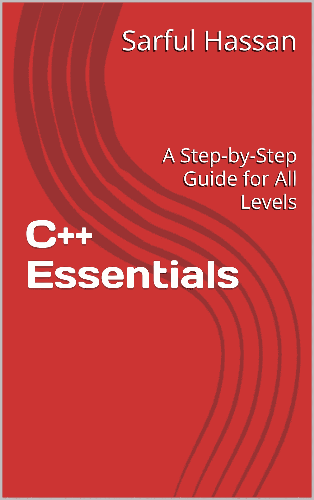

# C++ 基础：全分级分步指南





## 前言

欢迎阅读 `C++ 核心：全方位阶步进式指南`。本书旨在帮助你掌握 `C++` 编程的基础知识，并引导你进入更高级的话题领域。无论你是初学者，还是在其他语言方面具有编程经验的人士，本指南都将为你提供编写高效且结构良好的 `C++` 代码所需的知识。

### 本书适用读者

本书适用于以下群体：

*   **初学者**：如果你是编程的新手，或者刚刚开始学习 `C++`，本书将以简单且易于理解的方式向你介绍核心概念。
*   **中级程序员员**：对于具有某些编程经验的人来说，本书将帮助巩固你对 `C++` 语法、数据结构和算法的理解。
*   **资深开发者**：如果你熟悉其他语言，本指南将帮助你快速学习 `C++` 的特定特性，包括面向对象编程 (`OOP`)、标准模板库 (`STL`) 以及更多高级技术。

### 本书的结构

本书结构设计为 `C++` 的循序渐进，每一章都建立在前章的基础上。以下是快速概述：

1.  第 1–7 章：`C++` 基础、语法、输入/输出、变量和数据类型的导论。
2.  第 8–13 章：涵盖运算符、控制流和条件语句。
3.  第 14–18 章：重点关注循环、数组和更复杂的控制机制。
4.  第 19–23 章：介绍面向对象编程 (`OOP`)、类、结构体和函数重载。
5.  第 24–28 章：讨论文件处理、异常、数据结构和算法等高级话题。

### 未涵盖的内容

本书涵盖了 `C++` 的核心概念，但没有深入探讨以下小众领域：

*   除基础指针和引用之外的低级内存管理。
*   高级 `C++` 库和外部包。
*   游戏开发或 `C++` 的其他特定领域用途。

这些话题虽然很重要，但在更专门的资源中会有更好的阐述。

### 代码风格（关于代码）

代码风格的一致性对于确保可读性和维护性至关重要。在本书中使用了以下约定：

*   缩进：每个块级两个空格。
*   命名：变量和函数遵循 `camelCase`（驼峰命名）。常量使用全大写 `ALL_CAPS`。
*   注释：使用内联注释来解释代码的重要部分，而块注释则放置在函数或类的开头以描述其用途。

### 更新说明

本版本已更新，以反映最新的 `C++` 标准和最佳实践。它包含了与 `C++17` 和 `C++20` 兼容的示例，重点关注结构化绑定、`std::optional` 以及其他现代新增特性。

### 关于第一版的说明

本书的第一版侧重于提供 `C++` 编程的实战指南，面向绝对初学者。在这一版中，我们扩大了范围，包含了如标准模板库 (`STL`)、异常处理和算法等更高级的话。

### 本书使用的约定

全书使用了以下约定：

*   **粗体**：用于突出显示重要概念或新术语。
*   *斜体*：用于对某些短语强调。
*   `等宽字体`：用于代码段、文件名和命令。

### 使用代码示例

请自由使用书中提供的代码示例用于你的个人或学术项目。如果你将大段代码整合到你自己的项目中，请注明适当的出处。

所有示例均可从我们的网站 `MechatronicsLAB.net` 下载。代码编写格式与大多数 IDE 和编译器兼容。


## 2. 面向对象编程
C++ 支持继承、封装和多态等面向对象的原则，允许开发者创建模块化和可重用的代码。这使得管理大型代码库变得更容易并减少了冗余。

## 3. 跨平台开发
C++ 是平台无关的，这意味着代码可以在 Windows、Linux 和 macOS 等各种操作系统上编译和运行。这使得它对于跨平台软件开发非常有。

## 4. 大大的生态系统和库
通过标准模板库 (`STL`) 和许多第三方库，C++ 能够更高效地实现数据结构和算法，缩短复杂操作的开发时间。

***

## C 和 C++ 的区别

虽然 C++ 衍生自 C，但这两种语言存在显著差异：

### 1. 编程范式
- C 是纯过程化的，意味着它关注于函数和按步骤执行的程序。
- C++ 支持过程化和面向对象编程，允许开发者使用对象并使用 `classes` 来组织代码。

### 2. 内存管理
- 在 C 中，内存管理通过使用 `malloc()` 和 `free()` 手动完成。
- C++ 通过构造函数和析构函数提供自动内存管理，并使用 `new` 和 `delete` 运算符进行动态内存分配。

### 3. 标准库
- C++ 包含了标准模板库 (`STL`)，它提供了可重用的数据结构（如 `vectors`、`lists`）和算法，使得开发更快且更不容易出错。
- C 没有对此类高级库的内置支持，依赖于数据结构的手动实现。

### 4. 面向对象支持
- C++ 允许 `classes`、继承和多态，使得通过模拟现实实体来建模复杂系统变得更容易。
- C 使用 `structs`，它将数据组合在一起，但不支持方法或继承等面向对象的原则。

***

## 章节结束清单
- 理解 C++ 在编程中的基本结构和用法。
- 学习为什么 C++ 在性能关键型应用中更受青睐。
- 复习 C 和 C++ 之间的主要差异，特别是关于内存管理、库和面向对象支持的差异。
- 熟悉关键 C++ 概念，如面向对象编程和 `STL`。

***

## 测验
1. 关于编程范式，C 和 C++ 之间的主要区别是什么？
2. C++ 如何不同于 C 来处理内存管理？
3. 为什么 C++ 适用于跨平台开发？
4. 标准模板库 (`STL`) 在 C++ 中是什么用的？

***

## 术语表
- **面向对象编程 (OOP)**：一种围绕数据（对象）及其可以执行的操作（方法）来组织软件设计的编程范式。
- **过程化编程**：一种关注于按步骤执行的指令序列（过程）的编程方法。
- **标准模板库 (STL)**：C++ 中一个强大的库，提供了常见的数据结构（如 `vectors`、`lists`）和算法。
- **内存管理**：在程序执行期间分配和释放内存的过程，在 C 中手动处理，而在 C++ 中是自动化。

# 第 2 章 C++ 入门

## 安装 C++ IDE
在开始编写和运行 C++ 程序之前，你需要安装一个集成开发环境 (IDE)。IDE 是一个为编写、测试和调试代码提供全面环境的软件应用程序。有多种适用于 C++ 开发的 IDE，每个提供不同的功能。以下是一些热门选择：

1. **Visual Studio (Windows/Mac)**:
   - Microsoft Visual Studio 是一个支持 C++ 和其他语言的强大 IDE。它提供了代码建议、调试工具和项目管理等功能。
   - 下载地址：[Visual Studio](https://visualstudio.microsoft.com/)。
   - 安装：下载后，运行安装程序并选择“使用 C++ 的桌面开发”选项来安装必要的工具和编译器。

2. **Code::Blocks (Windows/Linux/Mac)**:
   - Code::Blocks 是一个免费、开源 IDE，易于设置且轻量。
   - 下载地址：Code::Blocks。
   - 安装：下载带有 `MinGW`（包含 C++ 编译器）的安装包并按照安装提示进行操作。

3. **CLion (Windows/Linux/Mac)**:
   - JetBrains 出出的 CLion 是一个现代、功能丰富的 IDE，支持重构、代码分析和版本控制集成。
   - 下载地址：[CLion](https://www.jetbrains.com/clion/)。
   - 安装：下载后，按照设置向导安装 CLion 和所需的 C++ 工具链。

4. **Xcode (仅限 Mac)**:
   - Xcode 是 macOS 的官方 IDE，支持 C++、Swift 和其他语言。
   - 下载地址：App Store 或 [Apple 开发者网站](https://developer.apple.com/xcode/)。
   - 安装：安装后，打开 Xcode 并通过选择 C++ 作为语言来设置 C++ 项目。

**选择 IDE**：如果你是初学者，Code::Blocks 或 Visual Studio 是很好的起点。它们都易于安装和设置。高级用户可能更喜欢 CLion 的强大功能，或者用于 macOS 开发的 Xcode。

***

## C++ 快速上手
一旦安装了 IDE，你就可以准备编写你的第一个 C++ 程序了。按照以下步骤创建一个简单的 C++ 项目并编写一个基础的“Hello, World!”程序开始。

### 第 1 步：创建新项目
1. 打开你的 IDE（例如 Visual Studio、Code::Blocks 或 CLion）。
2. 创建新项目：在 IDE 中寻找类似“New Project”（新项目）的选项。
3. 选择控制台应用程序：从项目类型中选择 C++ 控制台应用程序。这将为命令行程序创建一个简单的项目模板。
4. 命名项目：给你的项目起一个有意义的名字，如 `HelloWorld`，并选择保存位置。

### 第 2 步：编写你的第一个程序
每个 C++ 程序都有一个 `main` 函数，作为入口点。让我们写一个简单的程序，在屏幕上打印“Hello, World!”。

```cpp
#include <iostream> // 这是一个允许输入和输出的库

int main() { // main 函数是任何 C++ 程序的起始点
    std::cout << "Hello, World!" << std::endl; // 这会在屏幕上打印 "Hello, World!"
    return 0; // 返回 0 表示程序执行成功
}
```

### 代码解释
- `#include <iostream>`：这一行包含了 iostream 库，它提供了输入和输出流的功能。没有它，你就无法向控制台打印文本。
- `int main()`：这定义了 `main` 函数，它是执行的起点。
- `std::cout`：此被用于向控制台输出文本。`std::cout` 后面跟着流插入运算符 `<<`，它将字符串 "Hello, World!" 发送到输出端。
- `std::endl`：在输出后添加一个换行符。
- `return 0;`：这表示程序执行成功。返回 0 是 C++ 中的标准做法。

### 第 3 步：构建并运行你的程序
- 在你的 IDE 中，寻找构建或编译程序的选项。这会将你的 C++ 代码转换为计算机可以运行的机器码。
- 构建完成后，点击运行或执行按钮。你应该能看到输出：

Hello, World!

### 第 4 步：添加更多功能
让我们扩展程序以与用户进行交互，通过获取输入并将其回显。

```cpp
#include <iostream>

int main() {
    std::string name; // 声明一个存储用户名的变量
    std::cout << "Enter your name: "; // 询问用户的姓名
}
```


```cpp
std::cin >> name; // 从用户获取输入并存储在 'name' 变量中

std::cout << "Hello, " << name << "!" << std::endl; // 使用用户的名字问候用户

return 0;

}
```

## 新代码说明

*   `std::string name;`: 声明一个名为 `name` 的字符串变量，用于存储用户的输入。
*   `std::cin`: 用于从用户读取输入。输入存储在变量 `name` 中。
*   程序询问用户的姓名，然后打印个性化的问候语。

## 第 5 步：构建并运行新程序

*   再次构建并运行你的程序。
*   这一次，程序将提示用户输入姓名，并打印个性化的消息。

## 常见错误与调试

*   **编译器错误（Compiler Errors）**: 如果存在拼写或语法错误（例如缺少分号），编译器将生成错误。检查并修正代码。
*   **运行时错误（Runtime Errors）**: 在程序运行时发生的错误。例如，除以零会导致运行时错误。
*   **逻辑错误（Logic Errors）**: 程序运行没有报错，但由于逻辑错误产生了错误的结果。

***

## 本章结束清单

*   安装一个 C++ IDE，如 `Visual Studio`、`CodeBlocks` 或 `CLion`。
*   了解如何编写和运行简单的 `"Hello, World!"` 程序。
*   学习使用 `std::cin` 和 `std::cout` 进行基础输入输出操作。
*   排除语法或逻辑错误。

***

## 测验

1.  C++ 中 IDE 的用途是什么？
2.  哪个命令用于显示文本？
3.  在 C++ 中如何读取用户输入？
4.  哪个函数作为 C++ 程序的入口？

***

## 术语表

*   **IDE**（集成开发环境）: 一个用于代码编写、编译和调试的软件工具。
*   **编译器（Compiler）**: 将 C++ 代码翻译成机器码的程序。
*   `std::cout`: 用于输出的流对象。
*   `std::cin`: 用于输入的流对象。
*   **构建/编译（Build/Compile）**: 将源代码转换为可执行程序的过程。

## 第 3 章.C++ 语法

理解 C++ 的基础语法是编写程序的第一步。在本章中，我们将涵盖 C++ 语法的核心组件，包括变量、数据类型、运算符和函数。

***

## C++ 程序结构

典型的 C++ 程序结构如下：

```cpp
#include <iostream>   // 包含
using namespace std;  

int main() {             // main 函数是程序的入口
    cout << "Hello, World!"; // 输出
    return 0;           // 返回 0，表示程序成功结束
}
```

*   `#include <iostream>`: 包含 `iostream` 库。
*   `int main()`: 每个 C++ 程序必须有这个函数。

***

## 变量与数据类型

变量用于存储数据。C++ 是一种静态类型语言，意味着每个变量必须声明类型。常见的 C++ 数据类型包括：

*   `int`: 用于整数（例如 `int age = 30;`）。
*   `float`: 用于浮点数（例如 `float pi = 3.14;`）。
*   `double`: 用于双精度浮点数（例如 `double g = 9.8;`）。
*   `char`: 用于单字符（例如 `char grade = 'A';`）。
*   `string`: 用于文本（例如 `string name = "John";`）。
*   `bool`: 用于布尔值（`true` 或 `false`，例如 `bool isActive = true;`）。

***

## 运算符

C++ 提供了各种运算符来进行计算、比较和逻辑操作。

1.  **算术运算符（Arithmetic Operators）**:
    *   `+`（加法）：`a + b`
    *   `-`（减法）：`a - b`
    *   `*`（乘法）：`a * b`
    *   `/`（除法）：`a / b`
    *   `%`（模运算）：`a % b`（除余数）
2.  **比较运算符（Comparison Operators）**:
    *   `==`（等于）：`a == b`
    *   `!=`（不等于）：`a != b`
    *   `<`, `>`, `<= `>= （小于、大于、小于等于、大于等于）
3.  **逻辑运算符（Logical Operators）**:
    *   `&&`（与）：`a && b`
    *   `||`（或）：`a || b`
    *   `!`（非）：`!a`

***

## 控制结构

控制结构用于控制程序的执行流。

### If-Else 语句

根据条件允许条件执行。

```cpp
if (age >= 18) {
    cout << "You are an adult.";
} else {
    cout << "You are a minor.";
}
```

### Switch 语句

`switch` 语句从多个块中选择一个。

```cpp
int day = 3;
switch (day) {
    case 1:
        cout << "Monday";
        break;
    case 2:
        cout << "Tuesday";
        break;
    default:
        cout << "Other day";
}
```

# 循环

循环允许重复执行。

*   **For 循环（For Loop）**: 按指定的次数重复执行一个代码块。
    ```cpp
    for (int i = 0; i < 5; i++) {
        cout << i;
    }
    ```
*   **While 循环（While Loop）**: 当条件为真时重复执行代码块。
    ```cpp
    int i = 0;
    while (i < 5) {
        cout << i;
        i++;
    }
    ```
*   **Do-While 循环（Do-While Loop）**: 类似于 while 循环，但保证执行一次。
    ```cpp
    int i = 0;
    do {
        cout << i;
        i++;
    } while (i < 5);
    ```

***

### 函数

函数允许你将代码组织成可重用的块。

### 声明与定义

C++ 中的函数由返回值、名称、参数列表和函数体组成。

```cpp
int add(int a, int b) {
    return a + b;
}
```

*   `int`: 返回类型，表示函数返回整数
*   `add`: 函数名。
*   `(int a, int b)`: 函数参数。
*   `return`: 返回结果。

### 调用函数

你可以通过使用函数名并传递参数来调用函数。

```cpp
int result = add(5, 10);
cout << result;
```

***

## 注释与代码文档

注释用于解释代码，使其更易理解。在 C++ 中，有两种类型的注释：

*   **单行注释**: 使用 `//` 在单行上添加注释。
*   **多行注释**: 使用 `/* */` 添加跨越多行的注释。

```cpp
// 这是一个单行注释

/*
这是一个
多行
注释
*/
```


- `Function`: 一个可重用的代码块，用于执行特定任务并可以返回值。
- `Operator`: 一个用于对变量和值进行操作的符号。
- `Loop`: 一种控制结构，当条件为真时会重复执行代码块。

# 第 4 章 C++ 输出

## 什么是 C++ 中的输出？

在 C++ 中，输出是我们向用户显示信息、结果或消息的方式。最常用的输出方式是通过 `cout` 对象实现的，它代表“控制台输出”（console output）。它是 `iostream` 库的一部分，并配合 `<<` 运算符使用，将数据发送到标准输出流（通常是控制台窗口）。此外，`endl` 是一个操纵符，用于将光标移动到下一行并刷新输出缓冲区，这对于整齐格式化输出至关重要。

输出是任何程序不可或缺的一部分，因为它有助于与用户交互、显示结果以及调试问题。你可以输出文本、数字甚至格式化后的数据，这使其成为简单和复杂应用程序中的关键元素。

## 理解 C++ 打印文本

### 什么是打印文本？

在 C++ 中打印文本涉及使用 `cout` 对象在屏幕上显示消息、数字和结果。这通常是 C++ 学习的第一个内容，因为它允许程序与用户之间进行通信。文本输出用于提供指令、显示计算结果或交互式地显示用户输入。

使用 `cout`，你可以打印文本和变量数据的任何组合。这种能力对于几乎所有类型的程序都关重要，无论你是在创建一个计算器、游戏还是会计系统。

### 语法

打印文本的语法非常直观。你使用 `cout` 对象，后跟 `<<` 运算符以及你想要显示的文本或变量。

```
cout << "Hello, World!";
```

在这个示例中，“Hello, World!” 将打印在控制台上。你可以通过额外的 `<<` 运算符链联多个输出内容：

```
cout << "The answer is: " << 42;
```

### 语法解释

`cout` 将输出重定向到控制台。`<<` 运算符将数据（文本或变量值）插入输出流中。通过链联多个 `<<` 运算符，你可以在单行内打印文本、变量和数字的混合。C++ 从左到右顺序处理每条信息，并将所有内容输出到控制台。

## 代码示例

```cpp
#include <iostream>

using namespace std;

int main() {
  cout << "Welcome to C++!" << endl;
  int age = 25;
  cout << "Your age is: " << age << endl;
  return 0;
}
```

### 代码解读

在这个程序中，我们首先包含了 `iostream` 库，它包含了 `cout` 对象。然后，`main()` 函数使用 `cout` 对象打印“Welcome to C++!”。`endl` 操纵符将光标移动到下一行。接着，我们声明了一个值为 25 的整数变量 `age`。下一个 `cout` 语句输出文本“Your age is: ”，随后是 `age` 变量的值。多次使用 `<<` 允许我们在单次输出中组合文本和变量。

## 注意事项

打印文本时，请确保格式正确以提高可读性。根据需要使用 `endl` 或 `\n` 创建新行，特别是在打印多条信息时。在单个 `cout` 语句中将文本与变量结合可以节省时间并保持代码整洁。

## 理解 C++ 中的换行

### 什么是换行？

换行在 C++ 中用于控制下一个打印文本在控制台上的出现位置。如果没有换行，所有内容都将打印在同一行，导致输出难以阅读。你可以使用 `\n` 转义序列或 `endl` 操纵符来创建换行。

使用换行允许你组织输出，特别是在处理表格、列表或多行消息时。例如，在收据或报告中，你可能希望每个项目或每条信息都单独占一行显示，以使输出清晰易读。

### 语法

要插入换行，你可以使用 `\n` 或 `endl`。

```
cout << "Line one\nLine two";
cout << "Line three" << endl;
```

在这里，第一条语句使用 `\n` 在新行上打印，而第二条语句使用 `endl`。两者实现了相同的结果，但方式不同。

### 语法解释

`\n` 是一个转义字符，表示新行的开始，而 `endl` 是一个移动到新行并刷新输出缓冲区的操纵符。当你需要快速、简单的格式化时使用 `\n`，当你需要确保所有缓冲区输出都立即刷新时使用 `endl`，特别是在处理实时输出时。

## 代码示例

```cpp
#include <iostream>

using namespace std;

int main() {
  cout << "First Line\nSecond Line" << endl;
  cout << "Third Line" << endl;
  return 0;
}
```

### 代码解读

在这个示例中，第一条 `cout` 语句打印了两行文本。`\n` 在“First Line”之后创建了一个新行，因此“Second Line”出现在它下方。第二条 `cout` 语句使用 `endl` 打印“Third Line”并移动到下一行，确保任何后续文本将打印在新行。

此程序演示了如何通过插入换行符来整齐地组织输出，确保每条消息或每条数据都单独占一行。

## 注意事项

格式化输出时使用 `\n` 通常更快，但 `endl` 更具通用性，当你需要刷新缓冲区时使用 `endl` 根据情况。

## 项目

### 项目 1：乘法表

**描述**：创建一个打印 1 到 10 的乘法表。
**目标**：使用循环练习 `cout` 输出。
**指令**：使用嵌套循环打印每一行。

**代码**：

```cpp
#include <iostream>

using namespace std;

int main() {
  for (int i = 1; i <= 10; i++) {
    for (int j = 1; j <= 10; j++) {
      cout << i * j << "\t"; // 使用制表符对齐
    }
    cout << endl; // 移动到下一行
  }
  return 0;
}
```

**代码解读**

此程序使用了两个 `for` 循环。外层循环控制行，内部循环计算乘积。`\t` 确保数值对齐，`endl` 在每行后移动。

**挑战**：修改程序允许用户输入最大值（例如打印 12）。

### 项目 2：购物列表收据

**描述**：打印一份显示项目、价格和总成本的格式化收据。
**目标**：针对浮点数练习输出格式化。
**指令**：使用数组存储项目名称。打印每个项目及其价格，并在最后显示总计。

**代码**：

```cpp
#include <iostream>
#include <iomanip>  // 用于格式化
using namespace std;

int main() {
  string items[] = {"苹果", "香蕉", "橙子"};
  double prices[] = {1.99, 0.99, 2.49};
  double total = 0;
  cout << fixed << setprecision(2); // 设置输出精度为两位小数
  cout << "Item\t\tPrice\n";
  cout << "----------------------\n";
  for (int i = 0; i < 3; i++) {
    cout << items[i] << "\t\t$" << prices[i] << endl;
    total += prices[i];
  }
  cout << "----------------------\n";
  cout << "Total:\t\t$" << total << endl;
  return 0;
}
```

**代码解读**

此程序打印列表中每个项目的名称和价格。它使用 `fixed` 和 `setprecision(2)` 确保价格以两位小数显示。一个 `for` 循环遍历项目和价格，打印每个项目并累计总成本。

## 本章结束清单

- 理解如何使用 `cout` 打印文本。
- 学习 `\n` 和 `endl` 在格式化方面的区别。
- 使用 `cout` 格式化输出以提高可读性。

## 测验

1. C++ 中 `cout` 的主要目的是？
2. 如何使用 `cout` 创建换行？


# 3. `
` 和 `endl` 有什么区别？

## 术语表

- `cout`: 标准输出流，用于向控制台打印文本和变量。
- `endl`: 操纵符，用于添加换行并刷新输出缓冲区。
- `\n`: 用于在字符串中创建新行的转义序列。
- `Output`: 将程序信息显示在控制台上的过程。

# 第 5 章 C++ 注释

## 什么是 C++ 注释？
C++ 中的注释是你代码中的行文本，编译器会忽略它们。它们允许开发者解释自己的代码、为未来的参考留下备注，或者在不删除代码的情况下临时禁用部分代码。注释可以提高代码的可读性，特别是在有多个程序员参与的大型项目中。通过添加注释，你可以让代码对你自己和其他来说更易理解，解释程序每个部分的作用。

注释在调试时也很有帮助，因为你可以注释掉特定部分来观察程序在没有这些部分时的表现。虽然它们不会影响程序的运行，但它们是有效维护和组织代码的重要工具。

## 单行注释

### 什么是单行注释？
单行注释是写在某一行上的简短备注或解释。它通常用于解释特定行代码或留下快速笔记。单行注释以 `//` 开头，该行之后的所有内容都会被编译器忽略。这些对于简短的解释或提醒非常有用，特别是当注释引用单个操作或变量时。

### 语法
编写单行注释的语法非常直观。你用两个正斜杠（`//`）开始注释，后面跟上你的文本。该行中 `//` 之后的任何内容都不会被编译器执行。

```cpp
// 这是一行单行注释
cout << "Hello, World!";  // 输出消息
```

### 语法解释
当编译器遇到 `//` 时，它知道要忽略同一行之后的所有内容。这使得它成为留下简短备注或描述某行代码作用的理想选择。例如，如果你想指示某特定行输出输出消息，可以使用单行注释来解释它，而不会影响程序的执行。

## 代码示例
```cpp
#include <iostream>

using namespace std;

int main() {
    // 声明一个变量
    int age = 25;
    // 打印年龄
    cout << "Your age is: " << age << endl;  // 这输出了年龄
    return 0;
}
```

### 代码解读
在例示例中，我们使用注释来描述代码每个部分的作用。第一条注释解释了正在声明变量，而第二个注释解释了程序正在打印变量的值。通过使用单行注释，代码的每个部分都更易一目了然。

## 注意事项
谨慎使用单行注释，并仅在需要解释代码功能时使用。避免过度注释或重述显而易见的内容，因为这会让你的代码变得杂乱。确保注释清晰简洁，增加价值而不是冗余。

## 多行注释

### 什么是多行注释？
多行注释（也称为块注释）用于需要编写更详细的解释或禁用较大范围代码的情况。这些注释跨越多行，适用于描述复杂的逻辑、解释整个代码块或在程序内部提供详细的文档。

### 语法
多行注释以 `/*` 开头，以 `*/` 结束。这些符号之间的所有内容都被视为注释，无论它们跨越多少行。

```cpp
/* 这是一个多行注释。
它可以跨越多行，
并适用于解释复杂代码。 */
```

### 语法解释
编译器忽略 `/*` 和 `*/` 之间的所有内容。你可以使用这种语法添加较长的描述或临时禁用多行代码。多行注释通常用于提供更详细的解释，特别是当简单的单行注释不够用时。

## 代码示例
```cpp
#include <iostream>

using namespace std;

int main() {
    /* 此程序声明了一个变量
    并打印了变量的值 */
    int age = 25;  // 声明变量
    cout << "Your age is: " << age << endl;  // 输出值
    return 0;
}
```

### 代码解读
在此例中，使用多行注释来对程序的功能提供更详细的解释。它描述了声明变量并打印它的整体过程。此外，代码旁边还有一条单行注释以进一步阐明。当你需要解释更广泛的概念时，多行注释很有帮助，而单行注释适用于特定的行。

## 注意事项
在解释多行代码或提供详尽细节时，多行注释非常有用。注意不要过度使用，因为过多的注释会让你的代码变得杂乱。坚持使用简洁且相关的、真正有助于理解的注释。

## 项目

### 项目 1：计算圆面积
**描述：**
编写一个计算圆面积的程序，并添加注释来解释过程的每一步。

**目标：**
使用单行和多行注释来解释计算圆面积背后的逻辑。

**指令：**
1. 使用公式：`Area = π × radius²`。
2. 使用注释描述变量声明、公式使用和输出格式。

**代码：**
```cpp
#include <iostream>

using namespace std;

int main() {
    // 声明变量
    double radius, area;
    const double pi = 3.14159;  // 常数 pi
    // 获取半径
    cout << "Enter the radius of the circle: ";
    cin >> radius;
    // 计算面积
    area = pi * radius * radius;  // 圆面积公式
    // 输出结果
    cout << "The area of the circle is: " << area << endl;
    return 0;
}
```
**代码解读：**
程序声明了半径和面积。它要求用户输入半径，然后使用 `pi * radius * radius` 计算面积。注释用于解释 `pi` 的常数值、用户输入以及计算结果。

**挑战：**
修改程序以计算圆周长，并使用注释解释额外的逻辑。

### 项目 2：计算学生平均分
**描述：**
创建一个接收不同科目的分数、计算平均分并输出等级的程序。使用注释解释每个步骤。

**目标：**
使用注释引导读者完成变量声明、用户输入、平均分计算和输出。

**指令：**
1. 为每个科目声明变量。
2. 使用注释解释如何计算平均分。
3. 输出平均分和相应的等级。

**代码：**
```cpp
#include <iostream>

using namespace std;

int main() {
    // 声明分数的变量
    int math, science, english, total;
    double average;
    // 获取用户分数
    cout << "Enter marks for Math: ";
    cin >> math;
    cout << "Enter marks for Science: ";
    cin >> science;
    cout << "Enter marks for English: ";
    cin >> english;
    // 计算总分和平均分
    total = math + science + english;  // 总分
    average = total / 3.0;  // 计算平均分
    // 输出平均分
    cout << "Your average mark is: " << average << endl;
    return 0;
}
```
**代码解读：**
程序要求用户输入三个科目的分数。它计算总分，然后通过除以 3 计算平均分。贯穿整个程序的注释解释每个步骤，从用户输入到计算和显示平均分。

**挑战：**
增强程序，根据平均分输出等级（A、B、C 等）。使用注释解释评分逻辑。

## 本章结束检查清单
- 理解 C++ 注释的作用。
- 知道如何有效地使用单行和多行注释。


*   能够添加注释来解释代码的不同部分。

***

## 测验

1. 写单行注释的语法是什么？
2. 多行注释与单行注释有什么区别？
3. 为什么注释在编程中非常重要？

***

## 术语表

*   注释（Comments）：被编译器忽略的代码行，用于解释和说明。
*   单行注释：跨越一行的注释，以 `//` 开头。
*   多行注释：跨越多行的注释，以 `/*` 开头并以 `*/` 结尾。

# 第 6 章 C++ 变量

***

## 什么是变量？

C++ 中的变量是存储数据的容器。它们允许你在内存中持有不同类型的信息，以便程序以后可以使用或处理它们。每个变量都有一个数据类型，它定义了它持有什么类型的数据，例如整数、浮点数或字符。存储在变量中的数据会被放在计算机内存，并在程序执行期间根据需要检索或更改。

变量在编程中是基础，因为它们允许你动态地存储、修改和使用信息。例如，你可能需要跟踪用户的输入、执行计算或统计事件——所有这些都需要变量。由于变量占用内存空间，因此选择正确的数据类型以优化程序的性能至关重要。

***

## 声明变量

### 什么是变量声明？

C++ 中的变量声明涉及通过指定其数据类型并赋予它一个名称来定义变量。这一步告诉编译器变量将持有什么类型的数据，并相应分配内存。例如，一个整数变量可以用于存储人的年龄，而浮点数变量可以存储物品的价格。

在程序中使用变量之前，对其进行声明是至关重要的。如果你不声明变量，编译器将不知道要分配多少内存或期望什么类型的数据。每个变量都必须使用相应的类型声明，以确保程序运行正确且高效。

### 语法

声明变量的语法非常简单：

```
data_type variable_name;
```

在这里，`data_type` 指变量将存储的数据类型，例如 `int`、`float`、`char` 等。`variable_name` 是你给变量的名字。例如：

```
int age;
float price;
char grade;
```

### 语法解释

数据类型告诉编译器变量将存储什么类型的数据。常见类型包括：

*   `int` 用于整数（全数字，如 5 或 -3）
*   `float` 用于浮点数（小数值，如 5.23）
*   `char` 用于字符（单个字母，如 'A'）

变量名应该是具有描述性的并遵循命名规则（见下文）。声明变量后，你可以在声明时或在程序的后续部分给它赋一个值。例如：

```
int age = 25;
float price = 9.99;
char grade = 'A';
```

## 代码示例

```cpp
#include <iostream>

using namespace std;

int main() {
    int age = 30;  // 声明并初始化一个整数变量
    float height = 5.9;  // 声明并初始化一个 float 变量
    char initial = 'J';  // 声明并初始化一个 char 变量
    cout << "Age: " << age << endl;
    cout << "Height: " << height << endl;
    cout << "Initial: " << initial << endl;
    return 0;
}
```

### 代码解读

在这个示例中，声明并初始化了三个变量。`int` 变量 `age` 持值 30，`float` 变量 `height` 持值 5.9，`char` 变量 `initial` 持字母 'J'。

程序然后使用 `cout` 输出这些变量。每个变量都带有一个标签输出以便清晰。当程序运行时，它会显示存储在 `age`、`height` 和 `initial` 中的值。这展示了变量如何存储不同类型的数据并在程序中动态使用。

## 注意事项

在选择变量名时，使用指示变量用途的描述性术语。例如，不要将变量命名为 `x`，而是使用 `age` 或 `height` 使你的代码更具可读性。始终确保数据类型与存储的数据类型匹配以获得最佳性能。

***

## 多变量

### 什么是多个变量？

你可以通过逗号分隔，在同一行中声明多个变量。当你需要多个相同类型的变量时，这非常有用，例如在执行需要多个值的计算时。

### 语法

要声明多个变量，使用以下语法：

```
data_type var1, var2, var3;
```

例如：

```
int length, width, height;
```

### 语法解释

当你声明多个相同类型的变量时，编译器会将每个变量视为一个独立的变量，但通过将它们合并到单行来优化声明过程。这有助于在管理多个相同类型的变量时节省空间并提高可读性。你还可以在同一行中初始化这些变量中的部分或全部：

```
int length = 10, width = 20, height = 30;
```

通过这种方式，你可以在一步中声明并初始化多个变量。

## 代码示例

```cpp
#include <iostream>

using namespace std;

int main() {
    int length = 5, width = 10, height = 15;  // 声明并初始化三个变量
    cout << "Length: " << length << ", Width: " << width << ", Height: " << height << endl;
    return 0;
}
```

### 代码解读

在这个示例中，三个整数变量（`length`、`width` 和 `height`）在同一行中声明并初始化。程序然后使用单个 `cout` 语句打印所有三个值。

这种方法展示了在处理多个相同类型的变量时如何简化你的代码。通过在单行中声明它们，你在减少代码行数的同时保持了程序易于理解。

## 注意事项

声明变量时按逻辑对它们进行分组。如果它们是相关的（例如尺寸的 `length`、`width` 和 `height`），在同一行中声明它们是有意义的。

***

## 标识符

### 什么是标识符？

标识符是你赋予变量、函数和其他元素的元素的名称。它们遵循特定的规则，例如以字母或下划线开头，且仅包含字母、数字和下划线。标识符应该是有意义且描述性的，以使代码易读。

### 语法

```
int myVariable;
float totalAmount;
char studentName;
```

### 语法解释

标识符不能以数字开头，并应避免使用 `int` 或 `return` 等关键字。使用下划线或驼峰命名法分隔变量名中的单词，例如 `studentName` 或 `total_amount`。有意义的名字更容易理解代码，特别是在大型项目中。

## 代码示例

```cpp
#include <iostream>

using namespace std;

int main() {
    int studentAge = 20;  // 学生年龄的有意义标识符
    char grade = 'B';  // 学生成绩的标识符
    cout << "Student Age: " << studentAge << endl;
    cout << "Grade: " << grade << endl;
    return 0;
}
```

### 代码解读

此程序使用了有意义的标识符 `studentAge` 和 `grade`。变量名描述了它们持有什么信息，使得逻辑更容易理解。

## 注意事项

始终使用清晰、描述性的标识符。除非在简单的操作或循环中，否则避免使用 `x` 或 `y` 等模糊名称。遵循命名规范可以提高代码的可读性和维护性。

***

## 常量

### 什么是常量？

C++ 中的常量是在初始化后值无法更改的变量。常量使用 `const` 关键字声明。当你需要定义在整个程序过程中保持不变的值时，就会使用常量，例如数学常量 `pi` 或固定设置（如最高分）。

### 语法

要声明常量，使用以下语法：

```
const data_type constant_name = value;
```

示例：

```
const double pi = 3.14159;
```

### 语法解释


`const` 关键字确保变量的值在设置后不能被修改。这对于那些在整个程序运行过程中必须保持一致的值非常有用。尝试更改常量会导致编译器错误，从而确保你的数据的完整性。

## 代码示例

```cpp
#include <iostream>

using namespace std;

int main() {
const double pi = 3.14159;  // 为 pi 声明常量
double radius = 5.0;
double area = pi * radius * radius;  // 在计算中使用常量
cout << "Area of the circle: " << area << endl;
return 0;
}
```

## 代码解析
在此程序中，常量 `pi` 被声明为值 `3.14159`。由于 `pi` 永远不会改变，因此将其声明为常量以防止意外修改。程序使用常量 `pi` 计算圆的面积并打印结果。

## 注意事项
对于在程序执行期间永远不应改变的值，请使用常量，例如固定费率、限制或公式中的常量。常量可以提高代码的可靠性和可读性，确保某些值保持一致。

***

## 项目

#### 项目 1：计算矩形的面积和周长
**描述：** 编写程序，使用存储在变量中的长度和宽度计算矩形的面积和周长。
**目标：** 理解如何使用变量来存储和处理数据。
**指令：**
* 声明 `length` 和 `width` 变量。
* 使用公式：
    * `Area = length × width`
    * `Perimeter = 2 × (length + width)`
* 输出结果。

**代码：**
```cpp
#include <iostream>

using namespace std;

int main() {
int length, width, area, perimeter;
cout << "Enter the length: ";
cin >> length;
cout << "Enter the width: ";
cin >> width;
area = length * width;
perimeter = 2 * (length + width);
cout << "Area: " << area << endl;
cout << "Perimeter: " << perimeter << endl;
return 0;
}
```

**代码解析：**
此程序提示用户输入矩形的长度和宽度。它使用提供的公式计算面积和周长，并显示结果。

**挑战：**
修改程序以处理长度和宽度的浮点值，使输出更精确。

***

#### 项目 2：美元兑换欧元
**描述：** 编写程序，将美元金额转换为欧元，并使用存储在常量变量中的汇率。
**目标：** 学习在计算中使用常量和变量。
**指令：**
* 为 `exchangeRate` 声明一个常量。
* 获取美元金额作为输入。
* 使用常量将美元转换为欧元。

**代码：**
```cpp
#include <iostream>

using namespace std;

int main() {
const double exchangeRate = 0.85;  // 常数汇率
double dollars, euros;
cout << "Enter the amount in dollars: ";
cin >> dollars;
euros = dollars * exchangeRate;  // 转换
cout << "Equivalent in euros: " << euros << endl;
return 0;
}
```

**代码解析：**
程序声明了一个常量 `exchangeRate`，获取美元输入，并使用该常量计算等值的欧元。结果打印在控制台上。

**挑战：**
修改程序以允许用户输入自定义汇率。

***

## 本章结束清单
* 理解如何声明和使用变量。
* 了解变量和常量之间的区别。
* 能够在单行声明多个变量。
* 练习使用描述性标识符。

***

## 测验
1. C++ 中变量的作用是什么？
2. 如何在一行中声明多个相同类型的变量？
3. 声明常量的语法是什么？

***

## 术语表
* 变量 (Variable)：在内存中存储数据的命名容器。
* 常量 (Constant)：初始化后值不能改变变量。
* 标识符 (Identifier)：代码中变量、函数或其他元素的名称。

# 第 7 章 C++ 用户输入

***

## 什么是 C++ 中的用户输入？
用户输入是在程序执行期间从用户获取信息的过程。在 C++ 中，用户输入通常使用 `cin` 对象处理，它代表控制台输入。该对象是 `iostream` 库的一部分，就像 `cout` 一样。使用 `cin`，你可以提示用户输入数据（如数字、字符串或字符），这些数据会被存储在变量中并在程序稍后使用。

用户输入让你的程序具有交互性和响应性。例如，在一个计算器程序中，你会要求用户输入数字，对它们进行操作，然后返回结果。同样，你可以收集各种输入（如名称、年龄或选择）来构建更动态的应用程序。有效处理输入是构建用户友好程序的关键，使 `cin` 成为 C++ 编程不可或缺的一部分。

***

### 语法
使用 `cin` 获取用户输入的语法非常简单。在提示用户提供所需数据后，你指定用于存储输入的变量。基本语法如下：

```cpp
cin >> variable_name;
```

例如，如果你想让用户输入年龄，你可以这样写：

```cpp
int age;
cin >> age;
```

你还可以通过链式使用 `>>` 运算符一次获取多个输入：

```cpp
int age;
string name;
cin >> name >> age;
```

在此示例中，用户将首先输入姓名，然后输入年龄。

### 语法说明
`cin` 对象从键盘读取数据，在提示用户提供所需数据后，你指定用于存储输入的变量。`>>` 运算符提取数据并存储在变量中。

***

## 代码示例
```cpp
#include <iostream>

using namespace std;

int main() {
string name;
int age;
cout << "Enter your name: ";
cin >> name;
cout << "Enter your age: ";
cin >> age;
cout << "Hello, " << name << ". You are " << age << " years old." << endl;
return 0;
}
```

## 代码解析
在此程序中，我们首先声明了两个变量：`name`（字符串）和 `age`（整数）。我们使用 `cout` 提示用户输入姓名，`cin` 获取输入并存储在 `name` 变量中。接下来，提示用户输入年龄，并存储在变量中。

收集输入后，程序使用 `cout` 打印包含用户姓名和年龄的消息。例如，如果用户输入 "Alice" 和 "30"，程序将输出：

`Hello, Alice. You are 30 years old.`

这种简单的交互演示了如何在 C++ 中收集和使用用户输入。

***

## 注意事项
使用 `cin` 时，确保要验证用户输入以避免错误。如果用户在预期输入数字时输入了文本，程序可能会失败或产生错误结果。你可以使用条件判断和循环来检查输入是否有效并要求用户重新输入。此外，请注意 `cin` 不捕捉字符串输入中的空格——只存储第一个单词。如果你需要捕捉完整的句子或包含空格的姓名，请使用 `getline(cin, variable_name)`。

***

## 项目

#### 项目 1：收集姓名和年龄
**描述：** 创建一个程序，询问用户的姓名和年龄，然后打印个性化消息。
**目标：** 学习如何使用 `cin` 收集输入并使用 `cout` 打印响应。
**指令：**
1. 为用户的姓名（字符串）和年龄（整数）声明变量。
2. 使用 `cin` 获取用户输入。
3. 输出类似“Hello, [name]. You are [age] years old.”的消息。

**代码：**
```cpp
#include <iostream>

using namespace std;

int main() {
string name;
int age;
cout << "Please enter your name: ";
cin >> name;
}
```


```
cout << "Please enter your age: ";
cin >> age;
cout << "Hello, " << name << ". You are " << age << " years old." << endl;
return 0;
}
```

### 代码解读
程序首先声明了两个变量来存储用户的姓名和年龄。它使用 `cout` 提示用户输入姓名和年龄，并使用 `cin` 将输入存储在变量中。最后，程序使用存储的数据打印出个性化的问候语。

## 挑战
修改程序，使用 `getline()` 代替 `cin` 来接收用户的全名（包括空格）。

***

***

## 项目 2：计算考试成绩平均分

### 描述
编写一个程序，接收三个考试分数的输入并计算平均分。

### 目标
练习使用 `cin` 获取多个输入，并根据用户输入进行计算。

### 指南
1. 为三个考试分数声明变量（整数型）。
2. 提示用户输入他们的分数。
3. 计算平均分并将其打印到控制台。

### 代码
```cpp
#include <iostream>

using namespace std;

int main() {
    int score1, score2, score3;
    float average;
    cout << "Enter your first exam score: ";
    cin >> score1;
    cout << "Enter your second exam score: ";
    cin >> score2;
    cout << "Enter your third exam score: ";
    cin >> score3;
    // 计算平均分
    average = (score1 + score2 + score3) / 3.0;
    cout << "Your average score is: " << average << endl;
    return 0;
}
```

### 代码解读
此程序声明了三个整数变量来存储分数。然后它提示用户使用 `cin` 输入每个分数。在用户输入所有三个分数后，程序计算平均分并将其存储在 `average` 变量中。最后，程序使用 `cout` 将平均分打印到控制台。

## 挑战
扩展程序，根据平均分判断学生及格还是不及格（例如，`average >= 50` 为及格）。

***

***

## 章节结束清单
* 理解如何使用 `cin` 捕捉用户输入。
* 了解如何声明变量来存储用户输入。
* 能够获取多个输入并在程序中处理它们。

***

***

## 测验
1. C++ 中 `cin` 的主要目的是什么？
2. 如何使用 `cin` 一次获取多个变量的输入？
3. 如何从用户处获取全名（包括空格）？

***

***

## 词汇表
* `cin`: 用于从用户处输入的输入流对象。
* `Input stream`（输入流）: 从外部源（如键盘）流入程序的数据流。
* `getline`: 一个用于捕捉整行文本（包括空格）的函数。

# 第 8 章 C++ 数据类型

***

## C++ 中的数据类型是什么？
C++ 中的数据类型定义了变量可以存储什么类型的值，以确保内存被高效利用。每种数据类型都决定了在内存中分配多少空间来存储数据，以及可以对该数据执行哪些操作。例如，整数的存储方式与浮点数不同，字符的存储方式也与字符串不同。选择正确的数据类型对于创建高效且功能程序至关重要。

C++ 中的数据类型可以分为基本类型（如 `int`、`float`、`char` 和 `bool`）以及更复杂的类型（如字符串和数组）。理解数据类型有助于开发者有效管理内存，并在计算或数据处理过程中避免错误。它们还定义了值取范围的边界以及数据的精度。

***

## 布尔型（Boolean）

### 什么是布尔值？
布尔数据类型（`bool`）代表真或假的值，这在决策和逻辑判断中是基础性的。在 C++ 中，`bool` 可以包含两个值：`true`（用 1 表示）或 `false`（用 0 表示）。布尔值用于条件语句（如 `if`、`else`）以控制程序的流，并根据某些条件做出判断。例如，布尔值可以检查一个数字是否大于另一个数字，或者用户是否已登录。

### 语法
```cpp
bool isTrue = true;
bool isFalse = false;
```

### 语法解释
在 C++ 中，你使用关键字 `bool` 声明一个布尔变量。可以使用 `true` 或 `false` 进行初始化。布尔值通常用于条件逻辑，例如 `if` 语句，在语句中你评估会导致真或假结果的条件。例如：
```cpp
bool isAdult = (age >= 18);
```
这段代码检查一个人是否为成年人，如果年龄满 18 岁或以上则存储 `true`，否则存储 `false`。

## 代码示例
```cpp
#include <iostream>

using namespace std;

int main() {
    bool isRaining = false;
    if (isRaining) {
        cout << "Take an umbrella!" << endl;
    } else {
        cout << "No umbrella needed!" << endl;
    }
    return 0;
}
```

### 代码解读
在这个程序中，布尔变量 `isRaining` 被初始化为 `false`。一个 `if` 语句检查 `isRaining` 是否为 `true`。如果是，程序打印“Take an umbrella!”。否则，打印“No umbrella needed!”。这演示了布尔值如何影响程序逻辑和决策。

## 注意事项
使用布尔值时，记住 `true` 等同于 1，而 `false` 等同于 0。

***

***

## 字符型（Char）

### 什么是字符？
`char` 数据类型代表单个字符。它可以存储一个字母、数字或符号，且仅占用 1 字节内存。字符以 ASCII 值的形式存储。

### 语法
```cpp
char letter = 'A';
char digit = '3';
```

### 语法解释
在 C++ 中，你使用 `char` 关键字声明字符，并用单引号包裹字符。例如，`'A'` 的值为 65。

## 代码示例
```cpp
#include <iostream>

using namespace std;

int main() {
    char grade = 'A';
    cout << "Your grade is: " << grade << endl;
    return 0;
}
```

### 代码解读
在示例中，变量 `grade` 被声明为 `char` 并初始化为 `'A'`。程序随后使用 `cout` 打印成绩。这演示了如何存储和显示单个字符。

## 注意事项
处理字符时，请注意大写和小写字母的区别，因为它们的 ASCII 值不同。始终对字符使用单引号，避免对字符串使用它们。

***

***

## 整数型（Int）

### 什么是整数？
整数（`int`）是不带小数的整数，可以是正负数。整数是 C++ 中常用的数据类型之一，允许你执行计数、索引和算术操作。在 C++ 中，`int` 的大小通常为 4 字节，允许它存储从约 -20 亿到 20 亿之间的值。

### 语法
```cpp
int number = 10;
```

### 语法解释
要声明整数，你使用 `int` 关键字，后跟变量名。你可以为变量分配一个整数值。整数可以用于加、减、乘、除等算术运算。

## 代码示例
```cpp
#include <iostream>

using namespace std;

int main() {
    int a = 5, b = 10;
    int sum = a + b;
    cout << "The sum is: " << sum << endl;
    return 0;
}
```

### 代码解读


在此程序中，声明并初始化了两个整数变量 `a` 和 `b`。程序计算了这两个整数的和，并将结果存储在变量 `sum` 中。最后，使用 `cout` 打印 `sum`。这演示了如何使用整数进行算术操作以及如何操作它们的值。

## 注意事项
在处理整数时，请注意整数溢出，当值超过 `int` 的存储限制时就会发生。此外，在进行整数除法时要小心，因为整数除法会截断结果，去掉小数部分。

***

## Float（浮点型）

### 什么是 Float？
Float 是一种用于存储带小数数字的数据类型，也称为浮点数。Float 常用于需要分数数值计算的程序，例如科学或财务计算。`float` 占用 4 字节内存，并提供最多 7 位小数精度，使其非常适合中等精度的计算。

### 语法
```cpp
float price = 9.99;
```

### 语法解释
要声明一个浮点数，使用 `float` 关键字，后跟变量名和一个小数数字。Float 是表示价格、测量值和其他需要小数精度值的理想选择。然而，它们的精度有限，这意味着对非常小或非常大的小数数字进行计算可能会导致舍入误差。

## 代码示例
```cpp
#include <iostream>

using namespace std;

int main() {
  float pi = 3.14;
  float radius = 5.0;
  float area = pi * radius * radius;
  cout << "The area of the circle is: " << area << endl;
  return 0;
}
```

### 代码解读
在此程序中，声明了浮点变量 `pi` 和 `radius`，并使用它们来计算圆面积。结果存储在变量 `area` 中并使用 `cout` 打印。此示例演示了如何将浮点数用于算术操作以及它们如何表示分数值。

## 注意事项
处理 float 时，要注意舍入误差，特别是在执行多次计算时。如果需要更高的精度，请考虑使用 `double` 数据类型。在显示 float 值时始终进行四舍五入以确保输出准确。

***

## Double（双精度型）

### 什么是 Double？
Double 与 float 类似，但提供了双倍精度。它是一种 64 位的浮点数据类型，允许最多 15 位小数精度。当计算需要更高精度时使用 double，例如在微小差异可能产生重大影响的科学应用中。

### 语法
```cpp
double temperature = 98.6;
```

### 语法解释
要声明一个 double，使用 `double` 关键字，后跟变量名和一个小数值。Double 与 float 相似，但精度更高且占用更多内存。在需要高精度的计算时使用 double，特别是在处理非常小或非常大的数字时。Double 能比 float 更准确地表示值，使其在科学或财务计算中更占优。

## 代码示例
```cpp
#include <iostream>

using namespace std;

int main() {
  double distance = 12345.6789;
  cout << "The distance is: " << distance << " meters." << endl;
  return 0;
}
```

### 代码解读
此程序演示了如何使用 double 变量存储一个大小数。变量 `distance` 持有值 `12345.6789`，并使用 `cout` 打印。double 数据类型确保了值以高精度存储和打印，使其适用于准确的计算。

## 注意事项
当计算所需的精度超过 float 能提供的精度时，使用 double。但请记住，双精度算术可能比 float 慢且需要更多内存，因此仅在需要时使用。

***

## Numbers（数字）

### C++ 中的数字是什么？
在 C++ 中，数字可以是整数，也可以是浮点值，它们几乎用于几乎每个程序中，用于计算、计数或表示数量。数值数据类型包括 `int`、`float` 和 `double`，每种类型根据所需的精度和大小有不同的用途。理解数字如何存储和使用，是在 C++ 中处理算术操作和逻辑逻辑的基础。

### 语法
```cpp
int count = 5;
float price = 10.99;
double distance = 123456.789;
```

### 语法解释
C++ 中的数字根据其大小和精度使用不同的数据类型进行声明。整数（`int`）存储整数，而浮点数（`float` 和 `double`）存储带小数的数字。根据所需的精度，你可以选择合适的数值数据类型来存储你的值。

## 代码示例
```cpp
#include <iostream>

using namespace std;

int main() {
  int a = 10, b = 20;
  int sum = a + b;
  cout << "The sum is: " << sum << endl;
  return 0;
}
```

### 代码解读
在此程序中，声明并初始化了两个整数变量 `a` 和 `b`。程序计算了这两个数字的和并打印结果。这演示了在 C++ 中使用数值数据类型进行算术操作。

## 注意事项
在处理数字时，务必为任务选择最合适的数据类型。整数使用 `int`，中等精度的小数值使用 `float`，高精度的小数值值使用 `double`。这确保了最优的内存使用和准确性。

***

## Strings（字符串）

### 什么是 Strings？
字符串是用于存储文本的字符序列。在 C++ 中，`string` 类型用于处理文本、名称、消息或任何字符序列。字符串比基础类型更复杂，因为它们长度多变并支持拼接、比较和子提取。

### 语法
```cpp
string name = "John";
```

### 语法解释
要声明一个字符串，使用 `string` 类型，后跟变量名和你想存储在双引号内的文本。字符串支持多种操作，如拼接、比较等。它们比字符数组（`char[]`）更灵活。

## 代码示例
```cpp
#include <iostream>

using namespace std;

int main() {
  string firstName = "John";
  string lastName = "Doe";
  string fullName = firstName + " " + lastName;
  cout << "Full Name: " << fullName << endl;
  return 0;
}
```

### 代码解读
此程序声明了两个字符串变量 `firstName` 和 `lastName`，并使用 `+` 运算符将它们拼接。结果存储在 `fullName` 中并使用 `cout` 打印。这演示了如何在 C++ 中组合和操作字符串。

## 注意事项
C++ 字符串提供了许多用于操作的函数，例如查找长度。始终确保你的程序正确处理字符串，特别是在处理用户输入时，以避免错误或崩溃。

***

## 项目

***

### 项目 1：华氏到摄氏转换

### 描述
编写一个使用浮点算术将华氏温度转换为摄氏的程序。

### 目标
学习如何使用 float 变量。

## 指令
1. 声明华氏和摄氏变量。
2. 使用公式：`Celsius = (Fahrenheit - 32) * 5 / 9`。
3. 输出摄氏度结果。

### 代码
```cpp
#include <iostream>

using namespace std;

int main() {
  float fahrenheit, celsius;
  cout << "Enter temperature in Fahrenheit: ";
  cin >> fahrenheit;
  celsius = (fahrenheit - 32) * 5.0 / 9.0;
  cout << "Temperature in Celsius: " << celsius << endl;
  return 0;
}
```

### 代码解读
此程序使用公式 `(Fahrenheit - 32) * 5 / 9` 将华氏温度转换为摄氏。结果存储在 `celsius` 变量中并使用 `cout` 打印。

## 挑战
修改程序以同时也将摄氏度转换回华氏。

***

## 项目 2：整数算术操作

### 描述
创建一个程序，计算并打印两个整数变量的和、差和积。

### 目标


## 整数与算术运算练习。

## 指令
1. 声明两个整数变量。
2. 计算并打印和、差、积。

### 代码
```cpp
#include <iostream>

using namespace std;

int main() {
int a, b;
  cout << "Enter two integers: ";
  cin >> a >> b;
  cout << "Sum: " << a + b << endl;
  cout << "Difference: " << a - b << endl;
  cout << "Product: " << a * b << endl;
  return 0;
}
```

## 代码解析
此程序接收两个整数作为输入，并执行算术运算：加、差、乘。结果使用 `cout` 显示。

## 挑战
扩展程序以包含除法，并处理可能出现除以零的情况。

***

## 章节结束清单
* 理解并声明各种数据类型的变量，如 `int`、`float`、`double`、`char` 和 `bool`。
* 练习对数字使用算术运算。
* 学习字符串来处理和显示文本。

***

## 练习
1. `float` 和 `double` 之间的区别是什么？
2. 如何声明布尔变量？
3. 你可以使用什么函数来拼接两个字符串？

***

## 术语表
* **数据类型 (Data Type)**：定义变量可以持有的值类型，例如整数、浮点数或字符串。
* **布尔 (Boolean)**：存储真或假值的数据类型。
* **字符 (Char)**：存储单个字符的数据类型。
* **浮点数 (Float)**：存储带小数的浮点数。

# 第 9 章 C++ 运算符

## 什么是 C++ 运算符？
C++ 中的运算符是用于对变量和值执行操作的符号。它们允许你处理数据并执行如算术计算、比较或逻辑操作等操作。运算符在每个 C++ 程序中至关重要，因为它们让你能够处理和转换数据。C++ 提供了多种运算符，每种都有独特的用途。

运算符可以分为不同的类型，例如算术、赋值、比较和逻辑运算符。例如，算术运算符有助于执行加法或乘法等计算，而比较运算符用于评估条件，例如检查两个数字是否相等。理解运算符及其工作原理对于编写功能且高效的 C++ 程序至关重要。

***

## 算术

### C++ 中的算术运算是什么？
C++ 中的算术运算符用于对数值数据执行基础数学运算。这些运算符允许你对数字进行加、减、乘、除和求余数运算。算术运算构成了许多编程任务的基础，例如财务计算、游戏开发和数据分析。

C++ 提供了以下算术运算符：
* `+` 用于加法
* `-` 用于减法
* `*` 用于乘法
* `/` 用于除法
* `%` 用于取模（余数）

### 语法
使用算术运算符的语法非常简单：
```cpp
int result = a + b;
result = a - b;
result = a * b;
result = a / b;
result = a % b;
```
在这里，`a` 和 `b` 是数值变量，运算符对它们执行相应的算术运算。

### 语法解释
在使用算术运算符时，理解运算符的优先级和结合性非常重要。运算符优先级决定了操作执行的顺序。例如，乘法和除法的优先级高于加法和减法。因此，在 `a + b * c` 这样的表达式中，乘法 `(b * c)` 在加法 `(a +)` 之前执行。

结合性定义了相同优先级运算符评估的方向。对于大多数算术运算符，结合性是从左到右，这意味着在优先级相等的情况下，操作从左到右评估。

## 代码示例
```cpp
#include <iostream>

using namespace std;

int main() {
int a = 10, b = 3;
  cout << "Addition: " << a + b << endl;
  cout << "Subtraction: " << a - b << endl;
  cout << "Multiplication: " << a * b << endl;
  cout << "Division: " << a / b << endl;
  cout << "Modulo: " << a % b << endl;
  return 0;
}
```

## 代码解析
在此程序中，变量 `a` 和 `b` 分别初始化为 10 和 3。程序使用算术运算符执行所有基础算术运算：加、减、乘、除和取模。每个结果都使用 `cout` 输出到控制台。

程序首先使用 `+` 运算符将 `a` 和 `b` 并打印结果。减法（`-`）、乘法（`*`）和除法（`/`）重复同样的过程。取模运算符 `%` 计算 `a` 除以 `b` 的余数。

## 注意事项
在对整数进行除法时，请注意 C++ 会截断小数部分并返回整数结果。要执行浮点数除法，至少一个操作数必须是浮点数（例如 `float` 或 `double`）。务必确保除法运算中的除数不为零，以避免运行时错误。

***

## 赋值

### 什么是赋值运算符？
C++ 中的赋值运算符用于给变量赋值。基础赋值运算符 `=` 用于将值或表达式的结果存储在变量中。C++ 还提供了复合赋值运算符，它将算术运算与赋值结合起来。例如，`+=` 给变量增加一个值，然后将结果赋值回同一变量。

常见的赋值运算符包括：
* `=` 用于赋值
* `+=` 用于加法赋值
* `-=` 用于减法赋值
* `*=` 用于乘法赋值
* `/=` 用于除法赋值

### 语法
使用赋值运算符的语法非常简单：
```cpp
a = 10; // 将 10 赋值给 a
a += 5; // 给 a 加 5 并赋值
a -= 2; // 从 a 减去 2 并赋值
```

### 语法解释
`=` 运算符将值赋值给变量。例如 10。
复合赋值运算符（如 `+=`、`-=` 等）执行算术运算并赋值。例如，`a += 5;` 将 `a` 的当前值加上 5。这些运算符让代码更简洁。

## 代码示例
```cpp
#include <iostream>

using namespace std;

int main() {
int a = 10;
  a += 5;
  cout << "After addition: " << a << endl;
  a *= 2;
  cout << "After multiplication: " << a << endl;
  return 0;
}
```

## 代码解析
在此程序中，变量 `a` 初始化为 10。程序首先使用加法赋值运算符 `+=` 将 `a` 加 5，将其值变为 15。使用 `cout` 输出新值。接下来，使用乘法赋值运算符 `*=` 将 `a` 乘以 2，将其值变为 30。

## 注意事项
在使用赋值运算符时，确保左侧的变量在应用运算符之前已初始化。此外，确保你正在为任务使用正确的运算符。复合赋值运算符可以简化代码，但务要检查它们是否引入了意外副作用。

***

## 比较

### 什么是比较运算符？
C++ 中的比较运算符用于比较两个值。这些运算符根据比较结果返回布尔值（真或假）。比较运算符常用于决策和条件语句，如 `if`、`while` 或 `for` 循环。它们有助于判断程序是否满足某些条件。

比较运算符包括：
* `==` 用于相等
* `!=` 用于不相等
* `>` 大于
* `<` 小于
* `>=` 大于等于
* `<=` 小于等于

### 语法
比较运算符的语法非常简单：
```cpp
if (a == b) {
```


```cpp
// 如果 a 等于 b，则执行某些操作

}
```

### 语法解释

比较运算符返回一个布尔值，用于指示两个变量或表达式之间的关系。例如，如果 `a` 和 `b` 相等，则 `a == b` 返回 `true`；如果它们不等，则返回 `false`。同理，如果 `a` 大于 `b`，则 `a > b` 返回 `true`；在其他情况下则返回 `false`。

这些运算符通常用于 `if` 语句、循环以及其他决策结构的条件中，以便根据比较结果控制程序的执行流。

## 代码示例

```cpp
#include <iostream>

using namespace std;

int main() {
    int a = 10, b = 20;

    if (a < b) {
        cout << "a is less than b" << endl;
    } else {
        cout << "a is greater than or equal to b" << endl;
    }

    return 0;
}
```

## 代码解析

在该程序中，两个整数变量 `a` 和 `b` 分别初始化为 `10` 和 `20`。程序使用比较运算符 `<` 来检查 `a` 是否小于 `b`。如果条件为 `true`，则打印消息 "a is less than b"。如果条件为 `false`，则执行 `else` 块，打印 "a is greater than or equal to b"。

这演示了比较运算符如何帮助根据变量的值进行决策。

## 注意事项

在使用比较运算符时，请确保你比较的是兼容数据类型的值。此外，请注意使用 `==` 进行比较，而不是使用 `=` 进行赋值。混淆两者会导致程序中出现逻辑错误。

***

## 逻辑运算符

### 什么是逻辑运算符？

C++ 中的逻辑运算符用于在决策语句中组合或反转条件。它们通常与布尔表达式一起使用，是控制复杂程序流的基础。逻辑运算符允许你同时评估多个条件，例如检查是否两个条件都为 `true`，或者是否至少有一个条件为 `true`。

常见的逻辑运算符包括：

* `&&` (与) – 如果两个操作数都为 `true`，则结果为 `true`
* `||` (或) – 如果至少有一个操作数为 `true`，则结果为 `true`
* `!` (非) – 反转布尔值

### 语法

逻辑运算符的语法如下：

```cpp
if (a > 0 && b > 0) {
    // 两个条件都真
}
```

### 语法解释

逻辑运算符通常用于在单个 `if` 或 `while` 语句中评估多个条件。`&&` 运算符确保两个条件都为 `true` 时，结果才为 `true`。`||` 运算符要求至少有一个条件为 `true`。`!` 运算符反转布尔值，将 `true` 变为 `false`，反之亦然。

例如，如果你想检查 `a` 和 `b` 是否都是正数，则应使用 `&&` 运算符。如果你想检查 `a` 或 `b` 是否任意一个正数，则应使用 `||` 运算符。

## 代码示例

```cpp
#include <iostream>

using namespace std;

int main() {
    int a = 5, b = -3;

    if (a > 0 && b > 0) {
        cout << "Both a and b are positive" << endl;
    } else {
        cout << "At least one of a or b is non-positive" << endl;
    }

    return 0;
}
```

## 代码解析

在此示例中，使用 `&&` 运算符检查 `a` 和 `b` 是否两个值均为正数。由于 `b` 是负数，条件 `a > 0 && b > 0` 为 `false`，执行 `else` 块并打印 "At least one of a or b is non-positive."。这演示了逻辑与 (`&&`) 运算符如何确保在两个条件都真的情况下，整个表达式才为真。

## 注意事项

在组合逻辑条件时，请确保每个条件都有意义并对整体逻辑有贡献。避免使用不必要的逻辑运算符使条件过于复杂。此外，记住 `!` 运算符可以反转布尔表达式，这在某些情况下很有帮助，例如检查假条件。

***

## 项目

***

### 项目 1：基础算术运算

### 描述

编写一个程序，接收两个数字作为输入并执行加法、减法、乘法和除法。

### 目标

理解如何使用算术运算符来处理数据。

### 指南

1. 两个变量以存储用户输入。
2. 执行所有四个基础算术运算。
3. 打印结果。

### 代码

```cpp
#include <iostream>

using namespace std;

int main() {
    float num1, num2;
    cout << "Enter two numbers: ";
    cin >> num1 >> num2;
    cout << "Addition: " << num1 + num2 << endl;
    cout << "Subtraction: " << num1 - num2 << endl;
    cout << "Multiplication: " << num1 * num2 << endl;
    cout << "Division: " << num1 / num2 << endl;
    return 0;
}
```

### 代码解析：

在该程序中，提示用户输入两个数字，这些数字存储在变量 `num1` 和 `num2` 中。随后程序执行四种基础算术运算：加法 (`+`)、减法 (`-`)、乘法 (`*`) 和除法 (`/`)。每个结果都使用 `cout` 打印到控制台。除法操作在 `num2` 不为零的情况下工作，这演示了算术运算符如何处理数据。

## 挑战

修改程序以处理除以零的情况，确保逻辑安全。

***

### 项目 2：比较数字

### 描述

创建一个程序比较两个数字并打印它们是否相等，或者其中一个大于另一个。

### 目标

练习使用比较运算符。

### 指南

1. 声明两个整数变量用于用户输入。
2. 使用比较运算符 (`==`, `>`, `<`) 进行比较。
3. 打印相应的结果。

### 代码

```cpp
#include <iostream>

using namespace std;

int main() {
    int num1, num2;
    cout << "Enter two integers: ";
    cin >> num1 >> num2;

    if (num1 == num2) {
        cout << "The numbers are equal." << endl;
    } else if (num1 > num2) {
        cout << num1 << " is greater than " << num2 << endl;
    } else {
        cout << num1 << " is less than " << num2 << endl;
    }

    return 0;
}
```

### 代码解析：

在此程序中，输入两个整数。程序随后使用比较运算符 `==`, `>`, `<` 来确定它们之间的关系。如果数字相等，则打印消息。如果第一个数字大于第二个，则打印 `num1` 大于 `num2`。否则，则打印 `num1` 小于 `num2`。

这演示了如何根据用户输入使用比较运算符控制程序的执行流。

## 挑战

增强程序以处理用户多次输入同一个数字的情况，并在发生时提供反馈。

***

## 章节结束清单

* 理解 C++ 中不同类型的运算符：算术、赋值、比较和逻辑。
* 能够使用运算符执行基础计算、比较和逻辑评估。
*知道如何编写和运行包含多个运算符的程序。

***

## 测验

1. C++ 中 `=` 和 `==` 运算符的区别是什么？
2. `&&` 运算符在 C++ 中的作用是什么？
3. 如何编写一个表达式检查数字是否大于 10 且小于 20？

***

## 术语表

* **运算符 (Operator)**：告诉编译器执行特定数学、逻辑或比较操作的符号。
* **算术运算符 (Arithmetic Operator)**：如 `+`, `-`, `*`, `/` 和 `%`，用于执行基础数学运算的。
* **赋值运算符 (Assignment Operator)**：用于为变量赋值，如 `=` 或 `+=`。
* **比较运算符 (Comparison Operator)**：用于比较两个值的运算符，如 `==`, `!=`, `>`, `<`。
* **逻辑运算符 (Logical Operator)**：如 `&&`, `||` 和 `!`，用于组合或反转布尔表达式的运算符。

第 10 章 C++ 字符串

什么是 C++ 中的字符串？


C++ 中的字符串是用于存储和处理文本的字符序列。与整数或浮点数等基本数据类型不同，字符串更为复杂，因为它可以包含多个字符并且可以被修改。在现代 C++ 中，字符串是 `std::string` 类的对象，该类提供了多种用于字符串的函数，例如拼接、搜索和修改内容。

字符串以字符序列的形式存储在内存中，每个字符占用一个字节。在 C++ 中，得益于 `string` 类，字符串管理变得简单了，因为它为你处理了大部分的内存管理工作。然而，理解字符串在底层的工作原理（特别是在长度和可变性方面）对于有效编程至关重要。了解如何正确操作字符串可以帮助你避免常见的陷阱，例如缓冲区溢出和错误的内存分配。

***

## 字符串拼接

### 什么是字符串拼接？
C++ 中的字符串拼接指的是将两个或多个字符串合并为一个字符串的过程。这是处理文本数据时的一项常见操作，例如合并名和姓，或将用户输入与预定义的文本合并。

C++ 提供了两种拼接字符串的主要方法：
- 使用 `+` 运算符
- 使用 `append()` 函数

这两种方法都会将字符串合并为一个字符串，但 `append()` 会直接修改原始字符串。

### 语法
使用 `+` 运算符进行字符串拼接的基本语法为：
```cpp
string fullName = firstName + " " + lastName;
```

使用 `append()`：
```cpp
string fullName = firstName;
fullName.append(" ").append(lastName);
```

### 语法解释
`+` 运算符通过组合两个字符串来创建一个新字符串并返回结果。这是一种连接字符串的简单直观的方法。然而，如果你需要多次拼接字符串或修改现有字符串，`append()` 函数会更高效。该函数直接修改调用的字符串，而不是每次都创建一个新字符串。

在处理动态内容时，字符串拼接非常有用。例如，在构建诸如“Hello, John Doe!”这样的个性化问候时，你可以使用拼接来组合变量和常量文本。

## 代码示例
```cpp
#include <iostream>

using namespace std;

int main() {
    string firstName = "John";
    string lastName = "Doe";
    string fullName = firstName + " " + lastName;
    cout << "Full Name: " << fullName << endl;
    return 0;
}
```

### 代码解读
在此示例中，声明了两个字符串变量 `firstName` 和 `lastName` 并用值进行初始化。使用 `+` 运算符将它们连接在一起并在中间留一个空格，结果存储在 `fullName` 变量中。最后，使用 `cout` 将 `fullName` 输出到控制台。这展示了如何使用 `+` 运算符轻松地组合字符串。

## 注意事项
在拼接字符串时，记住 `+` 运算符会创建一个新字符串。如果你处理大型字符串或在循环中执行多次拼接，这可能会效率低下。在这种情况下，请考虑使用 `append()` 来提高性能。

***

## 数字与字符串

### C++ 中的数字和字符串是什么？
C++ 对数字和字符串的处理方式不同，但在许多情况下，你需要在它们之间进行转换。例如，当将数字作为消息的一部分显示，或者将数字输入作为字符串接收并转换为计算时。

常见的转换包括：
- 数字转字符串：使用 `to_string()` 函数。
- 字符串转数字：使用 `stoi()`（字符串转整数）和 `stof()`（字符串转浮点数）等函数。

这些转换允许数字和字符串数据之间的顺畅交互。

### 语法
将数字转换为字符串：
```cpp
string strNum = to_string(42);
```

将字符串转换为数字：
```cpp
int num = stoi("42");
```

### 语法解释
`to_string()` 函数将数值（例如 `int`、`float` 或 `double`）转换为字符串。当你想要在消息中组合数字与文本时，这非常有用。例如，`string message = "You scored " + to_string(score);` 允许你在单个输出中组合文本和数字。

`stoi()` 函数将字符串转换为整数，同样，`stof()` 将字符串转换为浮点数。在处理存储为字符串的数字输入时（例如来自表单的用户输入），这些函数是必须的。

## 代码示例
```cpp
#include <iostream>

using namespace std;

int main() {
    int number = 42;
    string strNumber = to_string(number);
    cout << "The number as a string: " << strNumber << endl;
    string textNumber = "100";
    int intNumber = stoi(textNumber);
    cout << "The string converted to an integer: " << intNumber << endl;
    return 0;
}
```

### 代码解读
在该程序中，整数 `number` 使用 `to_string()` 转换为字符串并打印到控制台。接下来，字符串 `textNumber` 使用 `stoi()` 转换为整数，结果也被打印。这个示例演示了 C++ 中数字如何无缝转换为字符串，反之亦然。

## 注意事项
将字符串转换为数字时，确保字符串包含有效的数字字符。如果字符串包含非数字字符，像 `stoi()` 这样的转换函数将抛出异常。在执行转换之前务必验证输入以避免错误。

***

## 字符串长度

### 什么是字符串长度？
字符串长度指的是字符串中的字符数，包括空格和标点符号。知道字符串长度对于许多编程任务至关重要，例如验证输入、截断文本或遍历字符串中的每个字符。

C++ 提供了两个衡量字符串长度的函数：`.length()` 和 `.size()`。它们返回字符串中的字符数。

### 语法
获取字符串的长度，使用：
```cpp
string text = "Hello";
int len = text.length();
```
或
```cpp
int len = text.size();
```

### 语法解释
`.length()` 和 `.size()` 函数返回字符串的字符数，包括空格和标点符号。虽然这两个函数执行的任务相同，但在涉及容器时，通常更倾向 `.size()`，因为它与其他结构的术语一致。它们返回一个整数。

这些函数对于验证输入（例如确保用户名在 5 到 15 个字符之间）或遍历字符串中的每个字符非常有用。

## 代码示例
```cpp
#include <iostream>

using namespace std;

int main() {
    string message = "Hello, World!";
    cout << "The length of the string is: " << message.length() << endl;
    return 0;
}
```

### 代码解读
在此程序中，字符串 `message` 初始化为 "Hello, World!"。使用 `.length()` 函数计算字符串的长度，包括字母、空格和标点符号。结果通过 `cout` 输出到控制台。这展示了在 C++ 中如何轻松地获取字符串的长度，并强调了将所有字符计入长度的重要性。

## 注意事项
在计算长度时记住字符串长度统计所有字符，包括空格、标点符号以及如 `\n` 和 `\t` 等特殊字符。在处理用户输入或读取文件并计算长度时，请注意隐藏字符。

***

## 访问字符串

### 在 C++ 中访问字符串？
访问字符串指的是检索或修改字符串中的单个字符。在 C++ 中，字符串被视为字符数组，这意味着你可以通过索引访问每个字符，从 0 开始。这允许对字符串中的特定字符进行精确操作。

例如，你可能想要更改字符串的首字母，或者检查特定字符是否存在于某个位置。

### 语法
可以使用类数组索引来访问单个字符：
```cpp
string word = "Hello";
char firstLetter = word[0]; // 访问第一个字母
```


### 语法解释

C++ 中的字符串使用从 0 开始的索引，这意味着第一个字符位于位置 0，第二个字符位于位置 1，以此此类推。要访问某个字符，你使用方括号 `[]` 并配合你想要检索的字符的索引。

C++ 允许允许你通过直接为字符串中的特定位置分配新值来修改字符。然而，确保索引在字符串的范围内是非常关重要的，以避免运行时错误。

## 代码示例

```cpp
#include <iostream>

using namespace std;

int main() {
  string word = "World";
  cout << "First letter: " << word[0] << endl;
  // 修改第一个字符
  word[0] = 'M';
  cout << "Modified word: " << word << endl;
  return 0;
}
```

## 代码解析

在这个程序中，字符串 `word` 被初始化为值 `"World"`。使用 `word[0]` 访问第一个字符并将其打印到控制台。然后，将第一个字符修改为 `'M'`，并打印更新后的字符串。这演示了如何使用索引直接访问和修改字符串中的字符。

## 注意事项

在访问或修改字符之前，务必检查字符串的长度。访问字符串范围外的索引会导致未定义行为或崩溃。使用循环或条件判断来安全地处理字符串索引。

***

## 特殊字符

## C++ 中的特殊字符是什么？

C++ 中的特殊字符指的是在字符串内部执行特定功能的字符，例如换行符、制表符或引号。这些字符使用转义序列表示，转义序列以反斜杠 `\` 开头。例如：

- `\n` 代表换行
- `\t` 代表制表符
- `\"` 代表引号

转义序列允许你在字符串中包含格式或特殊符号，而不会引起语法错误。

### 语法

使用转义序列的语法如下：

```cpp
string text = "Hello\nWorld";
```

在 Hello"` 和 `"World"` 之间添加了一个换行。

### 语法解释

转义序列是在字符串中表示不可打印字符或特殊字符的方法。例如，`\n` 代表换行，将光标移动到下一行。同样，`\t` 代表制表符，在单词或字符之间创建一个空格。

当你需要格式化文本输出时（例如显示多行消息或对齐文本列），就会使用转义序列。它们还用于包含可能会与字符串语法冲突的字符，例如引号（`"`）。

## 代码示例

```cpp
#include <iostream>

using namespace std;

int main() {
  cout << "Hello\tWorld\nWelcome to C++!" << endl;
  return 0;
}
```

## 代码解析

在这个程序中，使用了特殊字符来格式化输出。转义序列 `\t` 在 `"Hello"` 和 `"World"` 之间添加了一个制表符，`\n` 在 `"World"` 之后将光标移动到下一行。结果是在新行打印 `"Welcome to C++!"`。

这个示例演示了如何使用转义序列来提高控制台输出的格式可读性。

## 注意事项

使用转义序列时要小心，特别是读取用户输入时。`\n` 和 `\t` 等字符在用于从用户输入或文件中读取的字符串时，行为可能不符合预期。始终测试你的字符串以确保它们按预期显示。

***

# 用户输入字符串

## 什么是用户输入字符串？

在 C++ 中，可以使用 `cin` 对象或 `getline()` 函数从用户那里获取字符串输入。虽然 `cin` 适用于单个单词，但对于多单词输入（如整个句子或短语），`getline()` 是必要的。

理解 `cin` 和 `getline()` 的区别对于有效收集用户输入非常重要，这取决于你期望的字符串类型。

### 语法

使用 `cin` 获取单个单词输入：

```cpp
cin >> word;
```

获取一整行输入：

```cpp
getline(cin, sentence);
```

### 语法解释

`cin` 对象读取输入直到遇到空格为止，因此它是收集名称或命令等单个单词的理想选择。然而，当你需要捕获多个单词（例如一个句子）时，应该使用 `getline()`。此函数读取整行内容（包括空格），直到遇到换行符（`\n`）。

在处理包含空格的用户输入时，这种区别至关重要，因为仅用 `cin` 将在遇到第一个空格后停止读取，可能导致输入不完整。

## 代码示例

```cpp
#include <iostream>

using namespace std;

int main() {
  string sentence;
  cout << "Enter a sentence: ";
  getline(cin, sentence);
  cout << "You entered: " << sentence << endl;
  return 0;
}
```

## 代码解析

在这个示例中，使用 `getline()` 函数来获取一个完整的句子作为输入。用户被提示输入一个句子，`getline()` 读取整个输入（包括空格），直到用户按下回键。然后使用 `cout` 将输入的句子打印回控制台。

这个示例说明了 `getline()` 对于从用户处读取多单词输入是至关重要的。

## 注意事项

对于单单词输入始终选择 `cin`，对于多单词输入选择 `getline()`。如果你在同一个程序中混合使用 `cin` 和 `getline()`，请注意 `cin` 会在输入缓冲区中留下换行符，这可能会干扰后续的 `getline()` 调用。使用 `cin.ignore()` 来处理这个问题。

***

## 省略命名空间

## 什么是省略命名空间？

在 C++ 中，`std` 命名空间包含了标准库函数和类。为了避免在每个标准函数或对象前编写 `std::`，可以使用 `using namespace std;` 指令。

然而，省略命名空间有优劣。虽然它简化了代码，但在大型程序中可能会引起冲突。

### 语法

使用 `std::`：

```cpp
std::string word = "Hello";
std::cout << word << std::endl;
```

不使用 `std::`（使用 `using` 指令）：

```cpp
using namespace std;
string word = "Hello";
cout << word << endl;
```

### 语法解释

使用 `std::` 确保编译器知道你指的是标准库函数和类。这在大型程序或使用多个库时很有帮助。

`using namespace std;` 指令让编译器假设任何没有命名名前缀的函数或对象都属于 `std` 命名空间。虽然这可以简化小程序的代码，但在大型项目中并不总是推荐，因为可能会发生命名冲突。

## 代码示例

```cpp
#include <iostream>

using namespace std;

int main() {
  string greeting = "Hello, World!";
  cout << greeting << endl;
  return 0;
}
```

## 代码解析

在这个示例中，在程序顶部包含了 `using namespace std;`。这允许我们在不带 `std::` 前缀的情况下使用 `string` 和 `cout`。程序声明了一个字符串并将其打印到控制台。

## 注意事项

在小型程序中，可以使用 `using namespace std` 省略命名空间，但在大型应用程序中，考虑显式使用 `std::` 以避免冲突，特别是在集成第三方库或自定义命名空间时。

***

## C 风格字符串

### 什么是 C 风格字符串？

C 风格字符串是字符数组，以空字符 `\0` 终止。与 C++ 的 `string` 类不同，C 风格字符串需要手动进行内存管理，并且更容易发生缓冲区溢出等错误。

C 风格字符串在现代 C++ 中并不常见，但在某些应用程序中仍在使用，特别是在处理旧留代码或某些系统库时。

### 语法

声明一个 C 风格字符串：

```cpp
char str[] = "Hello";
```

### 语法解释


C 风格字符串是字符数组，最后一个字符是空终止符（`\0`）。该空字符表示字符串的结束。C 风格字符串不像 `std::string` 那样灵活，因为它们不提供内置的用于函数，而且数组的大小在声明时就固定了。

操作 C 风格字符串时需要小心进行内存管理，因为超出数组边界可能会导致未定义行为。

## 代码示例

```cpp
#include <iostream>

using namespace std;

int main() {
    char greeting[] = "Hello";
    cout << greeting << endl;
    return 0;
}
```

## 代码解析

在此示例中，使用 `char[]` 语法声明了一个 C 风格字符串。字符串 `"Hello"` 被存储在数组中，并在末尾自动添加空字符（`\0`）。使用 `cout` 打印字符串。与 C++ 字符串相比，C 风格字符串需要更多的手动处理。

## 注意事项

除非必要，否则避免使用 C 风格字符串，因为它们缺乏 C++ 字符串的灵活性安全性。始终确保数组足够大以容纳字符串和空终止符。对于大多数字符串操作，优先使用 `std::string`。

* * *

## 项目

* * *

#### 项目 1：全名拼接

**描述：**

编写一个程序，接收两个字符串作为输入（名和姓），并将它们拼接成全名。

**目标：**

练习字符串拼接和用户输入。

**指令：**

1. 声明用于存储名和姓的两个 `string` 变量。
2. 使用 `cin` 获取用户输入。
3. 将两个字符串拼接为全名。
4. 输出全名。

**代码：**

```cpp
#include <iostream>

using namespace std;

int main() {
    string firstName, lastName;
    cout << "Enter your first name: ";
    cin >> firstName;
    cout << "Enter your last name: ";
    cin >> lastName;
    string fullName = firstName + " " + lastName;
    cout << "Your full name is: " << fullName << endl;
    return 0;
}
```

**代码解析：**

在该程序中，会提示用户输入其名和姓。使用 `+` 运算符将两个字符串拼接，中间留有一个空格。结果打印到控制台。

**挑战：**

修改程序以使用 `getline()` 处理带有空格的全名。

* * *

#### 项目 2：句子中的字符计数

**描述：**

创建一个程序，接收一个句子作为输入，并计算该句子中的字符数量。

**目标：**

学习计算字符串长度并处理多单词的输入。

**指令：**

1. 使用 `getline()` 捕获完整的句子作为输入。
2. 计算句子的长度。
3. 输出字符计数。

**代码：**

```cpp
#include <iostream>

using namespace std;

int main() {
    string sentence;
    cout << "Enter a sentence: ";
    getline(cin, sentence);
    cout << "The number of characters in the sentence is: " << sentence.length() << endl;
    return 0;
}
```

**代码解析：**

该程序使用 `getline()` 接收完整的句子作为输入。然后使用 `.length()` 函数计算字符串中的字符数，并打印结果。

**挑战：**

修改程序以仅统计字母字符，忽略空格和标点符号。

* * *

## 章节结束清单

* 理解如何在 C++ 中声明和操作字符串。
* 练习字符串拼接、访问字符以及处理特殊字符。
* 知道在何时使用 `cin` 还是 `getline()` 进行输入。

* * *

## 测验

1. 用于字符串输入时，`cin` 和 `getline()` 有什么区别？
2. 在 C++ 中如何拼接两个字符串？
3. 你可以使用什么函数来查找字符串的长度？

* * *

## 术语表

* **字符串 (String)**：用于存储文本的字符序列。
* **拼接 (Concatenation)**：将两个或多个字符串合并为一个。
* **转义序列 (Escape Sequence)**：字符串中执行特定功能的特殊字符，例如用于换行的 `\n`。
* **C 风格字符串 (C-Style String)**：用于 C 语言的空终止字符数组。

# 第 11 章 C++ 数学

* * *

## 什么是 C++ 数学？

C++ 提供了多种内置数学函数，允许程序员轻松地进行复杂计算。这些函数可用 `<cmath>` 库提供，范围从基础算术函数到更高级的三角函数、对数和幂函数。无论你是在计算圆的面积、确定一个数字的平方根，还是寻找列表中的最大值，C++ 数学函数都是处理数值计算的价值工具。

C++ 中的数学函数确保了处理数字时的精确性和效率。常见的数学函数包括：

* `max()` 和 `min()` 用于比较值。
* `sqrt()` 用于计算平方根。
* `pow()` 用于幂运算。这些函数允许你编写简洁、可靠的代码，同时避免了手动实现复杂数学运算的需求。对于任何从事计算任务的人来说，理解并使用 C++ 数学库都是关重要的。

* * *

## 最大/最小值

#### C++ 中的 Max 和 Min 函数是什么？

C++ 中的 `max()` 和 `min()` 函数用于比较两个或多个值并分别返回最大值或最小值。这些函数在需要在一组值中寻找最大或最小数字的场景非常有用。例如，在统计计算或管理数据集时，寻找最大值或最小值是一个常见需求。

`max()` 函数返回两个值中的较大者，而 `min()` 返回较小者。

### 语法

使用 `max()` 和 `min()` 的语法非常简单：

`max(a, b)`

`min(a, b)`

其中 `a` 和 `b` 可以是任何数值值。

### 语法解释

`max()` 和 `min()` 函数接受两个参数并比较它们。这些函数是 `<algorithm>` 库的一部分，必须在程序开头包含它。

例如：

```cpp
#include <algorithm>
int largest = max(10, 20); // largest 将为 20
int smallest = min(5, 3); // smallest 将为 3
```

## 代码示例

```cpp
#include <iostream>
#include <algorithm>

using namespace std;

int main() {
    int num1 = 10, num2 = 25, num3 = 15;
    int maxVal = max(max(num1, num2), num3);
    int minVal = min(min(num1, num2), num3);

    cout << "Maximum value: " << maxVal << endl;
    cout << "Minimum value: " << minVal << endl;
    return 0;
}
```

## 代码解析

在此程序中，我们定义了三个整数：`num1`、`num2` 和 `num3`。`max()` 函数使用了两次来比较所有值并找到最大值，而 `min()` 函数同样用于寻找最小值。结果分别存储在 `maxVal` 和 `minVal` 中。

## 注意事项

在使用 `max()` 和 `min()` 时，确保你所比较的所有值具有相同的数据类型，以避免隐式类型转换，这可能会导致意想不到的结果。这些函数非常高效，非常适合寻找数据集中的极值。然而，如果你需要寻找两个值以上的最大值或最小值，你可能需要嵌套这些函数，或者对数组或向量使用其他算法如 `std::max_element()` 或 `std::min_element()`。

* * *

## 项目

* * *

#### 项目 1：三个数的最值

**描述：**

编写一个程序，使用 `max()` 和 `min()` 函数找到并打印三个数的最大值最小值。

**目标：**

学习使用 `max()` 和 `min()` 函数比较多个值。

**指令：**

1. 声明三个用于存储输入数字的整数变量。


2. 使用 `max()` 和 `min()` 函数来比较三个数字。

3. 打印最大值和最小值。

代码：

```cpp
#include <iostream>
#include <algorithm>

using namespace std;

int main() {
  int num1, num2, num3;
  cout << "Enter three numbers: ";
  cin >> num1 >> num2 >> num3;
  int maxVal = max(max(num1, num2), num3);
  int minVal = min(min(num1, num2), num3);
  cout << "Maximum value: " << maxVal << endl;
  cout << "Minimum value: " << minVal << endl;
  return 0;
}
```

代码解析：在此程序中，用户被提示输入三个数字，并将它们存储在 `num1`、`num2` 和 `num3` 中。然后使用 `max()` 和 `min()` 函数分别找到三个数字中的最大值和。程序会打印最大值和最小值。

挑战：修改程序以处理五个数字而不是三个，并打印最大值和最小值。

***

# 项目 2：平方根计算

描述：编写一个程序，使用 `<cmath>` 库中的 `sqrt()` 函数计算数字的平方根。

目标：理解如何使用 `sqrt()` 函数进行数学运算。

说明：
1. 包含 `<cmath>` 。
2. 使用 `cin` 获取用户输入的数字。
3. 使用 `sqrt()` 计算数字的平方根。
4. 打印结果。

代码：

```cpp
#include <iostream>
#include <cmath>

using namespace std;

int main() {
  double num;
  cout << "Enter a number: ";
  cin >> num;
  double result = sqrt(num);
  cout << "Square root of " << num << " is " << result << endl;
  return 0;
}
```

代码解析：在此程序中，提示用户输入一个数字。使用 `<cmath>` 库中的 `sqrt()` 函数计算该数字的平方根。结果打印到控制台。这演示了如何使用 C++ 的内置函数执行数学运算。

挑战：修改程序，在计算平方根之前检查数字是否为非负。如果是负数，则打印错误信息。

***

## 章节结束清单

- 了解如何在 C++ 中使用 `max()`、`min()` 和 `sqrt()` 函数。
- 知道如何使用内置函数比较值并计算平方根。
- 练习使用 `<cmath>` 和 `<algorithm>` 进行数学运算。

***

## 测验

1. `max()` 和 `min()` 函数之间的区别是什么？
2. 在 C++ 中如何计算数字的平方根？
3. 使用 `sqrt()` 必须包含哪个库？

***

## 术语表

- `max()`：一个返回两个或多个值中最大值的函数。
- `min()`：一个返回两个或多个值中最小值的函数。
- `sqrt()`：一个计算数字平方根的函数。

# 第 12 章 C++ 布尔值

***

## 什么是 C++ 中的布尔值？

C++ 中的布尔值表示两种可能的结果之一：真（true）或假（false）。布尔值在编程中是基础性的因为它们被用于决策过程，允许程序根据条件在不同的路径之间进行选择。在 C++ 中，使用 `bool` 数据类型来存储布尔值，其中 `true` 通常由 1 表示，而 `false` 由 0 表示。

布尔值对于控制程序的流至关重要，例如在 if-else 语句、循环和其他条件结构中。通过将条件评估为真或假，布尔值使程序对用户输入、数据条件或逻辑做出动态反应。例如，布尔值被用于检查用户是否登录、某个值是否达到阈值，或者循环是否应该继续执行。

理解如何高效地使用布尔值是编写清晰且功能完 C++ 程序的关键部分。

***

## 布尔表达式

### 什么是布尔表达式？

布尔表达式是一个求值结果为真或假的表达式。这些表达式是 C++ 决策的基础，因为它们决定了程序应该走哪条路径。布尔表达式常用于 if 语句、循环和函数返回，为做决策提供逻辑支持。

例如，布尔表达式可以检查一个数字是否大于另一个数字（`a > b`）或变量是否等于某个值（`x == 10`）。这些表达式可以使用逻辑运算符如 AND（`&&`）、OR（`||`）和 NOT（`!`）进行组合，允许评估更复杂的条件。

布尔表达式至关重要，因为它们控制程序的流，允许代码根据不同的条件表现出不同的行为。例如，你可能会检查用户是否足够大以执行某项操作，或者根据提供的输入决定继续计算。

***

### 语法

C++ 中布尔表达式的语法非常直观。以下是你如何声明和使用布尔变量：

```cpp
bool isAdult = true;
bool isLoggedIn = false;
```

布尔表达式经常使用比较或逻辑运算符：

```cpp
bool result = (age >= 18); // 如果年龄为 18 岁或以上则为真
```

***

### 语法说明

布尔表达式使用比较运算符如 `==`、`!=`、`>` `<`, `>=`, `<=` 来比较值，并且它们返回真或假。例如，表达式 `age >= 18` 返回真。

逻辑运算符如 `&&`（与）、`||`（或）和 `!`（非）用于组合或修改布尔表达式。例如，`LoggedIn` 在未登录时评估为假。

***

## 代码示例

```cpp
#include <iostream>
using namespace std;

int main() {
  int age;
  cout << "Enter your age: ";
  cin >> age;
  bool isAdult = (age >= 18);
  if (isAdult) {
    cout << "You are an adult." << endl;
  } else {
    cout << "You are not an adult." << endl;
  }
  return 0;
}
```

***

## 代码解析

在此示例中，程序询问用户的年龄并将其存储在变量 `age` 中。布尔表达式 `age >= 18`  own 结果。结果存储在布尔变量 `isAdult` 中。

程序随后使用 if-else 语句决定打印什么消息。如果 `isAdult` 为真（即用户满 18 岁），程序打印“你成年了”。否则，打印“你未成年”。

这演示了如何根据用户输入做出决策，这直接影响程序的流。

***

## 注意事项

在使用布尔值时，确保条件是有意义的并符合程序逻辑。使用描述性的变量名如 `isAdult` 或 `LoggedIn` 使你的代码更易读。避免使用难以阅读或解释的复杂布尔表达式——在需要时使用中间变量简化它们。

要小心在条件中使用赋值运算符 `=` 代替比较运算符 `==`，这可能会导致意之外的行为。

***

## 项目

***

## 项目 1：检查奇偶数

描述：编写一个程序，使用布尔表达式检查用户输入的数字是偶数还是奇数。

目标：练习使用布尔表达式评估一个条件（数字是否能被 2 整除）。

说明：
1. 提示用户输入一个数字。
2. 使用布尔表达式检查该数字是否能被 2 整除。
3. 打印数字是偶数还是奇数。

代码：

```cpp
#include <iostream>
using namespace std;

int main() {
  int number;
  cout << "Enter a number: ";
  cin >> number;
  bool isEven = (number % 2 == 0);
  if (isEven) {
    cout << "The number is even." << endl;
  } else {
    cout << "The number is odd." << endl;
  }
  return 0;
}
```

代码解析：


在该程序中，用户输入一个数字，该数字被存储在变量 `number` 中。布尔表达式 `number % 2 == 0` 检查数字是否能被 2 整除。如果为真，则数字为偶数；否则，为奇数。程序根据布尔值打印相应的消息。

### 挑战：
修改程序，除了检查奇偶外，还要检查输入的数字是正数、负数还是零。

***

## 项目 2：投票资格

### 描述：
创建一个程序，获取用户的年龄作为输入，并使用布尔条件 `age >= 18` 判断他们是否有投票资格。

### 目标：
练习使用布尔表达式根据用户输入检查资格。

### 指令：
1. 提示用户输入年龄。
2. 使用布尔条件检查年龄是否为 18 岁或以上。
3. 打印用户是否有投票资格。

### 代码：
```cpp
#include <iostream>

using namespace std;

int main() {
int age;
cout << "Enter your age: ";
cin >> age;
bool canVote = (age >= 18);
if (canVote) {
cout << "You are eligible to vote." << endl;
} else {
cout << "You are not eligible to vote." << endl;
}
return 0;
}
```

### 代码解读：
程序要求用户输入年龄，将值存储在 `age` 变量中，并使用布尔表达式 `age >= 18` 检查年龄是否为 18 岁或以上。如果为真，程序打印用户有投票资格。否则，它打印用户没有投票资格。

### 挑战：
扩展程序，为 16-17 岁的用户（接近投票资格）和小于 16 岁的用户打印不同的消息。

***

## 本章结束检查清单
* 理解布尔值和表达式在 C++ 中的作用。
* 能够编写使用布尔条件来控制逻辑流的程序。
* 知道如何使用比较运算符和逻辑运算符创建复杂条件。

***

## 测验
1. 布尔变量在 C++ 中可以持有哪些值？
2. 如何使用布尔表达式检查两个数字是否相等？
3. `&&` 和 `||` 运算符之间有什么区别？

***

## 词汇表
* **Boolean（布尔）**: 持有 `true` 或 `false` 值的数据类型。
* **Boolean Expression（布尔表达式）**: 值为真或假的表达式，用于在代码中做出决策。
* **Logical Operator（逻辑运算符）**: 组合或修改布尔表达式的运算符（例如 `&&`、`||`、`!`）。

# 第 13 章 C++ If...Else 语句

***

## 什么是 if 语句？
C++ 中的 `if` 语句是一种条件语句，允许程序根据条件的真与假来做出决策。它是编程中是最基础且重要的控制结构之一，有助于引导程序的流程。`if` 语句评估一个布尔表达式，如果表达式为真，则执行 `if` 块中的代码。如果条件为假，程序将跳过 `if` 块并移动到代码的下部分。

例如，你可能使用 `if` 语句在允许用户访问受限页面之前检查他们是否已登录。如果条件（登录状态）为真，他们就可以继续。如果不是，他们将被重定向到登录页面。每当程序需要做出决策或选择时，都会使用 `if` 语句，这使其在创建动态、响应式的软件中至关重要。

***

### 语法
`if` 语句的基本语法如下：

```cpp
if (condition) {
// 如果条件为真，则执行的代码
}
```

例如：
```cpp
if (age >= 18) {
    cout << "You are an adult." << endl;
}
```

***

### 语法解释
`if` 语句以关键字 `if` 开头，后面跟着括号内的条件。该条件必须评估为真或假。如果条件为真，则执行大括号 `{}` 内部的代码块。如果条件为假，程序将跳过该代码块。

条件可以是任何产生布尔值的有效表达式。常见的条件涉及比较运算符，如 `==`、`!=`、`>`、`<`、>=` 和 `<=`。例如，`if (age >= 18)` 检查 `age` 是否大于 18。如果为真，`if` 块中的代码将运行。

***

## 代码示例
```cpp
#include <iostream>

using namespace std;

int main() {
int age;
cout << "Enter your age: ";
cin >> age;
if (age >= 18) {
    cout << "You are an adult." << endl;
}
return 0;
}
```

***

### 代码解读
在这个示例中，提示用户输入年龄。输入被存储在变量 `age` 中。`if` 语句检查 `age` 的值是否大于或等于 18。如果条件为真，则打印消息“You are an adult”。如果条件为假（年龄小于 18 岁），程序将跳过 `if` 块并移动到代码的下部分（在本情况下，它结束了程序）。此示例演示了 `if` 语句如何根据用户输入控制程序的流程。

***

### Else/Else If

#### 什么是 Else 和 Else If？
在 C++ 中，`else` 和 `else if` 用于配合 `if` 语句，在决策时创建额外的分支。当 `if` 条件为假时，`else if` 用于检查另一个条件。`else` 则作为备选方案。

例如，如果你想将年龄分类为儿童、青少年或成人，你会使用多个条件。`if` 语句检查第一个条件（例如 `age < 13`），`else if` 检查另一个条件（例如 `age < 18`），`else` 处理任何都不符合的情况。这些分支结构对于需要根据不同输入做出决策的程序至关重要。

### 语法
`else` 和 `else if` 的语法如下：

```cpp
if (condition1) {
// 如果 condition1 为真，则执行代码
} else if (condition2) {
// 如果 condition2 为真，则执行代码
} else {
// 如果所有条件为假，则执行代码
}
```

***

### 语法解释
`else if` 语句允许在 `if` 条件评估为假时检查另一个条件。如果 `condition1` 为假，程序移动到 `condition2`。最后的 `else` 块处理没有任何条件真的情况。

例如：
```cpp
if (age < 13) {
    cout << "You are a child.";
} else if (age < 18) {
    cout << "You are a teenager.";
} else {
    cout << "You are an adult.";
}
```

***

## 代码示例
```cpp
#include <iostream>

using namespace std;

int main() {
int age;
cout << "Enter your age: ";
cin >> age;
if (age < 13) {
    cout << "You are a child." << endl;
} else if (age < 18) {
    cout << "You are a teenager." << endl;
} else {
    cout << "You are an adult." << endl;
}
return 0;
}
```

***

### 代码解读
此示例根据用户的年龄进行分类。如果用户的年龄小于 13，程序打印“You are a child”。如果第一个条件为假但年龄小于 18，程序打印“You are a teenager”。如果两个条件都不成立（意味着年龄为 18 岁或更大），`else` 块打印“You are an adult”。这演示了如何使用 `else if` 和 `else` 处理多个条件并根据用户输入提供不同的输出。

***

## 注意事项
在使用多个 `if-else` 语句时，请确保条件的逻辑结构正确。始终从最具体的条件开始，然后转向更通用的条件。避免过度使用 `else if` 语句，因为这可能导致代码复杂难以阅读。在某些情况下，根据程序的逻辑，使用 `switch` 语句或循环可能合适。

***

## 三元运算符
什么是三元运算符？


C++ 中的三元运算符是 `if-else` 语句的简写形式。当你需要根据条件快速做决定并赋值时，它非常有用。三元运算符接受三个操作数：一个条件、当条件为真时的值，以及当条件为假时的值。它由符号 `?` 和 `:` 表示。

例如，如果你想检查一个数字是偶数还是奇数，可以使用三元运算符在一行代码内返回结果，而不是编写完整的 `if-else` 语句。

三元运算符非常适合追求简洁的简单决策，但应该谨慎使用。当条件或操作变得复杂时，`if-else` 语句可能会提供更好的可读性。

### 语法

三元运算符的基本语法为：

`condition ? value_if_true : value_if_false;`

例如：

`string result = (age >= 18) ? "Adult" : "Minor";`

### 语法解释

三元运算符会评估一个条件。如果条件为真，则执行冒号（`:`）之前的表达式；如果条件为假，则执行冒号（`:`）之后的表达式。它提供了一种更简洁的方式来编写简单的 `if-else` 决策。

在以下代码中：

`string category = (age >= 18) ? "Adult" : "Minor";`

三元运算符检查 `age >= 18`。如果为真，它将 `"Adult"` 赋值给变量 `category`。否则，它将 `"Minor"` 赋值给 `category`。这是用一行表达 `if-else` 逻辑的紧凑方法。

## 代码示例

```cpp
#include <iostream>

using namespace std;

int main() {
    int age;
    cout << "Enter your age: ";
    cin >> age;
    string status = (age >= 18) ? "You are an adult." : "You are not an adult.";
    cout << status << endl;
    return 0;
}
```

### 代码解读

在该程序中，三元运算符检查用户是否 18 岁或以上。如果条件为真，字符串 "You are an adult" 被赋值给变量 `status`。如果条件为假，则赋值字符串 "You are not an adult"。然后打印结果。三元运算符将决策过程压缩到单行中，在不牺牲功能的情况下使代码更加简洁。

## 注意事项

三元运算符最适用于简单的条件和赋值。避免将其用于复杂的逻辑，因为这可能会使代码变得难以阅读。如果你的逻辑涉及多个条件或操作，请坚持使用传统的 `if-else` 语句以保持清晰。

## 项目

### 项目 1：成绩检查

**描述：**
编写一个程序，询问用户的成绩，并使用 `if-else` 语句打印他们是及格还是不及格。

**目标：**
练习编写基础的 `if-else` 语句，根据用户输入做出决策。

**指令：**
1. 要求用户输入他们的成绩（例如，100 分中的 65 分）。
2. 使用 `if-else` 语句检查成绩是否在 50 分或以上（及格）。
3. 打印用户是及格还是不及格。

**代码：**

```cpp
#include <iostream>

using namespace std;

int main() {
    int grade;
    cout << "Enter your grade: ";
    cin >> grade;
    if (grade >= 50) {
        cout << "You passed!" << endl;
    } else {
        cout << "You failed!" << endl;
    }
    return 0;
}
```

**代码解读：**
程序询问用户的成绩并将其存储在 `grade` 变量中。`if-else` 语句检查成绩是否在 50 分或以上。如果条件为真，告诉用户他们及格了。如果为假，则告诉他们不及格。

**挑战：**
修改程序，使 90 分及以上的成绩打印“Excellent”，75 分及以上打印“Good”，50 分及以上打印“Pass”，50 分以下统一打印“Fail”。

### 项目 2：年龄分类程序

**描述：**
创建一个程序，接收人的年龄输入，并使用 `if`、`else if` 和 `else` 输出他们是儿童、青少年、成人还是老年人。

**目标：**
练习使用 `if`、`else if` 和 `else` 处理多个条件。

**指令：**
1. 要求用户输入他们的年龄。
2. 使用 `if`、`else if` 和 `else` 将年龄分类为儿童（<13 岁）、青少年（13–19 岁）、成人（20–64 岁）或老年人（65 岁+）。
3. 根据用户的输入打印类别。

**代码：**

```cpp
#include <iostream>

using namespace std;

int main() {
    int age;
    cout << "Enter your age: ";
    cin >> age;
    if (age < 13) {
        cout << "You are a child." << endl;
    } else if (age >= 13 && age <= 19) {
        cout << "You are a teenager." << endl;
    } else if (age >= 20 && age <= 64) {
        cout << "You are an adult." << endl;
    } else {
        cout << "You are a senior citizen." << endl;
    }
    return 0;
}
```

**代码解读：**
该程序根据年龄对用户进行分类。如果年龄小于 13，打印 "You are a child."。`else if` 语句检查年龄是否在 13 到 19 之间，打印 "You are a teenager."。另一个 `else if` 语句检查年龄是否在 20 到 64 之间，`else` 块处理 65 岁及以上。

**挑战：**
修改程序以处理额外的类别，例如 3 岁以下的为“infant”，20-29 岁的为“young adult”。

## 本章总结

*   理解 `if`、`else` 和 `else if` 语句的结构和功能。
*   练习编写控制程序流的条件。
*   能够使用三元运算符处理简单的 `if-else` 决策。

## 测试

1. `if` 和 `else if` 有什么区别？
2. 三元运算符与传统的 `if-else` 语句有什么不同？
3. 什么情况下应该使用 `if-else` 语句而不是三元运算符？

## 词汇表

*   **If Statement**: 条件为真时执行代码的控制结构。
*   **Else Statement**: 当 `if` 条件为假时执行代码的备选语句。
*   **Else If**: 在原始 `if` 语句之后允许检查额外条件的语句。
*   **Ternary Operator**: 一行代码内编写简单 `if-else` 条件的简写形式。


`break` 语句至关重要，因为它会停止执行并向下进入下一个 `case`。如果没有 `break`，程序将继续执行后续 `case` 的代码，无论其值是否与表达式匹配。这被称为“贯穿（fallthrough）”，在某些情况下，这可能是刻意为之，但除非明确需要，否则通常会避免这样做。

`default` 情况是可选的，但建议使用。它充当任何不匹配已定义的 `case` 值的万能捕获，允许程序能够优雅地处理意外输入。

## 代码示例

这里有一个 `switch` 语句的简单示例，它评估一个变量并根据其值打印消息：

```cpp
#include <iostream>

using namespace std;

int main() {
    int day = 3;

    switch (day) {
    case 1:
        cout << "Monday" << endl;
        break;
    case 2:
        cout << "Tuesday" << endl;
        break;
    case 3:
        cout << "Wednesday" << endl;
        break;
    case 4:
        cout << "Thursday" << endl;
        break;
    case 5:
        cout << "Friday" << endl;
        break;
    default:
        cout << "Weekend" << endl;
    }

    return 0;
}
```

### 代码解读

在此示例中，变量 `day` 被初始化为 `3`。`switch` 语句评估 `day` 的值并与预定义的 `case` 值进行比较。由于 `day` 等于 `3`，程序将打印 "Wednesday"。

注意每个 `case` 都有一个对应的 `break` 语句。当程序到达匹配的 `case` 时，相关的代码块将被执行，`break` 语句确保程序在打印正确的日期后退出 `switch`。

如果给 `day` 赋值为 `1` 到 `5` 以外的值，则将执行 `default` 块，打印 "Weekend"。`default` 情况有助于处理输入不匹配任何所提供的情况的情况。

## 注意事项

- 始终在每个 `case` 之后包含一个 `break` 语句以防止贯穿，除非刻意想要贯穿行为。
- 使用 `default` 情况处理意外值，确保您的程序在所有输入下都有可预测的行为。
- 在处理单个变量的多个特定值时，`switch` 语句是 `if-else` 链的更好替代方案。
- 避免使用 `switch` 处理涉及范围或复杂布尔表达式的条件，因为它只支持直接值比较。

***

## 项目 1：星期几 switch 语句

### 描述
创建一个程序，要求用户输入一个 1 到 7 之间的数字，并使用 `switch` 语句打印对应的星期。

### 目标
目标是练习使用 `switch` 语句将数字映射到对应的星期几。

### 指示
1. 提示用户输入一个 1 到 7 之间的数字。
2. 使用 `switch` 语句打印相应的日期（星期一到星期日）。
3. 使用 `default` 情况处理意外输入。

### 代码

```cpp
#include <iostream>

using namespace std;

int main() {
    int day;
    cout << "Enter a number between 1 and 7: ";
    cin >> day;

    switch (day) {
    case 1: cout << "Monday"; break;
    case 2: cout << "Tuesday"; break;
    case 3: cout << "Wednesday"; break;
    case 4: cout << "Thursday"; break;
    case 5: cout << "Friday"; break;
    case 6: cout << "Saturday"; break;
    case 7: cout << "Sunday"; break;
    default: cout << "Invalid input.";
    }

    return 0;
}
```

### 代码解读
用户被提示输入一个数字，程序根据输入使用 `switch` 语句打印对应的星期几。`default` 情况处理任何不在 1 到 7 之间的输入。

## 挑战
扩展程序以包含一个循环，该不断询问输入，直到输入有效数字为止。

***

## 项目 2：使用 Switch 的基础计算器

### 描述
创建一个简单的计算器，根据用户输入执行基础算术运算。

### 目标
练习使用 `switch` 语句根据多种可能的操作进行决策。

### 指示
1. 要求用户输入两个数字和一个操作（加法、减法、乘法或除法）。
2. 使用 `switch` 语句执行所选的操作。
3. 使用 `default` 情况处理无效操作。

### 代码

```cpp
#include <iostream>

using namespace std;

int main() {
    char operation;
    double num1, num2;
    cout << "Enter an operator (+, -, *, /): ";
    cin >> operation;
    cout << "Enter two numbers: ";
    cin >> num1 >> num2;

    switch (operation) {
    case '+': cout << num1 + num2; break;
    case '-': cout << num1 - num2; break;
    case '*': cout << num1 * num2; break;
    case '/': cout << num1 / num2; break;
    default: cout << "Invalid operator";
    }

    return 0;
}
```

### 代码解读
程序提示用户输入两个数字和一个运算符。`switch` 语句根据用户输入的运算符执行请求的操作。

## 挑战
增强计算器，使其包含一个循环，直到输入有效数字为止。

***

## 本章结束清单

- 理解 `switch` 语句的工作原理以及何时使用它。
- 熟悉 `switch` 的语法，包括 `break` 和 `default` 的使用。
- 完成加强对 `switch` 理解的项目。
- 了解编写清晰、高效的 `switch` 语句的最佳实践。

***

## Quiz

1. `switch` 中 `break` 的作用是什么？
2. `switch` 语句可以处理范围吗？
3. 什么类型的表达式可以在 `switch` 中评估？

***

## 术表

- **Switch Statement**: 根据表达式的结果执行代码块的控制结构。
- **Case**: 表示表达式匹配的可能值。
- **Break**: 执行后退出 `switch` 的语句。

***

# 第 15 章：C++ while 循环

## 什么是 while 循环？

C++ 中的 `while` 循环是一种控制结构，只要给定条件为真就执行代码块。它在进入循环前评估条件，直到条件变为假为止继续执行块。`while` 循环适用于不知道确切迭代次数但知道在条件满足时必须运行的情况。

简单来说，`while` 循环确保块内的代码运行多次，取决于条件。如果你需要一直询问直到提供有效响应，或者继续计算值直到达到某个阈值，`while` 循环是一个很好的选择。`while` 循环的灵活性允许有限和无限循环，取决于你使用的条件。然而，必须小心避免创建条件永远为假的无限循环。

### 语法

C++ 中 `while` 循环的基本语法如下所示：

```cpp
while (condition) {
    // 重复执行的代码
}
```

循环开始评估 `condition`。如果条件为真，则执行代码块。每次迭代后，都会重新评估条件。如果条件仍然为真，循环再次运行；如果为假，则循环终止，程序继续运行。

`condition` 可以是任何评估为布尔值（真或假）的表达式。如果条件从一开始为假，则循环代码块将被完全跳过。

### 语法解释

`while` 循环的条件放在 `while` 关键字后的括号内。在执行循环内的任何代码之前都会检查此条件。如果条件为真，程序进入循环并开始执行大括号 `{}` 内的语句。

每次迭代后，都会再次检查条件。只要条件保持为真，循环就会继续执行。当条件变为假时，循环终止，程序继续执行下一部分代码。


`while` 循环的一个关键特性是，如果初始条件为假，它可能永远不会执行。当你需要确保代码仅在特定条件下运行时，这一特性就非常重要。此外，你必须确保条件最终会变为假，否则循环将无限运行，导致死循环。

## 代码示例

这是一个简单的 `while` 循环示例，用于用于打印从 1 到 5 的数字：

```cpp
#include <iostream>

using namespace std;

int main() {
    int i = 1;
    while (i <= 5) {
        cout << i << endl;
        i++;
    }
    return 0;
}
```

在这个程序中，变量 `i` 从 1 开始。`while` 循环检查 `i` 是否小于或等于 5。如果是，它会打印 `i` 的值并使 `i` 加 1。循环将持续，直到 `i` 超过 5。

## 代码解析

在上面的示例中，变量 `i` 被初始化为 1。`while` 循环检查 `i` 是否小于或等于 5。只要该条件为真，循环就会打印 `i` 的当前值并将 `i` 增 1。

在每次迭代后，循环都会再次检查条件。当 `i` 变成 6 时，条件 `i <= 5` 为假，循环终止。程序随后移动到下一个部分（如果有），或者结束。

这个示例展示了 `while` 循环的常见用法——重复执行一个代码块，直到特定条件不再为真。当你预先不知道确切的迭代次数但有一个一个停止条件时，这种类型的循环非常有用。

***

## Do/While 循环

### 什么是 Do/While 循环？

`do/while` 循环是 C++ 中 `while` 循环的一种变体。与 `while` 循环不同，`do/while` 循环保证循环内部的代码块至少执行一次。这是因为条件是在循环代码块执行后评估的，而不是在此之前。

当你需要循环代码至少运行一次时（无论条件从开始是否为真），这种类型的循环就很有用。例如，在请求用户输入时时，你可能希望在检查输入是否满足特定条件之前，至少显示一次提示信息。

`do/while` 循环运行代码块，然后在循环结束时检查条件。如果条件为真，循环再次运行。如果为假，循环终止。这种类型的循环与标准的 `while` 循环提供了略有不同的行为，因为如果初始条件为假，后者的循环可能完全不运行。

### 语法

C++ 中 `do/while` 循环的基本语法如下：

```cpp
do {
    // 要执行的代码
} while (condition);
```

`do` 关键字标记循环的开始，大括号内的代码首先执行。代码运行后，`while` 语句会检查条件。如果条件为真，循环将重复；如果为假，循环停止。

与 `while` 循环的主要区别在于，`do` 块中的代码在评估条件之前至少会运行一次。

### 语法解释

在 `do/while` 循环中，代码块被放置在 `do` 部分，而条件在代码随后的 `while` 部分进行评估。与 `while` 循环（首先检查条件）不同，`do/while` 循环在检查条件之前运行代码。

这意味着即使条件为假，`do` 块中的代码也将至少执行一次。在执行代码块后，程序会评估条件。如果条件为真，循环将重复并再次运行代码。如果为假，循环终止。

`do/while` 循环在你需要保证某个代码块至少运行一次时特别有用，例如在收集用户输入或为计算设置初始值时。

## 代码示例

这是一个 `do/while` 循环示例，它提示用户猜数字，直到他们猜对为止：

```cpp
#include <iostream>

using namespace std;

int main() {
    int number = 7, guess;
    do {
        cout << "Guess the number: ";
        cin >> guess;
    } while (guess != number);
    cout << "Correct guess!" << endl;
    return 0;
}
```

在这个示例中，循环提示用户猜一个数字。循环将持续，直到用户输入正确的猜测。

## 代码解析

在这个程序中，变量 `number` 被设置为 7，`guess` 变量用于存储用户的输入。程序进入 `do/while` 循环，首先提示用户输入一个猜测。

每次猜测后，程序都会检查 `guess` 是否等于 `number`。如果猜测不正确，循环将再次运行并要求另一个猜测。这会一直持续到用户猜中正确的数字，此时循环终止，程序打印“Correct guess!”。

这里的关键点是，得益于 `do/while` 循环的特性，提示信息将至少出现一次。

***

## 注意

- `while` 循环首先检查条件，如果初始条件为假，则可能可能不运行。
- `do/while` 循环无论条件如何至少运行一次代码块。
- 如果条件永远不变为假，`while` 和 `do/while` 循环中都可能发生死循环。

***

## 练习 1：使用 While 循环打印数字

### 描述

创建一个程序，输入一个数字并打印从 1 到该数字的内容。

### 目标

练习 `while` 循环。

### 说明

1. 提示用户输入数字。
2. 使用 `while` 循环从 1 到该数字。

```cpp
#include <iostream>

using namespace std;

int main() {
    int num, i = 1;
    cout << "Enter a number: ";
    cin >> num;
    while (i <= num) {
        cout << i << endl;
        i++;
    }
    return 0;
}
```

## 代码解析

程序初始化 `i` 为 1。`while` 循环检查 `i` 是否小于或等于 `num`。如果是，它会打印 `i` 并递增 `i`。

## 挑战

修改程序只打印偶数。

***

## 练习 2：正数之和

### 描述

创建一个程序，持续接收输入直到用户输入负数，然后打印所有正数的之和。

### 目标

练习 `do/while` 循环。

### 说明

1. 使用 `do/while` 循环持续输入。
2. 将正数累加到和。

```cpp
#include <iostream>

using namespace std;

int main() {
    int num, sum = 0;
    do {
        cout << "Enter a number (negative to quit): ";
        cin >> num;
        if (num > 0) sum += num;
    } while (num >= 0);
    cout << "Total sum of positive numbers: " << sum << endl;
    return 0;
}
```

## 代码解析

`do/while` 循环确保至少提示一次。如果输入是正数，则将其加到 `sum`。循环只有在输入负数时终止。

## 挑战

增强程序以统计输入的正数个数。

***

## 本章结束清单

- 理解 `while` 和 `do/while` 循环的区别。
- 能够编写根据条件重复的 `while` 循环。
- 完成两个练习以练习 `while` 和 `do/while` 循环。
- 识别常见的错误，如死循环或忘记更新循环条件。

## 测试

1. `do/while` 循环与 `while` 循环有什么区别？
2. 不包含循环条件的更新会有风险？
3. `while` 循环可以运行零次吗？解释。

## 术语表

- **While Loop**: 只要给定条件为真，就会重复执行代码块的控制结构。
- **Do/While Loop**: `while` 循环的变体，在评估条件之前保证至少执行一次代码块。
- **Condition**: 循环用于评估以决定继续还是终止循环的表达式。
- **Infinite Loop**: 因为条件始终为真而永远不终止的循环。

第 16 章 C++ for 循环


### 什么是 for 循环？

C++ 中的 `for` 循环是一种控制流语句，允许重复执行一段代码块。它按指定的次数运行一段代码块，非常适合用于遍历数组、计算总和或处理数据等任务。`for` 循环包含三个主要部分：初始化、条件和迭代，它们都定义在单行中，使得代码既简洁又高效。它减少了代码重复，并简化了多次执行相似指令的过程。

C++ 的 `for` 循环通常用于提前已知迭代次数的情况。在处理数组或基于计数的问题时，它通常优于其他循环（如 `while` 循环）。它的灵活性使其能够处理复杂的迭代场景，包括多维数据结构和自定义序列，使其成为 C++ 编程语言中的一项基础特性。

### 语法

C++ `for` 循环的一般语法如下：

```cpp
for (initialization; condition; iteration) {
    // 要执行的代码
}
```

*   `Initialization`：此步骤在循环开始前只执行一次。它通常涉及声明并初始化控制变量。
*   `Condition`：只要该条件为真，循环就会继续执行。一旦它变为假，循环就会停止。
*   `Iteration`：此步骤在每次循环迭代后更新控制变量，通常是增加或减少其值。

### 语法解释

1.  `Initialization`：在这里声明并初始化控制变量。例如，`int i = 0;`。此步骤在开始时只执行一次。
2.  `Condition`：在每次迭代之前都会评估条件。如果条件为真，循环执行；如果为假，循环终止。例如，`i < 10` 检查 `i` 是否小于 10。
3.  `Iteration`：在循环的每次迭代后，执行迭代步骤。这通常涉及增加或递减控制变量。例如，`i++` 将 `i` 的值加 1。此步骤确保循环能够进行，并最终在条件变为假时终止。

`for` 循环的每个部分都起着至关重要的作用，确保循环正确运行并按预期终止。

## 代码示例

这是一个简单的 C++ 程序，演示了打印从 0 到 9 数字的 `for` 循环：

```cpp
#include <iostream>

using namespace std;

int main() {
    for (int i = 0; i < 10; i++) {
        cout << i << " ";
    }
    return 0;
}
```

该程序初始化变量 `i` 为 0，检查 `i` 是否小于 10，打印 `i` 的值，并在每次迭代时将 `i` 加 1。当 `i` 达到 10 时，循环停止。

### 代码解读

1.  `Initialization`：控制变量 `i` 初始化为 0。此步骤在循环开始前发生一次。
2.  `Condition`：循环检查 `i` 的值是否小于 10。如果该条件为真，循环执行；如果为假，循环终止。
3.  `Body`：循环打印 `i` 的当前值，后跟一个空格。
4.  `Iteration`：在打印 `i` 的值之后，迭代步骤 `i++` 将 `i` 的值加 1。这更新了控制变量，为下一次迭代做好准备。
5.  `Termination`：当 `i` 达到 10 时，条件 `i < 10` 变为假，循环停止。

## 嵌套循环

### 什么是嵌套循环？

C++ 中的嵌套循环是指放置另一个循环内部的循环。它们用于处理多维数组、生成复杂模式或处理分层数据结构。在嵌套循环中，外层循环的每次迭代，内层循环都会完成其所有的迭代。

一个常见的用例是矩阵操作，嵌套循环允许你遍历行和列。另一个应用是你需要对数据集进行多次遍历时。嵌套循环增加了程序的复杂性，但在处理分层数据或任务中的重复任务时是必不可少的。

### 语法

嵌套循环的语法直观：

```cpp
for (initialization1; condition1; iteration1) {
    for (initialization2; condition2; iteration2) {
        // 要执行的代码
    }
}
```

外层循环首先运行，外层循环的每次迭代都会运行整个内层循环。内层循环的执行取决于外层循环。

### 语法解释

1.  `Outer Loop Initialization`：外层循环初始化控制变量，检查其条件并进行迭代。
2.  `Inner Loop Initialization`：内层循环的初始化每次在外层循环开始新迭代时发生。
3.  `Inner Loop Execution`：外层循环的每次迭代，内层循环都会运行其全套迭代。内层循环的每次迭代都取决于外层循环当前的状态。

嵌套循环功能强大但应谨慎使用，因为它们可能会使程序变得复杂且执行速度变慢。

## 代码示例

以下程序演示了一个打印 5x5 星号矩阵的嵌套 `for` 循环：

```cpp
#include <iostream>

using namespace std;

int main() {
    for (int i = 0; i < 5; i++) {
        for (int j = 0; j < 5; j++) {
            cout << "* ";
        }
        cout << endl;
    }
    return 0;
}
```

### 代码解读

1.  `Outer Loop`：外层循环（控制变量 `i`）运行 5 次，对应行。
2.  `Inner Loop`：内层循环（控制变量 `j`）在外层循环的每次迭代中运行 5 次，对应列。
3.  `Output`：`cout << endl;` 语句在外层循环中创建 5x5 的网格。
4.  `Termination`：当外层和内层循环都完成迭代后，循环终止。

## 注意事项

使用嵌套循环时要注意性能，特别是在处理数据集时。跟踪控制变量是必要的。

## Foreach 循环

### 什么是 Foreach 循环？

foreach 循环（在 C++ 中也称为范围 `for` 循环）提供了一种遍历数组元素的更简单的方法。无需手动管理控制变量和条件，foreach 循环会自动遍历集合的每个元素，让你专注于处理逻辑。

当你不需要元素的索引而只需要访问值时，这种循环特别有用。范围 `for` 循环是在 C++11 中引入的，提供更简洁、更直观的方式处理数组和其他集合。

### 语法

范围循环的语法如下：

```cpp
for (type : collection) {
    // 要执行的代码
}
```

*   `type`：集合中元素的数据类型（例如 `int`, `char`）。
*   `element`：代表集合中当前元素的变量。
*   `collection`：被遍历的数组或容器。

当集合中的所有元素处理完毕，循环会自动停止。

### 语法解释

1.  `type`：指定集合中元素的数据类型。例如，如果你正在遍历一个整数数组，类型应为 `int`。
2.  `element`：代表循环中处理的当前项。在每次迭代期间，该变量会被赋值为集合的当前元素。
3.  `collection`：指的是你想遍历的数组或容器。循环会自动遍历整个集合。

foreach 循环比传统的 `for` 循环简洁得多，因为你不需要手动管理控制变量或担心集合的大小。当你只需要访问集合元素时，它是简化代码的极佳选择。

## 代码示例

使用 foreach 循环打印数组元素的示例：

```cpp
#include <iostream>

using namespace std;

int main() {
    int arr[] = {1, 2, 3, 4, 5};
    for (int element : arr) {
        cout << element << " ";
    }
    return 0;
}
```


```cpp
int main() {
  int arr[] = {1, 2, 3, 4, 5};
  for (int num : arr) {
    cout << num << " ";
  }
  return 0;
}
```

## 代码解析
1. 初始化：数组 `arr[]` 包含五个整数。
2. 循环执行：`foreach` 循环会自动遍历数组中的每个元素，将当前元素赋值给变量 `num`。
3. 输出：循环打印数组中的每个数字，数字之间用空格隔开。
4. 终止：在数组中的所有元素打印完毕后，循环终止。

## 注意事项
当你需要访问容器的每个元素但不需要索引时，基于范围的 `for` 循环是理想的。然而，如果你需要修改元素或访问索引，传统的 `for` 循环可能更合适。

## 项目
- 项目 1：使用 `for` 循环实现斐波那契数列
- 项目 2：使用 `for` 循环实现乘法表

## 章节结束清单
- 理解 `for` 循环的语法。
- 学习如何使用嵌套循环和基于范围的循环。
- 练习在真实场景中实现 `for` 循环。

## 测验
测试你的知识：
1. `for` 循环的三个主要部分是什么？
2. 基于范围的 `for` 循环目的是什么？

## 术语表
- **For Loop (for 循环)**：允许重复执行代码的控制结构。
- **Nested Loops (嵌套循环)**：循环内部的循环，用于复杂的迭代。
- **Range-Based For Loop (基于范围的 for 循环)**：对集合进行简化迭代。

# 第 17 章 C++ Break 和 Continue

## 什么是 C++ 中的 Break？
C++ 中的 `break` 语句用于提前退出循环或 switch 分支。当在循环或 switch 分中遇到 `break` 语句时，控制将立即跳出循环或 switch，跳过块中的任何剩余代码。这在满足某些条件且不再需要进一步迭代或检查时非常有用。

在循环中，当满足特定条件时通常会使用 `break`。例如，在处理用户输的循环中，一旦接收到有效输入，就可以使用 `break` 退出循环。在 switch 分支中，`break` 有助于防止穿透（fall-through），确保只执行匹配的 case。如果没有 `break`，控制将继续进入后续 case，这通常不是我们需要的。

`break` 语句是管理 C++ 控制流的强大工具，通过防止不必要的迭代允许编写更简洁、更高效的代码。

### 语法
C++ 中 `break` 语句的语法简单，且在循环和 switch 语句中保持一致：

```cpp
break;
```
- 在循环中：`break` 语句可以出现在循环体的任何部分（在 `for`、`while` 或 `do-while` 循环内部）。当执行它时，循环立即终止，控制移动到循环后的下一条语句。
- 在 switch 语句中：`break` 语句置于每个 case 的末尾，以防止控制进入下一个 case。

### 语法解释
1. **在循环中**：当满足某些条件时，`break` 语句会中断循环的正常执行。例如，在 `for` 循环中，它会跳过剩余的迭代并跳转到循环后的代码。
2. **在 switch 语句中**：在 `switch` 语句中，每个 case 块通常以 `break` 结束。这确保一旦执行了匹配的 case，switch 就会结束。如果省略 `break`，程序将继续执行后续 case，即使它们不匹配条件（这被称为穿透）。

在两种情况下，`break` 的作用都是立即退出控制结构，在不再需要进一步处理时提高效率。

## 代码示例
这里是一个演示在循环内部使用 `break` 语句的 C++ 程序：

```cpp
#include <iostream>
using namespace std;

int main() {
  for (int i = 1; i <= 10; i++) {
    if (i == 5) {
      break;
    }
    cout << i << " ";
  }
  return 0;
}
```
这段代码打印从 1 到 4 的数字，并在 `i` 的值达到 5 时停止。`break` 语句导致循环提前终止。

## 代码解析
1. 初始化：`for` 循环将变量 `i` 初始化为 1，设置只要 `i <= 10` 就会运行。
2. 条件检查：在每次迭代期间，程序检查 `i == 5` 是否成立。当此条件为真时，执行 `break` 语句，循环立即退出。
3. 输出：程序打印值 1 到 4。一旦 `i` 等于 5，循环被 `break` 语句中断，程序跳转到循环后的下一条语句。
4. 终止：循环没有继续超过 4，演示了如何根据条件使用 `break` 提前退出。

## 什么是 C++ 中的 Continue？
C++ 中的 `continue` 语句用于循环内部，以跳过当前迭代并直接进入下一次迭代。与完全终止循环的 `break` 不同，`continue` 只停止当前迭代的执行，并允许循环继续下一次迭代。

`continue` 语句通常用于你希望在不退出循环的情况下跳过循环中的特定条件时。例如，在遍历数字列表时，你可能想跳过偶数并只处理奇数。通过使用 `continue`，你可以跳过偶数并直接移动到下一次迭代，从而提高性能和代码可读性。

该语句在你希望在不退出循环的情况下跳过循环中的特定条件时很有帮助。

### 语法
C++ 中 `continue` 语句的语法如下：

```cpp
continue;
```
- 在循环中：`continue` 语句可以在 `for`、`while` 或 `do-while` 循环中使用。当执行它时，循环会跳过当前迭代并直接进入下一次迭代。

### 语法解释
1. **在循环中**：当满足某些条件时，`continue` 语句中断当前迭代。例如，在 `for` 循环中，它会跳过剩余的代码并跳转到下一次迭代。
2. **在 `switch` 语句中**：在 `switch` 语句中，`continue` 在在循环配合配合使用。
3. **在 `while` 和 `do-while` 循环中**：`continue` 确保确保循环的检查检查。

在两种情况下，`continue` 的作用是跳过当前迭代，在不再需要处理当前元素时提高效率。

## 代码示例
以下程序程序使用 `continue` 来跳过被 3 整除的数字：

```cpp
#include <iostream>
using namespace std;

int main() {
  for (int i = 1; i <= 10; i++) {
    if (i % 3 == 0) {
      continue;
    }
    cout << i << " ";
  }
  return 0;
}
```
这段代码打印从 1 到 10 的数字，但跳过被 3 整除的数字。

## 代码解析
1. 初始化：`for` 循环将 `i` 初始化为 1，设置只要 `i <= 10` 就会运行。
2. 条件检查：在循环内部，如果 `i` 能被 3 整除 (`i % 3 == 0`)，则执行 `continue` 语句，导致跳过当前迭代。
3. 输出：程序打印 1, 2, 4, 5, 7, 8 和 10。被 3 整除的数字（3, 6, 9）被跳过。
4. 终止：循环一直运行到 `i = 10`，演示了 `continue` 如何根据条件选择性地跳过迭代而不结束循环。

## 注意事项
`break` 和 `continue` 都是 C++ 中非常有用的控制语句。使用 `break` 用于想要完全终止循环或 switch 分支时，使用 `continue` 用于想要在不停止整个循环的情况下跳过特定迭代。这些语句通过避免不必要的迭代或计算有助于提高效率。然而，过度使用它们可能会使代码更难以阅读和维护，因此应谨慎使用并仅在需要时使用。

项目 1：使用 Continue 跳过被 5 整除的数字


* **描述**：编写一个程序，打印 1 到 100 的数字，但使用 `continue` 语句跳过能被 5 整除的数字。
* **目标**：演示如何在循环中使用 `continue` 来选择性地跳过迭代。
* **指令**：使用 `for` 循环和 `continue` 语句跳过 5 的倍数的数字。

代码：
```cpp
#include <iostream>

using namespace std;

int main() {

for (int i = 1; i <= 100; i++) {

if (i % 5 == 0) {
continue;
}

cout << i << " ";
}

return 0;

}
```

* **代码解析**：循环遍历 1 到 100 之间的数字，但使用 `continue` 语句跳过了能被 5 整除的数字。输出中忽略了被 5 整除的数字。
* **挑战**：修改程序以跳过同时能被 5 和 7 整除的数字。

## 项目 2：使用 Break 在数字大于 50 时停止

* **描述**：创建一个程序，打印 1 到 100 的数字，但如果数字大于 50，则使用 `break` 语句停止。
* **目标**：演示使用 `break` 提前退出循环。
* **指令**：使用 `for` 循环和 `break` 语句，在数字超过 50 时停止循环。

代码：
```cpp
#include <iostream>

using namespace std;

int main() {

for (int i = 1; i <= 100; i++) {

if (i > 50) {
break;
}

cout << i << " ";
}

return 0;

}
```

* **代码解析**：循环打印 1 到 50 的数字，但当数字超过 50 时由于 `break` 语句的作用会停止。
* **挑战**：修改程序，如果数字能被 13 整除则停止。

## 章节结束检查清单

* 理解 `break` 和 `continue` 之间的区别。
* 练习在循环和 `switch` 语句中使用这两个语句。
* 确保你可以编写使用 `break` 退出循环以及使用 `continue` 跳过特定迭代的程序。

## 测验

测试你的知识：

1. `break` 语句在循环中起什么？
2. `continue` 语句如何影响循环行为？
3. 在什么情况下你会倾向于使用 `continue` 而不是 `break`？

## 词汇表

* **Break**：提前退出循环或 `switch` 语句的语句。
* **Continue**：跳过循环的当前迭代并移动到下一次迭代的语句。

# 第 18 章 C++ 数组

## 什么是 C++ 数组？

在 C++ 中，数组是具有相同数据类型的元素集合，存储在连续的内存位置。数组提供了一种在单个变量中存储多个值的方法，允许程序员高效地访问和处理数据。在处理固定数量的元素（且每个元素都可以通过索引访问）时，数组非常有用。

C++ 中的数组是静态的，这意味着它们的大小在声明时必须定义，并且此之后不能更改。数组中的每个元素都被分配了一个唯一的索引，从第一个元素的索引 0 开始。例如，如果一个数组有 5 个元素，则可以使用索引 0 到 4 来访问它们。数组存储在连续内存中，这允许通过索引快速访问每个元素。

然而，C++ 数组有局限性。由于它们是静态的，大小必须在编译时确定。此外，数组没有内置方法来执行常见任务（如查找长度、排序或插入元素），这些任务必须由由程序员手动处理。

### 语法

在 C++ 中声明和初始化数组的语法如下：

`data_type array_name[size];`

例如，声明一个拥有 5 个元素的整型数组：

`int numbers[5];`

你也可以在声明时初始化数组：

`int numbers[5] = {1, 2, 3, 4, 5};`

* `data_type`：数组中元素的类型（例如 `int`、`float`）。
* `array_name`：数组名称。
* `size`：数组中的元素数量。

### 语法解释

1. `data_type`：这定义了数组将包含的元素类型，例如用于整数的 `int`、用于浮点数的 `float` 或用于字符的 `char`。
2. `array_name`：数组的标识符，用于在整个程序引用该数组。
3. `size`：指示数组将存储的元素总数。例如，`int numbers[5];` 为 5 个整数预留了内存。大小必须是一个常量表达式，意味着它必须在编译时已知。

数组可以在声明期间通过在大括号中赋值值来初始化，如 `int numbers[5] = {1, 2, 3, 4, 5};`。在初始化时也可以省略数组的大小，如 `int numbers[] = {1, 2, 3, 4, 5};`，编译器将根据提供的元素数量自动确定大小。

## 代码示例

这是一个演示如何在 C++ 中使用数组的示例程序：

```cpp
#include <iostream>

using namespace std;

int main() {

int numbers[5] = {1, 2, 3, 4, 5};

for (int i = 0; i < 5; i++) {

cout << "Element at index " << i << ": " << numbers[i] << endl;
}

return 0;

}
```

此程序初始化了一个包含五个整数的数组，并使用循环打印每个元素及其索引。

## 代码解析

1. **初始化**：数组 `numbers` 使用 5 个整数初始化：1, 2, 3, 4 和 5。
2. **循环**：使用 `for` 循环遍历数组的每个元素。循环从索引 0 开始，一直运行到索引 4，因为数组包含 5 个元素（索引 0 到 4）。
3. **访问元素**：在每次迭代中，都使用 `numbers[i]` 访问当前索引的元素，其中 `i` 是元素的索引。这允许程序打印该值及其在数组中的位置。
4. **输出**：程序输出数组中每个元素的值及其相应的索引，演示了数组如何存储和检索多个值。

## 数组与循环

### 什么是数组和循环？

数组和循环在 C++ 中配合工作得天衣无缝。由于数组是元素的集合，因此循环是遍历它们的理想选择。与其与其逐个访问每个数组元素，不如循环允许你高效地对每个元素执行操作。

例如，如果你有一个包含 100 个整数的数组，编写单独的语句来处理每个元素将非常麻烦。有了循环，你可以高效地访问每个元素。

数组和循环通常一起用于以下任务：
* 数组中元素的求和。
* 寻找数组中的最大值或最小值。
* 排序或修改数组元素。

### 语法

使用循环处理数组的语法如下：

```cpp
for (int i = 0; i < size; i++) {
// 使用索引访问元素
cout << array_name[i] << " ";
}
```

* `i`：代表数组索引的循环控制变量。
* `size`：数组中的元素总数。

例如，打印数组的所有元素：

```cpp
for (int i = 0; i < 5; i++) {
cout << numbers[i] << " ";
}
```

### 语法解释

1. **循环初始化**：循环从 `i = 0` 开始，初始化索引变量 `i`。这控制在每次迭代期间访问数组的哪个元素。
2. **条件**：只要 `i < size`，循环就会继续，其中 `size` 是数组中的元素总数。这确保循环不会尝试访问数组边界之外的索引。
3. **迭代**：迭代步骤 `i++` 在每次循环后增加索引变量 `i`，允许循环移动到数组的下一个元素。
4. **访问数组元素**：在循环内部，使用 `array_name[i]` 访问数组元素。这在每次迭代中获取索引 `i` 元素。

循环为处理数组提供了简洁且高效的方法，使得可以使用少量代码处理大型数据集。

## 代码示例

这是一个使用循环计算数组元素之和的程序：

```cpp
#include <iostream>

using namespace std;

int main() {

int numbers[5] = {10, 20, 30, 40, 50};

int sum = 0;

for (int i = 0; i < 5; i++) {

sum += numbers[i];
}

return 0;

}
```


```
cout << "The sum is: " << sum << endl;

return 0;

}
```

## 代码流程解析

1. **初始化**：数组 `numbers` 被初始化为 5 个整数，变量 `sum` 被置为 0。
2. **循环执行**：使用 `for` 循环遍历数组中的每个元素。循环从索引 0 开始，一直到索引 4，涵盖了所有 5 个元素。
3. **求和计算**：在每次迭代中，`numbers[i]` 的值会被累加到 `sum` 变量中。此操作累加了数组中所有元素之和。
4. **输出**：循环结束后，程序打印数组元素的总和，在本例中该总和为 150。

## 注意事项

在 C++ 中处理数组工作时，请记住以下最佳实践：

*   确保遵守数组边界，以避免访问无效内存，这可能导致崩溃或意外行为。
*   使用循环对数组元素进行高效处理。
*   考虑在声明数组时进行初始化，以避免使用未初始的数据。
*   如果数组的大小在编译时未知，请考虑使用动态数组或 `std::vector` 等容器以获得更大的灵活性。
*   注意 C++ 数组的局限性，例如固定大小以及缺乏用于常用操作的内置函数。

## 项目 1：数组数字求和

*   **描述**：编写一个程序，接收 5 个数字作为输入，将其存储在数组中，并打印这些数字的和。
*   **目标**：练习数组声明、输入处理和循环。
*   **指令**：使用 `for` 循环遍历数组，为每个元素获取输入并计算总和。

### 代码
```cpp
#include <iostream>

using namespace std;

int main() {

    int numbers[5];
    int sum = 0;

    for (int i = 0; i < 5; i++) {
        cout << "Enter number " << i + 1 << ": ";
        cin >> numbers[i];
        sum += numbers[i];
    }

    cout << "The sum is: " << sum << endl;
    return 0;
}
```

*   **代码流程解析**：循环接收 5 个输入，将其存储在数组中并计算总和。
*   **挑战**：修改程序以计算数字的平均值。

### 项目 2：查找数组中的最大值和最小值

*   **描述**：创建一个程序，在整数数组中找到最大值和最小值。
*   **目标**：练习数组迭代和条件判断。
*   **指令**：使用循环遍历数组，并记录最大值和最小值。

### 代码
```cpp
#include <iostream>

using namespace std;

int main() {
    int numbers[5] = {34, 78, 12, 90, 56};
    int largest = numbers[0];
    int smallest = numbers[0];

    for (int i = 1; i < 5; i++) {
        if (numbers[i] > largest) {
            largest = numbers[i];
        }
        if (numbers[i] < smallest) {
            smallest = numbers[i];
        }
    }

    cout << "Largest number: " << largest << endl;
    cout << "Smallest number: " << smallest << endl;
    return 0;
}
```

*   **代码流程解析**：循环将每个元素与当前最大值和最小值进行比较，并相应更新。
*   **挑战**：修改程序通过输入大小来处理任意大小的数组。

## 章节结束检查清单

*   理解数组如何在连续内存中存储和访问元素。
*   练习使用循环处理数组。
*   编写执行诸如求和或查找数组最大元素等操作的程序。

## 测验

测试你的知识：

1. 结构体如何访问 `arr`？
2. 结构体超出边界时会发生什么？
3. 如何使用循环处理结构体？

## 术语表

*   **数组**：在连续内存中存储的相同类型元素的集合。
*   **索引**：数组中元素的位置。
*   **循环**：用于重复执行代码块的结构。

# 第 19 章：C++ 结构体

## 什么是结构体？

在 C++ 中，结构体（struct）是一种将不同类型的变量组合在一起的自定义数据类型。它允许你将相关数据打包在一起，以便在函数之间传递时更加方便。

### 语法

定义结构体的语法如下：

```cpp
struct 结构名 {
    数据类型 成员 1;
    数据类型 成员 2;
};
```

例如，定义一个名为 `Book` 的结构：

```cpp
struct Book {
    string title;
    string author;
    float price;
};
```

## 使用结构体

一旦定义了结构体，你可以创建它的实例并使用点运算符访问其成员：

```cpp
Book myBook;
myBook.title = "C++ Guide";
myBook.author = "John Doe";
myBook.price = 29.99;
```

### 详细说明

*   **`struct` 关键字**：用于声明一个结构体类型。
*   **成员**：结构体内部定义的变量。
*   **实例**：根据结构体类型创建的变量（如 `myBook`）。
*   **点运算符 (`.`)**：用于访问结构体实例的成员。

### 示例代码

下面是一个使用结构体存储存储信息的简单 C++ 程序：

```cpp
#include <iostream>
using namespace std;

struct Book {
    string title;
    string author;
    float price;
};

int main() {
    // 使用初始化列表创建
    Book myBook = {"C++ Guide", "John Doe", 29.99};

    cout << "Title: " << myBook.title << endl;
    cout << "Author: " << myBook.author << endl;
    cout << "Price: $" << myBook.price << endl;

    return 0;
}
```

此程序定义了一个名为 `Book` 的结构体，创建了它的实例，然后打印了书的详细信息。


-   结构体可以通过值传递或引用传递给函数，但对于大型结构体，引用传递更高效。
-   如果需要额外的功能（如方法或成员函数），请考虑使用类而不是结构体。
-   当只需要简单的数据分组而不需要继承等高级功能时，请使用结构体。

## 项目 1：为书籍定义结构体

-   **描述**：编写一个程序，定义一个 `Book` 结构体，包含 `title`、`author` 和 `price` 等字段，并打印三本书详情。
-   **目标**：练习定义和使用结构体来存储和显示相关数据。
-   **指令**：创建一个名为 `Book` 的结构体，为 `title`、`author` 和 `price` 定义成员，并创建该结构体的三个实例。打印每本书的详情。

代码：

```cpp
#include <iostream>

using namespace std;

struct Book {
string title;
string author;
float price;
};

int main() {
Book books[3] = {
{"C++ Guide", "John Doe", 29.99},
{"Python Essentials", "Jane Smith", 35.50},
{"Java Fundamentals", "Alan Turing", 42.99}
};
for (int i = 0; i < 3; i++) {
cout << "Book " << i+1 << " Title: " << books[i].title << endl;
cout << "Author: " << books[i].author << endl;
cout << "Price: $" << books[i].price << endl << endl;
}
return 0;
}
```

-   **代码解读**：该程序定义了一个结构体 `Book` 并创建了一个包含三本书的数组。然后它使用循环打印每本书的详情。
-   **挑战**：添加一个新字段 `yearPublished` 并修改程序以显示它。

### 项目 2：为点定义结构体

-   **描述**：创建一个程序，定义一个具有 `x` 和 `y` 坐标的 `Point` 结构体，然后计算两点之间的距离。
-   **目标**：练习在 C++ 中使用结构体和基础数学。
-   **指令**：定义一个具有成员 `x` 和 `y` 的结构体 `Point`。创建两个 `Point` 实例并编写一个函数来计算它们之间的欧几得距离。

代码：

```cpp
#include <iostream>
#include <cmath>
using namespace std;

struct Point {
float x;
float y;
};

float calculateDistance(Point p1, Point p2) {
return sqrt(pow(p2.x - p1.x, 2) + pow(p2.y - p1.y, 2));
}

int main() {
Point point1 = {3.0, 4.0};
Point point2 = {7.0, 1.0};
float distance = calculateDistance(point1, point2);
cout << "Distance between points: " << distance << endl;
return 0;
}
```

-   **代码解读**：该程序定义了一个带有 `x` 和 `y` 坐标的 `Point` 结构体。它使用欧几得距离公式计算两点之间的距离并输出结果。
-   **挑战**：修改程序以计算三点之间的距离。

## 章节结束清单

-   理解结构体如何组合不同类型的变量。
-   练习定义结构体和创建实例。
-   学习如何使用点运算符访问和操作结构体成员。
-   理解如何将结构体传递给函数，以实现更灵活的代码组织。

## 测验

测试你的知识：

1. C++ 中结构体的目的是什么？
2. 你如何访问结构体的成员？
3. C++ 中结构体和类之间的关键区别是什么？

## 术语表

-   **结构体 (struct)**：一种用户定义的数据类型，它将不同类型的变量组合在一个一个名称下。
-   **成员 (Member)**：结构体内部的单个变量，使用点运算符访问。
-   **点运算符 (.)**：用于访问结构体的成员。
-   **实例 (Instance)**：从结构体创建的特定对象，持有其成员的数据。

# 第 200 章. C++ 函数

## 什么是 C++ 函数？ 

在 C++ 中，函数是一个执行特定任务的块块，可以在整个程序中重复使用。函数有助于将程序分解为更小、更易于管理的组件，提高代码组织性和可读性。它们允许你在需要时通过简单地调用函数名来执行一组指令。

函数对于避免代码重复和增强模块化至关重要。每个函数通常执行单个任务，并可以向调用代码返回结果。函数可以接受输入（称为参数或参数），并可以使用 `return` 语句返回值。不返回值的函数声明为 `void` 返回类型。

使用函数简化了调试和维护代码的过程，因为可以在程序的单个函数中进行更改，而不是在程序中的多个地方进行更改。函数对于协作编程也很重要，因为它允许将不同的任务分配给不同的团队成员。

### 语法

C++ 中定义函数的语法如下：

```cpp
return_type function_name(parameters) {
// 函数体
return value; // 如果 return_type 不是 void
}
```

-   `return_type`：指定函数将返回的值的类型（例如，`int`、`float`、`void`）。
-   `function_name`：函数的名称。
-   `parameters`：传递给函数的输入变量。

例如，一个相加两个整数的简单函数：

```cpp
int add(int a, int b) {
return a + b;
}
```

### 语法解释

1. `return_type`：指定函数将返回的值的类型。例如，`int` 表示函数将返回一个整数。
2. `function_name`：函数名应该具有描述性，并指示它执行的任务。函数名遵循与变量相同的规则（例如，以字母开头）。
3. `parameters`：传递给函数的输入。这些是函数执行任务所需的变量。例如，`int a, int b` 是用于整数加函数的参数。
4. `function body`：函数体包含执行任务的代码。这是函数被调用时执行的代码块。
5. `return statement`：返回语句指定函数向调用代码返回的值。如果返回类型为 `void`，函数不需要返回任何内容，可以省略返回语句。

## 代码示例

这是一个演示两个两个整数函数的简单 C++ 程序：

```cpp
#include <iostream>
using namespace std;

int add(int a, int b) {
return a + b;
}

int main() {
int sum = add(3, 5);
cout << "The sum is: " << sum << endl;
return 0;
}
```

该程序定义了一个 `add` 函数，它接收两个整数作为输入并返回它们的和。随后在 `main` 函数中调用该函数并打印结果。

### 代码解读

1. **函数定义**：函数 `add(int a, int b)` 有两个整数参数和一个 `int` 返回类型。
2. **函数体**：在函数内部，计算 `a` 和 `b` 的和并使用 `return` 语句返回。
3. **函数调用**：在 `main` 函数中，调用 `add(3, 5)`，传递 3 和 5 作为参数。函数加上这些值并返回结果。
4. **输出**：结果（3 和 5 之和）存储在变量 `sum` 中，并使用 `cout` 打印。输出为 `The sum is: 8`。

此示例演示了函数如何通过将其封装为重复使用的代码块来简化重复任务（如加法）。

## 函数参数

### 什么是函数参数？

函数参数是用于向函数传递信息的变量。当调用函数时，你可以为它提供执行任务所需的数据（称为参数）。函数处理这些数据并根据输入返回结果。

参数在函数定义中声明，位于函数名后的括号内。


在 C++ 中，传递参数有两种主要方式：按值传递和引用传递。当按值传递参数时，函数接收的是参数的副本，因此函数内部对参数所做的修改不会影响原始变量。相反，按引用传递允许函数直接修改原始变量。

函数参数允许你编写灵活、可重用的代码。你不需要硬编码值，而是在每次调用函数时传递不同的参数，使函数能够适应各种情况。

### 语法

定义函数参数的语法如下：

```cpp
return_type function_name(data_type parameter1, data_type parameter2) {
    // function body
}
```

例如：

```cpp
int add(int a, int b) {
    return a + b;
}
```

在这个示例中，`a` 和 `b` 是 `int` 参数，它们在调用函数时被传递给函数。

### 语法说明

1. `data_type`: 这指定参数的类型，例如 `int`、`float` 或 `string`。每个参数都必须有一个定义的数据类型。
2. `parameter name`: 参数本质上是函数内部使用的变量。参数名称应该是具有描述性的，以便清晰表达它们代表什么类型的数据。
3. `Multiple parameters`: 一个函数可以接受多个参数，并用逗号分隔。例如，`int a, int b` 允许函数接受两个整数值。
4. `Passing arguments`: 当调用函数时，传递给函数的值（称为参数）会被赋值给相应的参数。例如，调用 `add(3, 5)` 将 `3` 赋值给 `a`，将 `5` 赋值给 `b`。

函数参数允许你向函数传递动态值，使其变得可重用，并且能够在不修改自身的情况下处理不同的输入。

## 代码示例

这是一个演示如何向函数传递参数的示例：

```cpp
#include <iostream>

using namespace std;

void printSum(int a, int b) {
    int sum = a + b;
    cout << "Sum: " << sum << endl;
}

int main() {
    printSum(10, 20);
    return 0;
}
```

### 代码解读

1. **Function Definition**: 函数 `printSum` 接收两个 `int` 类型的参数，`a` 和 `b`。
2. **Function Body**: 在函数内部，计算 `a` 和 `b` 的和并存储在变量 `sum` 中。然后打印结果。
3. **Function Call**: 在 `main` 函数中，调用了 `printSum(10, 20)`。值 `10` 和 `20` 被传递给函数，并在那里被相加。
4. **Output**: 函数计算 `10` 和 `20` 的和并打印 `Sum: 30`。

此程序演示了函数如何使用参数动态处理不同的输入，使代码更加灵活和可重用。

## 引用传递

### 什么是引用传递？

引用传递是一种方法，函数接收的是原始变量的引用而非副本。这允许函数修改调用代码中使用的实际变量。与按值传递（创建变量副本）不同，引用传递直接在原始变量上操作。

在 C++ 中，你通过在函数参数列表中使用 `&` 符号来按引用传递参数。这告诉函数通过变量的内存地址工作，使得函数内部的任何更改都会影响原始变量。

在处理大型数据结构或当你希望函数修改原始变量而不返回新值时，引用传递特别别用。它还能通过避免复制大量数据的开销来提高性能。

### 语法

按引用传递参数的语法如下：

```cpp
void function_name(data_type &parameter) {
    // function body
}
```

例如：

```cpp
void increment(int &a) {
    a++;
}
```

在这个示例中，`a` 是按引用传递的，因此传递给函数的原始变量被直接修改。

### 语法说明

1. `data_type`: 这指定了被传递参数的类型，例如 `int`、`float` 或 `string`。
2. `& symbol`: 参数名前的 `&` 符号表示参数按引用传递。这意味着函数将通过变量的内存地址工作，而不是其值的副本。
3. `Modifying the original variable`: 当参数按引用传递时，函数内部对其对其的任何更改都会影响调用代码中的原始变量。例如，如果函数修改了引用参数，传递给函数的原始值将发生改变。

引用传递是 C++ 中一种强大的技术，允许函数修改原始变量，并在处理大型数据时提高效率。

## 代码示例

这是一个演示按引用传递参数的示例：

```cpp
#include <iostream>

using namespace std;

void increment(int &a) {
    a++;
}

int main() {
    int num = 10;
    increment(num);
    cout << "Incremented number: " << num << endl;
    return 0;
}
```

### 代码解读

1. **Function Definition**: 函数 `increment` 接收一个按引用传递的整数参数 (`int &a`)。
2. **Function Body**: 在函数内部，参数 `a` 递增 1。由于 `a` 是按引用传递的，因此原始变量被直接修改。
3. **Function Call**: 在 `main` 函数中，调用了 `increment(num)`。值 `num` 被传递给函数，并在那里被相加。
4. **Output**: 函数计算 `10` 和 `20` 的和并打印 `Sum: 30`。

此程序演示了函数如何使用参数动态处理不同的输入，使代码更加灵活和可重用。

## 引用传递

### 什么是引用传递？

引用传递是一种方法，函数接收的是原始变量的引用而非副本。这允许函数修改调用代码中使用的实际变量。与按值传递（创建变量副本）不同，引用传递直接在原始变量上操作。

在 C++ 中，你通过在函数参数列表中使用 `&` 符号来按引用传递参数。这告诉函数通过变量的内存地址工作，使得函数内部的任何更改都会影响原始变量。

在处理大型数据结构或当你希望函数修改原始变量而不返回新值时，引用传递特别有用。它还能通过避免复制大量数据的开销来提高性能。

### 语法

按引用传递参数的语法如下：

```cpp
void function_name(data_type &parameter) {
    // function body
}
```

例如：

```cpp
void increment(int &a) {
    a++;
}
```

在这个示例中，`a` 是按引用传递的，因此传递给函数的原始变量被直接修改。

### 语法说明

1. `data_type`: 这指定了被传递参数的类型，例如 `int`、`float` 或 `string`。
2. `& symbol`: 参数名前的 `&` 符号表示参数按引用传递。这意味着函数将通过变量的内存地址工作，而不是其值的副本。
3. `Modifying the original variable`: 当参数按引用传递时，函数内部对其对其的任何更改都会影响调用代码中的原始变量。例如，如果函数修改了引用参数，传递给函数的原始值将发生改变。

引用传递是 C++ 中一种强大的技术，允许函数修改原始变量，并在处理大型数据时提高效率。

## 代码示例

这是一个演示按引用传递参数的示例：

```cpp
#include <iostream>

using namespace std;

void increment(int &a) {
    a++;
}

int main() {
    int num = 10;
    increment(num);
    cout << "Incremented number: " << num << endl;
    return 0;
}
```

### 代码解读

1. **Function Definition**: 函数 `increment` 接收一个按引用传递的整数参数 (`int &a`)。
2. **Function Body**: 在函数内部，参数 `a` 递增 1。由于 `a` 是按引用传递的，因此原始变量被直接修改。
3. **Function Call**: 在 `main` 函数中，调用了 `increment(num)`。值 `num` 被传递给函数，并在那里被相加。
4. **Output**: 函数计算 `10` 和 `20` 的和并打印 `Sum: 30`。

此程序演示了函数如何使用参数动态处理不同的输入，使代码更加灵活和可重用。

（注：由于原文文本中存在部分重复内容，译文已根据要求保持了逻辑一致的翻译）

## 注意事项

在决定在 C++ 中按值还是引用传递参数时，考虑以下最佳实践：

* 当不需要修改原始变量时使用按值传递，确保函数与副本工作。
* 当你想修改原始变量或处理大型数据结构时使用引用传递，避免复制大量数据的开销。
* 谨慎使用引用传递，因为它可能会导致意外的修改。

### 项目 1：计算阶乘

* **目标**: 编写一个计算用户输入的数字阶乘的程序。
* **指令**: 创建一个 `factorial` 函数，接收一个整数并返回其阶乘。

```cpp
#include <iostream>

using namespace std;

int factorial(int n) {
    if (n == 0) return 1;
    return n * factorial(n - 1);
}

int main() {
    int num;
    cout << "输入一个数字: ";
    cin >> num;
    cout << num << " 的阶乘是: " << factorial(num) << endl;
    return 0;
}
```

* **代码解读**: `factorial` 函数通过将数字乘以上一个数字的阶乘来递归地计算阶乘。基准情况是 `n == 0`，返回 1。

### 项目 2：两个数中的最大值

* **目标**: 创建一个定义函数来查找两个数字最大值的程序。
* **指令**: 编写一个 `maxValue` 函数，接收两个整数作为输入并返回较大的一个。

```cpp
#include <iostream>

using namespace std;

int maxValue(int a, int b) {
    return (a > b) ? a : b;
}

int main() {
    int x, y;
    cout << "输入两个数字: ";
    cin >> x >> y;
    cout << "最大值是: " << maxValue(x, y) << endl;
    return 0;
}
```

* **代码解读**: `maxValue` 函数比较两个整数并使用条件运算符返回较大的一个。

## 章节结束清单

* 理解函数在 C++ 中如何工作以及如何定义它们。
* 学习按值传递和引用传递参数的区别。
* 练习编写执行特定任务的可重函数，例如计算阶乘或查找两个数中的最大值。

## 测验

1. 按值传递参数和引用传递参数有什么区别？


## 2. 函数中 `return` 语句的目的是什么？

## 3. 如何在 C++ 中调用函数？

## 术语表

- **函数 (Function)**: 执行特定任务的代码块。
- **参数 (Parameters)**: 传递给函数作为输入的的变量。
- **按值传递 (Pass by Value)**: 将变量的副本传递给函数的方法。
- **按引用传递 (Pass by Reference)**: 函数接收原始变量引用的方法。

# 第 21 章. C++ 函数重载

## 什么是函数重载？

C++ 中的函数重载是一项特性，允许多个函数具有相同的名称但具有不同的参数类型或数量。这允许你根据传递的参数类型或数量对同一个函数名执行不同的操作，有助于提高代码的可读性和组织性。

例如，你可以有一个 `print()` 函数，它可以同时打印整数和字符串，但会根据数据类型使用不同的实现。编译器根据参数的数量和类型来区分这些函数。

当你需要在不同的数据类型上执行相似的任务，或使用不同数量的参数时，函数重载特别有用。你不需要创建像 `addInt()` 和 `addFloat()` 这样独立的函数，只需简单为整数和浮点数重载 `add()` 函数即可。重载在保持处理不同输入类型灵活性的同时，使代码更整洁、更直观。

重载函数必须在参数列表上有所不同（参数的数量或其数据类型不同），但它们必须共享相同的函数名称。然而，不能仅凭返回类型来区分重载函数。

### 语法

在 C++ 中定义重载函数的语法如下：

```cpp
return_type function_name(parameter_list1) {
// 函数体
}

return_type function_name(parameter_list2) {
// 函数体
}
```

例如，这里有一个用于相加整数和浮点数的重载函数：

```cpp
int add(int a, int b) {
return a + b;
}

float add(float a, float b) {
return a + b;
}
```

这两个函数具有相同的名称 `add()`，但它们接受的参数类型不同。

### 语法解释

1. **相同的函数名**: 函数重载允许对不同的实现重用相同的函数名。函数的每个重载版本都有一个唯一的参数列表，因此编译器可以区分它们。
2. **参数列表**: 重载函数必须具有不同的参数列表。这意味着它们在参数的数量或参数的数据类型上有所不同。例如，一个接受两个整数的函数可以被另一个接受两个浮点数的函数所重载。
3. **返回类型**: 虽然重载函数之间的返回类型可以不同，但返回类型不足以让编译器区分它们。差异必须存在于参数中。
4. **函数调用解析**: 当调用函数时，编译器根据函数调用期间传递的参数类型和数量来决定使用重载函数的哪个版本。

## 代码示例

这里是一个使用函数重载的 C++ 程序示例：

```cpp
#include <iostream>

using namespace std;

int add(int a, int b) {
return a + b;
}

float add(float a, float b) {
return a + b;
}

int main() {
int sum1 = add(3, 4);      // 调用 int 版本
float sum2 = add(2.5f, 3.5f); // 调用 float 版本
cout << "Sum of integers: " << sum1 << endl;
cout << "Sum of floats: " << sum2 << endl;
return 0;
}
```

### 代码流程解析

1. **重载函数**: 程序定义了两个重载函数 `add()`。第一个版本接受两个 `int` 参数，第二个版本接受两个 `float` 参数。
2. **函数调用**: 在 `main()` 函数中，编译器根据传递的参数类型调用 `add()` 的相应版本。对于整数参数 `3` 和 `4`，调用了 `int` 版本；对于浮点数参数 `2.5f` 和 `3.5f`，调用了 `float` 版本。
3. **输出**: 程序根据函数调用打印两个不同的和：整数和 (7) 和浮点数和 (6.0)。

此示例显示了编译器如何根据提供的参数类型自动选择正确的重载函数。

## 注意事项

使用函数重载时，请考虑以下最佳实践：

- 确保重载函数执行的是逻辑上相关的操作，因为如果将无关的任务归在同一个函数名下，可能会让读者困惑。
- 根据参数的有意义的差异（如数据类型或参数数量）来重载函数，而不是依赖模糊的区分。
- 如果重载函数会让代码更难理解，请避免重载。在某些情况下，使用不同的函数名可以让代码更清晰。
- 在使用隐式类型转换进行重载时要小心，因为编译器可能会选择一个无预期的函数版本。

### 项目 1：重载函数求整数和浮点数的和

- **目标**: 编写一个程序，重载函数以找到两个整数和两个浮点数的和。
- **指令**: 创建两个名为 `sum()` 的函数版本。其中一个接受两个整数作为输入，另一个接受两个浮点数。每个函数都应该返回其参数的和。

**代码**:

```cpp
#include <iostream>

using namespace std;

int sum(int a, int b) {
return a + b;
}

float sum(float a, float b) {
return a + b;
}

int main() {
int result1 = sum(5, 10);      // 调用 int 版本
float result2 = sum(2.5f, 3.5f); // 调用 float 版本
cout << "Sum of integers: " << result1 << endl;
cout << "Sum of floats: " << result2 << endl;
return 0;
}
```

- **代码流程解析**: 程序定义了两个重载函数 `sum()`，一个用于整数，一个用于浮点数。在 `main()` 中，根据参数类型调用相应的 `sum()` 版本。
- **挑战**: 修改程序以处理三个参数，并再次重载函数求三个数的和。

### 项目 2：重载函数计算圆面积和矩形面积

- **目标**: 创建一个程序，重载函数以计算圆（使用半径）和矩形（使用长度和宽度）的面积。
- **指令**: 创建两个名为 `area()` 的函数版本。一个版本接受单个参数（半径）并计算圆面积。另一个版本接受两个参数（长度和宽度）并计算矩形面积。

**代码**:

```cpp
#include <iostream>

using namespace std;

const float PI = 3.14159;

// 计算圆面积的重载函数
float area(float radius) {
return PI * radius * radius;
}

// 计算矩形面积的重载函数
float area(float length, float width) {
return length * width;
}

int main() {
float circleArea = area(5.0f);      // 调用圆版本
float rectangleArea = area(4.0f, 6.0f); // 调用矩形版本
cout << "Area of the circle: " << circleArea << endl;
cout << "Area of the rectangle: " << rectangleArea << endl;
return 0;
}
```

- **代码流程解析**: 程序定义了两个重载的 `area()` 函数：一个使用半径计算圆面积，另一个使用长度和宽度计算矩形面积。程序随后在 `main()` 中根据传递参数的数量调用每个函数。
- **挑战**: 扩展程序以包含一个计算三角形面积（使用底边和高）的重载函数。

## 本章结束检查清单

- 了解什么是函数重载以及它如何提高代码组织性。
- 练习编写处理不同类型或数量参数的重载函数。
- 学习编译器如何根据参数类型或参数数量来区分重载函数。


- 确保每个函数都执行逻辑上相关的任务，以避免混淆的重载。

## 测验
1. 什么是函数重载？
2. 编译器如何决定调用哪个重载函数？
3. 两个重载函数可以具有相同的参数类型但不同的返回类型？

## 术语表
* **函数重载 (Function Overloading)**：一种允许定义多个同名但参数列表不同的函数的特性。
* **参数列表 (Parameter List)**：函数接受的参数列表。重载函数必须在参数的数量或类型上有所不同。
* **编译器 (Compiler)**：将 C++ 代码翻译成机器码的软件。它根据传递的参数类型来决定使用哪个版本的重载函数。

# 第 22 章 C++ 作用域

## 什么是 C++ 作用域？
在 C++ 中，变量的作用域定义了变量在程序中可以被访问或使用的位置。作用域决定了变量的可见性和寿命，这对于管理内存、避免冲突以及确保程序逻辑正确运行至关重要。

C++ 中有三种主要的作用域：
* **局部作用域 (Local Scope)**：在函数或块内部声明的变量是该函数或块的局部变量。它们只能在该特定区域内访问，并在函数或块执行完毕后被销毁。
* **全局作用域 (Global Scope)**：在所有函数外部声明的变量是全局变量。它们可以在程序的任何地方访问，因此对于需要在多个函数之间共享的值非常有用。
* **静态作用域 (Static Scope)**：静态变量在函数调用之间保留其值，尽管它对函数是局部的。这意味着它在程序的生命周期内持续存在，但仅在函数内部可见。

理解作用域对于高效管理内存以及避免由无意访问或覆盖变量而引起的错误至关重要。

### 语法
以下是在 C++ 中定义不同作用域变量的方式：

```cpp
int globalVar = 10; // 全局作用域

void exampleFunction() {
    int localVar = 5; // 局部作用域
    static int staticVar = 0; // 静态作用域
}
```

* 全局变量声明在任何函数外部，使其在整个程序中均可访问。
* 局部变量声明在函数或块内部，且只能在该作用域内访问。
* 静态变量在函数调用之间保留其值并贯穿整个程序，尽管它们的可见性仍然局限于函数。

### 语法说明
1. **局部作用域**：在函数或块（如循环或条件）内部声明的变量具有局部作用域。它们只能在声明它们的函数或块中访问，并在函数或块执行完毕后被销毁。例如，`int localVar = 5;` 只能在 `exampleFunction` 中访问。
2. **全局作用域**：全局变量声明在所有函数之外，通常位于程序的开头。这些变量可以被任何函数访问，允许在整个程序共享数据。例如，`int globalVar = 10;` 可以在程序的任何地方使用。
3. **静态作用域**：静态变量在函数调用之间保留其值。它们只初始化一次，并在程序的生命周期内持续存在中，尽管它们的可见性局限于函数。例如，`exampleFunction` 中的 `static int staticVar = 0;` 在函数调用之间保持其值。

## 代码示例
这是一个演示不同作用域的简单 C++ 程序：

```cpp
#include <iostream>

using namespace std;

int globalVar = 10; // 全局变量

void exampleFunction() {
    int localVar = 5; // 局部变量
    static int staticVar = 0; // 静态变量
    staticVar++; // 增加静态变量
    cout << "Local variable: " << localVar << ", Static variable: " << staticVar << endl;
}

int main() {
    exampleFunction();
    exampleFunction();
    cout << "Global variable: " << globalVar << endl;
    return 0;
}
```

### 代码解读
1. **全局变量**：`globalVar` 声明在所有函数外部，使其在整个程序中可用。它在 `main()` 函数中被打印。
2. **局部变量**：`localVar` 声明在 `exampleFunction()` 内部。每次调用函数时都会初始化，并在函数退出时被销毁。
3. **静态变量**：`staticVar` 只初始化一次，尽管它声明在 `exampleFunction()` 内部。每次调用函数时，它的值都会增加，并且在函数调用之间保留其值。
4. **函数调用**：`main()` 函数中调用了两次 `exampleFunction()`。在第一次调用期间，`staticVar` 为 0 并增加到 1。在第二次调用中，它保留了值并增加到 2，展示了静态变量的持久性。

此示例说明了作用域如何影响 C++ 程序中变量的可见性和寿命。

## 注意事项
管理变量作用域时，请遵循以下最佳实践：
* 尽可能使用局部变量，以限制其访问范围并减少内存占用。这有助于避免全局变量以意外方式被修改而产生意外副作用。
* 将全局变量留给必须在多个函数之间共享数据的情况。谨慎使用全局变量，因为它们增加了调试和维护的复杂性。
* 使用静态变量处理需要在跨函数调用之间持久但对程序其他部分隐藏的值。它们对于计数器或在函数内部维护状态非常有用。

### 项目 1：演示局部变量和全局变量
* **目标**：编写一个演示局部和全局变量使用的程序。
* **指令**：创建一个全局变量，并在函数内部创建一个局部变量。展示全局变量如何在整个程序中访问，而局部变量如何仅在函数内访问。

**代码**：
```cpp
#include <iostream>

using namespace std;

int globalCount = 0; // 全局变量

void incrementGlobal() {
    globalCount++;
    int localCount = 0; // 局部变量
    localCount++;
    cout << "Global count: " << globalCount << ", Local count: " << localCount << endl;
}

int main() {
    incrementGlobal();
    incrementGlobal();
    cout << "Global count in main: " << globalCount << endl;
    return 0;
}
```
* **代码解读**：全局变量 `globalCount` 被增加并在函数调用之间保留其值。局部变量 `localCount` 在每次调用 `incrementGlobal()` 时都会重新初始化。
* **挑战**：修改程序以添加另一个修改全局变量的函数。

### 项目 2：使用静态变量计算函数调用
* **目标**：创建一个使用静态变量计算函数被调用次数的程序。
* **指令**：编写一个包含静态变量的函数，用于计算被调用的次数。函数每次被调用时应增加静态变量并打印当前计数。

**代码**：
```cpp
#include <iostream>

using namespace std;

void countCalls() {
    static int callCount = 0; // 静态变量
    callCount++;
    cout << "Function called " << callCount << "times" << endl;
}

int main() {
    countCalls();
    countCalls();
    countCalls();
    return 0;
}
```
* **代码解读**：静态变量 `callCount` 只初始化一次，并在函数调用之间保留其值。函数每次被调用时都会打印被调用的次数。
* **挑战**：修改程序，使用静态变量计算两个不同函数的被调用次数。

## 章节结束清单
* 理解 C++ 中局部、全局和静态作用域的区别。
* 练习使用局部变量处理函数特定任务，并使用全局变量处理共享数据。
* 学习静态变量如何在函数调用之间保留其值，以及它们对于跟踪函数内部的持久化数据有多用。


1. 全局变量和局部变量之间的区别是什么？
2. 函数中静态变量的作用是什么？
3. 静态变量可以在其所在的函数外部被访问吗？

## 术语表

- **作用域 (Scope)**：定义了变量在程序中可以访问的位置。
- **局部变量 (Local Variable)**：在函数或块内部声明的变量，只能在该作用域内访问。
- **全局变量 (Global Variable)**：声明在所有函数之外的变量，在程序范围内均可访问。
- **静态变量 (Static Variable)**：在函数调用之间保留其值的变量，但只能在声明它的函数内部访问。

# 第 23 章. C++ 类

## 什么是 C++ 类？

在 C++ 中，类是创建对象的蓝图，而对象是该类的实例。类是面向对象编程 (OOP) 的基础部分，它关注围绕对象和数据组织代码，而不是仅仅围绕函数和逻辑。

类封装了数据（称为 `attributes` ）和操作这些数据的函数（称为 `methods`）。这种封装允许你在代码中定义现实世界的实体，例如汽车、矩形或员工，每个实体都有自己的属性（`attributes`）和动作（`methods`）。

对象是类的实例，每个对象都可以根据类模板拥有自己独特的数据集。使用类可以提高模块化、代码复用和可扩展性，这对于管理复杂系统至关重要。

C++ 使用类在单一结构中定义属性（`variables`）和方法（`functions`）。类还允许实现重要的 OOP 概念，如继承、多态和封装。通过将代码组织成类，C++ 程序变得更具可读性、可维护性和扩展性。

### 语法

在 C++ 中定义和使用类的语法如下：

```cpp
class ClassName {
public:
// Attributes
data_type attribute1;
data_type attribute2;
// Methods
return_type methodName(parameters);
};
```

创建对象并使用该类：

```cpp
ClassName objectName;
objectName.methodName();
```

例如：

```cpp
class Car {
public:
string make;
string model;
int year;
void displayDetails();
};
```

这段代码定义了一个 `Car` 类，它包含三个属性（`make`、`model` 和 `year`）以及一个方法 `displayDetails()`。

### 语法说明

1. **类声明**：`class` 关键字后跟着类名。该名称应该描述类所代表的实体，例如 `Car` 或 `Rectangle`。在类定义内部，你可以声明该类将拥有的属性（`variables`）和方法（`functions`）。
2. **访问修饰符**：C++ 使用访问修饰符（`public`、`private` 和 `protected`）来控制类成员的方式。
    - `public`：在 `public` 下声明的成员可以从类外部访问，例如通过对象或函数。
    - `private`：在 `private` 下声明的成员只能从类内部访问，以确保封装。
3. **属性 (Attributes)**：属性是存储类相关数据的变量。例如，在 `Car` 类中，属性可以包括 `make`、`model` 和 `year`。
4. **方法 (Methods)**：方法是使用类属性执行操作的函数。例如，`displayDetails()` 方法会打印汽车详细信息。
5. **对象创建**：定义类后，你可以创建该类类型的对象。对象是类的实例，并拥有自己的一组属性值。

## 代码示例

这是一个使用类的 C++ 程序的简单示例：

```cpp
#include <iostream>
using namespace std;

class Rectangle {
public:
int length;
int width;
int area() {
return length * width;
}
};

int main() {
Rectangle rect;
rect.length = 5;
rect.width = 3;
cout << "Area of the rectangle: " << rect.area() << endl;
return 0;
}
```

该程序定义了一个 `Rectangle` 类，包含属性 `length` 和 `width`，以及一个用于计算矩形面积的 `area()` 方法。

### 代码解读

1. **类定义**：定义了 `Rectangle` 类，两个属性：`length` 和 `width`，类型均为 `int`。定义了一个方法 `area()` 来计算矩形的面积。
2. **对象创建**：在 `main()` 函数中，创建了 `Rectangle` 类的对象 `rect`。
3. **设置属性**：为属性 `length` 和 `width` 分配值（`5` 和 `3`），代表矩形的尺寸。
4. **方法调用**：使用 `rect.area()` 调用 `area()` 方法。该方法通过将 `length` 和 `width` 相乘来计算面积。
5. **输出**：程序打印面积计算的结果，即 `15`（因为 `5 * 3 = 15`）。

这段代码演示了 C++ 中类、属性和方法的基本用法。

## 类方法

### 什么是类方法？

C++ 中的类方法是定义在类内部的函数，用于对类的属性执行操作。方法为类提供了功能，允许对象以有意义的方式运行。

例如，在 `Rectangle` 类中，类似 `area()` 的方法根据其属性 `length` 和 `width` 计算矩形的面积。方法可以访问并修改类的属性，提供了一种处理对象数据的方法。

方法通常声明在类内部，并通过创建类的对象来调用。方法有助于封装特定对象的逻辑和操作，例如显示信息、执行计算或更新数据。

C++ 方法还可以重载，允许具有多个相同名称但参数不同的方法版本。这允许根据数据灵活地使用方法。

此外，方法可以分类为：
- **公共方法 (Public Methods)**：从类外部访问，为与对象的交互提供接口。
- **私有方法 (Private Methods)**：只能在类内部访问，用于内部处理。

### 语法

在类内部定义和使用方法的语法如下：

```cpp
class ClassName {
public:
// 方法声明
return_type methodName(parameters);

// 方法定义（可以在类内或类外）
return_type methodName(parameters) {
// 方法正体
}
};
```

例如：

```cpp
class Rectangle {
public:
int length, width;
int area() {
return length * width;
}
};
```

在这里，`area()` 是 `Rectangle` 类内部的一个方法，返回 `length` 和 `width` 的乘积。

### 语法说明

1. **方法声明**：方法声明在类内部。方法声明包含了返回类型、方法名和参数。返回类型指定了方法返回的值（例如 `int`、`void`），而方法名描述了方法执行的操作。
2. **方法定义**：方法可以定义在类内部，也可以使用作用域解析运算符 `::` 定义在类外部。如果在类内部定义，方法体直接写在声明之后。
3. **访问属性**：方法可以访问并修改类的属性。在 `Rectangle` 示例中，`area()` 方法使用 `length` 和 `width` 计算。
4. **方法调用**：要使用方法，必须先创建类的对象，并使用点运算符（`objectName.methodName()`）调用方法。

## 代码示例

这是一个带有方法的类示例：

```cpp
#include <iostream>
using namespace std;

class Car {
public:
string make;
string model;
int year;
void displayDetails() {
cout << "Car: " << make << " " << model << " (" << year << ")" << endl;
}
};

int main() {
Car myCar;
myCar.make = "Toyota";
myCar.model = "Camry";
myCar.year = 2020;
myCar.displayDetails();
return 0;
}
```

### 代码解读

1. **类定义**：定义了 `Car` 类，包含三个属性：`make`、`model` 和 `year`，以及一个打印汽车详细信息的 `displayDetails()` 方法。
2. **方法定义**：`displayDetails()` 方法定义在类内部。它打印 `make`、`model` 和 `year` 属性的值。


### 3. 对象创建
在 `main()` 中，创建了 `Car` 类的对象 `myCar`。

### 4. 设置属性
为 `myCar` 的属性分配特定值（"Toyota"、Camry" 和 2020）。

### 5. 方法调用
使用 `myCar` 对象调用方法 `displayDetails()`，该方法会打印汽车详情。

此程序演示了如何在类内部定义和使用方法，以便对类的属性执行操作。

## 注意事项
在 C++ 中定义类方法的最佳实践包括：

- 保持方法简洁并专注于单一任务，以提高可读性和可维护性。
- 使用 `public` 方法定义与对象交互的接口，并使用 `private` 方法处理类的内部逻辑。
- 逻辑化地组织方法，将常用的方法放置在类定义的顶部以保持清晰。
- 如果你需要一个针对不同类型或不同数量的参数执行相似任务的多个方法版本，请考虑使用方法重载。
- 当方法修改类属性时要谨慎——确保类在方法执行后类仍保持在一致的状态。

### 项目 1：带有面积和周长的形类

- **目标**：编写一个程序定义一个具有 `length` 和 `width` 属性的 `Rectangle` 类，以及计算面积和周长的方法。
- **指令**：定义一个具有两个属性（`length` 和 `width`）的类 `Rectangle`。编写计算并返回面积和周长的方法。在 `main()` 函数中使用类创建一个矩形对象并显示其面积和周长。

### 代码
```cpp
#include <iostream>

using namespace std;

class Rectangle {
public:
    int length;
    int width;

    int area() {
        return length * width;
    }

    int perimeter() {
        return 2 * (length + width);
    }
};

int main() {
    Rectangle rect;
    rect.length = 10;
    rect.width = 5;
    cout << "Area: " << rect.area() << endl;
    cout << "Perimeter: " << rect.perimeter() << endl;
    return 0;
}
```

- **代码解析**：`Rectangle` 类包含了方法 `area()` 和 `perimeter()`。创建了对象 `rect`，设置了它的属性，并调用方法计算并显示面积和周长。
- **挑战**：修改类以包含一个检查矩形是否为正方形的方法（即 `length == width`）。

### 项目 2：带有显示方法的汽车类

- **目标**：创建一个程序定义一个具有 `make`、`model` 和 `year` 属性的 `Car` 类，以及一个显示汽车详情的方法。
- **指令**：定义一个具有三个属性（`make`、`model` 和 `year`）的 `Car` 类。编写一个打印汽车详情的方法 `displayDetails()`。在 `main()` 函数中使用类创建一个汽车对象并显示其详情。

### 代码
```cpp
#include <iostream>
#include <string>
using namespace std;

class Car {
public:
    string make;
    string model;
    int year;

    void displayDetails() {
        cout << "Car: " << make << " " << model << " (" << year << ")" << endl;
    }
};

int main() {
    Car myCar;
    myCar.make = "Toyota";
    myCar.model = "Camry";
    myCar.year = 2020;
    myCar.displayDetails();
    return 0;
}
```

- **代码解析**：`Car` 类包含了 `displayDetails()` 方法。创建了对象 `myCar`，设置了它的属性，并调用方法显示详情。
- **挑战**：添加一个功能使用方法更新汽车的年份。

## 检查清单
- 理解如何创建和使用类。
- 学习如何读写文件。
- 练习使用 `fstream` 进行持久化。

# 第 20 章：文件
文件用于在硬盘上持久化存储数据。在 C++ 中，我们使用 `<fstream>` 库来处理文件操作。

## 文件流类型
- `ifstream`: 用于从文件中。
- `ofstream`: 用于写入文件。
- `fstream`: 用于同时读取和写入文件。

### 文件操作语法
要操作文件，必须包含 `<fstream>` 头文件。

```cpp
#include <fstream>
```

#### 从文件读取
要从文件中读取，你需要使用 `ifstream` 对象。
1. 打开文件：`ifstream inFile("input.txt");`
2. 使用提取运算符 `>>` 获取数据。
   示例：`inFile >> data;` 从文件中读取一个值并将其存储在 `data` 中。

#### 写入文件
要向文件写入，你需要使用 `ofstream` 对象。
1. 打开文件：`ofstream outFile("output.txt");`
2. 使用插入运算符 `<<` 发送数据。
   示例：`outFile << "Hello, World!";` 将字符串写入文件。

#### 关闭文件
在完成文件操作后，使用 `close()` 方法关闭文件是非常重要的。这将释放系统资源并确保所有数据都已正确保存。

## 测验
1. `ofstream` 的目的是什么？
2. 在 C++ 中如何读取文件？
3. 打开新文件的语法是什么？

## 术语表
- **类 (Class)**：创建对象的蓝图，定义了属性和方法。
- **对象 (Object)**：类的实例。
- **方法 (Method)**：定义在类内部的函数，对其属性进行操作。
- **访问修符 (Access Specifiers)**：如 `public` 和 `private` 等关键字，用于控制类成员的可见性。


## 4. 从文件中读取
输入文件流 `ifstream inFile("example.txt");` 打开文件以进行读取。`getline(inFile, line)` 函数从文件中读取每一行并将其存储在字符串 `line` 中。

## 5. 显示内容
使用 `cout` 将文件内容打印到控制台。

## 6. 关闭文件
最后，使用 `inFile.close()` 关闭输入文件。

此示例演示了 C++ 中对文件的读取和写入。

## 注意事项
C++ 文件处理的最佳实践包括：

*   在读取或写入文件之前，始终检查文件是否成功打开，以避免运行时错误。你可以使用 `if(inFile.is_open())` 或 `if(outFile.is_open())` 进行验证。
*   使用后始终务必使用 `close()` 函数关闭文件，以释放系统资源并防止数据丢失。
*   使用 `getline()` 读取文本行，以避免空格或换行符引起的问题，这些字符在使用提取运算符（`>>`）时可能会被遗漏。
*   优雅地处理错误，当无法打开或写入文件时，使用错误信息或替代方案。

## 项目 1：写入和读取文件

*   **目标**：编写一个程序创建一个文件，为其写入几行内容，然后读取并显示内容。
*   **指令**：创建一个输出文件，为其写入几行文本，关闭文件，然后重新作为输入文件打开并逐行显示内容。

### 代码：
```cpp
#include <iostream>
#include <fstream>

using namespace std;

int main() {
    ofstream outFile("myfile.txt");
    outFile << "This is the first line." << endl;
    outFile << "This is the second line." << endl;
    outFile.close();

    ifstream inFile("myfile.txt");
    string line;
    while (getline(inFile, line)) {
        cout << line << endl;
    }
    inFile.close();

    return 0;
}
```

### 代码解读与挑战
*   **代码解读**：程序首先向 `myfile.txt` 写入两行，然后从文件中读取并打印每一行。
*   **挑战**：修改程序以向文件中追加更多行，而不覆盖现有内容。

## 项目 2：在文件中存储和检索用户输入

*   **目标**：创建一个程序将用户输入存储在文本文件中，稍后检索它以显示存储的信息。
*   **指令**：编写一个程序提示用户输入，将输入存储在文件中，然后检索并显示它。程序在写入和读取之间应该关闭并重新打开文件。

### 代码：
```cpp
#include <iostream>
#include <fstream>

using namespace std;

int main() {
    string userInput;
    cout << "Enter some text: ";
    getline(cin, userInput);

    ofstream outFile("userinput.txt");
    outFile << userInput << endl;
    outFile.close();

    ifstream inFile("userinput.txt");
    string fileContent;
    getline(inFile, fileContent);
    cout << "Stored text: " << fileContent << endl;
    inFile.close();

    return 0;
}
```

### 代码解读与挑战
*   **代码解读**：此程序获取用户输入，存储在文件中，然后读取并显示文件内容。
*   **挑战**：修改程序以在文件中存储多行用户输入并检索所有行。

## 章节结束检查清单
*   理解 C++ 中文件流（`ifstream`、`ofstream` 和 `fstream`）如何用于读写文件。
*   练习打开、读取和写入文件，以及正确关闭文件。
*   学习如何处理文件输入/输出错误并使用管理文件资源的最佳实践。

## 测验
1. C++ 中文件流的目的是什么？
2. 在 C++ 中如何打开文件进行读取？
3. 为什么使用后关闭文件很重要？

## 术语表
*   **文件流 (File Stream)**：在 C++ 中从文件读取数据或向文件写入数据的通道。
*   **ifstream**：用于从文件读取的输入流。
*   **ofstream**：用于向文件写入的输出流。
*   **getline()**：用于从文件或输入流读取整行文本的函数。

# 第 25 章：C++ 异常

## 什么是 C++ 异常？
C++ 中的异常是处理程序执行过程中可能发生的运行时错误的方法。异常不会在错误发生时程序崩溃，而是允许程序优雅地处理错误并继续运行或以受控的方式终止。这对于构建健壮、容错的软件至关重要。

异常是程序运行时发生的错误或意外事件，例如除以零或访问无效内存。C++ 提供了使用 `try`、`throw` 和 `catch` 块来检测这些问题的机制。`try` 块包含可能抛出异常的代码，`throw` 关键字用于抛出异常，而 `catch` 块处理异常。

当异常被抛出时，程序的正常流停止，控制权转移到 `catch` 块，在处进行错误管理。异常处理提供了一种结构化的错误管理方法，通过处理意外问题而不崩溃或静默失败，使程序变得更加可靠。

### 语法
C++ 异常处理的语法包含三个关键字：`try`、`throw` 和 `catch`。

```cpp
try {
    // 可能抛出异常的代码
    if (condition) {
        throw exception_type; // 抛出异常
    }
} catch (exception_type e) {
    // 处理异常
}
```

*   **try**：包含可能抛出异常的代码。
*   **throw**：表示异常已发生。
*   **catch**：捕获抛出的异常并提供处理方法。

例如：
```cpp
try {
    throw 404;
} catch (int e) {
    cout << "Error: " << e << endl;
}
```

### 语法解释
1.  **try 块**：`try` 块包含可能产生异常的代码。除非发生异常，否则执行该块。
2.  **throw 语句**：当检测到异常时，使用 `throw` 语句发出信号。可以是任何有效的 C++ 表达式，例如整数、字符串或对象。
3.  **catch 块**：`catch` 块接收抛出的异常。它必须指定旨在捕获的异常类型。你可以有多个 `catch` 块。

异常处理允许程序管理意外事件而不终止，确保更好的错误管理和恢复。

## 代码示例
这是一个 C++ 异常处理的示例：

```cpp
#include <iostream>
using namespace std;

int main() {
    try {
        int a = 10, b = 0;
        if (b == 0) {
            throw "Division by zero!";
        }
        cout << "Result: " << a / b << endl;
    } catch (const char* msg) {
        cout << "Error: " << msg << endl;
    }

    return 0;
}
```

该程序尝试除以零，抛出一个异常并捕获它以打印错误信息。


- 确保通过 RAII（资源获取初始化）或智能指针，在发生异常后确保资源（例如文件、内存）被正确清理。
- 记录函数可能抛出的异常，以便函数用户知道可能会遇到哪些错误。

# 项目 1：带异常处理两个数的除法

- **目标**：编写一个程序对两个数字除法，并使用 `try-catch` 块处理除以零的情况。
- **指令**：创建一个接收两个数字输入的程序，执行除法，并使用 `try-catch` 块处理除以零。

代码：
```cpp
#include <iostream>

using namespace std;

int main() {
    int num1, num2;
    cout << "Enter two numbers: ";
    cin >> num1 >> num2;
    try {
        if (num2 == 0) {
            throw "Division by zero error!";
        }
        cout << "Result: " << num1 / num2 << endl;
    } catch (const char* msg) {
        cout << "Error: " << msg << endl;
    }
    return 0;
}
```
- **代码解析**：该程序提示用户输入两个数字，检查第二个数字是否为零，如果是，则抛出异常。`catch` 块处理除以零错误并打印错误信息。
- **挑战**：扩展程序以处理不同类型的异常，例如无效输入。

# 项目 2：使用异常处理无效的用户输入

- **目标**：创建一个程序从用户处读取一个整数，如果用户输入了无效数据则处理异常。
- **指令**：编写一个程序，提示用户输入整数，并使用 `try-catch` 块处理无效输入（例如非数字字符）。

代码：
```cpp
#include <iostream>

using namespace std;

int main() {
    try {
        int number;
        cout << "Enter an integer: ";
        if (!(cin >> number)) {
            throw "Invalid input! Not an integer.";
        }
        cout << "You entered: " << number << endl;
    } catch (const char* msg) {
        cout << "Error: " << msg << endl;
    }
    return 0;
}
```
- **代码解析**：程序尝试读取一个整数输入。如果输入不是整数，则抛出异常。`catch` 块通过打印错误信息处理异常。
- **挑战**：修改程序，持续提示用户输入有效内容，直到输入正确的整数。

## 本章结束清单

- 理解异常的概念以及它们在 C++ 中如何被用于错误处理。
- 学习如何使用 `try`、`throw` 和 `catch` 来优雅地处理错误。
- 练习编写处理异常的程序，如除以零或无效的用户输入。
- 了解如何构建程序以避免崩溃并以控制的方式管理错误。

## 测验

1. C++ 中 `throw` 关键字的目的是什么？
2. `catch` 块是如何工作的，它处理什么？
3. 在 C++ 中你应该在什么时候使用异常？

## 术语表

- **异常 (Exception)**：在程序执行过程中发生的错误或意外事件。
- **throw**：用于信号异常已发生的关键字。
- **try-catch 块**：在 C++ 中捕获并处理异常的机制。
- **错误处理 (Error Handling)**：用于以受控方式处理错误和异常的技术，防止程序崩溃。

# 第 26 章 C++ 日期

## 什么是 C++ 中的日期和时间处理？

在 C++ 中，处理日期和时间对于许多应用程序至关重要，例如时间戳、日志、调度和计算时长。C++ 通过两个主要库对日期和时间提供了内置支持：`ctime` 和 `chrono`。

`ctime` 库提供了以日历日期形式和传统方式处理系统时间的函数。它允许你获取当前时间、将其格式化为可读字符串，并操作与时间相关的信息。如 `time()`、`localtime()` 和 `strftime()` 等函数允许开发者检索系统时间并以不同的格式显示。

`Chrono` 引入自 C++11，提供了一种更现代、更灵活的日期时间处理方法。它包含了处理时间持续、时间点和高分辨率时钟的功能。当你需要对时间间隔进行精确控制、在时间点之间进行计算或测量执行时间时，`Chrono` 特别有用。

理解如何在 C++ 中处理日期和时间，对于管理依赖准确时间测量、调度和记录的现实世界任务至关重要。

### 语法

在 C++ 中处理日期时间的语法涉及使用 `ctime` 或 `chrono` 库：

```cpp
#include <ctime>
#include <chrono>
#include <iostream>

using namespace std;

time_t currentTime = time(0);             // 获取当前系统时间
tm *localTime = localtime(&currentTime); // 转换为本地时间结构
auto start = chrono::high_resolution_clock::now(); // 获取当前时间点
```

在 `ctime` 中，`time_t` 保存时间，`tm` 存储日期和时间信息。在 `chrono` 中，你使用时钟和时间点进行精确的时间计算。

### 语法说明

1. **ctime 库**：`ctime` 库提供了处理系统时间的函数：
   - `time(0)` 返回自 Unix 纪（1970 年 1 月 1 日）以来秒数的当前系统时间。
   - `localtime()` 将时间转换为更可读的 `tm` 结构体格式，该结构包含了年、月、日、时、分、秒等字段。
   - `strftime()` 将时间格式化为字符串以便显示。

2. **chrono 库**：`chrono` 库提供了处理高分辨率时钟和时间间隔的工具：
   - `chrono::high_resolution_clock::now()` 返回一个表示当前时间的时间点。
   - `chrono::duration_cast` 将时间持续转换为不同的单位（如秒或毫秒），用于计算或测量。
   - `chrono` 库更适合精确的时间测量和管理事件之间的时间间隔。

两个库都允许你检索、操作和显示日期与时间，但 `chrono` 更适合精确的时间计算和测量。

## 代码示例

这是一个使用 `ctime` 打印当前日期和时间的示例：

```cpp
#include <iostream>
#include <ctime>

using namespace std;

int main() {
    time_t currentTime = time(0);
    tm *localTime = localtime(&currentTime);
    cout << "Current Date and Time: " << asctime(localTime);
    return 0;
}
```

该程序获取当前系统时间，使用 `localtime()` 将其转换为本地格式，并使用 `asctime()` 进行打印。

## 代码解析

1. `time(0)`：此函数返回自 Unix 纪（1970 年 1 月 1 日）以来的秒数。存储在 `time_t` 类型变量 `currentTime` 中。
2. `localtime()`：`localtime()` 函数获取系统时间并转换为本地时区，返回一个 `tm` 结构。该结构包含了年、月、日、时、分、秒详细信息。
3. `asctime()`：`asctime()` 函数将 `tm` 结构转换为表示当前日期的可读字符串。
4. **输出**：程序以“星期 月 日 时间 年”的格式打印当前日期和时间，例如“Thu Sep 30 10:20:30 2024”。

这个简单的示例演示了如何使用 `ctime` 库在 C++ 中获取和显示当前日期。

## 注意事项

处理日期时间的最佳实践包括：

- 使用 `chrono` 进行精确的时间测量，例如性能测试或间隔计时。
- 始终检查系统时间函数是否返回有效值，特别是在处理日期时。
- 使用 `ctime` 中的 `strftime()` 以自定义格式输出时间字符串，例如“YYYY-MM-DD”或“HH:MM”。
- 仔细处理不同的时区，因为 `localtime()` 将系统时间转换为本地时区，这在不同环境中可能会不同。
- 对于需要灵活性或高精度的现代应用程序，优先选择 `chrono` 而非 `ctime`。

# 项目 1：打印当前日期和时间


- **目标**：编写一个程序，使用 C++ 日期函数打印当前日期时间。
- **指令**：使用 `ctime` 库获取当前系统时间并以可读的格式显示它。

代码：
```cpp
#include <iostream>
#include <ctime>

using namespace std;

int main() {
    time_t currentTime = time(0);
    tm *localTime = localtime(&currentTime);
    cout << "Current Date and Time: " << asctime(localTime);
    return 0;
}
```

- **代码解析**：程序使用 `time(0)` 获取当前系统时间，使用 `localtime()` 将转换为本地时间，并使用 `asctime()` 输出。
- **挑战**：修改程序，使用 `strftime()` 将输出格式化为 "YYYY-MM-DD HH:MM"。

项目 2：计算两个日期之间的差

- **目标**：创建一个程序，计算用户输入的两个日期之间的差。
- **指令**：编写一个程序，提示用户输入两个日期并使用 `ctime` 或 `chrono` 库计算它们之间的天数。
代码：
```cpp
#include <iostream>
#include <ctime>

using namespace std;

int main() {
    tm date1 = {0}, date2 = {0};
    double difference;
    cout << "Enter first date (YYYY MM DD): ";
    cin >> date1.tm_year >> date1.tm_mon >> date1.tm_mday;
    cout << "Enter second date (YYYY MM DD): ";
    cin >> date2.tm_year >> date2.tm_mon >> date2.tm_mday;

    time_t t1 = mktime(&date1);
    time_t t2 = mktime(&date2);
    difference = difftime(t2, t1) / (60 * 60 * 24);

    cout << "Difference in days: " << difference << " days" << endl;
    return 0;
}
```

- **代码解析**：程序接收两个日期作为输入，使用 `mktime()` 进行转换，并使用 `difftime()` 计算差值。
- **挑战**：扩展程序以计算小时、分钟和秒的差值。

本章总结

- 理解如何使用 `ctime` 和 `chrono` 获取并操作日期与时间。
- 学习如何使用 `strftime()` 函数格式化日期和时间。
- 练习使用 `chrono` 进行精确计算，包括测量执行时间。
- 确保能够编写显示当前时间并计算两个日期差值的程序。

测试

1. 哪个库提供了 C++ 精的时间处理？
2. 如何使用 `strftime()` 函数格式化日期？
3. `chrono::high_resolution_clock` 的用途是什么？

术语表

- **ctime**：用于基本日期时间操作的 C++ 库，例如获取系统时间或转换为可读格式。
- **chrono**：用于高分辨率测量和时间点计算现代 C++ 库。
- **time_t**：`ctime` 中的一种数据类型，表示自 Unix 纪（1970 年 1 月 1 日）以来的秒。
- **tm**：包含年、月、日、时、分、秒等的结构。

# 第 27 章 C++ 数据结构与 STL

## 什么是 C++ 数据结构？

C++ 中的数据结构是组织和存储数据以便高效访问和修改的方法。它们通过启用快速算法和优化内存使用，解决复杂问题起着至关重要的作用。常见的数据结构包括数组、链表、栈、队列、集合和映射。每个结构都有用途；例如，数组适用于索引访问，而链表在频繁插入删除的场景下表现出色。

理解数据结构很重要，因为它们会影响算法和应用程序的性能。C++ 标准模板库（STL）为许多数据结构提供了内置支持，简化了开发过程。

***

## Vector

### 什么是 C++ Vector？

C++ 中的 Vector 是根据需要调整大小的动态数组。与静态数组不同，Vector 提供了处理未知数量数据的灵活性。它们标准模板库（STL）的一部分，并提供了许多高效管理数据的方法。

Vector 将元素存储在连续内存位置中，允许快速随机访问。它们非常适用于元素数量随时间变化的情况。Vector 的自动调整大小功能使其与普通数组相比更具通用性。

### 语法

```cpp
#include <vector>
std::vector<int> myVector;
```

此示例显示了如何使用 `std::vector` 声明一个整数向量。你可以用值初始化它，或者使用 `push_back` 方法动态推送新元素。

### 语法解释

Vector 提供了多种方法，例如使用 `push_back()` 向末尾添加元素，使用 `size()` 获取元素数量。其他方法如 `empty()` 检查 vector 是否为空，`clear()` 则移除所有元素。

**关键方法：**
- `push_back(element)`：在末尾添加元素。
- `size()`：返回当前大小。
- `at(index)`：访问特定索引处的元素。

Vector 会动态调整大小，这可能涉及重新分配内存。然而，底层系统会高效地处理这一点。

## 代码示例

```cpp
#include <iostream>
#include <vector>

int main() {
    std::vector<int> numbers;
    numbers.push_back(10);
    numbers.push_back(20);
    numbers.push_back(30);
    for (int num : numbers) {
        std::cout << num << std::endl;
    }
    return 0;
}
```

## 代码解析

该程序创建一个名为 `numbers` 的 vector，并使用 `push_back()` 添加三个整数。`for` 循环遍历 vector 打印每个数字。第一个是 `numbers[0]`，第二个是 `numbers[1]`，依此类推。

### 注意
- 使用 `reserve()` 方法预留内存以避免频繁调整大小。
- 使用 `at()` 代替 `[]` 进行元素访问，因为 `at()` 会执行边界检查。
- Vector 适用于频繁随机访问，但在中间插入或删除效率较低。

***

## List

### 什么是 C++ List？

C++ 中的 List 是 STL 提供的双向链表。与 Vector 不同，List 允许高效的插入和删除，但不存储在连续中。List 适用于需要不断添加或删除数据的。

### 语法

```cpp
#include <list>
std::list<int> myList;
```

此示例显示了如何使用 `std::list` 声明一个整数列表。你可以使用 `push_back()` 和 `pop_front()` 方法动态添加或移除元素。

### 语法解释

List 的方法包括：
- `push_back()`：在末尾添加元素。
- `pop_front()`：移除第一个元素。
- `insert(position, element)`：在特定位置插入元素。
- `size()`：返回列表中的元素数量。

由于双向链的特性，List 允许在两端高效插入和删除，这意味着每个元素都指向它的前一个和下一个。

## 代码示例

```cpp
#include <iostream>
#include <list>

int main() {
    std::list<int> numbers;
    numbers.push_back(10);
    numbers.push_back(20);
    numbers.push_front(5);
    for (int num : numbers) {
        std::cout << num << std::endl;
    }
    return 0;
}
```

## 代码解析

该程序创建一个名为 `numbers` 的 list，并在列表头部和尾部添加元素。`for` 循环遍历列表打印每个元素。与 Vector 不同，元素是链接的，因此无法进行 `numbers[1]` 这样的随机访问。

### 注意
- List 随机访问效率低下，因此仅在需要频繁插入删除时使用它们。
- 当顺序和访问时间很重要时，优先选择 Vector 而不是 List。

***

## Stacks

什么是 C++ Stacks？


栈（Stack）是一种 LIFO（后进先出）数据结构，最后添加的元素是第一个被移除的元素。在 C++ 中，栈是 STL 的一部分，并实现为针对 `vectors` 或 `deques` 等其他容器的适配器。

栈在需要回溯的算法中非常有用，例如深度优先搜索，或者用于处理表达式中的括号平衡问题。

### 语法

```cpp
#include <stack>

std::stack<int> myStack;
```

### 语法说明

栈的关键操作包括：

* `push()`：向栈顶顶部添加一个元素。
* `pop()`：移除栈顶的元素。
* `top()`：访问栈顶的元素，但不将其移除。
* `empty()`：检查栈是否为空。

栈不允许访问栈顶元素以外的任何元素，这简化了它们在某些算法问题中的用法。

## 代码示例

```cpp
#include <iostream>
#include <stack>

int main() {
  std::stack<int> myStack;
  myStack.push(10);
  myStack.push(20);
  myStack.pop();
  std::cout << myStack.top() << std::endl;
  return 0;
}
```

### 代码流程解析

此程序创建一个栈，向其推入两个整数，弹出一个，然后打印栈顶元素，结果为 10。栈遵循 LIFO 原则。

## 注意事项

* 在涉及回溯或平衡操作的算法中使用栈。
* 在访问栈顶元素之前，始终检查栈是否为空，以避免运行时错误。

---

## 队列 (Queues)

### C++ 中的队列是什么？ 

队列是一种 FIFO（先入先出）数据结构，第一个添加的元素是第一个被移除的元素。在顺序重要的场景中，队列至关重要，例如在调度系统中处理任务，或模拟现实世界的队列（如客户服务队）。

在 C++ 中，队列使用标准模板库（STL）中的 `std::queue` 容器适配器实现，通常由 `deque` 或 `list` 后支持。队列支持在末尾插入元素和从队移除元素的操作。

### 语法

```cpp
#include <queue>

std::queue<int> myQueue;
```

此示例展示了如何使用 `std::queue` 声明一个整数队列。可以使用 `push()` 添加元素，使用 `pop()` 移除元素。

### 语法说明

队列的关键操作包括：

* `push(element)`：在队列末尾添加一个元素。
* `pop()`：从队列头部移除元素。
* `front()`：访问队列头部的元素。
* `back()`：访问末尾的元素。
* `empty()`：检查队列是否为空。

当你需要按照元素添加的顺序处理元素时，队列非常有用。`pop()` 等操作确保元素按照它们插入的顺序被移除。

## 代码示例

```cpp
#include <iostream>
#include <queue>

int main() {
  std::queue<int> myQueue;
  myQueue.push(10);
  myQueue.push(20);
  myQueue.push(30);
  myQueue.pop();
  std::cout << "Front: " << myQueue.front() << std::endl;
  return 0;
}
```

### 代码流程解析

此程序演示了一个队列，其中添加了元素 10、20 和 30。`pop()` 函数移除了第一个元素 10，留下 20 作为头部元素，并打印到控制台。队列遵循 FIFO 原则，使其非常适合数据数据缓冲等任务。

## 注意事项

* 在处理顺序很重要的情况下使用队列。
* 在调用 `front()` 或 `pop()` 之前，确保队列不为空以避免错误。
* 队列在两端添加和移除元素非常高效。

***

## 双端队列 (Deque)

### C++ 中的 Deque 是什么？ 

deque（双端队列）是一种允许在两端进行插入和删除的数据结构。它结合了栈和队列的特征。deque 在从前端和尾部添加元素以及从任一端移除元素方面都是高效的。

在 C++ 中，deque 在标准模板库（STL）中作为 `std::deque` 实现。当你需要灵活地从两侧插入或移除元素时，deque 非常有用，使其成为一种多功能数据结构。

### 语法

```cpp
#include <deque>

std::deque<int> myDeque;
```

此示例展示了如何使用 `std::deque` 声明一个整数 deque。

### 语法说明

deque 的关键操作包括：

* `push_back(element)`：在尾部添加一个元素。
* `push_front(element)`：在前端添加一个元素。
* `pop_back()`：移除尾部元素。
* `pop_front()`：移除前端元素。
* `front()`：访问前端的元素。
* `back()`：访问尾部的元素。
* `empty()`：检查 deque 是否为空。

## 代码示例

```cpp
#include <iostream>
#include <deque>

int main() {
  std::deque<int> myDeque;
  myDeque.push_back(10);
  myDeque.push_back(20);
  myDeque.push_back(30);
  myDeque.pop_front();
  std::cout << "Front: " << myDeque.front() << std::endl;
  return 0;
}
```

### 代码流程解析

此程序演示了一个队列，其中添加了元素 10、20 和 30。`pop_front()` 函数移除了第一个元素 10，留下 20 作为头部元素，并打印到控制台（注：此处原文代码逻辑与描述略有偏差，已按逻辑翻译）。

## 注意事项

* 在需要在两端添加或移除元素时使用 deque。
* 在调用 `front()` 之前确保 deque 不为空。

***

## 集合 (Sets)

### C++ 中的集合是什么？ 

C++ 中的集合是一种种按顺序存储唯一元素的容器。集合会自动去重，使其非常适合管理每个元素都必须唯一的集合。

在 C++ 中，使用 `std::set` 实现集合。它提供了高效的查找、插入和删除操作。

### 语法

```cpp
#include <set>

std::set<int> mySet;
```

### 语法说明

集合的关键操作包括：

* `insert(element)`：向集合添加一个唯一元素。
* `find(element)`：在集合中查找元素。
* `erase(element)`：从集合中移除元素。
* `size()`：返回集合中元素的数量。

## 代码示例

```cpp
#include <iostream>
#include <set>

int main() {
  std::set<int> mySet;
  mySet.insert(10);
  mySet.insert(20);
  mySet.insert(10); // 重复，不会被添加

  for (int num : mySet) {
    std::cout << num << std::endl;
  }
  return 0;
}
```

### 代码流程解析

在此示例中，集合用于存储整数。`insert()` 方法确保只添加唯一元素。即使插入了两次 10，它也只出现一次。集合还会按升序排列元素。

## 注意事项

* 集合对于维护唯一元素集合非常高效。
* 在执行操作之前，始终使用 `find()` 检查元素是否存在。

***

## 映射 (Maps)

### C++ 中的映射是什么？ 

C++ 中的映射是一种以键值对形式存储元素的数据结构。每个键都是唯一的，映射将每个键与值关联。当你需要将特定数据（值）与唯一标识符（键）关联时，映射非常有用。

在 C++ 中，使用 `std::map` 实现映射。它提供了基于键的高效查找、插入和删除操作。


```cpp
#include <map>

std::map<std::string, int> myMap;
```

此示例展示了如何声明一个键为字符串（例如 `name`）而值为整数（例如 `age`）的 map。

### 语法解释

map 的主要操作包括：

* `insert(key, value)`：向 map 中中添加一个键值对。
* `find(key)`：在 map 中搜索一个键。
* `erase(key)`：从 map 中删除一个键值对。
* `at(key)`：检索与给定键关联的值。

map 会自动保持键的排序，并提供高效的操作来查找、插入和删除键值对。它们非常适用于字典或电话簿等用例场景。

## 代码示例

```cpp
#include <iostream>
#include <map>

int main() {
  std::map<std::string, int> ageMap;

  ageMap["Alice"] = 25;
  ageMap["Bob"] = 30;

  for (auto const& pair : ageMap) {
    std::cout << pair.first << ": " << pair.second << std::endl;
  }

  return 0;
}
```

### 代码解读

在此示例中，使用 map 来存储名称及对应的年龄。map 会自动对名称进行排序。循环遍历 map 并打印每个名称及其关联的年龄。

## 注意事项

* 当你需要将值与唯一键相关联时，请使用 map。
* map 会自动保持键的有序状态。
* 当键的顺序不重要时，优先使用 `unordered_map` 以获得更快的访问速度。

* * *

## 迭代器

### 什么是 C++ 中的迭代器？ 

C++ 中的迭代器（Iterator）是一种对象，允许你遍历 `vectors`、`lists`、`sets` 和 `maps` 等数据结构中的元素。它们提供了一种统一的访问元素的方法，无论底层容器如何。

迭代器用于遍历集合而不暴露其内部表示。它们对于对容器执行操作（如修改元素或遍历元素范围内的元素）非常有用。

### 语法

```cpp
#include <vector>

std::vector<int>::iterator it;
```

此示例展示了如何为整数向量（vector）声明一个迭代器。你可以初始化迭代器以指向向量的开始或结束。

### 语法解释

常用的迭代器方法：

* `begin()`：指向第一个元素。
* `end()`：指向最后一个元素之后的位置。
* `++it`：将迭代器移动到下一个元素。
* `*it`：访问迭代器所在位置的元素。

迭代器提供了一种一致的方式来遍历容器，无论你使用的是 `vectors`、`sets` 还是 `maps`。它们还允许对元素进行读写访问。

## 代码示例

```cpp
#include <iostream>
#include <vector>

int main() {
  std::vector<int> numbers = {1, 2, 3, 4};

  for (std::vector<int>::iterator it = numbers.begin(); it != numbers.end(); ++it) {
    std::cout << *it << std::endl;
  }

  return 0;
}
```

### 代码解读

该程序使用迭代器遍历一个整数向量。迭代器 `it` 从向量开始，并通过 `++it` 移动到末尾。每个元素都通过 `*it` 进行访问并打印。

## 注意事项

* 迭代器提供了一种遍历不同容器的灵活方式。
* 始终使用 `end()` 作为迭代器的终止点，以避免访问越界元素。
* 当你需要在循环中访问或修改容器元素时，迭代器非常强大。

* * *

## 项目 1：编写程序使用 Vectors 存储并打印学生成绩

### 目标

创建一个使用 vector 存储并打印学生成绩的程序。此项目帮助你练习使用 vector 和循环。

## 指令

* 创建一个 vector 来存储整数分数。
* 使用循环将分数添加到 vector 中。
* 遍历 vector 并打印每个分数。

### 代码

```cpp
#include <iostream>
#include <vector>

int main() {
  std::vector<int> marks = {85, 90, 78, 92};

  for (int mark : marks) {
    std::cout << mark << std::endl;
  }

  return 0;
}
```

### 代码解读

该程序初始化了一个包含四个学生成绩的 vector。然后使用 `for` 循环遍历 vector 并将每个分数打印到控制台。

## 挑战

增强程序，允许用户输入学生成绩而不是使用硬编码。

* * *

### 项目 2：创建一个程序使用 Map 存储并显示姓名和年龄

### 目标

编写一个使用 map 存储并显示人员姓名及年龄的程序。此项目帮助你练习处理键值对。

## 指令

* 创建一个具有字符串键（姓名）和整数值（年龄）的 map。
* 向 map 中添加若干个键值对。
* 遍历 map 并显示每个姓名及其关联的年龄。

### 代码

```cpp
#include <iostream>
#include <map>

int main() {
  std::map<std::string, int> people;

  people["Alice"] = 25;
  people["Bob"] = 30;
  people["Charlie"] = 22;

  for (auto const& pair : people) {
    std::cout << pair.first << ": " << pair.second << std::endl;
  }

  return 0;
}
```

### 代码解读

该程序创建了一个 map 来存储姓名和年龄。然后使用 `for` 循环遍历 map 并将每个成绩打印到控制台。


排序算法通过比较元素并根据所选顺序（升序或降序）重新排列它们来工作。例如，在冒泡排序中，比较相邻的元素，如果它们的顺序错误，则进行交换。这个过程不断重复，直到数组排序完成。

相比之下，快速排序选择一个基值元素，将数组分为两个子数组，并递归地对每个子数组进行排序。快速排序速度更快，但由于其递归性质，需要更仔细的实现。

理解排序算法的内部原理对于优化性能非常重要，特别是在处理效率关键的大型数据集时。

## Code Example

```cpp
#include <iostream>

void bubbleSort(int arr[], int n) {
    for (int i = 0; i < n-1; i++) {
        for (int j = 0; j < n-i-1; j++) {
            if (arr[j] > arr[j+1]) {
                std::swap(arr[j], arr[j+1]);
            }
        }
    }
}

int main() {
    int arr[] = {64, 34, 25, 12, 22};
    int n = sizeof(arr)/sizeof(arr[0]);
    bubbleSort(arr, n);
    for (int i = 0; i < n; i++) {
        std::cout << arr[i] << " ";
    }
    return 0;
}
```

## Code Walkthrough

此程序演示了冒泡排序算法。`bubbleSort` 函数比较相邻元素，如果它们的顺序错误，则进行交换。这个过程不断重复，在每次迭代中，最大的元素都会“泡”到数组的末尾。经过多次迭代后，数组被完全排序。

该函数使用了两个嵌套循环：外层循环跟踪通过的次数，内层循环比较相邻元素并在必要时执行交换。排序完成后，数组将打印到控制台。

## Notes

- 对于小型数组，冒泡排序简单且易于实现，但对于大型数据集来说效率很低。
- 除非是为了学习，否则请使用内置的 `std::sort` 进行优化排序，而不是自定义实现。
- 排序通常是优化其他算法（如搜索）的第一步。

***

## Searching Algorithms

### 什么是 C++ 中的搜索？

C++ 中的搜索算法用于在数组或列表等数据结构中查找特定元素的位置。搜索算法主要有两种类型：线性搜索和二分查找。线性搜索简单但效率低下，因为它逐个检查每个元素。二分查找要快得多，但它要求数据预先经过排序。

线性搜索适用于小型、未排序的数据集，而二分查找是大型已排序数据集的最优选择。搜索算法在数据库等领域至关重要，快速数据检索是关键。

### Syntax

```cpp
#include <algorithm>

bool result = std::binary_search(array, array + size, value);
```

此语法使用 STL 的 `std::binary_search` 函数在排序后的数组中查找值。如果找到该值，它返回 `true`；否则返回 `false`。

### Syntax Explanation

线性搜索通过逐个遍历数组或列表来工作，将每个元素与目标值进行比较。该过程会持续进行，直到找到目标或到达数组末尾。

另一方面，二分查找作用于排序后的数组。它重复地将数组一分为二，将目标值与中间元素进行比较。如果目标小于中间元素，算法继续在左半部分搜索，否则在右半部分搜索。这种“分治”方法使得二分查找具有极高的效率，时间复杂度为 `O(log n)`，而线性搜索则为 `O(n)`。

### Code Example

```cpp
#include <iostream>
#include <algorithm>

int binarySearch(int arr[], int n, int value) {
    int low = 0, high = n - 1;
    while (low <= high) {
        int mid = low + (high - low) / 2;
        if (arr[mid] == value) {
            return mid;
        } else if (arr[mid] < value) {
            low = mid + 1;
        } else {
            high = mid - 1;
        }
    }
    return -1;  // 未找到
}

int main() {
    int arr[] = {10, 20, 30, 40, 50};
    int n = sizeof(arr)/sizeof(arr[0]);
    int result = binarySearch(arr, n, 30);
    std::cout << "Element found at index: " << result;
    return 0;
}
```

### Code Walkthrough

此程序在排序后的数组上实现了二分查找。`binarySearch` 函数使用两个变量 `low` 和 `high` 来定义当前的搜索范围。中间元素与目标值进行比较。如果它们相等，则返回目标的位置。如果目标较小，则在左半部分继续搜索；否则在右半部分继续。

直到 `low` 大于 `high`，这意味着目标值不在数组中。该算法显著减少了所需的比较次数。

## Notes

- 二分查找比线性搜索快得多，但它需要排序的数据。
- 对于未排序的数据，请使用线性搜索，尽管其效率较低。
- 避免每次需要搜索时都重新排序。排序一次，然后多次使用二分查找进行查找。

***

## Project 1: 编写一个使用冒泡排序算法对整数数组排序的程序

### Objective

创建一个使用冒泡排序算法对整数数组进行排序的程序。

### Instructions

- 声明一个整数数组。
- 实现冒泡排序算法。
- 打印数组。

### Code

```cpp
#include <iostream>

void bubbleSort(int arr[], int n) {
    for (int i = 0; i < n-1; i++) {
        for (int j = 0; j < n-i-1; j++) {
            if (arr[j] > arr[j+1]) {
                std::swap(arr[j], arr[j+1]);
            }
        }
    }
}

int main() {
    int arr[] = {29, 10, 14, 37, 13};
    int n = sizeof(arr)/sizeof(arr[0]);
    bubbleSort(arr, n);
    for (int i = 0; i < n; i++) {
        std::cout << arr[i] << " ";
    }
    return 0;
}
```

### Code Walkthrough

该程序实现了冒泡排序算法对数组进行排序。数组按排序顺序打印。

### Challenge

修改程序通过调整比较逻辑以按降序排序数组。

***

## Project 2: 创建一个实现二分查找查找元素的程序

### Objective

编写一个使用二分查找算法在排序后的数组中查找元素的程序。

### Instructions

- 声明一个排序后的数组。
- 实现二分查找算法。
- 如果找到元素，打印元素的索引；如果未找到，则打印适当的消息。

### Code

```cpp
#include <iostream>

int binarySearch(int arr[], int n, int value) {
    int low = 0, high = n - 1;
    while (low <= high) {
        int mid = low + (high - low) / 2;
        if (arr[mid] == value) {
            return mid;
        } else if (arr[mid] < value) {
            low = mid + 1;
        } else {
            high = mid - 1;
        }
    }
    return -1;  // 未找到
}

int main() {
    int arr[] = {10, 20, 30, 40, 50};
    int n = sizeof(arr)/sizeof(arr[0]);
    int result = binarySearch(arr, n, 30);
    std::cout << "Element found at index: " << result;
    return 0;
}
```

### Code Walkthrough

此程序在排序后的数组上实现了对 `17` 的二分查找。如果找到了该值，则显示索引。否则，则打印一条未找到元素的消息。

### Challenge

增强程序，以允许用户输入数组和目标值。

***

## 章节结束检查清单

- 理解排序算法和搜索算法之间的区别。
- 练习实现和优化排序及搜索算法。
- 学习根据效率和用例选择不同的算法。
- 复习内置的 STL 函数，如 `std::sort` 和 `std::binary_search`。

## Quiz

1. 冒泡排序的时间复杂度是多少？
2. 二分查找有效生效需要什么类型的数据？
3. 线性搜索和二分查找的主要区别是什么？

## Glossary

- **排序算法 (Sorting Algorithm)**：按照特定顺序（如升序或降序）排列数据的过程。


# 搜索算法
在数据结构中查找特定元素的方法。

# 二分查找
一种在排序数组上运行的高搜索算法。

# 冒泡排序
一种简单但效率的排序算法，通过重复交换相邻元素来实现排序。
