# C# 快速指南——其他语言程序员应掌握的 86 个关键要点


## 第1章 前言

### 1. 本书的目标

本书的编写目标只有一个：帮助来自其他编程语言的开发者以最快、最专注的方式掌握 C#。

通过专门聚焦 C# 的核心差异和独特特性，本书让读者跳过已经掌握的基础知识，转而把时间投入到最重要的地方。

无论你是第一次接触 C# 的经验丰富的程序员，还是回头复习该语言现代核心知识的资深开发者，本书都旨在为你提供良好帮助。

每个关键点都以清晰简洁的方式呈现，便于吸收并直接应用到实际开发中。

没有废话。

没有冗余。

只包含你熟练掌握并高效使用 C# 所需的关键知识。

## 第2章 核心知识：基础

### 1. 使用垃圾回收器进行自动内存管理

C# 使用垃圾回收器（GC）自动管理内存，防止内存泄漏并减少手动释放内存的错误。

在 C# 中，创建对象时会动态分配内存。垃圾回收器（GC）会自动回收不再使用的内存，使开发者无需手动释放对象。下面是一个简单示例，展示垃圾回收的工作方式。

**[代码示例]**

```csharp
using System;

class Program
{
    class Sample
    {
        // Destructor (finalizer) to show when the object is collected
        ~Sample()
        {
            Console.WriteLine("Sample object is being collected!");
        }
    }

    static void Main()
    {
        // Creating and releasing objects
        Sample obj = new Sample();
        obj = null; // Make object eligible for garbage collection

        // Force garbage collection (not recommended in real applications)
        GC.Collect();
        GC.WaitForPendingFinalizers();
        Console.WriteLine("Garbage Collection executed.");
    }
}
```

#### [执行结果]

Sample object is being collected!

Garbage Collection executed.

C# 运行时包含自动垃圾回收器，它会定期检查不再可访问的对象并释放其内存。这有助于防止内存泄漏并简化内存管理。

- 在内存中分配的对象存储在托管堆中。
- 当对象不再被引用时，GC 会将其视为可回收对象。
- GC 会自动运行，但开发者可以使用 `GC.Collect()` 手动触发它，不过通常不建议这样做，因为运行时能更好地优化它。

#### GC 性能注意事项

- **分代 GC：** GC 将对象分为三代（0、1、2）。经过多次回收仍然存活的对象会移动到更老的代，以提高效率。
- **Dispose 和 Finalize：** 虽然 GC 管理大多数对象，但某些对象（例如包含非托管资源的对象）可能需要使用 `IDisposable` 和 `Dispose()` 进行手动清理。

#### 如何在 C# 中高效管理内存？

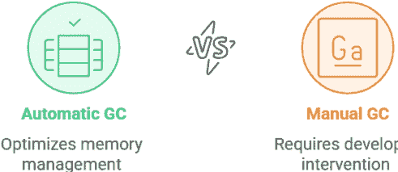

**[补充]**

- 当对象变得不可访问时，垃圾回收器**不会**立即回收内存；它基于内部调度机制工作。
- `using` 语句用于正确释放文件、数据库连接等非托管资源。
- C# 不支持显式释放内存（像 C++ 中的 `delete`）；GC 会自动处理。
- 大对象（LOH - 大对象堆）由 GC 以不同方式处理，回收可能需要更长时间。
- 频繁调用 `GC.Collect()` 可能会降低性能，而不是提升性能。

### 2. 理解值类型和引用类型

C# 支持两种基本的数据存储类型：**值类型**（存储在栈中）和**引用类型**（存储在堆中）。这会影响数据在内存中的管理方式。

理解值类型和引用类型之间的区别在 C# 编程中至关重要。下面的示例演示了二者在赋值时的不同工作方式。

**[代码示例]**

```csharp
using System;

class Program
{
    struct ValueTypeExample
    {
        public int number;
    }

    class ReferenceTypeExample
    {
        public int number;
    }

    static void Main()
    {
        // Value type (struct) - stored in the stack
        ValueTypeExample v1 = new ValueTypeExample();
        v1.number = 10;
        ValueTypeExample v2 = v1; // Copying value (new copy in stack)
        v2.number = 20;
        Console.WriteLine("Value Type - v1: " + v1.number); // Outputs 10
        Console.WriteLine("Value Type - v2: " + v2.number); // Outputs 20

        // Reference type (class) - stored in the heap
        ReferenceTypeExample r1 = new ReferenceTypeExample();
        r1.number = 30;
        ReferenceTypeExample r2 = r1; // Copying reference (both point to the same object in heap)
        r2.number = 40;
        Console.WriteLine("Reference Type - r1: " + r1.number); // Outputs 40
        Console.WriteLine("Reference Type - r2: " + r2.number); // Outputs 40
    }
}
```

#### [执行结果]

Value Type - v1: 10

Value Type - v2: 20

Reference Type - r1: 40

Reference Type - r2: 40

**值类型**和**引用类型**的关键区别在于它们在内存中的存储和复制方式：

#### 值类型（栈）

- 存储在**栈**中（一块小而快的内存区域）。
- 赋值给另一个变量时，会创建一个**副本**。
- 一个变量的更改**不会**影响另一个变量。
- 示例：`int`、`double`、`char`、`bool`、`struct`、`enum`。

#### 引用类型（堆）

- 存储在**堆**中（一块动态分配的内存区域）。


- 当赋值给另一个变量时，复制的是**引用**（而非实际数据）。
- 因为变量指向同一个对象，所以对一个变量的更改会**影响**另一个变量。
- 示例：`class`、`string`、`array`、`interface`、`delegate`。

### 栈与堆

- **栈**：访问更快，离开作用域时自动清理内存。
- **堆**：速度较慢，但可以存储更大、更复杂的数据结构。

### 常见错误

- 1. **混淆结构体和类**
  - 结构体（`struct`）是**值类型**（存储在栈中）。
  - 类（`class`）是**引用类型**（存储在堆中）。
  - 使用结构体处理小型不可变数据；使用类处理复杂对象。
- 2. **无意中的引用共享**
  - 将引用类型传递给方法时，方法内部的更改会影响原始对象。
  - 如果明确要对值类型使用引用行为，请使用 `ref` 或 `out` 关键字。
- 3. **可空类型**
  - 值类型默认**不能**为 null。请使用 `Nullable<T>` 或 `?`（例如 `int? myInt = null;`）。
  - 引用类型**可以**为 null，这可能导致潜在的 `NullReferenceException`。

### [补充]

- C# 中的字符串是**引用类型**，但行为**类似于值类型**（不可变）。
- 应使用 `struct` 存储**小型不可变数据**，以提高性能。
- 数组是**引用类型**，即使它们存储的是值类型。
- 如果某个类包含值类型，该值类型**仍位于堆中**，因为它是引用类型的一部分。
- 当值类型存储为对象时，会发生装箱和拆箱（`object o = 10;`）。

### 3. 结构体与类：值类型与引用类型

在 C# 中，结构体和类的用途不同。结构体是值类型，这意味着它们直接存储在内存中，并在赋值或传递时被复制。而类是引用类型，意味着它们存储在堆中并通过引用传递。理解这一区别对于编写高效且无错误的代码至关重要。

下面是一个简单示例，演示结构体和类在赋值给新变量时的不同行为。

[代码示例]

```csharp
using System;
struct MyStruct
{
    public int Value;
}
class MyClass
{
    public int Value;
}
class Program
{
    static void Main()
    {
        // Struct Example (Value Type)
        MyStruct struct1 = new MyStruct { Value = 10 };
        MyStruct struct2 = struct1;
        struct2.Value = 20;
        Console.WriteLine($"Struct1 Value: {struct1.Value}"); // Remains 10
        Console.WriteLine($"Struct2 Value: {struct2.Value}"); // Changes to 20
        // Class Example (Reference Type)
        MyClass class1 = new MyClass { Value = 10 };
        MyClass class2 = class1;
        class2.Value = 20;
        Console.WriteLine($"Class1 Value: {class1.Value}"); // Changes to 20
        Console.WriteLine($"Class2 Value: {class2.Value}"); // Changes to 20
    }
}
```

[执行结果]

- Struct1 的值：10
- Struct2 的值：20
- Class1 的值：20
- Class2 的值：20

结构体存储在栈上，这使得它们非常适合小型简单的数据类型。类存储在堆上，更加灵活，但由于垃圾回收而稍微慢一些。将结构体赋值给另一个变量时，会进行复制，因此一个变量的更改不会影响另一个变量。将类实例赋值给另一个变量时，仅复制引用，这意味着一个变量的更改会反映到另一个变量中。对于轻量级数据结构（如坐标、颜色或小型不可变对象），请使用结构体。当需要复杂行为、继承或不应频繁复制的大型对象时，请使用类。

- 轻量级数据结构
- 赋值时值复制
- 栈存储效率
- 结构体
- 复杂行为支持
- 赋值时引用复制
- 堆存储灵活性
- 类

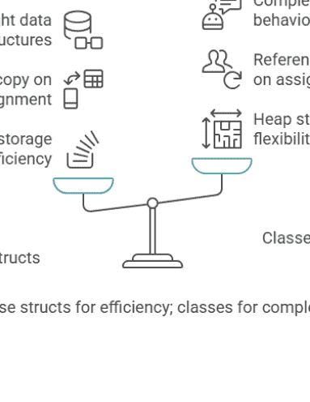

选择结构体以追求效率；选择类以处理复杂性。

### [补充]

结构体不能继承自其他结构体或类，但可以实现接口。类支持多态和继承，而结构体不支持。结构体不允许定义默认构造函数（它们始终具有隐式的无参数构造函数）。

### 4. 理解枚举：强类型常量

C# 中的枚举提供了一种定义一组命名常量值的方式，这些常量值具有强类型，并映射到基础整数类型（默认：int）。这使代码更易读，并防止使用无效值。

下面是一个定义并使用枚举来表示系统中不同用户角色的示例。

```csharp
using System;

enum UserRole
{
    Admin = 1,
    Moderator = 2,
    User = 3
}

class Program
{
    static void Main()
    {
        UserRole role = UserRole.Moderator;
        Console.WriteLine($"Role: {role}"); // Output: Moderator
        Console.WriteLine($"Role Value: {(int)role}"); // Output: 2

        // Checking an enum value
        if (role == UserRole.Admin)
        {
            Console.WriteLine("You have admin privileges.");
        }
        else
        {
            Console.WriteLine("You do not have admin privileges.");
        }
    }
}
```

[执行结果]

```
Role: Moderator
Role Value: 2
You do not have admin privileges.
```

默认情况下，枚举从 0 开始，但你可以显式指定值。枚举通过用有意义的名称替换魔法数字来提高代码可读性。你可以将枚举与整数互相转换，从而与外部数据源（如数据库）保持兼容。当标记了 `[Flags]` 时，枚举可以通过位运算进行组合（对权限系统很有用）。始终显式定义默认值，以防止出现非预期值。

### 在 C# 中使用枚举

| 优点 | 缺点 |
|---|---|
| 改进的可读性 | 需要显式默认值 |
| 显式值赋值 |  |
| 与外部数据的兼容性 |  |
| 位运算 |  |

### [补充]

枚举的默认基础类型是 int，但可以改为其他整数类型（byte、short、long 等）。`Enum.Parse()` 可用于将字符串转换为枚举值。枚举不能包含方法，但可以使用扩展方法为它们添加行为。

### 5. C# 中的字符串是不可变的

在 C# 中，字符串是不可变的，这意味着对字符串的任何修改实际上都会在内存中创建新的字符串实例，而不是改变现有实例。

如果你更改一个字符串，就会发生新的内存分配，旧值保持不变。下面是一个简单示例：

[代码示例]

```csharp
using System;
class Program
{
    static void Main()
    {
        string original = "Hello";
        string modified = original + " World"; // This creates a new string instance
        Console.WriteLine("Original: " + original); // "Hello"
        Console.WriteLine("Modified: " + modified); // "Hello World"
    }
}
```

[执行结果]

```
Original: Hello
Modified: Hello World
```

### 为什么字符串是不可变的？

- **内存效率：** 不可变字符串可以在程序的多个部分安全共享。
- **线程安全：** 由于字符串在创建后无法更改，因此多线程应用中不存在意外修改的风险。

### C# 字符串不可变性与性能

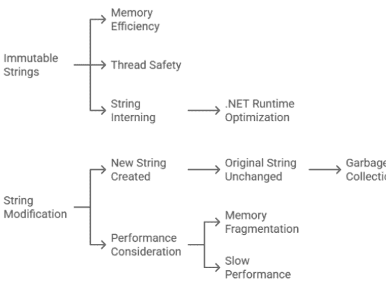

### [补充]

- C# 中的字符串是**引用类型**，但由于不可变性，它们的行为类似于**值类型**。
- `string` 是 `System.String` 的别名。
- 对于字符串，`==` 运算符检查的是**值相等**，而不是引用相等。
- 字符串不可变性在其他语言（如 Java 和 Python）中也是类似的。
- 建议使用 `string.Empty` 而不是 `""`，因为它可以避免不必要的分配。

### 6. 使用 StringBuilder 高效处理字符串

`StringBuilder` 是 `string` 的可变替代品，允许高效地进行字符串拼接和修改，而无需创建多个新实例。

在循环或频繁修改中，不要使用 `+=` 或 `string.Concat`，而应使用 `StringBuilder` 来提高性能。

[代码示例]

```csharp
using System;
using System.Text;
class Program
{
    static void Main()
    {
        StringBuilder sb = new StringBuilder("Hello");
        sb.Append(" World"); // Modifies the existing instance instead of creating a new one
        Console.WriteLine(sb.ToString()); // "Hello World"
    }
}
```

[执行结果]

```
Hello World
```

### 为什么使用 `StringBuilder`？

- **避免过多的内存分配：** `StringBuilder` 修改现有缓冲区，而不是每次创建新字符串。
- **提高性能：** 在多次字符串拼接的循环中尤其有用。


- **减少垃圾回收开销：** 由于创建的临时对象更少，内存管理更高效。

### 性能比较

```csharp
using System;
using System.Diagnostics;
using System.Text;
class Program
{
static void Main()
{
int iterations = 10000;
// Using string
Stopwatch sw = Stopwatch.StartNew();
string result = "";
for (int i = 0; i < iterations; i++)
{
result += i.ToString(); // Creates a new string each time
}
sw.Stop();
Console.WriteLine("String time: " + sw.ElapsedMilliseconds + "ms");
// Using StringBuilder
sw.Restart();
StringBuilder sb = new StringBuilder();
for (int i = 0; i < iterations; i++)
{
sb.Append(i.ToString()); // Modifies existing buffer
}
sw.Stop();
Console.WriteLine("StringBuilder time: " + sw.ElapsedMilliseconds + "ms");
}
}
```

预期输出：String time: 150ms（因系统而异）

StringBuilder time: 2ms（快得多）

对于大量拼接，StringBuilder 要快得多。如果只是修改字符串一两次，string 就可以了。对于重复修改，StringBuilder 是最佳选择。

### 补充说明

StringBuilder 是 System.Text 的一部分。默认容量为 16 个字符，但它会自动扩展。StringBuilder.AppendFormat() 允许插入格式化文本。使用 .ToString() 获取最终字符串。与 string 不同，sb[0] = 'X'; 允许直接修改字符。

### 7. 属性控制对 C# 中字段的访问

在 C# 中，属性用于提供对类中字段的受控访问。属性可用于定义私有字段的值如何设置或获取。通过使用 getter（访问器）和 setter（修改器），属性允许你隐藏字段的实现细节，同时为外部代码提供与该字段交互的接口。

让我们看一个使用属性控制对字段访问的简单示例：

[代码示例]

```csharp
using System;
public class Person
{
private string name; // Private field
// Property to access the private field
public string Name
{
get { return name; } // Getter
set { name = value; } // Setter
}
}
public class Program
{
public static void Main()
{
Person person = new Person();
person.Name = "John Doe"; // Set the value using the setter
Console.WriteLine(person.Name); // Get the value using the getter
}
}
```

### 执行结果

John Doe

在上面的示例中，我们有一个私有字段 name，并使用属性 Name 来访问和修改其值。get 访问器检索 name 字段的值，set 访问器为其赋值。value 关键字表示传递给 setter 的值。通过使用属性，我们可以在将来需要时轻松地向 getter 或 setter 添加逻辑，而不会影响使用该属性的外部代码。

属性对于实现验证或在存储数据之前修改数据非常有用。你甚至可以使用属性来封装更复杂的逻辑，例如延迟加载或计算。

### 补充说明

在 C# 中，属性是面向对象编程的重要组成部分，因为它们允许封装。它们阻止对字段的直接访问，同时仍然提供一种与其交互的方式。通过确保字段仅以受控方式修改，使用属性可以使代码更易维护、更安全。

### 8. 自动实现属性简化代码

当 getter 或 setter 中不需要额外逻辑时，C# 中的自动实现属性是创建属性的一种简写方式。它通过自动为属性生成一个私有匿名的支持字段来简化代码，从而无需手动定义该字段以及 getter/setter 方法。

让我们看看如何使用自动实现属性简化前面的代码：

[代码示例]

```csharp
using System;
public class Person
{
    // Auto-implemented property (no need for a private field or getter/setter)
    public string Name { get; set; }
}
public class Program
{
    public static void Main()
    {
        Person person = new Person();
        person.Name = "Jane Doe"; // Set the value using the setter
        Console.WriteLine(person.Name); // Get the value using the getter
    }
}
```

### 执行结果

Jane Doe

在这个示例中，我们为 Name 使用了自动实现属性。这个版本的属性会自动为你提供支持字段，因此无需显式定义它。该属性仍然提供对字段的受控访问，但 C# 编译器会自动处理幕后实现。

当你不需要向 getter 或 setter 添加额外逻辑时，自动实现属性非常有用，可使代码更简单、更简洁。它们是减少样板代码并提高可读性的好方法，尤其适用于简单类。

### 补充说明

自动实现属性是在 C# 3.0 中引入的，它使得无需手动定义私有字段即可更轻松地创建简单属性。但是，如果你需要在 getter 或 setter 中添加验证、日志记录或其他逻辑，则需要手动定义属性（如第一个示例所示）。你还可以向自动实现属性添加访问修饰符（例如 private set），以便更好地控制谁可以修改该属性。

### 9. readonly 字段必须在构造函数中设置

在 C# 中，readonly 字段只能在声明时或类的构造函数内赋值。

以下代码展示了如何在构造函数中设置 readonly 字段，而不能在其他地方设置。

[代码示例]

```csharp
using System;
class Person
{
    // Readonly field
    public readonly string Name;

    // Constructor assigns the readonly field
    public Person(string name)
    {
        Name = name; // OK: assigning in constructor
    }

    public void ChangeName(string newName)
    {
        // Name = newName; // ERROR: Cannot assign to readonly field here
    }
}
class Program
{
    static void Main()
    {
        Person p = new Person("Alice");
        Console.WriteLine(p.Name);
    }
}
```

### 执行结果

Alice

readonly 字段是一个只能赋值一次的变量，并且只能在以下位置赋值：

- 在声明时，例如 `public readonly int x = 5;`
- 在定义该字段的类的构造函数内
- 一旦设置，就不能在其他地方更改其值，即使是在同一类的其他方法内也不行。
- 尝试在构造函数外修改它会导致编译时错误：
- "readonly 字段不能被赋值（除非在构造函数或变量初始化器中）"
- 这使得 readonly 非常适合用于在创建对象时确定、之后不应更改的值，例如配置值或标识符。
- 与 const 不同，readonly 允许使用构造函数参数在运行时设置值。

### 补充说明

如果你有一个直到运行时才能知道的值（例如用户输入），但在设置后仍不应更改，那么 readonly 是正确的选择。

readonly 字段也可以与引用类型一起使用；你可以更改对象的内容，但不能更改引用本身。示例：

```csharp
readonly List<int> numbers; → You can do numbers.Add(5);; but not
numbers = new List<int>();
```

### 执行结果

Pi: 3.14159

Created At: [当前日期和时间]

const 值在编译期间直接替换到代码中。这意味着必须使用常量表达式（如数字、字符串等）为其赋值。

示例：

```csharp
const int MaxScore = 100;
```

```csharp
const DateTime Now = DateTime.Now; (Not allowed — not a constant expression)
```

readonly 字段可以使用仅在运行时才知道的值，例如系统时间或用户输入。

这就是为什么 DateTime.Now 可用于 readonly，但不能用于 const。

const 隐式是 static 的，这意味着它在类的所有实例之间共享。readonly 则是每个实例独立的，除非显式标记为 static。

尝试为 const 字段赋予运行时值会导致编译时错误：

> “分配给 'const' 的表达式必须是常量”

### 补充说明


-   对于通用、不变的数值（如 Pi 或数学常数），使用 const。
-   当值依赖于运行时逻辑，但在初始化后必须保持固定时，使用 readonly。

如果 const 值在多个程序集中使用，更改其值需要重新编译所有依赖的程序集，因为该值在编译时已烘焙到代码中。

### 11. 使用 ? 的可空值类型

在 C# 中，值类型如 int、bool 或 DateTime 通常不能保存 null。然而，通过使用 ?，你可以让它们表示值的缺失。

下面是一个简短示例，展示如何使用可空整数（int?）来表示缺失或可选的数据。

[代码示例]

```csharp
using System;

class Program
{
static void Main()
{
int? age = null; // The variable can be null
if (age.HasValue)
{
Console.WriteLine($"Age is {age.Value}");
}
else
{
Console.WriteLine("Age is unknown.");
}
age = 30; // Now we assign a real value
Console.WriteLine($"Updated age: {age}");
}
}
```

[执行结果]

Age is unknown.
Updated age: 30

在 C# 中，值类型（如 int、float、bool）通常不能为 null。这是有道理的，因为它们被设计用来保存实际值（例如一个数字）。但有时，尤其是在处理数据库、API 或用户输入时，你可能想要表示“无数据”或“未知”——对于这种情况，int?（读作“可空 int”）就是你的好帮手。

当你声明 int? 时，C# 实际上是在创建 Nullable<int> 的简写。此结构具有像 .HasValue（如果它持有值则为 true）和 .Value（值本身）这样的属性。

这个概念在实际应用中至关重要——想象一下用户尚未填写生日。与其使用 -1 这样的假数字，可空类型让你可以说“这没有值，而且没关系”。

务必非常小心，不要在不确定 .HasValue 为 true 的情况下访问 .Value——否则你的代码会崩溃。

### [补充]

-   可空类型在底层是结构体（Nullable<T>），而不是引用类型。
-   你也可以使用空合并运算符（??）来提供默认值：

```csharp
int displayedAge = age ?? 0; // use 0 if age is null
```

在数据库字段（通常是可空的）与 C# 类型之间进行映射时很有用。

### 12. 理解 var：带强类型的隐式类型

var 让你声明变量时无需显式写出类型，但 C# 仍会在编译期间推断出来——因此类型是固定的且强类型的。

下面是如何在保持强类型完整的同时，var 可以简化代码。

[代码示例]

```
using System;
class Program
{
static void Main()
{
var name = "Alice"; // Compiler sees this as string
var age = 25; // Compiler sees this as int
var isMember = true; // Compiler sees this as bool
Console.WriteLine($"Name: {name}, Age: {age}, Member: {isMember}");
}
}
```

[执行结果]

Name: Alice, Age: 25, Member: True

即使我们写 var，C# 编译器也会根据你赋予的值在编译时推断类型。之后，类型就被锁定了——name 是 string，age 是 int 等。这不像 JavaScript 或 Python 那样类型可以动态改变。

使用 var 时必须赋值，否则编译器没有依据来推断类型。例如，var x; 是无效的——但 var x = 5; 是可以的。

这使得代码更简洁，尤其是在处理复杂类型时：

```
var orders = new Dictionary<string, List<int>>();
```

...而不是：

```
Dictionary<string, List<int>> orders = new Dictionary<string, List<int>>();
```

但要明智地使用 var：如果类型在上下文中不明显，过度使用会使代码更难阅读。

### [补充]

-   使用 var 并不意味着动态类型——它仍然是强类型的。
-   当它使代码不清晰时，避免使用 var。
-   在 LINQ 或匿名类型中使用很有用，其中确切类型很长或未知。

### 13. 模式匹配用于类型安全的数据处理

C# 中的模式匹配让你可以根据对象的类型和形状检查和提取数据，从而提高代码的安全性和可读性。

这里有一个简单示例，展示模式匹配如何确定对象的类型并安全地访问其属性。

[代码示例]

```csharp
using System;
class Program
{
static void PrintShapeInfo(object shape)
{
// Use pattern matching to safely check type and extract data
if (shape is Circle c)
{
Console.WriteLine($"This is a circle with radius: {c.Radius}");
}
else if (shape is Rectangle r)
{
Console.WriteLine($"This is a rectangle with width {r.Width} and height {r.Height}");
}
else
{
Console.WriteLine("Unknown shape");
}
}
// Sample shape classes
class Circle { public double Radius { get; set; } }
class Rectangle { public double Width { get; set; } public double Height { get; set; } }

static void Main()
{
PrintShapeInfo(new Circle { Radius = 5 });
PrintShapeInfo(new Rectangle { Width = 10, Height = 20 });
PrintShapeInfo("Just a string");
}
}
```

[执行结果]

```
This is a circle with radius: 5
This is a rectangle with width 10 and height 20
Unknown shape
```

模式匹配使用 is 关键字结合变量声明（is Circle c）来检查类型并将实例提取到该类型的新变量（c）中。这避免了手动转换和空检查。

这种机制在 switch 表达式中以及像关系模式和递归模式这样的新特性中尤其强大（例如检查属性内部的值）。

对于初学者来说，理解这一点需要一些关于类和类型检查的知识，所以它有点高级，但对于编写干净、安全代码非常有价值。

### [补充]

模式匹配从 C# 7.0 开始变得显著更强大，并在后续版本中得到扩展。

### 14. 使用 foreach 遍历可枚举集合

C# 的 foreach 循环简化了对实现 IEnumerable 的集合的迭代，使代码更简洁、更安全。

这里有一个示例，展示如何使用 foreach 遍历列表，而无需索引或手动迭代。

[代码示例]

```csharp
using System;
using System.Collections.Generic;
class Program
{
static void Main()
{
// A list of strings
List<string> fruits = new List<string> { "Apple", "Banana", "Cherry" };
// Loop over each fruit using foreach
foreach (string fruit in fruits)
{
Console.WriteLine($"I love {fruit}!");
}
}
}
```

[执行结果]

I love Apple!
I love Banana!
I love Cherry!

### 15. LINQ：在 C# 中像 SQL 一样查询数据

LINQ（语言集成查询）让你能够使用可读的、类似 SQL 的语法直接在 C# 代码中查询集合和数据库。

这是一个使用 LINQ 过滤数字列表并仅选择偶数的简单示例。

[代码示例]

```csharp
using System;
using System.Linq; // Required to use LINQ
class Program
{
static void Main()
{
int[] numbers = { 1, 2, 3, 4, 5, 6 };

// LINQ query to select even numbers
var evenNumbers = numbers.Where(n => n % 2 == 0);

// Display the results
foreach (int num in evenNumbers)
{
Console.WriteLine(num); // Output each even number
}
}
}
```

[执行结果]

2
4
6

using System.Linq; 对于访问 LINQ 方法至关重要。

numbers.Where(...) 使用了一个 lambda 函数（n => n % 2 == 0），其含义是：

-   对于数组中的每个数字 n，仅在 n % 2 == 0（即它是偶数）时才包含它。

结果不是一个新数组，而是一个可枚举对象，这意味着它在我们使用 foreach 遍历时才会被求值。

这种方法非常强大，因为它用清晰、可读的逻辑取代了复杂的循环。

你应该知道的术语：

-   Lambda expression：一种快速内联定义函数的方式。
-   Enumerable：可以遍历的集合，如数组或列表。
-   Deferred execution：LINQ 并不会在你使用它之前实际运行查询（如在 foreach 中）。

### [补充]

-   LINQ 不仅可用于数组/列表，还可通过 LINQ to SQL 或 Entity Framework 用于数据库（如 SQL Server）。
-   LINQ 方法包括 Select、Where、OrderBy、GroupBy 等——每个方法的作用都类似于 SQL 中的。
-   LINQ 提高了代码可读性，并减少了手动循环逻辑带来的错误。


### 16. 委托：像变量一样传递函数

C# 中的委托是指向方法的类型安全指针。它们允许你将方法作为参数传递，或将方法存储在变量中。

下面是一个基本示例，说明如何定义委托、将其关联到方法并调用它。

[代码示例]

```
using System;

class Program
{
    // Define a delegate type that takes two integers and returns an integer
    delegate int Operation(int x, int y);

    // Method to add two numbers
    static int Add(int a, int b)
    {
        return a + b;
    }

    static void Main()
    {
        // Create a delegate instance and point it to the Add method
        Operation op = Add;

        // Call the method via the delegate
        int result = op(5, 3);
        Console.WriteLine(result); // Output: 8
    }
}
```

[执行结果]

delegate int Operation(int x, int y); 声明一个委托类型，该类型期望一个具有两个 int 参数并返回 int 的方法。

Operation op = Add; 将委托绑定到 Add 方法。

op(5, 3) 通过委托间接调用 Add(5, 3)。

这在功能上类似于 C++ 中的函数指针，但具有类型安全性且更安全。

实际用例包括：

- 将逻辑传入方法（例如用于排序的比较规则）。
- 实现事件系统（委托是 C# 事件的核心）。
- 在运行时动态接入不同的行为。

### [补充]

委托是 C# 中事件的基础。

Action<>、Func<> 和 Predicate<> 是内置泛型委托，可简化委托的使用。

匿名方法和 lambda 表达式也可以分配给委托。

委托支持解耦——你的代码变得更灵活、更易于测试。

### 17. 使用委托和事件实现观察者模式

在 C# 中，事件使用委托实现观察者模式，该模式允许对象在发生某事时通知多个订阅者。

下面是一个基本示例，说明事件和委托如何工作以通知多个监听器有关更改。

[代码示例]

```csharp
using System;

// Define a delegate type
public delegate void NotificationHandler(string message);

// Publisher class
class Publisher
{
    // Declare an event using the delegate
    public event NotificationHandler OnNotify;
    public void DoSomething()
    {
        Console.WriteLine("Publisher is doing something important...");
        // Notify all subscribers
        OnNotify?.Invoke("Something happened in Publisher!");
    }
}

// Subscriber class
class Subscriber
{
    private string _name;
    public Subscriber(string name)
    {
        _name = name;
    }
    // Method that matches the delegate signature
    public void Respond(string message)
    {
        Console.WriteLine($"{_name} received: {message}");
    }
}

// Main execution
class Program
{
    static void Main()
    {
        Publisher pub = new Publisher();
        Subscriber sub1 = new Subscriber("Alice");
        Subscriber sub2 = new Subscriber("Bob");
        // Subscribe to the event
        pub.OnNotify += sub1.Respond;
        pub.OnNotify += sub2.Respond;
        // Trigger the event
        pub.DoSomething();
    }
}
```

[执行结果]

Publisher is doing something important...
Alice received: Something happened in Publisher!
Bob received: Something happened in Publisher!

### 18. 使用 async 和 await 实现非阻塞代码

C# 支持使用 async 和 await 进行异步编程，以避免阻塞主线程，尤其是在 Web 请求或文件访问等 I/O 操作期间。

下面是一个简单示例，模拟异步等待任务完成而不会冻结应用。

[代码示例]

```
using System;
using System.Threading.Tasks;
class Program
{
static async Task Main()
{
Console.WriteLine("Starting...");
// Call an async method and await its completion
string result = await DoWorkAsync();
Console.WriteLine($"Result: {result}");
Console.WriteLine("Done.");
}
// Asynchronous method
static async Task<string> DoWorkAsync()
{
Console.WriteLine("Working...");
// Simulate delay (e.g., downloading, processing)
await Task.Delay(2000); // 2 seconds
return "Work complete!";
}
}
```

[执行结果]

Starting...
Working...
（2 秒后出现结果）
Result: Work complete!
Done.

使用 async 和 await 时，代码看起来是同步的，但在底层异步运行：

- 方法前面的 async 告诉编译器此方法可能会异步运行。
- await 会暂停执行，直到等待的任务完成，但不会阻塞主线程。
- Task.Delay() 类似于 Thread.Sleep()，但不会阻塞——它在等待时将控制权交还给运行时。
- 这在 UI 应用或服务器中尤其有用，因为阻塞主线程会导致应用冻结或造成延迟。
- 关键优势：可读且易于维护的异步代码。

### [补充]

async 方法必须返回 Task、Task<T> 或 void（仅限事件处理程序）。

### 19. 在 C# 中使用任务进行异步编程

TAP（基于任务的异步模式）是在 C# 中编写异步代码的标准方式。它使用 async 和 await 简化并发。

下面是一个简单示例，它异步获取数据，并使用 Task 和 await 等待结果。

[代码示例]

```csharp
using System;
using System.Net.Http;
using System.Threading.Tasks;
class Program
{
    // Main method must return Task if marked async
    static async Task Main()
    {
        Console.WriteLine("Starting async operation...");
        // Call an asynchronous method
        string data = await GetDataAsync();
        Console.WriteLine("Data received:");
        Console.WriteLine(data);
    }
    // Async method that returns a Task<string>
    static async Task<string> GetDataAsync()
    {
        using HttpClient client = new HttpClient();
        // Await a non-blocking network call
        string result = await client.GetStringAsync("https://example.com");
        return result;
    }
}
```

[执行结果]

Starting async operation...

Data received:

```
<!doctype html><html>...<body>Example Domain...</body></html>
```

async 将方法标记为异步。

await 会暂停执行，直到等待的任务完成——而不会阻塞线程。

HttpClient.GetStringAsync() 是非阻塞的，并返回一个 Task<string>。

此模式可让你保持应用响应性（例如，UI 保持流畅，或后端不会冻结）。

async 方法必须返回 Task 或 Task<T>（返回 void 的事件处理程序除外）。

现代 C# 中的 Main() 现在可以是 async Task Main()（如上所示）。

### [补充]

TAP 取代了 APM（异步编程模型）和 EAP（基于事件的异步模式）等较旧模型。

你可以串联多个 async 调用，并且使用 try-catch 进行错误处理可与 await 自然配合。

应避免在 Task 上使用 .Result 或 .Wait()，除非绝对必要，因为它们可能导致死锁。

### 20. 在 C# 中使用 lock 防止竞态条件

C# 中的 lock 关键字用于确保一次只有一个线程访问某个代码块，从而防止竞态条件。

下面是一个示例，它使用 lock 从多个线程安全地递增计数器。

[代码示例]

```csharp
using System;
using System.Threading;
class Program
{
static int counter = 0; // Shared data
static object locker = new object(); // Lock object
static void Main()
{
Thread[] threads = new Thread[10];
// Create and start 10 threads
for (int i = 0; i < 10; i++)
{
threads[i] = new Thread(IncrementCounter);
threads[i].Start();
}
// Wait for all threads to finish
foreach (var thread in threads)
{
thread.Join();
}
Console.WriteLine("Final counter value: " + counter);
}
static void IncrementCounter()
{
    for (int i = 0; i < 1000; i++)
    {
        lock (locker)
        {
            // Only one thread can access this at a time
            counter++;
        }
    }
}
}
```

[执行结果]

Final counter value: 10000

如果不使用 lock，多个线程可能同时读取和写入 counter，导致结果不正确（竞态条件）。

lock (locker) 确保任意时刻只有一个线程可以执行其中的代码。

locker 必须是私有的、非空引用类型对象。它不应是值类型或可公开访问的对象。

Join() 用于在打印结果之前等待线程完成。

### [补充]

lock 是 Monitor.Enter() 和 Monitor.Exit() 的语法糖。


### 21. 使用 volatile 确保多线程代码中的可见性

C# 中的 volatile 关键字告诉编译器和运行时，一个字段可能被多个线程访问，不应以可能导致读取陈旧值的方式进行缓存或优化。

下面是一个使用 volatile 来确保一个线程看到另一个线程所做的更改的示例。

[代码示例]

```csharp
using System;

using System.Threading;
class VolatileExample
{
    // Shared flag. Volatile ensures thread visibility.
    private static volatile bool isRunning = true;
    static void Worker()
    {
        Console.WriteLine("Worker started.");
        while (isRunning)
        {
            // Simulate work
        }
        Console.WriteLine("Worker stopped.");
    }
    static void Main()
    {
        Thread t = new Thread(Worker);
        t.Start();
        Thread.Sleep(1000); // Let the worker run a bit
        isRunning = false; // Signal worker to stop
        t.Join(); // Wait for the thread to finish
        Console.WriteLine("Main thread exiting.");
    }
}
```

### 执行结果

Worker started.
Worker stopped.
Main thread exiting.

Without volatile, the compiler or CPU might optimize the loop in the Worker() method and assume that isRunning never changes, especially since it’s not modified inside the loop.

This can lead to an infinite loop where the worker thread never sees the updated value.

The volatile keyword ensures that:

- Reads and writes to the field go directly to memory (not CPU registers or caches).
- Changes made by one thread are immediately visible to others.

⚠ 然而，volatile 仅保证可见性，而非原子性。如果需要原子操作（如安全地递增计数器），请使用 Interlocked 或 lock。

### 补充

Only certain types (e.g., bool, int, float, reference types) can be marked volatile.

volatile doesn't prevent race conditions — it's useful for flags, not counters.

You cannot use volatile with local variables — only fields.

It’s not a replacement for full thread synchronization like lock.

```
{
try
{
Process();
}
catch (Exception ex)
{
Console.WriteLine($"Main caught: {ex.GetType().Name}");
}
}
}
```

### 执行结果

Trying risky code...
Caught exception: Input string was not in a correct format.
Finally block executed.
Main caught: FormatException

try 块包含可能抛出异常的代码。

catch 块处理特定或一般的异常。你可以为不同异常类型使用多个 catch 块。

finally 无论是否发生异常都会始终执行。非常适合清理工作（例如关闭文件）。

throw; 重新抛出当前异常，保留其原始堆栈跟踪。

你也可以使用 throw new Exception("message") 来抛出自定义错误。

这种结构化错误处理让你的应用程序能够优雅地失败、记录问题或从问题中恢复。

避免空的 catch 块。始终有意义地记录或处理错误。

### 补充

catch (Exception) 会捕获任何异常，但要谨慎——它可能隐藏 bug。

你可以使用 when 过滤异常：catch (IOException ex) when (ex.Message.Contains("disk"))

Unhandled exceptions crash the application unless caught at the top level.

For cleanup without exceptions, use using or try/finally.

### 23. 使用 using 实现自动资源清理

C# 提供了 using 语句，在你完成使用后自动清理资源，如文件、数据库连接或网络流。

下面是一个简单示例，展示如何使用 using 在读取内容后自动关闭文件。

[代码示例]

```csharp
using System;
using System.IO;
class Program
{
    static void Main()
    {
        // 'using' ensures the file is closed and memory is released automatically
        using (StreamReader reader = new StreamReader("example.txt"))
        {
            string content = reader.ReadToEnd(); // Read entire file
            Console.WriteLine(content); // Print file contents
        }
        // At this point, the file is already closed, even if an error occurred inside the using block
    }
}
```

### 执行结果

(Assuming example.txt contains "Hello, world!")Hello, world!

The using statement in C# works with types that implement the IDisposable interface. These are objects that often hold on to system resources (like file handles, network connections, or database sessions). When the code execution leaves the using block—whether normally or because of an exception—C# automatically calls the .Dispose() method on the object.

This helps prevent resource leaks—situations where you forget to manually close files or connections, which can cause bugs or even crash programs in real-world applications.

Even though you can call .Dispose() manually, it's safer and cleaner to let using handle it for you.

As of C# 8.0, you can also use using declarations for shorter syntax:

```csharp
using var reader = new StreamReader("example.txt");
Console.WriteLine(reader.ReadToEnd());
```

The file will still be disposed at the end of the method.

### 补充

using 可以嵌套，因此可以同时管理多个资源。

Any object that implements IDisposable can be used in a using block.

If you forget to use using, you must manually call .Dispose() or risk memory/resource leaks.

This pattern is known as RAII in C++ or try-with-resources in Java.

The compiler turns using blocks into a try-finally under the hood for safe disposal.

### 24. 使用 interface 关键字实现接口

C# 使用 interface 关键字来定义类必须遵循的契约。
An interface specifies method signatures and properties but contains no implementation.

下面是一个在 C# 中定义和实现接口的基础示例。

[代码示例]

```csharp
using System;

// Define an interface (contract)
interface IAnimal
{
    void Speak(); // Any class that implements IAnimal must define this method
}

// Implement the interface in a class
class Dog : IAnimal
{
    public void Speak()
    {
        Console.WriteLine("Woof!");
    }
}

class Program
{
    static void Main()
    {
        IAnimal myDog = new Dog(); // Polymorphic assignment
        myDog.Speak();  // Call method via interface
    }
}
```

}

### 执行结果

Woof!

An interface in C# is like a blueprint. It tells what methods or properties a class must implement but not how they should do it.

In the example:

IAnimal is the interface.

It requires any implementing class to define a Speak() method.

Dog implements IAnimal, and provides a concrete version of Speak().

Why is this powerful?

You can treat many different classes (like Dog, Cat, Bird) as IAnimal and call Speak() on all of them—even though they implement it differently.

This is called polymorphism, and it allows flexible, extensible, and testable code.

Key Points:

- Interfaces promote clean design and separation of concerns.
- Interfaces do not contain logic.
- A class can implement multiple interfaces but only inherit from one class.

From C# 8.0, interfaces can also contain default implementations (similar to Java), but in most beginner-friendly designs, you’ll focus on basic method declarations.

### 补充

Interfaces can only contain method, property, event, or indexer declarations.

By convention, interface names start with I (like IList, IDisposable).

Interfaces help in dependency injection, a core concept in modern app architecture.

A class can implement multiple interfaces, solving the "multiple inheritance" problem.

You can check whether an object implements an interface using the is or as keywords.

## 25. 抽象类：无需实例化的共享逻辑

C# 中的抽象类不能直接实例化，但可以包含派生类继承的通用方法和属性。

这里有一个简短示例，演示抽象类如何为具有共享功能的子类提供基类。

[代码示例]

```csharp
using System;

// Abstract class - cannot be instantiated
abstract class Animal
{
    // Concrete method (shared logic)
    public void Breathe()
    {
        Console.WriteLine("Breathing...");
    }
    // Abstract method (must be overridden)
    public abstract void MakeSound();
}

// Derived class implements the abstract method
class Dog : Animal
{
    public override void MakeSound()
    {
        Console.WriteLine("Bark!");
    }
}

class Program
{
```


```csharp
static void Main()
{
    // Animal a = new Animal(); // ❌ Error! Cannot instantiate abstract class
    Dog myDog = new Dog(); // ✅ Valid
    myDog.Breathe(); // Inherited method
    myDog.MakeSound(); // Implemented method
}
}
```

**[执行结果]**

```text
Breathing...
Bark!
```

当多个类共享共同逻辑，但在某些行为的实现上有所不同时，会使用抽象类。

要点：

- 不能创建抽象类的实例。
- 可以在抽象类中定义带逻辑的方法（称为具体方法）。
- 必须在派生类中重写抽象方法。
- 它强制实施契约，同时允许共享代码以避免重复。
- 这在游戏引擎或 UI 系统等实际应用中尤其有用，因为许多实体的基础行为是一致的（例如，所有 UI 元素都能“绘制”，但每个元素的绘制方式不同）。

与接口不同，抽象类可以包含字段、构造函数和已实现的方法。

如果任何方法是抽象的，则该类必须声明为抽象类。

一个类只能继承一个抽象类，这符合 C# 的单类继承模型。

## 26. 多个接口，而非多个类

C# 允许一个类实现多个接口，从而实现灵活性。但是，它只能继承一个类，从而避免多类继承带来的歧义。

此示例展示了一个类在继承单个基类的同时实现两个接口。

**[代码示例]**

```csharp
using System;
// Base class
class Machine
{
    public void Start()
    {
        Console.WriteLine("Machine started.");
    }
}

// First interface
interface IPrintable
{
    void Print();
}

// Second interface
interface IScannable
{
    void Scan();
}

// Derived class
class MultifunctionPrinter : Machine, IPrintable, IScannable
{
    public void Print()
    {
        Console.WriteLine("Printing document...");
    }
    public void Scan()
    {
        Console.WriteLine("Scanning document...");
    }
}
class Program
{
    static void Main()
    {
        MultifunctionPrinter mfp = new MultifunctionPrinter();
        mfp.Start();  // Inherited from Machine
        mfp.Print();  // From IPrintable
        mfp.Scan();   // From IScannable
    }
}
```

**[执行结果]**

```text
Machine started.
Printing document.
Scanning document.
```

C# 不支持类的多重继承，以避免菱形问题——即当多个基类中存在相同方法时，编译器无法确定应继承哪个版本的方法的情况。

相反，C# 允许你实现多个接口，这些接口只包含方法声明而不包含实现。这避免了歧义并保持了灵活性。

现实世界类比：

想想智能手机。它可以是一个 Device（基类），并且还可以实现 ICamera、IMusicPlayer 和 IGPS 等功能。这些是由接口描述的能力。

**[补充]**

接口不能包含任何代码（在 C# 8 之前）；它们只定义应该做什么，而不定义如何做。

从 C# 8 开始，接口可以包含默认实现，但应谨慎使用。

与类不同，C# 类可以实现任意数量的接口，从而赋予其模块化能力。

## 27. 在不更改现有类代码的情况下向其添加方法

C# 中的扩展方法允许你向现有类型（如类或结构体）添加新方法，而无需修改原始源代码。

下面是一个简单示例，我们向内置的 string 类添加一个统计单词数的方法。

**[代码示例]**

```csharp
using System;

public static class StringExtensions
{
    // Define an extension method for the string type
    public static int WordCount(this string str)
    {
        // Split the string by spaces and count the resulting parts
        return str.Split(new char[] { ' ' }, StringSplitOptions.RemoveEmptyEntries).Length;
    }
}

class Program
{
    static void Main()
    {
        string message = "Hello from the C# world!";
        // Call the extension method as if it's a built-in method
        int count = message.WordCount();
        Console.WriteLine("Word count: " + count);
    }
}
```

**[执行结果]**

```text
Word count: 5
```

扩展方法在静态类中声明，并且自身必须是静态方法。

第一个参数前的关键字 this（this string str）告诉编译器，此方法是 string 类型的扩展方法。

定义后，你可以像使用被扩展类型的成员一样使用该方法——调用时无需特殊语法。

当你处理 .NET 类型或库，无法修改原始源代码但仍想添加自定义功能时，这尤其有用。

它们也常用于 LINQ，而 LINQ 大量依赖扩展方法。

**[补充]**

在使用扩展方法的文件中，必须包含定义该扩展方法的命名空间（using YourNamespace;）。

Visual Studio 中的 IntelliSense 会用特殊图标（↓）显示扩展方法。

扩展方法不会重写现有方法——它们仅当不存在具有相同签名的实例方法时才起作用。

## 28. 使用泛型进行灵活编程

C# 支持可处理任意数据类型的泛型类、方法和接口，帮助你编写可重用且类型安全的代码。

下面是一个存储任意类型值的泛型类，以及一个交换两个变量的泛型方法的示例。

**[代码示例]**

```csharp
using System;

// A generic class that can hold any data type
class Box<T>
{
    public T Value;
    public Box(T value)
    {
        Value = value;
    }
    public void Display()
    {
        Console.WriteLine("Box holds: " + Value);
    }
}

class Program
{
    // A generic method to swap two values
    static void Swap<T>(ref T a, ref T b)
    {
        T temp = a;
        a = b;
        b = temp;
    }
    static void Main()
    {
        // Using the generic Box class
        Box<int> intBox = new Box<int>(123);
        Box<string> strBox = new Box<string>("C# Rocks");
        intBox.Display(); // Outputs: Box holds: 123
        strBox.Display(); // Outputs: Box holds: C# Rocks
        // Using the generic Swap method
        int x = 1, y = 2;
        Swap(ref x, ref y);
        Console.WriteLine("x: " + x + ", y: " + y); // x: 2, y: 1
    }
}
```

**[执行结果]**

```text
Box holds: 123
Box holds: C# Rocks
x: 2, y: 1
```

泛型允许你编写灵活、可重用的代码，而无需牺牲类型安全性。

Box<T> 类定义了一个类型参数 T，它代表“任意类型”。创建此类的对象时，需要指定实际类型（如 int 或 string）。

Swap<T> 方法可处理任意数据类型，并且不需要为每种类型重复代码。

泛型对于编写库、数据结构和实用函数非常重要。它们消除了强制转换以及装箱/拆箱的需要，从而使代码更快、更安全。

**[补充]**

常见的 .NET 内置泛型类型包括 List<T>、Dictionary<TKey, TValue> 和 Nullable<T>。

可以使用 where 子句约束泛型参数（例如 where T : class）。

泛型在 LINQ 以及 List<T> 和 Queue<T> 等集合中被大量使用。

## 29. 使用 where 约束泛型

C# 允许使用 where 子句向泛型添加约束。这可确保泛型类型参数满足特定要求，例如是类、具有默认构造函数或实现特定接口。

以下代码展示了如何使用 where 子句限制泛型方法，使其仅接受实现特定接口的类型。

**[代码示例]**

```csharp
using System;

// Define an interface
interface IPrintable {
    void Print();
}

// A class that implements IPrintable
class Report : IPrintable {
    public void Print() {
        Console.WriteLine("Printing report...");
    }
}

// Generic class with a constraint
class Printer<T> where T : IPrintable {
    public void PrintItem(T item) {
        item.Print(); // Safe to call Print() because T is guaranteed to implement IPrintable
    }
}

class Program {
    static void Main() {
```


```csharp
Report report = new Report();
Printer<Report> printer = new Printer<Report>();
printer.PrintItem(report);
}
}
```

### [执行结果]

Printing report...

此示例定义了一个泛型类 `Printer<T>`，并带有 `where T : IPrintable` 约束。这意味着不能将 `Printer<T>` 与任何未实现 `IPrintable` 的类型一起使用。

这样做的好处是类型安全——编译器知道 `T` 始终会有 `Print()` 方法，因此可以避免运行时错误。

也可以使用多个约束：

```csharp
where T : class, new(), IPrintable
```

这意味着：

- `T` 必须是类（而不是结构体），
- 必须具有无参构造函数（`new()`），
- 并且必须实现 `IPrintable`。

约束是编写可复用且安全代码的强大工具。

### [补充]

可以将泛型参数约束为基类、接口，或约束为 `struct`、`class` 或 `new()`。

`where` 子句有助于 IDE 中的智能感知建议，因为编译器对该类型了解得更多。

泛型方法可以具有与其所在类不同的约束。

约束仅在编译时强制执行，这提高了可靠性，而无需运行时检查。

`dynamic` 关键字会禁用编译时检查。编译器相信你尝试执行的操作在运行时能够正常工作。

这在以下情况下很有用：

- 使用 COM 对象，或与 Python 或 JavaScript 等动态语言交互时。
- 读取编译时类型未知的 JSON 或 XML 时。

但它很危险：

如果调用一个不存在的方法，程序会成功编译，但会在运行时因 `RuntimeBinderException` 而崩溃。

使用 `dynamic` 是以安全性换取灵活性。仅在绝对必要时，并且你对运行时行为有信心时才使用它。

### [补充]

`dynamic` 是在 C# 4.0 中引入的。

它是 DLR（动态语言运行时）的一部分。

对动态变量的任何操作都在运行时解析，而 `var` 则在编译时解析。

IDE 通常不会为动态对象提供智能感知。

## 31. 使用反射在运行时检查和使用类型

反射让你可以在 C# 运行时检查类型（类、方法、属性等）并与它们交互。

下面是一个使用反射检查类并动态调用方法的简单示例。

### [代码示例]

```csharp
using System;
using System.Reflection;

public class HelloWorld
{
    public void SayHello()
    {
        Console.WriteLine("Hello from reflection!");
    }
}

class Program
{
    static void Main()
    {
        // Get the type info of the HelloWorld class
        Type type = typeof(HelloWorld);

        // Create an instance of HelloWorld dynamically
        object instance = Activator.CreateInstance(type);

        // Get the method info for SayHello
        MethodInfo method = type.GetMethod("SayHello");

        // Invoke the SayHello method on the instance
        method.Invoke(instance, null);
    }
}
```

### [执行结果]

Hello from reflection!

### 逐步解释：

- `typeof(HelloWorld)` 获取 `HelloWorld` 类的 `Type` 对象。该对象包含有关该类的元数据。
- `Activator.CreateInstance(type)` 动态创建 `HelloWorld` 的实例。无需直接使用 `new HelloWorld()`。
- `type.GetMethod("SayHello")` 检索名为 `"SayHello"` 的方法的元数据。
- `method.Invoke(instance, null)` 实际在创建的实例上调用该方法。

### 为什么这很强大？

- 可以构建灵活的系统，例如插件加载器、对象映射器或测试框架。
- 当你在编译时不知道确切类型时很有用。

### 常见陷阱：

- 反射比直接调用慢。
- 会失去编译时检查——拼错的方法名直到运行时才会被发现。

### [补充]

- 反射是 `System.Reflection` 命名空间的一部分。
- 可以检查字段、属性、构造函数、接口等，而不仅仅是方法。
- ASP.NET Core 在内部使用反射进行依赖注入和路由。
- 可以将反射与自定义特性结合使用，以实现强大的行为。

## 32. 将特性用作元数据标记

特性就像添加到代码中的特殊标记。它们添加了工具或基于反射的代码可以读取的额外信息（元数据）。

下面是一个使用反射定义和读取自定义特性的示例。

### [代码示例]

```csharp
using System;
using System.Reflection;

// Define a custom attribute
[AttributeUsage(AttributeTargets.Class)]
public class InfoAttribute : Attribute
{
    public string Message { get; }
    public InfoAttribute(string message)
    {
        Message = message;
    }
}

// Apply the custom attribute to a class
[Info("This class does something important.")]
public class ImportantClass
{
}

class Program
{
    static void Main()
    {
        // Get type information
        Type type = typeof(ImportantClass);
        // Check if the attribute is applied
        if (Attribute.IsDefined(type, typeof(InfoAttribute)))
        {
            // Get the attribute instance
            InfoAttribute attr = (InfoAttribute)Attribute.GetCustomAttribute(type, typeof(InfoAttribute));
            Console.WriteLine("Attribute message: " + attr.Message);
        }
    }
}
```

### [执行结果]

Attribute message: This class does something important.

### 逐步解释：

- `[AttributeUsage(AttributeTargets.Class)]` 指定特性的使用位置（例如，可用于类）。
- `InfoAttribute` 是一个存储消息的自定义特性类。
- `[Info("...")]` 将该特性应用于 `ImportantClass`。
- `Attribute.IsDefined(...)` 检查该特性是否存在。
- `Attribute.GetCustomAttribute(...)` 检索实际实例，以便你可以读取 `Message` 属性。

### 为什么使用特性？

- 它们添加结构化、可检索的元数据。
- 在框架中很常见——例如，`[Serializable]`、`[Obsolete]` 或 `[HttpGet]`。

### 实际应用：

- 在 ASP.NET 中，特性定义路由：`[HttpPost("login")]`
- 在单元测试中：`[TestMethod]`
- 在 Unity 游戏开发中：`[SerializeField]`

### [补充]

- 特性必须继承自 `System.Attribute`。
- 内置特性包括 `[Obsolete]`、`[Serializable]`、`[DllImport]` 等。
- 可以在特性构造函数中定义位置参数和命名参数。
- 反射用于在运行时访问这些特性，使它们对于框架级决策非常强大。

## 33. 匿名类型是不可变的，并在编译时定义

匿名类型是没有显式定义类名的对象。它们用于快速对数据进行分组，尤其在 LINQ 查询中很有用。创建后，其属性是只读的，无法更改。

下面是一个创建和使用匿名类型的简短示例。

### [代码示例]

```csharp
using System;

class Program
{
    static void Main()
    {
        // Creating an anonymous type with two properties
        var person = new { Name = "Alice", Age = 30 };
        // Accessing the properties
        Console.WriteLine($"Name: {person.Name}, Age: {person.Age}");
        // person.Age = 31; // This line would cause a compile-time error because properties are read-only
    }
}
```

### [执行结果]

Name: Alice, Age: 30

匿名类型使用 `new { }` 语法定义。它们主要用于以下情况：

- 需要一个用于临时用途的简单数据结构。
- 不想为仅保存少量数据而创建完整类。

编译器会自动推断类型并生成具有只读属性的类。只能在方法内部定义它们（不能作为类成员）。

### 重要说明：

- 不能向匿名类型添加方法。
- 创建后，不能修改或添加新属性。
- 不能从方法返回匿名类型，除非使用 `dynamic`，或者返回到创建它的同一作用域。

### [补充]

- 匿名类型是引用类型。
- 它们的属性名称和类型决定其类型标识——如果两个匿名类型具有相同的属性和顺序，则仅在同一程序集内被视为相同类型。
- 它们通常与 LINQ 一起使用，将数据投影为新形状而无需定义新类型。


## 34. 使用元组返回多个值

元组允许你从一个方法中返回多个值，而无需创建类或结构体。它们轻量、灵活且可读。

此示例展示如何使用元组返回多个值，以及如何访问这些值。

[代码示例]

```csharp
using System;

class Program
{
    // A method returning a tuple with two values
    static (string name, int age) GetPerson()
    {
        return ("Bob", 28);
    }

    static void Main()
    {
        // Receiving the tuple result
        var person = GetPerson();
        // Accessing tuple values by name
        Console.WriteLine($"Name: {person.name}, Age: {person.age}");
    }
}
```

[执行结果]

Name: Bob, Age: 28

方法 GetPerson() 返回一个 (string name, int age) 元组。这比仅仅为了返回两个值而创建自定义类要简洁得多。

需要了解的关键点：

- 你可以为字段命名（name、age）以提高可读性。
- 元组是可变的，不像匿名类型。创建后可以更改其字段。
- 你可以像这样使用元组解构：

  ```csharp
  var (n, a) = GetPerson();
  Console.WriteLine($"Deconstructed: {n}, {a}");
  ```

C# 元组不同于早期版本引入的 System.Tuple<>——现代 (T1, T2) 语法更强大、更可读。

[补充]

元组是值类型（结构体），因此除非被装箱，否则它们存储在栈上。

你可以从方法返回元组、将它们作为参数传递，并在模式匹配中使用它们。

如果你需要语义含义或方法，请考虑使用 record 或类，而不是元组。

## 35. 理解用于不可变数据结构的 C# record

C# 中的 record 是一种引用对象类型，旨在以不可变方式存储数据。一旦创建，其数据就不能更改。

下面是一个使用 C# record 表示人的基本示例，展示了数据在创建后如何保持不变。

[代码示例]

```csharp
// Define a record type with two properties
public record Person(string FirstName, string LastName);

class Program
{
    static void Main()
    {
        // Create a new record instance
        var person1 = new Person("Alice", "Smith");
        // Use 'with' expression to create a new record with one changed property
        var person2 = person1 with { LastName = "Johnson" };
        Console.WriteLine(person1); // Output: Person { FirstName = Alice, LastName = Smith }
        Console.WriteLine(person2); // Output: Person { FirstName = Alice, LastName = Johnson }
    }
}
```

[执行结果]

Person { FirstName = Alice, LastName = Smith }

Person { FirstName = Alice, LastName = Johnson }

C# 中的 record 类型是在 C# 9 中引入的。

它们默认不可变，这意味着其值在创建后不能更改。

你可以使用 with 表达式创建带有修改值的副本。

与类不同，record 提供基于值的相等性——两个数据相同的 record 被视为相等。

这非常适合 DTO（数据传输对象）、配置或事件数据等场景。

与类比较：

- class：引用相等性——内存中的同一对象。
- record：值相等性——相同的数据内容。

为什么不可变性很重要：

- 避免因数据的意外更改而导致的错误。
- 在多线程环境中更容易推理。

[补充]

record 也可以有方法、构造函数和继承。

你可以使用属性声明定义 record（record Person { string FirstName; string LastName; }），但使用位置语法（如上所示）更简洁。

尽管 record 在许多方面表现得像值类型，但它在底层仍然是引用类型。

## 36. 使用索引器让对象像数组一样工作

索引器允许类或结构体公开类似数组的语法，以访问其内部数据。

这个简单示例展示如何实现索引器，以使用方括号语法访问类似集合的类的元素。

[代码示例]

```csharp
using System;

class Week
{
    private string[] days = { "Sunday", "Monday", "Tuesday", "Wednesday", "Thursday", "Friday", "Saturday" };

    // Indexer declaration
    public string this[int index]
    {
        get { return days[index]; }
        set { days[index] = value; }
    }
}

class Program
{
    static void Main()
    {
        Week week = new Week();
        Console.WriteLine(week[0]); // Access like an array: Sunday
        week[0] = "Funday"; // Modify value using indexer
        Console.WriteLine(week[0]); // Now: Funday
    }
}
```

[执行结果]

Sunday

Funday

- 索引器让你可以在对象上使用数组语法（[]），使对象感觉更直观。
- 你在类内部使用 this 关键字定义它们。
- 它们可以是只读、只写或读/写。
- 当你构建管理集合的类或想要更简洁的 API 时很有用。

语法：

```csharp
public returnType this[parameter]
{
    get { ... }
    set { ... }
}
```

在幕后，索引器只是特殊方法（get_Item、set_Item），但对用户而言，它们的行为像数组。

[补充]

你可以重载索引器——例如，this[string name] 和 this[int index] 可以共存。

## 37. 使用重载自定义运算符行为

运算符重载允许开发人员重新定义标准运算符（如 +、-、==）对自定义类的行为。

以下代码演示如何为简单的 Point 类重载 + 运算符，以便直观地将两个点相加。

[代码示例]

```csharp
using System;

class Point
{
    public int X, Y;

    public Point(int x, int y)
    {
        X = x;
        Y = y;
    }

    // Overload the + operator to add two Point objects
    public static Point operator +(Point a, Point b)
    {
        return new Point(a.X + b.X, a.Y + b.Y);
    }

    public override string ToString()
    {
        return $"({X}, {Y})";
    }
}

class Program
{
    static void Main()
    {
        Point p1 = new Point(3, 4);
        Point p2 = new Point(1, 2);
        Point result = p1 + p2; // This uses our overloaded + operator
        Console.WriteLine(result); // Output: (4, 6)
    }
}
```

[执行结果]

(4, 6)

在 C# 中，运算符重载允许你定义当运算符与用户定义类的实例一起使用时的行为。在上面的示例中：

Point 是一个具有两个整数字段 X 和 Y 的类。

静态方法 operator + 接受两个 Point 实例，并返回一个坐标相加的新 Point。

这使得 p1 + p2 成为可能，就像使用基元类型一样。

重载运算符使你的自定义类型更易于使用、更直观，尤其是当该类型表示数学或逻辑对象（如向量、复数等）时。

重要规则：

- 并非所有运算符都可以重载（例如，&&、|| 必须与 true 和 false 一起重载）。
- 重载的运算符必须是 public static。
- 它可以提高代码可读性，但不应过度使用，否则可能会让其他开发人员困惑。

## 38. 使用显式和隐式运算符自定义类型转换

显式和隐式转换运算符允许开发人员定义如何将一种自定义类型转换为另一种类型，或反之。

以下代码演示 Celsius 类和 Fahrenheit 类之间的显式和隐式转换。

[代码示例]

```csharp
using System;

class Celsius
{
    public double Degrees;

    public Celsius(double degrees)
    {
        Degrees = degrees;
    }

    // Implicit conversion from double to Celsius
    public static implicit operator Celsius(double d)
    {
        return new Celsius(d);
    }

    // Explicit conversion from Celsius to Fahrenheit
    public static explicit operator Fahrenheit(Celsius c)
    {
        return new Fahrenheit(c.Degrees * 9 / 5 + 32);
    }

    public override string ToString()
    {
        return $"{Degrees} °C";
    }
}

class Fahrenheit
{
    public double Degrees;

    public Fahrenheit(double degrees)
    {
        Degrees = degrees;
    }

    public override string ToString()
    {
        return $"{Degrees} °F";
    }
}

class Program
{
    static void Main()
    {
        Celsius c = 25.0; // implicit conversion from double to Celsius
        Fahrenheit f = (Fahrenheit)c; // explicit conversion from Celsius to Fahrenheit
        Console.WriteLine(c); // Output: 25 °C
        Console.WriteLine(f); // Output: 77 °F
    }
}
```

[执行结果]

25 °C

77 °F


在 C# 中，隐式和显式转换让你可以定义对象如何在类型之间进行转换：

- 隐式转换：代码中无需强制转换。它是安全的，不应丢失信息或抛出异常。
- 显式转换：需要使用 (Type) 在代码中进行强制转换，通常用于可能出现数据丢失或转换并非总是有效的情况。

在示例中：

由于隐式运算符，可以直接从 double 创建 Celsius，无需强制转换。

可以使用定义的转换逻辑，将 Celsius 对象显式转换为 Fahrenheit。

这些运算符使 API 更简洁，并允许更安全、可控的类型转换。

为什么这很重要：

在需要自然类型交互的 API、数据传输或数学类中，这极其有用。

这些自定义转换比到处使用 .ToFahrenheit() 之类的方法或构造函数更具可读性。

### [补充]

- 尽可能对称地定义转换（例如，如果存在 Celsius → Fahrenheit，也应考虑 Fahrenheit → Celsius）。
- 对隐式转换要谨慎；如果它们执行了不明显的操作，可能会导致意外的 bug。

此功能也可用于在枚举、结构体甚至接口之间进行转换，只要转换是有意义的。

## 39. 使用可空引用类型避免空引用错误

C# 的可空引用类型通过让你显式声明引用是否可以为 null，帮助防止与 null 相关的运行时错误。

下面是一个简单示例，演示启用可空引用类型如何帮助你在编译时发现潜在的 null 问题。

[代码示例]

```
#nullable enable // Enables nullable reference types
class Person
{
public string Name { get; set; } // Warning: May be null if not initialized
}
class Program
{
static void Main()
{
Person person = new Person();
Console.WriteLine(person.Name.Length); // Possible NullReferenceException warning
}
}
```

[执行结果]

警告：可能对 null 引用进行解引用。

在 C# 8.0 及更高版本中，#nullable enable 指令告诉编译器默认将引用类型（string、object 等）视为不可空类型。这意味着如果你编写 string Name;，编译器会假定 Name 永远不应该为 null，并且如果它认为可能为 null 时会发出警告。

如果引用可以为 null，你必须使用 ? 显式声明它，如下所示：

```
public string? Name { get; set; } // nullable string
```

这使代码更安全且更易于理解。如果你试图使用可能为 null 的变量，你会在编译时收到警告，而不是在运行时遇到崩溃。

此功能仅存在于编译时——它不会在运行时阻止 null，但能帮助开发者尽早发现问题。

在整个项目中启用此功能是通过项目设置完成的（在 .csproj 文件中的 <Nullable>enable</Nullable>）。

### [补充]

可空引用类型是在 C# 8.0 中引入的。

它们只有在显式启用时才有效（要么在每个文件上使用 #nullable enable，要么通过项目设置全局启用）。

这仅涉及警告——没有运行时性能影响。

你仍然需要 null 检查或空合并运算符 ?? 来在运行时安全地处理值。

使用 person?.Name 时，表达式会求值为 null，而不会崩溃。

这在链式访问多个属性时尤其有用。

示例：

```
string name = person?.Name ?? "Unknown"; // Returns "Unknown" if person is null
```

这个运算符是处理潜在 null 值的一种简洁且可读的方式，无需冗长的 if 语句。

注意：它只会短路当前的访问。如果你编写 person?.Name.Length，当 Name 为 null 时会抛出异常，所以要明智地使用它。

### [补充]

- 在 C# 6.0 中引入。
- 它是减少 if (x != null) 这种杂乱代码的最有效工具之一。
- 也适用于方法：person?.ToString()
- 可用于索引器：array?[index]
- 不能用于赋值目标（person?.Name = "John"; 是无效的）。

## 41. 使用 ?? 提供回退值

空合并运算符 ?? 帮助你在变量可能为 null 时安全地分配回退（默认）值。

下面介绍如何通过使用 ?? 提供默认值来避免 null 值。

[代码示例]

```csharp
// This variable might be null
string? userInput = null;

// Use ?? to provide a fallback value if userInput is null
string result = userInput ?? "Default Value";

// Print the result
Console.WriteLine(result);
```

[执行结果]

默认值

在 C# 中，引用类型（如 string）的变量可以保存 null，意思是“没有值”。

这可能很危险——如果你不检查就试图使用 null 值，它可能会导致运行时错误（例如 NullReferenceException）。

?? 运算符通过让你指定一个“备用”值来解决此问题。

A ?? B 的意思是：如果 A 不为 null，则使用 A；否则使用 B。

当你处理用户输入、可选数据或来自不确定来源的数据时，这极其有用。

在代码示例中：

userInput 为 null。

result = userInput ?? "Default Value" 将 "Default Value" 赋给 result，因为 userInput 为 null。

你还可以链式使用 ?? 来尝试多个回退选项：

```csharp
string? input = null;
string? backup = null;
string final = input ?? backup ?? "Nothing available";
```

### [补充]

空合并运算符与可空类型配合得很好。

在可能存在某些值缺失的 API 或数据库中，它尤其有用。

在 C# 8.0 及更高版本中，还有 ??=，它仅在值为 null 时分配默认值：

```csharp
string? name = null;
name ??= "Guest";  // name becomes "Guest"
```

在处理不确定数据时，经常使用 ?? 来编写更安全、更简洁的代码。

## 42. 使用内插字符串简化字符串格式化

内插字符串使你可以更轻松地使用变量构建字符串，取代了更旧且更难阅读的字符串格式化方法。

下面介绍如何使用 $"..." 以简洁且可读的方式组合变量和文本。

[代码示例]

```
string name = "Alice";
int age = 30;
// Interpolated string using variables inside the string
string message = $"Hello, my name is {name} and I am {age} years old.";
Console.WriteLine(message);
```

[执行结果]

你好，我的名字是 Alice，我今年 30 岁。

传统上，C# 开发人员使用 string.Format() 或连接符 + 等方法来组合字符串和变量，这可能难以阅读：

```
string msg = "Hello, my name is " + name + " and I am " + age + " years old.";
```

但内插字符串（在 C# 6 中引入）使这一操作更加简洁和易读。

- 在字符串字面量前使用 $ 符号来开始内插。
- 直接将变量或表达式放在字符串中的 {} 内。

你甚至可以在 {} 内执行计算：

```
string summary = $"In 5 years, {name} will be {age + 5} years old.";
```

这使你的代码更具表现力，并减少出错的机会。

它对于调试、日志记录、UI 文本以及任何显示动态信息的地方也非常有用。

### [补充]

你可以直接在内插字符串中格式化值：

```csharp
double price = 12.5;
Console.WriteLine($"Total: {price:C}");  // Output: Total: $12.50 (depending on locale)
```

使用像 {{ 或 }} 这样的转义序列来原样打印花括号：

```
Console.WriteLine($"Value in braces: {{{123}}}");  // Output: Value in braces: {123}
```

内插字符串支持表达式所能做的一切——数学运算、方法调用、甚至三元运算符。它们是编写可读、可维护的 C# 代码的强大工具。

## 43. 使用 switch 表达式进行简洁模式匹配

与传统的 switch 语句相比，C# 中的 switch 表达式允许更紧凑和可读的代码，尤其是在匹配多个模式或返回值时。

下面是一个简短示例，演示 switch 表达式如何简化 C# 中的决策逻辑。

[代码示例]

```
using System;

class Program
{
    static void Main()
    {
        // Input: day of the week
        string day = "Saturday";

        // Using switch expression to get the type of the day
        string dayType = day switch
        {
            "Saturday" or "Sunday" => "Weekend",  // matches either Saturday or Sunday
            "Monday" => "Start of work week",  // single match
            "Friday" => "Almost weekend",  // single match
            _ => "Weekday"  // default case
        };

        Console.WriteLine(dayType);
    }
}
```

[执行结果]


## 44. 使用...

switch 表达式是一种表达式（返回一个值），而不是语句。

这意味着它可以直接用于赋值，例如：

```csharp
string result = input switch { ... };
```

这与传统的 switch 语句不同，后者需要 case 代码块和 break 关键字，常常使代码更长且更容易出错。

另请注意：

- `_` 符号表示“任何其他情况”，即默认情况。
- 你可以在 switch 表达式内部使用模式匹配（例如范围、类型）。
- `or` 关键字允许将多个条件合并为一个结果。
- 这对于数据映射、UI 逻辑或将 if-else 链简化为单个表达式非常有用。

### [补充]

switch 表达式是在 C# 8.0 中引入的。它们支持高级模式，如类型检查、关系模式（例如 <、>=）、元组模式等。它们鼓励函数式编程风格，使函数直接从表达式返回值。

```csharp
}
}
}
```

### 执行结果

Woof!

在较旧的 C# 版本中，你必须这样写：

```csharp
if (pet is Dog)
{
    Dog d = (Dog)pet;
    d.Bark();
}
```

但使用 `is` 加变量声明（`is Dog d`），你可以同时进行类型检查和转换。这样可以：

- 更简洁：代码行数更少。
- 更安全：不会发生意外的无效转换。
- 作用域受限：变量 `d` 仅存在于 `if` 代码块内。

这种模式称为类型模式匹配，它是在 C# 中处理多态的一种简洁、现代的方式。

在支持嵌套模式和 switch 表达式的较新 C# 版本中，这种模式变得更加强大。

### [补充]

这种模式是 C# 自 7.0 版本以来向模式匹配功能更广泛迈进的一部分。

你也可以在 switch 表达式中使用类似的 `is` 表达式，将两种技术结合起来，实现优雅的基于类型的逻辑。

## 45. 使用 nameof 获取变量和成员的字符串名称

`nameof` 运算符以字符串形式返回变量、方法或属性的名称。

此示例演示了如何使用 `nameof` 获取成员的名称，而无需硬编码字符串。

### 代码示例

```csharp
using System;
class Person
{
    public string FirstName { get; set; }
    public void SayHello()
    {
        Console.WriteLine("Hello!");
    }
}
class Program
{
    static void Main()
    {
        // Get the name of the property
        string propertyName = nameof(Person.FirstName);
        // Get the name of the method
        string methodName = nameof(Person.SayHello);
        // Get the name of a variable
        int age = 30;
        string variableName = nameof(age);
        Console.WriteLine(propertyName); // Output: FirstName
        Console.WriteLine(methodName); // Output: SayHello
        Console.WriteLine(variableName); // Output: age
    }
}
```

### 执行结果

FirstName
SayHello
age

`nameof` 运算符对于避免代码中的硬编码字符串非常有用，尤其是在处理日志记录、调试、数据绑定或实现 `INotifyPropertyChanged` 等场景时。

例如，如果你重命名 `FirstName`，编译器会自动更新 `nameof(Person.FirstName)`，但不会更新硬编码字符串 `"FirstName"`。

这可以在重构期间减少 bug，并有助于维护更干净、更安全的代码。

它在编译时求值，因此不会增加任何运行时开销。

你可以将 `nameof` 用于：

- 局部变量
- 类成员（方法、属性、字段）
- 参数
- 类型（类、结构体等）

### [补充]

- 在 C# 6.0 中引入
- `nameof` 可用于属性、日志记录、异常等
- 它不会计算表达式——它只是返回名称。
- 比使用魔法字符串表示字段/属性名称更安全。

## 46. 使用 init 将属性赋值限制在初始化阶段

`init` 属性只允许在对象初始化期间设置值，从而使对象更加不可变。

此代码演示了如何使用 `init` 创建一个只能在对象首次创建时设置的属性。

### 代码示例

```csharp
using System;

class Person
{
    // The 'init' accessor allows this property to be set only during object creation
    public string Name { get; init; }
    // Regular property can be changed anytime
    public int Age { get; set; }
}

class Program
{
    static void Main()
    {
        // Initializing with object initializer
        var person = new Person
        {
            Name = "Alice",
            Age = 30
        };
        Console.WriteLine($"{person.Name}, {person.Age}");
        // person.Name = "Bob"; // Compile-time error: 'init' property cannot be modified after initialization
        person.Age = 31; // 🔒 Allowed
    }
}
```

### 执行结果

Alice, 30

`init` 访问器是在 C# 9.0 中引入的，是向更不可变数据结构迈进的一部分。

与 `set` 不同，`init` 只允许在对象创建时设置属性——无论是通过对象初始化器还是构造函数。

这使你的对象更加可预测和安全，特别适用于：

- 领域驱动设计（值对象）
- 配置对象
- 数据传输对象（DTO）

它还可以与记录完美配合，记录通常在设计上就是不可变的。

通过限制可变性，`init` 有助于防止初始化后对属性的意外或未经授权的更改。

### [补充]

- 它可以与私有 setter 结合使用：`public string Name { get; init; }`
- 支持对象初始化器，但禁止在构造后修改。
- 与 C# 9 中引入的不可变记录类型配合良好。

尝试在构造后设置 `init` 属性会导致编译时错误，而不是运行时异常。

## 47. 使用 sealed 防止继承

C# 中的 `sealed` 关键字可防止其他类继承某个类。它确保一个类不能用作基类。

以下是一个基本示例，演示如何使用 `sealed` 关键字，以及当有人试图继承密封类时会发生什么。

### 代码示例

```csharp
// This is a sealed class. It cannot be inherited.
sealed class Animal {
    public void Speak() {
        Console.WriteLine("The animal makes a sound.");
    }
}

// Trying to inherit from Animal will cause a compile-time error.
// Uncommenting the line below will produce a CS0509 error:
// class Dog : Animal { } // ERROR: cannot derive from sealed type 'Animal'
class Program {
    static void Main() {
        Animal a = new Animal();
        a.Speak(); // Works fine
    }
}
```

### 执行结果

The animal makes a sound.

在 C# 中，继承允许你基于现有类创建新类。然而，有时你想要阻止这种做法——可能是出于安全、性能优化或强制架构规则的需要。这就是 `sealed` 关键字的用武之地。

将类声明为 `sealed` 就是告诉编译器：“此类已经完整。任何人都不能扩展它。”

如果有人试图继承密封类，编译器会抛出类似如下的错误：

"CS0509：'Dog'：无法从密封类型 'Animal' 派生"

你可以单独使用 `sealed`，也可以在派生类中密封方法以防止进一步重写。例如：

```csharp
public sealed override void SomeMethod() { }
```

这在框架代码中尤其常见，以防止通过继承造成的误用或意外行为。

### [补充]

- `sealed` 常用于像 `System.String` 这样的类，该类被密封以防止破坏不可变性。
- 如果一个类是密封的，它就不能同时是抽象的，因为抽象需要继承。
- 将类标记为密封可以让 JIT 编译器优化调用（去虚拟化），从而提高性能。

## 48. 使用 unsafe 处理指针

C# 通常会保护你免受低级内存访问的影响。但使用 `unsafe` 可以像 C 或 C++ 那样使用指针进行高级内存操作。

以下是一个简单、安全的演示，展示如何使用 `unsafe` 代码通过指针直接操作变量的内存。

### 代码示例

```csharp
using System;

class Program {
    static void Main() {
        int num = 10;

        // unsafe block to work with pointers
        unsafe {
            int* p = &num; // Get the address of num
            *p = 20; // Modify the value at the address
        }

        Console.WriteLine(num); // Output will be 20
    }
}
```

要编译此代码，你必须启用不安全代码：

在 Visual Studio 中：项目属性 → 生成 → 允许不安全代码

或者使用命令行：

```text
csc /unsafe Program.cs
```

### 执行结果

20


始终要反复检查指针逻辑，以避免内存损坏或崩溃。

## 49. 使用 STACKALLOC 进行高性能栈内存分配

C# 中的 stackalloc 关键字允许你在栈上分配内存，这比在堆上分配更快。它主要用于性能关键场景，例如处理底层内存或 span 类型。

下面是一个使用 stackalloc 在栈上分配一个小字节数组的简单示例。

[代码示例]

```csharp
using System;

class Program
{
    static void Main()
    {
        // Allocate memory for 5 bytes on the stack
        Span<byte> buffer = stackalloc byte[5];

        // Fill the buffer
        for (int i = 0; i < buffer.Length; i++)
        {
            buffer[i] = (byte)(i * 10); // Assign 0, 10, 20, 30, 40
        }

        // Print the contents
        foreach (var b in buffer)
        {
            Console.WriteLine(b);
        }
    }
}
```

除非标记为 unsafe 或使用 `Span<T>`，否则不能在 async 方法中使用 stackalloc。

在日常业务应用中通常不需要它，但在高性能或系统级代码中它非常宝贵。

## 50. 使用 DLLIMPORT 和 P/INVOKE 调用本机代码

C# 支持通过 DllImport 特性使用平台调用服务（P/Invoke）从本机 DLL（例如 Windows API）调用函数。这允许直接访问操作系统级函数或旧版 C/C++ 库。

此示例展示如何从 user32.dll 调用本机 Windows 函数 MessageBox。

[代码示例]

```csharp
using System;
using System.Runtime.InteropServices;

class Program
{
    // Declare external function from user32.dll
    [DllImport("user32.dll", CharSet = CharSet.Auto)]
    public static extern int MessageBox(IntPtr hWnd, String text, String caption, uint type);

    static void Main()
    {
        // Call the native MessageBox function
        MessageBox(IntPtr.Zero, "Hello from native code!", "P/Invoke Example", 0);
    }
}
```

[执行结果]

会出现一个本机 Windows 消息框，其中包含以下文本：

标题：P/Invoke Example

消息：Hello from native code!

- DllImport 告诉 C# 编译器将方法与本机 DLL 函数链接。
- user32.dll 是一个包含 GUI 相关函数的 Windows 系统 DLL。
- MessageBox 是该 DLL 中的一个简单函数，用于创建弹出消息框。
- IntPtr.Zero 用于表示没有所有者窗口。
- CharSet 选项确保 C# 与本机代码之间正确进行字符串封送。
- uint 类型参数指定消息框的类型（例如，带“确定/取消”、图标等）。
- P/Invoke 很强大，但必须谨慎使用：错误的参数类型或非托管资源可能导致崩溃或内存泄漏。
- 在处理旧版代码、硬件访问或操作系统级功能时非常理想。

### [补充]

- 你也可以使用 P/Invoke 调用自己编译的 DLL 中的 C 函数，而不仅仅是系统 DLL。
- DllImport Generator 和 PInvoke.net 等工具可帮助你查找签名。
- 必须确保数据类型和内存布局正确——托管代码和非托管代码处理内存的方式不同。
- P/Invoke 是 .NET 更广泛的本机互操作功能的一部分，包括 COM 和不安全代码。

## 第3章 必备知识：高级

## 51. 使用 SYSTEM.IO 读写文件

在 C# 中，System.IO 命名空间提供了用于文件和目录操作的类。你可以使用 File、StreamReader 和 StreamWriter 等类型来读取、写入、创建和删除文件。

此示例展示如何使用 System.IO 将文本写入文件，然后再读回。

[代码示例]

```csharp
using System;
using System.IO;

class Program
{
    static void Main()
    {
        string filePath = "example.txt"; // The file name
        
        // Write text to the file
        File.WriteAllText(filePath, "Hello, world!"); // Overwrites if file exists
        
        // Read the text back from the file
        string content = File.ReadAllText(filePath);
        
        // Show the content in console
        Console.WriteLine("File content: " + content);
    }
}
```

[执行结果]

File content: Hello, world!

System.IO.File.WriteAllText 将整个字符串写入文件。如果文件已存在，则会被覆盖。

System.IO.File.ReadAllText 将整个文件内容作为单个字符串读取。

这些方法适用于简单的文件操作，无需手动管理流。

请注意：

- 文件路径可以是绝对路径或相对路径。
- 如果无法访问文件，可能会发生异常（如 IOException、UnauthorizedAccessException）。
- 在实际应用中，为了安全，应始终处理异常。
- 此外，StreamReader 和 StreamWriter 在逐行读取或写入大文件时可提供更多控制。

### [补充]

- 也可以使用 File.WriteAllBytes 以二进制格式写入文件。
- 如果希望向现有文件添加内容，请使用 File.AppendText 或 File.AppendAllText。
- 可以使用 Directory.Exists(path) 检查文件夹是否存在。
- 文件访问可能因操作系统和权限而异，尤其是在 Windows 与 Linux 之间。

## 52. 使用 `SPAN<T>` 进行高效内存访问

`Span<T>` 是 C# 中仅限栈的类型，可高效地处理数组或内存缓冲区的切片，而无需复制或分配新内存。

以下示例演示如何使用 `Span<T>` 高效地操作数组的一部分。

[代码示例]

```csharp
using System;

class Program
{
    static void Main()
    {
        int[] numbers = { 1, 2, 3, 4, 5 };
        Span<int> slice = numbers.AsSpan(1, 3); // Takes 3 elements starting from index 1
        for (int i = 0; i < slice.Length; i++)
        {
            slice[i] *= 10; // Modify values in-place
        }
        Console.WriteLine(string.Join(", ", numbers)); // Original array is changed
    }
}
```

[执行结果]

1, 20, 30, 40, 5

`Span<T>` 表示连续的内存区域。与数组或列表不同，`Span<T>` 不会导致堆分配，因此对于临时数据操作，它更快且内存效率更高。

要点：

- `Span<T>` 只能存在于栈上，因此不能存储在类的字段中。
- 可以使用 AsSpan() 从数组创建 span，也可以从 stackalloc 创建。
- 对 span 所做的更改会反映到底层数据（例如原始数组）上。
- 它主要用于高性能代码，例如解析或内存切片。

`Span<T>` 提供：

- 切片：mySpan.Slice(start, length)
- 边界检查
- 安全性（与指针不同，不需要不安全代码）

### [补充]

- `ReadOnlySpan<T>` 是不可变版本，在数据不应被修改时使用。
- `Span<T>` 在重复处理字符串、缓冲区或数组部分内容的方法中极其有用。
- 适用于 CSV 解析、字符串标记化或无需复制的缓冲区操作等场景。

它是在 C# 7.2 中引入的，需要目标框架为 .NET Core 2.1+ 或 .NET Standard 2.1+。

## 53. 使用 SYSTEM.TEXT.JSON 的内置 JSON 序列化

C# 通过 System.Text.Json 命名空间提供对 JSON 序列化和反序列化的原生支持，既高效又易于使用。

下面是一个使用 System.Text.Json 序列化和反序列化对象的简单示例。

[代码示例]

```csharp
using System;
using System.Text.Json;

// Define a simple class
public class Person
{
    public string Name { get; set; }
    public int Age { get; set; }
}

class Program
{
    static void Main()
    {
        // Create a Person object
        var person = new Person { Name = "Alice", Age = 30 };

        // Serialize the object to a JSON string
        string jsonString = JsonSerializer.Serialize(person);
        Console.WriteLine("Serialized JSON: " + jsonString);

        // Deserialize the JSON string back to a Person object
        var deserializedPerson = JsonSerializer.Deserialize<Person>(jsonString);
        Console.WriteLine("Deserialized Name: " + deserializedPerson.Name);
        Console.WriteLine("Deserialized Age: " + deserializedPerson.Age);
    }
}
```


```
}
```

### [执行结果]

序列化后的 JSON: {"Name":"Alice","Age":30}

反序列化后的 Name: Alice

反序列化后的 Age: 30

System.Text.Json 可在 .NET Core 3.0+ 和 .NET 5+ 中使用。

JsonSerializer.Serialize() 将对象转换为 JSON 格式的字符串。

JsonSerializer.Deserialize<T>() 接收一个 JSON 字符串并将其转换回类型为 T 的对象。

这种方法避免了像 Newtonsoft.Json 这样的外部依赖，并针对性能进行了优化。

默认情况下，序列化程序区分大小写，并在 C# 中期望 PascalCase。

### [补充]

- 你可以使用类似 [JsonPropertyName("customName")] 的特性来自定义序列化。
- 默认情况下，空值会被包含；你可以使用 JsonSerializerOptions 来更改行为。
- 这在 ASP.NET Core 构建的 REST API 中被广泛使用。

## 54. .NET 中的原生依赖注入支持

依赖注入 (DI) 在 .NET 应用程序中得到原生支持，有助于更清晰、可测试地管理类依赖关系。

本示例展示了如何在 .NET 控制台应用程序中使用内置依赖注入。

### [代码示例]

```csharp
using System;
using Microsoft.Extensions.DependencyInjection;

// Define a service interface
public interface IMessageService
{
    void Send(string message);
}

// Implement the service
public class ConsoleMessageService : IMessageService
{
    public void Send(string message)
    {
        Console.WriteLine("Message sent: " + message);
    }
}

class Program
{
    static void Main()
    {
        // Set up the DI container
        var serviceProvider = new ServiceCollection()
            .AddTransient<IMessageService, ConsoleMessageService>()
            .BuildServiceProvider();

        // Request the service from the container
        var service = serviceProvider.GetService<IMessageService>();
        service.Send("Hello from DI!");
    }
}
```

### [执行结果]

Message sent: Hello from DI!

DI 将对象创建与业务逻辑分离，提高了模块化程度。

- ServiceCollection 用于在 DI 容器中注册服务。
- .AddTransient<TInterface, TImplementation>() 在每次请求时注册一个新实例。
- 你也可以使用 .AddScoped()（每个请求）和 .AddSingleton()（应用程序生命周期内的一个实例）。
- Microsoft.Extensions.DependencyInjection 是一个内置包；不需要外部库。

### [补充]

ASP.NET Core 在控制器、中间件等中默认使用相同的 DI 系统。

DI 对于编写可单元测试的代码至关重要，因为依赖项可以轻松地进行模拟或存根。

这种模式对于处理日志、配置和数据库上下文等服务也至关重要。

## 55. 使用 [OBSOLETE] 标记已弃用代码

C# 中的 [Obsolete] 特性用于标记不应再使用的代码元素（方法、类、属性等）。当在其他地方使用该代码时，它可以显示警告或错误。

以下是一个简单的示例，展示如何使用 [Obsolete] 特性来警告开发者有关过时方法的信息。

### [代码示例]

```csharp
using System;

class MyLibrary
{
    // Marked as obsolete, this method should not be used anymore
    [Obsolete("Use NewMethod instead")]
    public static void OldMethod()
    {
        Console.WriteLine("This is the old method.");
    }

    public static void NewMethod()
    {
        Console.WriteLine("This is the new method.");
    }
}

class Program
{
    static void Main()
    {
        MyLibrary.OldMethod(); // This line will generate a compiler warning
        MyLibrary.NewMethod();
    }
}
```

### [执行结果]

This is the old method.

This is the new method.

(此外，编译器警告：'MyLibrary.OldMethod()' 已过时：'Use NewMethod instead')

[Obsolete] 特性是 C# 中的元数据标签。当放置在类、方法或属性上方时，它会告诉编译器在代码被使用时发出警告（或错误，具体取决于设置）。

这对于维护大型代码库非常有用，尤其是在：

- 你正在重构或改进代码时。
- 你想要避免意外使用过时的函数时。
- 你需要指导其他开发者使用更新的 API 时。

语法：

```csharp
[Obsolete("Your message here", true)] // true makes it a compile-time error
```

在上面的代码中，消息 "Use NewMethod instead" 帮助开发者了解应使用什么来替代已弃用的方法。

你也可以通过将 true 作为第二个参数传递来强制编译器抛出错误而不是仅发出警告：

```csharp
[Obsolete("Use NewMethod instead", true)]
```

这会阻止已弃用方法完全编译。

### [补充]

- [Obsolete] 特性在 .NET 的所有版本中都可用。
- 你可以标记整个类，而不仅仅是方法。
- 此特性仅在编译时生效——它不影响运行时行为。
- 许多标准 .NET API 使用 [Obsolete] 来指导开发者采用更新的做法。

## 56. 单元测试简介：MSTEST、XUNIT 和 NUNIT

单元测试通过隔离检查单个单元（如方法）来确保代码正确工作。在 C# 中，常见的测试框架有 MSTest、xUnit 和 NUnit。

这是一个使用 xUnit 的示例，xUnit 是 C# 最受欢迎的单元测试框架之一。我们将测试一个简单方法以确保其返回正确的结果。

### [代码示例]

```csharp
// File: Calculator.cs
public class Calculator
{
    public int Add(int a, int b) => a + b;
}

// File: CalculatorTests.cs
using Xunit;

public class CalculatorTests
{
    [Fact] // This attribute marks a test method
    public void Add_ShouldReturnCorrectSum()
    {
        var calc = new Calculator();
        int result = calc.Add(2, 3);
        Assert.Equal(5, result); // Passes if result == 5
    }
}
```

要运行测试，请使用：

```bash
dotnet test
```

### [执行结果]

Passed! CalculatorTests.Add_ShouldReturnCorrectSum

### 发生了什么：

xUnit 是一个 .NET 测试框架，其目的与 Python 的 unittest 或 Java 的 JUnit 类似。

[Fact] 特性将方法标记为测试用例。它意味着“这应该始终通过且没有输入。”

Assert.Equal(expected, actual) 检查值是否匹配。如果不匹配，测试将失败。

dotnet test 将自动发现并运行项目中的测试。

### 如何设置：

通过 NuGet 安装 xUnit：

```bash
dotnet add package xunit
dotnet add package xunit.runner.visualstudio
```

创建测试项目：

```bash
dotnet new xunit -n MyTests
```

### MSTest 与 NUnit 与 xUnit：

| 功能 | MSTest | NUnit | xUnit |
| --- | --- | --- | --- |
| 内置于 VS | 是 | 否 | 否 |
| 社区偏好 | 否 | 部分 | 是 |
| 语法风格 | 传统 | 熟悉 | 现代 |

由于其现代设计和更好的可扩展性，xUnit 更受新项目青睐。

### [补充]

- 单元测试是可重复且自动化的——你可以在几秒钟内运行数百个。
- 在 xUnit 中使用 [Theory] 进行参数化测试。
- MSTest 内置于 Visual Studio，这对初学者来说更易上手。
- 测试对于持续集成（CI）系统至关重要。
- 测试可以捕获回归——即修复后再次出现的错误。

## 57. 强命名和程序集版本控制以实现安全执行

程序集版本控制允许库（DLL）的多个版本共存，而强命名确保程序集具有唯一标识且防篡改。

以下示例演示了如何在 C# 中应用强名称并理解版本控制。

### [代码示例]

```csharp
// AssemblyInfo.cs
// Set assembly version explicitly
[assembly: AssemblyVersion("1.0.0.0")]
// Set strong name by signing with a key
// (You must generate a key file using 'sn.exe -k MyKey.snk' first)
[assembly: AssemblyKeyFile("MyKey.snk")]
// To generate the key file, use this command in Developer Command Prompt:
// sn.exe -k MyKey.snk
// To compile with the strong name:
//
// csc /keyfile:MyKey.snk /target:library MyLibrary.cs
```

### [执行结果]

生成一个强命名的 DLL，版本为 1.0.0.0 — 例如 MyLibrary.dll

可以安装到全局程序集缓存（GAC）以供共享使用。

.NET 中的程序集是编译后的代码（DLL 或 EXE）。如果没有版本控制，较新版本可能会覆盖旧版本并破坏现有应用程序。

强命名通过将程序集的名称、版本、区域性和公钥组合成唯一标识来解决此问题。

并行执行允许同一库的不同版本同时运行，防止“DLL 地狱”——旧版 Windows 开发中的常见问题。

启用强命名：

- 使用 sn.exe 生成密钥对。
- 在 AssemblyInfo.cs 中添加 [assembly: AssemblyKeyFile("...")]。
- 使用 /keyfile: 选项编译。

这会产生一个加密签名。CLR 现在可以验证程序集的完整性和来源。

### [补充]

- 全局程序集缓存（GAC）存储可跨应用程序共享的强命名程序集。
- 版本控制使用格式：Major.Minor.Build.Revision
- 只有强命名程序集才能安装到 GAC。
- 弱命名程序集可能被覆盖，这就是为什么强命名对于公共/共享库至关重要。


## 58. 使用命名空间组织代码

命名空间用于将相关类分组、避免名称冲突并保持代码有序。

以下示例展示了两个同名类如何在不同的命名空间中共存。

### [代码示例]
```csharp
using System;

namespace MyApp.Utilities
{
    class Logger
    {
        public static void Log()
        {
            Console.WriteLine("Logging from Utilities namespace");
        }
    }
}

namespace MyApp.DebugTools
{
    class Logger
    {
        public static void Log()
        {
            Console.WriteLine("Logging from DebugTools namespace");
        }
    }
}

class Program
{
    static void Main()
    {
        // Fully qualify to avoid ambiguity
        MyApp.Utilities.Logger.Log();
        MyApp.DebugTools.Logger.Log();
    }
}
```

### [执行结果]
- 从 Utilities 命名空间记录日志
- 从 DebugTools 命名空间记录日志

C# 中的命名空间就像代码的文件夹。它们可以防止在应用程序的不同部分（或不同的库）使用相同的类名时发生名称冲突。

在示例中，两个 Logger 类都是有效的，因为它们位于不同的命名空间中。您可以通过指定完整路径（MyApp.Utilities.Logger）或使用 using 指令来访问其中任何一个。

这在大型项目中或在集成第三方库时尤其重要——如果没有命名空间，相同的类名将导致编译时错误。

此外，Visual Studio 会自动将文件放置在与文件夹结构匹配的命名空间中，从而鼓励逻辑组织。

### [补充]
- using 指令可以简化对命名空间中类型的访问。
- C# 允许嵌套命名空间：namespace A.B.C 是有效的。
- .NET Framework 大量使用命名空间（例如 System.IO、System.Net 等）来分组功能。
- 命名空间纯粹是组织性的——它们不影响运行时行为。


## 59. 使用 partial 类将一个类拆分到多个文件

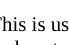

partial 类允许开发人员将单个类的定义拆分到多个文件中。

这在处理大型类或自动生成代码和自定义代码需要在不冲突的情况下共存时很有用。

### [代码示例]
```csharp
// File: MyClass.Part1.cs

public partial class MyClass
{
    public void SayHello()
    {
        Console.WriteLine("Hello from Part 1");
    }
}

// File: MyClass.Part2.cs

public partial class MyClass
{
    public void SayGoodbye()
    {
        Console.WriteLine("Goodbye from Part 2");
    }
}
```

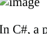

在 C# 中，partial 类允许您将单个类拆分为多个 .cs 文件。这在以下情况下特别有帮助：

- 您有自动生成的代码（例如 WinForms 或 ASP.NET 中的设计器代码），您不想手动修改它。
- 您希望将大型类组织成跨文件的逻辑部分，以便更轻松地导航和维护。

所有部分必须在同一个命名空间内，并且都必须使用 partial 关键字。

编译时，编译器会将所有 partial 类部分合并为一个类。重要的是避免在 partial 定义之间出现命名冲突（例如，两个同名的方法）。

此外，partial 类也可以与结构体和接口一起使用，而不仅仅是类。


### [补充]
Visual Studio 的设计器文件（例如 Form1.Designer.cs）会自动声明为 partial。这样，Form1.cs 中的用户编写逻辑和设计器生成的布局代码就可以并行存在，而不会相互干扰。


## 60. 使用 Lambda 表达式进行简短函数定义


Lambda 表达式允许您以简短且富有表现力的方式编写函数。

它们在 LINQ、事件处理或任何需要内联快速函数的地方特别有用。

### [代码示例]
```csharp
using System;
using System.Collections.Generic;
using System.Linq;

class Program
{
    static void Main()
    {
        List<int> numbers = new List<int> { 1, 2, 3, 4, 5 };

        // Lambda expression to filter even numbers
        var evens = numbers.Where(n => n % 2 == 0);

        foreach (var n in evens)
        {
            Console.WriteLine(n);
        }
    }
}
```


### [执行结果]
2

4


行 `numbers.Where(n => n % 2 == 0)` 使用了 lambda 表达式。以下是如何理解它：

`n => n % 2 == 0` 的意思是：

- `n` 是输入参数（列表中的每个元素）。
- `=>` 将参数与表达式体分隔开。
- `n % 2 == 0` 是正在测试的条件——只有偶数通过。

Lambdas 可以是：

- 单表达式：`x => x * x`
- 块样式：`x => { return x * x; }`

它们在使用 LINQ、事件处理程序和匿名方法时特别强大。

您可以将它们分配给委托或内联使用。它们的语法起初可能很棘手，但一旦习惯，就会极大地简化您的代码。

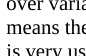

### [补充]
C# lambda 在幕后被转换为委托。它们可以闭包其周围作用域中的变量——这称为闭包。这意味着 lambda “记住”了它定义位置的变量，这在函数式编程中非常有用。

## 61. 在方法内部定义辅助方法（局部函数）

C# 中的局部函数是在另一个方法内部声明的方法。它们对于隔离不需要在包含方法外部公开的辅助逻辑很有用。

这里有一个简单示例，展示局部函数如何在另一个方法内部定义和使用。

### [代码示例]
```csharp
using System;

class Program
{
    static void Main()
    {
        int number = 5;

        // Call the method that uses a local function
        int result = CalculateFactorial(number);
        Console.WriteLine($"Factorial of {number} is {result}");
    }

    static int CalculateFactorial(int n)
    {
        // Local function defined inside the method

        int Factorial(int x)
        {
            if (x <= 1) return 1;
            return x * Factorial(x - 1); // Recursive call
        }

        return Factorial(n); // Calling the local function
    }
}
```

### [执行结果]
5 的阶乘是 120

在此示例中，Factorial 是在 CalculateFactorial 方法内部定义的局部函数。

它无法从 CalculateFactorial 外部访问，这有助于保持代码整洁和封装。

### 为什么使用局部函数？
- 封装：将辅助逻辑保留在使用的位置附近。
- 可读性：防止用仅在某处使用的方法污染类。
- 访问变量：局部函数可以访问外部方法的变量（本例中的 n）。

注意：如果不需要外部作用域访问，您也可以在静态方法内部将局部函数定义为 static。

### [补充]
局部函数是在 C# 7.0 中引入的。

如果需要，您可以嵌套多层局部函数（尽管这种情况很少见，并且可能降低可读性）。

它们与 lambda 表达式和匿名方法不同，后者是内联委托而不是命名函数。

## 62. 使用 Func<> 和 Action<> 进行函数式编程

`Func<>` 和 `Action<>` 是 C# 中的内置泛型委托。它们让您可以将方法存储在变量中、作为参数传递，并使用函数式编程技术构建灵活、可重用的代码。

此示例展示了如何使用 `Func<>` 和 `Action<>` 将方法作为一等公民进行分配和使用。

### [代码示例]
```csharp
using System;

class Program
{
    static void Main()
    {
        // Func<int, int, int> means a function taking two ints and returning an int
        Func<int, int, int> add = (a, b) => a + b;

        // Action<string> means a method taking one string and returning void
        Action<string> printMessage = message => Console.WriteLine($"Message: {message}");

        int result = add(10, 20); // Calling the Func delegate
        printMessage($"The result is {result}"); // Using the Action delegate
    }
}
```

### [执行结果]
消息：结果是 30

`Func<T1, T2, TResult>` 是一个泛型委托，它接受参数 `T1`、`T2`，并返回类型为 `TResult` 的值。


`Action<T>` 类似，但不返回任何内容（void）。

你也可以使用 `Predicate<T>`，如果需要返回一个 bool。

使用它们：
- 你可以将逻辑存储在变量中。
- 你可以将函数传递给其他方法（非常适合回调、过滤等）。
- 使代码更模块化且更易于测试。

在 Main 中，我们将匿名方法（lambda 表达式）赋给 `add` 和 `printMessage`。

语法 `(a, b) => a + b` 是定义小型函数的一种简洁方式。

### [补充]

委托是 C# 中事件、LINQ 和异步编程的基础。

你可以将 `Func<>` 和 `Action<>` 与 LINQ 结合使用来编写非常富有表现力的代码。

`Func<>` 最多可以有 16 个输入参数，但通常最好限制数量以提高可读性。


## 63. 使用 System.Threading.Tasks.Parallel 并行运行任务

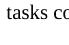

`System.Threading.Tasks.Parallel` 类允许你并发执行多个任务，充分利用多核处理器。

这里有一个使用 `Parallel.For` 同时处理多个项目的简单示例。

### [代码示例]

```csharp
using System;
using System.Threading.Tasks;

class Program
{
    static void Main()
    {
        // Using Parallel.For to process numbers from 0 to 4 in parallel
        Parallel.For(0, 5, i =>
        {
            Console.WriteLine($"Processing index {i} on thread {System.Threading.Thread.CurrentThread.ManagedThreadId}");
        });
    }
}
```


### [执行结果]

```text
Processing index 0 on thread 5

Processing index 1 on thread 6

Processing index 2 on thread 7

Processing index 3 on thread 5

Processing index 4 on thread 6

(Thread numbers and order may vary each time you run it)
```


`Parallel.For(start, end, action)` 类似于普通的 for 循环，但迭代可以在多个线程上同时运行。

`i => { ... }` 是一个 lambda 函数，指定对每个索引执行的操作。

这种并行性由 .NET 任务并行库（TPL）处理，它在幕后高效地管理线程使用。

当循环体包含 CPU 密集型操作且迭代彼此独立时，这种方法是有益的。

## 64. 使用 System.Collections.Concurrent 实现线程安全集合

`System.Collections.Concurrent` 命名空间提供了可在多个线程间安全使用而无需额外锁定的集合。

此示例演示如何使用 `ConcurrentDictionary`，这是一个设计为线程安全的字典。

### [代码示例]

```csharp
using System;
using System.Collections.Concurrent;
using System.Threading.Tasks;

class Program
{
    static void Main()
    {
        var dict = new ConcurrentDictionary<int, string>();

        // Run 3 tasks in parallel to add items to the dictionary
        Parallel.For(0, 3, i =>
        {
            dict.TryAdd(i, $"Value {i}");
        });

        // Display the dictionary content
        foreach (var kvp in dict)
        {
            Console.WriteLine($"Key: {kvp.Key}, Value: {kvp.Value}");
        }
    }
}
```

### [执行结果]

```text
Key: 0, Value: Value 0
Key: 1, Value: Value 1
Key: 2, Value: Value 2
(Order may vary)
```

在多线程环境中，如果多个线程同时访问，使用像 `Dictionary` 这样的标准集合可能会导致异常或数据损坏。

`ConcurrentDictionary` 通过处理内部锁定机制确保 Add、Update 和 Get 等操作是线程安全的。

在这里，`TryAdd` 用于安全地插入新的键值对，而不会冒竞态条件的风险。

`Parallel.For` 确保多个线程同时尝试添加值——这是一种完美的演示线程安全的方式。

对于初学者：
- 你不需要编写手动的 lock 语句。
- 线程安全集合有助于避免难以查找和修复的错误。
- 非常适合生产者-消费者模式和实时数据处理。

### [补充]

其他线程安全集合包括：`ConcurrentQueue<T>`、`ConcurrentStack<T>`、`ConcurrentBag<T>` 和 `BlockingCollection<T>`。


## 65. 事件处理程序和循环引用导致的内存泄漏


C# 中仍然可能发生内存泄漏，尤其是在事件处理程序未正确取消订阅时，或循环引用阻止垃圾回收器释放对象时。

此示例演示了如果对象订阅了事件但从未取消订阅，即使在不再需要后也会发生内存泄漏的情况。

### [代码示例]

```csharp
using System;

class Publisher
{
    public event EventHandler SomethingHappened;

    public void TriggerEvent() => SomethingHappened?.Invoke(this, EventArgs.Empty);
}

class Subscriber
{
    public Subscriber(Publisher publisher)
    {
        // This subscription causes the publisher to hold a reference to this object
        publisher.SomethingHappened += HandleEvent;
    }

    private void HandleEvent(object sender, EventArgs e)
    {
        Console.WriteLine("Event received.");
    }

    ~Subscriber()
    {
        Console.WriteLine("Subscriber finalized (GC).");
    }
}

class Program
{
    static void Main()
    {
        Publisher publisher = new Publisher();
        CreateLeak(publisher);
        GC.Collect();
        GC.WaitForPendingFinalizers();
        Console.WriteLine("Finished GC.");
    }

    static void CreateLeak(Publisher publisher)
    {
        // The subscriber is out of scope, but still referenced by the publisher
        Subscriber sub = new Subscriber(publisher);
    }
}
```

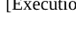

### [执行结果]

```text
Finished GC.

(Notice: "Subscriber finalized (GC)." is NOT printed, showing it's still in memory)
```

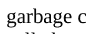

在此代码中，`Subscriber` 订阅了 `Publisher` 上的事件。即使 `sub` 在 `CreateLeak` 之后超出作用域，`Publisher` 仍通过事件处理程序持有对 `Subscriber` 的引用。因此，垃圾回收器无法清理它。析构函数（`~Subscriber()`）从未被调用，证明该对象仍在内存中存活。

为防止这种情况，请在对象不再需要事件时始终取消订阅，尤其是在长期存在的发布者（如静态类或全局单例）中。

你可以使用以下方式取消订阅：

```csharp
publisher.SomethingHappened -= HandleEvent;
```

或者，对于高级场景，使用弱引用或 `WeakEventManager` 模式。


### [补充]

C# 的垃圾回收器无法自动清理事件订阅持有的引用。

这是 GUI 应用（如 WPF/WinForms）中最常见的内存泄漏原因之一。

始终将事件视为引用：订阅意味着“持有”一个对象。


## 66. 强制使用 GC.Collect() 进行垃圾回收为何有风险


虽然可以使用 `GC.Collect()` 手动触发垃圾回收，但在非常特定和高级的场景下除外，这样做是不推荐的。

此示例展示了如何手动触发垃圾回收以及强制执行时会发生什么——以及为什么通常是不好的做法。

### [代码示例]

```csharp
using System;

class Test
{
    ~Test()
    {
        Console.WriteLine("Finalizer called.");
    }
}

class Program
{
    static void Main()
    {
        CreateAndForget();

        // Force garbage collection
        GC.Collect();
        GC.WaitForPendingFinalizers();
        Console.WriteLine("GC forced manually.");
    }

    static void CreateAndForget()
    {
        Test t = new Test();
        // 't' goes out of scope here, eligible for GC
    }
}
```

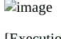

### [执行结果]

```text
Finalizer called.

GC forced manually.
```


通常，C# 的垃圾回收器在后台自动运行。它决定最佳的清理未使用内存的时间以避免性能问题。


## 67. 静态构造函数如何在首次使用前准备静态数据


静态构造函数会在任何访问静态成员之前自动初始化静态成员，且仅执行一次。

下面看一个简单示例，其中使用静态构造函数来初始化类中的静态数据。

[代码示例]

```
using System;

class Config
{
    // Static field shared by all instances
    public static string AppName;

    // Static constructor: runs only once, before any static member is accessed
    static Config()
    {
        Console.WriteLine("Static constructor executed.");
        AppName = "MyAwesomeApp";
    }
}

class Program
{
    static void Main()
    {
        // Accessing static field triggers static constructor
        Console.WriteLine($"Application: {Config.AppName}");
    }
}
```


[执行结果]

静态构造函数已执行。

应用程序：MyAwesomeApp


在 C# 中，静态构造函数是一种特殊构造函数，它不接收任何参数，也不能被直接调用。.NET 运行时会在首次访问该类中的任何静态成员之前，或创建该类的任何实例之前（以先发生者为准）自动调用它。它确保静态成员得到正确初始化。

每个类只允许有一个静态构造函数，并且无论该类型被访问多少次、从何处访问，它对于每个类型都恰好执行一次。如果一个类包含静态字段但没有静态构造函数，C# 仍可能在首次使用该静态成员时执行“惰性”初始化。

此外，你无法控制静态构造函数何时被调用，也无法捕获它抛出的异常（这些异常被视为致命异常）。

该机制对于设置应用程序范围的配置、缓存或其他应仅初始化一次的全局状态至关重要。


### [补充]

静态构造函数不能有访问修饰符（如 public、private）——它们本质上始终是私有的。

如果未定义静态构造函数，CLR 会处理默认的静态字段初始化。

静态构造函数有助于在多线程环境中防止静态初始化期间出现竞态条件。


## 68. 使用 readonly struct 的不可变结构体


readonly struct 确保结构体字段在创建后不能被修改，从而使其不可变。

下面是一个使用 readonly 关键字使结构体变为不可变的示例，这对于坐标或颜色之类的值类型很有帮助。

[代码示例]

```
using System;

// Define a readonly struct for immutable data

public readonly struct Point
{
    public int X { get; }
    public int Y { get; }

    // Constructor sets values; fields can't be changed after this
    public Point(int x, int y)
    {
        X = x;
        Y = y;
    }
    public void Print()
    {
        Console.WriteLine($"Point is at ({X}, {Y})");
    }
}
class Program
{
    static void Main()
    {
        Point p = new Point(10, 20);
        p.Print();
        // The following line would cause a compile error if uncommented:
        // p.X = 30;
    }
}
```

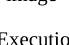

[执行结果]

点位于 (10, 20)

________

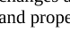

在 C# 中，结构体是值类型。将其设为 readonly 可以防止创建后发生意外更改。当结构体标记为 readonly 时，其所有字段和属性也必须不可变——这一点在编译时强制执行。

如果你尝试在 readonly 结构体的构造函数之外为其任何字段或属性赋值，就会得到编译器错误。这对于建模向量、日期或二维点等偏好不可变性的纯数据结构非常有用。

一个主要好处是，编译器可以针对性能优化 readonly 结构体，尤其是在涉及在内存中传递数据或跨线程传递数据的场景中。

此外，readonly struct 有助于避免防御性副本。通常，在非 readonly 结构体上调用方法时，编译器可能会复制它以避免修改。对于 readonly struct，编译器知道不会发生修改，因此会跳过复制——从而带来更好的性能。

________


### [补充]

带有 get; set; 的属性不能在 readonly struct 中使用，除非 set; 是私有的且仅在构造函数中使用。

当与 C# record struct 结合使用时（C# 10+），你可以对 readonly struct 使用 with 表达式。

在多线程环境中工作时，不可变性尤其有用，可以减少由共享可变状态引起的 bug。

## 69. 使用文件作用域语法简化命名空间声明

文件作用域命名空间让你在声明命名空间时无需额外的大括号，从而编写更简洁、缩进更少的代码。

下面是传统命名空间语法与较新的文件作用域语法之间的对比。

[代码示例]

```
// Traditional namespace syntax
namespace MyApp
{
    class Program
    {
        static void Main()
        {
            Console.WriteLine("Hello from traditional namespace!");
        }
    }
}

// File-scoped namespace syntax (C# 10 or later)
namespace MyApp;
class Program
{
    static void Main()
    {
        Console.WriteLine("Hello from file-scoped namespace!");
    }
}
```

### [执行结果]

来自传统命名空间的问候！
来自文件作用域命名空间的问候！

在传统 C# 代码中，namespace 关键字会将所有内容包裹在一个块中，需要额外的缩进和大括号 {}。

随着 C# 10 引入文件作用域命名空间，你现在可以用分号 ; 结束命名空间声明；

它告诉编译器所有后续类型（类、接口等）都属于此命名空间——而无需使用块。

这使文件更易于阅读，并避免深度嵌套，尤其是在大型项目中。

### 重要说明：

此功能需要 C# 10 或更高版本，因此请确保你的项目目标为 .NET 6 或更高版本。

每个文件只能有一个文件作用域命名空间。

这一更改纯粹是语法上的——运行时没有行为差异。

对于从使用扁平或简化模块结构的其他语言迁移过来的开发者来说，此功能尤其有用。

### [补充]

namespace Name; 这种语法受到偏好简洁的现代语言启发，例如 Python（使用模块）和 JavaScript（使用 ES 模块）。

此外，一些 IDE（如 Visual Studio）在重构代码时可能会自动将传统命名空间转换为文件作用域命名空间。


## 70. 全局 using 简化跨文件导入


global using 指令允许你在项目的所有文件中导入命名空间，从而减少冗余并提高一致性。

下面说明 global using 如何消除在每个 C# 文件中重复相同 using 语句的需要。

[代码示例]

```csharp
// File: GlobalUsings.cs

global using System;

global using System.Collections.Generic;

// File: Program.cs

class Program
{
    static void Main()
    {
        List<string> names = new List<string> { "Alice", "Bob" };
        Console.WriteLine(string.Join(", ", names));
    }
}
```

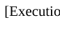

[执行结果]

Alice, Bob


在 C# 10 之前，每个文件都必须手动声明如下 using 指令：

```
using System;
```

```
using System.Collections.Generic;
```

这会变得很繁琐，尤其是对于常用的命名空间。

使用 global using，你可以在单个文件（通常是 GlobalUsings.cs）中声明一次这样的语句，它们就会在整个项目中生效。这不仅节省时间，还能让你的代码保持 DRY（Don't Repeat Yourself，不要重复自己）。

### 关键点：

- 仅对在许多文件中都会用到的命名空间使用 global using。
- 此功能在大型项目或共享库中效果最好。
- 保持代码更整洁，并避免因忘记 using 而导致的错误。


注意：此功能还支持使用 static 的全局 using 以及使用别名的全局 using 来导入静态成员或全局重命名命名空间。

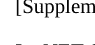

### [补充]

在 .NET 6+ 项目模板中，默认使用全局 using。

例如，如果你创建一个新的控制台应用，你可能会注意到 System、System.Linq 以及其他常见命名空间并未在每个文件中显式包含——它们是通过隐式全局 using 添加的。

你可以通过 .csproj 设置中的 `<ImplicitUsings>enable</ImplicitUsings>` 来自定义此行为。

## 71. 使用 Blazor 构建交互式 Web 应用

Blazor 是一个 C# 框架，允许开发者仅使用 C# 构建交互式 Web 应用，而不必大量依赖 JavaScript。

以下示例演示了一个简单的 Blazor 组件，允许用户点击按钮来增加计数器。

[代码示例]

```razor
@* Counter.razor: A simple Blazor component *@
<h3>Counter Example</h3>
<p>Current count: @count</p>
<button @onclick="IncrementCount">Click me</button>
@code {
    // A simple integer to track the count
    private int count = 0;
    // A method that increments the count
    private void IncrementCount()
    {
        count++;
    }
}
```

[执行结果]

网页显示：

Counter Example

Current count: 0

[Click me]

每次用户点击按钮时，数字都会增加：

Current count: 1, 2, 3, etc.

Blazor 是 ASP.NET Core 的一部分，允许你使用 C# 而不是 JavaScript 编写前端逻辑。有两种主要的主机模型：

- Blazor Server：代码在服务器上执行，并通过 SignalR 更新浏览器。
- Blazor WebAssembly：完全通过 WebAssembly 在浏览器中运行。

在上面的代码中：

- @onclick 将 C# 方法绑定到按钮的点击事件。
- @code 块在 Razor 文件中定义 C# 逻辑。
- 当 count 变化时，状态会自动在屏幕上刷新。
- 这对于不想在构建现代 Web 应用时在语言之间切换的 C# 开发者尤其有用。

### [补充]

- Blazor 组件是 .razor 文件，可以像 React 组件一样重用。
- 你可以直接混合 HTML 和 C# 逻辑。
- Blazor WebAssembly 将 C# 编译为 WebAssembly，可在浏览器中原生运行。

## 72. 使用 Entity Framework Core 进行数据库访问

Entity Framework Core (EF Core) 是 C# 中的默认对象关系映射器 (ORM)。它帮助开发者使用 C# 代码而不是手动编写 SQL 来操作数据库。

此示例展示了如何定义一个简单模型并使用 EF Core 向内存数据库中插入和检索数据。

[代码示例]

```csharp
using Microsoft.EntityFrameworkCore;
using System;
using System.Linq;

// Define a model (table)
public class Product
{
    public int Id { get; set; }
    public string Name { get; set; }
}
// Define a DbContext (database session)
public class AppDbContext : DbContext
{
    public DbSet<Product> Products { get; set; }
    protected override void OnConfiguring(DbContextOptionsBuilder options)
    => options.UseInMemoryDatabase("TestDb"); // Using an in-memory DB for testing
}
class Program
{
    static void Main()
    {
        using var db = new AppDbContext();
        // Add a new product
        db.Products.Add(new Product { Name = "Apple" });
        db.SaveChanges();
        // Read all products
        var products = db.Products.ToList();
        foreach (var product in products)
            Console.WriteLine($"Product: {product.Name}");
    }
}
```

[执行结果]

Product: Apple

此程序：

- 定义了一个 Product 类——一个简单的表模式。
- 配置 EF Core 使用内存数据库（无需实际数据库设置）。
- 向数据库添加新产品。
- 使用 SaveChanges() 保存更改。
- 查询数据并打印出来。

EF Core 处理所有底层 SQL 生成和执行。你可以使用熟悉的 LINQ 方法完全在 C# 中工作。

这对于以下情况非常有帮助：

- 快速开发
- 单元测试（使用内存数据库）
- 清晰、强类型的數據访问

### [补充]

EF Core 支持主流数据库，如 SQL Server、PostgreSQL、SQLite 等。

你可以使用 Code-First（在 C# 中编写模型）或 Database-First（从数据库生成模型）。

使用 `dotnet ef migrations` 生成用于模式更新的迁移脚本。

LINQ（语言集成查询）用于在 C# 中查询数据库。


## 73. 使用 Dapper 进行轻量级数据库访问


Dapper 是一个简单且快速的 .NET 微型 ORM（对象关系映射器）。它使用原始 SQL 实现对数据库的干净、轻量级访问，同时仍将结果映射到 C# 对象。

以下是如何在最小示例中使用 Dapper 从 SQL 数据库检索数据的示例。

[代码示例]

```csharp
// Required NuGet package: Dapper

// Required using directives

using System;
using System.Data.SqlClient;
using Dapper;
using System.Collections.Generic;

class Program
{
    // Define a simple data model
    public class User
    {
        public int Id { get; set; }
        public string Name { get; set; }
    }
    static void Main()
    {
        // Connection string (replace with your actual DB details)
        string connectionString =
            "Server=localhost;Database=TestDb;Trusted_Connection=True;";
        using (var connection = new SqlConnection(connectionString))
        {
            // Open the connection
            connection.Open();
            // Execute a query and map results to a list of User objects
            string sql = "SELECT Id, Name FROM Users";
            IEnumerable<User> users = connection.Query<User>(sql);
            // Display the results
            foreach (var user in users)
            {
                Console.WriteLine($"ID: {user.Id}, Name: {user.Name}");
            }
        }
    }
}
```


[执行结果]

ID: 1, Name: Alice

ID: 2, Name: Bob

ID: 3, Name: Charlie


此示例展示了 Dapper 的优雅之处：

`Query<T>()` 自动将 SQL 结果列映射到对象属性。

不需要复杂的配置或 ORM 设置。

Dapper 速度很快，因为它接近原始 ADO.NET 工作，并且不像 Entity Framework 那样跟踪实体状态。

要使用此功能，TestDb 数据库中必须存在 Users 表，且至少包含 Id 和 Name 列。

通过 NuGet 使用 `dotnet add package Dapper` 添加 Dapper。

Dapper 适用于以下场景：

- 你需要原始 SQL 控制。
- 性能至关重要。
- 你更喜欢简单清晰的代码而不是完整的 ORM 功能。

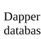

### [补充]

Dapper 由 Stack Overflow 开发者创建，用于处理大规模数据库操作。

与 Entity Framework 不同，Dapper 不支持更改跟踪——它完全关注检索速度。

Dapper 既可与存储过程一起使用，也可与内联 SQL 一起使用。

当你需要丰富的 ORM 功能，如延迟加载或复杂的关系跟踪时，它并不适用。

## 74. 使用 gRPC 实现高性能服务间通信

gRPC 是一个现代的远程过程调用 (RPC) 框架，可实现微服务之间的快速通信。在 .NET 中，gRPC 得到完全支持并针对高吞吐量和低延迟进行了优化。

以下是如何在 C# 中设置基本 gRPC 服务器和客户端。我们只展示最小的核心部分。

[代码示例]

```
// file: greet.proto
syntax = "proto3";

service Greeter {
  rpc SayHello (HelloRequest) returns (HelloReply);
}

message HelloRequest {
  string name = 1;
}

message HelloReply {
  string message = 1;
}

// Server-side implementation
public class GreeterService : Greeter.GreeterBase
{
    public override Task<HelloReply> SayHello(HelloRequest request, ServerCallContext context)
    {
        return Task.FromResult(new HelloReply { Message = $"Hello, {request.Name}" });
    }
}

// Client-side usage
```


```csharp
var channel = GrpcChannel.ForAddress("https://localhost:5001");
var client = new Greeter.GreeterClient(channel);
var reply = await client.SayHelloAsync(new HelloRequest { Name = "Alice" });
Console.WriteLine(reply.Message);
```

### [执行结果]

Hello, Alice

以下是正在发生的情况的分解：

- .proto 文件定义了客户端和服务器之间的契约（类似于接口）。
- 这些文件使用 protoc 或 .NET 工具编译成 C# 类。
- 服务器实现服务；客户端通过生成的客户端类使用它。
- gRPC 在底层使用 HTTP/2 进行多路复用、高效通信。

在 .NET 中使用 gRPC：

- 在服务器项目中添加 Grpc.AspNetCore。
- 在客户端项目中添加 Grpc.Net.Client。
- 在 .csproj 中使用 `<Protobuf>` 标签引用 .proto 文件。

gRPC 在以下情况下是理想选择：

- 你有许多微服务通过网络通信。
- 你需要实时、低延迟的数据交换。
- 你更关注二进制效率而非像 REST 这样的基于文本的 API。

### [补充]

- gRPC 由 Google 开发，并在生产环境中大规模使用。
- 它使用 Protocol Buffers（protobuf）进行消息序列化，比 JSON 更快、更小。
- gRPC 支持流式传输——不仅仅是请求/响应，还包括双向和服务器端流。
- gRPC 不适合基于浏览器的 API——尽管存在 gRPC-Web，但对于前端而言 REST 或 GraphQL 可能更容易。

## 75. 使用 ASP.NET Core 进行 Web 开发入门


ASP.NET Core 是微软提供的用于使用 C# 构建 Web 应用程序和 API 的主要现代框架。

下面是一个基本的 ASP.NET Core 应用程序示例，它在浏览器中显示“Hello World！”。

### [代码示例]

```csharp
// Program.cs

var builder = WebApplication.CreateBuilder(args); // Sets up the web app

var app = builder.Build(); // Builds the application

// Defines a single HTTP GET endpoint at the root path
app.MapGet("/", () => "Hello World!");

app.Run(); // Starts the web application
```

要运行该应用程序，请在终端中使用 .NET CLI 命令：

```bash
dotnet run
```

这将启动一个本地 Web 服务器。


### [执行结果]

在浏览器中访问 http://localhost:5000 时，你将看到：

Hello World!

---


这个最小示例得益于在 .NET 6 中引入并在后续版本中改进的 ASP.NET Core“最小 API”风格。

### 关键概念

- `WebApplication.CreateBuilder(args)` 使用默认值初始化应用程序。
- `app.MapGet(...)` 注册一个 HTTP GET 端点。
- `app.Run()` 启动应用程序并监听传入请求。
- ASP.NET Core 应用程序运行在 Kestrel 上，这是一个跨平台 Web 服务器。
- 它们可以处理动态页面、REST API 并连接数据库。

该框架高度模块化，意味着你只需添加所需的部分（例如路由、MVC、Razor 等）。它速度快，适用于云原生应用程序、微服务和传统网站。

---


### [补充]

- ASP.NET Core 跨平台：可在 Windows、Linux 和 macOS 上运行。
- 你可以在 IIS、Apache、Nginx 中托管 ASP.NET Core 应用程序，或使用 Kestrel 独立运行。
- .NET CLI（`dotnet`）对于构建和运行项目至关重要。
- Microsoft 官方模板命令：`dotnet new web` 创建一个基础 Web 应用程序。

## 76. 使用 Identity 进行身份验证和授权

ASP.NET Core 中的 Identity 框架处理用户登录、注册、角色管理和访问控制。

这是一个基本设置，展示如何使用 .NET CLI 在 Razor Pages 项目中脚手架 Identity。

### [代码示例]

```bash
#### Create a new ASP.NET Core Razor Pages project
dotnet new webapp -o IdentityDemo
cd IdentityDemo

#### Add Identity UI scaffolding
dotnet add package Microsoft.AspNetCore.Identity.UI

#### Enable Identity in Program.cs (automatically configured with template)
#### Run the app
dotnet run
```

之后，访问 /Identity/Account/Register 注册新用户。

访问 /Identity/Account/Login 登录。

### [执行结果]

一个可工作的 Web 应用程序，包含：

- 注册
- 登录
- 注销
- 账户管理页面
- 全部由 ASP.NET Core Identity 提供支持。

ASP.NET Core Identity 是一个成员系统，添加了：

- 用户存储（通过 EF Core 和 SQL Server 等数据库）
- 密码哈希和安全机制
- 基于角色的授权

Identity 使用 cookie 进行会话管理，并支持：

- 2FA（双因素身份验证）
- 外部登录（Google、Facebook 等）
- 电子邮件确认
- 登录失败时锁定账户

默认的 Identity 页面可以完全自定义。Scaffold-Identity 工具（在 Visual Studio 或 CLI 中）允许你生成可随后修改的 Razor Pages。

Program.cs 通常包含：

```csharp
builder.Services.AddDefaultIdentity<IdentityUser>(options =>
options.SignIn.RequireConfirmedAccount = true)
    .AddEntityFrameworkStores<ApplicationDbContext>();
```

中间件通过以下方式添加：

```csharp
app.UseAuthentication();
app.UseAuthorization();
```

### [补充]

- Identity 在底层使用 Entity Framework Core。
- 你可以扩展 IdentityUser 类以添加自定义用户字段（例如 FullName）。
- 默认 UI 使用 Razor Pages；如有需要可切换到 MVC。
- 同时支持基于声明和基于策略的授权。
- 内置了诸如加盐密码哈希等安全实践。

## 77. 使用 Razor Pages 简化 Web 开发

Razor Pages 是 ASP.NET Core 中的一个以页面为中心的框架，通过将控制器和视图逻辑合并到单个 .cshtml 文件中，使 Web 应用程序开发变得更容易。

下面是一个基本的 Razor Page 示例，用于处理简单的表单提交。

### [代码示例]

```
// Pages/Hello.cshtml
@page
@model HelloModel
<h2>Hello Razor Page</h2>
<form method="post">
<input type="text" name="UserName" />
<button type="submit">Submit</button>
</form>
@if (!string.IsNullOrEmpty(Model.Message))
{
<p>@Model.Message</p>
}

// Pages/Hello.cshtml.cs
using Microsoft.AspNetCore.Mvc;
using Microsoft.AspNetCore.Mvc.RazorPages;
public class HelloModel : PageModel
{
[BindProperty]
public string UserName { get; set; }
public string Message { get; set; }
public void OnPost()
{
  Message = $"Hello, {UserName}!";
}
}
```

### [执行结果]

当用户在输入框中提交姓名并点击 "Submit" 时，页面刷新并显示：

Hello, [UserName]!

Razor Pages 是 ASP.NET Core 的一部分，适用于每个页面包含自身逻辑的场景，尤其适用于基于表单的页面。

- 顶部的 @page 指令告诉 ASP.NET 这是一个 Razor Page。
- .cshtml 文件包含 HTML 和 Razor 语法（如 @Model.Message）。
- 关联的 .cshtml.cs 文件包含后端逻辑。
- OnPost() 会在表单通过 POST 提交时自动调用。
- BindProperty 将表单字段绑定到属性。
- 这种结构避免了需要单独的控制器，使 Razor Pages 对于小型应用程序或初学者而言比 MVC 更简单。

### [补充]

- Razor Pages 在 ASP.NET Core 2.0 中引入。
- 它们遵循 MVVM（模型-视图-视图模型）模式，使其对初学者友好。
- 路由基于文件夹结构，因此 Pages/Hello.cshtml 可通过 /Hello 访问。


## 78. 使用 Docker 部署 C# 应用程序


C# 应用程序，尤其是 ASP.NET Core 应用程序，可以使用 Docker 轻松容器化，以实现跨环境的稳定部署。

下面是如何使用 Docker 将 ASP.NET Core 应用程序容器化的步骤。

### [代码示例]

```dockerfile
#### Dockerfile
FROM mcr.microsoft.com/dotnet/aspnet:6.0 AS base
WORKDIR /app
FROM mcr.microsoft.com/dotnet/sdk:6.0 AS build
WORKDIR /src
COPY . .
RUN dotnet publish -c Release -o /app
FROM base AS final
WORKDIR /app
COPY --from=build /app .
ENTRYPOINT ["dotnet", "YourApp.dll"]
#### Build the Docker image
```


```bash
docker build -t my-csharp-app .
```

### 运行容器

```bash
docker run -d -p 8080:80 my-csharp-app
```


### [执行结果]

ASP.NET Core 应用将在 Docker 容器内通过 http://localhost:8080 访问。


- mcr.microsoft.com/dotnet/aspnet:6.0：基础运行时镜像。
- mcr.microsoft.com/dotnet/sdk:6.0：用于构建应用的 SDK。
- publish 命令将应用编译到 `/app` 目录。
- 最终镜像更轻量，因为它只包含运行应用所需的组件。

这种将构建阶段和最终阶段分离的做法称为多阶段构建，可使 Docker 镜像保持小巧高效。

通过将 8080 端口映射到容器内部的 80 端口，用户可以在浏览器中访问应用。


### [补充]

Docker 确保应用在任何机器上以相同方式运行——非常适合微服务或云部署。Visual Studio 也提供了一键集成的 Docker 支持。要验证 Docker 是否正在运行：docker info 或 docker version。


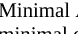

## 79. 使用极简代码构建轻量级 Web API

Minimal APIs 允许你用最少的代码快速在 C# 中构建 Web 端点。它们非常适合微服务、小型应用以及探索 Web 开发的初学者。

下面介绍如何使用 .NET 的 Minimal API 方法在 C# 中创建一个简单的 Web API。

### [代码示例]

```csharp
// Program.cs

// Import the necessary namespace
using Microsoft.AspNetCore.Builder;

using Microsoft.AspNetCore.Http;

var app = WebApplication.Create(); // Create the web application instance

// Define a GET endpoint for the root URL "/"
app.MapGet("/", () => "Hello, World!");

// Start the app
app.Run();
```


### [执行结果]

当你运行此应用程序并在浏览器中访问 http://localhost:5000/ 时，它会显示：Hello, World！


这是使用 .NET 6 或更高版本中 Minimal APIs 的最简单形式的 Web API。无需创建控制器或额外的配置文件。

- `WebApplication.Create()` 设置一个基础 Web 主机。
- `app.MapGet(...)` 定义路由及其响应。
- `app.Run()` 启动 HTTP 服务器。

Minimal APIs 非常适合快速原型设计或在没有样板代码的情况下学习 HTTP 路由。然而，它们也足够强大，可以处理复杂任务，包括中间件、依赖注入和路由。

来自其他语言的初学者应将其与 Flask（Python）或 Express（JavaScript）等框架中端点的构建方式进行比较，以了解其简洁性和可读性。


### [补充]

- Minimal APIs 在 .NET 6 中引入。
- 它们可减少启动时间和内存使用。
- 非常适合微服务或轻量级 HTTP 服务。
- 仍可像完整的 MVC 一样使用中间件、DI 和过滤器。
- 了解 C# 中 HTTP 方法的绝佳切入点。

## 80. 使用 Azure Functions 进行无服务器计算

Azure Functions 允许你在无需管理基础设施的情况下运行小型代码单元。你只需为执行时间付费。

让我们编写一个简单的 Azure Function C# 代码，使其响应 HTTP 请求。

### [代码示例]

```csharp
// Function1.cs
using System.Net;
using Microsoft.Azure.Functions.Worker;
using Microsoft.Azure.Functions.Worker.Http;
using Microsoft.Extensions.Logging;
public class Function1
{
    private readonly ILogger _logger;
    public Function1(ILoggerFactory loggerFactory)
    {
        _logger = loggerFactory.CreateLogger<Function1>();
    }
    [Function("Function1")]
    public HttpResponseData Run(
        [HttpTrigger(AuthorizationLevel.Anonymous, "get", "post")] HttpRequestData req)
    {
        _logger.LogInformation("HTTP trigger function processed a request.");
        var response = req.CreateResponse(HttpStatusCode.OK);
        response.WriteString("Hello from Azure Function!");
        return response;
    }
}
```

### [执行结果]

当此 Azure Function 部署并访问时，它返回：Hello from Azure Function！

Azure Functions 使用无服务器模型。这意味着：

- 你无需管理任何服务器或主机。
- 你的函数由事件触发（如 HTTP 请求、计时器、队列）。
- 它会根据需求自动扩展。

此示例使用：

- `[Function("Function1")]` 将其标记为 Azure Function。
- `[HttpTrigger(...)]` 声明它响应 HTTP 请求。
- `HttpRequestData` 和 `HttpResponseData` 用于处理请求和响应。

虽然功能强大，但设置 Azure Functions 需要了解 Azure 生态系统以及 Azure CLI、Visual Studio Code 或 Azure Portal 等工具。

### [补充]

- Azure Functions 支持多种语言：C#、JavaScript、Python、Java 等。
- 它们非常适合数据转换、Webhooks 或自动化等短时任务。
- 按需付费：仅在代码运行时计费。
- 函数可以从 Visual Studio 或 GitHub Actions 部署。
- 你可以绑定到许多 Azure 服务：Blob 存储、Cosmos DB、Event Grid 等。

## 81. 使用 JWT 在 C# 中实现安全的 API 访问

JWT（JSON Web Token）是一种在各方之间安全传输信息标准，通常用于 API 中的用户身份验证。

下面是一个使用 `System.IdentityModel.Tokens.Jwt` 包在 C# 中生成和验证 JWT 的简单示例。

### [代码示例]

```csharp
// Install the following NuGet packages first:
// - System.IdentityModel.Tokens.Jwt
// - Microsoft.IdentityModel.Tokens

using System;
using System.Text;
using System.IdentityModel.Tokens.Jwt;
using Microsoft.IdentityModel.Tokens;
using System.Security.Claims;
class Program
{
    static void Main()
    {
        // Secret key (keep this safe in real apps!)
        var secretKey = new SymmetricSecurityKey(Encoding.UTF8.GetBytes("SuperSecretKey12345"));
        // Sign credentials using HMAC SHA256
        var signingCredentials = new SigningCredentials(secretKey, SecurityAlgorithms.HmacSha256);
        // Define the token content (claims)
        var tokenDescriptor = new JwtSecurityToken(
            issuer: "myApp",
            audience: "myUsers",
            claims: new[] { new Claim(ClaimTypes.Name, "JohnDoe") },
            expires: DateTime.UtcNow.AddMinutes(30),
            signingCredentials: signingCredentials
        );

        // Create the token
        var tokenHandler = new JwtSecurityTokenHandler();
        var tokenString = tokenHandler.WriteToken(tokenDescriptor);
        Console.WriteLine("Generated JWT:");
        Console.WriteLine(tokenString);

        // ===== VALIDATION =====
        var tokenValidationParams = new TokenValidationParameters
        {
            ValidateIssuer = true,
            ValidateAudience = true,
            ValidIssuer = "myApp",
            ValidAudience = "myUsers",
            IssuerSigningKey = secretKey
        };
        try
        {
            var principal = tokenHandler.ValidateToken(tokenString, tokenValidationParams, out var validatedToken);
            Console.WriteLine("Token is valid. User: " + principal.Identity.Name);
        }
        catch (Exception ex)
        {
            Console.WriteLine("Invalid token: " + ex.Message);
        }
    }
}
```

### [执行结果]

Generated JWT:

```
eyJhbGciOiJIUzI1NiIsInR5cCI6IkpXVCJ9...
```

Token is valid. User: JohnDoe

JWT 包含 3 部分：Header、Payload 和 Signature。

- Header 包含签名算法（例如 HS256）。
- Payload 包含声明（用户信息、过期时间）。
- Signature 确保令牌未被篡改。
- JWT 通常作为 HTTP 头部传递：`Authorization: Bearer <token>`。
- 验证 JWT 会检查其签名、过期时间和其他声明。
- 不要在生产应用中硬编码密钥——请使用安全保管库或环境变量。

### [补充]

- JWT 是无状态的：服务器无需会话存储。
- 负载是 Base64 编码的，而非加密——切勿在其中存储敏感数据。
- 你可以使用 jwt.io 等工具解码 JWT 以手动检查它们。


## 82. 使用 C# ORM 防止 SQL 注入


C# ORM（如 Entity Framework）会自动参数化 SQL 查询，有助于防止 SQL 注入攻击。

本示例展示了使用 LINQ 查询与 Entity Framework Core 如何自动避免 SQL 注入漏洞。

[代码示例]

```csharp
// Assumes a simple EF Core setup with a User model and DbContext
using System;
using System.Linq;
using Microsoft.EntityFrameworkCore;
public class User
{
public int Id { get; set; }
public string Username { get; set; }
}
public class AppDbContext : DbContext
{
public DbSet<User> Users => Set<User>();
protected override void OnConfiguring(DbContextOptionsBuilder options)
=> options.UseInMemoryDatabase("TestDb"); // In-memory for demo purposes
}
class Program
{
static void Main()
{
using var context = new AppDbContext();

// Seed a user
context.Users.Add(new User { Username = "Alice" });
context.SaveChanges();

// Simulate user input (e.g., from a login form)
string userInput = ""; DROP TABLE Users;--"; // An attack string

// LINQ query is safe: parameters are auto-handled by EF
var user = context.Users.FirstOrDefault(u => u.Username == userInput);
Console.WriteLine(user == null ? "No match found (safe!)" : "User found: " + user.Username);
}
}
```

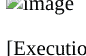

[执行结果]

未找到匹配项（安全！）

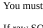

Entity Framework 中的 LINQ 查询会被翻译为参数化 SQL。

这意味着像 '; DROP TABLE Users;--' 这样危险的输入会被安全地转义并作为字符串处理。

必须避免使用原始 SQL 或字符串拼接——改用 EF 方法。

如果绝对需要使用原始 SQL，请使用带参数的 FromSqlInterpolated 或 FromSqlRaw。


[补充]

SQL 注入是最常见的 Web 漏洞之一。

ORM 框架如 Entity Framework、Dapper、NHibernate 在正确使用时提供内置安全性。

切勿信任用户输入——即使有 ORM 保护，也始终进行验证和清理。

## 83. 使用 Roslyn 分析器提升代码质量

C# 开发者可以使用由 Roslyn 驱动的代码分析器自动检测问题、强制执行最佳实践并保持代码整洁。

以下示例展示了如何使用 Roslyn 分析器检测未使用的变量，以及它在 Visual Studio 等开发环境中的显示方式。

[代码示例]

```csharp
// Example C# code that would trigger a Roslyn analyzer warning
using System;
class Program
{
static void Main()
{
int unusedVariable = 42; // This line will trigger a warning from analyzers
Console.WriteLine("Hello, world!");
}
}
```

[执行结果]

'unusedVariable' 下会出现波浪线，并显示类似的警告：
IDE0059: Unnecessary assignment of a value to 'unusedVariable'

Roslyn 是 .NET 编译器平台，不仅编译代码，还提供强大的 API 用于分析和重构代码。Visual Studio 内部使用 Roslyn 分析器为开发者提供编码问题的实时反馈。

这些分析器可以检测以下内容：

- 未使用的变量或 using 指令
- 命名约定违规
- 可能的错误（例如，不可达代码）
- 代码风格偏好（如空格、括号或大括号）
- 性能建议

对于初学者来说，注意 IDE 警告很重要——这些警告通常由 Roslyn 分析器生成，有助于学习更干净、更安全的 C# 编码习惯。

您还可以安装自定义分析器或使用 Roslyn SDK 创建自己的分析器以强制执行团队规则。

### 补充

Roslyn 分析器在设计时（在编辑器中）和编译时均可工作。它们是现代 C# 开发环境如此智能的一部分。流行的工具如 StyleCop Analyzers、SonarAnalyzer.CSharp 和 Microsoft.CodeAnalysis.FxCopAnalyzers 均基于 Roslyn 构建。

## 84. 使用可空注释强制执行空安全

可空引用类型允许您声明变量是否可以保存 null 值，有助于防止运行时空引用错误。

以下是使用可空注释帮助编译器捕获潜在空引用问题的简单示例。

[代码示例]

```csharp
#nullable enable

class User
{
    public string Name { get; set; } // Non-nullable
    public string? Nickname { get; set; } // Nullable
}

class Program
{
    static void Main()
    {
        var user = new User();
        user.Name = "Alice";
        user.Nickname = null;

        // Accessing without null check causes a warning
        Console.WriteLine(user.Nickname.Length); // △ Possible null reference warning
    }
}
```

[执行结果]

编译器警告：对可能为空的引用的解引用。

## 85. C# 中的自包含与框架依赖部署

C# 应用程序可以部署为包含所需的一切（自包含）或依赖预安装的 .NET 运行时（框架依赖）。

以下是使用 .NET CLI 创建这两种部署类型的方法。

[代码示例]

```
#### Framework-dependent deployment
dotnet publish -c Release -r win-x64 --self-contained false

#### Self-contained deployment
dotnet publish -c Release -r win-x64 --self-contained true
```

[执行结果]

创建一个 /publish 文件夹，其中包含轻量级应用程序（框架依赖）或完整、独立的应用程序（自包含）。

自包含部署意味着所有必需的 .NET 运行时和库都包含在已发布的文件中。应用程序可以在未安装 .NET 的机器上运行。

缺点：输出文件夹更大，因为它包含运行时。

框架依赖部署假定目标机器已安装正确的 .NET 运行时。输出更小，但可移植性取决于外部因素。

在这两种情况下：

- -c Release：以发布模式编译（优化）。
- -r win-x64：指定运行时标识符（此处为 64 位 Windows）。
- --self-contained true/false：在两种部署模式之间切换。

选择自包含以获得最大可移植性（例如，向用户分发应用程序）。选择框架依赖用于受控环境（例如，企业服务器）。

[补充]

.NET 应用程序使用运行时标识符（RIDs）指定目标操作系统/平台。示例包括 win-x64、linux-x64 和 osx-arm64。

要列出受支持的 RID，请查看 .NET SDK 文件夹中的 RuntimeIdentifierGraph.json 或访问官方 .NET RID 目录。

## 86. 使用 AOT 编译提升性能

C# 现在支持提前（AOT）编译，在运行时之前将代码转换为本地机器指令，从而加快启动速度并减少内存使用。

让我们使用 .NET 的原生 AOT 发布将简单应用程序编译为原生可执行文件。

[代码示例]

```
#### First, create a basic console app
dotnet new console -o HelloAOT
cd HelloAOT

#### Then publish it using Native AOT
dotnet publish -c Release -r win-x64 /p:PublishAot=true
```

[执行结果]

在 bin\Release\net8.0\win-x64\publish 目录中生成原生 .exe（或平台特定二进制文件）。

AOT（提前编译）在构建时而不是在运行时（如传统的 JIT 编译）将 C# 代码转换为特定于平台的机器代码。

优点：

- 更快的启动
- 减少内存占用

## 87. 使用热重载进行实时代码更新

热重载允许您在调试时即时应用代码更改，而无需停止并重新启动应用程序。

以下是使用控制台应用程序演示运行时热重载的简单示例。

[代码示例]

// Program.cs
using System;
class Program
{
static void Main(string[] args)
{
// This line will be updated during runtime using Hot Reload
Console.WriteLine("Hello, C#!");
}
}
// After starting the app with debugging and applying a change using Hot Reload:
// Modified during runtime
Console.WriteLine("Hello, world! (Hot Reloaded)");

[执行结果]

初始打印：

Hello, C#!

热重载更改后，打印：

Hello, world! (Hot Reloaded)


热重载（Hot Reload）是 .NET 6 中引入、并在 .NET 7 及更高版本中改进的功能。

它允许你在应用程序运行时更改代码，尤其是在调试时。

这很有用，因为：

- 你不必停止并重新生成应用。
- 你可以实时测试小幅调整。
- 你可以保持调试的“心流”状态。

### 如何使用：

- 在 Visual Studio 中打开项目，或通过 CLI 使用 dotnet watch 运行。
- 在调试模式下启动应用。
- 在代码中进行更改（例如编辑消息或逻辑）。
- 如果热重载支持该更改，它会自动应用你的更改。

### 重要说明：

- 最适合用于 ASP.NET Core、WPF、WinForms、控制台应用。
- 并非所有更改都可重载（例如，更改类/结构体定义有时需要重新生成）。
- 当热重载应用你的代码时，Visual Studio 通常会显示闪电 [] 图标。

### [补充]

热重载在内部使用 .NET 运行时的“编辑并继续”（Edit and Continue，EnC）功能。

你可以在 Visual Studio 中使用 Ctrl + Alt + F10 快捷键手动触发热重载。

某些框架（如 Blazor）支持极快的 UI 热重载，使前端开发效率极高。

## 88. 使用 DOTNET WATCH 实现快速开发循环

dotnet watch 命令会在你更改源文件时自动重新运行项目。

使用 dotnet watch 持续监视代码，并在编辑后立即重新运行应用。非常适合快速反馈循环。

### [代码示例]

```text
#### Open a terminal in your project directory and run:
dotnet watch run
// Example: Program.cs
Console.WriteLine("This is the initial version.");
// After saving changes while dotnet watch is running:
Console.WriteLine("Code updated! dotnet watch reloaded the app.");
```

### [执行结果]

```text
Terminal output:
dotnet watch □ started
watch : Started
This is the initial version.
watch : File changed: Program.cs
watch : Restarting
Code updated! dotnet watch reloaded the app.
```

dotnet watch 是 .NET CLI 工具集的一部分，像项目的实时观察器一样工作。

### 为什么有用：

- 保存更改时，它会自动重新编译并重新运行项目。
- 非常适合控制台应用、API 或 Blazor 开发。
- 节省时间，避免枯燥的手动停止-运行循环。

### 工作原理：

- 监视 .cs 文件（以及其他相关文件）的更改。
- 触发重新生成并重新启动应用。
- 可与 run、test、build 等配合使用。例如：

dotnet watch test 会在每次文件更改时重新运行测试。

### 何时使用：

- 在开发需要即时反馈的应用期间。
- 当频繁微调少量逻辑时。

### [补充]

可以在项目的 .csproj 文件中使用 watch 节来配置 dotnet watch，以忽略或包含某些文件。

它在内部使用文件系统监视器来高效检测更改。

你也可以传递参数：

```text
dotnet watch run --my-arg value
```

## 第 4 章 请求评价

非常感谢你读到最后。

这本书是为像你这样的开发者精心打造的——那些已经会写代码、已经在其他语言中与逻辑和结构打过交道、不需要别人告诉其什么是变量的人。

相反，我们纯粹聚焦于 C# 的独特之处：那些习语、特性、生态系统以及细微差别，否则即使是经验丰富的程序员也可能被绊倒。

目标是清晰而不妥协——快速、专注且高度相关。

无论你是从 Java、Python、JavaScript 还是任何其他背景转过来，我希望本指南能帮助你剔除噪音，聚焦于让 C# 与众不同的核心知识。

如果你是一位资深 C# 开发者，只是想跟上最近版本中的变化，我真心希望它充当了一次简短而有力的复习。

现在，我想请你帮个小忙。

如果这本书帮助了你，哪怕只是一点点——也许它为你节省了几个小时，澄清了一个棘手的概念，或者在其他资源显得臃肿或过时时给了你一个清晰的概览——请考虑留下评价。

不必很长。

事实上，如果你时间紧张，只需快速点一下星级评分，对我来说就意义重大。

但如果你确实有几分钟时间分享一个想法、一个见解，甚至一条批评，我向你保证：我会阅读每一个字。

你的反馈不仅值得感激——而且至关重要。它帮助我塑造下一个版本、改进重要之处，甚至可能选择下一个主题。

什么让你困惑？什么对你帮助最大？有遗漏吗？你想要更多代码示例、图表、与其他语言的现实世界比较，甚至小练习吗？或者也许你只是想告诉我，书中哪里让你发出“啊，现在我懂了”的感叹。所有这些都很有价值。

你的声音对这一过程的引导作用远超你的想象。

真的——如果时间很紧，哪怕一句评价或只是点些星星也极其有帮助。

再次感谢你的阅读，我真心希望我们能在另一本书、另一次深入探索中，或在你学习旅程所到之处再次相遇。

永远万事如意。
