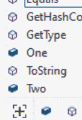
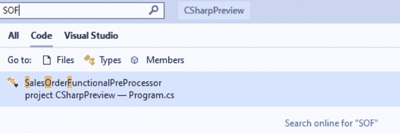
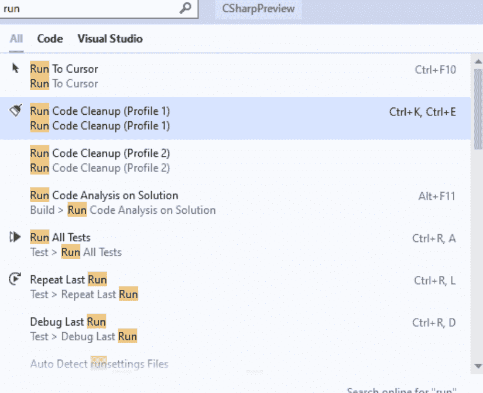
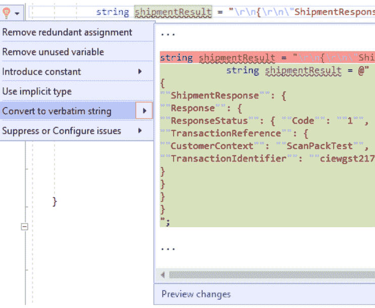
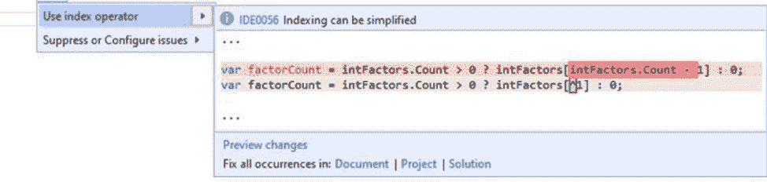
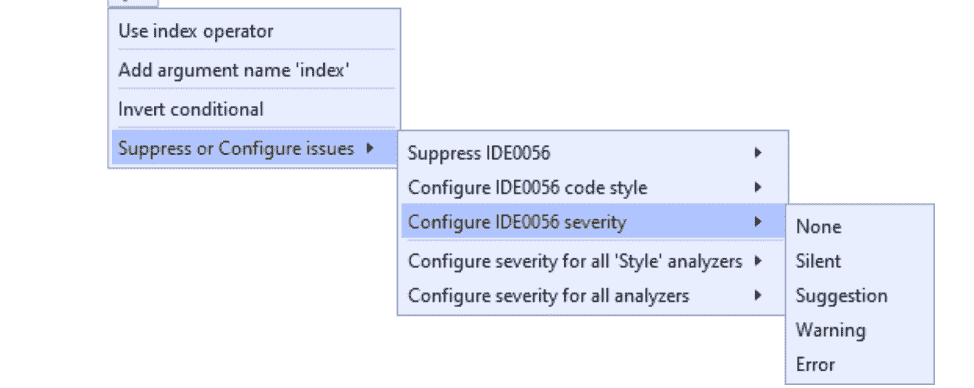
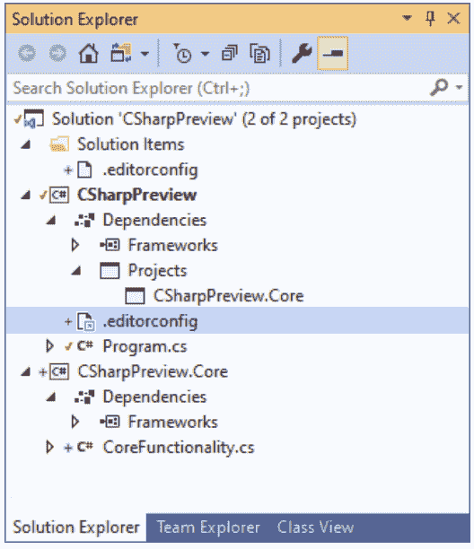
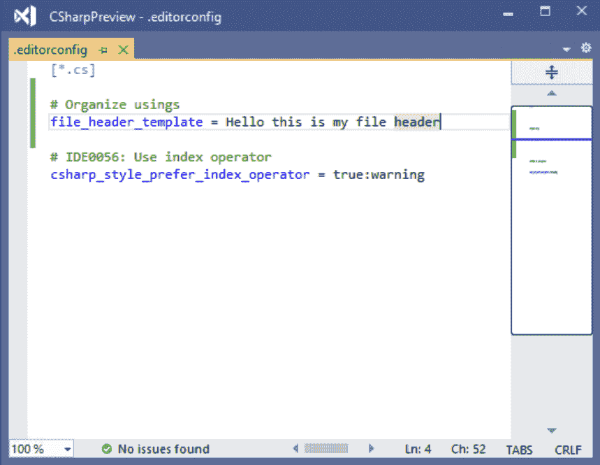
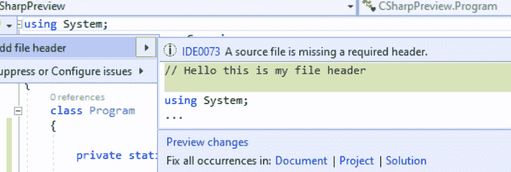

# C# 特性精要

序言：Daniel Jebaraj


# 《简明》（Succinctly）系列背后的故事

Daniel Jebaraaj，副总裁

Syncfusion, Inc.

## 站在最前沿

正如许多人所知，Syncfusion 是微软平台软件组件的提供商。这使我们处于一个既兴奋又充满挑战的地位：始终处于最前沿。

每当平台或工具从微软发布出来时（在如今这似乎每周都会发生），我们都必须快速地进行自我教育。

## 信息丰富，但更难消化

现实中，这意味着大量的书籍订单、书籍搜索以及对 Twitter 信息的扫描。

虽然互联网上的可用信息越来越多，出版的书籍也日益增多（即使是针对较新的话题），但一直制约着我们的一个方面——是无法找到简洁的技术概览书籍。

我们通常面临两种选择：读几本超过 500 页的书，或者在网络上搜索相关的博客文章和其他文章。就像每个有工作要做、有客户要一样，我们发现这非常令人沮丧。

## 《简明》系列

这种挫败感转化为一种强烈的愿望，即创作一系列针对在微软平台上工作的开发者的简洁技术书籍。

我们坚信，考虑到开发者已拥有的背景知识，大多数主题都可以被转化成 50 到 100 页之间的书籍。

这正是我们决定通过《简明》系列要实现的目标。难道不是美好的事物都是源于对改变现状的深切愿望吗？

## 最好的作者，最好的内容

每位作者都是从一群与我们愿景相合的才华专家库中精心挑选出来的。你现在手中的这本书，以及该系列中的其他书籍，都是作者们不懈努力的成果。你将发现原创内容，这些内容保证能让你在喝掉几杯咖啡的时间内快速上手。

## 永久免费

Syncfusion 将致力于编写多个主题的书籍。这些书籍将永远免费。我们发布的任何更新也将是免费的。

## 免费？有什么猫腻？

这里没有猫腻。Syncfusion 在这项工作中有切身利益。

作为组件供应商，我们独特的主张一直是，我们提供的框架比市场上任何其他人都更深、更广。开发者教育极大地帮助了我们进行营销，并对抗那些承诺“一键开启 AJAX 支持”或“点月亮变成奶酪！”的竞争对手。

## 让我们告诉我们你的想法

如果你有任何感兴趣的话题、想法或反馈，请随时通过 `succinctly-series@syncfusion.com` 向我们发送。

我们诚挚希望你喜欢这本书，希望它能帮助你更好地理解学习主题。感谢阅读。

请在 Twitter 上关注我们，并在 Facebook 上“点赞”我们，帮助我们传播《简明》系列的口碑！


## 关于作者

Dirk Strauss 是一位来自南非的软件开发者，拥有 13 年以上的编程经验。他在 SYSPRO 定制化方面拥有丰富经验，专注于 C# 和 Web 开发。他在纳尔逊·曼德拉大学学习，在那里他兼职编写软件以获得对技术的理解。他依然对编写代码充满热情，并乐于与他人分享所学。

# 第一章 C# 历史

C# 随着语言每个主要版本的发布不断演进和改进。由于 C# 团队不断创新并为 C# 添加功能，其成员会在社区分享他们围绕 C# 设计的思考过程。

如果你前往 GitHub 上的 `dotnet/Roslyn` 仓库，你将看到详细的语言特性状态，以及 C# 团队考虑在未来版本中的特性。你还可以在 Microsoft Docs 上查看 C# 历史。在写本文时，特别感兴趣的是（此处原文无具体内容，保留语境）。在后续章节中。

C# 随着语言每个主要版本的发布不断演进和改进。由于 C# 团队不断创新并为 C# 添加功能，其成员会在社区分享他们围绕 C# 设计的思考过程。

## C# 版本 1.0

Visual Studio 2002 的发布带来了 C# 1.0，一种通用的面向对象语言。它不包含 LINQ 或泛型，但提供了：

- 类 `Classes`

- 结构体 `Structs`

- 接口 `Interfaces`

- 事件 `Events`

- 属性 `Properties`

- 委托 `Delegates`

今天回看这些特性，会被 C# 8.0 提供的功能所宠坏。

## C# 版本 2.0

当 Visual Studio 2005 在 2005 年发布时，我们看到了一些特性，例如：

- 泛型 `Generics`

- 部分类 `Partial classes`

- 匿名方法 `Anonymous methods`

- 可空值类型 `Nullable value types`

- 迭代器 `Iterators`

- 协变与逆变 `Covariance and contravariance`

现有特性也得到了改进，例如：

- Getter/setter 访问权限 `Getter/setter accessibility`

- 方法组转换（直接将方法名赋值给委托）

- 静态类 `Static classes`

## C# 版本 3.0

2007 年后期，Visual Studio 2008 发布。它提供的语言特性随 .NET Framework 3.5 发布如下：

- 自动实现属性 `Auto-implemented properties`

- 匿名类型 `Anonymous types`

- 查询表达式 `LINQ`

- Lambda 表达式 `Lambda expressions`

- 表达式树 `Expression trees`

- 扩展方法 `Extension methods`

- 隐式类型局部变量 `Implicitly typed local variables`

- 部分方法 `Partial methods`

- 对象和集合初始化器 `Object and collection initializers`

LINQ 是 C# 的杀手级功能之一。它允许你对集合进行类似 SQL 的声明式查询，例如。起初我不习惯 LINQ（我不是唯一的）。现在，编写它变得非常快速简洁。C# 3.0 确实是突破性的版本。

## C# 版本 4.0

Visual Studio 2010 带来了 C# 4.0。4.0 版本新增的特性有：

- 动态绑定 `Dynamic binding`

- 命名/可选参数 `Named/optional arguments`

- 泛型协变逆变 `Generic covariant and contravariant`

- 嵌入交互类型 `Embedded interop types`

对我来说，可选参数的引入令人耳目一新，但 4.0 版本引入 `dynamic` 关键字才是焦点。

## C# 版本 5.0

C# 5.0 随 Visual Studio 2012 发布，为 C# 语言带来了另一项重大突破——用于异步编程的 `async` 和 `await`。C# 5.0 引入了：

- 异步成员 `Asynchronous members`

- 调用者信息属性

异步性现在已经成为 C# 的一等公民。

## C# 6.0 版本

Visual Studio 2015 引入了 C# 6.0 版本，从这里开始，我们看到了一些提高开发者效率的小特性。这些特性包括：

- `using static`（不再需要 Console.this 和 Console.that）。

- 只读自动属性。

- 自动属性初始化器。

- 表达式主体的函数成员。

- 空值条件运算符。

- 字符串插值。

- 异常过滤器。

- 表达式的 `nameof`。

- 在 Catch 和 Finally 块中的 `await`。

我记得 Mads Torgensen 曾说过，C# 6.0 为语言添加了大量的语法糖。我百分之百赞同他的观点。

## C# 7.0 版本

Visual Studio 2017 见证了 C# 7.0 向开发者社区发布。它推出了以下语言特性：

- `out` 变量。

- 元组 `Tuples`。

- 丢弃 `Discards`。

- 模式匹配。

- `ref` 局部变量和返回值。

- 局地函数。

- 更多表达式主体的成员。

- `throw` 表达式。

- 通用异步返回类型。

- 数字字面量语法改进。

开发者现在可以编写更整洁的代码并提高效率。

## C# 7.1 版本

从 C# 7.0 开始，我们开始看到 C# 的点版本发布（7.1 版本）。这标志着 C# 发布节奏的加快。此版本的新语言特性包括：

- `async Main` 方法。

- 默认字面量表达式。

- 推断的元组元素名称。

- 泛型类型参数上的模式匹配。

C# 7.1 还添加了语言版本选择配置元素，以及新的编译器行为。

## C# 7.2 版本

C# 7.2 为 C# 添加了若干更多较小的语言特性。这些特性包括：

- 添加了代码增强，允许开发者编写安全、高效的代码：

  - 参数上的 `in` 修饰符。

  - 方法返回值上的 `ref readonly`。

  - `readonly` 结构体 `struct` 声明。

  - `ref` 结构体声明。

- 非尾部参数 `Non-trailing arguments`。

- 数字字面量中的前下划线。

- `private protected` 访问修饰符。

- 条件表达式。

你可以在此处阅读更多关于在 C# 中编写安全高效的代码。

## C# 7.3 版本

C# 7 的点版本让开发者能够更早地接触到新的语言特性。C# 7.3 的发布包含了两个主要特性：一个允许安全代码执行出与高效代码相同的性能，另一个则对现有特性提供了额外的改进。

从更高效代码的角度来看，我们看到了：

- 在不固定 `pinning` 的情况下访问字段。

- 重新分配 `ref` 局部变量。

- 在 `stackalloc` 数组上使用初始化器。

- 对任何支持模式的类型使用 `fixed` 语句。

- 额外的泛型约束（你将在本书后部分通过 `unmanaged` 约束看到它的实际应用）。

从改进的角度来看，我们看到了：

- 可以使用 `==` 和 `!=` 比较元组类型。

- 在更多位置使用表达式变量。

- 在自动实现属性的备份字段上附加属性 `attributes`。

- 当参数带有 `in` 时改进了方法解析。

- 减少了重载解析中的歧义情况。

我们还看到了新的编译器选项：`-publicsign` 用于启用程序集的开源软件签名，以及 `-pathmap` 为源目录提供映射。

## C# 8.0 版本

C# 8.0 专门针对 .NET Core。这正是一本书的核心所在，这也是我猜你正在阅读它的原因。

C# 8.0 添加了以下特性和增强：

- 只读成员 `Readonly members`。

- 默认接口方法。

- 模式匹配增强。

- 使用 声明 `Using declarations`。

- 静态局部函数。

- 可释放的 `ref` 结构体。

- 可空引用类型。

- 异步流。

- 索引 `Indices` 和范围 `ranges`。

- 空合并赋值 `Null-coalescing assignment`。

- 非托管构造类型 `Unmanaged constructed types`。

- 嵌套类型中的 `stackalloc`。

- C# 插值原始字符串的改进。

这里有很多内容要学习。如果你对 C# 经验较少，最好的起点是 C# 7。本书将在深入研究 C# 8.0 的新特性之前，先看一眼 C# 7。

如果你已经熟悉 C# 7，那么直接跳到 C# 8.0 章节即可。准备好了吗？

## 第 2 章 C# 7 特性回顾

为了体会 C# 8.0 为开发者提供的价值，回顾一下 C# 7 中提供的某些特性是非常重要的。C# 语言一直在不断演进，但近年来为语言带来新特性的 C# 增量发布频率正在增加。

> 注意：书中的大多数代码示例以实例方法而非静态方法的形式呈现。如果你想尝试这些示例，可能需要为它们装饰 `static` 修饰符，这样你就可以直接调用它们而无需实例化对象。

请注意，某些代码示例中使用的公共 Demo 是一个名为 `Demo` 的类的构造函数。

### out 变量

C# 允许开发者使用 `out` 变量。你可能以前用过它们，它们在某些情况下非常方便。但有一件事（在 C# 7 发布之前）一直困扰我，那就是需要创建一个变量。

代码列表 1：C# 7 中的 out 变量

```csharp
public Demo() {
    int numberOfCopies = 0;
    GetNumberOfCopies(out numberOfCopies);
}

private void GetNumberOfCopies(out int numCopies) {
    numberOfCopies = 20;
}
```

这是为了利用 C# 中一个真正优雅的语言特性而需要的（在我看来）很丑的代码。随着 C# 7 的到来，`out` 变量语法得到了改进。让我们考虑相同的代码（在 `Demo` 类的构造函数中）并稍微重写它：

代码列表 2：C# 7 中的 out 变量

```csharp
public Demo() {
    GetNumberOfCopies(out int numberOfCopies);
}
private void GetNumberOfCopies(out int numCopies) {
    numCopies = 20;
}
```

你会注意到，C# 7 允许开发者省去不必要的声明 `numberOfCopies = 0;` 并在参数列表中声明 `out` 变量。这使得代码变得整洁得多，并且更易阅读。但 C# 7 允许开发者更进一步。如果你一直在 Visual Studio 中跟进操作，你会看到 `GetNumberOfCopies` 方法参数列表中的 `int` 下方有一个绿色的波浪线。

> 注意：如果你没有看到代码样式建议，你可能在 EditorConfig 文件或你的样式偏好中抑制了该样式规则。有关样式偏好的更多信息，请参阅[本文](https://docs.microsoft.com/en-us/visualstudio/howto/code-style-preferences)。

此波浪线建议你将 `int` 替换为 `var`，如代码 3 所示。

代码列表 3：用 var 替换 int

```csharp
public Demo() {
    GetNumberOfCopies(out var numberOfCopies);
}
private void GetNumberOfCopies(out int numCopies) {
    numCopies = 20;
}
```

从逻辑上看，这完全合理。`numberOfCopies` 的类型是从 `GetNumberOfCopies` 方法签名中推断出来的。这种语法适用于任何 `out` 变量，例如在 `TryParse` 中。

代码列表 4：TryParse 中的 out 变量

```csharp
if (int.TryParse("3", out var factor))
```

代码列表 4 展示了 `TryParse` 中 `out` 变量的使用。使用改进后的 `out` 变量语法的好处是：

- 通过在用处声明变量提高了代码的可读性。

- 因为声明在用处进行，所以你不需要分配初始值。

C# 7 对 `out` 变量的语法改进是提高代码可读性的语言特性之一。

### 丢弃 Discards

在上一节中，我们查看了 `out` 变量。我们看到可以在需要的地方声明 `out`，而无需分配初始值。如果我们不在乎赋值给 `out` 变量的值呢？

C# 现在支持丢弃，允许开发者表示他们不在乎该变量。丢弃是一个只写变量，用下划线 `_` 表示。

将丢弃视为一个未赋值的变量。它可以用于以下情况：

- 作为 `out` 参数。

- 在 `is` 和 `switch` 语句中。

- 作为独立的标识符。

- 在元组（下一节将介绍更多元组）或自定义类型的解构期间。

让我们回到代码 4。如果我们想检查该值是否解析为整数值，可以使用丢弃变量而不是声明变量 `factor`，如代码 5 所示。

代码列表 5：使用丢弃

```csharp
if (int.TryParse("3", out var _))
{
}
```

我喜欢使用扩展方法。扩展方法的一个常用用途是检查字符串值是否为整数。诚实地说，扩展方法可以做的比代码 6 中的简单示例要多得多。但我希望你关注的是这里丢弃变量的使用。

#### 代码列表 6：在扩展方法中使用丢弃 discard

```csharp
public static bool ToInt(this string value)
{
    return int.TryParse(value, out var _);
}
```

我不在乎这个值——我只想检查它是否为整数——而丢弃符号 `discard` 是这种情况的完美人选。

提示：你可以通过使用表达式体 `expression body` 进一步简化代码列表 6 中的代码。

### 元组 Tuples

有时，开发者需要向方法传递包含多个数据元素的结构体。C# 引入了元组以提供包含多个字段（最多八个项目）的数据结构，用于表示数据成员。

C# 7.0 还引入了对元组的语言支持，允许使用新的元组类型为元组字段提供语义化名称。代码列表 7 展示了元组的基本示例。

#### 代码列表 7：在元组初始化中指定字段名

```csharp
var fundedDates = (Microsoft: 1975, Apple: 1976, Amazon: 1994);
Console.WriteLine($"Microsoft founded in {fundedDates.Microsoft}");
Console.WriteLine($"Apple founded in {fundedDates.Apple}");
Console.WriteLine($"Amazon founded in {fundedDates.Amazon}");
```

在代码列表 7 中，你可以看到字段名在初始化表达式中显式指定。你也可以在元组类型定义中指定字段名，如代码列表 8 所示。

#### 代码列表 8：在类型定义中指定字段名


```csharp
(int Microsoft, int Apple, int Amazon) fundedDates = (1975, 1976, 1994);
Console.WriteLine($"Microsoft founded in {fundedDates.Microsoft}");
Console.WriteLine($"Apple founded in {fundedDates.Apple}");
Console.WriteLine($"Amazon founded in {fundedDates.Amazon}");
```

C# 还允许你从元组初始化表达式中的变量名中推导出字段名。这在代码列表 9 中所示。

### 代码列表 9：推导元组字段名

```csharp
var distanceToEarth = 384400;
var radius = 1737.1;
var moon = (distanceToEarth, radius);

Console.WriteLine($"The moon is {moon.distanceToEarth} km from Earth.");
Console.WriteLine($"The moon has a radius of {moon.radius}");
```

因此字段名是推导出来的，所以在在命名变量时考虑它们可能是个好主意。例如，如果 `distanceToEarth` 简单命名为 `distance`，那么元组将读取为 `moon.distance`，这在某种程度上模糊了意图。

## 元组相等性

元组类型也支持 `==` 和 `!=` 运算符。这意味着列表 10 中的代码将等于 `true`。

### 代码列表 10：比较元组

```csharp
var teamOne = (JohnScore: 15, MikeScore: 27);
var teamTwo = (SallyScore: 15, MelissaScore: 27);

Console.WriteLine(teamOne == teamTwo); // 等同于 true
```

只有在以下情况下你才能比较元组：

- 每个元组具有相同数量的元素。如果 `TeamOne` 有额外的分数，Visual Studio 会告诉你元组类型必须具有匹配的基数（cardinalities）。
- 对于每个元组位置，左侧和右侧元组操作数中的元素必须可以使用 `==` 和 `!=` 运算符进行比较。

这意味着以下代码是不可比较的。

### 代码列表 11：不可比较的元组

```csharp
var teamOne = (JohnScore: 15, MikeScore: "27");
var teamTwo = (SallyScore: 15, MelissaScore: 27);

Console.WriteLine(teamOne == teamTwo); // 导致编译错误
```

这是因为 `==` 无法应用于 `string` 和 `int` 类型的操作数。

## 使用元组作为方法的返回类型

方法也可以返回元组。考虑代码列表 12 所示的方法。

### 代码列表 12：返回元组的方法

```csharp
private (int Age, DateTime BirthDate, string FullName) ReadPersonInfo()
{
    var personData = (0, DateTime.Now, "");
    // ... 内部逻辑
    return personData;
}
```

简单方法返回元组类型，如代码列表 13 所示。

```csharp
var (int Age, DateTime BirthDate, string FullName) = ReadPersonInfo();
Console.WriteLine($"{FullName} was born on {BirthDate:dd MMMM yyyy} and is {Age} years old.");
```

你也可以直接解构元组，如代码列表 14 所示。

### 代码列表 14：解构元组

```csharp
var (age, birthday, fullName) = ReadPersonInfo();
Console.WriteLine($"{fullName} was born on {birthday:dd MMMM yyyy} and is {age} years old.");
```

## 类 (Classes)

代码列表 16 展示了类的实现。

```csharp
public class Cylinder
{
    public double Length { get; set; }
    public double Radius { get; set; }

    public Cylinder(double length, double radius)
    {
        Length = length;
        Radius = radius;
    }
}

public class Sphere
{
    public double Radius { get; set; }

    public Sphere(double radius)
    {
        Radius = radius;
    }
}

public class Pyramid
{
    public double BaseLength { get; set; }
    public double BaseWidth { get; set; }
    public double Height { get; set; }

    public Pyramid(double baseLength, double baseWidth, double height)
    {
        BaseLength = baseLength;
        BaseWidth = baseWidth;
        Height = height;
    }
}
```

调用泛型方法的方法如代码列表 18 所示。

### 代码列表 18：调用 CalculateVolume 方法

```csharp
public double CalculateVolume<T>(T volumeShape)
{
    if (volumeShape is Cylinder c)
    {
        return Math.PI * Math.Pow(c.Radius, 2) * c.Length;
    }
    else if (volumeShape is Sphere s)
    {
        return 4.0/3.0 * Math.PI * Math.Pow(s.Radius, 3);
    }
    else if (volumeShape is Pyramid p)
    {
        return p.BaseLength * p.BaseWidth * p.Height;
    }

    throw new ArgumentException(message: "Unrecognized object", paramName: nameof(volumeShape));
}
```

## 模式匹配 (Pattern matching)

C# 中的模式匹配允许你检查类型，并根据该类型执行特定的操作。这在代码列表 19 所示。

### 代码列表 19：使用模式匹配 switch 语句

```csharp
private double CalculateVolume<T>(T volumeShape)
{
    switch (volumeShape)
    {
        case Cylinder c:
            return Math.PI * Math.Pow(c.Radius, 2) * c.Length;
        case Sphere s:
            return 4.0/3.0 * Math.PI * Math.Pow(s.Radius, 3) / 3;
        case Pyramid p:
            return p.BaseLength * p.BaseWidth * p.Height;
        default:
            throw new ArgumentException(message: "Unrecognized object", paramName: nameof(volumeShape));
    }
}
```

```cs
return p.BaseLength * p.BaseWidth * p.Height / 3;
default:
    throw new ArgumentException(message: "Unrecognized object",
    nameof(volumeShape));
```

传统上，`switch` 语句支持常量模式，允许你将在 `case` 语句中将变量与任何常量进行比较。这被局限于数值类型和字符串类型。在 C# 7 中，这些限制不再适用，你可以在 `switch` 语句中使用类型模式（type patterns）。

此外，你可以在 `case` 表达式中使用 `when`。请考虑代码列表 20 中的代码。

代码列表 20：在 case 表达式中使用 when 子句

```cs
private double CalculateVolume<T>(T volumeShape)
{
    switch (volumeShape)
    {
        case Sphere s when s.Radius == 0:
            return 0;
        case Cylinder c:
            return Math.PI * Math.Pow(c.Radius, 2) * c.Length;
        case Sphere s:
            return 4 * Math.PI * Math.Pow(s.Radius, 3) / 3;
        case Pyramid p:
            return p.BaseLength * p.BaseWidth * p.Height / 3;
        default:
            throw new ArgumentException(message: "Unrecognized object",
            nameof(volumeShape));
    }
}
```

这种变化是微妙的，但在语法上是非常重要的。`case Sphere s when s.Radius == 0` 告诉编译器关于变量 `s` 的重要信息。如果变量 `s` 的 `Radius` 等于 0，甚至不要尝试计算体积，因为这没有区别。结果将始终为 0。

## 局部函数

局部函数目前是我最喜欢的 C# 7 特性之一。当使用特定方法仅在单个地方有意义时，可以将其设为仅局部该特定的特定的方法。

因此，如果一个名为 `CalculateVolume` 的方法只被名为 `TotalObjectVolume` 的单个方法使用，那么它可以变为 `TotalObjectVolume` 的局部方法。让我们用一些简化的代码来说说明这一点。

### 代码列表 21：简化代码

```cs
private string MethodOne()
{
    var getText = MethodTwo();
    return getText;
}

private string MethodTwo()
{
    return "I am a method two";
}
```

正如你预期的那样，通过 `Console.WriteLine(MethodOne())` 调用 `MethodOne` 将显示 `I am method two` 文本。

现在在 `MethodOne` 的体内部引入一个名为 `MethodTwo` 的局部函数将显示 `I am local function two` 文本。

### 代码列表 22：引入局部函数

```cs
private string MethodOne()
{
    string MethodTwo()
    {
        return "I am a local function two";
    }

    var getText = MethodTwo();
    return getText;
}

private string MethodTwo()
{
    return "I am a method two";
}
```

这意味着当在闭包方法作用范围内的代码中使用时，局部函数具有优先级。如果 `MethodTwo` 的使用仅在 `MethodOne` 内部有意义，那么它作为局部函数就没问题。

让我们回到使用 `CalculateVolume` 局部函数的 `TotalObjectVolume` 方法，如代码列表 23 所示。

### 代码列表 23：CalculateVolume 局部函数

```cs
private double TotalObjectVolume((Cylinder c, Sphere s, Pyramid p)
volumeShapes)
{
    var cylinderVol = CalculateVolume(volumeShapes);

    double CalculateVolume<T>(T volumeShape)
    {
        switch (volumeShape)
        {
            case Sphere s when s.Radius == 0:
                return 0;
            case Cylinder c:
                return Math.PI * Math.Pow(c.Radius, 2) * c.Length;
            case Sphere s:
                return 4 * Math.PI * Math.Pow(s.Radius, 3) / 3;
            case Pyramid p:
                return p.BaseLength * p.BaseWidth * p.Height / 3;
            default:
                throw new ArgumentException("Unrecognized object", name:nameof(volumeShape));
        }
    }

    var sphereVol = CalculateVolume(volumeShapes);
    var pyramidVol = CalculateVolume(volumeShapes);

    return Math.Round(cylinderVol + sphereVol + pyramidVol, 2);
}
```

`TotalObject` 方法接收一个名为 `volumeShapes` 的元组作为参数，并使用局部函数 `CalculateVolume` 计算 `Cylinder`、`Sphere` 和 `Pyramid` 类型的体积。

它还允许我们在闭包方法 `TotalObjectVolume` 任何地方调用局部函数。你可以将局部函数放在 `return` 语句之后，如代码列表 24 所示。

### 代码列表 24：return 之后的局部函数

```cs
private double TotalObjectVolume((Cylinder c, Sphere s, Pyramid p)
volumeShapes)
{
    var cylinderVol = CalculateVolume(volumeShapes);
    var sphereVol = CalculateVolume(volumeShapes);
    var pyramidVol = CalculateVolume(volumeShapes);

    return Math.Round(cylinderVol + sphereVol + pyramidVol, 2);
}
```

```cs
// 局部函数
double CalculateVolume<T>(T volumeShape)
{
    switch (volumeShape)
    {
        case Sphere s when s.Radius == 0:
            return 0;
        case Cylinder c:
            return Math.PI * Math.Pow(c.Radius, 2) * c.Length;
        case Sphere s:
            return 4 * Math.PI * Math.Pow(s.Radius, 3) / 3;
        case Pyramid p:
            return p.BaseLength * p.BaseWidth * p.Height / 3;
        default:
            throw new ArgumentException("Unrecognized object", name:nameof(volumeShape));
    }
}
```

局部函数是 C# 7 的一个极好的特性。如果 `MethodTwo` 的使用仅在 `MethodOne` 内部有意义，那么它作为局部函数就很好。

## 表达式体成员

使用表达式体成员，我们可以减少代码并使其更易读。考虑 25 中的 `Circle` 类。

代码列表 25：Circle 类


```cs
public class Circle
{
    public double Radius { get; }
    public double AreaSquared => Math.PI * Radius * Radius;
}
```

### 表达式体成员用于构造函数、析构函数、属性和索引器

让我们简要讨论表达式体成员。

```cs
public class Circle
{
    public double Radius { get; }
    public double AreaSquared => Math.PI * Radius * Radius;

    public Circle(double radius) => Radius = radius;

    ~Circle() => Console.WriteLine("Cleaning up");

    public double this[int index] => index;
}
```

表达式体成员允许代码非常简洁。

## 通用化返回类型

每个异步方法以前要求返回 `Task`、`Task<T>` 或 `void`。通常，返回 `void` 的异步方法仅用于“触发后不管”。如果异步方法不返回值，则使用 `Task`。如果方法返回值，则使用 `Task<T>`。

由于 `Task` 是引用类型，使用它时会分配对象。在异步方法同步返回结果的情况下，这些额外的分配会影响性能。

在 C# 7 中，增加了 `ValueTask` 类型来解决这个问题。

> 注意：要使用 `ValueTask`，你必须安装 `System.Threading` 包。

你的异步方法返回类型不再限于 `Task`、`Task<T>` 和 `void`。请看代码列表 27 和 28，它们阐明了这一语言特性。

在代码列表 27 中，我们有一个作为缓存的静态类。

代码列表 27：静态缓存类

```cs
public static class ValueCache{
    public static int CachedValue { get; set; } = 0;
    public static DateTime TimeToLive { get; set; } = DateTime.MinValue;
}
```

我在代码中添加了 `Console.WriteLine` 语句以使输出更清晰。代码仅在 `TimeToLive` 值过期时调用 `DoSomethingAsync`。如果 `TimeLive` 仍然有效，则返回缓存的结果。

代码列表 28：使用 Task

```cs
static async Task Main(){
    Console.WriteLine(await GetSomeValueAsync());
    Console.WriteLine($"Wait 1 second");
    await Task.Delay(1000);
    Console.WriteLine(""");

    Console.WriteLine(await GetSomeValueAsync());
    Console.WriteLine($"Wait 7 seconds");
    await Task.Delay(7000);
    Console.WriteLine(""");

    Console.WriteLine(await GetSomeValueAsync());
    _ = Console.ReadLine();
}

public static async ValueTask<int> GetSomeValueAsync(){
    Console.WriteLine($"DateTime.Now = {DateTime.Now.OfDay}");
    Console.WriteLine($"ValueCache.TimeToLive = {ValueCache.TimeToLive.OfDay}");
}
```

```csharp
if (DateTime.Now <= ValueCache.TimeToLive)
{
    Console.WriteLine($"Return Cached value");
    return ValueCache.CachedValue;
}

var val = await DoSomethingAsync();
ValueCache.CachedValue = val;
Console.WriteLine($"Set time to live at 5 seconds");
ValueCache.TimeToLive = DateTime.Now.AddSeconds(5.0);

Console.WriteLine($"Return value");

private static async Task<int> DoSomethingAsync()
{
    await Task.Delay(1);
    return DateTime.Now.Second;
}
```

你可以在代码列表 29 中看到此输出结果。

> 代码列表 29：控制台输出

DateTime.Now = 17:16:39.8923332

ValueCache.TimeToLive = 00:00:00

Set time to live at 5 seconds

Return value

39

Wait 1 second

DateTime.Now = 17:16:40.9243327

ValueCache.TimeToLive = 17:16:44.9223327

Return Cached value

39

Wait 7 seconds

DateTime.Now = 17:16:47.9273331

ValueCache.TimeToLive = 17:16:44.9223327

Set time to live at 5 seconds

Return value

47

必须注意的是，返回的类型仍然需要满足异步模式。这意味着 `GetAwaiter` 方法必须是可访问的。

# 第3章 C# 8.0 特性

随着 C# 8.0 的发布，开发者被赋予更多的功能和增强来改进其代码库，例如模式匹配增强。当我们在本书后面的部分查看 switch 表达式时，这一点将显而易见。

.NET Core 3.x 和 .NET Standard 2.1 支持 C# 8.0。

## 默认接口方法

取决于你的观点，C# 8.0 对接口的更改可能会引起一些争议。然而，C# 8.0 中该功能背后的逻辑是受欢迎的。为了理解这一变化，我们需要解释一个场景。

一个应用程序创建订单。对于这个场景，创建了一个名为 `IOrder` 的接口，并由你的应用程序实现。该接口也用于由不同开发团队维护的外部代码库。接口和实现如代码列表 30 所示。

> 代码列表 30：IOrder 接口

```csharp
public class SalesOrder : IOrder{
    public void CreateOrder(DateTime orderDate) { }
}

public interface IOrder{
    void CreateOrder(DateTime orderDate);
}
```

程序中逻辑的变化需要开发者能够设置订单日期。因此，需要在接口中进行更改，以提供在不指定日期的情况下创建订单的能力。这将简单认为当前日期。

这种方法的问题在于，一旦接口发布，它们就会被认为是不可变的。如图 1 所示，向 `IOrder` 接口添加逻辑是一个破坏性更改（breaking change）。

```diff
- 0 references | 0 changes | 0 authors
-public class SalesOrder : IOrder
- {
-  1 reference | 0 changes | 0 authors, 0 changes
-  public void CreateOrder(DateTime orderDate) { }
-}
- 1 reference | 0 changes | 0 authors, 0 changes
-public interface IOrder
- {
-  1 reference | 0 changes | 0 authors, 0 changes
-  void CreateOrder(DateTime orderDate);
-  0 references | 0 changes | 0 authors, 0 changes
-  void CreateOrder();
- }
```

图 1：修改接口引入了破坏性更改

这是因为添加 `CreateOrder()` 方法要求在使用该接口的所有类中都提供实现。在 C# 8.0 中，我们在升级接口时可以提供一个默认实现。

代码列表 31：默认接口方法

```csharp
public class SalesOrder : IOrder
{
  public void CreateOrder(DateTime orderDate) {
}}

public interface IOrder
{
  void CreateOrder(DateTime orderDate);
  void CreateOrder() => CreateOrder(DateTime.Now);
}
```

现在，不了解新成员的接口实现者不会受到影响。默认实现将被忽略。

## 可空引用类型

对开发者影响最大的变化之一，可能是对语法上影响最小的一个。开发者现在可以表示特定的引用是否可以为 `null`。

> 注意：你知道吗？`null` 在 OOP 编程中已经存在 50 多多年了？

现在的问题是：如果学生列表为 `null` 会发生什么？考虑以下代码。

### 代码列表 32：ListStudents 方法

```csharp
private void ListStudents(IEnumerable<Student> students)
{
    foreach (Student student in students)
    {
        Console.WriteLine(student.FirstName);
    }
}
```

没有办法告诉编译器 `Student` 对象可能为 `null`。通过可空引用类型，我们可以更清晰地表达这一点。要启用此功能，你需要在 `.csproj` 文件中添加 `<Nullable>enable</Nullable>`，如代码列表 33 所示。

### 代码列表 33：启用可空引用类型

```xml
<Project Sdk="Microsoft.NET.Sdk">
  <PropertyGroup>
    <OutputType>Exe</OutputType>
    <TargetFramework>netcore3.1</TargetFramework>
    <Nullable>enable</Nullable>
  </PropertyGroup>
</Project>
```

现在将启用更多的编译器反馈，允许你第一次就写对代码。可空引用类型通过使用与可空值类型相同的语法来指示：通过在变量类型后添加 `?`，如代码列表 34 中 `ListStudents` 方法的签名所示。

### 代码列表 34：指定 Student 可以为 null

```csharp
private void ListStudents(IEnumerable<Student>? students)
{
    foreach (Student student in students)
    {
        Console.WriteLine(student.FirstName);
    }
}
```

一旦你这样做了，编译器就会针对对 `Student` 变量的使用生成更简洁的警告，如图 2 所示。

```diff
- 1 reference | 0 changes | 0 authors, 0 changes
-private void List(IEnumerable<Student> students) {
-    foreach (Student student in students) {
-        Console.WriteLine(student.FirstName);
-    }
- }
```

> (局部变量) Student

'student' 可能为 null。

解引用可能为 null。

显示潜在修复 (Alt+Enter)

图 2：针对空引用的警告

## 忽略运算符

使用过 Swift 语言的人可能熟悉以下语法。在 C# 8.0 中，我们称其为忽略运算符。

考虑代码列表 34 中使用的 `Student` 类。为了确保有一个有效的 `Student` 类，我创建了一个扩展方法来确保 `Student` 类不为空，并且 `FirstName` 属性有值。这在代码列表 35 中所示。

代码列表 35：Valid 扩展方法

```csharp
public static class ExtensionMethods {
    public static bool IsValid(this Student student) {
        return student != null && string.IsNullOrEmpty(student.FirstName);
    }
}
```如果在获取 `FirstName` 属性的方法中使用它，我会发现访问该属性时仍然收到警告。

```diff
References | Changes | O authors, O changes

private void GetStudentName(Student? student)
{
    if (student.IsValid())
    {
        Console.WriteLine(student.FirstName);
    }
}
```

在这种情况下我是放心的，因为我在 `Student` 类上调用了 `IsValid` 扩展方法，`FirstName` 属性不会为空。因此，我可以安全地在代码中添加忽略运算符访问 `FirstName` 属性，如代码列表 36 所示。

代码列表 36：应用忽略运算符

```csharp
private void GetStudentName(Student? student)
{
    if (student.IsValid())
    {
        Console.WriteLine(student!.FirstName);
    }
}
```

警告被消除了，我的代码意图非常清晰。

## 异步流

异步编程的引入永远改变了开发者编写代码的方式。在 .NET 中引入 `async` 和 `await` 后，C# 开发者可以轻松地利用它们。然而，开发者无法异步地消费数据流。直到 C# 8.0 引入了 `IAsyncEnumerable<T>`。

如果这看起来很熟悉，那是事实如此。`IAsyncEnumerable<T>` 类似于 `IEnumerable<T>`，后者用于遍历集合。唯一的区别是 `IAsyncEnumerable<T>` 允许开发者异步遍历集合。这意味着我们的代码可以等待集合中的下一个元素，而不会阻塞线程。

返回异步流的方法具有三个属性：

- 它们必须用 `async` 修饰符声明。

- 它们返回一个 `IAsyncEnumerable<T>`。

- 它们包含 `yield return` 语句用于返回异步流中的连续元素。

注意的是，流元素是在捕获的上下文处理的。要禁用此特性，你需要使用 `TaskAsyncEnumerableExtensions.ConfigureAwait` 扩展方法。

关于此的更多信息，请参阅 [Microsoft Docs](https://microsoft.com)。

为了说明 `IAsyncEnumerable<T>`，假设你需要从数据存储返回某些数据。如果可以通过单个调用获取所有数据，那就太好了。你可以执行异步调用来获取数据并返回给调用代码。

然而，当你无法一次获取所有数据时，挑战就存在了。有时数据需要在可用时分页返回。

这正是异步流大放异彩的地方。你现在可以在数据可用立即发送回调用代码。为了理解 `IAsyncEnumerable<T>`，让我们通过创建一个模拟分页获取数据行为的异步方法来说说明我们面临的问题。

考虑以下内容。

> 代码列表 37：异步读取数据流

```
static async Task<IAsyncEnumerable<int>> GetSomethingAsync()
{
    var iValues = new List<int>();
    for (var i = 0; i <= 10; i++)
    {
        await Task.Delay(1000);
        iValues.Add(i);
    }
    return iValues;
}
```

当你调用此方法时（如代码列表 38 所示），应用程序将等待 10 秒并在控制窗口中一次显示所有数字。

> 代码列表 38：异步迭代

```
foreach (var item in await GetSomethingAsync())
{
    Console.WriteLine(item);
}
```

为了在数字生成时逐个显示，让我们通过修改 `GetSomethingAsync` 方法，将 `Task<IAsyncEnumerable<int>>` 改为 `IAsyncEnumerable<int>` 并添加 `yield`，如列表 39 所示。

### 代码列表 39：使用 IAsyncEnumerable<T>

```
static async IAsyncEnumerable<int> GetSomethingAsync()
{
    for (var i = 0; i <= 10; i++)
    {
        yield return i;
        await Task.Delay(1000);
    }
}
```


`yield`关键字执行有状态迭代并逐个返回集合的值。要消费异步流，在`foreach`之前使用`await`关键字，以便你的代码看起来如列表 40 所示。

### 代码列表 40：消费异步流

```c
await foreach (var item in GetSomethingAsync())
{
    Console.WriteLine(item);
}
```

运行此代码将根据数字可用在控制窗口中逐个显示。

## 异步可释放 (Asynchronous disposable)

如果你有一个使用非托管资源的 .NET 类，那么你应该在该类中实现`IDisposable`接口。这是为了同步释放非托管资源。

在 C# 8.0 中，你现在可以使用`IAsyncDisposable`异步执行此操作。这为你提供了一种执行资源密集型释放操作的机制，而不会阻塞主 UI 线程。查看`IAsyncDisposable.DisposeAsync`方法，它返回一个表示异步释放操作的`ValueTask`。你可以在此处查看更多信息。

当你对应用程序中的对象实现`IAsyncDisposable`时，在结束使用该对象时调用`DisposeAsync`。良好的做法是将实现`IAsyncDisposable`的代码放在`using`语句中。这确保了在发生异常时释放资源的代码仍能执行。

## 索引和范围 (Indices and ranges)

索引和范围提供了一种更好、更简洁的方法，使用括号表示法从数组的开始或结束查看单个元素。它们也可以用于查看数组内部的范围。

> 注意：我在这里使用数组作为示例，但它可以引用任何元素序列。

考虑列表 41 所示的代码。（注意我使用了`static System.Console`。）

代码列表 41：使用索引读取月份

```c
string[] months = {
    "January"  // From Start ^12
    "February" // 0           ^11
    "March"    // 2           ^10
    "April"    // 3           ^9
    "May"      // 4           ^8
    "June"     // 5           ^7
    "July"     // 6           ^6
    "August"   // 7           ^5
    "September" // 8          ^4
    "October"  // 9           ^3
    "November" // 10          ^2
    "December" // 11          ^1
}

WriteLine(months[3]); // From array start
WriteLine(months[^12]); // From array end
```

我们知道 C# 是基于 0 的索引，这意味着数组中的第一个项目从 0 开始。查看`^`运算符（称之为 hat 运算符）。很有争议的是，它从`^1`开始。原因是`^0`表示数组的长度。考虑列表 42 所示的代码。

代码列表 42：获取到数组末尾的项

```c
var slice = months[^4..^];
foreach (var s in slice) WriteLine(s);
```

读取如下：月份，从倒数第四个元素 (`^4`) 开始，对应数组的长度 (`^0`)。因此，`^0`是越界一个位置，指向数组的末尾。我们还看到列表 43 中的代码输出数组中的相同元素。

### 代码列表 43：使用 Length - 1 和 ^1

```c
WriteLine(months[months.Length - 1]);
WriteLine(months[^1]);
```

你也可以提取一个范围的值，如列表 44 所示。

### 代码列表 44：查找一个范围的值

```c
var year = months[..];
foreach (var s in year) WriteLine(s); // January to December

var quarter = months[..3];
foreach(var s in quarter) WriteLine(s); // Quarter 1 - January to March

var restOfYear = months[3..];
foreach(var s in restOfYear) WriteLine(s); // April to December
```

让我们总结一些索引规则：

- 索引 0 = `months[0]`

- 索引 ^0 = `months.Length`

- 类型 `[n]` 等于 `months.Length - n`，其中 `n` 是任意数字。

- 范围指定范围的开始和结束，包含开始，不包含结束：

- 范围 `[..3]` 不包含 4 月。

- 范围 `[3..]` 包含 4 月。

- 范围 `[0..]` 表示 1 月到 12 月。

你可以赋值，如列表 45 所示。

### 代码列表 45：将变量赋值给索引和范围

```c
var july = ^6;
WriteLine(months[july]); // July

var firstSemester = 0..6;
var semester = months[firstSemester];
foreach (var s in semester) WriteLine(s); // January to June
```

如所述，范围和索引适用于任何元素序列。你可以将它们用于 `string<T>` 或 `ReadOnlySpan<T>`。

## switch 表达式 (Switch expressions)

我一直不喜欢 `switch` 语句。个人认为，`switch` 语句感觉总是冗肿且不必要的复杂。现在有了 C# 8.0，我们可以使用 switch 表达式更简洁地表达自己。考虑列表 46 所示的 `GetBirthStone` 方法返回字符串的传统 `switch` 语句。

代码列表 46：传统 switch 语句

```c
private string GetBirthstone(Months month)
{
    case Months.January:
        return "Ruby or Rose Quartz";
    case Months.March:
        return "Bloodstone and Aquamarine";
    case Months.April:
        return "Diamond";
    case Months.May:
        return "Emerald";
    case Months.June:
        return "Pearl, Alexandrite, and Moonstone";
    case Months.July:
        return "Ruby";
    case Months.August:
        return "Sardonyx and Peridot";
    case Months.September:
        return "Sapphire";
    case Months.October:
        return "Opal and The Tourmaline";
    case Months.November:
        return "Topaz";
    case Months.December:
        return "Turquoise and Zircon";
    default:
        return $"Did not find a birth stone for {month}";
}
```

将此与列表 47 所示修改后的 `GetBirthStone` 方法返回的简洁 switch 表达式进行比较。

### 代码列表 47：新的 switch 表达式

```csharp
private string GetBirthstone(Months month) =>
    month switch
    {
        Months.January => "Ruby or Rose Quartz",
        Months.March => "Bloodstone and Aquamarine",
        Months.April => "Diamond",
        Months.May => "Emerald",
        Months.June => "Pearl, Alexandrite, and Moonstone",
        Months.July => "Ruby",
        Months.August => "Sardonyx and Peridot",
        Months.September => "Sapphire",
        Months.October => "Opal and The Tourmaline",
        Months.November => "Topaz",
        Months.December => "Turquoise and Zircon",
        _ => $"Did not find a birth stone for {month}"
    };
```

```csharp
Months.January => "Ruby or Rose Quartz",
    Months.March => "Bloodstone and Aquamarine",
    Months.April => "Diamond",
    Months.May => "Emerald",
    Months.June => "Pearl, Alexandrite and Moonstone",
    Months.July => "Ruby",
    Months.August => "Sardonyx and Peridot",
    Months.September => "Sapphire",
    Months.October => "Opal and The Tourmaline",
    Months.November => "Topaz",
    Months.December => "Turquoise and Zircon",
    _ => $"Did not find a birth stone for {month}" 
```

我们在这里应该注意几点：

- 因为 `GetBirthMethod` 只是返回 `switch` 的值，因此可以更改为使用表达式体（expression body）。

- 在 `switch` 表达式中，不再需要 `case` 和 `break` 关键字。

- `switch` 表达式将变量放在 `switch` 关键字之前。

- `case` 和 `:` 被替换为单个 `=>`（无论如何，这看起来都漂亮得多）。

- 默认情况被 `_` 丢弃符（discard）替换。

这种表达式体使得代码更整洁、更好且更具可读性。要将 `switch` 语句转换为 `switch` 表达式，将光标置于 `switch` 关键字上并按 Ctrl+.。将 switch 语句转换为表达式。

## 只读成员 (Readonly members)

你现在可以为结构体成员添加 `readonly` 修饰符了。如果你需要指示某个成员不会修改状态，这非常有帮助，并且相比简单地在结构体声明上应用 `readonly` 为你提供了一种更细致的方法。

考虑代码列表 48 中的可变结构体。

```csharp
Code Listing 48: 计算自给定日期以来数的结构体
public struct DaysSince
{
    public DateTime GivenDate { get; set; }
    public double Number => Math.Round((DateTime.Now - GivenDate).TotalDays, 0);

    public override string ToString() => $"Days since {GivenDate} = {Number} days";
}
```

我们可以看到 `ToString` 方法不会改变状态，你可以通过在 `ToString` 声明中添加 `readonly` 修饰符来指示这一点。然而，当你这样做时，你会收到编译器警告，如图 4 所示。

```
references | changes | authors, changes => public readonly override string ToString() => "$GivenDate since = (Number) days";
```

### 图 4：编译器警告

发生这种情况是因为 `Number` 属性没有标记为 `readonly`，当编译器需要创建防御拷贝时会显示此警告。我们知道 `Number` 属性不会改变状态，因此我们可以安全地在声明中添加 `readonly` 修饰符。

### 代码列表 49：为结构体成员添加 readonly 修饰符

```csharp
public struct DaysSince {
    public DateTime GivenDate { get; set; }
    public readonly double Number => Math.Round((DateTime.Now - GivenDate).TotalDays, 0);

    public readonly override string ToString() => $"GivenDate since {Number} days";
}
```

请注意，`readonly` 修饰符仅对于只读属性是必要的。编译器不会假设 getter 访问访问器会修改状态，因此你必须手动指定。唯一的例外是自动实现的属性，所有自动实现的 getter 默认被视为 `readonly`。这就是为什么 `GivenDate` 属性没有生成编译器警告的原因。

## 使用声明 (Using declarations)

你应该熟悉 C# 中的 `using` 语句。它提供了一种确保你的代码符合 `IDisposable` 对象的正确用法的方法；当代码执行离开 `using` 语句的作用范围时，该范围内的对象将得到适当释放。

考虑代码列表 50 中的 `using` 语句。

### 代码列表 50：使用 语句读取文件

```csharp
private void ReadFile() {
    using (var reader = new System.IO.StreamReader("C:\temp\TextDocument.txt")) {
        var lines = reader.ReadToEnd();
    }
}
```

在 C# 8.0 中，你现在可以使用 `using` 声明（using declarations），如代码列表 51 所示。

### 代码列表 51：使用声明读取文件

```csharp
private void ReadFile() {
    using var reader = new System.IO.StreamReader("C:\temp\Document.txt");
    var lines = reader.ReadToEnd();
}
```

我们注意到 `using` 声明的特点是 `using` 关键字在 `var` 关键字之前。这告诉编译器，名为 `reader` 的变量在封装的作用范围结束时必须被释放。

## 静态局部函数 (Static local functions)

局部函数是我最喜欢的语言特性之一。它首次在 C# 7 中出现，现在 C# 8.0 中你可以为局部函数添加 `static` 修饰符了。当我们使用静态局部函数时，我们知道它没有使用其外部作用范围包含的任何参数。这意味着编译器可以相应地优化代码。

考虑以下代码。

### 代码列表 52：静态局部函数

```csharp
private double TotalObjectVolume((Cylinder c, Sphere s, Pyramid p) volumeShapes) {
    var cylinderVol = CalculateVolume(volumeShapes.c);
    var sphereVol = CalculateVolume(volumeShapes.s);
    var pyramidVol = CalculateVolume(volumeShapes.p);

    return Math.Round(cylinderVol + sphereVol + pyramidVol, 2);

    // 静态局部函数
    static double CalculateVolume<T>(T volumeShape)
    {
        return volumeShape switch {
            Sphere s when s.Radius == 0 => 0,
            Cylinder c => Math.PI * Math.Pow(c.Radius, 2) * c.Length,
            Pyramid p => (1.0/3.0) * Math.PI * Math.Pow(p.Base, 2) * p.Height,
            _ => 0
        };
    }

    double GetCylinderRadius() {
        var cylinder = volumeShapes.c;
        return cylinder.Radius;
    }
}
```


*(注：由于提供的第 43-44 页 OCR 文本碎片化，我已根据提供的片段重构了逻辑流，以确保代码结构完整且可读性。)*

```csharp
ref struct StudentScores {
    interface System.IDisposable
      Provides a mechanism for releasing unmanaged resources.
    'StudentScores': ref structs cannot implement interfaces
}
```

图 6：`ref struct` 的编译错误

这让我们陷入了些许的困地。如果我们我们需要对结构体执行某些清理工作怎么办？在 C# 8.0 中，我们现在可以通过添加一个公共访问的 `void Dispose` 方法来实现这一点，如代码列表 56 所示。

代码列表 56：带有 `Dispose` 方法的 `ref struct`

```csharp
ref struct StudentScores {
    public void Dispose() {
        // perform clean up
    }
}
```

我们可以在代码的 `using` 声明中使用它，如代码列表 57 所示。

代码列表 57：结构体的 `using` 声明

```csharp
using var scores = new StudentScores();
```

你也可以在 `readonly ref struct` 声明中使用可销毁的 `ref struct`。

## 空合并赋值

C# 8.0 还引入了**空合并赋值运算符**：`??=`。该运算符现在可以用于在左侧操作数求值为 `null` 的情况下，将其右侧操作数的值赋值给左侧操作数。

你见过多少这样的代码？

代码列表 58：检查空并赋值

```csharp
private void AddUpdateScores(List<int> lstScores) {
    if (lstScores == null) {
        lstScores = new List<int>();
    }
} // Add/Update scores
}
```

在 C# 8.0 中，空合并赋值运算符使得这种检查几乎可以忽略不计，如代码列表 59 所示。

代码列表 59：使用空合并赋值检查空

```csharp
private void AddUpdateScores(List<int> lstScores)
{
    lstScores ?? new List<int>();
    // Add/Update scores
}
```

如果你阅读代码太快，可能会漏掉它。这是一个很小的改动，但影响巨大。同样重要的是，如果 `lstScores` 变量不为 `null`；赋值将被直接跳过。

## 非托管构造类型

非托管类型（Unmanaged types）并不是在非托管代码中定义的类型。它是一种不是引用类型，且在任何嵌套层级都不包含引用类型类型。因此，在 C# 8.0 中，如果一个构造值类型只包含非托管类型的字段，那么它就是非托管的。

考虑代码列表 60 中的代码。

```csharp
public struct MyStruct<T>
{
    public T One;
    public T Two;
}
```

在代码列表 61 中，我们有一个对 `T` 带有非托管约束的扩展方法。

代码列表 61：带有非托管约束的泛型扩展方法

```csharp
public unsafe static PropertyInfo[] GetProps<T>(this T obj) where T : unmanaged
{
    var t = obj.GetType();
    return t.GetProperties();
}
```

这意味着，如果我们按照代码列表 62 所示创建我们的结构体，我们就可以在该结构体的实例上调用扩展方法，因为它是一个非托管构造类型。

### 代码列表 62：调用扩展方法

```csharp
var mystruct = new MyStruct<int> { One = 1, Two = 2 };
var props = mystruct.GetProps();
```

这是因为 `int` 是一个非托管类型。如果我们必须使用 `string`，那么我们将不再拥有一个非托管构造类型，因为 `string` 不是非托管类型，且 `mystruct2` 将违反扩展方法上的非托管约束。

```csharp
var mystruct2 = new MyStruct<string> { One = "One", Two = "Two" };
mystruct2;
```



图 7：非非托管构造类型

以下类型是非托管类型：

- `sbyte`, `byte`, `short`, `ushort`, `int`, `uint`, `long`, `char`, `float`, `double`, `decimal`, 或 `bool`。

- 任何枚举类型（enum）。

- 任何指针类型。

- 任何仅包含非托管类型字段且不是 C# 7.3 之前构造类型的用户定义结构体。

C# 7.3 引入了非托管约束，如代码列表 61 中的扩展方法所示。这意味着我们可以直接在泛型结构体的定义中使用非托管约束，如代码列表 63 所示。

### 代码列表 63：泛型结构体上的非托管约束

```csharp
public struct MyStruct<T> where T : unmanaged
{
    public T One;
    public T Two;
}
```

这将产生一个编译错误，如图 8 所示，因为 `mystruct2` 的创建违反了泛型结构体上的非托管约束。

## 使用 Directory.Build.props

如果你想让解决方案中的每个项目都目标 C# 8.0，或者如果你需要为所有项目添加任何自定义属性，可以在解决方案的根目录下创建一个名为 `Directory.Build.props` 的文件，并在其中添加 `<LangVersion>`。

这在代码列表 67 中所示。

代码列表 67：`Directory.Build.props` 文件

```xml
<Project>
  <PropertyGroup>
    <LangVersion>8.0</LangVersion>
  </PropertyGroup>
</Project>
```

我不确定我是否一定会在任何 .NET 项目上启用 C# 8.0。我可能会花时间从一开始就创建一个 .NET Core 应用程序，但这个解决方案并非没有用处。当你正在处理一个投入了大量开发精力且无法轻易在 .NET Core 中从头重写的现有 .NET 项目时，这非常有用。

在这种情况下，通过修改 `.csproj` 文件来启用 C# 8.0 是有意义的。

# 第 4 章 C# 的未来与 C# 9

C# 9 计划了一些非常棒的功能。虽然所有计划中的功能可能不会进入最终版本——而且一些确实进入的功能在本书编写与发布之间可能会发生变化——它们为 C# 团队正在采取的方向提供了一个很好的概述。

## 顶层程序 (Top-level programs)

代码列表 68 展示了我们见过的代码，包含一个 `Program` 类，后面跟着 `Main` 方法。

代码列表 68：实现 `IShape` 接口的类

```csharp
using System.Console;

class Program
{
    static void Main(string[] args)
    {
        var t = new Triangle
        {
            Base = 5.0,
            Height = 10.5
        };

        DisplayArea(t);

        // 静态局部函数
        static void DisplayArea<T>(T shape) where T : IShape
        {
            WriteLine(shape.Area());
        }
    }
}
class Triangle : IShape
{
    public double Height { get; set; }
    public double Base { get; set; }

    public double Area() => Height * Base / 2;
}
class Rectangle : IShape
```

```csharp
{
    public double Length { get; set; }
    public double Width { get; set; }

    public double Area() => Length * Width;
}

public interface IShape
{
    double Area();
}
```

在 C# 9 中，开发者将允许允许省略 `Program` 类和 `Main` 方法。代码将在代码列表 69 中展示。

### 代码列表 69：省略 static void Main

```csharp
using static System.Console;

var t = new Triangle
{
  Base = 5.0,
  Height = 10.5
};

DisplayArea(t);
ReadLine();

// 静态局部函数
static void DisplayArea<T>(T shape) where T : IShape
{
  WriteLine(shape.Area());
}

class Triangle : IShape
{
  public double Height { get; set; }
  public double Base { get; set; }
  public double Area() => Height * Base / 2;
}

class Rectangle : IShape
{
  public double Length { get; set; }
public double Width { get; set; }

public double Area() => Length * Width;
}

public interface IShape{
    double Area();
}
```

这意味着你可以直接在文件顶部编写顶层语句（top-level statements）。顶层语句仍然是你的 `Main` 方法的一部分，`DisplayArea` 局部函数仍然是一个局部函数；它只是从顶层语句调用的。

顶层语句必须位于命名空间和类型声明之前，且只能出现在文件中。

另一个很棒的功能是，如果你将 `await` 语句作为顶层语句，那么 `Main` 就会变成一个 `async Task Main`。此时，我打赌你正在想 `Main` 方法中的 `args` 参数会变成什么样。

这还没有出现在任何预览版中，但 `args` 有可能变成一个魔法关键字（magic keyword）。这意味着 C# 团队将在顶层语句中提供一个名为 `args` 的变量。这个魔法变量让我想起了属性设置器中的值。

## 关系模式和逻辑模式

C# 9.0 将引入对应于关系运算符（如 `<` 和 `<=`）的模式。你还将能够将模式与逻辑运算符（如 `and`、`or`、`not`）结合起来。考虑代码列表 70 中的代码。

代码列表 70：带有 `switch` 表达式的方法

```csharp
public AreaSize DoSomething<T>(T shape, int numberOfShapes) where T : IShape {
    var area = shape switch {
        Square s => s.Area() * numberOfShapes,
        Circle c => c.Area() * numberOfShapes,
        null => throw new ArgumentNullException(nameof(shape)),
        _ => throw new ArgumentException(message: $"Unknown shape: {shape}", paramName: nameof(shape))
    };

if (area < 3.0)
return AreaSize.small;
else if (area < 5.0)
  return AreaSize.medium;
else if (area < 7.0)
  return AreaSize.large;
else
  return AreaSize.huge;
}
```

我们在 `switch` 表达式中检查了 `null`。有趣的是，因为 C# 9.0 支持关系模式，我们可以修改 `if/else` 语句，如图 10 所示。

### 代码列表 80：目标类型新表达式

```csharp
Circle c = new (5);
```

这段代码看起来更直观，并且准确地传达了它想要表达的内容。不过，我认为我们这些使用 `var` 的人可能不会频繁地使用目标类型新表达式。

## 初始属性 (Init-only properties)

C# 允许开发者使用对象初始化，这是创建新对象的一种非常方便且灵活。考虑代码列表 81 中的 `SalesOrder` 类。它目前对 `OrderNumber` 使用自动属性。

### 代码列表 81：`SalesOrder` 类

```csharp
public class SalesOrder
{
    public string OrderNumber { get; set; }
}
```

一个局限性是，属性必须是可变的对象初始化器才能工作。它会调用对象的默认无参数构造函数，然后为属性赋值。但由于由于是可变的，你可以在初始化后将属性设置为不同的值，如代码列表 82 所示。

### 代码列表 82：初始化 `SalesOrder` 类

```csharp
var salesOrder = new SalesOrder
{
    OrderNumber = "123"
}
salesOrder.OrderNumber = "345";
```

使用初始属性后，这种可变性被修复。`init` 访问器是 `set` 访问器的变体，只能在对象初始化期间被调用。如果你修改属性以使用 `init`，如代码列表 83 所示，那么任何对 `OrderNumber` 属性的后续赋值将导致编译错误。

### 代码列表 83：在 `SalesOrder` 类上设置 init 属性

```csharp
public class SalesOrder
{
    public string OrderNumber { get; init; }
}
```

Visual Studio 会提示你对象初始化后的赋值是不允许的。

```csharp
var salesOrder = new SalesOrder
{
    OrderNumber = "123"
}
salesOrder.OrderNumber = "345";
```

图 11：后续赋值导致编译错误

这是因为 `OrderNumber` 属性不再可变的。

## init 访问器和只读字段

考虑我们之前看过的 `SalesOrder` 类。按照代码列表 84 所示对其进行修改，你会发现以下点：

```csharp
public class SalesOrder
{
    private readonly string orderNumber;
    public string OrderNumber
    {
        get => orderNumber;
        init => orderNumber = (value ?? throw new ArgumentNullException(nameof(OrderNumber)));
    }
}
```

这是可能的，因为 `init` 访问器只能在初始化期间被调用。这意味着它们可以修改封装类中的只读字段。

## 记录 (Records)

在之前的代码列表中，我们看到可以通过使用 `init` 访问器使单个属性变为不可变。如代码列表 85 所示，通过添加 `data` 关键字，我们可以让整个 `SalesOrder` 类变为不可变并表现得像一个值。

代码列表 85：创建一个 record

```csharp
public data class SalesOrder
{
    public string OrderNumber { get; init; }
}
```

在类声明中添加 `data` 关键字会将该类标记为记录（record）。这意味着记录更多地被视为值，而不是对象——它们没有可变的封装状态。要表示随时间发生的任何变化，你必须创建一个表示新状态的新记录，这意味着它们是由其内容定义的。

## 更多 C# 9.0 精彩特性

这些只是 C# 9.0 计划中的部分特性。虽然我知道发布时可能会发生很多变化，但之前示例中展示的代码让我们得以一窥了 C# 团队的发展方向。如果你想关注 C# 9.0 的最新动态，请访问 GitHub 上的语言特性状态页面（Language Feature Status）。这让你查看计划中的 C# 9.0 特性及其当前状态。

# 第 5 章 Visual Studio 中的 .NET 效率功能

Visual Studio 中有许多棒的效率功能，可以增强你的工作流并让日常任务变得更容易。目前，我正在使用 Visual Studio 2019 16.7 预览版 5.0，但这些功能中的某些也适用于当前的 Visual Studio 2019。

## Visual Studio 内部的 Developer PowerShell


在 Visual Studio 中，如果你按下 `Ctrl+`，将打开 Visual Studio 终端。

> 提示：` ` 位于 `~` 所在的键上。这也是 Visual Studio Code 中使用的相同按键。这使得 `Ctrl+` 非常方便，单手按键即可打开 Visual Studio 内部的终端。

启动终端会打开集成的 PowerShell 实例，如图 12 所示。


图 12：Developer PowerShell

如果你不习惯使用 PowerShell，可以像图 13 所示切换到 Developer Command Prompt。


图 13：Developer Command Prompt

你可以轻松地从下拉菜单中选择任何所需的终端，如图 14 所示。

| Developer Command Prompt | Developer PowerShell | Developer Command Prompt |

|---|---|---|

图 14：选择不同的终端

你不再需要离开 Visual Studio 即可使用终端窗口。这绝对非常节省时间。

## Studio Git 窗口

Visual Studio 现在将包含一个新的 Git 窗口。该窗口目前在 Visual Studio 2019 的预览版可用。


图 15：Git 窗口

如图 15 所示，新的 Git 窗口布局非常漂亮，包含了你预期看到的所有内容。你可以从分支旁边的下拉菜单中操作。


图 16：分支

如图 16 所示，该窗口显示了分支。你可以指定分支并选择你想要基于的基础的分支。


图 17：创建新分支

管理分支也可以从下拉菜单轻松完成，如图 17 所示。


图 18：Git 窗口中的分支


图 19：管理分支

在这里你可以检出（checkout）、合并（merge）、变基（rebase）、重命名、删除或查看分支历史。

双击文件将在编辑器内显示代码差异，如图 20 所示。


图 20：查看代码更改

Git 窗口还允许你执行常规任务，如储存（stashing）、暂存（staging）、撤销更改、获取（fetching）、推送（pushing）和同步（syncing）。根据 .NET 和 Visual Studio 程序经理 Mika Dumont 的说法，窗口 的目的是简化变得复杂的 Git 用户界面。

## 通过拖拽项目添加引用

在图 21 中，你会注意到解决方案中有两个项目。它们是：

- CSharpPreview
- CSharpPreview.Core

如果我想从 `CSharpPreview` 项目为 `CSharpPreview.Core` 添加引用，我只需点击并将 `CSharpPreview.Core` 项目拖到 `CSharpPreview` 项目上。


图 21：添加项目引用

`CSharpPreview.Core` 的引用将被添加，如图 22 所示。


图 22：项目引用已添加

不需要右键点击添加引用。你也可以从文件资源管理器将文件拖到解决方案管理器并将其到项目内部。该文件将被复制到你的源文件中。真棒！

## 搜索 Visual Studio

Visual Studio 中的另一个很棒的功能是 `Ctrl+Q`，这是一个非常棒的快捷键，它可以让 Visual Studio 中的搜索文本框获得焦点，让你立即开始输入（图 23）。


图 23：搜索 Visual Studio

你可以进一步过滤你的搜索结果，只查看 Visual Studio 中的结果或代码中的结果（图 24）。


图 24：通过驼峰命名法搜索代码

有趣的是，在 Visual Studio 中，你只需要输入驼峰命名（camel case）即可搜索代码，如图 24 所示。这非常棒，特别是当团队中有人决定创建一个 `SalesOrderFunctionalPreprocessor` 类时。



图 25：部分驼峰字符搜索

在此实例中，能够输入 `SOF`（图 25）可以让代码搜索变得快速又简单。



图 26：要运行的搜索命令

搜索还允许你运行命令（图 26）。这让你能够运行测试等，并且包含了键盘快捷键，这非常有帮助。

## 代码分析器

代码分析器可以确保你的代码具有更好的可读性，并在你编写过程中为你提供建议。请图 27。



图 27：灯泡代码建议

灯泡会在你编写代码时对代码提出改进建议。然而，某些建议可能会被遗漏。请图 28。

```
var factorCount = intFactors.Count > 0 ? intFactors[intFactors.Count - 1] : 0;
```

图 28：代码修复建议

如果你仔细观察 `intFactors.Count - 1`，你会注意到变量 `intFactors` 的 "in" 部分下方有一个省略号（三个点）。

如果你点击省略号，你将看到代码修复建议（图 29）。在示例示例中，建议是使用索引操作符。关于索引操作符的更多信息，请查看代码列表 41。

intactors[intFactors.Count - 1] : 0;



图 29：使用索引操作符的建议

你还可以通过应用代码修复的同一位置更改严重程度，来更改此代码修复建议的严重性（图 30）。

intFactors[intFactors.Count - 1] : 0;



图 30：配置严重性

将此代码修复更改为警告将在被分析的代码下方显示一条波浪线，如图 31 所示。

```
var factorCount = intFactors.Count > 0 ? intFactors[intFactors.Count..1] : 0;
```

图 31：严重性提升为警告

代码分析器是 Visual Studio 的一项极功能，它们帮助开发人员和团队维护良好的编码规范。

## .editorconfig 中的文件头支持

`.editorconfig` 文件是在跨团队范围内强制执行特定代码风格或代码质量选项的通用方法（图 32）。



图 32：`.editorconfig` 文件

该文件可以提交到版本控制中，并随你的解决方案传递给新的团队成员。

如果你打开 `.editorconfig` 文件（图 33），你会注意到我们在图 30 中为索引操作符添加的警告。`.editorconfig` 包含了文件头支持。现在我可以使用 `.editorconfig` 为解决方案中的文件添加文件头。要执行此操作，请如图 33 所示，在 `file_header_template` 中添加你想要的文本，并保存你的 `.editorconfig`。



图 33：修改 `.editorconfig` 文件

在代码文件中，将光标置于第一个 `using` 语句之前的最顶部，并点击显示的灯泡（图 34）。



图 34：添加文件头

你现在可以在代码文件中包含此文件头。你也可以选择将其添加到文档、项目或解决方案中。

## C# 语言资源

微软为开发人员提供了许多资源。网络上有丰富的代码库，还有各种社区让开发人员在需要时找到帮助。以下是一些你可能会觉得有用的资源。

### C# 语言参考

这份[引言]() 文档可能是你读得最多的文档。

### C# 语言提案

[语言提案]() 应该被视为动态文档，是查看围绕特定语言特性的当前想法的地方。

### C# 语言设计会议

语言设计会议（也称为 LDM）是 C# 团队研究、设计并决定添加到 C# 语言中的功能的场所。你可以在[此处查看会议记录]()()

### C# 语言设计设计

这是 [C# 语言的官方仓库]()()
