# C++ 入学者指南：将热情转化为编程精通的全面指南


## 引言
欢迎来到奇妙的世界的世界，本书章节将让你对 C++ 编程有一个基础的理解。到最后一章节，你将能够使用 C++ 创建属于自己的完整程序。

本指南面向 C++ 的初学者。然而，如果你对编程完全陌生，我建议先读读一本编程入门书籍，它涵盖了初学者需要知道的所有概念、术语、编程范式和编码技术。

本指南将花费一些时间来介绍我们使用 C++ 语言可以做的一切事情，以及学习这种语言有多大好处。

这门 C++ 语言面向对象的编程课程为学习者提供了设计、开发和有效实现健壮程序模型所需的概念和技术。作为学习者，你将掌握如何将面向对象分析和设计的概念应用于解决日常活动中的各种问题的实用知识。

C++ 是一种广泛用于通用编程的计算机编程语言。它是 C 语言的扩展。可以通过 C 获取对 C++ 的基础理解。这就是为什么这两种计算机语言都被表示为 C/C++。这种多范式语言开发于 1979 年。

在当今世界，许多操作系统使用 C++ 作为其基础语言。一些系统驱动程序、浏览器和游戏是基于 C++ 程序的。它是一种免费、编译型且静态类型的编程语言。许多专业人士认为 C++ 是实现所需结果最高效的语言。

学习代码终究是未来的语言。我们生命中的某个时刻都曾听过类似这样的话。

当你读到最后时，你应该能够毫无问题地阅读 C++ 代码并编写既有趣又有用的程序。那么，让我们开始学习 C++ 吧。

## 第 1 章：C++ 剖析
### 编程语言简介
如你所知，程序无非是一组指令。这些指令由硬件（即物理计算机设备）执行。尽管现代计算机运行很快，但它们也有其局限性。计算机只理解用原生语言给出的一组指令。为此，你应该理解机器语言、汇编语言和高级级语言的概念。

### 机器语言
尽管计算机非常先进，但它们无法直接理解像 C++ 这样的语言。计算机理解所谓的位的 `0` 和 `1`。这是一组以二进制格式给出的指令，我们需要对其进行翻译以便处理器执行工作。不同的处理器具有不同类型的指令。例如，奔腾处理器的指令集与 Macintosh 类似。在最开始，程序员必须用二进制编写他们的指令。这非常耗时且具有挑战性。幸运的是，我们不需要经历那个过程。

### 汇编语言
由于机器语言很难处理，人们发明了一种名为汇编语言的新语言。在这里，每条指令都被赋予了一个短名称，变量用名称代替了二进制位，使得程序员更容易编写代码。你可能会问如何理解不能理解汇编语言，答案是：不能。汇编语言将在汇编器的帮助下转换为机器语言。记住，每个 CPU 都有对应的汇编语言。


高级编程语言的出现是为了解决汇编语言和机器语言引起的问题。任何计算机都可以运行这些语言。高级语言通常带有一个名为编译器的程序。编译器的作用是生成 CPU 可以直接理解的可执行文件。这些程序是独立的。今天使用的现代编译器在将代码转换为可执行格式方面非常高效且快速。有些编程语言使用解释器。解释器的工作是执行代码，但不将其编译成机器码。在这里我们不会学习解释器。任何给定的编程语言都可以被解释或编译。像 C、C++ 和 Pascal 这样的语言是编译的，而像 JavaScript 和 Perl 这样的脚本语言是被解释的。

问出这个问题，你会得到几十种不同的答案，但简单来说，C++ 是一种编译的面向对象的计算机编程语言。如果你是编程初学者，即使是这句话可能也让你感到有些困惑，所以让我们再详细拆解一下。

编程语言有两种类型——一种是解释型的，另一种是编译型的。解释型语言读取代码并一次执行一次内部的命令。CPU 编译的是语言而不是程序；计算机无法读取字母；它们只读取二进制数字，所以当你编写代码时，它会被首先翻译成二进制。这被称为编译。

解释中的面向对象部分只是描述了代码的结构，但稍后会进入更多细节。

这些对我意味着什么？

要成功学习 C++，你需要同时使用文本编辑器和编译器。如果你使用的是 Windows PC，可以使用已经安装在电脑上的记事本作为你的文本编辑器；而作为编译器（它将把你的代码转换为可执行格式），你应该使用 GCC/C++。

### Linux/Unix

检查你的 Linux 计算机是否安装了 gcc 的简单方法是打开命令行并输入：

```
g++ -v
```

如果安装了 gcc，你将获得类似下面的信息：

```
Using built-in specs
Target: i386-redhat-linux
Configured with: ../configure --prefix=/usr
Thread model: posix
GCC version: 4.1.2 (20080704)
```

如果没有安装 gcc，你可以按照 `gnu.org/install` 上的说明进行安装。在 Mac 上获取 gcc 的方法是访问 `developer.apple.com/tools` 并按照指示进行安装。

要在 Windows 上获取 gcc，你必须先从 `mingw.org` 下载并安装 gcc-core、g++ 等相关版本的 gcc。

你还可以考虑的另外一点是集成开发环境。这种文本编辑器集成了编译器和代码块语法高亮。还有什么我应该知道的吗？有的。C++ 的语法非常严格，而且所有内容对大小写敏感，所以在使用 C++ 时要小心你输入的内容；单词 "hello" 和 "Hello" 的含义不同，但你将在书中学更多。现在，让我们直接进入正题。在进入过多细节之前，让我们开始编写一段简单的代码。这是所有类型计算机教程的典型示例，所以话不多说，让我们先拆解一下，代码编写如下：


第 1 行是告诉你的计算机你想为你的程序链接一个库。库是一个存储少量代码以及变量和操作符的存储库。流库（stream library）有一段代码允许将字符移动到文本流中，然后显示在屏幕上。

第 2 行告诉计算机你想使用标准命名空间——这是存储你代码的地方，如果你编写了两段名称相同的代码，这非常有用。第 4 行是代码的开始。大括号内的所有内容都是编译器读取并翻译的内容——这一行必须出现在你编写的每一个程序中；否则什么都不会发生。

下一阶段是程序的输出，在本例中是 "hello, world!"。在这里我们使用了一些存储在流（stream）中的代码，即 `cout`。代码后面的 `<<` 是一个操作符，它翻译为“输出”，意味着我们将代码发送到指定的流。"hello, world!" 被称为字符串，它无非是包含在双引号中的字符序列。注意该行以分号结尾——这是告诉计算机代码已结束，如果不使用，程序将无法编译。

第 8 行始终位于 `main` 的末尾，


现在你已经有了程序的源代码，只需使用你的编译器进行简单的编译即可。细节稍后会介绍，首先我想开始介绍你代码的组成部分。下一章将详细介绍你成为一名成功的 C++ 程序员需要学习的知识。

## C++ 程序的结构

正如我们已经讨论过的，计算机程序无非是一组告诉计算机该做什么的顺序指令。

### 语句和表达式

在 C++ 中，语句仅仅是程序中最小且独立的单元。它也是编程语言中最常见的指令形式。在 C++ 中，语句是你向编译器传达指令以执行特定任务的方式。我们使用 `;` 来结束一条语句。C++ 有许多种语句，下面给出了最常见的几种语句类型。

```cpp
int x;
x = 5;
std::cout << x;
```

我们将在后面的章节中讨论上述语句的功能。

### 函数

函数是序列中按顺序执行的语句区域。有一个叫做 `main` 的函数，当在运行任何 C++ 程序时，它都必须存在，程序的执行是从 `main` 函数开始的。函数有非常特定的任务要执行，并且它们只执行这些任务。为了成为一名优秀的 C++ 程序员，你需要知道如何高效地使用函数。在下一章，你将学习更多关于函数的知识。

### 库和 C++ 标准库

库是预编译的代码集合。它们被用于不同的程序。如果你想扩展程序的功能，可以添加库。C++ 语言核心是极简且直观的，但它也带有一个名为 C++ 标准库的内置库。C++ 标准库为我们提供了额外的功能。

### 语法和错误

我们都知道，在许多语言中，句子是遵循该特定语言的语法规则构建的。以英语为例，你通常用句号结束句子。所有规范句子构建的规则被称为语法。同样，C++ 也有语法。注意，不遵守语法将导致你的代码无效。检查是否遵循 C++ 语言的基本语法是编译器的责任。如果你违反了基本语法，编译器将编译代码并对语法违规进行报错。这个问题被称为语法错误。C++ 编译器只有在没有发现语法错误的情况下才会编译程序。它会显示所有发现的错误，并建议你使其有效，以便能够无任何错误地执行代码。

## 编译你的第一个程序

在编译你的第一个程序之前，你应该知道两件重要的事情。你的程序将写在 .cpp 文件中，这些文件稍会被添加到项目中。项目也被称为工作空间（workspaces）或解决方案（solutions）。代码文件和项目设置将保存到你的项目中。你应该从创建一个变量的新项目开始。

什么是 C++ 变量？变量是存储值的东西。变量名就像一个名字，但给出的变量类型非常重要。赋值值的行被称为赋值。

```cpp
int age = 25;
```

赋值值的行被称为赋值。注意 C++ 对数字不使用引号。

```cpp
std::cout << "42";
```

该字符串的输出是 42。那里没有引号。变量名是一个字符串。下面给出的变量类型非常重要。变量的大小取决于架构。

### 大小变化

前缀改变变量的大小，但你需要将它用于负数。有两种类型的尺寸。

### 大小变化

```cpp
short age;
long age;
```


## C++

另外两个前缀限制了类型可以存储的范围——`signed` 和 `unsigned`。有符号（signed）变量可以存储负值和正值，而无符号（unsigned）变量只能取正值。

### 其他前缀

在 `C++` 中你可以使用一些其他前缀，但它们并不常见，其中大多数我们不会使用，也不会在本书中介绍。不过，有两个非常有用的前缀，虽然不是`constant`——即 `const` 和 `static`。前者是常量，值永远改变；后者保持变量的值不变，但仅限于函数调用之间；这是稍后要讨论的话题。

### 语言的核心：理解 C++`

如今计算机运行着我们周围几乎的一切事物；每台电脑、你喜爱的手机以及各个品牌设备的核心都是程序。在你的学习过程中，我假设你已经了解什么是程序及其背后的结构。所有程序的核心都是一种语言；那么问题就来了：`C++` 究竟是什么？

`C++`（读作 see plus plus）是一种非常强大的通用编程语言。该语言的独特之处在于，它在提供低级内存管理的同时，还集成了至关重要的面向对象编程和泛型编程。

该语言及其设计偏向于系统编程，例如嵌入式系统和操作系统内核，这里仅举几例。

由于其性能、灵活性和效率，该语言也是许多程序员的青睐。该语言在许多场景中都有有效用途，例如服务器（如网络搜索、`SQL` 和电子商务）、桌面应用程序、对性能要求极高的应用程序（如太空探测器）以及电话交换机，而且最重要的是娱乐软件，你最喜欢的视频游戏就属于此类。

该语言可以被称为一种编译型语言，在全球范围内许多平台上都有实现，并被 `Intel`、`SF`、`Microsoft` 和 `LLVM` 等许多跨国公司使用，仅举如此。

如果你搜索 `ISO`（国际标准组织），你会发现 `C++` 是标准化的。ISO 在 2011 年 9 月批准并发布了当前版本的 `C++`，版本为 `ISO/IEC 14882:2011`，正式称为 `C++11`。`C++` 最初于 1998 年实现标准化，版本为 `ISO/IEC 14882:1998`，然后修订为 `C++03`，接着在 2003 年再次更新为 `ISO/IEC 14882:2003`。上述信息虽然有用，但对你来说并不重要。

有什么比当前的标准 `C++11` 更重要的呢？因为它通过集成新特性和更大的库，取代了所有其他标准。

一切与计算机相关的事，事实上，世界上其他一切事物都有其起源。`C++` 是 Stjarstrup 在 1979 年左右在实验室的结晶。为了这个目的，创造了一种伟大的创新语言。他希望有一种像 `C` 一样灵活且高效的语言，同时也一种提供更高层功能来组织程序的语言。

这里有一个关键：记得我说过学习 `C++` 会为你学习其他语言做好准备吗？原因如下：`C++` 影响了许多语言，包括 `Java`、`C#` 以及 1988 年之后的所有版本的 `C`。

在结束本章之前，我也许应该提到，`C++` 正是你所需要的。

### 初次上手 C++

虽然学习 `C++` 令人兴奋，但在你编写代码之前，你需要一个环境（编译器）来将你的代码翻译成机器语言。如果你没有安装编译器，可以下载许多免费的编译器。

安装编译器是程序编程的核心部分，但安装过程中的某些方面需要你注意，特别是在 Windows 上。对你来说，最佳选择是寻找各种编译器，但许多开发者在安装上感到困扰，这本身就是问题所在。


同样重要的是，某些函数、C++ 头文件、文档是随 MSDN 安装自带的；然而，如果你没有安装它，可以根据你的网络带宽使用此处的 [MSDN](http://msdn.microsoft.com) 在线版本。某些 C++ 文件可能需要一些时间来下载，下载过程本身会花费一些时间，而且安装程序需要一些空间来运行。完成后，Windows 将提示你重新启动或重启系统。

你可能会注意到电脑响应时间出现延迟，某种程度的“卡顿”；此时你不应该感到惊慌或强制关闭，因为这种延迟是因为系统正在安装所需的环境。此外，一旦你的系统启动进入 Windows 桌面，你可能会发现有必要运行安装程序；同样，安装部分刚刚完成。

然而，这一次安装程序将不会下载文件，它将直接安装程序。

另一方面，你可能在 Windows 上开发但编写的是具有 Linux 内核移植性的程序，反之亦然；在这种情况下，你的最佳选择是使用 `code::blocks`，这是一款开源、跨平台、免费的 IDE，可以在 Windows 和 Linux 上均运行。

尽管如此，对于 Windows 用户来说有一个关键点。如果你打算在 Windows 上使用 `code::blocks` 编写 C++ 代码，务必下载捆绑版本。如果 `code::blocks` 不符合你的胃，可以使用 Bloodshed 的 Dev-C++，它也是跨平台的，即可以在 Windows 和 Linux 上运行。

到目前，我们已经涵盖了除了 macOS 和 Solaris 之外的所有其他平台。如果你是 Mac 用户，可以使用 Xcode 或 Eclipse。Eclipse 中的 C++ 并不是自动设置的；它需要下载并安装可选的 C++ 组件。

编程中的安装部分可能是任何编程教程中最难的部分。现在我们已经完成了那部分，你就有空间开始编写你的第一个程序了。

欢迎来到最兴奋的部分，也许这也是你选择这本书的原因——像大多数语言教程一样，使用 C++ 编写程序，你的首要重点将是创建一个 hello world 程序。虽然“hello world”代码在程序创建中听起来像是一个陈词滥调，但它是每个“虚拟”程序最好的折点，每个程序在教学之后都应该创建一个方式，无论你的程序有多简单，你都必须有基础的代码行。


上面的代码是一个基础的预处理指令。如果你查看代码，你会注意到其中有 'i' 和 'o' 'iostream'；分别代表输入和输出，这是你使用 C++ 创建的任何程序中的绝对要求。另一方面，`namespace std` 告诉编译器你打算使用标准库。如果你没有使用这行代码来指定这一点，你就会限制自己，并且无法使用 `cin`、`cout`、`endl`，我们稍后会查看它们。

```
namespace std
```

另一方面，上面的代码指示了你的主程序开始的地方，这也是大部分编码发生的地方。如果你好奇 `int` 是什么意思，`int` 是返回给程序的值。同样重要的是，你不应该忽略括号 `()`；即使它们是空的，它们也是重要的。同样，你不应该忽略大括号 `{`，因为它是必要的。现在我们已经理解了关于控制台的内容，让我们使用 `print` 向屏幕上打印一些东西。


我不知道你是否熟悉 C 语言，但上面代码中的 `cout` 是一个 `print` 语句。使用 `cout` 在屏幕上打印某些内容，任何文本否则必须放在引号中。另一方面，在你使用 C++ 创建的任何程序中，文件周围的标记是必须的。`main` 函数的 `int` 返回值为 `0`，我们将返回它。

```
int main() {
    return 0;
}
```

目前为止，上面的代码就是你的主程序的样子。


如果你不熟悉使用 C++ 编程，你会发现 `cout`、`cin` 和 `endl` 在编码过程中频繁出现。使用你现有的方法将会非常麻烦；因此，你应该选择通过使用 `std` 命名空间来指示编译器，从而让你的工作更快。

## 第 2 章：声明常量

### C++ 常量

常量是程序不允许更改的固定值，被称为字面量。`const` 属于任何基本数据类型。注意，它与普通变量的区别在于常量的值在定义后不能被更改。

要使用 `#define` 预处理器定义常量，我们使用下面的语法：

```
#define identifier value
```

`identifier` 是常量的名称，而 `value` 表示赋值给常量的值。下面的程序描述了如何实现：

```cpp
#include <iostream>
using namespace std;

#define width 7
#define length 11

int main() {
    int rectangle_area;
    rectangle_area = length * width;
    cout << "the area of the rectangle is " << rectangle_area;
    return 0;
}
```

在上面的示例中，我们定义了两个常量分别为 `width` 和 `length`。我们分别为它们赋值了 `7` 和 `11`。我们还定义了变量 `rectangle_area`，并给它赋值为这两个常量乘积。然后我们打印了这个变量的值。

执行时，代码应该返回以下基础输出：

### 使用 `const` 关键字

我们也可以通过 `const` 关键字来定义常量。要做到这一点，我们使用下面的语法：

```
const data_type variable = value;
```

注意，我们必须定义常数的数据类型；这次常量的值是通过赋值运算符 (`=`) 进行赋值的。让我们来看一个演示它的示例：

```cpp
#include <iostream>
using namespace std;

int main() {
    const int length = 7;
    const int width = 11;
    int rectangle_area;
    rectangle_area = length * width;
    cout << "the area of the rectangle is " << rectangle_area;
    return 0;
}
```

我们刚刚创建了相同的示例，但这次常量是使用 `const` 关键字定义的。

执行时，代码将返回以下结果：

注意，在编程中，始终使用大写字母命名常量是好的。

### 使用 C++ 数据类型

现在你已经创建了你的第一个程序，还有另一件事与每小时编写代码同等重要，甚至更重要，那就是：文档。

每个程序都需要文档，这即使不是为了帮助其他程序员理解你的程序，也是为了帮助你在写完代码多年后能自己理解自己的程序。这听起来可能像某种魔法“代码”，但在现实世界中，你需要通过成功才能被理解。在一种语言中，如果你使用斜杠 `//`，编译器将忽略两行之间的任何内容。在你的一生中，你需要为你的工作添加文档以避免混淆。

使用大写字母命名常量总是好的，因为这是最可能的，但当你使用变量时，你必须按照如下方式赋值：

```cpp
int x = 12;
```

在这个示例中，我们使用 `cin` 从用户处获取值，然后打印输出。注意，在这种语言中，没有 `printf`，相反 `cout` 是控制台的占位符。如果你想给变量赋值，必须使用 `cin` 获取数字：

```cpp
int x;
cin >> x;
cout << x;
```


上述程序首先声明了一个整数 `x`，然后要求你输入一个值并将其显示在屏幕上。在其他人想通过乘法或除法来操作变量的情况下，你作为程序员必须声明更多的变量和某种形式的表达式，以向上面的程序添加一些代码。

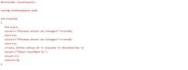

在上方，程序声明了三个整数，并将变量 `z` 赋值为 `x` 和 `y` 的除法。当程序为 `x` 和 `y` 赋值后，会显示对应的变量 `z`。虽然上面的代码可以运行，但由于 `z` 等于 `x` 除以 `y`，将会出现一个缺陷。在上面的例子中，如果用户给 `x` 赋值 `4` 并给 `y` 赋值 `2`，这没有问题，因为 `4` 可以被 `2` 整除。然而，如果值是 `6` 和 `4` 会发生什么？让程序代码保持现状会提示你一个答案，主要因为据我所知，`x` 和 `y` 只包含不带小数的整数。在用户赋值 `6` 和 `4` 的上述示例中，显而易见它们不能整除，除法将产生小数。那么，我们如何修复这个问题呢？答案相对简单；与其声明一个不能存储小数值的整数 `z`，我们可以将 `z` 声明为 `double`。我倾向于说 `double` 数据类型优于整数，因为 `double` 数据类型能够存储小数。我们的程序看起来会是这样：


虽然程序代码看起来好多了，但它也有一些不完全正确的地方，如果你运行程序，仍然无法得到正确答案。你能猜出为什么吗？这是因为所谓的“截断”（truncation）。这听起来很复杂，但实际上并非如此。在上面的程序代码中，`x` 和 `y` 是整数，如所见，如果两个整数的结果是小数，无法得到正确答案。

简单来说，这就是截断的含义。要修复这个问题，其中一个变量必须是 `double` 类型。这样做会提示编译器识别这一点并将另一个整数临时转换为 `double`。或者，你也可以简单地将每个变量声明为 `double`；这取决于你的主意。这里是完整程序的样子。

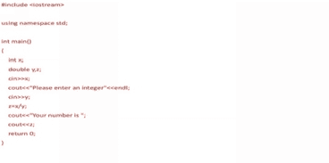

通过我们在 C++ 学习过程中目前看到的所有内容，成为一名精通高手是关键。常量类型

首先，整数以二进制形式存储，你将整数编码为 `8`。例如，下表将为你展示不同的整数、它们在编程中的值以及它们的数据类型

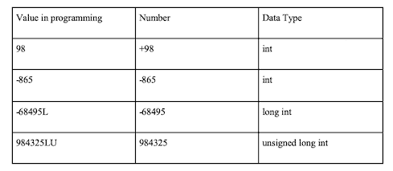每当你发现一个包含在单引号之间的整数时，它就是一个常量。此外，你可能会在这些引号之间发现反斜杠 `\`。对于大多数机器，这个字符被用于，例如：

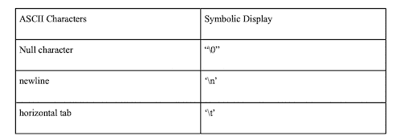

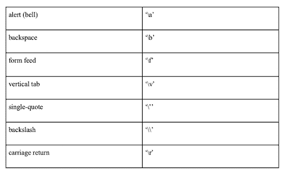

浮点常量

浮点常量在内存中以两部分存储，带有小数部分。它们在内存中获得的第一部分是有效位，第二部分是指数。常量的默认类型是 `double`。你必须编写代码来指定所需的数据类型，例如 `float` 或 `long double`。我们可能记得 `f` 代表 `float`，`l` 代表 `long`。在下面的表中，展示了 `float`、`double` 和 `long double` 的一些示例：

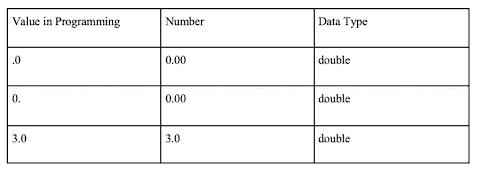


布尔常量

这些常量是预定义的关键字，不能由程序员定义或声明。它有两个预定义常量：`true` 和 `false`。在编程中，我们将这种常量表示为 `bool`。

编程常量

在这一部分，我们将理解不同的编程常量，以及在 C++ 程序中编写和定义常量的方法。通常有三种类型的编程常量。

定义常量

在 C++ 程序中定义常量的方法是使用预处理器语句 `define`。像其他所有预处理器指令一样，它以 `#` 开头。例如，一个用于 `define` 的传统预处理器指令是：

```
#define table_size 150
```

定义指令通常放置在程序的开头，这样任何阅读程序的人都能轻松找到它们。

内存常量

另一种编码常量的方法是使用 `constant`。C++ 常量在内存中以两部分存储，带有小数部分。它们在内存中获得的第一部分是有效位，第二部分是指数。


```cpp
cout << "integer constant: " << a << "\n";
cout << "floating point constant: " << b << "\n";
cout << "character constant: " << b << "\n";
return 0;
```

输出：
在此代码的情况下，控制台将弹出以下输出：
Integer constant: 50
Floating-point constant: 9.7
Character constant: k

字面量 (Literal constants)

字面量是用于指定所需数据的常量值。众所周知，常量是改变的，因此我们必须指定它的数据值。字面量是最常见的常量形式。这里是一个显示不同类型字面量的表格。

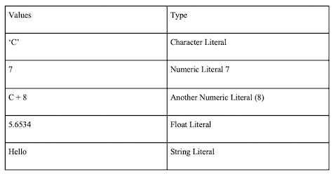

## 第 3 章：函数

你可能记得在某个时候处理 `math` 类时需要处理过函数，例如 `f(x) = 2x + 5`。`f(0)` 将会是 `5`（`f(2(0) = 5`），`f(1)` 将会是 `7`（`f(2(1) + 5`），`f(2)` 将会是 `9`（`f(2(2) + 5`），依此类推。

C++ 中的函数工作原理类似。函数执行操作并返回一个值。它们并不总是必须返回值；然而，不返回值的函数是 `void` 函数。

首先，看看这段代码，它现在看起来很有意义了；我们将过一遍它。创建一个新项目并清空 `main.cpp` 的内容，输入以下内容：

```cpp
#include <iostream>

using namespace std;

int getarea(int bl, int bw);

int main()
{
    int length, width;
    cout << "enter the length, and enter the width.\n";
    cin >> length >> width;
    cout << "the area is: " << getarea(length, width);
    return 0;
}

int getarea(int bl, int bw)
{
    int area = bl * bw;
    return area;
}
```

让我们逐行分析这段代码。

```cpp
#include <iostream>
``` 这引入包含了输入和输出的核心组件。`using namespace std;` 表示我们正在使用标准输入/输出命名空间。`int getarea(int bl, int bw);` 这是我们声明第一个函数的地方。C++ 是过程编译的，所以你不能随随地放置函数。你必须在之后编写它们之前声明它们，或者在编写 `main` 函数之前完全编写它们。为了清晰起见，我倾向于先声明，然后在 `main` 函数之后编写函数，但这是个人选择。无论如何，我们在这里创建一个名为 "getarea" 的函数。名称前的 `int` 表示它将返回一个整数值。同样，`float getarea(...)` 将返回一个浮点数值，`char getcharacter(...)` 将返回一个字符，依此类推。在声明中，我们有两个称为参数的变量，就像 `f(x)` 中的 x 作为参数被修改的那样。

```cpp
int main()
{
    // 这是我们 main 函数的开始，以防你没有概念
    int length, width;
    cout << "enter the length, and enter the width.\n";
    cin >> length >> width;
    cout << "the area is: " << getarea(length, width);
}
``` 这里我们需要进一步的解释，即关于一个值的输出流。此外，由于此函数返回一个值，你可以创建一个新的整数并将函数的返回值赋值给它，如 `int area = getarea(length, width);`。不过，这是一种浪费，因为这个程序不需要创建这个变量。但如果你确实需要存储像 `area` 这样的变量，你可以完全这样做。

```cpp
int getarea(int bl, int bw)
{
    // 这镜像了函数声明，我们在这里开始编写
    int area = bl * bw;
    // 我们创建了一个名为 area 的新变量，它获取函数中的两个参数并相乘得到一个值。我们返回同一个整数。
    return area;
}
```

简单，每个 main 函数都必须返回 0。

这是对函数的简要介绍。它们是结构化程序的重要方式。所有内容都只在一个函数中的程序读起来很枯燥，且维护很有挑战性。分得更开程序要更容易理解和管理。

## 第 4 章：多态

多态意味着以许多形式存在。在编程中，当我们有许多通过继承关系相互关联的类时，就会发生多态。在 C++ 中，多态意味着对函数的调用将根据调用该函数的对象的类型导致不同函数的执行。考虑下面给出的示例，我们有一个基类被另外两个类派生：

```cpp
#include <iostream>
using namespace std;

class figure
{
protected:
    int breadth, length;

public:
    figure(int bx = 0, int by = 0){
        breadth = bx;
        length = by;
    }

    int area()
{
```


```cpp
class figure {
protected:
    int breadth, length;
public:
    figure(int x = 0, int y = 0) {
        breadth = x;
        length = y;
    }
    virtual int area() {
        cout << "area of parent class:" << endl;
        return 0;
    }
};

class rectangle: public figure {
public:
    rectangle(int x = 0, int y = 0) : figure(x, y) {}
    int area() {
        cout << "area of rectangle class:" << endl;
        return breadth * length;
    }
};

class square: public figure {
public:
    square(int x = 0, int y = 0) : figure(x, y) {}
    int area() {
        cout << "area of square class:" << endl;
        return breadth * length;
    }
};

// main function
int main() {
    figure*figure;
    rectangle rec(10, 7);
    square sq(5, 5);

    // store address of rectangle figure
    figure = &rec;
    // call rectangle area.
    figure->area();

    // store address of square figure
    figure = &sq;
    // call square area.
    figure->area();

    return 0;
}
```

代码将返回以下输出：

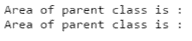

输出是错误的。原因是 `area()` 函数的调用仅由编译器根据基类的版本进行设置。这是因为函数调用的静态解析在程序执行之前就已经固定了。有时，这被称为**早期绑定**（early binding），因为它发生在程序的编译期间。

让我们对代码进行修改，使得 `area()` 函数在 `figure` 类中被声明。然而，我们将像下面所示使用 `virtual` 关键字来声明它：

```cpp
#include <iostream>
using namespace std;

class figure {
protected:
    int breadth, length;
public:
    figure(int x = 0, int y = 0) {
        breadth = x;
        length = y;
    }
    virtual int area() {
        cout << "area of parent class:" << endl;
        return 0;
    }
};

class rectangle: public figure {
public:
    rectangle(int x = 0, int y = 0) : figure(x, y) {}
    int area() {
        cout << "area of rectangle class:" << endl;
        return breadth * length;
    }
};

class square: public figure {
public:
    square(int x = 0, int y = 0) : figure(x, y) {}
    int area() {
        cout << "area of square class:" << endl;
        return breadth * length;
    }
};

int main() {
    figure*figure;
    rectangle rec(10, 7);
    square sq(5, 5);
    figure = &rec;
    figure->area();
    figure = &sq;
    figure->area();
    return 0;
}
```

代码现在应该返回以下结果：

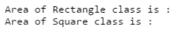

编译器考虑的是指针的元素而不是位。类对象将调用它们各自的 `area()` 函数定义。每个派生类都有名为 `area()` 函数的不同实现。这被称为**多态**（polymorphism）。你拥有多个具有相同函数名和相同参数的类，但实现是不同的。

注意我们使用了 `virtual` 关键字来使函数成为虚函数。当基类中定义了一个虚函数而在派生类中定义另一个版本时，这将向编译器发出信号，表明不需要对函数进行静态链接。我们只需要根据调用函数的对象类型来选择调用的函数。这种操作被称为**晚绑定**（late binding）或**动态链接**（dynamic linkage）。

有时，你可能需要在基类中包含虚函数以便在派生类中对其重新定义以适应类对象，但你没有为基类中的函数提供有意义的定义。在这种情况下，你有如下代码：

```cpp
class figure {
protected:
    int breadth, length;
public:
    figure(int x = 0, int y = 0) {
        breadth = x;
        length = y;
    }
    virtual int area();
};
```

注意在基类中使用 `virtual` 函数是函数体……等等，你还有一个虚析构函数。多态对象的析构是复杂的，特别是当它通过接口进行时。你可以拥有这样的代码：

```cpp
class drawable {
public:
    virtual void draw();
};

class paintable : drawable {
public:
    void draw();
    paintable();
    ~paintable();
};

void deletedraw(drawable* drawable) {
    delete drawable;
}

int main() {
    deletedraw(new drawable());
}
```

在 `deletedraw` 内部发生了什么？记住，当使用 `delete` 时，析构函数会被调用，因此 `delete drawable;` 这一行执行了函数调用。但编译器如何知道 `paintable` 析构函数在哪里？编译器不知道 `drawable` 变量的精确类型，但它知道是一个 `drawable`，一个拥有 `draw()` 方法的东西。


好的，你可能会认为这是一个为了解决该问题而设计的虚函数区域，你说得对。我们应该在 `drawable` 中声明虚析构函数；这样当对指向 `drawable` 类实例 `mydrawable` 的指针调用 `delete` 时，编译器将知道去寻找一个被重写的析构函数。

```cpp
class drawable
{
Public:
    virtual void draw();
    virtual ~drawable();
};

class mydrawable: public drawable
{
Public:
    virtual void draw();
    Mydrawable();
    virtual ~mydrawable();
Private:
    int *mydata;
};
```

当我们把基类中的结构设为虚函数时，并且当删除一个 `drawable` 接口时，重写的析构函数就会被调用。按照惯，当你将任何基类方法设为虚时，基类的析构函数也应该设为虚函数。一旦方法被设为虚函数，就意味着该类可以传递执行随心所欲方法的，这包括删除对象，虚函数可以确保对象被妥善清理。

## 第 5 章：运算符类型与重载

C++ 中的运算符

C++ 提供了一套丰富的运算符，用于对不同的函数、常量和变量执行操作。C++ 主要有以下几种类型的运算符：

- 算术运算符，如加法、乘法等。
- 关系运算符，如小于、大于等。
- 逻辑运算符，如与、或等。
- 位运算符运算符
- 赋值运算符
- 算术运算符

C++ 主要提供了算术运算符。我们将使用两个变量 `x` 和 `y` 来讨论每个运算符，其中 `x` 的值为 45，`y` 的值为 25。

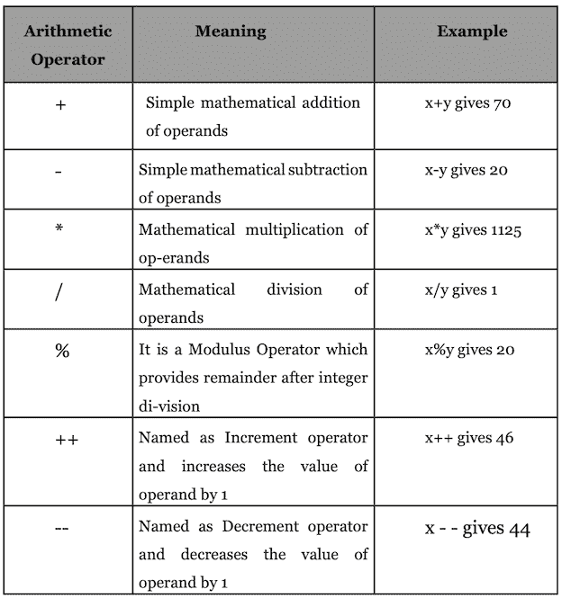

关系运算符

C++ 主要提供了关系运算符。这些运算符提供真或假作为结果值，通常用于条件检查。我们将使用两个变量 `x` 和 `y` 来理解每个运算符的含义，其中 `x` 的值为 45，`y` 的值为 25。

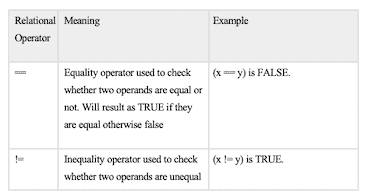

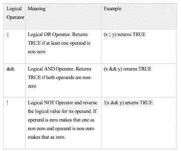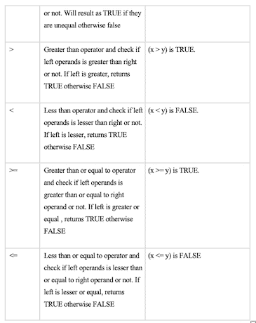

逻辑运算符

C++ 支持以下 3 个逻辑运算符，我们将使用两个变量 `x` 和 `y` 来解释它们，其中 `x` 的值为 0，`y` 的值为 1。

A

位运算符

位运算符按位执行其功能。位与运算符对两个操作数的每一对对应位执行操作，而位或运算符对两个操作数的每一对对应位执行操作。

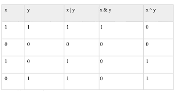

假设 `x=13;` 且 `y=60;`

`Xa = 00001101`
`Ya = 00111100`
`X|ya = 00111101`
`X&ya = 00001100`

显示 `p= 60` 和 `q= 13` 时位运算符的表格。

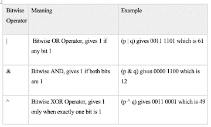

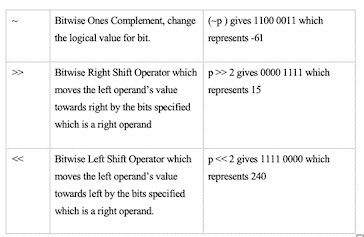

赋值运算符

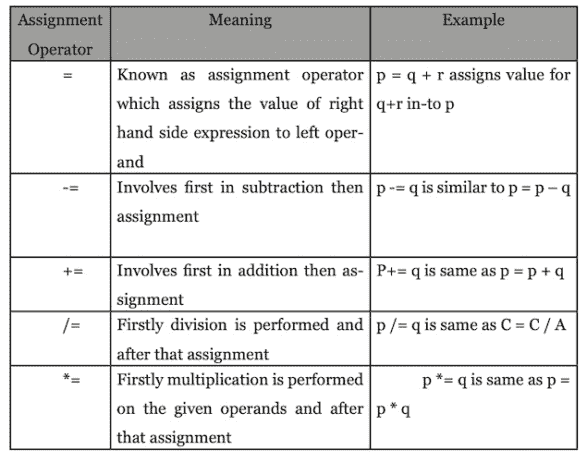

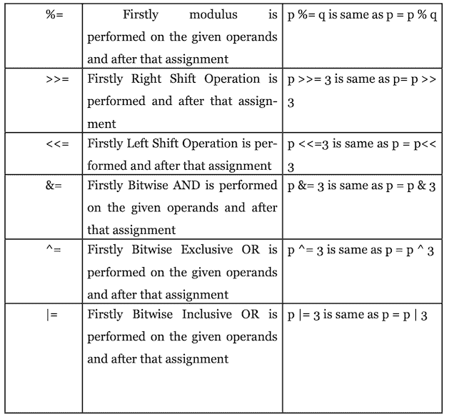

运算符优先级与结合性

每个运算符都有与其相关的优先级和结合性。运算符优先级用于在表达式包含多个运算符时确定评估运算符的顺序。在表达式中，优先级更高的区域先评估。结合性是在多个运算符具有相同优先级时使用的概念，它决定了从左向右评估。

 重载

在 C++ 中，我们通过运算符重载指定的比函数更多的内容。运算符重载是与之前的声明相同作用域内的声明。声明后，编译器将通过带参数的运算符重载确定最合适的函数。

C++ 中的运算符重载允许对内置类型重载运算符。运算符重载意味着程序员可以使用自定义类型使用运算符。运算符重载是一种像函数的简单重载，但它将有返回值和参数。

```cpp
Rectangle operator+(const rectangle&);
```

在下面的示例中，我们通过使用成员函数来演示运算符重载的过程。

```cpp
#include <iostream>
using namespace std;

class rectangle
{
public:
    double getarea() {
        return length * breadth;
    }
    void setlength(double len) {
        length = len;
    }
    void setbreadth(double bre) {
        breadth = bre;
    }
private:
    double length;
    double breadth;
};
```


```cpp
private:
    double a, b;
    double length, b;
    double offset a, b;
    double breadth a, b;
};

// main 函数

int main() {
    Rectangle rectangle1;
    // 声明类型为 Rectangle 的 rectangle1
    Rectangle rectangle2;
    // 声明类型为 Rectangle 的 rectangle2
    Rectangle rectangle3;
    // 声明类型为 Rectangle 的 rectangle3
    double area = 0.0;
    // 在此处存储矩形的面积

    // rectangle1 规格
    rectangle1.setlength(6.0);
    rectangle1.setbreadth(7.0);

    // rectangle2 规格
    rectangle2.setlength(12.0);
    rectangle2.setbreadth(13.0);

    // rectangle1 的面积
    Area a = rectangle1.getarea();
    cout << "area of rectangle1: " << a << endl;

    // rectangle2 的面积
    Area a = rectangle2.getarea();
    cout << "area of rectangle2: " << a << endl;

    // 两个对象相加：rectangle3 = rectangle1 + rectangle2
    // rectangle3 的面积
    Area a = rectangle3.getarea();
    cout << "area of rectangle3: " << a << endl;

    return 0;
}
```

执行时，代码将返回以下内容：

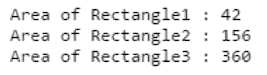

考虑从上述代码中提取的章节：

```cpp
Rectangle operator+(const Rectangle& br) {
    Rectangle rect;
    rect.length = this->length + br.length;
    rect.breadth = this->breadth + br.breadth;
    return rect;
}
```

这就是实现 `operator+` 重载机制的地方。我们重载了 `+` 运算符，使其能够相两个矩形对象的测量值。这里是从上述代码中提取的另一行：

```cpp
Rectangle rectangle3 = rectangle1 + rectangle2;
```

在上述行中，`rectangle1` 将被加到 `rectangle2` 上。这意味着 `rectangle1` 的 `length` 将加到 `rectangle2` 的 `length` 上以得到 `rectangle3` 的 `length`，同时 `rectangle1` 的 `breadth` 将加到 `rectangle2` 的 `breadth` 上以得到 `rectangle3` 的 `breadth`。然后两者相乘得到 `rectangle3` 的面积。

`+` 运算符的含义已经被重载了！

## 第 6 章：宏与模板

### 模板简介

模板是 C++ 编程语言中的一项重要特性，因为它允许函数和类使用泛型类型。通过允许模板定义不同的数据类型而无需相互重写，它们在函数和类的工作中起着至关重要的作用。

使用模板，你可以编写适用于任何数据类型的通用代码。你只需要将数据类型作为参数传递。模板提高了代码的可用性并增加了程序的灵活性。你可以创建一个简单的类或函数，并将数据类型作为参数传递，以实现任何数据类型所需的代码；每当你需要使用该函数时，调用函数并指定返回类型。

例如，如果你使用 `sort()` 函数来对仓库中的数据进行排序，可以将不同的数据类型作为参数传递给函数。你不需要根据传递给排序算法的数据类型来编写和维护多个文件代码，你仓库中的数据将根据特定的数据类型分别进行排序。因此，模板用于需要代码在多个数据类型之间可重用的情况。

在处理多重继承和运算符重载时，模板具有非常重要的意义，如下所示。模板的类型

模板通过两种方式实现：

- 使用函数模板
- 使用类模板

模板是一种宏，当你为类定义模板时，它在执行期间会将类型替换为适当的类。类模板用于创建一个其成员为参数的类。语法：

```cpp
template <class T>
class {
// 成员
};
```

示例：

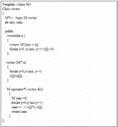

类的模板定义是一个普通类，但它是一个用于将数据类型作为参数传递给模板定义的模板。类模板定义遵循格式：

`classname<int> objectname(arglist)`


上面的程序创建了一个类型为 `tt` 的类。`tt(void rectangle<tt::setvalues(tt num1, tt num2))` 语句指定函数参数也是模板参数，并且在调用类时应始终包含。

### 带有多个参数的类模板

你可以在类中拥有多个泛型数据类型。你可以在模板规范内部使用逗号分隔的列表来声明泛型类。

#### 语法
```cpp
Template<class xy, class xyz, ...>
Class class-name
{
//function body;
};
```

#### 示例：带有两个泛型的类
```cpp
Template<class f1, class f2>
Class numbers
{
    f1 j;
    f2 k;
public:
    Numbers(f1 x, f2 y)
    {
        j = x;
        k = y;
    }
    void print()
    {
        cout << j << k << "\n";
    }
};

int main()
{
    Numbers<float, int> numbers1(2.5, 23);
    Numbers<int, char> numbers2(5, 'z');
    numbers1.print();
    numbers2.print();
    return 0;
}
```
**输出:**
2.523
5z

函数的用法与普通函数相似，但通过模板适应多种数据类型。这使得函数变得更有用，因为你只需要编写一个程序。模板在编译时展开。类类模板，你可以创建一个带有不同参数的函数模板。

#### 语法
```cpp
Template<class type>
Return-type name(arguments)
{
    Function body;
};
```

在定义模板时，必要时必须在函数体和参数列表中包含模板类型。

#### 示例 1：交换值的函数
```cpp
Template<class t1>
void swap(t1 &num1, t1 &num2)
{
    t1 val = num1;
    num1 = num2;
    num2 = val;
};
```
调用模板函数的方式与普通调用方式相同。

#### 示例 2：函数模板的实现
```cpp
Template<class test>
Test max(test x, test y)
{
    Test results;
    results = x > y ? x : y;
    return results;
};

int main()
{
    int a = 5, b = 6;
    double l = 4, m = 6;
    c = max<int>(a, b);
    n = max<double>(l, m);
    cout << c << endl;
    cout << n << endl;
    return 0;
}
```
在这个示例中，`test` 是模板参数。函数 `max` 使用不同的参数类型（`int` 和 `double`）调用了两次。当编译器实例化时，它会根据类型每次调用函数。使用特定类型实例化模板后产生的对象将与参数 `x` 和 `y` 的类型相同。

上面的程序根据值的大小对值进行排序。如果使用 `numbers` 数组，则将应用排序算法对数字从小到大排序。

### 带有多个参数的函数模板

就像类模板一样，你可以拥有多个由逗号分隔的泛型数据类型。

#### 示例：带有多个参数的模板类
```cpp
Template<class temp1, class temp2>
void display(temp1 j, temp2 k)
{
    cout << j << " " << k << "\n";
}

int main()
{
    J = display(2019, "edge");
    K = display(18.5, 1854);
    return 0;
}
```
**输出:**
2019 edge
18.5 1854

#### 重载模板
你可以使用相同的名称配合不同的模板参数来重载模板。如果没有找到匹配项，系统将生成错误消息。

#### 示例：重载模板
```cpp
Template<class m>
void display(m)
{
    cout << "template: " << m << "\n";
}

void display(int n)
{
    cout << "template: " << n << "\n";
}

int main()
{
    display(0);
    display(15.20);
    return 0;
}
```
**输出:**
template: 0
template: 15.20

在创建类模板时，由于成员函数使用类型参数参数化，类外部的成员函数，因此模板应该定义成员函数。成员函数模板有三种定义方式：
1. 在文件作用域内显式定义，用于实例化模板的返回类型。
2. 在文件作用域内带有模板参数。
3. 在类内部。

成员函数模板实例化了一个未显式生成的函数。如果类同时拥有成员函数和显式函数，则显式定义具有优先级。

#### 语法

示例：带有成员函数模板的 vector 类


### 非类型模板参数
模板可以有单个或多个类型参数。除了类型参数外，你还可以使用非类型参数模板。你可以使用字符串、常量、内置类型和函数名创建模板参数。


上面的模板将数组的大小作为参数传递。编译器只在运行时才知道数组的大小。参数区域是在创建模板类时指定的。


虽然模板类最终局限于想要编写如 `map` 和 `vector` 之类的类的库编写者，但每天的程序员也能从能够让代码更具通用性中获益。因此，你不应该仅仅因为可以使用模板就使用模板；相反，你应该寻找机会来消除那些仅在类型上不同的类。

是的，根据你所在的领域，你可能会发现自己编写的模板方法比类多，但你仍然需要对如何使用它们有一个基本的概念，特别是当你有想要实现的自定义数据结构时。

声明模板类与模板函数没有太大区别。假设我们想构建一个小型类来封装一个数组：

```cpp
template <typename T>
class arraywrapper
{
private:
    T *pmem;
};
```

与模板函数一样，我们从引入模板的声明开始。我们使用 `template` 关键字，然后添加模板参数区域。在这里我们只有一个参数，`T`。

当我们我们需要由用户指定的类型时，可以使用类型 `T`，就像在模板函数中一样。当为模板类定义函数时，也会使用模板语法。所以，让我们为我们的类 `arraywrapper` 添加一个构造函数：

```cpp
template <typename T>
class arraywrapper
{
public:
    arraywrapper(int size);

private:
    T *pmem;
};

// 为了让构造函数可以在类外定义，我们首先
// 指明该函数是一个模板
template <typename T>
arraywrapper<T>::arraywrapper(int size)
: pmem(new T[size])
{
}
```

我们从基础的模板引入开始并为模板声明参数。区别在于，类名现在包含了 `arraywrapper<T>` 模板，这告诉所有人它属于一个模板类，而不是一个名为 `arraywrapper` 的标准类的模板函数。

在这一实现中，模板参数可以代表提供的类型，就像模板函数一样。然而，函数将需要从第一个类型声明中推断大小，例如通过编写 `vec<int>size();`。

要获取整数向量（vector）的尺寸，你需要编写 `vec.size()`。

头文件中的模板——现在我们不再必须将所有内容直接写在 `.cpp` 文件中。如果我们想把模板声明放在头文件中呢？这里的问题是，使用类或模板函数的代码在每一个针对模板类的函数调用中，都需要访问整个模板定义。这与标准函数的工作方式不同；通常，如果你将类放在头文件中，你还需要添加完整的定义以及同的 `add()` 方法，并通常将它们都放在一个 `.cpp` 文件中。如果你不这样做，你将无法使用 `calc`。

这是模板的一个相当遗憾的特性，这与模板如何编译有关。大多数时候，当编译器第一次解析时，它几乎忽略了模板。只有当模板结合一个具体的类型被使用时，编译器才会为该类型生成代码。为了做到这一点，模板必须对编译器可用，以便生成代码。结果是，模板代码被包含在所有将使用该模板的文件中。而且，当编译包含模板的文件时，在模板第一次被使用之前，你可能无法获知该模板中的任何语法错误。

创建模板类时，最简单的方法是将模板定义放在头文件中。使用除 `.h` 以外的扩展名也有帮助，仅仅是为了指示该文件是模板——例如。

## 错误信息

如果说使用模板有一个显著的缺点，那就是当使用模板时（无论你是否编写它），许多编译器都会抛出不易理解的错误。你可能因为一个错误就得到好几页的错误。模板错误信息之所以难以理解，是因为模板参数被扩展到了极致，即使是那些你通常不使用的参数也是。

`vector` 模板的第二个参数也有类似的限制——这需要一个比平微的 `int` 具有更多功能的类型。错误信息在抱怨 `int` 作为参数并不是有效类型的所有无数种方式。


找到错误所在的行是弄清楚问题所在的第一步。通常情况下，凭借经验和信心的提升，一眼你的代码就能告诉你错误在哪里。但事实并非显而易见，你只需要不断检查实例化列表，直到出现正确的错误信息：“error: int is no class struct union.” 编译器期望一个如 `int` 这样的内置类型的结构体、类或联合体。`vector` 应该持有任何类型，因此错误出在传递给 `vector` 的参数上。

你应该确保自己知道 `vector` 是如何声明的，并且它只需要一个模板参数。

现在问题已经找到了，我们可以修复它并重新编译代码。有时你能够同时修复多个错误，但涉及模板时，第一个错误通常是问题的根源。一个一个解决，你会发现其他错误也会随之消失。

在我们上面的最后一个示例中，那些错误信息源于一个非常简单的错误：给出了 `int` 作为第二个模板参数。

## 第 7 章：类

### 类类类

面向对象编程的核心是“类”的概念，即你在整个代码中创建和使用的对象。这有助于模块化、用用基础、提高效率，并实现更具逻辑性和连贯性的高层编程。

在 C 的早期迭代中，存在一种名为 `struct` 的原始类。`struct` 在 C++ 中仍然存在，但主要已被弃用，转而使用类。尽管如此，涵盖 `struct` 仍然很重要。C++ 的 `struct` 也与 C 的 `struct` 不同。C 的 `struct` 不具备 C++ `struct` 拥的功能。

在我们深入探讨之前，让我们简要讨论一下访问修符的概念。

我们讨论过像 `int`、`string`、`bool` 和 `float` 称为类型。我们使用数值创建了某种类型的类型。然而，你可以由较小的数据片段和函数创建一个新类型。这被称为对象。

访问修符描述了你的代码中哪些是可以修改的。有三种不同的访问修符。

Public（公有）访问意味着对象及其内部数据、函数可以被程序中的其他代码访问和修改。

Protected（保护保护）意味着对象及其内部数据、函数只能被派生类访问和修改（当我们学习继承和多态时，这一点会有意义）。

Private（私有）意味着只有对象本身可以访问和修改位。这对于安全、清晰性和代码安全至关重要。类之间的主要区别在于成员默认是私有的。然而，在 `struct` 中，这种差异微忽略不计。

在我们的库中，类默认有一个成员。为了看到这一点，请看功能受限的类，我们需要看我们的一个 `struct`。

```cpp
struct Animal {
public:
    string name;
    bool carnivore;
    int diet;
};

int main() {
    Animal dog;
    dog.name = "dog";
    dog.carnivore = 4; // 注意：这是创建新对象的最简单方法
}
```

创建新对象的最简单方法是拥有一个数据的类。然而，在库中，这是一个负面脑震。（等等，上面的代码有点乱，让我们重新结构：下面的代码仅供参考）。

```cpp
struct Animal {
public:
    string name;
    bool carnivore;
    int diet;
};

int main() {
    Animal dog;
    dog.name = "dog";
    dog.carnivore = 4;
}
```

创建新对象的最简单方法是拥有带有数据函数的类。然而，在库中，这是一个负面脑震。（等等，上面的代码有点乱，让我们重新结构：下面的代码仅供参考）。

```cpp
struct Animal {
public:
    string name;
    bool carnivore;
    int diet;
};

int main() {
    Animal dog;
    dog.name = "dog";
    dog.carnivore = 4;
}
```

创建新对象的最简单方法是拥有带有数据函数的类。然而，在库中，这是一个负面脑震。（等等，上面的代码有点乱，让我们重新结构：下面的代码仅供参考）。

```cpp
struct Animal {
public:
    string name;
    bool carnivore;
    int diet;
};

int main() {
    Animal dog;
    dog.name = "dog";
    dog.carnivore = 4;
}
```

创建新对象的最简单方法是拥有带有数据函数的类。然而，在库中，这是一个负面脑震。（等等，上面的代码有点乱，让我们重新结构：下面的代码仅供参考）。

```cpp
struct Animal {
public:
    string name;
    bool carnivore;
    int diet;
};

int main() {
    Animal dog;
    dog.name = "dog";
    dog.carnivore = 4;
}
```

创建新对象的最简单方法是拥有带有数据函数的类。然而，在库中，这是一个负面脑震。（等等，上面的代码有点乱，让我们重新结构：下面的代码仅供参考）。

```cpp
struct Animal {
public:
    string name;
    bool carnivore;
    int diet;
};

int main() {
    Animal dog;
    dog.name = "dog";
    dog.carnivore = 4;
}
```

创建新对象的最简单方法是拥有带有数据函数的类。然而，在库中，这是一个负面脑震。（等等，上面的代码有点乱，让我们重新结构：下面的代码仅供参考）。

```cpp
struct Animal {
public:
    string name;
    bool carnivore;
    int diet;
};

int main() {
    Animal dog;
    dog.name = "dog";
    dog.carnivore = 4;
}
```

创建新对象的最简单方法是拥有带有数据函数的类。然而，在库中，这是一个负面脑震。（等等，上面的代码有点乱，让我们重新结构：下面的代码仅供参考）。

```cpp
struct Animal {
public::
    string name;
    bool carnivore;
    int diet;
};

int main() {
    Animal dog;
    dog.name = "dog";
    dog.carnivore = 4;
}
```


```cpp
return this->name;
}

void setname(string name) {
    this->name = name;
}
```

现在，在你的 `main` 方法中，在声明任何动物对象后，不要直接修改它的 `name` 属性，而应该使用像下面的 get/set 方法（假设你的实例动物名为 "dog"）：

```cpp
Dog.setname("dog");
```

然后，你可以通过在主方法中打印名称来测试这一点：

```cpp
cout << "the name of my favorite animal is: " << dog.getName() << "\n";
```

这些方法的工作原理是通过类内部的方法返回该值。`this->` 是 `this` 指针，它指向类特定实例的变量。每个对象都可以访问其变量，并可以通过 `this` 指针直接修改它们。

无论如何，你的代码运行起来会非常出色。但如果你不想为每个类的每个实例都通过 get/set 来操作呢？那么，你可以使用所谓的“初始化函数”（initializer function）。

修改你的类使其看起来像这样：

```cpp
class Animal {
private:
    String name;

public:
    Animal(string name) {
        this->name = name;
    }

    String getName() {
        return this->name;
    }

    void setname(string name) {
        this->name = name;
    }
};
```

现在在你的 `main` 函数中，当你创建一个初始化函数时，可以去掉声明 `animal x` 后面跟着 `x.setname("name")` 函数的代码块，你可以从一开始就设置某些变量。

例如，由于你的初始化函数接收参数 `name`，你可以在声明变量时直接绕过整个 `setname` 操作。看这个示例代码：

```cpp
Animal dog("dog");
Animal elephant("elephant");
Animal bird("bird");
```

这些都是 `Animal` 类的独立实例，得益于函数初始化器，它们的名称在没有使用 set 函数的情况下就已经设置好了。它可以接受任何你需要的数量的参数。这使得创建新对象变得极其容易，整个过程也变得精简。

现在我们已经简要讨论了对象的声明以及本质属性，让我们更多地谈谈可以使用它们进行的具体操作。这里的对象代表一类动物。我们可以为整个类设置它们可以执行的方法。

让我们思考一下每种动物都会做什么。每种动物都会睡觉、进和喝水，对吧？所以，将这些包含在你的类中并并不奇怪，这样 `Animal` 类的每个成员对象都可以执行这些方法。

假设我们有两种特定的食物：肉类和植物，它们也都由各自的对象来表示。我们可以为此创建两个不同的函数：

```cpp
void eat(plant p) {
    // code here
}

void eat(meat m) {
    // code here
}
```

尽管它们共享相同的名称，但你可以根据在函数调用中包含的对象类型来调用其中任何一个，并且它们都会根据你包含的参数执行各自相应的代码。这被称为**函数重载**（function overloading）。它是面向对象编程中的一项基本技术，可以帮助你创建功能强大且易于他人使用的清晰代码集。

在我们学习类时，我们正在深入学习使得类在面向对象编程中变得极其有用且实用的内容。由于使用了类，你的代码最初看起来应该是这样的：

```cpp
class Animal {
private:
    String name;

public:
    Animal(string name) {
        name = name;
    }

    String getName() {
        return name;
    }

    void setname(string name) {
        name = name;
    }

    void eat() {}
};
```

在下一章中，我们将介绍类。类是一种用户定义的类型，具有数据成员和成员函数。通常来说，类是一个表示类实例的蓝图。类定义中的数据成员是变量。

### 关于类的重要点

类名习惯上以大写字母开头。

```cpp
class Human
```

函数重载允许类拥有多个同名的函数，但它取决于访问修饰符，如 private（私有）、public（公共）或 protected（保护）。


我们可以定义一个带有成员函数的类，且类的定义可以在类内部也可以在类外部进行。

C++ 中的类与结构体相似，但唯一的区别在于，默认情况下，类的访问控制权限是私有的（private），而结构体的访问权限是公开的（public）。

C++ 通过类提供了面向对象编程的所有重要特性，如封装、抽象和继承等。

类的每个对象都拥有其独立的数据成员拷贝，我们可以根据需要为类创建任意数量的对象。

## 对象

类仅仅是一个蓝图，定义一个类时并不会分配任何内存。只有在为该类创建对象后，才会分配内存。对象区域包含了在类类中声明的数据变量的实例，该类的成员函数会在这些实例上运行。

对象区域通过特殊的构造函数进行初始化——这是一种稍后我们会学习的特殊方法。析构是另一个特殊函数，在对象超出作用域时销毁该对象。

```cpp
Class Mobiles{

  Int price;

  Void calling()(){}

  Void messaging()(){}

};

Void main(){

  Mobiles m1; // 为类 Mobiles 创建的对象
}
```

### 构造函数

构造函数是类似于类成员函数的特殊函数，承担着对象初始化的重要任务。当对象被创建时，编译器会调用构造函数。构造函数在为特定对象提供存储空间后，通过初始化其成员来初始化创建的对象。每个类至少有一个构造函数，如果类中没有显式定义构造函数，就会产生一个没有参数的默认构造函数。

```cpp
Class test
{

  Char c;

Public:

  Test(); // 构造函数
};

Class test
{

  Int a;

Public:

  Test(); // 构造函数的声明

  Test::test() // 定义构造函数

  {

    A=1;
  }
};
```

### 析构函数

析构函数是一种特殊的类函数，负责在对象超出作用域时销毁对象。当对象超出作用域时，编译器会自动调用构造函数。

析构函数的语法与构造函数相同，唯一的区别是使用波浪符号 `~` 用于析构函数的声明。此外，析构函数没有参数。

```cpp
Class test
{

Public:

  ~test(); // 类 test 的析构函数
};
```

### 调用构造函数和析构函数的示例

```cpp
Class test{

  Test()
  {

    cout << "aa constructor has been called";
  }

  ~test()
  {

    cout << "aa destructor has been called";
  }
};

Int main()

{

  Test test1; // 调用了构造函数

  Int a=18;

  If(a)

  {

    Test test2; // 再次调用构造函数

  } // obj2 超出作用域并调用该 obj2 的析构函数

} // 为对象 obj1 调用析构函数
```


}

}

```cpp
//a  bothera  bcodea  bneededa  bfora  bboarda  binitialization
}
```

我不会一直向你展示所有的 `method` `declarations`，但我会继续向你展示 `class` `declaration`，这样你就能看到它们是如何整合在一起的。

现在注意，上面的构造函数位于类的 `public` 部分。如果我们不将 `chessboard` 构造函数设置为 `public`，我们就无法创建任何 `object` 实例。这是为什么呢？因为每当一个 `object` 被创建时，都必须调用 `constructor`；如果我们将其设置为 `private`，那么它就无法从类外部被调用。对象只能通过调用 `constructor` 来进行初始化，如果你将其设置为 `private`，你将无法声明该对象。

构造函数在创建对象的同一行代码中被调用：

```cpp
Chessboard board; // 调用 chessboard 构造函数
```

或者在分配内存时调用：

```cpp
Chessboard *board = new chessboard; // 这作为内存分配的一部分调用了 chessboard 构造函数
```

当声明多个对象时：

```cpp
Chessboard a;
Chessboard b;
```

构造函数区域始终按照 `object` 声明的顺序执行——依此类推。对于普通函数，构造函数可以接受一个或多个参数，并且如果初始化对象的方式不同，可以通过参数类型来重载多个构造函数。例如，可以为 `chessboard` 创建第二个构造函数，以接收 `board_size` 类参数：

```cpp
class chessboard {
    Chessboard();
    chessboard(int board_size);
};
```

函数定义与任何类方法都相同：

```cpp
Chessboard::chessboard(int bsize)
{
    //a… code
}
```

参数如下所示传递给构造函数：

```cpp
Chessboard board(8); // 8 是 chessboard 构造函数的一个参数
```

当你使用 `new` 关键字时，传递参数看起来就像直接调用了构造函数：

```cpp
Chessboard *p_board = new chessboard(8);
```

关于语法的一点说明：虽然使用圆括号来传递参数，但你不能用它们来声明没有无参构造函数的对象。

你不能这样做：

```cpp
Chessboard board();
```

正确的形式是：

```cpp
Chessboard board;
```

然而，当使用 `new` 关键字时，可以使用圆括号：

```cpp
Chessboard *board = new board();
```

这是 C++ 解析的小缺陷之一，因为这些细节被保持得非常晦涩。只需在声明带有无参构造函数的对象时不要使用圆括号即可。

那么，如果没有声明构造函数会发生什么？如果没有声明构造函数，C++ 会自动创建一个。它不会接受参数，也不会初始化 `ints`、`chars` 或任何原始类型，但它会通过调用每个类的默认 `constructor` 来初始化每个类 `field`。

通常情况下，你应该创建一个构造函数以确保所有内容都得到适当初始化。一旦声明了 `constructor` 的调用，C++ 就不会为你生成默认构造函数。编译器假设你完全清楚自己在做什么，并且你将为对象创建一个 `constructor`，这就是为什么你为对象需要一个 `constructor`，特别是当你创建了一个代码无法自动生成默认 `constructor` 的 `field` 时。

如果在类中声明了一个 `field`：

```cpp
class holder {
public:
    holder(int val);
private:
    int val;
};

holder::holder(int val) : val(val)
{
    // 字段通过初始化列表初始化的
}
```


当你在使用 STL 遇到编译器错误时，这些区域极其难以阅读和理解。

你不会在库中找到所有的数据结构。

彻底讨论 STL 需要一整本书，因此我将只向你介绍你在 STL 中会使用的最常用数据结构的概述。

### Vectors

STL 中包含了数组的替代品——`vector`。它非常像数组，但可以自动调整大小；你不再需要担心分配内存和移动其他元素。然而，`vector` 的语法与标准数组不同。

数组的语法是：

```cpp
int ban_array[10];
```

而 vector 的语法是：

```cpp
#include <vector>

using namespace std;

Vector<int> ba_vector(10);
```

必须包含 `vector` 头文件以及 `std` 命名空间。这是因为与 `cout` 和 `cin` 一样，`vector` 是标准库的一部分。

此外，当声明一个 `vector` 时，你必须提供存储在 `vector` 中的数据类型。这是通过使用角括号 `<>` 完成的：

```cpp
Vector<int>
```

这利用了一种名为模板（templates）的 C++ 特性。`vector` 代码的编写方式允许存储任何数据类型。你只需要告诉编译器 vector 存储的是什么类型。这实际上意味着我们这里有两个类型：数据结构类型（它决定了数据的组织方式）以及数据结构中包含的数据类型。使用模板允许你将不同的数据结构类型与数据结构内部不同的数据类型相结合。

最后，当提供 `vector` 大小时，必须放在圆括号中而不是方括号：

```cpp
Vector<int> ba_vector(10);
```

这是某些变量类型初始化的语法。为此，值 10 被传递给初始化（称为构造函数），从而设置了向量的大小为十。在指南过程中，你将学习到构造函数以及带有构造函数的对象。

一旦创建了 `vector`，就可以像数组一样访问单个元素：

```cpp
For (int bi = 0; bi < 10; bi++)
{
    A_vector[bi] = 0;
    An_array[bi] = 0;
}
```

### 在 vector 上调用方法

`vector` 为你提供的功能比数组多得多。你还可以进行一些操作，例如在 vector 的末尾添加元素。`vector` 提供了一个函数来帮助处理此类操作，但函数的语法与之前使用的语法不同。

`vector` 使用了一种名为方法（method）的 C++ 特性。这是用数据类型声明的函数。调用方法需要新的语法，例如所示：

```cpp
A_vector.size();
```

这是在 `ba_vector` 上调用方法，并返回大小。这有点像访问字段，但通过调用结构上的方法来实现。虽然对 `vector` 执行了某些操作，但 `vector` 不需要向方法传递参数。`vector` 用于向方法传递参数的语法是

```cpp
<type>.<function(variable, args);
```

换句话说，类似于编写：

```cpp
<function>(variable, args);
```

在示例中，`ba_vector.size()` 就像：

```cpp
Size(ba_vector);
```

### 其他特性

vector 还可以非常轻松地管理包含的项目数量，而不需要分配内存，例如，向 vector 添加额外项目的写法如下：实现电子邮件地址簿（通过名称查找地址）或在程序中通过账户 查找账户以允许用户进入游戏时，在编程中常见的实现：

```cpp
A_vector.push_back(10);
```

这向 vector 中添加了另一个值为 10 的项目。如果你想对数组这样做，vector 将需要调整大小，而内存情况是不一样的。括号主要只适用于已经分配的数据。

所以，像这样的代码：

```cpp
Vector<int> ba_vector(10);
A_vector[10] = 10; // 最后一个有效元素是 9
```

将无法运行，并可能导致程序崩溃。更不用说它是危险的。这样写：

```cpp
Vector<int> ba_vector(10);
A_vector.push_back(10); // 向 vector 添加新元素
```

是可以调整 vector 大小的的。

### Maps

我们稍前提到了 maps，即使用一个值来查找另一个值。这在编程中很常见，例如当你想实现一个可以通过名称查找地址的电子邮件簿，或者在程序中通过账户 查找账户以允许用户进入游戏时。


`map` 容器存储键值对。每个元素都有一个键和一个值，并用键来查找值。如果我们想为通讯录创建一个 map，可以如下所示实现：

```cpp
#include <map>
#include <string>

using namespace std;

Map<string, string> name_to_email;
```

我们必须告诉该结构体两种类型：`string` 作为键，另一个 `string` 作为值（在本例中，值就是地址）。

`map` 的有用特性之一是，在使用 `map` 时，语法也可以像数组一样使用。如果你想添加一个值，这和数组非常相似，只是使用的是键类型而不是整数：

```cpp
name_to_email["billyunter"] = "billybunter@thisemailaddress.com";
```

从 map 中获取值也大相同：

```cpp
cout << name_to_email["billyunter"];
```

你获得了数组的简单性，同时又拥有存储任何想要类型的能力。更棒的是，与 `vector` 不同，`map` 的大小在使用 `[]` 操作符添加元素之前不需要设置。

从 map 中删除项也是同样简单。假设你和 billyunter 闹翻了，想从你的通讯录中删除他。你可以使用 `erase` 方法来这样做：

```cpp
name_to_email.erase("billyunter");
```

你可以使用 `size()` 方法来检查 map 的大小：

```cpp
name_to_address.size();
```

使用 `empty()` 方法可以查看 map 是否为空：

```cpp
if (name_to_address.empty())
{
    cout << "the address book is empty I wish you hadn't deleted billy.";
}
```

不要将此与清空 map 混淆；清空是通过使用 `clear()` 方法完成的：

```cpp
name_to_address.clear();
```

由于 STL 中命名规范的一致性，相同的方法也可以用在 vector 上。

### 迭代器 (Iterators)

除了数据存储和逐个访问元素的能力外，你还可以遍历数据结构中的所有项。对于数组或 vector，这只是使用数组 `length` 访问每个元素的情况。但对于 map，因为它们同时拥有数值键和非数值键，你并不能总是使用计数器变量进行迭代。

为了解决这个问题，STL 为我们提供了迭代器，它是一种让你能够顺序访问数据结构元素的变量，即使该结构没有很好的实现方式。你将从在 vector 中使用迭代器开始，然后使用迭代器移动到下一个元素。声明整数 vector 的迭代器需要一些语法，它看起来如下：

```cpp
vector<int>::iterator it = vec.begin();
```

迭代器类似于指针——它们指向一个元素。我们可以使用类似的方法遍历 map，但记住 map 并不存储单个值；它存储的是键/值对。当你引用迭代器时，它有两个字段——一个用于键，一个用于值：

```cpp
int key = it->first; // 从迭代器获取键
int value = it->second; // 从迭代器获取值
```

下面的代码将以易于读的格式显示 map 的内容：

```cpp
void displaymap(map<string, string> map_to_print)
{
    for (map<string, string>::iterator it = map_to_print.begin(); it != map_to_print.end(); ++it)
    {
        cout << it->first << " -> " << it->second << endl;
    }
}
```

这段代码与用于遍历 vector 的非常相似；唯一的区别是使用了 map 数据结构以及迭代器的 `first` 和 `second` 字段。

### 检查 map 中是否存在某个值

有时你想要查看给定的键是否已存储在 map 中。你使用 `find()` 方法查看指定的值是否存在；如果你想移动到下一个元素，则对迭代器进行增。也使用了前缀运算符：

```cpp
cout << *it; // 打印 vector 的第一个元素
++it
```

如果你想要遍历整个 vector 的代码，它看起来像这样：

```cpp
for (vector<int>::iterator it = vec.begin(); it != vec.end(); ++it)
{
    cout << *it << endl;
}
```


`Map<string,string>::iterator bit = name_to_email.find("billy bunter");`

`if (bit != name_to_email.end())`
{
`cout << "howhita to see billy again. his email: " << bit->second;
}

如果你只是想访问一个不在列表中的元素，可以使用标准括号：

`Name_to_email["john doe"];`

如果该值不存在，`map` 将插入一个空元素。

### 盘点

我只触及了 STL 的基础知识，但现在你已经有足够的信息来使用库中的一些基础类型了。`vector` 类可以完全替代数组，如果你不想花时间进行插入和修改，`vector` 也可以替代列表。有了 `vector` 类型在手，有几个原因你可能想使用数组，但大多数原因是高级的，例如当你处理文件 I/O 时（我们将在本指南的最后讨论这一点）。

最实用的数据类型是 `map`。使用 `map` 可以轻松地编写复杂的程序，而无需过度担心数据结构的创建。相反，你可以将注意力集中在某些方式解决解决上，`map` 可以替代基础二叉树。大多数情况下，除非是为了特定的性能需求，或者你明确需要树形结构，否则你不需要深入二叉树的实现。

这就是 STL 真正的力量所在：在 80% 的时间内，它为你提供了所需的内核结构，让你能够自由编写解决问题的代码。在剩下的时间内，你需要相关知识来构建和实现自己的数据结构。

有些程序员更倾向于使用自己的代码而不是现成的代码。大多数情况下，你不应该使用自己的数据结构；内置的结构更快、更好且更完整。然而，了解如何构建它们确实能让你对使用它们有更深刻的见解。

那么，什么时候可能想使用自己的结构呢？假设你想要一个计算器，允许用户输入算术表达式，然后按照正确的运算符顺序评估输入值。一个例子是 `4*9+8/3`，其评估方式是在加法之前执行除法和乘法。

这种结构可以很容易用二叉树的形式考虑。你可以这样表示 `4*9+8/3`：

```
+
/
4*83
```

每个节点通过两种方式之一进行评估：

- 如果节点是数字，则返回该值
- 如果节点是运算符，则计算两个子树的值并执行操作。

要构建这样一树，你需要原始数据结构；你不能只使用 `map`。如果你只有 STL，你会为此感到困难。然而，一旦你理解了递归和二叉树，它就会变得简单得多。

## 第 9 章：STL

STL/cpp 标准库：容器、算法、迭代器

一个常见的误解是将 C++ 标准库称为 STL。作为模板的标准库 (STL) 是在较早之前开发的。现在的 C++ 标准库是一组模板，虽然有些已经被弃用，但某些仍然有用。

容器允许你管理一组数据。容器包括 `vector`、`list` 等。为了处理相同类型的数据，你需要使用 `vector` 模板：

```
vector<int> grades;
```

现在你可以访问有关 `vector` 的所有内容，如：

```cpp
vector<int> grades;
```

向 `vector` 添加值非常简单。你可以通过这样做将值推入 vector：

```cpp
grades.push_back(55);
```

如果你想向 `vector` 中插入特定的值该呢？你可以使用标准库的 `insert()` 函数。该函数接受两个参数：索引和值，如下：

```cpp
vector<int> grades;
```

如果你想一次插入多个值，可以使用初始化列表：

```cpp
int[] mmp = {96, 64, 75, 83};
grades.insert(grades.end(), mmp, mmp + 4);
```

要遍历列表中的每一项，在其他语言中你使用 `for` 循环。在 C++ 中我们如下操作：

```cpp
for (int bia : grades) {
    cout << bia << "\n";
}
```

如果我们使用的不是原始数据类型而是对象呢？这里有几个原因：

```cpp
class Student {
    // ...
};
vector<Student> grades;
```


## 字符串与向量

如果我们有一个字符串向量，例如一个名为 `ja` 且包含我们想要打印数据的向量，并且我们想要打印其中每个字符串的长度：

```cpp
for (string i : ja) {
    cout << i << " ";
    cout << i.length() << " ";
    cout << "\n";
}
```

你可以创建任何你想要 `create` 的 `object`，但我们将在下一章开始实际创建对象时更显式地讨论这一点。

另一种容器类型是 `lists`，它的工作方式与 `vectors` 非常相似。这两个领域之间的具体差异对于相对初学者来说可能难以理解。尽管如此，关于这两种容器的通用规则是：除非你必须在容器末尾以外的地方不断添加或删除元素，否则通常应该使用 `vector`。

另一种类型的容器被称为 `associative container`（关联容器），它可以通过键、值和映射值来进行格式化。它通常根据键进行排序。关联容器最著名的类型被称为 `map`。当你需要将一组数据与特定特征关联时，这种工具非常有用。一个现实世界的例子是，库存系统可以使用代码（整数——键）和物品名称（字符串——映射数据）的 `map` 来维护。

对于这一点，你需要导入 `<map>` 并声明一个 `map`：

```cpp
Map<int, string> inventory;
inventory[00400030] = "tamagotchi, blue";
inventory[00400031] = "tamagotchi, white";
inventory[00324359] = "twilight, dvd";
inventory[44539294] = "dark souls, xbox 360";
```

如果你想在代码的后续调用某个特定元素，可以进行类似的操作：

```cpp
cout << "inventory[00400030]: " << inventory[00400030] << "\n";
```

调用 `inventory[00400030]` 将打印映射值，在这里是 "tamagotchi, blue"。

另一种类型的关联容器是 `set`。sets 的工作方式与 maps 非常相似，不同之处它们不允许重复项。maps 允许重复的值，但不允许重复的键。

该领域还包括一个名为 `algorithms` 的库。该库可用于搜索、排序和处理元素范围。该领域还包含如 `equal()` 等函数，它用于判断两个元素集合是否相等。还有 `transform()`，它可以将给定的函数应用到给定的范围。

## 结语

我们来到了这本书的末尾，但这是你编程生涯中漫长而丰实旅程的开始。掌握了 C++ 的基础知识，是时候开始你的学习了。开始编写那些程序吧！开始实现数据结构和算法吧。

如果你喜欢开始学习 C++，那么这种奇妙的语言还有很多东西可以学习和实践。请务必通过该系列的第二本书继续你的旅程，该书将探讨稍微复杂的主题，同时仍然对初学者非常友好。

C++ 编程语言是一种具有竞争力的通用平台，它借用了一些命令式编程范式的特征，并可以在许多平台上运行。它被称为命令式编程语言，因为它使用逐步步进的过程来实现目标。该语言使用对象设计概念来实现复杂的程序。下一步是开始用 C++ 编写一些程序。

如果你是一个初学者，目标是开始编写一些 C++ 程序，并看到你使用这种语言获得的结果。


与许多其他语言一样，C++ 支持各种构建块。在本次教程中，你将学习如何在处理从简单到复杂的程序时，如何使用各种内置数据类型。

数据类型区域分为基本数据类型、派生数据类型和抽象数据类型。你不仅将学习如何使用基本数据类型和标准数据类型，还将学习如何定义你自己的自定义数据类型。

享受你的旅程。如果你在编程时没有乐趣，那么它就不适合你。所以，让它变得有趣一点、兴奋一点，让它成为你每天早晨起床的理由。

祝你的旅程顺利。
