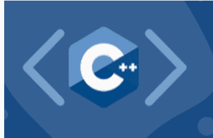
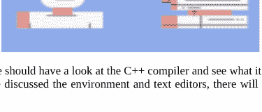
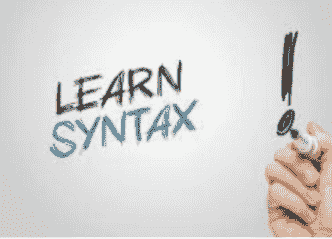
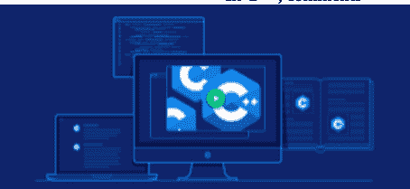

# C++ 初学者指南：C++ 编程语言基础分步指南与实用解释（面向所有人的 2022 速成课程）

用于在网上构建任何内容，以支持网站或应用程序。有些可能在某些操作系统上运行良好，而另一些则更适合游戏。不过，还有一些可能用于满足手机和移动设备的需求。谈到编程语言，在完成任务方面你有很多选择。了解你想要完成哪些任务，以及它们将如何帮助你实现目标，可以让你的生活简单得多。

然而，在本手册中，我们将花一些时间了解 C++ 语言，以及我们可以做些什么来让它有效地为我们服务。当涉及使用一门有着悠久历史的出色编程语言时，C++ 语言是最适合入门的选择。事实上，它将被视为最早可用的语言之一，也是最早被设计用来帮助我们学习如何编程的语言之一。

由于这门语言已经存在很长时间，会有许多严肃的程序员和编码人员学习如何使用它，并掌握这门编程语言的基础知识，让它为他们所用。

从名称可以看出，C++ 是一种编程语言，旨在编写代码的各个部分以及你试图构建的各种应用程序。与当今许多其他可用的编程语言一样，C++ 是一种 OOP（面向对象编程）语言。这意味着这门语言可能侧重于类和对象，而不是其他一些选项所伴随的抽象概念。这使我们很容易编写我们想要的各种代码，你可以利用它来避免这些语言常见的某些挑战。

C++ 将是一门值得学习的出色编程语言，因为它旨在为你提供完成工作所需的全部灵活性。它的速度会快得多，这将使它成为一门更适合使用的编程语言。

**我们可以通过以下几种方式使用 C++：**

- 1. **预打包脚本：** 这些对作为新手的你会非常有用，因为它们将让你练习本手册中将要讨论的一些黑客方法。这些是预先打包好的，因此你可以直接学习，而不必自己完成所有设置。



- 2. **电子游戏：** C++ 是当今许多最流行电子游戏背后的编程语言。虽然本手册不会详细到让你读完后就能制作自己的电子游戏，但你可以肯定学会如何使用这门语言实现这一点。


- 3. **网页：** 许多网页会依赖 C++，因为它是一门非常直观易处理的编程语言，并能确保你用其建立的任何网站都快速且易于使用。你甚至可以利用这门语言创建一些引人入胜的交互功能。eBay 和 Amazon 等热门网站就使用这类术语。


- 4. **智能手机应用：** 如果你喜欢使用智能手机并尝试各种可用的应用程序，你可能会发现使用 C++ 可以提升你的体验。这门语言可以让你快速构建自己的智能手机应用程序。


## C++ 简史


下一件我们需要了解的事情是 C++ 的一些历史。由于它是最初的编程语言之一，这将是一门有着悠久而辉煌历史的编程语言。它出现于人们对计算机编程还一无所知之前，也远早于人们考虑以此作为职业。想想 1979 年，当时电话黑客之类的活动正变得流行。我们必须追溯到那么久远，才能理解这门编程语言的起源。

而且你会发现，没有多少其他仍在使用中的编程语言可以追溯到这么久远。

Bjarne Stroustrup 当时正在撰写博士论文，他选择使用 Simula 编程语言。这是计算机时代最早使用的编程语言之一。然而，它非常缓慢，而且错误百出。

Stroustrup 提出了“带类的 C”（C with Classes）的概念。这是一种比 Simula 快得多的编程语言。“带类的 C”演变为 Cfront，它加速了语言的设计过程。

另一方面，当 C++ 出现时，Cfront 便被甩在了后面，因为 C++ 在语言中内置了编译器，使其比当时任何其他编程语言都更简单、更快捷。

从那以后，出现了带注释的参考手册和语言修改，使其更好、更快、更易于使用。《C++ for Dummies》是对这门语言的流行入门读物。

C++ 是当今最流行的编程语言之一。这门语言将是许多行业最适合使用的语言，因此，他们不是花费时间和精力创建一门新语言来使用，而是选择使用 C++，然后由于其适应性，将其修改用于他们想要开展的各种不同部分和项目。

### 程序员为什么选择这门语言？


如前所述，有多种编程语言可供使用，你可能会想知道为什么程序员选择 C++ 语言而不是其他语言。首先，许多程序员选择 C++ 是因为它的多功能性和速度。

这是现有最古老的语言之一，但它可以跟上你的需求，并将为我们提供完成程序和应用程序所需的所有代码甚至更多内容。

它也被视为新手可以使用的一种有用语言，因为一旦你掌握了基础知识，就可以用它们来帮助你学习其他编程语言。

此外，如果你想进一步了解如何使用一门不仅能处理在计算机上工作，还能处理其他任务的编程语言，C++ 是一个很好的起点。它将很好地适用于网站、移动应用程序等中使用的一些代码。

当然，上面讨论的一些选择只是程序员如此喜欢使用 C++ 的部分原因。以下其他优势也将帮助我们爱上这门编程语言：

- **1. 它有一个非常庞大的库：** 由于 C++ 已经存在很长时间，它也会有一个非常庞大的库。这是这门语言的每位程序员都可以使用的库，它能让挑选代码并继续执行适当功能变得更简单，同时节省时间。如有必要，你甚至可以更进一步编写自己的代码，但对于新手来说，这个库会让你有一个正确的起点。

- **2. 它与一些其他语言兼容。** 有时，除了 C++ 之外，你可能还需要使用另一种编程语言。而在使用 C++ 时，这简直是小菜一碟。这保证你可以及时完成所有代码，并且无论你的编码需求是简单还是复杂，都可能让管理你需要完成的许多工作变得简单得多。

- **3. 它可以管理大量编码任务。** 你可能使用的其他编程语言通常只设计用于处理少量

C++ 的可移植性将使我们能够编写所需的部分程序，而无论我们打算使用何种硬件。如果这成为我们的顾虑，它还将使我们能够将所有程序的开发从一个平台转移到另一个平台。这些只是使用 C++ 编程语言的少数好处。

它具备我们处理手头编码任务所需的全部兼容性、强大能力、功能等，并且它确实能保证我们完成工作。

它经常被批评为比 Python 等其他一些替代方案更难学习，但它包含你需要的所有部分，并且可以快速完成工作。

如上所示，使用 C++ 编程语言有许多优点。

在尝试学习一门新的编程语言时，它可能不是你首先想到的语言，但它是最佳选择之一，也将是一个极好的替代方案，可确保我们在此过程中取得想要的结果。

无论你是在寻找一门能够处理你想要创建的大量强大程序（例如游戏）的语言，还是只想为你沿途想学习的编程语言工具箱添加一些新内容，你都会发现 C++ 语言是适合你的正确选择。

现在，我们必须记住，尽管 C++ 语言有大量优点，但使用它也有很多缺点，这就是为什么并非每位程序员都会为自己的目的选择它。

### 这门语言的主要缺点是缺乏安全性。

在一个日益互联、利用漏洞可能随时发生的世界里，缺乏安全性会让许多程序员望而却步。

**使用 C++ 编程语言的其他一些缺点如下：**

- 1. 当我们希望将其集成或用于高级应用程序时，尤其是大型应用程序，处理起来会很困难。
- 2. 它通常只用于少数特定于应用程序的平台。
- 3. 它通常仅限于单一平台或操作系统。如果我们愿意，它可以被改成其他任何东西，但库会依附于某一个平台，在某些情况下将难以迁移。
- 4. 当我们尝试将 C++ 用于某些 Web 应用程序时，代码可能会有点难以管理，并且在调试时通常会有很多问题。
- 5. 这门语言将不支持垃圾回收过程。


- 6. C++ 将不会安全，因为它有许多阻碍这一点的组成部分，最显著的是全局变量、友元函数和指针。
- 7. 对于内置于一切之中的线程，也将不会提供支持

尽管我们经常可以绕过这些挑战可能带来的一些缺点，但我们必须记住它们，并考虑它们对于我们希望在代码中完成的工作是否至关重要。权衡利弊是确保我们最终获得满足所有需求的理想编码语言（例如 C++）的最佳方法。

## 第2章

## 创建第一个程序的步骤


既然我们已经介绍了 C++ 编程的一些基础知识，以及为什么这么多程序员愿意花时间研究如何让它工作，那么是时候继续前进了。在本章中，我们将看看开发代码时需要采取的一些行动。为此，我们必须首先关注基础知识，然后你将在以后使用这些基础知识来开发部分代码。在创建任何代码之前，这个过程的第一步是熟悉 C++ 环境。环境是我们编写一些代码并设置其运行的位置，这就是为什么我们必须确保它已准备好使用，并且我们使用的是正确的环境。好消息是有多种 C++ 环境可用，尽管最好的环境通常可以在 C++ 官方网站上找到。一旦这种编码语言的环境已下载并准备好使用，就该学习如何编写我们的第一段代码了。在本章中，我们将开发在计算机屏幕上显示消息“Try this”的代码。这只需几行即可完成，但它包含我们的脚本中所需的许多语法，以获得最佳结果。简单并不意味着它不会按照我们希望的方式运行。考虑到这一点，我们需要用来让这个程序正常工作的代码包括

```cpp
#include <iostream>
using namespace std;
int main() {
    cout << "Use This One!";
    return 0;
}
```

在编写内容时，你有几种可能。你可以选择在编译器中编写它（这将在你的环境中可访问），或者编写出来并将其保存到计算机上。第二种方法有时更可取，因为代码将被存储起来，并且你可以在代码中需要它时轻松复制和粘贴它。无论如何，你应该仔细评估你打算使用的文本编辑器类型。大多数编辑器都是特定于设备的，因此请寻找与你的个人计算机相对应的那个。Windows 记事本、vim、vi、Brief 和 EMACS 是可用的一些替代品。如果你想要一个可以在多个平台上工作的编辑器，vim 和 vi 是你的最佳选择。当你处理任何 C++ 代码时，你应该确保在文本编辑器中编写它。这将为你提供程序的一个不错的初步草稿，完成后可由编译器执行。这使你的生活更简单，因为你可以在执行代码之前检查它，以确保其中不再有任何问题。

### C++ 的编译器



既然我们在这里，我们应该看看 C++ 编译器，看看它能为我们做什么。与讨论环境和文本编辑器类似，你将可以使用种类繁多的编译器。

所有这一切的问题在于，尽管你确实有很多选项可以使用，但你很快会发现许多编译器的使用成本相当高。主要原因在于它们将保留给熟练的黑客，或者为他们提供独特功能。这些人已经掌握了可用的较低级编译器，并正在寻找进入下一层次所需的步骤。许多 C++ 编译器会迎合这一群体，当然，这需要付出代价。但好消息是，并非所有希望都破灭了。有多种优秀的 C++ 编译器可用，它们既安全可靠，而且免费。

你只需要谨慎并观察你正在做什么，以确保你发现最好的编译器，它们仍然具有我们想要使用的所有特性。

GNU 是可能帮助我们进行 C++ 编写的几种编译器之一，并且将具有某些适合新手的功能。它将是与 Linux 系统配合使用的最佳选择，如果这是你希望使用的操作系统，它已经可用。要检查 GNU 编译器是否已安装在你的机器上，请输入以下代码：

```bash
g++ -v
```

如果编译器已安装，屏幕上应出现以下消息：

```text
Using built-in specifications.
i386-redhat-linux is the target.
Configured using: ../configure --prefix=/usr......
Thread model: posix gcc 4.1.2 (20080704) (Red Hat 4.1.2-46)
```

如果你输入了上面的代码却没有看到该提示，这意味着你要么没有正确下载编译器，要么你的机器上根本没有它。

### 需要了解的一些基本语法



在本章结束之前，让我们看看 C++ 语言中将包含的一些基本语法。这对于确保当需要继续编写代码时，我们能够完成所有工作是有必要的。C++ 语言可以定义为一个将使用大量对象的程序，这些对象将帮助我们保持事物井然有序，并使我们的代码能够交互以及调用一些其他可用方法。这种语言将出现四个主要方面，并将被视为我们所处理语法的重要组成部分。

```c
}
EXPORT_SYMBOL(symbol_name);

/* export the symbol to a user space using */
static int __init symbol_init(void)
{
    int i;
    unsigned int count = 0;
    ...
}
```

在上一章中，我们花了一些时间了解我们能用一些 C++ 代码完成什么。

你可以看到，就整体处理这种语言而言，创建代码并不应该那么困难，但我们可以用这种语言做更多复杂的事情，随着我们通读本手册，我们会更多地讨论这一点。然而，我们现在必须选择一个新的行动方案。

本章将花更多时间研究 C++ 语言的语法应该如何运作，以及为了使这种语言以我们希望的方式运行而必须出现的一些不同部分。在我们通读本章时，对我们在这里所做的事情做些笔记，然后留意这些组件何时出现，以及它们在我们想要完成的一些编码中被使用的频率。

请记住，之前我们看了一个很好的例子，说明我们如何用 C++ 语言创建代码，以及代码中将出现的一些重要部分。

既然我们已经完成了所有这些，是时候进一步深入了解我们能用 C++ 语法完成的一些事情了。

任何语言的语法，无论是不是 C++，都至关重要，因为它能确保代码从长远来看可被我们的编译器理解和执行。

考虑到这一点，有必要更多地学习 C++ 编程语言的语法，以便我们能够有效地使用它。

### 在 C++ 中，注释



注释是我们在 C++ 语言中要检查的语法的第一个方面。了解这些将很有用，因为它们允许我们在正在创建的代码中放置小消息或注释，而不改变代码的功能方式。

这些注释将帮助我们以及查看代码的其他人理解你想用它做什么。作为新手，你会注意到许多脚本会包含这种注释，以帮助你理解正在发生的事情。

注释将用于指导你完成代码中想要实现的目标，理论上我们可以在程序中包含任意多的注释。这里的经验法则是将注释限制为仅必需的注释，以免脚本变得混乱。

**要在此语言中创建注释，请在注释前使用 (//) 符号。**

这将通知编译器你正在创建此类注释之一，它应该直接跳过这一部分，并且不将其包含在你在此处处理的执行中。

你可以将它们放在你选择的代码的任何区域，编译器会理解发生了什么。即使在这种语言中，我们也可以做出超过一行或占用多行的注释。这是在其他语言中难以做到的事情，但却是 C++ 编程语言所独有的。

当你想要继续并拥有一个跨多行的代码时，在注释开头添加 /* 符号，然后在注释结束处使用 */ 符号。当编译器遇到这种情况时，它会知道应该继续处理代码而不读取其中的任何内容。

### 各种数据类型


我们希望花时间学习的每种编码语言都会将精力集中在数据类型的概念上。这些将有助于代码的推进，并使你更轻松地保存事实

将发送给函数的参数，以及将要返回的返回类型。另一方面，函数的定义将提供在我们想要构建的任何函数体中。我们在这门语言中遇到的标准库将为我们提供若干已经可用且可调用的函数。

例如，其中之一是 `strcat()` 方法，它可用于连接两个字符串，然后你可以使用 `memcpy()` 函数来协助我们将内存从一个区域移动到另一个区域。这些只是你可以使用的少数函数，而且它们都以相同的方式运行。那么，让我们看看 C++ 函数将如何运行。

### 定义变量

```cpp
return_type function_name(parameter list)
{
    body of the function
}
```

我们这里的函数定义将包括函数头以及函数体。

我们需要考察的几个函数方面如下：

- **1. 返回类型：** 在某些情况下，当我们使用函数时，它会向我们返回某种值。发生这种情况时，我们将使用返回类型来确保有内容返回给我们。我们的一些函数能够完成你想要的活动，而不会向你传递值。使用我们上面描述的语法，你会收到一个返回值，不过它会是“void”。
- **2. 函数名：** 现在我们可以处理函数名。完成后，你将能够为函数指定名称和参数。你还会得到所谓的函数签名。
- **3. 参数：** 参数将仅作为一种占位符来处理。当你准备好调用某个函数时，只需将值赋给其中一个实参。这个值将被称为实参或实际参数。然后，参数列表可以指代发送给函数的实参的顺序、数量和类型。在少数情况下，可以完全使用不带这些参数的函数。
- **4. 函数体：** 最后，让我们看看函数体。它将包含一组适当的语句，告诉我们该函数能够做什么。既然说到这里，我们不妨也过一遍并处理所谓的函数重载。这意味着 C++ 语言将使我们能够在同一作用域内为一个函数名或某个运算符指定两个或更多定义。

根据我们是对函数名还是运算符这样做，这将被称为运算符重载或函数重载。

重载声明只是与先前的声明同名且处于同一作用域内的声明。例外情况是，我们这里的两个声明都将具有不同的实参，并且彼此具有不同的定义和实现。当我们调用某个重载运算符或函数时，编译器将能够查看所有定义，并决定哪一个最适合使用。它通过比较用于调用该运算符或函数的各类实参来做到这一点，并且还可以处理定义中声明的参数类型。这是编译器必须处理的一个大型过程。好消息是，只要我们正确设置软件，每次都能看到正确的结果。

重载解析是识别最合适的重载函数的过程。如前所述，即使在同一作用域内，我们也可以为同一个函数提供多个定义。我们的函数定义必须在彼此之间有所不同，要么在于某个参数列表中所含参数的类型，要么在于参数的数量。请记住，如果唯一区别是返回类型，则不允许重载函数声明。

尽管一开始可能看起来很难，但使用这种函数重载其实相当简单。

下面是一个很好的代码示例，我们可以用它来实现这一点；其中 `print()` 函数用于帮助我们打印出所有各种形式的数据。

```cpp
#include <iostream>
using namespace std;

class printData {
   public:
      void print(int i) {
         cout << "Printing int: " << i << endl;
      }
      void print(double f) {
         cout << "Printing float: " << f << endl;
      }
      void print(char* c) {
         cout << "Printing character: " << c << endl;
      }
};

int main(void) {
   printData pd;

   // Call print to print integer
   pd.print(5);

   // Call print to print float
   pd.print(500.263);

   // Call print to print character
   pd.print("Hello C++");

   return 0;
}
```

当我们完成编译并能够正确运行它时，它将根据我们提供给它的数据类型为我们提供一些结果。在处理 C++ 中的运算符重载时，我们可以使用类似的过程。我们可以继续重载或重写 C++ 语言中的若干内置运算符。

因此，如果应用程序愿意，将允许其将运算符用于某些用户定义类型。为简单起见，重载运算符将是具有唯一名称的函数。通常，这将包含“operator”一词，后跟与你要在此指定的运算符相对应的符号。

你试图重载的运算符，与你正在使用的任何其他函数一样，将同时带有返回类型和参数列表。

## 如何处理异常

使用 C++ 语言所能完成的事情中，有一件很酷的事：它被设计用来管理异常之类的情况。这稍微困难一些，但你会对我们可与之配合使用的各种代码感到惊讶。

按照我们在此的定义，异常是当你准备运行程序时会出现的问题，表明程序将无法正确运行。

当我们研究 C++ 中的异常时，我们会发现，这是对代码中不常见场景的响应，而这种场景通常会在我们执行并运行程序时出现。我们在代码和程序中最常看到的异常形式是有人试图除以零。异常将是代码中一个有价值的组成部分，因为它们将协助我们转移程序某一部分中存在的部分控制权，并确保将其转移到其他部分之一。

C++ 异常处理将基于一些核心关键字，即 try、throw 和 catch。让我们看看这些术语的含义，以便更好地理解它们为何重要以及我们可以用它们做什么：

- **1. throw：** 这些关键字中的第一个将被称为 throw。当问题发生时，软件将抛出异常。当我们使用 throw 关键字时，这将自动发生。
- **2. catch：** 程序将能够借助异常处理器检测到某个异常，这将允许程序自行处理一些问题。如果你使用 catch 关键字，则需要一些时间告知应用程序你希望它捕获该异常。
- **3. try：** 当我们准备使用 try 关键字时，我们会这样做，以帮助我们找到并识别将触发特定异常的代码块。

如果你使用此关键字，它将至少包含一个 catch 块，以确保其正常工作。

然后，我们将假设你当前的代码块可能抛出异常，并且某个方法将能够使用 catch 和 try 关键字的组合来捕获该异常。然后，这些内容将被包含在代码中，使其能够捕获异常并为你处理。这并不保证一定会发生异常，但如果可能发生，加入这些内容将确保代码继续按应有的方式运行。正如我们所看到的，许多不同的部分将汇集在一起，帮助我们构建 C++ 代码的基本语法。在此过程中，你可以根据需要尽可能多地使用这些部分，以确保编码正常工作，尽管你开始时的一些基础代码可能只需要其中一两个部分即可正常运行。学习这些基础知识以及如何正确编写程序，将在我们学习本手册以及进一步使用这门编程语言的过程中产生重大影响。


现在我们已经对这些变量有了更多了解，也知道了它们大致是怎么回事，接下来该看看为了建立一些自己的变量，我们需要完成哪些步骤。

这些定义至关重要，因为它们会告诉编译器我们希望它使用多少存储空间，以及我们希望变量存放在哪里。这种说明还会帮助我们逐一确定想要处理的数据类型。我们可以写类似“类型 变量列表”这样的内容，然后你可以从上面给出的变量类型中选择一种，并在需要时以同样的方式写出来。这些最终会告知编译器生成你所提到的那种载体，然后让代码正常运行。

当我们尝试把它写出来并解释如何让它工作时，这看起来会有点难，所以让我们看一个编码示例，以便在 C++ 中看到它的实际运行：

```cpp
#include <iostream>
using namespace std;

int main() {
    int j = 10, k = 5, l = j + k;
    cout << l << endl;
    return 0;
}
```

你现在应该得到答案 15 了。你也可以继续在程序中定义和声明变量，但那是我们在对这门语言更有经验之后可以处理的事情。

启动编译器并运行上面的代码是个好主意。这可以让你更熟悉编码，也可能帮助你在遇到这些变量时识别出它们。

既然说到这里，我们也应该花些时间给变量赋予某种值。这一点很关键；否则，我们只是在计算机内存中保留了一块空区域。

变量不会自行执行任何操作，它只会占用计算机 RAM 中的空间，用于我们在这里尝试完成的所有工作。

你有责任给出必要的值，以便内存也能保存内容。与某个变量关联的值会存储在内存中与你的变量相同的位置。如果你愿意，还可以更进一步，在应用程序中给同一个变量赋多个值。只要格式正确，你可以给同一个变量添加任意多个这样的值。不过，我们应该尽量把每个变量对应的值数量保持在较低水平，比如一到两个，以便让代码尽可能容易处理。我们只需要使用等号，就能给你的某个变量赋予新值。

它的作用是通知编译器：当代码执行时，你的变量，或者说你在计算机内存中一直保留的那块空间，将属于那个确切的值。当程序运行期间稍后调用该变量时，它将返回你想要的值。

如你所见，C++ 中的变量并不难理解，但学会如何做到这一点至关重要，这样才能保证你的代码正常工作，并确保代码执行时，你想在代码中使用的所有值都会出现。

你可能会在很多场合希望引入能在 C++ 中运行的变量。它们在确保你能够真正在代码中存储所有想要的数据方面将非常重要。

在这里，把一切设置好并准备就绪将至关重要，因此确保我们花时间以适当的方式处理变量，对于在此过程中看到我们想要的结果也同样至关重要。

## 第5章

## 循环与数组

现在该更深入地了解一些我们在编写 C++ 程序时可能会用到的编码内容了。当我们使用数组和循环进行操作时，确实可以编写出一些奇妙而多样的程序；因此，理解最佳做法以便按需要把这一切都掌控好，是至关重要的。

在本章中，我们将进一步了解在构建自己的 C++ 代码时可能会用到的两种流程，包括数组和循环，以及它们意味着什么、我们可以在代码中用它们做什么。

```cpp
for (int i = 0; i < arr.size(); ++i) {
    // Use if we explicitly need the value of i
    cout << i << ":\t" << arr[i] << endl;
}
for (int element : arr) {
    // Modifying element will not affect the array
    cout << element << endl;
}
for (int &element : arr) {
    // Modifying element will affect the array
    cout << element << endl;
}
```

### 数组

数组是我们要看的第一个内容。数组是 C++ 中可用的数据结构之一，它允许我们存储本质上类型相同、固定大小也相同的项。它们本质上是我们希望处理的那种变量的集合。

不过，与其逐一使用某些单独的变量来完成任务，你需要处理单个数组，比如一个整数数组。要让这些数组发挥作用，你需要使用 0 到 99 的整数，然后就可以通过数组的索引访问每一个元素。不过，处理不只是与数字有关的数组也是可行的。

如果愿意，我们也可以使用同时用于字符和单词的数组。数组将与我们之前讨论过的一些变量类似，因为它们表示计算机内存中的位置。不过，它们会比变量所能提供的更加连续。第一个元素被称为最低元素，最后一个元素被称为最高元素。在处理这些数组时，你确实有几种不同的选择。你可以逐一初始化它们，也可以使用单条语句来处理。

下面是一个很好的示例，说明如何实现这一点：

```cpp
double arr[5] = {1000.0, 2.0, 3.4, 17.0, 50.0};
```

我们在括号中填入的数字绝不应超过要使用的元素数量。

这意味着，如果你像上面那样在括号中填入 5，然后向其中放入六个数字

while 循环是我们这里要看的第一个循环。while 循环是一种只要满足你指定的要求，就会继续我们的循环并重复相应行的选项。程序每次运行该循环时，都会读取信息，然后测试该条件。如果循环检测到条件已满足，它就会继续。如果循环到达条件不再成立的程度，它就会停止，并且如果你的程序还有更多内容，就会转到下一段代码。考虑到这一点，while 循环处理起来将轻而易举。要创建一个基本的 while 循环，只需要几行代码。我们可以用来操作 while 循环的语法如下：

```cpp
while (condition) {
    statement(s);
}
```

### for 循环

现在该继续介绍我们可以使用的第二种循环形式，即“for 循环”。

这种 for 循环只有在首先确保条件满足之后，才会重复自身。我们上面创建的 while 循环会先循环一遍，然后测试条件。

循环会先测试条件，然后循环继续。这意味着，根据提供给计算机或软件的输入，程序可能会测试条件、判定其为假，而“for 循环”在程序中甚至一次都不会发生。如果你编写的程序要求循环至少发生一次，那么 while 循环就是正确选择。

如果它不那么关键，或者如果条件不满足时循环不运行、代码也没问题，那么 for 循环可能是个不错的选择。如果你正在处理一个程序，并决定“for 循环”对你来说是最佳选择，那么你需要继续编写一些代码来实现它。它与我们之前执行的 while 循环类似，所以总体上会更容易管理。

必须使用以下代码来让“for 循环”正确运行：

```cpp
for (initialization; condition; increment) {
    statement(s);
}
```

### do-while 循环

第三种循环形式很独特，它在 C++ 语言中运行良好，但在你沿途可能处理的其他一些编码语言中并没有那么广泛的文档记载。使用它会非常有趣，所以我们会在这里花些时间看看它。

do-while 循环略有不同，但你会看到它与正在处理的 while 语句有一些相似之处。不过，它的不同之处在于，它能够等到语句结束时才检查条件，而不是从一开始就检查。这使它在你要构建的软件中表现得有些不同。

我们可以用来写出 do-while 循环的语法如下：

```cpp
do {
    statement(s);
} while (condition);
```

### 嵌套循环

嵌套循环是列表中我们需要在这里关注的下一项。

这些会比我们这里做过的一些先前循环稍微复杂一些，但它们会很有帮助，能帮助我们在短时间内完成很多事情。

嵌套循环发生在一个循环运行在另一个循环内部时，并且这两个循环会同时继续运行，直到它们的条件都得到满足，此时它们


```
ptr 处的值 = 0x72fe34
var 处的值 = 17
*ptr 处的值 = 17

----------------------------
（程序以代码 0 退出）

按任意键继续 . . . _
```

本章还会简要介绍一个与我们正在讲解的数组和循环有关，并且在本手册中会多次提及的主题：指针。

这些代码段很容易理解，一些程序员可能也会觉得它们很有趣。使用指针时，你希望在 C++ 中完成的某些操作会变得更加简单。此外，有些操作（例如动态内存分配）如果没有指针就无法执行。

正如我们在学习本手册的过程中已经了解到的，每个变量都对应计算机内存中的一个位置，而每个内存位置都有一个分配给它的地址。之后，我们可以随时使用 & 运算符访问这个确切的地址。了解这一点后，我们就可以开始使用这些方法来完成一些想要执行的任务。指针只是一种变量类型，但它的值是其他某个变量的地址。

与其他常量或变量一样，使用指针之前必须先声明它。实现起来相当简单，下面的代码就可以做到这一点：
“*var” -- 名称；其中，代码中的“type”部分是指针的基类型。

我们必须确保它是有效的 C++ 类型，否则代码将无法运行。代码中的 var-name 部分则表示指针的名称。后面附加的星号用于标识指针，它也是我们进行乘法运算时使用的符号。特别是在处理这条语句时，我们会用星号将变量标识为指针。无论我们处理的是哪种情况，相关指针所使用的数据类型都相同，无论我们处理的是一个……

在这门语言中，数组与指针之间有着密切的联系。

- 5. **指针数组：**我们也可以创建数组，使其包含我们需要的指针。
- 6. **指向指针的指针：**C++ 允许我们在指针上再添加一个指针，必要时还可以增加更多层级。
- 7. **如何将指针传递给函数：**传递实参的能力在这里至关重要。

  将这个实参作为地址或引用之一传递，会导致某些修改发生，从而使该实参能够在此过程中调用我们想要的函数。

从函数返回指针：C++ 语言允许我们通过函数返回指针，这些指针可以指向局部变量、动态分配的内存以及静态变量。

我们可以看到，使用指针的方法有很多，它们还可以与本手册中介绍的其他主题相辅相成。

随着我们继续学习运算符、变量，以及组成代码的数组和循环，我们将能够了解如何将这些内容整合起来，在不增加操作复杂度的情况下，让代码实现不错的效果。

## 第 6 章：C++ 运算符及其使用方法

接下来要探讨的主题是运算符。

运算符十分重要，因为尽管它们很基础，却能为我们编写的脚本带来强大的功能。

我们可以关注许多不同类型的运算符，而了解每种运算符如何融入我们要编写的代码至关重要。运算符看似是代码中基础或简单的组成部分，但仍能为我们想要开发的一些程序增添强大的功能。无论我们使用 C++ 还是其他编程语言，都需要了解这些内容。在使用任何编程语言时，了解各种运算符的类型都至关重要，因为它们会告诉程序你希望发生什么。它们只是一些简单的符号，但能提供更强大的功能。

虽然有多种运算符可供选择，但我们将重点介绍最常见、且适用于 C++ 编程语言的四种运算符。它们各自负责帮助代码以不同的方式运行。

学习过程中，你很快就能了解每种运算符的效果及其功能。在这门语言中，我们需要重点关注四种运算符：逻辑运算符、赋值运算符、算术运算符和关系运算符。了解这一点后，我们需要逐一花些时间学习这些运算符类型。这样我们就能进一步了解运算符，以及它们在你自己的代码中的行为方式。

### 逻辑运算符

我们先花些时间学习逻辑运算符，以便开始这个过程。

逻辑运算符用于比较你想要添加到系统中的代码的不同部分，可以帮助你判断这些部分在当前条件下会被视为真还是假、彼此是否符合条件等。

使用 C++ 语言时，你最可能遇到以下逻辑运算符：

- 1. (!)：这称为逻辑非运算符。

  当你想要反转操作数声明的状态时，就会使用它。因此，如果某个条件为假，你可以使用这个运算符将其变为真。

- 2. (&&)：这称为逻辑与运算符。

  如果有两个操作数都不等于零，就会使用它。此时，条件将成立。

- 3. (||)：这称为逻辑或运算符。

  使用该运算符时，只要至少一个操作数等于零，条件就为真。

### 算术运算符

算术运算符是我们将要关注的第二类运算符。它们通常被认为是所有 C++ 运算符中最容易使用的，而且你会经常在代码中使用它们和赋值运算符。如果你还记得以前学过的数学知识，应该能认出其中一些运算符，并了解它们是什么以及如何运作。根据你希望软件完成的任务，这些算术运算符可用于加法、减法、除法和乘法。

C++ 中属于此类别、并且可能适用于代码的算术运算符包括以下几种：

- (+)：加法运算符，用于将你选择的两个操作数相加。
- (-)：减法运算符以 (-) 表示，用于从左操作数中减去右操作数。
- (*)：在 C++ 编程语言中，这是用于乘法的运算符。
- (/)：此运算符可用于在 C++ 中进行除法。

递增运算符用 (++) 表示，它会使操作数的值增加 1。递减运算符用 (--) 表示，它只会使操作数的值减少 1。使用这些算术运算符时，你会发现有很多种选择。首先，我们可以根据需要同时使用任意多个运算符。也就是说，如果我们有一串想要组合起来的 10 个数字，也可以做到。

你也可以一次使用几个运算符，例如在处理过程中对各部分进行乘除运算。你只需要使用运算符，并确保按照正确的顺序执行运算，从而得到正确的结果。

### 赋值运算符

现在该讲解第三种适用于 C++ 编程语言的运算符了。

赋值运算符属于这一类别。

这是最常用的运算符，用于确保脚本正确运行。它常用于将值赋给变量，使其正常工作。

赋值运算符至关重要，因为它能让你更轻松地为变量赋值或命名。在你编写的任何脚本中，它也非常适合用于存储、查找以及执行许多其他操作。除了等号之外，我们还可以使用以下几种赋值运算符为变量赋值：

- (=)：这是基本赋值运算符。

  它会将右侧操作数的值传递给左侧操作数。


- **(+=)：**加法赋值运算符。

  它会将两个操作数的值相加，然后将总和赋给左侧操作数。

- **(*=)：**乘法赋值运算符。

  它会将两个操作数相乘，然后将结果赋给左侧操作数。

- **(-=)：**减法赋值运算符。

  它会用左侧操作数减去右侧操作数的值，然后将差值赋给左侧操作数。

- **(/=)：**除法赋值运算符。

  它会用左侧操作数的值除以右侧操作数的值，然后将结果赋给左侧操作数。

我们需要了解的一点是，赋值运算符会以何种形式出现在许多我们打算使用的 C++ 程序中。有些运算符会频繁使用，例如在处理变量并为其赋值时使用的等号。

还有一些上述运算符并不常用，在编程水平提高不少之前，你可能不太会用到它们。

不过，大多数时候你会使用的赋值运算符是等号。它允许我们为要处理的变量赋予正确的值，但有时我们也会使用其他赋值运算符来帮助推进代码的编写。

### 关系运算符

关系运算符是我们接下来需要了解的内容。

它们与我们之前讨论的一些其他选项略有不同，但可以帮助我们检查沿途需要处理的其他一些情况。

关系运算符包括以下几种：

- **(==)：**用于判断两个操作数是否相等的运算符。

  如果它们相等，则条件成立。

- **(>)：**用于比较操作数值的运算符。

  如果左侧操作数大于右侧操作数，则条件为真。

如果输入满足你提供的要求，就会返回相应的结果。还有一些条件语句可以包含一系列备选回复，并根据用户提供的信息选择最合适的回复。我们还可以使用第三种形式的条件语句，以菜单形式列出用户可以选择的所有选项，然后根据用户的选择返回相应结果。这些只是我们可以通过决策控制语句完成的部分任务。考虑到这一点，下面让我们来了解使用这些条件表达式时有哪些选择。

## Switch 语句及其用法

我们首先要讨论的条件语句称为 switch 语句。它们很有用，因为可以帮助我们检查变量是否相等，并将变量与代码中设置的 case 值进行比较。要验证的变量会与多个情形进行比较，以确定是否匹配。这比乍看起来要简单，让我们来看看 switch 语句可以使用的语法：

```cpp
switch (expression) {
    case constant-expression:
        statement(s);
        break; // 可选
    case constant-expression:
        statement(s);
        break; // 可选
    // 可以包含任意数量的 case 语句
    default:
        statement(s);
}
```

使用 switch 语句时，我们必须遵循一些规则，以确保它们在代码中正常运行。首先，switch 语句中的表达式必须是整数类型或枚举类型。此外，它也可以是具有转换函数的类的成员。好在 C++ 语言对上述语法中可以添加的 case 语句数量没有限制，因此你可以根据代码需要，让 switch 语句变长或变短。需要记住的重要一点是，所有值的后面都必须加上冒号，代码才能正常运行。变量找到与自身相等的值后，会继续执行，直到遇到 break 语句。找到 break 语句后，switch 就会停止执行，程序控制流也会继续进入代码的下一部分。如果不需要，可以不在每个 case 中都添加 break 语句。如果忘记添加或决定不添加，控制流就会继续执行下一部分。

## 第 8 章

## 继承


接下来我们要讨论继承。继承比本手册中的一些其他内容更复杂一些，但现在你已经准备好迎接挑战，真正学习更难的内容。了解继承后，我们就能看到之前讨论过的面向对象编程语言（OOP）的许多优点，并能够重用我们想要使用的代码片段。继承是面向对象编程中最重要的概念之一。它使我们能够根据另一个类的定义来创建一个类。这很有用，因为它让我们更容易构建和管理想要开发的应用程序。继承还有助于重用代码功能，从而比以往更快地完成实现。程序员不必每次创建类时都重新编写数据成员和函数成员，而可以指定新类继承代码中已有类的成员。这比在编写代码时一遍又一遍地重新定义成员和函数方便得多。我们工作的基础类，或已有的类，称为基类。我们尝试构建的新类称为派生类，它会从基类中获取信息、数据或函数。继承概念体现了“是一个”（is a）关系。例如，哺乳动物是一种动物；狗是哺乳动物，因此狗也是一种动物。这能简化我们处理问题的方法，同时帮助我们清楚地了解接下来要做的事情。

```cpp
void setHeight(int h) {
    height = h;
}

protected:
int width;
int height;
};

// 派生类
class Rectangle : public Shape {
public:
    int getArea() {
        return width * height;
    }
};

int main(void) {
    Rectangle Rect;
    Rect.setWidth(5);
    Rect.setHeight(7);

    // 输出对象的面积。
    cout << "Total area: " << Rect.getArea() << endl;
    return 0;
}
```

请花些时间将这段代码输入编译器并观察运行结果。

你应该能算出它的总面积，然后继续完成后续内容。正如我们所见，虽然这个例子使用了继承，但并不难理解。继承是一个很好的选择，它能帮助我们重用代码、简化代码实现，并让我们有机会在不浪费大量时间的情况下处理代码。

### 继承中的访问控制

接下来要考虑的主题是访问控制与继承。

派生类可以访问基类中除私有部分以外的所有内容。这意味着，基类中不应向派生类的所有成员函数开放的成员，应在基类中声明为私有。继续学习时你会发现，派生类可以继承基类的所有方法。

根据我们希望实现的效果，有一些例外情况需要考虑，包括：

1. 基类中的友元函数。
2. 基类中的重载运算符。
3. 基类的析构函数、构造函数以及可能存在的复制构造函数。

我们必须密切关注访问控制中的各个组成部分。如果基类中存在任何限制，就可能给继承带来一些复杂情况。派生类的类型也会受到这些限制的影响。


### 继承类型

既然说到这里，让我们更仔细地看看我们可以处理的继承类型。当我们首先尝试从某个基类派生一个类时，基类可以通过私有继承、保护继承或公有继承来继承。

我们之前讨论过的访问说明符，将用于指定你所使用的继承类型。现在你会看到，虽然私有继承或保护继承是可行的，但我们处理它们并不常见。只需注意，沿途可能会遇到一些难以处理的挑战。

公有继承是我们在这里最可能使用的技术。尽管公有选项将是我们最常处理的，但我们必须考虑在处理各种形式的继承时所适用的一些规则。

在处理这一继承时我们必须记住的几条准则如下：

- **公有继承：** 当我们从公有基类派生新类时，基类（或原始类）中包含的公有成员会成为派生类的公有成员。我们基类中包含的保护成员随后会成为我们由此创建的某些派生类的保护成员。
    - 我们会发现，基类中存在的私有成员永远不能直接从派生类访问。

我们可以从这里访问它们。要做到这一点，我们只需调用基类的保护成员和公有成员。

- **保护继承：** 第二个选项是保护继承，我们可以处理它。当我们希望从保护基类派生新类时，基类的保护成员和公有成员将成为我们想要使用的派生类的保护成员。
- **私有继承：** 我们要看的最后一种继承是私有继承。当我们尝试从私有基类派生新类时，基类的保护成员和公有成员都会被转移到派生类中，但它们会被转换为一些私有成员。如我们所见，它们每一个都会与其他成员不同。

正是因为这个原因，我们必须谨慎对待我们将要使用的继承类型。如果你使用不同形式的继承，成员并不总是会按你希望的方式运作。检查你处于哪种情况，并确保它被设置为适当的类型，以便它按你希望的方式运作。

### 实现多重继承

管理多重继承的概念，是我们考察 C++ 语言中可以执行的某些继承时要看的最后一项内容。这种语言中的一个类可以穿过并从多个类继承成员。我们可以用于这一点的扩展语法如下：

```cpp
class derived-class : access baseA, access baseB
```

我们可以检查这一点，并引入任意多个基类，但一定要只使用所需的那些，否则最终会变得一团糟。我们之前讨论过的适用于访问的限制，也同样适用于过程的这一阶段。其中访问权限为 private、protected 或 public 之一，并且为每个基类提供，它们也用逗号分隔，使用我们之前讨论过的相同语法。

了解这些不同继承如何运作的一个好方法，同样是亲自试验它们。看看下面的代码，了解我们如何创建其中一种继承，或者至少基于几个不同的基类创建一个新的派生类：

```cpp
#include <iostream>
using namespace std;
// Base class Shape
class Shape {
public:
    void setWidth(int w) {
        width = w;
    }
    void setHeight(int h) {
        height = h;
    }
protected:
    int width;
    int height;
};
// Base class PaintCost
class PaintCost {
public:
    int getCost(int area) {
        return area * 70;
    }
};
// Derived class
class Rectangle: public Shape, public PaintCost {
public:
    int getArea() {
        return (width * height);
    }
};
int main(void) {
    Rectangle Rect;
    int area;
    Rect.setWidth(5);
    Rect.setHeight(7);
    area = Rect.getArea();
    // Print the area of the object.
```

它将用于激活该函数。

考虑以下示例，以理解所有这些多态在我们的代码中应如何运作。以下示例演示了如何从另外两个类生成一个基类：

```cpp
#include <iostream>
using namespace std;
class Shape {
protected:
    int width, height;
public:
    Shape( int a = 0, int b = 0){
        width = a;
        height = b;
    }
    int area() {
        cout << "Parent class area :" << endl;
        return 0;
    }
};
class Rectangle: public Shape {
public:
    Rectangle( int a = 0, int b = 0):Shape(a, b) { }
    int area () {
        cout << "Rectangle class area :" << endl;
        return (width * height);
    }
};
class Triangle: public Shape {
public:
    Triangle( int a = 0, int b = 0):Shape(a, b) { }
    int area () {
        cout << "Triangle class area :" << endl;
        return (width * height / 2);
    }
};
// Main function for the program
int main() {
    Shape *shape;
    Rectangle rec(10,7);
    Triangle tri(10,5);
    // store the address of Rectangle
    shape = &rec;
    // call rectangle area.
    shape->area();
    // store the address of Triangle
    shape = &tri;
    // call triangle area.
    shape->area();
    return 0;
}
```

当你完成编译上述代码并给它一些运行时间后，你应该会在那里看到父类面积的结果。然而，两部分都会保持空白。

编译器会把对 area 函数的调用设置为基类中声明的版本，从而导致这种错误输出。这被称为函数调用的静态链接或静态解析。这对我们意味着，函数调用会在我们甚至开始使用软件之前就被修正。由于 area() 函数在程序编译期间就被确定，这也可能被称为早期绑定。然而，我们现在必须走另一条路，并对软件做一些小改动。在这种情况下，我们将在 Shape 类中 area() 方法定义之前使用 virtual 关键字。

这段代码将如下所示：

```cpp
class Shape {
protected:
    int width, height;
public:
    Shape( int a = 0, int b = 0) {
        width = a;
        height = b;
    }
    virtual int area() {
        cout << "Parent class area :" << endl;
        return 0;
    }
};
```

一旦我们做出这个小改动、编译并再次运行代码，它将在过程中给我们略有不同的结果。相反，我们将获得 Triangle 类的面积和 Rectangle 类的面积。

编译器将不再查看指针的类型，而是查看指针的内容。因为我们的 rec 和 tri 对象的地址将保存在 *shape 中，所以这里将调用我们函数的相应部分。如你所见，我们将要使用的每个子类都会有不同的 area 函数实现。我们通常能够以这种方式处理多态。你也可以创建多个具有相同函数名甚至相同参数的类，但要使这可行，你需要使用不同的实现。我们在这里还能做的另一件事是使用虚函数。这将是一个来自基类的函数，可以用 "virtual" 关键字定义，正如我们

在亚马逊上

