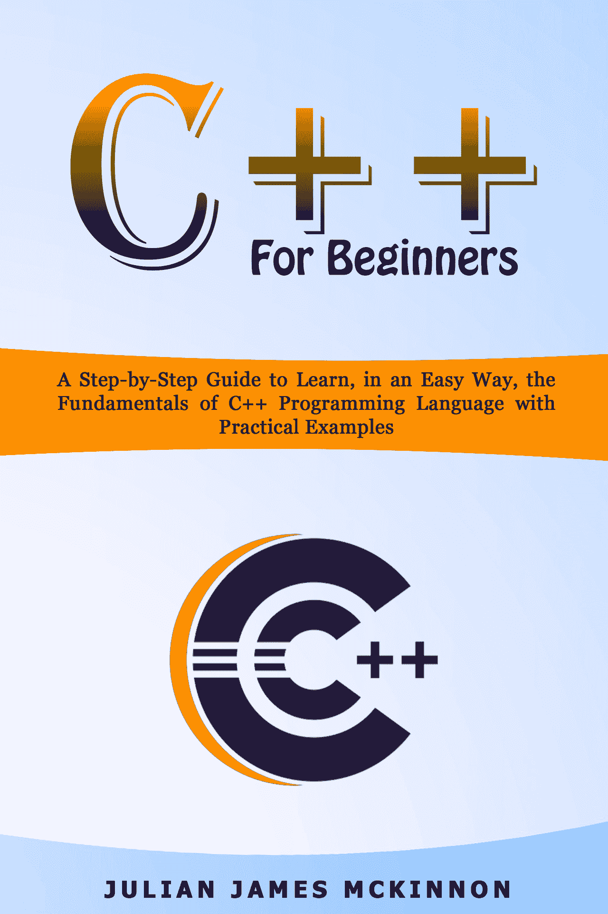

# C++ 初学者指南：通过实用示例循易学习 C++ 编程语言基础的逐步指南指南



## 引言

恭喜购买《C++ for Beginners》，感谢您的支持。接下来的章节将讨论在处理`C++`语言时需要知道的所有不同事项。在处理编码和编程工作时，我们有许多不同的选项可以探索，其中许多选项都将带来巨大的优势，吸引你使用它们。

但当需要使用一种背后拥有强大力量和功能的简单编码语言时，就是该使用`C++`编码语言的时候了。本指南将花费一些时间查看我们使用`C++`语言能做的所有事情，以及学习这种语言实际上有多棒。本指南的开头将花一些时间了解`C++`语言的本质，以及将其引入你的程序带来的某些益处，而不是使用其他许多选项之一。

当我们掌握了一些基础知识，并对为什么想要使用这种语言有了良好的想法后，就是时候进一步研究我们如何实际上用这种语言编写代码了。在接下来的几章中，我们将观察帮助在该语言中创建我们的第一个程序的正确步骤，然后我们可以花更多时间专门研究`C++`的语法，以及它对于编写我们想要使用的某些代码有多重要。

现在是时候进入我们专门通过这种语言可以做的某些有趣事情了。既然我们已经知道了如何使用这种语言，以及如何编写简单的代码，我们就可以更进一步，学习如何处理`C++`变量、循环以及数组。我们甚至会更进一步，查看你实际创建某些循环和数组需要的一些代码，并观察如何为变量添加值的基础知识，以便代码以后可以将它们提取出来。

当我们完成所有这些，并对目前为止关注的某些简单代码的编写方法有了良好的想法时，就是该更进一步了。虽然我们早些在处理变量时看了一些运算符（我们将在指南中讨论这一点），但我们将更深入地研究`C++`中存在的不同类型的运算符以及为什么这非常重要。然后，我们通过查看如何创建自己的决策控制语句来结束这部分，这将确保我们的程序能够根据我们在代码中设置的条件在运行过程中做出正确的决策。

然后，我们将直接跳到我们可以关注的`C++`编码语言的一些更高级的部分。我们将观察如何处理继承的概念，这可以帮助我们充分利用这种语言的`OOP`部分，然后我们可以深入研究多态概念需要的一些编码和更多内容，并在此过程中使其针对我们的某些需求良好地工作。

我们可以处理的编码语言有很多种，其中许多种可以帮助你完成编码工作。但当你想要最好的语言，即那种易于学习同时带有了你在编码语言中想要的所有功能及更多功能的语言时，那么`C++`语言就是你使用的正确选择。当你准备好开始这种特定的编码语言时，请务必查看本指南以开始。

## 第 1 章：什么是 C++

当需要选择一种你想要使用的编码语言时，有很多选择。有些语言是专为在编码方面完全没有经验的初学者设计的。有些编码语言非常适合那些寻找创建在线内容以帮助构建网站或应用程序的方法的人员。

某些语言与特定的操作系统配合得更好，某些更适合游戏，而另一些则可以用于帮助手机和移动端的需求。在选择编码语言来完成任务时，你有很多选择可以做。了解你想完成哪些项目将帮助你获得结果，会让生活变得简单得多。

在本指南中，我们将花费一些时间查看`C++`语言以及我们能做什么让它为我们良好工作。当处理一种带有深厚历史的优秀编码语言时，你会发现`C++`语言是入门的完美选择。事实上，它被认为是世界上最早的语言之一，是第一批帮助我们学习如何编写代码的语言之一。

由于这种语言已经存在了很长时间，有很多资深程序员和编码人员正在学习如何使用它，并且理解这种编码语言的基础知识以便让它为他们服务。正如我们在这里很快猜到的，`C++`将是一种用于编写你想要设计的某些不同代码和不同应用程序的编程语言。

与今天在市面上找到的许多其他编码语言一样，`C++`将是一种`OOP`语言或面向对象的语言。这对我们来说，这意味着这种语言能够围绕类和对象展开，而不是其他某些选择中的抽象概念。这使得我们更容易编写我们想要的某些代码，你将利用它来防止这些语言必须处理的一些常见问题。`C++`是一门很好的学习的编码语言，因为它在设计时就包含了你完成任务所需的所有灵活性。它将带来很大的速度，这将使其成为一种更好的工作编码语言。

我们有许多不同的方式来处理`C++`，包括：

### 1. 预封装脚本

对于初学者来说，这些脚本将非常重要，因为它们将帮助你练习本指南中将讨论的一些黑客技术。这些脚本是预先打包好的，这样你无需自己完成所有设置即可开始学习。

### 2. 视频游戏

`C++`是目前许多流行视频游戏背后的语言。虽然本指南的深度不会让你到让​​你在完成后就能创建出自己的视频游戏，但这绝对是你可以通过这种语言学习如何实现的内容。

### 3. 网页

有许多网页将依赖于`C++`，因为这种语言非常容易操作，并且可以确保你用它创建的任何网站都快速且易用。你甚至可以使用这种语言来帮助你构思一些酷的交互功能。像`eBay`和`Amazon`这样的热门网站就使用了这种语言。

### 4. 手机应用

如果你喜欢使用智能手机并尝试各种可用应用程序，那么你可能会发现使用`C++`可以让体验变得更好。这种语言可以帮助你在短时间内创建出你自己的手机应用。

### C++ 简史

我们接下来需要关注的是`C++`的一些历史。这门编程语言拥有非常丰富的历史，因为它是最早的编程语言之一。它始于人们对计算机编程了解极少之前，而且在人们甚至考虑将这种工作作为生计很久以前。回想 1979 年左右，当时电话黑客之类的事情开始出现。为了学习这门编程语言的开端，我们需要追溯到那么久远。你会发现，仍在使用的编程语言中，没有多少语言能追溯到如此远。

比雅恩·斯特拉斯鲁普（Bjarne Stroustrup）在写他的博士论文时，决定使用一种名为`Simula`的编程语言。这种语言是计算机时代最早的编程语言之一。然而，它非常慢而且充满了漏洞。斯特拉斯鲁普提出了带类的 C（C with Classes）的想法。这是一种比`Simula`快得多的编程语言。带类的 C 后来变成了`Cfront`，加速了创建语言的过程。然而，当`C++`出现时，`Cfront`被甩在了身后，因为它在语言中加入了编译器，比当时的任何其他项目语言都更容易使用且更快速。从那时以后，出现了注释参考指南和语言更新，使其变得更好、更快、更易于用。《C++ 入门》是该语言的一本流行指南。`C++`实际上是目前顶尖的编程语言之一。这种语言将是许多行业的最佳选择，因此，与其花费大量精力去发明一种新语言（这非常耗时耗力），他们决定使用`C++`并根据其多功能性将其适应到他们想要做的不同部分和项目中。

### 为什么程序员使用这门语言？

正如我们之前提到的，市上有许多编程语言可供我们使用，你可能有些好奇为什么程序员会选择`C++`语言而不是其他选项。首先，许多程序员喜欢`C++`是因为它具有极大的灵活性和速度。这是世界上最古老的语言之一，但它能够跟上你的需求，并为我们提供完成程序和应用所需的所有代码及更多。它还被认为是初学者的良好语言，因为一旦你学会了基础，就可以利用这些知识指导你学习其他编程语言。此外，如果你想更多地学习如何使用一种处理计算机工作之外的不同项目的编程语言，那么`C++`是一个很好的起点。它在用于网页、移动应用等更多领域的代码上将产生奇妙的效果。当然，我们上面讨论的一些选项仅仅是程序员如此喜爱使用`C++`的原因之一。其他一些让我们爱上这门编程语言的优点还包括：

1. **它拥有非常大的库**：由于`C++`已经存在了很长时间，它也带有一个庞大的库。任何使用这种语言的程序员都能使用这个库，可以使选择代码和正确的函数变得更简单，同时节省时间。你甚至可以在需要时自己创建代码，但对于初学者来说，这个库将帮助你迈好第一步。

2. **它可以与其它语言良好协作**：在某些情况下，你可能在使用`C++`之外还需要另一种编程语言。当你处理`C++`时，实现这一点非常简单。这确保了你能迅速完成所有编码，并让你更容易处理想要完成的工作，无论你的编码需求是简单还是复杂。

3. **它能够处理大量的编码项目**：通常，你选择的其他编程语言设置时只能处理极少数的项目。例如，使用`JavaScript`作为编码语言意味着我们只想创建自己的网站之一。但当我们使用这种语言时，它能够处理大量的不同的项目，而不只是网站。它可以帮助我们创建新程序，甚至可以与网站协作，或者如果你想用你的语言做其他事情，`C++`代码也能帮助你完成。

4. **工作快速且非常可靠**：如果你曾有机会使用市面上的其他语言或进行过编码（即那些受欢迎的语言），那么你可能知道它们并不总是像承诺的那样可靠。信息可能会丢失，或者它们无法按照你需要的方式运行。如果你想找到一种第一次就能真正运行且整个过程中都可以信赖的东西，那么`C++`语言正适合你。

5. **拥有你所需的力量**：任何决定从事编程和某些编码，并希望确保他们创建的代码具有正确力量的人，都会喜欢使用`C++`语言及其提供的所有功能。它将拥有必要的力量，并且通常被视为比市面上其他一些编码语言更强大的选择。

6. **C++ 语言将被视为一种低级语言**：这会让初学者更容易与之工作，但可能会让我们在做某些想要实现的高级内容时变得非常困难，并可能导致我们缺乏正在寻找的一些功能。

7. **你会很快发现 C++ 语言支持所谓的“多范式编程”（multi-paradigm programming）**：这种范式意味着编程风格更多地关注我们在编程中所使用的过程、结构和逻辑。`C++`不仅仅是一种范式，而且是多范式的，这意味着它遵循现有的三种主要的范式，即面向对象（object-oriented）、命令式（imperative）和泛型（generic）。

8. **如果你正在寻找一种能够为你提供性能以处理即使是更大的项目，并在过程中提供大量高效内存的编码语言，那么 C++ 语言将正适合你。**

### 9. C++ 将成为一种能够与其他语言协作的语言，并且它与 C 语言是自动兼容的。

如果你过去使用过`C`语言并希望将它们结合起来，那么你会发现`C++`完全能够适应这一点，而且花时间学习如何实现这一点是值得的。

### 10. C++ 语言的特性

根据我们使用该语言进行编码的总体目标，在在使用`C++`语言时，我们还将享许多其他特性。

它将允许我们重用某些代码（例如继承所必需的代码），并且也将支持多态过程。当我们使用这种语言时，还有良好的可移植性。`C++`提供的可移植性将允许无论我们想使用哪种硬件，都能开发出我们需要的程序。如果我们将来担心这方面的问题，它还允许我们将所有程序开发工作从一个平台迁移到另一个平台。

这些只是程序员喜欢使用`C++`语言的少数原因之一。在处理我们拥有的编码项目时，它包含了我们寻找的所有兼容性、强大、特性等，并且确实能确保我们完成工作。有时，它被批评为比`Python`等其他选项稍微难学，但它拥有你所需的所有部分，并可以在短时间内完成所有工作。

正如我们在这里看到的，当我们需要使用`C++`语言时，我们可以享受到很多好处。它可能不是在你尝试学习新编码语言时首先出现的语言，但它是最好的语言之一，将是确保我们能够在过程中获得理想结果的绝佳选择。无论你是在寻找一种能够处理你想创建的强大程序（如游戏等）的语言，还是只是想在学习过程中为编码语言工具箱添加一些新东西，你都会发现`C++`语言将是你需求的正确选择。

### C++ 的缺点

现在，我们需要记住，尽管正如我们上面讨论的，`C++`语言拥有一系列优势，但使用这种语言也会存在许多缺点，这就是为什么并不是每个程序员都会根据自己的需求选择它。

这里的第一个负面因素是这种语言没有任何安全性。在一个连接非常紧密的世界里，漏洞利用在任何一个转角都可能发生，缺乏安全性将让许多程序员望而却步。在使用`C++`语言时，我们还需要考虑的其他几个负面因素包括：

1. 当我们想将其结合或在高级程序（尤其是大型程序）中使用它时，它会很难处理。

2. 它通常只用于某些特定应用程序的平台。

3. 它通常只用于某个特定的平台或操作系统。如果我们愿意，可以将其切换到其他东西，但库将锁定在特定的一个，并在某些情况下移动时遇到困难。

4. 当我们尝试用`C++`开发某些 Web 应用程序时，编码处理可能有点复杂，在需要调试时通常会有很多困难。

5. 这种语言将不支持垃圾回收过程。

6. `C++`将是不安全的，因为它包含几个防止安全性的不同部分，最显著的是`global variable`（全局变量）、`friend function`（友函数）和`pointer`（指针）。

7. 此外，对所有这些内置线程将没有任何任何支持。

虽然我们通常能够规避这些问题可能产生的一些负面影响，但我们必须记住它们，并思考这些因素对于我们想要在编程中完成的工作是否重要。权衡利弊是确保我们最终能根据需求选择正确的编程语言（例如`C++`）来满足所有需求的最佳方法。

## 第 2 章：创建你的第一个程序之步骤

现在我们已经了解了使用`C++`编程的一些基础知识，以及为什么有如此多的程序员想要花时间学习如何让它运行，现在是时候将这些都推向下一个阶段了。在本章中，我们需要查看编写自己代码时需要采取的一些步骤。为了做到这一点，我们需要从基础做起，之后你就可以利用这些知识来编写你自己的代码了。在流程的第一部分，在我们能够编写任何代码之前，是处理`C++`环境。环境简单来说就是我们编写代码并将其设置好执行的地方，这就是为什么我们需要确保它已经准备就绪，并且我们使用的是正确的环境。这里需要记住的正面消息是，有很多有很多`C++`环境，尽管最好的通常在`C++`的官方网站上找到。一旦下载了该编程语言的环境并准备就绪，就是学习编写第一个代码的正确步骤了。

我们在本章的目标是编写一段代码，在计算机屏幕上显示“Try this”（尝试这个）这个短语。这只需要几行就能完成，但它确实包含了我们在代码中所需的许多语法，以获得我们想要看到的最佳结果。仅仅因为它是简单的，并不意味着它不会按照我们想要的方式运行。考虑到这一点，我们用来让这段代码运行良好的代码包括：

```cpp
#include <iostream>
using namespace std;
int main (){
  cout << “Use This One!";
  return 0;
}
```

在编写这段代码时，你有几个选项可用。你可以选择在你的编译器中编写它（它会出现在你的环境中），或者你可以选择编写它并将其保存到电脑中。第二种方案有时很不错，因为这样你就有了代码的冷备份，并在代码中需要时任何时候都可以复制和粘贴。无论哪种方式，你都应该仔细考虑你想要使用的文本编辑器。大多数编辑器都是特定设备的，因此你需要寻找与你特定电脑匹配的那个。你可以选择的一些选项包括记本、`vlm`、`vl`、`Brief`和`EMACS`。如果你想要一个可以在多个平台上运行的编辑器，那么`vlm`和`vl`选项是最好的。

当你在使用`C++`编写一些代码时，你需要确保它们是在文本编辑器中写出来的。这将为你的程序提供一个良好的草稿，完成后，它就可以由编译器运行了。这让你的生活变得更简单，因为你可以在运行之前检查代码的机会，并确保其内部不再有任何错误。

## C++ 编译器

既然我们谈到了这里，我们需要看一眼`C++`编译器，看看它能为我们做什么工作。就像我们谈过的环境和文本编辑器一样，有很多编译器可以供你选择。不过，这些问题在于，虽然你有很多选项可以尝试，但你会很快发现很多编译器的使用费用非常昂贵。其主要原因是它们被留给精英黑客使用，或者为他们提供了特殊功能。这些人是已经掌握了现有的低级编译器，并正在寻找提升到下一个水平所需的步骤的人。许多`C++`编译器会迎合这一群体，但当然，是有代价的。

这里的好消息是，希望并没有破灭。世界上有一些很棒的`C++`编译器既安全可靠又是免费的。你只需要留心并观察你在做什么，以确保找到的是最好的、且仍然具有我们想要全部功能的那些。可以帮助我们进行`C++`编码并具有一些对初学者友好功能的不同编译器之一被称为`GNU`。它是与 Linux 系统配合使用的最好工具，如果你想使用的正是这个操作系统，那么它已经内置其中了。要检查`GNU`编译器是否已存在于你的电脑上，你只需要使用下面的代码：

```shell
$ g++ -v
```

如果编译器已安装，你应该会在屏幕上看到这条消息：

```
Using built-in specs.Target: i386-redhat-linuxConfigured with: ../configure –prefix=/usr …...Thread model: posixgcc version 4.1.2 20080704 (Red Hat 4.1.2-46)
```

如果你输入了上面的代码但屏幕上没有出现这条消息，意味着你要么没有下载，要么你的电脑上根本没有。

## 需要理解的一些基础语法

在结束本章之前，我们需要花一点时间看看`C++`语言的一些基础语法。这对于确保我们以后编写自己的代码时能够顺利完成工作非常重要。`C++`语言可以被定义为使用大量对象的程序，这些对象可以帮助我们保持组织，并允许我们的代码调用某些其他方法。这种语言中有四个主要部分，是我们使用的语法的重要组成部分。这四个部分包括：

1. **类 (classes)**：它们非常重要，因为它们是`C++`语言的组织工具。它们可以被简单地视为存放对象并对相似对象的盒子。你可以给类起任何你喜欢的名称，但在编程中，将某些方式相似的对象放在一起通常是一种良好的做法。

2. **对象 (objects)**：对象是列表中的，它们是代码中带有状态和行为的部分。这些可以是形状、纹理、颜色等。你可以根据对象与类中其他对象的相似程度，将它们分类到所属的类中。所以，如果你有一个名为`dogs`（狗）的类，你可以把任何关于狗的对象添加进去。

3. **方法 (methods)**：方法是下一个，这是我们能够用于编码行为的术语之一。你可以根据自己的舒适程度使用尽可能或尽可能少的方法，它们将能够处理某些数据和动作以及它们在你的代码中的表现。如果没有正确的方法，程序在执行时将无所遵循，无法按照你想要的方式运行。

4. **实例变量 (instant variable)**：


这些代码部分将引用你想要操作的某些单个对象。每个对象都将使用一组独特的变量进行分类，这些变量类似于对象的“指纹”。你可以利用其中的某些值，帮助在对象首次创建并准备好就绪时，为它分配正确类型的变量。这就是当你开始处理 `C++` 语言基础语法时需要了解的基础知识。我们在这里甚至花时间查看了如何编写处理 `C++` 语言时需要利用的首批代码之一，以便你能够直观地了解在这里需要做什么，以及它将如何运行。为了帮助你更好地为处理 `C++` 代码时需要发生的情况做好准备，请务必获取上面的代码并尝试运行。这将让你更容易通读并实际上更熟悉这种语言的工作原理，以及你可以通过哪些操作在这一过程中获得最佳结果。

# 第 3 章：C++ 语法

在上一章中，我们花了一点时间熟悉在 `C++` 中进行编程时可以做的事情。你可以看到，在处理这门语言时，编写代码并没有那么复杂，但我们使用这种语言还能做很多更复杂的事情，随着本指南的不断进行，我们将进一步探讨这些内容。然而，现在我们需要转向另一个方向。本章将花费更多时间研究 `C++` 语言语法是如何运作的，以及为了让这门语言能够按照我们想要的方式运行而必须出现的一些不同部分。在我们学习本章时，请对我们正在做的内容做笔记，然后留意这些部分何时出现，以及它们在我们想要编写的代码中实际使用的频率有多高。记住，之前我们查看了一个如何在 `C++` 语言中编写代码的良好示例，甚至是代码中将出现的一些主要部分。现在这些都已完成，是时候进一步研究一些通过 `C++` 语法可以做的事情了。任何语言的语法（无论我们是在说 `C++` 还是其他语言）都非常重要，因为它确保了代码最终转换为编译器能够理解并执行的内容。考虑到这些，我们是时候学习更多 `C++` 语言的语法了，以便能够良好使用它。

## C++ 中的注释

我们在 `C++` 语言中将查看的第一部分语法是注释。这是一个非常值得学习的内容，因为它们将确保我们能够在编写的代码中留下一些短消息或备注，而不会影响代码的运行方式。这些注释将帮助我们或其他查看代码的人更好地理解你想要通过这段代码实现的目标。作为初学者，你会发现很多代码都会包含这类注释，这样你就能更好地了解其中发生了什么。你会发现这些注释将帮助你引导你在代码中希望完成的任务，从技术上讲，我们可以在代码中添加任意数量的此类注释。但这里的黄金法是，你要将注释限制在必要的注释上，以免让代码变得混乱。

为了在这门语言中编写注释，我们需要在注释前使用`//`符号。这会告诉编译器你正在编写此类注释，它应该直接跳过这部分，不将其包含在你处理的执行过程中。你可以将这些内容添加到代码的任何部分，编译器都会知道正在发生什么。在这一语言中，我们还可以编写跨多行的注释，即使是稍长一点的注释。这在其他语言中比较难做到，但是 `C++` 语言所特有的。当你想要让代码占据多行时，你可以在注释的开头添加`/*`，然后在任何结束的地方使用`*/`符号。当编译器看到这些符号时，它将知道应该继续执行代码而完全不读取其中的任何内容。

## 不同的数据类型

我们想要花时间研究的种编程语言都会花精力研究数据类型的概念。这些类型将帮助推动代码运行，并让你在过程中更容易实际存储你想要的信息。`C++` 对这些数据类型的重视程度与其他所有语言一样。你会发现，在 `C++` 语言中编码时，数据类型及其多样性在任何其他语言中一样重要。例如，你经常会花时间处理被称为变量的数据类型，它们是计算机内存中预留的区域，可以确保特定值是安全的，并在需要时可以被提取出来。我们还需要处理许多其他类型的数据点，其中一些包括：

1. 无值 (`Valueless`)
2. 双精度浮点 (`Double floating-point`)
3. 宽字符 (`Wide character`)
4. 浮点数 (`Floating-point`)
5. 整数 (`Integer`)
6. 字符 (`Character`)
7. 布尔值 (`Boolean`)

# 在 C++ 中正确合适的地方换行

在这一语言中，你使用的间距和换行对你将取得的成功程度至关重要。如果你不以适当的方式留出空格，在阅读和理解你编写的代码时可能会遇到困难，这在以后会带来更多麻烦。

当你决定为你的 `C++` 程序编写所需的任何代码时，检查并使用正确的行间距来使其正常运行是非常重要的。将整个代码写在单行内，且完全没有任何停顿或断开，对我们来说并不是是一件好事。这在技术上是可行的，因为无论你是这样做还是使用其他方法分隔内容，编译器都能读取它。但当真正的人查看并试图弄清楚那里显示的内容时，他们会感到困惑，因为代码太乱了。

为了了解它是如何工作的以及我们在这里讨论的内容，请考虑以下示例：

```cpp
cout << Try This;
>> endl; << Today I ate Pizza and did Math;>> endl; <<6=(7-1);>> endl; << That is what I learned today;>> endl; return 0
```

这一行代码在技术上是正确的。你可以将其放入编译器，它会顺利地读取所有内容。然而，这真的非常难以阅读，特别是如果你对编程概念完全是新手。这个特定的例子可能不会那么糟，但如果你遇到较长的代码，几乎不可能弄清楚发生了什么，甚至无法捕捉到你可能犯的错误。

还有另一种编写代码的方法。它的含义完全相同，编译器的方式也相同，但更好，因为其他程序员以及你自己都能更轻松地阅读代码。编写代码的更好方法包括如下：

```cpp
cout << Try This;
>> endl; <<Today I ate Pizza and did Math;>> endl; <<6=(7-1);>> endl; << That is what I learned today;>> endl; return 0
```

如你所见，这容易读得多。它表达的内容与第一个完全一样，但看起来好得多，而且更易读。良好的编码规范会要求你像第二个示例那样编写，而不是第一个，尽管你的编译器会接受这两种。

## C++ 函数

在讨论如何使用 `C++`（或任何编程语言）之前，如果我们不先仔细观察函数行为将如何为我们工作，讨论就无法深入下去。当我们处理函数时，这简单意味着我们将注意力放在一组语句上，这些语句旨在共同工作，帮助我们在过程中完成某个特定任务。

你会发现，你用 `C++` 创建的每个程序和应用程序中都至少有一个函数，它在这里被简单地称为`main()`函数。但很常见，特别是当你处理一些较长的代码和程序时，代码中会出现许多函数。

我们有几种方法可以处理这些函数并让它们良好运行。首先，我们可以对代码进行划分，根据代码预期的功能，由几个函数来控制。你如何检查并划分代码取决于你总体想用这些代码做什么。但许多程序员会关注的最符合逻辑的选择是划分所有函数，以便它们能够处理自己的一些任务。

然而，为了让函数运行起来，我们需要声明该函数。函数声明将告诉编译器函数的名称、我们希望在函数周围拥有的参数以及我们希望得到的返回类型。然而，函数的定义将在我们要创建的任何函数体中提供。

我们看到的该语言的标准库将为提供许多已经可以使用且我们可以调用的函数。例如，其中之一是`strcat()`函数，用于连接两个字符串；然后你可以使用`memcpy()`函数来帮助我们将内存位置从一个地方移动到另一个地方。这些只是你可以使用的的几个函数，它们的工作方式是相似的。

所以，让我们来看 `C++` 中的函数将如何工作。你可以通过以下方式定义它：

```cpp
Return_type function_name (parameter list ) {
Body of the function
}
```

我们这里的函数定义将由函数头及其函数体组成。我们需要查看的不同的函数部分包括以下：

### 1. 返回类型

在某些情况下，当我们使用函数时，它会向我们返回某种值。当这种情况发生时，我们将处理`return_type`以便有东西实际返回给我们。我们的一些函数可以执行你想要的操作，而不向你返回值。使用我们上面写的语法，你将得到一个返回值，尽管该值将是“`void`”。

### 2. 函数名

然后我们可以处理函数名。这是在你准备好时可以给你的带参数函数命名的名称。你还将获得所谓的函数签名。

### 3. 参数

参数简单来说是用于操作的某种占位符。当你准备好调用其中一个函数时，只需将值传递给其中一个参数。这个值将被称为实参或实际参数。参数列表将能够引用进入参数顺序、数量和类型。在某些情况下，可能处理一个完全没有这些参数的函数。

### 4. 函数体

最后，我们需要查看函数体。这里将包含一组很好的语句，负责告诉我们该函数能够做什么。在我们处理这里时，也可能通过处理这些内容并使用一种被称为**函数重载**（`function overloading`）的技术。这意味着 `C++` 语言允许我们在同一个作用域内为同一个函数名或我们的某个运算符指定两个或多个定义。根据我们对此过程处理的对象，这被称为运算符重载（`operator overloading`）或函数重载。重载声明简单来说就是使用与之前声明的声明相同的名称进行声明，只要它们在同一个作用域内即可。例外是，我们这里的两个声明将具有不同的参数，并且它们之间会有不同的定义和实现。当我们调用其中一个被重载的运算符或函数时，编译器将查看所有的定义，然后确定最适合使用的一个。它是通过比较你在调用该运算符或函数时使用的不同类型的参数来实现的，它也可以根据定义中指定的参数类型来工作。这是一个编译器需要处理的大过程。不过，好消息是，只要我们能够正确地配置程序，每次都能看到正确的结果。选择最合适的重载函数的过程被称为**重载解析**（`overload resolution`）。正如我们提到的，即使在我们使用相同的作用域时，我们也可能对同一个函数有多个定义。我们的函数定义必须通过参数类型或参数列表中的参数数量来区分开。请记住，如果函数声明仅在返回类型上不同，那么在这里是不允许进行重载的。处理这种函数重载其实相当容易，尽管在刚开始时听起来可能有点困难。我们可以使用的用来实现这一点的良好代码示例在下面，其中使用了`print()`函数来帮助我们打印所有不同类型的数据。

```cpp
#include <iostream>
using namespace std;
class printData {
public:
    void print(int i) {
        cout << "Printing int: " << i << endl;
    }
    void print(double f) {
        cout << "Printing float: " << f << endl;
    }
    void print(char* c) {
        cout << "Printing character: " << c << endl;
    }
};
int main(void) {
    printData pd;
    // Call print to print integer
    pd.print(5);
    // Call print to print float
    pd.print(500.263);
    // Call print to print character
    pd.print("Hello C++");
    return 0;
}
```

当我们完成这个程序的编译并能够顺利执行它时，它将给我们关于我们添加到其中的数据类型的结果。在处理 `C++` 中的运算符重载时，我们也可以进行类似的过程。我们可以重载或重新定义 `C++` 语言内置的某些运算符。因此，如果这是用户的选择，程序还可以将运算符与某些用户定义的类型结合使用。为了简单起见，重载运算符将是具有特殊名称的函数。通常，这会包括关键字`operator`，然后是根据你在此处想要定义的运算符的符号。就像你使用的任何其他函数一样，你会发现你尝试重载的运算符将同时带有返回类型和参数列表。

## 修饰符类型 (Types of Modifier)

我们接下来需要查看的是修饰符类型（`modifier types`）。当你准备处理这种特定语言内部的一些代码时，你会发现`char`、`int`和`double`都允许前面带有一个修饰符。修饰符的作用是以后某种方式帮助改变该基本类型的含义，这将帮助我们更好地适应根据我们想要创建的程序类型所处理的当前状况。你会很快发现，`C++` 中的数据修饰符有四种选择。这些包括`short`、`long`、`unsigned`和`signed`。这四种修饰符适用于任何整数基本类型。例如，你可以取`unsigned`和`signed`并将其用于`char`数据类型，而`length`只能用于`double`。`C++` 还允许你使用简写符号来声明`long`、`short`和`unsigned`整数。这意味着你可以使用这些单词，而不需要添加`int`单词，因为这是隐含的。此外还有不同类型的限定符（`qualifiers`）可以使你的 `C++` 代码正常工作。你可以使用的、用以提供更多关于变量的信息的以下限定符类型包括：

*   **Const**: 具有`const`的对象在程序执行期间将无法被程序更改。
*   **Volatile**: 易变修饰符会告诉编译器你可以更改值，但这些更改可能不会由程序显式地指定。
*   **Restrict**: 我们发现其中一个指针可以限制内容并以那种方式进行限定。这意味着在此期间，只有被指向的对象是可以被访问的。

## 如何处理异常 (How to Handle Exceptions)

`C++` 语言的一个很酷的点是，它被设计用于处理异常等情况。这要复杂得多，但你会对我们用它完成的一些不同代码感到惊讶。我们在这里使用的异常（`exception`）是指当你准备执行程序时会出现的问题，这意味着它将无法正常工作。当我们查看 `C++` 中的异常时，你会发现这就是对编码中异常情况的响应，这种异常情况通常会在我们执行和运行程序时出现。我们在代码和程序中最常见的异常类型是有人尝试除以零。异常将是你代码中一个非常有用的组件，因为它们将帮助我们从程序的某部分转移一些控制权，并确保将其移动到其他部分之一。`C++` 异常处理建立在一些主要的关键字之上，确切地说有三个，包括`try`、`throw`和`catch`。为了更好地理解为什么这些很重要以及我们能用它们做什么，让我们看看下面它们的含义：

1.  **Throw**: 这些关键字中的第一个被称为`throw`。当程序看到出现的问题时，会抛出一个异常。当我们使用`throw`关键字时，这会自动发生。
2.  **The catch**: 借助程序中放置的异常处理器，程序可以捕获其中一个异常，以便它可以实际上自己处理一些问题。如果你使用`catch`关键字，它将花费时间告诉你的程序你想让它捕获该异常。
3.  **Try**: 当我们准备好引入`try`关键字时，其目的是帮助我们查找并识别可能激活特定异常的块块。当你使用这个特定的关键字时，它至少还会包含一个`catch`块，以确保它能够正常工作。

然后，我们将假设你当前的代码块可能会抛出异常，该方法将通过`catch`和`try`关键字的组合来捕获该异常。这些内容将被放置在代码中，以便在处理过程中获取异常并为你处理它。这并不能保证一定会发生异常，但如果存在这种可能性，添加这些内容将确保代码继续按照应有的方式运行。

正如我们在这里看到的，有很多不同的部分汇聚在一起，帮助我们写出 `C++` 代码的基础语法。在学习过程中，你可以根据需要使用尽可能多的这些部分，以确保代码运行良好，尽管你开始时编写的一些基础代码可能只使用了其中一或两个部分就能运行。学习这些基础知识和正确的代码编写方法，对于我们随着本指南指南以及未来学习这门编程语言将产生至关重要的影响。

# 第 4 章：C++ 变量

在阅读这本指南的过程中，我们稍微提到过变量，但现在是时候深入了解关于这些变量是什么以及为什么它们如此重要的细节了。变量几乎会出现在我们想要使用的任何一种编程语言中，因此现在学习它们对于帮助我们在过程中获得一些结果至关重要。

它们基本上存储我们需要的某些值，将它们存储在所选计算机的内存中，以便编译器在代码执行时能够将其提取并使用。在我们进行所有 `C++` 编码时，重要的一点就是变量。这些变量非常重要，因为它们将帮助我们确保代码的不同部分能够相互匹配，并确保程序在需要使用时实际上能够找到并提取这些部分。

当你自己的代码中使用这些不同的变量时，你基本上是在为你自己的计算机存储空间留出一个位置。这将使得你在代码稍后需要执行它们时更容易调用它们。你将处理的所有变量都可以关联到不同的类型，而这些类型将有助于决定变量所依赖的内存的大小和布局。当你需要设置一组可以使用并存储在内存中特定位置的值范围时，这也会非常有用。

话虽如此，你会发现命名变量非常简单。事实上，无论你是否在命名其他标识符，其过程都是相同的。你可以使用字母、数字或下划线来帮助命名变量。请确保不要用数字开头，并且你使用的所有字母都是区分大小写的。除了这少数规则之外，你可以选择任何喜欢的名称作为标识符。

关于 `C++` 中的变量，需要记住的一点是，你有许多类型的变量供你选择。其中最流行的变量包括：

- `Wchart_t`: 这被认为是宽字符类型的变量
- `Double`: 这是一个具有双倍精度的浮点值
- `Void`: 这是表示没有使用某种类型的变量
- `Int`: 这是一个整数
- `Float`: 这是浮点数，它只有单倍精度
- `Bool`: 这是一个返回真或假结果的变量
- `Char`: 这是内存中一个字节的表示，并将是一个整数类型。

在类这种语言中，你也有能力定义在编码时需要使用的其他类型类型的变量。这些变量将包含许多选项来帮助你，包括类、引用、数组、行指针、枚举和数据结构。

## 如何定义变量

现在我们对这些变量以及它们的用途有了更多的了解，是时候让我们实际查看一下需要遵循的一些步骤，以便实际定义我们自己的变量了。这些定义是非常重要的，因为它们会提醒编译器我们想要使用多大的存储空间，以及希望在哪里存储并创建变量。进行这种定义将帮助我们遍历并指定我们想要处理的数据类型。我们可以输入类似`type variable_list`的内容，然后你可以从我们上面列出的变量类型中选择一个，并在需要时以相同的方式写出来。这些内容最终将告诉编译器创建你已经过并列出的类型类型，然后让代码良好运行。当我们尝试列出如何让它工作时，这听起来有点复杂，但是时候看一个代码示例了，让我们在 `C++` 中看到其实效果：


```cpp
#include <iostream>
using namespace std ;
int main () {
    int j=10;
    int k=5;
    int l=j+k;
    cout << l>> endl;
    return 0;
}
```

你应该能得到答案`15`。你也可以遍历并定义以及声明程序中的变量，但那是我们在对这种语言进行更多练习后可以着做的事情。打开编译器并尝试上面的代码是一个好主意。这有助于你更熟悉编写代码，并可以帮助你开始识别何时会看到这些变量。

在我们处理此过程中，我们还需要花一些时间为变量分配某种值。这将非常重要，否则我们只是在计算机的内存中预留了一个空位。变量本身不会做什么，它只是在你的计算机内存上为我们在这里尝试尝试的所有工作留出一些空间。你的工作是实际添加必要的值，以便内存能够承载某些内容。随特定变量的值将存储在内存中与变量完全相同的位置。

你也可以更进一步，因为如果你愿意，可以在程序中向同一个变量存储多个一个值。从技术上讲，你可以随心所欲向同一个变量中添加尽可能多的这些值，只要方式是正确的。然而，我们最好将值与变量的比例保持在一个或两个，因为这样可以保持代码尽可能简单易用。

为了给你的一个变量分配一个新值，我们只需要使用等号。等号将在这里告诉编译器，你的变量（或者你在计算机内存中预留的空间）在代码运行时将属于那个特定值。当变量稍后被调用且程序执行时，它将调出你想要的那个特定值。

正如你在这里看到的，C++ 中的变量将不会那么难学习，但学习如何进行这些操作非常重要，以确保你的代码以你想要的方式运行，并确保你在代码中想要使用的所有值在代码执行需要工作时都能实际出现。很多时候，你将想要引入与 C++ 的变量。它们对于确保你实际上可以在代码中存储你喜欢的所有值将非常有用。将这一切设置好并准备就绪在这里非常重要，因此确保我们花时间以正确的方式处理变量，对于在过程中看到我们想要的结果也非常重要。

# 第 5 章：数组与循环

现在是时候让我们更多地了解当我们想用 C++ 编写程序时可以做的一些编码了。当我们处理数组和循环时，我们实际上可以创建一些奇不同的代码，因此学习最佳步骤以根据我们的需要控制这一切是非常重要的。特别在本章中，我们将学习更多关于在 C++ 中编写我们自己的代码时可以做的两个过程，包括数组和循环，它们的含义，以及我们能够在代码中用它们做什么。

### 数组

我们将查看的第一部分是数组。数组是 C++ 中可用的数据结构之一，它们将帮助我们存储类型几乎相同且具有相同固定大小的元素。这些基本上是我们想要处理的相同类型变量的集合。但不是通过使用一些单独变量来完成所有工作，你只需要处理一个数组，例如数字数组。为了让这些数组工作，你需要坚持从 0 到 99 的数字，然后你就可以使用数组的索引访问每一个。不过，处理不仅仅关于数字的数组也是可能的。如果我们愿意，我们也可以坚持用于字符和单词的数组。

数组与我们之前谈过的一些变量相似，因为它们是我们计算机内存中的位置。但它们比变量能提供的更连续一些。最低的将是第一个元素，而最高元素将被找到为最后一个。在处理这些数组工作时，你可以从几个不同的选项中进行选择。你可以一个一个地初始化它们，或者去那里并使用 sing 语句。这样做的一个良好例子是：

```cpp
double balance [5] = {1000.0, 2.0, 3.4, 17.0, 50.0};
```

我们在括号中写的找到的数字永远不应该高于你计划使用的元素数量。这意味着如果你在括号中放置一个五（正如我们上面做的那样），然后向数组中放入六个数字，因为内存内部将没有足够的空间来这样做。然而，不指定数组的大小是可能的。如果你事先不确定数组有多大，这很有帮助，因为你可以添加所需的数量的数字。你可以像下面这样写它：

```cpp
double balance [] = {1000.0, 2.0, 3.4, 17.0, 50.0};
```

上面的这为我们提供了与上一个示例相同的数组。唯一的区别在于你没有在开始数组时指定它应该具有的大小。如果你在事先不确定大小时，这很有用。程序将为我们处理这一切。

现在我们已经查看了这些数组能够做什么以及我们如何编写它们，是时候让我们学习如何获取所有这些信息，以便在在你编写的任何程序中让数组工作了。这个程序与我们之前做的某些实例相比，看起来会稍微高级一点。好消息是，这些数组的示例将帮助我们看到它是如何工作的，而不会变得复杂。我们将花费时间：

```cpp
#include <iostream>
using namespace std;
#include <iomanip>
int main () {
    int n[10]; // n 是十个整数
    // 初始化数组 n 为 0
    for ( int i=0; i <10; i++) {
        n[i] = i+100; // 将位置 i 设置为 i+100
    }
    cout << element << setw(13) << value<< endl; // 输出元素
    for (int j=0; j<10; j++) {
        cout << setw(7)<< j << setw(13) <<n[j] << endl; // 输出数组的值
    }
    return 0;
}
```

为了更好地理解这里的情况，我们需要打开编译器并写出这段代码。这将我们在通过这种语言时提供帮助，看到它是如何工作的。

### 如何使用循环

在我们处理此过程中，我们还需要花时间为我们的变量分配某种值。这将非常重要，否则我们只是在计算机内存中预留了一个空位。变量本身不会做什么，它只是在你的计算机内存上为我们在这里尝试的所有工作留出一些空间。你的工作是实际添加必要的值，以便内存能够承载某些内容。随特定变量的值将存储在内存中与变量完全相同的位置。你也可以更进一步，因为如果你愿意，可以在程序中向同一个变量存储多个值。从技术上讲，你可以随心所欲向同一个变量中添加尽可能多的这些值，只要方式是正确的。然而，我们最好将值与变量的比例保持在一个或两个，因为这样可以保持代码尽可能简单易用。为了给你的一个变量分配一个新值，我们只需要使用等号。等号将在这里告诉编译器，你的变量（或者你在计算机内存中预留的空间）在代码运行时将属于那个特定值。当变量稍后被调用且程序执行时，它将调出你想要的。

正如你在这里看到的，C++ 中的变量将不会那么难学习，但学习如何进行这些操作非常重要，以确保你的代码以你想要的方式运行，并确保你在代码中想要使用的所有值在代码执行需要工作时都能实际出现。很多时候，你将想要引入与 C++ 的变量。它们对于确保你实际上可以在代码中存储你喜欢的所有值将非常有用。将这一切设置好并准备就绪在这里非常重要，因此确保我们花时间以正确的方式处理变量，对于在过程中看到我们想要的结果也非常重要。

# 第 5 章：数组与循环

现在是时候让我们更多地了解当我们想用 C++ 编写程序时可以做的一些编码了。当我们处理数组和循环时，我们实际上可以创建一些奇不同的代码，因此学习最佳步骤以根据我们的需要控制这一切是非常重要的。特别在本章中，我们将学习更多关于在 C++ 中编写我们自己的代码时可以做的两个过程，包括数组和循环，它们的含义，以及我们能够在代码中用它们做什么。

### 数组

我们将查看的第一部分是数组。数组是 C++ 中可用的数据结构之一，它们将帮助我们存储类型几乎相同且具有相同固定大小的元素。这些基本上是我们想要处理的相同类型变量的集合。但不是通过使用一些单独变量来完成所有工作，你只需要处理一个数组，例如数字数组。为了让这些数组工作，你需要坚持从 0 到 99 的数字，然后你就可以使用数组的索引访问每一个。不过，处理不仅仅关于数字的数组也是可能的。如果我们愿意，我们也可以坚持用于字符和单词的数组。

数组与我们之前谈过的一些变量相似，因为它们是我们计算机内存中的位置。但它们比变量能提供的更连续一些。最低的将是第一个元素，而最高元素将被找到为最后一个。在处理这些数组工作时，你可以从几个不同的选项中进行选择。你可以一个一个地初始化它们，或者去那里并使用 sing 语句。这样做的一个良好例子将是：

```cpp
double balance [5] = {1000.0, 2.0, 3.4, 17.0, 50.0};
```

我们在括号中写的找到的数字永远不应该高于你计划使用的元素数量。这意味着如果你在括号中放置一个五（正如我们上面做的那样），然后向数组中放入六个数字，因为内存内部将没有足够的空间来这样做。然而，不指定数组的大小是可能的。如果你事先不确定数组有多大，这很有帮助，因为你可以添加所需的数量的数字。你可以像下面这样写它：

```cpp
double balance [] = {1000.0, 2.0, 3.4, 17.0, 50.0};
```

上面的这为我们提供了与上一个示例相同的数组。唯一的区别在于你没有在开始数组时指定它应该具有的大小。如果你在事先不确定大小时，这很有用。程序将为我们处理这一切。

现在我们已经查看了这些数组能够做什么以及我们如何编写它们，是时候让我们学习如何获取所有这些信息，以便在在你编写的任何程序中让数组工作了。这个程序与我们之前做的某些实例相比，看起来会稍微高级一点。好消息是，这些这些数组的示例将帮助我们看到它是如何工作的，而不会变得复杂。我们将花费时间在下面包含：

```cpp
#include <iostream>
using namespace std;
#include <iomanip>
using std::setw;
int main () {
    int n[10]; // n 是十个整数
    // 初始化数组 n 为 0
    for ( int i=0; i <10; i++) {
        n[i] = i+100; // 将位置 i 设置为 i+100
    }
    cout << element << setw(13) << value<< endl; // 输出元素
    for (int j=0; j<10; j++) {
        cout << setw(7)<< j << setw(13) <<n[j] << endl; // 输出数组的值
    }
    return 0;
}
```

为了更好地理解这里的情况，我们需要打开编译器并写出这段代码。这将我们在通过这种语言时提供帮助，看到它是如何工作的。

### 如何使用循环

在我们处理此过程中，我们还需要花时间为我们的变量分配某种值。这将非常重要，否则我们只是在计算机的内存中预留了一个空位。变量本身不会做什么，它只是在你的计算机内存上为我们在这里尝试的所有工作留出一些空间。你的工作是实际添加必要的值，以便内存能够承载某些内容。随特定变量的值将存储在内存中与变量完全相同的位置。你也可以更进一步，因为如果你愿意，可以在程序中向同一个变量存储多个值。从技术上讲，你可以随心所欲向同一个变量中添加尽可能多的这些值，只要方式是正确的。然而，我们最好将值与变量的比例保持在一个或两个，因为这样可以保持代码尽可能简单易用。为了给你的一个变量分配一个新值，我们只需要使用等号。等号将在这里告诉编译器，你的变量（或者你在计算机内存中预留的空间）在代码运行时将属于那个特定值。当变量稍后被调用且程序执行时，它将调出你想要的那个特定值。

正如你在这里看到的，C++ 中的变量将不会那么难学习，但学习如何进行这些操作非常重要，以确保你的代码以你想要的方式运行，并确保你在代码中想要使用的所有值在代码执行需要工作时都能实际出现。很多时候，你将想要引入与 C++ 的变量。它们对于确保你实际上可以在代码中存储你喜欢的所有值将非常有用。将这一切设置好并准备就绪在这里非常重要，因此确保我们花时间以正确的方式处理变量，对于在过程中看到我们想要的结果也非常重要。

### While 循环

我们在这里看到的第一个循环被称为`while`循环。`while`循环是在当满足条件时继续循环并重复必要的行的选择。程序将读取信息并每次测试条件。一旦条件不再为真，循环将停止并进入代码的下一个部分。

```cpp
while (condition) {
    // Statements
}
```

### For 循环

我们可以处理的第二种循环被称为`for`循环。这种`for`循环是在首先测试条件为真后才重复自身的。根据我们上面做的`while`循环，这意味着根据给计算机的输入，当条件被视为假时，循环将不会发生。如果你正在做一个循环至少发生一次的程序，那么`for`循环是正确的选择。

```cpp
for (i: conditions; increment) {
    // Statements
}
```

### Do While 循环

第三种循环是这里讨论的、在 C++ 中运行良好的独特类型。`do-while`循环稍有不同，尽管你会注意到它与我们上面做的`while`循环有一些相似之处。它将在条件满足之前更容易使用。

```cpp
do {
    // Statements
} while (condition);
```

### 嵌套循环

列表中我们需要关注的下一个是`嵌套循环`。这些比我们正在做的其他循环要复杂一点，但它们是有用的，可以帮助我们在短时间内完成很多事情。基本上，嵌套循环是在另一个循环内部运行，两个循环都将同时运行直到条件满足。这可能会让人困惑，但随着你的学习，语法将变得更容易处理。

```cpp
while (condition) {
    while (condition) {
        // Statements
    }
    // Statements
}
```

## 析循环和数组的重要性

现在我们已经有机会查看并学习了一些关于数组和循环、它们的用途以及可以让我们完成它们工作的一些编码，你可能好奇为什么这两个主题对于我们正在的工作非常重要。为什么我们想要学习如何使用一些看起来非常复杂且难以处理的编码呢？我们不能跳过这些寻找一些更容易处理的事务吗？即使你只想关注任何语言的基础知识，在某个时刻，你也会想要扩展到一些复杂的内容，以便让你的代码以正确的方式运行。

基础知识将为你提供所需的基础，我们在指南中的前几章中花时间在了这些上。但现在是时候让我们继续，并仔细观察 C++ 的其他话题了。这有助于我们学习和成长，并让编码变得无聊。尽管我们同意循环和数组比你刚开始时可能做的要高级一点，但它们将帮助我们真正让代码尽可能强大，并为我们在阅读本指南其余部分时需要处理的更复杂的选项做好准备。

通过任何方式，如果你仍然需要更多基础知识的时间，请回到指南中的早些章节进行更多练习。我们不想在准备好之前就进步。但一旦你准备好挑战自己，你会发现这些将非常有帮助。下一步对于编码来说始终是重要的，因为你想确保自己能够进步，并让你正在做的编码变得更好。

### 1. 空指针

C++ 语言确实支持空指针。这将是一个值为零的常量，并且会在过程中通过多个标准库进行定义。

### 2. 指针算术

在 C++ 中，你会发现我们可以使用四种属于算术类别的运算符，它们可以作为指针使用。这些运算符包括`++`、`--`、`+`和`-`。

### 3. 指针与数组

在学习这里时，你会注意到当我们谈论这种语言中的数组和指针时，它们之间存在着密切的关系。

### 4. 指针数组

我们也可以遍历并定义数组，以便它们能够存储我们想要的指针。

### 5. 二级指针

C++ 会让我们在这里玩点小技巧，允许我们拥有指针的指针，如果需要，甚至可以拥有更多级别的指针。

### 6. 如何将指针传递给函数

能够传递参数在这里是非常重要的。将此参数作为我们的地址或引用之一进行传递，将允许参数发生变化，以便在过程中调用我们需要的函数。

### 7. 从函数返回指针

你会发现 C++ 语言允许我们使用函数来返回局部变量、动态分配的内存以及静态变量的其中一个指针。正如我们在这里看到的，有很多种方法可以处理指针，它们可以与本指南中讨论的其他主题很好地结合在一起。随着我们不断学习更多运算符、变量，甚至是构成代码的数组和循环，我们可以开始看到如何将所有这些整合在一起，并通过我们的代码获得良好的结果，而又不会在此过程中变得过于复杂或难以处理。

# 第 6 章：C++ 中的运算符及其使用场景

我们能够处理的下一个主题被称为运算符。这些运算符非常重要，因为尽管它们很简单，但它们为我们想要使用的代码增加了大量的能量。我们可以关注许多许多不同类型的运算符，学习如何将每种运算符添加到我们想要处理的代码中是非常重要的。这些运算符被视为代码处理中的基础或简单部分，但它们仍然能够为我们编写的某些代码增加巨大的力量。无论我们是使用 C++ 语言还是其他类型的编程，了解这些都是非常有用的。对于你想要处理的任何类型的编程语言，学习不同类型的运算符都非常重要，因为它们会告诉程序你想要完成的操作。它们是我们能够处理的简单符号，但可以增加更多功能。虽然有很多不同的运算符可以处理，但我们将花时间研究与 C++ 语言配合得很好的四种常见类型。每一种都负责帮助我们的代码以不同的方式运行。随着我们学习所有这些，你将很快发现每种运算符的效果如何，以及它们都能做什么。在这种语言中我们需要花时间研究的四种运算符包括逻辑运算符、赋值运算符、算术运算符和关系运算符。考虑到这一点，我们需要花一点时间研究我们可以处理的每种运算符类型。这将帮助我们更多地了解运算符，以及它们在你自己的代码内部如何表现。

## 逻辑运算符

为了帮助我们开始这个过程，我们将花一些时间研究逻辑运算符。这些逻辑运算符是你用来比较你想要添加到系统的代码不同部分的，并可以帮助你判断这些部分是否被视为真（`true`）或假（`false`），它们是否匹配，以及根据你在这里可以处理的条件得出其他结果。在 C++ 语言中，你最可能使用的逻辑运算符包括：

- `!`: 此运算符被称为逻辑非（NOT）。在任何你想要反转操作数描述的状态时，都可以使用它。例如，如果你有一个为假的条件，你可以使用这个运算符使该条件变为真。

- `&&`: 此运算符被称为逻辑与（AND）。如果你有两个不等于零的操作数，则该运算符将被使用。如果发生这种情况，条件将变为真。

- `||`: 此运算符被称为逻辑或（OR）。当你使用这个运算符时，如果至少有一个操作数等于零，条件将为真。

## 算术运算符


我们在这里花时间研究的第二种运算符是算术运算符。这些通常被认为是所有 C++ 运算符中最容易处理的，你在代码中将它们与赋值运算符一起使用是很常见的。如果你回想起过去的一些数学课，你应该能够查看其中一些运算符并识别出它们是什么以及它们是如何工作的。这些算术运算符将根据你希望程序执行的操作用于加法、减法、除法和乘法。在 C++ 中常用的算术运算符包括：

- `+`: 此运算符是加法运算符，用于将两个操作数相加。
- `-`: 此是减法运算符。它将右侧的操作数减去左侧的操作数。
- `*`: 此运算符使得在 C++ 中进行乘法成为可能。
- `/`: 此运算符帮助你在 C++ 中进行除法。
- `++`: 此是自增运算符。它将你的操作数增加 1。
- `--`: 此是自减运算符。它将操作数的值减少 1。

你会发现在处理这些算术运算符时，有很多选项可以选择。首先，我们可以根据需要一次处理许多个此类运算符。例如，如果我们有一组想要相加的十个数字，这也是可能的。你也可以一次处理几个此类运算符，例如在处理过程中进行乘法和除法。你只需要注意运算符的顺序，以确保按照正确的顺序执行并获得正确的答案。

## 赋值运算符

现在是时候让我们转向 C++ 语言中运行良好的第三种运算符了。这一类别是赋值运算符。它是为了让你的代码良好运行的最常用的运算符，通常用于帮助将值分配给变量以便其正常工作。这种赋值运算符非常重要，因为它负责帮助为变量分配值或名称。在处理任何代码时，它用于保存、搜索等更多功能都是一个很好的选择。除了给变量赋值的点号外，我们可以使用的其他类型赋值运算符包括：

- `=`: 此运算符是简单的赋值运算符。它将右侧操作数的值赋值给左侧。
- `+=`: 这种被称为加法赋值运算符。它将把两个操作数的值相加，然后将它们的和赋值给左侧的操作数。
- `*=`: 这是一个乘法赋值运算符。它将两个操作数的值相乘，然后将结果赋给左侧的操作数。
- `-=`: 这种运算符会将右侧操作数的值减去左侧的值，并将该差值赋给左侧的操作数。
- `/=`: 这是一个除法赋值运算符。它将左侧的值除以右侧的值，然后将该结果赋值给左侧。

我们需要关注的内容之一是，赋值运算符在我们在 C++ 中使用的许多代码中是如何出现的。有些是我们会经常使用的，例如等号与我们的变量配合并为它们赋值。此外，上述的一些选项并不那么常见，你可能在你的编程水平提高很大一部分之前都不会去使用它们。不过，在大多数情况下，你将用到的赋值运算符是等号。这让我们有机会为想要处理的变量分配正确的值，但有时我们也可能希望加入其他一些赋值运算符来帮助代码的运行。

## 关系运算符

列表中我们需要查看的下一项是关系运算符。这些与我们处理过的某些选项略有不同，但它们将确保我们能够检查过程中可以处理的不同选项。在涉及关系运算符时，你可以使用的选项包括：

- `==`: 这个运算符将检查你两个操作数的相等性。如果它们相等，则条件为真（`true`）。
- `>`: 这个运算符将检查操作数的值。如果左侧的操作数高于右侧的，则条件为真。
- `<`: 这个运算符基本上与上述运算符相反。如果你发现左侧操作数的值大于右侧的值，则条件为真。
- `!=`: 这种运算符将检查你两个操作数的相等性。如果值不相等，则你的条件为真。
- `<=`: 这个运算符将检查左侧的操作数是否小于等于右侧的操作数。如果满足这些标准，则条件为真。
- `>=`: 这种运算符将检查左侧操作数的值是否大于等于右侧的值。如果它是真的，那么条件就成立。

正如我们所看到的，有很多 C++ 运算符是可以操作的。它们都将以不同的方式工作，但你会发现代码中的这些内容可以使代码的整体运行更加强大。它们看起来可能只是对你正在编写的代码进行了非常简单的添加，但它们实际上会对你正在使用的代码产生巨大的影响。

# 第 7 章：决策控制语句

本指南中下一个我们需要花时间讨论的话题是条件语句，它们也可以称为决策控制语句。在创建自己的程序时，会有很多时候，此的终极目标是确保它能够根据输入实际创建它所需的某些决策，以便在你不在场时运行。

这种情况可能发生在你创建一个程序时，用户可以添加他们想要的信息，然后你设置程序以根据你设置的各种条件来做出响应。程序在这里表现正常的原因是，你可以设置一些作为其行为基准的条件。通过这一切所做的决策将是确保程序实际上按照你想要的方式运行的一种极佳方法，而且它可以变成更复杂的代码。但由于这是我们想要处理的常见编码类型，你很快就能掌握一些基础知识，并发现对于这类代码来说，它会更容易处理。当然，取决于你想要设置的条件以及你希望在代码中实现的目标，有很多可用的决策控制语句可以使用。例如，我们可以设置一个条件语句，只有当输入匹配你设置的条件时才允许显示一个答案。还有的条件语句可以有一个可能的答案列表，它将根据用户提供的输入选择最合理的一个。或者甚至我们还可以使用第三种条件语句，它将通过菜单式的样式列出用户可以选择的选项，并根据用户所选的内容给出相应的结果。这些仅仅是我们通过这些决策控制语句能够做到的几件事。既然如此，让我们来回顾并更仔细地观察在处理这些条件语句时你拥有的选项。

## 如何使用 switch 语句

所以，我们可以花时间关注这些条件语句中的第一个将被称为 `switch` 语句。这些是很好用的条件语句，因为它们可以帮助我们检查变量中是否存在相等性，并且这将与你在代码中设置的用例（`cases`）或值进行比对。你在这里要检查的变量将与各种情况进行比较，以查看哪些是正确的。这比初看起来看起来更容易处理得多，所以让我们深入研究一下在使用 `switch` 语句时可以使用的语法：

```cpp
Switch(expression){
  case constant-expression:
    statement(s);
    break; //可选
  case constant-expression:
    statement(s);
    break; //可选
  //你可以根据需要添加尽可能多的这些 case 语句
  Default: //可选
    statement(s);
}
```

当我们引出这些 `switch` 语句时，会有几个规则我们需要遵守，以确保它们在我们的代码中运行良好。首先，我们与 `switch` 语句一起使用的表达式将是整数类型或枚举类类型。此外，它还能够属于一个具有转换函数的类。我们在这里将看到的好消息是，当我们使用 C++ 语言时，对于上述语法中可以添加的 `case` 语句数量没有任何限制，因此你可以根据代码随时决定将 `switch` 语句写得长长或短。我们在这里需要记住，在右侧部分的末尾，必须为所有值添加一个冒号，以确保代码运行良好。当变量有时间找到一个与之相等的值后，该变量就可以继续运行，直到找到 `break` 语句。当找到这个 `break` 语句时，`switch` 就能停止它正在执行。这部分的控制流也可以传递到我们代码的下一个部分。如果不需要，你不需要在此处为各个 `cases` 添加 `break` 语句。如果你漏掉了它或决定不添加它，那么控制流将简单地传递到后续部分。

## 使用 if 语句

现在我们多了解了一些关于如何使用 `switch` 条件语句，是时候让我们继续查看第二种条件语句了，即被称为 `if` 语句。通过这些语句整体上你可以执行的最基本的事情之一就是这个。它们基于真或假的简单想法。如果系统认为它获取的输入将匹配你能够设置的条件，那么条件即为真，程序将运行你在这里设置的部分。

我们需要看一个关于它是如何工作的示例。假设你设置了一个系统，询问用户 `2 + 2` 是多少。然后用户在这里输入了正确答案 `4`。编译器会将此视为 `true`，然后消息将根据你在那里添加的内容选出一条语句，例如“正确！”，然后该消息将显示在你的屏幕上。每当你让用户添加必要的输入时，都存在某些风险。如果他们完成此操作并添加了符合你条件的输入，代码将继续执行语句，或者你添加到该代码部分的任何其他内容。但也有用户可能添加错误答案的时候。回到我们之前询问用户 `2 + 2` 是多少的示例，如果他们回答 `5`，那么编译器将看到这不是正确答案，且该数字将无法匹配你设置的条件，导致 `false`。由于我们在这里处理的是 `if` 语句，而且它们被认为是所有条件语句中最基础的，你可能会发现这里没有方法可以帮助处理这个 `false` 输入。如果用户得到了上面的问题并输入了任何不是 `4` 的答案，那么 `if` 语句将认为此为 `false`，然后屏幕将留白，因为什么事都不会发生。这对于你想要编写的大多数代码来说将变成一个问题，所以我们可以想象你不会经常使用 `if` 语句。

## if else 语句

我们列表中的下一个是 `if else` 语句。虽然有些时候我们想使用 `if` 语句，但我们已经看到它也带来了一些局限性。每当用户最终向程序添加了错误答案时，你都会遇到一些问题，然后程序将根据你添加的条件将其视为一个 `false` 语句。好消息是有一种解决这个问题的方法，这就是我们将引入 `if else` 条件语句的地方。程序员会发现 `if else` 语句能够在许多不同的情况下工作。它不仅允许用户输入可能不符合你条件的答案，而且有时你可能希望它让用户从几个不同的选项中进行选择。例如，`if else` 语句将帮助你做到这一点，你会发现语法非常简单：

```cpp
if(boolean_expression){
  statement(s); // 如果表达式为真则执行
}Else{
  statement(s); // 如果表达式为假则执行
}
```

## Elif 语句有何不同

我们在这里需要查看的第四种条件语句是 `elif` 语句。这些与 `if else` 语句的想法相同且更多，但它们可以在此过程中将这个想法推得更远。

# 第 8 章：使用继承

在面向对象编程（OOP）的所有概念中，最重要的之一就是继承。这允许我们更容易地基于现有类来定义类。当我们使用 C++ 语言时，我们在这里看到的好消息是，对于上述语法中可以添加的 `case` 语句数量没有任何限制，因此你可以根据代码随时决定将 `switch` 语句写得长长或短。我们在这里需要记住，在右侧部分的末尾，必须为所有值添加一个冒号，以确保代码运行良好。当变量有时间找到一个与之相等的值后，该变量就可以继续运行，直到找到 `break` 语句。当找到这个 `break` 语句时，`switch` 就能停止它正在执行。这部分的控制流也可以传递到我们代码的下一个部分。如果不需要，你不需要在此处为各个 `cases` 添加 `break` 语句。如果你漏掉了它或决定不添加它，那么控制流将简单地传递到后续部分。

## 访问控制

当我们使用 OOP 时，最重要的之一就是继承。这允许我们更容易地基于现有类来定义类。现在是时候让我们通过一个示例，看看我们如何处理这种情况并让它满足我们的需求。我们将查看继承，我们要关注的基类将是 `Shape`，然后派生类将是 `Rectangle`。

### 基类与派生类

当我们使用 OOP 时，最重要的之一就是继承。这允许我们更容易地基于现有类来定义类。现在是时候让我们通过一个示例，看看我们如何处理这种情况并让它满足我们的需求。我们将查看继承，我们要关注的基类将是 `Shape`，然后派生类将是 `Rectangle`。

```cpp
#include <iostream>
using namespace std;

// 基类
class Shape {
public:
  void setWidth(int w) {
    width = w;
  }
  void setHeight(int h) {
    height = h;
  }
protected:
  int width;
  int height;
};

// 派生类
class Rectangle: public Shape {
public:
  int getArea() {
    return (width * height);
  }
};

int main(void) {
  Rectangle Rect;
  Rect.setWidth(5);
  Rect.setHeight(7);
  // 打印对象的面积
  cout << "Total area: " << Rect.getArea() << endl;
  return 0;
}
```

1. 在基类中存在的友元函数。
2. 在基类中存在的重载运算符。
3. 与我们的基类涉及的析构函数、构造函数以及任何拷贝构造函数。

我们需要确保特别关注访问控制中出现的某些不同部分。如果基类中存在某些限制，这将介入并导致我们正在处理的继承出现一些问题。子类（或派生类）也会在此过程中注意到这一点。

### 继承类型

既然谈到了这里，我们需要更仔细地观察我们可以使用的继承类型。当我们首先尝试从其中一个基类派生出一个类时，该基类有可能通过私有（`private`）、受保护（`protected`）或公有（`public`）继承被继承。你使用的继承类型将通过我们在上面讨论过的访问修饰符来指定。现在，你会发现我们使用私有或受保护的继承并不常见，尽管这是可行的。只需注意在此过程中会出现一些问题，而且这些问题处理起来并不那么容易。

我们最可能使用的方法是公有继承。尽管公有选项是我们最常用的，但我们需要查看在处理不同类型的继承时会发生的一些规则。我们在处理这种继承时，需要记住的不同规则包括：

1. 公有继承：

当我们想要从一个公有基类派生一个新类时，基类（或原始类）中的公有成员将成为派生类的公有成员。同样，基类中的受保护成员也将成为我们从该基类创建的某些派生类的受保护成员。

正如我们在这里可以猜到的，我们会发现基类中的私有成员永远无法从派生类直接访问。我们可以通过这种方式访问它们：我们只需要对基类的受保护和公有成员进行一些调用来实现。

2. 受保护继承：

我们可以使用的第二种选项是受保护继承。当我们想要从一个受保护的基类派生一个新类时，基类的受保护成员和公有成员将成为我们想要处理的派生类的受保护成员。

3. 私有继承：

我们将处理的最后一种继承类型是私有继承。当我们尝试从一个私有基类派生新类时，基类中的受保护（`protected`）和公共（`public`）成员都会进入派生类，但这些成员将变为私有（`private`）成员。正如我们看到的，这些情况彼此会有所不同。这就是为什么我们需要对要使用的继承类型保持谨慎。如果你处于不同的继承类型中，成员函数并不总是按照你想要的方式工作。双重检查你处于哪种继承中，并确保设置了正确的类型，以便它能够按照你想要的方式运行。

## 多重继承

在 C++ 语言能够实现的某些继承中，我们最后想要看的内容是处理多重继承的想法。这种语言中的其中一个类可以通过继承获得来自多个类的成员。我们可以在此基础上使用的扩展语法如下所示：

`Class derived-class; access baseA, access baseB, …`

我们可以根据需要添加尽可能数量的基类，但请确保只使用必要的类，否则在过程中你最终会面对得一团糟。我们之前讨论过的访问权限规则在这一过程也同样适用。访问权限为 `private`、`protected` 或 `public` 之一，并将为每个基类提供，然后使用我们说过的相同语法用逗号隔开。

观察这些多重继承如何工作的一种好方法也是对它们进行一些练习。看看下面的代码，看看我们如何创建一个这样的类，或者至少基于几个不同的基类来创建一个新的派生类：

```cpp
#include <iostream>
using namespace std;

// 基类 Shape
class Shape {
public:
    void setWidth(int w) {
        width = w;
    }
    void setHeight(int h) {
        height = h;
    }
protected:
    int width;
    int height;
};

// 基类 PaintCost
class PaintCost {
public:
    int getCost(int area) {
        return area * 70;
    }
};

// 派生类
class Rectangle: public Shape, public PaintCost {
public:
    int getArea() {
        return (width * height);
    }
};

int main(void) {
    Rectangle Rect;
    int area;
    Rect.setWidth(5);
    Rect.setHeight(7);
    area = Rect.getArea();
    // 打印对象的面积。
    cout << "Total area: " << Rect.getArea() << endl;
    // 打印油漆的总成本
    cout << "Total paint cost: $" << Rect.getCost(area) << endl;
    return 0;
}
```

花些时间输入这些代码并看看在这个过程中你能得到什么结果。答案应该告诉我们总面积，同时给出我们应该处理的总油漆成本。这只是我们通过多重继承能够做到的示例之一，但正如你所看到的，使用它非常有趣，而且相当简单。

在你自己的代码中，会有很多次想要处理和使用继承。这是一个非常简单的过程，当它正确完成时，将对于确保我们的代码结构整洁非常有帮助，并在过程中可以节省大量时间。请记住，这些继承是独特的，因为它们只在我们讨论过的这些面向对象编程（OOP）语言中起作用。如果我们不使用这些类型的语言之一，那么这种语言附带的基本概念将无法真正起作用，如果我们尝试的话，最终会演变成一团糟。但由于 C++ 语言被视为这些 OOP 语言之一，因此我们可以利用它的优势之一来处理继承，这是很有意义的。虽然看起来获取一个类并使用该信息来创建一个我们选择的新基类很困难，但我们上面写的代码将向我们展示它是如何工作的，以及处理它是有多简单。


在本章中讨论的继承有很多益处。它们可以帮助清理我们想要处理的代码；它们将确保我们能够重用部分内容，在过程中节省大量时间，并且将真正加快你代码的实现。如果你需要重用某些代码，或者你希望将旧代码部分中的某些功能添加到你创建的新类中，那么继承就是完成此任务的方法。

# 第 9 章：多态的概念

我们还需要花一些时间查看另一个事情是多态的概念。这是一个独特的想法，与我们在其他某些选项中看到的有所不同，但在过程中，它将真正帮助我们在代码的某些部分获得良好的结果。考虑到这一点，让我们看看如何处理多态，以及它将如何融入你想要处理的代码中。

首先，“多态”这个词意味着它有许多形式。在大多数情况下，我们将看到多态发生在代码中已经存在类层次结构时，并且由于由于我们上面讨论的继承过程，所有这些类都是相关的。C++ 多态意味着对成员函数的调用将导致实际执行不同的函数。这里执行的函数将取决于调用该函数的对象类型。观察所有所有多态在我们的代码中应该是如何工作的的一种好方法，我们可以看一个示例。下面的示例将向我们展示一个基类是如何被另外两个类派生的：

```cpp
#include <iostream>
using namespace std;

class Shape {
    protected:
    int width, height;
    public:
        Shape( int a = 0, int b = 0){
            width = a;
            height = b;
        }
        int area() {
            cout << "Parent class area :" <<endl;
            return 0;
        }
};

class Rectangle: public Shape {
    public:
    Rectangle( int a = 0, int b = 0):Shape(a, b) { }
    int area () {
        cout << "Rectangle class area :" <<endl;
        return (width * height);
    }
};

class Triangle: public Shape {
    public:
        Triangle( int a = 0, int b = 0):Shape(a, b) { }
    int area () {
        cout << "Triangle class area :" <<endl;
        return (width * height / 2);
    }
};

// 程序的主函数
int main() {
    Shape *shape;
    Rectangle rec(10,7);
    Triangle tri(10,5);
    // 存储 Rectangle 的地址
    shape = &rec;
    // 调用 rectangle 面积。
    shape->area();
    // 存储 Triangle 的地址
    shape = &tri;
    // 调用 triangle 面积。
    shape->area();
    return 0;
}
```

当你完成编译代码并给它一些时间执行时，你应该得到基类的面积。但这两个部分都保持为空。这种错误输出的原因是 `area` 函数的调用是在基类中设置的。我们可以将其称为静态解析，或静态链接。这对我们意味着，在我们甚至执行想要运行的程序之前，函数调用就已经固定了。这被称为早期绑定，因为 `area()` 函数是在编译期间设置的。但现在我们需要转向另一个方向，并对我们的程序进行一些小修改。在这种情况下，我们在类中 `area()` 的声明之前加上 `virtual` 关键字。代码看起来如下所示：

```cpp
class Shape {
    protected:
    int width, height;
    public:
        Shape( int a = 0, int b = 0) {
            width = a;
            height = b;
        }
        virtual int area() {
            cout << "Parent class area :" <<endl;
            return 0;
        }
};
```

在我们能够进行这个小修改后，然后我们再次编译并执行代码，它将在过程中给我们一个稍微不同的结果。我们将得到 `Rectangle` 类面积和 `Triangle` 类面积。在这种情况下，编译器将查看指针中的内容而不是它的类型。因为 `rec` 和 `tri` 的地址存储在 `shape` 中，相应的 `area()` 函数将在任何时刻被调用。这被称为晚绑定或动态链接。除了这一切之外，你可能还会想要在基类中包含你自己的 `virtual` 函数以便处理，这通常是可行的方法。

## 总结

感谢你完成《初学者 C++》的最后，希望它是有启发性的，并为你提供了所需的所有工具。下一步是开始编写你想要的各种不同程序。即使你只是刚开始，只想花时间练习一些代码，C++ 语言也是处理它的最佳选择。
