# 初学者的 C++：C++ 编程与面向对象编程入门指南，含教程和实用示例

多年来，C++ 的最初实现已有大量改进。*国际标准化组织（ISO）* 负责对 C++ 进行标准化。第一个标准 *ISO/IEC 14882:1998（C++98）* 于 1998 年获批。在撰写本书时，最新标准是 *ISO/IEC 14882:2017（C++17）*，它于 2017 年获批。每个新标准都提供新特性和/或对先前标准的改进。本书遵循广泛使用的 *ISO/IEC 14882:2011（C++11）* 标准，该标准于 2011 年获批。除非你是一名专业核心 C++ 开发者，职业生涯围绕着用 C++ 开发性能关键型应用，否则不必担心不断演进的 C++ 标准。

通过本书，你将学习 C++ 的基础知识。本书涵盖了过程式编程和面向对象编程的概念。具备一些编程知识，尤其是了解 C 编程语言，会有帮助，但并非必需。不过，你应能熟练使用自己的 PC/Mac。还需要一些使用 Linux/Mac 终端和 Windows 命令提示符的经验。

编译 C 程序；g++ 是用于编译 C++ 程序的命令行实用程序。

任何文本编辑器（包括记事本）都可用来编写 C++ 程序。我推荐一款名为 *Notepad++* 的文本编辑器（https://notepad-plus-plus.org/）。

### 2.1.1 Windows 上的 GCC 安装

*MinGW*（http://www.mingw.org/）和 *Cygwin*（https://sourceware.org/cygwin/）项目提供了 GCC 的官方 Windows 移植版。我们将使用 MinGW。MinGW 是“Minimalist GNU for Windows”的缩写，是一个用于 Windows 应用程序的极简开发环境。要下载 MinGW，请访问：https://sourceforge.net/projects/mingw/files/ 并下载最新的安装文件。下载完成后，执行该安装文件。此文件将安装 MinGW Installation Manager Setup Tool，而不是直接安装 MinGW。

执行安装文件后，应会启动以下窗口：

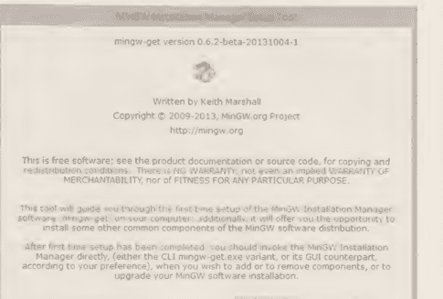

单击 *安装*，你将进入下一个窗口：

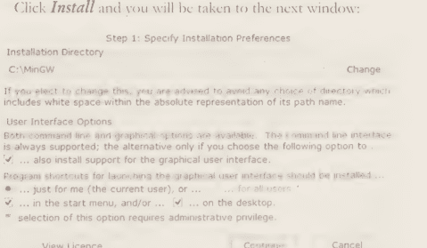

确保安装目录易于访问，不要更改任何其他选项；单击 *继续*。

安装程序现在将下载所有必需文件；这可能需要几分钟。所有文件获取完成后，安装窗口将如下所示：

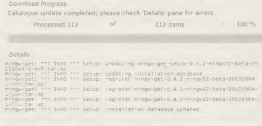

单击 *继续*，*MinGW Installation Manager* 应会启动。你将在这里安装 *GCC* 编译器。

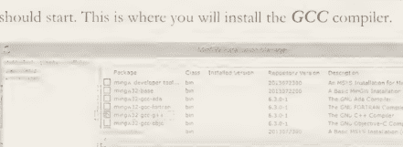

单击 *mingw32-gcc-g++* 旁边的复选框，单击“标记为安装”。从菜单栏单击 *安装 -> 应用更改*。*GCC*（*g++*）编译器的安装过程现在将开始，可能需要几分钟才能完成。

打开 *文件资源管理器*（或“我的电脑/此电脑”），转到 *MinGW 安装目录*（如果你在安装期间未更改任何选项，则该目录为 `C:\MinGW`），打开 *bin* 文件夹，并确认存在名为 `g++ (g++.exe)` 的文件；如果存在，则安装成功。需要将此 bin 文件夹的路径（例如 `C:\MinGW\bin`）添加到 *Path 环境变量* 中，以便 g++ 可在全局访问。为此，请打开 *系统属性*（打开控制面板，在搜索框中搜索 *高级系统设置*，然后单击 *查看高级系统设置*）。转到 *高级* 选项卡，单击 *环境变量*。在 *系统变量* 下，找到变量 *Path*，单击 *编辑*。将弹出以下对话框：

#### 环境变量

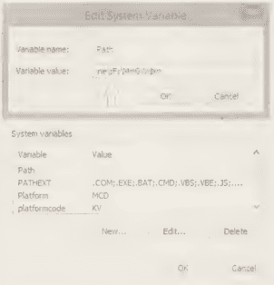

#### 系统属性

计算机名 · 硬件 · 高级 · 系统保护 · 远程

#### 编辑系统变量

变量名: Path
变量值: [模糊]

确定 · 取消

#### 系统变量

| 变量 | 值 |
|---|---|
| Path |  |
| PATHEXT | .COM; .EXE; .BAT; .CMD; .VBS; .VBE; .JS; … |
| Platform | MCD |
| Platformmode | KV |

新建… · 编辑… · 删除

确定 · 取消

*变量值* 字段中会有一些值。如果文本末尾没有分号（;），请添加一个分号，并将完整的 `MinGW\bin` 路径（例如 `C:\MinGW\bin`）追加到其后，如上图所示。逐个单击 *确定* 关闭所有对话框。

打开 *命令提示符*，输入 `g++` 并按 Enter。如果你看到如下错误——“'g++' 不是内部或外部命令，也不是可运行的程序或批处理文件。”，则说明安装或 *Path* 变量有问题。在这种情况下，请仔细遵循本节（*第 2.1.1 节*）中提到的每一步。安装成功且 *Path* 变量设置正确后，`g++` 命令应返回以下错误——“g++: 致命错误：没有输入文件，编译终止。”。

如果安装成功且 *Path* 变量已正确设置，*命令提示符* 将如下所示：

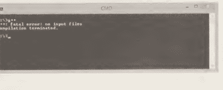

### 2.1.2 Linux 上的 GCC/Clang 安装

大多数 Linux 操作系统内置 GCC 和/或 Clang。要检查你的 Linux 操作系统是否具有 GCC 和/或 Clang，请打开终端/Shell，并分别输入 `g++` 和 `clang++`。

如果存在 GCC，输入 `g++` 命令后，终端/Shell 将如下所示：

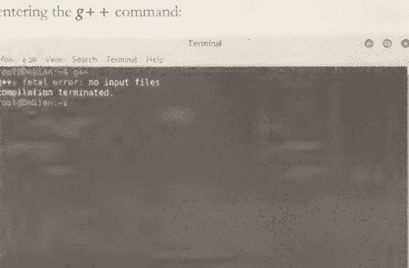

如果存在 Clang，输入 `clang++` 命令后，终端/Shell 将如下所示：

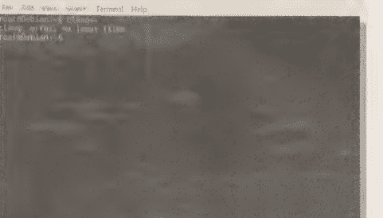

只要存在 GCC 或 Clang 之一，就足以编译和执行本书演示的程序。如果两个编译器都不存在，你将需要安装其中一个（我推荐 GCC）。安装过程因操作系统而异。以下是大多数常见 Linux 操作系统的 GCC 安装过程：

#### 对于 Ubuntu、Linux Mint 及其他基于 Debian 的系统：

打开 *终端/Shell*，逐条输入以下命令：

```
$>sudo apt-get update
$>sudo apt-get install gcc
```

#### 对于 Manjaro、Antergos 及其他基于 Arch Linux 的系统：

打开 *终端/Shell*，输入以下命令：

# 2. 入门

```
g++ <source .cpp file> -o <executable output file>
eg:
g++ hello.cpp -o hello
```

要使用 Clang 编译 C++ 程序，请使用以下命令：

```
clang++ <source .cpp file> -o <executable output
file>
eg:
clang++ hello.cpp -o hello
```

如果源文件中没有错误且编译成功，则将按照编译命令中 **-o** 选项的指定生成可执行输出文件。在 Windows 上，可执行文件将自动带有 .exe 扩展名。如果未设置 **-o** 选项，即未指定输出文件，则编译成功后，在 Linux/Mac 上将生成名为 *a.out* 的可执行文件，在 Windows 上将生成 *a.exe*。

为了执行编译后的程序，请使用以下命令：

**在 Linux/Mac 上：**

```
./<executable output file>
eg:
./hello
```

**在 Windows 上：**

```
<executable output file>
eg:
hello.exe
```


# 2. 入门

让我们看一个示例。无论使用哪种操作系统，请打开你选择的文本编辑器，复制以下 C++ 代码并将其粘贴到文本编辑器中。这段代码只在屏幕上显示 *Hello World!!!*。你现在不必理解这段代码，只需学习编译和执行过程。

```cpp
#include <iostream>

using namespace std;

int main()
{
    cout << endl << "Hello World!!!" << endl << endl;
    return 0;
}
```

将文件以 *helloworld.cpp* 为名保存到一个方便的位置。在 Windows 上打开命令提示符，在 Linux/MAC 上打开终端。使用 *cd* 命令导航到 *helloworld.cpp* 所在目录。

在 Windows 上使用 GCC 编译器，使用以下命令编译代码：

```bash
g++ helloworld.cpp -o helloworld
```

如果编译过程成功，将不会返回错误消息，并会生成 *helloworld.exe* 文件：

```text
P:\cpp> g++ helloworld.cpp -o helloworld
P:\cpp>
```

使用 *dir* 命令或通过 *文件资源管理器* 手动进入目录，交叉检查 *helloworld.exe* 文件是否存在。以下是 *dir* 命令的输出：

```text
P:\cpp> g++ helloworld.cpp -o helloworld
P:\cpp> dir
 Volume in drive P is Data
 Volume Serial Number is ...
 Directory of P:\cpp
...
24-05-2018  12:24 ...  helloworld.cpp
24-05-2018  12:24 ...  helloworld.exe
...
P:\cpp>
```

如所见，*helloworld.exe* 已创建。要执行，只需输入 *helloworld.exe* 并按 Enter。输出应如下所示：

```text
P:\cpp> helloworld.exe
Hello World!!!
P:\cpp>
```

这就是本书整个课程中将遵循的编译和执行过程。

如果你在 Linux/MAC 上使用 GCC 编译器，使用相同命令：

```bash
$> g++ helloworld.cpp -o helloworld
```

应编译 *helloworld.cpp* 程序，并创建一个名为 *helloworld* 的可执行文件（而不是 Windows 中的 *helloworld.exe*）。要执行此文件，请使用以下命令：

```bash
$> ./helloworld
```

以下截图说明了 Linux 和 MAC 上的编译（使用 g++）和执行过程：

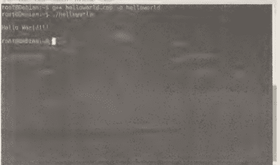

如果你在 Linux/MAC 上使用 Clang 编译器，请使用以下命令：

```bash
$> clang++ helloworld.cpp -o helloworld
```

此命令将编译 *helloworld.cpp* 并生成可执行文件 *helloworld*。要执行此文件，请使用以下命令：

```bash
$> ./helloworld
```

以下截图说明了 Linux 和 MAC 上的编译（使用 clang++）和执行过程。

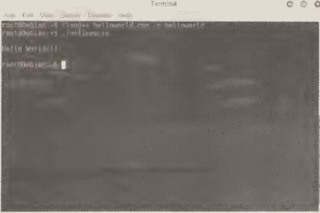

无论你使用哪种操作系统，你一定已经意识到编译和执行过程或多或少相同。在本书后续章节中，我们将学习若干 C++ 概念，并编译和执行许多 C++ 程序。无论你选择哪种操作系统/文本编辑器/编译器，在编译程序然后执行它时，你都应该非常得心应手。

# 3. 语法

C++ 是一种区分大小写的语言。这意味着，“ebook”和“eBook”会被区别对待。本节将讨论 C++ 的基本语法，并学习编写一个基本程序。

## 3.1 语句

编程语言中的语句执行某种计算功能。C++ 中的语句以分号（;）结尾。尽管可以在一行中放置任意多条语句，并用分号分隔每条语句，但并不推荐这样做，因为代码会显得杂乱，可读性会降低。最佳实践是一行一条语句。语句示例如下：

```cpp
c = 50;
cout << "Hello World";
int a = c * 2;
```

## 3.2 块

块是由花括号（{ }）括起来的一组语句。示例如下：

```cpp
{
    int a, b, c;
    cout << "This is a block";
}
```

在使用决策、循环、函数和类时，块的使用非常重要。我们将在后续章节中详细讨论这些内容。

## 3.3 预处理指令

预处理指令是以井号（#）开头的语句。与普通语句不同，它们不以分号结尾，因此每条预处理指令必须写在新的一行。预处理指令在编译过程开始之前处理。在某种程度上，它们向编译器提供元信息。以下是一些预处理指令示例：

```cpp
#include <iostream>
#define PI 3.14
#pragma startup myfunction
```

除 #include 和 #define 之外的预处理指令面向高级程序员，本书只涵盖所需的部分。

## 3.4 注释

注释会被编译器忽略，不会对编译过程的结果产生任何影响。通常，注释是解释性语句，但你可以将它们用于任何注释目的。C++ 提供单行注释和多行注释。单行注释以双斜杠（//）开头，并且必须在同一行结束。多行注释就像注释块，括在以下字符序列中——斜杠星号（/*）和星号斜杠（*/）。

### 单行注释示例：

```cpp
//This is a comment
//This is another comment
```

如所见，新行上的每条注释都必须以双斜杠开头。

### 多行注释示例：

```cpp
/*
Comment block begins here.
As many lines can be added within the block.
No need for double slash ( // )
*/
```

## 3.5 标识符

标识符用于标识变量、函数、类和对象等。标识符名称可以包含字母（a-z、A-Z）、数字（0-9）和下划线（_），但不能以数字开头，也不能包含任何其他特殊字符。

## 3.6 关键字

C++ 中的关键字是保留字，不能用作标识符名称。关键字具有特定含义，用于告诉编译器要做什么。以下是按字母顺序排列的关键字列表：

| | | | |
| --- | --- | --- | --- |
| asm | else | new | this |
| auto | enum | operator | throw |
| bool | explicit | private | true |
| break | export | protected | try |
| case | extern | public | typedef |
| catch | false | register | typeid |
| char | float | reinterpret_cast | typename |
| class | for | return | union |
| const | friend | short | unsigned |
| const_cast | goto | signed | using |
| continue | if | sizeof | virtual |
| default | inline | static | void |
| delete | int | static_cast | volatile |
| do | long | struct | wchar_t |
| double | mutable | switch | while |
| dynamic_cast | namespace | template | |

## 3.7 基本 C++ 程序结构

一个非常基本的独立 C++ 程序必须包含以下组成部分：

- 1. `#include <iostream>` 语句：

  如*第 3.3 节*所述，所有以井号（#）开头的语句都是预处理指令。**#include** 指令指示编译器要包含哪个*头文件*。*头文件*包含变量、函数以及类和对象的定义，可用于各种目的。包含头文件的一般语法如下：

```cpp
#include <header here>
Eg:
#include <iostream>
#include <fstream>
```

**#include** 语句也可用于包含头文件，这些头文件可以是编译器提供的，也可以是用户定义的本地头文件（放在与程序相同的目录中）。要包含本地头文件，文件名必须放在双引号内，而不是尖括号内，如下所示：

```cpp
#include "my_header_file.h"
```

**`#include <iostream>`** 语句指示编译器包含 *iostream* 头文件，该头文件提供**输入/输出流**，用于从用户读取数据并在屏幕上显示数据。如果你想编写一个与用户交互的独立 C++ 程序——无论是接受输入还是在屏幕上显示内容——你必须在程序中放置 **`#include <iostream>`**，通常放在前几行。

不同的编译器提供了许多这样的内置头文件。例如，*fstream* 头文件用于文件输入/输出，*iomanip* 用于格式化要在屏幕上显示的输出，*cmath* 提供执行数学函数的定义，等等。C++ 还向后兼容大多数传统 C 头文件（以 .h 结尾的文件），例如——*stdlib.h、stdio.h、math.h*。


**float.h** 等。这些由编译器软件提供，因此应放在尖括号内，而不是引号内，如下所示：

```cpp
#include <stdlib.h>
#include <float.h>
```

### 3.7.1 主方法

主方法充当程序的入口点。每个独立的 C++ 程序都必须有一个主方法，否则程序将不知道从哪里开始执行。主方法本质上是一个包含在花括号（{ }）内的函数块。主方法的一般语法如下：

```cpp
int main()
{
    Statements...
    return 0;
}
```

结合本节所学内容，下面是一个什么都不做、但能正确编译和执行的 C++ 程序。

```cpp
#include <iostream>
int main()
{
    //No meaningful statements, just a comment.
    return 0;
}
```

你可以尝试编译并执行上述程序。过程会顺利进行，但屏幕上不会看到任何有意义的内容，因为该程序什么都不做。编译和执行后，你将看到如下内容：

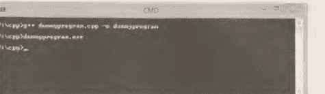

### 3.7.2 第一个 C++ 程序

现在，让我们学习编写一个简单的 C++ 程序，在屏幕上显示一条消息。*iostream* 头文件提供了一个名为 *cout* 的对象，用于在*标准字符输出*设备上显示数据，大多数情况下该设备就是计算机屏幕。有一种方法可以使用 *I/O 流*将输出重定向到其他设备，而不是默认的计算机屏幕，但这属于相当高级的主题，超出了本书的范围。在本书的整个学习过程中，你将始终使用 *cout* 仅在屏幕上显示数据。*cout* 属于 *iostream* 头文件的 *std* 命名空间，因此需要在 *cout* 前加上 `std::`。

使用 *cout* 的一般语法是：

```cpp
std::cout << {data};
```

*cout* 后跟一个*插入运算符*（`<<`），再后跟要显示的数据。该数据可以是常量、表达式或变量。要显示一条消息，可以使用用双引号括起来的常量字符串。例如：

```cpp
std::cout << "This is a test message";
```

你可以使用新的插入运算符显示任意多个表达式：

```cpp
std::cout << "This is message 1 " << " This is message 2";
```

要在屏幕上插入换行，可使用 *endl*，它属于 *std* 命名空间，因此需要加上 `std::` 前缀。它不是字符串的一部分；因此它应放在引号之外，但要位于新的插入运算符之后：

```cpp
std::cout << "This is line 1" << std::endl <<
"This is line 2" << std::endl;
```

既然我们已经学习了基本的程序结构以及如何在屏幕上显示消息，现在让我们把所有概念结合起来，编写一个在屏幕上显示一些文本的 C++ 程序。如果你已经理解了到目前为止涵盖的章节，理解以下代码不会有问题：

```cpp
int main()
{
    std::cout << std::endl <<
               ;
    std::cout << std::endl <<
               ;
    std::cout << std::endl <<
               ;
    std::cout << std::endl;
    return 0;
}
```

该程序的输出应如下所示：

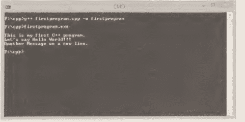

在 `cout`、`endl` 以及 `std` 命名空间的其他成员前加上 `std::` 可能很繁琐。有一种方法可以避免这种情况：在开头告诉编译器你将使用 `std` 命名空间。这可以借助 `using` 关键字完成；应在 include 语句之后插入以下语句：

```cpp
using namespace std;
```

如果你在代码中包含了这条语句，`std::cout` 就变成 `cout`，`std::endl` 就变成 `endl`，并且 `std` 命名空间的所有其他成员都可以在不加 `std::` 的情况下使用。

除了 `endl`，还可以在字符串内使用转义序列 `\n` 来插入换行。另一个有用的转义序列是 `\t`，用于插入制表符空格。

让我们编写另一个 C++ 程序，加入 `using namespace std` 语句以摆脱 `std::` 前缀。该程序还将演示 `\n` 和 `\t` 转义序列的用法：

# 3. 语法

```cpp
// get rid of std:: prefix
using namespace std;

// ... main method
int main()
{
    cout << "\nThis is my second C++ program.";
    cout << endl <<
    cout << endl <<

    cout << endl;

    return 0;
}
```

上述程序的输出应如下所示：

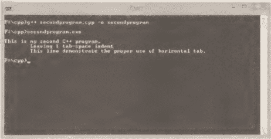

值得注意的是，在包含 *using namespace std* 语句后，代码在没有 `std::` 前缀时看起来多么简洁。我们后续的所有程序都应包含这条语句。

## 3.8 编译错误

如果你不遵循 C++ 语法和规则，就会遇到编译错误。有时编译器会告诉你哪里出错，有时不会，错误消息会笼统而模糊。密切关注你编写的代码并严格遵循语法很重要。

让我们举一个例子，为了演示编译错误，我们故意不遵循语法。下面这段代码中，我没有用分号结束 *cout* 语句：

```cpp
using namespace std;

int main()
{
    cout << "This is a test"
    return 0;
}
```

编译时会发生以下情况：

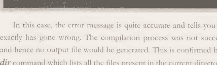

在这种情况下，错误消息相当准确，并告诉你到底哪里出错了。编译过程未成功，因此不会生成输出文件。*dir* 命令列出了当前目录中存在的所有文件，证实了这一点：

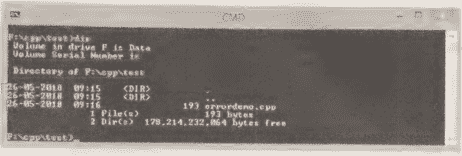

# 4. 数据类型

数据类型用于定义我们所处理的数据类型。编程时，我们使用各种变量来存储数据。声明变量时，会在内存位置中为其分配一些内存。根据所用数据的类型，分配适当的内存。C++ 提供内置数据类型以及用户定义的数据类型。用户定义的数据类型使用类和对象构成。如果你熟悉编程，一定已经听说过 *int*（用于整数值）、*float*（用于浮点/小数值）、*char*（用于字符值）等数据类型。以下是内置数据类型的列表：

| 类型 | 大小 | 范围 |
|---|---|---|
| char | 1 字节 | -127 到 127 或 0 到 255 |
| unsigned char | 1 字节 | 0 到 255 |
| signed char | 1 字节 | -127 到 127 |
| int | 4 字节 | -2147483648 到 2147483647 |
| unsigned int | 4 字节 | 0 到 4294967295 |
| signed int | 4 字节 | -2147483648 到 2147483647 |
| short int | 2 字节 | -32768 到 32767 |
| unsigned short int | 2 字节 | 0 到 65,535 |
| signed short int | 2 字节 | -32768 到 32767 |
| long int | 4 字节 | -2,147,483,648 到 2,147,483,647 |
| signed long int | 4 字节 | -2,147,483,648 到 2,147,483,647 |
| unsigned long int | 4 字节 | 0 到 4,294,967,295 |
| float | 4 字节 | 1.17549e-38 到 3.40282e+38 |
| double | 8 字节 | 2.22507e-308 到 1.79769e+308 |
| long double | 12 字节 | 因操作系统而异 |

这些是内置的原始数据类型。如你所见，其中没有提到字符串数据类型。这是因为字符串只是字符序列，而字符数组可以很好地充当字符串。不过，C++ 提供了一种单独的非原始数据类型，称为 *string 类*，它是 *std 命名空间*的一部分。

*注意：* 虽然大多数时候大小和范围值与上述相同，但可能因编译器和/或操作系统而异。除非你在嵌入式系统等受限环境中编写对性能至关重要的低级应用程序，否则这不算什么大问题。

## 趣味练习

为了展示不同操作系统间数据类型大小的差异，这里有一个趣味练习——有一个名为 *sizeof()* 的运算符，它返回所提及的数据、数据类型、变量或常量的大小。以下代码使用 GCC 分别在 Windows 和 Linux 操作系统上编译并执行：

```cpp
using namespace std;

int main()
{
    cout << "Size of int: " << sizeof(int) << endl;
    cout << "Size of long int: " << sizeof(long int) << endl;
    cout << "Size of char: " << sizeof(char) << endl;
    cout << "Size of float: " << sizeof(float) << endl;
    cout << "Size of long double: " << sizeof(long double) << endl;
}
```


```cpp
return;
}
```

某些数据类型的大小在 Windows 和 Linux 上有所不同。

### Windows 输出：

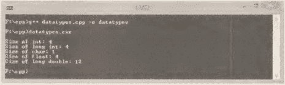

### Linux 输出：

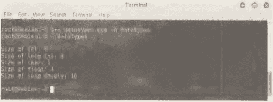

基于内存的即时补充系统由系统结构的四个关键反馈回路组成。管理决策仍然至关重要。在这个三阶组织学习系统中，三阶反馈结构完成一个循环。每个战略性系统结构都组合了五组洞见，其中前三组与……存在相关性。最后两组洞见捕捉了决定这些系统运动的变量边界。

表 25.8 管理中的系统思考

| 概念 | 解释 |
| --- | --- |
| (c1.14) 模糊性 | 关于系统结构的不确定状态 |
| (c1.15) 适应性 | 学习并调整行为的能力 |
| (c1.16) ... | ... |

作者在先前关于系统思考的文章中使用的反馈回路图基于表 25.8 中的概念，如图 25.5 所示。

# 5. 变量与常量

## 5.1 变量

变量是赋予保存数据的内存位置的名称。声明变量时，需要在系统内存中保留一些空间。这由操作系统完成。内存分配本质上是随机的，因此变量名作为内存位置的别名非常有用。在上一节中，我们学习了 C++ 中可用的内置数据类型。声明变量时必须指定数据类型。通用语法：

```text
<data type> <variable name>;
eg:
int a;
float b;
char c;
string name;
```

相同数据类型的变量可以通过使用逗号分隔在同一行中声明：

```text
<data type> <variable 1>, <variable 2>;
eg:
int a, b, c;
float x, y;
long double m, n;
```

还可以通过使用赋值运算符（=）为变量赋值来初始化变量。本书中有一章深入讲解运算符。目前，你只需理解赋值运算符如何工作。赋值运算符的作用是将右操作数的值赋给左操作数。例如：

```cpp
int a = 20, b, c = 355;
float x = 2.45;
char z = 'c';
string word = "eBook";
```

## 5.2 常量

常量是只读值，之后不能在程序中更改。在 *第 3.7.1 节* 中，我们学习了编写基本 C++ 程序，其中使用 cout 在屏幕上显示消息。该消息本质上是一个 *常量字符串表达式*。我们将在本书的 *字符串* 章节中进一步学习字符串。

定义常量有两种方法。第一种方法涉及使用 *const* 关键字，第二种方法使用 *#define* 预处理器指令。

### 5.2.1 const 关键字

在声明时在变量前加上 *const* 关键字，即可将变量定义为常量。由于不能更改常量的值，因此在声明时初始化变量很重要。通用语法如下：

```cpp
const <data type> <variable name> = <value>;
eg:
const int num = 100;
const float x = 1.25;
//All variables will become constants:
const char first = 'c', last = 'b';
const string country = "USA";
```

### 5.2.2 #define 预处理器指令

所有预处理器指令都在编译过程开始之前被读取和解释。#define 指令用于定义自定义标识符并设置其值。由于此过程发生在实际编译之前，这些自定义标识符不会被视为传统变量。这些语句不以分号结尾。通用语法：

```cpp
#define <identifier> <value>

#define number 123
#define name "Chad"
#define PI 3.14
```

如所见，无需指定数据类型，你可以使用 #define 指令定义各种常量标识符。此方法的工作方式略有不同。当编译器遇到 #define 指令时，会获取后续的标识符及其对应值。然后，编译器会在代码中该特定标识符出现的任何位置，直接用其获取到的值替换该标识符。这是预处理步骤的一部分，并且对用户是透明的；也就是说，用户看不到这一过程发生。

通过一个示例，这种方法会更加清晰。让我们考虑有两个标识符——shape 和 PI，它们的值分别为 "Circle" 和 3.14。以下是一个代码片段：

```cpp
#define shape "circle"
#define PI 3.14
using namespace std;
int main ( )
{
    cout << shape << endl << PI << endl;
    return 0;
}
```

当这段代码被送去编译时，在预处理期间，*shape* 和 *PI* 的值将在代码中出现 *shape* 和 *PI* 的任何位置被替换。预处理之后，上述代码在编译器看来（而不是用户看来）将如下所示：

```cpp
using namespace std;
int main ( )
{
    cout << "circle" << endl << 3.14 << endl;
    return 0;
}
```

以下是一个注释完善的 C++ 程序，演示了变量和常量的用法：

```cpp
#include <iostream>

using namespace std;

int main ()
{
    int number = 50, x, y;
    A = ..., b = ...;
    first = ..., last = ...;
}
```

将访问 *main 方法* 内部的 *局部变量* number，其值为 *50*。

# 6. 用户交互

在前面的章节中，我们已经了解了如何使用 *cout* 在屏幕上显示数据。在本节中，我们将了解如何与用户交互，以及如何接受用户的输入。

*iostream* 头文件提供了一个名为 *cin* 的对象，用于接受用户输入。*cin* 和 *cout* 一样，是 *std* 命名空间的成员。用法略有不同，*cin* 对象后面应跟 *提取运算符 ( >> )* 和一个变量。通用语法：

```
cin >> [variable];
eg:
string name;
cin >> name;
```

*cin* 的用法是一种阻塞式 I/O 操作。也就是说，当遇到 *cin* 语句时，程序将暂停执行，并等待用户通过键盘输入内容。在上面的示例中，当执行控制到达 *cin >> name;* 语句时，程序将等待用户输入一些文本。一旦用户完成输入并按 Enter，用户输入的任何内容都将被提取并存储到变量 *name* 中。你可以通过多次使用 *提取运算符 ( >> )* 将多个值读入多个变量，如下所示：

```
cin >> [variable 1] >> ... >> [variable n];
eg:
cin >> first_name >> last_name;
```

你尝试读取的变量数量就是程序等待用户输入数据的次数。输入的数据将按照指定变量的顺序被获取。以下是一个简单且注释完善的 C++ 程序，它提示用户输入若干值，然后显示它们：

```cpp
#include <iostream>

using namespace std;

int main ()
{
    // declare variables to store user input
    string first_name, last_name, address;
    int age;
    double weight;

    // Ask the user to enter first and last name
    cout << endl << endl
    << "Enter First and Last Name: " << endl ;
    // Read two inputs into first_name and last_name
    cin >> first_name >> last_name ;

    // enter address
    // cin >> is not capable of reading strings with
    // space
    // getline function is used to read proper strings,
    // which is discussed later in this book
    cout << endl << endl
    << "Enter address: " << endl;
    cin >> address;

    // Ask the user to enter age and weight
    cout << endl << endl
    << "Enter age and weight: " << endl ;
    cin >> age >> weight ;

    // display all
    cout << endl << endl
    << "First Name: " << first_name << endl
    << "Last Name: " << last_name << endl
    << "Address: " << address << endl
    << "Age: " << age << endl
    << "Weight: " << weight << endl ;
}
```

```cpp
    return ;
}
```

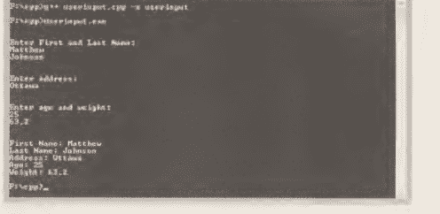

*注意：* `cin >>` 语句可以毫无问题地读取所有基本数据类型。它在某些情况下也可以读取字符串。但是，它不能用于读取带空格的字符串。如果输入了带空格的字符串，空格后的每个值都会被当作一个新输入，而每个新输入都会进入下一个变量（如果存在）。如果不再有变量，空格后的那些值就会被直接丢弃。`cin >>` 语句的这一缺陷可能导致数据类型不匹配，并使程序表现出不同的行为。让我们执行同一个程序来演示。

我没有将 *Matthew（名字）* 和 *Johnson（姓氏）* 作为两个不同的输入，而是将它们放在同一行，并用空格分隔。输出显示程序运行完全正常，*Matthew* 和 *Johnson* 被正确地读取为 *名字* 和 *姓氏*：

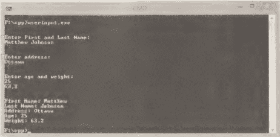

现在，让我们再进行一次运行，并尝试在 *地址* 变量中引入一个空格。我们不用 *Ottawa*，而是输入 *New York*。理论上，“*New*” 应该进入 *地址* 变量，而 “*York*” 会因为 “*New*” 后有一个空格而被视为另一个输入。读取地址后，我们要求用户输入年龄和体重。程序会尝试将 “*York*” 提取到 *整数* 类型的年龄变量中。这将导致数据不匹配的情况，并使程序失去稳定性。输出如下：

# 7. 运算符

编程语言中的运算符是执行特定任务的符号。C++ 中的运算符用于执行数学、逻辑或比较运算。可用的运算符类型如下：

- 1. 算术运算符
- 2. 逻辑运算符
- 3. 位运算符
- 4. 关系运算符
- 5. 赋值运算符

## 7.1 算术运算符

算术运算符用于执行算术/数学运算，例如加法、减法、除法等。

| 运算符 | 描述 | 示例用法 | 说明 |
|---|---|---|---|
| + | 加法 | a + b | 执行算术加法，返回操作数的和。 |
| - | 减法 | a - b | 执行算术减法，返回操作数的差。 |
| * | 乘法 | a * b | 将操作数相乘并返回算术乘积。 |
| / | 除法 | a / b | 执行除法并返回算术商。 |
| % | 取模 | a % b | 执行除法并返回余数。仅限整数类型的操作数使用。 |
| ++ | 自增 | a ++ | 将操作数的值增加 1。有两种形式：后置自增（a ++）和前置自增（++ a）。此运算符仅适用于整数变量。 |
| -- | 自减 | a -- | 将操作数的值减少 1。有两种形式：后置自减（a --）和前置自减（-- a）。此运算符仅适用于整数变量。 |

注意：整数除以整数会导致商为整数，即使该商的算术值本应是小数。例如，此除法 5 / 2 得到的商将是 2，而不是 2.5。要解决这个问题，必须引入一个浮点因子。你可以将 1.0 乘到分子或分母上。表达式 5 / 2 现在会变成 5 * 1.0 / 2 或 5 / 2 * 1.0。你甚至可以像在数学中那样使用括号，以便于操作，或当你希望先执行表达式中的某个运算时——5 / (2 * 1.0)。

```cpp
eg:
int x = 15, y = 4;
float quotient = (x * 1.0) / y;
```

## 7.2 逻辑运算符

逻辑运算符用于执行逻辑与、或和非运算。它们返回 0 或 1。0（以及负数）被视为假，1（以及所有正数）被视为真。

| 运算符 | 描述 | 示例用法 | 说明 |
|---|---|---|---|
| && | 逻辑与 | a && b | 比较操作数，如果所有值均非零则返回 1，否则返回 0。 |
| \|\| | 逻辑或 | a \|\| b | 比较操作数，如果任意一个值非零则返回 1，否则返回 0。 |
| ! | 逻辑非 | !a | 返回操作数的反转值。如果操作数为真值（非零），则返回 0；如果操作数为假值（0 或负数），则返回 1。 |

## 7.3 位运算符

位运算符用于执行逐位的逻辑运算。也就是说，对操作数的每一位执行运算。

| 运算符 | 描述 | 示例用法 | 说明 |
|---|---|---|---|
| `&` | 按位逻辑与 | `a & b` | 对每个操作数逐位执行逻辑与。 |
| `\|` | 按位逻辑或 | `a \| b` | 对每个操作数逐位执行逻辑或。 |
| `~` | 按位逻辑取反 | `~a` | 反转操作数的每一位。 |
| `^` | 按位逻辑异或 | `a ^ b` | 对每个操作数逐位执行逻辑异或。 |
| `<<` | 左移 | `a << b` | 将左侧操作数的位向左移动右操作数指定的位数。根据 *示例用法*，`a << b` 会使 a 的位向左移动 b 次。 |
| `>>` | 右移 | `a >> b` | 将左侧操作数的位向右移动右操作数指定的位数。根据 *示例用法*，`a >> b` 会使 a 的位向右移动 b 次。 |

```cpp
<operand 1> = <operand 2>
eg:
a = 70;
b = a * 2;
c = b;
```

赋值运算符将右侧操作数的值赋给左侧操作数。赋值运算符左侧的操作数必须是变量。赋值运算符右侧的操作数可以是常量、变量或表达式。如果是表达式，会先对其进行求值，然后再赋值，除非使用了后置自增运算符，如下面的代码片段所示：

```cpp
int a, b, c = 100 ;
a = c * 100 ;
b = c++;
```

在将值赋给变量 *a* 之前，会先对表达式 *c * 100* 求值。因此，变量 *a* 现在将保存值 *10000*。而 *c* 的值会先赋给变量 *b*，然后 *c* 再自增。因此，变量 *b* 现在将保存 *100*，变量 *c* 现在将保存 *101*。如果你想先自增再赋值，则需要使用前置自增运算符：*b = ++c*。

### 7.5.1 复合赋值运算符

复合赋值运算符用于先对操作数执行数学运算，然后再赋值。

| 运算符 | 描述 | 示例用法 | 等价于 |
| :---: | :--- | :---: | :---: |
| += | 执行算术加法，然后赋值 | a += b | a = a + b |
| -= | 执行算术减法，然后赋值 | a -= b | a = a - b |
| *= | 执行算术乘法，然后赋值 | a *= b | a = a * b |
| /= | 执行算术除法，然后赋值 | a /= b | a = a / b |
| %= | 计算取模，然后赋值 | a %= b | a = a % b |
| &= | 执行按位逻辑与，然后赋值 | a &= b | a = a & b |
| \|= | 执行按位逻辑或，然后赋值 | a \|= b | a = a \| b |
| ^= | 执行按位逻辑异或，然后赋值 | a ^= b | a = a ^ b |
| <<= | 执行左移，然后赋值 | a <<= b | a = a << b |
| >>= | 执行右移，然后赋值 | a >>= b | a = a >> b |

要理解位运算符的工作方式，需要一些 *布尔代数* 和 *二进制数系统* 的知识。现在，让我们看看如何用二进制形式表示一个整数。*bitset* 头文件提供了一个名为 *bitset* 的对象（属于 *std 命名空间*），用于处理二进制表示。使用 *bitset* 需要在程序中包含 **#include <bitset>**。用二进制形式表示整数的语法如下：

```cpp
bitset<number of bits>
(variable/constant/expression)
eg:
int a = 4;
```


```cpp
<< "exit binary: " << bitset<8> (v) << endl;
//calculate sum, difference, product, quotient and modulus
sum = x + y ;
difference = x - y ;
product = x * y ;
quotient = x / ( y * ... ) ;
modulus = x % y ;
//display calculated values
cout << endl
     << "x + y = " << sum << endl
     << "x - y = " << difference << endl
     << "x * y = " << product << endl
     << "x / y = " << quotient << endl
     << "x % y = " << modulus << endl;
//Perform Bitwise Operations and display directly
cout << endl
     << "x & y : " << bitset<8> (x & y) << endl
     << "x | y : " << bitset<8> (x | y) << endl
     << "x << y : " << bitset<8> (x << y) << endl
     << "x >> y : " << bitset<8> (x >> y) << endl;

return 0;
}
```

```text
C:\Users\...> operatordemo.cpp
...
C:\Users\...> operatordemo.exe
Enter two integers:
125
x: 125
y: 5
x (8-bit binary): 01111101
y (8-bit binary): 00000101
x: 125
y: 125
x+y = 250
x-y = 0
x*y = 625
x/y = 25
x%y = 0
x: 250
y: 5
x (8-bit binary): 11111010
y (8-bit binary): 00000101
x+y = 255
x-y = 245
x*y = 1250
x/y = 50
x%y = 0
C:\Users\...>
```

# 8. 控制结构

控制结构用于对程序的执行进行控制。C++ 以决策结构（if-else 和 switch）以及循环的形式提供控制结构。

## 8.1 决策

决策结构以 if-else 语句和 switch-case 语句的形式提供。

### 8.1.1 if-else 结构

使用 if 语句的一般语法如下：

```cpp
if ( <condition> )
{
    //This is the if-block
    <statements...>
}
```

一旦执行控制到达 *if* 语句，就会对 *<条件>* 字段中的表达式求值。*<条件>* 被视为布尔表达式。该表达式的求值结果可以是 0（假）或 1（真）。如果布尔表达式的求值结果为 1，则执行 *if 块* 内的语句。值为 0 将跳过 *if 块* 的执行。块用花括号（{ }）括起来。*if 块* 后面可以跟一个可选的 *else 块*，如下所示：

```cpp
if ( <condition> )
{
    //This is the if-block
    <statements...>
}
else
{
    //This is the else-block
    <statements...>
}
```

当存在 *if* 块和 *else* 块，并且 *if 语句* 的指定条件求值为 *假* 时，才会执行 *else 块*。

*注意：* *else 块* 应紧跟在 *if 块* 之后，这意味着在 *if 块* 结束之后、else 语句之前不能有任何语句。

也可以如下嵌套 if-else 语句：

```cpp
if ( <condition 1> )
{
    //This block will be executed if <condition 1> is
    true.
    if ( <condition 2> )
    {
        //This block will be executed if <condition 1>
        and <condition 2> is true.
        <statements...>
    }
    else
    {
        //This block will be executed if <condition 1>
        is true and <condition 2> is false.
    }
}
<statements...>
}
}
else
{
    //This block will be executed if <condition 1> is
    false.
    if ( <condition 3> )
    {
        //This block will be executed if <condition 1>
        is false and <condition 3> is true.
        <statements...>
    }
}
```

还有一种使用 *else if* 语句编写 *if-else* 决策结构的方法。*else if* 结构的工作方式是——必须有一个 *if* 语句，如果 *if* 语句的条件求值为 *假*，控制将转到紧随其后的 *else if* 语句（如果存在），并计算该 *else if* 语句的条件。如果求值为 *1*，则执行 *else if* 块，并忽略其余的 *else if* 和 *else* 块（如果存在）；如果求值为 *0*，则控制将转到下一个 *else if* 或 *else* 语句（如果有）。可以根据需要拥有任意多个 *else if* 语句。一般语法如下：

```cpp
if ( <condition 1>)
{
    //This block will be executed if <condition 1> is
    true.
}
else if ( <condition 2> )
{
    //This block will be executed if <condition 1> is
    false and <condition 2> is true.
    <statements...>
}
else if ( <condition 3> )
{
    //This block will be executed if <condition 1>
    and <condition 2> are false and <condition 3> is
    true.
    <statements...>
}
else
{
    //This block will be executed if <condition 1>,
    <condition 2> and <condition 3> are false.
}
```

**注意：** 如果 if、else if 或 else 块内只有一条语句，则无需用花括号指定该块。

下面是一个简单的 C++ 程序，演示 if-else 语句的用法。该程序接受用户输入的整数，并检查它是正数、负数还是零：

```cpp
#include <iostream>

using namespace std;

int main ()
{
    int i;
    int number;
    //Ask the user to enter
    cout << endl << endl
         << "Enter an integer: ";
    //Wait for user input, accept it into number variable
    cin >> number;
}
```

```cpp
default:
    cout << "The number: " << number <<
        " is invalid.";
}
cout << endl;

return 0;
}
```

该程序运行了 3 次以演示不同情况：

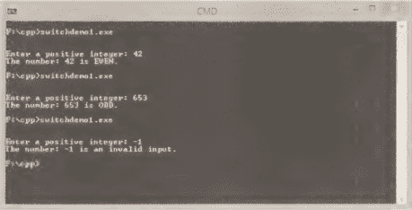

让我们再看一个例子，更好地说明 *break;* 语句存在与不存在时会发生什么。下面是一个 C++ 程序，用于检查输入的字符是元音还是辅音：

```cpp
using namespace std;

int main ()
{
    // Declare a variable to store user input
    char input;
    // Ask the user to enter a character
    cout << endl << endl
         << "Enter a character: ";
    // Wait for the user to enter
    cin >> input;
    // Check for vowel or consonant
    switch ( input )
    {
        case 'a':
        case 'e':
        case 'i':
        case 'o':
        case 'u':
        case 'A':
        case 'E':
        case 'I':
        case 'O':
        case 'U':
            cout << "The entered char: " << input << " is a vowel." << endl;
            // Break the execution from case 'a' to case 'U'
            break;
        // Default case for consonants
        default:
            cout << "The entered char: " << input << " is a consonant." << endl;
    }
    return 0;
}
```

从上述代码可以看出，从 *case 'a'* 到 *case 'U'* 没有 *break* 语句。这是因为中间的所有 case 都是元音，并且我们不希望在检测到元音时中断执行。如果我们在每个元音 case 之后都使用 *break* 语句，那么就需要在每个元音 case 内放置一个 *cout* 语句来显示输入字符是元音。输出如下：

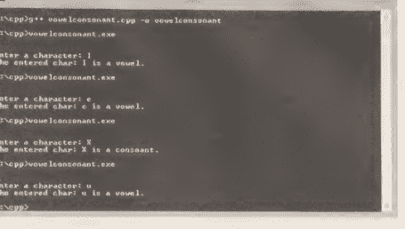

## 8.2 循环

循环用于反复执行一组语句，直到满足指定条件。C++ 提供 3 种循环——*while 循环*、*do while 循环*和 *for 循环*。我们将详细研究每一种。

### 8.2.1 while 循环

使用 while 循环的语法如下：

```cpp
while (<condition>)
{
    //Statements...
}
```

while 循环应提供一个条件，在上述代码片段中用 *<条件>* 字段表示。如果指定条件求值为 *1 或非零数字*，则视为 *真*，并逐条执行 while 块内的语句。一旦执行到达块末尾，就会再次检查指定条件；如果求值为非零数字，则再次执行该块。此过程一直持续到指定条件求值为 *0 或负数*。循环块执行的每一次实例称为一次 *迭代*。

下面是一个使用 while 循环在屏幕上显示 1 到 10 的代码片段：

```cpp
//Initialize an integer variable to 1
int number = 1;
while ( number <= 10 )
{
    //Display number
    cout << number << " " ;
    //Increment number
    number ++;
}
```

### 8.2.2 do-while 循环

使用 do-while 循环的语法如下：

```cpp
do
{
    //Statements...
} while (<condition>);
```

*do-while* 循环的工作方式与 *while* 循环类似，但有一个主要区别。它不是在循环开始时检查指定条件，而是在结束时检查。也就是说，当程序遇到 do-while 块时，会立即执行其中的语句，然后检查条件。这意味着，*do-while* 循环下的语句*保证会*


即使指定条件的结果为 *0 或负数*，也至少会被执行一次。

下面这段代码使用 do-while 循环在屏幕上显示从 1 到 10 的数字：

```cpp
//Initialize an integer variable to 1
int number = 1;
do
{
    //Display number
    cout << number << " ";
    //Increment number
    number ++;
} while ( number <= 10 );
```

### 8.2.3 for 循环

for 循环的语法如下：

```cpp
for ( <loop variable initialization> ; <condition> ;
<expression> )
{
    statement;
}
```

*for 循环*比 *while* 和 *do while* 循环的功能更强大。它允许你使用一个专门的循环变量进行迭代。只要指定的 *<condition>* 的结果不为零，循环就会继续执行。*<expression>* 可以包含任何数学表达式，这个字段通常用于递增或递减循环变量。

下面这段代码使用 *for 循环*在屏幕上显示从 1 到 10 的数字：

```cpp
//Declare an integer variable
int number;
for ( number = 1 ; number <= 10 ; number ++)
{
    //Display number
    cout << number << " ";
}
```

循环还可以嵌套。让我们编写一个 C++ 程序，使用嵌套循环绘制下面的图案：

```text
*

***

*****

*******

*********

***********

*************

***************

*****************

*******************
```

如图所示，图案中共有 10 行。每行有奇数个星号。表达式：*(( 2 x 行号 ) - 1 )* 可以给出每行要打印的星号数量。

我们总共需要 3 个循环——一个外层循环用于跟踪行数，两个内层循环分别用于跟踪要留出的空格数和要打印的星号数。代码如下：

```cpp
#include <iostream>
using namespace std;
int main ()
{
    int i, j, k, space = 5, star = 1 ;
    cout << endl << endl;

    // loop for no. of lines
    for (i = 1 ; i <= 5 ; i ++)
    {
        space -- ;
        star = ( 2 * i) - 1 ;
        j = 1 ;

        while ( j ++ < space )
        {
            // leave spaces "space" number of times
            cout << ' ' ;
        }
        k = 1 ;

        while ( k ++ < star )
        {
            // print star "star" number of times
            cout << '*' ;
        }
        cout << endl ;
    }
    cout << endl << endl ;
    return 0 ;
}
```

输出：

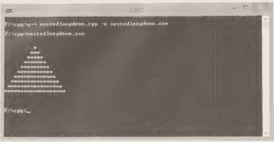

### 8.2.4 控制语句

（控制）语句用于对循环的执行进行控制。通常，循环会一直执行直到满足指定条件。控制语句允许你在指定条件之外控制循环的执行。C++ 提供了两种控制语句——*break* 和 *continue*。我们已经在第 **8.2.1** 节中看到了 *break* 语句的用法，用于将控制从 *switch-case* 块中跳出。

#### 8.2.4.1 break 语句

*break* 语句用于终止循环的执行。当遇到 *break* 语句时，即使指定条件的结果不为零，执行控制也会跳出循环块。让我们看一个例子。假设你想编写一个 *while* 循环来显示从 1 到 10 的整数，但希望在值达到 7 时退出循环。下面是使用 break 语句实现的方法：

```cpp
//Initialize a variable x to 1
int x = 1;
//Check if x is less than or equal to 10.
//As long as this condition is met, keep executing the loop.
while ( x <= 10 )
{
    //When x becomes 7, break out of the loop.
    if ( x == 7 )
    break;
    //Write the value of x on the screen.
    cout << x << " ";
    //Increment x by 1.
    x++;
}
```

#### 8.2.4.2 continue 语句

*continue* 语句用于将控制转移到循环的开始处。当遇到 *continue* 语句时，循环块中剩余的语句将被忽略，循环进入下一次迭代。对于 *while* 和 *do-while* 循环，控制会分别跳转回 *while (<condition>)* 和 *do* 语句。在 *for* 循环中，*continue* 语句会将执行控制带到循环的开头，从而递增/递减循环变量。假设你想只打印从 1 到 10 中的偶数。下面是如何使用 *continue* 语句实现的方法。

```cpp
for ( int x = 1 ; x <= 10 ; x ++ )
{
    //If x is not divisible by 2, it means x is odd.
    //In such a case, you want to skip all the remaining statements.
    if ( x % 2 == 1 )
        continue;
    cout << x << " " ;
}
```

*注意：* 如果循环块内只有一条语句，则无需将其放在花括号中。

让我们借助一个编程教程来演示控制语句的用法。下面是一个 C++ 程序，它接受用户输入的整数，并检查它是质数还是合数。

```cpp
#include <iostream>

using namespace std;

main ()
{
    // declare an integer to accept and store user input
    // and also loop variable
    int i, number;
    //Ask the user to enter a number
    cout << endl << endl
         << "Enter a number: ";
    //Wait for user input, accept it into number variable
    cin >> number;
    //Loop from 1 to number
    for ( i = 1; i <= number ; i ++)
    {
        // if divisible by i
        if ( i == 1 )
            continue;

        if ( number % i == 0 )
        break;
    }
    if ( i == number )
        cout << endl << endl
            << "Number: " << number << " is not prime." << endl ;
    else
        cout << endl << endl
            << "Number: " << number << " is prime." << endl ;
    return ;
}
```

输出：

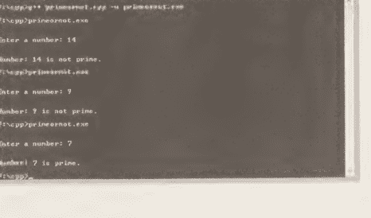

# 9. 函数

函数是执行特定任务的代码块。函数（同义词为方法）用于需要重复使用某段代码的场景。C++ 标准库提供了内置函数，我们也可以定义自己的函数。处理用户自定义函数时需要了解两件事——函数定义和函数调用。

## 9.1 函数定义

函数应在 main 方法之外定义。一般语法如下：

```cpp
<return data type> <function name> ( <parameters> )
{
    //Function Body
    //Statements...
    return <value>; //Only if the function returns a value.
}
```

函数定义的重要部分包括：返回数据类型、函数名、参数、函数体。

### 返回数据类型

该字段指定函数返回的数据类型。例如，如果你有一个函数返回两个整数的和，那么该函数的返回类型应为 **int**。如果函数不返回任何数据，则返回类型应为 **void**。如果函数返回一个值，则必须在函数体末尾有一条必需的 return 语句。

### 函数名

函数名是为函数赋予的名称，用于标识。该名称用于调用函数。

### 参数

参数是函数接受的一组变量。这些变量在调用函数时被发送给函数。每个参数之间用逗号分隔。

### 函数体

这是函数定义的核心部分，函数的实际工作从这里开始。计算语句就放在这里。如果函数返回一个值，则必须在函数体末尾有一条必需的 return 语句。函数只能返回一个值。

以下是几个函数定义的示例：

一个不返回任何数据、不接受任何参数、仅在屏幕上显示消息的函数：

```cpp
void display_message ( )
{
    cout << endl << "Hello! We are inside a function block! " << endl;
}
```

一个接受 3 个参数并显示它们的和、但不返回任何数据的函数：

```cpp
void display_sum (int x , int y , int z )
```


```cpp
}
cout << endl << "Sum: " << (x + y + z) << endl;
}
```

一个接受 2 个整数值并以浮点形式返回除法商的函数。该函数应具有 float 返回类型：

```cpp
float divide(int a, int b)
{
    float quotient = (a * 1.0) / b;
    return quotient;
}
```

### 9.1.1 函数原型

函数原型是在定义函数之前声明函数的过程。这通常不是强制性的，但是一种良好的编程实践。函数原型告诉编译器存在哪些类型的函数。

语法：

```cpp
<return data type> <function name> ( <parameters or parameter's type> );
```

原型声明应放在函数定义之前，最好放在前几行，位于 *using namespace std;* 语句之后。上一示例中 divide 函数的原型如下：

```cpp
float divide(int a, int b);
// OR
float divide(int, int);
```

## 9.2 函数调用

函数定义包含函数执行的一组操作。然而，除非对该函数进行调用，否则该代码将保持不活动状态。调用函数也称为调用函数。一般语法是：

```cpp
<function name> ( <parameters> );
```

让我们回顾 *第 9.1 节：* 中作为示例解释的 *display_sum* 函数的定义：

```cpp
void display_sum(int x, int y, int z)
{
    cout << endl << "Sum: " << (x + y + z) << endl;
}
```

如果我们要调用这个函数，我们会使用以下语句：

```cpp
display_sum(4, 5, 10);
```

*display_sum* 函数接受 3 个整数值作为参数，因此在函数调用期间，整数值 **4、5 和 10** 作为 *函数实参* 传递给它。这些值将分别由 x、y 和 z 接收。

如果一个函数返回值，应该有一个变量来接收该值。一般语法：

```cpp
<variable> = <function name> ( <parameters> );
```

```cpp
cout << "quotient: " << divide(44, 5);
```

让我们将 `display_message`、`display_sum` 和 `divide` 函数放入一段 C++ 代码中，并对它们进行不同的调用，以演示函数的用法：

```cpp
#include <iostream>

using namespace std;

float divide(int, int);
void display_sum(int x, int y, int z);
void display_message();

float divide(int a, int b)
{
    float quotient = (a * 1.0) / b;
    return quotient;
}

void display_sum(int x, int y, int z)
{
    cout << endl << "Sum: " << (x + y + z) << endl;
}

void display_message()
{
    cout << " " << endl << " " << endl;
}

int main()
{
    // declare a variable to store quotient
    float quotient;
    cout << endl << endl
         << "The main() function includes the main"
         << " and display message function" << endl;
    display_message();
    cout << endl << endl
         << "Calling display_sum function. " << endl;
    display_sum(4, 5, 10);

    cout << endl << endl
         << "Calling divide function. " << endl;
    quotient = divide(44, 5);

    cout << endl << endl
         << "Quotient: " << quotient
         << endl;

    cout << endl << endl
         << "Passing 23 and 8: " << divide(23, 8) << endl;

    return 0;
}
```

### 输出：

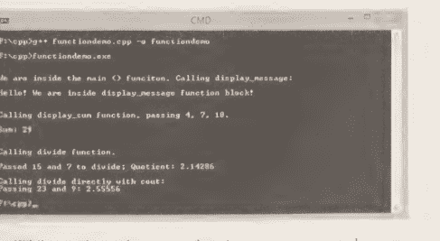

在将值作为参数传递给函数时，有三种方法——传值、传引用和传指针。本章我们将了解传值和传引用，传指针将在 *指针* 章节中解释。

### 9.2.1 传值

使用这种方法时，变量的值被传递给函数。在函数定义中，传递的值由不同的变量接收。因此，在函数定义中对接收变量所做的任何更改都不会反映回调用函数。到目前为止解释的示例都使用的是传值方法。

这里有一个示例，它接受一个 float 值，将其自身乘以 10，并返回新值：

```cpp
float multiply_by_10(float num)
{
    num = num * 10;
    return num;
}
```

函数调用：

```cpp
float number = 1.2;
float x = multiply_by_10(number);
```

在函数调用中，一个名为 *number*、值为 *1.2* 的 float 变量被传递给 *multiply_by_10* 函数。在函数内部，有一个名为 *num* 的参数接收这个值，在函数体中，该变量的值被乘以 10，并返回给调用函数。由于调用函数使用的是传值方法，*number* 的值在调用函数中将保持不变。

### 9.2.2 传引用

在这种方法中，当值传递给函数时，它在函数中使用引用变量接收。函数定义中的引用变量由前缀 *& 符号（&）* 表示。对这些变量所做的任何更改都将反映回调用函数。其余过程保持不变，包括函数调用。让我们稍微修改上一节中的 *multiply_by_10* 函数：

```cpp
void multiply_by_10(float &num)
{
    num = num * 10;
}
```

对 *num* 所做的任何更改都将反映回调用函数，因此不需要返回值。

函数调用：

```cpp
float number = 1.2;
multiply_by_10(number);
```

在进行函数调用时，变量 *number* 的值不会被传递，而是传递 *对该变量的引用*。函数定义将参数的值乘以 10。由于使用的是传引用方法，局部变量 *number* 现在将保存值 12。

为了更好地理解这个概念，让我们编写一个包含两个函数的 C++ 程序来交换两个输入值。一个使用传值方法，另一个使用传引用方法：

```cpp
#include <iostream>

using namespace std;

void swap_by_value(int, int);
void swap_by_reference(int &, int &);

void swap_by_value(int x, int y)
{
    int temp = x;
    x = y;
    y = temp;
    // Display x and y
    cout << endl << endl << "Inside swap_by_value" << endl
         << endl
         << "x: " << x << "    y: " << y << endl;
}

void swap_by_reference(int &x, int &y)
{
    // Swap x and y
    int temp = x;
    x = y;
    y = temp;

    cout << endl << endl << "Inside swap_by_reference" << endl
         << endl
         << "x: " << x << " y: " << y << endl;
}

int main()
{
    // Declare 2 integers to accept and store user input
    int x, y;
    // Ask the user to enter a number
```

你可以将函数的某些参数设置为具有默认值。在调用函数时，如果没有传递已设置为默认值的参数，则将使用其默认值。设置默认参数时需要遵循几条规则：

- 1. 只有最后一个（些）参数可以设置为默认值。
- 2. 如果某个参数已被设置为默认值，则其后的所有参数都必须设置为默认值。

设置默认参数的一般语法是：

```cpp
<return type> <function name> (<parameter 1>, ...
<parameter n> = <value>)
{
    // Function Body
}
```

示例：

让我们定义一个接受 3 个参数并返回它们乘积的函数。在这 3 个参数中，最后一个将是默认参数：

```cpp
int multiply(int a, int b, int c = 10)
{
    return (a * b * c);
}
```

该函数可以通过传递 2 个或 3 个参数来调用。由于第三个参数 c 被设置为 10，如果传递两个参数，

```cpp
// Two arguments
int sum(int a, int b)
{
    return (a + b);
}

// Three arguments
int sum(int a, int b, int c)
{
    return (a + b + c);
}

// Four arguments
int sum(int a, int b, int c, int d)
{
    return (a + b + c + d);
}
```

如所见，有 3 个定义具有相同的名称——sum，但每个定义中的参数数量不同。让我们看看如何调用这些函数中的每一个：

```cpp
// sum with 2 arguments
int x = sum(4, 5);
// sum with 3 arguments
int x = sum(10, 20, 30);
// sum with 4 arguments
int x = sum(150, 690, 55, 340);
```

### 9.4.2 不同类型的参数

函数可以通过更改每个定义接受的参数类型来进行重载。从逻辑上讲，更改函数参数的数据类型可能还必须随之更改函数的返回类型。不同的返回类型不是函数重载的标准。例如，如果 *sum* 函数有两个定义，一个接受*两个整数*，另一个接受*两个浮点数*作为输入参数。那个接受


# 9. 函数

整数版本会以整数形式返回和。另一个函数则必须返回浮点值，否则求和会丢失精度。关键在于，这两个函数之所以可以重载，是因为它们接受不同类型的参数，而不是因为它们具有不同的返回类型。

让我们为我们刚刚讨论的内容编写一小段 C++ 代码：

```cpp
//Two integers
int sum ( int a , int b )
{
    return ( a + b );
}
//Two floats
float sum ( float a , float b )
{
    return ( a + b );
}
```

对每个函数的调用如下所示：

```cpp
int sum_int;
float sum_float;
//Call the function that accepts two integers
sum_int = sum ( 5, 60 );
//Call the function that accepts two floats
sum_float = sum ( 50.78, 60.1 );
```

接受两个浮点值并返回浮点值的第二个函数定义本可以返回整数值，并且仍然可以毫无问题地重载，但这在逻辑上是不正确的，因为两个浮点值之和极有可能仍是浮点值。

让我们举一个函数重载的示例，以展示这一概念的真正美妙之处。一个名为 *area* 的函数将被重载 3 次，其中每个定义将使用相应的面积公式计算圆、矩形和三角形的面积。我们知道，计算圆的面积只需要 1 个参数——半径。要计算矩形和三角形的面积，需要两个参数——分别是长度和宽度，以及底和高。圆的面积函数可以根据参数个数与其他两个函数唯一区分。为了唯一区分矩形和三角形的面积函数，我们将更改输入参数的数据类型。

以下是实现我们刚刚讨论内容的 C++ 代码：

```cpp
#include <iostream>

using namespace std;

float area ( int radius )
{
    return ( 3.14 * radius * radius );
}

float area ( float base, float height )
{
    // Return (1/2) x base x height
    return ( (1.0 / 2) * base * height );
}

int area ( int length, int width )
{
    return ( length * width );
}

int main ()
{
    //Declare variables to store user inputs
    //And to store calculated areas
    int radius, length, width, area_rectangle;
    float base, height, area_circle, area_triangle;
    //Ask the user to enter the radius of a circle
    cout << endl << endl
         << "Enter the radius of a circle: ";
    //Wait for the user to enter
    cin >> radius;
    //Call area function to calculate area of a circle
    area_circle = area (radius);
    cout << endl
         << "Area of the Circle with Radius: " <<
            radius
         << " is: " << area_circle;

    //Ask the user to enter the base and height of a triangle
    cout << endl << endl
         << "Enter the base and height of a triangle: ";
    //Wait for the user to enter
    cin >> base >> height ;
    //Call area function to calculate area of a triangle
    area_triangle = area (base, height);
    cout << endl
         << "Area of the Triangle with base: " << base
         << " height: " << height
         << " is: " << area_triangle;

    //Ask the user to enter the length and width of a rectangle
    cout << endl << endl
         << "Enter the length and width of a rectangle: ";
    //Wait for the user to enter
    cin >> length >> width ;
    //Call area function to calculate area of a rectangle
    area_rectangle = area (length, width);
    cout << endl
         << "Area of the Rectangle with Length: " << length
         << " Width: " << width
         << " is: " << area_rectangle << endl;

    return 0;
}
```

输出：

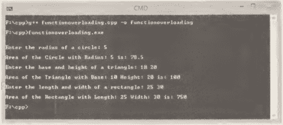

函数重载是 C++ 中的一个重要概念，并在面向对象编程中被广泛使用。

要访问数组的每个元素，需要使用访问运算符（`[ ]`），并将索引括在其中。让我们举个例子。考虑一个名为 **num** 的、包含 5 个元素的整数数组。它将按如下方式声明：

```c
int num[5];
```

由于数组大小为 5，索引值可以从 0 到 4。让我们设置每个元素的值：

```c
num[0] = 123;
num[1] = 50;
num[2] = 79;
num[3] = 6072;
num[4] = 446;
```

数组 **num** 现在将如下所示：

| num | 123 | 50 | 79 | 6072 | 446 |
|---|---|---|---|---|---|
| 索引 → | 0 | 1 | 2 | 3 | 4 |

与其逐个设置每个元素，上面的数组也可以按如下方式初始化：

```c
int num[5] = { 123, 50, 79, 6072, 446 };
```

在处理数组时，循环特别有用。以下代码片段使用 **while** 循环逐个显示 **num** 数组的元素：

```c
//Initialize a variable to 0 for iterating purpose
int i = 0;
while ( i < 5 )
{
    //Display num [ i ]
    cout << "num[" << i << "]" << num[i] << endl;
    //Increment i
    i++;
}
```

这是另一个示例，其中使用 *for* 循环将数组填充为 1 到 10 的值：

```cpp
//Declare integer array
int x[10];
//For loop to run from 0 to 9
for ( int j = 0 ; j < 10 ; j++ )
{
    //Fill array x
    x[j] = j + 1 ;
}
```

让我们编写一个 C++ 程序，计算浮点数组中 5 个元素的总和与平均值。这 5 个元素将由用户输入。

```cpp
#include <iostream>

using namespace std;

int main()
{
    float values[5], avg;
    int i, sum = 0;
    cout << endl << endl
         << "Enter the number of elements" << endl;
    for ( i = 0 ; i < 5 ; i++ )
    {
        cout << endl << "Enter value at index " << i
             << " : ";
        cin >> values[i];
    }
    for (i = 0; i < 5; i++)
        sum += values[i];

    avg = (sum * 1.0) / 5;

    cout << endl << endl
         << "Sum: " << sum << " Avg: " << avg << endl;
    return 0;
}
```

输出：

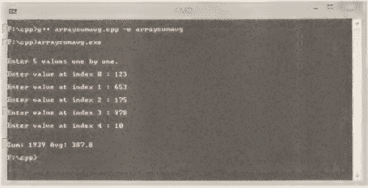

数组的一个需要注意的重要特性是——数组元素被分配连续的内存位置，每个元素占用由其数据类型决定的大小。

声明之后，不能使用赋值运算符将字符串值赋给字符串。以下方法不正确：

```cpp
char str[10];
str = "Hello";
```

如果要在声明之后为字符串赋值，你完全可以使用第 10 节中说明的访问运算符（`[]`）设置每个元素，或者使用 `cstring` 头文件中的 `strcpy` 函数。你需要在代码中包含 `cstring` 头文件。`strcpy` 是用于复制字符串的函数。语法是：

```cpp
strcpy(<destination string>, <source string/constant string>);
```

请参考以下示例：

```cpp
#include <cstring>
...
...
char str[10];
strcpy(str, "Hello");
```

此代码片段声明一个大小为 10 的字符数组。`strcpy` 函数将 `str` 的值设置为 "Hello"。

## 11.1 将字符串作为用户输入读取

在第 6 节中，我们了解了如何使用 `cin` 读取字符串，以及当用户输入的字符串中包含空格时可能导致的问题。该节演示的示例使用的是 `string` 类，而不是将字符数组作为字符串，但使用了相同数量的字符，并在末尾显示字符串的长度：

```cpp
#include <iostream>

using namespace std;

int main ()
{
    //Declare a char array of 50 characters
    char str[50];
    //Declare an integer variable
    int i = 0;
    //Ask the user to enter a string:
    cout << endl << endl
         << "Enter a string: ";
    //Wait for the user to enter
    cin.getline(str, sizeof(str));
    //Display the entered string using cout
    cout << endl
         << "The entered string is : " << str << endl << endl;
    cout << "Entered string is displayed using while loop: "
         << endl << endl;
    // We know that the string termination character
    // '\0' is at the end of string. Also, we know that '\0'
    // is equivalent of integer value 0
    // whereas (str[i]) will return a true value
    // if str[i] is not equal to 0
    // and a false value if str[i] is equal to 0
    // (i.e. '\0')
    while (str[i])
    {
        //Display each character
        cout << str[i];
        //increment i to go to the next location
        //'i' will also count the number of characters
        // thereby giving the length of the string
        i++;
    }
}
```


# 12. 指针

指针是一种特殊的变量，用于存储其他变量的地址。声明变量时，系统会根据其数据类型在内存中为其分配一些空间，以存储变量的内容。该内存区域有一个用于标识和访问的地址。指针用于存储此类地址。因为通常很难记住每个内存位置的地址，所以我们首先有了变量的概念。指针是一个相当高级的主题，因此我们只介绍基础知识。从事内存管理、内核模块开发、设备驱动开发等底层系统应用开发的开发人员应该非常熟悉指针。

指针变量的声明方式与任何其他变量一样，将*星号( * )*前缀到变量名，或后缀到数据类型。通用语法：

```text
<data type> *<variable name>;
OR
<data type>* <variable name>;
eg:
//Integer pointers
int *p;
int* x;
//Float pointers
float *f, *g, *h;
//Character pointer
char *c;
```

指针将存储*相同数据类型*的地址。例如，整型指针将存储整型变量的地址，浮点指针将存储浮点变量的地址，依此类推。浮点指针不能存储整型变量的地址。

要获取变量的地址，需要在变量名前面加上*与号( & )*。请看下面的代码片段：

```cpp
int x = 500;
int *ptr = &x;
```

我们有一个整型变量 *x*，其初始化值为 *500*。声明了一个名为 *ptr* 的整型指针变量，它将保存变量 *x* 的地址，**而不是 x 的值(500)**。用程序术语来说，就是 *ptr* 指向 *x*。

当 *x* 被声明并初始化时，系统会分配一些内存来存储其内容（本例中为 *500*）。假设该内存位置的地址为 *12345*。下图将解释这段代码发生了什么：

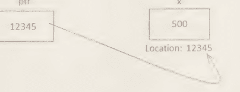

如你所见，变量 x 保存的值为 500，位于内存地址 12345，指针 ptr 保存的是 x 的地址 12345，而不是 x 的值 500。你可以通过在变量名前加上星号( * )来访问指针所指向的内存地址处的值。例如：*ptr 将给出 500，ptr 将给出 12345。星号( * )用于解析内存地址处的值。这个概念既简单又令人困惑。这是基本概念，如果你能很好地理解它，就能很容易地理解整个指针概念。让我们来看一个编程示例，其中我们将声明一些变量和指针，并尝试访问它们的值：

```cpp
#include <iostream>
using namespace std;

int main()
{
    int a = 10, b = 20;

    float x = 50.5, y = 150.75;

    int *ptr1, *ptr2;

    float *fptr;

    ptr1 = &a;
    ptr2 = &b;
    cout << endl << endl
         << "a: " << a << " --- Address of a (i.e. ptr1) : " << ptr1
         << endl << endl
         << "b: " << b << " --- Address of b (i.e. ptr2) : " << ptr2
         << endl << endl
         << "Value at ptr1 (" << ptr1 << ") : " << *ptr1
         << endl << endl
         << "Value at ptr2 (" << ptr2 << ") : " << *ptr2
         << endl << endl;

    // Assign address of x to fptr
    fptr = &x;

    // Display whatever that has been done
    cout << endl
         << "x: " << x << " --- Address of x (i.e. fptr) : " << fptr
         << endl << endl
         << "Value at ptr (" << fptr << ") : " << *fptr;

    // Assign address of y to fptr
    cout << endl << endl;
    fptr = &y;

    // Display whatever ...
    cout << endl << endl
         << "y: " << y << " --- Address of y (i.e. fptr) : " << fptr
         << endl << endl
         << "Value at ptr (" << fptr << ") : " << *fptr;

    cout << endl << endl;
    *fptr = 675.123;

    // Display recent changes
    cout << endl << endl
         << "y: " << y << " --- Address of y (i.e. fptr) : " << fptr
         << endl << endl
         << "Value at ptr (" << fptr << ") : " << *fptr;

    cout << endl << endl;
    return 0;
}
```

输出：

```text
C:\>Program Files\...>pointers.exe
At 10 -- Address of a (i.e. ptr1) : 0x28fe80
At 20 -- Address of b (i.e. ptr2) : 0x28fe8c
Value at ptr1 ( 0x28fe80 ) : 10
Value at ptr2 ( 0x28fe8c ) : 20

At 50.5 -- Address of x (i.e. fptr) : 0x28fe40
At 150.75 -- Address of y (i.e. fptr) : 0x28fe4c
Value at fptr ( 0x28fe40 ) : 50.5
Assigning address of y to fptr
At 150.75 -- Address of y (i.e. fptr) : 0x28fe4c
Value at fptr ( 0x28fe4c ) : 150.75
Changing the value of y using fptr
At 675.123 -- Address of y (i.e. fptr) : 0x28fe4c
Value at fptr ( 0x28fe4c ) : 675.123
Press any key to continue...
```

这里显示的地址是十六进制值。

## 12.1 关于指针的要点：

- 1. 不可能对两个或多个指针进行加、减、除、乘或任何其他算术运算。
- 2. 可以对指针进行递增或递减，但其值增加或减少的不是 1，而是给定数据类型的大小。例如，整数占用 4 个字节——递增或递减整型指针时，其值会增加或减少 4。也就是说，指针将指向下一个内存区域（递增时向前 4 个字节）或上一个内存区域（递减时向后 4 个字节）。

剩余的元素。下面是数组在内存中的存储方式：

**numbers**

| 索引 --> | 0 | 1 | 2 | 3 | 4 |
| --- | --- | --- | --- | --- | --- |
|  | 10 | 57 | 82 | 600 | 425 |
| 内存 --> | 2000 | 2004 | 2008 | 2012 | 2016 |

数组变量 `numbers` 将保存第一个元素的地址，即 `2000`。（`numbers + 1`）将得到第二个元素的地址，即 `2004`，依此类推。我们已经见过很多使用访问运算符（ `[ ]` ）访问数组元素的示例。现在，我们来看看如何使用指针访问数组元素。如果数组变量 `numbers` 保存的是第一个元素的地址，那么使用地址处值的方法，`*numbers` 应返回位置 `2000` 处的值，即 `10`；`*( numbers + 1 )` 应返回 `57`，依此类推。使用语句 `numbers [ n ]` 访问数组元素与使用 `*( numbers + n )` 相同。

下面是一个 C++ 程序，演示了使用指针访问数组的方法：

```cpp
#include <iostream>
using namespace std;

int main()
{
    int x[] = { 10, 20, 30, 40, 50 };
    int i;
    cout << endl << endl << endl << endl;

    for (i = 0; i < 5; i++)
        cout << endl << "x[" << i << "] = " << x[i];
    cout << endl << endl << endl << endl;

    for (i = 0; i < 5; i++)
        cout << endl << "*(x + " << i << ") = " << *(x + i);
    cout << endl << endl;

    return 0;
}
```

输出：

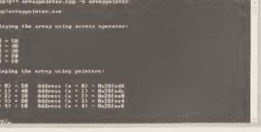

## 12.2 向函数传递指针

在第 9 节中，我们学习了向函数传递值的两种方法——*按值传递*和*按引用传递*。在本节中，我们将学习第三种方法——*按指针传递*。

按指针传递方法与按引用传递方法类似，函数定义中对变量所做的更改将反映回调用函数中。但不同的是，传递的不是变量的引用，而是变量的实际内存地址。为了传递变量的地址，在调用函数时，变量名前面需要加上*与号( & )*，并且在函数定义中，这个地址需要由相同数据类型的指针变量接收。下面是一个演示按指针传递方法的代码片段：

```cpp
void swap(int *a, int *b)
{
    int temp = *a;
    *a = *b;
    *b = temp;
}

// Function call:
int x = 10, y = 30;
swap(&x, &y);
```

有一个 swap 函数，它接受两个*整型指针*作为参数。在函数定义中，这两个变量地址处的值使用一个临时变量进行交换。


变量 *temp*。调用函数时，通过在变量名前加 & 符号来传递 *x* 和 *y* 的地址。调用 swap 函数后，*x* 将保存 *30*，而 *y* 将保存 *10*。

这种方法在将数组传递给函数时特别有用。数组变量可以作为数组中第一个元素的地址传递给函数，并由函数以指针形式接收。你在函数中对数组所做的任何更改都会反映回调用函数中。

```cpp
class <class name>
{
    //Data Members and Member Functions
};
eg:
class Car
{
    char Manufacturer [20], Model [20];
    int Displacement;
};
```

类成员可以在 3 种访问修饰符下声明——*公有、私有和受保护。* 我们将讨论 ***公有和私有***，因为受保护是稍微高级的话题。

### 公有成员：

公有成员可以从程序中的任何位置访问。访问公有成员不需要成员函数。

### 私有成员：

只有同一类的成员函数才能访问私有成员。如果将某个成员函数声明为私有，则只有同一类的成员函数才能调用私有成员函数。这是面向对象编程中数据隐藏的一个非常重要的概念。

**注意：** 尽管对于什么应该公有、什么应该私有并没有限制，但通常数据成员被声明为私有，成员函数被声明为公有。这是因为成员函数用于访问数据

```cpp
}
```

让我们定义 *setData* 和 *displayData* 函数，它们分别设置并显示 *Manufacturer*、*Model* 和 *Displacement* 的值。这些数据成员实际上是 *私有* 的，但作为同一类的成员，*displayData* 和 *setData* 函数可以访问这些值，并且这些函数作为公有函数可以从任何位置访问：

```cpp
 //setData accepts three parameters
 void Car :: setData (const char *manufacturer, const
 char *model, int displacement )
 {
     //Assign the value of received parameters
     //To the data members of the class
     Displacement = displacement ;
     //Using strcpy as assignment operator cannot be
     // used for string assignment
     strcpy ( Manufacturer, manufacturer );
     strcpy ( Model, model );
 }

 void Car :: displayData ( )
 {
     cout << endl << endl
     << "Manufacturer: " << Manufacturer << endl
     << "Model: " << Model << endl
     << "Displacement: " << Displacement << endl ;
 }
```

这只是一个定义，到目前为止没有对数据执行任何操作。我们需要声明 Car 类的一个对象，该对象将是该类的一个实例，并且该对象将拥有自己的一组数据成员和成员函数。要声明对象，使用以下语法：

```text
<class name> <object name>;
eg:
Car c1, c2;
```

对象声明就像声明特定数据类型的任何其他变量一样。*Car c1, c2;* 语句将创建两个 *Car* 类型的对象 *c1* 和 *c2*，它们拥有自己在 Car 类定义中定义的一组数据成员和成员函数。要访问对象的属性（数据成员/成员函数），使用点（.）运算符，如下所示：

```text
<object name>.<data member/member function>
```

只有公有成员可以使用点（.）运算符访问。

*setData* 函数需要分别为每个对象调用。由于该函数接受 3 个参数，因此需要提供 3 个实参：

```text
c1.setData ( "Audi", "A3", 2000 );
c2.setData ( "BMW", "3-Series", 2000 );
```

*displayData* 函数可以按如下方式调用：

```text
c1.displayData ( );
c2.displayData ( );
```

现在是时候结合所有这些概念，并将所有内容放入一个 C++ 程序中了：

```cpp
Car c1, c2, c3;

c1.setData("Audi", "Q5", ...);
c2.setData("BMW", "3-Series", ...);
c3.setData("Ford", "Endeavour", ...);

c1.displayData();
c2.displayData();
c3.displayData();

cout << endl << endl;
return;
}
```

输出：

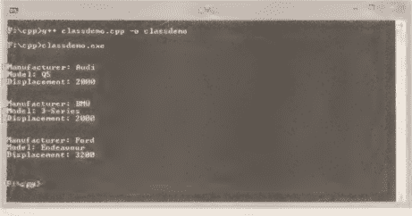

为了让你更好地联系到目前为止解释的概念，为对象设置的数据与 *第 13.1 节* 中 Car 类图所示的数据相同。

### 关于类和对象的一些要点：

- 1. 数据成员通常是私有的，成员函数通常是公有的。然而，并没有硬性规定。如果数据成员被设为公有，就可以使用点运算符直接访问它。例如：`<object name>.<data member>`
- 2. 成员函数就像任何其他函数一样，它们可以接受参数、返回值等。它们甚至可以被重载（*如第 9.4 节所述*），但每个定义的正确原型应在类定义中声明。
- 3. 有一种特殊的成员称为静态成员，它对所有对象都是共有的。数据成员和成员函数都可以是静态的，但只有静态成员函数才能访问静态数据成员。要声明静态成员，需在声明前加上 static 关键字。

# 14. 构造函数和析构函数

构造函数是一种特殊的成员函数，其名称与类名相同。构造函数用于初始化对象的数据成员。一旦创建对象，就会调用构造函数。构造函数可以像函数一样被重载，但它们不能返回任何值。回想第 13.1.1 节中的 Car 类。我们将修改它以添加一个构造函数：

```cpp
class Car
{
    private:
        char Manufacturer [20], Model [20];
        int Displacement;
    public:
        void setData ( char *, char *, int );
        void displayData ( ) ;
        //Constructor Declaration:
        Car ( ) ;
};
```

如所见，构造函数 Car ( ) 已在类定义中进行了原型声明。让我们看一个示例定义：

```cpp
Car :: Car ( )
{
    //Statements
}
```

每次创建对象时，都会调用此构造函数。在下面的 C++ 程序中，我添加了 Car ( ) 构造函数的定义，它每次被调用时都会在屏幕上显示 Object

**已创建！**。在 main 函数中，我创建了 Car 类的 3 个对象——*c1, c2, c3*。

```cpp
#include <iostream>

using namespace std;

// Class definition
class Car
{
private:
    // Private data members
    char Manufacturer [20], Model [20];
    int Displacement;

public:
    static int count;

    void setData ( const char *, const char *, int );
    void displayData ();

    Car ();
};

Car :: Car ()
{
    cout << endl << endl
         << "Object created"
         << endl << endl ;
}

int main ()
{
    // Create 3 objects of Car class
    Car c1, c2, c3;
    cout << endl << endl ;
    return 0;
}
```

输出：

```text
C:\cpp\>g++ constructor.cpp -o constructor
C:\cpp\>constructor.exe
Object Created!
Object Created!
Object Created!
C:\cpp\>
```

由于创建了 3 个对象，因此构造函数被调用 3 次。声明对象就像声明任何其他变量一样。你甚至可以声明对象数组。让我们将 *Car c1, c2, c3* 这一行修改为 *Car c[10]*。这应该会创建一个包含 10 个 Car 对象的数组，并且构造函数应该被调用 10 次：

```text
C:\cpp\>g++ constructor.cpp -o constructor
C:\cpp\>constructor.exe
Object Created!
Object Created!
Object Created!
Object Created!
Object Created!
Object Created!
Object Created!
Object Created!
Object Created!
Object Created!
C:\cpp\>
```

## 14.1 参数化构造函数

构造函数本质上是一个具有特殊属性的函数。构造函数也可以像任何其他函数一样接受参数。通用语法：

```text
    <class name> :: <constructor name> ( <parameters separated by
    comma>)
    {
       // Statements
    };
```

创建对象时，应按照构造函数定义中所定义的那样，将所需参数作为实参传递。请参考以下语法：

```text
    <class name> <object name> ( <parameters separated by comma> );
```

对象创建期间作为实参传递的参数数量和类型应与构造函数定义中的参数数量和类型相匹配。为了演示，让我们修改 *Car ( )* 构造函数以接受一个任意整数值，并让该值在创建每个对象时赋给其 *Displacement* 数据成员。我们要做的第一件事是将构造函数原型改为 *Car ( int )*。


### 构造函数定义：

```cpp
Car :: Car ( int displacement )
{
    cout << endl << endl
         << "Object Created! Setting Displacement as"
         << displacement ;
    Displacement = displacement ;
    cout << endl << endl
         << "Displacement Set: " << Displacement ;
}
```

### 主函数中的对象创建

```cpp
Car c1 (1000), c2 (2000), c3 (3000);
```

如您所见，1000、2000、3000 作为参数传递给构造函数。

### 输出

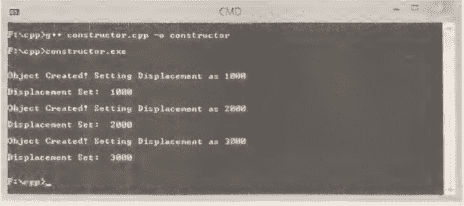

类可以有多个构造函数，这得益于构造函数重载机制。当创建对象时，程序会根据参数寻找匹配的构造函数。如果找不到匹配项，编译器将返回错误，程序将无法编译。例如，在上述代码中，只定义了一个构造函数，它只接受一个整数参数。在创建对象时，如果您简单地声明对象而不传递任何参数，比如 – *Car c1, c2, c3;*，程序将寻找一个接受*无参数*的构造函数，该构造函数在我们的代码中显然不存在，因此编译器将返回错误。为避免此问题，最好始终提供一个不接受任何参数和/或不执行任何操作的构造函数。这样的构造函数称为*默认构造函数*或*无操作构造函数*。

## 14.2 构造函数重载

构造函数重载的工作原理与函数重载相同；也就是说，一个类可以有多个具有不同定义的构造函数。构造函数可以基于参数的数量和参数的类型进行重载。函数重载已在 *第9.4节* 中详细讨论过，因此无需单独再讲构造函数重载。不过，我们将看一个示例，在该示例中，我们将回顾 *Car 类*，并为其定义3个不同的构造函数。这三个不同的定义将分别用于处理无参数、1个参数和3个参数的情况。无参数的构造函数是一个*默认构造函数*，在此例中它不做任何重要的事情；带一个参数的构造函数仅设置 *Displacement*；带3个参数的构造函数设置 *Manufacturer、Model 和 Displacement*。

构造函数原型如下：

```cpp
Car ( ); //无参数
Car ( int ); //1个参数
Car ( const char *, const char *, int ); //3个参数
```

### 这是C++程序：

```cpp
#include <iostream>
#include <cstring> //strcpy所需

using namespace std;

//类定义
class Car
{
    //私有数据成员
    char Manufacturer[ ], Model[ ];
    int Displacement;

public:
    static int count;
    //公有成员函数
    void setData ( const char *, const char *, int);
    void displayData ();

    Car ( ); //无参数
    Car ( int ); //1个参数
    Car ( const char *, const char *, int ); //3个参数
};

//构造函数定义 - 无参数 - 默认
Car :: Car ( )
{
    cout << endl
         << "Default Constructor invoked! ";
}

//构造函数定义 - 1个参数
Car :: Car ( int displacement )
{
    <<
    << endl;
Car c2 (     );

cout << endl << endl
     <<       ;

Car c3 (     ,      ,      );

cout << endl << endl ;
return 0;
}
```

### 输出

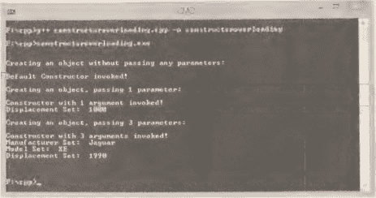

从代码和输出可以看出，创建了3个具有不同参数数量的对象，相应的构造函数被正确调用。

## 14.3 析构函数

构造函数在创建对象时被调用，而析构函数在删除对象时被调用。通常在

```cpp
cout << endl <<
    ;
}

Test :: ~Test ()
{
    cout <<
        << endl;
}

main ()
{
    cout << endl <<
        << "...";

    Test t1, t2;
    cout << endl << endl <<
        << endl <<
        << endl <<
        << endl << endl;
    return 0;
}
```

### 输出

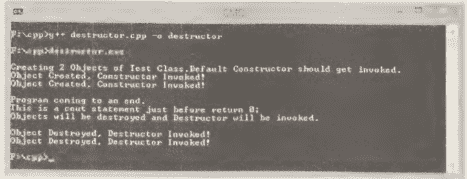

# 15. 继承

继承是面向对象编程中的一个概念，它允许我们通过继承现有类的属性来派生一个新类。属性可以包括数据成员和成员函数。现有类称为*基类*，新类称为*派生类*。这个过程促进了代码的可重用性。我们无需重新编写一个新类，可以使用现有类的属性，只编写需要的额外属性。

考虑一个名为 *Person* 的类，具有公有数据成员 – *FirstName、LastName 和 City*。该类的声明如下：

```cpp
class Person
{
    public:
        char FirstName[20], LastName[20], City[20];
};
```

看起来像这样：

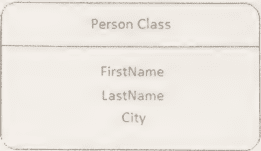

假设我们想要声明另一个名为 Student 的类，其数据成员为 – *FirstName、LastName、City、School 和 Grade.*

该类的声明如下：

```cpp
class Student
{
    public:
    char FirstName[20], LastName[20], City[20], School[20];
    int Grade;
};
```

Student类看起来像这样：

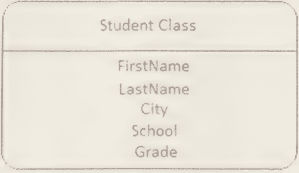

从图示和代码片段可以看出，数据成员 *FirstName、LastName 和 City* 在 *Person 类* 和 *Student 类* 中都是共同的。使用继承，我们可以从 *Person 类* 派生 *Student 类*，其中 *Student 类* 将获得 *Person 类* 中存在的自己的数据成员集 – *FirstName、LastName、City*，而我们只需在 *Student 类* 中声明两个数据成员 – *School 和 Grade*。继承的一般语法是：

```
class <派生类名> : <访问类型> <基类名>
{
    //类定义
};
```

只有类的公有和受保护成员可以被继承到另一个类中；私有成员不能被继承。

*访问类型*可以是 *公有、私有或受保护*。如果访问类型是：

- *公有：*
  - 基类的公有类成员被继承并在派生类中变为公有。
  - 基类的受保护类成员被继承并在派生类中变为受保护。
- *受保护：*
  - 基类的公有和受保护类成员被继承并在派生类中变为受保护。
- *私有：*
  - 基类的公有和受保护类成员被继承并在派生类中变为私有。

让我们从 Person 类派生 Student 类：

```cpp
class Student : public Person
{
    public:

    char School [20];

    int Grade;
};
```

从上述代码片段可以看出，使用了 *公有* 继承，因此 *Person 类* 的公有成员将被继承到 *Student 类* 中。Student 类现在拥有 *FirstName、LastName、City、School 和 Grade*。此过程在内部将与下图所示的类似：

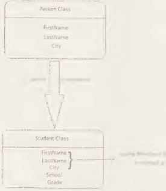

让我们在 *Student* 类中编写两个函数 *setData* 和 *displayData*，并在 main 函数中创建该类的对象来演示这一概念。以下是完整的 C++ 程序：

```cpp
#include <iostream>
#include <cstring>

using namespace std;

//创建类Person
class Person
{
public:
    char FirstName[20], LastName[20], City[20];
};

//从Person类创建Student类
class Student : public Person
{
private:
    char School[20];
    int Grade;
    void setData(const char *, const char *, const char *, const char *, int);
    void displayData();
};

//setData的函数定义
void Student :: setData (const char *firstname,
const char *lastname, const char *city, const char
*school, int grade)
{
    strcpy(FirstName, firstname);
    strcpy(LastName, lastname);
    strcpy(City, city);
    strcpy(School, school);
    Grade = grade;
}

void Student :: displayData ()
{
    cout << endl << endl;
```


```cpp
        << "名: " << FirstName << endl
        << "姓: " << LastName << endl
        << "城市: " << City << endl
        << "学校: " << School << endl
        << "年级: " << Grade << endl;
}

main ()
{
    Student s1, s2;

    s1.setData ("Roger", "Dimitri", "New York",
                , );
    s2.setData ("Claire", "Smith", "Los Angeles",
                , );

    s1.displayData ();
    s2.displayData ();
    cout << endl << endl;
    return 0;
}
```

输出：

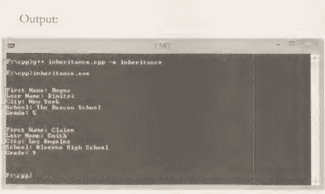

就像公有数据成员可以被继承一样，公有成员函数也可以被继承。让我们将 *Person* 类修改如下：

```cpp
class Person
{
    public:
        void baseClassFunction ();
};
```

让我们定义 **baseClassFunction**，使其只显示一条消息，不做其他事情：

```cpp
void Person :: baseClassFunction ()
{
    cout << endl << endl
         << "baseClassFunction Called."
         << endl;
}
```

让我们从 **Person 类**派生出 **Student 类**：

```cpp
class Student : public Person
{
    //这里没有内容。
    //baseClassFunction 将被继承。
};
```

可以看到，**Student 类**的定义中完全没有任何内容。但由于它派生自 **Person 类**，因此会继承 **baseClassFunction**。在 main 函数中，我们将声明 Student 对象并调用 **baseClassFunction**，如下所示：

```cpp
Student s;
s.baseClassFunction ( );
```

### 输出：

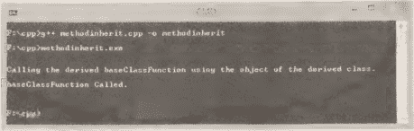

如果派生类中存在一个函数，其名称、参数数量和参数类型都相同，则会调用派生类中的函数。这称为*函数重写*。在这种情况下——如果派生类中也有另一个参数数量和类型完全相同的 *baseClassFunction*，派生类的函数就会重写基类的函数。

基类的构造函数也会被派生类继承。让我们修改 Person 类，加入一个默认构造函数：

```cpp
class Person
{
    public:
        Person ();
};
```

让我们定义基类构造函数，使其只显示一条消息：

```cpp
Person :: Person ()
{
    cout << endl << endl
         << "Person () constructor Called."
         << endl ;
}
```

让我们从 *Person 类*派生出 *Student 类*：

```cpp
class Student : public Person
{
    //这里没有内容。
    //Person ( ) 将被继承。
};
```

当我们声明一个 *Student 类*对象，例如 *Student s*; 时，*Person ()* 构造函数应当会被调用，并且我们会看到以下输出：

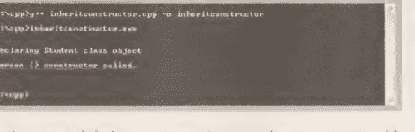

如果派生类中也有默认构造函数（或任何其他参数数量和类型完全相同的构造函数），则会先调用基类构造函数，然后再调用派生类构造函数。为演示这一概念，我们将修改 Student 类，为其添加自己的默认构造函数。下面是完整的 C++ 代码：

```cpp
using namespace std;

class Person
{
    public:
        Person ();
};

class Student : public Person
{
    ...
    Student ();
};

Person :: Person ()
{
    cout << endl << endl
         << "Person () constructor Called."
         << endl ;
}

Student :: Student ()
{
    cout << endl << endl
         << "Student () constructor Called."
         << endl ;
}

int main ()
{
    cout << endl << endl
         << "...";

    Student s;
    cout << endl << endl ;
    return 0;
}
```

输出：

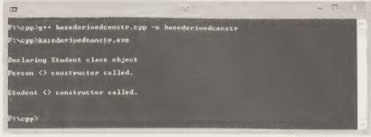

从输出可以看出，先调用 *Person ( )* 构造函数，然后调用 *Student ( )* 构造函数。

类定义如下所示：

```cpp
class Test
{
    int x, y;
    public:
    void setData (int , int);
    void displayData ();
};
```

*setData* 和 *displayData* 的定义很简单，因此不再单独介绍。

让我们重载*加法运算符（+）*，以便将两个 Test 对象的内容相加。也就是说，如果 *t1* 和 *t2* 是两个 *Test 类*对象，那么 *t1 + t2* 将执行 *t1.x + t2.x* 和 *t1.y + t2.y*，并返回结果对象。

运算符重载的一般语法如下：

```
<返回      类型/类>      operator<运算符>      (
<参数> )
{
    //定义
    return <对象>;
}
```

这段代码必须位于类的公有成员部分。

运算符重载归结为定义这个函数。下面来看看如何定义该函数以实现我们的目标：

- 1. 我们知道，*t1 + t2* 会返回另一个 *Test* 类型的对象，因此返回类型是 *Test*。
- 2. 左操作数（*t1*）的 *x* 和 *y* 可以直接访问。右操作数将作为参数传递给此运算符函数。因此我们需要包含一个 *Test* 类型的参数。我们将该参数声明为 *Test Right*。
- 3. 我们需要一个 *Test* 类对象来存储相加的结果。我们将该对象声明为 *Test Result*。
- 4. 左操作数的 *x* 需要与 *Right* 的 *x* 相加，并存储到 *Result* 的 *x* 中；左操作数的 *y* 需要与 *Right* 的 *y* 相加，并存储到 *Result* 的 *y* 中；具体如下：

  ```cpp
  Result.x = x + Right.x ;
  Result.y = y + Right.y ;
  ```

- 5. 最后，应返回 *Result* 对象。

综合以上各点，运算符定义如下：

```cpp
Test operator+(Test Right)
{
    Test Result;
    Result.x = x + Right.x;
    Result.y = y + Right.y;
    return Result;
}
```

下面是完整的 C++ 程序：

```cpp
#include <iostream>
using namespace std;

class Test
{
    int x, y;
public:
    void setData (int , int);
    void displayData ();
    //运算符重载如下：
    Test operator+(Test Right)
    {
        Test Result;
        Result.x = x + Right.x;
        Result.y = y + Right.y;
        return Result;
    }
};

//setData 定义
void Test :: setData (int a , int b)
{
    x = a;
    y = b;
}

//displayData 定义
void Test :: displayData ()
{
    cout << endl << endl
         << "x: " << x << " y: " << y ;
}

int main ()
{
    //创建两个 Test 对象
    Test t1, t2;
    cout << endl << endl
         << "输入数值...";
    //t1 和 t2 的初始值
    t1.setData ( , );
    t2.setData ( , );
    //显示 t1 和 t2 的值
    cout << endl << endl
         << "...";
    t1.displayData ();
    cout << endl << endl
         << "...";
    t2.displayData ();
}
```

| += | -= | /= | %= | ^= | &= |
| --- | --- | --- | --- | --- | --- |
| \|= | *= | <<= | >>= | \|\| | [] |
| -> | .* | new | new[] | delete | delete[] |

## 不可重载的运算符：

只有少数运算符不能重载，它们是 `-`、`*`、`::`、`?:`。

*趣闻：*你可能没有注意到，但一直以来我们都在利用运算符重载。*左移*（`<<`）和*右移*（`>>`）运算符经过重载后，可与 *cout* 和 *cin* 一起使用，分别作为*插入*（`<<`）和*提取*（`>>`）运算符。

输出：

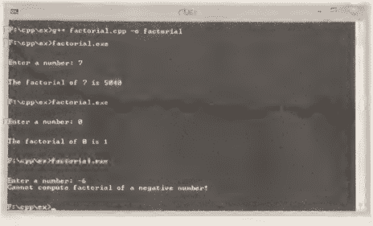

## 17.2 斐波那契数列

*斐波那契数列*从数字 *0 和 1* 开始。下一项由前两项相加得到。第一项是 0，第二项是 1；第三项为 0 + 1 = 1。此时数列为：0、1、1。第四项为 1 + 1 = 2，此时数列为 0、1、1、2。斐波那契数列可以按此方式无限生成。下面编写一个 C++ 程序，提示用户输入要生成的项数，然后生成斐波那契数列：

```cpp
using namespace std;

main ()
{
    terms , previous = , current = , next ;
}
```


```cpp
cout << endl << endl
     << number
     << " is " << sum_of_digits(number);
cout << endl << endl;
return;
}
```

输出

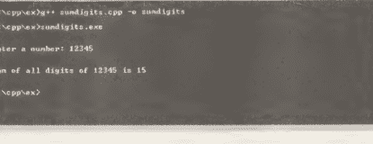

## 17.4 数字反转

让我们编写一个函数，它接收一个整型变量作为参数，并返回该数字的反转；例如，如果给定的数字是 12345，则应返回 54321。为此，需要先逐步提取个位上的数字，然后将其丢弃。可以通过执行 *number % 10* 来提取个位上的数字，然后通过 *number = number / 10* 来丢弃个位上的数字。当提取出个位上的数字后，每次迭代都需要执行 *reverse = (reverse * 10) + (number % 10)*。以下是完整的 C++ 程序：

```cpp
#include <iostream>
using namespace std;

int reverse(int number)
{
    int rev = 0;
    while (number)
    {
        rev = (rev * 10) + (number % 10);
        number = number / 10;
    }
    return rev;
}

main()
{
    int number;
    cout << endl << endl << "Enter a number: ";
    cin >> number;
    cout << endl << endl << "Reverse of " << number
         << " is " << reverse(number);
    cout << endl << endl;
    return;
}
```

输出：

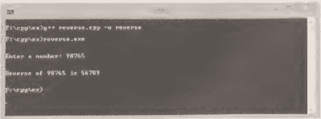

## 17.5 字符串回文

如果一个字符串与其反转后的字符串相同，则称该字符串为回文。考虑字符串 “madam”。如果将单词 “madam” 反转，你仍然会得到 “madam”。这就是回文。让我们编写一个 C++ 程序，从用户那里接收一个字符串作为输入。然后我们将使用 *for 循环* 反转该字符串，并使用 *strcmp* 函数（来自 *cstring* 头文件）检查原始字符串与其反转后的字符串是否相同。如果两个字符串相等，strcmp 函数将返回 0。以下是 C++ 程序：

```cpp
#include <iostream>
#include <cstring>

using namespace std;

int main()
{
    char str[100], reverse[100];
    int length, j = 0;
    // Temporary variable for swapping purpose
    int temp;
    // Ask the user to enter a string
    cout << endl << endl << "Enter a string: ";
    // Wait for user to enter
    cin.getline(str, sizeof(str));
    length = strlen(str);
    // for reverse
    strcpy(reverse, str);
    // Reverse the string, store in reverse
    for (int i = (length - 1); i > ((length - 1) / 2); i--)
    {
        temp = reverse[i];
        reverse[i] = reverse[j];
        reverse[j] = temp;
        j++;
    }

    cout << endl << endl
         << "Original : " << str << endl
         << "Reverse : " << reverse << endl;

    if (strcmp(str, reverse) == 0)
        cout << "Palindrome" << endl;
    else
        cout << "Not palindrome" << endl;

    cout << endl << endl;
    return 0;
}
```

输出：

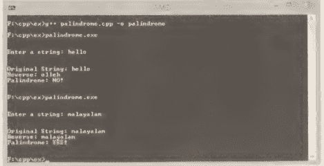

# 18. 结语

如果你喜欢这本书，就像我喜欢写这本书一样，你可以订阅*我的电子邮件列表，以获取独家内容以及我未来书籍的抢先预览。

点击下方链接：

http://eepurl.com/du_L4n

或者

使用二维码：


（*订阅者必须年满 13 岁）

美国制造

得克萨斯州科佩尔

2021年7月30日


59654981R00100

## 让编程语言和计算机编程变得简单！

你热爱新技术和计算机，并希望把你的爱好提升到新的水平吗？

你对计算机科学和编程感兴趣，因此希望提高技能并学习新事物吗？

你听说过 C++，但完全不知道从哪里开始吗？

好吧，不必担心，因为《C++ 初学者指南》就在这里，教你开始编程所需了解的一切！

C++ 是目前最重要的编程语言之一，因为它已被用于编写最著名的软件及其服务器端后端，例如……

- Mozilla Firefox
- Google Chrome
- VLC Media Player
- Facebook
- Amazon
- PayPal

## 为初学者而写

C++，也称为 CPP，首先和其他任何语言一样，所以在你能写诗之前，你需要学习字母表，对吧？而这正是你将通过这本精彩指南学到的东西！

本书专为绝对初学者精心编写，因此即使你没有太多背景知识，也可以开始编程。

你所需要的只是简单的计算机技能，以及，嗯，一台计算机！

本书配有许多图片，因此你将清楚知道每一步该做什么！

从安装合适的软件到使用正确的语法，本书都会给出细致的指导，让你准备好开始编程！

## 学习基础知识

这本循序渐进的 CPP 指南将教你该语言最重要的部分，让你能够迅速准备好完成简单任务！

这本综合性指南包含许多练习和任务，因此你可以练习并提高自己的能力。

从语法和关键字到变量和常量，本书将为你的计算机技能带来独特的提升！

ISBN 9781983229282

90000

W7-BUS-883

