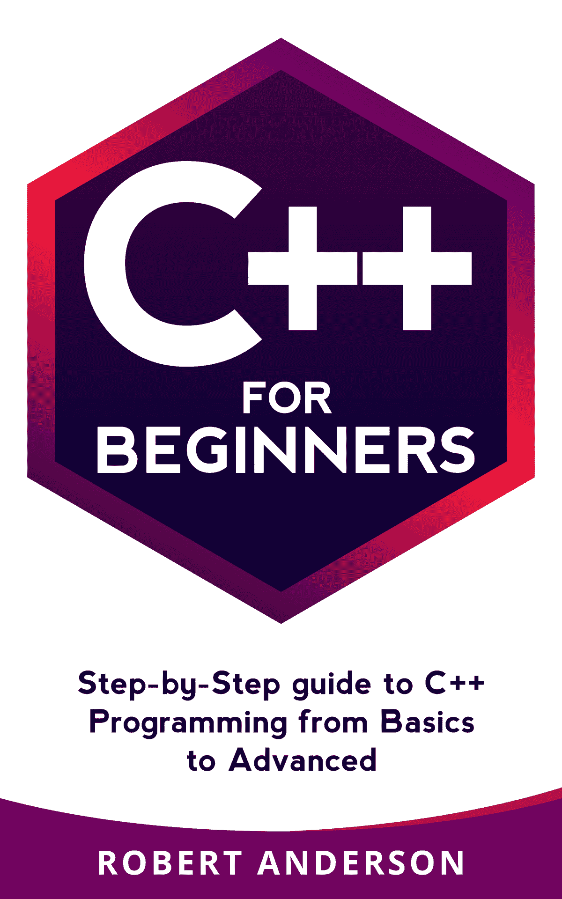
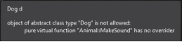

# C++ 初学者指南：从基础到进阶的 C++ 编程逐步指南（C++ 编程，C++ 傻瓜指南）





如果您想与其他人分享这本书，请为每人额外购买一份。如果您想与其他人分享这本书，请为每一个人额外购买一份。如果您想与其他人分享这本书，请为每一个人额外购买一份。如果您想与其他人分享这本书，请为每一个人额外购买一份。

它是使用 C++来编写的。

# 目录

# 第 1 章 简介与安装
- [C++的历史]
- [C++在 Windows 上运行]
- [C++在 Mac 和 Linux 上运行]
- [C++在线运行]

# 第 2 章 基础
- [变量与类型]
- [布尔值]
- [条件语句]
- [迭代]
- [函数]
- [数组]
- [输入输出]

# 第 3 章 类结构与面向对象编程
- [继承]
- [封装]
- [多态]
- [接口]

# 第 4 章 改进技术
- [结构体]
- [枚举]
- [联合体]
- [可变参数列表]
- [命名空间]

# 第 5 章 高级功能
- [文件输入输出]
- [递归]


*   `int`: 存储整数
*   `float` / `double`: 存储小数
*   `void`: 指定没有类型
*   `boolean`: 存储真或假
*   `string`: 组成单词或句子的字符数组
*   `global`: 可以在程序任何地方访问的变量
*   `const`: 意味着变量初始化后其值不能被更改

## 条件判断语句

### If 语句
在某些情况下，你可能需要在某个条件成立时执行某些操作，这就是 `If` 语句的作用，也是条件语句介入的地方。

```cpp
if (Condition){
    // 如果 Condition 为真，代码将在此处运行
    // 如果 Condition 为假，代码将跳转到此处
}
```

用法示例：
```cpp
#include "stdafx.h"
#include <iostream>
using namespace std;
int main(){
  int numberOfBooks = 10;
  if (numberOfBooks > 0)
  {
    cout << "You have a book!" << endl;
  }
}
```
输出：`> You have a book !`

这些语句允许程序员控制程序的流程，并在可能性为真时选择发生的情况，我们稍后会介绍更多示例。

### Else 语句
Else 是可选的，但它们可以被添加到 `if`-语句的末尾，并且只有在 `if`-语句的条件为假时才会运行。

```cpp
if (Condition ){
    // 如果 Condition 为真，代码将在此处运行
}
else{
    // 如果 Condition 为假，代码将在此处运行
}
```

Else 语句也可以变成 `else/if` 语句，其中附加一个新的 `if` 语句，看起来如下：

```cpp
if (Condition1 ){
    // 如果 Condition1 为真，代码将在此处运行
}
if else (Condition2 ){
     // 如果 Condition1 为假且 Condition2 为真，代码将在此处运行
    // 如果两者都为假，则没有代码运行
}
```

你还可以将另一个 `else` 语句链接到另一个 `else` 语句上，有效地创建了一个无限链。如果链中的任何条件为真，下面的条件将不再被检查，我将在下面演示这一点：

```cpp
#include "stdafx.h"
#include <iostream>
using namespace std;
int main(){
  if (false )
  {
    cout << "Contition1!" << endl;
  }
  else if (true ) // 这个条件为真！
  {
    cout << "Contition2!" << endl;
  }
  else if (true ) // 被忽略，因为之前的 else 语句为真
  {
    cout << "Contition3!" << endl;
  }
  else if (true ) // 同样因为条件 2 为真而被忽略
  {
    cout << "Contition4!" << endl;
  }
  return 0;
}
```
输出：`> Condition 2`

在进入条件 2 的体并执行 `cout` 语句后，程序不会继续检查其他的 `else` 语句。

### 练习
修改程序以检查一个值是否等于另一个值，如果相等则打印“EQUAL”，如果不相等则打印“NOT EQUAL”，骨架代码如下：

```cpp
#include "stdafx.h"
#include <iostream>
using namespace std;
int main(){
  int value1 = 10;
  int value2 = 10;
  // 代码在此处
}
```

### 答案
```cpp
#include "stdafx.h"
#include <iostream>
using namespace std ;
int main(){
  int value1 = 10;
  int value2 = 10;
  if (value1 == value2)
  {
    cout << "EQUAL" ;
  }
  else
  {
    cout << "NOT EQUAL" ;
  }
  return 0;
}
```
更改 `value1` 和 `value2` 的值，观察程序如何变化。

### 使用多个条件
你可以在单个语句中使用多个条件，有两种方法实现，分别由 `&&` 表示的 AND（与）和由 `||` 表示的 OR（或）。

*   `AND` 在触发语句语句体之前检查两个条件是否都为真：
    ```cpp
    if (Condition1 && Condition2 ){
        // 如果 Condition1 且 Condition2 都为真，代码将在此处运行
    }
    ```
*   `OR` 在触发语句语句体之前检查其中一个条件是否为真：
    ```cpp
    if (Condition1 || Condition2 ){
         // 如果 Condition1 或 Condition2 为真，代码将在此处运行（如果两者都为真也有效）
    }
    ```

## 总结
*   `If` 语句：处理条件语句，如果条件为真，其体体内的代码将运行
*   `else` 语句：作为 `if` 语句的扩展，只有在 `if` 语句为假时才会检查
*   `&&`：用于将两个条件连接在一起，只有当两者都为真时才返回真
*   `||`（双杠）：用于将两个条件连接在一起，只有当其中一个条件为真时才返回真

## Switch-Case
Switch cases 用于测试变量是否与某个常量表达式相等，而不需要多个 `if`-语句。这种结构的一个用途是检查用户输入的字符串。下面是 switch case 的基本结构：

```cpp
// Switch-Case
switch (expression){
    case constant-expression:
        break ; // Break 不是必须的
    // 任意数量的 case 语句
    // |
    // |
    \default :
        break ;
}
```

`switch` 以一个 `expression` 开始，这是要与 `constant-expressions` 进行比较的变量，这些常量是变量的字面值，例如‘1’或‘Z’。Break 是可选的，但如果没有它们，代码将“向下流动”到其他语句。下面是一个使用 switch-case 语句的示例，用户输入一个字符，如果 `char` 是 `N` 或 `Y`，分别输出“No”和“Yes”，但有一个适用于所有情况的 `default`，这需要放在最后。

```cpp
char character;
// 读取用户输入（稍后会详细解释）
scanf("%s" , &character);
// Switch-Case
switch (character){
    case 'N' :
        printf("NO\n" );
        break ;
    case 'Y' :
        printf("YES\n" );
        break ;
    default : 
        printf("Do not understand!\n" );
        break ;
}
```

如果没有 break 语句，将会发生“向下流动”，下面是一个与上面相同的示例但没有 break 语句，我们来看看输出是什么：

```cpp
char character;
// 读取用户输入（稍后会详细解释）
cin >> character;
// Switch-Case
switch (character){
    case 'N' :
        printf("NO\n" );
    case 'Y' :
        printf("YES\n" );
    default : 
        printf("Do not understand!\n" );
}
```
如果用户输入‘N’，输出将是：
`>NO`
`>YES`
`>Do not understand!`
这是因为当一个 case 语句被触发时，它将继续向下直到找到 break 语句停止运行 case 体代码。

## 迭代
迭代意味着循环，循环让程序能够快速地执行许多相似的操作，迭代有两种类型：“for 循环”和“while 循环/do-while 循环”。

### For Loop
`for` 循环给了一个结束值并一直循环到该值，同时跟踪当前是第几次循环，下面是一个示例：

```cpp
for (int x = 0; x > 10; x++){
    cout << "Loop!" << endl;
}
for(int x = 0 ; x > 10 ; x++ )
```

`for-loop` 的每个部分都有其作用：
*   **红色**：这是定义循环计数变量的声明部分，它定义了计数器的起始点。
*   **绿色**：这部分被称为条件，它包含一个在循环结束时检查的条件语句，以查看 `if`-语句是否应该继续循环，在这种情况下，如果 `x > 10` 则循环应该继续循环；如果此条件变为假，循环将不再继续。
*   **蓝色**：蓝色语句是增量部分，循环计数器在此处增加（增加值），`x++` 是 `x = x + 1` 的简写。如果有需要计数器减小的情况，也可以是 `x--`。


## 条件循环

条件循环的工作原理类似于 `for` 循环，但它没有循环计数器，并且只有在条件为真（True）时才会循环。这意味着你可以创建一个无限循环，如下所示：

```cpp
while (true ){cout << "This will never stop looping!" << endl;}
```

注意：无限循环通常使用裸露的 for 循环来构建：`for (;;){}`。这个循环永远不会结束，你的程序将卡在循环中。下面的示例显示，如果条件为假（false），程序将永远到达括号内的代码：

```cpp
while (false ){​ cout << "This will never loop!" << endl;}
```

为了有效使用这种循环，你可以将其与条件语句（如 `if` 语句）结合使用，或者配合 `bool` 变量使用，示例如下：

```cpp
int count = 0;
while (count > 10){
​ //记住这个，它等同于 “count = count + 1;”
​ count++;
}
```

如上所述，你也可以直接对布尔变量使用 `while` 循环：

```cpp
int count = 0;
bool keepLooping = true ; //Bool 为真 (1) 表示真
while (keepLooping){
​ //记住这个，它等同于 “count = count + 1;”
​ count++;
​ if (count == 3)
​ {
​ keepLooping = 0; //keepLooping 现在为假，循环将停止
​ }}
```

注意：`while` 循环括号中的部分是在检查该条件是否为真，你也可以这样写：`while (!stopLooping) {}`。这实际上是说当 `stopLooping` 为“非真”时继续循环，`!` 符号表示“非”。

### Do-While

`Do-While` 循环与 `While` 循环几乎完全相同，但有一个细小的区别：它在执行完循环体代码后检查条件是否为真，而 `while` 循环在执行体之前检查条件是否为真。下面的代码段展示了这种差异：

```cpp
while (false ){​ cout << "While Loop" << endl;}
do{
​ cout << "Do Loop" << endl;} while (false )
```

输出：`> Do Loop`
因为即使布尔值为假，`Do` 循环也执行了一次，因为检查是在主体末尾进行的。

### 使用 Do-Loop

do-loop 的真实世界示例可以是检查用户输入：它会打印并请求输入，如果一切正常则不需要循环；如果不正常，它将进行循环。下面是一个等待用户输入‘a’的示例：

```cpp
#include "stdafx.h"
#include <iostream>
using namespace std;
int main(){
​ // 如果此为假，则将循环
bool correct = true ;
​ do
​ {
cout << "Please enter the letter 'a':" ;
​ // 获取用户输入
char a;
cin >> a;
​ // 检查答案是否正确
if (a != 'a' )
​ {
 // //错误
correct = false ;
cout << "Incorrect" << endl;
}
​ else
​ {
​ // 正
correct = true ;
}

 } while (!correct);
​ // 如果用户完成了任务
cout << "Correct" << endl;
}
```

## 循环控制关键字

有时你可能希望提前停止整个循环或单次迭代（循环），这就是循环控制关键字用用场。你有 `break` 或 `continue` 关键字可用。

`break` – 将停止整个循环，如果已经找到了答案且剩余的计划迭代没有意义，这会非常有用。

```cpp
for (int x = 0; x < 5; x++){
if (x == 3)
​ {
break;
}
​ // 该语句的细节将在稍后解释
cout << "Loop value: " << x << endl;}
```
输出：
`> Loop value: 0`
`> Loop value: 1`
`> Loop value: 2`

现在如果将代码更改为不包含 `break`：

```cpp
for (int x = 0; x < 5; x++){
​ // 该语句的细节将在稍后解释
cout << "Loop value: " << x << endl;}
```
输出：
`> Loop value: 0`
`> Loop value: 1`
`> Loop value: 2`
`> Loop value: 3`
`> Loop value: 4`

`Continue` – 如果我们使用上面的代码但将其替换为 `continue`，代码将如下：

```cpp
for (int x = 0; x < 5; x++){
if (x == 3)
​ {
continue;
}
​ // 该语句的细节将在稍后解释
cout << "Loop value: " << x << endl;}
```
输出如下：
`> Loop value: 0`
`> Loop value: 1`
`> Loop value: 2`
`> Loop value: 4`

这表明当 `x = 3` 时执行了 `continue`，循环被跳过，`cout` 语句也会被跳过，因此没有“Loop value: 3”。

## 嵌套循环

你也可以将循环放在循环内部以执行特定角色，在示例中我们使用了 `for` 循环，但也可以用 `while`/`do` 循环实现。示例是打印一个二维网格，嵌套的 `for` 循环提供了另一个维度。

```cpp
// 打印 5x5 网格
for (int y = 0; y < 5; y++){
for (int x = 0; x < 5; x++)
​ {
// 打印行的某个元素
cout << "X " ;
}
​ // 移动到行
cout << endl;}
```
输出：
`> X X X X X`
`> X X X X X`
`> X X X X X`
`> X X X X X`
`> X X X X X`

## 函数

函数是程序的构建块，它们允许代码复用，保持代码可读性并防止程序员重复代码。强烈建议不要重复代码，因为错误会多次出现，而且代码的更改也需要重复。函数提供了一个集中的控制区域，处理程序中的不同角色。

一个方法包含两个元素：参数（传入函数的项）和返回值（被返回的变量），这些都是可选的，你可以定义一个两者都没有的函数。

函数必须在调用之前定义，如下所示：

```cpp
// 函数调用
void PrintSmile(){
cout << ":)" << endl;
}
int main(){
// 方法调用
PrintSmile();
return 0;

```

### 函数参数

有时向程序传递数据可能是很有用的，参数传递有两种类型：按引用传递和按值传递。按引用传递顾其思义，它传递的是变量的直接引用而不是副本，因此对该传入变量的任何更改都会影响调用函数。按值传递是传递该变量的副本，因此对该变量的任何更改都不会影响该传入的变量。

*   按引用传递意味着对参数的更改会影响传入的变量
*   按值传递意味着对参数的更改不会影响传入的变量


### 按值传递
```cpp
void Add(int num1 , int num2 ){
  // 将值相加
  int newValue = num1 + num2 ;
  // 打印结果
  printf("The result is: %d" , newValue);
}
int main(){
  // 方法调用
  Add(10, 4);
  return 0;
}
```
输出: `> The result is: 14`

下面是另一个示例，这次使用字符串作为参数：
```cpp
void PrintStr(char word []){
  cout << word << endl;
}
```
方法的调用形式如下：`PrintStr("Flying Squirrel")`。这是一个非常有用的功能，允许我们编写通用代码，并通过传入参数来更改其函数的输出。

### 按引用传递
按引用传递是通过使用指针实现的（稍后会详细解释），但指针是一个内存地址，因此进行的任何更改都会影响所传入的变量。引用参数通过 `&` 表示，用法如下：
```cpp
void Change(int & ParaValue ){
  ParaValue = 20;
}
int main(){
  int value = 10;
  Change(value);
  cout << value << endl;
  return 0;
}
```
输出: `> 20`
如你所见，`change` 方法更改了整数 `value` 的值，并影响了主方法中的值。

### 返回值
返回允许我们从方法返回数据，这使得我们能够在函数内部进行计算并让函数自动返回结果。让我们选取之前的示例之一并进行修改，使其返回结果而不是打印结果：
```cpp
int Add(int num1 , int num2 ){
  // 将值相加
  int newValue = num1 + num2 ;
  // return 关键字
  return newValue;
}
int main(){
  // 方法调用
  int storeResult = Add(10, 4);
  return 0;
}
```
发生变化的区域已经高亮显示。当需要返回一个值时，使用 `return` 关键字，在该行执行后，它会返回到调用方法的地方，因此 `return` 下的任何代码将不会执行。返回的结果将存储在 `storeResult` 中以供以后使用。返回可以是任何变量类型。我将在下面为你展示一个示例，检查数字是否为偶数（使用上面提到的取模运算符，它可以找到除法的余数）：
```cpp
bool EvenNumber(int value ){
  if (value % 2 == 0) {
    // 返回 true
    return 1;
  }
  return 0;
}
int main(){
  if (EvenNumber(2)) {
    cout << "Even number!" << endl;
  }
  if (EvenNumber(5)) {
    cout << "Odd number!" << endl;
  }
  return 0;
}
```
输出: `>Even number!`
该程序使用方法 `EvenNumber()` 返回变量作为 if 语句的条件，如果为真，它将打印“Even number!”。从输出中可以看到，第一个打印了但第二个没有。

## 数组
之前提到过数组，它是一种在内存中相邻存储固定数量变量的数据结构。数组会被赋予一个类型，例如 `int`。数组用于快速定义大量变量并将相关的变量放在一起。下面定义了一个数组：

一个静态大小，在方括号中指定大小：
```cpp
int lotsOfNumber[20];
```
或者你可以在定义时指定值，注意：不需要定义大小，因为它是根据你指定的数值确确：
```cpp
int lotsOfNumbers[] = {1,3,4};
```

*   数组从 0 开始，所以第一个索引的标识值为 0，第二个是 1，依此类推。这意味着在访问值时，你需要记住它始终比它包含的数值个数少 1。

你可以这样访问索引：
```cpp
int var = lotsOfNumbers[0];
```
这将获取数组的第一个索引并将其放置在 `var` 中。数组对于快速访问紧密相关的数据非常有用，你可以使用 `for` 循环遍历索引并根据需要使用它们。下文是一个示例：
```cpp
int lotsOfNumbers[] = { 1, 3, 4, 10};
for (int x = 0; x < 4; x++){
  cout << x << endl;
}
```
输出: `> 1 > 3 > 4 > 10`

在 C++ 中，你无法直接获取长度，需要手动计算，这可以通过简单地使用 `sizeof()` 关键字来实现，它返回方括号内元素的大小，例如在 64 位机器上，`int` 应该用 4 个 `bytes` 表示，因此 `sizeof` 将返回 4。数组的长度可以这样计算：
```cpp
int arrayLength = sizeof(lotsOfNumbers) / sizeof(lotsOfNumbers[0]);
```
这获取整个数组的大小，并除以第一个元素，结果就是数组包含多少个索引。

### 多维数组
你还可以在数组中定义第二个维度，甚至是第三个维度，这在处理数组时提供了更大的灵活性。例如，二维数组可以存储网格的坐标或位置。二维数组的定义如下：
```cpp
int arrayOfNumbers[][2] = { {1,1}, {1,1}};
```
你通过在方括号中放入 x 和 y 坐标的值来访问元素：
```cpp
int element = arrayOfNumbers[X ][Y ]
```
明显的区别是第二个维度需要一个值，这在创建数组时无法自动解析，并且初始化需要嵌套的大括号。下面是三维示例：
```cpp
int arrayOfNumbers[][][2] = {{{1,1},{1,1}},{{1,1},{1,1}}};
```
但在这种阶段开始失去可读性，更好的做法是将其排列如下所示：
```cpp
int arrayOfNumbers[][][2] ={
  {{1,1},{1,1}},
  {{1,1},{1,1}}
};
```

### 在函数中传递数组
正如我们在上面学习函数时看到的，将变量作为参数传递非常有用，传递存储在数组中的大量变量也是如此。然而，我们上面学习了如何确定数组的大小，但这对于作为参数传递的数组并不适用，因此我们必须传入一个代表数组包含元素数量的变量。有一种特殊的变量类型用于存储计数，它被称为 `size_t`，它是一个无符号整数（意味着它不会变成负数），用于存储计数值。下面是一个作为参数传递的示例：
```cpp
void Print_SingleDimenArray(size_t length , int ageArray []){
  // 长度用于动态确定 for 循环的长度
  for (int i = 0; i < length ; i++) {
    printf("%d\n" ,ageArray [i]);
  }
}
int main(){
  // 一个年龄数组
  int ages[] = { 32, 11, 12, 1, 8, 5, 10 };
  // 正如之前所示确定大小
  size_t ageLen = sizeof (ages) / sizeof (ages[0]);
  // 方法调用
  Print_SingleDimenArray(ageLen, ages);
}
```
输出: `>32 > 11 > 12 > 1 > 8 > 5 > 10`
数组已经被传递并用于打印值。数组的长度对于程序至关重要，因为它允许 for 循环适用于不同长度的数组。

*   方法中对数组的任何更改都会更改调用方法中的数组变量。这就是之前提到的按引用传递，整个数组并没有复制，而是通过一些小技巧实现的按引用传递。


## 用户 I/O
在某些情况下和编程问题中涉及用户交互，这就是用户输入和输出用用场。处理这些内容的库被称为“`iostream`”，并如下所示包含在项目中：

```cpp
#include <iostream>
```

### 打印/输出
有时用户需要提示或需要显示信息，这就是控制台打印大用用场。关键字 `cout` 用于将数据打印到屏幕上，它与流插入运算符 `<<` 配合使用，该运算符用于指定要打印的内容。示例如下：

```cpp
cout << "Hello!" << endl;
```
输出将会在屏幕上显示“Hello!”一单词。`endl` 仅用于打印回车符（`\n`）。你也可以创建一个涉及变量或另一个字符串的输出，可以使用多个流插入运算符：

```cpp
int x = 10;
cout << "The value is: " << x << endl;
```
输出> The value is: 10

### 读取/输入
获取用户输入也很有用，使用的运算符被称为流提取运算符 `>>`，并与 `cin` 配合使用，其工作方式如下：

```cpp
#include "stdafx.h"
#include <iostream>
using namespace std;
int main(){
  //读取入 name
  char name[10];
  cin >> name;
  //打印出 name
  cout << name;
}
```

### 章末测试
本节旨在让你对之前的内容保持警惕，会有 10 个问题你可以回答以测试你的知识，答案在下面的相邻章节中。

1. 用于存储一系列字符的数据类型是什么？
2. “%”符号是做什么用的？
3. 这个符号“==”是在检查什么？
4. 如果在单个 if 语句的两个条件语句之间有“&&”，它意味着什么？
5. 变量末尾的“++”意味着什么？
6. 这个运算符叫什么：“>>”？
7. 数组是否有查找其大小的内置属性？
8. 这个循环叫什么，它是做什么的？
   ```cpp
   for(;;){}
   ```
9. 布尔变量持有哪两个值？
10. `void` 类型用在哪里？

### 答案
1. 字符串（String）。
2. 获取两个数字的取模。
3. 如果两边的值相等。
4. 表示只有当两个条件都为真时，语句才为真。
5. 它将增加该变量的值。
6. 流提取运算符。
7. 没有，唯一的方法是使用 `sizeof()` 运算符找到数组的总以及以及元素的大小，然后将两个值相除以得到大小。
8. 它被称为裸 for 循环，会无限循环。
9. 真（True）或假（False）。
10. 用于表示函数不返回值。

# 第 3 章：类结构与 OOP
类是 C++ 程序的构建块，它们允许以一种方便的饼干模具方式创建存储和表示数据的地方。C++ 中的类有两个文件：头文件（`.h`）和实现文件（`.cpp`）。

*   头文件应只包含类和变量的定义。
*   实现文件正如其名，包含了函数和变量的实际功能。

空的头文件看起来像这样：
```cpp
class Example{
public :
  Example();
  ~Example();
};
```
关于这里有一些关键点，公共部分定义了方法如何被访问，现在不用太担心这个，因为这将在封装节中进一步解释。`Example()` 和 `~Example()` 函数分别是构造函数和析构函数，构造函数在类创建时运行，析构函数在类销毁时运行，这既可以通过手动调用方法完成，也可以由编译器自动完成。

`.cpp` 文件看起来像这样：
```cpp
#include "Example.h"
Example ::Example(){}
Example ::~Example(){}
```
这些中的每一个都是对 `Example` 类的引用。你可以实现未在头文件中定义的函数或变量，然而这被认为是一种坏做法。

例如，让我们使用一个详细的类版本来展示如何使用它。示例如下：
```cpp
class Shape{
public :
  Shape(double len , double wid );
  ~Shape();
  double getArea();
private :
  double length;
  double width;
  double area;
};
```
```cpp
#include "Shape.h"
#include <iostream>
using namespace std;
Shape ::Shape(double len , double wid ){
  length = len ;
  width = wid ;
  area = length * width;
  cout << "Shape made!" << endl;
}
Shape ::~Shape(){}
double Shape ::getArea(){
  return area;
}
```
一个 shape 的实例可以像这样创建：
```cpp
Shape s = Shape (10, 10);
```
注意：头文件需要在顶部包含：
```cpp
#include "Shape.h"
```
这为程序员提供了一种非常方便的方法来创建许多有用数据的容器。

## 继承
继承是面向对象编程中最重要的概念之一，它是获取一个类（基类）并赋予其他类函数和变量的想法。这提供了一个重用代码的完美机会。

通过上面的 shape 示例，我们现在可以创建一个名为“Square”的类，但继承自基类“Shape”。为了显示，从现在起我将所有代码放在一个 `.cpp` 文件中。Square 类如下：
```cpp
#include "stdafx.h"
#include <iostream>
using namespace std;
class Shape{
public :
  double length;
  double width;
  double area;
  Shape(double l , double w ) {
    length = l ;
    width = w ;
    area = l * w ;
  }
  ~Shape() {
  }
  double getArea() {
    return area;
  }
};
class Square : public Shape{
public :
  Square(double l , double w ) : Shape (l , w ) {
  }
};
int main(){
  Square s = Square (10, 10);
  cout << s.getArea() << endl;
}
```
输出> 100

Square 现在拥有 Shape 定义为 Public 和 Protected 的所有（将在下一节解释），但如上所述，它是重复已内容的好方法。

### 练习
添加一个名为“Rectangle”的类并让它继承 shape 类。不要忘记为 rectangle 类包含构造函数。

### 方案
类似这样的：
```cpp
class Rectangle : public Shape{
public :
  Rectangle(double l , double w ) : Shape (l , w ) {
  }
};
```

## 封装
封装是限制对类内部敏感变量或方法访问的思想，有不同的访问修饰符：

| | 包含类 | 派生类 | 包含汇编 | 外部汇编 |
| :--- | :--- | :--- | :--- | :--- |
| 公共 (Public) | | | | |
| 保护 (Protected) | | | | |
| 私有 (Private) | | | | |

上面的表格比较了带有任意修饰符标记的变量或方法在何处可以不可以访问。

*   包含类是对象定义的类。
*   派生类是任何继承其他类的类
*   包含汇编是当前 .exe 或 .dll 文件内部的任何地方
*   外部汇编是存在的任何其他区域


这意味着你可以控制对变量的访问。但如果一个变量被标记为私有（private），如果需要从外部访问怎么办？你使用了“get 器”（getters）和“set 器”（setters），这些是专门设计用于检索和修改变量的方法。这是保持代码安全性的良好实践，所以让我们修改我们的形状（shape）类以使其更加安全。

在此之前我们可以这样做：
```cpp
Shape s = Shape (10,10);
s.length = -1;
```

这是不符合愿意的，因为这是无效信息，你不能拥有负长度，这就是设置器（setter）派用场的地方，该函数可以包含代码来验证（检查）尝试放入 `length` 变量的值，如下所示：

```cpp
void setLength(double value ){
  if (value > 0) {
    length = value ;
  }
  else {
    cout << "Error: Value is negative!" << endl;
  }
}
```

此函数对值进行了必要的检查，防止无效信息进入类中的变量。以下是该类的改进版本：

```cpp
class Shape{
private :
  double length;
  double width;
  double area;
public :
  Shape(double l , double w ) {
    length = l ;
    width = w ;
    area = l * w ;
  }
  ~Shape() {
  }
  double getArea() {
    return area;
  }
  double getLength() {
    return length;
  }
  double getWidth() {
    return width;
  }
}
```

如你所见，所有变量都被标记为私有（Private）并添加了获取器（getters），这是类应该结构的方式。

## 多态 (Polymorphism)

多态一词意味着有许多形式，在面向对象编程（OOP）的语境下，多态意味着一个方法可以承担许多角色。我们可以使用 `shape` 类作为示例，并重载一个确定面积的方法，如果我们想创建一个 `Triangle`（三角形）类，这是形状类但带有一个虚函数（virtual）`getArea()`：

```cpp
class Shape{
protected :
  double length;
  double width;
  double area;
public :
  Shape(double l , double w ) {
    length = l ;
    width = w ;
  }
  ~Shape() {
  }
  virtual double getArea() {
    return length * width;
  }
};
```

虚函数提供了被继承它的类重写和更改的选项，这也是可选的更改。

```cpp
class Triangle : public Shape{
public :
  Triangle(double l , double w ) : Shape (l , w ) {
  }
  double getArea() override {
    return 0.5 * (length * width);
  }
};
```

上面是 `Triangle` 类的实现，高亮显示的是用于更改虚函数功能的 `override` 关键字。

```cpp
int main() {
  Shape s = Shape (10, 10);
  cout << "The shapes area is: " << s.getArea() << endl;
  Triangle t = Triangle (10, 10);
  cout << "The triangles area is: " << t.getArea() << endl;
}
```

输出：
> The shapes area is: 100
> The shapes area is: 50

如从上面的示例所示，每个 `getArea()` 函数的实现方式不同并返回不同的结果。这种多态设计仍然允许在不需要重复代码的情况下创建许多新数据类型，但包含了一种自定义程度。

### 练习
添加一个名为 `Circle` 的新类，它需要一个只接收高度的不同构造函数，并且 `getArea` 方法需要重载。

### 答案
```cpp
class Circle : public Shape{
public :
  Circle(double h ) : Shape (h , 0) {
  }
  double getArea() override {
    return 3.14 * ((length / 2) * (length / 2));
  }
};
```

如你所见，提供了一个只包含高度的构造函数，且 `getArea()` 返回相对不精确的圆面积。多态如果做得正确，可以提供极其整洁且易读的代码库，使方法和类在需要时调整行为。

## 接口 (Interfaces)

接口描述了 C++ 类的能力行为，而不提交具体的实现。接口使用抽象类（abstract classes）实现，它们仅仅是类的蓝图。抽象类是通过向类中添加纯虚函数（pure virtual functions）创建的，纯虚函数是没有体的函数，通过在函数旁边放置“=0”来指定，如下所示：

```cpp
virtual double getVar() = 0;
```

这意味着该函数的作用仅用于继承和适配。在继承的类中未能重写纯虚函数会导致错误，因此它被认为是设计类的严格蓝图。

从由于未实现纯虚函数而看到的错误：


下面是一个涉及动物的示例：

```cpp
#include "stdafx.h"
#include <iostream>
using namespace std ;
class Animal{
public :
  // 纯虚函数
  virtual void MakeSound() = 0;
};
class Dog : public Animal{
public :
  void MakeSound() {
    cout << "Bark!" << endl;
  }
};
class Cat : public Animal{
public :
  void MakeSound() {
    cout << "Meow!" << endl;
  }
};
class Lion : public Animal{
public :
  void MakeSound() {
    cout << "Raw!" << endl;
  }
};
int main() {
  Dog d;
  d.MakeSound();
  Cat c;
  c.MakeSound();
  Lion l;
  l.MakeSound();
}
```

输出：
> Bark!
> Meow!
> Raw !

如你所知这是一个非常原始且无意义的示例，然而，它应该展示基类如何持有基本信息，而继承它的类应该在其基础上添加信息。在这个示例中，程序规定任何继承动物的类都必须有声音，这可以被调整以为类创建复杂的设计并轻松地填充相关的实现。

下面的另一个示例将使用经典的形状示例，并有一个名为“Shape”的基类，它将有一个抽象函数“getArea()”，这需要为每个形状进行实现：

```cpp
#include "stdafx.h"
#include <iostream>
using namespace std;
class Shape{
public :
  // 纯虚函数
  virtual int Area() = 0;
  Shape(double h , double w ) {
    heigth = h ;
    width = w ;
  }
protected :
  double heigth;
  double width;
};
class Circle : public Shape{
public :
  Circle(double h , double w ) : Shape (h , w ) {}
  int Area() {
    return 3.14 * ((heigth / 2) * (heigth / 2));
  }
};
class Rectangle : public Shape{
public :
  Rectangle(double h , double w ) : Shape (h , w ) {}
  int Area() {
    return heigth * width;
  }
} ;
int main() {
  Rectangle r = Rectangle (10, 20);
  cout << r.Area() << endl;
  Circle c = Circle (5, 5);
  cout << c.Area() << endl;
}
```

另一个简单的示例，但请花点时间习惯它，抽象类架构允许由于蓝图式的设计，即使设计已经完成，也可以轻松添加新的函数和类。

### 章末测试

1. 用于创建类的是哪两个文件？
2. 析构函数定义之前的符号是什么？
3. 头文件应该承担什么角色？
4. 对于被继承的变量，`protected` 意味着什么？
5. 多态的作用是什么？
6. 使用什么关键字来更改虚方法？
7. 如何表示纯虚函数？
8. 标记为私有（private）的函数或变量可以在哪里访问？
9. 构造函数的作用是什么？
10. .cpp 文件应该包含什么？

### 答案

1. 头文件 (.h) 和 C++ 文件 (.cpp)。
2. 我使用符号 `~` 来表示析构函数。
3. 仅包含函数和变量的定义。
4. 它只能由继承它的类在定义类之外访问。
5. 为了拥有一个基类定义但许多不同的实现。
6. 使用 `Override` 来更改虚方法。
7. 使用一个等于零的普通函数定义。
8. 仅在定义它的类中。
9. 是一个没有返回类型的特殊函数，在创建类实例时被调用。
10. 头文件中定义的函数和变量的影响。

## 第四章：改进技巧

### 结构体 (Structures)

结构体源于 C，来自类编程之前的世界。然而，它们仍然很有用，并且可以使用在认为类大过其实（overkill）的地方。使用结构体的一个很好的例子可以是用于记录，例如如果你需要跟踪球队中的足球运动员，你将需要：

*   姓名
*   球衣号码
*   工资
*   擅长的脚
*   等等


如果不需要在此信息上添加额外功能，那么结构体（structure）是这种情况的选择。存储此类信息的结构体定义如下：

```cpp
struct FootballPlayer{
  string Name;
  int KitNumber;
  double Wage;
  string StrongestFoot;
};
```

该结构包含了所有相关值，这将为相似信息提供一个相关的容器。结构体的新实例定义方式如下：

```cpp
FootballPlayer player1;
player1.Name = "Messi" ;
player1.KitNumber = 10;
player1.Wage = 1000000;
player1.StrongestFoot = "Both" ;
```

这段代码将创建一个 `FootballPlayer` 并为它的所有成员变量赋值。 

结构体在现实世界中的用法倾向于“简单”使用，即只需要存储像上面示例那样的琐碎数据；当需要功能和封装时，请使用 `class`。这被称为 `POD`（普通旧数据）封装。注意：结构体变量的默认访问权限是公有的（public），而 `classes` 默认是私有的（private）。

## 枚举 (Enums)

`Enums` 是 `Enumerated Type`（枚举类型）的缩写，它的作用类似于布尔值，但具有无限的用户定义类型，它可以用于“HOME_SCREEN”或“SETTING_SCREEN”等情况的标记。枚举的定义如下：

```cpp
enum CurrentScreen{
  HOME ,
  SETTINGS ,
  CONTACTS ,
  CALCULATOR
};
```

括号中的每个单词都是枚举可以设置的状态。枚举实例的创建方式如下：

```cpp
int main(){
  CurrentScreen phone1;
  phone1 = HOME ;
}
```

上面的代码创建了一个新枚举并将其赋值为“HOME”。你现在可以使用枚举来检查它处于什么种状态，下面的示例将使用 switch-case 语句：

```cpp
#include "stdafx.h"
#include <iostream>
using namespace std;
enum CurrentScreen{
  HOME ,
  SETTINGS ,
  CONTACTS ,
  CALCULATOR
};
int main(){
  CurrentScreen phone1;
  //Change me
  phone1 = HOME ;
  switch (phone1)
  {
    case HOME :
      cout << "You're on the home page" << endl;
      break ;
    case SETTINGS :
      cout << "You're on the settings page" << endl;
      break ;
    case CONTACTS :
      cout << "You're on the contacts page" << endl;
      break ;
    case CALCULATOR :
      cout << "You're on the calculator page" << endl;
      break ;
    default :
      break ;
  }
}
```

**输出**
You’re on the home page

这段代码向你展示了如何结合条件结构和枚举来轻松创建一个良好的分支结构。可以尝试修改被注释的“Change me”枚举定义，观察输出如何变化。

## 联合体 (Unions)

`Unions` 是为了提供高效内存使用的数据结构，它们可以包含任意数量的成员变量，但一次只能存储一个变量的数据。因此，整个结构只占用最大成员变量的内存。

这些结构必须谨慎使用，因为设置另一个成员变量的值将移除另一个变量中存储的数据，因此非常容易丢失重要数据。联合体的定义如下：

```cpp
union Example{
  int i;
  int x;
  int y;
};
```

实例和值的创建方式如下：

```cpp
Example e;
e.i = 4;
```

为了展示联合体的大小如何工作，下面的程序演示了这一过程：

```cpp
#include "stdafx.h"
#include <iostream>
using namespace std;
union Example{
  int i;
  int x;
  int y;
} ;
int main(){
  Example e;
  e.i = 4;
  cout << "Your int size is: " << sizeof (int ) << " bytes" << endl;
  cout << "The union has 3 variables that should be a total of:   << sizeof (int ) * 3 << " bytes" << endl;
  cout << "However, the union is " << sizeof (e) << " bytes" << endl;
}
```

**输出**
Your int size is: 4 bytes
The union has 3 variables that should be a total of:  12 bytes
However, the union is 4 bytes

如你所见，联合体的大小仅为单个整数的大小，在存在变量空置且只需要一个变量的情况下，这些结构可以高效地使用内存。下面的代码展示了当改变一个值时，所有值会发生什么：

```cpp
#include "stdafx.h"
#include <iostream>
union Example{
  int i;
  int x;
  int y;
};
void Print_Union(Example e ){
  cout << "i: " << e .i << endl;
  cout << "x: " << e .x << endl;
  cout << "y: " << e .y << endl;
}
int main(){
  Example e;
  cout << "1" << endl;
  e.i = 4;
  Print_Union(e);
  cout << "2" << endl;
  e.y = 3;
  Print_Union(e);
  cout << "3" << endl;
  e.x = 1;
  Print_Union(e);
}
```

**输出**
1
> i: 4
> x: 4
> y: 4
2
> i: 3
> x: 3
> y: 3
3
> i: 1
> x: 1
> y: 1

如你所见，当你改变一个值时，它们都等于相同的值，这是因为所有值共享相同的内存位置，因此当一个改变时，所有的都会改变。

## 可变参数列表 (Variable argument lists)

可变参数列表允许无限参数的可能性。之前我们遇到过具有静态数量参数（可以传递到方法的变量）的函数，例如：

```cpp
int Add(int i, int y){}
```

有两个参数：整数 `i` 和整数 `y`。

这被称为 `Variadic Function`（可变函数）或具有无限析度的函数（参数个数，因此上面的 `Add` 析度为 2）。

变量存储在一个名为 `va_list` 的变量中，它的工作方式与其他任何变量一样，只是它持有了所传递的变量列表。可变函数的定义如下：

```cpp
void Add(int numberOfVariables , ...){}
```

其中 `numberOfVariables` 是传递的额外参数的数量，注意这不包括该变量本身。这是必要的，因为 `va_list` 并不知道变量的总数，也不跟踪它在列表中的位置。使用 `va_list` 需要使用几个函数：

*   `va_start (va_list, numberOfVariables)`
    *   获取传入的变量，并将第二个参数指定的数量赋值给第一个参数。
*   `va_arg (va_list, type)`
    *   从第一个参数指定的列表中获取下一个变量，并创建一个类型由 `type` 指定的变量。
*   `va_end (va_list)`
    *   清理指定的列表。


我们现在可以使用这些函数来创建一个可工作的变变函数：

```cpp
#include "stdafx.h"
#include <cstdarg>
#include <iostream>
using namespace std;
void Add(int numberOfVariables , ...){
  // 变量列表
  va_list arg;
  // 获取列表
  va_start (arg, numberOfVariables );
  int total = 0;
  for (int i = 0; i < numberOfVariables ; i++) {
    // 获取下一个变量
    total += va_arg (arg, int );
  }
  // 清理
  va_end (arg);
  cout << "Total is: " << total << endl;
}
int main(){
  // 4 个参数
  Add(4, 1, 2, 3, 4);
  // 10 个参数
  Add(10, 6, 9, 5, 11, 22, 1, 3, 56, 90, 63);
}
```
输出>
Total is: 10
Total is: 266

变量列表过程的每个部分都经过标记，此函数会加上它收到的所有参数。这提供了一种非常动态的方式，可以创建一个能够处理几乎无限参数列表的函数。

### 练习
创建一个乘以所有给定参数并返回一个值的函数，打印出该值。注意：需要此 `#include`：`#include <cstdarg>`

### 方案
类似如下代码：
```cpp
#include "stdafx.h"
#include <cstdarg>
#include <iostream>
using namespace std;
int Multi(int numberOfVariables , ...){
  va_list arg;
  va_start (arg, numberOfVariables );
  int total = 1;
  for (int i = 0; i < numberOfVariables ; i++) {
    // 获取下一个变量
    total *= va_arg (arg, int );
  }
  va_end (arg);
  return total;
}
int main(){
  cout << "The total is: " << Multi(3, 56, 90, 63) << endl;
}
```

## 命名空间 (Namespaces)
命名空间用于防止同名的变量和函数混淆，例如 `Run()` 函数可能适用于许多情况，因此需要一种方法来区分不同的 `Run()` 函数，这就是可以使用命名空间的地方。它们的定义如下所示，大括号内的所有函数和变量都是该命名空间的一部分：

```cpp
namespace NamespaceName{}
```

下面的示例展示了如何使用它们：
定义了两个具有相同函数名的命名空间：

```cpp
namespace Proccesing{
  void Run() {
    cout << "Processing!" << endl;
  }
}
namespace Initialisation{
  void Run() {
    cout << "Initialisation started!" << endl;
  }
}
```
这为程序员提供了机会，可以通过指定命名空间来选择执行哪一个 `Run()`：
`Proccesing::Run();`
以及
`Initialisation::Run();`
并且它们可以一起运行：
```cpp
int main(){
  Initialisation::Run();
  Proccesing::Run();
}
```
输出>
Initialisation started!
Processing!

因此，命名空间提供了一种整洁划分代码的方法，通过提供一种几乎可以标记代码块的方式来提高可读性。

### 章末测试
1. 建议在什么情况下你应该使用 `struct`？
2. `enum` 是什么单词缩写？
3. `union` 的大小是如何决定的？
4. 关于 `union` 的关键因素是什么？
5. 什么是变变函数 (Variadic function)？
6. `va_list` 包含什么？
7. 为什么在变量函数中需要指定参数的数量？
8. 为什么需要运行 `va_end()`？
9. `namespace` 的基本作用是什么？
10. 在命名空间内部调用函数时使用什么语法，假设你在 `Math` 命名空间内调用函数 `Add()`？

### 答案
1. 用于简单的旧数据 (POD)。
2. 枚举类型 (Enumerated type)。
3. 它是其最大成员变量的大小。
4. 所有成员变量共享相同的内存位置，因此一次只能有一个变量持有一个值。
5. 一个具有可能无限数量参数的函数。
6. 传递给函数的变量列表。
7. 没有办法得知 `va_list` 的大小，所以你需要指定传递的参数数量。
8. 它在变量列表使用后对其进行清理工作。
9. 以有意义的方式划分和标记变量及函数。
10. `Math::Add()`

# 第 5 章：高级特性

## 文件输入输出 (File I/O)
你最终会遇到一种编程情况，你需要数据在程序运行和不运行之间存在，这就是文件保存用用场。文件保存通过使用 `fstream` 库中的函数实现的，其包含方式如下：
`#include <fstream>`
你还需要之前遇到过的用于 `cout` 和 `cin` 的“iostream”
`#include <iostream>`

在保存和读取文件时，主要使用了三个对象：
* `ofstream`: 它处理输出流，用于创建文件并向其中写入数据。
* `ifstream`: 这是 `ofstream` 的相反，用于从文件中读取数据。
* `fstream`: 这是一个具有 `ofstream` 和 `ifstream` 特性的函数。

### 打开文件
要打开文件，我们需要使用 `open()` 函数，它是所有主对象的成员，其工作原理如下：
```cpp
fstream f;
f.open("file.txt" , ios ::in);
```
其中：
* `"file.txt"` 是文件名
* `ios::in` 是文件打开方式的标志，下面是解释所有选项的表格。

| 名称 |  |
| :--- | :--- |
| `ios::app` | 以追加模式打开文件，所有输入将添加到文件末尾 |
| `ios::ate` | 以输入模式打开文件，并将读/写控制权移动到文件末尾 |
| `ios::in` | 以读取模式打开文件 |
| `ios::out` | 以写入模式打开文件 |
| `Ios::trunc` | 如果文件存在，内部数据将将被删除（截断） |


你也可以通过逻辑或（OR）将这两种模式组合在一起，如果你想打开文件进行写入并删除已存在的数据，这将非常有用：`f.open("file.txt" , ios ::out || ios ::trunc);` 

### 关闭文件
关闭文件就像你想象的样简单。要实现这一点，你只需要调用 `close()` 函数：
```cpp
f.close();
```
这会刷新流并释放所有分配给文件的内存。

### 写入文件
向文件写入是通过使用插入运算符（`<<`）实现的，这在 `cout` 的情况下以前遇到过，现在做的只是将数据流向 `fstream` 或 `ofstream` 而不是 `cout`。操作方法如下：
```cpp
f << "Writing data!" << endl;
```

### 读取数据
读取数据与写入数据相同，只是方向相反。你使用流提取运算符（`>>`），就像我们以前对 `cin` 使用的那样，但现在将其用于 `fstream` 或 `ifstream`。操作方法同样如下：
```cpp
char data[100];
f >> data;
```
注意：这种读取方式将读取直到空格或换行符的所有数据。

### 示例代码
上述就是读写文件需要需要的所有知识，下面是一个包含读取和写入的工作代码示例：
```cpp
#include "stdafx.h"
#include <iostream>
#include <fstream>
using namespace std;
int main(){
  // 打开文件进行写入
  fstream write;
  write.open("file.txt" , ios ::out);
  // 将数据写入文件
  write << "Example Data" << endl;
  write << "More example data" << endl;
  write.close();
  // 打开文件进行读取
  fstream read;
  read.open("file.txt" , ios ::in);
  //"!read.eof()" = 当未到文件结束时读取
  //.eof() 是一个布尔标志，标记是否到达文件末尾
  char data[100];
  while (!read.eof())
  {
    // 读取
    read >> data;
    // 打印
    cout << data << endl;
  }
  read.close();
}
```
**输出**
```
Example
Data
More
example
dat a
```
如你所见，每个读取命令在遇到空格或换行符时停止（如上所述），在这种情况下，这只是让读取部分变得复杂，因为现在所有句子都被分开了。修复此问题的一种方法是使用 `getline()`，我们将上面的示例修改为读取整行，更改将将亮显示：
```cpp
#include "stdafx.h"
#include <iostream>
#include <fstream>
#include <string>
using namespace std;
int main(){
  // 打开文件进行写入
  fstream write;
  write.open("file.txt" , ios ::out);
  // 将数据写入文件
  write << "Example Data" << endl;
  write << "More example data" << endl;
  write.close();
  // 打开文件进行读取
  fstream read;
  read.open("file.txt" , ios ::in);
  //"!read.eof()" = 当未到文件结束时读取
  //.eof() 是一个布尔标志，标记是否到达文件末尾
  string data;
  while (!read.eof())
  {
    // 读取
    getline(read, data);
    // 打印
    cout << data << endl;
  }
  read.close();
}
```
**输出**
```
Example Data
More example data
```
包含了 `<string>` 库以便访问 `getline()` 方法，该方法使用 `read` 流作为第一个参数，第二个参数是存储数据的地方。如你所见，`data` 也被调整为 `string` 类型，这提供了一种更整洁的读取方式，因为我们不需要指定长度。

## 递归
递归函数是指在 fact 定义内部包含对自身调用的函数，因此这创建了一个循环，如果你不小心，甚至是一个无限循环。递归非常有用，因为它可以用较小的代码量创建迭代，下面是一个递归示例：
```cpp
void Recursive(int count ){
  if (!(count <= 0))
  {
    // 打印 count 的当前值
    cout << count << endl;
    // 发起递归调用
    Recursive(count - 1);
  }
}
```
这个函数所做的工作就是从调用时的初始值开始递减，所以：`Recursive(5);` 
将输出：
```
5
4
3
2
1
```
上述函数的关键点是 `if` 语句，它确保递归调用的停止，这被称为停止条件，它可以防止程序因函数调用溢出而崩溃。

如果你在研究递归，随处可见的一个更有用的例子是阶乘示例。对于任何需要复习阶乘的人来说，阶乘是指从 1 到给定数字的所有正整数的乘积，因此 4 的阶乘（写作 `4!`）是：`4! = 4 * 3 * 2 * 1 = 24`
递归代码看起来如下：
```cpp
int Factorial(int value ){
  if (value > 0)
  {
    return value * Factorial(value - 1);
  }
  else
  {
    return 1;
  }
}
```
如你所见，在 `return` 语句中有一个函数调用，你在递归中会经常使用它，因为这意味着函数将进入某种递归深渊，触及底部（在这种情况下是 `return 1`），并使用底部的信息在回溯过程中填充空隙，最终在顶部确定答案。这都提供了一种以简洁明了的方式处理迭代的不同方法。

### 练习
这是一个困难的练习，旨在尝试触发对递归的良好理解，因此在开始之前请花些时间做一些背景研究。在这个练习中，我希望你创建一个递归函数，计算所有小于 1000 的斐波那契数列值，并在过程中打印它们。
从像这样的调用开始开始：`Fibonacci(0, 1);`
注意：你需要两个参数，`previous` 和 `next`。

### 答案
类似于这样的代码：
```cpp
#include "stdafx.h"
#include <iostream>
using namespace std;
int Fibonacci(int previous , int next ){
  // 打印
  cout << previous << endl;
  if (next < 1000)
  {
    int newNext = previous + next ;
    return Fibonacci(next , newNext);
  }
}
int main(){
  Fibonacci(0, 1);
}
```
**输出**
```
0
1
1
2
3
5
8
13
21
34
55
89
144
233
377
610
987
```
记住，做事总有不同的方法，所以如果你得到了相同的输出，它仍然是正确的！

### 预处理器
预处理器是指编译器在任何代码编译之前进行处理的指令，它们都以 (`#`) 开头，且不以分号（`;`）结尾，因为它们不是语句。

#### #define
`#define` 用于创建符号或单词的定义，最常见的例子是使用 `#define` 来指定程序是否处于调试模式，这允许在调试标志被定义时运行调试代码。示例如下：
```cpp
#include "stdafx.h"
#include <iostream>
#define NUMBER 10
using namespace std;
int main(){
  cout << NUMBER << endl;
}
```
**输出**
```
10
```
这被用作一种别名系统，并不是变量，但你可以使用它们来定义常量值。你还可以使用 `#define` 语句创建宏函数，方法如下：
```cpp
#define BIGGEST (a,b) ((a < b) ? b : a)
```
这实际上是在说如果 b 大于 (`<`) a 则返回 b，否则 (`:`) 返回 a。像其他函数一样被调用：`cout << BIGGEST (10, 2) << endl;`
这些最实用的实际用途之一是为 `#define` 创建更好的 for 循环语法：
```cpp
#define For (index, max) for (index = 0; index < max; index++)
```
这一切所做的只是在 `#define` 体内定义了一个 for 循环，你只需要放入列表和索引的值，然后就有了一个整洁的语法。使用如下：
```cpp
int i;
For (i, 10){
  cout << i << endl;
}
```
比等效写法简洁得多：
```cpp
for (int i = 0; i < 10; i){
  cout << i << endl;
}
```
请注意，这些的功能完全相同，只是语法不同。

#### 条件编译
这与 `#define` 结合使用，有 `#ifdef`（如果定义）和 `#ifndef`（如果未定义），它们都检查 `#define` 语句。使用方法如下：
```cpp
#ifdef VERBOSE
  cout << "Print!" << endl;
#endif
```
它包裹代码，例如，如果上方没有 `#define`，则代码将被忽略。
```cpp
#define VERBOSE ;
```
`#ifndef` 恰恰相反，如果存在 `#define` 则将忽略代码。

#### # 和 ## 运算符
`#` 运算符将宏替换为给定的字符串，示例如下：
```cpp
#define CREATE_STRING (x) #x;
```
那么当调用它时，结果将是：
`CREATE_STRING`


- 使用 `new[]` 分配一块内存
- 使用 `delete[]` 释放多块内存

例如，如果我们想创建一个指向 5 个对象指针的数组：

```cpp
#include "stdafx.h"
#include <iostream>
using namespace std;

class MyClass{
public : 
    MyClass() {
        cout << "Made!" << endl;
    }
    ~MyClass() {
        cout << "Deleted!" << endl;
    }
};

int main() {
    //Create
    MyClass * classes = new MyClass [5];
    //Delete
    delete[] classes;
}
```

输出：
```
Made!
Made!
Made!
Made!
Made!
Deleted!
Deleted!
Deleted!
Deleted!
Deleted!
```

如你所见，`main()` 函数中的第一行创建了 5 个 `MyClasses`，构造函数执行并打印“Made!”，接下来的代码则释放内存，析构函数执行并打印“Deleted!”，这可以用极少的代码创建大量的指针。

### 指针算术

你可以给指针加上一个值以将其移动到下一个内存位置。假设我们有一个指向整数的指针，在 64 位系统上一个 `int` 应该是 4 字节。因此：

```cpp
int * p = new int ;
p = p + 1;
```

上面的代码将移动到下一个 4 字节。你可能会说 `+1` 是移动到下一个变量大小的间隙，例如，如果我们有一个应该是 8 字节的“long long”，加 1 就会移动 8 字节。你也可以向相反方向操作并减 1，这的效果是一样的，只是方向相反。

下面的示例演示了这一点：

```cpp
#include "stdafx.h"
#include <iostream>
using namespace std;

int main() {
    //A size check
    cout << "int is: " << sizeof (int ) << " bytes" << endl;
    //Creates memory
    int * next = new int [10];
    for (int i = 0; i < 10; i++) {
        //Moves along 4 bytes
        cout << next + i << endl;
    }
    //Deletes memory
    delete[] next;
}
```

输出：
```
int is: 4 bytes
00DDDB50
00DDDB54
00DDDB58
00DDDB5C
00DDDB60
00DDDB64
00DDDB68
00DDDB6C
00DDDB70
00DDDB74
```

如你所见，内存被分配，且指针每次移动 1 位。从输出可以看出，十六进制地址之间相差 4，因为内存地址是相邻的。

### 章末测试

1. 标志 `ios::app` 代表什么？
2. 为什么关闭文件很重要？
3. 使用哪个运算符向文件写入数据？
4. `.eof()` 代表什么？
5. 每个递归函数都需要什么？
6. `#ifdef` 代表什么？
7. `##` 运算符实现了什么功能？
8. 什么时候应该使用 `delete []`？
9. `new` 运算符返回什么？
10. 给整数指针加 1 会什么？

### 答案

1. 它将以追加模式打开文件。
2. 它会释放与文件相关的资源。
3. 插入运算符 (`<<`)。
4. 这是一个在到达文件末尾时返回 true 的方法。
5. 一个防止无限循环的停止条件。
6. 如果别名未定义，则将包含其所封装的代码。
7. 它连接并替换两个值。
8. 当你想删除一个块用户分配的内存时。
9. 指向新创建的内存位置的指针。
10. 如果整数是 4 字节，它将移动 4 字节。

