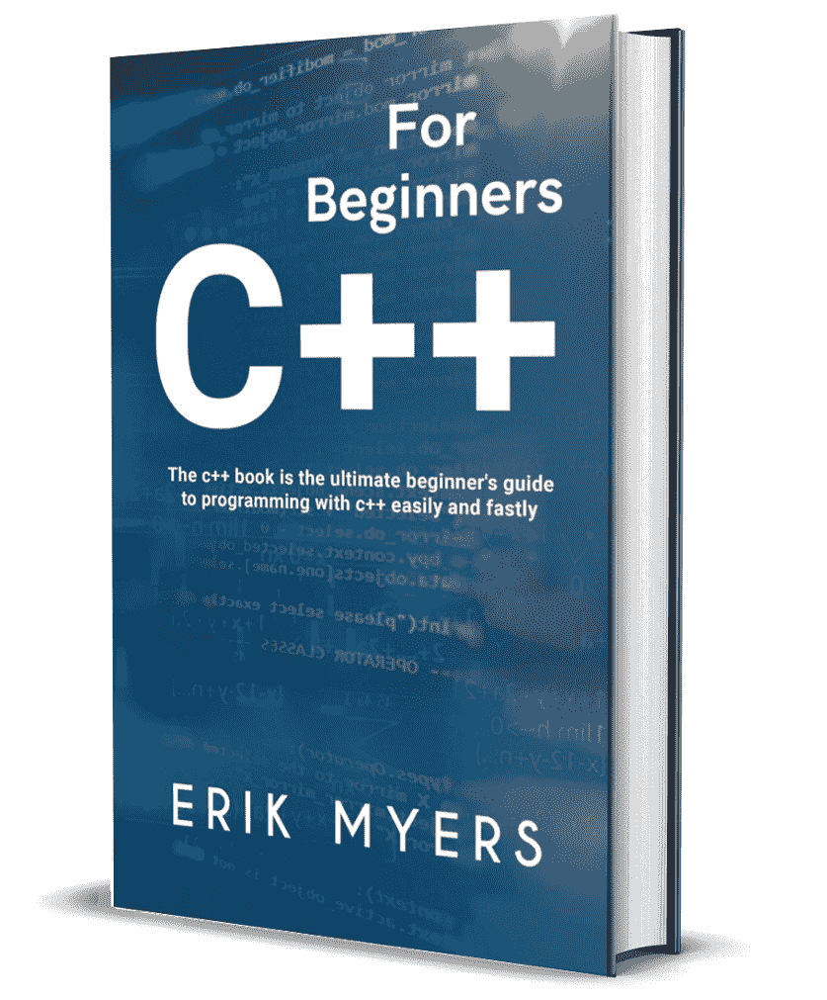

# C++ 初学者指南：C++ 书籍是轻松快速学习 C++ 编程的终极初学者指南



## 为什么你需要这本书

你的程序代码需要使用你所选择的编程语言能够理解的命令，以逐步说明的形式编写。这意味着你需要阅读你的编程手册，以学习为了让程序实现的功能需要使用哪些命令。

在“Hello World”示例中，你首先需要一个将“Hello World”打印到屏幕上的命令，然后你需要第二个命令来多次打印它，而无需编写多个打印语句。

查看这个示例。为了简单起见，我使用了带有行号的旧式基础——可能是因为我是一个复古控。

```
10 print "Hello Wоrld"
20 goto 10
```

编写任何程序代码的最佳结构是使其清晰且易于遵循。一些程序员会将多个命令写在同一行，如果你试图修复错误，这会让你的代码难以追踪。将你的代码分布在多行实际上会让程序运行得更好并变得更具可读性。

另一个建议实践是用 `REM` 语句将程序代码的每个部分分开。`REM`（Remark 的缩写）允许你在每段代码之前放置注释，以提醒你每个部分的作用。如果你想在日后编辑代码，这特别有用。

```
10 rem Set Up Variables
20 let A=1: let B=2
30 rem *******
40 rem Print Variables to Screen
50 rem *******
60 int A,B
```

`REM` 命令后的任何内容都会被计算机忽略，你可以根据需要使用任意多个 `REM` 语句在代码中留更大的间隙以便阅读。其他编程语言允许使用空行或对过程的第一行进行缩进。

现在我教你如何构建整个程序代码。记住，计算机需要遵循逐步指令，你需要按照希望它们运行的顺序编写每条指令。

## 代码结构

- **设置屏幕分辨率和变量**：程序的第一个部分将设置屏幕分辨率和变量。
- **将信息读入数组**：如果你有信息想使用 `DIM` 命令放入数组，你就可以使用 `For/Next` 循环和 `READ` 命令。最好将读取数组的数据语句放在程序的末尾。
- **设置主屏幕**：这是你使用子程序（`GOSUB` 命令）来设置主界面的部分。在一个街机射击游戏中，你将有一个绘制精灵和游戏屏幕的例程，然后返回到调用它的代码的下一行。
- **主程序循环**：一旦程序启动并运行，主程序循环将使用子程序跳转到各种例程，然后返回循环中的下一行。
- **程序例程**：将所有程序例放在主循环之后是一个很好的结构。你会有独立的例程来更新屏幕、检查摇杆输入、检查碰撞检测等。在每次检查后，你都会返回主循环。

你知道吗，Microsoft Access 2007 中的数据表如果包含元数据，就可以被用来控制你的 Access 2007 程序并为你编写代码。元数据是关于数据的数据。从你开始使用 Access 2007 开始，你实际上一直在存储和使用元数据。当你为表单文本框标签选择一种颜色时，你是在指示 Access 2007 记住这种颜色，并在每次显示该标签时运行创建该颜色的程序代码。这是一个如何使用存储在 Access 2007 数据表中的元数据来避免自己编写许多行代码的示例。以下是使用元数据的示例。你有一些报告每周二打印，有些需要在每周五打印。你可以编写一些 Access 2007 代码来打印周二的报告：

```
If Weekday(Date) = 3 then 'It's Tuesday'
DoCmd.OpenReport "Tuesday Report A"
DoCmd.OpenReport "Tuesday Report B"
DoCmd.OpenReport "Tuesday Report C"
DoCmd.OpenReport "Tuesday Report D"
DoCmd.OpenReport "Tuesday Report E"
End if
```

然后你为周五的报告编写更多代码：

```
If Weekday(Date) = 6 then 'It's Friday'
DoCmd.OpenReport "Tuesday Report A"
DoCmd.OpenReport "Tuesday Report B"
DoCmd.OpenReport "Tuesday Report C"
DoCmd.OpenReport "Tuesday Report D"
DoCmd.OpenReport "Tuesday Report E"
End if
```

现在，让我们用 7 行代码代替这 14 行代码。

```
Dim rs As DAO.Recordset
Set rs = CurrentDb.OpenRecordset("Table Name Containing Metadata")
Do Until rs.EOF
  If ![DayOfWeek] = Weekday(Date) Then
    DoCmd.OpenReport ![ReportName]
  End If
  rs.Move
Next Loop
```

即使 Access 2007 或任何其他版本的 Access 中的报告从 10 份增加到 50 份，这 7 行代码也不需要更改或添加。Access 2007 数据表只需要存储报告名称和星期几，只需两个数据字段。这意味着易于维护，且未来不需要更改代码。

这种技术可以按指定的顺序运行一组查询。在链接到外部数据源时，通过包含路径、文件或表名以及规范使用元数据。通过存储导入和导出规范、格式和存储路径，你可以自动化导入或导出数据。

# 帮助 PHP 程序员改进程序代码的高级技巧

自大约二十年前从微基础起步以来，PHP 编程见证了快速增长，并成为所有 Web 应用程序最流行的编程语言。许多网站由 PHP 编程代码驱动，绝大多数 Web 项目和脚本都依赖这种流行的语言进行开发。由于这种开发语言的巨大流行，任何 PHP 程序员似乎都不可能说自己连 PHP 的基本工作知识都缺乏。在本教程中，我们的目的是帮助那些处于这种编程语言学习阶段、愿意卷起袖子大干实践这门语言的人。这些简单的提示将有助于提高开发过程的熟练度，使代码更整洁并提供最佳性能。

## SQL 注入

SQL 注入是一种非常糟糕的东西。这是一种安全漏洞，黑客可以利用代码中的漏洞深入你的数据库。`MySQL` 数据库在 PHP 代码中实现，了解你应该避免的事项可以帮助编写安全代码。

## 区分运算符

运算符是 PHP 编程中不可或缺的一部分。然而，一些程序员并不擅长区分它们之间的区别。事实上，许多人声称大多数程序员一眼看出运算符之间的区别！未能区分 `==` 和 `===` 是报告中的一个错误。

## `replace()` vs `pregreplace()`

优先使用 `replace()` 而非 `pregreplace()`：从整体性能而言，`replace()` 证明比正则表达式高效得多。事实上，统计数据显示，与 `pregreplace()` 和 `preg()` 等正则表达式相比，`replace()` 将代码效率提高了高多达 61%。然而，如果你的代码中仅包含正则表达式，那么 `pregreplace()` 和 `preg()` 将证明比 `replace()` 函数更快更高效。

## 三元运算符的使用

与其在编程代码中完全使用 `if/else` 语句，不如考虑使用三元运算符。它们在腾出大量空间以提高程序可读性方面非常有效。代码看起来不那么杂乱，将来以后扫描任何意外错误时也更容易。但是，请注意不要在单个语句中使用超过一个运算符。在这样的情况下，PHP 经常会对其操作来源感到困惑。

## 使用 PHP 框架

对于你创建的每个项目，使用 PHP 框架似乎是不可能的。然而，使用如 `CodeIgniter`、`Symfony`、`Zend` 和 `CakePHP` 等框架有助于减少开发网站所需的时间。Web 框架通常是将自身与常用功能封装在一起的软件，有助于加速开发过程。通过让框架处理网站编程所需的所有重复任务，你可以以快得多的速度进行开发。你需要处理的代码越少，测试和调试的要求就越少，从而加快整个流程。

## 正确使用错误抑制运算符

`@` 符号通常是错误抑制运算符。在 PHP 语句前放置 `@`，它将抑制该语句中的所有错误。这适用于你对某个值有怀疑，但不希望它们在脚本运行时显示。然而，许多程序员经常以不当的方式使用错误抑制。`@` 运算符很慢，会影响性能。在编写代码时，请记住性能。虽然存在替代方法，但使用 `@` 运算符可能会导致副作用。

## `isset()` vs `strlen()`

如果你要实现一个检查字符串长度的函数，使用 `isset()` 而不是 `strlen`。这允许你的函数像其他函数一样工作，你可以有一个值变量。

## 在 PHP 中使用注释的重要性

PHP 是一种非常多功能的语言，允许程序员根据他们的各种喜好创建应用程序。但所有程序员都应该维护的能力是注释能力。从本质地说，注释节省了数小时阅读代码的时间，而且通常是雇要求的。注释不会被 PHP 引擎解析，因此它们只对查看文件原始代码的人可见。这对于记录每个代码块的作用非常有帮助，同时让网站的普通访问者察觉不到他们正在使用的应用程序上存在的注释。与 HTML 注释不同，PHP 注释在网站的源代码中是不可见的。HTML 注释对公众可见，这可能导致代码被盗取，甚至帮助黑客利用应用程序。PHP 注释完全不会输出到浏览器，因此它们对于窥探的眼睛来说是完全安全的。

实际上，我们有三个运算符可以用来告诉 PHP 引擎我们想要使用注释。单行内联注释可以使用 `//` 和 `#` 运算符。对于多行注释，我们分别使用 `/*` 和 `*/` 来指示哪些是注释，哪些是实际 PHP 代码。虽然前两个运算符是同义的，但最后一个用于工作量相对较少的代码。

## 学习 PHP 语言

如果你熟悉其他基础语言并确定知道你想创建什么，学习一种新的编程语言并不困难。对于所有人来说，用 PHP 编写的代码是可读的。用 `C` 和 `C++` 编写的代码则不可读，这使得 PHP 更具可读性。

## 初学者的帮助

在使用像 PHP 或 C++ 这样的高级语言时，我们使用一种更容易理解的语法。然而，某些代码使用输入转换为整数。例如，在代码中：

```cpp
int volume(int i, int j, int k) {
  int vol;
  vol = i * j * k;
  return vol;
}
```

（注：此处原文似乎存在逻辑混乱或重复，翻译已根据语境处理）

（此处原文包含大量重复和编码问题）

## 代码标准

即使 Access 2007 或任何其他版本的 Access 中的报告从 10 份增加到 50 份，这 7 行代码也不需要更改或添加。Access 2007 数据表只需要存储报告名称和星期几，只需两个数据字段。这意味着易于维护，且未来不需要更改代码。

这种技术可以按指定的顺序运行一组查询。在链接到外部数据源时，通过包含路径、文件或表名以及规范使用元数据。通过存储导入和导出规范、格式和存储路径，你可以自动化导入或导出数据。

# 第一章 帮助 PHP 程序员改进程序代码的高级技巧

自大约二十年前从微基础起步以来，PHP 编程见证了快速增长，并成为所有 Web 应用程序最流行的编程语言。许多网站由 PHP 编程代码驱动，绝大多数 Web 项目和脚本都依赖这种流行的语言进行开发。由于这种开发语言的巨大流行，任何 PHP 程序员似乎都不可能说自己连 PHP 的基本工作知识都缺乏。在本教程中，我们的目的是帮助那些处于这种编程语言学习阶段、愿意卷起袖子大干实践这门语言的人。这些简单的提示将有助于提高开发过程的熟练度，使代码更整洁并提供最佳性能。

## SQL 注入

SQL 注入是一种非常糟糕的东西。这是一种安全漏洞，黑客可以利用代码中的漏洞深入你的数据库。`MySQL` 数据库在 PHP 代码中实现，了解你应该避免的事项可以帮助编写安全代码。

## 区分运算符

运算符是 PHP 编程中不可或缺的一部分。然而，一些程序员并不擅长区分它们之间的区别。事实上，许多人声称大多数程序员一眼看出运算符之间的区别！未能区分 `==` 和 `===` 是报告中的一个错误。

## `replace()` vs `pregreplace()`

优先使用 `replace()` 而非 `pregreplace()`：从整体性能而言，`replace()` 证明比正则表达式高效得多。事实上，统计数据显示，与 `pregreplace()` 和 `preg()` 等正则表达式相比，`replace()` 将代码效率提高了高达 61%。然而，如果你的代码中仅包含正则表达式，那么 `pregreplace()` 和 `preg()` 将证明比 `replace()` 函数更快更高效。

## 三元运算符的使用

与其在编程代码中完全使用 `if/else` 语句，不如考虑使用三元运算符。它们在腾出大量空间以提高程序可读性方面非常有效。代码看起来不那么杂乱，将来以后扫描任何意外错误时也更容易。但是，请注意不要在单个语句中使用超过一个运算符。在这样的情况下，PHP 经常会对其操作来源感到困惑。

## 使用 PHP 框架

对于你创建的每个项目，使用 PHP 框架似乎是不可能的。然而，使用如 `CodeIgniter`、`Symfony`、`Zend` 和 `CakePHP` 等框架有助于减少开发网站所需的时间。Web 框架通常是将自身与常用功能封装在一起的软件，有助于加速开发过程。通过让框架处理网站编程所需的所有重复任务，你可以以快得多的速度进行开发。你需要处理的代码越少，测试和调试的要求就越少，从而加快整个流程。

## 正确使用错误抑制运算符

`@` 符号通常是错误抑制运算符。在 PHP 语句前放置 `@`，它将抑制该语句中的所有错误。这适用于你对某个值有怀疑，但不希望它们在脚本运行时显示。然而，许多程序员经常以不当的方式使用错误抑制。`@` 运算符很慢，会影响性能。虽然存在替代方法，但使用 `@` 运算符可能会导致副作用。

## `isset()` vs `strlen()`

如果你要实现一个检查字符串长度的函数，使用 `isset()` 而不是 `strlen`。这允许你的函数像其他函数一样工作，你可以有一个值变量。

## 在 PHP 中使用注释的重要性

PHP 是一种非常多功能的语言，允许程序员根据他们的各种喜好创建应用程序。但所有程序员都应该维护的能力是注释能力。从本质地说，注释节省了数小时阅读代码的时间，而且通常是雇要求的。注释不会被 PHP 引擎解析，因此它们只对查看文件原始代码的人可见。这对于记录每个代码块的作用非常有帮助，同时让网站的普通访问者察觉不到他们正在使用的应用程序上存在的注释。与 HTML 注释不同，PHP 注释在网站的源代码中是不可见的。HTML 注释对公众可见，这可能导致代码被盗取，甚至帮助黑客利用应用程序。PHP 注释完全不会输出到浏览器，因此它们对于窥探的眼睛来说是完全安全的。

实际上，我们有三个运算符可以用来告诉 PHP 引擎我们想要使用注释。单行内联注释可以使用 `//` 和 `#` 运算符。对于多行注释，我们分别使用 `/*` 和 `*/` 来指示哪些是注释，哪些是实际 PHP 代码。虽然前两个运算符是同义的，但最后一个用于工作量相对较少的代码。

## 学习 PHP 语言

学习一种新的编程语言并不困难，如果你熟悉其他基础语言并确定知道你想创建什么。对于所有人来说，用 PHP 编写的代码是可读的。用 `C` 和 `C++` 编写的代码则不可读，这使得 PHP 更具可读性。

## 初学者的帮助

在使用像 PHP 或 C++ 这样的高级语言时，我们使用一种更容易理解的语法。然而，某些代码使用输入转换为整数。例如，在代码中：

```cpp
int volume(int i, int j, int k) {
  int vol;
  vol = i * j * k;
  return vol;
}
```

（注：此处原文似乎存在逻辑混乱或重复，翻译已根据语境处理）

（此处原文包含大量重复和编码问题）

## 代码标准

代码标准是一套规则和指南，说明如何编写代码。使用标准有助于变量、如何缩进。其思想是在编程中保持一致，让多个人处理同一份代码时变得更容易理解。即使对于个人程序员，如果遵循标准也会花费更少的时间理解。

## 代码标准带来差异

看以下示例：

```cpp
int volume(int i, int j, int k) {
  int vol;
  vol = i * j * k;
  return vol;
}
```

一眼看这段代码，需要一些时间来理解这个函数计算体积。然而，如果为变量和方法名添加命名规范，可以让代码更具可读性。这里有一些示例：使用有意义的变量名、在方法名中使用动词、变量使用名词、使用 4 个空格缩进：

```cpp
int calculateVolume(int height, int width, int length) {
  int volume = 0;
  volume = height * width * length;
  return volume;
}
```

输入这段代码需要更多时间，但它节省了更多时间。这段代码比原始版本更具可读性。稍微努力可以让代码变得更容易理解。

## 益处

不仅是我们通过编程中的代码标准获得的可读性。通过命名规范也可以鼓励编写更安全代码。例如，在 C++ 中我们可以说每个指针变量必须初始化为 `NULL`。

## 学习语言

学习一种新的编程语言并不困难，如果你熟悉其他基础语言并确定知道你想创建什么。对于所有人，用 PHP 编写的代码是可读的。用 `C` 和 `C++` 编写的代码则不可读，这使得 PHP 更具可读性。

## 初学者的帮助

在使用像 PHP 或 C++ 这样的高级语言时，我们使用一种更容易理解的语法。然而，某些代码使用输入转换为整数。例如：

```cpp
int volume(int i, int j, int k) {
  int vol;
  vol = i * j * k;
  return vol;
}
```

```
char myName = NULL;
```

这确保了我们在使用此指针变量时不会损坏内存。代码的可读性只是可维护性方面的方面之一。编码标准对于程序的可维护性有很大帮助，即我们能够轻松地更改程序。通过编码标准强制的一一致性是实现程序维护成功的关键因素。

# 为什么需要编码标准？管理概述


程序员经常被要求在没有标准或质量保证的情况下编写代码。这往往只有在出现重大问题后，人们才会发现那几个月（在某些情况下是几年）的编程工作是徒劳无功的。对所生成的代码进行某些控制是至关重要的——而这从一份文档齐全的编码标准开始。

无论你有多忙，从长远来看，编码标准都会节省时间——它是良好编程的基础。编码标准与编程生产力是并不悖的。无论使用何种编程语言，遵循编码标准都会显著提高开发生产力。一套一致应用的编码规范将标准化应用程序的结构和编码风格，使程序员能够轻松地阅读和理解其他程序员的代码，以及他们自己的代码。

良好的编码标准能够产生精确、可读且无歧的源代码，这些代码尽可能保持一致且直观。编码标准的目的是为了使程序易于阅读和理解，而不会用过度的约束和任意的限制限制程序员自然的创造力。

## 维护成本

遵循编码标准不仅能提高系统开发的生产力，还能提高增强和维护系统的生产力。控制维护成本同样重要——这些成本可能占软件整个生命周期成本的大部分。为了降低高昂的维护成本，务必编写出让公司内任何其他程序员都能轻松解读和增强的代码。这很重要，因为通常很少软件是由原程序员维护的。

## 执行标准

所有程序员都应对编码标准达成共识。一旦达成共识，必须作为质量保证的一部分来执行该标准。使用约定的编码技术和良好的编程实践对软件质量和性能起着重要作用。通过一致地应用定义良好的编码标准，事事软件项目的程序员团队更有可能产出易懂、无错、高性价比且易于维护的质量系统代码。

这里是一些帮助你创建编码规范（`Coding Standard`）的建议。请保持简明扼要：

### 可读性代码

代码的创建必须让其他程序员易于理解。不应该只为了计算机而编写。代码应该是易于阅读的，并留有大量的空白。

### 代码块

代码块应该拆分为定义良好且易于理解的程序分段。使用“主线”（`Main Line`）来分割冗长的过程可能会有所帮助。

### 代码缩进

如果控制结构的缩进不一致，那么那些`If`、`If`、`Else`结构将很难追踪。

### 变量命名

变量命名规范应该是经过深思熟虑、具有意义且应用一致的。变量名应该描述变量的内容。尽量不要使用缩写，除非它们是应用一致的。需要设定大写标准、驼峰命名法（`Camel case`）或帕斯卡命名法（`Pascal case`）。

### 程序名称

与变量命名规范一样，程序名称应该描述它们的用途。

### 代码文档

无论代码写得有多好，最终都会需要更改或增强。在实际编写代码时，应该花时间对代码的意图和技术方面进行注释。这将节省后续的时间和精力。除了外部文档外，所有代码都应该大量编写注释。每个程序都应该有一个标题，用注释描述程序的输入、输出和功能。

### 复杂结构

人们总是受到使用最新、最强大功能的诱惑——这对于缺乏经验的程序员来说尤为如此。复杂和深奥会让程序代码难以追踪、维护和调试。必须坚持简单原则。

### 保持编码简单

如果另一个人无法一眼看懂代码的核心内容，那么这段代码就写得很糟糕。在调试或增强代码时，经常需要重写代码。这对于公司来说是一项成本高昂的活动，而且是无产出且浪费的精力。

### 隔离复杂代码

在需要功能或性能时，会有简单性必须让位于复杂性的场合。在这些情况下（希望少之又少），应该将复杂代码隔离在“黑盒”库程序中。

### 可重用代码

编码规范应该包含可重用代码的收集和记录。通过可重用代码（即不在整个组织中重复的代码），程序员将构建更快的程序——运行更快的程序。使用更的代码意味着更高的生产力和更快的开发周期。通过让每个程序员在每个项目中重复使用相同的代码，错误可以更早地识别和消除。

## 如何获取作弊码

作弊可能会破坏某些玩家的游戏体验，但对于想要解锁游戏所有秘密的急躁玩家来说，作弊码是失之中得的幸运。

### 为什么要作弊？

作弊码是一系列密码、按键或其他工具，用于解锁功能和奖励，或帮助玩家完成游戏。游戏程序员有时会使用作弊码来调试或分析游戏中的缺陷；有时，作弊码在游戏发布时仍留在游戏代码中。一些视频游戏发行商和开发者会将作弊码放入游戏中以满足需求。

### 常见的作弊码类型

对于被称为“作弊码”的密码，它必须影响游戏玩法。视觉效果和新的音效。这里是最常见的作弊：

*    `God mode`（无敌模式）赋予玩家临时无敌状态。
*    `Unlimited resources`（无限资源）增加玩家的资源或法力。
*    某些作弊码只需指令即可实现。
*    `Clip is cheat` 用于动作游戏，赋予你穿过墙壁和其他障碍的能力。
*    `Unlocked abilities`（解锁能力）可以通过作弊码添加无限弹药和新法咒。

### 内部资源

内部资源是你获取作弊的最佳资源。很少有游戏没有作弊码，也没有任何游戏是无法作弊的。以下你可以从这些处获取的一些作弊和作弊工具：

### 实际代码

你只需在搜索引擎中输入游戏名称，加上“`cheat`”进行搜索，就能在网上找到大量的作弊码。记住安全上网，许多作弊码意味着欺骗或风险。

### 策略指南和攻略教程

策略指南和攻略是包含如何玩和完成游戏的文档。它可以是针对第一人称射击游戏或格斗游戏的完整。存档通常用于已解锁的控制机和 `PC` 游戏。游戏存档角色也能让你在游戏中获得领先优势，尽管被作弊和被破解的角色在多人游戏中会被检测到。

修改器（`Trainers`）用于厂家没有遗留或发布作弊码的游戏。修改器是一个运行在游戏后台的程序，它利用编程中的漏洞允许作弊。作弊通过一系列键激活，这些键通常绑定到任何功能键上（`F1` 到 `F12`）。

### 作弊硬件

当游戏仍运行在卡带上时，`Game Genie` 是一种用于输入代码的流行硬件。类似的作弊硬件还包括 `Pro Action Replay` 和 `Game Shark`。

对于那些想要挑战的人来说，编程是一种非常好的作弊方式。

## 第 4 章 A+ 编程语言

编程世界非常广阔，你必须进行大量的研究，才能完全掌握任何编程语言。在成为优秀程序员的旅程中，你也会很早地发现，这里有很多编程语言是你们必须学习的；当然，前提是你想成为一名程序员并创建你一直想创建的应用程序。在本章中，我们将讨论 `A+` 编程及其所有的特性。据说 `A+` 是 `A` 语言的必不可少的，如果你了解 `A+` 编程，你就会对 `A+` 编程是什么有一个大致的概念。我不想搞混，我应该提到 `A+` 是用于 `IT` 认证的，如果你想成为一名程序员。

当你决定获得 `A+` 认证时，你将学习维护、安装和帮助你的计算机。你将成为许多能够使用你知识的人眼中非常了不起的人。然而，为了到达那里，你必须对自己的计算机拥有某种知识。以下是其中的：

*    `Variable`（变量）
*    `Array`（数组）
*    `Function`（函数）
*    `Conditional`（条件）
*    `Loop`（循环）
*    `String`（字符串）
*    `Object`（对象）
*    `Subroutine`（子程序）
*    `Method`（方法）
*    `Asynchronous`（异步）
*    `Event`（事件）

`A+` 是一种高层模型的数组编程语言，它允许程序处理数据集以便能够操作数据。作为一名程序员，你不需要手动处理数组中的数据处理。`A+` 是一种面向数据的语言，它将数据聚集在一起；不像使用循环来查找数据的编程语言。不言疑问，通过编程，你将找到学习新事的一种极佳方法。这意味着你需要处理数据来获取数据。

### 变量与数据流

数据流是一种基于网络的方法，用于收集信息；解释构成了所有集合的结果。数据流是一种基于网络的方法，用于收集信息；解释构成了所有集合的结果。数据流是一种基于网络的方法，用于收集信息；解释构成了所有集合的结果。数据流是一种基于网络的方法，用于收集信息；解释构成了所有集合的结果。数据流是一种基于网络的方法，用于收集信息；解释构成了所有集合的结果。

### A+ 中的数据类型：

*    `Variable`
*    `Array`
*    `Function`
*    `Conditional`
*    `Loop`
*    `String`
*    `Object`
*    `Subroutine`
*    `Method`
*    `Asynchronous`
*    `Event`

### 方法

方法是执行特定任务的代码块。在 `A+` 中，方法用于操作对象。方法可以从程序的其他部分调用。

### 对象

对象是包含数据和方法的单元。在 `A+` 中，对象用于组织数据。对象可以被创建、使用和销毁。

### 错误处理

`A+` 具有内置功能，用于处理程序执行期间发生的错误。这有助于防止程序在错误发生时崩溃。

### 数据库支持

`A+` 内置了连接数据库的支持。这允许程序从数据库中存储和检索数据。

### 用户界面

`A+` 提供了创建图形用户界面（`GUI`）的工具。这允许用户以视觉化的方式与程序交互。

### 网络

`A+` 可用于开发网络应用程序。这允许程序通过网络相互通信。

### Web 开发

`A+` 可用于 `Web` 开发。这允许程序在 `Web` 浏览器中运行。

### 移动应用开发

`A+` 可用于开发移动应用程序。这允许程序在智能手机和平板电脑上运行。

### 云计算

`A+` 可用于开发云应用程序。这允许程序在远程服务器上运行。

### 人工智能

`A+` 可用于开发人工智能应用程序。这允许程序从数据中学习并适应。

### 数据科学

`A+` 可用于数据科学项目。这允许程序分析海量数据。

### 机器学习

`A+` 可用于开发机器学习应用程序。这允许程序从数据中学习。

### 深度学习

`A+` 可用于开发深度学习应用程序。这允许程序从数据中学习。

### 区块链

`A+` 可用于开发区块链应用程序。这允许程序处理区块链数据。

### 量子计算

`A+` 可用于开发量子计算应用程序。这允许程序处理量子数据。

### 增强现实

`A+` 可用于开发增强现实应用程序。这允许程序处理现实数据。

### 生物信息学

`A+` 可用于开发生物信息学应用程序。这允许程序处理生物数据。

### 机器人

`A+` 可用于开发机器人应用程序。这允许程序处理机器人数据。

### 航空航天

`A+` 可用于开发航空航天应用程序。这允许程序处理航空数据。

### 汽车

`A+` 可用于开发汽车应用程序。这允许程序处理汽车数据。

### 医疗

`A+` 可用于开发医疗应用程序。这允许程序处理医疗数据。

### 安全

`A+` 可用于开发安全应用程序。这允许程序处理安全数据。

### 金融

`A+` 可用于开发金融应用程序。这允许程序处理金融数据。

### 银行业

`A+` 可用于开发银行业应用程序。这允许程序处理银行数据。

### 保险

`A+` 可用于开发保险应用程序。这允许程序处理保险数据。

## 技术栈与资源

*   `HTML` & `CSS`
*   `JAVA`
*   `PHP`
*   `JavaScript`
*   制作网站
*   `Ruby on Rails`
*   `Angular JS`
*   `SQL`
*   `Python`
*   `jQuery`

## 学习平台

### MIT Open Courseware (MIT 开放课程)

如果你想以顶级大学的水平学习编程——那么 `MIT` 开放课程是你的最佳选择。抓住这次机会查看顶级资源，例如：`计算机科学与编程简介`、`Java 编程入门`以及`C 语言实用编程`。

### Coursera

`Coursera` 是一家教育技术公司，提供了来自全球 150 顶尖机构的 2000 多门课程。如果你想提升简历的含金量，可以从 `Coursera` 快速获得证书。因此在 `Coursera` 上学习编程，成为一名顶尖程序员吧。

### edX

`edX` 是领先的在线学习平台，采用开源而非营利性模式。它由哈佛大学和麻理工学院等顶尖大学于 2012 年创立。你应该知道，你将学到最前沿的技术和理论。

`edX` 提供大量的免费课程，包括编程类的课程。

可汗学院 (`Khan Academy`)

可汗学院实际上是我最喜欢的学习编程的地方。如果你想以互动的方式学习编程，那么可汗学院是最佳选择。它提供的免费课程项目包括：

*   `HTML / CSS`
*   `JavaScript`
*   `SQL`
*   动画及更多……

`Udacity`

`Udacity` 是斯坦福大学的项目。它是许多提供免费在线大学课程的网站之一。停止纠结如何学习编程了，直接从高质量的网站学习高质量的课程吧。

`Udemy`

`Udemy` 成立于 2010 年，是一个在线学习平台，通过它你不仅可以学习每种编程语言，还可以学习互联网上提供的几乎所有的技能。是的！你听得没错。有许多课程需要付费，但也有一些免费的编程课程，通过互动式视频课程进行授授。

谷歌 (`Google`)

想学习 `Android` 开发吗？为什么不从互联网之王谷歌那里学习呢？它提供移动/`Android` 开发的免费课程（从入门到专家级）。`Android` 开发是一项趋势技能，通过学习它可以获得一份高薪工作。

## 第 8 章：开发 iPhone 应用使用哪些编程语言？

虽然这听起来是一项非常有技术性的任务，但任何具备良好面向对象计算机编程知识的人都可以轻松开发 `iPhone` 应用。然而，由于 `Apple` 的限制，并不是所有的面向对象编程语言都适合开发者。这里有关于哪种编程语言最好以及如何最好完成任务的详细指南。

`Apple` 限制所有旨在其 `Apple Store` 发布的 `App` 必须以 `Objective C` 作为编程代码。`Objective C` 是更通用的 `C` 语言代码的混合形式。可以使用其他语言创建应用程序，然后使用封装 `API` 使其看起来像 `Objective C`，但这种方法并不总是有效。为了开发一个能够受到 `iPhone` 用户足够欢迎的优秀应用，你需要一台 `Mac` 电脑。为了获得最佳效果，请选择带有 `Intel` 处理器的电脑，最好运行 `MAC OS X`。这样，你就不必为所开发的 `App` 的兼容性问题烦恼，因为它将针对 `iOS` 设备的使用进行优化。下一步仍然是：在设置好你的 `Mac` 并从 `Apple` 网站下载 `iPhone` `Software Development Kit`（软件开发包）。`Apple` 提供免费的 `SDK`，其中包含了你所需的所有内容，包括环境 `XC` 以及允许你在发布之前测试应用的模拟器。复习你的 `OOP`（面向对象编程）技能以应用 `Objective C`。它有很多优势，因为它隐藏了底层硬件的复杂性，让你能够专注于应用程序本身的技术层面，而不是运行它的平台。有许多免费教程可以指导你。从编写简单的程序开始。过于野心勃勃可能会在未来给你带来问题。最好的方法是从一组易于管理的项目开始，并随着你技能的提高，逐渐胜任更复杂、更具挑战性的任务。与 `Java` 这种安全的语言不同，`Objective C` 代码中的一个错误就可能导致整个程序崩溃。在模拟器上充分测试你的应用程序后，你需要迁移到真实环境。要做到这一点，你首先需要在官方 `iPhone` 开发者计划中注册。你需要支付 99 美元的入会费。在签署了遵守 `Apple` 代码行为准则的协议后，返回表格以开始在真实环境中测试你的应用程序。成为一个优秀的开发者更多是关于拥有正确的技能和工具，而不是成为一个专业的程序员。学习正确的导向型编码将帮助你开发出准备在实际设备上发布的 `iPhone` 应用。一旦你注册成为开发者，你就可以可以在网上发布它们，并等待爱好者下载。

## VISUAL BASIC 6：知识产权与代码所有权

`Visual Basic 6` 如今仍被用于大量的应用程序中。特别是，大量的管理系统是用 `VB6` 前端与 `Microsoft Access` 或 `SQL Server` 数据库后端组合编写的。在当时使用 `Visual Basic 6` 作为前端是一个好主意。但发布于 1988 年的 `Visual Basic 6` 已无法购买，且扩展支持已于 2008 年停止。拥有必要技能和软件来维护 `VB6` 的意向程序员正在减少。任何仍在使用 `VB6` 前端的公司都面临着无支持崩溃的危险。对系统进行“小改动”将变成一项艰巨工程——如果可能的话，将非常昂贵。支持过时的软件对系统来说是一个“小改动”。变化是永远需要的——随着新系统的出现，随着新一代的变得功能化。

## 代码所有权与版权

关于代码所有权和版权的问题问得越来越多。`VB6` 前端的代码所有权问题是一个真实的威胁——许多地方高度依赖它。“你付了钱，你就拥有它”的通常规则并不适用于代码——所有权通常属于软件作者。

## 获取代码

开发过程需要完全的控制。但代码可能无法获得——原始程序员可能已经去寻找更好的新平台。坦率地说，获取代码会使公司面临勒索风险。但仅仅拥有 `VB6` 代码并不能解决正在进行的开发问题。

## 即使如此

即使 `Visual Basic 6` 代码可用——它能运行吗？通常已经整合了大量的第三方 `OCX`（自定义控件）和 `DLL`（动态链接库）。这些插件的安装软件和许可证很难获得。大多数 `VB6` 第三方软件公司现在已经倒闭，或者被其他公司收购。而且，由于 `VB6` 的原始性质，前端系统已经整合了许多 `OCX`、`DLL` 和 `API`（应用程序编程接口）——用于系统信息、报告、数据网格、调整大小、日历控件、按钮、工具提示、下拉菜单等。`DLL` 版本之间的冲突问题被称为“`DLL` 地狱”。

## 通过定制化软件开发公司解决您的编程查询

随着全球技术的发展，互联网已帮助整个世界紧密相连。公司在网络上的存在是迈向增长和利润的有效工具。为了获得具有成本效益且高质量的网站开发，与离岸 `IT` 开发公司合作总是有益的。如今，许多贸易公司在 `IT` 领域软件开发公司的帮助下扩大其业务版图。离岸公司可以为您提供许多服务，从一个小型的软件应用程序到整个网络产品。您可以为不同的贸易业务端获得胜任的 `Web` 解决方案。在选择完美的离岸 `IT` 开发公司时，必须遵循一些原则。软件开发的成本是一个大关重要的问题，它决定了整个项目的成本。为了更低的成本而在 `Web` 开发质量上做出妥协是不明智的。为了避免低质的服务，人们可以考虑选择那些提供 `IT` 定制化服务的离岸公司。选择一家考虑客户定制化需求的定制化软件开发公司。检查经验和团队实力是为您的项目寻找合适开发公司的最佳方法。始终检查软件公司的确切操作经验和他们的团队效率，以确保您的项目质量。开发公司必须使用更新的技术来满足明确的业务需求。软件公司应该根据全球标准工作，以提供出色的软件解决方案。查看公司的过往工作以确定其交付工作的质量是好的。


印度有许多软件公司通过定制的 `ASP.NET` 应用程序开发提供全球解决方案。对于定制化软件解决方案，可以参考高效的离岸 `.NET` 软件开发公司。所有这些公司都能够以个性化的方式满足您的编程需求。`ASP.Net` 是一种面向对象的 Web 开发程序，开发者使用库对编程代码进行加密。为了给您的开发项目获得高端解决方案，考虑您编程的独特质量至关重要。通过定制的 `ASP.NET` 应用开发，您将能够通过独特的工作风格来接触全球客户。您甚至可以根据需求按小时、按天或按月雇用开发者。在有这么多选择的情况下，选择以结果为导向的编程变得很容易。

## 软件测试：使用跟踪工具增加程序可靠性

软件开发涉及多个步骤，以确保最终产品运行正常且无 Bug。测试贯穿整个编程生命周期，用以验证单个功能的质量以及应用程序的整体性能。它可以在消费产品创建期间进行，也可以在新系统发布之前进行。在商业环境中，软件测试旨在识别将阻止消费者操作的缺陷。测试涉及验证流程是否能正常工作以防止问题。应用程序的包括一个解决周期，其中需求被定义为功能，由团队编码，进行缺陷测试，发回给程序员进行修正，然后在系统发布前再次评估。该循环在最终发布之前可能会发生多次。程序员在处理不同规模的任务时，需要可靠的工具来管理分配给他们的任务。任何疏漏都可能影响系统功能，而跟踪工具提供了一种管理开发者、测试人员和工程师的方法。

### 任务跟踪软件：系统开发的关键工具

系统开发确保需求已满足，验证功能并帮助组织确定字符在安装后是否能够工作。这些过程贯穿整个开发过程，包括大型项目的结束以及当特定功能需要进一步评估时。在大多数编程场景中，大部分测试发生在需求和编码完成后。在此期间，工程师或支持人员会检查每个功能以发现缺陷。发现的任何项目都会引起管理层的注意，他们会将问题分配给个人或开发者团队进行修正。任务跟踪软件可用于定义初始设计责任、跟踪编码需求或管理整个开发过程中的解决。

应用程序测试可能是静态或动态的，取决于公司试图实现的评估目标。静态测试涉及对系统进行走查或让客户审查 Beta 版本。动态过程涉及使用测试用例来验证程序代码是否按预期运行。各种测试程序的总目标是验证软件或系统已正确构建并满足特定的消费者需求。任务跟踪软件通过提供一个中心信息源来辅助这一过程，所有开发部分都可以在此输入、监控和组织有关一个或多个项目的职责。这些应用程序可以与其他组织工具集成，以创建一个稳健的项目管理解决方案。跟踪工具不仅限于开发环境，还可以被多个组织部门用于提供日常维护或软件测试。

## CODE IGNITER 开发：一个流行的 PHP 框架

`Code Igniter` 是另一个供所有使用 `PHP` 作为主平台设计和开发网站的开发者使用的框架。我们谈论的是 `Code Igniter` Web 开发。我们知道 `Code Igniter` Web 开发中有很多重要的框架可以实现快速应用。这同样遵循 MVC 模式，有助于 Web 转换用户使用的概念。对于那些规避任何（复杂性）并追求高效的人来说，`Code Igniter` 就是他们的选择。通过 `Code Igniter` 获得的主要处处提供为用户服务的 Web 开发。这不仅对用户有益，对开发者也有益。由于有丰富的库，开发者可以更快速地处理广泛的应用程序和开发。提供一个带有结构的易用界面来访问库，是 `Code Igniter` 为用户提供的最佳特性。通过 `Code Igniter` 的帮助，人们可以获得功能齐全且结构良好的网站。管理应用程序也变得简单，且不影响网站性能。这是搜索引擎友好的，当配合整洁的 URL 时，网站无疑会有显著的在线形象。人们惊讶地认为，`Code Igniter` 为开发提供了一个非常快速且可靠的平台。简单的界面但功能强大的库范围，使得与编写编程代码相比，Web 项目的开发能够更快速，这使得该框架变得与众不同。`Code Igniter` 框架是大型商业集团最青睐的框架，因为它是一个高效且轻量级的平台，可以创建处理海量数据的应用程序，该平台生成的应用程序被认为是高度安全且绝对可靠的。大型企业选择此框架的另一个原因是它们不需要花费大量时间进行编码和构建。`InfoTech` 提供定制化服务，涵盖开发、实施和支持。如果您正在寻找可靠的 Web 开发，那么 `Code Igniter` 适合您！

# 第 27 章：负载测试 - 确保您的程序运行正常

构建程序和系统可能很困难，特别是当您对自己的努力产生成就感时，如果结果包不匹配。特殊开发者的任务（无论是创建 Web、本地系统或其他）是编写长时间的代码、发布并确保所有项目功能正常工作。他们会在自己的编程中发现缺陷，并持续提供程序。

### 使用软件工具进行工作

即使是设置项目，您也需要对可能使用它的人有某种概念，总用户数可能会同时连接，以及他们将如何使用。构建仅适用于少数连接的程序，如果被大量用户涌入将导致系统失败，可能损害您的项目和声誉。这就是为什么建议进行测试。负载和性能测试是实际上将您的网站或软件程序推向极限，并分析结果以确定是否存在故障、程序的响应情况以及您是否需要进行更改。

### 如何进行负载测试？

如果您无法访问成千上万台计算机（也没有足够的人同时使用它们！），您当然需要寻找更好的测试程序策略，最廉价且实用的方法是使用负载测试软件。这些程序被标记为性能工具，是为此功能而开发的。它们将允许您进行许多操作以确保相应项目的功能、创建人类行为，并指定同时连接的用户数。如果您发现您的网站或页面连接到大量用户，您会知道这可能会降低数据或整体性能。如果您认为负载测试已经足够了，可以请第三方来实现。

## 使用一行代码进行 MICROSOFT ACCESS 数据验证

使用一行代码进行 `Access` 验证是可能的。数据验证检查数据在处理之前是否有效、合理。`Microsoft Access` 数据验证如果针对表单上的每个控件或“访问字段”，可能会非常耗时。许多人已经编写了方法来自动完成验证。没有一种方法适用于所有情况。您的表单可能会允许用户在 `Access` 验证触发之前离开记录。为了阻止用户这样做，您将需要额外的更改并增加表单的复杂性。这里有一种适用于大多数的 `Access` 验证方法：如果表单控件验证失败，用户会收到通知其已失败，控件会被高亮，光标会移回失败的控件。哦，它不会尝试验证标签顺序中后面的控件，即用户当前所在的位置。单行编程代码用于表单的 `Open` 事件进行 `Microsoft Access` 数据验证。如果验证失败，可以阻止用户离开记录、添加新记录或关闭表单，这需要在相应的关闭、添加新记录和导航按钮上增加额外的代码。它是如何工作的？`Access` 开发者只需要在表单控件的 `'TAG'` 属性中输入几个字符。`'TAG'` 属性存储有关控件的额外信息。一个名为 `SetValidatorEventHandler` 的子程序放在每个想要进行 `Microsoft Access` 数据验证的表单 `Open` 事件中。它将在表单所有文本框、组合框和列表框的 `OnGotFocus` 添加对 `Validator` 函数的调用。如果您的表单有其他的 `OnFocus` 事件，您需要在每个想要触发此代码的控件 `OnGotFocus` 中引用 `Validator` 调用。在您想要包含的每个控件的 `'tag'` 中放置以下内容：

- 控件不能留。
- 控件必须包含日期。
- 控件的值必须大于。
- 控件必须是一个电子邮件地址。

您添加的其他类型的验证需要组合字符。如果您没有在给用户的消息中引用表单控件的实际名称，请在 `tag` 结尾指定一个替代名称。将 `'MyControl'` 替换为您想要的控件名称。

# 结论

计算机充满了可以处理结束的隐藏软件。美国网络提供商 `EarthLink` 表示，在 1 月到 3 月之间对数百万台计算机进行了扫描。扫描结果显示它发现了数百万个间谍软件示例。目前有超过 38 种间谍软件和广告软件集成到您这样的用户使用的游戏、音乐、图片、弹出窗口、电子邮件中，并会导致您的 PC 运行极其缓慢，允许广告公司随心所欲地入侵。

### 什么是间谍软件？

间谍软件是一个泛指，指代在您不知情或未经许可的情况下从您的计算机收集信息的程序。间谍软件是一种传输唯一代码以识别您（出于跟踪目的）的软件程序，它在您不知情或未经许可的情况下收集有关您的计算机的信息或习惯。这种互联网被称为间谍软件，它在您的计算机上安装，它执行其他职责并持续重新安装自己。

### 间谍软件！

美国立法者正在寻找方法来防止或监管它。`EarthLink` 反映了 1 月到 3 月期间数百万台计算机的扫描结果，发现了超过 250 万个间谍软件示例。

### 我应该担心间谍软件或广告软件吗？

密码、卡信息和其他个人信息可能会落入他人手中。您的计算机可能会感染病毒、蠕虫甚至木马。您会收到不想要的电子邮件。您的计算机可能会被恶意操作者使用，不仅损害您的计算机，还会损害其他计算机。

### 我的电脑上有了间谍软件

`Code Igniter` 是另一个供所有使用 `PHP` 作为主平台设计和开发网站的开发者使用的框架。我们谈论的是 `Code Igniter` Web 开发。我们知道 `Code Igniter` Web 开发中有很多重要的框架可以实现快速应用。这同样遵循 MVC 模式，有助于 Web 转换用户使用的概念。对于那些规避任何（复杂性）并追求高效的人来说，`Code Igniter` 就是他们的选择。通过 `Code Igniter` 获得的主要处是提供为用户服务的 Web 开发。这不仅对用户有益，对开发者也有益。由于有丰富的库，开发者可以更快速地处理广泛的应用程序和开发。提供一个带有结构的易用界面来访问库，是 `Code Igniter` 为用户提供的最佳特性。

### Code Igniter 框架

`Code Igniter` 框架是大型商业集团最青睐的框架，因为它是一个高效且轻量级的平台，可以创建处理海量数据的应用程序，该平台生成的应用程序被认为是高度安全且绝对可靠的。大型企业选择此框架的另一个原因是它们不需要花费大量时间进行编码和构建。如果您正在寻找可靠的 Web 开发，那么 `Code Igniter` 适合您！

### 验证规则

遵循：

- 控件不能留。
- 控件必须包含日期。
- 控件的值必须大于。
- 控件必须是一个电子邮件地址。

您添加的其他类型的验证需要组合字符。如果您没有在给用户的消息中引用表单控件的实际名称，请在 `tag` 结尾指定一个替代名称。将 `'MyControl'` 替换为您想要的控件名称。

# 第 27 章：负载测试 - 确保您的程序运行正常

构建程序和系统可能很困难，特别是当您对自己的努力产生成就感时，如果结果包不匹配或更晚。特殊开发者的任务（无论是创建 Web、本地系统或其他），是编写长时间的代码、发布并确保所有项目功能正常工作。他们会在自己的编程中发现缺陷，并持续提供程序。

## 测试方法

### 应用程序创建

应用程序创建包括一个解决周期，其中需求被定义为功能，由团队编码，进行缺陷测试，发回给程序员进行修正，然后在系统发布前再次评估。该循环在最终发布之前可能会发生多次。程序员在处理不同规模的任务时，需要可靠的工具来管理分配给他们的任务。任何疏漏都可能影响系统功能，而跟踪工具提供了一种管理开发者、测试人员和工程师的方法。

### 任务跟踪软件

任务跟踪软件可用于定义初始设计责任、跟踪编码需求或管理整个开发过程中的解决。应用程序测试可能是静态或动态的，取决于公司试图实现的评估目标。静态测试涉及对系统进行走查或让客户审查 Beta 版本。动态过程涉及使用测试用例来验证程序代码是否按预期运行。各种测试程序的总目标是验证软件或系统已正确构建并满足特定的消费者需求。任务跟踪软件通过提供一个中心信息源来辅助这一过程，所有开发部分都可以在此输入、监控和组织有关一个或多个项目的职责。这些应用程序可以与其他组织工具集成，以创建一个稳健的项目管理解决方案。跟踪工具不仅限于开发环境，还可以被多个组织部门用于提供日常维护或软件测试。

如果你喜欢这本书或觉得它有用，如果你能为它写一条简短的评论，我将不胜感激。你的支持真的非常有意义，我都会亲自阅读每一条评论，以便获取你的反馈并让这本书变得更好。

再次感谢你的支持！
