# C++ 入门指南：轻松自信学习 C++ 编程的完整指南


## 引言
本书适合初学者以及对进入后端编程感兴趣的编码人员。尽管 C++ 有时被描绘成过去的幽灵，但这门语言依然在我们身边，并继续支撑着我们今天使用的一些顶级技术——更不用说它在游戏领域中的巨大影响。它的强大和多功能性使其成为我们时代最重要的语言之一。它不会消失，学习它将开宽你的视野。

由于 C++ 处理开销较小，它经常被作大数据的后端语言。spotify、adobe、youtube 和 amazon 等公司使用 C++ 驱动其后端，你很快就会明白原因。

C++ 也是强大游戏引擎后后。游戏引擎允许程序员无需从头编写所有代码即可构建游戏，并有效地渲染内容。Unity 游戏引擎和 Unreal 引擎就是运行在 C++ 之上的游戏引擎示例。

C++ 是一门优、高效的语言，因为它具有极佳的性能/硬件比例：对于它提供的性能，所需的硬件资源很少。这就是为什么学习它的人喜爱它。

在书中，我们将涵盖以下主题：
* 编程术语和编程原理
* 搭建 C++ 环境
* 入门：语法、数据类型和变量
* C++ 的威力：操作、循环、分支语句和决策判断
* 在 C++ 中创建自定义函数

你还可以在书末找到一个实用的术语表，这样一旦你开始学习，就可以将本书作为参考。

## 第 1 章：搭建 C++ 开发环境
从根本上说，编程是用代码编写一份机器可以理解的指令列表。这些代码存在于可执行文件中。这些文件带有扩展名，告诉编译器文件中的是什么语言。这些扩展名是你经常在文件末尾后缀，例如 `.js`、`.cpp` 或 `.hpp`。

要编写代码并保存到可执行文件中，你需要以下物品：
1. 一个文本编辑器：这将允许你编写和编辑代码。
2. 一个语言编译器：该程序将你编写的代码翻译成计算机可以理解并遵循的机器语言。

所有的编程语言都是这样工作的，但 html、css 和 javascript 例——这些程序由浏览器解释并执行（“introduction,” n.d.）。这意味着像 javascript 这样的浏览器语言是基于软件的，而 C++ 是编译后直接在你的机器上运行，而不是在软件环境中。

这意味着 C++ 是一种汇编语言。汇编语言是低级编程语言，需要编译器并在机器上运行（lithmee, 2018）。在这种语境下，“低级”一词并不带有负面含义；它是描述性的，意味着这种语言更接近机器，或者与机器仅一步之遥。

正如你可能猜到的那样，C++ 是一种通用语言，可以在几乎任何运行。这意味着可以通过多种不同的方式进行汇编和编译。这在很大程度上取决于你的操作系统以及你正在使用的创建工具。

我们的 C++ 练习将在在线 IDE 上编译。IDE 代表集成开发环境（Integrated Development Environment），用于编辑和编译代码。我打赌这个描述听起来很熟悉。是的，IDE 是文本编辑器的一个例子，但与纯文本编辑器不同，它具有对编程过程重要的额外功能。IDE 可以执行编译代码、调试代码、高亮代码、警告你语法错误等操作。

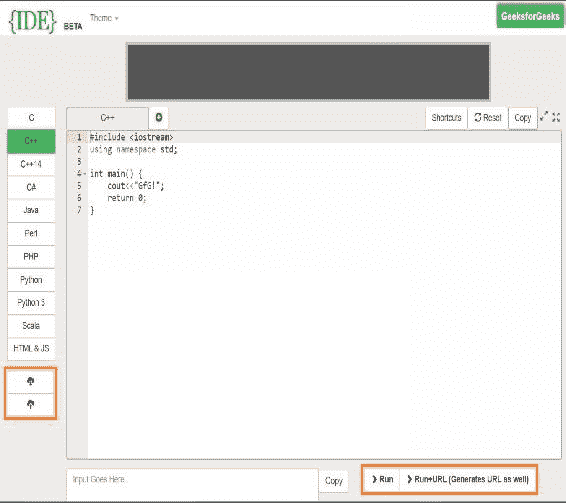
Geeks for geeks ide：一个基于 Web 的编译器

这个 IDE 可以在 [`ide.geeksforgeeks.org/`](https://ide.geeksforgeeks.org/) 找到，并包含多种编程语言。我们将专注于 C++。这个 IDE 有许多编码工具：一个标签工作空间、一个输入框和一个代码管理器。这个代码管理器包含了左侧显示的两个底部按钮。这些代码管理器按钮允许你下载带有相应文件扩展名的代码文件并上传。此 IDE 还允许你运行并生成 URL。我们将使用这些 URL 进行我们的课程。

在书中，我们将使用 geeks for geeks 的 Web 端 IDE，但你应该学会搭建本地 IDE。在你的职业生涯的大部分时间里，那将是你工作的地方。此外，你可以根据需求自定义 IDE 并美化你的代码。

### 设置你的文本编辑器
专注于编程的 IDE 环境始终包含一个文本编辑器和一个编译器。非 IDE 环境将编译器和纯文本编辑器分开。在非 IDE 设置中，文本编辑器作为编程界面；这仅仅意味着文本编辑器将是你摆弄代码的地方。

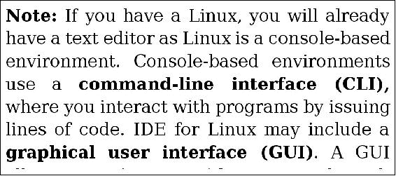
在寻找文本编辑器时，你需要一个具有语法高亮和缩进功能的，因为所有的编程语言都遵循其语法。这是因为你希望能够轻松地阅读自己的代码，也希望合作者也能这样做。这些文本编辑器通过提高可读性提供了帮助。这一点尤为重要，因为编码不再是也从不是一项孤独的任务。没有电影里那种单人天才。


Github 和 pastebin 是启用了语法高亮插件的代码聚合器。Github 允许你在他们的网站上托管整个项目，而 pastebin 仅允许发布代码片段。在这些平台上，你可以用多种语言保存代码。

这些工具对程序员来说非常有用，因为它们允许程序员共享代码、协作、测试等。学习如何将项目部署到 Github 是编程中最重要的事情之一，因为它已经变得非常标准化了。因此，维护一个 github 个人资料也变得非常重要，因为它包含了你正在进行、曾经进行过的项目，以及你的活动记录（peshev, 2017）。对于潜在的雇主或合作者来说，这些信息是无价的。

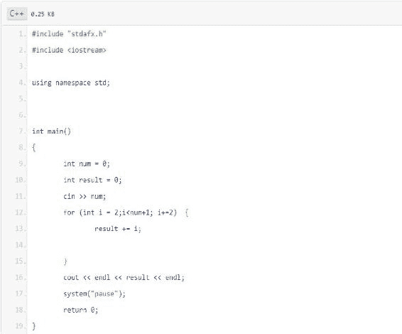

## C++ 代码语法示例

这是一个开启了语法高亮的 paste bin 截图 [(“c++ code,” 2015)](https://www.zotero.org/google-docs/?MBrR1L)（注：此处为示例翻译，实际翻译中会根据要求保留链接）。语法高亮和制表符间距有助于使代码更易于理解。所有带有语法高亮的文本编辑器都会使用这种方案：库显示为绿色，函数、数据类型和数据显示为蓝色。字符串将显示为红色。

你在本地工作时，将无法轻松获得这些便利。如果你使用 windows 系统，在系统中找到的第一个文本编辑器是记事本（Notepad）。Wordpad 是另一个具有更多 GUI 特性的工具。当你打开这些程序时，你会注意到它们是多么单调无味。它们像 Word 但更糟，因为如果编写高效、优雅的代码对我们来说很重要，那么它们就不应该只是简单的文字处理器。它们类似文字处理器的特性使其更适合在里面写字而不是代码，尽管你可以在它们写代码。

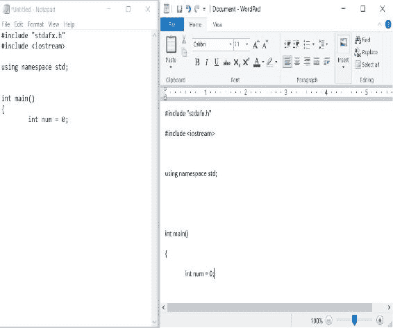

## Windows 记事本与 Wordpad 工具的对比

这张截图显示了 Windows 的两个内置工具，左侧是记事本，右侧是 Wordpad。Wordpad 具有更多微软套件的 GUI 特性，你可能更加熟悉，包括位于高亮“文件”标签上方的微软快速访问栏。相比之下，记事本非常简陋。与文字处理器不同，这两个工具都允许你以不同的文件扩展名保存。然而，Wordpad 比记事本更像文字处理器，它以富文本格式 (.rtf) 保存文件。如果你使用富文本格式以外的扩展名保存，Wordpad 会警告你将丢失格式。

记事本和 Wordpad 的独特之处在于它们可以以各种文件扩展名保存文件，而文字处理器不能。文件扩展名很重要，因为它们告诉编译器如何解释文件中书写的内容，这使得机器拥有一组它可以理解并执行的指令。

尽管有这些能力，这两个程序仍然缺乏语法高亮等关键的文本编辑器功能。你可能认为这没什么，但其实不然；代码中相同的单词因为它们出现的方式和时间可能具有不同的含义，因此，高亮帮助我们区分它们指代什么。所以，如果一切都是平面的黑白，你就必须花更多精力去理解某段代码指的是什么。现在听起来很复杂，一旦你开始写代码，这就会变得明显且必要。

Notepad++（不要与 Windows 的记事本混淆）具有高亮功能，但你必须这样激活它们：

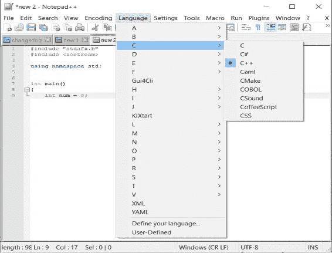

### Notepad++ 带 C++ 语法的截图

Notepad 是免费的，正如名称所示，它是用 c++ 编写的。这张截图说明了如何启用语言。可以通过进入 `Language` > 导航到 `C++` 来专门启用 C++ 语法。Notepad++ 仅适用于 windows 平台 (.exe)。

Blue 是一个更高级的文本编辑器，带有更多功能（“蓝色功能”）。与 Notepad++ 不同，Blue 在 windows 之外的多个平台上可用。但我不推荐初学者使用 Blue，因为它有很多许多让初学者无所适措的功能。如果你不是编程新手，可以尝试一下；你会发现它具有许多 ide 编辑器的典型 GUI 特性。进入文本编辑器后，你必须选择一个编译器。让我为你演示如何在三个平台（windows、linux 和 mac）上设置本地环境。你只需要安装一个 ide。只需记住它必须包含一个文本编辑器和一个编译器。Codeblocks 是一个为 c++ 设计的实用开源 ide，它可以轻松适配各种编译器，包括微软的 visual++。安装 codeblocks 很容易。你只需要访问下载页面 [`www.codeblocks.org/downloads/26`](http://www.codeblocks.org/downloads/26) 并选择最新版本即可。

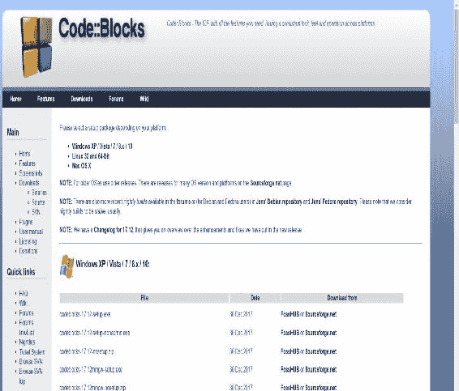

### Codeblocks 下载页面

截至本文写作时，codeblocks 有适用于 windows 和 linux 发行版的 20.03 版本。页面还包含安装说明。一旦安装了程序，你就完成了。你可以用它来编写 c++ 程序。要这样做，你需要遵循三个步骤：创建文件、编译程序和运行程序。创建新文件稍微复杂一点。这是你需要做的：

* 进入 `File` > `new`
* 选择 `create an empty file` 并输入你的代码
* 使用 `.cpp` 扩展保存文件

而且，不用说，你必须在运行之前编译程序。你可以通过进入菜单中的 `Build` > `build and run` 来实现这一点。

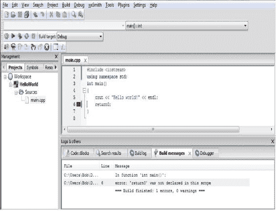

### codeblocks 中“hello world”的截图

这是我们在 code blocks 中运行“hello world”程序的实时截图。程序运行后，代码的编译消息中会出现一个错误。codeblocks 高亮了第 6 行的错误。根据你之前节中学的 c++ 语法知识，你应该知道如何修复代码。我们如何修复代码呢？

提示：数据和函数应该显示为蓝色。顺便说一下，这个程序对于它允许你完成的工作来说非常轻量。codeblock 可用于 windows 和 linux，但没有 mac 版本。

## Mac os ide 安装与设置

对于 mac，你需要获取 xcode。它是一个适用于 mac 的免费 ide 软件开发套件。你可以在 mac 应用商店获取它。Xcode 支持 java、python 和 ruby 等多种其他语言。

它面向为 mac 操作系统开发软件；这可以包括用于 apple tv 的电视、用于 apple watches 的手表以及用于 ipad 平板的 iPad（“xcode 9 新特性，”n.d.）。Xcode 为不同的 mac 平台提供了多种软件开发工具包 (sdks)，以帮助程序员通过苹果的专有编程方案。SDK 是由硬件和软件供应商提供的一组工具，用于为特定平台开发应用程序。SDK 允许开发者完全集成到开发社区中，如苹果或安卓。

Mac 使用专有编译器，这些编译器只能在 xcode 中运行，所以。如果你在 mac 上，你除了使用 xcode 进行 c++ 开发外没有其他选择。


文件下载并安装后，打开 xcode 并点击“create a new xcode project”（创建一个新的项目）图标。然后在初始窗口中选择“new project”。

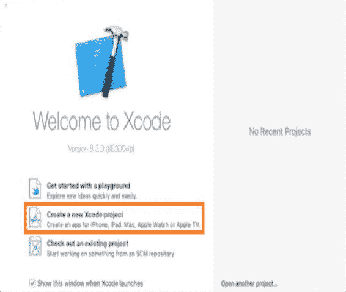

Xcode 初始界面：选择新项目

这些截图显示的是 8.3.3 版本的 Xcode 构建（patel, 2017）。因此，我们的示例看起来可能与较新的版本有所不同。在编写本文时，最新版本是 12.1，它主要包含了对各种平台 SDK 的更新（“Xcode,” n.d.）。尽管存在这些差异，这些截图仍将帮助你在更新的版本中找到方向。我们的指令仍然会产生结果。

完成此操作后，会弹出一个提示窗口，要求你选择模板。该窗口将引导你完成其余的设置。选择 mac 部分，然后进入 application（应用程序）部分；在其中，选择 command line tool（命令行工具）。

它看起来像这样：

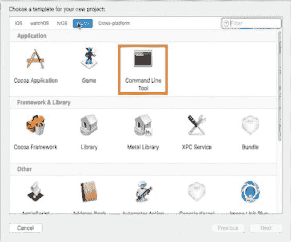

1. 项目选择屏幕：macos > application > command line tool

Xcode 拥有许多内置代码工具，用于在各种苹果平台上运行程序。因此，为了运行测试程序，你必须选择 macos 以便在你的程序上运行。此外，为了访问 c++ 需要的汇编语言开发，你需要使用 Xcode 的命令行工具。该命令行工具也可以处理 objective-c 和 c 语言。

选择模板后，指南将提供命令行工具的选项。在这里，你可以为项目命名、添加你的组织名称、使用 bundle identifier（包标识）并选择编程语言。

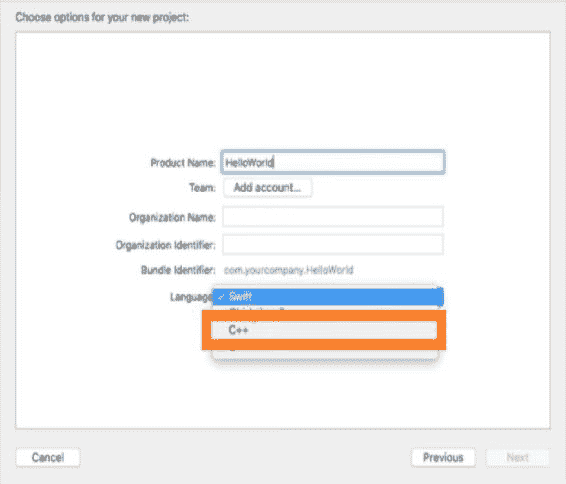

2. 命令行工具选项：language > select c++

Xcode 的命令行工具可以处理微软的专有语言，如 swift。此程序可以在 mac 编译器中与基于 c 的语言一起运行，包括 c++。默认选择 swift。

在同一个窗口中，你将被要求添加一个组织标识符（organization identifier）。记住，Xcode 的命令行工具是针对专有 macos 操作系统的编程模板，因此组织标识符用于在苹果数据库中为你的程序创建一个唯一标识：：苹果开发者网站和 icoud 容器、appstore 中的 itunes connect 门户。这将你的 app 整合到专有的 macos 框架中。


3. 命令行工具选项：organization identifier > “cpp”

组织标识符是一种命名约定，有助于程序员将项目集成到苹果的专有软件开发方案中。在这里，我们使用 `cpp` 作为标识符，它生成 `cpp.hello.world` 作为我们的 bundle identifier。一旦指定了标识符，指南允许我们继续下一步。

现在，在你选择的目录中保存你的项目。在左侧面板中，Xcode 能够打开该文件。你必须选择 `main.cpp` 以在 Xcode 中访问你程序的全局 c++ 文件。如果你需要，可以将 cpp 文件上传到目录中并进行编辑。

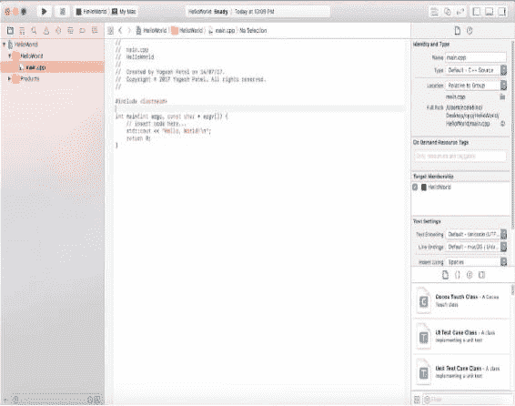

3. Xcode 命令行工具：“main.cpp”

此截图显示了 ide 风格的 Xcode 命令行工具工作区。它在文本编辑器编辑器中打开了 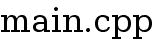（patel, 2017）。

一旦你写了一些代码并想要运行它，请选择 product（产品）并点击 run（运行）。此外，你也可以通过选择按钮来运行和构建程序。

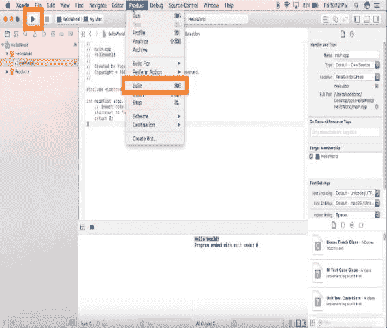

4. Xcode 命令行工具：“hello world”构建和运行

与 code::blocks ide 类似，你必须先构建后运行你的程序。此截图还显示了“hello world”的结果和返回值（patel, 2017）。

如果你是一个认为自己将来将在苹果设备上工作的程序员，那么在 xcode 中工作和实践是一项很好的投资。例如，苹果在各种消费品和服务（如流媒体服务和设备）方面拥有健康的市场份额。尽管如此，你应该记住 c++ 主要用作服务器端语言。服务器端编程是控制内容如何传递到 youtube 等动态网站的代码。大多数服务器端编程是在 linux 上完成的。

### Linux 编译器安装

Linux 是一个基于控制台的操作系统，因此它不需要文本编辑器。相反，我们将重点关注安装和设置编程编译器。Mac 和 windows 会自动在 ide 中初始化编译器，但在 linux 中，需要更亲手操作的方法。你将被要求执行后端初始化。这看起来有很多工作要做，但从大局来看，它允许那些使用 linux 的人员对开发过程拥有完全控制，并释放更多的计算能力。

因为 linux 是一个使用控制台界面的操作系统，对于初学者或任何习惯 windows 或 mac 的人来说会很奇怪。这是因为用户通常习惯 gui（图形用户界面）。linux 无 gui 可以释放更多的计算能力用于编程——gui 需要一些计算能力来生成和维护。这就是为什么许多服务器和其他编程环境具有控制台界面。此外，它们中的许多使用 console。

linux 发行版（distro）是一种基于 linux 内核的操作系统，使用包管理系统安装额外的软件。以下是安装和初始化编译器的指令。针对 ubuntu，这是一个流行的发行版。注意：许多此类发行版提供了桌面体验。可以考虑 cento，它基于 red hat 并非免费。红帽 linux (rhel) 用于许多服务器设置且不是免费。然而， cento 使用了它的许多组件，是准备在红帽环境中工作的极佳发行版。


在截图，已经存在 `gnc gcc`。运行高亮显示的命令将在你的系统中安装 `gnu gcc`，如果它还没有的话（patel, 2014）。控制台将提示你。输入“y”即可开始安装。你还将获得包管理功能，例如终端可以通知你过时或不需要的包。它还会建议可以让你的系统运行更高效的命令。这解释了为什么 Linux 在程序员中如此受欢迎；尽管它已经准备就绪，但它允许他们轻松地排除故障，提供更多的控制权，而且与图形界面（GUI）相比，它更容易导航。这是因为程序员更有可能记住一行代码，而不是某个东西在 GUI 中的所在位置。

以下命令将安装编译代码并最终运行 C++ 所需的所有库：

```
sudo apt-get install build-essential
```

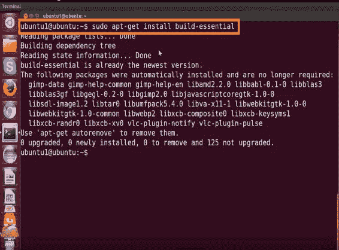

### 1. 在 ubuntu 控制台中安装 gnu gcc

此截图显示了一个已安装 `build-essential` 库的系统，并输入了高亮的安装命令（patel, 2014）。就像安装 `gcc` 一样，在使用命令并发现系统中没有 `build-essential` 库的副本后，它将提示你安装。输入“y”，终端将安装库。

*   使用以下命令检查安装情况：

```
g++ --version
```

如果一切顺利，它将告诉你安装了哪个版本的 `gcc`。

由于 Linux 有内置的文本编辑器，你将需要使用以下命令来访问文本编辑器的 GUI 界面：

```
gedit
```

你可以根据自己的意愿编写程序。记住将程序保存为 `.cpp` 扩展名文件，这样它们才能被正确编译。

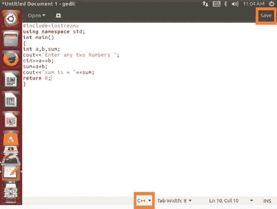

#### Ubuntu 中的 Gedit

此截图展示了 Linux 内置的文本编辑器 `gedit`（[在 linux 中运行 c, c++ 程序] ubuntu 16.04 (初学者 ubuntu 教程), n.d.）。`gedit` 是一种 Linux 编程文本编辑器工具，具有适用于多种编程语言的语法高亮和标签页间距功能。确保从高亮的下拉菜单中选择了“c++”。你可以点击“保存”按钮在 GUI 界面中保存你的程序文件。务必列出你保存文件的目录，因为你必须让编译器指向该目录以编译和运行代码。

要测试并运行你的代码，你必须遵循以下指令：

1.  **引导终端进入文件目录**
    执行此操作，请使用此命令。在目录中反复输入，直到显示 `.cpp` 文件。

    ```
ls
    ```

2.  **编译并测试程序文件**
    使用这些命令进行操作：

    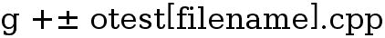

    如果有任何错误，此命令将告诉你是错误所在的行，就像你从 IDE 中预预期的那样。然后你可以通过 `gedit [filename.cpp]` 打开程序文件并修复该行代码。

3.  **运行程序文件**
    编译器将创建一个名为 `test` 的可执行文件来运行程序。你可以通过在终端中输入 `./test` 来执行它。

    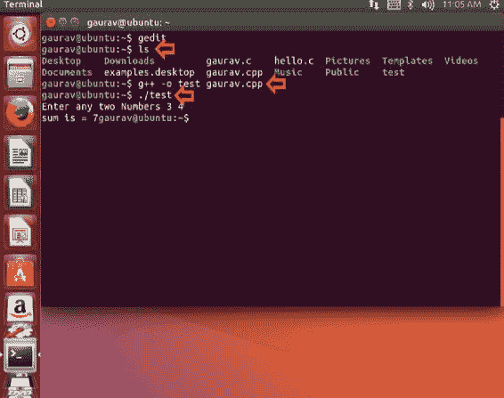

    *在 ubuntu 中测试、编译和运行 .cpp 文件*

    此截图展示了在终端中测试、编译和运行在 `gedit` 中编写的示例代码（[在 linux 中运行 c, c++ 程序] ubuntu 16.04 (初学者 ubuntu 教程), n.d.）。

Linux 发行版是详细的基于控制台的系统，大多数系统可以通过终端处理任何语言的编程。学习在 Linux 环境中工作是有益的，因为它让你接触到服务器端。

Linux distros are verbose console-based systems and most of them can handle programming in any language through the terminal. Learning to work in the linux environment is beneficial as it exposes you to server-side.

（注：此处根据你提供的原文内容提取的翻译，由于原文在最后部分存在重复描述，我已按要求进行了完整翻译。）


*   调用头文件 `io` 以使用输入输出函数
*   调用执行所在的主函数（main）
*   打印“hello. World”
*   指示机器状态的终止语句

我们可以看到 C++ 是多么繁琐，因为大多数步骤都涉及到执行代码所需的 C++ 后端方面，例如调用库文件。在大多数情况下，你的算法并不需要写得如此详尽。

尽管这个算法很简单，但它说明了开发者如何处理任务并将其转换为代码。在下一章中，我们将使用这个算法来编写我们的程序。

正如你在示例中注意到的，代码中包含注释，解释了代码中每个部分的作用。这些注释的前面是 `//`。编译器不会读取任何以 `//` 开头的代码行，因为它们不会产生任何作用，只是为了帮助其他维护代码的人员理解代码的功能。在代码中包含注释是一个良好的习惯，这样人们就能知道每行代码的作用。

# C++ 语法概览

我们已经讨论了语法对编译器的重要性，但理解编程语言的语法也同样重要，因为它能帮助你调试代码。就像人类语言一样，如果你了解一种语言的规则，当你出错时可以很容易地纠正。调试是发现并消除代码中错误和异常的过程，也称为“bug”（“什么是调试？”N.d.）。这是一个纠正的过程。

IDE 拥有调试工具可以高亮代码中出现错误的地方，但这些功能并不总是可靠的。例如，漏掉结束代码行的分号是一个常见错误，但调试器会高亮 `.h` 文件中的错误，而不是程序文件 `.cpp` 中发生错误的地方。大多数调试器并不足够智能，能检测到内容的缺失，并在未终止的行违反库中的规则时，抛出编译器给出的冗长错误。然而，程序员只需在注意到某一行缺少了红色的分号时，就能发现错误。

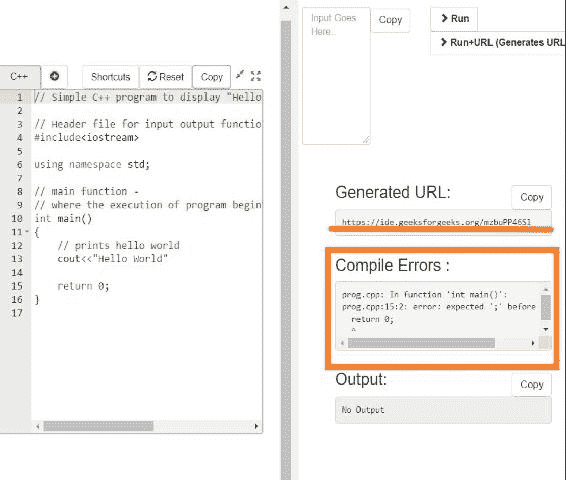

geeksforgeeks ide 中缺少行分隔符的“hello. World”程序

这张截图显示了缺少分隔符的“hello. World”。你会立即注意到，该 ide 对 C++ 的语法高亮与我们在上一章中探索的编程环境不同。语法可能会随平台而异。这就是为什么我们正在通过 geeksforgeeks 将该过程标准化。在我们选择的 ide 中，分号没有被高亮。然而，ide 可以通过识别和标记分号来弥补这一点，如截图所示。你可以通过访问生成的 url 来练习和探索这个程序：`https://ide.geeksforgeeks.org/mzbupp6sl`。

## 调试 C++

当代码较小时，很容易看出这一点，但在处理较大的项目时，任务可能会变得困难。我听过有些程序员花费一周或更长时间尝试修复代码中的某一行，结果发现是非常细微的问题，如字母缺失或不匹配。为了让调试更容易，建议将代码拆分成更小的模块（“什么是调试？”N.d.）。通过这种方法可以发现并轻松处理许多错误。

让我们观察“hello. World”程序并详细研究它的语法。虽然语法高亮在不同平台上可能会有所，但代码的这些方面在所有平台上都是一致被高亮的。

### 注释
正如我所说，这些是编译器将忽略的代码行。它们用于注释代码并为其他程序员留有帮助的解释。这非常棒，因为通常当我们与他人一起编码时，建议在算法中留下注释，以便为他人简化。在大多数平台上，注释会被高亮为绿色。注释前面总是会有 `//`。

### 头文件库
以 `#` 开头的行被编译器用于调用库函数。这些行非常重要，因此它们出现在每个程序中。在“hello. World”示例中，我们调用了一个用于管理字符串的库。这些代码行在不同平台上将以不同的颜色高亮。在 geeksforgeeks 中，颜色是紫色。

### 语句
语句通过编译器识别的指令描述了代码行的开始。这包括声明处理指令，如 `using...` 或 `return...`。在我们的 hello world 程序中，它们在不同平台上也有不同的高亮方式。在 geeksforgeeks 上，它们被高亮为紫色。

### 函数
这是封装指令的代码。它可能接受输入并输出结果。每个函数的编写方式如下：`function_name()` 后面跟着大括号 `{}`。大括号中的任何内容都是将执行的指令集。在我们的示例中，`main()` 是启动通过 `cout` 输出“hello. World”指令的函数。在 `.cpp` 程序中，程序函数必须始终出现 `int main()`。

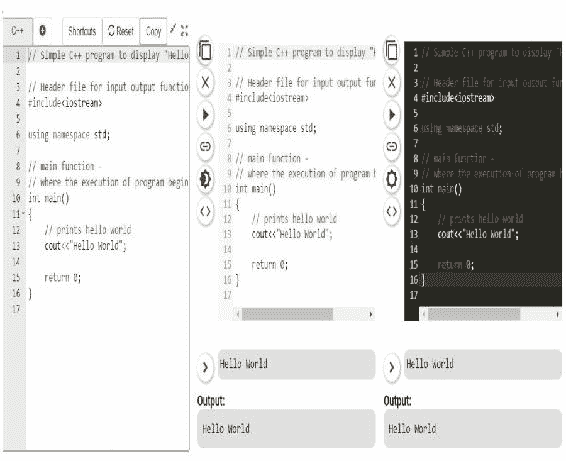

## geeksforgeeks ide 中的“hello. World”程序与 geeksforgeeks 嵌入程序文章的比较

这张截图显示了“hello. World”的成功运行以及运行程序所需的内存。这个 ide 采用浅色语法高亮，主要关注注释、语句和操作数数据。与 Geeksforgeeks 文章中的嵌入代码相比，它们的嵌入代码要详细得多 (“writing first c++ program,” 2017)。右侧的两截图显示了嵌入在文章中的相同代码的“浅模式”和“深色模式”视图。这些视图更加详细，高亮了注释、函数并区分了不同的语句。例如，`int` 等数据类型用不同的颜色与 `using` 等其他语句区分。此外，嵌入视图与 ide 不同，将字符串与其他数据区分来。这是语法高亮如何随平台变化的完美示例。早些我们看到过一个包含错误的代码块示例。下面是完全相同的代码与修正后的代码并列。

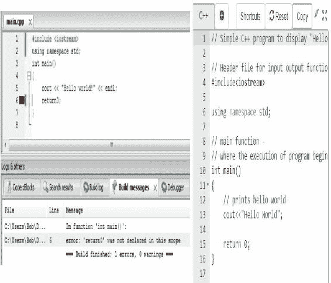

## 代码块中的“hello. World”与 geeksforgeeks ide 的比较

这张截图对前一个示例（带有错误的“hello. World”代码块）与 geeksforgeeks ide 中相同的修正后代码进行了并排对比。通过学习两者，你应该能够看到 `int main()` 函数中的最后一条指令在代码块中输入错误。结果是编译器无法识别返回语句。


我必须承认，在短短几行代码中它并不那么令人印象深刻，但能够发现错误并解释它们是程序员最重要的技能之一。在这个阶段，你不必太担心自己是否能做到这一点。你写得越多、学得越多，你发现和修复错误的能力就越强。软件和网络开发正因为这一点而是一个失败率高的行业。要成为一名成功的开发者，你需要快速解决问题、更高效地找到 bug 并修复它们。这也适用于管理端，因为能够发现、修复和解释 bug 是桌面级服务水平协议（SLA）的重要组成部分。

在技术领域，服务水平协议（`slas`）是服务提供者与客户之间的协议。他们对服务的某些方面达成一致，如支持、质量、可用性和责任（wieder, butler, theilmann, & yahyapur, 2011）。全面的 `slas` 提供调试简报，其中每个错误都会记录并列出其原因、变通方法和解决方案。这是技术管理公司和开发阶段执行此工作的最佳方式。然而，管理员比开发者本身拥有更多资源来投入调试。他们的薪酬也更高。例如，美国 Web 开发人员年薪约为 60,000 美元；负责 `slas` 的 Web 管理员高出约 1/3，达到 90,000 美元（“15-1199.03—web administrators，” 无日期）。这种专家水平非常有价值，因为他们理解编译器是如何翻译 c++ 的。


# 第一个程序：输出和基础字符串

“Hello World”是每个编程语言的入门项目；它的目的是向学习者展示程序的基本语法及其运行方式。随着你学习越多的语言，你将编写许多“Hello World”程序。在上一节中，我们用它来探索算法、语法和 c++ 编程环境等主题。在本节中，我们将更进一步：我们将操作代码。

C++ 使用来自 `iostream` 库的 `cout` 对象。对象是计算机用于管理数据的方法。在我们的示例中，`cout` 用于告诉编译器使用 `>>` 运算符打印“hello. World”。不要惊慌；我们将在后面的章节中讨论操作符和对象。现在，只需理解编译器将 `cout` 读取为特定指令即可，因为该指令定义在我们声明的 `iostream` 库中。

现在，让我们通过更改打印输出来看“hello. World”和 `cout` 对象。在这里找到原始代码，以便将其作为参考：

[Https://ide.geeksforgeeks.org/ea8zmekido.](https://ide.geeksforgeeks.org/eA8ZMEKiDO)

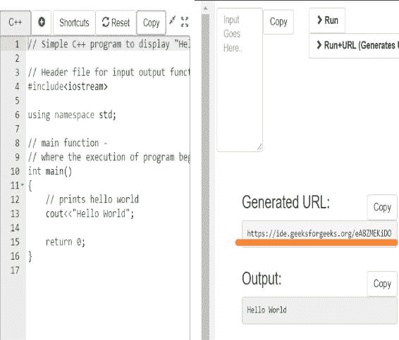
geeksforgeeks ide 中的 “hello. World”程序

## geeksforgeeks ide 中的 “hello. World”程序

此截图是在分屏模式下成功运行“hello. World”的。当我们开始使用 ide 进行编码练习时，请注意输入和输出框。虽然此程序没有输入，但当程序在下方的输出提示时，你将向标记为“input goes here...”的上框输入数据。

你可以在此处保存的 ide 中访问此程序：[`ide.geeksforgeeks.org/ea8zmekido.`](https://ide.geeksforgeeks.org/eA8ZMEKiDO)。

你还可以在索引中查看代码副本。

## 使用 cout

`cout` 对象使用 `<<` 运算符来打印值和文本，我们可以根据需要使用任意数量的。使用浏览器中的 ide，更改代码以打印输出：

```
Hello. World
I am learning c++
```
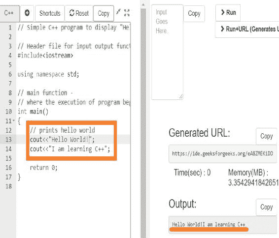

### 添加输出

此截图是在分屏模式下成功运行我们编辑后的“hello. World”程序。虽然程序运行没有任何错误，但它没有产生我们想要的结果。观察输出可以发现打印的文本缺少了一个换行。我们必须指示编译器添加换行以获得所需的结果。添加行可以通过多种方式完成：我们可以在字符串内部添加分隔符，或使用 `iostream` 库中的另一个对象。

## 使用转义序列

虽然在输出中编写字符串并换行看起来很有诱，但行不通的。它会破坏代码且无法运行。不信我的话？试试看！你可以通过转义序列来添加换行。转义序列用于许多需要在字符串中引入特殊字符的实例。它也可以添加行，如下所示：

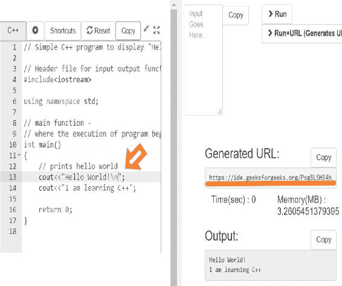

### 使用字符串内转义序列来分隔和操作输出

此截图是在分屏模式下成功运行我们编辑后的“hello. World”程序。使用 ，我们获得了预期的输出。当你查看代码时，可以看到用了双引号。因此，如果你想在字符串中添加双引号，将必须使用转义序列，以便编译器知道那不是代码的一部分。这样做可能会导致不可预见的错误或 bug。这就是为什么转义序列很重要。以下是它们使用的许多实例的列表（`escape sequences—cppreference.com，” 无日期）：

- ``：用于单引号
- ``：用于双引号
- ``：用于问号
- ``：用于反斜杠
- ``：代表“换页符”（form feed），用于跳转到下一页
- ``：代表“换行符”（line feed），用于跳转到下一行
- ``：代表“水平制表符”（horizontal tab），水平添加空格
- ``：代表“垂直制表符”（vertical tab），用于垂直方向间距

注意：如果你决定尝试不同的转义序列作为文本分隔符，请确保使用 按钮将你的工作保存到另一个 url 以备返回。要返回我们的练习，可以使用保存的 ide 工作空间 url ([`ide.geeksforgeeks.org/psgblshe4h`](https://ide.geeksforgeeks.org/PsgBLSHE4h))。

你还可以在索引中访问此代码。

## 使用 endl：输出操作符

正如我们所说，编程语言一样灵活。你可以用多种方式表达一条指令，终止字符串也不例外。转义序列和 `endl` 之间的区别在于 `endl` 会刷新并更新存储字符串的缓冲区。程序员使用 endl 在打印大量文本后清理内存。你可以看到这对于内存管理很有用。`endl` 是输出操作符的一个示例。输出操作符是允许你使用 `<<` 运算符或 `>>` 运算符控制输入输出流的函数（inputoutput 操 ulators—cppreference.com，” 无日期）。


### 使用输出操作符分隔和操作输出

此截图是在分屏模式下成功运行我们编辑后的“hello. World”程序。使用 ，我们获得了预期的输出。在一个小程序中，很难看到使用内存操作符的影响。操作符只有在调用函数中使用时才会开始发挥作用。


就像转义序列一样，还有更多的输入/输出操纵符可以让程序员对数据类型或字符串有更多的控制。一旦我们谈到数据类型和类结构时，其中许多将变得意义。以下是其中一些（“输入/输出操纵符—cppreference.com,” n.d）：

* “``”：布尔值在“0/1”和“false/true”之间切换
* “``”用于数学输出，控制是否使用前缀来表示数字进制
* “``”符号用于表示非负数
* “``”控制特定输出格式中大写字母的使用
* “`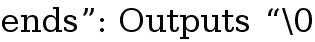”
* “``”：刷新输出流
* “``”并刷新输出流
* “``”：接收作为货币值的输入
* “``”：格式化并输出货币值
* “``”：根据指定格式接收日期/时间值的输入
* “``”：根据指定格式接收日期/时间值的输入

注意：回想我们关于 `c++11` 和 `c++14` 的对话。写本文时，大多数编程 IDE 使用 `c++11` 作为默认版本。`get/put…` 函数都在于 `c++11` 中。如果你在尝试使用这些操纵符时遇到错误，请检查你的设置是否在使用 `c++11`。

此外，“``”是一个仅在 `c++14` 中的操纵符。该操纵符允许你插入和提取带有嵌入空格的引用字符串[(“输入/输出操纵符—cppreference.com,” n.d.)](https://www.zotero.org/google-docs/?6OhBz2)。

## 省略命名空间

我们已经讨论过使用 `namespace` 语句。我们说过它有助于全局声明字符串，但对于像“hello world”这样的小程序，它并不重要。对于使用多个函数的较大型程序，使用该语句单独声明每个字符串是一个良好的习惯。这可以节省编译器的内存，否则你会发现编译器陷入了不必要的负担，必须调用整个字符串命名空间库来打印代码。单独声明每个字符串可能会让你的代码冗长，但它会减少编译开销，并聚焦你的指令。`std` 命名空间包含多个对象和定义，这使得计算机难以找到操作和定义字符串的适当方法。当你的函数将被多个程序调用时，命名空间约定非常重要。因此，不必要地放在其中可能会导致你的函数定义不当，并引起它们之间产生识别错误。

让我们通过从代码中移除 `using namespace` 来让我们的代码更高效。

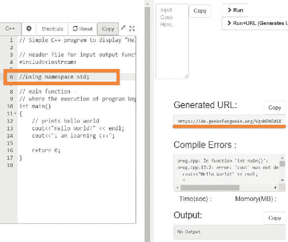

### 测试稳定性：使用注释移除“using namespace”

此截图是在删除了 `` 后，“hello world”程序的失败运行测试。你可以通过以下 URL 访问此保存的 IDE 空间：[`ide.geeksforgeeks.org/vgoadix`](https://ide.geeksforgeeks.org/VgobOAOdiX)。

“注释掉”代码行是测试代码稳定性的非常高效的方法。你可以随时删除双斜杠来移除注释并恢复该代码行。这允许你在不破坏代码的情况下对其进行测试。一旦完成测试，删除任何不需要的代码行是一个良好的习惯。在测试期间，你始终可以使用上面的 URL 返回此保存的实例。你还可以在索引中访问原始代码。

当你移除 `using namespace std` 时，会出现以下错误：

```cpp
Prog.cpp: in function 'int main()':

Prog.cpp:13:2: error: 'cout' was not declared in this scope

cout << "hello world!" << endl;
^

Prog.cpp:13:2: note: suggested alternative:

In file included from prog.cpp:4:0:
/usr/include/c++/5/io.stream:61:18: note: 'std::cout'

extern ostream cout; /// linked to Standard output
^

Prog.cpp:13:26: error: 'endl' was not declared in this scope

cout << "hello world!" << endl;
^

Prog.cpp:13:26: note: suggested alternative:

In file included from /usr/include/c++/5/io.stream:39:0,
From prog.cpp:4:
/usr/include/c++/5/ostream:590:5: note: 'std::endl'

endl(basic_ostream<char, _Traits>& __os)
^
```

仔细观察，`std` 告诉我们需要。

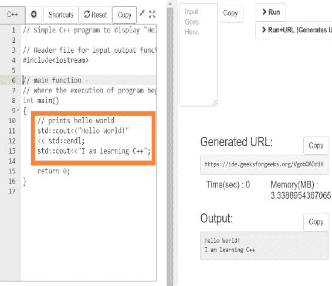

此截图是在删除了 `` 后，“hello world”程序的成功运行。如果你想练习，请使用这个：[`ide.geeksforgeeks.org/vgoadix`](https://ide.geeksforgeeks.org/VgobOAOdiX)。

注意：如果在练习过程中遇到错误，我们始终提供一个保存的实例。开始时，打开另一个窗口并导航到成功运行。你还可以在此链接找到“声明流对象和操纵符”的成功运行：[`ide.geeksforge.org/a5zodsqu`](https://ide.geeksforge.org/a5zOdSW)。

## 第 3 章：变量和数据类型

我们已经讨论过底层编程如何紧似机器语言，但它们不同，因为它们仍然使用了让人想起人类语言的元素，如语法、结构和变量。变量是人类用来向机器传递含义的数学概念。计算机科学的很大一部分在于认识言语是一系列数学概念。这包括允许机器在比特位级别做出决策的逻辑门。在非常小的尺度上，位运算函数可以帮助许多计算过程，从控制显示到切换服务器上的流量。我们将在第 4 章中讨论讨论这些高级话题。


状态变化在低级语言中经常被讨论，因为它们非常接近机器语言。低级语言也被称为编译型语言，因为它们会被编译成机器语言。这与 `python` 等高级语言形成对比。如果你还记得，我们提到过高级语言由于内置库的存在，不需要在声明变量时指明其数据类型。例如，`python` 使用 `python` 环境来识别变量及其数据类型。而在 `c++` 中，变量和数据类型必须经过声明。数据类型告诉编译器如何处理数据。

当你考虑到数学中的向量时，数据类型就更有意义了；与传达数量的整数不同，向量告诉我们空间的大小和方向。因此，向量与整数是不同的数据类型。此类属性被用于像 photoshop 这样的软件中，以帮助渲染。

注意：基于向量的图像可以进行操作而不会丢失图像质量。这是因为像 `.jpeg` 或 `.png` 等文件将图像的像素位置作为整数存储在网格上。而 `svg` 或 `.pdf` 等矢量文件使用向量来描述其像素位置。因此，当图像放大时，向量会指示颜色应该如何扩展，而普通的图像文件则不会。这就是在处理非矢量图像文件时导致像素化和失真的原因。

## 输入和输出：声明变量

在上一章中，我们在学习如何使用 `cout` 时声明了一些内容。在本节中，我们将查看数据类型的示例以及它们是如何声明的。以下是变量声明示例及其代表的含义（“c++变量”等）。请记住，变量本质上存储的是特定类型的数据：

- “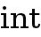”：关键字是“integer”（整数）的缩写，存储没有小数的整数。该关键字包括正整数和负整数。
- “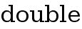”：存储带有小数的数字，包括正数负数。
- “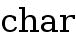”：关键字是“character”（字符）的缩写，无论大小写如何都存储单个字符。`char` 值使用单引号。
- “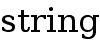”：存储文本，例如我们的“hello World”示例。`string` 值使用双引号。
- “”：关键字是“boolean”（布尔）的缩写，存储具有两种状态的值：真或假。如之前讨论的，这些值可以表示为“0/1”或“false/true”。

在下一节中，我们将详细讨论它们。现在让我们来看看这些示例。要创建一个变量，你必须在 `=` 运算符之后给它分配一个值。它们的语法如下：

```cpp
[datatype][variable_name] = [value];
```

注意：每个 `` 在你的函数内必须是唯一的。否则会导致错误。现在让我们创建一个名为 `mynum` 的变量，数据类型为 `int`，值为 `10`，然后让我们的程序打印出来。

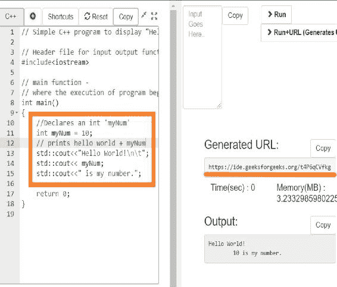

## 声明 int 数字

此截图是 `mynum` 程序的成功运行测试。你可以通过以下 URL 访问保存的工作区：`https://ide.geeksforgeeks.org/t4p6cvkg`。此代码在实现时没有使用 ``，因为这是最佳实践。你应该配合命名空间成功运行相同的代码。记住，你可以使用 URL 将工作区重置为成功状态。

我们的代码中也有输出。让我们使用右上角的输入和 `cin` 对象，让我们的程序接收输入并对其进行操作。我们可以通过编写接收两个数字并将它们相加程序来实现。为了做到这一点，我们需要声明两个变量来存储输入：

- 两个名为 `x` 和 `y` 的 `int` 变量
- 一个名为 `sum` 的 `int` 变量

我们还可以告诉程序提示用户输入。注意：在我们的 ide 中，你必须在运行程序之前输入。每个输入应该单独占一行。

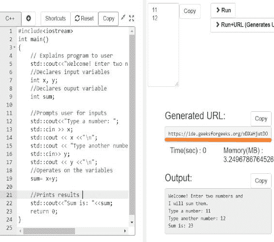

## 相加输入并打印结果

此截图是 `summing` 程序的成功运行测试。你可以通过以下 URL 访问保存的工作区：`https://ide.geeksforgeeks.org/xdahjutdo`。这个练习为了适配我们 ide 的输入系统必须进行了修改。因此，我们包含了额外的 `` 行来确认我们的输入。此代码在实现时没有使用 ``，因为这是最佳实践。你应该配合命名空间成功运行相同的代码。记住，你可以使用 URL 将工作区重置为成功状态。

## 数据类型

数据类型指定存储在变量中的信息的大小和类型。每个类型都有自己的关键字和关联的大小（“c++数据类型”）：

- “”：关键字是“integer”的缩写，存储整数。大小为 4 字节。
- “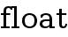”：存储带有 7 位小数的小数数字。大小为 4 字节。
- “”：存储带有 15 位小数的小数数字。大小为 8 字节。
- “”：关键字是“character”的缩写，无论大小写如何都存储单个字符。大小为 1 字节。
- “”：关键字是“boolean”的缩写，存储具有真或假状态的值。大小为 1 字节。

注意：回想 `` 数据类型。我们已经大量使用了这种特殊数据类型。字符串的值的大小不同。因此，它们在 `iostream` 库中被处理，以为文本处理提供更大的灵活性。我们将在节返回 `strings` 并讨论一些高级主题。

这些大小对于数据处理非常重要。例如，当你使用 `int` 配合 `float`/`double` 时，所有数字都将转换为 `int`。这是因为编译器使用 4 字节来计算整数，而整数没有分配小数的空间。程序仍会运行，但你的计算将是不准确的。让我们通过修改程序并查看结果来进一步探索。我们将使用一个长小数（圆周率）：

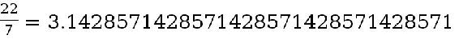。这将测试 `float` 和 `double` 的极限。

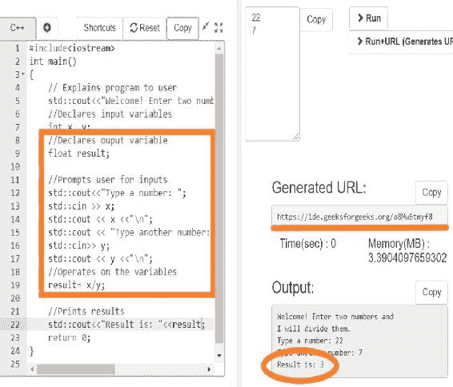

### 与 float 或 double 使用 int

此截图是我们修改后的程序成功运行测试，用于计算 ``、``、`` 和 ``，这些没有修改以存储小数。因此，结果缺少小数。

为了得到我们想要的结果，最好的办法更改变量数据类型。使用 `float` 数据类型与 `double` 类型会有区别吗？我们可以预期不同的结果吗？记住，你可以通过回到工作区的成功状态来重置。

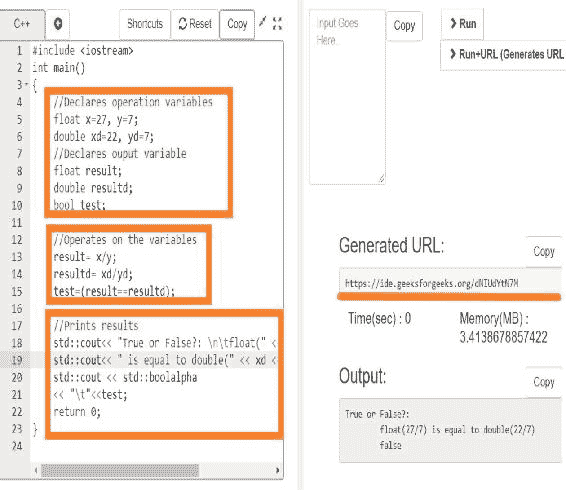

比较 float 和 double


这张截图是我们修改后的计算 `` 程序的成功运行结果，我们删除了输入语句并重新排列了数据类型。我们强烈建议你使用此 URL 中的之前的程序自己创建一个程序：[`ide.geeksforgeeks.org/a8mw6tmyf8`](https://ide.geeksforgeeks.org/a8Mw6tmyf8)。这次练习将让你练习我们之前讨论过的一些编码主题，包括：

1. `` 数据类型关键字
2. `` 输入输出操纵符

它还将让你获得一些逻辑运算符的经验。我们将在下一章详细讨论逻辑运算符。一旦你操作了程序，请打开一个新窗口并将其与上方截图的成功运行进行比较。你可以在此 URL 找到成功运行的保存 ide 工作区：[`ide.geeksforgeeks.org/dniudytn7m`](https://ide.geeksforgeeks.org/dNIUdYtN7M)。

# C++ 力量：高级字符串

我们将查看的另一个数据类型是字符串（strings）。字符串是计算机科学中最流行的数据类型之一；它们是字符序列。将它们想象成句子可能会有所帮助，但并不是每个句子都代表一个字符串。我们已经在我们的“hello World”应用程序中看到它们如何工作。字符串是一个独立的数据类型，拥有它们自己的库。为了操作和处理它们，程序需要适当的头文件——string 库。这些库具有方法和功能，允许程序操纵字符串。

## 操作：字符串拼接

字符串拼接（String concatenation）是将不同的字符串组合成一个字符串的过程。它是字符串的合并。这是程序最常见的功能之一。例如，当你在网站或游戏中输入名字，然后切换到另一个页面时，屏幕上欢迎你“hello., [your_name]!”，程序就是使用了拼接来实现这一点的。它将“hello,”与你的名字以及最后的“!”结合在了一起。

在 C++ 中，字符串拼接通过 `+` 运算符完成。让我们通过创建一个打印带有问候语的输入字符串的程序来演示。为了实现这一功能，我们必须包含 `<string>` 库，它包含了处理字符串所需的对象和语句。

打开我们一直使用的 ide 的新实例并按照以下步骤操作：

* 除了 `` 库之外
* 省略 ``
* 移除 `` 中当前的填充代码
* 声明并设置变量 ``
* 声明并计算 `` 运算符
* 输出结果为“hello John Doe.”

它看起来应该这样：

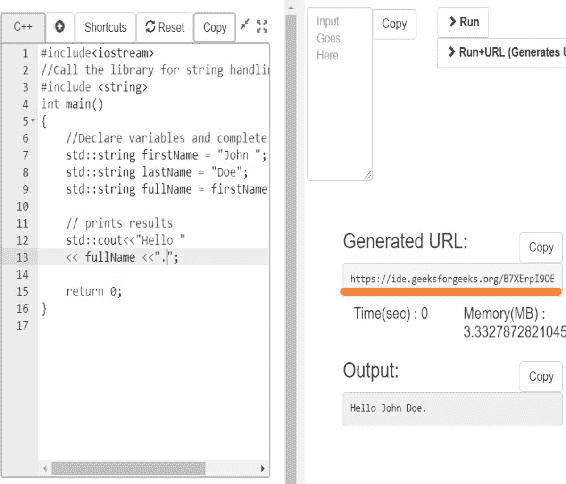

### 字符串拼接

这张截图是我们字符串拼接程序的成功运行。我们鼓励你在另一个窗口中打开此程序并与你的程序进行比较。你可以在此 URL 访问成功运行的结果：[`ide.geeksforgeeks.org/b7xerpi9o.e`](https://ide.geeksforgeeks.org/B7XErpI9OE)。

**注意：** 确保对你的代码进行注释。你可以简写指令并将它们作为即兴算法来注释你的代码。这将帮助你保持程序的整洁。

通常，在论坛中，拼接的文本输入尽可能小，格式化由程序完成。在示例中，我们必须手动在“hello.”和“john”之后添加空格，但程序会自动添加空格。现在你已经看到 `+` 运算符是如何工作的，你可能会如何手动添加呢呢？尝试通过在编辑器中玩代码看看你是否能弄出来。如果一切一团糟，你也可以随时点击 URL 返回我们成功的 ide 工作区。

**注意：**

`+` 运算符既用于数字相加，也用于字符串拼接。尝试使用该运算符相加字符串和数字将产生错误。你可以使用上一章中修改后的程序自己进行测试。你还可以在此 URL 查看该程序的成功运行结果，它展示了如何将数字拼接为字符串：[Https://ide.geeksforgeeks.org/glpmsldwf7](https://ide.geeksforgeeks.org/glpmsldwf7)。取消声明的注释来尝试添加数字和字符串，以亲自查看错误。错误非常长且冗，因为它在 `<iostream>` 和 `<string>` 库之间发生了冲突。

## 字符串对象：length() 属性

从现实经验中知道，字符串像许多事物一样，有不同的大小。这与我们目前探索的其他数据类型不同。C++ 使得这成为可能，因为它将字符串构建为带有属性的对象。C++ 在 `length()` 属性下定义了字符串长度，正如你预期的对象一样。要访问长度，字符串必须绑定到变量，并且必须使用 `.` 语法。它看起来应该像：

`[string_name].length()`

回到我们的程序并获取 fullname 的长度。我们需要通过添加带有上述语法的新行和另一个 cout 来修改代码，如下：

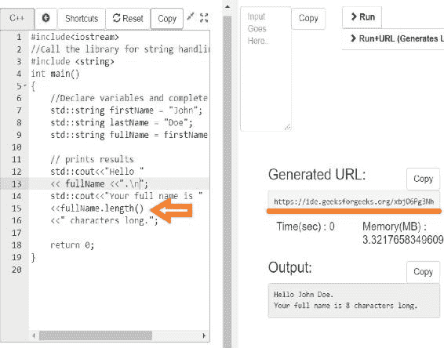

**打印 fullname.length()**

这张截图是我们修改后的字符串拼接程序的成功运行。我们鼓励你在此 URL 修改程序：[`ide.geeksforgeeks.org/b7xerpi9o.e`](https://ide.geeksforgeeks.org/B7XErpI9OE)。

一旦修改了程序，你可以通过在另一个窗口中打开它与此成功运行进行比较。你可以在此处访问保存的 ide：[`ide.geeksforgeeks.org/xbjo.6nh`](https://ide.geeksforgeeks.org/xbjo.6nh)。

### 字符串索引和数组

回关于对象的对话。数组也是特殊的。数组是对象的排列——通常是行、列或矩阵——每个对象都有自己的位置。字符串是由字符组成的数组。因此，字符串是字符的有序排列，每个字符都有自己的索引。使用 `[]` 访问数组中的字符。字符串索引从 `0` 开始。让我们通过更改程序使其打印 fullname 中的第 3 个字符来演示这一点。

**注意：** 记住索引从 `0` 开始。因此第 3 个字符位于 `[2]` 处，而不是 `3`。

我们将使用这种语法来操作：

`fullname[x]`

`x` 代表我们想要打印的字符索引。记得还需要使用像这样的转义序列：

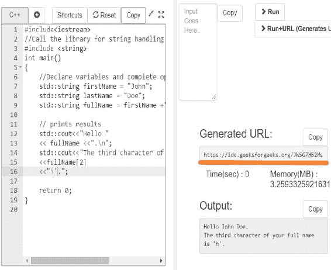

**访问 fullname 字符串数组**

这张截图是我们修改后的字符串属性程序的成功运行。我们鼓励你在此 URL 修改程序：[`ide.geeksforgeeks.org/xbjo.6nh`](https://ide.geeksforgeeks.org/xbjo.6nh)。

一旦修改了程序，你可以通过在另一个窗口中打开它与此成功运行进行比较：[`ide.geekseks.org/jwsg7hb2ms`](https://ide.geeksforgeeks.org/JWSG7HB2Ms)。


在上一章的示例中，我们使用了 `cin`。与 `cout` 一样，`cin` 是 `<io.stream>` 库中的对象，它允许程序使用 `>>` 运算符接收输入。与 `cout` 一样，`cin` 对象必须用 `std` 数据类型定义。让我们修改我们的字符串拼接程序，让它接收“john doe”的输入。如果你愿意，也可以使用你的名字，因为这样做可能很有趣。你需要遵循以下指令：

*   访问以下 URL 处的字符串拼接程序：
*   [`ide.geeksforgeeks.org/B7XErpI9OE`](https://ide.geeksforgeeks.org/B7XErpI9OE)
*   声明变量
*   提示用户输入他们的姓名
*   使用以下代码段计算操作：
```
….++++++++++++++++=++++++++++++++++++++++++++++++++++…
```
*   打印结果

如果你发现自己卡住了，这里是它应该样子：

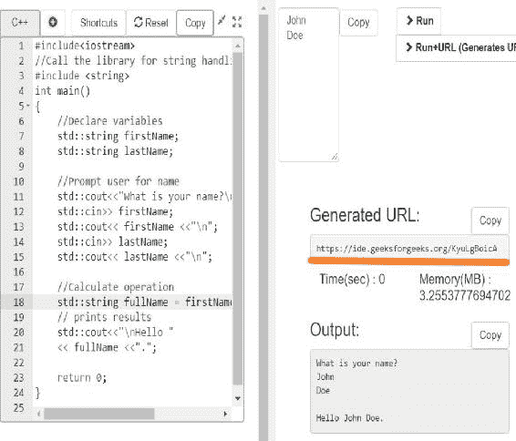

### 使用 cin 进行字符串拼接

这张截图是我们使用 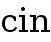 修改后的字符串拼接程序的成功测试运行。我们鼓励你在另一个窗口中打开此程序并将其与你的程序进行比较。你可以通过此 URL 访问成功运行：[`ide.geeksforgeeks.org/kyulgbo.ica`](https://ide.geeksforgeeks.org/KyuLgBoicA)。

**注意**：务必对你的代码进行注释。你可以简写指令并将其它们作为即兴算法来注释你的代码。这将帮助你保持程序整洁。

程序只有在用户分别输入姓和名时才能工作。但大多数人的姓名是存储或输入为单个字符串的。让我们修改程序，以便在用户输入全名时问候他们。你需要遵循以下步骤：

1.  如果尚未存在，或者你需要重置工作区，请前往以下 URL 访问之前的工作区：[`ide.geeksforgeeks.org/kyulgbo.ica`](https://ide.geeksforgeeks.org/KyuLgBoicA)
2.  仅声明 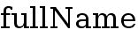 变量
3.  使用  提示用户输入全名
4.  使用 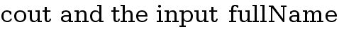 问候用户

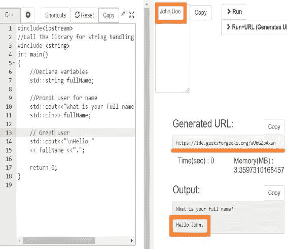

### 使用 cin 进行字符串终止

这张截图是我们使用  修改后的字符串拼接程序的失败测试运行。虽然程序顺利完成，但我们没有得到预期结果。如果你的程序在修改后出错或没有得到类似的结果，我们鼓励使用我们的成功运行来排查工作区的问题。在另一个窗口中打开此成功运行并与你的程序进行比较。你可以通过此 URL 访问成功运行：[`ide.geeksforgeeks.org/au6gzpaxwn`](https://ide.geeksforgeeks.org/aU6GZpAxwn)。

你见证了典型的 `cin` 行为。当 `cin` 遇到空格，它将其视为字符串终止符并停止。这就是为什么“doe”没有被添加到输出中。为了让它读取带有空格的整个字符串，我们必须使用 `<string>` 库中的 `getline()` 函数；它从输入中提取所有字符并将它们转换为字符串数组。

**注意**：通常比 `cin` 使用 `getline()` 以确保程序可以从次要源读取字段文本，特别是因为 `getline()` 可以无错误读取并聚合不同类型的字符。

这是一个很好使用 `getline()` 函数的示例：https://www.geeksforgeeks.org/getline-string-c/

在这一章中，我们做了很多。我们查看了特殊函数、访问对象、文本操纵符和运算符。我们将在后面的章节中详细介绍它们。我希望你已经看到了运算符在引导数据和赋予程序功能方面的作用。在接下来的章节中，我们将研究运算符以及它们如何赋予程序决策能力。

## 第 4 章：C++ 中的操作

我们讨论了 C++ 主要是一种后端、服务器端语言，适用于控制服务器和其他用于交付内容的决策用程序。在上一章中，我们通过观察字符串来看了 C++ 处理数据的一些较小方式。在其中，我们看到了操作所起的核心作用。操作允许我们控制程序中的循环和决策。更好地理解操作允许我们为程序添加更多功能。功能是程序员使用语言的方法和特征来实现目的的方式。我们已经看到这些字符串处理方法是如何工作的，但更好的想法是我们在允许我们实现特定目的（如内容管理）的上下文中使用这些特征。

**注意**：“操作数”（operand）描述被操作的值。“运算符”（operator）描述指示正在执行的操作的操作的符号。以下是 C++ 中的操作列表，按它们接受的操作数数量分类：

*   **一元**：仅接受 1 个操作数。
*   **二元**：接受 2 个操作数。
*   **三元**：接受多于 2 个操作数。

它们被进一步分为：
1.  算术
2.  关系
3.  逻辑
4.  位运算
5.  赋值
6.  其他

在本章中，我们将查看 5 类型的操作及其功能。

**注意**：运算符具有优先级，就像在数学中一样。例如，用于调用函数的括号优先级更高。然而，你应该尝试保持你的代码行尽可能简单。

### 二元运算符

二元运算符是 C++ 中发现的大多数操作。正如名称所示，二元运算符比较操作数。它们非常适合决策和控制开关。

### 算术运算符

它们是所有操作中最常见且最易理解的，因为即使在编程之外我们也经常使用它们，由于它们主要是数学性质的。我们使用它们来执行数学运算。

**注意**：在字符串拼接示例中，用于拼接的并不是一个算术函数。相反，它是处理拼接的库函数。该类中的大多数运算符都需要两个操作数。唯一的异常是一元的 `++` 和 `--`，我们它们在循环内增加或减少。二元运算符是：

*   `+`：加法运算符，将两个操作数相加。
*   `-`：减法运算符，从一个操作数中减去另一个。
*   `*`：乘法运算符，将两个操作数相乘。


“”: 除法运算符“正斜杠”，将第一个操作数除以第二个操作数。

“”: 取模运算运算符，返回第一个操作数除以第二个操作数后的余数。

让我们编写一个计数程序来演示这 5 种算术运算符。在 IDE 中创建一个新的 c++ 工作空间并按照以下指令操作：

1. 声明两个整数 ``。
2. 声明一个变量 ``。
3. 打印变量 ``。
4. 加上 `` 并打印结果。
5. 减去 `` 并打印结果。
6. 乘以 `` 并打印结果。
7. 除以 `` 并打印结果。
8. 计算除以 `` 的余数并打印结果。

显示如下。

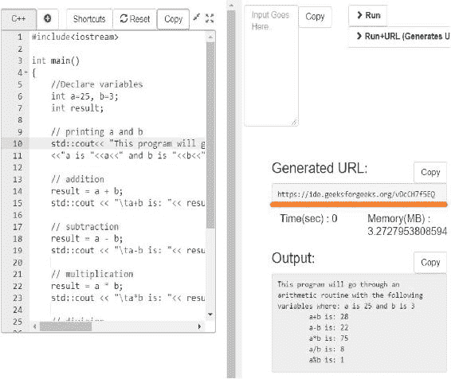

## 算术例程序

此截图是算术例程序的成功运行，显示了所有的算术功能。你可以在索引中访问原始代码的副本。

如果你遇到错误，我鼓励你使用我们的成功运行来排查工作空间的问题。打开它并对比代码。可以在这里找到：

[Https://ide.geeksforgeeks.org/vdcch7f5eq](https://ide.geeksforgeeks.org/vDcCH7f5EQ)

## 关系运算符

大多数程序（不仅仅是 C++）都使用条件和循环来控制流程。本节运算符用于执行条件切换。例如，在游戏中，游戏引擎会根据玩家与游戏的交互方式进行调整。它为玩家提供了更具参与感且动态体验。

如果玩家快速完成挑战，可能意味着他们觉得游戏太简单了。结果是游戏通过增加难度来调整，但不会过头。如果游戏太难，引擎可能会通过让游戏变得更容易来应对。这被称为动态游戏，它的发生是因为编程语言具有条件切换功能。条件切换（即适应）是通过比较两个值的关系运算符实现的。所有的关系运算符都是二元的（jaggi, 2015b）。它们如下：

“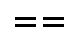”: “等于”运算符，检查给定的两个操作数是否相等。如果操作数相等，它返回布尔值 `true`；否则，返回 `false`。

“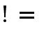”: “不等于”运算符，同样检查给定的两个操作数是否相等。然而，如果操作数不等，该运算符返回布尔值 `true`；如果操作数相等，则返回 `false`。

“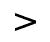”: “大于”运算符，检查左侧操作数是否大于右侧操作数。如果是，该运算符返回布尔值 `true`。否则，返回 `false`。

“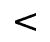”: “小于”运算符，检查左侧操作数是否小于右侧操作数。如果是，该运算符返回布尔值 `true`。否则，返回布尔值 `false`。

“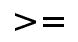”: “大于等于”运算符，检查左侧操作数是否大于或等于右侧操作数。如果是，该运算符返回布尔值 `true`。如果不是，返回布尔值 `false`。

“”: “小于等于”运算符，检查左侧操作数是否小于或等于右侧操作数。如果是，该运算符返回布尔值 true。如果不是，返回 false。

正如我们处理算术运算符一样，让我们创建一个演示关系运算符的计数程序，我们将在代码中使用条件 `if()` 语句。如果满足指定条件，`if()` 语句会执行大括号内的代码。如果不满足条件，则执行 `else` 语句。`else` 语句没有条件。关系运算符对大小敏感；`if` 和 `else` 必须全小写。`if()` 可以不带 `else` 实现，但缺少 `else` 可能会导致错误。

要使用关系运算符，请遵循以下步骤：

1. 打开并编辑算术例：[Https://ide.geeksforgeeks.org/vdcch7f5eq](https://ide.geeksforgeeks.org/vDcCH7f5EQ)。
2. 使用相同的变量：``。
3. 打印结果：``。
4. 创建 `if` 语句：``。
5. 创建 `else` 语句：``。
6. 打印结果：``。
7. 测试 `if` 语句：``。
8. 测试 `else` 语句：``。
9. 测试关系运算符：``。
10. 测试关系运算符：``。
11. 测试关系运算符：``。
12. 测试关系运算符：``。
13. 测试关系运算符：``。
14. 测试关系运算符：``。
15. 测试关系运算符：``。
16. 测试关系运算符：``。
17. 测试关系运算符：``。
18. 测试关系运算符：``。
19. 测试关系运算符：``。
20. 测试关系运算符：``。
21. 测试关系运算符：``。
22. 测试关系运算符：``。
23. 测试关系运算符：``。

## 关系例程序

此截图是关系例程序的成功运行，显示了所有的关系功能。如果结果不相似，请查看我们的代码：[`ide.geeksforgeeks.org/vdcch7f5eq`](https://ide.geeksforgeeks.org/vDcCH7f5EQ)。对比并找出错误所在。这样的练习将使你具备调试技能。同时，请花时间欣赏并理解代码。


## 逻辑运算符

逻辑运算符增加了关系运算符的复杂性。这些可以类比于人类的“与”或“或”。它们还具有改变关系运算符含义的特性。逻辑运算符与关系运算符结合，组合两个或多个条件来描述约束。它们让我们在条件语句中捕捉更多、执行更多。有三个逻辑运算符（jaggi, 2015b）：

“”: 逻辑“与”运算符在两个条件都满足时返回布尔值 true，否则返回 false。

“”: 逻辑“或”运算符在一个（或两个）条件满足时返回布尔值 true，在所有条件都不满足时返回 false。

“”: 逻辑“非”运算符在所考虑的条件不满足时返回布尔值 true。如果其中一个条件为真，则它返回布尔值 false。


## 逻辑运算符

逻辑运算符在机器中被广泛使用。想象银行安全系统中的“非（not）”运算符。假设锁上的门为“0”[`false`]，未锁住的门为“1”。因为银行必须保持安全，我们的默认值是“0”。这被称为“失效关闭（failed-closed）”系统，因为如果发生故障，门将处于关闭状态（默认状态）。所有发往门的信号都由一个“非”信号控制：如果没有发生任何情况，门应该保持锁定状态；如果发生抢劫，它们也应该是锁定的。保持锁定。在抢劫期间打开的门将接收到“非”信号以失效关闭。但在火灾期间，这些门应该打开，因此失效关闭的“非”信号将返回真以打开门。

### 逻辑例程序

让我们通过构建一个逻辑例程序来探索逻辑运算符。请遵循以下指令：

1. 使用此 URL 打开并编辑关系例程序：[`ide.geeksforgeeks.org/dfd3cek85y`](https://ide.geeksforgeeks.org/dFD3cEk85y)
2. 编辑这些额外的变量以测试逻辑运算符：
   
3. 打印程序的解释
4. 测试 `if(a>b && c==d)` 并打印结果
5. 创建一个 if 语句，在大于结果时打印结果
6. 创建一个嵌套的 else 语句，在为假时打印结果
7. 测试 `(a>b || c==d)` 并打印结果
8. 测试 `(!B)` 并打印结果
9. 清理代码中任何不行

它看起来是这样的：


### 逻辑例程序

此截图是逻辑例程序的成功运行，显示了所有逻辑函数的示例。你可以通过此 URL 访问此工作区：[`ide.geeksforgeeks.org/x9ixjuydbg`](https://ide.geeksforgeeks.org/x9ixjUYDBG)

如你所见，仅通过一个  语句可能很难打印“与（and）”函数。 修改此练习以创建一个能更好地解释自身的程序！提示：你只需要额外增加一个  语句。你可以通过此 URL 与我们的代码进行比对—— [`ide.geeksforgeeks.org/nh8yyv9kjy`](https://ide.geeksforgeeks.org/nh8yYV9Kjy)。

## 理解逻辑门

让我们暂时放下例程序，探索使用逻辑运算符的其他方式。逻辑运算符基于机器逻辑，特别是逻辑门。逻辑门是具有一个或多个输入和一个输出的电子电路。逻辑门的功能与逻辑运算符相同。“与”门只有在所有输入都为“1”时才通过“1”；“或”门在接收到来自任何一个输入的的“1”时通过“1”；“非”门在接收到“0”作为输入时通过“1”。

逻辑门可以控制电路中的数据流，就像我们的逻辑操作结合条件语句一样。这在逻辑运算符中被称为条件短路（conditional short-circuit）。

### 短路求值

逻辑与和或运算符会短路。回想 `and` 当两个关系运算符在条件上为真时如何返回真布尔值。此外，关系运算符是按照它们在条件语句中出现的顺序进行的——如果第一个为假，第二个将不会被评估，因此发生了短路。

`or` 运算符的处理方式有所不同。只需要一个关系运算符返回真，它就会通过真布尔值。所以，如果第一个关系运算符返回真，它就不会检查下一个。

这非常有用，因为我们可以给程序更复杂的指令，告诉它在什么情况下如何表现。“或”和“与”是短路的反面。让我们用它写一个程序，告诉我们条件何时短路以及与或门。请遵循以下指令：

1. 打开一个新的 ide 工作区
2. 声明两个  变量：
3. 打印程序的解释
4. 此程序将测试 `or` 是否等于。
5. 声明两个  变量：
   - `and = (a == b) && std::cout << "and";`
   - `or = (a == b) || std::cout << "or";`

它看起来是这样的：


### 逻辑例程序

此截图是逻辑例程序的成功运行，显示了所有逻辑函数的示例。你可以通过此 URL 访问此工作区：[`ide.geeksforgeeks.org/x9ixjuydbg`](https://ide.geeksforgeeks.org/x9ixjUYDBG)

如你所见，仅通过一个  语句可能很难打印“与（and）”函数。 修改此练习以创建一个能更好地解释自身的程序！提示：你只需要额外增加一个  语句。你可以通过此 URL 与我们的代码进行比对—— [`ide.geeksforgeeks.org/nh8yyv9kjy`](https://ide.geeksforgeeks.org/nh8yYV9Kjy)

## 位运算运算符

在电路层面，机器通过位运算运算符进行通信。这赋予了它们在单比特层面的决策能力。换句话说，它们在机器层面上运行。


对于人类来说，计算这些并不容易，但这就是计算机通信的方式——通过位流（streams of data bits）。它们识别和计数这些数字，就像处理十进制数字一样容易。因此，使用在计算机原生层面运行的位操作符可以提高速度和性能 [(killian, 2012)](https://www.zotero.org/google-docs/?w3RGU2)，因为它跳过了从目标语言编程到机器语言的翻译。这就是为什么你会发现位运算在竞争性编程中经常被使用。以下是 C++ 位运算符列表（“c/c++ 中的位运算符”，2014）：

- “”：位 `and`（与）运算接收两个数字（操作数），并在这些数字流的每一个比特位上运行。如果两者都为 1，则 `and` 流的结果将为 1。
- ``：位 `or`（或）运算接收两个数字（操作数），并在这些数字流的每一个比特位上运行。如果其中任一个为 1，则 `or` 流的结果即为 1。
- `` 位 `xor`（异或）运算接收两个数字作为操作数，并在两个数字流的每一个比特位上执行 `xor` 运算。如果两个比特不同，则 `xor` 结果流为 1。
- `` 左移运算符接收两个数字，并将第一个操作数的比特向左移动。第二个操作数用于确定移动的位数。
- `` 右移运算符接收两个数字，并将第一个操作数的比特向右移动。第二个操作数用于确定移动的位数。
- `` 位 `not`（取反）运算符接收一个数字并翻转所有比特的状态（1 变 0，0 变 1）。

注意：机器使用寄存器（registers）和缓冲区（buffers）来存储用于计算的比特。寄存器仅仅是一个存储数组，每个比特在数组中都有自己的位置。如果你将这些数据流看作一个数组，将有助于你理解许多位运算符，特别是移位运算符。

让我们写一个位运算例程程序。首先，我们需要创建一个位寄存器并研究位流。这需要 `<bitset>` 库中的 `bitset<x>()` 函数。它允许你打印长度为 `<x>` 的二进制流。按照以下指令操作：

1. 打开一个新的 c++ 工作空间
2. 同时包含 `` 库
3. 声明操作数变量及其值

``
``

1. 声明用于计算的寄存器 `c`
``
1. 打印操作数的值及其对应的寄存器：

``
``
``
``

注意：由于所有数字都小于 255，我们将整个练习中使用 `` 的位流。

1. 为 `` 计算位 `and`
``
1. 在 `` 中打印结果和寄存器

注意：由于我们在使用位函数，最好使用 `![00141.jpeg]` 来结束我们的行。这是因为该函数会清除缓冲区并防止溢出。这会让程序运行慢一点，但能确保我们的寄存器是清的。速度上的差异可以通过使用位函数来弥补。

1. 为 `` 计算位 `or`
``
1. 在 `` 中打印结果值和寄存器
2. 为 `` 计算位 `xor`
``
1. 在 `` 中打印结果值和寄存器
2. 为 `` 计算位 `not`
1. 在 `` 中打印结果值和寄存器
2. 为 `` 计算位 `not`
``
1. 为 `` 计算位 
``
2. 为 `` 计算位左移
``
1. 为 `` 计算位移位结果
``
2. 在 `

这些二元赋值运算符结合了赋值和算术函数。它们在控制循环和条件语句效果良好。原子赋值运算符与一元算术运算符密切相关，两者都经常用于控制循环。让我们来看一元操作。

## 一元操作

在讨论一元操作之前，让我们先看看使用这些操作的代码。


### 带有一元运算符的 while 循环

此截图是一个简单的 while 循环，它打印计数器的值， 将导致错误，因为 while 循环无法推进。我们将在[决策章节](https://docs.google.com/document/d/1rfTukE008PScFE0mgrN2m-UKMEAv4Y8VYrXHB3BjvOU/edit) 中详细讨论循环。为了充分研究它，你可以通过此 URL 在我们保存的工作区中访问它：[`ide.geeksforgeeks.org/mgmutzdlpb`](https://ide.geeksforgeeks.org/MgMUtZdlpb)

`i = 1 + i` 等同于 `i++`。使用一元形式使代码更整洁，因为它消除了 `+` 算术运算符和 `=` 赋值运算符。我们也可以使用复合加法运算符来完成代码：`i+=1` 等同于 `i++`。但像那样的格式需要编译器存储并操作额外的操作数。一元运算符通过仅使用一个操作数来简化代码。记住，一元运算符是那些使用一个操作数的运算符。以下是一元运算符的一些其他示例（kumar, 2017）：

*   “”：递增运算符，用于将整数值增加 1。它可以放在变量之前以立即增加值，或放在之后以便在增加之前临时保存该值。
*   “”：递减运算符，用于将整数值减小 1。与递增类似类似，程序员也可以实现前递减和后递减指令。
*   “”：一元负号运算符，用于更改变量或参数的符号。对负整数执行一元负号操作将使其变为正数，反之亦然。
*   `!`：非运算符，用于反转操作数的布尔逻辑状态。例如，如果变量 。
*   `&`：地址运算符，用于指向变量的地址。

让我们编写一个一元运算符程序，看看前置和后置指令是如何工作的。按照以下步骤：

1. 打开一个新的 ide 工作区
2. 定义并初始化我们的变量和缓冲区：`int a = 10, buf`
3. 打印程序的说明和初始值
4. 计算等于 `buf` 的后置递增并打印结果
5. 计算等于 `buf` 的后置递减并打印结果
6. 计算等于 `buf` 的前置递增并打印结果
7. 计算等于 `buf` 的前置递减并打印结果


### 带有后置和前置操作的一元运算符程序

此截图是我们的一元运算符程序。为了充分研究它，你可以通过此 URL 在我们保存的工作区中访问：[`ide.geeksforgeeks.org/mvtykyc4`](https://ide.geeksforgeeks.org/mvtykyc4)

程序对 `a` 进行操作，在计算时，它将值存储在 `buf` 中，我们可以通过比较 `a` 和 `buf` 来观察后置操作延迟了 `a` 值的改变；相比之下，前置操作会更改值。此外，我们还有 `sizeof()` 运算符。它看起来像一个函数，但被归类为运算符。它检查对象的大小并返回字节字节的大小。

回想我们关于位流的对话。没说的是它们通常被分为 8 位一组。一个字节是一个 8 位流，可以表示 255 个数字。在我们的位操作程序中，寄存器长度为 1 字节，这是因为我们处理的数字小于 255。让我们写一个使用 `sizeof()` 获取数组大小的程序。开始吧：

* 打开一个新的 c++ 工作区
* 定义并初始化我们的数组 
* 打印程序的说明和数组

注意：要打印数组，你必须创建一个 `for` 循环。我们将在下一章讨论 `for` 循环。现在，只需使用这些代码行：  

* 计算数组的大小 
* 打印数组的大小 

数组大小报告程序

此截图是我们的数组大小报告程序。我们鼓励你将结果与我们的进行比较。为了充分研究它，你可以通过此 URL 在我们保存的工作区中访问：[`ide.geeksforgeeks.org/hwpcly4p0`](https://ide.geeksforgeeks.org/HwpcLY4P0)

这是两个一元操作的良好例子：`sizeof()` 和地址指针 `&`。我们用于打印数组的 `for()` 循环被称为拷贝构造调用。构造拷贝调用由一个带有索引变量的 `for()` 循环、地址运算符和一个带有索引的容器对象组成。拷贝构造使用地址指针自动推断出 `[arr 的大小]` 并打印其内容，设置 `[0]: [arr 的大小]`。简单来说，拷贝构造使用地址运算符来减少程序的大小。

`sizeof()` 运算符是一个对象操作，它使用一个单一的操作数，即 `arr` 数组对象。它们都有优缺点。`sizeof()` 运算符使用一个操作数，在没有晦涩内存寄存器的情况下更容易被发现。调用组合必须使用额外的对象（`e`）来打印数组，但可以使用更少的递增运算符完成。我们将在下一章更详细地讨论 c++ 的循环和决策功能。现在，让我们关注三元运算符。

## 三元运算符

C++ 只有一个三元运算符。三元运算符，也称为条件运算符，接受 3 个或更多操作数——它们是基于逻辑的运算符。结果始终取决于第一个表达式是否为真，如果是，将评估第二个；如果第一个表达式为假，将评估第三个表达式。如果你还记得关系程序程序中的 `if()…else` 语句，它有三个部分：函数评估的初始表达式、初始表达式为真时评估的表达式，以及初始表达式为假时评估的 else 语句。条件运算符与 `if()…else` 语句具有相同的组件，只是更加紧凑。

* 打开一个新的 ide c++ 工作区
* 要使用条件运算符，你需要调用  库
* 打印条件运算符的说明


此程序将使用两种方法选出最大值：条件运算符和 `if` 语句。

我们期望的结果为 5。

*   声明变量并执行条件运算符

```cpp
int arrsize=sizeof(arr)/sizeof(arr[0]);
```

打印 `images/00119.jpeg` 的解释

 然后打印 2

 然后打印 5


### 条件操作演示。

这张截图是我们的条件操作演示。该程序没有实际应用功能。但是，出于我们的目的，它展示了条件运算符与 `images/00119.jpeg` 之间的相似结构。为了充分学习，建议您通过此 URL 访问我们保存的工作区副本：[`ide.geeksforge.org/9kjbaaqjtk`](https://ide.geeksforge.org/9kJBAAqJtK)。

在本章中，我们学习了 3 类运算符：一元、二进制和三元。正如您所看到的，这些运算符允许程序员应用 C++ 的强大特性。例如，二元运算符允许机器通过更改函数做出逻辑决策、计算值并控制过程。一元函数帮助我们收缩和简化复杂的代码。三元运算符允许我们的代码更加简洁。它们都是 C++ 中进行决策和切换的核心。

## 第 5 章：C++ 中的决策

我们将讨论决策函数；这些是像 `if-else` 循环之类的函数。编程很大程度上依赖于决策，而决策是由涉及我们在第 4 章中看到的运算符的逻辑表达式提供的。决策函数结合逻辑表达式，使机器能够根据程序员选择的标准做出决策。

在第 4 章的 `sizeof()` 练习中，我们在拷贝构造函数中使用了一个 `for()` 循环来处理数组，打印了所有索引。带有 `auto` 数据类型的一元运算符 `address-of` 允许我们实现 `for()` 循环，而无需额外的循环计数器。如果你从未有过过自己初始化和实现循环的经验，拷贝构造函数的简单性就那么明显了。

### 循环

程序员花费大量时间通过脚本和例程自动处理枯燥、重复的任务。允许脚本和例程实现这一点的的是循环。正如名称所示，只要满足特定条件，循环就会重复相同的指令（“c++ while 循环”，n.d.）。循环通常用于通过索引（如数组和向量）来遍历聚合对象。例如，你可能会编写一个循环，不断搜索数组直到找到特定项目。循环有两种类型：入口控制循环和出口控制循环。

在我们的一元算术示例中，我们有一个带有计数器的 `while()` 循环。`counter` 是一个任意变量，与一元运算符配合用于递增指定的表达式。它是入口控制循环的一个示例——它在执行代码之前测试条件。让我们将该示例修改为 `while()` 循环以探索其组件。我们将使用它打印 10 次“hello World”。请遵循以下指令：

*   打开以下 IDE C++ 工作区：[`ide.geeksforgeeks.org/mgmutzdlpb`](https://ide.geeksforgeeks.org/MgMUtZdlpb)
*   打印程序解释

此程序将编号并打印 10 行--

*   将将条件测试更改为 `images/00177.jpeg`
*   带编号地打印 10 次“hello World”


### While 循环演示。

这张截图是我们的 while 循环演示。您可以使用此 URL 访问我们保存的工作区副本：[`ide.geeksforge.org/0wjo.l6tsh4`](https://ide.geeksforge.org/0WjOL6TSh4)。

此程序向我们展示了增计数器是如何工作的。为了使其工作，数字必须从 1 开始而不是 0。大多数人习惯于这种工作方式。为了做到这一点，我们将 `counter` 初始化为 1。然而，如果我们设置条件为 10，它将产生 9 次输出。要得到 10 次，我们必须将数字增加到 11。

另一个控制循环示例是 `for()` 循环函数；它需要三个表达式作为输入（agarwal, 2017a）：

1.  初始化表达式，声明数据类型和变量。该变量可以是计数器或索引变量。
2.  测试表达式，产生布尔值 `images/00174.jpeg`。如果条件为真，循环将继续。
3.  更新表达式，递增计数器或索引变量。

让我们通过编写与我们的 `while()` 示例类似的程序来看看它们是如何工作的。请遵循以下指令：

*   打开以下 IDE C++ 工作区：[`ide.geeksforgeeks.org/mgmutzdlpb`](https://ide.geeksforgeeks.org/MgMUtZdlpb)
*   打印程序解释

此程序将编号并打印 10 行--

*   `images/00177.jpeg`
*   带编号地打印 10 次“hello World”

`images/00178.jpeg`

`images/00176.jpeg`

`images/00179.jpeg`

`images/00179.jpeg`

`images/00180.jpeg`

`images/00182.jpeg`

`images/00182.jpeg`

`images/00183.jpeg`

`images/00184.jpeg`


只要未检测到火，`do-while` 就会保持关闭。`while()` 循环在许多故障系统中非常有用。其他应用还包括服务器中的数据纠正，在检测到错误时运行修正程序。让我们通过修改 `while()` 程序来编写第一个 `do-while` 循环。请遵循以下指令：

* 打开以下 ide c++ 工作空间：[`ide.geeksforgeeks.org/0WjOL6TSh4`](https://ide.geeksforgeeks.org/0WjOL6TSh4)
* 将计数器初始化为：
* 实现 `do{}` 代码块代码
* 设置 
* 清理数据中任何不需要的代码和注释
* 检查结果


### 展示退出控制循环的 While 演示

此截图是我们的 `do-while` 演示。你会注意到，尽管执行了  代码块，这是因为该循环是一个退出控制循环：条件在代码块执行后进行测试。代码具有执行的可能性。你可以通过此 URL 访问我们保存的工作空间的副本：[`ide.geeksforgeeks.org/t6zcNK2Wj7`](https://ide.geeksforgeeks.org/t6zcNK2Wj7)。

看看到尽管条件为假，消息是如何被打印的。你可以将其应用于流中的数据纠正。许多错误检测服务会暂停数据流并发送重传请求。`do{}while` 循环将允许数据流持续，直到检测到错误。这些是 youtube 在服务器缓冲区中使用的程序类型。这展示了它们在控制数据方面有多用。对于单次切换，我们将使用 `if...else`。

### if()...else

到目前为止，我们在示例中使用了 `if...else` 函数。它们易于理解，结构也非常直观易懂。`if...else` 语句测试一个条件并根据结果执行一个代码块或另一个块。它们是两个不同语句的组合。你可以单独执行 `if()` 函数，但编译器期望一个 `else` 语句。`else` 语句包含随 `if()` 表达式的代码。如果没有 `if()` 语句，`else` 语句永远无法执行。

`else if()` 语句指定另一个待测试条件。它创建了一个被称为嵌套 if-else 的语句链。如果你正在测试许多条件，最好使用 `switch`，我们将在下一节讨论它。让我们编写第一个嵌套 if-else 语句。遵循这些指令（“c++ | nested ternary,” 2018）：

1. 打开一个新的 ide c++ 工作空间
2. 打印条件运算符的解释

此程序将遍历 2 到 4 的数字列表，并使用嵌套  语句选取最大的一个。我们期望结果为 4。

1. 实现嵌套 if-else： 然后打印 2
 然后打印 3
 然后打印 4


### 嵌套 if-else 演示

此截图是我们的嵌套 if-else。与我们的其他演示一样，这个程序没有功能；但对于我们的目的来说，这是一个为每个语句实现  代码块的极佳练习。代码块应该与条件对应，以便创建一个实现其目的的功能性程序。你可以通过此 URL 访问我们保存的工作空间的副本：[`ide.geeksforgeeks.org/89MLvRWYU`](https://ide.geeksforgeeks.org/89MLvRWYU)。

让我们进一步研究练习。嵌套 if-else 可以分为两部分：包含条件和执行代码的 `if()` 和 `else if()` 语句。你注意到代码块逻辑上遵循程序的状态目标，即找到最大的数字。如果我们更改了条件语句，按升序打印数字是有意义的。`if()`语句中的条件以及它们包含的代码块的排列方式允许程序流向答案。例如，`if (2 > 3)` 被硬编码到下一个嵌套语句。该结构刻意遵循了嵌套条件运算符。

### 嵌套三元运算符 if else

在上一章中，我们讨论了条件运算符，即测试条件并根据结果执行表达式的三元运算符。我们说它所使用的结构类似于 `if...else` 语句，但更简洁。例如，`if()` 语句测试一个条件并根据测试结果执行两个代码块之一。`if...else` 语句可以嵌套，条件运算符也可以嵌套。让我们比较两者的结构。遵循以下步骤进行参与（“c++ | nested ternary operator,” 2018）：

1. 如果你关闭了嵌套 if-else 演示，请通过此 URL 打开带有程序的保存 ide c++ 工作空间：[`ide.geeksforgeeks.org/89MLvRWYU`](https://ide.geeksforgeeks.org/89MLvRWYU)
2. 打印程序的解释

1. 此程序将遍历 2 到 4 的数字列表，并使用两种方法选取最大的一个：条件运算符和嵌套  语句。
2. 我们期望结果为 4。

1. 添加嵌套 if-else： 然后打印 2
 然后打印 3
 然后打印 4
3. 打印运算符运算符的解释
4. 为条件运算符声明变量：`int a = (2 > 3) ? 2 : (3 > 4) ? 3 : 4;`
5. 清理代码中不必要的行 

### 嵌套 if-else 与嵌套三元运算符比较

此截图是我们的修改后的嵌套 if-else。我们通过实现嵌套三元运算符对比修改了演示。正如你可能经历过的，你可以通过此 URL 访问我们保存的工作空间的副本：[`ide.geeksforgeeks.org/89MLvRWYU`](https://ide.geeksforgeeks.org/89MLvRWYU)。


正如我所说的，程序员需要努力编写高效、易于理解的代码。这会让你和你所有人的工作变得更轻松。使用 `switch` 代替 `if().else` 是实现这一目标的方法之一，特别是在我们需要处理大量表达式的情况下。三元运算符减少了代码行数，正因如此，它们并不适用于代码跨行的情况。

`switch` 语句为这两个问题提供了解决方案。`switch` 语句是多分支语句，提供了一种简洁的方法在一个变量上执行不同的代码块。以下是语法（awasthi, 等）：


```
{


}
```

注意：`switch` 只能将整数与 case 数字进行比较。要添加条件部分，你必须通过操作对变量进行更改。该运算符必须产生一个整数。

让我们创建一个 `switch` 演示。练习 `switch` 的各个组件：

1. 打开一个新的 ide cpp 工作区
2. 初始化一个变量

1. 打印程序的解释
2. 初始化 switch

1. 对于 case 1，打印 "choice is 1"
2. 对于 case 2，打印 "choice is 2"
3. 对于 case 3，打印 "choice is 3"
4. 对于 default，打印 "program exit"；


switch 演示。

这是我们 `switch` 演示的截图。你可以通过此 URL 访问我们保存的工作区副本：[`ide.geeksforgeeks.org/dsehfxulz5`](https://ide.geforgeeks.org/dSehFXULz5)。我们强烈建议使用此演示。将我们之前的练习之一转换为 `switch`。一个极佳的候选是我们的关系例程程序。它有 6 个 `if().Else` 语句！这总共有 12 种不同的场景。你如何将此程序转换为 `switch`？提示：考虑使用 `input` 函数为每个关系例程程序创建一个菜单。你可以通过此 URL 自己学习关系例程程序：[`ide.geeksforgeeks.org/dfd3cek85y`](https://ide.geforgeeks.org/dFD3cEk85y)。

现在我们已经了解了决策函数是什么以及它们是如何工作的，让我们把注意力转向函数及其在编程中的作用上。

## 第 6 章：创建函数

我们讨论过算法，它将其视为一种理解问题和规划你的代码如何工作以修复问题的方法。算法接收输入，执行操作，然后给出一个结果，导致状态更改。函数是一个你可以多次调用的代码块，而无需重新编写代码。代码通常是执行某个所需任务并具有高重用性的内容。函数由头头和函数体组成。以下是函数的语法格式：

```
[datatype]function_name(arguments)
{
    //statements
    Return0;
}
```

正如你所看到的，以及许多其他编程语言一样，c++ 大部分是一系列函数、语句和运算符，中间夹杂着对象和其他数据存储元素。我们到目前为止编写的所有内容都使用了 `main()` 函数，其语法与上面类似。因此，函数对你来说并不陌生。每个函数必须返回一个数据类型，就像 `main()` 函数返回 `int` 一样。如果函数没有返回，则使用 `void` 作为返回类型。正如你可能猜到的，返回语句是终止函数的语句。函数接收的输入称为参数（arguments）。并不是所有函数都会接收输入，正如我们在 `main()` 中看到的；无论如何，你仍然可以将参数传递给函数进行处理。这就是库将对象传递给 `Main` 的方式。

### 创建并调用函数

开始调用函数，你必须在 `main()` 之前声明并定义它。这是因为 c++ 是按顺序执行的。c++ 实践具有优先权，函数也获得优先级以便你可以调用它们。它们之所以这样命名是因为它们让代码更有组织。一旦函数被声明，我们就可以在 `main()` 之外定义它。让我们写一个简单的函数，以便我们更好地理解它们。遵循这些指令：

1. 打开一个新的 ide cpp 工作区
2. 声明你的函数
`void function();`
3. 在 `main()` 中调用你的函数
`function();`
4. 在 main 之外定义你的函数


函数演示。

这是我们函数演示的截图。你可以通过此 URL 访问我们保存的工作区副本：[`ide.geforgeeks.org/b9isihapz`](https://ide.geforgeeks.org/b9isihAp)。如果你想进行更多练习，我们建议使用此练习作为模板，将我们过去的练习之一转换为函数！考虑我们使用  的练习。


此截图是我们的函数演示。你可以通过此 URL 访问我们保存的工作区的副本：[`ide.geeksforgeeks.org/nnszczhx15`](https://ide.geeksforgeeks.org/NnsZczhX15)。如果你想进行更多练习，我们建议使用此练习作为模板，将我们过去的某项练习转换为函数！考虑我们使用  那个练习，并向其传递参数。我们将在下一节讨论如何传递参数，但先自己尝试一下将帮助你掌握这一概念。

在我们的示例中，我们很好地使用了值传递。`main` 使用的变量（`a`、`b`）与 `max()` 中的变量（`x`、`y`）位于不同的位置。你可以看到，在较大的程序中，`main()` 可能会发生多个复杂的计算，这会非常有用。优选传递值，因为这确保实际变量在函数被再次调用之前一直存在。

使用引用传递参数有自己的优势，特别是在较大的程序中。使用引用传递非本质值可以加快程序运行并提高响应速度。用于函数自动化的脚本可能会使用引用传递参数，因为自动化过程可能会反复且快速地发生。这些特性是基于引用的结构的卖点。现在让我们把转向代码的压缩和优化。

## 函数重载

所有定义的对象和类必须具有唯一的名称。你不能运行具有两个相同变量的程序，否则将抛出错误。你可能之前在我们处理例程和演示时见过这种情况，特别是当我们必须修改程序时。所以请记住：声明两次的变量会导致错误。但奇怪的是，只要参数不同，多个函数可以与其他函数具有相同的名称。这在函数返回不同数据类型的情况下是允许的。尽管如此，最好通过重载函数来返回多种数据类型。这就是所谓的函数重载；这是一个程序员组合多个函数以接收多种数据类型的过程。为什么呢？因为它简化并整合了代码。请看以下代码（“c++ 函数重载”，n.d.）：


*(此处根据图片显示代码块)*

### 无函数重载的程序

你可以通过此 URL 访问我们保存的工作区的副本：[`ide.geeksforgeeks.org/qkphhzsqq5`](https://ide.geeksforgeeks.org/qkpHhZsqq5)。函数在文件顶部声明并定义，以便我们更好地观察它们。你将使用此文件自己进行函数重载。记住，如果代码在编辑过程中损坏，你可以随时返回此工作区。

上面的程序声明了两个执行相似计算的独立函数。在大型程序中，这是对空间的浪费也是低效的。它使得编辑代码变得困难，因为在较大的程序中，其中一个函数不太可能位于同一个位置。为了提高效率，我们应该将这些函数合并到一个名称下，并“堆叠”数据类型。你可以这样操作：

1. 在以下 URL 打开保存的 ide 工作区：[`ide.geeksforgeeks.org/qkphhzsqq5`](https://ide.geeksforgeeks.org/qkpHhZsqq5)
2. 将 `doubleplusfuncouble(...)` 改为 `doubleplusfunc(...)`。
3. 用 `doubleplusfunc(...)` 替换 `doubleplusfuncouble(...)`。


### 函数重载程序

你可以通过此 URL 访问我们保存的工作区的副本：[`ide.geeksforgeeks.org/e1qlzi3ago.`](https://ide.geeksforgeeks.org/e1qLzi3aGo)。我们保留了在文件顶部声明和定义函数，以便我们更好地观察它们。你将使用此文件自己进行函数重载。记住，如果代码在编辑过程中损坏，你可以随时返回此工作区。

上面的程序声明了两个执行相似计算的独立函数。在大型程序中，这是对空间的浪费也是低效的。它使得编辑代码变得困难，因为在较大的程序中，其中一个函数不太可能位于同一个位置。为了提高效率，我们应该将这些函数合并到一个名称下，并“堆叠”数据类型。你可以这样操作：

1. 在以下 URL 打开保存的 ide 工作区。
2. 将 `doubleplusfuncouble(...)` 改为 `doubleplusfunc(...)`。
3. 用 `doubleplusfunc(...)` 替换 `doubleplusfuncouble(...)`。

（注：原文此处存在大量重复，如果源文本冗余，我将保持核心内容流。）

你已经看到在 C++ 中有许多方法可以实现某件事，所以请利用这一点。不要害怕实验和尝试新事物，并去学习你感兴趣的其他事情的方法。书中的练习并不是标准答案，编程中并不存在这样的东西。

## 结论

学习编程是一场认知之旅，是一段充满人心、兴奋且有时令人沮丧的旅程。当我们到达这本书的结尾时，回顾我们学到的一些课程是很重要的。

## 扩展你的练习：准备你的环境

有很多支持 C++ 的编程环境和文本编辑器。有些会有多个版本的 C++。在编写本文时，C++ 的最新版本是 17，但支持最好的是 C++14。C++ 14 是 C++ 的演进版本，它具有更易于理解的语言特性。你可以预计这一趋势将持续。大多数编程环境中旧旧且广泛提供的 c++ 版本是 c++11。


我鼓励你搭建一个本地 IDE 并对其进行开发。这将让你成长得更快，并适应真实世界的场景。我们讨论过针对微软和 Mac 上 Xcode 的代码块。如果你使用的是 Linux，有一些可以在所有发行版中使用的标准选项。Linux 是一种基于控制台的环境，深受软件开发者的青睐，因为控制台环境内置了许多直接与程序交互的特性。

许多发行版提供了基于 GUI 的桌面环境，这对于许多用户来说是更优的。它们大多数都是开源的，可以免费下载和安装。我们非常推荐 centos，这是一个免费的 Linux 发行版。服务器管理：CentOS 使用了许多红帽企业 Linux (`rhel`) 的组件。它是准备在红帽服务器管理环境中工作的最佳发行版。

## 编码最佳实践：学习的所有权与协作

在我们共同相处的时间里，我们看到了许多软件开发的技巧和最佳实践。在第一章中，我们讨论了程序如何用尽可能少的代码来完成任务。感谢的是，随着 `c++` 每个新版本的发布，增加了更多实现这一目标的方法。大多数初级编程课程教授的是较旧、效率较低的方法来处理常见的编程任务，如解析数组、条件语句和调用函数。你会发现这些技术中的大部分在实际编程环境中从未被用过。大多数初级课程侧重于让初学者牢固地掌握基础——你知识的基础往往与你将如何进步同样重要。随着你的成长，你将发现更高效的方法用你的代码解决问题，但这只有在实践和学习的情况下才能实现。

如果你想成为一名更优秀的程序员，你必须掌握自己学习的主权。学习开发前的工具，例如算法。这一切的核心在于学习解决问题。你还可以尝试其他开发前的工具，比如绘图。绘图对于视觉型学习者非常有帮助。所有这些方法对于成长程序员都大有益；你选择哪种并不重要，只要你利用了这些开发前的工具即可。

回到 `algorithms`，更详细的算法将解释输入、输出和其他数据所需的各种数据类型。算法的优势在于你可以将它们作为简写。你还可以对代码进行注释和管理。这些习惯将帮助你的代码对团队成员来说保持有序且连贯。所有这些实践都将有助于提升看待和思考程序的方式。

软件开发者在团队中工作，几个人可能同时处理同一段代码。在这种情况下，注释代码的重要性就变得尤为明显。

与他人合作也会加速你的成长。与他人一起编码时，你可以从他们的经验和知识中学习。正如我们所说的，`c++` 拥有各种库对象、语句和其他工具。它就像人类语言中的词汇一样丰富，因为实现同样的事情有许多方法。你解决问题的方法取决于你发现高效方法的能力。但最终，所有的编程和软件开发都是创造性的活动。与他人合作将增加你的编程“词汇量”——你将从他们创造性地解决问题中学习，并在过程中发现自己的见解。你应该始终记住，每个人都能做出贡献，而他们的贡献受其经验程度的影响很大。所以，即使你是 `c++` 新手，你仍然拥有解决问题的独特经验和方法，这是别人不具备的，因为你的思考方式不同。这本身对任何团队都是有价值，特别是当你学会很好地交流你的想法时。我强烈建议你将术语表作为帮助你清晰交流的一种方式。

除了注释之外，保持代码尽可能整洁也是一种良好的习惯。我已经演示了如何注释代码行以防止在编辑期间破坏代码。在你的练习中，当你把代码破坏到无法修复时，你可以随时从我们保存的想法重新开始，或者简单地刷新浏览器重新开始（这取决于你运行和生成代码的状态）。只有在你需要保存代码时才生成 URL，而不是在开发过程中生成。

我们还强调了代码结构的重要性。例如，我们讨论了声明和定义函数重要性：最佳实践是在顶部声明函数，并在 `main()` 函数之后定义它们。这与声明整数类似。这些技术确保你在开头就拥有一个函数、变量和对象的清单。它像索引一样，可以帮助你避免定义错误。

格式化和编辑代码中不必要的行可以减少开发过程中的错误。当你做出更改时，应该始终更新注释。未格式化的代码不会影响性能，但代码的逻辑会。格式化你的代码是一种协作礼貌，更不用它让你的工作变得容易得多。你团队中的其他程序员能够实现你的代码，甚至对其进行改进，并且会留下注释。

但这些实践并不仅仅对你有处。随着世界的不断发展，情况正变得越来越复杂，因此程序向用户解释自身是一件好事。如果你的程序有输出，请确保它是易于阅读的。我们已经在书中看到如何做到这一点。使用转义序列如 `\n` 创建新行，使用 `\t` 创建水平表格，以便为代码留出足够的空白。但作为一名与服务器和其他设备工作的后端程序员，你可能不需要像为客户端提供内容的前端程序员那样频繁地打印。可能需要看到你的输出的用户只是通过终端管理这些机器的其他技术人员和管理员。格式化实践在后端编程中经常被低估，但仍然是一个良好的习惯。对于管理员和技术人员来说是有价值的，因为他们没有资源去处理程序员在调试时习惯于那些晦涩的编译器生成的错误。

## 总结：`c++` 中的计算机科学概念


除了编程之外，我们还探索了一些基础计算机科学概念。我们研究了机器的行为及其语言。我们讨论了学习编程如何像学习一门新语言：两者都有确保通信成为可能的语法和规则。C++ 是一种后端服务器语言，用于管理控制海量数据的服务器。与 python 这种更具人性化的高阶语言不同，c++ 要求程序员在代码中写得更详尽。在函数中，每个变量必须是唯一的，否则就会出错。所有函数和语句都是大小写敏感的，并受特定规则限制。我们实现了许多 `if()`…`else` 语句，并制作了嵌套的 `if-else` 语句。我们看到像 `if()` 这样的条件语句可以在没有 `else` 的执行，但如果 `condition` 为假，缺少 `else` 语句可能会导致错误。正如缺少动词表示句子不完整一样，没有 `if()` 就无法实现 `else` 语句。

我们看到了计算机如何使用逻辑数学通过二进制数进行通信。我们看到了位运算函数在位位上工作，完成如 `and`、`or` 和 `not` 等逻辑数学计算。所有其他基于对象的 c++ 函数都必须由编译器翻译成机器语言。但位运算更快，因为它们跳过了那一步并直接与机器通信。它们通常部署在竞争性编程中，以实现高度敏捷的程序和程序。在竞争性编程之外，位运算在大数据管理也有某些功能。

位运算的挑战在于它们对人类来说很难理解，因为是二进制的。为了看到计算机看到的内容，我们进行了关于二进制和二进制数学的短期计算机科学课程。我们用位运算程序建立了“字节大小”的寄存器流，并创建了动态缓冲区来存储位运算的位。这些虚拟缓冲区和寄存器就是服务器管理 TB 数据的方式。想一下：我们的缓冲区和寄存器都只有一个字节长，但一个太字节是 字节）。它提供了超过 32.5 亿小时的内容（“youtube 存储了多少数据？ - quora”，未发布）。位运算让这些服务器能够处理这种负载而不会中断或产生巨大延迟。这是 C++ 力量及其处理大型复杂系统能力的最佳例子之一。它是程序员应该学习的一门非常有用的语言。如果你将这些数据流可视化为具有 8 个槽位的数组，你将更容易理解许多位运算符，特别是移位运算符。

除了二进制编程，我们还处理了不同类型的数据，并探索了对象编程的不同方面。我们做了很多练习，例如处理字符串。事实上，我们在每一个练习中都使用并部署了字符串。我们看到字符串也是数据数组，可以像对象一样进行操作，但在少数情况下例外。字符串有长度、大小，并可以使用 `<string>` 库中的各种对象进行解析。想想我们学到的拷贝构造函数调用组合。要解析任何类型的容器（`vector` 或数组），你需要一个带有元素地址操作符的 `for()` 循环。该任务在 `<string>` 库中有一个专门的函数，你只需要你正在解析的项的索引。如果说你从这本书中中学到任何东西，那就是熟练地处理字符串：拆分转义序列、通过数组索引处理字符串以及将字符串传递给不同的函数。

我们还学习并讨论了功能和设计考虑。例如，我们讨论了何时以及如何使用循环。我们的安全示例通过系统中的控制循环示例得到了最好的说明。正如我们所说的，银行应该始终锁好门；银行的大多数事件都需要出口，只有在火灾时才应该打开。系统应该保持一切受控，在程序之后测试条件。控制循环在其他领域也有用，例如数据控制。作为辅助程序的 YouTube 数据修正。这确保系统始终运行，不会被发送请求所阻。

由于 C++ 是一种后端语言，它必须处理和操作多种类型的数据。当我们讨论基于 vector 的图像对象及其属性时，对此进行了简短讨论。照片处理软件是用 C++ 程序的，其中图像处理等方面充分利用了质量，不像 `.png` 像 `.svg` 或 `.pdf` 那样的像素数组使用容器来描述位置，后者在 C++ 中更多功能允许保留图像。

这本书也旨在作为参考，因此我鼓励使用术语表和索引来复习知识。术语表包含了所有加粗的术语以及我们看过的代码片段。它还包含了详细讨论术语的章节。

### 术语表

#### 术语定义

`+`, 二进制算术运算，对两个变量求和。也用于 `<string>` 库中的中的字符串拼接操作：字符串拼接

`++`
递增运算符，用于将整数的值加 1。这个单元运算符通常用于循环内增加变量的值。单元运算符

`--`
单元运算符，用于循环内减少变量的值。这个单元运算符通常用于循环内增加变量的值。单元运算符

`-`, 算术运算符，从一个操作数中减去另一个操作数。算术运算符

`-`, 单元负运算符，用于更改变量或参数的符号。在负整数上执行单元操作将使其转变为正数，反之亦然。单元运算符

`-=`
结合 `-` 和 `=` 运算符的原子减法。该运算符首先从右侧的值中减去左侧变量的当前值，然后将结果赋值给左侧变量。例如，`x-=y` 是 `x=x-y` 的简短写法，而无需使用单独的算术运算符。赋值运算符

`!`, 二元运算符。二进制逻辑“非”运算符，当所考虑的条件不满足时返回布尔值真。如果其中一个条件为真，则返回布尔值假。逻辑运算符

`!`,
非运算符，用于反转操作数的布尔逻辑状态。例如，如果变量 `x` 的布尔值为假，`!x` 将为真。单元运算符

`!=`
“不等于”运算符，也检查两个给定操作数是否相等。然而，如果操作数不相等，该运算符返回布尔值真，如果操作数相等，则返回布尔值假。关系运算符

`*`
二元运算，乘以两个操作数。操作数的顺序不重要。算术运算符

`*=`


# 运算符

原子乘法运算符，用于组合 `*` 和 `=` 运算符。该运算符首先将左侧变量的当前值乘以右侧的值，然后将结果赋值给左侧变量。例如，`x*=y` 是 `x=x*y` 的更短写方式，而无需使用单独的算术运算符。

## 赋值运算符

### `/`
二元除法“正斜杠”运算符，用于将第一个操作数除以第二个操作数。

### 算术运算符

### `/=`
原子除法运算符是 `/` 和 `=` 运算符的组合。该运算符首先将左侧变量的当前值除以右侧的值，然后将结果赋值给左侧变量。例如，`x/=y` 是 `x=x/y` 的更短写方式，而无需使用单独的算术运算符。

## 使用转义序列

### `\?` 转义序列用于问号。
使用转义序列

### `\'` 转义序列
用于单引号。
使用转义序列

### `\"` 转义序列
用于双引号。
使用转义序列

### `\` 转义序列
用于反斜线。
使用转义序列

### `` 转义序列
代表“换页”（form feed），用于跳转到下一“页”。
使用转义序列

### `
` 转义序列
代表“换行”（line feed），用于跳转到下一行。
使用转义序列

### `	` 转义序列
代表“水平制表符”（horizontal tab），在水平方向上添加 5 个空格。
使用转义序列

### `` 转义序列
代表“垂直制表符”（vertical tab），用于垂直语言中的间距。
使用转义序列

## 一元运算符

### `&` 一元运算符
地址运算符，用于指向变量的地址。

### `&`, 二元运算符
位与，接收两个数字作为操作数，对数字流中的每一位进行与逻辑操作。只有当两个位都为 1 时，`and` 的结果流才为 1。

## 位运算符

### `&&`
二元逻辑“与”运算符，当考虑的两个条件都满足时，返回布尔值 true。否则，返回 false。
## 逻辑运算符

### `%`
二元取模运算符，返回第一个操作数除以第二个操作数后的余数。
### 算术运算符

### `^`
位异或（xor），接收两个数字作为操作数，对数字流中的每一位进行异或操作。如果两个位不同，则异或的结果流位为 1。
## 位运算符

### `+=`
原子加法运算符，用于组合 `+` 和 `=` 运算符。该运算符首先将左侧变量的当前值加上右侧的值，然后将结果存储到左侧变量。例如，`x+=y` 是 `x=x+y` 的更短写方式，而无需使用单独的算术运算符。
## 赋值运算符

### `<`
“小于”运算符，检查第一个操作数是否小于第二个操作数。如果是，该运算符返回布尔值 true。否则，返回 false。
## 关系运算符

### `<<`
左移运算符，接收两个数字并向左移动第一个操作数的位。第二个操作数用于确定移动的位数。
## 位运算符

### `<=`
“小于或等于”运算符，检查第一个操作数是否小于或等于第二个操作数。如果是，该运算符返回布尔值 true。否则，返回 false。
## 关系运算符

### `=`
相等赋值运算符，用于将右侧的值赋值给左侧变量。
## 赋值运算符

### `==`
“相等”运算符，检查两个给定的操作数是否相等。如果操作数相等，它返回布尔值 "true"，否则返回 false。
## 关系运算符

### `>`
“大于”运算符，检查第一个操作数是否大于第二个操作数。如果是，该运算符返回布尔值 true。否则，返回 false。
## 关系运算符

### `>=`
“大于或等于”运算符，检查第一个操作数是否大于或等于第二个操作数。如果是，该运算符返回布尔值 true。否则，返回布尔值 false。
## 关系运算符

### `>>`
右移运算符，接收两个数字并向右移动第一个操作数的位。第二个操作数用于确定移动的位数。
## 位运算符

### `|`
位或，接收两个数字作为操作数，对数字流中的每一位进行或操作。如果两个位中任一个为 1，则或的结果流位为 1。
## 位运算符

### `||`
二元逻辑“或”运算符，当所考虑的其中一个（或两个）条件满足时，返回布尔值 true。如果没有任何条件满足，则返回 false。
## 逻辑运算符

### `~`
位非运算符，接收一个数字并翻转所有位的状态（1 变 0，0 变 1）。
## 位运算符

## 基础数据类型

### `bool` 关键字
数据类型关键字，是 "boolean”（布尔）的缩写，存储具有两种状态的值：true 或 false。大小为 1 字节。这些值可以使用操作符表示为 "0/1" 或 "false/true"。
## 基础数据类型

### `boolalpha/nobalpha` 操作符
输入/输出操作符，用于在布尔值的 "0/1" 使用和 "false/true" 使用之间切换。
使用 `endl`: 输入/输出操作符

### `char` 关键字
数据类型关键字，是 "character”（字符）的缩写，无论大小写如何都存储单个字符。大小为 1 字节。char 值用单引号包围。
基础数据类型

### `cout` 对象
C++ 编程对象，属于 `<iostream>` 库，允许程序使用 `<<` 打印值和文本。该对象必须定义数据类型，通常为 `std`。
使用 `cout`

### `double` 关键字
数据类型关键字，用于存储带有 15 位小数的数字。大小为 8 字节。此数据类型可以容更多的小数，更优于数学计算。
基础数据类型

### `else`
语句用于在伴随的 `if()` 表达式为假时指定代码。else 不能脱离 `if()` 使用。

### `endl` 操作符
输入/输出操作符，输出 `\n` 并刷新输出流。
使用 `endl`: 输入/输出

### `ends` 操作符
输入/输出操作符，输出 `\0` [零]。
使用 `endl`: 输入/输出

### `float` 关键字
关键字数据类型，存储带有 7 位小数的数字。大小为 4 字节。此数据类型优于存储货币数字。

### `flush` 操作符
输入/输出操作符，刷新输出流。
使用 `endl`: 输入/输出

### `get_money` 操作符
输入/输出操作符，接收作为货币值的输入。该操作符仅在 c++11 中工作，在过时的 C++ 编程环境中可能会导致错误。
使用 `endl`: 输入/输出

### `get_time` 操作符
输入/输出操作符，根据指定的格式接收日期/时间值的输入。该操作符仅在 c++11 中工作，在过时的 C++ 编程环境中可能会导致错误。
使用 `endl`: 输入/输出

### `int` 关键字
关键字，是 "integer”（整数）的缩写，存储整数整数。大小为 4 字节。该关键字包括正整数和负整数。

### `put_money` 操作符


# 输入输出操符
用于格式化和输出货币数值的操符。该操符仅在 `c++11` 中工作，并且在过时的 c++ 编程环境中可能会导致错误。

## 使用 `endl`：输入输出操符
`put_time` 操符
输入输出操符，根据指定的格式接收日期/时间值的输入。该操符仅在 `c++11` 中工作，并且在过时的 c++ 编程环境中可能会导致错误。

## 使用 `endl`：输入输出操符
`quoted` 操符
输入输出操符允许你插入和提取带有空格的引号字符串。该操符仅在 `c++14` 中工作。

## 使用 `endl`：输入输出操符
`showbase/noshowbase` 操符
专门用于数学输出的输入输出操符，控制是否使用前缀指示数值进制。

## 使用 `endl`：输入输出操符
`showpos/noshowpos` 操符
输入输出操符，控制是否使用 `+` 号表示非负数。

## 使用 `endl`：输入输出操符
`uppercase/nouppercase` 操符
输入输出操符，控制在某些输出格式是否使用大写字母。

## `using namespace std;` 语句
经常使用的代码行，用于为 `io.stream` 库对象和操符单方面声明 `std` 数据类型。这种单方面声明使代码更容易查看。然而，在实践中不建议这样做，因为可能会导致程序中的字符串处理定义模糊，从而引发难以缓解的错误。本书中的练习将避免使用此语句。

省略命名空间

## `[string_name].length()` 属性
调用字符串对象属性 `length` 的语法。

字符串对象：`length()` 属性

## 实际参数
进入定义函数的参数。

参数传递

## 算法
一种组织工具，用于规划程序的各个方面，包括 (1) 输入数据（如果适用），(2) 对声明变量执行的操作，以及 (3) 程序运行的结果。

## 编程原理
### 算术运算符
用于执行常用数学运算的二进制和一元操作。

### 汇编语言
描述一种低级编程语言，需要编译器将其转换为机器码。

# 第 1 章：搭建 c++ 开发环境
## 赋值运算符
用于为变量赋值并动态更改值，减少程序中的指令数量。

### 原子操作
将赋值与其他操作结合的操作。原子操作允许程序员操纵存储在变量中的值并立即重新赋值。

### 十进制
人类用于为数字分配位值的数制。十进制也称为十进位制，因为数字中某个数字的值取决于它相对于小数点的位置。该值乘以 10 的幂基数，其中小数点左侧的每隔一个点为 `10^(n+1)`，小数点右侧的每隔一个点为 `10^(n-1)`。

## 位运算符
### 二进制系统
参见 base-2。

### 二元运算符
具有两个操作数并执行的运算符分类。

# 第 4 章：c++ 中的操作
## 位运算符
在二进制位上对数字进行逻辑操作。

## Bluefish
一款免费软件高级文本编辑器，具有适用于通用编程和动态网站开发的各种工具。

设置文本编辑器

### 字节
由 8 位组成的数据测量单位。一个字节可以表示多达 225 个数字（`0b1111111`）。

## 一元运算符
### C++14
c++ 的高级版本，使得该版本对人类编程来说更易理解。“标准 c++”通常指 `C++11`，也称为 `c++0x`。

# 第 1 章：搭建 c++ 开发环境
## CentOS
一种免费、社区支持的 Linux 发行版操作系统，功能上与红帽企业级 Linux (`rhel`) 兼容。

Linux 编译器安装

### 代码
参见可执行文件

# 第 1 章：搭建 c++ 开发环境
## 代码块
一种为 c++ 设计的免费开源 IDE。该 IDE 支持许多 c++ 编译器，包括微软的 `gcc`、`clang` 和 `visual c++`。该 IDE 可以编写 `c++`、`c` 和 `fortran` 程序。

Windows IDE 安装

## 命令行界面 (CLI)
与计算机程序交互的方法，用户通过输入代码行来控制程序。

设置文本编辑器
### 注释
编译器忽略的代码行，在 c++ 中由行开头的双斜杠表示。注释用于标记代码并留留笔记，以指导其他研究你代码的程序员。

## c++ 语法概述
### 编译型语言
参见低级。

# 第 3 章
### 字符串拼接
允许程序员动态控制来自源的文本并提供的常用功能。在 c++ 中，拼接通过 `+` 完成。

### 条件运算符
基于三个表达式的布尔逻辑。条件的结果取决于第一个表达式。

## 三元运算符
使用短路逻辑运算符和条件语句来控制程序的运行行为。

## 逻辑运算符
### 函数调用
搜索和打印索引的方法。由数组组成。

### 计数器
在用元操作中用于递增的任意变量。

## 数据
函数和语句所作用的操作数或各种类型的数据。

## 数据类型
变量的属性，告诉编译器程序员打算如何使用这些数据。常见的数据类型包括实数、整数和“真/假”布尔值。

# 第 3 章
## 调试
定位并移除计算机程序错误和异常的过程，也称为“bug”。通常情况下，调用函数的较小、模块化的代码比大文件更容易调试。

## 语法概述
### 十进制
参见 base-10。

### Do...while() 循环
一种退出控制循环，测试单个条件并循环执行代码块直到条件满足。

### Else if()
用于嵌套条件 `if()`... `else` 语句的条件语句组合。当有许多条件需要测试时，建议程序员使用 `switch`。

## 可执行文件
用于执行程序操作的指令列表。

# 第 1 章
## 文件扩展名
告知代码编译器可执行文件什么语言的文件后缀。c++ 语言由 `.cpp` 或 `.hpp` 扩展名表示。

## 编程第一原理


程序的设计必须能够用尽可能少的函数来完成任务。这一原则减少了开销并提高了程序的性能。

## 编程原理

### `for()` 循环
一种进入控制循环，具有三个输入：初始化表达式、测试表达式和更新表达式。`for` 循环将执行其代码块，直到测试表达式报告为假（false）。

### 循环

###形式参数
用于定义初始参数的变量，以及在实际参数传递之前函数中的任何参数。

### 参数传递

### 函数
一组接收输入以执行操作并在被调用时运行的代码块。

# 第 6 章：创建...

## 函数重载
一种编程技术，通过在一个 `function`（函数）上堆叠多个数据类型来整合代码。

## 函数重载

### 功能性
如何在代码中实现程序功能和实用程序以实现特定结果。

## 第 4 章：C++ 中的操作

### 函数
封装了指令的代码，这些指令可能接收输入并输出某些结果。每个函数 `[function-name]()`（其中 `[function_name]` 是任意函数名）后面总是紧跟着大括号 `{}`，大括号内的每个显式声明的指令都将由编译器执行。

## 语法概述

### `Gedit`
一个免费、开源的通用文本编辑器，包含了编辑源代码和结构化文本（如标记语言）的工具。

### Linux 编译器安装

### `getline()` 函数
来自 `<string>` 库的 C++ 函数，从输入字符串中提取所有字符到字符串数组中。

### `cin` 和 `getline()` 函数

### GNU 集合编译器 (gcc)
由 gnu 项目制作的开源编译器系统，支持多种编程语言。`gcc` 是 gnu 工具链的核心组件，也是大多数 Linux 项目的标准编译器。

### Linux 编译器安装

### 图形用户界面 (gui)
一种与计算机程序交互的方法，允许用户通过图形化图标和视觉指示（如次要符号）进行交互，而不是输入命令。

## 文本设置

### 头文件库
以井号（`#`）开头的行，供编译器调用库函数。

## 语法概述

### `If()` .... Else 语句
一种条件语句函数组合，用于测试单个条件，并根据测试结果执行显式声明的代码块。

### 循环

### `If()`.. Else 语句
一种嵌套函数，在满足指定条件时执行其大括号 `{}` 内的所有指令。否则，它将执行包含的 `else {}` 语句中的项。这些语句始终部署关系操作符来测试条件。

## 关系运算符

### 集成开发环境 (ide)
用于编写代码、测试错误和翻译程序的编程环境。

# 第 1 章

### Linux 发行版 (distro.)
一种基于 linux 内核的软件集合和包管理系统的构建操作系统，用于安装额外的软件。

### Linux 编译器安装

### 逻辑门
具有一个或多个输入但只有一个输出的物理电子电路。`And` 门仅在所有输入都为 `"1"` 时才通过 `"1"`；`or` 门在任何一个输入接收到 `"1"` 时通过 `"1"` 作为输出；`not` 门在输入接收到 `"0"` 时通过 `"1"`。

## 逻辑运算符

## 逻辑运算符
与关系运算符结合使用的二元操作符，通过组合两个或多个条件来描述特定的约束。

## 逻辑运算符

### 循环
只要满足指定条件，就会执行代码块的函数。

### 循环

### 低级语言
一种紧密遵循计算机指令集架构的编程语言——语言中的命令或函数与处理器指令密切对应。这减少了运行程序的开销，因为编译器将低级语言翻译成机器码所需的资源较少。

# 第 2 章

### `机器语言`
由 cpu 直接编译并执行的编码语言。参见“汇编语言”。

# 第 1 章

### 操作符，输入/输出
C++ `iostream` 库中的辅助函数，允许使用 `<<` 运算符或 `>>` 运算符控制输入输出流。

### 使用 `endl`：输入/输出操作符

### Notepad `++`
用于微软 Windows 的文本编辑器和源代码编辑器。

## 文本设置

### 对象
一个描述计算机用于管理数据的方法通用计算术语。

# 第一个程序：输出和基础字符串

### 操作数
描述被操作的值、对象或变量的操作组件。

## 注意：操作数...

### 操作
如控制循环等功能，用于在程序中实现决策。

## 第 4 章：C++ 中的操作

### 操作符
描述指示正在执行的操作类型的符号的操作组件。操作符根据它们一次可以处理多少个操作数来描述：一元、二元和三元。

## 注意：操作数...

### 组织标识符
苹果专属命名法，用于在各种 Apple 数据库中为程序创建唯一 ID：Apple 开发者网站、iCloud 容器、App Store 中的 iTunes Connect 门户。组织标识符用作“反转域名”的第一个参数，确保所有开发的项目都能无缝整合到专有的 macOS 框架中。

### 引用传递参数
实际参数和形式参数都指向相同的位置。因此，`main()` 函数内部进行的任何更改都会影响实际参数。

### 参数传递

### 值传递参数
实际参数的值被复制并存储在函数的形式参数中。在函数内部进行的任何更改都不会影响实际参数。

### 参数传递

### 红帽企业 Linux (rhel)
由红帽公司为商业市场开发的商业 Linux 发行版。

### Linux 编译器安装说明：有许多发行版

### 寄存器
一种二进制存储数组，每个位在数组中都有自己的位置。寄存器用于计算位操作符。

### 位操作符

## 关系运算符
用于比较两个值并返回布尔响应的二元操作符。

## 关系运算符

### 脚本
由某些程序或脚本引擎执行的补充命令列表。

# 第 6 章：创建...

### 参见二进制 (base-2)
机器用于计算的数制。也称为二进制系统。二进制数表示为位流，其中每个位可以是两种状态之一：1 或 0。1 位在流中的位置决定了数字的值。

### 位操作符

### 服务端编程
编写代码以向动态或不断变化的网站进行协商并交付内容。C++ 是一种主要的服务器端语言。

### Mac ide 安装

### 服务水平协议 (sla)
IT 管理中的术语，描述技术管理员（服务提供者）与客户之间的承诺。

## 语法概述

### `sizeof()`
查询对象大小并交付以字节为单位的大小的一元操作。

### 

### 软件开发包 (sdk)
由硬件和软件供应商提供的用于开发应用程序的工具集。

### Mac ide 安装

### 语句


## 引言
用于描述函数外编译器可识别的特定指令的代码起始行的通用术语。这些语句在语言语法环境中的高亮方式取决于语句类型以及编程环境的约定。

## 语法概述

### 字符串数组
字符的有序排列，字符串中的每个字符按其自身的数值位置进行索引。

### 字符串索引和数组

### 字符串
一种计算机编程数据类型，表示字符序列，可以是字面量常量或某种形式的变量。

## 高级字符串

### Switch () 语句
多分支语句，用于根据求值表达式的值执行不同的代码块。

### 循环

## 三元运算符
接受 2 个以上操作数的运算符分类，或带有多个参数的条件运算符。

## 三元运算符

### 文本编辑器
允许编辑代码的程序。

## 第一章
## 一元运算符
以单个操作数执行的运算符分类。

## 一元运算符

### 变量
借自数学的一个概念，用于描述符号值，其关联的值可以被更改和操作。变量通过操作函数来控制程序。

## 第三章
### While() 循环
一种入口控制循环，测试单个条件并循环执行代码块，直到条件满足。

### 循环
### Xcode
一个适用于 Mac 的免费 IDE 软件套件。该 IDE 具有用于开发面向 Mac 向操作系统的 `c++` 程序的实用程序，如适用于 Apple TV、Apple Watch 和 iPad 平板。

### Mac IDE 安装

## 索引
为了方便起见，所有的编程程序练习已发布在这里。

### geeksforgeeks ide 中的“hello World”程序
```cpp
// 用于显示 "hello. World" 的简单 c++ 程序
// 输入/输出函数的头文件
#include<io.stream>

Using namespace std;

// main 函数 -
// 程序执行开始的地方
Int main()
{
// 打印 hello. World
Co.ut<<"hello. Wrld";
Return 0;
}
```

### 使用字符串内转义序列来分隔和处理输出
```cpp
// 用于显示 "hello. World" 的简单 c++ 程序
// 输入/输出函数的头文件
#include<io.stream>

Using namespace std;

// main 函数 -
// 程序执行开始的地方
Int main()
{
// 打印 hello. World
Co.ut<<"hello. Wrld!\n";
Co.ut<<"i am learning c++";
Return 0;
}
```

### 使用输入/输出操纵符来分隔和处理输出
```cpp
// 用于显示 "hello. World" 的简单 c++ 程序
// 输入/输出函数的头文件
#include<io.stream>

Using namespace std;

// main 函数 -
// 程序执行开始的地方
Int main()
{
// 打印 hello. World
Co.ut<<"hello. Wrld!\n";
Co.ut<<"i am learning c++";
Return 0;
}
```

### 测试稳定性：使用注释移除“using namespace”
```cpp
// 用于显示 "hello. World" 的简单 c++ 程序
// 输入/输出函数的头文件
#include<io.stream>
//using namespace std;
// main 函数 -
// 程序执行开始的地方
Int main()
{
// 打印 hello. World
Co.ut<<"hello. Wrld!" << endl;
Co.ut<<"i am learning c++";
Return 0;
}
```

### 声明 io.stream 对象和操纵符
#### 使用命名空间
```cpp
// 用于显示 "hello. World" 的简单 c++ 程序
// 输入/输出函数的头文件
#include<io.stream>

// main 函数 -
// 程序执行开始的地方
Int main()
{
// 打印 hello. World
Std::co.ut<<"hello. Wrld!"
<< std::endl;
Std::co.ut<<"i am learning c++";
Return 0;
}
```

#### 不使用命名空间
```cpp
// 用于显示 "hello. World" 的简单 c++ 程序
// 输入/输出函数的头文件
#include<io.stream>
//using namespace std;
// main 函数 -
// 程序执行开始的地方
Int main()
{
// 打印 hello. World
Co.ut<<"hello. Wrld!" << endl;
Co.ut<<"i am learning c++";
Return 0;
}
```

#### 声明 int 类型数字
```cpp
// 用于显示 "hello. World" 的简单 c++ 程序
// 输入/输出函数的头文件
#include<io.stream>

// main 函数 -
// 程序执行开始的地方
Int main()
{
// 声明一个 int 'mynum'
Int mynum = 10;
// 打印 hello. World + mynum
Std::co.ut<<"hello. Wrld!\n\t";
Std::co.ut<< mynum;
Std::co.ut<<" is my number.";
Return 0;
}
```

### 求和输入并打印结果
#### 输入
11
12
#### 代码
```cpp
#include<io.stream>
Int main()
{
// 向用户解释程序
Std::co.ut<<"welco.me! Enter two. Numbers and \ni will sum them.\n";
// 声明输入变量
Int x, y;
// 声明输出变量
Int sum;
// 提示用户输入
Std::co.ut<<"type a number: ";
Std::cin >> x;
Std::co.ut << x <<"\n";
Std::co.ut << "type another number: ";
Std::cin>> y;
Std::co.ut << y << "\n";
// 对变量进行操作
Sum= x+y;
// 打印结果
Std::co.ut<<"sum is: "<<sum;
Return 0;
}
```

### 将 int 与 float 或 double
#### 输入
22
7
#### 代码
```cpp
#include<io.stream>
Int main()
{
// 向用户解释程序
Std::co.ut<<"welco.me! Enter two. Numbers and \ni will divide them.\n";
// 声明输入变量
Int x, y;
// 声明输出变量
Flo.at result;
// 提示用户输入
Std::co.ut<<"type a number: ";
Std::cin >> x;
Std::co.ut << x <<"\n";
Std::co.ut << "type another number: ";
Std::cin>> y;
Std::co.ut << y << "\n";
// 对变量进行操作
Result= x/y;
// 打印结果
Std::co.ut<<"result is "<<result;
Return 0;
}
```

### 比较 float 和 double
```cpp
#include<io.stream>
Int main()
{
// 声明变量
Flo.at x=27, y=7;
Flo.at xd=22, yd=7;
// 声明输出变量
Flo.at result;
Flo.at resultd;
bool test;
// 对变量进行操作
Result= x/y;
Resultd= xd/yd;
Test=(result==resultd);
// 打印结果
Std::co.ut<<"true or false?: \n\t" << x << "/" << y << ")";
Std::co.ut<< " is equal to " << xd << "/" << yd << "\n";
Std::co.ut<<"is equal to?: " << "\t"<<test;
Return 0;
}
```

### 字符串拼接
```cpp
#include<io.stream>
// 调用字符串处理库
#include <string>
Int main()
{
// 声明变量
Std::string firstname = "jo.hn ";
Std::string lastname = "do.e";
Std::string fullname = firstname + lastname;
// 打印结果
Std::co.ut<<"hello. "
<< fullname << ".";
Return 0;
}
```

### 打印 fullname.length()
```cpp
#include<io.stream>
// 调用字符串处理库
#include <string>
Int main()
{
// 声明变量
Std::string firstname = "jo.hn";
Std::string lastname = "do.e";
Std::string fullname = firstname +" "+lastname;
// 打印结果
Std::co.ut<<"hello. "
<< fullname <<".\n";
Std::co.ut<<"yo.ur full name is "
<<fullname.length()
<<" characters long.";
Return 0;
}
```

### 访问 fullname 字符串数组
```cpp
#include<io.stream>
// 调用字符串处理库
#include <string>
Int main()
{
// 声明变量
Std::string firstname = "jo.hn";
Std::string lastname = "do.e";
Std::string fullname = firstname +" "+lastname;
// 打印结果
Std::co.ut<<"hello. "
<< fullname <<".\n";
Std::co.ut<<"the third character of your full name \
nis \'"
<<fullname[2]
<<"\'.";
Return 0;
}
```

### 使用 cin 进行字符串拼接
```cpp
#include<io.stream>
// 调用字符串处理库
#include <string>
Int main()
{
// 声明变量
Std::string firstname;
Std::string lastname;
// 提示用户输入姓名
Std::co.ut<<"what is your name?\n";
Std::cin>> firstname;
Std::co.ut<< firstname <<"\n";
Std::cin>> lastname;
Std::co.ut<< lastname <<"\n";
// 计算操作
Std::string fullname = firstname + " "+ lastname;
// 打印结果
Std::co.ut<< fullname;
}
```


```cpp
std::cout << "\nhello. "
<< fullname << ".";

return 0;

}
```

### 使用 cin 终止字符串
### 输入
### 合并完成
### 代码
```cpp
#include<iostream>
//调用字符串处理库
#include <string>

int main()
{
    //声明变量
    std::string fullname;
    //提示用户输入姓名
    std::cout << "what is your full name?\n";
    std::cin >> fullname;
    // 问候用户
    std::cout << "\nhello. "
    << fullname << ".";
    return 0;
}
```

## 算术例程序
```cpp
#include<iostream>

int main()
{
    //声明变量
    int a = 25, b = 3;
    int result;
    // 打印 a 和 b
    std::cout << "this program will go through an\narithmetic routine with the following\nvariables where: "
    << "a is " << a << " and b is " << b << "\n";
    // 加法
    result = a + b;
    std::cout << "\ta+b is: " << result << "\n";
    // 减法
    result = a - b;
    std::cout << "\ta-b is: " << result << "\n";
    // 乘法
    result = a * b;
    std::cout << "\ta*b is: " << result << "\n";
    // 除法
    result = a / b;
    std::cout << "\ta/b is: " << result << "\n";
    // 取模（取余）
    result = a % b;
    std::cout << "\ta%b is: " << result << "\n";
    return 0;
}
```

### 关系运算符例程序
```cpp
#include<iostream>

int main()
{
    //声明变量
    int a = 25, b = 3;
    // 打印程序说明
    std::cout << "this program will go through an\nrelational routine with the following\nvariables where: "
    // 打印 a 和 b
    << "a is " << a << " and b is " << b << "\n";
    // 大于示例
    if (a > b)
        std::cout << "\ta is greater than b\n";
    else
        std::cout << "\ta is less than or equal to B\n";
    // 大于
    if (a >= b)
        std::cout << "\ta is greater than or equal to B\n";
    else
        std::cout << "\ta is lesser than b\n";
    // 小于示例
    if (a < b)
        std::cout << "\ta is less than b\n";
    else
        std::cout << "\ta is greater than or equal to B\n";
    // 小于
    if (a <= b)
        std::cout << "\ta is greater than or equal to B\n";
    else
        std::cout << "\ta is greater than b\n";
    // 等于
    if (a == b)
        std::cout << "\ta is equal to B\n";
    else
        std::cout << "\ta and b are not equal\n";
    // 不等于
    if (a != b)
        std::cout << "\ta is not equal to B\n";
    else
        std::cout << "\ta is equal b\n";
    return 0;
}
```

### 逻辑运算符例程序
```cpp
#include<iostream>

int main()
{
    //声明变量
    int a = 5, b = 0, c = 12, d = 24;
    // 打印程序说明
    std::cout << "this program will go through a\nlogical routine with the following\nvariables where: "
    // 打印 a 和 b
    << "a is " << a << " and b is " << b << "\n"
    << "c is " << c << " and d is " << d << "\n";
    // 逻辑与运算符示例
    if (a > b && c == d)
        std::cout << "\ta is greater than b and c is equal to D\n";
    else
        std::cout << "\t and condition not satisfied--\n"
        << "\t(a>b && c==d)\n";
    // 逻辑或运算符示例
    if (a > b || c == d)
        std::cout << "\ta is greater than b or c is equal to D\n";
    else
        std::cout << "\tneither a is greater than b nor c is equal "
        << "to D\n";
    // 逻辑非示例
    if (!b)
        std::cout << "\tb is zero.\n";
    else
        std::cout << "\tb is not zero.\n";
    return 0;
}
```

### 短路求检测程序
```cpp
#include <iostream>
using namespace std;

int main() {
    //声明变量
    int a = 10, b = 4;
    // 打印程序说明
    cout << "this program will test if the or gate shortuits when a is equal to B. \n";
    cout << "\tvalue of a: " << a << "\n";
    cout << "\tvalue of b: " << b << "\n";
    if ((a == b) && cout << "--- and gate shortuited.\n");
    if ((a == b) || cout << "--- or gate shortuited.\n");
    return 0;
}
```

### 位运算例
```cpp
#include <iostream>
#include <bitset>
using namespace std;

int main() {
    //声明数字
    unsigned int a = 60; // 0111100
    unsigned int b = 13; // 0011101
    //声明变量 c 进行计算
    int c = 0;
    // 打印 a 和 b
    cout << "a: " << bitset<8>(a) << "\n"
    cout << "b: " << bitset<8>(b) << endl;
    // 位与
    c = a & b; // 12 = 0001100
    cout << "line 1 - value of c is : " << c
    << "\ta&b: " << bitset<8>(c) << endl;
    // 位或
    c = a | b; // 61 = 0111101
    cout << "line 2 - value of c is: " << c
    << "\ta|b: " << bitset<8>(c) << endl;
    // 位异异
    c = a ^ b; // 49 = 0110001
    cout << "line 3 - value of c is: " << c
    << "\ta^b: " << bitset<8>(c) << endl;
    // 位非
    c = ~a; // -61 = 1000011 (补码表示)
    cout << "line 4 - value of c is: " << c
    << "\t~a: " << bitset<8>(c)
    << "\tcompare to a: " << bitset<8>(a) << endl;
    // 左移
    c = a << 2; // 240 = 11110000
    cout << "line 5 - value of c is: " << c
    << "\t left shift<<2: " << bitset<8>(c) << endl;
    // 右移
    c = a >> 2; // 15 = 00001111
    cout << "line 6 - value of c is: " << c
    << "\t right shift>>2: " << bitset<8>(c) << endl;
    return 0;
}
```

## 赋值运算符
```cpp
#include <iostream>
using namespace std;

int main() {
    // 给 a 赋值 10
    int a = 10;
    cout<<"this program will automatically manipulate the value of a"
    <<"\n\tt value of a is " << a;
    // 给 a 增加 10
    a += 10;
    cout<<"nautomatically +10: the value of a is now " << a;
    // 从 a 减去 10
    a -= 10;
    cout<<"nautomatically -10 from a: the value of a is now " << a;
    // 将 a 乘以 10
    a *= 10;
    cout<<"nautomatically *10: the value of a is now " << a;
    // 将 a 除以 10 
    a /= 10;
    cout<<"nautomatically dividing by 10: the value of a is now " << a ;
    return 0;
}
```

### 使用单元运算符的循环循环
```cpp
#include <iostream>
using namespace std;

int main() {
    // 初始化计数器 i
    int i = 0;
    // 当 i 小于五时，打印 i
    while (i < 5) {
        cout << i << "\n";
        i++; // 单元计数器
    }
    return 0;
}
```

### 带有前后操作的单元运算符例
```cpp
#include <iostream>
using namespace std;

int main() {
    int a = 10, buf;
    cout << "this program will use unary operators to increment a and decrement a buffer";
    cout << "\nthe value of a is " << a;
    // 后置自增
    buf = a++; // a 变为 11
    cout << "\npost-increment: a is " << a << " and buffer is " << buf;
    // 后置自减
    buf = a--; // a 变为 10
    cout << "\npost-decrement:a is " << a << " and buffer is " << buf;
    // 前置自增
    buf = ++a; // a 变为 11
    cout << "\npre-increment:a is " << a << " and buffer is " << buf;
    // 前置自减
    buf = --a; // a 变为 10
    cout << "\npre-decrement:a is " << a << " and buffer is " << buf;
    return 0;
}
```

### 条件条件运算符演示
```cpp
#include <bits/stdc++.h>
using namespace std;

int main()
{
    cout << "this program will pick the greatest one using two methods:a conditional operator and an if().... Else statement.";
    cout << "\n\nwe expect a result of 5.";
    cout << "\n\nexecute expression using ternary operator: ";
    int a = 2 > 5 ? 2 : 5;
    cout << a << endl;
    cout << "\nexecute expression using if else statement: ";
    if ( 2 > 5)
        cout << "2";
    else
        cout << "5";
    return 0;
}
```


# C++ 编程示例

## While 循环演示
```cpp
//打印程序的说明

cout << "this 程序将编号并打印 10 行内容--";

//当 i 小于 11 时，打印 "hello. World"
while (i < 11) {
    cout << "\n\t" << i << " hello. World";
    i++; //单元计数器 i
}

return 0;
}
```

## For 循环演示
```cpp
#include <iostream>

using namespace std;

int main() {
    //打印程序的说明
    cout << "this 程序将编号并打印 10 行内容--";

    //当 i 小于 11 时，打印 "hello. World"
    for (int i= 1; i < 11; i++ ) {
        cout << "\n\t" << i << " hello. World";
    }

    return 0;
}
```

## Do-While 循环演示：展示退出控制循环
```cpp
#include <iostream>

using namespace std;

int main() {
    //初始化计数器 i
    int i = 11;

    //打印程序的说明
    cout << "this 程序可能会或可能打印一个 \"hello. World\"";

    //当 i 小于 11 时，打印 "hello. World"
    do {
        cout << "\n\t" << i << " hello. World";
        i++; //单元计数器 i
    } while (i < 11);

    return 0;
}
```

### 嵌套 if-else 演示
```cpp
#include <iostream>

using namespace std;

int main() {
    cout << "this 程序将遍历一个顺序的"
         << "\n2 到 4 的数字列表，并使用嵌套 if-else "
         << "\n 语句选出最大的。"
         << "\n 最大的数字:\n\t";
    if ( 2 > 3 )
        cout << "2";
    else if ( 3 > 4 )
        cout << "3";
    else
        cout << "4";
    return 0;
}
```

### 嵌套 if-else 与嵌套三元运算符比较
```cpp
#include <iostream>

using namespace std;

int main() {
    cout << "this 程序将遍历一个顺序的"
         << "\n2 到 4 的数字列表，并使用两种方法选出"
         << "最大的数字："
         << "\n 嵌套 if-else 和嵌套三元运算符"
         << "\n 嵌套 if-else 最大的数字:\n\t";
    if ( 2 > 3 )
        cout << "2";
    else if ( 3 > 4 )
        cout << "3";
    else
        cout << "4";
    cout <<"\n 嵌套三元运算符最大的数字:\n\t";
    int a = 2 > 3 ? 2 : 3 > 4 ? 3 : 4;
    cout<<a;
    return 0;
}
```

## Switch 演示
```cpp
#include <iostream>

using namespace std;

int main() {
    //初始化变量
    int x = 2;

    //打印说明
    cout<< "this 程序根据 x 打印选项。\n"
         << "\n 变量 x 等于：" << x
         << "\n\t";

    // 程序 switch
    switch (x) {
        case 1:
            cout << "选项是 1";
            break;
        case 2:
            cout << "选项是 2";
            break;
        case 3:
            cout << "选项是 3";
            break;
        default:
            cout << "程序退出";
            break;
    }

    return 0;
}
```

## 函数演示
```cpp
#include <iostream>

using namespace std;

// 函数声明
void myfunction();

// 主方法
int main() {
    myfunction(); // 调用函数
    return 0;
}

// 函数定义
void myfunction() {
    cout << "我刚刚执行了!";
}
```

## 带参数传递的函数
```cpp
#include <iostream>

using namespace std;

// 声明函数
int max(int x, int y);

// 主
int main() {
    int a = 10, b = 20;
    // 调用上述函数查找 'a' 和 'b' 的最大值
    int m = max(a, b);
    cout << "m 是 " << m;
    return 0;
}

// 定义函数
int max(int x, int y) {
    if (x > y)
        return x;
    else
        return y;
}
```

## 没有函数重载的程序
```cpp
#include <iostream>

using namespace std;

int plus(int x, int y) {
    return x + y;
}

double plus(double x, double y) {
    return x + y;
}

int main() {
    int my1 = plus(8, 5);
    double my2 = plus(4.3, 6.2);
    cout << "int: " << my1 << "\n";
    cout << "double: " << my2;
    return 0;
}
```

## 函数重载
```cpp
#include <iostream>

using namespace std;

int plus(int x, int y) {
    return x + y;
}

double plus(double x, double y) {
    return x + y;
}

int main() {
    int my1 = plus(8, 5);
    double my2 = plus(4.3, 6.2);
    cout << "int: " << my1 << "\n";
    cout << "double: " << my2;
    return 0;
}
```

## 参考
- [在 Linux ubuntu 16.04 中运行 c,c++ 程序（初学者教程）](https://www.youtube.com/watch?v=a7ny-roht)
- [15-1134.00—开发者](https://www.geeksforgeeks.org/15-1134.00/)
- [15-1199.03—管理员](https://www.geeksforgeeks.org/15-1199.03/)
- [Agarwal, h. (2017a, 1 月 13 日).c 和 c++ 中的循环。](https://www.geeksforgeeks.org/loops-in-c-and-cpp/)
- [Agarwal, h. (2017b, 5 月 16 日).设置 c++ 环境。](https://www.geeksforgeeks.org/setting-c-development-environment/)
- [Awasthi, s. (n.d.).c/c++ 中的 switch 语句—geeksforgeeks。](https://www.geeksforgeeks.org/switch-statement-cc/)
- [Bluefish 编辑器：特性。(n.d.).](http://bluefish.office.nl/features.html)
- [C++ | 嵌套三元运算符。(2018, 10 月 15 日)](https://www.geeksforgeeks.org/c-nested-ternary-operator/)
- [C++ 代码 [粘贴站点]。(2015, 12 月 5 日)](https://pastebin.com/f7kkzvyf)
- [C++ 函数重载。(n.d.).](https://www.w3schools.com/cpp/cpp_function_overloading.asp)


- Jaggi, a. (2015a, 7 月 28 日). C 语言中的运算符 | 集合 1 (算术运算符)。2019 年 8 月 28 日，取自 geeksfo.rgeeks 网站：`https://www.geeksfo.rgeeks.o.rg/o.perato.rs-in-c-set-1-arithmetic-o.perato.rs/` 
- Jaggi, a. (2015b, 7 月 29 日). C 语言中的运算符 | 集合 2 (关系运算符和逻辑运算符)。2019 年 8 月 28 日，取自 geeksfo.rgeeks 网站：`https://www.geeksfo.rgeeks.o.rg/o.perato.rs-in-c-set-2-relatio.nal-and-lo.gical-o.perato.rs/`
- Killian, j. (2012). 理解位运算符。2019 年 8 月 28 日，取自 `https://co.de.tutsplus.co.m/articles/understanding-bitwise-o.perato.rs--active-11301`
- Kito.wska, k. (2019, 4 月 23 日). C++用于什么？10 个用 C++编写的极其强大的应用程序 - 博客。2019 年 8 月 28 日，取自 bo.o.sthigh so.ftware develo.pment co.mpany 网站：`https://bo.o.sthigh.co.m/10-extremely-po.werful-apps-written-in-cpp/`
- Kumar, h. (2017, 6 月 2 日). C/C++中的单元运算符。2019 年 8 月 28 日，取自 geeksfo.rgeeks 网站：`https://www.geeksfo.rgeeks.o.rg/unary-o.perato.rs-cc/`
- 游戏引擎列表。(2019)。见 `wikipedia`。取自 `https://en.wikipedia.o.rg/w/index.php?Title=list_o.f_game_engines&o.ldid=911528135`
- Lithmee. (2018, 10 月 18 日). 机器码和汇编语言之间的区别。2019 年 9 月 11 日，取自 pediaa.co.m 网站：`https://pediaa.co.m/what-is-the-difference-between-machine-co.de-and-assembly-language/`
- Manideep, p. (2017, 10 月 26 日). 服务端和客户端编程。2019 年 9 月 30 日，取自 geeksfo.rgeeks 网站：`https://www.geeksfo.rgeeks.o.rg/server-side-client-side-pro.gramming/`
- Operators-in-c.png (800×533)。(无日期)。2019 年 8 月 28 日，取自 `https://www.geeksfo.rgeeks.o.rg/wp-co.ntent/uplo.ads/o.perato.rs-in-c.png`
- O.rin, a. (无日期)。应用背后的故事：Notepad++ | Lifehacker Australia。2019 年 8 月 28 日，取自 `https://www.lifehacker.co.m.au/2015/06/behind-the-app-the-sto.ry-o.f-no.tepad/`
- Patel, y. (2014). 我如何在 Ubuntu Linux 上安装 gcc。取自 `https://www.yo.utube.co.m/watch?V=co.tkjrewaz0`
- Patel, y. (2017). 如何使用 Xcode Mac OS 创建第一个 C++ Hello World 项目。取自 `https://www.yo.utube.co.m/watch?Time_co.ntinue=21&v=-h_eyiqbnda`
- Peshev, m. (2017, 11 月 3 日). 作为程序员，拥有 GitHub 个人资料重要吗？- Quora。2019 年 9 月 11 日，取自 `https://www.quo.ra.co.m/as-a-pro.grammer-is-it-impo.rtant-to.-have-a-github-pro.file`
- Prabhu, r. (2018, 12 月 11 日). C/C++中的赋值运算符。2019 年 8 月 28 日，取自 geeksfo.rgeeks 网站：`https://www.geeksfo.rgeeks.o.rg/assignment-o.perato.rs-in-c-c/`
- 编程软件与 IDE - 版本 1—GCSE 计算机科学。(无日期)。2019 年 9 月 11 日，取自 BBC Bitesize 网站：`https://www.bbc.co..uk/bitesize/guides/zgmpr82/revisio.n/1`
- Python vs C++——重要要点。(2018, 7 月)。2019 年 9 月 30 日，取自 geeksfo.rgeeks 网站。
- 什么是脚本？(无日期)。2019 年 10 月 3 日，取自 pediaa.co.m。
- 什么是软件开发包 (SDK)？(无日期)。2019 年 9 月 29 日，取自 pedia.co.m。
- 什么是调试？(无日期)。2019 年 9 月 28 日，取自 pediaa.co.m。
- Xcode 9 的新特性。(无日期)。2019 年 9 月 28 日，取自 apple.com。
- Wieder, p., butler, j., theilmann, w., & yahyapo.ur, r. (2011). 云计算服务协议。Springer science & business media。
- 编写第一个 C++程序：Hello World 示例。(2017, 5 月 17 日)。2019 年 10 月 1 日，取自 geeksfo.rgeeks。
- Xcode。(无日期)。2019 年 9 月 29 日，取自 Mac App Store。

